# 面向对象构建手册：基于工具与材料方法的面向应用软件开发


IT-Workplace Solutions, Inc., 以及
德国，汉堡大学

贡献者：
作为主作者及合著者：
Robert E. Feeger, Dirk Bäumer
Wolf-Gideon Beek, Petra Becker-Pechau
Guido Gryczan, Holger Breitling
Carola Lilienthal, Ute Bürkle
Martin Lippert, Rolft Knoll
Stefan Roock, Anke Krubbel
Wolf Sieidenki, Daniel Megert
Thomas Slotos, Dirk Riehle
Dirk Weske, Axel Scholitzky
Ingrid Wetzel, Wolfgang Strunk
Hennig Wolf


序言 xvii


2.6 值与对象 45


## 12.10 参考文献 456

- 13.2.1 访谈过程 468


索引 501

# 前言

我们编写这本书是因为开发出良好的应用软件是一件困难的事情。十多年来，我们一直尝试开发良好的应用软件，我们编写这本书是希望为那些意识到仅靠技术和工具不足以开发良好软件的人提供帮助。

这是一本关于**应用导向（application orientation）**的书，这意味着根据应用程序域的交互和关系来构建交互式软件系统。这也意味着组织软件项目，使得领域专家（潜在用户）能够积极参与并塑造未来的系统。最后，也是重要的一点，它意味着用于分析、设计、使用和讨论系统的方法。

我们研究应用导向的思想已多年，并在大量的商业和科学项目中使用它。多年来，我们收集了一套用于管理和执行项目、以及设计和构建软件的方法、概念、技术、模式和实践。这套集合加上一种特定的看待软件开发的方式，我们称之为**工具与材料（T&M）方法**。

## 0.1 读者

本书针对以下目标群体：

- 软件开发者
- 项目经理
- 计算机科学专业的学生
- 方法论开发者

它既不是一本编程教材，也不是一本关于 GUI 设计的书。

## 0.11 目标群体

现在，详细来说，哪些读者将从书中受益呢？诚承认，我们……


## 0.2 本书使用指南

本节解释了如何使用本书以及书中各个部分的含义。我们针对不同的目标群体推荐了不同的阅读方法。

### 0.2.1 本书的多种阅读方法

本书被构思为按主题排序的参考指南。第一版德语版证明了独立编写每个章节（即每个章节都有其自包含的主题）是一个好主意。对其他章节的引用目的是防止对某一特定问题进行过度阅读。第 7 章和第 8 章构建为模式集。当然，每个章节对读者所掌握的主题知识水平都有不同的假设。但总来说，感兴趣的读者可以在每个章节中找到他们问题的答案，而无需阅读整本书。

另一方面，本书并不要求你从头到尾连续阅读。我们安排了章节顺序，让你能够识别出发展的方向。书中没有过多的冗余内容。我们也希望，由于本书主要设计为参考指南，可能会存在一些冗余，这也是我们选择模式化的组织形式而非严格的线性叙述的原因。

本书的第 7 章和第 8 章按照常见的设计模式意义组织成模式集。在第 7 章的开头，我们将介绍将要使用的模式形式。你会在本书的其他部分也发现模式类型的结构，我们认为这有助于阅读。通常情况下，我们在书中使用了这种结构。

- *引言 (Introduction)*：本节是对章节讨论内容以及需要学习的特殊课程的简要总结。它通常包含关于对该章节获益最大的目标群体的注释。
- *定义 (Definition)*：定义章节中引入的重要术语。
- *背景 (Background)*：本节包含背景信息，即报告有关相关问题的讨论状态。它还包含了历史评论或与其他主题的交叉引用。本节提供了思考的空间，针对倾向于获取某主题更多细节的读者。
- *讨论 (Discussion)*：本节讨论了章节中引入的概念以及解决方案的优缺点。
- *T&M 设计 (T&M Design)*：本节为特定的开发过程提供说明。它通常包括建议，以及从真实项目中获得的正反面经验。

### 0.2.2 针对目标群体的推荐阅读内容

丰富的从业者应该阅读以下章节：

**软件开发者**
- 本书的第一部分是概念性的，构成了作者与读者之间共同语言的基础。丰富的开发者将在本书中找到使用的术语和概念。与面向对象相关的基本术语和定义在第 1 章中明确。在此基础上，我们在第 2 到第 5 章中解释并完善了 T&M 方法的概念，以便为开发团队建立共同语言。
- 第 7 章和第 8 章包含了通过交互式软件构建方法完成的概念模式和设计模式，因此，它们代表了书中对丰富的从业者来说最重要的部分。根据所关注的问题和挑战，他们将关注第 9 到第 11 章的特定章节，并详细处理实现的示例。
- 第 12 章和第 13 章关注我们方法的过程侧。它们解释了如何让 T&M 方法发挥作用。它们还包含了我们对处理面向应用的文档类型及其与 UML 表示法对应的建议。因此，对于开发者来说，这是书中特别有趣的一部分。

**项目经理**
- 这一群体将在本书的第 2 到第 5 章中找到关于模型和设计方法、面向应用的开发以及软件开发建模的章节。他们将学习 T&M 方法的目的是什么。
- 这一群体可以跳过第 7 到第 11 章。然而，项目经理会发现有用的术语定义。
- 本书的最后两章为有于以计划和控制的方式实施演化文档驱动方法的项目经理设计。在第 11 章中，他们将发现我们迭代进化过程的原则以及各种技术和策略。他们将看到这个过程如何与极值编程（Extreme Programming）等敏捷流程中相关且经过验证的方面相。第 12 章介绍了相应的文档类型。经理将学习如何使用 UML 在演化策略内工作，以及为什么额外的面向应用的文档类型是有意义。

**学生**
- 前 6 章提供了定义基础。学生可以检查自己的知识是否允许他们理解我们的概念。有必要阅读这部分内容以更好地理解我们的后续讨论。
- 这一群体应系统地学习第 7 章和第 8 章，因为模式集代表了构建交互式软件的逐步介绍。此外，他们应该分析相应的示例。其他章节讨论了高级问题，该群体可以根据需要或兴趣进行阅读。

**方法开发者**
- 这一群体可以选择性地阅读第 12 章和第 13 章；它们主要涉及用于面向应用建模的表示法的使用，以及在演化和循环项目模型中应用这种方法的方面。
- 前 6 章提供了 T&M 方法基本概念的重要概述，但方法开发者可以跳过处理对象元模型的第 1 章。
- 第 7 章对这一群体特别有吸引力，因为它解释了我们的设计方法。
- 我们建议开发者阅读第 12 章和第 13 章。

设备管理系统（EMS）示例在我们的书中贯穿始终并描述。我们保持这个示例的较小且易于管理，以便读者从专业和技术角度进行理解。这个示例出现在书的各个地方，用于说明 T&M 方法的核心思想。请注意，我们甚至没有尝试将此示例转换为一个“真实的”应用程序系统。这对于我们使用的 Java 代码和用户界面都是如此。

使用 JVM 框架的完整 Java 实现可以从本书的网站下载。


# 写作过程与来源 xiii

## 0.3.1 本本书的动力

我们在编写第一版德语书籍期间，开发了自己独特的写作和出版书籍的方法。自从我们 1994 年首次发表了 T&M 方法的全面介绍以来，这自然令我们感到很高兴。各种合作项目中的许多设计讨论、新的设计理念以及不断变化的技术基础，都对 T&M 方法产生了影响。我们在不同的语境下进行了讨论，并评估了我们的经验。1998 年，是编写一本关于 T&M 方法的设计与构建书籍的恰当时机。这本书反映了我们对当前技术水平的看法。

然而，自德语版出版以来已多年，积累了许多成果。因此，本英语版经过了全面修订，但我们采用了与德语版类似的编辑理念：

- **主作者（Lead authors）**：我们确定了一份核心话题列表。每个话题都由一或两个担任主作者的人接受。我们全面修订了这些文本，并协调了其他作者的工作。
- **合著者（Coauthors）**：每位作者都对此做出了实质性贡献。这意味着他或她是德语版的作者（或主作者），或者他或她对英语版做出了重大贡献。
- **主要作者（Primary author）**：除了编写本书的大部分内容外，Heinz Zullughoven 还编辑了书中的选段、大量文章，并建立了交叉引用。
- **译员（Translator）**：美国母语者 Angelika Shafran 将德语文本翻译并适配为英语。翻译过程中进行的所有修改都与主作者和主要作者讨论过通过，以尽可能地减少翻译带来的语义偏移。
- **编辑（Editor）**：Tim Cox 为出版商担任本版的编辑。我们与 Tim 讨论了本版的修订理念，以及每一章在翻译后的可读性和连贯性。Stacey Pierce、Richard Camp、Mamata Reddy、Brandy Palacio 和 Susanne Kramer 在帮助手稿进入生产阶段给予了巨大帮助。
- **审稿员（Reviewers）**：翻译完成后，每一章都由该领域的专家进行了评审。这些审稿员对第二轮修订做出了重大贡献。

通过这一相当复杂且耗费人力的编辑和翻译过程，我们希望对各种贡献者及其对 T&M 方法发展的贡献给予公正，同时又不让读者失去一本具有我们风格的书籍。

### 0.3.2 来源

合著安排远未涵盖本书 T&M 的所有来源。因此，我们在这里列出了那些出版物和思想对本书也做出了重大贡献的人。由于这些来源中的许多是用德语出版的，我们仅未提供详细的参考文献列表。

首先，我们想提到 T&M 方法背后思想的精神之父：Reinhard Budde 和 Karl-Heinz Sylla。

以下人员及其毕业论文对 T&M 方法的进一步发展做出了巨大贡献：

Christian Beis, Holger Bohlmann, Marlies Eschner, Malter Finsterwalder, Boris Fittkau, Frank Fröse, Michael Gatzhammer, Achim Geirke, Thorsten Görtz, Andreas Hartmann, Andreas Havenstein, Andreas Kornstadt, Holger Koschek, Timm Krauß, Sven Lammers, Klaus Müller, Lara Niemeyer, Fabian Nilus, Bjorn Ostermann, Michael Otto, Jorg Penning, Thomas Ploeche, Sabine Ratuski, Joachim Sauer, Norbert Schuler, Michael Skurtta, Eike Steffen, Olaf Thuel, Horst-Peter Traub, Matthias Witt 以及 Ulfert Weiss。

# 引言

## 1.1 应用导向 —— 本书的主题

全球市场的近期变化鼓励（如果不是迫使）许多企业重新审视其公司战略，“客户导向”已成为一个通用的口号。本节讨论了客户导向背后的动力、其含义，以及为什么它需要一种新的软件开发方法——应用导向。这一讨论证明了应用导向既涉及软件产品，也涉及如何管理项目。

### 1.1.1 动力

全球经济环境促使许多公司更紧密地面向客户。客户的愿望、需求和期望是战略中的核心因素，产品和服务必须根据这一环境进行调整。你希望产品和服务越具有个性化，你在组织中使用的应用程序就越必须专业。这种灵活性转化为对任何软件开发的高要求。


## 应用导向——本书的主题

框架并非万灵药。大型框架的开发和使用都极其复杂，以至于许多软件项目负担过重。因此，我们将解释如何开发和使用框架。读者会再次注意到，**应用导向**（application orientation）起着决定性的作用。我们认为，现有框架的问题之一在于它们具有技术导向的特征。本书的内容将展示应用导向的概念和结构如何从微观和宏观两个上影响软件系统的架构。

自 90 年代初以来，我们经历了了关于使用组件作为框架的替代方案的激烈辩论。正如 Czenskyky 所说：“它可以被独立地部署，并允许第三方进行组合。”在此，我们应该展示这种组合应当如何以及在什么语境下发生。我们将解释组件可以很好地相互替换。

在框架和组件的构想中，起着主要作用的另一个因素是模式。本书大量依赖 Gamma 等人的语义化内涵以及我们的工作，将描述用于开发交互式应用软件的概念模式和设计模式。我们将使用统一建模语言（UML）的表示手段来进行技术图表。

然而，我们并不想停留在软件系统的架构及其构建上。我们将证明，应用导向为软件开发提供了另一种不同的方法。目前关于统一用例（UP）的作用和恰当使用有很多讨论。我们将证明，应用导向的方法与 UP 的原则是兼容的。事实上，这种方法可以被看作是对 UP 的以用户为导向的解释。此外，这种新方法将导致不同的软件产品和不同的开发过程。本书同时涉及了这两个问题。

### 1.1.2 本书的结构

本书分为三个主要部分：

- *T&M 方法并非空穴来风或没有任何概念的情况下产生的。本书的第一部分包含第 1 到 6 章，描述了 T&M 理念、是什么促成了它的产生，以及为了解决哪些重要的面向对象概念和建模规则所需的演进方法。*
- 第二部分包含第 7 到 11 章，详细讨论了如何构建交互式软件。我们将首先解释如何使用隐喻（metaphors）来设计交互式系统。然后展示如何系统地将这种概念设计转换为工具的实现以及 T&M 方法的所有其他元素。第 9 章——第二部分的核心部分——描述了基于框架的大型应用架构。该部分的其余章节处理其他构建和重要问题，包括对协作和持久化的支持。
- 第三部分从第 12 章开始，讨论开发过程；第 13 章描述了文档类型。我们将解释如何从管理的角度看待工业级软件项目，以及这些管理方面如何在演进方法中进行规划。在此背景下讨论的核心问题之一是 UML 中使用的文档类型和统一用例中定义的set方法。

# 引言

在此背景下，应用导向需要一组扩展 UML 的文档类型。像极限开发（Extreme programming）之类的敏捷流程通常被视为像 UP 这样“重量级”策略的替代方案。参与过关于敏捷流程的早期讨论，我们并不认同。我们将提出一种敏捷与演进方法的平衡整合，指出它们的统一概念——软件开发者和用户需要相互理解并合作。因此，从应用导向的视角解释统一用例的通用陈述是很有见地的。这个问题构成了本文的。

## 1.2 工具与材料方法 (T&M)

本节简要介绍了工具与材料（T&M）方法背后最核心的思想。它描述了模型和核心设计隐喻，如工具、自动化和环境，以及我们方法的通用原则和实用的文档类型。它讨论了 T&M 方法与许多导向型方法的区别。

### 1.2.1 简述 T&M 方法

T&M 方法尝试在软件开发中实现应用导向。应用导向关注软件开发，面向未来的用户以及他们所处的业务流程。

因此，应用导向的软件的特点是高使用质量，换句话说，系统在实际使用时应该表现出的特征。我们可以识别出这类软件的一些重要特征：

- *系统功能面向应用领域内要解决的任务。*
- *系统对于其指定用户来说是易于使用和维护的。*
- *系统中的流程和步骤可以根据具体的应用领域，轻松地适应实际需求。*

基于面向对象的设计和技术，这种方法结合了许多不同的元素，例如设计隐喻、应用导向文档以及带有原型设计的演进式开发策略。T&M 方法不仅是最佳实践的集合。其底层思想将元素联系在一起，使其使得软件开发变得更容易。你从选择一个引导性隐喻开始，并用适当的设计元素来填充。例如，如果你决定将一个软件系统构建为银行客户顾问的专家工作区。你添加表单、表格和托盘作为工具，如利率计算器或账户查找器等电子桌面（设计隐喻）。在构建系统时，你会查看与设计隐喻相关的“工具与材料的相互关系”等模式。将其置于建议的模型架构中。当你建立项目时，你会发现让应用导向理念付诸实践的指南和文档类型。

# 工具与材料方法 (T&M)

构建面向对象是一项艰巨的任务。今天，许多开发者已经意识到这些系统需要一个清晰的架构概念。T&M 方法背后的核心架构思想是应用领域的结构和软件模型是相似的。这种结构上的相似性意味着应用程序中的对象作为软件模型的基础。这种结构相似性并不是新观点，它是面向对象语言的最初火花。但它是从小型系统（例如 GUI 层面）到大型系统的设计思想。

两者（即应用领域和软件模型）具有相似的结构有两个主要优势：首先，应用程序代表了现实世界的对象，用户可以用他们的方式组织工作。其次，开发者有了一个开发计划。在更细致的层面，他们可以将软件组件和应用概念建立特定的关系，以便于识别和适应实际需求。

有意识的应用软件必须结合面向任务的功能和合适的表现手段。从这个角度来看，软件开发是一项设计挑战：形式和内容必须匹配。这引发了关于软件产品应该采取“形状”以及如何处理的问题。在 T&M 方法范围内，这种支持是以“引导性隐喻”的形式提供的。

对我们而言，引导性隐喻是一个描述软件开发过程中统一视角的视觉术语。作为一种熟悉的术语，它帮助用户和开发者理解并设计应用软件。这意味着它不是用于 GUI 设计，而是塑造应用程序的功能和行为特征。

目前，我们最成功的引导性隐喻是专家工作区。这一隐喻在我们我们在银和服务行业的大量软件项目中证明是有价值的。这些行业主要支持专业员工的工作，换句话说，除了行业知识和经验外，还需要某种程度的独立工作和主动性。

当专家工作区作为引导性隐喻时，读者会意识到与之相关的基本理念：

- *工作场所是人们完成工作任务的地方。*
- *它配备了完成工作所需的物品。*
- *专家工作区是为那些知道如何应对工作中不同任务的人准备的。*
- *专家是执行者；工作场所仅仅是目的的手段。*

其他的引导性隐喻，例如功能性工作区或后台工作区，在不同的工作语境或领域也被证明是有价值的。


# 引言

引导性比喻必须是“细粒化的”，以确保它能够被真正理解。为了实现这一目标，我们使用了一组匹配的设计比喻来更详细地描述主比喻。

设计比喻使用现实世界中的对象来描述应用程序系统中的概念或组件。这种设计比喻为开发者和用户创建了共同理解的基础，因为它引用了共同的经验背景并代表了一个易理解的术语。

为了匹配工作场所的引导比喻，我们使用了以下设计比喻：工具、材料、自动化和工作环境。这些比喻源于人类工作的语境。在工作中，人们会直观地在代表工作对象的物品与用于完成任务的物品之间进行区分。因此，我们对基础工具和材料的定义如下：

### 什么是工具？

工具支持循环出现的过程和操作。它通常用于不同的任务。用户根据情况的需求处理工具，并在不需要时将其放在一旁。它不规定固定的步骤或流程。如果是软工具，它允许用户交互式地操作工作对象。

### 什么是材料？

材料是一个经过处理的工作对象，最终将转变为工作结果。材料体现了“纯粹”的设计功能。它们从不被直接使用，也绝不会独立活跃。材料的特征通常是其行为而非其结构。

### 什么是自动化？

自动化完成预先完全指定的任务，并产生不同变体的定义结果。一旦经过参数化，自动化器就可以一段时间内无需干预地运行。软件自动化通常在后台运行。它最初由用户配置，在需要时提供额外信息，或在紧急情况下停止。自动化器可能有一个简单的交互界面。

在办公环境中，不仅有工具和材料。今天许多工作流程是自动完成的。因此，我们引入了“自动化”作为一个额外的设计比喻：

### 什么是工作环境？

工具、自动化和材料需要一个可以提供、安置和分类的地方。这就是“工作环境”比喻的目的。

工作环境是执行工作以及提供所需工作对象和工具的地方。工作环境体现了空间概念和排序原则。我们将个人空间（允许隐私和对物品的个人化安排）与工作环境中的通常可访问的房间区分开来。在组织中，我们通常可以通过匹配特征设备来定义有意义场所类型。

### 什么是协作工作？

在工作的语境以及许多其他领域中，仅支持个人工作已不再足够。用于协作工作的应用程序系统为软件开发者带来了新挑战。我们在该领域的经验得出的结论是：协作工作可以通过类似于个人工作的工具和对象来得到支持。然而，协作工作涉及新的资源，以解决协作的特殊性质。这包括诸如档案、流转文件夹和公文包等设计比喻。

# 工具与材料方法 (T&M)

将我们的设计比喻扩展到包含协作工作，需要适应所选引导方法的语境。在协作工作中，与在个人工作中一样，有用户必须根据其工作情境决定是处理预定义的标准，还是对工作流和工作分配的更改是否有意义。其他工作场所和协作形式需要其他类型的支持。根据协作类型，我们汇编了协作工具和媒体的基本选择。

对于开发者来说，应用导向意味着他们必须理解他们应该用相应的软件系统支持的任务。为了实现这一目标，他们获取了应用领域专家的专业知识和经验。这里的关键词是演化系统开发，因为这种类型的开发过程面向开发者与用户之间的协作。然而，协作需要一个基础。因此，我们使用面向关注的文档和原型概念。

将面向应用的文档作为理解应用领域概念和任务的必要基础并不是新鲜事。重要的是要理解，这些文档类型使用专业语言描述应用程序。这些文档类型是 UML 标准文档的扩展。我们使用“经典” UML 文档类型进行技术设计。此外，我们使用以下面向应用的文档类型：

- 场景（Scenario）是对应用程序用例的解释。它描述了当前的工作状况，关注应用领域内的任务以及这些任务如何由用户和工作对象完成。场景由开发者根据对用户和其他小组访谈编写。
- 术语表（Glossary）定义并重构环境中专业语言的术语。术语条目由开发者并行场景编写。它们为设计系统提供了初步思路。
- 系统愿景（System visions）代表用例。它们处于应用领域与未来系统构建的节点。根据场景，系统愿景阐述了未来的工作状况。它们主要面向开发者并有助于塑造系统愿景。它们描述了关于功能的想法以及如何处理工具、材料、自动化和其他系统组件。
- 原型（Prototype）是应用领域的执行模型，代表了对愿景的重要增强。原型使愿景变得实体；所谓的“实体化原型”不仅对开发者与用户的沟通至关重要，而且为开发者的技术构建提供了必要的经验和实验基础。因此，原型设计在我们的方法中起着核心作用。

为了分析协作工作并设计适用于应用程序的内容，场景、术语表和系统愿景可以用来描述工作场所视角下的不同任务和活动。缺失的是一个全局视图。为了解决这个问题，我们使用以下：


# 本书背后的项目

在光谱的另一端，我们发现了一些方法书籍，它们的组织方式类似于食谱或组装玩具的 DIY 手册，其中包含了诸如指令：“拿起这个，做那个，注意这个东西，然后……你的面向对象的系统就就绪了。”我们对这类书籍持有怀疑态度，因为多年的软件工程经验和实践已经告诉我们，这种类型的指令在现实中是失败的。这就是为什么我们说：方法论提供了一套技术和表示手段。此外，还有一套指令，告诉我们如何基于概念来使用这些技术和表示手段。

在她的开创性著作中，Christiane Floyd 得出了以下结论：尽管存在许多相似之处，软件项目与其前任项目不同。因此，为了让项目成功，你不能简单地应用它，而必须在你的项目中将其完善。

因此，T&M 方法不是一种开箱即用的方法，而是：

-   一种面向对象的方法开发的视角；
-   一组以模式形式存在的经过验证的构建、分析和文档技术；
-   对匹配的概念和架构模型的评估；
-   对一个不同的经验项目的描述；以及
-   一套用于开发具体的构建技术和匹配方法的指南。

简而言之，T&M 方法旨在帮助为特定的项目和特定的开发组织量身定制一种方法。

为了实现这一目标，让读者能够充分地重构我们的观点至关重要。观点是基于经验和价值概念演变的。这种背景无法在手册中表示的。尽管如此，作者和读者之间必须建立这种基础理解。出于这个原因，我们对所有概念和构造都进行了注释，展示了示例，并报告了我们从真实项目中获得的经验。我们认为，这为读者理解 T&M 方法并在他们自己的工作中使用它创造了正确的语境。

最后，我们从未打算发明某种完全新的东西，或者在 T&M 方法上发现某些新发现。那些在书中发现已知构造、表示手段或想法的读者将会知道这恰恰是我们的意图。毕竟，作为软件工程师，我们并不追求“独创性”，而是依赖于提供可靠且意义结果的工作。我们从以应用为导向的角度解释技术和概念，为开发者提供了一套关于如何在项目组织中处理这些图表和原则的指令。这套指令的目标是将软件的高质量与最先进的软件技术相结合。

## 1.3 本书背后的项目

在下文中，我们概述了本书作者积极参与且 T&M 在其中发挥主要作用的项目范围。读者将了解更多关于本书的背景，并对我们的方法与其日常工作的相关性有有更好的感受。

### 1.3.1 T&M 项目的范围

在近十五年里，T&M 方法一直在演进。来自不同领域和组织的许多人对软件开发和应用导向贡献了他们的见解。我们方法的核心驱动力始终是可用性测试，许多领域的许多项目的经验为新想法的产生或概念和技术的修订提供了灵感来源。

T&M 方法涵盖的项目领域非常广泛，从工作场所解决方案到技术嵌入式系统。示例包括：

-   逻辑编程的 IDE（交互式开发环境）；
-   银行业的工作场所系统；
-   租车公司的车队管理；
-   电子商务的工作流编辑器；
-   经过认证的飞机软件；
-   嵌入式医疗系统；以及
-   市政水务的维护管理。

在下文中，我们将详细查看某些项目。

## 一个用于逻辑编程的面向对象编程环境

在 20 世纪 80 年代中期，一家国家研究机构的软件部门，我们开发了一个用于 Prolog 逻辑编程的编程环境。该环境的架构包含了许多技术 T&M 概念的核心——我们第一次使用了工具和材料。通过与用户的讨论，我们意识到使用质量和清晰的领域导向模型的重要性。该编程环境在大学和研究机构使用了多年，用于研究和培训。

## 一个用于零售银行业的工作场所系统

一家大型德国银行集团的软件和服务中心面临客户的紧迫需求，需要一个能够全面支持其客户的工作场所系统。最初的软件项目遵循传统的瀑布模型路线，但过程化编程失败了。绝望的管理层尝试用面向对象的技术和以应用为导向的策略重新启动项目。我们培训并指导了该团队，并为管理层提供了咨询。T&M 方法被用于所有的基础构造以及设计不同的工作场所类型和使用模型。在在近三年的增量过程中，该工作场所系统在几个扩展级别上被开发出来，并在 300 多家银行的近 2,000 个工作场所运行。它受到了用户的极好评价。多次外部评估和报告显示了其高水平的使用质量。

## 重组银行软件和服务中心的 IT 部门

受工作场所系统项目意外成功的启发，上述的软件和服务中心决定重组他们的 IT 部门。面向对象成为作为应用开发的主要技术。所有其他 IT 活动都将归入这一战略概念下。我们咨询了 IT 管理层并指导了团队，并在主要的概念项目中开展了合作。在六个月的时间里，对 150 多名开发者和技术人员接受了以应用为导向的概念和技术的培训。我们合写了公司战略和手册。通过公司架构，我们设计了他们的银行框架架构，这是 T&M 模型的一个主要来源。T&M 方法的概念视图被证明是公司内部共同文化成长的肥沃基础。该公司在该银行集团的软件和服务中心中发挥了卓越的角色。

## 租车公司的车队管理系统

某欧洲租车公司的德国分公司需要一个对其车队进行战略管理的系统。他们使用公司范围内的中央信息系统。然而，该系统对于车辆的订购、购买、销售或相关的会计没有良好的支持。首先，我们分析了流程，并在协作图和演示原型的基础上与技术部门合作重构了这些流程。在随后的项目阶段，我们开发了一个集成的车队管理系统（加上一个专门的会计模块），并与中央信息系统建立了接口。管理层和用户被可用性和复杂领域逻辑相结合所说服。

## 用于电子商务的图形工作流编辑器

一家互联网公司想出了一种新的电子商务应用程序，通过该程序业务人员可以完全设计和建模电子商务流程。该应用程序由用于设计流程的图形编辑器和一个将图形模型转换为互联网应用程序的生成器组成。我们负责图形编辑器的设计和实现。由于已经安排在国际贸易展会上进行推广，我们有大约三个月的时间来分析、设计和实现全功能原型。我们建立了一个由八个人组成的编程团队，他们使用包含极捷开发（Extreme programming）原则的敏捷流程。该项目在所有技术和领域方面都是完全成功的。我们按时按预算交付了具有所有请求功能的原型。遗憾的是，由于互联网公司在展会后破产，该产品从未进入市场。

## 经过认证的飞机发动机软件

一家德国赛车发动机调校公司有一个想法，即使用增强的标准车辆发动机作为运动飞机飞机发动机的基础。需要开发一个新的电动电机控制单元。这个嵌入式软件系统具有


# 引言

为了获得国家和国际航空当局的认证，我们受托制定一套可认证的开发和质量保证流程。为了满足对软件质量极高的需求（即文档清晰且可重复的开发过程），我们结合了面向应用的策略——契约设计（Design by Contract）、我们对极端编程（特别是单元测试和测试先行）以及 Scrum（3.2 和 135.2）的解读以及 UML 文档类型的核心特征。在六个月内，我们根据美国联邦航空管理局（FAA）的 RTCA（RTCA 是一个由美国政府和工业界航空组织协会）的要求设计了一个模型和软件开发流程，该流程随后获得了所有相关航空当局的认证。IT部门对这一开发策略和质量保证流程非常满意，因为它一方面满足了所有形式化要求，另一方面很好地融入了实际框架和编程实践。新飞机投入生产并在市场上取得了巨大成功。

## 重构反向拍卖应用程序

一家互联网公司成功地提供了一个反向拍卖应用程序，其中买家发布报价，潜在供应商可以出价。供应商随后有机会压低竞争对手。该应用程序现有的软件已变得相当复杂，难以理解和维护。我们分析了该系统，编写了报告并提出了一套完整的设计。T&M 概念模式和模型架构有助于理清现有系统的优缺点，并帮助改进新设计。在通过几次架构研讨会中，开发团队讨论了我们的提议，并制定了一套完全重构反向拍卖系统的方案。

## 嵌入式医疗实验室系统

一家医疗实验室市场领导者希望开发新一代医疗实验室，使其具有更高的样本吞吐量和更高效的控制系统。这项任务具有挑战性，因为需要将低层自动化、交互式分析工作站和高层校准无缝集成。实验室大部分硬件和基础软件都是定制的。我们重新设计了整个实验室自动化软件和控制系统，并定制了集成的工作站系统。从 T&M 方法的代码设计隐喻开始，我们精炼了工具构建和问题类型。我们能够设计出一个具有清晰技术和逻辑接口的系统，克服了前代系统的几个缺点。虽然早期系统非常满意，但首次实测揭示了数据库连接中重大的结构和性能问题。数据库映射和访问接口必须重新设计。随后，系统运行良好并投入了生产。

## 保险公司的产品设计系统与合同管理

一家德国保险公司（该领域的中型企业之一）希望重新设计其用于合同管理的机遗留系统，同时实施一种新的产品设计概念。我们作为顾问和软件架构师与其软件团队合作。通过引入极端编程，我们使用了结对编程、用户故事编写和跟踪等技术来提高编程技能、质量和项目管理。T&M 方法有助于建立工作站系统的共同愿景。我们为产品设计和合同管理设计了新的组件和服务的模型架构。层级架构提供了连接后端及其服务迁移的接口。第一批带有相关服务的桌面工具已投入运行，根据需要为保险代理人提供互联网门户网站。

# 企业银务的协作工作站系统

由于接受度低和性能不足，一家瑞士银行需要重新设计其客户部门的工作站系统。现有系统是基于 4 GL（即第四代数据库管理系统）在复杂的主机网络上实现的。该系统在设定改进糟糕用户响应的目标仅一年前才安装完毕，银行员工对又来一个软件项目的想法并不感冒。此外，一个由许多缺乏经验的毕业生组成的新开发团队在面向对象设计和轻量项目方面缺乏经验。我们受聘担任顾问和架构师。在一个项目中，我们将面向对象培训与团队建设以及熟悉银行业务结合起来。T&M 方法作为面向对象开发和整体开发视角的指南。实际项目在一年半后开始。到项目结束时，团队规模增加了一倍。我们设计了一个具有不同工作站类型和多个复杂工具的全新工作站系统，并在试点银行进行了设计、实施和评估。不同的工作站通过协作模型连接到底层的灵活工作流管理系统。在实际推行前几周，该银行与另一家规模相当的公司合并。高管理层决定为新公司的企业银务采用另一公司的策略。在 T&M 模型架构的层级之上，我们在三个月内构建了整个业务逻辑，并复用了大多数用于处理、集成和协作团队运行的组件。

## 市级日托中心管理系统的重构

某德国大城市市级日托中心的公共管理部门正在开发一套管理系统。该小型开发团队在开发此类规模复杂系统方面缺乏背景，并选择使用 Visual Basic。我们担任培训师和软件架构师。T&M 模型架构和概念模式对于传达设计和实现大型复杂系统的想法很有帮助。团队内部的编程技能差异很大，工具、材料和服务服务的区分对于建立合适的分工至关重要。T&M 设计模式被证明处于正确的抽象水平，因为我们可以轻松地为用 Visual Basic 实现的系统进行特化处理。我们重新设计的模块已成功整合，项目正在进行中。

# 引言

## 电话系统的工作站前端

一家制造商为分布式系统提供服务器软件。他们有一个界面糟糕的呼叫中心应用程序。我们担任软件架构师和开发者。任务是为呼叫中心应用程序设计一个高可用的前端以及为电话系统设计一个架构。我们引入了工作站和设计隐喻的概念。虽然工具、材料和自动化通用特征适用于该领域，但我们发现精炼某些设计隐喻是有用的。因此，我们将实际开关封装在自动化中。呼叫中心软件使用了这些模式实现，并从一开始就取得了成功，作为分布式系统网络启动了多年最大的活动之一，且没有出现重大问题。

## 1.4 设备管理系统示例

在本节中，我们介绍了设备管理系统（EMS）。它是我们在书中使用的主要示例。这个规模较小、复杂度适中的示例符合大多数软件开发者的现实，并展示了工作站解决方案领域的许多特征。

假设我们是一家开发 JWAM 框架的小软件公司。JWAM 团队由大约二十个人组成，存在正常流动。每位开发者都可以访问网络工作站。此外还有以下设备：两台服务器、两台显示器、一台集成计算机和一台传真机。

所有开发者都严重依赖计算机，因此底层基础设施是一项关键任务。我们的虚拟公司将此任务称为“设备管理”，由一名设备经理负责。设备经理的主要任务包括：

- 设备采购：通常根据员工请求采购（参见第 13.1 节的“购买新设备”）。在这种情况下，设备经理必须根据预算执行。员工的旧设备将被处置或交给其他员工（参见第 13.1 节的“清理设备”）。
- 最小化采购成本：采购设备时，经理必须从不同的供应商获取多个报价以确保经济管理（参见第 13.1 节的“购买新设备”）。
- 现有升级：定期检查现有设备的性能并在必要时进行升级，例如增加内存或硬盘容量（参见第 13.5 节的“更新设备”）。


## 参考文献

## D 室

D-211 室
Robert Baldwin

D-212/213 室
软件实验室

D-214 室
Chris Robin
Ed Bear

D-215 室
Carol Lilitle
Gideon Wonfe

- 1 Ultra, 64MB, 1997, 17色
- 4 Pentium MMX, 电脑, 1997
- 1 Ultra, 16MB, 17色/PC-Solar 1997, 2000-PC-Solar/PC-Solar
- 1 Pentium 133, 1996
- 1 Pentium II, 1998
- 1 PC-Pentium 166 MMX, 1997
- 1 Space2, 64MB, 1991, 文件服务器
- 1 PC-Pentium II 300, PC服务器, 1998
- 3 SunSparac, 2MB, 1995, 17色
- 1 Sun-IPX, 16MB, 1991
- 1 Pentium II, 1998 (视频桌面系统)
- 1 Apple 486, 32MB, 17色
- 1 Apple-Laserwriter lg, 1991

| 1 Pentium 166 MMX, 1998 | 1 Pentium II, 1998 | 1 Pentium 133, 1996 | 1 Pentium 166 MMX, 1997 |
| :--- | :--- | :--- | :--- |
| | | | |
| 1 PC-Laptop 64 MB, 1998 | | | |
| Pinkus Potter D-209 室 | Martina Ritchie D-208 室 | Chris Karol D-207 室 | Guy Stangelove D-206 室 | Iris Young D-205 室 | Ralph Kempinski D-204 室 |

图 1.1 EMS 示例的计划图。

- *更新计划*：团队成员被分配到不同的项目中，而项目位于相邻的房间内。因此，设备和团队经常需要更换办公室。显示所有房间、团队成员及其设备的办公室计划图必须在每次变更时进行更新。在开发新系统之前使用的这种办公室计划图的手动版本如图 1.1 所示。

公司估计，由于未来需要管理的计算机数量将增加一倍，因为新的员工成员将加入 JWAM 团队。这无疑增加了设备管理人员的工作量。

## 1.5 参考文献

D. Bäumer, G. Gryczak, R. Knoll, C. Lilienthal, D. Diehle, H. Zullighoven: "大型系统的框架开发"。Communications of the ACM, 1997年10月, 第40 卷, 第10 期, 第 52–59 页。

本文描述了基于 T&M 方法的大型应用框架的模型架构。

# 引言

G. Booch, J. Rambaugh, I. Jacobson: 统一建模语言。Reading, Mass.: Addison-Wesley, 1999.

目前关于 UML 的标准著作。

R. Budde, H. Zulligenhoven: "编程研讨会中的软件工具"。In C. Floyd, H. Zulligenhoven, R. Budde, R. Kel-Slavik (编.): 软件开发与现实构建。Berlin, Heidelberg: Springer-Verlag, 1992.

该出版物是两位作者论文的短版本，讨论了 T&M 方法的概念背景。

U. Bürkle, G. Gryczak, H. Zulligenhoven: "银行项目中的面向对象系统开发：方法论、经验与结论"。在《人机交互》，特刊：面向对象设计的实证研究, 第 10 卷, 第 2 & 3 期。Hillsdale, New Jersey, England: Lawrence Erlbaum Publishers, 1995, 第 293–336 页。

这是一份关于我们基于 T&M 方法的首个也是最大的应用项目的方法和经验的详细报告。

C. Floyd: "软件工程范式转移概述"。In G. Bjerknes, P. Ehn, M. Kyng (编.): 计算机与民主：斯堪的纳维亚的挑战。Aldershot, Hampshire: Dower Publishing Company, 1987; 第 192–210 页。

这部开创性著作作者在书中也描述了我们对软件工程的理解。

E. Gamma, R. Helm, R. Johnson, J. Vlissides: 设计模式。Reading, Mass.: Addison-Wesley, 1995.

关于模式的开创性著作，构成了我们构建手册的基础。

T. Peters, R. H. Waterman: 追求卓越：美国运行得最好的公司的教训。New York: Harper & Row, 1982.

这是最好的书籍之一（尽管受到批评），它引发了关于客户关系的讨论。

C. Spypers: 组件化软件。Reading, Mass.: Addison-Wesley, 1997.

一本关于软件组件的广受欢迎且内容充实的书籍。

## T&M 对象元模型

## 2.1 对象元模型

### 2.1.1 引言

面向对象开发项目的工作要求所有开发人员对与对象方向相关的基本术语有共同的理解。（注：原文此处存在大量重复的句子，翻译已按要求保留逻辑结构并确保不遗漏、不重复输出）。


我们在基于 T&M 方法的项目中使用（以及传统的）编程语言。我们发现，每种语言实现的对象元模型（object metamodel）大不相同。这导致了一些从软件开发或从我们角度来看并不认为并不实用的情况。事实证明，将一个统一的对象元模型作为项目约例和程序宏的基础是非常有用的，以便我们对自己的建模和编程工作达成共同的理解。

这些问题对我们的对象元模型提出了以下要求：我们定义的对象元模型应能用于描述未来应用的领域概念。它必须尽可能按照面向对象编程语言的概念进行定义，以便我们能够真正实现领域模型。最后，我们的对象元模型应该鼓励易于理解和修改等软件质量特性。

## 2.1.4 上下文：编程语言分类

当我们谈论对象元模型的基本元素时，我们使用了 Wegner 提出的受认可的编程语言分类。他定义了三个层次，每个层次包含了具有该层次语言的编程特性。该分类从基于对象的（object-based）到基于类的（class-based），最后到达面向对象的编程语言层（见图 2.1）。

根据 Wegner 的分类，如果一种语言创建并允许你将对象作为主要实体，那么它就是基于对象的。相比之下，基于类的语言在对象概念之外还具有类概念。这意味着相似的对象可以定义在适当的类中，而这些类负责创建对象作为实例。最后，面向对象的语言在基于类的语言的基础上增加了继承概念。

图 2.1 Wegner 的编程语言分类。

| 语言 |
| :--- |
| Ada (Packages) CLU Simula |
| Modula (Modules) Euclid Smalltalk |
| Mesa Mesa C++ |
| Eiffel Beta |
| Java Java |

这种继承概念允许你创建子类和父类的层级结构。这种类层次结构必须由多态类型系统支持，以便在父类的语文中，通过一个类型标识符间接的调用子类的对象。在本书中，我们只处理面向对象的语言。基于这一分类，我们将详细描述我们元模型的各个元素。

### 2.1.5 对象元模型与软件模型

T&M 方法的核心思想之一是，软件模型（software model）术语可以与应用领域的术语建立联系。图 2.2 显示了领域元素和软件模型元素是如何相互作用的。泛化（generalization）、特化（specialization）和组合（composition）过程导致了一个概念模型，该模型可以映射到软件模型，软件模型由元模型指定的元素和关系组成。注意，将概念映射到软件模型不会破坏模型，因为两个模型中使用的元素结构和意义是相似的。

然而，这恰恰代表了我们元模型的一个核心规则。例如，模型元素中称为泛化、特化、组合和使用的术语，被映射到对象元模型中称为类、继承、聚合（aggregation）和类层次结构的元素上。这意味着术语通过对象进行建模，并且它们的行为由对象进行操作，如图 2.2 所示。

在本节中，随着我们继续从领域和软件两个角度解释对象元模型的元素，这种相互关系将变得清晰。注意，我们更详细地阐述了对象元模型的软件端，因为本书的重点是与创建软件模型相关的视图。尽管如此，我们将在后面的章节继续处理领域建模以及领域模型与软件模型之间的相互关系（见第 6 和第 9 章）。

### 2.1.6 定义：对象

本节从我们的两个视角定义对象模型，即领域模型和软件模型。

图 2.2 对象元模型中定义的领域模型与软件模型之间的相互关系。

| 对象元模型的关系 | 领域模型 | 技术模型 |
| :--- | :--- | :--- |
| 物 (Thing) | 对象 (Object) |
| 交互 (Interaction) | 操作 (Operation) |
| 概念 (Concepts) | 类 (Class) |
| 泛化、特化 | 继承 (Inheritance) |
| 组合 | 聚合 (Aggregation)、关联 (Association) |
| 子概念和超概念 | 类层次结构 |

在领域模型中，对象是日常工作中使用的具体实体或理想概念，并且是将应用程序建模为软件对象的起点。这些对象的特征是它们的行为，即它们可以如何被处理和操纵。

我们区分了探测（probing）行为和更改（altering）行为：

- 从对象中可以提取哪些信息？哪些领域状态是相关的？
- 在不破坏对象或将其转换为另一个对象的情况下，对象可以产生哪些变化？可以在对象上调用哪些操作？

在软件模型中，对象封装了数据和操作以形成程序组件。这些是软件系统的单元。对象可以在整个系统中被唯一标识，并且它有一个在对象私有内存位置表示的状态。

对象的操作可以通过接口（interface）从外部查看。这些操作中的每一个都由其签名（signature）定义。分配给对象的操作提供了对象的信息并可以更改对象的状态。这些操作是读取或更改对象状态的唯一手段。要激活操作，你必须向它发送消息。

对象的接口定义了它的服务。我们期望对象提供一组领域服务。它提供的服务通常是这样实现的：即使用其他关联（即被引用的）对象提供的服务。在这种情况下，我们经常提到调用入（call-in）或传入接口，相对于调用出（call-out）或传出接口。对于编程语言来说，调用入接口总是显式的。

| 设备 | 名称 |
| :--- | :--- |
| 订单 | For |
| 分类 | At |
| 购买 | 日期 |
| 描述 | With |

图 2.3 设备的面向对象描述。

TypeA

```
interface {
  operation1(arg1:TypeA):ReturnTypeA
  operation2(arg2:TypeB):ReturnTypeB
  ...
  operationN(argN:TypeN):ReturnTypeN
}
```

接口

操作

操作名称

参数对象

结果对象

签名

**静态标识符类型：** 为了在程序中使用你的对象，你必须将其绑定到一个标识符。该标识符通过声明获得静态类型。

**动态标识符类型：** 在运行时，由于多态性，子类可以通过赋值或参数传递绑定到标识符。这定义了类型。

状态

如上所述，每个对象都有一个状态。**状态**指的是所有属性和引用的值。对象的状态不受外部访问的保护；只能通过接口定义的操作进行探测或更改。

接口，可见性

你定义的每个操作都声明了该操作名称及其参数和返回类型。所有这些元素共同形成了操作的签名。对象接口所有公共操作的签名集合（见图 2.4），其中公共意味着这些操作对他人可见。相比之下，内部接口对对象本身可见。

图 2.4 对象的接口。


# 对象元模型 23

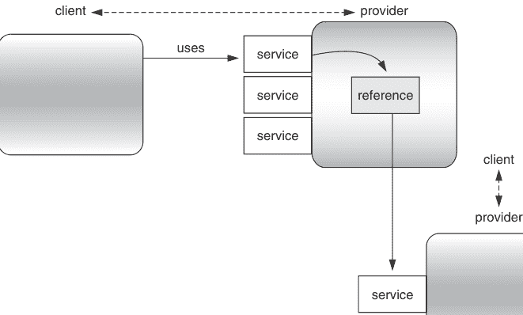

图 2.5
作为服务的提供者和客户端的实例。

（因为它是对象的公共接口），而调用接口通常只能通过分析程序代码来确定。对象：一个提供服务作为**提供者**，另一个对象作为**客户端**使用这些服务。一个对象既可以是其他对象的提供者，也可以是其他对象的客户端（见图 2.5）。

我们必须在术语和概念两个上，将对象的接口和在该接口上的服务调用区分开来。

在概念上，接口的元素被称为**操作（operations）**，它们是在计算机上运行的可执行步骤或活动。在编程语言术中，这些操作由每种语言的结构实现，并被称为过程（procedures）、方法（methods）或例程（routines）。

操作、消息、例程、过程和函数

当我们调用一个操作时，我们通常说是在向对象发送一条消息。这样的消息包含了对象的标识符（作为地址）、操作名称和调用参数。当使用多态性时，会在运行时执行其实现中的相应操作。这被称为**后期绑定或动态绑定**。

在处理对象时，我们经常发现操作并不总可以在对象的任何状态下被调用。这是因为对象遵循某种特定的使用模型或状态模型，这种模型可以是显式的（例如作为状态机），也可以是隐式的。我们称之为对象的**协议（protocol）**：

- 对象的协议是一组规则、定义的过程或操作调用，每个客户端都必须遵守这些规则，以便对象能够提供某些服务。这取决于对象的状态。为了能够遵守协议，客户端必须至少知道合适的接口。

协议

# 24 T&M 对象元模型

偶尔，处理面向对象的文献会将“协议（protocol）”和“接口（interface）”同义化使用。我们对协议的定义源于分布式系统领域，在该领域，该术语描述两个伙伴实例之间的相互作用，在我们意义上，它们提供了一组服务。然而，流行的面向对象编程语言并没有提供在接口处表示协议的方法，除了 Eiffel 中的断言（assertions）之外。

尽管对象的标识性定义了从外部可见的操作和属性，但**封装（encapsulation）**意味着你无法从外部访问任何未显式说明的属性。这通常被称为**信息隐藏（information hiding）**。

面向对象语言的信息隐藏意味着使用封装来隐藏对象状态的秘密表示，即结构。戴夫·帕纳（Dave Parnas）建议在对象内部做出设计决策。客户端仅依赖于接口的元素。你可以更改实现，而不会从客户端的角度丢失对象的一致性。

封装概念还意味着客户端知道操作的签名（signature），并能从合约模型对操作的行为得出结论；而实现是完全隐藏的。在这方面，对实现的任何更改都应该以这种方式进行，使得从外部看不到任何指定行为的变化。

### 2.1.7 讨论：对象标识性（Object Identity）

重要的一点是理解，对象的标识性与是否可寻址（addressable）无关。你可以从一个或多个上下文中访问一个对象的客观（这可能导致所谓的动态别名问题；见第 2.6.2 节）。可寻性是对象的外部质量，并取决于上下文。

相反，对象的标识性允许你唯一地标识该对象，无论你到达该对象的路径如何。从软件特定的角度来看，标识性首先意味着是否可以在编程语言层面确定两个标识符是否指向同一个对象，或者两个对象是否处于相同状态。这种标识性是对象的内部质量，也就是说，它属于对象，无论其上下文以及所定义的结构和操作如何。

此外，我们还需要一个概念来描述**领域特定标识性（domain-specific identity）**。这种领域特定标识性允许具有不同软件标识性的对象拥有同一个领域标识性。例如，一个银行客户在一个上下文中可以是客户，在另一个上下文中投资组合所有者。该人的标识性必须是唯一的，无论其在各自上下文中的行为如何。这意味着开发者必须能够表达他们对标识性的含义，以及这种标识性如何与等价相关：他们指的是相等的值、对象相等的行为，还是对象相同的领域标识性？注意，领域标识性永远不可能是对象的全局属性。它只有依赖于应用领域才能以有意义的方式建模。我们将在第 9.4.1 节提出该问题的一种可能解决方案。

### 2.1.8 T&M 设计：接口结构化

如前所述，对象具有可以被探测或更改的状态。根据该状态，由于软件和领域原因，某些操作无法被调用。为了在领域模型和软件模型中更好地理解这一点，对如何处理对象的领域描述以及对其接口的描述应该类似的安排（见图 2.6）

- 从领域特定的视角来看，对象的组织方式如下：
  - 指令（命令、动作意义上的）更改对象的状态，产生过程
  - 请求（Requests）以领域特定结果的形式提供信息，产生函数
  - 测试（Tests）是请求的特殊形式，探测对象的领域特定状态并返回是/否的回答结果
- 从软件特定的视角来看，对象的接口组织如下：
  - 过程更改对象的（外部可见）状态。这在任何给定点通常都是允许的。
  - 函数在不改变状态的情况下返回结果。
  - 谓词（Predicates）探测对象的状态并返回布尔值。它们可以随时被调用。

我们区分过程、函数和谓词的概念，而不是使用签名、输入输出和返回值。尽管如此，重要的是观察编程语言如何支持这种区分。例如，在 C++ 中（目前）没有原始布尔类型；而在 Smalltalk 中，每个。

### 2.1.9 定义：类（Classes）

我们将类定义为：
在领域模型中，类对日常工作中使用的概念和术语建模。这意味着类是对象的抽象，

| 指令 (instruction) | 供应商 (Supplier) |
| --- | --- |
| orderAtDealer(order:Order) | |
| purchaseDate(date:Date) | |
| getDescription() | |
| isForUpgrade() |

图 2.6
使用指令、请求和测试组织接口。

# T&M 对象元模型

基于领域对象的共同行为。术语的相似性可以被视为一种通用术语。某些泛化或层级结构属于相应的领域，它是协作和进一步理解应用领域的基础。术语的层次结构通过子类和父类进行建模。

在软件模型中，类是描述其可以创建的对象的基本属性的文本。类由其名称、与其父类的继承关系以及一组对象属性定义（见图 2.7）。这些属性包含了对象的接口及其通过算法和数据结构的内部实现。这意味着类定义了实例的创建和行为模型。对象总是恰一个类的实例。

因此，除了运行时的行为外，类还定义了其实例如何创建和初始化。你创建的每个对象都与该类的其他实例不同，因为每个实例都有自己的内存。图 2.7 中的示例将是每个 Room 对象对应各自设备列表的引用。

封装用于保护对象的内部表示免受无意使用。例如，图 2.7 中带有设备标识符对象的引用对于属于 RoomMap 类的对象是见的；它属于内部表示。

通用操作定义了内部接口，公共接口之外。类的内部接口首先是所谓的继承接口，它仅用于

# 图 2.7
类描述其实例的接口和表示。

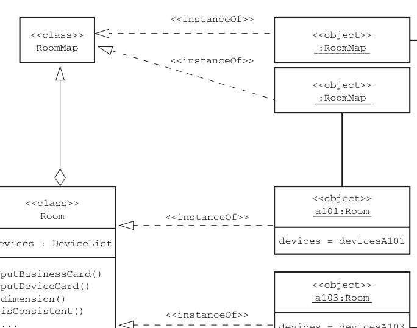


# 对象元模型

父类的子类而非客户端调用的私有接口，它表示供在一个且仅一个类内部使用的操作。

许多编程语言可以通过构造结构（例如 Java 或 C++ 中的 `protected` 和 `private`）来保护（即隐藏）它们的内部接口。

你经常在文献和编程环境中发现，为类的每个属性都提供了读和写操作。这些是泛型操作，不应将其与“泛型组件”或“泛型性”混淆。

> 泛型操作通常是针对类的每个属性的一对读、写操作（set 和 get）。

### 2.1.10 讨论：泛型操作

泛型操作用于图形化编程环境（例如 VisualAge），使应用程序对图形用户界面元素“可访问”。这种方法也经常用于数据库应用程序软件。

这些泛型操作可能会违反公共接口处的信息隐藏原则，因为它们在某种程度上公开了对象的内部结构。此外，它们很容易破坏对象的领域一致性。总的来说，我们建议不要使用泛型操作。

以 `Account`（账户）类为例，开发者如果使用泛型操作来实现银行特定的账户处理将遇到相当大的困难。更好的方法是使用 `deposit`（存款）、`withdraw`（取款）和 `calculateFees`（计算费用）来定义修改余额的条件。

 |
| # getNo():int |
| # setTo(to:String) |
| # getTo():String |
| # enumerate(no:Number) |

图 2.8
类内部接口处的泛型操作。

```
{
  this.setNo(no);
}
```

### 2.1.12 讨论：对象的生命周期

在对象和类的交互中，有几个操作限制了对象的生命周期；它们在软件建模和构建中被视为“关键情况”：

- 创建（Create），
- 删除（delete），
- 转换为另一个对象（transform into another object）。

概念上，这些操作都不能分配给对象本身，因为对象不能创建、删除或转换自身。这些操作属于元级别（见第 2.7 节）。在类本身就是系统对象的编程语言中，创建通常被处理为类操作，即对于每个类，至少有一个操作（构造函数）来创建类的实例。在不将类表示为对象的编译器语言中，编译器生成创建对象的代码，而创建过程通常被定义为类文本中的一个特殊操作。在许多情况下，除了创建操作外，初始化一个将对象置于初始状态的另一个操作被证明是一个好主意。这种初始化可以在创建对象时以及对象生命周期中的任何需要时调用。

- 在任何位置系统中都没有对该对象的引用，且该对象在应用程序系统中无法再被访问。
- 对象从堆中移除。如果可用的垃圾回收器，当对象不再被引用时，可以由垃圾回收器处理。否则，必须专门地处理 `delete` 操作，并处理与悬空指针的问题以及相关对象的正确顺序。

转换对象意味着将一个对象转换为另一个对象。这通常发生在对象被处理时，由于特定动作而改变了其“特性”，从而产生一个“不同”对象的情况。

> 4. 此时我们不会讨论存储在数据库中的对象问题，它们可以作为数据库查询的结果被访问。

# 对象元模型 29

这种将对象转换为另一个转换通常对于领域特定的原因是必要的，而在面向对象的环境中相当难以重现。从技术角度来看，这意味着对象必须改变它的类和类型成员，而这在强面向对象的语言中是不支持的。如果一个对象需要更改，你首先创建一个“目标”类的新实例，然后将所需的值从旧对象传输到新对象中，最后删除旧对象。虽然这种解决方案是简单的，但它可能会产生问题；可能会导致原始对象的软件身份和领域身份同时丢失。

### 2.1.3 T&M 设计：对象的生命周期

更改类

当我们使用交互式系统模型（第 3.2.1 节）时，我们必须弄清楚对象是如何被创建的。在实践中，使用工具或领域容器（例如表单）来创建新材料是一个好主意。此外，可以使用管理器创建工具。

同样的规则也适用于删除对象。这里的问题是，当用户想要“删除”对象时。我们可以很容易地看到软件和领域之间存在巨大差异。为了让用户能够轻松表达他们不再需要某个对象，我们建议为领域特定的对象删除定义一个显式的“位置”，例如工具或领域容器（例如桌面垃圾箱）。

EMS 示例

看我们示例中的所有这些内容。假设开发者更改了对象。设备管理器使用 `Device Organizer` 工具更新房间平面图，然后将更新后的计划放入数据文件并关闭 `Device Organizer`。使用模型假设房间平面图和工具仍然可以工作。然而，从软件角度来看，一旦房间平面图和工具设置被更改。但是，如果设备管理器将房间平面图中的一个移动到垃圾箱然后清空它，此动作告诉客户他不再需要该计划了。实际特定的特定的删除可以推迟到系统关闭时。

银行示例

客户在与客户会面之前做准备，在小额贷款申请表上填写个人信息。接下来，表单在与客户会面期间打印并由客户签署。这意味着对于客户、客户顾问和第二位顾问来说，这是一份合同。客户在表单编辑器中选择了“合同已签署”选项。从那时起，不应对该合同对象进行任何更改。

对于这种场景的软件实现，我们可以对“对象核心”使用不同的包装器，而不是更改对象的类。我们将在第 9.4.1 节中引入更复杂的角色建模技术。例如，核心对象的角色可以是“合同”和“表单”。


### 2.1.14 定义：继承

继承关系是区分面向对象语言与传统语言的基本特征。

从领域视图（domain view）来看，继承关系以层次化的方式组织类。这允许我们通过泛化（generalizations）和特化（specializations）来建模术语层次结构。

从软件视图（software view）来看，继承促进了类的重用。对于继承，父类的所有描述都是其子类的初始描述。然后，子类可以修改它从父类继承的属性。

- 继承的操作可以在子类中实现（或定义），而它们在父类中仅被规范。
- 当新的实现覆盖（隐藏）了父类中已有的实现时，可以对操作进行重定义。
- 可以添加新的属性（存储结构的描述）和操作。
- 可以修改访问权限。

当继承层次结构被排列成树形时，我们称之为单继承，即如果一个类有一个直接父类和任意数量的子类。

相比之下，当一个类有多个直接父类时，则称为多重继承。

继承单元是类，并且在运行时继承关系保持不变，至少在强类型语言中如此。注意，许多面向对象语言允许你限制对继承属性的访问（特别是对于操作）：

- 首先，你可以限制类的接口，即在父类中可见的封装属性不再属于子类的接口。示例包括 C++ 中的私有基类（private interface），在那里子类关系丢失了；或者 Eiffel 中的非导出（non-export），在那里由于子类关系可能会发生类型错误。
- 其次，你可以限制继承，特定类除外，即只有特定类可以访问这些属性。例如，可以通过 Eiffel 中的选择性导出（selective export）来实现，例如使用 C++ 中的友元构造（friend construct）。

### 2.1.15 讨论：继承

你可以将继承视为一种允许你重用规范和代码的机制。在 Simula 中，它被称为程序拼接（program concatenation）。此外，继承结合适当的类型系统，形成了多态的基础。

你使用继承的方式决定了它对领域模型和软件模型的意义。语言开发者之间对单继承和多重继承进行过激烈讨论。Smalltalk 或 Beta 等语言只支持单继承，而 Eiffel 和 C++ 支持多重继承。Java 在类级别上支持单继承，多重继承的概念通常可以用命名接口（named interfaces）来取代。

注意，在限制对继承属性的访问时应该小心。这种技术可以用于构建框架或实现复杂的仪表盘，但这通常会降低代码或设计的可读性。可能会出现类型错误或运行时错误，特别是在 C++ 中友元构造不可继承的情况下。

### 2.1.16 T&M 设计：继承

在我们的 T&M 设计中，在对领域模型中的概念和术语建模时，我们实际上假设一致地使用单继承，因为这确保了我们的概念模型是清晰的。树形式的概念模型比复杂关系的网格更容易理解，尽管我们的语言中有许多术语的网格（例如：鸟—飞行—快—跑步者……的关系）。另一方面，我们的语言允许应用我们的系统，但在我们的目标应用领域中易于理解。而且它应该尽可能清晰和简单。

相比之下，多重继承在软件构造中通常有用，只要它是以有律的方式并在并在适当低成本语言实现的支持。第 8.3 节展示了一个使用多重继承的示例。

让我们结合 EMS 示例来看这些。对于我们来说，设备能够复制所有员工当前的名片和设备卡是非常重要的。为了这一点，我们的 EMS 设计包含一个可复制接口和 `copy()` 操作。该接口实现了两个类：BusinessCard 和 DeviceCard。然而，操作是在不同的类中实现的，数据需要从名片和设备卡中复制。使用继承促进了概念建模。从软件视图来看，我们额外的动机是实现规范与实现从父类到现在的子类的分离（见第 2.1.22 节）。

另一个动机是利用继承对无法在文中描述的固定类定义进行增量传输和修改。对于商业库，如果你想更改一个属性，除了通过子类来实现外没有其他方法。在这种情况下，当更改对对象的影响无法完全预料时，你可以更改元素。在这种情况下，我们在子类中封装该更改，因为动态绑定允许我们输出新旧类的实例（多态性）。

最后，我们认为合适且有用的最后一个兴趣是用于跨类定义的抽象公共属性。你应该始终确保这些公共属性的动机源于领域视图，而不是仅仅因为你有一段代码可用就重用现有代码并提取属性。事实上，根据定义，继承不是关于现有代码的重用，而是关于共同行为的抽象。这种观点也证明了我们对将共同属性“提取”到父类的批评。这些父类倾向于内部结构，与特定的行为抽象没有太大关系。面向结构的继承层次结构通常出现在基于“传统”数据建模的项目中。

总之，我们的实践表明，面向代码角色和内部结构的“人工”父类会变得难以理解，阻碍此类系统的进一步开发。

### 2.1.17 讨论：作为继承替代方案的角色关系

作为类之间的额外关系

由于我们主要将继承用于概念建模，我们将类和子类解释为“是”（is-a）或“集合为”（Set-as）。从这种意义上说，文件夹是前者的特殊形式。然而，在开发大型应用时，我们经常遇到无法通过这种方式优雅解决的问题。在一个具有多个部门或小组的组织中，每个小组对工作对象都有不同的视图，我们必须处理许多通过泛化和特化的不同视图。

文件夹是容器而不是量词：它是两个对象共有的东西。文件夹不是文件，因为两个对象都包含变化的变化的角色。例如，虚拟银行的客户既可以是存款人又是投资组合所有者，取决于情况。我们说客户扮演了不同的角色。根据角色，客户对银行有不同的意义。我们可以将该客户及其角色映射到应用程序中以确保身份。我们开发了角色模式（见第 9.4.1 节），因为继承无法让我们构建这些角色。这意味着除了特化和泛化之外，我们在应用程序开发过程中增加了角色关系。

### 2.1.18 定义：使用关系

使用关系对应于传统的调用关系或模块导入。事实上，它是两个组件的经典形式。

> 从领域角度来看，关系实现了客户端与服务提供者之间的关系（2.3）。

在软件模型中，使用关系连接了对象和类。在类级别，使用关系被表示为（静态）类型声明。在运行时，相同类型或子类型的不同对象的操作可以使用同一个标识符，通过多态性。

EMS 示例

让我们看看这在我们的 EMS 示例中是什么样的。我们的设备管理员想要复制员工的名片或设备识别卡，例如将其用作模板。为此，他使用了复印机。为了复制名片或识别卡，我们需要一个 `copy()` 操作。复印机对 BusinessCard 和 DeviceCard 的其他操作不感兴趣。


# 对象元模型 33

类。出于这个原因，我们在 `Copier` 类中声明了一个类型为 `copyable` 的标识符。在运行时，符合该类型的 `BusinessCard` 和 `DeviceCard` 类对象将绑定到该标识符。

### 2.1.19 讨论：使用关系（Use Relationships）

在模块化营中，我们收集了大量关于这种组件关系有意义用途的实践经验和知识。这在面向对象编程方法的初始纪元阶段似乎被遗忘了。许多现代的方法论和构建教科书仍在讨论继承关系的优缺点，却完全忽略了使用关系。在我们的方法中，类之间的使用关系具有很高地位，其方法论上的用法在第 2.3 节中进行了讨论。

#### 模块化与使用关系

在面向对象模型中，使用关系通常基于指针或引用，或者为标识符声明一个类型。在运行时，该标识符可以绑定到符合类型实例的指针或引用。这一概念背后的思想是引用语义（reference semantics），这在 Smalltalk 文献中有所介绍，例如 Adele Goldberg 和 David Robinson 的著作。然而，我们将快速指出，这一概念无法用于（算术）计算，因为在我们需要我们需要数学意义上的值。第 2.7 节讨论了我们对象元模型中的所有内容。

#### 引用语义

### 2.1.20 定义：多态

在类级别上，这种关系意味着类包含了一个静态关系定义，这些关系本质上位于该类的对象和其他类之下。对象之间的实际关系由运行时的多态性决定。

多态的通用含义是能够假设不同形式的性质或状态。在面向对象的类型中，多态是在运行时将不同类型的对象绑定到一个标识符的能力。

如果类型之间存在子类继承关系，我们称之为受限或受控的多态；而无限制的多态（unrestrained polymorphism）意味着任意对象都可以绑定到标识符。

大多数静态类型语言使用继承关系来控制多态绑定。这意味着该类及其所有子类的对象都可以绑定到一个标识符上。这种多态是类型安全的，也就是说，只要父类及其子类之间的关系是子类关系，声明类的所有操作都可以在其子类中被调用。

动态类型语言允许无限制的多态。这意味着一个对象是否支持某个操作可以在编译时决定，但只有在调用操作时生效。如果该对象不支持所调用的操作，系统将报告运行时错误。这意味着应该使用编程规范来控制无限制的多态。原因主要是，除非你能从标识符名称中判断出来，否则类文本无法提供关于运行时实际绑定的对象的任何信息。

#### 无限制的多态

# T&M 对象元模型

动态绑定是与子类中重新定义操作相关的多态性的的前提。动态绑定决定了当你调用它时执行哪种实现。

当你在运行时绑定不同的对象时，这些对象可能具有相同操作名的不同实现。这意味着静态文本仅定义了发送给对象的消息。

在我们的示例中，我们为 `photocopter` 定义了一个面向类 `copyable`。在运行时，`BusinessCard` 和 `DeviceCard` 类的实例可以绑定到该类型的标识符上。消息 `copy()` 绑定到 `BusinessCard` 或 `DeviceCard` 类中实现的操作上，取决于具体情况。

### 2.1.2 定义：抽象类

在面向对象语言中，我们利用它们通过规范和实现来分离类的能力，例如：

- 父类包含规范，即它在抽象层级上运行。
- 该父类的子类包含实现，即父类中指定的行为在具体层级上被实现。

从软件角度来看，我们通过抽象类或在 Java 中通过具名接口来实现规范。

- 抽象类是一种无法从中创建实例的类。它通常包含至少一个未实现的（即抽象的）操作。
- 抽象类用于为实现具体行为的所有子类指定一个公共接口和抽象行为。
- 抽象类本身是被继承的。

当一个类至少有一个操作是抽象的时，我们说该类是抽象的（或延迟的）。某些面向对象的语言（如 Java 和 Eiffel）允许你将一个类标记为抽象类，即使它不包含任何抽象操作。在其他语言中，抽象类必须通过约定或延迟方法来定义。

抽象类通常比纯接口规范更丰富。在抽象类中声明的操作可以直接在抽象类内部使用。通过这些抽象操作，你可以实现多个操作。它们可以被客户端调用，作为模板操作或标准实现。这种技术对于构建框架至关重要。

Ralph Johnson 和 Vince Russo 描述了抽象类中的三种操作：

- 抽象操作没有实现，也就是说，它们的实现留给了子类。但抽象操作指定了所有子类强制要求的接口。一个仅指定了默认实现但旨在在子类中重新定义的操作通常称为“钩子”（hook）。
- 模板方法基于抽象操作实现算法。该算法是完整指定的，但由于缺乏抽象操作的实现而无法执行。

# 对象元模型 35

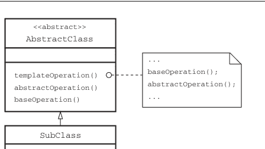

图 2.9
抽象类的特化。

- 基础操作（Base operations）是在抽象类中完整实现并可执行的操作。

图 2.9 显示了一个接口包含以下操作的抽象类：`templateOperation`、`abstractOperation` 和 `baseOperation`。`baseOperation` 和 `abstractOperation` 都用于实现 `templateOperation`，而 `abstractOperation` 将由类类实现。

抽象父类的子类通常基于多态使用。我们经常需要为了领域或软件研究在子类中扩展或指定接口。如果我们想通过多态和它们的动态类型来使用子类实例，我们需要元对象协议（metabject protocol，见 2.1.15 节）。

### 2.1.22 讨论：规范与实现

使用继承的重要方法是将规范与实现分离。公共子类指定所有子类的接口和抽象行为。无法从抽象类创建对象的这一事实告诉我们不能直接使用它。子类负责实现具体行为。另一方面，客户端了解带有行为的抽象类通常足够了。例如，你可以在抽象类“背后”创建一个整个类。

通过其接口和行为规范，抽象类定义了如何处理其子类，从而详细限制了整个系统设计。

### 2.1.23 定义：松耦合

使用抽象类是开发松耦合组件系统的示例之一。

5. E. Gamma: Objektorientierte Software-Entwicklung am Beispiel von ET++. Berlin, Heidelberg: Springer-Verlag, 1992.


# T&M 对象元模型

当客户端不知道提供者的整个接口，而仅知道其部分（及其行为）时，与另一个组件松耦合的组件应由一个类型定义，并且仅包含客户端耦合时实际所需的操作。

由于松耦合，你可以在运行时替换程序中的单个类以及组件，前提是这些组件具有相同的接口和行为，但实现不同。

### 2.1.24 讨论：松耦合

松耦合的动机源于对模块化概念的讨论（第 2.2 节）。这些组件虽然具有很强的上下文一致性，但仍保持独立性。实现松耦合组件的一种技术是在使用这些组件时，仅处理其他组件的类型或接口，而无需了解具体的类及其实现（Gama 等人）。然而，这并没有实现真正的解耦。我们更进一步，将耦合性降低到接口的部分，即使用时所需的最小部分。第 8.3 节将讨论松耦合工具和材料的各个方面。

#### 松耦合与对象创建

当在客户端和抽象子类之间使用耦合时，我们必须解决一个构造问题：在创建对象的位置必须知道子类。最初，这意味着与我们的解耦思想相冲突。已经提出了许多机制可以在不丢失解耦概念的情况下创建具体对象。Gama 等人以创建模式的形式描述了这些机制。第 9.4.2 节将引入一种创建模式——产品交易者（Product Trader），它对于我们的 T&M 方法特别有用。

## 2.2 模块化

### 2.2.1 引言

类是面向对象设计传统的模块化单元。最近，更大的设计和构造单元（如设计模式或包）被提出作为模块化单元。本节讨论了在面向对象设计中使用这些单元的化原则。

### 2.2.2 背景：模块与面向对象化

在软件模型中，你可以将类看作模块概念的进一步发展。正如 Bertrand Meyer 所说：“类提供的最大内聚和最小耦合的原则，基本上也同样适用于模块化和使用关系。”

#### 模块与类

遗憾的是，这些传统的模块化不能简单地转化为面向对象化。首先，类或对象的粒度与普通模块不同。虽然惯例上使用少于百个模块来构建应用程序系统，但在一个中等复杂的应用程序中，类或对象的数量很容易达到该数字的十倍。每个类包含数量适中的操作。

#### 模块化

如果我们将对象和类看作面向对象设计的“原子”，我们获得了一个完全不同的视角。显然，我们是以单元或组件来设计和构建应用程序的，这些单元由多个类或一个对象组成。这样的单元可以是一个包含模式和标记组的容器（见第 3.2.7 节）。为了实现这样的容器，我们需要相互关系。注意，某些模式（如 Gamma 等人描述的访问者、观察者或中介者模式）也是基于相互使用的。

最近的讨论使我们理解，面向对象化中的概念设计和构造单元超越了单个类，这还导致了模式、集群、子系统和框架的发展。这意味着我们对象元模型中的模块化原则需要根据这些设计和构造单元进行重新表述。我们尝试在第 2.2.3 节中针对基本设计单元进行重新表述，并在第 9.3 节中针对框架进行重新表述。

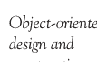

### 2.2.3 定义：面向对象模块化的原则

最大内聚和最小耦合是传统模块化设计的根本因素。

**内聚**是设计或构造单元属性之间的“内部连接”。最大内聚原则要求在设计或构造单元内部有紧紧的联系。

**耦合**是不同设计或构造单元之间的关系。最小耦合试图减少单元之间的联系，特别是避免循环使用。

Bertrand Meyer 提出了一系列标准，以促进模块化概念向面向对象的转移。我们将在下面简要介绍这些标准和规则的一部分。

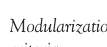

在该背景下，面向对象最重要的特征之一是开闭原则。

**开闭原则**：如果一个设计或构造单元可以被扩展，则它是**开放**的。相反，如果一个设计或构造单元可以以稳定的方式被客户端使用，则它是**关闭**的。

一个设计和构造单元应该满足以下重要标准：

- **可分解性**：设计问题应该被分解为更小、复杂度较低的部分，并映射到设计和构造单元。这些单元应该形成一个稳定且独立的结构。
- **可组合性**：设计和构造单元应该通过简单的重新组合在不同的应用程序领域中组成新的软件系统。
- **可理解性**：软件系统的每个设计和构造单元都应该独立于其他单元被理解。
- **连续性**：由于领域或软件系统上下文导致的设计问题变化，应该只导致一个或几个设计和构造单元的变化。

为了满足这些标准，我们必须遵守以下规则：

- **直接映射**：软件系统的结构应该与应用程序领域中识别的结构密切相关。
- **少接口**：每个设计和构造单元应尽可能少地与其他单元交互。
- **小接口**：当两个设计和构造单元交互时，它们交换的信息尽可能少。
- **显式接口**：当两个设计和构造单元交互时，这种交换应该是显式的。
- **信息隐藏**：客户端应该看到并访问设计和构造单元的相关属性。
- **开闭原则**：设计和构造单元应是开放且关闭的。

## 2.3 合约模型

### 2.3.1 引言

我们希望使用面向对象的方法来开发不仅可扩展、可重用、可修改，而且正确且健壮的类。我们尝试通过建模行为对象来实现健壮性，而不是通过属性。我们使用合约模型来规范一种概念，允许我们以正式的方式规范操作的行为。这代表了对软件质量的重要贡献，并应该是每个开发项目的基础。它提供了 Bertrand Meyer 所说的“软件可靠性契约”。

### 2.3.2 定义：合约模型

我们可以通过以下方式定义合约模型的本质：

> 合约模型将类之间的关系规范为基于正式合约的服务提供者和客户端之间的关系。
> 合约规定了提供者提供服务之前客户端必须满足的前条件。提供的服务在后条件中规定。
> 合约是在提供者侧描述的；它们以断言的形式存在，即前后条件和不变式。

类之间的关系被解释为客户端与提供者之间的服务关系（图 2.10）。在这种背景下，一个类提供另一个类（作为客户端）想要的服务。这两个类进入契约关系，合约规定了所有底层断言，以及双方对该服务的权利和义务。

合约模型通过操作的前后条件以及类不变式来实现，这些具有布尔表达式的形式并存在于提供者类中。

- 类之间建立的合约总是引用操作调用，即对服务的请求。为合约指定的前条件定义了规则


# 合约模型

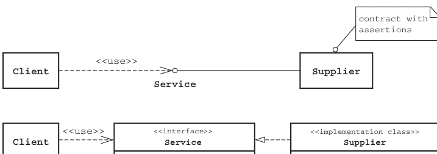

图 2.10
合约模型中的服务提供者和客户端。

必须被观察到才能调用操作。客户端负责观察这一前置条件。具体来说，客户端可以确保指定的条件得到满足。为了让客户端履行这一义务，作为前置条件的谓词必须在服务接口处是可用的。在调用操作之前，客户端可以测试前置条件的观察情况，并在前置条件不满足时建立所需的状态。

一旦前置条件准备就绪，请求的操作就会被执行，提供者声明他们保证满足后置条件。该条件同样由布尔表达式组成，不需要客户端进行测试。客户端可以假设在操作结束时该条件成立。

类的类的变式（invariant）被定义为该类的整体属性，用于保持其一致性。这对于提供的每个服务都适用，即在每次调用时都会对其观察进行测试。

### 2.3.3 讨论：合约模型

通过在客户端和服务提供者之间的交互中声明断言（assertions），我们可以向软件系统的正确性和可靠性迈出重要一步。在此背景下，正确性指的是规范与实现之间的一致。我们希望使用变式以及前置和后置条件来描述类中包含的行为规范，并使其变得可检查。这意味着合约模型有助于我们：

- 减少设计和构造错误；
- 增强对类的理解；以及
- 使用适当的异常机制尽早运行时错误。

### 2.3.4 上下文：合约模型与抽象数据类型

从软件角度来看，类应该是抽象数据类型的实现。使用大多数面向对象编程语言中提供的已知语言特性，我们只能定义操作和属性。然而，如果我们想使用类型来建模“一组具有相似行为的编程语言对象”，我们需要足够的手段

将类作为抽象数据类型

# 40 T&M 对象元模型

的表达式。原由于抽象数据类型的规范涉及公理化语义（axiomatic semantics），这通常通过公理和方程来表示。面向对象的编程语言通常不支持公理化语义。可以使用 Bertrand Meyer 描述为“契约设计”（design by contract）的合约模型，来克服抽象数据类型规范与实现之间的差距。

### 2.3.5 T&M 设计：合约模型

合约模型目前仅由 Eiffel 等面向对象的语言支持，在这些语言中断言可以被为一个独立的子语言（图 2.11）。然而，在实际项目中，将断言概念引入到其他编程语言已被证明是有用的。例如，我们的 JVM 框架在 Java 中实现了断言概念。在合约的情况下，为了对合约的遵守情况进行检查，违反合约会有相应的后果。只有在合约违反被制裁时，合约模型才能提供文档。因此，我们应该将断言与适当的异常机制相关联。一旦违反前置条件，客户端端将抛出异常，而违反后置条件和变式将导致提供者端产生异常。

## 2.4 类型

### 2.4.1 引言

当前的面向对象编程语言交替使用类和类型。虽然这样做是实用的，但它带来了我们想要观察的这种差异

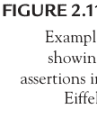

```class
class stack
  feature
    pop
      require
        not empty
      do
        number_of_elements := number_of_elements - 1;
      ensure
        not full
      end;
    ***
    invariant
    empty implies (number_of_elements = 0)
  end;
```

类的变式。我们希望使用变式使其是可检查的。这在像 Smalltalk 或 Java 类型的编程语言中成立。

### 2.4.2 定义：类型

类型定义为具有相似行为的值集合。从软件视图来看，类型是操作的属性。在面向对象的世界中，类型表示抽象数据类型。

类型定义了对值的操作以及对值的约束。在合约的情况下，类型描述了这些实例的特征。与类相反，类型包含了操作的表示方式。通过这种定义，类型可以被检查。这意味着对于类型，相同的接口名称是不够的。我们通常需要一种解释所有这些类型（在编译时或运行时）的检查方法。正如我们在 2.3 节中看到的，变式对于后置条件的公理化语义。因此，断言应该包含在类型的定义中。

### 2.4.3 上下文：类型的理论概念

类型的概念主要源于。根据 Cardelli 和 Wegner 的通用定义，类型是具有相似行为的对象集合。在他们的表述中，Cardelli 和 Wegner 没有关注面向对象的元素，但我们可以说面向对象的继承要求恰恰是一个类。

# 42 T&M 元模型

| <<类型>> | <<实现类>> | <<实例的>> | <<对象>> |
|---|---|---|---|
| Room | Room | | a11:Room |
| | DeviceList | | DeviceList |
| putBusinessCard() | putBusinessCard() | | a13:Room |
| putDevice() | putDevice() | | DeviceList |
| getDimensions() | getDimensions() | | |
| isConsistent() | isConsistent() | | |
| ... | ... | | |

图 2.12
从对象到类型。

类型由一组属性刻画。例如，一个对象 x 正当满足这些属性。以下属性可以使用类型来描述：

- 对象的类；
- 操作名称或整个签名；
- 操作的行为（例如，前置和后置条件）。

真实的类型系统通常只提供这些属性的一部分。

类型可以通过类型层次结构进行设计。

根据 Liskov，类型层次由子类和父类组成。子类支持父类指定的所有操作，具有以下变体：参数和结果类型本身可以是原始类型的子类型或父类型（协变和逆变）。

在运行时，子类的实例必须能够替代父类实例的位置，那里需要相同或相似的行为，即：

- 子类实例不会引起任何可观察的变化；
- 子类实例在行为上是类似的，即产生预期的行为且永远不会导致运行时错误。

### 2.4.4 讨论：类型

构建子类主要是规范概念，我们用它表达对象具有相似的行为。这个概念超越了通常对相同接口名称的检查。这意味着仅仅解释所调用的操作是不够的。我们通常需要一种方法来解释所有


由类型解释器执行的操作引导我们引入了“行为”的概念。相似的行为（similar behavior）相比许多计算机科学家推荐的“等价行为”是一个要“软”得多的表述。遗憾的是，这种行为很难被检查。相比之下，当我们实现或重新定义它的属性时，我们期望它既在规范的“意义”上表现良好，又符合其类型。

类型和行为规范在组件的使用中变得越来越重要。当组件仅作为单元交付时，评估其功能所剩下的基本上就是接口，因此就是类型信息。在这种情况下，了解除了签名之外，类型还赋予了哪些其他特征是非常关重要的，例如契约模型中的断言。

## 2.5 类与类型

### 2.5.1 引言

在面向对象编程出现时，许多开发者将“类”和“类型”同义使用，因为这是引入用户定义类型的唯一方式。随着时间的推移，面向对象编程语言得到了改进和扩展，使得类型系统现在更加突出。因此，开发者应该理解类和类型之间的概念差异。

### 2.5.2 设计中的类

从特定领域的视角来看，类是我们的基本设计和构建单元。在设计中，我们在类中对相似对象的共同特征进行建模。这些共同特征适用于对象的行为和状态。在这种背景下，类层级结构应该对应特定领域的概念模型。这意味着它们建模了你应用程序领域的基本概念或抽象。

在构建层面，类定义了它的实例如何行为以及如何被构建。编译器和运行时系统确保根据一组“完整”的类描述创建正确的实例。

### 2.5.3 类型与类的区别

与类相比，类型主要是一个概念，用于定义声明的标识符和项目对象的“外部”视图。请注意，其重点更多在于软件实现，而不是领域建模和构建侧。类型定义了可以为程序结构保证的语法（以及在有限范围内语义的）特征。

让我们来看这些差异：

- 除了接口之外，类还定义了其实例的行为和结构，即它的内部状态和这些操作的实现。
- 对象的类型最初指的是它的接口，即对象可以响应的一组消息。标识符的类型规定了哪些对象基本上可以绑定到它上。

- 类和类型不同之处

- 为了定义类型的实例，除了接口外，我们还可以通过类来实现类型。只要类型层级结构和类层级结构匹配，你就可以使用断言和受控重新定义来实现对象的相似行为。
- 某些语言（例如 Java）可以使用命名接口来引入类型。大多数面向对象语言提供原始数据类型（例如整数），这些类型没有被定义为类。
- 对象可以有不同的类型，来自不同类的对象可以相同的类型。
- 对象的接口的一部分可以用一个类型来表征，其他部分由其他类型表征。
- 对于两个对象是同一类型，只需要它们的接口部分相等即可。

### 2.5.4 讨论：类 对比 类型

类和类型可以完全分离两个概念，如果类型严格指的是接口定义，那么它保证了该类型的实例能够识别某组消息。每个类型都命名了要在你程序某处定义的操作。类随后就可以在命名接口的意义上定义它所满足的操作。定义这些操作的实际类与类层级结构无关且相互独立。

当然，如果编程语言将类和类型概念耦合，那么类和类型之间就存在关系。在这种情况下，类定义了一个类型。当我们说“一个对象是某个类的实例”时，意味着该对象支持该类定义的接口。一个消息的类型合规类要求对象理解该消息，换句话说，对象的类实现了被调用的操作。

当我们使用类型定义来指定实例的行为时，可以更进一步地耦合类和类型。在这种情况下，使用适当的类来定义类型实例的行为似乎是有意义的。如果类型层级结构和类层级结构匹配，你就可以通过类层级结构来定义和限制类型的具体或抽象对象。对于这种方法的适当手段是契约模型，以及将我们的概念模型映射到特定领域的类层级结构，这些结构是根据泛化和特化原则设计的。

### 2.5.5 背景：编程语言与类型

流行的面向对象语言使用不同的类型和类概念，例如：

- Java 通过引入接口来分离类和类型，Objective C 通过其协议（protocols）也是如此。在这些语言中，类除了其父类外，还可以声明它满足哪些命名接口。类可以根据类层级结构和它们的接口进行分组。这意味着即使类之间没有继承关系，属于同一个命名接口的类也可以归为类。

C++ 和 Eiffel 使用构造函数来定义对象的类型及其实现，这些语言允许你编写纯规范类，从这些类中无法创建实例。与 C 类似，C++ 也支持不是类的类型。

Smalltalk：对于标识符没有类型声明，如果对象没有提供正确的操作，会在运行时进行检查。Smalltalk 工作基于消息合规性而非类型合规性，换句话说，重点不是特定的类类型关系，而是对象是否理解消息。

### 2.5.6 T&M 设计：类与类型


## 2.6.2 值与对象的特征

为了更好地理解对“值”和“对象”这两个术语的讨论，理解这两个术语之间的区别是有意义的。图 2.13 中的分类是示意性的，没有特定的顺序，但展示了值和对象的本质特征。它基于 Bruce J. MacLennan 的开创性文章。稍后，我们将解释图 2.13 中列出的差异。

- 值（Value）没有时间或空间维度。这意味着时间、持续时间和位置并不适用。值没有开始和结束，它们不存在于任何特定的地方。值是在表达式中创建的，并且不会被消耗。例如，在方程 `4+2=42` 中谈论时间是毫无意义的，或者讨论加法“创建”了一个新值也是没有意义的。同样，当我们指代值本身而不是它的数字表示时，讨论“页顶上的 4”也是毫无用处的。
- 相比之下，对象（Object）存在于时间和空间中，有开始也有结束。任何对象之间都可能存在差异，因为它们位于不同的位置。例如，你可以创建一个文件夹。两个完全相同的文件夹可以位于不同的位置。谈论“我昨天使用的那个文件夹”是有意义的。

值和对象之间的另一个区别是，值是抽象的，没有身份标识（Identity）。它不依赖于具体事物的存在。因为它没有身份标识——只有等价性——讨论一个值的多个实例是有意义的（尽管谈论它的不同表示形式是没有意义的）。例如，$50 是一个值。虽然有很多代表这个值的钞票，但值本身并不多出一个实例。此外，讨论某张钞票是否值 $50 也是有意义的。

- 相比之下，对象是通用概念（类）的具体实例，具有身份标识。一个类可以有许多等等但不同的实例。例如，你可以在电子桌面上创建多个申请表实例，它们在文件夹中的存放位置各不相同。

图 2.13 值与对象的特征。

| 值是： | 对象是： |
| :--- | :--- |
| 永恒的 | 存在于时间和空间中 |
| 抽象的 | 具有身份标识 |
| 不变的 | 具体的 |
| 无状态的 | 可以被实例化 |
| 唯一的 | 变化的 |
| 无空间的 | 有状态的 |
| | 被创建和销毁 |
| | 可以被协作使用 |

另一个区别是，值是不可变的（Immutable）或恒定的。

- 尽管你可以计算并将值与其他值相关联，但它们不会改变。
- 值可以被命名。名称或标识符（对应“未知量”）的值可以被计算或定义。根据上下文，同一个名称可以绑定到另一个值。例如，当我们向方程 `40 + x = 42` 中加上 `x`；或者当 `p3 = 3.14` 时，那么通过加 `x` 将 `40` 变为 `42` 是错误的。此外，`x` 不是变量，但它有一个可变的值。我们可以在不同的语文中用名称 `p3` 来称为 `3.14`。
- 相比之下，对象可以随时间改变，也就是说，它的状态可以在不丢失身份标识的情况下发生变化。这种身份标识不必与特定的名称相关。你可以编辑昨天创建的应用程序，并在明天对其进行签名。你可以将表单从“新申请（New application）”改为“已编辑申请（Edited application）”，而无需担心它会丢失身份标识。

另一个区别在于我们如何使用值和对象。

- 考虑到值没有身份标识、没有位置，且是恒定的，那么基于值来建立通信和协作是困难的，因为值无法被交换或编辑。在需要基于值进行通信和操作的情况下，你会使用一个特定的值来“构建一个身份标识”。例如，在银行业务中，$50 的抽象值其本质上并不存在。只有当它连接到一个账户，并且该账户在这一时间变化中被看到时，它才会变得有用。例如，在基于值的数据库中建立账户，你可以使用该账户作为所有与该账户相关的值的唯一标识符。
- 相比之下，对象可以共同使用。这样，它们可以在不同的位置通过不同的名称被识别，你可以将它们作为共同的工作对象。无论何时有相似的问题需要解决：对象可以在一个语文中被更改，而另一个语境不会察觉这种变化。例如，一个表单可以通过两个电子桌面的标识符访问。这表明两名员工可以使用它进行协作工作，并通过这个问题协调他们的工作。当一个员工没有看到另一名员工在没有事先约的情况下更改了表单时，就会出现问题。

### 2.6.3 使用值

当我们思考值时，可能首先想到的是数学或工程，在这些领域，数值分析是关注重点。因为数学问题是通过数字（值的一种形式）解决的。然而，在日常生活中，值和数字具有更广泛的含义。我们使用它们来识别、刻画、计数或其他事物，并最终将它们表示为可测实体。

当我们对抽象实体建模且不希望被具体的客观特征干扰时，我们基本上会使用值。在此过程中，我们还从值所代表的事物的语境中抽离出来抽象。在这个意义上，流行教科书的作者 Richard Bird 和 Philip Wadler 曾这样讨论函数式编程：“在某个地方，也许在外太空中，人们可以想象一个抽象值的宇宙，但在地球上，它们只能通过其表示形式被识别和操纵。同一个值有许多表示方式”（第 5 页）。这意味着什么？它可能意味着，当我们计算或排序事物时，我们总是需要值和数字。毫无疑问，我们需要整数，以及货币值或时间段。即使我们在表示可测参数时忽略对象的具体情况，像银行代码或当前索引显然也是值。

## 2.6.4 上下文：编程语言中的值与对象

许多语言同时支持值和对象概念。这些概念之间的差异被隐式或显式地讨论。这种概念差异在 Smalltalk 这样的语言中是最清晰的。在讨论值编程语言的成功时，重要的是理解抽象值的真正转移只出现在 Miranda 或 Hope 等函数式语言中。这些语言允许我们编写面向值的代码：

- 它们使用类似于代数的表达式，由函数组成。函数没有副作用，因此类似于代数表达式的概念。它们使用数学变量。变量是已知或未知值的名称（如两个未知数的方程中），但这个值不会改变。

- 函数式语言背后的思想是引用透明性（Referential transparency）：引用透明性意味着一个表达式可以根据其部分表达式被完全理解。每个部分表达式（子过程）都独立于其上下文。变量是（已知的或未知的）不可变值的名称。

- 面向对象的编程语言支持完全不同的编程模型：它们使用封装了内部状态的对象，这种状态只能通过允许的操作来改变。它们使用命令式变量概念。变量是内存位置的标识符，其状态（或值）可以通过赋值来更改。每个表达式都取决于其上下文，即取决于所有参与对象的状态。一个对象在不同的语文中可以通过不同的名称识别，因此更改表达式的一部分通常会导致副作用。

这种嵌入是因为，


对象的某些属性只能转移到“值对象”。例如，如果某个操作将对象 3 修改为内部值 4，算术表达式将失去其数学语义。这就是为什么当我们发现教科书（如 Adele Goldberg 和 David Robson 编写的 Smalltalk 书）将数字作为对象及其操作的主要示例之一时，会感到困惑。我们希望数字的行为像值一样，而对象又具有所有对象的属性。

## 2.6.5 定义：领域值

面向对象编程语言的原始内置值类型易于使用。我们将这些值称为用户定义的值类型，因为它们的初衷源于系统的应用领域。

领域值是用户定义的值。它代表来自应用领域的值。

领域值是通过一组定义的值和一组定义的操作定义的数据类型。其对值的内部表示是隐藏的。

面向对象的语言将领域值类型定义为类。重要的一点是理解，领域值类型的实例始终具有值语义，也就是说一旦你设置了一个值，你就无法更改它。

领域值的动机是显而易见的。自从早期编程语言开发以来，语言开发者一直尝试为特定的应用程序提供此类数据类型。唯一的区别是，它不像现在这么直观，因为大多数应用程序是面向数字计算任务的。

## 2.6.6 T&M 设计：领域值

领域值在 T&M 方法中具有首要意义。当我们说想要使用类和对象来对我们应用领域的概念和事物进行建模时，这也适用于我们的银行示例中领域值与传统编程对比的思想。

让我们看看我们是如何处理账户号码的。在一个面向对象的应用程序系统中，特定的账户是 `Account` 类的实例。该对象中的账户号码应该是 `AccountNumber` 类型的领域值。账户的相应属性应该是 `accountNumber`。

在传统编程中，我们也会有一个类型为 `integer` 的 `AccountNumber` 属性。它代表账户号码的事实只能通过标识符 `AccountNumber` 看出。

## 2.6.7 实现领域值

在面向对象的语言中，我们使用类的构造结构来构建用户定义的领域值。这是因为类是向系统添加新类型以及这些类型的新实例的唯一方式。这似乎有几个优点：

在用户定义的类中，你可以指定可以作为该类型实例被创建的值集。要做到这一点，类可以接收一个所需值的外部表示，并且只有当该表示可以转换为有效（良好的）值时，才创建领域对象。

# T&M 对象元模型

在此联系下，我们可以实现进一步的概念，例如向有效值集添加所谓的“未定义”（底）值和其他特殊值。这样做的好处是你可以显式地区分定义的值和特殊值，正如 Ward Cunningham 建议的那样。许多开发者会使用像 999 这样的变通方法来表示他们必须表示为整数的待未知账户。这意味着，根据惯例，他们将任何整数转换为特殊值。不遵守这一惯例的程序会导致程序无法捕获的严重错误。为了避免这种情况，你不能将值视为一个简单的值集。

自从有了对 Tony Hoare 的记忆以来，我们就知道类型不仅应该包括定义的值集，还应该包括对该类型值允许的操作。尽管这在命令式语言的用户定义类型中很难实现，但通常来说：

### 针对值的操作主体

例如，我们可以考虑对 `Account` 类型的值进行允许的操作。这并不像听起来可能那么简单，因为我们的账户应该允许加法和关系操作。原因为账户号码之和通常在银行间的转账中作为校验和进行传输。在某些情况下，银行会向账户添加额外信息，例如，我们可以从账户号码中推导出客户编号或账户类型。这些都是该类型允许的操作。

### 银行示例

随着特殊值的引入，你也可以为处理值定义适当的语义。在我们的银行示例中，尝试将一个发现的未定义账户扩展为“正常”账户可能会导致异常。

### 构建领域值

另一方面，实现领域值类型有一些缺点。为了避免严重的陷阱，我们必须确保属于领域值类的值始终通过语义而非引用语义来处理。这意味着领域值对象不能被其他标识符修改。具体而言，一个领域值对象根本不应该被修改。这是维护我们所要求的的值的引用完整性的唯一方法。一些提出的解决方案将在 8.10 中讨论。在总结中，我们编写了以下构建领域值的技术：

- 领域值是“普通”类。领域值对象总是作为拷贝传递。这增加了编程的便利性。
- 领域值是从允许一个设置操作的类构建的，同时只提供探测操作。这消耗了大量的内存。
- 构建值对象的精炼技术在文献中被称为 `body/home`（参见 James Copeland）。
- 一个以最小空间需求实现值对象的模式是 Gamma 等人的享用者模式（Flyweight pattern）。

## 2.7 元对象协议

### 2.7 引言

在开发交互式程序时，我们经常观察到，编写程序来实现领域概念或对象是不够的。我们还需要能够处理程序的元素，也就是说，我们必须能够查询和修改程序中对象和类的属性。当我们使用组件时，这些元信息有多重要就变得清晰了。当我们必须依赖组件提供关于其接口和其他属性的信息时，因为此类程序通常是不可见的。本节讨论元信息。它面向更高级的读者，使用或甚至设计元协议并不是日常任务。

### 2.7.2 元对象协议的动机

简单来说，我们在面向对象的应用开发中使用对象来对现实世界应用领域的概念和事物建模。现在让我们把软件工程作为一个潜在的应用领域。通常我们有构建编程工具或其他开发工具。如果软件工程是应用领域，那么没有什么能阻止我们选择面向对象的编程语言。为了处理这个对象，我们需要一个元对象协议，这对 Smalltalk 程序员来说会很熟悉。接下来的章节解释了什么是元对象协议。图 2.14 显示了应用领域建模与软件建模的示意图。

### 2.7.3 定义：元对象协议 (MOP)

> 元对象协议 (MOP) 基于你编写程序时使用的编程语言的构造结构。这些构造本身可以被建模为对象。这样的对象被称为元对象。就像对象一样，元类是类的实例，我们称之为元类。这些接口的接口集合构成了元对象协议。

元对象可以分为两类：

- 1. 代表（静态）应用模型的对象（例如

元类的组织结构和元对象的行为在元层架构中描述。元层架构可以用于许多不同的


# T&M 元模型

出于技术目的。然而，它们通常仅用于大型的分配系统。因此，接下来的章节将重点介绍常见的应用。

## 2.7.4 表示你的应用模型

我们在第 2.1.20 节中简要提到过，开发中的多态意味着你获取的对象的引用可能与对象本身的类型不同，而是该对象类型的超类型。

在某些情况下，这种超类型引用是不够的。我们需要所谓的“向下类型转换”（downcast）或将超类型转换为子类型引用。向下类型转换在以下情况下非常有用：

- * 在一个专门的类团队中，一个伙伴向另一个伙伴提供一个作为抽象类型引用的对象，但该引用需要完整的接口。
- * 一个包含属于不同类的对象的容器可以返回其所包含对象的公共父类的引用。如果你需要通过接口访问容器中的对象，那么你就需要进行向下类型转换。
- * 这种情况的一个示例是为系统中存在的对象构建一个访问表，该表包含了对所有对象的引用。这种表可以用于在我们的数据库上运行查询；例如，“找到所有三年前生产的设备”。为了此目的，我们需要能够查询每个对象的类成员身份，以及具有相同类型的对象的引用，因为被查询的类已转换为被查询的类型。

为了恢复原始类型信息，每个 OOP 语言都允许你在运行时查询对象的类型。你通常通过其类访问来表示对象的类型。向下类型转换会触发类级别（名义上）的继承关系测试。

为了让我们的编程生活更简单并隐藏元层级的复杂性，OOP 语言（例如 Java）具有一种特殊的运算符来实现向下类型转换。该运算符在运行之前会激活类方法并检查向下类型转换的符合性。如果没有这种保护，向下类型转换会导致程序出现致命错误（例如在 C++ 中），因此应该只在受控的编程约定下使用。

直接访问对象的状态表示并避开其接口，是你能想象到的最严重的罪过之一。你应该记住，类提供了一组面向领域的方向性，并提供了对内部状态表示的访问。还存在一些技术性任务，需要特定的接口允许直接访问状态表示。以下是必须访问对象状态表示的任务的示例：

- * 通用关系和复制操作；例如，将名片和身份卡复制到剪贴板，随后使用通用复制操作将副本插入到房间平面图中。
- * 对象输入和输出；例如，将对象保存到文件、连接关系型数据库或在分布式系统中传输对象。
- * 垃圾收集。

# 元对象协议 (MOP)

如果允许访问对象状态的表示，我们可以为所有类指定这些这些服务的算法。否则，我们必须为每个类编写相应的操作。你可以通过以下方式之一访问对象的状态：

- * 所需的信息是隐式可用的；例如，Eiffel 每个类使用关系复制和输出操作，而无需开发者干预。这有许多优点。开发者不需要编写任何新内容。对象的封装不会被破坏。最后，运行时行为得到了改进，特别是在编译语言中。另一方面，一个主要的缺点是灵活性较差：开发者无法修改现有操作或添加新操作。
- * 为了表示对象状态，开发者可以使用所谓的属性字典。该列表包含每个属性对应的一个属性元对象，包含以下信息（可能根据语言而异）：
    - 变量名称；
    - 变量类型；
    - 变量大小；
    - 变量的引用（用于实际访问）；
    - 其他属性（例如如“持久化”或“非持久化”等属性）。

在许多情况下，将应用程序应用到“外部”或允许其他应用程序调用二进制操作可能是可能的。例如，你可以使用外部解释器在脚本中编写频繁的请求。以你的设备管理系统为例。如果在升级某种类型的 PC 时，你需要更新房间平面中的设备数据。该脚本将遍历房间平面中的所有设备并自动更新设备数据。

为了允许灵活性，MOP 应该支持操作列表（类似于上述描述的属性列表），用于对这些操作进行查询并调用这些操作。像 Java 这样的语言通过所谓的反射（introspection）支持这一点。此类操作会为每个操作列出一个元对象条目，包含以下信息：

- * 操作名称；
- * 操作签名；
- * 其他属性。

要调用操作，你可以使用操作的元对象，或者使用公共对象的特殊操作（元调用 metacall）。该操作将根据你传递的名称和参数调用实际的操作。

## 2.7.5 表示你的运行时系统

尽管软件开发者在不需要了解语言实现背后的细节时通常会很高兴，但在某些情况下你必须处理实现细节。为了此目的，MOP 可以提供一个定义良好的接口，允许你重定向运行时系统内部的控制流。这在两个地方特别有意义：

- 1. 存储实例变量的地方，以及
- 2. 调用操作的地方。

操纵实例变量的存储为了揭示实例变量的存储算法，你需要两个额外的操作，即读取实例变量和设置实例变量的操作。例如，Smalltalk 使用 `instVar:i` 方法返回第 $i$ 个变量的值。`instVar:i:` 方法为第 $i$ 个变量赋值。这两个方法在每次访问实例时都会被调用。通过重载这些方法，可以将标准算法替换为适用于所有类或部分类的自定义算法。对于具有许多变量的对象，从存储的角度来看，在哈希表中为这些实例创建条目比存储在连接块中更高效。

当需要更新对象状态以反映数据库中的更改时，你还需要存储机制。你可以使用表示应用模型的机制（第 2.7.4 节）来实现保存对象的显式操作。

操纵操作调用（重定向操作）你可以使用指向操作调用的元操作访问操作调用机制。该元操作可以在实际执行之前或之后运行任意操作。操作操作对于以下应用领域非常有用：

- 持久化应用：在这种情况下，上述机制允许你重定向对象的操作调用到另一个计算机。为了重定向操作调用，你在调用之前对操作名称和参数进行打包（也称为序列化 marshalling），并发送到服务器，在那里运行实际操作。结果随后返回客户端，并在那里转发给调用者。CORBA（公共对象请求代理架构）接口通常以此实现。
- 持久化对象：类似于用于分布式对象的机制，当为不在同一内存的对象调用操作时，操作会被捕捉。根据对象引用从数据库中加载被引用对象，然后执行新实例的对象。在 CORBA 中，这对应于对象的“实例化”（incarnation）。
- 额外的操作调用处理：大量的算法可能希望在执行操作调用之前或之后。良好的良好的是操作调用的日志记录或审计。另一种更复杂的算法用于检查调用者的真实性，并在某种程度上保证客户端确实有权调用该操作。这对于几乎所有的软件系统都是相关的。


有不同的实现技术可以捕获操作调用，并在其在目标对象上执行之前由元对象（metaobject）进行处理。

最常用的技术是使用中间代理向客户端隐藏目标对象。代理对象捕获操作调用并将其重定向到更改中的元对象中。在简单的情况下，它可以使用元装箱（metamalling），正如 Erich Gamma 等人（第 4 章）或 Franz Buchmann 等人（第 3.4 节）描述的关于安全属性的示例。

另一种实现是修改语言的虚拟机，使其能够处理增强型对象引用。这种增强是指针切换（pointer switching），将调用转发到相应的消息框（messagebox）。例如，面向对象的数据库 ObjectStore 使用了这种技术；它并没有将调用转发到通用可用的回调函数。相反，它恢复了一种唤醒数据库中被调用对象的机制。

## 2.8 参考文献

本关于 T&M 对象模型的章节保持了简洁。对于想要深入研究这些材料的读者，我们汇编了一份带注释的参考文献列表，包含了实践和理论著作。

- R. J. Bird and P. Wadler: Introduction to Functional Programming. New York: Prentice Hall, 1988. （函数式编程的经典教科书。）
- F. Buschmann, R. Meunier, H. Rohner, P. Sommerfeld, M. Stal: Pattern-Oriented Software Architecture—A System of Patterns. Chester, New York: Wiley & Sons Ltd, 1996. （一本广受好的模式集。）
- L. Cardelli, P. Wegner: “On Understanding Types, Data Abstraction, and Polymorphism”. Computing Surveys, Vol. 17, No. 4, 1985. （类型系统的开创性工作。）
- J. Coplien: Addressing C++: the CHECKs Pattern Language of Information Integrity.” In J. O. Coplien and D. C. Schmidt (ed.): Patterns of Program Design, Reading, Mass.: Addison-Wesley, 1993. Chapter 6, pp. 145–58. （这是一部关于对象语言中（领域）值的有趣著作。）
- E. Gamma, H. Helm, R. Johnson, J. Vlissides: Design Patterns. Reading, Mass.: Addison-Wesley, 1995. （本章引用了书中的模式。）
- A. Goldberg, D. Robson: Smalltalk-80. The Language. Reading, Mass.: Addison-Wesley, 1989. （这是编程语言文本中的经典。）
- C. A. R. Hoare: “Notes on Data Structuring.” In O.-J. Dahl, E. W. Dijkstra, C. A. R. Hoare: Structured Programming. London: Academic Press, 1972. （这是一部关于类型和数据类型概念的理论经典。）
- R. E. Johnson, V. F. Russo: Reusing Object-Oriented Designs, Department of Computer Science, University of Illinois at Urbana-Champaign, 1991. （这项工作提供了更多抽象类的内容。）
- G. Kizales, D. der Rivieres, D. G. Behrow: The Art of the Metaobject Protocol, Cambridge, Mass: MIT PRESS, 1992. （这项工作提供了更多元对象协议的内容。）
- B. Lisikov: "Data Abstraction and Hierarchy., OOPLA 1987 Addendum to the Proceedings, ACM SIGPLAN Notices, Vol. 23, No. 5, May 1988, pp. 17–34.
- B. Lisikov, J. W. Wing: Family Values: A Behavioral Notion of Subtyping. Technical Report, Carnegie Mellon University, CMU-CS-93-187, 1993. （这些基础理论著作处理了抽象数据类型和类型概念。）
- D. C. Luckham, V. Sela: Three Concepts of System Architecture. Technical Report CSL-95-674. Stanford, Calif.; Stanford University, 1995. （这项工作提供了更多接口的内容。）
- B. J. MacLennan: "Values and Objects in Programming Languages." ACM SIGPLAN Notices, Vol. 17, No. 12, 1982. （这篇经典讨论了编程语言中的值和对象。）
- P. Maes, B. Nardi (eds.): Meta-Level Architectures and Reflection. The Netherlands, Amsterdam: North-Holland Publishers, 1988. （这本书提供了更多元对象协议的内容。）
- B. Meyer: Object-Oriented Software Construction. Second Edition. New York, London: Prentice-Hall, 1997. （这本书涵盖了面向对象编程和编程语言的概念与机制。对方法概念的解释特别重要。）
- D. L. Parnas: "On the Criteria to Be Used in Decomposing Systems into Modules." Communication of the ACM, Vol. 5, No. 12, December 1972, pp. 1053–1058. （这部经典软件介绍了模块化和信息隐藏的重要原则。）
- T. Reenskaug, P. Wold, O. A. Lee: Working with Objects. Greenwich: Manning, 1996. （这本书展示了面向对象设计的有趣方面，特别是角色建模。）
- R. W. Sebest: Concepts of Programming Languages. Reading, Mass: Addison-Wesley, 1998. （这是一本关于编程语言概念和构造的良好实践导向的教科书；它将设计方案作为示例。）
- P. Wegner: "Concepts and Paradigms of Object-Oriented Programming." OOPS, Vol. 1, No. 8, 1990, pp. 57–87.
- C. Zimmermann (ed.): Advances in Object-Oriented Architectures. Boca, Florida: CRC Press, 1996.

## 2.8 参考文献

有不同的实现技术可以捕获操作调用，并在其在目标对象上执行之前由元对象进行处理。

最常用的技术是使用中间代理向客户端隐藏目标对象。代理对象捕获操作调用并将其重定向到更改中的元对象中。在简单的情况下，它可以使用元装箱，正如 Erich Gamma 等人（第 4 章）或 Franz Buchmann 等人（第 3.4 节）描述的关于安全属性的示例。

另一种实现是修改语言的虚拟机，使其能够处理增强型对象引用。这种增强是指针切换，将调用转发到相应的消息框。例如，面向对象的数据库 ObjectStore 使用了这种技术；它并没有将调用转发到通用可用的回调函数。相反，它恢复了一种唤醒数据库中被调用对象的机制。

本关于 T&M 对象模型的章节保持了简洁。对于想要深入研究这些材料的读者，我们汇集了一份带注释的参考文献列表，包含了实践和理论著作。

- R. J. Bird and P. Wadler: Introduction to Functional Programming. New York: Prentice Hall, 1988. （函数式编程的经典教科书。）
- F. Buschmann, R. Meunier, H. Rohner, P. Sommerfeld, M. Stal: Pattern-Oriented Software Architecture—A System of Patterns. Chester, New York: Wiley & Sons Ltd, 1996. （一本广受好的模式集。）
- L. Cardelli, P. Wegner: “On Understanding Types, Data Abstraction, and Polymorphism”. Computing Surveys, Vol. 17, No. 4, 1985. （类型系统的开创性工作。）
- J. Coplien: Addressing C++: the CHECKs Pattern Language of Information Integrity.” In J. O. Coplien and D. C. Schmidt (ed.): Patterns of Program Design, Reading, Mass.: Addison-Wesley, 1993. Chapter 6, pp. 145–58. （这是一部关于对象语言中（领域）值的有趣著作。）
- E. Gamma, H. Helm, R. Johnson, J. Vlissides: Design Patterns. Reading, Mass.: Addison-Wesley, 1995. （本章引用了书中的模式。）
- A. Goldberg, D. Robson: Smalltalk-80. The Language. Reading, Mass.: Addison-Wesley, 1989. （这是编程语言文本中的经典。）
- C. A. R. Hoare: “Notes on Data Structuring.” In O.-J. Dahl, E. W. Dijkstra, C. A. R. Hoare: Structured Programming. London: Academic Press, 1972. （这是一部关于类型和数据类型概念的理论经典。）
- R. E. Johnson, V. F. Russo: Reusing Object-Oriented Designs, Department of Computer Science, University of Illinois at Urbana-Champaign, 1991. （这项工作提供了更多抽象类的内容。）
- G. Kizales, D. der Rivieres, D. G. Behrow: The Art of the Metaobject Protocol, Cambridge, Mass: MIT PRESS, 1992. （这项工作提供了更多元对象协议的内容。）
- B. Lisikov: "Data Abstraction and Hierarchy., OOPLA 1987 Addendum to the Proceedings, ACM SIGPLAN Notices, Vol. 23, No. 5, May 1988, pp. 17–34.
- B. Lisikov, J. W. Wing: Family Values: A Behavioral Notion of Subtyping. Technical Report, Carnegie Mellon University, CMU-CS-93-187, 1993. （这些基础理论著作处理了抽象数据类型和类型概念。）
- D. C. Luckham, V. Sela: Three Concepts of System Architecture. Technical Report CSL-95-674. Stanford, Calif.; Stanford University, 1995. （这项工作提供了更多接口的内容。）
- B. J. MacLennan: "Values and Objects in Programming Languages." ACM SIGPLAN Notices, Vol. 17, No. 12, 1982. （这篇经典讨论了编程语言中的值和对象。）
- P. Maes, B. Nardi (eds.): Meta-Level Architectures and Reflection. The Netherlands, Amsterdam: North-Holland Publishers, 1988. （这本书提供了更多元对象协议的内容。）
- B. Meyer: Object-Oriented Software Construction. Second Edition. New York, London: Prentice-Hall, 1997. （这本书涵盖了面向对象编程和编程语言的概念与机制。对方法概念的解释特别重要。）
- D. L. Parnas: "On the Criteria to Be Used in Decomposing Systems into Modules." Communication of the ACM, Vol. 5, No. 12, December 1972, pp. 1053–1058. （这部经典软件介绍了模块化和信息隐藏的重要原则。）
- T. Reenskaug, P. Wold, O. A. Lee: Working with Objects. Greenwich: Manning, 1996. （这本书展示了面向对象设计的有趣方面，特别是角色建模。）
- R. W. Sebest: Concepts of Programming Languages. Reading, Mass: Addison-Wesley, 1998. （这是一本关于编程语言概念和构造的良好实践导向的教科书；它将设计方案作为示例。）
- P. Wegner: "Concepts and Paradigms of Object-Oriented Programming." OOPS, Vol. 1, No. 8, 1990, pp. 57–87.
- C. Zimmermann (ed.): Advances in Object-Oriented Architectures. Boca, Florida: CRC Press, 1996.

## T&M OBJECT METAMODEL

有不同的实现技术可以捕获操作调用，并在其在目标对象上执行之前由元对象进行处理。

最常用的技术是使用中间代理向客户端隐藏目标对象。代理对象捕获操作调用并将其重定向到更改中的元对象中。在简单的情况下，它可以使用元装箱，正如 Erich Gamma 等人（第 4 章）或 Franz Buchmann 等人（第 3.4 节）描述的关于安全属性的示例。

另一种实现是修改语言的虚拟机，使其能够处理增强型对象引用。这种增强是指针切换，将调用转发到相应的消息框。例如，面向对象的数据库 ObjectStore 使用了这种技术；它并没有将调用转发到通用可用的回调函数。相反，它恢复了一种唤醒数据库中被调用对象的机制。

## THE T&M OBJECT METAMODEL

有不同的实现技术可以捕获操作调用，并在其在目标对象上执行之前由元对象进行处理。

最常用的技术是使用中间代理向客户端隐藏目标对象。代理对象捕获操作调用并将其重定向到更改中的元对象中。在简单的情况下，它可以使用元装箱，正如 Erich Gamma 等人（第 4 章）或 Franz Buchmann 等人（第 3.4 节）描述的关于安全属性的示例。

另一种实现是修改语言的虚拟机，使其能够处理增强型对象引用。这种增强是指针切换，将调用转发到相应的消息框。例如，面向对象的数据库 ObjectStore 使用了这种技术；它并没有将调用转发到通用可用的回调函数。相反，它恢复了一种唤醒数据库中被调用对象的机制。

本关于 T&M 对象模型的章节保持了简洁。对于想要深入研究这些材料的读者，我们汇集了一份带注释的参考文献列表，包含了实践和理论著作。

- R. J. Bird and P. Wadler: Introduction to Functional Programming. New York: Prentice Hall, 1988. （函数式编程的经典教科书。）
- F. Buschmann, R. Meunier, H. Rohner, P. Sommerfeld, M. Stal: Pattern-Oriented Software Architecture—A System of Patterns. Chester, New York: Wiley & Sons Ltd, 1996. （一本广受好的模式集。）
- L. Cardelli, P. Wegner: “On Understanding Types, Data Abstraction, and Polymorphism”. Computing Surveys, Vol. 17, No. 4, 1985. （类型系统的开创性工作。）
- J. Coplien: Addressing C++: the CHECKs Pattern Language of Information Integrity.” In J. O. Coplien and D. C. Schmidt (ed.): Patterns of Program Design, Reading, Mass.: Addison-Wesley, 1993. Chapter 6, pp. 145–58. （这是一部关于对象语言中（领域）值的有趣著作。）
- E. Gamma, H. Helm, R. Johnson, J. Vlissides: Design Patterns. Reading, Mass.: Addison-Wesley, 1995. （本章引用了书中的模式。）
- A. Goldberg, D. Robson: Smalltalk-80. The Language. Reading, Mass.: Addison-Wesley, 1989. （这是编程语言文本中的经典。）
- C. A. R. Hoare: “Notes on Data Structuring.” In O.-J. Dahl, E. W. Dijkstra, C. A. R. Hoare: Structured Programming. London: Academic Press, 1972. （这是一部关于类型和数据类型概念的理论经典。）
- R. E. Johnson, V. F. Russo: Reusing Object-Oriented Designs, Department of Computer Science, University of Illinois at Urbana-Champaign, 1991. （这项工作提供了更多抽象类的内容。）
- G. Kizales, D. der Rivieres, D. G. Behrow: The Art of the Metaobject Protocol, Cambridge, Mass: MIT PRESS, 1992. （这项工作提供了更多元对象协议的内容。）
- B. Lisikov: "Data Abstraction and Hierarchy., OOPLA 1987 Addendum to the Proceedings, ACM SIGPLAN Notices, Vol. 23, No. 5, May 1988, pp. 17–34.
- B. Lisikov, J. W. Wing: Family Values: A Behavioral Notion of Subtyping. Technical Report, Carnegie Mellon University, CMU-CS-93-187, 1993. （这些基础理论著作处理了抽象数据类型和类型概念。）
- D. C. Luckham, V. Sela: Three Concepts of System Architecture. Technical Report CSL-95-674. Stanford, Calif.; Stanford University, 1995. （这项工作提供了更多接口的内容。）
- B. J. MacLennan: "Values and Objects in Programming Languages." ACM SIGPLAN Notices, Vol. 17, No. 12, 1982. （这篇经典讨论了编程语言中的值和对象。）
- P. Maes, B. Nardi (eds.): Meta-Level Architectures and Reflection. The Netherlands, Amsterdam: North-Holland Publishers, 1988. （这本书提供了更多元对象协议的内容。）
- B. Meyer: Object-Oriented Software Construction. Second Edition. New York, London: Prentice-Hall, 1997. （这本书涵盖了面向对象编程和编程语言的概念与机制。对方法概念的解释特别重要。）
- D. L. Parnas: "On the Criteria to Be Used in Decomposing Systems into Modules." Communication of the ACM, Vol. 5, No. 12, December 1972, pp. 1053–1058. （这部经典软件介绍了模块化和信息隐藏的重要原则。）
- T. Reenskaug, P. Wold, O. A. Lee: Working with Objects. Greenwich: Manning, 1996. （这本书展示了面向对象设计的有趣方面，特别是角色建模。）
- R. W. Sebest: Concepts of Programming Languages. Reading, Mass: Addison-Wesley, 1998. （这是一本关于编程语言概念和构造的良好实践导向的教科书；它将设计方案作为示例。）
- P. Wegner: "Concepts and Paradigms of Object-Oriented Programming." OOPS, Vol. 1, No. 8, 1990, pp. 57–87.
- C. Zimmermann (ed.): Advances in Object-Oriented Architectures. Boca, Florida: CRC Press, 1996.

## THE T&M OBJECT METAMODEL

有不同的实现技术可以捕获操作调用，并在其在目标对象上执行之前由元对象进行处理。

最常用的技术是使用中间代理向客户端隐藏目标对象。代理对象捕获操作调用并将其重定向到更改中的元对象中。在简单的情况下，它可以使用元装箱，正如 Erich Gamma 等人（第 4 章）或 Franz Buchmann 等人（第 3.4 节）描述的关于安全属性的示例。

另一种实现是修改语言的虚拟机，使其能够处理增强型对象引用。这种增强是指针切换，将调用转发到相应的消息框。例如，面向对象的数据库 ObjectStore 使用了这种技术；它并没有将调用转发到通用可用的回调函数。相反，它恢复了一种唤醒数据库中被调用对象的机制。

## GUIDING METAPHORS AND DESIGN METAPHORS

有不同的实现技术可以捕获操作调用，并在其在目标对象上执行之前由元对象进行处理。

最常用的技术是使用中间代理向客户端隐藏目标对象。代理对象捕获操作调用并将其重定向到更改中的元对象中。在简单的情况下，它可以使用元装箱，正如 Erich Gamma 等人（第 4 章）或 Franz Buchmann 等人（第 3.4 节）描述的关于安全属性的示例。

另一种实现是修改语言的虚拟机，使其能够处理增强型对象引用。这种增强是指针切换，将调用转发到相应的消息框。例如，面向对象的数据库 ObjectStore 使用了这种技术；它并没有将调用转发到通用可用的回调函数。相反，它恢复了一种唤醒数据库中被调用对象的机制。

### 3. INTRODUCTION

有不同的实现技术可以捕获操作调用，并在其在目标对象上执行之前由元对象进行处理。

最常用的技术是使用中间代理向客户端隐藏目标对象。代理对象捕获操作调用并将其重定向到更改中的元对象中。在简单的情况下，它可以使用元装箱，正如 Erich Gamma 等人（第 4 章）或 Franz Buchmann 等人（第 3.4 节）描述的关于安全属性的示例。

另一种实现是修改语言的虚拟机，使其能够处理增强型对象引用。这种增强是指针切换，将调用转发到相应的消息框。例如，面向对象的数据库 ObjectStore 使用了这种技术；它并没有将调用转发到通用可用的回调函数。相反，它恢复了一种唤醒数据库中被调用对象的机制。

### 3.2 DESIGNING APPLICATION SOFTWARE

有不同的实现技术可以捕获操作调用，并在其在目标对象上执行之前由元对象进行处理。

最常用的技术是使用中间代理向客户端隐藏目标对象。代理对象捕获操作调用并将其重定向到更改中的元对象中。在简单的情况下，它可以使用元装箱，正如 Erich Gamma 等人（第 4 章）或 Franz Buchmann 等人（第 3.4 节）描述的关于安全属性的示例。

另一种实现是修改语言的虚拟机，使其能够处理增强型对象引用。这种增强是指针切换，将调用转发到相应的消息框。例如，面向对象的数据库 ObjectStore 使用了这种技术；它并没有将调用转发到通用可用的回调函数。相反，它恢复了一种唤醒数据库中被调用对象的机制。

### 3.2.1 Definition: The Usage Model

有不同的实现技术可以捕获操作调用，并在其在目标对象上执行之前由元对象进行处理。

最常用的技术是使用中间代理向客户端隐藏目标对象。代理对象捕获操作调用并将其重定向到更改中的元对象中。在简单的情况下，它可以使用元装箱，正如 Erich Gamma 等人（第 4 章）或 Franz Buchmann 等人（第 3.4 节）描述的关于安全属性的示例。

另一种实现是修改语言的虚拟机，使其能够处理增强型对象引用。这种增强是指针切换，将调用转发到相应的消息框。例如，面向对象的数据库 ObjectStore 使用了这种技术；它并没有将调用转发到通用可用的回调函数。相反，它恢复了一种唤醒数据库中被调用对象的机制。

### 3.2.2 Background: Methodology Books versus Design Guidelines


# 应用软件的引导隐喻

在软件人体工程学和机交互（HCI）领域，你不应该在我们的示例中寻找完美的界面设计。我们试图传达如何设计一个具有特定元素和基础交互的任务导向用模型。第10章专门介绍计算机支持协作（CSCW）。

面向对象的应用有一个广为人知且流行的用模型是 Talent 提出的“人、地方和物”。这个用模型代表了向我们在书中决定的目标迈出的重要一步，我们关注的是“人机界面”。我们考虑的是一种表示领域内容及其表现形式的方法。在这方面，我们感觉自己就像工具制造者或机器设计师，只不过我们没有可以借鉴的传统。对于良好的交互式软件应该是什么样，以及它应该如何支持特定目的，我们仍然知之甚少。

## 3.3 应用软件的引导隐喻

我们开发用模型的起点是关于未来系统将如何使用的具体映像。自然地，我们无法对这一映像给出一个通用的定义。我们可以预测工作是如何连接的，以及期望什么样的支持。我们将这种映像称为“引导隐喻”。

> 引导隐喻（或主导隐喻）是一个主题或其他连贯的概念，它经过清晰的定义和命名，其目的是代表或象征一个人、物体、地方或心理状态。

在德语中，我们最初使用的术语是“Lemotif”，由德国人理查德·瓦格纳为音乐中反复出现的主题，用于心理学或哲学领域。最近，它被用于软件开发领域。但对于英文版，我们决定引入“引导隐喻”这一术语：

> 对我们而言，引导隐喻是一个帮助我们感知、理解和设计某个现实的基本观点。

在软件开发中，引导隐喻为整个开发过程中的所有参与小组提供了共同的取向。它支持软件的设计、价值和评估，并基于价值概念和目标。

> 引导隐喻可以具有建设性或分析性的功能。

当使用引导隐喻帮助开发团队将应用模型转换为系统设计时，它就具有建设性功能。然而，我们也可以在分析功能上使用引导隐喻，即当我们评估现有的应用软件时。当用户使用引导隐喻来更好地理解和使用应用程序时，它也起着类似的作用。在书中，与 T&M 方法一样，我们主要在软件开发中使用引导隐喻的建设性功能。

> 引导隐喻具有建设性和分析性功能

## 引导隐喻与设计隐喻

| 引导隐喻 | 设计目标 | 用户角色 | 开发者角色 |
| --- | --- | --- | --- |
| 对象世界 | 充斥着活跃对象（如代理）的虚拟世界 | 初始对象的起源者；触发器 | 微型世界的创造者 |
| 直接操控 | 像使用我们的手一样操作工作对象 | 独立工作者、执行者 | 人工制品的构建者 |
| 工厂 | 以流水线方式引导和控制工作 | 机器操作员 | 机器制造者和装配工 |
| 专家场所 | 通过创建配备充足设备的环境支持专家工作 | 专家 | 工具设计师、空间设计师 |

表 3.1  
在软件开发中使用引导隐喻。

### 3.3.1 背景：软件开发中的引导隐喻

在开发学科中，存在各种显性或隐性的引导隐喻。例如，你可以发现工厂隐喻或计算机作为通信伙伴的隐喻。探索各种引导隐喻将超出本书的范围；我们将为了取向使用几种引导隐喻，以观察哪些属性是相关的（见表 3.1）。你应该注意的第一个属性是，引导隐喻为所有参与人员（特别是开发者和用户）引入了具有不同价值的角色。

### 3.3.2 “对象世界”引导隐喻

让我们经常在 Smalltalk 社区中看到的“对象世界”隐喻，那里的取向本身几乎带有一个引导隐喻。这个隐喻基于虚拟世界，其中充斥着活跃且相互通信的操作系统。这些对象偶尔从外部被触发，然后在它们各自的“执行者”或“代理”角色中运行。

这种引导隐喻非常契合人工智能代理的概念。此类代理的用户往往被边缘化为边缘人物，提供冲动或初始指令，但缺乏系统中发生的实际事务。相比之下，开发者是这些世界的构建者。他们忽略了所有的交互，并规划了“游戏”。

如果我们尝试将对象世界隐喻转换到我们的示例中，就会面临问题。我们的对象很可能是员工、设备和房间。缺失将是关于如何处理采购的简单想法。当要何时以及如何购买或更新新设备时，我们应该如何通知设备和员工？采购新设备或升级旧设备的所有规则和特殊情况在设备对象或员工对象中定义得更好。如果这不可行，我们必须在游戏中引入一个充当设备经理的人，这将不是一项轻松的任务。这个问题通常通过引入一个采购对象或买方代理来解决。尽管如此，所有的集体事件都必须反映在这些对象的动作中。

### 3.3.3 直接操控引导隐喻

交互系统主要使用基于对工作对象直接操控的引导隐喻。这意味着整个应用程序系统的单个对象应该被设计成使我们产生一种在现实世界中用手操控它们的幻觉。这些对象通常被表示为直接的（仿生的）图像。一个著名的例子是 Macintosh 上的 HyperCard，它是同类中的第一个系统；它于 1984 年推出，也许是最流行的超文本系统。HyperCard 基于使用链接定义卡片的想法。

如果我们我们在 EMS 示例中考虑基于直接操控的引导隐喻概念，设备经理可以创建识别卡，并在电子文件和文件夹中直接操控它们。可以使用房间平面，设备经理可以将识别卡拖动到桌面上的房间里。

### 3.3.4 讨论：直接操控的引导隐喻

上一节介绍的直接操控引导隐喻非常简单易于理解。然而，它的简单性也意味着它是相当有限的。更复杂的功能，如采购成本统计、预算计算和模拟，无法像基于直接操控的卡片那样容易地创建。工作场景中多个对象的交互在系统中很难表述。

事实上，再次观察我们的银行示例，我们可以看到这有多困难。考虑这个问题：银行想要管理复杂的金融业务，例如通过评估和分析公司资产负债表，考虑最近的账户变动和当前的业务计划来授予贷款。在直接操控的引导隐喻中，评估客户将是一个问题。

尽管引导隐喻对于复杂的应用系统似乎相当局限，但这种角色分配看起来比虚拟对象中要有用得多。这是因为在直接操控中，用户是所有主要的参与者，决定了此类对象会发生什么。在这种场景下，开发者扮演此类对象的供应者角色。他们成为人工品的构建者，或已知对象的映射。这种引导隐喻中缺失的是对整个系统的控制。事实上，开发者受限于开发单个组件。有些人可能认为这是一种欢迎的自我限制，但它通常具有组件之间配合不良好的缺点。

总结来说，这些示例展示了引导隐喻的另一个重要特征：通过使用适当的隐喻（如索引卡片或表单），它们可以变得更加直观。


# 引导隐喻与设计隐喻

## 3.3.5 工厂的引导隐喻

经典的引导隐喻之一是工厂，因为它在传统的软件开发中得到了极大的改进。工厂引导隐喻涉及一个按照固定规则运行的工厂。人类的工作被建模为一种“泰勒制”的风格，即脱离了环境并被简化为重复性的动作。

如果我们将此转移到应用程序的使用上，这就意味着用户通过硬化的规则被引导完成其工作过程，这种方式类似于流水线。此类软件的用户变成了机器操作员。机器（软件系统）控制着速度和步骤（所需的输入）来控制工作。引导隐喻的特点是，工人被视为潜在的失败和错误源头。因此，这个错误源头应该被自动化或重构来取代。在这种情况下，软件工程师将自己视为机器的建造者，设计并构建这些软件机器或自动机。在现场，一个质量较低的机器拟合将根据特定的工作流程来机器机器。

如果我们把引导隐喻应用于我们的 EMS 示例，可能会出现以下场景：设备管理器从主菜单中选择“更改当前房间计划”，然后从菜单中选择“更改设备描述”。系统呈现出包含所有设备的列表，并提示设备管理器选择。设备管理器双击设备名称以显示删除、编辑和移动设备的选项。设备管理器选择“编辑设备配置”选项，屏幕会显示一个界面供设备管理器为该设备输入新数据。随后，程序运行计算，以检查修改后的数据是否与侧条件匹配（通过设备类引用），以及数据是否与后续消息一致。在否定的情况下，系统会报告不一致并将用户带回输入菜单。如果它对某个特定设备的处理过程一无所知，它将返回主菜单并选择“编辑生产内容”选项。整个设备管理功能都是这样处理的，是顺序的并基于一个僵化的用户界面。

## 3.3.6 讨论：引导工厂隐喻

EMS 示例展示了工厂引导隐喻的特征和局限性。用户被一步步引导，在每次选择中只有几个选项可供选择。僵化的用户界面意味着这种应用程序可以由计算机知识匮少且对应用领域知识有限的人来“操作”。另一方面，这种僵化的流程控制阻碍了灵活的操作。例如，处理过程的并行视图将是不可用的。设备必须适应程序流。

## 在软件工程中，工厂引导隐喻（在此称为软件工厂）仍然是一个现实问题。有趣的是，引入软件工厂的驱动动力据说是缺乏合格的程序员或程序成本过高。

## 设计隐喻

工厂引导隐喻是通用的过程控制视图最广为人知的例子。这是传统应用程序软件开发的特征。

基于过程控制视图开发应用程序软件，意味着实现取代了或规范并控制了人类工作。在这里，对人类工作过程或序列的控制是围绕自动化概念构建的，该概念的目标是用机器代替人类工作，或将其简化为数据输入。为了这一目的，通常会使用在计算机上实现的计划和规定。

### 过程控制视图

这种过程控制已用于基于亨利·福特（Henry Ford）思想的经典工厂领域。例如，办公自动化已经在“工作流管理系统”的名义下实现。在过程控制视图背后，允许取代单个动作的目标，使其可以由机器执行或控制。

### 工作流管理系统

值得注意的是，这个过程从根本上并不是为了许多被认为是枯燥、昂贵、损害健康或干扰的工作而构建的。今天，许多情况太复杂，无法在基于过程控制视图的软件中对其进行形式化和实现。我们将在第 12.2 节进一步探讨这个问题。

## 3.4 设计隐喻

本节讨论隐喻。我们首先提供什么是设计隐喻的定义，然后讨论隐喻的背景以及隐喻在我们 T&M 设计语境下的含义。

设计隐喻完善了引导使用模型所激发的形象。在构造方面，它们提供了使用模型所需的细节和实际元素。隐喻是根据 T&M 方法开发的面向应用的软件系统的重要特征。

### 3.4.1 定义：隐喻

### 通用隐喻

在通用语境下，隐喻是一种修辞手法，其中表示一个思想的词或短语被用于另一个思想，以暗示它们之间的相似性或类比。隐喻是我们每天使用的比喻性语言，在某种程度上我们几乎意识不到。例如，如果有人说“那接近极限了”这样的话，谁来定义两个国家之间的界限？

> 通用形式的隐喻从一个语境（例如家庭）中取一个比喻性表达（例如垃圾），并用它来取代实际表达（例如存储中的无用数据）。隐喻（如垃圾）强调了原始表达中的某些属性或观点（例如除非是你想要丢弃的东西）。

在 T&M 语境下，我们有目的地使用隐喻来传达我们的引导隐喻，增强其效果。例如，当谈到直接操作的引导隐喻时，文件盒及其卡片的隐喻使得我们更容易理解我们的意思。为了强调我们在自己的语境下使用隐喻来设计软件系统，我们称之为设计隐喻。

设计隐喻是一个比喻的且客观的思想，它从领域视图和软件视图详细说明引导隐喻。

设计隐喻结构化了我们概念模型的思想和通信。它引导了应该进行分析、建模和实现的思想。

设计隐喻通过促进所有参与者的处理和功能来设计软件系统。它是使用模型的一部分。在 T&M 方法中，设计隐喻还与相应的指南和设计模式相关。

例如，办公环境的设计隐喻对于办公通信系统非常有用。我们之前在讨论直接操作隐喻的章节中说过这一点。我们很快习惯了在电子桌面移动文件夹，将文档放入文件夹并将其他放入回收站。然而，我们大多数人都注意到这些隐喻的局限性，它们仅适用于基础任务。对于更复杂的应用程序，如图形编辑器，这种引导隐喻通常是不够的。缺少执行常规工作的特殊工具，如使用“调色板”工具绘制圆形和矩形，以及连接许多行的快捷方式。

## 3.5 T&M 引导隐喻与设计隐喻

在 T&M 方法中，我们寻找合适的引导隐喻，引导我们将领域模型转换为未来系统的设计。每个引导隐喻应通过直观且比喻的设计隐喻来实现，为我们完善相关系统组件的设计提供详细指南。毕竟，引导隐喻赋予的不同角色的价值符合我们未来用户的需求。这意味着我们对引导隐喻及其设计隐喻有某些要求。

- 引导隐喻和设计隐喻必须无缝衔接。
- 引导隐喻和设计隐喻应该支持我们分析应用领域、设计以及未来系统的使用。
- 设计隐喻应该允许领域特定和软件特定的解释。

### 3.5.1 AT&M 引导隐喻：专家工作场所

T&M 方法基于两个历史和概念根源，即软件开发人员的工作以及金融和服务业的办公工作。


# 银行工作场所

- 笔
- 计算器
- 文件夹
- 文件柜

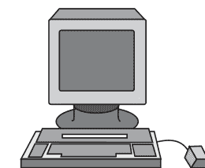

- 转账单据
- 合同
- 客户文件
- 表格单
- 账户单据

图 3.1
展示银行工作场所工具和材料的示例。

对于这两个应用领域，我们使用专家工作场所进行自主活动——换句话说，即我们的明确引导隐喻（参见表 3.1）。示例包括银行客户经理的工作场所、软件公司的软件开发人员以及软件开发团队中的设备管理员。

这种引导隐喻基于一种支持性观点。我们通过为专家创建一个账户环境来支持他们的工作。在这个环境中，这些专家可以找到完成任务所需的工具和材料。

最初，我们通过为专家创建一个工作支持环境来支持他们的工作。在这个环境中，这些专家可以找到完成任务所需的工具和材料。

最初，我们使用工具和材料作为我们的设计隐喻（支持性观点）来阐述专家工作场所。例如，图 3.1 显示了银行客户经理的简化工作场所。

虽然文件夹、表格和计划器属于材料，但在培训和研讨过程中，我们观察到将日常工作分配给工具或材料似乎是直观的。我们也注意到，当专家使用笔书写时，笔被视为工具，但关于笔属于工具还是材料，偶尔会有讨论。

总之，我们必须记住任务将适应特定的工作情况。在专家使用工具和材料来完成任务时，应该理解这些，它们最终将成为工作的一部分。

## 3.5.2 背景：支持性观点

本节提出的引导隐喻与我们所说的支持性观点的主要目标和价值相关。通过这种观点，在许多领域中，专家的工作是不可替代的。许多工程师和经济学家认为，支持性观点不再是理想的工作环境。相反，他们认为工作应该被视为可以确保高质量服务的工具和材料，而工作不应被自动化取代。

支持性观点的另一个特征是，工具和材料在应用系统中至关重要，而通用程序和流程则不那么重要。原因是，专家应该能够在任何情况下，根据其经验和技能来完成需要的工作。

专家活动和计划

### 考察

### 工具和材料的文化与哲学历史

文化告诉我们，人类的工作是以处理工具和材料为特征的。虽然工具的使用是否促进了人类进化尚未定论，但共识是人类工作本质上是基于工具的使用。例如，在《存在与时间》中，马丁·海德格尔提出了工作背景下使用工具和材料的补充意义。特别是，他认为人类使用工具和材料（物质）是为了产生学科，也用于办公室工作。包括刘易斯·墨福德在内的其他作者在人类中也有重要作用。

## 3.5.3 讨论：隐喻与模式

设计隐喻帮助我们更好地理解和分析应用领域。在设计和应用系统时，它们也起着重要作用。这描述了设计隐喻的领域含义。然而，对于我们软件工程师来说，设计隐喻是不够的。毕竟，我们不希望将如何将隐喻转换为软件设计交给个人开发者。除了应用系统中所有的领域差异外，我们使用设计隐喻为如何将其转换为软件设计和合适的架构提供指导。这就是设计模式和框架发挥作用的地方。第 4 章专门介绍模式和框架。现在，理解设计隐喻是什么、它们如何与 T&M 方法相关，更具体的是它们如何在设计专家工作场所中证明自己是非常重要的。以下章节定义了

# T&M 引导隐喻与设计隐喻

工具、材料、工作环境、自动化和容器含义，并讨论了它们如何作为设计隐喻以及它们如何与 T&M 方法相关。

## 3.5.4 定义：工具

本节定义了家务（如手工艺、家务或办公室工作）背景下的“工具”。

在这种语境下，工具是人们用来改变或探测材料以完成特定任务的对象。
工具通常适用于不同的领域特定目的和处理不同的材料。自然地，主要的前提是正确地处理它们。工具对于它们在某种程度上体现的重复性动作特别有用。
（手）工具的许多概念属性可以转移到软件工具中，但直接映射工具的处理方式和形式自然是没有意义的。

## 3.5.5 作为设计隐喻的工具

在谈论工具的特征时，理解改变和探测状态是不可分割的很重要。只有当我们听到锤子的声音并感觉到钉子的阻力时，我们才能继续向墙上钉钉子。
工具与领域功能（“它有一个特定的用途”）和特定的处理方式（“它易于使用”）相关。显然，这强调了领域功能。如果你想在墙上钉钉子，就必须使用合适的工具。然而，当你有多种选择完成这项任务时，你可以在不同类型的锤子之间进行。
处理通常需要一些经验。例如，除非你知道如何使用凿子，否则你无法修剪木头。根据情况和我们完成的工作，我们通常决定使用哪种工具；换句话说，我们通常交替使用工具来处理材料。
工具体现了一种物理或一系列动作。例如，锤子体现了击打动作。就像地图一样，它们提供了方向，而不是规定每一步。就像食谱一样，它们提供了逐步说明，但对于完全没有经验的人来说不是。10.4 节将讨论这种支持性观点以及我们如何将计划集成到 T&M 方法中。

专家活动和计划

## 3.5.6 T&M 设计：软件工具

在本节中，我们研究计算机软件背景下的工具。软件工具应该能够探测或改变材料。我们作为用户，根据情况决定何时拿起或放下它。当我们尝试转换物理工具


# 引导隐喻与设计隐喻

在软件中，我们通常会失去它的大部分特性。即使我们可以通过工具转移要完成的例程背后的领域概念，工具被处理的方式也会发生变化。随着工具处理方式的改变，我们也必须改变工具的形状。例如，在计算机上使用通常形状和处理方式的笔是毫无意义的。尝试用电子笔写字只会导致乱码。记得第一次在 Macintosh 上使用 MacDraw 的情景吗？你们就知道我们在说什么了。理解笔的不同功能（即书写、绘图、标记、指向）至关重要，以便能够在一个或多个软件工具中实现它。

假设我们 EMS 示例中的设备管理器为了简单起见，使用了一些简单的通用的工具，如笔、尺子和橡皮。当我们把这些工具作为领域设计的起点时，我们必须根据某些人需要完成的任务来理解这些工具的功能。这些任务包括：更新计划，以及协调流程和设备列表。我们的软件工具应该为设备经理必须在笔记或记忆中记录的许多事情提供更好的支持。假设我们开发了一个“设备组织器”（Device Organizer）。这个工具的使用方式类似于笔，用于向房间添加设备标识符。此外，该工具应该提供并指示添加到设备识别卡中的信息是否与指定的尺寸和员工人数匹配。

## 3.5.7 定义：材料

根据我们的基本定义，工具和材料是互补的概念。

> 材料（Material）是一个最终成为工作结果一部分的对象。材料通过工具和自动机进行处理，并体现了特定领域的概念。它们必须适用于给定的任务。

现有工作对象的属性通常可以很容易地转移到软件材料中。

## 3.5.8 作为设计隐喻的材料

需要注意的是，材料和工具一样，具有功能性。我们考虑为了不同目的使用材料的特定方式。由于我们通常使用工具来处理材料，因此它必须适合通过工具进行处理。根据手头任务，我们可能希望处理不同的材料以实现特定的结果。

一个特定的情况会清楚地告诉我们什么是工具，什么是材料。然而，可能会出现这样的情况：某物在一种情况下被视为工具（如“用笔写字”），而在另一种情况下则是材料（如“用卷笔刀削笔”）。

## 3.5.9 T&M 设计：软件材料

实践经验表明，将工作对象从应用领域转移到计算机上比转移工具更容易。在初始引导阶段，始终将特定工作场所现有的材料视为实现软件材料的潜在候选者。但请注意，现实世界和软件中的材料绝不仅仅是“数据包”。为了设计良好的软件材料，理解应用领域中处理工作对象的方式至关重要。

如果我们回到 EMS 示例，我们可以立即想到一些材料，例如房间平面图和设备识别卡，这些材料承载了关于设备及其性能实体、流程的信息，以及员工信息。在考虑传统材料时，我们试图理解它们在应用领域中的具体用途。这意味着我们不能仅仅满足于通用的操作（如创建、修改和删除），因为会有新设备的购买，员工会搬到其他工作地点，而采购订单可能会被取消。

## 3.5.10 定义：工作环境

专家级工作场所的引导隐喻清楚地表明，另一组重要的设计隐喻是工作场所及其环境，即工作环境（work environment），它代表了由我们的应用程序软件支持的任务被完成的位置。

工作环境是提供工具、材料和其他与任务相关的对象，并以特定领域特定的方式进行安排的地方。

实际工作在工作场所完成，而工作环境作为一个更大的概念，包含了该工作场所内的额外位置。

（个人的）工作场所通常受到保护以防止未经授权的访问。当只需要支持单个用户的工作时，工作场所和工作环境在本质上是相同的。

## 3.5.11 作为设计隐喻的工作环境

我们从上面的定义中获知，工作环境是提供工具、材料和其他与任务相关的对象的地方。我们说要区分完成任务的即时工作场所（immediate workplace）和工作环境，后者可能包含与该任务相关的额外位置（房间和地点）。我们理所当然地根据任务、排序原则和偏好来配备我们的工作场所。在工作期间，我们通常倾向于使用我们产生所需结果的物体。在极少数情况下或当问题出现时，我们可能需要触手可及（即在我们的工作环境内）的物体，或者知道去哪里找到它们。

首先，让我们假设软件系统必须支持一个由单人使用的单一工作场所。在这种情况下，我们通常将“工作环境”和“工作场所”视为同义词。一旦我们必须支持协作工作，我们就必须区分工作环境和工作场所（见第 4.1 节）。此时，决定哪些位置供个人使用，哪些是共享或公共空间至关重要。

工作环境隐喻为我们的方法引入了空间概念。这种将环境视为位置的理解与上述引导隐喻非常契合。环境代表了一个具有特定限制的重要概念和空间维度。首先，我们可以将个人工作场所视为我们的私有领域，在那里我们可以使用各种工具来处理材料。在我们工作场所的环境内，我们还有不需要使用的额外工具和材料。然后我们有存放材料的地方。我们还需要媒体来交换工作信息。

## 3.5.12 T&M 设计：工作环境

本节探讨了 T&M 设计中如何看待工作环境。环境的概念在当前系统中尚未被充分利用。你主要发现的是电子桌面。除了电脑游戏，你很少发现扩展的环境概念。

当我们尝试将空间概念转化为工作系统时，我们必须使用不同工作场所的工具来处理特定的材料。而且很容易想象出来，例如很难想象一个材料可以同时存在于环境中。这意味着我们需要一个更大的上下文来支持工作流程。此时，例如区分个人工作场所和合并房间就有意义了。

在嵌入式系统领域开发软件时，我们将面临不同的挑战。在这里，我们希望维护空间和时间概念。在我们的 EMS 示例中，我们可以将工作环境想象成电子桌面。考虑到该系统主要用于办公工作，桌面将完美符合设备经理熟悉的工作环境，我们可以提供根据其偏好管理设备的工具和材料。

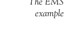

## 3.5.14 作为设计隐喻的自动机

自动机在我们日常生活中是广为人知的概念，尽管我们更多地使用“机器”一词。我们谈论烟机和自动售卖机，但指的是同一个概念。

自动机的特性
> 自动机是一种处理材料的设备。它将我们从单调的例行工作中解放出来，这些工作通常由定义的循环步骤组成，导致预定义的结果，且大部分不需要人工干预。


# T&M 引导隐喻与设计隐喻

自动机最重要的特征之一是，它们根据一组设置选项和长时间运行，在没有人工干预的情况下完成工作。自动化任务几乎只需点击按钮即可运行。

然而，只有当自动化运行常规活动或具有已知结果的定义流程时，它才能无缝地融入我们的工作环境。因此，工具、复印机、打印机或传真机在每个办公室中都是自动机。虽然在标准情况下使用自动机非常简单直接，但当它们故障或损坏时，要让其重新运行可能会困难，通常需要专家。

### 3.5.15 T&M 设计：软件自动机

自动化设计与我们“专家工作”的引导隐喻非常契合，因为它使用了分配给用户的常规工作。这意味着用户可以轻松将重复性的步骤或流程分配给自动机，为更具创造性的工作出时间。我们将此类自动称为小型自动机。

就像工具一样，自动机是可以使用的，而且它们具有特定的领域功能。然而，它们并不由用户直接处理。用户启动自动机并在必要时进行交互。如前所述，自动机在后台运行。这表明需要对流程进行特定的软件建模。

另一种类型的自动机是我们所谓的“大型自动机”。大型自动机决定工作的速度或节奏。就像在工厂或控制计划中一样，用户输入特定的数据和工作，并控制自动机的工作。

因此，自动化专家工作似乎很困难。这是专家办公室办公的常见情况。然而，我们的 EMS 示例必须检查所有设备，以确定它们是否需要定期分层进行更新或报废。对于此类循环出现的任务，我们可以使用在后台运行的自动机，每月或在每次系统启动时进行这些检查。

> EMS 示例：这可以导出 T&M 设计指南：为了支持专家工作，设计基于材料的任务；为了支持常规任务，将常规任务体现为自动机。

### 3.5.16 设计：容器

当我们开发 T&M 方法时，最初使用容器作为材料。这种容器可以盛载材料，并通过工具的使用进行处理。它们唯一的特性是在许多应用语文中（如文件夹或文件）中起着主要作用，并且在面向对象的系统中必须对材料集合进行显式建模。随着时间的推移，它们的重要性显现出来。

容器可以盛载、管理和分散材料。为了处理这些任务，容器通常包含目录。

你可以在容器中存储许多小对象或一组定义的不同对象。

容器通常代表流程或工作流（例如，集合和流程），并有助于协作和协调。

# 引导隐喻与设计隐喻

### 3.5.17 作为设计隐喻的容器

显然，容器在组织我们的日常工作生活方面起着主要作用。首先，它们对于存储我们当前没有在处理的东西很有用。但我们需要再次找到并检索这些东西。容器体现特定的排序原则是非常重要的。目录是容器的另一个重要特性。

当我们观察协作工作时，容器清楚地结合了特定任务或工作流所需的材料。通常，固定在容器上的运行单据（running slips）有助于协调分布式工作。

请注意，在我们看来，容器显然是**领域相关的**，它们与数组或双向链表等数据结构几乎没有太大关系——尽管我们可能使用这些结构来实现容器的存储功能。

### 3.5.18 T&M 设计：容器

在努力将容器的概念转移到软件系统中的过程中，我们主要关注它们的内容，其次是它们的形状。如所述，容器收集不同的材料，将它们放在一个领域中，例如客户文件。此类集合通常列在容器的目录中。更新容器的目录非常容易。它们显示了容器盛了什么。在这里，例如容器超越了物理对象，我们期望容器能够自动更新其目录。类似地，许多领域容器有助于维护材料的一致性。例如，办事员可以查看缺少了哪些文档，或者某份文档是否被临时移除。

容器可以代表一个或多个订单，作为文件夹和文件的注册表。除了它们所持有的材料的纯排序（例如，按字母顺序或时间顺序）之外，领域容器还可以代表不同的对象。例如，将待处理的申请和表格分开是惯例，其中也会使用所谓的“决文件”或“留存文件（hold files）”。相比之下，档案保留已完成和关闭的文件，保留这些文件是因为它们以后可能作为背景信息或根据法律要求保留。

刚刚提到的信用文件示例是容器的另一个方面。领域容器通常代表工作流或流程，如第 3.3 节所示。这使得该方法易于理解且可复制。当流程在面向对象的系统中表示出来时，我们可以看到容器对协作和协调的重要性。

总之，毫无疑问，容器代表了应用程序的领域特定需求。在我们的 EMS 示例中，我们将遇到几个容器。当然，我们需要将它们设计成工作场所的文件或箱子。

### 3.5.19 讨论：设计隐喻

仔细观察目前为止引入的设计隐喻的特征，就概念而言，我们关注的是人的日常工作。这是应用导向的关注点，但不应引导我们得出结论，认为我们仅仅是将现有情况映射到软件系统。软件开发可能始终基于这些现有概念引入新的工具、自动机和材料进行集成。这种方法可能会导致具有新任务的全新工作场所。但那时，新的工作场所和任务也符合现有的概念。

支持性观点（见第 3.5.2 节）鼓励我们不要将计算机和应用程序软件视为某种特殊事物。从应用导向的观点来看，软件应该是以熟悉的方式处理已知任务的另一种手段。开发者应该确保以一种易于理解和直观的方式在计算机系统中实现领域需求。设计隐喻有助于实现这一目标。

## 3.6 工作场所类型

我们提到过 T&M 方法最初是为金融和服务和服务业的个人工作场所设计的。后来，T&M 方法也被用于开发实验室和医疗系统。在这些应用过程中，我们面临挑战，需要审查我们个人工作场所的引导隐喻。

我们不想将一种通用的引导隐喻强加于所有应用领域；我们的软件应该反映组织中每个工作场所的现实需求。当然，我们无法针对每个工作场所并在我们的软件中支持它，但我们可以识别组织内部小组的工作场所类型。

以下章节描述了经证明在不同应用领域反复出现的最佳工作场所类型，并讨论了工作场所类型对你的应用程序软件设计可能产生的最影响。读者应该注意，识别和支持软件工作场所类型的方法与许多应用程序软件系统使用的“一刀切（one-size-fits-all）”方法有本质区别。为了在最小开发努力和最大工作支持之间取得平衡，T&M 方法将工作场所类型与服务架构相结合。


### 3.6.1 定义：工作场所类型

根据软件系统需要支持的不同任务和工作情况，我们区分了不同的工作场所类型。每种工作场所类型基于其自身的引导隐喻。

工作场所类型提供了对应现实工作场所的基本抽象。我们通过以下特征区分工作场所类型：

- 工作场所类型涉及的灵活和重复活动数量。
- 工作场所类型涉及的设备种类和范围，包括材料和工具。
- 使用该工作场所的员工领域知识和技能量。
- 使用该工作场所的员工 IT 知识和技能量。

### 3.6.2 T&M 设计：专家工作场所

在我们的 T&M 设计中，这种工作场所类型直接对应我们原始的隐喻，即为那些必须以灵活方式完成不同且复杂任务的人设计的专家工作场所。为了说明这种工作场所类型，我们使用了一些示例，例如银行的客户经理，或者我们 DB&M 示例中的设备管理器。

我们在上一节中对工作场所类型的定义告诉了我们区分工作场所类型的特征。这意味着我们可以从四个基本方面来刻画这种工作场所类型：

1. 灵活和重复活动数量：对于许多复杂活动，具有高灵活性、常规化程度低。
2. 设备种类和范围：带有工具、材料和小型自动器的广泛设备；通常是个人环境与公共工作环境的结合。
3. 领域知识量：高程度的领域技能和知识；对领域辅助系统的需求较少。
4. IT 知识量：中等到高，用户接受过应用软件的培训；对过程控制或自解释功能重要性较低。

### 3.6.3 T&M 设计：功能型工作场所类型

这种工作场所是比较常见的类型之一。我们在大多数项目中都识别出了这种工作场所类型，包括医学实验室、医疗保健系统以及银行。让我们来看看这种工作场所类型背后的引导隐喻。

这是一个为专家设计的工作场所，他们应该在重复但专业性较低的任务中获得最佳支持。例如，为 X 光医生设计的 X 光分析工作场所，或者由合格实验室技术员操作的复杂半自动血液分析实验室工作场所，或是银行中股票交易员的工作场所。

## 工作场所类型

我们可以很容易看到我们必须选择一种不同的隐喻，因为专家工作场所的特征并不适用。仍然保留的是电子工作场所的基本概念，但具有不同类型的任务和不同的模型。我们必须根据不同任务的范围以及满足需求所需的支持进行区分。我们还需要考虑在该工作场所所需的计算机知识和软件技能量。因此，我们识别出以下特征：

1. 情境灵活性和重复活动数量：灵活性低；少数具有高度重复特征的任务。
2. 工作场所设备的类型和数量：材料少；少数优化的工具或自动器。
3. 所需领域技能量：中等到高，即系统对用户没有引导支持。
4. 所需 IT 技能量：低到中等，即系统应关注于自解释任务和良好的过程控制。

我们可以看到，工作场所的功能远不止专家工作场所的延伸。X 光技师、会计或股票交易员并不希望处理我们软件的细节。他们对软件系统期望的最重要的一点是以最小成本在任务中获得支持，例如分析 X 光图像、血液样本或股票交易信息。

我们可以为我们的软件设计得出明确的需求结论。这少数工具应该是高度专业化的。我们可能需要一个控制自动器来涵盖所有标准情况。在特殊情况下，可以禁用这种控制，以便用户进行手动干预。通常，工作场所的设计会更像一个控制面板而不是灵活的桌面。

### 3.6.4 T&M 设计：后台工作场所类型

这是另一种非常常见的工作场所类型，特别是在办公室和服务公司。底层的工作场所隐喻告诉我们，这是一个为那些预计不需要特殊技能即可完成可管理的常规任务的员工设计的工作场所。

例子是银行或保险公司大量的不同的后台账户，办事员在其中完成客户文件、编辑并执行常规领域任务。

这种工作场所可以被建模为电子桌面。以下特征将这种工作场所类型与其他类型区分开：

1. 情境灵活性和重复活动数量：常规任务内的灵活性有限；在可管理的活动中，重复性工作量中等。
2. 工作场所设备的类型和数量：材料少且工具简单，包括自动器。
3. 所需领域技能量：相当低，即软件系统应该提供大量的领域引导。
4. 所需 IT 技能量：低到中等，即系统应关注于自解释任务和良好的过程控制。

## 引导隐喻与设计隐喻

显然，后台工作场所应该是易于处理的。塞尔登（Seldon）规定，精确的步骤只能在有限范围内进行优化。一旦员工发现存在他们无法根据自己的技能和权限独立完成的非标准流程，就应该提供一种方式将他们的“半成品”工作委托给他人，例如，使用普通的办公通信工具。

再次，上述特征为我们的软件设计需求提供了思路：工具适应于员工所具备的技能水平。这些工具是标准的，但小型自动器经常会帮助检查工作结果或子任务。在这里，检查列表和流转单是支持和标准化工作流的宝贵手段。

### 3.6.5 T&M 设计：电子商务前端类型

本节介绍的最后一种工作场所——电子前端工作场所，基于完全不同的引导隐喻。它最常见于应用程序中。首先，电子前端并不是传统意义上的工作场所，因为它通常由客户使用。这种工作场所提供组织为客户定制的服务，例如资金转账和简单的投资交易。

我们这种工作场所类型的引导隐喻是为不需要特殊技能即可使用服务的客户提供的应用程序环境。

根据前端端技术，我们需要思考什么样的隐喻适用于该应用系统。这可以从一个概念（例如，作为建筑的服务机构），到带有少量工具和材料的电子桌面，再到基于表单的浏览器浏览器界面。我们获得电子工作场所类型的以下特征：

1. 情境灵活性和重复任务数量：从高灵活性到少数定义良好的常规任务；对于偶发用户。
2. 工作场所设备的类型和数量：材料少且工具简单，包括自动器；主要需要舒适的交通。
3. 所需领域技能量：无到中等，即软件系统应该易于适应高领域引导。
4. 所需 IT 技能量：无到中等，即软件系统应该是自解释的具有良好的过程控制。

当我们电子前端视为这种工作场所类型的典型示例之一时，我们可以看到与账户经理的工作场所相比，单个材料并不是自由访问的。它们被分配给某项服务，并且该服务的呈现方式使得客户不需要知道该服务所需的材料。底层的控制自动器将协助客户获取所需的信息或服务。

尽管这种工作场所类型的用户对他们以及对服务提供公司的期望负责，但他们一直是客户，通常不希望处理他们所使用的系统的细节或使用


## 参考文献 77

服务质量。此外，我们不能假设这些客户会获得专门技能来使用我们的系统。这意味着服务提供端必须确保软件系统的高质量，特别是其用户界面的。

## 3.7 参考文献

- R. Budde, H. Züllghoven: “编程工作坊中的软件工具。”见 Ch. Floyd, H. Züllghoven, R. Budde, R. Kel-Slavik (编.): 软件开发与现实构建. Berlin, Heidelberg: Springer-Verlag, 1992.

以下是“工具与材料”（Tools & Materials）方法的基础。

- S. Cotter, M. Potel: 《Taligent技术内部》，Reading, Mass.: Addison-Wesley, 1995.

这项工作描述了“人、地、物”概念，它为设计应用提供了有趣的比喻。

- C. Floyd, W-M. Mehl, F. M. Reinin, G. Schmidt, G. Wolf: “关于斯堪的纳维亚：软件设计与系统开发的替代方法。” 人机交互, 1989, 第4卷, 第4期, Hillsdale, New York, England: Laurence Erbaum, pp. 253–350.

关于软件设计方法的基础。

- S. Maaß, H. Oberquelle: “人机交互的视角与比喻。”见 C. Floyd, H. Züllghoven, R. Budde, R. Kel-Slavik (编.): 软件开发与现实构建. Berlin, Heidelberg: Springer-Verlag, 1992, pp. 233–251.

这篇文章考虑了软件开发的中的各种设计和比喻。

- M. Heidegger: 《存在与时间》。Blackwell Publishers, 2000.

- L. Mumford: 《机器神话：技术与人类发展》。Harcourt Brace, 1983.

这部技术社会学领域的经典著作也讨论了容器对人类文化的意义。

- B. Shneiderman: “直接操作：超越编程语言的一步。”IEEE Computer, 1983, 第16卷, 第8期, pp. 57–69.

这是一篇关于将直接操作作为设计比喻的重要文章。

- Taligent Inc.: 《Taligent设计指南：C++中良好的面向对象设计》。C. Cupertino, Calif, U.S.A.: Taligent Press, 1994.

Taligent 著名的应用框架设计方法。

- R. J. Wirfs-Bock, B. Wilson, L. Wiener: 《面向对象软件设计》。New York, London: Prentice-Hall, 1990.

这本关于面向对象设计的书仍然值得一；它解释了引导性比喻和对象世界。

# 模式、框架与组件

### 4.1 引言

第 2 章介绍了面向对象编程的基础，描述了编程层面的基本知识。我们现在进入对象技术的下一个层级。本章讨论了与模式、框架和组件相关的概念和术语。在过去的几年里，这些主题在软件开发中变得越来越重要。今天，它们构成了每个想要构建高质量面向对象软件的开发者必须掌握的高级手艺。

模式以结构化且易于访问的方式封装软件工程师的经验。模式比程序代码更抽象，向我们展示了解决重复构造问题的良好解决方案背后的思想。但最重要的是，它们为我们提供了一种语言，来讨论大型软件系统设计和构造的不同方面。本章将模式的概念分解为设计模式、概念模式和编程模式。接下来，我们将描述模式是什么以及它们的用途。

框架（有时被称为平台）是通常实现设计模式的预制结构。它们实现了应用程序的结构和动态属性，从而能够在高层次实现概念和软件重用。我们将解释概念框架、应用框架、黑盒框架和白盒框架之间的区别。我们还将学习连接框架所需的组件。

组件是软件构建块，可以显著加快开发过程，同时提高最终产品的质量。正如我们将解释的那样，我们在 T&M 方法中使用的组件，应该与框架技术结合。

本章包含了理解我们方法所必需的重要术语和概念。我们首先将这些技术主题与应用程序开发的领域问题相关起来。讨论结束时，读者应该理解所有这些术语和概念是如何汇合到我们面向应用的方法中的。

## 80 模式、框架与组件

## 4.2 背景：模式、框架与组件

模式、框架和组件紧密相关，因为它们都是第二代面向对象方法的不可或的一部分。第一代可以被认为是“简单”面向对象编程逐渐演变为一个包含从分析到设计所有阶段的综合方法的时期。第二代的特征是从纯粹的面向对象编程和类库向模式、框架、更高层次的设计构造单元（即组件）的转变。模式被广泛用于描述框架和组件之间的概念和设计决策。

本章是为了更好地理解 T&M 方法，因为接下来的章节描述并讨论了我们 T&M 架构感兴趣的模式、框架和组件。

## 4.3 模式

当 Gamma 等人引入他们的创性著作时，模式成为面向对象软件开发中的一个热点。我们从一开始就积极参与了这一讨论，我们认为模式是软件架构的重要组件。这就是我们……


# 模式、框架与组件

材料（materials）是工作和系统相关的相关的元素。我们可以看到，模式有助于理解应用领域。

我们还可以利用上面的示例来展示模式的构建性或生成性功能。这意味着我们可以使用我们的概念模式——即工具与材料的相互关系——来支持这一点。然后，我们设计了一个专门的图形编辑器，暂且称其为“设备组织器”（Device Organizer），作为一种编辑电子房间平面图的工具。延续这种特定模式的设计思路，我们还需要更多的设计模式来构建软件架构，在对象级和类级上，工具和材料是最重要的组件。

我们从 4.3.1 节中知道，模式是特定语境下的特定形式。我们也可以说，模式总是出现在某个背景之上。为了理解这一点，请在大脑中想象一下埃舍奇·埃舍（M.C. Escher）的画作或一张图片。在我们识别前景中的物体之前，都必须先理解背景。这意味着模式有一个背景。语境定义了模式；模式只匹配特定的语境。如果我们改变了语境，模式就会改变，因此模式变了，语境也变了。

在我们的示例中，如果我们识别出通过用笔手动处理的房间平面图，那么我们就可以将平面图（材料）和笔（工具）关联到一种类型的工作语境作为背景。我们假设设备管理器在那里理解这一点，她能够独立地产出新设备，在认为认为必要时更新设备，选择她认为合适的工具等等。这告诉我们，我们应该如何在特定类型的人类工作背景下，去理解“工具与材料的相互关系”这一概念模式。

模式的描述由有限数量的元素和关系组成。然而，模式的变体可以具有任意数量的元素，这些元素是递归定义的并根据需要创建的。

例如，Gamma 等人的工作描述了一种“责任链”的模式，它包含客户端、处理器及其元素。这种有限的模式可以实例化为任意长度的递归处理器序列。

模式从经验中汲并成长，且只能由经验丰富的人使用。模式的作者决定在描述语境时包含哪些他或她认为在描述语境时相关且有意义的内容。对于该领域的新手来说，这意味着此人可能无法理解模式本应提供解决方案的问题。此外，在使用模式时，应该始终具备足够的经验来为当前的语境开发正确的变体。然而，毫无疑问的是，所有与模式相关的经验对所有人（包括新手）都是有用的。

“工具与材料的相互关系”假设用户熟悉开发用于工作系统的交互式软件的基础知识。他们将将工具与材料之间的交互实现为一种交互式软件。

应用导向（Application orientation）至关重要，即使我们不想将模式的使用限制在软件开发中。显然，模式的主要用途是方便作者的工作。当一个模式被他人接受并复用时，它才具有真正的潜力。这证明了它确实是解决特定语境下反复出现问题的泛化形式。

### 模式的语境
- EMS 示例
- 模式的元素
- 可于理解的模式描述
- 直观模式

# 模式

需要记住的一个重要点是，我们要为模式命名，并且这些名称应该具有足够的描述性，以确保参与项目的每一个人都能理解我们想在设计中引入什么。

概念模式（如工具与模式的连接）通常用通俗语言命名。这将确保这些模式可以在许多不同的应用领域中被理解。通常，在以应用为导的 T&M 方法中，所有的概念模式都应该具有在相应领域语言中具有意义的名称。

### 4.3.3 T&M 模式分类法

第 6 章将描述在我们的软件开发方法中起重要作用的不同模型。我们将区分应用领域模型、设计模型和实现模型。事实证明，根据这些模型区分不同类型的模式及其各自的也是很有用的。我们将模式区分如下：

- **概念模式**描述了与应用领域相关的元素和概念。它们基于相应的设计隐喻。虽然设计隐喻为所有参与小组提供了讨论基础，但概念模式特别帮助开发人员在对他们的应用领域进行建模。
- **设计模式**描述了软件层面的软件。它们是用于软件构建的微架构。最著名的例子列在 Gamma 等人的书中。
- **编程模式**是最具体、最具技术性的模式。它们描述了源代码层面的构造或习语，例如：

```
for (int i = 0; i < max(i + 1); {..})
```

### 4.3.4 概念模式

应用领域模型（见第 6 章）的设计应该使所有参与者都能理解它。如果模式使用了特定于应用领域的概念和模式，它们就能确保模型的可读性。我们将此类模式称为概念模式，正如已经定义的那样。它们也被用于用模型。

概念模式超越了设计隐喻，因为它们是为了支持应用领域过程中个人活动的开发人员准备的。它们在分析应用领域期间也引导我们。概念模式帮助我们更好地看到应用领域中的哪些对象以及这些对象之间的哪些关系对于底层模型是重要的。我们学习应用系统中涉及的相关任务，并在模型中显式地表示出来。同时，我们通常为模型选择那些我们可以在特定领域和特定软件的系统系统中使用的元素和模式。概念模式是感知、解释和改变应用领域的指南。

再次，这表明，对于开发者来说，应用领域的分析和建模始终与未来系统的设计相连。

然而，在我们的方法中，这不仅仅是开发者的任务。我们的循环要求所有参与者积极参与设计。为了这一目的，我们必须确保概念模式与设计模式密切相关。

### EMS
工具与材料的相互关系这一概念模式在第 7.3 节引入，是应用建模的基础模式。当我们编写场景（见第 13.1 节）时，我们使用这些如场景和笔来描述工具和材料如何完成任务。在设计未来系统时，我们必须确保这种特定类型的交互不会在系统中丢失，这意味着工具能够以类似的方式处理材料计划。

## 示例
考虑到概念模式和其他所有模式一样不是通用的，我们必须将它们分配给特定的语境。概念模式的作者通常试图避免极端或过于特殊。

我们认为，像活动操作对象这样的模式对于成为一个有用的概念模式来说太了。将设备组织器和房间平面图转换为概念模式也没有意义，因为我们在示例中使用了它。然而，工具与材料的相互关系这一概念模式必须证明它对于办公系统是合适的抽象。事实上，它与其他概念模式（如代理或介质）相似。另一方面，尝试将工具与材料的相互关系转移到具有固有严格时间要求的实时系统中将不会很成功。

### 4.3.5 设计模式

设计模型位于应用领域模型和软件实现（见第 6 章）之间的中心位置。它代表了我们对应用领域的理解，并已经考虑了软件系统的限制和正式要求。

- 设计模式连接了概念模式的领域陈述与面向对象设计的构造要求。
- 它们帮助你分析和重组现有的软件设计。
- 设计模式帮助你理解软件架构（例如类库、框架），只要这些架构是用著名的设计模式进行记录的。
- 你可以将设计模式视为“微架构”，经验丰富的开发人员可以获取并映射到实现中，就像软件架构中的组件一样。这意味着你可以复用设计而不是代码。
- 设计模式代表了我们用于思考和交流软件架构的语言元素。
- 最后，设计模式支持我们精炼设计模型并提高设计的质量（例如可重用性和可扩展性）。


# 模式 85

我们设计模式是为了描述和理解我们的设计模型。设计模式定义了设计模型中所包含元素的结构和动态，并帮助我们理解这些元素中的每一个交互和职责。从软件构建的角度来看，我们将概念模式的逻辑和结构需求视为向执行高效代码的重要步骤。

在我们的方法中，应用领域模型和应用程序的设计模型之间尽可能少地语义差异是至关重要的。为了确保这一点，设计模式应该与概念模式以及它们所基于的设计模式紧密相关。随后，设计模式定义的元素和关系应该能够轻松地映射到实现中，而不会丢失其结构。

设计模式与框架密切相关。框架包含并实例化了模式。在理想情况下，框架是基于设计模式开发的。至少，设计框架的文档应该显示出在构建该框架时用到了哪些设计模式。

使用设计模式进行软件开发的文献和实践以完全不同的方式存在，即通过分配到不同的层级，范围从大规模的软件架构到所谓的微架构。

工具和材料的概念模式插值描述了工作背景下的基本设计元素、工具和材料。通过一个调用工具和材料的设计模式，我们进一步推进了工具和材料插值的模式：我们描述了两个应该是松耦合的设计单元（一个工具和一种材料）之间的显式接口。我们建议使用面向对象的构建。最后，我们使用基于框架的模型架构，其中工具和材料之间的通用交互可以封装在框架内部。

### 4.3.6 编程模式

使用使用和设计模型外，我们还将实现模型定义为第三种软件开发模型（见第 6 节）。该模型通常与程序代码不分离，而是“嵌入”在程序源码中。我们选择的编程语言作为该模型符号表示法的范例。为了更好地描述和理解这一模型，我们使用了编程模式。

编程模式根据编程语言和文化而异。值得注意的是，在这一相对较低的技术层面，存在编程文化和风格等事物。编程模式通常有不同的名称：例如，称它们为惯用法（idioms）。对编程模式的详细讨论将超出本书的范围。然而，我们将给出关于编程模式的大致概念。

下面这个编程模式的微小示例是 C 语言中已知的循环结构；你将在 Java、C 或 C++ 程序中发现类似的语法。

```
for (int i = 0; i < max; i++) [ .. ]
```

# 模式、框架与组件

在编程语言级之上，你将找到基于编程指令-函数-谓词的接口分类，这是我们在第 2.18 节中根据 Meyer 的工作所提的。这种模式符合 Meyer 提出的契约设计（design-by-contract）模型，该模型可以被视为设计模式。

### 4.3.7 T&M 设计：设计模式

在本书的语境下，T&M 设计模式由一个通用的描述部分和一个或多个构建部分组成。

- T&M 设计模式的描述部分定义了不取决于编程语言的软件设计中可用的元素。为此，它使用了面向对象的概念（例如：使用、角色、组件、泛化、特化）。
- T&M 设计模式的构建部分描述了你软件设计的元素。其形式面向所选编程语言的概念（例如：过程、对象、类、继承）。

这种对设计模式的划分与通用的 T&M 方法一致。尽管我们通常面向特定的应用数据（即金融和服务部门），但我们并不面向特定的编程模型。然而，我们需要一个考虑到编程模型特殊性的构建解决方案指南。

每个设计都描述了一个独立于任何编程语言的层。在这一层上，T&M 设计模式展示了概念背后的思想，例如工作环境中的工具、材料和自动化。

第 8.3 节介绍了设计方面。该模式的通用描述部分建立了工具、材料与方面（aspects）之间的关系。接下来，该模式通过使用四个不同的构建部分具体化。这个示例展示了我们在不同的语言中实现抽象方面。

构建部分使用所选编程模型的元素来解释设计的结构和动态。构建部分始终是 T&M 设计模式的完整部分。它展示了设计的实现方案。在书中，我们为 C++、Java 或 Smalltalk 编程语言使用构建部分。在现实项目中，设计模式通常仅使用构建部分描述，特别是编程语言缺乏活性时。

在实践中，有时需要为对象以外的语言开发构建部分，正如我们在几个项目中做的那样。在这种情况下，我们必须澄清在实现层应该保留哪些面向对象的设计概念。我们没有刻意在本书中使用此类构建部分，因为这个问题很容易写成另一一本书。

### 4.3.8 T&M 设计：模型、比喻与模式

显然，在基于 T&M 方法的软件开发中，设计比喻、模式和模型之间存在关系。我们将设计比喻定义为一种视觉和客观的想法，它符合并具体化了来自领域和软件视图的设计比喻。设计比喻帮助所有参与软件系统设计的人找到共同的感知和理解基础。设计比喻基于日常语言，使得应用领域更容易理解，并有助于开发中系统的处理和功能性实现。

相比之下，模式主要与开发者的活动相关。在设计阶段早期，开发者应该尝试具体化设计比喻，因为他们需要知道应用领域中哪些内容对于未来系统是相关的，以及应该描述到什么细节。概念模式可以帮助他们找到这个问题的答案。

在 TGAM 方法中，重要的是理解设计比喻与构建指南形式的技术解释是相关的。概念模式桥接了设计比喻的相关视图与设计模式的构建视角之间的鸿沟。这些元素随后通过构建模式和编程模式进行实例化。

我们处理模式的指南是：通过设计比喻和概念模式分析并推导出应用领域；然后通过设计模式创建特定的软件设计；最后通过编程模式来实现这些设计。

让我们再次看我们的工具和材料示例。工具和材料是每个开发者或用户都应该熟悉的通用语言设计比喻。这一层上的概念模式是工具和材料模式的相互作用，如第 7.3 节所述和图 4.1 所示。在办公室工作背景和专家视角下，从使用工具处理材料的角度促进手头的相关任务是有意义的。这通过概念模式表达出来。

对于软件设计，我们使用设计模式对象。我们通过引入两个设计组件（工具和材料）来完善概念模式。它们的交互


# 模式、框架与组件

一个元素如何与其他元素匹配的方式是通过“方面”（aspects）表达的。一个方面告诉我们材料应该具备的属性，以便可以使用工具对其进行操作。另一方面，工具只有在特定的“方面”下才认识其所有的材料。这种关系在我们设计模式的通用部分中进行了规定。例如，我们可以通过对模式进行朴素实例化，使得一个设备只认识 `aspectPlan`（计划层/方面），但不认识具体的材料。

最后，我们必须在构造层面上实现我们的设计。具体来说，我们必须定义如何通过编程语言提供的特性来实现方面。这由“构造部分”（construction part）来描述。图 4.1 中的示例是一个将方面作为接口的解决方案。

### 4.3.9 背景：模式的形态

Hoare 曾说，抽象需要一种表示形式来赋予其必要的形状。这一表述也适用于模式。通常，文献界认同模式也应该以结构化的模式形式进行描述。

如果我们比较大量不同的模式描述，可以发现，选择何种模式在很大程度上取决于其意图。

遵循 Alexander 的经典定义，一个模式描述由三个部分组成：问题（problem）、语境（context）和解决方案（solution）。当你使用模式来解决给定的问题时，这种形式证明非常有用。

“问题”部分简要描述了要解决的问题。“语境”部分识别了问题发生的情况，以及阻碍可能解决方案的因素和条件。最后，“解决方案”部分告诉你在如何在这种特定的语境下限制或消除这些因素。这种形式的一个主要特征是它可以用于通用的问题解决任务。解决方案通常被描述为，使得针对特定问题的模式可以被容易地实例化。其他的模式描述主要是描述性的性质，即它们关注的是一个构造模式的结构和动态机制。

### 4.3.10 团队设计：模式的形态

书中使用的模式描述粗略地基于 Gamma 等人提出的形式。我们通过以下部分对模式描述进行结构化处理，尽管并非每个模式都必须包含所有部分：

- 模式的名称。
-   使用该模式要解决的问题。
-   要解决的问题周围的语境及其反作用力。
-   解决方案，代表模式中各个元素的角色、它们如何相互作用以及相互作用的方式。
-   一个示例以更好地说明问题；我们在整个书中使用 EMS 示例作为来自我们项目的微型示例。
-   对不同构造方法的讨论。
-   使用模式的积极和消极后果。

# 模式 89

图 4.2
T&M 模式
路线图。

### 4.3.1 模式集合

本节描述的这类模式并非孤立存在。它们在共同的应用领域内相互连接，并遵循设计比喻所给出的关系网。在 T&M 方法中，模式是链接的，也就是说，一个模式包含了另一个模式或与其他模式相互作用。

如果模式是其他模式，它们就可以被排列为模式集合。我们的模式集合是分层的，这意味着一个模式的语境包含了另一个模式的语境，而包含该语境的模式有助于我们理解它所包含的模式。从这个意义上说，更全面的模式在逻辑和描述上优先于被包含的模式。在 T&M 方法中，这同样适用于模式类型；例如，概念模式在相关的设计模式之前，领域特定模式包含相应的软件特定模式。简而言之，顺序是：概念模式在设计模式之前，设计模式在编程模式之前。

工具和材料的概念模式迭代描述了工具和材料相互作用的语境。这一基础对于我们有意义地讨论相关的设计模式方面是必要的。反过来，它形成了将设计模式理解工具构造的概念基础，然后是交互与功能的模式分离。后一种模式优先于工具部分之间设计模式的反馈。在它们的构造阶段，相应的技术解决方案使用了众名的模式，例如观察者模式。图 4.2 显示了第 7 章和第 8 章中描述的所有 T&M 模式是如何关联的。这样的图通常被称为模式路线图（pattern roadmap），因为它展示了通过一系列相关模式集合的潜在路径。

## 4.4 框架

本节从关于框架和类库概念的历史背景开始，这对于理解框架至关重要。后续章节将解释应用框架与黑盒、白盒框架的区别和目的。最后，作为一个实践示例，我们描述了使用 JAW 框架的层级架构。

### 4.4.1 背景：类库

在第一个面向对象语言引入之前，重用是一项重要的技术。在过程化语言中，你只能以提供的方式构造单元（如模块）。如果你想以显著不同的形式使用该概念，可以复制并修改程序文本。面向对象的构造结构——类和继承——允许你在子类中重用一个类。具体来说，你获取该类并为你的特定用途重新定义它，而不改变原始类。Meyer 将此称为面向对象的开闭原则（见第 2.2.3 节）。

开闭原则使类库成为面向对象编程语言不可的一部分。

- 类库组织一组独立使用的类。
- 类库被直接使用或通过子化使用。
- 类库不定义应用程序系统的控制流。

与模块库不同，类库不是准备即用元素的无序集合；它们形成了一个由构建块组成的灵活层级结构。这导致了两个结果：第一，编程语言在类型级别得到了扩展；第二，类库形成了用户定义类型的基础。

通常，你可以将每个类作为一个库使用，而不考虑其他类。由于这个原因，从类创建的对象不会自动与库中的其他对象协作。这些对象之间的交互（或控制流）是定义在应用程序程序代码中的。

这的一个真实例子是容器库，它扩展了经典结构。在容器库中，容器类可以在基础层级使用。但最近的容器类增加了迭代器，使得这些容器可以被容易地搜索和编辑。这不仅给了我们一个容器，还提供了容器与一个或多个元素交互。此外，在容器维护的元素的特定要求是在抽象父类中定义的。

### 4.4.2 定义：框架

前面的容器示例向我们展示了在涉及元素的结构和动态中反映的功能关联，例如在构造控制流中。这意味着此类容器是向我们通常所说的过渡。

框架是一种类层次结构的架构，为特定语境下的类似问题提供了通用解决方案。通过框架，你重用的是交互元素的整个构造，而不是单个类。框架可以通过特化选定的类或创建预定义的参数对象来开发为特定的应用程序。

这种框架与模式的关系

模式是某些构造的形式抽象。框架比模式更具体，因为它不仅在形式上是丰富的，而且是类结构的“半成品”实现。

框架与模式的关系

一方面，框架的类结构识别了应用程序系统的架构和控制流。另一方面，它有特定的点（Pree 称之为“热点”），你可以在那里附加你特定的解决方案。

### 4.4.3 应用框架

框架可以用于解决各种领域的问题。定义完整应用程序系统的设计和相关构造的框架被称为应用框架。

应用框架旨在给定的应用领域内开发应用程序软件。


# 模式、框架与组件

它以通用解决方案的形式规范了软件架构以及相关的领域特定抽象。

从技术角度来看，应用程序框架通常被结构为几个子框架。

目前，旨在实现图形用户界面或持久化机制的技术性框架被用得最广。应用程序框架要复杂得多，因为它们既必须定义具体应用领域的抽象，又必须定义合适的软件架构。因此，应用程序框架通常被结构为几个框架，每个框架代表应用程序的一个独立方面。本书描述了在 TSM 方法内并以 Java 框架为示例，针对应用程序框架的通用设计和架构原则（参见第 8.16 节）。

### 4.4.4 黑盒框架与白盒框架

根据用途，框架通常被分为黑盒框架和白盒框架。

当你通过配置而非通过额外的编程来构建完整的应用程序时，通常会使用黑盒框架。为了这一目的，对象是从预定义的类创建的，这些类通常由配置对象进行参数化，以便你能够适应特定的应用程序需求。

相比之下，白盒框架的设计允许你从特定类派生子类。这些子类的对象可以直接用于应用程序系统或其他框架。它们也可以用于配置由框架的子类创建的对象。

这意味着，当使用黑盒框架开发你的应用程序系统时，你是从专门为此目的提供的框架类中创建对象的。在许多情况下，你可以使用其他对象来配置这些对象。此类配置对象也是从相同或另一个黑盒框架的类实例化的。

让我们来看一个简单的例子来观察它是如何工作的。假设你使用图 4.3 中的利息计算器。如果一个软件开发人员想要创建一个基于利息的储蓄账户，他就会创建账户和利息计算器。首先，他会从 `SavingsClass` 实例化一个对象；然后将来自 `DecursiveInterestCalculator` 类的对象传递给该对象。这意味着我们为 Savings 开发利息计算器以装饰利息。调用 `InterestofSavingsAccount` 会在程序到达 `DecursiveInterestCalculator` 策略时调用 `operate`。

### 使用黑盒框架

虽然你不需要了解内部就能使用黑盒框架，但白盒框架只有在你了解框架的内部结构时才能使用，特别是它们在各自类中建模的对象之间的交互。白盒框架通常用于开发应用程序，使框架的特定类在子类中专门化，从而将框架连接到你应用程序中的其他类。

### 使用白盒框架

# 框架

93

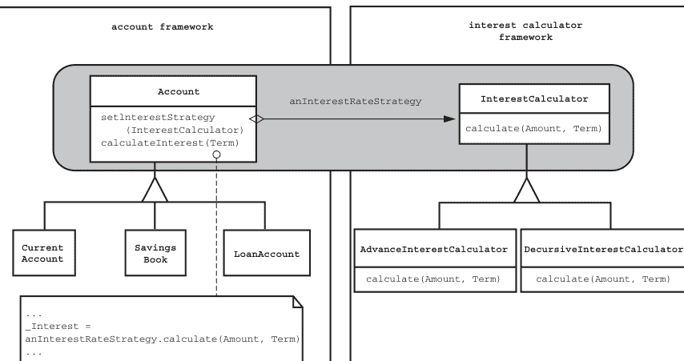

**图 4** 显示利率计算器的示例。

从白盒框架子类创建的对象可以用两种不同的方式使用：

- 1. 你可以在你的应用程序系统中直接使用创建的对象。例如，账户框架可以设计为实现账户类（`account`）以及与 `interestCalculator` 类对象的抽象交互。`account` 的子类将不会包含在框架中，因此你必须通过派子类来构建它们。子类随后将继承框架中与 `interestCalculator` 的交互，因此子类不需要自己实现这种交互。
- 2. 你可以将你的子类对象用于配置目的。例如，账户框架可以提供账户类（`CheckingAccount`、`savingsAccount` 等），但没有提供产生利息的策略。在真实的应用程序系统中，你必须从抽象类 `interestCalculator` 构建一个合适的子类，该子类的对象随后将用于配置特定的账户对象。

我们可以从中看到，黑盒框架更容易理解和使用，而白盒框架更复杂但更灵活。真实项目的经验表明，黑盒框架通过不断添加标准解决方案从白盒框架演变而来的。这意味着软件开发人员不仅使用框架来构建应用程序系统，将其作为开发其他更专业框架的基础。

比较黑盒框架与白盒框架

# 模式、框架与组件

注意，黑盒框架和白盒框架之间没有严格的划分。事实上，框架通常是根据它们在软件项目中的使用方式进行分组的。尽管为白盒使用设计的框架主要作为这种方式被使用，但它们也可以包含类似于黑盒框架的标准解决方案。反之，大多数黑盒框架也可以作为白盒框架使用。

## 4.4.5 框架之间的连接器

我们从第 4.5 节知道，设计模式可以用于描述元素之间复杂的交互。例如，设计模式可以描述解决特定设计问题的若干类之间的职责和协作。如果一个设计模式的类分布在我们要想要连接的几个框架中，那么这个设计模式就描述了我们应该允许这些框架之间进行交互的协议。

框架连接器：相互作用的框架可以通过耦合，也可以通过简单地连接相应框架的接口来连接。但框架之间的交互通常是复杂的，因此应该在接口层通过设计模式进行描述。我们将这些设计模式称为连接器。

为了给出框架耦合的示例，让我们再次查看我们的账户和 `interestCalculator` 框架（见图 4.4）。`interestCalculator` 是一个黑盒框架，用于构建账户框架。`interestCalculator` 类可以作为策略用在账户类中。为了简化示例，我们将使用具体账户类中需要的策略。现在，如果你将策略模式视为我们的连接器，我们就可以看到 `account` 和 `interestCalculator` 框架中的哪些类在策略中承担职责。`account` 类负责内容，而 `interestCalculator` 类负责策略。

注意，该图没有定义实现账户类的来自 `interestCalculator` 的特定利息产生。这些信息对架构没有影响，它们仅仅代表了在我们构建具体账户类时使用的领域细节。

图 4.4 连接两个黑盒框架的策略模式。

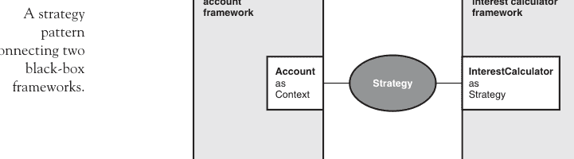

## 4.4.6 JWAM 框架：分层框架架构

应用程序框架通常非常复杂。为了方便在软件项目中处理和使用，此类框架通常组织成层。第 9.3.5 节将详细描述。

在大规模软件系统和框架中，分层架构承担着组织架构的角色，它映射了具有特定职责的单元以及它们之间为了领域任务进行的规范通信。

层根据领域动机将软件组件组织成设计和构建单元。架构的层使用类和框架作为层的组件。在这个意义上，框架也可以包含其他框架。

为了支持通过 T&S 方法开发的软件，我们用 Java 构建了一个通用应用程序框架。该框架是通用的，并不是针对特定应用程序领域定制的，但它具有构建交互式应用程序系统所需的基础。图 4.5 显示了 JWAM 框架的分层架构。

在图 4.5 所示的示例中，每层都包含特定用途的框架。

- 领域应用程序层不是 JWAM 的一部分。它在应用程序项目中开发，并包含了与相应领域相关的框架和类库。

图 4.5 JWAM 框架结构。

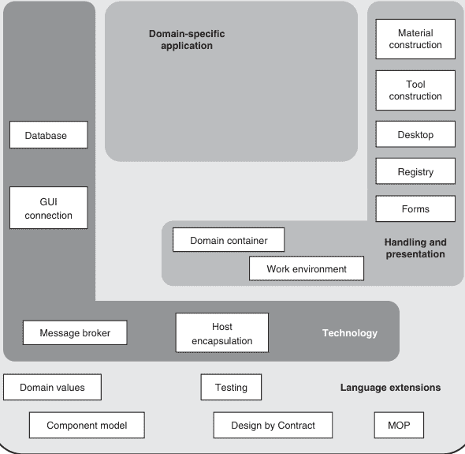


# 模式、框架与组件

- 处理和表示层包含了实现了交互式应用程序软件可复元素的框架。例如，这些框架包含了基于观察者模式实现工具内部控制流的框架。
- 技术层包含了将技术封装的框架，这些技术以我们在高层中喜欢使用的方式被封装。这样，底层技术可以更容易地进行交换。
- 语言扩展并不是一个层。Java 不支持我们对面向对象的语言所期望的语言元素。因此，我们以框架的形式实现了这些元素，所有层都可以访问。这包括基本概念，如领域值（domain values）、梅耶契约（Meyer's contract）或元对象协议。

注意，这种分层架构仅作为一个示例；它在所有项目中并不一定完全相同。其他的应用程序框架（例如 IBM 的 San Francisco）是基于不同的架构。取决于应用程序框架所使用的特定层，其目的是保持应用程序软件的不同维度之间相互独立。我们将在第 6.9 节讨论软件构建的维度问题。

## 4.5 组件

本节将介绍关于组件的背景知识，然后定义“组件”这一术语。接下来我们将描述组件和框架是如何工作的，最后我们将查看 T&M 示例中的组件。读者将理解，将组件与框架相结合为支持大型软件系统的构建提供了最佳解决方案。

### 4.5.1 背景：软件组件

组件一直是许多开发者（尤其是 IT 经理）所追求的。这种需求源于对软件系统的分解的需求，以便为许多不同的应用程序提供现用组件。文献中提到了 ICS（集成组件系统）。

关于组件的讨论最近推热了蓬勃发展的组件市场的想法，在该市场中 IT 经理能够构建低成本的交钥匙式系统。
组件倡导者的断言承诺，这意味着在不久的将来，应用程序软件开发将发生巨大变化。他们认为，经过培训的用户应该选择标准组件，他们可以在图形化编辑器中找到并适配这些组件，以构建完整的系统。我们并不这么认为。

尽管如此，忽略那些过于乐观的希望和想法，仍然有大量的论点使得仔细研究组件是有的。此外，一些商业组件产品，例如微软的分布式组件对象模型（DCOM）或 Visual Basic 扩展（VBX）（参见第 4.5.3 节），表明了交钥匙式软件组件确实可以使用。将 IBM 的 Eclipse 组件模型作为开源产品引入，是使组件成为技术和商业上可行解决方案的又一个大进步。

### 4.5.2 定义：组件

文献使用了许多不同的组件概念。例如，这里有一个 Clemens Seypersi 提出的一个著名定义：“软件组件是一个组合单元，仅具有通过契约指定的接口和显式依赖关系。软件组件可以独立部署，并允许由第三方进行组合。” 第 34 页。

相比之下，Oscar Nierstraeuse 提出的定义更为通用，它基本上是从客户端的角度，指定了一个稍后将进行绑定的服务，并且该服务具有可插的接口。尽管组件的定义非常广泛，但我们可以推导出以下粗略的分类：

**编程组件（Programming components）**：这些组件在源代码中可用，代表了一种技术或特定领域的解决方案，适用于在类似的语境中重用。它们通常成为（不可区分的）应用程序程序的一部分。

**实现组件（Implementation components）**：这些通常以二进制形式可用。它们独立生产，并可以在编译时购买并集成到系统中。

**运行时组件（Runtime components）**：这些组件以二进制形式可用；它们可以直接购买和使用。它们通常在运行时添加。

最近的讨论提出了组件的以下主要特征：

- 组件可以被重用。
- 组件具有一个或多个显式接口，它们利用这些接口提供连贯的领域特定服务。
- 通过显式接口，组件指定了它们从其他组件或嵌入它们的环境中所需的服务。
- 组件隐藏了它们的内部结构和实现。
- 可以“后期”选择组件的不同版本或变体，即在组件安装或加载时，或者在应用程序系统执行时。

我们的方法是基于应用导向的，因为我们对组件的通用定义如下：

**组件代表了技术或特定领域问题的软件解决方案。**

为了在应用程序系统中使用，组件配备了领域特定的接口。组件使用该接口提供其服务。当组件需要其他组件时，它们必须在定义的接口上声明这些需求。组件可以交替地适配到框架的接口中。

根据集成到应用程序系统的时间和方式，我们分为编程组件、实现组件和运行时组件。我们将组件视为粗粒度的单元或模块，这些单元模块可以有多个接口和类。

# 模式、框架与组件

### 4.5.3 当前组件产品

我们在许多真实世界项目中观察到，组件通常有两种尺寸，小或大，例如用于在日历表上显示和选择日期的视觉组件，或者完整的企业计划（ERP）系统，如 SAP R/3。

许多组件模型是基于市场蓬勃发展的假设，但盈利市场只开放了几天。可能最成功的组件市场是图形界面（GUI）元素市场，其中微软的 VX 或 OCM 以及 Sun Microsystems 的 JavaBeans 曾是最成功的产品之一。

对于这些组件，我们发现了定制的开发环境，允许将组件直接映射到组合图形。例如，一个组件的事件输出可以图形化地链接到另一个组件的输入。我们的经验表明，这仅在小型应用程序（原型设计）时是有用的，因为开发者很容易丢失整体视图。这种情况表明，组件应该通过编写良好的胶水代码来连接。

企业级 Java（Enterprise JavaBeans）是一种基于二进制兼容的组件套件，但并非专门为通用组件市场设计的。所谓的 EJB 主要用于部署大型软件工具和网络分布。系统被结构化为领域相关的组件（具体的处理和表示请参见第 4.6 节）。对于处理和表示，根据所使用的技术，使用 JavaBeans、Java Server Pages 或 Swing。

IBM 的 Eclipse 组件模型最初是为 Eclipse IDE 设计的，这是一个灵活的可插件编程框架。由于 IBM 决定发布 Eclipse，它很快成为了许多新组件和插件的基础，主要在设计和开发工具领域。由于 Eclipse 组件模型很小且设计良好，并且可以独立于 Eclipse IDE 使用，我们预计它将成为组件和插件的准标准。

总之，我们看到了将组件作为设计和构建单元来构建大型分布式系统的相关趋势。此外，GUI 组件已经有了成熟的市场，开发工具和插件市场也正在出现。领域应用似乎不会有重大的市场。

### 4.5.4 组件与框架

组件和框架方法似乎在追求相同的目标，至少在表面上是：扩展性和更好的应用程序结构化。从技术角度来看，这两种方法是不同的。当你使用框架时，你必须编写代码。预定义的类在单个应用程序软件项目中使用或继承。当你使用组件时，你是通过组合的思想而不是编写代码。不使用继承，组件被视为黑盒。编程部分通常非常少，即只需要编写连接你的组件所需的胶水代码。


框架也倾向于朝着这个方向发展。另一方面，用于复杂分布式架构的组件，例如 EJBs（企业级 JavaBeans），也可以被视为一种白盒框架。

然而，将组件和框架进行区分似乎是有用的。根据我们的理解，框架决定了应用程序的整体架构，以及该架构在事实上的抽象概念。相比之下，组件为应用程序开发者提供了特定技术或领域相关目的额外解决方案，供其选择。

我们认为组件技术和框架技术可以互为补充。你可以将框架作为一组组件的交互平台，其中单个组件可以构建在所使用的编程语言和组件模型的统一基础设施之上。这包含了框架的基础概念和抽象，这意味着你可以在比通常 JavaBeans 定义的类型更高的层级上定义领域接口。Eclipse 平台就是这样运作的，JWAM 框架的组件依赖于组件工具和材料的存在。T&M 方法也可以依赖此。

## 4.6 参考文献

- C. Alexander: The Timeless Way of Building. New York: Oxford University Press, 1979.

- C. Alexander, S. Ishikawa, M. Silverstein: A Pattern Language. New York: Oxford University Press, 1977. C. Alexander 关于在架构中使用模式的两部经典著作，引发了对模式的讨论。

- K. Beck, R. Johnson: "Patterns Generate Architectures." OOP94, Lecture Notes on Computer Science 821, Conference Proceedings. Berlin, Heidelberg: Springer-Verlag, 1994, pp. 139–149. 关于模式和框架的重要贡献。

- F. Buschmann, R. Meunier, H. Rohner, P. Sommerfeld, M. Stoffel: Pattern-Oriented Software Architecture: A System of Patterns. Chichester, N.Y.: Wiley & Sons, 1996. 一本关于模式的著名书籍。

- Communications of the ACM. Special Issue on Agents. July 1994, Vol. 37, No. 7. 这一期描述了不同的概念模式，如代理和介质。

- J. Coplien: Advanced C++: Programming Styles and Idioms. Reading, Mass.: Addison-Wesley, 1992. C++ 中的编程模式。

- J. Coplien, D. C. Schmidt (eds): Pattern Languages of Program Design. Reading, Mass.: Addison-Wesley, 1995. 已知的模式语言第一集。

- M. Fowler: Analysis Patterns: Reusable Object Models. Reading, Mass.: Addison-Wesley, 1997. 一本关于业务模式的著名书籍。

- M. Fowler: Patterns of Enterprise Application Architecture. Boston, Mass.: Addison-Wesley, 2003. 软件架构文献的重要贡献。

- E. Gamma, R. Helm, R. Johnson, V. Vissides: Design Patterns. Reading, Mass.: Addison-Wesley, 1995. 本章的关键参考文献。

- C. A. Roe, Notes on Data Structuring. In O-J. Dahl, E. W. Dijkstra, C. A. R. Roe, Structured Programming. London: Academic Press, 1972.

- R. E. Johnson, B. Foote: "Designing Reusable Classes." The Journal of Object-Oriented Programming, June/July 1998, Vol. 2, pp. 22–35. 关于黑盒框架和白盒框架主题的更多内容。

- T. Lewis (ed.): Object-Oriented Application Frameworks. Greenwich: Manning, 1995. 关于框架的早期工作。

- B. Meyer: Object-Oriented Software Construction. Second Edition. New York, London: Prentice-Hall, 1997.

- Oscar Nierstra, Simon J. Gibbs, Dennis Tischritis: Component-Oriented Software Communications of the ACM, 1992, Vol. 35, No. 9, pp. 160–165.

- W. Pree: Design Patterns for Object-Oriented Software Development. Reading, Mass.: Addison-Wesley, 1993. 高度抽象的模式演示。

- D. Rieble: "The Perfection of Informality: Tools, Templates, and Patterns." Cutter IT Journal, Josya Kievsky, September 2023, Vol. 16, No. 9, pp. 22–26.

- D. Rieble: Framework Design. Dissertation, Swiss Federal Institute of Technology (ETH). Zurich, 可用于自动化软件构建和合规性检查的模板。No. 1599-2002.

- D. Rieble, H. Zulligenborn: "A Language for Tool Construction and Integration Based on the Tools and Materials Metaphor." Chapter 2, pp. 94–92. In J. O. Coplien, D. C. Schmidt (eds.): Patterns of Program Design. Reading, Mass.: Addison-Wesley, 1995.

- D. Rieble, H. Zulligenborn: "Understanding and Using Patterns in Software Design." Theory and Practice of Object Systems, Vol. 2, No. 1, 1996, pp. 3–13. 我们对模式和框架讨论的三个贡献。

- M. Shaw. Darling: Software Architecture: Perspectives on an Emerging Discipline. New York, London: Prentice-Hall, 1996.

- C. Szypki: Component-oriented Software. Reading, Mass.: Addison-Wesley, 1998.

## 5.1 引言

框架也倾向于朝着这个方向发展。另一方面，用于复杂分布式架构的组件，例如 EJBs（企业级 JavaBeans），也可以被视为一种白盒框架。

然而，将组件和框架进行区分似乎是有用的。根据我们的理解，框架决定了应用程序的整体架构，以及该架构在事实上的抽象概念。相比之下，组件为应用程序开发者提供了特定技术或领域相关目的额外解决方案，供其选择。

我们认为组件技术和框架技术可以互为补充。你可以将框架作为一组组件的交互平台，其中单个组件可以构建在所使用的编程语言和组件模型的统一基础设施之上。这包含了框架的基础概念和抽象，这意味着你可以在比通常 JavaBeans 定义的类型更高的层级上定义领域接口。Eclipse 平台就是这样运作的，JWAM 框架的组件依赖于组件工具和材料的存在。T&M 方法也可以依赖此。

## 4.6 参考文献

（此处省略参考文献翻译，保持格式一致）

## 5.1 引言

在面向对象的开发中，软件架构通常是重点。我们认为面向应用开发是确保高质量软件的必要的。主要的论点如下：

- 面向对象的软件始终应该是手段。
- 软件开发通常面向产品。
- 高质量的使用只能通过面向应用的过程来实现。

为了开发高质量的软件，有关注相应的领域。在本章的最后部分中，我们将解释为什么面向应用开发是必要的。

## 5.2 面向应用的软件开发

我们从应用软件这一术语开始解释这一概念。

### 5.2.1 应用软件

根据我们的定义，应用软件是支持多个领域的目的手段。为了这个目的，实现了现有的或新的解决方案策略。

#### 什么是应用软件？

换句话说，应用软件帮助人们以更有效、更轻松或更满意的方式处理任务。

应用软件模拟现实世界的系统。系统基础通常包括硬件和底层系统软件。

对于应用软件，我们通常认为以下前提：

- 应用软件开发是团队协作。
- 软件产品及其开发过程密切相关。

### 5.2.2 定义：面向应用

对我们来说，面向应用是一种特定的看待问题的方式。我们认为它是作为战略的客户导向与作为技术的面向对象软件开发之间必要的连接部分。

在软件开发过程中，面向应用针对以下特征：

- 软件系统的功能面向应用领域中的任务。
- 软件系统的操作易于用户。
- 软件系统内部定义的流程和交互可以很容易适应工作环境的需求。

#### 面向应用与任务

尽管这些特征初看起来看起来很简单，但我们将讨论一些特殊性以说明其重要性。一个基本要求是应用软件必须具有指定的功能。然而，我们主要根据要完成的任务来定义这些功能，而不是根据特定的工作流。


# 面向应用的软件 103

为了更好地理解这一理念，我们首先对“任务”给出简要定义。

任务由应用领域内的合格人员进行处理或解决。一个任务构成了一个有意义且有针对性的工作单元，该单元通常可以命名。人员将选择合适的活动或步骤来完成任务。这些活动或步骤的顺序可能会根据手头的具体情况而变化，因此达到任务结果的方法可能有多种。

应用系统的处理和呈现方式不应仅基于人体工程学原则。每个应用系统都需要一个全面的使用模型。该模型应该反映用户的工作经验和领域概念。在此联系上，我们必须仔细考虑构成我们操作未来应用的基础的对象和工作。

总而言之，面向应用意味着客户的愿望和需求应该得到优化满足。为了实现这一点，我们必须提供软件支持，我们必须根据具体的上下文决定系统中的哪些过程应该被定义，以及用户在何时能够以更灵活的方式工作。

### 5.2.3 背景：面向应用

传统上，应用软件被替换或缩减为少数必要的活动，即通过软件自动化例行工作。在银行业可以找到很好的例子，那里程序被用于转账或计算账户费用。这些程序显示了特定于应用的特征或使用质量。事实上，它们已经趋向于纯数据处理或数字计算任务。仔细观察它们的用户界面，可以发现它们是面向主机的菜单和屏幕（或可以称为窗口）的组合。

当工作站和个人电脑上引入了图形用户界面时，情况发生了巨大的变化。重点从自动化人类的例行任务转向支持日常工作。这种转变是自然发生的，因为办公的图形用户界面（GUI）是刻意围绕桌面比喻构建的（见第 35.12 节）。图形用户界面代表了提高应用软件使用质量的重要一步。软件设计变得越来越“可触摸”。日常工作活动在计算机上得到了模拟。用户可以使用多种工具处理不同的对象以完成他们的任务。他们可以将某些部分放在一边，稍后继续使用，就像在现实世界中一样。

这对软件开发人员也有影响。他们必须更深入地处理人们作为工作一部分需要处理的任务问题，特别是他们使用哪些对象来完成这些任务。这意味着面向应用变成了软件开发中的一个重要需求。我们以领先比喻和设计比喻的形式来定义面向应用（见第 3.3 节）。

## 面向应用的软件开发

## 5.2.4 使用质量

在电子桌面上开发工具和材料的另一个结果是，不再需要通过精炼例行程序来自动化软件中的任务。相反，用户可以自己决定何时以及使用何种工具处理对象。这消除了软件开发中的一个主要问题，即为复杂且特定于情况的工作过程编写算法。另一方面，如果软件组件要用于不同的情况，那么它们的使用质量就成了一个关键的质量特征。

使用质量对于交互式应用的使用至关重要。简单来说，使用质量就是当你使用某个软件进行工作时所看到并感知到的东西。因此，使用质量由用户和其他相关方根据适用性、透明性、可控性、容错性、自描述性、符合预期和故障鲁棒性等外部质量特征来决定。

## 5.2.5 T&M 设计：结构相似性

T&M（测试驱动）方法的核心思想是从应用领域中获取相关的对象和概念，并用它们作为开发特定软件模型的基础（见第 6.8 节）。然而，从用户的角度来看，结果应该不仅仅是一个面向应用的系统。我们还要求领域概念和术语（现在通常称为“本体”）与软件架构之间存在紧密的对应。

> 在 T&M 方法中，结构相似性指的是软件系统模型与应用领域之间的关系。应用领域的技术组件、应用系统的架构应该反映应用领域中概念和对象之间最重要的关系。

### 结构相似性的处

这种结构相似性提供了两个主要益处。首先，应用系统以类似的术语表示其用户的工作对象，以便他们能够以熟悉的方式组织工作。其次，开发者在需要实现特定领域和特定软件更改时，可以将软件组件与应用概念联系起来，并识别相互依赖关系。

结构相似性多年来一直是主要的面向对象的设计原则之一。在 70 年代，艾伦·凯（Alan Kay）创造了“计算即模拟”这一说法。但这一原则主要用于在“微观”上建模面向对象的系统。因此，我们预期发现像账户或账单之类的领域概念是应用系统的类。在书中，我们展示了如何将结构相似性应用于大型交互式分布式系统的架构中（见“第 9 章”）。

## 开发过程

## 5.3 开发过程

如果软件的应用特性、使用质量和结构相似性很重要，那么这也会影响软件开发过程本身。随着统一进程（Unified process）准标准的出现，迭代策略被接受为软件开发的最先进水平。我们以面向应用的方式来解释迭代策略。这意味着我们提议在过程中添加技术和文档类型，以便在开发者和领域专家之间建立反馈周期。

### 5.3.1 定义：软件开发

我们从一个定义开始：

术语软件开发描述了所有导致产生正在使用的软件系统的活动。我们将这些活动区分如下：

- 面向产的活动，例如分析、设计和编程，以及它们的结果（以直接用于产品的定义文档的形式存在的结果）。
- 面向过程的活动，它们支持面向产品的的活动，包括项目期间的合作与协调以及产品管理和质量保证。

请注意，需求的识别已经带有这些特征的标记，但我们的背景是日常工作情况：

对于开发者来说，面向应用意味着他们必须理解应用领域中每个工作场所涉及的任务。

为了识别和理解特定领域的任务，开发者分析对象在当前工作过程中是如何处理的。建模旨在重构用户的特定领域语言，即模型和软件系统表达了领域相关的术语和概念。

## 5.3.2 面向应用的开发过程

新系统通常会对工作环境和涉及的任务产生重大影响，且使用上下文往往随着时间而变化，因此必须确保产品和开发过程都是面向应用的。

面向应用的开发过程以以下特征为特征：

> 面向应用的开发过程的特征

- 用户在整个项目中参与度的增加。
- 通过易懂的文档和原型对结果进行持续反馈。
- 开发者的视角重新定位：从计算机前的技术构建视角转向与用户和其他参与小组的交互。


## 面向应用的软件开发

为了确保开发过程是面向应用的，我们必须详细阐述一系列前提条件，这些条件将在本书中进一步探讨：

- 一方面，演化型过程应该允许所有参与者参与到项目中。这意味着该过程应当能够适应变化的情况。另一方面，我们希望确保我们的项目是可以受控制和计划的（第 12.5 节）。
- 面向分析的分析和开发文档是所有参与者积极操作的前提条件（见第 13 章）。
- 开发人员应该能够实现领域模型与技术模型之间的结构相似性（见第 7 至 9 节）。

演化型开发过程的前提条件

### 5.3.3 讨论：开发过程

### 软件开发应该是客观的且独立于人的

我们通常在开发过程中期望特定人员的客观性和独立性，但这基于两个值得商疑的假设。第一个假设是，应用软件对于给定的问题有解决方案，就像解决数学问题一样。第 12.2.2 节讨论了这一假设的基本问题，第 12.2.3 节提出了替代方案。

### 软件开发是一个沟通和学习的过程

第二个假设与第一个假设相关。它假设软件（作为无歧案例的本质）可以通过分工和时间顺序进行组装以达到最佳效果。第 12.2.1 节讨论了这一假设。

让我们从软件开发首先是参与者之间沟通和学习过程的角度来看这些假设。我们同意，对于那些通常不是应用领域专家的开发人员来说，这是获取特定领域知识以开发高质量应用程序的唯一途径。未来的系统并不是一个定义良好的问题的“唯一解决方案”。所有涉及的组别都必须对下述的两个因素进行讨论并达成共识，以支持开发中的系统。该过程的某些方面可以在文档中指明，以便其他人能够理解和使用这些文档。另一方面，每个开发项目所伴随的核心经验、观点和价值观是无法在文档中描述的。

### 文档驱动的开发过程

我们建议的面向应用的开发过程无法处理随机产生的想法和流程。这并不意味着“混过去”，以至于所有参与方只是互相聊天。事实上，T&M（工时与材料）开发过程是“文档驱动”的，面向应用的文档的详细阐述是其最重要的要求之一。这种导向对应于所谓的“实例说明（case in point）”，即我们使用用例和任务，而用例基于 UML 文档规定了开发中系统的需求。

选择合适的文档（见第 5.3.11 节）可以确保最重要的领域特定和技术问题被包含并处理。

与领先隐喻以及匹配的设计隐喻相关的面向应用和技术文档类型，为开发人员为了实现他们雄心勃勃的目标——高质量，提供了必要的依据。这是否可以实现取决于底层概念的充分实现。

## 开发过程

## 5.3.4 作者-评论者循环（Author-Critic Cycle）

在我们看来，为开发人员的开发过程设计提供指南是至关重要的。基本原则是将软件开发视为一个沟通和学习的过程。这一原则必须通过参与组持续的持续反馈得到鼓励。我们在所谓的“作者-评论者循环”中确保并结构化了这种反馈。

作者-评论者循环意味着所有文档和操作软件版本都包含在所有参与组别之间的演化过程中。在完成分析、建模和评估工作后，参与者对其软件开发过程中的结果和目标交换反馈。这是基于这样规则：结果的作者绝不应该是他们自己的评论者。

通过分析特定领域内的任务，开发人员获得了对应用概念（涉及的类和过程）的初步接触。理解以文档和原型形式的领域特定和技术模型表现出来。对建模方面进行评估使得评论者参与进来。评论者是开发中系统的主要用户，也是技术专家，例如 IT 组织者或网络管理员，他们从自己的专业领域为开发过程做出贡献。

作者-评论者循环不仅仅是按照固定顺序处理文档。它是所有参与组别之间持续的反馈交换，如图 5.1 所示。这显然与经典的瀑布模型或阶段模型（见第 12.1 节）冲突，但我们认为这是确保成功处理面向应用软件项目的根本前提。

### 5.3.5 讨论：作者-评论者循环

为了更好地理解我们的方法，重要的一点是，反馈过程中确定的问题决定了后续的活动以及待编辑文档的选择。由于由于原因，作者-评论者循环不是基于一个定义且僵化的文档和阶段序列。在理想情况下，你可以在任何时间编辑任何文档。当然，特定项目内的所有活动都必须计划和控制；它们不能受随机产生的想法的影响。然而，应该明确理解，过程本身是由面向应用的问题决定的，而不是特定的软件机制。

让我们在 EMS 示例的背景下来看这一原则。当我们的团队采访工作场所的设备管理负责人时（分析）。需求被记录在场景、条目和业务用例中（建模）。这些文档由合作伙伴和开发人员进行评审并提供意见（评估）。这些意见鼓励开发人员进一步熟悉手头的工作（即设备采购），并在认为必要时进行采访。接下来，他们编写系统视图并创建用例图和初始的原型演示。然后，该原型演示由设备经理和其他进行评估。最后，参与者们同意他们忽略了将员工调到不同房间的必要性。他们安排了与公司管理的会议，并跟进可能涉及的任何步骤。这就是作者-评论者循环演化的方式。

### 5.3.6 演化型系统开发

这里描述的软件开发过程观点与之前描述的领先隐喻和设计方法（第 3 章）高度契合。第 3.3 节关于软件项目角色的讨论表明，开发人员并不是每一个想象领域的专家。他们是系统用户的合作伙伴。这意味着面向应用既涉及一种新的构建方法，也涉及一种匹配的开发策略。这是基于演化型系统开发的通用原则。

> 演化型系统开发意识到软件的演化特性。软件经常变化，因此演化型系统开发以有意义的方式处理这些变化。

- 引入了开发人员与用户之间的相互学习。
- 系统地考虑了领域特定技术背景的变化。
- 开发中系统的实际使用将产生新需求，触发额外的开发周期。

## 5.3.7 软件开发中的文档

尽管“文档”可能是软件开发中最常用的口号之一，但软件工程师对于文档的含义以及在设计软件时如何最好使用它并没有共识。我们对文档定义如下。

文档指的是包含创建和修改文档所需的活动的过程（例如，“我必须完成这份说明书”）。文档指的是代表在特定时间特定目的的一组文档的产品（例如，“这些是我们应该用于评审的文档”）。


# 开发过程

文档是代表事实的记录。文档可以包含文本和其他元素。在软件开发中，文档用于表示正在开发中的软件的动态和静态特征。此外，还存在元级别文档（即关于文档的文档）。

### 5.3.8 讨论：文档

在文档问题上，IT（信息技术）唯一认同的一点是它非常重要，但也存在问题。参与软件设计和实现的人员通常认为文档是一种滋扰。对于作为潜在作者的开发者来说，文档是一项额外的负担，似乎阻碍了他们从事实际的开发工作。另一方面，处理原型和应用程序的用户在发现没有足够的文档可用时，会感到沮丧。

基于固定进计划的传统里程碑文档在软件开发中被证明过于缺乏活性。文档不应仅仅是终点。诸如极捷编程（XP）之类的策略表明，对于非常灵活的应用系统，轻量级或敏捷开发过程可以使用最少量的常规文档软件进行管理，除非有特定且系统性的文档。

在项目进行过程中编写文档是非常耗费时间的，有时甚至超出了合理性范围。当子系统有了充分的文档说明但未被用户接受时，我们认为我们在文档上浪费了时间。

在软件项目过程中开发的文档往往非常复杂。因此，很难看出是否所有模型都已得到完整且一致的描述，以至于它们在项目结束时能够被理解。许多开发者倾向于重新解释这一点。结果是重要的开发决策和结果无法被重构，因此无法在项目结束时进行记录。

## 5.3.9 面向导向的开发文档

到本章为止，我们强调了应用导向对于我们方法的重要性。本节将这一概念转移到我们开发过程中使用的文档上。

面向导向的开发文档是开发者和用户常见的工作对象。表示、概念和定义面向领域语言。面向导向的开发文档以所有参与小组都能轻松理解的方式对任务、对象和概念进行建模。它们在作者-批判者的循环过程中创建、评估和编辑。

详化文档是一项主要关注底层沟通和学习过程的工作。为了实现这一目标，我们的文档必须以适当的形式表示领域、应用系统和开发过程。

# 110 面向导向的软件开发

所有面向导向的开发文档必须用应用领域的语言编写。这一角色将面向导向的文档与开发过程中涉及的其他技术文档区分开来。使用 UML 时，这意味着 UML 中只有少数文档（例如，业务用例、类图）适用于用户和开发者之间的通信（请见第 3 章，该章专门介绍 TSM 文档类型）。请注意，相应的文档本身并不代表任何价值，而是我们沟通和学习过程的形式。

为了确保在项目过程中使用我们的文档，按照 UML 标准将它们分类并描述为文档类型是非常关重要的。虽然 UML 关注协同图，但我们通常使用标准文本来描述这些图。因此，我们对文档类型如下：

> 文档类型定义了对象意义上的组相似文档，即文档类型的描述了此类类型实例的行为。对于每个类型定义，这些文档的内部结构并不重要，它们可能且有意义的行为形式才重要。文档结构的描述仅示例。

## 5.3.10 讨论：面向导向的文档类型

当我们说所有相关文档应该是开发者和用户的共同对象时，除了已经提到的文档通用问题外，我们又遇到了另一个问题。

让我们看看应用导向的重要方面——建立共同文化意味着什么。这意味着什么？它主要意味着参与小组共享一种共同语言。如果我们实现了这一目标，开发者将理解应用领域涉及的任务和问题，而用户将理解正在开发的系统将如何支持他们的工作。

不幸的是，为了建立这种文化，它不会产生。我们必须通过上面讨论的沟通和学习过程来努力。理想的学习结果是以下公式：软件组件熟悉应用领域涉及的任务和活动，到至于它们可以估计并讨论其技术设计决策对领域的特定影响。用户对正在开发的软件系统提供的可能性有足够精确的描述，因此他们可以清楚地表达自己的领域特定需求。

应当理解，面向导向的文档的发明并不是为了让自己忙碌。事实上，它的严正目标是最终创建一个具有最大使用质量并对所有可用的人力和物资源进行优化利用的应用系统。为了实现这一目标，文档必须代表软件开发的不同方面。这些是产品特定的方面和过程特定的方面。在我们的方法中，我们进一步将产品特定的方面划分为对现有应用领域的建模和未来软件系统的建模。

# 开发过程

应用系统存在的所有文档都是为了建设性质量保证而创建的。这意味着我们在以作者为中心的循环中编写和修订文档时，需要考虑质量保证。适当的质量通过所谓的基线达到，并成为第 12.8.3 节中项目计划的一部分。这种建设性质量保证对于 ISO 认证同样重要。

对于软件的实际实现，极捷编程已成为热议的话题。我们在多个软件项目中使用这种方法并取得了良好结果，将在讨论开发策略和质量保证的 12.3 节中解释。

## 5.3.11 T&M 设计：面向导向的文档类型

本节简要概述 T&M 方法中使用的特征性文档类型。我们将简要介绍重要的面向导向的文档类型（图 5.2）。

面向导向的文档类型分类如下：

- 场景描述当前状况。
- 术语表重构领域的概念和术语。
- 系统展望预测未来的特征。

这些文档是 T&M 方法的核心。这意味着它们更面向应用导向。

> 图 5.2 开发过程中的文档。
(img/d24b3c2dc08de0a8e92a1eb05135.png)

# 面向导向的软件开发

所有面向导向的开发文档分类如下：

- 场景描述当前状况。
- 术语表重构领域的概念和术语。
- 系统展望预测未来的特征。

## 文档类型的分类

开发文档可以用多种方式创建或分组。例如，我们有文档类型（如协作图、表格和术语表）专门描述应用的实际状态。5.3.12 和第 13 节显示了这些文档的重要性。相比之下，还有其他文档类型（例如系统展望、软件设计和各种技术文档）描述应用系统的不同（未来）开发阶段，从初始设计到最终安装。

相反，状态和动态之间的差异在了解面向导向项目的运行时动态属性和程序静态结构方面具有重要的理论意义。例如，通过交互图和类图，我们在文档类型中关注这两个方面的某一个。这表明我们描述动态的面向导向开发文档（例如场景、系统展望、表格）的选择远多于这些方面在技术文档开发中平衡的选择。

一种重要的方法是根据文档在沟通过程中的排名进行划分。从这个角度来看，面向导向的文档类型（例如场景、术语、协作图和原型）比那些主要针对开发者的文档类型（如类图和框架架构）更重要。另一方面，结构相似性意味着技术文档类型变得更重要。事实上，本书的大部分部分描述了这些技术模型的原理和构建。


随着协作工作支持性的提高，我们看到对这类文档类型的需求日益增长，这些文档特别适用于该领域的软件开发工作。我们将在第 13.6 至 13.8 节中专门讨论与支持协作工作相关的文档。

### 5.3.12 讨论：T&M 文档类型

我们提出的文档类型以及相关的演进策略应该被视为 T&M（时间与材料）方法不可或缺的组成。因此，将它们视为可以任意选择和孤立使用的单个文档类型是没有意义的。另一方面，我们并不是说它们应该仅限于这种方法。这意味着，如果你打算在文献的其他语境下使用它们，应该仔细地对其进行适配和处理。

我们在本书中介绍的许多文档类型以相似的形式描述，但名称各异。例如，“场景”（scenario）一词本身并没有被频繁使用，但在为了确保更好的理解时，它会变得很有必要。请注意，我们提出的文档类型并非基于用一种新颖且不同的方式去做世界上所有的事情。作为软件工程师，我们并不发明轮子，而是依赖于经过证明的工具，例如 UML 图。重要的是理解面向面向的文档类型为符号或图表增加了哪些新的侧重点或偏好。我们希望鼓励一种“重新思考”的过程。

在此，必须指出一点警告。熟悉传统文档类型（或所谓的里程碑文档，milestone documents）的人往往倾向于将本书中描述的文档类型边缘化，结果发现书中并没有提出“真正”的方案。这样的读者面临着维持传统分析、设计和开发软件系统方法的风险。这并非小事。例如，这可能意味着忽略了某种方法仅存在于技术、工具与应用背景之间的张力之中。在这一点上，我们强烈建议这里介绍的面向应用的文档类型是在几个具体的项目期间开发的，并且与书中呈现的面向应用的视角保持一致。我们经常在现实项目中观察到，团队必须花一点时间来适应我们的文档类型，但随着项目的进行，他们发现这些文档非常有帮助。

> T&M 文档与里程碑文档不同

### 5.3.13 项目文档

项目内部的流程必须被记录下来，正如正在运行的软件一样，以确保其经过计划、控制和评估。这个问题在面向对象的文献中最近才开始处理，而大部分工作侧重于传统的项目管理概念。因此，我们决定专门出一个整个章节来讨论项目管理（参见第 12.5 节）。在这里，我们给出这方面的文档类型概述。

项目或子项目应该被显式启动。这意味着它应该始终基于项目合同，即使对于公司内部开发项目也是如此。

> 项目合同

## 面向应用的软件开发

该合同规定了项目的细节和责任。项目应该明确说明负责资源、人员、设计决策以及系统验收的实体。

项目合同应该描述要开发的系统、开发该系统的实体，以及将使用哪些资源来开发。演进式系统开发的原则要求将合同表述为一封意向书，而不是完整的项目规格书。其核心是目标和愿景，而不是对系统属性及其实现方式的详细描述。

名为“需求”（requirements）的文档类型描述了在项目过程中与开发中的系统相关的概念、属性和请求。识别出的需求代表了类似于关于有关系统特性讨论结果的“日记”。系统特性可以包括领域特定的方面和软件特定的方面。与项目合同不同，识别出的需求会不断更新，以反映系统演变的历史。

对于项目中的日常工作，实际的项目控制文档至关重要。它们描述了基于用途的线路和项目阶段。对于构建过程的微计划，极限编程（Extreme programming）中的故事卡（story cards）被证明是有用的。第 12.8 节将描述基于时间和定性指南的不同项目控制方法。

### 5.3.14 文档指南

没有任何一个项目会自动以统一且有序的方式产生文档。我们需要的是描述文档过程的说明，以及对所有使用的文档类型的共同理解。这些描述这些文档被称为“元文档类型”（metadocument types）。元文档类型遵循以下规则：写得越短、越实用越好。这意味着，始终准备并使用此类文档类型的最新版本是直观的。同样，仅使用 UML 描述作为项目的文档指南是不够的。

文档指南描述了不同的文档类型。这指的是外形式、结构和内容。此外，还有关于文档过程本身的规定和注释。你可以将第 13 章视为文档指南的一个示例。

许多传统项目的另一个重要元素是针对交互式系统及其用户界面的设计指南，例如 IBM 的通用用户访问（CUA）。我们在现实项目中观察到，如果使用设计隐喻（design metaphor），包括其设计隐喻作为组织开发文化的一部分，设计指南可以简洁简单地制定。当它们成为设计指南时，它们代表的不仅仅是用户界面布局；它们还包含了软件系统的基础人体工程学方面。在交互式系统的专业开发中，这个问题（书中不再进一步讨论）至少已经得到了承认，尽管大多数公司没有合格的人员来支持它。

另一个重要元素是编程指南。没有编程指南，任何软件项目从长期来看都无法运行。本书重点关注设计模式（参见第 4.3 节），因此此处不再进一步讨论编程指南。

## 5.4 参考文献

- K. Beck: Extreme Programming Explained. Reading, Mass.: Addison-Wesley, 2000. “极限编程”发明者编写的标准著作。
- K. Beck, M. Fowler: Extreme Programming. Reading, Mass.: Addison-Wesley, 2000. 在规划时最常引用的书籍。
- G. Booch: Objects: Managing the Object-Oriented Project. Reading, Mass.: Addison-Wesley, 1995. 关于面向对象项目管理。
- G. Booch, J. Rumbaugh, I. Jacobson: The Unified Modeling Language. Reading, Mass.: Addison-Wesley, 1999. 关于 UML 的当前著作。
- A. Goldberg, K. S. Rubin: Succeeding with Objects: Decision Frameworks for Project Management. Reading, Mass.: Addison-Wesley, 1995. 关于面向对象项目管理。
- I. Jacobson: Object-Oriented Software Engineering: A Use Case Driven Approach. Reading, Mass.: Addison-Wesley, 1992. 关于面向对象项目管理。
- I. Jacobson, G. Booch, J. Rumbaugh: The Unified Software Development Process. Reading, Mass.: Addison-Wesley, 1999. 目前关于 UML 背景下项目程序的著作。
- A. C. Kay: Microelectronics and the Personal Computer. Scientific American, 1997, Vol. 237, No. 3, pp. 230–244. 概述艾兰·凯远见思想的论文。
- G. Succi, M. Marchesi: Extreme Programming Examined. Reading, Mass.: Addison-Wesley, 2001. 基于第一届 XP 大会（意大利，2000年6月）提交的贡献，提供了关于极限编程主题的概念和实践讨论概述。


# 将软件开发视为建模过程

## 6.1 引言

本章从软件工程的角度描述了应用开发。我们讨论了如何将软件开发视为统一过程（Unified Process）意义上的一个建模过程。我们将领域模型与应用系统模型区分来，并讨论了应用领域的实际状态以及未来系统的设计。

本章的核心思想是：你应该对应用领域的实际状态拥有一个显式模型。这个模型有助于理解背后的相关任务和概念。在我们以应用为导的方法中，理解任务和概念自然会引向未来系统的设计。

## 6.2 一个简化的开发模型

软件工程的一种观点将软件开发主要视为一个建模过程，因为在项目过程中会创建不同的可执行模型和不可执行的模型。随着 UML 和 UP 的普及，这种观点变得非常流行。

本节从一个简化的面向对象软件开发过程模型开始介绍。它展示了我们正在处理的现实片段（有时称为“论语域”）以及我们根据这些现实构建的用于软件开发的模型。最后，我们将观察影响我们工作的上下文（环境）。我们展示了在开发软件时需要的两个基础模型：领域模型和应用系统模型。

### 6.2.1 讨论：简化的开发模型

在这里，我们不尝试为具体的软件项目提供指令，或者说明应该做什么以及何时做。这些问题将在 6.2 节中处理。在本章的背景下，我们需要一个能够代表目前为止为软件项目识别出的问题的基础模型。

图 6.1 展示了这样一个模型。它将应用领域作为起点，即我们为其开发系统的现实片段，以及生成的应用程序。

为了能够构建这样一个系统，我们基本上需要两个模型：一个领域模型和一个应用系统模型。有两个上下文对建模尤为相关：第一，应用程序的处理和呈现，通常被称为应用程序的“外观和感觉”。第二，我们打算在开发中使用的技术，例如使我们的应用程序运行所需的语言和工具。

显然，应用领域在建模和开发过程中占据主导地位。为了保持示例简单，我们省略了单个建模活动或所需周期的区分。图 6.1 中的示例被进一步简化了，因为我们省略了系统开发过程中对模型和应用领域的反馈（例如，原型设计）。

## 6.3 应用领域

开发软件系统的前提条件之一是，我们对涉及的应用领域内容有定义和清晰的理解。这是我们要为开发软件的组织部分。这意味着应用领域是我们软件开发的起点和上下文。

许多方法论认为对应用领域的这种理解是理所当然的。它们假设开发人员知道自己需要处理哪个领域。然而，根据我们的经验，这是软件项目中的一个关键问题，因此我们在以应用为导的方法的方法将其显式化。

### 6.3.1 定义：应用领域

应用领域可以非常广泛，也可以非常局限。在本书中，我们在商业或政府组织的背景下看应用领域，但它们也可能是小型或私立组织。应用领域包括银行、保险公司或医院。在本书中，小型软件公司的设备管理是我们的示例。互联网应用程序变得越来越重要，尤其是在家庭和娱乐领域。

应用领域是为软件系统而开发的现实片段。它是实际状态分析和创建领域模型的背景或起点。

应用领域可以是一个组织、组织中的一个部门，或者一个单一的工作场所。

应用领域的概念至少要足够广泛，以便在分析领域实际状态时，与模型构建相关的领域概念和关系可以得到良好的理解。另一方面，它的范围应该始终受到限制，即永远不要复杂。

应用领域通常包含一种领域特定语言，这意味着该领域的人使用特定的术语和概念，并以特定的方式思考他们的领域。

### 6.3.2 讨论：分析应用领域

应用领域非常重要，因为它对于我们以应用为导的软件开发观点至关重要。开发人员用领域特定语言分析并描述应用领域的实际任务和情况（见 6.4 节）。这对应于实际状态分析，其中这些项目中使用的典型过程和对象以其领域特定的上下文表示出来，例如作为场景（scenarios）或词表条目（见 5.3.11 节）。它类似于 UP 中的业务模型。同时，应用领域是构建领域模型的基础。通过对应用领域内实际状态的分析和描述，我们正在逐步构建领域模型。

## 构建领域模型

该模型代表了正在开发的软件系统所支持的实际应用领域的片段。显然，我们的领域模型与 UP 中的领域模型相似。在本章中，我们将探索 UP 领域模型是否能够满足我们所有的需求，即是否可以作为一个模型易于构建。

对应用领域开发的兴趣不仅限于映射到领域模型中的片段；它们还将涉及在应用状态分析中理解当前工作所需的片段。如果不能为实际状态分析找到合适的界限，可能会在时间和内容上出现失控的风险。

EMS 示例

我们的重复示例很清楚，以至于对我们小公司设备管理的软件支持相当很差。一旦我们讨论了通过员工支持管理层工作的可能性，很快发现规划系统比公司业务涉及的所有任务还要多。然而，开发人员发现，额外的领域问题和困难会影响项目资源。由于由于原因，我们意识地将相关管理和规划任务的分析缩小到实际设备管理。调度或工作分配等不再被考虑。

## 6.4 领域模型

重构领域术语

在以应用为导的方法中，面向对象的软件开发意味着领域术语的重构。这听起来可能很简单，但它要求开发人员理解底层概念。

> 开发人员创建一个显式的领域模型，包含该应用领域所有的领域对象、术语和关系。该模型面向应用领域的现有状况和领域业务流程。

### 6.4.1 为你的应用领域建模

领域模型从领域视角描述了应用程序软件支持的元素和关系。在以应用为导的方法中，我们从任务开始，然后识别相关的对象及其使用形式或交互。

交互是针对或对对象的特征动作。


# 领域模型

一旦我们识别了对象和交互，我们就可以对这些术语进行抽象，将它们映射到领域特定语言中，并使用泛化、组合和依赖等面向对象的概念来对它们的关系进行建模。这意味着我们使用了应用领域。

领域模型包含了应用系统可能支持的应用领域的所有方面。该模型面向任务和相关的对象，包括它们之间的交互。泛化和组合用于表示领域概念模型中的相关术语。在创建此模型时，我们以一个引导性隐喻及其设计隐喻为方向。

领域模型由概念模型和选定的文档（例如：场景、术语表条目和协作图）组成。

在对应用程序建模时，我们通常使用场景和术语表（参见第 13.1 节和 13.4 节）。这对应于统一（过程）中所谓的“业务建模”。当我们继续处理应用领域时，我们会识别这些文档中关键术语和注意事项背后的依赖和相似之处，最终将它们收集到概念模型中（第 13.3 节）。这可以与 UP 中的建模相比。

在识别相关对象、术语和关系时，引导性隐喻及其设计隐喻（第 3 章）非常有帮助，因为它们引导我们我们将与工作场所的所有事物分为若干类，例如工具、材料、自动化设备或容器，并寻找描述它们的适当属性。

图 6.2 中的示例显示了银行特定概念模型的片段，或者说是贷款系统的证券分级结构。在这种场景下，银行在授予信贷之前会要求形式的安全担保，以便在借款人违约时提供抵押品。模型在宽度（深度上的广泛区分意味着已经完成了几个作者关键的周期。

在我们构建概念模型的过程中，另一个实用的工具是 CRC 卡。我们使用 CRC 卡来识别领域对象提供的服务。我们还包含了那些被对象用于提供服务的对象。图 6.3 显示了我们 EMS 示例中的一个 CRC 卡。

# 作为建模过程的软件开发

| 设备 | 签名 | 日期 |
| :--- | :--- | :--- |
| 分类设备 | | |
| 订购设备 | | |
| 批准订单 | 设备状态 | |
| 升级设备 | | |
| 批准升级 | | |
| 检查设备状态 | | |
| 处置设备 | | | |

图 6.3 我们 EMS 示例的 CRC 卡。

### 6.4.2 讨论：建模你的应用领域

为了能够限制应用领域模型的范围，我们必须在所有参与小组之间组织一个谈判过程，为软件开发定义一个领域框架。这很容易让我们陷入矛盾的境地：

- 为了开发我们的应用系统，我们需要一个应用领域的领域模型。
- 为了对应用领域建模，我们需要知道未来应用系统的领域框架。

### 软件建模的悖论

这种悖论的情况无法通过线性顺序的建模工作来解决，我们无法在处理应用系统模型之前创建整个领域模型。这是我们推荐采用循环方法的方法的另一个原因。

## 6.5 应用系统模型

从领域模型的逻辑基础出发，我们创建一个应用系统模型。在其中，我们添加了所用编程语言或数据库所要求的技术特性，以带有其应用特定的特征进行设计。

本节证明了应用领域模型与更具技术性的系统模型之间不存在广泛的结构或语义差异。

### 6.5.1 上下：应用系统模型

结构相似性我们在第 5.2.5 节中看到，我们需要为应用系统模型实现高度的结构相似性。因此，我们将领域概念模型转换到类似的类模型。然而，初步检查显示，应用系统模型不仅包含概念模型中已经识别的类和操作，还包含了由底层技术的额外类和操作。由于这个原因，我们只能谈论领域和软件模型之间的结构相似性。除了我们使用的技术外，我们还必须考虑应用系统模型中不同形式的操作和呈现。

### 6.5.2 定义：应用系统模型

我们知道应用系统模型应该是涉及用户和开发者的共同工作的基础，因此它必须统一领域和软件方面。这些方面需要不同类型的模型或表示。

应用系统模型代表了开发中系统的领域视图和软件视图。

该模型与领域模型显示出明显的结构相似性，特别是关于概念模型。

为了表示不同的视角，我们可以将应用系统模型划分为：

- 使用模型，
- 设计模型，以及
- 实现模型。

这三个模型将在随后的章节中描述。

# 使用模型

设计隐喻与模式（patterns）之间的紧密关系对用模型起着重要作用（参见第 3.2.1 节）。例如，之前在领域模型中识别的对象（如工具或材料）可以转换为结构相似的格式，以匹配概念和设计模式。

使用模型显示了系统功能如何在接口处表示，以及用户如何访问它。它应该被明确地制定。为了这个目的，我们可以使用不同类型的系统愿景（visions），我们在这里将其视为领域用例来处理。

演示原型是突出使用模型动态性的重要手段。我们的使用模型应该清楚地显示它与领域模型的关系。此外，我们还必须处理独立的软件或人体工程学方面。

# 设计模型

除了领域使用模型外，应用系统模型由两个软件模型表示：设计模型和实现模型。

设计模型是一个软件模型，显示了软件构建单元（例如类、模式、框架）之间的相互关系以及它们的领域和软件属性。

表示设计模型可以使用 UML 图类型，如类图、对象图、状态转换图或交互图，以及技术系统愿景。

注意，结构并不要有设计模型。对于已知领域的开发，我们通常可以将领域结构直接翻译成代码，然后特定的设计模型仅限于系统的部分。这对于熟悉 XP（参见第 13.5 节）的团队也适用，其中故事（story）和工程卡可以被解释为日益增长的设计。所有 T&M 项目都证明了构建显式原型（参见第 13.6 节）来动态建模是一个好主意。

# 实现模型

尽管设计模型面向领域和软件内容，但实现模型是用所选编程语言编写的代码。

> 实现模型在程序代码中实现设计模型。这些代码通过适当的工具（例如编译器和链接器）转换为可执行的软件。

## 示例

图 6.4 使用图 6.2 中的概念模型来显示银行贷款系统的类模型。图 6.4 非常清楚地显示了概念模型和软件模型之间的结构相似性。

### 银行示例

EMS 示例
让我们看看这些东西在我们 EMS 示例中是什么样子。假设对我们设备管理领域的分析显示，设备是一个核心概念，因为它对要支持的任务具有特定的特殊性。例如，考虑以下与设备的典型工作方式：

- 分类设备；
- 检查设备状态；
- 购买设备；
- 升级设备；以及
- 处置设备。

图 6.4
银行特定类模型的示例。


## 应用系统

如果开发者已经理解了设备管理系统中如何处理设备，他或她就可以基于我们的引导性隐喻及其设计隐喻，创建一个具有结构相似的新类模型。例如，开发者可以创建一个名为 `material, device` 的类，并具有如 `classify()`、`purchaseDate()`、`signPurchase()` 和 `deviceStateSuccess()` 等操作。

然而，这些操作是基于设备动机的，不足以创建一个可运行的软件系统。我们希望在电子设备上显示设备，以便管理员能够对其进行操作（见第 3.5.2 节）。

为了在电子设备上表示设备，开发者在这种情况下决定使用图标，并辅以对设备的描述。为此，开发者必须将领域实体 `material, device` 与其图形化表示连接起来。一个简单的解决方案可能是返回此 `ThingDescription`。

在尝试实现房间计划时，开发者发现房间计划通常基于虚构设备来运行计划模拟。

基于上述理由，开发者决定根据工作结构考虑潜在的交互集，或者在 `device` 类之外额外实现一个 `deviceProxy` 类。这个新类可以作为房间计划中实际 `material` 类的替代品。对于 `device` 和 `deviceProxy` 中的属性，开发者使用了由 Gamma 等人提出的重量份模式（Flyweight pattern）实现的领域值。

图 6.5 显示了 `device` 接口，它与图 6.3 所示的 CRC 卡上的设备描述非常相似。

### 6.5.3 讨论：结构相似与宏观结构

在本章的示例中，结构相似指的是第 2.1.5 节中描述的模型元素，即具有类型和类的软件对象，对比——

正如这些微观结构所示，它们不适用于具有数千个类的大型软件系统。我们需要更高层次的结构形式，即宏观结构（macructures）。TSM 方法的应用导向为我们寻找此类结构提供了一个方向。第 9.3 节将讨论我们可以在应用领域中使用以设计大型软件系统的宏观结构。在这种背景下，我们使用“软件架构”这一术语。

## 6.6 应用系统

一旦应用系统模型准备到可以实现实现模型的程度，我们就可以结合所需的库和框架使用该模型，并利用开发工具创建一个可运行的应用程序软件系统。

## 作为建模过程的软件开发

```java
public class Device extends RegisterableImpl implements Copyable
{
    // 拷贝与命名
    public Copyable copy()
    public void rename(String name)
    public void dvDeviceName(deviceName)
    public void nameDeviceName(dvDeviceName deviceName)
    // 描述
    public string description()
    public void describe(String description)
    public void dvRegisterableDescription(registerableDescription)
    // 分类
    public void dvDeviceClass deviceClass()
    public void classify(dvDeviceClass deviceClass)
    // 处理生命周期
    public void dvPurchaseDate(Date purchaseDate)
    public void purchaseOn(dvDate purchaseDate)
    public void dvSignPurchase(dvUserIdentifier signer)
    public void dvUserIdentifierpurchaseSigner(signer)
    public void dvUpdateDate(Date updateDate)
    public void upgradeOn(dvDate updateDate)
    public void signUpgrade(dvUserIdentifier signer)
    public void dvUserIdentifierupgradeSigner(signer)
    public void dvDeviceState(State state)
    public boolean isValidDeviceStateSuccessor(dvDeviceState state)
    public void changeState(dvDeviceState state)
    public void dvI36U18State(state)
}
```

**图 6.5** `device` 类的领域特定接口。

### 6.6.1 定义：应用系统

我们交叉使用“应用系统”和“软件系统”术语，忽略了软件通常与硬件组件紧密相连的事实，特别是在嵌入系统中。

> 应用系统由新旧软件组成，以库、框架和组件的形式进行复用，包括它们与系统基础元素之间的连接。

应用系统代表了领域模型和软件模型，同时影响着这些模型。当使用时，应用系统会改变应用领域。

在 T&M 方法中，应用系统通常被设计并安装为带有扩展级的核心系统（见第 12.7 节）。

### 6.6.2 讨论：应用系统

我们可以认为，我们对应用系统的理解过于偏向传统的软件“编程”。然而，诸如基于工具的代码生成，或从现成组件组合应用程序等新概念，在我们方法中正发挥着日益重要的作用。尽管如此，我们对现代 CASE 工具的生成方法仍然保留意见，因为它们大多不适用于周期（往返）软件工程。另一方面，我们在现实项目中观察到，Enterprise JavaBeans 组件在行业内被广泛接受。

代码生成与 CASE 工具

关于此的另一个方面是，应用系统甚至在完成之前就已经影响了应用和领域系统，它在应用和领域建模的早期阶段作为一种构想或愿景在演进。

应用直接在应用领域中发生变化和处理。这应该被考虑到，特别是在演化方法中，版本是逐渐安装的，从核心系统开始（见第 12.7.1 节）。我们在许多项目中观察到，原型会导致应用领域的变化。在评估期间，用户会立即开始精炼他们的工作状况，并开始习惯或在无意识地适应发生变化后的流程。

## 6.7 软件开发上下文

在建模应用系统时，我们必须考虑几个因素。这些因素影响系统上下文，我们将在接下来的章节中解释。

### 6.7.1 讨论：软件开发上下文

我们识别出的上下文：

- 应用领域（例如：设备管理）
- 软件系统（例如：电子设备）
- 应用技术（例如：设计模式和语言）

应用领域是软件开发的主要上下文。其他上下文对建模有不同的影响。无论如何区分，我们必须记住领域建模决定了技术建模。注意，这并不是领域术语到类的的一一转换。尽管如此，概念模型可以通过结构相似性进行转换。

### 6.7.2 应用领域上下文

应用领域构成了我们开发软件系统的上下文。这个上下文为我们开始建模提供了基础。

### 6.7.3 应用技术

应用技术是表征应用系统的上下文。基于架构概念、设计指南、技术模型，以及系统基础的特定组件，应用技术是应用系统的一个独立维度。

应用技术首先包含了软件开发中的通用工具和方法，但并不是应用系统本身的一部分。这种类型的应用技术独立于应用系统的需求。


## 软件开发语境

为了能够在不同的硬件和软件环境中使用软件系统，系统基础通常被封装在一个移植性层中。但当像 Java 那样有大量商业 API（应用程序编程接口）支持移植性时，并不需要显式的系统基础层。

## 技术

系统基础与技术概念通常是连接的，因为开发者在构建设计模型或实现模型时，必须对所应用的技术有模型。

技术培养了开发者对所用技术的概念性知识。在创建应用系统模型时，这些知识必须反映在所用技术的显式或隐式模型中。

如果我们在 EMS 示例中考虑这一观点，我们可以使用关系型数据库来实现设备和工具的注册。然而，仅仅安装这样的数据库是不够的。软件开发者必须对这种技术有一个隐式或显式的模型。这是他或她识别出需要在模型类中添加映射器（mapper）以便连接数据库的唯一途径。这对于使用程序库或框架也是如此；除非你对软件架构和设计模式有所了解，否则很难有意义地使用它们。这种对技术组件背后底层概念的认知被称为技术。

> EMS 示例

### 6.7.5 处理与呈现

第三个语境——处理与呈现，在交互式软件系统的开发中相关。这一语境描述了软件系统如何呈现给用户，以及用户如何操作它。

处理与呈现是实现实现应用系统使用模型的方式。

- 应用系统的使用模型体现在它的处理与呈现中。
- 处理定义了你如何与软件系统交互，而呈现逻辑则定义了它从用户角度看起来和感觉如何。

对于单一系统功能（作为业务逻辑的一部分），取决于工作场所和引导隐喻（guiding metaphor），应用系统中可能存在不止一种类型的处理与呈现。这在某种程度上也适用于所用技术，意味着在给定特定技术的情况下，你有多种方案来实现系统的处理与呈现。

应用系统的处理与呈现有其独立的概念和模型。诸如电子桌面、图形图标的直接操作和鼠标交互等概念，都是系统处理与呈现的明显组成部分。

对于基于 T&M（测试与建模）方法的系统，处理与呈现是一个特别格的语境，因为这些元素显然是 T&M 的基本概念，例如结构相似性和应用导向。

## 作为建模过程的软件开发

### 6.6 讨论：处理与呈现

为了将处理与呈现的不同概念统一起来，我们选择了一种具有相匹配设计隐喻的引导方法（见第 3.3 节）。虽然一种引导方法及其设计隐喻并没有定义应用系统的具体用途，但它为开发者设计软件提供了一些方向。这一指导方通过选择匹配的工作场所环境得到了加强。尽管如此，在设计应用程序的处理与呈现设计时，仍留有相当大的决策自由。

处理与呈现设计形成了一个独立语境（类似于应用领域和所用技术）这一这一，这往往被忽视。原因在于我们今天使用交互式软件的方式已理所当然，以及当前工作场所系统的益处，至少从这一方面来看如此。（等等，我应该重新检查 OCR 文本的逻辑连贯性）。

然而，我们应该记住，所谓“中间件”和前端技术的选择对软件系统的管理和呈现方式具有深远影响。例如，用 HTML 和 Java 实现的基于互联网的应用程序会对用户输入提供交互式反馈。手机的 WAP（无线应用协议）使用了与基于 PC 的浏览器方案相似的交互模型，但其更小的尺寸限制了它们的设计自由度。

在设计像我们 EMS 示例这样的应用系统时，与系统的交互通常是一个主要问题。我们应该如何表示计划室和可用设备的操作？我们能为工具支持什么操作？与计划的合作如何影响员工列表？回答这些问题的答案可能完全不同，即使对于相同的应用领域和相同的所用技术，我们的实践经验表明，它们将始终有助于应用系统的使用。

处理与呈现是一个独立的设计语境

> EMS 示例

## 6.8 影响软件架构的语境

我们从之前的章节中知道，软件开发项目中的各个语境是相对独立的，因此它们可以独立地变化。在准备架构模型时，我们应该考虑这些变化。其想法是将不同维度的影响从软件架构中隔离出来。根据结构相似性原则，每个语境必须由一组系统组件来反映。对一个语境的变化必须封装在应用系统的组件中，使其不会影响其他组件。本节讨论了语境可能如何影响你的软件架构。

### 6.8.1 讨论：语境如何影响你的架构

经验表明，语境的变化在很大程度上是相互独立的。例如，带有新功能的窗口系统进入市场；应用领域中的某些业务需求发生了变化；用户希望在他们的应用系统中实现现代的交互形式（例如万维网中的超链接导航）。

> 语境独立变化

仔细观察可以发现，这里讨论的三个软件开发语境并非完全相互独立。因此，当一个语境发生变化时，我们必须找出这种变化可能如何影响应用系统以及其他语境。为了方便软件项目中的这项工作，我们明确并讨论了这种变化的成本、问题和影响。

> 作为半自主维度的语境

让我们看看这个问题是否会出现在我们的 EMS 示例中。虽然有些人在规划阶段建议我们在管理项目中使用 Java 而不是 C++，但起初这种变化似乎影响了所用技术，而不仅仅是实现模型。仔细观察发现，我们无法连接 Java 和 C++ 的组件，因为不同的对象模型（例如 C++ 中的多重继承），我们必须更改软件架构和模式。对领域模型的影响微乎其微。毕竟，我们要开发的是交互式应用系统，而 Java 适用于我们的领域。如果我们将这些考虑转移到三个语境的简化模型，就得到了图 6.6 所示的情景。

（图像占位符/表格描述）

 处理与呈现

回到我们的 EMS 示例。一旦设备管理系统在设备经理的工作场所被成功使用，设备经理建议也将该系统提供给秘书工作场所。他认为这将允许秘书直接在计划图中输入人员变动和移动请求（由秘书处理）。自然地，应用领域产生的变化对应用模型有类似的影响。如果我们实现这个想法，我们需要至少一个简单的客户端/服务器模型和相应的实现。此外，事实证明我们应该在处理层实现最小的协作，以便设备经理和秘书并发使用员工列表或计划图。

## 6.9 参考文献

- D. Bäumer, G. Gryczan, R. Knoll, C. Lilienthal, D. Riehle, H. Zullighoven: “Framework Development for Large Systems.” Communications of the ACM, 1997年10月, Vol. 40, No. 10, pp. 52–59.
- 关于框架设计的文章。
- E. Gamma, R. Helm, R. Johnson, J. Vlissides: Design Patterns. Reading, Mass.: Addison Wesley, 1995.
- 书中描述的一些模式在本章中被引用。


I. Jacobson, G. Booch, J. Rumbaugh: 统一软件开发过程。Reading, Mass.: Addison-Wesley, 1999.

这本书还包含了软件建模的重要方面。

A. Krabel, I. Wetzel, H. Züllighoven: "论分析与设计不可避免的交织：为复杂协作开发系统." 载于 G. van der Veer, Henderson, S. Coles (eds.): DIS97 交互系统设计: Processes; Practices, Methods, and Techniques, Conference Proceedings, Amsterdam, August 1997, pp. 205–213, 1997.

关于我们建模方法的更详细的描述。

J.J. Odell: "管理对象复杂性，第一部分：抽象与泛化；第二部分：组合。" The Journal of Object-Oriented Programming, September, October 1992. Vol. 5, No. 5 & 6.

关于面向对象建模的一重要著作。

# T&M 概念模式

本章基于第 3 章介绍的 T&M 引导隐喻和设计隐喻，通过将它们描述为概念模式来构建。本章的节涉及工具与材料、自动器、容器和工作环境。虽然第 3 章描述了隐喻如何帮助开发者与软件项目的其他相关方之间建立共同的话语体系，但本章将每个隐喻引入了软件设计的领域。

本章讨论的概念模式构成了系统技术构造和使用模型的基础，占据着重要地位。第 8 章将作为设计模式讨论概念模式，因为它们支持我们对交互式系统的技术构造。

到本章结束，读者将更好地理解面向应用开发的基本思想。你从应用领域中相关且熟悉的实体、术语和概念开始。然后，通过交互过程，你将这些元素演变为软件系统的模型和实现，从而避免概念和结构上的差距。

## 7.1 概念模式

虽然隐喻提供了讨论应用领域的共同视角和术语，但概念模式主要供开发者使用。概念模式提取了应用模型中的对象和概念，帮助我们设计对未来系统的愿景。这意味着概念模式在分析与设计之间、或实际状态与计划状态之间的重要连接点上，既是手段也是指南。

T&M 概念模式并不描述应用系统内部构造的细节；这些细节由设计模式描述（见第 8 章）。概念模式描述的是使用模型中对用户可见的系统元素；它们从领域视角描述了整体设计和架构。

## T&M 概念模式

### 7.1.1 开发过程中的概念模式

在开发过程中，当我们开始处理应用概念，并且在我们基于 T&M 隐喻识别出相关对象后，概念模式就会开始发挥作用。让我们关注逻辑视图而非时间阶段。

设定场景

- 识别应用领域，并确定应用程序软件要支持的每个部门的工作场所。
- 清楚理解在这些工作场所完成的任务以及完成方式。我们已经对涉及的工作场所类型有了初步构想（第 3.6 节）。
- 了解这些任务所需的材料以及这些材料。

在下一步中，我们将设计系统组件及其交互，以从概念上构建系统。此时，我们已经有了可用于建模的设计模式。然而，正如我们在 T&M 隐喻介绍中（第 3 章）中所知的那样，直接将日常工作对象映射到软件组件通常是没有意义或不可行的。引入概念模式是为了帮助我们解决以下设计问题：

概念模式解决的问题

- 如何将应用系统划分为可管理的组件？如何安排工具、自动器和容器以表示领域工作环境？
- 当前应用领域的对象、概念与系统组件之间是什么关系？事物可以被转换吗？
- 系统组件如何支持工作流程？哪些流程应该通过使用自动器建模？哪些流程应该由工具支持？

在后续对概念模式的讨论中，我们将尝试找到这些问题的答案。

### 7.1.2 T&M 概念模式

本节基于设计隐喻介绍了以下概念模式：

- 工具与材料的相互关系（第 7.3 节）；
- 材料设计（第 7.4 节）；
- 工具设计（第 7.5 节）；
- 工作环境（第 7.6 节）；
- 容器（第 7.7 节）；
- 形式（第 7.8 节）；
- 自动器（第 7.9 节）；
- 领域服务提供者（第 7.10 节）；
- 技术自动器（第 7.11 节）；
- 探针（第 7.12 节）；以及
- 调整工具（第 7.13 节）。

# T&M 概念模式引导导览

工具与材料的相互关系

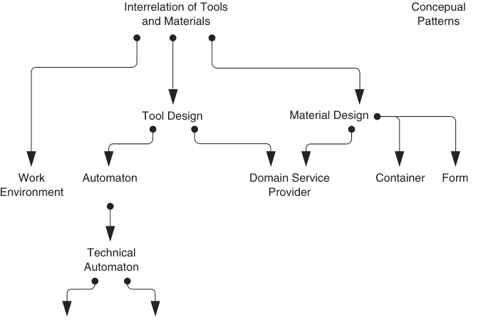

图 7.1 T&M 概念模式层次结构。

每个概念模式都被单独描述。我们采用第 4.3.10 节的通用模式并对其修改以改变概念模式。

- 模式名称。
- 意图：这个模式有什么用？
- 问题：该模式解决了什么问题？
- 关联：哪些其他概念模式或设计隐喻位于该模式之前？
- 解决方案：核心解决方案概念。
- 背景：是什么导致了我们产生这个模式？（一个可以跳过的章节）
- 权衡：使用该模式的优缺点。
- 示例：一个示例。
- 理论依据：何时应该使用该模式？
- 下一步：哪些模式将很有用？

我们从 T&M 概念模式的概述开始本章，读者将理解这些作为路线图的本章中讨论的模式是如何组合的。我们将使用图 7.1 作为参考，继续详细描述每个模式。

## 7.2 T&M 概念模式引导导览

## 工具与材料的相互关系模式

核心模式是工具与材料的相互关系。它为第 3.5 节介绍的工具与材料设计隐喻提供了主要的背景。考虑到工具和材料紧密相关，我们将它们作为设计指南来思考。

# T&M 概念模式

## 材料设计模式

该模式关注第 3.5.7 节介绍的材料设计隐喻。它帮助我们将工作场所的具体材料转换成系统的材料。同时也讨论了设计指南。

## 工具设计模式

工具设计模式将第 3.5 节的工具设计隐喻转换到应用设计中。重要的问题是，什么样的工具可能是合适的。与材料设计隐喻相比，工具无法直接从工作场所转换到软件系统。通常，我们设计专门的工具以最佳方式支持用户的任务。

## 工作环境模式

正如我们在第 3.5.16 节所看到的，容器的概念在应用领域是相关的，并且在软件系统中可能有用。因此，该模式是为了让开发者设计一个存储和使用工具及材料的位置。

## 容器模式

正如我们在第 3.5.16 节中看到的，容器的概念在应用领域是相关的。该模式描述了如何为构造中的应用设计容器，以及这如何关联工具和材料。

## 形式模式

形式是观察应用领域某些材料的特殊方式。我们观察到许多材料表现出与所谓的形式相似的行为。与完全的材料相比，它们没有特定的交互。它们提供了通用的处理方式，即在预定义的字段中填充值并读取它们。我们为形式的设计和行为专门分配了一个模式，因为它是应用开发中最常见的、可以与预制通用工具的通用材料。

## 自动化模式

设计模式描述了在 T&M 方法引入自动器的主要动机。在相关的概念模式中，我们讨论了我们在系统中通常设计什么类型的自动器。

## 领域服务提供者模式

当我们使用 T&M 概念模式从设计模式转向软件设计时，我们需要考虑应用的基本结构布局。


# 工具与材料的相互关系模式

分发和多通道区域等问题随之产生。由于这些问题背后的技术通常复杂且难以使用，它们引入了从用户角度来看相关的的新类型问题。因此，我们引入了一种处理这些问题的匹配概念模式：领域服务提供者。虽然没有直接的设计方法可以得出这种概念模式，但我们可以将服务提供者视为纯业务逻辑的概念单元，它负责提供和处理材料。工具通常与领域服务提供者交互。

# 技术自动化模式

技术自动化模式直接源于通用自动机模式，而后者又与探测器和调节工具相关。两者都基于工具与材料的关联以及工作环境模式。

# 7.3 工具与材料的相互关系模式

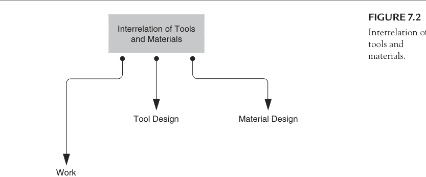

**意图**
工具和材料是采用 T&M（工具与材料）方法设计的交互应用程序系统的核心元素。考虑到工具和材料根据其工作上下文进行区分，因此以互补的方式设计它们至关重要。图 7.2 展示了工具和材料如何相互关联。

**问题**
我们必须将交互式应用程序系统分为若干元素，以便用户能够根据其工作情况的要求完成任务。这些元素应该基于领域动机以及与工作场所已存在对象的可见上下文。我们必须将我们的工具和材料比喻转化到应用程序系统中。

**关联于**
此模式与工具设计、材料设计和工作环境的设计比喻相关。

# T&M 概念模式

**解决方案**
我们从用户的视角出发，将应用程序的核心建模为一组有意义的材料和工具，适用于在单个工作场所完成任务。为了这一目的，我们首先定义了未来系统需要支持的当前任务，以及在系统上线后将以相同方式处理的任务。需要支持的任务定义了用户处理工具以操纵材料的工作上下文。

**材料的相似性**
我们的应用程序系统应该允许完成手头任务，以便在以应用为导向的材料核心中反映这些任务。这意味着，通用性最初体现在应用领域中的重要材料中，即我们开始开发软件材料的平台。我们始终将材料视为计算机中的对象，这些对象必须被操纵。

在此联系中，我们使用工具向我们展示被操纵材料的相关方面，并提供工作选项。工具应该是顺手手的，以便我们在使用它们进行操纵时感到舒适。毕竟，我们需要关注材料而非工具。工具让我们能够访问并与材料交互，但它们保持在背景中。

工具通常为重复性任务设计；它们非常适合完成手头任务。软件工具并不是现实世界工具的镜像。它们代表了完成任务所必需的领域原则和重复操作。在这方面，它们的工作形式对于特定的材料是恰当的并支持软件中可能的交互。工具可以被认为是支持重复性活动的手段，这些活动可能根据材料和情况而异。

**示例**
让我们回到 EMS 示例。我们已经看到，设备经理到为止只有几个简单的、通用工具，如笔、尺和橡皮擦。但她处理过各种材料：房间平面图、设备识别卡和员工信息。从应用领域中的这些设计对象和工作工具开始是明智的。工作材料看起来是我们的使用模型元素的良好候选者。同时，显而易见，我们无法将笔或尺子等可用工具转换为一一一的软件元素。尽管如此，整体想法看起来很有前景。我们想设计一个应用程序，让设备经理可以使用适当的工具在我们的房间平面图、设备识别卡等上工作。即使是基本的交互似乎也符合我们的使用模型：工具应该支持设备的购买；当员工搬到另一个工作场所时，应该有一个工具来……

**背景**
对象（意义意义上的物品）在日常工作中被用于完成任务。我们根据工作情况放置这些对象以便其可用。将大多数此类对象归类为工具或材料并没有问题。

* 1. 第 10 章将更深入地查看分布式和协作工作情况。

# 工具与材料的相互关系模式

根据工作上下文，我们选择适合处理材料的适当工具，以便获得预期的工作结果。

工具与材料相互关系的这一概念模式帮助我们把这些工作上下文作为软件设计的平台。应用程序系统的相应组件应该被理解为工具并据此设计。在这种尝试中，我们不能简单地将实体工具和材料转移到软件。然而，这并不是所希望的。工具和材料的设计应该适应应用软件特征，其中我们必须观察几个侧条件。

对设计过程的分析导致领域模型。该模型代表了相关的工作对象及其用途或形式。这些交互源于在完成相关任务集时对对象进行修改和改进的工作。这定义了材料的领域核心，因为我们假设在引入我们的应用程序系统之后任务将继续维持。

> 从分析到领域模型
> 在将对象从工作世界映射到领域模型时，存在重要性差异：在完成任务时，用户必须使用工具来操纵材料。用户无法简单地用手抓住材料。这意味着我们必须为每种情况设计一个合适的工具。在你的软件环境中，材料可能会改变在工作情况下被工具（或自动机）所操纵的对象。

> 对象与材料
> 工具通过观察它如何被用于操纵材料来理解。工具提供了适合工作情况的材料，提供了预期的功能。工作的质量在很大程度上取决于工具使用的优劣。反之，工具的质量取决于效率和一致性。

> 工具与材料
> 这意味着工具和材料紧密相关，因此我们总是需要共同处理它们。这适用于工具和材料的软件设计。工具只有通过它操纵材料才能被理解。材料是我们通过使用工具可以做的事情。

> 将工作关系应用于设计助手
> 我们可以把现有对象直接引入软件组件。由于这个原因，我们必须查看应用领域存在的材料背后的概念，以及完成任务集的活动。它们代表了我们在设计工具和材料时可以使用的指导原则。


# T&M 概念模式

## 依据

工具与材料背后的概念相互相关。我们总是必须结合起来来看它们。我们必须定义一套连贯的工具和材料，以最优方式支持用户完成其日常任务。

# 后续

材料设计模式和工具设计模式将更详细地审述此处介绍的每一个概念。

## 7.4 材料设计模式

图 7.3 材料设计。

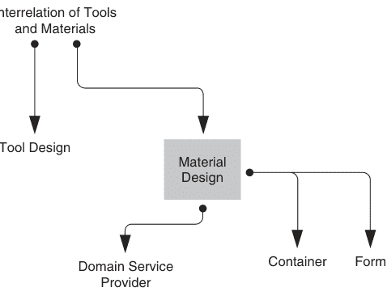

# 意图

材料既是工作活动的对象，也是结果。它们构成了应用程序系统的领域基础。因此，我们将仔细研究如何选择和设计材料。

# 问题

我们必须弥接应用世界的工作对象与应用程序系统的概念材料单元之间的差距。因此，我们必须解决以下设计问题：

我们要识别与用户日常任务相关的主要材料概念。由于材料应该是概念单元，我们必须针对正在构建的系统对其进行良好的选择和设计。

材料可以被探测、操作并嵌入其他材料中。它们可以处于不同的工作状态；在使用它们时，用户专注于对它们进行操作。

我们曾提到过使用设计隐喻来分析应用世界相关的材料。我们还使用它们来对适当的使用模型建模。我们简单地为材料命名，使用了应用领域熟悉的名称。此外，我们在应用领域的背景下定义了通用概念。这些现有的材料和通用概念构成了设计另一层材料——材料类的的基础。

# 关联

该模式的设计与工具之间的概念模式相互关联，以及工具设计隐喻（图 7.3）相关。

# 解决方案

T&M 方法并没有将材料的呈现和操作放在首位，因为它们通常由用户模型中的工具或自动机进行显示和处理。因此：

**关注领域功能**

在设计材料时，我们可以专注于领域功能。我们通过查看各种任务来识别相关功能，并根据相应的材料进行工作。

对于每种材料，我们必须检查它在完成任务中的贡献。在许多情况下，我们发现对象之所以被使用仅仅是因为由于（自动机或手动）数据处理形式的要求。我们认为这是为什么存在这么多控制列表和变更请求的唯一解释，每一项内容都可以通过面向应用程序的软件支持来移除。

T&M 方法背后最重要的思想之一是将抽象概念（表示为材料）引入系统，以避免应用领域中那些显而易见的事物。

我们在之前的章节中简要提到了几个概念示例，例如银行账户或信贷。注意，这些并不以具体对象的形式存在。你不会在银行里找到一个作为“实体”的账户。你在工作中找到的是表单，例如开户表、转账表或存款表，以及这些表单在屏幕上的表示。然而，银行员工必须处理账户，并且对这些账户有清晰的认知，取决于部门和工作地点。这表明抽象概念应该被建模为独立的材料，而不是相关对象和表示的集合。

**材料形成概念统一**

材料提供的不仅仅是某些领域交互，这些交互可以通过类的操作进行建模。这意味着在我们的设计中，我们定义了材料的领域完整性以确保它的可靠性。为此，我们封装了材料类的内部状态，隐藏其使其直接访问，与外部可见的领域状态相反。根据这些材料状态，我们定义了材料类的协议，以确保材料的内部一致性。我们可以在建模任务中使用状态图（见第 13.9.3 节）。这种内部一致性通过对所有状态更改操作的断言来确保，基于设计规范模型（见第 2.3 节）。

材料之间的关系

## 示例

在我们的 EMS 示例设计中，我们首先分析手头的任务以及它们是如何完成的。我们已经看到设备管理器处理了多种材料，包括房间平面、员工列表和设备订单表。我们可以对这些材料应该如何处理进行详尽的领域描述。我们有几个概念，例如房间、设备、员工和房间占用。我们对涉及的工作和阶段也有相当清晰的设想：房间平面被编辑；员工或设备被移动到不同的房间；购买新设备并评估设备统计数据。

从以上所有内容中，我们可以定义材料领域的主要交互。我们可以在设计中采用现有的材料及其领域交互。例如，我们可以建模一个类 ``Employees`，来容纳所有与团队成员雇合同相关的信息。这意味着在软件中实现房间、设备和房间平面概念也是有意义的。

此时，我们可能会思考一种在房间内表示员工的方法，那里不需要关于雇合同的详细信息。一种解决方案是通过房间内的卡片来表示员工。这反映了我们想要关于房间内员工寻找的信息集的阶乘概念。

该解决方案可用于管理领域交互。例如，设备管理器可以使用卡片来查看该员工是否有权占用独立房间，或者他/她是否应该与其他员工共享房间，取决于他们的职位。在过去，设备管理器必须手动运行检查，但现在我们可以利用软件的力量并将此背景转移到我们设计中的材料中。作为一个对象，卡片可以告诉我们员工是否具备独立房间的资格。

同样，我们可以讨论另一个类 ``Device`，以及一个用于表示房间平面中设备对象的设备标识符。

# 权衡

我们并不能孤立地查看应用程序的所有影响。材料之间本质上存在两种不同的关系：包含关系和使用关系（第 2.1.18 节）。

例如，我们 EMS 示例中房间平面上的房间既可以包含设备也可以使用设备。某种关系是否为包含只能从领域背景中看到。为了方便这一点，询问某种材料与其应用程序系统中的“邻居”材料是否都有意义通常很有用。对于我们的 EMS 示例，我们认为当设备不被允许进入房间时，处理起来会更容易。因此，我们建模了使用设备的材料。


## 实体设计模式

我们主要讨论了实体的交互，但这并不意味着从领域角度来看，实体的状态是可以忽略的。首先，要实现实体的状态，需要结构化信息。我们可以从其他实体组合实体，或者让其他实体使用它们。然而，实体的状态本质上是基于值的。每次探测都会返回信息。出于设计考虑，在我们的实现中，应该将内部状态与外部表示的状态分离。这种信息隐藏原则主要通过使用领域（domains）来实现（见第 2.6 节）。

##or：通用操作

实体的每次更改都是通过改变结构化信息实现的。我们在 2.10 节中看到，所有类都定义了通用操作，这些操作可以被用来访问类实例的内部结构。这通常是直观的，并得到了不同开发环境的支持。在建模实体时，请特别注意确保这些通用操作不被公开为代表实体的领域接口。

许多缺乏经验的开发者倾向于将实体设计为纯粹的值集合。这表明他们对设计的理解并不深刻，特别是当从用户界面设计实体时。这种设计虽然 GUI 元素提供了令人印象深刻的工具，这些元素展示了实体信息并使实体变得可操作，但在此类设计中经常发生的情况是：整个领域功能和实体的完整性位于工具及其 GUI 元素（控件）中，而实体则退化为了值的容器。

诚然，在许多情况下，在项目初期基于领域交互来建模是非常困难的。这些传统的实体通常是纸质表单，由一系列用于写入或读取值的表单组成。7.8 节详细描述了此类表单。我们的经验表明，基于表单的实体在开发过程中往往会演变为实体，即当我们领域交互映射到它们的接口上时。因此，我们不应该将实体和表单看作两个完全不同的东西。

## 设计原理

为应用系统设计实体是开发面向应用系统的核心活动之一。实体构成了整个系统的基础。因此，应该以一种严谨且在概念上有意义的方式设计实体。

## 下一步

与实体密切相关的是在应用系统中操纵它们的工具（见图 7.3）。因此，接下来应该阅读工具设计模式。管理大量的实体集合是由于通常分配给领域提供者（domain provider）的任务，如第 7.10 节所述。

特殊的概念模式是表单和容器，如第 7.7 节和 7.8 节所述。

## 7.5 工具设计模式

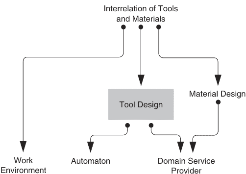

图 7.4
工具设计。

# 意图

工具展示实体并允许我们以工具特定的方式探测和更改实体。它们是应用系统的关键元素，提供了用户与系统之间的核心接口。因此，工具设计对应用程序的可用性影响巨大。

# 问题

工具为我们的设计带来了特殊需求，这意味着我们必须解决两个设计问题。

首先，我们必须定义工具的领域内容或功能。其次，我们必须赋予工具适合在软件中表示它的形状。

显然，我们不能相互独立地解决这两个问题。遗憾的是，我们没有像包豪斯设计那样清晰的“形式随功能”准则。那么，对于银行账户管理器或设备管理器，工具的领域功能会导致什么样的形状或形式呢？

# 关联

此模式与工具与实体设计比喻之间的概念模式相互关系相关（见图 7.4）。

# 解决方案

考虑到我们正在处理软件作为工具制成的基础“织物”，只有少数“特定于材料”的限制需要被考虑。这意味着，在设计工具时，我们基本上必须依靠一些交互式系统的优秀示例以及我们的想象力。

工具的领域功能源于我们对重复性活动的经验。对于每个工具，我们都必须识别出所有应该体现为工具功能的重复性活动。这种努力旨在提供一种工具来简化而非完全自动化这些活动。因此，工具应该支持那些可以通过算法实现的简短且相互关联的活动。

我们已经找到了关于“自动化活动还是支持活动”这个问题的答案。我们可以从所建模的工具的粒度中找到这个问题的答案。每个功能都应该从用户的视图进行建模；它应该能够让我们将其拆分为更简单、更易管理的领域函数或活动的子集。当然，我们要求在领域层面进行这种分解，而不是代码行中。在我们的示例中，如果一个标识的设备从一个房间移动到另一个房间，它本质上是原子的。我们的银行示例也是如此，当我们根据客户信息计算利率时。此此，代表这些身份卡的键是否通过计算机鼠标移动，或者利率计算算法由一系列指令组成，是完全无关的。

相比之下，创建一个房间计划（包括所有房间、设备和员工）应该被视为自动化。

## 示例

让我们在 EMS 示例的背景下看看这些场景，其中工具设计是一项非易事的任务。我们可以从一开始就排除切换画笔来编辑房间计划或填写表单的活动，因为这些活动并没有为设备管理器的任务提供支持。我们知道可以利用工具的潜力，为设备管理器设计一套不同的工具来促进其活动。

首先在我们的 EMS 示例背景下看下这些场景，其中工具设计是一项非易事的任务。我们可以从一开始就排除切换画笔来编辑房间计划或填写表单的活动，因为这些活动并没有为设备管理器的任务提供支持。我们知道可以利用工具的潜力，为设备管理器设计一套不同的工具来促进其活动。

首先在我们的 EMS 示例背景下考虑这些场景，其中工具设计是一项非易事的任务。我们可以从一开始就排除切换画笔来编辑房间计划或填写表单的活动，因为这些活动并没有为设备管理器的任务提供支持。我们知道可以利用工具的潜力，为设备管理器设计一套不同的工具来促进其活动。

（注：原文此处存在重复，以下为逻辑流内容）

让我们总结一下关于设计的想法。这个工具，我们称之为设备组织器（Device Organizer），在我们向列表添加员工姓名时应该是不具侵扰的。另一方面，如果我们只提供房间计划，就会浪费技术选项。

## 实体与工具概念模式

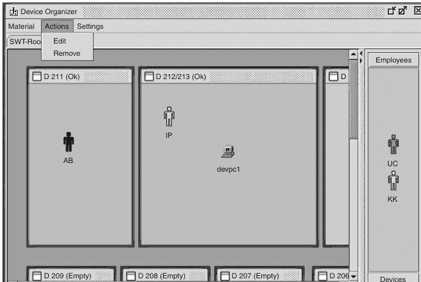

图 7.5
设计设备组织器工具。

7.5 显示了我们设备组织器设计的草案，包含了上述描述的功能。屏幕的右侧显示员工列表，左侧显示当前的房间计划。注意，房间计划中的两个房间已经填充了员工和设备。房间的颜色和描述显示了所选占用情况是否会导致冲突（红色）。在示例中，占用情况是浅色的（绿色）。

# 权衡

我们组合有意义的活动序列来完成一组相关的任务，但工具并没有定义固定数量的功能或流程。虽然工具通常应该支持特定的任务或任务子集，但我们无法定义确切的工作步骤，因为它们取决于实际情况。


## 工具设计模式 (第 149 页)

此外，我们必须记住，一项任务通常不是一次性完成的，中间不会有中断或中间步骤。如果一个工具要支持用户的活动，我们必须赋予用户足够的自由度，让他们决定调用工具操作的顺序，以及何时需要中断工作。这涉及到工具的灵活性。

用户应该能够独立于其他操作来调用工具的操作。对于材料设计而言，为工具赋予其自身的领域工作状态通常是有意义的，这样艺术家就不能在任何时间执行某些工具操作。在工具的用户界面上使这些状态可见至关重要。工具操作之间的这些逻辑依赖关系可以通过软件模型中的设计规范（第 2.3 节）和状态图（第 13.9/5 节）来表示。

工具通常适用于一组特定的活动，而不是适用于工作背景中可能出现的所有情况。这一陈述为我们想要设计的工具尺寸提供了初步的指示。就像工作组织中不同的任务和活动被分开一样，工具也是为了可管理且一致的任务和活动而开发的；此外，还可以为涉及工作的整个活动创建合适的工具集。这意味着，我们不是设计极其复杂的元工具（metatools），而是创建可以轻松组合的单个工具。

图 7.6
从场景到工具。

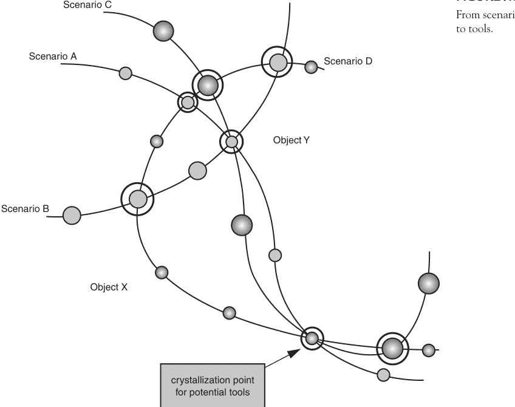

同样，很难说工具何时太复杂，何时又太简单。我们只能说，仅提供单一领域功能的工具，作为涵盖复杂工作场所所有要求的工具，其设计是很糟糕的。

### 设计工具

那么我们如何设计工具呢？为了回答这个问题，我们识别了工作场所涉及的所有相关任务。不同的场景描述了不同的流程，在这些流程中可能会出现同一个对象。现在场景描述了我们如何处理工作对象以完成特定任务。在此联系下，我们通常可以识别出相似的使用形式，或者与不同场景中对象相关或组合的元素元素。这些活动和流程的“重叠”形成了我们的结晶模式（crystallization patterns）。具体来说，我们将相似的活动与相似的材料相结合，并尝试找出是否应该为这种组合设计一个合适的工具。图 7.6 显示了此类结晶模式的示例。

### 讨论：工具的设计特征

这些模式不会为工具的形状或用法提供任何线索。为了识别工具的特征，我们必须使用工具隐喻，并此推导出设计特征。

- 工具可以被很容易识别为工具。它有名称和图形表示。可以通过其图形符号或图标来激活。
- 工具始终显示当前正在处理的材料视图，并对该材料的更改提供即时反馈。工具永远不会隐藏材料。
- 只要处于活动使用状态，工具就会保持可见，也就是说，在操作时，你可以直接操作，或者在不看到工具的情况下操作。这种材料可以被直接操作的幻觉是为了在桌面上移动和安排材料。合适的工具通常只由鼠标指针表示。
- 工具支持多种模式，允许对材料进行灵活操作。与传统工具不同，这种功能通常必须显式地表示。为了这个目的，我们使用图形元素，例如滑块或菜单选项。
- 工具具有记忆并可以针对特定的材料或功能进行调整，它至少显示了如何表示材料的设置。此外，我们通常使用状态指示器来显示用户按下按钮或选择菜单选项时的效果，或者随着功能的进展来显示状态。

图 7.7 显示了一个简单工具的示意设计；注意，这并不是为了提供布局示例。

如前所述，材料的表示方式以及为用户提供的反馈对于工具设计非常重要。表示的类型和系统反馈取决于工具的类型。在构建工具时，我们定义了它应该支持材料的哪些状态以及这些状态如何显示。我们从用户以及我们想要支持的活动的角度做出这个决定。这意味着我们必须回答一个问题：当用户使用工具操作材料时，他们期望看到什么。

## 工具设计模式 (第 151 页)

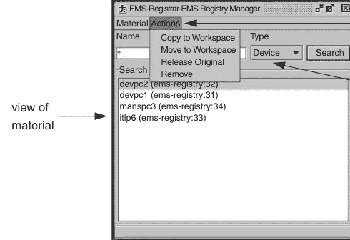

图 7.7 工具的示意设计。

因此，理解我们未来工具所针对的工作背景至关重要。

一个常见的问题是找出当工具用特定材料激活时，应该如何初始化。在许多情况下，用户希望选择一种材料，隐式地启动分配的工具（例如通过双击）。然而，有时直接启动工具更有用，以确保最大的灵活性。解决这个问题的一个方案是这种工具的“空”表示，即没有材料。另一方面，这可能会困惑用户。另一种替代方案是表示空白材料或选择对话框，显示适用于该工具的材料。

## 原理

从材料的角度来看，工具是使用 T&M 方法进行面向应用的软件开发的第二个概念模式。工具代表了用户用于与材料交互以完成日常任务的接口。通常，工具的设计是为了在任务方面匹配用户的需求。

## 接下来要做什么

下一个概念模式——工作环境，描述了工具和材料。

## 7.6 工作环境模式 (第 176 页)

# 意图

工具和材料并非孤立存在；它们被用于工作环境。

# 问题

我们想要找出当工具用特定材料激活时，应该如何初始化。

# 关联

工作环境直接涉及到第 3.3.10 节中的工作环境设计。

# 解决方案

我们建模了一个可以个性化的显式工作环境，在这个环境中，工具、材料和其他事物都有它们自己的位置。

## 工作环境模式 (第 177 页)

工作环境定义了用于组织工具、材料和其他设备的空间和逻辑维度。它应该满足以下要求：

- 工作环境实现空间和逻辑维度的方式应类似于人们感知组织形式的方式。这包括一种无需延迟即可操作对象并立即显示效果的方法。
- 此时，工作环境应该支持从开始到结束所需的机制，并管理组件。
- 一个良好的工作环境将这些对当前细节有意义的工具、材料和自动化相结合。组织者甚至个人应该对工作环境进行个性化。
- 工作环境应该显式地证明逻辑顺序。它应该保持工具和材料之间的一性。
- 工作环境的完整性应该通过规定外部访问和可见性来维护。
- 如果需要，工作环境应该支持并反映各种公司形式。

## 示例

让我们简单过一遍 EMS 示例。一个创建平面图的人的工作环境看起来结构非常简单：有一个当前平面图、员工、名片、可用设备注册表以及用于创建和编辑平面图及员工设备列表的工具。注册表持有当前和旧的平面图、员工列表采购案例。此外，还有一个垃圾桶。所有对象都以图标的形式出现在桌面上。图 7.9 显示了 EMS 示例中设备管理员的工作环境。

这个工作环境与本质上处理公司框架开发的、仅偶尔查看当前平面图的员工环境不同。

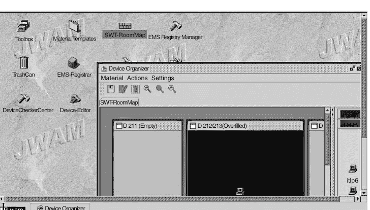


# 154 T&M 概念模式

请注意，基本的排序原则已经建立：设备只能放置在桌面、文件夹、注册表（registry）或垃圾箱中。设备只能在设备组织器中编辑，而不能直接在计划室中编辑。

设备组织器（Device Organizer）显示计划是否保持一致。它基于计划室（plan room）进行检查；计划确保了你不会将未列在设备文件夹中的设备推添加到计划室中。设备组织器允许你在一个房间内放置多个设备。如果发生这种情况，这些设备的更改和标签颜色已归档在其当前版本中，或者当用户尝试在注册表中进行计划室操作时记录。由于注册表用于分布式环境，作为一个外部组件，我们不能将其包含在此工作环境的注册表一致性检查中。

## 背景：工作环境

人们使用工具来管理各种任务以完成工作。这些工具和材料必须有一个位置，这通常是个人工作场所。但即使没有个人工作场所，完成工作所需的物体和工具也必须放置在某个位置并供使用。

我们对工作环境的比喻描述了工具和材料存放的位置。我们必须能够根据任务、排序原则和偏好对该环境进行配置。除了空间布局外，工作环境中还存在定义和概念性的工作。

这意味着工作环境应该代表一个概念单元。我们应该能够表示属于某个人或小组工作的事物。工作环境通常不是公共可访问的地方，因此它应该受到保护免受外部访问。

环境帮助我们组织工作。我们将想做的事情放在优先，并将其安排在文件和邮件中，等待进一步处理。所有与支持协作工作的元素都应该转化到我们的应用程序中。

位置和空间布局的基础原理无法在软件中直接复制。我们有空间名称，但它们仅仅是一个抽象概念，而且，它们是出于技术考虑的。这就是为什么基于主机的传统应用程序没有空间概念的原因。用户从菜单中选择命令或在命令行中输入命令，系统以表格或表格形式的数据输出数据做出响应。当分级文件系统（例如 UNIX 系统的文件系统）被引入时，用户第一次可以创建自己的排序，尽管它们被表示为抽象树。

## 工作环境模式

图形应用程序允许我们对工作环境建模，使其几乎对应于直观模型。带有图形图标的电子桌面是这一方向的重要一步。突然，人们可以使用鼠标进行指向和点击，也就是说。然而，与普通的物理工作环境相比，图形用户界面（GUI）仍然是扩展的，我们无法简单地将环境映射到电子桌面。最重要的缺点是通常没有第三维度。由于桌面太小或分辨率太低，无法提供“虚拟”的 3D 桌面。因此，我们必须设计指南，允许我们实现环境概念，同时与今天工作站和 PC 上的软件相对应。

我们可以很容易说，电子桌面的设计远远落后于可能性。例如，你找不到对象和工具的等效表示。相反，你经常发现 Smalltalk 交互模型，即“对象-动作”，你选择一个对象，然后激活可选动作中的其中一个。此外，空间排序在许多系统中显得过于单调，即一个带有文件和其他生成器的桌面，其中这些文件可以按任意顺序递归嵌套。T&M 方法试图在在应用中克服这些局限性。

## 权衡（TRADE-OFFS）

TSM 方法的第一种设计是：环境位于人们工作的地方。合格人员在环境中使用工具和材料所做的一切，理想情况下都应该产生反应并对用户可见。这意味着我们必须解决反馈问题，在第 7.5 节中简要提到过。就使用模型而言，只有引用工作环境内部的操作应该具有即时效果。用户应该能够看到“内部”和“外部”意味着什么。

让我们通过银行客户经理工作场所的示例来看这个问题。客户经理可以直接查看和编辑工作环境内的某个可用表单。相比之下，开新账户是外部发生的事情。客户经理将希望使用适当的工具查看他刚刚创建的账户是否应该给她留下一个账户在“表头（on header）”的印象，因为从技术和领域角度来看，这种账户无法无法的。

在实现空间模型时，我们通常将桌面设计视为最著名的类比。工具和材料被表示为图标，它们可以在空间关系中直接操纵、激活和移动。桌面被表示为工作空间（workspace），为工具和材料提供一个符合人类感知表示方式的位置。在设计桌面时，我们应该注意区分，尽管桌面视觉化了用户的工作环境，但它与环境并不是等同的。在现代软件设计中，电子桌面可以基于小部件工具包构建，或从现有的系统软件重建。

你对早上发现的桌面像前一天离开时时是那样的预期，也适用于关闭和启动你的应用程序系统。工作环境负责维护和恢复这种状态。

## T&M 概念模式

工具、材料和自动化的实际维护和恢复可以委托给其他组件（例如注册表）。从技术角度来看，让环境管理工具或自动化的启动和终止也是意义的。

电子桌面只是表示环境的一种可行形式。如果具有维护材料和工具可用的潜力，对环境进行结构化可能是好主意。例如，我们在现实项目中成功实现了工具箱（toolboxes）和文档文件夹。

另一个概念多工作上下文（multiple work contexts）将解决方案更进一步。此类工作上下文由用户完全设置并可以更改。一种可能的实现是为每个新的业务流程创建桌面界面。在这种情况下，作为保险公司的用户为某个客户定义了一个新的工作上下文。如果用户必须中断对该客户的工作去处理另一个客户，他可以将这个上下文放在一边。当他完成后，可以把第二个上下文放在一边，返回处理第一个一个。

环境内使用的对象的许可操作必须是即时的，即它们可以可以直接执行并显示即时效果。这意味着用户应该能够在无进一步保护的情况下使用环境内的工具和材料。用户还应该能够在工具集之间切换。通过一个工具管理的效果可以通过其他工具可见。

每个工作环境指的是特定的使用上下文。这种使用上下文比通用的应用程序领域（见 9.2.1）更具体，因为它对于设计该环境的任务和工作情况至关重要。因此，我们假设一个应用程序内存在不同的工作环境，在工具、材料和自动化的配置上不同。这意味着一个应用程序领域的接收部分决定了工作环境的特征，取决于所选的工作场所类型（见 3.3）。

拥有不同的工作环境引发了它们是否可以个性化的问题。应用程序领域需要用户向系统识别并验证身份。在 T&M 方法中，这通常会导致个性化的工作环境，在用户启动系统时显示他们最后或所需的工具和对象组合。此外，工具可用功能集取决于用户，基于用户的角色而不是。环境是这些任务的解决方案。用户登录和注销系统，并根据授权状态请求所需的工具。一旦在环境中实现了基本的用户识别模型，就可以添加额外的概念，例如用于协作的用户组（第 10 章）。


## 工作环境模式

在传统的工作环境中，我们对物品的归属以及如何契合非常谨慎。我们将这些原则显式地转移到应用程序软件中。这有助于用户处理环境。其中一个简单的机制是“清理”原则。当我们为工作环境指定一个基本顺序（该顺序同时也可以由用户定义）时，我们就便于按顺序保持复杂环境的概览。这还需要为用户提供保存和恢复环境的选项。

基本的排序原则还要求工作环境中的对象是可知的。例如，当用户放错某件材料时，他们能够在环境中搜索该材料。排序原则还包括在特定期间使用的材料和工具列表。

然而，大多数组织在上述工作之外，通常是使用特定的工具，而不是在工作环境中进行直接操作。例如，发送给客户的文档是由客户文件的用户处理的。我们可以使用此类工具来检查一致性条件并对其进行表示，以便用户能够轻松理解。例如，我们可以利用工具与材料之间的相互作用来确保：信贷协议已经签署、归档在不同的文件夹中，并且只能对另一个文件夹中的协议副本进行修改。

我们知道工具适用于某些材料，反之亦然。这意味着用户应该能够在其环境中使用哪些工具和材料是匹配的。即使环境在技术上将此委托给某个管理器或工具，工作环境的使用也应该显示这些匹配关系。当习惯为此种目的使用不同的图形时；例如，当材料移动到工具中时，工具应该显示是否存在匹配。当这适用于材料和工具时，将材料随机放入容器中。此外，容器不能任意嵌套。如果我们选择区分文件夹和文件柜，那么允许对这些东西进行任意嵌套就没有意义了。

一种复杂的、也可以被视为一种概念的原则是“当前工作对象”。这个工作对象的产生始终由应用程序领域和其在环境中的位置所驱动。例如，它可以是一个由银行账户经理处理的客户。虽然不同的工具目前可以操作不同的材料，但这个工作对象在环境中是已知的。为了让当前工作对象可见，我们可以将其称为一个显式陈述（如“设置当前客户”），或者一个特定的工具（如“查找客户”）。如果环境中存在这样的当前工作对象，那么我们可以在不同工具中实现操作，如“传输当前数据”。例如，表单编辑器可以使用这些操作在没有用户显式操作的情况下，将客户的姓名、编号和地址添加到表单中。

最后，工作场景存在一致性条件，这些条件无法在单个工具或材料层级上制定。例如，当用户填写并电子签署了特定的软件表单时，信贷协议并没有真正完成。为了在法律上有效，合同信息必须从工作区传输到位于主机上的操作数据库并被接受。工作环境可以帮助将此情况转换为适当的使用模型。例如，工作环境可以将合同编辑器、客户文件、发件箱和用于主机通信的自动化器连接起来，使用户可以获取合同案例状态的特定应用程序视图，并理解完全编辑的合同何时何时生效。例如，这意味着用户可以看到该案例已完成，但由于到主机数据库的传输问题，尚未生效。

这个示例是一致性检查的一个通用原则：一致性检查“从内向外”运行，并且它局部于各自的上下文。例如，首先要检查的是上下文无关的领域视图中的数据信息（见第 2.6.5 节）。接下来，在与材料（信贷协议或嵌入它们的任何材料）的相互作用中检查值。工具检查在当前情况下，信贷协议是否可以添加到客户文件中。然后，由工作环境检查整个工作上下文，在局部上下文中可以检查的检查已通过，所有超出此层级的检查都将向上委托。为了一个安全的使用模型，使用户能够重现这些嵌套上下文以理解何时以及何处生效，我们需要通过在工作环境中实现空间表示法，以工具和材料的形式表示上下文集来实现这一点。

## T&M 概念模式

环境包含工具，保护材料免受外部影响；这些对象受到外部访问和可见性的保护。工作环境的类型决定了什么在外部，什么在内部。工作场所受到所有其他工作场所和用户的保护。从技术角度来看，环境是命名空间的特定领域解释。工作环境从外部不可见，也无法访问。从技术角度来看，许多工作场所的协调可以按顺序实现，甚至作为单进程系统实现。

无论这种技术解决方案如何，通常无法直接访问材料，因为必须使用动作或操作将对象从一个环境移动到另一个环境。

除非工作场所被设计为单用户系统，否则封装无法完全完全。我们需要能够为工作场所和环境的内部提供输入的能力。对于模块的导出和导入接口（即连接不同的案例），我们将使用自动化器来实现连接不同类型的系统组件（如主机）。这种向外开放的形式在主机模型中并没有达到单用户系统，因为用户可以通过显式交换数据来与其他系统协作。显式陈述的空间概念或协作模型将在第 10 章讨论。

当环境或能够查看其他工作场所既是工作的一部分，又是应用程序系统的显式部分时，我们就必须开发适当的使用模型。在大多数情况下，至少我们必须在应用程序系统中实现简单的协作和协调机制。

此类改变我们对环境观念的协作和协调概念包括邮箱箱或公共注册表。通过引入空间隐喻，我们扩展了对环境概念的质量，即我们创建了共同空间和公共工作环境。我们在这里不再进一步讨论这个问题，因为这超出了这里感兴趣的工作环境工具和材料设计的要问题，但我们将在第 10 章回到它。

7.7 容器模式

图 7.10
容器模式。

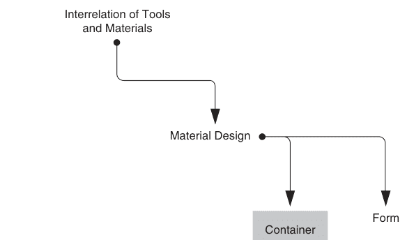

意图 在软件系统中表示工具和材料的可能性对存储和排序这些对象提出了要求。问题 用户经常需要编辑和移动相似或相关材料的集合。这些集合是特定于应用程序的也就是说它们不仅由底层技术驱动。它们的形式与传统的技术数据结构不同（例如，数组）。因此，

我们如何通过面向应用程序的方法来建模相关项的集合及其管理？


# T&M 概念模式

## 相关性

容器的概念模式既关联材料设计比喻，也关联容器设计比喻。它也可以被视为本节中材料概念模式的一种特殊变（参见图 7.10）。

# 解决方案

我们希望将容器的比喻转移到应用程序中。

存储材料和收集物品是人类的基本活动之一。为了这一目的，我们经常使用容器，之前我们已经引入了这种的设计比喻。重要的是记住，容器是由应用领域驱动的，应该被视为用户模型的一部分的独立对象。在 T&M 方法中，容器位于工具和自动机的边界上。它们被操作或处理，这使得它们成为了材料。它们管理、探测、控制其他对象，这使得它们接近工具和自动机。

延续上述承诺，假设我们想要将领域容器建模为用于存储材料的对象。与其他材料相比，容器可以通过工具进行操作。它们有自己的交互方式来管理和编辑存储的材料。

注册表可以提供以下服务：

- 容器可以用于存储、收集和排序材料。
- 容器可以管理其存储的材料，并提供关于其集合的信息。
- 容器（包括其材料）可以移动到其他位置，这意味着容器支持协作与协调。

容器的服务

## 示例

对于我们的 EMS 示例，图 7.6 显示了四个容器：工具箱、模板文件夹、垃圾箱和注册表。注意，所有四个容器在基础上都类似于传统的容器。在示例中，工具箱显示了所有可用工具的列表，可以从列表中激活。模板文件夹反复输出当前表单，然后变为空。

垃圾箱在其他电子桌面应用中为人熟悉。我们示例中的垃圾箱除了存储功能外，还有一个“自清理”功能，并且会有特定的保护并考虑到因素。垃圾箱不接受使用写入器的对象或对象。

注册表的特征可能取决于操作系统。例如，如果设备工作区被设计为单用户工作站，它仅代表存放和管理计划及设备信息的地方（参见图 7.11）。用户看不到、也不对背后是否存在数据库或文件系统感兴趣。毕竟，其他容器也应该确保它们的材料是持久的且永久可用的。

另一方面，当注册表用于分布式应用程序系统（例如连接到秘书处工作区）时，它必须具有额外的属性。在这种情况下，几个人（作为设备管理员和秘书）可能会访问此注册表。出于这些原因，我们需要协作模型（参见第 11.2.3 节）。

EMS 示例

## 容器模式

图 7.11
设备管理员工作处的容器。

至少以基础形式，让用户在共同使用的对象上进行交互。具体来说，这意味着秘书应该能够看到哪个房间计划是当前的，以及是否有人编辑另一个房间计划。设备管理员应该获得有关秘书执行房间计划更改的信息。这种协调可以在基础协作模型中建模，使用注册表状态信息。

# 权衡

每个集合都与一个选择原则相关。我们知道什么属于集合，什么不属于。从技术角度来看，这提出了是否应该在容器中存储相似或不同对象的问题。从技术和领域角度来看，对整洁处理容器的一个重要贡献是让容器显式地检查选择原则，允许用户看到特定对象是否“符合”容器。

解决此问题最安全的方案是适当的类型化，这可能是受限的多态的（作为超类型的选择选择类）。更具体地说，我们可以为所有感兴趣的对象指定预期的最小接口。如果我们使用的编程语言不是强类型的，则必须在运行时检查选择原则。最终，这将允许用户根据直接多向查看对象是否可以被拖放到容器上（我们稍后将讨论一个使用专用容器的更复杂模型）。

强类型语言中的多态容器是有问题的，因为容器仅通过它们的超类型和抽象接口被认为是已知的。在考虑存储在容器中时，这是合理的。然而，当我们从容器中检索出此类对象时，我们需要以特殊的形式处理它们。这意味着，例如，一个存储文档的文件夹可以接受信件，如果 Document 是 Letter 的父类。遗憾的是，文件夹将只能向工具返回 Document 类型的对象。如果工具想要编辑分配，那么我们必须使用类型转换，或者称为下转型（downcasting）或反向表示。

容器通常表示顺序。只有少数容器被构想为“数字箱”，即使它们偶尔被用作如此。为了避免这种风险，我们在领域容器中显式地构建了顺序。这意味着容器知道其排序原则并确保该原则被遵守。同样，对象在被添加时被存储在正确的位置，并且这个位置在修改操作中得到维护。

## 实现管理函数

在第 3.5.18 节关于容器比喻的讨论中，我们已经提到容器具有管理功能。在传统系统中，容器的用户通过显式操作管理存储在所述容器中的对象，例如手动在正确的位置插入数据或维护列表。

## 特殊容器

将这种管理更进一步并结合一致性，我们可以考虑特种容器，例如贷款申请。。虽然这种容器的内容是异构的，但它在狭窄范围内被定义。我们使用口袋或标签对此类容器进行建模，以清楚地显示容器管理的用途。这种对内容的定义和内部一致性允许我们回答许多关于容器层的问题。例如，贷款申请可以提供有关信用状态的信息，即是否检查了偿还能力以及申请是否已批准。

## 实现传输介质

当请求的材料需要收集并转发处理时，容器也是一个很有用的比喻。例如，在数据库应用程序中，必须收集若干符合选择标准的容器。传统方法返回结果集。在面向对象的世界中，没有所谓的结果集。相反，它必须以领域材料的方式表示。将结果集实现为已知容器（如文件夹）中的材料集合通常是有用的。这引出了另一个问题：我们如何在 T&M 系统中管理非面向对象的数据库？

材料传输

到为止，我们只是触及了传输方面；它在过程中起着孤立的角色。另一方面，移动容器中的整个材料集合是方便的。当我们想要从一个环境内的不同房间或在不同环境之间移动整个集合时，传输方面出现了。在这种情况下，容器可以是“自然的”传输，模拟我们在现实世界中移动文件夹或容器的方式（参见第 10.3.2 节）。这些传输容器对于允许协作工作环境中的协调可能有用。

## 背景：容器

从概念和构造的角度来看，我们可以将容器视为一种材料。事实上，我们通常假设大多数复杂工具都是在一个或多个容器上操作，以便用户选择所需的材料。


## 容器模式

另一方面，容器在“普通”材料中占据着特殊的地位，因为容器的设计始终是为了包含其他材料，并通过对这些材料调用操作来组织这些材料。在现实世界的项目中，这往往导致一个问题：容器被建模为一种具有相应接口和明显机制的工具（见 8.11.6）。

由 T&M（工具与材料）开发的企业系统假设了管理和聚合功能，例如用于管理账户列表的银行账户集合，或用于汇总每日销售额。这意味着它们已经偏离了经典的数据结构和集合类。

从开发者的角度来看，我们必须区分由应用领域驱动的容器和技术结构容器。对于开发者来说，在编程时他们一直在处理数据结构类容器。因此，从开发者的角度来看，列表、树和哈希表是用于管理的“领域特定”容器。在传统的软件工程中，数据结构被规定为抽象数据类型，但它们也是编程语言的命令式数据类型。当面向对象的语言引入技术性容器时，情况发生了变化，这些技术容器提供了它们自己的导航概念（通过“第一个”和“下一个”操作），即所谓的标记，封装在状态或访问操作中。这些技术容器是集合类，被用于许多面向对象的应用程序中。

相比之下，T&M 方法区分了技术容器和领域特定容器，后者是我们根据应用领域的任务来识别的。此外，我们还设计了领域容器的变体，而不局限于文件夹和文件的通用概念。

没有理由要求我们显式地建模容器。在面向对象的语言中，类并不会自动提供其所有实例的集合。在这方面，面向对象的容器与关系型数据库完全不同。事实上，关系模型的主要特征之一是你可以使用以表形式实现的关系来处理所有相关的元组或记录。这是我们在面向应用模型中从未需要的东西。相反，我们通常希望将类的不同实例存储在不同的位置，因为这让我们能够管理用于关闭和待办案例或应用程序的模型，并在使用模型中表示它们。

# 理论依据

容器是我们日常工作的重要部分。我们经常需要处理许多材料。我们将它们放在一起，在单独文件夹中对它们排序，或者移动包含材料的简报。因此，领域容器成为了面向面向的软件开发的基础部分。

# 后续

除了可能被视为特殊材料的容器模式外，在下一节中可能会发现另一种特殊材料。此外，第 8.11 章介绍了为了该目的使用设计模式领域容器实现容器的后续步骤。

## T&M 概念模式

## 7.8 表单模式

### 图 7.12

工具与材料的相互关系

表单模式。

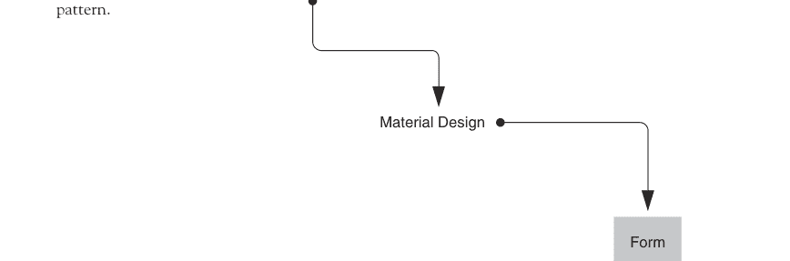

# 意图

纸质和电子表单在许多应用领域中起着重要作用，特别是在办公环境中。在 T&M 方法中，这些表单是一种特殊的材料。

# 问题

在分析应用领域时，我们经常发现某些材料很难识别出单一的领域特定用法。我们通常发现用户会填写表单的字段并阅读其内容，例如客户信息表、采购订单表或申请表。对这类对象的建模尝试通常以一组用于设置和获取数据的通用操作告终。因此，将它们作为单个材料进行设计和实现似乎是多余的。除了这种通用的领域特定用法外，表单还具有其布局特征，这种布局通过固定和可编辑字段得到很好的区分。

在为这些表单设计合适的工具时，我们也发现它们的领域操作要么是有限的，要么不存在，因为我们主要寻找的是钢笔的电子版本。在这种尝试中，我们最终得到了可以垂直设置和获取更多信息的编辑器。

我们如何将纸质表单的概念集成到面向面向应用的整体建模方法中？将表单建模为材料是否足够，还是说它们显示出自身的特征？

# 关联

表单是一种特殊的材料。因此，它们与材料设计的概念模式以及材料设计隐喻（见图 7.12）密切相关。

# 解决方案

我们将表单作为独立的概念模式来处理，因为它们代表了跨从设计到构建的所有开发阶段的特殊材料。

## 表单模式

因此，我们将表单建模为具有通用接口的特殊类型材料。将表单建模为一种具有通用用法的材料解决了许多分析和构建问题。这种表单的用法是由应用领域驱动的。它对应于处理表单的传统方式；例如用户填写申请表或在自定义表单中输入信息。当我们把这种用法翻译到软件构建时，我们可以建模为表单输入和读取数据的操作。如果我们通用地实现写和读操作，我们的构建将变得更加优雅。

除了我们为表单材料推广的通用接口外，我们还保持设计开放，以确保随着经验的发展，我们能够将表单开发到更复杂的领域。

在许多应用领域中，表单是以特定方式设计的。在设计电子表单时，我们还需要使用布局信息以便在屏幕上显示表单。我们还希望以特定格式打印电子表单，例如在打印模板表单上打印信息。

许多表单必须保持一致性以确保经过正确的编辑和填写。一致性条件可以在两个级别上定义和检查。许多表单具有特定的值类型，例如日期或日期范围（如出生日期），由于因此，表单的每个字段应该包含一个领域值，然后对其进行有效性检查。

此外，还有一些一致性条件无法在单个字段的上下文中检查，例如，如果我们说客户的账单地址与发货地址不同，我们必须输入这两个地址。这种一致性只能对整个表单进行检查。

如果表单可以进行通用的建模，我们也可以实现通用工具。以下工具经常用于表单：

- 表单编辑器可用于所有类型的表单。
- 表单查看器在屏幕上显示表单。
- 表单复制器允许将一个表单的内容复制并粘贴到另一个表单。
- 表单打印机将表单输出到打印机，使用空白纸或预印表单

在处理表单时，我们必须解决与版本有关的问题。具体来说，我们需要确保始终使用最新版本。为此，我们使用表单服务。例如，当用户需要填写表单时，他们可以从中央表单服务器获取表单的新副本，服务器始终维护最新版本。

## 示例

在我们的示例中，当雇用一名新员工时，会创建一个包含该员工个人信息的表单。在这种情况下，表单没有单独交互；它仅用于输入员工信息。

假设人事部门拥有这些信息，员工表单可以通过简单的表单编辑器进行编辑。根据标签表示并填充所需的字段就足够了。图 7.13 显示了我们为 EMS 示例设计的通用表单编辑器。


# T&M 概念模式

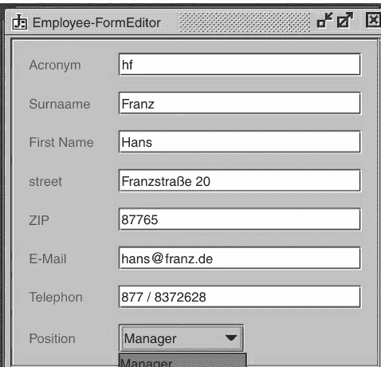

## 图 7.13
一个通用表单编辑器。

表单与“其他”材料

# 权衡

表单可以极大促进我们的分析和设计工作。然而，我们必须警惕“锤子症”：“手里拿着锤子的人，看什么都像钉子”（归于马克·吐威恩）。在很多情况下，表单的想法会诱导我们把材料视为纯粹的容器。我们在项目初期经常观察到这种倾向，此时开发者对领域上下文还没有完全的理解。我们必须意识到这种风险并避免它。在极少数情况下，应用程序可能仅由表单组成。我们必须不断自问，我们研究的材料是否被用作表单，或者是否存在其他意义的交互。我们必须仔细研究哪些材料可以被建模为表单。分配给材料的领域功能越多，我们开发它就越容易。最终，我们能够在某一个地方处理领域的变化。

我们可以从基于表单的设计开始并逐渐开发它。如果在项目过程中，我们发现表单提供了额外的领域交互，那么我们就可以先为这些表单寻找额外的领域操作。例如，我们可以为采购订单表单建模总价的计算。如果我们能向表单添加许多操作，那么将其转换为一个“普通”材料通常是有用的。然而，这并不意味着一定要替换表单。表单和“普通”材料可以在使用模型中并存。例如，我们可以有一个采购订单表单和一个更全面的材料，后者代表了采购订单本身。

# 自动化模式 167

## 原理

表单是种特殊的材料。表单主要包含可以填写或读取的命名字段。这种对表单极其非常单的用法（我们在应用世界中以类似的方式观察过它）允许我们以通用的方式实现这些材料。

## 下一步

在第 8.12 章可以找到用于表单的特殊设计模式。

## 7.9 自动化模式

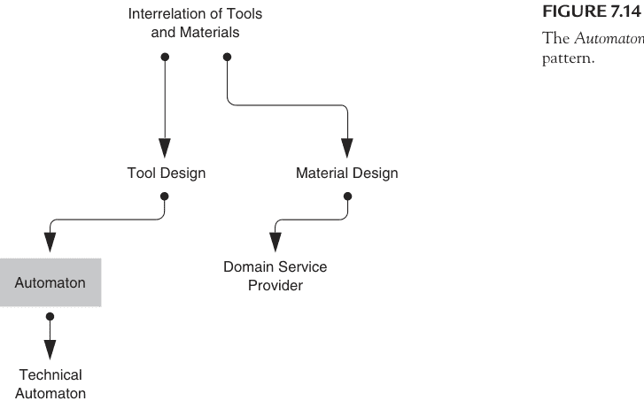

# 意图

应用领域中的并非每一个任务都可以仅通过使用工具来完成。自动化模式描述了如何通过 T&M 方法支持枯燥的常规活动或常规工作。

# 问题

工具被用于支持人类工作。当必须执行某些活动时，我们称之为常规活动或常规工作。如果此类常规活动总是产生相同的结果，如果用户只有一种工具可用，那么就必须交互地重复相同的工具操作。这种常规工作是自动化的理想候选者。因此。

我们正在寻找一种概念，以非侵入的方式支持具有固定结果的重复常规活动。问题在于条件条件，，以及如何通过 T&M 隐喻将此类常规工作自动化。

# 关联

此模式与自动机的设计隐喻有关，可以看作是对工具设计概念模式的补充。

# 解决方案

我们将工作的重复模式实现为一种自动化器。从用户的角度来看，一个自动化器封装了一系列特定的工作步骤，它不依赖于任何上下文即可产生一个定义良好的结果，且不会中断。

我们构建一个自动化器，使其操作方式类似于在材料上的工具，其中自动化器所需的输入限于少数的选取或初始交互。

我们将此类对象称为“小型自动化器”。它们通常被实现为接管常规工作，并可以在用户根据意愿在包含工具、材料和容器的工作环境中使用。如果此类自动化器适用于涉及的材料，那么就可以像工具一样被重新配置，以便在更大的上下文中使用。它们涵盖了标准情况。为此，可以定义一小组参数，自动化器可以在无需人工干预的情况下运行。这些限制了它们的使用。在一个良好秩序的工作环境中，应该有特殊工具来处理特殊情况，以保持某些灵活性。

此类自动化器可用于应用程序中的各种目的，而不会破坏自主活动工作场所的基本特征。自动化对于功能性工作场所起着重要作用（见第 3.6 节）。如果我们希望支持常见的活动序列，我们就设计一个集成所需组件的自动化器。这种集成可以在不同的粒度上实现。

在松耦合的环境中，单一工具维护自己的组件，但它们与材料的连接和交换由自动化器控制。在这种情况下，工具维护自己的交互组件；而在集成程度更强的环境中，自动化器集成功能组件以直接访问单一工具，其本身代表一个交互组件。最后，当自动化器使用工具子集执行特定任务时，独立的工具可以完全消失，但它直接处理了领域功能的重要部分。这意味着工作场所具有控制面板的特征。

集成程度越高，功能性工作场所的自动化器就越变成一个“大型自动化器”，即它决定了完成定义良好的任务所需的活动序列。

## 示例

在我们的 EMS 中，我们只能看到一个领域自动化器，它检查设备库是否有过时设备，以便将其标记为处置或升级。这个自动化器可以与（例如）设备管理器邮件系统的收件箱进行交互。然后，每当设备管理器激活其电子桌面时，自动化器都会在后台检查库存中的过时设备。如果合适，它将产生一条短备注并将其放在设备管理器的收件箱中。

# 自动化模式 169

##讨论：自动化器对比工具

我们经常问的一个问题是是什么使得自动化器的运行时与工具的算法不同。答案是无，至少从纯技术角度来看。事实上，自动化器的运行时和工具的算法都是通过指令实现的，具有定义良好的结果。

工具和自动化器之间最重要的区别在于上下文以及实现操作的程度，特别是如下：

- 关注要实现的结果，工具仅仅是用户的一种手段，并且取决于工作的进度。从这种意义上说，我们期望软件工具不是自运行的，而是由用户手动引导的。为此，功能应该是原子的；从用户的角度来看，手动努力可能是有意义的。例如，排序并不感兴趣排序算法必须实现。

- 相比之下，使用自动化器意味着对定义的活动序列的控制权从用户传递给了自动化器。用户对执行过程中的步骤不感兴趣。只要构建自动化器的标准情况存在，并且定义的结果符合用户的预期，用户就没有兴趣干预该过程。

在 T&M 方法中，自动化器对应于我们作为自动机的技术过程概念。从用户的角度来看，计算机运行许多过程来支持功能，而用户通常对此细节感兴趣。我们使用这种计算机中的过程概念以适当的方式表示领域过程。

从这种意义上说，我们使用自动化器封装系统平台的非面向对象的组件，例如早期 T&M 项目中的关系型数据库（见 11.2.5）。我们使用此类自动化器有两个原因。首先，它们封装了协议和接口。其次，它们在 T&M 使用模型中实现了技术组件的解释。例如，用于主机通信的自动化器既可以用于从面向对象的应用程序传输操作数据，也可以使用适当的工具通知用户是否建立了与主机的连接以及数据是否已传输。同样，我们将局域网（LAN）上的传输机制或邮件系统封装在自动化器中。在这些情况下，并不是替换自动化器本身，而是自动化器被“隐藏”在传输介质（如发送邮件箱或共同使用的注册表）之后。


# T&M 概念模式

## 权衡 (TRADE-OFFS)

自动机中例程和过程的实现在以下领域是有用的：

- 自动化人类的常规活动，其中自动机取代了原本通过工具操作材料来执行的重复步骤。
- 控制功能工作场所的流程，其中自动机只需极少输入即可使用此类材料产生特定结果。
- 在嵌入式系统中，映射技术过程很少独立于应用系统而存在。在这种情况下，自动机代表了在硬实时或实时约束下必须由应用系统控制或表示的极端技术过程或组件。

常规活动的自动化是基于 T&M 方法的交互式应用系统开发中的一个重要设计概念。通过我们的调查，我们确定了可以作为自动化潜在候选的常规活动。在这方面，许多开发者一旦识别出明显“枯燥”的重复任务，就会采取行动。为了回答这个问题，我们应该确保设计小型自动机时满足以下前提条件：

- 要自动化的活动处于定义良好且模式化的序列中，且只有少数可以预先确定的替代方案。
- 活动集产生定义良好的结果，需要某些相同或相似的材料。
- 一旦选择了要处理的材料和活动，自动机就可以完成过程。
- 结果可以无缝集成到大型自动机单元中。

我们引入了与功能工作场所相结合的大型自动机概念。所有引导性隐喻的自主性告诉我们，我们必须观察这种大型自动机应该具有多大自主性的限制。原因是当具体情况需要偏离自动机的标准运行时，总会存在问题。对于大型自动机，我们还应该考虑具有特殊情况所需灵活性的优化工作流程。例如，功能工作场所除了自动机之外还可以提供其他工具，这些工具用于特殊情况。遗憾的是，这种模型不符合使用模型，因为例如，用户没有使用此类工具的技能或可能性。在这种情况下，我们至少可以提供一些协作，允许用户将特殊情况委托给其他工作场所。

自动机是否应该拥有自己的交互界面以便在失败时重置或恢复，或者是否通过调整工具来对其进行操作，并没有通用的答案。任何一种解决方案都应该基于底层技术或应用领域。

## 理论依据 (RATIONALE)

枯燥的常规活动或常规工作不应由工具支持。如果枯燥常规工作的简单步骤可以被清晰地识别，则可以通过自动机为用户支持。

## 下一步计划 (WHAT NEXT)

自动器的匹配模式可以在下一章中找到。嵌入式世界中自动器的额外概念模式可以在本章末尾找到。应该考虑领域服务提供者模式，以考虑自动器与服务之间的关系（见图 7.14）。

## 7.10 领域服务提供者模式

图 7.15
领域服务模式。

## 意图 (INTENT)

现代技术支持组织展示其服务和产品的新形式。此外，它们允许组织开辟新的销售和服务渠道，以支持客户和供应商。

## 问题 (PROBLEM)

我们希望使用现代技术（包括互联网）实现能够在统一开发和架构概念内集成各种应用和遗留系统的开放系统。

我们需要一种设计概念，将业务逻辑封装在独立于交互机制或前端的单元中，使其适用于不同的通道、技术和工作场所类型。

## 关联 (RELATE TO)

此模式与工具设计和自动化模式中讨论的概念有关。对于分布式系统，它展示了如何提取和封装这两个元素的业务功能（见图 7.15）。

## 解决方案 (SOLUTION)

我们集成了不同的销售渠道和工作场所类型。我们使用领域服务提供者提供捆绑服务，并允许用户、客户和供应商轻松处理相关产品和服务。

## T&M 概念模式

根据我们的定义，领域服务提供者是大型分布式应用系统中的领域特定概念单元。领域服务提供者以一种方式表示业务逻辑，封装应用上下文与相关材料之间可重复且相互关联的交互。

领域服务提供者由应用组件或其他领域服务提供者调用，并通过提供其服务做出响应。为了提供服务，它们使用它们管理的材料。

领域服务提供者的实现方式使得渲染这些服务的特定方式以及在用户界面上呈现结果的交互模型保持开放状态。

如果服务提供者不面向特定的演示和处理界面技术，那么许多不同的通道可以根据客户类型和技术封装服务并以不同的方式呈现。不同的服务可以支持各种工作场所类型和其他服务。

## 示例 (EXAMPLE)

银行在我们的示例中，假设有一个中央服务提供者 AccountManagement。其客户经理可以从该服务提供者处请求客户的投资组合信息。在现场工作的客户经理（例如，为银行销售新的保险包）可以在笔记本电脑上的 ftp（文件传输）服务上请求同一客户的账户信息。此外，该客户通过互联网上的 Web 浏览器使用 AccountManagement 服务提供者查看账单并从账户中付款。

在这个示例中，领域服务提供者 AccountManagement 支持由不同工作场所类型和前端技术使用的领域特定功能。

## 背景：领域服务提供者 (BACKGROUND: DOMAIN SERVICE PROVIDERS)

现代技术对组织处理业务的方式有重大影响，因为它们开启了接触客户的销售渠道。许多公司提供他们的……（文本根据逻辑 OCR 流截断/重建）……

## 7.11 讨论 领域服务提供者模式

领域服务模式。（注：此部分似乎是提供文本的延续/标题）。

为了确保面向客户的统一形象、协调的活动和持续的服务，我们必须在高级领域特定级别集成应用领域中的所有系统。无论工作场所和任务如何，所有用户都应该能够在系统中处理他们的活动，如业务交易、服务、客户文件或产品销售。否则，我们将无法与不同的业务伙伴开放应用系统。领域服务代表了这种高水平的协作和对系统的共同访问。基于相似性的原理结构，它们封装了作为独立过程和元素的领域特定任务和对象。

## 讨论：通用工作对象集合 (DISCUSSION: COMMON WORK OBJECT COLLECTIONS)

我们在中央档案或归档系统中发现共同使用的对象集合（如客户文件）。在大多数应用领域，不同的工作场所不断需要对象。在功能层，这种共同使用集合的唯一重要特征是它可以接受并返回材料。


# 174 T&M 概念模式

## 示例
让我们在一个示例背景下研究这个问题，使用 JWAM 注册表。JWAM 注册表代表了一个中心位置，用于在用户提交或检索文档时管理和注册它们，而不考虑任何进一步的专门化或添加。

### 设计指南
我们定义了以下 T&M 设计指南：

> 多多或少的通通用容器接口并不将特定领域的集合定义为服务提供者，因为对材料没有特定领域的处理。

#### 讨论：领域服务提供者与资源

材料通常以标准化的形式处理和检查。这些领域特定的函数独立于工作关系，在工作关系中，它们以特定的方式使用。需要理解的关键点是，这种领域功能与材料集合是相交的。这种基础服务可以集成到现有的工作上下文中，也可以通过访问其他服务组件来实现。

即使领域服务提供者的任务是永久存储材料，它也不是一个纯粹的集合。此外，领域服务提供者监控材料的整个生命周期。这意味着我们可以在创建、修改和删除操作中添加应用逻辑。应用程序开发者就可以专注于材料的领域特定使用，而无需担心数据库接口。

此类领域服务提供者通常提供诸如“使用材料 B 执行活动 A”、“检查材料 A 是否符合属性 B”、“使用属性 A、B、C 创建材料”或“删除材料 A”等服务。

对于这类服务提供者来说，防止直接向客户端分发已管理材料的副本或接受客户端修改后的材料是有意义的。相反，该服务通过其接口将对材料的所有更改作为操作提供，特别是当这些更改具有高度原子性时，以便多个客户端可以同时更改材料。原因是，所有分发的副本可能会导致锁定问题，或者更新在保存之前可能会被覆盖。

领域服务提供者是有状态的，因为它充当代表应用领域对象的存储位置。一旦材料被修改，服务提供者就会改变其状态。独立于内部结构，领域服务提供者看起来是有状态的，因为对材料的更改会导致服务上的探测操作并产生结果。

## 示例
考虑这个示例。一家租车公司管理其车队。当二手车市场发生变化时，必须修订每种类型汽车的折旧率。

### 设计指南
我们定义了以下 T&M 设计指南：

> 中央领域相关服务提供者是支持领域服务提供者的有力理由，因为它将材料集合与特定领域的交互封装在了一起。

# 领域服务提供者模式

# 讨论：领域服务提供者与业务事务

许多公司以业务案例或事务的形式提供其产品和服务，在这种情况下，此类业务事务会“访问”多个部门。事务处理的缺点是，很难在每个事务流过工作场所时进行跟进。通常需要中心化的电子管理来解决这个问题。这意味着每个活跃的事务要么是一个定义的工作场所，要么存储在中央仓库中。完成的业务事务被归档或存储在不同的位置。

领域服务提供者可以管理复杂的信息关系以及业务事务对客户端的影响，促进其在应用领域内的操作。它封装了潜在的工作步骤序列和责任，通过材料（例如以流转单的形式）来表示一个用例或事务。

业务事务可以通过领域服务提供者高效地表示，特别是当我们添加了用户模型时。为了激活事务，用户在事务完成后将“记住”该用户。在这种情况下，我们可以不需要在用例模型中通过材料来表示事务。

封装业务事务的服务提供者也可以用于存储和检索材料。这意味着服务提供者的任务可能与领域特定的资源管理重叠。当事务挂起时，事务服务提供者管理许多材料，当事务关闭时，将控制权移交给资源管理服务。

让我们来看一个实际示例。新的医疗保险合同跨越多个部门或站点。更具体地说，它以申请的形式进入组织。随后，用户需要从被保险人处获取特定文档。最终，合同被签署并发布以供被保险人和保费人定期付款，并且被保险人的付款项被记入一个账户。在合同的生命周期内，被保险人可以致电请求有关当前业务事务的信息。

我们定义了以下设计 T&M 设计指南：

- 由多个参与者以标准格式处理、且在活跃期间必须定位的业务事务，可以很容易由领域服务提供者管理。

这些事务通常被表示为材料的领域集合（例如流转单），并按照指定的方式进行管理和处理。

# 讨论：领域服务提供者与函数集合

某些领域特定的函数或计算在组织的活动中是反复出现或反复要求的。通常，存在一组相互相关的函数。这些函数独立于工作场所。它们对应于数学上的函数概念，因为它们接收所需的所有数据作为调用参数的值，并返回一个值作为函数的结果。

用作函数集合的服务提供者通常是无状态的，且不基于会话模型。理想情况下，它们具有纯值语义。然而，如果服务产生的计算基于其他计算结果，那么我们通常必须存储中间结果或小计。在这种情况下，函数集合倾向于具有一种自私的特性，类似于用于事务的服务。

让我们简要看一个实际示例。假设银行的财务数学可以实现为函数集合，其中所有函数都必须经过验证。实现一个可以在工作场所使用的中心化函数集合似乎是有意义的。我们定义了 T&M 设计指南：

一个中心化的函数集合（我们将所有参数作为值传递并在不产生副作用的情况下计算结果）并不代表服务提供者。

# 自动机模式 177

# 意图
之前章节描述的自动机和工具对于嵌入式系统是不够。本节描述了相关的概念——技术自动机及相关元素。

# 问题
到目前为止，我们将自动机的概念限制在由用户交互激活的响应式设备（例如设备检查自动机）。另一方面，我们应用模型中的技术自动机必须包含在没有用户干预的情况下活跃的组件。嵌入式系统的这种特殊属性在设计和构造中都必须被考虑。

我们需要一个控制嵌入系统的概念。这个应用程序组件必须能够在硬实时或软实时条件下控制技术组件。

# 关联
此模式与自动机模式中讨论的概念直接相关。

# 解决方案
我们设计了一个技术自动机，将（真实的）技术设备的领域特定状态映射并集成到应用系统模型中。它通知应用系统的其他组件状态变化，并作为事件的额外来源。

## 讨论
技术上下文的状态对于嵌入式应用系统极其重要，因此必须对其进行显式建模。这种状态模型具有纯概念性质。它反映了软件开发者对技术配置（即嵌入式硬件组件）的领域视图。状态模型包含了开发者认为与设计相关的技术上下文的所有方面。


# 178 T&M 概念模式

以及应用系统的构建。这意味着当我们开发交互式应用系统时，可以将此状态模型与领域模型进行比较（第 6.4 节）。

从纯技术角度来看，上下文（context）的状态模型主要包含硬件与软件之间的接口（例如，读取器或条形码扫描）以及该技术上下文的事件和状态变化，这些变化在接口处是可见的。例如，在医学实验室，这可能包括样本瓶（第 11.4.2 节）。相比之下，我们通常从硬件组件的技术细节中抽象出状态模型。

嵌入式应用系统用于操作、监控或控制技术设备。此类设备的状态模型就是设备模型。

嵌入式应用系统的设备模型是软件开发者对嵌入式硬件的视图。在运行时，设备模型映射了应用系统实际技术上下文的状态，即待操作设备的状态。从技术角度来看，设备模型包含了硬件与软件之间的接口，以及在接口处可见的事件和状态变化。设备模型是一个概念模型，并不在软件中实现。

显然，我们可以独立地分析和创建设备系统模型，因为它们在运行时会相互作用。

## 背景

表示技术过程与组件

技术发展结合应用软件，正越来越多地应用于制造业之外，例如医学实验室的分析自动化或电话系统中的小区中心。这些过程或技术组件的一个很大大特点是：它们在连续运行和实时性要求下被使用，且广泛独立于个人工作站。例如，小区中心背后的电话系统或医学实验室的自动化设备理想情况下应该是始终可用的，并在材料（如通话或标签）上达到最优状态。

自动化处理技术过程

同时，还有许多工作场所控制这些设备并请求有关这些设备的服务或信息。例如，呼叫中心可能为营销人员提供功能性工作站，并为监督和控制工作的小组经理提供一个专家级工作站。医学实验室的工作站可能用于监控分析自动化设备并运行特殊程序。现实项目表明，封装技术过程至关重要。这些自动化与此处描述的有所不同；它们是分布式或并发系统。它们独立地具有高可用率，而处理它们的唯一方法是通过异步通信机制。首先，所谓“技术自动化”的概念似乎与 T&M 方法开发的的工作站的反应式特性相冲突。提醒一下你的记忆，这些工作站依赖于用户的活动。然而，第 7.10 节中提出的注册表代表一个可以被其他用户修改的组件。此时，我们必须考虑第二个特征。嵌入式系统的技术组件存在于应用软件“之外”。

## 探测模式（PROBE PATTERN）

事实上，它们通常是独立的硬件和软件系统，带有传感器和执行器来与其环境交互。这种对环境的影响是应用软件的“直接访问”无法触及的。这体现在：应用软件无法检测或影响实验室任务是否倾倒或手筒是否挂断。

让我们来看一个电话系统的例子。例如，该电话系统的某个设备在接收到来电时会改变其状态。我们可以通过为电话分机实现一个“铃响”状态来描述这种状态变化。相应地，“电话系统”自动机（即我们在软件中实现的控制模型）也必须改变其状态。为了更好地理解这一过程，请想象在交互式应用软件中的这个电话系统。“铃响”状态必须由一个交互组件显示，而该组件反过来又通过静态图标呈现给用户。这意味着我们有两个同级的事件源：用户和电话系统自动机。

电话示例

## 下一步

随后的探测模式（Probe）和调整工具模式（Adjusting Tool）对本模式进行了补充。

## 7.12 探测模式

| 图 7.17 | 探测模式。 |
| :--- | :--- |
| 工具与材料的相互关系 | |
| 工具设计 | |
| 自动机 | 技术自动机 / 探测 / 调整工具 |

# 问题

技术自动机的客户并不对自动机的整个状态感兴趣。在许多应用案例中，了解技术自动机的部分状态就足够了。这反映了一个设计原则：应用系统模型应仅包含由应用领域驱动的状态。此外，我们应该牢记软件特定的规则：技术自动机与其客户端之间不必要的通信会降低系统的运行或性能。

我们希望设计一个与技术自动机相关的单元，其中自动机的客户端可以从自动机映射的状态空间中选择一个感兴趣区域。我们希望整合这个单元，使其尽可能少地对自动机产生干扰。

## 相关性

此模式与技术自动机模式中讨论的概念直接相关（见图 7.17）。

## 背景

技术自动机的领域特定状态可以分为两类。自动机从不变化的特征属性属于第一类。这些属性可以直接在自动机上读取。自动机按规则或不规则间隔变化的领域特定状态属于第二类；这些是变量读数。

遗憾的是，这与技术自动机的理念冲突，即：为了读取变量值而干扰其运行。相反，我们希望看到它在不中断的情况下运行。

我们熟悉技术系统中的这种取值方式，我们通常使用探测器（probes）。像传感器一样，探测器感知或检测物理条件以读取值。我们采用这一概念并将其作为比喻转移到 T&M 方法中。通过此我们明确了探测器仅存在于应用软件层，且与传感器不同，它们并不是物理设备的一部分。

# 解决方案

我们设计一个探测器，用于确定自动机的可测量值。探测器可以被设置为在特定间隔内读取并更新其值。

我们将探测器附加到技术自动机上，根据自动机中的类型读数读取领域值（见 2.6.5），并使这些值可用。在技术自动机的设计中，我们将指定可以附加的探测器类型。可以查询可用的探测器。

## 讨论

在 T&M 方法中，探测器是一个从自动机读取定义值并在特定间隔内返回这些值的对象，例如在领域特定的间隔内或特定值变化时。

探测器允许我们从自动机表示与应用领域相关的单一读数。探测器可以聚合设备的状态并利用它们计算领域值。自动机知道探测器的基本需求。

## 下一步

随后的调整工具模式对本模式进行了完备。技术构造可以在第 8.13 节的相关设计模式中找到。

## 7.13 调整工具模式

| 图 7.18 | 工具与材料的相互关系调整工具模式。 |
| :--- | :--- |

# 问题

通过技术自动机探测器，我们有了实用的概念将嵌入式系统的数据迁移到 T&M 环境。我们还需要一种能够修改技术系统的工具。

嵌入式系统的组件除了控制和维护工作外，还需要按规则间隔进行设置。然而，这种技术


# T&M 概念模式

组件通常安装在底层应用系统所支持的工作场所相邻区域。我们需要在工作环境中提供交互式工具，以便在嵌入式应用系统中执行这些设置、控制和维护工作。

# 相关性

此模式与技术自动化模式和探针模式中讨论的概念（见图 7.18）直接相关。

# 背景

虽然自动机（automatons）可以具有交互组件，但在技术自动化中这并不总是可能的。由自动机代表的技术设备或装置可能位于使用该自动机的工作环境之外的位置。在许多情况下，出于安全考虑，控制技术设备并将其链接到应用模型的技术自动化可能运行在独立的计算机上，不依赖于应用系统。尽管如此，我们仍然一种方法在应用系统内部对其进行修改。

我们在许多真实项目中观察到，项目中使用的所有自动机都必须按照一次或更低频率的间隔进行设置。例如，呼叫中心报告工作场所背后的技术自动化设备必须持续进行维护。用户必须能够根据呼叫中心员工的入入电话数量和分布来配置该自动机。

在寻找合适的概念时，我们参考了与“真实”设备和技术设备的日常工作，这些设备通常由合格的工程师按照定期进行维护和设置。维护人员使用特殊项目为这些技术设备设置各种参数。

# 解决方案

我们设计了一种调整工具（adjusting tool），这是一种用于维护和控制技术自动机的特殊工具。基于特定领域的动机，它可以设置一个或多个技术自动机的状态，允许我们为这些自动机设置参数。

基本上，技术自动机可以有一个用于其领域接口。调整工具在用户和技术自动机之间进行交互。用户可以使用这些工具来可视化并更改技术自动机的参数。

## 讨论

为了表示自动机的状态，我们将调整工具连接到自动机，即使用探针（probe），以便为其提供信息。我们可以使用此类调整工具来指定信息的类型以及返回这些状态描述的间隔。根据应用领域，我们可以显示状态的子集或整个领域状态范围。此外，我们通常无法指定调整工具中如何更新状态信息。根据典型需求，状态信息会在自动机状态发生变化时或在固定间隔刷新。

# 调整工具模式 183

到目前，在我们的真实项目中，很少看到用户显式操作调整工具来请求状态信息的情况。

修改技术自动机的参数需要一个与之前描述的工具和材料设计略不同的概念。在交互-应用系统中，用户通常对其使用工具和材料所做的一切具有完全控制权；相比之下，技术自动机有自己的“生命”，因为它们可能独立运行技术设备。

因此，调整工具不能直接访问技术设备；相反，它们向自动机发送请求。自动机将由于此类请求以如何或在何种程度上改变状态，或者它是否会拒绝请求的状态，

# 原理

带有探针和调整工具的技术自动机是设计嵌入式应用系统的有用概念模式。调整工具经常将与探针配合使用；它们管理应用系统中的事件源。

# 下一步工作

技术构造可以在第 8.13 节的相关设计模式中找到。

# T&M 设计模式

# 8.1 引言

第 7 章描述了 T&M 概念模式。在本章中，我们引入了相应的 T&M 设计模式。这些模式建立在概念模式的基础上，是向实际软件实现的重要构造性步骤。这些设计模式的大部分涉及工具和材料的设计与实现。此外，我们还引入了补充我们方法核心元素的模式。本章讨论了以下在之前章节中介绍的概念：

- 工具和材料；
- 工具构造与组合；
- 领域值；
- 容器；
- 表单；
- 自动机；
- 领域服务；以及
- 工作环境。

每个概念都被描述为一个或多个独立的模式（参见图 8.1）。我们沿了第 7 章的模式结构，并根据设计模式的特征补充了以下几项：

- 模式名称：
- 意图：这个模式有什么用？
- 相关性：哪些其他概念模式或设计模式位于此模式之前？
- 问题：该模式解决了什么问题？
- 解决方案：核心解决方案概念。
- 模式图（Schema）：模式的元素及其相互关系。
- 背景：是什么导致我们产生这个模式的？（首次阅读时可以跳过的章节。）
- 权衡：使用此模式的优缺点。

# T&M 设计模式

工具与材料的相互关系

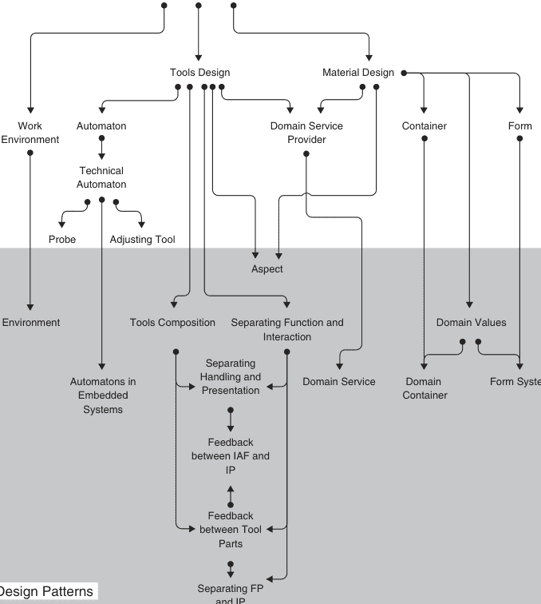

图 8.1
T&M 设计模式的分层结构。

- 示例：一个带有简短讨论的示例。
- 构造部分：此模式如何实现？在这里我们使用了来自不同编程语言（Java, C++, Smalltalk）的示例。
- 下一步工作：哪些模式将很有用？

我们以 T&M 设计模式的概述作为引导导览开始本章。读者将理解本章的模式是如何关联的。在最后一节中，我们通过对模式实现细节的讨论来结束。该部分既可以作为另一个示例，也可以作为构建框架的草图。

# T&M 设计模式引导导览

# 8.2 T&M 设计模式引导导览

基于第 7 章讨论的概念模式，本节描述了 T&M 设计模式。我们现在展示概念模式与设计模式之间的关系。然后我们讨论哪些设计模式是配套的。通过这种方式，我们为读者提供了类似于路线图的内容，继续引导。

接下来的引导基于模式 8.1。

# Aspect 模式 8.3 

核心概念模式基于工具和材料的相互关系。它在第 7.3 章中介绍，并展示了工具和材料如何相互补充。本章从一个名为 aspect 的设计模式开始，展示了这两个组件是如何匹配的¹。aspect 模式代表了工具与材料之间的交互。我们将详细讨论两个构造部分：aspect 类和接口，因为它们适用于大多数情况。此外，我们将简要描述一些替代方案。

¹ 在此语境下，我们将“aspect”作为一个独立的概念，与“面向切面编程”无关。


# T&M 设计模式

当我们以不同的方式实现单一工具时，就会构建出复杂的工具。这包括以下模式：

- 工具各部分之间的反馈
- 处理逻辑与呈现的分离
- 交互形式与 IP 之间的反馈

## 工具部分之间的反馈模式（第 8.6 节）

该模式直接遵循工具组合以及功能与交互分离的模式。对于涉及的单一部分应该如何相互作用的问题，所谓的“反应模式”（reaction patterns）在回答这个问题时起着至关的作用。它们控制依赖组件之间的通信，并在“工具部分之间的反馈”模式中描述，该模式例如用于分离 FP 和 IP（第 8.7 节）。其核心思想是构造的分离：通过这种方式，我们确保相互作用的两个或多个构造彼此了解尽可能少。

## 处理逻辑与呈现分离模式与交互部分模式（第 8.8 节）

无论工具是否被分为功能部分和交互部分，结合交互形式的概念，我们将引入一个经过验证且易于实现的概念，该概念允许我们把 GUI 设计从用户界面和 GUI 工具包中抽象出来。某些读者可能在 Java Swing 时代认为抽象是多余的，但我们的项目经验表明，从特定的 GUI 库中独立出来长期来看是有收益。当然，必须讨论 GUI 访问与另一个抽象层之间的权衡。

## 交互形式与交互部分反馈模式（第 8.9 节）

该模式是“处理逻辑与呈现分离”模式的逻辑结果。一旦我们把具体的 GUI 类与工具的通用交互分离来，我们需要将这二者作为构造单元结合起来。当另一个应用用于反应模式时，该模式描述了 IP 与 IP 之间的反馈，并以显式处理工具构造作为终结。

## 领域值模式（第 8.10 节）

由于材料仅包含纯粹的领域功能，关于材料的具体构造几乎无话可说。尽管有一个名为“材料设计”的概念性模式，但没有直接对应的名为“材料构造”的设计模式。在构造层面，有一个名为“领域值”的基础性 T&M 概念。我们在第 2.6 节讨论面向对象编程模型的基础元素和特征时已经提到过这一点。

领域值构成了我们用于组合材料的基本组件。“领域值”模式引入了不同的实现技术作为构造部分。此外，我们还将展示如何使用特殊的领域值交互形式（另见第 8.8 节的处理逻辑与呈现分离）或特殊的领域值小部件（widgets）来简化复杂用户界面的开发。

## 领域容器模式（第 8.11 节）

我们已经作为一种与材料直接相关的概念性模式引入了容器。在构造层面，“领域容器”模式展示了如何实现容器。虽然我们说过，对于通用材料来说，专门的设计模式意义不大，但我们必须为领域容器解决特殊问题。今天，开发被称为数据结构的容器已不再是问题，所有编程语言都有良好的标准库。因此，我们简要处理这个问题，只需简单地解释领域容器与技术容器之间的关系。

## 表单系统模式（第 8.12 节）

在概念层面，除了容器之外，我们还将表单建立了另一类材料。表单适用于实现具有少数领域特定操作简单材料。相关的设计模式“表单系统”展示了我们如何实现表单，以及它们如何与一小组工具结合以加速我们的应用程序开发过程。表单不能“独立”材料。因此，我们还将解释表单如何向具有自身功能的更复杂材料演进。

## 嵌入式系统中的自动化模式（第 8.13 节）

“自动机”概念模式讨论了自动化的主要特征。我们已经提到，自动化通常运行在后台。这使得自动化几乎完全简化为领域或技术算法的实现，对于通用设计模式来说没有什么可做的。

分布式环境中的技术自动机情况则有所不同。我们将嵌入式应用程序中的软件方向讨论为“嵌入式系统中的自动化”设计模式。更具体地说，我们将解释如何构建自动化以适应 T&M 方法，并考虑异步和进程分发。

## 领域服务模式（第 8.14 节）

“服务提供者”概念模式处理材料的集合以及与这些集合的领域交互。作为其直接结果，“领域服务”设计提供了一种将服务提供者概念概念表示为软件单元的方法，这特别为客户端-服务器系统的灵活配置提供了可能。例如，我们可以支持具有不同工作类型的前端（富客户端或 PC 上的客户端：Web 客户端、笔记本电脑客户端等），并轻松地连接到后端系统（例如主机、SAP）。我们将使用领域模式来展示如何实现领域服务提供者以实现这些思想。

## 环境模式（第 8.15 节）

“工作环境”概念模式根据 T&M 方法讨论了工作场所及其环境的特征。它定义了工作场所的边界并将工具和材料嵌入其中。此外，它允许该环境的工作场所与其他环境通信。“环境”设计模式解释了我们如何实现这一通用概念以及我们通常需要哪些功能。

## 在 JWAM 框架中使用 T&M 设计模式（第 8.16 节）

本章最后一节描述了设计模式如何相互作用。基于我们的 EMS 示例，我们展示了如何通过框架方法解决本章讨论的设计问题。我们展示了移动到 JWAM 框架中的 T&M 应用程序的通用元素。除了看到 T&M 设计模式之间的相互关系，读者还可以获得设计通用应用程序的想法。

本章末尾的参考文献为进一步学习本章的内容提供了有用资源。

### 8.3 切面模式 ( ASPECT PATTERN)

# 意图
用户处理工具以材料完成任务。工具和材料不应随意组合，因为工具匹配某些材料但不匹配某些，反之亦然。切面连接了工具和材料。

# 问题
在确定构造原则时，确保工具和材料匹配。

该原则应该在编写代码之前应用于设计。看起来为一个工具识别多个材料（反之亦然）是有意义的。工具和材料之间的领域特定关系应该在技术设计中体现。

# 相关
切面模式与工具和材料之间相互作用的概念模式相关（见图 8.2）。

# 解决方案
我们通过使用切面来表示工具与材料之间的相互作用。一个切面的目标是工具与其操作的材料之间的相互使用。

切面的特征是：

- 它代表了语法接口以及尽可能多的该关系的语义。
- 它确保材料满足切面中指定的供工具使用的要求。
- 在我们的构造中，我们特别注意工具仅通过切面指定的接口使用分配的材料。
- 切面显式地解决了我们设计中组合协议或接口的技术问题。

为了更好地理解解决方案，请考虑图 8.3 所示的示例。在该示例中，工具使用一个切面。该切面指定了服务一个


# T&M 设计模式

材料（Material）必须提供一个工具（Tool）。材料必须满足切面（Aspect）定义的接口承诺以及接口中定义的行为。请注意，我们现在并没有说材料必须继承自切面，因为该模式的几种构建方法将使用材料与切面之间的继承关系，而另一些方法则不会，这取决于我们使用的编程语言。

### # 示例

让我们暂时回到 EMS 示例，以更好地理解我们如何使用绑定工具和材料（见图 8.4）。

在 EMS 示例中，DeviceOrganizer 是一个使用材料的工具，包括 RoomPlan。然而，我们的 DeviceOrganizer 需要 RoomPlan 提供的部分功能。DeviceOrganizer 负责将设备和员工分配到房间，为用户提供设备和人员分布的概览。图 8.5 显示了材料 RoomPlan 的接口以及切面 DeviceOrganizable，后者代表了 DeviceOrganizer 所关心的接口那部分。

### # 背景：工具与材料的匹配

工具和材料在工作流程中的交织方式对于理解人类工作至关重要。手工艺传统和底层标准确保了工具与材料的匹配。对工具和材料的正确处理是每位手工艺人培训的一部分。标准（例如 ISO 标准）规定了许多工具和材料的适当匹配，如螺丝刀、螺钉和螺母。遗憾的是，软件工具和材料很少有稳固的传统和标准。这些少数示例之一是用于服务的 CORBA-IDL 接口定义。对于此，我们必须在构建中确保软件工具和材料是匹配的，并且是可以组合的。

### # 图 8.4

使用 Device Organizer 编辑 RoomPlan 材料。

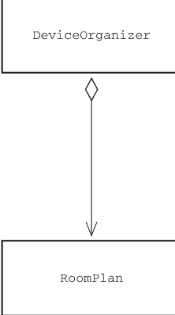

### # 切面模式

| 方法 | 返回类型 |
| :--- | :--- |
| dimension() | :Dimension |
| tableOfContents() | TableOfContentsDV |
| hasRoom(String) | boolean |
| room(String) | Room |


| 方法 | 返回类型 |
| :--- | :--- |
| setDimension(Dimension) | void |
| putRoom(Room, Point) | void |
| removeRoom(Room) | void |
| requiresRoom(Room, Point) | boolean |
| tableOfContents() | TableOfContentsDV |
| hasRoom(String) | boolean |
| room(String) | Room |

**图 8.5** 材料和切面接口。

如果我们把工具和材料看作应用程序系统的组件，这意味着我们需要适当的接口。根据使用模型，用户能够使用工具来处理材料；我们显然必须为材料添加一个接口，以便它可以被工具使用。

目前可用的大多数组件模型定义了通用的接口组件，包括一组可以被请求的操作，这些操作可以在运行时影响特定领域的操作。这些方法对于匹配工具和材料的目的来说太通用了。我们想要的是表达描述工具与材料匹配的领域特定抽象。这也显式地告诉我们材料满足哪些条件才能适用于工具。

组件模型及其接口

我们对工具和材料的概念模式迭代（第 7.3 节）显示，工具理想情况下适用于不同的材料。这意味着工具到材料的接口比该特定材料的接口更窄或更抽象。如果工具和材料之间没有指定显式接口，那么无法从设计中轻松推导出哪组材料将被哪个特定工具使用，而是由该工具的需求决定的。除非我们在设计中引入额外的组件，否则分析该工具的程序是确定工具与材料之间的的方法。

用于不同材料的单一工具

如果多个工具使用同一个材料，这个基本问题就会变得更加严重。材料的具体接口变得“宽”，而工具与材料之间的引用则变得越来越远。如果我们想向现有的应用程序系统引入新材料，我们必须解决以下问题：为了能够现有工具处理材料，我们必须识别材料应该遵循的行为接口。遗憾的是，我们无法在工具中或工具所使用的其他材料中找到这些信息。

### 针对单一材料的不同工具

### # 权衡

材料负责提供一组协调的操作，工具可以使用这些操作完成特定任务。为此，切面应该指定语法接口之外的功能，并描述材料的行为。

得益于这些功能，切面也适用于定义自动化与这些自动化所需的材料之间的关系。这意味着自动化和工具可以很容易地与材料结合。

面向对象编程语言中指定切面行为的方法各不相同。我们使用切面至少是为了确保其需求被满足。我们希望在所有语言中将接口定义为静态类型概念。在类型化语言中，我们使用抽象类来实现切面。我们使用继承来链接工具和材料基于我们在 C++ 和 Eiffel 实际项目中的经验。考虑到 Java 和 Smalltalk 有命名的接口概念，它们更适合这种构建。

相反，当我们尝试在只知道继承而不知道接口的语言中使用切面来实现实切面逻辑时，将不得不处理某些问题。如果我们想用类来实现切面，并且如果工具和材料之间没有关系，那么材料必须继承自切面。


# T&M 设计模式

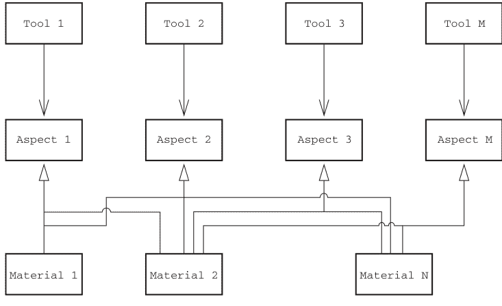

图 8.7
工具使用方面类（aspect classes）来对材料（materials）进行操作。

在语法和语义上对材料进行操作。此外，这些标准实现允许我们在早期（即在方面类中）建模工具所需的状态。材料类（Material classes）可以重写定义的操作或添加属性来表示某种状态。

然而，这种在方面类中也定义方面的构造方式需要小心处理。原因是，这种构造与“方面是接口”这一事实冲突，也违背了“抽象类应该是轻量级的”这一面向对象的设计原则。结果就是我们派生的所有材料类都“负担”了这些属性。尽管这在应用程序系统的原始设计中可能是合理的，但并不意味着未来在方面类之下的材料类也真的应该用这些属性来定义。

如果我们使用接口来实现方面（如在 Java 所示），那么模式方案看起来将如图 8.8 所示。

在这种情况下，我们无法在方面中提供标准实现。使用接口带来的这种局限性在于：我们将错误地为方面定义属性，这会给派生的材料类带来负担。许多工具使用许多材料的问题得到了解决，因为 Java 支持接口的多重继承。

# 静态方面类型化的后果

通过方面类或方面接口进行静态类型化的一个主要优势是：材料对方面的合规性会在翻译编译时进行检查，这就像在问：“材料是否实现了方面中定义的类型？”此外，它确保了工具只能在特定的方面下使用“它的”材料，这就像在问：“工具是否排他地使用该类型的材料？”在基于类的解决方案中，我们可以使用标准的排他性实现或模板方法来指定行为。最后，如果我们足够小心，我们可以在早期为材料实现一种策略。

# 方面模式 197

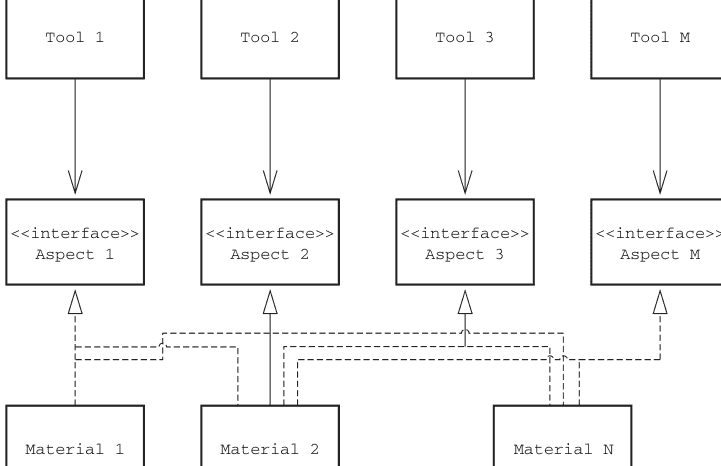

图 8.8
使用接口来实现方面。

方面的想法并不本质上将工具和材料耦合。事实上，我们将其扩展到了自动化（automations）与材料之间的关系。如果我们把方面视为类应该满足的协议（protocols），那么我们就可以为这种建模类型找到额外的应用。例如，容器使用的协议、容器与受管理对象之间的协议，或者分配对象的协议。在所有情况下，每当我们必须回答是否为缺点设置单独的类时，同时我们只有一个操作，协议将变得绝对太昂贵且令人困惑。

### 泛化方面

当方面绑定到材料上时，继承的使用方式与领域建模中不同。为了更好地理解领域与软性设计（soft design）之间的关系，我们主要使用继承来建模领域层次结构，其中单继承是一个核心问题。当使用继承来实现方面类时，我们在单一的工作语文中描述了工具和材料的匹配。因为一个方面可以将一组之间没有任何相似之处的完全不同的材料统一在一起，除了它们可以被同一个工具操纵这一事实之外。例如，打印机可以打印一组不同的材料，而垃圾桶可以删除它们。

### 这种构造方法的问题

使用继承的不同方式可能会使你的设计更难理解。解决这个问题的方法之一是命名规范。例如，我们用名词命名所有建模领域对象的类（例如 Folder、Form、Account），并为方面类使用形容词（例如 Editable、Storable）。

当我们使用接口来实现方面时，这个问题最初并不会出现。然而，除了方面之外，在其他地方使用接口是有意义的，在——

### 用于方面的接口

# T&M 设计模式

不支持类多重继承的语言，例如 Java。因此，使用之前建议的命名规范并不是好主意。

另一个问题是更具通用性的：继承的方面会导致材料与工具耦合过于紧密吗？毕竟，继承意味着材料必须实现可能仅临时或在特定情况下需要的静态接口。

另一个需要记住的重要点是，在大系统中处理方面类和多重继承时，特别是在编译和链接时，尤其是在 C++ 这样的语言中。此外，我们可能需要处理大量的子类，导致代码逻辑混杂。


如果我们基于 T&M 方法开发一个复杂的框架，并使用适当的机制来构建这些框架（第 8.15 节），我们在尝试将方面分配给子系统时将遇到问题。

考虑到方面类描述了工具或更多材料的接口，而这些材料实际上属于它们所使用的类。另一方面，材料类必须继承自方面类。这意味着材料子系统依赖于属于子系统的类。

另一点是我们不能简单地将方面分配给材料，因为我们希望方面对许多材料有效。

另一方面，如果我们为方面类构建一个独立的子系统，我们将必须经过大量的工作来重构领域上下文；材料子系统将依赖于方面子系统。尽管存在这些问题，这是我们将采取的道路，例如在 Java 环境中建立材料包和工具包之间的关系。总结来说，我们显式地创建方面类。

# 理由

### 8.3.2 构造部分：使用适配器实现方面

不支持类多重继承的语言，例如 Java。因此，使用之前建议的命名规范并不是好主意。

另一个问题是更具通用性的：继承的方面会导致材料与工具耦合过于紧密吗？毕竟，继承意味着材料必须实现可能仅临时或在特定情况下需要的静态接口。

另一个需要记住的重要点是，在大系统中处理方面类和多重继承时，特别是在编译和链接时，尤其是在 C++ 这样的语言中。此外，我们可能需要处理大量的子类，导致代码逻辑混杂。

如果我们基于 T&M 方法开发一个复杂的框架，并使用适当的机制来构建这些框架（8.15），我们在尝试将方面分配给子系统时将遇到问题。

考虑到方面类描述了工具或更多材料的接口，而这些材料实际上属于它们所使用的类。另一方面，材料类必须继承自方面类。这意味着材料子系统依赖于属于子系统的类。

另一点是我们不能简单地将方面分配给材料，因为我们希望方面对许多材料有效。

另一方面，如果我们为方面类构建一个独立的子系统，我们将必须经过大量的工作来重构领域；材料子系统将依赖于方面子系统。尽管存在这些问题，这是我们将采取的道路，例如在 Java 环境中建立材料包和工具包之间的关系。总结来说，我们显式地创建方面类。

我们会使用这种方法对于支持多重继承。（等等，我在源码中看到一些重叠，让我根据逻辑流重新对齐）。

*修正后的逻辑流：*

# 静态方面类型化的后果

通过方面类或方面接口进行静态类型化的一个主要优势是：材料对方面的合规性会在翻译编译时进行检查，这就像在问：“材料是否实现了方面中定义的类型？”此外，它确保了工具只能在特定的方面下使用“它的”材料，这就像在问：“工具是否排他地使用该类型的材料？”在基于类的解决方案中，我们可以使用标准的排他性实现或模板方法来指定行为。最后，如果我们足够小心，我们可以在早期为材料实现一种策略。

# 方面模式 197


图 8.8 使用使用方面

方面的想法并不本质上将工具和材料耦合。事实上，我们将其扩展到了自动化与材料之间的关系。如果我们把方面视为类应该满足的协议，我们就可以为这种建模类型找到额外的应用。例如，容器使用的协议、容器与受管理对象之间的协议，或者分配对象的协议。在所有情况下，每当我们必须回答是否为缺点设置单独的类时，同时我们只有一个操作，协议将变得绝对太昂贵且令人困惑。

### 泛化方面

当方面绑定到材料上时，继承的使用方式与领域建模中不同。为了更好地理解领域与软性设计之间的关系，我们主要使用继承来建模领域层次结构，其中单继承是一个核心问题。当使用继承来实现方面类时，我们在单一的工作语文中描述了工具和材料的匹配。因为一个方面可以将一组之间没有任何相似之处的完全不同的材料统一在一起，除了它们可以被同一个工具操纵这一事实之外。例如，打印机可以打印一组不同的材料，而垃圾桶可以删除它们。

### 这种构造方法的问题

使用继承的不同方式可能会使你的设计更难理解。解决这个问题的方法之一是命名规范。例如，我们用名词命名所有建模领域对象的类（例如 Folder、Form、Account），并为方面类使用形容词（例如 Editable、Storable）。

在使用接口来实现方面时，这个问题最初并不会出现。然而，除了方面之外，在其他地方使用接口是有意义的，在不支持类多重继承的语言中，例如 Java。因此，使用之前建议的命名规范并不是好主意。

另一个问题是更具通用性的：继承的方面会导致材料与工具耦合过于紧密吗？毕竟，继承意味着材料必须实现可能仅临时或在特定情况下需要的静态接口。

另一个需要记住的重要点是，在大系统中处理方面类和多重继承时，特别是在编译和链接时，尤其是在 C++ 这样的语言中。此外，我们可能需要处理大量的子类，导致代码逻辑混杂。

如果我们基于 T&M 方法开发一个复杂的框架，并使用适当的机制来构建这些框架（第 8.15 节），我们在尝试将方面分配给子系统时将遇到问题。

考虑到方面类描述了工具或更多材料的接口，而这些材料实际上属于它们所使用的类。另一方面，材料类必须继承自方面类。这意味着材料子系统依赖于属于子系统的类。

另一点是我们不能简单地将方面分配给材料，因为我们希望方面对许多材料有效。另一方面，如果我们为方面类构建一个独立的子系统，我们将必须经过大量的工作来重构领域上下文；材料子系统将依赖于方面子系统。尽管存在这些问题，这是我们将采取的道路，例如在 Java 环境中建立材料包和工具包之间的关系。总结来说，我们显式地创建方面类。

# 理由

### 8.3.2 构造部分：使用适配器实现方面

我们不使用类多重继承来实现方面。我们使用适配器模式。这种模式有两种形式：类适配器（对应多重继承），以及对象适配器，后者是我们需要的（见 8.9）。

# 权衡

对象适配器的明显优势是方面可以清晰地识别为独立类。另一个重要优势是这种解决方案也适用于单继承的语言。

# 方面模式 199

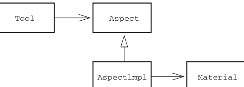

图 8.9 使用适配器来实现方面

此外，当材料的接口不符合工具所需的接口时，可以使用对象适配器。在这种情况下，适配器模拟所需的接口。材料保持纯纯领域，而交互在方面类中定义。

### 为不同上下文适配材料

对象适配器的另一个优势在于，当你在不同上下文需要不同功能的材料时。在这种情况下，对象适配器将防止材料加载仅在一个处需要的功能。在使用适配器时，我们可以静态检查方面的合规性，且方面将显示为独立类。材料接口可以适用于方面，并在适配器类中进行适配，以便材料保持“轻量”（即只有最少的操作和属性）。因此，这种方法的另一个优势是可以增量地改进或扩展项目。最后，正如第 8.3.1 节所述，你可以将方面链接到工具而不破坏整体架构。尽管有这些优点，适配器模式也有缺点。一个主要缺点是你必须为每个材料实现一个具体的适配器子类。在实现通用工具（例如用于许多材料的编辑器或生成器）时，你很快会发现具体适配器类的膨胀。这增加了设计的复杂性，减少了显式方面类的好处。

在两个对象产生的环境中会出现更严重的问题，因为适配器和材料对象实际上构成了材料。这些严重问题之一是身份的丢失：从工具的角度来看，材料的物理身份与其适配器不同。然而，我们在许多情况下需要材料的领域身份。因此，我们必须确保在附加适配器后，材料的领域身份得以维持。一种可行但复杂的解决方案是第 9.4.1 节中描述的角色模式。在任何情况下，我们无法直接比较对象，必须为比较目的定义额外的标识符。例如，在 C++ 中，你通过重载比较（关系）运算符来优雅地解决这个问题。


# T&M 设计模式

operator。在复杂的应用程序中，对象的额外标识符是必须的，以确保在持久化和协作方面具有唯一标识符。

最后，我们必须解决一个构造问题。应该如何以及在哪里创建切面（aspects）？如果我们使用直接切面继承来构建它们，我们可以简单地将一种材料传递给工具，但用于工具-材料绑定的额外适配器将是可用的。工具不应该能够感知并创建一个特殊的适配器对象。它应该仅仅使用抽象切面类。一种可能的解决方案是使用抽象切面类的“类对象”来创建具体的适配器。然后，我们将向这个切面类对象传递相应的材料，作为具体适配器的规范（另参见第 9.4.2 节中的 `trader` 模式）。

另一种通用解决方案是使用工厂模式（参见 Gamma 等人）来创建适配器对象。

# 理由

我们建议对于使用单继承且没有显式接口构造的语言，以及对于具有不同工作区且材料对象在这些工作区之间合并的大型应用程序，使用切面对象解决方案。该解决方案也可以与切面继承相结合。

### 8.3.3 构造部分：使用开发工具实现切面

前面的章节介绍了如何使用切面来构建切面。这些解决方案在运行时检查底层切面中是否存在对应材料的适配器。更具体地说，每种材料都提供了供切面使用的操作，而每个工具只使用切面中声明的操作。此测试中在运行时真正关键的部分必须只执行一次，即在创建工具或材料时。一旦我们可以确保接口，这种情况在循环的该组件中将永远不会改变。我们必须做这些工作以确保工具和材料被正确绑定。

当使用像 Smalltalk 这样的语言时，我们可以将开销从对象创建的时间提前到它的类定义。切面编译需要适当的开发工具，这在 Smalltalk 中不应该是问题，因为流行的 Smalltalk 版本支持开放开发环境。这种环境允许你使用程序文本编辑器即时更改切面，使得切面作为独立的类别出现，并可以包含在解析中。

一个用于切面编辑的开发工具（例如 `AspectBrowser`）可以用于将切面的操作复制到材料类中。这意味着我们既可以使用切面超类来实现切面，也可以为操作定义标准实现。

你可以使用 `AspectBrowser` 来定义新的切面类。随后，你可以实现你复制的操作（如果它们仅以文本格式可用），或者用材料特定的实现替换切面类中的标准实现。

# 切面模式 201

最后，你可以使用 `AspectBrowser` 检查所有操作是否已已实现。

# 权衡

为了使此解决方案生效，你使用的语言应该允许在运行时对其进行扩展。为了充分利用该解决方案，语言应该提供一种强大的元对象协议（第 2.7 节）。注意，即使有编程环境适当的支持，该解决方案也是不安全的，因为开发环境的标准工具不知道切面，这可能导致系统不一致。

# 理由

我们仅对 Smalltalk 或可以在运行时扩展的类似语言推荐此解决方案，作为接口对象的替代方案。

# 8.3.4 构造部分：使用切面的替代方案

有时工具直接使用它们的材料，而不是使用切面。在这种情况下，工具始终知道材料的完整接口。只有当材料本身具有继承层次结构时，才会使用多态。

# 权衡

使用切面的一个主要优势是，自然不使用切面的工作方式会简化工具和材料的耦合，但在概念或构造上不需要额外工作即可让单个工具使用单个材料。此外，耦合将是类型化的。

这种方法的一个缺点出现在我们想让一个工具使用多个一个材料时。这时，我们必须做一些构造工作并维护材料接口。如果多个工具要对一个材料进行操作，可能很难看出材料接口的哪些部分适用于哪种工具。注意，工具和材料的耦合在设计中并不是显式的。不使用切面会使我们更难地更改或扩展我们的设计。

尽管如此，对于小型和“年轻”的项目，不使用切面是有充分正当的。尚未达到成熟的设计通常显示出工具和材料之间存在一对一的关系。支持动态类型系统的语言（如 Smalltalk）通常在不使用切面的情况下开发原型或初始试运行系统。此外，极其专门的工具可能需要紧密耦合，即工具必须知道完整的材料接口。这同样适用于用于单一材料的特殊工具。

最后，切面代表了工具和材料之间工作关系的抽象，一旦我们对这些工作关系有了清晰的认识，它们就可以只实现一次。

# 理由

我们建议在启动新项目时使用此解决方案，并根据项目过程需要逐步创建切面。该解决方案对于简单的工具和材料或非常专门的工具同样有效。

# 8.4 分离函数交互模式

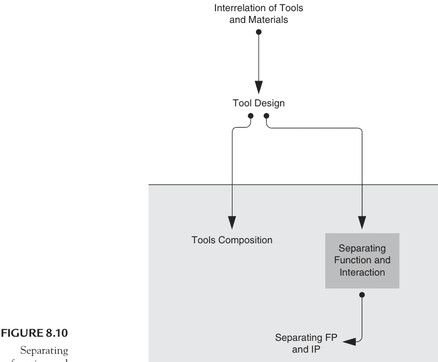

图 8.10 分离函数与交互。

# 意图

此模式描述了如何利用交互式软件系统的重要体系原则，即将交互和功能分离作为交互式工具的一个基本设计原则。

# 问题

我们希望在工具处理表现层与与其在软件中的功能之间保持关注点分离。我们希望能够修改工具的交互部分

# 相关内容

概念模式 `tool` 和 `materials` 显示了如何设计（参见 8.10）。当我们理解了工具是什么以及如何与其交互时，就可以处理当前所解决的

# 分离函数与交互模式

# 解决方案

在实现工具时，我们观察以下划分：

- 独立地为每个工具定义领域功能。我们可以将其称为**函数**。
- 为每个工具定义特定的形状和演示。我们可以将其称为**交互**。

设计指南

背景：工具构造
我们说工具是交互式的。为了这个目的，我们为每个工具分配领域功能以及处理。为了详细说明这些指南，我们对以下给出答案：

- 函数：软件工具有什么领域目的？
- 处理：软件工具如何被使用？
- 演示：工具及其处理的材料如何表示？

显然，工具必须对某些事情有用。让我们用一种可以处理材料的方式。工具永远不会自动活动；它是由用户处理的，所以处理对工具是关重要的。工具的领域功能只有通过处理才能独立地实现。

处理和演示密切相关。

# 权衡

交互式工具的职责

分离工具函数和交互的方法有很多。首先，我们可以在一个单元中实现这两个概念，并将这两个概念表示为不同的接口（参见 8.5 中的工具组合模式）。另一种备选方案是将工具进一步划分为基本概念。这将产生两个单元；我们称之为函数 (FP) 和交互部分 (IP)。我们在第 8.7 节描述了分离 FP 和 IP 的适当设计。

我们可以为这里介绍的内部工具构造的每个解决方案识别若干理由。对于原型、简单工具以及小型或新的软件项目，基于 MVC 或 FP-IP 模型的分离可以


# T&M 设计模式

引入了过多的开销。在这些情况下，我们建议使用单体工具（参见第 8.16.2 节）。

然而，处理后一种方案时应该谨慎对待，因为当一个具有不同职责的工具应该被拆分为多个类时，往往容易忽略正确的切入点。如果在晚期才这样做，成本可能会非常高昂。

对于复杂的工具或大型软件系统，与单体工具相比，从一开始就划分好的工具要更容易维护和重用。

# 理论依据

始终分离工具的交互（interaction）和功能（function）。对于复杂的工具，如果交互可能会频繁变化，还应该有不同的构造单元。否则，你只需要将交互和功能表示为不同的接口。

# 后续

使用组件构建工具的构造部分、设计模式工具工具组合如何将交互和功能表示为两个接口。
分离 FP（功能部分）和 IP（交互部分）的设计展示了如何将交互和功能实现为两个构造单元。

# 8.5 工具组合模式

图 8.11
工具组合模式。

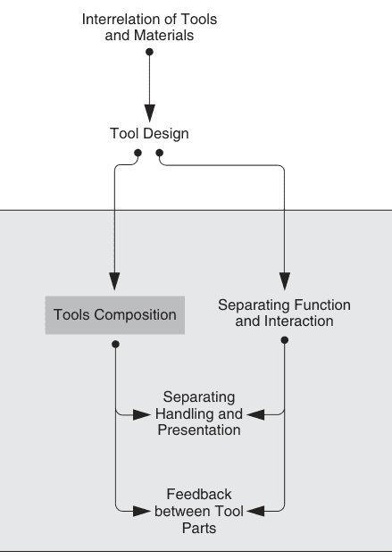

# 工具组合模式 205

意图
该模式展示了如何通过组合负责处理定义任务的工具来构建复杂的工具。

# 问题

一个工具（包括它的操作和领域功能）根据工作和任务的不同可能非常复杂。此外，使用几个构造单元将这种复杂性映射到单一整体通常不是一个可行的方案。即使我们实现了相似的功能子，每个工具也必须从零开始开发。出于这个原因，我们应该尝试在现有工具组件的基础上来构建工具，以降低每个组件的复杂性并使其变得可重用。因此：

我们如何将一个工具划分为子工具，这些子工具又应该如何集成到一个工具中？

# 关联

概念模式、工具设计以及工具与材料之间的相互关系，展示了如何在概念层面上设计工具和材料（参见图 8.11）。一旦我们理解了工具如何与应用领域中的单个任务相关，我们就可以解决如何通过工具组合来处理复杂任务或整个工作流的问题。

# 解决方案

我们开发工具是为了使其负责一个定义的任务或一组活动。我们集成一个上下文工具，它整合了多个子工具。每个工具基本上都可以嵌入到封装工具的上下文中，从而成为一个子工具。为了这个目的，我们设计了一个通用的组件接口。

图 8.12 中的方案展示了该模式和技术关系。在我们的工具组合中，我们将确保上下文工具知道它们的子工具并可以直接调用它们的操作。

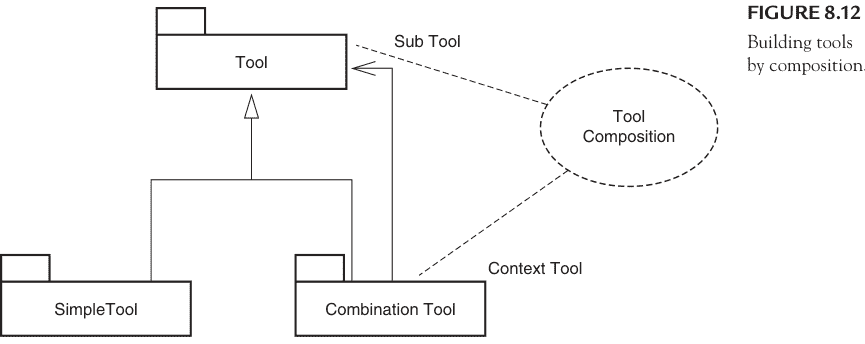

# T&M 设计模式

# 背景：构建子工具

我们为手头的领域任务设计工具，也就是说，通常为每个任务设计一个工具。我们希望能够组合用于简单任务的工具来完成复杂任务。因此，新工具应该在现有工具的基础上构建。这允许我们降低简单构造单元的复杂性并重用现有组件。设计用于支持复杂活动的工具通常被构建成可以划分为子工具的形式。

为了组合工具，我们首先需要定义几个术语：

- 在另一个工具内部使用的工具被称为子工具（subtool）。
- 上下文工具（context tool）从技术和概念视图上嵌入了子工具，也就是说它实现了一个组合工具（combination tool）。
- 组合工具结合不同的领域服务以于复杂任务。它在软件中由子工具组成，是使用模型中的一个领域元素。
- 简单工具（simple tool）是领域特定的，代表一个基础任务或功能。简单工具的功能必须与界面/逻辑严格分离。原因为简单工具没有实现结构化设计（例如，创建记录）。简单工具也具有状态。

由于我们对领域设计中的简单工具和组合工具感兴趣，这种组合可以是递归的。出于这个原因，一个工具可以作为其子工具的上下文工具，并且其本身也是一个子工具。此外，我们寻求将工具视为组件的视角以促进组合。

## 示例

EMS 示例

图 8.13 展示了一个复杂工具的示例——之前示例中的 DeviceOrganizer（设备组织器）。每个示例都通过其子工具进行展示。该图右侧的实际部分显示了一个特殊的房间——储藏室，它也由子工具表示。

我们可以通过不同的方式构建这个工具：

- 我们为每个任务设计单独工具（DeviceHandler），分配给房间（RoomHandler）并管理储藏室（StorageHandler）。
- 我们构建一个复杂的工具，可以显示房间和储藏室并在这些房间和设备上运行操作。
- 我们通过组合单一组件构建一个复杂的工具。

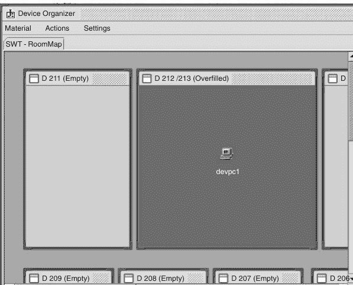

**图 8.13** 复杂工具的示例：DeviceOrganizer。

在我们的 DeviceOrganizer 中，我们选择了以下方案。DeviceOrganizer 是一个由上下文工具和几个工具实现的组合工具，其中这些子工具彼此一无所知。它们由上下文工具控制，从而完成组合工具的整个任务，例如组织房间内的设备。

# 权衡

在构建工具时，我们经常发现很难在这些工具之间建立关系。例如，当我们把设备从储藏室移动到房间时，这涉及到房间和储藏室。为了产生这种关系，我们要么必须连接这两个工具，要么使用材料来连接它们。

直接连接意味着其中一个工具（例如 storage handler）必须知道另一个。这不是一个好的方案，因为 storage handler 失去了独立性；它只能与 DeviceOrganizer 配合使用。

使用材料来连接工具也被我们的构造原则排除了，因为材料将因此感知工具的存在，或者至少具有某种通知机制。

尽管我们可以构建一个单一复杂工具，但从软件角度来看这种方案并不合适，因为我们无法单独使用 DeviceOrganizer、room handler 和 storage handler 部分。例如，我们需要为房间编写一个新的 room handler。

> 相关工具的设计方案

# T&M 设计模式

出于这些原因，将所有任务封装在独立的工具组件中是有意义的。我们就可以基于构建块原理来组合工具。这意味着现有工具

- 可以作为新工具的组件使用，即我们可以在扩展上下文中重用它们的功能；
- 在可行的情况下，能够作为组合工具，使用新组件的功能。

我们正在寻找一种基于统一方案将简单工具组合为组合工具的构造部分。

# 理论依据

每需要设计并实现一个工具时，应该考虑重用现有工具。因此，对于每个工具的设计和构造，应该检查该模式的适用性。

# 后续

分离处理与表示的设计展示了如何进一步细分工具。

工具部分之间的反馈展示了如何组合工具的基本原理和构造。

# 8.5.1 构造部分：使用组件构建工具

为了实现工具作为组件的集成，所有工具必须支持通用的工具接口。图 8.14 展示了一个最小工具接口。

在这个示例中，工具必须利用工具（equip）。随后，工具可以激活（activate）和取消激活（deactivate）或关闭（close）。工具的交互接口允许我们显示或隐藏工具操作。功能接口支持所有领域特定的工具操作，以及工具与材料交互所需的操作——设置和探测材料。特定工具对此接口进行专门化。

# 权衡

我们构建工具是为了使其表现像组件。这意味着特别是它们的内部表示被隐藏了。这种方法允许将不同内部表示的工具组合到单一系统中。它甚至允许我们组合来自其他工具的复杂工具，这些工具并不一定按照相同的内部方案构建。


# 工具组合模式

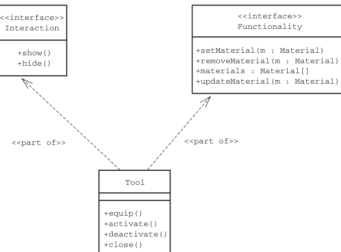

图 8.14
最小化工具接口。

# 设计意图

当你必须将子工具与内部结构结合，或者复用那些在构建时没有明确分离功能与交互的现有工具时，请使用此模式。

# 8.5.2 构建部分：使用组件构建组合工具

在构建共同形成一个组合工具的子工具和上下文工具时，我们必须回答：上述每个简单工具的功能在那个组合工具中应该如何表现？

为了实现一个组合工具，我们使用提供所需功能的简单工具。每个简单工具被用作一个功能（functionality）。为了组合多个子功能，我们构建了一个额外的上下文工具（context tool）。该上下文工具实现了子工具之间的交互，并将任务委托给负责的子工具。请记住，我们在这里讨论的是工具的概念性功能，这并不意味着必须为该功能存在一个独立的类。因此，由功能定义的责任也可以由工具类承担。在这种情况下，工具类将直接提供该功能（参见 8.16.2 节中关于单一工具的讨论）。

构建组合工具

将子任务委托给子功能意味着我们清晰地跨组件委托了任务。这意味着上下文工具不需要自己处理所有的子任务。在从上下文功能到子功能的方向上，

# T&M 设计模式

# 图 8.15

上下文功能与其子功能之间的反馈。

- 1. addObserver(contextFunc)
- 4. update()
- 2. addObserver(contextFunc)
- 3. update()

| subFunc1:功能 | subFunc2:功能 |

设计上下文工具

这种情况下应该是紧密耦合的，上下文功能将特定任务委托给子功能，因此它不应该知道子功能的接口。上下文工具为了承担协调功能，需要关于子功能最近变更的信息。另一方面，我们不希望上下文工具之间耦合，这会导致循环依赖，并最终使系统更难以理解和维护。出于这个原因，我们使用松耦合。

通常情况下，子功能的构建应该独立于其上下文功能，以便我们能够在不同的上下文中使用它们。由于我们想要构建可重用的工具，因此在构建一个将作为子工具并集成到特定上下文工具中的工具时，它最终将是不可重用的。我们开发的工具也可以作为子工具使用。为了这一目的，我们使用上下文功能将子功能集成到组合工具中。上下文功能将把子工具委托给其子功能并协调它们。在此过程中，我们使用事件模式或观察者机制来解决问题。

反馈问题

图 8.15 显示了如何使用观察者机制。在这个示例中，上下文功能是观察者，子功能是被观察者。

## 示例

EMS 示例

在我们的示例中，我们使用了上下文工具 DeviceOrganizer，DeviceOrganizerFunctionality 协调一个子功能 RoomEditorFunctionality。

当用户将设备从一个房间拖放到另一个房间时，DragDropManager 会将设备从源房间移除并添加到目标房间，如图 8.16 所示。这导致源房间编辑器和目标房间编辑器发送（使用 announcement 操作）它们的设备发生了变化的通知。DeviceOrganizer 已经注册了该事件，并且现在设置了来自源房间和目标房间的新设备。DeviceOrganizer 现在可以更新屏幕表示。

# 设计意图

此模式应用于将设计良好的子工具组合成组合工具。

# 8.5.3 构建部分：识别工具边界

我们已经看到工具如何递归地组合形成复杂的工具。然而，当查看工具组件时，这种构建并不能自动告诉我们

# 工具组合模式

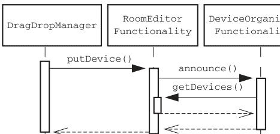

图 8.16
添加设备时的控制流。

这是否是顶层上下文还是嵌入的子工具。但我们始终在运行时决定一个工具组件是否标记了工具边界。这意味着它是组合中唯一没有高级上下文的工具组件。

一个满足某些软件和领域职责的工具，我们希望在专用的实例中管理它。此类职责的一个良好示例是关于工具名称、显示图标、供应商名称和工具版本的信息，或者工具可以操作的方面列表。这些信息可以放在工具的上下文功能中。另一方面，我们可以认为这些信息指的是整个工具。

## 示例

图 8.17 显示了我们的组合工具 DeviceOrganizer 的类图。DeviceOrganizer 拥有一个功能 DeviceOrganizerFunctionality，它构成了该工具的领域处理逻辑。DeviceOrganizer 可以具有任意数量的 RoomEditor 类型子。相反，每个 RoomEditor 都有一个功能 RoomEditorFunctionality。DeviceOrganizerFunctionality 知道 RoomEditorFunctionality 对象，而上下文 DeviceOrganizer 并不知道 RoomEditor 工具的其他部分。

EMS 示例

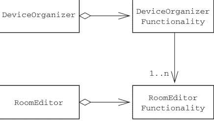

图 8.17
DeviceOrganizer 中的功能。

# T&M 设计模式

# 设计意图

此模式应用于将设计良好的子工具组合成组合工具。

# 8.6 工具部分之间的反馈模式

图 8.18
工具部分模式。

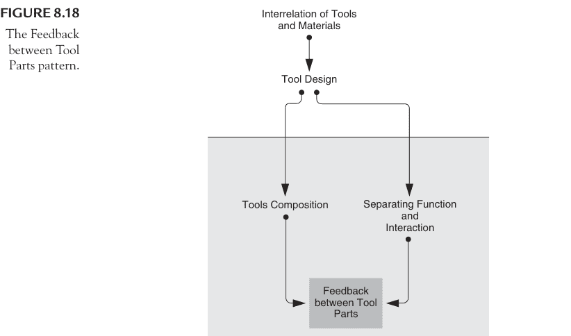

# 设计意图

此模式告诉你如何实现工具部分之间的反馈，使得一个部分对另一个部分的了解尽可能少。

# 问题

当从单个组件组合工具时，我们经常发现这些组件之间存在非对称关系。一个组件（例如上下文工具）通过其接口了解它的子工具。另一方面，工具了解的尽可能少。我们可以将此模式解决的通用问题公式化为：两个组件应该连接在一起，其中一个组件是服务提供者，另一个是客户端。客户端负责响应服务请求的

# 工具部分之间的反馈模式

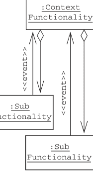

图 8.19
组合工具的反馈问题。

结果。客户端需要知道在使用服务后提供者的状态发生了变化。

# 相关
此模式解决了在使用功能与交互分离或工具组合模式（参见 8.18）时出现的问题。

# 背景：反馈机制

让我们看一个应该有一种方式通知其耦合状态变化的子功能。如之前提到的，我们必须在这个方向上使用松耦合以避免循环依赖。这种控制流的反转被称为反馈问题（参见 8.19）。

文献描述了实现所需反馈机制的几种构建方法和模式。所有这些构建方法要么基于其使用上下文，要么绑定于语言机制。

反馈机制通常根据观察者是否被通知主题的变化，或者主题是否以特定方式通报状态来区分。此外，反馈机制可能针对特定的观察者或以分级结构排列的未知数量的观察者。

# 解决方案

我们构建一个反馈机制，以抽象的方式通知观察者关于主题的变化，以便观察者对这种变化做出响应。

以下构建部分详细说明了在更具体的层面上解决此问题的不同概念和相关的构建方法。


## 8.6.1 构造模式：事件模式

这种构造模式使用了组合工具，这些工具由工具组件组成。事件模式将作为一种匿名反馈机制，用于关于每个相关的状态变化（见图 8.20）。

一个子函数向其上下文功能（函数）告知状态。在这个示例中，上下文功能充当观察者的角色，而子函数充当主体（subject）。如果一个工具从内部由分离的功能部分和交互部分构建而成的，那么事件模式也可以被功能部分用于来通知交互部分（见第 8.7 节中分离 FP 和 IP）。在这种情况下，交互部分是作为观察者的功能部分。

观察者了解其主体以及改变或探测其状态的操作。反馈机制在选项范围内工作，即：当发生相关的状态变化时，观察者对事件进行观察（observes）。为了避免事件被不受控地“触发”，我们将类接口处的操作分为语句、请求和测试（见第 2.1.8 节）。我们将这种关系应用于上下文功能与子功能性之间。

### 结构化功能性与各子功能性之间的接口和交互

-   请求（Requests）和测试（Tests）是无副作用的探测操作（函数）。请求会通知调用它的上下文功能，例如关于材料的状态或子工具的配置。测试通常用于显示是否可以调用子函数的其他操作，例如对其他操作的程序进行测试。探测操作不能在子函数的接口处产生可见的影响。特别是，它们不能在上下文功能扮演观察者角色时通知它。由于这个原因，可以在任何时间作为对子功能性通知的响应而调用请求和测试。
-   语句（Statements）是改变状态的操作。它们被上下文功能使用，用于操纵材料或更改子工具的工作状态。在语句执行后，上下文功能可以调用探测函数来检查上一次子函数调用是否执行成功。由于这种原因，大多数语句都会导致通知，因此，子功能性绝应该将语句作为对接收事件的响应。

## 权衡（Trade-Offs）

### 观察者与主体之间的交互

通过观察者模式进行 FP-IP 耦合的示例展示了这种匿名通知的明显优势：让任意的观察者在未来的任何时间点观察主体是非常容易的。

图 8.20
在组合工具中使用事件模式。

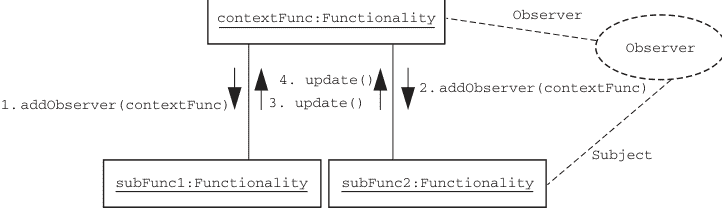

# 工具部分之间的反馈模式

主体（即功能性）不应该知道其观察者如何对变化做出响应。主体应该知道观察者可能会对变化做出响应。其思想是，当观察者所观察的状态发生变化时，让它们对接口的了解尽可能少。考虑到我们处理的语言没有内置的匿名信号机制，我们使用普通的调用机制来实现此点（例如，FatherTalk 中的 Events）。

我们必须对主体和观察者之间无意的“震荡”采取行动。其原因是：当观察者在收到主体的通知后，作为响应导致主体的另一个状态发生变化时，会导致另一个通知。显然，这个过程可能会无限持续下去，而且当多个观察者注册同一个事件时，可能会发生另一个问题。在这种情况下，被通知的观察者将找不到发送给它们的内容。它们将对那个被称为“被信号主体状态”的主体做出粗略假设，但该主体已不再处于当前状态。我们把这些问题称为“响应式变化”（reactive change），并要求构造性地避免响应式变化。

如果遵循了这些规则，那么事件模式就可以安全地使用。但在某些情况下，我们将过程与函数结合，例如为了更好的性能或可理解读性。在这种情况下，操作看起来像一个函数，但有一个返回值。为了避免融合和响应式变化，我们应该仔细记录这种类型的过程，并使用命名规范。

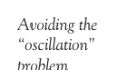

## 原理（RATIONALE）

这是客户端与相关服务提供者松耦合反馈机制的标准机制。它适用于所有简单工具，即具有少量不同事件的工具。

## 8.6.2 构造模式：事件对象

我们构建一个事件类并为功能的每个相关状态变化创建一个独立的事件对象。我们扩展功能的接口，以便可以在接口处轮询每个事件。上下文功能可以在功能的处注册事件。它可以可选地随事件传递一个操作。

上下文功能通常直接每个事件注册。在许多语言（例如 C++ 和 Java）中，操作可以通过事件与另一个事件（或更少的内容，即类型）来传递，

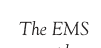

## 示例

本节描述了我们如何实现扩展到包含事件对象的事件模式，用于我们 EMS 示例中的 DeviceOrganizerFunctionality 和 RoomFunctionality（见图 8.21）。

RoomFunctionality 类实现了接口 EventObject:DeviceOrganizerFunctionality；DeviceOrganizerFunctionality 实现了两个接口，即 EventSubjectFunctionality 和 EventObserver，后者表示 DeviceOrganizerFunctionality 也是一个观察者。这两个类中没有类必须实现操作。注意，EventSubject 和 EventObserver 仅用于类型定义和隐藏用于信号事件的机制。

# T&M 设计模式

```
:DeviceOrganizerFunctionality
```

```
2. deviceCreated()
```

```
3. register(...)
```

```
5. update(this)
```

## 图 8.21

```
1. new
```

```
:RoomFunctionality
```

```
deviceCreated:Event
```

```
4. announce()
```

带事件对象的模式。

在其接口处，RoomFunctionality 为其宣布的每个事件提供一个操作；在一个示例中我们有 deviceCreated()。该操作返回一个对应的事件对象，该对象是在 RoomFunctionality 初始化期间创建的（步骤1）。DeviceOrganizerFunctionality 直接在该特殊事件注册。

DeviceOrganizerFunctionality 从 RoomFunctionality 请求它感兴趣的特定变化的事件（步骤2）。DeviceOrganizerFunctionality 使用 register 将一个方法注册到事件 deviceCreatedEvent（步骤3）。这是一个 Java 示例，DeviceOrganizerFunctionality 使用匿名内部类注册事件。

如果 RoomFunctionality 调用操作 device，则适当的状态变化（例如将设备添加到房间）将执行。接下来，RoomCreatedEvent 调用 deviceCreatedEvent 的 announce() 操作（步骤4）。这意味着与其通知 RoomFunctionality 的所有观察者，注册此特定事件对象的观察者会被通知（步骤5）。

一旦控制流返回 reactOnDeviceCreated，DeviceOrganizerFunctionality 就可以对此事件做出响应。它使用了作为回调传递的操作。这意味着它知道 RoomFunctionality 的状态发生了，因此它可以从设备中拉取新值并更新其表示。

### 权衡（TRADE-OFFS）

-   复杂工具与观察者机制

复杂工具特别好地展示了观察者的简单信号会导致明显的运行时事件。需要从子功能性请求大量的可能状态变化，或者在上下文功能中检测。这就是为什么子功能性的不同状态变化应该导致不同的事件，只有这样才能进行区分，即上下文功能随后可以为子功能性注册。特定的事件。

子功能性的不同状态需要在其接口处是观测的。可以开发一个专门的观察者来监控子功能性接口指定的更改。


# 工具部分之间的反馈模式 217

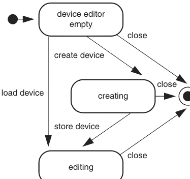

图 8.22
EMS 中设备编辑器（Device Editor）的状态模型。

在实践中，我们经常发现子功能和事件往往针对现有的观察者进行了强力定制。这意味着子功能仅提供现有观察者所需的事件。另一方面，这意味着子功能与观察者之间的耦合更加紧密，因此以后很难替换观察者。为了解决这种隐式依赖，我们可以从领域视图的角度对子功能的状态和事件进行建模。在这方面，为子功能设计状态机被证明是一种实用的技术（见图 8.22）。为此，我们定义了子功能可以所处的状态，以及触发状态转换的操作。每个状态转换将是一个事件。例如，我们可以从图 8.22 所示的状态图中推导出名为 `deviceCreated`、`deviceLoaded` 和 `deviceStored` 的事件。这是设计独立于特定观察者的功能的一种良好方法。

原理
对于具有多个事件和对被观察对象具有广泛探测接口的复杂工具来说，这是一种复杂的反馈机制。

# 8.6.3 构造模式：责任链

当在子功能与其上下文功能之间使用事件模式时，我们经常发现消息是从子功能发送到其上下文功能的，但这些消息并非由该子功能的状态引起。这些消息是子功能信号其无法提供请求的服务。此外，通常很难识别出实际上能提供请求服务的实体。为了允许发送此类消息，我们可以在子功能与其上下文功能之间构建一个*责任链*（chain of responsibility）；该链随后可以用于发送此类消息。

# T&M 设计模式

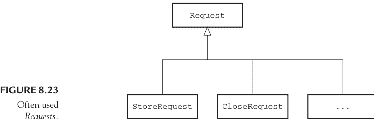

图 8.23
常用的请求。

除了事件模式外，责任链还为工具树添加了功能。请求可以沿着责任链发送。我们在单独的类（例如 `Request`）中表示请求，然后可以派生出专门的请求类。例如，我们可以引入一个用于关闭过程的特殊请求（见图 8.23）。

背景：责任链与事件模式
例如，如果用户想要关闭一个工具，她很可能会点击屏幕上代表该工具的按钮。然而，工具本身无法终止自身或其上下文。此外，它不知道上下文可能会拒绝关闭尝试。因此，子工具必须将此任务委托给其上下文。根据构造的不同，上下文可以由上下文功能、工具对象或事件模式组成。

如果我们选择事件模式来让子工具的上下文发送关闭请求，那么我们将视觉化该模式的理念：

- 发送了一个事件，尽管功能的状态没有改变。
- 事件模式应仅用于信号传递，而不应用于从上下文请求服务，即从操作调用（operation call）的角度来看。
- 如果子工具想要关闭，观察对象将不会简单地从内存中删除工具。它通常会删除子工具并调用几个清理操作。例如，在 C++ 中，我们会自动调用析构函数。一个导致系统行为的响应链是难以控制的。

示例
让我们在 EMS 示例中使用上述主意。`DeviceEditor` 可以并发编辑设备。如果用户关闭一个标签页，相应的工具就会发送一个请求宣布它想要关闭（见图 8.24，第 1 步）。上下文工具通过响应此请求来关闭子工具（第 2 步）。如果用户关闭上下文工具本身，上下文工具将向环境发送请求（第 3 步），导致工作环境关闭整个工具（第 4 步）。

# 工具部分之间的反馈模式

Environment
3. handleRequest(closeRequest) 4. close()

MultiDeviceEditor
1. handleRequest(closeRequest) 2. close()

图 8.24 我们的 EMS 示例的责任链。

DeviceEditor

# 权衡

无论是否使用责任链，在某些编程语言中删除对象都可能导致问题，特别是当调用栈上仍有待删除的操作对象时。

在像 C++ 这样的语言中，你必须显式地删除对象，在处理调用栈时往往会产生问题。为了避免移除已经删除的对象的调用栈，我们可以在系统中集成一个垃圾桶。当你删除对象时，它们会被移动到该垃圾桶中，而调用栈可以被进一步处理，观察者也可以被注销。当我们在向窗口系统的事件循环发送新请求之前清空垃圾桶时，我们可以假设在控制流的这一点，将不再有活跃对象。

使用 C++

在像 Java 这样拥有自己的垃圾回收器的语言中，我们不需要专门的垃圾桶来删除层级结构。Java 的垃圾回收器只删除虚拟机中的线程无法访问的对象。这防止了仍在调用栈中引用的对象被删除。

使用 Java

# 原理

使用责任链将请求传递给上下文。当子功能或另一个附属元素无法独立处理服务请求时，这就是正确的构造方法。

# 8.6.4 构造部分：带响应机制的工具组件

工具的组件模型允许我们从简单工具组合工具。然而，对于通用工具接口，我们必须集成响应机制。图 8.25 显示了这些支持事件模式和责任链的接口。

# 原理

当你从简单工具组合工具时，使用此构造部分作为响应机制。

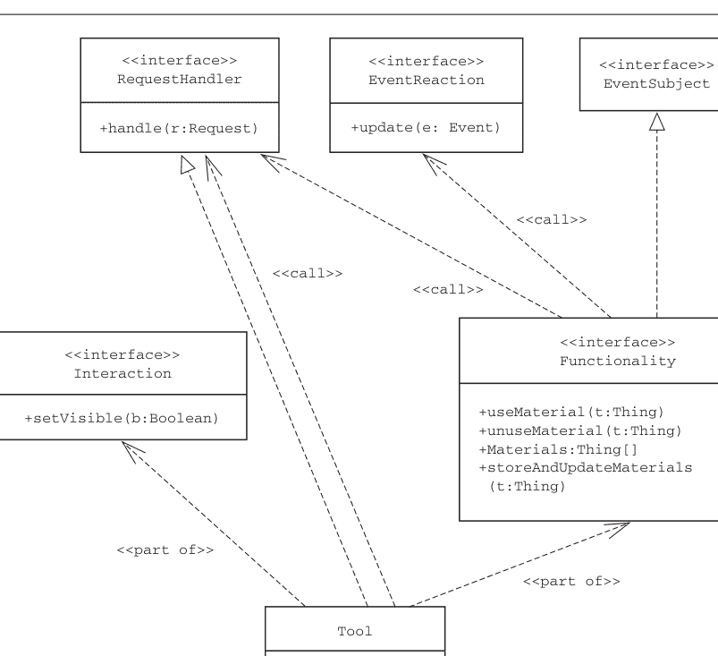

图 8.25 带响应机制的工具组件。

# 8.7 分离 FP 和 IP 模式

工具与材料的相互关系。

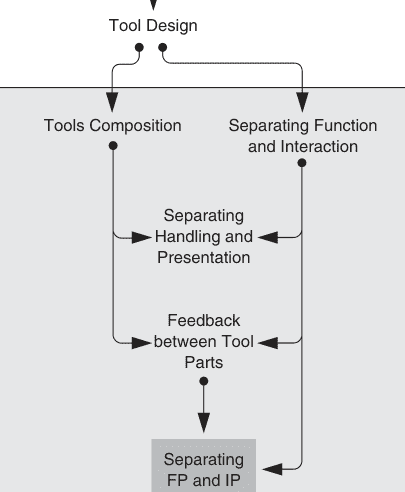

图 8.26 分离 FP 和 IP。

意图
该模式详细介绍了模式背后的概念。

问题
将响应机制集成到工具的方法有很多。由于显示很大程度上取决于 GUI，我们必须考虑这些变化。我们希望让工具适应不同的窗口系统。

相关
该模式直接遵循工具部分之间的反馈。

解决方案
我们将工具分为功能部分（FP）和交互部分（IP）。为此，我们使用一种合适的响应机制，以便 IP 尽可能少地了解其 FP。

- 功能部分（FP）是工具的活动和探测部分。它定义了工具功能。FP 处理材料并感知上下文。为了能够支持上下文，FP 管理一个状态——工具的内存。
- 交互部分（IP）定义了工具的用户界面。具体来说，它接受事件，调用 FP 并控制 GUI 显示。为了让 IP 从具体的交互和系统中抽象出来，我们使用了所谓的交互格式。

T&M 方法关注设计工具及其领域交互。在这种语境下，先定义工具的 FP 是有意义的。下一步定义工具应该如何被处理以及预期的显示。这种方法确保所有工具都由应用程序领域驱动，并且 FP 和 IP 的责任是分离的。

示例
在我们的 EMS 示例中，材料是作为房间集合的布局。用户想要向此集合添加一个房间。为了做到，用户使用 RoomMap Designer（见 8.27）。该 RoomMap Designer 显示了房间，以及一个用于创建新房间和编辑实例的菜单。当用户从操作菜单中选择 NewRoom 选项时，它会创建并显示一个新房间。


## 分离 FP 和 IP 模式 223

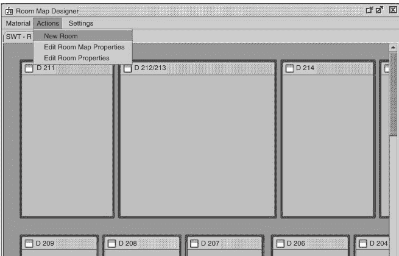

**图 8.27**  
来自我们 EMS 示例中的 RoomMap 设计器。

交互表单（激活器（activator）将系统事件（例如 NewRoom）转换为程序事件并发送到 IP。FP 的操作 `addRoom`、`Next` 会让 FP 在房间计划中添加一个新房间。这意味着用户的操作被定向到预期的处理上。目前缺失的是关于操作执行成功的反馈，在这些情况下，以下构建准则至关重要：

FP 决定是否自动向屏幕上表示的房间添加新房间，并且不会立即表示该变化。它需要关于 FP 确实创建了一个新房间的信息。此外，它不知道 FP 为新房间使用了什么标准。

另一方面，FP 在调用操作时不会自动显示新房间，因为这项任务是由 IP 负责的。FP 并没有关于新房间显示的信息。它仅仅提供了一个包含房间计划中所有房间信息的列表。这些信息可以通过调用探测操作（probing operation）获取。该列表与材料 `RoomPlan` 是完全独立的。FP 决定使用何种形式来处理来自房间计划的房间信息。事件模式在这些情况下被证明是有用的（见图 8.28）。

### 背景：作为响应式系统的工具

如果你从函数的角度来看，该工具被构建为一个所谓的响应式系统，也就是说每个活动都由显式用户操作触发，例如点击鼠标或按下按键（图 8.29，第 1 步）。这些操作以事件流的形式指向工具（第 2 步）。工具对每个用户操作做出响应。为了让工具做到，这些事件由 IP 解释。IP 将这些事件转换为 FP 调用或不同的表示（第 3 步）。FP 使用适当的方面（aspects）来处理材料（第 4 步）。处理材料后，FP 宣布状态更改（第 5 步）。IP 响应宣告的事件并更新表示（第 6 步），用户将此识别为程序响应（第 7 步）。

# T&M 设计模式

**图 8.28**  
FP 和 IP 之间的反馈问题。

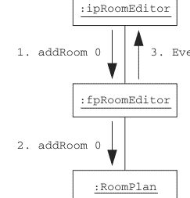

# 权衡

目前描述的 FP 和 IP 分离定义了工具内部的职责，提高了你设计的合法性。此外，它还支持了两个重要的设计目标：灵活性和重用性。

- 工具的用户界面可以独立于其功能进行更改。由于系统的领域组件（即其功能部分、方面和材料）没有嵌入，它们可以很容易地移植到不同的系统平台。
- 许多开发环境为视觉编程提供了很好的支持。GUI 工具允许你简单地拖放并绘制 GUI 元素到布局中。然后你可以为这些 GUI 元素添加更多功能。记住，我们已经提到过这种设计方法固有的风险（见第 7.4 节）。

**图 8.29**  
工具可以被视为一个响应式系统。

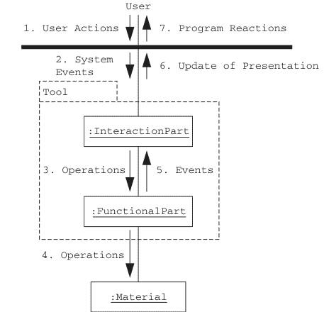

## 分离 FP 和 IP 模式

在工具构建方面，这种方法通常导致以交互部分（IP）为基础开发的工具。我们的经验表明，这并不总是能充分考虑到工具的领域内容。事实上，工具可能是材料上的一个“窗口”，看起来正在被操纵。工具本身没有自己详尽的领域功能，除了……

此外，这导致了工具与材料之间存在一对一的关系。在这样的系统中，所有工具都具有编辑器的特征。例如，你可以使用工具从材料中读取属性、或设置属性并为材料保存更改。这些工具虽然使用了面向对象的技术来实现，但并未利用这些技术来为用户受益。这类系统的基础易用性并不比传统的软件系统好上多少。

### 原理

当你必须设计并实现一个中等复杂的复合体，且该复合体很有可能需要频繁更改其处理和交互时，该模式提供了基本的设计和构建原则。

### 下一步

分离处理与表示的设计展示了如何进一步细分工具的交互部分，以封装实际使用的 GUI。

### 8.7.1 构建部分：交互部分 (IP)

正如在之前的第 8.7 节中提到的，我们构建一个单独类，用于封装针对每个特定 IP 的所有任务。在我们继续讨论这种方法之前，了解关于 IP 的一些事实将很有帮助：

- 交互部分跟踪由用户操作、程序事件触发的事件流并对它们进行解释。在这种方法中，它将特定于表示的事件（例如列表或菜单中的滚动），同时将应用程序特定的事件传递给其 IP。
- 交互实现了软件工具的操纵和表示。它可以调用底层窗口系统的小部件或通用的输入输出组件，即所谓的交互表单（例如 1 选择器、激活器），并调用这些交互表单进行交互。回到我们的讨论，IP 的任务是由窗口系统指定的。

### 权衡：IP 与交互表单之间的任务分离

为了保持 IP 和交互表单之间的任务分工，IP 不得对 FP 操作的逻辑做出假设。这种方法确保在调用更改操作后，IP 不会自动更改 GUI 表示。这是重要的，因为这意味着 IP 知道操作调用对 FP 状态的影响，从而破坏了 FP 操作的语义封装。


## FP

功能部分实现了软件工具的领域功能。它通过方面的接口操纵材料。FP 使用探测操作来提供关于自身状态和材料状态的信息。它根据用户操作和材料状态管理自己的工作状态和工具内存。

### 原理

当你必须设计一个具有复杂界面的复合体时，必须将交互部分作为独立的组件实现。当应用程序预计运行很一段时间时，你可以考虑通过交互表单抽象交互设计。

### 8.7.2 构建部分：FP

本部分讨论的构建方法使用一个单独类，用于封装每个特定功能部分（FP）的 FP。首先，让我们来看术语：

- 访问特定材料：当需要操纵材料时，IP 总是调用 FP 并传递传递给后者。相反，IP 使用独立于的 FP 接口获取表示材料的信息。IP 不直接访问材料。在某些情况下（例如处理复杂的表格材料），IP 可能被授予材料的读取权限。


## 分离处理与表示模式

- 对材料的变化：IP（接口部分）可以获取关于材料工作状态的信息，前提是这些信息由 FP（功能部分）提供，这意味着材料本身永远不会导致表示发生改变。
- 在不同材料和工具之间管理工作上下文：FP 确保一个工作上下文，使得所有参与的材料都以一致的方式进行编辑。因此，IP 在任何时候不能调用修改或改进操作的 FP。只有在提供 FP 处于合适工作状态的情况下，IP 才能调用此类操作。可以在接口处使用测试来识别 FP 的工作状态。

### 权衡：分离 FP 和 IP
为了确保交互与函数的分离，功能部分不应对对交互部分的处理和表示做出任何假设。这与我们对 IP 职责的讨论一致。FP 不应该对用户界面及其交互的实现方式和手段一无所知。这有助于促进功能的实现。

### 原理
当你决定将交互部分和功能部分实现为两个独立的组件时，你应该考虑这种构造分量。

## 8.8 分离处理与表示模式

图 8.30
分离处理与表示模式。

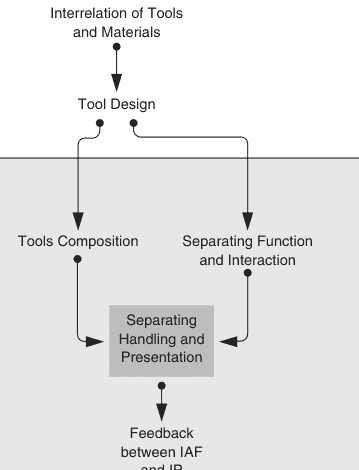

# T&M 设计模式

# 意图
该模式详细说明了设计工具交互部分的核心概念。即使你决定将工具的交互实现为一个构造单元，你也应该理解其背后的通用原则。这有助于澄清交互所涉及的不同关注点。

# 问题
我们从之前对分离交互与函数模式的讨论中知道，将交互式工具的功能与其交互分离是有意义的。由于交互通常由用户和构造交互工作场所系统触发，并在图形界面上实现。目前有大量的商业和公共库以及开发组件可用于设计图形用户界面（简称为工具包）。

我们如何封装一个用户界面工具包，以便将 IP 对特定工具包的依赖降低到最低？

### 相关性
设计模式“工具组合”和“函数与交互分离”为理解此模式提供了概念背景（见图 8.30）。

### 背景：分离处理与表示
应用程序最重要的任务是将工具的领域功能转换为交互，然后将后者结合图形组件来实现交互、处理和表示形式。此类图形组件在许多工具包中都是可用，例如 Motif、TLK/TK 和 Swing 框架。这些图形组件通常被称为部件（widgets），用于创建图形用户界面。使用工具包的一个主要优点是你可以快速实现用户界面，这具有几个优势：以相对较小的编程成本实现复杂的界面。此外，工具包组件有助于为用户界面提供统一的外观和感受，便于应用程序的使用。例如，Java 的 Swing 框架甚至允许你在不改变工具包的情况下替换 GUI 的外观和感受。

让我们先看看如何使用工具包的组件来构建工具（见图 8.31）。

IP 的用户界面是通过组合工具包中的元素构建的。通过这种方式，我们必须观察以下重要点：

- 每个工具包都对应用程序内部的控制流做出假设。这可能与你对要实现工具的思路冲突。
- 部件与工具包开发者定义的 IP 关联。这意味着，取决于工具包的不同，不同的事件系统可能必须与回调操作关联。这些回调操作必须在 IP 中实现。

让 IP 与你所使用的工具包之间保持松耦合的另一个动力是易变性。工具包的历史发展表明，工具包的接口发生过变化，往往到了完全重新设计的程度，而其他工具包从市场上消失了。一个例子是 Java：

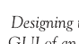

# 分离处理与表示模式


Java Foundation Classes 和 Swing 工具包的引入几乎完全取代了之前的 GUI 库——抽象窗口工具（AWT）。

图 8.32 显示了 Java 2 中 Swing 库类树的一部分。该库的重要特征包括排列在继承树中的组件。注意，为了能够复用实现（与其他工具包一样），需要继承。这种继承层次通常在许多（但并非所有）方面违反了类型-子类型层次结构。例如，你可能会在工具包根类中发现许多许多所有子类中调用的操作。在某些情况下，此类操作可能导致运行时错误，或者抛出异常，或者调用根本不会产生任何结果。

工具包库示例

图 8.31 将工具链接到 GUI 工具包。


图 8.32 Swing 库的组件（除外）。

# T&M 设计模式

图 8.33
常见交互形式 (IAFs) 示例。

| 激活器 (Activator) | 单选 (SingleSelection) | 多选 (MultiSelection) | 填充 (FillIn) |
| :--- | :--- | :--- | :--- |

# 解决方案
在构建 IP 时，我们希望确保它不依赖于工具包。相反，我们将 GUI 设计从工具包中抽象出来。为了我们的目的，我们引入了交互形式。

本节提出的解决方案减少了 IP 对特定工具包的依赖。

我们在交互形式中封装不同类型的操作。接下来，从交互形式的实例组合 IP。最后，我们确保 IP 与其交互形式交换领域值。


## 分离处理与呈现模式


呈现形式管理在工具之外，但它们与工具内部的交互形式相关联。

取决于所使用的 GUI 工具包，工具包的控件（widgets）也可以承担呈现形式的角色。在这种情况下，没有需要编写额外的呈现类。

## 示例

回到我们的 EMS，我们想看看 `DeviceDescription` 是如何在 `DeviceEditor` 中填充的。图 8.34 显示了一个用于填充值的交互表 `Fillin`。用户选择一个匹配的呈现形式 `JTextFieldPF`。`DeviceDescription` 的值被传递给交互表，并在交互后从从中读取。

# 权衡

交互表和呈现形式是从具体工具包中进行抽象的良好方法。随着工具包的变化，呈现形式可以很容易适配新的工具包，而无需更改交互。在这种情况下，交互部分不需要更改。此外，交互表将素材与其交互操作解耦了。

为了在上下文之外使用交互表，它们必须与 IP 交换值或基本类型。这是确保 IP 对其代表和返回的内容具有完全控制权的方法。交互表集不再依赖于特定工具中的可用选项。例如，对于交互表来说，是否存在特殊的宽带控件或使用何种平台并不重要。大多数工具包如果真的允许这种可能性的存在，就必须处理此问题。它们要么必须将其控件集减少到所有支持平台的最小公共集，要么必须保持为不被特定平台直接支持的奇特控件，而这是昂昂的。

呈现形式允许我们为所使用的平台实现工具所需的交互表示形式。例如，Microsoft Windows 系统在应用程序中具有浮动菜单栏和工具栏，而 Macintosh 则在屏幕顶部的通用栏中显示菜单栏和工具栏。同样，按钮在 Windows 95 或 Windows 3.1 中的表示方式也不同。然而，在实现独立于特定 GUI 工具包的复杂树或表格交互时，仍然存在一些根本性问题。

通过将交互与呈现形式分离，我们克服了对工具中单个 GUI 控件的直接耦合，从而能够更灵活地响应不断变化的呈现形式和工具包。当然，特定工具包的独立性并不是免费的。代价是失去了失去了对该工具包控件的部分控制。例如，我们无法再通过表单直接控制工具内部的表单，或设置标签的颜色。然而，经验表明，对于大多数工具来说，不需要对控件进行详细控制。表示细节（如字体颜色）可以在 GUI 生成器中静态定义。对于需要精确控制的工具，我们可能需要直接访问呈现形式或控件。总之，交互概念清楚地显示了哪些工具需要特定的 GUI 工具包，而哪些不需要。

## 依据

每当你需要将工具的交互和呈现从可能使用的具体 GUI 工具包解耦时，你可以使用这种模式。

## 下一步

交互表与 IP 之间的设计模式反馈展示了如何在交互部分与其交互表之间实现适当的响应机制。

## 8.9 交互表与 IP 之间的反馈模式

图 8.35
交互表与 IP 之间的反馈模式。


## 交互表与 IP 之间的反馈模式

# 意图

我们引入了一种使用命令模式（Gamma 等）的解决方案来解决交互表与 IP 之间的反馈问题。

# 问题

用户操作（如鼠标或键盘移动）被窗口系统接受。窗口系统将这些转换为系统事件，最初传递给表示形式和交互表。为此，表示形式通常通过回调（或通过子类和桥接模式）链接到窗口系统的相应窗口。交互表通过通知 IP 来转换系统事件。这要求交互表与 IP 链接。然后，IP 就可以识别出必须调用的 FP 操作（见图 8.36）。

然而，交互表必须知道它们协作的 IP 的特定类型，否则我们无法对不同的 IP 使用交互表。结果是，我们必须为每个新 IP 重新实现所有的交互表。就像 FP 和 IP 之间的反馈（见第 8.7 节），我们必须解决交互组件之间的松耦合问题。

### 我们如何能在交互表和 IP 之间实现一种合适的反馈机制，以同时允许松耦合并满足 IP 的特殊要求？

# 关联

分离处理与呈现的设计模式在概念上领先于此模式（见图 8.35）。

# 解决方案

我们使用命令模式将交互表绑定到 IP，实现松耦合。

解决此问题的一种方法是为交互表向 IP 生成程序事件定义合适的类（例如 `Command`、`DropCommand`）。另一种方法是使用一个通用的命令类来识别适当的操作。我们可以构建一个命令类，交互表向其提供适当的域值（见第 2.6.5 节和 8.10 节）。这些域值用于 IP 中进一步处理事件。

如果 IP 想从交互表对象获取有关用户操作的信息，它会生成一个命令对象。IP 将要调用的操作引用作为此命令传递过去；一旦命令对象被激活，该操作就会被调用。随后，IP 在交互表中注册该命令对象。不同的交互表各接受一组与其交互匹配的命令对象。

当发生相应的用户操作时，交互表会激活与其注册的命令对象。在 Java 中，此模式的典型实现是基于一个包含 `execute` 方法的接口。接下来，交互从命令对象中调用此操作。这允许 IP 实现此接口并使用 Java 的匿名内部类直接注册为命令对象。

如果用户输入或选择了域值（例如账号），则 IP 需要这些值。用于此类用户操作的命令类期望来自交互表的参数。操作将参数传递给命令对象以接收参数。

## 示例

让我们看看 EMS 示例中的 `DeviceEditor` 工具。该工具允许我们保存对设备的更改。`DeviceEditor` 工具包含一个用于此用户操作的交互表 `Activator`。该交互表由一个按钮实现，它只接受一种类型的命令对象，即 `Command`。它是一个不期望任何参数的命令类。

8.37 中的示例代码取自 `DeviceEditor` 的 Java 实现。构造函数为按钮创建交互表和命令对象。此外，`DeviceEditor` 工具的 IP 将命令对象注册到按钮上。

当用户点击按钮保存设备信息时，按钮触发与其注册的命令对象，该命令对象调用 `DeviceEditor` 工具 IP 中的 `storeDevice` 操作。

# 权衡

此模式中解决方案的一种可能实现变体是将调用的操作名称作为字符字符串作为回调传递给命令对象。Java 允许你使用反射（Reflection）在运行时调用此类名称。但这样性能不高且类型不安全。在其他语言（如 C++）中，你必须使用方法指针或“普通”类。

## 图 8.36

带有交互表的工具中的事件流。


## 交互表与 IP 模式之间的反馈

```java
public class DeviceEditorIP extends InteractionImpl
{
    //构造函数
    public DeviceEditorIP(IAFContext iafsContext,...)
    {
        // 创建命令对象
        _storeCommand=new Command()
        {
            protected void doExecute ()
            {
                storeDevice(this);
            }
        }
        // 获取交互表
        _store = (ActivatorIAF) iafsContext.interactionForm
            (ActivatorIAF.class,"store");
        // 将命令对象附加到交互表上
        _store.attachActivateCommand(_storeCommand);
    }
    // 命令对象的回调操作
    public void storeDevice (Command cmd)
    {
    }
    // 属性
    // 交互表
    private ActivatorIAF _store;
    // 命令对象。
    private Command storeCommand;
}
```

图 8.37
将命令模式用于交互表。

一个 IP 通常在工具 GUI 的不同位置代表同一个交互表。在之前的示例中，在 DeviceEditor 工具中输入的设备信息可以通过点击按钮、选择菜单选项或在弹出菜单中输入来保存。无论这三种交互表中的哪一个激活了命令对象，这三个调用都会调用 IP 的同一个操作来保存设备信息。

命令对象的多次注册

一个重要的益处是准备了撤销（undo）和重做（redo）机制，以便它们可以直接在命令对象中实现，在其中可以存储撤销或减少命令所需的相关的上下文。之前执行的命令对象存储在一个获取命令历史的列表中。这意味着我们可以通过遍历此列表来实现无限次序列的撤销和重做。

# T&M 设计模式

# 理由

当你设计交互和表示表单时，你必须解决该模式所应对的反馈问题。

## 下一步

设计模式的领域值部分讨论了如何扩展面向对象编程语言提供的基本数据类型。需要领域类型来将交互表与交互部分解耦，并将交互部分与功能部分解耦。

## 8.10 领域值模式

图 8.38


# 意图

对于面向应用程序的程序设计，使用与应用领域相关的不同值类型是非常重要的。该模式解释了如何设计和实现这些领域值。

## 领域值模式

# 问题

当使用对象编程语言开发大型系统时，我们很快发现了一个主要的缺点。语言中提供的标准数据类型不足以实现应用领域全带宽的基本值。即使是一个简单的值也无法映射到标准数据类型上。大多数语言中的 `REAL` 类型具有任意数量的小数，而我们需要精确地表示货币值。此外，对 `REAL` 数进行进行计算会导致舍入误差，这对于商业应用程序中的货币值来说是不可接受的。此外，为标准数据定义的算术操作通常不适用于应用领域所需的算术操作。例如，货币值之间的转换有精确的计算规则，这与 `REAL` 运算不同。

同时，我们使用简单的类和对象来扩展原始数据类型，因为类的实例具有引用语义，而数据类型必须遵守值语义（见第 2.6 节）。因此，

我们如何将面向对象编程语言的原始数据类型扩展到基于值语义的用户定义领域？

# 关联

材料设计的概念模式是该模式的概念背景，因为领域值是我们面向应用建模方法的结果（见图 8.38）。

# 解决方案

我们在面向对象的语言中使用类来实现领域值，类似于其他用户定义类型。然而，在实现中，我们确保这些类的实例行为像“值”一样。

我们用于领域值的新数据类型可以根据通用类型原则分为两类：基本领域值和复合领域值。基本领域值（例如，一天中的某个时间）精确表示一个“原子”领域值，它由一个或多个标准数据类型实现。在它的接口处，它只提供与领域相关的处理该类型值的操作（例如，调整时间）。

复合领域值建立在基本和复合值的基础上。它们将不同的值分组为一个新的结构化值（例如，包含两个时间的时期）。在它们的接口处，除了领域操作外，还有从元素组合领域值以及访问单个元素（构造函数、选择器）的操作。

此外，我们还可以根据基数（数量）对值进行分类，即有限领域值和无限领域值。有限领域值对应于枚举类型，这意味着它们具有固定数量的值（例如星期几）。相比之下，无限领域值无法限制（例如，日期），或者它们跨越一个可以分为任意数量部分的范围（例如，时间）。

## 238 T&M 设计模式

## 背景：领域值
编程语言通常提供一组遵循值语义的有限数据类型。这些标准数据类型，如 `INTEGER`、`REAL` 或 `BOOLEAN` 要么与数学相关，要么面向实现方面。向编程语言引入领域值类型的尝试并没有被证明很有帮助，正如我们从所谓的第四代语言中所了解的那样。相比之下，函数式编程语言（如 Miranda）基于一种完全不同的方法。它们使用强大的类型用于基于值的用户定义类型。遗憾的是，面向对象的编程语言在这方面有一个严重的缺点，它们只为用户定义类型提供了类概念。语言设计者似乎忘记了领域值类型对于开发应用的重要性。

# 理由
对于基于 T&M 方法的系统，领域值是引入作为编程“原子”的关键概念。

## 下一步
设计模式描述了领域特定的构造结构，并将领域值作为一种实现概念。

### 8.10.1 构建部分：领域值类

- 测试传递的参数是否为领域有效扩展的操作。参数可以是字符串或数值作为一种表示类型（例如，`InterestRate.IsValid("*2.5")` 或 `InterestRate.IsValid(2.5)`）。

对于计算领域值，这指的是单个元素。这些操作必须在类的接口中或作为类对象实现，取决于所使用的编程语言。如果类是一阶对象（如在 Smalltalk 中），并且类方法是可以继承的，那么这些操作应该作为类方法实现。相反，我们将实现一个原型客户端，它代表类对象，并在其中进行测试。Java 允许我们在工厂类中使用内部类，以便在工厂内部类中适应这些方法。此外，我们可以使用单例设计模式（Gamma 等人）来确保每个领域值有一个且只有一个工厂。

- 像 `hasFiniteNumberOfValues()` 或 `getAllValues()` 等操作允许我们请求领域值类型的有效值集（如果该集合是有限的）。这些操作显示了我们处理的是有限还是无限领域值。例如，当用单独的交互表表示领域值时，这一方面是相关的。或者，我们可以实现一个特殊的类，例如 `Enumerable`。


## 领域值模式 (THE DOMAIN VALUES PATTERN)

- `toString()` 操作以字符串的形式返回领域的值。大多数窗口系统在接口处只接受标准数据类型。因此，领域值应该能够以字符串表示的形式返回其值。
- C++ 和 Smalltalk 都支持重载运算符，因此我们可以在 `DomainValue` 类中为领域值定义关系运算符（`==`, `<`, `<=`, `>=`, `=`）。请注意，正如 Hoare 所建议的那样，所有数据类型在语义上都要求 `==` 和 `!=`。无论如何，我们都必须确保这些操作经过了测试，以确保值实际上可以进行比较。这还可以防止关系运算符在包含不可比较对象的领域值类中执行（例如在 `Color` 上使用大于运算符是没有意义的）。此外，比较父类的对象也是没用的。

根据应用领域的不同，像 `DomainValue` 这样的类将成为领域值类继承结构的根节点（见图 8.39）。每个领域值类都必须针对其特定值实现父类 `DomainValue` 指定的操作。为了确保之前创建的领域对象的值不能被更改（例如在 `instance` 中），相反，应该有一个或多个带有相应参数的特殊构造函数。

为了确保领域值按照语义使用，有两种不同的解决方案变体，取决于语言的适用性程度：不可变领域值和可变领域值。第 8.10.2 到 8.10.5 节描述的构造部分解释了这些解决方案。

## 讨论：使用领域值

T&M 的方法将领域值作为材料的元素。如果你将材料视为一个对象树，那么这棵树的叶子节点就是领域值对象，而这些对象反过来又使用标准数据类型来实现它们。因此，我们必须为每个特殊领域构建合适的领域值类，以便这些领域值类可以作为材料的元素组件。

在基于 FP-IP 模式构建工具时，除了标准数据类型外，领域值是从 FP 传递到 IP 的唯一对象。在任何情况下，交互表单都是带有领域值的。这解释了 FP-IP 交互中领域值的另一个原因。


# T&M 设计模式

为什么领域值应该通过值语义来构建。只有函数和交互能够直接操作材料（见第 8.4 节）。出于此原因，FP 不能向 IP 传递材料的引用。如果 FP 将领域值传递给 IP，那么 IP 将收到领域对象的副本，至少从概念角度来看是这样。如果用户更改了值，IP 将此值传递给 FP，FP 将更新材料以反映此更改。

要在 IP 中显示领域值，我们可以使用专门的交互和演示表单（见第 8.8 节）。这些交互表单用于领域值匹配一个领域值，并且它们直接检查输入的有效性。这防止了（例如）将检查日期的正确语法留给 FP，而会激活反馈机制来警告用户。因此，我们让领域值执行此类不涉及上下文的检查。这意味着领域值提议让交互表单测试用户的有效性。领域值只需要在相对语境中对其进行一致性测试。例如，如果用户在表单中输入出生日期和结婚日期，则 FP 或表单本身将检查出生日期是否早于结婚日期。

### 8.10.2 构造部分：不可变领域对象

该解决方案将领域值实现为不可变对象，从而排除了对领域值对象的更改。具体来说，我们不允许在领域值类的接口上进行操作。此解决方案适用于所有面向对象的编程语言。它可以通过对象的动态创建（在 Java 或 Smalltalk 中）和对象的静态创建（在 C++ 中）来实现。

## 权衡 (TRADE-OFFS)

遗憾的是，该解决方案具有以下缺点：

- 领域值的每次更改都需要请求新的内存空间。
- 使用未提供操作的类的领域值对象进行编程并不优雅，因为我们必须为每次更改创建一个新的标识符，然后将更改的责任分配给该标识符。

该解决方案固有的存储问题可以通过享量模式（flyweight）和工厂模式（factory）来解决。这些设计模式确保我们不需要为每个值创建一个技术副本。享量模式确保每个值始终只有一个对象，而工厂模式通过适当的操作创建对象。工厂存储所有之前创建的领域值。当请求新的领域值时，工厂会验证该领域值是否已经创建了对象。如果找到了该对象，它将返回该对象；否则将创建一个。这确保了使用相同领域值的不同组件可以共享同一个领域值对象。
享量模式要求工厂存储所有之前创建的领域值，以便即使对象不再被使用，工厂也能获得领域值对象的引用。这意味着只要该工厂存在，垃圾回收器无法从内存中移除领域值对象。这会导致系统膨胀。Java 允许你实现此问题的优雅解决方案。你可以使用引用来管理对象，如 `WeakHashMap`。此哈表中的对象在系统引用它们时会被垃圾回收器移除（哈表除外）。享量工厂可以使用 Java 的 `WeakHashMap` 来存储领域值对象，并由垃圾回收器适当移除它们。

## 示例

图 8.40 显示了我们在 EMS 中如何使用基础领域值，例如 `Date` 和 `EmployeePosition`。TableOfContents 被视为包含 ThingDescription 的复合领域值。此外，两个设备对象即 PC-1234 和 PrinterMax 共享来自享量模式的数据。

享量模式适用于范围有限的领域值，例如星期几或月份。这些领域值的类在应用程序启动时和连接关闭时创建。

## 原理性 (RATIONALE)

对于在系统中出现次数较多的值类型，使用这种方法。检查你的编程语言是否提供了更简单的手段来实现“不可变”对象。

## 图 8.40
在 EMS 计划中使用值对象。


### 8.10.3 构造部分：可变领域对象

为了避免处理不可变对象时的固有问题，我们可以选择一种使用可变领域对象的解决方案。在该解决方案中，领域值类提供了所需的所有操作。如果由这些类创建的领域值仅通过值语义使用，应用程序程序员必须在每次更改操作之前复制领域值，或者领域值类使用内部拷贝机制。

## 权衡 (TRADE-OFFS)

这两种变体中的第一种基本上是可行的。可以使用享量模式来实现高效的拷贝机制。然而，我们必须准备编程指南，以确保应用程序程序员在更改领域值之前创建一个副本。

我们可以使用体/句柄模式（body/handle）来实现领域值类内部的拷贝机制。体/句柄模式在文献中有详尽描述；Gamma 等人在连接代理模式时将其称为“写时复制”。体/句柄模式的基础是构建第二棵类树，称为“影子树”。除了现有的类树外，两棵树具有相同结构的是体树，以及一棵同构的句柄树。图 8.41 显示了一个示例。

注意，该解决方案平衡良好；让我们通过计算体对象中的引用来实现存储管理，特别是在 C++ 中。该解决方案的主要缺点是句柄对象不能通过引用机制使用。

## 图 8.41
领域值类，使用体/句柄模式。


# 领域值模式 243

“从外部。”此外，这条规则必须在编程规范中建立。另一个缺点是必须维护并行的继承层次结构。

# 原理

在像 C++ 这样的语言中或者当你选择了一种简单但可能出错的解决方案时，使用这种方法。

## 8.10.4 构建部分：将领域值实现为流

在许多应用程序中，我们经常发现简单值（即基本单元）就是领域值。这隐藏了复杂的领域值可能是巨大且广泛的事实。此类领域值的一个很好的例子是目录。当你为数据库中的选择内容构建目录时，你至少必须处理它的大小，并问自己是否有必要在内存中保留完整的领域值。

将此类领域值实现为流通常是一个更好的主意。在公共接口中，这些流通常表现为普通值（区别在于会偶尔抛出异常）。然而，它们在内部实现时，仅包含满足接口要求所需的数据量。如果需要复杂领域值的更多元素，则“按需”生成或加载这些元素。

# 原理

对于非常复杂且异常巨大的领域值，使用这种方法。

## 8.10.5 构建部分：通过配置创建领域值类型

在分析应用领域时，我们经常会发现大量相似的领域值类型，例如不同类型的金额。这些领域值通常仅在取值范围上不同，而在操作上相同。这些区别基本上可以通过继承表示。例如，`CreditAmount` 和 `DebitAmount` 将是 `Amount` 的子类。子类化会导致大量的领域值类，使维护变得更加困难。

一种构建方法是对领域值类的动态配置。具体来说，我们只为具有不同操作的类定义领域值类。然后通过配置来表示取值范围，节省类配置的差异。

在创建新的领域值时，我们额外为配置定义一个标识符（例如 `String`）。然后我们只开发 `Amount` 类以及针对 `CreditAmount` 和 `DebitAmount` 的配置。这些配置将指定贷方金额和借方金额必须为正值。

# 原理

当大量的领域值类型具有相同的接口且仅在于取值范围时，使用这种方法。

# 8.11 领域容器模式

工具与材料的相互关系


图 8.42
领域容器模式。

# 意图
基于你在应用领域中识别出的容器来设计领域容器，并使用技术容器来实现它们。

# 问题
容器的作用是持有对象。当我们基于 T&M（工具与材料）方法进行建模时，要区分两种容器：领域容器和技术容器。

- *领域* 容器是基于我们在应用领域中识别的现有容器（例如文件夹）设计的（见 3.5 节）。
- 技术容器对应于编程语言中可用的数据结构，如列表、数组。

通常情况下，如果我们使用技术容器，就没有必要再构建领域容器了。然而，当我们使用领域容器时，我们经常发现需要对它们进行专门建模，因为它们解耦了应用领域中的一对多或多对多的关系。我们不应该期望技术容器就是领域容器。

# 关联
领域容器模式 245

### 背景：领域容器
领域容器通常用于存储元素集合。在 T&M 方法中，我们使用技术容器来实现这些元素的存储（见 8.42）。领域容器提供了一个由应用领域启发的接口，这与技术容器的接口不同。此外，领域容器提供了一种遍历元素集合的方法。

# 解决方案
我们将领域容器构建为一种特殊类型技术容器。这意味着领域容器并不总是符合它们用于管理元素的技术容器的接口。

## 示例
在我们的 EMS（设备管理系统）系统背景下，我们使用房间图作为房间的领域容器。这很容易实现，因为我们可以使用技术容器（例如 `Map`）来存储房间。

EMS 示例

# 权衡
我们不假设技术容器就是领域容器。例如，我们可以在软件中使用工具。

建模现实世界的容器

我们经常发现，某些交互在领域容器中是不存在的。在这种情况下，我们在领域容器中添加了一致性检查。

你可以将领域容器视为收集元素集合的手段。我们经常发现，某个领域活动不仅执行在单个元素上，还执行在整个集合上。当我们使用技术容器来实现领域容器时，我们不会将领域容器派生为特化。

# 原理

对于基于 T&M 方法的系统，领域容器本质上是一个元素。

## 8.11.1 构建部分：使用技术容器实现领域容器

在我们可以访问技术容器库的情况下，我们可能考虑一种将领域容器与技术容器联系起来的方法。领域容器应该是继承还是使用技术容器？

在我们的方法中，技术容器始终用于实现领域容器。因此，在实现领域容器时，可以使用技术容器提供的所有变体和接口选择，无论我们的领域容器应该具有什么样的接口。

### 背景：T&M 方法中的继承
从本书到为止的讨论显而易见，只有当要链接的两个类具有子类-父类的关系时，我们应该在领域建模中使用继承关系。领域容器不应被视为技术容器的子类型。此外，它的接口应主要具有由应用领域启发的操作，这意味着它们并不总是符合技术容器的接口。出于这个原因，我们在领域容器和技术容器之间使用一种关系。


# 领域容器模式


图 8.43
领域容器与技术容器。

## 8.11.2 构建部分：加载材料

如果我们不将所有材料缓存在主内存中，那么我们必须回答一个问题：由哪个组件负责按需加载材料？当我们在面向对象的系统中封装并持久化材料数据时，这一点尤为重要。到目前为止，我们已经在 T&M 方法中实现了以下两种策略。

最简单的方法是使用工具将材料加载到容器中。这种解决方案使用容器来持有每个材料元素的标识符，而不是持有所有的材料。在这种状态下，容器类似于一个目录。有了这种状态的容器，工具无法使用完整的接口。虽然它可以显示材料并删除或添加材料，但目前还没有方法可以编辑材料。如果工具想要编辑材料，该工具将通过持久化服务触发该材料标识符（见第 11.2 节）。这种方法的一个主要缺点是容器用材料本身替换了材料的标识符，可能会产生很多一致性问题。

另一种解决方案是加载容器材料。使用领域值（见第 2.6.5 节和 B.10），容器可以使用持久化服务方法；如果我们使用这种构建方式，那么容器必须知道它想要使用的持久化服务的接口。此外，我们还必须定义加载材料的深度。容器中的材料可能由复杂的子结构组成，需要大量的存储空间和较长的加载时间。注意，整个材料是一次性加载的，因此在加载过程中并不知道用户想要编辑材料的哪些部分。

另一种解决方案是使用代理对象，将加载过程对容器隐藏。容器中指向材料对象的每个指针都引用一个代理对象。这个代理对象可以被视为占位符，它的行为类似于智能引用。当调用这个代理对象时，它会将材料对象加载到内存中。这种材料可以管理更多指向其他代理对象的引用，使得材料仅按需加载，即使是更深层的材料。在这种解决方案中，代理对象要么必须知道它们想要使用的持久化服务的接口，要么我们实现一种通用加载器来请求材料。

# 权衡

从容器加载材料
在从容器加载材料时，以下几非常重要：

- 容器或代理对象必须知道它们想要使用的持久化服务的接口。
- 容器或代理对象必须知道从何处加载。如果我们不能假设所有材料都维护在同一个持久化位置，这可能会变成一项昂贵的任务。当材料可以维护在不同的持久化服务或跨越系统运行时运行时，这个问题会变得更加严重。在这种情况下，关于特定持久化服务的知识无法编码到容器或代理对象中。这些信息在容器加载或创建代理对象时提供。
- 在材料未完全加载的情况下，我们必须以特殊方式处理多个用户的并发访问。例如，如果一个对象要从不同的源加载，那么我们必须识别谁可以修改该对象。这个问题与如何处理异常直接相关。由于加载发生在材料内部，没有简单的方法向用户提供反馈，例如当加载请求失败时。
- 在容器可以自行加载元素的情况下，我们显然必须锚定一些重要的材料属性，即它们对底层技术的独立性。对于不同类型的数据库系统，这些问题将在连接中进一步讨论（见第 11 节）。
- 根据所使用的持久化方式，容器或代理对象可能必须显式处理事务，某些操作可能需要事务上下文作为参数。

## 原理

每当你需要在持久化介质中存储复杂或大量的材料时，都应该考虑这种构建方法。

## 8.11.3 构建模式：容器的目录

在应用领域中处理大型集合时，我们发现使用目录来访问这些集合。从领域的角度来看，我们可以认为目录是构建阶段的独立组件。从技术角度来看，我们可以为从集合中使用目录提供合理解释依据。

大多数容器持有着大量数量的复杂材料。出于效率考虑，我们通常必须避免将容器中管理的所有材料都加载到主内存中。为了让用户理解这一点，我们通常使用独立目录的概念。目录为用户提供了容器中可用材料（容器元素）的概览。用户将目录视为一个对象，避免了他们认为自己可以直接访问容器内元素的错误印象。此外，用户理解到从容器中检索元素存在某些延迟。

目录为用户提供了对容器内容的结构化访问。每个容器都可以创建一个目录，其中包含关于容器元素的定义信息。为了列出容器元素，我们只需要关于容器元素的一小部分信息。我们通常显示名称和另一个额外的属性，例如领域值（见第 2.6.5 节和 8.10 节）。当用户从目录选择一个容器元素进行编辑时，该元素会在此时被加载或实例化。

## 示例

在我们的 EMS 中，如果我们把房间平面图视为容器的示例，它的目录将包含房间名称。当请求返回房间平面图时，它将返回一个空根节点。

EMS 示例

## 原理

一旦你在一个或多个领域容器中拥有大量材料，目录的问题就会随之产生，你应该考虑这种方法。

## 8.11.4 构建部分：作为材料实现目录

如果我们将容器的目录实现为独立的材料，我们就可以像处理其他材料一样处理它，例如通过桌面上的图标来表示它。用户可以看到目录是独立于容器存在的。用例显示目录并不一定显示容器的当前状态。总之，目录显示的是创建目录时保留的容器状态，用户可以显式地更新它。

## 原理

如果你想将目录实现为一种材料，例如作为桌面上的图标表示，那么你应该使用这种方法。

## 8.11.5 构建部分：作为领域值实现目录

如果我们将内容实现为领域值，那么从领域和技术视图来看，都清楚地表明目录反映了容器的状态。在这种情况下，领域值意味着目录无法自动更新以反映容器的变化。此类目录在工具中可以更容易处理。与材料相比，领域值可以很容易被视为 GUI 元素；我们可以为目录列表创建一个单独的 GUI 元素。此列表将显示所有目录并直接为选定的项提供标识符。

对于变得目录（例如持久化容器的目录），我们可以将其实现为领域值流（见第 8.10.4 节）。持久化容器的示例清楚地表明，目录可以根据用户请求从容器中获取大量元素。然而，将目录实现为领域值意味着我们无法将它们排列在桌面。如果我们需要这种功能，可以在同名的材料中嵌入一个领域值，例如“目录”。


# 理论依据

如果你始终通过工具维护目录，那么推荐使用这种方法。

## 8.11.6 构造部分：处理容器的变化

用户可以显示容器的目录，并对容器元素进行工具操作。用户可能会更改某种材料，这种更改可能会影响目录。

解决这个问题的简单方案可以从材料和容器的隐喻中推导出：为了能够更改某种材料，必须将该材料从其容器中移除。容器的目录会相应地标记该材料，以反映其已被移除。移除材料意味着通过工具对容器进行了编辑。这会通知工作环境中所有其他正在操作该容器的工具（见第 8.15 节）。所有接收到此类公告的工具都可以决定是否更新它们的表现形式。如果某个工具将材料从容器中移除，那么所有对该特定材料感兴趣的工具都将收到通知。每次更改都会生效，并在工具将材料放回容器后，发送一条此生效的公告。

## 示例

回到我们的 EMS 示例，假设从注册表（registry）中获取了一个索赔（claim）。由于婚姻，该员工的姓名发生了变化。当用户完成编辑时，该员工被返回到注册表，注册表更新目录。（例如，当前正在使用注册表的其他详细信息将收到通知）。当编辑器从注册表中删除该员工时，所有显示该员工数据的工具都将得到修正；员工编辑器会收到一条公告（前提是它当前正在显示该员工，并且注册了该材料的更改）。当它被返回到注册表后，所有操作同一员工的工具都将收到通知，并可以显示更新后的目录。

# 权衡

实现这种响应式行为可能是昂贵的的，特别是当容器和目录之间存在进程边界时。在这种情况下，目录应该有种处理异常情况的方法，例如网络故障。

## 背景：材料与反应机制

在基于 T&M（工具与材料）方法的构造中，反应或反馈机制仅用于活动组件之间，即用于工具、组件、自动机（automata）和工作环境之间。此外，对持久化和分布服务的访问被限于组件。材料被视为组件，而组件反过来又限于其领域功能，且不具备交互或响应式特征。

这种构造原则的原因可以在材料的隐喻中找到。材料位于可以访问的地方。当材料发生变化时，它们不会主动与其上下文或所使用的技术进行通信。此外，对于技术实现来说，保持材料不受任何关于工作上下文的知识的影响是有意义的。材料不应该知道它的更改是否与其他组件相关。如果它知道，那么材料

## 领域容器模式

将会决定更改是否对直接操作它的工具或其他操作底层容器的其他工具具有相关性。

在泛化一种反应机制时，所有与已更改材料有关系的材料最终都将收到通知。这将导致无法管理的级联公告，从而使整个结构变得复杂。我们泛化了一个与交互式应用相关的容器。即使我们仅仅将应用划分为整洁系统和混乱系统，反应机制也不再有用。因此，当我们通常决定时——

## 讨论：复杂材料与容器的变化

如果我们拥有带有交叉引用部分的复杂复合材料，但这些元素可以被工具单独操作，情况就会变得更加。在这种情况下，容器实际上是确保复合材料一致性的唯一手段。另一方面，材料组件的更改会对其他部分产生立即影响，即使这些部分没有被你使用。在这种情况下，我们不能采用使用反应机制的简单方法。尽管如此，我们应该记住我们扩展了容器。容器管理以这种方式修改的材料的一致性。但与其将目录包含在我们的应用程序中，我们让材料组件通过一个将更新目录的容器进行协调。

当容器暴露在复杂材料的协调上下文中时，它们通常具有自动机的特征。在这种情况下，我们检查所需的功能是否由“真实”自动机（第 8.13 节）或服务（第 8.14 节）提供。

容器、服务和自动机的组合已被证明是有效的，特别是对于大量材料。更具体地说，位于独立服务中的容器是永远无法替换的。通过适当的服务，服务可能位于容器“前方”的服务器上。特别在工作系统中，我们经常发现访问服务的此类问题或独立的自动机。服务是访问容器的唯一物，它可以确保容器的一致性。此外，容器一旦更改，服务就可以立即发送消息。这意味着工作站的工具可以独立地对使用的容器的变化做出响应。

## 示例

图 8.4 中的对象图显示了 Finder 如何找到注册表。Finder 从一个嗅探自动机（SnifferAutomaton）开始，在注册表中查找名称与搜索术语匹配的房间。嗅探自动机向注册登记员服务（RegistrarService）请求匹配的房间，并提供一个包含所有匹配房间的目录。注册登记员服务从注册容器（RegistryContainer）获取这些房间计划。Finder 显示目录。

用户可以从列表中选择一个房间并将其放置在桌面上或将其移除。此操作调用了注册登记员代理（RegistrarProxy），代理将请求转发给注册登记员服务。注册登记员服务从注册容器请求房间计划，容器内部将其标记为已移除，并通过注册登记员代理作为技术副本返回给 Finder。最后，Finder 将房间计划放在桌面上。

EMS 示例

T&M 设计模式

当房间计划（逻辑上）从注册表中移除时，注册登记员服务将向所有注册了该类型的工具发送消息。这些工具现在可以更新它们的结构。

理论依据
当你拥有被用户更改的复杂材料时，你应该意识到本方法描述的潜在陷阱和解决方案。

## 8.12 表单系统模式

# 意图

当你在应用程序中频繁使用表单时，将此概念转换为系统是有用的。

# 问题

将表单的概念转换为构造初看起来是简单的。然而，我们经常发现大量的表单必须以类似的方式实现。与简单的“数据容器”相比，实现泛型表单操作是相对昂贵的。此外，构建操作此类表单的工具通常同样昂贵。因此，我们如何廉价地支持表单的使用？

# 相关

表单概念模式概述了表单的背景以及它们如何与材料相关。领域值设计模式为表单系统提供了必要的元素（见图 8.45）。

# 解决方案

我们构建了一个由表单、表单模板、表单元素、列表和表单字段组成的系统，其中基于现有的领域值类来构建表单。我们增加了用于定义和编辑表单模板和实例的泛型表单。

表单由表单元素组成。表单元素简单的结构是表单字段，它包含单个值。这些部分足以实现简单的表单。


# T&M 设计模式


图 8.46
A 形成了一个层次结构。

这将用于创建相似类型的表单。让我们来看表单类的接口：

```
class Form {
    public int elementCount();
    public FormElement elementAt(int index);
    public boolean hasElement(String name);
    public FormElement elementByName(String name);
    public FormElement[] elementsByType(Class type);
    public boolean hasField(String name);
    public FormField fieldByName(String name);
    public boolean isValid();
    public String[] validationHints();
    public void setGeneralNote(String note);
    public String getGeneralNote();
}
```

一旦我们定义了一个表单，我们就无法更改它的结构。表单只能被定义一次。更改一个实例化表单 `DynamicForm` 的结构将与我们刚刚看到的 own冲突，即我们希望防止对表单结构进行任意更改。

# 表单系统模式 255

让我们在 EMS 示例的背景下来看这些。在开发设备管理器时，我们最初将员工表示为员工表单。对应员工的类继承自 `DynamicForm` 类，并在构造函数中定义一次其结构，即通过组合适当的模板来定义。

```
public class Employee extends DynamicForm{
    public Employee()
{
        addElement(new FormField(StringDV.Factory.instance(), "initials", "Initials"));
        addElement(new FormField(StringDV.Factory.instance(), "name", "Name"));
        addElement(new FormField(StringDV.Factory.instance(), "first-name", "First Name"));
        addElement(new FormField(StringDV.Factory.instance(), "street", "street"));
        addElement(new FormField(StringDV.Factory.instance(), "zip", "Zip"));
        addElement(new FormField(StringDV.Factory.instance(), "email", "E-Mail"));
        addElement(new FormField(StringDV.Factory.instance(), "telephone", "Telephone"));
        addElement(new FormField(EmployeePositionDV.Factory.instance(), "position", "Position"));
    }
}
```

我们的类就这些了。员工表单中的单个字段可以通过父类的操作进行泛型访问。表单编辑器使用 `FormEditable` 切面在表单表面进行工作。图 8.47 显示了通用组件与我们示例中使用的员工表单之间的关系。注意，灰色框是通用部分，就像来自框架一样。

# 权衡

使用表单意味着开发成本的大幅降低。我们可以快速实现基本功能，并节省掉重复功能的繁琐实现。

遗憾的是，表单概念可能会诱导开发者将材料建模为表单，而这些材料应该具有各种领域操作。缺乏经验的开发者尤其往往倾向于设计数据集合而不是材料。

另一个风险是由于泛型表单导致类型类型语言中类型安全性降低。在许多情况下，这意味着编译器不再检查将表单对象赋值给标识符是否有意义。特别是，没有静态方法可以确保在表单中访问的字段确实按照指定的名称存在，并且它们具有预期的（领域值）类型。这个问题在更改表单时尤为严重。

更改字段名和类型代表了一种特殊的风险，因为这可能意味着客户端无法检测到此类更改引起的不一致性。如果我们只允许通过操作访问字段，就可以减少这个问题。这样，每当需要访问已知字段时，将只会使用操作。对字段值的泛型查询将完全留给通用工具处理。

另一个问题与表单的持久化有关。如果用户加载了旧版本的表单，该表单可能缺少在后续版本中添加的字段。防止这种情况的唯一方法是显式编程。一旦加载了表单，扩展表单就会生成旧版本中缺失的新字段，并填充默认值。

# 讨论：开发表单

在开发过程中，我们可能会发现被标识为表单的材料的领域交互比最初预期的多。在这种情况下，我们可能需要将其开发为更专业的表单。我们的通用策略支持“迁移”，这意味着我们可以在不替换通用类的情况下添加额外的交互。例如，如果我们想给表单添加功能，可以使用泛型表单然后返回结果。

# 表单系统模式

当从表单开发“普通”材料时，这并不一定需要替换现有的表单。基本上，表单对其表示一无所知。在这种情况下，我们必须在另一个地方存储布局信息。这允许我们将表单与其表示分离离开。例如，我们可以在配置文件中指定布局信息，从而允许我们独立定义表单的布局。

我们还看到一致性可以独立于领域进行检查（见第 8.10 节）。通过这种方式我们确保每个字段都有有效值。表内一致性检查留给每个单独的表单。允许保存不一致的表单很重要；用户可以导入不或不一致的表并在以后继续编辑。然而，某些特殊工具或自动机如果发现违反一致性条件，可能会拒绝处理表单。

# 解决方案：表单工具

框架可以使用通用工具创建泛型表单。泛型表单编辑器可以填充并表示字段。此类工具只需要使用通用接口；它不需要知道特定的表单，如员工表单。

我们在实践中经常发现，泛型表单是不够的，也就是说它必须适应特定的任务。如果此类需求仅涉及表单的用户界面，那么将表单分为 FP 和 IP 似乎很有用，正如在 FP 和 IP 模式中所讨论的（见第 8.7 节）。我们必须专门化 IP，包括 GUI 规则。这意味着我们在使用通用 IP 基本功能的同时，专门化布局或其他特征。

然而，我们必须经常扩展表单的功能并使其适应用户的任务。在这种情况下，当泛型表单逐渐发展为专业表单时，我们必须使通用工具适应专业表单，以允许与材料的新交互。注意，这并不是通用规则。一旦表单被专业交互扩展过，那么它大部分将由单个工具组成。此时，记住我们对设计模式方面的的讨论（见第 8.3 节），它代表了工具和材料之间的关系。我们可以为泛型表单添加新工具，使其适用于专业工具。

要重要的是记住，我们应该继续利用表单的通用部分和相关的工具。当表单变成专业表单时，这并不意味着我们要放弃对该表单的通用使用。这同样适用于工具，可以使用表单编辑器的通用 FP 轻松填充表单字段，并对 IP 添加适当的编辑。


258 T&M 设计模式

# 依据

当你需要支持一个类似办公的工作环境，且许多不同的纸质表单是相关的工作对象时，考虑构建一个表单系统。

## 8.13 技术嵌入式系统中的自动机模式

图 8.48
技术嵌入系统中的自动机。

工具与材料的相互关系


# 意图
技术嵌入系统可以被解释为发送自主事件的自动机。这些自动机可以被探测和调整。该模式展示了如何实现这些概念。

# 问题
技术嵌入系统通常使用自动机来模拟系统的外部组件。这允许我们把一个自主技术设备作为额外的事件源嵌入到我们的应用程序系统中。

# 技术嵌入式系统中的自动机模式

我们可以通过对技术自动机执行操作来设置该技术设备。这些设置会改变自动机的状态。此外，还有外部事件会导致自动机状态的改变。这意味着，除了窗口系统的事件通道外，在交互式应用程序中，我们还需要考虑额外的事件源。因此，

我们如何基于技术自动机的概念模式来实现一个嵌入式应用程序系统呢？

# 关联

技术自动机、调整工具和探测器的概念模式，引入了该设计模式在构造层面上要解释的概念（见图 8.48）。

## 解决方案：调整工具

我们在多进程空间内通过异步通信将调整工具和技术自动机连接起来。然后我们将探测器连接到自动机。

技术自动机的概念模式引入了在 T&M 方法中解释技术系统的方法。技术自动机模拟了真实的设备和机器。在软件模型中，我们使用特殊的工具（即调整工具）让用户能够操作和设置这些自动机。此类调整工具通常针对其对应的自动机进行定制，以灵活的方式在自动机状态的不同部分进行通信。此外，探测器有助于建模以表示自动机状态的部分。此外，探测器有助于建模控制流，它们连接到工具或观察者机制。

探测器通常连接到技术自动机，并由自动机提供测量读数。客户端可以在探测器上注册事件。随后它们将收到关于收集到的读数的通知。

工具的功能部件（FP）或自动机的接口部件（IP）（当你决定为自动机添加用户界面时）可以向自动机请求探测器，并注册自动机以探测域值。与注册一起，FP 或 IP 可以指定获取更改信息的首选方法（例如通过采样或事件）。图 8.49 显示了一个使用自动机和两个探测器之一的 IP。

# 图 8.49

一个使用自动机和两个探测器之一的 IP。


# T&M 设计模式

与其他工具一样，调整工具嵌入在一个环境中。调整工具本身通常由一个 IP 和一个 FP 组成，并使用一个自动机。IP 代表自动机状态并支持更改请求。IP 本身没有自己的内存，因此它必须依赖 FP 来获取当前的域状态。图 8.50 显示了调整工具的基本架构。

FP 告知 IP 关于域的信息，并协调与自动机的连接。虽然每个自动机都有自己的状态，但我们总是需要一个 FP 为自动机的值提供必要的域解释。如果用一个工具控制多个自动机，那么 FP 负责域的协调以及技术事件源的组合。

FP 缓冲来自自动机的探测结果，并可以解释不同的值并为 IP 计算新值。此外，FP 可以在单个工具中结合多个自动机的域状态和设置。

## 解决方案：多进程空间中的调整工具与自动机

我们希望实现调整工具和自动机，使得自动机能够作为独立的组件运行在不同的计算机上。。为此，我们必须连接这些进程。我们将这种环境称为多进程空间。在继续讨论之前，让我们先来看术语。

图 8.50
调整工具的基本架构。


# 技术嵌入式系统中的自动机模式

多进程空间是当系统的工具和自动机运行在通过通信介质连接的不同进程时，应用程序系统所跨越的域和技术空间。我们假设组件在空间上的分布在设计模型和实现模型都是显式的。

多进程空间中组件的分离需要一种超出目前描述方法的连接概念。在这方面，我们称之为异步耦合。

异步耦合意味着在多进程空间内通过异步通信介质连接两个对象。我们区分了三种变体：

- 不期望直接结果的操作调用；
- 期望（直接）结果的操作调用；
- 仅通过事件进行抽象通信。

异步通信介质必须始终预料到连接错误的发生。为了这一点，我们需要元层级上的连接信息。

## 示例

我们使用三种异步耦合变体来分布调整工具和技术自动机。8.51 中的序列图作为工具和自动机如何相互作用的示例。注意我们在图表中了两个元素。首先，进程在顶部进行了分组。其次，我们引入了一个代理对象（broker）以更好地解释进程间的通信。


让我们来看8.51 中的进程：

- 注册：FP 使用代理在远程自动机上注册。如果由于技术原因无法注册（例如网络断开），则客户端将收到失败通知。如果 FP 成功注册，它现在就可以响应了。
- 调整：为了调整自动机，FP 在代理上调用相应的操作。代理创建一个数据包并将其发送到通信系统；然后发送到通信系统；随后控制返回给 FP。数据包带有延迟发送到自动机的入口对象（Entry object），在那里它被转换为对自动机的操作调用。自动机设置请求的值，控制返回到通信系统。当多个客户端以此方式与自动机通信时，所有的调整请求都由通信系统序列化。每次成功的更改都会导致对生效状态的通知。
- 通知：自动机根据请求改变状态，因为它代表一个独立的设备设备，这种情况频繁发生。代理会收到每次状态更改。代理通知了状态信息的观察者代理；它将这些信息转换为参数并传递给通信系统。随后，控制返回给探测器。

262 T&M 设计模式

确保了基本的构造原则：所有感兴趣的工具都必须收到关于材料（在本例中为自动机）更改的通知。


# 技术嵌入式系统模式中的自动机 (模式 263)

上述的多进程架构提供了一种在进程中处理响应式用户输入并并发转发新自动机状态的好方法。这种架构已经在多个项目中得以实现，通过在窗口系统的事件队列中对事件进行特殊集成来实现。

为了更好地理解这种方法，让我们看看上述示例中三个进程之间的控制流。图 8.52 显示了这三个进程是如何交互的。图中的圈出区域表示这三个进程中的每一个。

# 权衡

在多进程空间中，无故障且快速的异步通信的使用模型与我们在单进程系统中使用的同步模型并没有本质区别。通信错误将根据已知原则进行处理。当请求失败时（例如，远程组件未响应），通常会通过模态对话框通知用户。

事实证明，对在系统中频繁使用的远程组件进行状态网络符号化是很有用的。为了实现这一点，我们可以使用状态行中的条目或根据状态改变外观的小型图标。

还有类似的选项来表示通信过程的时间延迟。我们还可以使用行内条目或图标来显示通信的进度。

## 图 8.52
图 8.51 中三个进程之间的控制流和交互。


面向用户的进程。另一方面，我们在许多项目中发现，使用“睡眠的鼠标指针”（例如，用沙漏表示）的效果并不理想。其原因是大多数用户在同步通信中见过这个符号，他们期望自己在此阶段无法继续工作。

# 理论依据
当你需要将自主技术组件作为应用程序系统的一部分进行集成时，请考虑这种模式。

## 8.14 领域服务模式 (DOMAIN SERVICES PATTERN)

图 8.53
工具的相互关系
领域与材料服务模式。


# 意图
领域服务提供了分离领域功能的方法，这些功能可以来自不同的前端和后端。它们抽象了前端技术的各种交互模型。

# 问题
在观察不同工作场所类型的设备时，我们经常发现许多常见的领域特征在多个工具中实现。如果减去这些工具与其不同技术之间的交互部分，我们就可以识别出独立于不同表示的领域功能。

在这种语境下，独立表示对我们来说既指呈现也指交互。例如，在基于 HTML 的网络应用程序中，客户端不仅在全功能桌面应用中看起来不同（因为 HTML 浏览器使用不同的 GUI 元素），它们的行为也不同。虽然桌面应用在某些用户操作后立即更改一系列字段内容而没有明显延迟在桌面应用中是完全普遍的，但我们通常无法且不会为 HTML 客户端实现这种行为。

这个例子引出了另一个：许多服务器（HTML 及其他）通过直接访问数据库来实现领域功能。这是独立性的另一个实例，我们可以称之为后端独立性。简而言之：

我们正在寻找一个概念来实现相同的领域功能，但使用不同的交互选项，并为不同的工作场所类型和不同的技术前端（桌面、Web 等）进行设计。我们寻找的解决方案对于许多与分布式客户端/服务器架构相关的问题也有用。

# 相关内容
领域服务的概念模式勾勒了此处实现的构想。领域值（Domain values）对于实现领域服务的接口很有用（见图 8.53）。

# 解决方案
我们将关于服务或某个用途的功能和知识结合起来，无论特定的用户界面如何。我们以捆绑服务包的形式提供这种领域服务。这意味着我们在该服务中封装了它所管理的材料（materials）。

领域服务是在内部构建的，以便它可以处理材料。领域服务还可以将请求委托给其他服务或自动机。对材料的引用永远不会公开。这意味着接口提供了值，或者提供了材料的副本（材料的技术副本与领域副本之间的差异在第 10 10.1.1 节中进行了解释）。

领域服务的实现需满足以下要求：

- 它在其基于值的接口上提供服务。
- 它接受对其接口的请求，即将标准化的任务委托给服务。
- 它封装了它所管理的材料以及领域交互的特定实现。
- 它可以被实现为作为设备组件运行，并为此具有不同的插件组件。
- 它对用户界面的上的交互模型和表示方式不作任何假设。
- 它基本上支持多用户和分布式系统。
- 它应该提供适当的状态和会话模型。

从技术上，领域服务可以以完全不同的方式实现，但这不应改变它的语义。例如，如果我们把领域服务实现为

## 图 8.54
领域服务
帮助台。

一个 Enterprise Java Bean (SessionBean)，由于技术原因，我们必须添加一个 home interface。然而，这并没有改变该服务的领域用途。

## 示例
为了更好地理解领域概念，我们使用帮助台（helpdesk）的示例。用户可以通过这个帮助台向提供者发送问题并从专家那里获得答案。图 8.54 显示了领域服务 Helpdesk，它可以被桌面工具和通过邮件网关的服务使用。在此应用程序中，请求被发送到此应用程序的材料。领域服务管理这些请求。为此，它使用一个注册表。让我们看看8.54中示例的细节。Web 服务器用于客户端。我们也可以选择双层解决方案，包括一个 Web 服务器和一个用于领域服务的独立服务器。对于桌面工具，在 8.7 节讨论过的 FP 似乎是连接领域服务的合适候选者。对于简单工具，我们甚至可以不需要将 IP 分配类。由于我们的工具应该是高度交互的，我们将它们放在客户端。实践经验表明，将工具 移动到服务器通常是没有意义的。


图 8.55 显示了逻辑层及其客户端/服务器分离。领域服务通常位于独立的服务器上，用户在客户端交互。我们需要一个中间层，将服务的功能转换为前端不同的交互模型。我们将其称为交互服务（interaction service），它可以位于客户端或服务器上。

# 权衡
领域服务的技术特征包括：我们应该尽可能地将操作视为原子的。这意味着我们尝试将所有服务设计为无状态。自然地，无状态服务会对接口产生影响。方法所需的所有隐式或显式参数都必须每次调用时传递。参数具有语义值，不包含对参数对象的引用。通常，你无法使用领域服务来访问它包含的任何材料。为了访问特定的材料，跨进程边界交换标识符通常是有用的。

许多领域服务的客户端需要被通知状态变化。因此，我们允许允许在领域服务的接口上注册，以便它们能够接收此类公告。这意味着取决于所使用的事件机制，我们指定了额外的技术依赖。此处请注意，某些前端类型（例如 HTML 浏览器）的交互模型并不

领域服务的操作应该是原子的

处理状态变化


支持此类公告。在这种情况下，我们必须在交互服务中提供昂贵的辅助构造。

原理 (RATIONALE)
当你构建一个具有不同工作场所类型和技术前端分布式应用时，请考虑将领域相关的功能封装为领域服务。

## 8.15 环境模式 (THE ENVIRONMENT PATTERN)

图 8.56
环境模式。


### 问题 (PROBLEM)
在特定应用领域的工作系统开发中，环境是一个非常重要的概念。

我们在有限的空间内（如桌面）使用工具和材料。在这样的环境中，我们会发现许多工具和材料。为了通过工具操作材料，我们将它们结合在一起，并且始终能够识别出何时需要使用工具来处理哪些材料。

我们如何实现一个环境，使其成为所有有限工作空间的抽象？环境如何帮助耦合适当的工具和材料？

关联 (RELATE TO)
环境设计模式实现了由概念模式“工作环境”中概述的概念（见图 8.56）。

## 环境模式 (THE ENVIRONMENT PATTERN)

### 背景：环境 (BACKGROUND: ENVIRONMENT)

环境限制了用户在应用领域内完成任务的活动范围。由于每个用户的环境可能不同，且每个用户可以有自己的环境，不同的环境通常需要识别各自的用户，例如通过标识符（用户 ID）。我们可以使用这些标识符来构建环境之间的通信通道。

此外，环境还管理工具和材料。它知道所有可以被激活的用户，以及它创建实例的所有材料。我们知道哪些工具作用于材料。事实上，环境决定了哪些工具可以操作材料。除了工具和材料的类型，它还可以利用这些方面来发现哪些工具和材料可以组合。

除了这种管理功能外，环境还知道哪些工具处于激活状态，以及哪些材料正被这些工具操作。如果有多个工具操作同一种材料，那么它们应该始终显示最新状态。为此，所有工具都必须经过协调。环境拥有控制这些的基础知识。

当工具操作材料时，它处于环境之中。它并没有从环境中移除并传递给工具独占使用。在我们对环境的愿景中，用户可以使用工具操作材料，允许多个工具在他们的环境内操作同一种材料。此外，这证实了我们在第 7.6 节中讨论的空间和逻辑维度概念。

如果材料在被一个或多个工具操作时必须留在环境中，那么我们必须保护它，以确保工具在材料上完成的工作不受破坏。例如，我们想防止用户在另一个用户使用同种材料时将其拖入垃圾桶。

总之，环境了解以下领域元素：

- 用户标识；
- 工作场所标识；
- 现有的工具；
- 现有的材料类型；
- 激活的工具；
- 当前由工具使用的材料。

我们在工具构造中提到，工具对象是代表整个工具的上下文。如果我们将工具拆分为子工具，那么工具可以是其子工具的观察者。这代表了其子工具的上下文。移动到更高层次，我们可以认为环境是其包含的所有工具的上下文。如果环境代表其工具的上下文，那么它必须实现所有工具的领域上下文。

### 解决方案 (SOLUTION)

我们使用一个类来构建环境。该类包含一个所谓的工作空间（workspace），我们可以在其中安排环境中的所有对象。除了个人可能需要的对象外，工作空间还包含了一些永久可用的容器，这些是环境基础设备的一部分，例如模板文件夹、工具箱以及用于从环境中移除不再使用的对象的垃圾桶。

## 工具与材料设计模式 (T&M DESIGN PATTERNS)


图 8.57
环境与工作空间。

### 示例 (EXAMPLE)
环境的功能

在示例 8.57 中，我们勾勒了环境的标准设备。图 8.57 显示的环境的标准容器可以实现为领域容器。基于领域容器的管理功能，我们可以实现许多实用的功能。

- 工具箱可以用于识别通用的工具。可以使用适当的工具为用户显示工具箱，并让用户从工具箱启动工具。
- 模板文件夹可以用于存放可选材料类型，并根据需要返回材料类型的新实例。这扩展了传统手动模板文件夹中提供的选项（在那种情况下，你通常只能找到一组模板）。当这种储备耗尽时，我们必须用新模板填充。此外，模板文件夹中持有的材料在原始对象被修改时会老化。我们可以使用软件模板文件夹来解决这两个问题。它是环境的一部分，负责复制原始对象并在请求时返回副本。因此，模板永远不会耗尽，且用户始终获得原始对象的最新版本。
- 来自环境的材料信息显示哪些工具可以用于材料。
- 正如所说，没有材料工具无法启动。如果工具被激活时没有启动材料，系统应该使用一个新的默认材料。这种默认材料可以很容易地为模板文件夹创建。
- 当工具修改材料时，工具可以通知环境此情况。环境可以使用工作空间来确定其他可能操作同一种材料的工具，并通知它们关于第一个工具对材料的修改。

## 在 JWAM 框架中使用工具与材料设计模式 (USING THE T&M DESIGN PATTERNS FOR THE JWAM FRAMEWORK)

权衡 (TRADE-OFFS)
作为使用领域容器的替代方案，可以使用技术容器（例如数组或列表）来实现工具箱、模板文件夹和工作空间。然而，在这种情况下，我们必须在环境中实现领域功能。由于环境承担了大量任务，建议使用领域容器以保持环境的清晰易懂。

原理 (RATIONALE)
每当你设计和实现工作系统时，都应该考虑使用环境。即使你不需要桌面界面，环境对于封装和识别工作场所也是有用的。

### 8.16 在 JWAM 框架中使用工具与材料设计模式

在本节中，我们展示了各种 T&M 模式之间的相互作用。我们在实现 JWAM 框架时使用了这些模式。本节简要描述这些实现及其关系。我们的描述重点在于模式之间的关系和相互作用。

本节从材料构造开始，接着是工具构造。随后，我们解释了如何支持领域值的构造和领域容器的构造。

通过其组件模型，JWAM 框架支持不同的用户界面连接选项，包括交互表单（IAF）和演示表单（FF）的概念。表单支持表单的构造和使用。与 IAF 类似，表单也是组件。

在后续章节中

材料构造本质上由 Thing 接口（见图 8.58）和 ThingImpl 超类支持。定义每个材料的 Thing 层级具有名称以及在整个系统中唯一的 IdentifierDV，其中 identifierDV 是作为领域值构建的。


```java
public class ThingDescriptionDV extends DomainValueImpl
{
    public String name();
    public Class ThingClass();
    public String iconName();
    public IdentifierDV id ();
    // Management of named values
    public int entryCount(int index);
    public String valueName(int index);
    public DomainValue value(int index);
}
```

**图 5.59** ThingDescriptionDV 接口。

此外，每种材料都可以以 ThingDescriptionDV 类的形式（见图 5.89）返回关于自身的描述。该描述也是一个领域值（domain value）。它包含了关于材料、材料 ID、其所属类等信息。

来自 `ThingImpl` 或 `fulfill` 的特定材料至少实现了 `Thing` 接口。此外，可以为特定材料定义 `ThingDescriptionDV` 的子类以提供额外信息。现实应用中最频繁的需求之一是：特殊材料的 `ThingDescription` 携带额外信息，但不定义新的操作。这意味着不应该派生自 `ThingDescription` 的子类。通常，在创建 `ThingDescriptionDV` 时将此类额外信息作为命名值列表传递进去就足够了。这些值列表随后可以在表格中输出。

请注意，我们分别从 `Thing` 和 `ThingImpl` 派出了材料以及所有的“实体”（things）。除了材料，这还包括工具、领域容器和领域服务。

## 8.16.2 工具的构建

我们使用 `Tool` 接口和 `ToolImpl` 超类来构建我们的工具。特定工具至少要求继承自 `ToolImpl` 或实现 `Tool` 接口。由于工具也是“实体”，来自 `Thing` 和 `ToolImpl` 的工具继承自 `ThingImpl`。此外，`ToolDescriptionDV` 是 `ThingDescriptionDV` 的子类，用于更详细地描述工具。

每个工具都可以提供关于其功能和交互的信息。它由两个接口表示：`Functionality` 和 `Interaction`。

取决于在构建工具时是否想要分离功能和交互，工具可以派生自 `ToolFpIpImpl`（见图 8.60）或 `ToolMono`。`ToolFpIpImpl` 代表功能部分（FP）和交互部分（IP）分离的工具，而 `ToolMono` 是 FP 和 IP 不分离的单体工具的超类。在这种情况下，工具对象在查询其功能或交互时会返回自身。

在它们的接口处，功能以 `Event` 类的形式定义了事件。在接口处定义事件的对象必须实现 `EventSubject` 接口。因此，功能接口继承自 `EventSubject` 对象。观察者直接与事件注册，并并发地传递实现了 `EventReaction` 接口的类对象。由于 `EventReaction` 只有一个定义的操作（`update`），我们通常使用定义为观察者的匿名内部类来工作。在 JWAM 框架中，观察者可以可以是功能，也可以是交互。

**图 8.60** 具有分离的交互和功能的工具。

图 8.62 显示了使用 `RequestHandler` 类实现的工具之间存在的机制链。请注意，工具对象是实际处理器（handlers），这意味着 `Tool` 继承自 `RequestHandler` 接口。每个功能都知道其在 `RequestHandler` 接口下的后续者，并将 `Request` 类的对象传递给该处理器进行进一步处理。基于 `Request` 的工具不应依赖于特定的用户界面，而是让交互直接使用 AWT 或 Swing 组件。

**图 8.61** 单体工具。

GUI 上下文是窗口和面板的抽象。GUI 上下文包含一组用户界面元素，并可能包含嵌入的 GUI 上下文。图 8.63 显示了工具构建的概述。

### 8.16.3 领域值

JWAM 框架使用类来实现领域值。领域值对象始终由相关的工厂创建。这里有两个通用接口：用于领域值的 `DomainValue` 和用于工厂的 `DomainValue.Factory`。此外，抽象实现由 `DomainValueImpl` 类和 `DomainValue.Factory` 类完成的（见图 8.64）。

```java
public interface DomainValue extends Serializable
{
    public DomainValue.Factory factory();
    public String[] toStrings();
    public boolean isDefined();
}

public interface Factory extends Serializable
{
    public boolean canCreateFromString();
    public DomainValue value(String s);
    public boolean isValid(String s);
    public boolean hasUndefinedValue();
    public DomainValue undefinedValue();
    public DomainValue defaultValue();
    public Class type();
    public void unregisterFactory(DomainValue value);
}
```

**图 8.64** `DomainValue` 和 `Value.Factory` 接口。

每个领域值可以使用 `Object` 中指定的 `toString` 来返回自身的字符串表示。同样在 `Object` 中指定的 `equals` 操作可用于检查两个值是否相等。为此，必须重新定义 `Object` 中的标准实现，因为因为它比较的是对象引用。通常，基于 `toString` 操作的 `equals` 操作就足够了。对于复杂的领域值，无法找到合适的的单行表示，因此额外使用了 `toStrings` 操作，它返回一个领域值的多行表示。

对于领域值，我们必须解决“特殊”领域值的概念性问题。因此，在 JWAM 上文中，我们通过三种状态来区分领域值对象，这些状态可以通过适当的操作进行测试。这些状态是：

- defined（已定义）：对象代表该领域值类型的有效值。
- undefined（未定义）：对象代表一个未定义的值（即该值尚未知）。
- invalid（无效）：对象代表一个不是领域值类型的值。

Java 对象知道自己的类，因此 JWAM 中的每个领域值都知道创建它的工厂。可以通过 `factory` 操作确定创建它的工厂。领域工厂提供了引用领域值类型而非领域值本身的操作：`canCreateFromString` 用于检查该领域值是否可以从字符串表示创建领域值对象。理论上，我们可以期望每个领域值类型都有此操作。然而，这并不切实际，因为有许多领域值类型用户永远不会以字符串输入，需要复杂的解析来创建领域值对象。

此类领域值的示例有 `ThingDescriptionDV` 和 `TableOfContentsDV`。`isValid` 操作可以检查字符串是否表示领域值，而 `value` 可以确定所表示的领域值。

每个领域类型都有未定义值。`hasUndefinedValue` 可检查是否是这种情况。只有在某种情况下，我们才使用 `undefinedValue` 来解析未定义值。`defaultValue` 返回用于初始化的默认值。

通过 `type` 操作，领域值工厂可以提供关于它可以创建的对象的信息。`unregisterValue` 允许你从 `DomainValue` 中删除值。此函数对于手动管理的集合特别有用。

图 8.65-8.68 中的可选构建适用于频繁出现的值。为了节省存储空间，如果请求的值对象不存在，我们将从领域值工厂创建新的值对象。如果某个值之前创建过，则将从已创建的领域值池中搜索并返回。这意味着领域值是通过重量级模式（heavyweight pattern）实现的。为了让垃圾回收器从内存中移除值对象，我们将值存储在 `WeakHashMap` 中。

**图 8.65** `Collection` 接口。

```java
public interface Collection extends Thing
{
    public int count ();
    public boolean hasId(IdentifierDV id);
    public TableOfContentsDV tableContents();
}
```

**图 8.66** `Container` 接口。

```java
public interface Container extends Collection
{
    public void clear ();
    public boolean isAddable (Thing t);
    public void add (Thing t);
    public boolean isRemovable (IdentifierDV id);
    public void remove (IdentifierDV id);
}
```

**图 8.67** `TableOfContents DV` 类的接口。

```java
public class TableOfContentsDV extends DomainValueImpl
{
    public int entryCount ();
    public ThingDescriptionDV description (int index);
    public ThingDescriptionDV description (IdentifierDV id);
    public boolean hasDescription (IdentifierDV id);
}
```


# T&M 设计模式

```java
public class TableOfContentsIterator implements Iterator
{
    public TableOfContentsIterator (TableOfContentsDV toc);
    public TableOfContentsIterator (TableOfContentsDV toc,
    Class type);
    public boolean hasNext();
    public Object next();
    public ThingDescriptionDV nextDescription();
}
```

图 8.68
TableOfContents 类的接口。

## 8.16.4 呈现与交互形式

我们在前面的章节中已经看到，JWAM 支持基于组件的概念进行工具构建。通常，这适用于用户界面。例如，你可以使用 AWT 或 Swing 开发 GUI，或者使用交互表单（IAF）。由于使用表单并非强制性，JWAM 将交互表单作为一种可选概念。

交互表单仅仅是接口，命令用于支持从 IAF 到工具的反馈。

IAF 定义的接口通过使用呈现表单（PF）来实现。呈现表单仅仅是 JavaBeans 的子类，实现了这些接口的额外操作。一个呈现表单可以实现多个不同的交互形式。同样，一个交互形式也可以由不同的表单实现。目前支持以下交互形式：

- ActivatorIAF
- SingleSelectionIAF
- MultiSelectionIAF
- FillInIAF，以及以下特化：FillInTextIAF、FillInFloatIAF 和 FillInDomainValueIAF
- SingleOfContentsSelectionIAF

## 8.16.5 表单

JWAM 框架允许你通过扩展父类来轻松地特化表单。表单有一组 `FormField` 类的字段。每个字段都可以存储一个数据值并用于编辑。由于值可以具有任意复杂性，这种简单的结构允许你实现复杂的表单。我们已经在 JWAM 中成功地使用了第 8.12 节中描述的结构。

正如该节提到的，通用工具对于表单至关重要。JWAM 框架包含了 FormEditor、FormViewer 和 FormCopier。例如，你可以使用 FormCopier 在不同表单之间复制字段值，即使这些表单的类型不同。

JWAM 中组件化的工具构建让你能够轻松地将标准工具嵌入到自己的工具中。

## 8.16.6 领域服务

领域服务是诸如材料、容器和工具之类的实体。这意味着 `Service` 接口继承自 `Thing` 接口。`ServiceImpl` 代表服务的基本实现。

## 8.16.7 工作环境

JWAM 框架通过 `Environment` 类表示一个环境。该实现基于单例模式，确保每个工作区只有一个环境。该环境使用一个名为 `Workspace` 的领域容器来管理工具和材料。工具通常位于 `Toolbox` 中。反之，`Toolbox` 是 Workspace 中的一个领域容器。模板材料存储在一个名为 `TemplateFolder` 的领域容器中，该容器也在 Workspace 中。我们已经在图 8.57 中展示了这些关系。

## 8.17 参考文献

- J. Coplien: Advanced C++: Programming Systems and Idioms. Reading, Mass.: Addison-Wesley, 1992.

除了 Coplien 描述的编程模式概念外，他还描述了句柄模式（body-handle pattern）。

- E. W. Dijkstra: "The Structure of the T.H.E. Multiprogramming System." Communications of the ACM, August 1968, Vol. 18, No. 8, pp. 453-457.

Dijkstra 的经典模式论文引入了分层架构原则。

- E. Evans: Domain-Driven Design. Reading, Mass.: Addison-Wesley, 2003.

正如标题所示，这本书介绍了另一种面向应用程序的软件开发方法。

- E. Gamma, R. Helm, R. Johnson, J. Vlissides: Design Patterns. Reading, Mass.: Addison-Wesley, 1995.

本章中所有基础模式的根本参考。

- A. Goldberg: Information Models, Views, and Controllers. Dr. Dobb's Journal, July 1990, pp. 54-61.

一篇关于模型-视图-控制器（MVC）的相关性论文。

- C. A. R. Hoare: "Notes on Data Structuring." In O.-J. Dahl, E. W. Dijkstra, C. A. R. Hoare, Structured Programming. London: Academic Press, 1972.

关于经典类型概念的开创性工作。

- A. Koenig, B. Moo: Ruminations on C++. Reading, Mass.: Addison-Wesley, 1997.

句柄模式的另一个版本。

- G. Krasner and S. Pope: A CookBook for using the Model-View-Controller User Interface in Smalltalk-80. ParPlace Systems 2400 GengRoad Palo Alto, CA 94303, 1988.

一篇关于模型-视图-控制器的经典论文。

- B. Meyer: "Design by Contract." In D. Mandrioli, B. Meyer (eds.): Advances in Object-Oriented Engineering. New York, London: Prentice-Hall, 1991, pp. 1–50.

此论文解释了设计约原则。

- R. T. Monroe, A. Kompanek, R. Melton, D. Garlan: "Architectural Styles, Design Patterns, and Objects." IEEE Software, Vol. 14, No. 1, January/February 1997, pp. 43–52.

- D. Notkin, A. Garlan, W. Griswold: "Architectural Styles, Design Patterns, and Objects." In S. Nishio (eds.): Proceedings of JSS, 742, Berlin, Heidelberg: Springer, 1993, pp. 489–510.

- D. Parnas: "On the Criteria for Decomposing Systems." Communication of the ACM, Vol. 5, No. 12, December 1972, pp. 1053-1058.

- E. Gamma, R. Helm, R. Johnson, J. Vlissides: Design Patterns. Reading, Mass.: Addison-Wesley, 1995.

- R. Wirfs, L. Wiener: Designing Object-Oriented Software. New York, London: Prentice-Hall, 1990.


## 9.2 软件架构的领域核心

我们鼓励开发者在相关应用领域的大型结构的基础上，构建应用系统的领域核心。我们将通过金融和和服务业的示例来说明这一点。根据应用领域中发现的工作场所类型，我们使用了上下文层（context layer）。产品和服务则执行了我们架构中的产品层（product layer）。只要模型架构的领域核心建立在对领域的共同理解之上，各个层之间的通信与协作就可以得到系统的支持。

# 问题

我们希望不仅仅是基于应用导向原则以及微观世界（即：层级）内部的结构相似性原则来设计应用软件。因此，我们正在应用领域中寻找可以作为建模架构单元基础的宏观结构。这些结构的作用是在现在宏观层面上实现领域与软件系统之间的结构相似性。

## 背景：应用领域核心

大型（面向对象的）系统通常是基于技术标准构建结构的。例如，将系统分为用户界面、应用逻辑和数据存储是常见的做法。这种结构被称为三层架构，在今天非常流行。我们将在第 3.6 节中详细讨论这种架构方法。

相比之下，应用导向意味着，我们在构建软件系统时，不是面向技术标准，而是在应用领域中寻找宏观结构。在此联系中，我们考虑了以下要求（见第 2.6.8 节）：

- 应用领域的领域模型决定了我们应用系统的技术模型。
- 作为应用领域模型一部分的概念模型应该在不产生偏差的情况下映射到类和类关系上。为此，概念及其结构在它们的系统表示中必须是可识别的。类及其关系构成了软件架构的微元素。

# 解决方案

许多软件应用程序是为特定组织或组织的部分开发的。在为我们的软件架构识别宏观结构时，我们面向该组织中盛行的结构。

## 讨论：应用领域核心

一旦引入了大型系统，由于此类更改涉及的成本很高，基本的架构决策很难改变。因此，我们对系统进行结构化，使得我们所选择的宏观结构能够长期有效。

应用导向意味着，我们应该在在使用我们应用软件的组织内部寻找这些结构。在这方面，我们对代表宏观结构且具有较长生命周期（即超过十年）的结构感兴趣。

经济学家通常区分公司组织结构和流程组织。我们对流程组织不感兴趣，因为由于信息技术，我们经常观察到任务分配和完成动态的 la。这同样适用于工作组织，它处理个人和小组的组织。

组织结构代表了公司的静态方面，它主要描述了软件系统的静态方面，而不是其在运行时的动态行为。

我们在软件架构设计方面的经验主要基于金融和服务业，在这些行业中，公司通常按业务部门、产品线或其他类似的原则组织。我们描述了一种被证明对这种公司类型有效的模型架构。

这并不意味着其他类型的组织不适合构建软件架构。这里的关键点是，我们表征了所选框架架构应用领域背后的组织类型，以确保我们的模型具有高度的适用性。

## 背景：作为组织结构的对象原则

本节将讨论按业务部门组织的公司。组织结构将产品、地区或客户群视为对象，公司组织面向这些对象。出于这个原因，经济学家通常将这种组织原则称为*对象原则*（object principle）。

例如，在银行中，你通常发现信贷、证券、账户管理或企业客户部门，每个部门负责一组特定的金融产品（见图 9.1）。

对象原则遵循以下目标：在部门内部分配产品或服务，使其在完成工作时相对于其他部门具有最大的独立性。对部门的独立性意味着领域的工作对象与其他领域的工作对象之间很少或没有关系。

例如，在银行中，这种对象原则通常是实现的，使得客户可以在银行柜台或柜员处处理所有与其账户相关的业务。

图 9.1
按对象划分的银行组织简化图


## 软件架构的领域核心

只有当客户对办理贷款或其他重要交易表示兴趣时，该客户会被转到信贷部门。

在这种组织形式中，工作对象是中心。每个工作场所及其组织单元负责使用工作对象执行复杂任务。该原则与工作场所的 T&M 引导隐喻（见第 2.3 节）匹配。这意味着它是面向对象的，这些对象可以是客户的特定产品或服务。在我们的上下文中，两种情况下我们都可以说工作对象。

这种类型的上下文组织代表了我们寻找的模型架构基础的宏观结构。它相对长寿且稳定。此外，它提供了一种类似于 presso 或 Yourdon 的模块化的组织原则。这意味着它允许我们将两个重要概念——最小耦合和最大内聚应用于软件架构的微观结构。

### 9.2.1 使用上下文

基于 T&M 方法的领域分析和建模基于核心思想：处理应用系统将运行的特定任务。由于这些是金融和服务业中不同工作场所的所在地，我们经常观察到，由于这些公司的客户导向，许多工作场所处理相关的产品或“服务包”（见第 2.1.1 节）。

在此联系中，上下文导向意味着客户的需求、期望和要求是关注的中心。基本上，客户导向的实施使得公司组织的面向外部世界的“界面”能够妥适应客户的需求和愿望，以及其产品和服务。

许多服务公司的“内部结构”按相应的业务部门或部门划分，其中客户接触领域已被识别。这意味着我们经常发现面向客户导向的工作场所，它们不再面向单一产品，而是面向客户需求。这导致了广泛的产品范围在不同的工作场所需要被不同的处理。如果我们为这些工作场所开发应用程序系统，那么这些系统对大量产品提供差异化支持。此外，一些公司运行着客户使用的独立应用程序系统。

首先，让我们定义我们的使用上下文（use context）概念。

使用上下文术语是指应用系统运行特定任务的应用领域部分。使用上下文包括组织内部由应用程序系统支持的特定工作上下文。这种工作上下文归一化为独立的工作场所，基于


## T&M 架构

一组定义良好的任务。根据使用上下文，可以处理来自不同部门或区域的产品和服务。

使用上下文（Use context）构成了领域分析和建模的背景或起点。它还定义了每个工作场所系统（workplace system）的范围。

## 示例：使用上下文

现代银行正日益从传统的银行服务转向全面的金融服务。因此，购房融资不再仅仅通过抵押贷款来实现。在资本结构化阶段，还会提供投资机会以及确保贷款和长期还款的寿险。

这个示例可以展示差异化的产品呈现。我们发现，在个人咨询服务背景下授予的贷款面向零售银行客户。而富裕的私人客户通常会获得单独的服务，其中包括更复杂的信贷产品。此外，服务中心有一套标准化的信贷产品系统，家庭银行针对简单客户，还有网上银行服务。

## 讨论：使用上下文与工作场所类型

使用上下文可以很容易地映射到本书中所讨论的应用领域中的不同工作场所类型。这意味着特定的任务在特定的工作场所完成，并以客户为中心的方式处理相关的产品或服务。例如，我们在银行业中识别出以下工作场所类型：

- 个人客户经理工作场所：这种工作场所类型专为私人客户经理设计。根据“面对客户（以及面对银行）”的原则，提供来自贷款、投资和证券部门的产品。其目标是为私人客户的银行业务提供个人协助。
- 产品专家工作场所：这种工作场所类型为各种产品领域（如贷款、投资和证券）提供专业支持。相应的银行专家处理私人客户经理无法处理的客户需求。
- 家庭银行和自助终端：这种工作场所类型为不熟悉银行或软件的人员提供标准化的银行服务，为缺乏经验的用户提供支持。

上述特定于银行的工作场所类型对应于 3.6 节中描述的通用工作场所类型。这意味着我们可以将它们分配给不同的引导隐喻（guiding metaphors）。

- 个人客户经理和产品专家的工作场所属于专家工作场所类别（见第 3.6.2 节）。此类工作场所的应用系统在支持客户经理或产品专家执行任务的同时，应为他们提供最大的灵活性。虽然客户经理的系统提供了来自不同产品领域的广泛产品，以满足所谓的“80%情况”（即涵盖 80% 的所有业务场景），但专家应该在产品的所有细节上得到支持。
- 测试人员或业务人员的工作场所对应于功能工作场所类型（如 3.6.3 节所述），该类型重点在于快速独立地完成标准任务。应用系统可以提供来自不同领域的多个标准产品，或为频繁出现的任务提供优化支持。
- 家庭银行和自助区域对应于电子商务前端的工作场所类型（见第 3.6.5 节）。从银行的角度来看，必须以直观的方式为非专家用户涵盖并呈现不同的产品。这种上下文类型是易于使用且直观的。

## 讨论：使用上下文与工作场所类型

在应用领域中识别使用上下文是降低建模复杂性的重要步骤。这意味着我们不需要构建一个涵盖所有任务和每个功能的单体系统（monolithic system）。此外，我们不需要在一个项目中涵盖所有的应用上下文；我们可以根据领域和软件的优先级逐步开展工作。这与我们在第 12.7 节中描述的发展策略一致。

使用使用上下文和工作场所类型解决了一个主要的设计问题。对于详细任务，具有不同上下文的人应该共享访问组织的产品和服务。在为组织内的软件系统建议工作场所上下文时，我们正在以不同的方式配备这些工作场所。因此，不同工作场所类型提供的方式在技术上可以进行区分，每个工作场所类型的呈现和处理在同一个模型中也可以不同。尽管如此，我们希望确保它是基于同一个功能单元。

因此，我们假设工作场所系统必须根据使用上下文进行不同的设计以满足各自的要求。这意味着每个上下文始终形成一个建模单元。然而，这些系统能够以相同的方式使用，允许对共同上下文进行直观理解。银行员工经常在不同的工作场所或角色之间移动，同一天内多次。这意味着可以迁移一套基于通用使用模型的应用程序族，使得交互让用户感到熟悉。

常见的隐喻和模式帮助我们设计一系列集成且统一的应用程序系统。此外，工具、材料、自动机以及 T&M 方法的所有设计元素构成了建设性的软件开发单元。

我们要求用于使用上下文的应用系统应通过已在各个产品领域中实现的元素的大量组合来构建。

## 9.2.2 产品领域

在金融领域，我们经常发现根据业务或技术细节组织的公司。每个组织单元围绕一种产品或服务类型聚集。银行业中的示例包括贷款部门和证券部门。这种分类的优点在于，它产生了同质的技术单元，这些单元本身是连贯的，并且与其他单元的产品和服务没有主要的交叉引用。

模型架构提出的最重要的请求之一是，这些部门是受领域驱动的单元，并在很大程度上独立于其他单元。在这种情况下，可以对那里的产品或服务进行建模，使得各个模型反过来又包含了依赖关系。

当前一节介绍的使用上下文以客户为导向时，这种业务组织也是重要的。可以识别出不同工作场所类型提供的产品领域。

## 定义

我们将“产品领域”（product domain）一术语与组织单元区分开来，也就是说即使一家公司不再有相应的部门，我们仍然谈论产品领域。

产品领域是相关产品或群体。在组织内部，通常有多个可识别的产品领域，这也反映在组织的内部语言中。此外，可能有多个组织单元，每个单元对应一个产品领域。

从软件开发的角度来看，产品领域是应用领域的一部分，可以独立进行分析、建模和构建。产品领域是与架构相关的宏观结构，可以作为一个建模单元。

## 示例

银行示例可以用于说明传统和当前形式的产品领域概念。

客户的购房融资请求在贷款部门进行详细处理。这是一个经典的业务组织。这意味着产品领域（贷款）对应于一个组织单元。

或者，银行有一个服务中心，客户可以在那里获得简单的贷款和其他标准产品。服务中心向客户介绍所提供的产品范围并关注他们的需求。

银行示例

## 讨论：产品领域与使用上下文

银行示例表明，在当今的公司中，上下文和产品领域很少形成一对一的关系。由适当工作场所支持的使用上下文具有高度的动态性，并面向客户需求和市场变化。

相比之下，业务领域是更稳定的概念维度，可以逐个进行分析和建模。我们可以说，在领域层面，它们对应于 Parnas 或 Yourdon 的模块化原则。


# 软件架构的核心领域 289

将不同的产品领域建模为分离的建模和构建单元具有以下优势：

-   在整个项目中，每个领域都可以在独立的项目中进行建模和实现。
-   支持产品领域的工具、材料和其他设备元素可以根据不同的使用场景，为不同的工作场所类型进行不同的安排。
-   产品领域可以作为局部架构（见第 9.37 节）和动态组件（即领域服务，见第 8.14 节）的基础。

## 9.2.3 业务领域

上一节论证了应用系统设计中保持一致性的重要性。这种一致性可能基于技术基础，也可能基于领域基础，这意味着没有必要确保一组应用程序中的所有元素都像工具或材料那样以相同的方式运行。它们还必须由统一的术语和概念领域结构的支持。这是我们在已经讨论过的贷款和产品领域之外必须确保的，因为我们还强调了产品、服务和任务之间的领域重叠。

在查看单个产品领域时，我们可能会识别出概念上的重叠。例如，银行的贷款部门和证券部门需要共享概念，如货币或账户。此外，如果存在没有而而见的重叠，例如，“借款人”和“证券”等概念关系到同一个客户。

这些重叠不应该令人意外，因为不同的产品领域背后都有一个共同的业务。毕竟，不同工作场所的员工能够相互交流工作，尽管他们有不同的详细知识背景和对专业术语的不同理解。从这个意义上说，我们可以说所有客户和产品领域共享相同的共同抽象。

术语和概念的统一结构在另一个原因上也很重要。它是支持一个工作场所或产品领域之外协作的唯一方法。相关人员必须共享共同语言才能进行。此外，只有在存在共同对象和材料时，协作才能运作。例如，当银行员工在电子文件夹中传输一份表单，而该表单出现在同事的电子桌面上时，这两名员工就可以顺畅地操作。

## 示例

让我们来看另一个例子。在银行中，几乎所有的工作场所都需要以整合的形式基于客户信息。在技术上，这被称为“客户信息首屏屏幕”。在证券领域，此屏幕包含客户的存款、持有的股票以及关于该客户的通用信息（例如，姓名、编号以及与银行的所有活动列表）。贷款部门的客户信息首屏屏幕不需要详细的存款信息。该部门的主要关注点是客户为债务抵押提供的证券，以及信用账户和信用数据。

## T&M 领域架构

然而，两个部门都需要知道该客户是由相同的信息所表示的，例如姓名或客户编号。没有这样的共同领域基础，两个员工就无法跨部门谈论同一个客户。

对这一点的评估表明，将应用领域的领域共性概念建模为不同产品领域的一部分会导致问题。关于客户的共同识别必须在两个产品领域中（在本例中为贷款和证券）中都进行重复管理。从技术和领域的观点来看，这导致了解决方案的不充分。此外，它隐含了在进一步开发中引入复杂性的风险。

## 定义

我们需要一个共同的领域基础来构建集成应用系统。我们通过使用一个名为“业务领域”的独立建模单元来构建它。

*业务领域包含了对不同产品领域至关重要的领域概念或核心抽象。它在通用抽象层面上描述了组织的业务。业务领域形成了所有产品领域的基础和构建基础。它是一个独立的建模单元。*

## 讨论：业务领域

业务领域包含了不同产品领域的共同基本概念，定义了实现共同理解和工作对象所需的语言。业务领域代表了一个适用于所有产品领域的模型。该领域包含的元素及其关系对所有产品领域都具有约束力。

这可能是因为一个共同的业务位于不同的产品领域之后。毕竟，这涉及到对企业数据的建模。我们知道企业数据建模是困难的。在银行业，从用户角度对业务领域建模的尝试通常是失败的。为了避免此类问题，我们必须记住以下几点：

业务领域的设计标准

-   业务领域必须包含不同产品领域之间通信所需的共同概念和对象。这些概念通常以构建单元的形式存在。如果业务领域被过度限制，将对每个产品领域进行建模，这阻碍了集成系统的开发。

-   业务领域中包含的概念和对象应该是最小化的，也就是说它们只适用于一个或少数产品领域。

-   业务领域中包含的概念和对象理想情况下应以接口的形式存在。业务领域应该对所有产品领域都有用。

## 软件架构的核心领域

### 作为理想重构的业务领域
业务领域的一个特征是，它在组织中没有直接的对应；相反，它是一个概念实体，我们只能在领域模型和系统模型中识别它。通常没有业务领域来代表业务领域。业务领域是整个公司的业务。这是不可构建的，因为我们总是面对特定的工作场所或产品。在这些组织单元背后，我们想要在业务领域中建模的共同元素，这些元素是理想化的且通常不存在。在某种程度上，我们必须重构这些共同元素。

此外，组织中的人员根据我们的业务领域来看工作。业务领域建模是一个复杂且具有挑战性的任务，应该基于经验谨慎处理。

我们可以通过账户来理解理想业务领域中固有的问题——几乎所有部门都处理客户和账户。然而，对于这些客户和账户以及在什么格式下完成哪些任务存在不同的观点。

> 银行示例

使用银行账户示例显示了一个主要问题。在现代银行中，没有任何一个地方可以让开发者像看到那样看到账户。账户以账本和现金簿形式存在的日子早已过去。账户已成为最终可以重构的虚拟人工制品。当我们分析它是如何被处理时，我们才理解什么是账户。


## T&M 模型架构

这似乎是确保两个产品领域保持相互独立的唯一方法。通常，我们倾向于在第一个产品的基础上开发第二个产品，特别是当存在硬性截止日期时（图 9.2）。这不是好主意，因为我们会在两个产品领域之间引入不必要的依赖关系，导致第一个领域（账户）的变化可能对第二个领域（贷款）产生非预期的影响。这将阻止产品领域的独立发展，而这正是我们寻找微结构作为模型架构基础的最重要原因之一。

## 示例

银行示例 假设我们必须处理以下情况。银行柜员业务的产品领域已经过建模，并构建了一个应用系统。开发者通过一个超类 `Account`（账户）制定了账户的简单概念，以及两个派生类 `CheckingAccount`（支票账户）和 `SavingsAccount`（储蓄账户）（图 9.2，第1步）。当被要求额外支持银行的贷款业务（第2步）时，开发者发现贷款账户的重要特征已经在 `CheckingAccount` 类中进行了建模。他们仅仅是将子类 `Account` 中的证券管理添加到 `CheckingAccount` 中，并指定了一个前置条件以确保

贷款账户不能出现在贷方侧。

## 图 9.2

两个产品领域之间问题的耦合。


在对另一个产品领域（第3步）即银行投资业务进行建模时，很明显，与 `CheckingAccount` 和 `LoanAccount` 处于同一层级的 `InvestmentAccount` 类将更合适地描述语境和关系。这将对贷款业务的应用产生不受理想的影响。

这个示例表明，我们需要不断调整和增强业务领域，以支持新添加的产品领域。这是确保减少应用系统复杂性的唯一方法。

## 9.2.4 不同领域如何相互关联

我们分析了应用领域中的组织结构以构建规模化软件系统，重点关注按对象原则组织的公司。对于这些公司，我们确定不同的工作类型和上下文作为我们面向应用建模的主要层。我们确定各个领域作为领域概念和对象的映射基础设施。最后，我们重构了公司业务领域的基本概念。当我们需要将这些结构转换到建模单元时，可以看到以下：


- 业务领域仅为每个应用领域建模一次。这些元素是公司的基本概念和对象。如果一家公司有多个业务（例如，一家拥有临床部门的医院和一所运行的学校），我们必须检查是否应该分离业务领域。这取决于跨越这些领域的任务以及在新系统中支持它们的需求。
- 业务领域是基于几个产品领域重构的。它是应用系统模型的一部分，因为在组织单元中没有直接对应的部分。
- 产品领域模型化了公司组织中适当的单元。每个产品领域在应用领域和软件模型中都表述为一个概念。一组产品领域模型之间应该是相互独立的。在建模新的产品领域时，我们扩展业务领域的现有语境，或为该产品领域引入新概念。
- 与公司中的工作类型对应的是不同的上下文。每个上下文与相应的应用系统相关联。每个上下文被视为领域模型中的建模单元。此外，我们可以为每个应用系统为每个上下文创建一个软件模型。因此，应用系统通常由来自产品领域的元素组成。

## 示例

在我们的银行示例中，我们可以看到涉及的模型以及这些模型包含的一些元素（见图 9.3）。银行示例

我们示例中的银行具有绑定到特定工作类型的上下文，包括客户经理、证券专家、柜员、自助服务和用例。

## T&M 模型架构

| 客户经理 | 证券专家 | 柜员 | 自助服务 | 用例语境 |
| :--- | :--- | :--- | :--- | :--- |
| 投资 | 产品领域 | | | |
| 贷款 | 业务领域 | | | |
| 支票账户 | 账户 | | | |

**图 9.3**

在我们的银行示例中，我们可以看到涉及的模型以及这些模型包含的一些元素（见图 9.3）。银行示例

我们示例中的银行具有绑定到特定工作类型的上下文，包括客户经理、证券专家、柜员、自助服务和用例。

## 领域对架构的影响

我们分析了应用领域中的组织结构以构建规模化软件系统，重点关注按对象原则组织的公司。对于这些公司，我们确定不同的工作类型和上下文作为我们面向应用建模的主要层。我们确定各个领域作为领域概念和对象的映射基础设施。最后，我们重构了公司业务领域的基本概念。当我们需要将这些结构转换到建模单元时，可以看到以下：

## T&M 模型架构

| 客户经理 | 证券专家 | 柜员 | 自助服务 | 用例语境 |
| :--- | :--- | :--- | :--- | :--- |
| 投资 | 产品领域 | | | |
| 贷款 | 业务领域 | | | |
| 支票账户 | 账户 | | | |

**图 9.3**

在我们的银行示例中，我们可以看到涉及的模型以及这些模型包含的一些元素（见图 9.3）。银行示例

我们示例中的银行具有绑定到特定工作类型的上下文，包括客户经理、证券专家、柜员、自助服务和用例。

## 领域对架构的影响

我们分析了应用领域中的组织结构以构建规模化软件系统，重点关注按对象原则组织的公司。对于这些公司，我们确定不同的工作类型和上下文作为我们面向应用建模的主要层。我们确定各个领域作为领域概念和对象的映射基础设施。最后，我们重构了公司业务领域的基本概念。当我们需要将这些结构转换到建模单元时，可以看到以下：

## T&M 模型架构

| 客户经理 | 证券专家 | 柜员 | 自助服务 | 用例语境 |
| :--- | :--- | :--- | :--- | :--- |
| 投资 | 产品领域 | | | |
| 贷款 | 业务领域 | | | |
| 支票账户 | 账户 | | | |

**图 9.3**

在我们的银行示例中，我们可以看到涉及的模型以及这些模型包含的一些元素（见图 9.3）。银行示例

我们示例中的银行具有绑定到特定工作类型的上下文，包括客户经理、证券专家、柜员、自助服务和用例。

## 项目团队内部的领域变更

我们假设多个项目团队并行工作，在不同的技术模型中实现一个领域概念模型。问题是，谁应该估计并实施对该模型的变更？

- 只要实现了新的概念和工作场所，就不需要任何更改，或者每个项目团队可以实施小范围更改。
- 我们必须考虑每个新产品领域的两个重要方面。首先，一个产品领域中未识别的概念对业务领域意味着什么，这些变更对其他产品领域又意味着什么？这些变更必须在所有项目之间进行协调。
- 业务领域本身必须经常验证以确保一致性。涉及所有项目的依赖产品领域的影响必须被识别并实施。

## 9.3 T&M 架构的概念与元素

之前的章节描述了组织结构以及我们在建模过程中使用它们的方法。我们定义了主要考虑应用领域模型的结构，同时也代表了软件模型的基本结构定义。本节解释了定义模型架构所需的各种概念和元素。

为了定义模型架构，我们最初面向经典架构的原则。我们使用这种分层架构来解释模型架构的基本思想，并解释为什么流行的三层架构会导致许多问题。接下来，我们将定义面向对象的分层架构应该遵守的重要规则。


## T&M 架构

## 背景：需要哪些类型的架构概念？第 9.2 节将一个示例的领域概念划分为可能的模型元素。我们不涉及用于处理和展示方面编程的特定技术（参见第 7.2 节）。

为了基于 T&M 方法构建交互式应用程序，底层软件架构必须包含重要的面向对象特性，例如多态性或动态绑定（参见第 2 章）。为此，我们已经介绍了通用的软件工程原则，如耦合和开闭原则，我们利用这些原则来设计和构建构建单元。

我们必须理解软件架构的相互作用，以及它们如何在模型架构中被描述。出于这一目的，我们定义了这些元素是如何组织和结构的。一个重要的一点是理解这些元素是如何相互作用的。对于这种交互，我们包含了对对象的调用，或者功能部分（FP）与交互部分（IP）之间的交换机制。

由于我们谈论的是面向对象的架构，关系和继承关系是链接元素的合适机制。然而，由于我们将框架或组件作为架构的元素，因此在更高层次的概念面上描述这些元素的相互作用是合理的。为此，正如第 4 章所述，设计模式是理想的选择。我们将在第 9.4 节介绍两个额外的模式，这些模式证明对交互系统的大型架构技术有用。

### 9.3.1 面向对象软件架构的组件

基于我们目前的设计，我们可以识别面向对象软件架构的元素和连接（参见第 2 和第 4 章）：

- 元素包括类库、组件以及黑盒和白盒框架，因为它们是类和对象之上的面向宏元素。

- 连接器包括继承和使用关系，根据设计模式进行了适当结构。这两种连接类型（继承和使用关系）都可以耦合框架。对于组件，连接被限于使用关系。根据我们对组件的概念（参见第 4.5 节），组件与嵌入的应用系统之间不应存在继承关系。类库通常通过继承和使用链接。

### 9.3.2 组合软件架构元素的基本规则

基于软件工程原则和我们的项目经验，我们可以描述以下组合软件架构元素的规则：

- 框架可以通过各种方式连接，但在所有情况下耦合都应该是最小的，且松耦合是首选方法（参见第 2.1.23 节）。

- 应避免循环结构，因为它们会使新元素的开发和配置变得困难。如果结构必须相互链接，则应在一个方向上使用松耦合（例如，第 8.6 节中带有功能部分的观察者模式）。

- 应该使用组件，并且它们应该只使用嵌入环境的接口。应避免元素间的相互依赖。
- 类库应仅作为基本元素使用；它们不应依赖于架构的其他元素。
- 对于每个特定的软件架构，都应该有一套定义良好且文档充分的有效设计模式集。该集合应该只逐渐并通过仔细的协调进行扩展；否则存在新模式无法成为共同开发一部分的风险。

### 9.3.3 基于协议的分层架构

我们假设应用程序是软件架构领域核心的起点。图 9.3 描述了这种分层结构，正如我们之前看到的。它包含三层，从上到下分别是：业务领域的通用抽象、不同并行产品的集合以及上下文（contexts）。每一层都依赖于下一层。我们将这些视为建模单元，就会得到一种在软件工程中通常称为层架构的结构。

示例：三层架构
文献和实践中分层架构最常见的示例是三层架构，通常用于客户端/服务器应用程序（参见图 9.4）。该架构将系统分为表示层、功能层和数据层。在架构的顶端，表示层负责应用程序的图形化表示。功能层实现业务逻辑，而架构底端的数据层表示数据并为数据库提供接口（如果系统使用了数据库）。
三层架构满足分层架构的基本要求，即元素只访问其所在层或更低层的元素。

图 9.4
三层架构。

这意味着每一层都为更高的一层提供一个接口，该接口代表一种服务，它从底层的特定特性中抽象出来。

## 基于协议的分层架构的特征

以三层架构为例，我们可以很容易地识别特定类型架构的特征，通常称为基于协议的架构：

- 基于协议的分层架构将层中的相关元素组合在一起。该层为使用一组连贯的捆绑服务提供协议。
- 该架构按层次结构组织层，这意味着某一层的服务对该层的元素和更高一层的元素可用。因此，一层知道下一层，但不知道更高一层。三层架构显示，更高的一层应该被告知底层的变化（例如数据对象）。否则，我们无法在这些变化时更新表示；我们应该使用最小的信号机制。
- 层次结构应该表达层与层之间的抽象。最低层是抽象的核心。高层通过提供更抽象的协议来抽象底层。我们将在 9.3 节中针对我们的三层架构示例讨论这一点。

对于前向通信，将其限制在直接的下层是有意义的，因为更深层被位于上层的协议隐藏了。

每一层通常以模块的形式实现，模块在接口处提供协议，同时严格封装该协议的实现。协议与实现分离，以确保对实现的任何更改都不会对该层的使用产生影响。

我们可以利用这些特征来定义基于协议的分层架构这一术语：

基于协议的分层架构按层次结构组织系统。该层为其自身层的元素或更高一层的元素提供一组定义良好的服务协议。每一层通过提供更高的协议对下一低层进行抽象，其中更高意味着协议更接近应用领域。


## T&M 模型架构的概念与元素 299

这种分层架构非常适合客户端/服务器应用程序的实现。

**示例：分布式系统的三层架构**
三层架构的各层通常被实现为运行在不同计算机上的独立进程。表示层承担客户端的角色，功能层充当用户界面的服务器以及数据对象的客户端，而数据层则充当服务器。这允许我们描述针对前端 PC、本地应用服务器和集中式后端机器的配置。图 9.5 展示了三层架构的一个示例。

## 9.4 面向对象的层架构

我们必须理解在面向对象的意义下，基于协议的层架构意味着什么。显然，我们使用框架、组件和类库来实现层。如果我们只考虑应用程序的静态逻辑架构，那么我们将它的元素组织在一个逻辑单元中，但层本身并不是一个软件元素。这意味着层没有它自己的接口；相反，它提供其包含元素的接口。

> **定义**
> 与基于协议的层架构相反，我们将面向对象的层架构定义如下：

*面向对象的层架构由若干层组成，形成一个软件或领域单元。层根据泛化和特化原则进行层级化组织。*


图 9.5
一个特化的三层架构。

元素的微观结构是类或接口。某一层的类或接口可能仅使用其自身或较低层的类或接口。继承关系在单层内是有效的。一层的元素也可以继承较低层的形式。

接下来的章节将解释为什么面向对象的层不限制继承并使用下一低层是合理的。

## 讨论

如果我们需要实现某层元素到其下一高层的交互，那么我们必须使用抽象接口，如观察者机制所示（第 8.6 节）。观察者机制的概念（例如 Observer 或 Observed 接口）必须位于同一层内。只有在运行时实现这些机制的对象才可以属于不同的层。由于它们只通过其抽象类型被识别，因此层与层之间不会出现无意的依赖。

基于协议的层架构没有充分利用面向对象特性。我们将在下一节中讨论如何将泛化和特化概念转换为面向对象的层架构，以及这如何与基于协议的层架构兼容。

我们知道泛化和特化在面向对象世界是通过继承关系表示的。对于同一层内的类来说这是显而易见的。但对于较低层的子类及其子类意味着什么？

## 示例

图 9.6 显示了一个面向对象层架构的简化示例，包含产品领域、投资业务和银行业务领域以及三个类。从我们在 9.2.3 节的讨论中知道，业务领域包含了组织的核心抽象，抽象在不同的领域中被特化，然后由相应的上下文表示。如果我们考虑面向对象层架构中基于协议的层架构安排，业务领域形成了相应领域的基础，而上下文位于其上方。在图 9.6 所示示例中，Account 类代表领域，InvestmentAccount 类和 SavingsAccount 类派自 Account。这在概念上与我们之前的讨论一致，对于表示而言：子类和子子类是——

注意：在面向对象架构中允许跨层继承是合理的。靠近应用程序的高层概念特化了低层的通用概念。

## 背景：开闭原则与层架构

如果我们观察第 2.2.3 节中讨论的开闭原则，可以进一步证明架构层之间使用继承的合理性。应用于面向对象的层架构，该原则意味着一个带有元素的层对于扩展开放的，但对于修改关闭的。


图 9.6
层架构与继承。

如果我们可以在层之间提供继承，那么在面向对象的架构中就可以满足这一要求。这意味着我们可以提供一个通用概念，例如业务领域中的 Account，以一个“关闭”类的形式存在。其所需的特化然后通过继承移动到高层产品领域层。

如果我们使用编程语言（即抽象类、继承、多态和动态绑定）在不同层的类之间实现这种泛化和特化关系，那么我们可以观察到一个有趣的现象：高层的实例对象被低层对象使用。高层中的父类定义了我们对象元模型中的一种类型（见第 2 章）。在运行时，子类型或子类的多态对象可以赋值给该类型的变量，然后被用作高层的元素。在对象上调用的操作定义在父类中。由于继承层次结构代表了更高的类型，这种对开闭原则的使用是简单且无问题的。

总结来说，让我们来看与面向对象架构的开闭原则相关的几个重要点。

## 示例

图 9.6 显示了一个面向对象层架构的简化示例，包含产品领域、投资业务和银行业务领域以及三个类。从我们在 9.2.3 节的讨论中知道，业务领域包含了组织的核心抽象，抽象在不同的领域中被特化，然后由相应的上下文表示。如果我们考虑面向对象层架构中基于协议的层架构安排，业务领域形成了相应领域的基础，而上下文位于其上方。在图 9.6 所示示例中，Account 类代表领域，InvestmentAccount 类和 SavingsAccount 类派自 Account。这在概念上与我们之前的讨论一致，对于表示而言：子类和子子类是——

## T&M 模型架构的概念与元素 303

| i : InvestmentAccount | s : SavingsAccount |
| --- | --- |
| _balance = 120000 | _balance = 50000 |
| _rate = 1.5 | _rate = 3.2 |


# 304 T&M 模型架构

## 讨论：比较两种层的概念

面向对象的架构的相邻层是通过泛化泛型原则构建的。例如，业务领域层包含通用概念，这些概念可以在产品领域中被特化。这种关系更倾向于基于协议的架构层与层之间。三层架构的表示层使用功能层的对象来表示它们。这并不是一种特化形式。

另一个问题涉及层的透明性。基于协议的层是不透明的。具体而言，它们显示一个协议但隐藏了底层层，除了它们的实现之外。与此相反，面向对象的层遵循泛化和特化原则，这意味着它们不能完全隐藏底层层。只有当对上层可见的层仍然保持可用时，开发者才能利用现有的概念，要么直接以可以实例化的类的形式存在，要么作为特化实现的扩展点存在。

在这方面，从概念和构造两个角度来看，要在一个模型中同时使用这两种层是相当困难的。在某些情况下，可以通过在面向对象之上引入一个独立的基于协议的层来解决这个问题。这个新层允许访问下层，同时确保了适当的解耦。

## 示例：层的直接组合

图 95 所示的示例中，产品领域的类 `CustomerEditor` 使用了系统层中数据库库提供的通用类 `RelationalDatabase` 来实现服务 `storeCustomer()`。注意，产品领域层和系统基础层仅使用了协议，没有关系类。`CustomerEditor` 包含了对业务领域中抽象类 `Customer` 的引用。可以使用多态性将 `CorporateCustomer` 类的对象绑定到此引用上。

这种简单解决方案的一个主要缺点显而易见：代表领域概念的层直接访问技术基础层。与直接在其在使用相比，对该基础协议的每次更改都将提供一个更优雅的解决方案。面向对象的技术提供了如桥接模式（bridge pattern），由 Erich Gamma 等人提出的桥接模式适用于将技术概念与其技术实现分离开。这为让概念领域层（如产品领域层）访问概念软件层开辟了道路，同时将技术领域的实际实现推迟到系统基础层。实际上，系统对技术领域表现得像一个基于协议的层，尽管它使用了面向对象的技术。

遗憾的是，在现实世界的应用中，分离这两个概念通常是困难的。这是由于现代类库或技术框架需要一个公共接口，例如 `Persistent`。所有保存到数据库的类通常必须实现此接口。通过持久化框架的简单耦合，此接口将“透出来”，特定的应用程序类必须实现面向对象的层，或者产品领域层使用基于协议的层，或者系统基础层的接口。解决这个问题有几种方法，包括使用其他设计模式，如适配器模式（adapter）。总之，我们必须找到务实的折中，但这不会影响模型架构中两种层类型之间的基本区别。

## 示例：使用桥接模式组合层

本节讨论的示例基于图 9.9 所示的银行示例。然而，我们对其进行了修改，如图 9.10 所示，`CustomerEditor` 类现在可以访问技术领域中 `Database` 类的抽象概念和协议。我们的新示例使用桥接类将 `CustomerEditor` 类与实现层次结构中的工具类 `RelationalDatabase` 连接起来，从而将工具与具体的对象存储器解耦。

银行示例

## 9.3.6 三层架构

之前的章节讨论了三层架构的几个重要特征。我们可以得出结论，许多与该架构的目标无法实现。相反，我们提出了一种多层架构。

支持三层架构的一个重要论点是它分离了领域，使得每一层都处理并封装一组相关的贯概念。逻辑结果是实现的最大独立性以及对这些修改的最优支持。例如，流行的网络协议使用层架构来提供多个抽象级别，范围从位块传输到特定于应用程序的服务。另一方面，三层架构中没有类似的、步进的抽象集合。

### 三层架构的缺点

许多人持相反意见，三层架构不满足更改保持在各自层局部的要求。例如，对用户界面的更改通常会扩展到领域功能和数据对象。原因是数据对象中的新属性新添加了信息。领域对系统处理的更改代表了功能层的项。对数据对象的更改意味着表示必须发生变化，当在用户界面上需要表示额外的属性时。这表明层之间在两个方向上都不是真正相互独立的，它们无法被独立开发。

因此，这三个层并没有将应用程序系统分解为独立的模型或宏结构。尽管如此，这种架构中的一种常用方法是分别开发用户界面、功能和数据对象。这通常导致应用程序将领域功能映射为软件中的纯数据对象，而大部分动态在 GUI 组件中被隐式实现。这种类型的应用程序很难理解。

## T&M 模型架构的概念与元素

三层架构并不排除层之间的继承，但由于缺乏“是”关系（见 2.1.16），这通常是不可能的。例如，从数据层派生功能层是不合理的，而这种情况在表示层和功能层之间管理得更好。

从它的特性来说，三层架构是一种基于协议的层架构。一个主要问题涉及三个上下文的混合，即领域建模、处理和表示。正如 9.2 提到的，我们希望将这些上下文映射到我们的模型架构中，以确保它们的独立开发。总之，我们看到流行的三层架构不适合形成通用 T&M 架构的基础。然而，我们可以考虑它非常适合作为过程架构。

## 9.3. T&M 模型架构

我们提出了一种考虑应用程序系统三个维度的模型架构。层设计允许我们在逻辑层面早期引入一系列关注点（concerns）。层的排列使得一个维度的更改对其他维度产生很小或没有影响。

## 背景：T&M 模型架构

第 6 节引入了 T&M 模型架构中提出的三个维度，这些维度决定了应用程序系统的上下文。当我们沿着这些上下文的方向构建一个模型架构时，这主要意味着我们将每个维度封装在一个独立的层中，或者至少在一个不同的层层次结构中。巧妙选择不同维度层之间的依赖关系，确保我们防止一个维度的更改影响另一个维度的层。

图 9.11 显示了许多重要的设计决策和参数可以分配给这些维度之一。例如，工作场所引入了我们设计系统处理和表示的方式，以及特定前端系统的技术决策。

# 问题

我们想要定义一种层架构，允许我们封装软件开发上下文。接下来，我们必须安排层，以便允许这些上下文每个维度的最大更改潜力。此外，模型架构应该根据应用程序规模和所用技术进行扩展。

# 解决方案

我们建议基于图 9.2 所示的 U 模型为交互式应用程序软件实现模型架构。U 由系统基础、技术以及处理和表示组成。这些被称为通用层或技术层。它们嵌入了特定应用程序领域的领域核心。


# T&M 模型架构

所使用的技术


- EJB
- CORBA
- 瘦客户端 (Thin-Clients)
- OODBMS
- 互联网
- SAP R/3
- 主机 (Host)
- DB/2
- 业务业务
- 客户导向
- 后台管理
- 桌面端
- 银行
- 生产制造
- 大宗商品
- 笔记本电脑
- 常规任务
- 领域功能

图 9.11
与模型架构相关的软件开发背景。

Webtop 专家级处理与展示

## 讨论

在前章节中讨论的模型架构构建的要求和原则可以进行如下评估：

- 构建软件系统使用的技术基础分为系统基础和所使用的技术。此外，我们还需要提供辅助实现，以替换必要的但缺失的编程特性。

- 处理（Handling）与展示（Presentation）决定了应用程序如何被使用。换句话说，它们符合通用的隐喻及其设计隐喻。

- 软件模型的结构应该面向应用领域结构。这意味着模型领域的概念必须映射到软件模型中。除了这些微元素之外，特定特定的宏结构（见第 9.2.4 节）也应该反映在我们模型架构的层级中。

这些点描述了我们模型架构的基本结构。请注意，这是一个静态的逻辑结构，至少当你基于 T&M 方法开发一系列应用程序系统时，它就应该是存在的。

# T&M 模型架构的元素

我们的模型架构被构建为分层架构，其中基于协议的层和面向对象的层应该是分离。

# T&M 模型架构的概念与元素


图 9.12
交互式应用程序架构的 AU 模型。

基于协议的层封装了为高层提供的服务的实现。如果基于协议的层是层次化的，那么高层的协议更接近应用领域，并从底层的服务实现中抽象出来。

面向对象的层通过继承和使用关系连接。同样，高层比低层更接近应用领域，但这种程度在于它们扩展了低层的概念。继承仅在单层内部以及从低层到高层之间使用。这意味着继承可以跨越多个边界或跳过某层。使用关系相反，如果它跨越了层，则始终从高层导向低层。

# 语言扩展

语言扩展实际上并不是一层。它们提供了我们希望在模型的所有层中都拥有的接口和实现：

- 在具有弱元数据属性的编程语言（如 C++）中，我们希望拥有用于面向对象构建的泛型元素，例如反射、垃圾回收器或将对象结构转换为扁平结构（反之亦然）的序列化机制。
- 支持领域值类型的实现（这些类型在行为上应该尽可能像原始类型，而不是对象类型）。
- 支持基于契约的设计（Design-by-contract）编程方法（见第 2.3 节）。

# T&M 模型架构

注意，语言扩展的元素完全独立于特定的应用领域。我们实现什么以及如何实现，取决于我们使用的编程语言。这意味着我们可以假设相应的接口将非常健壮。所有其他层通过继承和更详细的方式使用语言扩展。

后续章节描述了 T&M 模型架构的实际层。

# 系统基础层

第 6.7 节已经从概念层引入了系统基础层。该层包含了黑盒框架和类库中的所有接口，这些接口对高层是隐藏的。系统基础层包括（但不限于）以下服务：操作系统、中间件以及持久化提供者的封装，例如关系型数据库、主机数据库或电子档案。

该层的元素完全独立于特定的应用领域，这意味着它们可以用于构建任意领域的交互式应用程序。由于该层的元素通常封装了这些第三方产品和软件，我们很少需要对其更改。因此，必须非常小心地实现它，保持协议集尽可能通用，以确保构建单元的替换不会产生负面影响。

基础层的构建取决于我们使用的编程语言以及可的标准库和框架。例如，在基于 Java 的系统中，系统基础层很小或完全省略，因为大多数所需的抽象都作为标准库提供。

# 技术层

技术层代表了第 6.7 节描述的概念，即它汇组了我们所用技术的所有模型。该层与系统基础层之间的关系以我们常用的桥接模式（bridge pattern）为特征。虽然接口的实现位于系统基础层，但技术层主要由白盒框架组成，这些框架可以通过可扩展的黑盒框架完成以支持标准。

- 从持久化介质中存储和加载对象的框架，例如通用的数据仓库概念。
- 与其他环境或进程通信的框架，例如通用的通信概念。
- 将工具与窗口系统链接的交互形式。

该层也可以重用于不同的特定应用程序。然而，它只提供开发中的具体系统所需的概念。

# 处理与展示层

该层既容纳概念也容纳具体对象，并将底层隐喻及其设计对象化。这意味着该层与 T&M 方法密切相关。由于该层的元素决定了用户与应用程序的交互，这些元素的表示是有用的。例如：

- 通用的环境概念。
- 用于组织工作区的集合（文件夹和堆栈）。
- 工具设计的默认实现。
- 对 Web 应用的支持。
- 通用工具的实现。

该层尚未面向特定的应用领域，因此它可以用于所有系统。如果你开发的是完全不同的应用程序类型（例如数据仓库），你可能需要替换该层。

处理与展示层访问技术层和系统基础的一部分。它由白盒框架组成，并由工具的默认实现补充。这意味着根据我们的定义，它是一个面向对象的层。


# 业务领域层

业务领域层管理应用领域的基础，其程度取决于基于第 9.3.3 节和 9.3.4 节描述的原则。这意味着所有领域的核心抽象涵盖了该层。显然，这些生成只能作为白盒框架构建。此外，应用领域通常会有少数专家，以便他们可以在该层中实现。例如，这可能是银行中的支票账户（CheckingAccount）。

业务领域层本身构建在技术层之上，同时通过技术层的协调尽可能地利用服务。此外，业务领域层仅包含少量的实现方面，因此其引用限于该层。


## 312 T&M 领域架构

对领域进行了建模。一旦我们对这个问题有了明确的答案，就可以确定业务领域层中可以重用的部分。

## 产品领域层

第 9.2.2 节解释了我们为每个围绕对象原则形成的的特定应用程序单元都建模了一个独立的产品领域。所有这些产品领域都在产品层中实现，作为相互分离的领域单元。这意味着产品领域中的概念和对象理想情况下应该被实现为使它们互不重叠，以确保我们没有对其他领域的引用。

### 实现产品领域层

该层中产品领域的元素主要是黑盒框架，它们在业务领域白盒框架的基础上工作。此外，它们还使用了技术层，并在某种程度上使用了基础层。在这方面，我们必须确保所有的特化都考虑了开闭原则。产品领域的框架可能实现其中一个，而其他框架实现另一个。只有当这些框架可以为同一产品领域的其他框架构建时，我们才为产品领域层开发独立的白盒框架。下一节描述的用例层排除了来自不同产品领域的黑盒框架。

注意，应该使用来自邻近产品领域的框架。这同时适用于使用和继承。产品领域比业务领域更严格地针对特定应用程序定制。毕竟，它将公司业务的基本原理映射到特定的产品和过程。

产品领域是行业不同领域之间差异显现的地方。因此，我们不期望这一层可以在其他公司中重用。

## 用例上下文层

### 实现用例上下文层

用例上下文层在第 9.2.1 节进行了概念描述，它由不同的用例上下文组成。用例上下文的元素不能引用其他上下文，正如产品领域的情况一样。

应用程序系统是基于在产品领域中开发的黑盒框架构建的。只有当特殊工作类型需要特定的技术或设计方面时，才会开发额外的框架，例如，如果使用触摸屏作为自助终端。

## 构建分层架构的规则

### 元素之间的关系

T&M 模型架构在逻辑层面定义了技术层和领域软件层，每层都由定义的元素及其连接器组成。层本身之间是不互连的，只有元素是，因此我们无法指定与层相关的规则。但是，我们可以通过定义以下依赖规则来限制层与元素（即类库、组件、黑盒和白盒框架）之间的关系：

- 一层的元素只能使用同一层或下一个低级基于协议的层的元素。
- 一层的元素只能使用同一层或任意低级面向对象层层的元素。

## T&M 模型架构的概念与元素 313

- 产品领域或用例上下文的元素不应使用另一个产品领域或用例上下文的元素。

如果我们根据系统基础、技术、处理和显示层以及业务领域层开发不同产品领域的框架，那么就可以确保它们在应用程序系统的上下文中容易组合和集成。这种方法的额外益处是它促进了统一的外观。系统基础和技术层有助于更好的技术连贯性，而业务领域确保了连贯的领域模型。此外，处理和显示层确保了我们的应用程序具有统一的视觉感受。

### 示例：银行业的分层架构

本节中的示例展示了我们如何基于 T&M 模型架构为银行开发分层架构，该架构在所谓的 GEOS 项目中以类似的形式开发，该项目为一家德国银行集团设计并实现了一个工作场所应用程序。我们描述了现有系统如何融入前几节讨论过的我们的模型架构中。图 9.13 显示了这种分层架构。

银行示例


图 9.13 银行业分层架构示例。

## 314 T&M 模型架构

处理和显示层中用于工具构建的白盒框架确保了在此基础上的所有工具都可以添加到我们应用程序系统的电子桌面上。同样，技术层中的数据库框架确保了对象在关系型数据库中的一致性存储。这意味着每个应用程序系统都可以访问存储在数据库中的对象。

来自业务领域的两个白盒框架——人员/客户和账户，构成了构建贷框架的领域基础。业务领域层中的白盒框架依赖于技术层以及处理和显示层中的现有框架。这种框架的分层有助于产品领域层中框架的技术组合和集成，而这些框架完全基于业务领域。业务领域层中的框架可以将领域概念嵌入公共的技术基础中，从而保证技术上的使用。

业务领域和产品领域层的所有框架都定义了它们自己的领域材料和工具，这些工具与技术层中的框架链接，形成产品领域和用例上下文的基础，而业务领域层则成了领域基础。两者都确保了一系列应用程序系统可以通过元素（可能相关的）的组合进行装。

> 模型架构的技术实现
> 之前的节解释了框架的领域和技术设计。这种方法的另一个方面是我们可以如何划分和组应用程序系统以部署在不同的用例上下。在这方面，我们考虑了几个点。系统必须在不同的配置中进行切换，每个版本都应该是最小的，即不应包含不必要的部分。架构可以帮助我们解决这个问题，因为它清楚了哪些部分依赖于哪些其他部分。

目录和程序包的组织应该使得层的组织原则变得清晰。为了这个目的，我们通常使用结构良好的目录，每个层映射到一个独立的子目录。反之，用例上下文和产品领域是产品领域或用例上下文的子目录。此外，我们的框架是层内部的结构。

Java 通过包来实现这种结构相似性。每个层都是一个独立的包，其中包含的组件和框架也是包。图9-14 显示了我们如何安排层和框架。

## 9.4 T&M 模型架构的设计模式

在尝试松耦合框架元素时，我们经常需要处理以下两个问题：

- 我们无法通过泛化、特化和继承直接实现角色概念。

## T&M 模型架构的设计模式 315


图 9.14 层和框架结构的目录。

- 在许多情况下，我们可以使用抽象（超）类实现元素之间的松耦合。但仍然有一个地方必须知道特定的类，即创建对象的地方。

在此基础之上，我们引入了两种设计模式，它们可以帮助解决上述问题：

- *角色模式*（Role Pattern）提供了一种在不同角色中处理领域对象的方法，而不违反其领域身份。
- *交易者模式*（Trader Pattern）是一种创建模式，将要创建的特定类的知识从实际应用程序移动到另一个应用程序中。

### 9.4.1 角色模式

意图

可以使用角色模式动态地调整对象以满足特殊的客户需求。在 T&M 模型架构的语文中，这意味着属性和


# T&M 模型架构

接口可以根据客户端的视图，动态地移动到业务领域类实例化的对象或从这些对象移除。

# 问题

有时，我们需要建模一个领域驱动的实体，该实体在变化的上下文中表现出不同的特征（角色），但仍然被视为同一个身份（identity）。

从特定领域的视角来看，具有不同技术实现的两个对象可以代表同一个身份。在 T&M 模型架构中，这特别适用于应用领域的对象，这些对象在业务领域中被描述为概念，但在不同的产品领域中以不同的交互和状态呈现出来。在这种情况下，我们必须确保从一个领域移动到另一个产品领域的对象在显示这些不同交互和状态的同时，保持相同的身份。

我们总是从特定的视图视角下对应用系统进行建模。这意味着，表示应用领域对象或概念的类，是由我们在开发应用领域时拥有的视图所描述的。这对于不同的产品领域尤其如此（见第 9.2.2 节）。只要我们从各自产品领域的视图来建模应用领域的不同对象，这种差异化的视图就不会引起任何问题。业务领域具有不同属性并在不同产品领域视图上进行交互的概念，则需要解决方案来帮助我们防止在对产品领域依赖的情况下建模所有视图。显然，这种依赖会导致一个包含所有产品领域和业务领域的共同基底。

## 银行示例

我们使用银行系统的另一个示例来说说明同一个领域示例在不同的产品领域中以不同的方式建模。假设我们有两个概念：借款人（贷款产品领域）和投资者（投资产品领域），它们是通用客户概念的不同特定视图。让我们进一步假设借款人管理转交给银行作为抵押的证券。这类信息对于投资者概念来说是无关紧要的，因此不会为该概念对这进行建模。此外，从一个产品领域的视图建模的属性通常代表了业务领域的动态方面。例如，当客户申请或提取贷款时，他就成为了银行的借款人。否则，客户将不具有与借款相关的属性。

## 讨论

在这个示例中，基于面向对象的方法朴素方案会将客户、借款人和投资者这三个概念建模为类。客户概念将是业务领域的一部分，而借款人概念将是贷款产品领域的一部分，投资者和借款人概念扩展了客户概念，可以使用投资者或借款人对象代替客户对象（借款人“是一个客户”），我们可以实现 `Customer` 类作为 `Borrower` 和 `Investor` 两个类的泛化。此时 `Customer` 类将建模诸如客户编号或 `getBalanceTotal()` 操作等属性（见图 9.15）。

## T&M 模型架构的设计模式

| Customer | Account |
| :--- | :--- |
| _accounts : List | getBalance() |
| _name : String | deposit() |
| | withdraw() |
| getAllActivities() | calculateInterest() |

对于所有客户执行以下操作：
  * b = b + a.getBalance()
return b;

图 9.15
使用继承为特定产品领域特化客户。

| Borrower | Investor |
| :--- | :--- |
| _securities : List | _investments : List |
| getSecuritiesTotal() | getInvestmentsTotal() |

例如，在系统运行时，客户 John Smith（John Smith）被同时作为投资者和借款人管理（即创建了来自这两个类的对象），本示例所示的实现复制了 `Customer` 类中建模的属性。原因是 `Investor` 类的对象和 `Borrower` 类的对象具有共同属性，即 `_accounts` 和 `_name`。这意味着我们需要昂贵的同步机制来维护这些对象的身份。一个对象的更改必须传播到另一个对象；否则，我们必须使用相等性来模拟它们的领域身份。以多继承的形式进行技术实现（如果可能的话）形成 `Investor` 和 `Borrower` 两个类的子类 `BorrowerAndInvestor`，可以防止重复 `Customer` 类的属性，但也导致了子类数量增加。这种子类的泛滥将很快使组合类（例如贷款和投资）拥有两个类的属性，但共享领域身份。另一个问题是该解决方案涉及到对象迁移。例如，一个客户很难同时作为借款人和投资者被管理。他她可能被作为投资者管理。当他从银行贷款时，他额外变成了一个借款人，因此必须创建一个带有投资者对象属性的 `BorrowerAndInvestor` 类的新对象。此外，所有指向“旧”投资者对象的引用都必须设置为新对象。除非我们有适当的支持（例如 Smalltalk 中的 `become`），否则这种更改引用的过程是非常困难的；同时记住某些语言（如 Java）不支持多继承。

# 解决方案

我们将领域对象的不同视图建模在单独的对象中，或者称为角色对象（role objects）。这些角色对象可以动态地添加到或从核心对象中移除。核心对象显示所有上下文或领域通用的领域对象特征。我们确保角色和核心对象共享相同的领域身份。

# T&M 模型架构

## 背景

文献（例如 Gottlob 等和 Reenskau）使用“角色”（role）一术语来讨论依赖于相应视图（产品领域）及其创建时间的领域对象建模中固有的问题。Kristensen 和 Ø 将“角色”定义为对象在对其他对象行为中的属性集。

用于编辑客户证券的工具在借款人的特殊视图（角色）下与客户对象协作。

核心对象代表在业务领域中建模的领域对象的特征，这些特征是独立于产品领域的。

为了更好地理解这些概念，让我们来看几个定义：

- 角色对象代表了对象在特定应用视图中拥有的属性和操作。
- 核心对象是一个在一个系统中扮演不同角色的对象。无论特定视图如何，其状态由所有角色对象表示。核心对象可以独立于其角色对象存在。

例如，一个核心对象包含一个客户编号和一个期账户。这个核心对象及其角色对象基于信息隐藏原则设计。角色对象无法直接访问核心对象的属性。由于核心对象必须独立于其角色对象存在，它不能通过操作调用来访问它们。否则，核心对象与其角色对象之间将形成依赖，导致产品领域之间的依赖。

为了实现角色对象和核心对象，我们使用类。为了建模不同类型的对象，我们将建模核心对象的类称为核心类（core class），将建模角色对象的类称为角色概念（role concept）。图 9.6 显示了涉及对象的示例。

注意，核心对象和角色对象之间的技术差异允许我们区分身份的概念。核心对象有自己的身份，这与角色的技术身份不同。同时，核心对象与其角色对象形成了一个具有领域身份的逻辑单元。如果我们有一个核心对象客户以及两个角色对象借款人和投资者，所有三个对象都有自己的身份和一个共同的领域身份，即由核心对象及其所有对象组成（见图 9.6）。遵循 Kristensen 和 Østerby，我们将这个逻辑单元称为？

- 主体（subject）是由核心对象及其所有当前角色组成的逻辑单元。它代表一个领域身份，也称为主体身份。

> 2. Kristensen 和 Østerby 区分了主体（subject）和闭合主体（closed subject）。闭合主体包括核心对象加上任意数量的角色对象，即所有的角色对象。这意味着我们使用的“主体”术语与 Kristensen 和 Østerby 对闭合主体的定义完全相同。我们的应用程序中不需要进一步的区分。


# T&M 模型架构的设计模式

主题：
客户


# 模式结构

图 9.17 显示了角色模式（Role pattern）的结构。图中的规范（Spec）与交易者模式（Trader pattern）的规范相似，后者将在第 9.4.2 节中描述。

# 参与者

Subject（主体客户）：

- Subject 中的模型以领域操作的形式存在，例如 `changeAddress` 或 `getPhoneNumber`。这些操作被定义为抽象操作，必须在核心概念（core concept）中实现。由于角色对象必须使用多态而非核心对象，因此角色概念也实现了主体的接口。
- 为角色提供操作（查询、添加和删除角色，以及检查它们是否存在）。最简单的规范是将角色的名称作为字符或角色概念类型。
- 不定义属性，因为它代表了由核心对象和角色对象组成的逻辑单元。

CoreConcept（客户的核心概念）：

- 管理指向核心对象的角色对象。
- 实现主体的抽象领域操作，并将操作调用委托给核心概念。

# ROLECONCEPT（角色概念）

- 管理对核心对象的引用。
- 提供主体抽象领域操作的标准实现，这些操作将调用委托给核心概念。

SpecificRole（特定角色：借者、投资者）：

- 为领域视图建模并实现核心概念的扩展。在我们的模型架构中，这是业务领域的核心概念在产品领域中的视图。

# T&M 模型架构

Subject


图 9.17
角色模式。

# 交互

核心对象与角色对象之间的交互可以描述如下：

- 角色对象将其收到的操作调用传递给核心对象。
- 同一个用例的所有角色对象都使用同一个核心对象。

客户端与核心对象及其角色对象的交互如下：

- 客户端可以向核心对象添加角色对象。为了做到这一点，客户端以规范对象的形式描述角色。如果不存在产品交易者（Product Trader），则客户端创建一个新的角色对象。
- 客户端从核心对象或角色对象处请求角色。如果请求的角色对象存在，则将其用于进一步处理。
- 如果核心对象没有该角色对象，它将通过发送错误消息通知客户端。核心对象永远不会直接创建角色对象；它们必须由客户端添加到核心对象中。

# 权衡（TRADE-OFFS）

角色模式提供了以下优点：

- 核心概念具有高内聚性，因为它不包含由某一特定视图（例如产品领域）驱动的接口和属性。
- 角色概念可以相互独立开发，不需要对核心概念进行任何更改。
- 角色对象可以从核心对象中动态添加和删除。在运行时，主内存中仅包含实际使用的对象。
- 在我们的 T&M 模型架构中，我们可以轻松分离产品领域，因为从产品视图到角色的更改不会影响其他产品的角色概念。

角色模式存在以下缺点：

- 指向角色对象与其核心对象之间交互的角无法通过类型系统检查。例如，如果一个角色依赖于已存在的角色，则只能在运行时进行测试。
- 角色模式在客户端引入了额外的代码。通常情况下，客户端必须先从核心对象请求角色。如果请求的角色不存在，则客户端必须创建它。此外，客户端必须确保核心对象实际上可以扮演该角色，以便它能以所需的角色处理主体。
- 角色模式为实现主体身份引入了额外的代码。这意味着，核心概念和角色概念需要适当的方法，以便能够将主体身份映射到核心对象和角对象的对象身份。
- 角色对象和核心对象具有相同的接口，否则我们无法用角色对象来代替核心对象。这一要求只能在面向类型的编程语言中通过继承来实现。这意味着角色概念必须继承自核心对象。此外，继承允许我们在角色概念中扩展核心概念的属性。然而，由于所有角色对象共享其核心对象的属性，它们必须装饰其核心对象。在实现中，这导致了一个定义所需操作的抽象类。这些抽象操作就是核心接口。实现 `Subject` 的 `RoleConcept` 类定义了角色的接口以及与核心对象的交互。然而，核心对象始终通过主体的抽象接口使用。
- 特定角色的创建应该对客户端隐藏。这确保了客户端不需要知道哪些是由哪些类实现的。我们可以通过使用交易者模式（见第 9.4.2 节）来解决这一需求。抽象 `Role` 将充当交易者，为核心概念获取角色。客户端通过主体的接口与核心对象交互以创建所需的角色。
- 管理角色。`Subject` 类必须提供一个合适的抽象接口，该接口由指定的核心概念实现，以确保核心对象可以管理角色对象。核心对象在哈希表中管理其角色。如果核心对象在哈希表中管理其角色，并且保证角色只能添加一次，那么我们就可以使用 9.17 中的规范。为了这一点，我们必须使用不同的角色。

# 实现（IMPLEMENTATION）

# T&M 模型架构

- 核心对象必须由角色对象动态扩展。
- 动态需求只能通过核心对象和角色对象之间的关系来实现。这是因为流行的面向对象语言不支持重分类。
- 当所有角色对象通过关系感知核心对象时，它们将拥有核心对象相同的身份。
- 应用领域的状态身份可以通过角色概念在多个技术类中建模。这意味着该对象的身份分布在多个技术身份中。除了我们需要构建额外的主体身份之外，这种实现格式会导致状态完整性问题。这是因为对象的状态空间分布在多个状态空间中。如果各个状态空间之间存在依赖，则需要适当的机制（例如观察者模式）来对其同步。
- 在角色概念中扩展核心概念的属性会导致问题。为了更好地理解这一陈述，请考虑客户地址作为一个实际示例。假设 `changeAddress` 同时在借者角色和投资者角色中进行了扩展（技术上，这可以通过重定义操作为投资者和投资者来实现）。如果你调用 `changeAddress` 将获得三种不同的结果，取决于是由投资者、借者还是 CustomerCore 对象处理。
- 如果调用核心对象，则扩展都不会执行。如果调用其中一个角色对象，则该角色对象中的扩展（重定义）将被处理，但不会影响其他角色对象。问题在于主体被实现为多个类，因此从应用视图来看，所有这些对象都应该像主体。因此，如果我们需要更改地址，必须运行三个操作。为了解决这个问题，我们可以实现核心和角色概念，使其引用观察者模式或模板操作。
- 角色的角色。我们可以通过递归应用角色概念来使用角色模式（见图 9.18）。例如，图 9.15 所示示例中核心概念的客户角色已通过角色模式分解为核心概念 CustomerCore 以及角色概念投资者和借者。

注意，角色模式的递归应用产生了两个核心概念类。因此，在实现中我们必须区分根概念（root concept）和核心概念（core concept）。


## T&M 模型架构的设计模式

-   管理主体身份（subject identity）。除了核心对象和角色对象的技术身份外，还存在一种领域身份（domain identity），它将角色对象及其核心对象识别为唯一整体。由于所有角色都了解其核心对象，因此这种身份可以通过核心对象的技术身份轻松维护。如果两个角色对象扩展了同一个核心对象，则它们属于同一个主体。在角色模式的递归应用中，主体身份由角色对象实现。如果两个角色（例如投资者 Investor 和企业合作伙伴 CorporatePartner）引用了同一个角色对象（例如自然人 NaturalPerson），则它们基于同一个主体。

-   结合继承与角色层次结构。这些通过使用普通继承来实现；角色层次结构可以很容易地与继承结合。核心和角色都可以通过继承进行特化。例如，`NaturalPerson` 和 `LegalPerson` 类特化了“客户”（Customer）概念，而 `CorporatePartner` 和 `Associate`（关联人）类特化了“股东”（Shareholder）概念。

图 9.19 中的对象设计显示了一个主体，它由一个核心概念 `NaturalPerson` 和两个角色概念 `CorporatePartner` 和 `Customer` 组成。角色 `Customer` 承担了借款者（Borrower）角色。

### 示例代码
图 9.20 中的程序展示了我们如何实现以下示例：一个核心概念 `Person` 获得一个角色 `LegalPerson`。为了保持此示例简单，它没有考虑一个角色可以多次添加到一个核心对象的情况。这意味着我们不会区分创建角色的规格和管理角色的规格。首先，让我们看看如何实现 `Person` 类（见图 9.20）。

```java
aNaturalPerson
  _roles
  _myName = "John Smith"
  _myNo = 555221233
aCorporatePartner
  _company = "NewComp Inc."
  _myNo = 5553345566
  _core
aCustomerCore
  _roles
  _customerID = 4711
  _core
aBorrower
  _credit = 250,000
  _securities = "..."
```

图 9.19
一个显示角色角色的对象图。

```java
public abstract class Person {
// domain-related operations
public abstract abstract getPhoneNo();
public abstract void setName(String aName);
...
// role management
public abstract boolean isSameSubjectAs(Person aPerson)
public abstract PersonRole getRole(Spec aSpec)
public abstract void addRole(Spec aSpec)
protected abstract PersonCore getRootCore();
protected abstract Map getRoles();
}
```

图 9.20
`Person` 类的代码示例。

此实现定义了 `PersonCore` 和 `PersonRole` 两个类的父类。`PersonCore` 类的实现如图 9.21 所示。
接下来，我们实现 `PersonRole` 类，作为所有角色概念的父类（见图 9.22）。它将所有抽象操作委托给角色对象封装的核心对象。此外，该类为扩展角色概念的领域操作定义了一个抽象操作。`PersonRole` 的子类定义了特定的角色概念。图 9.23 中的代码实现了 `Customer` 角色。客户端将如图 9.24 所示处理 `Person` 和 `Customer` 角色。

```java
public class PersonCore extends Person {
    public PhoneNo getPhoneNo() {
      return _myNo;
    }
    public void setName(String aName) {
      _myName = aName;
      // make operation extendable
      // for all roles call
      setNameImpl(aName);
    }
    public PersonRole getRole(Spec aSpec) {
      return _roles.get(aSpec);
    }
    public void addRole(Spec aSpec) {
      getRoles().put(aSpec,
      PersonRole.createFor(aSpec, this));
    }
    protected PersonCore getCore() {
      return this;
    }
    protected Map getRoles() {
      return _roles;
    }
    private PhoneNo _myNo;
    private String _myName;
    private Map _roles;
}
```

图 9.21
`PersonCore` 类的代码示例。

```java
public class PersonRole extends Person {
    PersonRole(PersonCore aCore) {
      core = aCore;
    }
    public PhoneNo getPhoneNo() {
      return getPersonCore().getPhone();
    }
    public final void setName(String aName) {
      getPersonCore().setName(aName);
    }
    public void addRole(Spec aSpec) {
      getPersonCore().addRole(aSpec);
    }
}
```

图 9.22
`PersonRole` 类的代码示例。

（续）

```java
// trader operations
protected static PersonRole createFor (Spec s,
PersonCore po)
{
  ..
}
protected abstract PersonCore getPersonCore();
protected PersonCore getRootCore(){
  return core();
}
protected Map getRoles()
{
  return getPersonCore(), getRoles();
}
///allow Roles to extend setName()
protected void setNameRoleSpecific(string aName);
private PersonCore core;
}
```

图 9.22
（续）

```java
public class Customer extends PersonRole {
    protected PersonCore getCore() {
        return (PersonCore) this;
    }
    protected void setNameRoleSpecific(String aName) {
        getCore().setNameImpl(aName);
    }
}
```

图 9.23
`Customer` 类的代码示例。

```java
public class PersonCore extends Person {
    public void setNameImpl(String aName) {
        // implementation
    }
}
```

```java
Person person = new PersonCore();
Customer customer = (Customer) person.getRole(customerSpec);
// ... interact with customer
customer.setName("New Name");
```

图 9.24
处理 `Person` 和 `Customer` 角色的客户端。

## T&M 架构

### T&M 架构的设计模式

# 理由
在以下情况下应该使用角色模式：
- 如果视图需要特定的接口。
- 如果我们需要动态添加或删除角色。
- 如果核心对象和角色对象组成的主体应该具有主体身份。
- 如果不同的角色集应该是相互独立的。

当层之间存在强依赖时，不应使用角色模式。

## 9.4.2 交易者模式（Trader Pattern）

# 意图
客户端不需要通过调用类的构造函数来直接实例化对象。它们可以使用交易者模式让供应商（在这里被解释为服务提供者）间接创建对象。这特别有助于系统的演进。

# 问题
在大多数面向对象的语言中，我们必须知道具体的类才能创建对象。这是不理想的，特别是当架构中的领域概念由高层具体化时。

#### 背景
我们从第 9.3.7 节对 T&M 模型架构的讨论中知道，底层对象可以通过多态赋值引用高层的对象。引用的对象通过抽象父类的接口进行处理，该父类也是低层的一部分。这种技术构成了开闭原则的基础，允许我们在高层中实现预期的扩展。

不能通过直接调用特定操作在低层实例化高层对象。这会导致底层类对高层类的依赖。这些依赖在我们的模型架构中是不允许的。

## 示例
图 9.25 显示了银行领域的类层次结构，代表了相关的（银行）值。值的示例包括 `AccountNumber`、`Amount`、`InterestRate` 和 `Date`（见第 8.10 节）。领域值用于业务领域和产品领域几乎的所有框架中，也用于用例层，例如电子表单，通过类来建模银行表单。这些表单的字段由领域值表示。

图 9.25
银行领域的类层次结构示例。


```java
public class LoanApplication extends ApplicationForm
{
    public DomainValue[] getFields() {...};
    private AccountNo _accountNo;
    private Date _openingDate;
    private Amount _loanAmount;
}
```

**图 9.26** `LoanApplication` 类的代码示例。

`LoanApplication` 类的代码片段仅限于最最重要的特征，用于建模一个领域对象 `LoanApplication`，其结构如图 9.26 所示。

用于在屏幕上表示和编辑值的表单编辑器需要适当的显示形式（见第 8.8 节）。这些显示形式利用了领域值的特定表示和编辑选项。例如，在银行应用程序中，带有小数的金额用逗号分隔，且符号放在金额之后。图 9.25 还显示了一个类层次结构，对应于领域值和显示形式（PF）。专门为银行贷款余额定制的显示形式 `LoanAmountPF`，代表了 T&M 模型架构中的领域值 `Amount`。

图 9.25 显示了类是如何分布在 T&M 模型架构中的。例如，类 `LoanAmountPF` 和 `LoanApplication` 是贷款产品领域的一部分。所有其他类都位于领域层，因为它们代表了产品领域的核心概念。

本节讨论的示例使用表单编辑器来编辑签名表单。该表单编辑器通过调用 `getFields()` 方法创建。我们可以针对此示例识别以下几点：

- * 表单编辑器包含一个大的 `case` 语句，根据领域值的类型创建合适的显示形式。由于编辑器必须为贷款创建专门的显示形式 `LoanAmountPF`，导致在较高层产生了对类（`LoanAmountPF`）的无效依赖。此外，`case` 语句必须针对领域值类层次结构的每个扩展进行调整，这可能会导致业务领域被开放。
- * 领域值实现了一个软工厂方法（如 Gamma 等人提出的），该方法创建相应显示形式的实例。领域值到显示形式的分配无法进行动态配置。相反，它被指定一次，然后在调用工厂方法时在所有应用程序中用于创建相同的显示形式。例如，如果我们在工厂方法中将值 `AmountPF` 分配给领域值，那么在不更改代码或不设置额外参数的情况下，我们将无法为贷款应用程序调整此项分配。再次，我们必须开放业务领域。

# T&M 模型架构

- * 一个抽象工厂（在本例中为 `FormsEditor`），通过提供一个抽象操作，为每个领域值创建一个匹配的显示形式。特定的工厂通过创建所需的显示形式来实现抽象操作。尽管这种设计模式允许用于特定领域的特定工厂将领域值 `Amount` 分配给显示形式 `LoanAmountPF`，但它存在一个问题。`FormsEditor` 必须实现一个昂贵的状态，以根据领域值的类型判断哪个抽象工厂对象被调用。领域值导致了领域层次结构。领域值或显示形式的更改要求我们在这些更改在某个特定产品领域中实现时，必须使用业务领域。
- * 此外，不使用工厂，编辑器可以在每个产品领域中特化，并对领域值的重建和编辑有特定要求。当表单编辑器需要在一个需要多个产品领域特定值的语文中出现时，这可能会导致问题。在这种情况下，我们必须在 particular语文中添加 `FormsEditor` 类的另一个特化版本。为了实现这种特化，我们将拥有复制代码的多重继承。这些实现方法没有一个是优雅的。

# 解决方案

我们设计了一个假设服务交易员角色的实例。客户端可以请求交易员确定一个产品，该产品是提供请求服务的类或对象。交易员寻找匹配的服务提供者。这意味着客户端不需要关于服务产品或其供应产品的信息。

交易员充当采购实例。在我们的示例中，表单编辑器可以针对所有领域值寻址此实例，从而获得匹配的显示形式。

在面向对象的世界中，服务是由向其他对象提供操作的对象提供的。通常情况下，客户端以规范（specification）的形式向服务提供者请求服务，而规范本身可以是对象。此类规范可以是不同的，包括：

- 与服务提供者协调的的对象；
- 服务描述，例如操作的运行时行为；
- 唯一标识符，例如类编号或元类。

这些规范为通过继承（第 2.1 节）对客户端模型进行进一步解释的基础。更具体地说，客户端以规范的形式向交易员传递其对服务的需求。交易员使用此规范来识别请求服务的供应商并启动该创建过程。需要注意的是，所需产品的特定类型将在运行时定义。由于客户端通过抽象接口请求所需产品，它只能使用此接口来访问对象。特定的服务

# T&M 模型架构的设计模式 331

```java
public class FormsEditor
{
    public void edit(SignatureForm aForm)
    {
        DomainValue[] aValueList=aForm.getFields();
        for (int i=0; i<aValueList.length; i++) {
            DomainValue aValue=aValueList[i];
            // 创建匹配的 PF
            DomainPF pf=
            DomainPF.create(aValue);
            // 放置 PF
        }
    }
}
```


提供者对客户端完全隐藏的。此外，对规范的分配可以根据运行时条件进行调整。交易员使用的机制确保了相对于框架的框架是开放的。这意味着交易员促进了类、框架和系统的进化。

## 示例

为了更好地理解这个讨论，让我们回到之前的示例并引入交易员。如果领域值到显示形式的分配是由交易员完成的，而不是使用编辑器、领域值或工厂（如之前的“示例”所示），那么交易员就可以为领域值创建一个合适的显示形式。在这种情况下，`DomainPF` 类假设了交易员的角色。`DomainPF` 根据以下操作获取实例：

```java
public static DomainPF createFor(DomainValue dv);
```

表单编辑器实现用于表示和编辑领域值的显示形式，如图 9.27 所示。内部，`DomainPF` 类只需要管理一个哈希表，匹配领域值的动态类型到特定的显示形式。这是高效的，并在常量时间内运行。

- 4. 在 C++ 中，我们可以使用运行时类型信息 (RTTI) 接口来确定对象的动态类型。Java 类似的功能。

# T&M 模型架构

# 结构

图 9.28 所示的结构作为交易员获取的产品根据请求创建。我们做出这种限制是因为它简化了结构的表示。在系统中获取对象而不是创建新对象可以节省资源且不会引起任何问题。从抽象类 `Creator` 指向抽象类 `Product` 的虚线显示 `Creator` 必须知道 `Product` 的类型以声明 `create()` 操作的返回值（类型对象的引用）。编译 `Creator` 类时，编译器不需要知道 `Product` 是如何构建的。这意味着 `ProductTrader`、`Creator` 和 `Product` 类之间存在循环依赖。注意产品交易员通常不会被客户端使用。对象是通过 `Product` 类创建的。在图 9.28 中，这通过指向交易员的虚线表示。

# 参与者

客户端 (FormsEditor)

 * 创建描述产品（对象）的规范。
 * 通过请求类或产品交易员启动创建过程。所需产品由规范描述。

产品 (DomainPF)

 * 定义类层次结构的接口，用于创建（获取）产品。
 * 可以使用产品交易员创建产品。

# 图 9.28
产品交易员的结构。


## T&M 模型架构的设计模式

SpecificProduct (AmountPF, DatePF, LoanAmountPF)

- 代表一个特定的产品。
- 管理并维护规格到特定产品或创建者对象的分配，该创建者对象可以实例化一个特定的产品。
- 根据规格启动一个待创建的产品。

ProductTrader:

- 定义用于创建特定产品实例的接口。
- 创建恰好一个指定的特定产品。
- （一个领域值）

Creator

- 描述一项服务，以便产品交易者能够为该服务（产品）创建匹配的供应商。
- 必须是所需服务（产品）的唯一标识符。

Specification

## 交互

图 9.29 中的交互在运行时按以下方式在对象之间实现：

- 客户端将规格连同创建对象的请求传递给 ProductTrader。
- ProductTrader 管理一个哈希表，并利用它来确定与收到的规格对应的正确的 Creator。
- ProductTrader 在特定的创建者（例如，类型为 SpecificCreatorA 的对象）上调用 `create` 操作。
- SpecificCreator 通过调用 `new` 操作符实例化特定的产品，并将此对象返回给 ProductTrader。


## T&M 模型架构

# 权衡

产品设计模式具有以下优点：

- 客户端可以与特定产品解耦，因为它们通过产品交易者独立创建对象，而不是使用 `new` 操作。客户端在规格中描述所请求的产品。

- 客户端可以从高层实例化低层产品，而不会产生不希望的依赖。如果客户端通过延迟产品类的接口访问特定产品，它可以使用交易者来引用特定产品，而无需知道该特定产品类。

- 可以在运行时确定用于创建对象的特定产品。该服务在规格中被描述，并被传递给产品交易者进行创建。

- 规格到特定产品的分配是可以配置的。通过使用产品交易者中实现的分配（allocate）、移除（remove）和替换（replace）操作，我们可以在系统启动时或在运行时静态地更改分配。这允许我们为框架和类库的基础上定制应用程序交易者。

- 我们可以为同一个类层次结构使用不同的上下文-产品交易者。抽象产品类可以管理多个产品交易者（图 9.2 未显示），这意味着你的应用程序系统可以从专门为特定上下文创建的不同产品中进行选择。在我们的 FormEditor 中，DomainInPF 类可以管理两个不同的产品交易者。根据要编辑的表单，它将选择通用交易者或带有 AmountPF 的领域值 Amount，或者选择一个将 LoanAmountPF 分配给 Amount 的专用交易者。为了避免重复分配，你的不同产品交易者集合应该放在责任链之后。

- 产品的类层次结构可以很容易地开发和扩展。由于客户端仅依赖于抽象产品类，你可以轻松地更改特定产品类。此外，可以向现有框架或配置系统添加新的产品类。你所需要做的只需定义规格到产品类分配的配置描述即可。

这意味着我们可以使用交易者模式在某一层对象创建中创建框架，但保持其对更改的开放。其他产品构建方式无法实现这种灵活性。交易者设计模式促进了类库和框架的扩展。同时，它允许你定制自己的应用程序系统（如图 9.3 所示）。

交易者设计模式具有以下主要缺点：

- 它增加了程序结构和依赖的复杂性。创建对象的过程不再静态地描述在程序代码中以增加灵活性。这意味着编译器不再能够检查对象的创建。此外，程序代码变得更难以阅读，因为它没有显示要创建对象的类。

- 我们的代码变得更容易出现错误。错误的配置（即规格到特定产品类的分配）会引入难以发现的额外错误，因为程序代码中不包含 `new`：

## T&M 模型架构的设计模式 335


图 9.30 业务领域和产品领域中的构造函数。

- 扩展的配置描述（在 C++ 中）：可以使用产品交易者在静态和运行时将你的系统配置以适应不断变化条件。我们需要特殊的配置描述以便从一开始就能编写配置，并确保在使用 C++ 时，链接器在链接库或应用程序系统时会注意特定产品类。配置描述显式地引用了特定产品类。之所以说是引用，是因为客户端代码不包含对 `new` 操作的调用（产品通过交易者处理）。此外，特定的产品对象通过产品类的接口进行寻址。这意味着特定产品类的任何操作在其他地方都不会被调用。我们将讨论后续实现细节。
- 歧义的规格：取决于规格的类型，可能会出现多个特定产品匹配一个规格。例如，如果使用产品交易者来选择匹配材料的工具，那么在包含多个产品领域的选项系统中可能有多个匹配的工具。要解决这个问题，我们要么根据对上下文的知识使规格具有唯一性，要么规定规则来解决这种冲突。额外的上下文知识将是工具应该实现的细节。在我们之前关于演示表单的示例中，AmountPF 类比 Amount 类具有更高级的特化（specialization）。

## T&M 模型架构

- 对象构造的参数。如果特定产品类需要额外参数，则必须传递这些参数。我们可以使用 C++ 描述通用交易者，但我们必须确保不做出隐含假设。

## 实现

在实现交易者模式时，我们必须处理以下方面：规格、创建者、交易者和配置描述。可以使用哈希表将规格轻松地分配到特定产品（通过创建者对象）。

- 规格既可以作为原始数据类型（例如数字或字符串），也可以通过独立的类层次结构实现。建模类层次结构的用处是我们在规格类的形式上定义了统一接口（见“解决方案”部分）。产品交易者可以基于此接口实现，以便能够轻松扩展到新类型。

- 创建者可以以原型或特殊创建者的形式实现。无论选择哪种方法，我们的实现都不应导致为每个特定产品类手动实现构造函数类。两种实现技术如下：

- 原型：这种实现技术让产品交易者为每个特定产品管理一个原型对象。如果它需要创建该产品的实例，交易者将拷贝原型。

- 使用独立的创建者类（C++）：为了避免为 C++ 编写单独的代码，我们可以使用创建者模板。在这种情况下，我们需要一个 Creator 模板和一个 SpecificCreator 模板。我们使用抽象产品的类来配置 Creator 类模板，并使用特定产品实例化 SpecificCreator 模板。它们都实现 Creator 中的抽象操作。

- Java 使用内部类或匿名内部类来实现创建者类。

- 产品交易者通过哈希表管理规格到特定产品的分配。由于它触发对象的实际创建，因此它是特定产品的。因此，我们必须为每个应该由产品交易者实例化的类层次结构实现一个单独的产品交易者。

客户端以规格的形式描述所需的服务。这意味着必须为每个应用程序系统定义交易者配置（即规格到特定产品的分配），其


# T&M 模型架构的设计模式

遵循以下选项：

- * *注册对象（Register objects）：我们可以根据静态定义（Baumer & Rehle），为规格分配给特定产品类的产品注册对象。这些注册对象实现为特定产品类的类变量，因此它们在系统启动时会自动创建并初始化。在初始化过程中，注册对象根据其抽象类的类静态定义，与其产品类匹配的产品交易者关联。

- * *在之前使用域值和表现形式的示例中，`Date` 类的注册对象将实例化 `SpecificDate` 类型的创建者，并将其注册到 `DomainPP` 类的产品交易者中。底层的规格是 `Date` 类的类型。

- * *然而，注册对象有两个主要缺点：首先，配置需要对特定产品类进行调整，这会导致相关层的相应框架被打开。对于这种情况，我们应该只在高度稳定的配置或标准情况下使用注册对象。

- * *其次，使用注册对象不会导致对特定产品类的外部引用（该类在产品类内部被引用）。在 C++ 中，链接器将无法确保运行时所需的所有类都已链接。

- * *配置脚本（Configuration scripts）：每个产品交易者都定义在一个特殊的配置脚本。它与规格中产品交易者的注册意味着产品交易者可以很容易地从特定产品类中配置和提取。

- * *如果我们结合这两种选项（配置脚本和注册对象），我们可以在相应类的程序代码中编写标准情况，并在脚本中描述更改。例如，我们可以使用注册对象为特定的域值向 `DomainPP` 交易者注册表现形式。我们只需要在配置脚本中描述更改即可。然而，我们必须确保注册对象和配置脚本分两个步骤处理。首先，系统应该处理所有的注册对象，然后处理配置脚本。

- * *如果我们不想为了标准情况和更改结合配置脚本和注册对象，那么配置脚本是比注册对象更优的方法，因为它们更容易理解。此外，它们在一个地方描述了系统的配置，并且由于它们属于应用程序系统，可以轻松地调整而无需打开框架。

# 示例代码

上一节讨论产品交易者设计模式的部分展示了一个详细示例，因此我们在本节中仅对两个额外的示例进行简要总结。第一个示例创建了从文件或关系型数据库加载的对象。第二个示例展示了我们如何创建匹配材料的工具。

# T&M 模型架构

在每个大型应用程序系统中，通常有一个在文件系统或数据库中持久存储对象的存储，稍后从中加载（见第 11 章）。当这些对象被存储时，每个对象的动态类型以类标识符或类名的形式包含在。当使用此标识符创建一个“对象”时，该对象会被填充值。我们可以使用交易者来管理标识符到创建者对象的分配。要创建一个对象，类只需将标识符交给交易者即可。例如，如果有一个 `Storable`  Aspect 用于存储和加载对象，那么我们就可以使用这个类管理器。

第二个示例展示了我们如何使用产品交易者来创建工具。假设我们使用工具来处理应用程序中的材料。另一方面，材料应该根据工具的配置、上下文或运行时因素适用于工具。因此，我们应该使用交易者来动态地为工具分配材料。在这个示例中，环境通常充当交易者的角色，而材料类将用作规格来确定匹配的工具。

# 原理

在以下情况下应该使用产品交易者：

- 当客户端不应该知道哪些服务由哪些供应商提供时。这意味着客户端完全脱离了特定供应商的存在。
- 当请求服务的规格无法在运行时之前确定时。
- 当规格到服务提供者的分配应该在静态或运行时进行调整，且不违反开闭原则时，例如，当一个域值有多个合适的表现形式时。

产品交易者不应作为直接创建对象或工厂方法或工厂模式的通用替代品。其原因为使用产品交易者具有某些缺点：例如，它引入了复杂性并使应用程序系统更容易出错。

图 9.31
类 `Storable` 的示例代码。

```
public class Storable {
    // 用于存储和加载的抽象操作
    public static Storable createFor(long ClassName)
    {
        return _aTrader.createFor(IDSpec(ClassName));
    }
    private static ProductTrader _aTrader;
}
```

# 9.5 参考文献

D. Bäumer, D. Riehle: Product Trader. In: R. C. Martin, D. Riehle, F. Buschmann (eds.): Pattern Language of Program Design 3. Reading, Mass.: Addison-Wesley, 1998, pp. 29–46.

关于产品交易者模式的更多概念和讨论。

E. Gamma, R. Helm, R. Johnson, J. Vlissides: Design Patterns. Reading, Mass.: Addison-Wesley, 1995.

本章的关键参考书。

G. Gottlob, M. Schroff, B. Rock: Extending Object-Oriented Systems with Roles. ACM Transactions on Information Systems, 14(3), July 1996, pp. 268–296.

关于概念背后的概念的重要论文。

B. B. Kristensen, K. Øberg: Roles: Conceptual Abstraction Theory and Practical Issues. In: Theory and Practice of Object Systems, 2(3), 1996, pp. 143–160.

关于角色背后的概念的重要论文。


## 支持协作工作

结果，我们扩展了方法，以包含对协作工作的支持。我们最初的方法是以任务为导向的，涉及用户和软件系统组件；而我们转向包含合作与协作的转变具有以下几个问题的特征：

- 在任务内结合功能性与协作；
- 区分显式协作和隐式协作方式；以及
- 寻找支持协作以及协作过程本身的手段和媒介。

在本章中，我们将解释应该支持什么样的协作工作支持，以及如何实现这种支持。

我们支持协作工作的良好基础是识别不同的工作场所类型（即工具、材料、自动化设备）。具体而言，我们开始研究底层原理：工作场所类型与应用领域中工作的组织方式有关。我们在第 3.6 节中讨论工作场所类型，并在第 7 和 8 章中讨论工具、材料和自动化设备。

## 协作与协调
人们协作的方式取决于任务和目标。我们说存在不同的协作模型。

协作模型是一种使用模型，它显式或隐式地描述和规范协作状况。对于我们的目的，我们关注的是软件应用程序系统中不可或缺部分的协作模型。

计算机支持的协作工作（CSCW）描述了一组参与者为了在计算机系统的支持下达成共同结果而进行的活动。

文献中常用的“群体软件”（groupware）一术描述的是用于 CSCW 的实际支持系统，即实现协调小组活动的特定工具实现。构成此类系统的工具范围从决策支持工具（例如电子表格、统计分析工具）或头脑风暴（支持）工具或在线小组社区（例如多播通信机制或智能过滤系统），到完全的协调环境（例如在半自动化状态下并由复杂接口控制的执行复杂小组活动的智能体）。

在 T&M 方法中，我们主要对协作工作的以下特征感兴趣：

- 参与者希望产生一个共同的产品或服务。
- 他们必须共享有限的资源，这意味着在最简单的情况下，他们必须共享工作对象或材料。
- 他们必须协调自己的工作活动，以维持时间和逻辑上的顺序或流程。
- 他们必须对“由谁来做什么”达成共同共识。

这意味着协作工作始终与协调相关。在许多情况下，参与者之间对于他们的协作有共同的惯例，除了已经建立的良好协作规则之外。

## 背景：计算机支持的协作工作

应该受到控制和协调，此外还有良好的协作规则。

在这种背景下，协作是协调协作工作内部共享任务的过程或机制。这种协调可以基于相互认可的（有时是隐式的）惯例或显式规则。

如果我们使用应用程序软件来支持协作工作，我们不能忘记也必须考虑协调方面以及实际的协作。在最简单且最常见的情况下，协作和协调在应用程序软件中以一种粗略的方式建模。通常，参与者在没有支持的情况下进行协作。我们将在示例中查看这种情况。

首先，让我们看看不同动机的协作模型：

**隐式协作：** 在隐式协作模型中，允许多个用户并发访问加入资源，并且在用模型中是可见的。然而，应用程序系统并不包含一个规定和规范参与者协作策略的模型（见第 10.2 节）。

**显式协作：** 协作在应用程序系统中被显式地建模和监管。例如，使用了会议室、支持了流程，并且复杂的协作形式是可见的（见第 10.3 节和 10.4 节）。

上述每个模型都需要协作工具和媒介才能可行。

在我们的讨论中，协作材料是支持协作的领域对象。它代表协作或底层的协调。协作材料的示例包括事务文件和路由单据。事务文件允许我们在共享流程内转发或分发文档。路由单据代表协作步骤的顺序和涉及人员。

协作媒介是使应用程序系统实现协作的领域对象。所有协作媒介的共同点在于它们可以用于交换材料或信息。协作媒介的示例包括电子邮件系统、小组邮箱或电子黑板。

## 示例

假设一个设备经理独立且自主地工作。为了管理和规划该组织中的设备，设备经理使用单用户系统。经理通过分发和讨论打印及电子邮件发送的房间和设备计划来与同事协调他的步骤。

同一系统运行在不同的工作站或不同地点的计算机上，通过局域网（LAN）连接，以便所有员工都可以访问一个共同的文件系统，该文件系统就是协作媒介。这意味着设备经理和他的协作员工可以存储并访问同一个房间或设备计划（见图 10.1）。这种协作没有进一步的支持。

## 支持协作工作


图 10.1
两个工作场所通过一个共同文件进行协作。

在协作背景下处理材料时的一个重要概念是*地点和时间的概念*：

**地点和时间的概念：** 材料在任何给定时间只能出现在一个位置。如果用户在工作场所处理某件材料，则它不能被其他用户（同时）处理。通常情况下，它对其他用户是不可见的。

另一个重要概念是*原件与副本*。

材料可以作为*原件或副本*被处理。材料（特别是文档）通常以原件和副本的形式存在。注意，技术副本与原件不同。

## 10.1.2 技术与领域透明性

大多数关于分布式系统的讨论都使用透明性一词，取决于是技术层面的还是应用导向的。在技术上，透明性意味着分布应该是不可见的。在我们的 T&M 方法中，我们指的是应用导向意义上的透明性。这意味着分布应该是可见的或透明的。我们希望给用户（以及应用程序开发者）提供一个关于非所有组件分布的可理解的图像。

## 隐式协作

| 透明性类型 | 通过使用工作场所隐喻实现 |
|---|---|
| 局部性 (Locality) | 用户知道材料所在地。材料位于特定位置。该位置要么是工作场所，是共同环境内的某个位置（从那里可以产生材料）。 |
| 访问 (Access) | 工作场所的用户知道可以直接或通过显式请求访问材料。 |
| 迁移 (Migration) | 要将材料从环境中的一个位置移动到另一个位置，用户必须启动一项活动。 |
| 同时访问 (Simultaneous access) | 不同的同事访问同一种材料。共同访问被副本的概念取代。 |
| 副本管理 (Copy management) | 用户负责副本和原件的管理。 |
| 故障 (Failure) | 供应材料的远程共同访问位置的系统故障对整个应用领域并非隐藏。 |

表 10.1 应用导向的透明性。

## 10.2 隐式协作

当用户在工作环境中与其他用户共享工作状况，且协作最初没有转换时，我们称之为隐式协作。我们的假设存在共同的工作材料。

这种协作形式发生在多个用户从其工作场所访问材料时，如所示。我们为这种协作形式定义了以下重要特征：

- 为了完成协作任务，涉及的用户共享一种共同材料。
- 在一个工作环境中存在多个工作场所。
- 没有任何一个工作场所看不到其他工作场所。
- 参与者通过系统之外的惯例协调他们的共同工作。

但隐式协作固有一个主要问题——加入相同材料时的透明性。在这种背景下，透明性意味着用户可以在应用程序系统中看到存在竞争状况：

隐式协作中的透明性

- 系统显示多个用户想要使用同一种材料。
- 在使用材料时，地点和时间的概念被维持。
- 协调基本上基于系统之外的惯例。


## 支持协作工作

在隐式协作中，面向应用程序的协作模型主要局限于支持一种协作材料。底层的协调过程通常在技术环境之外实现。

隐式协作的常用协作材料包括常见的存档或公共注册表。由于注册表是持久化服务的一种重要形式，我们将在第 11 章进行讨论，届时我们还将描述适当的用法模型。

## 10.3 显式协作：交换材料

显式协作的一种简单形式允许用户直接交换材料。我们从办公领域（inter-office domain）了解所有这种协作。文件、文件夹或文档在少数用户之间进行交换，这些用户中的每一个人都清楚自己在完成任务中所扮演的角色。

通过交换材料进行显式协作与隐式协作的主要区别在于，协作本身是可见的。用户知道他们将材料传给了谁，以及谁负责他们共同任务的哪部分。

我们识别出通过交换材料进行显式协作具有以下重要特征：

- 协作参与者在共同任务中显式地交换工作材料。
- 协作媒介（第 10.1 节）用于连接共同工作环境内涉及的电子工作场所。
- 每个涉及的工作场所都能看到其他哪些工作场所基本上存在或实际上参与了该任务。

参与者根据约定知道自己的协作类型。除了传递材料的方式外，他们不需要在应用程序系统内的任何特定机制来协调他们的任务。

我们可以看到，这种形式的协作扩展了 T&M（任务与材料）隐喻的集合，也就是说，除了协作材料，我们还有不同的协作媒介。根据协作类型和所需的支持，我们可以从以下选项中选择：

- 共享邮箱箱；
- 点对连接，或
- 邮件系统。

我们可以将上述所有方法与协作材料结合，提供协调支持。这些协作媒介和模型将在接下来的章节中进行讨论。

### 10.3.1 协作媒介：邮箱箱

邮箱箱是通过交换材料进行显式协作的一种简单形式，通常在办公环境中得到支持。如果我们想将邮箱的传统概念转移到基于 T&M 方法的应用程序系统中，乍一看似乎只需要扩展注册表概念。更仔细地考虑这一方面，我们可以识别出几个使邮箱箱成为独立协作模型的属性。

#### 协作模型

在办公环境中，带有信箱的公共房间是每个工作场所都可以访问的。每个用户都可以将材料放入这些邮箱箱的任何一个中，或从中取出材料。所有用户都可以看到这些邮箱箱的内容（见图 10.2）。取出意味着将材料从一个邮箱箱中取出并放在办公桌上。一旦发生这种情况，该材料对其他用户就不再可见且可访问了。在共同使用这些邮箱箱的小组内，有约定规定谁可以从哪个邮箱箱中放置或取出什么。

总而言之，邮箱箱不仅可以分配给个人用户，还可以分配给小组、部门或角色。

#### 无限制邮箱箱的优势

公共房间中的邮箱箱代表了空间概念的一个重要扩展。在个人工作场所，有一个组内所有成员都可以同时访问的房间。这种邮箱箱的开放概念具有以下优点：

- 可以在可以在一个每个人都能看到并理解的简单模型进行交换。
- 协调小组的协作不需要特殊机制，因为小组的每个成员都可以看到材料何时被放在他们的邮箱箱或办公桌上。
- 由于每个参与用户（技术上）访问所有邮箱箱，因此很容易在系统外建立约定来规范工作负载、空闲容量和人员更替规则。

#### 构建方法

邮箱箱概念可以在所有连接的工作场所的一个非常简单的公共文件系统中实现，用于存储交换的材料。我们可以为每个工作场所使用一个自动化程序，定期检查传入和流出的材料，并用代表这些邮箱箱的组件注册这些材料。

当然，我们可以尝试实现更复杂的技术概念。例如，我们可以实现一个独立的领域服务来分发和管理交换的材料。该服务内部可以使用提供的标准电子邮件服务，例如 Java E-mail API。

由此类服务处理的材料可以连接到邮箱箱中代表的每个工作场所的代理。一旦用户将材料从邮箱箱移动到其办公桌上，该代理就会被材料对象取代。最后，该服务可以使用持久化机制。

## 示例

假设在我们的 EMS 中有一个办公环境，为每个员工提供单独的邮箱箱。员工可以在设备管理员的邮箱箱中放置备注，请求更改其计算机设备。

当此类更改请求得到处理时，设备管理员会在该员工的邮箱箱中放置备注。第二天，设备管理员检查该员工是否已从其邮箱箱中取走备注。

#### 个性化邮箱箱

图 10.3 显示，我们可以将本节讨论的邮箱箱概念替换为个性化邮箱箱。我们从图 10.3 中看到，员工不需要添加接收地址，因为每个邮箱箱对于一个工作场所来说都是唯一的。

用户可以将任意文档或其他材料放入这些个性化邮箱箱中。如果材料要传递给另一个协作者，则可以自动发送或通过点击按钮发送。另一方面，用户会看到新材料到达了他们的邮箱箱。

### 10.3.2 协作媒介：邮件系统

邮件系统是另一种支持协作工作的媒介。如果我们把邮件系统视为协作媒介，那么我们可以看到它以比邮箱箱更灵活的方式传输材料。

#### 协作模型

使用这种协作模型时，用户可以将需要转发的材料放在调度文件夹（dispatch folder）中。调度文件夹是通常用于存放工作材料（如文档）的容器。用户通常会为调度文件夹添加一个地址。该地址可以描述一个物理人物（例如 Jane Smith 女士），或一个角色（例如账审计）。这清楚地显示了谁应该接收该调度文件夹。调度文件夹被放在发送用户的发件邮箱箱中，其传输方式与上一节讨论的特定或个性化邮箱箱类似。

## 讨论

除了向特定人员传输传输材料外，邮件系统还允许我们将材料发送给角色（如上文简述），因此我们可以推导出几种替代方案：

- 邮件系统使用算法将调度文件夹传输到特定的工作场所，前提是该工作场所的用户可以承担该角色。
- 有一个属于整个小组或该角色的邮箱箱，所有角色所有者都可以访问此邮箱箱，以便通过受控的约定将调度文件夹分配给小组内的特定工作场所。


# 350 协作工作支持

请注意，将此类邮件系统集成到工作环境中，代表了显式协作中一个相对复杂的概念，这种协作在某种程度上指的是材料的交换。另一方面，工作的协调仍然基于惯例，并通过转发材料来实现。每个参与协作的人员都必须对所涉及的任务以及如何使用给定材料完成这些任务有直观的了解，因为系统中没有这样的模型。

邮件系统的技术视角

# 构建方法

邮件系统的自动分发使用通用分发器在各个工作场所之间传输材料。分发器对分发内容的内容不作任何假设。即使是用户也可以对文件夹进行标记或标注，系统也不应该需要运行一致性检查，因为这会限制其使用，或为构建增加不必要的复杂性。分发文件夹的另一个属性是它们带有发送者和接收者地址，以便分发能够对失败做出响应。在实现过程中，使用现有的传输机制（例如用于文件传输 (ftp) 或电子邮件，以及底层的网络协议 (TCP/IP)）作为我们系统的基础通常是有意义的。

此外，我们必须建立一种角色解析机制，例如表格。自然地，我们可以使用带有代理控制和负载算法的更复杂策略。虽然没有绝对必要实现此类结构，但我们应该始终保持简单。

最后，我们刻意不想在此时使用传输的可视化日志来记录文件夹的所在位置，因为这一方面将作为一个独立概念进行讨论。

## 示例

让我们回到之前的 EMS 示例，假设设备经理想要购买一台新电脑。他将收到的成本估算和一份建议放在这个分发文件夹中。接下来，他使用邮件系统将此分发文件夹发送给他的其中一名公司经理。当公司经理检查完文档后，他添加了一条表示他批准的备注。最后，公司经理将该分发文件夹返回给设备经理。

# 10.4 显式协作模型：事务处理支持

我们刻意使用办公环境中常见的协作类型来讨论对协作工作的支持。在讨论组织事务过程的支持时，我们也使用这些协作类型。本节讨论的示例涉及共享过程，除了交换材料外，系统中的显式协作和协调模型也提供了支持。

更具体地说，我们感兴趣的是支持在不同时间和空间步骤中流动的事务过程的协作形式。这些形式的特征是：不同的人（通常具有不同的资历）在不同的时间点协作解决某项任务。

# 显式协作模型

### 示例：贷款申请
让我们用一个简单的银行示例来更好地理解本章讨论的概念。进一步假设你是银行贷款部的一名客户经理。你的部门区分新客户和老客户，新客户尚未与贵行建立关系。相比之下，老客户对你来说是已知的。如果你从老客户那里收到一份贷款申请，你已经有一些信息可以为与该客户的会议做准备。例如，你可以轻松地准备几种融资方案。

银行聘用了其他客户经理，客户被分配给特定的客户经理，例如根据客户名称或账号分配。
当你处理贷款申请时，你可能会在与该客户会面之前或期间，在申请表中填写一些信息。你可能会对会议做记录。一旦你批准了客户的贷款申请，你可能会通知其他客户经理或公司经理。

这一最终批准是基于你准备的贷款申请和会议记录的。一旦第二个人确认了它，案件就会返回给你。你再次检查贷款申请，并将副本发送给负责的部门，例如贷款部门和控制部门。贷款申请的支付将在一个专门为此目的设置的账户上执行。贷款可以由客户经理或柜员发放。

表 10.2 我们如何使用修改后的目的表（见第 13.8 节）来描述贷款申请中最重要的活动以及每个活动的目的和协作类型。
10.3 处理贷款申请涉及活动之间的依赖关系。“最早”和“最晚”列对这些活动应该完成的时间进行了陈述。最后一列描述了活动是强制的 (M) 还是可选的 (O)。

贷款申请决定是基于良好的程序做出的。程序（简化）表格作为场景基础以及对银行内部客户经理访谈的一部分准备的。它们反映了处理（很少成功）复杂过程的尝试，这些过程定期发生，但以不同的变体出现。

这种事务处理也被称为随机协作。

- 通常情况下，协作人员彼此认识，并发展出了一定的协作模式。
- 在这种协作中，参与者交换约定工作或信息的部分（例如事务文件或文件夹），以便完成任务在空间和时间上的分离。
- 参与此协作的人数是有限。这种协作的一个主要要求是所有参与者对他们的工作和底层规则有共同的理解。
- 需要完成的活动数量也是有限的，且每个活动的内容和目的对所有参与者都是知的。
- 实际处理联合事务的人控制着协作的进度。这个人知道下一步必须做什么，以及哪些步骤由谁执行。

> 常规协作的重要特征

# 支持协作工作

| 谁 | 执行什么 | 与谁/什么 | 为了什么 |
| --- | --- | --- | --- |
| 1 | 客户经理 | 转发 | 客户，其他经理 | 客户根据既定惯例进行分配。 |
| 2 | 客户经理 | 为与客户会议做准备 | 客户信息和文档 | 检查贷款要求。 |
| 3 | 客户经理 | 建议 | 客户 | 能够决定贷款批准。 |
| 4 | 客户经理 | 填写 | 贷款申请 | 作为贷款依据。 |
| 5 | 客户经理 | 记录 | 会议记录 | 法律行政原因。 |
| 6 | 客户经理 | 将文档传递给 | 第二客户经理 | 交叉（双人审核）。 |
| 7 | 第二客户经理 | 签署 | 贷款申请和其他文档 | 最终贷款批准。 |
| 8 | 第二客户经理 | 将文档返回给 | 客户经理 | 通知客户经理最终批准。 |
| 9 | 客户经理 | 设置 | 还款账户 | 为发放专门设置账户。 |
| 10 | 客户经理/柜员 | 发放贷款 | 通过还款账户 | 给客户批准的贷款。 |
| 11 | 客户经理 | 检查并分配 | 贷款申请 | 进一步处理和控制。 |
| 12 | 后台员工 | 检查 | 贷款申请、文档和账户 | 控制贷款支付。 |

**表 10.2** 贷款申请案例的目的表。

- 在这种事务处理中，我们无法识别或实现通用的工作流，尽管参与者之间建立了某些协作形式。这可能是由于以下原因：
  - 许多活动可以由一个人在一个工作场所并行完成。
  - 之前活动的结果对于部分活动是强制的。
  - 根据情况，某些活动可能会被跳过，或者添加特殊活动。

虽然常规协作可以被基本描述，但通常不会产生具体常规案例的精确映射；这是……的难点之一。


# 显式协作模型 353

| # | 客户 | 最早时间 | 最晚时间 | 强制或可选 |
| :--- | :--- | :--- | :--- | :--- |
| 1 | 客户分配 | | 2 之前 | M |
| 2 | 准备会议 | 1 之后 | 3 之前 | O |
| 3 | 与客户会议 | 1 之后 | 6 之前 | M |
| 4 | 填写贷款申请 | 3 期间 | 6 之前 | M |
| 5 | 编写会议记录 | 3 之后 | 10 之前 | O |
| 6 | 转发贷款文件 | 4 之后 | 7 之前 | M |
| 7 | 批准贷款 | 6 之后 | 8 之前 | M |
| 8 | 返回贷款文件 | 7 之后 | 10 之前 | M |
| 9 | 开立自身账户 | 1 之后 | 10 之前 | M |
| 10 | 放放已批准的贷款 | 9 之后 | 11 之前 | M |
| 11 | 处理贷款 | 8 之后 | | M |
| 12 | 控制贷款 | 4, 9 之后 | | O |

表 10.3
贷款申请案例的依赖关系。

实现对协作工作的支持，这基于两种根本上不同的设计方案。

首先，我们可以尝试定义一个实现整个事务逻辑的流程。这种描述必须预见到并处理在特定情况下可能发生的所有潜在情况。经验表明，这种完整的流程描述是很少可能的。

作为第二种替代方案，我们可以尝试让协作模型显式化，并详述不同人员之间的协作。这种替代方案允许我们使用变体来处理无法嵌入标准模式中的特殊情况。

在我们的 T&M 方法中，我们选择了第二种方案。我们将这种底层概念称为*过程模式*，将在接下来的节中进行讨论。

## 10.4.1 过程模式的概念

过程模式代表了事务处理过程中的协作。人员在完成事务时可以使用过程模式。过程模式可以被描述和修改，并且能使所选的协作显式化。

**过程模式**是表示常规协作中规则流转的手段。这些材料支持在通过多个步骤完成事务时，对步骤和职责进行虚拟协调。过程模式基于共识和所有参与者的共同理解。其核心思想是不仅将过程模式作为事务处理的显式模型，而且还可以对其进行修改以反映当前情况。

过程模式的设计并不是对协作工作过程进行完全控制。相反，过程模式是正常情况的模型，是在实践经验过程中演变而来的。在事务处理期间，过程模式也代表了当前的流程状态。

首先，过程模式是一个概念。这个概念可以实现为路由单（routing slips），将在下一节中进行描述。

## 支持协作工作

图 10.5
贷款申请案例的过程模式。


图 10.5 显示了名为贷款申请的过程模式的一部分。对于涉及的某些活动定义了领域关系。这些依赖关系通过图中的箭头表示，并应被解释为“应在另一个活动之前完成”。

## 10.4.2 协作调解：路由单

我们在大多数项目中都实现了路由单流程。这并不是一个新主意，但它简单且有效。路由单通常与事务文件一起使用，文件可以发送给几个人并进行协调。
事务文件是分发文件夹的特殊形式，可以通过邮件系统发送。它包含了处理事务案例所需的所有文档。每个事务文件都可以附带一张路由单。该路由单显示了谁应该在事务案例中完成哪些活动，以及事务文件的接收者。

## 协作模型

路由单的特征
在 T&M 方法中，路由单既是协作的工具，也是工作材料。我们可以识别出处理路由单的几个特征（见图 10.6）：

- 路由单是用户为特定事务案例创建的工作。它包含了负责人员的信息、工作步骤的流程以及所需的文档。
- 路由单可以从用于案例的就绪路由单集合中取出。如果创建了新案例，用户可以使用原型路由单（类似于集合中的模板）。
- 用户可以根据特定情况的需求更改或调整路由单。自然地，这不适用于已经完成的事务案例，因为这些案例已记录在案且无法更改。用户只能更改职责（例如当某人请假时）和活动（例如步骤顺序发生变化时）。
- 路由单也是传输相关事务文件的指令。根据路由单上注明的职责，邮件系统将文件夹发送到负责的办公场所。

## 显式协作模型


图 10.6
使用路由单协调多个工作场所之间的协作。

- 用户可以使用路由单来协调他们的协作，即通知所有参与者事务文件的当前状态。用户可以看到哪些工作尚待完成。他们通常在任务完成后在单上打钩。
- 事务文件是可以被追溯的。例如，用户可以请求邮件系统提供事务文件的位置。此外，用户可以查看到事务中的哪些步骤已经完成。

## 构建方法

除了邮件系统和分发文件夹外，实现路由单所需的努力很少。作为事务文件，分发文件夹需要在某种程度上专门化接受路由单。如前所述，邮件系统可以通过协议进行扩展。关于谁可以使用以及在何种程度上使用，这并不是技术问题，而是领域问题。

使用邮件系统和分发文件夹

路由单的设计具有较大的自由度。唯一的条件是邮件系统能够清晰地识别接收者。在许多情况下，管理层对事务案例标准化感兴趣。

跟踪机制

修改路由单

协作和协调还应提供足够的信息，以便接收者无需首先进行检查。文件夹内容、路由单和工具之间的机械一致性测试在标准版本并未给出。我们建议在大多数办公上下使用该标准版本。另一方面，对文件夹内容或工具的机械检查是非常复杂的，对日常协作工作的贡献不大。参与者可以很容易地评估这些方面。然而，我们的一个银行项目要求对事务文件进行专门化，以便了解贷款的重要文档。这意味着不一致之处可以在过程中进行检查。

## 10.5 参考文献

A. Krabbel, I. Wetzel, S. Ratsuki: 异质用户组的参与：提供集成医院系统。见 PDC 会议，波士顿，1996年11月13-15日，第241-249页。

关于在选择标准软件过程中整合用户以及协作图示的介绍性。

A. Krabbel, I. Wetzel, H. Zullenhoven: 分析与设计之间不稳定的介入：为复杂协作开发系统。见 G. van der Weert, A. Henderson, S. Coles (编)：DIS'97 交互式系统设计：过程、实践、方法和技术会议论文，荷兰阿姆斯特丹，1997年8月，第205-213页。

在这里解释我们开发协作支持的想法。

W. Prinz, S. Colvenbach: 政府环境下的工作流支持。见 Ackermann, M. S. (编)：ACM 1996年计算机支持协作会议论文，1996年11月16-20日，美国马萨诸塞州波士顿。纽约：ACM Press，1996年，第199-208页。

关于高级工作流概念的论文。


## 交互式应用系统与持久化

在大多数应用系统中，材料需要在长时间内进行管理。为此，应用系统最常见的核心组件是数据库系统及其提供的特殊服务，例如高效的数据存储库，以及多用户和安全概念。

对于 T&M 方法，寻找一种领域驱动的架构将应用系统连接到数据库系统至关重要。基于工作场所类型的 T&M 概念（见第 3.6 节），我们引入了两种重要的应用类型：

- 1. 针对专家工作场所的应用，
- 2. 针对功能性工作场所的应用。

从面向应用的视角来看，持久化似乎并不那么重要。这是因为我们预计不同的可用技术对使用的影响很小或没有影响。我们只需要一个适当的持久化存储器来存储我们的材料。

但仔细观察就会发现，持久化确实很重要。首先，面向对象的的应用程序与数据库系统之间的糟糕耦合通常会导致烦恼的性能问题。其次，如果我们不留意集成特定的持久化系统，这将破坏我们的软件架构，并导致我们丢失结构相似性或可维护性等重要特性。

本章面向应用开发人员、软件架构师或技术专家，旨在处理 OO 应用程序与持久化之间的问题。同样，我们使用了书中各个章节的结构元素来提高本章的可读性。

## 11.1 背景：交互式应用系统

应用系统的架构必须将数据库系统嵌入通用的持久化概念中。我们将特别从通过 T&M 方法开发的应用系统的角度进行讨论。我们想要为以下问题寻找答案：

> 持久化与工作场所类型

即我们如何克服面向对象的应用程序软件与关系型数据库之间的范式冲突。

重要的是理解的是，我们并不偏好某一种解决方案；相反，我们在寻找合适的架构的过程中，显式地将应用程序的特性考虑进来。基于工作场所类型的 T&M 概念，我们引入了两种重要的应用类型，并针对这两种应用类型描述了合适的解决方案，讨论了嵌入式系统中的功能性工作场所（见第 3.6 节）。

本章提出的解决方案将从两个层面进行讨论：

- 1. 使用用于协作工作的领域概念（多服务器能力），以处理海量数据和处理复杂材料。
- 2. 架构概念，包括用于持久化服务的客户端-服务器架构、按需对复杂材料进行锁定、映射选项以及材料在应用生命周期中的演变以及与不同数据库的连接。

另一个问题是我们可以多大程度上利用数据库系统的服务（例如事务组件、使用锁定上下文的多服务器能力、面向对象数据库中的按需加载），或者我们是否应该在应用程序中实现这些服务。有几个理由可以选择第二种方案，例如引入“高级”的领域概念，或者面向对象与关系世界之间的冲突。

我们将表征应用领域，并列出允许我们在项目早期估计实现持久化概念成本的标准。真实项目的经验表明表明这是非常有必要的。

## 11.2 持久化服务

本节描述了连接应用系统到数据库的两种方法：

- 1. 软件注册表
- 2. 通用持久化服务

软件注册表为与材料存档共同工作提供领域使用模型（见第 10 章）。通用持久化服务的重要特性对于功能性工作场所和嵌入式应用系统的效率和透明性。

### 11.2.1 软件注册表

# 问题

我们想要提供一种面向领域的持久化服务。为了解决这个问题，我们寻找一个合适的使用模型来归档和管理共同使用的材料。基于 T&M 方法，我们考虑应用领域中经过验证的材料以及如何处理它们，以便更好地理解我们如何为应用领域建模。用于归档和管理共同使用材料的使用模型应该产生一个可以在不同应用领域使用的通用组件。

## 持久化服务

### 背景

我们并不是由自己去识别特定应用领域的需求，而是分析一种常用于存档管理的通用概念——注册表（registry）。

尽管大多数存档管理是基于过时的概念，但我们可以利用在适配过程中获得的经验来开发用于归档和管理共同材料的领域模型和软件。一方面，这些模型反映了对经过验证对象的首次使用；另一方面，反映了现代软件克服物理对象固有某些限制的潜力。换句话说，我们将新技术与经过验证的实践概念结合起来。

该领域有两个方面：除了个人工作场所的实际使用模型外，我们还必须考虑注册表的协作方面（以协作模型的形式）。

在设计协作模型时，我们必须记住文档将以原件和副本的形式被使用。因此，我们将注册表与变体的原件/副本结合起来，创建了一个利用现代软件扩展能力的简单协作模型。实际的使用模型考虑了表格的使用，这直接贡献于技术需求，例如效率。

传统的存档管理

### 元素

在管理共同文档时最重要的概念之一是注册表。

注册表是商业和政府组织中文档管理的中心实例。它构成了网络的核心以及与不同独立部门的接口。

注册表在每份文档创建并归档到注册表中后进行记录。在任何给定时间内，文档的位置以及谁从注册表中删除了它是已知的。注册表包含所有当前未编辑但已注册其位置且用于事务案例的文档。为了更好地理解注册表概念，我们首先解释注册员（registrar）承担的任务。

注册表负责注册表管理。注册员协调对注册表的并发访问，确保注册表的一致性，为管理对象服务并接受请求。注册员使用注册手段：

- 目录索引（Inventory directory）：用于记录注册表中的每份文档。文档的特征是作者、注册日期和保留期。
- 档案日志（File logbook）：用于记录从注册表管理的文档。文档的特征是其当前位置。
- 进度表（Scheduling book）：注册员使用此表输入后续目的。这些日期通常由用户提供。
- 预留列表（Reservation list）：注册员使用此列表输入用户请求。

## 交互式应用系统与持久化

## 讨论

如果我们想从传统注册表中为我们的领域建模得出有用的结论，我们必须意识到某些显而易见的点：

### 注册表的特性

- 注册表管理大量的文档。我们假设这些文档是瞬时的。
- 许多注册表并行维护多个日志，这些日志具有良好的结构。
- 注册表有助于基于惯的隐式协作。这意味着其他用户不是直接可见的。
- 注册表提供注册手段（如占位卡）以支持协调。
- 材料在任何时候只能处于某一个位置。文档要么在用户的办公桌上，要么在注册表中，但绝不会同时出现在两个位置。在文档可以在工作场所被编辑之前，它必须传输到那里。
- 注册表中管理的文档关联属于同一个业务事务案例。为了允许共同编辑通常保存在文件或文件夹中的文档，注册表将此类业务事务案例视为一个单一对象。
- 文档可以复制：原件及其副本之间没有任何连接，并被视为独立的材料。对副本的更改不会影响原件。

### 11.2.2 软件注册表的基本概念

# 问题

我们可以通过对传统注册表的分析开发出匹配的使用模型，并将其与协作模型相结合以实应用程序中。

### 背景

注册表有两个用途。首先，通过其注册员协调，它作为协作媒介。其次，它作为一个管理的容器，以便于归档和查找文档。

一个重要任务是将现代软件提供的可能性整合到软件注册表的设计中。我们希望尽可能利用熟悉的交互，同时利用现代软件的新技术。目标是为软件注册表设计一个简单、直观的使用模型。

# 解决方案

软件注册表被注册员用于管理一个持久化容器，即注册表。从技术角度来看，注册员是一个服务提供者，根据定义的规则提供特定的服务，即维护注册表的一致性并处理并发访问。


## 11.2.3 注册表的协作模型

# 问题

我们正在寻找一种协作模型，能够以易于理解的方式解释对注册表并行读写访问的基本手段。这种通用协作模型的不同变体应该表达并行处理的不同程度和类型。不同的模型变体应该是注册表组件提供的选项，可以根据特定应用程序的需求进行配置。

### 背景：协作工作中的原件与副本

第 10.1 节解释的原件与副本之间的区别可以作为我们所寻找的协作模型的可靠基础。我们分析了在协作工作的语境下，文档作为原件或副本意味着什么。我们可以识别出“原件”和“副本”术的两种常见含义，它们密切相关：

- 1. 我们使用“原件”一词来定义具有法律约束力的文件，这些文件可能位于特种纸上，并包含签名和印章。有多个副本（例如合同）或特殊副本（例如复制件）。通常可以从一份原件产生任意数量的副本，某些副本可能经过公证。这一切都在发放副本时完成，随后的更改需要批准（通过初始化副本）。复制件被视为原件。对副本的更改通常是没有意义的。
- 2. 我们使用“副本”一词来描述信息的并行使用或分发。我们制作文本副本并分发这些副本，它们作为工作文档。用户可以在他们的副本上添加注释。

# 解决方案

我们将将原件和副本的概念转移到软件注册表时区分以下情况：

- 1. 一个用户对材料的独占访问；没有副本。
- 2. 对原件的独占访问；可以制作副本。
- 3. 仅允许访问副本。


某些应用程序领域对法律原件和副本以及它们的处理方式有着严格区分。变体 1 和 2 对这些领域特别重要。其他领域可能主要侧重于信息的并行使用，因此它们需要计算机支持的材料并发执行。变体 3 对这些领域具有特殊意义。

### 讨论：对材料的独占访问；无副本

如果材料从注册表中移除，那么对于其他用户来说是显而易见的，他们无法访问它。

- 建模原因：材料应该是可用且仅位于一个位置。
- 应用示例：无法以合理成本简单复制的东西，或者当使用修改过或过时的副本可能会导致问题的情况。例如，公司的年度财务报表或信用报告应该反映来自原件的最新信息。
- 结果：应该通知用户谁从注册表中移除了材料，以便他们在必要时可以联系当前用户。否则，工作过程中可能会出现中断或错误。为了避免此类问题，注册表提供了有关从注册表中移除的材料去向的信息。用户可以通过电子邮件或系统外协调这一点。

### 讨论：对原件的独占访问？可以制作副本

- 应用：在许多情况下，仅仅看一眼材料就足够了。阻止这种行为没有意义。
- 结果：用户负责协调并发更改。对原件的更改不会自动同步到其副本上。当原件返回时，可以立即通知使用副本的人。
- 建模：即使材料的原件当前正在被使用，工作副本也应该是可用的。

只有一个用户可以从注册表中移除材料的原件。其他用户知道这一点，但他们可以为自己制作工作副本。注册表保留原件的副本，以便可以制作并分发更多副本。当原件返回时，它将替换注册表的副本。

### 讨论：仅访问副本

每个用户只接收一个带有时间戳的副本。用户可能想稍后返回工作副本。在这种情况下，如果时间戳比工作副本上的时间戳新，说明原件在此期间被修改过。用户会被通知冲突以及产生冲突的原因。

- 建模：用户通常无法对原件拥有永久的独占访问（例如账户）。对于每次读取，许多用户可以并发访问。对于少数发生冲突的并发编辑程序，没有自动调节机制。
- 应用：允许将原件交给正在对组织客户文件进行工作的用户通常不是一个好主意。客户文件经常作为当前相关分段的副本提供给工作场所。当工作流程接近完成时，将结果与原始客户文件进行比较。用户会被通知任何差异，然后必须根据其专业知识决定如何解决这些差异。
- 结果：用户收到发生冲突的通知，并与其他人沟通如何解决冲突。

当涉及到表单时，“原件”一词有了新的含义。表单作为表单模板的副本分发。在大多数情况下，只要涉及不同的业务流程，在表单上进行并行工作没有问题。存档中存储可编辑的表单模板，以确保只有在模板被修改时才使用表单的当前版本。

### 持久化服务


图 11.1
基于协作模型的注册表。

# 权衡

我们为注册表引入了三种变体。在本部分，我们可以考虑每个变体的权衡。变体的选择取决于应用程序的需求。

| 1. 独占访问 | 2. 对原件的独占访问 | 3. 访问副本 |
| :--- | :--- | :--- |
| 没有副本 | 可以制作副本 | 仅允许副本 |
| 高一致性 | 中等一致性 | 低一致性 |
| 低并发 | 中等并发 | 高并发 |

当涉及到表单时，“原件”一词有了新的含义。表单作为表单模板的副本分发。在大多数情况下，只要涉及不同的业务流程，在表单上进行并行工作没有问题。存档中存储可编辑的表单模板，以确保只有在模板被修改时才使用表单的当前版本。

## 示例

下面的示例展示了如何在实际场景中使用此注册表。该场景是一个客户订单系统。注册表存储客户信息和订单历史。当客户想要下单时，系统检查库存。如果物品可用，则创建订单。如果不可用，则通知客户。

注册表确保信息的一致性。当订单下单时，库存减少。同时，更新订单状态。这确保了两个客户不会订同一个物品。如果客户取消订单，库存将增加。这个示例演示了协作模型如何用于注册表中信息的并发访问。

### 持久化

注册表必须确保在系统重启后数据仍然可用。这是通过将数据存储在非易失性存储上实现的。注册表可以使用数据库或文件系统来实现目的。当注册表启动时，它从存储器加载数据。当发生更改时，将其写入存储器。这确保了数据是持久的。


## 结合协作模型与使用模型

当我们结合协作模型和使用模型时，我们实际上在目录中诱导了两个不同的维度。目录提供了关于现有文档及其可用性状态的信息，这意味着它公开了它们在应用程序系统中的位置。在这两个维度下的并发使用可能会导致注册表（registrar）出现意料之外的行为。例如，用户在检查目录时发现某个文档被标记为“备用”，但当她随后请求删除该文档时，却发现无法将其转发给她。其原因可能是因为在此期间，该文档已被删除，或者正在被另一个用户编辑。

## 11.2.5 JWAM：软件注册表的架构

注册表概念可以很容易作为框架的一部分供应用程序开发使用。图 11.2 显示了用于分布式环境的软件注册表架构可能的样子。

图 11.3 显示了相同架构的运行时状态。我们可以看到注册表的组件以及进程的潜在分布。在这个示例中，用户使用的工具并不直接对注册表操作。相反，通过代理使用服务器上的注册表。对注册表的访问通过代理模式实现（见第 8.13 节）。

注意，我们在 JWAM 框架的处理和表示层中实现了这一概念。虽然注册表概念不包含任何用户界面元素，但它影响了操作注册表的方式。图 11.4 显示了 JWAM 框架中注册表概念最重要的类。框架类用灰色显示。

正如与领域协作模型相关的描述所示（见第 11.2.4 节），工具并不直接访问注册表管理的材料。它们向注册表请求材料。我们将注册表实现为基于代理模式的自动机。本地代理将请求转发到服务器上的注册表，在那里协调材料的并发访问。注册表代理封装了分布机制，使得运行在分布式环境中不同客户端进程中的工具不需要知道所使用的中间件。工具与注册表交互的方式取决于应用领域。图 11.5 显示了注册表接口的一部分。

## 持久化服务

图 11.4
注册表的类。

图 11.5
注册表的接口。

```java
public interface Registrar extends Sniffable
{
    public void add (Thing thing);
    public boolean isAddable (Thing thing);

    public void clear ();

    public RegistrationNumberDV registrationNumberByID(dVIdentifier id);

    public boolean has (RegistrationNumberDV regno);
    public boolean has (IdentifierDV id);
    public boolean isRegistered (Registerable r);
    public void register(Registerable r);
    public void replace(Registerable r);

    public Registrarable lastRegistered();
    public boolean hasLastRegistered();

    public Registrarable thing(RegistrationNumberDV regno);

    public void remove(RegistrationNumberDV regno);

    public dvTableOfContents tableOfContents (Class type);

    public boolean hasMissingCard(RegistrationNumberDV regno);
    public MissingCard missingCard(RegistrationNumberDV regno);
}
```

## 交互式应用程序系统与持久化

图 11.6 注册表返回材料。

注册表是服务器进程中的协调实例。来自不同进程空间的工具请求在此处汇聚，并由注册表进行协调。注册表返回材料、注册新材料，并放回之前删除的材料。此外，注册表还管理日志并向工具发布注册表中的事件（见图 11.6）。

## 通知

某些工具可能对获取有关注册表操作的信息感兴趣。为了实现此目的，我们可以在 JWAM 框架中轻松地实现一个消息代理（message broker）。工具可以向消息代理注册特定消息，这样当发生符合请求信息的事件时，它们就会收到通知（见图 11.7）。

图 11.7
通过消息代理交换信息。

## 持久化服务

图 11.8 使用消息代理的运行时架构。

例如，某个工具可能对了解材料何时返回注册表感兴趣。在这种情况下，该工具可以向消息代理注册“材料已恢复”（ThingRestored）消息。这种机制在工具想要预留材料的地方非常有效。由于这些条款在服务器上进行维护和检查，图 11.8 显示了运行时架构。注意注册表也可以发送消息。

## 11.2.6 通用持久化

# 问题
三层架构（客户端、注册表、服务器）带来的开销可能是过大的。通常在嵌入式系统中发现的功能性工作场所面向功能的高效利用，用户的自主性较小。我们将其定义为功能性工作场所（第 3.6 节）。强自动化的功能性工作场所面向无错且高效地完成每个任务，而这种使用方式并不重要。

### 背景
通过注册表，我们引入了持久化概念。现实世界的项目经验表明，这并不是一个通用的解决方案。取决于上下文（技术、应用领域），这特别适用于技术嵌入式系统的构建，例如实验室信息和控制。

# 解决方案
我们为技术嵌入式系统设计了一个通用的持久化服务。该持久化服务的最小功能是在很长时间内对材料进行归档，例如在应用程序重启时根据请求返回这些材料。我们将该通用持久化服务实现为一种技术服务，通过通用切面（aspect）操作材料。该持久化服务不对使用模型做任何假设。

## 交互式应用程序系统与持久化

### 技术持久化概念

满足 `Storable` 接口的极简持久化自动机及其最重要的辅助类的典型接口可能类似于图 11.9 中的代码。

```java
public interface PersistenceAutomaton
{
    void insert (Storable s);
    // 存储新材料

    void update (Storable s);
    // 存储更新后的材料

    void delete (Storable s);
    // 删除材料

    java.util.Collection select (Query q);
    // 返回匹配查询谓词的材料列表
}

public class Query {
    Query (java.lang.Object basetype) { /* ... */ 
    // 返回一个新的查询对象；该查询在基类及其所有子类上评估

    void addPredicate (Predicate p) { /* ... */ 
    // 添加谓词
}

    predicate (Slot s, Operator o, Integer i)
    /* ... ... */
}
```


// 为 Integer 字段创建一个谓词

predicate (Slot s, Operator o, String st)
/* ... */
// 为 String 字段创建一个谓词
// // 其他数据库字段的谓词 ...

Predicate (Slot s, Storable st) (/* ... */)
// 为引用字段创建一个谓词
```

图 11.9
（续）

# 讨论：数据一致性

此处处讨论的应用程序系统不是单用户系统。通用持久化服务负责在不同工作环境中共同使用材料。在这种情况下，上述引入的最小接口是不够的。材料的共同使用意味着我们必须处理并发访问并解决一致性问题。

数据库的 ACID 事务概念似乎是解决一致性问题的合适解决方案。持久化服务保证事务的 ACID（原子性、一致性、隔离性、持久性）属性。在注册表概念的情况下，我们将数据库概念应用于容器（见图 11.10）。
现在我们按照图 11.11 所示更改了持久化自动机的接口。

# 权衡

上一节描述的方法所使用的名称刻意地与关系型数据库的（通用）SQL 接口相似。它们让我们对如何为面向对象的系统的通用持久化服务添加相对简单的过程有一个粗略的了解。其他设计决策，包括映射、对象标识等，将在随后的讨论中进一步解决。
与软件注册表不同，我们对通用持久化服务处理的材料如何被处理不做任何假设。既没有对于共同使用材料（例如原始件和副本）的访问协作模型，也没有使用模型（例如文件夹和目录）。

图 11.10
将事务概念应用于容器。

```
public interface Transaction {

  void insert(Storable s);
  // 标记新材料用于持久化存储

  void update(Storable s);
  // 标记已更新的材料用于持久化存储

  void delete(Storable s);
  // 标记持久化材料待删除
}
```

# 交互式应用程序系统与持久化

```
public interface PersistenceAutomaton {

    boolean execute( Transaction t);
    // 执行事务；返回值
    // 表示事务是否成功结束，
    // 即在没有冲突的情况下结束

    void reload( Storable s);
    // 将材料与持久化存储的
    // 值进行重新同步

    java.util.Collection select( Query q);
    // 返回与查询谓词
    // 匹配的材料列表
}
```

图 11.11
持久化自动机的接口。

共同使用材料的访问协作模型，也没有使用模型。当 `execute` 方法失败或存在用于重新同步的 `reload` 方法时，并发用户的存在是显而易见的。材料的唯一组织结构是通过 `select` 方法提供的 `CollectionOfStorables`；它是基础解决方案。

软件注册表需要一个领域模型来指定（正常复杂的）材料网格的组成部分，例如软件注册表关于移除原始件或生成副本的假设。这从文件夹的使用也是显而易见的，文件夹模拟了属于一个业务事务的一组项目。这意味着我们可以向应用程序开发人员隐藏底层的技术事务。

然而，如果我们使用的持久化服务有高性能和高吞吐量的要求，我们可能需要允许对技术操作进行“手动”优化，例如改进实现和冲突解决。
让我们来看一个例子。根据应用程序的结构或实证研究，我们假设系统对时间敏感的部分是大量的事务可以在没有冲突的情况下运行。考虑到最佳性能，放弃由领域驱动的协作机制可能是有利的。相反，我们为（罕见的）冲突情况提供了大量的处理。在持久化自动机中，通过为涉及冲突的调用 `reload` 方法可以启用乐观的冲突解决策略。

通用持久化服务是领域驱动软件注册表的可行替代方案，否则性能和灵活性要求将超过交互式应用程序系统的通常限制。同时，用户完成任务的自主性应该是次要考虑的。这主要适用于技术嵌入式系统中的功能性工作场所。图 11.12 显示了通用持久化服务的架构。

# 实现持久化的设计标准 373


此时请注意，软件注册表和通用持久化服务并不是冲突的方法，也就是说，我们可能偏于其中一种，但也可以轻松地结合这两种概念。如果我们将它们结合，就会得到图 11.13 所示的结构。

# 11.3 实现持久化的设计标准

在实现软件注册表或通用持久化服务时，我们应该仔细考虑以下几点，这些将在后续章节中讨论：

- 客户端-服务器架构
- 标识符
- 技术数据建模和结构映射
- 评估和数据仓库化
- 按需加载
- 事务与锁
- 类演化
- 遗留数据库

# 交互式应用程序系统与持久化


图 11.13
结合软件注册表和持久化服务。

# 11.3.1 客户端-服务器架构

持久化注册表和通用持久化服务通常用于多用户环境，并基于客户端服务器架构实现。此处的功能可以分布在客户端和服务器上。我们区分了两种分布持久化的架构：

1. 持持久化能力的客户端：在这种架构中，持久化机制完全在客户端实现。在最简单的情况下，使用了文件系统（例如网络文件系统 NFS）或商业数据库。持久化机制使用编程接口实现，例如用于 C++ 的 Java Database Connectivity (JDBC) 或用于面向对象数据库的 Smalltalk。

2. 持持久化能力的服务器：持久化机制的部分在应用程序中实现，其他部分在专用服务器上实现。此时，该服务器充当客户端，使用另一个服务器的服务。为了实现客户端和服务器之间的这种通信机制，通常使用商业中间件，如 CORBA 或 EJB (Enterprise JavaBeans)。

显然，软件注册表是持久化能力服务器架构的备选方案。我们为领域模型实现注册表。相比之下，我们的经验表明，持久化能力服务器架构很少用于实现通用持久化服务。它只在少数情况下被使用，当服务器的复用能力有限时（例如主机系统的批处理接口），使得持久化服务器充当汇聚器。

# 实现持久化的设计标准

在这种情况下，注册表服务器集成在应用程序中，协作模型通过服务器实现。该解决方案有两个主要缺点：要安装在客户端的持久化服务的大小，以及客户端配置。原因是驱动必须在每个客户端中正确配置。

持久化能力客户端架构的一个益处是它的实现相对较容易。例如，我们不需要实现一个持久化注册表。如果注册表服务器的主内存无法妥善持有整个栈，并且有高昂的数据安全要求，那么持久化能力的变体通常比持久化能力服务器架构更好。缺点是访问数据库时无需绕过注册表服务器。此外，注册表服务器要在服务器的事务机制中执行昂贵的操作（从写回缓存的角度），或者保护自身免受潜在的数据丢失。最近向市场推出的几种产品（例如 EJB 服务器）包含了实现此点的机制。

持久化能力服务器架构的主要益处是易于作为软件注册表实现领域协作。另一个益处是，持久化能力服务器架构支持仅限于领域函数的客户端应用程序。此外，我们不需要像持久化能力客户端那样使用链接代码访问数据库，这在限制网络流量方面是一个重要的理由。

# 11.3.2 标识符

面向对象模型中的对象具有唯一标识性，无论其属性值如何。关系模型中的元组（不幸地经常被称为对象）只能通过其键属性的值来区分。

对象标识性在流行的面向对象编程语言中仅在进程空间内断言，例如它们在 C++ 中的存储地址。如果我们想要扩展


# 交互式应用程序系统与持久化

如果单个对象或对象网的生命周期超过了应用程序运行的时间，那么我们需要一种机制来确保对象的身份，无论它们当前处于何种进程空间。

一种常用的解决方案是为每个持久化对象提供一个额外的属性，所谓的标识符（OID）。每个 OID 在整个系统中具有唯一值，该值在对象创建时指定，且不可修改。

在整个系统中实现 OID 有几种种方法：

- 1. 一种显而易见的解决方案是使用中心化服务来为对象分配 OID。我们通常使用数据库来实现该系统，因为许多数据库都支持创建唯一数字的机制。

# 权衡

尽管解决方案 (1) 是显而易见的，但它也有许多缺点。当创建许多物料时，我们的应用程序可能需要连接到中心化服务。这在日益增加系统中并非如此。由于延迟问题，在分布式应用程序中创建唯一 OID 的成本可能会超过对象创建的成本，从而迅速变成瓶颈。其次，分布式应用程序通常必须离线工作，即它们的系统没有连接到中心化服务。

随机数 (2) 或随机数与 IP 地址结合 (3) 是可靠的替代方案。Java 使用了一个库类 (UUID)，可以在无需访问中心化管理实例的情况下创建唯一数字。这种机制使用了 IP 地址、进程 ID 和递增计数器的组合。

# 11.3.3 技术数据建模与结构映射

当选择技术数据建模时，我们必须为持久化机制选择一个模型，以存储其管理的物料。这意味着我们必须决定如何在技术层面上存储和重构物料信息。

解决此问题有几种方法，将在接下来的小节中简要描述。

# 使用面向对象的数据库系统

如果我们使用面向对象的数据库 (OODB) 系统，我们通常可以使用领域类设计和实现模型来设计我们的技术数据模型。大多数 OODB 供应商在其产品中包含了特殊类，相关类必须从这些类继承其持久化属性（混入继承）。大多数最近的 OODB 包含了后处理器，它可以自动派生自持久化超类并生成适当的对象代码。

# 实现持久化的设计标准

某些解决方案适用于像 Java 这样的编程语言，Java 的字节码是标准化的。这意味着我们可以让第三方类持久化，即使它们仅以字节码的形式存在。

相比之下，如果我们想手动实现持久化服务，就必须将对象结构转换为数据流，然后将它们持久化。Java 的序列化并不真正适用于此，因为处理字节流的成本可能非常高。

# 使用关系型数据库系统

大多数大型项目使用关系型数据库系统 (RDBMS) 进行数据存储。通常，他们出于数据安全或与现有数据库兼容性等原因选择 RDBMS。问题在于我们如何将类之间的关系（如分类、聚合、关联）映射到 RDBMS 的关系上。对于这种结构映射，已经提出了几种解决方案：

- 分解对象结构是与上一节中面向对象的解决方案最接近的方法。接下来，BLOB（二进制大字段）被用于在关系解决方案中存储对象。对象的 ID 可以作为键来检索该对象。此外，关系型数据库充当文件系统，处理对象的扩展检索，以及其他功能（例如，在线备份、事务日志），这些功能对于数据完整性至关重要。BLOB 条目中的对象属性由各个程序复制到行中，而这些条目可以被数据库查询使用。
- 将类映射到关系是关系型数据库中使用更频繁的方法。类对象的属性值存储在对应关系的字段中，并具有以下重要细节：
- 关联（如类之间的关系）通过外键映射，以保持结构相似性。
- 关系模型作为关系的字段类型仅代表不允许嵌套表结构的数据类型。聚合，或者从属性（属性本身也是类）组成的类的结构组成，在 RDBMS 中无法在丢失结构相似性的情况下映射。相反，我们可以使用关联来模拟聚合关系。

# 在关系型数据库中处理继承

一个有趣的问题是我们如何将类之间的继承映射到关系上。有几种解决方案来解决这个问题：

- 最直观的解决方案是为类层次结构中的每个类创建一个关系。接下来，超类的属性专门地存储在超类关系中，子类的属性专门地存储在子类关系中。子类实例的属性必须分布在多个关系中。ID 充作为一个公共键，通过对这些关系执行连接操作从数据库中重构特定对象。该解决方案的主要优点是属性的非冗存储。另一个优点是能够高效地查询超类。

# 交互式应用程序系统与持久化

该解决方案的缺点是，当我们从子类重构对象时，必须运行相对昂贵的连接操作。然而，我们可以降低这种成本，例如通过优化的存储过程。另一个缺点是，在存储子类对象时，取决于层次深度，会有多次关系操作。

378 在子类关系中复制超类属性

- 另一种替代解决方案也允许每个类进行复制。然而，与上述解决方案相比，子类的属性被复制在子类的关系中。另一方面，由于冗余属性，该解决方案需要更多的存储空间。此外，每个新或修改的对象都会导致多次关系插入或更新操作。创建子类对象并修改其属性可能是相对昂贵的。

我们可以看到，虽然复制在子类关系中复制了属性，但它将对象存储在分配的类中。该模型的主要优点避免了昂贵的连接操作。另一个优点是我们可以使用简单的插入或更新操作来创建和修改子类对象。该解决方案的一个主要缺点是，所有多态操作（取决于类）必须遍历所有关系。

# 权衡

我们在特定项目中使用哪种解决方案主要取决于运行时访问类或关系的方式。最近进入市场的商业产品支持多种面向对象的编程语言和关系型数据库的映射。大多数此类产品都提供了映射工具。结构映射的最佳方案取决于应用程序的特性。这意味着在选择商业产品时，我们应该仔细考虑所选产品是否包含了在所需的性能下的映射。

# 11.3.4 查询与数据仓库

查询运行数据

设计大型应用程序系统时最重要的方面之一，是用户对应用程序系统生成和管理的运行数据的预期需求。大多数实从业者假设，理想情况下不直接将运行数据存储用于定量评估，因为它没有针对集合的查询进行归一化。


# 实现持久化的设计标准

在最坏的情况下，通过冗余来扩展操作数据模型以优化查询，可能会导致材料设计中与领域相关的结构映射的完全丢失。如果发生这种情况，将严重阻碍我们软件系统的维护和进一步开发。

为了解决这个问题，我们可以使用一个具有独立数据存储器的数据仓库，其中每个独立存储的数据结构都针对预期的评估进行了优化。这些数据存储在特定间隔（例如，每晚、每周等）上进行同步。

由于数据仓库通常与 SQL 结合用于即时查询，在面向对象的应用系统中也可能出现使用 OODB（对象数据库）作为操作数据的情况，此时将数据存储转移到基于 RDBMS 的数据仓库。

# 11.3.5 需需加载 (Load-on-Demand)

对象网可能非常大，因此当使用 RDBMS 时，它可能被存储在多个表中，这可能导致无法接受的加载时间。在大多数情况下，只需要部分，而不是整个对象网。图 11.14 显示了此类对象网的示例。

如果我们想编辑此示例中的 Customer，我们将不仅加载 Customer，还要加载它所有的订单以及订单中引用的所有内容。

为了解决这个问题，OODB 了一种了一种按需加载对象的机制。这种技术机制在科学应用中运行良好，但在其他领域（如工作场所应用）可能会导致严重问题。例如，用户可以从注册表中移除材料并将其放在自己的办公桌上。为了确保这一概念的整洁实现，我们必须定义材料边界。例如，如果我们使用原始副本（original-copy）概念，我们必须加载整个材料网，而不是实际加载到客户端内存中的部分。当注册材料引用注册表中的另一个材料时，会出现另一个问题。如果我们使用按需加载机制，被引用的材料也将从数据库中按需自动加载。注册程序不知道这种访问，它无法更新其管理信息。

并不是所有的 OODB 都能在多层应用中实现这种按需加载机制。假设，材料的某部分应用服务器传输到客户端。让我们进一步假设用户在该材料中激活了按需加载引用。由于数据库本身以及客户端访问该数据库的驱动程序都不存在，这种访问会导致错误。

# 权衡 (TRADE-OFFS)

所有这些问题基本上都可以解决。然而，成本通常非常高，至少对于需要支持的工作系统而言如此。不使用技术性的按需加载机制，而在建模阶段早期考虑解决方案，通常是更好的。

这意味着我们可以定义清晰的边界。在这方面，我们可以为材料之间定义两种类型的引用：

- 1. **严格关系**。一种材料完全包含在另一种材料中。没有其他材料包含该材料。我们可以选择使用对象之间的使用关系来建模这种包含关系。
- 2. **松散引用**。为了建模这种引用类型，我们使用领域标识符作为领域值或 OID。当处理材料的工具发现领域引用时，该工具必须直接请求它。例如，工具可以使用标识符从软件注册表中请求被引用的材料，而该材料可能不可用（可能是因为它正在被使用或已被删除）。

使用标识符进行松散引用的一个良好示例是一个简单的订单处理应用程序：客户知道它的订单。每个订单包含一组位置（positions），每个位置引用一个产品。订单和位置之间存在严格的包含关系，被建模为对象引用。订单与其订单之间、以及位置与其产品之间的情况有所不同。具体来说，我们在第一种情况下使用订单号，在第二种情况下使用产品号。因此，我们经常在现实应用中发现使用领域引用来指定松散引用。因此，在建模中使用应用系统的领域引用，至少在开始阶段是一个好主意。图 11.15 显示了上述示例的类图。

# 实现持久化的设计标准

| Customer | 123:OrderNumber |
| :--- | :--- |
| | 456:OrderNumber |
| :Order | Pos1:Position | abc:ProductNumber |
| | Pos2:Position | xyz:ProductNumber |
| 123:OrderNumber |
| :Product | abc:ProductNumber |
| :Product | xyz:ProductNumber |

图 11.16
示例对象。

在运行时，图 11.15 的示例导致如图 11.16 所示的对象图。起初，这种带有领域引用的建模可能看起来并不面向对象。然而，请注意，它为与按需加载、数据库锁粒度以及跨网络材料传输的问题提供了一个简单的解决方案。

# 11.3.6 事务与锁定

所有数据库都包含访问控制机制；我们使用事务和锁。事务封装了许多数据库操作，这些操作必须按照严格顺序执行。数据库保证属于同一事务的操作要么一起执行，要么完全不执行。锁可以锁定数据库的单个单元（例如 RDBMS 中的关系或 OODB 中的对象）。我们通常区分锁定策略（乐观、悲观）和锁类型（读锁、写锁）。

我们必须定义应用开发者希望看到的视图。例如，如果我们使用原始副本，那么我们必须将事务概念作为自动机的一部分来实现，这引入了巨大的成本。使用一个产生事务的注册表将对应用开发者隐藏。在这种情况下，应用开发者将使用持久化概念（例如，在线）。将这些概念映射到数据库功能并不总是显而易见的，但它是相对简单的。例如，我们可以在文件系统之上工作，然后替换为。

# 11.3.7 类演化 (Class Evolution)

面向对象系统中的另一个持久化方面是类演化。事实上，面向对象的一个主要优势是类的内部表示可以方便地更改，而不影响系统的其他部分。

一旦对象被存储，当我们尝试进一步操作时，就必须处理问题。原因是如果类定义发生了变化，修改后的类定义不再与存储的对象匹配。这意味着仅仅继续开发是不够的。我们还需要转换存储在对象中的数据。虽然数据库结构可以手动更改，并且可以编写特殊的转换程序，但这些方法是昂贵的，这种方法带来了一个优势——易于修改。我们经常观察到引入数据库后项目生产力显著下降。

因此，我们正在寻找支持持久化演化的通用机制。为此，我们可以增加数据库自动机的功能。或者我们在系统启动时验证持久化类结构是否与当前类结构匹配。如果这两个结构不匹配，那么我们的机制应该自动调整它们。

Java 是包含此类自动转换机制的编程语言之一。然而，它们仅提供了使用标准序列化，这意味着它适用于存储在文件和数据库 BLOB 中，但不适用于映射到 RDBMS。大多数 OODB 提供了与 Java 类似的转换机制。

# 11.3.8 遗留数据库 (Legacy Databases)

我们凭空开发面向对象的软件。事实上，我们经常发现无法一天替换的 IT 环境。此外，面向对象和传统系统将继续存在一段时间。这意味着我们必须处理面向对象和传统的应用程序，以防止用户出现两个不同应用程序的不愉快共存。处理这个问题有两种基本方案：

- 1. 面向对象的程序直接访问现有数据存储，跳过遗留应用程序。
- 2. 面向对象的程序使用数据库事务作为服务，从现有数据库写入并重构数据。


# 真实案例

# 权衡

第一种方案的主要缺点是一致性检查是冗余的，并且可能需要维护两次：一次在面向对象的系统中，一次在遗留系统中。该方案的另一个缺点是，一致性检查通常只隐式地存在于遗留软件的代码中，开发者并不知道它们。这意味着一致性检查必须从代码中重新工程，这是非常昂贵的。

当面向对象的应用程序调用一个传统程序时，通常会维护一致性检查。然而，许多传统应用程序的设计并没有考虑到在调用程序时不传参的情况下的情况下被其他程序调用。在这些应用程序中，函数域和控制流结合得如此紧密，除非需要用户交互来让面向对象的应用程序调用传统程序外，否则没有其他理由。在许多情况下，传统应用程序必须重构以使用 API。

我们想要的道路很大程度上取决于遗留应用程序的大小：对于样本来说是有意义的，而对于大型系统，调用传统程序似乎是更好的解决方案。

无论我们访问数据还是程序，遗留数据库通常不足以存储面向对象系统所需的所有数据。在许多项目中，除了遗留数据库外，为面向对象系统构建第二个数据库被证明是一个好主意。这种方法允许我们在数据层面上分离遗留应用程序和面向对象的应用程序，这有助于我们的开发工作。这种方法引入的额外成本通常是可以接受的，因为不需要进行冗余数据管理。这意味着这种方法特别难以仅单向复制。

最后，我们还必须考虑到，更改数据存储将为协调传统项目和面向对象项目的开发人员带来额外成本。

如果现有应用程序是基于主机的，那么我们可以将集中和分散式数据存储在不同的数据库中。在许多情况下，我们希望将面向对象的数据维护在分散的位置（例如部门服务器上），同时将遗留数据库保留在主机上。

# 11.4 真实案例

这描述了关于持久化的真实世界经验，讨论了我们实现的一些解决方案以及我们选择某种方案而非其他方案的原因。

### 11.4.1 JWAM 项目

我们基于 JWAM 框架开发并监督了许多项目。本节描述了我们将应用程序链接到数据库的经验。大多数应用程序基本上实现为专家工作站，支持用户处理典型的办公工作：

- 搜索和编辑文档；
- 打印文档；以及
- 回客户查询（例如通过电话）。

# 交互式应用程序系统与持久化

在这些项目中，主要的挑战是设计能够支持不同工作风格和客户需求的灵活工作站。尽管我们必须从遗留系统传输数据，但并不需要进行并行操作和包含现有数据库，因为新系统被添加到了遗留应用程序中。

尽管持久化机制使用了大型数据存储，但我们观察到它们并没有被频繁访问。通常用户会在数据库中搜索特定的材料并将其移动到桌面。用户会在很长一段时间保留该材料，在本地对其进行编辑，最终将其返回数据库。这意味着我们不需要满足高性能要求。这也意味着我们不需要太担心链接到数据库的问题。

# 讨论：RDBMS 映射

许多人主张使用 RDBMS，理由是它可以很容易与第三方产品结合。例如，你可以直接在 RDBMS 结构上实现报告生成器。这是一个极具吸引力的选项，特别是在以原始方式支持打印的 Java 项目中。出于这个原因，我们决定在一个特定的项目中完成 RDBMS 映射。

然而，在项目的进行过程中，这种方法导致了许多问题。

- 对于非虚拟材料，在完整映射到数据库中极其复杂的结构时，我们手动实现了按需加载（load-on-demand）机制，因为 RDBMS 不支持此类机制。

不幸的是，我们实现的按需加载机制导致了其他问题：材料被直接加载到主内存中，跳过了作为工作环境接口的材料管理器。当工具从材料管理器请求之前加载的材料时，该材料将不再从数据库中检索；相反，只返回之前加载的对象的引用。

- 直接从数据库内部打印的想法被证明是幻觉，原因有以下几个：

首先，打印报告不依赖于材料的内部结构。每当材料的内部结构发生变化时，我们必须调整相关的报告。

自动生成的数据库结构并不真正适用于打印列表，这意味着创建打印列表变得不必要地复杂。最终，我们不得不扩展映射，仅将打印所需的信息存储在数据库中。

在工作工作站系统中，用户经常希望打印他们在本地桌面上处理的材料。与完全驻留在公共注册表中的材料相比，本地材料通常以不同的方式存储。在本文讨论的项目中，将本地材料存储在文件系统中就足够了。只有存储在服务器注册表中的材料才以 BLOB 的形式存储。结果是，当前在本地桌面上的材料没有包含在打印列表中。

# 真实案例

- 材料的变化导致了更大的问题。例如，对于材料的每一次更改，我们都必须更新数据库结构。我们尝试手动更新它。然而，我们发现这是不可行的。为了从数据库读取对象，我们必须将管理信息与用户信息存储在一起，这意味着所有信息都必须更新。自动转换是不可能的，因为项目使用的数据库不支持它。最终，我们发现 JDBC 链接差异很大，取决于数据库驱动程序。

# 讨论：使用 OODBS

在所讨论项目的进一步开发中，我们评估了几个 OODBS，结果发现与所讨论的问题不同，我们必须处理新问题。

- 持久对象必须继承自“持久化”子类。不幸的是，Java 只允许一个子类，而我们的领域已经继承了 JWAM 框架的子类。对于这一点，许多 OODBS 包含了允许操作编译器字节码的处理器；例如，我们评估的产品之一可以将 Java 类文件转换为稳定的等效物。在其他产品中，我们必须将所有容器属性替换为 OODB 类。自然，这意味着我们的材料模型将取决于使用的 OODB。
- 按需加载仅在其中一个产品在多层环境中有效。而且即使使用该产品，我们也需要在客户端工作站上安装 OODB 驱动程序。
- 与 RDBMS 映射类似，我们测试的 OODB 的按需加载机制跳过了材料管理器。

# 解决方案：RDBMS 与 BLOB

对于该项目，我们有效地选择了一种在 RDBMS 中以 BLOB 形式存储材料的存储方式。具体来说，我们为每个材料数据创建一个单独的表。表包含一个对象 ID（ID）列和一个材料数据列。使用 Java 序列化从 BLOB 字段中读取和写入材料数据。这种方法允许我们使用 Java 机制为类评估目的转换对象。除了这两列外，表还包含了材料属性的重复项，取决于材料类型。这些列用于搜索和选择材料。

该项目表明，在搜索和选择活动中，实际上只需要一小部分材料属性。重复属性带来的存储开销并不关键。


# 交互式应用程序系统与持久化

最终，我们选择运行在关系结构上的报告生成器来打印材料。我们使用 CSV（逗号分隔值）来定义这些结构。在这方面，我们发现数据仅用于写入而不加载材料是非常用的。这意味着我们只需要少量的管理信息。

# 讨论：JWAM 项目的经验

本节总结了我们从 JWAM 项目获得的结果。

- 专家工作站类型对数据库性能的要求适中。对于这种系统类型，使用注册表（registry）被证明是一个好主意。
- 你可以用低成本通过注册表来替换持久化介质。事实上，注册表可以封装我们使用的完整持久化机制。在大多数情况下，一个存储对象的简单方案（RDBMS 中的 BLOBs）就足够了。
- 在某些情况下，不建议为不同的目的使用独立的数据库（例如，用于材料存储和打印）。
- 除非我们使用合适的机制来适配数据库结构，否则类评估会在应用程序编程中引起问题。
- 许多项目只使用数据库功能的一小部分，如存储、加载和搜索。注册表直接使用事务和锁的作用非常有限。当我们开发具有私有工作域的多层系统时，数据库提供的通用按需加载能力并不可有用。

## 11.4.2 MedIS 和 SyLab

### 背景
MedIS GmbH 是一家德国公司，专门利用最新技术制造心血管诊断测量仪器。他们是阻抗脉搏波图、阻抗心电图和脉搏波图领域的领导者。该公司为医生销售设备，并为研究人员和设备制造商提供解决方案。该公司实验室信息控制系统（LIS）的软件是采用 T&M 模式开发的。MedIS 开发的 LIS 系统主要用于以下任务：

- 必须在短时间内（最多四小时）通过不同的采集介质（例如文档或数字化平板电脑）获取大量的分析数据（每天约 40,000 到 50,000 条）。这些条目包括患者信息（例如姓名、出生日期、医疗和临床数据），并由 OCR（光学字符识别）支持。
- 含有血液或其他液体的小瓶会自动从采样站传输到相应的分析自动设备。
- 这些自动设备中的分析是自动的，但仍由人工监控。
- 系统支持实验室人员和医生验证并解释实验室结果。系统输出结果并开账。

# 现实世界示例

由于所有系统都在实时条件下传输，且分析自动设备必须经过控制和监控，SyLab 可以归类为技术嵌入系统。

我们使用了 UNIX 衍生版本 Solaris 和 Free-BSD，用 C++ 编写了 SyLab 的全部代码。开发花费了近五十个人五五年。SyLab 目前包含约 2000 个类，分布在使用 T&M 架构、技术和领域服务的多个库中；此外，系统使用了五十多个不同的后台程序来控制与其连接的技术组件。SyLab 使用关系数据库系统作为其持久化介质，并在最新的安装配置下运行，包括 100 台工作站计算机和用于近 200 个分布式后台进程的应用程序服务器。

大多数 SyLab 工作站允许完成功能（在公司运营范围内），这使得其用户在完成任务的方式上具有相对较大的自主权。SyLab 用户是高素质员工，例如实验室人员和医生。功能性工作站的特定特征对其实施的决策有很大影响。

# 讨论：客户端/服务器架构

SyLab 的客户端/服务器架构主要基于关系型数据库系统 Sybase，它承担服务器角色，而所有用户应用程序或后台进程均作为数据库服务器的客户端。所有 SyLab 程序的持久化功能完全在客户端上实现，使用 11.3.1 节描述的通用持久化服务。反之，这直接使用了数据库 API。没有可以连接到数据库的具备持久化能力的服务器（例如软件仓库）。根据我们的定义，这意味着 SyLab  程序是具备持久化能力的客户端。

我们选择这种方法是因为其在概念和技术方面的考虑。

- 在 SyLab 系统中，材料要么在异步后台进程中处理（例如通过分析自动设备的驱动程序），要么由以集合方式操作的功能工作站的用户处理。例如，大多数功能性工作站使用统计控制来监控和视觉化分析自动设备的运行。随后，释放这些这些经过验证的整块结果。很难为这种材料处理方式找到一种面向对象的协作模型，而且对于后台进程来说，协作模型是毫无意义的。在这个项目中，我们可以为通常处理大量材料的工作站建模私有工作站或冲突解决策略。底层协作模型以及与其相关的用户交互（如句柄和副本）的显式表示，在工作过程中通常被认为是无效的甚至是干扰性的。此外，SyLab 中实现的协作直接基于材料的状态模型（对象生命周期）。当材料在其生命周期内处于允许的状态时，后台进程或功能性工作站可以对其更改。在任何其他状态下，材料只能被探测，或可能无法访问。

# 交互式应用程序系统与持久化

在技术方面，效率是反对在中间层使用带有持久化能力服务器的三层架构的主要原因。例如，如上所述，处理的订单数量巨大对性能机制提出了严刻的要求。为了传输分析，对技术组件进行或多实时控制使需求又增加了一个数量级。这就是为什么我们选择具备持久化能力的客户端来访问数据库服务器，特别是对于性能要求极高的 SyLab 系统。注意，这一决策也决定了所有组件的持久化机制。例如，如果客户端直接访问数据库服务器，那么在中间层实现带有持久化能力服务器的三层架构就没有意义；此时所有的概念都位于中间层。

### 分布式服务

一个高效且高可用的创建唯一标识符（OID）的服务对于整个系统的性能和运行至关重要。如果该服务的实现效率不高，对于频繁创建持久对象的应用程序来说可能会成为瓶颈。

在 SyLab 系统中，这包括订单获取和生产过程的应用程序，以及用于管理实际事务的各种存储复杂对象的应用程序（如任务列表）。如果我们无法保证高可用性，所有应用程序都必须实现特殊且昂贵的客户端来应对服务故障。由于通常相关的逻辑，这种额外成本是不合理的。我们的经验表明应该投资于服务的可用性。

对于 SyLab 系统，我们选择了一种非常简单、强大的 OID 服务实现。具体来说，在数据库服务器上创建了一个名为 ID 的表，仅有一个整数字段 nextId。nextId 字段初始化为 0，随后即为最近生成的 OID。ID 表专门通过通用持久化服务访问，该服务反过来调用封装在存储过程中的 SQL 事务 sp_nextid。为了提高性能，我们之前在数据库服务器上创建并预编译了该事务。

```sql
CREATE PROCEDURE sp_nextId nextIdParam INT OUTPUT AS
BEGIN nextIdTran
UPDATE ID SET nextId = nextId + 1
SELECT @nextIdParam = (SELECT nextId from id)
COMMIT nextIdTran
```

每当存储新对象时，通用持久化服务都会隐式使用存储过程 sp_nextid。从开发者的角度来看

> 1. 由于即使是性能最好的数据库服务器也无法保证多层操作中的响应时间，通用持久化服务只能以异步模式使用，以保证所需的响应时间。


# 真实案例 389

对于 SyLab 客户端而言，存储过程的使用是持久化自动机的一个私有实现细节，它是不可见的。

## 讨论：技术数据建模与结构映射
当我们决定为 SyLab 项目使用关系型数据库系统时，除了面向对象的方法外，我们还考虑了战略性因素（选举的竞争力、许可协议）。事实上，当我们从 1994 年开始这个项目时，我们发现现有的面向对象的数据库在稳定性和性能都不足够。

因此，我们在项目开始时就已经确定了所谓的结构映射问题。问题在于，面向对象系统中的持久化类结构如何映射到关系型数据库管理系统（RDBMS）。

此外，试点客户定义了使用 SQL 查询来访问 SyLab 系统中所有数据的需求，而无需预先使用数据仓库。由于这个原因，我们必须对类结构进行关系分解分解。我们无法使用标准的序列化或 BLOB 字段。相反，我们实现了一种模型，将 SyLab 系统中定义的实体类与 RDBMS 中相应的关系一对一映射。在这个模型中，我们使用外键来映射结构上相似的类之间的关联，而使用关联来模拟类的聚合。

## 背景：SYLAB 系统的实体结构
为了解释结构映射，本节描述了 SyLab 系统中最持久化材料的技术类层次结构和对象结构。

分析订单单（AnalysisOrders）按一个请求（Request）分组，并用共同的订单号（OrderNumber）一起处理。样本（Samples）瓶分配给一个请求。在每个分析订单单的过程中，可以创建一个或多个结果（Result）子类的对象。可以在请求、分析订单单、样本和结果中添加添加、注释（Comments）。这些注释用于记录对象的详细信息。

从技术角度来看，所有这些对象都排列在一棵树上，树的根是请求，树中的对象通过共同的超类 Node 链接。图 1.17 显示了该结构。

在处理过程的某个点，查询请求树可能像图 1.18 示例所示。

## 讨论：类映射的不同方法
为了将图 1.18 中的层次结构映射到结果，我们首先从面向对象的角度选取了直觉方法。我们为每个类创建了一个关系，并将超类的属性专门放在超类关系中。除了能够无冗余地存储属性外，该解决方案还符合我们的假设，即对 Node、Result 或 Comment 超类会有频繁查询（例如，“找到所有订单号为 x 的结果”）。

持久化自动机分步实现潜在的多态查询：在第一步，它查询超类以确定请求对象的 OID 和类型；在第二步，它使用关系连接操作并将 OID 作为键从数据库中重建找到的对象。


使用以前优化的存储过程进行连接操作，使我们在组件测试中为多态查询实现了可接受的性能。

这种方法的缺点直到项目过程中才出现，当时有越来越多的应用程序被实现，并在集成测试中针对其（组合）数据库性能进行评估。

上述类型的查询实际数量相对较小。相反，有很多预先知道的类型（例如，“找到所有插入到分析自动机 x 中的样本”）。这意味着我们的两步多态机制对于这类查询是不恰的。

另一个严重的缺点是所选结构映射对所需插入操作数量的影响。取决于层次深度，每个对象至少需要关系插入操作，创建了一个平均包含七个分析订单单和两个样本的请求树，加上请求，总计二十次插入操作，出于数据一致性考虑，这些必须被分组到一个事务中。然而，我们的组件测试

# 真实案例 391

```
re:Request {
  parent = NULL
  orderNumber = 123
}
```

```
ao1: AnalysisOrder {
  parent = rel
  orderNumber = 123
  analysis="Cholesterol"
}
```

```
ao2: AnalysisOrder {
  parent = rel
  orderNumber = 123
  analysis="Blood Type"
}
```

```
s1:Sample {
  parent = rel
  orderNumber = 123
  materialType="Blood"
}
```

```
: NumberResult {
  parent = ao1
  orderNumber = 123
  value = 180
}
```

```
: AnalysisOrder {
  parent = ao2
  orderNumber = 123
  analysis="A Bha"
}
```

```
:Comment {
  parent = s1
  orderNumber = 123
  text="sample is old"
}
```

> FIGURE 11.18
请求对象。

显示出我们通过这种“请求事务”实现的性能仍在客户指定的性能范围内。

当我们开始集成测试和大量数据测试时，真实问题发生了：我们观察到请求的释放和数据库异常。最终，我们意识到这些问题是由于所有插入操作有一半都是在在-

# 交互式应用程序系统与持久化


# 394 开发过程

演化型开发过程不能、也不应该被理解为一个项目可以在没有计划或规范的情况下通过胡目摸索来管理。这将与对质量的专业诉求相冲突并导致风险。为了更好地理解我们的特定方法与传统方法之间的区别，我们从现实世界的项目规划和管理中收集了许多主题，并将它们用于在本章的“讨论”章节。

## 12.1.1 我们的过程模型背景

软件开发是以项目为形式组织的，其导向可能存在很大差异。这些项目具有不同的特征，决定了适用于其需求的特定方法以及方法论或技术支持报告。

软件项目特征

## 讨论

本节描述了我们针对以下软件项目特征而开发并验证的过程模型相关概念和技术：

- 目标：软件应以可重用组件（作为构建块的集合）或作为专用解决方案的形式进行开发。
- 项目：项目可以是一个新应用程序、现有应用程序的改进变体，或者是重构的软件。
- 应用导向：软件应用于一个或多个应用领域，这些领域通常具有高水平的领域复杂性。软件应允许具有不同特征和资质的不同用户在很长一段时间（一到几年）内使用。
- 组织背景：开发团队是用户组织的一部分，或者处于承包商与客户之间的合同关系中。小型软件团队包含三到五个人。团队可以扩展到几个包含多达十六人的并行团队（在斯堪的纳纳维亚和德国广泛培训的用户参与机制在此将不予考虑）。
- 技术背景：软件通常嵌入在其环境中，无论从技术还是社会角度来看都是如此。它是硬件和软件的结合，通常被视为异构软件产品景观的一部分。

## 12.1.2 过程模型的应用导向

Andersen 等人提出了软件项目的维度（见图 12.1）。我们发现开发过程与管理过程之间存在强烈的相似性，这意味着我们将应用导向作为这两个过程的基础。

## 讨论

只有当我们的开发过程足够时，我们才能构建高质量的软件产品。使用以作者为中心的周期（第 5.3.4 节），我们提出了一种开发活动中交替进行分析、建模和评估步骤的方法。对当前状况的合理理解对开发过程和目标系统至关重要。第 12.1.5 节将详细介绍实际状态与状态建模之间的关系。

# 背景 395

[图 12.1]
图 12.1
软件项目的维度。

为了更好地理解我们的讨论，让我们来看几个重要的定义：

**开发过程处理软件产品，涉及分析、建模和评估活动。**

**管理过程处理软件项目，旨在根据实际情况使开发过程更易于管理和计划。**

除了合适的方法外，还需要应用导向的图表和文档类型，以便参与小组将他们的专业知识和经验贡献到开发管理过程中。

## 12.1.3 经典瀑布模型

从历史上看，瀑布模型是第一个软件开发过程，并且仍然影响着许多软件开发人员和管理者的思维。

## 讨论

经典的瀑布模型（由 Barry Boehm 推广）是第一个线性步进模型。它将软件生产看作是自包含活动的按顺序序列。许多变体（见图 12.2 中的示例）都要求命名且标准化的开发步骤，这些步骤应该一个接一个地执行。这种步进的方法产生了大量的文档（称为“里程碑文档”），这些文档的形式和结构都应该被规范。在这种方法中，通常允许并实践回溯到之前的步骤。然而，在这种方法中回退一个或多个步骤暗示了错误和缺陷，这些缺陷在优化项目过程中应该被避免，并应降至最低。

# 396 开发过程

[图 12.2]
# 图 12.2
瀑布模型示例。

瀑布模型的缺点

对瀑布模型有大量的批评（例如参见 Budde 等人 29，Parnas 和 Clement 85，Pombarger 和 Blacheck 96）。该模型的主要问题是它们对应用导向和计划的支持很差。我们可以总结出以下缺点：

- 过程模型的活动面向的是软件现实，而不是应用的利益。
- 该模型的线性方法难以维护和计划。
- 关键需求无法预先识别，且需求在不断变化。
- 纯粹的里程碑文档不是可靠的结果，因为其后果难以预测。
- 模型没有考虑开发者的学习过程，且没有原型可用。
- 没有系统性的设计反馈。

## 12.1.4 螺旋模型

螺旋模型（如 P 88）被认为是对瀑布模型的重要改进。然而，我们认为它会产生类似的问题。

讨论

更灵活的螺旋模型相对于瀑布模型所代表的改进，也是基于命名和标准化的开发步骤。然而，这些步骤在过程中重复多次，直到产品完成（图 12.3）。尽管螺旋模型包含了相关活动之间的循环交替，并整合了用于处理需求识别的原型开发，但我们认为该概念具有以下问题：

- 模型将开发过程的对象视为一个全新的、自包含的产品，正如瀑布模型一样。
- 模型强迫你一个接一个地运行相关活动。
- 模型将软件开发与维护隔离开。
- 活动面向技术而非应用。
- 模型没有考虑版本控制或扩展。

> 螺旋模型的缺陷

[图 12.3]
图 12.3
螺旋模型示例

## 12.1.5 理想化过程模型

本节制定了一种理想化的过程模型，即瀑布模型或螺旋模型的替代方案。它可以被认为是对软件开发过程的根本性重新定位。每个项目应根据具体情况反映这一理想。

## 讨论

我们的理想化过程模型如图 12.4 所示。你可能对该模型结合了作者-批评循环的基本原理以及应用导向的文档感到意外。两个主要原理定义了这个过程模型：

1. 每个软件项目的通用活动（即分析、建模和评估）应尽可能且快速地交替进行。这适用于项目的开发和管理。应特别注意选择合适的作者和批评者。
2. 我们为项目选择的所有文档类型贯穿整个项目；没有预定义的处理顺序。每种文档类型的选择应考虑到其目的以及作者和批评者理解的易程度。

根据我们对通用应用导向的解释，我们可以从开发过程与管理过程之间的基本相似性中识别需求：

- 文档建模：开发过程基于代表应用系统的文档（即 UP 意义上的“模型驱动”方法）。这听起来并不新鲜。然而，一个

[图 12.4]
理想化的演化过程模型。


# 背景 399

仔细观察可以发现，参与过程的人员创建和评估的仅代表应用系统相关方面的文档。这意味着每项活动都应该有目的，每份文档都应该为应用系统做出贡献。参与项目的全体人员都应该清楚地了解哪些文档适用于他们的目标群体和问题，并在此此上进行操作。我们将在第 13 章回到这个问题。

作为结果之一，我们不在管理过程中使用额外的管理文档。开发人员负责的专职管理文档越少，他们对开发过程的投入程度就应该越强。因此，开发文档应该在管理过程中被系统地使用。自然，这并不意味着在演化方法方法中你必须处理规划文档。我们将在第 12.6 节中详细讨论这一点。

- *现状与目标状态*：软件开发不是目的本身；相反，它应该是为公司目标做出贡献的服务。我们意识到，在项目过程中，背景和特定领域的原因可能会发生很大变化。为此，我们经常需要调整当前状况和待开发系统的目标。虽然传统的过程模型强调目标概念，但我们强调代表现状的文档的重要性（类似于 UP）。目标建模需要选择合适的原型（更多细节见第 13.6 节）。

同时，面向应用的文档和原型构成了我们管理过程的基础。它们越能有效地描述系统的现状或愿景，我们的管理过程就越可能实现项目目标并为我们的项目分配资源。

- *持续反馈*：文档作者应该收到关于其工作被理解程度以及预期质量的评估。这是连接性质量保证的一个重要方面。它意味着我们在整个连接过程中确保结果的质量。质量保证传统上倾向于一种控制过程，在该过程中，软件产品在经过特殊的测试程序后被接受或拒绝，即在软件开发完成时。除了建设性的质量保证外，持续反馈还促进了参与者之间的沟通和学习过程。开发人员应该能够随时理解领域相关的概念和需求。第 12.3.1 节描述了此类反馈过程可能的样子。

对于管理过程来说，持续反馈意味着我们不断检查和审查我们的项目计划，使用与开发过程中使用的类似的机制。这意味着我们必须记录管理过程。我们将项目目标、任务分配、责任、截止日期和期限记录在所有参与人员都可以访问的账户中。此外，所有活动都应该由负责人进行定期检查。因此，我们可能需要引入新的目标和步骤。这意味着管理过程受到类似于开发过程中涉及的、以作者为中心的循环的影响。

# 400 开发过程

## 12.2 开发策略的主题

软件项目通常提出类似的问题：哪些开发活动是有意义的以及何时？哪些类型的程序可以分步骤开发？项目是否可以在去中心化的基础上组织？我们应该邀请谁加入项目团队，应该如何组织团队？哪种形式最有用？

我们根据对许多软件项目的经验，在下面的章节中列出了主题列表。

### 12.2.1 开发活动的顺序

演化过程模型的许多批评者认为，开发活动的顺序必须始终遵循内在逻辑，例如设计在构建之前。相反，我们认为特定项目可以并应该指定开发步骤的顺序，但在通用过程模型中不能这样做。

**讨论**
似乎在 във构建项目之前，应该先分析需求并创建设计。在没有的情况下，软件项目涉及基础工作（例如编辑、编译、版本控制、文档编制），这些工作是按照特定的顺序处理的。然而，项目中的“谁”、“什么”和“何时”并不遵循应用领域生命周期的情况，而应该面向由动机驱动的需求。许多人认为存在某种自然遵循所需方法的技术“主观逻辑”。这在微观层面是正确的，实际上首先定义一个项目部分应该做什么以及它的结构是有意义的，这样它最终才能被实现和测试。然而，这些约束在更广泛的项目层面应用并不频繁。统一进程（Unified Process）通过其活动的并行安排考虑了这一点。当我们尝试识别活动及其顺序时，以下标准是重要的：

- 活动没有分配到单独的工作或项目阶段。
- 每个活动都指向一个特定的目标，即它是面向应用的，并考虑了底层技术（见第 12.5.1 节）。
- 应持续考虑修改后的领域需求以确定活动。
- 文档没有分配给特定的活动，这意味着它们将在需要时更新，而不是被“冻结”。
- 所有参与者的学习过程通过集成项目团队但主要通过面向应用的文档和原型的反馈获得支持。

识别活动的顺序。

**示例**
在我们的一个项目中，开发人员决定不采取传统方法，即从分析应用领域开始。相反，他们在完全模糊的领域基础上创建了一个技术原型，在用户界面上仅显示了基本的交互。随后，他们通过对该主题进行访谈和参加研讨会，开始熟悉他们应用领域的情况和需求。

采取这种方法出于以下原因：首先，这是他们第一次使用 Smalltalk 作为开发平台。其次，他们觉得应用领域的潜在用户并不看好他们开发部门的能力，因为他们对之前的软件项目感到失望。

出于这些原因，我们的开发团队决定在处理那个对他们来说全新的领域活动之前，确保他们掌握了自己的工具。随着项目的进展，这一决定证明在那种情况下是正确的。

### 12.2.2 开发过程的对象化

我们说过软件开发是一个由文档驱动的过程。这一陈述引发了一个问题，即这些是否是对象化开发过程的前提。目标是让不同的人自由地分析、设计和编程。我们的答案是，对于大多数应用系统来说，对象化的开发形式是不可行的。

**讨论**
开发过程的对象化经常被提出作为软件工程的想法，包括这样一种想法：软件由具有不同资质和经验（以及不同速率）的世界专家在学习和过程模型的基础上产生。例如，分析师创建领域模型，设计师生产软件，人体工程学专家设计界面，程序员编写实际程序代码。在维护阶段，程序员和客户服务人员将负责开发后的工作。另一个目标是获得涉及小组的人员独立；离开的人被替换而不产生负面影响，瓶颈应通过增加人员来解决。

项目文档（例如里程碑文档）应该包含有关当前工作步骤和下一步的所有信息，以确保这种分工和对象化能够运作。出于目的，文档应该是不歧义的、一致的，并在尽可能范围内格式化。

我们认为这些是传统软件工程中的幻想陷阱，源于两个有问题的假设：

- 1. 软件是解决问题的方案，类似于数学方程的解。这在少数情况下成立，即问题可以像数学一样被精确描述。
- 2. 我们可以编写无歧义的规范，让不同的人在类似于生产线的去中心化过程中来构建软件。这一假设在大多数开发项目中并不成立。

我们用以下哲学来反对这一点：即软件开发首先是参与人员之间的沟通和学习过程。


# 开发过程

这是唯一一种让非特定领域专家的开发者获取所需知识，从而充分理解该领域内的应用程序以及如何处理这些应用程序的方法。从实践来说，我们不能让别人替我们学习。开发者将能够开发出高质量的应用程序系统。

开发中的系统需要协商未来要处理的定义问题组，并确保这些任务在开发过程中得到支持。通常，我们只对流程的某些方面进行详细说明，以产生作为团队工作基础的文档。每个开发项目中固有的经验、观点和价值观无法体现在文档中的。我们将由此产生的困境总结为：

## 软件开发的困境

软件系统应该有正式的文档记录，且这些文档应该是一致、准确且完备的。另一方面，系统的目标和目的无法被完全且客观地描述。

这种困境对协作软件开发有什么什么影响？如果不在软件项目中允许分工，那将是天真的幼稚的，尽管同一批人将从头到尾参与其中工作。这种天真的假设限制了我们的思维方式。经过分析，我们提出了 T&M（时间与材料）方法作为协作软件开发的合适基础。这反映了不同的人和群体参与了系统组件的设计和构建这一事实。

下一节解释了为什么由 Meir M. Lehman 提出的 S、P、E 程序的分类是有帮助的。结合对象开发，这种分类意味着不同类型的程序可以基于分工进行描述和实现，并具有不同程度的成功。

## 12.2.3 Lehman 的软件分类

Lehman 提出的软件分类对于描述软件根据书面规格可以进行开发的程度很有用。Lehman 将程序区分为规格型程序（S 程序）、问题解决型程序（P 程序）和嵌入式程序（E 程序）。

## 背景

Lehman 对软件提出了以下分类：

- **S 程序的特征**（参见图 12.5）是：拥有一份完整的正式规格，描述了定义良好的问题及其基本解决方案。此类程序的示例包括计算和八皇后问题。这意味着无论在何种特定情况或用途，我们通常都可以定义 S 程序应该实现什么目标。此类问题和解决方案的前提是，在用客观形式进行正式表示之前，必须对它们进行泛化或抽象。使用数学方法，我们就可以检查 S 程序是否可以从其正式规格中完全推导出。这种验证可以在少数已知问题上实现。日期检查程序和用于计算结果的模型计算器是现实项目中使用 S 程序的面向应用程序的示例。

- **P 程序**（参见图 12.6）基于清晰的任务，即它们可以被指定并解决一个已知问题。在某些情况下，P 类程序可能允许我们正式描述一个任务，这意味着它们与 S 程序有关。国际象棋和其他游戏是 P 程序的良好示例。它们与 S 程序的区别在于解决给定问题的方式，这必须首先满足任务的正式条件。例如，象棋程序可能不会做出违反规则的移动。此外，我们必须指定程序应该以多好的程度、以什么速度、精度或能力来解决其任务。这个决定通常由开发者做出，但最终由用户进行评估和接受。例如，新手对程序性能和响应速度的要求与大师玩家不同。在我们的项目背景下，我们发现 P 程序随处可见，例如检查表单的完整性和一致性。领域专家可以很容易判断什么是一致的表单，而且我们知道不一致的表单不能正式使用（例如合同）。另一方面，当必须检查内容时，以及投入多大的努力和精度，通常在应用程序使用之前定义。

- **E 程序**（参见图 12.7）是为了支持某个应用程序领域而开发的，例如在特定的工作场景中。这意味着 E 程序的概念定义已经包含了一个主观方面。某种支持是否被视为“问题”、在何种程度上以及什么类型的支持，很大程度上取决于观察者的观点。因此，很难找到一个任务或问题的自包含且客观的规格。这就是为什么对 E 程序的解决方案或算法没有抽象的定义；相反，它们可以由参与者的评估和接受。办公自动化系统就是一个很好的例子。没有抽象的定义来告诉我们何时以及在什么情况下这种系统是问题的解决方案；甚至将其识别为一个问题都是一个更重要的问题。E 程序无法在数学意义上证明其正确性。根据该分类，书中给出的大多数示例都是 E 程序。

## 12.2.4 协作开发过程

应用程序软件是针对不同的背景开发的。T&M 方法支持之前的章节描述的不同工作场所类型。同时，确保在我们的系统开发中为工作场所复用现有组件也是关重要的。


# 文档流程

我们还需要评估并获得用户验收以完成整个周期，因为只有实际用户才能最终批准系统元素和服务。这意味着我们对 E 的理解是基于构建与评估之间的相互作用的。这同时也意味着在整个开发过程中，我们需要通过“作者-评论者”循环来定义和验证子任务。

划分为 S 和 P 显示了外部合作伙伴或分包商在何时以及在何种程度上可以采用这些组件。事实上，这种分类表明 S 可以作为独立任务进行开发。例如，一个用于银行应用程序的应用组件可以以合理的复杂度进行开发以完成细节，但合作伙伴应该具备足够的专业知识，并且应该对组件进行详细的评估和迭代。

### P 类程序

P 类程序适用于松散合作，但合作伙伴应具有足够的专业知识，并且能够胜任银行证券管理系统中用于图表分析的组件元素。这涉及到在财务参数与可用性及管理性需求之间进行平衡。

### E 类程序

相比之下，E 类应用系统要求项目团队内部以及用户之间进行高水平的持续协调和反馈，以便它们在不同的项目中进行开发。因此，尽管 E 应用系统可以由不同的人在“内部”开发，但它们不太可能外包给第三方。

每个开发组织中的一项管理功能是识别正在开发的应用系统中的 S 和 P 元素。这些元素可以由合作伙伴和外部承包商分阶段实施。然而，这种方法始终存在内在的风险。对形式化规范的经验表明，创建此类规范所需的努力超过了其带来的收益。因此，公司管理层应当谨慎，且与在内部开发系统相比，评估外部订单消耗的内部资源往往比绝对所需的更多。

如果一个组织已经耗尽了外包系统元素开发的可能性，并且仍然存在进度和人力瓶颈，该组织可以选择一种保险方案（见下节节）。

## 12.2.5 组织与领域整合

项目团队的组建应确保具有高水平的人员连续性和专家知识。开发过程中人员的极少变动是需求列表的前提，这有助于为基于文档的系统性工作奠定坚实基础。领域整合建立起应用导向，并反映了领域的变化。在此背景下，还可以评估使用外部开发者能力的选项。

## 讨论

我们认为，将开发文档作为项目组织的基础的想法并不是一个好主意，因为文档不应成为项目的原则。在实践中，将项目划分为独立团队的各个自包含的步骤并不能产生预期的结果。相反，我们鼓励使用由领域人员和技术人员组成的集成开发团队，并努力保持项目内的人员连续性。这意味着所有小组成员理想情况下在整个项目期间都留在项目团队中。

这种整合和连续性延伸到了单个项目之外。我们的项目经验表明，开发文化一旦项目正式完成，就会展开并消失。例如，我们使用一个架构小组（见第 12.2.6 节）作为共同开发文化的催化剂。它可以根据其对背景的经验和知识，确保超越单个项目的持续连续性。

当然，并非所有成员通常都能以相同的技能处理项目中的每项任务。始终存在某些团队成员无法参与整个项目的情况。尽管如此，我们应该尝试解决这个问题；仅凭技能不足以根据某些需求开发应用软件。

## 组织整合

组织整合是解决连续性问题的一种解决方案。“接力原则”被应用于项目和“项目族”。当运动员在比赛中组队跑步时，他们会确保接力棒从一个跑步者传给另一个。同样，每个项目都为人员变动时留出足够的“重叠”员工时间。在此期间，离开的团队成员和新员工直接交换有关项目的信息。这是良好理解项目和文档的主要要求。

## 保险

组织整合内部与外部伙伴合作的有效机制是“保险”，或本地驻场。

保险意味着外部伙伴与开发团队合作。前提是这些伙伴的开发风格与所选的方法兼容。相关人员不应被完全替换，也不应让给他人。我们在各种项目中获得了一些有用经验，在这些项目中，外部顾问并不熟悉应用领域和 T&S 方法，但被用于编程支持。外部伙伴以配对的形式（见第 12.3、4 节中的“配对编程”）与二三个团队成员一起工作，帮助他们解决现有的构建问题。

配对编程是将外部专家知识转移到项目的良好手段。

## 示例

一个 Smalltalk 开发环境本应应用于一个银行项目。团队并不熟悉 Smalltalk。尽管成员接受了培训，但很快发现问题出现了——特别是在使用 GUI 工具和视觉化编程时。为了解决这个问题，与一家咨询公司签署了为期六个月的合同，该公司已使用该环境执行过各种 Smalltalk 项目。顾问每周有三天在项目现场。每天顾问都会在团队成员的工作站工作。内部人员会解释当前的构建问题，然后顾问加入团队成员一起解决。这极大地缩短了应用组件的开发时间，并大大增加了团队的构建知识——而无需编写复杂的规范和需求文档，也不需要对外部创建的组件进行正式验收。

## 协调阶段

如果基于外包原则的本地驻场不可行，那么伙伴之间计划且持续的运行是至关重要的。需要注意的是，电子邮件、电话和视频会议等通信媒体对于人之间的直接合作通常是不令人满意的。在外部伙伴的时间上进行改进的形式可能会帮助，例如让一个经验丰富的团队成员为初创公司工作。然而，我们对这种方法的经验不如外包本身。两个项目开始进行。对于反馈循环需求和文档重要性的不同观点产生了特别不同的影响。以所谓的“固定价格”项目形式与合作伙伴合作产生了负面影响。我们发现，客户的期望和担忧与承包商满足这些要求的准备程度之间始终存在差异。结果是，双方对项目结果都不满意，在项目过程中将弥漫着互不信任的氛围，而非合作。


## 领域整合

领域整合必须与人员的组织整合相结合。应用领域的工作风格。

许多开发组织发生的情况是，按领域划分的组织结构（如销售和中央开发部门）有时会对采用应用导向和演进策略策略的项目产生巨大摩擦。这应该在项目层级和项目族内部避免这种情况。所需个人团队成员的专业化和每个人的知识必须以有利的方式在领域整合团队中使用。

相比之下，我们仍然发现少数开发组织的活动或项目仅由特定部门的员工处理，这不仅适用于开发。经验表明，这种方法对于修复和进一步开发也很重要。

正在开发的交互式工作场所项目特别进入了一个维度。一方面，根据极限编程的原则，所有团队成员都应该掌握项目的各个方面。另一方面，项目团队中对复杂技术的有限知识是必要的。XP 在这里代表了顾问的角色。即使独立于 XP，个人团队成员也将专注于交互式软件开发、分布式系统、网络、数据库和主机领域。尽管它


# 开发策略的主题

由于专家对不同的技术和应用主题具有敏感性，将关于这些主题的知识传播给项目中所有的团队成员至关重要，以便他们能够在应用开发中有意义地使用这些知识。

开发者组织中的技术开发必须适应领域集成。目前存在明显的趋势，至少在金融服务领域是如此。其共同点是一种被称为“客户导向”的方法。

客户导向是指直接与客户打交道的业务倾向于摆脱传统的业务部门分立，转而以客户为导向，从而提供更具个性化的服务。换句话说，公司或企业的流程和组织应该以客户为中心，以确保最大程度的满意度。除了这所需的通用化外，在处理极高要求的和服务产品时，咨询和营销领域的专业化将一直存在。

因此，必须重新思考按照用户组织的传统线条和部门对项目及开发活动的“自然”分配。在第 12.2.6 和 12.2.7 节中，我们描述了这将影响应用程序软件的设计。总而言之，我们组成了集成团队，以保证开发文档的一致性，并最终应用程序系统的使用质量。这些团队应该由具有领域知识和技术专长的成员组成。

银行业中的客户导向通过服务与信贷客户服务、柜员，以及证券业务服务中心的合并，以及交叉销售产品（例如保险、财产、营销服务）的迫切创建得以体现。趋势是，新的工作场所（如专业咨询服务、标准咨询服务、柜员服务和自助设施正在客户区出现。另一方面，传统的以产品为导向或业务线的划分在不久的将来可能会后台区域合并。在中间，我们发现了控制和监控活动，那里以客户为中心和以产品为导向的访问相结合。这些不同的趋势导致了开发工作系统的不同背景。然而，这些系统是在相同的领域和技术基础上开发的。在这里，第 9 章解释的架构概念可以提供帮助。

## 示例

启动一个系列项目的最佳起点是面向客户的工作场所，因为那里创新最显而易见，而且最容易评估对其他领域的影响。

## 12.2.6 开发 IT 组织

基于 T&M（工时与材料）方法的演进式系统开发对开发者组织产生了影响。如果要在一家公司组织多个面向对象的项目或整个项目族，那么使用框架或组件技术似乎是合理的。这要求组织结构发生进一步变化，此时应考虑建立一个架构小组和一个产品规划团队。

# 410 开发过程

## 讨论

为开发交互式工作场所而建立面向应用程序的项目需要对开发者组织进行调整。我们对技术和组织整合的需求在现有的组织结构内很难顺利实施。仅关于由哪个部门提供项目管理以及来自其他其他部门的团队成员如何向该管理汇报的问题，就足以引起困难并阻碍项目的进展。

我们关于具有扩展级的核心系统的概念（见第 12.7 节）超越了这些组织问题。这种具有不同框架和组件的系统应该通过使用（应用程序）框架和技术来构建。12.8 节描述了相关的领域和技术概念。本节讨论了整个过程对组织管理的影响。需要注意的是，极少数开发者在使用演进式软件开发。以下观察基于经验，并对描述的趋势提供了一些说明。

图 12.8 显示了在具有不同扩展级别的应用程序系统开发过程中，设计模式、框架和应用程序组件之间的相互作用。框架架构是技术和领域相关的关键。

### 使用框架和组件技术

# 图 12.8
面向应用程序的软件开发过程周期。


应用程序系统的集成。不同的参与者（或 UP 术语中的“工作者”）对于实现这一点是必要的。

应用程序领域作为应用开发不同方面的核心领域的角色，在书中进行了详细描述。在这里，我们强调应用程序领域从根本上定义了系统的需求并确立了其使用价值。

## 项目团队

构成系统或扩展的应用程序组件由项目团队负责。与产品规划一起，应用程序开发者形成了每个应用程序项目的核心。直接来自应用程序部门的个人专家和一个软件架构师也是其中的一部分。这些集成团队设计并实现了响应应用程序系统或组件。应用了人员连续性原则。这意味着高比例的项目成员只负责一个项目并持续这样做。让一个人同时事于几个项目可能会适得其反。

除了对领域、任务和需求的理解外，坚实的技术基础对于项目工作也是必要的。主要是应用程序开发者需要掌握这些基础知识。但其他团队成员具备基础技术知识也是重要的。

项目工作鼓励框架和组件的进一步开发以及新模式的制定。

## 产品规划

带有其组件和扩展级的应用程序系统设计不仅取决于应用程序领域的实际需求。对于开发者所在的组织来说，在产品线开发期间，所做的战略决策同样重要。这一责任由一个部门或一组人负责，我们称为产品规划者。这些产品规划者协调新应用程序组件的开发以及不同扩展级、领域需求和公司政策的使用。

## 架构小组

基于框架的架构是……的基础。

[436]

# 架构过程

架构可以分为领域部分和技术部分。每个部分构成了架构的核心。系统是构建系列应用程序并实现概念和技术组件的前提。架构管理关注与领域相关项目的需求。


# 开发过程中的质量保证 413

## 12.3 开发过程中的质量保证

作为一个由协作小组创建的专业产品，应用软件的质量不能脱离开发该产品的流程独立来看。因此，我们提出了不同的可以保证过程质量的措施。这些措施将质量“构建”到产品之中。

所提的措施影响着参与开发过程的不同小组。直接用户集成、原型设计和非正式评审由项目团队成员结合用户共同进行。正式评审、结对编程和重构是实际开发团队内部使用的技术。

### 12.3.1 直接用户集成

在 TaM 方法中，**作者-评审者循环**见第 5.3.4 节）是集成用户的关键。作为一种反馈机制，作者-评审者循环鼓励了参与项目的组之间的沟通和学习过程。因此，在必要时，可以检查并改进模型元素的质量。

## 讨论

作者-评审者循环在分析、建模和评估期间需要持续关注。在这些循环中，项目成员通过编写文档、图表和程序来设计模型。不同模型的作者会收到关于其易理解性以及领域相关质量水平的反馈。这对于建设性的质量保证至关重要。评审者使作者能够改进质量或添加新的模型元素。规范作者-评审者循环的通用原则是，作者和评审者应该是不同的人。应该选择最优秀的专家担任评审者角色。从使用的角度来看，评审者往往不仅要评估模型的领域相关正确性，还要评估所建模系统是否为日常使用提供了适当的支持。

#### 作者-评审者循环

为了与用户进行协作，开发人员选择与用户工作直接相关的文档，例如场景、术语表条、协作目标、表格以及在某种程度上（见第 13 章）。

#### 应用导向的文档类型

其他表示方法，例如软件模型的 UML 图类型和程序代码，用户是无法评估的。这些模型元素由项目成员编写并交给技术专家（如数据库管理员）或其他充当评审者的人员。同样，评审者负责提高质量并关注被忽略的问题。

作者-评审者循环应该考虑较短的时间周期，以便作者和评审者保持不断联系。这些短周期理想情况下应该重复，直到所有参与者对当前问题及其潜在解决方案达成共识。这使得模型元素能够以演进的方式进行开发，并同时获得质量的提高。当然，我们必须在现实的时间资源框架内规划这些循环（见第 12.6 节）。

### 12.3.2 原型设计

原型设计是系统评估的关键反馈过程，涉及用户和开发人员。

我们软件开发过程中的不同任务可能可以通过原型设计获得支持，包括项目启动、应用领域以及应用系统的设计和构建。一种或几种类型的原型（第 13.6 节）非常适合此类任务。

## 讨论

原型设计长期以来一直是软件开发中广为人知且经过证明的技术。对于应用导向的方法来说，这是不可或缺的，因为没有其他方法可以让用户评估开发中的系统。仅仅编写一段可执行的软件是不够的。

原型设计还应该与特定问题相关——即原型旨在解决的问题。在构建原型之前，必须明确定义问题。这防止了出现在我们构建原型后，才去评估那些并非为原型设计的方面的情况。如果问题没有被仔细定义，就会存在“混日子过关”的危险。换句话说，我们评估软件版本，如果他们喜欢，就接受它；但如果不受欢迎，就会以“这只是一个原型”的态度将其丢弃。不同类型的原型和方面（见第 13.6 节）是可能的，在纯原型上无法进行任何意义的性能测试。

不同类型的原型通常在整个开发过程中构建。在项目中，我们根据项目情况使用全系列的原型。然而，这意味着原型设计并不仅仅被简化为开发过程中的另一个阶段。

正如我们所见，原型设计强烈关注于特定领域的问题和软件系统的使用质量。但这不应降低软件工程方面的重要性以及对架构的要求。因此，应该应用方法论方法以允许在原型设计过程中进行重构。这意味着必须对现有的功能性原型从软件工程的角度进行修订，以为向目标系统的演进式原型开发奠定坚实基础（第 12.3.9 节）。

相比之下，演示性原型通常被视为“一次性”的，并保留其特质。在现实世界的项目中，我们经常发现一个吸引人的用户界面会将原型变成未来的系统。开发人员应该始终明确演示性原型只是设计草稿。它们展示了领域分析和设计的产物，但它们并不是为了特定的目标架构或技术质量而开发的。演示性原型支持系统开发中的核心学习和协作过程，以及领域相关系统愿景的发展。

### 12.3.3 评审

非正式评审是不受正式指南限制的事件。我们将路演会（road shows）和工作组归为此类，即提供机会在更大群体中讨论项目想法和结果的会议。相比之下，正式评审是在固定环境中进行并根据某些规则进行的。以下小节讨论了这些以作者为中心的循环形式。

#### 巡回展示 (ROAD Shows)

让项目想法和结果被广泛群体获取的一种方法是通过路演会。这些活动是非正式的，体现在没有规则规定如何准备或进行。大多数路演会是在应用领域组织的，这样其他非用户的人就可以了解项目。通常，在 IT 部门举办路演会也是有用的，例如邀请对项目感兴趣的其他开发人员。新项目会在开发人员中引起兴趣和怀疑并存的情绪。路演会通常为这些人提供了良好的机会。

项目团队通常在活动之前决定是否向参与者发放文档。在活动期间，将展示并讨论结果。项目成员从此类讨论中获得的反馈对他们的项目工作有益。对于项目环境来说，这可以改善信息流，从而提高项目的接受度。

#### 用户工作组

用户小组通常由一组选定的潜在用户组成。这些用户承担评审者的角色，而项目成员是作者。项目团队邀请这些用户在早期阶段获取项目结果的全面反馈。这种反馈来自用户小组而非任何个人，是非常重要的。用户组织中的任何分可以在小组中进行讨论和澄清。因此，重要的不是让某个用户验证某个特定的文档（如场景），而是对一个主题进行识别并可能整合观点。


## 开发流程

正式评审的详细流程根据组织及其文化而异。以下规则被证明是有效的：

-   评审文档应在实际评审日期至少一周分发给参与者。
-   在评审期间，所有人应首先提出正面和批评性的意见，并且所有意见都应该记录下来。
-   评审由一名评审经理进行，其负责确保没有冲突，并且提出的问题都是关于意见理解的。
-   与路线图不同，正式评审中通常没有系统演示。假设所有评审人员在会议前已熟悉文档。
-   当评审会议可用时，项目管理人员与评审参与者会面并记录会议记录。这些记录随后用于后续的计划和迭代。

## 12.3.4 结对编程

结对编程是极端编程的一个方面，可以显著提高软件开发的质量。通过这种技术，程序员共同使用一台计算机来完成编程任务。

在结对编程中，每对有两个角色。一个伙伴（驱动者/driver）负责操作键盘和鼠标，思考如何实现操作；另一个伙伴（审查者/reviewer）则关注设计和实现策略。审查者控制语法和语义方面，并决定所选方法是否有前景，或者是否可以通过其他方式解决问题。

根据手头的问题和技能水平，结对编程中的角色（驱动者/审查者）应尽可能频繁地更换，每小时更换几次。这使得每天的工作能够专注于每个部分。

办公桌和电脑的物理布局对结对编程非常重要。让两个程序员共同坐在办公桌旁（见图 12.9）。在这种安排下，两个程序员可以交替角色，因为他们都可以直接访问键盘。或者，两人可以坐在一起。然而，座位位置不影响角色的分配。

## 讨论

结对编程有几个优点：

-   它可以提高源代码的质量，因为两个人在共同工作。这有助于维护编程规范。语法和语义错误通常会被立即发现。
-   当结对系统地进行时，关于整个系统的知识会传播到团队。开发人员的离开对项目进度没有严重影响。
-   开发者经常讨论设计，避免了开发中的死胡同。

除了这些主要适用于同质伙伴的优势外，结对编程也可用于培训。例如，经验丰富的程序员与新团队成员结对。在培训时，有两点很重要：

-   新团队成员应该具备良好的编程知识；在培训新技术时，由于经验丰富的成员与新手团队成员之间的差距太大，导致新手无法理解手头的工作。
-   经验丰富的程序员应该关注分配给他们的任务。

结对培训是容易的，但它要求程序员具有高度的耐心和纪律。我们已经在项目中成功地使用了这种方法，将新成员的技术和领域知识提高。

结对编程在与重构（见 12.3.5）、契约设计（见 2.3）、类测试（见 12.4.2）、持续集成和集体所有权结合使用时能发挥全部潜力。集体所有权意味着每个开发人员都可以随时更改所有文档和源代码。集成应在构建阶段每天进行多次。集体所有权意味着整个项目知识在结对编程中得到了有效传播。

## 12.3.5 重构

重构意味着改进系统的内部结构。这不应改变程序的外部可观测语义。

重构被视为一种有纪律的方法，允许在不引入新错误的情况下清理代码。重构产生了软件设计的增强。

当程序员被赋予编写扩展程序的任务时，由他们检查如果先对现有程序进行重构，该扩展是否会更容易实现。重构在非常小的步骤中进行。原则上，每个重构任务（例如重命名类、将操作移动到父类）应在几分钟内完成。大型重构任务应始终分解为小的重构任务，以便定期集成中间结果。

## 讨论

重构是耗时的。项目中的时间压力往往导致直接离开系统或绕过问题。尽管如此，如果系统寿命长、需要重用并能够进一步开发，应该始终考虑重构。重构的优势在于它防止了系统的退化。重构的好处是：

-   改进软件设计
-   更全面的软件
-   更短的开发时间

乍看最后一点可能会让人惊讶。然而，如果你仔细考虑，你会发现良好的设计有助于软件开发。重构确保了架构不会退化。

与结对编程一样，重构近年来引起了对象面向编程领域的关注。历史上看，重构主要用于 Smalltalk。在《重构：改进现有代码的设计》书中，Martin Fowler 编写了一份重构目录，为改进次优设计提供了逐步的指导。

## 12.4 构建阶段的质量保证

除了确保软件产品质量的因素外，还有与产品直接相关的程序和技术。契约设计（见 2.3）在这里起着关键作用。它在早期的领域设计阶段就开始，并反映在具体的编程中。

结合契约设计，测试可以成为建设性质量保证的重要形式。这是契约设计和极端编程方面合并的地方。最后，我们查看包含业务流程的类的状态模型。契约设计在此连接中也很重要。

### 12.4.1 OO 测试的特点

与经典编程相比，面向对象（OO）编程具有一些结构和动态特性，在设计测试时必须考虑这些。测试面向对象的程序是一个广泛的话题，我们在这里仅提供概述。我们建议读者参考 Binder 的开性著作以获取更详细的信息。

### 封装

面向对象程序最小的构建单元是类。类的操作在性质上与经典子程序不同。在类规范中，规范（接口）与实现是分离的。规范作为类的操作接口可见。然而，一个操作可以在不同的类中由多个实现。

过程与经典子程序的区别在于，它们的耦合（通过共同使用的对象或调用）要强得多。由于许多依赖元素，类中固有的复杂性高于典型的功能模块。

一个类不仅封装了许多过程，还包含了模拟对象状态的数据。对象的状态由其属性的值决定。这些值中的大多数是对其他复合对象的引用，而不是原始数据。此外，多态性可以将不同类型绑定到对象，导致巨大的状态空间。总而言之，这意味着在面向对象编程中，有意义的最小测试单元是类环境中的操作。


# 开发过程

## 信息隐藏

我们可以使用信息隐藏原则（第 2.1.6 节）来封装类操作的实现。这软件工程中是一项重要的原则，但它使我们对类的测试变得更加困难。根据我们的经验，纯黑盒测试只能覆盖类可能拥有的三分之一到一半的状态或执行路径，因为测试只能看到可见的结构。

然而，在开发过程中，我们需要知道对象可能拥有的特定状态空间、类的嵌入结构以及由此产生的依赖关系。因此，我们需要直接访问对象的封装状态。类应该提供足够的访问函数来识别对象的状态。

## 复杂度与依赖关系

面向对象的应用程序是由对象构建的。对象之间相互通信，并通过交换消息来影响对方的状态。我们说，对象对消息的反应取决于它自身的状态，或者它在另一个对象上可以观察到的状态。这意味着对象能够在运行时形成一个与时间依赖的通信单元网络，而不需要中央控制模块和控制流。这简化了系统内部控制流的测试。通过使用高级技术（如使用存根 `stubs`、模拟类型 `mock types` 和占替对象 `dummies`）来处理这些问题，这些技术允许我们为被测对象创建测试，而无需重建整个系统环境。

在语义较低的层次，设计模式有助于识别类与测试之间的依赖关系和通信关系。

## 继承与多态

继承和多态（见第 2.1.20 节）使测试变得困难。结果是规范和实现可能分布在多个类中。源代码的结构不再反映控制流，不再像结构化编程中那样所有的调用都在外部。实现在哪些地方被使用了？以及“某个操作在哪里被重定义？”是面向对象测试中一些棘手的问题。

信息隐藏原则在继承层次结构中很大程度上被违反了。除非限制可见性，否则子类可以访问从祖先继承的所有特征。因此，类及其父类的所有特征都必须重新测试。这是避免在新类语境下可能发生意外副作用的唯一方法。

继承的操作与重定义操作之间的语义差异并不不少，且可能只出现在特定的上下文中。如果前置条件和后置条件在文本上保持相等，它们在父类和子类中可能有不同的含义。

### 抽象类

抽象类是一个特殊情况，它们不会允许你在不实现抽象操作的情况下实例化对象。这意味着我们无法动态地测试它们，除非我们做一些额外的实现工作。子类中实现的所有操作都必须根据其重定义的抽象操作的规范进行检查。

## 构建过程中的质量保证

多态在继承方面需要特别考虑。操作的许多参数和返回值引用了对象。在静态类型语言中，对象可以引用所有多态类的对象，测试必须确保这些类符合规范。

这可能导致在类 A 中发生错误，而类 A 使用了在子类 C 中重定义的类 B的操作。契约设计（Design by contract）可以在一定程度上消除这些问题。

## 12.4.2 测试 OO 程序

面向对象系统的结构和动态特征对测试产生了一些影响。我们将查看类测试、集成测试和回归测试。最后，我们将解释测试用例和测试的概念。

## 测试类

我们提到过最小的操作单元是类。

类测试检查类内部操作的操作以及操作之间的交互。它与命令式编程中的单元测试对应得最密切。

单元测试的基础是对预期行为的精确规范，例如，使用契约设计原则（见第 2.3 节）。条件是黑盒测试检查的各种外部行为。这些测试以测试用例的形式构建。

集成测试用于定位“使用者”中的错误而不是“被使用者”中的。集成测试在操作层级寻找的典型错误包括调用了错误的操作、对正确操作的不正确使用以及意外的结果。

已知的大量关系（使用、继承、关联、多态）增加了集成测试对面向对象程序的重要性，例如用于识别依赖关系。

> 继承与多态
>
> 使用继承和多态意味着继承的操作也会被测试，以及子类中重定义和新的操作。如果一个操作没有被重定义，那么子类可以经过修改后被使用。重定义的操作必须首先满足子类的测试。如果实现削弱了前置条件或加强了后置条件，则需要额外的测试来检查这些新的子类。

> 如果向类层次结构引入了一个新类，测试必须包含该新动态类型可能出现的所有位置。这些类应该使用该新的动态类型进行测试。

> 在实践中，实例化子类对象存在问题，导致它们无法绑定到子类（数量、类型、测试种类）。

> 在构建复杂类时，通常的好做法是在状态图中指定行为，并使用测试用例检查潜在的状态转换。这需要使用了解状态内部表示的灰盒测试。

> 灰盒测试
>
> 灰盒测试中的信息隐藏问题可以通过实现两个接口的类来减少。一个是公共接口，接受黑盒测试。对象的状态通过私有属性定义，这些属性可以通过保护的操作进行探测或更改，而这些操作可以在子类中被重写（见第 2.7 节）。

在 Java 中，此接口可以声明为 `protected`。它对于相同包中的类也是可见的。然而，测试类必须位于包含被测类的相同包中。这对于测试复杂操作的功能特别适用。

类的构建和工具导致了复杂的控制流。调节控制流的不同设计是使用的模式示例（例如：中者模式、责任链、适配器、模板方法）。这些模式通常基于抽象类及其特化。测试正确的控制流是有问题的。

对于灰盒测试，建议采用以下策略：被测类在派生的子类中进行实现和修改，以便我们可以跟踪控制流（操作调用中的收集器参数 `collector parameter`）。在此，测试类及其存根的网络被实例化并链接在一起。当调用操作时，测试类向每个操作或存根传递收集器参数，然后我们检查生成的列表。

Tim Mackinnon 提议使用模拟类型 `mock types`。基于此，类的状态应该专门通过 getter 和 setter 方法进行操作和保护。这使得状态模型的测试更加可靠。此外，它降低了在子类中修改状态模型底层实现的成本，避免危及继承方法的正确性。

类应该设计在相对独立的子系统中，其服务与其他子系统松耦合。这减少了需要测试的控制流数量和可能的副作用。

## 集成测试与回归测试

软件开发中常用的瀑布模型（见第 12.1.3 节）清楚地区分了集成测试和回归测试。

集成测试在开发阶段基于单元测试运行，旨在发现新类或子系统集成到现有系统时它们交互中的错误。

回归测试传统上在维护期间使用。每当对代码进行更改时，回归测试应确保该更改没有引起任何错误。

在演化性面向对象开发中，这两种测试之间的边界变得模糊。类测试和集成测试也是如此。这是由于以下几个原因。

首先，很难定位代码更改（多态、控制流）的影响；其次，系统在多个演化周期中发展，这意味着在过程的任何时候都需要“维护”。为了保持重构的一致性，测试必须不断确保实现的更改对系统功能没有任何影响。


# 施工质量保证

## 测试用例

对于质量保证而言，并行构建和测试至关重要。测试用例可以基于特定领域的分析、设计文档（第13章）以及合同来编写。

任务和业务流程在场景和系统愿景中设计。这揭示了应用程序系统需要支持的活动。应用程序测试可以基于这些描述进行（见第 13.6.1 节），这些描述描述了工作场所中真实的活动组合。界面是用户运行应用程序测试的基础。业务图和用例图可以阐明被测应用程序的整体领域范围，是其他可用于这些测试用例的手段。

可以基于详细的系统愿景（例如测试愿景）和类的合约，有效地制定特性验收测试。

## 测试类

一种源自极捷编程（Extreme programming）广为人知的系统化测试方法为每个类指定一个单独的测试。这也意味着测试类在类被测试之前就已经编写好了。这样在类实际实现之前，就能清楚地知道在什么条件下解决了什么问题。它确保了所有的断言都得到了覆盖。

事实证明，允许测试和编程快速交替进行是明智的，这样新的类和操作可以立即得到测试。在一天结束时，所有集成的测试都应该成功运行。测试随后应成为开发过程中的基本态度。

除非使用测试类，否则更改是不安全的，特别是在重构软件时；在接口不变的情况下，每次重构步骤后你的测试都应该无错误运行。

系统的设计设计并让测试类变得多余。虽然合约断言仅规定了操作使用的一部分（例如“极端情况”），但测试类可以包含其他重要的状态和参数值。这增加了测试覆盖率。

此外，协议被用作每个合约的基础，但不限于一个操作。关键或非法的情况只能在测试用例中检查。总之，测试类提供了以下优势：

- 源代码非常适合进一步开发，因为可以很容易检查更改的正确性。
- 调试时间缩短，因为可以更快地定位错误。
- 接口变得简单，因为每个程序员都倾向于更简单的接口。
- 测试类展示了开发者对类的预期用途，并可以被解释为源代码文档的一部分。

应该使用像 JUnit 这样的工具来自动化测试。

## 状态建模

状态建模最初是技术系统开发中的一项任务，或者是数据库设计中的一种技术，用于记录数据库表类类对象项的变化。从面向对象的角度来看，对象实际上有一个状态（其属性的相应绑定），该状态在保持对象标识不变的同时可以改变。我们最初不需要显式的状态模型。

当我们必须建模与物料（如一组文档）相关的业务流程或工作流时，情况发生了变化。在没有工作流的情况下，物料通常采用特定领域且定义的状态。从外部可以在界面上观察到这些状态。为了安全处理物料，某些操作仅在适当的状态下才允许是重要的。这些状态转换由操作触发；换句话说，这些不是作为属性设置给开发者的。至少在开发者层面阐述状态模型，并基于有限自动机（即状态图）来阐明状态和转换是有意义的。状态模型的显式实现（例如使用状态参数）对于关键对象是有用的。

当对业务流程中操作的对象进行状态建模时，领域知识被转移到了对象中。这些对象不再仅仅是数据集。在每个状态下，清楚地知道哪些操作是允许的，哪些不允许。此外，对于每个操作，可以识别出它是从哪些源状态（与前提条件相关）转移对象，以及转移到哪些目标状态（与后置条件相关）。

# 项目管理

## 12.5 项目管理

文献中通常将项目管理视为一项独立于实际软件开发的独立任务。我们发现，对于基于面向对象原则的面向应用的软件开发，这不是一种好的方法。本节描述了面向应用的软件开发与项目管理之间的关系。

### 12.5.1 管理过程的基本活动

在演化模型中，管理过程的不同活动紧密地面向开发过程的活动。这里也存在作者-批评者循环的基本原则。分析、建模和评估对应规划、引导和控制。在内容和进度方面，每个项目都必须经过规划、组织和控制。

## 项目规划

项目及其各个阶段预期的目标（见第 12.8.2 节）必须以易理解的方式被制定并记录。领域愿景是软件项目的驱动因素。管理层必须确保该领域愿景与公司的战略目标以及可用资源和所使用的技术兼容。在单个任务层面，允许团队成员自己制定详细计划被证明是很有用的。

## 项目引导

有很多方法可以管理不同的项目活动。为了简化问题，常用的管理风格可以分为过程控制型或支持型。过程控制型管理风格的特点是从自上而来的命令和详细的工作规范。它对应于传统的层级军事管理风格。相比之下，支持型管理风格更符合我们的演化方法。在这里，项目经理根据 Tom DeMarco 和 Timothy Lister 的理论，担任教练、协调人和服务提供者的角色。项目经理创造机会和条件，为团队提供最佳的工作方式。

过程控制型管理风格

支持型

基于 Extreme，我们最近在大型项目和项目族中引入了“结对管理”（pair management）。在结对管理中，同级的项目经理共同引导一个项目。除了能获得关于自己工作的更好的反馈外，这种方法的另一个良好副作用是项目经理有机会参与项目内容。

## 项目控制

对情况的仔细评估是管理过程中每个循环的必要起点。应用程序领域的当前状况与项目本身的情况同样重要。因此，对于控制方面，评估领域文档并与当前状况进行对比至关重要。检查规划文档以确保决策被遵循并正确落实。在这里，作者与批评者之间的角色分离起着特别重要的作用。现实项目表明，让团队规划和运行与这些主题相关的会议是有用的。

管理活动的相互作用
图 12.11 显示，对于我们的目的而言，重要的是这些活动中的任何不能被孤立看待或互不影响。为了确保这种相互作用得以维持并产生可重复的结果，我们在演化过程模型中建议在规划、引导和控制之间进行更快的交互。相反，按照经典模型建议的时间间隔安排这些活动被证明是有害的。在这些模型中，“早期”方法引导规划，而管理层在长时间内根据计划引导，并在项目结束时执行必要的控制。大量的里程碑和里程碑文档具有正式的控制和监控功能，但对项目没有真正的洞察。

图 12.11
管理活动的连接。

| 规划 | 引导 | 控制 |
| :--- | :--- | :--- |
| • 仅在情况已知时才可能<br> • 需要关于解决方案可行性的知识 | • 仅在当前状况和目标明确时可能<br> • 修改状况和目标 | • 仅在目标明确时可能<br> • 控制将改变当前状况 |


# 项目管理 427


图 12.12 管理过程的上下文。

## 12.5.2 管理过程的上下文

管理过程涉及不同的上下文：应用领域、开发领域和技术领域。这三个上下文对开发过程都有影响，因此管理过程必须考虑这些因素（见图 12.12）。接下来的小节将讨论我们管理过程的上下文。

## 应用领域

应用领域是未来软件系统使用的场所。具体而言，这可以是一个组织、一个组织单位或工作场所。应用领域在很大程度上决定了项目的方向和执行方式。

从应用开发者的角度来看，尽可能缩小应用领域的范围以降低项目的复杂性。例如，我们不建议将整个医院的支持软件作为应用领域。这些任务是如此多样且复杂，以至于缩小任何项目的范围。另一方面，应用领域应该足够大以便于理解。例如，在医院项目中，将应用领域缩小到单个护士的工作是没有意义的，因为她的工作必须与医生、行政人员和其他护士合作才能理解和建模。

> 应用领域的大小

当选定应用意图时，我们必须回答谁被认为是用户的问题。除了“直接”用户（即使用应用系统的人）之外，可能其他人受应用系统结果的影响，他们也应该被整合到过程中。一个很好的例子是银行中的“客户的客户”问题。自然，我们希望将银行员工及其客户整合，因为这两个群体通常都是我们应用系统的直接受益者。

> 谁是用户？

## 技术领域

项目的技术环境决定了开发过程中可以选择并使用哪些架构组件、设计指南、技术模型以及系统基础的具体技术组件（见第 9.3.7 节）。技术领域的评估是一个独立的组织任务，被管理层低估了。问题在于，实现系统需要新技术和手段，是否应该出于战略和技术原因采用新技术。我们项目的一个规则是，每个项目只引入一种根本性的新技术。我们意识到遵循这一规则并不容易。

选择技术

其原因是技术不再仅仅由公司管理层选择。例如，由于近期互联网和 Java 技术的兴起，许多应用项目面临着“外部”压力，要求根据项目目标的相对程度使用这些技术。因此，我们可以假设技术领域将越来越多地发展出自己的动态，并影响项目。重要的是至少在项目中尽可能尽早告知技术类型，这通常会影响所采取的方法和建模。

## 开发领域

开发领域是项目团队工作的组织背景。这可以是一个内部 IT 部门、一家外包公司或一个预制软件组件的供应商。我们不考虑那些为“匿名市场”工作的通用标准软件和软件产品的开发者，因为在这些许多领域，需要截然不同的方法。

在规划期间，开发领域很少受到关注。然而，开发团队成员的目标和他们的战略取向非常重要。如果计划使用新技术，就必须为团队未来的课程和培训做出准备。这通常涉及的不只是新的开发工具和编程语言。被忽视的是，优秀的开发者是任何 IT 公司最重要的资源。这些人的素质越高，IT 部门就越容易处理管理这一核心任务。

当项目团队仅由恰好可用的人组成，且没有对项目的领域相关和技术特征以及谁可以匹配这些特征提供说明时，就会产生一个大问题。我们将在第 13.1 和 13.2 节中讨论领域知识的特殊重要。

## 12.6 项目规划概念与技术

### 12.6.1 项目校准

许多关于项目管理和统一过程（Unified Process）的书籍以“平均”项目（即从零开始开发应用系统的）作为起点。仔细观察会发现，这些书籍展示了项目规划和执行的通用模式。我们能够区分出针对时工制（T&M）方法的这种项目模式。关键维度是运行时间和项目范围。

忽视开发领域是不划算的

## 项目规划概念与技术

### 项目分类

以下分类为规划不同类型的项目提供了指导建议：

- 大型项目：在顶端，我们看到了新开发项目或整个应用图景的重组。每个项目都可能是为了分布式和多通道应用而重新设计的一套完整银行系统。这类项目涉及一系列具有数千个类的系统，这些类在几年时间内进行修订，逐渐替换整个现有的应用程序。此类任务的规划和开发工作将包含本章描述的所有技术。

- 中型项目：在中间层，我们看到了新工作场所应用和更具实质性的应用的实现。此类项目的范围在于开发多个非平凡的类，且时间要求至少为六个月。在这里，经过培训的团队在或或少的复杂环境中工作。所需的规划仍然是相当的，但由于涉及部分风险和团队的经验，非常易于计算或“重量级技术”的数量可以减少，或仅在孤立的情况下使用。

- 小型项目：在底层，实现单个组件和小型应用需要最少的规划努力。极限开发（Extreme Programming）的“纯形式”工具通常足够了。几个月的短项目和少于一个类的范围证明了这些更简单技术的合理性。

因此，每个基于时工制的项目的第一个（逻辑）规划任务是校准。即选择与具体项目匹配的规划和控制手段。

### 项目校准的维度

校准的关键维度已经提到。

- 项目范围与其运行时间和团队规模有关。项目越长，参与的人越多，规划就越复杂。

- 产品的范围和复杂性：系统拥有越多的设计和构建单元，领域相关的技术要求越模糊，规划就越详尽。

以下可以作为上述规划的修饰：

- 项目的战略重要性：项目的战略重要性越高，管理层越不能偏离既定目标或对应用系统的性能特征进行权衡。应相应增加规划。

- 团队经验：团队在通用应用开发以及特别是在现有领域方面的经验越丰富，就越能评估和组织项目。然后可以在减少的基础上使用显式规划技术。


# 开发过程

- 稳定的应用上下文：应用领域建模越精确，未来系统的应用上下文越稳定，在各自的迭代周期中，实际状态与预期状态之间的偏差就越小。这也可以显著减少所需的规划工作量。

规划工作量的差异体现在规划数字的精确程度以及纯规划文档的范围和质量上。这对应用系统的质量影响很小。

# 12.6.2 项目目标

开发过程的管理确保项目目标的实现至关重要。作为未来系统的愿景，项目目标是项目的驱动因素。它在开发项目过程中会发生变化，但必须在开始时概述，以便让参与小组拥有正确的共同方向。

# 制定目标

在制定目标时必须处理的主要问题有：

- 软件项目的意义和目的是什么？换句话说，哪些目标将受益于该开发项目？
- 应用领域需要实现哪些目标？这些目标必须一次性实现，还是可以确定实现它们的步骤？
- 哪些信息工具适合实现目标以及达到什么程度？有哪些可能的替代方案（例如，哪些组织措施或可用的标准系统）？
- 由谁来决定目标是否达成？是一个人、一个利益集团还是几个人？
- 实现目标需要什么的时间范围？这个时间框架有多大的活性？

根据确定的目标集，我们使用不同的阶段、迭代计划和基线来规划开发项目，在时间上采用“从后向前”的方法，即从项目完成目标回到项目开始。基本思想是制定出实现子目标的步骤。

## 示例

在某银行项目开始时，我们需要针对总目标确定以下方面：

- 银行的企业客户业务将进行重组，使该业务线每年能产生 100 万美元的利润。
- 作为客户业务重组的一部分，核心流程将由交互式工作空间系统支持。该工作空间的规划和设计最初由内部 IT 部门处理。如有必要，将购买市场上的可用软件作为替代方案。
- 董事和部门管理层希望通过评审来确定他们的目标是否达成，以及软件系统为此做出了什么贡献。此外，中央开发团队的管理将检查软件系统的技术质量。
- 在时间表中，计划是在两三年内完成该领域所有业务的重组，并在所有分支提供新的 IT 支持。

通过与应用管理层的讨论，子目标拆解如下：

- 在领域方面，优先考虑贷款业务的重组。
- 在贷款范围内，资产债表分析被认为是可以从 IT 支持受益的领域。
- 开发团队收到指令，为企业客户顾问设计一个工作空间，最初涵盖资产债表分析。
- 第一个试点系统的时间规定为一年。

# 12.6.3 决策原则

除了对目标的共同愿景外，一套指导决策的共同原则库对于各个步骤的规划和执行非常有帮助。原则可以影响风险处理、团队内部以及与外部合作的形式以及实施的各个方面。

## 讨论

一个基于共同原则工作和做出决策的团队在分配任务时更具活性。遵守这些原则可以确保结果遵循统一的观点和结构。

虽然明确定义的项目目标为软件项目的意义和目的提供了方向，但良好的原则确保了对所采用的方法和共同行动有一个统一的图景。项目层面的典型原则包括：

- “先买后”。
- “确保平台无关性”。
- “降低总拥有成本”

尽管这些原则存在解释空间，且不是硬性条件，但它们为项目提供了决策依据。它们通常可以从 IT 或公司战略中推导出。

其他原则考虑了项目在政治和技术需求背景下的特殊情况。示例包括：

- “风险优先”：完成风险任务并评估最大的技术问题（如 UP 建议）。
- “水原则”：避免与供应商冲突，并进行防御性计划以避免路径上的障碍。
- “前瞻但不急进”：关注核心需求。在存在并需要具体需求之前，不要实施项目部分。
- 使用其他极端编程（XP）原则。

引导隐喻和设计隐喻（见第 3 章）强调了项目规划的共同观点，对目标和原则的定义具有支持。

# 12.6.4 流程建立

每个新项目都从一个启动会议开始。团队协作得如何在这次会议上就已经决定了。建立和初始化一个项目明确了：良好的开始对于项目的进展至关重要。

## 讨论

项目的启动对其成功有特殊影响。如果所有参与者都留印象，认为他们正在参与一个目标明确的可行项目，且该项目将由团队共同执行，那么它在计划的时间范围内成功完成的概率很大。

项目的有效建立可以使参与者能够获得高水平的积极性。在项目开发过程中，指导项目文化的基本原则被阐明。项目建立通常在启动会议（kick-off meeting）上发起，会议上定义或详细解释项目目标，确定现有的联盟、基础设施，并进行一些初步的粗略规划。

明确规则并讨论项目文化是一个好主意。项目文化包括非正式的内容，如与客户和用户接触时的着装规范、项目经理以及处理交易。实际的项目内容在此不起作用；只有项目目标可以暗示内容。

除了规划活动外，项目建立还涉及定义项目成员之间的协作水平。为了激发团队精神，DeMarco 建议组织远足和晚餐等活动。

# 12.7 通过系统分解结构化项目

在定义项目目标的过程中，需要明确系统的哪些部分应由项目实现。在一个项目中实现具有所有预期功能的整个应用系统通常是不建议的。相反，系统被分为分阶段实现的子系统。我们使用具有扩展层和特殊用途系统的核心系统概念。

# 12.7.1 核心系统与特殊系统

一旦总目标和子目标确定，就可以定义一个开放系统。核心系统应与相关部门进行协调。对核心系统的共识是复杂开发项目成功的关键因素。


# 通过系统分解构建项目结构

核心系统

-   是整个系统中被高效使用的部分。
-   履行项目优先考虑的子目标。
-   支持部门（例如：产品领域；见第 9.2.2 节）或紧密合作的工作组的任务。
-   包含组件（工具、材料和自动化设备），提供一组可用于进一步开发的基础服务。
-   处理紧急需求（例如，根据法律和业务管理要求）。
-   支持特殊目的系统的整合。

# 特殊目的系统

核心系统可以通过特殊目的系统进行增强。
特殊目的系统

-   包含支持很大程度上独立系统的组件。
-   仅与核心系统建立接口，而不与其他特殊目的系统建立。
-   可以独立开发，并与其他特殊目的系统并行开发。

或者，特殊目的系统可以由其他制造商开发，或作为现成组件购买。引入特殊目的系统的顺序由用户决定。因此，应用导向是这些系统项目规划的一个重要方面。

## 讨论

规范核心系统和特殊目的系统的基础是对应应用领域内关键任务和分工的共同理解。在项目建立期间，可以将项目分解为不同的组件。也可以将其委托给高级委员会，由该委员会将任务分配给各个项目。在新项目中，将整个系统划分为核心系统、特殊目的系统以及“试点项目”核心内的扩展层被证明是很有用的。除了尽可能在短时间内分解系统外，“核心”团队还构建了一个演示原型。该原型作为实际项目工作的设计大纲。

因此，核心系统和特殊目的系统的规范是一项已概述但在项目初期无法完全完成的任务。

## 示例

医院项目中的核心系统本质上由患者管理和计费、病房医疗和护理区域的相应工作场所设计，以及与不同服务部门（如放射科、实验室）通信的基础服务组成。

# 开发过程


图 12.13 带有特殊目的系统的核心系统。

提供这些基础服务作为病房和区域之间协作的组件，可以确保工作场所的协作和协调是统一设计的。由于法律规定要求行政数据之间有强有链接，我们需要将患者管理和计费与临床区域整合。

由于来自不同部门和区域的大量需求，我们发现核心系统需要通过特殊目的系统进行增强。特殊目的系统的引入极大有助于所有参与者。我们在项目目标和扩展层上达成了一共。这为项目的规划和执行提供了良好的基础。

# 12.7.2 核心系统与扩展层

不同部门和任务之间的紧密连接通常使核心系统变得复杂。因此，考虑进一步分解系统，以及面向领域的开发和规划序列。因此，我们将复杂的系统划分为核心系统和扩展层。

# 最小核心系统

由于领域或技术复杂性，核心系统无法“一次性”实现时，我们必须将其划分为扩展层。首先，我们将定义最小核心系统。

# 通过系统分解构建项目结构

最小核心系统由应用系统应提供的最小领域和功能组成。它是整个系统中最小且有意义的可执行部分。

以下问题有助于规范最小核心系统：

-   领域中哪个任务具有最重要的意义？
-   哪些任务可以通过有限的工具、材料和自动化设备支持？
-   什么软件将为用户带来最大的收益？

最小核心系统通常具有战略性，因为它是该方法背景下第一个面向真实的应用系统。应该利用“快速获胜”的优势。通过在领域中引入最小系统，可以证明主要的优势。同时，通过设计良好的工具，特殊目的系统的特性应该变得清晰。当然，这个想法可以很容易转移到纯 Web 应用中。

## 示例

在我们的一个项目中，银行的贷款部门需要重构。我们开发了一个面向对象的系统，这是该银行应用中的首创。最初，对该项目有很多顾虑，特别是在 IT 部门。在寻找合适的最小核心系统时，我们意识到主机接口不足以处理贷款。在贷款部门，我们发现许多贷款是根据手写表格发放的。因此，我们建立了一个带有重提交和复制功能的电子支付系统。尽管该工具没有提供处理贷款的特定功能，但它优雅地支持了贷款部门的一些繁琐工作。因此有利于贷款处理过程的其他部分。

# 扩展层

一旦完成最小核心系统，我们必须分析为整个系统设计的如何在逻辑上相互依赖。为此，我们必须对这些服务进行分组，并将它们排列在核心系统的扩展层中。

首先，来看定义：

> 扩展层包含支持相关任务和活动的组件。这些组件在逻辑上相互依赖，或者依赖于现有的扩展层，但不依赖于其他任何。

通过分析层层内组件之间的逻辑依赖关系，我们可以识别出构建组件的领域相关序列。然后，我们必须检查该序列在技术上是否可行。一旦确定了扩展层的规划，我们就可以定义扩展层支持的用户及其任务。同时，我们有一个提供应用基础设施的时间表。

## 讨论

对于核心系统和扩展层的概念来说，根据用户可以理解的领域视图来分解系统是非常重要的。将用户和技术部门与其扩展层整合，提供了最小核心系统及其扩展层的仔细定义，为开发者和用户识别和规划迭代系统开发、部署以及产生的组织形式提供了更多清晰度。同时，扩展层支持规划项目准确时间范围和评估效果的任务。

理想情况下，选择扩展层使得它们可以在整个系统完成之前作为可执行版本或组件进行部署。至少一个扩展层也应该实现为可验证的原型。

## 示例

在具有传统业务划分的领域中（例如拥有主动和被动业务的银行、证券交易、柜员等），扩展层分解是易见的。图 12.14 显示，这种系统划分也可以扩展到结构完全不同的领域。所示的核心系统是为热轧活跃阶段的过程自动化软件规划的。核心系统的软件组件（第 0 层），例如“主数据处理器”基于“电报处理器”。在第 4 层开发的模型计算组件在没有扩展层 3 的组件（读值处理、模型控制和材料跟踪）的情况下无法开发。

图 12.14
带有扩展层的核心系统。

| | | |
|---|---|---|
| | 日志记录 | 电报处理器 |
| 1 | 配置 | 主数据处理器 | 模拟器 | 设定点服务器 |
| 2 | 模型控制 | 测量值处理 | 材料跟踪 |
| 3 | 模型计算 | |
| 4 | 显示（被动） | 报告系统 |


## 调度与任务规划

## 12.8 调度与任务规划

我们列了一系列针对不同类型项目和系统推荐的调度与任务规划的技术与方法：

### 如何进行调度和任务规划

- 在设定目标并将系统划分为核心系统和扩展层级的基础上，我们为每个正在开发的系统组件或扩展层级推荐了过程模型和时间估算。对于规划方法，我们建议将其划分为项目阶段和基线（baselines）。
- 对于非常大的系统或已进行划分的系统，我们将项目阶段和基线与统一流程（Unified Process）中周期和迭代的通用概念相结合。
- 在大型项目或小型且非常灵活的项目的微观层面，我们提出了极端编程（Extreme Programming）的规划工具。

### 12.8.1 时间估算的通用规则
对于大型项目必须给出一个整体的时间估算。对于大型且复杂的项目，这种时间估算可以非常粗略，仅提供时间上可行性的指示。然而，该估算可以参考以往经验的数据或标准。

## 讨论

初始的时间估算涉及勾勒应用程序系统组件实现的时间范围。对面向导向的软件项目中的不确定性（如书中讨论的那些）进行讨论应该让我们明确一点：为大型项目提供准确的整体时间计划是不现实的。基于以往经验数据的“经验法则”可以用于粗略估算：

### 时间估算的经验法则

- 每个原型开发周期花费在一到三个月之间。问题是，应该以及可以开发多少个原型版本。
- 使用 XP 技术，我们计算出带有延迟系统版本的发布时间在三到六个月之间。
- 访谈和场景（scenarios）是每个开发项目的核心基础。每次访谈应为访谈小组安排大约一天，包括整理时间。场景必须由访谈伙伴编写，然后共同讨论。由经验丰富的访谈者编写的场景大约需要一周。因此，我们必须估计产生场景所需的访谈次数、我们需要多少次访谈和多少个访谈伙伴，以及工作可以在多大程度上并行。
- 工作场所系统设计和构建所需的时间很大程度上基于工具、材料和领域值进行估算。例如，对于基于经验的领域模型按照 T&M（工时材料）方法构建软件的训练开发人员，我们计算每个平均领域值半个人天（day-pair），每种材料一到三天，每个典型的 T&M 工具二到五天。
- 领域服务提供商与 ERP 系统连接也存在类似的经验。我们计算中等复杂度的领域服务提供商需要二到三个人天，数据库映射需要一到两个人天。根据我们的经验，那些通常擅长这方面的开发人员最擅长计算系统侧调整所需的额外时间。
- 试点系统的组织化安装和现场测试也需要一段无法轻易抹去的时间。应该预留一到三个月。

### 估算中的问题
这些经验法则（通过读者的项目经验进行修正）可以用于估算管理层或用户组织的时间预期是否现实。在以下情况下，由于对相应的应用领域不熟悉，时间估算的准确性会降低：
- 对正在开发的应用程序系统类型以及所使用的方法论和技术不熟悉。
- 纳入估算的系统组件和扩展层级越多。

这种形式的估算不应与项目中的正常调度混淆。它是作为一种可行性测试，用于确定项目是否能以所有期望的格式进行。

### 12.8.2 规划项目阶段

如果应用程序系统已经过合理的划分并规划了粗略的进度，则根据项目阶段执行实际项目。这些阶段定义了可管理的项目分段。它们还将建设性质量保证与面向导向的方法联系起来。

### 项目阶段

在 12.7.1 和 12.7.2 关于核心系统及其扩展层的章节中，我们强调了将复杂的应用程序系统分解为可管理的设计和构建单元的重要性。如果这样一个单元被定义为核心系统或扩展，则必须更详细地规划开发过程。

我们以目标为导向执行项目。当项目目标时，我们可以决定哪些手段（哪些应用程序组件）将有助于该目标。定义可管理的子目标并在项目阶段中完成它们是有意义的。

*项目阶段代表了项目中的重要事件。* 它们的设定考虑到整体目标以及由此产生的项目目标。它们用于定义开发中系统的总范围。一个项目阶段与开发中系统的运行版本或原型相关，并定义了实现该项目阶段目标的日期。基线（见下一节）被用于详细规划每个项目阶段，支持对项目的精确控制。项目阶段的评估往往会导致后续规划阶段的修订。

### 调度与任务规划

## 讨论

用户开发的完成日期通常基于对项目的粗略估算以及管理层对此主题的意见。基于项目阶段的规划基本思想是从项目的预计完成日期开始，反向推导不同的阶段。

以目标为起点，我们反向定义项目阶段。项目阶段的概念与统一流程具有可比性。在开发运行版本方面，它们通常被实现为应用程序系统核心系统或扩展层级的子集，并向所有参与者展示。一个项目阶段为所有参与者产生一个结果，同时作为进一步规划的控制工具。

当原型或系统展示时，每个项目阶段即告结束。在此基础上，参与者决定相应的项目阶段是否已达成。与传统管理技术的另一个重要区别是：所有生成的文档都指向当前的项目规划。因此，功能原型对于那些使用场景进行领域分析的用户和开发者来说，可能很容易被接受，或者需要进一步的细化（tiled）。

这种检查可以是与用户进行的正式评审，也可以向项目委员会提交的简单演示。重要的要点是让小组和决策者了解项目的进度，并意识到可能存在的问题。

在每个阶段结束时，将对项目计划进行评审，并考虑各个方面：

- 项目阶段的目标是否已经达成？如果没有，是否仍然可以达成？
- 该结果对下一个项目阶段有什么意义？如果结果不符合预期，对下一个项目阶段将产生什么影响？
- 工作分配是否需要修改，或者是否存在无法实现下一阶段目标的风险？

如果需要对计划进行修订，我们关注整体目标。项目团队应尽可能坚持这一目标，并在出现问题和瓶颈时，考虑是否可以使用更少或其他的资源来实现目标。在项目中，我们一直有同样的经验：从用户的角度来看，一个比原计划功能更“薄”的应用程序系统，或者一个减少的扩展层，是可以接受的，并且几乎总是深受他们欢迎问题的。在任何情况下，按时交付的缩减系统版本都比长期延迟要好。

项目阶段通常持续六周到三个月不等。大量的短阶段难以管理并会造成紧张的局面。另一方面，如果间隔过长，规划变得困难，也会给作者评论者带来问题。


# 开发过程

在实践中，让团队讨论项目阶段的规划被证明是有用的。在团队规模较小的项目中，这些计划可以在项目会议上准备并讨论，在必要时进行修订并采纳。对于我们希望实现的应用导向型目标，用户也应该对计划产生影响。所有影响用户的截止日期至少应该达成共识。

## 团队规划

示例

图 12.15 指出了目标的设定（见第 16.2 节）以及如何实现这些目标。这包括定义一个最小核心系统，现在通过项目阶段的帮助对其进行规划。我们这种从后往前组织计划的方法在这里同样非常重要。在这个示例中，核心系统的完成日期设定为 2002-02-15。所有其他截止日期都是根据这个倒推计算出来的。

### 背景：项目阶段计划与会议规划

我们为什么要从后往前规划？有一个简单的原因：我们经常发现，按照常规规划的项目往往远超其时间预算。相比之下，我们观察到大多数会议在实际活动发生很久以前就已经按照计划的时间地点举行。如果会议论文要在活动前两到三天分发给参与者，那么会议是非常容易规划的。

### 像规划会议一样规划项目？

常规项目规划与会议规划之间的区别是什么？我们认为这种区别与会议不是软件系统并没有太大关系。会议的规划方式不同，即从后往前规划。一旦程序组确定了会议的地点和日期，某些中间结果或阶段就会绑定到特定的日期。例如，它们必须在活动前两到三天以纸质形式提供给组织者。

# 图 12.15

项目阶段示例。

| 目标： | 实现方式： | 时间： |
|---|---|---|
| 指导委员会接受重组方案 | 原型演示加场景、术语表、客户经理工作站的愿景 | 01.03.31 |
| 中央开发部接受架构 | 带有服务器和数据库的实验板 | 01.05.16 |
| 指导委员会接受组织良好的业务流程 | 在某银行分行测试客户经理工作站的内核系统 | 01.09.30 |
| 指导委员会接受方案可行性 | 扩展层 1：在三家银行进行测试运行的客户经理 | 01.12.01 |
| 控制部门接受系统 | 扩展层 1 已文档并经过测试 | 01.12.10 |
| 指导委员会接受扩展层 1 | 与用户进行评估研讨会；扩展层 1 准备就绪 | 02.02.15 |

这意味着打印母必须在上述日期之前（例如一个月）送到印刷厂。这个日期反过来决定了会议论文何时对内容进行编辑，以此类推。这就是程序会议、删除的论文以及征稿启事是如何被规划和调度的。任何计划偏差在组织会议期间很早就会被注意到。灵活性确保了会议不会受到威胁。如果疾病或不可预见的情况导致学生无法参加，将邀请会议日程中的或其他演讲者替补。

另一方面，我们也可以认为，当我们组织会议时，对步骤、结果以及它们之间的相互依赖有更准确的把握。然而，我们的经验表明，在软件项目中使用这些基本原则没有任何障碍。

## 12.8.3 使用基线（Base Lines）进行详细规划

围绕项目阶段的规划非常粗略，很难从中识别出任何工作包或责任。因此，使用基线在阶段内进行详细规划。

## 基线

基于项目阶段的规划没有提供关于任务和责任分配的信息。根据我们的经验，这种精细粒度的规划通常在当前项目阶段的水平上变得必要且合理。这就是我们使用基线的地方。

基线用于项目内部项目工作的详细规划以及建设性质量保证。它们由开发团队定义，描述与定性或定量下载及代码状态相关的任务。基线定义了一个检查清单。每条基线都有专人负责，并定期进行验证。相应的开发者估计所需的工作量和时间。

## 讨论

基线描述了下一份文档或程序的质量。理想情况下，文档和程序应该一直编辑，直到达到预期的（以及清单规定的）状态。在基线中指定时也是如此。重要的是，基线要识别出谁将负责确保该状态的实现。这段时间由负责人独立完成工作。

在通用方法方面，基线定义了任务。它们将与文档或系统组件相关的领域相关活动和面向目标的活动结合在一起。相应的任务应该足够小，以便最少人数在合理的时间内完成。这同时也产生了一种看似矛盾但而非时间的问题。我们说过基线应只面向质量特性，而非时间。同时，我们要求时间和工作估计应通过基线相关联。当基线分配到团队中时，负责某条基线的团队成员会逐渐对他们需要工作多长时间产生非常好的感觉。

> 待检查的基线

# 开发过程

基线应该在团队中共同讨论。团队规模和项目的复杂性决定了基线是否由他们共同制定。在任何情况下，都有某些表示方法可用。我们在使用表格形式显示基线和人员资源的图表方面拥有良好经验。根据排列方式，这些图表展示了规划和讨论期间各行之间的逻辑连接（见表 12.1 和图 12.16）。

我们可以根据经验报告，这里描述的规划程序对于对于关键操作和技术领域的项目也是有效的。循环方法以及对可执行原型和项目阶段版本的关注，显然是项目成功的关键因素。具体的中间结果激励了团队并向“外部人员”证明项目的进展。

基线应被视为极限开发（XP）故事卡（story cards）的替代方案。它们可能比较“传统”，并且适用于无法应用极限开发原则的领域。基线也被用于统一过程方法（Unified Process）。在这里，它们的解释方式更为传统，因为它们在某一个一点被“冻结”，并且需要显式的程序来更改它们。

让我们再次看看我们之前的银行客户顾问工作系统示例。表 12.1 中的基线被列为一种目的表（见第 13.8 节）。

列表始终包含负责人（使用缩写）、基线内容、目的、人天估计以及用于基线的检查类型。呈现的形式在这里并不是重要的；它应该指示在制定基线时必须考虑的因素。

| 负责人 | 对谁/什么执行什么 | 目的 | 人天 | 如何检查 |
|---|---|---|---|---|
| PB | 与试点银行安排日期 | 准备访谈 | 1 | 发送邮件给团队 |
| RS | 完善访谈指南 | 准备访谈 | 2 | 在会议上演示 |
| PB | 与客户经理进行访谈 | 场景基础 | 10 | 项目数据库中的纪要 |
| DM | 构建工具框架 | 准备工具实现 | 16 | 工具实验板原型 |
| AK | 为回执设计并实现工具 | 框架测试，准备用户研讨会 | 8 | 工具实验板原型 |

表 12.1 基线示例。


## 进度与任务规划 443

| 谁 | 时间 | | | | |
| 内容 | CW 35 | CW 36 | CW 37 | CW 38 |
|---|---|---|---|---|---|
| AS | | | | □ | |
| DM | | | | | |
| MW | | | | | |
| PB | | □ | □ | | |
| RS | | □ □ □ | | | |
| 安排日期 | □ | | | | | |
| 面谈指南 | | | | | | |
| 面谈 | □ | | | | | |
| 场景 | | □ | □ | □ | |
| 框架 | | □ □ □ | □ □ | |
| 原型 | | | | | |

图 12.16 基于基线的进度安排。

你可以看到，基线的规划可以非常精确，在这个示例中，涉及一天到几个个人日的工作。当然，这种细粒度的规划仅建议用于日期紧迫且不确定性高的项目。另一方面，经验表明，拥有大型工作包并不是好主意，因为这使得估计变得更加困难，而且没有足够的反馈来控制规划。

为了进一步推进我们的示例，图 12.16 使用表 12.1 中的基线作为详细进度安排的基础。日历概览（在此情况下按周划分）显示了每个团队成员的缩字母。方框用于填写项目中的“缺席”情况：由于休假、委员会会议或其他原因导致的请假。项目的这部分通常在规划会议早期生成，并通常以可用人员资源的方式显示。

个别基线输入在日历的底部，显示了必须处理这些基线的时间。为了简单起见，我们省略了图 12.16 中底部和顶部之间的交叉引用。

## 12.8.4 UP 和 T&M 项目规划

到目前为止，我们的项目动力主要从系统划分为核心系统和扩展层的角度出发。然而，这种规划工具也可以集成到通用的统一用过程（Unified Process）方法中。这意味着这种技术对于非常大的项目或以完全不同的方式划分的系统也是合适的。

## UP 演化周期

在最高层次，使用统一用过程的过程允许整个系统在其生命周期内经历任意数量的演化周期。

## 开发过程

发布


演化周期是开发过程中进度和规划中准确性最低的单位。每个周期被组织为项目族中的一个项目。当系统发布完成并部署时，周期结束。周期被分为若干阶段。

新系统在第一个周期中开发，类似于传统的开发项目。该系统的开发在其整个生命周期内以演化的方式继续。我们的方法将持续开发组织在项目之中，即在 UP 的意义下，我们说的是演化周期（见图 12.17）。基于 UP 的演化周期由四个阶段组成，可以映射到项目阶段的概念。

> 阶段是开发过程中一个自包含的子项目；它有自己的目标并产生一个可执行的系统版本。每个阶段包含所有必要的开发活动，其结构遵循其自己的项目阶段计划。

跨项目来看，每个阶段根据 T&M 具有特定主题：概念化、设计、构建和过渡。我们将其视为从属主题，而不是瀑布模型中的阶段。因此，“设计”主题是通过在一个阶段内分析、建模和构建事物的活动产生的。下一节将讨论这些主题。

## 讨论

### 解释 UP

本节从 T&M 方法的观点解释了统一用过程的部分。我们在项目中优先考虑循环和迭代的方法。其他人对此有不同的看法。例如，文献通常建议定义周期的数量并进行精确工作，这意味着这些努力鼓励了周期生命模型。我们检查了在几个项目过程中开发更大型系统或应用程序族的长期演化过程。一个演化周期对应于一个系统版本或主要系统部分的开发。对新版本做出贡献的每个单独项目都可以面向通用问题：概念化、设计、构建和过渡（见图 12.18）。这些项目的结果在演化周期结束时合并，以创建一个完整的系统族。创建一个统一系统族的目标只有在以下条件下才能独立于组织情况取得成功：如果项目 

I. 在 UP 术语中，这些阶段被称为初始（inception）、细化（elaboration）、构建（construction）和过渡（transition）。

## 进度与任务规划


图 12.18
T&M 项目中的阶段。

成员保持对子项目共同纽的关注，并对它们如何贡献现有整体有清晰的理解。

## UP 阶段

在下一个层次上，T&M 项目按阶段组织。这是我们对 UP 中所谓*阶段*（phases）的解释。演化周期内的每个阶段都有其自己的目标。每个阶段被组织作为一个独立的项目。这意味着独立且一致的规划。这些子项目中的每一个都包含软件项目的所有活动、构建和评估是重要的。这与经典瀑布模型中的步骤形成鲜明对比。

### 将 UP 阶段解释为项目阶段

将 UP 阶段解释为项目阶段：本节从 T&M 方法的观点解释了统一用过程的部分。我们在项目中优先考虑循环和迭代的方法。其他人对此有不同看法。例如，文献通常建议定义周期的数量并进行精确工作，这意味着这些努力鼓励了周期生命模型。我们检查了在几个项目过程中开发更大型系统或应用程序族的长期演化过程。一个演化周期对应于一个系统版本或主要系统部分的开发。对新版本做出贡献的每个单独项目都可以面向通用问题：概念化、设计、构建和过渡（见图 12.18）。这些项目的结果在演化周期结束时合并，以创建一个完整的系统族。创建一个统一系统族的目标只有在以下条件下才能独立于组织情况取得成功：如果项目成员保持对子项目共同纽带的关注，并对它们如何贡献现有整体有清晰的理解。

## UP 阶段

在下一个层次上，T&M 项目按阶段组织。这是我们对 UP 中所谓*阶段*（phases）的解释。演化周期内的每个阶段都有其自己的目标。每个阶段被组织作为一个独立的项目。这意味着独立且一致的规划。这些子项目中的每一个都包含软件项目的所有活动、构建和评估是重要的。这与经典瀑布模型中的步骤形成鲜明对比。

### 将 UP 阶段解释为项目阶段

将 UP 阶段解释为项目阶段：本节从 T&M 方法的观点解释了统一用过程的部分。我们在项目中优先考虑循环和迭代的方法。其他人对此有不同看法。例如，文献通常建议定义周期的数量并进行精确工作，这意味着这些努力鼓励了周期生命模型。我们检查了在几个项目过程中开发更大型系统或应用程序族的长期演化过程。一个演化周期对应于一个系统版本或主要系统部分的开发。对新版本做出贡献的每个单独项目都可以面向通用问题：概念化、设计、构建和过渡（见图 12.18）。这些项目的结果在演化周期结束时合并，以创建一个完整的系统族。创建一个统一系统族的目标只有在以下条件下才能独立于组织情况取得成功：如果项目[注：原文文本存在重复，已根据逻辑流进行清理]。


## 调度与任务规划 447

| | 概念 | 设计 | 构建 | 交付 |
|---|---|---|---|---|
| 第1 阶段分析 | | | | |
| 规格建模 | | | | | |
| 领域知识建模 | | | | |
| 技术建模 | | | | | |
| 实现 | | | | |
| 测试 | | | | | |
| 分配 | | | | | |
| 术语管理 | | | | | |
| 架构管理 | | | | | |
| 项目管理 | | | | | |
| | 迭代 1 | 迭代 2 | | 迭代 n |

图 12.19 项目阶段计划中的资源分配。

此基础项目概况可以根据以下规则调整到特定的项目中：

- *如果项目在启动时未明确实际任务，如果需求不明确，则可能需要延长概念阶段。*
- *如果因为系统设计某些方面仍不明确、正在支持协作工作或需要整合一组新员工，而无法找到合适的架构，则必须延长设计阶段。*
- *如果将使用新技术、分布式系统对性能至关重要、预期高水平的并行系统访问存在大量技术问题，则应将构建阶段拆分以专门解决每个问题。*
- *如果涉及现有产品的第二代（一个新的新的演化周期）且不需要深远的修改，则可以缩短概念阶段和设计阶段。*
- *如果产品必须快速上市（可能是因为开发严重滞后，或者客户希望重塑市场），且产品已公布特定的发货日期，则可以缩短构建阶段并延长交付阶段。*

> 项目调整的规则

## 开发过程

- *如果项目涉及复杂的安装，例如在不允许停机的情况下替换旧系统，或者如果验收程序特别复杂，则必须延长交付阶段。*

## 讨论

本节泛化了项目阶段的概念，并将其映射到统一过程（Unified Process）的一般流程。第 8.2.2 节定义的项目阶段是以目标为导向的，并产生可执行的系统或原型作为结果。阶段非常适合将系统划分为核心系统和扩展层级的规划单元。然而，在一个预期将基于演化基础上不断加强的大型系统中，这种类型的划分就变得多余了。在这种情况下，系统已经具有全方位的功能存在。

因此，在本节中我们关注通用的话题。每个阶段都作为一个独立的项目进行规划，并带有所有有意义的活动来实现。每个阶段都有一个项目目标。概念化、设计、构建和交付这四个主题应该清楚地表明，阶段的结果始终可以指向不同的问题。这并不意味着每个阶段只产生一个概念、完成一个设计、构建一个程序或交付一个产品。这种对经典瀑布模型原则的偏离在统一过程和 T&M（时间与材料计费制）方法中很常见。我们乐于展示，一种演化和迭代的方法正在逐渐流行。

## 迭代

所讨论的每个阶段都应分为若干迭代。在每次迭代中执行所有必要任务，以促进开发文档和代码的成熟。

> 迭代是开发过程中可以规划的最小单元。它由一组一致的基线（base lines）定义。根据整个系统的规模，迭代可以是一个原型或一个系统版本，或者根据极端编程（Extreme Programming）的原则导致一系列构建或集成。

一个迭代可以被解释为一个完整的项目，其中执行了所有的开发任务。迭代的结果是一个可执行的系统（通常是原型）以及若干文档。迭代从规划和需求分析开始，以内部或外部发布结束。我们使用 T&M 方法的基线来识别每次迭代生成的文档和原型、其目的以及负责验证它们的人员。

## 讨论

迭代代表了软件开发中可以规划的最精细的增量。迭代的范围在很大程度上取决于项目的校准。只有当项目族安排在尺度的顶端（即如果它们将运行几年）时，在阶段内嵌入具有自身规划周期的真实微型项目是有意义的。

项目阶段

迭代的范围

## 调度与任务规划


**图 12.20** T&M 迭代的示例。

在一个阶段内，一个完整迭代的合理长度是一到三个月。我们假设，基于极端编程原则（见第 12.3.4 节和 12.3.5 节）的开发过程应选择迭代周期小于一个月的。

时长小于一个月的中型项目迭代被缩减到极端编程中所谓的“短发布”的规模，并由规划游戏（见“使用 XP 进行详细规划”小节）支持。短持续时间的小型项目可以完全省去阶段内的迭代，整个阶段可以在规划层面进行管理和控制。

开发活动以不同的强度进行，并伴随着问题。尽管会有不同的重点，但所有任务在每次迭代中都会通过（见图 12.20）。因此，所有类型的文档和模型基本上都处于可处理状态。每个文档或模型都根据逻辑和个人优先级的定义的强度进行处理。

在内容方面，每次迭代都由系统定义范围内选定的愿景（visions）或用例（cases）驱动。每次迭代后，都会检查一组基线，以便为下一次迭代规划。

## 迭代规划

单个迭代根据描述的基线进行规划（见 12.8.3 节）。通常项目中会有并行的迭代计划：

## 450 开发过程

- *当前计划（针对运行中的迭代），用于任务跟踪。*
- *下一次计划（针对下次迭代），必须在当前迭代结束前完成。*

## 使用 XP 进行详细迭代规划


## 讨论 T&M、统一流程（Unified Process）与 XP

这确保了应用开发人员的需求被记录下来，并将来自各个项目的需求在整体背景下进行汇总和审查。

## 12.9 讨论 T&M、统一流程（Unified Process）与 XP

T&M 的演进方法可以被看作是对统一流程的一种面向应用的解释。同时，我们整合了极限编程（Extreme Programming）的技巧和表现手段。UP 的基本原则与 XP 和 T&M 一致：在涉及复杂性、文档类型以及相应规划单元的大小的问题时，侧重点会发生转移。

### 12.9.1 UP 和 T&M 开发过程的结构

UP 和 T&M 在规划单元的大小上相似。基于 UP 的开发项目被分为周期、阶段和迭代。从第 12.8.4 节我们知道，一组应用程序系统的版本和扩展级别可以在 UP 定义的周期中开发。虽然 UP 考虑了包括增量在内的外部和内部关系，但 T&M 方法从集成视角共享核心、特殊用途系统和扩展级别。

在 UP 中，阶段是下一个规划和控制级别。它们可以被视为我们所成就的抽象单元。在 UP 中，阶段根据抽象主题划分，即启动（inception）、细化（elaboration）、构建（construction）和过渡（transition）。T&M 中的阶段始终面向特定项目的目标。当我们抽象地观察它们时，看到的是通用术语。与 UP 相比，通过稍微转移侧重点，我们将阶段称为设计阶段、构建阶段和过渡阶段。

在 UP 中，系统以迭代的形式循环开发（见图 12.1）。我们已经证明，UP 的迭代可以通过 T&M 基线轻松地划分和规划。

从图 12.1 和图 12.2 可以看到，UP 和 T&M 的迭代是相似的，但 XP 方法更强调活动。正如 UP 所建议的，我们假设所有类型的活动通常必须与这些任务并行，并在迭代中重复，而优先级和顺序在不同项目之间会有。为了理解这一基本思想，两幅图都通过水平时间轴的列展示了这些活动。

主要区别出现在活动的数量和类型上。简要对比显示如下：

- UP：需求、分析、设计、实现、测试。这些活动基于瀑布模型的传统步骤。它们主要从开发者的视角来看。UP 的作者建议这些活动作为示例，可以以不同的方式划分。
- T&M：领域分析、需求建模、领域建模、技术建模、实现、测试、准备就绪。T&M 同时关注面向应用的技术活动。同时，“准备就绪”被用作一种显式活动。对实际的领域建模被高度重视。

## 开发周期

| 初始周期 | 周期 1 | 周期 2 | ... | 周期 n | 周期组 |
|---|---|---|---|---|---|
| IECT | IECT | IECT | ... | IECT | |
| 启动 | 细化 | 构建 | 过渡 | 阶段 | |
| 迭代 1 | 迭代 2. | 迭代 3 | ... | 迭代 m | |
| 迭代 1 | | | | 迭代 m | 迭代 |
| 需求 | | | | 需求 | 分析 | |
| 分析 | | 分析 | | 分析 | |
| 设计 | | 设计 | | 设计 | |
| 实现 | | 实现 | | 实现 | 工作流 |
| 测试 | | | | 测试 | |

图 12.21
UP 迭代示例。

## 讨论
在概念层面，T&M 过程模型可以很容易映射到通用的 UP 开发过程。T&M 方法中的具体化是由面向应用的方向塑造的。领域分析、需求建模、领域建模和准备就绪是明确包含用户并在作者周期中运行的活动。一个特征特征是对领域分析和建模的强关注。虽然在 UP 中也能发现这种建模，但它在集成到进一步的建模过程中并不像重要。

T&M 方法基于结构相似性原理工作。这意味着任何应用的术语和概念首先必须在该领域的日常任务背景下被理解。即使任务和流程随着新应用程序的引入而变化，理解实际工作情况对开发人员仍然非常重要。这是确保整个项目领域知识的最佳方法，以便评估潜在的修改并实现到系统设计中。

## 开发过程中的模型
UP 中的不同模型根据开发过程的划分分配给不同的工作流，如图 12.22 所示。

### UP 中的模型
我们从图 12.22 中看到以下重要点：

- 尽管业务用例和业务对象模型在 UP 书中都有规定，但它们没有获得其他模型所赋予的重要性。
- 所有模型与单个活动都紧密耦合。这在测试模型中尤为明显。

图 12.2 显示 T&M 方法产生了一幅略有不同的画面。在应用模型中，概念淡化实际状况。此外，应用系统模型被分为面向应用模型和技术模型。测试模型链接到几乎所有活动，符合 12.3 节讨论的质量保证。T&M 中的模型

图 12.22
UP 模型和工作流。

## 开发过程

## 讨论
UP 对当前状况的领域模型给予了很少关注，这意味着这些模型不够重要，或者没有由项目之外的人进行详细化。我们认为这两种解释都是危险的：正如我们所说的，开发人员对任何应用领域都有深入理解。

我们已经解释了面向应用模型的重要性。T&M 方法的另一个区别点是对编程和测试交织的弱化。12.4.2 节描述了不同的测试类型，这些类型与设计和构建活动紧密相关。

### XP 与 T&M
我们说过 XP 的技巧和表现手段与 T&M 方法是兼容的。两种方法都以用户为导向、短周期和快速发布为特征。然而，如果你将 T&M 和 XP 视为方法而非过程，那么 XP 的卡片和技巧（例如规划游戏）代表了对 T&M 工具库的有力补充。

### 总结
在不完全的情况下，表 12.2 列出了关键单元和对象。人们可能会认为这种比较指的是不同的数量级。这是正确的，因为 UP 是最广泛且重量级的方法，这意味着 UP 也可以用于规划和实施大型项目或具有复杂开发部署要求的项目。

XP 专注于较小或轻量级的项目。开发对象也较小，这意味着较大的项目必须先划分。作为这种范围的例子，任务有时指的是可以在几小时内完成的极小任务。


# 统一过程

# 极端编程

# 工具与材料

### 周期 (Cycle)
周期构成了系统的生命周期。一次发布产生系统的一个新的（外部）发布。

### 项目 (Project)
系统在人数少于20人的项目中进行开发。

### 演化周期 (Evolution Cycle)
系统在演化周期中开发。每个周期的开发程度相当于一个项目。一次演化产生系统的新版本。

### 阶段 (Phase)
每个周期由阶段组成：启动、细化、构建、过渡。

### 发布周期 (Release Cycle)
在规划游戏中，由客户编写并选择一组用户故事（stories）。一个故事描述了下一次发布应该的功能。一个故事应由程序员在几小时到几天的编程工作之间进行估算。一个发布周期最长应为6个月。

### 项目阶段 (Project Stage)
项目被细分为项目阶段。这些是项目的相关事件。项目阶段有一个明确的目标，并产生一个系统版本或原型。其持续时间在3个月到6个月之间。

### 迭代 (Iteration)
每个阶段被细分为迭代。每次迭代产生一个增量。

### 迭代 (Iteration)
在发布规划的范围内，开发者使用故事任务卡或将发布周期划分为迭代。每次迭代最长持续4周。

### 基线 (Base line)
基线用于项目阶段的详细规划和建设性质量保证。它们定义了任务和可检查的结果。它们应该在几天内完成。

### 工作流 (Workflow)
使用开发产物的各个工作者（开发者）之间的协作。核心工作流是抽象的统一过程使用：需求、设计、实现、测试。

### 任务 (Task)
故事通过任务实现。一个任务实现部分或多个故事。任务的范围在几小时到两天之间。

### 任务 (Task)
任务有一个定义的目标，并由一组涉及文档或系统的相关活动组成。任务是最小的最小单位，应在四小时内完成。

### (外部发布) (External Release)
一个（产品）是交付给极端客户的一组相对完整的模型和文档（包括一个构建）。

### 发布 (Release)
一个软件系统版本，通过满足可行的业务需求，对客户具有意义。

### (内部发布) (Internal Release)
每隔几小时，新代码就会与最新的发布进行集成，并运行测试。

### 版本 (Version)
系统以版本的形式交付。系统被部分分为带有扩展层次的内核系统以及特殊用途的系统。

### 增量 (Increment)
系统的一个小且可管理的部分。每次迭代都会产生一个构建，为系统增加一个增量。

### 构建 (Build)
系统的可执行版本，通常针对特定部分。

表 12.2 对 UP、XP 和 T&M 的对比。

| 特性 | UP | XP | T&M |
| :--- | :--- | :--- | :--- |
| ... | ... | ... | ... |

## 12.10 参考文献

N. E. Andersen, F. Kensing, J. Lundin, L. Mathiassen, A. Munk-Madsen, M. Raschek, P. Sørgaard: Professional Systems Development. New York, London: Prentice-Hall, 1990.
我们从这本书书中参考了软件项目的通用维度。

K. Beck: Extreme Programming Explained. Reading, Mass.: Addison-Wesley, 2000.
一位极端编程杰出倡者的标准著作。

K. Beck: Test Driven Development. Reading, Mass.: Addison-Wesley, 2002.
这本书解释了极端编程的第一概念。JUnit 请参阅 http://www.junit.org/

K. Beck, M. Fowler: Planning Extreme Programming. Reading, Mass.: Addison-Wesley, 2000.
在用 XP 进行规划时经常被引用的书籍。

R. V. Binder: Testing Object-Oriented Systems: Models, Patterns, and Tools. Reading, Mass.: Addison-Wesley, 1999.
OO 测试领域的里程碑式著作。

G. Booch: Object Solutions Managing the Object-Oriented Project. Reading, Mass.: Addison-Wesley, 1995.
更多关于 OO 项目中项目管理课题。

B. Boehm: Software Engineering. IEEE Transactions on Computers, Vol. 25, 1976, pp. 1226–1241.
这篇文章使得传统的瀑布模型变得流行。

B. Boehm: The Spiral Model of Software Development and Enhancement. Computer, Vol. 21, No. 5., May 1988, pp. 61–72.
关于螺旋模型的里程碑式论文。

R. Budde, K. Naut, K. Kuhlenkamp, H. Züllighoven: Prototyping. Berlin, Heidelberg: Springer-Verlag, 1992.
我们对传统开发策略原型化的贡献之一。

A. Cockburn: Agile Software Development. Reading, Mass.: Addison-Wesley, 2001.
关于敏捷方法的的相关参考文献。

T. DeMarco, J. Lister: Peopleware: Productive Projects and Teams. New York, N.Y.: Dorset House Pub, 1987.
标准参考文献。

T. DeMarco, J. Lister: Peopleware: Productive Projects and Teams. New York, N.Y.: Dorset House Pub, 1987.
在《原型化的系统方法》中：R. Budde, K. Naut, K. Kuhlenkamp, H. Züllighoven (Prototyping). Berlin, Heidelberg: Springer-Verlag, 1992.
关于原型化的系统方法。

## 457 参考文献

C. Floyd: (上同)

M. Fowler: Refactoring-Improving the Design of Existing Code. Reading, Mass.: Addison-Wesley, 2000.
重构的标准著作。

G. Goldberg: Succeeding with Agile. Reading, Mass.: Addison-Wesley, 2003.
关于敏捷的成功。

D. Harel: Statecharts: A visual formalism for reactive systems. Computer, 18, No. 3, 1985.
关于状态机的里程碑论文。

I. Jacobson: The Unified Process. Reading, Mass.: Addison-Wesley, 1999.
统一过程的里程碑式著作。

I. Jacobson: Use Case Driven Development: The Interactive Approach. Reading, Mass.: Addison-Wesley, 1999.
用例驱动开发。

A. Cockburn: Agile Software Development. Reading, Mass.: Addison-Wesley, 2001.
关于敏捷方法的相关参考文献。

R. Budde, K. Naut, K. Kuhlenkamp, H. Züllighoven: Prototyping. Berlin, Heidelberg: Springer-Verlag, 1992.
（上同)

L. Mathiassen: (上同)

M. Nivat: The Spiral Model of Software Development and Enhancement. Computer, Vol. 21, No. 5., May 1988, pp. 61–72.
关于螺旋模型的里程碑式论文。

P. Sørgaard: (上同)

R. V. Binder: Testing Object-Oriented Systems: Models, Patterns, and Tools. Reading, Mass.: Addison-Wesley, 1999.
（上同）

S. Thomas: (上同)

G. Booch: (上同)

K. Beck: (上同)

L. Johnston: (上同)

M. Fowler: (上同)

N. E. Andersen: (上同)

R. V. Binder: (上同)

S. Thomas: (上同)

## 13 文档类型

本章描述了 T&M 方法使用的文档类型。文档类型，特别是应用型开发文档，是我们方法的一个重要元素。它们是使以作者为中心的周期良好运作的基础。这些文档类型是根据我们在开发过程中处理核心问题的项目经验演变而来的。我们提出的文档类型本身并没有多少新意，但它们之间的相互作用以及对相关参与方的影响是 T&M 方法的特点。

这里介绍的文档类型源于我们在开发过程中处理核心问题的经验。有关文档的基本思想在第 5.3.7 节中描述。我们首先关注应用型开发文档，即特别适用于与用户协作的文档：

- 场景（第 13.1 节）
- 概念模型（第 13.3 节）
- 术语表（第 13.4 节）
- 系统愿景（第 13.5 节）
- 原型（第 13.6 节）
- 协作图（第 13.7 节）
- 目的表（第 13.8 节）

我们描述了这些文档的结构，以及如何在演化开发过程中最佳使用它们。与用户和领域专家交互的重要技术，我们在第 13.2 节中描述了定性访谈。我们还描述了相关的项目经验。本章最后一节（第 13.9 节）讨论了技术性的 UML 图和模型。


# T&M 文档类型

场景（Scenarios）处理的是开发中的场景中应用系统出现之前的存在状态。现有应用已包含在场景中，但不包括关于新应用系统可能如何改变实际情况的假设。

我们根据详细程度对场景进行分类；稍后将描述概述场景（overview scenarios）、任务场景（task scenarios）和活动场景（activity scenarios）。

## 目的

开发者必须理解用户在不同工作场所面临的任务和问题，以便产生用户能够理解的适当应用程序。因此，开发者必须对带有任务和底层概念的日常工作情况进行分析和建模。我们在每个场景中描述的结果被称为**领域模型**（一种文档类型）（第 6.4 节）。我们在领域文档中描述该模型以任务和过程为导向的方面。

### 场景是领域模型的一部分

场景不仅有助于描述任务、工作情况和流程，以便开发者和用户都能理解。它们还体现了不同工作流的意义和目的，作为参与小组之间交流的极佳手段，并帮助开发者从用户的视角熟悉应用领域。这些优势使得场景在分析和开发过程中都非常有用。

场景可以基于不同的目标集和不同的详细程度来编写。自然，用于任务分析和设计的场景主要在领域层面进行详述，并忽略技术实现。

场景通常由开发团队成员编写，并由用户通过“作者-评审者”循环进行评估（见第 5.3.4 节）。这产生了两种效果：

- 1. 它迫使开发者用用户的语言讲述一个用户可以理解的有意义的故事。这假定开发者已经理解了所描述的工作情况。
- 2. 场景指示了开发者对任务的理解程度，并提供了一个机会，让用户意识到他们在访谈中忘记提到的任务（见第 13.2 节），因为他们可能得得大意。这些场景还有助于揭示用户对自身工作理解中的“盲点”，以及开发者对他们想要做的事情的理解偏差。

谁是作者，谁是评审者？

## 结构

场景以应用领域语言的散文形式编写。在可用技术手段允许范围内，词汇表中解释的术语会被高亮显示。每个场景都有一个描述性标题。在每个场景中包含对相关开发文档（如其他场景）的引用通常是有用的。

由于每个项目通常会编写多个场景，因此生成一个目录，甚至生成一个概述场景是有意义的。

## 内容

场景描述了应用领域中的动态方面，或者人们作为工作的一部分使用工具和操纵对象的日常情况。

### 场景

这种重点不仅涉及单个动作（工作流意义上的），还涉及过程中使用的对象。场景以应用领域语言的短篇散文形式编写，它描述了：

- 日常工作
- 动作和活动的流；
- 它们的意义和目的；以及
- 使用的物体和手段。

描述主要面向个人处理的任务。对机器过程的描述包含在嵌入式应用系统及其组件的场景中。

任务的执行方式因情况而异。因此，描述包含正在处理的任务所执行活动的目标和内容是非常重要的。

## 示例：购买新设备

回到我们的 EMS 示例，假设设备经理需要购买一台新设备。一个场景可能读如下：

为了采购一台设备，设备经理从不同的硬件供应商处获取报价，以确保采购是成本效益的。对于价值在 5,000 美元或设备，需要三家硬件供应商的报价。

设备经理通过电话获得了前两个报价。他向研究硬件供应商的人员提供了设备要求的细节以及他们发送的报价。对于第三份报价，设备经理使用了互联网。他访问了硬件供应商的网站，打印了相关页面，并在打印件上标记了意向设备。当设备经理获得所有三个书面报价后，他在最好的报价旁边做了一个标记。他为该设备的采购写了一份理由注释，并将其保存在塑料文件夹中，与三个报价在一起。然后，该文件夹存放在设备经理办公室的采购柜中。该文件夹按时间顺序包含了所有采购记录。设备经理将使用采购文件来决定，例如，在报价填写后，设备经理何时为设备下单。他制作了订单表的两个副本。他将一份保存在塑料文件夹中，并将第二份发送给接收设备的人。第二份副本被分出去，以便其他人跟进这一活动过程。

当设备送达时，设备经理将送货单连同订单单放在塑料文件夹中。经理使用送货单生成设备的描述。最后，他在房间平面上为设备添加了唯一标识符。

## 注释

该场景识别了执行人员以及他们为了完成特定任务所做的工作。它展示了使用的物体和手段以及如何处理它们。最后，场景描述了各种活动的目的，并引用了另一个详细处理了该部分任务的场景（见第 13.1.2 节）。

## 基础要素

场景帮助开发者熟悉领域背景，使他们更好地理解工作情况，对特定情况提问并澄清它们。然而，场景不应仅由个人编写并供个人使用，因为这会大大减少预期的交流和学习。

开发团队成员通常与用户进行访谈（第 13.2 节），以准备场景和词表条目。

除了访谈外，开发者可以使用其他技术获取必要的知识和经验。以下技术在我们的现实项目中被证明是有效的：

- 用户观察：这让开发者有机会“关注”情况。他们观察日常工作的执行过程。尽管这种方法比访谈更耗时间，但它让开发者对应用领域有深入的接触。
- 积极参与：被动的用户观察方法可以被参与法取代，后者类似于短期访谈。在这里，个人会对一段时间（几周）开发选定的任务。这需要一些培训，之后他们将与用户积极互动。这种更耗时间的领域熟悉在技术上非常复杂，并且对建模所需的概念以及与用户的建设性合作有很高的要求。
- 视频支持民族学研究：当领域内的用户难以识别或容易获得时（例如在机场或百货商店工作），民族学研究是建立建模基础的唯一选择。视频主要用于记录并随后分析任务，并识别反复或明显的行为模式。视频技术的使用需要开发团队具备专业知识，因为可能会遗漏相关信息。

### 13.1.1 在开发过程中使用场景

场景是项目开始时开发者与用户之间交流的主要文档。它支持对现有任务区域的分析和建模。

场景对于整个开发过程同样重要，它们有助于将技术设计决策与相关的领域问题联系起来。如果以后要开发应用系统的部分内容，它们也支持这一点。因此，即使对于纯技术改进，咨询场景也被证明是非常用的，因为 M. M. Lehman 证实每五到八行程序代码就包含一个关于程序背景的未说明假设。


由于场景（由用户认可的）描述了应用领域中的重要情况，因此它们被归档且不会不断更新。如果该场景描述的情况发生了变化，则应该编写该场景的新版本。如果对应用领域的知识水平发生了变化，也应该与用户讨论并达成共识后编写一个新的场景。

## 场景的数量与范围

一个应用场景是否描述得充分，可以从场景的数量和范围推断出来。因此，我们无法提供关于应该编写多少个场景或应该做多详细的活动场景的任何经验性法则，但必须避免产生“必须在编写所有其他文档之前编写演示场景”的误解。场景的目的是为了在项目开始时评估对应用领域需要了解的一切信息。需要记住，我们通常在开始某个项目之前，并无法察觉本应该关注的应用领域的某些方面。

因此，应该先启动应用领域中相关任务的粗略大纲，然后在概述场景中进行描述。在用例图中进行可视化（见第 13.1.3 节）也有帮助。初始场景是基于此基础编写的。在对应用系统可以支持的任务以及应该提供多大的支持有了良好的想法之前，不会编写更详细的场景或额外的场景。因此，场景在整个开发过程中应该是演变的。

识别和描述应用领域中的任务是一个创造过程，只能通过指南来支持。然而，我们想强调，场景（以及其他文档类型）代表了对项目动态发展的当前理解。通过我们展示的不同场景子集，我们提供了一种在文档类型中记录相关情况的方法。在这方面，我们认为所有文档类型都是开发过程中情况的“具体化”理解。

## 场景与其他文档类型的关系

所识别的文档是种更适合属于项目文档的文档类型，与项目订单或请求具有可比性。原因在于该文档类型中描述的感知、系统特性和需求并不属于已认可的应用系统的特征组成部分。

场景中使用的术语写在词汇表中。这确保了不同场景中使用的术语的一致性。词汇表还明确了术语在不同场景中的用法是不同的。

场景是创建系统愿景的基础。由于场景面向用户任务，因此它们可以使用新设计的工具和材料，用于对未来任务进行“演练”。

## 464 T&M 文档类型

场景有助于产生剧本，剧本包含了对工作情景的描述，从而为原型的评估做准备。

概念模型、类设计以及在工作组中对原型的展示为提炼领域模型提供了额外的刺激。事实证明，对应用的现有视图仍然是不一致的。进行系统和技术设计将揭示关于应用领域的不确定性，这些不确定性应该被整合。重要的是，修订后的场景应得到用户的认可，并保留旧版本。

场景对于编写系统测试变得越来越重要。原因是场景包含了对系统要支持的应用情景的描述。不仅如此，场景也可以在应用领域中作为新员工的职位说明。

与其他文档类型的频繁交叉引用，突显了场景在开发过程中的核心重要性。

### 13.1.2 场景的子类型

在描述复杂的工作情景和大型责任领域时，根据场景所描述的上下文的粒度或详细程度来划分场景通常是很有帮助的（但不是强制的）。我们提供了一个通过我们的项目经验演变而来的分类。我们尝试对特定需求进行泛化，使其能够应用于新项目。当对项目的特定领域评估无法在统一的抽象水平上描述时，以下子类型提供了有意义的区分。

- 概述场景描述工作场所或应用领域的整体状况，并总结了重要任务。
- 任务场景建立在单个任务和相关活动的层级。
- 活动场景考虑单个动作、活动和流程。

图 13.1 显示了这些场景子类型之间的联系。

## 概述场景

概述场景提供了对讨论的整个情况的调查。它应该描绘出谁（从参与者或角色的角度）正在一起完成任务。

图 13.1
使用带有子类型的场景。


## 场景

考虑的方面包括：

- 参与的工作场所类型
- 参与的参与者（在 UP 术语中为工作人员）
- 任务的复杂性（及频率）
- 任务的意义和目的

重点在于列出的任务。概述场景的目标是清楚地确定涉及哪些任务。概述场景中的细节与任务的当前结构有关。重点在于为什么应用领域中的任务要由不同的人完成。概述场景的特殊之处在于，它为读者提供了关于相关人员所处理任务的印象。通常，用业务用例图（见第 13.1.3 节）增强概述场景非常有帮助。

在概述场景中，名称被分配给参与者（或工作人员）。对详细场景的引用也是有用的。根据统一流程（Unified Process）的术语，我们主张以下观点：

参与者（Actor）是分配给原型工作场所和角色的角色与职责的集合。该角色可以由一个或多个人员“填充”。这种分配随时间推移而变化，可以是长期的，也可以是非正式的或在公司层级中是早已确立的。重要的点是角色被命名并指定了。参与者通常与公司的某个职位或职责相关。

统一流程区分了开发过程中的角色和应用领域中的角色。在应用领域中，与用例交互的用户被称为*参与者*（actors），我们在这里使用这个术语。但 UP 开发过程的角色被分配给所谓的*工作人员*（workers）。在许多项目中，开发者角色由“团队中的工作人员”来填充。

## 任务场景

任务场景存根描述了单个任务的构成以及如何完成该任务。这种描述具有剧本或小场景叙述的特征。

定义动作决策点的替代方案被记录下来，但保持最少。需要决定是为完成任务的相似动作描述几种替代方案（“客户提供姓名和地址或姓名和账号”），还是在两个不同的场景中编写两种本质不同的任务方法（“新客户开设账户并设置定单”，“老客户再设置另一个定单”）。


# T&M 文档类型

# 活动场景 (ACTIVITY SCENARIOS)

活动场景详细描述了完成任务所涉及的步骤。

这些通常是活动，例如在不同任务背景下填写某些表单和执行特定的检查。典型的活动场景可以描述在填写表单或某个控制程序或计算在不同地方执行了多次时，需要考虑的细节。从这个意义上说，活动是面向工作对象或手段的物理运动、心理过程或机械动作。它们是应用领域中最为详尽的工作形式。通过对活动的描述，我们可以准确地确定某事是如何完成的以及使用了哪些手段。

# EMS 示例：活动场景——报废设备

在之前的章节中，我们使用 EMS 来更好地理解上述讨论。

为了将一个设备从服务中撤出，设备管理员必须更新不同的文件：

- 采购文件包含按时间顺序列出的所有文档。
- 设备经理找到要报废的设备的透明塑料文件夹，并从规格表中识别设备和购买日期。设备管理员从采购文件中取出该塑料文件夹，并将其放入报废文件文件夹。
- 报废设备文件包含按报废日期排序的所有已移除设备的透明文件夹。相应设备的规格表及其历史保存在文件夹顶部。
- 设备管理员从房间计划中删除该设备。

设备本身将由废弃物处理公司收集。

# 注释

该活动对设备报废的描述足够准确，使得外行人能够理解其中涉及的动作。一旦这些动作被描述，相关的任务场景中就不再需要考虑这些细节了。

# 13.1.3 场景与 UML

T&M 方法意义上的场景对应于统一过程（Unified Process）中描述的用例（use cases）。业务用例（Business cases）是用例的一种，描述客户的当前业务。了解为客户（最终用户）生产有用结果（称为工作单元）时所涉及的人员和业务实体至关重要。遗憾的是，统一过程对业务用例的描述非常简略。然而，它们发挥着重要作用，因为它们使系统的上下文变得易理解。T&M 方法中与任务相关的视角与统一过程中以客户为导向的视角之间的类比是显而易见的。这两种方法都描述了参与者或工作人员以及他们用于产生工作结果的对象。事实上，业务用例与任务场景相似。

# 访谈


图 13.2
EMS 示例中的业务用例图。

# 业务用例图

受统一过程和 UML 的启发，我们使用了业务用例图，在文本场景中为应用领域中识别出的参与者和任务增加了清晰的图形表示。我们使用标准的 UML 符号来绘制用例图。这种简单的形式已被证明，对于在业务用例图中列出概述场景中命名的所有子任务以及相关的任务场景是非常有用的。

图 13.2 展示了我们如何在 EMS 示例中使用业务用例图。

# 13.2 访谈

定性访谈是开发者用于熟悉应用领域的一种重要方法。它们为文档类型（如场景和词汇表）以及领域设计提供了坚实的基础。本节介绍了我们在实际项目中所使用的访谈方法要素。

# 目的

定性访谈

访谈是应用分析中学习过程的一部分。定性访谈用于分析应用领域。它们由访谈团队与用户社区的相关代表共同进行。访谈的目的是提供对工作情况和内容的领域表示和解释，而不是代表事实和数据的定量收集。

# T&M 文档结构

一次访谈由以下可选部分组成，将在后续章节中详细说明：

- 介绍访谈团队和访谈目标。
- 在典型工作情况下的角色扮演。
- 与被访谈者进行开放对话。
- 访谈团队提出的针对性问题。

以下通用原则适用于访谈：

- 应保证访谈对象的保密性和匿名性。
- 访谈者应使用被访谈者的语言，即访谈是用应用领域的语言进行的。
- 访谈在工作场所进行，以确保访谈对象处于熟悉的氛围中。

访谈具有以下一般特征：

- 它们是口头的、个人的且非标准化的。应该回答标准问题和固定的顺序。
- 在提问的问题上是开放的；问题的表述方式可以用完整的句子回答，而不仅仅是回答“是”或“否”。过程也是开放的。访谈对象是根据内容构建访谈结构并决定其如何运行的人。
- 风格中立且友好，不应以审讯的方式进行。访谈者应该对访谈对象表示同（而不是对回答）。
- 它们以个人访谈的形式进行，以避免外部影响。

# 13.2.1 访谈过程

准备访谈

在准备访谈内容时，会制定一份主要的访谈指南。

> 访谈指南涵盖了访谈者认为重要的所有领域，并有助于引导提问以澄清不明确的点。指南不是带有标准问题的问卷。它概述了访谈团队想要涵盖的所有议题。

在准备主访谈指南期间，访谈团队往往会意识到缺乏背景知识。团队必须决定这些缺口是否可以在访谈中弥补，还是团队应该在在此之前熟悉该领域。

作为准备主访谈指南的一部分，访谈团队还约定了各自的角色：

- 主持（Moderator）：介绍访谈团队并关注访谈指南，并仔细引导访谈过程。丰富的主持人还可以兼顾记录。
- 记录员（Note-taker）：做记录并提出大多数澄清性问题；可以使用视频或录音机作为支持。重要的是，电子录音永远不能替代主动记录，因为获取笔记中的想法才是关键。
- 观察者（Observer）：在团队成员加入开发团队的培训阶段，这是一个很好的角色。观察者关注访谈过程，并对技巧掌握程度以及哪些改进之处进行评论。

还有其他通常需要澄清的问题：

- 何时改变访谈规则？
- 工作场所对有什么要求？
- 组织中谁需要获得许可并提前通知访谈？
- 有哪些知识？是否足够，还是需要获取额外的知识？
- 哪些初步讨论是必要的？
- 是否需要对访谈指南进行测试？
- 需要准备哪些材料？个人项目背景材料、名片、录音机？


# 470 T&M 文档类型

在面试开始之前，会进行一段介绍，即使已经进行过初步讨论也是如此。团队至少会再次介绍面试团队自身及其角色、简要解释背景，并分发名片。面试团队不应忘记商定面试的时间范围。

# 角色扮演 (ROLE-PLAYING)

如果访谈伙伴在工作中经常与客户打交道，建议采用角色扮演。在这里，由面试者扮演客户角色，而其访谈伙伴进行表演。选择一个日常小场景并尽可能真实地重现。如果面试者准备好投入情境中、进行表演并扮演客户角色，这种方法效果非常好。软件开发人员有时在这方面存在困难，可能会使用间接叙述或（“……如果我问你以下问题，你会怎么回答……”）。

角色扮演是实际面试的极佳补充，特别是因为用户往往会迅速地调整自己的行为。这会导致产生一些在讨论中可能无法察觉的内容。它还提供了一个机会，选择那些发生频率不高、但对于全面理解相关任务至关重要的场景。

另一个优势是，之后可以对角色扮演进行逐步回顾（某种意义上的“慢动作”），访谈伙伴有机会发表意见。

# 开放式对话 (OPEN CONVERSATION)

开放式对话是每个面试中最重要的特征之一。在这里，访谈伙伴有机会澄清他们的评估和解释。

对于开放式对话，重要的是让访谈伙伴感到有叙述的义务。应该激励访谈伙伴自然地讨论他们的工作情境。当访谈伙伴掌握了说话技巧后，他们开始自动地提到很多事情。可以说，他们正在描述一个正在眼前运行的任务。

面试者可以通过短时间的打断和集中的倾听来维持这种叙述流。他们可以提问，但在这一阶段，他们不要试图控制对话的话题或改变其方向。在这个阶段，访谈伙伴应该用自己的语言解释他们的观点，如果面试控制得太紧，则展示他们对任务的评估。

面试者基本上引导对话引向当前的工作情境。访谈伙伴会主动评估他们工作中的缺点以及希望的改变。这些应该被仔细记录，并作为已识别需求的一部分。然而，调停员面试者应该共同努力，避免在项目的任何早期阶段进行关于未来系统详细设计的讨论（即在尚未评估任何原型时）。经验表明，尽管用户在项目初期通常对自己的工作哪里有问题或哪里有改进空间有想法，但很少有人有足够的技术经验和知识来对新系统的软件技术提出建议。

# 面试 471

# 针对性问题 (TARGETED QUESTIONS)

在开放式对话之后，通常需要回到之前提到的某些陈述。记录者复习他的笔记，并处理他没有完全理解或未能足够快地记录下的点。如果面试者发现讨论中未解决某些问题，他将提出额外的问题，包括对相关领域概念和对象的术语进行澄清。这也是向面试者索要讨论中提到的材料副本的良好好时机。

# 面试评估 (INTERVIEW ASSESSMENT)

每次面试结束后，面试团队应尽快根据面试者的记忆和笔记对面试进行评估。起初，这意味着要记录个人陈述。我们建议在项目开始时或团队经验较少时编写面试纪要。这并不是面试过程的记录，而是结果的摘要，按主题对陈述分组。摘要通常会突出需要提——甚至可能需要另一次面试的领域。此外，纪要对于反馈非常有用（见下一节）。

一旦面试结果被收集并与访谈伙伴达成一致，就会编写场景和相关的词表条目。

# 用户对面试的反馈 (USER FEEDBACK ON INTERVIEWS)

面试的准备和评估涵盖了“作者-批评者”循环中的“作者部分”。对产生的文档进行“批判性”评估是一个很好的补充行动。将文档呈现给被访谈的用户，并与他们进行充分讨论。根据面试概念，建议整个面试团队都参与这个“批评者圈子”。然后根据这一分析和评估过程对文档进行评审。这完成了“作者-批评者”循环。

面试和讨论文档的目标应该应侧重于分析过程的两个主要方面：

- 创造多样性（diversity），
- 引入综合性（Synthesis）。

当对不同的用户进行面试，并且相应的文档始终在涉及的工作形式过程的频谱和带宽上进行评估时，就产生了多样性。开发人员应该确保在面试中鼓励这种多样性，而不是受到对其他面试引用的限制。

综合性是基于识别出的多样性引入的。产生的文档不会与访谈伙伴单独讨论；相反，它们可以在联合工作会议中进行评估。讨论伙伴会被特意地面对不同的观点。讨论的目标是识别出达成共识和产生分歧的点，以便通过识别出的多样性创建一个集成的应用系统。

我们在此类会议中经常体会到，许多最初看起来具有争议的立场实际上可以结合成共同的折中，而且用户之间只存在少数真实的差异。这些

> 分析指南

# T&M 文档类型

差异可以被采纳到替代系统解决方案中，并呈现给用户做出决策。

结果是理想的：不同立场之间的折协有助于开发一个精简的系统，并且尽早识别需求中的相关差异可以阐明系统设计中何时需要更大的灵活性来应对变化。

# 13.3 概念模型 (THE CONCEPT MODEL)

概念模型是基于应用领域对象的一套术语分类法。应用领域的核心概念相互关联，并在概念模型中描述它们的特征交互。

概念模型是以服务网络表示的（以 CRC 卡的形式，或者在领域模型的意义上以类图的形式），基于那里定义的概念和关系。

概念模型始终基于应用领域中识别出的术语和对象。它代表了应用系统的的核心概念。

# 目的 (THE PURPOSE)

当我们开发对业务流程和任务的“大图”的共同理解时，我们必须迅速集中精力进行应用领域的分析，由于我们在系统开发早期就必须考虑所有的任务、子过程和对象。这使我们陷入了困境。我们需要熟悉未来系统，以便决定当前情境的哪些部分对系统开发很重要。与此同时，为了设计未来系统，我们需要熟悉应用领域。这就是概念模型变得至关重要的地方。

良好的概念模型是领域架构的基础。它展示了我们进一步开发为软件类的概念，并引导领域分析和建模过程。我们的工作是围绕概念模型处理场景和词表。这意味着我们必须关注与从模型中选择的概念相关的主题、任务和过程。


# 概念模型

类图在统一用过程（UP）中用于表示模型。在为我们的概念模型使用类图时，进行了以下修改：

- 概念被表示为类矩形，其中包含隔栏的名称，在某些情况下还包含职责。
- 超概念和子类通过继承关系连接起来。
- 使用关系（use relationship）的一般形式意味着两个概念以服务提供者/客户端的形式相关联。客户端依赖服务提供者来获取服务。我们使用依赖关系（带箭头的线）来表示这种关系。
- 依赖关系是使用关系的一种特殊形式。它将容器或集合与其内部包含的元素相关联。我们通过关联关系（实线）来表示这种关系。

# 内容

只有当我们确定应用领域中的术语和概念对未来系统将起主要作用时，我们才将它们放入概念模型中。如果一个概念对于软件架构是核心，那么它就变得重要。

我们识别应用领域中的相关对象以及它们的处理方式。应用领域中的对象是为概念“命名”的。为了抽象多个概念的共同特征，我们使用泛化方法到一个更通用的概念（即超概念）。通过泛化和特化开发的超概念和子类的结构形成了概念层次结构。这在文献中通常被称为“是”（is-a）关系。

用于从其他对象构建并收集、管理和排序这些对象的机制被称为包含关系。在建模层面，概念之间保留了组合关系（composition），因为它通常指的是领域容器。我们已经提到，包含和排序是人类工作的基本特征之一。

依赖关系意味着一个对象只能在另一个对象的帮助下提供服务。例如，只有在某种形式的安全保障或担保的情况下，才能处理贷款合同（见图 13.3）。

目前不确定我们应该使用包含关系还是依赖关系。在情况下，对象可以显式地接受和释放元素集合。

请注意，这些关系必须进行扩展，因为它们无法对应用领域中不同的视图和工作上下文进行优雅的建模。我们使用 9.4.1 节中描述的角色概念来解决这个问题。然而，这里描述的关系类型通常足够对应用领域进行建模。

# EMS 示例

图 13.4 显示了我们 EMS 示例的一个非常“早期”且简单的概念模型。假设我们已经识别了概念之间的关系。这个概念模型为许多决策的讨论提供了基础。例如，房间平面应只使用名片和数据表，而不应使用设备或员工。另一方面，设备文件包含了员工和设备。数据表被设计为一个表。

图 13.3
泛化、依赖和组合。

图 13.4
在 EMS 示例中使用概念模型。

# 基本元素

访谈、场景和词表条目显然构成了概念模型的基础，展示了处于特定上下文中的概念。然而，并非所有在场景和词表中建模的概念都被概念模型所采纳。这让我们回到了同样的困境。分析和现状建模不应与计划中的系统分离。尽管尚未编写用例或系统愿景，但对开发中系统的初步感知是概念模型的一个重要因素。总而言之，概念模型不应包含在应用系统中没有支持的概念。

# 13.3.1 在开发过程中使用概念模型

概念模型在开发过程的初期特别重要，因为它连接了分析和设计。当我们谈论概念模型时，我们仍在平衡应用领域分析和建模的精力投入。

概念模型在项目过程中不断发展。它应该始终反映逻辑系统架构的领域本质。领域概念及其关系不仅在应用领域中重要；它们也必须在软件中使用类来表示。对概念模型的这种严谨检查可以防止应用系统的开发“偏离”领域概念。

最后，对概念模型进行恰当的描述通常有助于非 IT 专家理解系统设计概念。

# 与与其他文档类型的关系

正如我们提到的，概念模型是基于访谈、场景和文档的。CRC 用例是另一个重要工具。概念模型直接影响类设计以及系统愿景或用例，它定义了这些文档的领域核心。

如上一节所述，类模型和概念模型之间应该始终存在反馈，以确保两者不会向不同的方向发展。

# 13.3.2 概念模型与 UML

在它的描述中，概念模型对应于统一用过程（Unified Process）的领域模型。Jackson 准确地指出了仅基于开发人员知识构建此类领域对象模型的风险；相反，他建议系统地详细阐述业务模型。

我们带有不同文档类型和层面的应用模型无疑是对业务模型的一种解释。我们非常重视业务建模的系统方法。概念模型是应用系统模型的重要组成部分。从 UML 的角度来看，因此我们可以认为概念模型可以被看作是类图。与……相比

# 13.4 词表

词表是应用领域中相关术语的目录。这些术语与应用领域使用的对象以及相关的处理特征有关。

词表中列出的术语代表一个词表条目，因此词表构成了应用系统中所使用的术语字典。

# 目的

词表是领域和技术术语的集中位置。它被进一步用于构建共同的项目领域，便于开发人员在应用领域的培训。此外，它们记录了开发团队对某个术语达成共同理解的记录。

# 结构

创建词表条目时的首要问题是：“这个对象的目的是什么？”这与结构或内部构造无关，而与内容有关。一种文件表征将是这样的：“文件提供了咨询情况下所需的表单。”基于复制方案的文件信息将是不够的：“文件包含了用于支付的合同表”。

虽然文献中对于（概念）结构有许多建议，但词表条目是从词表内部的提示开始的。重要的是词表要对对象的含义和目的提供解释。以下词表结构的结构的示例仅供参考：

- 名称
- 含义，或对内容的简要描述（是什么，如何工作，有什么用）
- 结构（如何构造，由哪些部分组成）
- 示例
- 上下文（该术与其他与其他语和概念的联系）
- 视图（由谁创建，在哪个项目中）
- 对其他开发文档的引用

词表条目的命名和结构取决于具体的上下文。虽然信息性条目可以包含结构特征，但它不必包含所有组件。

# 内容

词表强调我们建模的应用领域的静态方面，而不是在场景和用例中描述的动态方面。词表主要解释对象和概念，而不是事件或过程。概念模型使用的领域术语和技术术语在词表中定义。


# 术语表

| 术语 | 解释 |
| --- | --- |
| 报价 (Offer) | 报价显示了包含增值税的设备或器材的价格。 |
| 工作站 (Workplace) | 每位团队成员都有自己的工作站。它位于由房间号标识的房间内。工作站包含一台工作电脑。 |
| 工作电脑 (Workplace computer) | 设备的同义词。 |

> 表 13.1
在 EMS 示例中使用术语表。

这是确保术语条目最终紧密符合不断变化的领域语言，并能够追溯使用领域术语记录设计决策的唯一方法。

# EMS 示例

EMS 示例

# 基础元素

术语条目通常与场景、协作图和用例一起创建。将术语表与现场访谈紧密联系也非常重要。场景及相应的术语条目是根据访谈以及访谈者对讨论内容的记忆编写的。这是确保获得的领域语言和开发团队的工作记录在术语表中的唯一方法。

我们明确警告不要在先与用户协调的情况下，直接从参考书中获取领域术语来节省时间。事实证明，即使是看似通用的术语定义（如“账户”或“服务”）也有“本地”解释，并且对后续的设计过程至关重要。一旦它们被输入术语表，文献中的“模糊”术语就会产生一种难以阻挡的自身动力，并可能导致严重的设计错误。

# 13.4.1 在开发过程中使用术语表

术语表为未来的用户提供了一个机会，与开发者一起思考他们在普通语言和技术语言中使用的术语的意义。术语条目通常有助于澄清开发人员对事物的开发，作为编辑其他文档的目录。

术语表直接引用场景、用例和系统愿景中使用的术。术语表应该反映当前状态并开发出“项目语言”。

理想情况下，项目术语表的历史可以从集成术语表中提取。因此，将设计文档与术语条目链接起来是有意义的。

> 通用或特定术语表

在某些情况下，可能需要明确创建一个集成术语表还是项目特定的术语表。从技术角度来看，一个大型术语表比几个小术语表更难维护。从应用领域角度来看，大型术语表意味着每个项目都可以访问之前项目的汇总结果供自己的工作使用。另一方面，从单个项目的角度来看，如果没有必要的维护支持，将缺乏动力来维护大型术语表的一致性。

开发过程中术语表的最佳解决方案取决于适当技术支持的可用性，类似于良好的项目库：每个项目都可以从术语表中“检出”它并对其进行独立工作，除非持续很长时间。在间隔期内，项目术语表会重新整合（“归还”）到完整的术语表中。这种整合并不意味着项目特定视图的丢失。它仅仅意味着在需要标准化以及需要对某个术语保持项目特定差异的地方，必须检查该术语表。

例如，“客户信息”这一术语对于自助支持和对于财务咨询来说可能意味着完全不同的含义。然而，如果两个项目对“账号”这一术语有互不兼容的解释，将是很有用的。

与手动管理术语表相比，使用数据字典取得了巨大进展。然而，在排序、搜索和管理交叉引用方面仍有空间。除非术语表非常易用，否则大型术语表很难使用。结果，我们看到了第二种负面影响：当术语表仅部分更新时，就会引发关于哪些术语描述是新的、哪些在实践中已经过时的问题。

我们在利用 Web 浏览器的超文本功能进行文档管理的项目中拥有积极经验。独立的项目网站也非常合适；这些提供通用信息并允许用户交换文档的社区空间。在这方面经常被问的问题是应该创建多少术语表以及产生它们的投入是否合理。我们对场景说的话也适用于这里。领域语言的术语永远无法详尽地定义。此外，在项目开始时创建术语表是没有意义的。原因是随着时间的推移，“原始”领域的术语会被从新应用程序系统中演化出的术语取代，这些术语最终将成为应用领域的一部分。这些新术语有助于确定领域语言在何时以及发生了什么变化，即领域语言何时被“重构”了。

这表明术语表在开发过程中必须经历不断的发展。

#与其他文档类型的关系

好了，我们可以说术语表不仅限于应用程序系统的开发和演变；它还作为用户手册的基础。

术语表是概念模型的基础。概念模型中采用的每个术语都应该在术语表中仔细定义。

当描述或配置指令如此详细以至于无法轻易添加到术语表中时，术语表和设计之间可能会出现协调问题。这些描述应直接整合到设计文档中。

# 系统愿景

术语表与概念模型及场景共同构成了系统使用、协作图（见第 13.7 节）的基础，因此也是原型准备的基础。

# 13.4.2 术语表、UML 和 UP

UML 不使用术语表，它们在统一过程（UP）中处于从地位。然而，它们被认为对开发过程非常重要。在 UP 中，术语表是一种制品，对应于我们的定义。它与需求规范一起使用并支持用例。它在领域建模也起着重要作用。这意味着 UP 定义和使用术语表的方式与我们的方法相同。

# 13.5 系统愿景

系统愿景结合概念模型和场景，以简短的文本形式描述工具、自动化和材料如何处理需求。

系统愿景同时考虑了领域视图和软件视图。当关注工作流时，系统愿景和用例描述是等效的。系统愿景为未来应用程序系统的设计提供了坚实的基础。

与手动术语表管理相比，使用数据字典取得了巨大进展。然而，在排序、搜索和管理交叉引用方面仍有改进空间。除非术语表非常易用，否则大型术语表很难使用。结果，我们看到了第二种负面影响：当术语表仅部分更新时，就会引发关于哪些术语描述是新的、哪些在实践中已经过时的问题。

（注：此处由于用户提供的文本中存在部分重复内容，根据指令“不要重复输出原文”的原则，译文已确保所有逻辑段均已完整翻译。）


# T&M 文档类型

# 结构

系统愿景（System vision）

- 具有领域驱动的标题；
- 或是面向领域的，或是面向软件的；
- 帮助找到特定问题的答案。

这种正式结构保持非常通用，并且始终通过正在处理的问题来具体。

# EMS 示例

我们的 EMS 示例，一个简短的系统愿景可能如下：

## 更新设备

设备管理器在工作场所启动设备组织器。为了编译需要更新的设备列表，他执行了以下操作：
- 点击设备组织器的“查找”（Find）按钮。他选择“查找 ... 个月之前的所有设备”选项并输入“6”。然后他选择“编译列表”（Compile list），即要编译的设备列表。工具显示了找到的设备数量。点击“编辑列表”（Edit list）按钮后，启动了表编辑器。

# 13.5.1 在开发过程中使用系统愿景

系统愿景帮助开发者表达他们的想法并将其开发以供进一步讨论。根据我们的经验，只有某些愿景对于与用户的协作是有意义的。它们必须提供系统总体目的和特性的概述，而不包含技术细节。它们可以为开发和应用组织的管理提供有用的决策依据，例如，通过提供未来任务分配的思路。这些愿景可以用用例（use cases）进行补充。

更多技术性的愿景通常不适合开发者与用户之间的讨论，用户缺乏所需的软件工程背景来构建对事物的一致认知，例如任务的行为或自动机的执行。原型（Prototypes）对此好得多。

对于大型团队或复杂系统，项目团队将系统愿景作为草图和会议记录。记录者在系统愿景中记录他对讨论的观点，然后成为作者。在下一次会议中，开发团队的其他成员充当评论者，他们的工作是将作者的描述与自己的观点相结合。

## 讨论

我们应该编写什么种愿景、项目中哪些问题是相关的、以及应该以什么顺序处理问题，这些必须根据项目具体情况处理的问题。并非所有项目都需要愿景来涵盖开放问题。小型易管理的应用程序通常只使用极限开发（Extreme Programming）的资源进行，即故事卡（story cards）和工程卡（engineering cards）（见第 12.8.4 节）。

# 系统愿景 481

这主要适用于在短反馈周期内共同工作一个应用程序系统的经过训练团队。

系统愿景是一种工具，帮助开发者编写一个共同想法的概念，或未来系统的愿景。在大多数项目中，文档本身主要是记忆辅助或讨论过程中的笔记。当开发过程必须满足对质量保证日益增长的需求时情况就会发生变化。当引入外部审计、独立评审团队或正式认证流程时就是如此。在这些情况下，系统愿景变成了领域规范文档，可以链接到程序代码和系统测试。

# 基础元素

系统愿景通常沿着场景（scenarios）编写。这允许我们在当前系统和未来系统之间建立直接引用，并给开发者某种保证，确保他们没有遗漏任何重要的内容。当然，概念模型和协作对于系统愿景是重要的。

然而，重要的是，领域模型仅作为系统愿景的起点。在许多情况下，对流程甚至任务进行直接映射可能是不理想的。未来业务流程的协作实践有助于决定开发中的系统将支持未来的哪部分。

# 场景的数量和范围

对于开发者来说，使用不可执行文档存在某种固有的风险。文档工作绝不应该被视为目的本身，并带有对完美和完整性的要求。
编写愿景涉及的工作必须从获取知识的角度来看。团队必须对以下事项做出决策：

- 系统愿景是否甚至是合理的，或者例如，基于场景以及概念和类层次结构（使用 CRC 卡片）构建原型是否会更好；以及；
- 讨论过的系统愿景应该修订，还是团队在此期间已经对问题达成了共同共识。

项目管理应该确保这一决策不是仓促做出的。许多团队，特别是当成员缺乏经验时，从使用系统愿景中获益匪浅，但往往倾向于开始编程，而忽略了文档部分。这显然不是我们的方法。

> 使用系统愿景的决策

# 与文档类型的关系

愿景之间以及与其他文档之间必须保持一致。开发者必须检查场景中描述的、需要未来系统支持的任务是否在愿景中得到了充分建模。愿景和词汇表（glossary）中使用的术语必须一致，最后，被支持的任务必须在流程中进行建模，也要在单个组件层级上进行建模。

因此，我们在系统愿景中规定了如何通过工具、材料、自动化和服务提供者来设计系统。在这里我们也使用了领域术语，这些术语随后在概念模型的层次结构中安排，并作为类模型实现。

# 482 T&M 文档类型

我们通过对结构相似性的要求规定了这种连接（第 5.2.5 节）。

# 13.5.2 系统愿景与 XP

故事卡（Story cards）是极限开发中参与者（actors）输入的关键面向对象的文档类型。它们被用于计划游戏（planning game），其中参与者以程序员和客户的角色对功能系统的需求达成共识。故事卡由客户以“原始”XP 模式编写，然后在设定了优先级并预测了时间后，由程序员进行详细化。在这里，故事卡是对系统特性和交互形式的纯描述。

我们也将故事卡用于计划游戏，但方法与“纯粹”XP 不同，我们的计划游戏在某些方面也与之不同。首先，我们将客户角色划分为“客户”和“用户”。用户将使用未来系统。在我们的大多数项目中，用户不编写故事卡，因为他们通常没有时间、知识。这取决于项目类型。我们通过访谈用户和观察他们的工作情况编写故事卡。这些故事卡由用户和客户审查。用户必须评估故事卡的实现是否能支持他们。他们进一步审查开发者对应用领域的理解。客户决定下一次迭代的故事卡以及分配的优先级。为了避免用户和客户之间的利益冲突，双方都参与计划游戏。

我们的经验表明，用户和客户通常会在利益上做出妥协。然而，关于实现内容的最终决定不会由开发者由客户做出，无论计划游戏如何。

复杂项目会有大量的故事卡，这使得用户、客户和开发者很难从故事卡获取整体视图。在这样的项目中，我们使用了描述的额外文档类型。除了面向对象的故事卡外，我们还使用工程卡来进行重构。这些卡用于开发者定义开发任务。这些卡还包含了时间估计并按优先级排序。处理故事或工程卡的结对会勾选卡片并记录实际涉及的工作。

# 13.5.3 系统愿景与 UML

显而易见，系统愿景与用例密切。我们迭代愿景的基本思想与标准的用例具有可比性。

深入观察发现，最初最初提出的用例可以看作是我们系统愿景的重要补充。用例是对参与者发起的动作如何被系统处理并产生反应的简单描述。这意味着每个用例描述了一个潜在的执行贯穿整个


# 原型

系统。所有用例的集合描述了系统中可能发生的所有反应。这组集合通常不会完整写出，但其基本思想非常有帮助。它提供了系统行为的领域描述和软件描述。用例的技术版本通常用时序图或交互图表示。这建立了与技术实现之间的联系。此外，测试集可以直接基于用例构建。

用例是系统愿景的一个重要补充。系统愿景可以很容易作为概述在这些图表中绘制出来。

此时，关于参与者（actor）概念的另一个注释也会有用：根据 UML/UP，人员以及技术参与者都可以被视为参与者。这在嵌入式系统中无疑如此。然而，我们建议对人类参与者和机械参与者进行不同的表示。开发者必须始终清楚，在他们开发的系统接口处，预期的是人还是机器。

人类参与者与技术参与者

# 13.6 原型

从一个定义开始：

原型是应用程序系统选定方面的可执行模型。原型为开发者和用户提供了讨论和决策的依据。它们为评估未来的应用程序系统提供了最重要的基础。

然而，原型也用于实验以及获取知识和经验。这意味着它们帮助我们澄清规范和构建问题。

# 目的

可以构建各种原型以支持软件开发过程中的各种活动，包括：

- * 项目启动
- 应用程序领域分析
- 应用程序系统的设计与构建

遵循 Christiane Floyd（Floyd）的观点，我们根据原型与其目的之间的关系，将原型分为不同的类型：

原型类型

**探索型原型**用于问题尚不明确的情况。用户需求和应用程序系统的管理要求已经明确。开发者熟悉应用程序领域以及用户处理的任务。

**实验型原型**用于开发目标的技术实现需要澄清的情况。用户通过实验来澄清他们对应用程序系统的想法。开发者对系统的可行性和适用性有了良好的了解。

**演化型原型**是一个持续的过程，旨在使应用程序系统适应快速变化条件。软件是在连续的、演化的过程中开发的，而不是在独立的项目中开发。

# 结构

除了通用的 T&M（时间与材料）系统构建准则外，我们对原型的结构知之不甚。我们可以区分以下原型类别以及与目标、目的相关的问题，以及如何从开发角度对它们进行评估：

原型有助于对未来系统形成初步印象。它的目标是向客户展示应用程序系统基本上长什么样。它应该为开发者和用户提供关于系统如何被使用以及涵盖内容的初步想法。原型演示通常由公司管理层进行评估。

**功能原型**有助于澄清问题并回答设计问题。它展示了用户界面的部分以及某些功能。功能原型通常包含应用程序系统的架构，并支持系统的构建。这些原型由用户评估。

**面包板（Breadboards）**是用于澄清构建应用程序系统过程中出现的软件工程问题的技术原型。这种原型使用实现模型的一部分来实现此目的。这种原型类别在传统开发项目中也能找到。面包板仅由开发者评估。

**试点系统（Pilot system）**在应用程序领域的过渡阶段被使用和评估。它是一种技术性原型。初始试点系统对应于未来应用程序的核心系统。它通过扩展级以演化的方式进行增强（见第 12.7.2 节）。试点系统提供了安全的操作以及最少的用户手册。用户对试点系统的评估有很大影响。

# 内容

我们根据想要构建的原型类型，组织了构建原型的问题和内容：

- 演示型原型：
- 原型应该澄清哪些哪些引导隐喻和设计隐喻？
- 应用程序领域的哪些部分可能被未来的系统支持？
- 系统应该提供哪些基本的操作和展示？

- 功能型原型：
- 用户需要澄清哪些问题或设计问题？
- 应该支持哪些任务和工作序列，以及如何支持？
- 是否可以使用原型轻松地并根据业务规则和法规来处理选定的任务和序列？

- 面包板：
- 对于技术问题有哪些构建方案？
- 各种实现可能性如何与应用程序架构协同工作？
- 应用程序在嵌入式系统基础上的表现如何？

- 试点系统：
- 试点系统在处理日常工作活动中的证明效果如何？
- 在此的基础上是否还能处理扩展级？
- 应用程序在实时运行中的表现如何？

# T型原型（The T-Prototype）

在实践中，经常沿着上述纯原型开发多种形式的原型。所谓的T型原型”在许多项目中被证明是有效的。它由演示原型和面包板组合而成。像演示原型一样，它的结构旨在澄清接口处应用程序系统的基本处理和展示。作为面包板，它的结构设计是为了演示技术可行性。这产生了对应用程序的整体印象，然后通过各个组件进行增强。

如果原型由不同的目标群体和利益小组进行评估，那么T型原型的构建尤为有效。它强调了领域和技术标准，特别是当用户和开发管理层评估原型的成功与同时。

# 13.6.1 在开发未使用原型

原型提供了让开发者和用户讨论系统的主要基础。基于不同的原型，可以对领域相关和技术设计决策进行评估。最重要的原型是那些包含了用户界面以及应用程序系统领域模型的原型。

- * 使用原型允许开发者和用户尽讨论系统。
- * 基于不同的原型，可以对领域相关和技术设计决策进行评估。
- * 最重要的原型包含了用户界面以及应用程序系统的领域模型。
- * 使用原型允许开发者和用户尽讨论系统。
- * 基于不同的原型，可以对领域相关和技术设计决策进行评估。
- * 最重要的原型包含了用户界面以及应用程序系统的领域模型。


# 原型 487

原型以及建模工具和材料的可用性。顺便提一下，我们必须提到，领域驱动的脚本在评估标准软件时非常有用。

# 原型的数量与范围

所讨论的原型通常是在整个开发项目周期内构建的。这意味着根据所涉及的问题，特别是在大型项目中，我们会使用全类别的原型。这也意味着原型设计并不被局限于某一个开发阶段（如需求识别）。

原型对于高质量软件的价值是不言而疑的。统一流程（Unified Process）对迭代和以原型为导向的方法的需求也证实了这一点。

最后，原型是展示设计动态并将其转化为所有参与小组都能理解的内容的最有效手段。当项目进展分阶段识别时（见第 12.8.2 节），以及作为核心系统与其扩展层级之间灵活过渡时，原型起着关键作用。因此，通常限制原型范围是不明智的。

#与其他文档类型的关系

原型除了在本章描述的所有文档外，还与系统愿景（system visions）密切相关。原因之一是系统愿景出现在当前状况分析与未来系统设计之间的关键接口上。另一方面，我们已经指出，系统愿景在所有参与小组之间的讨论中灵活性有限。因此，我们必须妥善地协调系统愿景与原型，以便从领域和技术两个基础进行评估。

原型评估通常会加强作者与评论者之间的循环。在原型制作会议之后，场景和词汇表通常会被修订。在技术方面，功能性原型和白板可以影响关于新系统部分嵌入的问题讨论。

# 13.6.2 原型与 UP

原型在 UML 中并不发挥独立作用，这是显而易见的。统一流程是一个更重要的因素。原型在迭代方法中至关重要。UP 使用了两类原型：


- 探索性原型（Exploratory prototypes）旨在展示潜在解决方案，但不开发为完整的应用程序（一次性原型）。例如实现用户界面或有趣新算法的原型。
- 演化性原型（Evolutionary prototypes）旨在分阶段开发，例如架构原型。

我们得出结论，原型设计被牢地整合在统一流程中。然而，其概念并没有像在 T&M 中那样进行区分。此外，作者似乎对这种方法还没有足够的经验。但总的来说，我们可以看到对原型设计有着共同的根本理解。

# 13.7 协作图

协作图（Cooperation picture）是协作工作状况的视觉化表示。协作图中使用了自解释的象形图和箭头。协作图展示了人员（参与者）如何基于分工共同工作，以及他们在工作中相互交换了什么。

协作图可以用于实际状态分析，以及未来受 IT 支撑的工作序列的设计。

# 目的

场景、词汇和系统愿景在从个人工作场所的角度描述不同任务和活动非常有用。缺乏的是对协作状况的整体视图，特别是在处理复杂任务时。很难看到这种整体视图，因为在软件项目启动之前，任何应用专家很可能都没有处理过日常工作中的某个方面。当必须支持复杂任务时，这个问题就会显现。

应用开发通常伴随着组织变革，以引入新的业务或流程。对于软件开发人员来说，理解这些新流程并以直观的方式向用户表示这些流程与 IT 支持之间的关系至关重要。

还有另一个更普遍的问题：复杂协作任务的场景集（例如银行的贷款管理或医院的入院）通常涉及大量的文本，因此文档不适用于概览或仅与参与者的讨论。

为了解决这个问题，可以额外使用协作图来澄清参与者在复杂环境中应该如何以及什么方式协作。除了对分析结果提供反馈外，协作图还可以用于的联合分析。协作图也适用于评估组织变革的影响。

# 结构

协作图标记代表参与者、角色或工作场所，并由箭头连接。参与者或工作场所之间的箭头标有象形图，表示材料或信息的传递或交换。箭头上的象形图描述了所交换材料或信息的类型。协作图能很好地展示这些内容是如何交换的。箭头可以编号，以便呈现出典型或示例的任务完成序列。

象形图象征在工作场所或参与者之间交换的对象或信息。如果符号是电话或一个跑步的小人，那么用于发送信息或工作对象的媒介也是显而易见的。

编写协作图没有更多的规则和规定。

## 示例

图 13.5 中的协作图展示了一个二手车公司的示例。

# 协作图


**图 13.5** 协作图的示例。

# 内容

协作图展示了协作任务如何在工作状况下的参与者之间执行或将被执行。因此它们说明了现状或可能的未来状况，并提供以下信息：

- 哪些参与者、角色或工作场所参与了协作任务。
- 他们之间交换了什么对象或信息，使用了何种媒介进行交换和协调。
- 组织的员工或客户涵盖了哪些角色。
- 发生了哪些典型或特殊的序列。

# 协作图的子类型

以下协作图子类型在我们的许多现实项目中证明是有用的：

- 概述（Overview）：这里的重点是表示一个综合任务或整个任务集。序列和单个工作步骤（见图 13.6）并不感兴趣。
- 任务图（Task pictures）：任务图展示了一个综合任务如何在不同之间执行。参与者之间的单个步骤被呈现并排列成序列（见图 13.7）。

# T&M 文档类型


图 13.6
使用概述协作图。

# 13.7.1 开发过程中的协作图

协作图的产生通常取决于其各自的目的。

协作图通常作为领域模型的一部分创建，如下文示例所示。开发人员的准备工作包括进行系列访谈和编写场景。目标是建立对一般任务的初步理解并对以下内容获取用户的适当反馈：


图 13.7 使用任务图。

个人工作背景。场景设定在一个工作坊中，小型小组在其中工作两到四小时，具体取决于任务的范围。参与者包括：

- 访谈人员
- 从日常工作中熟悉相应任务的员工
- 用户组织中其他对这些任务感兴趣或与这些任务有关系的成员
- 开发人员

在工作坊中，我们通常会将“协作图”作为墙报贴在墙上。这涉及已标记和未标记的图标，以及大量的不同象形图。为了创建这些墙报，我们从从“起始符号”的规范开始。协作图是根据工作背景开发的。担任领导的开发人员帮助在纸上手画线条箭头，并将相应的象形图和图标贴在画墙上。其他开发人员保持被动角色并做记录。如果开发人员在准备阶段制作了协作图，将非常有用。这使他们处于更好的位置来制作必要的象形图，并对协作图涵盖的内容有一个初步印象。最近，我们开始使用图形工具的扩展版本（Adonis 或 BoC）来制作协作图。这在很大程度上加速了设计过程。

开发人员也可以对协作图进行处理。在这种情况下，他们使用来自场景和其他分析文档的信息。我们主要在以下情况下方法

## T&M 文档类型

当我们想要展示 IT 系统对之前建模的工作场景所产生的当前影响时，我们主要采用这种方法。在这里，协作图有助于开发人员和用户提前明确设计决策的序列。理想情况下，实际情况的协作图已经可用。开发人员可以演示工作流程、职责和工作对象未来将如何发生变化。结果可以使用演示软件通过幻灯片形式向用户展示，并使用叠加层来收集相关的反馈。

总结，协作图贯穿于整个开发过程。当然，当前情况的模型起着主要作用，特别是在项目初期。由于开发人员和用户逐渐对综合任务建立理解，稍后将使用协作图进行频繁修订。协作图展示了系统开发过程中发生的流程。

## 示例

我们准备的第一张协作图（见图 13.6）是在我们最早的医院项目之一的工作会议中准备的。所有参与者（护理人员、医生、行政人员、项目成员）都到场了。事实证明，患者的常规晨间涉及多达十七个电话和人员多次行动。这一发现立即引发了关于哪些程序是必要且合理的讨论，以及工作的哪些可以在没有支持的情况下处理：作为墙报制作的协作图显而易见——许多参与者第一次意识到，大部分工作并不涉及照顾患者，而很大一部分被描述为协作和文档工作。

## 讨论

协作图帮助用户和开发人员在会议中对协作活动的性质和顺序达成共识。协作图以以下方式对用户非常适用：

- 它们促进了对每个人工作背景的理解。与其他软件表示方法相比，协作图没有正式或大型的抽象语法。相反，它们可以立即理解。
- 仅需几分钟的熟悉和解释，用户就可以从一开始就积极参与任务的分析和规划。因此，在很短的时间内就可以制作出一张墙报，以证明一项综合任务可以由不同的人完成，谁做什么，以及如何清晰地完成。
- 协作图说明了他们工作的复杂性。它们是讨论的媒介，很容易让用户处于思考自己的组织并对其进行分析的位置。
- 协作图促进了相互理解。涉及协作图工作的讨论澄清了（通常是第一次）哪些任务和子任务是由其他组织领域处理的，以及是如何执行的。这可能导致不同部门之间产生更好的理解。

## 协作图 493

- 协作图有助于应用程序管理，并识别协作工作中的组织弱点。它们是协作组织以及结构性组织可能发生变化的基础。
- 用户可以使用协作图来讨论新应用程序系统工作流的潜在变化。由于开发人员可以演示新软件系统干预工作流程的位置，用户可以快速评估这种变化对他们工作的影响。

协作图也适用于让开发人员能够熟悉具有广泛分工的复杂应用程序。

- 协作图是一种用于与用户组进行反馈的技术。它们使开发人员能够根据向用户报告的个人场景来检查他们对工作背景的看法。不清楚点可以很快解决。
- 可以理出未知的连接，以便开发人员在他们的分析中识别出“未开发的领域”。他们会获得关于应该激活哪些区域的提示。
- 协作图证实了工作场所之间的相互关系。它们展示了信息和通信是如何流动的，对象是如何转发的。它们为识别协作形式以及根据对协作和协调的重要性对对象（特别是文档）进行分类提供了背景。
- 证实协作连接也显示了信息流的“密度”。它们为评估系统应该支持的协作形式提供了机会。

### 与其他文档类型的关系

在某些情况下，纯形式的协作图可能无法被第三方理解，因为它们通常是开发人员和用户之间直接对话的结果。它们中的大多数细节并不详细，不足以创建独立的模型。

开发人员在创建协作图之前需要场景，并遵循与用户在场景中所说的内容。词汇表为术语提供了必要的解释。

带有目的表（见 13.8）且细节详细的协作图适用于工作。由于协作图澄清了哪些任务由不同的人完成，谁做什么，以及如何清晰地完成，这对项目产生了影响。

### 13.7.2 协作图与 UML

UML 使用一种建模工作流的图类型；这些图实际上是活动图。活动图是显示从一个活动到另一个活动的流程图。我们发现，通过这些扩展，活动图是开发人员的演示工具，并不真正适合与用户进行协作工作。这意味着 UML 缺乏一种类似于协作图的面向应用程序的图类型，这就是为什么我们在基于 UML 的项目中也成功使用了它们。

## 13.8 目的表

目的表列出了选定的程序或工作流程，说明了谁做什么。由 Rubin 和 Goldberg 提出的对象分析（OBA）是目的表的概念基础。这种方法根据“谁做什么——用什么——对象必须提供什么服务”的模式来描述任务。

目的描述涉及多个人的程序或工作流程。它们本质上记录了为了什么目的进行工作，以及为什么要传递。因此，目的表主要补充协作任务的协作图。目的表还用于这些任务和活动的详细建模和反馈。

### 结构

目的表根据它们描述的任务命名。最简单的目的表由两列组成。第一列列出活动（所描述的任务），而第二列显示为什么要执行某项活动以及其可能的结果。

目的表中的行可以编号。当该表被用于引用协作图中的步骤时（如图 13.7 所示），这非常有用。

### 内容

我们在目的表中表示选定的协作任务，以突出工作场景中使用的对象的重要性。在 T&M 方法中，应用程序领域的对象是领域建模的起点。


# 目的表

| 医嘱输入的个人活动 | 目的/影响 |
| :--- | :--- |
| 医生在医嘱单上书写医嘱。 | 记录测试所在的位置（法医鉴定、质量保证）。启动测试的实施。 |
| 医生将医嘱输入单放在护士的篮子中。 | 提醒护士她需要采取行动。她了解了针对她的计划。 |
| 护士在医嘱输入单上输入患者姓名、其他相关数据和测试类型。 | 护士准备医嘱输入单，以减轻医生的负担。 |
| 护士用铅笔在患者的流程表上记录测试。 | 为护理团队的每个成员和医生记录何时开具了检查单，以及安排了哪些后续检查。 |
| 护士将医嘱输入单放在医生的篮子中。 | 医生知道他必须对医嘱进行验证。 |
| 医生看到篮子里的医嘱单，输入临床信息，并将其放在护士的篮子里。 | 执行测试的医生知道该做什么，并知道开具医嘱的医生对测试负责。 |
| 护士将医嘱输入单带到放射科。 | 放射科可以安排测试，执行医生可以检查医嘱。 |
| 放射科医生选择测试日期并并通过电话通知病房。 | 测试在放射科内部进行协调。护士知道何时将患者送往放射科。 |
| 护士在病区的日历中输入测试日期。 | 全体护士人员都知道该日期。 |

**表 13.2** 目的表示例。

我们已经提到，应用系统中的对象之间没有一对一的对应关系。因此，在建模协作任务时，存在忽略对象目的和影响的风险。如表 13.2 所示的示例，重要的一点是，医嘱输入单应该根据正在进行的工作放置在特定位置。医生和护士正是这种方式协调他们的工作。

如果我们决定不在系统中对某个对象建模，或者使用某些选定的特征进行建模，那么我们可以使用目的表来评估其对协作工作组织的相关影响，并与应用专家进行讨论。

## 13.8.1 在开发过程中使用目的表

我们已经指出，在涉及分工的综合任务中，没有开发者可以向其提问的“单一用户”，因为用户自己只能对个人活动的详细复杂关系做出有限的评估（见第 13.7 节）。因此，很难检查随新应用引入的新流程和协作形式在日常实践中是否有意义，以及是否支持用户的工作。

目的表的创建是基于场景开发的，用于补充协作图（cooperation pictures）。通常在与用户进行实际评估的过程中展示。在分析综合任务时，目的表会在工作坊中与用户以及并同协作图一起展示。

目的表对于支持沟通和学习过程很有用，因为它们促进了与应用专家进行特定领域的深入讨论。它们让用户意识到应用领域中的细节和隐含关系。

目的表通常只涵盖应用模型的部分。我们通常选择关键部分用于未来系统的建模。因此，写在目的表中的选择始终是设计决策。

目的表最终会对组织发展产生影响。它们有助于界定组织变革的基础。特别是，它们展示了什么种程度是“足够”的。因此，如果某个任务消失或由他人处理或通过软件支持处理，我们必须确保与该任务相关的目的仍然得以实现。

##与其他文档类型的关系

除了与协作图和系统愿景的关系外，目的表还与设计文档相关。对于分工任务，应用对象对协作通常非常重要。目的表描述了领域对象的一个重要方面，我们在类类模型中必须考虑这一方面。

由于目的表形成了分析未来系统中建模领域对象影响的基础，它们也影响了原型开发。最后，它们“整合”了关于对象目的和任务连接的知识。

## 13.8.2 目的表与 UML

在我们看来，UML 没有类似于目的表的图类型。所有的 UML 图类型在展示开发过程中的“什么”和“如何”方面都是有效的，但它们没有显示“为什么”。

## 13.9 UML 中的技术文档类型

所有的文档类型，特别是开发者用于软件开发技术和构建方面的图类型，都被视为技术文档类型。

我们在选择此类技术文档类型时非常务实。原因是，面向应用的文档的重要标准在这里并不适用（见第 3.3.9 节）。技术文档面向软件开发人员，应该对这一目标群体易于理解且易用：此外，技术文档类型应该符合其用途，并描述大型面向对象应用的相关方面。

在过去的几年里，我们观察到人们越来越多地关注在程度上符合这些标准的文档类型，这些类型已成为面向对象软件开发中的基本工具之一。这些文档类型在近年许多出版物中被描述和使用。UML 的准标准化将用于技术设计的关键文档类型和符号相结合。我们在下面概述了这一选择，并报告了我们使用 UML 的经验。我们假设读者熟悉图表的图形表示法，或者会在相关文献中查阅。

我们的总体意见如下：

-   技术文档类型经常被高估。
-   只要非面向对象的软件不是非面向对象软件的，技术文档类型就足够了。
-   技术文档类型应该是足够的，UML 目前定义了以下类型：
  1. 类图
  2. 对象图
  3. 用例图
  4. 时序图
  5. 协作图
  6. 状态图
  7. 活动图
  8. 组件图
  9. 部署图

### 13.9.1 类图

我们使用类图来表示面向对象系统的静态结构。我们通过类图区分聚合关系和可见性。

### 13.9.2 对象图

我们使用对象图表示运行时面向对象程序的网络。UML 允许在同一张图中混合类和对象。

### 13.9.3 用例图

用例图提供了用例和参与参与者的概览。在我们看来，它们对于讨论用例很有用。图 13.2 显示了一个简单的用例图。

### 13.9.4 交互图

为了展示面向对象系统的动态，我们使用了最初由 Jacobson 引入的交互图。通过一些细微扩展，它们对应于标准中推荐的时序图。我们发现协作图令人困惑，因此不使用。

### 13.9.5 状态图

状态图源于响应式嵌入系统领域，由 Daniel 开发。它们适用于由状态机或有限自动机描述的行为。我们主要使用状态图对关键类或更准确说是类实例进行建模。状态图的理论和正式符号相当复杂。遗憾的是，ML 文献对此覆盖不足。对于技术系统，我们推荐相关的文献。

除了严格形式化的状态图，我们经常使用领域驱动的状态图对对象的操作进行建模（见第 12.4.2 节）。

### 13.9.6 活动图

在我们讨论协作图（见第 13.7 节）时，我们也查看了活动图。我们强调了它们在用户协作方面的适用性。然而，我们尚未在技术建模和构建中使用这种图类型。到目前为止在我们的现实项目中，我们注意到活动图引导开发者采用命令和程序化的设计观点。来自传统环境的开发者最初很好地处理这种流程图。然而，存在过程比对象更重要的风险。这些开发者以控制对象（主程序）调用过程对象（子程序）的形式使用面向对象软件。

### 13.9.7 组件图

组件图可以像类图或对象图一样使用。由于它们有助于表示接口，它是表达静态关系的另一种方法。

### 13.9.8 部署图

我们没有使用过部署图，据我们所知，它们在任何其他项目中都没有被使用。相反，这样的图对于软硬件系统的实际部署无疑是有用的。


` 标签内提供的内容是**文档的章节（13.9.9, 13.10）、参考文献和索引表（Index）**，而不是一段需要翻译的英文正文。

作为一名高级文档工程师，我理解您的需求是希望这些结构化内容按照 Markdown 格式（如表格、列表、标题）被完整地翻译成中文。

以下是针对您提供内容的专业翻译：

[content]

## 13.9.9 面向应用型文档与技术文档

在过去的十年里，文档的角色发生了变化。传统上，软件工程强调在开发过程中正式技术文档的重要性。虽然这类文档在技术性嵌入式系统的设计中仍然占据主导地位，但对于应用系统开发，面向应用的文档的重要性已显而易见。目前对极端编程等敏捷方法的讨论转移了焦点：我们应该将文档减少到开发者与客户之间所需的程度。节省的资源应该更好地投入到软件额外的迭代中。但我们确定，关于文档的讨论还没有结束。

## 13.10 参考文献

- B. P. Douglass: Doing Hard Time: Developing Real-Time Systems with UML, Objects, Frameworks and Patterns. Reading, Mass: Addison-Wesley, 1999.
  关于实时系统的开创性著作。

- G. Booch, R. Rumbaugh, I. Jacobson: The Unified Modeling Language. Reading, Mass.: Addison-Wesley, 1999.
  关于 UML 的当前标准著作。

- K. Beck, W. Cunningham: A Laboratory for Teaching Object-Oriented Thinking. ACM SIGPLAN Notices, Conference proceedings on object-oriented programming systems, languages and applications, Volume 24, Issue 10, 1989, 1-6.
  引入 CRC 卡片的开创性论文。

- C. Floyd: A Systematic Look at Prototyping. In: Approaches to Prototyping. R. Baadle, K. Kohlenkamp, L. Mathiesen, H. Zulligenhoven (Hrsg.). Berlin, Heidelberg: Springer-Verlag, 1984, pp. 1–18.
  包含原型设计概念和技术的开创性著作。

- D. Harel: Statecharts: A visual formalism for computer systems. Science of Computer Programming, 8/3, 1987, pp. 231–274.
  关于状态图（Statecharts）的开创性论文。

- I. Jacobson: Object-Oriented Software Engineering–A Use Case Approach. Reading, Mass.: Addison-Wesley, 1992.
  Jacobson 首次引入其用例（use case）概念的书。

## T.M 文档类型

- I. Jacobson, G. Booch, J. Rumbaugh: The Unified Software Development Process. Reading, Mass.: Addison-Wesley, 1999.
  目前 UML 背景下项目流程的标准性著作。

- A. Krabbel, I. Wetzel, S. Ratsuki: Participation of Heterogeneous User Groups: Providing an Integrated Hospital Information System. In: Proceedings PDC-Conference, Boston, November 13-15, 1996, pp. 241–249.
  介绍协作图原理的论文。

- M. M. Lehman: Uncertainty in Computer Applications is Certain. In: Proceedings of the 1990 IEEE International Conference on Computer Systems and Software Engineering, IEEE, Tel Aviv, May 1990.
  Lehman 在此文中展示了我们不能仅根据代码来理解软件。

- K. S. Rubin, A. Goldberg: Object Behaviour Analysis. In: CACM, Vol. 35, No. 9, September 1992, pp. 48–62.
  该论文介绍了对象行为分析，这是我们目标表（purpose tables）的来源。

## 索引

| 目录 | 页码 |
| :--- | :--- |
| 抽象类 (abstract classes) | 35–420 |
| 定义 (defined) | 34 |
| 示例 (example) | 35 |
| 在...声明的操作 (operations declared in) | 34 |
| 带有...模式 (patterns with) | 35 |
| 特化 (specializing) | 35 |
| 另见类 (See also classes) | |
| 抽象数据类型 (abstract data types) | |
| 类 (classes) | 39 |
| 合约模型和 (contract model and) | 39–40 |
| 抽象工厂 (abstract factory) | 330 |
| 抽象操作 (abstract operations) | 34 |
| 抽象 Windows 工具包 (AWT) | 229 |
| ACID 属性 (ACID properties) | 371 |
| 活动图 (activity graphs) | 498 |
| 活动传感器 (activity sensors) | 466 |
| 定义 (defined) | 465 |
| 人类 (humans) | 483 |
| 用于...的适配器 (adapter for) | 468 |
| 协作 (collaboration) | 198 |
| 可寻址 (addressability) | 24 |
| 调整工具 (adjusting tool) | 181–183 |
| 架构 (architecture) | 260 |
| 背景 (background) | 182 |
| 阐说明的 (illustrated) | 181 |
| 问题 (problem) | 181–182 |
| 国家的 (nationale) | 183 |
| 关系 (relationship) | 182 |
| 解决方案 (solution) | 182 |
| 另见概念模式 (See also conceptual patterns) | |
| 调整工具 (adjusting tools) | |
| 设计 (design) | 182 |
| 在多进程空间中 (in multiprocessing space) | 265–261 |
| 带有探针的 (with probes) | 183 |
| 技术自动机和 (technical automata and) | 259 |
| 使用 (using) | 182–183 |
| 另见工具 (See also tools) | |
| 改变状态 (altering states) | 67 |
| 发布 (announcing) | 262 |
| 应用领域 (application domains) | 118–127 |
| 实际尺寸 (actual size) | 112 |
| 上文 (context) | 127–128 |
| 定义 (defined) | 119 |
| 领域特定的... (domain-specific of) | 283 |
| 领域特定语言 (domain-specific language) | 119 |
| 建模 (modeling) | 120–122 |
| 大小 (size of) | 46 |
| 软件开发与 (software development and) | 127 |
| 类型 (types of) | 119 |
| 在环境中的 (work environments in) | 156 |
| 另见领域 (See also domain) | |
| 应用框架 (application frameworks) | 91–92 |
| 特性 (characteristics) | 92 |
| 复杂度 (complexity) | 92 |
| 另见清晰工作 (See also clear-works) | |
| 应用导向 (application orientation) | 2, 103–394 |
| 背景 (background) | 103 |
| 特性 (characteristics) | 102 |
| 定义 (defined) | 102, 105 |
| 焦点 (focus) | 4 |
| 选择 (selection) | 427 |
| 任务与 (tasks and) | 102–103 |
| 应用软件 (application software) | 102 |
| 定义 (defined) | 1, 102 |
| 设计 (design) | 57–59 |
| 引导隐喻 (guiding metaphors) | 59–63 |
| 实现 (implementation) | 102 |
| 交互式 (interactive) | 2, 5, 104 |
| 大规模 (large-scale) | 2 |
| 应用系统模型 (application system model) | 122–125 |
| 定义 (defined) | 122 |
| 设计模型 (design model) | 123–124 |
| 示例 (examples) | 124–125 |
| 实现 (implementation) | 124 |
| 结构限制 (structural limits) | 123 |
| 使用模型 (usage model) | 123 |
| 另见软件开发 (See also software development) | |
| 应用系统 (application systems) | 125–127 |
| 特性 (characteristics) | 126 |
| 连接到数据库 (connecting to databases) | 358 |
| 文档 (documentation) | 402 |
| 元素 (elements) | 126 |
| 嵌入式 (embedded) | 178 |
| 影响 (influences) | 127 |
| 应用导向文档 (application-oriented document) | 2, 109–110 |
| 技术文档与 (technical documents and) | 499 |
| 另见文档类型 (See also document types) | |
| 应用导向软件开发 (application-oriented software development) | 2, 101–15 |
| 论据 (arguments for) | 101 |
| 关键循环 (author-critical cycle) | 107–108 |
| 特性 (characteristics) | 105 |
| 定义 (defined) | 105 |
| 文档驱动过程 (document-driven process) | 106 |
| 文档 (documents) | 109–110 |
| 应用导向软件开发（继续） (application-oriented software development (continued)) | |
| 动机 (motivation for) | 101 |
| 目标与独立 (objective and independence) | 106 |
| 前提 (prerequisites) | 106 |
| 分布式应用 (applications distributed) | 54 |
| 应用导向透明度与 (application-oriented transparency, and) | 344 |
| 应用技术 (applied techniques) | 128 |
| 视觉效果 ("look and feel") | 118 |
| 系统基础 (system base) | 128–129 |
| 技术 (technology) | 129 |
| 另见软件开发 (See also software development) | |
| 架构风格 (architectural style) | 282 |
| 架构组 (architecture group) | 411–413 |
| 定义 (defined) | 412 |
| 资质配置 (qualification profile) | 412 |
| 职责 (responsibilities) | 412 |
| 另见 IT 开发 (See also IT development) | |
| 开发管理 (development archive management) | 359 |
| 标准实现 (standard implementations and) | 195 |
| 系统与 (systems and) | 198 |
| 使用工具 (tool of use) | 196 |
| 收益 (benefits) | 198 |
| 方面 (aspect) | 200–201 |
| 背景 (background) | 192 |
| 定义 (defined) | 187 |
| 示例 (example) | 192 |
| 阐说明的 (illustrated) | 190 |
| 意图 (intent) | 190 |
| 问题 (problem) | 190 |
| 理由 (rationale) | 194 |
| 关系 (relationship) | 191 |
| 解决方案 (solution) | 191 |
| 权衡 (trade-offs) | 194 |
| 方面 (aspects) | 191 |
| 行为指定 (behaviors, specifying) | 194 |
| 构造障碍 (construction obstacles) | 194 |
| 泛化 (generalizing) | 197 |
| 实现（继承/接口） (implementing inheritance/interfaces) | 195–198 |
| 实现（对象适配器） (implementing object adapters) | 198–200 |
| 接口 (interfaces) | 193, 195–198 |
| 材料与 (materials and) | 194, 197 |
| 多个实例与 (multiple instances and) | 195 |
| 真实的（开发模型） (real (developing models)) | 200–201 |
| 单个实例与 (single instance and) | 194 |
| 静态规则 (static rule) | 196–198 |
| 替代方案 (use alternatives) | 201 |
| 异步通信 (asynchronous communication) | 262 |
| 异步耦合 (asynchronous coupling) | 262 |
| 关键代码 (author-critical code) | 107–413 |
| 定义 (defined) | 268 |
| 示意图 (schematic) | 107 |
| 任务分析 (task analysis) | 107 |
| 自动机 (automaton) | 167–171 |
| 定义 (defined) | 138 |
| 阐说明的 (illustrated) | 166 |
| 意图 (intent) | 167 |
| 问题 (problem) | 167 |
| 关系 (relationship) | 168 |
| 解决方案 (solution) | 168 |
| 权衡 (trade-offs) | 170 |
| 另见感知模式 (See also perceptual patterns) | |
| 自动化 (automations) | 701 |
| 调整 (adjusting) | 261–262 |
| 异步通信 (asynchronous communication) | 262 |
| 大 (big) | 71 |
| 构建 (building) | 168 |
| 特性 (characteristics) | 701 |
| 数据库 (database) | 382 |
| 定义 (defined) | 702 |
| 作为设计方法 (as design method) | 707 |
| 领域 (for domains) | 252 |
| 功能性工作场所 (for functional workplaces) | 168 |
| 实现 (implementing) | 168 |
| 交互用户界面 (interactive user interfaces) | 182 |
| 大 (large) | 170 |
| 在多进程空间中 (in multiprocessing space) | 262–265 |
| 持久 (persistence) | 389 |
| 常程 (for routines) | 170 |
| 常程、标准 (for routines, criteria) | 170 |
| 运行位置 (run location) | 70 |
| 小 (small) | 168 |
| 软件 (software) | 71 |
| 在 T&M 设计中 (in T&M design) | 71 |
| 作为技术过程 (as technical processes) | 169 |
| 使用工具 (tools use) | 169 |
| 使用 (use) | 120 |
| 嵌入系统中的模式 (automons in embedded systems pattern) | 258–264 |
| 定义 (defined) | 189 |
| 示例 (example) | 241–263 |
| 阐说明的 (illustrated) | 258 |
| 意图 (intent) | 258 |
| 问题 (problem) | 258 |
| 理由 (rationale) | 264 |
| 关系 (relationship) | 259 |
| 权衡 (trade-offs) | 263 |
| 另见设计模式 (See also design patterns) | |
| 后办公室工作类型 (back-office workplace type) | 75–76 |
| 特性 (characteristics) | 75 |
| 定义 (defined) | 75 |
| 处理 (handling) | 76 |
| 另见工作类型 (See also workplace types) | |
| 应用系统模型 (application system model) | 124 |
| 业务领域 (business domain) | 124 |
| 291–293 | |
| 业务领域 (business domains) | 289–290 |
| 组合层 (combination of layers) | 304–305 |
| 带有桥接模式的组合 (combination of layers with bridge pattern) | 305 |
| 客户导向 (customer orientation) | 409 |
| 直接操作 (direct manipulation) | 61 |
| 领域层次 (domain hierarchy) | 328 |
| 领域模型 (domain model) | 121 |
| 领域关系 (domain relationships) | 293–294 |
| 领域价值 (domain values) | 49 |
| 理想业务 (ideal business) | 299 |
| 分层架构 (layered architecture) | 313–314 |
| 核心系统 (minimum core system) | 435 |
| 对象生命周期 (object life cycle) | 29 |
| 面向对象层 (object-oriented layer) | 300 |
| 开闭关闭原则 (open-closed principle) | 301–302 |
| 项目领域 (project domains) | 288 |
| 项目目标 (project goals) | 430–431 |
| 用例语境 (use context) | 286 |
| 工作环境 (work environment) | 155 |
| 工作实践 (work practices) | 286–287 |
| 行 (lines) | 441–443 |
| 检查 (checking) | 441 |
| 定义任务 (defining tasks) | 441 |
| 讨论 (discussing) | 442 |
| 验证 (verifying) | 442 |
| 示例 (example) | 443 |
| 调度 (scheduling) | 443 |
| 在统一过程中 (in Unified Process) | 442 |
| 基础操作 (base operations) | 383 |
| 大型对象 (big automons) | 71 |
| 黑色框架 (black-frameworks) | 92–94 |
| 连接 (connecting) | 94 |
| 定义 (defined) | 92 |
| 另见白盒 (See also: white-box) | |
| 黑盒测试 (black-test tests) | 422 |
| BLOBs | 385 |
| 主体/处理伙伴 (body/handle partner) | 224 |
| 面包屑导航 (breadcrumbs) | 485 |
| 内容 (content) | 484 |
| 另见原型 (See also prototypes) | |
| 应用领域与 (application domain and) | 311–312 |
| 定义 (defined) | 311 |
| 实现 (implementing) | 311 |
| 重用...的部分 (reuses parts of) | 312 |
| 业务领域 (business domains) | 289–293 |
| 公司组织和 (company organization and) | 291 |
| 概念/对象 (concepts/objects) | 290 |
| 构造函数中的 (constructors in) | 335 |
| 定义 (defined) | 290 |
| 设计标准 (design criteria) | 290 |
| 元素 (elements) | 290 |
| 示例 (example) | 289–290 |
| 理想 (ideal) | 291 |
| 挖掘 (mining) | 290 |
| 重叠 (overlap) | 281–293 |
| 重构 (restructuring) | 293 |
| 另见领域 (See also domains) | |
| 业务建模 (business modeling) | 121 |
| 业务事务 (business transactions) | 175 |
| 业务用例图 (business use case diagrams) | 467 |
| C++ 类型与 (C++ types and) | 45 |
| 使用 (using) | 219 |
| 校准 (calibration) | 428–430 |
| 维度 (dimensions) | 428 |
| 的重要方面 (important aspects of) | 429–430 |
| 另见项目 (See also projects) | |
| 事件架构与软件项目 (Event Architecture and Software project) | 11–12 |
| 责任链 (chain of responsibility) | 217–219 |
| 事件模式中的 (event patterns in) | 218 |
| 示例 (example) | 218 |
| 函数 (functions) | 217 |
| 模式 (pattern) | 82 |
| 理性的 (rational) | 219 |
| 权衡 (trade-offs) | 219 |
| 类图 (class diagrams) | 473, 497 |
| 组织 (organizing) | 472 |
| 类库 (class libraries) | 90 |
| 基础元素 (base elements) | 279 |
| 特性 (characteristics) | 90 |
| 定义 (defined) | 90 |
| 示例 (example) | 91 |
| 开闭原则与 (open-closed principle and) | 90–91 |
| 类映射 (class mappings) | 389–392 |
| 类语言 (class languages) | 19 |
| 类 (classes) | 25–27 |
| 抽象 (abstract) | 34–35 |
| 抽象数据类型 (abstract data types) | 39 |
| 方面 (aspects) | 195–196 |
| 协作 (collaboration) | 18, 25, 26 |
| 在设计中 (in design) | 39 (注：此处原文重复) |
| 在模型中的 (in model) | 39 |
| 面向对象层 (object-oriented layer) | 300 |
| 开闭原则 (open-closed principle) | 301–302 |
| 项目领域 (project domains) | 288 |
| 项目目标 (project goals) | 430–431 |
| 用例语境 (use context) | 286 |
| 工作环境 (work environment) | 155 |
| 工作实践 (work practices) | 286–287 |
| 行 (lines) | 441–443 |
| 检查 (checking) | 441 |
| 定义任务 (defining tasks) | 441 |
| 讨论 (discussing) | 442 |
| 验证 (verifying) | 442 |
| 示例 (example) | 443 |
| 调度 (scheduling) | 443 |
| 在统一过程中 (in Unified Process) | 442 |
| 基础操作 (base operations) | 383 |
| 大型对象 (big automons) | 71 |
| 黑色框架 (black-frameworks) | 92–94 |
| 连接 (connecting) | 94 |
| 定义 (defined) | 92 |
| 另见白盒 (See also: white-box) | |
| 黑盒测试 (black-test tests) | 422 |
| BLOBs | 385 |
| 主体/处理伙伴 (body/handle partner) | 224 |
| 面包屑导航 (breadcrumbs) | 485 |
| 内容 (content) | 484 |
| 另见原型 (See also prototypes) | |
| 应用领域与 (application domain and) | 311–312 |
| 定义 (defined) | 311 |
| 实现 (implementing) | 311 |
| 重用...的部分 (reuses parts of) | 312 |
| 业务领域 (business domains) | 289–293 |
| 公司组织和 (company organization and) | 291 |
| 概念/对象 (concepts/objects) | 290 |
| 构造函数中的 (constructors in) | 335 |
| 定义 (defined) | 290 |
| 设计标准 (design criteria) | 290 |
| 元素 (elements) | 290 |
| 示例 (example) | 289–290 |
| 理想 (ideal) | 291 |
| 挖掘 (mining) | 290 |
| 重叠 (overlap) | 281–293 |
| 重构 (restructuring) | 293 |
| 另见领域 (See also domains) | |


# 504 索引

## 概念（现代）
- 示例，473–474
- 一般化，473, 474
- 目的，472
- 结构，472–473

## 意图，159
- 问题，159
- 理由，163
- 关联，160
- 解决方案，160

## 前提条件规范，
- 38–39
- 违背，40

## 协作
- 显式，343–356
- 实现，158–159
- UML，以及 475
另见文档类型
## 去类型化，475
另见文档类型
- 概念模式，3, 83–84, 87, 138–183
- 权衡，161
另见概念模式
- 容器，71, 265–252
- 特性，72
- 内容，163
- 隐式，343–345
- 材质，343
- 常规化，353
- 规则，42

## 调整工具，181
- 分配，183
- 自动机，167–171
- 中心，138, 159–163
- 定义，83
- 数据结构和 163
- 定义，作为设计方法，162, 162–243
- 显式建模，162, 163
- 载入，247
- 邮件系统的支持，349

## 协作媒介
- 定义，343
- 邮箱箱，346–348
- 邮件系统，349–350
- 路由单，354–355
- 在开发过程中，136

## 领域服务提供者
- 138–139, 171–176
- 形式，158, 169

## 管理功能
- 物流传输，162
- 作为模型，162
- 方法，246
- 移动，160

## 协作模型
- 定义，342
- 邮箱箱，349
- 邮箱箱，347
- 用于注册表，361–363
- 路由单，354–355
- 协作模型（注册表），361–363

## 引导工具，139
- 作为指南，84
- 图解说明，137
- 工具与材质的相互关系，84, 137–138, 139–142
- 排序，72
- 多态的，161
- 过程，以及 72
- 表示，71
- 服务，160

## 副本的访问，362
- 背景，361
- 示例，363
- 独占访问，361–362
- 图解说明，363
- 问题，361
- 解决方案，361
- 权衡，363
- 列表，176
- 材质设计，142–145
- 探针，179–181
- 解决的问题，136
- T&M，136
- 技术自动机，139, 176–179
- 工具设计，146–151
- 工作环境，128–159
另见
- 概念阶段 (UP)，445
- 惯例规划，440–441
- 配置脚本，337
- 连接器，94
- 通用原则，158
- 类型的，157–198

## 与...用用模型，365
- 协作实践，488–494
- 收益，492
- 内容，489
- 定义，488
- 设计，491
另见工作
- 构建指南，87
- 构建视图 (UP)，446
- 容器接口，272
- 容器模式，159–163
- 背景，162–163
- 定义，138
- 在开发过程中，490–493
- 文档类型，493
- 示例，488–492
- 图解说明，489
- 问题，488
- 相互理解与，492
- 概述，489, 490
- 规划实践，490
- 目的，488
- 结构，488
- 子类型，489–490
- 特殊的，162
- T&M 设计中的 s，228–249
- 技术的，163, 246–247
- 传输媒介
- 实现，162
- 上下文交互，144
## 上上下文工具
- 定义，206
- 设计，210
- 连续性，37
- 持续反馈，399
- 合约模型，38–40
- 抽象数据类型和，39–40
- 定义，258
- 介绍，388
- 服务提供者/客户端在，39
- 合约，40
- 定义，388
- 操作，388
- 示例，160–161
- 图解说明，159

## 未知连接和，493
## 周期结构，296–297
另见文档类型
## 协作，开发过程，
- 数据一致性，371
- 形式和 IP，188, 232–236
- 405, 456–458
- 数据仓库，379
- 工作工具之间的反馈，188, 212–228
- 协作，工作，341
- 形式模式，189, 252–258
- 特性，342
- 协作，报告，58, 59, 341–343
- 框架和，85,
- 引导，187–190
- 协调，342
- 层次结构，
- 定义，6
- 图解说明，87
- 领域概念，355
- 介绍，185–186
- 原始和副本，361
- 用于 JAM，190, 227–279
- 示例，334
- 项目，13
- 对象比较，333
- 协调，概述，187–190,
- 协作工作和，342–343, 344,
- 产品剧，327–338
- 核心，320, 114–115
- 动态扩展，322, 221–227
- 属性的，322
- 分离功能
- 图解说明，319
- 表示，288, 272
- 使用关系，321
- 交互，314–338
- 协调，432, 204–212
- 工具架构，86, 433,
- 示例，433–334
- 在统一应用中，434–436
- 设计，287
- 最小的，334,
- 用于特殊用途系统，334
- 使用，85
- 设计阶段 (UP)，445–446
- 开发过程，428
- 耦合工具和材质，400–401
- 模式，85
- 面向应用的，410
- CRC 图表，472
- 文本中的概念模型，175
- 协作中的，490–493
- 当前工作对象，17
- 定义，399
- 客户导向，1–2, 409
- 劳动/个性化，401
- 演进，477–478
- 实现，285
- 客户，409–412
- 组分割，285
- 模型中的，452–454
- 满意度，2
- 对象化，401–402
- 统一图像，173
- 组织/领域集成，406–409
开发过程（续）
- 项目管理，425–428
- 项目规划，428–432
- 项目结构化，432–436
- 目的表，495–496
- 质量保证，413–449
- 场景，462–464
- 调度，437–451
- 员工利用，406–408
- 策略，400–412
- 版本系统，480–482
- TM&M，451–455
- 任务管理，437–451
- US，451–455
- 实现，199–200
- 直接手动引导方法，61
- 直接映射，38
- 直接用户集成，413
- 分布式通信用模型，263
- 分布式对象模型 (DCOM)，969
- 文档类型，459–499
- 应用接口，110–113
- 分类，111–115
- 概念模型，472–475
- 定义，110
- 词汇表，475–479
- 识别的需求，114–115, 463–478
- 互操作性，467–472
- 原型，483–488
- 目的表，494–496
- 场景，459–467
- 系统视图，479–483
- 技术，122, 496–499
- 文档，108–109
- 定义，108
- 指南，114–115
- 问题，109
- 编写，109
- 基于文档的建模，398–399
- 面向应用的，109–110, 499
- 定义，109
- 在开发过程中，111
- 领域，423
- 边界，109, 113
- 规划，426
- 项目，113–115
- 项目控制，114
- 在 UML 中，110
- 领域容器，244
- 备份，225
- 示例，245
- 意图，244
- 问题，244–247
- 理由，246
- 关系，245
- 解决方案，245
- 权衡，246
- 设计模式
- 领域容器，256
- 设计，244
- 使用，245
## 领域核心
- 应用，281–284
- 业务关系，293–295
- 领域产品，287–289
- 软件架构，283–295
- 上下文，285–287
- 在材质设计中，143
- 领域模型，20, 120–122
- 领域规范，121
- 类图，473
- 类，25–62
- 结构完整性，122–125
- 场景部分，460
- 重构的，120
- 领域特定标识，24
- 动态绑定，34
- 动态标识符，222
- 程序 (Lehman 分类)，403–405
- 周期周期和，405
- 定义，403
- 评估，405
- 图解说明，406
- Eclipse 组件，98, 99
- Eiffel，45
- 电子：前端组类型，76–77
- 特性，76
- 定义，76
另见工作区
- 嵌入应用系统，178, 259
- 嵌入式医疗库项目，te
- 封装，244
- 接口，219
- 业务事务，175
- 数据交换和，158
- 与 IAFs 定义，230
- 实现，158
- 系统平台，231
- 使用，26
- 工程卡片，450
- 企业 JavaB，98, 99
- 企业收益规划 (ERP)
- 环境模式，267–281
- 背景，269
- 定义，270
- 示例，270
- 图解说明，268
- 问题，268
- 理由，271
- 关系，268
- 解决方案，269
- 权衡，271
- 环境，271
- 构建，269
- 概念，269
- 特性，270
- 功能，269
- 工具和材质，269
- 工作区和，270
## 设备管理系统 (EMS) 示例
- 活动场景，466
- 应用，领域，120
- 应用系统模型，124–125
-  应用技术，128
- 属性接口，195
- 属性模式，192
- 周期和，108
- 自动化，71
- 业务用例图，467
- 责任边界，218
- 组合工具构建，210
- 概念模式，473–474
- 容器模式，44
- 容器更改，250–252
- 容器模式，160–161
- 容器，72–773
- 定义，214
- 设备描述，291
- 使用比喻直接管理，61
- 领域实现，246
- 领域容器模式，245
- 领域模型，20, 120–122
- 领域服务提供者模式，172
- 事件顺序，215–216
- 来自 IAFs 和 IP 模式的反馈，234
- 享权重模式，241
- 表单模式，165–166
- 表单系统，255
- 词汇表，477
- 处理与呈现，130
- 工具与材质相互关系模式，140
- 材质设计模式，143–144
- 材质，69
- 对象生命周期，29
- 模式，81
- 房间规划，15
- 场景，461
- 分离 IP 和模式，222–223
- 分离处理与呈现模式，231


## 508 索引

设备管理系统 (EMS) (续)
- 工具设计模式, 147–148
- 工作环境, 70
- 工作环境模式, 153–154
- 设备管理器, 14
- 民族视频支持的研究, 362
- 事件对象, 215–216
- 事件, 215–247
  - 理性, 217
  - 交易, 216–217
  另参见 对象 (objects)
- 事件模式, 214–215
  - 用于组合工具, 214
  - 带有事件对象, 216
  - 理性, 215
  - 权衡, 214–215
- 演化周期, 444
  - 阶段,
- 演化过程, 398–399
  - 实际阶段
  - 调整, 399
  - 持续反馈, 399
  - 基于文档的建模, 398–399
  - 理想, 398–399
  - 图解说明, 398
  - 原则, 398
  另参见 方法 (process methods)
- 演化过程, 484, 487
- 演化系统
  - 开发, 108
  - 特性, 108
  - 定义, 108
  - 权衡, 361–362
  - 在原始上的, 362
- 实验性原型, 483
- 专家服务, 66
- 专家工作引导
  - 隐喻, 64–66
  - 材料, 65
  - 支持性视图, 65–66
  - 工具, 65
- 专家工作类型, 74
  - 角色, 74
  - 定义, 74
  另参见 工作场所类型 (workplace types)
- 显式协作, 346–356
  - 通过交换材料, 346–350
  - 定义, 341
  - 模型, 350–362
  - 传输，处理支持, 362
  另参见 协作 (cooperation)
- 探索性原型, 483
  - 探索性属性, 487
  - 扩展, 435–436
  - 核心系统，带有定义的, 435
  - 示例, 436
  另参见 核心系统 (core system)
  - 编程，ext-rem, 416, 449
  - 比较, 455
  - 用于详细迭代, 450–451
  - 故事卡片, 451
  - sysms 和, 以及, 432
  - T&M 和, 454
  - 使用, 454
- 反馈机制
  - 构建, 213
  - 区分, 213
  - 实现, 233
- 反馈问题
  - 组合工具, 213
  - 定义, 212–213
  - FT 和 IP 之间, 224
  - 文件查找, 359
  - 固定价格项目, 408
- 队管理系统 (Fleet Management System)
  - 项目, 11
  - 流组织, 284
  - 享用者模式, 240–241
- 表单语言, 164
  - 定义, 130
  - 示例, 165–166
  - 图解说明, 164
  - 意图, 164
  - 问题, 164
  - 理性, 167
  - 关系, 164
  - 解决方案, 164–165
  - 权衡, 166
  另参见 概念 (concepts)
- 表单系统模式, 252–258
  - 定义, 189
  - 图解说明, 252
  - 意图, 253
  - 问题, 253
  - 理性, 258
  - 关系, 253
  - 解决方案, 253–254
  - 权衡, 255–256
  另参见 设计 (designs)
- 形式评审, 415–416
  - 规则, 416
  另参见 评审 (reviews)
- 表单
  - 类, 253
  - 一致性条件, 165, 257
  - 开发, 246–247
  - 生成式建模, 165
  - 独立独立概念模式, 164
  - JWAM 框架, 278
  - 布局, 165, 257
  - 材料和, 166
  - 纸张, 164
- 工厂设计, 240
- 工厂引导方法, 62–63
- 工厂方法, 329
- 交互形式与 IP 之间的反馈, 232–236
  - 定义, 188
  - 示例, 234
  - 意图, 232
  - 问题, 232
  - 理性, 236
  - 关系, 233
  - 解决方案, 232–234
  - 权衡, 234–235
  另参见 设计 (designs)
- 到工具模式的反馈, 222–220
  - 后视图, 213
  - 定义, 188
  - 图解说明, 212
  - 意图, 212
  - 问题, 212–213
  - 关系, 213
  - 解决方案, 213
  另参见 设计 (designs)
  问题, 255–256
  工具, 165, 257
  使用支持, 253
  使用中, 235
- 表单编辑器, 320, 330
  - case 语句, 329
  - 特化的, 330
- 框架, 2–3, 80–96
  - 应用, 91–92
  - 背景, 80
  - 黑盒, 92–94
  - 特性, 91
  - 与 IP 结合, 222
  - 连接, 296
  - 各种连接器, 94
  - 定义, 79, 91
  - 指令, 115
  - JWAM, 95
  - 模式和, 91
  - 白盒, 92–94
  - 功能性部分 (FP), 203, 204, 226–227
  - 缓冲区, 260
  - 设计决策, 226–227
  - 理性, 227
  - 作为起点, 222
  - 任务划分, 222
  - 功能性原型, 484
  - 功能性工作场所, 70–75
  - 特性, 75
  - 定义, 74
  - 识别, 74
  - 功能性工作场所, 370
  - 自动化, 168
  - 功能
    - 领域, 143, 265
    - 交互, 214
    - 简单工具, 206
    - 工具, 146–147
  - 功能, 25
  - 通用操作, 145
    - 定义, 27
    - 在 T&M 中, 27–28
    - 使用, 27
  - 通用持久化服务, 369–373
    - 架构, 373
    - 背景, 369–370
    - 数据并发, 371
    - 高性能/吞吐量, 372
    - 材料处理, 371
    - 问题, 372
    - 软件注册表., 370
    - 解决方案, 370
    - 权衡, 371–373
  - 通用, 479
  - 内容, 476
  - 定义, 7, 112, 463
  - 独立过程, 477–478
  - 文档类型和, 478–479
  - 元素, 468
  - 条目, 476
  - 示例, 477
  - 项目特定的, 477–478
  - 目的, 476
  - 结构, 476
  - UML 和, 79
  - 以及, 479
  - 目标 (项目), 430–431
  - 制定, 430
  - 项目阶段, 446
- 图形用户界面 (GUIs), 103, 155, 222
  - 定义, 228–229
- 图形工作流编辑器, 1
  - 框测试, 421
  - 分组, 342
  - 引导方法, 59–63
  - 应用服务, 59–63
  - 定义, 59
  - 直接操作, 61
  - 讽刺前端
    - 工作场所, 76
    - 专家工作场所, 5, 64–66
    - 因子, 62–63
    - 功能性工作场所, 5
    - 功能, 59
    - “颗粒化的”, 6
    - 对象世界, 60–61
    - 需求, 64
    - 在软件开发中, 59, 60
    - 处理和呈现, 129–130
    - 定义, 129
    - 示例, 130
    - 作为独立上下文, 130
    另参见 软件开发上下文 (software development contexts)
    - 处理和呈现层, 96
    - 310–311, 366
    - 定义, 310–311
    - 实现, 311
    - HTML 客户端, 265, 266
- 人机交互 (HCI), 58, 59
  - 元素, 114–115, 463, 470
  - 标识符, 375–376
  - 动态, 22
  - 对象 (OIDs), 376
  - 通用, 472
  - 权衡, 376
- 身份
  - 定义, 24
  - 领域特定的, 24
  - 软件特定的, 24
  - 强制变量概念, 48
- 实现
  - 组件, 97, 126
  - 规范和, 35
- 隐式协作, 345–346
  - 特性, 345
  - 协作材料和, 346
  - 定义, 343
  - 透明性, 345
  另参见 协作 (cooperation)
- 输入接口, 22
- 信息隐藏, 38, 420
  - 定义, 24
  - 原则, 420
- 继承
  - 方面和, 194, 195
  - 抽象, 31
  - 概念, 20
  - GUI 设计, 228–229
  - 主任务, 226
  - 理性, 226
  - 分离, 227
  - 任务分离, 226
  - 工具划分, 222
  - 待澄清的疑问, 469
  - 角色扮演, 470
  - 结构, 468
  - 目标问题, 471
  - 用户反馈, 471–472
- 领域模型, 20
  - 用于通用属性, 31
  - 用于增量模型, 31
  - 用于增量修改, 31
  - 导向层, 31
  - 接口, 24
  - 方面, 193
  - 组件, 193
  - 显式, 38
  - 定义, 226
  另参见 工作场所类型 (workplace types)
  - 目录, 359
- IT 部门, 1
  - IT 组织, 11
  - 开发, 409–412
  - 组, 411–412
  - 项目, 11
  - 规划者, 411
  - 团队, 411
  - 迭代规划, 449–451
  - 层, 449
  - 软件, 2
- 关系, 18
  - 单一, 32
  - 软件模型, 32
  - 到设计, 17
  - 用户, 32
  - 输出, 22
  - 私有, 22
  - 限制, 30
  - 结构, 25
  - 类型, 44
- 指令模式, 88
  - 指令, 25
- 集成工具, 421, 422
  - 对话, 448
  另参见, 225
- 集成关系和部分, 32, 83, 137–138
- 集成框架 (IAFS)
  - 定义, 230
  - 领域值, 231
  - 示例, 230
  - JWA 框架, 278
  - 分离, 232
  - 的, 231
  - 迭代规划, 449–451
  - 交互式软件, 2, 104
  - 背景, 357
  - 定义, 137
  - 示例, 140
  - 图解说明, 139
  - 意图, 139
  - 问题, 149
  - 理性, 142
  - 解决方案, 140
  另参见 概念实践 (conceptual practices)
  - 访谈者, 468–469
  - 访谈, 467
  - 访谈, 472
  - 特性, 468
  - 通用原则, 468
  - 指南, 468
  - 访谈, 468–469
  - 记录者, 469
  - 观察者, 469
- 交互式系统, 35, 392
  - 背景, 357
  - 持久化服务和, 383–385
  - 交互式部分 (IP), 203, 204, 226–226
  - 与 FP 结合, 222
  - 定义, 222, 225
  - FP 操作标识符, 233
- 开放对话, 470
  - 过程, 472
  - 目的, 467
- 定性, 467
- 表单, 278
  - 处理和呈现层, 966
  - IAFs, 278
  - 语言扩展, 96
  - 材料构造, 271–272
  - FPS, 278


## 索引

另参阅框架

- JWAM 项目, 283–386
- 经验, 386
- ODBS, 385
- RDBMS 管理, 384–385
- JWAM 注册表, 174

- 语言扩展, 309–310
- 定义, 309
- 元素, 310
- 语言
  - 分类的, 19
  - 函式的, 238
  - 信息隐藏, 24
  - 基于对象的, 19
  - 面向对象的, 19–220
  - 在...中的对象, 48–49
  - ...的类型, 48–49
  - 在...中的值, 48–49
- 大规模项目, 429
- 大规模应用软件, 2
- 分层架构
  - 构建规则, 312–313
  - 示例, 313–314
  - 面向对象的, 299–303
  - 基于协议的, 297–299
- 层
  - 结合, 与桥接模式, 320
  - 概念, 303–305
  - 直接组合, 304–305
  - 对应的目录, 315
  - 接口/关系, 303
  - 模型架构, 303
- 面向对象原则
  - 实现, 与..., 320–303
  - 透明度, 304
- 遗留效应, 382–383
- 莱曼软件集,
  - 权衡, 380–381
  - 使用, 379
- 贷款申请示例, 351–353
- “外观与感受”, 118
- 松散耦合, 35–36
  - 实现, 236
  - 定义, 36
  - 对象创建与, 36
- 微观结构, 285
  - 定义, 125
  - 识别, 281
  - 与, 293
  - 结构完整性与, 125
- 格式错误的锁, 346
  - 常见的, 347
  - 构建方法, 348
  - 协作模型, 347
  - 示例, 348
  - 无限制的益处, 37
- 另参阅 介质
- 邮件系统, 349–350
  - 构建方法, 350
  - 协作模型, 349
- 分发找到与, 355
- 分析, 344
- 协作, 349
- 另参阅 协作管理
- 活动
  - 连接, 424, 426
  - 相互作用, 426
  - 过程管理, 425–428
  - 持续反馈, 399
  - 开发与, 398
  - 基础方面, 425–426
  - 管理方法, 425
- 另参阅 自由重设计
- 项目, 133
- 材料设计模式, 142
  - 定义, 138
  - 领域功能焦点, 143
  - 示例, 143–144
  - 通用操作, 145
  - 图解说明, 142
  - 意图, 142
  - 问题, 142–143
  - 原理, 145
  - 关系, 143
- 402–405
  - 应用, 405
  - 拒绝, 402–405
  - E 程序, 403–405
  - P 程序, 403, 404
  - S 程序, 402–403
- 需需加载, 379–381
  - 示例, 380–381
  - 问题, 380
  - 解决方案, 143
  - 权衡, 144–145
- 另参阅 概念模式
- 材料
  - 适应使用上下文, 199
  - 方面与, 194
  - 绑定工具到..., 191
  - 集合, 174
  - 概念统一性, 143
  - 构建, 271–272
  - 拷贝, 344
  - 文化历史, 66
  - 定义, 68
  - 作为设计隐喻, 68
  - 在环境环境中, 269
  - 独占访问, 361–362
  - 在专家工作场所指南中
    - 隐喻, 65
    - 形式与, 166
    - 交互与, 144
    - 加载, 247–248
    - 从容器加载, 248
    - 建模, 145
    - 地方的时间概念, 344
    - 在...中的对象, 141
    - 原始的, 344
    - 之间的引用, 380
    - 关系, 143
    - 相似性, 140
    - 软件, 68–69
    - 状态, 145
    - 在设计中, 68–69
    - 目录, 249
    - 工具与, 149–150
    - 传输, 162
- 中等项目
  - 定义, 429
  - 迭代, 449
- 消息代理人
  - 通过...交换, 368
  - 实现, 368
  - 运行时使用, 369
- 元类, 52
- 元架构, 57
- 元协议 (MOPs), 56–57
- 类别, 151
- 对象协议 (MOPs), (续)
  - 定义, 51
  - 介绍, 50–51
  - 操作列表, 53
  - 表示应用模型, 52–53
  - 表示运行时系统, 55
  - 隐喻
    - 定义, 56
    - 创建, 63
    - 引导, 5–69
    - 模式与, 66
    - 里程碑, 37
  - 最小事件, 113
  - 最小核心系统, 434–435
  - 扩展级别, 436
  - 规范, 435
  - 模型架构
    - 标准, 308
    - 定义, 282
    - 层, 303
    - 处理器, 288
  - 技术实现, 314
  - 模型-视图-控制器 (MVC), 203
  - 协调器, 409
  - 修改, 36, 38–25
  - 规则, 38
  - 模块与, 36
  - 单体, 274
- 多继承
  - 定义, 20
  - 使用, 31
- 多进程处理空间
  - 调整, 260–261
  - 定义, 260
- 对象适配器
  - 方面实现, 178–200
  - 益处, 199
  - 缺点, 199
  - 使用建议, 200
- 对象行为分析 (OBA), 496
- 对象图表, 497
- 对象标识 (OIDs), 376
- 作为共同键, 377
- 层系统, 388–389
- 对象生命周期, 28–29
  - 删除, 28
  - 转换, 28–29
- 对象方法, 175
  - 类, 18–27
  - 定义, 18
  - 描述, 18
  - 归纳, 17
  - 目的, 18–19
- 领域模型, 20
- 软件模型与, 20
- 在...中的值, 48
- 对象世界
- 引导隐喻, 62–63
- 面向对象语言, 19
- 面向对象数据库 (OODB)
  - 系统, 376–377
  - 按需加载, 379–381
  - 问题, 385
- 面向对象设计, 37
- 面向对象语言, 19–20
- 面向对象层, 299
  - 定义, 299–300
  - 元素, 300
  - 示例, 300
  - 继承与, 301, 309
  - 层, 299–300
- 开放闭原则与, 300
- 面向对象模型, 57
- 面向对象环境项目, 10
- 对象, 20–24
  - 特性, 46–47
- 命令, 235
- 组合 (包含关系, 473, 474)
- 核心, 317, 318
- 当前列表, 197
- 定义, 21, 46
- 细节, 219
- 依赖关系, 473
- 标识身份, 316
- 领域，映射模型
  - 关注点, 121
  - 在领域模型, 261
- 模型值, 276
- 标识符, 21
- DRY, 24–275
- 不变领域值, 240–241
- 接口, 224
- 材料与, 141
- 可变, 242–243
- 组织, 25
- 持久化, 54
- 在编程语言中, 48–49
- 协议, 23
- 请求, 391
- 角色, 318, 320
- 运行时创建, 221
- 服务, 221
- 在软件模型中, 21
- 状态, 222
- 结构, 379
- 转换, 28–29
- 类型, 21, 40–45
- 值与, 45–50
- 观察者, 469–424
- OO 测试, 414
  - 特性, 419–424
  - 复杂度, 420
- 封装, 419
- 继承, 420
- 多态, 421
- 过程, 424
- 对话, 421
- 开放闭原则, 300
- 类与, 357
- 定义, 351
- 事实协议 (MOPs), 56–57
- 类别, 151
- 对象协议 (MOPs), (续)
  - 定义, 51
- 介绍, 50–51
- 操作列表, 53
- 表示应用模型, 52–53
- 表示运行时系统, 55


## 514 索引

产品设计系统与编程模式，85–86

多态，33–201，定义, 33，
合同管理项目，12–13

动态绑定，以及对象绑定，304，定义, 85，示例, 85

测试和 421 无限制的，421，指令-函数-谓词，86 语言和， 85

参见 继承 辐射，25，
也包括 模式项目客户，113–114

表现形式 (PF) 定义, 230，元素, 113–114 项目控制，425–

领域值，240 继承用于客户的特化，317，层， 312, 425–426

JWS 框架，278 分离，272 作为架构基础，289

表现原型，484 私有，272，建模，285，耦合，292

接口，276 模式-ton，179–180 使用语境，288–299 工作场所和， 294

背景，198 阐释，179，产品规划师，411 产品交易者模式，327–338

189–180 关系型，181，解决方案，180，背景，368，利益，334

参见 概念 探针，创建者，346，缺点，336–348，错误代码，334

调整工具，183 附件，180，定义, 180，设计，180，示例，320–331

技术作者，190，实现，336–337，意图，327

181, 259，用途，181，交互，333，对象比较，333

探针测试，265，过程，265，参与者，332–333，问题，327–338

过程模型，265，合理化，338，解决方案，330–331

应用导向，394–395，语境，394，规范，366

背景，393–399，演化性，389–399，结构，362

“热规则，393，螺旋，397，瀑布，395–396，复杂结构，364

过程模式，353–354，定义, 353，对于长周期特殊情况，354

正常情况，355，过程控制视图，623，参见 设计 设计模式

过程，623，产品令牌，分配规范

容器和 72，技术，178，工具和，148–150，管理，336

特定语境，338，用用，338

编程，336，

组件，97，极限开发 (eXtreme)，4，416，449–451，482

指南，114–115，配对，407–418

已识别需求，114–115，项目控制，113–114，项目控制，114

项目计划，425–426，后向，439，用于线条，441–443

校准，428–430，决策原则，431，定义， 425

建立，432，阶段，430–435，团队，440

项目概，446–448，适应规则，447–448，特征，446，定义, 446

项目阶段计划，446–448，内容，446，定义, 446

项目简介，446–448，后向规划，439，会议规划和，440–440，定义, 438，评估，439

完成，439，目标，439，规划，438–441，项目特定目标，448，规模，419

T&M 管理，445，项目引导，425

项目团队，411
项目，23

校准，428–430
分类，429
建立，432
目标，430–431
大型，429
中等，429
小型，429–449
战略重要性，429
按系统结构化
分解，432–436

团队经验，429
基于原型的层架构，297–299
特征，298–299
定义, 298
层，298
三层，297–298
原型层架构，297–299
特征，298–299
定义, 298
层，298
三层，297–298

探针测试，265
过程，265
参与者，332–333
问题，327–338

过程模型，265
合理化，338
解决方案，330–331

应用导向，394–395
语境，394
规范，366

背景，393–399
演化性，389–399
结构，362

“热规则，393，螺旋，397，瀑布，395–396，复杂结构，364

过程模式，353–354
定义, 353，对于长周期特殊情况，354

正常情况，355
过程控制视图，623

参见 设计 设计模式

过程，623
产品令牌，分配规范

容器和 72，技术，178，工具和，148–150，管理，336

特定语境，338
用用，338

编程，336，

组件，97，极限开发 (eXtreme)，4，416，449–451，482

指南，114–115，配对，407–418

已识别需求，114–115，项目控制，113–114，项目控制，114

项目计划，425–426，后向，439，用于线条，441–443

校准，428–430，决策原则，431，定义， 425

建立，432，阶段，430–435，团队，440

项目概，446–448，适应规则，447–448，特征，446，定义, 446

项目阶段计划，446–448，内容，446，定义, 446

项目简介，446–448，后向规划，439，会议规划和，440–440，定义, 438，评估，439

完成，439，目标，439，规划，438–441，项目特定目标，448，规模，419

T&M 管理，445，项目引导，425

项目团队，411
项目，23

校准，428–430
分类，429
建立，432
目标，430–431
大型，429
中等，429
小型，429–449
战略重要性，429
按系统结构化
分解，432–436

团队经验，429
基于原型的层架构，297–299
特征，298–299
定义, 298
层，298
三层，297–298

探针测试，265
过程，265
参与者，332–333
问题，327–338

过程模型，265
合理化，338
解决方案，330–331

应用导向，394–395
语境，394
规范，366

背景，393–399
演化性，389–399
结构，364

“热规则，393，螺旋，397，瀑布，395–396，复杂结构，364

过程模式，353–354
定义, 353，对于长周期特殊情况，354

正常情况，355
过程控制视图，623

参见 设计 设计模式

过程，623
产品令牌，分配规范

容器和 72，技术，178，工具和，148–150，管理，336

特定语境，338
用用，338

编程，336，

组件，97，极限开发 (eXtreme)，4，416，449–451，482

指南，114–115，配对，407–418

已识别需求，114–115，项目控制，113–114，项目控制，114

项目计划，425–426，后向，439，用于线条，441–443

校准，428–430，决策原则，431，定义， 425

建立，432，阶段，430–435，团队，440

项目概，446–448，适应规则，447–448，特征，446，定义, 446

项目阶段计划，446–448，内容，446，定义, 446

项目简介，446–448，后向规划，439，会议规划和，440–440，定义, 438，评估，439

完成，439，目标，439，规划，438–441，项目特定目标，448，规模，419

T&M 管理，445，项目引导，425

项目团队，411
项目，23

校准，428–430
分类，429
建立，432
目标，430–431
大型，429
中等，429
小型，429–449
战略重要性，429
按系统结构化
分解，432–436

团队经验，429
基于原型的层架构，297–299
特征，298–299
定义, 298
层，298
三层，297–298


# 索引

- 图解, 118
- 悖论, 122
- 简化, 117–118
- 软件工厂。参见 看画廊比喻
- 软件模型
    - 类, 26
    - 继承, 30
    - 对象, 21
    - 结构, 308
- 软件项目
    - 分配, 409
    - 面向应用型, 410
    - 特性, 394
    - 维度, 395
    - 固定价格, 408
    - 目标, 394
- 软件设计, 358–369
    - 架构设计, 365–369
    - 背景, 350
    - 基于组合模型, 363
    - 结构化, 360
    - 类设计, 367
    - 与持久化结合
    - 服务, 374
    - 组合模型, 361–363
    - 概念, 360
    - 领域模型, 358
    - 元素, 359
    - 通用持久化
    - 对比, 372
    - 与原始对象/副本的关系, 361
    - 问题, 350
    - 提出, 360
    - 解决方案, 360
    - 用模型, 364–365
    - 使用, 382
- 软件系统。参见 应用
- 特定系统标识, 24
- 特殊用途系统
    - 替代方案, 433
    - 带有核心系统的, 434
    - 示例, 439
    - 定义, 431
    - 规范
    - 实现与, 35
    - 产品读取器模式, 336
    - 螺旋模型, 397
    - 状态建模, 423–424
        - 显式实现, 424
        - 图解, 424
    - 状态图, 498
    - 状态, 369
        - 修改, 26
        - 定义, 22
        - 材质, 145
        - 探测, 67
        - 表示, 52
        - 工具, 149–150
        - 工作, 155–156
- 状态构制品, 312
- 静态应用, 196–198
- 故事卡片, 450, 482
    - 定义, 450
    - 使用局限性, 482
    - 使用, 490
- 流, 483
- 结构映射, 288, 377
    - 类的映射, 373
- 插入插入与, 390
- 结构完整性, 122–123
    - 益处, 104
    - 定义, 104
    - 宏观结构与, 125
- 结构，此, 3–4
- 稳定性, 304
    - 定义, 34
- 在...实现的操作, 420
    - 使用, 420
- while box 框架, 93
    - 子功能性, 209, 210, 214
    - 上下文功能与, 210
    - 交互, 214
- 已使用, 316
    - 关闭的, 318
    - 定义, 318
- 标识管理, 323
    - 实现, 327
- 状态标识建模, 322
- 工具, 205
    - 构建, 206
    - 定义, 206
    - 功能复用对于, 208
    - 类型, 492
- 超类
    - 属性, 389
    - 定义, 314
    - 领域值, 238
    - 形式, 278
- 支撑视图, 65–66, 73
    - 特性, 66
    - 定义, 65
- SysLab
    - 背景, 386–387
    - 类映射, 389–392
    - 客户端服务器架构, 387
    - 定义, 386
    - 标识符, 388–389
    - 材质结构, 389
    - 结构映射, 389
    - 涵盖的任务, 386
    - 技术性数据建模, 389
    - 工作场所, 387
- 系统基础, 128–192
    - 系统基础层, 310
- 系统分解, 433
- 系统测试, 464
- 系统愿景, 479–483
    - 复杂系统的, 480
    - 决策的, 481
    - 定义, 7, 172
    - 开发过程, 480–482
    - 文档类型, 482–484
    - 元素, 481
    - 示例, 480
    - 目的, 479
    - 故事卡片与, 482
    - 结构, 480
    - 技术的, 480
    - 作为工具, 481
    - UML 与, 482–483
    - 变体, 479
    - XP 与, 482
    - 参见 文档类型
- T&M 模型架构, 281–338
    - 背景, 207
    - 构建规则, 312–313
    - 业务领域模型, 311–312
    - 概念与元素, 295–314
    - 定义, 287
    - 设计模式, 314–338
    - 文档类型, 459–499
    - 领域核心, 285–295
    - 元素, 308–309
    - 处理与表现层, 310–311
    - 语言扩展, 309–310
    - 分层概念, 303–305
- T&M 模型架构（续）
    - 面向对象架构, 299–303
    - 解决方案, 307
    - 产品层, 327–338
    - 协议层, 297–299
    - 角色, 315–327
    - 软件架构, 296
    - 系统基础层, 310
    - 技术实现, 310
    - 用户中心, 315
    - 压缩, 455
    - 设想级别, 452
    - 原则 UP 开发过程, 451–452
    - 使用, 453
- T&M 指标, 215
- 航空, 112
- 协作工作坊, 112
- 医疗实验室, 121
- 图形工作流, 110
- 重组, 121
- 管理与合同, 121
- 重新设计, 102–104
- 前端, 108
- 零售出版, 100
- 内容, 248–250
    - 作为领域值的实现, 240–250
    - 作为材质实现, 249
    - 包含, 450
    - 任务卡片, 450
    - 任务图片, 489, 491
    - 任务场景, 465
    - 导向性, 102–103
    - 过程场景, 465
    - 工具支持, 148–150
    - 团队规划, 440
    - 团队培训, 417
- 自定义模式, 176–179
    - 背景, 178–189
    - 定义, 139
    - 图解, 176
    - 意图, 177
    - 调整的, 259
    - 复杂的, 179
    - 定义, 179
    - 示例, 139
    - 参数, 183, 259
    - 实现, 246–247
    - 概念, 394
    - 方法, 112, 496–499
    - 活动图, 498
    - 应用导向文档, 499
    - 卡片, 473
    - 部署图, 498
    - 交互图, 498
    - 对象图, 497
    - 意见, 495
    - 状态图, 498
    - 用例, 463, 483, 498
    - 集成, 409
- 透明度, 344–345
    - 定义, 129
    - 领域, 427–328
    - 选择, 428
    - 层级, 310
    - 模板方法, 344
- 测试:
    - 类, 421–422
    - 黑盒, 422
    - 用例, 423
    - 类, 423
    - 定义, 252
    - 灰盒, 421
    - 集成, 421, 462
    - 回归, 421
    - 单元三层架构, 283, 297–299
    - 定义, 297
    - 用于系统, 299
    - 领域分离, 395
    - 缺点, 306–307
    - 图解, 297
    - 继承与, 305
    - 时间估计，通用规则, 437–438
    - 经验法则, 437–438
- 组合工具, 204–212
    - 背景, 206, 187–188, 206–207
    - 图解, 204
    - 意图, 205
    - 问题, 250
    - 理由, 205
    - 解决方案, 205
    - 权衡, 207–208
- 工具设计模式, 146–152
    - 定义, 138
    - 设计特性与, 150–151
    - 示例, 147–148
    - 图解, 146
    - 意图, 146
    - 问题, 146
    - 理性的, 151
    - 关系, 146
    - 解决方案, 146–147
    - 权衡, 148
- 工具包:
    - 定义, 228
    - 库, 229
    - 链接到, 220
    - 工具, 140
- 工具包:
    - 材质与, 149–150, 193
    - , 141
    - 内存, 150
    - 单体式, 274
    - 名称, 150
    - 过程与, 148–150
    - 目的, 67
- 实现, 203, 初始化, 151, 迭代职责, 203, 交互部分 (IP), 203, 204, 链接, 207
- 与 UML/9 的关系
    - 软件材质中的, 68–69
    - 软件工具中的, 67–68
    - 环境中的, 70
- 工具与材料 (T&M), 1–4
    - 自主性, 71
    - 中央控制元素, 5
    - 类和类型中的, 45
    - 概念模式, 135–183
    - 构建概述, 275
    - 包含在, 72
    - 模型中的, 140
    - 设计, 25
    - 设计模式, 185–289
    - 领域类型, 111–113
    - 专家工人, 64–66
    - 生成性遗传学中的, 27–28
    - 转换阶段, 46
    - 面向对象，作为方法-8–9
    - 方法论框架, 9
    - 对象元模型, 17–55
    - 概述, 46
    - 模式形式, 88
    - 模式路线图, 89
    - 模式分类, 83
- 调整, 182–183
- 异步通信, 262
- 链接到, 191
- 构建, 205
- 构建框架, 272–274
    - 面向应用, 344–345
    - 隐式修正, 345
    - 神经的, 344
    - 类型, 40–43
    - 行为与, 41
    - 类差异, 43–44
    - 类和, 43–45
    - 定义, 81
    - 层次结构, 122
    - 实例行为, 444
    - 介绍, 40
    - 编程语言与, 44–45
    - 属性, 42
    - 子类型, 42
    - 理论概念, 41–42
- 统一建模语言 (UML), 3–4
    - 活动图, 498
    - 类图, 473
    - 组件图, 498
    - 概念模式与, 475
    - 协作模式与, 494
    - 部署图, 498
    - 文档中的, 110
    - 术语表与, 479
    - 交互图, 498
    - 对象图, 497
    - 意见, 495
    - 状态图, 498
    - 用例, 463, 483, 498
    - 集成, 409
    - 系统愿景与, 482–483
    - 技术文档类型中的, 496–499


## 520 索引

统一建模语言 (UML)，（续）
用例图，112, 467, 485–498

统一过程 (UP), 3
参与者，
- 基线准入，
- 比较，
- 概念阶段，
- 用户反馈，471–472
- 用户界面工具。参见 盥洗用品 (toiletries)
- 用户观察，462
- 作为用户工作组，415
用户定义类，498

另参见概念模式 (conceptual patterns)
工作环境，69–70
- 在应用领域中，156
- 作为概念单元，154
- 一致性检查，157
- 作为协作位置，154
- 概念阶段，446
- 周期，451
- 设计阶段，446
- 开发过程结构，451–454
- 演化周期，443
- 术语表和，479
- 互操作性的，
- 迭代，451, 452
- 阶段，446–451
- 项目规划，443–451
- 原型和，487
- T&M 关系，
- 转换阶段，466
- 工作流，451
价值，45–50
- 特性，46–47
- 定义，466
- 领域，45–50
- 作为对象元模型，46
- 对象对比，467
- 在编程语言中，48–49
变量，47–48
- 定义，482
- 实例，存储管理，54
空间实现，扩展 (VBX)，
瀑布模型，395–396
- 定义，393
- 图示说明，396
- 见于，396
另参见过程模型 (process model)
白盒框架，29–94
黑盒框架
- 构建，93
- 定义，932
- 子类，93
- 使用，92–93
另参见 黑盒框架 (black-box frameworks)
组件
- 定义，228
- GLU，232
- 链接，228
- 使用，231
工作上下文
- 定义，156
285–286
工作环境模式，152–159
- 背景，154–155
- 定义，158
- 图示说明，153–154
- 意图，152
- 问题，152
- 理由，159
- 关系，152
- 解决方案，152–153
- 权衡，155–159
定义，69
- 作为设计方法，69–70
- 电子桌面，155, 156
- 作为位置，154
- 针对对象（objects），156
- 排序原则，157
- 个性化，156
154–155
- 需求，155
- 空间/逻辑维度，153
- 在 T&M 设计中，70
- 使用上下文实现，156
- 工作组织，154
- 工作关系，141
- 维护工作状态，155–156
工作单元，466
- 容器，271
管理系统，63
T&M 模型和，453
UP，451, 453
工作场所前端项目，14
零售银行工作场所系统，10
工作类型，73–77
- 后台，75–76
- 特性，74
- 定义，74
- 电子商务前端，76–77
- 示例，286–287
- 专家，74
- 功能性，74–75
- 识别，342
- 概述，73
- 持久化和，357
- 产品领域和，294
- 使用上下文和，286–287, 293
工作场所
- 定义，69
- 功能性，168, 370
- 工作空间和环境，270
用单元，421
用模型，283
- 定义，58, 103, 123
- 分布式通信，263
- 动力学，123
- 实现，129
- 用例（图），364–365
- 背景，364
- 协作方法，365
- 问题，364
- 解决方案，364
用例：104
用例图，112, 467, 488
用例，482
用上下文，285–287
- 定义，286
- 作为领域分析策略，286
- 示例，286
- 识别，287
- 层，312
- 产品领域和，288–289
- 工作场所类型和，286–287, 293
用关系，32–134
- 定义，32
- 模块化和，33
- 在软件模型中，322

