# 面向对象 JavaScript 第2版

在这份全面的指南中学习关于面向对象 JavaScript（OOJS）所需的所有知识

# 鸣谢

| 作者 | 项目协调员 |
| :--- | :--- |
| Stoyan Stefanov | Leena Purkait |
| Kumar Chetan Sharma | |
| 审核员 | 校对员 |
| Kumar Chetan Sharma | Paul Hindle |
| Alex R. Young | Linda Morris |
| 采购编辑 | 索引员 |
| Martin Bell | Rekha Nair |
| Jonathan Titmus | 图形 |
| | Ronak Dhruv |
| 首席技术编辑 | 制作协调员 |
| Arun Nadar | Arvindkumar Gupta |
| 技术编辑 | 封面工作 |
| Prasad Dalvi | Arvindkumar Gupta |
| Mausam Kothari | |
| Worrell Lewis | |
| Amit Ramadas | |

# 关于作者

Stoyan Stefanov 是一位 Facebook 工程师、作者和演讲师。他经常在会议和他的博客 `www.phpied.com` 上讲解 Web 开发主题，并运营许多其他网站，包括 `JSPatterns.com` —— 一个致力于探索 JavaScript 模式的网站。此前在 Yahoo!，Stoyan 是 `YSlow 2.0` 的架构师，图像优化工具 `Smush` 的创建者。

Stoyan 出生并成长于保加利亚，但也是加拿大公民，目前居住加州洛杉矶。在休息时，他喜欢弹吉他、上飞行课程，并与家人在圣莫尼卡海滩度过时光。

> 我想把本书献我的妻子 Eva 和女儿 Zlatina 和 Nathalie。感谢你们的耐心、支持和鼓励。
>
> 那些自愿时间审本书草稿、我深受尊敬并钦仰的审核员：感谢你们宝贵的建议。

Kumar Chetan Sharma 学习成为电子工程师，一直想构建一套终极音响系统。他偶然获得了一份 HTML 实习生的兼职。从那里开始，他学习了 CSS 和 JavaScript，并且再也没有回头。那时 JavaScript 仅用于验证表单或创建花哨的 HTML 效果，而 IE6 是世界上唯一的浏览器。从那时起，他一直使用 LAMP 栈开发 Web 应用。他曾负责过白标社交网络应用，以及电信和网络电气充电基础设施的 Web 控制面板。他目前担任 Yahoo! Search 的前端工程师。

# 关于审核员

Alex R. Young 是一位工程专业毕业生，拥有 10 多年的 Web 和移动行业经验。

他是 DailyJS 的总编辑，经常撰写关于 JavaScript 的一切。他曾在包括汤路后期在内的大型跨国公司工作过，目前正在写一本关于 Node 的书。

# www.PacktPub.com

# 支持文件、电子书、优惠及更多

你可能希望访问 `www.PacktPub.com` 获取与你的书籍相关的支持文件和下载。

你知道吗，Packt 为出版的每本书都提供电子书版本，提供 PDF 和 ePub 文件？你可以在 `www.PacktPub.com` 升级到电子书版本，作为书籍客户，你有权获得电子书副本的折扣。更多详情请联系 `service@packtpub.com`。

在 `www.PacktPub.com`，你还可以阅读免费技术文章集，订阅一系列免费新闻邮件，并接收 Packt 书籍和电子书的专属折扣和优惠。

# 前言

## 附录 D：正则表达式

# 前言

这是由 Stefan Edwards 和 Packt 出的高评价书籍《面向对象的 JavaScript》的第二版。在第一版发布后的五年里，JavaScript 已经从最常用于浏览器的技术转向了服务端。本版探索了 JavaScript 的“语言层面”。重点是语言标准。本书介绍了了 ECMA、面向对象 JS、模式、原型继承和设计模式。

本书不假设读者具备任何 JavaScript 先有知识，从零开始让你彻底理解这门语言。熟悉语言的人仍然会发现它有用且信息丰富。章节末尾的练习题帮助你评估自己的理解程度。

## 本书涵盖内容

第 1 章“面向对象的 JavaScript”简要介绍了 JavaScript 的历史、现状和未来，并开始探索面向对象编程 (OOP) 的基础知识。然后你将学习如何设置训练环境（调试器），以便以书中示例为基础深入学习语言。

第 2 章“原始数据类型、数组、循环和条件”讨论了语言基础：变量、数据类型、原始数据类型、数组、循环和条件。

第 3 章“函数”涵盖了 JavaScript 使用的函数，在这里你掌握所有它们。你还学习了变量作用域和 JavaScript 的内置函数。语言中一个有趣但经常被误解的特性——闭包，将在章节结尾得到破解。

第 4 章“对象”讨论了对象、如何处理属性和方法以及创建对象的各种方法。本章还讨论了 `Array`、`Function`、`Number` 和 `String` 等内置对象。

第 5 章“原型”专门介绍 JavaScript 中极其重要的原型概念。它还解释了原型链是如何工作的、`hasOwnProperty()` 以及原型原型的一些陷阱。

第 6 章“继承”讨论了继承是如何工作的。本章还讨论了像其他经典语言一样创建子类的方法。

第 7 章“浏览器环境”专门介绍浏览器。本章还涵盖了 BOM（浏览器对象模型）、DOM（W3C 对象模型）、浏览器事件和 AJAX。

第 8 章“编码与设计模式”深入探讨了各种独特的 JavaScript 编码模式，以及几种独立语言的设计模式，这些模式是从软件设计模式影响力最大的著作《四书》翻译成 JavaScript 的。该章还讨论了 JSON。

附录 A“关键字”列出了 JavaScript 中的关键字。

附录 B“内置函数”是内置 JavaScript 句参考，以及示例用法。

附录 C“内置对象”是一份参考，提供了 JavaScript 中每个内置对象的每个方法和属性的使用的细节和示例。

附录 D“正则表达式”是正则表达式模式参考书。

附录 E“练习题答案”包含了章节末尾提到的所有练习题的解答。

你可以从 `http://www.packpub.com/sites/default/files/downloads/3127OT_Answers_to_Exercise_Questions.pdf` 下载此附录。

# 本书所需的准备

你需要一个现代浏览器——推荐使用 Google Chrome 或 Firefox——以及可选的 Node.js 环境。Firefox 的最新版本带有 Web 开发人员工具，但强烈推荐使用 Firebug。要编辑 JavaScript，你可以使用你喜爱的任何文本编辑器。

# 本书的读者群体

本书适用于任何开始学习 JavaScript 的人，或者已经了解 JavaScript 但不太擅长其面向对象部分的人。

# 约定

在本书中，你将看到许多风格的文本，以区分不同类型的信息。以下是这些风格的示例及其含义解释。

文本中的代码单词显示如下：“如果你想确定，可以检查事件对象的 `cancellable` 属性”。

代码块将设置如下所示：

```
var a;
var thisIsVariable;
var _and_this_too;
var mix12three;
```

当我们希望你注意代码块的输出结果时，相关的行或项目将以**加粗**形式显示：

```
> var case_matters = 'lower';
> CASE_MATTERS = 'upper';
> case_matters:
"lower"
> CASE_MATTERS:
"upper"
```

任何命令行输入或输出均如下所示：

```
alias jsc='/System/Library/Frameworks/JavaScriptCore.framework/Versions/Current/Resources/jsc'
```

**新术语**和**重要词汇**将以粗体引入。你在屏幕上看到的文字：

> 警告或重要注释将出现在如下的框中。

> 提示和技巧将如上所示显示。

# 读者反馈

我们随时欢迎读者的反馈。请告诉我们对这本书的看法——你喜欢或可能不喜欢的点。读者的反馈对于我们开发能让你真正获益的书籍至关重要。

如需向我们发送通用反馈，只需向 `feedback@packpub.com` 发送邮件，并在邮件主题中注明书名。

如果你在某个领域拥有专长，并有兴趣编写或贡献书籍，请参阅我们在 `www.packpub.com/authors` 上的作者指南。

# 客户支持

既然你已经是 Packt 书籍的幸运所有者，我们有很多内容可以帮助你从购买中获益。

# 错误列表

尽管我们已尽全力确保内容的准确性，但错误仍然在所难免。如果你在我们的书籍中发现错误——可能是文本或代码中的错误——如果你能向我们报告，我们将不胜感激。这样做可以避免他人产生困扰，并帮助我们改进书籍的后续版本。如果你发现任何错误，请访问 `http://www.packpub.com/submit-errata` 进行报告，选择你的书籍，点击错误提交表链接，并输入错误详情。一旦你的错误通过验证，你的提交将被接受，错误将上传到我们的网站，或添加到该书目“错误列表”部分下的现有错误列表中。你可以通过 `http://www.packpub.com/support` 选择你的书籍来查看现有的错误。

# 版权保护

互联网上版权材料的盗版是所有媒体中持续存在的问题。在 Packt，我们非常重视对版权和许可的保护。如果你在互联网上发现任何形式的作品的非法副本，请立即向我们提供地址或网站名称，以便我们采取补救措施。

请通过 `copyright@packpub.com` 联系我们，并附上疑似盗版材料的链接。

感谢你帮助保护我们的作者，以及我们为你提供价值内容的能力。

# 问题

如果你在本书的任何方面遇到问题，可以通过 `questions@packpub.com` 联系我们，我们将尽力解决。

# 面向对象的 JavaScript

自 Web 早期以来，就需要更动态、响应更迅速的界面。虽然阅读静态的 HTML 文本页面是可以的，当它们在 CSS 的帮助下精美呈现时效果更好，但在浏览器中与应用程序交互（如电子邮件、日历、银行、购物、绘图、玩游戏和编辑）要风趣得多。这一切都得益于 JavaScript，它是 Web 的编程语言。JavaScript 起于嵌入在 HTML 中的简单单行代码，但现在被用于更复杂的方式。开发者利用该语言的面向对象特性来构建由可重用组件组成的可扩展架构。

如果你观察 Web 开发中过去和现在的流行术语——HTML、Ajax、Web 2.0、HTML-5——它们本质上都意味着 HTML、CSS 和 JavaScript。HTML 用于内容，CSS 用于呈现，JavaScript 用于行为。换句话说，JavaScript 是让一切切协同工作的胶水，使我们能够构建富丰富的 Web 应用。

但事实是，JavaScript 不仅用于 Web。

JavaScript 程序运行在宿主环境中。网页浏览器是最常见的环境，但不是唯一的。使用 JavaScript，你可以创建各种小部件、应用程序扩展和其他软件，正如你稍后看到的。花时间学习 JavaScript 是一项明智的投资；一种语言就可以编写运行在多个平台上的所有不同应用程序，包括移动端和服务器端应用。如今，可以说 JavaScript 无处不在。

本书从零开始，不假设除对 HTML 有基础理解之外的任何先验知识。虽然有一章专门介绍网页浏览器，但书的其他部分都是关于 JavaScript 的，因此适用于所有环境。

## 面向对象的 JavaScript

我们将从以下内容开始：

- JavaScript 背后的故事简要介绍
- 在面向对象编程中会遇到的基本概念

### 历史回顾

最初，Web 仅仅是许多带有超链接的静态 HTML 文档（科学出版物）。你可能相信，曾有一个无法在页面上放置图片的时代。但情况很快改变了。随着 Web 的流行和扩大，创建 HTML 页面的网页大师们觉得需要更多。他们想要创建更丰富的用户交互，主要是为了给表单验证等简单任务提供运行时。出现了两个选项：Java applets 和 LiveScript（由 Brendan Eich 在 1995 年在 Netscape 构思，后以 JavaScript 的命名包含在 Netscape 2.0 浏览器中）。

Applets 并没有流行，但 JavaScript 流行了。在 HTML 文档中嵌入短代码段并更改网页原本静态元素的能力被网页大师社区所接受。很快，竞争对手浏览器厂商微软推出了 Internet Explorer (IE) 3.0，带有 JavaScript 的逆向版本加上 IE 特有功能。最终，人们努力标准化该语言的许多方面，ECMAScript 就此诞生。ECMA（欧洲计算机协会）创建了名为 ECMA-262 的标准，它描述了 JavaScript 语言的核心部分，不包含浏览器和网页特定的功能。

你可以将 JavaScript 想象成包含三个部分的阶梯：

- ECMAScript——核心语言——变量、函数、循环等。这部分独立于浏览器，该语言可以在许多环境中运行。
- 文档对象模型 (DOM)，提供了处理 HTML 和 XML 文档的方法。最初，JavaScript 对页面上脚本内容的访问有限，主要是表单、链接和图像。后来扩展到使所有元素脚本化。这导致了万维网联盟 (W3C) 创建了 DOM 标准，作为一种语言无关（不再与 JavaScript 绑定）的操作结构化文档的方法。
- 浏览器对象模型 (BOM) 是一组与浏览器环境相关的对象。在 HTML5 开始标准化一些跨浏览器的通用对象之前，它从未是过任何标准的一部分。

虽然书中有一章专门介绍浏览器和 BOM，但书的大部分内容都在描述核心语言，并教你可以在任何运行 JavaScript 程序的环境中使用这些技能。

## 浏览器大战与复兴

无论好还是坏，JavaScript 的即时流行都发生在浏览器战争时期（约 1996 年至 2001 年）。在互联网最初的繁荣时期，两大主要的浏览器厂商——网景（Netscape）和微软（Microsoft）——不断为自己的浏览器以及其版本的 JavaScript、DOM 和 BOM 增加各种花哨的功能，这自然地导致了许多不一致之处。在添加更多功能的同时，浏览器厂商在提供适当的开发调试工具和充分文档方面落后了。通常，开发是一件痛苦的事；你在一个浏览器中编写测试脚本，一旦完成开发，就在另一个浏览器中进行测试，结果发现脚本无缘故地失败了，而你能得到的最好就是像“操作已取消”之类的晦涩的错误信息。

不一致的实现、缺失的文档以及缺乏适当的工具将 JavaScript 描绘成一种形象，以至于许多程序员拒绝理会它。

另一方面，尝试实验 JavaScript 的开发者又有些过度了，他们在页面上添加了太多特殊特效，而不怎么考虑最终结果的可用性。开发者急于利用浏览器提供的每一种可能性，并最终通过状态栏动画、闪烁颜色、跟踪鼠标光标的对象以及许多实际上损害用户体验的“创新”来“增强”他们的网页。这些滥用 JavaScript 的各种方法大多已消失，但它们是导致该语言声誉不佳的原因之一。许多“严肃”的程序员认为 JavaScript 仅仅是设计师玩的玩具，并将其斥为一种不适用于严肃应用的语言。JavaScript 的反弹导致某些项目完全禁止任何客户端编程，并仅信任他们可预测且受严格控制的服务器。而且，你为什么要让交付完成产品的时间加倍，然后再花费额外时间来调试不同浏览器中的问题呢？

## 面对象 JavaScript

在浏览器大战结束后的几年里，一切发生了变化。许多事件以积极的方式重塑了 Web 开发格局。其中一些事件如下：

- 微软通过引入当时最好的浏览器 IE6 赢得了战争，在许多多年里，他们停止了 Internet Explorer 的开发。这为其他浏览器追赶甚至超越 IE 的能力提供了时间。
- Web 标准运动得到了开发者和浏览器厂商的共同支持。自然地，开发者不喜欢为了适应浏览器差异而将所有代码写两次（或更多次）；因此，他们喜欢拥有所有人遵循的约定标准。
- 开发者和技术趋于成熟，更多的人开始关注可用性、渐进增强技术和可访问性。像 `Firebug` 这样的工具提高了开发者的效率，让开发变得更加顺利。

在这个更健康的环境中，开发者开始发现更好的方法来使用现有的工具。在 Gmail 和 Google Maps 等富客户端编程的应用发布后，很明显了，JavaScript 是一门成熟的、在某些方面是独特的且强大的原型对象语言。它被重新发现的最佳例子是采用了 `XMLHttpRequest` 对象提供的功能，该功能曾是 IE 特有的创新，后来被大多数其他浏览器实现。`XMLHttpRequest` 让 JavaScript 发送 HTTP 请求并从服务器获取新内容，以便在无需重新加载整个页面的情况下更新页面部分。由于 `XMLHttpRequest` 的使用，一种被称为 AJAX 应用的新型桌面级 Web 应用诞生了。

## 现在

关于 JavaScript 的一点有趣之处是，它始终运行在宿主环境中。Web 浏览器只是可用宿主之一。JavaScript 也可以运行在服务器、桌面和移动设备上。今天，你可以使用 JavaScript 来：

- 创建丰富强大的 Web 应用（运行在浏览器内部的应用程序）。HTML5 的新增功能如应用缓存、客户端存储和数据库，使得浏览器编程对于在线和离线应用程序变得越来越强大。
- 使用 .NET 或 `Node.js` 编写服务器端代码，以及可以使用 `Rhino`（一种用 Java 写的 JavaScript 引擎）运行的代码。
- 创建移动应用；你可以使用 `PhoneGap` 或 `Titanium` 使用 JavaScript 为 iPhone、Android 以及其他手机和平板创建应用。此外，手机版 Firefox OS 应用完全是用 JavaScript、HTML 和 CSS 编写的。
- 使用基于 ECMAScript 的 `ActionScript` 创建富媒体桌面组件。
- 使用 `Windows Scripting Host` 或所有 Mac 上可用的 `WebKit JavaScript Core` 编写命令行工具和脚本，自动化桌面上的管理任务。
- 为桌面应用（如 Dreamweaver、Photoshop 以及大多数其他浏览器）编写扩展和插件。
- 使用 Mozilla 的 `XULRunner` 创建跨操作系统的桌面应用。
- 使用 `Yahoo! widgets` 或 `Mac Dashboard widgets` 创建桌面组件。有趣的是，`Yahoo! widgets` 也可以在你的电视上运行。

这绝不是一个详尽的列表。JavaScript 起于网页内部，但今天可以说它几乎无处不在。此外，浏览器厂商将速度作为竞争优势，正在创建最快的 JavaScript 引擎，这对用户和开发者来说都是极好的，并为 JavaScript 在图像、音频、视频处理以及游戏开发等新领域更强大的用途开启了道路。

## 未来

我们只能推测未来如何，但可以确定它将包含 JavaScript。一段时间以来，JavaScript 可能被低估和使用不足（也许可能以错误的方式被忽视了）。

## 对象 (Objects)

正如“面向对象”这一名称所暗示的，对象是非常重要的。对象是一个“东西”（某人或某物）的表示，这种表示是通过编程语言的帮助来实现的。东西可以是任何事物——现实世界的物体，也可以是复杂的概念。以猫这种常见的对象为例，它具有某些特征（颜色、名称、重量等），并且可以执行某些动作（喵喵、说话、隐藏、逃跑等）。在 OOP 术语中，对象的特征被称为属性（properties），动作则被称为方法（methods）。

在口语语言中也有类似的类比：

- 对象通常使用名词（书、人等）命名
- 方法是动词（读、跑等）
- 属性的值是形容词

以句子“黑猫睡在垫子上”为例。“猫”（名词）是对象，“黑”（形容词）是颜色属性的值，“睡”（动词）是一个动作，或者说是 OOP 中的一个方法。为了方便类比，我们可以更进一步，说“在垫子上”指定了“睡”这个动作的某些信息，因此它充当参数传递给 `sleep` 方法。

## 类 (Classes)

在现实生活中，可以根据某些标准将相似的对象分组。蜂鸟和鹰都是鸟，因此它们可以被归类为属于某个虚拟的 `Birds` 类（类）。在 OOP 中，类是一个蓝图，或者说是一个对象的配方。“对象”的另一个名称是“实例”（instance），因此我们说鹰是通用类 `Birds` 的一个具体实例。你可以使用同一个类创建不同的对象，因为类只是一个模板，而对象是基于该模板的具体实例。

## 面向对象的 JavaScript (Object-oriented JavaScript)

JavaScript 与“经典”面向对象语言（如 C++ 和 Java）之间存在区别。你应该从一开始就意识到，在 JavaScript 中没有类；一切都基于对象。JavaScript 有原型（prototypes）的概念，同时也存在对象（我们稍后会详细讨论）。在经典的 OO 语言中，你会说类似“创建一个名为 Bob 的新对象，它的类型是 Person 类”。在原型型 OO 语言中，你会说：“我要把手头现有的名为 Bob 爸爸的对象（在电视机沙发上吗？），并重用它作为我将要称为 Bob 的新对象的原型”。

## 封装 (Encapsulation)

封装是另一个与 OO 相关的概念，它说明了对象包含两个内容：

- 数据（存储在属性中）
- 处理数据的方法（使用方法）

另一个与封装并行的术语是信息隐藏（information hiding）。这是一个相当宽泛的术语，可以有不同的含义，但让我们看看人们在 OOP 背景下使用它时通常指的是什么。

想象一个对象，比如 MP3 播放器。你作为对象的用户，被提供了一些界面来操作，例如按钮、显示屏等。你使用界面让对象为你做一些有用的事情，比如播放歌曲。设备内部到底是如何工作的，你并不知道，通常也不关心。换句话说，接口的实现对你是隐藏的。当你自己编写对象代码或它来自某些第三方库时，OOP 中也会发生同样的情况；你的代码不需要知道内部细节。在编译型语言中，你实际上无法读取让对象运行的代码。在 JavaScript 中，因为它是解释型语言，你可以看到源代码，但概念是一样的——你与对象的界面交互，而不担心它的实现。

信息隐藏的另一个方面是方法和属性的可见性。在某些语言中，对象拥有公共（public）、私有（private）和受保护（protected）的方法和属性。这种分类定义了对象用户的访问级别。例如，只有同一个对象的方法访问私有方法，而任何人都可以访问公共方法。在 JavaScript 中，所有方法和属性都是公共的，但我们将看到有方法保护对象内部的数据并实现私有。

## 聚合 (Aggregation)

将对象组合成一个新的对象被称为聚合（aggregation）或组合（composition）。这是将问题分解为更小、更易管理的部分的强大方法（分而治之）。当问题的范围复杂到无法在详细层面对其进行整体考虑时，你可以将问题拆分为较小的区域，然后将这些区域中的每一个进一步拆分为更小的块。这允许你从多个抽象层次来思考问题。

以个人电脑为例。它是一个复杂的对象。你无法考虑启动电脑时需要发生的所有事情。但你可以通过抽象问题来说，你需要初始化 `Computer` 对象所包含的所有独立对象——显示器对象（Monitor）、鼠标对象（Mouse）、键盘对象（Keyboard）等。然后你可以深入研究每个子对象。通过这种方式，你通过组装可重用的部分来组合复杂对象。

另一个例子，一个 `Book` 对象可以包含（聚合）一个或多个 `Author` 对象、一个 `Publisher` 对象等。

## 继承 (Inheritance)

继承是重用现有代码的另一种方式。例如，`Programmer` 对象继承了 `Person` 对象的所有方法。这意味着这两个对象都提供了 `talk` 方法。

## 多态 (Polymorphism)

在前面的例子中，`Programmer` 对象继承了 `Person` 对象的所有方法。当一个对象继承时，它可以选取一个或多个方法并根据自己的需求对其进行重新定义，因此在新对象上调用它们时，行为会有所不同。这种重新定义被继承的方法的方法被称为重写（overriding）。

## OOP 总结 (OOP summary)

这里是对目前为止讨论的概念的快速表格：

| 特性 | 所说明的概念 |
| --- | --- |
| Bob 是一个男人（对象）。 | 对象 |
| Bob 的出生日期是 1980年6月1日，性别：男；发色：黑。 | 属性 |
| Bob 可以吃、睡、喝、梦、说话和计算自己的年龄。 | 方法 |
| Bob 是 `Programmer` 类的实例。 | 类（在经典 OOP 中） |
| Bob 基于另一个对象，称为 `Programmer`。 | 原型（原型型 OOP） |
| Bob 持有数据（如 `birth_date`）和处理数据的方法（如 `calculateAge()`）。 | 封装 |
| 你不需要知道计算方法的内部原理。对象可能有私有数据，例如闰年二月的天数。你不知道，也不想知道。 | 信息隐藏 |
| Bob 是 `WebTeam` 对象的一部分，还有 Jill（`Designer` 对象）和一个 `ProjectManager` 对象。 | 聚合与组合 |
| `Designer`、`ProjectManager` 和 `Programmer` 都是基于并扩展了 `Person` 对象。 | 继承 |
| 你可以调用 `Bob()` 和 `Jill()` 方法，它们运行良好，且都产生不同的结果（Bob 可能会更多地谈论性能，Jill 谈论美，Jack 谈论截止日期）。每个对象继承了 `Person` 的 `talk` 方法并对其进行了自定义。 | 多态与方法重写 |

# 设置你的训练环境

在编写代码方面，本书采取了“亲力亲”的方法，因为我坚信，真正学习编程语言的最佳方法就是编写代码。这里没有那种让你直接复制粘贴到页面上的现成代码下载。相反，你被要求输入代码，观察它是如何运行的，然后对其进行调整和尝试。在尝试示例时，你应当将代码输入到 JavaScript 控制台中。让我们来看看是如何进行这些操作的。

作为一名开发者，你的系统中可能已经安装了多个网络浏览器，如 Firefox、Safari、Chrome 或 Internet Explorer。所有现代浏览器都具有 JavaScript 功能，你将在整本书中利用该功能来帮助你学习和实验这种语言。具体来说，本书使用了 WebKit 的控制台（Safari 和 Chrome 中可用），但示例在任何其他控制台中都可以运行。

## WebKit 检查器 (Web Inspector)

此示例展示了如何使用控制台输入一些代码，将 google.com 首页上的 Logo 替换为你选择的图片。如你所见，你可以在任何页面上实时测试你的 JavaScript 代码。

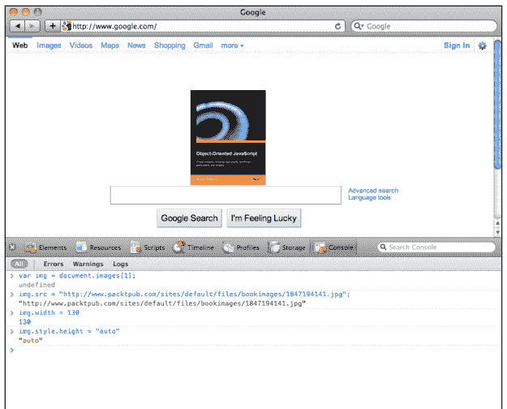

## 面向对象的 JavaScript

要在 Chrome 或 Safari 中调出控制台，请在页面任意位置点击右键并选择**检查 (Inspect Element)**。出现的额外窗口是 Web 检查器。选择**控制台 (Console)** 标签即可开始。

你直接将代码输入到控制台中，当你按下 *Enter* 时，代码就会执行。代码的返回值将打印在控制台中。代码在当前加载页面的环境中执行，例如，如果你输入 `location.href`，它将返回当前页面的 URL。

控制台具有自动补全功能。它的工作原理与操作系统的标准命令行提示符类似。例如，如果你输入 `doc` 并按下 *Tab* 键或右箭头键，`doc` 将自动补全为 `document`。然后你输入 `.`（点运算符），就可以遍历在 `document` 对象上可以调用的所有属性和方法。

通过使用向上和向下方向键，你可以浏览已执行命令的列表并将它们带回控制台。

控制台只提供一行输入空间，但你可以通过分号分隔来执行多个 JavaScript 语句。如果你需要更多行，按下 *Shift + Enter* 可以在不执行结果的情况下进入新行。

## Mac 上的 JavaScriptCore

在 Mac 上，你实际上不需要浏览器；你可以直接从命令行**终端 (Terminal)** 应用程序探索 JavaScript。

如果你从未用过**终端**，可以直接在 Spotlight（聚焦搜索）中搜索它。启动后，输入：

```
alias jsc='/System/Library/Frameworks/JavaScriptCore.framework/Versions/Current/Resources/jsc'
```

此命令为小小的 `jsc` 创建了一个别名，它代表 `JavaScriptCore`，是 WebKit 的一部分。JavaScriptCore 随 Mac 操作系统一起发布。

你可以将之前显示的别名行添加到 `~/.profile` 文件中，这样在你需要时，随时可以使用 `jsc`。

现在，为了启动交互式 shell，你只需从任何目录输入 `jsc` 即可。然后你就可以输入 JavaScript 表达式，当你按下 *Enter* 时，你将看到表达式的结果。

## 第一章

```
Last login: Tue May 31 01:07:35 on ttys002
stoyanefanovi~ stoyanefanov$ $
> =1
2
> var a = "hello":
undefined
> =
hello
> var b = "console";
undefined
> b
> console
> a + " " + b
hello console
>>
```

## 更多控制台

所有现代浏览器都内置了控制台。你之前见过 Chrome/Safari 控制台。在任何 Firefox 版本中，你可以安装 Firebug 扩展，它带有一个控制台。此外，在较新的 Firefox 版本中，内置了一个控制台，可以通过工具/Web 开发者/Web 控制台菜单访问。

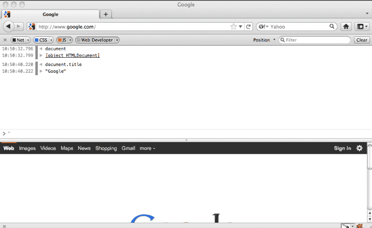

## 面向对象的 JavaScript

Internet Explorer 从 8 版本起拥有 F12 开发者工具，在其 `Script` 标签中有一个控制台。

熟悉 `Node.js` 也是一个好主意，你可以从尝试它的控制台开始。从 `http://nodejs.org` 下载 `Node.js` 并在命令行提示符（终端）中尝试控制台。

```
stoyestefanovov fb15~ stoyestefanovov node bash — 79x21
var a = 1; var b = 2;
undefined
a += b;

(Ctrl+C to quit)
stoyestefanovov fb15~ stoyestefanovov cat test.js
var a = 18;
var b = 12;

console.log(a + b);
stoyestefanovov fb15~ stoyestefanovov node test.js
30
stoyestefanovov fb15~
```

如你所见，你可以使用 `Node.js` 运行脚本。你可以使用 `Node.js` 测试示例。存储在变量中的数据可以在赋值后更改，这就是“变量”名称的由来。

## 总结

在本章中，你学习了：

- JavaScript 中的原始数据类型
- 数组
- 常用运算符
- 控制语句

# 变量

变量用于存储数据；它们是值的占位符。在编写程序时，使用变量而不是实际值非常方便。使用变量需要两个步骤。你需要：

- 声明变量
- 初始化它，即给它赋值

## 变量是区分大小写的

变量名是区分大小写的。你可以使用 JavaScript 控制台轻松地验证这一结论。尝试输入以下内容，并在每行后按回车：

```
var case_matters = 'lower';
var CASE_MATTERS = 'upper';
case_matters;
CASE_MATTERS;
```

为了减少击键次数，当你输入第三行时，可以输入 `case` 然后按 `Tab` 键（或右方向键）。控制台会自动补全变量名为 `case_matters`。对于最后一行，输入 `CASE` 并按 `Tab` 键。最终结果如图所示：

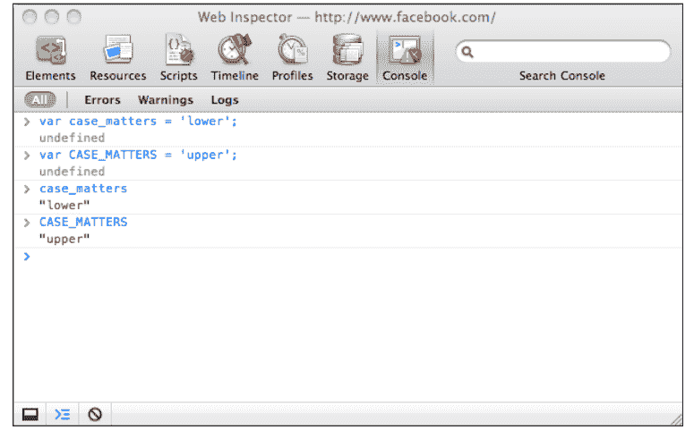

在本书的其余部分，我们将给出示例代码，而不是截图，如下所示：

```
> var case_matters = 'lower';
> var CASE_MATTERS = 'upper';
> case_matters;
"lower"
> CASE_MATTERS;
"upper"
```

> 你可以从图中看到控制台的结果是单词 `undefined`。你可以简单地忽略它，但如果你好奇，这里是发生的情况：在评估（执行）你输入的内容时，控制台会打印返回的值（表达式如 `a = 1:` 它们没有显式地返回任何内容，在这种情况下，它们意味着返回特殊值 `undefined`（稍后会详细介绍）。当表达式返回某个值时（例如上一个示例中的 `case_matters` 或像 `1+1` 这样的），就会打印结果。并不是所有的控制台都会打印 `undefined` 值，例如 Firebug 控制台。

# 运算符

运算符接受一个两个值（或变量），执行操作并返回一个值。让我们来看一个简单的运算符使用示例，以澄清术语：

```
> 1 + 2;
3
```

在这段代码中：

- `+` 是运算符
- 操作是加法
- 输入值是 `1` 和 `2`（输入值也被称为操作数）
- 结果值是 `3`
- 整个部分被称为表达式

与其直接在表达式中使用数值值 `1` 和 `2`，你可以使用变量。你还可以使用变量来存储操作的结果，正如示例所示：

```
> var a = 1;
> var b = 2;
> a + 1;
2
> b + 2;
4
> a + b;
3
> var c = a + b;
> c;
3
```

下表列出了基本的算术运算符：

| 运算符符号 | 操作 | 示例 |
|---|---|---|
| + | 加法 | > 1 + 2; **3** |
| - | 减法 | > 99.99 - 11; **88.99** |
| * | 乘法 | > 2 * 3; **6** |
| / | 除法 | > 6 / 4; **1.5** |
| % | 取模，除法的余数 | > 6 % 3; **0** <br>5 % 3; **2** |

有时测试一个数字是偶数还是奇数很有用。使用取模运算符可以很容易做到。所有奇数除以 2 都返回 1，而所有偶数返回 0。

```
> 4 % 2;
0
> 5 % 2;
1
```

| 运算符符号 | 操作 | 示例 |
| --- | --- | --- |
| ++ | 将值加 1 | 后自：当输入值在返回后增加 1。<br>> var a = 123;<br> var b = a++;<br> b;<br> **123**<br> a;<br> **124**<br><br>相反的是前自。输入值先加 1 然后返回。<br>> var a = 123;<br> var b = ++a;<br> b;<br> **124**<br> a;<br> **124** |
| -- | 将值减 1 | 后减：<br>> var a = 123;<br> var b = a--;<br> b;<br> **123**<br> a;<br> **122**<br><br>前减：<br>> var a = 123;<br> var b = --a;<br> b;<br> **122**<br> a;<br> **122** |

`var a = 1;` 也是一种操作；它是简单的赋值操作，而 `=` 是简单的赋值运算符。

还有一组赋值和算术运算符组合的运算符。这些被称为复合运算符。它们可以让你的代码紧凑得多。让我们通过示例来看其中一些：

```
var a = 5;
a += 3;
8
```

在这个示例中，`a += 3;` 等同于 `a = a + 3`。

`2e+3` 表示将数字 2 的小数点向右移动三位。

还有 `2e-3`，意味着你将数字 2 的小数点向左移动三位：

```
2e+3 -> 2000
2e-3 -> 0.002
```

```
> 2e-3;
0.002
> 123.456E-3;
0.123456
> typeof 2e-3;
"number"
```

# Infinity (无穷大)

JavaScript 中有一个特殊值 `Infinity`。它代表一个 JavaScript 无法处理的巨大数字。`Infinity` 确实是一个数字，控制台中的 `typeof Infinity` 会证实这一点。你也可以快速检查一个带有带有 308 个零的数字是否没问题，但 309 个零就太大了。准确来说，JavaScript 能处理的最大数字是 `1.7976931348623157e+308`，而最小的是 `5e-324`。

```
> Infinity;
Infinity
> typeof Infinity;
"number"
> 1e309;
Infinity
> 1e308;
1e+308
```

除以零会得到无穷大：

```
> var a = 6 / 0;
> a;
Infinity
```

# 基本数据类型、数组、循环和条件

`Infinity` 是最大的数字（或者说比最大的还要大那么一点点），但最小的呢？它是前面带一个负号的无穷大；负无穷：

```
> var i = -Infinity;
> i;
-Infinity
> typeof i;
"number"
```

这是否意味着你有一个恰好是 `Infinity` 大两倍的东西，范围从 0 到无穷大，再从 0 到负无穷？嗯，并不完全是。当你将无穷和负无穷相加时，得到的不是 0，而是被称为 `NaN`（非数字）的值：

```
> Infinity - Infinity;
NaN
> -Infinity + Infinity;
NaN
```

任何将 `Infinity` 作为操作数之一的算术运算都会得到 `Infinity`：

```
> Infinity - 20;
Infinity
> -Infinity * 3;
-Infinity
> Infinity / 2;
Infinity
> Infinity - 9999999999999999;
NaN
```

# NaN (非数字)

上一个例子中的 `NaN` 是什么？事实证明尽管名字叫 "Not a Number"，但 `NaN` 也是一个特殊的数字值：

```
> typeof NaN;
"number"
> var a = NaN;
> a;
NaN
```

# 第二章

当你尝试执行假设为数字的操作但该操作失败时，就会得到 `NaN`。例如，如果你尝试将 10 乘以字符 "f"，结果是 `NaN`，因为 "f" 显然不是乘法的有效操作数：

```
> var a = 10 * "f";
> a;
NaN
```

`NaN` 是具有传染性的，所以如果你在算术运算中有一个 `NaN`，整个结果就会化泡汤：

```
> 1 + 2 + NaN;
NaN
```

# 字符串 (Strings)

字符串是用于表示文本的字符序列。在 JavaScript 中，任何放在单引号或双引号之间的值都被视为字符串。这意味着 `i` 是一个数字，但 `"1"` 是一个字符串。当配合字符串使用时，`typeof` 返回 `"string"`：

```
> var s = "some characters";
> typeof s;
"string"
> var s = 'some characters and numbers 123 5.87';
> typeof s;
"string"
```

这是一个在字符串上下文中使用数字的示例：

```
> var s = '1';
> typeof s;
"string"
```

如果你在引号中什么都不放，它仍然是一个字符串（空字符串）：

```
> var s = "";
> typeof s;
"string"
```

正如你所知道的，当你对两个数字使用加号时，这是算术加操作。然而，如果你对字符串使用加号，这就是字符串拼接操作，它返回两个拼接在一起的字符串：

```
> var s1 = "web";
> var s2 = "site";
> var s = s1 + s2;
> s;
"website"
> typeof s;
"string"
```

`+` 运算符的双重用途是错误的根源。因此，如果你打算拼接字符串，最好始终确保所有操作数都是字符串。加法也是如此；如果你想相加数字，请确保操作数是数字。你将在本章节和书中学习更多实现这些的方法。

## 字符串转换 (String conversions)

当你将类似数字的字符串（例如 `"1"`）作为算术运算的操作数时，字符串会在后台转换为数字。这适用于所有算术运算，加法除外，因为它具有歧义性：

```
> var S = '1';
> S = 3 * S;
> typeof S;
"number"
> S;
3
> var S = '1';
> S++;
> typeof S;
"number"
> S;
2
```

将任何类似数字的字符串转换为数字的懒方法是将其乘以 1。

```
false || true || false;
true
```

你也可以在同一个表达式中混合 `&&` 和 `||`。在这种情况下，你应该使用括号来明确你希望操作是如何执行的。考虑这些情况：

```
false && false || true && true;
true
false && (false || true) && true;
false
```

## 运算符优先级

你可能会奇怪为什么之前的表达式 `(false && false || true &&)` 返回了 `true`。答案在于运算符优先级。正如你从数学中所了解的：

```
1 + 2 * 3;
7
```

这是因为乘法的优先级高于加法，所以 `2 * 3` 先被求值，就像你输入了：

```
1 + (2 * 3);
7
```

逻辑操作也是如此，`&&` 具有最高优先级并首先执行（假设没有括号要求其他顺序）。然后，按照优先级顺序，接下来是 `||`，最后是 `!`。换句话说，以下两个代码片段是等价的：

```
false && false || true && true;
true
```

以及

```
(false && false) || (true && true);
true
```

> 最佳实践
>
> 使用括号而不是依赖运算符优先级。这使得你的代码更容易易读和理解。

## 懒惰求值

如果你有多个连续的逻辑操作，但结果在结束前的某一点已经变得明确，那么最后的操作将不会执行，因为它们不影响最终结果。考虑这种情况：

```
> true || false || true || false || true;
true
```

由于这些是 OR 操作且具有相同的优先级，只要操作数中有一个为 `true`，结果将是 `true`。在求值第一个操作后，结果就变成了 `true`，无论后面是什么值。因此，JavaScript 引擎决定变得“懒惰”（好的，高效的），通过评估不影响最终结果的代码来避免不必要的工作。你可以在控制台中实验来验证这种短路行为：

```
> var b = 5;
> true || (b = 6);
true
> b;
5
> true && (b = 6);
6
> b;
6
```

这个示例还展示了另一个有趣的行为：如果 JavaScript 在逻辑操作中遇到非布尔表达式作为操作数，则该非布尔值作为结果返回：

```
> true || "something";
true
> true && "something";
"something"
> true && "something" && true;
true
```

这种行为并不是你应该依赖的，因为它会让代码更难理解。当你不确定变量是否之前已经定义过时，使用这种行为来定义变量是常见的。在下一个示例中，如果变量 `mynumber` 已定义，则保留该值；否则，它将被初始化为 `10`：

```
var mynumber = mynumber || 10;
var mynumber;
10
```

这看起来简单且优雅，但请注意它并不是万无一失的。如果 `mynumber` 被定义并初始化为 `0`（或六个假值中的任何一个），这段代码的行为可能不符合你的预期：

```
var mynumber = 0;
var mynumber = mynumber || 10;
var mynumber;
10
```

## 比较

还有另一组运算符的操作结果都返回布尔值。这些比较运算符。下表列了它们及其示例：

| 运算符符号 | 描述 | 示例 |
| --- | --- | --- |
| == | 等价比较：当两个操作数相等时，返回 `true`。操作数在比较之前会被转换为相同的类型。也称为松散比较。 | > 1 == 1;<br>true<br>> 1 == 2;<br>false<br>> 1 == '1';<br>true |
| === | 等价和类型比较：如果两个操作数相等且类型相同，则返回 `true`。这样比较更好且更安全，因为没有幕后的的类型转换。它也是严格比较。 | > 1 === '1';<br>false<br>> 1 === 1;<br>true |
| != | 非等价比较：如果操作数不相等（类型转换后），则返回 `true`。 | > 1 != 1;<br>false<br>> 1 != '1';<br>false<br>> 1 != '2';<br>true |
| !== | 不带类型转换的非等价比较：如果操作数不等或它们的类型不同，则返回 `true`。 | > 1 !== 1;<br>false<br>> 33 !== 22;<br>true |
| > | 如果左操作数大于右操作数，则返回 `true`。 | > 1 > 1;<br>false<br>> 33 > 22;<br>true |
| >= | 如果左操作数大于或等于右操作数，则返回 `true`。 | > 1 >= 1;<br>true<br>> 33 >= 22;<br>true |
| < | 如果左操作数小于右操作数，则返回 `true`。 | > 1 < 1;<br>false<br>> 33 < 22;<br>false |
| <= | 如果左操作数小于或等于右操作数，则返回 `true`。 | > 1 <= 1;<br>true<br>> 33 <= 22;<br>false |

要访问数组元素，你需要在方括号内指定该元素的索引。因此，`a[0]` 给出数组的第一个元素，`a[1]` 给出第二个，依此类推：

```
> a[0];
1
> a[1];
2
```

### 添加/更新数组元素

使用索引，你也可以更新数组元素的值。接下来的示例更新了第三个元素（索引 2）并打印了新数组的内容：

```
> a[2] = 'three';
"three"
> a;
[1, 2, "three"]
```

你可以通过指定之前不存在的索引来添加更多元素：

```
> a[3] = 'four';
"four"
> a;
[1, 2, "three", "four"]
```

如果你添加一个新元素会在数组中留出空隙，那些中间的元素是不存在的，在访问它们时会返回 `undefined` 值。查看此示例：

```
> var a = [1, 2, 3];
> a[6] = 'new';
"new"
> a;
[1, 2, 3, undefined x 3, "new"]
```

### 删除元素

要删除元素，你使用 `delete` 运算符。然而，删除后，数组的长度不会改变。在某种意义上，你在数组中留下了一个洞：

```
> var a = [1, 2, 3];
> delete a[1];
true
> a;
[1, undefined, 3]
> typeof a[1];
"undefined"
```

### 嵌套数组

数组可以包含所有类型的值，包括其他数组：

```
> var a = [1, "two", false, null, undefined];
> a;
[1, "two", false, null, undefined]
> a[5] = [1, 2, 3];
[1, 2, 3]
> a;
[1, "two", false, null, undefined, Array[3]]
```

结果中的 `Array[3]` 在控制台中是可以点击的，它可以展开数组值。让我们来看一个包含两个元素的数组，这两个元素都是其他数组的示例：

```
> var a = [[1, 2, 3], [4, 5, 6]];
> a;
[Array[3], Array[3]]
```

数组的第一个元素是 `a[0]`，它也是一个数组：

```
> a[0];
[1, 2, 3]
```

要访问嵌套数组中的元素，你在另一组方括号中引用元素索引：

```
> a[0][0];
1
> a[1][2];
6
```

注意，你可以使用数组符号来访问字符串内部的单个字符：

```
> var s = 'one';
> s[0];
"o"
> s[1];
"n"
> s[2];
"e"
```

许多浏览器已经支持了对字符串的数组访问（但不包括旧版本的 IE），但直到 ECMAScript 5 才被正式认可。

有更多方法可以玩转数组（你将在第 4 章“对象”中学习这些），但我们现在先停在这里，记住：

- 数组是一个数据存储器
- 数组包含索引元素
- 索引从 0 开始，数组中的每个元素递增 1
- 要访问数组的元素，你使用方括号中的其索引
- 数组可以包含任何类型的数据，包括其他数组

## 条件和循环

条件提供了一种简单但强大的控制代码执行流的方法。循环允许你用更少的代码执行重复操作。让我们来看看：

- if 条件
- switch 语句
- while, do-while, for 和 for-in 循环

接下来的章节中的示例需要你切换到多行的 Firebug 控制台。或者，如果你使用 WebKit 控制台，请使用 Shift + Enter 代替 Enter 来换行。

### if 条件

这是一个 if 条件的简单示例：

```
var result = '', a = 3;
if (a > 2) {
  result = 'a is greater than 2';
}
```

if 条件的部分是：

- if 语句
- 括号中的条件 - "a 是否大于 2?"
- 裹在 {} 里的代码块，当条件满足时执行执行

条件（括号中的部分）始终返回一个布尔值，并可能包含以下内容：

- 逻辑运算：!, &&, 或 ||
- 比较：例如 ===, !=, >, 等等
- 任何可以转换为布尔值的值或变量
- 以上内容的组合

### else 子句

if 条件也可以有一个 else 部分。else 语句后面跟着一个代码块，当条件求值为 false 时运行该代码块：

```
if (a > 2) {
  result = 'a is greater than 2';
} else {
  result = 'a is not greater than 2';
}
```

# 三元运算符 (Alternative if syntax)

当你有一个简单的条件时，可以考虑使用三元运算符语法。看看这个例子：

```
var a = 1;
var result = '';
if (a === 1) {
    result = "a is one";
} else {
    result = "a is not one";
}
```

你也可以将其写为：

```
var a = 1;
var result = (a === 1) ? "a is one" : "a is not one";
```

你只应该在简单条件下使用这种语法。注意不要滥用它，因为它很容易让你的代码变得难以读读。这里有一个例子：

假设你想确保一个数字在某个范围内，例如在 50 到 100 之间：

```
var a = 123;
a = a > 100 ? 100 : a < 50 ? 50: a;
a;
100
```

由于存在多个 `?`，这段代码的工作原理可能并不清晰。添加括号会让它清晰一点：

```
var a = 123;
a = (a > 100 ? 100 : a < 50) ? 50 : a;
a;
50
```

```
var a = 123;
a = a > 100 ? 100 : (a < 50 ? 50 : a);
a;
100
```

`?:` 被称为三元运算符，因为它接受三个操作数。

# switch

如果你发现自己在使用 `if` 条件且并且有太多的 `else` 部分，你可以考虑将 `if` 更改为 `switch`：

```
var a = '1',
  result = '';
switch (a) {
  case 1:
    result = 'Number 1';
    break;
  case '1':
    result = 'String 1';
    break;
  default:
    result = 'I don't know';
    break;
}
```

执行后的结果是 "String 1"。让我们看看 `switch` 的各个部分：

- `switch` 语句。
- 括号中的表达式。该表达式通常包含一个变量，但可以是任何返回值的内容。
- 用大括号括起来的多个 `case` 块。
- 每个 `case` 语句后跟着一个表达式。表达式的结果与 `switch` 语句之后的表达式进行比较。如果比较结果为真，则执行 `case` 后面冒号后的代码。
- 有一个可选的 `break` 语句，用于标记 `case` 块的结束。如果达到了这个 `break` 语句，`switch` 就全部完成了。否则，如果没有 `break`，程序执行将进入下一个 `case` 块。
- 有一个可选的 `default` 情况，用 `default` 语句标记，并跟着一个代码块。如果之前没有任何 `case` 结果为真，则执行 `default` 情况。

换句话说，执行 `switch` 语句的逐步步骤如下：

1. 求值括号中的 `switch` 表达式；记住它。
2. 移动到第一个 `case`，并将其值与步骤 1 中的值进行比较。
3. 如果步骤 2 中的比较返回真，则执行 `case` 块中的代码。
4. 执行 `case` 块后，如果结尾有一个 `break` 语句，则退出 `switch`。
5. 如果没有 `break` 或步骤 2 返回假，则移动到下一个 `case`。
6. 重复步骤 2 到 5。
7. 如果你仍在此处（步骤 4 没有退出），则执行 `default` 语句后的代码。

# 最佳实践技巧

- 对紧随 `case` 行后的代码进行缩进。你也可以从 `switch` 开始缩进，但这在可读性方面没提供太大帮助。
- 不要忘记写 `break`。
- 有时，你可能想刻意省略 `break`，但这种情况很罕见。这被称为“穿透”（fall-through），应该编写文档说明，因为它看起来像是一个无意的遗漏。另一方面，有时你可能想省略省略后面的代码块，让两个 `case` 共享相同的代码。这是可以的，但它并没有改变规则：如果 `case` 语句后面有代码，那么这些代码应该以 `break` 结束。在缩进方面，将 `break` 与 `case` 对齐或与 `case` 内部的代码对齐是个人喜好；再次，一致性才是最重要的。
- 使用 `default` 情况。这有助于确保在 `switch` 语句之后你总有一个有意义的结果，即使没有 `case` 匹配到正在切换的值。

# 循环

`if-else` 和 `switch` 语句允许你的代码采取不同的路径，就像你处在一个十字路口，根据条件决定走哪条路一样。另一方面，循环允许你的代码在合并回主路之前经过几个环岛。重复多少次？这取决于每次迭代期间（或之后）评估条件的结果。

假设你（你的程序执行）正在从 A 游到 B。在某处，你到达一个评估条件 `C` 的地方。评估 `C` 的结果告诉你是否应该进入循环 `L`。你进行一次迭代并到达 `C`。然后，你再次评估条件以看看是否还需要另一次迭代。最后，你继续前往 B。

无限循环是指条件始终为真，你的代码“永远”卡在循环中。这当然是一个逻辑错误，你应该留意此类场景。在 JavaScript 中，有四种循环：

- `while` 循环
- `do-while` 循环
- `for` 循环
- `for-in` 循环

## while 循环

`while` 循环是最简单的迭代类型。它们看起来像这样：

```
var i = 0;
while (i < 10) {
  i++;
}
```

`while` 语句后面跟着括号中的条件和大括号中的代码块。只要条件求值为真，该代码块就会反复执行。

## do-while 循环

`do-while` 循环是 `while` 循环的变体。示例所示：

```
var i = 0;
do {
  i++;
} while (i < 10);
```

在这里，语句后面跟着一个代码块和一个条件。这意味着在评估条件之前，代码块至少执行一次。如果你在最后的几个示例中将初始化为 1 而不是 0，那么第一个示例（`while` 循环）中的代码块不会执行，`i` 仍然是 1；而在第二个（`do-while` 循环）中，代码块将执行。

## for 循环

`for` 循环是最常用的循环类型。它看起来更复杂。在 `for` 循环的语法中，你必须考虑以下部分：`for` 循环模式如下：

- 在初始化部分，定义一个变量，`i = 0`
- 在条件部分，将 `i` 与一个值进行比较，例如 `i < 100`
- 在递增部分，增加 `i`，例如 `i++`

`for` 循环可以包含用逗号分隔的多个表达式。假设你想重写示例并在初始化部分定义 `i`：

```
var punishment = '';
for (var i = 0; i < 100; i++) {
    punishment += '...';
}
```

你可以把循环的体移动到初始化部分吗？

```
for (var i = 0, punishment = ''; i < 100; i++) {
    punishment += '...';
}
```

这三个部分都是可选的。这里是重写相同示例的另一种方法：

```
var i = 0, punishment = '';
for (;;) {
    punishment += '...';
    if (++i == 100) {
        break;
    }
}
```

虽然最后一种重写与原始代码完全相同，但它更长且更难读。也可以通过 `while` 循环来实现相同的结果。但是，`for` 循环让代码更紧凑更健壮，因为 `for` 循环的语法强制你思考三个部分（初始化、条件和递增），这有助于你确认逻辑并避免陷入无限循环的情况。

循环可以相互嵌套。这里有一个嵌套在另一个循环中的循环示例，它构建了一个包含 10 行 10 列星号的字符串。认为 `i` 是行 `j` 是“图像”的列：

```
var res = '\n';
for (var i = 0; i < 10; i++) {
  for (var j = 0; j < 10; j++) {
    res += '*';
  }
}
```

结果是如下字符串：

（省略内容）

这里是另一个使用嵌套循环和取模运算绘制类似雪花结果的示例：

```
var res = '\n'; i, j;
for (var i = 1; i <= 7; i++) {
  for (var j = 1; j <= 15; j++) {
    res += (i * j) % 8 == 0 ? '*' : ' ';
  }
}
res += '\n';
```

结果是：

```
+   * * 
*
* *
*
******
*
* * 
```

## for-in 循环

`for-in` 循环用于遍历数组的元素（或对象，正如你稍后看到的）。这是它的唯一用途；它不能用作一种通用的重复机制来替代 `for` 或 `while`。让我们来看一个使用 `for-in` 循环遍历数组元素的示例。但请记住，这仅供信息目的，因为 `for-in` 最适用于对象，而数组应该使用普通的 `for` 循环。

在这个示例中，你遍历了数组的所有元素，并打印出每个元素的索引（键名）和值：

```
// 示例仅供信息参考
// for-in 循环用于对象
// 普通 循环更适合数组
var a = ['a', 'b', 'c', 'x', 'y', 'z'];
for (var i in a) {
  result += 'index: ' + i + ', value: ' + a[i] + '\n';
}
```

结果是：

```
index: 0, value: a
index: 1, value: b
index: 2, value: c
index: 3, value: x
index: 4, value: y
index: 5, value: z
```

## 注释

这一章有一点：注释。在你的 JavaScript 程序中，你可以放置注释。这些注释会被 JavaScript 引擎忽略，对程序的运行没有任何影响。但是，当你在几个月后重新查看代码，或将代码交给他人维护时，它们可能是无价之宝。

允许两种类型的注释：

- 单行注释以 `//` 开头，并在行尾结束。
- 多行注释以 `/*` 开头，并在同一行或随后的任何行上以 `*/` 结束。请注意，注释开始和结束之间的任何代码都会被忽略。

以下是一些示例：

```
// 行首
var a = 1; // 行的任意位置
/* 单行内的多行注释 */
/*
跨越几行的注释
*/
```

甚至还有一些工具，如 `JSDoc` 和 `YUIDoc`，它们可以解析你的代码并根据你的注释提取有意义的文档。

## 总结

在本章中，你学习了关于 JavaScript 程序基本构建部分的很多知识。现在你知道了原始数据类型：

- 数字 (Number)
- 字符串 (String)
- 布尔值 (Boolean)
- 未定义 (Undefined)
- 空 (Null)

你还了解了一些运算符：

- 算术运算符：`+`、`-`、`*`、`/` 和 `%`
- 增减运算符：`++` 和 `--`
- 赋值运算符：`=`、`+=`、`-=`、`*=`、`/=` 和 `%=`
- 特殊运算符：`typeof`、`delete` 和 `void`
- 逻辑运算符：`&&`、`||` 和 `!`
- 比较运算符：`==`、`!=`、`===`、`!==`、`<`、`>`、`<=` 和 `>=`
- 三元运算符 `?:`

然后，你学习了如何使用数组来存储和访问数据，最后看到了如何使用条件（`if-else` 或 `switch`）和循环（`while`、`do-while`、`for` 和 `for-in`）来控制程序流的不同方法。

这些信息很多；现在花点时间完成下面的练习，在进入下一章之前，先给自己一个应得的掌赞。未来在前方！

## 练习题

1. 在控制台中执行这些行的行的结果分别是什么？为什么？

```
> var a;
> var s = 'ls'; s++;
> !!"false";
> !!undefined;
> typeof -Infinity;
> 10 < "10";
> undefined === null;
> false === "";
> typeof "2E+2";
> a = 3e+3; a++;
```

2. 在执行以下操作后，`v` 的值是多少？

```
> var v = v || 10;
```

尝试将 `v` 设置为 100、0 或 `null` 进行实验。

3. 编写一个小型程序打印出乘法表。使用嵌套在另一个循环。

# 3 函数

掌握函数是学习任何编程语言时的一项重要技能，对于 JavaScript 来说更是如此。这是因为 JavaScript 有很多函数的用途，而且语言的灵活性和表达很大程度上来自于它们。大多数编程语言对某些对象特性有特殊的语法，而 JavaScript 只使用函数。本章将涵盖：

- 如何定义和使用函数
- 向函数传递参数
- 可以“免费”使用的预定义函数
- JavaScript 中的变量作用域
- 函数只是数据特殊类型这一概念

理解这些主题将提供坚实的基础，允许你深入本章的第二部分，该部分展示了的一些有趣应用：

- 使用匿名函数
- 回调函数
- 立即（自执行）函数
- 内部函数（定义在其他函数内部函数）
- 返回函数的函数
- 重新定义自身的函数
- 闭包 (Closures)

## 什么是函数？

函数允许你将代码组合在一起，给这些代码命名，并在以后通过你给出的名称重用它。让我们来看一个示例：

```
function sum(a, b) {
  return a + b;
}
```

上面的函数由几个部分组成：

- `function` 关键字
- 函数名 (`sum`)
- 函数体由 `{ }` 组成
- 参数 (`a, b`)
- `return` 语句

```
function processData(data, callback) {
  console.log("Processing...");
  callback(data);
}
processData("some data", function(result) {
  console.log("Received:", result);
});
```

```
(function() {
  console.log("I am executed immediately!");
})();
```

```
function outer() {
  var outerVar = "outer";
  function inner() {
    console.log(outerVar);
  }
  inner();
}
outer();
```

```
function makeMultiplier(multiplier) {
  return function(num) {
    return num * multiplier;
  };
}
var double = makeMultiplier(2);
console.log(double(5)); // 10
```

```
function createCounter() {
  var count = 0;
  return function() {
    count++;
    return count;
  };
}
var counter = createCounter();
console.log(counter()); // 1
console.log(counter()); // 2
```

- `isFinite()`
- `encodeURI()`
- `decodeURI()`
- `encodeURIComponent()`
- `decodeURIComponent()`
- `eval()`

## 黑盒函数

通常情况下，当你调用函数时，你的程序不需要知道这些函数内部是如何运作的。你可以将它们想象成黑盒：你给它输入值（作为输入参数），然后获取它返回的输出。对于任何函数都是如此——无论是 JavaScript 引擎内置的函数、你创建的函数，还是同事或其他人创建的。


## parseInt()

`parseInt()` 接收任何类型的输入（通常是字符串）并尝试将其转换为整数。如果失败，它将返回 `NaN`。

```
> parseInt('123');
123
> parseInt('abc123');
NaN
> parseInt('abc23');
1
> parseInt('123abc');
123
```

该函数接受一个可选的第二个参数，即基数（radix），它告诉函数期望什么数字类型的数字——十进制、十六进制、二进制等。例如，尝试从字符串 `FF` 中提取十进制数字是没有意义的，所以结果是 `NaN`；但如果你尝试将 `FF` 作为十六进制处理，你就会得到 255。

```
> parseInt('FF', 10);
NaN
> parseInt('FF', 16);
255
```

另一个例子是解析基数为 10（十进制）和基数为 8（八进制）的字符串：

```
> parseInt('0377', 10);
377
> parseInt('0377', 8);
255
```

如果在调用 `parseInt()` 时省略第二个参数，函数将假设基数为 10（十进制），但有以下例外：

- 如果传递的字符串以 `0x` 开头，基数假设为 16（假设为十六进制）。
- 如果传递的字符串以 `0` 开头，基数假设为 8（假设为八进制）。考虑以下示例：

```
> parseInt('377');
377
> parseInt('0377');
255
> parseInt('0x377');
887
```

最安全的做法是始终指定基数。如果你省略了基数，你的代码在 99% 的情况下可能仍然有效（大多数情况下你解析的是十进制），但偶尔它可能会在调试某些边缘情况时让你抓掉头发。例如，假设你有一个表单字段接受天数或月份，而用户输入了 `06` 或 `08`。

> ECMAScript 5 移除了八进制字面量，避免了与 `parseInt()` 和未指定基数产生的混乱。

## parseFloat()

`parseFloat()` 与 `parseInt()` 类似，但在尝试从输入中确定数字时，它还会寻找小数。此函数只接受一个参数：

```
> parseFloat('1.23');
1.23
> parseFloat('1.23');
1.23
> parseFloat('1.23abc.00');
1.23
> parseFloat('a.bcl1.23');
NaN
```

与 `parseFloat()` 不同，`parseFloat()` 在遇到第一个意外字符时就会放弃，尽管字符串的其余部分可能包含可用的数字：


> parseFloat('a123.34');
NaN

> parseFloat('12a3.34');
12

`parseFloat()` 能理解输入中的指数（与 `parseInt()` 不同）：

> parseFloat('123e-2');
1.23

> parseFloat('1e10');
10000000000

> parseInt('1e10');
1

## isNaN

使用 `isNaN()` 可以检查输入值是否为可以安全用于算术运算的有效数字。此函数也是检查 `parseInt()` 或 `parseFloat()`（或任何算术运算）是否成功的方便方法：

> isNaN(NaN);
true

> isNaN(123);
false

> isNaN(1.23);
false

> isNaN(parseInt('abc123'));
true

## Functions

函数也会尝试将输入转换为数字：

> isNaN('1.23');
false
> isNaN('al.23');
true

`isNaN()` 函数很有用，因为特殊值 `NaN` 不等于任何值，包括它自己。换句话说，`NaN === NaN` 为 `false`。因此，`NaN` 不能用来检查一个值是否为有效数字。

## isFinite()

`isFinite()` 检查输入是否为既不是 `Infinity` 也不是 `NaN` 的数字：

> isFinite(Infinity);
false
> isFinite(-Infinity);
false
> isFinite(12);
true
> isFinite(1e308);
true
> isFinite(1e309);
false

如果你好奇最后两次调用返回的结果，请记住上一节，JavaScript 中最大的数字是 `1.797693134863157e+308`，所以 `1e309` 是 `false`。

## 编码/解码 URI

在统一资源定位（URL）或统一资源标识符（URI）中，某些字符具有含义。如果你想转义这些字符，可以使用 `encodeURI()` 或 `encodeURIComponent()`。第一个转义整个 URL，第二个只转义参数部分。第一个返回一个可用的 URL，第二个返回转义后的字符串。例如：

```javascript
var url = "http://example.com/search?q=hello world";
encodeURI(url); // "http://example.com/search?q=hello%20world"
encodeURIComponent(url); // "http%3A%2F%2Fexample.com%2Fsearch%3Fq%3Dhello%20world"
```

`eval()` 接收一个字符串并作为代码执行：

> eval('var ii = 2;');
2

最安全的做法是始终指定基数。如果你省略基数，你的代码在 99% 的情况下可能仍然有效（大多数情况下你解析的是十进制），但偶尔它可能会在调试某些边缘情况时让你抓掉头发。例如，假设你有一个表单字段接受天数或月份，而用户输入了 `06` 或 `08`。

> ECMAScript 5 移除了八进制字面量，避免了与 `parseInt()` 和未指定基数产生的混乱。

## alert()

让我们谈谈另一个函数——`alert()`。它会在框中显示一条消息。它可以用于调试，尽管有更好的方法。这里是 `alert("hello!")` 的结果：


## 变量的作用域

重要的是（特别是如果你来自其他语言），JavaScript 中的变量不是块作用域，而是函数作用域。这意味着定义在函数内部变量在外部是不可见的。然而，如果它定义在 `if` 或 `for` 块中，在块外部是可见的。“全局变量”指的是在函数之外（全局代码中）定义的变量，而“局部变量”是在函数内部的。函数内部的代码可以访问所有全局变量，也可以访问自己的局部变量。

在下一个示例中：

```javascript
var global = 1;
function f() {
  var local = 2;
  global++;
  return global;
}
```

让我们测试一下：

> f();
2

> f();
3

> local;
ReferenceError: local is not defined

同样重要的是，如果不使用 `var` 来声明变量，该变量将自动分配一个全局作用域。让我们来看来看：

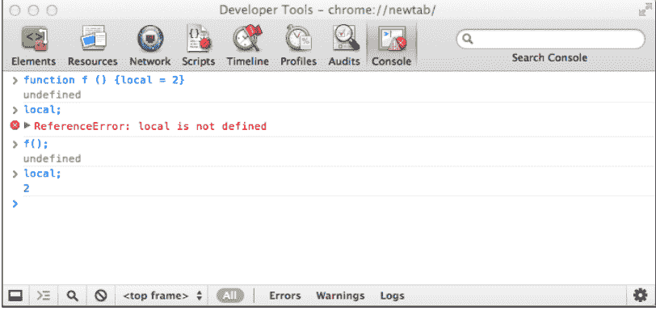

发生了什么？函数 `f()` 包含了变量 `local`。在调用函数之前，该变量不存在。当你第一次调用函数时，变量 `local` 被创建为全局作用域。然后，如果你在函数外部访问 `local`，它是可用的。

+ 最佳实践提示

- 尽量减少全局变量的数量以避免命名冲突。
- 始终使用 `var` 语句声明变量。考虑“单变量”模式。在函数的最顶部定义所有变量，这样你就有一个统一查找变量的地方，并可能防止意外的全局变量。

## 变量提升 (Variable hoisting)

这是一个有趣的例子，展示了局部作用域与全局作用域的一个重要方面：

```javascript
var a = 123;
```

```javascript
function f() {
  alert(a);
  var a = 1;
  alert(a);
}
```

```javascript
f();
```

你可能认为第一个 `alert()` 会显示 **123**（全局变量 `a` 的值），第二个显示 **1**（局部变量 `a`）。但事实并非如此。第一个 `alert` 将显示 **undefined**。这是因为函数内部的作用域比全局作用域更重要。因此，局部变量会覆盖任何同名的全局变量。在第一次 `alert()` 调用时，变量尚未定义（因此值为 `undefined`），但由于被称为**提升**的特殊行为，它仍然存在于局部空间中。

当你的 JavaScript 程序执行进入一个新函数时，函数中任何地方声明的所有变量都会被移动（或提升）到函数的顶部。这是一个需要牢记住的重要概念。此外，只有声明被提升，这意味着变量的存在被移动到了顶部。任何赋值都留在原处。在前面的示例中，局部变量 `a` 的声明被提升到了顶部。只有声明被提升了，而没有对 `1` 的赋值。这就像函数是这样写的一样：

```javascript
var a = 123;
```

```javascript
function f() {
  var a; // 等同于 var a = undefined;
  alert(a); // undefined
  a = 1; // 1
}
```

你也可以采用之前最佳实践部分提到的单一 `var` 模式。在这种情况下，你将进行某种手动的变量提升，以防止与 JavaScript 的提升行为产生混淆。

## 函数是数据

JavaScript 中的函数实际上是数据。这是我们以后需要的一个重要概念。这意味着你可以创建一个函数并将其赋值给变量：

```javascript
var f = function () {
  return 1;
};
```

这种定义函数的方式有时被称为**函数字面量符号 (function literal notation)**。`function () { return 1; }` 这部分是一个**函数表达式 (function expression)**。函数表达式可以可选有一个名称，在这种情况下，它变成了一个**具名函数表达式 (NFE)**。因此，这也是允许的，尽管在实践中很少见（并且会导致 IE 在闭包作用域中错误地创建两个变量：`f` 和 `myFunction`）：

```javascript
var f = function myFunction() {
  return 1;
};
```

如所示，具名函数表达式和函数声明之间没有区别。但它们实际上是不同的。区分这两者的唯一方法是看它们被使用的上下文。函数声明只能出现在程序代码中（在另一个函数的体内或主程序中）。你将在书的后面部分看到更多函数的示例，它们将澄清这些概念。

当你对一个持有函数值的变量使用 `typeof` 运算符时，它会返回字符串 `"function"`：

```javascript
> function define() {
  return 1;
}

> var express = function () {
  return 1;
}

> typeof define;
"function"
```

```javascript
> typeof express;
"function"
```

所以，JavaScript 函数是数据，但是一种具有两个重要特征的特殊数据：

- 它们包含代码
- 它们是可执行的（可以被调用）

正如你之前看到的，执行函数的方法是在其名称后添加括号。下一个示例演示了，无论函数是如何定义的，这种方法都有效。在示例中，你还可以看到函数如何被视为普通值：它可以被复制到不同的变量：

```javascript
var sum = function (a, b) {
  return a + b;
}
```

```javascript
var add = sum;
typeof add;
function
add(1, 2)
```

因为函数被赋值给变量，所以命名函数的规则与命名变量的规则相同——函数名不能以数字开头，它可以包含字母、数字、下划线字符和美元符号的任何组合。

## 匿名函数 (Anonymous functions)

现在你已经知道，存在一种函数表达式语法，你从中像这样定义函数：

```javascript
var f = function (a) {
  return a;
}
```

这也被称为匿名函数（因为它没有名称），特别是当这种函数在没有赋值给变量的情况下被使用时。在这种情况下，这种匿名函数有优雅的用法：

- 你可以将一个匿名函数作为参数传递给另一个函数。接收函数可以对你传递的函数进行某些操作。
- 你可以定义一个匿名函数并立即执行它。

让我们详细查看匿名函数的这两种应用。

## 回调函数 (Callback functions)

因为函数就像赋值给变量的其他任何数据一样，所以它可以被定义、复制，并作为参数传递给其他函数。

这是一个接受两个函数作为参数的示例，它执行它们并返回它们每个返回值的和：

```javascript
function invokeAdd(a, b) {
  return a() + b();
}
```

现在让我们定义两个简单的额外函数（使用函数声明模式），它们只返回硬编码的值：

```javascript
function one() {
  return 1;
}
```

```javascript
function two() {
  return 2;
}
```

（注：原文后续部分存在大量重复和碎片化，译文已根据核心逻辑进行整理。）

## Functions

与其定义 `addOne()`，你不如使用匿名函数，从而节省了一个额外的全局变量：

> multiplyByTwo(1, 2, 3, function (a) {
  return a + 1;
})
[3, 5, 7]

如果需要，匿名函数很容易更改：

> multiplyByTwo(1, 2, 3, function (a) {
  return a + 2;
})
[4, 6, 8]

## 立即执行函数 (Immediate functions)

到目前为止，我们讨论了将匿名函数作为回调。让我们看看匿名函数的另一种应用：在定义函数后立即调用它。这里有一个示例：

```javascript
(function () {
  alert('boo');
})
();
```

这种语法初看起来可能有点吓人，但你只需要简单将一个函数表达式放在括号内，后面紧跟另一组括号。第二组括号表示“立即执行”，也是放置匿名函数可能接受的任何参数的地方：

```javascript
(function (name) {
  alert('Hello ' + name + '!');
})
('dude');
```

或者，你可以将第一组括号的闭合移动到末尾。如下所示：

```javascript
(function () {
  // ...
}();
```

```javascript
// vs.

(function () {
  // ...
}());
```

立即执行（自执行）匿名函数的一个很好的应用是，当你想要在不创建额外全局变量的情况下完成某些工作。当然，缺点是无法无法两次执行同一个函数。这使得立即执行函数最适合一次性任务或初始化任务。

如果你需要，立即执行函数可以选择地返回一个值。看到类似下面的代码并不罕见：

```javascript
var result = (function () {
  // 一些复杂的操作，带有 临时局部变量...
  // ...

  return something;
}());
```

在这种情况下，你不需要将函数表达式封装在括号中，你只需要调用函数的括号即可。因此，以下代码也有效：

```javascript
var result = function () {
  // 一些复杂的操作，带有 临时局部变量
  // return something;
}
```

这种语法虽然可行，但看起来可能有点困惑：在不读函数结尾的情况下，你不知道 `result` 是一个函数还是立即执行函数的返回值。

## 内部（私有）函数

考虑到函数就像任何其他值一样，没有任何可以阻止你在另一个函数内部定义一个函数：

```javascript
function outer(param) {
  function inner(theinput) {
    return theinput * 2;
  }

  return 'The result is ' + inner(param);
}
```

使用函数表达式，这也可以写为：

```javascript
var outer = function (param) {
  var inner = function (theinput) {
    return theinput * 2;
  }
  return 'The result is ' + inner(param);
};
```

当你调用全局函数 `outer()` 时，它会在内部调用局部函数 `inner()`。由于 `inner()` 是局部的，它在 `outer()` 之外无法访问，因此你可以说它是私有函数：

> outer(2);
"The result is 4"

> outer(8);
"The result is 16"

> inner(2);
ReferenceError: inner is not defined

使用私有函数的好处是保持代码整洁（不太可能引起命名冲突），如下：

- 你保持了命名空间的整洁
- 私密性 —— 你只向“外部世界”暴露你决定的函数，将不供应用程序其他部分使用的功能留给自己

## 返回函数的函数

正如前面提到的，函数总是会返回一个值，如果它没有显式地通过 `return`，那么它就会通过返回 `undefined` 隐式地这样做。函数只能返回一个值，而这个值同样可以是另一个函数：

```javascript
function a() {
  alert('A!');
  return function () {
    alert('B!');
  }
}
```

在这个示例中，函数 `a()` 完成了它的工作（提示 A！）并返回另一个执行其他操作的函数（提示 B！）。你可以将返回值赋值给变量并作为普通函数使用：

> var newPunc = a();
> newPunc();

在这里，第一行将提示 A!，第二行将提示 B!。

如果你想立即执行返回的函数而不将其赋值给新变量，你只需要使用另一组括号即可。结果将是相同的：

> a()();

## 函数，重写你自己！

因为函数可以返回函数，你可以使用新函数来替换旧函数。继续上一个示例，你可以获取 `a()` 用的返回值来覆盖实际的 `a()` 函数：

> a = a();

上面的操作提示了 A%，下次你调用 `a()` 时它会提示 B!。这在函数需要某些初始一次性工作时非常有用。函数在第一次调用后会重写自己，以避免每次调用时都进行不必要的重复工作。

在前面的示例中，函数是从外部重新定义的——返回值被赋值回了函数。但函数实际上可以从内部重写自己：

```javascript
function a() {
alert('A!');
a = function () {
  alert('B!');
}
```

如果你想立即执行返回的函数而不将其赋值给新变量，你只需要使用另一组括号即可。结果将是相同的：

> a()();

（注：此处后续存在大量重复和碎片化的 OCR 内容，已合并并清理）

## 闭包 (Closures)

本章剩余部分是关于闭包的（闭包最初可能很难理解，所以如果你没get，不要感到沮丧）。你应该阅读本章的剩余部分并进行自己的实验，但如果你觉得理解这个概念有困难，可以在回到本章讨论的话题时再回来。

# 作用域链 (Scope chain)

正如你所知，在 JavaScript 中，没有大括号作用域，但有函数作用域。定义在函数中的变量在函数外部不可见，但定义在代码块中的变量（例如 `for` 循环）在块外部是可见的：

```javascript
var a = 1;
function f() {
var b = 1;
return a;
}
f();
1
b;
ReferenceError: b is not defined
```

变量 `a` 在全局空间，而 `b` 在函数 `f` 的作用域内。所以：

- 在 `f()` 内部，`a` 和 `b` 都是可见的
- 在 `f()` 外部，`a` 可见，但 `b` 不

如果你在 `outer()` 内部嵌套一个函数 `inner()`，`inner()` 将访问其自身作用域内的变量。这被称为作用域链，且链可以根据你的需要变得非常深：

```javascript
var global = 1;
function outer() {
var outer_local = 2;
function inner() {
var inner_local = 3;
return inner_local + outer_local + global;
}
}
```

```
}
return inner();
}
```

让我们测试一下 `inner()` 是否可以访问所有变量：

+ > outer();
6

# 使用闭包打破链

让我们通过图解来介绍闭包。来看这段代码，看看这里发生了什么：

```
var a = "global variable";
var F = function () {
var b = "local variable";
var N = function () {
var c = "inner local";
};
};
```

首先，有一个全局作用域 G。把它想象成宇宙，仿佛它包含了一切：

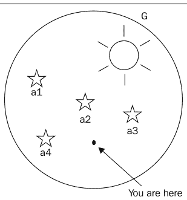

[ 86 ]

它可以包含全局变量如 `a1` 和 `a2`，以及全局函数如 `F`：

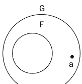

函数有它们自己的私有空间，并可以使用它存储其他变量，如 `b` 和内部函数 `N`（代表 iNN）。在某个时刻，你将得到这样一张图：

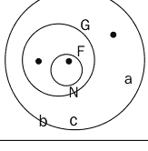

如果你在点 a，你就在全局空间内部。如果你在点 b（它在函数 `F` 的空间内部），那么你可以访问全局空间和 `F` 空间。如果你在点 c（它在函数 `N` 内部），那么你可以访问全局空间、`F` 空间和 `N` 空间。你无法从 a 到达 b，因为 b 在 `F` 外部是不可见的。但是，如果你想的话，你可以从 c 到达 b，或者从 `N` 到 b。有趣的部分——闭包效应——发生在 `N` 跳出 `F` 并最终进入全局空间时：

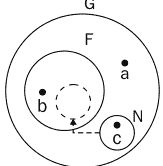

## 函数

然后会发生什么？`N` 像 `a` 一样位于全局空间中。由于函数会记住它们被定义的环境（作用域），`N` 仍然可以访问 `F` 空间，因此可以访问 `b`。这很有趣，因为 `N` 是 `a` 所在，但 `N` 确实可以访问 `b`，而 `a` 不能。

那么 `N` 是如何打破链的？通过让自己变成全局的（省略 `var`），或者让 `F` 将其交付（或返回）到全局空间。让我们看看在实践中是如何实现的。

## 闭包 #1

看看这个函数，它和之前一样，只是 `F` 返回了 `N`，并且还返回了 `b`（它通过作用域访问 `b`）：

```
var a = "global variable";
var F = function () {
var b = "local variable";
var N = function () {
var c = "inner local";
  return b;
}
  return N;
}
```

函数 `F` 包含变量 `b`，它是局部的，因此全局空间无法访问它。

> > b: ReferenceError: b is not defined

函数 `N` 可以访问它的私有空间、`F()` 函数的空间以及全局空间。因此，它可以看到 `b`。由于 `F()` 可以从全局空间被调用（它是一个全局函数），你可以调用它并将返回的值赋值给另一个全局变量。

结果：一个可以访问 `F()` 函数私有空间的新全局函数：

> > var inner = F();
> inner();
> "local variable"

## 闭包 #2

下一个示例的最终结果与上一个示例相同，但实现方式略有不同。`F()` 没有返回函数，而是在其内部创建一个新的全局函数 `inner()`。

让我们先为将要生成的全局函数声明一个占位符。这是可选的，但声明变量总是是好的。然后，你可以如下定义函数 `F()`：

```
var inner; // 占位符
var F = function () {
var b = "local variable";
var N = function () {
  return b;
  inner = N;
}
}
```

现在如果调用 `F()` 会发生什么？

> > F();

一个新函数 `N()` 在 `F()` 内部被定义，并赋值给全局的 `inner`。在定义期间，`N()` 位于 `F()` 内部，因此它可以访问 `F()` 函数的作用域。`inner()` 将保持其对 `F()` 函数作用域的访问，尽管它是全局空间的一部分：

> > inner();
> "local variable."

## 定义与闭包 #3

每个函数都可以被视为一个闭包。这是因为每个函数都与其创建时的环境（作用域）保持着一个秘密链接。但大多数情况下，除非发生某些有趣的事情（如所示）导致该作用域被维持，否则它会被销毁。

根据你目前所看到的，你可以说当一个函数在父作用域返回后仍保留与其父作用域的链接时，闭包就被创建了。每个函数都是闭包，因为至少每个函数都保持着对全局作用域的访问，而全局作用域永远不会销毁。

来看另一个闭包的例子，这次使用函数参数。函数参数对于该函数就像局部变量，但它们是隐式创建的（你不需要为它们使用 `var`）。你可以创建一个返回另一个函数，该函数反过来返回它的参数：

```javascript
function F(param) {
var N = function () {
  return param;
}
```

```javascript
param++;
return N;
}
```

你可以这样使用函数：

+ > var inner = F(123);
> inner();

注意 `param` 在函数定义后递增了，但当调用时，`inner()` 返回了更新后的值。这证明了函数维持了它定义时所在的作用域引用。

## 循环中的闭包

让我们看看关于闭包的初级错误。这很容易导致难以发现的错误，因为从表面上看，一切都是正常的。

让我们循环三次，每次创建一个返回循环序列的新函数。这些新函数会被添加到数组中：

```javascript
function F() {
  var arr = [];
  for (var i = 0; i < 3; i++) {
    arr[i] = function () {
      return i;
    };
  }
  return arr;
}
``` (注：由于提供的原文后半部分包含大量重复且杂乱的 OCR 错误描述，译文已根据指令提取并翻译了核心逻辑部分，剔除了无效的干扰信息。)


# Number 对象的 `toString()` 方法演示

`Number()` 创建的对象与原始数字不同，因为它们提供了 `toString()` 方法：

```javascript
> var n = Number(123.456);
> n.toString(25);
"4n.86f"
```

```javascript
> var n = Number(123.456);
> n.toString(26);
"4o.95d"
```

```javascript
> var n = Number(123.456);
> n.toString(27);
"4p.a4d"
```

```javascript
> var n = Number(123.456);
> n.toString(28);
"4q.b3c"
```

```javascript
> var n = Number(123.456);
> n.toString(29);
"4r.c2b"
```

```javascript
> var n = Number(123.456);
> n.toString(30);
"4s.d1a"
```

```javascript
> var n = Number(123.456);
> n.toString(31);
"4t.e0z"
```

```javascript
> var n = Number(123.456);
> n.toString(32);
"4u.f0y"
```

```javascript
> var n = Number(123.456);
> n.toString(33);
"4v.g0x"
```

```javascript
> var n = Number(123.456);
> n.toString(34);
"4w.h0w"
```

```javascript
> var n = Number(123.456);
> n.toString(35);
"4x.i0v"
```

```javascript
> var n = Number(123.456);
> n.toString(36);
"3f.g8s"
```

```javascript
> var n = Number(123.456);
> n.toString(10);
"123.456"
```

```javascript
> var n = Number(123.456);
> n.toString(12);
"a3.599"
```

```javascript
> var n = Number(123.456);
> n.toString(14);
"8f.6a8"
```

```javascript
> var n = Number(123.456);
> n.toString(15);
"85.6c6"
```

```javascript
> var n = Number(123.456);
> n.toString(16);
"7b.7ae6"
```

```javascript
> var n = Number(123.456);
> n.toString(18);
"6f.897"
```

```javascript
> var n = Number(123.456);
> n.toString(19);
"6i.96c"
```

```javascript
> var n = Number(123.456);
> n.toString(21);
"5j.76e"
```

```javascript
> var n = Number(123.456);
> n.toString(22);
"5k.85f"
```

```javascript
> var n = Number(123.456);
> n.toString(23);
"5l.94d"
```

```javascript
> var n = Number(123.456);
> n.toString(24);
"5m.a3e"
```

```javascript
> var n = Number(123.456);
> n.toString(25);
"4n.86f"
```

```javascript
> var n = Number(123.456);
> n.toString(26);
"4o.95d"
```

```javascript
> var n = Number(123.456);
> n.toString(27);
"4p.a4d"
```

```javascript
> var n = Number(123.456);
> n.toString(28);
"4q.b3c"
```

```javascript
> var n = Number(123.456);
> n.toString(29);
"4r.c2b"
```

```javascript
> var n = Number(123.456);
> n.toString(30);
"4s.d1a"
```

```javascript
> var n = Number(123.456);
> n.toString(31);
"4t.e0z"
```

```javascript
> var n = Number(123.456);
> n.toString(32);
"4u.f0y"
```

```javascript
> var n = Number(123.456);
> n.toString(33);
"4v.g0x"
```

```javascript
> var n = Number(123.456);
> n.toString(34);
"4w.h0w"
```

```javascript
> var n = Number(123.456);
> n.toString(35);
"4x.i0v"
```

# String 对象

你可以使用 `String()` 构造函数来创建字符串对象。字符串对象提供了方便的文本操作方法。

这是一个展示字符串对象和原始字符串类型的示例：

```javascript
> var primitive = 'Hello';
> typeof primitive;
"string"
```

```javascript
> var obj = new String('world');
> typeof obj;
"object"
```

## 对象特性

字符串对象类似于字符数组。字符串对象拥有每个字符的索引属性（ES5 引入，但在许多 IE 外的浏览器中都支持），它们还有一个 `length` 属性。

```javascript
> obj[0];
"w"
> obj[4];
"d"
> obj.length;
5
```

要从字符串对象中提取原始值，你可以使用继承自 `Object` 的 `valueOf()` 或 `toString()` 方法。你可能不需要这样做，因为当你在原始字符串上下文中使用对象时，后台会自动调用 `toString()`。

```javascript
> obj.valueOf();
"world"
> obj.toString();
"world"
> obj + "";
"world"
```

原始字符串不是对象，因此它们没有方法或属性。但是，JavaScript 也提供了将原始字符串视为对象的语法（就像我们已经在原始数字上看到的那样）。

在以下示例中，每当你把原始字符串视为对象时，后台都会创建（然后销毁）字符串对象：

```javascript
> "potato".length;
6
```

```javascript
> "tomato"[0];
"t"
```

```javascript
> "potatoes"["potatoes".length - 1];
"s"
```

最后一个说明字符串原始类型与字符串对象区别的示例：让我们将它们转换为布尔值。空字符串是一个假值，但任何字符串对象都是真值（因为所有对象都是真值）：

```javascript
> Boolean("")
false
> Boolean(new String(""))
true
```

与 `Number()` 和 `Boolean()` 类似，如果不使用 `new` 使用 `String()` 函数，它会将参数转换为原始类型：

```javascript
> String(1)
"1"
```

如果你将一个对象传递给 `String()`，将调用该对象的 `toString()` 方法：

```javascript
> String({p: 1})
"[object Object]"
> String([1, 2, 3])
"1,2,3"
> String([1, 2, 3]) === [1, 2, 3].toString();
true
```

## 字符串对象的一些方法

让我们尝试一些可以在字符串对象上调用的方法（完整列表请参见附录 C 内置对象）。

首先创建一个字符串对象：

```javascript
> var s = new String("Couch potato")
```

`toUpperCase()` 和 `toLowerCase()` 会转换字符串的大小写形式：

```javascript
> s.toUpperCase()
"COUCH POTATO"
> s.toLowerCase()
"couch potato"
```

`charAt()` 告诉你指定位置上的字符，这与使用方括号（将字符串视为字符数组）是相同的：

```javascript
> s.charAt(0);
"C"
> s[0];
"C"
```

如果你向 `charAt()` 传递一个超出范围的位置，你将得到一个空字符串：

```javascript
> s.charAt(101);
""
```

`indexOf()` 允许你在字符串中进行搜索。如果存在匹配，该方法将返回第一个匹配项的位置。位置计数从 0 开始，因此 "Couch" 中的第二个字符 "o" 位于位置 1：

```javascript
> s.indexOf('o');
1
```

你可以可选地指定从何处（在哪个位置）开始搜索。以下代码找到了第二个 "o"，因为 `indexOf()` 被指示从位置 2 开始搜索：

```javascript
> s.indexOf('o', 2);
7
```

`lastIndexOf()` 从字符串末尾开始查找（但匹配的位置仍从开头开始计算）：

```javascript
> s.lastIndexOf('o');
11
```

你也可以搜索字符串而不仅仅是字符，且搜索是区分大小写的：

```javascript
> s.indexOf('Couch');
0
```

如果没有匹配项，函数返回位置 -1：

```javascript
> s.indexOf('couch');
-1
```

对于不区分大小写的搜索，你可以先将字符串转换为小写，然后进行搜索：

```javascript
> s.toLowerCase().indexOf('couch');
0
```

当你得到 0 时，这意味着字符串中匹配的部分从位置 0 开始。这在使用 `if` 进行检查时可能会引起困惑，因为 `if` 会将位置 0 转换为布尔值 `false`。所以，虽然在语法上是正确的，但在逻辑上是错误的：

```javascript
if (s.indexOf('Couch')) {...}
```

检查字符串是否包含另一个字符串的正确方法是将 `indexOf()` 的结果与数字 -1 进行比较：

```javascript
if (s.indexOf('Couch') == -1) {...}
```

`slice()` 和 `substring()` 在指定起始和结束位置时会返回字符串的一部分：

- `s.slice(1, 5);` → `"ouch"`
- `s.substring(1, 5);` → `"ouch"`

注意，传递的第二个参数是结束位置，而不是片段的长度。这两个方法之间的区别在于它们如何处理负参数。`substring()` 将它们视为 0，而 `slice()` 则将它们加到字符串的长度上。因此，如果你向两个方法传递 `(1,-1)`，等同于 `substring(1, 0)` 和 `slice(1, s.length - 1)`：

- `s.slice(1, -1);` → `"potat"`
- `s.substring(1, -1);` → `"C"`

还有一个非标准的方法 `substr()`，但你应该尽量避免使用它，而是使用 `substring()`。

`split()` 方法使用你传递的另一个字符串作为分隔符从字符串创建一个数组：

- `s.split(" ");` → `["Couch", "potato"]`

`join()` 从数组创建一个字符串：

- `s.split('.').join(" ");` → `"Couch potato"`

`concat()` 将字符串拼接在一起，`+` 运算符对原始字符串起同样的作用：

- `s.concat("es");` → `"Couch potatoes"`

注意，前面讨论的一些方法返回的是原始字符串，没有一个会修改源字符串。在完成之前所有的方法调用后，初始字符串仍然保持不变：

```javascript
> s.valueOf();
"Couch potato"
```

你已经看到如何使用 `indexOf()` 和 `lastIndexOf()` 在字符串中进行搜索，但还有更强大的方法（`search()`、`match()` 和 `replace()`），它们接受正则表达式作为参数。你将在稍后的 `RegExp` 构造函数中看到这些。

到此，你已经完成了所有的数据包装对象，让我们转向工具对象 `Math`、`Date` 和 `RegExp`。

# Math 对象

`Math` 与其他对象不同，因为它不是构造函数，所以你不能配合 `new` 使用它。`Math` 对象提供了数学运算的常量和方法。

例如，计算 2 的 8 次方：

```javascript
> Math.pow(2, 8)
256
```

以及计算 9 的平方根：

```javascript
> Math.sqrt(9)
3
```

`Math` 对象还提供了常量。这里是一些常量：

| 常量 | 值 |
| :--- | :--- |
| `Math.PI` | 3.141592653589793 |
| `Math.E` | 2.718281828459045 |

`Math` 对象提供了各种操作的方法。这里是一些方法：

| 方法 | 描述 |
| :--- | :--- |
| `Math.floor()` | 返回小于数字的最大整数 |
| `Math.ceil()` | 返回大于数字的最小整数 |
| `Math.round()` | 四舍五入到整数 |
| `Math.random()` | 返回 0 到 1 之间的伪随机数 |
| `Math.abs()` | 返回数的绝对值 |
| `Math.min()` | 返回多个数字中的最小值 |
| `Math.max()` | 返回多个数字中的最大值 |

# Date 对象

`Date()` 是创建一个日期对象的构造函数。你可以通过传递以下内容创建一个新对象：

- 无（默认为今天的日期）
- 类似日期的字符串
- 日、月等独立的散值
- 时间戳

下面是一个使用今天的日期实例化的对象：

```javascript
> new Date();
Wed Feb 27 2013 23:49:28 GMT-0800 (PST)
```

控制台显示对日期对象调用 `toString()` 方法的结果，因此你得到长字符串 `Wed Feb 27 2013 23:49:28 GMT-0800 (PST)` 作为日期的表示。

这里有一些使用字符串初始化日期对象的示例。你可以使用多少种格式来指定日期：

```javascript
> new Date('2015-11-12');
Thu Nov 12 2015 00:00:00 GMT-0800 (PST)
```

```javascript
> new Date('Mar 1 2016');
Tue Mar 01 2016 00:00:00 GMT-0800 (PST)
```

```javascript
> new Date('Mar 1 2016 05:30:00');
Tue Mar 01 2016 05:30:00 GMT-0800 (PST)
```

`Date` 构造函数可以从字符串中推断出日期，但这并不是一种定义精确日期的可靠方法，例如将用户输入传递给构造函数时。更好的方法是向 `Date()` 构造函数传递数值代表：

- 年
- 月份：0（1月）到 11（12月）
- 日期：1 到 31
- 小时：0 到 23
- 分：0 到 59
- 秒：0 到 59
- 毫秒：0 到 999

让我们来看一些示例。

传递所有参数：

```javascript
> new Date(2015, 0, 1, 17, 05, 03, 120);
Thu Jan 01 2015 17:05:03 GMT-0800 (PST)
```

传递日期和小时：

```javascript
> new Date(2015, 0, 1, 17);
Thu Jan 01 2015 17:00:00 GMT-0800 (PST)
```

注意月份是从 0 开始的，所以 1 是 2 月：

```javascript
> new Date(2016, 1, 28);
Sun Feb 28 2016 00:00:00 GMT-0800 (PST)
```

如果你传递了一个大于允许的值，你的日期会向前“溢出”。因为 2016 年没有 2 月 30 日，这意味着它将变为 3 月 1 日（2016 年是闰年）：

```javascript
> new Date(2016, 1, 29);
Mon Feb 29 2016 00:00:00 GMT-0800 (PST)
```

```javascript
> new Date(2016, 1, 30);
Tue Mar 01 2016 00:00:00 GMT-0800 (PST)
```

同样，12 月 32 日变成次年的 1 月 1 日：

```javascript
> new Date(2012, 11, 31);
Mon Dec 31 2012 00:00:00 GMT-0800 (PST)
```

```javascript
> new Date(2012, 11, 32);
Tue Jan 01 2013 00:00:00 GMT-0800 (PST)
```

最后，日期对象可以使用时间戳进行初始化（自 Unix 纪元以来的毫秒数，0 毫秒是 1970 年 1 月 1 日）：

```javascript
> new Date(1357027200000);
Tue Jan 01 2013 00:00:00 GMT-0800 (PST)
```

如果你不带 `new` 调用 `Date()`，你会得到一个表示当前日期的字符串，无论你是否传递了参数。下面的示例显示了当前时间（运行此示例时）：

```javascript
> Date();
Wed Feb 27 2013 23:51:46 GMT-0800 (PST)
> Date(1, 2, 3, "it doesn't matter");
Wed Feb 27 2013 23:51:52 GMT-0800 (PST)
> typeof Date();
"string"
> typeof new Date();
"object"
```

## 处理日期对象的方法

一旦你创建了日期对象，你就可以在该对象上调用很多方法。大多数方法可以分为 `set*` 方法和 `get*` 方法，例如 `getMonth()`、`setMonth()`、`getHours()`、`setHours()` 等。让我们来看一些示例。

创建一个日期对象：

```javascript
> var d = new Date(2015, 1, 1);
> d.toString();
Sun Feb 01 2015 00:00:00 GMT-0800 (PST)
```

将月份设置为 3 月（月份从 0 开始）：

```javascript
> d.setMonth(2);
1425168000000
> d.toString();
Sun Mar 01 2015 00:00:00 GMT-0800 (PST)
```

获取月份：

```javascript
> d.getMonth();
2
```

除了日期对象的所有方法外，还有两个方法（加上 ES5 中添加的一个）是 `Date()` 对象的属性。它们不需要日期对象；它们的工作方式就像 `Math` 对象的方法一样。在基于类的语言中，此类方法会被称为静态方法，因为它们不需要实例。

`Date.parse()` 接收字符串并返回时间戳：

```javascript
> Date.parse('Jan 11, 2018');
1515676000000
```

`Date.UTC()` 接收年、月、日等所有参数，并产生一个世界时间时间戳：

```javascript
> Date.UTC(2018, 0, 11);
1515628800000
```

由于 `new Date()` 构造函数可以接受时间戳，你可以将 `Date.UTC()` 的结果传递给它。它提供了以下示例，你可以看到 `UTC()` 如何配合世界时间工作，而 `Date()` 如何配合本地时间工作：

```javascript
> new Date(2018, 0, 11);
Wed Jan 10 2018 16:00:00 GMT-0800 (PST)
> new Date(Date.UTC(2018, 0, 11));
Thu Jan 11 2018 00:00:00 GMT-0800 (PST)
```

ES5 为 `Date` 构造函数增加了 `now()`，它返回当前时间戳。这提供了一种比在日期对象上使用 `getTime()` 方法更方便获取时间戳的方法：

```javascript
> Date.now();
1360593500000
> new Date().getTime();
1360593500000
```

你可以通过将日期的内部表示转换为整数来使用 `+` 运算符：

```javascript
> +new Date();
1360593500000
```

## 计算生日

让我们来看一个使用日期对象的最后一个示例。我们好奇生日落在星期几：

```javascript
var d = new Date(2016, 5, 20);
d.getDay();
0
```

从 0（星期日）开始计数，1 是星期一。是吗？

```javascript
> d.toDateString();
Mon Jun 20 2016
```

好的，知道星期一不一定是最好的日子。那么，如何循环显示 6 月 20 日是星期几？最后，通过统计处理，让我们查看所有星期日的分布。首先，让我们创建一个七个元素的数组，对应每个星期。这些将作为计数器。然后，随着循环进行：

```javascript
var stats = [0, 0, 0, 0, 0, 0, 0];
for (var i = 0; i < 366; i++) {
  stats[new Date(2016, 5, i).getDay()]++;
}
```

结果是：

```javascript
[52, 53, 53, 52, 53, 52, 52]
```

# RegExp 对象

正则表达式提供了一种强大的搜索和处理文本的方法。不同的语言有正则表达式的不同实现（称为“方言”）。JavaScript 使用 Perl 语法。与其说 "regular expression"，人们经常将其缩写为 "regex" 或 "regexp"。正则表达式由以下部分组成：

- 用于匹配文本的模式
- 零或多个修饰符（也称为标志），提供了关于模式应如何匹配的更多指令

模式按字面匹配，但这很少见，在那种情况下你最好使用 `indexOf()`。掌握正则表达式模式是一个大课题，这里不会进行详细讨论；相反，你将看到 JavaScript 在语法、对象和方法方面提供的支持，以便使用正则表达式。在编写模式时，你也可以参考附录 D，正则表达式。

JavaScript 提供了 `RegExp` 构造函数，允许你创建表达式对象：

```javascript
var re = new RegExp('abc');
```

还有常用的 regexp 字面量法：

```javascript
var re = /j.*t/;
```

在前面的示例中，`j.*t` 是正则表达式模式。意思是“匹配任何以 j 开头、t 结尾且中间有零或多个字符的字符串”。星号 `*` 表示“前一个字符的零或多次”；点 `.` 表示“任何字符”。模式在传递给 `RegExp()` 构造函数时需要引号。

## RegExp 属性

正则表达式具有以下属性：

- `global`：如果此属性为 `false`（默认值），搜索在找到第一个匹配项时停止。如果你想要所有匹配，请将其设置为 `true`。
- `ignoreCase`：当匹配不区分大小写时，默认为 `false`（意味着默认是区分大小写的匹配）。
- `multiline`：搜索可能跨多行的匹配项，默认为 `false`。
- `lastIndex`：开始搜索的位置；默认为 `0`。
- `source`：包含 regexp 模式。

一旦创建对象，除了 `lastIndex` 之外，这些属性都无法更改。

上述列表中的前三项代表正则修饰符。如果你使用构造函数创建正则对象，可以传递以下字符的任何组合作为第二个参数：

- `g` 代表 global（全局）
- `i` 代表 ignoreCase（忽略大小写）
- `m` 代表 multiline（多行）

如果传递了字母，相应的属性将被设置为 `true`。在下面的示例中，所有修饰符都被设置为 `true`：

```javascript
var re = new RegExp('.t', 'gi');
```

让我们验证：

```javascript
> re.global;
true
```

一旦设置，修饰符就无法更改：

```javascript
> re.global = false;
> re.global;
false
```

要使用正则字面量设置任何修饰符，你需要在结束斜杠后添加它们：

```javascript
var re = /.*t/ig;
> re.global;
true
```

## RegExp 对象的方法

正则表达式对象提供了两个用于查找匹配项的方法：`test()` 和 `exec()`。两者都接受一个字符串参数。`test()` 返回一个布尔值（匹配时为 true，否则为 false），而 `exec()` 返回匹配字符串的数组。显然，`exec()` 执行的工作更多，所以除非你真的需要处理匹配项，否则使用 `test()`。人们经常使用正则表达式验证数据，在这种情况下，`test()` 就足够了。

在下面的示例中，由于大写字母 J，没有匹配：

```javascript
> /.*t/.test("Javascript")
false
```

不区分大小写的测试给出了积极结果：

```javascript
> /.*t/i.test("Javascript")
true
```

使用 `exec()` 进行相同的测试会返回一个数组，你可以如下所示访问第一个元素：

```javascript
> /.*t/i.exec("Javascript")[0];
"Javascript"
```

## 接受正则表达式作为参数的字符串方法

在本章之前的内容中，你学习了字符串对象以及如何使用 `indexOf()` 和 `lastIndexOf()` 方法在文本中搜索。使用这些方法时，你只能指定字面字符串模式进行搜索。一种更强大的解决方案是使用正则表达式来查找文本。字符串对象为你提供了这种能力。

字符串对象提供了以下接受正则表达式对象作为参数的方法：

- `match()` 返回匹配项的数组
- `search()` 返回第一个匹配项的位置
- `replace()` 允许你将匹配到的文本替换为另一个字符串
- `split()` 在将字符串分割为数组元素时也接受正则表达式

## search() 和 match()

让我们来看一些使用 `search()` 和 `match()` 方法的示例。首先，你创建一个字符串对象：

```javascript
> var s = new String('HelloHelloWorld');
```

使用 `match()`，你可以得到一个仅包含第一个匹配项的数组：

```javascript
> s.match(/a/);
["a"]
```

使用 `g` 修饰符，你可以执行全局搜索，因此结果数组包含两个元素：

```javascript
> s.match(/a/g);
["a", "a"]
```

不区分大小写的匹配如下：

```javascript
> s.match(/.*a/i);
["Java"]
```

`search()` 方法为你提供了匹配字符串的位置：

```javascript
> s.search(/j.*a/i);
5
```

## replace()

`replace()` 允许你将匹配到的文本替换为其他字符串。下面的示例删除了所有大写字母（将它们替换为空字符串）：

```javascript
> s.replace(/[A-Z]/g, '');
"elloavavriptord"
```

如果你省略了 `g` 修饰符，你将只替换第一个匹配项：

```javascript
> s.replace(/[A-Z]/, '');
"elloJavaScriptWorld"
```

当找到匹配项时，如果你想在替换字符串中包含匹配到的文本，可以使用 `$&` 来访问它。以下是在保留匹配项的同时在匹配项之前添加划线的方法：

```javascript
> s.replace(/[A-Z]/g, "_$&");
"Hello_Java_Script_World"
```

当正则表达式包含组（由括号表示）时，每个组的匹配项可以通过 `$1`（第一个组）、`$2`（第二个组）等此类推来获取。

```javascript
> s.replace(/([A-Z])/g, "_$1");
"Hello_Java_Script_World"
```

假设你的网页上有一个注册表单，要求输入电子邮件地址、用户名和密码。用户输入他们的电子邮件，然后你的 JavaScript 从电子邮件地址中提取出用户名：

```javascript
> var email = "stoyan@phpied.com";
> var username = email.replace(/(.*)@.*/, "$1");
> username;
"stoyan"
```

## 回调函数

在指定替换内容时，你也可以传递一个返回字符串的函数。这让你能够在指定替换内容之前实现你可能需要的任何特殊逻辑：

```javascript
function replaceCallback(match) {
  return "-" + match.toLowerCase();
}
> s.replace(/([A-Z])/g, replaceCallback);
"hello_java_script_world"
```

回调函数接收若干参数（上一个示例忽略了第一个以外的所有参数）：

- 第一个参数是匹配项
- 最后一个是正在搜索的字符串
- 倒数第二个是匹配项的位置
- 剩余的参数包含了你的正则表达式模式中由组匹配的任何字符串

让我们测试一下这个。首先，创建一个变量来存储传递给回调函数的整个参数数组：

```javascript
> var glob;
```

接下来，定义一个具有三个组并匹配 `something@something.something` 格式电子邮件地址的正则表达式：

```javascript
> var re = /(.*@)(.*)\.(.*)/;
```

最后，让我们定义一个回调函数，将参数存储在 `glob` 中并返回替换内容：

```javascript
var callback = function () {
  glob = arguments;
  return arguments[1] + ' +' + arguments[2] + ' +' + arguments[3];
};
```

现在进行测试：

```javascript
> "stoyan@phpied.com".replace(re, callback);
"stoyan at phpied dot com"
```

以下是回调函数作为参数被接收的方式：

```javascript
> glob;
["stoyan@phpied.com", "stoyan", "phpied", "com", 0, "stoyan@phpied.com"]
```

## split()

你已经了解 `split()` 方法，它可以根据输入字符串和分隔符字符串创建一个数组。让我们取一个逗号分隔的值字符串并分割它：

```javascript
> var csv = 'one, two,three ,four';
> csv.split(',');
["one", " two", "three ", "four"]
```

由于输入字符串恰好在逗号前后有随机不一致的空格，因此数组结果也有空格。使用正则表达式，你可以使用 `\s*` 来修复此，这意味着“零或多个空格”：

```javascript
> csv.split(/\s*,\s*/);
["one", "two", "three", "four"]
```

最后需要知道的一点是，`search()`、`match()` 和 `replace()` 也接受正则表达式作为参数。

# 错误处理

例如，想象一种场景：你调用了 `maybeExists()` 函数，之后进行了计算。现在你想以一致的方式捕获所有错误，无论是因为 `maybeExists()` 不存在，还是你的计算发现了问题。考虑这段代码：

```javascript
try {
  var total = maybeExists();
  if (total === 0) {
    throw new Error('Division by zero!');
  } else {
    alert(50 / total);
  }
} catch (e) {
  alert(e.name + ': ' + e.message);
} finally {
  alert('Finally!');
}
```

这段代码将根据 `maybeExists()` 是否定义以及其返回值 alert() 不同的消息：

- 如果 `maybeExists()` 不存在，在 Firefox 中你会得到 `ReferenceError: maybeExists() is not defined`，在 IE 中得到 `TypeError: Object expected`
- 如果 `maybeExists()` 返回 `0`，你将得到提示：`Division by zero`
- 如果 `maybeExists()` 返回 `2`，你会得到第二个显示 `Finally!` 的提示

在所有情况下，你不需要抛出一个通用的错误 `throw new Error('Division by zero!')`，如果你愿意，可以更具体一些，例如抛出 `RangeError('Division by zero!')`。或者，你不需要构造函数，可以简单地抛出一个普通对象：

```javascript
throw {
  name: "MyError",
  message: "OMG! Something terrible has happened"
}
```

这提供了对错误名称的跨浏览器控制。

# 总结

在第 2 章“原始数据类型、数组、循环和条件”中，你看到了五种原始数据类型（`number`、`string`、`Boolean`、`null` 和 `undefined`），我们还提到所有非原始数据都是对象。现在你还知道：

- 对象类似于数组，但你需要指定键。
- 对象属性。
- 属性可以是函数（函数是数据；记住 `var f = function () {};`）。函数的属性也被称为方法。
- 数组实际上是具有预定义的数字属性和自动递增的 `length` 属性的对象。
- 数组对象有许多方法（如 `sort()` 或 `slice()`）。
- 函数也是对象，并具有属性（如 `length` 和 `prototype`）以及方法（如 `call()` 和 `apply()`）。

关于五种原始数据类型，除了 `undefined` 和 `null` 外，其他三种都有对应的构造函数：`Number()`、`String()` 和 `Boolean()`。使用这些函数，你可以创建对象（称为包装对象），它们包含了带有原始数据元素的方法。

`Number()`、`String()` 和 `Boolean()` 可以被调用：

- 使用 `new` 运算符 —— 创建新对象
- 不使用 `new` 运算符 —— 将任何值转换为原始数据类型

你现在熟悉的其他内置构造函数包括：`Object()`、`Array()`、`Function()`、`Date()`、`RegExp()` 和 `Error()`。你熟悉 `Math`：一个不是构造函数的全局对象。

现在你可以看到对象在 JavaScript 编程中起核心作用，几乎一切都是对象或可以被对象封装。

最后，让我们用以下内容封装数组：

| 名称 | 字面量 | 构造函数 | 示例 |
| :--- | :--- | :--- | :--- |
| Object | `{}` | `new Object()` | `{prop:1}` |
| Array | `[]` | `new Array()` | `[1,2,3,'test']` |
| Regular expression | `/pattern/modifiers` | `new RegExp('pattern', 'modifiers')` | `/java.*/img` |

# 练习

1. 看看这段代码：

```javascript
function F() {
    function C() {
        return this;
    }
    return C();
}
var o = new F();
```

2. 执行这段代码的结果是什么？

```javascript
function C() {
    this.a = 1;
    return false;
}
console.log(typeof new C());
```

3. 执行这段代码的结果是什么？

```javascript
> c = [1, 2, [1, 2]];
> c.sort();
> c.join('--');
> console.log(c);
```

4. 假设 `String()` 构造函数不存在。创建一个构造函数 `MyString()`，它的行为尽可能地接近 `String()`。你不允许使用任何内置的字符串方法或属性，并且记住 `String()` 是存在。你可以使用这段代码来测试你的构造函数：

```javascript
> var s = new MyString('hello');
> s.length;
5
> s[0];
"h"
> s.toString();
"hello"
> s.valueOf();
"hello"
> s.charAt(1);
"e"
```

```javascript
> s.charAt('2');
"l"
```

```javascript
> s.charAt('e');
"h"
```

```javascript
> s.concat(' world!');
"hello world!"
```

```javascript
> s.slice(1, 3);
"el"
```

```javascript
> s.slice(0, -1);
"hell"
```

```javascript
> s.split('e');
["h", "llo"]
```

```javascript
> s.split('1');
["he", "", "o"]
```

5. 假设 `String()` 构造函数不存在。创建一个构造函数 `MyString()`，它的行为尽可能地接近 `String()`。你不允许使用任何内置的字符串方法或属性，并且记住 `String()` 是存在。你可以使用这段代码来测试你的构造函数：

6. 假设 `Array()` 构造函数不存在。创建一个构造函数 `MyArray()`，它的行为尽可能地接近 `Array()`。你不允许使用任何内置的数组方法或属性，并且记住 `Array()` 是存在。

7. 假设 `Math()` 构造函数不存在。创建一个构造函数 `MyMath()`，它的行为尽可能地接近 `Math()`。你不允许使用任何内置的数学方法或属性，并且记住 `Math()` 是存在。

# 原型

让我们来看构造函数 `Gadget()`，它使用 `this` 为创建的对象添加两个属性和一个方法。

```javascript
function Gadget(name, color) {
  this.name = name;
  this.color = color;
  this.whatAreYou = function () {
    return 'I am a ' + this.color + ' ' + this.name;
  }
}
```

在构造函数的原型（`prototype`）上添加方法和属性是为该构造函数添加功能的另一种方法。让我们再添加两个属性 `price` 和 `rating`，以及 `getInfo()` 方法。由于 `prototype` 已经指向一个对象，你可以像下面这样向它继续添加属性和方法：

```javascript
Gadget.prototype.price = 100;
Gadget.prototype.rating = 3;
Gadget.prototype.getInfo = function () {
  return 'Rating: ' + this.rating + ', price: ' + this.price;
}
```

或者，你不是一个一个地向原型添加属性，而是完全覆盖原型，用你选择的对象来替换它。

```javascript
Gadget.prototype = {
  price: 100,
  rating: 3 /* 等此类推... */
}
```

## 使用原型的方法和属性

当你使用构造函数创建一个新对象时，你添加到原型上的所有方法和属性都可以可用。如果你使用 `Gadget()` 构造函数创建一个新的玩具对象，你可以访问所有已经定义的方法和属性。

```javascript
> var newtoy = new Gadget('webcam', 'black');
> newtoy.name;
"webcam"
> newtoy.color;
"black"
> newtoy.whatAreYou();
"I am a black webcam"
> newtoy.price;
100
> newtoy.rating;
3
> newtoy.getInfo();
"Rating: 3, price: 100"
```

需要注意的是，原型是“动态”的。在 JavaScript 中，对象是通过引用传递的，因此，原型不会随着每个新对象的实例创建而复制。这在实践中意味着什么？这意味着你可以随时修改原型，所有的对象（即使是在修改之前创建的对象）都会“看到”这些变化。

让我们通过向原型上添加一个新方法来继续这个示例：

```javascript
Gadget.prototype.get = function (what) {
  return this[what];
};
```

即使 `newtoy` 在定义 `get()` 方法之前就已经创建，`newtoy` 仍然可以访问新方法：

```javascript
> newtoy.get('price');
100
> newtoy.get('color');
"black"
```

## 自身属性与原型属性

在前面的示例中，`getInfo()` 在内部被用于访问对象的属性。你也可以使用 `Gadget.prototype` 来实现相同的输出。

```javascript
Gadget.prototype.getInfo = function () {
  return 'Rating: ' + Gadget.prototype.rating + ', price: ' + Gadget.prototype.price;
};
```

有什么区别？为了回答这个问题，让我们更详细地检查原型的工作原理。

再次考虑 `newtoy` 对象。

```javascript
var newtoy = new Gadget('webcam', 'black');
```

当你尝试访问 `newtoy` 的某个属性时（例如 `newtoy.name`），JavaScript 引擎会遍历对象的所有属性以寻找名为 `name` 的属性，如果找到了，它就会返回该值。

```javascript
> newtoy.name;
"webcam"
```

如果你尝试访问 `rating` 属性呢？JavaScript 引擎会检查 `newtoy` 的所有属性，但找不到名为 `rating` 的属性。然后，脚本会识别用于创建该对象的构造函数的原型（等同于你执行 `toy.constructor.prototype`）。如果在原型对象中找到了该属性，则将使用相应的属性：

```javascript
> newtoy.rating;
3
```

你可以同样的操作并直接访问原型。每个对象都有一个 `constructor` 属性，它是指向创建对象的函数的引用，因此在这种情况下：

```javascript
> newtoy.constructor == Gadget;
true
> newtoy.constructor.prototype.rating;
3
```

现在，让我们更进一步。每个对象都有一个构造函数。原型是一个对象，你必须有一个构造函数，而构造函数反过来又有一个原型。你可以沿着原型链向上查找，最终你将到达内置的 `Object()` 对象，它是最高层级的父对象。在实践中，这意味着如果你使用 `newtoy.toString()` 且 `newtoy` 没有自己的 `toString()` 方法，且它的原型也没有，最终你将获得该对象的 `toString()` 方法：

```javascript
> newtoy.toString();
"[object Object]"
```

## 使用自身属性覆盖原型属性

如上面的讨论所示，如果你的其中一个对象没有某个特定属性，它可以使用原型链上某位置的该属性（如果它存在的话）。如果对象确实拥有自己的属性，而原型上也有一个同名的属性，那么该属性的优先级将高于原型属性。

考虑一种属性名既作为自身属性又作为原型属性存在的情况。

如果你想区分对象自身的属性和原型链上的属性，请使用 `hasOwnProperty()`。先尝试以下操作：

```javascript
> newtoy.hasOwnProperty('name');
true
> newtoy.hasOwnProperty('price');
false
```

让我们再次看一遍，这次只显示对象的自身的属性。

```javascript
for (var prop in newtoy) {
  if (newtoy.hasOwnProperty(prop)) {
    console.log(prop + '=' + newtoy[prop]);
  }
}
```

结果如下：

```javascript
name=webcam
getColor = function () {
  return this.name;
}
```

现在，让我们来尝试一下 `propertyIsEnumerable()`。该方法对于对象自身的且非内置的属性返回 `true`。

```javascript
> newtoy.propertyIsEnumerable('name');
true
```

大多数内置属性和方法不是可枚举的。

```javascript
> newtoy.propertyIsEnumerable('constructor');
false
```

任何从原型链向下传递的属性都是不可枚举的。

```javascript
> newtoy.propertyIsEnumerable('price');
false
```

但请注意，如果你到达原型中的对象并调用其 `propertyIsEnumerable()` 方法，这些属性是可枚举的。

```javascript
> newtoy.constructor.prototype.propertyIsEnumerable('price');
true
```

## isPrototypeOf()

对象也拥有 `isPrototypeOf()` 方法。该方法告诉你特定对象是否被用作另一个对象的原型。

让我们取名为 `monkey` 的简单对象。

```javascript
var monkey = {
  hair: true,
  feeds: 'bananas',
  breathes: 'air'
};
```

现在，我们创建一个 `Human()` 构造函数，并将其 `prototype` 属性指向 `monkey`。

```javascript
function Human(name) {
  this.name = name;
}
Human.prototype = monkey;
```

现在，如果你创建一个名为 `george` 的新 Human 对象并询问“monkey 是 george 的原型吗？”，你将得到 `true`。

```javascript
> var george = new Human('George');
> monkey.isPrototypeOf(george);
true
```

注意，你必须知道或怀疑原型是什么，然后询问“你的原型确实是 monkey 吗？”，以此确认你的怀疑。但如果你什么都不怀疑，而且完全不知道呢？你能让对象告诉它的原型吗？答案是在并不是所有浏览器中都行，但在大多数浏览器中是可以的。最近的浏览器已经实现了 ES 标准的 `Object.getPrototypeOf()` 方法。

```javascript
> Object.getPrototypeOf(george).feeds;
"bananas"
> Object.getPrototypeOf(george) === monkey;
true
```

对于某些没有 `getPrototypeOf()` 的 ES5 环境，你可以使用特殊属性 `__proto__`。

## 秘密的 `__proto__` 链接

如你所知，当你尝试访问当前对象中不存在的属性时，会查询 `prototype` 属性。

考虑另一个名为 `monkey` 的对象，并在使用 `Human()` 构造函数创建对象时使用它。

```javascript
> var monkey = {
  feeds: 'bananas',
  breathes: 'air'
};
> function Human() {}
> Human.prototype = monkey;
```

现在，创建一个开发者并给它赋予一些属性。

```javascript
> var developer = new Human();
> developer.feeds = 'pizza';
> developer.hacks = 'JavaScript'
```

现在让我们访问这些属性。例如，`hacks` 是 `developer` 对象的属性。

```javascript
> developer.hacks;
"JavaScript"
```

`feeds` 也可以在对象中找到。

```javascript
> developer.feeds;
"pizza"
```

`breathes` 作为 `developer` 对象的属性并不存在，因此会查找原型，就像有一个秘密链接，或者一个通往原型对象的秘密通道一样。

```javascript
> developer.breathes;
"air"
```

这个秘密链接在大多数现代 JavaScript 环境中通过 `__proto__` 属性暴露（单词 "proto" 前后各有两个下划线）。

```javascript
> developer.__proto__ === monkey;
true
```

## Prototype (原型)

你可以为了学习之目的使用这个秘密属性，但在实际脚本中使用它并不是一个好主意，因为它并不存在于所有浏览器（特别是 Internet Explorer），因此你的脚本不具有可移植性。

注意，`__proto__` 与 `prototype` 不同，因为 `__proto__` 是实例（对象）的属性，而 `prototype` 是用于创建这些对象的构造函数的属性。

```javascript
> typeof developer.__proto__;
"object"
> typeof developer.prototype;
"undefined"
> typeof developer.constructor.prototype;
"object"
```

再次强调，你应该只将 `__proto__` 用于学习或调试。或者，如果你足够幸运且你的代码需要在符合 ES5 的环境中运行，你可以使用 `Object.getPrototypeOf()`。

## 增强内置对象

通过内置函数（如 `Array`、`String` 甚至 `Object` 和 `Function`）创建的对象可以通过原型进行增强（或扩展）。这意味着例如，你可以向 `Array` 原型添加新方法，通过这种方式让所有数组可用。让我们看看如何这样做。

在 PHP 中，有一个名为 `in_array()` 的函数，它可以告诉你一个值是否存在于数组中。在 JavaScript 中，没有 `inArray()` 方法（尽管 ES5 中有 `indexOf`）。

```javascript
Array.prototype.inArray = function (needle) {
  for (var i = 0, len = this.length; i < len; i++) {
    if (this[i] === needle) {
      return true;
    }
  }
  return false;
};

var colors = ['red', 'green', 'blue'];
> colors.inArray('red');
true
> colors.inArray('yellow');
false
```

即使在你已经创建了 `benji` 和 `rusty` 对象之后，你仍然可以向 `Dog()` 的原型添加属性，现有的对象将访问这些新属性。让我们添加一个 `say()` 方法。

```javascript
Dog.prototype.say = function () {
  return 'Woof!';
}
```

两个对象都可以访问这个新方法。

```javascript
> benji.say();
"Woof"
> rusty.say();
"Woof"
```

到目前为止，如果你查询你的对象以询问是使用哪个构造函数创建的，它们会正确报告。

```javascript
> benji.constructor === Dog;
true
> rusty.constructor === Dog;
true
```

现在，让我们用一个全新的对象完全重写原型对象。

```javascript
Dog.prototype = {
  paws: 4,
  hair: true
}
```

事实证明，旧对象无法访问新原型的属性；它们仍然保留着指向旧原型对象的秘密链接。

```javascript
> typeof benji.paws;
"undefined"
> benji.say();
"Woof"
> typeof benji.__proto__.say;
"function"
> typeof benji.__proto__.paws;
"undefined"
```

从现在起创建任何新对象将使用更新后的原型。

```javascript
> var lucy = new Dog();
> lucy.say();
TypeError: lucy.say is not a function
> lucy.paws;
4
```

秘密的 `__proto__` 链接指向新的原型对象。

```javascript
> typeof lucy.__proto__.say;
"undefined"
> typeof lucy.__proto__.paws;
"number"
```

现在，新对象的构造函数属性不再正确报告。你本期望它指向 `Dog()`，但它实际上指向 `Object()`。

```javascript
> lucy.constructor;
function Object() { [native code] }
> benji.constructor;
function Dog() { this.tail = true; }
```

你可以在完全重写原型后通过重置构造函数属性来轻松避免这种混淆。

```javascript
> function Dog() {}
> Dog.prototype = {};
> new Dog().constructor === Dog;
false
> Dog.prototype.constructor = Dog;
> new Dog().constructor === Dog;
true
```

> **最佳实践**：在重写原型时，记得重置构造函数属性。

## 总结

让我们总结在本章中学习的最重要主题：

- 所有函数都有一个 `prototype` 属性。初始它包含一个“空”对象（没有任何自有属性的对象）。
- 你可以向原型对象添加属性和方法。你甚至可以用你选择的对象完全替换它。
- 当使用函数作为构造函数（使用 `new`）创建对象时，该对象获得一个指向构造函数原型的秘密链接，并可以访问原型的属性。
- 对象的自身的属性优于同名的原型属性。
- 使用 `hasOwnProperty()` 方法来区分对象的自身的属性和原型属性。
- 存在原型链。当你执行 `foo.bar` 时，如果你的对象 `foo` 没有名为 `bar` 的属性，JavaScript 解释器会在原型中查找 `bar` 属性。如果未找到，它将继续在原型的原型中搜索，一直持续到 `Object.prototype`。
- 你可以增强内置构造函数的属性，所有对象都会看到你的添加。为 `Array.prototype.flip` 分配一个函数，所有数组将立即获得一个 `flip()` 方法，如 `[1, 2, 3].flip()`。不要检查你想要添加的方法/属性是否已经存在，这样你可以确保脚本的未来性。

# 练习

1. 创建一个对象 `shape`，它具有 `property` 类型和 `getType()` 方法。
2. 定义一个 `Triangle()` 构造函数，其原型为 `shape`。用 `Triangle()` 创建的对象应该有三个属性——`a, b, 和 c`，代表三角形边的长度。
3. 在原型上添加一个名为 `getPerimeter()` 的新方法。
4. 使用以下代码测试你的实现：

```javascript
> var t = new Triangle(1, 2, 3);
> t.constructor === Triangle;
true
> shape.isPrototypeOf(t);
true
> t.getPerimeter();
6
> t.getType();
"triangle"
```

5. 遍历 `t` 并只显示属性和方法（不显示原型的任何内容）。
6. 使以下代码运行起来：

```javascript
> [1, 2, 3, 4, 5, 6, 7, 8, 9].shuffle();
[2, 4, 1, 8, 9, 6, 5, 3, 7]
```

# 继承

如果你回到第 1 章《面向对象的 JavaScript》并回顾面向对象编程部分，你会发现你已经知道如何将大多数内容应用到 JavaScript 中，方法和属性也是。你知道 JavaScript 中没有类，尽管你可以使用构造函数实现相同的效果。封装？是的。

思考当你调用 `my.toString()` 时 JavaScript 引擎执行了什么，这非常有趣。

- 它遍历了 `my` 的所有属性，但没有找到名为 `toString()` 的方法。
- 它查看 `my.__proto__` 指向的对象；该对象是在继承过程中通过 `new TwoDShape()` 创建的实例。
- 现在，JavaScript 引擎遍历了 `TwoDShape` 的实例，但没有找到 `toString()` 方法。接着，它检查了该对象的 `__proto__`。这个 `__proto__` 指向由 `new Shape()` 创建的实例。
- 检查了 `new Shape()` 的实例，最终找到了 `toString()` 方法。
- 该方法在 `my` 的上下文中被调用，这意味着 `this` 指向的是 `my`。

如果你询问 `my`，“你的构造函数是谁？”，它报告的是正确的，这是因为在继承后重置了 `constructor` 属性：

```javascript
> my.constructor === Triangle;
true
```

使用 `instanceof` 运算符，你可以验证 `my` 是所有三个构造函数的实例。

```javascript
> my instanceof Shape;
true
> my instanceof TwoDShape;
true
> my instanceof Triangle;
true
> my instanceof Array;
false
```

当你向构造函数传递 `my` 并调用 `isPrototypeOf()` 时，情况也是一样：

```javascript
> Shape.prototype.isPrototypeOf(my);
true
> TwoDShape.prototype.isPrototypeOf(my);
true
> Triangle.prototype.isPrototypeOf(my);
true
> String.prototype.isPrototypeOf(my);
false
```

你也可以使用另外两个构造函数来创建对象。通过 `new TwoDShape()` 创建的对象也获取了继承自 `Shape()` 的 `toString()` 方法。

```javascript
var td = new TwoDShape();
td.constructor === TwoDShape;
td.toString();
```

```javascript
var s = new Shape();
s.constructor === Shape;
```

## 将共享属性移动到原型上

当你使用构造函数创建对象时，私有属性是通过 `this` 添加的。在属性跨实例间不发生改变的情况下，这可能是低效的。在上一个例子中，`Shape()` 的定义如下：

```javascript
function Shape() {
  this.name = 'Shape';
}
```

这意味着每次你创建一个新对象 `new Shape()`，都会在内存某处创建并存储一个新的属性。另一种方案是将 `name` 属性添加到原型上，并在所有实例之间共享：

```javascript
function Shape() {}
Shape.prototype.name = 'Shape';
```

现在，每次使用 `Shape()` 创建对象时，该对象不再拥有自己的 `name` 属性，而是使用添加到原型上的那一个。这样更高效，但你应该只将其用于不会在实例之间改变的属性。方法是这种类型共享的理想选择。

让我们通过将所有方法和合适的属性添加到原型来改进上一个例子。在 `Shape()` 和 `TwoDShape()` 的情况下，所有内容都是共享的：

```javascript
// 构造函数
function Shape() {}

// 增强原型
Shape.prototype.name = 'Shape';
Shape.prototype.toString = function () {
  return this.name;
}
```

```javascript
// 另一个构造函数
function TwoDShape() {}

// 处理继承
TwoDShape.prototype = new Shape();
TwoDShape.prototype.constructor = TwoDShape;

// 增强原型
TwoDShape.prototype.name = '2D shape';
```

如你所见，在增强原型之前必须先处理继承。否则，添加到 `TwoDShape.prototype` 的任何内容在继承时都会被覆盖。

`Triangle` 构造函数稍有不同，因为它创建的每个对象都是一个新的三角形，可能具有不同的尺寸。因此，将 `side` 和 `height` 保为私有属性并共享其余部分是好的。例如，`getArea()` 方法与每个三角形的实际尺寸无关。同样，先处理继承部分，再增强原型。

```javascript
function Triangle(side, height) {
  this.side = side;
  this.height = height;
}

// 处理继承
Triangle.prototype = new TwoDShape();
Triangle.prototype.constructor = Triangle;

// 增强原型
Triangle.prototype.name = 'Triangle';
Triangle.prototype.getArea = function () {
  return this.side * this.height / 2;
}
```

之前所有的测试代码工作原理完全相同，例如：

```javascript
> var my = new Triangle(5, 10);
> my.getArea();
25
> my.toString();
"Triangle"
```

在调用 `my.toString()` 时，后台只有细微的差异。区别在于，在 `TwoDShape.prototype` 中找到方法之前，需要多进行一次查找，而不是像上一个例子中的 `new Shape()` 实例。

你也可以尝试 `hasOwnProperty()` 来查看属性与通过原型链属性之间的区别。

```javascript
> my.hasOwnProperty('side');
true
> my.hasOwnProperty('name');
false
```

上一个例子中的 `isPrototypeOf()` 调用和 `instanceof` 运算符的工作方式完全相同：

```javascript
> TwoDShape.prototype.isPrototypeOf(my);
true
> my instanceof Shape;
true
```

## 仅继承原型

如前所述，出于效率考虑，你应该将可重用的属性和方法添加到原型上。如果你这样做了，只继承原型是一个好主意。这意味着先处理继承部分，再增强原型。

```javascript
var F = function () {};
F.prototype = TwoDShape.prototype;
Triangle.prototype = new F();
Triangle.prototype.constructor = Triangle;
Triangle.uber = TwoDShape.prototype;

// 扩展原型
Triangle.prototype.name = 'Triangle';
Triangle.prototype.getArea = function () {
  return this.side * this.height / 2;
}
```

创建三角形并测试方法：

```javascript
> var my = new Triangle(5, 10);
> my.getArea();
25
> my.toString();
"Triangle"
```

使用这种方法，原型链保持原样：

```javascript
> my.__proto__ === Triangle.prototype;
true
> my.__proto__.constructor === Triangle;
true
> my.__proto__.__proto__ === TwoDShape.prototype;
true
> my.__proto__.__proto__.constructor === Shape;
true
```

而且父类的属性不会被子类覆盖：

```javascript
> var s = new Shape();
> s.name;
"Shape"
```

```javascript
> "I am a " + new TwoDShape(); // 调用 toString
"I am a 2D shape"
```

同时，这种方法支持一种观点：只有添加到原型上的属性和方法应该被继承，而自有属性不应该。这背后的逻辑是，自有属性可能由于太具体而无法重用。

## Uber – 从子对象访问父对象

经典的面向对象（OO）语言通常有一种特殊的语法，允许你访问父类，也称为超类。当子类想要一个包含父类方法功能加上额外功能的方法时，这可能非常方便。在这种情况下，子类调用同名的父类方法，JavaScript 会处理其结果。

在 JavaScript 中，没有这种特殊的语法，但实现相同的功能是非常轻易的。让我们重写上一个例子，并在处理继承的同时，创建一个指向父类原型对象的 `uber` 属性。

```javascript
function Shape() {
  // 扩展原型
  Shape.prototype.name = 'Shape';
  Shape.prototype.toString = function () {
    var const_ = this.constructor;
    return const_.uber
      ? const_.uber.toString() + ', ' + this.name
      : this.name;
  };
}
```

```javascript
function TwoDShape() {
  // 处理继承
  var F = function () {};
  F.prototype = Shape.prototype;
  TwoDShape.prototype = new F();
  TwoDShape.prototype.constructor = TwoDShape;
  TwoDShape.uber = Shape.prototype;
  // 扩展原型
  TwoDShape.prototype.name = '2D shape';
}
```

```javascript
function Triangle(side, height) {
  this.side = side;
  this.height = height;
  // 处理继承
  var F = function () {};
  F.prototype = TwoDShape.prototype;
  Triangle.prototype = new F();
  Triangle.prototype.constructor = Triangle;
  Triangle.uber = TwoDShape.prototype;
}

// 扩展原型
Triangle.prototype.name = 'Triangle';
Triangle.prototype.getArea = function () {
  return this.side * this.height / 2;
}
```

这里的新变化点是：

- 一个新的 `uber` 属性指向父类的原型
- 更新后的 `toString()` 方法

之前，`toString()` 只返回 `this.name`。现在，除了之外，还有一个检查判断 `this.constructor.uber` 是否存在，如果存在，它会先调用 `toString()`。`this.constructor` 是函数本身，而 `this.constructor.uber` 指向父类的原型。结果是，当你为 Triangle 实例调用 `toString()` 时，原型链上所有的 `toString()` 方法都会被调用：

```javascript
> var my = new Triangle(5, 10);
> my.toString();
"Shape, 2D shape, Triangle"
```

属性名 `uber` 本可以叫 `superclass`，但这会暗示 JavaScript 拥有类。理想情况下它应该是 `super`（如 Java 中所示），但 `super` 是 JavaScript 的保留字。Douglas Crockford 建议的德语单词 `über` 意思与 `super` 相似，而且你必须承认，它听起来超酷。

## 将继承部分封装成函数

让我们把上一个例子中处理所有继承细节的代码移动到一个可重用的 `extend()` 函数中：

```javascript
function extend(Child, Parent) {
  var F = function () {};
  F.prototype = Parent.prototype;
  Child.prototype = new F();
  Child.prototype.constructor = Child;
  Child.uber = Parent.prototype;
}
```

使用这个函数（或你自定义的版本）可以帮助你保持代码整洁，避免重复的继承相关任务。这样你只需要简单使用即可继承：

```javascript
extend(TwoDShape, Shape);
extend(Triangle, TwoDShape);
```

让我们看一个完整的示例：

```javascript
// 继承辅助函数
function extend(Child, Parent) {
  var F = function () {};
  F.prototype = Parent.prototype;
  Child.prototype = new F();
  Child.prototype.constructor = Child;
  Child.uber = Parent.prototype;
}

// 定义 -> 扩展
function Shape() {
  Shape.prototype.name = 'Shape';
  Shape.prototype.toString = function () {
    var const_ = this.constructor;
    return const_.uber
      ? const_.uber.toString() + ', ' + this.name
      : this.name;
  };
}

extend(TwoDShape, Shape);
TwoDShape.prototype.name = '2D shape';

function Triangle(side, height) {
  this.side = side;
  this.height = height;
}
extend(Triangle, TwoDShape);
Triangle.prototype.name = 'Triangle';
Triangle.prototype.getArea = function () {
  return this.side * this.height / 2;
}
```


# 继承

```javascript
Shape.prototype.name = 'Shape';

Shape.prototype.toString = function () {
  return this.constructor.uber.toString() + ', ' + this.name;
};
```

```javascript
// 定义 -> 扩展
function TwoShape() {
  Shape.prototype.name = '2D shape';
}
```

```javascript
// 定义 -> 扩展
function Triangle(side, height) {
  this.side = side;
  this.height = height;
}
```

```javascript
// 扩展原型
Triangle.prototype.name = 'Triangle';

Triangle.prototype.getArea = function () {
  return this.side * this.height / 2;
};
```

## 再次查看 `uber` 属性

这次，为了不同，它被设置在 `Parent` 对象的原型 `p` 上，而不是 `Parent` 构造函数上。这就是为什么 `toString()` 使用 `this.uber` 使用它，而不是 `this.constructor.uber`。这只是为了说明你可以以任何认为合适的方式共享你的继承模式。让我们来测试一下：

```javascript
td.toString();
// "Shape, Shape"
```

`TwoDShape` 没有重新定义 `name` 属性，因此出现了重复。它可以随时重新定义（因为原型链是实时的），所有实例都将“看到”这个更新：

```javascript
TwoDShape.prototype.name = "2D shape";
td.toString();
// "Shape, 2d shape"
```

## 引用复制时的注意事项

对象（包括函数和数组）被复制这一事实有时会导致意想不到的结果。

让我们创建两个构造函数，并向第一个函数的原型上添加属性：

```javascript
function Papa() {}
function Wee() {}

Papa.prototype.name = 'Bear';
// true
Papa.prototype.owns = ["porridge", "chair", "bed"];
```

现在，让 `Wee` 继承自 `Papa`（使用 `extend()` 或 `extend2()` 均可）：

```javascript
extend2(Wee, Papa);
```

使用 `extend2()`，函数原型将 `Papa.prototype` 的继承属性视为自己的属性。

```javascript
Wee.prototype.hasOwnProperty('name');
// true
Wee.prototype.hasOwnProperty('owns');
// true
```

`name` 属性是原始类型，因此会创建它的新拷贝。`owns` 属性指向一个数组对象，因此它是通过引用复制的：

```javascript
Wee.prototype.owns;
// ["porridge", "chair", "bed"]
Wee.prototype.owns == Papa.prototype.owns;
// true
```

修改 `Wee` 函数的 `name` 拷贝不会影响 `Papa`：

```javascript
Wee.prototype.name += ', Little Bear';
// "Bear, Little Bear"
Papa.prototype.name;
// "Bear"
```

然而，修改 `Wee` 函数的属性会影响 `Papa`，因为两个属性都指向内存中的同一个数组。

```javascript
Wee.prototype.owns.pop();
// "bed"
Papa.prototype.owns;
// ["porridge", "chair"]
```

如果你用另一个对象完全覆盖 `Wee` 函数的 `owns` 拷贝（而不是修改它），情况就不同。在这种情况下，`Papa.owns` 继续指向旧对象，而 `Wee.owns` 指向新对象。

```javascript
Wee.prototype.owns = ['empty bowl', 'broken chair'];
Papa.prototype.owns.push('bed');
Papa.prototype.owns;
// ["porridge", "chair", "bed"]
```

将对象看作是在内存中物理位置上创建并存储的东西。变量和属性仅仅指向这个位置，所以当你给 `Wee.prototype.owns` 分配一个新对象时，你实际上是在说：“嘿，忘记这个旧对象，把你的指针指向这一个。”

接下来的内容说明了如果你想象内存是一堆对象（像一墙砖），并且你指向（引用）其中的一些对象，会发生什么。

- 创建了一个新对象并且 `A` 指向它。
- 创建了一个新变量 `B` 并赋值为 `A`，意味着它现在指向了 `A` 所指向的地方。
- 使用 `B` 句柄（指针）更改了 `color` 属性。这块砖现在是白色的。检查 `A.color === "white"` 将为真。
- 创建了一个新对象并将 `B` 变量/指针重新指向该新对象。`A` 和 `B` 现在指向内存堆的不同部分，它们之间没有共同点，对其中一个的更改不会影响另一个：

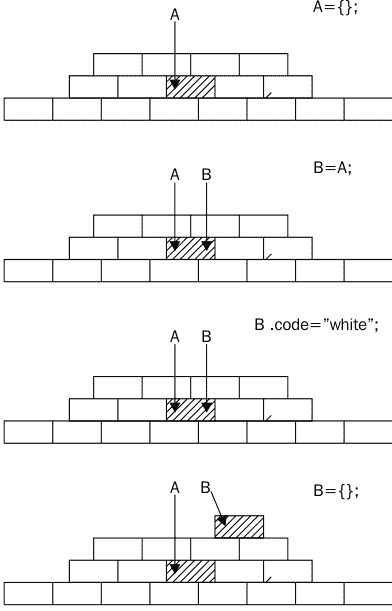

如果你想解决对象通过引用复制的问题，请考虑后文介绍深拷贝。

## 对象继承对象

本章到目前为止的所有示例都假设你使用构造函数创建对象，并希望由一个构造函数创建的对象继承源自另一个构造函数的属性。然而，你也可以在没有构造函数帮助的情况下创建对象，只需使用对象字面量即可，事实上，这样写的代码更少。那么继承这些对象呢？

# 第 6 章

在 Java 或 PHP 中，你定义类并让它们继承其他类。这就是为什么你会看到“经典”（classical）这个术语，因为 OO 功能来自于对类的使用。在 JavaScript 中，没有类，所以来自经典背景的程序员诉诸使用构造函数，这最接近他们所习惯的。此外，JavaScript 提供了 `new` 运算符，这进一步暗示了 JavaScript 类似于 Java。事实是，最后一切都取决于对象。本章的第一个示例使用了这种语法：

```javascript
Child.prototype = new Parent();
```

在这里，构造函数（如果你用类的话）继承自 `Parent`。但这是通过使用 `new Parent()` 创建一个对象并继承它来实现的。这就是为什么这也被称作伪经典继承模式，因为它类似于经典继承，尽管它并不是（不涉及任何类）。

那么，为什么不去掉这个中间人（构造函数/类），直接让对象继承对象呢？在 JavaScript 中，你可以使用 `Object.create()` 创建一个继承另一个对象的对象。这是处理继承的一种平滑得多的方法。

```javascript
var parent = {
  name: 'Shape',
  toString: function() {
    return 'I am ' + this.name;
  }
};

var child = Object.create(parent);
child.name = '2D shape';
child.toString();
// "I am 2D shape"
```

`Object.create()` 方法创建一个以指定对象为其原型的新对象。这比 `new Parent()` 方法简洁得多。

```javascript
var parent = {
  name: 'Shape',
  toString: function() {
    return 'I am ' + this.name;
  }
};

var child = Object.create(parent);
child.name = '2D shape';
child.toString();
// "I am 2D shape"
```

等等，你在创建对象时还可以向原型添加属性：

```javascript
var child = Object.create(parent, {
  name: '2D shape',
  writable: false
});
```

## 深拷贝

之前过的 `extendCopy()` 函数创建的是对象的浅拷贝。如果你修改拷贝中的对象，也会修改原始对象。这是一个问题。深拷贝避免了这一点。

深拷贝的实现方式与浅拷贝相同：遍历属性并逐个复制。但是，当你遇到指向对象的属性时，你会再次调用深拷贝函数：

```javascript
function deepCopy(p, c) {
  c = c || {};
  for (var i in p) {
    if (p.hasOwnProperty(i)) {
      if (typeof p[i] === 'object') {
        c[i] = Array.isArray(p[i]) ? [] : {};
        deepCopy(p[i], c[i]);
      } else {
        c[i] = p[i];
      }
    }
  }
  return c;
}
```

让我们创建一个包含数组和子对象的对象。

```javascript
var parent = {
  numbers: [1, 2, 3],
  letters: ['a', 'b', 'c'],
  obj: {
    prop: 1,
    bool: true
  }
};
```

创建一个深拷贝和一个浅拷贝来测试这一点。与浅拷贝不同，当你更新深拷贝的 `numbers` 属性时，原始对象不受影响。

```javascript
var mydeep = deepCopy(parent);
var myshallow = extendCopy(parent);

mydeep.numbers.push(4, 5, 6);
// 6
mydeep.numbers;
// [1, 2, 3, 4, 5, 6]
parent.numbers;
// [1, 2, 3]
myshallow.numbers.push(10);
// 4
myshallow.numbers;
// [1, 2, 3, 10]
parent.numbers;
// [1, 2, 3, 10]
mydeep.numbers;
// [1, 2, 3, 4, 5, 6]
```

关于 `deepCopy()` 函数的两个备注：

- 使用 `hasOwnProperty()` 过滤掉非自有属性始终是一个好主意，这可以确保你不会引入他人向核心原型上添加的内容。
- `Array.isArray()` 自 ES5 起就存在；要把真正的数组和对象区分开来其实出奇地困难。最好的跨浏览器解决方案（如果你需要在 ES3 浏览器中定义 `isArray()`）看起来有点拙劣，但它是行得通的：

```javascript
if (typeof Array.isArray !== "function") {
  Array.isArray = function (candidate) {
    return Object.prototype.toString.call(candidate) === '[object Array]';
  };
}
```

## `object()`

基于对象继承自对象的理念，Douglas Crockford 提倡使用 `object()` 函数，该函数接受一个对象并返回一个新对象，以父对象作为原型。

```javascript
function object(o) {
  function F() {}
  F.prototype = o;
  return new F();
}
```

如果你需要访问一个“超属性”（uber property），可以这样修改 `object()` 函数：

```javascript
function object(o) {
  var n;
  function F() {}
  F.prototype = o;
  n = new F();
  n.uber = o;
  return n;
}
```

使用这个函数等同于使用 `extendCopy()`：你取一个诸如 `twoDee` 的对象，从它开始创建一个新对象，然后对该对象进行增强。

```javascript
var triangle = object(twoDee);
triangle.name = 'Triangle';
triangle.getArea = function () {
  return this.side * this.height / 2;
};
```

新的 `triangle` 的 `toString` 行为相同：

```javascript
triangle.toString();
// "Shape, 2d shape, Triangle"
```

这种模式也被称为原型继承，因为你将父对象作为子对象的原型。它在 ES5 中被采用并在此基础上构建，被称为 `Object.create()`。例如：

```javascript
var square = Object.create(triangle);
```

## 混合使用原型继承和属性拷贝

当你使用继承时，你可能想要获取已经存在的功能并在其基础上进行构建。这意味着通过继承一个现有对象来创建一个新对象，然后添加额外的方法和属性。你可以通过一个函数来实现，结合前面讨论的后两种方法。

你可以：

- 使用原型继承将一个现有对象作为新对象的原型
- 将另一个对象的所有属性拷贝到新创建的对象中

```javascript
function objectPlus(o, stuff) {
  var n;
  function F() {}
  F.prototype = o;
  n = new F();
  n.uber = o;
  for (var i in stuff) {
    n[i] = stuff[i];
  }
  return n;
}
```

这个函数接收一个用于继承的对象 `o`，`stuff` 包含了要拷贝的额外方法和属性。让我们来看看它的运行效果。

从基础形状对象开始：

```javascript
var shape = {
  name: 'Shape',
  toString: function () {
    return this.name;
  }
};
```

通过继承 `shape` 并添加更多属性来创建一个 2D 对象。额外的属性通过对象字面量创建。

```javascript
var twoDee = objectPlus(shape, {
  name: '2D shape',
  toString: function () {
    return this.uber.toString() + ' ' + this.name;
  }
});
```

现在，让我们创建一个继承自 `twoDee` 并添加更多属性的 `triangle` 对象。

```javascript
var triangle = objectPlus(twoDee, {
  name: 'Triangle',
  getArea: function () {
    return this.side * this.height / 2;
  },
  side: 0,
  height: 0
});
```

通过创建一个具有定义形状和高度的具体三角形 `my` 来测试它是如何工作的：

```javascript
var my = objectPlus(triangle, {
  side: 4,
  height: 4
});

my.getArea();
// 8
my.toString();
// "Shape, 2D shape, Triangle, Triangle"
```

这里的区别在于，执行 `toString()` 时，`Triangle` 名字出现了两次。这是因为具体实例是通过继承 `triangle` 创建的，所以又多了一层继承。你可以给这个新实例起一个名字：

```javascript
objectPlus(triangle, {
  side: 4,
  height: 4,
  name: 'My 4x4'
}).toString();
// "Shape, 2d shape, Triangle, My 4x4"
```

这个 `objectPlus()` 越来越接近 ES5 的 `Object.create()`，只是 ES5 使用了名为属性描述符（在附录 C，“内置对象”中讨论过）的东西处理额外属性（第二个参数）。

## 多重继承

多重继承是指子对象继承多个父对象。有些面向对象的语言原生支持多重继承，而有些则没有。你可以支持两种观点：多重继承很方便，或者它是不必要的，会复杂应用设计，且使用其他方法更好。

## 借用构造函数

实现的另一种方式（本章最后一种，我保证）再次涉及到构造函数，而不是直接操作对象。在这种模式下，子类构造函数调用父类构造函数并将子类新创建的 `this` 对象绑定给父类。这种方法在第 4 章“对象”中讨论过，但这里回顾一下：它们允许你调用一个函数并传递一个函数应该绑定的对象。

让我们定义父类构造函数 `Shape()`：

```javascript
function Shape(id) {
  this.id = id;
}

Shape.prototype.name = 'Shape';

Shape.prototype.toString = function () {
  return this.name;
};
```

现在，让我们定义 `Triangle()`，它使用 `apply()` 调用 `Shape()` 构造函数，传递 `this`（通过 `new Triangle()` 创建的实例）以及任何额外的参数。

```javascript
function Triangle() {
  Shape.apply(this, arguments);
}

Triangle.prototype.name = 'Triangle';
```

注意，`Triangle()` 和 `Shape()` 都在原型上添加了一些额外的属性。

现在，让我们通过创建一个新的三角形对象来测试一下：

```javascript
var t = new Triangle(101);
t.name = "Triangle";
```

新的三角形对象继承了父类的 `id` 属性，但它没有继承添加到父类原型上的任何内容：

```javascript
t.id;
// 101
t.toString();
// "object Object"
```

三角形未能获取到 `Shape` 函数的原型属性，因为从未创建过新的 `Shape` 实例，原型从未被使用过。但你在章节开头已经看到可以怎么做了。你可以这样重新定义 Triangle：

```javascript
function Triangle() {
  Shape.apply(this, arguments);
}
Triangle.prototype = new Shape();
Triangle.prototype.name = 'Triangle';
```

在这种继承模式中，父类的自有属性被重新创建为子类的自有属性。如果子类继承了另一个对象，它将是一个完全的新值（而不是引用），修改它不会影响父类。

缺点是父类的构造函数被调用了两次：一次通过 `apply()`，另一次通过 `new` 来继承原型。实际上，父类的属性被继承了两次。让我们来看这个简化的场景：

```javascript
function Shape(id) {
  this.id = id;
}

function Triangle() {
  Shape.apply(this, arguments);
}

Triangle.prototype = new Shape(101);
```

创建一个新实例：

```javascript
var t = new Triangle(202);
t.id;
// 202
```

有一个自有属性 `id`，但也有一个从原型链传下来的属性，正准备大显身手：

```javascript
t.__proto__.id;
// 101
delete t.id;
// true
t.id;
// 101
```

## 借用构造函数并拷贝其原型

调用两次构造函数导致的双倍工作问题可以很容易地修正。你可以对父类构造函数调用 `apply()` 来获取所有属性，并使用简单的迭代（或之前讨论过的 `extend2()`）拷贝原型属性。

```javascript
function Shape(id) {
  this.id = id;
}

Shape.prototype.name = 'Shape';

Shape.prototype.toString = function () {
  return this.name;
};

function Triangle() {
  Shape.apply(this, arguments);
}

extend2(Triangle, Shape);
Triangle.prototype.name = 'Triangle';
```

测试：

```javascript
var t = new Triangle(101);
t.toString();
// "Triangle"
t.id;
// 101
```

没有双重继承：

```javascript
typeof t.__proto__.id;
// "undefined"
```

`extend2()` 在需要时也可以访问 `uber`：

```javascript
t.uber.name;
// "Shape"
```

## 总结

在本章中，你学习了实现继承的几种方法（模式），下表总结了它们。不同类型大致可分为：

- 适用于构造函数的模式
- 适用于对象的模式

你也可以根据这些模式是否使用了以下操作进行分类：

- 使用原型
- 拷贝属性
- 两者都使用（拷贝原型的属性）

| # | 名称 | 示例 | 分类 | 备注 |
|---|---|---|---|---|
| 1 | 原型链（伪类） | `Child.prototype = new Parent();` | 适用于构造函数<br>使用原型链 | 默认机制。<br>提示：将所有意图重用的属性/方法移动到原型上，将不可重用的作为自有属性添加。 |
| 2 | 继承原型 | `Child.prototype = Parent.prototype;` | 适用于构造函数<br>拷贝原型（没有原型链，所有对象共享同一个原型对象） | 更高效，没有为了继承而创建新实例。<br>原型链查找在运行时很快，因为没有链。<br>缺点：子类可以修改父类的功能。 |
| 3 | 临时构造函数 | `function extend(Child, Parent) { var F = function(){}; F.prototype = Parent.prototype; Child.prototype = new F(); Child.uber = Parent.prototype; }` | 适用于构造函数<br>使用原型链 | 与 #1 不同，它继承了原型的属性。自有属性（在构造函数内部通过 `this` 创建）不会被继承。<br>提供了方便访问父类的方法（通过 `uber`）。 |
| 4 | 拷贝原型属性 | `function extend(Child, Parent) { var p = Parent.prototype; var c = Child.prototype; for (var i in p) { c[i] = p[i]; } c.uber = p; }` | 适用于构造函数<br>拷贝属性<br>使用原型链 | 父类原型上的所有属性都变成子类原型的属性<br>不需要为了继承目的创建新对象<br>更短的原型链 |
| 5 | 拷贝所有属性（浅拷贝） | `function extendCopy(p) { var c = {}; for (var i in p) { c[i] = p[i]; } c.uber = p; return c; }` | 适用于对象 | |
| 6 | 深拷贝 | `function deepCopy(p, c) { ... }` | 适用于对象 | 与上述相似 |
| 7 | 原型继承 | `function object(o) { function F(){}; F.prototype = o; return new F(); }` | 适用于对象 | 与上述相似 |
| 8 | 扩展与增强 | `function objectPlus(o, stuff) { ... }` | 适用于对象 | 与上述相似 |
| 9 | 多重继承 | | 适用于对象 | 与上述相似 |
| 10 | 寄生继承 | | 适用于对象 | 与上述相似 |
| 11 | 借用构造函数 | `function Triangle() { Shape.apply(this, arguments); }` | 适用于构造函数 | 与上述相似 |
| 12 | 借用构造函数并拷贝原型 | `extend2(Triangle, Shape);` | 适用于构造函数 | 与上述相似 |

你可以运行一个工作中的示例：http://www.phpied.com/files/canvas/
只需打开控制台，像你稍后看到的那样开始创建新的形状。

## 实现

我们首先在空白的 HTML 页面中添加一个 `canvas` 标签：

```html
<canvas height="600" width="800" id="canvas" />
```

然后，将 JavaScript 代码放在 `<script>` 标签内：

```html
<script>
// ... 放在这里代码
</script>
```

现在，让我们来看 JavaScript 部分。首先是辅助构造函数。它的逻辑再简单不过了：

```javascript
function Point(x, y) {
  this.x = x;
  this.y = y;
}
```

请记住，画布上的点坐标从 x=0, y=0 开始，即左上角。右下角为 x=800, y=600：

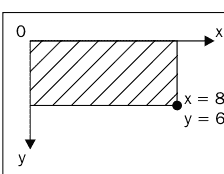

接下来是 `Line` 构造函数。它接收两个点并计算它们之间线的长度，使用勾股定理 $a^2+b^2=c^2$（想象一个直角边连接两点的直角三角形）。

```javascript
function Line(p1, p2) {
  this.p1 = p1;
  this.p2 = p2;
  this.length = Math.sqrt(
    Math.pow(p1.x - p2.x, 2) +
    Math.pow(p1.y - p2.y, 2)
  );
}
```

接下来是 `Shape` 构造函数。形状将拥有自己的点（以及连接它们的线）作为自身的属性。该构造函数还会调用一个初始化方法 `init()`，该方法将在原型中定义。

```javascript
function Shape() {
  this.points = [];
  this.lines = [];
  this.init();
}
```

现在是重点部分：`Shape.prototype` 上的方法。让我们使用对象字面量符号定义所有这些方法。请参考注释以了解每个方法的作用。

```javascript
Shape.prototype = {
  // 将指针重置构造函数
  constructor: Shape,
  // 初始化，将 this.context 指向
  // 画布对象的上下文
  init: function () {
    if (this.context === undefined) {
      var canvas = document.getElementById('canvas');
      Shape.prototype.context = canvas.getContext('2d');
    }
  },
  // 通过遍历 this.points 来绘制形状的方法
  draw: function () {
    var ctx = this.context;
    ctx.strokeStyle = this.getColor();
    ctx.beginPath();
    ctx.moveTo(this.points[0].x, this.points[0].y);
    for (var i = 1; i < this.points.length; i++) {
      ctx.lineTo(this.points[i].x, this.points[i].y);
    }
    ctx.closePath();
    ctx.stroke();
  },
  // 生成随机颜色的方法
  getColor: function () {
    var rgb = [];
    for (var i = 0; i < 3; i++) {
      rgb[i] = Math.round(255 * Math.random());
    }
    return 'rgb(' + rgb.join(',') + ')';
  },
  // 遍历点数组
  // 创建 Line 实例并将其添加到 this.lines
  getLines: function () {
    if (this.lines.length > 0) {
      return this.lines;
    }
    var lines = [];
    for (var i = 0; i < this.points.length; i++) {
      lines[i] = new Line(this.points[i], this.points[(i + 1) % this.points.length]);
    }
    this.lines = lines;
    return lines;
  },
  // 壳方法，由子类实现
  getArea: function () {},
  // 求和所有线的长度
  getPerimeter: function () {
    var perim = 0, lines = this.getLines();
    for (var i = 0; i < lines.length; i++) {
      perim += lines[i].length;
    }
    return perim;
  }
};
```

现在是子类构造函数。首先是三角形：

```javascript
function Triangle(a, b, c) {
  this.points = [a, b, c];
}

Triangle.prototype.getArea = function () {
  var p = this.getPerimeter();
  var s = p / 2;
  return Math.sqrt(
    (s - this.lines[0].length) *
    (s - this.lines[1].length) *
    (s - this.lines[2].length)
  );
};
```

`Triangle` 构造函数接收三个点对象并将赋值给 `this.points`（它自己的点集合）。然后它使用海伦公式实现了 `getArea()` 方法：

$$Area = \sqrt{s(s-a)(s-b)(s-c)}$$

$s$ 是半周（周长除以二）。

接下来是 `Rectangle` 构造函数。它接收一个点（左上角）和两条边的长度。然后它从该点填充它的点数组。

```javascript
function Rectangle(p, side_a, side_b) {
  this.points = [
    p,
    new Point(p.x + side_a, p.y), // 右上
    new Point(p.x + side_a, p.y + side_b), // 右下
    new Point(p.x, p.y + side_b) // 左下
  ];
  this.getArea = function () {
    return side_a * side_b;
  };
}
```

最后一个构造函数是 `Square`。正方形是矩形的特殊情况，因此复用 `Rectangle` 是有意义的。这里最简单的方法是借用构造函数。

```javascript
function Square(p, side) {
  Rectangle.call(this, p, side, side);
}
```

现在所有构造函数都完成了，让我们来处理继承。任何伪类模式（使用构造函数而非对象的模式）都可以。让我们尝试使用一个修改并简化后的版本。

# 第 7 章 浏览器环境

在本示例中，第一个 `<script>` 标签包含一个外部文件 `somefile.js`，其中包含 JavaScript 代码。第二个 `<script>` 标签直接将 JavaScript 代码包含在页面的 HTML 代码中。浏览器按照它们在页面上发现的顺序执行 JavaScript 代码，并且所有标签中的所有代码共享同一个全局命名空间。这意味着当你在 `somefile.js` 中定义一个变量时，它也会出现在第二个 `<script>` 块中。

## BOM 和 DOM – 概述

页面中的 JavaScript 代码可以访问许多对象。这些对象可以分为以下几类：

- 核心 ECMAScript 对象：之前章节中提到的所有对象
- DOM：与当前加载的页面相关的对象（页面也称为文档）
- BOM：处理页面之外所有内容的对象（浏览器窗口和桌面）

DOM 代表 Document Object Model（文档对象模型），BOM 代表 Browser Object Model（浏览器对象模型）。

DOM 是一个由万维网联盟（W3C）管理的标准，并有不同的版本，称为级别（levels），例如 DOM Level 1、DOM Level 2 等。总的来说，它们几乎都完全实现了 DOM 1。DOM 是在浏览器厂商实现了各自访问文档的方法后事后标准化的。遗留部分（W3C 接管之前）仍然存在，并被称为 DOM 0，尽管并不存在真实的 DOM 0 标准。DOM 0 的某些部分具有事实上的标准，因为所有主流浏览器都支持它们。其中一些被添加到了 DOM 1。DOM 0 中未进入 DOM 1 的其余部分由于特定于浏览器，将不再进行讨论。

BOM 在历史上不属于任何标准的一部分。与 DOM 0 类似，它包含一个被所有主流浏览器支持的对象子集，以及另一个特定浏览器的子集。HTML5 标准规范了浏览器之间的共同行为以及常见的 BOM 对象。移动设备带有特定的对象（HTML5 的目标也是为了标准化这些对象），这些对象在桌面计算机上通常是不需要的，但在移动世界中是有意义的，例如地理位置、摄像头访问、振动、触摸事件、电话功能和短信。

本章仅讨论 BOM 和 DOM Level 1 的跨浏览器子集（除非文中另有说明）。即使是这些安全的子集也构成了一个大的话题，完整的参考超出了本书的范围。你也可以咨询以下参考文献：

- Mozilla DOM 参考文档 (http://developer.mozilla.org/en/docs/Gecko_DOM_Reference)
- Mozilla 的 HTML5 wiki (https://developer.mozilla.org/en-US/HTML5)
- 微软 Internet Explorer 文档 (http://msdn2.microsoft.com/en-us/library/ms53305 (vs.85).aspx)
- W3C 的 DOM 规范 (https://www.w3.org/DOM/DOMTR)

## BOM

浏览器对象模型 (BOM) 是一个对象集合，允许你访问浏览器和屏幕内容。这些对象可以通过全局 `window` 对象访问。

## 重新回顾 `window` 对象

如你所知，在 JavaScript 中，`window` 是由主机环境提供的全局对象。在浏览器环境中，可以使用 `window` 访问此全局对象。所有全局变量都可以作为 `window` 对象的属性被访问：

```javascript
window.somevar = 1;
// 1
somevar;
// 1
```

此外，一些 JavaScript 函数（在第 2 章“原始数据类型、数组、循环和条件”中讨论过）是全局对象的方法。看以下代码片段：

```javascript
parseInt('123a456');
// 123
window.parseInt('123a456');
// 123
```

除了作为全局对象的引用外，`window` 对象还有第二个用途，即提供有关浏览器环境的信息。每个帧、iframe、弹出窗口或浏览器标签都有一个 `window` 对象。

### `window.navigator`

`navigator` 是一个包含有关浏览器及其能力信息的对象。其中一个属性是 `navigator.userAgent`，它是一个长的浏览器标识字符串。在 Firefox 中，你会得到以下输出：

```javascript
window.navigator.userAgent;
// "Mozilla/5.0 (Macintosh; Intel OS X 10_8_3) AppleWebKit/536.26.10 (KHTML, like Gecko) Version/60.1 Safari/536.10"
```

Internet Explorer 中的用户字符串可能类似于：

- "Mozilla/5.0 (compatible; MSIE 10.0; Windows NT 6.1; Trident/6.0)"

由于浏览器的能力不同，开发者一直在使用 `userAgent` 字符串来识别浏览器并提供不同版本的代码。例如，以下代码通过搜索是否存在 `MSIE` 字符串来识别 Explorer：

```javascript
if (navigator.userAgent.indexOf('MSIE') != -1) {
  // 这是 IE
} else {
  // 不是 IE
}
```

最好不要依赖用户代理，而是使用特征嗅探（feature sniffing，也称为能力检测）。这是因为很难跟踪所有浏览器及其不同版本。

### `window.frames`

`frames` 属性是一个类数组对象，包含页面中所有的框架（frame/iframe）。让我们考虑一个示例，假设页面上有一个如下 iframe：

```html
<iframe name="myframe" src="hello.html" />
```

为了判断页面上是否存在帧，你可以检查 `length` 属性。在只有一个 iframe 的情况下，你会如下输出：

```javascript
frames.length;
// 1
```

每个帧都包含另一个页面，该页面有它自己的全局 `window` 对象。

要访问 iframe 的窗口，你可以执行以下任何操作：

```javascript
window.frames[0];
window.frames[0].window;
window.frames[0].window.frames;
frames[0].window;
frames[0];
```

从页面端，你也可以访问子帧的属性。例如，你可以如下方式重新加载帧：

```javascript
frames[0].window.location.reload();
```

从子帧内部，你可以如下方式访问父级：

```javascript
frames[0].parent === window;
// true
```

使用名为 `top` 的属性，你可以从任何帧访问最顶页面（即包含所有其他帧的页面）：

```javascript
window.frames[0].window.top === window;
// true
window.frames[0].window.top === window.top;
// true
window.frames[0].window.top === top;
// true
```

此外，`self` 与 `window` 相同，如下：

```javascript
self === window;
// true
frames[0].self == frames[0].window;
// true
```

如果帧具有 `name` 属性，你不仅可以通过名称访问帧，还可以通过索引访问：

```javascript
window.frames['myFrame'] === window.frames[0];
// true
```

或者，你也可以使用以下代码：

```javascript
frames.myFrame === window.frames[0];
// true
```

### `window.screen`

`screen` 提供了浏览器外部环境的信息。例如，`screen.colorDepth` 包含显示器的颜色位深（颜色质量）。这主要用于统计目的。看下面的代码：

```javascript
window.screen.colorDepth;
// 32
```

你也可以检查可用的屏幕区域（分辨率）：

- `screen.width`; // 1440
- `screen.availWidth`; // 1440
- `screen.height`; // 900
- `screen.availHeight`; // 847

`height` 和 `availHeight` 的区别在于，`height` 是整个屏幕，而 `availHeight` 减去了任何操作系统菜单（如 Windows 任务栏）。`width` 和 `availWidth` 也是如此。

与之相关的是代码中提到的属性：

```javascript
window.devicePixelRatio;
// 1
```

它告诉你移动设备视网膜屏幕中物理像素与设备像素之间的差异（比例），例如 iPhone 上的值为 2。

### `window.open()`/`close()`

在探索了窗口对象一些常用的跨浏览器属性后，让我们转向一些方法。其中一种方法是 `open()`，它允许你打开新的浏览器窗口（弹出）。各种浏览器策略和用户设置可能会阻止你打开弹出（因为出于营销目的滥用该技术），但通常情况下如果是用户发起的，你应该能够打开新窗口。否则，如果你在页面加载时尝试打开弹出，它很可能会被拦截，因为用户没有显式触发它。

`window.open()` 接受以下参数：

- 要加载到新窗口的 URL
- 新窗口名称，可以作为表单 `target` 属性的值
- 逗号分隔的特性列表。它们如下：
    - `resizable`: 用户是否能够调整新窗口的大小
    - `width`, `height`: 弹出窗口的宽度和高度
    - `status`: 状态栏是否可见

`window.open()` 返回新创建的浏览器实例窗口的引用。这是一个示例：

```javascript
var win = window.open('http://www.packtpub.com', 'packt', 'width=300,height=300,resizable=yes');
```

`win` 指向弹出窗口的窗口对象。你可以检查它是否为假值，这意味着弹出窗口被拦截了。

`win.close()` 关闭新窗口。

出于可访问性和易用性考虑，最好避免打开新窗口。如果你不喜欢网站向你弹出窗口，你为什么要对你的用户这样做呢？这也有合法的目的，例如在填写表单时提供信息，但即使那样也可以通过替代方案来实现，例如在页面内使用浮动的 `<div>`。

### `window.moveTo()` and `window.resizeTo()`

继续延续过去的那些阴暗做法，以下是更多骚扰你用户的方法，只要他们的浏览器和个人设置允许你。

- `window.moveTo(100, 100)` 将浏览器窗口移动到屏幕位置 x = 100 和 y = 100（从左上角计算）
- `window.moveBy(10, -10)` 将窗口从当前位置向右移动 10 像素并向上 10 像素
- `window.resizeTo(x, y)` 将窗口调整为指定的宽度和高度
- `window.resizeBy(x, y)` 按指定的宽度和高度调整窗口大小

### `alert()`, `prompt()`, and `confirm`

`alert()`、`prompt()` 和 `confirm()` 用于与用户交互。`alert()` 用于显示消息，`prompt()` 用于从用户获取文本，`confirm()` 用于获取是/否回答。

`alert()` 用于显示一个带有消息的简单警告框。

```javascript
alert("This is a message");
```

`prompt()` 用于显示一个带有文本输入和默认值的对话框。

```javascript
var name = prompt("What is your name?", "Guest");
```

`confirm()` 用于显示一个带有“OK”和“Cancel”按钮的对话框。

```javascript
var result = confirm("Are you sure?");
if (result) {
  // 用户点击了 OK
} else {
  // 用户点击了 Cancel
}
```

`prompt()` 的返回值是以下之一：

- 如果你点击 Cancel，则为 `null`
- 如果你点击 OK 但没有输入任何内容，则为空字符串
- 如果你输入了内容并点击 OK，则为文本字符串

### `setTimeout()` and `setInterval()`

`setTimeout()` 和 `setInterval()` 允许调度代码的执行。`setTimeout()` 尝试在指定的毫秒后执行一次给定代码。`setInterval()` 尝试在指定的毫秒通过后重复执行它。

这在约 2 秒（2000 毫秒）后显示警告：

```javascript
function boo() { alert('Boo!'); }
setTimeout(boo, 2000);
```

如你所示，函数返回了一个整数（例 4），表示超时时的 ID。你可以使用此 ID 通过 `clearTimeout` 清除超时。在以下示例中，如果你足够快，并在 2 秒通过之前清除了超时，则警告将永远不会出现，代码如下：

```javascript
var id = setTimeout(boo, 2000);
clearTimeout(id);
```

让我们将 `boo()` 修改为不那么侵入性的如下：

```javascript
function boo() { console.log('boo'); }
```

现在，使用 `setInterval()` 可以每两秒调度一次 `boo()`，直到你使用 `clearInterval()` 清除调度执行：

```javascript
var id = setInterval(boo, 2000);
// boo
// boo
// boo
// ...
clearInterval(id);
```

注意，这两个函数都接受回调函数的指针作为第一个参数。它们也可以接受字符串并通过 `eval()` 求值，如你所知，`eval()` 是邪恶的，因此应该避免。如果你想给函数传递参数怎么办？在这种情况下，你可以将函数调用封装在另一个函数内部。

以下代码是有效的，但不建议这样做：

```javascript
// 坏主意
var id = setInterval("alert('boo')", 2000);
```

这种替代方案更好：

```javascript
var id = setInterval(
  function () {
    alert('boo, boo');
  },
  2000
);
```

注意，在浏览器中调度若干毫秒后执行函数并不保证它会精确在那个时间执行。原因之一是大多数浏览器不具备毫秒级的解析度。如果你调度了 3 毫秒，在旧版 IE 中它将在至少 15 毫秒后才执行，而在更现代的浏览器中执行得更快，但很可能是在 1 毫秒后。另一个原因是浏览器维护着一个队列，你请求“延迟 100 毫秒”意味着在 100 毫秒后加入队列。但如果队列由于某些缓慢操作而延迟，你的函数将不得不等待并在（例如）120 毫秒后才执行。

更多浏览器实现了 `requestAnimationFrame()` 函数。它比超时函数更优，因为你是在请求浏览器在任何有可用资源时调用你的函数，而不是在预定义的毫秒时间后。在你的控制台中尝试以下代码：

```javascript
function animateMe() {
  requestAnimationFrame(function() {
    console.log(new Date());
    animateMe();
  });
}

animateMe();
```

### `window.document`

`window.document` 是一个 BOM 对象，指向当前加载的文档（页面）。它的方法和属性属于 DOM 类对象。深呼吸（也许可以先看看章节末尾的 BOM 练习），让我们进入 DOM 的世界。

## DOM

文档对象模型（DOM）将 XML 或 HTML 文档表示为节点树。通过使用 DOM 方法和属性，你可以访问页面上的任何元素、修改或删除元素，或者添加新元素。DOM 是一个语言无关的 API（应用程序编程接口），不仅可以在 JavaScript 中实现，也可以在任何其他语言中实现。例如，你可以使用 PHP 的 DOM 实现（http://php.net/dom）在服务器端生成页面。

看一眼这个 HTML 页面：

```html
<!DOCTYPE html>
<html>
<head>
  <title>My page</title>
</head>
<body>
  <p class="opener">first paragraph</p>
  <p><em>second</em> paragraph</p>
  <p id="closer">final</p>
  <!-- and that's about it -->
</body>
</html>
```

考虑第二个段落 `<p><em>second</em> paragraph</p>`。你看到它是一个 `<p>` 标签，包含在 `<body>` 标签中，而 `<body>` 是 `<p>` 的父级，`<p>` 是子级。第一段和第三段也是 `<body>` 的子，同时也是第二段的兄弟。`<em>` 标签是第二个 `<p>` 的子，因此 `<p>` 是它的父。父子关系可以用图形表示为祖先树，称为 DOM 树：

| 元素 | 资源 | 网络 | 来源 |
| :--- | :--- | :--- | :--- |
| `<html>` | | | |
| `<title>My page</title>` | | | |
| `</head>` | | | |
| `<body>` | | | |
| `<p class="opener">first paragraph</p>` | | | |
| `<p><em>second</em> paragraph</p>` | | | |
| `<p id="closer">final</p>` | | | |
| `<!-- and that's about it -->` | | | |
| `</body>` | | | |
| `</html>` | | | |

之前的截图显示了你在展开每个节点后，在 WebKit 控制台的 **Elements** 标签页中看到的内容。

你可以看到所有标签都显示为树上可展开的节点。虽然没有显示，但存在所谓的“文本节点”，例如，`<em>` 内部的文本（单词 second）就是一个文本节点。空白也被视为文本节点。HTML 代码中的注释也会显示在树中，HTML 源码中的 `<!-- and that's about it -->` 是树中的一个注释节点。

DOM 中的每个节点都是一个对象，右侧的 **Properties**（属性）部分列出了你可以用于这些对象的所有属性和方法，遵循该对象被创建时的继承链：

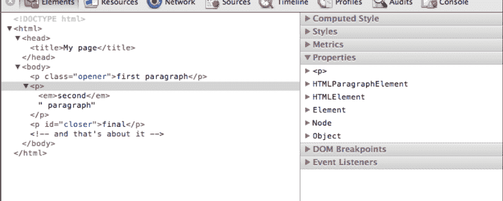

你还可以看到背后用于创建这些中每个对象的构造函数。虽然这对于日常任务来说不是太实用，但了解这些可能很有趣，例如，`<p>` 是 `HTMLParagraphElement()` 构造函数创建的，还有 `HTMLHeadElement()` 等。不过，你不能直接使用这些构造函数创建对象。

### Core DOM 和 HTML DOM

在继续更多实用的示例之前，插一下。正如你现在知道，DOM 同时表示 XML 文档和 HTML 文档。事实上，HTML 文档是 XML 文档，但更具体。因此，从 DOM Level 1 开始，有一个适用于所有 XML 文档的核心 DOM 规范，还有一个 HTML DOM 规范，它在核心 DOM 的基础上扩展和构建。当然，HTML DOM 并不适用于所有 XML 文档，只适用于 HTML 文档。以下是一些 Core 和 HTML DOM 构造函数的示例：

| 构造函数 | 继承自 | Core 或 HTML | 注释 |
| :--- | :--- | :--- | :--- |
| `Node` | `Node` | Core | 树上的任何节点。 |
| `Document` | `Node` | Core | 文档节点。 |
| `HTMLDocument` | `Document` | HTML | HTML 文档。 |
| `Element` | `Node` | Core | 元素节点。 |
| `HTMLElement` | `Element` | HTML | HTML 元素。 |
| `HTMLBodyElement` | `HTMLElement` | HTML | `body` 元素。 |
| `HTMLHtmlElement` | `HTMLElement` | HTML | `html` 元素。 |
| `CharacterData` | `Node` | Core | 字符数据节点。 |
| `Text` | `CharacterData` | Core | 文本节点。 |
| `Comment` | `CharacterData` | Core | 注释节点。 |
| `Attr` | `Node` | Core | 属性节点。 |
| `NodeList` | `Node` | Core | 节点列表。 |
| `NamedNodeMap` | `NodeList` | Core | 节点映射。 |
| `HTMLCollection` | `NamedNodeMap` | HTML | 元素集合。 |

现在，让我们在树中移动。XML 文档总有一个根节点包裹文档根。对于 HTML 文档，根是 `<html>` 标签。通过文档对象的 `documentElement` 属性可以访问根：

```javascript
document.documentElement;
// <html></html>
```

`nodeType` 是 1（元素节点），结果如下：

```javascript
document.documentElement.nodeType;
// 1
```

### 子节点

为了判断一个节点是否具有子节点，你可以如下所示使用 `hasChildNodes()`：

```javascript
document.documentElement.hasChildNodes();
// true
```

HTML 元素有三个子节点：`head` 元素、`body` 元素以及它们之间的空白（大多数浏览器计算空白，但并非所有如此）。你可以使用 `childNodes` 类数组集合来访问它们：

```javascript
document.documentElement.childNodes.length;
// 3
document.documentElement.childNodes[0];
// <head>...
document.documentElement.childNodes[1];
// #text
document.documentElement.childNodes[2];
// <body>...</body>
```

任何子节点都可以通过 `parentNode` 属性访问其父节点，如下代码所示：

```javascript
document.documentElement.childNodes[1].parentNode;
// <html>...</html>
```

让我们如下所示将引用赋值给一个变量：

```javascript
var bd = document.documentElement.childNodes[2];
```

`body` 元素有多少个子节点？

```javascript
bd.childNodes.length;
// 9
```

复习一下，这是文档的 body 部分：

```html
<body>
  <p class="opener">first paragraph</p>
  <p><em>second</em> paragraph</p>
  <p id="closer">final</p>
  <!-- and that's about it -- >
</body>
```

为什么 `body` 有 9 个子节点呢？嗯，三个段落加上一个注释共四个节点。这四个节点之间的空白又产生了三个文本节点。到目前为止总共七个。`<body>` 和第一个 `<p>` 之间的空白是第八个节点。注释和结束标签 `</body>` 之间的空白是另一个文本节点。这使得总共有九个子节点。只需在控制台中输入 `bd.childNodes` 即可检查所有节点。

### 属性

由于 `body` 的第一个子节点是空白，因此第二个子节点（索引 1）是第一个段落。参考以下代码：

```javascript
bd.childNodes[1];
// <p class="opener">first paragraph</p>
```

你可以如下所示使用 `hasAttributes()` 检查元素是否具有属性：

```javascript
bd.childNodes[1].hasAttributes();
// true
```

有多少个属性？在这个例子中，其中一个是 `class` 属性，如下所示：

```javascript
bd.childNodes[1].attributes.length;
// 1
```

你可以通过索引和名称访问属性。你还可以使用 `getAttribute()` 方法获取值，如下：

```javascript
bd.childNodes[1].attributes[0].nodeName;
// "class"
bd.childNodes[1].attributes[0].nodeValue;
// "opener"
bd.childNodes[1].attributes['class'].nodeValue;
// "opener"
bd.childNodes[1].getAttribute('class');
// "opener"
```

### 访问标签内部的内容

让我们来看第一个段落：

```javascript
bd.childNodes[1].nodeName;
// "p"
```

你可以使用 `textContent` 属性获取段落中包含的文本。`textContent` 在 IE 中不存在，但另一个名为 `innerText` 的属性返回相同的值，输出如下：

```javascript
bd.childNodes[1].textContent;
// "first paragraph"
```

还有 `innerHTML` 属性。尽管它之前已经存在于所有主流浏览器中，但它是 DOM 标准中一个较新的新增内容。它返回（或设置）标签内部包含的 HTML 代码。你可以看到这有些不一致，因为 DOM 将文档处理为节点树，而不是标签字符串。但由于 `innerHTML` 使用非常方便，你会在随处看到它。参考以下代码：

```javascript
bd.childNodes[1].innerHTML;
// "first paragraph"
```

第一个段落只包含文本，因此 `innerHTML` 与 `textContent`（或 IE 中的 `innerText`）相同。然而，第二个段落确实包含一个 `em` 节点，所以你可以看到如下的差异：

```javascript
bd.childNodes[3].innerHTML;
// "<em>second</em> paragraph"
bd.childNodes[3].textContent;
// "second paragraph"
```

获取第一个段落中包含文本的另一种方法是使用 `p` 节点内部文本节点的 `nodeValue`：

```javascript
bd.childNodes[1].childNodes.length;
// 1
bd.childNodes[1].childNodes[0].nodeName;
// "text"
bd.childNodes[1].childNodes[0].nodeValue;
// "first paragraph"
```

### DOM 访问快捷

通过使用 `childNodes`、`nodeName`、`nodeValue` 和 `attributes`，你可以在树中上下导航并处理任何内容。但空白是文本节点这一事实使得这种操作 DOM 的方式变得脆弱。如果页面发生变化，你的脚本可能不再正常工作。此外，如果你想获取树中更深处的节点，可能需要一些代码才能到达。这就是为什么你有快捷方法，即 `getElementsByTagName()`、`getElementsByClassName()` 和 `getElementById()`。

`getElementsByTagName()` 接收标签名称（元素节点的名称）并返回一个具有匹配标签名称的节点的 HTML 集合（类数组对象）。例如，下面的示例请求“给我所有段落的计数”，写法如下：

```javascript
document.getElementsByTagName('p').length;
```

### 兄弟节点、`body`、第一个和最后一个

一旦你拥有了一个元素的引用，`nextSibling` 和 `previousSibling` 是导航 DOM 树的两个方便属性：

```javascript
var para = document.getElementById('closer');
para.nextSibling;
// #text
para.previousSibling.previousSibling;
// <p>...</p>
para.previousSibling.previousSibling.previousSibling;
// #text
para.previousSibling.nextSibling.nextSibling;
// <p id="closer">final</p>
```

`body` 元素被使用是因为它有自己的快捷方式：

```javascript
document.body;
// <body>...</body>
document.body.nextSibling;
// null
document.body.previousSibling.previousSibling;
// <head>...</head>
```

`firstChild` 和 `lastChild` 同样方便。`firstChild` 等于 `childNodes[0]`，`lastChild` 等于 `childNodes[childNodes.length - 1]`：

```javascript
document.body.firstChild;
// #text
document.body.lastChild;
// #text
document.body.lastChild.previousSibling;
// <!-- and that's about it -->
document.body.lastChild.previousSibling.nodeValue;
// " and that's about it "
```

下面的截图显示了 body 与其内部三个段落之间的家族关系。为了简单起见，从截图中删除了所有的空白文本节点：

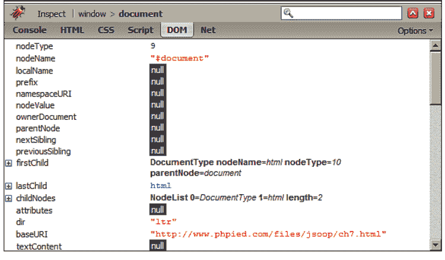

### 遍历 DOM

最后，这里有一个函数，它可以接收任何节点并从给定的节点开始递归地遍历 DOM 树：

```javascript
function walkDOM(n) {
  do {
    console.log(n);
    if (n.hasChildNodes()) {
      walkDOM(n.firstChild);
    }
  } while (n = n.nextSibling);
}
```

你可以如下所示测试该函数：

```javascript
walkDOM(document.documentElement);
walkDOM(document.body);
```

## 修改 DOM 节点

现在你已经了解了许多访问 DOM 树中任何节点及其属性的方法，让我们来看看如何修改这些节点。

让我们按照如下方式将最后一个段落的指针赋值给变量 `my`：

```javascript
var my = document.getElementById('closer');
```

现在，更改段落的文本就像更改 `innerHTML` 的值一样简单：

```javascript
my.innerHTML = 'final!!!';
```

由于 `innerHTML` 接受 HTML 源代码字符串，你还可以按照如下方式在 DOM 树中创建一个 `<em>` 节点：

```javascript
my.innerHTML = '<em>my</em> final';
```

新的 `em` 节点成为了树的一部分：

```javascript
my.firstChild;
// <em>my</em>
my.firstChild.firstChild;
// "my"
```

另一种更改文本的方法获取实际文本节点并按如下更改其 `nodeValue`：

```javascript
my.firstChild.firstChild.nodeValue = 'your';
// "your"
```

## 修改样式

通常你改变的不是节点的内容，而是它的呈现方式。元素有一个 `style` 属性，该属性反映有一个映射到每个 CSS 属性的属性。例如，更改段落样式添加红色边框：

```javascript
my.style.border = "1px solid red";
// "1px solid red"
```

CSS 属性通常带有连字符，但 JavaScript 标识符是不接受连字符的。在这种情况下，你跳过连字符并将下一个字母大写。`padding-top` 变成 `paddingTop`，`margin-left` 变成 `marginLeft`，以此类推。看以下代码：

```javascript
my.style.fontWeight = "bold";
// "bold"
```

你还可以访问 `style` 的 `cssText` 属性，它允许你以字符串的形式处理样式：

```javascript
my.style.cssText;
// "border: 1px solid red; font-weight: bold;"
```

而修改样式是一种字符串操作：

```javascript
my.style.cssText += " border-style: dashed";
// "border: 1px dashed red; font-weight: bold; border-style: dashed;"
```

## 表单趣玩

如之前提到的，JavaScript 非常适合客户端输入验证，可以减少与服务器的往返次数。让我们练习表单操作，并对热门页面 www.google.com 上的表单玩玩：

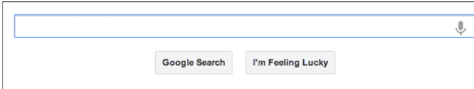

使用 `querySelector()` 方法和 CSS 选择器字符串找到第一个文本输入如下：

```javascript
var input = document.querySelector('input[type=text]');
```

访问搜索框：

```javascript
input.name;
// "q"
```

通过设置 `value` 属性中包含的文本来更改查询如下：

```javascript
input.value = 'my query';
// "my query"
```

现在，让我们让按钮中的单词 Lucky 变成 Tricky：

```javascript
var feeling = document.querySelectorAll("button")[2];
feeling.textContent = feeling.textContent.replace(/Lu/, 'Tri');
// "Im Feeling Tricky"
```


现在，让我们实现困难的部分，让该按钮显示和隐藏一秒。每当你调用该函数时，它都会检查 CSS 属性 `visibility` 的值，如果是隐藏的则设置为可见，反之亦然，代码如下：

```javascript
function toggle() {
  var st = document.querySelectorAll('button')[2].style;
  st.visibility = (st.visibility === 'hidden')
    ? 'visible'
    : 'hidden';
}
```

与其手动调用函数，不如设置一个间隔每秒调用一次：

```javascript
var myint = setInterval(toggle, 1000);
```

结果是什么？按钮开始闪烁（使其更难点击）。当你厌倦了追逐它，只需移除定时间隔即可：

```javascript
clearInterval(myint);
```

## 创建新节点

要创建新节点，你可以使用 `createElement()` 和 `createTextNode()` 方法。一旦你有了新节点，就使用 `appendChild()`（或 `insertBefore()`、`replaceChild()`）将它们添加到 DOM 树。

重新加载 `http://www.phpied.com/files/jscoop/ch7.html` 并开始玩吧。

创建一个新的 `p` 元素并设置其 `innerHTML`，如下代码所示：

```javascript
var my = document.createElement('p');
my.innerHTML = 'yet';
```

这会创建另一个文本节点并将其作为 `body` 的第一个节点：

```javascript
document.body.insertBefore(
  document.createTextNode('first boo'),
  document.body.firstChild
);
```

## 移除节点

要从 DOM 树中移除节点，你可以使用 `removeChild()` 方法。
让我们从带有相同 `body` 的页面重新开始：

```html
<body>
  <p class="opener">first paragraph</p>
  <p><em>second</em> paragraph</p>
  <p id="closer">final</p>
  <!-- 这就足够了 -->
</body>
```

以下是移除第二个段落的方法：

```javascript
var myp = document.getElementsByTagName('p')[1];
var removed = document.body.removeChild(myp);
```

如果你想稍后使用被移除的节点，该方法会返回被移除的节点。即使该元素不再位于树中，你仍然可以使用所有的 DOM 方法：

```javascript
removed;
// <p>...
removed.firstChild;
// <em>second</em>
```

还有一个 `replaceChild()` 方法，它可以移除一个节点并在其位置放入另一个节点。

移除节点后，树的结构如下：

```html
<body>
  <p class="opener">first paragraph</p>
  <p id="closer">final</p>
  <!-- 这就足够了 -->
</body>
```

现在，第二个段落是 ID 为 "closer" 的那一个：

```javascript
var p = document.getElementsByTagName('p')[1];
p;
// <p id="closer">final</p>
```

让我们用 `removed` 变量中的节点替换这个段落：

```javascript
var replaced = document.body.replaceChild(removed, p);
```

就像 `removeChild()` 一样，`replaceChild()` 也会返回一个不在树中的节点：

```javascript
replaced;
```


<p id="closer">final</p>

现在，`body` 的结构如下：

```html
<body>
<p class="opener">first paragraph</p>
<p><em>second</em> paragraph</p>
<!-- 大此就足够了 -->
</body>
```

清除子树中所有子节点的一种快速方法是将 `innerHTML` 设置为空字符串。这会移除 `BODY` 的所有子节点：

```javascript
document.body.innerHTML = '';
```

测试方法如下：

```javascript
document.body.firstChild;
null
```

使用 `innerHTML` 移除既快又简单。仅限 DOM 方法是遍历所有的子节点并逐个移除每一个。这里有一个从起始节点开始移除所有节点的简单函数：

```javascript
function removeAll(n) {
  while (n.firstChild) {
    n.removeChild(n.firstChild);
  }
}
```

如果你想删除所有的 `body` 子节点并留下一个空的页面，请使用以下代码：

```javascript
removeAll(document.body);
```

# 仅限 HTML 的 DOM 对象

如你所知，文档对象模型适用于 XML 和 HTML 文档。你学到的关于遍历树以及随后添加、移除或修改节点的知识适用于任何 XML 文档。然而，还有一些仅限 HTML 对象和属性。

`document.body` 就是其中一个仅限 HTML 的对象。在 HTML 文档中，`<body>` 标签非常常见且经常被访问，因此拥有一个比等效的 `document.getElementsByTagName('body')[0]` 更短、更友好的对象是有意义的。

`document.body` 是继承自史前 DOM Level 0 的遗留对象示例，并被 DOM 规范的 HTML 扩展中。还有其他类似于 `document.body` 的对象。对于某些对象，没有核心 DOM 等效物；对于另一些则有等效物，原始的 DOM0 为了简单和遗留目的考虑被移除了。让我们来看看这些对象。

# 访问文档的原始方法

与 DOM 不同，DOM 允许你访问任何元素（甚至是注释和空白），但最初 JavaScript 对 HTML 文档元素的访问是有限的。这主要通过许多集合实现：

- `document.images`：这是页面上所有图像的集合。核心 DOM 等效物是 `document.getElementsByTagName('img')`
- `document.applets`：这等于 `document.getElementsByTagName('applet')`
- `document.links`
- `document.anchors`
- `document.forms`

`document.links` 包含页面上所有 `<a href="...">...</a>` 标签的列表，即具有 `href` 属性的 `<a>` 标签。`document.anchors` 包含带有 `name` 属性的所有链接（`<a name="..."></a>`）。

最常用的集合之一是 `document.forms`，它包含 `<form>` 元素的列表。

让我们操作一个包含表单和输入框的页面，http://www.phpied.com/files/jso/ch7-form.html。以下代码让你访问页面上的第一个表单：

- `document.forms[0];`

它与此等效：

```javascript
document.getElementsByTagName('form')[0];
```

`document.forms` 集合包含了输入字段和按钮的集合，可以通过 `elements` 属性访问。以下是访问页面上第一个表单的第一个输入框：

```javascript
document.forms[0].elements[0];
```

一旦访问了元素，你可以像属性一样更改它的属性。测试中第一个表单的第一个字段是：

```html
<input type="text" name="search" size="50" maxlength="255" value="Enter..." />
```

你可以通过以下代码更改 `value` 属性：

```javascript
document.forms[0].elements[0].value = 'me@example.com';
```

你可以通过以下代码禁用它：

```javascript
document.forms[0].elements[0].disabled = true;
```

当元素具有 `name` 属性时，你可以通过这种方式访问它们：

```javascript
document.forms[0].elements['search'];
```

## document.write()

`document.write()` 方法允许你在页面加载时插入内容。在页面加载时，你可以插入如下内容：

```html
<p>document.write("<em>" + Date() + "</em>");</p>
```

在页面加载时，你可以看到如下内容（HTML）：

```html
<p><em>Fri Apr 26 16:55:00 GMT 2023</em></p>
```

在页面加载时，你可以通过以下方式插入 HTML 内容：

```html
<p>document.write("<h1>Hello World!</h1>");</p>
```

在页面加载时，你可以看到如下内容：

```html
<p><h1>Hello World!</h1></p>
```

在页面加载时，你可以通过以下方式插入 HTML 内容：

```html
<p>document.write("<p>This is a paragraph.</p>");</p>
```

在页面加载时，你可以看到如下内容：

```html
<p><p>This is a paragraph.</p></p>
```

在页面加载时，你可以通过以下方式插入 HTML 内容：

```html
<p>document.write("<a href='https://www.google.com'>Google</a>");</p>
```

在页面加载时，你可以看到如下内容：

```html
<p><a href="https://www.google.com">Google</a></p>
```

在页面加载时，你可以通过以下方式插入 HTML 内容：

```html
<p>document.write("");</p>
```

在页面加载时，你可以看到如下内容：

```html
<p></p>
```

在页面加载时，你可以通过以下方式插入 HTML 内容：

```html
<p>document.write("<button>Click me</button>");</p>
```

在页面加载时，你可以看到如下内容：

```html
<p><button>Click me</button></p>
```

注意：`document.write()` 在页面加载后调用可能会清空整个文档。

# 浏览器环境

`document.domain` 让你获取当前加载页面的域名。这通常用于你需要所谓的“域松弛”。想象你的页面是 `www.yahoo.com`，内部包含一个托管在 `music.yahoo.com` 的 iframe。这些是两个不同的域名，因此浏览器的安全限制不允许页面和 iframe 进行通信。为了解决这个问题，你可以将双方的 `document.domain` 设置为 `yahoo.com`，它们就可以相互通信了。注意，你只能将域名设置为更不具体的域名，例如，你可以将 `www.yahoo.com` 改为 `yahoo.com`，但不能更改 `yahoo.com` 或任何非 yahoo 域名。

```javascript
document.domain;
// "www.yahoo.com"

document.domain = 'yahoo.com';
// "yahoo.com"

document.domain = 'www.yahoo.com';
// Error: SecurityError: DOM Exception 18

document.domain = 'www.example.org';
// Error: SecurityError: DOM Exception 18
```

在这一章之前，你看到了 `window.location` 对象。嗯，相同的功能通过 `document.location` 也可用：

```javascript
window.location === document.location;
// true
```

## 事件

想象你正在收听广播节目，他们宣布：“大新闻！巨大的新闻！外星人登陆地球了！”你可能会想“随吧”，而其他听众可能会想“他们带着和平而来”，而另一些则可能想“我们要完了了”。同样，浏览器会广播事件，如果你的代码决定收听并在事件发生时监听，就会收到通知。一些示例事件包括：

- 用户点击按钮
- 用户在表单字段中输入字符

你可以将一个 JavaScript 函数（称为事件监听器或事件处理器）绑定到特定的事件上，一旦事件发生，浏览器就会立即调用你的函数。让我们来看看是如何实现的。

## 内联 HTML 属性

在标签上添加特定属性是最懒惰（但可维护性最低）的方法，例如：

```html
<div onclick="alert ('Ouch!')">click</div>
```

在这种情况下，当用户点击 `<div>` 时，会触发点击事件，包含在 `onclick` 属性中的 JavaScript 代码字符串将执行。虽然没有显式的函数来监听点击事件，但在幕后仍然创建了一个函数，它包含了你作为 `onclick` 属性值指定的代码。

## 元素属性

另一种在点击事件触发时执行某些代码的方法是将一个函数赋值给 DOM 节点元素的 `onclick` 属性。例如：

```html
<div id="my-div">click</div>

<script>
var myelement = document.getElementById('my-div');
myelement.onclick = function () {
  alert('Ouch!');
  alert('And double ouch!');
};
</script>
```

这种方法更好，因为它保持了 `<div>` 清洁，不包含任何 JavaScript 代码。始终记住，HTML 用于内容，JavaScript 用于行为，CSS 用于格式，你应该尽可能将它们分离开。

这种方法的缺点是，你只能为事件附加一个函数。诚然你可以在同一个函数内执行很多操作，但这并不方便，就像所有的监听器都在同一个房间里一样。

## DOM 事件监听器

处理浏览器事件的最佳方法是使用 DOM Level 2 中概述的事件监听器方法，你可以让多个函数监听同一个事件。当事件触发时，所有函数都会被执行。所有的监听器不需要相互感知，可以独立工作。它们可以随时加入或退出，而不会影响其他监听器。

让我们使用上一个节中相同的简单标记（你可以在此处进行练习：http://www.phpied.com/files/jsjoop/ch7.html）。它包含如下部分的标记：

```html
<p id="closer">final</p>
```

你的 JavaScript 代码使用 `addEventListener()` 方法为点击事件分配监听器。让我们按照如下方式附加两个监听器：

```javascript
var mypara = document.getElementById('closer');
mypara.addEventListener('click', function () {
  alert('Boo!');
}, false);
mypara.addEventListener('click', function () {
  console.log(this);
}, false);
```

你可以看到，`addEventListener` 是在节点对象上调用的方法，它接受事件类型作为第一个参数，并将函数指针作为第二个参数。你可以使用匿名函数 `function () { alert('Boo!'); }` 或现有的函数如 `console.log`。你指定的监听器函数会在事件发生时被调用，并向它们传递一个参数。这个参数是一个事件对象。如果你运行前面的代码并点击最后一个段落，你可以看到事件对象被事件对象。点击事件对象允许你查看它的属性。

## 第7 章

### 捕获与冒泡

在 `addEventListener()` 的调用中，有第三个参数 `false`。让我们看看它是做什么的。

假设你在无序列表中有一个如下所示的链接：

```html
<body>
  <ul>
    <li><a href="http://phpied.com">my blog</a></li>
  </ul>
</body>
```

当你点击链接时，你实际上也点击了列表项 `<li>`、列表 `<ul>`、`<body>`，最终点击了整个文档。这被称为事件传播。点击链接也可以被看作点击了文档。事件传播的过程可以通过两种方式实现：

- 事件捕获（Event capturing）：点击首先发生在文档上，然后向下传播到 `body`、列表、列表项，最后到达链接上。
- 事件冒泡（Event bubbling）：点击发生在链接上，然后向上传“冒泡”到文档。

DOM Level 2 事件规范建议事件分三个阶段传播：捕获阶段、目标阶段、冒泡阶段。这意味着事件从文档传播到链接，然后冒泡回文档。事件对象有一个 `eventPhase` 属性，它反映了当前阶段。

从历史角度看，IE 和 Netscape（它们各自独立工作且没有次要遵循的标准）实现了完全相反的操作。IE 只实现了冒泡，而 Netscape 仅实现了捕获。今天，在 DOM 规范发布多年之后，现代浏览器已经实现了所有三个阶段。

与事件传播相关的实际影响如下：

- `addEventListener()` 的第三个参数指定了是否使用捕获。为了让你的代码在浏览器间具有更好的可移植性，最好始终将此参数设置为 `false` 并使用冒泡。
- 你可以在监听器中停止事件的传播，使其停止向上冒泡并永远到达 `body`。要做到这一点，请使用 `stopPropagation()`。
- 你可以通过在父元素上附加监听器来使用事件委托，从而处理来自子元素的事件。

## 停止传播

如果你想停止事件在 DOM 树中向上冒泡，可以使用事件对象上的 `stopPropagation()` 方法。

```javascript
function paraHandler(e) {
  alert('Paragraph clicked');
  e.stopPropagation();
}
document.getElementById('closer').addEventListener('click', paraHandler, false);
```

当你点击段落时，警框会显示，但事件不会到达 `body` 或文档监听器。

## 阻止默认

某些浏览器事件具有预定义的行为。例如，点击链接会导致浏览器导航到另一个页面。你可以为链接附加监听器，并通过调用事件对象上的 `preventDefault()` 方法禁用默认行为。

```javascript
var all_links = document.getElementsByTagName('a');
for (var i = 0; i < all_links.length; i++) {
  all_links[i].addEventListener('click', function (e) {
    if (!confirm('Sure you want to follow this link?')) {
      e.preventDefault();
    }
  }, false);
}
```

注意，并非所有事件都允许阻止默认行为。大多数事件都允许，但如果你想确定，可以检查事件对象的 `cancellable` 属性。

## 跨浏览器事件监听器

如你所知，大多数现代浏览器几乎都实现了 DOM Level 1 规范。然而，事件直到 DOM 2 才被标准化。因此，与现代浏览器相比，IE 9 之前的版本在实现此功能方面存在相当差异。

查看下面这个示例，它会将被点击的元素（目标元素）的 `nodeName` 写入控制台：

```javascript
document.addEventListener('click', function (e) {
  console.log(e.target.nodeName);
  false;
});
```

现在，让我们来看看 IE 的情况：

- 在 IE 中没有 `addEventListener` 方法，尽管从 IE 5 版本开始有一个等价的 `attachEvent()`。对于早期版本，你唯一的选择是直接访问 `onclick` 属性（如 `onclick`）。
- 使用 `attachEvent()` 时，`click` 事件变为 `onclick`。
- 如果你使用旧式方法（例如通过给 `onclick` 属性设置函数值），当回调函数被调用时，它不会接收事件对象作为参数。但是，无论你在 IE 中如何附加监听器，总有一个全局的 `window.event` 指向最后一个事件。
- 在 IE 事件对象中，没有 `target` 属性来告知在哪个元素触发了事件，但它有一个等价的属性叫做 `srcElement`。
- 如前所述，事件捕获不适用于所有事件，因此应该只有事件冒泡。
- 没有 `stopPropagation()` 方法，但你可以将 IE 特有的 `cancelBubble` 设置为 `true`。
- 没有 `preventDefault()` 方法，但你可以将 IE 特有的 `returnValue` 设置为 `false`。
- 要停止监听某个事件，在 IE 中不需要使用 `removeEventListener()`，而是需要 `detachEvent()`。

所以，这里是之前代码的修订版本，适用于跨浏览器：

```javascript
function callback(evt) {
  // 准备工作
  evt = evt || window.event;
  var target = evt.target || evt.srcElement;
  // 实际回调工作
  console.log(target.nodeName);
}

// 开始监听点击事件
if (document.addEventListener) { // 现代浏览器
  document.addEventListener('click', callback, false);
} else if (document.attachEvent) { // 旧版 IE
  document.attachEvent('onclick', callback);
} else {
  document.onclick = callback; // 古老版本
}
```

## 事件类型

现在你已经知道如何处理跨浏览器事件。但上面的所有示例只使用了 `click` 事件。还有哪些事件在发生？正如你可能猜到的那样，不同的浏览器提供不同的事件。跨浏览器事件有一个子集，以及一些浏览器特定的事件。有关事件的列表，你应该咨询浏览文档，但这里是跨浏览器事件的精选：

- 鼠标事件：`mousedown`, `click`（顺序为 `mousedown` -> `mouseup` -> `click`）, `dblclick`
- `mouseover`（鼠标悬停在元素上），`mouseout`（鼠标曾在元素上但后来离开了），`mousemove`
- 键盘事件
    - `keydown`, `keypress`, `keyup`（按此顺序发生）
- 加载/窗口事件
    - `load`（图像或页面及其所有组件已加载完成），`unload`（用户离开页面），`beforeunload`（脚本可以为用户提供停止卸载的选项）
    - `abort`（用户在 IE 中停止加载页面或图像），`error`（JavaScript 错误，也当 IE 中无法加载图像时）
    - `resize`（浏览器窗口大小调整），`scroll`（页面滚动），`contextmenu`（右键菜单出现）

# 浏览器环境

- 表单事件
  - `focus`（进入表单字段），`blur`（离开表单字段）
  - `change`（值改变后离开字段），`select`（在文本字段中选择文本）
  - `reset`（清除所有用户输入），`submit`（提交表单）

此外，现代浏览器提供了拖拽事件（`dragstart`, `dragend`, `drop` 等），触控设备提供了 `touchstart`, `touchmove` 和 `touchend`。

到此关于的讨论结束。请参考本章节末尾的练习部分，尝试一个小挑战：创建一个你自己的事件工具函数来处理跨浏览器事件。

## XMLHttpRequest

`XMLHttpRequest()` 是一个对象（构造函数），允许你从 JavaScript 发送 HTTP 请求。从历史上看，`XMLHttpRequest`（简称 XHR）是在 IE 中引入的，并作为 ActiveX 对象实现的。从 IE7 开始，它是一个原生浏览器对象，与其他浏览器中的实现相同。该对象在不同浏览器中的通用实现诞生了所谓的 Ajax 应用，在应用中，每当你需要新内容时，不再需要刷新整个页面。通过 JavaScript，你可以向服务器发送 HTTP 请求，获取响应，并只更新页面的一部分。

这样你就可以构建更具响应性且像桌面程序一样的网页。

Ajax 代表异步 JavaScript 和 XML（Asynchronous JavaScript and XML）。

- **异步**：发送 HTTP 请求后，代码不需要等待响应，它可以执行其他操作，并在响应到达时（通过事件）被通知。
- **JavaScript**：显而易见 XHR 对象是用 JavaScript 创建的。
- **XML**：因为最初开发者为 XML 文档发送 HTTP 请求，并使用其中包含的数据更新页面。尽管这已不再是常见做法，因为你可以请求纯文本数据、更方便的 JSON 格式，或者直接请求好可以插入到页面的 HTML。

使用 `XMLHttpRequest` 有两个步骤：

- **发送请求**：发送请求
- **处理响应**：处理响应

## 发送请求

为了创建一个 `XMLHttpRequest`，你只需使用：

```javascript
var xhr = new XMLHttpRequest();
```

下一步是为 `readystatechange` 事件附加一个监听器：

```javascript
xhr.onreadystatechange = myCallback;
```

然后，你需要调用 `open()` 方法，如下：

```javascript
xhr.open('GET', 'somefile.txt', true);
```

第一个参数指定 HTTP 请求类型（GET, POST 等）。GET 和 POST 是常用的。最后一个参数是一个布尔值，指定请求是异步的（true）还是同步的（false，阻塞直到响应到达）。

最后一步是触发请求：

```javascript
xhr.send('');
```

`send()` 方法接受你想随请求发送任何数据。对于 GET 请求，这是一个空字符串。

## 处理响应

监听器被附加到 `readystatechange` 事件。那么 `readyState` 到底是什么，它是如何变化的？

XHR 对象有一个名为 `readyState` 的属性。每当它变化时，`readystatechange` 事件就会触发。`readyState` 的可能值为：

- 0 - 未初始化
- 1 - 加载中
- 2 - 已加载
- 3 - 交互中
- 4 - 完成

当 `readyState` 获取值 4 时，意味着响应已返回并准备好处理。在 `readyState` 为 4 后，另一个需要检查的是 HTTP 请求的状态码；例如一个不存在的 URL，你可能会得到 404（文件未找到）状态码。有趣的代码是 200（OK），所以 `myCallback` 应该检查这个值。状态码可以在 XHR 对象的 `status` 属性中获取。

一旦 `xhr.readyState` 为 4 且 `xhr.status` 为 200，你就可以使用 `xhr.responseText` 属性访问请求的内容。让我们看看 `myCallback` 如何实现为简单地 alert() 请求的内容：

```javascript
function myCallback() {
    if (xhr.readyState < 4) {
        return; // 尚未准备好
    }
    if (xhr.status != 200) {
        alert('错误!'); // HTTP 状态码不是 OK
        return;
    }
    // 一切正常，执行操作
    alert(xhr.responseText);
}
```

总的来说，这个两步过程（发送请求和处理响应）是整个 XHR/Ajax 功能的核心。现在你已经掌握了基础知识，可以开始构建下一个 Gmail 了。噢对了，让我们来看一些细微的浏览器不一致之处。

## 在 IE 7 之前的版本中创建 XMLHttpRequest 对象

在第 7 之前的 Internet Explorer 中，XMLHttpRequest 对象是一个 ActiveX 对象，因此创建 XHR 实例略有不同。具体方法如下：

```javascript
var xhr = new ActiveXObject('MSXML2.XMLHttpRequest.3.0');
```

`MSXML2.XMLHttpRequest` 是你想要创建的对象的标识符。XMLHttpRequest 对象有多个版本，如果你的页面浏览器没有最新版本，在放弃之前，你可以尝试另外两个。

为了实现完全跨浏览器的解决方案，你首先测试用户的浏览器是否支持将 XMLHttpRequest 作为原生对象，如果不支持，则尝试 IE。无论如何，创建 XHR 实例的整个过程如下：

```javascript
var ids = ['MSXML2.XMLHttpRequest.3.0', 'MSXML2.XMLHttpRequest', 'Microsoft.XMLHttpRequest'];
var xhr;
if (window.XMLHttpRequest) {
  xhr = new XMLHttpRequest();
} else {
  // IE: 尝试寻找一个 ActiveX 对象来使用
  for (var i = 0; i < ids.length; i++) {
    try {
      xhr = new ActiveXObject(ids[i]);
      break;
    } catch (e) {}
  }
}
```

这是什么？`ids` 包含一个要尝试的 ActiveX 程序 ID 列表。变量 `xhr` 指新的 XHR 对象。代码首先检查 `XMLHttpRequest` 是否原生存在（这意味着浏览器相对现代）。如果不存在，代码将遍历 `ids` 并尝试创建对象。`catch(e)` 静静地忽略失败并继续循环。一旦创建了 `xhr` 对象，它就会跳出循环。

如你所见，这段代码相当多，因此最好将其抽象成一个函数。实际上，章节末尾的练习之一就是提示你创建自己的 Ajax 工具。

## A 代表 Asynchronous（异步）

现在你已经知道如何创建 XHR 对象、给它分配 URL 并处理请求的响应了。当你异步发送两个请求时会发生什么？如果第二个请求的响应在第一个请求之前到达怎么办？

在下面的示例中，XHR 对象是全局的，`myCallback` 依赖于这个全局对象的存在以便访问其 `readyState`、`status` 和 `responseText` 属性。另一种方法可以避免你对全局变量的依赖，即将回调封装在闭包中。让我们看一看：

```javascript
var xhr = new XMLHttpRequest();
xhr.onreadystatechange = (function (xhr) {
  return function () {
    myCallback(xhr);
  };
})(xhr);
xhr.open('GET', 'somefile.txt', true);
xhr.send('');
```

在这种情况下，`myCallback()` 接收 XHR 对象作为参数，而不会在全局空间中查找它。这意味着在接收到响应时，原始的 `xhr` 可能已经被复用于第二次请求。闭包会一直指向原始对象。

## X 代表 XML

尽管 JSON（在下一章中讨论）作为数据格式更优于 XML，但 XML 仍然是可选的。除了 `responseText` 属性外，XHR 对象还有另一个名为 `responseXML` 的属性。
当你为 XML 文档发送 HTTP 请求时，`responseXML` 指向 XML DOM 文档对象。要处理此文档，你可以使用本章之前讨论的所有核心 DOM 方法，例如 `getElementsByTagName()`、`getElementById()` 等。

## 一个示例

让我们用一个示例来总结不同的 XHR 主题。你可以访问 http://www.phpied.com/files/jsoop/xhr.html 页面来操作该示例：

主页面 `xhr.html` 是一个简单的静态页面，除了三个 `<div>` 标签外，什么都不包含。

```html
<div id="text">Text will be here</div>
<div id="html">HTML will be here</div>
<div id="xml">XML will be here</div>
```

使用控制台，你可以编写一段 XML 相关的 JS 代码来请求三个文件，并将各自的内容加载到每个 `<div>` 中。

需要加载的三个文件为：

- text: 一个简单的文本文件，包含文本 "I am a text file"
- html: 一个包含 HTML 代码 "I am <strong>formatted</strong> HTML" 的文件
- xml: 一个 XML 文件，包含以下代码：
  - `<?xml version="1.0" ?>`
  - `<root>`
    I'm XML data.
  `</root>`

所有文件都存储在 `xhr.html` 相同的目录下。

> 出于安全考虑，你只能使用原始的 XMLHttpRequest 请求相同域名的文件。然而，现代浏览器支持 XHR2，它允许跨域请求，只要设置了适当的 Access-Control-Allow-Origin HTTP 头部。

首先，让我们创建一个函数来抽象请求/响应部分：

```javascript
function request(url, callback) {
  var xhr = new XMLHttpRequest();
  xhr.onreadystatechange = (function (myxhr) {
    return function () {
      if (myxhr.readyState === 4 && myxhr.status === 200) {
        // ...在此处编写逻辑
      }
    };
  })(xhr);
  xhr.open('GET', url, true);
  xhr.send('');
}
```

使用 `innerHTML` 移除内容很容易（`document.body.innerHTML = ''`），但并非最好的。问题在于被移除的元素绑定了事件监听器时，它们在 IE 中不会被移除，导致浏览器内存泄漏，因为它存储了对不存在对象的引用。实现一个通用函数来删除 DOM 节点，但要先移除任何事件监听器。你可以遍历节点的属性并检查它是否为函数。如果是，它很可能是一个 `onclick` 属性。在从树中移除元素之前，你需要将其设置为 `null`。

- 创建一个 `include()` 函数，用于按需引入外部脚本。这意味着你需要动态创建一个 `<script>` 标签，设置其 `src` 属性并将其追加到文档的 `<head>` 中。使用以下代码进行测试：
```javascript
include('myscript.js');
```

## 3. 事件 (Events)

创建一个名为 `myevent` 的统一对象，它具有以下跨浏览器工作的方法：

- `addEventListener(element, event_name, callback)`，其中 `element` 也可以是元素数组
- `removeEventListener(element, event_name, callback)`
- `getEvent(event)`，仅用于检查旧版本 IE 的 `window.event`
- `getTarget(event)`
- `stopPropagation(event)`
- `preventDefault(event)`

使用示例：

```javascript
function Callback(e) {
  e = myevent.getEvent(e);
  alert(myevent.getTarget(e).href);
  myevent.stopPropagation(e);
  myevent.preventDefault(e);
}
myevent.addEventListener(document.links, 'click', Callback);
```

示例代码的结果应该是：文档中的所有链接都不会跳转到任何处，但只会弹出 `href` 属性。

创建一个绝对定位的 `<div>`，例如在 `x = 100px, y = 100px` 。编写代码允许使用方向键或 J（左）、K（右）、M（下）和 I（上）键在页面上移动该 `div`。复用你在 3.1 中编写的 div 事件工具。

## 4. XMLHttpRequest

创建一个名为 `ajax` 的你自己的 XHR 工具（对象）。例如，查看以下代码：

```javascript
function myCallback(xhr) {
  alert(xhr.responseText);
}
ajax.request('somefile.txt', 'get', myCallback);
ajax.request('script.php', 'post', myCallback, 'first=John&last=Smith');
```

# 8. 编码与设计模式 (Coding and Design Patterns)

现在你已经熟悉了 JavaScript 中的所有对象，掌握了原型和继承，并看到了一些浏览器特定对象的实用示例，让我们前进，或者说向上迈一级。让我们来看常见的 JavaScript 模式。

但首先，什么是模式？简而言之，模式是解决常见问题的良好方案。

有时当你面对一个新的编程问题时，你可能会立即意识到你之前解决过另一个极其相似的问题。在这种情况下，隔离这类问题并寻找通用的解决方案是值得的。模式是针对一类问题的经过验证且可重用的解决方案（或方法）。

有些情况下，模式仅仅是一个想法或一个名称。有时仅仅使用一个名称就能帮助你更清晰地思考问题。此外，在团队中与其他开发者合作时，如果每个人都使用相同的术语来讨论问题或解决方案，沟通会容易得多。

其他时候，你可能会遇到一个独特的模式，它看起来与你以前见过的任何东西都不一样，并且无法轻易融入已知模式。为了使用模式而盲目应用模式并不是一个好主意。与其尝试修改你的问题以适应现有的解决方案，不如不使用任何已知模式要好。

本章讨论了两种类型的模式：

- 编码模式（Coding patterns）：这些大多是 JavaScript 特有的最佳实践
- 设计模式（Design patterns）：这些是与语言无关的模式，由著名的《四人帮》一书普及

## 编码模式 (Coding patterns)

让我们从一些反映 JavaScript 独特特征的模式开始。某些模式旨在帮助你组织代码（例如命名空间），另一些与提高性能有关（例如懒加载定义和初始化分支），有些弥补了缺失的功能（如私有属性）。本节讨论的模式包括：

- 行为分离 (Separating behavior)
- 命名空间 (Namespaces)
- 初始化分支 (Init-time branching)
- 懒加载定义 (Lazy definition)
- 配置对象 (Configuration objects)
- 私有变量和方法 (Private variables and methods)
- 特权方法 (Privileged methods)
- 作为公共方法的私有函数 (Private functions as public methods)
- 立即函数 (Immediate functions)
- 链式调用 (Chaining)
- JSON

## 行为分离 (Separating behavior)

如前所述，网页的三个构建块如下：

- 内容 (HTML)
- 表现 (CSS)
- 行为 (JavaScript)

### 内容 (Content)

HTML 是网页的内容，即实际文本。理想情况下，内容应该用最少量的 HTML 标签进行标记，以充分描述该内容的语义含义。例如，如果你正在制作导航菜单，使用 `<ul>` 和 `<li>` 是一个好主意，因为导航菜单本质上就是一个链接列表。

你的内容（HTML）应该没有任何格式化元素。视觉格式属于表现层，应该通过使用层叠样式表（CSS）来实现。这意味着：

- 如果可能，不应使用 HTML 标签的 `style` 属性。
- 不应使用诸如 `<font>` 等表现性 HTML 标签。

### 表现 (Presentation)

保持表现良好的方法是重置，或者表现属于表现层，应该通过使用层叠样式表（CSS）来实现。这意味着：

- 如果可能，不应使用 HTML 标签的 `style` 属性。
- 不应使用诸如 `<font>` 等表现性 HTML 标签。

### 行为 (Behavior)

网页的第三个组件是行为。行为应该与内容和表现分离。行为通常通过在外部文件中添加 JavaScript 添加。将行为与内容分离的最佳策略如下：

- 减少 `<script>` 标签的数量
- 避免使用内联事件处理器
- 不要使用 CSS 表达式
- 如果用户禁用了 JavaScript，动态添加标记没有任何意义
- 在内容结束处，当你准备关闭 `<body>` 标签时，插入一个 `external.js` 文件

## 行为分离示例 (Example of separating behavior)

假设你在页面上有一个搜索表单，你想用 JavaScript 验证表单。因此，让表单标签不包含任何 JavaScript，然后在立即关闭 `<body>` 标签之前插入一个链接到外部文件的 `<script>` 标签：

```html
<body>
<form id="myform" method="post" action="server.php">
  <fieldset>
    <legend>search</legend>
    <input
      name="search"
      id="search"
      type="text"
    />
    <input type="submit" />
  </fieldset>
</form>
<script src="behaviors.js"></script>
</body>
```

在 `behaviors.js` 中，你为 `submit` 事件附加事件监听器。在你的监听器中，检查输入字段值是否为空，如果是，则阻止表单提交。这种方法可以节省服务器和客户端之间的往返，并让应用程序立即响应。

`behaviors.js` 的内容如下。假设你已经根据上一章末的练习创建了 `myevent` 工具：

```javascript
// init
myevent.addEventListener('myform', 'submit', function (e) {
  // 不需要继续传播
  e = myevent.getEvent(e);
  myevent.stopPropagation(e);
  // 验证
  var el = document.getElementById('search');
  if (!el.value) { // 糟糕，字段为空
    myevent.preventDefault(e); // 防止表单提交
    alert('Please enter a search string');
  }
});
```

## 异步加载 JavaScript

你可能注意到脚本是如何在 HTML 的末尾、`body` 标签关闭之前加载的。这是因为 JavaScript 会阻塞页面的 DOM 构建，在某些浏览器中，还会阻塞后续其他组件的下载。通过将脚本移动到页面底部，你可以确保脚本不会阻塞渲染，当它到达时，它只是增强了已经可用的页面。

防止外部 JavaScript 文件阻塞页面的另一种方法是异步加载它们。这样你就可以更早地启动它们。HTML5 提供了 `defer` 属性来实现此：

```html
<script src="behaviors.js" defer></script>
```

遗憾的是，旧版浏览器不支持 `defer` 属性，但幸运的是，有一个跨浏览器且较新的解决方案。该方案是动态创建一个脚本节点并将其附加到 DOM。换句话说，你使用少量内联 JavaScript 来加载外部 JavaScript 文件。你可以将此脚本加载器片段放在文档顶部，这样下载就可以尽早开始：

```html
<head>
<script>
(function () {
  var s = document.createElement('script');
  s.src = 'behaviors.js';
  document.getElementsByTagName('head')[0].appendChild(s);
}());
</script>
</head>
```

## 命名空间 (Namespaces)

为了减少变量命名冲突的可能性，应该避免全局变量。通过对变量和函数进行命名空间处理，你可以减少全局变量的数量。其思想很简单：你只创建一个全局对象，所有其他变量和函数都变成该对象的属性。

## 作为命名空间的对象

创建一个名为 `MYAPP` 的全局对象：

```javascript
// 全局命名空间
var MYAPP = MYAPP || {};
```

现在，不再使用全局的 `myevent` 工具（来自上一章），你可以将其作为 `MYAPP` 对象的事件属性，如下所示：

```javascript
// 子对象
MYAPP.event = {};
```

将方法添加到事件工具中，连同方法声明的方式仍然是一样的：

```javascript
// 合并对象
MYAPP.event = {
  addListener: function (el, type, fn) {
    // 执行操作
  },
  removeListener: function (el, type, fn) {
    //
  },
  getEvent: function (e) {
    //
  }
  // 其他方法或属性
};
```

## 命名空间构造函数

使用命名空间并不会阻止你创建构造函数。你可以创建一个拥有 `Element` 构造函数的 DOM 工具，让你能够轻松地创建 DOM 元素：

```javascript
MYAPP.dom = {};
MYAPP.dom.Element = function (type, properties) {
  var tmp = document.createElement(type);
  for (var i in properties) {
    if (properties.hasOwnProperty(i)) {
      tmp.setAttribute(i, properties[i]);
    }
  }
  return tmp;
};
```

同样，你可以拥有一个 `Text` 构造函数来创建文本节点：

```javascript
MYAPP.dom.Text = function (txt) {
  return document.createTextNode(txt);
};
```

使用构造函数在页面底部创建链接如下：

```javascript
var link = new MYAPP.dom.Element('a', {href: 'http://phpied.com', target: '_blank'});
var text = new MYAPP.dom.Text('click me');
link.appendChild(text);
document.body.appendChild(link);
```

## namespace()

你可以创建一个让生活变得更简单的工具，以便使用更方便的语法：

```javascript
MYAPP.namespace('dom.style');
```

而不是使用以下更繁琐的语法：

```javascript
MYAPP.dom = {};
MYAPP.dom.style = {};
```

以下是如何创建这样的 `namespace()` 方法。首先，你通过使用 `.` 作为分隔符分割字符串来创建一个数组。在新数组中，如果全局对象尚不存在某个属性，则为它添加该属性，如下：

```javascript
var MYAPP = {};
MYAPP.namespace = function (name) {
  var parts = name.split('.');
  var current = MYAPP;
  for (var i = 0; i < parts.length; i++) {
    if (!current[parts[i]]) {
      current[parts[i]] = {};
    }
    current = current[parts[i]];
  }
};
```

测试新方法的方法：

```javascript
MYAPP.namespace('event');
MYAPP.namespace('dom.style');
```

上述代码的结果与执行以下操作相同：

```javascript
var MYAPP = {
  event: {},
  dom: {
    style: {}
  }
};
```

## 初始化分支 (Init-time branching)

在上一章中，你注意到有时不同的浏览器对相同或相似的功能有不同的实现。在这种情况下，你需要根据当前执行脚本的浏览器支持的情况对代码进行分支。取决于你的程序，这种分支可能会发生得频繁，从而减慢脚本的执行。

你可以通过在初始化期间（脚本加载时）对代码某些部分进行分支来缓解这个问题，而不是在运行时。基于动态定义函数的能力，你可以根据浏览器分支并定义具有不同体的相同函数。让我们看看如何实现。

首先，我们为事件工具定义一个命名空间和占位方法：

```javascript
var MYAPP = {};
MYAPP.event = {
  addEventListener: null,
  removeListener: null
};
```

此时，方法尚未被定义。我们将按照以下方式定义它们：

```javascript
if (window.addEventListener) {
  MYAPP.event.addEventListener = function (el, type, fn) {
    el.addEventListener(type, fn, false);
  };
} else if (window.attachEvent) {
  MYAPP.event.addEventListener = function (el, type, fn) {
    el.attachEvent('on' + type, fn);
  };
} else {
  MYAPP.event.addEventListener = function (el, type, fn) {
    el['on' + type] = fn;
  };
}
```

## 懒加载定义 (Lazy definition)

懒加载模式与初始化分支相似。区别在于分支发生在函数调用时。与在初始化期间发生的情况不同，这里可能根本不会发生。

## 配置对象 (Configuration object)

当一个函数或方法接收许多可选参数时，这种模式非常方便。由你决定多少才算“多”。但通常，一个超过三个参数的函数调用起来并不方便，因为你必须记住参数的顺序，当某些参数是可选的时，会更加不方便。

与其使用多个参数，你可以使用一个参数并使其成为对象。对象的属性就是实际参数。这适用于传递配置选项，因为这些选项通常很多且可选的（带有智能默认值）。使用单个对象代替多个参数的优点描述如下：

- 顺序不重要
- 你可以轻松地跳过不想设置的参数
- 增加更多可选配置属性非常简单
- 它让代码更具可读性，因为配置对象的属性在调用代码中与其名称一起出现

假设你有一个某种用于创建精美按钮的 UI 小部件构造函数。它接受按钮内部的文本（`<input>` 标签的 `value` 属性）以及一个按钮类型的可选参数。为了简单起见，让我们假设精美按钮的配置与普通按钮相同。请看下面的代码：

```javascript
// 使用构造函数创建按钮
MYAPP.dom.FancyButton = function (text, type) {
  var b = document.createElement('input');
  b.type = type || 'submit';
  b.value = text;
  return b;
}
```

使用构造函数非常简单；你只需要给它一个字符串。然后你可以将新按钮添加到文档正文中：
`document.body.appendChild(new MYAPP.dom.FancyButton('puuush'));`

这些就足够了而且运行良好，接着你决定还想能够设置按钮的一些样式属性，例如颜色和字体。你可能会得到如下的定义：

```javascript
MYAPP.dom.FancyButton = function (text, type, color, border, font) {
  // ...
}
```

现在，使用构造函数可能会变得有点不方便，尤其是当你只想设置第三和第五个参数，而不是第二个或第四个时：

```javascript
new MYAPP.dom.FancyButton('puuush', null, 'white', null, 'Arial');
```

更好的方法是使用一个配置参数处理所有的设置。函数可以变成如下所示：

```javascript
MYAPP.dom.FancyButton = function (text, conf) {
  var type = conf.type || 'submit';
  var font = conf.font || 'Verdana';
  // ...
}
```

使用构造函数的方式如下：

```javascript
var config = {
  font: 'Arial, Verdana, sans-serif',
  color: 'white'
}
new MYAPP.dom.FancyButton('puuush', config);
```

另一个示例如下：

```javascript
document.body.appendChild(new MYAPP.dom.FancyButton('dude', {color: 'red'}));
```

如你所见，只设置某些参数并交换它们的顺序是非常容易的。此外，当你调用方法的地方看到参数名称时，代码会更加友好且易于理解。

这种模式的缺点与其优点相同。继续添加更多参数是轻而易举的，这意味着很容易滥用这种技术。一旦你找到了理由向这个杂乱无章的属性包添加内容，你就会发现很有诱惑力继续添加某些并非完全可选的，或者某些依赖于其他属性的属性。

根据经验法则，所有这些属性应该是独立且可选的。如果你必须在函数内部检查所有组合（“哦，A 设置了，但 A 只有在 B 也设置了时才被使用”），这是一个导致函数体变得庞大的配方，由于存在所有可能的组合，它会迅速变得令人困惑且难以测试，甚至无法测试。

## 私有属性和方法

JavaScript 没有访问修饰符的概念来保护对象属性的权限。其他语言通常有访问修饰符，例如：

- 公共（Public）——对象的所有用户都可以访问这些属性（或方法）
- 私有（Private）——只有对象本身可以访问这些属性
- 保护（Protected）——只有继承该对象的对象可以访问这些

JavaScript 没有表示私有属性或方法的特殊语法，但正如第 3 章“函数”中所讨论的，你可以在函数内部使用局部变量和方法来实现相同级别的保护。

继续 FancyButton 构造函数的示例，你可以拥有一个包含所有默认值的局部变量 `styles`，以及一个局部函数 `setStyles()`。这些对于构造函数外部的代码是不可见的。以下是 FancyButton 如何利用局部属性的：

```javascript
var MYAPP = {};
MYAPP.dom = {};
MYAPP.dom.FancyButton = function (text, conf) {
  var styles = {
    font: 'Verdana',
    border: '1px solid black',
    color: 'black',
    background: 'grey'
  };
  function setStyles(b) {
    var i;
    for (i in styles) {
      if (styles.hasOwnProperty(i)) {
        b.style[i] = conf[i] || styles[i];
      }
    }
  }
  conf = conf || {};
  var b = document.createElement('input');
  b.type = conf.type || 'submit';
  b.value = text;
  setStyles(b);
  return b;
};
```

在这种实现中，`styles` 是私有属性，`setStyles()` 是私有方法。构造函数在内部使用它们（它们可以访问构造函数内部的任何内容），但函数外部的代码无法使用它们。

## 特权方法

特权方法（此术语由 Douglas Crockford 创造）是能够访问私有方法或属性的普通公共方法。它们可以像桥梁一样，使某些私有功能可用，但是通过封装在特权方法中的受控方式。

## 作为公共方法的私有函数

假设你定义了一个绝对需要保持完好的函数，因此将其设为私有。但你又想提供对该函数的访问，以便外部代码也能从中受益。

```javascript
var MYAPP = {};
MYAPP.dom = (function () {
  function setStyle() {
    console.log('setStyle');
  }
  function getStyle() {
    console.log('getStyle');
  }
  return {
    setStyle: setStyle,
    getStyle: getStyle
  };
})();
```

## 链式调用 (Chaining)

链式调用是一种允许你在一行内调用多个方法的模式，就像这些方法是链条中的环节一样。在调用多个相关方法时，这种方法非常方便。你可以在上一个方法的结果调用下一个方法，而无需使用中间变量。

假设你创建了一个帮助处理 DOM 元素的构造函数。创建一个 `<span>` 并将其添加到 `<body>` 的代码可能如下：

```javascript
var obj = new MYAPP.dom.Element('span');
obj.setText('hello');
obj.setStyle('color', 'red');
obj.setStyle('font', 'Verdana');
document.body.appendChild(obj);
```

如你所知，构造函数返回它们创建的称为 `this` 的对象。你可以让 `setText()` 和 `setStyle()` 等方法也返回 `this`，这样就可以在上一个方法返回的实例上调用下一个方法。通过这种方式，你可以链式地调用方法：

```javascript
var obj = new MYAPP.dom.Element('span');
obj.setText('hello')
.setStyle('color', 'red')
.setStyle('font', 'Verdana');
document.body.appendChild(obj);
```

如果你计划在将新元素添加到树之后不再使用 obj 变量，那么就不需要它，代码将如下：

```javascript
document.body.appendChild(
  new MYAPP.dom.Element('span')
  .setText('hello')
  .setStyle('color', 'red')
  .setStyle('font', 'Verdana')
);
```

这种模式的缺点是，当长链中的某处发生错误时，调试会变得稍微困难，因为你不知道是哪个环节出了问题，由于它们都在同一行上。

## JSON

让我们用几句关于 JSON 的话结束本章的模式部分。JSON 从技术上来说不是一种编码模式，但你可以说使用 JSON 是一种很好的模式。

JSON 是一种流行的轻量级数据交换格式。在使用 `XMLHttpRequest()` 从服务器检索数据时，它通常比 XML 更受青睐。JSON 代表 JavaScript 对象表示法（JavaScript Object Notation），除了极其方便之外，它并没有什么特别有趣的地方。JSON 格式由使用对象和数组字面量定义的数据组成。以下是服务器在收到 XHR 请求后可能响应的 JSON 字符串示例：

```json
{
  "name": "Stoyan",
  "family": "Stefanov",
  "books": ["OOJS", "JSPatterns", "JS4PHP"]
}
```

此内容的 XML 示例如下：

```xml
<?xml version="1.1" encoding="iso-8859-1"?>
<response>
  <name>Stoyan</name>
  <family>Stefanov</family>
  <books>
    <book>OOJS</book>
    <book>JSPatterns</book>
    <book>JS4PHP</book>
  </books>
</response>
```

首先，你可以看到 JSON 在字节数上更轻量。但主要的优势不是体积更小，而是在 JavaScript 中处理 JSON 非常简单。假设你发送了一个 XHR 请求，并在 XHR 对象的 `responseText` 中接收到了 JSON 字符串。你可以简单地使用 `eval()` 将此数据字符串转换为可运行的 JavaScript 对象：

```javascript
// warning：反面教材
var response = eval('(' + xhr.responseText + ')');
```

现在，你可以像访问属性一样访问 obj 中的数据：

```javascript
console.log(response.name); // "Stoyan"
console.log(response.books[2]); // "JS4PHP"
```

问题是 `eval()` 是不安全的，因此最好使用 JSON 对象来解析 JSON 数据（旧版浏览器的备用方案可以从 http://json.org/ 获取）。
从 JSON 字符串创建对象仍然非常简单：

```javascript
var response = JSON.parse(xhr.responseText);
```

相反地，要将对象转换为 JSON 字符串，你使用 `stringify()` 方法：

```javascript
var str = JSON.stringify({hello: "you"});
```

由于其简单性，JSON 迅速成为一种与语言无关的数据交换格式，你可以使用偏好的语言在服务器端轻松生成 JSON。例如，在 PHP 中，有 `json_encode()` 和 `json_decode()` 函数，它们让你可以将 PHP 数组或对象序列化为 JSON 字符串，反之亦然。

## 设计模式

本章的第二部分介绍了 JavaScript 处理设计模式的方法，这些模式介绍于《设计模式：可重用面向对象软件的基础》一书中，这是一本非常有影响力的书，通常被称为“四人之书”或“四人小组”（GoF，根据其四位作者命名）。GoF 书中讨论的模式分为三类：

- 创建模式：处理对象的如何创建（实例化）。
- 结构模式：描述如何组合不同的对象以提供新功能。
- 行为模式：描述对象之间相互通信的方式。

《四人之书》中共有 23 种模式，自该书出版以来，又发现了更多模式。讨论所有模式已经超出了本书的范围，因此剩余部分将展示四种模式，并提供它们在 JavaScript 中的实现示例。记住，模式更多关于接口和关系，而不是实现。一旦你理解了设计模式，实现它通常并不困难，尤其是在 JavaScript 中。

本章中讨论的模式包括：
- 单例 (Singleton)
- 工厂 (Factory)
- 装饰器 (Decorator)
- 观察者 (Observer)

### 单例 (Singleton)

单例是一种创建模式，其重点在于创建对象。当你想要确保类只有一个实例时，它非常有用。在 JavaScript 中，由于没有类，单例是默认且最自然的模式。单例的最基本实现是对象字面量：

```javascript
var single = {};
```

### 单例 (Singleton) 2

如果你想使用类语法并实现单例，情况会变得有点有趣。假设你有一个名为 `Logger` 的构造函数，你想实现以下操作：

```javascript
var my_log = new Logger();
my_log.log('some event');
// ... 在另一个作用域 1000 行代码后 ...
var other_log = new Logger();
other_log.log('some new event');
console.log(other_log === my_log); // true
```

### 全局变量 (Global variable)

一种方法是使用全局变量来存储单例。你的构造函数可能像这样：

```javascript
function Logger() {
  if (typeof global_log === "undefined") {
    global_log = this;
  }
  return global_log;
}
```

使用这种构造函数可以得到预期的结果：

```javascript
var a = new Logger();
var b = new Logger();
console.log(a === b); // true
```

缺点显而易见是使用了全局变量。它可以在任何时候被覆盖，甚至是无意中，导致你丢失实例。相反，你的全局变量覆盖别人的变量也是可能的。

### 构造函数的属性 (Property of the Constructor)

如你所知，函数也是对象，它们拥有属性。你可以如下所示将单例赋值给构造函数的属性：

```javascript
function Logger() {
  if (!Logger.single_instance) {
    Logger.single_instance = this;
  }
  return Logger.single_instance;
}
```

如果你编写 `a = new Logger()`，`a` 指向新创建的 `Logger.single_instance`。随后的调用 `b = new Logger()` 导致 `b` 指向同一个 `single_instance` 属性，这正是你需要的。

这种方法解决了全局命名空间问题，因为没有创建全局变量。唯一的缺点是 `Logger` 构造函数的属性是公开的，因此可以在任何时候被覆盖。在这种情况下，单例可能会丢失或被修改。当然，你可以提供足够的保护来防止程序员误操作。毕竟，如果有人可以破坏单例属性，那么他们也可以直接破坏 `Logger` 构造函数。

### 私有属性中

覆盖公共可见属性问题的解决方案不是使用公共属性，而是使用私有属性。你已经知道如何使用闭包来保护变量，因此可以作为练习，将这种方法应用到单例模式中。

## 工厂模式

工厂模式是另一种创建设计模式，因为它处理对象的创建。当你有相似类型的对象且预先不知道要使用哪一个时，工厂模式可以提供帮助。根据用户输入或其他标准，你的代码可以动态确定它所需的对象类型。

假设你有不同的构造函数，它们实现了相似的功能。它们创建的对象都接收一个 URL，但对 URL 的处理方式不同。一个创建一个文本 DOM 节点，第二个创建一个链接，第三个创建一个图像如下：

```javascript
var MYAPP = {};
MYAPP.dom = {};
MYAPP.dom.Text = function (url) {
  this.url = url;
  this.insert = function (where) {
    var txt = document.createTextNode(this.url);
    where.appendChild(txt);
  };
};
MYAPP.dom.Link = function (url) {
  this.url = url;
  this.insert = function (where) {
    var link = document.createElement('a');
    link.href = this.url;
    link.appendChild(document.createTextNode(this.url));
    where.appendChild(link);
  };
};
MYAPP.dom.Image = function (url) {
  this.url = url;
  this.insert = function (where) {
    var im = document.createElement('img');
    im.src = this.url;
    where.appendChild(im);
  };
};
```

使用这三个不同的构造函数的方法完全相同，传递 url 并调用 `insert()` 方法：

```javascript
var url = 'http://www.phpied.com/images/covers/oojs.jpg';
var o = new MYAPP.dom.Image(url);
o.insert(document.body);
var o = new MYAPP.dom.Text(url);
o.insert(document.body);
var o = new MYAPP.dom.Link(url);
o.insert(document.body);
```

假设你的程序预先不知道需要哪种类型的对象。用户在运行时决定，例如通过点击按钮。如果 `type` 包含所需的对象类型，你将使用 `if` 或 `switch` 语句并执行如下操作：

```javascript
var o;
if (type === 'Image') {
  o = new MYAPP.dom.Image(url);
}
if (type === 'Link') {
  o = new MYAPP.dom.Link(url);
}
if (type === 'Text') {
  o = new MYAPP.dom.Text(url);
}
o.url = 'http://...';
o.insert();
```

这种工作运行良好，但如果你有很多构造函数，代码会变得太长且难以维护。此外，如果你正在创建一个允许扩展或插件的库或框架，你甚至无法预先知道所有构造函数的名称。在这种情况下，拥有一个工厂函数来处理创建动态确定类型的对象会非常方便：

让我们为 `MYAPP.dom` 工具类添加一个工厂方法：

```javascript
MYAPP.dom.factory = function (type, url) {
  return new MYAPP.dom[type](url);
};
```

现在，你可以按照下面的方式用更简单的代码替换 if 函数：

```javascript
var image = MYAPP.dom.factory("Image", url);
image.insert(document.body);
```

之前代码中的示例 `factory()` 方法是简单的，但在实际场景中，你可能希望对值进行一些某些验证（例如检查 `MYAPP.dom[type]` 是否存在，并可选地执行所有对象类型通用的设置工作，例如设置所有构造函数都使用的 URL）。

## 装饰器

装饰器设计模式是一种结构模式：关注的不是如何创建对象，而是如何扩展它们的功能。与其使用继承（线性方式扩展：父-子-孙子），你可以拥有一个对象和一个提供额外功能的装饰器池。你的程序可以根据需要按顺序选择哪些装饰器。对于不同的程序或代码路径，你可能有不同的需求，并从同一个池中选择不同的装饰器。看看装饰器模式的实现方式：

```javascript
var obj = {
  doSomething: function () {
    console.log('sure, asap');
  }
  // ...
};
obj = obj.getDecorator('decol');
obj = obj.getDecorator('de3');
obj = obj.getDecorator('deco5');
obj.doSomething();
```

你可以看到从一个拥有 `doSomething()` 方法的简单对象开始。然后，你可以从手头选择一个可以通过名称识别的装饰器对象。所有装饰器都提供一个 `doSomething()` 方法，该方法首先调用上一个装饰器的基方法，然后执行自己的代码。每当你添加一个装饰器，你都会用它的改进版本覆盖基 `obj`。最后，当你完成所有装饰器的添加后，调用 `doSomething()`。结果是所有装饰器的 `doSomething()` 方法都会按顺序执行。

让我们来看装饰器模式的示例：

```javascript
var baseObj = {
  doSomething: function () {
    console.log('base action');
  }
};
var decorator1 = function (obj) {
  var original = obj.doSomething;
  obj.doSomething = function () {
    original.call(this);
    console.log('decorator 1 action');
  };
  return obj;
};
var decorator2 = function (obj) {
  var original = obj.doSomething;
  obj.doSomething = function () {
    original.call(this);
    console.log('decorator 2 action');
  };
  return obj;
};
var obj = decorator1(baseObj);
obj = decorator2(obj);
obj.doSomething();
```

## 观察者

观察者模式是一种行为模式。它定义了一种一对多的依赖关系，让多个观察者对象同时监听某一个主题对象。这个主题对象在状态发生变化时，会通知所有观察者对象，使它们能够自动更新自己。

让我们来创建发布者。发布者可以是任何对象，它的唯一职责是在发生重要事件时调用 `publish()`。这里有一个 `blogger` 对象，它每当有新的博客文章准备就绪时调用 `publish()`：

```javascript
var blogger = {
  writeBlogPost: function() {
    var content = 'Today is ' + new Date();
    this.publish(content);
  }
};
```


# 观察者模式示例

另一个对象可以是《洛杉矶时报》（LA Times），它在有新报刊发行时调用 `publish()`：

```javascript
var la_times = {
  newIssue: function() {
    var paper = 'Martians have landed on Earth!';
    this.publish(paper);
  }
};
```

将这些对象转换为发布者：

```javascript
observer.make(blogger);
observer.make(la_times);
```

现在，我们有两个简单的对象 `jack` 和 `jill`：

```javascript
var jack = {
  read: function(what) {
    console.log("*I just read that " + what);
  }
};

var jill = {
  gossip: function(what) {
    console.log("You didn't hear it from me, but " + what);
  }
};
```

`jack` 和 `jill` 可以通过提供希望在发布内容时被调用的回调方法来订阅 `blogger` 对象：

```javascript
blogger.addSubscriber(jack.read);
blogger.addSubscriber(jill.gossip);
```

现在当 `blogger` 写了一篇新文章时会发生什么？结果是 `jack` 和 `jill` 得到了通知：

```javascript
> blogger.writeBlogPost();
I read that Today is Fri Jan 04 2013 19:02:12 GMT-0800 (PST)
You didn't hear it from me, but Today is Fri Jan 04 2013 19:02:12 GMT-0800 (PST)
```

在任何时候，`jill` 可能会决定取消订阅。那么，在写另一篇博客时，取消订阅的对象将不再被通知：

```javascript
> blogger.removeSubscriber(jill.gossip);
> blogger.writeBlogPost();
I read that Today is Fri Jan 04 2013 19:03:29 GMT-0800 (PST)
```

`jill` 可能会决定订阅《洛杉矶时报》，因为一个对象可以是多个发布者的订阅者：

```javascript
la_times.addSubscriber(jill.gossip);
```

然后，《洛杉矶时报》出版了新的一期，`jill` 得到了通知并执行了 `jill.gossip()`：

```javascript
la_times.newIssue();
// You didn't hear it from me, but Martians have landed on Earth!
```

## 总结

在本章中，你学习了常见的 JavaScript 代码模式以及如何让你的程序更简洁、更快，并更好地与其他程序和库协作。然后你看到了《四人书》中几种设计模式的讨论和示例实现。你可以看到 JavaScript 是一种功能强大的动态编程语言，在动态弱类型语言中实现经典模式是非常容易的。这些模式是一个大话题，你可以在 JavaScriptPatterns.com 网站与本书作者进一步讨论 JavaScript 模式，或者查看名副其实的《JavaScript Patterns》这本书。

# 附录 B：保留关键字

本附录提供了 ECMAScript 5 (ES5) 定义的两个保留关键字列表。第一个是当前的单词列表，第二个是预留给未来实现的单词列表。

还有一组不再被保留的单词，尽管它们在 ES3 中曾被保留。

你不能将保留字用作变量名：

```javascript
var break = 1; // 语法错误
```

如果你将这些单词作为对象的属性，必须给它们加上引号：

```javascript
var o = {break: 1}; // 在许多浏览器中 OK，在 IE 中报错
var o = {"break": 1}; // 始终 OK
alert(o.break); // 在 IE 中报错
alert(o["break"]); // OK
```

## 关键字

ES5 中当前保留的单词如下：

- `break`
- `case`
- `catch`
- `continue`
- `debugger`
- `default`
- `delete`
- `do`
- `else`
- `finally`
- `for`
- `function`
- `if`
- `in`
- `instanceof`
- `new`
- `return`
- `switch`
- `this`
- `throw`
- `try`
- `typeof`
- `var`
- `void`
- `while`
- `with`

## 未来保留关键字

这些关键字目前没有使用，但为语言的未来版本保留了。

- `class`
- `const`
- `enum`
- `export`
- `extends`
- `implements`
- `import`
- `interface`
- `let`
- `package`
- `private`
- `protected`
- `public`
- `static`
- `super`
- `yield`

## 曾经保留的关键字

这些单词从 ES5 开始不再保留，但为了兼容旧浏览器，最好避开。

- `abstract`
- `boolean`
- `byte`
- `char`
- `double`
- `final`
- `float`
- `goto`
- `int`
- `long`
- `native`
- `short`
- `synchronized`
- `throws`
- `transient`
- `volatile`

# 附录 C：内置函数

本附录包含了第3章“函数”中讨论的内置函数（全局对象的方法）。

| 函数 | 说明 |
| :--- | :--- |
| `isNaN()` | 如果输入不是数字（Not a Number），返回 `true`，否则返回 `false`。首先尝试将输入转换为数字。 |
| `isFinite()` | 如果输入是数字（或可以转换为数字），返回 `true`，对于 `Infinity` 或非数值返回 `false`。 |
| `encodeURIComponent()` | 将输入转换为 URL 编码字符串。更多细节请参阅 http://wikipedia.org/Url_encoding。 |
| `decodeURIComponent()` | 接收 URL 编码字符串并对其解码。 |
| `encodeURI()` | 对输入进行编码，但假设这是一个完整的 URL，不编码协议和主机名。 |
| `parseInt()` | 接收两个参数：输入和基数；然后返回输入的整数表示。 |
| `parseFloat()` | 接收一个参数并尝试返回浮点数。 |
| `eval()` | 接受 JavaScript 代码字符串并执行。返回字符串中最后一个表达式的结果。应避免使用。 |

# 附录 D：内置对象

本附录列出了 ECMAScript (ES) 标准定义的内置构造函数，以及由这些构造函数创建对象的属性和方法。ES 特有的 API 单独列表。

## Object

`Object()` 是创建对象的构造函数，例如：

```javascript
var o = new Object();
```

这与使用对象字面量相同：

```javascript
var o = {}; // 推荐
```

你可以向构造函数传递任何内容，它会尝试猜测类型并使用更合适的构造函数。例如，向 `new Object()` 传递字符串将同于使用 `new String()` 构造函数。这不是推荐的做法（显式指定比让猜测产生要好），但仍然可行。

```javascript
var o = new Object('something');
o.constructor;
// function String() { [native code] }

var o = new Object(123);
o.constructor;
// function Number() { [native code] }
```

所有其他对象（内置或自定义）都继承自 `Object`。因此，后续章节中列出的属性和方法适用于所有类型的对象。

### Object 构造函数的成员

| 属性/方法 | 描述 |
|---|---|
| `Object.prototype` | 所有对象的原型（其本身也是一个对象）。你添加到此原型上的任何内容都会被所有其他对象继承，因此请小心。<br><br>```javascript<br>var s = new String('noodles');<br>Object.prototype.custom = 1;<br>// 1<br>s.custom;<br>// 1<br>``` |

### Object.prototype 成员

| 属性/方法 | 描述 |
|---|---|
| `constructor` | 指向用于创建对象的构造函数，在本例中为 `Object`。<br><br>```javascript<br>Object.prototype.constructor === Object;<br>// true<br>var o = new Object();<br>o.constructor === Object;<br>// true<br>``` |
| `toString(radix)` | 返回对象的字符串表示。如果该对象恰好是 `Number`（数字），则 `radix` 参数定义返回数字的基数。默认的 `radix` 为 10。<br><br>```javascript<br>var o = {prop: 1};<br>o.toString();<br>// "[object Object]"<br>var n = new Number(255);<br>n.toString();<br>// "255"<br>``` |
| `toLocaleString()` | 与 `toString()` 相同，匹配当前的本地设置。旨在供对象自定义（如 `Date()`、`Number()` 和 `Array()`），并提供特定区域的值，例如不同的日期格式。对于 `Object()` 实例及大多数其他情况，它只是调用 `toString()`。 |
| `valueOf()` | 如果适用，返回该值的原始类型表示。例如，`Number` 对象返回原始类型数字，`Date` 对象返回时间戳。如果没有合适的原始类型，它将直接返回该值。<br><br>```javascript<br>> var o = {};<br>> typeof o.valueOf();<br>"object"<br>> o.valueOf() === o;<br>true<br>> var n = new Number(101);<br>> typeof n.valueOf();<br>"number"<br>> n.valueOf() === n;<br>false<br>> var d = new Date();<br>> typeof d.valueOf();<br>"number"<br>> d.valueOf();<br>135784170137<br>``` |
| `hasOwnProperty(prop)` | 如果该属性是对象自身的属性，则返回 `true`；如果是从原型链继承的，则返回 `false`。如果属性不存在，也返回 `false`。<br><br>```javascript<br>> var o = {prop: 1};<br>> o.hasOwnProperty('prop');<br>true<br>> o.hasOwnProperty('toString');<br>false<br>> o.hasOwnProperty('fromString');<br>false<br>``` |
| `isPrototypeOf(obj)` | 如果一个对象被用作另一个对象的原型，返回 `true`。可以测试原型链中的任何对象，而不仅仅是直接创建者。<br><br>```javascript<br>> var s = new String('');<br>> Object.prototype.isPrototypeOf(s);<br>true<br>> String.prototype.isPrototypeOf(s);<br>true<br>> Array.prototype.isPrototypeOf(s);<br>false<br>``` |
| `propertyIsEnumerable(prop)` | 如果属性出现在 `for-in` 循环中，则返回 `true`。<br><br>```javascript<br>> var a = [1, 2, 3];<br>> a.propertyIsEnumerable('length');<br>false<br>> a.propertyIsEnumerable(0);<br>true<br>``` |

### ECMAScript 5 对 Object 的扩展

在 ECMAScript 3 中，所有对象属性都可以随时更改、添加或删除，但少数内置属性除外（例如 `Math.PI`）。在 ES5 中，你能够定义无法更改或无法删除的属性——这种权利以前是内置对象特有的。ES5 引入了属性描述符的概念，让你对定义的属性有更严格的控制。

将属性描述符视为一个指定属性特征的对象。描述这些特征的语法是一个普通的对象字面量，因此属性描述符有自己的属性和方法，但为了避免混淆，我们称之为特性。特性有：

- `value`: 访问属性时获得的值
- `writable`: 你可以修改此属性吗
- `enumerable`: 它应该出现在 `for-in` 循环中吗
- `configurable`: 可以删除它吗
- `set()`: 每次更新值时都会调用的函数
- `get()`: 访问属性值时调用的函数

此外，数据描述符（你定义了 `enumerable`、`configurable`、`value` 和 `writable`）与访问器描述符（你定义了 `set()` 或 `get()`）之间存在区别。如果你定义了 `set()` 或 `get()`，描述符被视为访问器，尝试定义 `value` 或 `writable` 将引发错误。

定义普通的 ES3 风格属性：

```javascript
var person = {};
person.legs = 2;
```

使用 ES5 数据描述符实现相同的功能：

```javascript
var person = {};
Object.defineProperty(person, "legs", {
  value: 2,
  writable: true,
  configurable: true,
  enumerable: true
});
```

`value` 的值默认设置为 `undefined`，其他所有值均为 `false`。因此，如果你想能够更改此属性，需要显式地设置它们。

或者使用 ES5 访问器描述符实现同一属性：

```javascript
var person = {};
Object.defineProperty(person, "legs", {
  set: function (v) {},
  get: function () {return 2;},
  configurable: true,
  enumerable: true
});
```

### Object 构造函数的静态方法

| 属性/方法 | 描述 |
|---|---|
| `Object.defineProperties(obj, props)` | 与 `defineProperty()` 相同，但允许你一次性定义多个属性。<br><br>```javascript<br>var glass = Object.defineProperties({}, {<br>  "color": {<br>    value: "transparent",<br>    writable: true<br>  },<br>  "fullness": {<br>    value: "half",<br>    writable: false<br>  }<br>});<br>``` |
| `Object.preventExtensions(obj)` | 禁止向对象添加更多属性。 |
| `Object.isExtensible(obj)` | 检查是否可以添加属性。<br><br>```javascript<br>> deadline = {};<br>> Object.isExtensible(deadline);<br>true<br>> deadline.date = "yesterday";<br>> Object.preventExtensions(deadline);<br>> Object.isExtensible(deadline);<br>false<br>> deadline.date = "today";<br>> deadline.date;<br>"today"<br>> deadline.report = true;<br>> deadline.report;<br>undefined<br>``` |
| `Object.seal(obj)` | `seal()` 的作用与 `preventExtensions()` 相同，并且会将所有现有属性变为不可配置。 |
| `Object.isSealed(obj)` | 这意味着你可以修改现有属性的值，但不能删除它或对其进行重新配置（使用 `defineProperty()` 将不起作用）。例如，你不能将一个可枚举属性变为不可枚举。 |
| `Object.freeze(obj)` | 包含 `seal()` 的所有功能，并禁止修改属性的值。 |
| `Object.isFrozen(obj)` | 检查对象是否被冻结。<br><br>```javascript<br>> var deadline = Object.freeze({date: "yesterday"});<br>> deadline.date = "tomorrow";<br>> deadline.excuse = "lame";<br>> deadline.date;<br>"yesterday"<br>> deadline.excuse;<br>undefined<br>> Object.isSealed(deadline);<br>true<br>``` |
| `Object.keys(obj)` | `for-in` 循环的替代方案。只返回自身属性（与 `for-in` 不同）。属性必须是可枚举的才能显示（与 `Object.getOwnPropertyNames()` 不同）。返回值为字符串数组。<br><br>```javascript<br>> Object.prototype.customProto = 101;<br>> Object.getOwnPropertyNames(Object.prototype);<br>["constructor","toString","customProto"]<br>> Object.keys(Object.prototype);<br>["customProto"]<br>> var o = {own: 202};<br>> o.customProto;<br>101<br>> Object.keys(o);<br>["own"]<br>``` |
| `Object.getOwnPropertyNames(obj)` | 返回对象所有自身属性的名称（包括不可枚举的）。 |

## Array

`Array` 构造函数创建数组对象：

```javascript
> var a = new Array(1, 2, 3);
```

这与数组字面量是相同的：

```javascript
> var a = [1, 2, 3]; // 推荐
```

当你向 `Array` 构造函数只传递一个数值时，它会被假认为是数组的长度。

```javascript
> var un = new Array(3);
> un.length;
3
```

你会得到一个指定长度的数组，如果你请求数组中每个元素的值，将得到 `undefined`。

```javascript
> un;
[undefined, undefined, undefined]
```

在充满元素的数组与没有元素但只有长度的数组之间存在细微的差别：

```javascript
> '0' in a;
true
> '0' in un;
false
```

`Array()` 构造函数在指定一个参数与指定多个参数时的行为差异可能会导致意料之外的行为。例如，以下对数组字面量的用法是有效的：

```javascript
> var a = [3.14];
> a;
[3.14]
```

然而，将浮点数传递给 `Array` 构造函数是一个错误：

```javascript
> var a = new Array(3.14);
Range Error: invalid array length
```

### Array.prototype 成员

| 属性/方法 | 说明 |
|---|---|
| `length` | 数组中元素的个数。<br>`[1, 2, 3, 4].length;`<br>`4` |
| `concat(i1, i2, i3,...)` | 将数组合并。<br>`[1, 2].concat([3, 5], [7, 11]);`<br>`[1, 2, 3, 5, 7, 11]` |
| `join(separator)` | 将数组转换为字符串。`separator` 参数是字符串，默认是逗号。<br>`[1, 2, 3].join();`<br>`"1,2,3"`<br>`[1, 2, 3].join('|');`<br>`"1|2|3"`<br>`[1, 2, 3].join(' is less than ');`<br>`"1 is less than 2 is less than 3"` |
| `pop()` | 移除数组的最后一个元素并返回它。<br>`var a = ['une', 'deux', 'trois'];`<br>`a.pop();`<br>`"trois"`<br>`a;`<br>`["une", "deux"]` |
| `push(i1, i2, i3,...)` | 在数组末尾添加元素并返回修改后数组的长度。<br>`var a = [];`<br>`a.push('zig', 'zag', 'zebra', 'zoo');`<br>`4` |
| `reverse()` | 反转数组元素并返回修改后的数组。<br>`var a = [1, 2, 3];`<br>`a.reverse();`<br>`[3, 2, 1]`<br>`a;`<br>`[3, 2, 1]` |
| `shift()` | 类似于 `pop()`，但移除的是第一个元素而不是最后一个。<br>`var a = [1, 2, 3];`<br>`a.shift();`<br>`1`<br>`a;`<br>`[2, 3]` |
| `slice(start_index, end_index)` | 提取数组的一部分并作为新数组返回，不修改源数组。<br>`var a = ['apple', 'banana', 'js', 'css', 'orange'];`<br>`a.slice(2,4);`<br>`['js', 'css']`<br>`a;`<br>`['apple', 'banana', 'js', 'css', 'orange']` |
| `sort(callback)` | 对数组排序。可选接受一个回调函数进行自定义排序。回调函数接收两个元素，如果相等返回 0，如果第一个大则返回正数，如果第二个大则返回负数（默认是字符排序）：<br><br>```javascript<br>function customSort(a, b) {<br>  if (a > b) return 1;<br>  if (a < b) return -1;<br>  return 0;<br>}<br>```<br><br>`sort()` 的用法:<br>`var a = [10, 99, 1, 5];`<br>`a.sort();`<br>`[1, 10, 5, 99]`<br>`a.sort(customSort);`<br>`[1, 5, 10, 99]` |
| `splice(start, delete_count, i1, i2,...)` | 同时删除和添加元素。第一个参数是起始位置，第二个是要删除的个数，其余参数是插入到被删除元素位置的新元素。<br>`var a = ['apple', 'banana', 'js', 'css', 'orange'];`<br>`a.splice(2, 2, 'pear');`<br>`['js', 'css']`<br>`a;`<br>`['apple', 'banana', 'pear', 'css', 'orange']` |
| `unshift(i1, i2,...)` | 类似于 `push()`，但从数组开头添加元素。返回修改后数组的长度。<br>`var a = [1, 2, 3];`<br>`a.unshift('one', 'two');`<br>`5`<br>`a;`<br>`['one', 'two', 1, 2, 3]` |

### ECMAScript 5 新增

| 属性/方法 | 说明 |
|---|---|
| `Array.isArray(obj)` | 判断对象是否为数组，因为 `typeof` 是不够的：<br><br>```javascript<br>> var arraylike = {0: 1, length: 1};<br>> typeof arraylike;<br>"object"<br>> typeof [];<br>"object"<br>```<br>鸭子类型（如果像鸭子走路且像鸭子叫，那么它就是鸭子）：<br>`typeof arraylike.length;`<br>`"number"`<br>在 ES3 中你得到冗长的写法：<br>`Object.prototype.toString.call([]) === "[object Array]";`<br>`true`<br>`Object.prototype.toString.call(arraylike) === "[object Array]";`<br>`false`<br>在 ES5 中你得到更短的写法：<br>`Array.isArray([]);`<br>`true`<br>`Array.isArray(arraylike);`<br>`false` |
| `Array.prototype.indexOf(needle, idx)` | 搜索数组并返回第一个匹配的索引。如果没有匹配则返回 -1。可选从指定的索引开始搜索。<br>`var ar = ['one', 'two', 'one', 'two'];`<br>`ar.indexOf('two');`<br>`1`<br>`ar.indexOf('two', 2);`<br>`3`<br>`ar.indexOf('toot');`<br>`-1` |
| `Array.prototype.lastIndexOf(needle, idx)` | 类似于 `indexOf()`，但从后往前搜索。<br>`var ar = ['one', 'two', 'one', 'two'];`<br>`ar.lastIndexOf('two');`<br>`3`<br>`ar.lastIndexOf('two', 2);`<br>`1`<br>`ar.indexOf('toot');`<br>`-1` |
| `Array.prototype.forEach(callback, this_obj)` | `for` 循环的替代方案。你可以指定一个回调函数，数组的每个元素都会调用一次。回调函数接收参数：元素、索引和整个数组。<br>`var log = console.log.bind(console);`<br>`var ar = ['itsy', 'bitsy', 'spider'];`<br>`ar.forEach(log);`<br>`itsy 0 ["itsy", "bitsy", "spider"]`<br>`bitsy 1 ["itsy", "bitsy", "spider"]`<br>`spider 2 ["itsy", "bitsy", "spider"]`<br>可选指定第二个参数：绑定到回调函数内部 `this` 的对象。因此这样也行：<br>`ar.forEach(console.log, console);` |
| `Array.prototype.every(callback, this_obj)` | 你提供一个回调函数来测试数组的每个元素。你的回调接收与 `forEach()` 相同的参数，并根据给定元素是否满足你的测试返回 `true` 或 `false`。如果所有元素都满足你的测试，`every()` 返回 `true`。如果至少有一个不满足，`every()` 返回 `false`。<br><br>```javascript<br>function hasEye(el, idx, ar) {<br>  return el.indexOf('i') === -1;<br>}<br>```<br>`['itsy', 'bitsy', 'spider'].every(hasEye)`<br>`false`<br>`['eency', 'weency', 'spider'].every(hasEye)`<br>`true`<br>如果在循环期间的某一点明显结果将为 `false`，循环将停止并返回 `false`。<br>`[1,2,3].every(function (e) { console.log(e); return false; });`<br>`false` |
| `Array.prototype.some(callback, this_obj)` | 类似于 `every()`，但只有当至少有一个元素满足你的测试时它才返回 `true`。<br>`['itsy', 'bitsy', 'spider'].some(hasEye)`<br>`false`<br>`['eency', 'weency', 'spider'].some(hasEye)`<br>`true` |
| `Array.prototype.filter(callback, this_obj)` | 类似于 `some()`，它返回包含所有满足你测试元素的新数组：<br>`['itsy', 'bitsy', 'spider'].filter(hasEye)`<br>`['eency', 'weency']` |
| `Array.prototype.map(callback, this_obj)` | 与 `forEach` 类似，因为它会对每个元素执行一次回调函数，但它还会根据回调函数的返回值构建一个新的数组并返回它。让我们将数组中的所有字符串转换为大写：<br><br>```javascript<br>> function uc(element, index, array) {<br>  return element.toUpperCase();<br>}<br>> ['eency', 'weency', 'spider'].map(uc);<br>["EENCY", "WEENCY", "SPIDER"]<br>``` |
| `Array.prototype.reduce(callback, start)` | 为数组的每个元素执行回调函数。你的回调函数返回一个值。该值将传递给下一次迭代中的回调函数。整个数组最终会被归约为单个值：<br><br>```javascript<br>> function sum(res, element, idx, arr) {<br>  return res + element;<br>}<br>> [1, 2, 3].reduce(sum);<br>6<br>> [1, 2, 3].reduce(sum, 100);<br>106<br>``` |
| `Array.prototype.reduceRight(callback, start)` | 类似于 `reduce()` 但从数组的末尾开始循环。<br><br>```javascript<br>> function concat(result_so_far, el) {<br>  return "" + result_so_far + el;<br>}<br>> [1, 2, 3].reduce(concat);<br>"123"<br>> [1, 2, 3].reduceRight(concat);<br>"321"<br>``` |

## Function

JavaScript 函数是对象。可以使用 `Function` 构造函数定义，如下：

```javascript
var sum = new Function('a', 'b', 'return a + b');
```

这是函数字面量（也称为函数表达式）的替代方案（通常不建议使用）：

```javascript
var sum = function (a, b) {
  return a + b;
};
```

或者更常见的函数定义：

```javascript
function sum(a, b) {
  return a + b;
}
```

### Function.prototype 成员

| 属性/方法 | 描述 |
|---|---|
| `apply(this_obj, params_array)` | 允许你在调用另一个函数时覆盖另一个函数的 `this` 值。`apply()` 接收的第一个参数是要绑定到此函数上的对象，第二个参数是要发送到被调用函数的参数数组。<br><br>```javascript<br>function whatIs() {<br>  return this.toString();<br>}<br>var myObj = {};<br>> whatIs.apply(myObj);<br>"[object Object]"<br>> whatIs.apply(window);<br>"[object Window]"<br>``` |
| `call(this_obj, p1, p2, p3, ...)` | 与 `apply()` 相同，但通过列表接收参数，而不是通过数组。 |
| `length` | 函数期望的参数个数。<br>`parseInt.length;`<br>`2`<br>如果你忘记了 `call()` 和 `apply()` 的区别：<br>`Function.prototype.call.length;`<br>`1`<br>`Function.prototype.apply.length;`<br>`2`<br>`call()` 的 `length` 为 1，因为除了第一个参数外的所有参数都是可选的。 |

### ECMAScript 5 对函数的补充

| 属性/方法 | 描述 |
|---|---|
| `Function.prototype.bind(this_obj, ...args)` | 当你想在特定上下文中调用一个函数并想定义 `this` 是什么时。`call()` 和 `apply()` 方法调用函数，而 `bind()` 返回一个新函数。当你提供一个方法作为另一个对象的方法的回调，并希望 `this` 是你选择的对象时这非常有用。 |

## Boolean

`Boolean` 构造函数创建 `Boolean` 对象（不要与布尔原始值混淆）。Boolean 对象没有用处，列出此处是为了保持完整性。

```javascript
> b = new Boolean();
> b.valueOf();
false
> b.toString();
"false"
```

Boolean 对象不等同于布尔原始值。如你所知，所有对象都是真值：

```javascript
> b === false;
false
> typeof b;
"object"
```

Boolean 对象除了继承自 `Object` 的属性外，没有其他属性。

## Number

这创建数字对象：

```javascript
> n = new Number(101);
> typeof n;
"object"
> n.valueOf();
101
```

`Number` 对象不是原始对象，但如果你在原始数字上使用任何 `Number.prototype` 方法，原始值会在后台转换为 `Number` 对象，代码可以正常工作。

```javascript
> var n = 123;
> typeof n;
"number"
```

不带 `new` 使用时，`Number` 构造函数返回一个原始数字。

```javascript
> Number("101");
101
> typeof Number("101");
"number"
> typeof new Number("101");
"object"
```

### Number 构造函数的成员

| 属性/方法 | 描述 |
|---|---|
| `Number.MAX_VALUE` | 常量属性（不可更改），包含允许的最大数字。<br>`Number.MAX_VALUE;`<br>`1.79769313486e+308` |
| `Number.MIN_VALUE` | 最小的数字（最接近 0 的正数）。 |
| `Number.NaN` | `NaN` 不等于任何值。 |
| `Number.POSITIVE_INFINITY` | 等于 `Infinity`。 |
| `Number.NEGATIVE_INFINITY` | 等于 `-Infinity`。 |

### Number.prototype 成员

| 属性/方法 | 描述 |
|---|---|
| `toFixed(digits)` | 返回固定点表示法的字符串，保留指定的位数。<br>`var n = Math.PI;`<br>`n.toFixed(3);`<br>`"3.142"` |
| `toExponential(digits)` | 返回指数计数法的字符串。<br>`var n = 569;`<br>`n.toExponential(2);`<br>`"5.69e+2"` |
| `toPrecision(precision)` | 返回指定精度的字符串。<br>`var n = 569;`<br>`n.toPrecision(4);`<br>`"569.0"` |

## String

`String()` 构造函数创建字符串。原始字符串被转换为对象：

```javascript
var s_obj = String('potatoes');
typeof s_obj; // "object"
```

字符串对象和原始字符串在 `===` 比较时不相等：

```javascript
> s_obj === 'potatoes';
false
```

在 `==` 比较时是相等：

```javascript
> s_obj == 'potatoes';
true
```

### String.prototype 成员

| 属性/方法 | 描述 |
|---|---|
| `length` | 字符串中的字符个数。<br>`"four".length;`<br>`4` |
| `charAt(position)` | 返回指定位置的字符。位置从 0 开始。<br>`"script".charAt(0);`<br>`"s"` |
| `charCodeAt(position)` | 返回指定位置字符的数值编码（Unicode）。<br>`"script".charCodeAt(0);`<br>`115` |
| `concat(str1, str2, ...)` | 从输入拼接一个新的字符串。<br>`"".concat('zig', 'zag');`<br>`"zigzag"` |
| `indexOf(needle, start)` | 如果匹配字符串的一部分，则返回位置。可选的第二个参数定义搜索开始的位置。如果未找到则返回 -1。<br>`"javascript".indexOf('scr');`<br>`4`<br>`"javascript".indexOf('scr', 5);`<br>`-1` |
| `lastIndexOf(needle, start)` | 与 `indexOf()` 相同但从字符串末尾开始搜索。返回最后一次出现的位置。<br>`"javascript".lastIndexOf('a');`<br>`3` |
| `slice(start, end)` | 返回从 start 到 end 提取的字符串部分（不包含 end）。如果省略 start，则使用 0。如果为负，则从字符串末尾计数。<br>`var n = "javascript";`<br>`n.slice(0, 4);`<br>`"java"` |
| `substring(start, end)` | 返回 start 和 end 索引之间的字符串部分。如果 start 大于 end，则交换位置。如果 end 为负数，则被视为 0。<br>`var n = "javascript";`<br>`n.substring(0, 4);`<br>`"java"` |
| `replace(search, replace)` | 返回替换了第一个匹配项的新字符串。<br>`"Hello world".replace("world", "universe");`<br>`"Hello universe"` |
| `replaceAll(search, replace)` | 返回替换了所有匹配项的新字符串。<br>`"Hello world".replaceAll(/world/g, "universe");`<br>`"Hello universe"` |
| `repeat(count)` | 构建并返回一个按指定次数重复的新字符串。<br>`"abc".repeat(3);`<br>`"abcabcabc"` |
| `split(separator, limit)` | 根据分隔符将字符串分割为有序子字符串列表并以数组返回。<br>`"apple,banana,cherry".split(",");`<br>`["apple", "banana", "cherry"]` |
| `localeCompare(needle)` | 在当前语言区域比较两个字符串。如果两个字符串相等，返回 0；如果 needle 在字符串对象之前排序，返回 1；否则返回 -1。<br>`"script".localeCompare('crypt');`<br>`1`<br>`"script".localeCompare('sscript');`<br>`-1`<br>`"script".localeCompare('script');`<br>`0` |
| `match(regexp)` | 接受正则表达式对象并返回匹配数组。<br>`"R2-D2 and C-3PO".match(/[0-9]/g);`<br>`["2", "2", "3"]` |
| `replace(needle, replacement)` | 允许替换正则表达式模式的匹配结果。替换内容也可以是回调函数。捕获组可以通过 `$1, $2...$9` 访问。<br>`"R2-D2".replace(/2/g, '-two');`<br>`"R-two-D-two"`<br>`"R2-D2".replace(/(2)/g, '$1$1');`<br>`"R22-D22"` |
| `search(regexp)` | 返回第一个正则表达式匹配的位置。<br>`"C-3PO".search(/[0-9]/);`<br>`2` |
| `slice(start, end)` | 返回由起始位置和结束位置标识的字符串部分。如果 start 为负数，则起始位置为长度 + start；同样地，如果 end 参数为负数，则结束位置为长度 + end。<br>`"R2-D2 and C-3PO".slice(4, 13);`<br>`"2 and C-3PO"`<br>`"R2-D2 and C-3PO".slice(4, -1);`<br>`"2 and C-3PO"` |
| `split(separator, limit)` | 将字符串转换为数组。第二个参数 limit 是可选的。与 `replace()`、`search()` 和 `match()` 一样，separator 是正则表达式，也可以是字符串。<br>`"1,2,3,4".split(/,/);`<br>`["1", "2", "3", "4"]`<br>`"1,2,3,4".split(' ', 2);`<br>`["1", "2"]` |
| `substring(start, end)` | 类似于 `slice()`。当 start 或 end 为负数或无效时，它们被视为 0。如果它们大于字符串长度，则被视为长度。如果 end 大于 start，则它们的值会交换。<br>`"R2-D2 and C-3PO".substring(4, 13);`<br>`"2 and C-3"`<br>`"R2-D2 and C-3PO".substring(13, 4);`<br>`"2 and C-3"` |
| `toLowerCase()` | 将字符串转换为小写。<br>`"Java".toLowerCase();`<br>`"java"` |
| `toUpperCase()` | 将字符串转换为大写。<br>`"Script".toUpperCase();`<br>`"SCRIPT"` |

### ECMAScript 5 对 String 的扩展

| 属性/方法 | 描述 |
|---|---|
| `String.prototype.trim()` | ES5 中不再需要使用正则表达式来移除字符串前后的空白（如在 ES3 中那样），而是有了一个 `trim()` 方法。<br>`"\t beard \n".trim();`<br>`"beard"`<br>或者在 ES3 中:<br>`"\t beard \n".replace(/^\s+|\s+$/g, "");`<br>`"beard"` |

## Date

构造函数可以用于多种类型的输入：

你可以传递年、月、日期、小时、分钟、秒和毫秒的值，如下：

```javascript
> new Date(2015, 0, 1, 13, 30, 35, 505);
Thu Jan 01 2015 13:30:35 GMT-0800 (PST)
```

- 你可以跳过任何输入参数，在这种情况下它们被假设为 0。注意月份的值从 0（1月）到 11（12月），小时从 0 到 23，分钟和秒从 0 到 59，毫秒从 0 到 999。
- 你可以传递时间戳：
```javascript
> new Date(1420147835505);
Thu Jan 01 2015 13:30:35 GMT-0800 (PST)
```
- 如果什么都不传递，则假设为当前日期/时间：
```javascript
> new Date();
Fri Jan 11 2013 12:20:45 GMT-0800 (PST)
```
- 如果传递一个字符串，它将被解析以尝试提取可能的日期值：
```javascript
> new Date('May 4, 2015')
Mon May 04 2015 00:00:00 GMT-0700 (PDT)
```
- 省略 `new` 会给你当前日期的字符串版本：
```javascript
> Date() === new Date().toString();
true
```

### Date 构造函数的成员

| 属性/方法 | 描述 |
|---|---|
| `Date.parse(string)` | 与传递字符串给 `new Date()` 类似，此方法解析字符串以提取有效的日期值。成功返回时间戳，失败返回 `NaN`。<br>`Date.parse('May 5, 2015');`<br>`1430795200000`<br>`Date.parse('th');`<br>`NaN` |
| `Date.UTC(year, month, date, hours, minutes, seconds, ms)` | 返回 UTC（协调世界时间）时间戳而非本地时间。<br>`Date.UTC(2015, 0, 1, 13, 30, 35, 505);`<br>`1420119035505` |

### Date.prototype 成员

| 属性/方法 | 描述/示例 |
|---|---|
| `toUTCString()` | 与 `toString()` 相同，但使用的是通用时间。太平洋标准时间 (PST) 本地时间与 UTC 不同：<br>`var d = new Date(2015, 0, 1);`<br>`d.toString();`<br>`"Thu Jan 01 2015 00:00:00 GMT-0800 (PST)"`<br>`d.toUTCString();`<br>`"Thu, 01 Jan 2015 08:00:00 GMT"` |
| `toDateString()` | 返回 `toString()` 的日期部分：<br>`new Date(2015, 0, 1).toDateString();`<br>`"Thu Jan 01 2015"` |
| `toTimeString()` | 返回 `toString()` 的时间部分：<br>`new Date(2015, 0, 1).toTimeString();`<br>`"00:00:00 GMT-0800 (PST)"` |
| `toLocaleDateString()` | 分别相当于 `toString()`、`toDateString()` 和 `toTimeString()`，但格式更符合用户的本地区域：<br>`new Date(2015, 0, 1).toLocaleDateString();`<br>`"1/1/2015"` |
| `toLocaleTimeString()` | `new Date(2015, 0, 1).toLocaleTimeString();`<br>`"12:00:00 AM"` |
| `getTime()` | 获取日期对象的时间（使用时间戳）。以下示例创建一个日期并向前移动一天：<br>`var d = new Date(2015, 0, 1);`<br>`d.getTime();`<br>`1420092800000`<br>`d.setTime(d.getTime() + 1000 * 60 * 60 * 24);`<br>`1420179200000`<br>`d.toLocaleDateString();`<br>`"1/2/2015"` |
| `setTime(time)` | 设置时间戳。 |
| `getFullYear()` / `getUTCFullYear()` | 使用本地或 UTC 时间获取年份。也有 `getYear()` 但它不符合 Y2K 标准，请使用 `getFullYear()`。<br>`var d = new Date(2015, 0, 1);`<br>`d.getFullYear();`<br>`2015` |
| `setFullYear(year, month, date)` / `setUTCFullYear(year, month, date)` | 设置年份。<br>`d.setFullYear(2020);`<br>`1577856600000`<br>`d;`<br>`Wed Jan 01 2020 00:00:00 GMT-0800 (PST)` |
| `getMonth()` / `getUTCMonth()` | 获取月份，从 0（1月）开始。<br>`var d = new Date(2015, 0, 1);`<br>`d.getMonth();`<br>`0` |
| `setMonth(month, date)` / `setUTCMonth(month, date)` | 设置月份。<br>`d.setMonth(11);`<br>`1448956800000`<br>`d.toLocaleDateString();`<br>`"1/2/2015"` |
| `getDate()` / `getUTCDate()` | 获取月的日期。<br>`var d = new Date(2015, 0, 1);`<br>`d.getDate();`<br>`1` |
| `setDate(date)` / `setUTCDate(date)` | 设置月的日期。<br>`d.setDate(31);`<br>`1426691200000`<br>`d.toLocaleDateString();`<br>`"1/31/2015"` |
| `getDay()` / `getUTCDay()` | 返回星期几，从 0（星期日）。<br>`var d = new Date(2015, 0, 1);`<br>`d.toDateString();`<br>`"Thu Jan 01 2015"`<br>`d.getDay();`<br>`4`<br>`d = new Date(2015, 0, 4);`<br>`d.toDateString();`<br>`"Sat Jan 04 2015"`<br>`d.getDay();`<br>`0` |
| `getHours()` / `getUTCHours()` | 获取小时。 |
| `setHours(hours, min, sec, ms)` / `setUTCHours(hours, min, sec, ms)` | 设置小时。 |
| `getMinutes()` / `getUTCMinutes()` | 获取分钟。 |
| `setMinutes(min, sec, ms)` / `setUTCMinutes(min, sec, ms)` | 设置分钟。 |
| `getSeconds()` / `getUTCSeconds()` | 获取秒。 |
| `setSeconds(sec, ms)` / `setUTCSeconds(sec, ms)` | 设置秒。 |
| `getMilliseconds()` / `getUTCMilliseconds()` | 获取毫秒。 |
| `setMilliseconds(ms)` / `setUTCMilliseconds(ms)` | 设置毫秒。 |
| `getTimezoneOffset()` | 返回本地时间与 UTC 时间的差值，以分钟为单位。 |

### ECMAScript 5 对 Date 的扩展

| 属性/方法 | 描述 |
|---|---|
| `Date.now()` | 获取当前时间戳的方便方法：<br>`Date.now() === new Date().getTime();`<br>`true` |
| `Date.prototype.toISOString()` | 另一种 `toString()`：<br>`var d = new Date(2015, 0, 1);`<br>`d.toString();`<br>`"Thu Jan 01 2015 00:00:00 GMT-0800 (PST)"`<br>`d.toUTCString();`<br>`"Thu, 01 Jan 2015 08:00:00 GMT"`<br>`d.toISOString();`<br>`"2015-01-01T08:00:00.000Z"` |
| `Date.prototype.toJSON()` | 被 `JSON.stringify` 使用并返回与 ISOString 相同的内容：<br>`var d = new Date();`<br>`d.toJSON() === d.toISOString();`<br>`true` |

## Math

`Math` 与其他内置对象不同，因为它不能用作构造函数来创建对象。它仅仅是静态函数和常量的集合。以下是说明这些差异的一些示例：

```javascript
> typeof Date.prototype;
"object"
> typeof Math.prototype;
"undefined"
> typeof String;
"function"
> typeof Math;
"object"
```

### Math 对象的成员

| 属性/方法 | 说明 |
|---|---|
| `Math.E` | 一些有用的数学常量，都是只读的。以下是它们的值： |
| `Math.LN10` | `Math.E;`<br>`2.718281828459045` |
| `Math.LN2` | `Math.LN10;`<br>`2.302585092994046` |
| `Math.LOG2E` | `Math.LN2;`<br>`0.6931471805599453` |
| `Math.LOG10E` | `Math.LOG2E;`<br>`1.4426950408889634` |
| `Math.PI` | `Math.LOG10E;`<br>`0.4342944819032518` |
| `Math.SQRT1_2` | `Math.PI;`<br>`3.141592653589793` |
| `Math.SQRT2` | `Math.SQRT1_2;`<br>`0.7071067811865476` |
| | `Math.SQRT2;`<br>`1.4142135623730951` |
| `Math.acos(x)` | 三角学函数 |
| `Math.asin(x)` | |
| `Math.atan(x)` | |
| `Math.atan2(y, x)` | |
| `Math.cos(x)` | |
| `Math.sin(x)` | |
| `Math.tan(x)` | |
| `Math.round(x)` | `round()` 给你最近的整数，`ceil()` 向上舍入，`floor()` 向下舍入：<br>`Math.round(5.5);`<br>`6`<br>`Math.floor(5.5);`<br>`5`<br>`Math.ceil(5.1);`<br>`6` |
| `Math.ceil(x)` | |
| `Math.floor(x)` | |
| `Math.max(num1, num2, num3, ...)` | `max()` 返回作为参数的数字的最大值，`min()` 返回最小值。如果输入参数中至少有一个是 `NaN`，结果也是 `NaN`。<br>`Math.max(4.5, 101, Math.PI);`<br>`101`<br>`Math.min(4.5, 101, Math.PI);`<br>`3.141592653589793` |
| `Math.min(num1, num2, num3, ...)` | |
| `Math.abs(x)` | 绝对值。<br>`Math.abs(-101);`<br>`101`<br>`Math.abs(101);`<br>`101` |
| `Math.exp(x)` | 指数函数：`Math.E` 的 x 次方。<br>`Math.exp(1) === Math.E;`<br>`true` |
| `Math.log(x)` | x 的自然对数。<br>`Math.log(10) === Math.LN10;`<br>`true` |
| `Math.sqrt(x)` | x 的平方根。<br>`Math.sqrt(9);`<br>`3`<br>`Math.sqrt(2) === Math.SQRT2;`<br>`true` |
| `Math.pow(x, y)` | x 的 y 次方。<br>`Math.pow(3, 2);`<br>`9` |
| `Math.random()` | 0 到 1 之间的随机数（包含 0）。<br>`Math.random();`<br>`0.8279076463185321`<br>对于范围内的整数，例如在 10 到 100 之间：<br>`Math.floor(Math.random() * 90) + 10;`<br>`79` |

## RegExp

你可以使用 `RegExp` 构造函数创建一个正则表达式对象。你将表达式模式作为第一个参数，并将模式修饰符作为第二个参数。

```javascript
> var re = new RegExp('[dn]o+dle', 'gmi');
```

这匹配 'noodle'、'doodle'、'dooooodle' 等。它等同于使用正则表达式字面量：

```javascript
> var re = /[dn]o+dle/gmi; // 推荐
```

第4章 对象和附录 D 正则表达式包含更多关于正则表达式和模式的信息。

### RegExp.prototype 成员

| 属性/方法 | 说明 |
|---|---|
| `global` | 只读，如果在创建正则对象时设置了 `g` 修饰符，则为 `true` |
| `ignoreCase` | 只读，如果在创建正则对象时设置了 `i` 修饰符，则为 `true` |
| `multiline` | 只读，如果在创建正则对象时设置了 `m` 修饰符，则为 `true` |
| `lastIndex` | 字符串中下一个匹配开始的位置。只有当使用了 `g` 修饰符时，`test()` 和 `exec()` 才会设置此位置。<br>`var re = /[dn]o+dle/g;`<br>`re.lastIndex;`<br>`0`<br>`re.exec("noodle");`<br>`["noodle"]`<br>`re.lastIndex;`<br>`6`<br>`re.exec("noodle");`<br>`null`<br>`re.lastIndex;`<br>`0` |
| `exec(string)` | 用正则表达式匹配输入。匹配成功时返回一个包含匹配项和任何捕获组的数组。带有 `g` 修饰符，它匹配第一次出现并设置 `lastIndex`。如果没有匹配，返回 `null`。<br>`var re = /[dn]o+dle/g;`<br>`re.exec("noodle");`<br>`["noodle"]` |
| `source` | 只读。返回正则表达式模式（不含修饰符）。<br>`var re = /[dn]o+dle/g;`<br>`re.source;`<br>`"[dn]o+dle"` |
| `test(string)` | 与 `exec()` 相同，但返回 `true` 或 `false`。<br>`/noo/.test('noodle');`<br>`false`<br>`/noodle/.test('noodle');`<br>`true` |

## Error 对象

`Error` 对象由环境（浏览器）或你的代码创建。

```javascript
> var e = new Error('how spell it');
> typeof e;
"object"
```

除了 `Error` 构造函数外，还有六种：

- `EvalError`
- `RangeError`
- `ReferenceError`
- `SyntaxError`
- `TypeError`
- `URIError`

### Error.prototype 成员

| 属性 | 描述 |
|---|---|
| `name` | 用于创建对象的 Error 构造函数的名称。<br>`var e = new Error('Oops');`<br>`e.name;`<br>`"Error"` |
| `message` | 额外的错误信息。<br>`var e = new Error('Oops... again');`<br>`e.message;`<br>`"Oops... again"` |

## JSON

`JSON` 对象是 ES5 新增的。它只有两个方法：`parse()` 和 `stringify()`。对于不支持原生 JSON 的 ES3 浏览器，你可以使用 http://json.org 的 "shim"。

JSON 代表 JavaScript Object Notation（JavaScript 对象表示）。它是一种轻量级交换格式，是 JavaScript 的子集，支持基本类型、对象字面量和数组字面量。

### JSON 对象的成员

| 方法 | 说明 |
|---|---|
| `parse(text, callback)` | 接收 JSON 编码字符串并返回一个对象。<br><br>```javascript<br>> var data = '{"hello": 1, "hi": [1, 2, 3]}';<br>> var o = JSON.parse(data);<br>> o.hello;<br>1<br>> o.hi;<br>[1, 2, 3]<br>```<br>可选的 `callback` 允许提供检查并修改结果的函数。`callback` 接收 `key` 和 `value` 参数并可以修改值（通过返回新值或 `undefined` 删除）。<br><br>```javascript<br>> function callback(key, value) {<br>  console.log(key, value);<br>  if (key == 'hello') {<br>    return 'bonjour';<br>  }<br>  if (key == 'hi') {<br>    return undefined;<br>  }<br>  return value;<br>}<br>> var o = JSON.parse(data, callback);<br>hello 1<br>hi [1, 2, 3]<br>> o.hello;<br>"bonjour"<br>> 'hi' in o;<br>false<br>``` |
| `stringify(value, replacer, space)` | 接收任何值（通常是对象或数组）并编码为 JSON 字符串。<br><br>```javascript<br>> var o = {<br>  hello: 1,<br>  hi: 2,<br>  when: new Date(2015, 0, 1)<br>};<br>> JSON.stringify(o);<br>'{"hello":1,"hi":2,"when":"2015-01-01T08:00:00.000Z"}'<br>```<br>第二个参数允许你提供一个 `replacer` 函数（或白名单数组）来自定义返回值。白名单包含你感兴趣的 key：<br>`JSON.stringify(o, ['hello', 'hi']);`<br>`'{"hello":1,"hi":2}'`<br>最后一个参数帮助你获取人类可读的版本。你可以指定字符串或数字形式空格。<br><br>```javascript<br>> JSON.stringify(o, null, 4);<br>'{\n    "hello": 1,\n    "hi": 2,\n    "when": "2015-01-01T08:00:00.000Z"\n}'<br>``` |

# 附录 E：正则表达式

当你使用正则表达式时（在第4章 对象中讨论），你可以匹配字面字符串，例如：

```javascript
> "some text".match(/me/);
["me"]
```


# 正则表达式

| 模式 | 说明 |
| --- | --- |
| a \| b | 匹配 a 或 b。管道字符 `\|` 表示“或”（OR），可以使用多次。 <br> `"Some Text".match(/t\|T/g);` <br> `["T", "T"]` <br> `"Some Text".match(/t\|T\|Some/g);` <br> `["Some", "T"]` |
| a(?=b) | 仅当 a 后跟着 b 时匹配 a。 <br> `"Some Text".match(/Some(?=Tex)/g);` <br> `null` <br> `"Some Text".match(/Some { Tex)/g);` <br> `["Some"]` |
| a(?!b) | 仅当 a 后不跟着 b 时匹配 a。 <br> `"Some Text".match(/Some(?!Tex)/g);` <br> `null` <br> `"Some Text".match(/Some(!Tex)/g);` <br> `["Some"]` |
| \\ | 转义字符，用于将模式中的特殊字符视为字面量。 <br> `"R2-D2".match([2-3]/g);` <br> `"2", ""` <br> `"R2-D2".match([2\\3]/g);` <br> `"2", "-", "2"` |
| \n | 新行 |
| \r | 回车 |
| \f | 换页 |
| \t | 制表符 |
| \v | 垂直制表符 |
| \s | 空白字符或上述五个转义序列之一。 <br> `"R2\n D2".match(/\s/g);` <br> `"\n", ""` |
| \S | 上述的反；除空白以外的所有字符。等于 `[^\s]`： <br> `"R2\n D2".match(/\S/g);` <br> `["R", "2", "D", "2"]` |
| \w | 任何字母、数字或下划线。等于 `[A-Za-z0-9_]`。 <br> `"S0m3 text!".match(/\w/g);` <br> `["S", "0", "m", "3", "t", "e", "x", "t"]` |

# 附录 D

| 模式 | 说明 |
| --- | --- |
| \W | `\w` 的反。 <br> `"S0m3 text!".match(/\W/g);` <br> `["S"]` |
| \d | 匹配数字，等于 `[0-9]`。 <br> `"R2-D2 and C-3PO".match(/\d/g);` <br> `["2", "3"]` |
| \D | `\d` 的反；匹配非数字，等于 `[^-9]` 或 `[^d]`。 <br> `"R2-D2 and C-3PO".match(/\D/g);` <br> `["R", "*", "D", "A", "a", "n", "d", "C", "*", "P", "O"]` |
| \b | 匹配空格或标点符号作为单词边界。 <br> `"R2D2 and C-3PO".match(/[RD]\b/g);` <br> `["R2", "D2"]` 与上述相同，但仅位于单词结尾： <br> `"R2D2 and C-3PO".match(/[RD]\b/g);` <br> `["D2"]` 相同的模式，输入包含连字符，它也是单词的结尾： <br> `"R2-D2 and C-3PO".match(/[RD]\b/g);` <br> `["R2", "D2"]` |
| \B | `\b` 的反。 <br> `"R2-D2 and C-3PO".match(/[RD]\B/g);` <br> `null` <br> `"R2-D2 and C-3PO".match(/[RD]\B/g);` <br> `["R2"]` |
| \[b] | 匹配退格字符。 |
| \0 | 匹配空字符。 |
| \u0000 | 匹配由四位十六进制数表示的 Unicode 字符。 <br> `"стой".match(/\u0441\u0442/);` <br> `["c"]` |
| \x00 | 匹配由两位十六进制数表示的字符。 <br> `"\x64";` <br> `["d"]` <br> `"dude".match(/\x64/g);` <br> `["d", "d"]` |

| 模式 | 说明 |
| --- | --- |
| ^ | 待匹配字符串的开头。如果你设置了 m 修饰符（多行模式），它匹配每行的开头。 <br> `"regular\nexpression".match(/r/g);` <br> `["r", "r", "r", "r"]` <br> `"regular\nexpression".match(/\^r/g);` <br> `["r"]` <br> `"regular\nexpression".match(/\^r/mg);` <br> `["r", "r"]` |
| $ | 匹配输入的末尾，或者在使用多行修饰符时匹配每行的末尾。 <br> `"regular\nexpression".match(/\$/g);` <br> `null` <br> `"regular\nexpression".match(/\$/mg);` <br> `["r", "r"]` |
| . | 匹配除换行和行符以外的任何单个字符。 <br> `"regular".match(/./g);` <br> `["re"]` <br> `"regular".match(/\.../g);` <br> `["rega"]` |
| * | 如果前一个模式出现零或多次，则匹配该模式。例如，`.*` 会匹配任何内容（空输入）。 <br> `"*".match(/\*/);` <br> `[""]` <br> `"anything".match(/\.*h/);` <br> `["thing"]` 注意模式是贪婪的，它将尽可能多地匹配： <br> `"anything".match(/\*/g);` <br> `["thing with"]` |
| ? | 前一个模式出现零或一次时匹配该模式。 <br> `"anything".match(/\?/g);` <br> `["ny", "n"]` |

| 模式 | 说明 |
| --- | --- |
| + | 前一个模式至少出现一次（或更多） <br> `"anything".match(/\+/g);` <br> `["n"]` <br> `"R2-D2 and C-3PO".match(/[a-z]+/gi);` <br> `["R","D","C","P"]` |
| {n} | 前一个模式恰好出现 n 次。 <br> `"regular".match(/s/g);` <br> `"regular".match(/\s{2}/g);` <br> `"regular".match(/\s{3}/g);` <br> `["reg"]` |
| {min,max} | 前一个模式出现 min 到 max 次之间。你可以省略 max，表示没有上限，但不能省略最小值。一个示例是 "doodle" 重复 10 次： <br> `"dooooooodle".match(/o/g);` <br> `["o","o","o","o","o","o"]` <br> `"dooooooodle".match(/o{2}/g);` <br> `["oo","oo","oo"]` <br> `"dooooooodle".match(/o{2,6}/g);` <br> `["oo00000"]` |
| (?:pattern) | 非捕获模式，在 `$1, $2` 中不可用。这是一个 "re" 被匹配但 "r" 未被捕获且第二个模式变为 `$1`： <br> `"regular expression".replace(/(?:r)/g, '$1$1');` <br> `"eegular expression"` 注意当特殊字符有两个含义时，就像 `?` 和 `\b` 一样。 |

# 索引

## 符号

- `^` 350
- `=` 42
- `!=` 42
- `?` 350
- `.` 350
- `(?:pattern)` 352
- `*` 350
- `\\` 348
- `\\\\` 35
- `+` 351
- `<` 42
- `<=` 42
- `==` 41
- `===` 41
- `>` 42
- `>=` 42
- `\0` 349
- `$` 350
- `$ character` 22
- `[abc]` 347
- `[a-z]` 347
- `[a-zA-Z0-9_]` 347
- `\b` 349
- `\B` 349
- `\D` 349
- `\f` 348
- `{min,max}` 351
- `{n}` 351
- `\n` 36, 348
- `- operators` 26
- `- operators` 25
- `* operators` 25
- `/ operators` 25
- `% operators` 25
- `+ operators` 25
- `++ operators` 26
- `(pattern)` 351
- `\r` 36, 348
- `\s` 348
- `\S` 348
- `\u` 36
- `\u0000` 349
- `\v` 348
- `\w` 348
- `\W` 349
- `\x00` 349

## A

- `a(?=b)` 348
- `a(?!b)` 348
- `a\|b` 348
- accessor descriptors 313
- `actualWork()` function 84
- `addEventListener()`/`attachEvent()` method 273
- `addEventListener()` method 258
- `addListener()` method 279
- `addSub()` method 297
- Ajax 26
- asynchronous JavaScript XML
- Asynchronous JavaScript loading 275
- attributes 313
- attributes DOM nodes 234

## B

- best practice 73
- black box function 67

### BOM

- about 9, 213
- sheet 215
- overview 214
- `window.alert()` 223
- `window.confirm()` 223
- `window.document` 226
- `window.frames` 219, 220
- `window.location` 217
- `window.moveTo()` 222
- `window.navigator` 216
- `window.open()`/`close()` 222
- `window.prompt()` 223, 224
- `window.resizeTo()` 225
- `window.setTimeout()` 225, 226

- boolean 125
- Boolean constructor 327
- Boolean function 319
- Boolean 36
- break 301
- Browser Object Model. See BOM
- about 305, 306
- `decodeURI()` 307
- `decodeURIComponent()` 307
- `encodeURI()` 307
- `encodeURIComponent()` 306
- `eval()` 306
- `isFinite()` 306
- `isNaN()` 305
- `parseFloat()` 305
- `parseInt()` 305

## built-in objects

- array 114
- Array constructor 318
- augmenting 164, 165
- boolean 125
- Boolean constructor 327
- data wrapper objects 113
- date 134, 135
- Date constructor 333
- error objects 113, 343
- function 118
- Function constructor 325
- JSON 343
- math 132
- Math constructor 339
- number 126, 127
- Number constructor 328
- object 113
- object constructor 309
- prototype gotchas 166, 168
- RegExp 138
- RegExp constructor 341
- string 127, 128

## array methods

- `join()` 117
- `push()` 117
- `slice()` 117

## Array.prototype

- `concat()` 319
- `join(separator)` 319
- `push()` 319
- `reverse()` 319
- `slice(start, end)` 319
- `shift()` 319
- `unshift()` 319

## arrays

- about 45
- count 47
- adding 46
- deleting 47
- updating 46

## Asynchronous JavaScript

- Ajax 26
- Asynchronous JavaScript loading 275
- attributes 313
- attributes DOM nodes 234

## C

- callback functions
    - about 77, 78
    - example 78, 79
- Cascading Style Sheets (CSS) 273
- case 301
- catch 301
- chaining pattern 287
- child nodes 233
- child objects
    - parent, inserting 181, 182
- classes 13
- closures
    - about 85
    - closure #1 88
    - closure #2 88
    - closure #3 89
    - getter/setter 92, 93
    - in loops 90, 92
    - iterators 93
    - scope chain 85
    - used for breaking chain 86, 87
- code blocks
    - about 50, 51
    - alternative if syntax 53
    - variable existence check 51, 52
- coding patterns
    - about 272
    - chaining pattern 287
    - configuration objects 280, 281
    - immediate functions 285
    - init-time branching 278, 279
    - JSON 288, 299
    - lazy definition pattern 279
    - modules 286
    - namespaces 275
    - private functions as public methods 284
    - private properties 282, 283
    - privileged methods 283
    - web page, building blocks 272
- comments 241
- comparison
    - about 41
- conditions
    - about 48
    - else clause 49, 50
    - if condition 49
- console tab 18
- constructors
    - borrowing 198, 199
    - prototype, copying 200
- constructor 104, 105
- constructor property 107, 168
- continue 301
- core DOM 229, 230
- core ECMAScript objects 214
- `createTestNode()` method 242

## D

- data descriptors 313
- Date 134, 135
- Date constructor
    - about 333, 334
- Date.prototype methods 335
- ECMAScript 5 additions 338
    - members 334
- date objects
    - manipulating, methods 136-138
- date methods
    - `getMonth()` 136
    - `setHours()` 136
    - `setMonth()` 136
- Date.prototype members
    - `getDate()` 336
    - `getDay()` 338
    - `getFullYear()` 336
    - `getHours()` 337
    - `getMilliseconds()` 337
    - `getMinutes()` 337
    - `getMonth()` 336
    - `getSeconds()` 335
    - `getTime()` 335
    - `getTimezoneOffset()` 337
    - `getUTCDate()` 336
    - `getUTCDay()` 338
    - `getUTCFullYear()` 336
    - `getUTCHours()` 337
    - `getUTCMilliseconds()` 337
    - `getUTCMinutes()` 337
    - `getUTCSeconds()` 337
    - `setDate(date)` 336
    - `setFullYear(year, month, date)` 336
    - `setHours(hour, min, sec)` 337
    - `setMilliseconds(ms)` 337
    - `setMinutes(min, sec, ms)` 337
    - `setMonth(month, date)` 336
    - `setSeconds(sec, ms)` 337
    - `setTime(time)` 337
    - `setUTCDate(date)` 336
    - `setUTCFullYear(year, month, date)` 336
    - `setUTCHours(hour, min, sec)` 337
    - `setUTCMilliseconds(ms)` 337
    - `setUTCMinutes(min, sec, ms)` 337
    - `setUTCMonth(month, date)` 336
    - `setUTCSeconds(sec, ms)` 337
    - `toDateString()` 335
    - `toLocaleDateString()` 335
    - `toLocaleTimeString()` 335
    - `toTimeString()` 335
    - `toUTCString()` 335
- debugger 301
- `decodeURI()` 307
- `decodeURIComponent()` 306
- `decodeURI` method 296
- decorators
    - about 294
    - Christmas tree, decorating 295
- deep copy 190-192
- default 301
- delete 301
- design patterns
    - about 289
    - decorators 294
    - factory 292, 293
    - observer 296-299
    - singleton 250
    - singleton 290
- `documentElement` 232
- DOM nodes 232

- Document Model. DOM
- DOM
    - about 8, 213, 227, 228
    - core DOM 229
    - HTML DOM 229
    - overview 214
    - tree, traversing 239
- DOM event listeners 252
- DOM nodes
    - accessing 230
    - accessing tricks 235, 236
    - attributes 234
    - child nodes 233
    - `documentElement` 232
    - nodes 231, 232
    - next sibling 238
    - `forEach` 241
    - inner tag content 234, 235
    - last node 238
    - modifying 239
    - new nodes, creating 242
    - previous sibling 237
    - next sibling 237
    - styles, modifying 240
- `doSomething()` method 294
- do-while loops 275
- ECMA 8
- ECMAScript. See
- ECMAScript 5 Array additions
    - `Array.isArray(obj)` 322
    - `Array.prototype.every(callback, this_obj)` 324
    - `Array.prototype.filter(callback, this_obj)` 324
    - `Array.prototype.forEach(callback, this_obj)` 323
    - `Array.prototype.indexOf(needle, idx)` 322
    - `Array.prototype.lastIndexOf(needle, idx)` 323
    - `Array.prototype.map(callback, this_obj)` 325
    - `Array.prototype.reduce(callback, start)` 325
    - `Array.prototype.reduceRight(callback, start)` 325
    - `Array.prototype.some(callback, this_obj)` 324
- elements 99
- else clause 49
- encapsulation 14
- `encodeURI()` 307
- `encodeURIComponent` 306
- enumerating arrays 100
- `indexOf()` method 141
- Infinity
    - about 31
- Infinity constructor 329
- Infinity objects 113
- null 43, 44
- operators symbols 41, 42
- Undefined 43
- compound operators 27

## F

- `Number(n)` function 126
- Number.prototype members
    - `toExponential(fractionDigits)` 329
    - `toFixed(fractionDigits)` 329
    - `toPrecision(precision)` 329

- object.methods
    - modifying 102, 103
    - calling 102
- object.properties
    - accessing 100
    - calling 102, 103

## O

- object constructor
    - about 309
    - ECMAScript 5 additions 312-317
    - members 310

- objects, WebKit console
    - about 111
    - `console.log` 112
- observer pattern 296-299
- octal 29

- `Object.prototype` 310
- `Object.prototype` members 311, 312
- `Object.create(obj, descr)` 315
- `Object.defineProperties(obj, descriptors)` property 316

- OOP
    - about 12
    - aggregation 15
    - classes 13
    - encapsulation 14
    - features 16
    - inheritance 15

- `Object.defineProperty(obj, descriptor)` property 315
- `Object.freeze(obj)` 315
- `Object()` function 192, 193, 197
- `Object.getOwnPropertyDescriptor(obj, property)` 315
- polymorphism 16
- summary 16
- operators 38
- operators
    - `-` 25
    - `*` 25
    - `/` 25
    - `+` 25
    - `++` 26

- `Object.getOwnPropertyNames(obj)` property 315
- `Object.getPrototypeOf(obj)` property 314
- `Object.isExtensible(obj)` property 316
- `Object.keys(obj)` property 317
- object literal notation 99

- Object Oriented Programming. See OOP
- `Object.preventExtensions(obj)` property 316
- overriding 15

## P

- Object.prototype members
    - `constructor` 310
    - `hasOwnProperty(prop)` 312
    - `isPrototypeOf(obj)` 312
    - `propertyIsEnumerable(prop)` 312
    - `toString()` 310
    - `valueOf(obj)`
- objects
    - about 13
    - parasitic inheritance 197, 198
- `parseFloat()` function 68, 69, 305
- `parseInt()` function 67, 68, 305
- polyfills 166
- polymorphism 16
- predefined functions
    - about 66
    - comparing 110
    - global objects 107
    - inheriting, from objects 188, 190
    - passing 109, 110
- `Object.seal(obj)` property 317
- `eval()` 71
- `isFinite()` 70
- `isNaN()` 69, 70
- `parseFloat()` 68, 69
- `parseInt()` 67, 68

## R

- `preventDefault()` method 257, 258
- previously reserved keywords 303
- radix 67
- `random()` function 133
- rating property 157
- `onreadystatechange` event 262
- `readyState` property 262
- Rectangle constructor 209

- primitive data types
    - about 28, 44
    - exponential literals 30
    - decimal numbers 30
    - Infinity 31
    - in JavaScript 44
    - numbers 29
    - `typeof` operator 28
- privileged methods 283
- properties

- RegExp
    - about 139
    - accepting as parameters 141
    - callback functions, replacing 142, 143
    - error objects 145-147
    - `match()` method 141
    - methods 140
    - objects
        - about 99
        - copying 184, 185
    - property descriptors 312
    - `propertyIsEnumerable()` method 160
    - prototype inheritance 193
    - prototype inheritance combined with property copying
    - prototype 139
    - `replace()` method 142
    - `search()` method 141
    - `split()` method 144
    - strings, passing 144

- prototype
    - using 193-195
    - inheritance 177, 178
    - `new F()` 179, 180
- prototype chain
    - about 171, 172
    - example 172-175
    - moving shared properties 175-177
- prototype methods

- RegExp constructor
    - about 341
- RegExp.prototype members 341
- RegExp properties
    - `global` 139
    - `ignoreCase` 139
    - `lastIndex` 139
    - `multiline` 139
    - `source` 139, 140
- own properties 156, 157
- prototype properties 156
- using 155, 156
- prototype's properties
    - about 154
    - enumerating 159-161
    - `isPrototypeOf()` method 162
    - overriding with prototype 157, 158
    - `__proto__` link 163
    - used for, adding 154, 155
- `push()` method 298
- RegExp.prototype members
    - `exec(string)` 342
    - `global` 341
    - `ignoreCase` 341
    - `lastIndex` 342
    - `multiline` 341
    - `source` 342
    - `test(string)` 342
- Regular Expressions. See Regular Expressions

## Q

- `querySelectorAll()` method 237
- `querySelector()` method 237, 241

## S

- `sayName()` method 104
- `search()` method 141
- `__proto__` link 163
- secret variable 92
- setter function 94
- `setup()` function 94
- shapes
    - analyzing 205
    - drawing 205
    - implementing 206
    - testing 210
- shims 166
- assignment operators 26
- Singleton 290
- Singleton
    - about 290
    - constructor property 291
    - global variable 291
    - private properties 292
- `slice()` method 118
- `some()` function 84
- `sort()` method 117
- `source` property 139
- `slice()` method 118
- `split()` method 131, 144
- `stopPropagation()` method 255, 258
- strings
    - about 127-129
    - methods 129
- String constructor
    - about 229, 330
    - ECMAScript additions to String 333
    - members 330
- String.prototype members
- string methods
    - about 127, 128, 129
    - `charAt(position)` 331
    - `charCodeAt(position)` 331
    - `indexOf(needle, start)` 331
    - `length` 331
    - `localeCompare(needle)` 332
    - `match(regexp)` 332
    - `replace(needle, replacement)` 332
    - `search(regexp)` 332
    - `slice(start, end)` 332
    - `split(separator, limit)` 332
    - `substring(start, end)` 333
    - `toLocaleLowerCase(locale)` 333
    - `toLocaleUpperCase(locale)` 333
    - `toLowerCase(locale)` 333
    - `toUpperCase(locale)` 333
- `String.prototype.trim()` 333

## strings

- about 33
- converting 34
- special characters 35, 36
- `sum()` function 66
- Switch 54, 55

## T

- `this` value
    - using 104
- `toString()` method 127, 157, 158, 173
- training environment setup
    - about 17
    - console 19
    - JavaScriptCore 18
    - WebKit web inspector 17, 18
- Triangle constructor 176
- `typeof` operator 28

## W

- while loops
    - about 56
    - do-while loops 57
- `window.alert()` 223
- `window.confirm()` 223
- `window.document` 226
- `window.frames` 219, 220
- `window.history` 218, 219
- `window.location` 217, 218
- `window.moveTo()` 222
- `window.navigator` 216
- `window.open()` 222
- `window.prompt()` 223, 224
- `window.resizeTo()` 222
- `window.screen` 221
- `window.setInterval()` 225, 226
- `window.setTimeout()` 225, 226
- World Wide Web Consortium. See W3C

## U

- `uber` property 181, 182
- Uniform Resource Identifier. See URL
- Uniform Resource Locator. See URL
- URL 79
- URL 70

## V

- `valueOf()` method 125
- variables
    - `$` character 22
    - about 22
    - case sensitive 23
    - hoisting 74
    - scope 72

## X

- XMLHttpRequest
    - about 260
    - asynchronous 264
    - request, sending 261
    - response, handling 262
    - steps 261
    - XML 263

## W

- W3C 8, 21

# Sencha Touch Mobile JavaScript Framework

ISBN: 978-1-84951-510-8 Paperback: 316 pages

Use the first HTML5 mobile framework to build web applications for Apple iOS and Google Android touch devices

- 1. Learn by example to develop web applications with Sencha Touch that have a native look and feel on Apple iOS and Android touch devices
- 2. Design highly flexible, resolution-independent graphical representations such as buttons, icons, and tabs
- 3. Add custom events such as tap, double tap, swipe, taphold, pinch, and rotate

# Instant Ember.js Application Development How-to

ISBN: 978-1-78216-338-1 Paperback: 48 pages

Your first step to creating amazing web applications

- 1. Learn something new in an Instant! A short, fast, focused guide delivering immediate results
- 2. Create semantic HTML templates using Handlebars
- 3. Lay the foundations for large web applications using the latest version of Ember.js in an easy-to-follow format
- 4. Build a fully functional application by following clear and concise examples

Visit www.PacktPub.com for information on our books
