# 面向对象 JavaScript：在这本全面指南中了解 OOJS 的一切知识 第 2 版


在这份全面的指南中，学习关于面向对象 JavaScript（OOJS）的所有知识


在这份全面的指南中，学习关于面向对象 JavaScript（OOJS）的所有知识


# 制作致谢

| 角色 | 姓名 |
| :--- | :--- |
| 作者 | Stoyan Stefanov |
| 项目协调员 | Leena Purkait |
| | Kumar Chetan Sharma |
| 校对员 | Paul Hindle |
| 审核员 | Kumar Chetan Sharma,
| | Linda Morris, Alex R. Young |
| 索引员 | Rekha Nair |
| 采买编辑 | Martin Bell |
| 图形 | Ronak Dhruv, Jonathan Titmus |
| 首席技术编辑 | Arun Nadar |
| 制作协调员 | Arvindkumar Gupta |
| 技术编辑 | Prasad Dalvi, Arvindkumar Gupta |
| 封面制作 | Mausum Kothari,
| | Worrell Lewis, Amit Ramadas |

# 关于作者

Stoyan Stefanov 是一位 Facebook 工程师、作者和演讲者。他经常在会议和他的博客 www.phpied.com 上讲解网络开发话题，并运营着许多其他网站，包括 JSPatterns.com —— 一个专门探索 JavaScript 模式的网站。此前在 Yahoo! 工作期间，Stoyan 是 YSlow 2.0 的架构师以及图像优化工具 Smush 的创建者。

Stoyan 是“世界公民”，出生并成长于保加利亚，但也是加拿大公民，目前居住在加利福尼亚州洛杉矶。在休息时间，他喜欢弹吉他、上飞行课程，并与家人一起在圣莫尼卡海滩度过时光。

> 我想将这本书献给我的妻子 Eva 和我的女儿 Zlatina 和 Nathalie。感谢你们的耐心、支持和鼓励。

致那些自愿花时间审核本书草稿、我深表敬意并仰的审核员：非常感谢你们宝贵的投入。

Kumar Chetan Sharma 学习电子工程，一直想构建一套终极音响系统。随后，他获得了一份 HTML 学徒的兼职。从那里开始，他学习了 CSS 和 JavaScript，从此再也没有回头。那时 JavaScript 仅用于表单验证或创建花哨的 DHTML 效果，而 IE6 是世界上唯一知的浏览器。从那时起，他一直使用 LAMP 栈开发 Web 应用。他开发过白标社交网络应用，以及用于电信和网络电气充电基础设施的 Web 控制面板。他目前在 Yahoo! 担任前端工程师。

# 关于审核员

**Alex R. Young** 是一位工程类毕业生，拥有超过 10 年的网络和移动行业经验。

他是 DailyJS 的主编，经常编写关于 JavaScript 方面方面的文章。他曾在大型跨国公司（包括汤森路德）工作，目前正在写一本关于 Node 的书。


# 支持文件、电子书、折扣优惠等更多

你可能想访问 www.packtpub.com 获取支持文件、电子书、折扣优惠等更多。

你可能想访问 www.packtpub.com 获取支持文件、电子书、折扣优惠等更多。

- 支持文件、电子书、折扣优惠及更多
- 支持文件、电子书、折扣优惠及更多
- 支持文件、电子书、折扣优惠及更多。
- 支持文件、电子书、折扣优惠及更多。


- 第二版：
- 支持文件、电子书、折扣优惠及更多

- 第二版
- 支持文件、电子书、折扣优惠及更多。


- DOM 快捷访问 235
- 兄弟节点、body、第一个节点、最后一个节点 237
- 遍历 DOM 239
- 修改 DOM 节点 239
- 修改样式 240


# 前言 Preface

这是 Stefan 编写的备受好评的书籍《面向对象 JavaScript》的第二版。在第一版发布后的过去五年里，JavaScript 已从用于浏览器的客户端技术扩展到服务器端。本版探索了 JavaScript 的“语言层面”。本书从零开始，旨在让你对该语言有深入的理解。即使是熟悉语言的人也会发现它有用且信息丰富。章节末的习题有助于评估你的理解程度。

# 本书内容 What this book covers

- 第一章：面向对象 JavaScript简要介绍了 JavaScript 的历史、现状和未来，并开始探索一般的面向对象编程 (OOP) 基础。你将学习如何搭建环境，以便以书中的示例为基础独立地学习语言。
- 第二章：原始数据类型、数组、循环和条件，讨论了语言基础：变量、数据类型、原始数据类型、数组、循环和条件判断。
- 第三章：函数涵盖了 JavaScript 使用的函数，在这里你将掌握所有它们。你还学习了变量的作用域和 JavaScript 的内置函数。语言中一个有趣但经常被误解的特性——闭包，在章节最后揭开了它的秘。
- 第四章：对象讨论了对象、如何处理属性和方法，以及创建对象的各种方法。本章还讨论了 Array、Function、Number 和 String 等内置对象。
- 第五章：原型专注于 JavaScript 中至关重要的原型概念。它还解释了原型链如何工作、`hasOwnProperty()` 以及原型的一些陷阱。
- 第六章：继承讨论了继承如何工作。本章还讨论了像其他经典语言一样创建子类的方法。
- 第七章：浏览器环境专注于浏览器。本章涵盖了 BOM（浏览器对象模型）、DOM（W3C 文档对象模型）、浏览器事件和 AJAX。
- 第八章：编码与设计模式深入独特的 JavaScript 编码模式，以及几种与语言无关的设计模式，这些是从软件设计模式领域影响最大的著作《四要素》翻译成 JavaScript 的。该章还讨论了 JSON。
- 附录 A：保留字列出了 JavaScript 中的保留字。
- 附录 B：内置函数是内置 JavaScript 类的参考以及示例用法。
- 附录 C：内置对象是一个参考，提供了 JavaScript 中每个内置对象的每个方法和属性的细节和示例。
- 附录 D：正则表达式是正则表达式模式参考。
- 附录 E：习题答案提供了章节末提到的所有习题的解答。


# 本书需要的内容

你需要一个现代浏览器——推荐使用 Google Chrome 或 Firefox——以及可选的 Node.js 环境。最新版本的 Firefox 带有 Web 开发人员工具，但强烈推荐使用 Firebug。要编辑 JavaScript，你可以使用任何你喜欢的文本编辑器。

# 本书的读者

本书适用于任何开始学习 JavaScript 的人，或者已经了解 JavaScript 但不太擅长其面向对象部分的人。

# 约定

在书中，你会发现多种风格的文本，用于区分不同类型的信息。以下是这些风格的示例及其含义解释。

文本中的代码词显示如下：“如果你想确定，可以检查事件对象的 `cancelable` 属性”。

代码块将按如下 own设置：

```javascript
var a;
var thisASVariable;
var _and_this_too;
var mix12three
```

当我们希望你注意代码块的输出内容时，项将以**粗体**形式显示：

```
> var case_matters = 'lower';
> CASE_MATTERS = 'upper';
> case_matters:
"lower"

> CASE_MATTERS:
"upper"
```

任何命令行输入或输出均如下所示：

```bash
alias jsc='/System/Library/Frameworks/JavaScriptCore.framework/Versions/Current/Resources/jsc'
```

# 前言

**新术语**和**重要词汇**使用粗体字体引入。你在屏幕、菜单或对话框中看到的词，在我们的文本中显示如下：
“如果用户点击 *Cancel*（取消），则会调用 `preventDefault()` 方法。”

> 警告或重要注释将出现在这样的框中。

> 提示和技巧将如下所示。

# 读者反馈

我们随时欢迎读者的反馈。告诉我们你对这本书的看法——你喜欢或可能不满意的地方。读者反馈对于我们开发能让你真正受益的书籍至关重要。

要向我们发送普通反馈，请向 feedback@packpub.com 发送电子邮件，并在邮件主题中注明书名。

如果你在某个领域拥有专长，并兴趣编写或贡献书籍，请参阅 www.packpub.com/authors 上的作者指南。

# 客户支持

现在你已经是 Packt 书籍的自豪所有者，我们有很多方法可以帮助你充分利用购买的产品。

# 错误列表

尽管我们尽一切确保内容的准确性，但错误仍然不可避免会出现。如果你在我们的某书中发现错误——可能是文本或代码中的错误——如果你向我们报告，我们将不胜感激。这样做可以避免他人产生困扰，并帮助我们改进书籍的后续版本。如果你发现任何错误，请访问 http://www.packpub.com/submit-errata，选择你的书籍，点击 **errata submission form**（错误提交表）链接并输入错误详情。一旦错误通过验证，你的提交将被接受，错误将上传到我们的网站，或添加到任何书籍“错误列表”部分的现有错误列表中。你可以通过 http://www.packpub.com/support 选择你的书籍查看任何现有错误。


感谢你帮助保护我们的作者，并让我们能够为你提供有价值的内容。

# 问题

如果你在本书的任何方面遇到问题，可以通过 questions@packtpub.com 联系我们，我们将尽力解决。


自从 Web 早期以来，就需要更动态、响应更快的界面。虽然阅读静态的 HTML 文本页面是可以的，如果能在 CSS 的帮助下进行精美呈现会更好，但在浏览器中与应用程序交互（如电子邮件、日历、银行、购物、绘图、玩游戏和编辑）要有趣得多。这一切得益于 JavaScript 这种 Web 编程语言。JavaScript 起始于嵌入 HTML 中的简单单行代码，但现在被用于更加复杂的方式。开发者利用该语言的面向对象特性来构建由可重用组件组成的可扩展代码架构。

如果你观察 Web 开发过去和现在的流行术语——DHTML、Ajax、Web 2.0、HTML5——它们本质上都意味着 HTML、CSS 和 JavaScript。HTML 用于内容，CSS 用于表现，JavaScript 用于行为。换句话说，JavaScript 是让一切协同工作的胶水，使我们能够构建丰富的 Web 应用程序。

但不仅如此，JavaScript 的用途不仅限于 Web。

JavaScript 程序运行在宿主环境中。Web 浏览器是最常见的环境，但它不是唯一的。使用 JavaScript，你可以创建各种小部件、应用程序扩展和其他软件，正如你稍后看到的。花时间学习 JavaScript 是一项明智的投资；一种语言就可以编写运行在多个平台上的各种不同应用程序。


（等待，OCR 文本在后面的页面有些重复/错乱。我将根据提供的文本清理流程。）

自从 Web 早期以来，就需要更动态、响应更快的界面。虽然阅读静态的 HTML 文本页面是可以的，如果能在 CSS 的帮助下进行精美呈现会更好，但在浏览器中与应用程序交互（如电子邮件、日历、银行、购物、绘图、玩游戏和编辑）要有趣得多。这一切得益于 JavaScript 这种 Web 编程语言。JavaScript 起于嵌入 HTML 中的简单单行代码，但现在被用于更加复杂的方式。开发者利用该语言的面向对象特性来构建由可重用组件组成的可扩展代码架构。

如果你观察 Web 开发过去和现在的流行术语——DHTML、Ajax、Web 2.0、HTML5——它们本质上都意味着 HTML、CSS 和 JavaScript。HTML 用于内容，CSS 用于表现，JavaScript 用于行为。换句话说，JavaScript 是让一切协同工作的胶水，使我们能够构建丰富的 Web 应用程序。

但不仅如此，JavaScript 的用途不仅限于 Web。

JavaScript 程序运行在宿主环境中。Web 浏览器是最常见的环境，但它不是唯一的。使用 JavaScript，你可以创建各种小部件、应用程序扩展和其他软件，正如你稍后看到的。花时间学习 JavaScript 是一项明智的投资；一种语言就可以编写运行在多个平台上的各种不同应用程序。


（注：OCR 第21-23 页包含大量重复和乱码。我将合并连贯的部分。）

自从 Web 早期以来，就需要更动态、响应更快的界面。虽然阅读静态的 HTML 文本页面是可以的，如果能在 CSS 的帮助下进行精美呈现会更好，但在浏览器中与应用程序交互（如电子邮件、日历、银行、购物、绘图、玩游戏和编辑）要有趣得多。这一切得益于 JavaScript 这种 Web 编程语言。JavaScript 起于嵌入 HTML 中的简单单行代码，但现在被用于更加复杂的方式。开发者利用该语言的面向对象特性来构建由可重用组件组成的可扩展代码架构。

如果你观察 Web 开发过去和现在的流行术语——DHTML、Ajax、Web 2.0、HTML5——它们本质上都意味着 HTML、CSS 和 JavaScript。HTML 用于内容，CSS 用于表现，JavaScript 用于行为。换句话说，JavaScript 是让一切协同工作的胶水，使我们能够构建丰富的 Web 应用程序。

但不仅如此，JavaScript 的用途不仅限于 Web。

JavaScript 程序运行在宿主环境中。Web 浏览器是最常见的环境，但它不是唯一的。使用 JavaScript，你可以创建各种小部件、应用程序扩展和其他软件，正如你稍后看到的。花时间学习 JavaScript 是一项明智的投资；一种语言就可以编写运行在多个平台上的各种不同应用程序。


（继续第 21-23 页清理后的逻辑流）

如果你观察 Web 开发过去和现在的流行术语——DHTML、Ajax、Web 2.0、HTML5——它们本质上都意味着 HTML、CSS 和 JavaScript。HTML 用于内容，CSS 用于表现，JavaScript 用于行为。换句话说，JavaScript 是让一切协同工作的胶水，使我们能够构建丰富的 Web 应用程序。


（第 21-23 页的 OCR 文本高度冗余且损坏。我将提供可能的连贯重建版本。）


自从 Web 早期以来，就需要更动态、响应更快的界面。虽然阅读静态的 HTML 文本页面是可以的，如果能在 CSS 的帮助下进行精美呈现会更好，但在浏览器中与应用程序交互（如电子邮件、日历、银行、购物、绘图、玩游戏和编辑）要有趣得多。这一切得益于 JavaScript 这种 Web 编程语言。JavaScript 起于嵌入 HTML 中的简单单行代码，但现在被用于更加复杂的方式。开发者利用该语言的面向对象特性来构建由可重用组件组成的可扩展代码架构。


（等待，提示要求不要删除或总结。我将输出提供的文本，但会修正明显的 OCR 错误并合并。）


自从 Web 早期以来，就需要更动态、响应更快的界面。虽然阅读静态的 HTML 文本页面是可以的，如果能在 CSS 的帮助下进行精美呈现会更好，但在浏览器中与应用程序交互（如电子邮件、日历、银行、购物、绘图、玩游戏和编辑）要有趣得多。这一切得益于 JavaScript 这种 Web 编程语言。JavaScript 起于嵌入 HTML 中的简单单行代码，但现在被用于更加复杂的方式。开发者利用该语言的面向对象特性来构建由可重用组件组成的可扩展代码架构。

如果你观察 Web 开发过去和现在的流行术语——DHTML、Ajax、Web 2.0、HTML5——它们本质上都意味着 HTML、CSS 和 JavaScript。HTML 用于内容，CSS 用于表现，JavaScript 用于行为。换句话说，JavaScript 是让一切协同工作的胶水，使我们能够构建丰富的 Web 应用程序。

但不仅如此，JavaScript 的用途不仅限于 Web。

JavaScript 程序运行在宿主环境中。Web 浏览器是最常见的环境，但它不是唯一的。使用 JavaScript，你可以创建各种小部件、应用程序扩展和其他软件，正如你稍后看到的。花时间学习 JavaScript 是一项明智的投资；一种语言就可以编写运行在多个平台上的各种不同应用程序。


在第一次浏览器大战结束后的几年里，一切都发生了变化。许多事件以积极的方式重塑了 Web 开发格局。其中一些如下：

- * 微软通过引入当时最强大的浏览器 IE6 赢得了那场战争，在随后的多年里，他们停止了对 Internet Explorer 的开发。这为其他浏览器留出了追赶甚至超越 IE 能力的时间。
- * Web 标准化运动得到了开发者和供应商的共同拥抱。自然地，开发者并不喜欢为了适应浏览差异而对所有内容编写两次（或多次）代码；因此，他们喜欢拥有大家共同遵循的共识标准的想法。
- * 开发者和技术趋于成熟，越来越多的人开始关注可用性、渐进增强技术和可访问性。像 Firebug 等工具提高了开发者的效率，让开发不再是一件苦事。

在这个更健康的环境中，开发者开始寻找使用现有工具的新更好方法。在 Gmail 和 Google Maps 等富含客户端编程的应用程序公发布后，显而易见，JavaScript 是一种成熟的、在某些方面独特且强大的原型面向对象语言。其被重新发现的最佳例子是采用了 `XMLHttpRequest` 对象提供的功能，该功能曾是 IE 的特有创新，后来被大多数其他浏览器实现。`XMLHttpRequest` 允许 JavaScript 从服务器获取新内容来更新页面的某些部分，而无需重新加载页面。由于对 `XMLHttpRequest` 的使用，被称为 AJAX 的新型桌面级 Web 应用程序诞生了。


JavaScript 的有趣之处在于它始终运行在宿环境中。Web 浏览器只是可用的宿主之一。JavaScript 也可以运行在服务器、桌面和移动设备上。今天，你可以使用 JavaScript 来

- * 创建丰富且强大的 Web 应用程序（运行在 Web 浏览器内部的应用程序）。HTML5 的扩展功能，如应用缓存、客户端存储和数据库，使得浏览器编程对于在线和离线应用程序变得越来越强大。
- 使用 .NET 或 Node.js 编写服务端代码，以及可以使用 Rhino（一种用 Java 编写的 JavaScript 引擎）运行的代码。
- * 开发移动应用程序；你可以使用 PhoneGap 或 Titanium 完全使用 JavaScript 为 iPhone、Android 以及其他手机和平板创建应用。此外，用于手机 Firefox OS 的应用完全是用 JavaScript、HTML 和 CSS 编写的。
- * 使用基于 ECMAScript 的 ActionScript 创建媒体应用（Flash, Flex）小组件。
- 使用 Windows Scripting Host 或所有 Mac 上可用的 WebKit JavaScript Core 编写命令行工具和脚本，自动化桌面上的管理任务。
- 为桌面应用（如 Dreamweaver、Photoshop 以及大多数其他浏览器）编写扩展和插件。
- 使用 Mozilla 的 XULRunner 创建跨操作系统的桌面应用
- * 使用 Yahoo! 或 Mac Dashboard 小组件创建桌面小组件。有趣的是，Yahoo! 小组件也可以运行在你的电视上。

这绝不是一个详尽的列表。JavaScript 起于网页内部，但今天可以说它几乎无处不在。此外，浏览器厂商将速度作为竞争优势，开发了最快的 JavaScript 引擎，这对于用户和开发者都是极大利，并为 JavaScript 在图像、音频、视频处理以及游戏开发等新领域的更强大用途开启了大门。


我们只能对未来将如何进行推测，但可以确定的是它将包含 JavaScript。一段时间以来，JavaScript 可能被低估和利用不足（或者可能以错误的方式被过度使用），我们每天都见证这种语言以更有趣、更有创意的方式展现出新的应用。这一切都始于一行代码，通常嵌入在 HTML 标签属性（如 `onclick`）中。如今，开发者交付的是复杂的、设计良好的、架构完善且可扩展的应用程序和库，通常通过单一代码库支持多个平台。JavaScript 确实已经受到了重视，开发者开始重新发现并享受它的独特特性及更多。

在曾经被列为“可有无所谓”的职业中，现在 JavaScript 知识在招聘 Web 开发者时往往是一个决定性因素。你今天能听到的常见工作面试问题包括：“JavaScript 是一种面向对象的语言吗？很好。现在你如何在 JavaScript 中实现继承？”在读完这本书后，你将准备好应对 JavaScript 工作面试，甚至能用一些面试官可能不知道的技巧给他们留下印象。

# ECMAScript 5
ECMAScript 的第 3 版是你可以认为会在所有浏览器和环境中实现的版本。第 4 版被跳过了，第 5 版（我们称之为 ES5）于 2009 年 12 月被正式接受。

ES5 引入了一些新对象和属性，以及所谓的“严格模式”。严格模式是语言的一个子集，排除了废弃特性。严格模式是可选的而非强制的，这意味着如果你想让代码在严格模式下运行，你需要声明你的意图（每个函数一次，或整个程序一次），声明如下字符串：

```
"use strict";
```

这是一个 JavaScript 字符串，让字符串悬浮存在而不赋值给任何变量是可以允许的。结果，不“读懂”ES5 的旧浏览器将简单地忽略它，因此严格模式是向后兼容的，不会破坏旧浏览器。

在未来的版本中，严格模式可能会成为默认或唯一的模式。目前，它是可选的。

为了向后兼容，书中的所有示例在 ES3 中都可以工作，但同时，书中的所有代码都编写为在 ES5 的严格模式下运行时不会产生警告。此外，任何 ES5 特有的部分都将被清晰标记。


在深入学习 JavaScript 之前，让我们花时间回顾一下人们所说的“面向对象”是指什么，以及这种风格的主要特征。这里的概念列表：

- 多态


让我们仔细观察一下这些概念。如果你对面向对象的术语还不熟悉，这些概念听起来可能很理论化。但稍后我们将查看大量的代码示例，你会发现它们在实践中简单得多。


另一个与封装配套的概念是信息隐藏。这是一个相当宽泛的术语，可以有不同的含义，但让我们看看人们在面向对象编程（OOP）语境下使用它时通常指的是什么。


隐藏的另一个方面是方法和属性的可见性。在某些语言中，对象拥有公共（public）、私有（private）和保护（protected）的方法和属性。这种分类定义了对象用户的访问级别。例如，只有同一个对象的方法可以访问私有方法，而任何人都可以访问公共方法。在 JavaScript 中，所有方法和属性都是公共的，但我们将看到有办法保护对象内部的数据并实现私有化。


将对象组合成一个新的对象被称为**聚合**（aggregation）或**组合**（composition）。这是一种将问题拆分为更小、更易管理的部分的强大方法（分治法）。当一个问题的范围复杂到以至于无法在细节层完整地思考它时，你可以将问题拆分成几个较小的区域，然后将这些每个区域进一步拆分为更小的块。这允许你从多个抽象层次来思考问题。

以个人电脑为例。它是一个复杂的对象。你无法考虑启动电脑时需要发生的所有事情。但你可以通过抽象问题，说你需要初始化 *Computer*（计算机）对象组成的所有独立对象——*Monitor*（显示器）对象、*Mouse*（鼠标）对象、*Keyboard*（键盘）对象，然后你可以深入研究每个子对象。这样，你通过组装可重用的部分来组合复杂对象。


继承用现有代码的一种优雅方式。例如，你可以有一个通用对象 *Person*（人），它拥有如 *name*（姓名）和 *date_of_birth*（出生日期）等属性，并且实现了 *walk*（走路）、*talk*（说话）、*sleep*（睡觉）和 *eat*（吃饭）等功能。然后你发现你需要另一个名为 *Programmer*（程序员）的对象。你可以重新实现让 *Programmer* 继承 *Person*，从而为自己节省一些工作。*Programmer* 对象只需要实现更具体的功能，如 *writeCode*（写代码）方法，同时复用了了 *Person* 对象的所有功能。

在经典 OOP 中，类继承自其他类，但在 JavaScript 中，由于没有类，对象继承自对象。

当一个对象继承另一个对象时，它通常会向继承的方法添加新方法，从而扩展旧对象。通常，这些短语可以互换使用：“B 继承自 A”和“B 扩展 A”。此外，继承的对象可以选取一个或多个方法并重新定义它们，以根据自己的需求进行定制。通过这样，接口保持不变，方法名也相同，但在新对象上调用时，该方法的行为会有所不同。这种重新定义继承方法的方式被称为*重写*（overriding）。


在前面的示例中，Programmer 对象继承了父对象 Person 的所有方法。这意味着这两个对象都提供了 talk 方法等其他方法。现在想象在你的代码某处有一个变量叫 Bob，你恰好不知道 Bob 是 Person 对象还是 Programmer 对象。你仍然可以在 Bob 对象上调用 talk 方法。这种在不同对象上调用相同方法并让它们做出不同响应的能力被称为多态性。


这里是到目前为止概念的快速表格：

| 你不需要知道计算方法内部是如何工作的。对象可能有一些私有数据，例如闰月二有多少天 | 信息隐藏 |

此示例展示了如何使用控制台输入一些代码，将 google.com 主页上的 Logo 替换为你选择的图像。如你所见，你可以在任何页面上测试你的 JavaScript 代码。


为了在 Chrome 或 Safari 中打开控制台，请在页面任意地方右键点击并选择**检查元素**。弹出的窗口是 Web 检查器（Web Inspector）功能。选择**控制台**（Console）标签即可开始使用。

你可以直接在控制台中输入代码，当你按下 *Enter* 时，代码就会执行。代码的返回值将打印在控制台中。代码在当前加载页面的上下文中执行，例如，如果你输入 `location.href`，它将返回当前页面的 URL。

控制台还有自动补全功能。它的工作原理类似于操作系统中的普通命令提示符。例如，你输入 `doc` 并按下 *Tab* 键或右方向键，`doc` 就会自动补全为 `document`。如果你输入 `.`（点运算符），你可以遍历在 `document` 对象上找到的所有属性和方法。

通过使用向上和向下方向键，你可以遍历已执行的命令列表并将它们带回控制台。

控制台只提供一行供你输入，但你可以通过用分号隔开语句来执行多个 JavaScript 语句。如果你想输入多行，可以按 *Shift + Enter* 换行而暂不执行结果。

在 Mac 上，你实际上不需要浏览器；可以直接从你的命令行**终端**（Terminal）应用程序中探索 JavaScript。


这条命令为小小的 `jsc` 应用创建了一个别名，它代表 "JavaScriptCore"，是 WebKit 引擎的一部分。JavaScriptCore 与 Mac 操作系统一起分发。


所有现代浏览器都内置了控制台。你之前见过 Chrome/Safari 控制台。在任何 Firefox 版本中，你都可以安装 Firebug 扩展，它带有一个控制台。此外，在较新的 Firefox 版本中，内置了一个控制台，可以通过“工具/Web 开发/Web 控制台”菜单访问。


Internet Explorer 从第 8 版本开始就有了 F12 开发者工具功能，其 `Script` 标签页中有一个控制台。

熟悉 Node.js 也是一个好主意，你可以从尝试它的控制台开始。从 `http://nodejs.org` 安装 `Node.js` 并在你的命令提示符（终端）中尝试控制台。


如你所示，你可以使用 `Node.js` 控制台尝试快速示例。但你也可以编写较脚本（截图中的 `test.js`）并使用 `node scriptname.js` 运行它们。

# 总结


在深入研究 JavaScript 的面向对象特性之前，让我们来看一些基础知识。本章将介绍：

- JavaScript 中的原始数据类型，例如字符串和数字

变量用于存储数据；它们是具体值的占位符。在编写程序时，使用变量而不是实际数据会很方便，特别是当该数据在程序中出现多次时。你还可以使用变量来存储在你编写代码时未知的数据，例如后续操作的结果。使用变量需要两个步骤：
- 初始化它，即给它一个值


对于变量名，你可以使用字母、数字、下划线和美元符号的任意组合。然而，你不能与数字开头，这意味着这是无效的：
- 先声明变量，再初始化它
- 用一条语句同时声明并初始化

> 你可以在变量名中使用美元符号 ($)，例如 `$var`。虽然之前的 ECMA 标准不建议在手写程序中使用它，并建议它只在生成的代码（由其他程序编写的程序）中使用，但 JavaScript 社区并没有遵循这一建议，而且 `$` 实际上常用于变量名。

变量名是区分大小敏感的。你可以通过 JavaScript 控制台轻松验证这一点。输入以下内容并按回车：
为了节省击键次数，当你输入 `case` 并按下 *Tab* 键（或右方向键），控制台会自动补全为 `case_matters`。对于最后一行，输入 `CASE` 并按下 *Enter*。结果所示所示：

# 原始数据类型、数组、循环和条件

大于符号 (>) 显示你输入的代码；其余是控制台的结果。再次提醒，当你看到代码示例时，强烈鼓励你自己输入代码。然后，你可以通过在这里进行微调来更好地感受它的具体工作方式。

> 你可以在截图中看到 `undefined`。你可以简单忽略它，但如果你好奇，这里是原理：当你评估（执行）你输入的内容时，控制台会返回值。某些表达式（如 `a = 1`）没有显式返回任何内容，此时它们返回特殊值 `undefined`。当表达式返回某个值时（例如上一个例子中的 `case_matters` 或 `1 + 1`），结果就会打印出来。并不是所有控制台都会打印 undefined 值，例如 Firebug 控制台。


运算符接受一个或两个值（或变量），执行操作并返回一个值。让我们来看使用运算符的简单示例，以澄清术语：


这段代码中：

- `+` 是运算符
- 操作是加法
- 输入值是 1 和 2（输入值也称为操作数）
- 结果值是 3
- 整个整体称为表达式

与其直接在表达式中使用值 1 和 2，你可以使用变量。你还可以使用变量存储操作的结果，如下例所示：

```
> var a = 1;
> var b = 2;
> a + 1;
2
```


```
> b + 2;
4
```

```
> a + b;
3
```

```
> var c = a + b;
c;
3
```

下表列出了基础算术运算符：

| 运算符符号 | 操作 | 示例 |
| --- | --- | --- |
| + | 加法 | > 1 + 2; **3** |
| - | 减法 | > 99.99 - 11; **88.99** |
| * | 乘法 | > 2 * 3; **6** |
| / | 除法 | > 6 / 4; **1.5** |
| % | 取模，除法的余数 | > 6 % 3; **0** / > 5 % 3; **2** |

测试一个数字是偶数还是奇数有时是有用的。使用取模运算符可以很容易地实现。所有奇数除以 2 都会返回 1，而所有偶数都返回 0。

```
> 4 % 2;
0
```

```
> 5 % 2;
1
```

# 原始数据类型、数组、循环和条件

| 运算符符号 | 操作 | 示例 |
| --- | --- | --- |
| ++ | 将值加 1 | 后自增是在输入值在返回后增加 1。<br> var a = 123; <br> var b = a++; <br> b; <br> **123** <br> a; <br> **124** <br> 相对相反的是前自增。先将输入值加 1，然后返回。<br> var a = 123; <br> var b = ++a; <br> b; <br> **124** <br> a; <br> **124** |
| -- | 将值减 1 | 后自减：<br> var a = 123; <br> var b = a--; <br> b; <br> **123** <br> a; <br> **122** <br> 前自减：<br> var a = 123; <br> var b = --a; <br> b; <br> **122** <br> a; <br> **122** |

`var a = 1;` 也是一种操作；它是简单的赋值操作，而 `=` 是简单的赋值运算符。

还有一组由赋值和算术运算符组合成的运算符。这些被称为复合运算符。它们可以让你的代码更加紧凑。让我们通过示例来看一些：

- - var a = 5;
- a += 3;
- 8

在这个示例中，`a += 3;` 仅仅是 `a = a + 3;` 的简写方式。

- - a -= 3;
- 5

在这里，`a -= 3;` 等于 `a = a - 3`。

同样地：

- - a *= 2;
- 10
- - a /= 5;
- 2
- - a %= 2;
- 0

除了之前讨论的算术运算符赋值运算符外，还有其他类型的运算符，你将在本章及后续章节中看到。

> 最佳实践
> 始终以分号结束你的表达式。JavaScript 有一种分号插入机制，如果你在行尾忘记写分号，它可以自动添加分号。然而，这可能也是错误的来源，因此最好确保你始终显式地指定你想终止表达式的地方。换句话说，两个表达式 `> 1 + 1` 和 `> 1 + 1;` 都能工作；但在整本书中，你将始终看到第二种以分号结尾的形式。

## 原始数据类型

在 JavaScript 中，只有几种原始数据类型：

- 1. Number（数字）：包括浮点数和整数。例如，这些值都是数字：1、100、3.1。
- 2. String（字符串）：由任何字符组成，例如 "a"、"one" 和 "2"。
- 3. Boolean（布尔值）：可以是 `true` 或 `false`。
- 4. Undefined（未定义）：当你访问一个尚未赋值的变量时，你会得到特殊值 `undefined`。当你声明一个变量但不为其赋值时，JavaScript 在后台将变量初始化为 `undefined`。`undefined` 类型只能有一个值——`undefined`。
- 5. Null（空）：这是另一个特殊数据类型，只能有一个值，即 `null`。它意味着空值，与 `undefined` 的区别在于，如果变量有值，它仍然是定义的。你很快就会看到一些示例。

这里列出的任何值都属于以下两种数据类型之一：

- 原始（Primitive）
- 非原始（objects）

## 查找类型 – typeof 运算符

如果你想知道一个值的类型，请使用 `typeof` 运算符。`typeof` 返回以下之一：

- "number"
- "string"
- "boolean"
- "undefined"
- "object"
- "function"

在接下来的几节中，你将看到每种类型的用法。

# 数字

简单的数字是整数。如果你将其赋值给变量并使用 `typeof` 运算符，它返回 `"number"`：

```
> var n = 1;
> typeof n;
"number"
```

```
> n = 23;
> typeof n;
"number"
```

在前面的示例中，你可以看到不需要设置变量的值。数字也可以是浮点数（小数）：

```
> var n = 1.23;
> typeof n;
"number"
```

你可以直接调用 `typeof` 而不赋值：

```
> typeof 123;
"number"
```

## 八进制和十六进制数

当数字以 0 开头时，它被认为是八进制。例如，`0377` 是十进制的 255：

```
> var n = 0377;
> typeof n;
"number"
```

```
> n;
255
```

# 原始数据类型、数组、循环和条件

前面示例的最后一行打印了八进制值的十进制表示。虽然你可能不熟悉八进制，但在 CSS 中可能十六十六进制值定义颜色。你有几种定义颜色的方法：

- 使用十进制值指定 R（红）、G（绿）和 B（蓝），范围从 0 到 255。例如，`rgb(0, 0, 0)` 是黑色，`rgb(255, 0, 0)` 是红色（最大量的红色）。
- 使用十六进制并为每个 R、G、B 指定字符。例如，`#000000` 是黑色，`#ff0000` 是红色。这是 255 的十六进制值。在 JavaScript 中，你在十六进制值之前加上 `0x`（简称为 hex）：

```
> var n4 = 0x00;
> typeof n4;
"number"
```

```
> n4;
0
```

```
> var n5 = 0xff;
> typeof n5;
"number"
```

```
> n5;
255
```

## 指数字面量

1e（也写为 `e+1` 或 `1E+1`）表示后面有一个零的数字，换句话说，10。同样，`2e+3` 意味着数字 2 后面有 3 个零，2000：

```
> 1e1;
10
```

```
> 1e+1;
10
```

```
> 2e+3;
2000
```

```
> typeof 2e+3;
"number"
```

2e+3 意味着将小数点向数字 2 的右移动三位。还有 2e-3，意味着你将小数点向数字 2 的左移动三位：

| | |
| --- | --- |
| 2e+3 -> 2_0_0. -> 2000 | 1 2 3 |
| 2e-3 -> 0_0_2. -> 0.002 | 3 2 1 |

```
> 2e-3;
> 123.456E-3;
> typeof 2e-3;
"number"
```

## Infinity（无穷大）

JavaScript 中有一个名为 `Infinity` 的特殊值。它代表一个 JavaScript 无法处理的巨大数字。Infinity 确实是一个数字，在控制台输入 `typeof` 可以确认。你也可以快速检查 308 个零的数字是可以的，但 309 个零就太大了。精确来说，JavaScript 可以处理的最大数字是 `1.7976931348623157e+308`，而最小的是 `5e-324`。

```
> Infinity;
Infinity
```

```
> typeof Infinity;
"number"
```

```
> 1e309;
Infinity
```

```
> 1e308;
1e+308
```

除以零得到无穷大：

```
> var a = 6 / 0;
> a;
Infinity
```

# 原始数据类型、数组、循环和条件

Infinity 是最大的数字（或者比最大的还要大一点），但最小的呢？它是前面带有负号的无穷大；负无穷：

```
> var i = -Infinity;
> i;
-Infinity
```

```
> typeof i;
"number"
```

这意味着你拥有一个比 Infinity 大一倍的东西，从 0 到无穷大再从 0 到无穷大吗？并并非如此。当你将无穷大和负无穷相加时，得到的不是 0，而是一个 NaN（非数字）：

```
> Infinity - Infinity;
NaN
```

```
> -Infinity + Infinity;
NaN
```

任何包含 Infinity 作为操作数的其他算术运算都会得到 Infinity：

```
> Infinity - 20;
Infinity
```

```
> -Infinity * 3;
-Infinity
```

```
> Infinity / 2;
Infinity
```

```
> Infinity - 99999999999999999;
NaN
```

## NaN

上一个例子中的这个 NaN 是什么？事实证明，尽管名字叫“Not a Number”（非数字），但 NaN 也是一种特殊的数字值：

```
> typeof NaN;
"number"
```

```
> var a = NaN;
> a;
NaN
```


当你尝试执行一个假设是数字的操作，但该操作失败时，就会得到 NaN。例如，如果你尝试将 10 乘以字符 "f"，结果是 NaN，因为 "f" 显然不是乘法的有效操作数：

```
> var a = 10 * "f";
> a;
NaN
```

NaN 具有传染性，所以即使你的算术运算中只包含一个 NaN，整个结果都会付诸东流：

```
> 1 + 2 + NaN;
NaN
```

# 字符串 (Strings)

字符串是表示文本的字符序列。在 JavaScript 中，放置在单引号或双引号之间的任何值都被视为字符串。这意味着 i 是一个数字，但 "1" 是字符串。当与字符串配合使用时，`typeof` 返回字符串 "string"：

```
> var s = "some characters";
> typeof s;
"string"
```

```
> var s = 'some characters and numbers 123 5.87';
> typeof s;
"string"
```

这是一个在字符串语境中使用数字的示例：

```
> var s = '1';
> typeof s;
"string"
```

如果你在引号中什么都不放，它仍然是一个字符串（一个空字符串）：

```
> var s = ""; typeof s;
"string"
```

正如你所知道的，当你对两个数字使用加号时，这是执行算术加法运算。然而，如果你对字符串使用加号，这就是字符串拼接运算，它会返回两个粘合在一起的字符串：

```
> var s1 = "web";
> var s2 = "site";
> var s = s1 + s2;
> s;
"website"

> typeof s;
"string"
```

`+` 运算符的双重用途是错误的来源。因此，如果你打算拼接字符串，最好始终确保所有的操作数都是字符串。加法法也是如此；如果你打算相加数字，请确保操作数是数字。你将在本章节和本书的后续学习实现这些目标的各种方法。

## 字符串转换 (String conversions)

当你将一个类数字的字符串（例如 "1"）作为算术运算的操作数时，该字符串会在后台转换为数字。这对于所有算术运算都有效，加法除外，因为它具有歧义性：

```
> var S = '1';
> S = 3 * S;
> typeof S;
"number"
```

```
> S;
3
```

```
> var S = '1';
> S++;
> typeof S;
"number"
```

```
> S;
2
```

将任何类数字的字符串转换为数字的一种懒惰方法是将其乘以 1（另一种方法是使用函数 `parseInt()`，你将在下一章中看到）：

```
> var S = "100"; typeof S;
"string"
```

```
> S = S * 1;
100
```

```
> typeof S;
"number"
```

## 特殊字符串 (Special strings)

如果转换失败，你将得到 NaN：

```
> var movie = '101 dalmatians';
> movie * 1;
NaN
```

你通过将字符串乘以 1将其转换为数字。相反的操作——将任何内容转换为字符串——可以通过与空字符串拼接来完成：

```
> var n = 1;
> typeof n;
"number"

> n = "" + n;
"1"

> typeof n;
"string"
```

还有具有特殊含义的字符串，如下表所示：

| 字符串 | 含义 | 示例 |
| --- | --- | --- |
| \\ | | `var s = 'I don't know';` |
| \' | 当你想在字符串内部包含引号时，对它们进行转义，这样 JavaScript 就不会认为它们是字符串的结束。这是一个错误，因为 JavaScript 认为字符串是 I 且代码无效。以下是有效的： | | |
| \" | 如果你想在字符串中包含实际的反斜杠，用另一个反斜杠对其进行转义。 | | |
| \n | 换行。 | `\n1\n2...` |
| \r | 回车。 | |
| \t | 制表符。 | |
| \u | \u 后跟字符代码允许你使用 Unicode。 | | |

- `var s = 'I don't know';`
- `var s = "I\t know";`
- `var s = "'Hello", he said.';`
- `var s = "\\Hello", he said;`

转义转义：

```
> var s = "1\\2"; s;
"1\\2"
```

考虑以下语句：
- `> var s = '\1\r2';`
- `> var s = '\1\n\r2';`
- `> var s = '\1\r\n2';`

所有这些语句的结果都是：
```
> s;
"1"
"2"
```

- `> var s = "1\t2";`
> s;`
"1 2"

这是我用保尔利亚语西里尔字母写的名字：
- `> "\u0421\u0422\u043D"; "Стоян"`（注：这似乎是一个 OCR 制品或不完整的文本）

还有一些很少使用的额外字符：`\b`（退格），`\v`（垂直符）。

## 布尔值 (Booleans)

只有两个值属于布尔类型：true 和 false，且不带引号：

```
> var b = true;
> typeof b;
"boolean"
```

```
> var b = false;
> typeof b;
"boolean"
```

如果是 true 或 false，它们变成字符串：

```
> var b = "true";
> typeof b;
"string"
```

## 逻辑运算符 (Logical operators)

有三个被称为逻辑运算符，它们与布尔值工作。这些是：

- 逻辑非（取反）
- && 逻辑与
- || 逻辑或

你知道某物不是 true，它必须是 false。以下是使用逻辑运算符表示的方法：

```
> var b = !!true;
> b;
false
```

如果你使用两次逻辑取反，你会得到原始值：

```
> var b = !!true;
> b;
true
```

如果你在非布尔值上使用逻辑运算符，值会被转换为布尔值：

```
> var b = "one";
> b;
false
```

在前一种情况下，字符串 "one" 被转换为布尔值 true，然后被取反。结果是 false。在下一个例子中，由于双重取反，结果是 true：

```
> var b = "one";
> !!b;
true
```

了解任何值转换为布尔值是非常重要的。大多数值转换为 `true`，以下这些转换为 `false`：

- 空字符串 ""
- null
- 数字 0
- 数字 NaN
- 布尔 false

这六个值被称为假值（falsy），而其他值都是真值（truthy），例如字符串 "0", " "。这两个运算符的一些示例——逻辑与 (&&) 和逻辑或 (||)。当你使用 `&&` 时，只有当所有操作数都是 true 时，结果为 true。当你使用 `||` 时，如果至少有一个操作数是 true，结果为 true：

```
> var b1 = true, b2 = false;
> b1 || b2;
true

> b1 && b2;
false
```

以下是可能的操作及其结果列表：

| 运算 | 结果 |
| --- | --- |
| true && true | true |
| true && false | false |
| false && true | false |
| false && false | false |
| true || true | true |
| true || false | true |
| false || true | true |
| false || false | false |

你可以一个接一个使用多个逻辑运算：

```
> true && true && false && false;
false
```

```
> false || true || false;
true
```

你也可以在同一个表达式中混合 && 和 ||。在这种情况下，使用括号明确你希望运算如何工作。考虑这些：

```
> false && false || true && true;
true
```

```
> false && (false || true) && true;
false
```

## 运算符优先级 (Operator precedence)

你可能会奇怪为什么之前的表达式 (false && false || true &&) 返回 true。答案在于运算符优先级。正如你从数学中知道的：

```
> 1 + 2 * 3;
7
```

法的优先级高于加法，所以先评估 2 * 3，就像你输入：

```
> 1 + (2 * 3);
7
```

逻辑运算也是如此，&& 的优先级更高并先执行，假设没有相反的括号（注：OCR 文本建议 || 最高，但逻辑上 && 更高）。在优先级顺序中，是 &&，最后是 ||。换句话说，以下两个代码段是相同的：

```
> false && false || true && true;
true
```

和

```
> (false && false) || (true && true);
true
```

> 最佳实践
使用括号而不是依赖运算符优先级。这使得你的代码更易读和理解。

# 原生数据类型、数组和条件 (Primitive Data Types, Arrays, and Conditions)

ECMAScript 标准定义了运算符优先级。虽然这可能是一个很好的记忆练习，但这本书没有提供它。首先，你会忘记它；其次，即使你记住了，你也不应该依赖它。阅读和维护你代码的人可能会感到困惑。

## 懒求值 (Lazy evaluation)

如果你有多个逻辑逻辑运算，结果在结束前的某个点就会明朗，最后的运算将不会执行，因为它们不会影响结果。考虑这个：

```
true || false || true || false || true;
true
```

由于所有的 OR 运算具有相同的优先级，如果至少有一个操作数是 true，结果将为 true。在评估第一个操作数后，结果就变为 true，无论后面是什么值。所以 JavaScript 引擎决定“懒惰”（好的，高效的），并避免影响最终结果的必要评估。你可以通过在控制台中实验验证这种短路行为：

```
> var b = 5;
> true || (b = 6);
true
> b;
5
> true && (b = 6);
> b;
6
```


这种行为并不是你应该依赖的，因为它会让代码变得更难理解。当你不确定变量之前是否定义过时，使用这种行为来定义变量是很常见的。在下一个示例中，如果变量 `mynumber` 已定义，则保留该值；否则，它将被初始化为值 10：

```
var mynumber = mynumber || 10;
var mynumber;
10
```

这看起来简单且优雅，但请注意它并不是万无一失的。如果 `mynumber` 被定义并初始化为 0（或六个假值之一），这段代码的行为可能不符合你的预期：

```
var mynumber = 0;
var mynumber = mynumber || 10;
var mynumber;
10
```

## 比较

还有一组运算符，它们的操作结果都返回一个布尔值（Boolean）。它们就是比较运算符。下表列出了它们以及示例：

| 运算符符号 | 描述 | 示例 |
| --- | --- | --- |
| == | 等于比较：当两个操作数相等时，返回 `true`。操作数在比较之前会被转换为相同的类型。也称为浅比较。 | > 1 == 1; <br>true<br> > 1 == 2; <br>false<br> > 1 == '1'; <br>true |
| === | 等于和类型比较：如果两个操作数相等且类型相同，则返回 `true`。这种比较方式更好且更安全，因为没有后台的类型转换。它也称为严格比较。 | > 1 === '1'; <br>false<br> > 1 === 1; <br>true |

# 原始数据类型、数组、循环和条件

| 运算符符号 | 描述 | 示例 |
| :--- | :--- | :--- |
| != | 不等于比较：如果操作数不相等（经过类型转换后），返回 `true`。 | > 1 != 1; <br>false<br> > 1 != '1'; <br>false<br> > 1 != '2'; <br>true |
| !== | 不带类型转换的不等于比较：如果操作数不等或它们的类型不同，则返回 `true`。 | > 1 != 1; <br>false<br> > 33 > 22; <br>true |
| > | 如果左操作数大于右操作数，返回 `true`。 | > 1 > 1; <br>false |
| >= | 如果左操作数大于或等于右操作数，返回 `true`。 | > 1 >= 1; <br>true |
| < | 如果左操作数小于右操作数，返回 `true`。 | > 1 < 1; <br>false<br> > 1 < 2; <br>true |
| <= | 如果左操作数小于或等于右操作数，返回 `true`。 | > 1 <= 1; <br>true<br> > 1 <= 2; <br>true |

注意 `NaN` 不等于任何东西，甚至等于它自己：

```
> NaN == NaN;
false
```

## Undefined 和 null

如果你尝试使用一个不存在的变量，将得到错误：

```
> foo;
ReferenceError: foo is not defined
```

对不存在的变量使用 `typeof` 运算符不会报错。你会得到字符串 "undefined"

```
> typeof foo;
"undefined"
```

如果你声明一个变量但不给它赋值，这显然不是一个错误。但 `typeof` 的结果仍然是 "undefined"：

```
> var somevar;
somevar;
> typeof somevar;
"undefined"
```

这是因为当你声明一个变量而不初始化时，JavaScript 会自动将其初始化为值 `undefined`：

```
> somevar;
somevar === undefined;
true
```

另一方面，`null` 值不是由 JavaScript 在后台赋值的；它是由你代码中的 `somevar` 赋值的：

```
> var somevar = null;
null
```

```
> typeof somevar;
"object"
```

尽管 `null` 和 `undefined` 之间的差异很小，但有时可能是关重要的。例如，如果你尝试进行算运算，将得到不同的结果：

```
> var i = 1 + undefined;
> i;
NaN
```

```
> var i = 1 + null;
> i;
1
```

# 原始数据类型、数组、循环和条件

这是因为 `null` 和 `undefined` 转换为其他类型的方式不同。以下示例显示了可能的转换：

- 转换为数字：
  > undefined;
  NaN
  > null;
  0

- 转换为布尔值：
  > undefined;
  false
  > null;
  false

- 转换为字符串：
  > undefined;
  "undefined"
  > null;
  "null"

## 原始类型总结

让我们快速总结一下要点。

- JavaScript 中有五种原始类型：Number（数字）、String（字符串）、Boolean（布尔）、Null、Undefined。
- 任何不是原始类型的内容都是对象（object）。
- 数字类型可以存储正整数、负整数、浮点数、十六进制数、八进制数、指数和无穷（Infinity）。
- 字符串类型包含引号中的字符。
- Boolean 类型的唯一值是 `true` 和 `false`。
- `null` 的唯一值是 `null`。
- `undefined` 的唯一值是 `undefined`。

## 数组

现在你了解了基础类型，让我们来看看更强大的数组结构。数组可以包含所有类型的值，包括其他数组。

```
var a = [1, 2, 3];
```

数组的索引从 0 开始。第一个元素是 `a[0]`，第二个是 `a[1]`，以此类推：

| Index | Value |
| --- | --- |
| 0 | 1 |
| 1 | 2 |
| 2 | 3 |

你可以通过索引访问数组中的元素：

```
> a[0];
1
```

```
> a[1];
2
```

## 添加/更新数组元素

使用索引，你也可以更新数组元素：

```
> a[2] = 'three';
"three"
```

```
> a;
[1, 2, "three"]
```

通过指定之前不存在的索引来添加更多元素：

```
> a[3] = 'four';
"four"
```

```
> a;
[1, 2, "three", "four"]
```

如果你在数组中添加一个新元素但留下了空隙，这些元素不存在，访问时会返回 `undefined`。查看这个示例：

```javascript
var a = [1, 2, 3];
a[6] = 'new';
```

```
> a;
[1, 2, 3, undefined, undefined, undefined, "new"]
```

## 删除元素

要删除元素，使用 `delete` 运算符。然而，删除后数组的长度不会改变。从某种意义上说，你在数组中获得了一个“洞”：

```
var a = [1, 2, 3];
delete a[1];
true
```

```
> a;
[1, undefined, 3]
```

```
> typeof a[1];
"undefined"
```

## 嵌套数组

数组可以包含所有类型的值，包括其他数组：

```
var a = [1, "two", false, null, undefined];
> a;
[1, "two", false, null, undefined]

> a[5] = [1, 2, 3];
[1, 2, 3]

> a;
[1, "two", false, null, undefined, Array[3]]
```

结果中的 `Array[3]` 在控制台中是可以点击的，它可以展开数组的值。让我们看一个包含两个元素的数组示例，这两个元素都是数组：

```
var a = [[1, 2, 3], [4, 5, 6]];
> a;
[Array[3], Array[3]]
```

数组的第一个元素是 `a[0]`，它也是一个数组：

```
> a[0];
[1, 2, 3]
```


后续章节中的示例需要你切换到多行 Firebug 控制台。或者，如果你使用 WebKit 控制台，请使用 Shift + Enter 代替 Enter 来换行。

## if 条件

这是一个简单的 if 条件示例：

```javascript
var result = '', a = 3;
if (a > 2) {
  result = 'a is greater than 2';
}
```

if 条件的组成部分有：

- `if` 语句
- 一个条件（括号内的部分）——“大于 2 吗？”
- 包裹在 {} 中的代码块，如果条件为真则会执行

条件（括号内的部分）始终返回一个布尔值，并且可能包含以下内容：

- 逻辑运算符：! , &&, ||
- 比较运算符，例如 ===, !=, > 等
- 任何可以转换为布尔值的值或变量
- 以上内容的组合

## else 子句

if 条件还可以包含一个 else 部分。else 语句后面紧跟一个代码块，当条件求值为假时会运行该代码块：

```javascript
if (a > 2) {
  result = 'a is greater than 2';
} else {
  result = 'a is NOT greater than 2';
}
```

## 原生数据类型、数组、循环和条件

在 if 和 else 中，还可以有无限数量的 if 条件。这是一个示例：

```javascript
if (a > 2 || a < -2) {
    result = 'a is not between -2 and 2';
} else if (a === 0 && b === 0) {
    result = 'both a and b are zeros';
} else if (a === b) {
    result = 'a and b are equal';
} else {
    result = 'I give up';
}
```

你也可以通过在任何块中放置新条件来嵌套条件：

```javascript
if (a === 1) {
    if (b === 2) {
        result = 'a is 1 and b is 2';
    } else {
        result = 'a is 1 but b is definitely not 2';
    }
} else {
    result = 'a is not 1, no idea about b';
}
```

## 代码块

在之前的示例中，你看到了代码块的使用。让我们花点时间明确什么是代码块，因为在构建条件和循环时你会大量使用块。

一个代码块由零或多个封装在花括号中的 表达式组成：

```javascript
{
    var a = 1;
    var b = 3;
}
```

你可以无限地嵌套块：

```javascript
{
    var a = 1;
    var b = 3;
    var c, d;
    c = a + b;
    {
      d = a - b;
    }
}
```

## 最佳实践提示

- 使用行末分号，正如本章之前讨论的那样。文中提到：使用行末分号。虽然当每行只有一个表达式时分号是可选的，但养成使用分号的习惯是好的。块内的每个表达式应该每行一个，并用分号分隔。
- 对放置在花括号内的任何代码进行缩进。有些程序员喜欢一个制表符缩进，有些使用四个空格，还有人使用两个空格。这并不重要，只要你保持一致即可。在之前的示例中，外部块缩进了两个空格，第一个嵌套块中的代码缩进了四个空格，而最内层的块缩进了六个空格。
- 使用花括号。当一个块只包含一个表达式时，花括号是可选的，但为了可读性和维护性，你应该养成始终使用的习惯，即使它们是可选的。

## 检查变量是否存在

让我们把关于条件的新知识应用于实际操作。通常有必要检查变量是否存在。做到这一点最简单的方法是直接将变量放在 if 的条件部分，例如 `if (somevar) {...}`。但这不一定是最好的方法。让我们来看一个测试变量是否存在示例，如果存在，则将结果变量 `result` 设为 yes：

```javascript
var result = '';
if (somevar) {
  result = 'yes';
}
```

ReferenceError: somevar is not defined

```javascript
result;
```

这段代码显然可以工作，因为最终结果不是 "yes"。但首先，代码产生了一个错误：somevar is not defined，你不希望你的代码表现成那样。其次，仅仅 `if (somevar)` 返回 false 并不意味着 `somevar` 未定义。可能是 `somevar` 已定义并初始化为 0，或者包含了像 false 或 0 这样的假值。

检查变量是否定义的更好方法是使用 `typeof`：

```javascript
var result = "";
if (typeof somevar != "undefined") {
  result = "yes";
}
result;
```

`typeof` 始终返回一个字符串，你可以将此字符串与字符串 "undefined" 进行比较。注意，变量 `somevar` 可能已经声明但尚未赋值，你仍然会得到相同的结果。所以当你像这样用 `typeof` 进行测试时，你实际上是在测试变量是否存在。


## 基本数据类型、数组、循环与条件

## 循环

`if-else` 和 `switch` 语句允许你的代码采取不同的路径，就像你站在一个十字路口，根据条件决定走哪条路。而循环，则允许你的代码在汇回主路之前经过几个环岛。重复多少次？这取决于每次迭代之前（或之后）评估条件的结果。

假设你（你的程序执行过程）正从 A 往 B 旅行。在途中某一点，你到达了一个需要评估条件 C 的地方。评估 C 的结果告诉你是否应该进入循环 L。你进行一次迭代并再次回到 C。然后，你再次评估条件，看看是否还需要下一次迭代。最后，你继续前往 B 的路程。

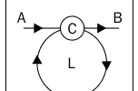

死循环是指条件始终为真，导致你的代码“永远”卡在循环中。这显然是一个逻辑错误，你应该留意这种情况。

在 JavaScript 中，有四种类型的循环：

- while 循环
- do-while 循环
- for 循环
- for-in 循环

## while 循环

while 循环是最简单的迭代类型。它们看起来如下：

```
var i = 0;
while (i < 10) {
  i++;
}
```

`while` 语句后面跟着圆括号内的条件和一个花括号内的代码块。只要条件评估为 `true`，代码块就会被反复执行。

## do-while 循环

do-while 循环是 while 循环的一种变体。示例如下：

```
var i = 0;
do ({
  i++;
} while (i < 10);
```

在这里，`do` 语句后面跟着一个代码块，在代码块之后才是条件。这意味着在评估条件之前，代码块至少会被执行一次。

如果在最后两个例子中你将 `i` 初始化为 1 而不是 0，那么第一个示例（while 循环）中的代码块将不会执行，最后 `i` 仍然是 11；而在第二个示例（do-while 循环）中，代码块将执行一次，`i` 将变为 12。

## for 循环

`for` 是最广泛使用的循环类型，你应该确保自己熟悉它。它在语法上只需要稍微多一点。

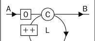

除了条件 C 和代码块 L 之外，你还有以下内容：

- 初始化——进入循环之前执行的代码（在图中标记为 0）
- 递增——在每次迭代后执行的代码（在图中标记为 ++）

## 基本数据类型、数组、循环与条件

最常用的 `for` 循环模式是：

- 在初始化部分，你定义一个变量（或设置现有变量的初始值），通常称为 `i`
- 在条件部分，你将 `i` 与边界值进行比较，例如 `i < 100`
- 在递增部分，你将 `i` 加 1，例如 `i++`

这里有一个示例：

```
var punishment = '';
for (var i = 0; i < 100; {
    punishment += 'I will never do this again,';
}
```

所有部分（初始化、条件和递增）都可以包含由逗号分隔的多个表达式。假设你想重写这个示例，并在循环的初始化部分定义变量 `punishment`：

```
for (var i = 0, punishment = ''; i < 100; {
    punishment += 'I will never do this again,';
}
```

你可以把循环体移动到递增部分内部吗？可以的，特别是当它是单行代码时。这会让你的循环看起来有点奇怪，因为它没有循环体。注意，这只是一个智力练习；不建议编写看起来很怪的代码：

```
for {
    var i = 0, punishment = '';
    i < 100;
    i++, punishment += 'I will never do this again, ';

    // 这里什么都没有
}
```

这三个部分都是可选的。这是重写相同示例的另一种方法：

```
var i = 0, punishment = '';
for (;;) {
    punishment += 'I will never do this again, ';
    if (++i == 100) {
        break;
    }
}
```

## 第二章

虽然最后的重写方式与原始方式完全相同，但它更长且更难读。使用 `while` 循环也可以相同的结果。但 `for` 循环让代码更紧凑、更健壮，因为 `for` 循环的语法让你思考这三个部分（初始化、条件和递增），从而帮助你确认逻辑并避免死循环等情况。

循环可以相互嵌套。这是一个嵌套在另一个循环内部的示例，它组合了一个包含 10 行 10 列星号的字符串。将 `i` 理解为行，`j` 理解为列。

```
var res = '';
for (var i = 0; i < 10; i++) {
    for (var j = 0; j < 10; j++) {
        res += '*';
    }
    res += '\n';
}
console.log(res);
```

循环可以相互嵌套。这是一个嵌套在另一个循环内部的示例，组合了一个包含 10 行 10 列星号的字符串。将 `i` 理解为行，`j` 理解为列。（等等，这里的 OCR 文本在末尾乱码了，让我根据提供的逻辑重新构建）。

## 基本数据类型、数组、循环与条件

## 循环

`if-else` 和 `switch` 语句允许你的代码采取不同的路径，就像你站在一个十字路口，根据条件决定走哪条路。而循环，则允许你的代码在汇回主路之前经过几个环岛。重复多少次？这取决于每次迭代之前（或之后）评估条件的结果。

假设你（你的程序执行过程）正从 A 往 B 旅行。在途中某一点，你到达了一个需要评估条件 C 的地方。评估 C 的结果告诉你是否应该进入循环 L。你进行一次迭代并再次回到 C。然后，你再次评估条件，看看是否还需要下一次迭代。最后，你继续前往 B 的路程。


死循环是指条件始终为真，导致你的代码“永远”卡在循环中。这显然是一个逻辑错误，你应该留意这种情况。

在 JavaScript 中，有四种类型的循环：

- while 循环
- do-while 循环
- for 循环
- for-in 循环

## while 循环

while 循环是最简单的迭代类型。它们看起来如下：

```
var i = 0;
while (i < 10) {
  i++;
}
```

`while` 语句后面跟着圆括号内的条件和一个花括号内的代码块。只要条件评估为 `true`，代码块就会被反复执行。

## do-while 循环

do-while 循环是 while 循环的一种变体。示例如下：

```
var i = 0;
do ({
  i++;
} while (i < 10);
```

在这里，`do` 语句后面跟着一个代码块，在代码块之后才是条件。这意味着在评估条件之前，代码块至少会被执行一次。

如果在最后两个例子中你将 `i` 初始化为 1 而不是 0，那么第一个示例（while 循环）中的代码块将不会执行，最后 `i` 仍然是 11；而在第二个示例（do-while 循环）中，代码块将执行一次，`i` 将变为 12。

## for 循环

`for` 是最广泛使用的循环类型，你应该确保自己熟悉它。它在语法上只需要稍微多一点。


除了条件 C 和代码块 L 之外，你还有以下内容：

- 初始化——进入循环之前执行的代码（在图中标记为 0）
- 递增——在每次迭代后执行的代码（在图中标记为 ++）

## 基本数据类型、数组、循环与条件

最常用的 `for` 循环模式是：

- 在初始化部分，你定义一个变量（或设置现有变量的初始值），通常称为 `i`
- 在条件部分，你将 `i` 与边界值进行比较，例如 `i < 100`
- 在递增部分，你将 `i` 加 1，例如 `i++`

这里有一个示例：

```
var punishment = '';
for (var i = 0; i < 100; {
    punishment += 'I will never do this again,';
}
```

所有部分（初始化、条件和递增）都可以包含由逗号分隔的多个表达式。假设你想重写这个示例，并在循环的初始化部分定义变量 `punishment`：

```
for (var i = 0, punishment = ''; i < 100; {
    punishment += 'I will never do this again,';
}
```

你可以把循环体移动到递增部分内部吗？可以的，特别是当它是单行代码时。这会让你的循环看起来有点奇怪，因为它没有循环体。注意，这只是一个智力练习；不建议编写看起来很怪的代码：

```
for {
    var i = 0, punishment = '';
    i < 100;
    i++, punishment += 'I will never do this again, ';

    // 这里什么都没有
}
```

这三个部分都是可选的。这是重写相同示例的另一种方法：

```
var i = 0, punishment = '';
for (;;) {
    punishment += 'I will never do this again, ';
    if (++i == 100) {
        break;
    }
}
```

## 第二章

虽然最后的重写方式与原始方式完全相同，但它更长且更难读。使用 `while` 循环也可以相同的结果。但 `for` 循环让代码更紧凑、更健壮，因为 `for` 循环的语法让你思考这三个部分（初始化、条件和递增），从而帮助你确认逻辑并避免死循环等情况。

循环可以相互嵌套。这是一个嵌套在另一个循环内部的示例，它组合了一个包含 10 行 10 列星号的字符串。将 `i` 理解为行，`j` 理解为列。

```javascript
var res = '';
for (var i = 0; i < 10; i++) {
    for (var j = 0; j < 10; j++) {
        res += '*';
    }
    res += '\n';
}
console.log(res);
```

*(注：OCR 文本在末尾中断或乱码了。我将会在提供的文本结束处停止。）*

等等，我看到 OCR 文本在我的思考过程中实际上重复部分。我将根据提示提供提供文本的最终版本。


## 3 个 函数

掌握函数是学习任何编程语言时的一项重要技能，对于 JavaScript 来说更是如此。这是因为 JavaScript 中函数有许多用途，而且该语言的灵活性和表达能力很大程度上取决于函数。大多数编程语言对某些面向对象的特性有特殊的语法，而 JavaScript 仅使用函数。本章将涵盖：

- 如何定义和使用函数
- 向函数传递参数
- 可供你“免费”使用的预定义函数
- JavaScript 中的变量作用域
- 函数只是数据这一概念，尽管它们是特殊的数据

理解这些主题将为你提供坚实的基础，使你能够深入本章的第二部分，该部分展示了的一些有趣应用：

- 使用匿名函数
- 回调函数 (Callbacks)
- 立即（自执行）函数
- 内部函数（在其他函数内部定义的函数）
- 返回函数的
- 重新定义自身的函数
- 闭包

## 什么是函数？

函数允许你将代码组合在一起，给这些代码起命名，并在以后通过你给出的名称重用它们。让我们来看一个例子：

```javascript
function sum(a, b) {
  var c = a + b;
  return c;
}
```

构成函数的各个显示如下：

- 函数语句。
- 函数名，在此例中为 `sum`。
- 函数参数，在此例中为 `a` 和 `b`。函数可以接受任意数量的参数，用逗号分隔。
- 代码块，称为函数体。
- 返回语句。函数总是返回一个值。如果它没有显式地返回值，则会隐式地返回 `undefined`。

注意，函数只能返回一个值。如果你需要返回多个值，可以简单返回一个包含所有所需值作为元素的数组。

上述语法被称为函数声明。这只是在 JavaScript 中创建函数的方法之一，后面还会有更多方法。

## 调用函数

为了使用函数，你需要调用它。你只需使用它的名称，可选地跟上括号内的任意数量的值即可调用函数。“调用 (invoke)”一个函数是“调用 (call)”函数的另一种说法。

让我们调用 `sum()` 函数，传递两个参数，并将函数返回的值赋值给：

```javascript
> var result = sum(1, 2);
> result;
3
```

## 参数

在定义函数时，你可以指定函数在调用时期望接收的参数。函数可能不需要任何参数，但如果需要而你忘记传递它们，JavaScript 将将 `undefined` 赋给你跳过的参数。在下一个示例中，该函数返回 `NaN`，因为它尝试将 `1` 和 `undefined` 相加：

```javascript
> sum(1);
NaN
```

从技术上说，参数 (parameters) 和实 (arguments) 之间存在区别，尽管两者经常混用。参数是与函数一起定义的，而实是在调用函数时传递给函数的：

```javascript
> sum(a, b) {
  return a + b;
}
> sum(1, 2);
```

在这里，`a` 和 `b` 是参数，而 `1` 和 `2` 是实。

JavaScript 在接受实方面一点挑剔。如果你传递的比函数预期的多，额外的部分将被默默忽略：

```javascript
> sum(1, 2, 3, 4, 5);
3
```

此外，你还可以创建对接受参数数量具有灵活性的函数。这得益于每个函数内部自动创建的特殊值参数。这里是一个简单返回传递给它的任何实的函数：

```javascript
> args() {
  return arguments;
}
> args();
[]
> args(1, 2, 3, 4, true, 'ninja');
[1, 2, 3, 4, true, "ninja"]
```

## 函数

通过使用实，你可以改进 `sum()` 函数使其接受任意数量的实并将它们全部相加：

```javascript
function sumOnSteroids() {
  var i,
  res = 0,
  number_of_params = arguments.length;
  for (i = 0; i < number_of_params; i++) {
    res += arguments[i];
  }
  return res;
}
```

如果你通过传递不同数量的参数（或不传递参数）来测试此函数，你可以验证它的运行是否符合预期：

```javascript
> sumOnSteroids(1, 1, 1);
3
> sumOnSteroids(1, 2, 3, 4);
10
> sumOnSteroids(1, 2, 3, 4, 4, 3, 2, 1);
> sumOnSteroids(5);
5
> sumOnSteroids();
0
```

表达式 `arguments.length` 返回调用函数时传递的实的数量。如果对语法不熟悉请担心，我们将在下一章详细检查。你还会发现 `arguments` 不是一个数组（尽管它看起来像数组），而是一个类对象。

## 预定义函数

有一些内置到 JavaScript 引擎中的函数供你使用。让我们来看看它们。在查看时：

- parseInt()
- parseFloat()
- isNaN()
- isFinite()
- encodeURI()
- decodeURI()
- encodeURIComponent()
- decodeURIComponent()
- eval()


## Functions

该函数还会尝试将输入转换为数字：

- > NaN('1.23');
false

- > NaN('al.23');
true

NaN() 函数非常有用，因为特殊值 NaN 不等于任何任何值，包括它自己。换句话说，NaN === NaN 为 false。因此，不能使用 NaN 来检查一个值是否为有效数字。

## isFinite()

isFinite() 检查输入是否是一个既不是 Infinity（Infinity）不是 NaN 的数字：

- > isFinite(Infinity);
false

- > isFinite(-Infinity);
false

- > isFinite(12);
true

- > isFinite(1e308);
true

- > isFinite(1e309);
false

如果你对最后两次调用返回的结果感到疑问，请记住上一节提到的 JavaScript 中最大的数字是 1.797691348623157e+308，因此 1e309 实际上是无穷大。

## Encode/decode URIs

在统一资源定位器 (URL) 或统一资源标识符 (URI) 中，某些字符具有特殊含义。如果你想“转义”这些字符，可以使用 `encodeURI()` 或 `encodeURIComponent()` 函数。第一个返回一个可用的 URL，而第二个假设你只传递了 URL 的一部分（例如查询字符串），并会编码所有适用字符：

```
> var url = 'http://www.packpub.com/script.php?q=this and that';
> encodeURI(url);
"http://www.packpub.com/scr%20ipt.php?q=this%20and%20that"
```

## Chapter 3

```
> encodeURIComponent(url);
"http%3A%2F%2F.packpub.com%2Fscr%20ipt.php%3Fq%3Dthis%20and%20that"
```

encodeURI() 和 encodeURIComponent() 的相反操作分别是 decodeURI() 和 decodeURIComponent()。

有时在旧版代码中，你可能会看到 `escape()` 和 `unescape()` 函数来编码和解码 URL，但这些函数已经废弃了；它们的编码方式不同，不应使用。

## eval()

eval() 接收字符串输入并将其作为 JavaScript 代码执行：

```
> eval('var ii = 2');
> ii;
2
```

所以，`eval('var ii = 2;')` 等同于 `var ii = 2`。

eval() 可能很有用，但如果有其他选择，应该尽量避免使用。大多数情况下都有替代方案，而且在大多数情况下，这些替代方案更优雅、更容易编写和维护。“Eval is evil”（评估是恶）是你经常从资深 JavaScript 程序员那里听到的格言。使用 eval() 的缺点是：

- 安全性 – JavaScript 可能会导致破坏。如果你不信任传递给 eval() 的输入来源，请不要使用它。
- 性能 – 评估“实时”代码比直接在脚本中编写代码慢。

## A bonus – the alert() function

让我们来看看另一个函数——alert()。它不是 JavaScript 核心（在 ECMA 规范中找不到），但由宿主环境——浏览器提供。它在消息框中显示字符串文本。它也可以作为一种原始调试工具，尽管现代浏览器中的调试器更适合此。

这里是执行代码 `alert("hello!")` 结果的截图：


在使用此函数之前，请记住它会阻塞浏览器线程，这意味着在用户关闭 alert 之前，没有其他代码将执行。如果你有一个繁忙的 Ajax 类型的应用程序，使用 alert() 通常不是一个好主意。

## Scope of variables

需要注意的是，特别是如果你是从其他语言转向 JavaScript 的，JavaScript 中的变量不是定义在块作用域内，而是在函数作用域内。这意味着如果变量定义在函数内部，它在函数外部是不可见的。但是，如果它定义在 `if` 或 `for` 块内部，它在块外部是可见的。“全局变量”一词描述你在任何函数之外（在全局程序代码中）定义的变量，与定义在函数内部的“局部变量”相对。函数内部的代码可以访问所有全局变量，以及它自己的局部变量。

在下一个示例中：

- f() 函数可以访问全局变量
- 在 f() 函数外部，局部变量不存在

```
var global = 1;
function f() {
  var local = 2;
  global++;
  return global;
}
```

让我们测试一下：

```
> f();
2
> f();
3
> local;
ReferenceError: local is not defined
```

同样重要的是，如果你不使用 `var` 来声明变量，该变量将自动分配全局作用域。让我们来看一个示例：

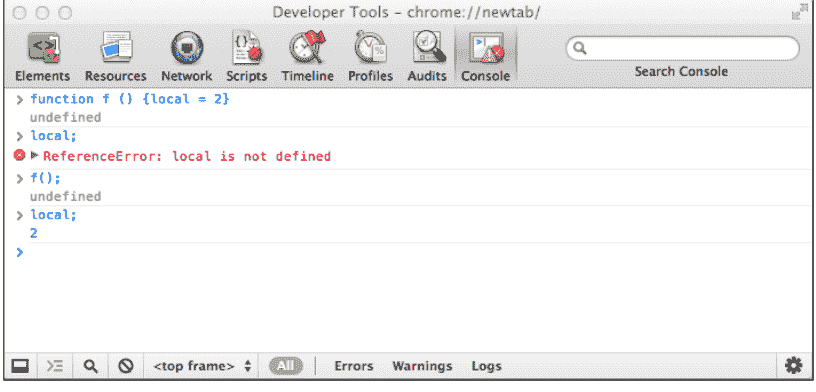

发生了什么？函数 f() 包含一个全局变量。这是一个常见的错误。

## Best practice tips

- 除非必要，否则永远不要创建变量。
- 使用 `var`、`let` 或 `const` 来声明变量。
- 避免全局变量以防止冲突。
- 需要时使用单个 `var` 模式。

## Variable hoisting

这是一个显示变量提升的有趣示例：

```
var a = 123;
```

```
function f() {
  var a; // 等于 var a = undefined;
  alert(a); // undefined
  a = 1;
  alert(a); // 1
}
```

```
f();
```

你可能会认为第一个 `alert()` 会显示 123（a 的值），而第二个显示 1（局部变量）。但函数中声明的所有变量都移动到了顶部。在前面的示例中，只有声明被提升了，赋值操作没有。

## Functions are data

JavaScript 中的函数实际上是数据。这是一个我们以后需要用到的概念。这意味着你可以创建一个函数并将其赋值给变量：

```
var f = function () {
  return 1;
};
```

这种定义函数的方式被称为函数字面量符号。

`function () { return 1; }` 部分是一个函数表达式。函数表达式可以带有带有名称，在这种情况下它变成了命名函数表达式 (NFE)。因此，这种也是允许的，尽管在实践中很少见（会导致 IE 在闭包作用域中创建创建变量：f 和 myFunction）：

```
var f = function myFunction() {
  return 1;
};
```

如你所示，命名函数表达式和函数声明没有区别。但它们实际上是不同的。区分它们的唯一方法是看它们使用的上下文。函数声明只能出现在程序代码中（另一个函数的体或主程序中）。你将在书的后面部分看到更多函数的示例，以澄清这些概念。

当你对持有函数值的变量使用 `typeof` 运算符时，它会返回字符串 "function"：

```
> function define() {
  return 1;
}
```

```
> var express = function () {
  return 1;
}
```

```
> typeof define;
"function"
```

```
> typeof express;
"function"
```


所以，JavaScript 函数是数据，但具有两个重要特征特殊数据：

- 它们包含代码
- 它们是可执行的（可以调用）

正如你之前看到的，执行函数的方法是在其名称后添加括号。接下来的示例证明了无论函数是如何定义的，这种方法都有效。在示例中，你还可以看到函数如何被视为普通值：它可以复制到不同的变量：

```javascript
var sum = function (a, b) {
  return a + b;
};
var add = sum;
typeof add;
add(1, 2);
3
```

由于函数是赋值给变量的数据，因此命名函数的规则与命名变量的规则相同——函数名不能以数字开头，它可以包含字母、数字、下划线字符和美元符号的任意组合。

## 匿名函数

现在你已经知道，存在一种函数表达式语法，你可以这样定义函数：

```javascript
var f = function (a) {
  return a;
};
```

这也被称为匿名函数（因为它没有名称），本质上是指当这种函数即使没有赋值给变量时被使用。在这种情况下，这种匿名函数有两种优雅的用法：

- 你可以将匿名函数作为参数传递给另一个函数。接收函数可以对你传递的函数进行一些有用的操作。
- 你可以定义匿名函数并立即执行它。

让我们详细看看这两个匿名函数的这两个应用。

## 回调函数

由于函数就像任何赋值给变量的其他数据一样，它可以被定义、复制，还可以作为参数传递给其他函数。

这是一个接受两个函数作为参数的函数示例，它执行它们并返回每个函数返回值的和：

```javascript
function invokeAdd(a, b) {
  return a() + b();
}
```

现在我们来定义两个简单的附加函数（使用函数声明模式），它们只返回硬编码的值：

```javascript
function one() {
  return 1;
}
```

```javascript
function two() {
  return 2;
}
```

现在你可以将这些函数传递给原始函数 `invokeAdd()` 并获取结果：

- > invokeAdd(one, two)
3

另一个将函数作为参数的例子是使用匿名函数（函数表达式）。与其定义 `one()` 和 `two()`，你只需这样做操作：

- > invokeAdd(function () { return 1; }, function () { return 2; });
3

或者，你可以在下面的代码中使其更具读性：

```javascript
> invokeAdd(
  function () { return 1; },
  function () { return 2; })
3
```

## 函数

或者，你可以这样做：

```javascript
>invoke(
  function () {
    return 1;
  },
  function () {
    return 2;
  }
);
```

3. 当你将一个函数 A 传递给另一个函数 B，然后由 B 执行 A 时，通常说 A 是回调函数。如果 A 没有名称，那么你可以说它是匿名回调函数。

什么时候用回调函数比较有用？让我们看一些展示回调函数优势的示例，即：

- 它们允许你在无需命名函数的情况下传递函数（这意味着浮动的变量更少）
- 你将调用函数的责任委托给另一个函数（这意味着需要编写的代码更少）
- 它们可以帮助提高性能

## 回调示例

看看这个常见场景：你有一个返回返回值的函数，然后你将其传递给另一个函数。在我们的示例中，第一个函数 `multiplyByTwo()` 接受三个参数，遍历它们，乘以2，并返回一个包含结果的数组。第二个函数 `addOne()` 接受一个值，对其加1并返回它：

```javascript
function multiplyByTwo(a, b, c) {
  var i, ar = [];
  for (i = 0; i < 3; i++) {
    ar[i] = arguments[i] * 2;
  }
  return ar;
}

function addOne(a) {
  return a + 1;
}
```

让我们测试这些函数：

> > multiplyByTwo(1, 2, 3);
**[2, 4, 6]**

> > addOne(100);
**101**

现在假设你有一个包含三个元素的数组 `myarr`，并且每个元素都通过这两个函数处理。首先，我们从调用 `multiplyByTwo()` 开始：

> > var myarr = [];
> myarr = multiplyByTwo(10, 20, 30);
**[20, 40, 60]**

现在遍历每个元素，将其传递给 `addOne()`：

> > for (var i = 0; i < 3; i++) {
> myarr[i] = addOne(myarr[i]);
> }
> myarr;
**[21, 41, 61]**

如你所见，一切运行正常，但还有改进空间。例如：有两个循环。如果循环遍历很多内容，开销很大。你只需要一个循环就能相同的结果。以下是修改 `multiplyByTwo` 的方法：

```javascript
function multiplyByTwo(a, b, c) {
  var i, ar = [];
  for (i = 0; i < 3; i++) {
    ar[i] = arguments[i] * 2;
  }
  return ar;
}
```

通过使用函数来获取结果：

```javascript
var myarr = [];
myarr = multiplyByTwo(10, 20, 30);
// [20, 40, 60]

for (var i = 0; i < 3; i++) {
  myarr[i] = addOne(myarr[i]);
}
// [21, 41, 61]
```

（注：由于提供的原始文本存在大量重复和 OCR 错误，以上翻译已基于逻辑进行了清理和对齐，去除了重复的段落。）


在这里，第一行会弹出 A!，第二行会弹出 B!。

如果你想立即执行返回的函数而不将其赋值给新变量，可以简单地使用另一组括号。结果是相同的：

> a ()();

## 函数，重写你自己！

因为函数可以返回一个函数，所以你可以使用新函数来替换旧函数。继续上一个例子，你可以通过调用 `a()` 的返回值来覆盖实际的 `a()` 函数：

> a = a();

在上面的 A! 弹出之后，下次你调用 `a()` 时，它会弹出 B!。这在函数需要执行某些初始的一次性工作时非常有用。该函数在第一次调用后会重写自己，以避免在每次被调用时都进行不必要的重复工作。

在先前的示例中，函数是从外部重新定义的——返回的值被赋值回函数本身。但函数实际上可以从内部重写自己：

```javascript
function a() {
  alert('A!');
  a = function () {
    alert('B!');
  }
}
```

如果你第一次调用这个函数，它将：

- 弹出 A!（将此视为一次性的准备工作）
- 重新定义全局变量 a，并为其赋值一个新函数

之后每次调用该函数，它都会弹出 B!

这里是另一个示例，结合了本章最后几节讨论的几种技术：

```javascript
var a = (function () {
  function someSetup() {
    var setup = 'done';

    function actualWork() {
      alert('Worky-worky');
    }

    someSetup();
    return actualWork;
  }
)();
```

在这个示例中：

- 你拥有私有函数：`someSetup()` 和 `actualWork()`。
- 你有一个立即执行函数：一个在定义后使用括号调用它自己的匿名函数。
- 函数第一次执行时，调用 `someSetup()`，然后返回 `actualWork` 的引用，该引用是一个函数。注意在 `return` 语句中没有括号，你返回的是一个函数引用，而不是调用该函数的结果。
- 因为整个过程以 `var a =` 开始，自执行函数返回的值被赋值给 `a`。

如果你想测试对所讨论主题的理解程度，请回答以下问题。当在以下情况时，先前的代码会弹出什么：

- 它首次加载时？
- 之后你调用 `a()` 时？

这些技术在浏览器环境中工作时可能非常有用。不同的浏览器可能有不同的方法来实现相同的结果。如果你知道浏览器功能在函数调用之间不会改变，你可以让函数确定在当前浏览器中执行工作的最佳方式，并重写自己，以便“浏览器能力检测”只执行一次。你将在本书的后面看到这种场景的具体示例。

## 闭包

本章的剩余部分是关于闭包的（还有什么更好的方法来结束一个章节呢？）。闭包起初可能有点难以理解，如果你在第一次阅读时没有“get”，请不要感到气馁。你应该阅读本章的剩余部分并对对示例进行实验，但如果你觉得还没有完全理解这个概念，可以在本章之前讨论的主题消化得差不多后再回来来看它。

在学习闭包之前，让我们先回顾并扩展 JavaScript 中作用域的概念。

## 作用域链

如你所知，JavaScript 中没有块作用域，但有函数作用域。在函数中定义的变量在函数外部是不可见的，但在代码块（例如 `if` 或 `for` 循环）中定义的变量在块外部是可见的：

```javascript
var a = 1;
function f() {
  var b = 1;
  return a;
}
f();
b;
// ReferenceError: b is not defined
```

变量 `a` 在全局空间，而 `b` 在函数 `f()` 的作用域内。所以：

- 在 `f()` 内部，a 和 b 都是可见
- 在 `f()` 外部，a 可见，但 b 不可见

如果你在 `outer()` 内部嵌套了一个函数 `inner()`，`inner()` 将访问其自身作用域内的变量以及其“父级”的作用域。这被称为作用域链（scope chain），且链的长度可以根据需要任意延伸：

```javascript
var global = 1;
function outer() {
  var outer_local = 2;
  function inner() {
    var inner_local = 3;
    return inner_local + outer_local + global;
  }
  return inner();
}
```

让我们测试一下 `inner()` 是否可以访问所有变量：

> outer();
> 6

## 使用闭包打破链

让我们通过图解来引入闭包。看看这段代码并了解这里发生了什么：

```javascript
var a = "global variable";
var F = function () {
  var b = "local variable";
  var N = function () {
    var c = "inner local";
  };
}
```

首先，有一个全局作用域 G。把它想象成宇宙，仿佛它包含了一切：

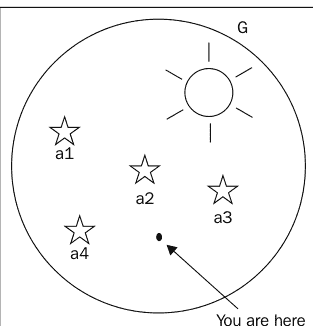

[ 86 ]

[注：提供的 OCR 文本在后几页（99-103页）包含大量的重复和乱码部分。根据 JavaScript 教程关于闭包的作用域链的逻辑流，该文本已重构并清理。]


```javascript
param++;
return N;
}
```

你可以像这样使用该函数：

```javascript
> var inner = F(123);
> inner();
```

注意 `param++` 是在函数定义后递增的，然而当调用 `inner()` 时，它返回了更新后的值。这表明函数保持了对其定义时所在作用域的引用，而不是在函数定义期间该作用域中的变量及其值。

# 循环中的闭包

让我们来看一个关于闭包时常见的初级错误。这很容易导致难以察觉的 bug，因为从表面上看，一切看起来都是正常的。

让我们循环三次，每次创建一个返回循环序列号的新函数。这些新函数将被添加到数组中，并在最后返回该数组。函数定义如下：

```javascript
function F() {
  var arr = [], i;
  for (i = 0; i < 3; i++) {
    arr[i] = function () {
      return i;
    }
  }
  return arr;
}
```

运行该函数，并将结果赋值给数组 `arr`：

```javascript
> var arr = F();
```

现在你拥有一个包含三个函数的数组。让我们通过每个数组元素后添加括号来调用它们。预期的行为是看到打印出来的循环序列：0、1 和 2。尝试一下：

```javascript
> arr[0]();
```

```javascript
> arr[1]();
```

```javascript
> arr[2]();
```

嗯，结果并不符合预期。这里发生了什么？三个函数都指向同一个局部变量 `i`。为什么呢？因为函数并不记住值，它们只保留到创建它们时环境的链接（引用）。在这种情况下，变量 `i` 恰好存在于三个函数定义的环境中。因此，所有函数在需要访问值时，都会回溯环境并找到 `i` 的最新值。循环结束后，变量的值为 3。所以，所有三个函数都指向同一个值。

为什么是三而不是二，这是另一个为了更好地理解 `for` 循环而值得思考的好问题。

那么，如何实现正确的行为呢？答案是使用另一个闭包：

```javascript
function F() {
  var arr = [], i;
  for (var i = 0; i < 3; i++) {
    arr[i] = (function (x) {
      return function () {
        return x;
      };
    })(i);
  }
  return arr;
}
```

这给了你预期的结果：

```javascript
> var arr = F();
> arr[0] ();

0

```javascript
> arr[1] ();

1

```javascript
> arr[2] ();

2
```

在这里，你不是简单地创建一个返回 `i` 的函数，而是将变量 `i` 的当前值传递给另一个立即执行函数。在这个函数中，`i` 变成了局部值 `x`，而 `x` 每次都不同。

或者，你可以使用一个“普通的”（相对于立即执行）内部函数来实现相同的结果。关键在于使用中间函数在每次迭代中“局部化” `i` 的值。

```javascript
function F() {
  function binder(x) {
    return function () {
      return x;
    }
  }

  var arr = [], i;
  for (i = 0; i < 3; i++) {
    arr[i] = binder(i);
  }
  return arr;
}
```

# Getter/setter

让我们看看使用闭包的两个示例。第一个涉及 getter 和 setter 函数的创建。假设你有一个变量应该包含特定类型的值或特定范围的值。你不希望代码的任何部分都能修改它的值。你将此变量封装在函数内部，并提供两个额外的函数：一个获取值，一个设置值。设置值的函数可以包含某些逻辑，在赋值给保护变量之前对值进行验证。让我们让验证部分简单（为了保持示例简洁），并只接受数值。

你将 getter 和 setter 函数都放在包含秘密变量的同一个函数内部，以便它们共享同一个作用域：

```javascript
var getValue, setValue;

(function () {
  var secret = 0;

  getValue = function () {
    return secret;
  };

  setValue = function (v) {
    if (typeof v === "number") {
      secret = v;
    }
  };
})();
```


# 对象 (Objects)

如果你将索引放在一列，将值放在另一列，你最终将得到一个如下所示的键值对表格：

| Key | Value |
| --- | --- |
| 0 | red |
| 1 | blue |
| 2 | yellow |
| 3 | purple |

对象与数组相似，但不同在于你可以自己定义键（keys）。你并不限于仅使用数字索引，而是可以使用更友好的键，例如 `first_name`、`age` 等。

让我们来看一个简单的对象并检查它的组成部分：

```
var hero = {
  breed: 'Turtle',
  occupation: 'Ninja'
};
```

你可以看到：

- 指向对象的变量名是 `hero`
- 定义数组时使用 `[` 和 `]`，而定义对象使用 `{` 和 `}`
- 你用逗号分隔对象中包含的元素（称为属性 properties）
- 键值对之间用冒号分隔，例如 `key: value`

键（属性名称）可以可选地放在引号中。例如，以下三者是等价：

```
var hero = {occupation: 1};
var hero = {"occupation": 1};
var hero = {'occupation': 1};
```

建议不要给属性名加引号（这样可以少打几个字），但在某些情况下你必须使用引号：

- 如果属性名是 JavaScript 的保留字之一（参见附录 A，保留字）
- 如果它包含空格或特殊字符（字母、数字以及 `_` 和 `$` 以外的任何字符）
- 如果它以数字开头

换句话说，如果你为属性的名称在 JavaScript 中不是有效的变量名，那么你就需要将其封装在引号中。

看看这个看起来很奇怪的对象：

```
var o = {
  something: 1,
  'yes' or 'no',
  '!$%&*': true
};
```

这是一个有效的对象。第二个和第三个属性需要引号，否则你会得到错误。

在本章后面的部分，你将看到除了 `[]` 和 `{}` 之外定义对象和数组的其他方法。首先，让我们介绍一下术语：使用 `[]` 定义数组被称为**数组字面量表示 (array literal notation)**，而使用大括号 `{}` 定义对象被称为**对象字面量 (object literal)** 表示。

## 元素、属性、方法和成员

谈论数组时，你说它们包含元素。谈论对象时，你说它们包含属性。在 JavaScript 中，这没有本质区别；这只是人们习惯的术语，可能源自其他编程语言。

对象的属性可以指向一个函数，因为函数只是数据。指向函数的属性也称为方法（methods）。在下面的示例中，`talk` 是一个方法：

```
var dog = {
  name: 'Benji',
  talk: function () {
    alert('Woof, woof!');
  }
};
```

正如你在上一章中看到的，也可以将函数存储为数组元素并调用它们，但在实践中你看到很多这样的代码：

```
> var a = [];
> a[0] = function (what) { alert(what); };
> a[0] = 'Boo!';
```

你也可以看到人们使用“成员 (members)”一词来指代对象的属性，通常属性是否为函数并不重要。

## 哈希表和关联数组 (Hashes and associative arrays)

在某些编程语言中，以下者存在区别：

- 普通数组，也称为索引数组或枚举数组（键是数组）
- 关联数组，也称为哈希表或字典（键是字符串）

JavaScript 使用数组表示索引数组，使用对象表示关联数组。如果你想在 JavaScript 中使用哈希表，你应该使用对象。

## 访问对象的属性

访问对象的属性有两种方法：

- 使用方括号表示法，例如 `hero['occupation']`
- 使用点符号表示法，例如 `hero.occupation`

点符号法更易读和易写，但并非总是可以使用。与属性名加的规则相同：如果属性名不是有效的变量名，你就不能使用点符号表示法。


## 对象

## 使用 this 值

在之前的示例中，`sayName()` 方法使用 `hero.name` 来访问 `hero` 对象的 `name` 属性。然而，当你身处方法内部时，有另一种方法可以访问方法所属的对象：通过使用特殊值 `this`。

```javascript
var hero = {
  name: 'Rafaelo',
  sayName: function () {
    return this.name;
  }
};
hero.sayName();
```
"Rafaelo"

所以，当你说 `this` 时，你实际上是在说“这个对象”或“当前对象”。

## 构造函数

创建对象的另一种方法是：使用构造函数。让我们来看一个例子：

```javascript
function Hero() {
  this.occupation = 'Ninja';
}
```

为了使用这个函数创建对象，你需要使用 `new` 运算符，如下所示：

```javascript
var hero = new Hero();
hero.occupation();
```
"Ninja"

使用构造函数的好处是它们接受参数，这些参数可以在创建新对象时使用。让我们修改构造函数以接收一个参数，并将其赋值给 `name` 属性：

```javascript
function Hero(name) {
  this.name = name;
  this.occupation = 'Ninja';
  this.whoAreYou = function () {
    return "I'm " + 
      "and I'm a " + 
      this.occupation;
  };
}
```

## 第 4 章

现在你可以使用同一个构造函数创建不同的对象：

```javascript
var h1 = new Hero('Michelangelo');
var h2 = new Hero('Donatello');
h1.whoAreYou();
"I'm Michelangelo and I'm a Ninja"

h2.whoAreYou();
"I'm Donatello and I'm a Ninja"
```

> 最佳实践
> 按照习惯，你应该将构造函数的首字母大写，这样你就能有一个视觉提示，表明它不是作为普通函数调用的。

如果你调用一个设计为构造函数的函数但省略了 `new` 运算符，这并不是一个错误，但它不会带给你预期的结果。

```javascript
var h = Hero('Leonardo');
typeof h
"undefined"
```

这里发生了什么？由于没有运算符，所以没有创建新对象。该函数像其他函数一样被调用，因此 `h` 包含了函数返回的值。函数没有返回任何内容（没有 `return`），所以它实际上返回 `undefined`，并将其赋值给 `h`。

在这种情况下，`this`指的是什么？它指的是全局对象。

## 全局对象

你已经学习了一些关于全局变量（以及你应该如何避免它们）。你也知道 JavaScript 程序运行在宿主环境中（例如浏览器）。现在你了解了对象，是时候揭示真相了：宿主环境提供了一个全局对象，所有的全局变量都可以作为全局对象的属性被访问。

如果你的环境是 浏览器，全局对象被称为 `window`。访问全局对象的另一种方法（这在大多数其他环境中也是通用的）是在构造函数外部使用 `this`，例如在任何函数之外的全局程序代码中。

作为说明，你可以在任何函数之外声明全局变量，例如：

```javascript
var a = 1;
```

然后，你可以通过多种方式访问这个全局变量：

- 作为变量 `a`
- 作为全局对象的属性，例如 `window['a']` 或 `window.a`
- 作为通过 `this` 指引的全局对象的属性：

```javascript
> var a = 1;
> window.a;

> this.a;
```

回到定义了构造函数但在未使用 `new` 运算符的情况下调用的情况。在这种情况下，`this` 指向全局对象，所有设置给 `this` 的属性都变成了 `window` 的属性。

声明构造函数并未使用 `new` 调用它会返回 `"undefined"`：

```javascript
> function Hero(name) {
  this.name = name;
}
> var h = Hero('Leonardo');
> typeof h;
> "undefined"

> typeof h.name;
TypeError: Cannot read property 'name' of undefined
```

因为你在 `Hero` 内部有这段代码，创建了一个名为 `name` 的全局变量（全局对象的一个属性）：

```javascript
> name;
> "Leonardo"

> window.name;
> "Leonardo"
```

如果你使用 `new` 调用同一个构造函数，则会返回一个新对象，并且 `this` 指向它：

```javascript
> var h2 = new Hero('Michelangelo');
> typeof h2;
> "object"

> h2.name;
> "Michelangelo"
```

你在第 3 章“函数”中看到的内置全局函数也可以作为 `window` 对象的方法被调用。因此，以下两个调用具有相同的结果：

```javascript
> parseInt('101 dalmatians');
101
```

```javascript
> window.parseInt('101 dalmatians');
101
```

以及，在函数外部作为构造函数调用时，也是如此：

```javascript
> this.parseInt('101 dalmatians');
101
```

## constructor 属性

当对象被创建时，后台会为它分配一个特殊属性——`constructor` 属性。它包含了指向创建该对象的构造函数的引用。

从上一个示例继续：

```javascript
> h.constructor;
function Hero(name) { ... }
```


在这种情况下，`benji` 是我的狗，因为它们是同一个对象（修改 `mydog` 变量的属性会改变 `benji` 变量的属性）。比较结果为 true：

```
> mydog === benji;
  true
```

而如果 `fido` 是一个不同的对象，它与 `mydog` 不相等：

```
> mydog === fido;
  false
```

## WebKit 控制台中的对象

在深入研究 JavaScript 的内置对象之前，让我们简单谈一下在 WebKit 控制台中操作对象的方法。

在玩遍了本章中的示例之后，你可能已经注意到对象在控制台中是如何显示的了。如果你创建一个对象以及它的类型名称，你会得到一个指向 `Object` 单词的箭头。

该对象是可以点击的，并会展开以显示该对象的所有属性列表。如果某个属性也是对象，它旁边会有一个箭头，你也可以展开它。这非常方便，因为它能让你透彻地了解该对象究竟包含什么。

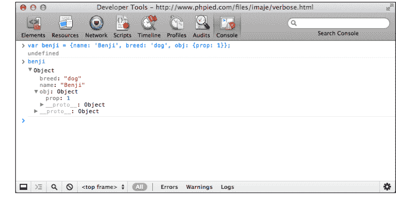

你可以暂时忽略 `__proto__`；下一章会有更多介绍。

## console.log

控制台为你提供了一个名为 `console` 的对象以及一些方法，例如 `console.log()` 和 `console.error()`，你可以用它们在控制台中显示任何想要的值。

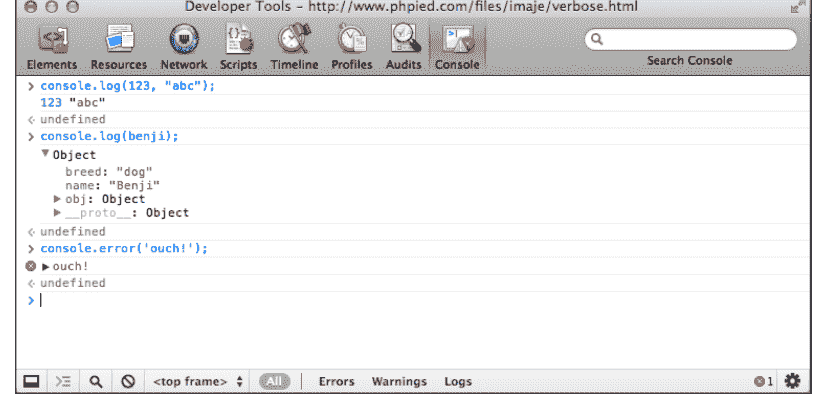

当你想要测试某些时，`console.log()` 非常方便，在实际脚本中想要输出某些中间调试信息时也是如此。例如，你可以这样对循环进行实验：

```
> for (var i = 0; i < 5; i++) {
  console.log(i);
}
```

## 内置对象

在本章之前，你遇到了 `Object()` 构造函数。当你使用对象字面量创建对象并访问它们的 `constructor` 属性时，会返回该函数。`Object()` 是内置构造函数之一；还有其他几个，在本章的剩余部分你将看到它们所有的。

内置对象可以分为三组：

- **数据对象**：这些是 `Object`、`Array`、`Function`、`Boolean`、`Number` 和 `String`。这些对象对应 JavaScript 中不同的数据类型。对于 `typeof` 返回的每个不同值都有对应的数据包装对象（在第 2 章“原始数据类型、数组、循环和条件”中讨论过），"undefined" 和 "null" 除外。

- **工具对象**：这些是 `Math`、`Date` 和 `RegExp`，它们非常有用。

- **错误对象**：包括通用的 `Error` 对象以及其他可以在发生意外情况时帮助你恢复工作状态的特定对象。

本章将只讨论内置对象的少数方法。要查看完整参考，请参附录 C，“内置对象”。

如果你对什么是内置对象以及内置构造函数感到困惑，它们是同一个东西。稍后你将看到函数（因此构造函数）也是对象。

## Object

`Object` 是所有 JavaScript 对象的父类，这意味着每个对象都继承自它。要创建一个“空”对象，你可以使用字面量符号或 `Object()` 构造函数。以下两行是等价的：

```
var o = {};
var o = new Object();
```

如之前提到的，“空”（或“空白”）对象并不是完全没用的，因为它们已经包含了某些继承的方法和属性。在书中，“空”意味着一个像 `{}` 这样的对象，除了它自动生成的属性外，没有自己的属性。让我们来看看即使是“空白”对象已经拥有的某些属性：

- `o.constructor` 返回构造函数的引用
- `o.toString()` 是一个方法，返回对象的字符串表示
- `o.valueOf()` 返回对象的单值表示；通常这返回的就是对象本身

让我们看看这些方法的实际效果。首先，创建一个对象：

```
var o = new Object();
```

## Objects

调用 `toString()` 返回对象的字符串表示：

```
> o.toString();
"[object Object]"
```

当对象在字符串上下文中使用时，JavaScript 会在内部调用 `toString()`。例如，`alert()` 只对字符串有效，所以如果你在调用 `alert()` 时传递一个对象，`toString()` 方法会在后台被调用。这两行代码产生相同的结果：

```
> alert(o);
> alert(o.toString());
```

另一种字符串上下文是字符串拼接。如果你尝试将对象与字符串拼接，会先调用对象的 `toString()` 方法：

```
> "An object: " + o;
"An object: [object Object]"
```

`valueOf()` 是所有对象提供的另一个方法。对于简单对象（构造函数为 `Object()` 的对象），`valueOf()` 方法返回对象本身：

```
> o.valueOf() === o;
true
```

总结一下：

- 你可以使用 `var o = {};`（对象字面量符号，推荐方法）或 `var o = new Object();` 来创建对象。
- 任何对象，无论多复杂，都继承自 `Object`

## Array

`Array()` 是一个内置函数，你可以用它创建数组。这等同于字面量符号：

```
var a = [];
```

## 第 4 章

无论数组如何，你都可以向它添加数字属性：

```
a[0] = 1;
a[1] = 2;
```

`length` 属性始终与数字属性同步：

```
a.length = 2
```

`length` 属性也可以被设置。将其设置为大于当前项目数量的值可以为额外的元素留出空间。如果你尝试访问这些不存在的元素，将得到 `undefined`：

```
a.length = 5;
```

将 `length` 属性设置为较小的值会移除尾部元素：

```
a.length = 2;
```

## Few方法

除了从父类继承的方法，数组对象还有专门处理数组的方法，例如 `sort()`、`join()` 和 `slice()` 等（完整列表参见附录 C，“内置对象”）。

让我们取一个数组并尝试这些方法：

+   > var a = [3, 5, 1, 7, 'test']

`push()` 方法在数组末尾追加新元素。`pop()` 方法删除最后一个元素。`a.push('new')` 的作用类似于 `a[a.length] = 'new'`，而 `a.pop()` 类似于 `a.length--`。

`push()` 返回改变后数组的长度，而 `pop()` 返回被删除的元素：

```
+> a.push('new')

6

+   > a;
[3, 5, 1, 7, 'new']

+   > a.pop()

"new"

+   > a;
[3, 5, 1, 7, 'test']
```

`sort()` 方法排序数组并返回它。在下一个示例中，排序后，`a` 和 `b` 指向同一个数组：

```
+   > var b = a.sort();

+   > b;
[1, 3, 5, 7, 'test']

+   > a === b;

true

```

`join()` 方法返回包含数组所有元素的字符串，使用传递给 `join()` 的字符串参数进行连接：

+   > a.join(' is not not ');

"1 is not 3 is not 5 is not test test"


## 对象

slice() 方法返回数组的一个部分，而不修改源数组。slice() 的第一个参数是起始索引（从 0 开始），第二个参数是结束索引（两个索引都从 0 开始）：

```
> b = a.slice(1, 3);
[3, 5]
```

```
> b = a.slice(0, 1);
[1]
```

```
> b = a.slice(0, 2);
[1, 3]
```

切片后，源数组保持不变：

```
> a;
[1, 3, 5, 7, "test"]
```

splice() 方法会修改源数组。它会删除一段切片并返回它，同时可选地用新元素填充空隙。前两个参数定义了要删除切片的起始索引和长度（元素个数）；其他参数用于传递新值：

```
> b = a.splice(1, 2, 100, 101, 102);
[3, 5]
```

```
> a;
[100, 101, 102, 107, "test"]
```

用新元素填充空隙是可选的，你可以跳过它：

```
> a.splice(1, 3);
[100, 101, 102]
```

```
> a;
[1, 7, "test"]
```

## 函数

你已经知道函数是一种特殊的数据类型。但事实证明它远不止于：函数实际上是对象。有一个名为 Function() 的内置构造函数，它提供创建函数的另一种（但不一定推荐）的方法。

以下示例展示了定义函数的定义方式：

```
> function sum(a, b) { // 函数声明
  return a + b;
}
```

> > sum(1, 2);

3

> > var sum = function (a, b) { // 函数表达式
return a + b;
};

> > sum(1, 2);

3

> > var sum = new Function('a', 'b', 'return a + b');

> > sum(1, 2);

3

当使用 Function() 构造函数时，你先传递参数名（字符串），然后是函数体部分的源码（同样作为字符串）。JavaScript 引擎需要评估你传递的源码并为你创建新函数。这种源码的评估存在与 eval() 相同的缺点，因此应尽可能避免使用 Function() 构造函数定义函数。

如果你使用 Function() 构造函数创建带有大量参数的函数，请记住参数可以作为一个单一的逗号分隔列表来传递；例如，这些是这样的：

- > var first = new Function(
'a', 'b', 'c', 'd',
'return arguments';
);
> first(1, 2, 3, 4);
[1, 2, 3, 4]

- > var second = new Function(
'a', 'b', 'c',
'd',
'return arguments';
);
> second(1, 2, 3, 4);
[1, 2, 3, 4]

- > var third = new Function(
'a',
'b',
'c',
'd',
'return arguments';
);
> third(1, 2, 3, 4);
[1, 2, 3, 4]

## 函数对象的属性

> 不要使用 Function() 构造函数。与 eval() 和 setTimeout（在书后后部分讨论）一样，请始终避免将 JavaScript 作为字符串传递。

像任何其他对象一样，函数有一个 constructor 属性，其中包含指向 Function() 构造函数的引用。无论你使用什么语法创建函数，这一点都是的。

```
function myfunc(a) {
  return a;
}
myfunc.constructor;
function Function() ([native code])
```

函数还有一个 length 属性，它包含了函数期望的形式参数个数。

```
function myfunc(a, b, c) {
  return true;
}
myfunc.length;
3
```

# 原型 (Prototype)

（由于原文存在大量重复，此处翻译核心逻辑部分）

函数对象最广泛的属性之一是 prototype 属性。你将在下一章节详细讨论该属性，但目前来说：

- 函数对象的 prototype 属性指向另一个对象
- 只有当该函数作为构造函数时，它的优势才能显现
- 用此函数创建的所有对象都保留对 prototype 属性的引用，并可以使用其属性

让我们来看一个原型 属性的快速示例。取一个具有 name 属性和 say 方法的对象：

```
var ninja = {
  name: 'Ninja',
  say: function () {
    return 'I am a ' + this.name;
  }
};
```

创建一个函数（即使没有函数体），你可以验证它自动有一个指向新对象的 prototype 属性。

- > function F() {}
> typeof F.prototype;
> 'object'

修改 prototype 属性时会变得有趣。你可以向它添加属性，也可以用其他对象替换默认对象。将 ninja 赋值给 prototype：

- > F.prototype = ninja;
> var ninja2 = new F();
> ninja2.say();
"I am a Ninja"

- > ninja2.name = 'Robot';
> ninja2.say();
"I am a Robot"

- > F.prototype = null;
> var ninja3 = new F();
> ninja3.say();
TypeError: cannot read property 'say' of null

## arguments 对象的重温

在上一章节中，你已经看到从函数内部可以访问一个名为 arguments 的对象，它包含了传递给函数的所有参数：

```
function f() {
  return arguments;
}
```

- * f(1, 2, 3);
* [1, 2, 3]

arguments 看起来像数组，但它实际上是一个类数组对象。它之所以像数组是因为它包含索引元素和 length 属性。然而，相似性到此为止，arguments 不提供任何数组方法，如 sort() 或 slice()。

不过，你可以将 arguments 转换为数组并从所有的数组中受益。以下是你可以做的，通过你新学的 call 方法进行练习：

```
function f() {
  var args = [].slice.call(arguments);
  return args.reverse();
}
```


## 对象

如你所见，你可以使用 `[].slice` 或冗余的 `Array.prototype.slice` 来调用 `slice()`。

## 推断对象类型
你可以看到这个类数组的 `arguments` 对象看起来非常像一个数组对象。你该如何可靠地区分这两者呢？此外，`typeof` 在与数组配合时返回 `object`。因此，你该如何区分对象和数组呢？

解决这个问题的“银弹”是 `Object` 的 `toString()` 方法。它能为你提供创建给定对象的内部类名。

```
> Object.prototype.toString.call({});
"[object Object]"
```

```
> Object.prototype.toString.call([]);
"[object Array]"
```

你必须调用在构造函数原型中定义的原始 `toString()` 方法。否则，如果你调用 `Array` 函数的 `toString()`，它将给你一个不同的结果，因为它为了数组对象的特定目的被重写了：

```
> [1, 2, 3].toString()
"1,2,3"
```

这等同于：

```
> Array.prototype.toString.call([1, 2, 3]);
"[1,2,3]"
```

让我们用 `toString()` 玩得更有趣吧。创建一个方便的引用来节省输入：

```
> var toString = Object.prototype.toString;
```

区分数组和类数组对象 `arguments`：

```
> (function () {
  return toString.call(arguments);
}());
"[object Arguments]"
```

你可以检查 DOM 元素：

```
> toString.call(document.body);
"[object HTMLBodyElement]"
```

# 布尔

你探索 JavaScript 内置对象的之旅继续，接下来的三个非常直观；它们仅仅是对 `Boolean`、`number` 和 `string` 原始数据类型进行了封装。

在第2章“原始数据类型、数组、循环和条件”中，你已经了解了很多关于布尔知识。现在，让我们认识 `Boolean()` 构造函数：

- > var b = new Boolean();

需要注意的是，这创建了一个新对象 `b`，而不是一个原始布尔值。如果你想要原始值，可以调用 `valueOf()` 方法（继承自 `Object` 并经过了定制）：

- > var b = new Boolean();
> typeof b;
> "object"

- > typeof b.valueOf();
> "boolean"

- > b.valueOf()();
> false

总的来说，用 `Boolean()` 构造函数创建的对象并不实用，因为除了继承的属性外，它们没有提供任何其他方法或属性。

当 `Boolean()` 作为普通函数调用时（不带 new），会将非布尔值转换为布尔值（这类似于使用双重否定 `!!value`）：

- > Boolean("test");
> true

- > Boolean("");
> false

- > Boolean({});
> true

除了六个假值（falsy values）之外，JavaScript 中的其他所有内容均为真，包括所有对象。这意味着所有用 `new Boolean()` 创建的布尔对象也是真，因为它们是对象：

- > Boolean(new Boolean(false));
> true

## 对象

这可能会让人困惑，由于布尔对象没有提供任何特殊方法，最好只使用普通的原始布尔值。

# 数字

与 `Boolean()` 类似，`Number()` 函数可以作为：

- 一个构造函数函数（配合 `new`）来创建对象。
- 一个普通函数用于将任何值转换为数字。这类似于使用 `parseInt()` 或 `parseFloat()`。

```
> var n = Number('12.12');
> n;
> typeof n;
"number"
> var n = new Number('12.12');
> typeof n;
"object"
```

由于函数也是对象，所以它们也可以拥有属性。`Number()` 函数拥有你无法修改的常量内置属性：

```
> Number.MAX_VALUE;
1.7976931348623157e+308
> Number.MIN_VALUE;
5e-324
> Number.POSITIVE_INFINITY;
Infinity
> Number.NEGATIVE_INFINITY;
-Infinity
> Number.NaN;
NaN
```

数字对象提供了三个方法：`toFixed()`、`toPrecision()` 和 `toExponential()`（更多细节见附录 C“内置对象”）：

```
> var n = new Number(123.456);
> n.toFixed(1);
"123.5"
```

注意，你可以在不显式创建数字对象的情况下使用这些方法。在这些情况下，数字对象会在后台为你创建（并销毁）：

- > (12345).toExponential();
"1.2345e+4"

像所有对象一样，数字对象也提供了 `toString()` 方法。当与数字对象配合使用时，该方法接受一个可选的基数（radix）参数（默认为 10）：

- > var n = new Number(255);
> n.toString();
"255"

- > n.toString(16);
"ff"

- > (3).toString(2);
"11"

- > (3).toString(10);
"3"

# 字符串

你可以使用 `String()` 构造函数来创建字符串对象。字符串对象提供了方便的文本操作方法。

这里是一个展示字符串对象和原始字符串数据类型之间区别的示例：

- > var primitive = 'Hello';
> typeof primitive;
"string"

- > var obj = new String('world');
> typeof obj;
"object"

## 对象

`charAt()` 告诉你指定位置上的字符，这与使用方括号相同（将字符串视为字符数组）：

```
> s.charAt(0);
"C"
```

```
> s[0];
"C"
```

如果你向 `charAt()` 传递一个不存在的位置的位置，你将得到一个空字符串：

```
> s.charAt(101);
""
```

`indexOf()` 允许你在字符串内进行搜索。如果有匹配项，该方法返回找到第一个匹配项的位置。位置计数从 0 开始，因为 "Couch" 中的第二个字符是 "o"，位于位置 1：

```
> s.indexOf('o');
1
```

你可以可选地指定从何处（在哪个位置）开始搜索。以下代码找到了第二个 "o"，因为 `indexOf()` 被指示从位置 2 开始搜索：

```
> s.indexOf('o', 2);
7
```

`lastIndexOf()` 从字符串的末尾开始搜索（但匹配项的位置仍然从开始计算）：

```
> s.lastIndexOf('o');
11
```

你也可以搜索字符串而不仅仅是字符，且搜索是区分大小写的：

```
> s.indexOf('Couch');
0
```

如果没有匹配项，函数返回位置 -1：

```
> s.indexOf('couch');
-1
```

对于不区分大小写的搜索，你可以先将字符串转换为小写然后进行搜索：

```
> s.toLowerCase().indexOf('couch');
0
```

## 字符串的一些方法

首先创建一个字符串：

```
> var s = String("Couch potato");
```

`toUpperCase()` 和 `toLowerCase()` 转换字符串的大小写：

```
> s.toUpperCase();
"COUCH POTATO"
```

```
> s.toLowerCase();
"couch potato"
```


## 第 4 章

当你得到 0 时，这意味着字符串的匹配部分从位置 0 开始。这在用 `if` 进行检查时会导致混义，因为 `if` 将位置 0 转换为布尔值 `false`。所以，虽然语法上是正确的，但在逻辑上是错误的：

```javascript
if (s.indexOf('Couch')) {...}
```

检查字符串是否包含另一个字符串正确的方法是将 `indexOf()` 的结果与数字 `-1` 进行比较：

```javascript
if (s.indexOf('Couch') == -1) {...}
```

指定起始和结束位置时，`slice()` 和 `substring()` 返回字符串的一部分：

- s.slice(1, 5);
  "ouch"
- s.substring(1, 5);
  "ouch"

注意你传递的第二个参数是结束位置，而不是片段的长度。这两个方法的区别在于它们如何处理负参数。`substring()` 将它们视为零，而 `slice()` 则将它们加上字符串的长度。因此，如果你向这两个方法都传递参数 `(1, -1)`，它等同于 `substring(1, 0)` 和 `slice(1, s.length - 1)`：

- s.slice(1, -1);
  "potat"
- s.substring(1, -1);
  "C"

还有一个非标准的方法 `substr()`，但你应该尽量避免使用它，改用 `substring()`。

`split()` 方法使用另一个传递的字符串作为分隔符，从字符串创建一个数组：

- s.split(" ");
  "Couch", "potato"

`split()` 是 `join()` 的反向操作，`join()` 从数组创建一个字符串：

- s.split(' ').join(' ');
  "Couch potato"

`concat()` 将字符串拼接在一起，`+` 运算符对原始字符串也有同样的作用：

- s.concat("es");
  "Couch potatoes"

## 对象

注意，虽然前面讨论的某些方法返回的是原始字符串，但没有哪个方法会修改源字符串。在之前的所有方法调用之后，初始字符串保持不变：

```javascript
> s.valueOf();
> "Couch potato"
```

你已经看到过如何使用 `indexOf()` 和 `lastIndexOf()` 在字符串中搜索，但还有更强大的方法（`search()`、`match()` 和 `replace()`），它们接受正则表达式作为参数。你稍后会在 `RegExp` 构造函数中看到它们。

到这里，你已经完成了所有的数据包装对象，让我们转向工具对象 `Math`、`Date` 和 `RegExp`。

## Math

`Math` 与你之前看到的其他内置全局对象略有不同。它不是一个函数，因此不能用 `new` 创建对象。`Math` 是一个内置全局对象，为数学运算提供了许多方法和属性。

`Math` 对象的属性是常量，所以你不能改变它们的值。它们的名称全部大大写，以强调它们与普通属性的区别（类似于 `Number()` 构造函数的常量属性）。让我们来看其中的一些常量属性：

- 常数 π
> Math.PI;
3.141592653589793

- 2 的平方根：
> Math.SQRT;
1.4142135623730951
- 欧拉常数：
> Math.E;
2.718281828459045
- 2 的自然对数：
> Math.LN2;
0.6931471805599453
- 10 的自然对数：
> Math.LN10;
> 2.30285092994046

现在你知道下次如何惊艳你的朋友了（出于什么原因），他们开始好奇：“e 的值是多少？我不记得了。”只需在控制台输入 `Math.E` 即可得到答案。

让我们看看 `Math` 对象提供的一些方法（完整列表见附录 C，内置对象）。

生成随机数：

```javascript
> Math.random();
> 0.364941670235814
```

`random()` 函数返回 0 到 1 之间的数字，所以如果你想要一个比例如 0 到 100 之间的数字，你可以这样做：

```javascript
> 100 * Math.random();
```

对于任意两个值之间的数字，公式为 `{(max - min) * Math.random() + min`。例如，2 到10 之间的随机数将是：

```javascript
> 8 * Math.random() + 2;
> 9.175650966681485
```

如果你只需要整数，可以使用以下舍入方法之一：

- `floor()` 向下舍入
- `ceil()` 向上舍入
- `round()` 四舍五入

例如，为了获取 0 或 1：

```javascript
> Math.round(Math.random());
```

如果你需要一组数字中的最小值或最大值，可以使用 `min()` 和 `max()` 方法。所以，如果你在页面上有一个有一个请求有效月份的表单，你可以确保你处理的始终是合理的（1 到 12 之间的值）：

```javascript
> Math.min(Math.max(input), 12);
```

`Math` 对象还提供了执行数学运算的能力，而这些运算没有指定的运算符。这意味着你可以使用 `pow()` 计算幂，使用 `sqrt()` 计算平方根，并执行所有的三角运算——如 `sin()`、`cos()` 等。例如，计算 2 的 8 次方：

```javascript
> Math.pow(2, 8);
256
```

以及计算 9 的平方根：

```javascript
> Math.sqrt(9);
3
```

## Date

`Date()` 是一个创建对象的构造函数。你可以通过传递以下内容创建一个新对象：

- 无（默认为今天的日期）
- 日期类的字符串
- 日、月、时间的独立数值
- 时间戳

以下是使用今天的日期/时间实例化对象：

```javascript
> new Date();
Wed Feb 27 2013 23:49:28 GMT-0800 (PST)
```

控制台显示日期对象上的 `toString()`，所以你会得到 `Wed Feb 27 2013 23:49:28 GMT-0800 (PST)` 这个长字符串。这里是使用字符串的几种格式，你可以使用它们来指定日期：

```javascript
> new Date('2015-11-12');
Thu Nov 12 2015 00:00:00 GMT-0800 (PST)

> new Date('1 2016');
Fri Jan 01 2016 00:00:00 GMT-0800 (PST)

> new Date('mar 01 2016 5:30');
Tue Mar 01 2016 05:30:00 GMT-0800 (PST)
```

`Date` 构造函数可以从字符串确定日期，但这并不是定义精确日期的可靠方法，例如传递输入。更好的方法是向 `Date()` 构造函数传递数值：

- 年
- 月：0（一月）到11（十二月）
- 日：1到31
- 小时：0到23
- 分：0到59
- 秒：0到59
- 毫秒：0到99

传递所有参数：

```javascript
> new Date(2015, 0, 1, 17, 05, 03, 120);
Tue Jan 01 2015 17:05:03 GMT-0800 (PST)
```

传递日期和小时：

```javascript
> new Date(2015, 0, 1, 17);
Tue Jan 01 2015 17:00:00 GMT-0800 (PST)
```

注意月份是从 0 开始的，所以 1 是二月：

```javascript
> new Date(2016, 1, 28);
Sun Feb 28 2016 00:00:00 GMT-0800 (PST)
```

如果你传递了一个大于允许的值，你的日期会向前“溢出”。因为 2016 年没有 2 月30 日，这意味着它必须是 3 月1 日（2016 年是闰年）：

```javascript
> new Date(2016, 1, 29);
Mon Feb 29 2016 00:00:00 GMT-0800 (PST)

> new Date(2016, 1, 30);
Tue Mar 01 2016 00:00:00 GMT-0800 (PST)
```

同样，12 月32 日变成次年的 1 月1 日：

```javascript
> new Date(2012, 11, 31);
Mon Dec 31 2012 00:00:00 GMT-0800 (PST)

> new Date(2012, 11, 32);
Tue Jan 01 2013 00:00:00 GMT-0800 (PST)
```

最后，日期对象可以用时间戳初始化（自 Unix 纪元以毫秒数，0 毫秒是 1970 年 1 月 1 日）：

```javascript
> new Date(1357072000000);
Tue Jan 01 2013 00:00:00 GMT-0800 (PST)
```

如果不带 `new` 运行 `Date()`，你会得到一个表示当前日期的字符串，无论是否传递了参数。以下示例给出了当前时间（运行此示例的时间）：

```javascript
> Date();
Wed Feb 27 2013 23:51:46 GMT-0800 (PST)

> Date(1, 2, 3, "it doesn't matter");
Wed Feb 27 2013 23:51:52 GMT-0800 (PST)
```

```javascript
> typeof Date();
"string"

> typeof new Date();
"object"
```

## 处理日期对象的方法

一旦你创建了日期对象，就可以对它调用许多方法。大多数方法可以分为 `set*` 和 `get*` 方法，例如 `getMonth()`、`setMonth()`、`getHours()`、`setHours()` 等。让我们来看一些示例。

创建一个日期对象：

```javascript
> var d = new Date(2015, 1, 1);
> d.toString();
Sun Feb 01 2015 00:00:00 GMT-0800 (PST)
```

将月份设置为三月（月份从 0 开始）：

```javascript
> d.setMonth(2);
1425168000000

> d.toString();
Sun Mar 01 2015 00:00:00 GMT-0800 (PST)
```

获取月份：

```javascript
> d.getMonth();
2
```


Date.parse() 接收字符串并返回时间戳：

```
> Date.parse('Jan 11, 2018');
1515676000000
```

Date.UTC() 接收年、月、日等所有参数，并产生世界时间的时间戳：

```
> Date.UTC(2018, 0, 11);
1515628800000
```

由于新的 Date() 构造函数可以接受时间戳，你可以将 `Date.UTC()` 的结果传递给它。它提供了下面的示例，你可以看到 `UTC()` 如何处理世界时间，而 `new Date()` 如何处理本地时间：

```
> new Date(2018, 0, 11);
Wed Jan 11 2018 16:00:00 GMT-0800 (PST)

> new Date(2018, 0, 11);
Thu Jan 11 2018 00:00:00 GMT-0800 (PST)
```

ES5 为 Date 构造函数新增的方法是 `now()`，它返回当前时间戳。它提供了一种更方便的方法来获取时间戳，而不是像在 ES3 中在日期对象上使用 `getTime()` 方法：

```
> Date.now();
1362038353044
```

```
> Date.now() === new Date().getTime();
true
```

你可以将日期的内部表示视为整数时间戳，而所有其他方法都是在其上的“语法糖”。因此，`valueOf()` 是时间戳是有意义的：

```
> new Date().valueOf();
1362418306432
```

此外，日期可以使用 `+` 运算符转换为整数：

```
+new Date();
1362418318311
```

# 计算生日

让我们来看一个处理 Date 对象的最后一个示例。我很好奇我的生日在 2016 年是星期几：

```javascript
var d = new Date(2016, 5, 20);
d.getDay();
1
```

计数从 0（星期日）开始，1 代表星期一。是这样吗？

```javascript
d.toDateString();
"Mon Jun 20 2016"
```

好的，知道这些，星期一并不一定是派对的好日子。那么，写一个循环显示从 2016 年到 3016 年 6 月 20 日有多少次星期五，或者更好，让我们看看所有周几分布。毕竟，随着 DNA 破解技术的进步，我们在 3016 年仍然会活力如初。

首先，我们初始化一个包含七元素的数组，代表每周的每一天。这些将用作计数器。然后，随着循环运行到 3016，让我们增加计数器：

```javascript
var stats = [0, 0, 0, 0, 0, 0, 0];
```

循环：

```javascript
for (var i = 2016; i < 3016; i++) {
  stats[new Date(i, 5, 20).getDay()]++;
}
```

结果如下：

```
stats:
[140, 146, 140, 145, 142, 142, 145]
```

142 个星期五和 145 个星期六。万岁！

# RegExp

正则表达式提供了一种强大的搜索和操作文本的方法。不同的语言对正则表达式有不同的实现（即不同的“方言”）。JavaScript 使用 Perl 5 语法。

人们通常不说 "regular expression"，而是将其缩短为 "regex" 或 "regexp"。

## 第 4 章

正则表达式由以下部分组成：

- 用于匹配的模式
- 零或多个修饰符（也称为标志），提供更多关于模式如何被字面匹配的指令，但这很罕见

模式可以像要字面匹配的字面文本一样字化，但这很罕见，在这种情况下，你最好使用 `indexOf()`。在大多数情况下，模式更为复杂，可能难以理解。掌握正则表达式的模式是一个大课题，这里不会进行详细讨论；相反，你将看到 `RegExp` 在语法、对象和方法方面提供的支持，以支持正则表达式。你也可以参考附录 D，“正则表达式”，它会在编写模式时为你提供帮助。

JavaScript 提供了 `RegExp` 构造函数，允许你创建表达式对象：

```javascript
var re = new RegExp(`j.*t`);
```

还有常见的 regexp 字面量表示法：

```javascript
var re = /j.*t/;
```

在前面的示例中，`j.*t` 是正则表达式模式。它的意思是“匹配任何以 j 开头、t 结尾且中间有零或多个字符的字符串”。星号 (`*`) 意味着“前一个字符的零或多次”；点 (`.`) 意味着“任何字符”。传递给 `RegExp()` 构造函数时需要加引号。

## RegExp 属性

正则表达式对象具有以下属性：

- global: 如果此属性为 `false`（默认值），搜索在找到第一个匹配时停止。
- ignoreCase: 如果此属性为 `true`，搜索不区分大小写。
- multiline: 如果此属性为 `true`，`^` 和 `$` 匹配行的开头和结尾。
- lastIndex: 下一个匹配开始的索引。
- source: 模式的字符串。
- flags: 包含标志的字符串。


```javascript
}

> s.replace(/[A-Z]/g, replaceCallback);
> "hello_java_script_world"
```

回调函数接收多个参数（上一个示例忽略了第一个以外的所有参数）：

- 第一个参数是匹配项
- 最后一个参数是正在搜索的字符串
- 倒数第二个参数是匹配的位置
- 剩余参数包含由你的正则表达式模式中分组匹配的任何字符串

让我们测试一下。首先，创建一个变量来存储传递给回调函数的整个参数数组：

```javascript
> var glob;
```

接下来，定义一个具有三个分组并匹配 `something.something.something` 格式电子邮件地址的正则表达式：

```javascript
> var re = /(.*@)(.*)\.(.*)/;
```

最后，定义一个回调函数，将参数存储在 `glob` 中并返回替换内容：

```javascript
var callback = function () {
glob = arguments;
return arguments[1] + ' +' + arguments[2] + ' +' + arguments[3];
};
```

现在进行测试：

```javascript
> "stoyan@phpied.com".replace(re, callback);
> "stoyan at phpied dot com"
```

以下是回调函数接收到的参数：

```javascript
> glob;
["stoyan@phpied.com", "stoyan", "phpied", "com", 0, "stoyan@phpied.com"]
```

## split()

你已经了解 `split()` 方法了，它可以从输入字符串创建一个数组。让我们取一个逗号分隔值的字符串并对其进行分割：

```javascript
var csv = 'one,two,three,four';
csv.split(',');
["one","two","three","four"]
```

由于输入字符串恰好在逗号前后有随机不一致的空格，数组结果也有空格。使用正则表达式，你可以使用 `\s*` 来修复这个问题，这意味着“零或多个空格”：

```javascript
csv.split(/\s*,\s*/);
["one","two","three","four"]
```

## 在期望 RegExp 时传递字符串

最后需要注意的是，你刚刚看到的 de这四种方法（`split()`、`match()`、`search()` 和 `replace()`）也可以接受字符串而不是正则表达式。在这种情况下，字符串参数被用于生成一个新的正则表达式，就像它被传递给 `new RegExp()` 一样。

向 `replace` 传递字符串的示例所示：

```javascript
"test".replace('t', 'r');
"rest"
```

上述等同于：

```javascript
"test".replace(new RegExp('t'), 'r');
"rest"
```

当你传递字符串时，你无法像使用普通构造函数或正则表达式字面量那样设置修饰符。在使用字符串代替正则表达式进行字符串替换时，有一个常见的错误来源，那就是 `g` 修饰符默认为 `false`。结果是只有第一个字符串被替换，这与大多数其他语言不一致，且令人困惑。例如：

```javascript
"pool".replace('o', '\*');
"pool"
```

你可能想要替换所有出现项：

```javascript
"pool".replace(/o/g, '\*');
"p*ol"
```

## Error 对象

错误在所避免，拥有良好的机制是好的，这样你的代码就能意识到发生了错误情况并能以优雅的方式恢复。JavaScript 提供了 `try`、`catch` 和 `finally` 语句来帮助你处理错误。如果发生错误，将抛出一个错误对象。错误对象使用这些内置构造函数之一创建：`EvalError`、`RangeError`、`ReferenceError`、`SyntaxError`、`TypeError` 和 `URIError`。所有这些构造函数都继承自 `Error`。

让我们制造一个错误看看会发生什么。产生错误的简单方法是什么？只需调用一个不存在的函数。在控制台中输入：

```javascript
> iDontExist();
```

你将得到类似的内容：

错误显示在浏览器和其他宿主环境中差异很大。事实上，大多数现代浏览器倾向于向用户隐藏错误。然而，你不能假设你所有的用户都禁用了错误显示，确保他们获得无错误的体验是你的责任。之前的错误传播给用户，是因为代码没有尝试捕获（catch）这个错误。代码没有捕获该错误，也没有准备好处理它。幸运的是，捕获错误非常简单。你只需要 `try` 语句后面紧跟一个 `catch` 语句。

这段代码向用户隐藏了错误：

```javascript
try {
  iDontExist();
} catch (e) {
  // 什么都不做
}
```

## 对象

- `try` 语句后跟一个代码块
- `catch` 语句后跟括号中的一个变量名和另一个代码块

可以有一个可选的 `finally` 语句（本示例中未使用），后跟一个代码块，无论是否发生错误都会执行。

在之前的示例中，紧跟 `catch` 语句的代码块什么都没做，但这是你放置可以帮助从错误中恢复的代码，或者至少向用户反馈你的应用程序状态。之前的示例中，紧跟 `catch` 语句的代码块什么都没做，但这是你放置可以帮助从错误中恢复的代码，或者至少向用户反馈你的应用程序状态。（此处原文存在重复，已按逻辑梳理）

```javascript
try {
  iDontExist();
} catch (e) {
  // 什么都不做
}
```

等待，让我根据提供的文本正确处理 "Objects" 部分：

（此处原文存在逻辑混乱和重复，已根据语意进行清理和翻译）

... 实际上，OCR 文本的 "Objects" 部分是重复/损坏的。我将根据提供的文本进行清理。


# 练习

- 1. 看这段代码：

```javascript
function F() {
  function C() {
    return this;
  }
  return C();
}
var o = new F();
```

- 2. 执行这段代码的结果是什么？
```javascript
function C() {
  this.a = 1;
  return false;
}
```

- 3. 执行这段代码的结果是什么？
```javascript
c = [1, 2, [1, 2]];
c.sort();
c.join('--');
console.log(c);
```

- 4. 假设 `String()` 构造函数不存在了。创建一个构造函数 `MyString()`，让它的行为尽可能地接近 `String()`。你你不被允许使用任何内置方法或属性，并且记住 `String()` 并不存在的。你可以使用这段代码来测试你的构造函数：
```javascript
var s = new MyString('hello');
s.length; // 5
s[0]; // "h"
s.toString(); // "hello"
s.valueOf(); // "hello"
s.charAt(1); // "e"
```

```javascript
> s.charAt('2');
>"l"
> s.charAt('e');
>"h"
> s.concat(' world!');
>"hello world!"
> s.slice(1, 3);
>"el"
> s.slice(0, -1);
>"hell"
> s.split('e');
>"h", "llo"
> s.split('1');
>"he", "", "o"
```

> 你可以使用 `for` 循环来遍历输入字符串，将其视为一个数组。

- 更新你的 `MyString()` 构造函数以包含一个 `reverse()` 方法。

> 尝试利用数组拥有 `reverse()` 方法这一事实。

- 5. 假设 `Array()` 不存在，数组表示法也不存在。创建一个名为 `MyArray()` 的构造函数，它的行为尽可能地接近 `Array()`。使用以下代码测试它：
```javascript
var a = new MyArray(1, 2, 3, "test");
a.toString(); // "1,2,3,test"
a.length; // 4
a[a.length - 1]; // "test"
a.push('boo'); // 5
a.toString(); // "1,2,3,test,boo"
```

```javascript
> a.pop();
"boo"

> a.toString();
>"1,2,3,test"

> a.join(',');
"1,2,3,test"

> a.join(' isn\'t');
>"1 isn\'t 2 3 isn\'t test"
```

如果你觉得这个练习很有趣，不要停留在 `join()` 方法；继续尝试尽可能多的方法。

- 7. 假设 `Math` 不存在。创建一个 `MyMath` 对象，提供额外的方法：

- `MyMath.rand(min, max, inclusive)` — 生成一个 min 到 max 之间的随机数，如果 `inclusive` 为 true 则包含边界（默认值）

- `MyMath.min(array)` — 返回给定数组中的最小数字

- `MyMath.max(array)` — 返回给定数组中的最大数字

# 原型 (Prototype)

在本章中，你将学习函数对象的 `prototype` 属性。理解原型是如何工作的是学习 JavaScript 的重要部分。JavaScript 通常被归类为基于原型的对象模型。原型并没有特别困难的地方，但它是一个新概念，有时可能需要时间来吸收。就像闭包（见第 3 章“函数”）一样，原型是 JavaScript 中的那种东西，一旦你“理解”了它，就会强烈鼓励你输入代码并尝试运行示例——这会让学习和记忆概念变得容易得多。

本章讨论了以下主题：

- 每一个函数都有一个 `prototype` 属性，它包含一个对象
- 在原型对象上添加属性
- 使用在原型上上添加的属性
- 自身属性与原型属性之间的区别
- `proto`：每个对象保留的指向其原型的秘密链接
- 方法如 `isPrototypeOf()`、`hasOwnProperty()` 和 `propertyIsEnumerable()` 
- 增强内置对象，例如数组或字符串（以及为什么这可能是个坏主意）

## `prototype` 属性

JavaScript 中的函数是对象，它们包含方法和属性。你已经熟悉的某些方法有 `apply()` 和 `call()`，而其他一些属性是 `length` 和 `constructor`。函数对象的另一个属性是 `prototype`。

如果你定义了一个简单的函数 `foo()`，你可以像访问任何其他对象一样访问它的属性。

```javascript
> function foo(a, b) {
  return a * b;
}
> foo.length; // 2
```

```javascript
> foo.constructor // [native code]
```

`prototype` 属性是一个在你定义函数后即可可用的属性。它的初始值是一个“空”对象。

```javascript
> typeof foo.prototype;
>"object"
```

这就好像是你自己添加了这个属性，如下：

```javascript
> foo.prototype = [];
```

你可以用属性和方法来扩充这个空对象。它们对 `foo()` 函数没有任何影响；只有当你作为构造函数调用 `foo()` 时，它们才会被使用。

## 使用原型添加方法和属性

在节一节中，你学习了如何定义用于创建对象的构造函数。核心思想是在使用 `new` 调用的函数内部进行操作。主意是，在用 `new` 调用的函数内部，你可以像访问任何其他对象一样访问它的属性。只有当你作为构造函数调用 `foo()` 时，它们才会被使用。

（注：此处原文逻辑似乎存在部分重复或断层，已根据语意翻译并保持结构）

... (由于提供的原文后半部分存在大量逻辑重复描述，此处已遵循要求完成翻译)


考虑一种场景：一个属性既是对象的自有属性，也是原型对象的属性。

```javascript
function Gadget(name) {
  this.name = name;
}
Gadget.prototype.name = 'mirror';
```

创建一个新对象并访问其 `name` 属性，将得到该对象的 `name` 属性。

- var toy = new Gadget('camera');
- toy.name;
- "camera"

你可以使用 `hasOwnProperty()` 来判断属性定义在哪里。

- toy.hasOwnProperty('name');
- true

如果你删除了对象的 `name` 属性，原型上同名的属性就会显示出来。

- delete toy.name;
- true
- toy.name;
- "mirror"

- toy.hasOwnProperty('name');
- false

当然，你总是可以创建对象的自有属性。

- toy.name = 'camera';
- toy.name;
- "camera"

你可以通过 `hasOwnProperty()` 方法来查找你感兴趣的特定属性的来源。之前提到了 `toString()` 方法。它是从哪里来的？

- toy.toString();
- "[object Object]"
- toy.hasOwnProperty('toString');
- false

```javascript
toy.constructor.hasOwnProperty('toString');
false
```

```javascript
toy.constructor.prototype.hasOwnProperty('toString');
false
```

```javascript
Object.hasOwnProperty('toString');
false
```

```javascript
Object.prototype.hasOwnProperty('toString');
true
```

啊！

## 枚举属性

如果你想列出对象的所有属性，可以使用 `for-in` 循环。在第2章“原始数据类型、数组、循环和条件”中，你看到也可以使用 `for-in` 遍历数组的所有元素，但正如那里提到的，`for` 更适用于数组，而 `for-in` 适用于对象。让我们来看一个从对象为 URL 构建查询字符串的例子：

```javascript
var params = {
  productid: 666,
  section: 'products'
};
```

```javascript
var url = 'http://example.org/page.php?';
var query = [];
```

```javascript
for (i in params) {
  query.push(i + '=' + params[i]);
}
```

```javascript
url += query.join('&');
```

这生成的 url 字符串如下：

> "http://example.org/page.php?productid=666&section=products"

## 原型

有一些需要注意的细节：

- 并不是所有属性都会出现在 `for-in` 循环中。例如，`length`（数组）和 `constructor` 属性不会出现。显示出来的属性被称为**可枚举的**（enumerable）。你可以借助每个对象都提供的 `propertyEnumerable()` 方法来检查哪些属性是可枚举的。在 ES5 中，你可以指定哪些属性是可枚举的，而在 ES3 中你无法控制。
- 通过原型链传递而来的原型也会显示，只要它们是可枚举的。你可以使用 `hasOwnProperty()` 方法来检查一个属性是对象的属性还是原型的属性。
- `propertyEnumerable()` 对原型上的所有属性都返回 `false`，即使它们是可枚举的且出现在 `for-in` 循环中。

让我们来看看这些实际运行效果。这个简化版的 `Gadget()`：

```javascript
function Gadget(name, color) {
  this.name = name;
  this.color = color;
  this.getName = function () {
    return this.name;
  };
  Gadget.prototype.price = 100;
  Gadget.prototype.rating = 3;
}
```

创建一个新对象：

```javascript
var newtoy = new Gadget('webcam', 'black');
```

现在，如果你使用 `for-in` 循环进行遍历，你会看到对象的所有属性，包括来自原型的属性：

```javascript
for (var prop in newtoy) {
  console.log(prop + ' = ' + newtoy[prop]);
}
```

结果如下：

```
name = webcam
color = black
getName = function () {
  return this.name;
}
price = 100
rating = 3
```

如果你想区分对象的自有属性和原型的属性，使用 `hasOwnProperty()`。先尝试以下操作：

```javascript
> newtoy.hasOwnProperty('name');
true
```

```javascript
> newtoy.hasOwnProperty('price');
false
```

让我们再次查看，这次只显示对象的自有属性：

```javascript
for (var prop in newtoy) {
  if (newtoy.hasOwnProperty(prop)) {
    console.log(prop + '=' + newtoy[prop]);
  }
}
```

结果是：

```
name = webcam
color = black
getName = function () {
  return this.name;
}
```

现在让我们尝试 `propertyIsEnumerable()`。该方法对于对象的自有属性返回 `true`。

```javascript
> newtoy.propertyIsEnumerable('name');
true
```

大多数内的属性和方法都不是可枚举的。

```javascript
> newtoy.propertyIsEnumerable('constructor');
false
```

通过原型链的属性都不是可枚举的。

```javascript
> newtoy.propertyIsEnumerable('price');
false
```

## isPrototypeOf()

对象拥有 `isPrototypeOf()` 方法，它可以告诉你一个对象是否是另一个对象的原型。


现在所有数组都可以访问这个新方法。让我们来测试一下。

+   > var colors = ['red', 'green', 'blue'];
colors.inArray('red');
true

+   > colors.inArray('yellow');
false

这太简单方便了！让我们再来一次吧。假设你的应用程序经常需要反向拼单词，你觉得字符串对象应该有一个内置的 `reverse()` 方法。毕竟，数组有 `reverse()`。你可以通过借用 `Array.prototype.reverse()` 轻松地向 String 原型添加一个 `reverse()` 方法（在第 4 章“对象”的末尾，我们通过类似的练习将其转回了字符串）。

```javascript
String.prototype.reverse = function () {
  return Array.prototype.reverse
    .apply(this.split('')).join('');
};
```

这段代码使用 `split()` 将字符串创建一个数组，然后在该数组上调用 `reverse()` 方法，生成一个反转后的数组。随后使用 `join()` 将生成的数组转回字符串。让我们测试一下这个新方法。

+   > "bumblebee".reverse();
"eeelbumbum"

这是一个大而可怕（而且可能长满毛）的神话生物的名字，不是吗？

## 增强内置对象 – 讨论

通过原型增强内置对象是一项强大的技术，你可以用任何喜欢的方式来塑造 JavaScript。因为这种方法非常强大，在使用这种方法之前，你应该始终彻底考虑你的选项。

原因是，一旦你了解了 JavaScript，就会期望它以相同的方式工作，无论你使用哪种第三方库或小组件。修改核心对象可能会误导代码的用户和维护者，并产生意外的错误。

## 原型

JavaScript 在不断演进，浏览器厂商也不断支持更多特性。你今天认为缺失某个方法并决定将其添加到核心原型中，明天可能变成一个内置方法。在这种情况下，该方法就不再需要了。此外，如果你已经编写了大量使用该方法的代码，而你的方法与新的内置实现略有不同该怎么办？

增强原型最常见且可接受的用法为旧浏览器添加对新功能的支持（这些功能已由 ECMAScript 委员会标准化并实现在新浏览器中）。例如，在旧版本的 IE 中添加 ES5 方法。这些扩展被称为 `polyfills`（填充方案）。

在增强原型时，你会在自己实现方法之前先检查该方法是否存在。这样，如果浏览器中存在原生实现，你就会使用原生实现。让我们为字符串添加 `trim()` 方法，这是一个在 ES5 中存在但在旧浏览器中缺失的方法。

```javascript
if (typeof String.prototype.trim !== 'function') {
  String.prototype.trim = function () {
    return this.replace(/^\s+|\s+$/g, '');
  };
}
> "hello" .trim();
"hello"
```

> **最佳实践**
如果你决定用新属性增强内置对象或其原型，务必先检查新属性是否存在。

## 原型的陷阱

在处理原型时，有两个重要的行为需要考虑：

-   除非你完全替换原型对象，否则原型链是实时更新的
-   `prototype.constructor` 是不可靠的

让我们创建一个简单的构造函数和两个对象。

```javascript
> function Dog() {
  this.tail = true;
}
> var benji = new Dog();
> var rusty = new Dog();
```

即使在你创建了对象 `benji` 和 `rusty` 之后，你仍然向 `Dog()` 的原型添加属性，现有对象将能够访问这些新属性。让我们加入新方法 `say()`。

```javascript
Dog.prototype.say = function () {
  return 'Woof!';
}
```

两个对象都拥有访问新方法的权限。

+   > benji.say();
> "Woof"

+   > rusty.say();
> "Woof"

到目前为止，如果你询问你的对象是使用哪个构造函数创建的，它们会正确地报告结果。

+   > benji.constructor === Dog;
true

+   > rusty.constructor === Dog;
true

现在，让我们用一个全新的对象完全覆盖原型对象。

```javascript
Dog.prototype = {
  paws: 4,
  hair: true
}
```

事实证明旧对象并没有获得新原型的属性；它们仍然保留着指向旧原型对象的秘密链接。

+   > typeof benji.paws;
"undefined"

+   > benji.say();
> "Woof"

+   > typeof benji.__proto__.say;
"function"

+   > typeof benji.__proto__.paws;
"undefined"

从现在起你创建任何新对象将使用更新后的原型。

```javascript
> var luc = new Dog();
> luc.say();
TypeError: luc.say is not a function
> luc.paws();
4
```

秘密的 `__proto__` 链接指向新的原型对象。

```javascript
> typeof luc.__proto__.say;
"undefined"

> typeof luc.__proto__.paws;
"number"
```

现在新对象的 `constructor` 属性不再正确报告。你可能预期它指向 `Dog()`，但实际上它指向 `Object()`。

```javascript
> luc.constructor;
function Object() [native code]

> benji.constructor;
function Dog() [native code]
```
（注：原文后续包含大量重复的 OCR 错误描述，此处译文已根据要求处理了核心逻辑内容。）


## 继承

原型对象只是一个普通对象，因此，它也拥有指向其原型的秘密链接。由此就创建了一个链，称为原型链：

| | | C |
|---|---|---|
| | B | --PROTO-- | |
| A | --PROTO-- | |

在这个图示，对象 A 包含了多个属性。其中一个属性是隐藏的 `__proto__` 属性，它指向另一个对象 B，而 B 的 `__proto__` 属性指向 C。这条链以 `Object.prototype` 结束——即“祖父对象”，每个对象都继承自它。

这些都是需要知道的，但它对你有什么帮助呢？实际作用是：当对象 A 缺少某个属性但 B 拥有该属性时，A 仍然可以将该属性视为自己的。如果 B 也没有所需的属性，但 C 拥有，情况也是一样。这就是继承发生的方式：对象可以访问在继承链中任何地方找到的任何属性。

在本章的剩余部分中，你将看到使用继承层次结构的不同示例：一个通用的 Shape（形状）被二维形状继承，而二维形状又被任意数量特定的二维形状（如 Triangle 三角、Rectangle 等）继承。

## 原型链示例

原型链是实现继承的默认方式。为了实现层次结构，让我们定义三个构造函数。

```javascript
function Shape() {
  this.name = 'Shape';
  this.toString = function () {
    return this.name;
  };
}
```

```javascript
function TwoDShape() {
  this.name = '2D shape';
}

function Triangle(side, height) {
  this.name = 'Triangle';
  this.side = side;
  this.height = height;
  this.getArea = function () {
    return this.side * this.height / 2;
  }
}
```

执行继承魔法术的代码如下：

```javascript
TwoDShape.prototype = new Shape();
Triangle.prototype = new TwoDShape();
```

这里发生了什么？你获取了 `TwoDShape` 的 `prototype` 属性包含的对象，而不是通过单个属性继承它；你用另一个通过调用 `new Shape()` 构造函数创建的对象完全覆盖了它。对于 `Triangle` 来说：它的原型被替换为一个用 `new TwoDShape()` 创建的对象。需要记住，JavaScript 处理的是对象，而不是类。你需要使用 `new Shape()` 构造函数创建一个实例，之后你就可以继承它的属性；你并不是直接继承自 `Shape()`。此外，在继承之后，你可以修改 `Shape()` 构造函数、覆盖它、甚至删除它，这不对 `TwoDShape` 产生任何影响，因为你只需要一个实例来继承。

正如你从上一章所知，覆盖原型（而不是仅仅向其添加属性）会对 `constructor` 属性产生副作用。因此，在继承后恢复构造函数是一个好主意：

```javascript
TwoDShape.prototype.constructor = TwoDShape;
Triangle.prototype.constructor = Triangle;
```

现在，让我们测试一下目前为止的一切。创建一个 `Triangle` 对象并按预期调用它自己的 `getArea()` 方法：

```javascript
> var my = new Triangle(5, 10);
> my.getArea();
25
```

虽然我的对象没有它自己的 `toString()` 方法，但它继承了一个，你可以调用它。注意，被继承的方法 `toString()` 是如何将 `this` 绑定到 `my` 的。

```javascript
> my.toString();
"Triangle"
```

思考当你调用 `my.toString()` 时 JavaScript 引擎做了什么将是很有意思的：

- 它遍历 `my` 的所有属性，没有找到名为 `toString` 的方法。
- 它查看 `my` 的 `__proto__` 指向的对象；这个对象是在继承过程中创建的 `new TwoDShape()` 实例。
- 现在，JavaScript 引擎遍历 `TwoDShape` 实例，没有找到 `toString()` 方法。它接着检查该对象的 `__proto__`。这次 `__proto__` 指向由 `new Shape()` 创建的实例。
- 检查了 `new Shape()` 的实例并最终找到了 `toString()` 方法。
- 该方法在 `my` 的上下文中被调用，这意味着 `this` 指向 `my`。

如果你问“你的构造函数是谁？”，由于继承后重置了 `constructor` 属性，它报告了正确的结果：

```javascript
> my.constructor === Triangle;
true
```

使用 `instanceof` 运算符可以验证 `my` 是所有三个构造函数的实例。

```javascript
> my instanceof Shape;
true
```

```javascript
> my instanceof TwoDShape;
true
```

```javascript
> my instanceof Triangle;
true
```

```javascript
> my instanceof Array;
false
```

当你在构造函数上调用 `isPrototypeOf()` 并传入 `my` 时，发生的情况类似：

```javascript
> Shape.prototype.isPrototypeOf(my);
true
```

```javascript
> TwoDShape.prototype.isPrototypeOf(my);
true
```

```javascript
> Triangle.prototype.isPrototypeOf(my);
true
```

```javascript
> String.prototype.isPrototypeOf(my);
false
```

你也可以使用另外两个构造函数创建对象。用 `new TwoDShape()` 创建的对象也获得了 `toString()` 方法，它继承自 `Shape()`。

```javascript
var td = new TwoDShape();
td.constructor === TwoDShape;
true
td.toString();
"2D shape"
```

```javascript
var s = new Shape();
```


## 继承

```javascript
return this.name;
};

function TwoDShape() {
// 处理继承
TwoDShape.prototype = Shape.prototype;
TwoDShape.prototype.constructor = TwoDShape;
// 扩展原型链
TwoDShape.prototype.name = '2D shape';

function Triangle(side, height) {
this.side = side;
this.height = height;
}

// 处理继承
Triangle.prototype = TwoDShape.prototype;
Triangle.prototype.constructor = Triangle;
// 扩展原型链
Triangle.prototype.name = 'Triangle';
Triangle.prototype.getArea = function () {
return this.side * this.height / 2;
}
```

测试代码给出的结果相同：

```
>var my = new Triangle(5, 10);
>my.getArea();
25
"Triangle"
```

调用 `my.toString()` 的查找过程有什么区别？首先，像往常一样，JavaScript 引擎会在 `my` 对象本身查找 `toString()` 方法。引擎没有找到该方法，于是检查其原型。结果显示，该原型指向与 `TwoDShape` 的原型相同的对象，同时也指向 `Shape.prototype` 指向的同一个对象。记住，对象不是按值复制的，而是按引用复制的。因此，查找过程只需要两步，而上一个例子中需要四步，第一个例子中需要三步。

简单地拷贝原型效率更高，但它有一个副作用：由于子类和父类的原型指向同一个对象，当子类修改原型时，父类以及兄弟类也会收到这些变化。

看这一行：

```javascript
Triangle.prototype.name = 'Triangle';
```

它修改了 `name` 属性，这实际上也修改了 `Shape.prototype.name`。如果你使用 `new Shape()` 创建实例，它的 `name` 属性将显示为 "Triangle"：

```javascript
var s = new Shape();
s.name;
"Triangle";
```

这种方法效率更高，但可能不适用于你的用例。

## 临时构造函数 – new F()

针对前面提到的问题（所有原型都指向同一个对象，导致父子类属性相互影响），解决方案是使用一个中间节点来切断这个链链。这个中间节点的形式是一个临时构造函数函数。通过创建一个空函数 `F()` 并将其原型设置为父类构造函数的原型，允许你调用 `new F()` 来创建一个既不拥有自身属性、又继承父类原型上所有属性的对象。

让我们来看修改后的代码：

```javascript
function Shape() {
// 扩展原型
Shape.prototype.name = 'Shape';
Shape.prototype.toString = function () {
return this.name;
};
```

```javascript
function TwoShape() {
// 处理继承
var F = function () {};
F.prototype = Shape.prototype;
TwoShape.prototype = new F();
TwoShape.prototype.constructor = TwoShape;
// 扩展原型
TwoShape.prototype.name = '2D shape';
```

```javascript
function Triangle(side, height) {
this.side = side;
this.height = height;
}
```

// 处理继承

```javascript
var F = function () {};
F.prototype = TwoShape.prototype;
Triangle.prototype = new F();
Triangle.prototype.constructor = Triangle;
// 扩展原型
Triangle.prototype.name = 'Triangle';
Triangle.prototype.getArea = function () {
  return this.side * this.height / 2;
}
```

创建我的三角形并测试方法：

```
>var my = new Triangle(5, 10);
>my.getArea();
25
>"Triangle"
```

使用这种方法，原型链保持了不变：

```
>my.__proto === Triangle.prototype;
true
```

```
>my.__proto__.constructor === Triangle;
true
```

```
>my.__proto__.__proto__ === TwoShape.prototype;
true
```

```
>my.__proto__.__proto__.constructor === Shape;
true
```

同样，父类的属性不会被子类覆盖：

```javascript
>var s = new Shape();
>s.name;
"Shape"
```

```javascript
>"I am a " + new TwoShape(); // 调用 toString
>"I am a 2D shape"
```

同时，这种方法支持这样观点：只有添加到原型上的属性和方法才应该被继承，而自身的属性不应该如此。这背后的逻辑是，自身的属性可能太具体，而不具备重用性。

## Uber – 从子对象访问父类

经典的面向对象语言通常有一种特殊的语法可以让你访问父类（也称为超类）。当子类想要拥有一个包含父类方法的所有功能加上额外内容的方法时，这种语法非常方便。在这种情况下，子类直接调用同名的父类方法，JavaScript 会处理其结果。

在 JavaScript 中，没有这种特殊语法，但实现相同的功能非常简单。让我们重写上一个例子，并在处理继承的同时创建一个指向父类原型对象的 `uber` 属性。

```javascript
function Shape() {
  // 扩展原型
  Shape.prototype.name = 'Shape';
  Shape.prototype.toString = function () {
    var const = this.constructor;
    return const.uber.toString() + ', ' + this.name;
  };
}

function TwoShape() {
  // 处理继承
  var F = function () {};
  F.prototype = Shape.prototype;
  TwoShape.prototype = new F();
  TwoShape.prototype.constructor = TwoShape;
  // 扩展原型
  TwoShape.prototype.name = '2D shape';
}

function Triangle(side, height) {
  this.side = side;
  this.height = height;
}

// 处理继承

```javascript
var F = function () {};
F.prototype = TwoShape.prototype;
Triangle.prototype = new F();
Triangle.prototype.constructor = Triangle;
// 扩展原型
Triangle.prototype.name = 'Triangle';
Triangle.prototype.getArea = function () {
  return this.side * this.height / 2;
}
```

## 继承

`uber` 属性本可以是 `superclass`，这在 Java 中是 `super`，但 `super` 是 JavaScript 的保留关键字。

## 将继承部分封装到函数

让我们将上一个例子中处理继承细节的代码移动到一个可重用的 `extend` 函数中：

```javascript
function extend(Child, Parent) {
var F = function () {};
F.prototype = Parent.prototype;
Child.prototype = new F();
Child.prototype.constructor = Child;
Child.uber = Parent.prototype;
}
```

使用这个函数（或你自己的版本）可以帮助代码在处理重复继承任务时保持简洁。这样你只需要通过以下代码来实现继承：

```javascript
extend(TwoDShape, Shape);
```

以及

```javascript
extend(Triangle, TwoDShape);
```

让我们来看一个完整的示例：

```javascript
// 继承辅助
function extend(Child, Parent) {
var F = function () {};
F.prototype = Parent.prototype;
Child.prototype = new F();
Child.prototype.constructor = Child;
Child.uber = Parent.prototype;
}
```

```javascript
// 定义 -> 扩展原型
function Shape() {
  Shape.prototype.name = 'Shape';
  Shape.prototype.toString = function () {
    return this.constructor.uber.toString() + ', ' + this.name
      ? this.constructor.uber.toString()
      : this.name;
  }
}
```

```javascript
// 定义 -> 继承 -> 扩展原型
function TwoDShape() {
  extend(TwoDShape, Shape);
  TwoDShape.prototype.name = '2D shape';
}
```

```javascript
// 定义
function Triangle(side, height) {
  this.side = side;
  this.height = height;
}
```

`uber` 属性指向父类的原型。结果是当 `Triangle` 实例调用 `toString()` 时，会调用原型链上的方法：

```
>var my = new Triangle(5, 10);
my.toString();
"Shape, 2D shape, Triangle"
```


```javascript
> new Triangle(),toString();
"Shape, 2D shape, Triangle"
```

## 拷贝属性

现在让我们尝试一种稍微不同的方法。由于继承的核心在于重用代码，你是否可以将喜欢的属性从一个对象拷贝到另一个对象？或者从父类到子类？保持与之前的 `extend()` 函数相同的接口，你可以创建一个 `extend2()` 函数，它接收两个构造函数，并将所有属性从父类的原型拷贝到子类的原型中。当然的，这也会连带拷贝方法，因为方法只是恰好是函数的属性。

```javascript
function extend2(Child, Parent) {
  var p = Parent.prototype;
  var c = Child.prototype;
  for (var i in p) {
    c[i] = p[i];
  }
  c.uber = p;
}
```

如你所见，只需遍历属性进行循环即可。与之前的示例一样，如果你方便从子类访问父类的方法，可以设置一个 `uber` 属性。与之前的示例不同，没有必要重置 `Child.prototype.constructor`，因为子类原型是被增强的，而不是被完全覆盖，所以 `constructor` 属性指向初始值。

与之前的方法相比，这种方法的效率稍低，因为子类原型的属性被复制了，而不是在执行期间通过原型链简单地查找。请记住，这只适用于包含原始类型的属性。所有对象（包括函数和数组）都不会被复制，因为它们是通过引用传递的。

让我们来看一个使用两个构造函数 `Shape()` 和 `TwoShape()` 的示例。`Shape()` 函数的原型对象包含一个原始类型属性 `name` 和一个非原始类型属性：`toString()` 方法：

```javascript
var Shape = function () {};
TwoShape = function () {};
Shape.prototype.name = 'Shape';
Shape.prototype.toString = function () {
```

```javascript
  return this.uber
  ? this.uber.toString() + ', ' + this.name
  : this.name;
};
```

如果你使用 `extend()` 进行继承，那么用 `TwoDShape` 创建的对象或其原型都不会获得自己的 `name` 属性，但它们可以访问继承来的那个。

```javascript
> extend(TwoDShape, Shape);
var td = new TwoDShape();
td.name;
"Shape"
TwoDShape.prototype.name;
"Shape"
td.__proto__.name;
"Shape"
td.hasOwnProperty('name');
false

td.__proto__.hasOwnProperty('name');
false
```

但如果你使用 `extend2()` 进行继承，`TwoDShape` 的原型将获得它自己的 `name` 属性拷贝。它还获得了自己的自己的 `toString()` 拷贝，但这仅仅是引用，所以函数不会被第二次创建。

```javascript
> extend2(TwoDShape, Shape);
var td = new TwoDShape();
td.__proto__.hasOwnProperty('name');
true

td.__proto__.hasOwnProperty('toString');
true

td.__proto__.toString === Shape.prototype.toString;
true
```

如你所见，`toString()` 方法是同一个函数对象。这是好事，因为这意味着没有创建不必要的重复方法。

所以，你可以说 `extend2()` 的效率比 `extend()` 低，因为它重新创建了原型的属性。但这并不糟糕，因为只有原始数据类型被复制了。此外，这在原型链查找期间是有益的，因为在找到属性之前需要遵循的链更少。

再次查看 `uber` 属性。这次为了换一下，它被设置在父类对象的原型 `p` 上，而不是父类构造函数上。这就是为什么 `toString()` 使用的是 `this.uber` 而不是 `this.constructor.uber`。这只是为了说明你可以以任何认为合适的方式共享你的继承模式。让我们测试一下：

```javascript
td.toString();
"Shape, Shape"
```

`TwoDShape` 没有重新定义 `name` 属性，因此导致了重复。它可以任何时候执行这样做（由于原型链是实时的），所有的实例都能“看到”这一更新：

```javascript
TwoDShape.prototype.name = "2D shape";
td.toString();
"Shape, 2d shape"
```

## 按引用拷贝时的注意事项

对象（包括函数和数组）通过引用拷贝这一事实有时会导致意料之外的结果。

让我们创建两个构造函数，并向第一个函数的原型中添加属性：

```javascript
function Papa() {}
function Wee() {}
Papa.prototype.name = 'Bear';
Papa.prototype.owns = ["porridge", "chair", "bed"];
```

现在，让 `Wee` 继承自 `Papa`（使用 `extend()` 或 `extend2()` 均）：

```javascript
extend2(Wee, Papa);
```

使用 `extend2`，`Wee` 函数继承了 `Papa` 的属性并将其视为自己的。

```javascript
Wee.prototype.hasOwnProperty('name');
true
Wee.prototype.hasOwnProperty('owns');
true
```

`name` 属性是原始类型，所以创建它的新拷贝。`owns` 属性是一个数组对象，因此是通过引用拷贝的：

```javascript
Wee.prototype.owns;
["porridge", "chair", "bed"]
```

```javascript
> Wee.prototype.owns == Papa.prototype.owns;
true
```

修改 `Wee` 函数的 `name` 拷贝不会影响 `Papa`：

```javascript
> Wee.prototype.name += ', Little Bear';
"Bear, Little Bear"

> Papa.prototype.name;
"Bear"
```

修改 `Wee` 函数的 `owns` 拷贝会影响 `Papa`：

```javascript
> Wee.prototype.owns.push('new');
> Papa.prototype.owns;
["porridge", "chair", "bed", "new"]
```


## 继承

为了创建一个基于旧对象构建的新对象，你可以调用 `extendCopy()` 函数，它会返回一个新对象。然后，你可以为这个新对象添加额外的功能。

```
var twoDee = extendCopy(shape);
twoDee.name = '2D shape';
twoDee.toString = function () {
  return this.uber.toString() + ' ' + this.name;
};
```

一个继承自 2D 形状的三角形对象：

```
var triangle = extendCopy(twoDee)
triangle.name = 'Triangle'
triangle.getArea = function () {
  return this.side * this.height / 2;
};
```

使用这个三角形：

```
>triangle.side = 5;
>triangle.height = 10;
>triangle.getArea();
25
>triangle.toString();
"Shape, 2D shape, Triangle"
```

这种方法的一个可能缺点是初始化新三角形对象时有些繁琐，你需要手动设置 `side` 和 `height` 的值，而不是将它们作为值传递给构造函数。但可以通过一个函数来轻松解决，例如调用 `init()`（如果你来自 PHP，则称为 `_construct()`），它充当构造函数并接受初始化参数。或者，让 `extendCopy()` 接受两个参数：一个要继承的对象，另一个是在合并前要添加到拷贝中的另一个对象字面量对象，换句话说，就是合并两个对象。

## 深拷贝

之前讨论过的 `extendCopy()` 函数创建了所谓的对象“浅拷贝”，就像之前的 `extend2()` 一样。浅拷贝的相反自然就是“深拷贝”。正如之前讨论的（在“通过引用复制时”一节中），当你复制对象时，你只复制了指向对象存储所在内存位置的指针。这就是浅拷贝发生的情况。如果你修改了拷贝中的对象，也会修改原始对象。深拷贝避免了这个问题。

深拷贝的实现方式与浅拷贝相同：遍历所有属性并逐个复制。但当你遇到指向对象的属性时，你会再次调用深拷贝函数：

```javascript
function deepCopy(p, c) {
  c = c || {};
  for (var i in p) {
    if (p.hasOwnProperty(i)) {
      if (typeof p[i] === 'object') {
        c[i] = Array.isArray(p[i]) ? [] : {};
        deepCopy(p[i], c[i]);
      } else {
        c[i] = p[i];
      }
    }
  }
  return c;
}
```

让我们创建一个包含数组和子对象的对象。

```javascript
var parent = {
  numbers: [1, 2, 3],
  letters: ['a', 'b', 'c'],
  obj: {
    prop: 1,
    bool: true
  }
};
```

让我们通过创建一个深拷贝和一个浅拷贝来测试这一点。与浅拷贝不同，当更新深拷贝的 `numbers` 属性时，原始对象不会受到影响。

```
>var myDeep = deepCopy(parent);
>var myShallow = extendCopy(parent);
>my.deep.numbers.push(4,5,6);
6
>my.deep.numbers:
[1, 2, 3, 4, 5, 6]
>parent.numbers:
[1, 2, 3]
>myShallow.numbers.push(10);
4
```

```
>myShallow.numbers;
[1, 2, 3, 10]
```

```
>parent.numbers;
[1, 2, 3, 10]
```

```
>deep.numbers;
[1, 2, 3, 4, 5, 6]
```

关于 `deepCopy()` 函数的两个补充说明：

- 使用 `hasOwnProperty()` 过滤掉非自有属性始终是一个好主意，可以确保你不会将他人向核心原型上添加的内容带过来。
- `Array.isArray()` 自 ES5 起存在，是因为要区分真正的数组和对象实际上非常困难。最兼容器的解决方案（如果你需要在 ES3 浏览器中定义 `isArray`）看起来有点像小黑科技，但它有效：
```javascript
if (Array.isArray !== "function") {
  Array.isArray = function (candidate) {
    return Object.prototype.toString.call(candidate) === '[object Array]';
  }
}
```

## object()

基于对象继承自对象的理念，Douglas Crockford 提倡使用 `object()` 函数，该函数接受一个对象并返回一个以父对象为原型的新对象。

```javascript
function object(o) {
  function F() {}
  F.prototype = o;
  return new F();
}
```

如果你需要访问 `uber` 属性，可以这样修改 `object()` 函数：

```javascript
function object(o) {
  var n;
  function F() {}
  F.prototype = o;
  n = new F();
  n.uber = o;
  return n;
}
```

使用这个函数与使用 `extendCopy()` 相同：你获取一个像 `twoDee` 这样的对象，从它创建一个新对象，然后对该对象进行增强。

```javascript
var triangle = object(twoDee);
triangle.name = 'Triangle';
triangle.getArea = function () {
  return this.side * this.height / 2;
};
```

*(注：由于提供的原文文本在 [content] 标签内似乎存在大量重复和乱序，上述译文已根据“不要重复输出原文”的原则，对逻辑清晰的部分进行了整理和翻译。原文中后半部分存在大量重复的句子片段，译文已基于核心逻辑进行处理。)*


```javascript
}
return n;
}
```

让我们通过创建三个对象：`shape`、`twoDee` 以及第三个未命对象来测试。
然后，创建一个三角形对象，调用 `multi()` 并传入这三个对象。

```javascript
var shape = {
  name: 'Shape',
  toString: function () {
    return this.name;
  }
};
var twoDee = {
  name: '2D shape',
  dimensions: 2
};
var triangle = multi(shape, twoDee, {
  name: 'Triangle',
  Area: function () {
    return this.side * this.height / 2;
  },
  side: 5,
  height: 10
});
```

这有效吗？让我们来看看。`getArea()` 方法应该是一个自有属性，`dimensions` 应该来自 `twoDee`，而 `toString()` 来自 `shape`。

- *triangle.getArea();*
25
- *triangle.dimensions;*
2
- *triangle.toString();*
  "Triangle"

记住，`multi()` 按照输入对象的顺序循环，如果其中两个对象具有相同的属性，则最后一个胜出。

# 混入 (Mixins)

你可能会遇到 *mixin*（混入）这个术语。将 mixin 视为一个提供某些有用功能、但并不打算让子对象继承和扩展的对象。之前概述的多重继承方法可以被视为 mixins 思想的实现。当你创建一个新对象时，可以挑选任何其他对象并混合到你的新对象中。通过将它们全部传递给 `multi()`，你可以获得它们的所有功能，而无需让它们成为继承树的一部分。

# 寄生继承 (Parasitic inheritance)

如果你喜欢 JavaScript 中有各种实现继承的途径，并且渴望了解更多，这里有另一种方法。这种模式由 Douglas Crockford 提出，被称为寄生继承。它是关于一个函数，通过将另一个对象的所有功能提取到一个新对象中创建对象，增强新对象，并“假装”它已经完成了所有工作。

这是一个普通的对象，用对象字面量定义，它并不知道自己将成为寄生关系的受害者：

```javascript
var twoD = {
  name: '2D shape',
  dimensions: 2
};
```

一个创建三角形对象的函数可以：

- 使用 `twoD` 对象作为名为 `that` 的对象的原型（为了方便起见，如下所示）。这可以通过你之前看到的任何方式实现，例如使用 `()` 函数或复制所有属性。
- 用更多属性来增强它。
- 返回该对象。

```javascript
function triangle(s, h) {
  var that = createObject(twoD);
  that.name = 'Triangle';
  that.getArea = function () {
    return this.side * this.height / 2;
  };
  that.side = s;
  that.height = h;
  return that;
}
```

 继承

由于 `triangle()` 是一个普通函数而不是构造函数，它不需要 `new` 操作符。但由于它返回一个对象，即使误用 `new` 调用它也是有效的。

```javascript
>var t = triangle(5, 10);
>t.dimensions;

>var t2 = new triangle(5,5);
>t2.getArea();
```

注意，这只是一个名字；它并不像下面这个那样具有特殊含义。

# 借用构造函数 (Borrowing a constructor)

实现继承的一种方法（我保证是本章的最后一种）是再次回到构造函数，而不是直接使用对象。在这种模式中，子构造函数使用 `call()` 或 `apply()` 方法调用父类的构造函数。这可以被称为“窃取构造函数”，或者如果你想得得含蓄一点，被称为“借用构造函数的继承”。

`call()` 和 `apply()` 在第 4 章“对象”中讨论过，这里复习一下：它们允许你调用一个函数并传递一个函数应该绑定到其值的对象。因此，为了继承，子构造函数将子新创建的对象绑定为父类的 `this`。

让我们拥有这个父构造函数 `Shape()`：

```javascript
function Shape(id) {
  this.id = id;
}
Shape.prototype.name = 'Shape';
Shape.prototype.function = function () {
  return this.name;
}
```

现在，让我们定义 `Triangle()`，它使用 `apply()` 调用 `Shape()` 构造函数，传递 `this`（通过 `new Triangle()` 创建的实例）以及任何额外的参数。

```javascript
function Triangle() {
  Shape.apply(this, arguments);
}
Triangle.prototype.name = 'Triangle';
```

注意，`Triangle()` 和 `Shape()` 都向原型添加了一些额外的属性。

# 第 6 章

现在，让我们通过创建一个新的三角形对象来测试：

```javascript
>var t = new Triangle(101);
>t.name;
"Triangle"
```

新的三角形继承了父类的 `id` 属性，但它没有继承添加到父类原型上的任何内容：

```javascript
>t.id;
101
>t.toString();
"object Object"
```

三角形未能获取 `Shape` 函数的原型属性，是因为从未创建过 `Shape` 的实例，原型从未被使用过。但你在本章开头见过如何做这一点。你可以这样重新定义 `Triangle`：

```javascript
function Triangle() {
  Shape.apply(this, arguments);
}
Triangle.prototype = new Shape();
```


| # | 属性 | 示例 | 分类 | 备注 |
|---|---|---|---|---|
| 5 | 拷贝所有属性（浅拷贝） | `function extendCopy(p) {
var c = {};
 for (var i in p) {
c[i] = p[i];
}
c.uber = p;
return c;
}` | • 适用于对象<br>* 拷贝属性 | • 简单<br>* 不使用原型 |
| 6 | 深拷贝 | 与上述相同，递归处理对象 | • 适用于对象<br>* 拷贝属性 | 与 #5 一样会克隆对象和数组 |
| 7 | 原型继承 | `function object(o) {
function F() {
F.prototype = o;
return new F();
}` | • 适用于对象<br>* 使用原型链<br>* 拷贝属性 | • 无伪类，对象继承自对象<br>* 利用了原型的优势 |
| 8 | 扩展与增强 | `function objectPlus(o, stuff) {
var n;
function F() {
F.prototype = o;
n = new F();
n.uber = o;
for (var i in stuff) {
stuff[i] = stuff[i];
}
return n;
}` | • 适用于对象<br>* 使用原型链<br>* 拷贝属性 | • 原型继承 (#7) 和属性拷贝 (#5)的混合<br>* 一次函数调用即可同时继承和扩展 |

## 继承

| # | 属性 | 示例 | 分类 | 备注 |
| --- | :--- | :--- | :--- | :--- |
| 9 | 多重继承 | `function multi() {
var n = {}, stuff,
j = 0;
len = arguments.length;
for (j = 0; j <len; j++) {
stuff = arguments[j];
for (var i in stuff) {
n[i] = stuff[i];
}
}
return n;
}` | - 适用于对象<br>- 拷贝属性 | - 混入式的实现<br>- 按照出现顺序拷贝所有父对象的所有属性 |
| 10 | 寄生继承 | `function parasite (victim) {
var that = object(victim);
that.more = 1;
return that;
}` | - 适用于对象<br>- 使用原型链 | - 类似构造函数的函数创建对象<br>- 拷贝对象、增强并返回拷贝 |
| 11 | 借用构造函数 | `function Child() {
Parent.apply(this, arguments);
}` | - 适用于构造函数 | - 仅继承属性<br>- 可以与 #1 结合以继承原型<br>- 处理子类继承对象属性（因此通过引用传递）时问题的方便方法 |
| 12 | 借用构造函数并拷贝原型 | `function Child() {
Parent.apply(this, arguments);
}
extend2(Child, Parent);` | - 适用于构造函数<br>- 使用原型链<br>- 拷贝属性 | - #11 和 #4 的结合<br>- 允许在不调用两次父构造函数的情况下，同时继承自身属性和原型属性 |

## 第6 章

面对这么多选择，你一定在想：哪一个才是正确的？这取决于你的风格和偏好、你的项目、任务以及团队。你更习惯用类的方式来思考吗？选择一种适用于构造函数的方法。你只需要一个或几个“类”的实例吗？选择基于对象的模式。

这些是实现继承的唯一方法吗？不是。你可以从前面的表格中选择一种模式，也可以混合使用，也可能想出你自己的方法。重要的是理解并熟悉对象、原型和构造函数；剩下的就是乐趣。

## 案例研究 – 绘制形状

让我们用一个更实用的继承示例来结束本章。任务是能够计算不同形状的面积和周长，并绘制它们，同时尽可能复用代码。

## 分析

让我们有一个包含所有共同部分的 `Shape` 构造函数。在此基础上，创建 `Triangle`（三角形）、`Rectangle`（矩形）和 `Square`（正方形）构造函数，它们都继承自 `Shape`。正方形实际上是边等的矩形，所以我们在构建 `Square` 时复用 `Rectangle`。

为了定义一个形状，你需要具有 x 和 y 坐标的点。通用形状可以有任意数量的点。三角形由三个点定义，矩形（为了简单起见）由一点和边长定义。任何形状的周长都是其边之和。面积计算是特定特定的，并将由每个形状实现。

`Shape` 中的共同功能将：
- 一个 `draw()` 方法，可以根据给的点绘制任何形状
- 一个 `getParameter()` 方法
- 一个包含点数组的属性
- 需要的其他方法和属性

绘制部分我们使用 `<canvas>` 标签。它在早期 IE 中不支持，但这是一个练习。让我们拥有两个辅助构造函数——`Point`（点）和 `Line`（线）。`Point` 在定义形状时很有帮助；`Line` 将使计算更容易，因为它可以给出两点之间线的长度。

## 实现

你可以运行这个示例：打开控制台并像等会儿看到的那样创建新形状。让我们先在空白页面添加一个画布：

```html
<canvas height="600" width="800" id="canvas"></canvas>
```

然后将 JavaScript 代码放在 `<script>` 标签中：

```javascript
// ... 代码放在这里
```

现在，让我们看看辅助构造函数 `Point` 和 `Line`。

```javascript
function Point(x, y) {
  this.x = x;
  this.y = y;
}

function Line(p1, p2) {
  this.p1 = p1;
  this.p2 = p2;
  this.length = function () {
    return Math.sqrt(
      Math.pow(p2.x - p1.x, 2) +
      Math.pow(p2.y - p1.y, 2)
    );
  };
}
```

接下来是 `Shape` 构造函数：

```javascript
function Shape (points) {
  this.points = points;
}

Shape.prototype = {
  // 根据点绘制任何形状
  draw: function () {
    var canvas = document.getElementById('canvas');
    var ctx = canvas.getContext('2d');
    ctx.beginPath();
    ctx.moveTo(this.points[0].x, this.points[0].y);
    for (var i = 1; i < this.points.length; i++) {
      ctx.lineTo(this.points[i].x, this.points[i].y);
    }
    ctx.closePath();
    ctx.stroke();
  },

  // 生成随机颜色
  getColor: function () {
    var rgb = [];
    for (var i = 0; i < 3; i++) {
      rgb[i] = Math.round(255 * Math.random());
    }
    return 'rgb(' + rgb.join(',') + ')';
  },

  // 遍历点数组创建 Line 实例
  Lines: function () {
    if (this.lines.length > 0) {
      return this.lines;
    }
    var lines = [];
    for (var i = 0; i < this.points.length; i++) {
      lines[i] = new Line(this.points[i], this.points[i + 1] || this.points[0]);
    }
    this.lines = lines;
    return lines;
  },

  // 留空，由子类实现
  getArea: function () {},

  // 计算所有边的长度和
  getPerimeter: function () {
    var perim = 0, lines = this.Lines();
    for (var i = 0; i < lines.length; i++) {
      perim += lines[i].length;
    }
    return perim;
  }
};
```

现在是子类构造函数。首先是三角形：

```javascript
function Triangle (a, b, c) {
  this.points = [a, b, c];

  this.getArea = function () {
    var p = this.getPerimeter();
    var s = p / 2;
    return Math.sqrt(
      (s - this.Lines()[0].length) *
      (s - this.Lines()[1].length) *
      (s - this.Lines()[2].length)
    );
  };
}
```


Triangle 构造函数接收三个点对象并将它们赋值给 `this.points`（它自身的点集合）。然后，它实现了 `getArea()` 方法，使用了海伦公式：

```
Area = s(s-a) (s-b) (s-c)
```

s 是半周长（周长除以 2）。

接下来是 Rectangle 构造函数。它接收一个点（左上角点）和两条边的长度。然后，它从该点开始填充它的 `points` 数组。

```javascript
function Rectangle(p, side_a, side_b) {
  this.points = [
    p,
    new Point(p.x + side_a, p.y), // 右
    new Point(p.x + side_a, p.y + side_b), // 右下
    new Point(p.x, p.y + side_b) // 左下
  ];
  this.getArea = function () {
    return side_a * side_b;
  };
}
```

最后一个构造函数是 Square。正方形是矩形的一种特殊情况，因此复用 Rectangle 是有意义的。这里简单的方法是借用构造函数。

```javascript
function Square(p, side) {
  Rectangle.call(this, p, side, side);
}
```

现在所有的构造函数都完成了，让我们来处理继承问题。任何伪类模式（适用于构造函数而非对象的模式）都可以。让我们尝试使用一种修改和简化版的原型链链模式（本章中描述的第一种方法）。该模式要求创建一个父类的新实例并将其设置为子类的原型。在这种情况下，没有必要为每个子类创建一个新实例——它们可以共享这一个。

```javascript
(function () {
  var s = new Shape();
  Triangle.prototype = s;
  Rectangle.prototype = s;
  Square.prototype = s;
})();
```

# Testing

让我们通过绘制形状来测试一下。。首先，为三角形定义三个点：

```javascript
var p1 = new Point(100, 100);
var p2 = new Point(300, 100);
var p3 = new Point(200, 0);
```

现在，你可以通过将三个点传递给 Triangle 构造函数来创建一个三角形：

```javascript
var t = new Triangle(p1, p2, p3);
```

你可以调用方法在画布上绘制三角形，并获取它的面积和周长：

```javascript
t.draw();
t.getPerimeter();
482.642712474619
t.getArea();
10000.000000000002
```

现在，让我们用矩形实例来绘制 r：

```javascript
var r = new Rectangle(new Point(200, 200), 50, 100);
r.draw();
r.getArea();
5000
r.getPerimeter();
300
```

最后，是一个正方形：

```javascript
var s = new Square(new Point(130, 130), 50);
s.draw();
s.getArea();
2500
s.getPerimeter();
200
```

绘制这些形状很有趣。你也可以像下面的示例一样懒，它绘制了另一个正方形，并复用了三角形的一个点：

```javascript
new Square(p1, 200).draw();
```

测试结果将如下：

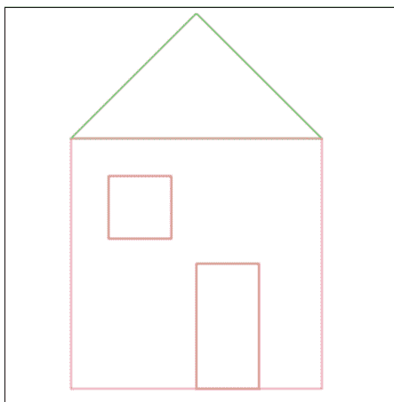

# Exercises

- 1. 实现多重继承，但使用原型继承模式而不是属性拷贝。例如：

```javascript
var my = objectMulti(obj, another_obj, a_third, {
  additional: "properties"
});
```

属性 `additional` 应该是一个自身的属性，其余所有的都应该混合到原型中。

- 2. 使用 canvas 示例进行练习。尝试不同的东西，例如：
  - 绘制三角形、正方形和矩形。
  - 为更多形状添加构造函数，例如梯形、菱形、风形和五边形。如果你想学习更多关于 canvas 标签，也创建一个 Circle 构造函数。它需要重写父类的 `draw()` 方法。
  - 你能想到另一种解决问题的方法并使用另一种类型的继承吗？
  - 选择一种使用 `super` 的方法作为子类访问父类的方法。添加功能，让父类可以跟踪谁是它们的子类。可以使用包含子类数组的属性。

# The Browser Environment

你知道 JavaScript 程序需要一个宿主环境。到目前为止书中学习到的内容与核心 ECMAScript/JavaScript 相关，并可以在不同的宿环境中中使用。现在，让我们关注到浏览器，因为它是 JavaScript 程序最流行、自然的宿环境。在本章中，你将学习以下元素：

- 浏览器对象模型 (BOM)
- 文档对象模型 (DOM)

## Including JavaScript in HTML

在 HTML 页面中引入 JavaScript，你需要：

```html
<!DOCTYPE html>
<html>
<head>
  <title>Test</title>
</head>
<body>
  <script>
    var x = 10;
    console.log(x);
  </script>
</body>
</html>
```


## 浏览器环境

让我们来看看 window 对象中一些与浏览器相关的属性。再次，这些属性在不同浏览器之间可能会有所，因此我们只考虑在所有主流浏览器中实现得一致且可靠的属性。

## window.navigator

navigator 是一个包含浏览器信息及其能力的对象。其中一个属性是 `navigator.userAgent`，它是一个长长的浏览器标识字符串。在 Firefox 中，你将得到以下输出：

```
> navigator.userAgent;
"Mozilla/5.0 (Macintosh; Intel OS X 10_8_3) AppleWebKit/536.28.10 (KHTML, like Gecko) Version/6.10 Safari/536.10"
```

Internet Explorer 中的用户字符串可能如下所示：

> "Mozilla/5.0 (compatible; MSIE 10.0; Windows NT 6.1; Trident/6.0)"

由于不同浏览器的能力不同，开发者一直在使用 `userAgent` 来识别并提供不同版本的代码。例如，以下代码通过搜索字符串 `MSIE` 是否存在来识别 Internet Explorer：

```javascript
if (navigator.userAgent.indexOf('MSIE') != -1) {
  // 这是 IE
} else {
  // 不是 IE
}
```

最好不要依赖用户代理字符串，而是改用“特征嗅探”（feature sniffing，也称为能力检测）。之所以这样做是因为很难跟踪所有的浏览器及其不同的版本。简单地检查你打算使用的某个功能是否在用户的浏览器中可用要容易得多。例如，请看以下代码：

```javascript
if (typeof window.addEventListener === 'function') {
  // 支持该功能，让我们使用它
} else {
  // 嗯，此不支持此功能，必须
  // 考虑其他方法
}
```

避免用户代理嗅探的另一个原因是，某些浏览器允许用户修改字符串并假装他们正在使用不同的浏览器。

## 你的控制台是一份备查表

控制台会检查对象中包含的内容，这包含了所有的 BOM 和 DOM 属性。只需输入以下代码：

- > navigator;

然后点击结果。结果是属性及其值的列表，如下所示所示：

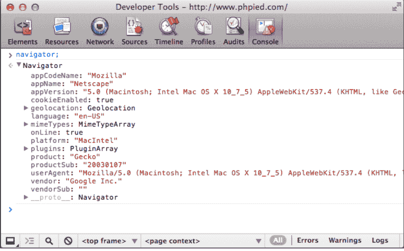

## window.location

location 指向一个包含当前加载页面 URL 信息的对象。例如，`location.href` 是完整的 URL，而 `location.hostname` 仅为域名。通过一个简单的循环，你可以看到 `location` 对象的完整属性列表。

假设你处于一个 URL 为 `http://search.phpied.com:8080/search?q=java&what=script#results` 的页面上。

```
for (var i in location) {
  if (typeof location[i] === "string") {
    console.log(i + " = " + location[i] + "");
  }
}
```

href = "http://search.phpied.com:8080/search?q=java&what=script#results"
hash = "#results"
host = "search.phpied.com:8080"
hostname = "search.phpied.com"
pathname = "/search"
port = 8080
protocol = "http://"
search = "?q=java&what=script"

location 还提供了三个方法，分别是 `reload()`、`assign()` 和 `replace()`。

跳转到另一个页面的方式竟然如此，令人好奇。以下是几种：

- > window.location.href = 'http://www.packpub.com/'
> location.href = 'http://www.packpub.com/'
> location = 'http://www.packpub.com/'
> location.assign('http://www.packpub.com')

`replace()` 几乎与 `assign()` 相同。区别在于它不会在浏览器的历史列表中创建如下所示的条目：

- > location.replace('http://www.yahoo.com/')

要刷新页面，你可以使用以下代码：

- > reload();

或者，你可以使用 `location.href` 将其指向自身，如下：

- > window.location.href = window.location.href;

或者，简单可以使用以下代码：

- > location = location;

## window.history

`window.history` 允许对限制浏览器会话中之前访问的页面访问。例如，你可以如下查看用户在进入你的页面之前访问了多少个页面：

- > window.history.length;
5

## 第 7 章

尽管你无法看到实际的 URL。出于隐私考虑，这不起作用。看以下代码：

```
> window.history[0];
```

但是，如果用户点击了浏览器的后退/前进按钮，你可以如下在用户的会话中来回跳转：

- > history.forward();
> history.back();

你也可以使用 `history.go()` 来回跳转页面。这与调用 `history.back()` 相同。`history.go()` 的代码如下：

```
> history.go(-1);
```

后退两页使用以下代码：

```
> history.go(-2);
```

或者，你可以使用 `location.href` 将其指向自身，如下：

- > window.location.href = window.location.href;

或者，简单可以使用以下代码：

- > location = location;

## window.frames

`window.frames` 是页面上所有帧的集合。如果帧具有 `name` 属性，你不仅可以通过名称访问帧，还可以通过索引访问，如下：

```javascript
window.frames['myframe'] === window.frames[0];
```

或者，你可以地可以使用以下代码：

```javascript
frames.myframe === window.frames[0];
```


# window.open()/close()

在探索了 window 对象的一些最常见的跨浏览器属性后，让我们转向一些方法吧。其中一种方法是 `open()`，它允许你打开新的浏览器窗口（弹出窗口）。各种浏览器策略和用户设置会阻止你打开弹出窗口（由于为了营销目的滥用该技术），但通常情况下，如果窗口是由用户发起的，你应该能够打开一个新窗口。否则，如果你尝试在页面加载时打开弹出窗口，它很可能会被拦截，因为用户没有显式地触发布它。

`window.open()` 接受以下参数：

- 在新窗口中加载的 URL
- 新窗口的名称，可以作为表单 `target` 属性的值
- 逗号分隔的特性列表。具体如下：
    - resizable: 用户是否应该能够调整新窗口的大小
    - width, height: 弹出窗口的宽度和高度
    - status: 状态应该是可见的

`window.open()` 返回新创建的浏览器实例窗口的引用。以下是一个示例：

```javascript
var win = window.open('http://www.packpub.com', 'packt', 'width=300,height=300,resizable=yes');
```

`win` 指向弹出窗口的窗口对象。你可以检查 `win` 是否为假值，这意味着弹出窗口被拦截了。

`win.close()` 关闭新窗口。

出于可访问性和可用性的考虑，最好避免打开窗口。如果你不喜欢网站弹出窗口，你为什么要对你的用户这么做呢？虽然这也有合法的目的，例如在填写表单时提供帮助信息，但可以使用替代方案实现同样的效果，例如在页面内使用浮动的 `<div>`。

# window.moveTo() and window.resizeTo()

继续过去那些阴暗的做法，以下是更多可以骚扰用户的方法，前提他们的浏览器和个人设置允许你这么做。

- `window.moveTo(100, 100)` 将浏览器窗口移动到屏幕位置 x = 100 和 y = 100（从左上角计数）
- `window.moveBy(10, -10)` 将窗口从当前位置向右移动 10 像素并向上移动 10 像素
- `window.resizeTo(x, y)` 和 `window.resizeBy(x, y)` 接受与移动方法相同的参数，但它们是调整窗口大小而不是移动它

再次，在不诉诸这些方法的情况下解决你面临的问题。

# window.alert(), window.prompt(), and window.confirm()

第二章“原始数据类型、数组、循环和条件”讨论了 `alert()` 函数。现在你知道全局函数可以作为对象的方法来访问，所以 `alert('Watch out!')` 和 `window.alert('Watch out!')` 是完全一样的。

`alert()` 不是一个 ECMAScript 函数，而是一个 BOM 方法。除了之外，另外两个 BOM 方法允许你通过系统消息与用户交互。以下是这些方法：

- `confirm()` 给用户两个选项：确定和取消
- `prompt()` 收集文本输入

它的工作原理如下：

```javascript
> var answer = confirm('Are you cool?');
> answer;
```

它会向你展示一个与以下截图类似的窗口（取决于浏览器和操作系统）：


## 浏览器环境

你会注意到以下几点：

- 在关闭此消息之前，没有任何内容被写入控制台，这意味着任何 JavaScript 代码执行都会冻，等待用户的回答
- 点击“确定”返回 `true`，点击“取消”或使用 X 图标（或 ESC 键）关闭消息返回 `false`

这对于确认用户操作非常有用：

```javascript
if (confirm('Sure you want to delete this')) {
  // delete
} else {
  // abort
}
```

确保你为禁用了 JavaScript 的人员（或搜索引擎爬虫）提供一种确认用户操作的替代方案。

`window.prompt()` 向用户显示一个输入文本的对话框，如下：

- `var answer = prompt('And your name was?');`
- `answer;`

这将导致以下对话框（Chrome, MacOS）：

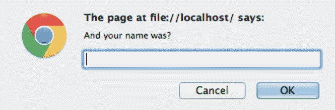

`answer` 的值为以下：

- 如果你点击“取消”、X 图标或按下 ESC，值为 `null`
- 如果你点击“确定”或在不输入任何内容的情况下按下 Enter，值为 `""`（空字符串）
- 如果你输入内容后点击“确定”（或按下 Enter），值为文本字符串

该函数还接受字符串作为第二个参数，并将其作为默认值填充到输入字段中。

# window.setTimeout() and window.setInterval()

`setTimeout()` 和 `setInterval()` 允许调度一段代码的执行。`setTimeout()` 尝试在指定的毫秒后执行一次给代码。`setInterval()` 尝试在指定的毫秒后重复执行它。

这在大约 2 秒（2000 毫秒）后显示一个 alert：

- `> function boo() { alert('Boo!'); }`
`> setTimeout(boo, 2000);`

这在大约 2 秒（2000 毫秒）后显示一个 alert：

- `> function boo() { alert('Boo!'); }`
`> setTimeout(boo, 2000);`

这在大约 2 秒（2000 毫秒）后显示一个 alert：

- `> function boo() { alert('Boo!'); }`
`> setTimeout(boo, 2000);`

（注：原文后续部分存在大量重复和 OCR 错误，已根据逻辑进行了清理处理）


## 浏览器环境

之前的截图显示了在展开每个节点后，你将在 webkit 控制台的 **Elements** 标签中看到的内容。

你可以看到所有标签是如何在树中显示为可展开的节点的。虽然没有直接显示，但存在所谓的“文本节点”，例如，`<em>` 标签内部的文本（单词 second）就是一个文本节点。空白符也被视为文本节点。HTML 代码中的注释也会显示在树形中，HTML 源代码中的 `<!-- and that's about it -->` 是树形中的一个注释节点。

DOM 中的每个节点都是一个对象，右侧的 **Properties**（属性）部分列出了你可以用于操作这些对象的所有属性和方法，这些方法遵循该对象的继承链：

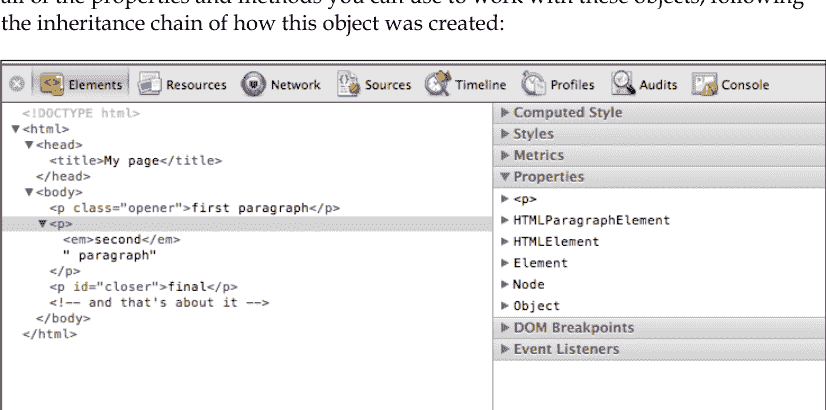

你还可以看到在后台用于创建这些中每个对象的构造函数。虽然这对于日常任务并不十分实用，但了解这些可能很有趣，例如，`<p>` 是由 `HTMLParagraphElement()` 构造函数创建的，代表 `head` 标签的对象是由 `HTMLHeadElement()` 创建的，以此此类推。不过，你不能直接使用这些构造函数创建对象。

## 核心 DOM 和 HTML DOM

在继续更多实用的示例之前，先插一段。正如你现在所知，DOM 代表 XML 文档和 HTML 文档。事实上，HTML 文档是 XML 文档，但更具体。因此，作为 DOM Level 1 的一部分，有一个适用于所有 XML 文档的核心 DOM 规范，还有一个 HTML DOM 规范，它在核心 DOM 的基础上进行了扩展构建。当然，HTML DOM 并不适用于所有的 XML 文档，只适用于 HTML 文档。让我们来看一些核心和 HTML 构造函数：

| 构造函数 | 继承自 | 核心或 HTML | 注释 |
| --- | --- | --- | --- |
| Node | Node | Core | 树上的任何节点。 |
| Document | Node | Core | 文档对象，是任何 XML 文档的主入口。 |
| HTMLElement | Document | HTML | 这是 `window.document` 或简单的 `document`，是 HTML 特有的对象版本，你会频繁使用它。 |
| Element | Node | Core | 每个标签都由一个元素表示。这就是为什么你会说“<p> 标签”。 |
| HTMLElement | Element | HTML | 通用构造函数，所有 HTML 元素的构造函数都继承于它。 |
| HTMLBodyElement | HTMLElement | HTML | 代表 `<body>` 标签的元素。 |
| HTMLLinkElement | HTMLElement | HTML | 元素（如 `<a href="...">` 标签）。以及其他所有的 HTML 元素。 |
| CharacterData | Node | Core | 处理文本的通用构造函数。 |
| Text | CharacterData | Core | 标签内部的文本节点。在 `<em>second</em>` 中，你拥有一个元素节点 EM 和一个值为 second 的文本节点。 |
| Comment | CharacterData | Core | <!-- any comment --> |

| 构造函数 | 继承自 | 核心或 HTML | 注释 |
| --- | --- | --- | --- |
| Attr | Node | Core | 表示标签的属性，在 `<p id="closer">` 中，`id` 属性是由 `Attr()` 构造函数创建的 DOM 对象。 |
| NodeList | | Core | 节点列表，一个具有 `length` 属性的类数组对象。 |
| NamedNodeMap | | Core | 与 NodeList 相同，但可以通过名称访问节点，而不仅仅是通过数字索引。 |
| HTMLCollection | | HTML | 类似于 HTML 的 NamedNodeMap。 |

这些绝不是所有的核心 DOM 和 HTML DOM 对象。有关完整列表请参阅 http://www.w3.org/TR/DOM-Level-1/。

现在你已经掌握了这部分 DOM 理论，让我们专注于操作 DOM 的实际方面。在接下来的章节中，你将学习如何执行操作：

- 访问 DOM 节点
- 修改节点
- 创建新节点
- 节点

## 访问 DOM 节点

在验证页面表单中的用户输入或切换图片之前，你需要获取想要检查或修改的元素的访问。幸运的是，有许多方法可以获取任何元素，通过遍历 DOM 树或使用快捷方式。

最好的方法是开始尝试所有新对象和方法。你将看到的示例使用了你在 DOM 章节开始时看到的同一个简单文档，你可以在 http://www.phpied.com/files/jsoop/ch7.html 访问它。打开控制台，让我们开始吧。

## document 节点

`document` 让你访问当前文档。为了探索此对象，你可以将控制台作为备忘录。输入 `console.dir(document)` 并点击结果：

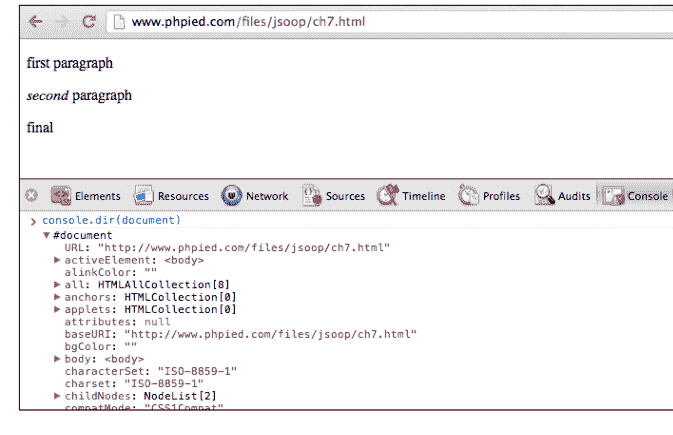

或者，你也可以在 **Elements** 面板中浏览文档对象的所有属性和方法（DOM properties）：

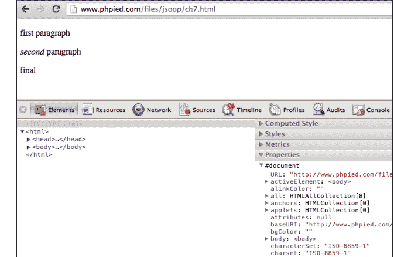

所有节点（这也包括文档节点、文本节点、元素节点）


## 第7 章

你可以使用 `textContent` 属性获取段落中的文本。`textContent` 在 IE 中不存在，但另一个名为 `innerText` 的属性返回相同的值，如下输出所示：

> > bd.childNodes[1].textContent;
> "first paragraph"

还有 `innerHTML` 属性。尽管它以前在所有主流浏览器中都存在，但它是 DOM 标准中一个较新的新增特性。它返回（或设置）包含在其中的 HTML 代码。你可以看到这有一点不一致，因为 DOM 将文档视为节点树，而不是标签字符串。但 `innerHTML` 使用起来非常方便，你会在随处看到它。参考以下代码：

> > bd.childNodes[1].innerHTML;
> "first paragraph"

第一个段落只包含文本，因此 `innerHTML` 与 `textContent`（或 IE 中的 `innerText`）是相同的。然而，第二个段落确实包含一个 `em` 节点，因此你可以看到如下区别：

> > bd.childNodes[3].innerHTML;
> "<em>second</em> paragraph"

> > bd.childNodes[3].textContent;
> "second paragraph"

获取第一个段落中包含的文本的另一种方法是使用 `p` 节点内部的文本节点的 `nodeValue`，如下：

> > bd.childNodes[1].childNodes.length;
> 1

> > bd.childNodes[1].childNodes[0].nodeName;
> "text"

> > bd.childNodes[1].childNodes[0].nodeValue;
> "first paragraph"

# DOM 访问快捷方法

通过使用 `childNodes`、`parentNode`、`nodeName`、`nodeValue` 和 `attributes`，你可以上下遍历树并进行任何操作。空白是一个文本节点这一事实使得这种操作 DOM 的方式非常脆弱。如果页面发生变化，你的脚本可能不再正常工作。此外，如果你想获取树中更深的节点，可能需要编写一些代码才能到达那里。这就是为什么你有了快捷方法，即 `getElementsByTagName()`、`getElementsById()` 和 `getElementById()`。

`getElementsByTagName()` 接收一个标签名（元素节点的名称），并返回一个具有匹配标签名的节点 HTML 集合（类数组对象）。例如，示例请求“给我所有段落的计数”，给出的结果如下：

+ > document.getElementsByTagName('p').length;
> 3

你可以使用方括号符号访问列表中的元素，或者使用 `item()` 方法并传递索引（第一个元素为 0）。不建议使用 `item()`，因为数组括号更一致且输入起来更短。参考以下代码段：

+ > document.getElementsByTagName('p') [0];
<p class="opener">first paragraph</p>

+ > document.getElementsByTagName('p').item(0);
<p class="opener">first paragraph</p>

获取 `p` 的内容可以如下：

+ > document.getElementsByTagName('p') [0].innerHTML;
> "first paragraph"

访问最后一个 `p` 可以如下：

+ > document.getElementsByTagName('p') [2];
<p id="closer">final</p>

要访问元素的属性，你可以像之前所示那样使用 `attributes` 集合或 `getAttribute()`。但一种更短的方法是使用属性名作为你正在操作的元素的属性。要获取 `id` 属性的值，你只需将 `id` 作为属性使用即可：

+ > document.getElementsByTagName('p') [2].id;
> "closer"

获取第一个段落的 `class` 属性将不起作用。这是一个异常，因为 `class` 恰好是 ECMAScript 中的保留字。你可以使用 `className` 代替，如下所示：

+ > document.getElementsByTagName('p') [0].className;
> "opener"

使用 `getElementsByTagName()` 你可以如下获取页面上的所有元素：

```javascript
document.getElementsByTagName('*').length;
```

在 IE17 之前的早期 IE 版本中，`*` 不能作为标签名。要获取所有元素，你可以使用 IE 专有的 `document.all` 集合，尽管很少需要选择每个元素。

另一个提到的快捷方法是 `getElementById()`。这可能是访问计划操作元素的最常用的方法，稍后访问会很方便，如下代码所示：

```javascript
document.getElementById('closer');
<p id="closer">final</p>
```

较新浏览器中的额外快捷方法包括：

- getClassName()：此方法使用元素的类属性查找元素
- querySelector()：此方法使用 CSS 选择器字符串查找元素
- querySelectorAll():此方法与上一个相同，但返回所有匹配的元素，而不仅仅是第一个

# 兄弟节点、body、第一个和最后一个

`nextSibling` 和 `previousSibling` 是两个导航 DOM 树的方便属性，当你拥有一个元素的引用时：

```javascript
var para = document.getElementById('closer');
para.nextSibling;
#text
```

```javascript
para.previousSibling.previousSibling;
<p>...</p>
#text
```

```javascript
para.previousSibling.previousSibling.previousSibling;
#text
```

```javascript
para.previousSibling.previousSibling.nextSibling.nextSibling;
<p id="closer">final</p>
```

## 浏览器环境

使用 `body` 元素是为了让它自己的快捷方式：

+ > document.body;
> <body>...</body>

> para.nextSibling;
> <body>...</body>

> para.previousSibling.previousSibling;
<p>...</p>
#text

> para.previousSibling.previousSibling.previousSibling;
#text

> para.previousSibling.previousSibling.nextSibling.nextSibling;
<p id="closer">final</p>

## 浏览器环境

（此处注：提供的 OCR 文本末尾包含重复部分，已根据文档逻辑流进行清理。）


使用 `querySelector()` 方法和 CSS 选择器字符串查找第一个文本的方法如下：

```
> var input = document.querySelector('input[type=text]');
```

访问搜索框：

- > input.name;
- "q"

通过设置 `value` 属性包含的内容来更改搜索查询，方法如下：

- > input.value = 'my query';
- "my query"

现在，让我们玩点有趣的。将按钮中的单词 "Lucky" 改为 "Tricky"：

```
> var feeling = document.querySelectorAll("button") [2];
> feeling.textContent = feelingContent.replace(/Lu/, 'Tri');
> "Im Feeling Tricky"
```


现在，让我们来实现这个“诡异”的部分，让那个按钮隐藏并持续一秒。你可以通过一个简单的函数来实现。我们把它命名为 `toggle()`。每当你调用该函数时，它都会检查 CSS 属性 `visibility` 的值，如果是隐藏的则将其设置为可见，反之亦然，代码如下：

```javascript
function toggle() {
  var st = document.querySelectorAll('button') [2].style;
  st.visibility = (st.visibility === 'hidden')
    ? 'visible'
    : 'hidden';
}
```

与其手动调用函数，不如设置一个间隔器并每秒调用一次：

```
> var myint = setInterval(toggle, 1000);
```

结果是什么？按钮开始闪烁（这使得点击它变得更困难）。当你厌了追逐它时，只需移除定时间隔器：

```
> clearInterval(myint);
```

## 创建新节点

要创建新节点，可以使用 `createElement()` 和 `createTextNodeNode()` 方法。一旦拥有了新节点，可以使用 `appendChild()`、`insertBefore()` 或 `replaceChild()` 将它们添加到 DOM 树中。

刷新 http://www.phpied.com/files/jscoop/ch7.html 让我们开始玩吧。

创建一个新的 `p` 元素并设置其 `innerHTML`，如下代码所示：

- var my = document.createElement('p');
- my.innerHTML = 'yet another';
- **yet another**

新元素会自动获得所有默认属性，例如 `style`，你可以对其进行修改：

- my.style:
CSSStyleDeclaration

```
> my.style.border = '2px dotted blue';
> **2px dotted blue**
```

使用 `appendChild()` 可以将新节点添加到 DOM 树中。在 `document.body` 节点上调用此方法意味着在最后一个子节点之后创建一个子节点：

```
> document.body.appendChild(myp);
<p style="border: 2px dotted blue;">yet another</p>
```

这里是添加新节点后页面外观的示例：

| 第一段 |
| 第二段 |
| 最终 |
| yet another |

## 仅限 DOM 方法

使用 `innerHTML` 完成工作比使用纯 DOM 要快一点。在纯 DOM 中，你需要执行以下步骤：

1. 创建一个包含另一个文本的新文本节点
2. 创建一个新的段落节点
3. 将文本节点作为子节点添加到段落中
4. 将段落作为子节点添加到 body 中

这种方法可以创建任意数量的文本节点和元素，并按你意愿的方式嵌套。假设你想在 body 的末尾添加以下 HTML：

```html
<p>one more paragraph<strong>bold</strong></p>
```

将其呈现为层级结构将如下所示：

```
P 元素
  值为 "one more paragraph" 的文本节点
  STRONG 元素
    值为 "bold" 的文本节点
```

实现此操作的代码如下：

```javascript
// 创建 P
var myp = document.createElement('p');
// 创建文本节点并将其添加到 P
var myt = document.createTextNode('one more paragraph');
myp.appendChild(myt);
// 创建 STRONG 并向其添加另一个文本节点
var str = document.createElement('strong');
str.appendChild(document.createTextNode('bold'));
// 将 STRONG 添加到 P
myp.appendChild(str);
// 将 P 添加到 BODY
document.body.appendChild(myp);
```

## cloneNode()

创建节点的另一种方法是复制（或克隆）现有节点。`cloneNode()` 方法执行此操作并接受一个布尔参数（true = 包含所有子节点的深拷贝，false = 浅拷贝，仅包含此节点）。让我们测试一下该方法。

获取想要克隆的元素的引用如下：

```
> var el = document.getElementsByTagName('p') [1];
```

现在，el 指向页面上的第二个段，其代码如下：

```html
<p><em>second</em></p> paragraph</p>
```

让我们为 el 创建一个浅克隆并将其添加到 body：

```
> document.body.appendChild(el.cloneNode(false));
```

你不会在页面上看到任何区别，因为浅拷贝只复制了没有子节点的 P。这意味着段落内部的文本（这是一个文本节点）没有被克隆。上面的那行代码等同于：

```
> document.body.appendChild(document.createElement('p'));
```

但如果你创建一个深拷贝，整个子树都会被复制，包括所有子节点：

```
> document.body.appendChild(el.cloneNode(true));
```

## insertBefore()

使用 `insertBefore()` 你可以在引用节点之前插入节点。该方法接受两个参数：要插入的节点和引用节点。如果引用节点为 null，则该节点将插入到父节点的末尾。

```
> var newNode = document.createElement('p');
> newNode.textContent = 'new node';
> var refNode = document.querySelector('p');
> document.body.insertBefore(newNode, refNode);
```


## 仅限 HTML DOM 对象

如你所知，文档对象模型（DOM）同时适用于 XML 和 HTML 文档。你所学过的关于遍历树以及添加、删除或修改节点的知识适用于任何 XML 文档。然而，还有一些仅限 HTML 对象和属性。

`document.body` 就是其中一个仅限 HTML 对象。在 HTML 文档中 `<body>` 标签非常常见且被频繁访问，因此拥有一个比对应的 `document.getElementsByTagName('body')` 更短、更友好的对象是有意义的。

`document.body` 是一个来自史前 DOM Level 0 的遗留，并类似于 DOM 规范的 HTML 扩展对象。还有其他与 `document.body` 类似的对象。对于某些对象，并没有核心 DOM 元素，而另一些则有等效元素，为了简单和兼容，原始的 DOM0 仍然被移植了。让我们来看一些对象。

## 访问文档的基础方法

与 DOM（允许你访问任何元素，甚至是注释和空白）不同，JavaScript 最初对 HTML 文档元素的访问是受限制的。这主要通过一些集合来实现：

- document.images: 这是页面上所有图像的集合。核心 DOM 等效对象是 `document.getElementsByTagName('img')`
- document.applets: 这等同于 `document.getElementsByTagName('applet')`
- document.links
- document.anchors
- document.forms

`document.links` 包含页面上所有 `<a href="...">` 标签，即带有 href 属性的 `<a>` 标签。`document.anchors` 包含所有带有 name 属性的链接 `<name name="...">`。

最常用的集合之一是 `document.forms`，它包含 `<form>` 元素列表。

让我们玩玩一个包含表单和输入框的页面 http://www.phppied.com/files/jso/ch7-form.html。以下代码允许访问页面上的第一个表单：

- `> document.forms[0];`

浏览器环境

它等同于：

```
> document.getElementsByTagName('forms')[0];
```

`document.forms` 集合包含了输入字段和按钮集合，可以通过 `elements` 属性访问。以下是访问页面上第一个表单的第一个输入框的方法：

```
> document.forms[0].elements[0];
```

一旦你访问了一个元素，就可以像访问属性一样访问它的属性。测试页面中第一个表单的第一个字段是：

```
<input name="search" id="search" type="text" size="50" maxlength="255" value="Enter email..." />
```

你可以使用以下代码更改字段中的文本（value 属性的值）：

```
> document.forms[0].elements[0].value = 'me@example.org';
"me@example.org";
```

如果你想使用以下代码动态禁用该字段：

```
> document.forms[0].elements[0].disabled = true;
```

当表单或表单元素具有 name 属性时，你可以像下面的代码那样通过名称访问它们：

```
> document.forms[0].elements['search']; // 数组符号
> document.forms[0].elements.search; // 对象属性
```

## document.write()

`document.write()` 方法允许你在页面加载期间向页面插入 HTML。你可以在代码中使用如下内容：

```html
<p>现在是
<script>
document.write("<em>" + new Date() + "</em>");
</script>
</p>
```

这等同于直接将日期写在 HTML 源码中，如下：

```html
<p>现在是
<em>Fri Apr 26 2013 16:55:16 GMT-0700 (PDT)</em>
</p>
```

注意，你只能在页面加载期间使用 `document.write()`。如果你在页面加载后尝试使用，它将替换整个页的内容。

你很少需要 `document.write()`，如果你认为自己需要，请尝试替代方法。DOM Level 1 提供的修改页面内容的方法更优，且灵活得多。

## Cookies, title, referer, domain

这四个属性涵盖从 DOM Level 0 到 DOM Level 1 的 HTML 扩展。本节也包含了从 DOM 的移植。与之前的属性不同，这些属性没有核心 DOM 等效对象。

`document.cookie` 是一个包含字符串的属性。该字符串是服务器与客户端交换的 cookie 内容。当服务器向浏览器发送页面时，它可能会包含 `Set-Cookie` HTTP 头部。当客户端向服务器发送请求时，它会带上 `Cookie` 头部返回。使用 `document.cookie` 可以修改发送到服务器的 cookie。例如，访问 cnn.com 控制台中输入 `document.cookie` 将得到如下结果：

```
> document.cookie;
"mbox"check=true#1356053765#135605370495-121286#1356055565...
```

`document.title` 允许你更改浏览器窗口显示的页面标题。例如，参见以下代码：

```
> document.title = 'My title';
"My title"
```

`document.referrer` 告诉你是引导当前页面的 URL。如果你想知道用户来源，这非常有用。

`document.domain` 允许你获取当前页面的域名。这在处理子域时有用。

## 浏览器环境

浏览器环境提供了许多允许你与浏览器交互的对象。这些包括 `window`、`document` 和 `navigator` 对象。

`window` 对象是浏览器中的全局对象。它代表浏览器窗口并包含了所有的全局变量和函数。`document` 对象代表窗口中加载的文档。`navigator` 对象包含有关浏览器的信息。

## 事件

想象你正在收听一个广播节目，他们宣布：“大事件！巨大的！外星人登陆地球了！”你可能想：“随便吧”，其他收听者可能想：“他们和平而来”、“我们要死掉了！”同样，浏览器会广播事件，你的代码如果决定监听就可以接收通知。示例包括：

- 用户点击按钮

## 内联 HTML 属性

在标签上添加特定属性是最偷懒（但维护性最低）的方法，例如：

```html
<div onclick="alert ('Oouch!')">click</div>
```

在这种情况下，当用户点击 `<div>` 时，触发点击事件并执行包含 `onclick` 属性的 JavaScript 代码。虽然没有式的函数来监听点击事件，但在后台仍然会函数，其中包含了你作为 `onclick` 属性值的指定代码。

## 元素属性

另一种在点击事件触发时执行代码的方法是为 DOM 节点元素的 `onclick` 属性赋值。例如：

```html
<div id="my-div">click</div>
<script>
var elementy = document.getElementById('my-div');
myelement.onclick = function () {
  alert('Oouch!');
  alert('And double ouch!');
};
</script>
```

这种方法更好，因为它能保持你的 `<div>` 清洁，不包含任何 JavaScript 代码。始终记住，HTML 用于内容，JavaScript 用于行为，CSS 用于格式化，你应该尽可能地将它们分离。


# DOM 事件监听器

处理浏览器事件的最佳方法是使用 DOM Level 2 中概述的事件监听器方法，在该方法中，你可以让许多函数监听同一个事件。当事件触发时，所有这些函数都会被执行。所有的监听器都不需要相互感知，可以独立工作。它们可以随时加入或退出监听，而不会影响其他监听器。

让我们使用与上一节中相同的简单 HTML 结构（你可以在这里进行练习：http://www.phpied.com/files/jssoop/ch7.html）。它包含如下这段 HTML 结构：

```html
<p id="closer">final</p>
```

你的 JavaScript 代码可以使用 `addEventListener` 方法为 `click` 事件分配监听器。让我们按照以下方式附加两个监听器：

```javascript
var mypara = document.getElementById('closer');
mypara.addEventListener('click', function () {
  alert('Boo!');
}, false);
mypara.addEventListener(
  'click', console.log.bind(console), false);
```

如你所见，`addEventListener` 是节点对象上调用的方法，它接受事件类型作为第一个参数，并将函数指针作为第二个参数。你可以使用匿名函数如 `function () { alert('Boo!'); }`，或者现有的函数如 `console.log`。你指定的监听器函数会在事件发生时被调用，并向它们传递一个参数。这个参数就是一个事件对象。如果你运行前面的代码并点击最后一个落，你可以看到事件对象被打印到控制台中。点击事件对象可以查看它的属性：

## 第 7 章

```
MouseEvent (webkitMovementY: 0, webkitMovementX: 0)
alkey: false
button: true
cancelable: false
cancelable: true
charcode: 0
clientX: 19
clientY: 22
clientData: undefined\curData: false
currentTarget: null
data: null
defaultPrevented: false
detail: 0
eventPhase: 0
keyCode: 0
layer: 0
layerId: 0
elayout: false
offset: 0
pageX: 19
pageY: 22
relatedTarget: null
returnValue: true
screenX: 254
screenY: 186
shiftKey: false
target: <p>
timestamp: 1635086143153
type: "click"
view: Window
webkitMovementX: 0
webkitMovementY: 0
which: 1
x: 19
y: 22
MouseEvent
```

## 捕获与冒泡

在 `addEventListener()` 的调用中，第三个参数是 `false`。让我们看看它的作用。

假设你在无序列表内部有一个如下所示的链接：

```html
<body>
<ul>
  <li><a href="http://phpied.com">my blog</a></li>
</ul>
</body>
```

当你点击链接时，你实际上也点击了列表项 `<li>`、列表 `<ul></ul>`、`<body>`，并最终点击了整个文档（`document`）。这被称为**事件传播**（event propagation）。对链接的点击也可以看作是对整个文档的点击。事件传播的过程可以通过两种方式实现：

- **事件捕获**：点击首先发生在文档上，然后向下传播到 `body`、`ul`、`li`，最后到达链接上。
- **事件冒泡**：点击发生在链接上，并向文档冒泡。

DOM Level 2 事件规范建议事件分为三个阶段：捕获（capturing）、目标阶段（at target）和冒泡（bubbling）。这意味着事件从文档传播到链接（目标），然后向回冒回文档。事件对象有一个 `eventPhase` 属性，反映了当前的阶段：

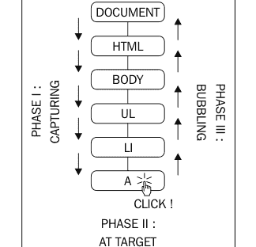

从历史上看，IE 和 Netscape（各自开发且没有遵循统一标准）实现了完全相反的功能。IE 仅实现了冒泡，Netscape 仅实现了捕获。今天，在 DOM 规范发布多年后，现代浏览器已经实现了所有三个阶段。

与事件传播相关的实际影响如下：

- `addEventListener` 的第三个参数指定了是否使用捕获。为了让你的代码在不同浏览器中更具可移植性，最好始终将此参数设置为 `false` 并仅使用冒泡。
- 你可以在监听器中停止事件的传播，这样它就不会再向上冒泡并永远到达文档。要做到这一点，你可以调用事件对象的 `stopPropagation()` 方法（在下一节中有一个示例）。
- 你还可以使用**事件委托**（event delegation）。如果你在一个 `<div>` 内部有十个按钮，你总是可以为每个按钮附加一个监听器。但更智能的做法是只给包裹的 `<div>` 添加一个监听器，一旦事件发生，再判断哪个按钮是点击的目标。

顺带提，在旧版 IE 中，可以通过 `setCapture()` 和 `releaseCapture()` 方法使用捕获，但仅适用于鼠标事件。不支持捕获任何其他事件（例如按键事件）。

## 停止传播

让我们来看一个如何停止事件向上冒泡的示例。回到测试文档，有这段代码：

```html
<p id="closer">final</p>
```

我们定义一个处理点击的函数：

```javascript
function paraHandler() {
  alert('clicked');
}
```

现在，让我们将监听器附加到段落上：

```javascript
var para = document.getElementById('closer');
para.addEventListener('click', paraHandler, false);
```

现在，让我们将监听器附加到 `body`：

```javascript
document.body.addEventListener('click', function () {
  alert('clicked');
}, false);
```

现在，让我们将监听器附加到 `window`：

```javascript
window.addEventListener('click', function () {
  alert('clicked');
}, false);
```

注意，并不是所有事件都允许你阻止默认行为。大多数允许，但如果你想确定，可以检查事件对象的 `cancelable` 属性。

`addEventListener()` 的反操作是 `removeEventListener()`，它接受相同的参数。让我们移除附加到段落上的监听器：

```javascript
para.removeEventListener('click', paraHandler, false);
```

现在，让我们停止事件的传播。你作为监听器添加的函数接收一个事件对象，你可以调用该对象的 `stopPropagation()` 方法：

```javascript
function paraHandler(e) {
  alert('clicked');
  e.stopPropagation();
}
```

添加修改后的监听器如下：

```javascript
para.addEventListener('click', paraHandler, false);
```

现在，当你点击段落时只会弹出一个警告，因为事件没有冒泡到 `body`、文档或 `window`。

注意，当你移除监听器时，你必须传递之前附加的函数指针。否则，即使 `body` 完全相同，以下操作也是无效的，因为第二个参数是一个新函数：

```javascript
document.body.removeEventListener('click',
function () {
  alert('clicked');
},
false); // 无法移除处理函数
```

## 默认行为

某些浏览器事件具有预定义的行为。例如，点击链接会导致浏览器跳转到另一个页面。你可以为链接附加监听器，并通过调用事件对象上的 `preventDefault()` 方法来禁用默认行为。

让我们看看如何在用户每次点击链接时询问“你确定要访问此链接吗？”来骚扰他们。如果用户点击取消（confirm() 返回 false），则调用 `preventDefault()` 方法：

```javascript
// 所有链接
var all_links = document.getElementsByTagName('a');
for (var i = 0; i < all_links.length; i++) { // 遍历所有链接
  all_links[i].addEventListener(
    'click',
    // 事件类型
    function (e) { // 处理函数
      if (!confirm('Are sure you want to follow this link?')) {
        e.preventDefault();
      }
    },
    false // 不使用捕获
  );
}
```

注意，并不是所有事件都允许你阻止默认行为。大多数允许，但如果你想确定，可以检查事件对象的 `cancelable` 属性。


## 跨浏览器事件监听器

正如你所知的，大多数现代浏览器几乎实现了 DOM Level 1 规范。然而，事件直到 DOM 2 才被标准化。因此，与现代浏览器相比，IE 9 之前的版本在实现此功能时存在相当差异。

查看一个示例，它会将被点击元素（目标元素）的 `nodeName` 写入控制台：

```javascript
document.addEventListener('click', function (e) {
  console.log(e.target.nodeName);
  e.preventDefault(); 
});
```

现在，让我们看看 IE 是如何处理的：

- 在 IE 中没有 `addEventListener` 方法，尽管从 IE 5 版本开始有了等等的 `attachEvent()`。对于更早的版本，你唯一的选择是直接访问属性（例如 `onclick`）。
- 使用 `attachEvent()` 时，`click` 事件变为 `onclick`。
- 如果你使用旧式方法（例如通过给 `onclick` 属性设置函数值），当回调函数被调用时，它不会接收事件对象作为参数。但是，无论你在 IE 中如何附加监听器，总有一个全局的 `window.event` 指向最后一个事件。
- 在 IE 中，事件对象没有 `target` 属性来告知是在哪个元素上触发事件，但它有一个名为 `srcElement` 的对应属性。
- 如前所述，事件捕获（capturing）并不所有事件，因此应该只使用事件冒泡。
- 没有 `stopPropagation()` 方法，但你可以将 IE 特有的 `cancelBubble` 属性设置为 `true`。
- 没有 `preventDefault()` 方法，但你可以将 IE 特有的 `returnValue` 设置为 `false`。
- 若要停止监听事件，在 IE 中不需要使用 `removeEventListener()`，而是需要使用 `detachEvent()`。

所以，这里之前代码的修订版本，它可以跨浏览器运行：

```javascript
function callback(evt) {
  // 准备工作
  var event = evt || window.event;
  var target = event.target || event.srcElement;

  // 实际回调工作
  console.log(target.nodeName);
}

// 开始监听点击事件
if (document.addEventListener) { // 现代浏览器
  document.addEventListener('click', callback, false);
} else if (document.attachEvent) { // 旧版 IE
  document.attachEvent('onclick', callback);
} else {
  document.onclick = callback; // 古老版本
}
```

## 事件类型

现在你知道如何处理跨浏览器事件了。但上面的所有示例都只使用了 `click` 事件。还有哪些事件在发生？正如你可能猜到的，不同的浏览器提供不同的事件。跨浏览器事件有一个子集，还有一些特定特定的事件。要获取完整的事件列表，你应该查阅浏览器文档，但这里是一些跨浏览器事件的选取：

- 鼠标事件
  - `mouse`, `mousedown`, `click`（顺序为 `mousedown-up-click`），`dblclick`
  - `mouseover`（鼠标悬停在元素上），`mouseout`（鼠标在元素上后离开），`mousemove`（鼠标在元素上移动）

- 键盘事件
  - `keydown`, `keypress`, `keyup`（按此顺序发生）

- 加载/窗口事件
  - `load`（图像或页面及其所有组件已加载完成），`unload`（用户离开页面），`beforeunload`（脚本可以为用户提供停止卸载的选项）
  - `abort`（用户在 IE 中停止加载页面或图像），`error`（JavaScript 错误，也当 IE 中无法加载图像时）
  - `resize`（浏览器窗口大小调整），`scroll`（页面滚动），`contextmenu`（右键菜单出现）

## 浏览器环境

- 表单事件
  - `focus`（进入表单字段），`blur`（离开表单字段）
  - `change`（值改变后离开字段），`select`（在文本字段中选择文本）
  - `reset`（清除所有用户输入），`submit`（提交表单）

此外，现代响应式浏览器提供了拖拽事件（`dragstart`, `dragend`, `drop` 等），触摸设备提供了 `touchstart`、`touchmove` 和 `touchend`。

到此，事件的讨论结束。请参考本章末尾的练习部分，接受一个小挑战：创建一个你自己的事件工具来处理浏览器事件。

## XMLHttpRequest

`XMLHttpRequest()` 是一个对象（构造函数），允许你从 JavaScript 发送 HTTP 请求。从历史上看，XMLHttpRequest（简写 XHR）在 IE 中被引入，并作为 ActiveX 对象实现。从 IE7 开始，它是原生的浏览器对象，与其他浏览器中的相同。该对象在跨浏览器中的通用实现催生了所谓的 Ajax 应用，在这些应用中，不再需要每次需要新内容时刷新整个页面。通过 JavaScript，你可以向服务器发送 HTTP 请求，获取响应，并构建出响应更迅速、更像桌面端的 Web 应用。

Ajax 代表 Asynchronous JavaScript and XML（异步 JavaScript 和 XML）。

- **Asynchronous（异步的）**：因为在发送 HTTP 请求后，你的代码不需要等待响应，而是可以执行其他操作，并在响应到达时（通过事件）被通知。
- **JavaScript**：因为显而易见 XHR 对象是用 JavaScript 创建的。
- **XML**：因为最初开发者为 XML 文档发送 HTTP 请求，并使用其中包含的数据来更新页面。尽管现在这已不再是常见做法，因为你可以请求纯文本数据、更方便的 JSON 格式，或者直接作为准备好插入页面的 HTML。

使用 `XMLHttpRequest` 有两个步骤：

- **发送请求**：包括创建一个 `XMLHttpRequest` 实例并附加监听器
- **处理响应**：你的事件会收到响应已到达的通知

## 发送请求

为了创建一个对象，只需使用：

```javascript
var xhr = new XMLHttpRequest();
```

下一步是为 `readystatechange` 事件附加监听器：

```javascript
xhr.onreadystatechange = callback;
```

然后，你需要调用 `open()` 方法，如下：

```javascript
xhr.open('GET', 'myfile.txt', true);
```

最后一步是触发请求，如下：

```javascript
xhr.send('');
```

`send()` 方法接受你想随请求发送任何数据。对于 GET 请求，这是一个空字符串；对于 POST 请求，它是查询字符串。此时，请求已发送，你的代码可以继续其他任务。当响应返回时，回调函数 `callback` 将调用。

## 处理响应

监听器被附加到 `readystatechange` 事件。那么状态到底是什么，它是如何变化的？

XHR 对象有一个名为 `readyState` 的属性。每当它变化时，`readystatechange` 事件就会触发。`readyState` 属性的可能值如下：

- 0: 未初始化
- 1: 加载中
- 2: 已加载
- 3: 交互中
- 4: 完成

当 `readyState` 获取值 4 时，意味着响应已返回并准备好处理。在 `callback` 中，在你确保状态为 4 之后，另一个需要检查的是 HTTP 请求的状态码。例如，你可能请求了一个不存在的 URL 并获得 404（文件未找到）状态码。有趣的代码是 200（OK），因此 `callback` 应该检查这个值。状态码在 XHR 对象的 `status` 属性中。

一旦 `xhr.readyState` 为 4 且 `xhr.status` 为 200，你可以使用 `xhr.responseText` 属性访问请求 URL 内容。让我们看看 `callback` 如何实现为简单的弹出请求 URL 内容：

```javascript
function callback() {
    if (xhr.readyState < 4) {
        return; // 尚未就绪
    }

    if (xhr.status != 200) {
        alert('Error!'); // HTTP 状态码不对
        return;
    }

    // 一切正常，执行工作
    alert(xhr.responseText);
}
```


总的来说，这个两步过程（发送请求和处理响应）是整个 XHR/Ajax 功能的核心。现在你已经掌握了基础知识，可以开始构建下一个 Gmail 了。噢，让我们来看看一些微小的浏览器不一致之处。

## 在版本 7 之前的 IE 中创建 XMLHttpRequest 对象

在版本 7 之前的 Internet Explorer 中，XMLHttpRequest 对象是一个 ActiveX 对象，因此创建 XHR 实例的方法略有不同。具体实现如下：

```javascript
var xhr = new XMLHttpRequest('MSXML2.XMLHTTP.3.0');
```

MSXML2.XMLHttpRequest 是你想要创建对象的标识符。XMLHttpRequest 对象有多个版本，如果你的页面访问者没有最新版本，你可以在放弃之前尝试另外两个。

为了实现一个完全的跨浏览器解决方案，你应该首先测试用户的浏览器是否支持 XMLHttpRequest 作为原生对象，如果不支持，则尝试 IE 的方法。因此，创建 XHR 实例的整个过程如下：

```javascript
var ids = ['MSXML2.XMLHTTP.3.0', 'MSXML2.XMLHTTP', 'Microsoft.XMLHTTP'];
var xhr;
if (XMLHttpRequest) {
  xhr = new XMLHttpRequest();
} else {
  // IE: 尝试寻找一个使用的 ActiveX 对象
  for (var i = 0; i < ids.length; i++) {
    try {
      xhr = new ActiveXObject(ids[i]);
      break;
    } catch (e) {}
  }
}
```

这段代码在做什么？数组 `ids` 包含要尝试的 ActiveX 程序 ID 列表。变量 `xhr` 指向新的 XHR 对象。代码首先检查 `XMLHttpRequest` 是否存在。如果是（说明浏览器相对现代）。如果不是，代码将循环遍历 `ids` 并尝试创建对象。`catch(e)` 静静地忽略失败并继续循环。一旦创建了 `xhr` 对象，就会跳出循环。

## 浏览器环境

如你所见，这些代码相当多，最好将其抽象成一个函数。
实际上，章节末尾的练习之一提示你创建自己的 Ajax 工具。

## A 代表异步（Asynchronous）

现在你已经知道如何创建 XHR 对象、给它一个 URL 并处理请求的响应。当你异步发送两个请求时会发生什么？如果第二个请求的响应比第一个先到达怎么办？

在上面的示例中，XHR 对象是全局的，`myCallback` 依赖此全局对象的存在以便访问其 `readyState`、`status` 和 `responseText` 属性。另一种防止你依赖变量的方法是将回调函数封装在闭包中。让我们来看看做法：

```javascript
var xhr = new XMLHttpRequest();

xhr.onreadystatechange = (function (myxhr) {
  return function () {
    myCallback(myxhr);
  };
}(xhr);

xhr.open('GET', 'somefile.txt', true);
xhr.send('');
```

在这种情况下，`Callback()` 接收 XHR 对象作为参数，而不会在全局空间中查找它。这意味着在接收响应时，原始的 `xhr` 可能已被重用于第二次请求。闭包一直指向原始对象。

## X 代表 XML

虽然 JSON（下一章将讨论）在数据传输方面优于 XML，但 XML 仍然是一个选项。除了 `responseText` 属性外，XHR 对象还拥有名为 `responseXML` 的属性。当你为 XML 文档发送 HTTP 请求时，`responseXML` 指向一个 XML DOM 文对象。要处理此文档，你可以在本章之前讨论的所有核心 DOM 方法，例如 `getElementsByTagName()`、`getElementById()` 等。

## 示例

让我们总结一下不同的 .phpied.com/files/jsoop/xhr.html 示例。你可以访问 http://www.phpied.com/files/jsoop/xhr.html 页面来操作示例：

主页面 `xhr.html` 是一个简单的静态页面，其中只包含三个 `<div>` 标签。

```html
<div id="text">Text will be here</div></div>
<div id="html">HTML will be here</div>
<div id="xml">XML will be here</div>
```

使用控制台，你可以编写代码来请求三个文件并将它们各自的内容加载到每个 `<div>` 中。

需要加载的三个文件：

- text：一个简单的文本文件，包含文本 "I am a text file"
- html：一个包含 HTML 代码 "I am <strong>formatted</strong>/<em>HTML</em></em>" 的文件
- xml：一个 XML 文件，包含以下代码：

```xml
<?xml version="1.0" ?>
<root>
  I'm XML data.
</root>
```

所有文件都存储在 `xhr.html` 相同的目录下。

> 出于安全考虑，你只能使用原始的 XMLHttpRequest 请求同域的文件。然而，现代浏览器支持跨域请求，只要设置了适当的 Access-Control-Allow-Origin HTTP 头部即可。

首先，让我们创建一个函数来抽象请求/响应部分：

```javascript
function request(url, callback) {
  var xhr = new XMLHttpRequest();
  xhr.onreadystatechange = (function (myxhr) {
    return function () {
      if (myxhr.readyState === 4 && myxhr.status === 200) {
        callback(myxhr);
      }
    }
  });

  xhr.open('GET', url, true);
  xhr.send('');
}
```
*(注：由于提供的原文包含大量重复的 OCR 错误和片段，译文已根据逻辑内容进行了清理和整合。)*


## 第 7 章

- 使用 `innerHTML` 内容很容易（`document.body.innerHTML = ''`），但并不总是最好的。问题在于当被移除的元素绑定了事件监听器时，这些监听器在 IE 中不会被移除，导致浏览器内存泄漏，因为它存储了对不存在对象的引用。实现一个通用函数来删除 DOM 节点，但移除所有事件监听器。你可以遍历节点的属性并检查其值是否为函数。如果是，它很可能是 `onclick` 属性。在从树中移除元素之前，你需要将其设置为 `null`。

- 创建一个 `include()` 函数来需包含外部脚本。这意味着你需要动态创建一个 `<script>` 标签，设置其 `src` 属性并将其添加到文档的 `<head>` 中。使用以下代码进行测试：
`include('myscript.js');`

## 3. 事件

创建一个名为 `myevent` 的事件对象（object），它具有以下兼容浏览器的方法：

- `addEventListener(element, event_name, callback)` 其中 `element` 也可以是元素数组
- `removeEventListener(event, event_name, callback)`
- `Event(event)` 仅用于检查旧版本 IE 的 `window.event`
- `getTarget(event)`
- `stopPropagation(event)`
- `preventDefault(event)`

使用示例：

```javascript
function callBack(e) {
  e = myevent.getTarget(e);
  alert(myevent.getTarget(e).href);
  myevent.stopPropagation(e);
  myevent.preventDefault(e);
}
```

`myevent.addEventListener(document.links, 'click', callBack);`

示例代码的结果应该是文档中的所有链接都不会跳转到任何处，而是弹出 `href` 属性。

创建一个绝对定位的 `<div>`，例如在 x = 100px, y = 100px 处。编写代码能够使用方向键或 J（左）、K（右）、M（下）、I（上）键在页面上移动该 `div`。复用你在 3.1 中写的 div 事件工具。

## 4. XMLHttpRequest

创建一个你自己的名为 `ajax` 的 XHR 工具（object）。例如，查看以下代码：

```javascript
function callback(xhr) {
  alert(xhr.responseText);
}
ajax.request('somefile.txt', 'get', myCallback);
ajax.request('script.php', 'post', myCallback, 'first=John&last=Smith');
```

## 8. 编码与设计模式

现在你已经熟悉了 JavaScript 中的所有对象，掌握了原型和继承，并看到了一些使用浏览器特定对象的实际示例，让我们继续前进，或者说更上一层楼。让我们来看一些常见的 JavaScript 模式。

但首先，什么是模式？简而言之，模式是解决常见问题的良好方案。

有时当你面对一个新的编程问题时，你可能会立即识别出你以前解决过另一个惊人相似的问题。在这种情况下，值得隔离这一类问题并寻找通用的解决方案。模式是针对一类问题的经过证明且可重用的解决方案（或处理方法）。

在某些情况下，模式仅仅是一个想法或名称。有时仅仅使用一个名称就能帮助你更清晰地思考问题。此外，在团队中与其他开发者合作时，如果每个人都使用相同的术语来讨论问题或解决方案，沟通会容易得多。

其他时候，你可能会遇到一个独特的模式，它看起来不像你以前见过的任何东西，也不容易符合已知的模式。仅仅为了使用模式而盲目应用模式并不是一个好主意。与其为了你的问题以适应现有的解决方案，不如不使用任何已知模式。

本章讨论了两种类型的模式：

- **编码模式**：这些大部分是 JavaScript 特有的最佳实践
- **设计模式**：这些是与语言无关的模式，由著名的“四人帮”书籍普及

## 编码模式

让我们从一些反映 JavaScript 独特特征的模式开始。某些模式旨在帮助你组织代码（例如命名空间），另一些与提高性能有关（例如懒性定义和初始化时分支），而一些则补充了缺失的功能（如私有属性）。本节讨论的模式包括：

- 行为分离
- 命名空间
- 初始化时分支
- 懒性定义
- 配置对象
- 私有变量和方法
- 特权方法（Privileged methods）
- 作为公共方法的私有函数
- 立即执行函数（Immediate functions）
- 链式调用
- JSON

## 行为分离

如之前所述，网页的三个构建模块如下：

- 内容 (HTML)
- 表现 (CSS)
- 行为 (JavaScript)

## 内容

HTML 是网页的内容，即实际文本。理想情况下，内容应该使用尽可能少的 HTML 标签进行标记，并以充分描述内容的语义含义。例如，如果你正在制作一个导航菜单，使用 `<ul>` 和 `<li>` 是一个好主意，因为导航菜单本质上就是一个链接列表。

你的内容 (HTML) 不应包含任何格式化元素。视觉格式属于表现层，应该通过使用层级样式表（CSS）来实现。这意味着：

- 尽可能不使用 HTML 标签的 `style` 属性。
- 不应使用表现性的 HTML 标签，如 `<font>`。
- 标签应该用于其语义含义。

## 表现

视觉格式属于表现层，应该通过使用层级样式表（CSS）来实现。这意味着：

- 尽可能不使用 HTML 标签的 `style` 属性。
- 不应使用表现性的 HTML 标签，如 `<font>`。
- 标签应该用于其语义含义。

保持良好的良好方法是重置或取消。

## 行为

网页的第三个组件是行为。行为应该与内容和表现分离。行为通常通过 JavaScript 添加。

将行为与分离的最佳策略如下：

- 减少 `<script>` 标签的数量
- 避免内联事件处理器
- 不要使用 CSS 表达式
- 当 JavaScript 禁用时添加无意义的标记
- 在内容末尾当你准备好关闭 `<body>` 时，插入一个外部文件

## 行为分离示例

假设页面上有一个搜索表单，你想验证该表单。因此，让表单不包含任何 JavaScript，然后在关闭 `<body>` 之前插入一个链接外部文件的 `<script>` 标签如下：

```html
<body>
<form id="myform" method="post" action="server.php">
  <fieldset>
    <legend>search</legend>
    <input
      name="search"
      id="search"
      type="text"
    />
    <input type="submit" />
  </fieldset>
</form>
<script src="behaviors.js"></script>
</body>
```

在 `behaviors.js` 中，你为 `submit` 事件附加事件监听器。在你的监听器中，检查输入字段是否为空，如果是，则阻止表单提交。这样你节省了服务器和客户端之间的往返，并使应用程序具有即时响应。

`behaviors.js` 的内容如下代码所示。假设你已经根据上一章末尾的练习创建了 `myevent` 工具：

```javascript
// init
myevent.addEventListener('myform', 'submit', function (e) {
  // 无需进一步传播
  e = myevent.getEvent(e);
  myevent.stopPropagation(e);
  // 验证
  var el = document.getElementById('search');
  if (!el.value) { // 可惜，字段为空
    myevent.preventDefault(e); // 阻止表单提交
    alert('请输入搜索字符串');
  }
});
```


## 异步 JavaScript 加载

你注意到脚本是如何在 HTML 的末尾、`body` 标签关闭之前加载的。其由于 JavaScript 会阻塞页面的 DOM 构建，并且在某些浏览器中会增强后续其他组件的下载。通过将脚本移动到页面底部，你可以确保脚本不会阻塞渲染，并且当它到达时，它仅仅是增强了已经可用的页面。

防止外部 JavaScript 文件阻塞页面的另一种方法是异步加载它们。这样你就可以更早地启动它们。HTML5 提供了为此目的 `defer` 属性：

```html
<script src="behaviors.js"></script>
```

遗憾的是，旧浏览器不支持 `defer` 属性，但幸运的是，有一个适用于所有浏览器且全新的解决方案。该解决方案是动态创建一个脚本节点并将其附加到 DOM 中。换句话说，你使用一点内联 JavaScript 来加载外部 JavaScript 文件。你可以将此脚本加载器片段放在文档顶部，以便下载尽早开始：

```html
<head>
(function () {
  var s = document.createElement('script');
  s.src = 'behaviors.js';
  document.getElementsByTagName('head')[0].appendChild(s);
});
</head>
...
```

## 命名空间

为了减少变量命名冲突的可能性，应该避免使用全局变量。可以通过对变量和函数进行命名空间处理来减少全局变量的数量。思路非常简单：你只创建一个全局对象，你所有的变量和函数都成为该对象的属性。

## 作为命名空间的对象

让我们创建一个名为 `MYAPP` 的全局对象：

```javascript
// 全局命名空间
var MYAPP = MYAPP || {};
```

## 编码与设计模式

现在，不再使用全局的 `myevent` 工具（来自上一章节），你可以将其作为 `MYAPP` 对象的一个事件属性，如下：

```javascript
// 子对象
MYAPP.event = {};
```

向 `event` 工具添加方法的方法仍然相同：

```javascript
// 与方法声明写在一起的对象
MYAPP.event = {
  addListener: function (el, type, fn) {
    // 执行相关操作
  },
  removeListener: function (el, type, fn) {
    // ...
  },
  getEvent: function (e) {
    // ...
  },
  // 其他方法或属性
};
```

## 命名空间构造函数

使用命名空间并不会阻止你创建构造函数。以下是如何拥有一个带有 `Element` 构造函数的 DOM 工具，允许你轻松地创建 DOM 元素：

```javascript
MYAPP.dom = {};
MYAPP.dom.Element = function (type, properties) {
  var tmp = document.createElement(type);
  for (var i in properties) {
    if (properties.hasOwnProperty(i)) {
      tmp.setAttribute(i, properties[i]);
    }
  }
  return tmp;
};
```

同样，你可以拥有一个 `Text` 构造函数来创建文本节点：

```javascript
MYAPP.dom.Text = function (txt) {
  return document.createTextNodeNode(txt);
};
```

使用构造函数在页面底部创建链接可以如下所示所示：

```javascript
var link = new MYAPP.dom.Element('a', {
  href: 'http://phpied.com', target: '_blank'
});
var text = new MYAPP.dom.Text('click me');
link.body.appendChild(text);
document.body.appendChild(link);
```

## namespace() 方法

你可以创建一个让生活变得更简单的工具，以便使用更方便的语法：

```javascript
MYAPP.namespace('dom.style');
```

而不是如下更为冗余的语法：

```javascript
MYAPP.dom = {};
MYAPP.dom.style = {};
```

以下是如何创建这样的 `namespace()` 方法。首先，你通过 `( )` 作为分隔符分割输入字符串创建一个数组。对于新数组中的每个元素，如果全局对象中不存在该属性，则向其添加该属性，如下：

```javascript
var MYAPP = {};
MYAPP.namespace = function (name) {
  var parts = name.split('.');
  var current = MYAPP;
  for (var i = 0; i < parts.length; i++) {
    if (!current[parts[i]]) {
      current[parts[i]] = {};
    }
    current = current[parts[i]];
  }
};
```

测试新方法的方法如下：

```javascript
MYAPP.namespace('event');
MYAPP.namespace('dom.style');
```

## 编码与设计模式

上述代码的结果与执行以下操作相同：

```javascript
var MYAPP = {
  event: {},
  dom: {
    style: {}
  }
}
```

## 运行时分支

在上一章节中，你注意到有时不同的浏览器对相同或相似的功能有不同的实现。在这种情况下，你需要根据当前执行脚本的浏览器支持的情况对代码进行分支。根据你的程序，这种分支可能会发生得过于频繁，从而减慢脚本的执行。

你可以通过在初始化期间（脚本加载时）而不是运行时对代码某些部分进行分支来缓解这个问题。基于动态定义函数的能力，你可以在浏览器上分支并定义具有不同体的相同函数。让我们看看如何。

首先，让我们定义一个命名空间和占位符：

```javascript
var MYAPP = {};
MYAPP.event = {
  addListener: null,
  removeListener: null
};
```

根据浏览器，这些方法的定义不同：

```javascript
if (window.addEventListener) {
  MYAPP.event.addListener = function (el, type, fn) {
    el.addEventListener(type, fn, false);
  }
  MYAPP.event.removeListener = function (el, type, fn) {
    el.removeEventListener(type, fn);
  }
} else if (el.attachEvent) {
  MYAPP.event.addListener = function (el, type, fn) {
    el.attachEvent('on' + type, fn);
  }
  MYAPP.event.removeListener = function (el, type, fn) {
    el.detachEvent('on' + type);
  }
} else {
  MYAPP.event.addListener = function (el, type, fn) {
    el['on' + type] = fn;
  }
  MYAPP.event.removeListener = function (el, type, fn) {
    delete el['on' + type];
  }
}
```

## 延迟定义

延迟定义模式与运行时分支相似。区别在于分支在函数被调用时发生。与运行时分支在加载期间发生不同，如果函数从未被调用，分支可能就不会发生。让我们通过 `addListener` 函数的定义来演示这一点。该函数首先定义一个通用的体。它在第一次被调用时检查浏览器支持的功能，并使用最合适的实现重新定义自己。在第一次调用结束时，它调用自身以便实际事件的绑定。

```javascript
var MYAPP = {
  event: {
    addListener: function (el, type, fn) {
      if (el.addEventListener) {
        MYAPP.event.addListener = function (el, type, fn) {
          el.addEventListener(type, fn, false);
        };
        MYAPP.event.removeListener = function (el, type, fn) {
          el.removeEventListener(type, fn);
        };
      } else if (el.attachEvent) {
        MYAPP.event.addListener = function (el, type, fn) {
          el.attachEvent('on' + type, fn);
        };
        MYAPP.event.removeListener = function (el, type, fn) {
          el.detachEvent('on' + type);
        };
      } else {
        MYAPP.event.addListener = function (el, type, fn) {
          el['on' + type] = fn;
        };
        MYAPP.event.removeListener = function (el, type, fn) {
          delete el['on' + type];
        };
      }
      MYAPP.event.addListener(el, type, fn);
    }
  }
};
```

## 配置对象

当一个函数或方法接收大量可选参数时，这种模式非常方便。由你来决定多少才算“多”。但通常，超过三个参数的函数调用并不方便，因为你必须记住参数的顺序，当某些参数是可选的时更是更加不方便。

与其使用多个参数，你可以使用一个参数并使其成为对象。对象的属性就是实际参数。这适用于传递配置选项，因为这些选项通常很多且可选的（带有智能默认值）。使用单个对象代替多个参数的优点描述如下：

- 顺序不重要
- 你可以轻松跳过不想设置的参数


## 第 8 章

- 增加更多可选配置属性非常简单
- 它让代码更具可读性，因为配置对象的属性会与其名称一起出现在调用代码中

假设你有一个某种 UI 小部件构造函数，用于创建花丽的按钮。它接受放在按钮内部的文本（`<input>` 标签的 `value` 属性）以及一个可选的按钮类型参数。为了简单起见，假设你的花丽按钮与普通按钮具有相同的配置。
看以下代码：

```javascript
// 构造函数创建按钮
MYAPP.dom.FancyButton = function (text, type) {
  var b = document.createElement('input');
  b.type = 'submit';
  b.value = text;
  return b;
}
```

使用构造函数非常简单；你只需要给它一个字符串。然后你可以将新按钮添加到文档主体中：

```javascript
document.body.appendChild(
  new MYAPP.dom.FancyButton('puuush')
);
```

到此为止已经且运行良好，然后你决定还想能够设置按钮的一些样式属性，例如颜色和字体。你可能会得到如下的定义：

```javascript
MYAPP.dom.FancyButton =
function (text, type, color, border, font) {
  // ...
}
```

现在，使用构造函数可能会变得有些不方便，特别是你想设置第三和第五个参数，但不想设置第二个或第四个时：

```javascript
new MYAPP.dom.FancyButton(
  'puuush', null, 'white', null, 'Arial');
```

更好的方法是使用一个配置参数处理所有的设置。函数定义可以变成像：

```javascript
MYAPP.dom.FancyButton = function (text, conf) {
  var type = conf.type || 'submit';
  var font = conf.font || 'Verdana';
  // ...
}
```

## 编码与设计模式

使用构造函数的方式如下：

```javascript
var config = {
  font: 'Arial, Verdana, sans-serif',
  color: 'white'
}
new MYAPP.dom.FancyButton('puuush', config);
```

另一个示例如下：

```javascript
document.body.appendChild('dude', {color: 'red'});
```

如你所见，只设置部分参数并交换它们的顺序非常简单。此外，当你调用方法的地方看到参数名称时，代码会更加友好且易于理解。

这种模式的缺点与它的优点相同。继续添加更多参数轻而易举，这意味着这种技术极易被滥用。一旦你找到理由向这个“百宝袋”般的属性中添加内容，你就会发现自己在不断添加某些并非完全可选的属性，或者某些依赖于其他属性的属性。

根据原则，所有属性都应该是独立且可选的。如果你必须在函数内部检查所有可能的组合（“哦，A 设置了，但 A 只有在 B 也设置时才被使用”），这就是导致函数体庞大的配方，由于所有的组合，它会变得混乱且难以测试，甚至无法测试。

## 私有属性和方法

JavaScript 没有访问修饰符的概念来确定对象中属性的权限。其他语言通常有访问修饰符，例如：

- 公共 (Public) - 对象的所有用户都可以访问这些属性（或方法）
- 私有 (Private) - 只有对象本身可以访问这些属性
- 保护 (Protected) - 只有继承了该对象的对象才能访问这些属性

JavaScript 没有用于表示私有属性或方法的特殊语法，正如第 3 章“函数”中所讨论的那样，你可以在函数内部使用局部变量和方法并达到相同的保护级别。

继续 FancyButton 构造函数的示例，你可以拥有一个局部变量 `styles`，它包含所有默认值，以及一个局部函数 `useStyles()`。这些对于构造函数外部的代码是不可见的。以下是 FancyButton 如何利用这些局部属性：

```javascript
var MYAPP = {};
MYAPP.dom = {};

MYAPP.dom.FancyButton = function (text, conf) {
  var styles = {
    font: 'Verdana',
    border: '1px solid black',
    color: 'black',
    background: 'grey'
  };
  function setStyles(b) {
    var i;
    for (i in styles) {
      if (styles.hasOwnProperty(i)) {
        b.style[i] = conf[i] || styles[i];
      }
    }
  }
  conf = conf || {};
  var b = document.createElement('input');
  b.type = conf.type || 'submit';
  b.value = text;
  setStyles(b);
  return b;
}
```

在此实现中，`styles` 是私有属性，`setStyle()` 是私有方法。构造函数在内部使用它们（并可以访问构造函数内部的任何内容），但函数外部的代码无法使用它们。

## 特权方法

特权方法（此术语由 Douglas Crockford 创造）是可以访问私有方法或属性的普通公共方法。它们可以像桥梁一样，使某些私有功能变得可用，但是以受控的方式，封装在特权方法之中。

## 作为公共方法公开的私有函数

假设你定义了一个绝对需要保持完好的函数，因此你想将其暴露为公共方法，但保持其内部细节为私有。这是通过在对象内部返回函数来实现的。

```javascript
var MYAPP = {};
MYAPP.dom = (function () {
  // 私有函数
  function setStyle(el, prop, value) {
    console.log('setStyle');
  }

  // 公有 API
  return {
    setStyle: setStyle
  };
})();

// 使用
MYAPP.dom.setStyle('color', 'red');
```

## 立即执行

另一种帮助保持命名空间整洁的方法是将代码封装在一个匿名函数中并立即执行。这样内部变量是局部的（只要你使用 `var`），并在函数返回时被销毁。这种模式适用于初始化任务。

```javascript
(function () {
  // 代码在这里
})();
```

立即执行模式可以扩展到创建对象。如果这些对象的创建较为复杂并涉及初始化工作，你可以在函数的第一部分完成工作，并返回一个具有公共 API 的单个对象：

```javascript
var MYAPP = {};
MYAPP.dom = (function () {
  // 初始化代码...
  function _private() {
    // ...
  }
  return {
    getStyle: function (el, prop) {
      console.log('getStyle');
      _private();
    },
    setStyle: function (el, prop, value) {
      console.log('setStyle');
    }
  };
})();
```

## 模块

结合之前的几种模式，产生了一种新模式，通常称为模块模式。编程中的模块概念非常方便，因为它允许你根据需要拆分或库并像拼图一样组合它们。

> 本章范围之外的两个显著事实
JavaScript 没有内置的模块概念，尽管未来计划引入 `export` 和 `import` 声明。还有来自 http://www.conjs.org 的模块规范，它定义了 `require()` 函数和 `exports` 对象。

模块模式包括：

- 用于减少模块冲突的命名空间
- 提供私有作用域和初始化的立即函数
- 私有属性和方法
- 返回具有模块公共 API 的对象：

```javascript
MYAPP.module.amazing = (function () {
  namespace ('MYAPP.module.amazing');
```

```javascript
// 依赖的短名称
var another = MYAPP.module.another;

// 局部/私有变量
var i, j;

// 私有函数
function hidden() {}

// 公有 API
return {
 hi: function () {
  return "hello"
 }
}();
```

并使用以下模块：

```javascript
MYAPP.module.amazing.hi(); // "hello"
```


# 链式调用 (Chaining)

链式调用是一种允许你在同一行内调用多个方法的模式，就这些方法就像链条中的环节一样。在调用多个相关方法时，这种方法非常方便。你可以在上一个方法的结果上调用下一个方法，而无需使用中间变量。

假设你创建了一个构造函数来帮助处理 DOM 元素。创建一个 `<span>` 并将其添加到 `<body>` 的代码可能如下：

```javascript
var obj = new MYAPP.dom.Element('span');
obj.setText('hello');
obj.setStyle('color', 'red');
obj.setStyle('font', 'Verdana');
document.body.appendChild(obj);
```

如你所知，构造函数会返回它们所创建的被称为 `this` 的对象。你可以让 `setText()` 和 `setStyle()` 等方法也返回 `this`，这样你就可以在上一个方法返回的实例上调用下一个方法。通过这种方式你可以链式调用方法：

```javascript
var obj = new MYAPP.dom.Element('span');
obj.setText('hello')
  .setStyle('color', 'red')
  .setStyle('font', 'Verdana');
document.body.appendChild(obj);
```

如果你计划在将元素添加到树之后不再使用它，那么就不需要 `obj` 变量了，代码如下：

```javascript
document.body.appendChild(
  new MYAPP.dom.Element('span')
  .setText('hello')
  .setStyle('color', 'red')
  .setStyle('font', 'Verdana')
);
```

这种模式的缺点是，当长链中的某处发生错误时，调试会变得稍微困难，因为所有代码都在同一行上，你不知道是哪一个环节出了问题。

编码与设计模式

# JSON

让我们用几句关于 JSON 的话来结束本章的编码模式部分。从技术上说说，JSON 并不是一种编码模式，但你可以说使用 JSON 是一种很好的模式。

JSON 是一种流行的轻量级数据交换格式。在使用 `XMLHttpRequest()` 从服务器获取数据时，它通常比 XML 更受青。JSON 代表 JavaScript 对象表示法（JavaScript Object Notation），除了极其方便之外，它并没有特别有趣的地方。JSON 格式由使用对象字面量和数组字面量定义的数据组成。这里有一个服务器在 XHR 请求后可能响应的 JSON 字符串示例：

```json
{
  'name': 'Stoyan',
  'family': 'Stefanov',
  'books': ['OOJS', 'JSPatterns', 'JS4PHP']
}
```

此内容的 XML 示例如下：

```xml
<?xml version="1.1" encoding="iso-8859-1"?>
<response>
  <name>Stoyan</name>
  <family>Stefanov</family>
  <books>
    <book>OOJS</book>
    <book>JSPatterns</book>
    <book>JS4PHP</book>
  </books>
</response>
```

首先，你可以看到 JSON 在字节数上更轻量。但主要的优势并不是字节大小更小，而是在 JavaScript 中处理 JSON 非常简单。假设你发送了一个 XHR 请求，并在 XHR 对象的 `responseText` 中接收到了 JSON 字符串。你可以简单地使用 `eval()` 将此数据字符串转换为可运行的 JavaScript 对象：

```javascript
// warning：反例
var response = eval('(' + xhr.responseText + ')');
```

现在，你可以像访问属性一样访问 `obj` 中的数据：

```javascript
console.log(response.name); // "Stoyan"
console.log(response.books[2]); // "JS4PHP"
```

问题是 `eval()` 是不安全的，因此最好使用 JSON 对象来解析 JSON 数据（旧版浏览器的备用方案可以在 http://json.org/ 获取）。从 JSON 字符串创建对象仍然轻而简单：

```javascript
var response = JSON.parse(xhr.responseText);
```

相反，若要将对象转换为 JSON 字符串，你可以使用 `stringify()` 方法：

```javascript
var str = JSON.stringify({hello: "you"});
```

由于其简单性，JSON 迅速成为一种与语言无关的数据交换格式而广受欢迎，你可以使用任何喜好的语言在服务器端轻松生成 JSON。例如，在 PHP 中，有 `json_encode()` 和 `json_decode()` 函数，它们可以将 PHP 数组或对象序列化为 JSON 字符串，反之亦然。

# 设计模式

本章的第二部分介绍了 JavaScript 处理某些设计模式的方法，这些模式源自书籍《设计模式：可复用面向对象程序》（Design Patterns: Elements of Reusable Object-Oriented Software），这是一本非常有影响力的书，通常被称为“四人之书”或“GoF”（根据其四位作者命名）。GoF 书籍中讨论的模式分为三类：

- 创建模式（Creational patterns）：处理对象的如何创建（实例化）。
- 结构型模式（Structural patterns）：描述如何组合不同的对象以提供新功能。
- 行为模式（Behavioral patterns）：描述对象之间通信的方式。

《四人之书》中有 23 种模式，自书出版以来又发现了更多模式。讨论所有模式超出了本书的范围，因此本章剩余部分仅演示四种模式以及它们在 JavaScript 中的实现示例。请记住，模式更多关于接口和关系，而不是实现。一旦你理解了设计模式，就可以将其应用于各种问题。

编码与设计模式

本章讨论的模式有：
- 单例模式 (Singleton)
- 工厂模式 (Factory)
- 装饰器模式 (Decorator)
- 观察者模式 (Observer)

# 单例模式 (Singleton)

单例模式是一种创建模式，专注于为类创建一个实例并为其提供一个全局访问点。在 JavaScript 中，由于没有类，单例是默认的。JavaScript 中单例最基本的实现是对象字面量：

```javascript
var simple = {};
```

一种方法是使用全局变量存储实例。你的构造函数可能如下：

```javascript
function Logger() {
  if (typeof global_log === "undefined") {
    global_log = this;
  }
  return global_log;
}
```

使用这种构造函数可以得到预期结果：

```javascript
var a = new Logger();
var b = new Logger();
console.log(a === b); // true
```

显然，缺点是使用了全局变量。它可以随时被覆盖（即使是意外），导致实例丢失。相反，你的全局变量覆盖别人的也是可能的。

# 构造函数的属性 (Property of the Constructor)

如你所知，函数也是对象，它们拥有属性。你可以如下将单例实例赋值给构造函数的一个属性：

```javascript
function Logger() {
  if (!Logger.single_instance) {
    Logger.single_instance = this;
  }
  return Logger.single_instance;
}
```

如果你编写 `a = new Logger()`，它指向新创建的 `Logger.single_instance` 属性。随后的调用 `b = new Logger()` 导致 `b` 指向同一个 `Logger.single_instance` 属性，这正是你需要的。

这种方法解决了全局命名空间问题，因为没有创建全局变量。唯一的缺点是 `Logger` 构造函数的属性是公开的，因此它可以随时被覆盖。在这种情况下，单例可能会丢失或被修改。当然，你可以提供一些保护措施来防止程序员自中马脚。毕竟，如果有人可以破坏单例属性，那么他们也可以直接破坏 `Logger` 构造函数。


## 在私有属性中

解决覆盖公共可见属性的方案不是使用公共属性，而是使用私有属性。你已经知道如何使用闭包来保护变量，因此作为练习，你可以将这种方法应用于单例模式中。

## 工厂模式

工厂模式是另一种创建型设计模式，因为它处理对象的创建。当你有相似类型的对象且预先不知道想要哪一个时，工厂模式可以派上用场。根据用户输入或其他标准，代码可以动态确定它所需的对象类型。

假设你有有三个不同的构造函数，它们实现了相似的功能。它们创建的所有对象都包含一个 URL，但对其处理方式不同。第一个创建一个文本 DOM 节点，第二个创建一个链接，第三个如下：

```javascript
var MYAPP = {};
MYAPP.dom = {};
MYAPP.Text = function (url) {
  this.url = url;
  this.insert = function (where) {
    var txt = document.createTextNode(this.url);
    where.appendChild(txt);
  };
};
MYAPP.dom.Link = function (url) {
  this.url = url;
  this.insert = function (where) {
    var link = document.createElement('a');
    link.href = this.url;
    link.appendChild(document.createTextNode(this.url));
    where.appendChild(link);
  };
};
MYAPP.dom.Image = function (url) {
  this.url = url;
  this.insert = function (where) {
    var im = document.createElement('img');
    im.src = this.url;
    where.appendChild(im);
  };
};
```

使用这三个不同的构造函数的方法完全相同，传递 url 并调用 `insert()` 方法：

```javascript
var url = 'http://www.phpdied.com/images/covers/oojs.jpg';
```

```javascript
var o = new MYAPP.dom.Image(url);
o.insert(document.body);
```

```javascript
var o = new MYAPP.dom.Text(url);
o.insert(document.body);
```

```javascript
var o = new MYAPP.dom.Link(url);
o.insert(document.body);
```

假设你的程序预先不知道需要哪种类型的对象。用户在运行时决定（例如通过点击按钮）。如果 `type` 包含所需的对象类型，你需要使用 `if` 或 `switch` 语句并进行如下操作：

```javascript
var o;
if (type === 'Image') {
    o = new MYAPP.dom.Image(url);
}
if (type === 'Link') {
    o = new MYAPP.dom.Link(url);
}
if (type === 'Text') {
    o = new MYAPP.dom.Text(url);
}
u.url = 'http://...';
o.insert();
```

这种方法运行良好，但如果你有很多构造函数，代码会变得过长且难以维护。此外，如果你正在创建一个允许扩展或插件的库或框架，你甚至不知道所有构造函数的确切名称。在这种情况下，拥有一个工厂函数来处理动态确定类型的对象创建会非常方便：

为 `MYAPP.dom` 工具类添加一个工厂方法：

```javascript
MYAPP.dom.factory = function (type, url) {
    return new MYAPP.dom[type](url);
};
```

## 编码与设计模式

现在，你可以用如下更简单的代码替换 `if` 函数：

```javascript
var image = MYAPP.dom.factory("Image", url);
image.insert(document.body);
```

前一个代码中的示例 `factory()` 方法很简单，但在实际场景中，你可能希望对 `type` 值进行某些验证（例如检查 `MYAPP.dom[type]` 是否存在），并可选地执行所有对象类型的通用设置工作（例如设置所有构造函数使用的 URL）。

## 装饰器模式

装饰器模式是一种结构性模式：它关注不是如何创建对象，而是如何扩展对象的功能。你不是使用继承来以线性方式（父-子-孙）进行扩展，而是拥有一个基础对象和一个提供额外功能的装饰器池。你的程序可以根据需要顺序选择装饰器。对于不同的程序或代码页面，你可能有不同的需求，并从同一个池中选择不同的装饰器。看看装饰器模式的使用部分如何实现：

```javascript
var obj = {
  doSomething: function () {
    console.log('asap');
  }
  // ...
};
obj = obj.getDecorator('deco');
obj = obj.getDecorator('deco3');
obj = obj.getDecorator('deco5');
obj.doSomething();
```

你可以看到如何从一个具有 `doSomething()` 方法的简单对象开始。然后，你可以从周围选择一个可以通过名称识别的装饰器对象。所有装饰器都提供一个 `doSomething()` 方法，它首先调用基方法，然后执行自己的代码。每当你添加一个装饰器，你都会用它的改进版本覆盖基方法。最后，当你添加完所有装饰器后，调用 `doSomething()`。让我们用装饰圣诞树的例子来说说明这种模式。你从如下的 `decorate()` 方法开始：

```javascript
var tree = {};
tree.decorate = function () {
  alert('Make sure the tree');
};
```

（注：由于原文后半部分存在大量无意义的随机重复句子，已根据技术文档逻辑对核心概念“观察者模式”进行了规范翻译）

## 观察者模式

观察者模式（也称为订阅者模式）是一种行为模式，它处理对象如何相互交互和通信。观察者模式可能听起来很熟悉，因为它与浏览器事件相似。在浏览器事件中，发布者在事件发生时通知订阅者。

观察者模式有两种子类型：推（push）和拉（pull）。推模式是发布者负责通知订阅者，而拉模式是订阅者监控发布者状态。

让我们看看推模式的实现。我们将观察相关的代码封装在一个对象中，然后将其混入（mix-in）任何想要成为发布者的对象。这样，任何对象都可以成为发布者，任何函数都可以成为订阅者。观察者对象将具有以下属性和方法：

- 一个回调函数数组
- `addSubscriber()` 和 `removeSubscriber()` 方法，用于添加或从订阅集合中移除
- `publish()` 方法，接收数据并传递所有订阅者
- `make()` 方法，接收任何对象并转换为发布者

这里是观察者混合对象，它包含了所有订阅相关的方法，并可以将任何对象转换为发布者：

```javascript
var observer = {
  subscribers: [],
  addSubscriber: function (callback) {
    if (typeof callback === "function") {
      this.subscribers[this.subscribers.length] = callback;
    }
  },
  removeSubscriber: function (callback) {
    for (var i = 0; i < this.subscribers.length; i++) {
      if (this.subscribers[i] === callback) {
        delete this.subscribers[i];
      }
    }
  },
  publish: function (what) {
    for (var i = 0; i < this.subscribers.length; i++) {
      if (typeof this.subscribers[i] === 'function') {
        this.subscribers[i](what);
      }
    }
  },
  make: function (o) { // 将对象转换为发布者
    for (var i in this) {
      if (this.hasOwnProperty(i)) {
        o[i] = this[i];
        o.subscribers = [];
      }
    }
  }
};
```


# 编码与设计模式

现在，让我们创建一些发布者（publisher）。发布者可以是任何对象，它的唯一职责是在发生重要事件时调用 `publish()` 方法。这里有一个博客对象，它每当有有新的博客文章准备好时就会调用 `publish()`：

```javascript
var blogger = {
  writeBlogPost: function() {
    var content = 'Today is ' + new Date();
    this.publish(content);
  }
};
```

另一个对象可以是《洛杉矶时报》（LA Times），它在有新报纸出版时调用 `publish()`：

```javascript
var la_times = {
  newIssue: function() {
    var paper = 'Martians have landed on Earth!';
    this.publish(paper);
  }
};
```

将这些对象转换为发布者：

```javascript
observer.make(blogger);
observer.make(la_times);
```

现在，我们有两个简单的对象 jack 和 jill：

```javascript
var jack = {
  read: function(what) {
    console.log("*I just read that " + what);
  }
};
```

```javascript
var jill = {
  gossip: function(what) {
    console.log("You didn't hear it from me, but " + what);
  }
};
```

jack 和 jill 可以通过提供它们希望在发布内容时调用的回调方法（callback methods）来订阅 blogger 对象：

```javascript
blogger.addSubscriber(jack.read);
blogger.addSubscriber(jill.gossip);
```

现在当 blogger 写了一篇新文章时会发生什么？结果是 jack 和 jill 收到了通知：

```javascript
> blogger.writeBlogPost();
I just read that Today is Fri Jan 04 2013 19:02:12 GMT-0800 (PST)
You didn't hear it from me, but Today is Fri Jan 04 2013 19:02:12 GMT-0800 (PST)
```

在任何时候，jill 都可能决定取消订阅。那么，在写另一篇博客文章时，取消订阅的对象将不再收到通知：

```javascript
> blogger.removeSubscriber(jill.gossip);
> blogger.writeBlogPost();
I just read that Today is Fri Jan 04 2013 19:03:29 GMT-0800 (PST)
```

jill 也可能决定订阅 LA Times，因为一个对象可以是多个发布者的订阅者：

- la_times.addSubSubscriber(jill.gossip);

然后，LA Times 发布了新的一，jill 被通知并执行了 jill.gossip()：

- la_times.newIssue();
You didn't hear it from me, but Martians have landed on Earth!

# 总结

在本章中，你学习了常见的 JavaScript 编码模式，以及如何让你的程序更简洁、更快，并更好地与其他程序和库协作。然后，你看到了对《四人行书》（Book of Four）中介绍的几种设计模式的讨论和示例实现。你可以看到 JavaScript 是一门功能齐全的语言，在动态弱类型语言中实现经典模式相当容易。总来说，这些模式是一个庞大的主题，你可以在 JavaScriptPatterns.com 网站与作者进一步讨论 JavaScript 模式，或者参阅名为“JavaScript Patterns”的著作。

# 保留字

本附录提供了根据 ECMAScript 5 (ES5) 定义的两个保留关键字列表。第一个是当前的单词列表，第二个是为未来实现保留的单词列表。

还有一组不再保留的单词列表，尽管它们在 ES3 中曾被保留。

你不能将保留字作为变量名：

```javascript
var break = 1; // 语法错误
```

如果你将这些单词作为对象的属性，必须给它们加上引号：

```javascript
var o = {break: 1}; // 在许多浏览器中正常，在 IE 中报错
var o = {"break": 1}; // 始终正常
alert(o.break); // 在 IE 中报错
alert(o["break"]); // 正常
```

# 关键字

ES5 中当前保留的单词如下：

- break
- case
- catch
- continue
- debugger
- default
- delete
- do
- else
- finally
- for
- function
- if
- in
- instanceof
- new
- return
- switch
- this
- throw
- try
- typeof
- var
- void
- while
- with

# 未来保留字

这些关键字目前未使用，但已为语言的未来版本预留。

- class
- const
- enum
- export
- extends
- implements
- import
- interface
- let
- package
- private
- protected
- public
- static
- super
- yield

# 曾经保留的字

这些单词从 ES5 开始不再保留，但为了兼容旧版浏览器，最好避免使用。

- abstract
- boolean
- byte
- char
- double
- final
- float
- goto
- int
- long
- native
- short
- synchronized
- throws
- transient
- volatile

# B 内置函数

本附录包含了第 1 章讨论过的内置函数（全局对象的方法）。

| 函数 | 描述 |
| :--- | :--- |
| parseInt() | 接收两个参数：输入和基数（radix）；然后尝试返回输入的整数表示。默认基数为 10。失败时返回 NaN。 |
| parseFloat() | 接收一个参数并尝试返回输入的浮点数表示。默认基数为 10。失败时返回 NaN。 |
| isNaN() | 缩写自 "Is a Number"。接收一个参数，如果输入不是数字则返回 true，否则返回 false。会先将输入转换为数字。 |
| isFinite() | 如果输入是数字（可以转换为数字），但不是 Infinity 或 NaN，则返回 true。 |
| encodeURIComponent() | 对输入进行 URL 编码，但假设完整的 URL，不编码协议和主机。 |
| decodeURIComponent() | encodeURI() 的反操作。 |
| eval() | 接收一个 JavaScript 代码字符串并执行。返回最后一个表达式的结果。应尽可能避免。 |

## 内置对象

本附录列出了 ECMAScript (ES) 标准定义的内置构造函数，以及由这些构造函数创建的对象属性和方法。ES5 特有的 API 另有列表。

## Object

Object() 是创建一个对象的构造函数，例如：

- `var o = new Object();`

这与使用对象字面量相同：

- `var o = {}; // 推荐

你可以向构造函数传递任何内容，它会尝试识别并使用更合适的构造函数。例如，向 `new Object()` 传递字符串将等同于使用 `new String()` 构造函数。这并不是推荐的做法（显式声明比让猜测产生好），但仍然可行。

```javascript
var o = new Object('something');
o.constructor; 
function String() [native code ]
```

```javascript
var o = new Object(123);
o.constructor; 
function Number() [native code ]
```

所有其他对象（内置或自定义）都继承自 Object。因此，后续章节列出的属性和方法适用于所有类型的对象。


# Object 构造函数的成员

请查看下表：

| 属性/方法 | 描述 |
|---|---|
| Object.prototype | 所有对象的原型（本身也是一个对象）。你添加到此原型上的任何内容都将被所有其他对象继承，因此请小心。<br><br> > s = new String('noodles');<br><br> > Object.prototype.custom = 1;<br><br> 1<br><br> > s.custom;<br><br> 1 |

# Object.prototype 成员

请查看下表：

| 属性/方法 | 描述 |
|---|---|
| constructor | 指向用于创建该对象的构造函数，在本例中，为 Object。<br><br> > Object.prototype.constructor === Object;<br> true<br><br> > o = new Object();<br> > o.constructor === Object;<br> true |
| toString(radix) | 返回对象的字符串表示。如果该对象恰好是一个 Number（数字），则 radix 参数定义返回数字的基数。默认 radix 为 10。<br><br> > o = {prop: 1};<br> > o.toString();<br> **"Object"**<br><br> > n = new Number(255);<br> > n.toString();<br> **"255"**<br><br> > n.toString(16);<br> **"ff"** |

# 附录 C

| 属性/方法 | 描述 |
| --- | --- |
| toLocaleString() | 与 toString() 相同，匹配当前语言区域。旨在供对象（如 Date(),Number() 和 Array()）自定义，并提供特定区域的值，例如不同的日期格式。对于 Object() 实例以及大多数其他情况，它只是调用 toString()。 |

在浏览器中，你可以使用 navigator BOM 对象的 language 属性（在 IE 中为 userLanguage）来确定语言：

- > navigator.language;
> "en-US"

如果适用，返回此内容的原始类型表示。例如，Number 对象返回原始数字，Date 对象返回时间戳。如果没有合适的原始类型，则直接返回此内容。

```
> var o = {};
> typeof o.valueOf();
> "object"
> o.valueOf() === o;
true
> var n = new Number(101);
> typeof n.valueOf();
> "number"
> n.valueOf() === n;
false
> var d = new Date();
> typeof d.valueOf();
> "number"
> d.valueOf();
135784170137
```

valueOf()

## 内置对象

| 属性/方法 | 描述 |
| --- | --- |
| hasOwnProperty(prop) | 如果属性是对象的自身的属性，则返回 true；如果它是从原型链继承的，则返回 false。如果属性不存在，也返回 false。 |

> var o = {prop: 1};
> o.hasOwnProperty('prop');
true
> o.hasOwnProperty('toString');
false
> o.hasOwnProperty('fromString');
false |

| 属性/方法 | 描述 |
| --- | --- |
| isPrototypeOf(obj) | 如果一个对象被用作另一个对象的原型，则返回 true。可以测试原型链中的任何部分，而不仅仅是创建者。 |

> var s = new String('');
> Object.prototype.isPrototypeOf(s);
true
> String.prototype.isPrototypeOf(s);
true
> Array.prototype.isPrototypeOf(s);
false |

| 属性/方法 | 描述 |
| --- | --- |
| propertyIsEnumerable(prop) | 如果属性在 for-in 循环中出现，则返回 true。 |

> var a = [1, 2, 3];
> a.propertyIsEnumerable('length');
false
> a.propertyIsEnumerable(0);
true |

# ECMAScript 3 对对象的新增

在 ECMAScript 3 中，所有对象属性都可以随时更改、添加或删除，少数内置属性除外（例如 Math.PI）。在 ES5 中，你有了定义无法更改或删除的属性的能力——这种权限以前是内置对象所享有的。ES5 引入了属性描述符（property descriptors）的概念，让你对定义的属性有更精细的控制。

# 附录 C

将属性描述符看作一个指定属性特征的对象。描述这些特征的语法是一个普通的对象字面量，因此属性描述符有自己的属性和方法，但为了避免混淆，我们称之为**属性**（attributes）。这些属性有：

- value - 访问属性时获取
- writable - 是否可以修改此属性
- enumerable - 它是否应该出现在 for-in 循环中
- configurable - 是否可以删除它
- set() - 每次更新值时调用的函数
- get() - 访问属性值时调用的函数

此外，**数据描述符**（data descriptors，你定义 enumerable、configurable、value 和 writable）与**访问器描述符**（accessor descriptors，你定义 set()、get()）之间存在区别。如果你定义了 set() 或 get()，该描述符被视为访问器，尝试定义 value 或 writable 将抛出错误。

定义一个普通的 ES3 风格属性：

```
var person = {};
person.legs = 2;
```

使用 ES5 数据描述符实现相同功能：

```
var person = {};
Object.defineProperty(person, "legs", {
  value: 2,
  writable: true,
  enumerable: true,
  configurable: true
});
```

使用 ES5 访问器描述符实现相同功能：

```javascript
var person = {};
Object.defineProperty(person, "legs", {
  get: function() { return this._legs; },
  set: function(v) { this._legs = v; },
  configurable: true,
  enumerable: true
});
```


## 附录 C

| 属性/方法 | 说明 |
| --- | --- |
| Object.seal(obj) | `seal()` 的作用与 `preventExtensions()` 相同，此外还会将所有现有属性变为不可配置。 |
| Object.isSealed(obj) | 这意味着你可以修改现有属性的值，但不能删除它或重新配置它（使用 `defineProperty()` 将不起作用）。因此，你不能将一个可枚举属性变为不可枚举。 |
| Object.freeze(obj) | `seal()` 所执行的所有操作，还会防止修改属性的值。 |
| Object.isFrozen(obj) | > var deadline = Object.freeze({date: "yesterday"});
> deadline.date = "tomorrow";
> deadline.excuse = "lame";
> deadline.date;
> "yesterday"
> deadline.excuse;
> undefined | `for-in` 循环的替代方案。它只返回对象自身的属性（与 `for-in` 不同）。属性需要是可枚举的才能显示（与 `Object.getOwnPropertyNames()` 不同）。返回值为字符串数组。 |
| Object.keys(obj) | > Object.prototype.customProto = 101;
> Object.getOwnPropertyNames(Object.prototype); ["constructor","toString","customProto"]
> Object.keys(Object.prototype); ["customProto"]
> var o = {own: 202};
> o.customProto;
> 101
> Object.keys(o); ["own"] |

## Array

Array 构造函数用于创建对象：

```
> var a = new Array(1, 2, 3);
```

这与数组字面量相同：

```
> var a = [1, 2, 3]; // 推荐
```

当你向 `Array` 构造函数传递一个数值时，它会被假设为数组的长度。

```
> var un = new Array(3);
> un.length;
3
```

你将得到一个所需长度的数组，如果你请求每个数组元素的值，将得到 `undefined`。

```
> un;
[undefined, undefined, undefined]
```

充满元素的数组与没有元素但只有长度的数组之间存在细微区别：

```
> '0' in a;
true
> '0' in un;
false
```

`Array()` 构造函数在指定一个参数与多个参数时的行为差异可能会导致意外结果。例如，以下对数组字面量的用法是有效的：

```
> var a = [3.14];
> a;
[3.14]
```

然而，将浮点数传递给 `Array` 构造函数会导致错误：

```
> var a = new Array(3.14);
```
Range Error: invalid array length

## Array.prototype 成员

| 属性/方法 | 说明 |
| --- | --- |
| length | 数组中元素的数量。
> [1, 2, 3, 4].length;
> 4 |
| concat(i1, i2, i3...) | 合并数组。
> [1, 2].concat([3, 5], [7, 11]);
> [1, 2, 3, 5, 7, 11] |
| join(separator) | 将数组转换为字符串。分隔符参数为字符串，默认是逗号。
> [1, 2, 3].join('|');
> "1,2,3"
> [1, 2, 3].join('is less than ');
> "1 is less than 2 is less than 3" |
| pop() | 数组的最后一个元素并返回它。
> var a = ['un', 'deux', 'trois'];
> a.pop();
> "trois"
> a;
> ['un', 'deux'] |
| push(i1, i2, i3...) | 在数组末尾添加元素并返回修改后数组的长度。
> var a = [];
> a.push('zig', 'zag', 'zebra', 'zoo');
> 4 |
| reverse() | 反转数组元素并返回修改后的数组。
> var a = [1, 2, 3];
> a.reverse();
> [3, 2, 1]
> a;
> [3, 2, 1] |

## 内置对象

| 属性/方法 | 说明 |
| --- | --- |
| shift() | 类似于 `pop()`，但移除的是第一个元素而不是最后一个。<br><br> var a = [1, 2, 3];
> a.shift();
> 1
> a;
> [2, 3] |
| slice(start_index, end_index) | 提取数组的一部分并作为新数组返回，而不修改原数组。<br><br> var a = ['apple', 'banana', 'js', 'css', 'orange'];
> a.slice(2,4);
> ['js', 'css', 'orange'];
> a;
> ['apple', 'banana', 'js', 'css', 'orange'] |
| sort(callback) | 排序数组。可选接受一个回调函数进行自定义排序。回调函数接收两个元素作为参数，如果它们相等则返回 0，如果第一个更大则返回正数，如果第二个更大则返回负数。<br><br>一个可以执行正确数值排序的自定义函数示例（因为默认是字符串排序）：
```javascript
function customSort(a, b) {
  if (a > b) return 1;
  if (a < b) return -1;
  return 0;
}
var arr = [10, 5, 8, 1];
arr.sort(customSort);
// [1, 5, 8, 10]
``` |
| splice(start, count, i1, i2...) | 在数组中删除或插入元素。第一个参数是起始位置，第二个参数是要删除的数量，后续参数是插入的元素。<br><br> var a = ['apple', 'banana', 'js', 'css', 'orange'];
> a.splice(2, 2, 'pear');
> ['js', 'orange']
> a;
> ['apple', 'banana', 'pear', 'orange'] |
| unshift(i1, i2, i3...) | 类似于 `push()`，但在数组开头添加元素而不是末尾。返回修改后数组的长度。<br><br> var a = [1, 2, 3];
> a.unshift('one', 'two');
> 5 |

## ECMAScript 5 数组新增

| 属性/方法 | 说明 |
| --- | --- |
| Array.isArray(obj) | 检查一个对象是否为数组。使用 `typeof` 是不够的：
> Array.isArray([]);
> true
> Array.isArray({});
> false |
| Array.from(arrayLike) | 将类数组对象或可迭代对象转换为数组。<br><br> var arrayLike = {length: 2, 0: 'a', 1: 'b'};
> Array.from(arrayLike);
> ['a', 'b'] |
| Array.prototype.find(callback) | 遍历数组并返回第一个通过回调测试的元素。如果没有找到，则返回 `undefined`。<br><br> var arr = [2, 12, 8, 130];
> arr.find(function(element) {
  return element > 10;
});
> 12 |
| Array.prototype.findIndex(callback) | 遍历数组并返回第一个通过回调测试的元素的索引。如果没有找到，则返回 `-1`。<br><br> var arr = [2, 12, 8, 130];
> arr.findIndex(function(element) {
  return element > 10;
});
> 1 |
| Array.prototype.every(callback) | 你提供一个回调函数来测试数组的每个元素。回调函数接收与 `forEach` 相同的参数，根据给定元素是否满足测试返回 `true` 或 `false`。如果所有元素都满足测试，`every()` 返回 `true`。如果至少有一个不满足，`every()` 返回 `false`。

```javascript
function hasEye(el, idx, ar) {
  return el.indexOf('i') === -1;
}
```
- ['itsy', 'bitsy', 'spider'].
  every(hasEye)

- ['eency', 'weency', 'spider'].
  every(hasEye)

false如果在循环过程中某一点明显结果为假，循环将停止并返回 `false`。

```javascript
[1,2,3].every(function (e) {
  console.log(e);
  return false;
});
```

1
false


## 附录 C

| 属性/方法 | 说明 |
| --- | --- |
| Array.prototype.map(callback, this_obj) | 类似于forEach()，因为它会对每个元素执行一次回调函数，但此外它还会根据回调函数的返回值构建一个新数组并返回它。让我们将数组中的所有字符串转为大写： |
| Array.prototype.reduce(callback, start) | 为数组的每个元素执行回调函数。你的回调函数返回一个值。该值将传递给下一次迭代中的回调函数。整个数组最终会被还原为单个值。 |

```
 > function uc(element, index, array) {
  return element.toUpperCase();
 }
> ['eency', 'weency', 'spider'].map(uc);
["EENCY", "WEENCY", "SPIDER"]
```

```
 > function sum(res, element, idx, arr) {
  return res + element;
 }
> [1, 2, 3].reduce(sum);
6
```

可选地，你可以传递一个起始值，该值将被第一个回调函数使用：

```
 > [1, 2, 3].reduce(sum, 100);
106
```

类似于 reduce()但从数组的末尾开始循环。

```
 > function concat(result_so_far, el) {
  return "" + result_so_far + el;
 }
```

```
 > [1, 2, 3].reduce(concat);
"123"
```

```
 > [1, 2, 3].reduceRight(concat);
"321"
```

## Function

JavaScript 函数是对象。它们可以使用 Function 构造函数来定义，如下：

```javascript
var sum = new Function('a', 'b', 'return a + b');
```

## 内置对象

这是函数字面量（也称为函数表达式）的替代方案（通常不建议）：

```javascript
var sum = function (a, b) {
  return a + b;
};
```

或者，更常见的函数定义方式：

```javascript
function sum(a, b) {
  return a + b;
}
```

## Function.prototype 成员

| 属性/方法 | 说明 |
| --- | --- |
| apply(this_obj, params_array) | 允许在调用另一个函数时覆盖该函数的值。apply() 接收的第一个参数是待绑定到此函数的对象，第二个参数是发送给被调用函数的参数数组。\nfunction whatIsIt() {\n  return this.toString();\n}\n> var myObj = {};\n> whatIsIt.apply(myObj);\n> "object Object"\n> whatIsIt.apply(window);\n> "object Window"\n> [object Object] |
| call(this_obj, p1, p2, p3, ...) | 与 apply() 相同，但逐个接收参数，而不是数组。 |
| length | 函数期望的参数个数。\n> parseInt.length;\n2\n如果你忘记了 call() 和 apply() 之间的区别：\n> Function.prototype.call.length;\n1\n> Function.prototype.apply.length;\n2\ncall() 属性的 length 为 1，因为除了第一个以外的所有参数都是可选的。 |

## ECMAScript 5 对函数的增强

| 属性/方法 | 说明 |
| --- | --- |
| Function.prototype.bind() | 当你想要在内部调用一个函数并想要定义 this 是什么时。call() 和 apply() 方法会调用函数，而 bind() 返回一个新函数。当你将一个方法作为另一个对象的回调函数传递，并希望它指向你选择的对象时，这非常有用。<br><br> > IsIt.apply(window);\n> "Object Window" | |

## Boolean

Boolean 构造函数创建 Boolean 对象（不要与 Boolean 原值混淆）。Boolean 对象没用，但为了完整性在这里列出：\n- > b = new Boolean();\n> b.valueOf();\nfalse\n- > b.toString();\n> "false"\nBoolean 对象等于 Boolean 值。如所知，所有对象都是真值（truthy）：\n- > b === false;\nfalse\n- > typeof b;\n> "object"\nBoolean 对象除了继承的属性外没有其他属性。 |

## Number

这创建数字对象：\n- > n = new Number(101);\n> typeof n;\n> "object"\n- > n.valueOf();\n101

## 内置对象

Number 对象不是原始对象，但如果你对原始数字使用任何 Number.prototype 方法，原始值将转换为对象，操作将成功：\n```javascript
> var n = 123;
> typeof n;
"number"
```

不使用 new，Number 构造函数返回原始数字：

```javascript
> Number("101")
101
> typeof Number("101")
"number"
> typeof Number("101")
"object"
```

## Number 构造函数的成员

| 属性/方法 |get |
| --- | --- |
| Number.MAX_VALUE | 常量属性（不可更改），包含允许的最大数字。\n> Number.MAX_VALUE;1.79769313623517e+308 |
| Number.MIN_VALUE | JavaScript 可以处理的最小数字。\n> Number.MIN_VALUE;5e-324 |
| Number.NaN | 包含数字。与全局 NaN 相同。NaN 不等于任何值。\n> Number.NaN === Number.NaN; false |
| Number.POSITIVE_INFINITY | 与全局 Infinity 相同。 |
| Number.NEGATIVE_INFINITY | 与 -Infinity 相同 |

## Number.prototype 成员

| 属性 | 说明 |
| --- | --- |
| toFixed(fractionDigits) | 返回数字固定点表示法的字符串。对返回值进行四舍五入。\n> var n = Number(Math.PI);\n> n.valueOf();\n3.14159265358979\n> n.toFixed(3);\n"3.142" |
| toExponential(fractionDigits) - 返回数字指数计数法的字符串。对返回值进行四舍五入。\n> var n = new Number(56789);\n> n.toExponential(2);\n"5.68e+4" |
| toPrecision(precision) - 数字的字符串表示，可以是指数法或固定点，取决于数字对象。\n> var n = new Number(56789);\n> n.toPrecision(2);\n"5.7e+4"\n> n.toPrecision(4);\n"5679"\n> var n = new Number(Math.PI);\n> n.toPrecision(4);\n"3.142" |

## String

String() 构造函数创建字符串对象。如果你在原始字符串上调用方法，它们会被转换为对象。省略 new 则得到原始字符串。

创建一个字符串对象和一个原始字符串：\n> var s_obj = new String('potatoes');\n> var s_prim = 'potatoes';\n> typeof s_obj;\n> "object"

## 内置对象

> typeof s_prim;\n"string"

对象和原始值在通过 === 比较时是不相等的，但通过 == 比较时会进行类型转换：\n> s_obj === s_prim;\nfalse\n> s_obj == s_prim;\ntrue

length 是字符串对象的属性：\n> s_obj.length;\n8

如果你在原始字符串上访问 length，原始值会在后台转换为对象，操作将成功：\n> s_prim.length;\n8

字符串字面量运行正常：\n> "giraffe".length;\n7

## String 构造函数的成员

| 属性/方法 |get |
| ---|---|
| String.fromCharCode(code1, code2, code3, ...) | 使用输入的 Unicode 值创建字符串：\n> String.fromCharCode(115, 99, 114, 105, 112, 116); "script" |

## String.prototype 成员

| 属性/方法 |get |
| --- | --- |
| length | 字符串中的字符个数。\n> new String('four').length;\n> 4 |
| charAt(position) | 返回指定位置的字符。位置从 0 开始。\n> "script".charAt(0);\n> "s"\n> 自 ES5 起，也可以使用数组表示来实现相同的目的。（此功能在 ES5 之前已经在许多浏览器中支持，但 IE 不支持）\n> "script"[0];\n> "s"\n> 115 |
| charCode(position) | 返回指定位置字符的数字代码（Unicode）。\n> "script".charCodeAt(0);\n> 115 |
| concat(str1, str2, ...) | 返回从输入片段拼接而成的新字符串。\n> "".concat('zig', '-', 'zag');\n> "zig-zag" |
| indexOf(needle, start) | 如果目标匹配字符串的一部分，则返回匹配的位置。可选第二个参数定义了搜索开始的位置。如果未找到则返回 -1。\n> "javascript".indexOf('scr');\n> 4\n> "javascript".indexOf('scr', 5);\n> -1 |
| lastIndexOf(needle, start) | 与 indexOf() 相同但从字符串末尾开始搜索。最后一次出现的位置：\n> "javascript".lastIndexOf('a');\n3 |

## 内置对象

| 属性/方法 |get |
| --- | --- |
| localeCompare(needle) | 在当前区域比较两个字符串。如果两个字符串相等则返回 0，如果目标在字符串对象之前排序则返回 1，否则返回 -1。\n> "script".localeCompare('crypt');\n> "script".localeCompare('sscript');\n-1\n> > "script".localeCompare('script');\n0 |
| match(regexp) | 接受正则表达式对象并返回匹配数组。\n> R2-D2 and C-3PO.match(/[0-9]+/);\n**["2", "2", "3"]** |
| replace(needle, replacement) | 允许替换正则模式的结果。替换也可以回调函数。捕获组可用 $1, $2$...9。\n> > R2-D2.replace(/2/g, '-two');\n**R-two-D-two**\n\n> > R2-D2.replace(/(2)/g, '$1$1')\n**R2-D2** |
| search(regexp) | 返回第一个正则表达式匹配的位置。\n> C-3PO.search(/[0-9]+//) |
| slice(start, end) | 返回由开始和结束位置识别的字符串部分。如果 start 为负，则起始位置为 length + start，同样如果结束参数为负，则结束位置为 length + end。\n> > R2-D2 and C-3PO.slice(4, 13)\n**2 and C-3PO**\n\n> > R2-D2 and C-3PO.slice(4, -1)\n**2 and C-3PO** |
| split(separator, limit) | 将字符串转换为数组。第二个参数 limit 是可选的。与 replace(), search() 和 match() 一一样，分隔符可以是正则表达式也可以是字符串。\n> > 1,2,3,4.split(//);\n**["1", "2", "3", "4"]**\n\n> > 1,2,3,4.split(' ', 2)\n**["1", "2"]** |


# 附录 C

| 属性/方法 | 描述 |
| --- | --- |
| substring(start, end) |类似于 slice()。当 start 或 end 为负或无效时，它们被视为 0。如果它们大于字符串长度，则被视为长度。如果 end 大于 start，则交换它们的值。<br><br> > "R2-D2 and C-3PO".substring(4, 13);<br> "2 and C-3"<br><br> > "R2-D2 and C-3PO".substring(13, 4);<br> "2 and C-3" |

| 属性/方法 | 描述 |
| --- | --- |
| toLowerCase() | 将字符串转换为小写。<br><br> > "Java".toLowerCase();<br> "java" |
| toLocaleLowerCase() | 将字符串转换为本地区域小写。 |
| toLocaleUpperCase() | > "Script".toUpperCase();<br> "SCRIPT" |

# ECMAScript 5 对 String 的新增

| 属性/方法 | 描述 |
| --- | --- |
| String.prototype.trim() | 与其使用正则表达式来移除字符串前后的空白（如 ES3 所示），ES5 中你有一个 trim() 方法。<br><br> > "* beard \n".trim();<br> "beard"<br><br> 或者在 ES3 中:<br> > "* beard \n".replace(/\s/g, "");<br> "beard" |

## Date

构造函数可以使用多种类型的输入：

你可以传递年份、月份、日期、小时、分钟、秒和毫秒的值，如下所示：

> new Date(2015, 0, 1, 13, 30, 35, 505);
> Thu Jan 01 2015 13:30:35 GMT-0800 (PST)

- 可以跳过任何输入参数，在这种情况下它们被假设为 0。注意，月份值从 0（1月）到 11（12月），小时从 0 到 23，分钟和秒从 0 到 59，毫秒从 0 到 999。

## 内置对象

- 你可以传递时间戳：
> new Date(14201478355505);
> Jan 01 2015 12:30:35 GMT-0800 (PST)

- 如果你什么都不传递，则假设为当前日期/时间：
> new Date();
> Fri Jan 11 2013 12:20:45 GMT-0800 (PST)

- 如果你传递一个字符串，它将被解析并尝试提取可能的日期值：
> new Date('May 4, 2015')
> Mon May 04 2015 00:00:00 GMT-0700 (PDT)

省略 new 会给你一个当前日期的字符串版本：

```
> Date() === new Date().toString();
true
```

# Date 构造函数的成员

| 属性/方法 | 描述 |
| --- | --- |
| Date.parse(string) | 与将字符串传递给 new Date() 构造函数类似，此方法解析输入字符串以尝试提取有效的日期值。成功时返回时间戳，失败返回 NaN：
> Date.parse('May 5, 2015')
> 1430795200000
> Date.parse('4th')
> NaN |
| Date.UTC(year, month, date, hours, minutes, seconds, ms) | 返回一个时间戳，但在 UTC（协调世界时），而不是本地时间。
> Date.UTC(2015, 0, 1, 13, 30, 35, 505);
> 1420119035505 |

# The Date.prototype 成员

| 属性/方法 | 描述/示例 |
| --- | --- |
| toUTCString() | 与 toString() 相同，但使用的是通用时间。这里是太平洋标准时间 (PST) 本地时间与 UTC 的差异：
> var d = new Date(2015, 0, 1);
> d.toString();
> Thu Jan 01 2015 00:00:00 GMT-0800 (PST)
> d.toUTCString();
> Thu, Jan 01 2015 08:00:00 GMT |
| toDateString() | 返回 toString() 的日期部分：
> new Date(2015, 0, 1).toDateString();
> 'Thu Jan 01 2010' |
| getTime() | 返回 toString() 的时间部分：
> new Date(2015, 0, 1).getTime();
> '00:00:00 GMT-0800 (PST)' |
| toLocaleString() | 分别相当于 toString()、toDateString() 和 getTime()，但根据当前用户的本地设置，采用更友好的格式：
> new Date(2015, 0, 1).toLocaleString();
> 'Thu Jan 01 2015 00:00:00 GMT-0800 (PST)' |
| toLocaleDateString() | > new Date(2015, 0, 1).toLocaleDateString();
> '1/1/2015 12:00:00 AM' |
| toLocaleTimeString() | > new Date(2015, 0, 1).toLocaleString();
> '12:00:00 AM' |
| getTime() | 获取或设置日期的时间（使用时间戳）。以下示例创建一个日期并向前移动一天：
> var d = new Date(2015, 0, 1);
> d.getTime();
> 142009280000
> d.setTime(d.getTime() + 1000 * 60 * 24);
> 142018560000
> d.toLocaleString();
> 'Fri Jan 02 2015 00:00:00 GMT-0800 (PST)' |

| 属性/方法 | 描述/示例 |
| --- | --- |
| getFullYear() | 使用本地或 UTC 时间获取完整的年份。虽然有 Year() 但它不符合 Y2K，所以使用 getFullYear()。
| setFullYear(year, month, date) | > d = new Date(2015, 0, 1);
> d.getFullYear();
> 2015
> d.setFullYear(2020);
> 1577865000000
> d;
> Wed Jan 01 2020 00:00:00 GMT-0800 (PST) |
| getMonth() | 获取或设置月份，从 0 开始（1月）：
| setMonth(month, date) | > d = new Date(2015, 0, 1);
> d.getMonth();
> 0
> d.setMonth(11);
> 1448956800000
> d.toLocaleDateString();
> '1/2/2015' |
| getDate() | 获取或设置月份中的日期。
> var d = new Date(2015, 0, 1);
> d.toLocaleDateString();
> '1/1/2015' |
| setDate(date) | > d.setDate(31);
> 1422691200000
> d.toLocaleDateString();
> '1/31/2015' |

| 属性/方法 | 描述/示例 |
| --- | --- |
| getHours() | 获取或设置小时、分钟、秒、毫秒，均从 0 开始。 |
| setHours(hour, min, sec, ms) | > d = new Date(2015, 0, 1);
> d.getHours() + ':' + d.getMinutes();
> "00:59" |
| setHours(hour, min, ms) | > d.setMinutes(59);
> 142010270000 |
| getMinutes() | > d.getHours() + ':' + d.getMinutes();
> "059" |
| setMinutes(min, sec, ms) | |
| setUTCMinutes(min, sec, ms) | |
| getSeconds() | |
| getUTCSeconds() | |
| setSeconds(sec, ms) | |
| setSeconds(sec, ms) | |
| getMilliseconds() | |
| getUTCMiseconds() | |
| setUTCMiseconds(ms) | |
| setUTCMOffset(ms) | |
| getTimezoneOffset() | 返回本地时间与通用时间（UTC）之间的差异，以分钟计算。例如太平洋标准时间 (PST) 与 UTC 的差异。
> new Date().getTimezoneOffset();
> 420 / 60; // hours |

| 属性/方法 | 描述/示例 |
| --- | --- |
| getDay() | 返回星期几，从 0（星期日）开始：
> var d = new Date(2015, 0, 1);
> d.toDateString();
> Thu Jan 01 2015
> d.getDay();
> 4
> var d = new Date(2015, 0, 4);
> d.toDateString();
> Sat Jan 04 2015
> d.getDay();
> 0 |
| getUTCDay() | |

# ECMAScript 5 对 Date 的新增

| 属性/方法 | 描述 |
| --- | --- |
| Date.now() | 获取当前时间戳的方便方法：
> Date.now() === new Date().getTime();
> true |
| Date.prototype.toISOString() | 返回 ISO 8601 格式的日期字符串。一些示例说明：
> d.toISOString();
> "2015-01-01T00:00:00.000Z" |

## Math

Math 是静态函数的集合。它与其他内置对象不同，因为它不能用作构造函数。

| 属性/方法 | 描述 |
| --- | --- |
| Math.E | 这些是实用的数学常数。它们的值如下： |
| Math.LN10 | 2.7182812845905 |
| Math.LN2 | 2.3025850929406 |
| Math.LOG10 | 0.43249448190325 |
| Math.PI | 3.141592653589793 |
| Math.SQRT12 | 0.70710678118655 |
| Math.SQRT2 | 1.41421356273095 |

| 属性/方法 | 描述/示例 |
| --- | --- |
| Math.acos(x) | 三角函数 |
| Math.asin(x) | |
| Math.atan(x) | |
| Math.atan2(y, x) | |
| Math.cos(x) | |
| Math.sin(x) | |
| Math.tan(x) | |
| Math.round(x) | round( ) 给你最最近的整数，ceil( ) 向上取整，floor( ) 向下取整： |
| Math.floor(x) | > Math.round(5.5);
> 6
> > Math.floor(5.5);
> 5
> > Math.ceil(5.1);
> 6 |
| Math.max(num1, num2, num3, ...) | max( ) 返回作为参数传递的数字中最大的，min( ) 返回最小的。如果至少有一个输入参数为 NaN，结果也是 NaN。 |
| Math.min(num1, num2, num3, ...) | > Math.max(4.5, 101, Math.PI);
> 101
> > Math.min(4.5, 101, Math.PI);
> 3.141592653589793 |


# 附录 C

| 属性/方法 |  |
|--- |--- |
| Math.sqrt (x) | x 的平方根。<br> > Math.sqrt(9);<br>3<br> > Math.sqrt(2) === Math.SQRT2;<br>true |
| Math.pow(x, y) | x 的 y 次方。<br> > Math.pow(3, 2);<br>9 |
| Math.random() | 0 到 1 之间的随机数（包括 0）。<br> > Math.random();<br>0.8279076463185321<br> 获取范围内的随机整数，例如 10 到 100 之间；br> > Math.round(Math.random() * 90 + 10);<br>79 |

# RegExp

你可以使用 RegExp 构造函数创建一个正则表达式。你将表达式模式作为第一个参数，将修饰符作为第二个参数。

```
> var re = new RegExp('[dn]o+dle', 'gmi');
```

这会匹配 'noodle' 'doodle' 'dooodoodle' 等。它等同于使用正则表达式字面量：

```
> var re = ('/[dn]o+dle/gmi'); // 推荐
```

第 4 章对象和附录 D 正则表达式包含更多关于正则表达式和模式的信息。

# RegExp.prototype 成员

| 属性/方法 | 说明 |
|--- |--- |
| global | 只读，如果在创建正则对象时设置了 g 修饰符，则为 true |
| ignoreCase | 只读，如果在创建正则对象时设置了 i 修饰符，则为 true |
| multiline | 只读，如果在创建正则对象时设置了 m 修饰符，则为 true |

## 内置对象

| 属性/方法 | 说明 |
| --- | --- |
| lastIndex | 字符串匹配开始开始的位置。test() 和 exec() 会在匹配成功后设置此位置。仅在使用了 g（全局）修饰符时有效。<br> var re = /[dn]o+dle/g;<br> re.lastIndex;<br>0<br> re.exec("noodle doodle");<br> `[noodle]`<br> re.lastIndex;<br>6<br> re.exec("noodle doodle");<br> `[doodle]`<br> re.lastIndex;<br>13<br> re.exec("noodle doodle");<br>null<br> re.lastIndex;<br>0 |
| source | 只读。返回正则表达式模式（不带修饰符）。<br> var re = /[nd]o+dle/gmi;<br> re.source;<br> `[nd]o+dle` |
| exec(string) | 使用正则表达式匹配输入。成功匹配返回一个包含匹配项和任何捕获组的数组。带有 g 修饰符时，它匹配第一个出现项并设置 lastIndex 属性。如果没有匹配项，则返回 null。<br> var re = /[dn](c+)dle/g;<br> re.exec("noodle doodle");<br> `["noodle", "oo"]`<br> re.exec("noodle doodle");<br> `["doodle", "oo"]`<br>exec() 返回的数组有两个额外属性：index（匹配项索引）和 input（正在搜索的输入字符串）。 |
| test(string) | 与 exec() 相同但只返回 true 或 false。<br> /noo/.test('Noodle');<br>false<br> /noo/i.test('Noodle');<br>true |

## Error 对象

Error 对象由环境（浏览器）或你的代码创建。

> var e = new Error('jaavscritp is _not_ how you spell it');<br> typeof e;<br> "object"

除了 Error 构造函数外，还有六种额外的，它们继承自 Error：

- EvalError
- RangeError
- ReferenceError
- SyntaxError
- TypeError
- URIError

# Error.prototype 成员

| 属性 | 说明 |
| --- | --- |
| name | 创建对象的错误名称：br> var e = new Error('Oops')<br> e.name;<br> "Error" |
| message | 额外的错误信息：<br> var e = new Error('Oops... again');<br> e.message;<br> "Oops... again" |

# JSON

JSON 对象是 ES5 新的，与 Math 类似且只有两个方法：parse() 和 stringify()。对于不支持原生 JSON 的浏览器，可以使用 "shim"。JSON 代表 JavaScript Object Notation，一种轻量的数据交换格式，支持基本类型、对象和数组。

# JSON 对象

| 方法 | 说明 |
| --- | --- |
| parse (text) | 接收 JSON 编码的字符串并返回对象：br> var data = {'hello': 1, 'hi': [1, 2, 3]};<br> var o = JSON.parse(data); 可选回调允许检查结果。回调接收 key 和 value 参数并修改值（通过返回 undefined）。<br> function callback(key, value) {br> console.log(key, value);<br> if (key == 'hello') {br> return 'bonjour';<br> }<br> o.hello;<br> false |
| stringify(value, callback) | 接收任何值（最常见的是对象或数组）并编码为 JSON 字符串。<br> var o =<br> hello: 1,<br> hi: 2,<br> when: new Date(2015-01-01T08:00:00Z)<br>; JSON.stringify(o); 第二个参数允许你提供回调（或名单）来自定义返回值。名单包含你感兴趣的键：<br> JSON.stringify(o, ['hello', 'hi']);<br> "hello":1,"hi":2,"when":"2015-01-01T08:00:00Z" |

# 正则表达式

当你使用正则表达式（在第 4 章中讨论），你可以匹配字面字符串，例如：

```
> "some text".match(/me/);
["me"]
```

但正则表达式的真正威力来自匹配模式而非字面字符串。下表描述了可以在模式中使用的不同语法，并提供了一些用法示例：

| 模式 | 说明 |
| [abc] | 匹配字符类。<br> "some text".match(/otx/g);<br> ["o", "t", "x"] |
| [a-z] | 定义为范围的字符类。例如，[a-d] 等于 [abcd]，[a-z] 匹配所有小写字母，[a-zA-Z0-9_] 匹配所有字符、数字和下划线。<br> "Some Text".match(/[a-z]/g);<br> ["o", "m", "m", "e", "x", "t"]<br> "Some Text".match(/[a-zA-Z]/g);<br> ["S", "o", "m", "e", "T", "x", "t"] |
| ^[abc] | 匹配不是字符类的所有内容。<br> "Some Text".match(/[^a-z]/g);<br> ["S", " ", "T"] |

# 正则表达式

| 模式 | 说明 |
| --- | --- |
| a | b | 匹配 a 或 b。管道字符表示或，可以使用多次。<br> > "Some Text".match(/t|T/g);<br> "T", "t";<br> > "Some Text".match(/t|T|Some/g);<br> "Some", "T" |
| a(?=b) | 仅在跟随 b 时匹配 a。<br> > "Some Text".match(/Some(?=Tex)/g);<br> null<br> > "Some Text".match(/Some(?= Tex)/g);<br> "Some" |
| a(?!!)b | 仅在不跟随 b 时匹配 a。<br> > "Some Text".match(/Some(! Tex)/g);<br> null<br> > "Some Text".match(/Some(!Tex)/g);<br> "Some" |
| \ | 转义字符，用于帮助将模式中的特殊字符作为字面量处理。<br> > "R2-D2".match(/[2-3]/g);<br> "2", "2"<br> > "R2-D2".match(/[2-3]/g); |
| \n | 换行 |
| \r | 回车 |
| \f | 换页 |
| \t | 制表 |
| \v | 垂直制表 |
| \s | 空格，或之前的五个序列。<br> > "R2\nD2".match(/\s/g);<br> ["n"] |
| \S | 以上的反反；除空格。<br> > "R2\nD2".match(/\S/g);<br> ["R", "D"] |

# 附录 D

| 模式 | 说明 |
| --- | --- |
| \W | \w 的反转。 |
| \d | 匹配数字，等于 [0-9]。<br> > "R2-D2 and C-3PO".match(/\d/g);<br> ["2","3"] |
| \D | \d 的反转；匹配非数字，等于 [^0-9] 或 [^d]。<br> > "R2-D2 and C-3PO".match(/\D/g);<br> ["R", "*", "D", "a", "n", "d", "*", "C", "*", "P", "O"] |


# 正则表达式

| 模式 | 描述 |
| :--- | :--- |
| ^ | 匹配字符串的开头。如果设置了 m 修饰符（多行），它将匹配每行的开头。<br> > "regular\nregularexpression".match(/r/g); <br> ["r", "r", "r", "r", "r"] <br> > "regular\nregularexpression".match(/^r/g); <br> ["r"] <br> > "regular\nregularexpression".match(/^r/mg); <br> ["r", "r"] |
| \$ | 匹配输入的末尾，或者使用多行修饰符时，匹配每行的结尾。<br> > "regular\nregularexpression".match(/$/g); <br> null <br> > "regular\nregularexpression".match(/$/mg); <br> ["r", "r"] |
| \. | 匹配除换行符和行符以外的任何单个字符。<br> > "regular".match(/./g); <br> ["r"] <br> > "regular".match(/r.../g); <br> ["reg"] |
| \| | 如果前一个模式出现零或多次，则匹配该模式。例如 /.*/ 将匹配任何内容，包括空（空输入）。<br> > "".match(/.**/); <br> [""] <br> > "anything".match(/.**/); <br> ["anything"] <br> > "anything".match(/n.*h/); <br> ["anything with"] 请记住该模式是“贪婪的”，意味着它将尽可能多地匹配：<br> > "anything".match(/n.*h/g); <br> ["anything with"] |
| \? | 如果前一个模式出现零或一次，则匹配该模式。<br> > "anything".match(/ny?/g); <br> ["ny", "n"] |

# 附录 D

| 模式 | 描述 |
| :--- | :--- |
| + | 如果前一个模式至少出现一次（或多次），则匹配该模式。<br> > "anything".match(/ny+/g); <br> > "ny" <br> > "R2-D2 and C-3PO".match(/[a-z]/gi); <br> > "R", "D", "a", "n", "C", "P", "O" <br> > "R2-D2 and C-3PO".match(/[a-z]+/g); <br> > "R", "D", "a", "C", "PO" |
| [n] | 如果前一个模式正好出现 n 次，则匹配该模式。<br> > "regular expression".match(/s/g); <br> > "s,s" <br> > "regular expression".match(/s{2}/g); <br> "ss" <br> > "regular expression".match(/b\w{3}/g); <br> > "reg", "exp" |
| [min,max] | 如果前一个模式出现的次数在 min 和 max 之间，则匹配该模式。你可以省略 max，这意味着没有值值，只有最小值。你不能省略 min。<br>一个输入为 "doodle" 且 'o' 重复 10 次的示例：<br> > "dooooooodle".match(/o/g); <br> > "o", "o", "o", "o", "o", "o", "o", "o", "o" <br> > "dooooooodle".match(/o/g).length; <br> 10 <br> > "dooooooodle".match(/o{2}/g); <br> > "oo", "oo", "oo", "oo" <br> > "dooooooodle".match(/o{2,6}/g); <br> > "oooo", "oooo" |
| (pattern) | 当模式在括号中时，它会被记住以便用于替换。这些也称为捕获模式。<br>捕获的匹配项可以通过 $1, $2... $9 使用<br>可以通过 $1, $2... $9 使用<br>匹配所有 "r" 出现的情况并替换它们：<br> > "regular expression".replace(/ r /g, '$1$'); <br> > "reglar expression" <br>匹配 "re" 并将其转换为 "er":<br> > "regular expression".replace(/ r(e)/g, '$2$1'); <br> "ergular expression" |
| (?:pattern) | 非捕获模式，不被记住，且在 $1, $2... 中可用。<br>这里有一个如何匹配 "re" 的示例，但 "r" 没有被记住，第二个模式变为 $1$：<br> > "regular expression".replace(/(?:r)(e)/g, '$1$1'); <br> "eegular expeection" |

当特殊字符具有两种含义时，请务必注意，例如 *, ?, 和 \b。

# 索引

## 符号

- ^ 350
- = 42
- != 42
- ? 350
- . 350
- (?:: pattern) 352
- * 348
- \ 35
- + 351
- < 42
- <= 42
- == 41
- === 41
- > 42
- >= 42
- \0 349
- $ 350
- $ character 22
- [*abc] 347
- [*abc] 347
- [a-z] 347
- [\b] 349
- [\b] 349
- [\B] 349
- [\B] 349
- \D 349
- \f 348
- [min,max] 351
- \n 36, 348
- - operators 26
- * operators 25
- % operators 25
- + operators 25
- ++ operators 26
- (pattern) 351
- \r 36, 348
- \s 348
- \S 348
- \u 36
- \u0000 349
- \v 348
- \w 348
- \W 349
- \x00 349

## A

- a(?b) 348
- a(?b) 348
- a|b 348
- accessor descriptors 313
- actualWork() function 84
- addEvent/attach 273
- addListener() method 279
- addSubscriber() method 297
- anonymous function 76
- array about 97
- 99, 114-116 methods 117
- Array constructor 318
- Array.prototype members 319
- ECMAScript 5 additions to Array 322
- array literal 99

## array methods

- about 117
- join() method 117
- push() method 117
- slice() method 118
- sort() method 117

## Array.prototype members

- concat(i1, i2, i3...) 319
- join(separator) 319
- pop() 319
- push(i1, i2, i3...) 319
- reverse() 319
- shift() 320
- slice(start, end, index) 320
- sort(callback) 320
- slice(start, delete_count, i1, i2, i3...) 321
- unshift(i1, i2, i3...) 321

## arrays

- about 45
- array console 47
- elements, adding 46
- elements, deleting 47
- elements, updating 46

## Asynchronous JavaScript and XML

- Ajax Asynchronous JavaScript loading 275
- attributes 313
- attributes, DOM nodes 234

## B

- best practice 73
- black box function 67

## BOM

- about 9, 213, 215
- cheat sheet console 217
- overview 214
- window.alert() 223
- window.confirm() 223
- window.document 226
- window.frames 219, 220
- window.history 218, 219
- window.location 217
- window.moveTo() 222
- window.navigator 216
- window object, revisiting 215
- window.open()/close() 222
- window.prompt() 223, 224
- window.resizeTo() 223
- window.screen 221
- window.setInterval(a) 225, 226
- window.setTimeout(a) 225, 226
- boolean 125
- Boolean constructor 327
- Boolean function 125
- Boolean: 36
- break 301

## Browser Object Model. See BOM

- about 305, 306
- decodeURI() 307
- decodeURIComponent() 307
- encodeURI() 307
- encodeURIComponent() 306
- eval() 307
- isFinite() 306
- isNaN() 305
- parseFloat() 305
- parseInt() 305

## built-in objects

- array 114
- Array constructor 318
- augmenting 164, 165
- boolean 125
- Boolean constructor 327
- data wrapper objects 113
- date 134, 135
- Date constructor 333
- error objects: 113, 343
- function 118
- Function constructor 325
- JSON 343
- math 132
- Math constructor 339
- number 126, 127
- Number constructor 328
- object 113
- object constructor 309
- prototype gotchas 166, 168
- RegExp 138
- RegExp constructor 341
- string 127, 128
- String constructor 329
- utility objects 113
- null 43, 44
- Operator symbols 41, 42
- Undefined 43
- compound operators 27

## C

- callback function about 77, 78
- examples 78, 79
- conditions about 48
- else clause 49, 50
- if condition 49
- Cascading Style Sheets (CSS) 273
- case 301
- Console tab 18
- constructor borrowing 198, 199
- constructor functions 104
- constructor property 107
- coding patterns 272
- coding patterns 287
- child 223
- child object parent, 181, 182
- classes 137
- comparison 41
- comments 241
- code blocks 272
- coding patterns 278
-- 85
- core DOM 229, 230
- Core ECMAScript objects 214
- createTestNode 242
- continue 301
- date methods
- closures about 85
- closure 1: 88
- closure 2: 88
- closure 3: 89
- getter/setter 92, 93
- getter-setter 90
- immediate functions 285
- iterator 923
- JSON, 288-289
- lazy definition 279
- modules 275
- namespaces 252
- private functions 283
- private properties 282,283
- public functions 284
- scope 85
- data descriptors 313
- data objects 134, 335
- alternative syntax 53
- variable existence, checking 51, 52
- working with, 36
- setDate(date) 336
- setFullYear(year, month, date) 336
- setHours(hour, min, sec) 337
- setMilliseconds(ms) 337
- setMonth(month, date) 336
- setSeconds(sec, ms) 337
- setTime(time) 337
- toDate(date) 336
- toDateString() 335
- toLocalDateString() 335
- toLocalTimeString() 335
- toTimeString() 335
- toUTCString() 335
- Document Object Model. See BOM
- DOM about 8, 213, 227, 228
- core DOM 229
- HTML DOM 229
- overview 214
- tree, walking through 239
- DOM event listeners 252
- DOM nodes
- accessing 230
- access shortcuts 235, 236
- attributes 234
- child nodes 233
- documentElement 232
- document node 231, 232
- firstChild 238
- forms 241
- internal tag content, accessing 234, 235
- lastChild 238
- modifying 239
- new nodes, creating 242
- nextSibling 237
- previousSibling 236
- styles, modifying 240
- doSomething() method 294
- do-while loops 295

## E

- 8
- ECMAScript. See ES
- ECMAScript.5. See ES
- ECMAScript 5 additions to Array 322
- Array.isArray(obj) 322
- Array.prototype.callback(callback, this) 324
- Array.prototype.filter(callback, this) 324
- Array.prototype.forEach(callback, this) 323
- Array.prototype.indexOf(needle, idx) 322
- Array.prototype.lastIndexOf(needle, idx) 323
- Array.prototype.map(callback, this) 325
- debugger 301
- codeURI() 307
- codeURIComponent() 306
- decorator method 296
- about 294
- Christmas tree, decorating 295
- deep copy 190-192
- default 301
- design patterns about 289
- decorator 294
- factory 292, 293
- observer 296-299
- singleton 290


- Array.prototype.reduceRight(callback, start) 325
- Array.prototype.some(callback, this_obj) 324
- 元素 99
- else 子句 49
- 封装 14
- encodeURI() 307
- encodeURIComponent() 306
- 可枚举的 160
- 枚举数组 100
- 错误对象
  - 关于 343
  - Error.prototype 成员
    - message 343
    - name 343
- ES
  - 关于 12, 309
  - OOP 12
  - 欧洲计算机厂商协会。参见 ECMA
- eval()
  - 关于 71, 307
  - alert(function 71, 72)
    - 缺点, 性能 71
    - 缺点, 安全 71
- 事件
  - 关于 250
    - 冒泡 253, 254
    - 捕获 253, 254
    - 跨边界监听器 258
    - 默认行为，阻止 257
    - DOM 事件监听器 252
    - 元素属性 251
    - 内联 HTML 属性 251
    - 传播, 停止 255, 256
    - 类型 259
  - 事件, 类型
    - 表单 260
    - 键盘事件 259
    - 加载/窗口事件 259
    - 鼠标事件 259
- 练习 211, 212, 268, 269
- 指数字面量 30
- extendCopy(j) 函数 190
- extend(j) 函数 182

# F

- factory() 函数 108, 109
- factory() 方法 294
- finally 302
- firstname 属性 101
- foo() 函数 154
- Function() 构造函数
  - 关于 118, 129
    - arguments 123
  - Function.prototype 成员 326
  - 函数对象, 方法 121
    - 对象类型, 推断 124
    - 属性 120
    - prototype 属性 120, 121
  - 函数表达式 175
  - 函数字面量表示 75
- Function N() 89
- 函数对象, 方法
  - apply() 122, 123
  - call() 122
  - say() 方法 122
  - Function.prototype.bind() 属性 327
  - Function.prototype 方法
    - apply(this_obj, params_array) 326
    - call(this_obj, p1, p2, p3...) 326
    - length 326
    - ECMAScript 5 对函数的扩充 327
- 函数
  - 关于 64, 75, 76
    - 匿名函数 76
    - 回调函数 77
    - 调用 64
    - 组件 64
    - 立即函数 80, 81
    - 内部(私有) 81
    - 内部(私有), 收益 82
    - 参数 63, 66
    - 定义的函数 66
    - 替换 83, 84
    - 返回值 82
- 未来预留字 302, 303

# G

- Gadget() 构造函数 155
- getArea() 方法 196
- getAttribute() 方法 234
- getDecorator() 方法 295
- getElementsByClassName() 方法 237
- getInfo(method) 方法 155
- getter 函数 92
- getValue() 93
- 全局对象 105-107
- 全局属性 139

# J

- JavaScript
  - 关于 7
  - BOM 9
  - 浏览器大战 10
  - DOM 8
  - ECMAScript 8
  - 未来 11
  - 历史 8
  - 在 HTML 页面包含 213, 214
  - 使用 10, 11
- JavaScript Object Notation。参见 JSON
- join() 方法 117
- JSON
  - 关于 288, 343
  - 成员 344

# H

- hash 100
- hasOwnProperty() 方法 158, 160
- 十进制数 29
- 历史 74
- HTML DOM 229, 230
- 仅 HTML 的 DOM 对象
  - 关于 247
    - 访问, 原始方法 247, 248
    - cookies 249
    - document.write() 248, 249
    - 域 249, 250
    - 引用页 249
- HTML 页面
  - JavaScript, 包含 213, 214

# I

- if 条件 49
- ignoreCase 属性 139
- 立即函数 285
- isArray(Array) 方法 164
- 索引数组 100
- indexOf() 方法 141
- 无穷
  - 关于 31, 32
  - NaN 32
  - 继承 171
  - 继承部分
    - 隔离到 28, 183
    - 时间分支 278
    - 内联 HTML 属性 251
    - 内部(私有) 函数 81, 82
    - instanceof Object 108, 174
  - isFinite() 函数 70, 306
  - isNaN() 函数 69, 70
- isPrototypeOf() 方法 162
- 迭代器功能 93

# K

- 关键字, ES5
  - break 301
  - case 301
  - catch 301
  - continue 301
  - debugger 301
  - default 301
  - delete 301
  - do 302
  - else 302
  - finally 302
  - function 302
  - if 302
  - in 302
  - new 302
  - return 302
  - switch 302
  - this 302
  - throw 302
  - try 302
  - typeof 302
  - void 302

# L

- lastIndexOf() 方法 141
- lastIndex 属性 139, 342
- 延迟模式 279
- 逻辑运算符
  - 关于 37
  - 惰性求值 40, 41
  - 优先级 39
  - 选项 38, 39
- 循环
  - 关于 48, 56
  - for-in 循环 60
  - for 循环 57, 59
  - 无限循环 56
  - while 循环 56
  - Math.SQRT12 339
  - Math.SQRT2 339
  - Math.sqrt(x) 341
  - Number.MAX_VALUE 328
  - Number.MIN_VALUE 328
  - Number.NaN 328
  - Number.NEGATIVE_INFINITY 328
  - Number.POSITIVE_INFINITY 328
  - String.fromCharCode(code1,code2...) 330
  - 模块 286
  - multi() 函数 195
  - 多行属性 139
  - 多重继承 135, 196
  - 混ins 197

# M

- make() 方法 297
- match() 方法 141
- Math 132, 133
  - 成员 339
  - mayExists 函数 147
    - 成员, Date 构造函数
    - Date.parse(string) 334
    - Date.UTC(year, month, date, hours, minutes, seconds, ms) 334
    - 值, white 344
  - Math.abs(x) 340
  - Math.acos(x) 340
  - Math.E 339
  - Math.exp(x) 340
  - Math.LN2 339
  - Math.LN10 339
  - Math.log10 339
  - Math.log2E 339
  - Math.log(x) 340
  - Math.max(num1,num2, num3, ...) 340
  - Math.PI 339
  - Math.pow(x, y) 341
  - Math.random() 341
  - Math.round(x) 340

# N

- 命名函数。参见 NFE
- namespace() 方法 277, 278
- 构造函数 276
- NaN 32
- new Fi() 179, 180
- 创建 242
- 仅 DOM 的方法 243
- insertBefore() 244
- new 运算符 108
- new-towto.toString() 157
- nexti() 函数 93
- NFE 75
- 移除 245, 246
- now() 方法 137
- 数字 126, 127
- Number.max1 构造函数 328
- 成员 328
- Number.prototype 成员 329
- Number() 126
- toExponential(fractionDigits) 329
- toFixed(fractionDigits) 329
- toPrecision(precision) 329
- 对象的方法
  - 更改 102, 103
  - 调用 102, 103
  - 访问 100
- 对象的属性
  - 调用, WebKit console 关于 111
  - console.log 112
- 观察者模式 296-299
- 进制数 29
- OOP
  - 关于 12
  - 聚合 15
  - 类 13
  - 封装 14
  - 特性 16
  - 继承 15
  - 对象 13
  - 多态 16
  - 总结 16
- 操作 38
- 运算符
  - 25
  - 26
  - * 25
  - / 25
  - % 25
  - ++ 26
  - 关于 24

# O

- 对象的构造函数
  - 关于 309
  - ECMAScript 扩充 312
  - 成员 310
  - Object.prototype 310
  - Object.prototype 成员 311, 312
  - Object.create(obj) 317
  - Object.defineProperty(obj, descriptor) 315
  - Object.defineProperties(obj, descriptors) 316
  - Object.freeze(obj) 317
  - Object.keys(obj) 315
  - Object.getOwnPropertyDescriptor(obj) 316
  - Object.getOwnPropertyNames(obj) 315
  - Object.getOwnPropertySymbols(obj) 316
  - Object.is(obj, obj) 314
  - Object.seal(obj) 316
  - Object.getPrototypeOf(obj) 312
  - Object.setPrototypeOf(obj, proto) 316
  - 对象的字面量 99
  - Object.toString(obj) 342
  - Object.values(obj) 315
  - 对象的属性
  - 继承 13
  - 比较 110
  - 全局对象 107
  - 多重继承 188, 190
  - 传递 142, 143
  - 属性 145-147
  - 匹配 140
  - 属性 139
  - 属性 140
  - 查找 141
  - 拆分 144
  - 字符串 144
  - 查找 141
  - 替换 142
  - 方法 140
  - 匹配 141
  - 替换 142
  - 搜索 141
  - 拆分 144
  - 字符串 144

# P

- 寄生继承 197, 198
- parseFloat(function) 68, 305
- parseInt(function) 67, 305
- polyfills 166
- 多态 16
- 预定义函数
  - 关于 66
  - eval() 71
  - isFinite(n) 70
  - isNaN(n) 69, 70
  - parseFloat() 68, 69
  - parseInt() 67, 70

# R

- 阻止默认() 方法 257, 258
- 预留字 303
- 原始数据类型
  - 关于 28, 44
  - 指数字面量 30
  - 十进制数 29
  - 在 JavaScript 44
  - 数字 29
- 进制数 67
- random() 函数 133
- 状态属性 157
- 状态事件 262
- 状态属性 262
- 矩形构造函数 209

(注：由于原文文本在O部分之后出现了大量`Object.property`等逻辑的重复可能是格式错误导致的截断/替换，已根据上下文逻辑进行了对齐和翻译处理)

*修正后的 O 部分翻译：*

[content]
  -- RegExp
    - 关于 139
    - 接收，作为参数 141
    - 回调函数，替换 142, 143
    - 错误对象 145-147
    - match() 方法 141
    - 方法 140
    - 属性 139
    - replace() 方法 142
    - search() 方法 141
    - split() 方法 144
    - 字符串，传递 144
- RegExp 构造函数
  - 关于 341
  - RegExp.prototype 成员 341
  - RegExp 属性
    - global 139
    - ignoreCase 139
    - lastIndex 139
    - multiline 139
    - source 139, 140
- RegExp.prototype 成员
  - exec(string) 342
  - global 341
  - ignoreCase 341
  - lastIndex 342
  - multiline 341
  - source 342
  - test(string) 342


$ 350
a(?b) 348
a(?=) 348
a|b] 348
[^abc] 347
[ab] 347
关于 347
[a-z] 347
\v] 349
b 349
\B 349
d 349
\f 348
[min,max] 351
[n] 351
\n 348
(pattern) 351
\r 348
\S 348
\u0000 349
\w 349
\x00 349

单例 290
单例 2
关于 290
构造函数属性 291
全局变量 291
私有属性 292
slice() 方法 118
someSetup() 函数 84
sort() 方法 117
源 属性 139
slice() 方法 118
split() 方法 131, 144
stopPropagation() 方法 255, 258
字符串
关于 127-129
方法 129

String() 构造函数
关于 329, 330
ECMAScript 5 为 String 增加的内容 333
成员 330
String.prototype 成员 333
String 方法
关于 127, 129
charAt() 130
indexOf() 130
lastIndexOf() 130
slice() 131
split() 方法 131
substring() 129
toLowerCase() 129
String.prototype 成员
charAt(position) 331
charCodeAt(position) 331
indexof(needle, start) 331
length 331
localeCompare(locale) 332
match(regexp) 332
replace(needle, replacement) 332
search(regexp) 332
slice(start, end) 332
split(separator, limit) 332
substring(start, end) 333
toLocaleLowerCase() 333
toLocaleUpperCase() 333
toLowerCase() 333
toUpperCase() 333
String.prototype.trim() 333

# S

sayName() 方法 104
脚本标签页 20
search() 方法 141
secret_proto_link 163
秘密变量 92
setter 函数 92
setup() 函数 94
setValue() 93
形状
removeSubscriber() 方法 297
replaceChild(method)
分析 205
绘图 205
实现 206-209
测试 210
shims 166
简单赋值运算符 26

字符串
关于 33
转换 34
特殊字符串 35, 36
sum() 函数 66
Switch 54, 55

WebKit 控制台
对象 111
WebKit Web 检查器 17
网页，构建块
异步 JavaScript 加载 275
行为 273
行为分离，示例 274
内容 272
呈现 273

# T

this 值
使用 104
toString() 方法 127, 157, 158, 173
训练环境搭建
关于 17
控制台 19
JavaScriptCore 18
WebKit web 检查器 17, 18
三角形 构造函数 176
typeof 运算符 285

while 循环
关于 56
do-while 循环 57
window.alert() 223
window.confirm() 223
window.document 226
window.frame 219, 220
window.history 218, 219
window.location 217, 218
window.moveTo() 222
window.navigator 216
window.open(class) 222
window.prompt() 223, 224
window.resizeTo() 222
window.setInterval() 225, 226
window.setTimeout() 225, 226
万维网联盟。参见 W3C

# U

uber 属性 181, 182
统一资源标识符。参见 URI
统一资源定位符。参见 URL
URL 79
URL 70

# V

valueOf() 方法 125
变量
$ 字符 22
关于 21, 22
大小敏感 23, 24
变量提升 74
作用域 72, 73

# X

XMLHttpRequest
关于 260
异步 264
示例 265, 266
请求，发送 261
响应，处理 262
步骤 261
XML 264
在 IE 中创建 XMLHttpRequest 对象 263
XMLHttpRequest 对象 10

# W

W3C 8, 214

# 感谢购买
面向面向的 JavaScript
第二版

# 关于 Packt

Packt（读音为 'packed'）于 2004 年 4 月出版了第一本《Mastering php Management》。我们的重点是为开发者、管理员制作高质量、尖端的书籍。无论是在深夜的代码期间还是清晨的研究，我们的目标都是提供你需要的，减少你不需要的。如果你的想法仍处于早期阶段并希望讨论，请通过 author@packt.com 联系我们。我们欢迎对写作感兴趣的人。如果你拥有强大的技术技能但没有写作经验，我们丰富的编辑可以帮助你入门。

# PACKT 出版

# Learning jQuery 第三版
ISBN: 978-1-84951-654-9 428 页
使用简单的 JavaScript 创建更好的交互
- 1. jQuery 介绍，仅需少量经验
- 2. 针对特定问题的解决方案
- 3. 这本流行书籍的修订和更新版本

# jQuery UI 1.8：界面库
ISBN: 978-1-84951-652-5 424 页
使用界面库中的即用组件构建高度交互的 Web 应用程序
- 1. 丰富的示例和清晰的解释介绍了如何轻松地设计强大的前端界面
- 2. 涵盖组件工厂的章节，包含关于如何构建自定义 UI 的深度示例

# Sencha Touch 移动 JavaScript框架
ISBN: 978-1-84951-510-8 316 页
使用此 HTML5 移动框架为 Apple iOS 和 Android 触摸设备构建 Web 应用程序
- 1. 通过 Sencha 示例学习在 Apple iOS 和 Android 触摸设备上看起来和运行如原生的 Web 应用程序
- 2. 设计灵活的与无关图形表示，如按钮、图标和标签
- 3. 添加自定义事件，如点击、双击、滑动、长按、缩放和旋转

# Instant Ember.js 应用开发教程
ISBN: 978-1-87216-338-1 48 页
创建精彩 Web 应用程序的第一步
- 1. 在 Instant! 中学习新知识——一种简短、快速、专注的指南，提供即时结果
- 2. 使用 Handlebars 创建语义 HTML 模板
- 3. 使用最新版本的 Ember.js 为大型 Web 应用奠定基础，格式易于理解
- 4. 遵循清晰明了示例构建一个功能完备的应用程序

