# 面向对象的 JavaScript


# 第 1 章：奠定基础：类型

## JavaScript 如何处理类型

### `typeof` 运算符指示来自 JavaScript 解释器的类型

### 在 Plunker 上运行看看

### 运行代码示例的简单方法：`RunAnyJS`

### 仔细观察你的数字变量

### 你编写 JavaScript，你控制内存芯片

## JavaScript 解释器做了什么

### 第一步：寻找内存

#### JavaScript 解释器的架构师

#### JavaScript 原始数字：64 位（8 字节）

#### 读取和写入该内存

#### 地址处存储的值发生了变化

#### `undefined` 现在会更有意义了

#### 我对 `undefined` 定义的猜测

#### 布尔值很简单，但记住 `true`/`false` 的大小

#### 布尔值可能存储在一个字节中

### 字符串类型

#### 终止符

#### 如果字符串增长了怎么办？

#### 字符串可能是通过引用实现的

#### 引用类型和原始类型之间的主要区别

#### 大蓝条：内存墙

#### 为什么他们存储地址而不是值？

#### 让子系统处理问题

#### 当字符串改变时会发生什么？

### 最后，对象

#### 对象占据的字节数不相同

#### 空对象，存储在内存中

#### 对象由其他类型组成

### JavaScript 数组是引用类型

## 了解所有这些对 JavaScript 程序员重要吗？

### 原始类型与引用类型如何影响 JavaScript？

#### 首先简单的，复制时会发生什么？

##### 类型复制的逐步说明

- 第一步
- 第二步
- 第三步
- 第四步
- 第五步
- 第六步
- 原始值由引用持有
- 引用类型：在内存中是可扩展的
- 第七步
- 创建引用类型的副本
- 第八步
- 我的示例中内存（空间）不足
- 第九步
- 你的两个引用指向同一个东西

# 侧边栏：汇编语言？我以为这是 JavaScript

# 第 2 章：函数：它们也是对象

## JavaScript 的 new 运算符

### 对象拥有自己的内存

### 对象是内存包装器

### 仔细观察内存中的对象

### 另一种表述 JavaScript 的方式

### 包装器也是作用域

# 引言

知道如何做的人永远会有工作做。

知道为什么要做的人将永远是他的老板。 ~戴安·拉维奇

## 这本书是给谁看的？

本书适用于 JavaScript 的高级初学者，以及具有其他语言经验但 JavaScript 经验较少的软件开发者。我尝试在书中保持进度，始终引导读者的注意力在核心点上：面向对象的 JavaScript 原则。所以，如果你甚至不知道如何在 JavaScript 中声明变量（`var x = 15;`），你很快就会迷失方向。

然而，请注意，我并没有排除只有初级经验的 JavaScript 开发者。这是因为在整本书中，我尝试像你是第一次学习它一样来解释一切。（不，我不会把你当白痴。我只是按照顺序、结合图表用你以前从未见过的方式来解释这些。）这就是为什么我包含了 JavaScript 高级初学者。什么是高级初学者？对我来说，他首先是一个对开发 JavaScript 前景感到兴奋的人。热情可以弥补许多其他缺点。换句话说，如果有人强迫你读这本书，那么你可能应该读其他的。

但是，如果理解 JavaScript 中面向对象编程的工作原理以及 JavaScript 解释器究竟如何处理这些代码让你感到兴奋，那么我相信你会发现这本书是对你时间非常有价值的投资。为了进一步定义“高级初学者”，我会说她也是那些写过几个使用数组、对象甚至可能进行过事件处理的脚本的人。高级初学者绝对写过自己的函数，并且知道编写这些函数的语法：

```javascript
function <functionName>(<params>) { code; code; more code; }
```

## 使用本书你需要了解什么？

### 熟悉文件系统

你需要了解如何在你的文件系统中导航，当然还包括如何启动你的 Web 浏览器。我会提供一个骨架 HTML 文件，但你需要知道如何从 HTML 文件引用脚本。

```html
<script src="main.js"></script>
```

### getElementById?

你可能应该熟悉：

```javascript
document.getElementById("idName").innerHTML = "some text";
```

你需要了解 `getElementById` 的主要原因是因为我在示例中使用它来输出示例文本，以便你可以看到结果。

### jQuery?

我可能在某个时候会偷懒，在几个脚本中包含 jQuery，这样我就可以使用 jQuery 选择器：

```javascript
$("#idName").text("some text");
```

所以，如果你曾经用过 jQuery，你就准备好了。如果没有，搞清楚我刚才向你展示的 jQuery 选择器你就没问题了。

### Web 浏览器开发者工具

我还会使用 `console.log`，并且经常使用 Google Chrome 的开发者工具，这些工具显示在浏览器窗口的底部——显然有一个查看输出的控制台。

你曾经在任何浏览器中使用开发者工具吗？如果你用过，那么你就是一个高级初学者。如果没有，你应该学习如何进入它们（在 Chrome 和 Internet Explorer 中，按 F12 即可进入）。

### Web 浏览器

你可以使用任何你想要的的浏览器，只要它是五大浏览器之一（Microsoft Internet Explorer、Google Chrome、Mozilla Firefox、Apple Safari 或 Opera）。无论你使用哪个版本，必须支持 HTML5，这样我们才知道它足够新。

### 你准备好了吗？

如果你理解我刚才说的所有内容，你就准备好读这本书，并且阅读过程中不会遇到困难。如果你理解了 80%，也没关系，因为所有这些都非常简单。你可以边学边查阅，这只会稍微放慢你的速度。如果你只理解了我刚才所说的 25%，但你对学习这些高级 JavaScript 概念非常兴奋，那么你也可以的。只需要预料在过程中需要查找一些额外的内容即可。

## 在哪里可以获得代码示例

我已将所有的代码示例发布在：http://NewtonSaber.com/OOJavaScript/OOamples.zip

我还在 plnkr.co (Plunker) 上构建这些脚本，所以你可以点击书中的相关链接，并在眼前看到示例运行。

### Plunker

在查看 Plunker 代码时，请记住以下几点。

HTML 和 JavaScript 分在不同的文件中，所以当你点击一个 Plunker 示例的链接时，你会看到类似于图 1 所示的内容。

示例默认显示 HTML，但要查看相关的 JavaScript 代码，请点击 `script.js`（如插图中红色箭头所示）。

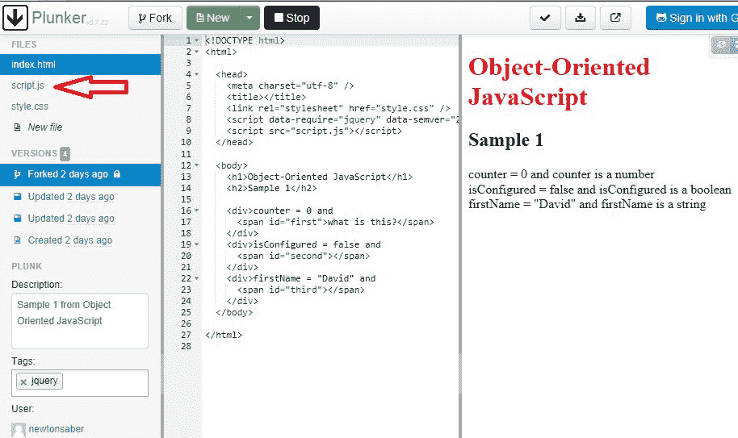
*图 1：Plunker 示例*

http://NewtonSaber.com/OOJavaScript/Images/Illus1.png

### 编辑 Plunker 脚本

随意运行和编辑你在书中找到的任何 Plunker 脚本。当你修改并保存它们时，不会对原始文件产生任何影响。

## 我为什么要写这本书？

我决定写这本书有几个原因：

1. 我是一个老牌 C++ 开发者，因此在过去开发软件时，我比硬件比 JavaScript 强制执行的“安全”距离更接近底层。然而，我发现理解对象（引用类型）如何在内存中被创建和存储，与原始类型（内建类型，如 Number）如何存储，可以开启 JavaScript 开发者对整个 JavaScript 解释器以及真实发生情况的理解。我发现这一切非常迷人（这也是我想写这本书的另一个原因）。

2. 凭借我的背景，我对事物的看法与我在许多其他书中看到的解释略有不同，因此我非常想给出自己的解释，为正在发生的情况提供一个不同的视角。

3. 我热爱写作，专注于特定的主题，并像研究科学家一样，一步步地审视编程语言。

我相信所有这些理由都会让这本书读起来更加有趣、更有意思。

## 关于内存模型的重要说明

在写完前两章后，我回到了这段引言添加了这段备注，因为我确定有人会对我表示某些内存中对象或项目的方式产生意见。首先，我们来聊聊字符串（strings）。在某个时刻，某人看到我展示内存中字节的地方，然后你会想：“等一下，字符串是不可变的，而且每次更改字符串时内存都会重新分配，这不可能是的。”

### 用于指令的简化模型

请理解，我创建了简化的内存模型（插图），以便帮助用户一次专注于一个概念，并从其他问题中孤立地学习该点。这些插图和解释的目的不是为了提供 JavaScript 在内存中的精确实现，而是为了解释这些可能是如何实现的，从而引导读者坚实地理解这些底层内容如何影响他们的 JavaScript 代码。

这里是关于我的介绍，因为你可能从未听说过我。

## 关于作者

### 经验

自 1993 年以来，我一直作为专业人士开发软件（编写计算机程序）。

### 广泛的技术范围

我编写过 `C++`、`Visual C++`、`Visual Basic`（版本 1.0、3.0、5.0、6.0 和 `VB.Net`）、`Java`（不要与 JavaScript 混淆）、`C#`、`PERL`、`Python` 以及 `JavaScript`。以及许多其他编程语言（一些脚本语言）。

### 丰富的行业经验

我曾在规模从极小（50 人或以下）到极大（数千员工）的公司工作过。这些公司涉及各个行业，如土木工程、房地产管理、法律数据存储与检索、抵押贷款、生物技术和电子商务。

### 丰富的经验

我的起步是在一家小型电脑店组装电脑。后来我转到了客户支持（帮助台），那里每个电话那头都是一个愤怒的人，他们需要立即解决方案。我一路进入 `Software QA`（质量保证——软件测试），并最终拼进了计算机编程的世界。

## 这本书的独特之处

这本书之所以不同，是因为我不同。可能很多计算机书籍作者都是真正的软件工程师，他们拥有学术背景且极其聪明。

### 剥洋葱

我并不极端聪明。相反，我只是努力。你懂我的意思吗？我可能不是抽屉里最利的刀，但我能切开洋葱。老天，我曾曾在没有桨的情况下被困在河上，必须把自己从木头堵塞中救出来。我曾因为没有*快速*开发出软件解决方案，而被脸红脖子粗的经理对我大吼大叫并威胁我的工作。我曾工作到凌晨 3 点来解决棘手的问题。我曾让自己置于风险之中，用尽我的一切来让程序运行起来。

你可以访问我的网站：http://www.NewtonSaber.com

你可以访问书籍的网站：http://NewtonSaber.com/OOJavascript

你可以通过 newton@newtonsaber.com 联系我。

现在，让我们开始吧。

# 第 1 章

### 奠定基础：类型

由于大脑运作运作，当我们一次只关注一件事时最容易学习。然而，在面对像 `JavaScript` 这样庞大的课题（它自 1995 年 9 月由 Brendan Eich 最初为 `Netscape Navigator 2.0` 创建以来就一直在使用），要知道先关注什么可能是一个挑战。此外，如果你没有建立好基础基础，以后学习高级概念将困难得多。这就是为什么我想带你回到一个非常基础的概念，它是 `JavaScript` 中发生一切事情的基础：类型系统（The Type System）。

## JavaScript 如何处理类型

在 `JavaScript` 中——就像许多高级语言一样——所有类型都可以组织成两类：

1. 原始类型（Primitive types）——内存地址指示数据（或值）的存储位置。
2. 引用类型（Reference types）——内存地址指示对象存储的位置。

* 这一陈述可能会让人困惑。我稍后就会为你解释它。

首先，让我们看看原始类型。

`JavaScript` 中只有五种原始类型，它们是：

1. `Number`
2. `Boolean`
3. `String`
4. `undefined`
5. `null`

最后两个对你来说可能有点奇怪，我们会提到它们，但首先让我们看看前三个，并了解为什么理解它们都是原始类型是非常重要的。然后，我们将深入研究引用类型以及它们的不同之处。这两种类型对比的知识实际上有助于你理解运行你所有 `JavaScript` 代码的 `JavaScript 解释器` 是如何工作的，以及为什么创建 `Objects`（引用类型）与创建其他类型是如此不同。

现在让我回到我之前关于原始类型（primitives）的那个有点奇怪的陈述，当时我提到：

“内存地址指示了数据（或值）存储的位置。”

这意味着什么？

为了更好地理解它，你必须记住，所有数据都存储在内存中某个可寻址的位置。数据必须这样存储，以便其他程序元素可以访问它。否则，如果没有方法告诉程序数据存储在哪里，计算机程序就无法操作或显示这些数据，这些数据将变得无法访问且毫无用处。

*你编写 JavaScript，你就控制了内存芯片*

此外，请记住，在底层的某个地方，你指示要存储的值实际上存储在内存中某个具有唯一地址的区域。没错，你仅仅通过输入以下代码，实际上就在控制计算机内部某处内存芯片上的开关：

```javascript
var x = 55;
```

再次，在 JavaScript 中创建一个 `Number`，你只需要编写如下代码：

```javascript
var x = 31;
var z = 56;
```

## JavaScript 解释器做了什么

JavaScript 解释器注意到你将值设置为了数值，并决定该类型将是 `Number`。由于它是 `Number`，解释器知道需要特定数量的字节来存储一个最大值。

解释器必须知道它是什么类型，是因为在后台——即计算的底层——实际上发生了某些事情。当你仅仅创建一个 `Number` 变量（`var counter = 5;`）时，JavaScript 解释器必须做一些事情，以便计算机的处理器知道你想做什么。

以下是解释器做的一些工作：

1. 找到一个具有足够连续槽来存储 `Number` 类型的内存位置。
2. 在内部查找表中创建一个条目，存储你的变量名以及该变量名——这样当你使用定义的名称引用变量时，它就知道你的变量存储在内存的什么位置。

### 第一步：寻找内存

为了完成第一步，JavaScript 解释器必须知道 `Number` 类型在内存中占据的字节数。

### JavaScript 解释器的架构师

在原始类型（`Number`、`Boolean`、`String` 等）的情况下，创建 JavaScript 解释器的架构师决定，每个类型在内存中将占据预定的字节数。

### JavaScript 原始类型 Number：64 位（8 字节）

目前在浏览器中运行的 JavaScript 中，`Number` 类型获得 8 字节（64 位）的内存空间。某些架构师做出这个决定，是在你能够存储的最大值与程序中每个 `Number` 占用的内存之间进行的一种权衡。

在 CPU（主处理器）运行并按位读取内存的底层，当数据被写入顺序内存地址时，这对于低级程序员来说会变得容易得多。

#### 它看起来是什么样的

当你创建一个新的数字变量时，JavaScript 解释器会在其可用的寻址内存空间内寻找 8 个连续的字节，并设置找到找到的位来表示你存储的值。

```javascript
var counter = 27;
```

解释器将 `27` 存储在地址 `0x00FFC0`。

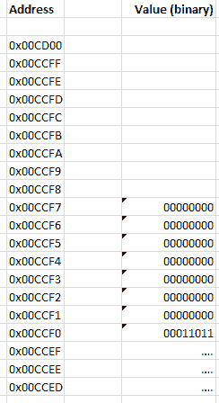
*图 2：存储在内存中的值 27*

http://NewtonSaber.com/OOJavaScript/Images/Figure2.png

仔细观察图 2：存储在内存中的值 27。

想象每个矩形代表一个内存字节。大多数现代计算机只允许你寻址字节内存（而不是位级别），因此每个地址代表那一个字节。在我们案例中，当我们写 `var counter = 27;` 时，解释器找到了从地址 `0x00CCF0` 开始的 8 字节内存，并将位设置为 `27`。另外请注意，尽管我们可以将值存储在第一个字节中，解释器（以及网络浏览器和操作系统）实际上预留了整个 8 字节内存块。我将这些字节的所有位清零，以表示它们正在被使用。这意味着其他东西不能使用这些字节，否则 JavaScript 将解释为 `counter` 的值已经发生了变化。该内存完全由 JavaScript 控制，用于存储到 `counter` 变量的值。

### 读取和写入该内存

在 JavaScript 解释器记住你的名称 `counter` 后，它将以此找到那块内存。这样，当程序后续代码执行类似下面的操作时：

```javascript
counter++; // 计数器加 1
```

它就可以检索存储在那的值（`27`），将该值加 1，并再次存储在相同的位置，这样内存现在看起来就像图 3 所示：存储在某处的值 28。

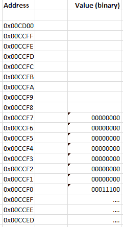
*图 3：存储在某处的值 28*

http://NewtonSaber.com/OOJavaScript/Images/Figure3.png

## 地址存储的值已更改

这里的点是，存储在内存地址上的**值**已经改变了。而且，现在解释器已经存储了该数据所在的地址，你不能在此程序内更改该地址。它是被锁定的。这意味着你可以通过更改变量的值来更新地址的值，但你永远无法更改变量所指向的地址。噢，事实上，在其他语言（C, C++）中，存在指针变量允许你更改变量所指向的地址。

稍后我们将此与引用类型（Reference type）改变时发生的情况对比，这对于你理解 JavaScript 如何工作至关重要。

## 现在 `undefined` 更有意义了

现在我解释了这些，我就可以向你解释 `undefined` 原始值了。记得我告诉过你当你给变量设置一个值时，JavaScript 解释器决定它是什么类型吗？

假设你在 JavaScript 中执行以下操作：`var x;`

`x` 是什么类型？

它是 `undefined`，我们可以通过以下代码证明这一点：

```javascript
var x;
console.log("x is " + typeof x + " type");
```

现在，让我们思考 JavaScript 在这种情况下必须做什么。它无法确定类型，但它必须跟踪你创建新变量的事实。但是，它的值应该是什么？在许多语言（C++, C#, Java – 与 JavaScript 无关）中，它的值是 `null`。但在 JavaScript 中，架构师为这种情况创建了这种特殊值 `undefined`。

在这种情况下，变量还没有被分配任何内存。它不能被分配，因为解释器不知道这个东西在内存中将占据多少空间。

## 我对 `undefined` 如何定义的猜想

这是我对 JavaScript 做的猜想。

在内存深处的某处，有一个孤独的地址，坐着一个 `undefined` 类型的值。它看起来可能像图 4 所示：地址空间中唯一的一个 undefined 对象。

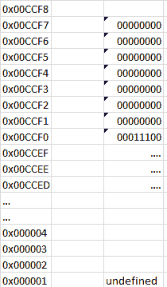
*图 4：地址空间中唯一的一个 undefined 对象*

http://NewtonSaber.com/OOJavaScript/Images/Figure4.png

那么，当你创建一个没有设置其值的新变量时，解释器将你的变量名存储在它的查找表中，然后将其值设置为该位置（`0x000001`），这样当你询问 `var x` 是什么类型时，它会返回它指向的类型：`undefined`。这应该是向 JavaScript 开发者指示该变量还没有设置过值。

好的，那么 `null` 呢？好的，到为止我们已经看了两个原始类型 `Number` 和 `undefined`。让我们快速看一下 `Boolean` 和 `String` 类型，因为它们与 `Number` 非常相似，然后我们将查看引用类型，这样理解 `null` 类型会稍微容易一点。

### 布尔值很简单，但要记住 true/false 大写

布尔值允许你创建一个只存储两种状态的变量：true 或 false。

你可以非常容易地创建一个布尔变量：

```javascript
var isConfigured = false;
console.log("isConfigured is a " + typeof isConfigured);
```

(http://uncoveryourlife.com/learnJs/runanyjs.htm) 你将看到图 5 所示的结果：创建布尔值的结果。

*图 5：创建布尔值的结果*

http://NewtonSaber.com/OOJavaScript/Images/Figure5.png 你可以在此处查看这两个布尔脚本的 Plunker：http://plnkr.co/edit/KCNVZvljPhVkNssZwqZp?p=preview

注意，`false` 是小写的。这是因为 `true` 和 `false` 是 JavaScript 中的关键字，而 `True` 和 `False` 则不是。

你可以通过运行这段代码看到这一点：

```javascript
var isConfigured = False;
console.log("isConfigured is a " + typeof isConfigured);
```

`False` 在 JavaScript 中是未定义的（undefined），所以当你一尝试设置该变量就会得到错误。

## 布尔值，可能存储一个字节

布尔值可能存储一个字节，因为你字面上可以将其存储在一个位中（1 或 0）。布尔值看起来可能与图 6 所示相似：存储在内存中的布尔值 true (1)。

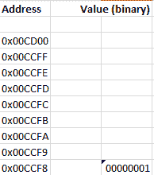
*图 6：存储在内存中的布尔值 true (1)*

http://NewtonSaber.com/OOJavaScript/Images/Figure6.png

如果值为 `false`，那么可能所有位都是 0，最终值为 `0`。然而，再次注意，它存储的是该内存地址处变量的值。

## 字符串类型 (String Type)

最后，让我们来看字符串类型（String）。

你可以使用以下代码创建一个字符串：

```javascript
var firstName = "robert";
console.log("firstName is a " + typeof firstName);
```

你可以在图 7 中看到这段代码的结果：创建一个字符串类型。

*图 7：创建一个字符串类型*

http://NewtonSaber.com/OOJavaScript/Images/Figure7.png 你可以在此处查看此代码的 Plunker：

http://plnkr.co/edit/BoYunjGYMQ9MkGfDzOcI?p=preview

字符串略有不同，因为字符串中的每个字符都需要一个字节来存储，但在变量设置值之前，无法确定字符串的长度。

解释器（Interpreter）以及更底层（如网络浏览器和底层的操作系统）仍然受到限制，必须找到连续的内存来存储字符串。

这意味着底层部分需要执行更多工作来存储你的字符串。

让我们通过观察使用以下 JavaScript 存储字符串时的内存，来更仔细地观察这一点：

```javascript
var companyName = "Big House";
```

看图 8：内存中的字符串。

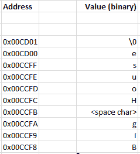
*图 8：内存中的字符串*

http://NewtonSaber.com/OOJavaScript/Images/Figure8.png

### 终止字符 (Terminating Character)

首先注意位于 `0x00CD01` 处的最后一个奇数字符。由于字符串可以是任何长度，因此必须有一种方法来确定与字符串关联的最后一个字节。在 C 和 C++ 中，他们使用 `\0`（反斜杠后跟零）来表示。JavaScript 中可能也是一样。这里要取的观点是，必须有人处理字符串长度不同，以及变量关联内存必须是连续的限制。

### 如果字符串增长了怎么办？

这应该会立刻联想到这个问题：如果你将其设置为一个新的字符串值，字符串变长了怎么办？

例如，如果稍后在程序中存储：

```javascript
companyName = "Big House Crafts";
```

程序突然需要额外的七个连续的字节。但是，如果 `0x00CD01` 之后的字节已经被其他变量占用了怎么办？

## 字符串可能通过引用实现

这就是为什么 JavaScript 中的字符串极可能不是通过值实现的，而是通过引用实现的。现在，我们正在向对引用类型（Reference Types）的理解迈进。

## 引用类型与原始类型之间的主要区别

原始类型（Primitive types）在内存地址处存储实际值。引用类型在内存地址处存储一个地址。让我再说一遍：引用类型不是在内存地址处存储实际数据值，而是存储一个指向内存中另一个地方的地址，数据实际上存储在那里。

想想我目前为止向你展示的那些内存图片，并将其与图 9 进行比较：存储引用类型，这是我们存储一个引用类型时内存的样子。

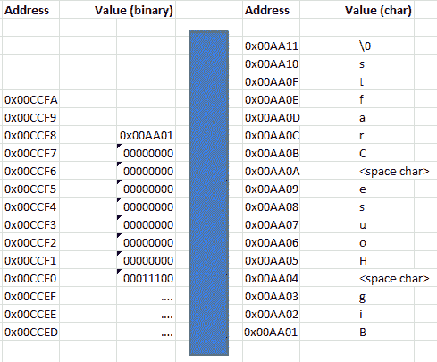
*图 9：存储引用类型*

http://NewtonSaber.com/OOJavaScript/Images/Figure9.png

首先，在图 9 中，我仍然在向你展示原始类型 `Number` 的存储（在 `0x00CCF0 - 0x00CCF7` 中）。然而，我们想要关注存储在位置 `0x00CCF8` 的值（另一个地址）。

### 大蓝条：内存墙

大蓝条简单代表左侧内存与右侧内存的分隔，以便向你展示引用类型存储了一个内存地址，该地址指向另一部分内存，那里是字符串实际数据的存储处。

它指向的内存地址是 `0x00AA01`。这是存储变长字符串（在此情况下为 16 字节 + 1 字节终止符）的基地址。

### 为什么它们要存储地址而不是值？

字符串类型指出了将占用不同数量字节的挑战。

### 子系统处理问题

这涉及很多工作，因为字符串改变了。

### 当字符串改变时会发生什么？

接下来，解释器所做的只是存储地址。

## 最后是对象 (Objects)

这带我们进入引用类型的领域。

引用类型是对象或用户定义类型（UDT）。用户定义类型也会根据其定义方式需要不同数量的字节。

## 对象在内存中占用不同数量的字节

让我们来看一个基础对象（Object），并更多地了解为什么它在内存中占用不同数量的字节。

这是在 JavaScript 中创建新对象的一种方法：

```javascript
var firstObj = {};
console.log("firstObj is an " + typeof firstObj);
```

运行代码时，你的浏览器中会显示以下内容：

firstObj is Empty Object, Stored in Memory

该对象基本上是空的，因为我们还没有向它添加任何属性。我不知道它在内存中占用多少字节，因为取决于 JavaScript 解释器架构如何实现基础 JavaScript 对象。对于我们而言，只知道解释器请求子系统在内存中创建一个对象，并请求该对象的基地址并将其存储以便以后再次访问。

它看起来可能像图 10 所示：内存中的空对象。

## 对象由其他类型组成

然而，对象可以——且通常是——由其他类型组成。

例如，如果我们取之前的对象并添加几个项，我们需要更多的内存来存储整个对象。

```javascript
firstObj.name = "builder";
firstObj.counter = 0;
firstObj.isConfigured = false;
```

此时，我们至少需要 17 字节来存储所有内容：7 字节字符串 + 1 字节字符串终止符 + 8 字节数字 + 1 字节布尔值。然而，`Object` 是引用类型，所以这并不重要。相反发生的是分配了新内存并将基地址报告给后台并由解释器存储。

# JavaScript 数组是引用类型

还有其他引用类型吗？是的，JavaScript 的 `Array` 是引用类型，因为它在内存中的大小是可变的，而且你可以向数组中推送（push）或弹出（pop）项。

你可以创建一个数组并对其进行推送和弹出操作（动态更改其大小）。这是一个向数组中添加了大量内容的高级脚本。运行它或查看图 11 中的输出：数组包含对象及更多，因为这应该让你思考数组中的项在内存中是动态增长的这一事实。这非常重要。

```javascript
var allItems = [];

allItems.push({});

allItems.push({});

console.log("There are " + allItems.length + " items in allItems.");

allItems[0].x = 55;

allItems[0].today = new Date();
console.log(allItems[0]);
```

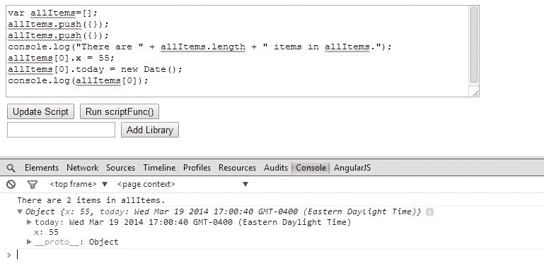
*图 11: 数组包含对象及更多*

http://NewtonSaber.com/OOJavaScript/Images/Figure11.png

你可以在 Plunker 上仔细检查脚本并对其进行修改：http://plnkr.co/edit/sMcU70Gg1bRAofaRtLir?p=preview

注意，Chrome 开发者工具允许你将数组项输出到控制台，然后检查该项内部的内容。在图 11：数组包含对象及更多的示例中，你可以看到我向数组中添加了一个大小可变的对象，该对象在内存中的大小也是变化的。这一切之所以成为可能，是因为引用类型。

# 理解所有这些内存知识对 JavaScript 程序员重要吗？

好了，现在你已经知道了基本类型（在地址处存储其值）和引用类型（在初始内存地址处存储内存地址）之间的区别，但这对你作为 JavaScript 开发者来说有什么影响呢？我很高兴你问这个问题，因为这对理解你的代码有巨大影响。

# 基本类型与引用类型如何影响 JavaScript 开发者？

如果你读过了之前的材料并对其有了基本的掌握，那么你已经处于与 90% 的 JavaScript 开发者不同的位置，因为他们并不理解基本类型和引用类型的存储方式不同。深入理解这一点有助于我们构建更健壮的代码。让我们来看一个示例来展示这有多重要。

# 第一个简单问题：复制时会发生什么？

现在，我们可以开始讨论复制基本类型与复制引用类型时会发生什么区别。

复制基本类型与复制引用类型是不同的，这种不同是因为这些不同类型在内存中的存储方式不同。

让我们现在通过一个显示差异的脚本来看这个问题。

注意：我在这里提供了整个脚本，你可以在 http://UncoverYourLife.com/LearnJS/RunAnyJS.htm 运行。然而，在当前格式下可能很难阅读，因此我也放置了一张带有输出的脚本图片，即图 12：基本类型的复制与引用类型的复制。

```javascript
// ### 创建基本类型并将其复制到另一个基本类型中 ###

var numberOfChildren = 1; // 步骤 1
console.log("numberOfChildren is : " + numberOfChildren + " - STEP 1");
numberOfChildren = 3; // 步骤 2
console.log("Changed numberOfChildren to : " + numberOfChildren + " - STEP 2");

var numberOfGrandkids = numberOfChildren; // 步骤 3

console.log("numberOfGrandkids is : " + numberOfGrandkids + " - STEP 3");
console.log("changing numberOfGrandkids to 5...");

numberOfGrandkids = 5; // 步骤 4
console.log("numberOfChildren is still : " + numberOfChildren + " STEP 4");

// ### 创建引用并将其复制到另一个引用类型中 ####

var infoOrig = {} // 步骤 5

infoOrig.children = 2; // 步骤 6
console.log("infoOrig.children is : " + infoOrig.children + " - STEP 5 & 6");

infoOrig.children = 4; // 步骤 7
console.log("Changed infoOrig.children to : " + infoOrig.children + " - STEP 7");

var infoCopy = infoOrig; // 步骤 8
console.log("infoCopy.children : " + infoCopy.children + " - STEP 8");

infoCopy.children = 7; // 步骤 9
console.log("infoOrig.children HAS CHANGED!!: " + infoOrig.children + " - STEP 9");
```

你可以在 Plunker 上更仔细地检查脚本：http://plnkr.co/edit/IDbJAGTEfvdAh3fyOj5Z?p=preview

看看图 12：基本类型的复制与引用类型的复制以查看输出。接下来我将带你通过每一个步骤，并展示内存中实际发生了什么，以及为什么引用类型的复制看起来行为很异。

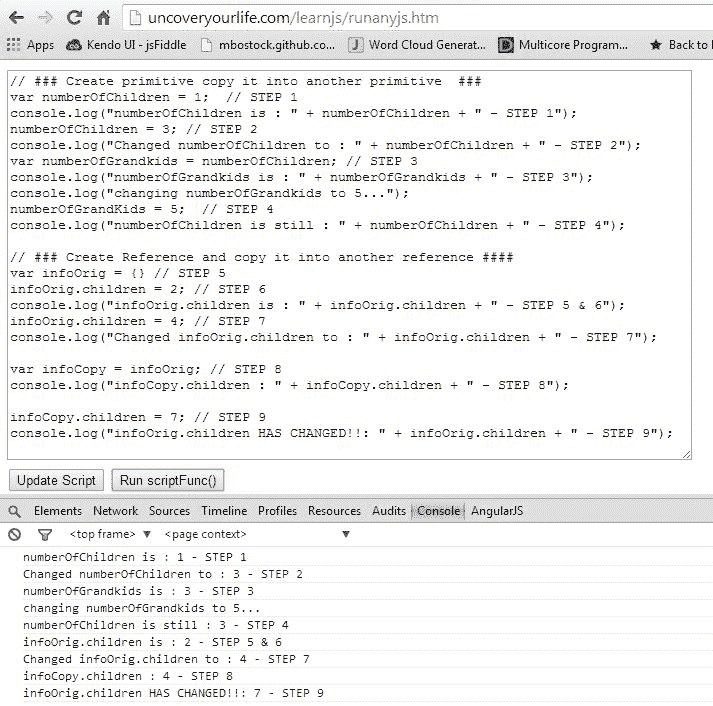
*图 12: 基本类型的复制与引用类型的复制*
http://NewtonSaber.com/OOJavaScript/Images/Figure12.png

## 复制类型的逐步说明

现在，将以下步骤与脚本中看到的步骤相对应，你就会发现为什么引用类型的复制似乎在做错，尽管它的行为完全符合 JavaScript 解释器架构师的设计。

### 步骤 1

创建一个基本类型（`numberOfChildren`）并将其值设为 1（它是一个 `Number` 类型）。

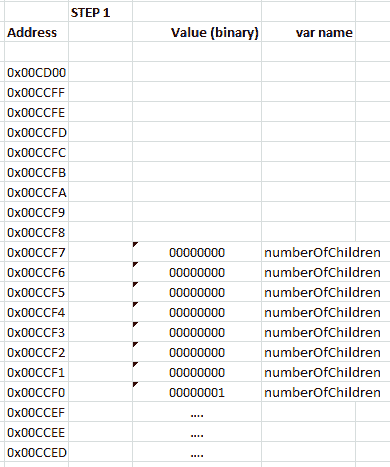
*图 13: 步骤 1 - 创建数字基本类型*

http://NewtonSaber.com/OOJavaScript/Images/Figure13.png

注意，我们有一个基内存地址 `0x00CCF0`，值为 1。我将所有字节都设为 `numberOfChildren`，只是为了让你看到这些字节在程序的生命周期内被分配给该基本类型。

### 步骤 2

更改 `numberOfChildren` 的值。由于这是一个基本类型，解释器知道基内存地址并将该内存设置为值 3。`00000011` 是二进制 3。

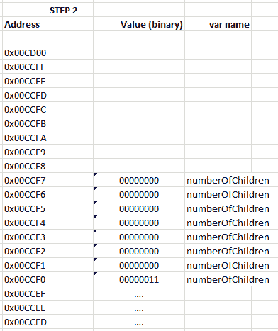
*图 14: 步骤 2 - 更改 numberOfChildren 的值*

http://NewtonSaber.com/OOJavaScript/Images/Figure14.png

### 步骤 3

创建一个名为 `numberOfGrandkids` 的新基本类型（`Number` 类型），并将 `numberOfChildren` 的值复制进去。当新基本类型创建时，它获得了基地址 `0x00CCF9`，值 3 被复制到该内存地址。

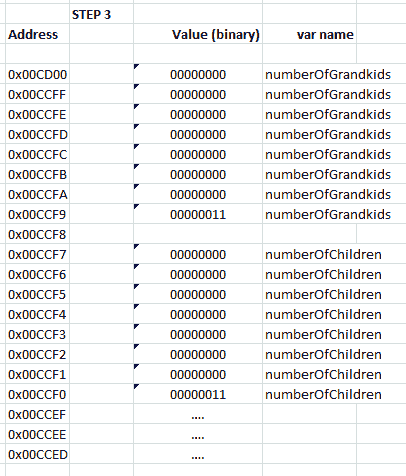
*图 15: 步骤 3 - 创建基本类型并将其复制到其中*

http://NewtonSaber.com/OOJavaScript/Images/Figure15.png

### 步骤 4

将 `numberOfGrandkids` 的值设为 5；

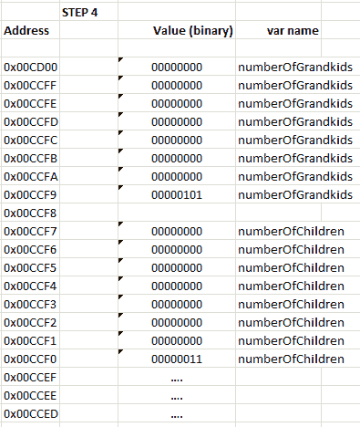
*图 16: 设置 numberOfGrandkids = 5*

http://NewtonSaber.com/OOJavaScript/Images/Figure16.png

仔细查看图 16：设置 numberOfGrandkids = 5 并识别两点：

1. `numberOfGrandkids` 的值现在是 5（二进制 `00000101`）
2. `numberOfChildren` 的值**没有**改变。它仍然是 3。脚本打印了这个值以显示。

### 步骤 5

现在我们创建一个名为 `infoOrig` 的引用类型（`Object`）。记得可以使用 `{}` 括号初始化空对象。

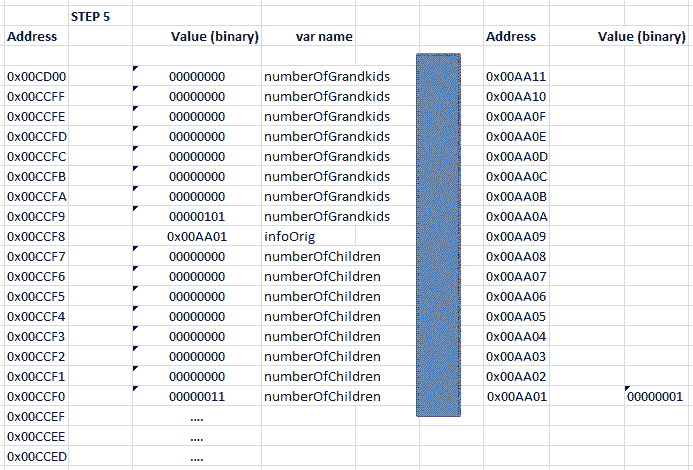
*图 17: 创建引用类型（Object)*

http://NewtonSaber.com/OOJavaScript/Images/Figure17.png

正如我们之前学过的，我们看到解释器为内存中的对象获取了基地址（`0x00AA01`），并将该基地址存储在它的地址空间（`0x00CCF8` 处），而不是值。

### 步骤 6

现在，我们为刚刚创建的对象（`infoOrig`）添加名为 `children` 的新基本类型（`Number`），然后将基本类型的值设为 2。

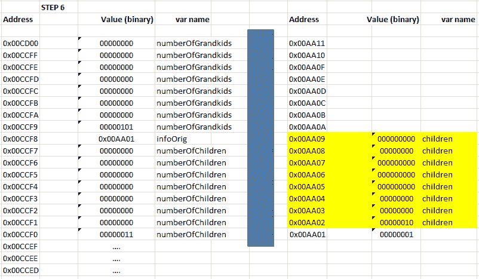
*图 18: 添加基本类型到引用类型中*

http://NewtonSaber.com/OOJavaScript/Images/Figure18.png

你可以从图 18：添加基本类型到引用类型中看到基本类型已被创建并存储在内存中（黄色高亮部分）。

### 原始值由引用持有

请记住，名为 `children` 的原始类型现在由 `Reference` 类型（`infoOrig`）拥有，因此由它管理该特定项目的内存。这意味着该引用项占据了新原始类型的全部内存空间，加上引用对象本身占用的任何内存——例如地址 `0x00AA01` 处的内存。

## 引用类型：内存中可扩展的

这是 `Object` 成为 `Reference` 类型的主要原因之一：因为它是一个 `User Defined Type`（自定义类型），因此它在内存中的大小是无法预定的。在这种情况下，我们的 UDT 仅由一个 `Number` 组成，但在其他情况下，对象可能包含任意数量的原始类型和/或其他引用类型。

### 第 7 步

第 7 步与我们在第 2 步处理第一个原始类型（`numberOfChildren`）时类似。在第 7 步中，我们将 `children` 的值改为 4。唯一的区别是这个原始类型由引用类型（`infoOrig`）拥有。然而，在此时你实际上看不出任何区别。

内存现在看起来就像图 19 所示：修改由引用类型拥有的原始类型的值——现在 `children` 的值为 4（二进制 00000100）。

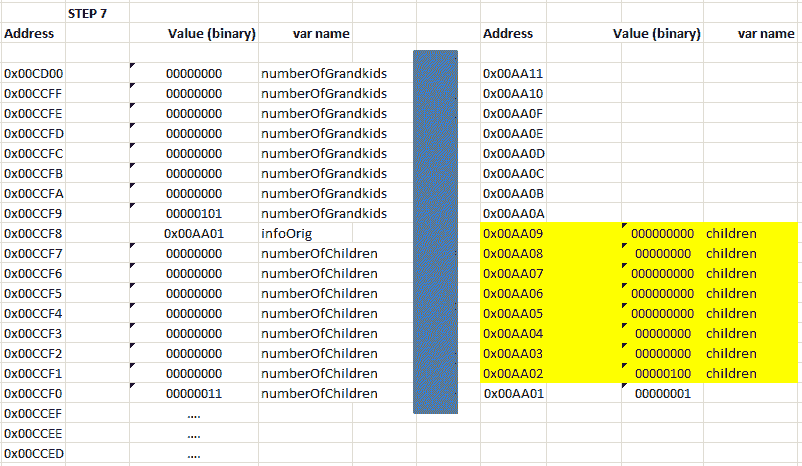
**图 19：修改由引用类型拥有的原始类型的值**
http://NewtonSaber.com/OOJavaScript/Images/Figure19.png

## 创建引用类型的拷贝

现在我们为一种极其有趣的变化做准备，这种变化将让你惊讶，并将彻底开启你的思维，从一个全新的角度理解编程。

### 第 8 步

理解这一个概念将让你在所有语言中成为一名更好的程序员，因为你将理解编写代码时真正发生了什么。

创建一个拷贝简单意味着创建一个新的变量名，并将之前创建的值赋值给该变量名。我们已经在原始类型上这样做过，现在我们通过这一行代码执行同样的事情：

```javascript
var infoCopy = infoOrig;
```

然而，这行代码大不相同，因为我们正尝试创建一个新的 `Reference Type`，它的值与之前创建的 `Reference type` 相同。

但你必须记住，存储为引用类型的值是一个地址（指向内存中对象所在位置的内存位置）。

## 我的示例中内存不足（空间）

我的示例图中似乎内存（空间）不够了，因此我将取 `0x00CCEE` 处的值（假设这些值已被清空且未被使用）。我这样做仅仅是为了打印空间。

当 JavaScript `Interpreter` 看到这行代码时，它执行以下操作：

1. 在其内部表中创建一个新的 `Reference object` (`infoCopy`）。
2. 将 `infoOrig` 的地址 (`0x00AA01`) 保存到它引用 `infoCopy` 的地址 (`0x00CCEE`) 处。

这看起来就像图 20 所示：创建了 `infoCopy` 引用类型。注意，现在你有两个指向内存中同一位置的变量。这两个变量*引用*内存中的同一个对象——地址为 `0x00AA01` 的那个对象。

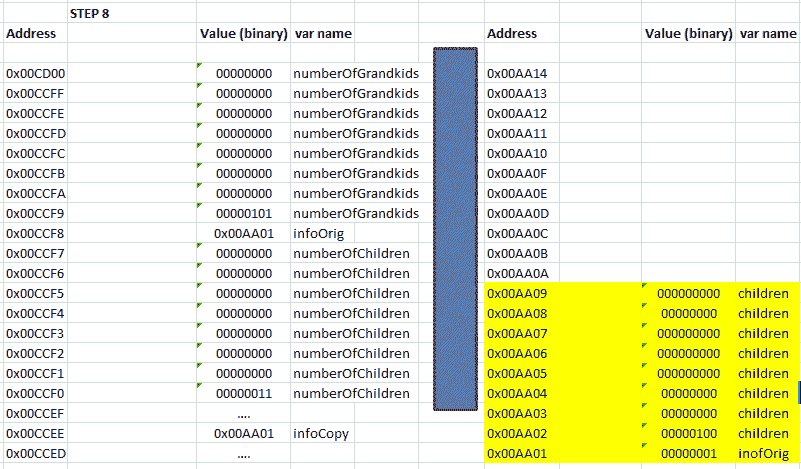
**图 20：创建了 infoCopy 引用类型**
http://NewtonSaber.com/OOJavaScript/Images/Figure20.png

### 第 9 步：你的两个引用都指向同一个东西

这就是为什么现在当你通过 JavaScript `infoCopy.children = 7` 修改 `infoCopy` 的值时，你也修改了 `infoOrig.children` 的值。

当 `Interpreter` 运行那行代码时，它查找 `infoCopy` 的基础地址并获取 (`0x00AA01`)。然后它在该对象内部找到名为 `children` 的属性并设置为值 7。

当这种情况发生时，你的另一个变量（`infoOrig`）仍然引用同一内存，因此你也修改了该值。

现在内存看起来就像图 21 所示：`infoCopy` 和 `infoOrig` 都指向同一个地址。

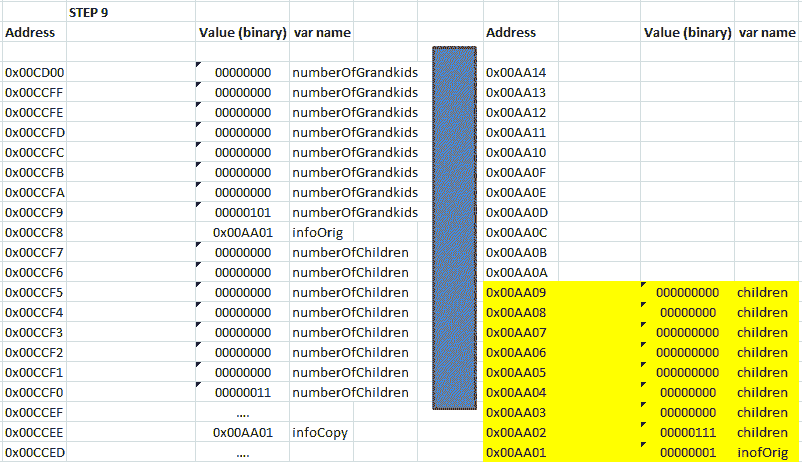
**图 21：infoCopy 和 infoOrig 都指向同一个地址**
http://NewtonSaber.com/OOJavaScript/Images/Figure21.png

你看到现在创建一个对象的拷贝（也称为新引用）有多快了吗？

你学到的关于 JavaScript 对象的其他知识都是基于此的，这就是为什么知道幕后到底发生了什么是如此重要的原因。

在我们阅读这本书的过程中，我们将进一步研究 `Reference types` 的影响，但现在你已经知道了这一点，你将能够更好地理解这本书的剩余部分。我在本章留下了关于 `Assembly Language`（汇编语言）的侧栏，我们将在下一章再次讨论 JavaScript `Functions`（它们也是引用类型）。

## 侧边栏 - 汇编语言？我以为这是 JavaScript

在过去，程序员没有我们现在这样好的 GUI（图形用户界面），他们必须知道如何直接与计算机的 `CPU`（主处理器）通信，并告诉它将数据存储在特定的内存位置（地址）。

他们使用 `Assembly language`（汇编语言），甚至在此之前使用 `Machine language`（机器语言）——这使用的是处理器所说的完全加密的语言。

有时，他们的代码——在 `Machine Language` 中——看起来看起来就是一串 0 和 1：

```
1110010101110000100101101
```

这会告诉 `CPU` 在内存地址 `0x0CCEE` 处存储值。

### 易错性

计算机科学家在尝试确定它时犯了许多错误，眼睛都看直了，这似乎是三个 1 和一个 0。

### 第三代语言

你现在使用的是 `3GL`（第三代语言）或高级语言，因为你不需要直接与处理器通信。

### JavaScript 解释器为你工作

在我们案例中，做这些工作的是 JavaScript `Interpreter`，它运行在浏览器内部。这意味着我们开发者现在可以编写更容易学习的代码。不需要理解处理器 `Op Codes`（操作码）和内存地址，要在内存位置存储一个值，只需输入以下有效的 JavaScript：

```javascript
var x = 15;
```

# 第 2 章

### 函数：它们也是对象

我们在上一章学习了许多关于幕后发生了什么的知识，本章将继续讨论。上次我们学习了可以通过以下方式创建一个对象：

```javascript
var person = {};
person.firstName = "frank";
person.lastName = "smith";
```

但是，现在假设你想创建另一个人。你想这样做，是因为你不想再次输入添加这些属性（lastName 和 firstName）的代码。你可能会想：“好吧，我会这样做：”

```javascript
var person2 = person;
```

然而，正如我们在上一章学到的，这并没有创建一个新对象。它只是使用新的变量名对同一个对象创建了引用。如果我们希望 person2 拥有不同的 firstName 和 lastName（即新的内存地址来存储新值），这对我们来说并没有帮助。

在其他语言（如 C++、Java 或 C#）中，我们会创建一个 `class` 模板，然后将其实例化为对象。它看起来像如下：

```csharp
// C# 代码对比
class person
{
    // 这是构造函数，在实例化新对象
    // 时自动调用
    public person(firstName, lastName);
    public string lastName;
    public string firstName;
}
```

那么，每当我们想使用这个对象时，只需要这样做：

```csharp
// ### C# 代码 ########
person ted = new person();
ted.firstName = "ted";
ted.lastName = "jones";
```

## 定义

实例化（Instantiation）意味着在物理内存中分配内存并构造对象。这意味着该对象是存在于内存中的一个有效结构，并且（取决于访问权限）对你的程序是可访问且可用的。

在 C++、Java、C# 中，你拥有 `new` 关键字，它允许你创建一个存在新内存地址的新对象。每当你需要一个新对象时，只需告诉编译器：`person variableName = new person()` 即可得到一个。

## JavaScript 的 new 运算符

JavaScript 确实有一个 `new` 运算符，但它没有类模板的概念。幸运的是，在 JavaScript 中，我们可以通过函数来模拟我在上面的 C# 示例中展示的内容。

这是因为函数实际上也是对象。既然函数是对象，让我们来简单聊一下对象的另一个方面。

## 对象拥有自己的内存

记住，对象拥有自己的内存空间。另一种说法是，对象可能包含其他原始类型（`Number`、`Boolean` 等）和其他引用类型（`Objects`、`Arrays` 等），无法在不通过实例化对象的情况下获取这些内容。

在代码中，它看起来如下：

```javascript
person.firstName = "Wilma";
```

JavaScript 没有提供其他获取 `firstName` 的方法，除非通过实例化的 `person` 对象。对象的内存是隔离的。

## 对象是内存包装器

另一种说法可能是，对象是内存包装器。让我们再次看一眼内存的图。这次我们将创建一个更高级的对象，它包含一个 `Number`、`String`、`Boolean` 和一个 `Array`（引用类型）。

以下是 JavaScript 代码：

```javascript
var person = {};
person.firstName = "Ted";
person.age = 53;
person.hasChildren = true;
person.children = [];
person.children.push("sam");
person.children.push("sara");
person.children.push("sandy");
```

通过检查图 22：内存中的 person 对象，你可以看到 `person` 对象在内存中可能的样子。

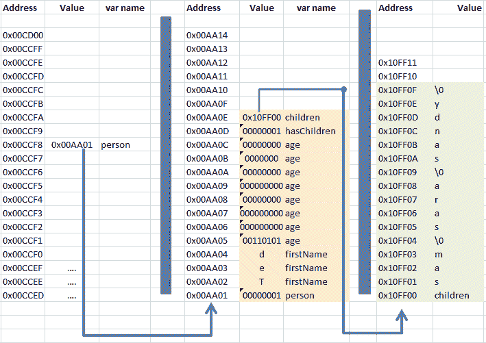
*图 22：内存中的 person 对象*

http://NewtonSaber.com/OOJavaScript/Images/Figure22.png

### 深入观察内存中的 person 对象

在图 22 中，你可以看到：

1. `person` 对象的基地址是 `0x00AA01` – 该地址指向内存中实际 person 对象（图 22 中的浅橙色区域）所在的位置。
2. `person` 对象包含一个名为 `children` 的引用类型（`Array` 对象），它指向位于 `0x10FF00` 处数组对象的基地址（图 22 中的浅绿色区域）。
3. `children` 中每个字符串的字节存储在数组对象中。

你可以通过 Plunker 链接更细致地检查代码：http://plnkr.co/edit/ou3IpPVMhQqNu89fS7J9?p=preview

如果不通过 `Array` 对象，你就无法获取 `childrenArray` 内部的值。例如，如果你想要其中一个值，可以使用以下 JavaScript 代码段来引用它。

```javascript
console.log(person.children[0]);
```

这是因为如果不引用数组本身，你就没有办法引用该数组内部包含的内存。这就像是 `Array` 对象在这些值周围筑了墙，你必须来到 `Array` 对象才能获取这些值。

`person` 对象中包含的项也是如此。事实上，我们可以把对象称为容器。你无法在不执行如下 JavaScript 代码的情况下获取 `person` 对象中的任何项：

```javascript
console.log(person.age);
```

### JavaScript 的另一种表述方式

那种 JavaScript 语法就像是在说：

进入 `person` 对象并查看内部（`.`），找到一个名为 `age` 的属性，并告诉我存储在那里的值。

### 等同于 JavaScript 的自然语言表述

这基本上是另一种说法：

在内部 JavaScript 表格中查找 `person` 对象的地址。它是 `0x00AA01`，所以去该地址查找 `age` `Number`（原始类型）的地址。该地址是 `0x00AA05`，因此查看内存并确定存储在那里的值。

### 包装器也是作用域

这些对象包装器的有趣之处在于它们创建了作用域。它们限制了你查看其内部包含的值的范围。

事实上，Java、C++ 和 C# 使用了一些关键字来指示属性是否在对象外部可见。你在之前的示例代码中就看到了这一点，当时我有一些以 `public` 单词开头的语句。

## 错误指示作用域

你可以看到作用域是受限的，因为如果你在脚本中添加以下行：

```javascript
console.log(age);
```

在 Google Chrome 中，你将收到一条显示“age is not defined”的错误。

这是因为你查看的是应用程序作用域，而不是你的 `person` 对象作用域。

我向你展示了这一切，让你现在能更好地理解函数。在 JavaScript 中，函数是对象，并且拥有作用域。

## 函数是对象，它们拥有作用域

作用域在编程世界非常重要。在 JavaScript 世界中，它可能会非常令人困惑。

我们在代码中使用函数的主要原因之一是将它们拆分为我们可以处理的小部分。每个函数都有自己的作用域，并允许我们管理它们所使用的变量。这种作用域如何帮助我们程序员。函数在 JavaScript 中也是类型。

## 什么是一等类型？

仅仅是函数被视为类型。如果你阅读关于 JavaScript 的内容，可能会有人说“函数是一等对象”或“函数是一等类型”。

这仅仅意味着函数实际上变成了类型。就像有 `Number` 原始类型或 `Object` 引用类型一样，函数也是引用类型。

## 使用 JavaScript typeof

通过 `typeof` 运算符我们可以看到这种新类型（`function`）。

首先，我们需要定义一个可以测试的函数。这是一个简单的函数，计算传入字符串长度：

```javascript
function charCounter(targetString)
{
  return targetString.length;
}
```

这里是使用该函数的代码：

```javascript
var el = document.getElementById("first");
var output = "这个字符串的长度为 ";
el.innerHTML = output + charCounter(output);
```

现在，我们可以检查名为 `charCounter` 的对象的类型。

```javascript
var element2 = document.getElementById("second");
element2.innerHTML = "charCounter 是 " + typeof charCounter;
```

当然，一旦你运行该代码，你会发现显示：charCounter 是 function JavaScript 解释器知道这是一个函数对象。

## 函数与作用域

正如我们学过的对象拥有作用域，我们也了解到函数拥有作用域。

看以下函数：

```javascript
function getRandomInteger()
{
  var randomVal = Math.ceil(Math.random()*1000);
}
```

// 调用函数生成随机数

getRandomInteger();

尽管上面的函数生成了随机数，但你只能在函数内部访问该值。显然，我们可以向函数添加以下行，以便我们能够获取该值：

```javascript
return randomVal;
```

这里的点是函数有自己的作用域，这对 JavaScript 程序员很有帮助，可以让你保持值清晰。

```javascript
// 创建应用程序作用域的变量
var randomVal = 55;

el1 = document.getElementById("first");
el1.innerHTML = "randomVal 是 : " + randomVal;

function getRandomInteger()
{
  // 创建具有函数作用域的变量
  var randomVal = Math.ceil(Math.random()*1000);
  var el2 = document.getElementById("second");
  el2.innerHTML = "在 getRandomInteger 内部 randomVal 是 " + randomVal;
}

var el3 = document.getElementById("third");
el3.innerHTML = "back outside getRandomInteger, randomVal is " + randomVal;
```

如果你运行这段代码，你会发现修改函数内部的 `randomVal` 对应用程序作用范围内的 `randomVal` 没有任何影响。

输出结果如下所示：

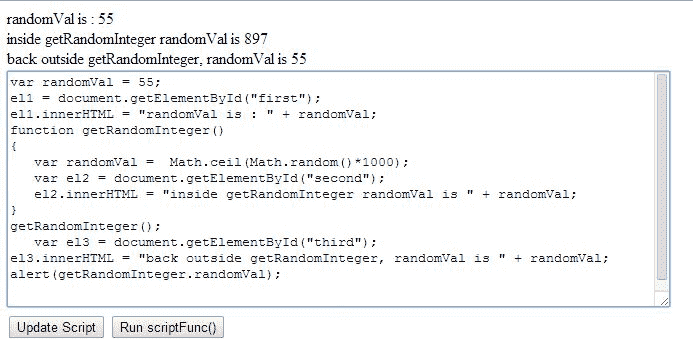
**图 23: 函数作用域与变量**

http://NewtonSaber.com/OOJavaScript/Images/Figure23.png

由于第一个 `randomVal` 定义在函数外部，而另一个定义在函数内部，因此它们是存储在两个独立内存位置的两个变量。

## 函数是引用类型：对象

函数是一种 `Reference`（引用）类型，其存储方式与对象相同——它们本身就是对象——因此内存结构与我们之前看到的非常相似。请查看图 24 所示的最后一个程序的内存视图：内存中的函数对象。

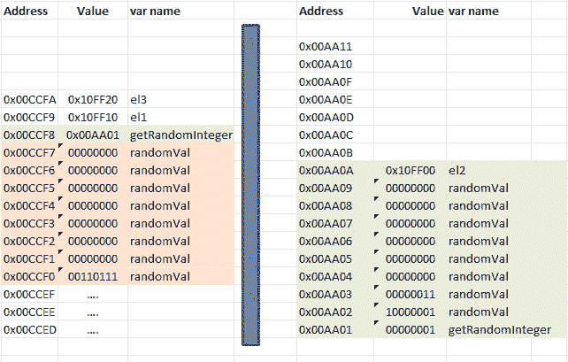
**图 24: 内存中的函数对象**

http://NewtonSaber.com/OOJavaScript/Images/Figure24.png

在你查看图 24 时，有许多需要仔细观察的地方。

1. 左侧的 `randomVal`（橙色）是全局变量，它与右侧的 `randomVal`（绿色）不是同一个，后者是作用域于 `getRandomInteger` 函数的。如你所见，它们具有不同的基内存地址，设置其中一个不会影响另一个。
2. 内存中的函数（右侧绿色）看起来与我们之前关于其他 `Reference` 类型的示例完全一样。这是因为它是一个 `Reference` 类型，并继承自 JavaScript 的基础 `Object` 类型。
3. 应用程序作用域包含两个指向 `HtmlDivElements` 的 `Reference` 类型（`el1` 和 `el3`）。函数作用域包含一个指向 `HtmlDivElement` 的引用。这些仅用于输出字符串以便你看到，因此我没有显示这些额外的内存占用。只需注意，这三项也变成了引用，因为它们是 HTML 元素的引用。
4. 此处需要注意的另一点：在我们的示例中，函数内部的 `randomVal` 得到了值 897，这无法放入 8 位（一个字节）中，因此你会发现设置二进制值时，它溢出到了第二个字节（地址 `0x00AA03`），因为我们需要更多位来存储那么大的值。整个值看起来像如下：`00000011 10000001`。只是想指出这一点，因为它与我们之前的示例不同。

## 向函数传递对象和原始类型

现在，你已经看到函数是对象，这就会更加明显：我们可以将函数作为参数传递给函数，就像我们可以将对象传递给另一个函数一样。

由于还没有仔细检查它，让我们来看看传递 `Primitive`（原始）类型与传递像 `Number`、`Boolean` 等原始类型有何不同。

再次，你会发现这对你来说将更加清晰，因为你理解了内存模型——JavaScript（以及子系统）为这些每种类型分配内存的方式。

```javascript
function double(inNumber)
{
  inNumber = inNumber * 2;
}
```

在 plnkr.co 查看此示例：

http://plnkr.co/edit/lD3b4BbmLgXzjnqTdujI?p=preview

以下是该示例的代码，你可以在此处运行：

http://uncoveryourlife.com/LearnJS/RunAnyJs.htm

```javascript
var el = document.getElementById("first");
var el2 = document.getElementById("second");
var el3 = document.getElementById("third");
var paramVal = 17;

function double(inNumber) {
  inNumber = inNumber * 2;
  el2.innerHTML = "inNumber, inside double(), is " + inNumber;
}

el.innerHTML = "paramVal, BEFORE being passed to double(), is " + paramVal;
double(paramVal);
el3.innerHTML = "paramVal, AFTER being passed to double(), is " + paramVal;
```

此示例仅创建了一个名为 `paramVal` 的应用程序变量，我们用它来传递给 `double()` 函数。

在 `double()` 函数内部，我们没有创建新变量，而是直接将 `inNumber` 的值设为倍。

然后，当我们从 `double()` 函数返回时，我们发现 `paramVal` 仍然保持它最初设置的值（17）。

## 原始类型参数具有函数作用域

这是因为 `inNumber` 原始类型的内存是在 `double()` 函数作用域内创建的。

让我们查看之前代码的内存模型，以了解实际发生了什么。检查图 25：向函数传递原始类型，我将在下方解释正在发生的情况。

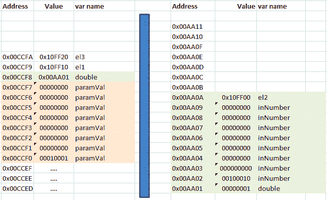
**图 25: 向函数传递原始类型**

http://NewtonSaber.com/OOJavaScript/Images/Figure25.png

**注意**：图 25 中 `inNumber` 的值为 34（函数运行后的值）。

在检查内存模型后，你可以看到：

1. `paramVal` 被创建为全局变量——（橙色）`paramVal` 的基地址位于 `0x000CCF0`。
2. 参数被创建为原始类型，其作用域于函数对象 `double()`。换句话说，`inNumber` 获得了一个基地址（`0x00AA03`）。
3. `paramVal` 没有受到影响，因为它是值传递。

## 向函数传递引用类型

你可能认为这看起来很简单，然而让我们观察传递引用类型会发生什么。

```javascript
var container = {};
container.paramVal = 17;
```

现在，我们在代码中添加：

```javascript
double(container);
```

这意味着我们将整个对象传递给了函数。

以下是更新后的代码，你可以在 RunJS 页面运行，或者可以在 plnkr.co 查看代码：

http://plnkr.co/edit/C8RRuFh7ALVgM?p=preview

```javascript
var el = document.getElementById("first");
var el2 = document.getElementById("second");
var el3 = document.getElementById("third");
var container = {};
container.paramVal = 17;

function double(inNumber) {
  inNumber.paramVal = inNumber.paramVal * 2;
  el2.innerHTML = "inNumber, inside double(), is " + inNumber.paramVal;
}

el.innerHTML = "paramVal, BEFORE being passed to double(), is " + container.paramVal;
double(container);
el3.innerHTML = "paramVal, AFTER being passed to double(), is " + container.paramVal;
```

如果你运行这段代码，你现在会看到类似下面的输出，它试图向你展示**传递的对象的原始值被 double() 函数修改了**。

### paramVal, BEFORE being passed to double(), is 17 inNumber, inside double(), is 34 paramVal, AFTER being passed to double(), is 34

由于我们已经在内存中过过这一切，你可能理解为什么对象类型被修改了。图 26：传递引用类型：部分 1 在内存中展示了这一点。注意在调用 `double()` 函数之前，`container.paramVal` 的值为 17。

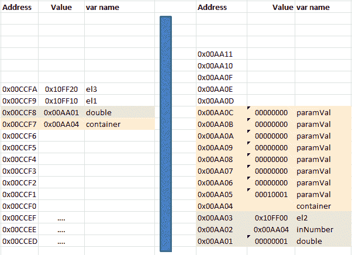
**图 26: 传递引用类型：部分 1**

http://NewtonSaber.com/OOJavaScript/Images/Figure26.png

这意味着 `inNumber` 参数指向可以找到对象的内存地址，从而能够获取存储在内部的原始值。

## 值发生了变化，因为内存地址相同

这就是值发生变化的原因。在在上一个示例中，对于基本数据类型，我们看到有两个内存位置（每个基本数据类型一个）。然而，由于我们传递的是容器对象的引用，现在该基本数据类型只有一个内存地址（作用域于容器对象）。

这意味着当我们更改值时，我们正在更改原始容器对象内部的值。

显示了该过程的第 2 步——在函数更改容器对象内部的 `paramVal` 之后。

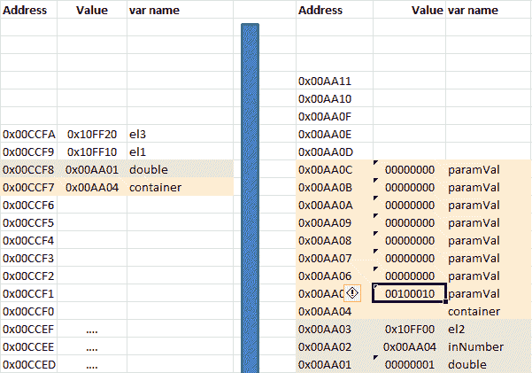
*图 27：传递引用类型：部分 2*

http://NewtonSaber.com/OOJavaScript/Images/Figure27.png

## 引用传递与基本值传递的总结

带框中的值现在是 34，而之前是 17。当你通过引用（通过对象）传递时，你操作的是你正在传递的对象的内存。

然而，当你传递一个基本数据类型（按值传递）时，你只是传递了值，并会创建新的内存来存储该值。

现在你已经知道传递引用类型与传递基本数据类型会得到不同的结果，这将帮助你理解 JavaScript 如何在内存中处理这些类型，并让你更好地理解代码的执行。

现在我们的措辞将变得有点奇怪，因为我们将讨论将一个函数传递给另一个函数。这听起来有点奇怪吗？我觉得确实是。

## 将函数传递给函数

既然你已经知道可以向函数传递一个对象，并且知道函数也是一个对象，你将能够理解 JavaScript 以及计算机科学领域中最令人困惑的事情之一：将函数传递给函数。

### 函数是引用类型

首先，从根本上说所有的函数都是对象。这意味着它们是引用类型。这意味着当你传递函数时，你传递的是它在内存中基地址的地址：就像对象一样。

我重复这一点，是因为这与我们对作用域的理解密切相关。函数为它所封装的所有变量创建一个作用域，就像对象一样。然而，当你将函数传递给另一个函数时，你将获得函数的基地址，并能够操作位于这些地址上的值，这意味着你修改了传入函数的对象（函数）。这一切意味着你需要小心，并准确地知道你正在尝试做什么。

然而，此时你可能会在想，“我为什么要将一个函数传递给另一个函数呢？”这看起来确实像是一件奇怪的事，但它是许多 JavaScript 内置函数的工作方式，例如 `setTimeout()` 函数。

## setTimeout – 传递函数

JavaScript 中的全局 `window` 对象有一个 `setTimeout()` 函数，你可以调用它在稍后的时间执行函数。

`setTimeout` 接受两个参数。第一个是函数，第二个是在调用函数之前等待的毫秒数。你传递给 `setTimeout` 的函数代表了在 N 毫秒后计时器触发时想要运行的命令。

```javascript
setTimeout(functionName, millis);
```

这是一个你可以尝试或观看的快速示例。

```javascript
var el = document.getElementById("first");
el.innerHTML = "3 秒后 (3000ms) 你将看到另一条消息。";

var el2 = document.getElementById("second");
setTimeout(showAnswer, 3000);

function showAnswer() {
    el2.innerHTML = "从我被要求运行以来已经过了大约 3 秒。";
    setTimeout(hideAnswer, 3000);
}

function hideAnswer() {
    el2.innerHTML = "";
    setTimeout(showAnswer, 3000);
}
```

你可以在我的 plnkr.co 上查看类似的示例：http://plnkr.co/edit/BJn9UZiYpSWu34ydRCR7?p=preview

我让这个脚本在两个不同的地方调用了 `setTimeout()` 方法，以便文本出现后它会消失，当它消失后，它会再次出现。这样你就能确保看到整个过程。

现在你至少可以看到一个原因（还有很多其他原因）将一个函数传递给另一个函数，让我们来看看如何创建一个接受函数作为参数并使用它的函数。

## 在传递函数中揭示的架构原理

在我们查看将函数传递给另一个函数时，接下来的示例将微妙地向你揭示一个架构原理。这是初始代码：

```javascript
function displayData(item) {
    alert(item);
}

function mainWork(targetFunc) {
    var allThings = [];
    allThings.push("thing1");
    allThings.push("thing2");
    allThings.push("thing3");
    allThings.push("thing4");
    for (x in allThings) {
        targetFunc(allThings[x]);
    }
}

mainWork(displayData);
```

如果你去该代码的 Plunker 或使用 RunAnyJS 运行它，你会立即发现这相当烦人，因为它使用 `alert()` 模态对话框向用户提供信息。

http://plnkr.co/edit/cVmbtIeYVqDXUEuIdLvr?p=preview

## 回调函数

注意 `mainWork` 方法接收一个函数，稍后将使用该函数向用户显示数据。这就是计算机科学中的概念——尽管这是一个非常简单的示例——**回调函数**。这意味着，被另一个函数调用或使用的功能被分离出来，以便方便地替换。

### 分离功能以备后替换

由于我们传递的是函数，我们可以将 `displayData` 替换为任何兼容的函数。

### 无需测试替换功能

现在，我们不需要因为修改了 `mainWork` 中的某些内容而对其进行重新测试，只需要替换 `displayData`。这是一种巨大的架构原理，让你更接近设计解决方案而不是堆砌脚本。

让我给你展示它在以下示例中是如何工作的。基本上我们添加了一个名为 `displayDataDiv` 的新函数。该函数非常简单，并将 `item` 的值添加到 DIV 中。

```javascript
function displayDataDiv(item) {
    el.innerHTML += " " + item;
}
```

最后，我们只需将原始的 `mainWork(displayData)` 调用更改为新的 `displayDataDiv`。现在它将在 DIV 中显示数据，而不是那些烦人的弹窗。完整的代码列表如下，你可以尝试一下。或者运行这个 Plunker：http://plnkr.co/edit/BKK6RhEmFnyIL8f8Y?p=preview

```javascript
function displayData(item) {
    alert(item);
}

// 初始化输出的 div
var el = document.getElementById("first");
el.innerHTML = "";

function displayDataDiv(item) {
    el.innerHTML += " " + item;
}

function mainWork(targetFunc) {
    var allThings = [];
    allThings.push("thing1");
    allThings.push("thing2");
    allThings.push("thing3");
    allThings.push("thing4");
    for (x in allThings) {
        targetFunc(allThings[x]);
    }
}

mainWork(displayDataDiv);
```

关于这个新脚本有几点需要注意：

1. 旧的 `displayData` 函数不需要删除或修改。这意味着旧的功能可以像以前一样运行。现在，我们只需实现新功能即可。这对于持续开发非常好，因为我们不会破坏旧代码。

2. 我们仍然需要保持函数的公共接口不变。这意味着该函数仍然接收一个 item，在这种情况下该 item 是一个字符串。如果我们真的想将其分离出来，那么该类型可以是基类型（继承链的顶端），并且该类型实现一个特定的、始终不变的接口。我们将在查看依赖注入时学习更多更多内容，但我想在这里简单提一下。

现在，在结束本章之前，我想回到那个老短语，*函数是一类等公民类型*。

在其他语言中，函数既不是对象，也没有真正的独立类型。因此，在这些语言中，函数不被视为一等类型。它们是未被正式承认的“二等公民”。

事实上，在 C++、Java 和 C# 中，它们并不是类型，因此将函数作为参数传递给另一个函数是困难甚至是不可能的。

C++（同 C 语言）实现了指针，使得你可以将函数传递给函数。C++ 中的指针简单来说就是一个你可以传递的地址。该地址可以 `point to` 任何类型（整数、字符串或函数）。然而，这种语法非常丑陋。例如，如果你有一个名为 `getDouble` 的函数，它不返回内容（`void`）并接受一个整数，那么你的函数指针看起来像如下：

```cpp
void(*ptrName)(int*); // 这创建了 ptrName 变量

// 要设置指针指向该函数，你需要这样做

ptrName = &getDouble;
```

最后这一行带有 `&`（取地址符）符号的意思是：获取内存中名为 `getDouble` 的函数所在的地址，并将其保存到 `ptrName` 变量中。

关于这种丑陋性的介绍到此为止了。

## JavaScript 让这一切变得简单

我只是想提到，JavaScript 让这一切变得容易得多，因为你可以将函数名作为函数参数传递。

既然你已经理解了关于内存中对象的这些非常重要但很少被解释的细节，现在你将更容易理解我们如何使用 JavaScript 函数来创建模板（类似于 Java、C++ 和 C# 中的类），用于我们想要在应用程序中重用的常用自定义类型（UDT）。

## 创建模板对象进行实例化

首先，我将向你展示编写创建简单模板对象的 JavaScript 代码，然后我将展示你如何实例化它。

```javascript
function Person(firstName, lastName, startDate, workTitle) {
    this.firstName = firstName;
    this.lastName = lastName;
    this.startDate = startDate;
    this.workTitle = workTitle;
    this.empId = getEmployeeId();
    function getEmployeeId() {
        return Math.ceil(Math.random() * 5000000);
    }
}
```

要使用我们刚刚创建的模板，我们使用 JavaScript 的 `new` 运算符。代码如下：

```javascript
var employee = new Person("elmer", "fudd", "2012-03-14", "manager");
```

你可以在此处看到一个使用了该模板对象的简单脚本：http://plnkr.co/edit/GWAq6VGkOyUOulVT8uys?p=preview

由于你理解了函数（以及对象）是如何存储在内存中的，你将更容易理解这里发生了什么。你只需要知道以下几点：

1. `this` 关键字
2. `new` 关键字

当你还没有见过内存中的对象时，这些是令人困惑的概念，但再次强调，既然你现在拥有了它，一切都会迎刃合。

好了，让我们来看看内存中的模板对象。它看起来就像图 28 所示：函数作为对象的模板。

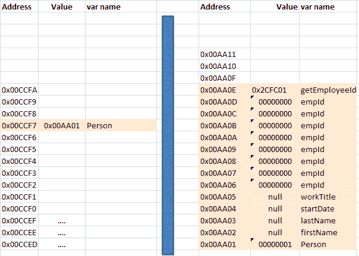
*图 28: 函数作为对象的模板*

http://NewtonSaber.com/OOJavaScript/Images/Figure28.png

图 28 中有很多许多需要仔细检查的地方。

1. `Person` 包含五个属性和 1 个函数（用橙色显示）。
2. 我将字符串类型显示为引用，因为它们很可能是以这种方式实现的，因为它们在内存中的大小是波动的。（你将在下一张图中看到这些从空值变为地址。）
3. 我将 `empId` 初始化为 0，并将每个引用初始化为 `null`，尽管我不确定网络浏览器/JavaScript 究竟将它们初始化为什么值。请记住，这是一个为了增加我们理解而设计的简化模型，而不是为了让我们变成计算机科学家。
4. 这是在我们根据此模板 `new` 出另一个对象之前 `Person` 函数的视图。

现在，让我们看看在使用 `new` 运算符实例化 `employee` 对象后，内存中发生了什么。

## JavaScript new 运算符

`new` 运算符告诉 JavaScript 我们想要一个未被任何对象使用的新内存块。

### 在新内存地址创建 Person 对象

当 JavaScript 解释器遇到以下代码行时，它知道不是将 `Person` 对象复制到新变量中，而是在新的内存地址处创建一个全新的 `Person Object`。

```javascript
var employee = new Person("elmer", "fudd", "2012-03-14", "manager");
```


解释器现在不会将 `Person` 函数的地址复制到我们的 `employee` 变量中，而是获取 `Person` 对象并在另一个内存位置创建一个新对象，并返回该地址。这意味着，内存现在看起来就像你在图 29 中所示：新对象意味着新内存。

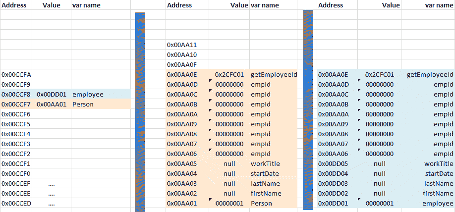 *图 29: 新对象意味着新内存*

http://NewtonSaber.com/OOJavaScript/Images/Figure29.png

图 29 右侧的蓝色区域代表对象在实例化瞬间以及初始化（通过参数中发送的值）之前的状态。你可以看到为这个新对象预留了一块新内存。当然，根据我们之前的调查，你现在理解这意味着在内存中有一个新的实体。

### 在对象内部引用

你需要 `this` 运算符，因为没有其他方法可以引用你当前所在的内部的对象。在对象外部我们将其称为 `employee` 对象，但在对象内部我们将其称为 `this`。

### 关于 this 如何？

`this` 运算符在初始化阶段起作用。现在内存已经为该对象预留，它可以表示一个真实世界中的事物，例如带有 `empId` 的员工。

### 构造：自动执行代码

当创建新对象时，会发生一次构造过程，代码封装在另一个函数中。

在我们情况下，自动执行的代码如下：

```javascript
this.firstName = firstName; 
this.lastName = lastName; 
this.startDate = startDate; 
this.workTitle = workTitle; 
this.empId = getEmployeeId();
```

就像普通函数中一样，代码从上到下执行，除非在我们的 `getEmployeeId()` 函数中。

此外，考虑另一点：在对象实例化后，没有办法再次运行上述代码。

#### 构造函数每个应用程序运行一次

你明白为什么了吗？答案是因为没有办法再次访问这些行。你无法在程序的任何地方特指这些行。这构成了我们基于模板对象构建的新对象的构造代码。

相比之下，注意你可以通过编写 JavaScript 代码随时运行 `getEmployeeId()` 函数：

```javascript
employee.getEmployeeId(); // 返回随机数
```

查看图 30：使用 this 运算符初始化新对象，你会看到内存中初始化的员工对象，而原始模板对象没有被修改。

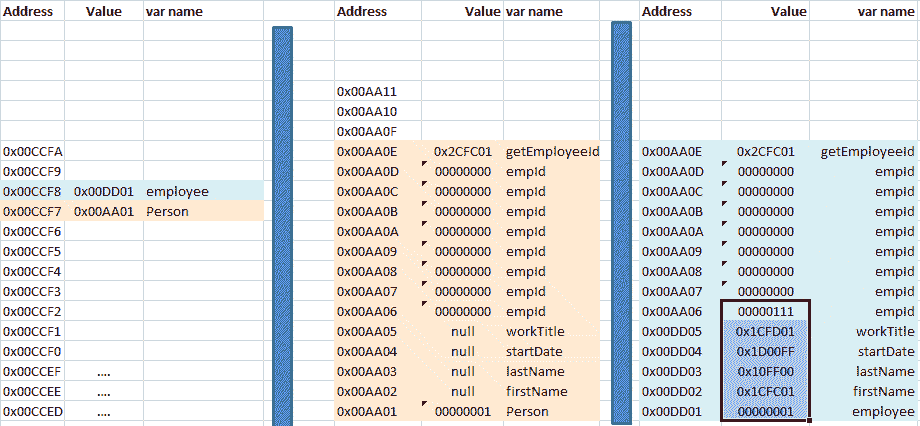 *图 30: 使用 this 运算符初始化新对象*

http://NewtonSaber.com/OOJavaScript/Images/Figure30.png

我将 `empId` 的设置为 7 仅作为我们的示例。设置该值的函数简单地生成 1 到 5,000,000 之间的随机值。

这意味着你对该对象所做的任何操作，都是在对对象本身进行操作。

#### 关于 getEmployeeId 函数的地址如何？

你可能已经注意到，在模板对象（`Person`）和新对象（`employee`）中，我将指向 `getEmployeeId` 函数的地址都设置为同一个值（`0x2CFC01`）。我这样做是因为我认为解释器应该足够聪明，能够看出这些是相同的函数（因为它们执行的工作相同），并且解释器会进行这种优化以节省内存。否则，同一个函数将以不同的地址被加载到内存中，然后由每个对象（`Person` 和 `employee`）分别引用。在我看来这似乎是浪费内存。

### 总结

现在你已经理解了对象在内存中是如何创建的、如何创建模板以及以及使用 `new` 和 `this` 操作符，你已经准备好学习更高级的内容了。我相信你发现自己对 JavaScript 的理解已经在脑海中呈指数级增长。
