# Official BBC Micro：bit 用户指南

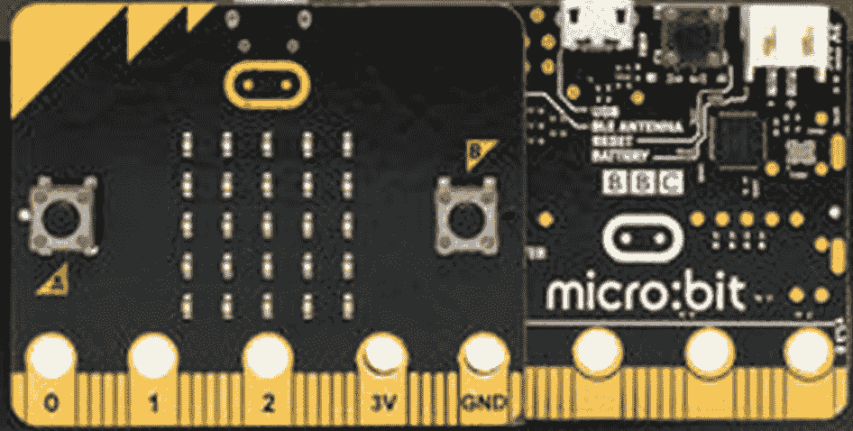

> 献给我的父亲，热情的过去；以及我的女儿们，令人兴奋的未来。
>
> — Gareth

## 关于作者

**GARETH HALFACREE** 是一位自由职业技术记者，与项目联合创始人 Eben Upton 共同编写了《树莓派用户指南》。Gareth 曾任职教育领域的系统管理员，他对开源项目的激情贯穿了他的职业生涯，你可以看到他对 GNU/Linux、LibreOffice、Fritz 和 Arduino 进行评审或文档编写。他还是 Sleepduino 和 Burduino 开源硬件项目的项目，这些项目扩展了 Arduino 电子原型系统的功能。他的目前工作摘要可以在 `http://halffacree.co.uk` 找到。

## 关于技术编辑

**DAVID WHALE** 是一位嵌入式软件工程师，拥有30多年的职业生涯，为各种高科技产品设计和构建嵌入式软件。David 是 STEM 大使以及工程技术学院（IET）的志愿者，他经常帮助学校和教师介绍并运行计算机俱乐部，并对教师进行常规培训。David 是通过与 IET 的关联参与到 micro:bit 项目的，他帮助开发了大量的教学资源，并培训和支持使用 BBC micro:bit 进行 IET 法拉第国家 STEM 挑战赛。David 现在于 Micro:bit 教育基金会工作，继续与包括 BBC 博士探队在内的许多合作伙伴组织开发项目和资源。David 是 Wiley 畅销书籍《我的世界冒险》的合著者，这本书通过孩子们对 Minecraft 游戏的兴趣教授他们 Python 编码，他曾担任过多种技术和计算书籍的技术编辑。

## 致谢

- 项目编辑：John Sleeva
- 副主编：Riley Harding
- 制作编辑：Brent Savage
- 校对：Debbye Butler
- 索引：Estita M. Slivos
- 制作经理：Wiley
- 封面设计：Beth Wakefield
- 封面图片：Gareth Halfacree
- 营销经理：Christie Hilbrich
- 技术总监：Barry Pruett
- 执行编辑：Jody Lefever

# 前言

**2015年4月**，我利用午休时间在当地超市寻找我能用到的最廉价的东西，用来完成一个为 BBC 的演示。他们那天下午看到的，是一个从 1 英镑闹钟上拆下来的电池夹，被粘在了一个早期的 BBC micro:bit 原型上。当时，我作为 BBC 招募的 31 个合作伙伴之一，正在帮助他们交付一项大胆且冒险的项目：为英国每一个初中 7 年级的学生免费创造一台编程设备。然而，BBC micro:bit 的设计初衷不仅仅是另一个可编程“开发板”，而是一个将创造力、学习以及教师和年轻人的易用性放在首位的即插即用工具。

作为项目的一名工程师，与 BBC micro:bit 协作最令我着迷的是，这些新受众利用这项技术所做的令人兴奋（有时甚至是荒唐）的事情：构建一个基于瞬间移动鸭子的游戏、测量火箭车的加速度、讲述关于披萨的互动故事、制作一个便携式心率监测器，或者发明你在书中看到的奇妙“雨水检测”功能。这完美地捕捉到了 BBC micro:bit 的令人振奋、简单性和创造潜力，我确定它将帮助更多的人成为编码者和发明家。

BBC micro:bit 的传感器和精巧的设计让最广泛的受众都能轻松上手并感到兴奋，即使是（可能特别是）那些从未意识到编程是给谁用的的人。构建第一个程序完全不需要花时间，而工具的简单性意味着接下来的过程将是一个成功与满足感的螺旋上升，鼓励你的想象力尽情释放。

BBC micro:bit 的魅力在于它能毫不费力地将虚拟与物理世界结合。在几分钟内，你就能让电脑开始控制现实世界。正是这种物理性和即时性创造了“micro:bit 时刻”。看到不同年龄的人在意识到手中设备的潜力，并想要用它创造新事物时，那种赋能的感觉是太神奇了——人们开始对使用技术感到兴奋，而不是畏缩。

Micro:bit 并不是真的关于学习编码；它是关于学习用技术去做你关心的事情。学习编码会在过程中发生：你几乎是顺便学会了如何让你的 BBC micro:bit 跳舞，而这首歌还有可以重复的歌词和副歌。这种方法有助于吸引所有年龄段的新编码者。独立研究追踪了 BBC micro:bit 在英国第一年的进展，发现 85% 使用过该设备的教师同意它让计算机科学对他们的学生变得更有趣，而 90% 使用过的儿童帮助向他们证明了任何人都可以编码。

micro:bit 工具酷炫的设计、广泛的吸引力和技术上的简单性，是 micro:bit 合作伙伴内部多样化的背景、观点、社区和兴趣的直接结果。这支广泛、跨学科的团队将设备、编辑器、学习材料以及 micro:bit 本身的概念塑造成了一个真正独特的生态系统。

Micro:bit 教育基金会成立于 2016 年 9 月，受托支持和开发该生态系统，并将 micro:bit 项目推向全球。在本书编写期间，该设备已在 50 多国可用，网站提供 12 种语言。我们拥有不断增长的教案、项目和点子库，以及与合作伙伴合作开发的新的、更先进的编辑器（在书中会有说明），以及一个不断壮大的爱好者、志愿者、优秀合作伙伴和教育工作者社区。

所以，开始使用 BBC micro:bit 不仅仅是为了构建你自己的创造。它也是为了加入一个全球社区，那里的人创造性地使用技术来表达自我、解决他们关心的问题、让他人的生活更好，并改变学习代码的感觉。

本书将向你介绍 micro:bit 的世界，但这只是你旅程的开始。欢迎来到 micro:bit 社区。我们期待看到你的创作！

—Jonny Austin，Micro:bit 教育基金会首席技术官

# 引言

**教育计算**一段悠久而辉煌的历史，从采用机械计算器来辅助数学课开始，到 20 世纪 80 年代通过“BBC 计算机素养计划”等倡议开启微型时代。随着计算机成本的下降和性能的提高，全球学校迅速从一台共享的计算机转变为整整一个房间都摆满了计算机，并将它们整合到语言、历史、工程以及艺术等学科中。

今天，许多家庭都有了自己的电脑，在某些情况下甚至有多台。虽然接触计算机的机会增加了，但实际操作它们却带来了一种与其内部工作原理脱节的感觉。BBC Micro 是由 Acorn Computers 在 20 世纪 80 年代设计的微型计算机，是 BBC 计算机素养计划的核心，它直接加载到一种名为“初学者全能符号指令代码”（BASIC）的基于文本的编程语言并邀请人们进行实验；而今天，大多数计算机加载到图形用户界面（GUI），它强调使用预定义的程序而不是创建你自己的程序。

BBC micro:bit 的设计是为了让人们在低成本、易理解的平台上重回学习编写代码的日子。BBC micro:bit 设计旨在作为一个国际计算机素养计划的核心（该计划直接灵感源于 BBC 最初的计算机素养计划），它是一个廉价且负担得起的微控制器，你可以在上面运行程序来完成任何事情，从拼出你的名字或玩游戏，到开关灯或通过无线电进行通信。

全球的学校已开始在课程中采用 BBC micro:bit，但对许多人来说，仅用于结构化的教育用途。该设备的易用性意味着它可以用于教授任何年龄儿童编程，它的坚固性和微小尺寸意味着它非常便携，而其惊人的性能和灵活性意味着你不太会受到限制。

# 本书的读者

本书适用于任何对使用 micro:bit 感兴趣的人。你不需要计算机、电子或编程的先验知识就能拿起 BBC micro:bit 并开始学习。

要从书中获得最大的收获，你只需要阅读能力和学习意愿。如果你以前用过电脑，你会发现可以跳过早期通用概念的章节。如果你用过其他的微控制器开发板，可以跳过更多。如果你熟悉电路，后面的章节可能不会有太大惊喜。

# 本书涵盖的内容

技术的进步是不停的，BBC micro:bit 也不例外。本书基于最新版本的 BBC micro:bit 硬件（1.3b）编写，但它完全适用于追溯到最初用于学校测试的所有版本。同样，得益于 Micro:bit 教育基金会的指导工作，它将适用于未来的所有版本。

BBC micro:bit 的软件与硬件一样处于不断开发之中。书中对软件的引用在编写时是准确的，所有的截图和相关材料都是在最新软件版本上捕捉的。随着时间的推移，软件的外观可能会发生变化，但其工作方式将保持不变。

这对于书中包含的程序尤为重要。BBC micro:bit 的可用语言将随时间扩展并获得更多功能，现有功能将一直可用。今天从书中获取的程序在多年后的 BBC micro:bit 上仍然可以使用。

# 本书的结构

第一部分“BBC micro:bit 简介”提供了硬件及其工作原理的指南、拆箱 BBC micro:bit 并探索示例程序的逐步说明，以及将 BBC micro:bit 连接到计算机以便加载你自己的程序。该部分还包含了许多使用 micro:bit 的技巧，包括如何处理它以防止发生可能的损坏。即使你已经用过 BBC micro:bit，也建议阅读这一部分。

第二部分，“为 BBC micro:bit 编程”将带你开始编写程序。你将学习 BBC micro:bit 可用的语言以及它们之间的区别，并学习如何编写自己的程序——从在 BBC micro:bit 显示屏上滚动简单的信息，到从其各种内置传感器读取数据，再到编写一个简单的游戏。

书中有三个章节专门介绍用于 BBC micro:bit 的三种主要编程语言：JavaScript 积木、JavaScript 和 Python。每一章的设计都尽可能相似，让你能够快速地看到不同语言之间编写每个程序过程的差异。你可以使用章节开头的对比表来选择一个你喜欢的语言并只阅读该语言的章节，也可以完成所有三个章节来真实感受每种语言的运行方式。

第三部分，“高级 micro:bit 项目”将更进一步，介绍了无线电模块，并示例了如何在单个 BBC micro:bit 之间以及一组 BBC micro:bit 之间进行无需电缆的通信。还专门有一个章节介绍了如何将 BBC micro:bit 与流行的树莓派单板计算机配合使用，扩展设备的功能。

此外，你将学习如何为 BBC micro:bit 添加开关和 LED 等外部组件，从基础组件开始构建电子电路以扩展其功能。这不涉及焊接，且电路的描述对于最年幼的读者也是安全且易于操作的；它们只需要少量廉价的电子元件。

你将充分理解 BBC micro:bit 的工作原理、如何对其编程以及如何与其他设备配合使用。尽管你还没有触及其功能的极限，但最后一章提供了额外资源的信息，包括可以进一步增加 BBC micro:bit 灵活性的硬件，以及提供更多项目想法和用于结构化教育的正式课程计划的网站。

最后，附录提供了书中提到的每个程序在三种语言中的完整程序列表，方便你输入，而不会被对程序每个部分功能的注释和解释所分心。如果你更愿意保存程序，可以从书籍网站 `www.wiley.com/go/bbcmicrobitguide` 下载书中的相同程序。你还将找到 BBC micro:bit 的引脚图及其功能的完整列表。

# 使用本书所需的准备工作

从技术上说，你可以在没有自己的 BBC micro:bit 的情况下开始使用这本书；模拟器允许你为 BBC micro:bit 编写程序并查看它们如何运行，即使没有将它们加载到物理 BBC micro:bit 上。然而，如果你至少有一个 BBC micro:bit 用于实验，你将从书中获得最多，此外这里详细列出了一些额外物品。

要运行书中列出的主要程序示例，你需要：

- 一个 BBC micro:bit
- 一根全线制的 micro-USB 线
- 一台运行 Microsoft Windows、Apple macOS 或 Linux 的计算机，并有一个空闲的 USB 端口
- 一个更新过的网络浏览器和正常的 Internet 连接

对于第 8 章“无线 micro:bit”包含的无线电程序，你还需要：

- 总共三个 BBC micro:bits
- 一个树莓派 Model B+、树莓派 Model 2、树莓派 Model 3 或树莓派 Zero W
- 如果使用树莓派 Zero W，需要一根 micro-USB OTG 适配接线

要构建第 10 章“构建电路”中详细说明的电路，你还需要以下物品：

- 带有鳄鱼夹或 4mm 香蕉插连接头的导线
- 一个按钮或开关
- 一个 LED
- 一个限流电阻（解释见第 10 章）
- 一个电位器

这些零件可以通过互联网或街头的电子元件店轻松获得，并且它们经常由 BBC micro:bit 销售商随 BBC micro:bit 本身一起提供。

## 规范

为了帮助你充分利用文本并跟踪发生的情况，我们在整本书中使用了一些规范。

技术术语在首次使用时以*斜体*表示。缩写词和首字母词也是如此，它们在首次使用时显示全称，然后显示其缩写形式。

书中处处使用公制单位，并在适当的括号内提供英制单位。

当一行代码会超出页面边界时，会打印一个 $\hookrightarrow$ 符号。当你看到这个符号时，继续输入代码而不要按 Enter 或 Return 键。如果你不确定如何输入某行代码，请访问网站 `www.wiley.com/go/bbcmicrobitguide`。

# 第 1 章 认识 BBC micro:bit

在本章中：

**BBC micro:bit** 是一个非常复杂的设备，兼具教育和娱乐功能。当你按下按钮时，它可以简单地显示笑脸。

你可以用多种*编程语言*为 BBC micro:bit 编写程序，也可以运行别人的程序。你可以在教室、俱乐部或家里使用 BBC micro:bit。你可以玩游戏、解决问题并发明新设备，这一切只需通过你的 BBC micro:bit。

在开始这一切之前，你需要先认识 BBC micro:bit。

## 板载导览

BBC micro:bit 在技术上被称为*微控制器开发板*。也就是说，它是一个*印刷电路板* (PCB)，上面可以运行你自己的程序并连接自己的硬件。

最早的微控制器开发板昂贵且难以使用。在首次推出的几十年里，它们变得越来越便宜且易于获取，直到 BBC micro:bit 变成了一个低成本、功能强大的板，旨在帮助任何背景的人学习编程，或“编码”。你的编程之旅从这里开始：了解 BBC micro:bit 本身。

> 警告 BBC micro:bit 设计得很坚固，但它仍然是一个复杂的电子设备。它被设计成裸电路板，以便你可以看到所有的组件及其功能，但这意味着如果你将其放入外壳，处理时需要更加小心。务必通过边缘处理它，以防静电损坏。关于防止静电损坏的更多信息，请参见第 2 章“入手 BBC micro:bit”。

BBC micro:bit 本身是一个安装了系列元件的小型印刷电路板。它有两个面：BBC micro:bit 的正面包含显示屏和按钮，而背面有如 micro-USB 接口和无线电等组件。图 1-1 显示了 BBC micro:bit 的正面，图 1-2 显示了背面。

图 1-1: BBC micro:bit 的正面

BBC micro:bit 包含一层被称为丝网层（silkscreen layer）的印刷，上面标记了一些较重要的组件。正面的按钮标记为 A 和 B，这样你就能区分是哪一个，而背面则标出了处理器和加速度计等关键组件。这些组件以及其他将在下一节中进行更详细的描述。

## 拆解

与任何复杂设备一样，BBC micro:bit 由许多相对简单的部分组成。从显而易见的部件，如占据主板正面的显示器，到更细微的部分，如无线电模块（它允许两个或多个 micro:bit 相互通信，或连接到智能手机或平板电脑），每个组件都协同工作，赋予了 BBC micro:bit 令人印象深刻的活性。

如果你迫不及待要开始使用你的 BBC micro:bit，可以直接跳到第 2 章。不过，阅读本章的其余内容将让你充分了解 BBC micro:bit 能够做什么，这不仅有助于你学习它是如何工作的，还能在你技能进步的同时，为你开发自己的实用项目打下良好基础。

## 显示器

BBC micro:bit 最显而易见的特征是它的显示器，它位于主板正面的中心（见图 1-3）。这是 BBC micro:bit 的主要输出设备，是运行在 BBC micro:bit 上的程序与外部世界通信的一种——无论是读取 BBC micro:bit 传感器之一的位置，还是简单地显示一个笑脸。

图 1–3：BBC micro:bit 的显示器

BBC micro:bit 显示器的功途与台式电脑上的显示器相同，但分辨率低得多。台式显示器可能由 1,920 列 1,080 个图像元素（像素）组成，而 BBC micro:bit 有 5 列 5 个图像元素，总共 25 个像素。

虽然 25 个像素听起来并不多，但对于查看有用信息（如条形图、简单游戏的元素或任何长度的滚动消息）完全足够。你将在书中后面的部分学习更多关于如何使用显示器完成这些任务。

从技术角度来看，BBC micro:bit 的显示器由一个 5x5 发光二极管（LED）矩阵组成。矩阵中的每个 LED 相当于一个像素，并能以不同的亮度显示单一颜色。通过改变亮度和快速切换显示的图像，BBC micro:bit 的显示器可以显示动画以及静态图像。

## 按钮

在显示器旁边，按钮是 BBC micro:bit 第二个显而易见的特征。两个主按钮按钮 A 和按钮 B 位于主板正面显示器的两侧，并用它们的字母进行标记以避免任何混淆（见图 1-4）。这两个按钮构成了 BBC micro:bit 的主要输入设备。显示器允许从运行在 BBC micro:bit 上的程序输出信息，而按钮允许你向程序发送简单的输入，以更改显示的图像（例如），或控制游戏中的角色。

图 1-4：BBC micro:bit 的按钮 A 和按钮 B

这些按钮在技术上被称为动开关（momentary switch）。它们与你可能用来开灯的开关不同，后者被称为锁存开关（latching switches）或双动开关（toggle switches）。动开关只有在你持续按下它时才保持“开启”状态，而锁存开关则从“关闭”变为“开启”并一直保持，直到你再次按下。

尽管按钮永久连接到 BBC micro:bit，但如果运行在 BBC micro:bit 上的程序没有监听按钮输入，它们就不会产生任何作用。取决于你如何使用 BBC micro:bit，你可能想使用两个按钮中的一个甚至一个都不用；或者，你可能会需要更多按钮，在这种情况下，输入输出引脚将为你提供帮助。

除了按钮 A 和按钮 B 之外，BBC micro:bit 背面还有一个第三个按钮。像台式电脑一样，BBC micro:bit 的无线电模块作用于你的。无论 BBC micro:bit 正在做什么，这个按钮都会导致 BBC micro:bit 复位。这个按钮对于 BBC micro:bit 的，当你在使用 BBC micro:bit 实验程序时，BBC micro:bit 就会停止并开始。这个按钮还有其他用途，将在稍后的章节中进行解释。

## 处理器

处理器通常被称为计算机的“大脑”，BBC micro:bit 的处理器——技术上称为微控制器（microcontroller）也不例外。它位于 BBC micro:bit 的左上方，并标记在丝网层上，是一个指甲盖大小的正方形，被称为集成电路（见图 1-5）。

图 1-5：BBC micro:bit 的处理器

尽管尺寸很小，这个集成电路却惊人地复杂。虽然台式电脑的内存、存储和中央处理器都是分开的，但 BBC micro:bit 的处理器是合体的；这被称为片上系统（system-on-chip）。

BBC micro:bit 还有一个第二个处理器，没有标记在丝网上，而是位于主板的右上方。当你使用 micro-USB 线将 BBC micro:bit 连接到电脑时，这个处理器就会接管并处理通信。

ARM 处理器使用一套特殊的指令，被称为 ARM 架构（ARM Architecture）。以发明它的公司命名，ARM 处理器旨在以最低的功耗提供高性能。对于对技术感兴趣的人来说，BBC micro:bit 的处理器是一个 Nordic nRF51822，包含一个运行在 16MHz 的单核 Cortex-M0、16 KB 的随机访问内存（RAM）以及 256 KB 的非易失性内存（NVM）。

## 无线电

BBC micro:bit 的一个主要功能是它的无线电，它允许它与其他 micro:bit 或设备（如智能手机或平板电脑）通信。无线电本身是 BBC micro:bit 主处理器的一部分，构成了片上系统的部分。

BBC micro:bit 有两个主要功能。第一个功能是与其他 micro:bit 进行无线通信，允许你在无需在它们之间连接电缆的情况下将它们分组。第二个功能是与其他设备通信，它使用低功耗蓝牙（BLE），这是大多数智能手机和平板电脑内置的流行蓝牙标准的低功率版本。

与你可能用来收听的类型不同，BBC micro:bit 的无线电芯片没有外部天线。相反，它使用内置在电路板本身的巧妙形状的铜线。你可以在 BBC micro:bit 后面的左上方找到它，标记为“BLE ANTENNA”（见图 1-6）。它看起来并不大，但如果你对着光看，你应该能看到线条勾勒出一系列矩形形状——前提是天线没有被某些国家要求的所有无线电发射器的合规性标签所覆盖。

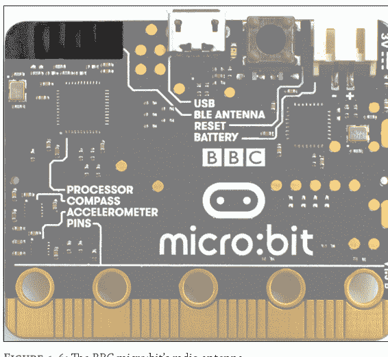

## 加速度计

作为 BBC micro:bit 的两个内置传感器之一，其加速度计是一个集成电路，甚至比处理器芯片还要微小（见图 1-7）。它非常小，如果不是在板子的丝印上做了标记，很容易被忽略。尽管体积很小，这块芯片非常聪明：它能够精确地知道 BBC micro:bit 在任何时刻空间中的位置。

当你将智能手机从竖屏切换到横屏或反之时，加速度计会告诉设备你执行了什么操作，并允许屏幕自动旋转。BBC micro:bit 的加速度计工作原理相同：它通过跟踪所谓的“固有加速度”，追踪设备在三个轴上（侧向、前后和上下，即 X、Y、Z 轴）的角度。

在第 2 章将介绍的 BBC micro:bit 演示程序中，可以看到加速度计的作用。

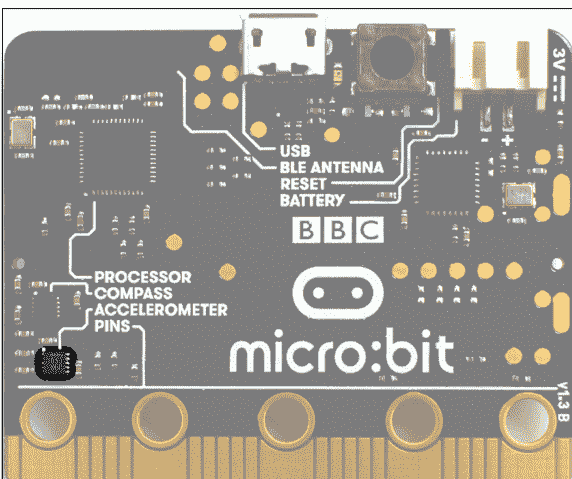

图 1-7：BBC micro:bit：加速度计

## 罗盘

BBC micro:bit 两个内置传感器中的第二个是罗盘，它的工作原理与同名的导航工具类似：罗盘会检测磁北并指向你所在的方向。例如，如果你正在制作机器人，罗盘是一个可靠的导航点方法。与加速度计一样，罗盘也是设备背面一个微小且容易被忽略的集成电路，在丝印上有所标记（见图 1-8）。

像传统的磁性罗盘一样，BBC micro:bit 的罗盘通过感知磁场工作。因此，它还有第二个“秘密武器”：检测地球自然磁场之外磁场的能力。使用这块芯片，BBC micro:bit 不仅可以指示北方，还能指示局部磁场的强度——甚至可以检测金属。然而，由于它是通过检测这些磁场工作的，这意味着当作为罗盘使用时，附近的磁铁（例如扬声器中的磁铁）可能会影响传感器的准确性。

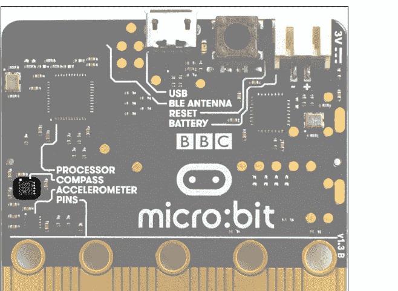

图 1-8：BBC micro:bit 的罗盘

## 输入输出引脚

BBC micro:bit 在底部留有输入输出引脚形式的扩展空间（见图 1-9）。这些并不是字面上的引脚，而是 BBC micro:bit 印刷电路板两侧的铜条；“引脚（pin）”是一个技术术语，指的是它们与处理器的“引脚”之间的连接。

五个最大的引脚（有时根据其形状被称为焊盘（pads）或圆环（rings））位于电路板的正面：0, 1, 2, 3V 和 GND。前三个是 BBC micro:bit 本身的主要输出引脚，而后两个为你构建的任何电路提供电源和地线连接。每个引脚顶部都有一个小孔，允许你使用鳄鱼夹或香蕉插连接器快速将硬件连接到 BBC micro:bit 上。它们还适用于导电线（见第 12 章“可穿戴的 BBC micro:bit”），有时可以通过小导电螺丝配合扩展板使用（见第 11 章“扩展 BBC micro:bit”）。

正如其名所示，输入输出引脚可以用于检测 BBC micro:bit 的输入，也可以从 BBC micro:bit 获取输出。例如，你可以将温度传感器连接到引脚 0，使用引脚 1 在温度升高到特定水平时点亮 LED 或发出警报。你将在第 10 章“构建电路”中学习更多内容。

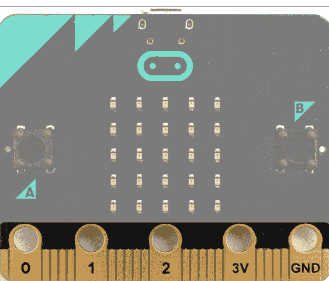

图 1-9：BBC micro:bit 的输入输出引脚

除了五个大引脚，BBC micro:bit 还有 20 个较小的引脚。与大引脚不同，这些引脚没有用于鳄鱼夹或香蕉插的孔。相反，它们需要边缘连接器，如第 11 章“扩展 BBC micro:bit”所示。大多数 micro:bit 项目只需要三个主输入输出引脚；其余引脚是为更复杂的项目提供的。

## Micro-USB 端口

BBC micro:bit 的 micro-USB 端口位于后部上边缘中部（见图 1-10），具有两个用途：当你不使用电池盒时它提供电源，并允许将 BBC micro:bit 连接到计算机以更改程序并进行数据通信。这些用途将从第 2 章开始详细说明。

使用 micro-USB 端口时，务必小心轻柔。内部连接器非常脆弱，如果你损坏了它（例如反向插入 micro-USB 连接器或强行插入），你将无法使用 BBC micro:bit。该端口应仅与 micro-USB 线配合使用，你不应强行将 micro-USB 连接器插入端口，否则可能会损坏 BBC micro:bit。

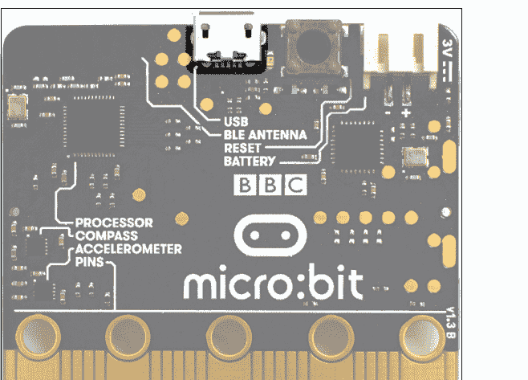

图 1-10：BBC micro:bit 的 USB 端口

micro-USB 端口通常用于手机和平板，如果你有 micro-USB 线，就可以正常工作。micro-USB 连接器在技术上被称为 JST。并非所有电池都适用于 BBC micro:bit。充电电池使用的电压较低（1.2V 而非 1.5V），这意味着 BBC micro:bit 可能无法获得足够的功率并可能损坏。

## 电池连接器

BBC micro:bit 的微小尺寸、内置传感器以及对导电线的兼容性使其成为便携项目的理想选择，但从电脑供电就不够方便。这时连接器派上了用场。在 micro:bit 顶部（见图 1-11），电池盒允许你随时为 BBC micro:bit 供电。

电池盒随 BBC micro:bit 组合以及许多第三方 BBC micro:bit 套件提供。如果单独为 BBC micro:bit 购买电池盒，请向制造商或供应商确认其兼容性；连接电压或极性错误的电池盒可能会损坏你的 micro:bit。

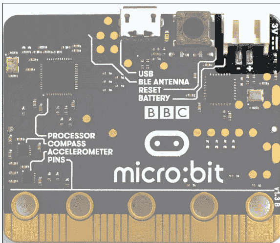

图 1-11：BBC micro:bit 的电池连接器

## 静电防护

所有电子设备对所谓的静电放电（ESD）都很敏感。如果你在潮湿的天里走在厚地毯上并触摸金属门把手，你就曾亲身经历过 ESD，表现为听得见的“啪”声和从手到金属表面的明亮火花。对人类来说，ESD 是微小的困扰，但对敏感的电子设备来说，可能是致命的。

为了确保你的 BBC micro:bit 不受损坏，请采取一些防静电措施。首先，在拿起 BBC micro:bit 之前，始终接触金属表面，这样如果你积聚了静电，它就会释放到 BBC micro:bit 以外的地方。持有 BBC micro:bit 时，尝试抓住侧边而不是底部的铜色条，并让手指远离板子背面的小黑色元件。

## 为 BBC micro:bit 供电

与任何电子设备一样，BBC micro:bit 需要电才能运行。它可能由几个巧妙的组件组成，但在任何组件开始工作之前，它仍然需要电源。

为 BBC micro:bit 供电的最常见方法是通过其 micro-USB 接口，或者将两节 1.5 V AAA 或 AA 电池插入电池盒，电池盒可以连接到 BBC micro:bit 的次级电源输入端。

> micro:bit 有三种供电方式：将任何 3V 电源连接到边缘连接器上标记为“3V”和“GND”的引脚。这样做会绕过防止短路和向 BBC micro:bit 提供过高电压的保护措施，如果在使用过程中夹子移动，可能会导致 micro:bit 损坏。有关使用 3V 引脚的更多信息，请参阅第 10 章“构建电路”。

# 第 2 章 上手使用 BBC micro:bit

## USB 供电

要通过 USB 为 BBC micro:bit 供电，你需要一根 micro-USB 线。某些 BBC micro:bit 硬件包（例如官方 BBC micro:bit Go 包）包含线缆，而其他一些则需要你自己提供。如果自选，请确保它的质量良好且不是“仅充电”；这些线缆只能为连接的设备提供电源，而无法建立数据连接，虽然它们能为 BBC micro:bit 供电，但你将无法对其进行编程或通信。

将线缆较小的 micro-USB 端插入 BBC micro:bit 的 micro-USB 插座，注意确保方向正确。micro-USB 连接器的弯曲面朝下，BBC micro:bit 放置时 LED 显示屏应位于底部，如图 2-1 所示。当 micro-USB 线固定插入后，翻转 BBC micro:bit，将线缆的另一端插入电脑或其他 USB 电源的空闲 USB 端口（见 2-2）。当 BBC micro:bit 通过 micro-USB 端口接收电源时，BBC micro:bit 背部 micro-USB 端口和 Reset 按钮之间的小型黄色系统 LED 将亮起。注意，这仅适用于 USB 供电；如果你配合 BBC micro:bit 使用电池盒，此 LED 将不会亮。

如果 BBC micro:bit 尚未加载新程序，它将开始运行本章稍后在“来自 BBC micro:bit 的问候”节中详细介绍示例程序；否则，它将自动运行内存中的上一个程序。关闭 BBC micro:bit，只需断开任一端的 micro-USB 线。

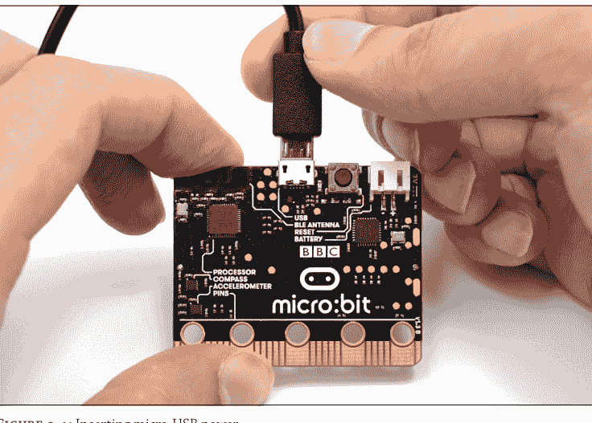

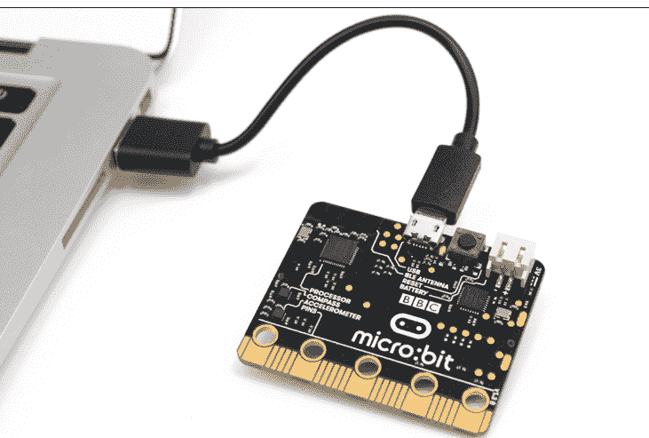

图 2-2：通过 USB 供电的 BBC micro:bit

## 电池供电

通过 USB 电源为 BBC micro:bit 供电既快又简单，但并不灵活。如果你计划离开桌面使用 BBC micro:bit，更好的选择是使用安装在保护盒中的电池为板卡供电，然后连接到 BBC micro:bit。

## 来自 BBC micro:bit 的问候

刚从箱子里取出的 BBC micro:bit 预装了一个示例程序，该程序将带你了解它的各种功能，包括 A 和 B 按钮以及加速度计。当 BBC micro:bit 通过 USB 或电池供电时，该程序就会运行，它是对该平台很好的介绍。

如果你的 BBC micro:bit 之前被用过并加载了不同的程序，则将运行新程序而不是工厂预装的示例程序。如果是这样，你可以跳过本章的剩余部分，直接进入第 3 章。如果你或其他人替换了示例程序并想重新加载，可以从 `support.microbit.org` 搜索“first experience demo program”并下载副本。你将在第 3 章学习如何将其加载到 BBC micro:bit 中。

示例程序不会在运行之间存储信息。每当 BBC micro:bit 通电时，示例程序都会从头重新开始。当你将自己的程序加载到 BBC micro:bit 时（详见第 3 章），该程序将替换 BBC micro:bit 内存中的示例程序。

如果你想在没有任何预期的情况下开始尝试 BBC micro:bit 的入门程序，请先阅读这段话，并等在至少运行一次该程序后再回来。首先，通过 USB 或电池为 BBC micro:bit 通电。

### 运行迹象

当 BBC micro:bit 运行示例程序时，你看到的第一个现象是一个展示 LED 显示屏展示的动画。虽然一个 5 × 5 的单色 LED 阵列听起来可能很有限，但实际上，它足以显示一些吸引人的图形和动画了；它甚至可以玩游戏，正如你稍后在程序中看到的那样。动画结束后，BBC micro:bit 将用在屏幕上滚动的简单单词向你问好：“HELLO”。这参考了在学习新编程语言时编写的经典第一个程序：“Hello, World!”。你将在第二部分“为 BBC micro:bit 编程”中学习编写你自己的版本的“Hello, World!”，但现在请等该消息滚动完毕，程序移动到下一个片段。

### 测试按钮

动画和问候结束后，程序进入了第一个交互部分。你将看到一个闪烁的箭头指向 A 按钮，并周期性地替换为字母 A 以进一步引导关注点：现在你应该按下 LED 显示屏左侧的 A 按钮。

当你按下 A 按钮时，将获得另一个动画，随后是一个指向 B 按钮的箭头，该箭头会周期性地替换为字母 B。按照指示按下按钮以触发另一个动画，程序将加载它的分段：运动控制。

### 运动游戏

micro:bit 的加速度计（详见第 1 章）使其能够检测运动以及它在所有三个维度上的持握角度。这最初通过一种简单的方式进行演示：消息“SHAKE”（抖动）将在 LED 显示屏上滚动，随后是一个简单的动画。抖动 BBC micro:bit——注意不要把它扔到房间另一头或拔掉电源线——程序就会继续运行。

抖动结束后，程序将显示“CHASE THE DOT”（追逐圆点）的消息，然后玩一个游戏，目标正如你可能猜到的一样——追逐一个圆点。圆点以显示屏右上角的 LED 形式，而你的角色是显示屏中间的另一个 LED。

不过，这个游戏不是用按钮玩的。平拿 BBC micro:bit，开始倾斜 micro:bit，就像你在托盘上滚弹珠一样。随着加速度计检测到角度的变化，你会看到代表你角色的圆点开始移动。保持倾斜直到你的点到达目标圆点，一个新的目标圆点将会亮起。当你捕捉到一个点时，程序将进入它的最后一个片段。

### 开始编程

捕捉到后，你将看到鼓励性的信息“GREAT!”（太棒了！）滚动过屏幕，随后是一条简单的指令：“NOW GET CODING”（现在开始编程）。

此时，程序已完成。最后一个片段会加载一个环绕心形图案的简单动画，该动画会反复出现。如果你想重新运行程序，可以按下 BBC micro:bit 背面的 Reset（重置）按钮回到开头；或者，如果你断开电源并重新连接，程序将从头开始。

尽管这看起来很简单——而且实际上确实如此——但这个简单的程序涵盖了 BBC micro:bit 的许多主要功能：使用 LED 显示屏显示图片和动画；读取按钮作为输入；使用加速度计检测宏观运动和精细角度；以及在 LED 显示屏上滚动文本。这些都是你在从第 3 章开始学习为 BBC micro:bit 编写代码时将用到的功能。

## 重置 BBC micro:bit

无论你是使用示例程序还是自己编写的程序，熟悉重置 BBC micro:bit 都是有用的：使用 micro-USB 接口和电池连接器之间的 Reset 按钮。按下此按钮会向 BBC micro:bit 的处理器发送一个信号，就像电源短暂切断了一样，从而从头启动程序。

重置按钮（见图 2-6）非常重要，因为有很多原因导致你可能需要中断程序运行并重新开始。程序中可能存在导致无限循环的 Bug，导致你无法继续进行。某些程序（如本章稍早详述的预装示例程序）仅被设计为运行一次并完全停止，此时重新启动的唯一方法就是重置 BBC micro:bit。在你编写程序时，你可能想要反复测试程序以消除任何 Bug。

图 2-6：BBC micro:bit 的重置按钮

无论出于什么原因你想重启程序，都要习惯使用重置按钮。虽然技术上可以通过断开并重新连接电源来重启程序，但这会对电源连接器造成不必要的压力，并随着时间的推移对 BBC micro:bit 造成损坏。

使用重置按钮永远不会损坏 micro:bit。与桌面电脑或笔记本电脑不同，micro:bit 可以随时重置而不会损坏。

# 第 3 章 为 BBC micro:bit 编程

在本章中你将：

- 与 micro:bit 玩耍

第 2 章介绍的“开始使用 micro:bit”预装程序是学习硬件的极佳方法。开始充分利用 micro:bit 时，你将用自己的代码来替换示例程序。

## USB 连接

BBC micro:bit 顶部的 micro-USB 接口有两个用途。在第 2 章中，你学习了如何通过此接口为 micro:bit 供电，但它也用于从计算机发送数据——无论是来自传感器的信息还是你编写的新程序。

要将 BBC micro:bit 连接到计算机，你需要一根 micro-USB 线。如果你的 micro:bit 没有自带线，可以使用任何质量良好的线。来自平板电脑或手机的线通常有效，从网上或实体店购买的廉价线也可以。唯一的例外是所谓的“仅充电”线，它们专为充电器和电池包设计。这些线缺少连接到 USB 端口数据引脚的线，看起来可以通电，但正如后文所述，你不会看到名为 MICROBIT 的驱动器出现。如果发生这种情况，你需要找一条数据引脚正常的线。你还需要计算机上的 USB Type A 端口。在笔记本电脑上，这些端口通常位于侧面（见图 3-1）；在台式电脑上，少量端口通常位于背面与其他电缆之间。

如果你有一台只有 USB Type C 端口的计算机（见图 3-2），你需要一个将 USB Type C 端口转换为更常见的 USB Type A 标准的适配器。此类适配器通常随计算机附带，但如果没有，在网上商店搜索“USB Type C 转 Type A”可以提供廉价的选择，它们与 BBC micro:bit 配合良好。

图 3-1：USB Type A 端口

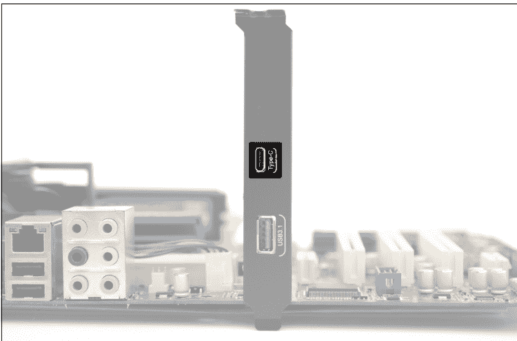

图 3-2：USB Type C 接口

BBC micro:bit 支持运行 Microsoft Windows 7 或更高版本、Apple OS 10.6 或更高版本或 Linux 3.0 的计算机。然而，它巧妙的设计意味着它甚至可以在更旧的机器上运行，但如果你遇到任何问题，第一步始终应该是尝试在运行这些最低操作系统的计算机上测试 BBC micro:bit。

> 警告

## 拖放下载

与某些开发板不同，BBC micro:bit 不需要你在加载新程序时在计算机上安装任何额外的软件或驱动程序。相反，它会显示为一个*USB 大容量存储设备*，就像外部硬盘或闪存内存一样。当你第一次连接它时，不要看到它正在运行你的示例程序而感到惊讶；只要 BBC micro:bit 有电，它就会继续运行最后一次加载到内存中的任何程序，即使你正准备加载一个自己设计的新程序。

将程序加载到 BBC micro:bit 上被称为*闪录*（flashing），这是根据 BBC micro:bit 用于存储的内存类型命名的：闪存（flash memory）。关于闪存的更多可以在在本章末尾找到，但你只需要知道，当 BBC micro:bit 以存储设备相同的形式出现在你的计算机上时；你访问的就是闪存。

传统上，在像 BBC micro:bit 这样的板卡上对微控制器进行闪录需要专业软件，该软件必须安装在你想要编程的每台计算机上。然而，BBC micro:bit 要简单得多：当你有一个程序要加载时，只需将其从计算机上的文件夹中拖到 BBC micro:bit 上，它就会自动将其加载到内存中。

现在，将电缆的 micro-USB 端连接到你的 BBC micro:bit，并将电缆较大的 USB Type A 端连接到计算机。几秒钟后，它将作为一个 MICROBIT 驱动器出现（见图 3-3）。一眼看去，它就像你以前使用过的任何优盘或外部硬盘，并显示两个文件：DETAILS.TXT 和 MICROBIT.HTM。第一个文件包含运行在你的 micro:bit 上的固件的技术细节；第二个文件提供了指向 micro:bit 网站的便捷链接。

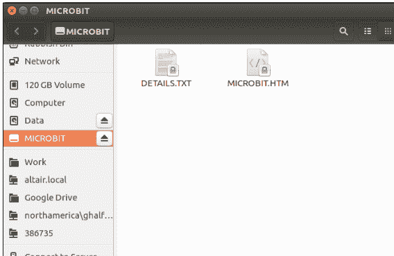

图 3-3：作为可移动驱动器的 BBC micro:bit

如果你尝试删除或编辑这两个文件中的任何一个，将受到修改保护。这是因为 BBC micro:bit 并不是像优盘那样的真正的可移动磁盘；相反，你看到的是计算机和固件之间的接口。如果你尝试将计算机上的一个文件——例如一张图片或一个 Word 文档——拷贝到 BBC micro:bit，当你下次放入它时它就会消失，而不会对 BBC micro:bit 的工作方式产生任何细微的影响。

当拷贝到 MICROBIT 驱动器时，BBC micro:bit 不会忽略的唯一文件是以你编写的程序形式存在的，这些程序会被 BBC micro:bit 读取并存储在闪存中，以替换当前加载的程序。这些程序与你在计算机上运行的程序不同，它们不是可执行程序；相反，它们是十六进制代码，告诉 BBC micro:bit 它的闪存的每一块应该存储什么内容。这些程序具有 .hex 文件扩展名，被称为 hex 文件。

无论你是在编写自己的程序还是使用别人的程序，这些 hex 文件都是通过你计算机的网络浏览器下载的。如果你下载了一个文件，打开你的“下载”文件夹，当光标悬留在文件上时点击并按住鼠标左键，然后将其拖到 MICROBIT 驱动器。BBC micro:bit 会看到该文件，分析它，并在你的新程序运行之前将其加载到内存。

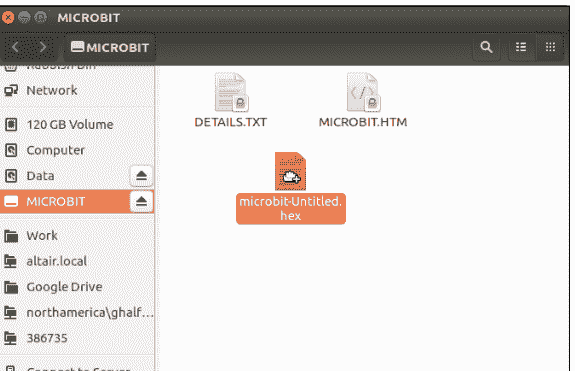

图 3-4：将 hex 文件拖入 BBC micro:bit

当新程序被加载到 MICROBIT 驱动器时，BBC micro:bit 将自动重置以开始运行。这通常会触发警告，提示它被视为可移动存储设备已在没有使用“弹出”或“删除硬件”功能的情况下被移除。对于传统的存储设备，在不使用操作系统的“弹出”功能的情况下将其从计算机中移除可能会导致数据丢失。然而，BBC micro:bit 的设计使得它永远不需要弹出。如果你看到显示相反的警告消息，可以安全地忽略它。

## 自动闪录

如果你运行的是 Microsoft Windows 7 或更高版本，还有另一种方法向 BBC micro:bit 闪录新程序：micro:bit Uploader 工具。该工具可从 `makecode.microbit.org/uploader` 获取，它在后台运行并监控你的“下载”文件夹中的新 hex 文件。当检测到新的 hex 文件时，它会自动闪录到你的 BBC micro:bit 上。

如果你在一台计算机上使用多个 BBC micro:bit，请务必小心：Uploader 会在你下载 hex 文件时，向当前连接的所有 BBC micro:bit 闪录新程序。如果你在任何一个 BBC micro:bit 上有不同的程序，该程序将被覆盖。

要在不再次下载的情况下加载以前下载的程序，只需使用本章之前介绍的拖放方法。

## 代码编辑器

计算机程序始于包含指示计算机应该做什么的文本文件。虽然可以在 Microsoft 记事本或 LibreOffice Writer 等文本编辑器中编写程序，但更常用的是称为集成开发环境（IDE）的工具。从本质上说，IDE 是专为编程设计的文本编辑器，包含了你编码、调试和编译所需的所有工具。

对于 BBC micro:bit，你不需要在计算机本身上安装 IDE 软件。相反，IDE（作为代码编辑器）完全运行在你的浏览器中。虽然 BBC micro:bit 支持多种编程语言，但最常用的是 Microsoft 提供的 JavaScript Blocks 编辑器。

通过访问 `makecode.microbit.org` 加载 JavaScript Blocks 编辑器，你会看到一个示例程序（见图 3-5）。当你第一次加载时，JavaScript Blocks 编辑器默认处于 Blocks 模式；点击顶部的切换将显示另一种语言——JavaScript。你将在第四章了解更多语言。

你还会看到一张 micro:bit 的图片，通常位于屏幕左侧。这是模拟 BBC micro:bit IDE 的一个关键功能。在你将程序加载到 BBC micro:bit 之前，它提供了你的程序将做什么的见解。使用它，你可以尝试更改程序，而无需每次花时间在 BBC micro:bit 硬件上进行测试，即使你没有物理 BBC 设备。如果你编写了一个需要按下按钮 A 或 B 的程序，只需点击图片上的按钮 A 或 B 来模拟输入。

如果让模拟器运行未完成的程序会分散你的注意力，只需点击其下方的“停止”按钮（见图 3-6）。

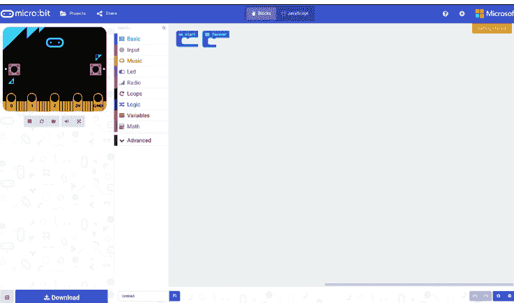

图 3-5：JavaScript Blocks 编辑器

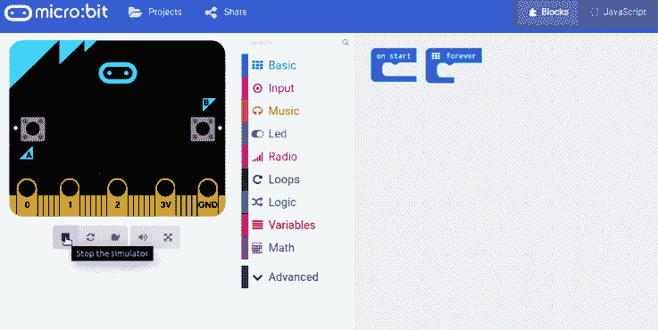

图 3-6：停止模拟器

## 下载你的程序

已经加载到 JavaScript Blocks 编辑器 IDE 中的示例程序是练习你在本章之前学到的拖放方法向 BBC micro:bit 加载新软件的极佳方法。

在不对程序进行任何更改的情况下，点击下载（Download）按钮（见图 3-7）。示例程序的 hex 文件将自动下载到你的电脑上，同时浏览器窗口中将出现一个信息屏幕，提供将文件加载到 BBC micro:bit 的逐步操作说明。

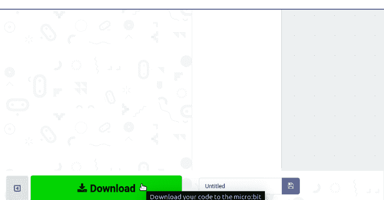

图 3-7：下载按钮

每次下载仅需几秒钟，因为 hex 文件非常极小。如果你的 BBC micro:bit 尚未连接到电脑，请拿起 micro-USB 线，将其插入 BBC micro:bit 和电脑的任一空 USB 端口。BBC micro:bit 将以可移动磁盘 MICROBIT 的形式出现在你的电脑上，准备好接收新程序。

在 Windows 的文件管理器 Explorer 中、macOS 的 Finder 中，或者如果你运行的是 Linux，在你特定的桌面环境提供的任何工具中——找到你的“下载”（Downloads）文件夹（见图 3-8）。滚动文件列表，直到找到你下载的 hex 文件 `microbit-Untitled.hex`——或者，如果你在 Apple macOS 上运行的是旧版 Safari 浏览器，只需寻找 `Unknown`。旧版 Safari 用户应在书中任何引用 `microbit-Untitled.hex` 或其他文件名的地方寻找名为 `Unknown` 的文件——或者升级到 Safari 10.1 或更高版本，以获得更易读的文件命名便利。Safari 10 或更旧版本的用户可能会发现 BBC micro:bit 烧录程序需要很长时间。如果是这样，请在将文件拖入 MICROBIT 可移动磁盘之前，将其重命名为包含 .hex 扩展名的文件。

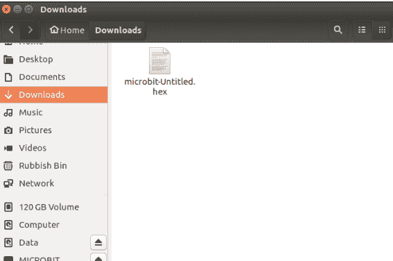

图 3-8：下载文件夹

点击并按住鼠标键，直到光标悬在 `microbit-Untitled.hex` 上。然后，在按住鼠标键的同时，将文件拖到文件夹列表中的 MICROBIT 驱动器（见图 3-9）。松开鼠标键，文件将被复制到 BBC micro:bit 的闪存中并自动加载。你可以通过观察 micro-USB 端口和 Reset 按钮之间的黄色系统 LED 来看到这一过程：当程序烧录时，LED 将闪烁，一旦程序加载完成，它将恢复为常亮。虽然你烧录的短程序是有效的，但它并不包含告诉 BBC micro:bit 该做什么的指令，因此它完全不会执行任何操作。

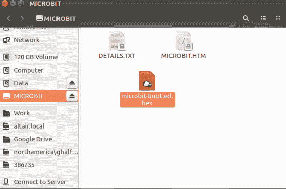

图 3-9：烧录示例程序

> 警告：如果你已将 BBC micro:bit 连接到电脑但看不到 MICROBIT 驱动器，请尝试将 micro-USB 线换到电脑上的另一个 USB 端口并重启你的操作系统。

如果你看不到 MICROBIT 驱动器，请尝试另一根 micro-USB 线。线缆（尤其是那些用于 USB 宝和类似设备的线）仅具有提供电源和数据信号所需的线；这些线可以为 BBC micro:bit 供电，但不能用于烧录新程序或与 BBC micro:bit 通信。如果你确定使用的是全线芯的 micro-USB 线但仍然看不到 MICROBIT 驱动器，请访问 `micro:bit.org` 获取进一步的故障排除步骤。

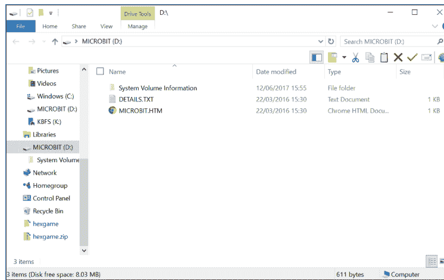

图 3-10：Windows 10上的 MICROBIT 驱动器

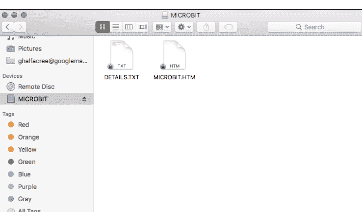

图 3-11：macOS Sierra 10.12 上的 MICROBIT 驱动器

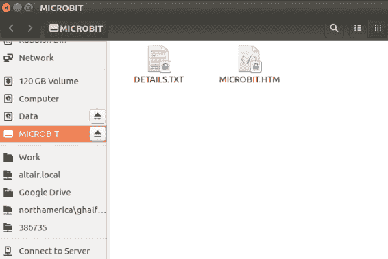

图 3-12：Ubuntu Linux 上的 MICROBIT 驱动器

## 关于闪存

为了理解 BBC micro:bit 如何存储其程序，有必要了解一下电脑拥有的不同类型的内存：*易失性内存*（volatile memory）和*非易失性内存*（non-volatile memory）。

易失性内存是一个临时存储区域，类似于通过反复低声重复某事将其留在脑中。它需要不断刷新，并且只有当电脑（在本例中为 BBC micro:bit）拥有内存时才存储信息。断电后，内存内容将永久消失。

相比之下，非易失性内存更持久，就像在笔记本上写字。非易失性内存不需要不断刷新，即使在电脑断开电源时也能存储其内容。

# 第 4 章 编程语言

## JavaScript 块

JavaScript 块的设计可能是大多数人对 BBC micro:bit 的首次接触。基于最初由马萨诸塞理工学院媒体实验室开发的 Scratch 设计，JavaScript 块是一种视觉化编程语言。你不需要凭记忆手动输入指令或查阅参考指南，该语言提供的所有指令都可以在积木工具箱中找到。点击你需要的指令块，将其拖动到工作区，并与其他指令连接以构建你的程序（见图 4-1）。

图 4-1：JavaScript 块编辑器

JavaScript 块的视觉化特性使其成为年轻编码者理想的入门编程语言，同时各种积木像拼图一样点击在一起，这也是学习基础编程概念的极佳方式。例如，在 JavaScript 块中，很容易看到循环（依赖于特定输入的程序部分，例如你是否按住按钮或传感器是否有特定读取值）是如何工作的，这得益于颜色编码块以及控制块内部的重复块。

如果你之前使用过 Scratch，这里有一个重要的区别：舞台（stage，即可以放置和动画精灵对象的屏幕区域）在 JavaScript 块中并不存在。Scratch 程序设计用于在计算机上运行，而 JavaScript 块程序设计用于在 BBC micro:bit 上运行，而 BBC micro:bit 本身就是舞台。

尽管拖放代码块的想法看起来很基础，但 JavaScript 块是一种极其强大的语言，可以编写复杂且大量的程序。它还是一种门槛语言。当你编写 JavaScript 块程序时，编辑器会静默地将其翻译基于文本的 JavaScript。当你的程序完成后，只需点击鼠标即可看到所有图形元素替换为原始指令的 JavaScript 版本。

## JavaScript

JavaScript 最初于 1995 年，已成为万维网的语言。不要与 Java 混淆（Java 是另一种与其共享第一个部分的完全不同的编程语言），JavaScript 是灵活、轻量级且跨平台的。后者意味着它可以在各种计算机上运行，从强大的服务器到 BBC micro:bit。它还是一种传统的文本语言，而不是视觉化的 JavaScript 块。指令以编写行的形式表示，而不是通常的手写输入（见图 4-2）。

图 4-2：JavaScript 编辑器

JavaScript 编辑器与 JavaScript 块编辑器相同。事实上，你可以在编写程序的中途随时在两者之间切换。用 JavaScript 块编写的程序可以在原生 JavaScript 中查看和编辑，反之也至少部分可行。如果你使用了 JavaScript 中可用但 JavaScript 块中没有的功能（如函数），它们将以灰色块的形式出现，你可以移动和删除，但无法编辑。即使是从 JavaScript 块到 JavaScript 的单向翻译，也使其成为从视觉编程语言向更传统语言过渡的显而易见的选择。

JavaScript 编辑器的另一个优势是它保留了 JavaScript 块的积木工具箱。在 JavaScript 块中点击指令块，会在视觉编辑器中为你放置一个积木供你点击和拖动；在 JavaScript 中点击同一个指令块则会在你的当前行插入该指令的副本——包括任何你可能需要填充的空隙（例如你想要比较的数字或想要打印的消息）。

然而，JavaScript 中提供的某些功能在 JavaScript 块中并不可用。在编写更复杂的程序时，JavaScript 赋予你创建子程序和函数的能力——这是积木目前缺乏的能力——尽管只能手动编写而不是使用与 JavaScript 块共享的积木工具箱。

JavaScript 最初是作为解释型语言实现的，但 BBC micro:bit 将其作为编译语言使用。当你点击 JavaScript（或 JavaScript 块）中的“下载”按钮时，你的程序会被翻译成机器码，并编译成一旦闪入内存即可在 BBC micro:bit 上运行的程序。

## Python

Python 由 Guido de Rossum 创建并首次于 1991 年发布，是一种在教育和专业开发领域都极其流行的编程语言。得益于使用空格来表示代码块而不是花括号，用 Python 编写的代码对初学者来说比同样的 JavaScript 代码更易读（见图 4-3）。从技术上讲，BBC micro:bit 可用的 Python 是一种专门为微控制器设计的变体，更准确地称为 MicroPython，尽管底层语言本身仍然是 Python。

与 JavaScript 不同，目前没有 Python 的“积木”变体。程序以老办法输入编辑器：使用指令参考指南手动输入——或者当你经验足够丰富时，完全凭记忆输入——并配有一个代码片段（Snippet）菜单用于自动插入最常用的代码段。尽管这使得 Python 编辑器看起来比 JavaScript 编辑器更望而却畏，但该语言本身的设计易于理解，且只需少量的编程经验即可轻松读写。

Python 的主要优势之一是它在其他教育编程项目中的应用。例如，树莓派基金会使用树莓派单板计算机；任何使用 Python 的学校或编程俱乐部都会发现 BBC micro:bit 非常熟悉。与 JavaScript 一样，Python 最初设计为解释型语言，但 BBC micro:bit 将其作为编译语言使用。例外在于 Python 的一个强大功能：*REPL*，一种交互式 shell，会在你输入命令时运行它们。第 9 章将更详细地探讨 REPL，它被用于允许树莓派控制 BBC micro:bit。

## 比较 BBC micro:bit 语言

| 特性 | JavaScript Blocks | JavaScript | Python |
|---|---|---|---|
| 浏览器编辑器 | 是 | 是 | 是 |
| 跨平台 | 是 | 是 | 是 |
| 免费 | 是 | 是 | 是 |
| 提供学习材料 | 是 | 是 | 是 |
| 视觉环境 | 是 | 否 | 否 |
| 集成指令参考 | 是 | 是 | 部分 |
| 官方 Micro-bit 模拟器 | 是 | 是 | 否 |
| 函数和子程序 | 部分 | 是 | 是 |
| 内置事件处理 | 是 | 是 | 否 |
| 集成编译器 | 是 | 是 | 是 |
| 交互式 Shell | 否 | 否 | 是 |

- **内置事件处理**——一种语言是否具有监控主程序循环之外发生的事件（如按钮按键）的能力，并在此类事件触发时中断程序流以运行一段单独的代码。
- **集成式编译器**——一种语言是否在它的编辑器中内置了编译器，还是需要你下载程序并在另一个程序中进行编译。
- **交互式 Shell**——一种语言是否具有在 BBC micro:bit 上作为交互式 Shell 运行的能力，在你输入命令时对它们进行实时解释，无论该功能是否在语言基于浏览器的代码编辑器中开放。

## 选择编程语言

对于大多数人来说，编程语言是一项个人选择。如果你在学校或编程俱乐部使用 BBC micro:bit，那么选择可能已经由别人为你做好了。他们已经根据上述语言之一，为你准备了教学计划、示例程序和其他材料；为了避免混淆，最好在家里实验时使用相同的语言。

对于年幼或经验较少的用户，JavaScript Blocks 是显而易见的选择。它高度视觉化的编程环境具有颜色编码的指令块、拼图式拖放功能以及随手可见的参考，这意味着入门可以尽可能简单。对于那些希望尽量减少打字量并减少拼写错误或忘记关闭循环等错误的人来说，它也是一种非常棒的语言。

而 JavaScript，对于任何已经在 JavaScript Blocks 上磨练技能的人来说，都是逻辑上的下一步选择。它的指令与 JavaScript Blocks 完全相同，只是以不同的格式呈现，使其看起来很熟悉；而 JavaScript 编辑器中 Blocks 工具箱的存在提供了快速参考，并作为减少打字量的快捷方式。

最后，Python 将会是任何已经在其他平台上使用过该语言的人的首选。在 BBC micro:bit 上使用的 Python 核心概念与在树莓派、桌面电脑或笔记本电脑上运行的 Python 没有区别，尽管 BBC micro:bit 有许多处理其传感器和屏幕的独特指令。如果你希望将 BBC micro:bit 连接到另一台计算机，它也是一个很棒的选择，允许你用同一种语言编写程序的双方，正如第 9 章所示。

但需要记住的一点是，所有这些语言的功能都是平等的。只要有足够的时间和经验，你可以使用三种语言中的任何一种创建相同的程序，你将在后续特定的语言章节中看到相关演示。

## 其他编程语言

本章详细介绍的语言是最常用的三种语言，也是 Micro:bit 教育基金会选择提供官方支持的语言。然而，BBC micro:bit 的开放性意味着它支持多种不同的语言和编程工具，包括 C/C++、Rust、Forth、Pascal 和 Ada。

如果你已经在使用某种特定语言进行编程，你可能会发现已经存在编写 micro:bit 程序的支持。在你最喜欢的搜索引擎上搜索“micro:bit”和你的语言名称，以查看是否有相应的支持。

# 第 5 章 JavaScript Blocks

## 本章内容

- 在 JavaScript Blocks 编辑器中进行编程的介绍
- “Hello, World!”：你的第一个 JavaScript Blocks 程序
- 用于从按钮输入、触摸输入以及温度、加速度计和罗盘传感器读取数据的程序
- 水果捕接者：一个可以在 BBC micro:bit 上编程和玩的简单游戏

JavaScript Blocks 是年幼读者和没有计算机经验的人进入编程世界的绝佳入口。它的视觉化环境让人们很容易看到程序的哪些部分是组合在一起的，通过从工具箱拖入预写的代码块，在传统的非视觉化编程环境中更难出错。

在本章中，你将接触由 Microsoft MakeCode 提供的 JavaScript Blocks 编辑器，并学习编写一系列能够充分利用 BBC micro:bit 能力的程序。最后，你将能够制作一个快速节奏的游戏，你的任务是在水果落地之前接住速度越来越快的水果。

## 介绍 JavaScript Blocks 编辑器

JavaScript Blocks 编辑器是一个专门为 JavaScript Blocks 语言创建的全位一体开发环境。JavaScript Blocks 编辑器完全在任何现代计算机的浏览器中运行，不需要你向计算机上安装任何软件。加载 JavaScript Blocks 编辑器仅需打开连接互联网的计算机的浏览器，在地址栏中输入 `makecode.microbit.org` 并按回车键（见图 5-1）。一旦编辑器加载，即使你断开网络连接，它也会直接在你的计算机上运行。

图 5-1：JavaScript Blocks 编辑器

JavaScript Blocks 编辑器的主要功能如下：

- **项目菜单**——位于左上角，看起来像文件夹图标，使用它来创建一个新的空白项目或加载之前的项目。这些项目文件存储在你的计算机浏览器的本地存储区域中，因此除非你选择分享，否则它们仅对你可用。请注意，使用网络浏览器的“清除历史记录”选项清除存储的数据将删除这些文件，因此请确保使用“保存”图标保存你想要继续使用的文件。
- **分享按钮**——位于菜单旁边，形状像一个带有两个附属圆的圆形，使用它来发布和分享你创建的程序。
- **编辑器切换器**——看起来像拼图块，位于顶部栏中间，使用它在不同的 JavaScript 模式之间切换。前一种模式是默认模式；后一种模式将在第 6 章“JavaScript”中详细介绍。
- **帮助按钮**——位于菜单栏右侧，使用此按钮访问 Blocks 编辑器的内置帮助信息和入门指南。
- **设置按钮**——位于帮助按钮旁边，形状像齿轮。使用它来更改项目设置、添加用于扩展 micro:bit 硬件的扩展包或删除项目。
- **模拟器**——位于屏幕左侧，模拟器不仅仅是 micro:bit 的图片。当你编写程序时，它会自动开始运行，就像在 micro:bit 上运行一样。这允许你在无需下载 hex 文件并进行闪存的情况下测试程序。模拟器是完全交互式的：要模拟按下按钮 A，只需点击按钮 A 的图片。如果你想使用传感器之一，模拟器也允许你使用它们，为温度计添加温度滑块，或允许你更改加速度计或罗盘的角度。
- **Blocks 工具箱**——位于屏幕左侧的条中，你将使用 Blocks 工具箱来构建程序。代码块（形状像拼图）在你开始编码时从 Blocks 中拖动到工作区。每个块被分为一系列类别：基础、输入、音乐、LED、无线、循环、逻辑、变量和数学，点击“高级”下拉菜单可以获得更多块。
- **工作区**——占据屏幕大部分并装饰有加号符号，你将在工作区上构建程序。当你启动新项目时，工作区上已经有两个块：一个标记为 `on start`，另一个标记为 `forever`。
- **下载按钮**——当你完成程序并想在 BBC micro:bit 上运行时，只需点击屏幕底部的下载按钮，JavaScript Blocks 编辑器就会对其进行编译并下载 hex 文件，供你拖放到 MICROBIT 驱动器中。
- **项目名称**——开始新项目时的第一件事是给它一个描述性的名称。始终从默认的“未命名”重命名项目开始，以便将来查找。
- **保存图标**——位于项目名称旁边，保存图标允许你将程序的副本保存到计算机中。如果你想从学校带一份副本回家，或者反之亦然，保存图标可以帮你实现这一点。你可以通过点击“项目”菜单并选择“导入文件”，将保存的项目加载到 JavaScript Blocks 编辑器中。
- **撤销和重做按钮**——这两个按钮形状像弯曲的箭头，允许你通过点击最左侧的箭头来撤销错误，点击最右侧的箭头来重做——前提是撤销该错误确实是一个失误！
- **缩放按钮**——位于屏幕右下角，使用这些按钮放大或缩小工作区，使代码块变大或变小。对于复杂的项目，缩小可以让你同时在屏幕上看到更多项目内容；如果你发现块上的文字难以阅读，缩放会让内容更清晰。

如果你想了解如何使用 JavaScript Blocks 编辑器，请点击“帮助”按钮然后选择“入门”，或直接点击橙色的“入门”按钮。当你觉得熟悉后，就可以继续阅读本章节，开始为 micro:bit 编写程序了。

## 程序 1：‘Hello, World!’

“Hello, World!”是任何语言传统的第一个程序。它设计简单，但能让你初略了解使用某种语言编程的体验，并获得快速的回馈——即通过一条信息证明你的程序运行良好。

首先，打开浏览器并访问 `makecode.microbit.org` 加载 JavaScript Blocks 编辑器。如果你之前做过项目，点击“项目”菜单并点击“新建”来加载一个新的空白项目。点击屏幕底部的“无标题”块来重命名你的程序，输入 **Hello World** 为其命名。

“Hello, World!”是一个简单的程序，除了屏幕上已有的“开始”和“循环”块外，只需要额外的块。点击工作区左侧工具箱中的“基础”分类，然后点击`show string "Hello!"` 块将其放入工作区（见图 5-2）。

> 提示：如果你犯了错并将错误的块拖入工作区，只需点击屏幕右下角的撤销按钮即可将其送回块工具箱。或者，右键点击该块并选择“删除块”选项。

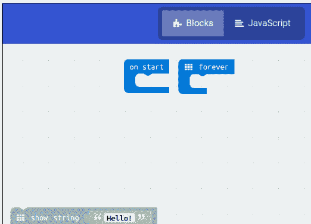

图 5-2：工作区中的`show string`块

你可能注意到你的新块上满了斜线。这些斜线表示该块在放入所谓的*控制块*内部之前将不会运行。这些控制块位于其他块周围，并控制它们何时显示。每个块的形状都像拼图，只能插入特定的其他块中。控制块有外边缘且中间有空隙，表示它们会围住其他块；`show string "Hello!"` 块的凹槽完美契合控制块的内部。

点击该块并按住鼠标，将`show string "Hello!"` 块拖入`on start` 块的内部，然后松开鼠标。块应该吸到位；如果没有，请拖动它调整位置。当块上的斜线消失时，你就知道自己操作正确了（见图 5-3）。

此时，模拟器将启动。通过将`show string "Hello!"` 块放入`on start` 块，你完成了第一个项目。信息“Hello”将在模拟器屏幕上滚动，就像在真实的 BBC micro:bit 上一样——但并不是我们要的消息，所以程序需要更改。

在`show string "Hello!"` 块中，点击“Hello!”将其高亮。此部分可以根据需要进行更改，输入你想要的消息：“Hello, World!”块将相应改变，原本的`show string "Hello!"` 块将变为`show string "Hello, World!"` 块（见图 5-4）。

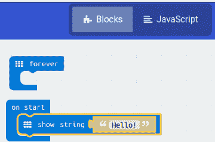

图 5-3：到位的`show string`块

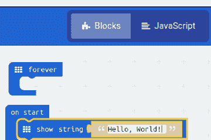

图 5-4：更改`show string`块消息

当你像这样更改块的位置时，模拟器会自动重启程序，你会看到“Hello, World!”在屏幕上滚动。此时你可以尽尽管尝试：将块更改为你自己的消息，例如你的名字或喜欢的颜色。

> 在编程中，这类消息被称为字符串，它们由字母、数字和一些符号组成。虽然字符串非常适合在屏幕上显示消息，但你对它的操作是有限制的；例如，“1”不能用于数学公式，因为它在我们看来是数字——但对于编程语言它只是一个字符串。对于数学公式，还有其他类型：整数是整数，布尔值是真或假逻辑元素，分别对应 1 和 0。无论你决定什么，都会注意到它只滚动一次就停止了。这就是将`show string "Hello, World!"`放入`on start` 块的结果。`on start` 块中的任何内容在程序启动时只会运行一次。你可以通过重置模拟器让信息再次出现。

## 循环

点击并拖动将`show string "Hello, World!"` 块从`on start` 块移出并进入`forever` 块（见图 5-5）。在你操作时观察模拟器。当你更改时，程序会重启，但它不是滚动一次消息后停止，而是会无限滚动。

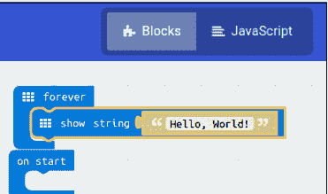

图 5-5：循环`show string`消息


# 编程基础：循环与事件

在编程中，这是一个循环。当程序运行到指令末尾时（在本例中是完成消息），它会返回开头并重新开始。正如名称所示，“循环”块会循环。如果你想让程序停止，可以从“循环”块中移除`显示字符串 "Hello, World!"`块，或者点击模拟器下方的停止（Stop）按钮。

需要记住的关键是“开始”块和“循环”块之间的区别。“开始”块在程序启动时只运行一次；“循环”块会循环。

如果你想看程序如何在真实的 micro:bit 上运行，点击下载（Download）按钮将其编译为 `.hex` 文件，并将其拖入 `MICROBIT` 驱动器，见第 3 章。

## 程序 2：按钮输入

“Hello, World!”演示了如何通过屏幕从 micro:bit 输出，但程序还有另一个关键特性：输入（inputs）。坦率地说，micro:bit有两个输入：显示屏两侧的 A 按钮和 B 按钮，现在是时候将它们引入你的程序了。

为了确保你不会丢失“Hello, World!”程序，通过点击“项目”菜单并点击“新建”启动一个新项目。你将获得包含两个控制块的新项目（见本章前面的图 5-1），你所做的任何更改都不会影响之前的项目。为了让这两个项目容易找到，记得给这个新项目起名字：点击屏幕底部的“无标题”；然后点击“按钮输入（Button Inputs）”来重命名项目。

首先点击块工具箱中的“输入（Input）”分类，然后点击“按钮按下（button pressed）”块。当它出现在工作区上时，注意它没有你在`显示字符串 "Hello!"` 块上看到的斜线。如果你仔细观察，你会发现它的形状也像一个控制块（见图 5-6）。

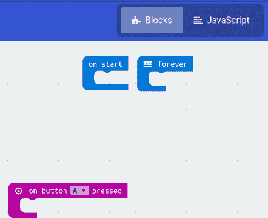

`on button A pressed` 块是一个事件块，它的工作方式与你之前使用的块略有不同。内部内容通常不会运行，但当触发器被激活时就会改变。在`on button A pressed` 块的情况下，触发器就是按下 A 按钮。当该触发器被激活时，BBC micro:bit 将尽快跳转到`on button A pressed` 块，其内部的块将开始运行。

目前，`按下按钮时(on button pressed)` 模块块内部没有任何代码块。要修复此，点击代码块工具箱中的“基础”（Basic）类别；然后点击带有心形图标的`显示图标(show icon)` 代码块。此代码块告诉 BBC micro:bit 从已经为你画好的选项中显示一张图片，而不是在“Hello, World!”中滚动显示字符串。将`显示图标(show icon)` 代码块拖入`按下按钮时(on button pressed)` 模块块中，然后点击心形图标以弹出备选图标列表。找到笑脸图标（见图 5-7），然后点击它进行选择。


图 5-7：选择笑脸图标

如果你现在点击模拟器上的 A 按钮，你将看到程序的效果：屏幕上将出现一个笑脸。即使你不按住按钮，它也会停留在那里，因为否则程序就不会保持运行。目前没有可以显示不同图像或清除屏幕的代码块，因此一旦笑脸出现，它就会一直存在，直到你重置模拟器或 BBC microbit。

事件块在触发器激活时运行，并且每次触发器激活时都会运行：按下一次 A 按钮，你的事件块就会运行一次；再次按下，它会再次运行；按下第三次，它会运行第三次，以此类推。

## 多按钮

能够读取单个按钮很棒，但 BBC micro:bit 有两个按钮。幸运的是，添加第二个按钮只需重复你已经做过的操作。点击代码块工具箱中的“输入（Input）”类别，点击`按下 A 按钮时(on button A pressed)` 代码块，点击代码块工具箱中的“输入”类别，然后点击`显示图标(show icon)` 代码块。

将`显示图标(show icon)` 代码块拖入`按下 A 按钮时(on button A pressed)` 代码块中，然后点击心形图标并选择难表情图标来替换它。最后，点击`按下 A 按钮时(on button A pressed)` 代码块中的“A”，并将其改为“B”，这样它就会在你按下 B 按钮而不是 A 按钮时触发（见图 5-8）。


图 5-8：完成的多按钮程序

## 第 5 章 JavaScript 代码块

点击模拟器上的 A 按钮——或者如果你在真实的 BBC micro:bit 上运行程序，则按下物理按钮——笑脸将像之前一样出现。然而，点击 B 按钮，你会得到一个难表情。你的程序可以读取两者，并根据按下的是哪一个运行不同的代码块。

读取按钮还有第三种选择：同时读取两个。如果你点击`按下 A 按钮时(on button A pressed)`或`按下 B 按钮时(on button B pressed)`代码块并对其进行更改，你将看到 A+B。`按下 A+B 按钮时(on button A+B pressed)` 只有在两个按钮同时按下时才会运行，这允许你从两个按钮中获得多达三个输入。

作为一个实验，尝试另一个`按下 A 按钮时(on button A pressed)` 代码块，将其更改为`按下 A+B 时(on A+B pressed)` 代码块，并选择一个不同的图标来显示。在真实的 BBC micro:bit 上，按住 A 按钮和 B 按钮生成新块。在模拟器上，你无法同时点击两个按钮，你会看到 B 按钮下方出现一个 A+B 按钮。A+B 按钮等同于在物理 micro:bit 上同时按下两个按钮。

## 程序 3：触摸输入

虽然按钮为 BBC micro:bit 提供了最多三个可能的输入，但这可能无法满足你的需求。这时输入输出引脚（BBC micro:bit 底部铜带上的编号触点）派上了用场。BBC micro:bit 可以检测到你用手指触摸其中一个引脚并准确记录——这是物理按钮的替代方案，也是在无需连接更多按钮的情况下向程序添加输入的好方法。

现在，你需要点击“项目”（Projects）菜单并点击“新建”（New）来开始新项目，这样你就可以一直处理按钮输入项目。点击屏幕上的“未命名”（Untitled）；然后输入“触摸输入”（Touch Inputs）为你的新项目命名。

> 记住，你可以随时点击“项目”菜单并在“我的项目”（My Stuff）部分下找到你的项目。项目根据最后修改的时间进行排序。

读取引脚与读取按钮非常相似。点击代码块工具箱中的“输入”类别，点击`按下引脚0 时(on pin0 pressed)` 代码块。与`按下按下(button pressed)` 代码块一样，`按下引脚0 时(on pin0 pressed)` 是一个事件块；它不需要放在`开始(start)`或`重复(forever)`代码块内部，放置在其中的任何代码块在事件触发之前都不会运行。然而，`按下引脚0 时`不是通过按下按钮触发的，而是当你触摸其中一个引脚时触发的——事件块现在需要一些要做的操作。点击代码块工具箱中的“变量”（Variables）类别，然后点击`变化加 1(change by 1)` 代码块。你会看到该块带有斜线进入工作区，这表示除非它在控制或事件块内部，否则它不会运行。将其拖入`按下引脚0 时(on pin0 pressed)` 代码块中，斜线将会消失（见图 5-9）。


图 5-9：插入变量块

变量块是一个新概念。变量块可以显示任何内容，正如变量名称所示，它告诉 BBC micro:bit 增加变量并显示一个数字，但目前显示的数字是 0。如果你查看`显示数字:0` 代码块，你会注意到周围的区域形状像拼图。这表示你可以在那里放入变量，而不是手动设置数字。

再次点击代码块工具箱中的“变量”类别，然后点击`项目(item)` 代码块。此块代表项目变量；点击项目单词，你可以将其更改为之前创建的 `touches`（触摸）。注意该块左侧有拼图连接；显示它被设计为连接到另一个代码块进行修改，而不是作为指令进入控制或事件块。

将`项目(item)` 代码块拖入，`项目(item)` 代码块上的斜线将会消失，显示它现在处于一个可以运行的地方。点击`项目(item)` 代码块中的项目单词，然后在弹出的列表中选择 `touches` 以将其更改为`显示数字触摸(show number touches)` 代码块。

`show number touches` 在英语中并不通顺，但如果将其拆解开，你就能看到计算机看到的：`show number` 是指令，告诉 BBC microbit 取一个数字而不是字符串并将其显示在屏幕上；`touches` 本不是数字，但是一个包含数字的变量。因此，当`显示数字 touches` 块运行时，它会将 `touches` 变量中存储的任何数字打印到显示屏。

如果你在模拟器中运行程序，点击 Pin 0；BBC micro:bit 的显示屏上会出现数字 1。再次点击它，数字将变为 2；再次点击，它将变为 3。程序将继续计算你点击该引脚的次数，直到你按下 Reset（重置）按钮——在这种情况下计数器将重置为零——或者断开电源。

如果你在实体的 BBC micro:bit 上运行程序，仅触摸 Pin 0 是不够的。BBC micro:bit 感应物理接触的能力是通过一种被称为“电阻”的电特性实现的，这需要电路（在此例中为你的身体）接地。将右手的食指放在 BBC micro:bit 最右侧的 GND 引脚上，然后用左手的食指轻触 Pin 0。第一次轻触时会显示数字 1；之后的每次轻触，直到 BBC micro:bit 产生结果，数字都会增加。

这种电阻式传感适用于 BBC micro:bit 的 Pin 0、Pin 1 和 Pin 2。结合物理按钮（Button A、Button B 和 Buttons A+B）的输入加上这三个引脚，总共可以响应六个输入：三个按钮输入加上 Pin 0、Pin 1 和 Pin 2。

当你数苹果或梨子时，通常从 1 开始数。但在编程时，你从 0 开始。这就是为什么 BBC micro:bit 的三个主引脚标记为 Pin 0、Pin 1 和 Pin 2，而不是 Pin 1、Pin 2 和 Pin 3。你程序中使用的任何其他数字也是如此。如果你在计算循环运行的次数，程序中的 '9' 意味着它运行了十次——计算 0, 1, 2, 3, 4, 5, 6, 7, 8，总共十个数字——而不是你预期的九次。习惯从 0 开始思考可能需要一段时间，所以如果你忘了，不要担心！

关于使用 BBC micro:bit 引脚的更多信息，请参考第 10 章“构建电路”、第 11 章“扩展 BBC micro:bit 的功能”以及第 12 章“可穿戴 micro:bit”。

## 程序 4：温度传感器

BBC micro:bit 的输入端比简单的按钮和触摸引脚更多。其中最简单的是温度传感器，它的工作原理与温度计完全一样：从传感器读取，它将返回以摄氏度为单位的温度。

虽然温度传感器足以让你对周围的冷热程度大致了解，但它并不是精密仪器。它内置在 BBC micro:bit 的处理器中，最初设计用于监控处理器的温度而非环境温度。如果 BBC micro:bit 是一台台式电脑，那将是个问题；台式电脑在空闲时的运行温度比周围环境高几十度，需要大型金属散热器和风扇来保持冷却。然而，BBC micro:bit 的处理器运行温度与其周围温度（称为环境温度）非常接近，通常会在一或两摄度的误差范围内准确。

如果你想获得尽可能准确的温度读数，保持程序简单非常重要。如果你的程序正在高负载运行 BBC micro:bit 的处理器——例如进行许多复杂的加法——那么处理器就会发热，从而影响你的读数。

以传统方式启动你的程序：点击 Projects（项目）菜单，然后点击 New（新建），这样你就不会丢失 Touch Inputs（触摸输入）项目的工作。点击屏幕底部的 Untitled（未标题），然后点击 Temperature Sensor（温度传感器）来命名你的项目。

点击 Blocks 工具箱中的 Input（输入）分类，然后点击 `temperature (°C)` 块将其放入工作区。该块上将布满斜线，表示它需要放在另一个块内部才能运行，它的形状与用于制作 Touch Input 程序的块相同。这是因为 'temperature' 是变量，每当使用它时，它都会通过从温度传感器本身读取当前值来自动更新。

你不能直接将一个块构建到块控制中，你需要另一个块。点击 Blocks 工具箱中的 Basic（基础）分类，然后点击 `show number 0` 块。将 `show number 0` 块拖入 `forever`（永远）块中——因为一个只更新一次再也不更新的温度计是没有意义的——然后将 `temperature (°C)` 块拖到 `show number 0` 块中的 0 之上，创建一个 `show temperature (°C)` 块（见图 5-12）。

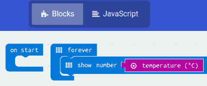

图 5-12：从温度传感器读取

此时，模拟器将活跃起来，并在 BBC micro:bit 的滑块上显示当前温度。BBC micro:bit 上还会出现一个滑块，设置为 21°C。由于模拟器没有真实的温度传感器，这个滑块允许你更改从虚拟温度传感器报告的温度。向上滑动条以增加报告的温度，向下滑动条以减少报告的温度。

## 输出格式化

现在程序在技术上已经完成了，但它并不易读。数字在屏幕上滚动时没有任何间隙，导致很难区分温度和 Celsius 单词。为了解决这个问题，点击 Blocks 工具箱中的 Basic 分类，然后点击 `show string "Hello!"` 块。

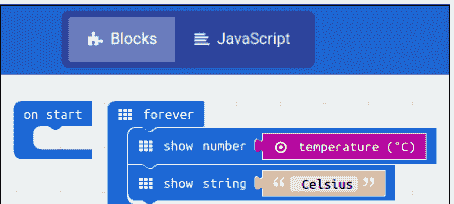

图 5-13：格式输出

如果你在实体 microbit 上运行程序，触摸金属表面以释放可能携带的静电。几秒钟后你会看到温度开始上升。离开手指，几秒钟后它就会下降。

> 警告 触摸 microbit 的组件时要小心：如果你没有通过触摸金属表面接地，静电可能会击入电路并损坏你的 microbit。

## 程序 5：指南针传感器

BBC microbit 的磁性指南针是背面标记的传感器之一（另一个是加速度计，将在本章详细介绍），也是最有趣的传感器之一。通过读取三个维度的局部磁场强度，它可以计算出 BBC microbit 相对于磁北的方向。这种技术内置在许多手机中，并被地图软件用于确定用户的方向。

这个项目的第一步现在应该显而易见了：点击 Projects 菜单并点击 New 创建一个新的空白项目。点击屏幕底部的 Untitled 并输入 Compass Sensor 来命名你的新项目，以便以后再次找到它。没有什么比一文件夹全名为 Untitled 的项目更糟糕了！

点击 Blocks 工具箱中的 Input 分类，点击 `compass heading (°)` 块。这是一个变量块，与之前的 `temperature (°C)` 块相同，所以你需要另一个块来放入它。点击 Blocks 工具箱中的 Basic 分类，然后点击 `show string "Hello!"` 块。将 `show string "Hello!"` 块拖入 `forever` 块中以消除斜线，并忽略模拟器一遍又一遍对你重复 "Hello!"。

不要简单地将 `compass heading (°)` 块拖入 `show string "Hello!"` 块并在显示上显示，我们将进行一些高级格式化。点击 Blocks 工具箱中的 Advanced 下拉菜单，点击 Text，然后点击 `join " " = ""` 块——就是带有两组双引号的那个，其中一个是另一个（见图 5-14）。

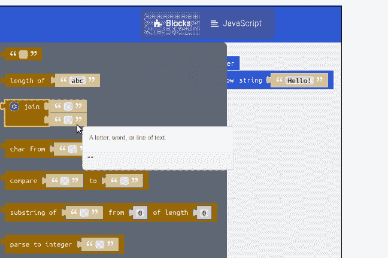

图 5-14：`join " " = ""` 块

在之前的温度传感器程序中，你使用了两个块来格式化输出：`显示数字温度 (°C)` 块和 `显示字符串 "Celsius"` 块，它们一个接一个地排列着。`join " " ` 块为你提供了一种线性化格式化输出的方法，但是在单个块中完成的。将 `join " " ` 块拖到 `显示字符串 "Hello"` 块中的 "Hello!" 之上，创建一个 `显示字符串 ` 块。模拟器将停止显示 Hello!（因为你刚刚删除了它），并开始显示两个字符串合并的结果——即，它什么都不会显示。

将 `罗盘航角 (°)` 块拖入 `show string join " "` 块中第二个（底部）双引号内，创建一个 `show string join "compass heading (°)"` 块。模拟器将开始显示罗盘航角，以磁北 0° 为基准的角度。为了格式化输出，点击双引号中的第一个（顶部）并输入 `Heading:`——注意冒号后的空格：它是为了在字符串和罗盘读数之间留出间隙（见图 5-15）。

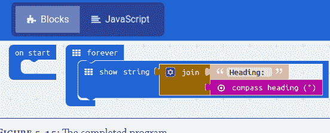

如果你在模拟器中运行程序，你会看到 micro:bit 标志长了一个角并偏离了 90°。点击并按住标志拖动它进行旋转；此时，罗盘航角会随之变化，0°（磁北）位于顶部。如果你在真实的 BBC micro:bit 上运行程序；只需旋转 BBC micro:bit 本身——注意不要弄乱 USB 或电池线。

如果你是第一次使用罗盘，或者你已经从一个环境移动到了另一个环境，可能会被要求对其进行校准。当运行程序时显示器上出现 Draw circle 消息，只需按照要求操作：旋转并倾斜 BBC micro:bit，使显示器中心的点沿屏幕边缘滚动并画出一个圆。当圆完成后，罗盘即完成校准，程序正常运行。

# 70 官方 BBC MICRO:BIT 用户指南

校准的准确性很大程度上取决于环境因素。如果你在周围环绕金属或靠近磁场的区域校准罗盘——例如在金属桌子上或一组音箱旁边——罗盘将无法正确校准。为了获得最高的准确性，请始终尝试在与使用环境尽可能接近的环境中校准罗盘。

嵌套的 `join " " "` 块有一个方便的功能：一个 `join " " "` 块可以在其两个间隙中的一个或两个包含另一个 `join " " "` 块，而该块又可以包含一个或两个 `join " " "` 块，接着再包含一个或两个 `join " " "` 块，以此类推。尝试通过修改现有程序，在罗盘处打印 degrees 单词，而无需添加另一个 `show string "Hello:"` 块。

## 程序 6：加速度计传感器

BBC microbit 背面标记的两个传感器之一是加速度计（另一个罗盘）。罗盘设计用于测量磁场，从而确定 BBC microbit 的朝向，而加速度计测量三个平面（X、Y 和 Z）上的相对激活值。除了能够返回实际传感器值外，它还可以用于检测不同类型的运动，即手势——这是在你的项目中与传感器交互最简单的方法。

加速度计是一个强大的工具。除了能检测运动外，它还可以用于通过重力将 BBC micro:bit 向地球中心拉引的力量来计算 BBC micro:bit 跟踪的角度——即使它放在手里或放在桌子上。手机或平板电脑正是利用这一功能来检测你是否从竖屏切换到了横屏（或反之），从而自动旋转屏幕以匹配方向。

首先，点击 Projects（项目）菜单，然后点击 New（新建）创建一个空白项目。点击屏幕底部的 Untitled（未命名）；然后输入 Accelerometer Sensor 为你的新项目命名。如果你觉得这个过程很重复，请一直重复，直到始终创建新项目并命名成为你的本能；这样你就不会有意外覆盖之前的程序或在一系列同名项目中丢失程序的风险。

这个项目既没有使用 `forever`（永远）也没有 `start`（开始）块。你之前将这些块留在原处——因为它们内部没有块，在运行程序时它们会被直接忽略——你可以通过删除它们来更新工作区。右键点击 `start` 块并点击 Delete Block（删除块）选项，或者点击并拖动该块回到 Blocks 工具箱，它将变成垃圾桶图标。然后对 `forever` 块执行相同的操作。

## 第 5 章 JAVASCRIPT 块

右键菜单还为你提供了其他选项。Duplicate（复制）将创建一个块的精确副本，避免你反复进入 Blocks 工具箱；Add Comment（添加注释）允许你为块附带注释来解释其功能，以便你以后回到程序时或提供给他人查看，这些注释对阅读程序的人可见，但会被 JavaScript 块忽略；Help（帮助）将显示有关该块的信息。

一个文档良好的程序就是好程序。在本章中，你不会被要求输入任何注释，因为它们并不是运行程序必需的，但养成这种习惯是个好主意。程序中今天看起来完全合理的，在你几个月后回来时可能看起来不可思议。注释不会减慢程序运行；大量使用它们可以省去很多麻烦。

点击工具箱中的 Input 类，找到 `on shake` 块。与 `A pressed` 块和 `on pressed` 块一样，这是一个事件块，与其他块不同。点击工具箱中的 Basic 类找到 `show icon` 块。将其拖入 `on shake` 块，然后点击图标（见图 5-16）。

程序现在准备好测试了。当你向程序添加 `on shake` 块时，模拟器添加了一个新的控制按钮：标记为 SHAKE。点击此按钮来模拟抖动 microbit，屏幕上会出现一个惊讶的脸。或者，将鼠标移动在 microbit 板上晃动鼠标来实现相同的抖动效果。

程序的工作原理是通过加速度计寻找一系列*手势*——在本例中是抖动手势。如果你点击 `on shake` 块中的 shake 单词，你会看到加速度计可以跟踪的手势列表：

- shake——默认手势通过剧烈抖动 microbit 激活——即使你没有掉落微 USB 或电池或让它飞出房间！
- 8g——以及 3g 和 6g——手势仅在给定方向的加速度超过八倍重力时触发，这非常快。
- 向右倾（tilt right）——此手势基于 BBC micro:bit 的角度，当 BBC micro:bit 向用户的右侧倾斜时触发。
- 自由落体（free fall）——只有当 BBC micro:bit 被掉并向地面坠落时才会触发。此手势在飞行机器人或遥控火箭中特别有用。
- 3g——3g 手势的工作方式与 8g 手势相同，但加速度速率较平缓。
- 6g——6g 手势介于快速的 8g 和较缓的 3g 加速度手势之间。
- 向左倾（tilt left）——倾斜的相反，当 BBC micro:bit 向用户的左侧倾斜时触发倾斜手势。

## 延迟 (Delays)

稍微更改，程序就可以变得互动得多。点击模块工具箱中的 Basic（基础）分类，点击 `显示图标(show icon)` 块。将其拖到现有 `显示图标` 块下方的 `摇一(on shake)` 块中；然后点击列表中的心形图标和睡眠（asleep）。

如果你按下模拟器上的 SHAKE（摇晃）按钮，会在睡眠图标接管之前短暂地看到惊讶图标。如果你连续按下 SHAKE 按钮——等同于在模拟器上连续摇晃 BBC micro:bit 而不停——“脸”将在惊讶图标和睡眠图标之间反复切换，速度相对很快。这并不太真实；当你被摇醒后，需要时间才能重新入睡！

要修复这个问题，你需要在两个 `显示图标` 块之间添加一个延迟。延迟的作用顾如其名：它会让程序暂停一段指定的时间，延迟下一个块的执行。点击模块工具箱中的 Basic 分类，然后点击 `暂停 (ms) 100` 块。将其拖入 `摇一(on shake)` 块中，使其位于两个 `显示图标` 块之间；`显示图标` 块会自动分开以留出空间（见图 5-17）。点击 `暂停 (ms) 100` 块中的数字并将其更改为 1000，创建一个 `暂停 (ms) 1000` 块。

这次，如果你点击 SHAKE 按钮——或者，如果你看到自己在物理 micro:bit 上运行程序，摇晃 BBC micro:bit——你会在睡眠图标接管之前看到更久的惊讶图标。增加 `暂停 (ms) 1000` 块中的数字，惊讶的脸会在显示器上停留更久；减小数字，睡眠脸会出现得更早。

## 官方 BBC MICRO:BIT 用户指南

图 5-17：完成的程序

`暂停 (ms) 1000` 块中的数字是程序应延迟的毫秒（或一秒的千分之一）测量单位。因此，1000 的值等于一秒；2000 是两秒，500 是半秒。因为像 BBC micro:bit 这样的处理器运行比人类快得多，每秒执行数百万次操作，程序经常需要延迟以便让人类操作者跟上。

作为一个实验，如果你能通过添加回一个 `开始(start)` 块并让 BBC micro:bit 在睡眠图标上启动，而不是在第一次摇晃之前完全空白，那么就可以进一步扩展程序。

## 读取原始加速度计数据

手势系统是处理 BBC micro:bit 加速度计最简单的方法，但不是唯一的方法。你也可以将原始数据以数字的形式读入程序由自己处理。点击 Projects（项目）菜单创建一个新项目，然后点击 New（新建）。点击 Untitled（未命名）直到变为 **Accelerometer Sensor Data** 以命名你的新项目，并将其与之前的“加速度计传感器”手势触发项目分开。

通过右键点击并点击 Delete Block（删除块）或将其拖到模块工具箱来开始删除 `开始(start)` 块。接下来，点击模块工具箱中的 Basic 分类，然后点击 `显示字符串 "Hello!"` 块。将 `显示字符串 "Hello!"` 块放入 `循环(forever)` 块中，并忽略模拟器，因为它再次用无限滚动的消息向你问候。

如果 Advanced（高级）分类尚不可，点击模块工具箱中的 Advanced 下拉选项，点击 Text（文本）分类，然后点击 `连接 " " "] (join)` 块。将 `连接 " " "] ` 块拖入 `显示字符串 "Hello!"` 块中位于 "Hello!" 单词之后，随后是 `连接 " " "] ` 块的顶部的双引号部分，并输入 X: 以创建一个 `连接 "X:" "X "` 块。

点击模块工具箱中的 Input（输入）分类，然后点击 `加速度 x (acceleration x)` 块。将其拖入 `连接 "X:" \ ` 块的底部的双引号部分，创建一个 `连接 "X:" "加速度 (mg) x"` 块。模拟器现在将开始滚动字符串 "X:" 随后是加速度计在 X 轴上的当前测量值。尝试用鼠标光标移动模拟的 BBC microbit 并更改数字。

X 轴是组成三维测量的三个轴之一。要获取其他轴，右键点击 `显示字符串 连接 "X:" "加速度 (mg) x"` 块，并从上方菜单部分点击 Duplicate（复制）。将新块拖入现有块下方的 `循环(forever)` 块中，然后右键点击 `显示字符串` 块进行更改。

Y 轴是组成三维测量的三个轴之一。要获取其他的，右键点击 `连接 "X:" "加速度 (mg) x"` 块，并从上方菜单部分点击 Duplicate（复制）。将新块拖入 `循环(forever)` 块中，然后右键点击 `显示字符串` 块进行更改。

Z 轴是组成三维测量的三个轴之一。要获取其他的，右键点击 `连接 "X:" "加速度 (mg) x"` 块，并从上方菜单部分点击 Duplicate（复制）。将新块拖入 `循环(forever)` 块中，然后右键点击 `显示字符串` 块进行更改。

## 第 5 章 JAVASCRIPT 代码块 75

本章中的程序相对简单，一次只做一件事，作为介绍你在编程 micro:bit 时需要的一些概念手段。然而，最后一个程序相当复杂：一个游戏，它使用了为创建游戏设计的分类，内置了跟踪分数、显示“游戏结束”屏幕、检测精灵与其他或边缘碰撞的工具。

如果你更喜欢一次性输入程序并阅读每个块的作用，你可以在附录 A，“JavaScript 代码配方”中找到程序的完整块副本：

## 设置

游戏应该从设置玩家角色精灵和初始化分数开始。点击模块工具箱中的 Variables（变量）分类，点击 `设置 item 为 0` 块，将其拖入 `开始(start)` 块。点击单词 item 然后点击 Rename Variable（重命名变量）给它一个更具描述性的名称：player。

制作玩家变量精灵，如果 Advanced 分类可见，点击模块工具箱的下拉菜单 Game 分类，然后点击 `创建精灵在 x: 2 y: 2` 块。将此块拖动并连接到 `创建精灵在 x: 0 y: 0` 块。最后，让 X 旁的第一个数字为 2，并将 y 旁边的第二个数字从 0 更改为 4。

`创建精灵在 x: 0 y: 0` 块中的数字非常重要；它们是精灵在 BBC micro:bit 显示屏上的位置。显示器的每个像素在水平 X 轴和垂直 Y 轴上都有位置。图 5-20 展示了这一点，给屏幕上 25 个像素中的每一个 X 和 Y 坐标，格式为 'XY'。

# BBC micro:bit 官方用户指南

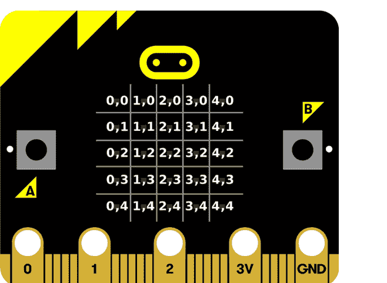

图 5-20：BBC micro:bit 显示坐标

通过告诉 `create sprite at x: 2 y: 4` 块在 X 轴位置 2 处和 Y 轴坐标 2 处（即图 5-20 中的坐标 2,4）创建精灵，该精灵将创建在行行和列的中间位置。

接下来，在积木工具箱的 Game（游戏）分类中，点击 `set score 0` 块，将其拖入到 `set player to create sprite at x: 2 y: 4` 块下方的 `start` 块中。这将初始化游戏分数为零。如果你愿意，可以在此点进行更改，让游戏开始时的分为 10、100 或任何其他数字，但那样还有什么好玩呢？

最后，在积木工具箱的 Variables（变量）分类中，点击 `set item to 0` 块，将其拖入到 `set score 0` 块下方的 `start` 块中。右键点击 `item to 0` 块，选择 Rename Variable（重命名变量），输入 delay，然后点击 0 将其改为 1000（见图 5-21）。此变量将控制游戏开始时的速度。如果你想挑战一下，可以将变量调小；想让游戏变简单，可以将其调大。

## 主循环

流程的下一个阶段是制作游戏本身。点击积木工具箱的 Variables（变量）分类，然后点击 `set item to 0` 块，将其拖入 `forever`（永远）块中。右键点击 `set item to 0` 块，点击 Rename Variable（重命名变量），然后输入 fruit。

作为玩家精灵，点击积木工具箱的 Game（游戏）分类，点击 `create sprite at x: 0 y: 0` 块，将其拖到 `set fruit to 0` 块的 "0" 上，创建一个 `set fruit to create sprite at x: 2 y: 2` 块。

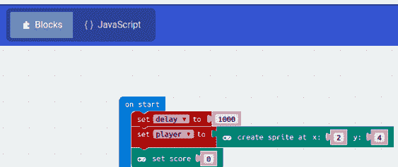

图 5-21：完成后的 `on start` 块

如果水果每次玩游戏时都出现在同一个地方，那它就不像游戏了。为了让它更有趣，点击积木工具箱的 Math（数学）分类，点击 `pick random 0 to 4` 块，将其拖到 `set fruit to create sprite at x: 2 y: 2` 块中 x 旁边的第一个 2 上，然后将 y 旁边的第二个改为 0。

`pick random 0 to 4` 块的作用正如其名：在 0 到积木数量之间随机选取一个数字。

按照 BBC 微处理器运行积木的速度，由于水果掉落的速度将尽可能快，比人类拉动的速度快数百万；你除了看到“game over”之外什么也看不见。然后，点击积木工具箱的 Basic（基础）分类，点击 `pause (ms) 100` 块，将其拖入现有积木下方的 `forever` 块中。不过，与其设置手动延迟，不如使用变量，这样游戏就可以随着进行而变快：点击积木工具箱的 Variables（变量）分类，点击 `item` 块，将其拖到 100 上创建一个 `pause (ms) item` 块，然后点击单词 item，并从出现的列表中选择在 `on start` 块中创建的 delay 变量。

此时，程序应该像图 5-22 所示。

# BBC micro:bit 官方用户指南

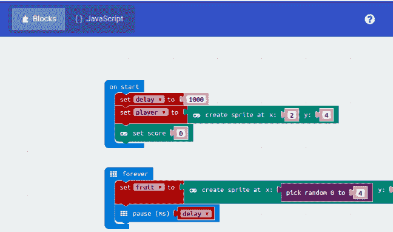

图 5-22：`forever` 块的开始

## 条件循环

到为止，你只处理过一种循环：无限循环，它会永远运行。一种更强大的循环类型是条件循环，它测试特定条件——例如一个变量是否等于另一个变量——并且仅在条件为真时运行。

点击积木工具箱的 Loops（循环）分类，点击 `while true do` 块，将其拖入现有积木下方的 `forever` 块中。默认情况下，`while true do` 块和 `forever` 块本身都是无限循环：它测试的条件是变量是否为“true”，而因为它是真，所以条件确实始终返回真，循环永远不会结束。

要更改这一点，点击积木工具箱的 Logic（逻辑）分类，点击 `0 = 0` 块，将其拖到 `while true do` 块的单词上，创建一个 `while 0 = 0` 块。接下来，我们想让循环仅在水果尚未位于显示器的底行时运行。点击积木工具箱的 Game（游戏）分类，点击 `item x` 块，将其拖到 `while 0 = 0` 块的第一个 0 上，点击单词 item 并选择 fruit 变量，然后点击 x 将其更改，以便查看水果精灵在显示器 Y（垂直）轴上的位置。

要检查水果是否到达底部，点击积木工具箱的 Logic（逻辑）分类，点击 `0 = 0` 块，将其拖到 `while true do` 块的单词上，创建一个 `while 0 = 0` 块。接下来，我们想让循环仅在水果尚未位于显示器的底行时运行。点击积木工具箱的 Game（游戏）分类，点击 `item x` 块，将其拖到 `while 0 = 0` 块的第一个 0 上，点击单词 item 并选择 fruit 变量，然后点击 x 将其更改，以便查看水果精灵在显示器 Y（垂直）轴上的位置。

要检查水果是否到达底部，有一个更简单的，`if true then` 块，如果条件为假，在 `if true then` 块中只需移动到列表的下一个积木。

点击积木工具箱的 Logic（逻辑）分类，点击 `if true then else` 块并将其拖入。这允许你创建两个块列表：首先，在 true 部分，当条件为真时运行；其次，在 else 部分，仅当条件为假时运行。与循环不同，条件语句不会循环：作为条件结果运行的块只会运行一次，除非你将它们放在循环中。

点击积木工具箱的 Game（游戏）分类，点击 `item touching ?` 块，将其拖到 `if true then else` 块的后面。点击单词 then 并从出现的变量列表中选择。点击积木工具箱的 Variables（变量）分类，点击 `item` 块，将其拖入 `player touching` 块单词与 ? 符号之间的间隙，然后点击单词将其更改为 fruit 变量。最终块应该是 `player touching fruit`。

这个 `player touching fruit` 块是条件的测试；它检查游戏开始时创建的玩家精灵在水果精灵到达屏幕底部时是否与之接触。如果玩家正在触摸水果精灵，玩家就“抓住了”水果；如果没有，玩家就“错过”了水果。

如果玩家抓住了水果，需要增加玩家的分。点击积木工具箱的 Game（游戏）分类，点击 `change score by 1` 块，将其拖入 `if player touching fruit then else` 块的后续部分。掉落过程需要慢下来让游戏变得有趣。

## 第 5 章 JAVASCRIPT 模块

如果玩家错过了的水果，游戏就会结束。点击模块工具箱中的“游戏 (Game)”类别，点击 `分数加 1` 模块，并将其拖入 `如果玩家碰到水果，否则` 模块的 else 部分。从整体来看，这组模块现在应该读作：`如果玩家碰到水果，则分数加 1，否则游戏结束`。

最后，你还需要两个模块来完成游戏的主体。点击模块工具箱中的“游戏 (Game)”类别，点击 `将项目 x 设置为 0` 模块，将其拖入你创建的所有其他模块下方的 `重复` 模块中。点击单词 item 并将其更改为水果（fruit） 变量，然后点击 x 并将其更改为亮度（brightness）属性。现在，当玩家捕捉到水果精灵时，它的亮度将被设置为零，从而从视图中隐藏。

在模块工具箱的“变量 (Variable)”类别中放置最后一个模块，即 `将项目设置为 0` 模块。将该模块拖到最下方的 `重复` 模块中。点击单词 item 并将其更改为延迟（delay） 变量。之后，点击模块工具箱的“数学 (Math)”类别，点击 `0 - 0` 模块，并将其拖到 `将项目设置为 0` 模块中的 0 上。点击模块工具箱的“变量 (Variable)”类别，点击 `item` 模块，将该模块拖到你创建的 `0 - 0` 模块的第一个 0 上，然后点击单词 item 并将其更改以创建一个 `delay - 0` 模块。

右键点击下方的 `delay - 0` 模块（但不要点击在 delay 单词上），然后点击“复制 (Duplicate)”。将复制的模块拖到第二个 0 之上以创建一个 `delay - 0` 模块，然后点击第二个 delay 之后的 - 号并将其更改为 + 号。最后但同样重要的是，点击最后一个 0 并将其更改为 10。

完成后的模块应该读作 `将延迟设置为 延迟 + 10`，正是这个模块负责在每次成功捕捉到水果后加快游戏速度。模块的第一部分告诉 JavaScript 模块将延迟变量的值更改为短等式的结果；第二部分告诉它从延迟变量的当前值中减去某个值；最后部分告诉它减去延迟变量当前值除以 10。结果是：每次捕捉到水果，延迟变量就会减少 10%，使游戏每轮都快 10%。

你现在已经完成了主程序循环（见图 5-24）。尽管游戏似乎在模拟器中运行，但存在一个问题：你无法控制玩家精灵。

## 官方 BBC MICRO:BIT 用户指南

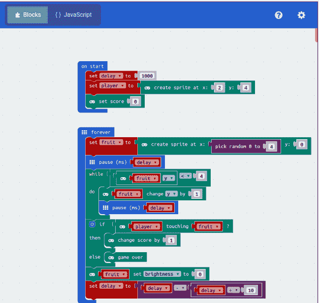

图 5-24：`完成` 模块

## 控制事件

为了捕捉鱼，玩家需要在 BBC micro-bit 显示器的底部左右移动。坦率地说，显示器左侧有 A 按钮，右侧有 B 按钮——这正是控制玩家精灵所需要的。制作这些控制事件实际上是你在本章较之前编写的“按钮输入”程序的重演，但增加了一些额外的逻辑来帮助实现。

首先，点击模块工具箱中的“输入 (Input)”类别，然后点击 `当按下按钮时` 创建一个事件模块，将其拖到工作区的空白区域。接下来，点击模块工具箱中的“逻辑 (Logic)”类别，点击 `if then` 模块，将其拖入 `pressed` 模块中。

要为 `if then` 模块创建条件语句，点击模块工具箱中的“逻辑 (Logic)”类别，点击 `0 < 0` 模块，并将其拖到单词 if 旁边以连接到 `if then` 模块。点击模块工具箱中的“游戏 (Game)”类别，点击 `item x` 模块，将其拖到 `0 <` 模块的第一个 0 上，然后点击单词 item 并将其更改为变量 player（玩家）。最后，点击 <（小于）符号并将其更改为 >（大于或等于）。

`if player x = 0` 条件的存在是为了防止玩家精灵离开显示器边缘。它检查玩家在 X（水平）轴上的当前位置。如果大于或等于 0，则玩家位于显示器边缘。

要实际移动玩家，点击模块工具箱中的“游戏 (Game)”类别，点击 `将项目 x 设置为 0` 模块，将其拖入你创建的所有其他模块下方的 `重复` 模块中。点击单词 item 并将其更改为水果（fruit） 变量，然后点击 x 并将其更改为亮度（brightness）属性。现在，当玩家捕捉到水果精灵时，它的亮度将被设置为零，从而从视图中隐藏。

# BBC MICRO:BIT 官方用户指南

任务是在水果落地之前接住掉落得越来越快的水果。这些程序在第 5 章“JavaScript 代码块”、第 6 章“JavaScript”和第 7 章“Python”之间是相同的，让你能够轻松地比较和对比这三种语言，找到最适合你的一种。

## 介绍 JavaScript 编辑器

JavaScript 编辑器是一个专为 JavaScript 语言创建的一体化开发环境。它完全运行在任何现代计算机的网络浏览器中，不需要在计算机上安装软件。加载 JavaScript 编辑器仅需打开连接互联网的计算机的网络浏览器，在地址栏中输入 **makecode.microbit.org** 并按回车，然后点击顶部菜单中心的编辑器（Editor）以从 JavaScript 代码块编辑器切换到 JavaScript 编辑器模式（见图 6-1）。一旦编辑器加载，即使你断开互联网连接，它也会在你的计算机上运行。

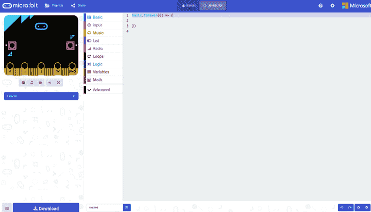

图 6-1：JavaScript 编辑器

JavaScript 编辑器的主要功能如下：

- **项目菜单 (Projects menu)**——位于左上角，像一个文件夹图标，使用此菜单创建新的空白项目，或加载之前的项目。这些项目文件存储在你的计算机网络浏览器的本地存储区域中，除非你选择共享它们，否则它们仅对你可用。请注意，使用网络浏览器的“清除历史”选项清除存储的数据将删除这些文件，因此请确保使用保存（Save）图标保存你想要继续使用的文件。项目菜单还可以访问 Make 标签页中的示例项目以及 Code 标签页下的代码示例。

- **分享按钮 (Share button)**——位于项目旁边旁边形状像一个带有两个连杆圆圈的圆，使用此按钮发布并共享你在 JavaScript 编辑器中创建的程序。

- **编辑器切换按钮 (Editor toggle)**——看起来像几行文字旁边的图碎片，位于顶部菜单栏的中间，使用它在 JavaScript 和 JavaScript 代码块之间切换。本章将使用前者模式；后一种模式将在第 5 章中解释。

- **帮助按钮 (Help button)**——位于顶部菜单栏右侧，形状像圆圈里的问号，使用此按钮访问 JavaScript 编辑器的内置帮助，包括入门教程（也可以使用右侧橙色的“入门”（Getting Started）按钮）以及示例项目。

- **设置按钮 (Settings button)**——位于帮助按钮旁边，形状像一个齿轮。使用它来更改项目设置、添加额外的包（如用于配合 BBC microbit 使用额外硬件的库）、删除项目或删除所有已保存的项目。你也可以在这里查看编辑器的隐私政策、使用条款并提供反馈。

- **模拟器 (simulator)**——位于高分辨率屏幕的左侧，左下角的模拟器不仅仅是一张 BBC microbit 的图片。当你编写程序时，模拟器的运行方式与在 BBC microbit 本身上的运行相同。这允许你无需下载编译后的 hex 文件并将其刷入 BBC microbit 即可测试程序。模拟器是完全交互的：要模拟按下 A 按钮，只需使用其中一个传感器，模拟器就会调整以让你使用该传感器，为温度计添加温度滑块，或让你更改加速度计或罗盘的任何设置。

- **代码块工具箱 (Blocks toolbox)**——位于屏幕左侧的条中，代码块工具箱可以用来 JavaScript 指令的编写方式，并减少你在构建程序时所需的输入量。代码块从代码块工具箱中拖入程序列表中，在那里它们会立即转换为一行或多行 JavaScript 代码。每个块被分为一系列类别：基础（Basic）、输入（Input）、音乐（Music）、LED、无线（Radio）、循环（Loops）、逻辑（Logic）、变量（Variables）和数学（Math），点击高级（Advanced）下拉菜单可以使用更多块。

- **程序列表 (program listing)**——占据屏幕大部分左侧有行号，程序列表区域包含你正在编写的 JavaScript 程序。当你开始新项目时，已经会有四行：一行 `basic.forever(() => { })`，另外两个是空白。

- **下载按钮 (Download button)**——完成项目并想在 BBC microbit 上运行时，只需点击屏幕底部的下载按钮，JavaScript 编辑器就会为你编译并下载 hex 文件，你可以将其拖放到 MICROBIT 驱动器（见第 3 章“编程 BBC microbit”）。

- **项目名称 (project name)**——开始新项目时要做的第一件事是给它起一个描述性名称。始终从重命名项目从默认的“Untitled”（标题）开始，以便将来更容易找到。

- **保存图标 (Save icon)**——位于项目名称旁边，保存图标允许你将程序的副本保存到计算机上。如果你想从学校带一份副本回家或反之亦然，保存图标可以实现这一点。可以通过点击项目菜单并导入文件（Import File）将保存的项目加载到 JavaScript 编辑器。

- **撤销和重做按钮 (Undo and Redo buttons)**——形状像弯箭头，撤销和重做按钮允许通过点击最左侧的箭头撤销错误，点击最右侧的箭头重做。

- **缩放按钮 (Zoom buttons)**——位于右下角，使用这些按钮放大或缩小工作区以调整大小。对于更复杂的项目，缩放可以让你一次看到更多内容。

## 程序 1：“Hello, World!”

“Hello, World!”是一个简单的程序，只需要一行代码。要开始，打开浏览器并访问 microcode.microbit.org 加载 JavaScript 编辑器；点击编辑器切换切换到 JavaScript 模式。如果你之前处理过项目，点击项目菜单并新建加载空白项目。将项目重命名为 **Hello World**。使用方向键移动光标使第 4 行变亮。然后输入：

```javascript
basic.
```

一旦你输入点，就会出现一个包含基础（Basic）类别下所有可用函数的框。为了节省输入时间，你可以在列表中找到需要的函数并点击它使其出现在你的程序中。但现在，继续输入直到第 4 行显示为：

```javascript
basic.showString("Hello, World!")
```

如果你在编写程序的任何时候犯了错误，只需点击屏幕右下角的撤销按钮将其发回代码块工具箱。或者，右键点击代码块并点击删除（Delete）。

在 JavaScript 中，所有内容都是区分大小写的（*sensitive*），这意味着它必须以完全正确的大小写组合输入。`basic.showString` 是有效的，但 `Basic.showString, BASIC.SHOWSTRING, basic.showstring` 以及任何其他变体都无效。

你可能注意到你刚刚编写的代码使用了不同的颜色。这在编程中被称为*语法高亮*（syntax highlighting），可以帮助你一眼看出可能犯的任何错误。指令部分，代码中的 `basic.showString` 部分显示为蓝色；指令使用的消息“Hello, World!” 显示为红色；同时，括号显示为黑色。

# BBC MICRO:BIT 官方用户指南

尝试删除第 4 行的最后一个双引号，使其看起来像这样：

```javascript
basic.queryString("Hello, World!")
```

注意颜色发生了什么变化：最后一个括号（之前是黑色的）现在变成了红色的，这表示 JavaScript 编辑器认为它是字符串的一部分。然而，由于缺少最后一个双引号来告诉 JavaScript 编辑器字符串何处结束，程序不再工作了；你在程序中引入了一个错误（bug）。幸运的是，JavaScript 编辑器还有另一个杀手锏来帮助你追踪错误：在编辑器无法理解的任何代码行下方都会出现一条波浪线，其中包含了损坏的第 4 行。如果你看到这种线，意味着该行代码存在问题——可能是它正上方的一行代码。仔细检查错误可能在哪里，并将鼠标光标悬停在代码行上而不进行点击，即可从 JavaScript 编辑器本身获取有用的错误信息（见图 6-3）。

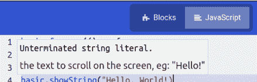

图 6-3：JavaScript 编辑器高亮代码错误

> JavaScript 编辑器的弹出提示不仅限于包含错误的的行：将鼠标光标悬停在任何包含指令的行上，即可查看该指令的简要描述及其使用方法。尝试将鼠标光标悬停在程序中的第 1 行进行测试。

将双引号放回第 4 行，使其看起来像这样：

```javascript
basic.queryString("Hello, World!")
```

表示错误的波浪线下划线将会消失，此时模拟器就会运行起来。通过输入一行代码并修复一个错误，你已经完成了你的首个程序。消息“Hello, World!”将在模拟器的显示屏上滚动，就像它在真实的 micro:bit 上显示的一样（见图 6-4）。此时你可以放情进行实验：更改第 4 行以滚动你自己的消息，例如你的名字或你喜欢的颜色。

# 第 6 章 JAVASCRIPT

93

```javascript
1 basic.forever(() => {
2
3 })
4 basic.drawString('Hello, World!')
```

**图 6-4：** 模拟器显示部分滚动消息

在编程中，这样的消息被称为字符串（strings）、数字（numbers）以及一些符号。虽然字符串非常适合在屏幕上显示消息，但你处理它的方式是有限的；字符串 "1" 不能用于数学方程，因为在我们看来它像是一个数字：但对编程语言来说，它是一个字符串。对于数学方程，还有其他类型：整数（integers）是整数，而布尔值（Booleans）是逻辑元素，可以是真（True）或假（False），分别相当于 1 和 0。

模拟器在后台自动运行，每当你更改程序中的一行代码或添加一行新代码时，它都会重启程序以向你展示更改的结果。有时当你编写较长的程序时，这可能会分散你的注意力。要关闭模拟器，只需点击下方带有正方形停止符号的左侧停止（Stop）按钮；要再次开启，点击新出现的带有三角形播放符号的播放（Play）按钮。

无论你决定滚动什么消息，你都会注意到它只滚动一次然后模拟器就停止了。由于你将代码行放在了程序底部的第 4 行，位于第 1 行开启且第 3 行关闭的括号之外。在这些括号之外的任何内容在程序运行时只会运行一次。如果你通过按下 BBC microbit 图片下方双箭头的图标来重置模拟器，可以让消息再次出现，但如果你不想一直这样做，你就需要一种方法告诉程序重复。

## 循环 (Loops)

你通过点击第 4 行开头的数字 4 并按下键盘上的 Ctrl+X（macOS 上为 Cmd+X）复制代码，然后到第 2 行开头的旁边的空白行处按下 Ctrl+V（macOS 上为 Cmd+V）进行粘贴。你留下了一个空白的第 4 行和位于第 2 行的代码（见图 6-5）。JavaScript 编辑器会自动将其向内移动四个空格；这被称为缩进（indentation），它让你很容易看到程序中的代码行是如何嵌套在其他行之中的。缩进是由 JavaScript 编辑器自动处理的，尽管对于程序的运行并不是必需的——代码可以完全对齐在程序边缘依然完美运行——但它极大地提高了代码的可读性，并让错误更容易追踪。当你移动了代码行后，观察模拟器。程序重启了（正如你每次做出更改时那样），但它不再是滚动一次消息后停止，而是无限地循环滚动。

```javascript
1 basic.forever(() => {
2   basic.showString("Hello, World!")
3 }
4
```

**图 6-5：** 循环 basic.show 消息

在编程中，这被称为循环。当程序执行到指令末尾时——在这种情况下，当它完成了你在第 2 行移动的 `basic.showString("Hello, World!")` 指令的消息后——它会返回循环的开头并重新开始。正如名称所示，`basic.forever` 循环会永远运行；在编程中，这被称为无限循环（infinite loop）。

如果你想程序停止，可以从循环中移除 `basic.showString("Hello, World!")`。所有的循环都需要使用括号符号 `{` 和 `}` 来开启和关闭。开启括号而没有对应的关闭括号会导致错误——JavaScript 编辑器会自动添加关闭括号。这种功能被称为自动补全。

> JavaScript 编辑器的弹出提示不仅限于包含错误的的行：将鼠标光标悬停在任何包含指令的行上，即可查看该指令的简要描述及其使用方法。尝试将鼠标光标悬停在程序中的第 1 行进行测试。

如果你想要程序停止，可以从循环中移除 `basic.showString("Hello, World!")`。所有的循环都需要使用括号符号 `{` 和 `}` 来开启和关闭。开启括号而没有对应的关闭括号会导致错误——JavaScript 编辑器会自动添加关闭括号。这种功能被称为自动补全。

仅仅因为会自动添加关闭括号并不阻止你手动输入。JavaScript 编辑器足够智能，如果你输入关闭括号，它会覆盖自动添加的那个，而不是在行上多放括号——这会导致程序停止。

第 1 行的 `{` 符号表示循环的开始，第 3 行的 `}` 符号标记循环的结束。你正在编写的代码，让 'Hello, World!' 程序重复，需要使用括号符号 `{` 和 `}` 来开启和关闭。

## 程序 2：按钮输入 (Button Inputs)

# 第 6 章 JavaScript

为了确保不丢失之前的项目，点击 New 然后点击 JavaScript 切换到 JavaScript 模式。获得了一个带有两行代码的新项目（见图 6-1）。点击屏幕底部的 Untitled，输入 Button Inputs 重命名项目。

点击程序列表的第 4 行或使用方向键移动光标使第 4 行变亮。然后输入以下内容：

```javascript
input.
```

和之前一样，一旦你输入点，你就会看到 Input 类中所有可能的函数。然而，你并没有从列表中选择函数，而是继续输入直到第 4 行如下所示：

```javascript
input.onButtonPressed(Button.A, (
```

当你到达这一行的末尾时，JavaScript 编辑器会在行末尾自动添加一个 `)` 符号。这是 JavaScript 编辑器的另一个节省时间且修复错误的功能。

继续输入，忽略 JavaScript 编辑器的自动补全，直到第 4 行如下所示：

```javascript
input.onButtonPressed(Button.A, () => {})
```

虽然这行代码是完整且有效的，但为了今后的清晰起，它的格式并不是最好的。点击大括号符号 `{` 之间或使用方向键移动输入光标，然后按 Enter 键。JavaScript 编辑器会自动将最后两个符号 `}` 移动到第 6 行，并将光标移动到第 5 行且带有四个空格的缩进，准备编写程序的下一行。请注意，你的任何格式化

# BBC micro:bit 官方用户指南

如果你使用编辑器切换器到 JavaScript 代码块模式然后再切换回来，JavaScript 程序的可读性将会丢失。

同样，作为打字的替代方案，你可以点击代码块工具箱中的“输入”（Input）类别，点击 `input.onButtonPressed(Button.A, () => {})`，或者在输入期间任何时候点击自动补全弹出窗口来插入代码。在这两种情况下，代码都会自动为你格式化：第 4 行是主部分，第 5 行是一个带有缩进的空白行，第 6 行是结束部分（见图 6-6）。

```javascript
basic.forever(() => {
  input.onButtonPressed(Button.A, () => {
  })
})
```

图 6-6：input.onButtonPressed 代码块

你刚刚创建的代码在编程中被称为“事件”（event）；它的工作方式与你之前使用的单行指令略有不同。事件位于主程序之外，大括号之间的任何代码行都会被忽略，但当它的触发器激活时，情况就会发生变化。在 `input.onButtonPressed(Button.A, () => {})` 事件中，触发器是按下 A 按钮。一旦发生这种情况——无论程序正在做什么——事件两个大括号之间的任何代码行都会开始运行。

目前，大括号内部没有代码。要修复这一点，将光标置于空白的第 5 行（如果还没有缩进，请进行缩进），并输入以下内容：

```javascript
basic.showIcon(IconNames.Happy)
```

在输入期间，可以随时点击自动补全弹出窗口以减少击键次数。这在从已经为你画好的选项中选择要显示的图片时特别有用。当你输入 `IconNames` 后，系统会提供一个可能的图标列表供你选择，这比记住所有图标要容易得多！

该函数并不是像在 'Hello, World!' 中那样滚动字符串，它的功能完全如其名称所暗示：让 BBC microbit 加载一张图片作为图标并将其显示在屏幕上。在这种情况下，你告诉 BBC microbit 显示一个笑脸；预编程图标列表中的其他条目还包括心形、哭脸、蝴蝶和骷髅（见图 6-7）。

# 第 6 章 JAVASCRIPT

97

**图 6-7：**从 IconNames 列表中选择图标

如果你点击模拟器中的按钮 A，你就能看到程序的运行效果：屏幕上出现了一个笑脸。即使在你没有按住按钮时它也是如此，因为否则程序不会保存。一旦笑脸出现，由于没有显示不同图像或清除屏幕的指令，它将一直留在那里，直到你重置模拟器或 BBC micro。

事件仅在在其触发器激活时且每次触发器激活时运行。按一次按钮 A 按钮，你的事件就会运行一次。再次按下。按下第三次，它就会运行第三次，以此类推。

## 多按钮控制

能够读取单个按钮很棒，但 BBC micro:bit 有两个。坦率地说，添加第二个按钮只需重复我们已经做过的操作。将光标移动到第 6 行的末尾（使用鼠标或键盘上的方向键），然后按回车键创建一个空白的第 7 行。然后输入以下内容：

```javascript
input.onButtonPressed(Button.B, () => { basic.showIcon(IconNames.Sad) })
```

# BBC micro:bit 官方用户指南

和之前一样，你可以使用 JavaScript 编辑器的自动补全功能来减少所需的打字量。或者，你可以使用鼠标——或者键盘上的 Shift 和方向键。高亮包括第 4 行到第 6 行，按 Ctrl+C（macOS 为 Cmd+C），将光标移动到第 7 行（通过点击第 6 行末尾并按回车来创建），然后按 Ctrl+V（macOS 为 Cmd+V）。然后在复制的代码中将 A 改为 B，将 Happy 改为 Sad（见图 6-8）。

```javascript
1 basic.forever(() => {
2
3})
4 input.onButtonPressed(Button.A, () => {
5 basic.showIcon(IconNames.Happy)
6})
7 input.onButtonPressed(Button.B, () => {
8 basic.showIcon(IconNames.Sad)
9})
```

图 6-8：完成的多按钮程序

点击模拟器中的按钮 A——如果你运行的是真实的 BBC microbit 则按下物理按钮——笑脸像之前一样出现了。然而，点击按钮 B，你会得到一个哭脸；你的程序可以读取任何一个，并根据按下的是哪一个运行不同的事件。

读取按钮还有第三种选择：同时按下两个。事件块中的 Button+AB 触发器仅在按钮同时被按下时运行……（注：原文此处存在大量重复句，翻译已按逻辑处理并保留核心含义）。

## 变量（Variables）

变量是一个新概念。正如其名称所示，变量是程序运行时会发生改变的东西。变量可以是任何内容：数字、文本字符串，甚至是绘制图片所需的数据。变量本身有两个主要属性：名称和数据。在你刚刚创建的变量中，变量名是 `touches`，它的值被设置为 0。`let` 指令创建变量并初始化它。变量必须在使用之前进行初始化，这就是为什么 `let touches = 0` 被放置在程序的顶部。这创建了一个全局变量，可以在程序的任何部分使用。在程序的其他地方放置 `let touches = 0` 行则创建一个局部变量，仅在程序的该部分有效。变量名称应该尽可能具有描述性，这样它们在程序中的目的就一目了然。然而，对使用的名称有一些限制：你不能使用在你使用的编程语言中保留的指令名称；通常它们不能以数字开头，且不能包含字符或其他符号。为了让多个单词组成的变量名在没有空格的情况下更容易阅读，通常做法是使用驼峰命名法（camel case）：例如，“Number of Fish”在驼峰命名法中变为 `numberFish`，“Age of User”变为 `ageUser`。驼峰命名法本身写作 `camelCase` 以使其用途更明显。

现在你有了变量，需要对它做些什么。将光标移动到 `onPressed` 事件中的空白第 6 行，输入以下内容（如果 JavaScript 编辑器没有为你完成，请在开头添加四个空格）：

```javascript
touches += 1
```

与指令一样，变量名对大小写敏感。如果你在初始化时调用变量 `touches`，但在更改它时使用了 `Touches`，就会报错。使用错误的大小写是 JavaScript 程序常见的 Bug 来源。

## 第 6 章 JAVASCRIPT

## 101

从技术角度来说，程序现在已经完成了（见图 6-10），但它并不好用。每当你触摸 Pin 0 时，`touches` 变量就会增加，但没有办法看到这种变化正在发生。程序需要一个输出，因此按回车键添加新的空白第 7 行并输入以下内容：

basic.showNumber(touches)

```javascript
let touches = 0
basic.forever(() => {
})
input.onPressed(TouchPin.P0, () => {
  touches += 1
})
```

图 6-10：修改变量

你创建了第一个多行事件（见图 6-11）。每当事件被触发时，代码行将从顶部开始逐行运行，直到到达事件的结束（由第 8 行的 `}` 标记）。通过这样链链代码行，你可以创建任何长度和复杂程度程序。

```javascript
let touches = 0
basic.forever(() => {
})
input.onPressed(TouchPin.P0, () => {
  touches += 1
  basic.showNumber(touches)
})
```

图 6-11：完成的程序

`showNumber touches` 这个短语在英语中并没有什么意义，但如果我们拆解第 7 行，你就能看到看到的内容：`basic` 代表指令类别，而 `showNumber` 是指令，告诉 BBC micro:bit 取一个数字——而不是字符串——将其显示在屏幕上；`touches` 本身不是一个数字，而是一个包含数字的变量。然后，当行 `basic.showNumber(touches)` 执行时，它会将 `touches` 变量中存储的任何数字打印到显示屏上。

# BBC micro:bit 用户指南

如果你在模拟器中运行程序，现在点击 Pin 0；BBC micro:bit 的显示屏上会出现数字 1。再次点击它，数字变为 2；再次点击，它变为 3。程序会继续计算你点击引脚的次数，直到你按下 Reset 按钮（此时计数将再次重置为零）或断开电源。

如果你在实体 BBC micro:bit 上运行程序，仅触摸 Pin 0 是不够的。BBC micro:bit 感应物理接触的能力通过一种称为“电阻”的电特性实现，这要求电路（在此例中是你的身体）必须接地。将你的右手食指放在 BBC micro:bit 最右侧的 GND 引脚上；然后用左手食指轻点 Pin 0。第一次点击时，出现数字 1；随后的每次点击，micro:bit 都会重置，数字就会增加。

这种电阻感应在 BBC micro:bit 的 Pin 0、Pin 1 和 Pin 2 上可用。利用物理按钮（按钮 A、按钮 B 以及按钮 A+B）提供的输入以及这三个引脚，你的程序可以读取并获取多达六个输入：三个按钮输入加上对 Pin 0、Pin 1 和 Pin 2 的触摸输入。

> 当你数苹果或梨的数量时，你通常从 1 开始数。然而，编程是从 0 开始。这就是为什么 BBC micro:bit 的三个主引脚被标记为 Pin 0、Pin 1 和 Pin 2，而不是 Pin 1、Pin 2 和 Pin 3。你对程序中使用的任何其他数字也是如此。如果你计算循环运行的次数，程序中的 '9' 意味着它运行了十次——计数 0, 1, 2, 3, 4, 5, 6, 7, 8, 9，总共十个数字——而不是你预期的九次。习惯从零开始思考可能需要一段时间，所以如果你忘记了，不要担心！

关于使用 BBC micro:bit 引脚的更多内容，请参阅第 10 章“构建电路”、第 11 章“扩展 BBC micro:bit”以及第 12 章“可穿戴 micro:bit”。

## 程序 4：温度传感器

BBC micro:bit 的输入比简单的按钮和触摸引脚多。其中最简单的是温度传感器，它的工作原理与温度计完全。从传感器读取，它会返回以摄氏度为单位的温度。

尽管温度传感器足以让你大致了解周围的冷热，但它并不是精密仪器。它内置在 BBC micro:bit 的处理器中，最初设计用于监控处理器温度而非环境温度。如果 BBC micro:bit 是一台台式电脑，那就是问题了：台式电脑处理器即使在空闲时也比周围环境热几十度，需要大型散热器和风扇来保持冷却。因此，BBC micro:bit 处理器的温度与其周围温度（称为环境温度）足够接近，通常在一两度范围内是准确的。

如果你希望获得尽可能准确的温度读数，保持程序简单很重要。如果你的程序让 BBC micro:bit 的处理器工作过大（例如进行许多复杂的加法），处理器就会开始发热，干扰你的读数。

以传统方式启动程序。点击 Projects（项目）菜单，点击 New（新建），然后切换到 Editor，这样你就不会丢失在 Touch Inputs（触摸输入）上的工作。点击 Untitled 直到屏幕底部，输入 Temperature Sensor 来命名你的新项目。

将光标移动到空白的第 2 行并输入以下代码：

```javascript
basic.showNumber(input.temperature())
```

和以前一样，你可以使用 JavaScript 编辑器的自动补全功能来减少需要输入的内容。这一行代表了两个指令的组合（见图 6-12：`basic.showNumber` 用于在 BBC micro:bit 的显示屏上显示数字，就像 `basic.showString` 在“Hello, World!”程序中打印消息一样，以及 `input.temperature`）。这突出了 JavaScript 编程的一个特性；你不需要在 `basic.showNumber` 指令中放入数字 0 或在本章早期提到的 `touches` 变量，而是可以将整条指令放进去并打印该指令的输出——在这种情况下，就是 BBC micro:bit 内部温度传感器的读数。

| 模块 | JavaScript |
|---|---|
| 1 | basic.forever(() => { |
| 2 | basic.showNumber(input.temperature()) |
| 3 | }) |
| 4 | |

图 6-12：从温度传感器读取

## 输出格式化

程序现在从技术角度说已经完成了，但并不易于阅读。数字连续在屏幕上滚动，没有间隙，很难区分。为了解决这个问题，按回车键添加新的空白第 3 行并输入以下内容，确保第一个双引号和单词 Celsius 之间有一个空格（图 6-13）：

```javascript
basic.showString(" Celsius")
```

图 6-13：格式化程序输出

模拟器会立即更新。它不再无延间隙地打印温度读数，而是开始打印温度，后面跟着一个带有空格的单词 Celsius——这就是你在第 3 行输入 Celsius 时留空格的原因。

如果你在实体 BBC microbit 上运行程序，请先触摸金属表面以释放你携带的静电。然后小心地将指尖放在 BBC microbit 背面上标记为 PROCESSOR 的小方块上。几秒后，你应该看到温度开始上升。移开手指，几秒后温度将再次下降。

## 程序 5：磁罗盘传感器

BBC microbit 的磁性罗盘是背面标记的两个传感器之一（另一个是加速度计，在本章稍后详细介绍），也是最有趣的传感器之一。通过在三个维度上读取局部磁场的强度，它可以计算出 microbit 相对于磁北的方向。

# 第 6 章 JavaScript

此项目的第一步现在应该是显而易见的：点击“Projects”（项目）菜单，点击“New”（新建），然后点击“Editor”（编辑器）切换开关创建一个全新的空白项目。点击屏幕底部的“Untitled”（未命名），然后使用 **Compass Sensor**（指南针传感器）为你的新项目命名，这样以后就可以再次找到它。没有什么比一个满全是名为“Untitled”的项目文件夹更糟糕的了！

首先将光标移动到第 2 行并输入以下内容：

```javascript
basic.showString("Heading " + input.compassHeading())
```

当某行代码将超出页面边界时，会打印出一个 ~ 符号。如果你看到这个符号，请继续输入代码而不要按 Enter（回车）或 Return（返回）键。如果你不确定如何输入一行代码，请访问 www.wiley.com/gb/microbituserguide 网站下载每个程序的纯文本版本；这些可以用于参考，或者直接复制并粘贴到编辑器中。

JavaScript 编辑器如既往一样，在你到达关键点时提供自动补全行的建议。在你输入 **input,** 之后，这尤为有用，它将为你提供 BBC micro:bit JavaScript 可以读取的所有输入列表（见图 6-14）。你可以从此列表中选择 compassHeading 来完成代码行，或者直接忽略弹出窗口并继续输入。

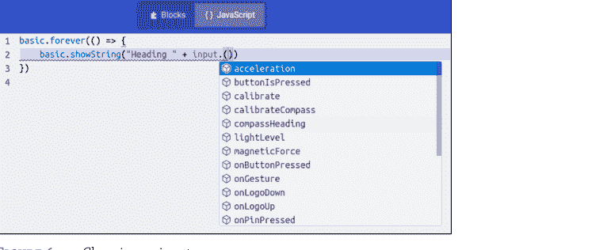

完成后的这一行代码有点密集，因此需要稍微解析。`basic.showString` 部分应该很熟悉。它告诉 JavaScript 获取一条消息（或字符串）并将其打印到 BBC micro:bit 显示器上。在“温度传感器”程序中，你用它在实际传感器读数后打印了一条有用的摄氏消息。在这里，它执行同样的操作——在单行内格式化打印到 BBC microbit 显示屏上的消息。消息以 Heading 单词开始，以实际传感器读数结束。

这个技巧的秘密惊人地简单；一切都在 + 符号之中（见图 6-15）。它告诉 JavaScript 拼接两个字符串，正如其字面意思。如果一个指令（如 basic.showString）期望一个字符串，使用 + 符号允许你给它两个字符串。在这种情况下，第一个字符串是单词 Heading 后面跟着一个空格，第二个字符串是 `input.compassHeading` 指令的输出。在温度传感器中需要两行代码的内容，在这个程序中只需要一行。

```javascript
basic.forever(() => {
  basic.showString("Heading " + input.compassHeading())
});
```

图 6-15：完成后的程序

> 提示：用于拼接字符串的 + 符号与你在处理实际数字时使用的 + 符号不同。尽管它们在外观上相同且在键盘上按下同一个按键，但它们的工作方式取决于你处理的是字符串还是数字。字符串 "1" + "1" 将打印为 "11"——字面意义上的连接成 "11"——而不是你在处理数字时得到的 "2"。

如果你在模拟器中运行程序，microbit 已经增加了一个点并指向 90°。点击并按住 logo 上的鼠标并拖动它使其扭转；随着 logo 的移动，指南针方向会变化，顶部为 0°（磁北）。如果你在真实的 BBC microbit 上运行程序，只需转动 microbit 本身——注意不要释放 USB 或电池单元。


> 提示：如果你是第一次使用指南针，或者上次使用后从一个环境移动到了另一个环境，可能会被要求进行校准。当你运行程序时显示器上出现一个圆，只需执行操作：旋转并倾斜 microbit，使显示器中心的点在显示边缘滚动并画出一个圆。当圆完成后，指南针即完成校准，程序正常运行。校准的准确性取决于环境因素。如果你在周围环绕金属或靠近磁场的区域（例如金属桌子上或一组扬声器旁边）校准指南针，指南针将无法正确校准。始终尝试在尽可能接近使用的环境中校准指南针以获得最高的准确度。

使用 `+` 符号拼接字符串的一个巧妙功能是，你不局限于只拼接两个：`"1" + "2" + "3"` 会给你 `"123"`，你可以继续使用 `+` 符号添加更多字符串，而永远不需要编写第二行代码。尝试修改现有程序，在指南针读数后打印 `degrees` 单词。

## 程序 6：加速度计传感器

在 BBC microbit 背部标记的两个传感器中，除了指南针外是加速度计。指南针设计用于测量磁场并确定 BBC microbit 的朝向，而加速度计测量三个平面（X、Y 和 Z）上的加速度。除了能够返回实际值外，它还可以用于检测不同类型的运动，如手势——这是与传感器交互简单的方法。

加速度计是一个强大的工具；除了能检测运动，它还可以通过跟踪将 BBC microbit 引向地球中心的重力，计算 microbit 位置的角度。

要使用加速度计，点击“Projects”（项目）菜单，点击“New”（新建），然后点击“Editor”（编辑器）切换开关创建一个全新的空白项目。点击屏幕底部的“Untitled”（未命名），然后使用 `Accelerometer Sensor`（加速度计传感器）为你的新项目命名，这样以后就可以再次找到它。没有什么比一个满全是名为“Untitled”的项目文件夹更糟糕的了！

首先将光标移动到第 2 行并输入以下内容：

```javascript
basic.showString("X: " + input.accelerationX())
```

当某行代码将超出页面边界时，会打印出一个 `~` 符号。如果你看到这个符号，请继续输入代码而不要按 `Enter`（回车）或 `Return`（返回）键。如果你不确定如何输入一行代码，请访问 `www.wiley.com/gb/microbituserguide` 网站下载每个程序的纯文本版本；这些可以用于参考，或者直接复制并粘贴到编辑器中。

JavaScript 编辑器如既往一样，在你到达关键点时提供自动补全行的建议。在你输入 `input,` 之后，这尤为有用，它将为你提供 BBC micro:bit JavaScript 可以读取的所有输入列表（见图 6-14）。你可以从此列表中选择 `compassHeading` 来完成代码行，或者直接忽略弹出窗口并继续输入。

完成后的这一行代码有点密集，因此需要稍微解析。`basic.showString` 部分应该很熟悉。它告诉 JavaScript 获取一条消息（或字符串）并将其打印到 BBC microbit 显示器上。在“温度传感器”程序中，你用它在实际传感器读数后打印了一条有用的摄氏消息。在这里，它执行同样的操作——在单行内格式化打印到 BBC microbit 显示屏上的消息。使用 `+` 符号拼接字符串的一个巧妙功能是，你不局限于只拼接两个：`"1" + "2" + "3"` 会给你 `"123"`，你可以继续使用 `+` 符号添加更多字符串，而永远不需要编写第二行代码。尝试修改现有程序，在指南针读数后打印 `degrees` 单词。

在 JavaScript 中编写注释，使用双斜杠（`//`）。注释会被计算机忽略，对于解释你的代码非常有用。

```javascript
// 这条注释
```

注释可以单独成行，也可以位于现有代码行的末尾。双斜杠之后的任何内容会被 JavaScript 编辑器忽略，且不是完成程序的一部分。如果将注释放在代码行上方，JavaScript 编辑器将将其关联到该行，如果你使用编辑器切换到 Blocks 模式时将会显示。但是，如果注释下方没有代码行，在切换编辑器模式时将会丢失。

通过输入三行代码（见图 6-16）来启动程序，可以手动输入，也可以利用 JavaScript 编辑器的自动补全来减少打字量：

```javascript
input.onGesture(Gesture.Shake, () => {
  basic.showIcon(IconName.Surprised)
})
```

| Blocks | JavaScript |
|---|---|
| 1 | input.onGesture(Gesture.Shake, () => { |
| 2 | basic.showIcon(IconName.Surprised) |
| 3 | }) |

图 6-16：事件手势

程序现在已准备好进行测试。当你向程序添加 `input.onGesture` 指令时，模拟器增加了一个新控件：一个标记为 SHAKE 的按钮。点击此按钮来摇动 BBC microbit，显示器上会出现一个惊讶的脸。或者，将鼠标光标移动到 BBC microbit 上并抖动鼠标来实现摇动效果。

程序原理是利用加速度计跟踪一组手势——在这种情况下是摇动手势。如果你删除第 1 行 `Gesture` 中的 `.Shake` 部分并输入一个点，即可查看加速度计可以跟踪的其他：

- `EightG`——`EightG` 以及 `ThreeG` 和 `SixG`——手势仅在任何方向的加速度超过高重力时触发，这通常速度非常快。
- `FreeFall`——自由落体手势仅在 BBC microbit 掉落并向地面冲撞时触发。该手势在构建飞行机器人或遥控火箭时特别有用。
- `LogoDown`——标志向下：通过追踪地球引力的拉力，加速度计可以检测 BBC micro:bit 的方向。只有当 BBC micro:bit 以标志向下的方式放置，才会触发此手势。
- `LogoUp`——标志向上：与 `LogoDown` 相反，仅在 micro:bit 标志朝上时触发。
- `ScreenDown`——屏幕向下：追踪方式与 `LogoDown` 相同，当 BBC micro:bit 的显示屏朝下时，触发 `ScreenDown` 手势。
- `ScreenUp`——屏幕向上：与 `ScreenDown` 相反，此手势仅在 BBC micro:bit 的显示屏向上时触发。
- `Shake`——摇动：通过剧烈摇动 BBC micro:bit 来激活——但注意不要甩掉 micro-USB 或电池电缆，或者让它飞到另一个房间去！
- `SixG`——六G：`SixG` 手势位于 `EightG` 和 `ThreeG` 加速度手势之间。
- `ThreeG`——三G：`ThreeG` 手势的工作方式与 `EightG` 手势相同，但在较平缓的加速度下触发。
- `TiltLeft`——向左倾斜：此手势基于 BBC micro:bit 的角度，当 micro:bit 向用户的左侧倾斜时触发。
- `TiltRight`——向右倾斜：与 `TiltLeft` 相反，当 BBC micro:bit 向用户的右侧倾斜时触发 `TiltRight` 手势。

## 延迟 (Delays)

通过一些更改，程序可以变得更具交互性。将光标移动到第 2 行尾（如果不在那里的话），按 `Enter` 键添加一个新的空白行 3。然后输入以下内容：

```javascript
basic.showIcon(IconNames.Asleep)
```

如果你现在按下模拟器上的 SHAKE 按钮，你会短暂地看到“惊讶”（Surprised）图标，然后“睡眠”（Asleep）图标才会出现。如果你持续按下 SHAKE 按钮——等同于在模拟器中持续摇动 BBC micro:bit——脸会在“惊讶”图标和“睡眠”图标之间反复切换，且速度较快。这并不符合现实；当你被摇醒后，想要重新入睡是需要时间的！

为了修复这个问题，你将在两个 `basic.showIcon` 指令之间添加一个延迟。延迟的作用正如其名：暂停程序一段设定的时间，延迟下一条指令的执行。将光标移动到第 2 行尾，按 `Enter` 键添加新的空白行 3，并输入以下内容（见图 6-17）：

```javascript
basic.pause(1000)
```

```javascript
input.onGesture(Gesture.Shake, () => {
  basic.showIcon(IconNames.Surprised)
  basic.pause(1000)
  basic.showIcon(IconNames.Asleep)
})
```

图 6-17：完成的程序

现在，如果你点击 SHAKE 按钮——或者如果你在物理 BBC micro:bit 上运行程序；摇动 BBC micro:bit——你会看到在“睡眠”图标出现之前，“惊讶”图标显示的时间更长。增加 `basic.pause` 指令中的数字，“惊讶”表情留在屏幕上的时间就越长；减小它，“睡眠”脸出现得越早。

`basic.pause` 指令括号中的数字是程序延迟的单位，单位是毫秒（秒的千分之一）。因此，值 `1000` 等于一秒；`2000` 是两秒，而 `500` 是半秒。因为像驱动 BBC micro:bit 这样的处理器运行比人类快得多，每秒执行数百万次操作，程序经常需要延迟来让人类跟上。

作为一个实验，你是否可以进一步扩展程序，让 BBC micro:bit 从“睡眠”图标开始运行，而不是在第一次摇动之前完全空白。提示：你的 `input.onGesture` 事件（event）代码仅在 BBC micro:bit 被摇动时运行，因此你需要将代码放在此事件之外。

## 读取原始加速度计数据

手势系统是使用 BBC micro:bit 加速度计最简单的方法，但并不是唯一的方法。你也可以将数据作为数字读入程序中自行处理。点击 Projects（项目）菜单，点击 New（新建），然后切换到 Editor（编辑器）。点击屏幕底部的 Untitled；然后输入 `Accelerometer Sensor Data` 来命名你的新项目，将其与之前的加速度计传感器手势触发项目隔离开。

# 第 6 章 JAVASCRIPT

当一行代码超出页面边界时，会打印一个 `~` 符号。当你使用该符号时，请继续输入代码，无需按 `Enter` 或 `Return` 键。如果你不确定如何输入某行代码，请访问网站 `www.wiley.com/go/bbcmicroguide` 下载此程序的纯文本版本；这些可以用于参考或简单地复制粘贴到编辑器中。

> 提示

首先将光标移动到第 2 行的空白处（四个空格缩进之后），手动输入或使用 JavaScript 编辑器的自动完成功能输入以下内容：

```javascript
basic.showString("X: " + input.acceleration(Dimension.X))
```

这一行是在你在罗盘传感器（Compass Sensor）程序中编写的。`basic.showString` 让 BBC microbit 在屏幕上打印一个字符串，而 `+` 符号连接两个字符串：`"X"` 作为前缀，后面跟着 `input.acceleration(Dimension.X)` 指令的输出。模拟器现在开始显示字符串 `X:` 后面是当前的测量值。X 是加速度计三维测量的三个轴之一。要获取其他轴，请点击第 2 行的开头高亮它，并用鼠标移动模拟的 microbit 以观察数字变化。BBC microbit 现在按顺序读取三个轴：X 轴，然后是 Y 轴和 Z 轴，最后重置 X 轴。

| Blocks | JavaScript |
| :--- | :--- |
| 1 | basic.forever(() => { |
| 2 | basic.showString("X: " + input.acceleration(Dimension.X)) |
| 3 | basic.showString("Y: " + input.acceleration(Dimension.Y)) |
| 4 | basic.showString("Z: " + input.acceleration(Dimension.Z)) |
| 5 | }) |
| 6 | |

图 6-18：BBC microbit: 现在是完成的程序

## 第 6 章 JAVASCRIPT

游戏的开始方式与任何其他程序都一样：点击“项目”（Projects）菜单，点击“新建”（New），切换到“编辑器”（Editor），通过点击“未命名”（Untitled）并输入 `Fruit Catcher` 来命名它。你需要 `basic.forever(() => {})` 循环，所以不要删除程序列表中的现有行。如果你在读完这段段话之前已经删除了它，只需点击“撤销”（Undo）按钮手动将其找回。

如果你更倾向于一次性输入所有代码，然后再阅读每行代码的作用，你可以在附录 B“JavaScript 食谱”中找到程序的完整副本：

## 设置

游戏应该从初始化一些变量开始：一个用于调整游戏速度的变量 `delay`，一个代表角色的精灵（sprite），以及另一个代表水果的精灵。将光标移动到第 1 行开头，按回车移动所有内容，然后将光标移回第 1 行开头并输入以下三行代码：

```javascript
let delay = 1000
let fruit: game.LedSprite = null
let player: game.LedSprite = game.createSprite(2, 4)
```

第一行设置了游戏的毫秒级计时，这演示了初始化的一个重要特性：你可以用任何需要的数据初始化变量，而像以前那样只能初始化零。此行初始化的 `delay` 控制了游戏开始时的速度；如果你想增加挑战，可以调低它；如果想让游戏变简单，可以调高。第二行使用 Game 指令类别提供的指令将 `fruit` 变量初始化为精灵，而第三行对 `player` 变量执行相同的操作——提供了游戏所需的对象：一个水果和一个用来接住的玩家。

然而，第三行与第二行有所不同。第二行并没有真正创建水果精灵——正如末尾的 `null` 词所示，通常情况下，精灵位置处的内容会告诉 JavaScript 在 BBC micro-bit 的特定位置创建该精灵。`game.createSprite(2, 4)` 指令中的数字至关重要：它们精确控制了精灵在 BBC micro-bit 显示屏上的出现位置。屏幕上的每个像素在水平 X 轴和垂直 Y 轴上都有位置。图 6-20 展示了这一点，为屏幕上 25 个像素中的每一个提供了 X 和 Y 坐标（写作 XY）。

图 6-20：BBC micro:bit 显示坐标

通过告诉 `game.createSprite` 指令在 X 轴位置 2 和 Y 轴位置 4（即图 6-20 中的坐标 2,4）创建玩家精灵，精灵将在显示屏底部行的中间列被创建。

接下来，你需要将游戏分数初始化为零。如果你愿意，此时你可以让游戏从 10 分、100 分或任何你喜欢的数字开始，但那样有什么好玩的呢？将光标移动到第 3 行末尾（如果不在那里的话），按回车，并输入以下行代码：

```javascript
game.setScore(0)
```

现在第 4 行就绪且初始分数已设置，你的游戏设置部分就完成了（见图 6-21）。

| Blocks | JavaScript |
|---|---|
| 1 | delay = 1000 |
| 2 | fruit: game.LedSprite = null |
| 3 | player: game.LedSprite = game.createSprite(2, 4) |
| 4 | game.setScore(0) |
| 5 | |

图 6-21：完成的设置部分

## 主程序循环

程序的下一个阶段是制作游戏本身。将光标移动到第 4 行末尾（如果不在那里的话），按回车插入一个空白第 5 行。第 6 行应该是你开始项目时程序列表中已有的 `basic.forever` 循环的开头，将光标移动到自动插入四个空格缩进后的第 7 行，输入以下内容：

```javascript
fruit = game.createSprite(Math.random(5), 0)
```

程序中存在空白第 5 行是有原因的：在代码段之间添加空格更容易看出一个部分的结束和另一个部分的开始。留空行像注释一样，不会减慢游戏运行速度，也不会让完成的程序变大，而且会让别人更容易理解——或者让你自己在几个月后打开项目时，记得哪一部分是哪一部分！但记住，使用编辑器在 JavaScript 块和 JavaScript 代码之间切换会移除格式并更改行号。请保持 JavaScript 模式以避免出现这种情况。

如果每次玩游戏时水果都出现在同一个地方，它就不像个游戏了。在第 3 行设置玩家的初始位置时，第 7 行使用 `Math.random` 指令在每次创建新水果时寻找一个随机的起始位置。

`Math.random` 指令的作用正如其名称所示：选取从零开始的随机数，范围由括号内的数字界定。

按照 BBC microbit 处理器运行块的速度，一个水果掉落速度尽可能快的游戏将比人类玩游戏的速度快数百万倍；你看到的将只有游戏结束界面。为了修复这个问题，将光标移动到第 7 行末尾（如果不在那里的话），按回车并输入以下内容：

```javascript
basic.pause(delay)
```

这一行告诉 BBC microbit 暂停 `delay` 变量中指定的毫秒数（你将其初始化为 1000 毫秒，即一秒），然后水果才会掉到下一列。

```javascript
1 delay = 1000
2 fruit: game.LedSprite = null
3 let player: game.LedSprite = game.createSprite(2, 4)
4 game.setScore(0)
5
6 basic.forever(() => {
7   fruit = game.createSprite(Math.random(5), 0)
8   basic.pause(delay)
9   while (fruit.get(LedSpriteProperty.Y) < 4) {
10
11  }
12 })
```

图 6-22：主程序的开头

## 条件循环

到目前为止，你只处理过一种循环：无限循环。一种更强大的循环类型是条件循环，它只在条件成立时运行。目前，该循环并没有执行任何操作。将光标置于第 10 行，在八空格缩进后，输入以下内容：

```javascript
fruit.change(LedSpriteProperty.Y, 1)
```

有了这一行代码，每当这段代码块运行时（即只要循环允许，且水果在显示屏上的 Y 轴位置小于 4），水果的 Y 轴位置就会增加 1。结果是：水果似乎在显示屏上“掉落”。

不过，掉落过程需要慢下来才能增加趣味性，因此将光标置于第 10 行末尾，按回车并在第 11 行输入以下内容：

```javascript
basic.pause(delay)
```

### 条件语句

循环并不是唯一可以附加到条件上的指令。一种强大的编程工具是 `if, else` 条件控制流。使用 `if, then else` 控制流，你可以测试条件是否成立并运行一组特定的指令，或者在条件为假时运行另一组指令。与条件循环不同，条件控制流不会循环。无论根据条件运行了哪些指令，它们都只会运行一次，除非你将这些指令放置在条件语句内部的循环体中。

将你的光标移动到第 12 行的末尾——该行包含了结束你之前创建的条件循环的右大括号——并按回车键创建一个新的空白第 13 行。然后输入以下内容：

```javascript
if (player.isTouching(fruit)) {
```

在行尾按回车键，且不要移动光标，JavaScript 编辑器的自动补全功能会自动在第 15 行添加一个右大括号，并将光标置在第 14 行，且带有八个空格的缩进——这再次表明你输入的行将成为当条件为真时，由条件语句执行的代码部分。

这条 `player.isTouching(fruit)` 指令是条件的测试。它检查在游戏开始时创建的玩家精灵（sprite）在水果精灵到达屏幕底部时是否接触了水果精灵。如果玩家精灵接触了水果精灵，则表示玩家“抓到了”水果；否则，玩家“错过了”水果。

如果玩家抓到了水果，则需要增加玩家的分数。将光标置在自动生成的第 14 行缩进后的位置，输入以下内容：

```javascript
game.addScore(1)
```

这个条件处理了玩家成功抓到水果的情况，但如果玩家错过，游戏需要能够运行另一条指令。这通过给条件添加一个 `else` 分支来处理。按回车键插入新的空白第 15 行；然后输入

```javascript
} else {
    game.gameOver()
}
```

注意，当你输入结束右大括号以结束条件中的 `if` 部分时，JavaScript 编辑器会自动纠正缩进，将其从八个空格调整为四个。从整体上看，这些指令构成了大白话中的以下句子：如果玩家精灵变量接触水果变量，则给分数加 1；如果没有接触水果变量，则结束游戏并显示游戏结束界面。

条件中 `if` 部分的代码仅在条件为真时运行；条件中 `else` 部分的代码仅在条件为假时运行。无论发生什么，两个代码块中只有一个会被执行；在任何情况下，程序都不会在单次循环运行中同时执行 `if` 和 `else` 语句。

最后，你还需要两行代码来完成游戏的主体。将光标移动到第 17 行的末尾，按回车键插入新的空白第 18 行，然后输入以下内容：

```javascript
fruit.set(LedSpriteProperty.Brightness, 0)
```

现在，当玩家抓到水果精灵时，它的亮度将被设置为零，从而隐藏不可见。按回车键并在第 19 行输入以下内容来放置主程序代码：

```javascript
delay = delay - delay / 10
```

正是这行代码负责在每次成功抓到水果后加快游戏速度。代码的第一部分告诉 JavaScript 将 `delay` 变量更改为短序列的结果；第二部分告诉它从 `delay` 变量的当前值中减去某些；最后部分告诉它减去 `delay` 变量当前值除以 10。结果是：每抓一次水果，`delay` 变量就会缩小 10%，使游戏每轮快 10%。

另一种更简洁的方法来减少或递减变量的值。正如在之前的程序中使用 `+=` 来增加变量一样，`-=` 用于递减变量。因此，第 19 行应改为：

```javascript
delay -= delay / 10
```

遗憾的是，写下这行代码会防止你通过编辑器的切换器在 JavaScript 模式和 JavaScript Blocks（积木）模式之间切换项目，并导致程序更改发生变化。虽然本章中写的第 19 行不如上面的版本那么简洁，但它与 JavaScript 和 JavaScript Blocks 具有更好的兼容性。

从 JavaScript 切换到 Blocks 模式并反之还有其他影响：你会发现 Blocks 编辑器会对你的程序进行更改，包括初始化所有变量并将程序的其他部分从顶部移动到底部。尽管这些更改对程序的功能没有影响：程序的运行结果完全相同，但代码看起来可能略有不同。

你现在已经完成了主程序循环（见图 6-24）。虽然游戏看起来在模拟器中运行，但存在一个问题：你无法控制玩家精灵。

```javascript
let delay = 1000
let fruit: game.LedSprite = null
let player: game.LedSprite = game.createSprite(2, 4)
game.setScore(0)

basic.forever(() => {
    fruit = game.createSprite(Math.random(5), 0)
    basic.pause(delay)
    while (fruit.get(LedSpriteProperty.Y) < 4) {
        fruit.change(LedSpriteProperty.Y, 1)
        basic.pause(delay)
    }
    if (player.isTouching(fruit)) {
        game.addScore(1)
    } else {
        game.gameOver()
    }
    fruit.set(LedSpriteProperty.Brightness, 0)
    delay = delay - delay / 10
})
```

图 6-24：完成的 basic.forever

## 控制事件

为了抓到水果，玩家需要左右移动。方便的是，有 A 键向左，B 键向右——这就是控制玩家所需的。制作控制事件实际上是你之前编写程序的重复，但带有额外的逻辑。

将光标移动到行尾并输入。像之前一样，当你输入这一行并按回车键时，JavaScript 编辑器会自动添加一个右大括号并将光标置在带有四个缩进的下一行。

```javascript
input.onButtonPressed(Button.A, () => {
    if (player.get(LedSpriteProperty.X) > 0) {
        player.change(LedSpriteProperty.X, -1)
    }
})
```

`if (player.get(LedSpriteProperty.X) > 0) {}` 条件是为了防止玩家精灵离开屏幕左边缘。它检查玩家在 X 轴（水平）上的当前位置：如果大于 0（代表左边缘），则允许玩家向左移动；否则，玩家已位于边缘，不允许继续向左。

为了让玩家精灵实际移动，确保你的光标仍在八空格缩进后的行，并输入：

```javascript
player.change(LedSpriteProperty.X, -1)
```

现在，当玩家按下 A 键且不在左边缘时，玩家在 X 轴上的位置将减少（即递减），使精灵向左移动一个像素。

为了节省创建右移动事件块的时间，使用鼠标光标或键盘上的 Shift 和方向键选中这些行，然后按 `Ctrl+C`（macOS 为 `Command+C`）复制。将光标移动到行尾，按回车键，然后按 `Ctrl+V`（macOS 为 `Command+V`）粘贴事件块的副本。

为了让游戏中的玩家向右移动，对你的新事件块进行以下更改。在第一行，将 `Button.A` 更改为 `Button.B`；在第二行，将 `> 0` 更改为 `< 4`；在第三行，将 `-1` 更改为 `1`。新的控制事件如下：

```javascript
input.onButtonPressed(Button.B, () => {
    if (player.get(LedSpriteProperty.X) < 4) {
        player.change(LedSpriteProperty.X, 1)
    }
})
```

# 122

# BBC micro:bit 官方用户指南

现在游戏拥有了完全的控制权。第一个事件监听按钮 A 是否被按下，检查玩家是否有空间向左移动，然后将玩家向左移动一列。第二个事件监听按钮 B 是否被按下，检查玩家是否需要向右移动，然后将玩家向右移动一列。游戏完成，看起来应该如图 6-25 所示。

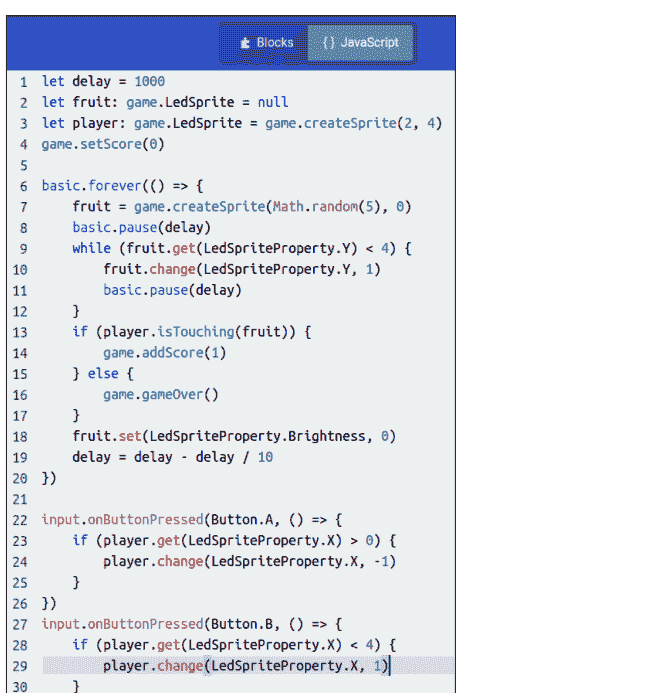

```javascript
1 let delay = 1000
2 let fruit: game.LedSprite = null
3 let player: game.LedSprite = game.createSprite(2, 4)
4 game.setScore(0)
5
6 basic.forever(() => {
7   fruit = game.createSprite(Math.random(5), 0)
8   basic.pause(delay)
9   while (fruit.get(LedSpriteProperty.Y) < 4) {
10    fruit.change(LedSpriteProperty.Y, 1)
11    basic.pause(delay)
12   }
13   if (player.isTouching(fruit)) {
14    game.addScore(1)
15   } else {
16    game.gameOver()
17   }
18   fruit.set(LedSpriteProperty.Brightness, 0)
19   delay = delay - delay / 10
20 })
21
22 input.onButtonPressed(Button.A, () => {
23   if (player.get(LedSpriteProperty.X) > 0) {
24    player.change(LedSpriteProperty.X, -1)
25   }
26 })
27 input.onButtonPressed(Button.B, () => {
28   if (player.get(LedSpriteProperty.X) < 4) {
29    player.change(LedSpriteProperty.X, 1)
30   }
31 })
```

图 6-25：完成的游戏

在尝试你的新游戏之前，请通过与本书附录 B 中的版本进行对比，检查程序是否已正确输入，并进行必要的更改。一旦你确定程序是正确的，就可以在模拟器上玩游戏。只需点击形状像两个箭头相互追逐的重置（Reset）按钮，游戏就会开始。使用按钮 A 和按钮 B 移动屏幕底部的玩家精灵，并在水果精灵从顶部掉落到底时接住它。如果掉了水果，游戏结束，你会看到一个闪烁动画、`GAME OVER`（游戏结束）消息和你的分数。要重新开始游戏，只需再次点击重置按钮；这在模拟器和真实的 BBC micro:bit 上都适用。

为了改进游戏——以及你的编程技能——请尝试进行一些修改。与其使用按钮控制玩家精灵，不如使用加速度计来检测倾斜并为游戏提供运动控制，如何？尝试添加多个水果，让它们同时从屏幕上掉落，以增加挑战性。

# 后续步骤

现在你已经完成了关于 JavaScript 编程的章节，为什么不尝试在下一章中用 Python 尝试相同的练习呢？如果你直接跳到了这一章，请查看第 5 章中如何在视觉开发环境中实现相同的程序。如果你倾向于继续使用 JavaScript，请点击 JavaScript 编辑器的项目（Projects）菜单，然后点击 Make 选项卡，即可打开一系列待尝试的其他项目，从触摸感应爱情计到用牛奶盒制成的机器人。

# 第 7 章

## Python

在本章中

- “Hello, World!”：你的第一个 Python 程序
- 用于读取从按钮输入、触摸输入以及温度、加速度计和罗盘传感器读取输入的程序
- 水果接接器（Fruit Catcher）：一个可以在 BBC micro:bit 上编程和玩的简单游戏

Python 编程语言的命名并非因为喜剧小组蒙蒂派蛇（Monty Python）中的蛇，它始于 1989 年，是开发者 Guido van Rossum 的一个爱好项目。自 1991 年正式发布以来，Python 凭借其灵活性和对初学者友好的格式变得越来越受欢迎，这种格式不需要像竞争语言那样使用成百上千的大括号或分号。相反，Python 大量使用*空白字符*（whitespace）——空格或缩进——来控制代码块的开始和结束。

从技术上说，BBC micro:bit 本身并不是用 Python 编程的，而是专为 BBC micro:bit 以及其他基于微控制器的开发和教育板设计的语言变体：MicroPython。MicroPython 是由 Damien George 创建的 Python 版本，它包含了语言标准库中的某些部分，这些部分对于精简的微控制器和其他库是必需的，以便产生可以在 BBC micro:bit 和类似设备上良好运行的程序。BBC micro:bit 的 MicroPython 代码是由世界各地志愿者提供的，在 Damien George、Nicholas Tolvery 和 Carlos Pereira Antonio 的带领下，帮助人们使用该设备学习 Python。

与第 5 章“JavaScript 块”和第 6 章“JavaScript”一样，在本章中，你将被介绍 Python 编辑器，并学习编写一系列程序，以充分利用《BBC micro:bit 官方用户指南》第一版……Gareth Halfeace 的功能。

## 介绍 Python 编辑器

Python 编辑器是专为 BBC micro:bit 创建的环境。

以下是 Python 编辑器的主要功能：

- **下载按钮（Download）**：位于顶部，形状像指向 micro:bit 的箭头，它可以将你的程序下载到计算机。
- **保存按钮（Save）**：位于下载按钮旁边，形状像指向外部驱动器的大箭头，保存按钮将你的程序保存为 `.py`（Python）文本文件。
- **加载按钮（Load）**：点击加载按钮将允许浏览存储在计算机上的 Python 程序文件。
- **片段按钮（Snippets）**：形状像三个齿轮，位于保存按钮右侧，片段按钮让你快速访问常用的代码块，作为减少打字量的方法。
- **帮助按钮（Help）**：位于顶部菜单栏片段按钮旁边，当你遇到困难时应首先选择帮助按钮。点击帮助按钮可以加载介绍 Python 编辑器功能并说明如何使用的页面。
- **缩放按钮（Zoom）**：比菜单栏中的其他按钮小，这些按钮放大或缩小使程序列表变大变小。对于更复杂的项目，缩放让你在屏幕上同时看到更多项目；如果你发现程序列表难以阅读，缩放会让一切更清晰。
- **项目名称（Project name）**：开始新项目时的第一件事是使用顶部菜单栏右侧的框给它起一个描述性名称。始终从默认名称重命名项目，以便以后查找。
- **程序列表（Program listing）**：占据屏幕大部分区域并在左侧有行号，程序区域包含你正在编写的 Python 程序。

图 7-1：Python 编辑器

## 程序 1：‘Hello, World!’

“Hello, World!”是任何语言中传统的第一个程序。它设计得简单，但能让你对特定语言有一个初步了解，就像在编程时获得了一个快速的回报——通过一条证明你的程序运行良好的消息来获得额外的奖励。

首先，打开浏览器并访问 `python.microbit.org` 来加载 Python 编辑器。Python 编辑器加载时已经输入好了一个默认程序作为介绍。虽然这个程序实际上是一个“Hello, World!”程序，但请先删除程序列表中当前显示的所有文本，以便从一个完全空白的状态开始。执行此操作最快的方法是在键盘上按 `Ctrl+A` 选择所有文本，然后按退格键（Backspace）或删除键（Delete）。

Hello, World!是一个只需要两行代码的简单程序。无论程序设计如何，所有 micro:bit Python 程序都需要第一行，在本章的每个程序中都是同一行。在删除程序列表中的所有文本并将光标置于新空白第 1 行开头后，输入以下内容：

```python
from microbit import *
```

这被称为导入指令（import instruction）；它告诉 Python 你将使用名为 microbit 的库中的指令。Python 库包含一组预写代码，并以函数的形式提供，而 microbit 库的函数主要围绕你在程序中使用 BBC micro:bit 展开。如果没有这一行（它告诉 Python 将 microbit 库中的所有指令添加到你的程序中供你使用），你将无法使用 BBC micro:bit 的屏幕、传感器、输入输出引脚或任何其他功能。

程序的第二行实际上将“Hello, World!”消息打印到 BBC micro:bit 显示屏上的。将光标置于第 1 行末尾，按回车键插入新的空白第 2 行，并输入以下内容：

```python
display.scroll('Hello, World!')
```

这一行告诉 Python 你正在使用显示指令类别中的滚动（scroll）指令，并且你正在传递消息“Hello, World!”（见图 7-2）。正如其名称所示，该指令会将你编写的消息在 BBC micro:bit 的显示屏上滚动供你阅读。

```python
1 from microbit import *
2 display.scroll('Hello, World!')
```

图 7-2：程序列表中的 display.scroll 指令

> 提示
>
> 撤销撤销——即重做。
>
> 如果你在编写程序过程中任何时候犯了错误，可以按键盘上的 `Ctrl+Z` 撤销上一次操作。如果你不小心撤销了想要保留的内容，按 `Ctrl+Y` 撤销撤销——即重做。

在 Python 中，所有内容对大小写敏感，这意味着必须以完全正确的字母大小写组合进行输入。指令 `display.scroll` 是有效的，而 `Display.Scroll`、`DISPLAY.SCROLL` 以及任何其他变体都无法工作。

你可能注意到刚才那行代码使用了不同的颜色。这在编程中被称为语法高亮（syntax highlighting），它可以帮助你一眼看出你可能犯的任何错误。指令本身（代码中的 `display.scroll` 部分）以米白色显示；指令正在使用的消息 `'Hello, World!'` 则以紫色显示。

尝试删除第 2 行中的单引号，使之读起来像这样：

```python
display.scroll(Hello, World!)
```

注意颜色发生了变化。最后一个括号原本是米白色，现在变成了紫色，这表明 Python 编辑器认为它是字符串的一部分（见图 7-3）。如果没有单引号，你无法告诉 Python 编辑器字符串何处结束，但程序不再工作了；你在程序中引入了一个 bug。

```python
1 from microbit import *
2 display.scroll(Hello, World!)
```

图 7-3：Python 编辑器高亮代码错误

Python 编辑器的调试功能相对基础。编辑器的关键工具是语法高亮：通过观察颜色，可以看到一些常见错误，例如程序中未闭合的字符串。尽管你在第 2 行引入了错误，但当你点击下载按钮时，Python 编辑器仍然会下载你的程序。在你将程序闪录到 BBC micro:bit 之前，你看不到错误消息，此时你会看到编译器生成的任何错误消息在显示屏上滚动——在这种情况下，它不是你预期的“Hello, World!”消息。此滚动的错误消息始终包含发现错误时的行号引用，允许你回到程序中找到并修复问题。

将单引号放回第 2 行，使其读起来如下：

```python
display.scroll('Hello, World!')
```

语法高亮将括号恢复到原始颜色，表示该代码块已修复。点击下载按钮编译并将你的程序保存为 `microbit.hex`，通过 micro-USB 端口将 BBC micro:bit 连接到电脑，然后按照第 3 章所述，将 `microbit.hex` 文件从下载文件夹拖到 BBC micro:bit 的可移动驱动器中。闪录完成后，程序开始运行，“Hello, World!”消息开始在你 BBC micro:bit 的显示屏上滚动（见图 7-4）。你可以对此处进行实验：将第 2 行更改为滚动你的名字或喜欢的颜色的消息，然后点击下载按钮。

> 在编程中，这些消息被称为字符串，由字母、数字和一些符号组成。虽然字符串非常适合在屏幕上显示消息，但你处理它时也会限制。例如，字符串 `"1"` 不能用于数学方程，尽管它对我们来说像数字，但在编程中很容易区分。对于数学方程，还有其他类型：整数（integer）是整数，浮点数（float）带小数的数字，布尔值（Boolean）是 `True` 或 `False` 的逻辑元素——相当于 1 和 0。

当你对程序满意时，请确保点击保存按钮将程序列表保存到电脑上。在下载文件夹中找到此文件，它应该是 `microbit.py`。将其移动到一个新位置（如电脑的文档文件夹），并赋予更具描述性的名称，例如 `helloworld.py`，以便将来查找。

Python 编辑器本身并不保存你的程序，这意味着如果你关闭浏览器后回到 Python 编辑器，你的程序将被删除并替换为默认启动程序。

要在 Python 编辑器中加载保存的程序，只需在电脑上找到 `.py` 文件，点击并按住鼠标将其文件拖入 Python 编辑器的程序区域，或点击 Python 编辑器的加载按钮并浏览到要加载的文件。注意，你也可以通过点击下载按钮使用 hex 文件，因为每个文件也包含程序列表的副本。

无论你决定滚动什么，你都会注意到它只会滚动一次。如果你通过按下 BBC micro:bit 背部的重置按钮来重置它，你可以让消息再次出现，但如果你不想一直这样做，你需要一种方法告诉程序重复。

## 循环

将光标移动到第 1 行末尾，然后按 `Enter` 键将第 2 行向下移动到第 3 行，并创建一个新的空白第 2 行。当光标位于新第 2 行开头时，输入以下内容：

```python
while True:
```

这为你程序中你想要重复的部分创建了一种机制，但目前 Python 还不理解你实际上想重复哪些部分。要修复这个问题，将光标移动到第 3 行开头，按四次空格键以插入缩进。完成后，该行将比第 1 行和第 2 行缩进四个空格。

这被称为**缩进**（indentation），它是查看程序中代码行如何相互嵌套的一种。通常情况下，Python 编辑器会在需要时自动处理缩进，但在编辑代码行时不会这样做。在许多其他语言中，缩进的存在仅仅是为了让程序员更容易阅读代码——代码可以完全贴在程序列表的左边缘而仍然完美运行——但在 Python 中，缩进是强制性要求。每行代码的缩进层级告诉 Python 它们所处的位置。如果 Python 期望有缩进但实际上没有，程序将无法正常运行；同样，如果不该有缩进的地方存在缩进，程序也将无法工作。

当代码正确缩进后，它现在看起来应该是这样的：

```python
from microbit import *
while True:
    display.scroll('Hello, World!')
```

找到 Download 按钮下载你修改后的程序。然后在 Downloads 文件夹中找到它，并将其拖到 MICROBIT 盘进行烧录。烧录完成后，你会看到“Hello, World!”消息，但这次它会无限重复（见图 7–5）——或者直到你拔掉 BBC microbit。

| 行数 | 代码 |
| :--- | :--- |
| 1 | from microbit import * |
| 2 | while True: |
| 3 | display.scroll('Hello, World!') |

图 7–5：循环显示 display.scroll 消息。

在编程中，这被称为**循环**（loop）。当程序运行到指令末尾时——在本例中，当它完成从屏幕上滚动消息的 `scroll('Hello, World!')` 指令后——它会返回循环开头并重新开始。Python 中的循环是条件性的，这意味着如果循环开始时执行的测试结果为 `True`（真），则它们将一直循环。你在第 2 行创建的循环包含一个简单的测试。它检查 `True` 是否确实为真。因为 `True` 始终为真——这也是为什么它被称为 True 的原因——测试通过了，循环将永远持续；这被称为**无限循环**（infinite loop）。

所有的循环都需要开启和关闭，就像所有的字符串都需要包含在引号之间一样。第 2 行开头的 `:` 符号开始了循环，任何紧随其后且带有四个空格缩进的行都将成为无限运行的一部分。如果你的程序更长，并且包含不应该属于循环的代码行，你将把它们放在末尾，且不带四个空格缩进，以指示它们不属于四空格缩进的循环代码。

> 提示

## 程序 2：按钮输入

“Hello, World!”演示了如何通过屏幕获取 BBC micro:bit 的输出，但彻底演示了程序的另一个关键功能：输入（inputs）。BBC micro:bit 有两个准备就用的输入端：屏幕两侧的按钮 A 和按钮 B，现在是时候将它们引入你的程序了。

为了确保不会丢失“Hello, World!”程序，请确保你已通过 Save 按钮保存了它，将 `.py` 文件移动到安全的地方（如 Documents 文件夹），并给它一个描述性的名称，如 `helloworld.py`。完成这些操作后，可以通过按键盘上的 `Ctrl+A` 选择文本，然后按 `Delete` 或 `Backspace` 键删除当前程序列表，从而留下一个全新的、空白的程序列表。

开始输入任何 microbit Python 程序的的第一行，导入 microbit 库：

```python
from microbit import *
```

接下来，开始一个无限循环——就像你在“Hello, World!”中创建的那个让消息在屏幕上不断滚动的循环一样——通过在第 1 行末尾按 `Enter` 后，在第 2 行输入以下内容：

```python
while True:
```

当你在这一行末尾按 `Enter` 时，你可能会注意到光标没有跳到第 3 行的开头。相反，它位于第 3 行一个四个空格缩进之后。这被称为**自动缩进**（auto-indentation），是 Python 编辑器的一项节省时间的功能：因为你在第 2 行开启了一个无限循环，而 Python 要求该循环的内容必须缩进空格，所以 Python 编辑器自动为你插入了缩进。

自动缩进在多个层级有效。如果你在当前循环内部又开启另一个循环，下一行会自动缩进八个空格：四个用于初始循环，另外四个用于内部循环。在循环中再放一个循环，下一行将缩进 12 个空格，每层循环 4 个空格。

尽管自动缩进为你创建了缩进，但在你不再需要它时，由你来删除缩进。Python 编辑器不知道你何时写完循环代码，只知道你已经开始了；当你到达循环的最后一行时，你需要使用键盘上的 `Backspace` 键手动删除下一行的缩进。当光标位于缩进右侧时按一次 `Backspace` 键即可删除一个空格。

不过，目前还没有运行语句的代码。在第 4 行，八空格缩进的右侧，输入以下：

```python
if button_a.is_pressed():
    display.show(Image.HAPPY)
```

你在“Hello, World!”程序中使用 `display.show` 指令并不是在 BBC micro:bit 上滚动字符串，而是从选择中显示一个图像——在本例中，是一个快乐的脸。此时，你应该有四行代码：前两行靠左对齐，下一行缩进四个空格，再一行缩进八个空格（见图 7-6）。

```python
from microbit import *
while True:
    if button_a.is_pressed():
        display.show(Image.HAPPY)
```

图 7-6：button_a.is_pressed() 代码块。

点击 Download 按钮将结果写入 microbit，然后按下按钮 A 你会看到脸出现在屏幕上并停在那里。如果你按下 microbit 的 Reset 按钮，脸就会消失，直到你再次按下按钮 A。你不限于笑脸，也可以从以下列表中选择内置图像：`ANGRY`, `ARROW_N`, `ARROW_NE`, `ARROW_E`, `ARROW_SE`, `ARROW_S`, `ARROW_SW`, `ARROW_W`, `ARROW_NW`, `ASLEEP`, `BUTTERFLY`, `CHESSBOARD`, `CLOCK12`, `CLOCK11`, `CLOCK10`, `CLOCK9`, `CLOCK8`, `CLOCK7`, `CLOCK6`, `CLOCK5`, `CLOCK4`, `CLOCK3`, `CLOCK2`, `CLOCK1`, `CONFUSED`, `COW`, `DIAMOND`, `DIAMOND_SMALL`, `DUCK`, `GHOST`, `GIRAFFE`, `HAPPY`, `HEART`, `HEART_SMALL`, `HOUSE`, `MEH`, `MUSIC_CROTCHET`, `MUSIC_QUAVER`, `MUSIC_QUAVERS`, `NO`, `PACMAN`, `PITCHFORK`, `RABBIT`, `ROLLERSKATE`, `SAD`, `SILLY`, `SKULL`, `SNAKE`, `SQUARE`, `SQUARE_SMALL`, `STICKFIGURE`, `SURPRISED`, `SWORD`, `TARGET`, `TORTOISE`, `TRIANGLE`, `TRIANGLE_LEFT`, `TSHIRT`, `UMBRELLA`, `XMAS`, `YES`。

只需将第 4 行 `Image` 之后的名称——记住 Python 是区分大小写的，因此列表中的图像名称必须全部大写，并保留句号——更改为你选择的图像来修改程序显示的内容（见图 7-7）。

```python
from microbit import *
while True:
    if button_a.is_pressed():
        display.show(Image.PACMAN)
```

图 7-7：选择不同的图像进行显示

条件语句（如你在第 3 行创建的 `if` 语句）仅在它们的条件为真时才会运行；如果你没有在第 2 行创建一个无限循环，第 3 行的 `if` 语句将执行一次其代码，然后 BBC microbit 就会停止监听按钮。

## 多按键

能够读取单个按钮很棒，但 BBC microbit 有两个。坦率说，添加第二个按钮就像重复你已经做的事情一样简单：使用鼠标或键盘上的方向键将光标移动到第 4 行末尾，然后按回车键（Enter）创建一个空白的第 5 行。Python 编辑器假设你正在继续操作——你在第 3 行创建的 `if` 语句代码会自动根据空格进行缩进；按下键盘上的退格键（Backspace）删除这四个空格中的四个，留下四个，以表示你即将输入的行不是 `if` 语句的一部分，而是无限循环的一部分。完成后，输入以下两行：

```python
if button_b.is_pressed():
    display.show(Image.SAD)
```

与之前一样，当你在第 5 行末尾按回车键时，Python 会自动对第 6 行进行缩进，使其成为第二个语句的一部分。如果你想减少输入量，可以使用鼠标——或者键盘上的 Shift 加方向键——高亮包括第 3 行和第 4 行在内的内容，按 `Ctrl+C`（复制的快捷键），然后将光标移动到第 5 行（通过点击第 4 行末尾并按回车来创建它是必要的）——并按 `Ctrl+V`（粘贴的快捷键），在复制的代码中将 `A` 改为 `B`，将 `HAPPY` 改为 `SAD`。然而，如果你这样粘贴代码，可能会混淆 Python 编辑器的自动缩进功能。你会发现第 5 行缩进了八个空格，而它本应该缩进四个空格。将光标移动到第 5 行 `if` 单词的左侧，按一次退格键删除多出的四个空格（见图 7-8）。在 Python 编辑器中粘贴代码时，务必检查缩进是否正确创建；记住，缩进错误的 Python 程序无法正常运行。

```python
from microbit import *
while True:
    if button_a.is_pressed():
        display.show(Image.HAPPY)
    if button_b.is_pressed():
        display.show(Image.SAD)
```

图 7-8：完成的多按键程序

点击下载（Download）按钮，并将生成的 hex 文件烧录到 BBC micro:bit 上。按下按钮 A，笑脸会像以前一样出现。但是，点击按钮 B，你会得到一个忧伤的脸。你的程序可以读取任何一个按钮，或根据哪个按钮被按下来运行事件。

读取按钮还有第三种选择：同时读取两个按钮。通过将两个条件链到一个 `if` 语句中，可以检查两个按钮是否同时被按下，从而允许你从两个按钮中获得最多三个输入。生成的 `if` 语句将是：

```python
if button_a.is_pressed() and button_b.is_pressed():
```

当一行代码会超出页面边界时，会打印一个 `~` 符号。当你看到这个符号时，继续输入代码而不要按回车键或返回键。如果你不确定如何输入某行代码，请访问 `www.wiley.com/go/bbcmicroguide` 网站下载每个程序的纯文本版本；这些版本可以用于参考，或直接复制并粘贴到编辑器中。

## 程序 3：触摸输入

条件语句（如你在第 3 行创建的 `if` 语句）仅在它们的条件为真时才会运行；如果你没有在第 2 行创建一个无限循环，第 3 行的 `if` 语句将执行一次其代码，然后 BBC microbit 就会停止监听按钮。

这个项目的第一步现在应该是显而易见的。如果你还没有保存之前的程序，请先保存，然后按 `Ctrl+A` 再按 `Delete` 键，以开始一个空白的、新的程序列表，然后再输入导入和无限循环行：

```python
from microbit import *
while True:
```

当你在第 2 行末尾按回车键时，Python 会自动将第 3 行缩进四个空格，表示它是无限循环的一部分。输入以下内容：

```python
if pin0.is_touched():
```

该语句的工作原理与你在按钮输入中创建的语句相同：它形成了一个仅在条件为真时运行的条件。在这种情况下，条件是检查引脚 0 是否被触摸。如果引脚被触摸，缩进的代码就会运行；如果没有被触摸，代码就不会运行。

## 变量

变量是一个新概念。正如其名称所示，变量是在程序运行过程中会变化的东西。变量可以是任何类型：数字、字符串、甚至是图片。变量有两个主要属性：名称和数据。

变量必须在使用之前进行初始化。全局变量是可以在程序的任何部分使用的；局部变量是仅在其期间可访问的。变量名称应该尽可能具有描述性，使其在程序目的一目了然。对变量名称有一些限制：不能使用编程语言保留的名称，不能包含空格或其他符号。为了让多个单词的变量更清晰，通常做法是使用“驼峰命名法”（camel case）：例如，“Number of Fish” 变成 `numberOfFish`，“Age of User” 变成 `ageOfUser`。驼峰命名法本身通常写为 `camelCase`。

现在你有了变量，需要对它做些什么。在第 2 行末尾按回车键创建一个新的第 3 行，然后输入以下（记得 Python 编辑器会自动将第 4 行缩进四个空格）：

```python
touches = 0
while True:
    if pin0.is_touched():
```

如果语句需要执行操作，在第 4 行末尾按回车键创建一个新的空白第 5 行（Python 编辑器会自动为你插入八个空格的缩进），并输入以下：

```python
touches += 1
```

和指令一样，变量名对大小写敏感。如果你在尝试更改变量时使用了 `Touches`，你将得到一个错误。使用错误的字符是 Python 程序中常见的错误来源。

程序现在在技术上已经完成了（见图 7-10），但它并不好用。每当你触摸引脚 0，`touches` 变量就会增加，但没有办法看到它正在发生。程序需要一个输出，因此按回车添加一个新的第 6 行（带有自动的八个空格缩进），并输入以下：

```python
display.scroll(str(touches))
```

```python
from microbit import *
touches = 0
while True:
    if pin0.is_touched():
        touches += 1
    display.scroll(str(touches))
```

图 7-10：修改变量

```python
from microbit import *
touches = 0
while True:
    if pin0.is_touched():
        touches += 1
    display.scroll(str(touches))
```

图 7-11：完成的程序

`display.scroll(str(touches))` 这个短语在英语中并不太通顺，但如果我们把第 6 行拆解开，你就能看到计算机看到的：`display` 代表类别指令，`scroll` 是指令，告诉 BBC micro:bit 在显示屏上滚动消息，这就是“Hello, World”程序。这条指令引入了一个字符串，但你创建的 `touches` 变量包含一个数字，或者说整数。如果给期望处理字符串的指令一个整数，它就会感到困惑——反之亦然——尽管两者在人类看来是完全相同的。在 `display.scroll` 指令将 `touches` 变量的内容打印到屏幕之前，需要先将其转换为字符串。这正是指令中 `str` 部分的作用：括号中的任何内容都会从其原先的类型转换为字符串。然后，当 `display.scroll(str(touches))` 这一行运行时，它会将 `touches` 变量中存储的任何数字打印到显示屏。

点击 Download（下载）按钮编译并下载你的程序，然后将其写入 BBC micro:bit。当程序开始运行时，你会发现只有 Pin 0 是不够的。micro:bit 感应物理触摸的能力是通过一种被称为“电阻”的电学属性来实现的，它要求电路（在此例中是你的身体）是接地的。将右手食指放在 BBC micro:bit 最右侧的 GND 引脚上；然后用左手食指轻触 Pin 0。第一次触摸时，出现数字 1；随后的每次触摸，BBC micro:bit 都会重置，数字就会加 1。

BBC micro:bit 的 Pin 0、Pin 1 和 Pin 2 都支持电阻式触摸感应：使用物理按钮（按钮 A、按钮 B 和按钮 A+B）的输入加上这三个引脚，你的程序总共可以读取并响应最多六个输入：三个按钮输入分别对应 Pin 0、Pin 1 和 Pin 2。

当你正在数苹果或梨的数量时，你通常从 1 开始数。但在编程时，你从 0 开始。这就是为什么 BBC micro:bit 的三个主引脚被标记为 Pin 0、Pin 1 和 Pin 2，而不是 Pin 1、2 和 3。对于你在程序中处理的任何其他数字也是如此。如果你在数循环运行的次数，程序已经运行了十次——计数为 0, 1, 2, 3, 4, 5, 6, 7, 8, 9，总共十个数字——而不是你预期的九次。习惯从 0 开始思考可能需要一段时间，所以不要担心！

> 提示
>
> 关于使用 BBC micro:bit 的引脚的更多信息，请参阅第 10 章“构建电路”、第 11 章“扩展 BBC micro:bit”以及第 12 章“可穿戴 micro:bit”。

当你完成对 BBC micro:bit Pin 0 的制作后，记住使用 Save（保存）按钮保存你的程序，将 `.py` 文件移动到安全的地方，并给它一个好记的名字 `touchinputs.py`。

## 程序 4：温度传感器

BBC micro:bit 不仅仅有简单的输入和触摸感应引脚。最简单的是温度传感器，它的工作原理与温度计完全相同：从传感器读取并返回以摄氏度为单位的温度。

虽然温度传感器足以让你大致了解周围有多热或有多冷，但它并不是精密仪器。它内置在 BBC micro:bit 的处理器中，最初设计用于监测处理器温度而非环境温度。如果 BBC micro:bit 是一台台式电脑，那就是问题了：台式电脑的处理器即使在空闲运行时也比周围热几十度，需要巨大的散热器和风扇来保持冷却。然而，BBC micro:bit 处理器的运行温度与周围温度（称为环境温度）接近，因此精度通常在一两度之内。

如果你想获得尽可能准确的温度读数，保持程序简单很重要。如果你的程序正在高负荷运行 BBC micro:bit 的处理器——例如正在执行许多复杂任务——处理器就会开始发热，导致你的读数产生偏差。

> 提示
>
> 以传统方式启动你的程序：如果你还没有这样做，请保存、移动并重命名现有的程序，然后在键盘上按 `Ctrl+A` 接着按 `Delete` 键，从一个全新的空白程序列表开始。

输入 import 行来开始你的程序，紧跟一个无限循环：

```python
from microbit import *
while True:
```

在第 2 行末尾按 `Enter` 键创建一个带有自动四空格缩进的空白第 3 行，这告诉 Python 它是你刚刚创建的无限循环的一部分。然后输入以下代码行：

```python
display.scroll(str(temperature))
```

## 格式化输出

程序现在技术上已经完成了，但并不容易阅读。数字持续在屏幕上滚动，没有任何提示它们在测量什么。为了解决这个问题，按 `Enter` 添加一个新的带有自动四空格缩进的空白第 4 行，并输入以下内容，确保第一个单引号和 `Celsius` 单词之间有一个空格（参见图 7-13）：

```python
display.scroll(' Celsius')
```

```python
from microbit import *
while True:
    display.scroll(str(temperature))
    display.scroll(' Celsius')
```

图 7-13：格式化程序输出

点击 Download 按钮并将新的、更长的程序写入 BBC micro:bit。观察这种变化：与其单独打印温度，BBC micro:bit 首先打印温度，紧接着是单词 `Celsius`，两者之间有一个空格。

> 提示
>
> 触摸 BBC micro:bit 背面上的元件时要小心。如果你没有先通过触摸金属表面来正确接地，你可能会产生静电击入敏感电路中，并可能导致你的 BBC micro:bit 无法修复。

当你完成时，记住点击 Save 按钮，确保结果文件安全，并将其重命名为描述性名称，如 `temperatures.py`。

## 程序 5：指南针传感器

BBC micro:bit 的磁性指南针是背面标记的传感器之一（另一个是加速度计，将在本章详细介绍），也是最有趣的传感器之一。通过在三个维度读取局部磁场的强度，它可以计算出 BBC micro:bit 相对于磁北的方向。这种技术也内置在许多智能手机中，并被地图软件用于确定用户的面朝方向。

这个项目的第一步现在应该是显而易见的。如果你还没有保存之前的程序，请先保存，然后按 `Ctrl+A` 再按 `Delete` 键，以开始一个空白的、新的程序列表，然后再输入导入和无限循环行：

```python
from microbit import *
while True:
```

当你在第 2 行末尾按回车键时，Python 会自动将第 3 行缩进四个空格，表示它是无限循环的一部分。输入以下内容：

```python
display.scroll('Heading %s' % compass.heading())
```

这段内容有点密集，需要稍微理解。`display.scroll` 部分应该很熟悉。它告诉 Python 获取一条消息（或字符串）并将其打印到 BBC microbit 的显示屏上。在“温度传感器”中，你曾连续使用它来打印温度读数，随后是一个实用的摄氏度消息。这里是在单行内完成相同的操作——格式化打印到 BBC microbit 显示屏上的消息：消息以单词 Heading 开始，以实际的传感器读数结束。

这个技巧的秘密出奇地简单。它在于使用 `%` 符号将变量或指令的输出插入另一个字符串中。在这种情况下，第一个字符串是单词 Heading 后面跟一个空格，第二个字符串是 `compass.heading()` 指令的输出。注意这一行中有两个 `%` 符号：第一个 `%s` 位于单引号内部，作为字符串的一部分，告诉 Python 在该位置插入一个字符串——`%s` 中的 `s` 意思是“string”（字符串）；第二个在单引号之外，告诉 Python 什么内容提供了应该放置在 `%s` 处的字符串。你在“温度传感器”程序中用两行完成的工作，在这里只需要的一行。

```python
1 from microbit import *
2 while True:
3     display.scroll('Heading %s' % compass.heading())
```

图 7-14：完成的程序

点击 Download（下载）按钮编译并下载程序为 hex 文件，然后将其闪存到 BBC micro:bit 上。转动 micro:bit，注意不要拉扯 USB 或电池电缆，你将看到指南针读数随之发生变化。

> 提示：如果这是你第一次使用指南针，或者自上次使用以来你移动了环境，你可能会被要求对其进行校准。当你运行程序时，显示屏上出现 Draw a circle（画一个圆）的消息，只需按照要求操作：旋转显示屏并画一个圆，使显示屏的中心绕显示屏边缘滚动并画出一个圆。圆完成后，指南针即完成校准，程序将正常运行。校准的准确性很大取决于环境因素。如果你在周围环绕金属或靠近磁场的区域（例如在桌子上或扬声器旁）校准指南针，指南针将无法正确校准。为了获得最高的准确性，请始终尝试在与使用环境尽可能接近的环境中校准指南针。


使用 `%` 符号向字符串添加内容的一个巧妙功能是，你不限于添加一个：`'1 %s %s (%s)'` 结果是 123，而 `'1 %s %s (%s)', ('2', '3', '4')` 得到 1234，依此类推。你可以继续使用 `%` 符号添加字符串，而无需编写第二行代码。尝试修改现有程序，在指南针读数后打印角度。

一如既往，完成后，记得点击 Save（保存）按钮，将结果保存在安全的地方，并将其重命名为像 `compasssensor.py` 这样的描述性名称。

## 程序 6：加速度传感器

BBC micro:bit 背面标记的两个传感器中，与指南针一起的是加速度计。指南针设计用于测量磁场并从而确定 BBC micro:bit 的朝向，而加速度计测量三个平面（X、Y 和 Z）上的加速度。除了能够返回实际值外，它还可以用于检测不同类型的运动，如手势——这是程序中与传感器交互简单的方法。

加速度计是一个强大的工具。除了能检测运动，它还可以通过跟踪将 BBC micro:bit 引向地球中心的重力，计算 BBC micro:bit 的位置角度——即使 micro:bit 稳固地放在桌子上或握在手中。这是手机或平板电脑用于检测你何时从竖屏切换到横屏（或反之）的功能，以便它可以自动旋转显示屏以匹配。

开始之前，确保你已经保存、移动并重命名了之前的程序。然后按 `Ctrl+A` 再按 `Delete` 键，从空白程序列表开始。

文档良好的程序就是好程序。虽然在本章中不会要求你输入注释，因为运行程序并不需要它们，但养成这个习惯是个好主意。今天看起来有合理的程序部分，在几个月后回来时可能会令人困惑，如果没有引导，可能完全无法理解。注释不会减慢程序运行，也不会增加编译后的 hex 文件的大小；要大量使用它们，这将为以后你自己以及任何使用你程序的人节省大量麻烦。

要编写注释，只需输入井号 `#` 然后紧跟注释内容：

```python
# 像这样
```

注释可以单独占一行，也可以位于行末。

```python
from microbit import *
while True:
    display.scroll('Heading %' % compass.heading())
```

图 7-14：完成的程序

点击 Download 按钮编译并下载程序为 hex 文件，然后将其闪存到 BBC micro:bit 上。转动 micro:bit，注意不要拉扯 USB 或电池电缆，你将看到指南针读数随之发生变化。

（注：由于提供的文本存在大量 OCR 重复和混乱，以上翻译已根据逻辑流进行了合并与清理。）

# BBC micro:bit 官方用户指南

```python
from microbit import *
while True:
    if accelerometer.is_gesture("shake"):
        display.show(Image.SURPRISED)
        sleep(1000)
        display.show(Image.ASLEEP)
```

图 7-16：完成后的程序

点击下载（Download）按钮下载你的程序并将其刷入 BBC micro:bit。这次，如果你摇晃 micro:bit，你会发现惊讶的图像在执行 `sleep` 指令之前持续了更长时间。增加 `sleep` 指令中的数字，惊讶脸留在显示屏上的时间就会越长；而睡眠会出现得越早。

`sleep` 指令括号中的数字是程序延迟时间长度，单位是毫秒（即秒的分之一）。值 1000 等于一秒；2000 是两秒；500 是半秒。因为驱动 BBC micro:bit 的处理器运行速度比人类快得多，每秒执行数百万次操作，因此经常需要延迟以便人类操作员能够跟上。

作为一个实验，看看你是否能进一步扩展程序，让 BBC micro:bit 从加速度计图标开始显示，而不是在第一次摇晃之前完全保持空白。提示：`if accelerometer.is_gesture("shake"):` 内部的代码只会在 BBC micro:bit 被摇晃时运行，因此你需要将你的代码放在此语句之外。

完成后，记得点击保存（Save）按钮，将生成的 `.py` 文件从下载文件夹移动到某处，并将其重命名为具有描述性的名称，如 `accelerometersensor.py`。

## 读取加速度计原始数据

手势系统是使用 BBC micro:bit 加速度计简单的方法，但并不是唯一的方法。你也可以将原始数据作为数字读入程序由自己处理。按 `Ctrl+A` 然后按 `Delete` 创建一个新项目，获得一个空白程序列表。

开始输入以下三行代码，从导入库开始，没有它程序将无法运行：

```python
from microbit import *
while True:
    display.scroll('X:%s' % accelerometer.get_x())
```

## 第7章 PYTHON

这一行代码与你在指南针传感器程序中写的类似。`display.scroll` 告诉 BBC micro:bit 在显示屏上打印一个字符串，`%` 符号连接了两个字符串："X:" 作为前缀，后跟着 `accelerometer.get_x()` 指令的输出。

点击下载（Download）按钮并将生成的文件刷入 BBC micro:bit。尝试移动 micro:bit 并观察数字的变化。

不过，X 轴是加速度计三维测量中的三个轴之一。要获取其他轴，点击第 3 行开头的 `3` 来高亮它并按 `Ctrl+C` 复制。将光标移动到第 3 行末尾，按 `Enter` 添加新的空白第 4 行，然后按 `Ctrl+V` 粘贴复制的代码并创建一个新的空白第 5 行。再次按 `Ctrl+V` 创建另一个，将光标移动到第 4 行缩进的右侧，按 `Backspace` 删除 Python 编辑器误添加的额外四个空格缩进。

你的程序现在已设置为运行三次加速度计数据，但每次的都是 X 轴数据。要纠正这一点，你需要进行四处更改。在第 4 行中将 `X:` 改为 `Y`，将 `get_x` 改为 `get_y`；在第 5 行中将 `X:` 改为 `Z`，将 `get_x` 改为 `get_z`（见图 7-17）。

```python
from microbit import *
while True:
    display.scroll("X: " + str(accelerometer.get_x()))
    display.scroll("Y: " + str(accelerometer.get_y()))
    display.scroll("Z: " + str(accelerometer.get_z()))
```

图 7-17：完成后的程序

点击下载（Download）按钮并将文件刷入 BBC micro:bit。程序刷入后，BBC micro:bit 现在会逐一个读取三个轴：X 轴、接着是 Y 轴、然后是 Z 轴，最后再次返回 X 轴。尝试移动 micro:bit 查看角度和位置如何影响显示屏上的数字（以微重力为单位）。当 BBC micro:bit 面向你时，倾斜会减少 X 轴报告的数字，而向另一侧倾斜则会增加它。倾斜使顶部靠近你会减少 Y 轴报告的数字，倾斜使顶部远离你会增加它。最后，抬起 micro:bit 会增加 Z 轴报告的数字，而降低它会减少它（见图 7-18）。

一如既往，完成后确保点击保存（Save）按钮，将 `.py` 文件保存在某处，并重命名为类似 `accelerometersensorsdata.py` 的名称，以便将来以后再次找到它。

图 7-18：加速度计的三个轴

## 程序 7：接水果游戏

本章中的程序相对简单，一次只做一件事，目的是介绍用 Python 编写 BBC micro:bit 时需要了解的一些基础概念。然而，这个最后的程序要复杂得多：这是一个游戏，玩家（以显示屏底部单个发光像素的形式出现）尝试接住。

## 设置

通过导入 microbit 库开始程序，但在下方添加第二行输入以下内容：

```python
from microbit import *
import random
```

# BBC micro:bit 官方用户指南

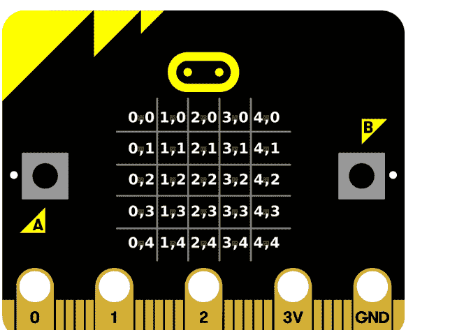

图 7-19：BBC micro:bit：显示坐标

通过 `playerPosition` 指令将玩家精灵设置在 X 轴位置 2 和 Y 轴位置 4 处（即图 7-19 中的 2,4），该精灵将创建在显示屏底行的中间列。

接下来，你需要将游戏分数初始化为零。如果你愿意，可以在此阶段作弊，让游戏从 10 分、100 分或你喜欢的任何其他数字开始，但那样哪里好玩呢？将光标移动到第 5 行末尾（如果不在那里的话），按 `Enter` 键，输入以下代码行：

```python
score = 0
```

现在第 5 行已就绪并且初始化了起始分数，你的游戏设置部分就完成了（见图 7-20）。

```python
from microbit import *
import random
delay = 0
delayCounter = 0
playerPosition = [2, 4]
score = 0
```

图 7-20：完成的设置部分

## 主程序循环

过程的下一个阶段是制作游戏。将光标移动到第 6 行末尾（如果不在那里的话），按 `Enter` 键插入一个空白第 7 行，然后按 `Enter` 键将光标置于空白第 8 行。游戏需要在循环中运行，因此创建一个循环并通过输入以下内容插入第一条指令：

```python
while True:
    fruitPosition = [random.randrange(0,4), 0]
```

程序中留第 7 行是有意的：在代码段之间添加空格可以更容易看到一个部分的结束和另一个部分的开始。就像注释一样，空行不会减慢你的程序运行速度，也不会增加生成程序的体积。当你几分钟后再次打开项目并尝试记住哪个部分是做什么时，它们对于别人——或者你自己——可能容易理解得多。

如果水果出现在你玩游戏的同一个位置，那就不算是一个游戏了。玩家的起始位置在第 5 行设置，而第 9 行使用了你在第 2 行导入的 `random` 库中的 `randrange` 指令，在每次创建一个新水果时找到一个随机的起始位置。

`random.randrange` 指令的作用正如其名所示：从括号之间的第一个数字开始，到第二个数字结束选取一个随机数，这两个数字是 0 和 4。这提供了 0, 1, 2, 3 和 4——总共五个数字——作为 `random.randrange` 指令的可能输出。这五个数字的范围完美地映射到显示器的 X 轴或 Y 轴。就是这样使用的：当游戏创建一个水果时，它将其位于显示屏的顶部（Y: 0），但在顶部随机选择一个位置（X: 0 到 4，取决于随机生成器选择了什么）。

此时，程序看起来应该像图 7-21 所示。

```python
from microbit import *
import random
delay = 10
delayCounter = 0
playerPosition = [2, 4]
score = 0
while True:
    fruitPosition = [random.randrange(0,4), 0]
```

图 7-21：主程序的开头

# BBC micro:bit 官方用户指南

## 条件循环

到目前为止，你一直在处理一种类型的循环：永远运行的无限循环。一种更强大的循环类型是条件循环，它测试特定的条件——例如一个变量是否等于另一个变量——并且仅在条件为真时运行。条件循环的作用类似于 `if` 语句，不同于 `if` 语句在执行完缩进代码后就结束，而条件循环会回到开头测试其条件是否应该重复。

将光标移动到第 9 行末尾（如果不在那里的话），按 `Enter` 键输入以下内容：

```python
while fruitPosition[1] < 4:
```

当你输入上述行后按 `Enter` 键，它会让你留在第 11 行，缩进为八个空格而不是四个，这表示你接下来输入的代码块位于刚刚创建的循环之下。

这一行打开了一个循环，当条件为真运行时运行，并检索 `fruitPosition[1]` 变量——即之前创建的 `fruitPosition` 列表的第二个条目，水果在显示器 Y 轴上的位置。它检查该值是否小于 4（见图 7-22）。只有且仅当（即水果尚未到达屏幕底部时），循环内的代码才会执行。

```python
from microbit import *
import random
delay = 10
delayCounter = 0
playerPosition = [2, 4]
score = 0
while True:
    fruitPosition = [random.randrange(0,4), 0]
    while fruitPosition[1] < 4:
```

图 7-22：条件循环

此时，循环什么都不做。将光标放在第 11 行，在八格空格缩进后输入：

```python
while delayCounter < delay:
```

# 第 7 章 PYTHON

这一行创建了另一个条件循环，这次检查 `delayCounter` 变量的值是否小于 `delay` 的值。这用于控制游戏运行的速度。每当这个循环运行时，`delayCounter` 变量就会加1；当它达到第 3 行存储的 `delay` 值时，循环结束，程序的其余部分运行。

为了接住水果，玩家需要在 BBC micro:bit 显示屏上左右移动。简单地说，左侧是 A 键，右侧是 B 键——这就是控制玩家精灵所需的。读取这些按钮并控制玩家精灵是你在本章之前编写输入的重复，但带有一些额外的逻辑帮助。

将光标放在第 11 行末尾，按 `Enter` 键创建一个新的第 12 行，在缩进十二个空格后输入：

```python
if button_a.was_pressed() and playerPosition[0] > 0:
```

当代码行超过页面边界时，会打印一个符号。当你看到这个符号时，继续输入代码而不按 `Enter` 或 `Return` 键。如果不确定代码应该如何缩进，访问网站 www.wiley.com/go/microguide 下载程序的纯文本版本；这些可以用来参考或直接粘贴到编辑器中。

这一行的条件判断是为了防止玩家精灵离开显示器的左边缘。它首先检查显示器左侧的 A 键是否被按下。然后它检查玩家在 X（水平）轴上的位置：如果大于0（代表显示器的左边缘），则允许玩家继续移动；否则，玩家位于最边缘，不应继续移动。

你可能会注意到使用 `button_a.was_pressed()` 而不是 `button_a.is_pressed()` 有重要的区别：`button_a.is_pressed()` 仅在实际测试条件时检查按钮是否被按下；而 `button_a.was_pressed()` 检查在最后一次进行 `button_a.was_pressed()` 之前按钮是否曾被按下。原因在本章中解释。

为了让玩家精灵实际上移动，确保光标在第 12 行，按 `Enter` 创建缩进十六个空格的第 13 行，并输入内容：

```python
playerPosition[0] -= 1
```

# 156 BBC micro:BIT 官方用户指南

现在当玩家按下 A 键但不在屏幕左边缘时，玩家在 X 轴上的位置（存储在 `playerPosition` 列表的第一个条目中，第二个存储 Y 轴上的位置）会减少1（递减），使精灵向左移动一个像素。

通过输入以下行创建另一个监控玩家按下 B 键以表示向右移动的条件，输入后按一次 `Backspace`，删除第 14 行自动生成的16个空格缩进中的四个空格：

```python
if button_b.was_pressed() and playerPosition[0] < 4:
    playerPosition[0] += 1
```

记得按照所示输入所有行。现在游戏拥有完全控制权：第一个语句监控 A 键被按下，检查玩家是否需要向左移动，然后向左移动一列。第二个语句监控 B 键被按下，检查玩家是否需要向右移动，然后向右移动一列。

# 绘制精灵

之前，你与显示器的交互限于预画的图像或滚动的消息。制作游戏需要能够动态构建图像，这通过使用 `display.set_pixel` 指令实现。将光标放在第 15 行末尾，按 `Enter` 创建新的第 16 行，然后一直按 `Backspace` 直到删除了 16 个缩进空格中的 4 个，剩余 12 个。然后输入内容：

```python
display.clear()
display.set_pixel(fruitPosition[0], fruitPosition[1], 9)
display.set_pixel(playerPosition[0], playerPosition[1], 9)
```

第一行清除 BBC micro:bit 的显示器，确保之前绘制的精灵不会残留。第二行获取存储在 `fruitPosition` 数组中的水果精灵的 X 和 Y 坐标以选择屏幕上的位置（如本章之前的图 7-9 所示），将其亮度设置为 9，即最大值。第三行最后对存储在 `playerPosition` 数组中的玩家精灵的 X 和 Y 坐标执行同样的操作，再次将显示器的每个像素设置为最大亮度。

按照 BBC micro:bit 处理器运行 Python 指令的速度，一个水果以最快速度掉落的游戏将比人类快数百万倍。

# 第 7 章 PYTHON

运行；你除了看到“游戏结束”屏幕外什么也看不见。要修复这个问题，将光标置在第 18 行末尾，按回车键，并输入以下内容：

```python
delayCounter += 1
sleep(100)
```

这增加了 `delayCounter` 变量的值，它控制了该条件循环运行的次数，然后在程序暂停 100 毫秒。记住，在第 11 行开启的条件循环将 `delayCounter` 变量与第 3 行初始化的10进行比较，这意味着循环总共运行了 11 次（`delayCounter` 变量计数为 0, 1, 2, 3, 4, 5, 6, 7, 8, 9，最后是 10），将 100 毫秒的延迟乘以总计 1.1 秒的延迟。

这看起来像是一个迂回的减速方法，你只需要使用 `sleep(1100)` 就能实现，但这样做有一个原因：Python 程序被 `sleep(1100)` 指令暂停了，它并没有检查按钮是否被按下。如果不检查按钮是否按下，玩家就无法移动。如果没有这个循环（它不断检查玩家是否想要移动以让果实掉落屏幕），游戏将是无响应的，而且不好玩。

这也是为什么我们使用 `button_a.was_pressed()` 来检查按钮何时被按下的。在延迟期间，Python 程序没有执行其他任何操作——包括检查按钮。通过使用 `button_a.was_pressed()`，即使玩家在程序的 `sleep(100)` 部分按了按钮，玩家精灵也会移动——由于程序运行速度很快，它大部分时间都花在了延迟上，而不是运行代码，因此这种情况更有可能发生。

## 完成程序

在第 20 行末尾按回车键，然后按一次退格键（Backspace）来删除四个空格。Python 编辑器自动添加了缩进，使你输入的后续行成为第 10 行开启的循环的一部分，而不是第 11 行。这个循环控制果实的掉落，通过第 11 行开启的循环进行延迟，以补偿 BBC micro:bit 处理器的速度。输入以下两行：

```python
delayCounter = 0
fruitPosition[1] += 1
```

第一行将 `delayCounter` 变量重置为零，这样当游戏下次进入第 11 行开启的延迟循环时，它将从零开始计数，而不是立即带着已存储的 `delayCounter` 值 10 退出。

第二行负责让果实掉落：存储在 `fruitPosition` 数组第二个元素中的 Y 坐标增加1，使其向屏幕底部移动一个像素。这代表了主游戏循环的结束。当这一行运行时，Python 回到第 10 行循环的开头，并检查果实的位置是否已经到达显示器的最后一行。如果还没到，循环继续，一切重新开始；如果到了，循环结束，玩家移动到第 23 行——这是一行你需要编写的代码。

将你的光标置在第 22 行末尾，按回车键，然后按一次退格键，删除 Python 编辑器插入的四个空格，这些空格表示你正在写的这一行不是第 11 行开启的循环的一部分。然后输入以下内容：

```python
if fruitPosition[0] == playerPosition[0]:
```

这一行检查存储在 `fruitPosition` 数组第一个元素中的 X 轴上的果实精灵，是否等于存储在 `playerPosition` 数组第一个元素中的玩家精灵在同一轴线上的位置。如果玩家精灵和果实精灵位于同一位置，说明玩家接住了果实；如果不是，玩家就错过了。提示：在 Python 中，使用 `==` 来检查是否相等。

## 第三部分：高级 BBC micro:bit 项目

- 第 8 章：无线 BBC micro:bit
- 第 9 章：BBC micro:bit 与 树莓派
- 第 10 章：构建电路
- 第 11 章：扩展 BBC micro:bit
- 第 12 章：可穿戴 BBC micro:bit
- 第 13 章：额外资源

官方 BBC micro:bit® 用户指南，第一版，Gareth Halfacree。

© 2018 John Wiley & Sons, Inc. 2018 年由 John Wiley & Sons, Inc. 出版

## 第八章：无线 BBC micro:bit

## 本章内容

- 查看 BBC micro:bit 内置无线电的功能
- 通过无线电从一个 BBC micro:bit 向另一个发送消息
- 通过无线电从一个 BBC micro:bit 向许多其他 BBC micro:bit 发送消息
- 使用无线电分离 BBC micro:bit，仅向特定群组发送消息

BBC micro:bit 最强大的功能之一是其内置的无线电模块。该模块集成在它的处理器中，是板载背面的一块黑色小芯片，无线电看起来可能不起眼，但它极其强大。通过无线电，你可以连接两个 BBC micro:bit 进行有线通信，或者让几十个 BBC micro:bit 组成的组共享数据。

最棒的是，BBC micro:bit 附带的无线电开箱即用，即可直接运行。你不需要连接外部天线，且使用的无线电频率在全球范围内允许免费使用。没有什么能阻止你让你的下一个项目实现无线化。

### BBC micro:bit：无线电

BBC micro:bit 的无线电模块内置在处理器中，该处理器位于板子背面左侧的一块黑色小芯片，丝网印刷层上有“PROCESSOR”标签（见附图 8-1）。模块本身没有标记，因为它集成在处理器中，但它的天线标有“BLE ANTENNA”字样，指向板的左上角，那里特种形状的电路板轨迹起到接收和发送无线电信号的作用。

图 8-1：带有无线电模块的 BBC micro:bit 处理器

虽然只有一个物理芯片，但实际上提供了两个无线电功能。第一个功能提供所谓的点对点连接，发送可以被附近的任何 BBC micro:bit 接收的信号。第二个功能使用蓝牙低功耗 (BLE)，它是所有手机和大多数平板电脑中常见的蓝牙短距离无线标准的变体，但经过了修改以确保最低的功耗。

如果你想创建一个让 BBC micro:bit 模块相互通信的项目，这就是点对点无线电功能。无论你是在构建一个由 BBC micro:bit 驱动的门铃、一个多人游戏，还是一个寻呼器警报系统，点对点无线电都能实现。

## 程序 1：点对点通信

这是你想创建一个让 BBC micro:bit 模块相互通信的项目时使用的功能。无论你是在构建一个由 BBC micro:bit 驱动的门铃、一个多人游戏，还是一个寻呼器警报系统，点对点无线电都能实现。

最简单的点对点通信是：

1.  一个 BBC micro:bit 发送一个可以被附近的另一个 BBC micro:bit 接收的消息。
2.  一个 BBC micro:bit 接收来自另一个 BBC micro:bit 发送的消息。

```javascript
radio.setGroup(1)
input.onButtonPressed(Button.A, () => {
  radio.sendString('Hello from C!')
})
radio.onDataPacketReceived((receivedString) => {
  basic.show(receivedString)
})
```

图 5：为你的第三个 BBC micro:bit 修改程序

点击 Download（下载）按钮，然后将文件闪录到你的第三个 BBC micro:bit 中。在三个 micro:bit 都开启的情况下，通过按下 BBC micro:bit 上的 A 按钮开始，你会看到消息 Hello from A；该消息会在 micro:bit B 和 BBC micro:bit C 的屏幕上滚动。按下 BBC micro:bit B 上的 A 按钮，消息 Hello from B 就会在 micro:bit A 和 BBC micro:bit C 的屏幕上滚动。最后，按下 micro:bit C 上的 A 按钮；消息 Hello from C 就会在 micro:bit A 和 BBC micro:bit 的屏幕上滚动。

尽管你在此处例中通过三个 BBC micro:bit 构建了一个网络，但你可以将该网络扩展到数百个 micro:bit。使用此示例程序，一个 micro:bit 发送的内容会被网络中的其他每一个 micro:bit 接收并显示——当然，前提是它们处于彼此的范围内。

由于该网络是点对点的，BBC micro:bit 之间直接通信，因此它被描述为去中心化的。如果你拔掉 BBC micro:bit A，BBC micro:bit B 和 C 仍然可以通信。插上 BBC micro:bit A 并拔掉 micro:bit B，micro:bit A 和 C 能够通信；插上 BBC micro:bit B 并拔掉 micro:bit C，BBC micro:bit C 以及 micro:bit A 和 B 仍然可以通话。从技术上讲，即使只有一个 micro:bit，网络仍然在运行；在周围没有接收者时发送无线消息就像在空房间里说话一样。

图 8-6 显示了一个由四个 BBC micro:bit 组成的示例网络。箭头代表每个 BBC micro:bit 的通信线路。注意任何一个 micro:bit 都可以与任何其他 BBC micro:bit 通信，即使你移走了其他的 micro:bit。当图中底部的 micro:bit 发送消息时，它通过箭头可视化：消息被其他三个 micro:bit 接收，而无需通过中央枢纽、路由器或服务器。

为了扩展程序 1 中的门铃实践实现示例，可以以此方式连接多个 micro:bit，以形成一个多房间建筑的通知系统。按下离你最近的 BBC micro:bit 上的按钮，所有其他 BBC micro:bit 都会显示该消息。或者，通过移除一个 BBC micro:bit 以外接收消息的能力，你可以将其转换为单向通知系统：许多房间中的某人按下她最近的 BBC micro:bit 上的按钮，详细说明哪个房间需要帮助的消息将出现在一个主控 BBC micro:bit 上。

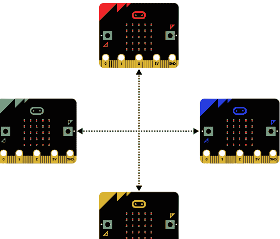

图 8-6：由四个 BBC micro:bit 组成的去中心化网络

# 第 8 章 无线 BBC MICRO:BIT

## 程序 3：无线分组

有时，你不希望给定区域内的所有 BBC micro:bit 都相互通话。也许你正处于教室环境，孩子们都在试图构建相互干扰的无线网络。也许你的邻居也在使用 BBC micro:bit，而你们正在监控彼此的网络。又或者你正在构建一个使用许多 BBC micro:bit 的项目，你需要一种方法保持它们有序。

幸运的是，BBC micro:bit 已经准备好了这些：它支持无线分组，这允许你创建最多 256 个独立的无线网络，每个网络包含一个或多个 BBC micro:bit。这些分组不会直接影响无线模块——例如，它们不会改变无线电发送或接收的频率——而是指示 BBC micro:bit 忽略任何与程序设置的组号不匹配的传输。附近所有的 BBC micro:bit 仍然会接收任何其他 BBC micro:bit 发送的任何无线消息，但如果它们处于不同的无线组，消息就会被丢弃——实际上就像从没有接收过一样。

在之前的程序中，你将无线组设置为 1（见图 8-7），从第 0 组到第 255 组的 256 个可能的无线组之一。如果你发现附近使用 BBC micro:bit 的他人侵入了你的网络，你可以将其更改为任何其他数字并过滤掉他们的消息。

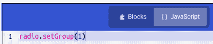

图 8-7：设置无线组

也可以动态修改你的无线组——就像当你开始有人打断你的对话时，你可能会调整对讲机电道的频道一样。回到 JavaScript 编辑器，在程序末尾添加以下几行：

```javascript
input.onButtonPressed(Button.B, () => {
    radio.setGroup(2)
    basic.showString("Switched to Group 2")
})
```

记得将第 3 行的 `radio.sendString` 消息改为 A，然后点击 Download 并闪录第一个 micro:bit。将第 3 行改为 B，然后点击 Download 并闪录第二个 micro:bit。最后，将第 3 行改为 C，然后点击 Download 并闪录第三个 micro:bit。（注：此处图片路径延续）

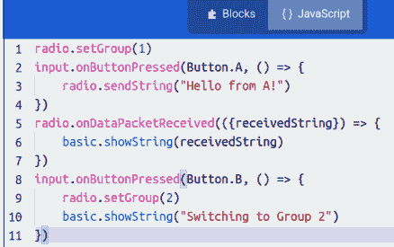

图 8-8：完成的程序，适用于 micro:bit

# 第 8 章 无线 BBC MICRO:BIT

## 分组功能测试

为所有 micro:bit 供电，通过 USB 端口或电池连接器。通过轮流按下每个 micro:bit 上的 A，你会看到与程序 2 相同的结果。现在按下 micro:bit C 上的 B，等待消息停止。现在你看到了不同的内容：消息 Hello from A 在 micro:bit C 上滚动。这是因为 BBC micro:bit A 和 B 在第 1 组，而 BBC micro:bit C 是独立的。你可以在反方向确认这一点：按下 BBC micro:bit C 上的 A，没有消息出现。记住更改分组不会改变无线频率；所有的 micro:bit 仍然在接收 BBC micro:bit 发送的信号，但因为它处于不同的组，消息被忽略了。

图 8-9 显示了发生的情况。三个 BBC micro:bit 的网络现在变成了两个网络：一个包含两个 micro:bit，另一个包含一个 micro:bit。micro:bit C 与其他两个通信线路已被切断。图 8-9 中的箭头表示了可能的通信方向：BBC micro:bit A 和 micro:bit B 可以自由处理彼此的每个信号，但任何发送或来自 BBC micro:bit C 的内容都将被忽略。

现在按下 BBC micro:bit A 上的 B，然后在确认消息停止滚动后按下 A。现在你看到消息 Hello from A 在 micro:bit C 上滚动，而不是 micro:bit B；两个 micro:bit A 和 micro:bit C 现在都处于第 2 组（见图 8-10）。与之前一样，箭头表示了可能的通信方向：BBC micro:bit A 和 micro:bit C 现在可以自由通信，因为它们在同一个无线组，而 BBC micro:bit B 作为原始无线组的唯一成员被孤立了。

与此同时，BBC micro:bit B 仍然在原始组中，现在完全处于独立状态。按下 BBC micro:bit B 上的 B，它就加入了第 2 组：按下任何 micro:bit 上的 A 都会在另外两个 micro:bit 上显示该消息（见图 8-11）。由于所有三个 BBC micro:bit 现在都在同一个组中，BBC micro:bit 可以自由与任何其他 micro:bit 通信。

# 172 官方 BBC MICRO:BIT 用户指南

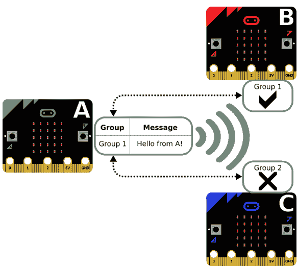

图 8-9：一个分成了三个 micro:bit 网络

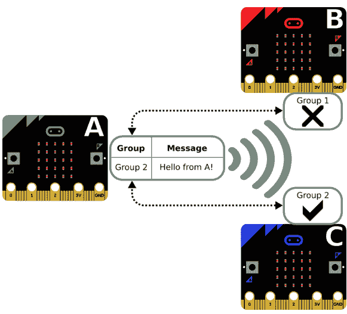

图 8-10：在组之间移动 BBC micro:bit

## 第 8 章 无线 BBC micro:bit

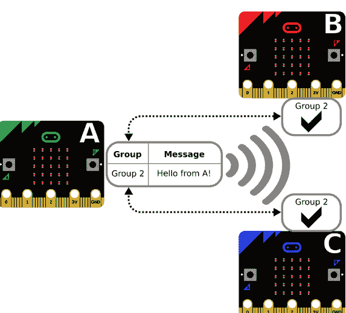

图 8-11：在无线电组 2 中通信的三个 BBC micro:bit

> 提示：如果你很难理清无线电组的概念，可以想象每个组都是一个房间。在客厅里说话的两个人可以找到对方，但卧室里的人完全不知道他们在说什么。如果一个人从客厅移动到卧室，现在卧室里的两个人就可以交谈，但留在客厅的人就听不到他们了。只有同一个房间里的人才能进行对话，就像同一个无线电组中的 BBC micro:bit 可以形成无线电网络一样。

由于你有 256 个组可供选择，可以使用数百个 BBC micro:bit 建立极其密集的网络，而且永远不会遇到消息发送到不该去的地方的问题。

### 使用手机或平板电脑配合 BBC micro:bit

BBC micro:bit 的低功耗蓝牙无线电也可与运行 Google Android 或 Apple iOS 操作系统的智能手机或平板电脑通信。通过将 BBC micro:bit 连接到兼容的智能手机或平板电脑，你可以与其进行交互——包括读取其传感器数据或传输要显示的消息——甚至无需连接 micro-USB 线缆的情况下向其闪存新程序。

要将智能手机或平板电脑连接到 BBC micro:bit，你需要在设备上安装一个应用程序。有关如何安装应用程序以及将 BBC micro:bit 与设备配对的最新说明，请访问 microbit.org/guide/mobile。

## 第 9 章：BBC micro:bit 与树莓派 (Raspberry Pi)

## 本章内容

- 树莓派教育微型计算机介绍
- 如何将 BBC micro:bit 连接到树莓派，并读取其内部传感器或附加硬件的数据
- 如何将 BBC micro:bit 作为树莓派的外部显示设备
- 树莓派到 BBC micro:bit 通信的实例：由 BBC micro:bit 驱动的树莓派 CPU 监控器

**BBC MICRO:BIT** 本身就是一个强大的计算设备，仅使用 BBC micro:bit 和一些低成本组件，就可以开发出无数完整的项目。然而，将它与树莓派配对，为 BBC micro:bit 和树莓派都开启了全新的潜力世界——如果你已经有一个树莓派和一个 BBC micro:bit，你不需要任何其他东西就可以开始。

简单来说，树莓派可以像任何其他电脑一样与 BBC micro:bit 一起使用。BBC micro:bit 显示为一个标记为 MICROBIT 的插拔设备，你可以在浏览器中编写程序、下载程序，并将它们拖入 BBC micro:bit，就像使用昂贵的台式机或笔记本电脑一样。然而，再深入一点，你可以将 BBC micro:bit 完全集成到你的树莓派程序中，将其作为外部显示器或从它的各种传感器读取数据——将两个平台结合成一个强大的教育实验工具。

# 官方 BBC MICRO:BIT 用户指南

树莓派运行着一个名为 Raspbian 的 GNU/Linux 操作系统，其中预装了编程和其他教育工具。本章描述的技术也可以用于任何其他具有相同工具的电脑，包括你现有的桌面台式机或笔记本电脑。实现此点的最简单方法是从树莓派基金会下载 Debian+Pixel，这是由树莓派基金会为台式机和笔记本电脑设计的 GNU/Linux 发行版。运行它，你现有电脑就能像树莓派一样完成本章中的所有操作。

关于 Debian+Pixel 的更多信息（该软件免费下载，并与过去十年的大多数电脑兼容），可以在 raspberrypi.org/blog/pixel-pc-mac 找到。

## 关于树莓派

树莓派于 2012 年 2 月发布，立即取得了成功。树莓派在仅比信用卡稍大的体积内，提供了与全尺寸台式机或笔记本电脑相似的能力，它在全球的教育领域和发烧友实验室找到了自己的位置，并最近载入史册，成为史上最畅销的计算机。

与传统的台式机相比，树莓派除了口袋型尺寸外，还有几个主要优势：它很便宜，即使是最昂贵的配置，价格也不超过一个游戏机或两部新电影；而且它具有一个 40 脚通用输入输出 (GPIO) 插针，用于与外部硬件通信（见图 9-1）——类似于 BBC micro:bit 的 25 脚边缘连接器。

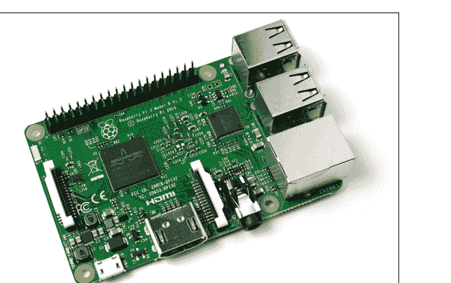

图 9-1：树莓派 3 微型计算机

## 第 9 章：BBC micro:bit 与树莓派

树莓派有多个型号，它们都与 micro:bit 兼容。最小最便宜的树莓派 Zero 和配备无线功能的树莓派 Zero W 需要 USB On-Go (OTG) 适配器来连接；包括树莓派 A+、树莓派 2 和树莓派 3 在内的型号可以直接连接。

树莓派是一款功能完备的微型计算机，在足够的时间和资源下可以胜任任何任务。将 micro:bit 连接到树莓派，与连接到 Windows、macOS 或 Linux PC 没有区别，正如第 3 章“编程 micro:bit”中所述。

在树莓派开启并显示桌面时，将 micro-USB 线连接到树莓派的任一端口。如果你使用的是只有一个端口的型号，则需要 USB 分线器。将另一端连接到 micro:bit 的端口，几秒钟后，打开 micro:bit 可插拔驱动器的管理器对话框就会弹出（见图 9-2）。你可以点击确定按钮打开驱动器并拖入现有文件，也可以点击取消但不启动文件。

如果你想在树莓派上为 micro:bit 编程，可以从屏幕左上角的树莓派菜单加载 Chromium 浏览器，访问 microbit.org，并按照第 3 章进行编程。一切与在你的台式机或笔记本电脑上的操作完全一样，程序只需要拖放即可。

浏览器中编程工具的替代方案是使用 Mu，它是专为使用 MicroPython 语言编程 micro:bit 设计的，并带有让这一过程变得简单的工具。然而，取决于你使用的 Raspbian 版本，Mu 可能没有默认安装。要安装它，请确保你的树莓派已连接到互联网，从屏幕左上角的树莓派图标的应用程序菜单打开终端，并输入以下命令：

```bash
sudo apt-get update && sudo apt-get -y install mu
```

178 官方 BBC MICRO:BIT 用户指南

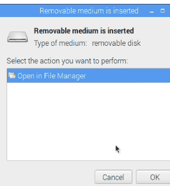

图 9-2：Pixel 可插拔驱动器提示

安装 Mu 后，你可以从屏幕左上角树莓派菜单的编程菜单启动 Mu（见图 9-3）。

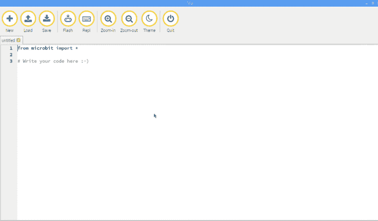

图 9-3：Mu 集成开发环境

## 第 9 章 BBC micro:bit 与树莓派 (RASPBERRY PI)

Mu 是为初学者的需求设计的，它让为 BBC micro:bit 编写程序变得尽可能简单。任何在浏览器的 MicroPython 编辑器中编写或为之编写的代码，在 Mu 中运行时均无需更改。顶部的菜单提供了浏览器编辑器不具备的功能：Flash（闪存）和 Repl（交互式解释器）。

请注意，某些功能——包括第 8 章中描述的对 BBC micro:bit 功能的支持——可能在树莓派上提供的 Mu 版本中不可用。如果你的程序运行在这些功能上（通过 Mu 中显示的语法错误来指示，但程序在基于浏览器的 Python 编辑器中运行正常），那么你需要使用 Python 编辑器（位于 python.org）或在 codewith.mu 尝试最新版本的 Mu。

使用 Mu 时，在保存程序后点击 Flash 按钮即可将程序加载到 BBC micro:bit 中。你不需要打开文件、找到保存的程序并将其拖动到 MICRO 驱动器，只需将其安装到 BBC micro:bit 即可。如果你修改了程序并想更新 BBC micro:bit，只需再次点击 Save 按钮和 Flash 按钮；你可以根据需要重复此操作。

点击 Repl 按钮会打开一个交互式外壳，称为“读取-评估-打印-循环”（REPL），它允许你输入 MicroPython 代码并直接在 BBC micro:bit 上运行（见图 9-4）。与其编写一组让 BBC micro:bit 逐条执行的指令，你可以输入单个指令并使其立即在 BBC micro:bit 上运行——这是测试新输入和功能的省时方法，无需经过编写完整程序、保存并将其闪送到 BBC micro:bit 的过程。

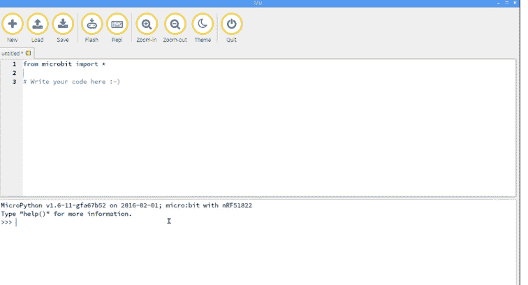

图 9-4：Mu 中的 Repl 交互式外壳

## BBC micro:bit 官方指南

在使用 Mu 中的 Repl 外壳时，你输入的任何指令会在按下回车键后立即运行。然而，仍然适用于 Python 或 MicroPython 程序的常规规则（如第 7 章“Python”中所讨论的）：在使用指令之前需要先导入它们，如果你在使用循环或嵌套代码，需要注意每行开头的缩进。

测试 Repl 能力的一种简单方法是使用第 7 章中的两行“Hello, World!”程序。从 Mu 窗口删除任何程序代码，并点击 Flash 按钮将 MicroPython 加载到 BBC micro:bit 上，然后点击 Repl 加载外壳并连续输入以下两行：

```python
from microbit import *
display.scroll('Hello, world!')
```

一旦你按下回车键查看第二行，你就会看到消息 Hello, world! 在 micro:bit 的 LED 显示屏上滚动。当消息结束时，程序也随之结束。如果没有循环，就没有指令告诉 BBC micro:bit 下一步该做什么。你可以通过这种方式输入任何指令——甚至创建一个无限循环来保持程序运行——但对于超过几行的程序，在 Mu 或基于浏览器的 Python 编辑器中编写并将其闪送到 BBC micro:bit 中要简单得多。

Mu 对于使用 MicroPython 进行 micro:bit 编程非常有用，但你也可以通过其他方式与 BBC micro:bit 通信：将其集成到运行在树莓派上的程序中，或者将树莓派集成到运行 BBC micro:bit 上的程序中。本章的剩余部分将介绍当你协调使用这两个设备时会开启的一些可能性。

## 从 BBC micro:bit 读取数据

BBC micro:bit 具有许多树莓派所缺少的功能，包括 5x5 LED 显示屏、加速度计、磁力计以及连接到引脚的模拟转数字（ADC）转换器（更多信息请参阅第 10 章“构建电路”）。所有这些功能都可以通过 micro-USB 线在树莓派上使用完整版本的 Python 编程语言使用。

要开始，首先需要找到 BBC micro:bit 使用的设备名称——即你在 Linux 的 `/dev` 目录下为设备命名的名称。通常，它是 `/dev/ttyACM0`；某些情况下，如果你的树莓派上连接了其他设备，名称末尾的数字会有不同。要找到设备名称，请将 BBC micro:bit 连接到树莓派。如果弹出 MICROBIT，关闭它，并在屏幕左上角打开终端，输入以下命令：

```bash
dmesg | tail -20 | grep tty
```

## 第 9 章 BBC micro:bit 与树莓派 (RASPBERRY PI)

如果你的 BBC micro:bit 正确连接到树莓派，上述命令将返回其设备名称（见图 9-5）；如果不是，请检查连接是否正确，以及是否使用了带有电源和数据引脚的正常 micro-USB 线。如果你的设备名称末尾的数字不是 0，请确保更改以下代码以匹配你的 BBC micro:bit 设备名称；否则，你可以使用默认数字。

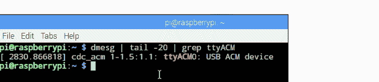

图 9-5：发现 BBC micro:bit 的设备名称

这被称为串口设备，它与 BBC micro:bit 本身不同。可移动驱动器允许你将完成的程序拖入 BBC micro:bit，而串口设备则允许你发送和接收数据。

要从 BBC micro:bit 读取数据，你需要设置 BBC micro:bit。我们将以加速度计为例，但你可以轻松修改程序以读取磁力计、按钮或任何传感器。在 Mu 的 MicroPython 编辑器中输入以下（见图 9-6）：

- 如果你不确定如何输入代码行，访问网站 codewith.mu
- 纯文本版本可以直接复制粘贴到编辑器中。

```python
from microbit import *
while True:
    x, y, z = accelerometer.get_x(), accelerometer.get_y(), accelerometer.get_z()
    print(x, y, z)
    sleep(500)
```

## BBC micro:bit 官方指南

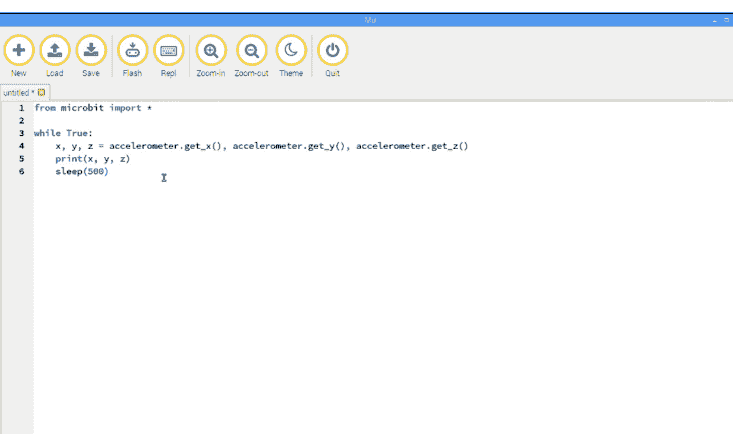

图 9-6：Mu 中的加速度计程序

加速度 `get` 指令在第 7 章介绍过，但 `print` 指令是新的。通常，此指令告诉 Python 将某些内容（在本例中为存储位置数据的 x、y、z 变量）打印到控制台，如果你运行 Repl，这正是它们的作用。在没有 Repl 的情况下，没有控制台，因此 `print` 指令改为通过 BBC micro:bit 的串口输出。这是我们在树莓派上读取的内容。

将程序闪送到 BBC micro:bit，可以是从基于浏览器的编辑器保存并将其拖入 MICROBIT 设备，也可以在 Mu 中点击 Save 按钮、命名为 `accelerometerreader.py` 然后点击 Flash 按钮。过程完成后，即可进行测试。从树莓派左角的菜单打开终端并输入以下命令：

```bash
sudo apt update && sudo apt install -y screen
```

此命令将更新树莓派的可用软件列表并安装一个名为 `screen` 的工具。该工具除了其他功能外，允许你连接到类似 BBC micro:bit 的串口设备以发送和接收数据。要让 `screen` 连接到你的 BBC micro:bit，请关闭 Mu 终端中输入：

```bash
screen /dev/ttyACM0 115200
```

## 第 9 章 BBC micro:bit 与树莓派

如有必要，请更改设备名称末尾的数字。此 `screen` 命令打开一个到 BBC micro:bit 的串口控制台，你应该看到终端开始填充来自加速度计的数据（见图 9-7）。尝试拿起 BBC micro:bit 并移动它以改变数字，同时小心不要断开两端任一的 micro-USB 数据线。


图 9-7：通过屏幕读取加速度计数据

你并不局限于仅仅在终端中显示数据。使用树莓派上任何具有与串口通信能力的编程语言，你都可以向 BBC micro:bit 接收和发送数据——允许你将其集成到程序中。

从树莓派菜单的“编程”（Programming）子菜单中打开 Python 2 (IDLE) 编辑器，点击“文件”（File）然后点击“新建文件”（New File），并输入以下程序：

```python
import serial
ser = serial.Serial("/dev/ttyACM0", 115200, timeout=1)
ser.close()
ser.open()
while True:
    accelerometerData = ser.readline()
    print(accelerometerData)
```

这是从串口读取数据的 Python 程序中最简单的示例了。在第一行导入 `serial` 库并在第二行对其进行配置——如有必要，请更改 BBC micro:bit 的设备名称——程序会关闭端口以防其他程序正在使用它，然后将其打开以供自己使用。随后，程序进入循环，从 BBC micro:bit 的串口读取单行，将其打印到屏幕上，然后返回循环等待下一行。

点击“文件”（File）并将程序保存为 `accelerometerprint.py`；然后从“运行”（Run）菜单中点击“运行模块”（Run Module）来启动它。Python 控制台开始填充来自加速度计的读数。移动 BBC micro:bit 以见证数值的变化（见图 9-8）。


图 9-8：通过 Python 读取加速度计数据

程序逐行执行以下操作：

```python
import serial
```

这告诉 Python 加载 `serial` 库。你可能注意到这里没有导入通常的 microbit 库；这是因为这段代码运行在树莓派上而非 BBC micro:bit，所以我们唯一需要的库是处理 BBC micro:bit 与树莓派之间的通信。

```python
ser = serial.Serial("/dev/ttyACM0", 115200, timeout=1)
```

此行使用 `serial` 库创建一个对象，带有三个参数。第一个参数 `"/dev/ttyACM0"` 是 BBC micro:bit 串口连接的设备名称，如果你在本章前面发现了其他名称，应将其更改。第二个参数是串口连接的比特率或波特率，对于 BBC micro:bit，应设置为每秒 115,200 位 (bps)。最后一个参数设置从串口设备读取的一秒超时，这样程序就不会卡死。

```python
ser.close()
ser.open()
```

这两行共同工作。第一行关闭串口设备，以防在测试功能时之前的程序运行导致它一直处于打开状态。第二行将其打开，准备好 BBC micro:bit 与树莓派之间的通信。

```python
while True:
```

一如既常，此行开始无限循环，防止 Python 程序在到达指令末尾时立即退出。此行下的代码需要缩进四个空格。

```python
accelerometerData = ser.readline()
```

此行使用 `serial` 库从 BBC micro:bit 读取单行数据（你在本章前面编写的程序），该数据被存储在变量 `accelerometerData` 中供后续使用。

```python
print(accelerometerData)
```

最后，此行将 `accelerometerData` 变量打印到控制台，显示在屏幕上。

关于如何在自己的程序中使用来自 BBC micro:bit 的更多信息，请参考通用 Python 教程，例如在 www.python.org/about/gettingstarted/ 免费获取的《面向初学者的 Python》。

# 第 9 章 BBC MICRO:BIT 与树莓派

最后，这行代码会等待十秒钟，然后返回循环开头并再次显示消息。

使用这个基础模板，你可以向 BBC micro:bit 发送任何指令或指令列表。例如，将循环体的内容替换为以下代码，让 BBC micro:bit 显示 10 秒的笑脸，再显示 10 秒的哭脸，然后返回到笑脸：

```python
ser.write("display.show(Image.HAPPY) \r".encode())
time.sleep(10)
ser.write("display.show(Image.SAD) \r".encode())
time.sleep(10)
```

将循环体的内容替换为以下代码，以循环的模式让 Pin 0 开启 10 秒并关闭 10 秒。如第 10 章所描述，将一个 LED 连接到 Pin 0 即可看到效果。

```python
ser.write("pin0.write_digital(1) \r".encode())
time.sleep(10)
ser.write("pin0.write_digital(0) \r".encode())
time.sleep(10)
```

## 实际示例：CPU 监控器

一个将 BBC micro:bit 与你的树莓派结合使用的良好示例是将其显示器转换为树莓派 CPU 负载图表——这是衡量处理器工作情况的指标。坐在桌面前，你可以看到图表上的短条；玩游戏或加载大型网页时，随着处理器的开始工作，条形会飙升。

此示例项目使用了 MicroPython Repl 控制台，因此如果你在 BBC micro:bit 上运行的是不同的程序，你需要在编辑器中点击空 MicroPython 程序上的“Download”（下载）来刷录副本，并将其拖入 MICROBIT，或者在 Mu 编辑器中点击“Save”（保存）和“Flash”（刷录）按钮。

在编写 CPU 监控程序本身之前，你需要安装一个名为 `psutil`（进程实用程序）的新 Python 库。要此操作，点击顶部菜单栏上的 Terminal（终端）图标或树莓派菜单中 Accessories（配件）子菜单下的终端加载终端，然后输入以下命令：

```bash
sudo apt-get -y install python-psutil
```

要编写 Python 程序，点击树莓派菜单，选择 Programming（编程），然后从菜单点击 Python 2 (IDLE)。当 IDLE 加载后，点击 File（文件）菜单，然后点击 New File（新建文件），输入以下程序（见图 9-11），记住每当你看到 `\` 时，请在同一行继续输入。

该程序非常密集，手动输入可能会很困难，特别是绘制条形图本身的那行。记住，当你在看到 `\` 时继续输入，只有当你到达没有该符号的行尾时才按 Enter（回车键）或 Return（返回键）。如果你发现有语法错误，请对照书籍双重检查你的程序，特别注意括号的数量和其他方法；你可以从 www.wiley.com/go/bbcmicrobituserguide 下载该程序的副本。

```python
import serial, psutil, time
gradients = 20
readingList = [0,1,2,3,4]
ser = serial.Serial("/dev/ttyACM0", 115200, timeout=1)
ser.close()
ser.open()

print("Monitoring system statistics for micro:bit display.")
ser.write("from microbit import * \r".encode())
time.sleep(0.1)
ser.write("display.clear() \r".encode())
time.sleep(0.1)

barGraph = [[0, 0, 0, 0, 0], [0, 0, 0, 0, 0], [0, 0, 0, 0, 0], [0, 0, 0, 0, 0], [0, 0, 0, 0, 0]]

while True:
    sysLoad = psutil.cpu_percent(interval=0)
    readingList.insert(0, int(sysLoad))
    del readingList[5:]
    for x in range(5):
        for y in range(5):
            readingComparison = (y+1) * gradients
            if (readingList[x] >= readingComparison):
                barGraph[y][x] = 9
            else:
                barGraph[y][x] = 0
    ser.write(("BARGRAPH = Image(" + 
    "%s:%s:%s:%s:%s" % 
    (':'.join(str(e) for e in barGraph[0]), 
    ':'.join(str(e) for e in barGraph[1]), 
    ':'.join(str(e) for e in barGraph[2]), 
    ':'.join(str(e) for e in barGraph[3]), 
    ':'.join(str(e) for e in barGraph[4]))) + ") \r").encode())
    time.sleep(0.1)
    ser.write("display.show(BARGRAPH) \r".encode())
    time.sleep(0.9)
```

点击 File 菜单，点击 Save（保存），将程序保存为 `cpumonitor.py`，然后从菜单点击 Run（运行）来执行它。大约一秒后，BBC micro:bit 显示屏上的 LED 开始亮起，程序会绘制出你的 CPU 负载图；当你回到桌面时，查看图 9-11：垂直条形代表 20% 的 CPU 负载，如果一个条中的所有五个 LED 都亮了，说明你的树莓派正在使用大量资源。

## 第 10 章构建电路

BBC micro:bit 的设计初衷是在无需其他设备的情况下使用，仅需导线和组件即可构建电路。如果你想让你的项目更具永久性，可能需要投入一些额外的配件。

- **面包板（Breadboard）**——也称为无焊面包板，面包板是一个布满小孔的塑料托盘。导线和组件的引脚插入这些小孔中，面包板底部隐藏的金属条会将它们连接起来形成一个电路。面包板电路的优点是比使用导线和鳄鱼夹制成的电路更不容易散开，同时仍允许你拆下组件并重新使用到不同的项目中。请寻找引脚间距为 2.54mm 的面包板。

- **面包板跳线（Breadboard jumper wires）**——鳄鱼夹对面包板的作用很有限，因此你需要一组一端为裸线或另一端为焊接引脚的面包板跳线。请记住，你仍然需要将面包板连接到 BBC micro:bit，所以请确保你拥有几根一端带有鳄鱼夹或插头的导线来完成这些连接；或者，使用一段 2.54mm 公头针排并将其插入面包板，为你提供一个可以连接鳄鱼夹的地方。

- **条洞板（Stripboard）**——面包板的下一步，条洞板允许你通过将组件焊接到位来制作永久电路。与面包板一样，条洞板下方有一排金属形成电路；这些金属排可以使用切割工具（或小钻头）切割，以改变电路的形状。

- **烙铁（Soldering iron）**——如果你使用条洞板，你需要一把烙铁，这种类似于螺丝刀的设备通过加热金属来熔化焊锡并在组件与条洞板之间创建永久连接。确保选择一个标有电子作业标志且尖头较细的烙铁，并始终记住烙铁的温度极高。寻找一个带有基础配件包的烙铁，包括底座、一些电焊锡以及用于清洁烙铁尖头的海绵或水。

- **侧剪钳（Side cutters）**——你用于制作电路的组件被称为通孔技术组件（THT），通过其长引脚进行区分。如果你正在构建条洞板电路，在完成焊接并到位后，你需要将它们剪成合适尺寸；为此，你需要一把小侧剪钳。

- **万用表（Multimeter）**——万用表是一种多功能测量设备，最基本的功能是测量电压、电流（安培）和电阻。当你需要诊断电路问题时，它特别有用。虽然专业版本非常昂贵，但即使是最便宜的模型也适用于爱好者项目。

## 官方 BBC MICRO:BIT 用户指南

随着你技能的增长，并尝试构建更大、更复杂的项目，你可能会发现自己需要额外的工具，例如镊子、工作架（也称为助手）或用于拆除而非焊接焊锡的工具。你可能还会发现扩展板（break-out-board），它可以让你更轻松地配合面包板或实验板使用 BBC micro:bit，这是一个非常实用的配件；关于这些的更多信息可以查阅第 11 章“扩展 BBC micro:bit”。

现在，你可以从第一个列表中的部件开始学习。

## 输入/输出引脚

BBC micro:bit 上的边缘连接器形式为铜盘，通过电路板上的电气布线与处理器连接（见图 10-1）。尽管它们是平坦的，但传统上将这些引脚称为引脚，因为它们连接到处理器的引脚。


图 10-1：BBC micro:bit 边缘连接器

总共有 25 个引脚，分为 5 个大引脚和 20 个小引脚。大引脚标记为数字 0、1 和 2，对应三个通用输入/输出引脚；3V 为为电路供电的正电压引脚，GND 为地或负极引脚（见图 10-2）。较小的引脚没有标记，但使用数字 3 到 22 来指代它们，以避免与三个大引脚混淆。


> 始终记住，BBC micro:bit 是一个敏感的电子设备。千万不要在通电时在其引脚上连接或断开硬件，并在连接电源之前始终检查并双重检查连接。虽然它设计得很坚固，但如果接线不当，BBC micro:bit 可能会损坏。

## 大引脚

大引脚清晰地标记在 BBC micro:bit 板的顶部，分为左侧的三组通用输入输出引脚和右侧两个电源引脚（见图 10-3）。

标记为 0、1 和 2 的三个引脚可以根据你连接到 BBC micro:bit 的硬件作为输入或输出。例如，LED 是一个输出设备，连接到三个编号引脚之一时可以使其点亮；按钮或开关是输入设备，BBC micro:bit 可以被程序化在连接到另一个引脚时做出响应——就像板载按钮 A 和按钮 B 一样。

大引脚可用于你自己的电路，但这意味着你不能同时使用对应的板载设备——对于 LED，你可能会发现闪烁。大引脚还可以用于添加硬件，如蜂鸣器或额外的按钮。


图 10-3：BBC micro:bit 的大引脚

## 官方 BBC MICRO:BIT 用户指南

每个编号引脚都连接到模数转换器（ADC），这是处理器的一部分，允许它读取模拟信号，如光传感器或麦克风；你可以在本章后面找到更多关于 ADC 的信息。

剩余的两个大引脚连接到 micro:bit 的电源。标记为 3V 的引脚也称为正极，可为你的电路供电；标记为 GND 的引脚是地极，它完成了电路。

所有五个大引脚都设计用于配合鳄鱼夹或香蕉头使用。使用香蕉头时，只需将其插入 micro:bit 的孔中。如果你使用鳄鱼夹，需要小心不要让夹子压在小引脚上。这样做最简单的方法是将夹子插入并伸出 micro:bit（见图 10-4），这样可以防止它们接触其他引脚，同时使其更安全。


无论你使用何种方法将硬件连接到 BBC micro:bit，在通电之前务必检查你的连接。对 3V 和 GND 引脚要格外小心；在没有任何硬件的情况下将它们连接在一起可能会导致短路，从而永久损坏 BBC micro:bit。

## 小引脚

除了五个大引脚外，BBC micro:bit 的边缘连接器上还有 20 个额外的小引脚（见图 10-5）。这些引脚设计用于配合鳄鱼夹或香蕉头使用，但它们提供了使用母座连接器向 micro:bit 添加硬件的选择。使用这些小引脚的扩展设备由第三方公司提供，范围从扩展板不等，后者使得可以使用面包板使用这些额外引脚，从而将 BBC micro:bit 作为其“大脑”。

与大引脚不同，BBC micro:bit 的许多小引脚与板载硬件共享。例如，3 号引脚也用于控制 BBC micro:bit LED 显示屏的第一列；同时，11 号引脚连接到按钮 B。这并不会阻止你在自己的电路中使用大部分这些引脚，但意味着你不能同时使用对应的板载设备。


图 10-5：BBC micro:bit 的小引脚

# 200 BBC micro:bit 官方用户指南

在你不预料的情况下，灯光可能会亮起或关闭！为了避免这种情况，你可以使用 JavaScript Blocks 中的 `[led enable false]` 块、JavaScript 中的 `led.enable(false)` 指令以及 Python 中的 `display.off()` 指令来禁用显示。

小引脚提供了额外的通用输入输出（GPIO）连接，用于更复杂的项目，其中三个引脚（Pin 3、Pin 4 和 Pin 10）与大引脚连接相同的 ADC 转换器。这些引脚中的某些具有共享功能，Pin 3 到 Pin 16、19 和 20 可以作为通用输入输出引脚进行软件控制。此外，某些引脚通过三种总线提供了与更多硬件通信的方法：串行外设接口（SPI）、集成电路（I2C）和通用异步收发器（UART）。

最后，两个电源引脚（3V 和 GND）两侧的引脚也是电源引脚。通过在每个大电源引脚周围放置两个小引脚，可以减少意外将电源引脚短接到通用引脚并损坏 BBC micro:bit 的概率——如果你使用的是鳄鱼夹，仍然可能发生，请始终检查你的连接。

- 提示：关于大引脚和小引脚以及每个引脚可用功能的详细信息，请参见附录 D，“引脚列表”。

## 第 10 章构建电路

以下两个部分详细描述了 I2C 总线。这些是高级连接，主要设计用于更复杂的扩展设备；如果你急于学习使用开关和 LED 等较简单的模块来构建你的第一个项目，请跳过以下两个部分并继续阅读本章的其他内容。

## 串行外设接口 (SPI)

串行外设接口 (SPI) 通常用于与显示器和键盘等扩展硬件通信。它使用 BBC micro:bit 边缘连接的 Pin 13 到 Pin 15。Pin 13 提供串行时钟（SCK）信号，Pin 14 提供主输入从输出（MISO）信号，Pin 15 提供主输出从输入（MOSI）信号。

如果你将 BBC micro:bit 连接到 SPI 设备，请确保按照正确的顺序连接引脚：两个设备上的 SCK 都应该接 SCK，MISO 接 MISO，MOSI 接 MOSI。这与其他串口通信方法不同，后者标记为“输入”的引脚需要连接到标记为“输出”的引脚，反之亦然。你可以使用 GPIO 引脚作为片选择（CS）引脚（每个设备一个），通过 BBC micro:bit 使用多个 SPI 设备。

有关如何使用 SPI 总线的详细信息，请参阅你的 SPI 兼容设备提供的文档。

## 集成电路 (I2C)

集成电路（I2C，读作“squared C”）通常用于与由自己的微控制器或处理器供电的复杂扩展设备通信。这些信号可用 BBC micro:bit 边缘连接的 Pin 19 和 20。Pin 19 提供时钟信号（SCL），Pin 20 提供数据信号（SDA）。

I2C 总线的优点之一是允许在单个电路中连接大量设备。使用 I2C，可以将多个从设备连接到单个 micro:bit，或者将多个 micro:bit 连接到单个 I2C 总线主设备。

加速度计和磁力计都连接到 I2C 总线且无法禁用。因此，即使你在项目中没有使用 I2C 总线，I2C 引脚也无法作为通用输入输出（GPIO）引脚。

对于 SPI 总线，如果你想将 I2C 设备连接到 BBC micro:bit，请参考硬件随附的指令说明书。

## 通用异步收发器 (UART)

micro:bit 的 UART 负责串行连接，但也可以重新分配到一组边缘引脚：一个引脚发送数据，另一个接收数据。这允许 BBC micro:bit 与具有自己的 UART 的其他 micro:bit 通信。

# 202 BBC micro:bit 官方用户指南

在程序中重新分配 UART 时，请注意它会影响已配置的任何串口通信。将 UART 分配给边缘引脚将禁用 BBC micro:bit 的串口功能，可以通过向 micro:bit 刷入不同的程序来恢复。有关哪些引脚可以作为 UART 接收和发送的详细信息，可以在 microbit.org/hardware/edge-connector/ 找到。

BBC micro:bit 提供的电源取决于你提供的 micro:bit。当从 USB 运行时，BBC micro:bit 运行在峰值电压；当从电池组运行时，每个引脚的电压会下降。这会导致 LED 等部分变暗或运行变慢。

## 你的第一个电路

现在你已经知道了 micro:bit 引脚在哪里以及它们可以做什么，是时候开始构建电路了。本部分的两个电路是最简单的，演示了 micro:bit 引脚作为输入和输出的主要用法。

本章中的示例使用 Python 编程（参见第 7 章）。相同的电路可用于任何语言，但编写你自己的程序是提高技能的好方法。

在构建这些电路时，始终按照所示使用 BBC micro:bit 为电路供电，永远不要尝试通过连接外部电源或电池供电。虽然构建需要 3V 的高级电路，但很容易出错提供过电压损坏 micro:bit。

本章中的程序是用 Python 写的。如果你更喜欢使用 JavaScript，可以在附录 A 和 B 中找到。

### 读取按钮输入

实现任何功能的简单电路都是按钮或开关。要构建一个，你需要以下物品：

- 带有鳄鱼夹的导线
- 一个按钮或开关

如果你没有开关，可以通过让鳄鱼夹的末端接触来模拟一个：接触表示“按下”开关，分开表示“释放”开关。

按照以下指令组合电路，匹配图 10-6，确保如果你使用鳄鱼夹，它们安全连接到 micro:bit 而没有意外桥接任何小引脚。

1. 如果你的开关有四个脚，你只需要其中两个。将开关置为左侧有两个脚，右侧有两个脚。按照以下指令，从左侧取一个，从右侧取一个。
2. 将鳄鱼夹连接到开关的左脚；将另一端连接到 micro:bit 的 Pin 0。
3. 将最后一个鳄鱼夹连接到开关的右脚；将另一端连接到 micro:bit 的 3V 引脚以完成电路。


图 10-6：简单的开关电路

# 204 BBC micro:bit 官方用户指南

四脚开关可能会难住你。只有当你将两根线连接到一对脚时，你的电路才能工作；如果你将两根线连接到开关同一侧的脚（它们内部是连接的），电路将表现得你一直在按下按钮。

如果你无法判断引脚是如何配对的，可以使用连续性测试仪或万用表模式进行测试：将一个探头放在一个脚上，然后触摸另一个脚；如果测试仪显示引脚已连接，将探头换到另一个脚，直到发现它们没有连接。

或者，直接动手接电路；即使在没有按下，BBC micro:bit 也表现得按钮被按下了，将其中一个移动到另一个脚即可修复。

BBC micro:bit 现在需要一个程序来告诉它将 Pin 0 上的开关作为输入，你需要编写并将其上传到 micro:bit。在你的浏览器中加载 Python 编辑器并输入以下程序代码：

```python
from microbit import *
while True:
    while pin0.read_digital() == 1:
        display.show(Image.SURPRISED)
    display.show(Image.ASLEEP)
```

记住 Python 中的缩进行每个缩进始终应该是四个空格（更多详情见第 7 章）；在程序中，`True:` 行之后的所有内容都缩进四个空格，但第四行缩进了两次，共八个空格。

在双重检查所有接线后，使用 micro-USB 线将 BBC micro:bit 连接到电脑，点击下载按钮，并将 hex 文件拖入 MICROBIT 驱动器以刷入程序。BBC micro:bit 的显示器应该变为睡眠脸。按住按钮唤醒它；松开让它再次进入睡眠。

一步一步，此程序执行以下操作：

```python
from microbit import *
```

这一行让所有为 BBC micro:bit 编写的 Python 程序导入了处理 BBC micro:bit 所需的代码。没有它，程序无法工作。关于 `import` 和 `microbit` 模块的更多详情，请参见第 7 章。

## 第 10 章 构建电路

这一行代码将 BBC micro:bit 放入一个无限循环中，使其永远运行以下指令。如果没有这一行代码，BBC micro:bit 只会运行一次指令列表后就会停止。再次运行的唯一方法是重置 BBC micro:bit；而有了这个循环，BBC micro:bit 将会一直运行程序——至少直到你移除它的电源为止。

```python
while pin0.read_digital() == 1:
```

这第二个循环决定了 BBC micro:bit 在按下按钮时该做什么。`pin0.read_digital()` 指令告诉 BBC micro:bit 读取引脚 0。如果按下按钮，读取将返回值 1；如果没有按下，读取返回值 0。指令中的 `== 1` 部分告诉 BBC micro:bit 只有在按下按钮时才进入循环；否则将跳过该循环。

```python
display.show(Image.SURPRISED)
```

当 BBC micro:bit 进入循环时——换句话说，如果你正在按下按钮——下一行代码将运行，在 BBC micro:bit 的显示屏上显示一个惊讶的脸。只要你按住按钮，循环就会运行，让显示屏一直保持惊讶的脸。

```python
display.show(Image.ASLEEP)
```

当你松开按钮，或者根本没有按下按钮时，这行代码告诉 BBC micro:bit 显示一个睡觉的脸。通过在这两个图像之间切换，可以很容易判断程序是否正确读取了你的按键操作。

## 读取电阻色环

在构建下一个电路之前，你需要知道如何区分电阻的数值。坦率地说，通孔电子元件都有清晰的标记：电容器的外壳上印有以法（farads）为单位的电容值，晶体则标有其频率。电阻也标记有其数值，但不是用数字表示，而是使用色环。

通孔电阻的表面覆盖着色环，每条色环都提供你所需的数字，用于确定电阻的欧姆（ohms）值及其误差——误差值告诉你电阻实际值可能离“完美”阻值有多近。要解码这些信息，请参考图 10-7 中的图表；在 www.wiley.com/bbcmicrobituserguide 的 BBC micro:bit 用户指南中也有完整的彩色图表。

| 第1/第2条色环 | 倍率 | 误差 |
|---|---|---|
| 黑色 | 0 | ×10⁰ | ±1% |
| 棕色 | 1 | ×10¹ | ±1% |
| 红色 | 2 | ×10² | ±2% |
| 橙色 | 3 | ×10³ | - |
| 黄色 | 4 | ×10⁴ | ±0.5% |
| 绿色 | 5 | ×10⁵ | ±0.5% |
| 蓝色 | 6 | ×10⁶ | ±0.25% |
| 紫色 | 7 | ×10⁷ | ±0.1% |
| 灰色 | 8 | ×10⁸ | ±0.05% |
| 白色 | 9 | ×10⁹ | - |
| 金色 | - | ×10⁻¹ | ±5% |


| 银色 | - | ×10² | ±10% |
| 无 | - | - | ±20% |

图 10-7：电阻色环表

通过读取示例电阻上的打印数值：从左侧开始的前两个色环表示电阻值，下一条色环表示倍率，最后一条色环表示误差。对于示例电阻，前两个色环是红色。根据图 10-7 包含表格，红色等于数值 2，电阻值的起始数字为 2。

下一条色环是倍率环，颜色为绿色，对应 10⁵ 或 100,000。正如名称所示，倍率是 100,000，示例电阻的欧姆值为 220,000（注：此处原文逻辑可能有跳跃，按字面为22乘以100,000）。

（注：由于原文段落在描述数值计算时存在逻辑混乱，如多次提到“100,000”），翻译时已尽可能遵循原文结构以确保准确性。）

接下来，你需要编写一个程序让 LED 发生动作，这样你就能知道它正在工作了。

一个好的开始是简单让 LED 每秒闪烁一次，这可以让你知道所有连接都是正确的，并且 BBC micro:bit 正在正确运行你的程序。

在你的浏览器中加载 Python 编辑器，并输入以下程序代码：

```
from microbit import *
while True:
    pin1.write_digital(1)
    sleep(1000)
    pin1.write_digital(0)
    sleep(1000)
```

请记住，Python 中的缩进行每个缩进应该是四个空格（详情请参阅第 7 章）；在该程序中，`while True:` 之后之后的所有内容都应该缩进。


图 10-8：简单的 LED 电路

在双重检查所有接线无后，使用 micro-USB 线将 BBC micro:bit 连接到电脑，点击 Download（下载）按钮，并将 hex 文件拖入你的 BBC MICROBIT 驱动器以闪存程序。随着程序的运行，LED 应该开始每秒闪烁一次。

如果 LED 没有亮起，请检查你的接线。常见问题包括使用了错误的线，或者将鳄鱼夹连接到了 Pin 0 或 Pin 2 而不是 Pin 1。

该程序分步骤执行了以下操作：

```
from microbit import *
```

这一行正如所有为 BBC micro:bit 编写的 Python 程序）导入了处理 BBC micro:bit 需要的代码。没有它，程序将无法运行。

```
while True:
```

如之前一样，这一行让 BBC micro:bit 进入无限循环。只要 True 为真（而它确实为真），该行下面的代码就会持续运行。如果没有这一行，LED 将闪烁一次并随着程序结束而停止。

```
pin1.write_digital(1)
```

这次你处理的是 Pin 1 而不是 Pin 0，但基本格式相同。这一行以你想控制的引脚开头，后面跟着句号，以及你想要对它执行的精确操作。与其读取不同，这次你正在输出一个信号——这被称为“写入引脚”，与“读取引脚”相对。括号中的值 1 会让引脚开启，使电流流过 LED 并点亮它。

```
sleep(1000)
```

BBC micro:bit 的处理器运行速度非常快，能够比肉眼可见的速度更快切换 LED 的开启和关闭。这一行降低了速度，告诉 BBC micro:bit 在移动到下一行之前等待 1,000 毫秒（一秒）。

```
pin1.write_digital(0)
```

这一行与开启 LED 的那行之间的唯一区别是写入引脚的值：写入 1 开启它，而这里这个 0 则会再次将其关闭。`write_digital` 指令只能写入两个二进制值；在本章的后半部分中，你将看到如何使用不同的指令以及 0 和 1 之间伪造信号的方法。

```
sleep(1000)
```

最后，这一行告诉 BBC micro:bit 在从无限循环的顶部重新开始之前再睡眠一秒。这两个延迟都是必须的；否则 LED 在关闭后开启得太快，以至于你根本没有机会看到区别。

要实验该程序，请尝试更改延迟时间。较大的数字会增加指令之间的时间，而较小的数字会缩短延迟。尝试设置两个不同的值，让 LED 开启的时间比关闭的时间长，或者反之——甚至可以通过增加多个 `write_digital` 和 `sleep` 指令来扩展程序，使其按特定模式闪烁。

## 通过 PWM 实现 LED 渐变

在上一个电路中，你看到了如何使用 `write_digital` 指令来控制 LED 的开启和关闭。然而，BBC micro:bit 不仅仅可以控制引脚的开启和关闭，还可以让它们看起来在两者之间平滑地渐变，或在任何值上完全开启或完全关闭。

BBC micro:bit 使用这种名为脉冲宽度调制（PWM）的技术。虽然它实际上无法执行除引脚完全开启或关闭以外的任何操作，但你可以非常快地切换开启关闭，让它们看起来处于完全开启和完全关闭之间——字面上上的“脉冲信号”。通过改变（或调制）每个周期内处于开启和关闭状态的时间（即占空比），你可以改变 LED 的亮度或电电机速度。

对于这个电路，你可以使用上一个电路相同的层，将 LED 和一个合适的限流电阻连接在 BBC micro:bit 的 Pin 1 和 GND 引脚之间。然而，程序是不同的。

在浏览器中加载 Python 编辑器并输入以下程序：

```
from microbit import *
p1.set_analog_period(1)
while True:
    for brightnessValue in range(0,1024):
        pin1.write_analog(brightnessValue)
        sleep(1)
    for brightnessValue in range(1023,-1,-1):
        pin1.write_analog(brightnessValue)
        sleep(1)
```

## 读取模拟输入

传统的开关或按钮是数字输入；它们要么被按下，要么没有按下，中间没有状态。然而，并不是所有输入都是数字。有些输入能够提供完全开启到完全关闭之间的范围值，这些被称为模拟输入。

得益于板载的模拟数字转换器（ADC），BBC micro:bit 的三个大引脚都支持模拟输入，ADC 将模拟输入转换为 BBC micro:bit 可以理解的数字格式。在这个项目中，你使用了 BBC micro:bit 的 Pin 2。

要构建此电路，你需要以下物品：

- 带有鳄鱼夹或香蕉插的导线
- 一个电位器

电位器实际上是可变电阻的一种形式。在最小设置时，电位器几乎没有电阻——就像一根普通的导线；在最大设置时，电位器提供其额额定电阻——对于电子套件中最常用的电位器来说，是 10KΩ 或 100KΩ。在中间位置，它提供一半的额定电阻——5KΩ 或 50KΩ。有些电位器带有滑动机构，但最常用的版本有一个你可以旋转的旋钮；两者的工作方式相同。

按照以下说明组装你的电路，使其与图 10-9 一致，始终确保如果你使用鳄鱼夹，要牢固地连接到 BBC micro:bit 上，不要意外跨接任何较小的引脚，并且在 BBC micro:bit 关闭的的状态下开始操作。


图 10-9：电位器电路

# 第 10 章 构建电路

1. 握住电位器，使其旋钮面向你，将三个引脚中最左侧的引脚连接上鳄鱼夹导线，然后用鳄鱼夹或香蕉插将另一端连接到 BBC micro:bit 的 3V 引脚。
2. 将第二个鳄鱼夹连接到电位器三个引脚中最右侧的一个，然后用鳄鱼夹或香蕉插将另一端连接到 BBC micro:bit 的 GND 引脚。
3. 将最后一个鳄鱼夹导线连接到电位器的中间引脚，然后使用鳄鱼夹或香蕉插将另一端连接到 BBC micro:bit 的 Pin 2，完成电路。

电位器电路的工作原理是为电位器提供两个输入：一个来自 3V 引脚（我们要使用的最大电压），另一个来自 GND 引脚（最小电压）。随着旋钮的旋转或滑块滑动，电位器充当电压分压器，从中间引脚输出两个输入之间的某个值，取决于旋钮旋转的程度。

要看到电位器的工作，你需要告诉 BBC micro:bit 读取模拟信号；否则，你只会看到电位器的信号在旋转旋钮的过程中从 0 跳变到 1。在你的浏览器中加载 Python 编辑器并输入以下代码：

```
from microbit import *
while True:
    potValue = pin2.read_analog()
    display.scroll(str(potValue))
```

双检你的接线，然后用 micro-USB 线将 BBC micro:bit 连接到电脑。点击 Download 按钮下载你的程序，并将文件拖入 MICROBIT 驱动器进行安装和运行。几秒钟后，屏幕上会开始滚动一系列数字。尝试旋转旋钮或滑动电位器的滑块，观察数字发生了什么变化。

程序分步骤执行了以下操作：

```python
from microbit import *
```

即使没有这一行代码，Python 程序也可以访问 BBC micro:bit 的引脚和其他硬件，因此发现它出现在此程序的开头并不意外。

```python
while True:
```

BBC micro:bit 官方用户指南

该程序再次使用无限循环，防止它在读取到单个值后立即停止。

```python
potValue = pin2.read_analog()
```

这创建了一个名为 potValue 的变量，然后从 Pin 2 读取模拟值并存储。`read_analog` 指令的输出始终是 0 到 1023 之间的数字，0 代表关闭或 0V，1023 代表完全开启或 3V。

```python
display.scroll(str(potValue))
```

上一行读取的值现在使用 `display.scroll` 指令打印到显示屏上。然而，由于读取结果是整数数据类型，必须将其转换为准备打印的字符串。`str` 指令处理了这一过程。

与之前的程序不同，不需要延迟；将值打印到 BBC micro:bit 的显示屏会暂停程序直到完成，这引入了自然的延迟，并让你有机会阅读这些数字。

掌握了这些电路后，是时候大显身才艺了。尝试同时将按钮、LED 和电位器连接到 BBC micro:bit，从电位器读取数据，并使用这些信息控制 LED 的亮度以及控制按钮的开闭。一旦你掌握了它，你就走在了构建自己的电路的道路上，这些电路可以以各种方式扩展 BBC micro:bit 的功能。

## 第 11 章 扩展 BBC micro:bit

在本章中

- 使用扩展板扩展 BBC micro:bit
- BBC micro:bit 与机器人：构建 BBC micro:bit 驱动机器人的现成解决方案
- 其他值得关注的 BBC micro:bit 插件

**BBC micro:bit** 本身就是一个强大的设备，但当它与扩展其功能的硬件配对时，它才真正展现出价值。从可以轻松访问其边缘连接器上 20 个引脚的简单扩展板，到构建自己的自主机器人的套件，本章介绍了一些用于构建更复杂项目的工具。

> 仅使用与 BBC micro:bit 兼容的板子。

## 通过扩展板扩展

BBC micro:bit 边缘连接器上的引脚足够构建小型项目，但最终你会发现自己需要更多。扩展板提供了轻松访问其边缘连接器上 20 个引脚的方法，到构建自己的自主机器人的套件，本章介绍了一些用于构建更复杂项目的工具。

BBC micro:bit 只有在与扩展其功能的硬件配对时才真正展现出价值。从可以轻松访问其边缘连接器上 20 个引脚的简单扩展板，到构建自己的自主机器人的套件，本章介绍了一些用于构建更复杂项目的工具。

各种扩展板在价格、功能以及引引脚的方式上有所不同。

### Kitronik 边缘连接器扩展

Kitronik 边缘连接器扩展（见图 11-1）作为微:bit 项目之一，旨在使连接变得尽可能简单。micro:bit 上的每个主要引脚都引出了易于访问的 2.54mm 排针，以便进行多次连接，同时在板底部有一个未焊接的扩展区域，提供了额外的 3V 和 GND 连接。


图 11-1：Kitronik 边缘连接器扩展

边缘连接器扩展板有两个版本：标准版本和预装版本。标准版本的边缘连接器本身与板子断开，且引脚未焊接，在可以使用之前需要一百多次连接。相比之下，预装版本边缘连接器和大多数引脚已经焊接就；只有用于 I2C 总线的 Pin 19 和 Pin 20 留空供你自己使用，而扩展区域保持空白。

你可以在 kitronik.co.uk 找到更多关于 Kitronik 边缘连接器扩展的信息。

### ScienceScope Micro:bit 扩展板

ScienceScope 的 Micro:bit 扩展板（见图 11-2）专为课堂设计，使用了儿童化的 4mm 香蕉插连接器。这些与你在 micro:bit 大引脚上看到的相同，这意味着你可以使用现有的香蕉插线并重复使用。


图 11-2：ScienceScope Micro:bit 扩展板

某些扩展板提供了对 BBC micro:bit 上全部或大部分小引脚的访问，而 ScienceScope 版本仅集中于通用输入/输出 (GPIO) 引脚。除了引出较大的 Pins 0 到 2 之外，ScienceScope 的板还提供了对模拟转数字 Pins 3、4 和 10，以及仅限数字的引脚 Pins 13、14、15、16、19 和 20 的轻松访问。

ScienceScope 板还包含了四个用于 3.3V 电源和 GND 连接的联动输出，并配有专用的电源输入，用于为 micro:bit 及其电源接口供电。此板为驱动大电流设备（如超亮 LED）提供了更大的功率范围，而其他设备则完全依赖 micro:bit 的内部电源。

您可以在 sciencescope.uk 找到更多关于 ScienceScope Micro:bit 扩展板的信息。

### Proto-Pic Bread:Bit

Proto-Pic Bread:Bit 板（见图 11-3）设计用于配合免焊接面包板使用（内不含面包板）。Bread:Bit 不是将电线直接连接到扩展板，而是插入免焊接面包板并通过该面包板进行连接。对于任何想要构建更复杂项目的人来说，这可以提供一个更稳定的结构，减少外露电线，甚至可以直接焊接在万洞板（stripboard）上，以构建来自 micro:bit 的永久附加电路，该电路可以轻松移除和重建。

Bread:Bit 为 micro:bit 上的所有 25 个引脚提供了连接，适用于任何项目。每个引脚在面包板上都是单连接，但 3V 和 GND 引脚除外。该板提供了已焊接好的边缘连接器，但 2.54mm 针座未预留；通过支付额外费用，可以制作一个已经焊接好排针座的版本。

您可以在 proto-pic.co.uk 找到更多关于 Proto-Pic Bread:Bit 的信息。


图 11-3：Proto-Pic Bread:Bit

### Proto-Pic Exhi:Bit

Proto-Pic 的第二个原型板设计——Exhi:Bit（见图 11-4）设计得非常全面。如果说 Bread:Bit 设计用于配合可选的免焊接面包板使用，那么 Exhi:Bit 则带有一个自己的面包板，可以插入到板的中间。对于更永久的项目，中心区域还包含一个类似万洞板的原型区域，您可以在上面焊接自己的组件。


图 11-4：Proto-Pic Exhi:Bit

然而，让 Exhi:Bit 真正脱颖出的特征是横跨其四边中三侧的大引脚。这些是 micro:bit 本身大引脚的近乎复制，并且兼容鳄鱼夹和 4 路香蕉插头头，且每个引脚都是可用的，而不是默认的五个。

Proto-Pic 还设计了一系列子板，可以连接到 Exhi:Bit 上的母针座以扩展其功能，还有一个允许您轻松焊接自己组件的 DIY 板。此外，还有三个记录区域，主要设计用于在教室环境中区分多个单元，以及一个专用的 5-9V 电源输入。

您可以在 proto-pic.co.uk 找到更多关于 Proto-Pic Exhi:Bit 的信息。

## 机器人技术与 BBC micro:bit

尽管尺寸很小，但 micro:bit 是一个功能强大的工具。它的内部传感器和较多的可编程引脚使其成为机器人项目的理想选择。它足够轻巧，不会增加你所构建的任何设备的重量，而且低功耗使其延长了电池寿命。

您可以使用现成的组件构建机器人，但许多公司已开始提供机器人套件。只需购买套件，组装机器人，编写 micro:bit，然后将其插入即可完成构建。

接下来提供不同的机器人套件作为代表性示例。

### Kitronik 寻迹小车

Kitronik 寻迹小车（见图 11-5）是一个相对简单的双轮机器人，它为 micro:bit 本身增加了一对额外的传感器：光敏电阻 (LDR)。利用 LDR 和照射在小车下方的 LED 灯，机器人能够在不需要遥控器的情况下跟随地板上画的黑线。

套件包含了构建机器人所需的所有物品，包括一个允许 micro:bit 控制双电机的电机驱动板，以及一个装 AA 电池的电池包，用于为电机和 micro:bit 本身供电。套件还提供了两个示例程序：一个是跟随地板上画的线，另一个是使用 micro:bit 的加速度计在撞到障碍物时旋转机器人。

您可以在 kitronik.co.uk 找到更多关于 Kitronik 寻迹小车的信息。


图 11-5：Kitronik 寻迹小车

### Kitronik 电机驱动板

Kitronik 电机驱动板（见图 11-6）作为寻迹小车的一部分提供，也单独出售给想要构建自定义项目的人。该组件包含了与寻迹小车相同的功能，带有两个减速电机和用于寻迹的光敏电阻，外加一系列额外功能：两侧的两组彩色 LED、两个允许机器人跟随手电等光源的光传感器，以及一个用于发出声音的蜂鸣器。

该板还可以扩展以添加额外功能。主体上的扩展端口允许添加额外的 LED 板，而前端扩展端口为超声波距离传感器提供了连接，可以测量机器人与障碍物的距离。官方网站提供了代码段，以及控制电机、LED 和传感器并让机器人充寻迹器的示例程序。电机驱动板还包含一个 4.5-6V 电源输入。

您可以在 kitronik.co.uk 找到更多关于 Kitronik 电机驱动板的信息。


图 11-6：Kitronik 电机驱动板

### Technology Will Save Us MicroBot

BinaryBot 套件（见图 11-7）旨在吸引较年的儿童，每个机器人的身体由巧妙折叠的纸板制成，可以在上面贴上彩色贴纸，以制成传统的双足机器人或圆盘形的 UFO。

然而，与本章中的其他机器人套件不同，BinaryBots 并不是真正的机器人；它们不会移动。每个套件包含一个扬声器、温度传感器、运动传感器、光传感器，以及读取每个设备输入的示例程序。虽然 BBC micro:bit 随后可以使用这些设备发出声音并闪烁灯光，但由于缺乏电机，它们是完全静止的——这在繁忙的家庭或充满年幼学生的教室里，可能是一个积极的负面因素！

您可以在 binarybots.co.uk 找到更多关于 BinaryBot 套件的信息。


图 11-7：BinaryBots


图 11-9：二进制机器人 (BinaryBots)

## 其他 BBC micro:bit 扩展卡

BBC micro:bit 可用的扩展卡不仅限于机器人和转接板。世界各地的开发者、工程师和学生都设计了使用边缘连接器的自己的扩展卡。某些扩展卡可以让你玩游戏，而另一些则让围绕 BBC micro:bit 构建便携式和可穿戴项目变得更加容易。下面将提供其中一些示例，让你了解市上的丰富选择。

### Kitronik Mi:Power

来自 Kitronik 的 Mi:Power 板（见图 11-10）旨在简化基于 BBC micro:bit 的便携式和可穿戴项目。Mi:Power 板通过支柱连接到 BBC micro:bit 的 Pin 0、3V 和 GND，并允许它从板载 3V 纽扣电池供电——谢天，由于电池位于 micro:bit-Mi:Power “三明治”结构的内部，且只有通过拆卸固定板的三个螺丝才能接触，因此防止了被年儿童取出并可能吞食。


图 11-10：Kitronik Mi:Power 板

除了为 BBC microbit 供电外，Mi:Power 板还包含一个连接到 Pin 0 的蜂鸣器和一个专用电源开关，可以在不断开电线的情况下关闭 BBC micro 和连接硬件的电源。对于那些在家庭工作室、学校、大学或当地城市或创客空间可以使用激光切割机的人，Kitronik 提供了切割扩展配件的文件，包括手表架、植物插、挂绳扣、腰带甚至类机器人的角色。

你可以在 kitronik.co.uk 找到更多关于 Mi:Power 的信息。

### Proto-Pic Micro:Pixel 扩展板

BBC microbit 前面的 5x5 LED 足以显示惊人的信息，但它最终会厌倦红光。Proto-Pic 对此解决方案是 Micro:Pixel 板（见图 11-11），它插入边缘连接器，并提供一个 4x8 的独立可编程全彩 LED 矩阵——允许你重现几乎你能想象的任何颜色。

BBC microbit 较大的引脚在 Micro:Pixel 板的边缘重复出现，但较小的引脚没有，且 Pin 0 用于与 LED 本身通信。该板还带有一个警告：全亮度下的 LED 消耗的电可能超过 BBC micro:bit 提供的能力，这在理论上使得通过设置过高的 LED 可能会损坏 BBC:bit——在实验该板时要注意这一点。

你可以在 proto-pic.co.uk 找到更多关于 Micro:Pixel 板的信息。


图 11-11：Proto-Pic Micro:Pixel 板

### Proto-Pic Simon:Says 扩展板

Proto-Pic Simon:Says 板（见图 11-12）主要有三个用途：它是演示电容式触摸如何将打印电路板的部分变为“按钮”的绝佳示例；它是 Ralph Baer、Howard Morrison 和 Lenny Cope 在 1978 年发明的备受喜爱的电子游戏的复制；而且它可以作为你项目中带有 LED 和蜂鸣器的四按钮输入器。

与原版一样，Proto-Pic 版本的 Simon 主要上是一个游戏：示例代码按照你必须复制的模式点亮 LED 并让蜂鸣器响，每次都变得更快、更难。然而，当你厌倦了输给 BBC microbit 时，它本身也是一个出奇地强大的扩展板，具有四个可编程彩色 LED、四个电容式触摸按钮和一个蜂鸣器，所有这些都可以轻松地集成到你自己的项目中。

你可以在 proto-pic.co.uk 找到更多关于 Simon:Says 板的信息。


图 11-12：Proto-Pic Simon:Says 板

### 4tronix Bit:2:Pi 扩展板

Raspberry Pi 和 BBC micro:bit 是极好的伴侣，正如第 9 章“BBC micro:bit 与 Raspberry Pi”所所示。4tronix Bit:2:Pi 板（见图 11-13）更进一步，允许你将选定的 Raspberry Pi 扩展卡直接连接到 BBC micro:bit——包括为 Pi 提供的各种 HAT（顶层硬件硬件）板。


图 11-13：4tronix Bit:2:Pi 板

并不是每一个 Raspberry Pi 扩展卡都能与 BBC micro:bit 配合，但如果你愿意，许多卡都可以被说服运行。

## 第 12 章 可穿戴的 BBC micro:bit


图 12-2：使用电池运行的 BBC micro:bit

BBC micro:bit 有一个关键的额外功能，使它特别适用于可穿戴项目，而且这种功能在微控制器中并不常见：对导线的支持。导线可以缠绕在较大的输入输出引脚孔位上，从而为基于织物的柔性、柔软和可穿戴电路快速建立稳固的电气接触。

## 导线

为了使电路工作，电流必须沿着导体（绝缘体的对立面）流动，导体通常是铜线或打印电路板上的铜箔。BBC micro:bit 上的铜色输入输出引脚是导体，而在 micro:bit 表面下方是被称为“布线”的更多铜导体，用于连接其组件。

铜线是极佳的导体，但它也有自己的缺点。其中主要的缺点是它面对持续运动时非常脆弱：当线线来回弯曲时，金属开始变弱——这种过程被称为金属疲劳——并最终断裂。一旦线断了，它就无法再作为导体，电路就会失效。连接导线与其他组件的焊点也是如此。对焊点的压力会导致焊料或与其连接的铜变弱并断裂，再次导致电路失效。

这些问题结合在一起，对可穿戴项目来说是一个现实的问题。这就是导线的用武之地。正如其名，导线是一种可以缝纫的线——类似于粗棉线或织尼龙线——它充当导体，用一种触感柔性柔软的材料取代电路中的铜线（见图 12-3）。


图 12-3：一卷导线

导线通常由极细的钢丝制成，有时带有镀银层，像棉线一样编织在一起，制成粗壮且坚固的线（见图 12-4）。根据经验，线越粗，导电性越好，能为组件提供的功率也越大。细线可能为一个小型 LED 或按钮提供足够的功率，而较粗的线——或将多股细线编织在一起——则可以为小型显示器或电机提供足够的功率。

虽然铜线通常覆有塑料作为绝缘层，但导线没有。如果你将两根导线触碰在一起，它们会充当单一的导体。因此，在用导线制作电路时必须小心。如果你不小心让两段导线交叉，它们会产生短路，导致你的项目无法正常工作，最坏的情况下会损坏包括 BBC micro:bit 本身在内的组件。


图 12-4：显微镜下的一段导线

然而，导线缺乏绝缘层使其非常易于处理，甚至允许你在不需要任何额外硬件的情况下构建触摸式或湿度传感器，这你将在本章的稍后部分看到。

## 使用导线

导线很容易处理，但你还需要一些额外的硬件才能开始。除了大多数爱好者电子商店和网站上以各种品牌出售的导线本身外，你还需要以下设备：

- **缝纫针**——当用导线在织物上添加电路时，你需要一根针将它穿过去。选择针时，务必考虑你线的粗细。针太小，你就无法将线穿入针眼；针太大，你会无意中将线的末端拉过你刚刚扎的孔。
- **织物**——导线需要一个绝缘体，比如打印电路板，而这通常是织物。通常，这就是你想要用来构建可穿戴项目的任何东西：手套、帽子、外套和鞋子都是合适的绝缘体。然而，材料越厚就越难缝纫。厚皮革比薄棉布处理要困难得多。
- **引线器**——虽然不是必须，但引线器可以让你更方便地使用针连接导线。这在使用较粗的线时尤为重要，因为线末端可能会起毛，如果没有帮助，很难穿过针眼。引线器在工艺品店和面料店很容易买到，通常与针成套装出售。
- **顶指**——和引线器一样，你严格来说不需要顶指，但如果你处理的是较硬的织物或者没有缝纫经验，它会让生活变得轻松得多。顶指通常由金属或陶瓷制成，套在拇指或手指上，防止你在针穿过织物时不小心被针扎到。
- **剪刀**——你需要能够剪出合适长度的线，为此你需要一把小而锋利的剪刀。尝试专门为这项任务留一把。由于导线是由金属制成的，很容易让剪刀刃变钝或产生凹痕，专门留一把剪导线的剪刀可以防止你以后在使用它剪其他任何东西时出现问题。

如果你以前用过导线缝纫，你就会知道这些窍门。如果你是新手，本指南将帮助你完成。（注意：根据上下文扩展了逻辑流的文本）。

在轻轻拉动剩余线时，注意不要让线脱出针眼。如果脱了，重新穿线并继续缝纫。一旦线结到达织物，线就会停下；不要再用力，否则你会把线结拉过织物，然后重新开始。


图 12-5：导线的打结


图 12-6：穿针

具体如何继续缝纫取决于你使用的织物，以及你是为了创建一个牢固的连接（例如连接两块织物），还是仅仅为你的电路创建导路径。根据经验，针穿过织物的次数越多，连接就越牢固。仅位于织物表面且只通过两点的线段比反复来回穿插的线要弱得多。

要与 BBC micro:bit 的一个输入输出引脚连接，只需将线的自由末端绕在引脚上，穿过孔并再次返回即可（见图 12-7）。确保绕几圈，以建立稳固且电气性能良好的连接。如果你在此处将 BBC micro:bit 固定在织物上，可以将针穿过织物和 BBC micro:bit 输入输出引脚的孔，然后在引脚底部将线绕回织物，然后重复此过程四五次。这会为你提供一个稳固且安全的连接。

## 雨感帽

作为如何使用 BBC micro:bit 构建一个简易可穿戴设备的演示，雨感帽是一个非常棒的项目。但作为一个实际的实用设备，它的用性略低。如果你在外面且正在下雨，你就能知道自己是否戴着一顶“智能”帽子了！

要完成这个项目，你需要以下材料：

- 一个 BBC micro:bit——BBC micro:bit 构成了可穿戴设备的“大脑”，实际上它可以检测雨水何时开始落下，并提供向寻求者发出警告的显示。你还需要一根 micro-USB 数据线来从电脑为 BBC micro:bit 编程。
- 一个电池盒——一个通过 USB 线缆与你的电脑相连的可穿戴设备算不上真正的可穿戴设备，所以你需要一个电池盒。micro:bit Go 带的电池盒非常完美，或者你可以选择使用较小电池的第三方电池盒来降低帽子的高度。你还需要新鲜的碱性电池，而不是使用过的或可充电电池。
- 导电线——你使用导电线在帽子顶部构建一个湿度传感器，BBC micro:bit 利用它来触发警报。它还起到将 BBC micro:bit 连接到帽子的作用，因此请寻找比细线粗的导电线以增加其强度。
- 缝纫材料——一根针就足够完成这个项目，但为了生活更方便并保护手指安全，可以考虑增加顶针、专用剪刀、针线，正如本章早些时候讨论过的。
- 一顶棒球帽——棒球帽帽檐是悬挂 BBC micro:bit 的好地方，可以放在佩戴者面前，而不会严重遮挡视线。专门为此项目买一顶便宜的帽子可能是个好主意；你不想在你最喜欢的帽子上打洞！
- 尺子或卷尺——这允许你进行测量，确保你的 BBC micro:bit 和导电线位于正确的位置。
- 织物记笔——用它在棒球帽上标记测量尺寸。你可以尝试使用普通的铅笔或笔，尽管它们会在织物上留下永久痕迹。

如果你现在不想构建这个项目，可以跳到本章后面的软件部分来实验该程序。按住 GND 引脚时触摸 BBC micro:bit 的 Pin 0 即可模拟雨水传感器。

## 构建帽子

首先测量并记录 BBC micro:bit 上 Pin 0 孔位中心与 GND 引脚孔位中心之间的距离；大约是 42mm (1.65 英寸)。这是你两段导电线端点之间的距离，使得电线可以将 BBC micro:bit 固定在棒球帽帽檐的下方。

找到棒球帽帽檐的中心点，然后在帽檐下方的靠近前部做一个小小标记。向左侧测量你之前记录的距离的一半（21mm/0.827 英寸）并标记；然后在右侧进行同样的操作（见图 12-8）。


图 12-8：标记帽子

剪下长度约为你原始测量值四倍的导电线——大约 168mm (6.61 英寸)。在一端打一个结，并将另一端穿过针。从左侧标记处的下方将针穿过棒球帽的帽檐。完全穿过顶部，然后按照图 12-9 所示开始缝制方波形图案，但不要让针完全穿过帽檐；只需将针侧向穿过织物到达帽檐，以固定图案的每个部分。到达第二个标记处时停止，穿过针，使线线比标记更靠近帽檐的前部。


图 12-9：缝制方波形图案

将针线穿出，让剩下的线悬挂在帽子下方，然后剪下第二段导电线，打结并穿过针。将针放在帽子下方的右侧标记处，再次开始缝纫过程，创建出图案，但位置略高于旧图案（见图 12-10）。确保在任何时候两根线都不触碰；它们应该靠得很近，但不要接触。

线与线之间的间距非常重要。离得太远，雨水的导电性不足以让传感器工作；靠得太近，线会互相连接并短路，导致传感器即使在没有雨的情况下也会触发。

当你到达图案末尾时，将针完全穿过帽檐并将线拉到它后面，但先不要把线从针中取出。拿起剪刀，剪掉两段导电线结处的任何多余线头，让它们尽可能与棒球帽帽檐平齐。


图 12-10：缝制方波形图案

电池组上的电线足够长，如果你愿意，可以在佩戴帽子时将电池组松散地放置在帽子檐内侧。如果你更倾向于固定它，可以使用非导缘线将其连接在帽顶上，或使用粘性魔术贴。

电池组就位后，你就可以自豪地戴上你的感雨帽了（图 12-12），因为你知道一旦云暴爆发，你将是第一批获知消息的人。


图 12-12：完成后的感雨帽

## 第 13 章：其他资源

**本章内容**

- Micro:bit 教育基金会提供的官方资源指南
- 在哪里可以找到教师和其他教育工作者的课程计划和指南
- 编程俱乐部（Code Clubs）简介以及它们如何帮助学生掌握 BBC micro:bit 和编程

**虽然本书**旨在让你尽可能快地上手 BBC micro:bit，但它能提供的帮助是有限的。最终，你将需要寻求额外的资源来继续你的旅程——好消息是资源非常丰富，从 BBC micro:bit 官方网站到遍布全球举办的线下活动应有尽。

本章作为一些流行的 micro:bit 资源的参考指南，但绝非穷尽之。在你喜爱的搜索引擎上搜索“micro:bit”会带来更多资源。

## Micro:bit 教育基金会

Micro:bit 教育基金会成立于 2016 年，目标只有一个：支持在全球范围内的教育中使用 BBC micro:bit。该基金会涵盖了由 BBC 开发并为 BBC 开发的材料，以及新开发的资源，是一个致力于 BBC micro:bit 的非营利组织，也是获取广泛资源的绝佳入门点。

*The BBC micro:bit User Guide*, First Edition, Gareth Halmelface.

© 2018 by John Wiley & Sons, Inc. Published in 2018 by John Wiley & Sons, Inc.

如果你从一开始就开始学习这本书，那么 microbit.org 官方网站应该非常熟悉了；在那里你可以找到一直配合 BBC micro:bit 使用使用的编程环境。除了在家里和学校使用 BBC micro:bit 的指南外，该网站通过点击右上角的横线“汉堡”图标将额外资源分类：Let's Code（开始编程）、Ideas（创意）、Meet microbit（认识 microbit）、Teach（教学）以及从国际经销商处购买 BBC micro:bit 的链接（见图 13-1）。


图 13-1：BBC microbit 首页

Meet microbit 为初学者提供了一系列指南和动画，从类似于第 1 章“认识 microbit”中的 BBC micro:bit 硬件导览开始，一直到学习使用各种语言编写程序，并将 BBC micro:bit 连接到电池组以进行便携式使用。

Let's Code 是你可以找到第 4 章“编程语言”中讨论的编辑器的地方。然而，页面上提供的不仅仅是编辑器。在启动每个编辑器的 Let's Code 按钮下方有一个 Lessons（课程）按钮，它会带你进入适合初学者的特定语言指南和教程。某些语言还包含一个 Reference（参考）按钮，链接到更具技术性的参考资料，方便查找特定函数或指令的工作原理。

Ideas（创意）页面是 micro:bit 网站真正变得有趣的地方。Ideas 部分不断更新，包含了来自 BBC、Tech Will Save Us、微软等其他第三方网站的项目汇总、竞赛、新闻报道和教育材料。如果你正为无法给下一个项目构思概念而苦恼，Ideas 页面一定能帮上忙。

Teach（教学）类别则更具体。除了概述了 BBC micro:bit 为全球学校、学院和大学提供的优势外，每个链接都提供了教学资源，这些资源由 Micro:bit 教育基金会本身以及特别选定的第三方托管。关于这些资源的更多细节可以在本章后面的“官方教学资源”部分找到。

## 官方教学资源

micro:bit 的设计初衷是趣味且易于使用的。它可以进行编程并随带到任何地方，让学习在学校、家里和途中都能随时进行——具备了想象力和创造所需的一切！它太不可思议了。

micro:bit 就是 BBC micro:bit（见图 13-2）。


图 13-2：micro:bit

### 计算机学会 (CAS)

计算机学会 (CAS) 是一个面向计算机科学教师的基层组织，在英国拥有数千名成员。CAS 托管了大量由教师创建的教学资源，其中许多专门针对 BBC micro:bit（见图 13-3、13-4）。


图 13-3：来自 CAS 的教学资源


图 13-4：来自 CAS 的教学资源

#### Micro Python 版 Micro:bit 表单

一组基于 Micro Python 的 micro:bit 六节课。

#### micro:bit 新设备快速上手指南

入门 micro:bit 的极佳指南。

#### BBC Micro:bit：缺失的模拟器

帮助学生使用 micro:bit 的 5 节课。

#### 在 BBC Micro Bit 上使用 MicroPython 吸引 7 年级

来自 CSUn 会议（2016）关于 MicroPython 和 MicroBit 的幻灯片

#### BBC LED 简单算法表

一张帮助控制 BBC Micro 上 LED 的算法表。

#### Micro:bit 无线电通信教程

本教程展示了如何使用无线电让一个 micro:bit 与另一个进行通信。它允许一个 micro。

#### Micro:bit：看门狗

如何将 micro:bit 作为看门狗定时电路。

#### 制作水果、切片和跳跃趣味

### 免费资源

- 下载 - 更新至 2017 年 9 月，用于使用 Makecode 块编辑器 (PDF)（“BBC 块编辑器”资源压缩包 - ner_resources - ）
- 课程 - Word (ner_lesson_1.docx, ner_lesson_2.docx, ner_lesson_3.docx)
- PowerPoint - 数学 (Lesson_1_X.pptx, Lesson_2_X.pptx, Lesson_3_X.pptx, Lesson_4_X.pptx, Lesson_5_X.pptx)
- PowerPoint - 简介 (ner_Radio_Intro.pptx) 使用无线电进行远程温度监控 (ner_Lesson_Monitor.pptx)
- PowerPoint - 简介 (ner_Radio_Intro.pptx, ner_Radio_Intro.pptx, ner_Lesson_Monitor.pptx)

### 关于课程计划

- “目录”部分中的内容对应课程计划中的对应关系
- 每份课程计划都设计为可独立使用，但它们也可以相互关联。两节课可以结合使用来涵盖特定主题
- 课程适用于 5 年级或以前使用过电脑的学生，或适用于年龄较大的儿童
- 第 1、2、3 节课可以作为一节连续使用，随后是第 4 和第 5 节
- 适用于没有 BBC Micro-Bit 经验的学生
- 适用于具有某些 BBC Micro-Bit 经验但可能认为任务对同龄人来说具有挑战性的学生
- 适用于拥有 BBC Micro-Bit 经验且认为任务太简单的学生
- 任务是独立进行的。学生可以独立地为同伴引导教学
- 使用导入活动来支持遇到困难的学生
- 课程计划对应 PCS 课程大纲，将 micro:bit 作为演示主题相关技术/事实的方式
- 适用于 5 年级学生或处于“思考”并发展这些技能阶段学生的英语语言答案

### 初级学习

- 学生应该熟悉
- 使用电脑和鼠标，对设备有基本理解
- 将文件从一个位置复制到另一个位置
- 使用互联网查找信息

在每节课之前，学生可以考虑离开电脑进行“插拔式计算”（Computing Unplugged）活动以强化编程概念，可以在 'Code.org' (https://www.code.org) 和 Bandwidth Consuming (https://www.bandwidthconsuming.org) 获取练习答案


图 13-5：来自 MB4PS 的教学资源

课程计划手册涵盖了六节介绍性课程，从第 1 章中看到的硬件基础介绍开始，逐步通过日益复杂的项目，最后以一个独立项目结束——构建一个由 BBC micro-bit 加速度计驱动的步数器。每一步都提供了使用儿童友好型块编辑器编写的示例代码。所有材料均根据“知识共享署名-非商业性相同共享 4.0 国际许可证”许可，允许出于教学目的进行复制，但不能用于商业重用。

你可以在 mb4ps.co.uk/resources 找到这些资源。

## TES 杂志

以前名为《时代教育辅助》，TES 杂志运营一个网站，教师可以在上面上传资源，从课程计划到彩色海报和参考用的“备忘清单”（参见图 13-6）。


图 13-6：来自 TES 杂志的教学资源

虽然 TES 网站是免费的，但并非所有资源都免费。杂志运营某种资源市场，贡献者可以为材料设定费用。这些费用通常很小——大约 2 到5 英镑——许多贡献者免费提供材料，这意味着对于在严格预算下经营课堂的人来说，这是一份值得的资源。

你可以在 www.tes.com/resources 找到这些资源。

## 代码俱乐部 (Code Clubs)

这是一个成立于 2012 年的非营利组织，并在 2015 年归树莓派基金会（Raspberry Pi Foundation）下。代码俱乐部旨在支持儿童。

## 附录 A JavaScript 代码块食谱

### 第 6 章：Hello, World!（非循环）

```
basic.forever(() => {
    basic.showString("Hello, World!")
})
```

### 第 6 章：Hello, World!（循环）

```
basic.forever(() => {
  basic.showString("Hello, World!")
})
```

### 第 6 章：按钮输入（单按钮）

```
input.onPressed(Button.A, () => {
    basic.showIcon(IconNames.Happy)
})
```

### 第 6 章：按钮输入（双按钮）

```
input.onPressed(Button.A, () => {
    basic.showIcon(IconNames.Happy)
})
input.onPressed(Button.B, () => {
    basic.showIcon(IconNames.Sad)
})
```

### 第 6 章：触摸输入

```
let touches = 0
input.onPinPressed(TouchPin.P0, () => {
    touches += 1
    basic.showNumber(touches)
})
```

### 第 6 章：温度传感器（无格式）

```
basic.forever(() => {
    basic.showNumber(input.temperature())
})
```

### 第 6 章：温度传感器（有格式）

```
basic.forever(() => {
    basic.showNumber(input.temperature())
    basic.showString(" Celsius")
})
```

### 第 6 章：指南针传感器

```
basic.forever(() => {
    basic.showString("Heading " + input.compassHeading())
})
```

### 第 6 章：加速度计传感器（单图标）

```
input.onGesture(Gesture.Shake, () => {
  basic.showIcon(IconNames.Surprised)
})
```

### 第 6 章：加速度计传感器（双图标）

```
input.onGesture(Gesture.Shake, () => {
  basic.showIcon(IconNames.Surprised)
  basic.pause(1000)
  basic.showIcon(IconNames.Asleep)
})
```

### 第 6 章：加速度计数据

```
basic.forever(() => {
  basic.drawString("X:" + input.acceleration())
  basic.drawString("Y:" + input.acceleration())
  basic.drawString("Z:" + input.acceleration())
})
```

### 第 6 章：接水果游戏

```
let delay = 1000
let fruit = null
let player = game.createSprite(4)
game.setScore(0)

basic.forever(() => {
  fruit = game.createSprite(Math.random(5))
  basic.pause(delay)
  while (fruit.get(Y) < 4) {
    fruit.change(Y, 1)
    basic.pause(delay)
  }
  if (player.isTouching(fruit)) {
    game.addScore(1)
  } else {
    game.gameOver()
  }
  fruit.setBrightness(0)
  delay = delay - 10
})

input.onButtonPressed(Button.A, () => {
  if (player.get(X) > 0) {
    player.change(X, -1)
  }
})
input.onButtonPressed(Button.B, () => {
  if (player.get(X) < 4) {
    player.change(X, 1)
  }
})
```

### 第 8 章：一对一通信 (BBC micro:bit A)

```
radio.setGroup(1)
input.onButtonPressed(Button.A, () => {
  radio.sendString("Hello from A!")
})
radio.onPacketReceived((receivedString) => {
  basic.showString(receivedString)
})
```

### 第 8 章：一对一通信 (BBC micro:bit B)

```
radio.setGroup(1)
input.onButtonPressed(Button.A, () => {
  radio.sendString("Hello from B!")
})
radio.onPacketReceived((receivedString) => {
  basic.showString(receivedString)
})
```

### 第 8 章：一对多通信 (BBC micro:bit C)

```
radio.setGroup(1)
input.on(Button.A, () => {
  radio.sendString("Hello from C!")
})
radio.onPacketReceived((receivedString) => {
  basic.showString(receivedString)
})
```

### 第 8 章：无线组通信 (BBC micro:bit A)

```
radio.setGroup(1)
input.on(Button.A, () => {
  radio.sendString("Hello from A!")
})
radio.onPacketReceived((receivedString) => {
  basic.showString(receivedString)
})
input.on(Button.B, () => {
  radio.setGroup(2)
  basic.showString("Switching to Group 2")
})
```

### 第 8 章：无线组通信 (BBC micro:bit B)

```
radio.setGroup(1)
input.on(Button.A, () => {
  radio.sendString("Hello from B!")
})
radio.onPacketReceived((receivedString) => {
  basic.showString(receivedString)
})
input.on(Button.B, () => {
  radio.setGroup(2)
  basic.showString("Switching to Group 2")
})
```

### 第 8 章：无线组通信 (BBC micro:bit C)

```
radio.setGroup(1)
input.onButtonPressed(Button.A, () => {
  radio.sendString("Hello from C!")
})
radio.onPacketReceived((receivedString) => {
  basic.showString(receivedString)
})
input.onButtonPressed(Button.B, () => {
  radio.setGroup(2)
  basic.showString("Switching to Group 2")
})
```

### 第 10 章：读取按钮输入

```
basic.forever(() => {
    while (pins.digitalReadPin(DigitalPin.P0) == 1) {
        basic.showIcon(IconNames.Asleep)
    }
})
```

### 第 10 章：写入 LED 输出

```
basic.forever(() => {
    pins.digitalWritePin(DigitalPin.P1, 1)
    basic.pause(1000)
    pins.digitalWritePin(DigitalPin.P1, 0)
    basic.pause(1000)
})
```

### 第 10 章：通过 PWM 实现 LED 渐变

```
pins.analogPeriod(AnalogPin.P1, 10000)

basic.forever(() => {
  for (let index = 0; index <= 1023; index++) {
    pins.analogWritePin(AnalogPin.P1, index)
    basic.pause(1)
  }
  for (let index = 0; index <= 1023; index++) {
    pins.analogWritePin(AnalogPin.P1, 1023 - index)
    basic.pause(1)
  }
})
```

### 第 10 章：读取模拟输入

```
basic.forever(() => {
  basic.showNumber(pins.analogReadPin(AnalogPin.P2))
})
```

## 附录 B Python 代码食谱

### 第 7 章：按钮输入（双按钮）

```python
from microbit import *
while True:
    if button_a.is_pressed():
        display.show(Image.HAPPY)
    if button_b.is_pressed():
        display.show(Image.SAD)
```

### 第 7 章：电容式触摸输入

```python
from microbit import *
touches = 0
while True:
    if pin0.is_touched():
        touches += 1
        display.scroll(str(touches))
```

### 第 7 章：温度传感器（无格式）

```python
from microbit import *
while True:
    display.scroll(str(temperature()))
```

### 第 7 章：温度传感器（有格式）

```python
from microbit import *
while True:
    display.scroll(str(temperature()))
    display.scroll(' Celsius')
```

### 第 7 章：指南针传感器

```python
from microbit import *
while True:
    display.scroll('Heading %s %' % compass.heading())
```

### 第 7 章：加速度计传感器（单图标）

```python
from microbit import *
while True:
    if accelerometer.is_gesture("shake"):
        display.show(Image.SURPRISED)
```

### 第 7 章：加速度计传感器（双图标）

```python
from microbit import *
while True:
    if accelerometer.is_gesture("shake"):
        display.show(Image.SURPRISED)
        sleep(1000)
        display.show(Image.ASLEEP)
```

### 第 7 章：加速度计传感器数据

```python
from microbit import *
while True:
    display.scroll(str('X:%s' % accelerometer.get_x()))
    display.scroll(str('Y:%s' % accelerometer.get_y()))
    display.scroll(str('Z:%s' % accelerometer.get_z()))
```

### 第 7 章：接水果游戏

```python
from microbit import *
import random

delay = 10
delayCounter = 0
playerPosition = [2, 4]
score = 0

while True:
    fruitPosition = [random.randrange(0,4), 0]
    while fruitPosition[1] <= 4:
        while delayCounter < delay:
            if button_a.was_pressed() and (playerPosition[0] > 0):
                playerPosition[0] -= 1
            if button_b.was_pressed() and (playerPosition[0] <= 4):
                playerPosition[0] += 1
                display.clear()
                display.set_pixel(fruitPosition[0], fruitPosition[1], 9)
                display.set_pixel(playerPosition[0], playerPosition[1], 9)
                delayCounter += 1
        sleep(100)
        delayCounter = 0
        fruitPosition[1] += 1
    if fruitPosition[0] == playerPosition[0]:
        score += 1
        delay -= (delay / 10)
    else:
        display.scroll(('GAME OVER SCORE %s' % score), loop=True)
```

### 第 8 章：一对一通信（BBC micro:bit A）

```python
from microbit import *
import radio

radio.config(group=1)
radio.on()

while True:
    if button_a.was_pressed():
        radio.send('Hello from A!')
    message = radio.receive()
    if message != None:
        display.scroll(str(message))
```

### 第 8 章：一对一通信（BBC micro:bit B）

```python
from microbit import *
import radio

radio.config(group=1)
radio.on()

while True:
    if button_a.was_pressed():
        radio.send('Hello from B!')
    message = radio.receive()
    if message != None:
        display.scroll(str(message))
```

### 第 8 章：一对多通信（BBC micro:bit C）

```python
from microbit import *
import radio

radio.config(group=1)
radio.on()

while True:
    if button_a.was_pressed():
        radio.send('Hello from C!')
    message = radio.receive()
    if message != None:
        display.scroll(str(message))
```

### 第 8 章：无线组通信（BBC micro:bit A）

```python
from microbit import *
import radio

radio.config(group=1)
radio.on()

while True:
    if button_a.was_pressed():
        radio.send('Hello from A!')
    if button_b.was_pressed():
        radio.config(group=2)
        display.scroll('Switching to Group 2')
    message = radio.receive()
    if message != None:
        display.scroll(str(message))
```

### 第 8 章：无线组通信（BBC micro:bit B）

```python
from microbit import *
import radio

radio.config(group=1)
radio.on()

while True:
    if button_a.was_pressed():
        radio.send('Hello from B!')
    if button_b.was_pressed():
        radio.config(group=2)
        display.scroll('Switching to Group 2')
    message = radio.receive()
    if message != None:
        display.scroll(str(message))
```

### 第 8 章：无线组通信（BBC micro:bit C）

```python
from microbit import *
import radio

radio.config(group=1)
radio.on()

while True:
    if button_a.was_pressed():
        radio.send('Hello from C!')
    if button_b.was_pressed():
        radio.config(group=2)
        display.scroll('Switching to Group 2')
    message = radio.receive()
    if message != None:
        display.scroll(str(message))
```

### 第 9 章：读取加速度计（BBC micro:bit）

```python
from microbit import *
while True:
    x, y, z = accelerometer.get_x(), accelerometer.get_y(), accelerometer.get_z()
    print(x, y, z)
    sleep(500)
```

### 第 9 章：读取加速度计（树莓派）

```python
import serial
ser = serial.Serial('/dev/ttyACM0', 115200, timeout=1)
ser.close()
while True:
    accelerometerData = ser.readline()
    print(accelerometerData)
```

### 第 9 章：作为显示器的 BBC micro:bit

```python
import serial, time
ser = serial.Serial('/dev/ttyACM0', 115200, timeout=1)
ser.close()
ser.open()
ser.write("from microbit *\r")
while True:
    ser.write("display.scroll('Hello, world!')\r")
    sleep(10)
```

### 第 9 章：CPU 监控器

```python
import serial, psutil, time
gradients = 20
readingList = [0,1,2,3,4]
ser = serial.Serial('/dev/ttyACM0', 115200, timeout=1)
ser.close()
ser.open()

print("Started monitoring statistics for micro:bit display.")
ser.write("from microbit import \r")
sleep(0.1)
ser.write("display.clear \r")
sleep(0.1)

barGraph = [[0, 0, 0, 0, 0], [0, 0, 0, 0, 0], [0, 0, 0, 0, 0], [0, 0, 0, 0, 0], [0, 0, 0, 0, 0]]

while True:
    sysLoad = psutil.cpu_percent(interval=0)
    readingList.insert(0, int(sysLoad))
    del readingList[5]
    for x in range(5):
        for y in range(5):
            readingComparison = (y+1) * gradients
            if (readingList[x] >= readingComparison):
                barGraph[y][x] = 9
            else:
                barGraph[y][x] = 0
    ser.write("BARGRAPH = %s:%s:%s:%s:%s\r".encode() % (
        ''.join(str(e) for e in barGraph[0]) + ',' +
        ''.join(str(e) for e in barGraph[1]) + ',' +
        ''.join(str(e) for e in barGraph[2]) + ',' +
        ''.join(str(e) for e in barGraph[3]) + ',' +
        ''.join(str(e) for e in barGraph[4])
    ))
    sleep(0.1)
    ser.write("display.show(BARGRAPH) \r".encode())
    sleep(0.9)
```

## 附录 C Python 代码食谱

### 第 10 章：读取按钮输入

```python
from microbit import *
while True:
    while (pin0.read_digital() == 0):
        display.show(Image.SURPRISED)
    display.show(Image.ASLEEP)
```

### 第 10 章：写入 LED 输出

```python
from microbit import *
while True:
    pin1.write_digital(1)
    sleep(1000)
    pin1.write_digital(0)
    sleep(1000)
```

### 第 10 章：通过 PWM 渐变 LED

```python
from microbit import *
pin1.set_analog_period(1)
while True:
    for brightnessValue in range(0,1024,1):
        pin1.write_analog(brightnessValue)
        sleep(1)
    for brightnessValue in range(1023,-1,-1):
        pin1.write_analog(brightnessValue)
        sleep(1)
```

### 第 10 章：读取模拟输入

```python
from microbit import *
while True:
    potValue = pin2.read_analog()
    display.scroll(str(potValue))
```

## 附录 D 引脚列表

下图是 BBC micro:bit 通用输入输出（GPIO）引脚的编号图，包含大引脚。表格描述了每个引脚可用的功能。

有关 BBC micro:bit GPIO 引脚的更多信息，请参见第 10 章“构建电路”。

| 引脚编号 | 主要功能 | 附加功能 | Note |
|---|---|---|---|
| 0 | GPIO 引脚 0 | 模拟输入 | 大引脚，弱上拉电阻 |
| 1 | GPIO 引脚 1 | 模拟输入 | 大引脚，弱上拉电阻 |
| 2 | GPIO 引脚 2 | 模拟输入 | 大引脚，弱上拉电阻 |
| 3V | 3V 电源 | | 大引脚 |
| GND | 接地 | | 大引脚 |
| 3 | LED 列 1 | GPIO 引脚 3, 模拟输入 | 小引脚 |
| 4 | LED 列 2 | GPIO 引脚 4, 模拟输入 | 小引脚 |
| 5 | 按钮 A 输入 | GPIO 引脚 5 | 小引脚，上拉电阻 |
| 6 | LED 列 9 | GPIO 引脚 6 | 小引脚 |
| 7 | LED 列 8 | GPIO 引脚 7 | 小引脚 |
| 8 | GPIO 引脚 8 | | 小引脚 |
| 9 | LED 列 7 | GPIO 引脚 9 | 小引脚 |
| 10 | LED 列 3 | GPIO 引脚 10, 模拟输入 | 小引脚 |
| 11 | 按钮 B 输入 | GPIO 引脚 11 | 小引脚, 上拉电阻 |
| 12 | 留作辅助功能 | | 小引脚 |
| 13 | GPIO 引脚 13 | SPI1 SCK | 小引脚 |
| 14 | GPIO 引脚 14 | SPI1 MISO | 小引脚 |
| 15 | GPIO 引脚 15 | SPI1 MOSI | 小引脚 |
| 16 | GPIO 引脚 16 | | 小引脚 |
| 17 | 3V 电源 | | 小引脚, 连接到 3V |
| 18 | 3V 电源 | | 小引脚, 连接到 3V |
| 19 | I²C SCL | GPIO 引脚 19 | 小引脚, 连接到加速度计和指南针 |
| 20 | I²C SDA | GPIO 引脚 20 | 小引脚, 连接到加速度计和指南针 |
| 21 | 接地 | | 小引脚, 连接到 GND |
| 22 | 接地 | | 小引脚, 连接到 GND |

引脚 3, 4, 6, 7, 9 和 10 都用于控制 BBC micro:bit 的 LED 矩阵显示；在不使用显示时，它们可以作为 GPIO 引脚（在引脚 3、4 和 10 的情况下作为模拟输入）。

引脚 5 和 11 分别连接到按钮 A 和按钮 B。它们配备了上拉电阻，这意味着它们默认状态为 3V，必须将其拉低才能识别为输入。

除非使用兼容的扩展板以实现安全的电气连接，否则不应使用小引脚。这些扩展板的示例可以在第 11 章“扩展 BBC micro:bit”中找到。

在使用 BBC micro:bit 的引脚时，请注意以下限制：

- 从 3V 电源引脚抽取的不能超过 90mA。
- 所有 GPIO 引脚默认限制为 0.5mA，任何时候最多三个引脚可以配置为 5mA 高电流模式。
- 脉宽调制 (PWM) 输出在任何时候最多三个引脚上可用。

关于 BBC micro:bit 引脚及其功能的更多细节，请访问官方网站：tech.microbit.org/hardware/edgeconnector_ds/

# 索引

# A

- 加速度计, 5, 10, 70, 107, 145
- 加速度计数据, 74-75, 110-112, 148-150
- 加速度计传感器
  - 在 Android 中, 107-112
  - 在 JavaScript 块中, 70-76
  - 在 Python 中, 145-150
- Ada (编程语言), 49
- 环境温度, 63, 101
- 模拟输入, 读取, 213-216
- 模数转换器
- 阳极, 208
- ARM 架构, 9
- ArtBot, 224
- 自动缩进, 134
- 自动格式化, 31-32

# B

- 香蕉插, 12, 195, 198, 203, 206, 208, 214, 219, 222
- 电池连接, 14-15, 21, 25


# 索引

## A

- 电池电源, 20-23
- 波特率, 185
- BBC micro
  - 拆解, 5-15
  - 连接到树莓派, 177-180
  - 显示, 6-186
  - 扩展, 217-231
- 开始编程, 25
- 问候, 25
- 处理, 17-18
- 运动游戏, 24-25
- 其他扩展, 227-231
- 供电, 18-22
- 实际示例: CPU 模块, 188-192
- 读取自, 180-186
- 可移动驱动器, 30
- 设置, 25-26
- 机器人, 222
- 生命迹象, 24
- 模拟的, 32, 47
- 教学资源, 251-255
- 测试, 24
- 适用于 3-5 岁的三种语言
- 浏览, 127
- 与树莓派一起, 127
- 与手机或平板电脑一起, 173-174
- 优势, 234-235
- 可穿戴导电线, 235-240
- 可穿戴传感器帽, 241-247
- 网站, 205
- 二进制, 226
- Bit: Floor (V2), 230-231
- Bit: 4 (V2), 225-226
- 块, 43, 53, 89
- 蓝牙低能量 (BLE), 9, 164, 173
- 扩展板 (Photo-Pic), 220, 225, 185, 199, 217-222
- 浏览器编辑器, 47
- 错误, 129
- 内置事件处理, 48
- 按钮 A, 7
- 按钮 B, 7
- 按钮
  - 在 JavaScript 中, 94-98
  - 在 JavaScript 块中, 58-61
  - 在 Python 中, 133-137
  - 读取自, 202-205
- 按钮, 25
- 多个 下载按钮 (JavaScript Blocks Editor), 127
- 下载按钮 (JavaScript Editor), 53
- 下载按钮 (Python Editor), 127
- 下载按钮 (JavaScript Blocks Editor), 53
- 帮助按钮 (JavaScript Editor), 89
- 帮助按钮 (Python Editor), 127
- 加载按钮 (Python Editor), 127
- 概览, 8, 26
- 保存按钮 (JavaScript Editor), 127
- 设置按钮 (JavaScript Blocks Editor), 53
- 设置按钮 (JavaScript Editor), 89
- 共享按钮 (JavaScript Blocks Editor), 52
- 共享按钮 (JavaScript Editor), 127
- 代码片段 (Python Editor), 127
- 测试, 24
- 撤销和重做 (JavaScript Blocks), 54
- 撤销和重做 (JavaScript), 90
- 放大按钮 (JavaScript Blocks), 54
- 放大按钮 (JavaScript Editor), 90

## C

- 电容, 205
- 电容器, 205
- 框架, 188
- CAS (Computing At School), 253, 254
- 阴极, 208
- C/C++ (编程语言), 49
- 电路
  - 构建, 193-216
  - 通过 PWM 渐变 LED, 211-223
  - 第一, 202
  - 模拟输入, 213-216
  - 读取按钮, 202-205
  - 电阻颜色, 205-207
  - 输出到 LED, 207-211
- 时钟 (CLK) 信号, 201
- 代码块, 256
- 代码编辑器, 32-37
- 颜色, 205-207
- 编译, 11
- 罗盘传感器
  - 在 JavaScript 中, 104-187
  - 在 JavaScript 块中, 67-70
  - 在 Python 中, 143-145
- 编译型语言, 42
- Computing At School (CAS), 253, 254
- 条件流, 82, 117-118
- 条件循环, 80-82, 116-117, 154-155
- 条件语句, 82, 117-120, 155-156
- 条件线程, 225-240
- 导体, 235
- 连接器
  - 香蕉插头, 12, 194, 195, 198, 200, 203, 206, 219, 222
  - 电池, 14-15, 21-27, 246
  - 鳄鱼夹, 12, 194, 198-200, 203, 206, 208, 210, 214, 222
  - 边缘, 13, 193, 196, 197-202, 201-208, 211
  - JST, 14, 246
  - micro-USB, 4, 13, 14, 18, 27, 31
  - 控制块, 55
  - CPU 监控, 189-192
  - 鳄鱼夹连接器, 12, 194, 195, 198-200, 203, 206, 208, 210, 214, 222
  - 跨平台, 44
  - 晶体, 205
  - 限流电阻, 207, 208, 211

## D

- DATA (信号), 201
- 去中心化, 128
- 天数, 77-109, 110-147
- 驱动程序, 148
- 设备名称, 179
- 输入设备, 7
- 输出设备, 6
- 显示, 4
  - JavaScript 块编辑器, 53
  - JavaScript 编辑器, 90
  - Python 编辑器, 127
- 循环, 34, 35
- 拖放, 29-31, 33, 38, 44

## E

- 边缘连接器, 13, 193, 196, 201-205, 208, 217, 231
- 扩展板 (Kitronic), 218-229
- 编辑器切换 (JavaScript 块), 52-53
- 编辑器切换 (JavaScript), 89
- 八 (手势), 71
- 电子设备, 构建电路, 194-196
- 电子设备 (ESD), 4, 18
- 事件块, 58
- 可执行程序, 30

## F

- 向下 (手势), 147
- 向上 (手势), 147
- 法拉, 205
- 母扣边缘连接器, 199
- 闪存, 29-31, 35, 38
- 闪烁, 29-35, 130, 132, 169, 181, 202
- Forth (编程语言), 49
- 正向电流, 207
- 正向电压, 207
- Pi 板, 230-231
- Bit-Bot, 225-226
- 自由, 47
- 自由落 (手势), 173
- 自由落, 147
- FreeFall (手势), 108
- 频率, 169
- Free Crate, 42
- 在 JavaScript 中, 112-123
- 在 JavaScript 块中, 76-88
- 在 Python 中, 150-160
- 函数, 47

## G

- 闸门逻辑, 44
- 手势, 70-74, 107-145
- 全局变量, 100
- GND 引脚, 198, 199
- Golfbet, 224
- 接地, 62, 140
- 组功能, 171-173

## H

- ‘Hello, World’
  - 在 JavaScript 中, 90-94
  - 在 JavaScript 块中, 54-57
  - 在 Python 中, 128-133
- 帮助按钮
- 图标, 54, 90
- IDE (集成开发环境), 32

## I

- IET (工程技术学院), 252, 253
- 导入扩展, 128
- 缩进, 93, 132
- 无限循环, 25, 57, 93
- 输入设备, 7
- 输入元组, 7, 12, 196-202
- 工程技术学院 (IET), 252, 253
- 指令集架构, 9
- 绝缘, 25
- 集成电路, 8
- 集成编译器, 48
- 集成开发环境 (IDE), 32, 33
- 集成参考, 46
- 交互式 shell, 48
- 间歇电路 (FCI), 201
- 解释型语言, 42
- 作为任何磨练技能者的逻辑后续
- 在 JavaScript 块中, 58
- ‘Hello, World!’ 中的循环, 93-94
- 多个元组, 97-98
- 作为三种主要的 BBC microbit 语言之一, 42
- 作为最初源自解释型语言, 46
- 读取加速度数据, 110-112
- 温度传感器, 101
- 触摸输入, 98-101
- 作为 BBC microbit 上编译型语言的功能等效语言, 46
- 元组上的变量, 98
- JavaScript 块 (编程语言)
  - 加速度传感器, 70-76
  - 按钮输入, 94-98
  - 与 JavaScript 和 Python, 47
  - 罗盘传感器, 104-107
  - 加速度传感器中的延迟, 109-113
  - 描述, 45-48
  - 温度传感器的格式, 104
  - 循环, 116-117
  - Fruit, 120-123
  - Fruit gate candy, 描述, 见
  - Fruit gate candy, 主循环, 115-116
  - Fruit gate candy, 设置, 77-78
  - ‘Hello, World!’ 90-94
  - JavaScript 编辑器, 见
  - Java (编程语言), 44
  - Java (编程语言)
    - 加速度传感器, 107-112
    - 按钮输入, 94-98
    - 与 JavaScript 和 Python, 47
    - 罗盘传感器, 104-107
    - 加速度传感器中的延迟, 109-113
    - 描述, 45-48
    - 温度传感器的格式, 104
    - 循环, 116-117
    - Fruit, 120-123
    - Fruit gate candy, 描述, 见
    - Fruit gate candy, 主循环, 115-116
    - Fruit gate candy, 设置, 77-78
    - ‘Hello, World!’ 90-94
    - JavaScript 编辑器, 见

## BBC micro:bit 官方用户指南

- 光敏电阻 (LDRs), 222, 225
- 循迹小车 (Kitronik), 222-223
- 按钮载入 (Editor), 局部变量, 138
- logo 向下 (手势)
- logo 向上 (手势)
- logo 向上(手势), 109
- 循环
  - JavaScript 块中的条件循环, 154–155
  - JavaScript 中的条件循环, 116–117
  - Python 中的条件循环, 80–82
  - 无限循环, 25, 57, 93
  - JavaScript 块中的 in, 57
  - JavaScript 中的 in, 93–94
  - Python 中的 in, 132–133
- MiPro 保护器 (Kitronik), 231
- MISO（主入从出）信号, 201
- 瞬时开关, 7, 194
- 蒙蒂·派森 (Monty Python), 125
- MOSI（主出从入）信号, 201
- 达机驱动板 (Kitronik), 223, 234
- Mu, 177–199
- 多个块
- inScript 中的 in, 97–98
- JavaScript 块中的 in, 60–61
- 乘法中的 in, 206
- 以各种方式使用 BBC microbit, 3
- C/++, 49
- 选择, 48
- 特性, 47–48
- Forth, 24
- Java, 44
- JavaScript: JavaScript（编程语言）
- JavaScript 块. JavaScript（编程语言）
- BBC microbit 以外的语言, 49
- Pascal, 49
- Python. Python（编程语言）
- Rust, 49
- 三种 BBC micro:bit 语言, 42
- 可视化编程, 43, 45
- 嵌套, 93
- 非易失性内存, 38

## M

- 机器码, 42
- 磁场, 11
- 磁力, 11
- 磁北, 11
- 公插针, 195
- 主入从出 (MISO) 信号, 201
- 金属疲劳, 235
- MICROBIT 驱动器, 28, 30, 31, 37–44
- Micro-bit 扩展板, 49, 246–252
- 学校版 Microbit (MB45), 225–253
- 微控制器, 3, 8
- 微控制器开发板, 3
- 像素板 (Proto-Pic), 228–229
- MicroPython, 45, 128, 179
- 微软 MakeCode, 32, 51, 87
- micro-usb 接口, 4, 14, 18, 22
- micro-usb 端口, 13, 14, 18, 19, 130, 171
- MiFron (Kitronik), 227, 228
- 保护壳 (Kitronik), 231
- 焊盘, 12, 196
- Pascal (编程)
- 点对点连接, 64
- 引脚, 196
- 像素, 6
- micro-usb 端口, 13, 14, 18, 19, 35, 151, 177
- USB Type A, 8
- 端口, 28, 29
- 电位器, 194, 215
- 印刷制电路板 (PCB), 3
- 处理器, 5–8
- JavaScript 编辑器, 90
- Python 编辑器, 127
- 程序内存, 38
- 编程语言
  - Ada, 49
- 项目菜单, 52, 88–99
- 适当加速度, 10–11
- Proto-Pic 扩展板, 220, 221
- Proto-Pic: 像素板, 228–229
- Proto-Pic: 语音板, 229, 230
- 脉宽调制方法 (PWM), 210
- Python (编程语言)
  - 加速度计, 145–150
  - 输入按钮, 133–137
  - 与 JavaScript 块和 JavaScript 比较, 47
  - 加速度计中的描述, 45 天, 147–148
  - 开发, 125 作为已经在其他平台使用过 Python 的人的首选, 48
  - 格式化输出
  - 水果接子 (Fruit Catcher), 条件循环, 154–155
  - 水果接子, 条件实例, 155–156
  - 水果接子, 绘制精灵, 155–167
  - 水果接子, 完成, 157–160
  - 水果接子, 主循环, 153
  - 水果接子, 设置, 150–152
  - "Hello, World!", 128–133
  - 为 Python 命名, 43
  - 在 BBC microbit 上最初设计的编译语言, 45
  - 收集原始数据, 148–150
  - 抖动, 136–137
  - 连接到 BBC microbit, 177–180
  - BBC microbit 的绝佳伴侣, 230–231
  - 配合 BBC microbit 工作, 永远不不的, 46
  - 从 BBC microbit 读取, 180–185
  - 125 作为已经在其他平台使用 Python 的人的首选, 48
  - 温度传感器, 142–143
  - 温度传感器 (JavaScript), 102–104
  - 温度传感器 (JavaScript 块), 65–67
  - 温度传感器 (Python), 141–143

## O

- 欧姆, 194
- 一对多通信, 167–169
- 一对一通信, 164–167
- 输出设备, 6

## INDEX

- 主入从出 (MISO) 信号, 201
- 机器码, 42
- Micro-bit 扩展板, 49, 246–252
- ...
- REPL (读取-评估-循环), 6
- 重置按钮, 26
- 安全建议, 13
- 示例程序, 19, 22–25, 126, 222, 252
- 保存按钮 (Python 编辑器), 127
- 保存图标, 54, 59
- 场景扩展板, 220
- Scratch, 43
- 屏幕向下 (手势), 72
- 屏幕向上 (手势), 72
- 屏幕向下 (手势), 109
- 屏幕向上 (手势), 109
- SDA (数据信号), 201
- 传感器
  - 加速度计 (JavaScript), 107–112
  - 加速度计 (JavaScript 块), 70–76
  - 加速度计 (Python), 148–150
  - 罗盘传感器 (JavaScript), 104–107
  - 罗盘传感器 (JavaScript 块), 67–70
  - 温度传感器 (JavaScript), 102–104
  - 温度传感器 (JavaScript 块), 65–67
  - 温度传感器 (Python), 141–143
- 串口时钟 (SCK) 信号, 201
- 串行设备, 183
- 串行设备, 180
- 串行接口 (SPI), 201
- 设置, 53, 83
- 抖动 (手势), 71, 147
- 抖动 (手势), 109
- 共享, 52
- 短路, 199
- 关机过程, 26
- 侧剪刀, 195
- 无线
  - 背部组件, 4
  - 描述, 9–10, 163–164
  - 一对一通信, 164–165
  - 一对多通信, 167–169
  - 无线组, 165–170
  - 测试功能, 171–173
  - 使用智能手机或平板电脑, 173–174
  - 无线网络, 168
- 雨雨帽, 241–247
- Kitronik 电机驱动板, 223–224
- RoomBot, 224
- Technology Will Save Us Microbit, 224–225
- 信号
  - 时钟 (SCL) 信号, 201
  - 数据 (SDA) 信号, 201
  - 主入从出 (MISO) 信号, 201
  - 主出从入 (MOSI) 信号, 201
  - 串口时钟 (SCK) 信号, 201
- 模拟 micro-bit, 32, 35, 126, 222, 252
- 智能手表型可穿戴设备, 234
- 代码片段 (Snippets), 45
- 代码片段按钮 (Python 编辑器), 127
- 电烙铁, 195
- 无锡宽带, 195
- SPI (串行外设接口), 201
- 精灵, 43, 112, 156
- 舞台, 43
- 面包板, 195
- 常程, 47
- 语法高亮, 91, 129
- 单芯片系统 (SoC), 8
- 温度传感器
  - 在 JavaScript 中, 98–102
  - 在 JavaScript 块中, 61–65
  - 在 Python 中, 137–141
- 文本语言, 44
- g3 (手势), 73
- 3p vin, 180
- Threeq (手势), 109
- 通孔技术 (THT), 195
- 倾左 (手势), 73
- 倾右 (手势), 73
- 倾左(手势), 109
- 倾右(手势), 109
- 容差, 205
- 时代补充, 255
- 工具, 上传器, 31–32
- 输入
  - 在 JavaScript 中, 98–102
  - 在 JavaScript 块中, 61–65
  - 在 Python 中, 137–141
- 迹, 235
- 三极管, 194
- 传输, 165
- USB 连接, 27–32
- USB 存储设备, 29
- USB On-The-Go (OTG) 适配器, 177
- USB 供电, 180
- USB Type A 端口, 28
- USB Type C 端口, 28, 29
- 变量电阻, 194
- 变量, 62, 95–102, 138–141
- 变阻器, 194
- 可视化编程语言, 43, 45
- 易失性内存, 38
- 织 BBC micro:bit, 233–247
- 空格, 43
- 工作区 (JavaScript 块编辑器), 53
