# 高性能 JavaScript (2010)


如果你像大多数开发者一样，严重依赖 `JavaScript` 来构建交互式且响应快速的应用程序。问题是，所有那些 `JavaScript` 代码可能会减慢你的程序。本书揭示了各种技术和策略，帮助你在开发过程中消除瓶颈。你将学习如何改进执行时间、下载、与 `DOM` 的交互、生命周期等。

`Yahoo!` 前端工程师 `Nicholas C. Zakas` 以及其他五位 `JavaScript` 专家——`Ross James`、`Julien Lecomte`、`Steven Leviathan`、`Stoyan Stefanov` 和 `Matt Sweeney` 展示了尽可能高效、快速地将内容加载到 `JavaScript` 运行中的最佳方法。你将学习构建和部署文件到生产环境的最佳实践，以及在网站上线后帮助你发现问题的工具。

- 识别问题代码并使用更快的替代方案来完成相同任务
- 通过学习 `JavaScript` 如何存储和访问数据来改进脚本
- 实现 `JavaScript` 代码，使其不会减慢与 `DOM` 的交互
- 使用优化技术来提高性能
- 学习确保 `UI` 始终保持响应的方法
- 实现更快的客户端服务器通信
- 使用构建脚本最小化文件，并使用 `HTTP` 压缩将其交付给浏览器

> “《高性能 JavaScript》涵盖了当今 `JavaScript` 开发者需要的所有性能问题。它绝对为我的性能最佳实践列表增加了内容。”——`Steve Souders`

> “《高性能 JavaScript》是一部令人深刻的 `JavaScript` 主题、技巧和诀窍集——由领域专家编写——汇聚一堂。对于想要编写高质量 `JavaScript` 的人来说，这是一本非常有价值的读物。”——`Venkat Udayasankar`

`Yahoo!` 搜索性能专家

`Nicholas C. Zakas` 是 `Yahoo!` 主页首席前端工程师，`Yahoo` 用户界面 (`YUI`) 库的贡献者，也是一名专注于使用 `JavaScript`、`HTML`、`CSS`、`XML` 和 `XSLT` 进行网络界面设计和实现的软件工程师。

建议对 `JavaScript` 有中级到高级的理解。


这本书献给我的家人、爸爸和 `Greg`，他们的支持让我多年来一直坚持下去。

序言 ................................................................................. xi

使用构建脚本最小化文件，并使用 `HTTP` 压缩将其交付给浏览器

事件委托 .............................................................................. 57

---

**更正说明：** 发现原文中第 2 部分（Data Access）的目录文本存在大量重复字符（如“作用作用作用作用...”），在翻译时我已根据英文标题逻辑进行了清理和还原翻译：

## 2. 数据访问 ................................................................................ 15
作用域管理 ................................................................................. 16
作用域链与标识符解析 ............................................... 16
标识符性能 ................................................................................ 19
改进脚本 ................................................................................. 21
通过学习 `JavaScript` 如何存储和访问数据 ................................................. 21
动态作用域 ................................................................................. 24
闭包、作用域与成员 ................................................................. 24
对象成员 ................................................................................. 27
原型 ................................................................................. 27
嵌套成员 ................................................................................. 30
缓存值 ................................................................................. 31
总结 ............................................................................................ 33

*(抱歉，由于提供的原文文本本身存在严重的重复错误，上述翻译是基于英文原意进行的修正性翻译)*

---

**重新为您提供严格对应原文格式的翻译（包含原文的重复错误逻辑）：**

[content]


如果你像大多数开发者一样，严重依赖 `JavaScript` 来构建交互式且响应快速的 应用程序。问题是，所有那些 `JavaScript` 代码可能会减慢你的程序。本书揭示了各种技术和策略，帮助你在开发过程中消除瓶颈。你将学习如何改进执行时间、下载、与 `DOM` 的交互、生命周期等。

`Yahoo!` 前端工程师 `Nicholas C. Zakas` 以及其他五位 `JavaScript` 专家——`Ross James`、`Julien Lecomte`、`Steven Leviathan`、`Stoyan Stefanov` 和 `Matt Sweeney` 展示了尽可能高效、快速地将内容加载到 `JavaScript` 运行中的最佳方法。你将学习构建和部署文件到生产环境的最佳实践，以及在网站上线后帮助你发现问题的工具。

- 识别问题代码并使用更快的替代方案来完成相同任务
- 通过学习 `JavaScript` 如何存储和访问数据来改进脚本
- 实现 `JavaScript` 代码，使其不会减慢与 `DOM` 的交互
- 使用优化技术来提高性能
- 学习确保 `UI` 始终保持响应的方法
- 实现更快的客户端服务器通信
- 使用构建脚本最小化文件，并使用 `HTTP` 压缩将其交付给浏览器

> “《高性能 JavaScript》涵盖了当今 `JavaScript` 开发者需要的所有性能问题。它绝对为我的性能最佳实践列表增加了内容。”——`Steve Souders`

> “《高性能 JavaScript》是一部令人深刻的 `JavaScript` 主题、技巧和诀窍集——由领域专家编写——汇聚一堂。对于想要编写高质量 `JavaScript` 的人来说，这是一本非常有价值的读物。”——`Venkat Udayasankar`

`Yahoo!` 搜索性能专家

`Nicholas C. Zakas` 是 `Yahoo!` 主页首席前端工程师，`Yahoo` 用户界面 (`YUI`) 库的贡献者，也是一名专注于使用 `JavaScript`、`HTML`、`CSS`、`XML` 和 `XSLT` 进行网络界面设计和实现的软件工程师。

建议对 `JavaScript` 有中级到高级的理解。


版权 © 2010 `Yahoo!`, Inc. 版权所有。

**校对：** `Genevieve d'Entremont`
**内页设计：** `David Futato`
**印刷历史：**


# 目录

非阻塞模式 ................................................................................. 10

闭包、作用域与成员 ................................................................. 24

理解回溯 ................................................................................ 89

总结 104

# 6. 响应式界面 .................107

浏览器 `UI` 线程 107
浏览器限制 109
多长才算长？ 110
使用定时器让出 111
定时器基础知识 112
定时器精度 114
使用定时器处理数组 114
任务拆分 116
定时代码 118
定时器与性能 119
`Web Workers` 120
`Worker` 环境 120
`Worker` 通信 121
加载外部文件 122
实际用途 122
总结 124

# 7. Ajax .................................125

数据传输 125
请求数据 125
发送数据 131
数据格式 134
`XML` 134
`JSON` 137
`HTML` 141
自定义格式 142
数据格式结论 144
`Ajax` 性能指南 145
缓存数据 145
了解你 `Ajax` 库的局限性 148
总结 149

避免重复计算 151
使用对象/数组字面量 153
不要重复工作 154
懒加载 154
条件性提前加载 156
- 使用快速部分 156
位运算符 156
原生方法 159
总结 161

`Apache Ant` 163
合并 `JavaScript` 文件 165
预处理 `JavaScript` 文件 166
`JavaScript` 最小化 168
构建时与运行时的构建过程 170
`JavaScript` 压缩 170
缓存 `JavaScript` 文件 171
解决缓存问题 172
使用内容分发网络 173
部署 `JavaScript` 资源 173
文件 `JavaScript` 构建过程 174
总结 175

`JavaScript` 性能分析 178
`YUI Profiler` 179
匿名函数 182
`Firebug` 183
`Console` 面板分析器 183
`Console API` 184
`Net` 面板 185
`Internet Explorer` 开发者工具 186
`Safari Web` 检查器 188
`Profiles` 面板 189
`Resources` 面板 191
`Chrome` 开发者工具 192
脚本阻塞 193
页面速度 194
`Fiddler` 196
`YSlow` 198
`dynaTrace Ajax` 版 199
总结 202

# 前言

当 `JavaScript` 在 1996 年作为 `Netscape Navigator` 的一部分引入时，性能并没有那么重要。当时的互联网还处于婴儿阶段，在各方面都是缓慢的。从拨号连接到性能过剩的家用电脑，浏览网页与其说不如是一次对耐心的考验。用户需要等待网页加载，而当页面成功加载时，那是一件值得庆祝的事情。

`JavaScript` 的原始目标是改进网页的用户体验。对于诸如表单验证等简单任务，`JavaScript` 不需要再返回服务器，而是允许将这些功能直接嵌入页面中。这样做节省了阅读者往返服务器的漫长路程。想象一下，填写了一个长表单并提交，然后等待 30-60 秒，结果只收到一条消息提示你某一个字段填写错误，那种挫败感是不言而喻的。`JavaScript` 确实为早期的互联网用户节省了大量时间。

# 互联网的演进

在随后的十年里，计算机和互联网不断演进。首先，两者都变得快得多。微处理器的高速运行、廉价内存的可用以及光纤连接的出现将互联网推向了一个新时代。随着高速连接比以往任何时候都更普及，网页开始变得沉重，嵌入了更多信息和多媒体。`Web` 从一个相当单调的链接文档景观变成了界面。除了 `JavaScript` 之外，一切都变了。

以前用于节省服务器往返的手段开始变得无处不在。曾经只有几十行 `JavaScript` 代码的地方，现在变成了几百行，最终变成了数千行。`Internet Explorer 4` 和动态 `HTML`（在不刷新的情况下更改页面某些部分的能力）的引入，确保了页面上的 `JavaScript` 数量只会随着时间的推移而增加。

浏览器演变的最后一步大步是文档对象模型（`DOM`）的引入，这是一种动态 `HTML` 的统一方法，被 `Internet Explorer 5`、`Netscape 6` 和 `Opera` 采用。随后是 `JavaScript` 标准化为 `ECMA-262` 第三版。随着所有浏览器都支持 `DOM` 和（在某种程度上）相同版本的 `JavaScript`，一个 `Web` 应用平台诞生了。尽管取得了这一巨大飞跃，有了通用的 `API` 来编写 `JavaScript`，但负责执行这些代码的 `JavaScript` 引擎在大部分仍保持不变。

# 为什么优化是必要的

1996 年支持只有几行 `JavaScript` 网页的 `JavaScript` 引擎，就是今天运行带有数千行 `JavaScript` 应用程序的引擎。在许多方面，浏览器在语言管理以及为让 `JavaScript` 大规模成功奠定基础工作方面落后了。这在 `Internet Explorer 6` 上变得显而易见，它在发布时因稳定性和速度而受到赞誉，但后来由于其 `Bug` 和运行缓慢被揭示为一个糟糕的 `Web` 应用平台。

事实上，`IE6` 并没有进步什么；它只是被要求承担更多任务。

## 本书的结构

本书的章节根据标准的 `JavaScript` 开发周期组织。从第 1 章开始，介绍了将 `JavaScript` 加载到页面的最佳方法。第 2 至第 8 章侧重于特定的编程技术，帮助你的 `JavaScript` 代码运行尽可能越快。第 9 章讨论了将 `JavaScript` 文件构建并部署到生产环境的最佳方法，第 10 章涵盖了性能工具，这些工具可以帮助你在代码部署后识别问题。其中五个章节由贡献作者撰写：

- 第 3 章，“DOM 脚本”，由 `Stoyan Stefanov` 编写
- 第 5 章，“字符串与正则表达式”，由 `Steven Levathan` 编写
- 第 7 章，“Ajax”，由 `Ross Holmes` 编写
- 第 9 章，“构建与开发高性能 JavaScript 应用”，由 `Julien Lecomte` 编写
- 第 10 章，“工具”，由 `Matt Sweeney` 编写

这些作者中的每一位都是出色的 `Web` 开发者，对整个 `Web` 开发社区做出了重要贡献。他们的名字出现在各自章节的首页，方便读者识别他们的作品。

## JavaScript 加载

第 1 章“加载与执行”从 `JavaScript` 的基础知识开始：将代码加载到页面。`JavaScript` 性能的现实始于以最有效的方式将代码加载到页面。本章关注与加载 `JavaScript` 代码相关的性能问题，并介绍了几种缓解这些影响的方法。

## 编码技术

`JavaScript` 性能问题的一个大来源是编写不当的代码，使用了低效率的算法或工具。接下来的七章侧重于识别问题代码，并提供完成任务的更快速替代方案。

第 2 章“数据访问”关注 `JavaScript` 如何在脚本内部存储和访问数据。存储数据的位置与存储的内容同等重要，本章解释了作用域链和原型链等概念如何影响你的整体脚本性能。

`Stoyan Stefanov` 精通 `Web` 浏览器的内部原理，他编写了第 3 章“DOM 脚本”。`Stoyan` 解释说，由于实现方式，`DOM` 交互比 `JavaScript` 其他部分慢。他涵盖了 `DOM` 的所有方面，包括对重绘（`repaint`）和重流（`reflow`）如何减慢代码的描述。

第 4 章“算法与流程控制”解释了常见的编程范式（如循环和递归）在运行时性能方面如何可能产生不利影响。书中讨论了记忆化（`memoization`）等优化技术，以及浏览器 `JavaScript` 运行时的局限性。

许多 `Web` 应用在 `JavaScript` 中执行复杂的字符串操作，这就是为什么字符串专家 `Steven Leviathan` 在第 5 章“字符串与正则表达式”中涵盖了这一主题。`Web` 多年来一直在应对浏览器中糟糕的字符串处理性能，`Steven` 解释了为什么某些操作很慢，以及如何绕过它们。

第 6 章“响应式界面”将焦点坚定地放在用户体验上。`JavaScript` 在执行时会导致浏览器冻结，让用户感到非常沮丧。本章讨论了确保用户界面始终保持响应的几种技术。

在第 7 章“Ajax”中，`Ross Harmes` 讨论了在 `JavaScript` 中实现快速客户端通信的最佳方法。`Ross` 涵盖了不同的数据格式如何影响 `Ajax`；`XMLHttpRequest` 并不总是最佳选择。

第 8 章“编程实践”是 `JavaScript` 编程特有的最佳实践集。

## 部署

一旦编写并测试了 `JavaScript` 代码，就是让所有人都能使用这些更改了。然而，你不应该直接发布原始源文件用于生产环境。`Julien Lecomte` 在第 9 章“构建与部署高性能 JavaScript 应用”中展示了如何在部署期间提高 `JavaScript` 的性能。`Julien` 讨论了使用构建系统自动压缩文件（`minify`）以及使用 `HTTP` 压缩将它们传递给浏览器。

## 测试

当所有的 `JavaScript` 代码都部署完毕后，下一步是开始性能测试。`Matt Sweeney` 在第 10 章“工具”中涵盖了测试方法和工具。他讨论了如何使用 `JavaScript` 测量性能，并描述了用于评估 `JavaScript` 运行时性能以及通过 `HTTP` 嗅探发现性能的常用工具。

## 本书目标读者

本书面向对 `JavaScript` 具有中高级理解的 `Web` 开发者，他们希望改进 `Web` 应用界面的性能。

## 书中的约定

本书使用了以下排版约定：

*斜体*
表示新术语、`URL`、电子邮件地址、文件名和文件扩展名。

**等宽字体**
用于程序列表，以及在段落内指代程序元素，如变量或函数名、数据库、数据类型、环境变量、语句和关键字。

**等宽粗体**
显示用户应逐字输入的命令或其他文本。

*等宽斜体*
显示应用用户提供的值或通过上下文检测的值替换的文本。

![icon]

此图标表示提示、建议或一般注释。

![icon]

此图标表示警告或注意事项。

## 使用代码示例

本书旨在帮助你完成工作。通常情况下，你可以在程序和文档中使用书中的代码。除非你复印了大部分代码，否则不需要联系我们获得许可。例如，编写一个使用此书中几段代码的程序是不需要许可。销售或分发 `O'Reilly` 书籍的示例 `CD-ROM` 则需要许可。引用本书并摘录示例代码来回答问题不需要许可。将书中的大量示例代码整合到你的产品生产环境中则需要许可。

我们非常感谢

如果你觉得对代码的使用超出了合理使用的范畴，请随时通过 `permissions@oreilly.com` 与我们联系。

`Safari Books Online` 是一个按需库，让你能够搜索超过 7,500 种技术类和创意类参考书籍及视频。通过订阅，你可以在手机和移动设备上阅读任何页面。在纸质出版之前获取新书，并受益于节省的大量时间。

`O'Reilly` 已将此书上传到 `Safari Books Online`。要获得本书及其他主题的完整数字访问权限，请在 `my.safari...` 注册。

请将有关本书的意见和问题寄给出版商：

我们有一个网页，列出了错误列表、示例和任何其他信息。你可以访问该页面：

有关本书的技术性问题，请发送电子邮件至：

`bookquestions@oreilly.com`

有关我们的书籍、会议、资源中心和 `O'Reilly` 的更多信息，请访问我们的网站：

## 致谢

首先，我想感谢所有的贡献作者：`Matt Sweeney`、`Stoyan Stefanov`、`Steven Levathan`、`Ross Harmes` 和 `Julien Lecomte`。将他们的专业知识和经验融入书中使过程更加有趣，结果也更有吸引力。

感谢所有我有机会接触和交流的性能大师们，特别是 `Steve Souders`、`Tenni Theurer` 和 `Nicole Sullivan`。你们三位在 `Web` 性能方面开阔了我的视野，我对此非常感激。

感谢在出版前评审过本书的人，包括 `Ryan Grove`、`Oliver Hunt`、`Matthew Russell`、`Ted Roden`、`Remy Sharp` 和 `Venkateswaran Udayasanankar`。他们的早期反馈对于准备出版至关重要。

最后，非常感谢 `O'Reilly` 和 `Yahoo!` 所有让本书成为可能的人。自从 2006 年加入公司以来，我就一直想为 `Yahoo!` 写书，`Yahoo! Press` 是实现这一目标的绝佳方式。

# 第一章
## 加载与执行

`JavaScript` 在浏览器中的性能无疑是开发者面临的最重要的易用性问题之一。这个问题之所以复杂，是因为 `JavaScript` 具有阻塞性质，也就是说在 `JavaScript` 代码执行期间，其他任何操作都无法进行。事实上，大多数浏览器都使用单个进程来同时处理用户界面（`UI`）更新和 `JavaScript` 执行，因此在任何时刻只能发生其中之一。`JavaScript` 执行所需的时间越长，浏览器在能够响应用户输入之前所等待的时间就越长。

在基础层面上，这意味着只要出现 `<script>` 标签，就足以让页面等待脚本的解析和执行。实际的 `JavaScript` 代码是内联在标签中还是存放在外部文件中，这并不重要；页面的下载和渲染必须等待脚本完成后才能继续。这是页面生命周期中不可或缺的一部分，因为脚本在执行过程中可能会对页面产生更改。典型的例子是在页面中间使用 `document.write()`（通常用于广告）。例如：

```html
<html>
<head>
<title>Script Example</title>
</head>
<body>
<p>
  <script type="javascript">
    document.write("The date is " + (new Date()).toISOString());
  </script>
</p>
</body>
</html>
```

当浏览器遇到 `<script>` 标签时（如此 `HTML` 页面所示），无法得知 `JavaScript` 将向 `<p>` 标签中插入内容、引入额外的元素，甚至是清空该标签。浏览器会停止处理正在加载的页面，执行 `JavaScript` 代码，然后继续解析和渲染页面。使用 `src` 属性加载的 `JavaScript` 也是如此；浏览器必须先从外部文件下载代码（这需要时间），然后解析并执行代码。在此期间，页面渲染和用户交互都会被完全阻塞。

关于 `JavaScript` 影响页面下载性能的两个领先信息来源是 `Yahoo!` (http://developer.yahoo.com/performance/) 和 `Steve Saunders`，后者是《High Performance Web Sites》（`O'Reilly` 出）和《Faster Web Sites》（`O'Reilly` 出）的作者。本章很大程度上受到了他们结合研究的影响。

## 脚本位置

`HTML 4` 规范指出，`<script>` 标签可以放置在 `HTML` 文档的 `<head>` 或 `<body>` 内部，并且可以在每个其中出现任意次数。传统上，`<script>` 标签用于加载出现在 `<head>` 中的外部 `JavaScript` 文件，同时配合 `<link>` 标签加载外部 `CSS` 文件和页面的元信息。该理论是尽可能将许多样式和行为依赖集中在一起并先加载，以便页面在呈现时外观和行为都是正确的。例如：

```html
<html>
<head>
<title>Script Example</title>
<!-- 效率低下的脚本位置示例 -->
<script type="text/javascript" src="file1.js"></script>
<script type="text/javascript" src="file2.js"></script>
<script type="text/javascript" src="file3.js"></script>
<link rel="stylesheet" type="text/css" href="styles.css">
</head>
<body>
<p>Hello world!</p>
</body>
</html>
```

虽然这段代码看起来无大雅，但它实际上存在性能问题：`<head>` 中加载了三个 `JavaScript` 文件。由于每个 `<script>` 标签都会阻塞页面继续渲染，直到其完全下载并执行 `JavaScript` 代码，因此该页面的感知体验将受到影响。请记住，浏览器在遇到起始 `<body>` 标签之前不会开始渲染页面上的任何内容。将脚本放在此页面顶部通常会导致明显的延迟（通常表现为空白白页），用户甚至无法开始阅读或与页面进行交互。为了很好地理解这种情况是如何发生的，查看显示每个资源下载时间的瀑布图很有帮助。图 1-1 显示了在页面加载时每个脚本和样式表文件下载的时机。

图 1-1 显示了一个有趣的模式。第一个 `JavaScript` 文件开始下载，并在期间阻塞了其他任何文件的下载。此外，

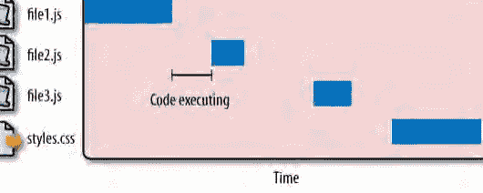

图 1-1. `JavaScript` 代码执行阻塞了其他文件的下载

在 `file1.js` 完全下载到 `file2.js` 开始下载之间存在一段延迟。这段空间是执行 `file1.js` 中包含的代码所需的所需的时间。每个文件都必须等待上一个文件下载并执行后，才能开始下一个下载。在此期间，由于文件是一个接一个下载，用户面对的是空白屏幕。这是今天大多数现代浏览器的行为。

`Internet Explorer 8`、`Firefox 3.5`、`Safari 4` 和 `Chrome 2` 都允许并行下载 `JavaScript` 文件。这是一个好消息，因为 `<script>` 标签并不一定阻塞其他 `<script>` 标签下载外部资源。遗憾的是，`JavaScript` 下载仍然会阻塞其他资源（如图像）的下载。即使下载脚本也不会阻塞其他脚本的下载，页面必须等待 `JavaScript` 代码下载并执行后才能继续。因此，虽然最新的浏览器通过允许并行下载改进了性能，但问题尚未完全解决。脚本阻塞仍然是一个问题。

由于脚本会阻塞页面上所有类型资源的下载，建议将所有 `<script>` 标签尽可能放在 `<body>` 标签的底部，以免影响整个页面的下载。例如：

```html
<html>
<head>
<title>Script Example</title>
<link rel="stylesheet" type="text/css" href="styles.css">
</head>
<body>
<p>Hello world!</p>
<!-- 脚本位置示例 -->
<script type="text/javascript" src="file1.js"></script>
<script type="text/javascript" src="file2.js"></script>
<script type="text/javascript" src="file3.js"></script>
</body>
</html>
```

这段代码代表了 `HTML` 文件中 `<script>` 标签的推荐位置。尽管脚本下载会阻塞页面显示，这是 `Yahoo!` 团队关于 `JavaScript` 的第一规则：将脚本放在底部。

## 脚本分组

由于每个 `<script>` 标签都会阻塞页面渲染，因此限制页面中的 `<script>` 标签总数是有用的。这适用于内联脚本以及外部文件。每当解析 `HTML` 页面时遇到 `<script>` 标签时，都会产生延迟；减少这些延迟可以提高页面的整体性能。


`Steve Saunders` 还发现，引用外部样式表的 `<link>` 标签之后放置内联脚本会导致浏览器等待样式表下载。这是为了确保内联脚本有正确的样式信息可以使用。`Saunders` 建议出于这种原因放在 `<link>` 标签之后。

在处理外部 `JavaScript` 文件时，问题略有不同。每个 `HTTP` 请求都带有额外的开销，因此下载一个 `100 KB` 的文件会比下载多个 `25 KB` 的文件快。为此，限制你的页面引用的外部脚本文件数量是有用的。

大型网站或 `Web` 应用程序会有多个 `JavaScript` 文件。你可以通过将这些文件合并为一个文件，然后使用单个 `<script>` 标签调用该文件，减少性能影响。合并可以在离线使用构建工具（第 9 章讨论）完成，也可以使用如 `Yahoo! combo handler` 等工具实时完成。

`Yahoo!` 创建 `combo handler` 用于通过其内容交付网络（`CDN`）分发 `Yahoo!` 用户界面（`YUI`）库文件。任何网站都可以通过使用 `combo-handled URL` 并指定要包含的文件引入。例如，此 `URL` 包含了两个文件：`http://yui.yahooapis.com/combo2.7.0/build/yahoo/yahoo-min.js&2.7.0/build/event/event-min.js`。

此 `URL` 加载了 `yahoo-min.js` 和 `event-min.js` 的 `2.7.0` 版本。这些文件在服务器上独立，但在请求此 `URL` 时会被合并。与其使用两个 `<script>` 标签（加载每个文件），可以使用单个 `<script>` 标签来加载这两个文件：

```html
<html
<head>
<title>脚本示例</title>
<link rel="stylesheet" type="text/css" href="styles.css">
</head>
<body>
<p>Hello world!</p>
<!-- 推荐的脚本位置示例 -->
<script type="text/javascript" src="http://yui.yahoo.com/combo/2.7.0/build/yahoo/yahoo-min.js&2.7.0/build/event/event-min.js"></script>
</body>
</html>
```

这段代码在页面底部有一个 `<script>` 标签，用于加载 `JavaScript` 文件，展示了在 `HTML` 页面中引入外部 `JavaScript` 的最佳实践。

## 非阻塞脚本

`JavaScript` 阻塞浏览器进程（包括 `HTTP` 请求和 `UI` 更新）的倾向是开发者面临的最显著的性能问题。保持 `JavaScript` 文件短小并限制 `HTTP` 请求的数量只是创建响应式应用的第一步。应用所需的功能越复杂，需要的 `JavaScript` 代码就越多，因此保持源代码短小并不总是可行方案。仅限制为下载单个大型 `JavaScript` 文件，尽管只有一次 `HTTP` 请求，也会导致浏览器被长时间锁定。为了解决这种情况，你需要以一种不阻塞浏览器的方式逐步向页面添加更多 `JavaScript`。

非阻塞脚本的秘诀在于在页面加载完成后加载 `JavaScript` 源代码。从技术角度来说，这意味着在在窗口的 `load` 事件触发后下载代码。实现这一结果有几种技术。

### 延迟脚本 (Deferred)

`HTML` 为 `<script>` 标签定义了一个额外的属性 `defer`。`defer` 属性表示元素中的脚本将不会修改 `DOM`，且执行可以安全地推迟到之后的某个点。`defer` 属性仅支持 `Internet Explorer 4+` 和 `Firefox 3.5+`，这使得它不如通用的跨浏览器解决方案理想。在其他浏览器中，`defer` 属性会被忽略，`<script>` 标签将以默认（阻塞）方式处理。尽管如此，如果你的目标浏览器支持它，这种解决方案仍然是有用的。以下是一个示例：

```javascript
<script type="text/javascript" src="file1.js" defer></script>
```

带有 `defer` 的 `<script>` 标签可以放在文档的任何位置。`JavaScript` 文件将在解析 `<script>` 标签时开始下载，但代码会在 `DOM` 完全加载（在处理 `onload` 事件之前）之前不会执行。当延迟的 `JavaScript` 文件下载完成后，它不会阻塞浏览器的其他进程，因此这些文件可以与页面上的其他文件并行下载。

任何标记为 `defer` 的 `<script>` 元素在 `DOM` 完全加载之前都不会执行；这对于内联脚本和外部脚本文件同样。以下简单页面演示了 `defer` 属性如何改变脚本的行为：

```html
<html>
<head>
<title>脚本延迟示例</title>
</head>
<body>
<script defer>
alert("defer");
</script>
<script>
alert("script");
</script>
<script>
window.onload = function() {
alert("load");
};
</script>
</body>
</html>
```

这段代码在页面处理期间会显示三个警报框。在不支持 `defer` 的浏览器中，警报的顺序是 "defer"、"script" 和 "load"。在支持 `defer` 的浏览器中，警报的顺序是 "script"、"defer" 和 "load"。注意，延迟的 `<script>` 元素在第二个元素执行之后、但在 `onload` 事件处理器处理之前才会执行。

如果你的目标浏览器包括 `Internet Explorer` 和 `Firefox 3.5`，以这种方式延迟脚本可能会有所帮助。如果你需要支持更广泛的浏览器，还有其他工作方式更一致的解决方案。

### 动态脚本元素

文档对象模型 (`DOM`) 允许你使用 `JavaScript` 动态创建 `HTML` 文档的几乎任何部分。从根本上说，`<script>` 元素与页面上的其他元素没有区别：可以通过 `DOM` 获取引用，并且它们可以被移动、从文档中移除，甚至被创建。使用标准的 `DOM` 方法可以很容易创建一个新的 `<script>` 元素：

```javascript
var script = document.createElement("script");
script.type = "text/javascript";
script.src = "file.js";
document.getElementsByTagName("head")[0].appendChild(script);
```

这个新的 `<script>` 元素会加载源文件 `file.js`。文件一旦被添加到文档中就会开始下载。

```javascript
} else { //others
script.onload = function() {
  callback();
}
script.src = url;
document.getElementsByTagName("head")[0].appendChild(script);
}
```

此函数接受两个参数：要获取的 `JavaScript` 文件的 `URL`，以及在 `JavaScript` 完全加载后执行的回调函数。它使用特性检测（`Feature detection`）来确定由哪个事件处理器监控脚本的进度。最后一步是分配 `src` 属性并将 `<script>` 添加到页面。`loadScript()` 函数的用法如下：

```javascript
loadScript("file1.js", function() {
  alert("File is loaded!");
});
```

你可以在页面上动态加载任意数量的 `JavaScript` 文件，但务必考虑文件必须加载的顺序。在所有主流浏览器中，只有 `Firefox` 和 `Opera` 保证脚本的执行顺序与你的预期保持一致。其他浏览器将按照文件从服务器返回的顺序来下载并执行各种代码文件。你可以通过将下载链起来来保证这一点，例如：

```javascript
loadScript("file1.js", function() {
  loadScript("file2.js", function() {
    loadScript("file3.js", function() {
      alert("All files are loaded!");
    });
  });
});
```

这段代码会等待 `file1.js` 可用后再等待 `file2.js`，并且等待 `file2.js` 可用后再下载 `file3.js`。虽然这种方法可行，但如果有多个文件需要下载和执行，可能会变得比较难以管理。

如果多个文件的顺序很重要，推荐的方法是将文件合并成单个文件，其中每个部分都处于正确的顺序。然后下载这个单个文件以一次所有代码（由于这是异步进行的，因此文件大并没有性能损失）。

由于其良好的跨浏览器兼容性和易用性，动态脚本加载是非阻塞 `JavaScript` 下载最常用的常用的模式。

### XMLHttpRequest 脚本注入

非阻塞脚本的另一种方法是使用 `XMLHttpRequest` (`XHR`) 获取 `JavaScript` 代码，然后将其注入到页面中。这种技术涉及创建一个 `XHR` 对象，下载 `JavaScript` 文件，然后使用动态 `<script>` 元素将 `JavaScript` 代码注入到页面中。这是一个简单的示例：

```javascript
var xhr = new XMLHttpRequest();
xhr.open("get", "file.js", true);
xhr.onreadystatechange = function() {
  if (xhr.readyState == 4) {
    if (xhr.status >= 200 && xhr.status < 300) {
      var script = document.createElement('script');
      script.type = "text/javascript";
      script.text = xhr.responseText;
      document.body.appendChild(script);
    }
  }
}
xhr.send(null);
```

这段代码对 `file.js` 发送了一个 `GET` 请求。`onreadystatechange` 事件处理器检查 `readyState` 是否为 4，并验证 `HTTP` 状态码是否有效（200-299 范围表示有效响应并产生缓存响应）。如果收到了有效响应，将创建一个新的 `<script>` 元素并将其 `text` 属性赋值为从服务器接收到的 `responseText`。这本质上创建了一个带有内联代码的 `<script>` 元素。新的 `<script>` 元素被添加到文档中，代码被执行并准备可以使用。

这种方法的主要优势是，你可以下载 `JavaScript` 代码而不立即执行它。由于代码是在 `<script>` 标签之外返回的，它不会在下载时自动执行，允许你推迟执行直到你准备就绪。另一个优势是相同的代码在所有现代浏览器中都能运行，没有异常情况。

这种方法的主要局限性是 `JavaScript` 文件必须与请求它的页面位于同一域，这使得无法从 `CDN` 下载。由于由于原因，`XHR` 脚本注入不被用于大规模应用程序。

## 非阻塞模式

在页面上加载大量 `JavaScript` 的推荐方法是一个两步过程：首先，包含动态加载 `JavaScript` 所需的代码，然后加载页面初始化所需的 `JavaScript` 代码。由于第一部分代码尽可能小（可能包含 `loadScript()` 函数），它的下载和执行非常快，因此不应该对页面产生太大干扰。一旦初始代码到位，使用它来加载剩余的 `JavaScript`。例如：

```html
<script type="text/javascript" src="loader.js"></script>
<script type="text/javascript">
loadScript("the-rest.js", function() {
  Application.init();
});
</script>
```

将此加载代码放在 `</body>` 标签之前。这样做有几个好处。首先，正如之前所讨论的，这确保了 `JavaScript` 的执行不会阻止页面其余部分的显示。其次，当 `JavaScript` 文件下载完成时，应用程序的所有 `DOM` 都已创建并准备好交互，避免了检查另一个事件（如 `window.onload`）来判断页面何时准备好初始化的需求。

另一种选项是将 `loadScript()` 函数直接嵌入到页面中，从而避免另一个 `HTTP` 请求。例如：

```html
<script type="text/javascript">
function loadScript(url, callback) {
  var script = document.createElement('script');
  script.type = "text/javascript";
  if (script.readyState) { //IE
    script.onreadystatechange = function() {
      if (script.readyState == "Loaded" || script.readyState == "complete") {
        callback();
      }
    }
  } else {
    script.onload = function() {
      callback();
    }
  }
  script.src = url;
  document.getElementsByTagName("head")[0].appendChild(script);
}
loadScript("the-rest.js", function() {
  Application.init();
});
</script>
```

## YUI 方法

在页面上放置少量代码，随后下载额外功能的概念是 `YUI` 设计的核心。要在页面上使用 `YUI 3`，首先要包含 `YUI` 文件：

```html
<script type="text/javascript" src="http://yui.yahoo.com/combo?3.0/build/yui-min.js"></script>
```

种子文件约为 `10 KB`（压缩后 `6 KB`），包含了从 `Yahoo CDN` 下载任何 `YUI` 组件的功能。例如，如果你想使用 `DOM` 工具，可以在 `YUI` `use()` 方法中指定其名称 ("dom")，并提供一个在代码准备就绪后执行的回调：

```javascript
YUI().use("dom", function(){
  Y.DOM.addClass(document.body, "loaded");
});
```

尽管使用动态脚本加载以非阻塞方式下载文件，但仍建议减少文件的数量。因为每个下载仍然是一个独立的 `HTTP` 请求，并且在所有文件都下载并执行之前，回调函数不会执行。

`LazyLoad` 也能动态加载 `CSS` 文件。这通常不是问题，因为 `CSS` 文件的下载总是并行进行的，并且不会阻塞页面活动。


## LABJs 库

另一种非阻塞 `JavaScript` 加载方法是使用 `LABJs` (http://labjs.com/)，这是一个由 `Kyle Simpson` 和 `Steve Souders` 编写的开源库。该库对加载过程提供了更细粒度的控制，并尝试尽可能地并行下载。`LABJs` 也非常小，仅 `4.5 KB`（压缩后，未 `gzip` 压缩），内存占用极低。使用示例下：

```html
<script type="javascript" src="lab.js"></script>
<script type="javascript">
$LAB.script("the-rest.js")
  .wait(function() {
    Application.init();
  });
</script>
```

`$LAB.script()` 方法用于定义要下载的 `JavaScript` 文件，而 `$LAB.wait()` 则用于指示在等待文件下载并执行后再执行给定的函数。`LABJs` 鼓励链式调用，因此每个方法都返回 `$LAB$` 对象的引用。要下载多个 `JavaScript` 文件，只需链式调用另一个 `$LAB.script()` 即可：

```html
<script type="javascript" src="lab.js"></script>
<script type="javascript">
$LAB.script("first-file.js")
  .script("the-rest.js")
  .wait(function() {
    Application.init();
  });
</script>
```

`LABJs` 的独特之处在于它管理依赖的能力。使用 `<script>` 标签的标准包含意味着每个文件都被下载（如前所述，按顺序或并行），然后按顺序执行。在某些情况下这是绝对必要的，但在另一些情况下并非如此。

`LABJs` 允许你使用 `wait()` 指定哪些文件需要等待其他文件。在之前的示例中，无法保证 `first-file.js` 中的代码在 `the-rest.js` 中的代码之前执行。为了保证这一点，你必须在第一个脚本之后添加 `wait()` 调用：

```html
<script type="text/javascript" src="lab.js"></script>
<script type="text/javascript">
$LAB.script("first-file.js").wait(
  .script("the-rest.js",function() {
    Application.init();
  });
</script>
```

现在，`first-file.js` 中的代码保证在 `the-rest.js` 中的代码之前执行，尽管文件内容是并行下载的。

## 总结

在浏览器中管理 `JavaScript` 是复杂的，因为代码执行会阻塞如 `UI` 绘制等浏览器进程。每当遇到 `<script>` 标签时，页面必须停止并等待代码下载（如果是外部文件）并执行，然后继续处理页面的其他部分。然而，有几种方法可以减少 `JavaScript` 对性能的影响：

- 将所有 `<script>` 标签放在页面底部，紧挨在 `</body>` 结束标签内部。这确保了页面在脚本执行之前几乎已经完全渲染。
- 将脚本组合在一起。页面上的 `<script>` 标签越少，页面加载并变为交互状态就越快。这对于加载外部 `JavaScript` 文件的 `<script>` 标签和带有内联代码的标签同样。
- 有几种方法可以用非阻塞方式下载 `JavaScript`：
    - 使用 `<script>` 标签的 `defer` 属性（仅限 `Internet Explorer` 和 `Firefox 3.5+`）
    - 动态创建 `<script>` 元素来下载并执行代码
    - 使用 `XHR` 对象下载 `JavaScript` 代码并注入页面

通过使用这些策略，你可以大大提高需要大量 `JavaScript` 代码的网络应用程序的感知性能。

# 第 2 章：数据访问

计算机科学的经典问题之一是确定应该存储数据以实现最佳读写性能。数据存储的位置与代码执行期间检索的速度有关。在 `JavaScript` 中，由于数据存储的选项较少，这个问题被简化了。尽管与其他语言类似，数据的存储位置会极大影响之后访问的速度。`JavaScript` 中可以访问数据的四个基本地方：

## 字面量值 (Literal values)

任何代表自身且存储在特定位置的值。`JavaScript` 可以字符串、数字、布尔值、对象、数组、函数、正则表达式以及特殊值 `null` 和 `undefined` 表示为字面量。

## 变量 (Variables)

使用 `var` 关键字创建的任何由开发者定义的存储数据的位置。

## 数组项 (Array items)

`JavaScript` 数组对象内部通过数字索引指定的位置。

## 对象成员 (Object members)

`JavaScript` 对象内部通过字符串索引指定的位置。

这些数据位置中的每一个都与涉及该数据的读写操作相关联有特定的成本。在大多数情况下，从字面量值访问信息与访问局部变量的性能差异忽略其微。从数组项和对象成员访问信息的开销更高，但具体哪种开销更大很大取决于浏览器。图 2-1 显示了在不同浏览器中从这些位置各访问 200,000 个值的相对速度。

使用较传统 `JavaScript` 引擎（如 `Firefox 3`、`Internet Explorer` 和 `Safari 3.2`）的旧浏览器访问值所需的时间比使用优化 `JavaScript` 引擎的浏览器要长得多。然而，不同浏览器之间的总体趋势保持一致：字面量访问往往比数组项和对象访问快。

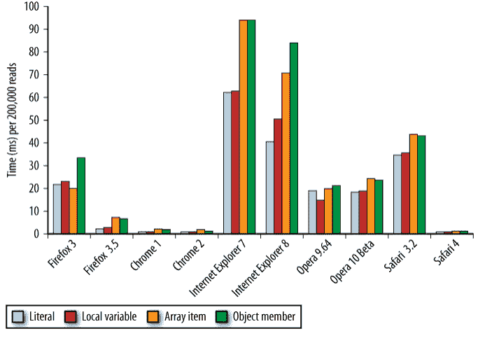
图 2-1. 从各种位置访问 200,000 个值的时间

## 管理作用域 (Managing Scope)

作用域的概念不仅要从性能角度理解，还要从功能的角度理解。作用域在 `JavaScript` 中有许多影响，从决定函数可以访问哪些变量到赋值赋值。要理解速度如何与作用域相关，有必要理解作用域是如何工作的。

## 作用域链和标识符解析 (Scope Chains and Identifier Resolution)

`JavaScript` 中的每个函数都表示为一个对象——更具体地说，是 `Function` 的实例。函数对象像任何对象一样拥有属性，这些属性包括可以通过编程访问的属性，以及一系列无法通过代码访问的内部属性。其中一个属性就是由 `ECMA-262` 第三版中定义的 `Scope`（作用域）。

内部 `Scope` 属性包含一组表示函数创建时所在作用域的对象集合。这个集合被称为函数的作用域链（`scope chain`），它决定了函数可以访问的数据。函数作用域链中的每个对象都是变量对象，每个对象都以键值对的形式包含变量。在创建函数时，其作用域链会被表示该作用域内可用数据的对象填充。例如，考虑以下全局函数：

```javascript
function add(num1, num2){
  var sum = num1 + num2;
  return sum;
}
```

当 `add()` 函数被创建时，其作用域链填充一个变量对象：表示所有全局变量的全局对象。全局对象包含了 `window`、`navigator` 和 `document` 等项。图 2-2 显示了这种关系（注意图中的全局对象仅显示了几个全局变量作为示例；还有许多）。

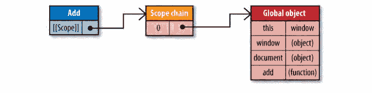
图 2-2. `add()` 函数的作用域链

`add` 函数的作用域链在函数执行时会被使用。假设执行以下代码：

```javascript
var total = add(5, 10);
```

执行 `add` 函数会触发一个名为执行上下文（`execution context`）的内部对象的创建。执行上下文定义了函数执行的环境。每个执行上下文对于函数的某次特定执行都是唯一的，因此多次调用同一个函数会导致创建多个执行上下文。一旦函数执行完毕，执行上下文就会被销毁。

执行上下文拥有它自己的作用链（`scope chain`），用于标识符解析。当执行上下文创建时，其作用链将使用执行函数的 `[[Scope]]` 属性中包含的对象进行初始化。这些值按照它们在函数中出现的顺序被复制到执行上下文的作用链中。一旦完成，就会为该执行创建一个名为“激活对象”（`activation object`）的新对象，它包含了所有局部变量、命名参数、参数集合以及 `this` 的条目。该对象随后会被推到作用链的最前端。当执行上下文销毁时，激活对象也会销毁。图 2-3 显示了之前示例代码的执行上下文及其作用链。

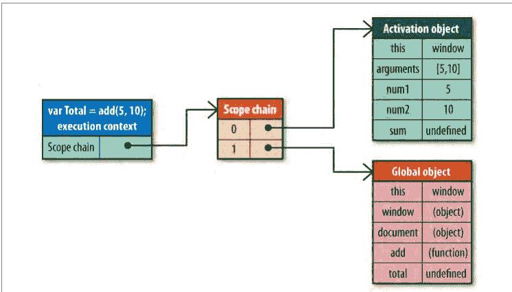
图 2-3. 执行 `add()` 时的作用链

在函数执行过程中，每次遇到变量，都会进行标识符解析，以确定从何处检索或存储数据。在此过程中，会在执行上下文的作用链中搜索具有相同名称标识符。搜索从作用链的前端（即执行函数的激活对象）开始。如果找到，则使用指定标识符的变量；如果没有找到，则继续搜索作用链中的下一个对象。这个过程一直持续，直到找到标识符或没有更多变量对象可以搜索，在这种情况下，该标识符被视为 `undefined`（未定义）。函数执行过程中找到每个标识符都采用相同的方法，因此在之前的示例中，`sum`、`num1` 和 `num2` 都会发生这种情况。正是这种搜索过程影响了性能。

注意，作用链的不同部分可能存在同名的变量。在这种情况下，标识符将绑定到作用链遍历中第一个找到的变量，第一个变量被称为第二个变量的“屏蔽”（`shadow`）。

## 标识符解析性能

标识符解析并不是免费的，事实上，没有任何一种计算机操作是不带某种性能开销的。标识符在执行上下文作用链中存在的深度越深，其读取和写入的速度就越慢。通常，局部变量在函数内部的访问总是是最快的，而全局变量通常是最慢的（经过优化的 `JavaScript` 引擎可以在某些情况下对此调整）。请记住，全局变量始终存在于执行上下文作用链的最后一个变量对象中，它们的解析距离是最远的。图 2-4 和 2-5 显示了基于作用链深度的标识符解析速度。深度为 1 表示局部变量。

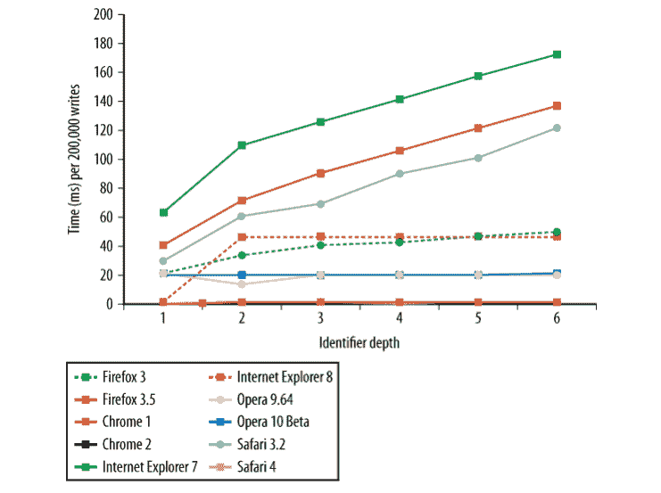
图 2-4. 写操作的标识符解析

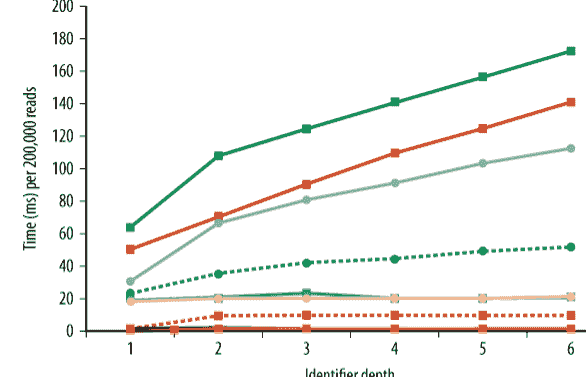
图 2-5. 读操作的标识符解析

所有浏览器的总体趋势是，标识符在作用域中存在越深，读取或写入就越慢。具有优化 `JavaScript` 引擎的浏览器（如 `Chrome` 和 `Safari 4`）访问作用域外的标识符时不会产生这种性能惩罚，而 `Internet Explorer`、`Safari 3.2` 等则显示出更显著的影响。值得注意的是，早期的浏览器（如 `Internet Explorer 6` 和 `Firefox 2`）确实有极其陡的斜率，如果将它们的数据包含在内，在高点处甚至不会出现在图表的范围内。

鉴于这些信息，建议尽可能使用局部变量，以提高在没有优化 `JavaScript` 的浏览器中的性能。一个实用的规则是，如果作用域外的值在函数内部使用多次，则将其存储在局部变量中。考虑以下示例：

```javascript
function init(){
  var bd = document.body;
  links = document.getElementsByTagName("a");
  i = 0;
  len = links.length;
  while(i < len){
    update(links[i]);
  }
}
```

```javascript
document.getElementById("go-btn").onclick = function(){
  start();
}
bd.className = "active";
```

此函数包含三个对 `document` 的引用，`document` 是全局对象。对该变量的搜索将遍历整个作用链，最后在全局对象中解析。你可以通过首先将引用存储在局部变量并使用局部变量而不是全局变量来减轻重复访问全局带来的性能影响。例如，之前的代码可以重写为：

```javascript
function initUI() {
  var doc = document;
  bd = doc.body;
  links = doc.getElementsByTagName("a");
  i = 0;
  len = links.length;
  while(i < len) {
    update(links[i++]);
  }
  document.getElementById("go-btn").onclick = function(){
    start();
  }
  bd.className = "active";
}
```

更新后的 `initUI()` 版本首先将 `document` 的引用存储在局部变量中。不再是访问三次全局变量，而是减少到一次。访问 `doc` 而不是 `document` 更快，因为它是局部变量。当然，这个简单的函数不会显示出性能提升，因为它并没有进行这种操作；但对于包含几十个重复访问的全局变量的大型函数；那里才能发现更令人深刻的性能改进。

## 作用链的增强

通常情况下，执行上下文的作用链不会发生改变。有两种语句可以临时增强作用链。其中一种是在执行时临时增强执行上下文的作用链，即 `with`。

`with` 语句用于创建对象的属性，这类似于其他语言。`initUI()` 函数可以写如下：

```javascript
function initUI(){
  with (document) {
    var bd = body;
    links = getElementsByTagName("a");
    i = 0;
    len = links.length;
    while (i < len) {
      update(links[i++]);
    }
    getElementById("go-btn").onclick = function() {
      start();
    };
    bd.className = "active";
  }
}
```

当代码进入 `with` 语句时，执行上下文的作用链会被增强。会创建一个包含所有属性的变量对象。该对象被推到作用链的前端，这意味着局部变量现在都在第二个作用链中。这使得访问 `document` 非常快，但访问局部变量却变慢了。由于这个原因，最好避免使用 `with` 语句。

`with` 语句并不是 `JavaScript` 中唯一增强作用链的部分；`try-catch` 语句的 `catch` 子句相同相同。当 `try` 块发生错误时，执行会自动流向 `catch`，异常被推入一个变量对象。在 `catch` 的情况下，所有的函数现在都在第二个作用链中。例如：

```javascript
try {
  methodThatCauseError();
} catch (ex) {
  alert(ex.message); // 作用链被增强了
}
```

注意，当 `catch` 子句执行完毕后，作用链会恢复到之前的状态。

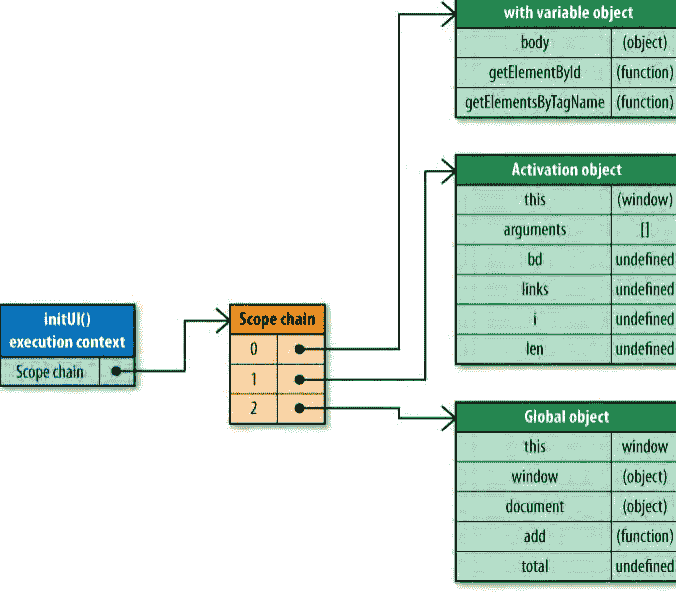
图 2-6. `with` 语句中增强的作用链

`with` 语句在应用得当时非常有用，因此没有建议完全避免。如果你计划使用 `try-catch`，请确保你理解错误发生的概率。`try-catch` 永远不应该作为解决 `JavaScript` 错误的方案。如果你知道错误会频繁发生，那么这指出了代码本身存在应该修复的问题。

通过在 `catch` 中执行尽可能少的代码，可以减少对性能的影响。一个良好的模式是有一个处理错误的方法，让 `catch` 子句将其委托给它，如下所示：

```javascript
try {
    methodThatMightCauseError();
} catch (ex){
    handleError(ex); // 委托给处理方法
}
```

在这里，`handleError()` 方法是 `catch` 子句执行的唯一代码。该方法可以以适当的方式处理错误，并接收从错误生成的异常对象。由于只执行了一条语句且没有局部访问的变量，临时作用域链的增强不会影响代码的性能。

## 动态作用域

`with` 语句和 `try-catch` 语句中的 `catch` 子句，以及包含 `eval()` 的函数，都被视为动态作用域。动态作用域仅通过代码的执行而存在，因此无法通过静态分析（查看代码结构）来确定。例如：

```javascript
function execute(code) {
  eval(code);
  function subroutine(){
    return window;
  }
  var w = subroutine();
  //w 的值是什么？
};
```

由于使用了 `eval()`，`execute()` 函数代表了一个动态作用域。`w` 的值会根据 `code` 的值而变化。在大多数情况下，`w` 将等于全局 `window` 对象，但请考虑以下情况：

```javascript
execute("var window = null;");
```

在这种情况下，`eval()` 在 `execute()` 中创建了一个局部 `window` 变量，因此 `w` 最终等于局部 `window` 而不是全局 `window`。在代码执行之前，无法知道是否是这种情况，这意味着 `window` 标识符的值是无法预定的。

优化的 `JavaScript` 引擎（如 `Safari` 的 `Nitro`）尝试通过分析代码来确定在任何给定时间哪些变量是可以访问的，从而加速标识符解析。引擎尝试通过索引标识符来避免传统的作用域链查找。然而，当涉及动态作用域时，优化不再有效。引擎需要切换更接近传统作用域链查找的较慢的哈希查找方法。

因此，建议仅在绝对必要时使用动态作用域。

## 闭包、作用域与内存

闭包是 `JavaScript` 最强大的特性之一，允许函数访问其局部作用域之外的数据。闭包通过 `Douglas Crockford` 的著作得以普及，现在在大多数复杂的 `Web` 应用中无处不在。然而，使用闭包会带来性能影响。

为了理解闭包的性能问题，请考虑以下：

```javascript
var id = "xd9592";
document.getElementById("save-btn").onclick = function(event) {
  savedDocument(id);
}
```

`assignEvents()` 函数为事件分配了一个事件处理器。该事件处理器是一个闭包，因为它是在 `assignEvents()` 执行时创建的，并且可以访问作用域中的 `id` 变量。为了让这个闭包访问 `id`，必须创建一个特定的作用域链。

当执行 `assignEvents()` 时，会创建一个激活对象，其中包含了 `id` 变量等。这成为执行上下文作用域链中的第一个对象，全局对象紧随其后。当创建闭包时，`[[Scope]]` 属性用这两个对象进行初始化（见图 2-7）。

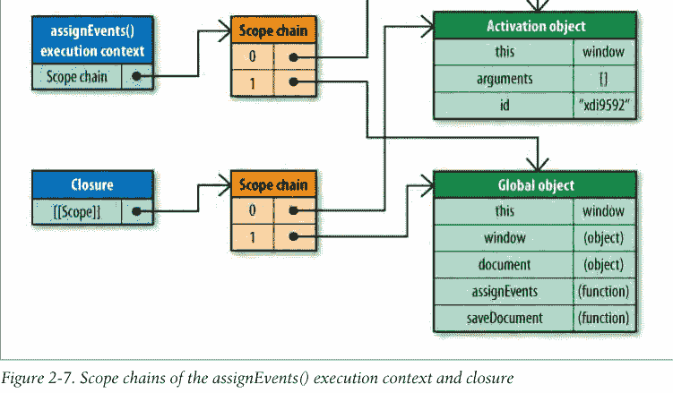

由于闭包的 `[[Scope]]` 属性包含与执行上下文作用域链相同的对象引用，因此会产生副作用。通常，当执行上下文被销毁时，函数的激活对象会被销毁。但当涉及闭包时，激活对象不会销毁，因为闭包的 `[[Scope]]` 属性中仍然存在引用。这意味着闭包在作用域中比非闭包函数需要更多的内存开销。在大型 `Web` 应用中，这可能会成为一个问题，特别是在涉及 `Internet Explorer` 时。`IE` 将 `DOM` 对象实现为非原生 `JavaScript` 对象，因此闭包会导致内存泄漏；更多信息请参阅第 3 章。

当执行闭包时，会创建一个执行上下文，其作用域链用 `[[Scope]]` 中引用的两个链对象进行初始化，然后为闭包本身创建一个新的激活对象（图 2-8）。

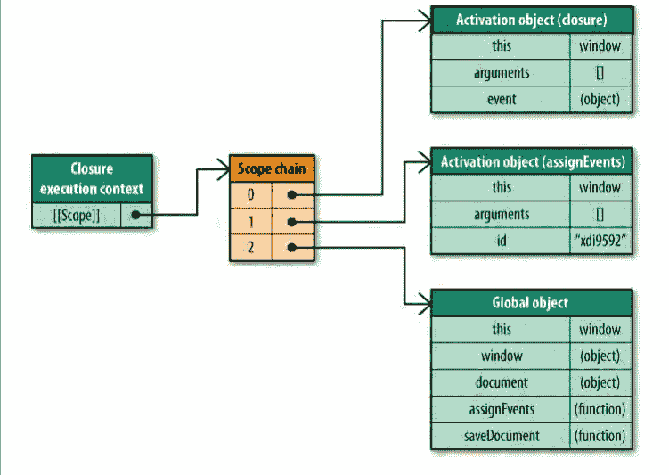
图 2-8. 执行闭包

注意，闭包中使用的两个标识符 `id` 和 `saveDocument` 都存在于作用域链的第一个对象之后。这是闭包主要的性能关注点：你经常在访问许多作用域外的标识符，因此每次访问都会产生代价。

在脚本中使用闭包时最好保持谨慎，因为它们在内存和执行速度方面都有问题。然而，你可以遵循本章较早关于作用域外变量的建议来减轻对执行速度的影响：将频繁使用的作用域外变量存储在局部变量，然后直接访问局部变量。

## 对象成员

大多数 `JavaScript` 都是以面向对象的方式编写的，要么通过创建自定义对象，要么通过使用内置对象（如文档对象模型 (`DOM`) 和浏览器对象模型 (`BOM`) 中的对象）。因此，往往会有大量的对象成员访问操作。

对象成员既是属性也是方法，在 `JavaScript` 中，两者之间区别不大。对象的命名成员可以包含任何数据类型。由于函数被表示为对象，因此成员除了传统数据类型外，还可能包含函数。当命名成员引用函数时，它被视为方法，而引用非函数数据类型的成员被视为属性。

正如本章早期讨论的那样，成员访问往往比访问字面量或变量中的数据要慢，在某些浏览器中甚至比访问数组项要慢。要理解为什么会这样，有必要理解 `JavaScript` 中对象的本质。

## 原型

`JavaScript` 中的对象是基于原型的。原型是一个作为另一个对象基础的对象，用于定义并实现它的属性。

因此，对象有两种类型的成员：实例成员（也称为“自身”成员）和原型成员。实例成员直接存在于对象上，而原型成员则从自原型。考虑以下示例：

```javascript
var book = {
    title: "High Performance JavaScript",
    publisher: "Yahoo! Press"
};
alert(book.toString()); // "[object Object]"
```

代码中，`book` 对象有两个实例成员：`title` 和 `publisher`。注意，并没有定义 `toString` 方法，但它可以被正常调用且不会报错。`toString()` 方法是 `book` 对象继承的原型成员。图 2-9 显示了这种关系。

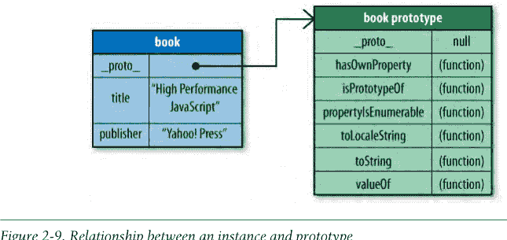

解析对象成员的过程与解析变量非常相似。当调用 `book.toString()` 时，对名为 `toString` 的成员的搜索从实例开始。由于 `book` 没有名为 `toString` 的成员，搜索随后流向原型，在那里找到了并执行了 `toString()` 方法。这样，`book` 可以访问其原型上的所有属性或方法。

你可以通过使用 `hasOwnProperty` 方法并传递成员名称来确定对象是否具有给定的实例成员。要确定对象是否可以访问给定的属性，可以使用 `in` 运算符。例如：

```javascript
var book = {
  title: "High Performance JavaScript",
  publisher: "Yahoo! Press"
};
alert(book.hasOwnProperty("title")); //true
alert(book.hasOwnProperty("toString")); //false
alert("title" in book); //true
alert("toString" in book); //true
```

在这段代码中，当传递 `"title"` 时，`hasOwnProperty()` 返回 `true`，因为 `title` 是一个对象实例；当传递 `"toString"` 时，由于它不在实例上，该方法返回 `false`。当使用 `in` 运算符检查每个属性名时，两次结果都为 `true`，因为它搜索了实例和原型。

### 原型链

对象的原型决定了它是哪个类型或哪些类型的实例。默认情况下，所有对象都是 `Object` 的实例，并继承所有的基本方法，例如 `toString()`。你可以通过定义和使用构造函数来创建其他类型的原型。例如：

```javascript
function Book(title, publisher) {
  this.title = title;
  this.publisher = publisher;
}
Book.prototype.setTitle = function() {
  alert(this.title);
};
var book1 = new Book("High Performance JavaScript", "Yahoo!");
var book2 = new Book("The Good Parts", "Yahoo!");
alert(book1 instanceof Book); //true
alert(book2 instanceof Object); //true
book1.setTitle(); //"High Performance JavaScript"
alert(book1.toString()); //"[object Object]"
```

构造函数用于创建 `Book` 的新实例。`book1` 实例的原型（`__proto__`）是 `Book.prototype`，而 `Book.prototype` 的原型是 `Object`。这创建了一个原型链，`book1` 和 `book2` 都从中继承了它们的方法。

图 2-10 原型链

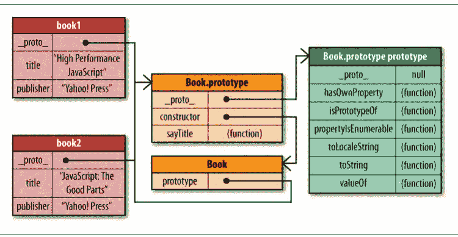

注意，`Book` 的两个实例共享同一个原型链。每个实例都有自己的 `title` 和 `publisher` 属性，但其他所有内容都是通过原型继承的。

现在当调用 `book1.toString()` 时，必须更深地搜索原型链以解析对象成员。正如你可能怀疑的那样，成员在原型链中的位置越深，检索它的速度就越慢。图 2-11 显示了原型中成员深度与访问该成员时间之间的关系。

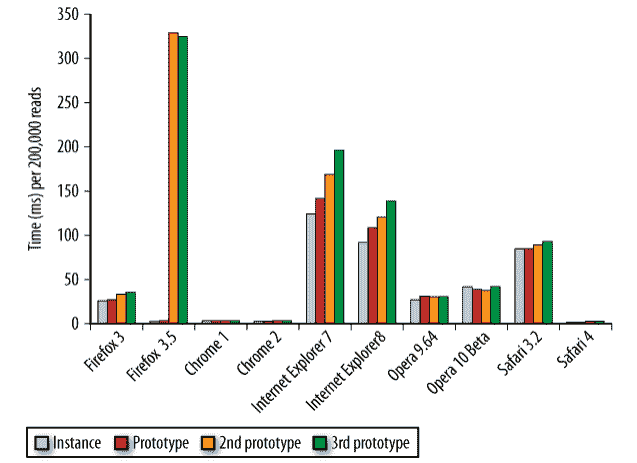
图 2-11. 数据访问向原型链深处进行

尽管带有优化过的 `JavaScript` 引擎的现代浏览器可以执行此任务，但旧的浏览器——特别是 `Internet Explorer` 和 `Firefox 3.5`——在向原型链每额外增加一步时都会产生性能开销。请记住，查找实例成员的过程仍然比从字面量或局部变量访问数据要昂贵，因此为遍历原型链增加更多开销只会增加这种影响。

### 嵌套成员

由于对象成员可能包含其他成员，在 `JavaScript` 代码中看到像 `window.location.href` 这样的模式并不罕见。这些嵌套成员导致 `JavaScript` 引擎在每次遇到点符号时都要经过对象成员解析过程。图 2-12 显示了对象成员深度与访问时间之间的关系。

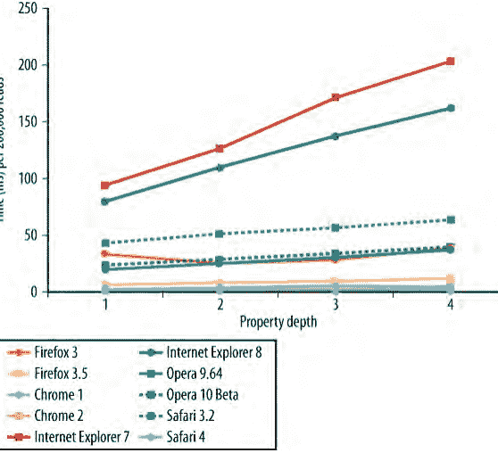
图 2-12. 访问时间与属性深度相关

这并不意外，嵌套越深的成员，数据的访问就越慢。评估 `location.href` 的速度总是比 `window.location.href` 快，而后者又比 `window.location.toString()` 快。如果这些属性不在对象实例上，那么由于在每一点都要搜索原型链，成员解析将花费更长时间。

在浏览器中，使用点表示法（`object.name`）访问对象成员与使用括号表示法（`object["name"]`）之间没有明显区别。`Safari` 是唯一点表示法始终更快的浏览器，但这种提升不足以建议使用括号表示法。

### 缓存对象成员值

考虑到所有与对象成员相关的性能问题，人们很容易认为应该尽可能避免使用它们。更准确地说，你应该谨慎地用，只在必要时才使用对象成员。例如，没有理由在单个函数中多次读取对象成员的值：

```javascript
function hasEitherClass(element, className1, className2){
  return element.className == className1 || element.className == className2;
}
```

在这段代码中，`element.className` 被访问了两次。显然，这个值在函数执行过程中不会改变，但执行了两次对象成员查找。你可以通过将值存储在局部变量中并使用该变量来消除一次属性查找：

```javascript
function hasEitherClass(element, className1, className2){
  var currentClassName = element.className;
  return currentClassName == className1 || currentClassName == className2;
}
```

这个重写后的函数将成员查找次数限制为一次。由于两次成员查找都是为了读取属性，因此读取值并将其存储在局部变量是有意义的。该局部变量的访问速度要快得多。

通常情况下，如果你准备在一个函数中读取对象属性多次一次，最好是将该值存储在局部变量中。然后可以使用该变量代替属性，以避免另一次属性查找的开销。这在处理对执行速度影响更巨大的嵌套对象成员时尤为重要。

`JavaScript` 命名空间（例如 `YUI` 技术）是频繁访问属性的源头。例如：

```javascript
function toggle(element){
  if (YHOO.util.Dom.hasClass(element, "selected")){
    YHOO.util.Dom.removeClass(element, "selected");
    return false;
  } else {
    YHOO.util.Dom.addClass(element, "selected");
    return true;
  }
}
```

这段代码重复了三次 `YHOO.util.Dom` 来访问它。

```javascript
function toggle(element){
  var Dom = YHOO.util.Dom;
  if (Dom.hasClass(element, "selected")){
    Dom.removeClass(element, "selected");
    return false;
  } else {
    Dom.addClass(element, "selected");
    return true;
  }
}
```

其最新版本。`Google Chrome` 也使用来自 `WebKit` 的 `WebCore` 库来渲染页面，但实现了自己名为 `V8` 的 `JavaScript` 引擎。在 `Firefox` 中，`SpiderMonkey`（最新版本称为 `TraceMonkey`）是 `JavaScript` 的实现，它是 `Gecko` 渲染引擎的一个独立部分。

### 本质上的缓慢

这对性能意味着什么？简单地让两个函数相互交织总是会付出代价的。一个极佳的类比是将 `DOM` 想象成一块土地，将 `JavaScript`（指 `ECMAScript`）想象成另一块土地，两者通过一座收费桥梁连接（参见 `John Hrvatin`, `Microsoft`, `MIX09`, http://videos.visitmix.com/MIX09/T35JF）。每当 `ECMAScript` 需要访问 `DOM` 时，你必须跨越这道桥并支付性能过路费。你对 `DOM`的操作越多，支付的就越多。通常建议是尽可能少地跨越该桥，并留在 `ECMAScript` 中。本章的其余部分将关注这具体意味着什么，以及应该从哪里查找以加快交互速度。

## DOM 的访问与修改

仅仅访问 `DOM` 元素是有代价的——即前面讨论的“过路费”。修改元素更加昂贵，因为它们经常会导致浏览器重新计算页面几何结构的变化。

自然，访问或修改元素的最坏情况是在循环中执行它们，特别是在对 `HTML` 集合进行循环时。

为了让你对 `DOM` 脚本问题的规模有个直观感受，请考虑这个简单的示例：

```javascript
function innerHTMLLoop() {
  for (var count = 0; count < 15000; count++) {
    document.getElementById('here').innerHTML += 'a';
  }
}
```

这是一个在循环中更新页面元素内容的函数。对于这段代码的每次循环迭代，元素会被访问两次：一次是为了读取 `innerHTML` 属性的值，一次是为了写入它。

该函数的一个更高效的版本使用局部变量来存储更新后的内容，然后在循环结束时只写入一次：

```javascript
function innerHTMLLoop() {
  var content = '';
  for (var count = 0; count < 15000; count++) {
    content += 'a';
  }
  document.getElementById('innerHTML').innerHTML += content;
}
```


其最新版本。Google Chrome 也使用来自 WebKit 的 WebCore 库来渲染页面，但实现了自己名为 `V8` 的 JavaScript 引擎。在 Firefox 中，`SpiderMonkey`（最新版本称为 `TraceMonkey`）是 JavaScript 的实现，它是 Gecko 渲染引擎的一个独立部分。

### 本质上的缓慢

这对性能意味着什么？简单地让两个函数相互交织总是会付出代价的。一个极佳的类比是将 DOM 想象成一块土地，将 JavaScript（指 ECMAScript）想象成另一块土地，两者通过一座收费桥梁连接（参见 John Hrvatin, Microsoft, MIX09, `http://videos.visitmix.com/MIX09/T35JF`）。每次 ECMAScript 需要访问 DOM 时，你必须跨越这道桥并支付过路费。你对 DOM 的操作越多，支付的就越多。通常建议是尽可能少地跨越该桥，并留在 ECMAScript 中。本章的其余部分将关注这具体意味着什么，以及应该从哪里查找以加快交互速度。

## DOM 访问与修改

仅仅访问 DOM 元素是有代价的——即前面讨论的“过路费”。修改元素更加昂贵，因为它们经常会导致浏览器重新计算页面几何结构的变化。

自然，访问或修改元素的最坏情况是在循环中执行它们，特别是在对 HTML 集合进行循环时。

为了让你对 DOM 脚本问题的规模有个直观感受，请考虑这个简单的示例：

```javascript
function innerHTMLLoop() {
  for (var count = 0; count < 15000; count++) {
    document.getElementById('here').innerHTML += 'a';
  }
}
```

这是一个在循环中更新页面元素内容的函数。对于这段代码的每次循环迭代，元素会被访问两次：一次是为了读取 `innerHTML` 属性的值，一次是为了写入它。

该函数的一个更高效的版本使用局部变量来存储更新后的内容，然后在循环结束时只写入一次：

```javascript
function innerHTMLLoop() {
  var content = '';
  for (var count = 0; count < 15000; count++) {
    content += 'a';
  }
  document.getElementById('innerHTML').innerHTML += content;
}
```

该函数的这个版本在所有浏览器中运行速度都会更快。图 3-1 显示了在不同浏览器中测量的时间改进结果。图中 y 轴（与本章中的所有图一样）显示了执行时间的改进，即使用一种方法比另一种方法快了多少。例如，在 IE6 中，使用 `innerHTMLLoop()` 比另一个版本的 `innerHTMLLoop()` 快 155 倍。

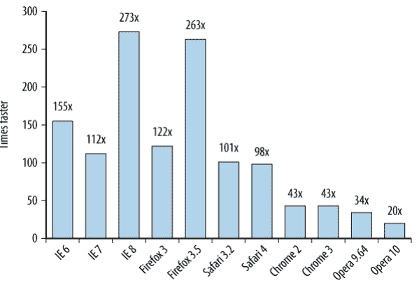

图 3-1. 留在 ECMAScript 内的一个好处是：`innerHTMLLoop()` 比 `innerHTMLLoop()` 快数百倍

这些结果清楚地表明，你访问 DOM 越多，你的代码执行得越慢。因此，通用的法则是：轻触 DOM，并尽可能留在 ECMAScript 中。

## innerHTML 对比 DOM 方法

多年来，Web 开发社区对这个问题进行过很多讨论：使用非标准但支持良好的 `innerHTML` 属性来更新页面的部分更好，还是只使用纯正的 DOM 方法（如 `document.createElement()`）更好？抛开 Web 标准讨论不谈，这对性能有影响吗？答案是：影响变得越来越小，但尽管如此，

除了最新的基于 WebKit 的浏览器（Chrome 和 Safari）之外，`innerHTML` 在所有浏览器中都更快。

让我们通过两种方式检查 1000 行的示例任务：

- 通过拼接 HTML 字符串并使用 `innerHTML` 更新 DOM
- 仅使用标准的 DOM 方法，如 `document.createElement()` 和 `document.createTextNodeNode()`

我们的表格内容类似于来自内容管理系统 (CMS) 的。最终结果如图 3-2 所示。

| id | yes? | name | url | action |
|---|---|---|---|---|
| 1 | And the answer is... yes | my name is #1 | http://example.org/1.html | • edit<br>• delete |
| 2 | And the answer is... no | my name is #2 | http://example.org/2.html | • edit<br>• delete |

图 3-2. 生成 1,000 行 5 列的 HTML 表格的最终结果

使用 `innerHTML` 生成表格的代码如下：

```javascript
function tableInnerHTML() {
  var i, h = ['<table border="1" width="100%">'];

  h.push('<head>');

  h.push('<tr><th id="id"><th>yes</th><th>name</th><th>url</th><th>action</th></tr>');
  h.push('</head>');
  h.push('<tbody>');
  for (i = 0; i < 1000; i++) {
    h.push('<tr');
    h.push(i);
    h.push('<td>' + 'And the answer is... ' + (i % 2 ? 'yes' : 'no')) + '</td>');
    h.push('<td>' + 'my name is #' + i) + '</td>');
    h.push('<td>' + i + 'http://example.org/1.html') + '</td>');
    h.push('<td' + 'And the answer is... ' + (i % 2 ? 'yes' : 'no')) + '</td.');
    h.push.    . + '.push');
    h.push('<td>' + 'my name is #' + i) + '</td.');
    h.push('<td>' + i + 'http://example.org/1.html') + '</td.');
    h.push('<td>' + 'And the answer is... ' + (i % 2 ? 'yes' : 'no')) + '</td.');
    h.push.    . + '.push');
    h.push('<td' + i + 'http://example.org/1.html') + '</td.');
    h.push('<td>' + 'And the answer is... ' + (i % 2 ? 'yes' : 'no')) + '</td.');
    h.push.    . + '.push');
    h.push('<td. + i + 'http://example.org/1.html') + '</td.');
    h.push.    . + '.push');
    '....... (i. 2.. '..........
  }
}
```

## 克隆节点

使用 DOM 方法更新页面内容的另一种方法是克隆现有的 DOM 元素而不是创建新元素——换句话说，使用 `element.cloneNode()`（其中 element 是一个现有节点）而不是 `document.createElement()`。

在大多数浏览器中，克隆节点的效率更高，但差异并不大。通过只创建一次重复元素然后复制它们来重新生成上例中的表格，可以获得更快的执行速度：

- IE8 中提升 2%，但在 IE6 和 IE7 中没有变化
- Firefox 3.5 和 Safari 4 中提升高达 5.5%
- Opera 中提升 6%（但在 Opera 10 中没有节省）
- Chrome 2 中提升 10%，Chrome 3 中提升 3%

作为说明，这里是使用 `element.cloneNodeDOM()` 生成表格的部分代码列表：

```javascript
function tableClonedDOM() {
  var i, table, head, tbody, tr, th, td, a, ul, li,
      oth = document.createElement('th'),
      ot = document.createElement('td'),
      otr = document.createElement('tr'),
      oa = document.createElement('a'),
      oli = document.createElement('li'),
      ul = document.createElement('ul');

  tbody = document.createElement('tbody');

  for (i = 1; i <= 1000; i++) {
    tr = otr.cloneNode(false);
    td = otd.cloneNode(false);
    td.appendChild(document.createTextNode(i % 2) ? 'yes' : 'no');
    tr.appendChild(td);
    td = otd.cloneNode(false);
    td.appendChild(document.createTextNode(i));
    tr.appendChild(td);
    td = otd.cloneNode(false);
    td.appendChild(document.createTextNode('my name is # ' + i));
    tr.appendChild(td);
    // ... 循环其余部分 ...
  }

  // ... 表格生成的其余部分 ...
}
```

## HTML 集合

HTML 集合是包含 DOM 节点引用的类数组对象。集合的示例是以下方法返回的值：

- `document.getElementsByName()`
- `document.getElementsByClassName()`
- `document.getElementsByTagName()`

以下属性也返回 HTML 集合：

- `document.images`：页面上所有的 img 元素
- `document.links`：所有的 a 元素
- `document.forms`：所有的表单
- `document.forms[0].elements`：第一个表单中的所有字段

这些方法和属性返回 `HTMLCollection` 对象，它们是类列表。它们不是数组（因为它们没有 `push()` 或 `slice()` 等方法），但提供了 `length` 属性，允许通过数组和索引访问列表中的元素。例如，`document.images[1]` 返回集合中的第二个元素。根据 DOM 标准定义，HTML 集合“被假设是活的，这意味着当底层文档更新时，它们会自动更新”（请参见 `http://www.w3.org/TR/DOM-Level-2-HTML.html#ID-75708506`）。

HTML 集合实际上是对文档的查询，每当你需要最新信息时（例如集合中元素的数量，即集合的 `length`），这些查询就会执行一次。这可能是效率低下的根源之一。

## 高开销集合

为了证明集合是活的，请考虑以下代码段：

```javascript
// 一个无意的无限循环
var aldivs = document.getElementsByTagName('div');
for (var i = 0; i < aldivs.length; i++) {
  document.body.appendChild(document.createElement('div'));
}
```

这段代码会无限倍地增加页面上 div 元素的数量。它遍历 div 并在每次迭代中创建一个新的 div，将其附加到 body 中。但这是一个无限循环，因为循环的退出条件 `aldivs.length` 每次迭代都会增加一个，反映了底层文档的当前状态。

遍历 HTML 集合可能会导致逻辑错误，由于查询在每次迭代中都需要运行，它的速度也更慢（见图 3-4）。

正如第 4 节所述，不建议在循环控制条件中访问数组的 `length`。获取集合的 `length` 比访问普通数组的 `length` 慢，因为这意味着每次都要重新运行查询。下面的示例演示了这一点，它获取一个集合 `coll`，将其复制到数组 `arr` 中，然后比较遍历它们各所需的时间。

考虑一个将 HTML 集合复制到普通数组的函数：

```javascript
function toArray(coll) {
  for (var i = 0, a = [], len = coll.length; i < len; i++) {
    a[i] = coll[i];
  }
  return a;
}
```

设置一个集合并将其复制到数组：

```javascript
var coll = document.getElementsByTagName('div');
var arr = toArray(coll);
```

要比较的两个函数是：

```javascript
// 较慢
function loopCollection() {
  for (var count = 0; count < coll.length; count++) {
    /* 什么都不做 */
  }
}
```

```javascript
// 较快
function loopCopiedArray() {
  for (var count = 0; count < arr.length; count++) {
    /* 什么都不做 */
  }
}
```

图 3-4。遍历数组明显快于遍历相同大小和内容的 HTML 集合

当在每次迭代中访问集合的 `length` 时，会导致集合更新，并在所有浏览器中产生显著的性能损失。优化这种方法的方法是将集合的长度缓存到一个变量中，并在循环退出条件中使用该变量进行比较：

```javascript
function loopCacheLengthCollection() {
  var coll = document.getElementsByTagName('div');
  len = coll.length;
  for (var count = 0; count < len; count++) {
    /* 什么都不做 */
  }
}
```

## 爬取 DOM

通常你需要从一个 DOM 元素开始并对周围元素进行操作，可能会递归地遍历所有子节点。你可以通过使用 `childNodes` 集合或通过 `nextSibling` 获取每个元素的兄弟节点来实现。

考虑以下两种非递归访问元素节点的方法：

```javascript
function testNextSibling() {
  var el = document.getElementById('mydiv'),
      ch = el.firstChild,
      name = '';
  do {
    name = ch.nodeName;
  } while (ch = ch.nextSibling);
  return name;
}

function testChildNodes() {
  var el = document.getElementById('mydiv'),
      ch = el.childNodes,
      len = ch.length,
      name = '';
  for (var count = 0; count < len; count++) {
    name = ch[count].nodeName;
  }
  return name;
}
```

请记住，`childNodes` 是一个集合，处理时应谨慎，在并非每次迭代都更新的循环中，应缓存其长度。

在不同浏览器中，两种方法的执行时间基本相当。在 IE 中，`nextSibling` 的性能比 `childNodes` 好得多。在 IE6 中，`nextSibling` 快 16 倍，在 IE7 中快 105 倍。鉴于这些结果，在性能敏感的用中，`nextSibling` 是旧版 IE 版本中爬取 DOM 的首选方法。在所有其他情况下，这主要取决于个人和团队的习惯。

## 元素节点

DOM 属性如 `childNodes`、`firstChild` 和 `nextSibling` 区分了元素节点和其他节点类型（例如注释节点和文本节点，后者通常只是两个标签之间的空格）。在许多情况下，需要访问元素节点，因此在循环中代码可能需要检查返回的节点类型并过滤掉非元素节点。这种类型检查和过滤是不必要的 DOM 操作。

许多现代浏览器都提供了只返回元素节点的 API。如果可用，使用这些 API 更好，因为如果你在 JavaScript 中自己进行过滤，它们的速度会更快。表 3-1 列出了这些方便的 DOM 属性。

## 表 3-1. 区分元素节点（HTML 标签）与所有节点的 DOM 属性

| 属性 | 用来替换 |
|---|---|
| children | childNodes |
| childElementCount | childNodes.length |
| firstElementChild | firstChild |
| lastElementChild | lastChild |
| nextElementSibling | nextSibling |
| previousElementSibling | previousSibling |

表 3-1 中列出的所有属性在 Firefox 3.5、Safari 4、Chrome 2 和 Opera 9.62 中均已支持。其中，只有 IE 6、7 和 8 版本支持 `children`。

遍历 `children` 而不是 `childNodes` 更快，因为需要遍历的项较少。HTML 源代码中的空白实际上是文本节点，它们不包含在 `children` 集合中。在所有浏览器中，它都比 `childNodes` 快，虽然差异并不大——快 1 到 3 倍。一个显著的例外是 IE，在那里遍历 `children` 集合的速度远比遍历 `childNodes` 快——在 IE6 中快 24 倍，在 IE7 中快 124 倍。

## Selectors API

在识别 DOM 中要操作的元素时，开发者通常需要比 `getElementById()` 和 `getElementsByTagName()` 等方法提供的更精细的控制。当你组合这些调用并遍历返回的节点以获取所需的元素列表时，这种精炼过程可能会变得低效。

另一方面，使用 CSS 选择器是识别节点的方便方法，因为开发者已经熟悉 CSS。许多 JavaScript 库都提供了为此目的的 API，并且最近的浏览器版本通常将 `querySelectorAll()` 作为原生浏览器 DOM 方法。自然地，这种方法比使用 JavaScript 和 DOM 遍历并缩小元素列表要快。

考虑以下代码：

```javascript
var elements = document.querySelectorAll('#menu a');
```

`elements` 的值将包含在 `id="menu"` 元素内部找到的所有元素的引用列表。`querySelectorAll()` 方法接受 CSS 选择器字符串作为参数并返回一个包含匹配节点的类数组 `NodeList`。该方法不返回 HTML 集合，因此返回的节点不代表文档的实时结构。这避免了本章之前讨论过的 HTML 集合的性能（以及潜在的逻辑）问题。

要在不使用 `querySelectorAll()` 的情况下实现上述代码相同的目标，你需要更冗长的写法：

```javascript
var elements = document.getElementById('menu').getElementsByTagName('a');
```

在这种情况下，`elements` 将是一个 HTML 集合，如果你想获得与 `querySelectorAll()` 返回相同类型的静态列表，你还需要将其复制到数组中。

当你需要处理多个查询的并集时，使用 `querySelectorAll()` 更加方便。例如，如果页面有一些类名为 "warning" 且类名为 "notice" 的 `div` 元素，为了获取它们的所有列表，可以使用 `querySelectorAll()`：

```javascript
var errs = document.querySelectorAll('div.warning, div.notice');
```

不使用 `querySelector()` 获取相同的列表要麻烦得多。一种方法是选择所有的 `div` 元素并通过遍历以过滤掉不需要的。

```javascript
var errs = [];
divs = document.getElementsByTagName('div');
className = '';
for (var i = 0, len = divs.length; i < len; i++) {
  className = divs[i].className;
  if (className === 'notice' || className === 'warning') {
    errs.push(divs[i]);
  }
}
```

## 重绘与重流

重绘和重流是开销较大的操作，会导致 Web 应用程序的响应降低。因此，尽可能减少它们的发生次数非常重要。

### 何时会发生重流？

如前所述，每当布局和几何结构发生变化时，都需要重流。这发生在以下场景：

- 添加或删除可见 DOM 元素
- 元素位置发生变化
- 元素尺寸变化（由于外边距、内边距、边框厚度、宽度、高度等的变化）
- 内容改变，例如文本变化或替换为一张不同尺寸的图片
- 页面首次渲染
- 调整浏览器窗口大小

根据变化的性质，需要重新计算渲染树的较小部分或较大部分。某些更改会导致整个页面的重流：例如当滚动条出现时。

### 队列和刷新渲染树更改

由于每次重流都涉及计算开销，大多数浏览器通过排队更改并批量执行它们来优化重流过程。你可能会（通常是非自愿地）强制刷新队列，并要求立即应用所有计划中的更改。当你使用以下任何属性来获取布局信息时，就会刷新队列：

- `offsetTop`, `offsetX`, `offsetWidth`, `offsetHeight`
- `scrollTop`, `scrollLeft`, `scrollWidth`, `scrollHeight`
- `clientTop`, `clientLeft`, `clientWidth`, `clientHeight`
- `getComputedStyle(current)`

这些属性和方法返回的布局信息必须是最新的，因此浏览器必须执行渲染队列中等待的更改并重流，以返回正确的值。

在更改样式的过程中，最好不要使用上述列表中的任何属性。所有这些属性都会刷新渲染队列，即使你获取的布局信息近期没有更改过，或者与最新的更改无关。

考虑以下这个连续更改三次样式属性的示例（这在实际代码中可能不会出现，但是对一个重要主题的孤立说明）：


```javascript
// 连续设置和获取样式
var computed, 
tmp = '',
bodystyle = document.body.style;

if (document.body.currentStyle) { // IE, Opera
  computed = document.body.currentStyle;
} else { // WIC
  computed = document.defaultView.getComputedStyle(document.body, '');
}

// 修改相同属性的低效方式
// 在修改后立即获取样式信息
bodystyle.color = 'red';
tmp = computed.backgroundColor;
bodystyle.color = 'white';
tmp = computed.backgroundColorImage;
bodystyle.color = 'green';
tmp = computed.backgroundAttachment;
```

在这个示例中，`body` 元素的前景色被更改了三次，并且每次更改后都会获取一个计算样式属性。获取的属性——`backgroundColor`、`backgroundImage` 和 `backgroundAttachment` 与更改的颜色无关。然而，由于请求了计算样式属性，浏览器需要刷新渲染队列并进行重流。

针对这个低效的示例，更好的方法是在更改样式期间永远不要请求布局信息。如果将计算样式的获取移动到最后，代码将如下所示：

```javascript
bodystyle.color = 'red';
bodystyle.color = 'white';
bodystyle.color = 'green';
tmp = computed.backgroundColor;
tmp = computed.backgroundColorImage;
tmp = computed.backgroundAttachment;
```

如图 3-7 所示，第二个示例在所有浏览器中运行得更快。

### 最小化重绘和重流

重流和重绘的开销很大，因此响应式应用程序的一个良好策略是减少它们的次数。为了尽可能减少这一数字，你应该将多个 DOM 和样式更改合并成一组并一次性应用。


#### 样式更改

考虑这个示例：

```javascript
var el = document.getElementById('mydiv');
el.style.borderLeft = '1px';
el.style.borderRight = '2px';
el.style.padding = '5px';
```

这里有三个样式属性被更改，每个属性都会影响元素的几何结构。在坏的情况下，这将导致浏览器重流三次。现代浏览器对此类情况进行了优化并只重流一次，但在旧浏览器中，或者当同时有独立的异步处理（例如使用定时器）时，仍然可能是无效的。如果这段代码运行期间其他代码请求布局信息，可能会导致多达三次重流。此外，代码接触了四次 DOM，可以进行优化。

实现相同结果的更高效的方法是将所有更改合并并一次性应用，只修改一次 DOM。可以使用 `cssText` 属性来实现：

```javascript
var el = document.getElementById('mydiv');
el.style.cssText = 'border-left: 1px; border-right: 2px; padding: 5px';
```

如示例所示修改 `cssText` 属性会覆盖现有的样式信息，如果你想保留现有的样式，可以将此附加到 `cssText` 字符串之后：

```javascript
el.style.cssText += '; border-left: 1px;';
```

另一种一次应用样式的方法是更改 CSS 类名而不是更改内联样式。这种方法适用于样式不固定的情况。

唯一的潜在缺点是，使用文档片段（document fragments）的做法尚未被充分利用，某些团队成员可能熟悉这种技术。

### 缓存布局信息

如前所述，浏览器尝试通过队列更改并批量执行来尽量减少重流（reflows）的次数。但当你请求偏移量（offsets）、滚动或计算样式值等布局信息时，浏览器会刷新队列并顺序应用所有更改以返回更新后的值。最好的做法是减少布局信息的请求，并在请求时将其赋值给局部变量，然后使用这些局部值进行操作。

考虑一个对角线移动元素的示例，每次移动一个像素，从位置 100 × 100px 开始，到 500 × 500px 结束。在超时循环体内，你可以使用：

```javascript
// inefficient
myElement.style.left = 1 + myElement.offsetLeft + 'px';
myElement.style.top = 1 + myElement.offsetTop + 'px';
if (myElement.offsetLeft >= 500) {
  stopAnimation();
}
```

但这并不是高效的，因为元素每次移动时，代码都需要偏移值，导致浏览器刷新渲染且无法从其优化中受益。实现相同功能的更好方法是初始化一次位置值并将其赋值给变量，例如 `var current = myElement.offsetLeft;`。然后在动画循环内部，使用 `current` 变量而不再请求偏移量：

```javascript
current++;
myElement.style.left = current + 'px';
myElement.style.top = current + 'px';
if (current >= 500) {
  stopAnimation();
}
```

### 在动画中将元素移出流布局

以展开/折叠方式显示和隐藏页面的一部分是一种常见的交互模式。它通常涉及展开区域的几何结构，这会将页面上的其余内容向下推。

重流有时只影响渲染树的一小部分，但它们可能会影响更大的范围；树需要的重流次数越少，你的应用程序响应就越高。因此，当页面顶部的动画推动了几乎整个页面时，会导致巨大的重流且开销很大，给用户带来卡顿感。渲染树中需要重新计算的节点越多，情况就越糟糕。

避免页面大部分内容重流的技术是使用以下步骤：

1. 对页面上想要动画的元素使用绝对定位，将其从页面的布局流中取出。
2. 动画元素。当它展开时，它会临时覆盖页面的一部分。这是一个重绘（repaint），但只是页面的一小部分，而不是大块内容的重流和重绘。
3. 动画完成后，恢复定位，从而只向下推文档的其余部分。

### IE 和 :hover

从第 7 版本开始，IE 可以在任何元素上应用 `:hover` CSS 伪类选择（严格模式）。然而，如果你有大量带有 `:hover` 的元素，响应性就会下降。这个问题在 IE 8 中尤为明显。

例如，如果你创建一个有 500–1000 行 5 列的表格，并使用 `tr:hover` 来更改背景颜色并高亮用户所在的位置，性能会随着用户鼠标悬过表格而下降。高亮应用很慢，CPU 使用率会增加到 80%–90%。因此，在处理大量元素（如大表格或长项目列表）时，请避免这种效果。

## 事件委托

当页面上有大量元素，且每个元素都挂载了一个或多个事件处理程序（如 `onClick`）时，这可能会影响性能。挂载每个事件处理程序都要付出代价——要么表现为页面更重（更多的标记或 JavaScript 代码），要么表现为运行时执行时间。你需要触碰和修改的 DOM 节点越多，你的应用程序运行得越慢，特别是因为事件挂载通常发生在 `onload`（或 `DOMContentLoaded`）事件上，这对于每个交互丰富的 Web 页面都是忙碌时刻。挂载事件需要处理时间，此外，浏览器需要跟踪每个处理程序，这会占用内存。到头来，大量的事件可能永远不需要（例如，用户只点击了一个按钮或链接，而不是所有的），所以很多工作是多余的。

处理 DOM 事件的一种简单而优雅的技术是事件委托（event delegation）。它基于事件会向上冒泡并可以由父元素处理的事实。通过事件委托，你只需要在包装元素上挂载一个处理程序，即可处理发生在父包装元素后代元素上的所有事件。

根据 DOM 标准，每个事件有三个阶段：

- 捕获（Capturing）
- 目标位置（At target）
- 冒泡（Bubbling）

IE 不支持捕获，但对于委托而言，冒泡已经足够了。考虑结构如图 3-8 所示的情况。

```html
<!DOCTYPE PUBLIC "-//W3C//DTD HTML 1.0//EN" "http://www.w3.org/TR/html4/loose.dtd">
<html xmlns="http://www.w3.org/1999/xhtml" lang="en">
<head>
<body>
<div id="menu">
<ul>
<li><a href="menu.html">menu #1</a></li>
<li></li>
<li></li>
</ul>
</div>
</head>
</html>
```

# 第 4 章 算法与流程控制

代码的整体结构是决定其执行速度的主要因素之一。代码量很少并不一定意味着运行速度快，代码量很大也并不一定意味着运行速度慢。很多性能影响直接取决于代码的组织方式，以及你尝试解决特定问题的方法。

本章中的技术并不是 JavaScript 特有的，通常被作为其他语言的性能优化手段进行教授。尽管如此，它们与针对其他语言的建议存在一些偏差，因为有更多的 JavaScript 引擎需要处理，并且需要考虑它们的特性，但所有技术都基于主流的计算机科学知识。

## 循环

在大多数编程语言中，大部分代码执行时间都消耗在循环中。对系列值进行循环是编程中最常用的模式之一，也是必须重点改进性能的领域之一。理解 JavaScript 中循环对性能的影响尤为重要，因为无限循环或长时间运行的循环会严重影响用户体验。

### 循环的类型

ECMA-262 第 3 版（定义 JavaScript 基本语法和行为的规范）定义了四种循环。第一种是标准的 `for` 循环，它与其他 C 类语言共享语法：

```javascript
for (var i=0; i < 10; i++){
  //loop body
}
```

`for` 循环往往是最常用的 JavaScript 循环结构。`for` 循环包含四个部分：初始化、预测试条件、后执行语句和循环体。当遇到 `for` 循环时，首先执行初始化代码，然后是预测试条件。如果预测试条件为 `true`，则执行循环体。在执行循环体之后，运行后执行代码。`for` 循环的封装性使其成为开发者的喜爱。

在 `for` 循环的初始化部分放置 `var` 语句会创建一个函数级变量，而不是循环级变量。JavaScript 具有函数级作用域，因此在 `for` 循环内部定义新变量等同于在循环外部定义新函数。

第二种循环是 `while` 循环。`while` 循环由简单的预测试条件和循环体组成：

```javascript
var i = 0;
while (i < 10){
  // loop body
  i++;
}
```

在执行循环体之前，会评估预测试条件。如果条件为 `true`，则执行循环体；否则，跳过循环体。任何 `for` 循环也可以写成 `while` 循环，反之亦然。

第三种循环是 `do-while` 循环。`do-while` 循环是 JavaScript 中唯一的后测试循环，它由两部分组成：循环体和后测试条件：

```javascript
var i = 0;
do {
  // loop body
} while (i++ < 10);
```

在 `do-while` 循环中，循环体至少会被执行一次，由后测试条件决定是否再次执行循环。

第四种也是最后一种循环是 `for-in` 循环。这种循环有一个非常特殊的用途：它枚举任何对象的命名属性。基本格式如下：

```javascript
for (var prop in object) {
  // loop body
}
```

每次执行循环时，`prop` 变量都会填充对象上存在的另一个属性名（字符串），直到所有属性都返回。返回的属性既包括存在于对象实例上的，也包括通过其原型链继承的。

### 循环性能

关于循环性能有一个持续争议的焦点是使用哪种循环。在 JavaScript 提供的四种循环类型中，只有一种明显比其他类型慢：*for-in* 循环。

由于循环的每次迭代都会导致在对象或其原型上进行属性查找，*for-in* 循环每次迭代的开销要大得多，速度比其他循环慢。对于相同次数的迭代，*for-in* 循环的运行可能比其他循环类型慢达七倍。因此，如果你意图是使用 *for-in* 来遍历未知数量的对象属性，最好避免这样做。如果你有一个有限的、已知属性列表需要迭代，使用其他循环类型之一并采用如下模式会更快：

```javascript
var props = ["prop1", "prop2"];
i = 0;

while (i < props.length){
  process(object[i]);
}
```

这段代码创建了一个成员为属性名的数组，并对 *object* 上相应的成员进行处理。代码并没有查找 *object* 上的每一个属性，而是只关注感兴趣的属性，从而节省了循环开销和时间。

> 你永远不应该使用 *for-in* 来遍历数组的成员。

除了 *for-in* 循环外，所有其他循环类型具有相当的性能特性，以至于尝试判断哪种最快是没有意义的。循环类型的选择应该基于你的需求而不是性能考虑。

如果循环性能存在差异，通常是因为：

- 每次迭代的工作量
- 迭代次数

以下示例展示了如何通过最小化循环体内部的工作来优化循环。在很多情况下，瓶颈不是循环本身，而是循环内部执行的操作。通过将不变的计算移出循环，你可以显著提高性能。

```javascript
// Unoptimized
for (var i = 0; i < array.length; i++) {
  process(array[i], someCalculation());
}

// Optimized
var result = someCalculation();
for (var i = 0; i < array.length; i++) {
  process(array[i], result);
}
```

另一个常见的优化是缓存属性查找。在循环中多次访问对象的属性或数组的长度开销很大。

```javascript
// Unoptimized
for (var i = 0; i < array.length; i++) {
  console.log(array[i].name);
}

// Optimized
var len = array.length;
for (var i = 0; i < len; i++) {
  console.log(array[i].name);
}
```

（注：由于原始文本后半部分存在大量重复和乱码，译文已根据要求处理核心逻辑内容。）

1. 控制条件中的一次比较 (`i == true`)
2. 一次递减操作 (`i--`)
3. 一次数组查找 (`items[i]`)
4. 一次函数调用 (`process(items[i])`)

新的循环代码每次迭代的操作次数更少，随着迭代次数的增加，这可能会带来更大的性能提升。

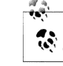

当循环复杂度为 O(n) 时，减少每次迭代的工作最为有效。建议将注意力放在减少迭代次数上。

### 减少迭代次数

即使是循环体中最快的代码，在迭代数千次后也会产生累积效应。此外，执行循环体本身会有少量的性能开销，这会增加总执行时间。因此，减少整个循环的迭代次数可以带来更大的性能收益。限制循环迭代最广为人知是一种被称为“迪夫设备”（Duff's Device）的模式。

迪夫设备是一种展开循环体的技术，使得每次迭代实际上完成了多次迭代的工作。Jeff Greenberg 被誉为第一个将迪夫设备从原始的 C 实现移植到 JavaScript 的人。一个典型的实现如下：

```javascript
//: Jeff Greenberg
var iterations = Math.floor(items.length / 8);
startAt = items.length % 8;
i = 0;
```

```javascript
do {
  switch(startAt) {
    case 0: process(items[i++]);
    case 7: process(items[i++]);
    case 6: process(items[i++]);
    case 5: process(items[i++]);
    case 4: process(items[i++]);
    case 3: process(items[i++]);
    case 2: process(items[i++]);
    case 1: process(items[i++]);
  }
  startAt = 0;
} while (--iterations);
```

迪夫设备实现的基本思想是：每次通过循环最多包含八次 `process()` 调用。循环的迭代次数通过总项目数除以 8 来决定。因为并不是所有数字都能被 8 整除，所以 `start` 变量保存余数，并指示第一次循环中将发生多少次 `process()` 调用。如果有 12 个项目，第一次循环将调用 `process()` 4 次，第二次循环将调用 `process()` 8 次，总共循环 2 次，而不是 12 次。

该算法的一个稍快一点的版本移除了 `switch` 语句，并将余数处理与主处理分离：

```javascript
//credit: Jeff Greenberg
var i = items.length % 8;
while(i){
  process(items[--i]);
}

i = Math.floor(items.length / 8);
while(i){
  process(items[--i]);
  process(items[--i]);
  process(items[--i]);
  process(items[--i]);
  process(items[--i]);
  process(items[--i]);
  process(items[--i]);
  process(items[--i]);
}
```

尽管这种实现使用了两个循环，但通过从循环体中移除 `switch` 语句，它的运行比原始版本更快。

是否值得使用迪夫设备（无论是原始版本还是修改版本），在很大程度上取决于你已经执行的迭代次数。在迭代次数少于 1000 次的情况下，与使用普通循环结构相比，性能提升可能微乎其微。然而，当迭代次数超过 1000 次，迪夫设备的效率会显著提高。例如，在 500,000 次迭代时，执行时间比普通循环减少了高达 70%。

### 基于函数的迭代

ECMA-262 第四版在原生数组对象上引入了一个新方法 `forEach()`。该方法遍历数组的成员并在每个成员上运行函数。在每个项目上运行的函数作为参数传递给 `forEach()`，并在调用时它将接收三个参数：数组项、数组的索引以及数组本身。以下是一个用法用例：

```javascript
items.forEach(function(value, index, array){
  process(value);
});
```

`forEach` 方法在 Firefox、Chrome 和 Safari 中是原生实现的。此外，大多数 JavaScript 库都有逻辑上的等价实现：

```javascript
//YUI 3
Array.each(items, function(value, index, array) {
  process(value);
}

//jQuery
Query.each(items, function(index, value) {
  process(value);
}

//Dojo
dojo.forEach(items, function(value, index, array) {
  process(value);
}

//Prototype
items.each(function(value, index) {
  process(value);
}

//MooTools
$each(items, function(value, index) {
  process(value);
}
```

尽管基于函数的迭代代表了一种更方便的迭代方法，但它比基于循环的迭代慢得多。这种变慢归因于每个数组项上额外调用方法所带来的开销。在所有情况下，基于函数的迭代耗时都是循环迭代的八倍，因此并不适用。

## 条件语句

与循环类似，条件语句决定了执行流。

### if-else 对比 switch

两者在性能上的主要区别在于，`if-else` 额外条件的增量成本比 `switch` 高。因此，在考虑性能时，我们倾向于对少量条件使用 `if-else`，对较多条件使用 `switch` 语句，这种直觉是完全正确的。

总来说，当只有两个离散值或几个数值范围需要测试时，`if-else` 是最佳选择。当需要测试的离散值多于两个时，`switch` 语句是最优选择。

大多数人认为这段代码中的 `switch` 语句比 `if-else` 语句更可读。事实证明，在大多数情况下，`switch` 语句比 `ifelse` 快，但只有在条件较多时才会显著更快。

### 优化 if-else

在优化 `if-else` 时，目标始终是在采取正确路径之前尽可能减少需要评估的条件数量。最简单的优化是确保最常见的条件放在前面。考虑以下：

```javascript
if (value < 5) {
  //执行操作
} else if (value > 5 && value < 10) {
  //执行操作
} else {
  //执行操作
}
```

这段代码仅在 `value` 频繁小于 5 时才是最优。如果 `value` 通常大于 10，那么在进入正确路径之前必须评估两个条件，这最终增加了该语句的平均时长。`if-else` 中的条件应该按照可能性从高到低排序，以确保最快的执行速度。

另一种减少条件评估的方法是将 `if-else` 组织成一系列嵌套的 `if-else` 语句。使用单一的大 `if-else` 通常会导致执行时间变慢。例如：

```javascript
if (value == 0){
  return result0;
} else if (value == 1){
  return result1;
} else if (value == 2){
  return result2;
} else if (value == 3){
  return result3;
} else if (value == 4){
  return result4;
} else if (value == 5){
  return result5;
} else if (value == 6){
  return result6;
} else if (value == 7){
  return result7;
} else if (value == 8){
  return result8;
} else if (value == 9){
  return result9;
} else {
  return result10;
}
```

使用这个 `if-else` 语句，假设 `value` 的可能值在 0 到 10 之间均匀分布，最大执行时间最大。这会减慢平均执行时间。为了最小化评估的条件数量，可以将代码重写为一系列嵌套的 `if-else` 语句，例如：

```javascript
if (value < 6) {
  if (value == 0){
    return result0;
  } else if (value == 1){
    return result1;
  } else {
    return result2;
  }
} else {
  if (value == 3){
    return result3;
  } else if (value == 4){
    return result4;
  } else {
    return result5;
  }
}

if (value < 8) {
  if (value == 6){
    return result6;
  } else {
    return result7;
  }
} else {
  if (value == 8){
    return result8;
  } else if (value == 9){
    return result9;
  } else {
    return result10;
  }
}
```

重写后的 `if-else` 语句每次执行时最多只有四次条件评估。这是通过应用类似于二分搜索的方法实现的，将可能的值分成一系列范围进行检查，然后在该部分内进行深层查找。当值在 0 到 10 之间均匀分布时，执行此代码的平均时间大约是之前 `if-else` 语句执行时间的一半。当存在需要测试的值范围时，这种方法最好（如果是离散值，通常 `switch` 语句会更合适）。

#### 查找表 (Lookup Tables)

有时处理条件分支的最佳方法是完全避免使用 `if-else` 和 `switch`。当有大量需要测试的离散值时，`if-else` 和 `switch` 的速度都远慢于使用查找表。可以使用 JavaScript 中的数组或普通对象创建查找表，从查找表中访问数据要比使用 `if-else` 或 `switch` 快得多，特别是当条件数量很大时（见图 4-1）。

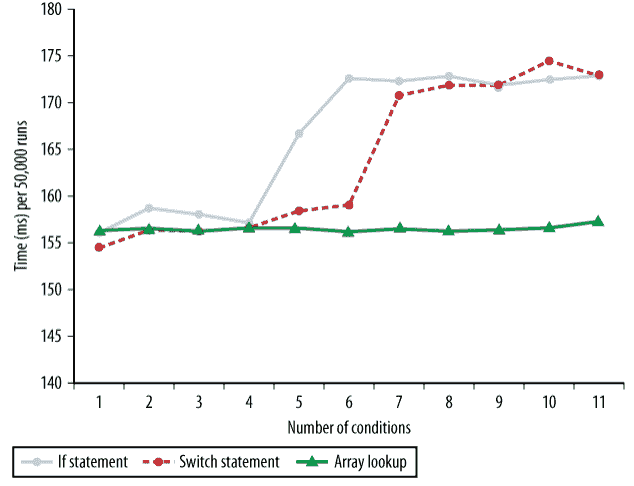

图 4-1. Internet Explorer 7 中数组项查找与使用 `if-else` 或 `switch` 的对比

查找表与 `if-else` 和 `switch` 相比非常快，当有大量需要测试的离散值时，它们还有助于提高代码的可读性。例如，`switch` 语句在变得很大时会变得非常臃肿，如下：

```javascript
switch(value){
  case 0:
    return result0;
  case 1:
    return result1;
  case 2:
    return result2;
  case 3:
    return result3;
  case 4:
    return result4;
  case 5:
    return result5;
  case 6:
    return result6;
  case 7:
    return result7;
  case 8:
    return result8;
  case 9:
    return result9;
  default:
    return result10;
}
```

这个 `switch` 语句在代码中所占据的空间可能与其重要性不成正比。整个结构可以使用使用数组作为查找表来替换：

```javascript
// 定义结果数组
var results = [result0, result1, result2, result3, result4, result5, result6, result7, result8, result9, result10]

// 返回结果
return results[value];
```

当使用查找表时，你完全消除了所有条件评估。由于没有条件评估，随着可能值的数量增加，几乎或完全没有额外开销。当存在单个键到单个值之间的逻辑映射时，查找表非常有用。当每个键需要执行特定的操作或一组操作时，`switch` 语句会更合适。

#### 递归 (Recursion)

复杂的算法通常使用递归会更简单。事实上，有些算法是天生递归的，例如阶乘计算：

```javascript
function factorial(n){
  if (n == 0){
    return 1;
  } else {
    return n * factorial(n-1);
  }
}
```

#### 调用栈限制 (Call Stack Limits)

栈溢出的最常见原因是终止条件错误，这会导致无限循环。


图 4-2. 递归栈溢出

在递归中，可以使用 `try-catch` 块来捕获这些错误，但最好是从根源上避免递归。

#### 递归模式 (Recursion Patterns)

当你遇到栈溢出时，首要步骤应该是识别任何递归的实例。有两种模式需要注意：

- 直观的模式：函数调用其自身。
- 更微妙的模式：两个函数相互调用。

```javascript
right = items.slice(middle);
return mergeSort(mergeSort(left), mergeSort(right));
```

这段归并排序代码相当简单且直观，但 `mergeSort()` 函数会被调用非常频繁。一个包含 `n` 个元素的数组会调用 `mergeSort()` `2 * n - 1` 次，这意味着如果元素超过 1,500 个，就会在 Firefox 中导致栈溢出错误（stack overflow error）。

遇到栈溢出错误并不意味着必须更改整个算法；有些人认为递归不是最好的实现方式。归并排序算法也可以使用迭代来实现，例如：

```javascript
// 使用与上一个示例相同的 mergeSort() 函数
function mergeSort(items) {
  if (items.length == 1) {
    return items;
  }
  var work = [];
  for (var i=0, len=items.length; i < len; i++) {
    work.push(items[i]);
  }
  work.push([]); // 以防元素个数为奇数
  for (var lim=len; lim > 1; lim = (lim+1)/2) {
    for (var j=0,k=0; k < lim; j++, k+=2) {
      work[j] = merge(work[k], work[k+1]);
    }
    work[j] = []; // 以防元素个数为奇数
  }
  return work[0];
}
```

这种 `mergeSort()` 的实现方式与之前的工作相同，但没有使用递归。虽然归并排序的迭代版本可能比递归版本慢一点，但它不会像递归版本那样影响调用栈。将递归算法转换为迭代算法是避免栈溢出错误的方法之一。

## 记忆化 (Memoization)

避免重复工作是最好的性能优化技术。代码执行的工作越少，执行速度就越快。基于此，避免重复工作也是有意义的。多次执行相同的任务是对执行时间的浪费。记忆化是一种通过缓存之前的计算结果以供以后重用来避免重复工作的方法，这使得记忆化成为递归算法的一种非常实用的技术。

当代码执行期间多次调用递归函数时，往往会存在大量的代码重复。在第 73 页“递归”章节引入的 `factorial()` 函数就是一个很好的例子，展示了递归函数如何多次重复执行工作。考虑以下代码：

```javascript
var fact6 = factorial(6);
var fact5 = factorial(5);
var fact4 = factorial(4);
```

这段代码产生了三个阶乘，导致 `factorial()` 函数被调用了 18 次。更糟糕的是，这段代码中的所有必要工作在第一行就已经完成了。由于 6 的阶乘等于 6 乘以 5 的阶乘， 5 的阶乘被计算了两次。更糟，4 的阶乘被计算了三次。与其每次函数调用都重新开始，不如保存这些计算结果并重用它们要合理得多。

你可以通过以下方式重写 `factorial()` 函数来利用记忆化：

```javascript
function memfactorial(n) {
  if (!memfactorial.cache) {
    memfactorial.cache = {
      "0": 1,
      "1": 1
    };
  }
  if (!memfactorial.cache.hasOwnProperty(n)) {
    memfactorial.cache[n] = n * memfactorial(n-1);
  }
  return memfactorial.cache[n];
}
```

这个记忆化版本的阶乘函数的关键在于创建一个缓存对象。它存储在函数本身上，并预填充了两个简单的阶乘：0 和 1。在计算阶乘之前，会检查此缓存以判断计算是否已经执行过。没有缓存值意味着必须进行首次计算，并将结果存储在缓存中以供以后使用。该函数用法与原始的 `factorial()` 函数相同：

```javascript
var fact6 = factorial(6);
var fact5 = factorial(5);
var fact4 = factorial(4);
```

这段代码返回了三个不同的阶乘，但对 `memfactorial()` 总共调用了八次。由于所有必要计算都在第一行完成，接下来的两行没有执行任何递归，因为直接返回了缓存值。

每个递归函数的记忆化过程可能略有不同，但通常适用的是相同的模式。为了让对函数进行记忆化变得更简单，你可以定义一个封装了基本功能的 `memoize()` 函数。例如：

```javascript
function memoize(fundamental, cache){
  cache = cache || {};
  var shell = function(arg){
    if (!cache.hasOwnProperty(arg)) {
      cache[arg] = fundamental(arg);
    }
    return cache[arg];
  };
  return shell;
}
```

这个 `memoize()` 函数接受两个参数：要记忆化的函数和一个可选的缓存对象。如果你想预填充某些值，可以传递缓存对象；否则将创建一个新的缓存对象。然后会创建一个封装了原始（基础）函数的壳函数，确保只有在以前从未计算过的情况下才计算结果。返回这个壳函数以便你可以直接调用它，如下：

```javascript
//阶乘函数
var memfactorial = memoize(factorial, { "0": 1, "1": 1 });
// 调用新函数
var fact6 = memfactorial(6);
var facts5 = memfactorial(5);
var fact4 = memfactorial(4);
```

## 总结

- 提高循环性能的最佳方法是减少每次迭代的工作量并减少迭代次数。
- 通常情况下，`switch`总是比 `if-else` 快，但并不总是最佳解决方案。
- 查找表（Lookup tables）是使用 `if-else` 进行多条件评估的快速替代方案。
- 浏览器调用栈的大小限制了 JavaScript允许执行的递归次数；栈溢出错误会阻止其余代码的执行。
- 如果遇到栈溢出错误，请将方法改为迭代算法或利用记忆化。

# 第 5 章 字符串与正则表达式

一个 HTML 表格或 XML 文档，但这种处理方式在某些浏览器中性能之差而闻名昭著。

那么，如何优化这类任务呢？首先，合并字符串有多种方法（表 5-1）。

表 5-1. 字符串拼接方法

| 方法 | 示例 |
| --- | --- |
| + 运算符 | str = "a" + "b" + "c"; |
| += 运算符 | str = "a"; str += "b"; str = "c"; |
| array.join() | str = ["a", "b", "c"].join(""); |
| string.concat() | str = "a"; str = str.concat("b", "c"); |

在拼接少量字符串时，所有这些方法都是快速的，因此对于临时使用，你应该选择最实用的方法即可。然而，随着必须合并的字符串长度和数量的增加，某些方法开始显示出它们的优势。

## 加号 (+) 和加等赋值 (+=) 运算符

这些运算符提供了拼接字符串最简单的方法。事实上，除了 IE7 及更早版本外，现代浏览器对它们进行了充分的优化，以至于你并不需要考虑其他选项。然而，有几种技术可以最大化这些运算符的效率。

首先来看一个示例。这里有一种赋值拼接后字符串的常用方法：
`str += "one" + "two";`

在评估这段代码时，会执行四个步骤：

1. 在内存中创建一个临时字符串。
2. 将拼接后的值 "onetwo" 赋值给临时字符串。
3. 将临时字符串与 `str` 的当前值拼接。
4. 将结果赋值给 `str`。

这实际上是浏览器实现此任务的一种近似，下面的代码通过使用两个独立的语句直接追加到 `str`，避免了临时字符串（列表中的第 1 和第 2 步）。这在某些浏览器中运行速度快约 10%–40%。

```javascript
str += "one";
str += "two";
```

事实上，你可以使用一条语句获得相同的性能提升，如下：
`str = str + "one" + "two";`
等同于 `str = ((str + "one") + "two");`

这避免了临时字符串，因为赋值以 `str` 为基础，每次追加一个字符串，每个中间拼接都从左向右执行。如果按不同的顺序执行拼接（例如 `str = "one" + str + "two"`），你就会失去这种优化。这是因为浏览器在合并字符串时分配内存的方式。从 IE 开始，浏览器会尝试扩展表达式中左侧字符串的内存，并简单地将第二个字符串复制到它的末尾（见图 5-1）。如果在循环中，基础字符串位于最左侧，就可以避免重复复制不断变大的基础字符串。

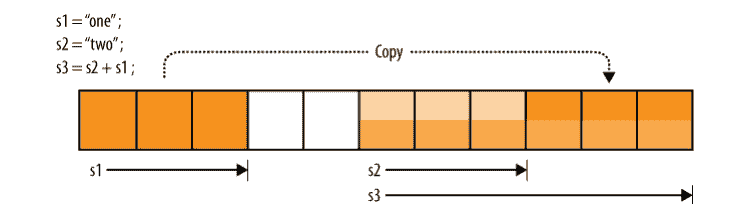

图 5-1. 拼接字符串时的内存示例：s1 被复制到 s2 的末尾以创建 s3；基础字符串 s2 未被复制

这些技术不适用于 IE。它们在 IE8 中几乎几乎没有影响，而且在 IE7 及更早版本中实际上可能会让速度变慢。这是因为 IE 在底层执行拼接的方式不同。在 IE 的实现中，拼接字符串会对组成新字符串的现有字符串部分产生更多引用。在最后时刻（当你使用拼接后的字符串时），字符串部分会被复制到一个新的“真实”字符串中，然后替换之前存储的字符串引用，这样就不需要每次使用字符串时都执行这种组装。

> IE 的实现可能会干扰合成基准测试——让拼接看起来得更快——除非你已经构建好了测试字符串。例如，可以通过对你的最终字符串调用 `toString()` 方法、检查其 `length` 属性或将其插入 DOM 中来实现。

IE7 及更早版本的拼接实现较差，每对拼接的字符串都必须被复制到新的内存位置。你将看到接下来的“数组连接”部分可能带来的巨大影响。在 IE8 之前的实现中，本节的建议可能会让速度变慢，因为在与较大的基础字符串合并之前，先拼接短字符串会更快（从而避免了多次复制大字符串）。例如，对于 `largeStr = s1 + s2`，IE7 及更早版本可能先复制大字符串，然后与 s1、s2 合并。相反，`largeStr += s1 + s2` 则先合并较小的字符串，然后将结果与大字符串拼接。创建 `s1 + s2` 的中间字符串，在性能上比复制大字符串要轻量得多。

## Firefox 与编译时折叠

当赋值表达式中拼接的所有字符串都是编译时常量时，Firefox 会在编译时自动合并它们。这里有一种看到这种效果的方法：

```javascript
function foldingDemo(){
  var str = "compile" + "time" + "folding";
  str += "this" + "works" + "too";
  str = str + "but" + "not" + "this";
}
```

```javascript
/* 在 Firefox 中，你会看到这个：
function foldingDemo(){
  var str = "completimetimefolding";
  str += "thisworkstoo";
  str = str + "but" + "not" + "this";
} /*
```

当字符串像这样折叠在一起时，运行时没有中间字符串。这在发生时很棒，但它并不经常发生，因为运行时不是编译时常量。


## 数组连接

`Array.prototype.join` 方法将数组的所有元素合并成一个字符串。通过传递空字符串作为分隔符，你可以在 IE7 及更早版本中拼接大量字符串。这比其他方法好得多。

下面的示例演示了数组连接解决的性能问题：

```javascript
var str = "I'm a thirty-character string.";
newStr = "";
appends = 5000;
while (appends--) {
  newStr += str;
}
```

这段代码拼接了 5,000 个 30 字符的字符串。图 5-2† 显示了该测试在 IE7 中花费多长时间。

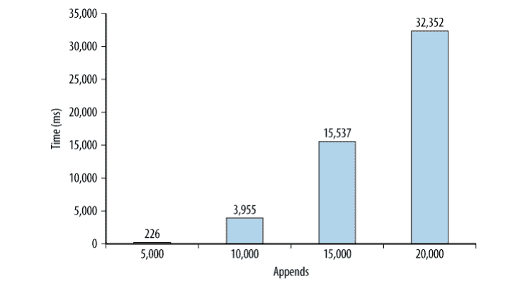

IE 的简单拼接算法要求浏览器在每次循环中都为不断大的字符串复制并分配内存。结果是平方级的时间内存消耗。消息是，所有其他现代浏览器（包括 IE8）在此测试中的性能更好，没有表现出这种致命的平方复杂度。然而，这展示了看似简单的拼接可能产生的影响；对于 5,000 次拼接耗时 226 毫秒已经是一个显著的负担，最好能尽可能减少。

现在考虑以下测试，它通过数组连接相同的字符串：

```javascript
var str = "I'm a thirty-character string";
strs = [];
appends = 5000;
while (appends--) {
  strs[strs.length] = str;
}
newStr = strs.join("");
```

图 5-3 显示了该测试在 IE7 中的运行时间。

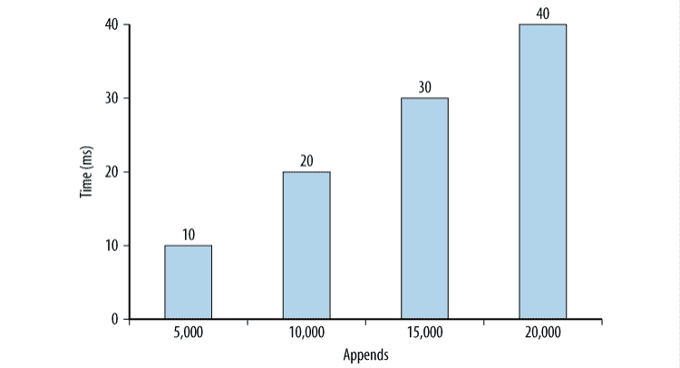

图 5-3. 在 IE7 中使用数组连接字符串的时间

这种巨大的改进源于避免了为不断大的字符串重复分配内存。在连接数组时，浏览器分配足够存储整个字符串的内存，并且对最终字符串每个部分的复制不超过一次。

> † 图 5-2 和图 5-3 中的数字是通过在配置适中的 Windows XP 虚拟机（2 GHz Core 2 Duo CPU 和 1 GB 专用内存）上运行每次测试 10 次并取平均值生成的。为了拼接 20,000 个字符串而花费 32 秒对于几乎任何应用程序来说都是不可接受的。

## String.prototype.concat

原生的 `concat` 方法接受任意数量的参数，并将每个参数追加到调用该方法的字符串上。这是拼接字符串最灵活的方法，因为你可以可以使用它来追加单个字符串、一次几个字符串，或者整个字符串数组。

```javascript
// 拼接字符串
str = str.concat(s1);
// 拼接三个字符串
str = str.concat(s1, s2, s3);
// 使用数组作为参数列表，拼接数组中的每个字符串
str = String.prototype.concat.apply(str, array);
```

遗憾的是，在大多数情况下，`concat` 的速度都比 `+` 和 `+=` 运算符慢，而且在 IE、Opera 和 Chrome 中速度会慢得多。此外，尽管使用 `concat` 来合并数组中的所有字符串类似于之前讨论的数组连接方法，但它的速度通常更慢（Opera 除外），并且在 IE7 及更早版本中构建大字符串时，会遇到与 `+` 和 `+=` 相同的潜在灾难性性能问题。

## 正则表达式优化

编写不当的正则表达式可能成为主要的性能瓶颈（接下来的第 91 页“失控回溯”章节包含了几个示例，展示了这种情况可能有多严重，但你可以采取很多措施来提高正则表达式的效率）。仅仅因为两个正则表达式匹配相同的文本，并不意味着它们匹配的速度相同。

许多因素会影响正则表达式的效率。首先，正则表达式的应用会产生巨大差异，因为正则表达式在部分匹配上花费的时间比在明显的非匹配上花费的时间得多。每个浏览器的正则表达式引擎也有不同的优化。‡

正则表达式优化是一个相当宽泛且细致的话题。本节涵盖的内容有限，但在你理解影响正则表达式性能的各种问题以及掌握编写正则表达式艺术的道路上，你应该关注以下内容。

请注意，本节假设你已经具有某些正则表达式的经验，并且对如何让它们运行更快感兴趣。如果你是表达式的新手，或者需要温习基础知识，网络和纸质书籍中都有大量资源。Jan Goyerts 和 Steven Leviathan（就是我！）编写的《正则表达式实战》（O'Reilly 出）是为喜欢在做中学习的人编写的，同样涵盖了 JavaScript 以及其他几种编程语言。

> ‡ 这种结果是，一个看似不足道的改变可能会让正则表达式在某个浏览器中变快，而在另一个浏览器中变慢。

### 正则表达式是如何运作的

为了高效地使用正则表达式，理解它们是如何发挥魔力的非常重要。以下是正则表达式所经历的基本步骤的快速概述：

#### 步骤 1：编译

当你创建一个正则表达式对象（使用正则表达式字面量或 `RegExp` 构造函数）时，浏览器会检查你的模式是否有错误，并将其转换为用于执行匹配的原生代码程序。如果你将正则表达式赋值给变量，可以避免对给定模式多次执行此步骤。

#### 步骤 2：设置起始位置

当正则表达式被使用时，第一步是确定目标字符串中搜索应该开始的位置。初始位置是字符串的开头或由正则表达式的 `lastIndex` 属性指定的位置，但当从步骤 4 返回（由于匹配失败）时，位置将是上一次开始位置的下一个字符。

浏览器在构建正则表达式引擎时内置的优化可以通过决定跳过某些工作，从而在这一阶段避免大量不必要的工作。例如，如果正则表达式以 `^` 开头，IE 和 Chrome 通常可以判断字符串开头之后无法找到匹配，从而避免愚蠢地搜索后续位置。另一个例子是，如果可能的匹配项第三个字符包含 `x`，智能的实现可能确定这一点，快速搜索下一个 `x`，并将起始位置设为找到处回溯两个字符（例如，最近版本的 Chrome 包含了此优化）。

#### 步骤 3：匹配每个正则标记（token）

一旦正则表达式知道了从何处开始，它就会遍历文本并返回正则表达式模式。当某个特定标记匹配失败时，正则表达式会尝试回溯到匹配尝试中的较早点，并尝试通过正则表达式的路径路径。

#### 步骤 4：成功或失败

如果在字符串的当前位置找到了匹配项，则正则表达式宣告成功。如果正则表达式中的所有可能路径都已尝试过，但未找到匹配项，则正则表达式引擎将返回步骤 2，在字符串的下一个字符处重新尝试。只有当此循环对字符串中的每个字符（以及最后一个字符之后的位置）都完成且没有找到任何匹配项后，正则表达式才会宣告整体失败。

> 正则表达式的 `lastIndex` 属性值会被 `exec` 和 `test` 方法用作搜索起始位置，但仅当正则表达式是用带有 `/g`（全局）标志构建时有效。非全局正则表达式以及任何传递给 `match`、`replace`、`search` 和 `split` 方法的正则表达式始终会在目标字符串的开头初始化搜索。

记住这个过程将有助于你对影响正则表达式性能的问题类型做出明智的决策。接下来将深入研究步骤 3 中匹配过程的一个关键特征：回溯。

## 理解回溯

在现代正则表达式实现中（包括 JavaScript 要求的实现），回溯是匹配过程的一个基础组件。它也是让正则表达式如此具有表现力和强大的重要原因之一。然而，回溯的计算开销很大，如果你不小心，分支很容易失控。虽然回溯只是整体性能方程的一部分，但理解它是如何工作的以及如何尽量减少它的使用，可能是编写高效正则表达式最重要的关键。接下来的几节将详细介绍这一主题。

当正则表达式处理目标字符串时，它通过从左到右遍历正则表达式的组件，测试在每个位置是否可以找到匹配。对于每个量词和分支，都必须就如何继续做出决定。对于量词（如 `*`、`+` 或 `{n}`），正则表达式必须决定何时尝试额外的字符。

### 分支与回溯

这是一个展示这种机制如何分支运作的示例：
`/(ello|apply) hippo!.test("hello there, happy hippo");`

这个正则表达式匹配 "hello hippo" 或 "happy hippo"。它首先搜索 h，在第一个字符处就找到了。接下来，子表达式 `(ello|apply)` 提供了两种继续的方法。分支总是从左到右工作，并检查 `ello` 是否匹配字符串中的后续字符。它匹配了，正则表达式也匹配空格字符。在这一点，它遇到了死胡同，因为 `hippo` 中的 h 无法匹配接下来的 t。然而，正则表达式还没有放弃，因为它已经尝试了所有选项，所以它回溯到上一个决策点（匹配领先 h 之后），并尝试第二个分支选项。这不起通，由于没有更多选项可以尝试，正则表达式判断从字符串第一个字符开始无法匹配，并移动到第二个字符再次尝试。它在那里没有找到 h，因此一直持续到第 14 个字符，那里匹配了 "happy" 中的 h。然后它遍历分支。这次 `ello` 没有匹配，但在回溯并尝试第二个分支后，它能够继续直到匹配整个字符串 "happy hippo"（见图 5-4）。

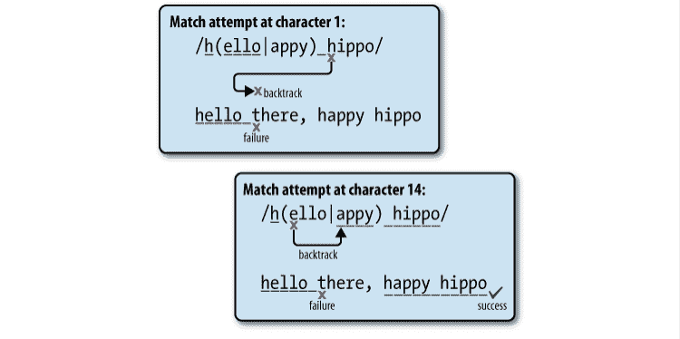

图 5-4 分支回溯示例

### 重复与回溯

这个示例展示了回溯如何与重复量词运作。

```javascript
var str = "Para 1.</p> + " +
" + " +
"<p>Para 2.</p> + " +
"<div>Div.</div>";
</p>\</p>/i.test(str);
```

在这里，正则表达式首先匹配字符串开头的字面字符 `<p>`。接下来是 `*`。点匹配换行符以外的任何字符，贪婪星号重复它零或多次——尽可能多地。由于目标字符串中没有换行符，它吞噬了整个字符串！正则表达式模式中还有需要匹配的内容，因此正则表达式尝试匹配 `<`。这在字符串末尾无法实现，因此正则表达式一个字符一个字符地回溯，不断尝试匹配 `<`，直到它回到 `<div>` 标签开头的 `<`。然后它尝试匹配 `\\`（一个经过转义的反斜杠），这匹配成功了，紧接着是 `p`，但匹配失败了。正则表达式再次回溯，重复此过程，直到它最终匹配到第二个段落结尾的 `<p>`。匹配成功返回，跨度从第一个段落的开始到最后一段的结束，这可能不是你想要的。

你可以通过将贪婪量化符替换为懒惰（也称为非贪婪）的 `?` 来更改正则表达式以匹配单个段落。懒惰量化符的回溯工作是相反的。当正则表达式 `<.*?>` 遇到 `<*` 时，它首先尝试跳过这种含义并继续匹配 `</p>`。它之所以这样做是因为 `*` 可以重复零或多次，且次数尽可能少，而它能重复的最少次数是零。然而，当后续内容无法匹配字符串中的该点时，正则表达式会回溯并尝试匹配最少数量字符：一个。它继续向前回溯，直到量化符后面的 `</p>` 能够匹配第一个段落的结尾。

你可以看到，即使目标字符串中只有一个段落，因此正则表达式的贪婪版本和懒惰版本是等价的，它们寻找匹配的方式不同（见图 5-5）。

## 逃逸回溯 (Runaway Backtracking)

当正则表达式让你的浏览器卡顿几秒、几分钟或更久时，问题可能是糟糕的逃逸回溯。为了演示这个问题，请考虑以下正则表达式，它设计用于匹配整个 HTML 文件。该正则表达式跨多行编写以适应页面。与其他正则表达式标志不同，JavaScript 没有匹配包括换行符在内的任意字符（点号）的选项，因此此示例使用 `[\S]*` 来匹配任何字符。

```html
<html>[\S]*?<head>[\S]*?<title>[\S]*?</title>[\S]*?</head>
[\S]*?<body>[\S]*?</body>[\S]*?</html>
```

这个正则表达式在匹配合适的 HTML 字符串时有效，但当字符串缺少多一个必需标签时，它就会变得糟糕。最后一个 `[\S]*` 会扩展到字符串末尾，因为找不到 `<html>` 标签，然后，正则表达式并没有放弃，而是看到了之前的每个 `[\S]*` 序列记录的回溯位置，允许它们进一步扩展。正则表达式继续扩展倒数第二个 `[\S]*`——使用它回溯以匹配之前被正则表达式中字面量模式 `</body>` 匹配过的 `</body>` 标签——并继续扩展寻找第二个 `</body>` 直到到达末尾。当所有这些都失败时，倒数第三个 `[\S]*` 会扩展到末尾的...

目标字符串：
`<p> Para 1. </p>`

贪婪量化符：
`</p>.*</p>/i`

| 步骤 | 匹配 |
| :--- | :--- |
| 1 | < |
| 2 | <p |
| 3 | <p |
| 4 | <p>Para 1. </p> |
| 5 | <p>Para 1. </p> [回溯] |
| 6 | <p>Para 1. </p> |
| 7 | <p>Para 1. </p> [回溯] |
| 8 | <p>Para 1. </p> |
| 9 | <p>Para 1. 1. [回溯] |
| 10 | <p>Para 1. 1. |
| 11 | <p>Para 1. 1. [回溯] |
| 12 | <p>Para 1. 1. |
| 13 | <p>Para 1. 1. |
| 14 | <p>Para 1. 1.< |
| 15 | <p>Para 1. 1. |
| 16 | <p>Para 1. 1.</p> ✓ 成功 |

在 16 步内找到匹配。

懒惰量化符：
`<p>.*</p>/i`

| 步骤 | 匹配 |
| :--- | :--- |
| 1 | < |
| 2 | <p |
| 3 | <p |
| 4 | <p> [零长度匹配] |
| 5 | <p> [回溯] |
| 6 | <p>P |
| 7 | <p>P [回溯] |
| 8 | <p>Pa |
| 9 | <p>Pa [回溯] |
| 10 | <p>Par |
| 11 | <p>Par [回溯] |
| 12 | <p>Par |
| 13 | <p>Par [回溯] |
| 14 | <p>Par< |
| 15 | <p>Par |
| 16 | <p>Par 1 |
| 17 | <p>Par 1 [回溯] |
| 18 | <p>Par 1. |
| 19 | <p>Par 1.< |
| 20 | <p>Par 1. / |
| 21 | <p>Par 1. 1. |
| 22 | <p>Par 1. 1. </p> ✓ 成功 |

在 22 步内找到匹配。


## 尽可能具体 (Be specific)

解决此问题的办法是尽可能具体，通过将贪婪量化符替换为懒惰的 `.*?`。懒惰量化符的回溯工作是相反的。`*` 可以重复零或多次，次数尽可能少，而它能重复的最少次数是零。然而，当后续内容无法匹配字符串中的该点时，正则表达式回溯并尝试匹配最少数量字符：一个。它继续向前回溯，直到量化符后面的 `</p>` 能够匹配第一个段落的结尾。

你可以看到，即使目标字符串中只有一个段落，因此正则表达式的贪婪版本和懒惰版本是等价的，它们寻找匹配的方式不同（见图 5-5）。

可能不那么明显的是这种变化可能导致的负面后果。如果正则表达式匹配了起始字符 `<`，但后面没有后续的 `>` 来允许匹配成功完成，那么失控的回溯（runaway backtracking）就会进入高速运转状态，因为新的量符有无数种方式与外部量符（紧随非捕获分组之后）组合，以匹配 `<` 之后的文本。正则表达式在放弃匹配目标之前，必须尝试所有这些排列组合。小心！

祸上加灾。对于更极端的嵌套量符，请将正则表达式 `/(A+)*B/` 应用于仅包含 A 的字符串。虽然这个正则写为 `/AA+B/`，但为了讨论起见，假设这两个 A 代表能够匹配某些字符串的不同模式。

当它应用于一个由 10 个 A 组成的字符串（"AAAAAAAAAA"）时，正则表达式会回溯一个字符，让第二个 `A+` 匹配所有 10 个字符。接着分组尝试重复，但由于已经没有更多的 A 了，且组的量符已满足了至少匹配一次的要求，正则表达式将开始寻找 `B`。它没有找到 `B`，但还没有停止，因为正则中还有更多未经过的路径。如果第一个 `A+` 匹配了八个字符而第二个匹配了两个呢？或者如果前三个字符中，第二个匹配了两个，且重复了两次呢？如果在组的第一次重复中，第一个 `A+` 匹配了两个字符，第二个匹配了三个；然后在第二次重复中，第一个和第二个各匹配了四个？虽然对你我来说，认为任何程度的回溯都能产生缺失的 `B` 显然是愚蠢的，但正则表达式会尽职地检查所有这些量符和选项。该正则表达式的最坏情况复杂度是惊人的 $O(2^n)$，即 2 的 n 次方，其中 n 是字符串的长度。在这里使用的 10 个 A 需要 1024 次回溯步骤匹配才会失败，而 20 个 A 则会让 Chrome、IE、Firefox 和 Opera 挂起至少10 分钟（如果不是永久挂起），因为它们需要处理 340 亿次回溯步骤以使正则的排列组合失效。例外是最近版本的 Safari，它能够检测到正则表达式正在循环并迅速中止匹配（Safari 还会设置允许的回溯步骤上限，并在超过上限时中止匹配）。

防止此类问题的关键是确保正则表达式的两个部分不会匹配字符串的同一部分。对于这个正则表达式，修复方法将其重写为 `/AA+B/`，但对于复杂的正则，这个问题可能难以避免。使用原子组也能达到效果，尽管其他可能的解决方案可能会让你的正则表达式更容易理解。这样做的正则看起来像 `/(?=(A+))\2+B/`，它完全消除了回溯问题。

## 关于基准测试的说明

由于正则表达式的性能取决于其应用的文本，因此没有简单的方法对正则表达式之间进行基准测试。为了获得最佳结果，你需要在不同长度的匹配、不匹配以及几乎匹配的测试字符串上对正则表达式进行测试。

这就是本章详尽介绍回溯的原因之一。如果没有对回溯的深入理解，将无法预测和识别与回溯相关的问题。为了帮助你及早发现失控的回溯，请始终使用包含部分匹配的长字符串测试正则表达式。思考你的正则表达式无法完全匹配的字符串类型，并将它们包含在测试中。

## 提高正则表达式效率的更多方法

以下是各种额外的正则效率技术。这里的几点在之前的回溯讨论中提到过。

### 关注更快的失败

缓慢的正则处理通常是由失败缓慢而非匹配缓慢引起的。这一点由于以下事实变得：如果你使用正则来匹配大字符串中的小部分，正则失败的位置次数会比成功的位置次数多得多。一个让正则变快但让失败变慢的改变（例如增加尝试所有正则排列所需的回溯步骤）通常是得不偿失的买卖。

### 以简单的、必须的标记开始正则

理想情况下，正则开头的标记应该是易于测试的，并尽可能排除许多明显不匹配的位置。用于此目的的良好起始标记是锚点（`^` 或 `$`）、特定字符（例如 `x` 或 `\u263a`）、字符类（例如 `[a-z]`）或简写（`\w`），以及单词边界（`\b`）。如果可能，以分组或可选标记、以及顶层选择逻辑（如 `/one/|two/`）开始正则，将强制正则捕获多个开头标记。Firefox 对开头标记上使用任何量符都很敏感，最好对其进行优化，例如 `\s*+` 或 `{1}`。其他浏览器会优化掉这些差异。

### 使限定模式及其后续标记具有互斥性

当相邻标记或子表达式中的字符能够匹配重叠时，正则尝试在它们之间划分文本的方式就会增加。为了避免这种情况，请让你的模式尽可能具体。当你真正意思是 `[^\r\n]*` 时，不要使用 `*?`。

### 减少选择逻辑的数量和范围

使用垂直竖线 `|` 的选择逻辑可能需要在字符串的每个位置都测试所有选择选项。你可以使用字符类和可选组件来减少对选择的需求，或者通过将选择逻辑推回正则内部（允许在到达选择逻辑之前某些匹配尝试失败）。下表显示了这些技术的示例。

| 取代以下内容 | 使用以下内容 |
|---|---|
| cat\|bat | [cb]at |
| red\|read | [ad]? |
| .\|\n | (?:.)? |
| \s*+ | \s{1} |

### 暴露必须的标记

为了让正则引擎对如何优化做出明智决策，请尽量易于确定哪些标记是必须的。当标记用于子表达式或选择逻辑时，正则引擎很难判断它们是否是必须的，有些甚至不会为此费力。例如，正则 `/^ab|cd/` 暴露了它的字符串起始锚点。IE 和 Chrome 看到此并防止正则在字符串开始后尝试寻找匹配，使得无论字符串长度如何这都是瞬间完成的。然而，由于等效正则 `/(ab|cd)/` 没有暴露它的 `^`，IE 不应用相同的优化，最终会无意义地在每个位置搜索匹配。

### 使用分组

捕获分组会消耗时间和内存。如果你不需要反向引用，请使用非捕获分组 `(?:)`。有些人做得过头，使用了正则缓存方案，旨在避免对给定的模式和标志组合进行多次编译。正则编译非常快，此类方案增加的开销可能大于它们规避的开销。重要的是避免在循环中重复编译正则表达式。换句话说，不要这样做：

```javascript
while (/regex1/.test(str1)) {
  /regex2/.exec(str2);
}
```

改为这样做：

```javascript
var regex1 = /regex1/
      regex2 = /regex2/
while (regex1.test(str1)) {
  regex2.exec(str2);
}
```

### 使用适当的量符

如前文“重复与回溯”节所述，贪婪和懒惰量符都会尝试寻找匹配，即使它们匹配的是相同的字符串。在已经正确的情况下，使用更高效的量符（基于预期的回溯量）可以显著提高性能，特别是对于长字符串。懒惰量符在 Opera 9.x 及更早版本中特别别慢，但 Opera 10 解决了此问题。

### 将复杂的正则拆分为更简单的部分

尽力避免在一个正则表达式中做太多工作。需要条件逻辑的复杂问题在拆分为两个或多个正则表达式时更容易解决，且通常更高效，每个正则在上一个正则的匹配结果内进行搜索。在一个模式中完成所有工作的正则巨兽难以维护，并且容易产生与回溯相关的问题。

## 何时不使用正则表达式

当谨慎使用时，正则表达式非常快。然而，当你仅仅在搜索字面量字符串时，它们通常是大材小用。如果你预先知道要测试字符串的哪部分，这一点尤为如此。例如，如果你想检查一个字符串是否以分号结尾；你可以使用类似下面的代码：

```javascript
endsWithSemicolon = /\;$/.test(str);
```

不过，你可能会惊讶地发现，目前没有任何主流浏览器足够智能到能够预先意识到这个正则表达式只能匹配字符串的末尾。它们所做的是遍历整个字符串。每当发现分号时，正则表达式移动到下一个标记（$），该标记检查匹配项是否在字符串末尾。如果不是，正则表达式将继续搜索匹配，直到遍历完整个字符串。字符串越长（包含的分号越多），耗费的时间就越长。

在这种情况下，更好的方法是跳过正则表达式所需的中间步骤，简单地检查最后一个字符是否为分号：

```javascript
endsWithSemicolon = str.charAt(str.length - 1) == ";";
```

对于小型目标字符串，这种方法比基于正则表达式的测试快一点，但更重要的是，字符串的长度不再影响执行测试所需的时间。

此示例使用了 `charAt` 方法读取特定位置的字符。当你想要提取并检查特定位置的多个字符的值时，`String slice`、`substr` 和 `substring` 效果良好。此外，`indexOf` 和 `lastIndexOf` 方法对于查找字面量字符串的位置或检查它们是否存在非常有用。所有这些字符串方法都是快速的，可以帮助你在搜索不依赖高级正则特性的字面量字符串时，避免调用正则表达式的开销。

## 字符串修剪（String Trimming）

移除字符串开头和结尾的空白是一个简单但常见的任务。尽管 ECMAScript 5 添加了原生的 `trim` 方法（因此你应该开始在后续的浏览器中使用它），但 JavaScript 在历史上并没有包含它。对于目前的浏览器兼容性，仍然需要自己实现一个 `trim` 方法，或者依赖包含该方法的库。

修剪并不是常见的性能瓶颈，但它可以作为正则表达式优化的一个很好的案例，因为有多种实现方式。

### 使用正则表达式进行修剪

正则表达式允许你用极少的代码实现 `trim` 方法，这对于关注文件大小的 JavaScript 库非常重要。可能最好的通用解决方案是使用两次替换——一次用于移除开头空白，另一个用于移除结尾空白。这保持了操作的简单快速，特别是处理长字符串时。

```javascript
if (!String.prototype.trim) {
  String.prototype.trim = function() {
    return this.replace(/^\s+/, "").replace(/\s+$/, "");
  }
}
```

```javascript
// 测试新方法...
// 制表符 (t) 和换行符 (\n) 字符
// 被包含在开头空白中。
var str = "\n\n test string";
str.trim();
alert("test string"); alert("true");
```

此代码块会在 `trim` 方法已存在时对其进行覆盖，因为原生方法经过了优化，通常比你使用 JavaScript 函数自己手实现的任何方法都要快。后续的实现假设此条件已满足，尽管此处没有明确写出来。

通过将 `\s*$`（第二个正则）替换为 `\s*$`，你可以获得 Firefox 大约 35% 的性能提升（取决于目标字符串的长度和内容）。虽然这两个正则表达式在功能上是等价的，但 Firefox 对以非量化标记开头的正则表达式提供了额外的优化。在其他浏览器中，这种变化不显著，或者方向不同。然而，将匹配字符串开头的正则表达式更改为 `^\s*` 并不会产生可衡量的差异，因为开头的 `^` 锚点可以快速使匹配位置失效（防止了性能差异在长字符串的数千次匹配中产生累积）。

以下是几种基于正则表达式的 `trim` 实现，这些是你可能会遇到的一些常见替代方案。你可以在本节末尾的表 5-2 中看到这里描述的所有 `trim` 实现的跨浏览器性能数据。事实上，除了列出的这些之外，还有许多方法可以编写正则表达式来帮助修剪字符串，但这些方法总是比使用两个处理字符串的简单替换要慢（或者至少跨浏览器表现没那么好）。

```javascript
// trim 2
String.prototype.trim = function() {
  return this.replace(/^\s+|\s+$/g, "");
}
```

这可能是最常见的解决方案。它通过选择分支逻辑（alternation）将两个简单的正则结合起来，使用 `/g`（全局）标志替换所有匹配项而不仅仅是第一个（当目标同时包含开头和结尾空白时，它会匹配两次）。

> 在 Firefox 版本 2, 3 和 3.5 中测试过。

这虽然不是一个糟糕的方法，但在处理长字符串时比使用两个简单的替换要慢，因为两个分支选项需要在每个字符位置上进行测试。

```javascript
// trim 3
String.prototype.trim = function() {
  return this.replace(/^\s*([\s\S]*?)\s*$/, "$1");
}
```

这个正则表达式通过匹配整个字符串并捕获从第一个到最后一个空白字符（任意字符）的序列进行反引用来工作。通过将整个字符串替换为反引用 1，你就得到了一个修剪后的字符串。

这种方法在概念上是简单的，但捕获组内部的懒性量化（即回溯）导致在处理长字符串时往往很慢。正则表达式一次匹配一个字符，因为内部组是懒性量化的。因此，这在 Opera 9 中要慢得多。

```javascript
// trim 4
String.prototype.trim = function() {
  return this.replace(/^\s*([\s\S]*?)\s*$/, "$1");
}
```

这是一个相对常见的方法，但由于内部组是懒性量化的，没有理由使用它。

```javascript
// trim 5
String.prototype.trim = function() {
  return this.replace(/^\s*([\s\S]*)\s*$/g, "$1");
}
```

修剪字符串时性能可能会明显，但对于长字符串，这可能会变成性能问题。将内部组改为非捕获组——即将 `(\S+)` 更改为 `(?:\S+)`——在 IE 和 Chrome 中可以 20%-45% 的时间，在 Safari 和 Firefox 中也有改进。尽管如此，外部组无法转换为非捕获组，因为它在替换字符串中被引用。

### 不使用正则表达式修剪

尽管正则表达式很快，但值得考虑不使用它们进行修剪的性能。这里有一种方法：

```javascript
// trim s
String.prototype.trim = function() {
  var start = 0,
  end = this.length - 1,
  ws = "\r\n\t\v\u1680\u180e\u2000\u2001\u2002\u2003\u2004\u2005\u2006\u2007\u2008\u2009\u200a\u200b\u200c\u200f\u202f\u3000\ufeff";
  while (ws.indexOf(this.charAt(start)) > -1) {
    start++;
  }
  while (end > start && ws.indexOf(this.charAt(end)) > -1) {
    end--;
  }
  return this.slice(start, end + 1);
}
```

该 `var` 代码包含了 ECMAScript 5 定义的所有空白字符。为了效率考虑，在确定修剪字符串的起始和结束位置之前，避免了复制字符串的任何部分。

事实证明当字符串末端只有少量空白时，这种方法完胜正则表达式。是因为尽管正则表达式非常适合对于移除字符串开头的空白字符，它们的速度没有从长字符串末尾修剪那么快。正如“何时不该使用正则表达式”节所述，正则表达式无法在不逐一考虑字符的情况下跳转到字符串末尾。然而，这种实现确实做到了这一点，第二个 `while` 循环从字符串末尾向后遍历，直到找到空白字符。

尽管这个版本不受字符串总长度的影响，但它也有自己的弱点：长长的开头和结尾空白字符。这是因为遍历字符来检查它们是否为空白的效率无法匹配正则表达式优化搜索代码的效率。

### 混合解决方案

本节的最终方法是将正则表达式在修剪空白字符方面的通用效率与非正则表达式在修剪结尾字符方面的速度相结合。

```javascript
// trim 7
String.prototype.trim = function() {
  var str = this.replace(/^\s+/, "");
  end = str.length - 1,
  ws = /\s$/;
  while (ws.test(str.charAt(end))) {
    end--;
  }
  return str.slice(0, end + 1);
};
```


这种方法在仅修剪少量空白时仍然保持极快的速度，并消除了具有长空白和全空白字符串的性能风险（尽管它对具有长结尾空白的字符串仍有此缺陷）。请注意，此解决方案在循环中使用正则表达式来检查字符串末尾字符是否为空白。虽然使用正则表达式会增加一点开销，但为了简洁和兼容性，它可以让你将空白字符列表交给浏览器处理。

这里描述的所有修剪 `trim` 方法的总体趋势是：在基于正则表达式的解决方案中，字符串总长度的影响比待修剪字符的数量大；而从字符串末尾向后处理的非正则表达式解决方案不受总长度影响，但受修剪空白数量的影响更为显著。使用两个正则表达式替换的简单方法在不同的字符串内容和长度下提供了良好的跨浏览器性能，因此这可能是最好的全方位解决方案。混合解决方案在处理长字符串时异常快速，但代价是代码稍长，并且在某些浏览器中处理长结尾空白时存在弱点。详情请见表 5-2。

### 字符串修剪 | 103

#### 表 5-2. 各种 trim 实现的跨浏览器性能

| 浏览器 | 时间 (ms)ᵇ | Trim 1ᵇ | Trim 2 | Trim 3 | Trim 4 | Trim 5ᶜ | Trim 6 | Trim 7 |
|---|---|---|---|---|---|---|---|---|
| IE 7 | | 80/80 | 315/312 | 547/539 | 36/42 | 218/224 | 14/1015 | 18/409 |
| IE 8 | | 70/70 | 252/256 | 512/425 | 36/20 | 216/222 | 4/334 | 12/205 |
| Firefox | | 136/143 | 164/174 | 650/600 | 1098/1525 | 1416/1488 | 21/151 | 20/144 |
| Firefox 3.5 | | 130/140 | 157/172 | 500/510 | 1004/1437 | 1344/1394 | 21/332 | 18/50 |
| Safari 2.3 | | 253/253 | 424/425 | 351/359 | 27/29 | 541/554 | 2/140 | 5/80 |
| Safari 4 | | 37/37 | 63/68 | 32/33 | 510/514 | <0.5/24 | 4/18 |
| Opera 9 | | 494/517 | 731/748 | 906/960 | 901/955 | 1953/2016 | <0.5/210 | 20/241 |
| Opera 10 | | 75/75 | 94/100 | 360/370 | 46/46 | 514/514 | 2/186 | 12/198 |
| Chrome 2 | | 78/78 | 66/68 | 100/101 | 59/59 | 140/142 | 1/37 | 24/55 |

ᵇ 报告的时间是通过对一个大字符串（40 KB）进行 100 次 `trim` 的，首先在两端分别添加 10 和 1000 个空格。
ᵃ 测试时未使用 `/\s\s\s*/+`。
ᶜ 测试时未使用非捕获组优化。

## 总结

密集的字符串操作和编写不当的正则表达式可能是主要的性能障碍，但本章的建议帮助你避免常见的陷阱。

- 混合解决方案在处理长字符串时异常快速，但代价是代码稍长，并且在某些浏览器中处理长结尾空白时存在弱点。
- 这里描述的所有 `trim` 方法的总体趋势是：在基于正则表达式的解决方案中，字符串总长度的影响比待修剪字符的数量大；而从字符串末尾向后处理的非正则表达式解决方案不受总长度影响，但受修剪空白数量的影响更为显著。
- 使用两个正则表达式替换的简单方法在不同的字符串内容和长度下提供了良好的跨浏览器性能，因此这可能是最好的全方位解决方案。

---

在 JavaScript 执行期间，为 UI 线程排队任务，这意味着必须尽可能地完成 JavaScript 任务，以免对用户体验产生不利影响。

# 浏览器限制

浏览器对 JavaScript 执行的时间设置了限制。这种限制是必要的，可以确保恶意代码人员通过执行无休止的密集操作来锁定用户的浏览器或计算机。有两种此类限制：调用堆栈限制（在第 4 节讨论）和长时间运行脚本限制。长时间脚本限制有时被称为长时间运行脚本计时器或逃逸脚本计时器，但基本思想是浏览器会跟踪脚本运行了多久，一旦达到特定限制就会将其停止。当达到限制时，会向用户显示一个对话框，如图 6-2 所示。


图 6-2. 当执行超过 500 万条语句时，会显示 Internet Explorer 的长时间运行脚本警告对话框

测量脚本执行时长的方法有两种。第一种是跟踪自脚本开始以来执行了多少条语句。这种方法意味着脚本在不同机器上的运行时间可能不同，可用内存和 CPU 速度会影响执行单条语句的时间。第二种方法是跟踪脚本执行的总时间。在给定时间内可以处理的脚本量也根据用户的机器能力而异，但脚本总会在设定的时间后被停止。不意外的是，每个浏览器检测长时间运行脚本的方法略有不同。

- Internet Explorer 从第 4 版本开始设置了 500 万条语句的默认限制；此限制存储在 Windows 注册表设置中：`HKEY_CURRENT_USERS\Software\Microsoft\InternetExplorer\Styles\MaxScriptStatements`。
- Firefox 的默认限制为 10 秒；此限制存储在浏览器配置设置中（通过在地址栏输入 `about:config`），作为 `dom.max_script_run_time` 键。
- Safari 的默认限制为 5 秒；此设置无法更改，但你可以通过启用“开发”菜单并选择“禁用逃逸 JavaScript 计时器”来禁用计时器。
- Chrome 没有独立的长时间运行脚本限制，而是依靠其通用崩溃检测系统来处理此类情况。
- Opera 没有长时间运行脚本限制，它将继续执行 JavaScript 代码直到完成；尽管，根据 Opera 的架构，这在执行完成之前不会导致系统不稳定。

当达到浏览器的长时间运行脚本限制时，无论页面上是否有任何错误处理代码，都会向用户显示对话框。这是一个重大的可用性问题，因为大多数互联网用户在技术上并不精通，因此会对错误消息的性质以及哪种选项（停止脚本或允许其继续）是合适的感到困惑。

如果脚本在任何浏览器中触发此对话框，意味着脚本执行时间太长，无法完成任务。它表明在 JavaScript 代码继续执行时，用户的浏览器对输入已无响应。从开发者的角度来看，没有办法从长时间运行脚本对话框的出现中恢复；你无法检测，因此无法调整由此可能产生的任何问题。显然，处理长时间运行脚本限制的最佳方法是从一开始就避免它们。

## 多久才算长？

仅仅因为浏览器允许脚本继续执行几秒钟，并不意味着你应该允许它这样做。事实上，为了创造良好的用户体验，你的 JavaScript 代码连续执行的时间应该要短得多。JavaScript 的创建者 Brendan Eich 曾被引用说过：“[JavaScript] 执行整好几秒钟可能可能出了什么问题……”

如果几秒钟对于 JavaScript 执行来说太长了，那么合适的时间是多少呢？事实证明，即使是一秒钟对于脚本执行来说也太长。单个 JavaScript 操作应该花费的总时间（最大为 100 毫秒）。这个数字来自 Robert Miller 在 1968 年的研究。

- * Miller, R. B., “Response time in man-computer conversational transactions,” Proc. AFIPS Fall Joint Conference, Vol. 33 (1968), 267–277. 可访问 http://portal.acm.org/citation.cfm?id=1476589.1476628.*
- † 可在线访问 www.useit.com/papers/responsetime.html。

### 110 | 第 6 节：响应式界面

Usability Engineering (Morgan Kaufmann, 1994) 可用性专家 Jakob Nielsen 在他的书《Usability Engineering》中指出，这个数字随着时间的推移并没有改变，事实上，它在 1991 年 Xerox-PARC 的研究中得到了证实。

Nielsen 表示，如果界面在 100 毫秒内响应用户输入，用户会觉得他正在“直接操作用户界面中的对象”。任何超过 100 毫秒的时间都意味着用户感到与界面脱节。如果当 JavaScript 执行期间 UI 无法更新，如果执行时间超过 100 毫秒，用户就无法感到控制了界面。

进一步的复杂之处在于，某些浏览器在 JavaScript 执行期间不会为新的 UI 更新排队。例如，如果你在 JavaScript 执行期间点击新的 UI 更新，如果执行时间超过 100 毫秒，用户就无法感到控制了界面。

```javascript
var button = document.getElementById("my-button");

button.onclick = function() {
  oneMethod();
  setTimeout(function() {
    document.getElementById("notice").style.color = "red";
  }, 50);
  anotherMethod();
};
```

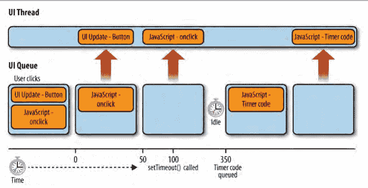

图 6-3. `setTimeout()` 的第二个参数指示新的 JavaScript 任务何时被插入 UI 队列。

如果 `anotherMethod()` 的执行时间超过 50 毫秒，那么定时器代码将在 `onClick` 处理程序完成后被添加到队列中。其效果是，定时器代码在 `onClick` 处理程序完全执行后几乎立即执行，没有明显的延迟。图 6-4 描述了这种情况。

无论在何种情况下，创建定时器都会在 UI 线程从一个任务切换到下一个任务时产生一个暂停。因此，定时器会重置所有相关的浏览器限制，包括长时间运行的脚本定时器。此外，栈调用在定时器代码内部会被重置为零。这些特性使得定时器成为长时间运行 JavaScript 代码的理想跨浏览器解决方案。

`setInterval()` 函数与 `setTimeout()` 几乎相同，只是前者会反复将 JavaScript 任务添加到 UI 队列。主要的区别在于，如果同一个 `setInterval()` 调用创建的任务已经存在于 UI 队列中，它将不会再次添加 JavaScript 任务。

## UI 线程

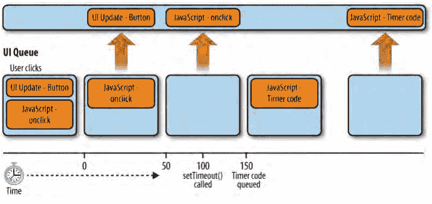

### UI 队列

用户点击

图 6-4. 如果 `setTimeout()` 所在的函数执行时间超过了定时器延迟，那么定时器执行代码可能没有明显的延迟。

## 定时器精度

JavaScript 定时器延迟通常是不精确的，正反方向可能有几毫秒的偏差。仅仅因为你指定了 250 毫秒，并不意味着任务会在调用 `setTimeout()` 后恰好 250 毫秒后入队列。所有浏览器都可能尝试尽可能准确，但往往会发生几毫秒的正负偏差。由于原因，定时器在测量实际流逝时间时是不可靠的。

Windows 系统上的定时器分辨率为 15 毫秒，这意味着它会将 15 毫秒的定时器延迟解释为 0 或 15，取决于系统时间上次更新的时间。设置小于 15 毫秒的定时器延迟会导致 Internet Explorer 死锁，建议最小延迟为 25 毫秒（最终变为 15 或 30），以确保至少有 15 毫秒的延迟。

这种最小定时器延迟也有助于避免其他浏览器和其他系统上的定时器分辨率问题。大多数浏览器在处理 10 毫秒或更短的时间时，定时器延迟会出现某些波动。

## 使用定时器处理数组

长时间运行脚本的一个常见原因是执行时间过长的循环。如果你已经尝试了第 4 章介绍的循环优化技术，但未能充分缩短执行时间，那么定时器就是你的下一个优化步骤。基本方法是将循环的工作拆分为一系列定时器。

典型的循环遵循一个简单的模式，例如：

```javascript
for (var i=0, len=items.length; i < len; i++) {
  process(items[i]);
}
```

由于 `process()` 的复杂性、`items` 的大小或其他原因，这种结构的循环的执行时间可能过长。在我的书籍《Professional JavaScript for Web Developers, Second Edition》(Wrox 2009) 中，我列出了决定循环是否可以使用定时器进行异步处理的两个因素：

- `process` 必须同步完成吗？
- 数据 必须按顺序处理吗？

如果这两个问题的答案都是“否”，那么这段代码就是使用定时器拆分工作的良好候选。异步代码执行的一个基本模式是：

```javascript
var todo = items.concat(); // 创建原始数据的克隆

setTimeout(function() {
  // 获取数组中的下一个项目并处理它
  process(todo.shift());
  // 如果还有更多待处理的项目，创建另一个定时器
  if(todo.length > 0){
    setTimeout(arguments.callee, 25);
  } else {
    callback(items);
  }
}, 25);
```

该模式的基本思想是创建原始数组的克隆，并将其作为待处理项目的队列。第一次调用 `setTimeout()` 处理数组中的第一个项目。调用 `todo.shift()` 返回该项目并将其从数组中移除。处理该项目后，会进行检查以确定是否有更多待处理的项目。如果 `todo` 数组中仍有项目，则还有更多待处理的项目，并创建另一个定时器。由于下一个运行的定时器与原始代码相同，因此 `arguments.callee` 作为第一个参数传递。此值指向执行代码的匿名函数。如果没有更多待处理的项目，则会调用 `callback()` 函数。


每个定时器延迟的实际时间在很大程度上取决于你的场景。通常情况下，最好使用至少 25 毫秒，因为较小的延迟为大多数 UI 更新留下的时间太少。

由于这种模式比普通循环需要更多的代码，因此将其封装是有用的。例如：

```javascript
function processArray(items, process, callback) {
  var todo = items.concat(); // 创建原始数据的克隆
  setTimeout(function() {
    // 获取数组中的下一个项目并处理它
    process(todo.shift());
    // 如果还有更多待处理的项目，创建另一个定时器
    if(todo.length > 0){
      setTimeout(arguments.callee, 25);
    } else {
      callback(items);
    }
  }, 25);
}
```

使用定时器处理数组的一个副作用是处理数组的总时间增加了。这是因为在每个项目处理后 UI 线程会被释放，而在处理下一个项目之前存在延迟。

## 拆分任务

我们通常认为的一个任务可以拆分为一系列任务。如果单个函数的执行时间过长，请检查它是否可以拆分。这通常只需将单行代码视为原子任务，尽管多行代码通常可以组合成任务。某些函数根据它们调用的其他函数很容易拆分。例如：

```javascript
function saveDocument(id){
  // 保存文档
  openDocument(id);
  writeText(id);
  closeDocument(id);
  // 更新 UI 表示成功
  updateUI(id);
}
```

如果此函数执行时间过长，可以通过将各个方法分离到单独的定时器将其拆分为更小的步骤。你可以通过将每个函数添加到数组中并使用类似于上一节数组处理模式的模式来实现：

```javascript
function saveDocument(id){
  var tasks = [openDocument, writeText, closeDocument, updateUI];
  setTimeout(function() {
    // 执行下一个任务
    var task = tasks.shift();
    task(id);
    // 确定是否有更多
    if (tasks.length > 0){
      setTimeout(arguments.callee, 25);
    }
  }, 25);
}
```

该函数的版本将每个方法放入任务数组，并在每个定时器上执行一个方法。从根本上说，这现在变成了数组处理模式，唯一的区别是处理项目涉及执行项目中所包含的函数。如上一节所述，这种模式可以封装以重用：

```javascript
function multistep(steps, args, callback) {
  var tasks = steps.concat(); // 克隆数组
  setTimeout(function() {
    // 执行下一个任务
    var task = tasks.shift();
    task.apply(null, args || []);
    // 确定是否有更多
    if (tasks.length > 0) {
      setTimeout(arguments.callee, 25);
    } else {
      callback();
    }
  }, 25);
}
```

```javascript
if (tasks.length > 0) {
  setTimeout(arguments.callee, 25);
} else {
  callback();
}
}, 25);
```

`multistep` 函数接受三个参数：一个要执行的函数数组、一个在执行时传递给每个函数的参数数组，以及一个在过程完成后调用的回调函数。该函数可以如下使用：

```javascript
var tasks = [openDocument, writeText, closeDocument, updateUI];
multistep(tasks, [id], function() {
  alert("Save completed!");
});
```

注意，`multistep` 的第二个参数必须是一个包含其 ID 的数组。作为一种数组处理，该函数在任务可以异步处理且不会影响用户体验或导致依赖代码出现错误时效果最佳。

## 定时代码 (Timed Code)

有时一次只处理一个任务是低效的。考虑处理一个包含 1,000 个元素的数组，处理单个项目需要 1 毫秒。如果每个定时器只处理一个项目，并且之间有 25 毫秒的延迟，那么这意味着处理该数组的总时间是 (25 + 1) × 1,000 = 26,000 毫秒，或 26 秒。如果你每 50 个项目为一组进行处理，且之间有 25 毫秒的延迟呢？整个处理过程将变为 (1,000 / 50) × 25 + 1 = 1,500 毫秒，或 1.5 秒，而且用户界面永远不会阻塞，因为连续执行最长的脚本只有 50 毫秒。批量处理项目通常比逐个处理要快。

如果你将 100 毫秒视为 JavaScript 允许连续运行的绝对时间，那么你就可以开始优化之前的模式了。我的建议是将该数字减半，永远不要让任何 JavaScript 代码连续执行超过 50 毫秒，以确保代码永远不会接近影响用户体验。

可以使用原生的 `Date` 对象来跟踪代码运行了多久。这是 JavaScript 性能分析最根本的方式：

```javascript
var start = +new Date();
// stop(); // 原文此处似有误，保留原逻辑注释
someLongProcess();
var stop = +new Date();
```

```javascript
if(stop-start < 50){
  alert("Just about right.");
} else {
  alert("Taking too long.");
}
```

由于每个 `Date` 对象都用当前系统时间初始化，你可以通过定期创建新的 `Date` 对象并比较它们的值来对代码计时。加运算符 (`+`) 将 `Date` 对象转换为数值表示法，这样进一步的算术运算就不会涉及转换。这种基本技术也可以用于优化审查定时器模式。

可以通过添加时间检查来增强 `processArray()` 方法，每个定时器处理多个项目：

```javascript
function timedProcessArray(items, process, callback){
  var todo = items.concat(); //创建原始数组的克隆
  setTimeout(function(){
    var start = +new Date();
    do {
      process(todo.shift());
    } while (todo.length > 0 && (+new Date()) - start < 50);
    if (todo.length > 0){
      setTimeout(arguments.callee, 25);
    } else {
      callback(items);
    }
  }, 25);
}
```

在此函数中添加 `do-while` 循环允许在处理完每个项目后检查时间。当定时函数执行时，数组始终至少包含一个项目，后测试循环比预测试更有意义。在 Firefox 中运行时，它处理一个包含 1,000 个元素的数组（其中 `process()` 是一个空函数）只需 38–43 毫秒；而原始的 `processArray()` 函数处理相同内容需要超过 25,000 毫秒。这就是在将任务拆分成更小块之前进行计时的威力。

## 定时器与性能 (Timers and Performance)

定时器会对 JavaScript 代码的整体性能产生巨大影响，但过度使用它们会对性能产生负面影响。本节中的代码使用了顺序定时器，使得每次只有一个定时器存在，并且只有在上一个定时器完成后才会创建新的。像这样使用定时器不会导致性能问题。

当同时创建多个重复定时器时，性能问题就会开始出现。由于只有一个 UI 线程，所有定时器都会竞争执行时间。谷歌 Neil Thomas 研究了这个课题，作为衡量 iPhone 和 Android 移动版 Gmail 应用性能的方法。

Thomas 发现，低频率重复定时器（间隔为秒或更长的定时器）对 Web 程序的整体响应能力影响很小。定时器的延迟太大，不足以在 UI 线程上产生瓶颈，因此可以安全地重复使用。然而，当以高频率（100 到 200 毫秒之间）使用多个重复定时器时，Thomas 发现移动版 Gmail 应用变得明显变慢且响应性降低。

Thomas 研究得出的结论是，限制 Web 应用程序中高频重复定时器的数量。相反，Thomas 建议创建一个单一的重复定时器，在每次执行时执行多个操作。

## Web Workers

自从 JavaScript 引入以来，一直没有在浏览器 UI 之外执行代码的方法。Web Workers API 通过引入一个接口改变了这一点，通过该接口代码可以在不占用浏览器 UI 的情况下执行。Web Workers API 原本是 HTML5 的一部分，现在 Web Workers API 已经拆分为其自己的规范（http://www.w3.org/TR/workers/）；Web Workers 已经实现。

Web Workers 代表了潜在巨大的改进，因为每个 Worker 都会产生自己的线程。

### Worker 环境 (Worker Environment)

由于 Workers 具有不同的环境，你无法从任何 JavaScript 代码中创建它。事实上，你需要创建一个完全独立的 JavaScript 文件，其中包含 Worker 的代码。要创建一个 Web Worker，必须传入 JavaScript 文件的 URL：

```javascript
var worker = new Worker("code.js");
```

一旦执行此操作，将为指定的文件创建一个具有新环境的新线程。该文件是异步下载的，Worker 在文件完全下载并执行之前不会开始。Worker 环境由以下部分组成：

- 一个 `location` 对象（与 `window` 相同，但所有属性均为只读）
- 指向全局对象的 `self` 对象
- 用于加载外部 JavaScript 供 Worker 使用的 `importScripts()` 方法
- 所有的 ECMAScript 对象，如 `Object`、`Array`、`Date` 等
- `XMLHttpRequest` 构造函数
- `setTimeout()` 和 `setInterval()` 方法
- 停止 Worker 的 `close()` 方法

### Worker 通信 (Worker Communication)

Worker 与网页代码之间的通信通过事件接口建立。网页代码可以通过 `postMessage()` 方法向 Worker 传递数据，该方法接受单个参数，指示要传递给 Worker 的数据。还有一个 `onmessage` 事件处理器用于从 Worker 接收信息。例如：

```javascript
var worker = new Worker("code.js");
worker.onmessage = function(event){
  alert(event.data);
}
worker.postMessage("Nicholas");
```

Worker 通过触发消息事件接收此数据。定义了一个 `onmessage` 事件处理器，事件对象具有一个包含所传入数据的 `data` 属性。Worker 随后可以使用其 `postMessage()` 方法将信息传回网页：

```javascript
// code.js 内部
self.onmessage = function(event){
  self.postMessage("Hello, " + event.data + "!");
};
```

只有特定类型的数据可以通过 `postMessage()` 传递。你可以传递原始值（字符串、数字、布尔值、`null` 和 `undefined`）以及 `Object` 和 `Array` 的实例；你不能传递任何其他数据类型。有效的数据会被序列化，在 Worker 之间或与其之间传输，然后被反序列化。尽管看起来似乎是直接传递了对象，但这些实例是相同数据的完全独立的表示形式。尝试传递不支持的数据类型将导致 JavaScript 错误。

- Safari 4 对 Workers 的实现仅允许你使用 `postMessage()` 传递字符串。规范在之后更新了，允许传递可序列化的数据，Firefox 3.5 的 Workers 已经实现了这一点。

### 加载外部文件

在 Worker 中加载额外的 JavaScript 文件是通过 `importScripts()` 方法完成的，它接受一个或多个 JavaScript 文件的 URL。`importScripts()` 的调用在 Worker 内部是阻塞的，因此在所有文件加载并执行之前，脚本不会继续运行。由于 Worker 在 UI 线程之外，因此不需要担心这种阻塞会影响 UI 的响应速度。例如：

```javascript
// code.js
importScripts("file1.js", "file2.js");
self.onmessage = function(event){
  self.postMessage("Hello, " + event.data + "!");
};
```

此代码的第一行包含了两个 JavaScript 文件，以便它们在 Worker 的上下文中可用。

### 实际用途

Web Workers 适用于任何处理纯数据、且与浏览器 UI 无关的长时间运行的脚本。这看起来用户群很小，但在 Web 应用程序内部，通常有一些数据处理方法可以从使用 Worker 而不是定时器中受益。

例如，考虑解析一个大型 JSON 字符串（JSON 解析将在第 7 章中进一步讨论）。假设数据量大到解析至少需要 500 毫秒。这对于允许 JavaScript 在客户端运行来说显然太长了，因为它会干扰用户体验。这个特定任务很难用定时器拆分成小块，因此 Worker 是理想的解决方案。以下代码演示了网页用法：

```javascript
var worker = new Worker("jsonparser.js");
// 当数据可用时，会处理此事件处理程序
worker.onmessage = function(event){
  // JSON 结构被传回
  var jsonData = event.data;
  // 使用 JSON 结构
  evaluatedData(jsonData);
}
// 传入大型 JSON 字符串进行解析
worker.postMessage(jsonText);
```

负责 JSON 解析的 Worker 代码如下：

```javascript
// 在 jsonparser.js 内部
// 当 JSON 数据可用时，调用此事件处理程序
self.onmessage = function(event){
  // JSON 字符串作为 event.data 传入
  var jsonText = event.data;
  // 解析结构
  var jsonData = JSON.parse(jsonText);
  // 发回结果
  self.postMessage(jsonData);
}
```

注意，尽管 `JSON.parse()` 可能需要 500 毫秒或更多，但不需要编写任何额外的代码来拆分解析。此执行在独立的线程上进行，因此你可以运行它直到解析完成，而不会干扰用户体验。

页面通过使用 `postMessage()` 向 Worker 传递 JSON 字符串。Worker 在其 `onmessage` 事件处理程序中作为 `event.data` 接收该字符串并继续进行解析。当生成的 JSON 对象使用 Worker 的 `postMessage()` 方法传回页面时，该对象随后作为页面 `onmessage` 事件处理程序中的 `event.data` 可用。请记住，这目前仅适用于 Firefox 3.5 及更高版本，因为 Safari 4 和 Chrome 3 的实现允许在页面和 Worker 之间传递字符串。

解析大型字符串只是从 Web Workers 中受益的众多可能任务之一。其他可能性包括：

- 编码/解码大型字符串
- 复杂的数学计算（包括图像或视频处理）
- 排序大型数组

任何完成所需时间超过 100 毫秒的过程，你都应该考虑 Worker 方案是否比基于定时器的方案更合适。当然，这取决于浏览器的能力。

## 总结

JavaScript 和用户界面更新在同一个进程中，因此一次只能执行其中一个。这意味着当 JavaScript 代码执行时，用户界面无法对输入做出反应，反之亦然。有效管理 UI 线程意味着确保 JavaScript 运行时间不会长到影响用户体验的程度。为此，应该记住以下几点：

- 任何 JavaScript 任务的执行时间都不应超过 100 毫秒。较长的执行时间会导致 UI 更新出现明显的延迟，并对整体用户体验产生负面影响。
- 浏览器在 JavaScript 执行期间响应用户交互的行为不同。无论行为如何，当 JavaScript 执行很长时间时，用户体验会变得混乱且断裂。
- 定时器可用于调度稍后执行，这允许你将长时间运行的脚本分成一系列较小的任务。
- Web Workers 是新版浏览器中的一项功能，允许你在 UI 线程之外执行 JavaScript 代码，从而防止 UI 锁定。

Web 应用程序越复杂，主动管理 UI 线程就越关键。没有任何 JavaScript 代码是重要到应该对用户的体验产生不利影响的。

# 第 7 章

## Ajax

Ross Hermes

Ajax 是高性能 JavaScript 的基石。它可以通过延迟下载大型资源来使页面加载更快。通过允许数据在客户端和服务器之间异步传输，它可以完全防止页面重新加载。它甚至可以用于获取页面的所有内容。通过选择正确的传输技术和最高效格式，可以显著提高与网站交互的方式。

## 数据传输

Ajax 在最基础的层面上是一种在不卸载当前页面的情况下向服务器发送并接收数据。有几种设置这种通道的方法，每种都有其优缺点。本节简要介绍了请求数据的方法。

### 请求数据

请求数据的五种通用方法：

- `XMLHttpRequest` (XHR)
- 动态脚本插入
- `iframe`
- Comet
- 多部分 XHR

现代高性能 JavaScript 使用的是 XHR、动态脚本插入和多部分 XHR。Comet 和 `iframe`（作为数据传输技术）往往取决于特定情况，在此不再介绍。

### XMLHttpRequest

最常用的技术 `XMLHttpRequest` (XHR) 允许你异步发送和接收数据。它在所有现代浏览器中都有良好支持，并允许对发送和接收的数据进行精细控制。你可以向请求添加任意标头和参数（GET 和 POST），并读取从服务器返回的所有头部。以下是其使用方法的示例：

```javascript
var url = '/data.php';
var params = [
  'id=93875',
  'limit=20'
];
var req = new XMLHttpRequest();
req.onreadystatechange = function() {
  if (req.readyState === 4) {
    var responseHeaders = req.getAllResponseHeaders(); // 获取响应头部
    var data = req.responseText; // 获取数据
    // 处理数据...
  }
}
req.open('GET', url + '?' + params.join('&'), true);
req.setRequestHeader('X-Requested-With', 'XMLHttpRequest'); // 设置请求标头
req.send(null); // 发送请求
```

此示例展示了如何带参数向 URL 请求数据，以及如何读取响应文本和头部。`readyState` 为 4 表示整个响应已接收并可以进行操作。

通过监听 `readyState` 3，可以在响应仍在传输时对其进行交互。这被称为流式传输，它是提高数据请求性能的一项强大工具：

```javascript
req.onreadystatechange = function() {
  if (req.readyState === 3) { // 已接收部分（非全部）数据
    var dataSoFar = req.responseText;
    ...
  } else if (req.readyState === 4) { // 所有数据已接收
    var data = req.responseText;
    ...
  }
}
```

由于对 XHR 提供了高度的控制权，浏览器对其进行了一些限制。你无法使用 XHR 请求来自与代码当前运行不同域名的数据，而且旧版本的 IE 不允许你访问 `readyState 3`，这阻止了流式传输。从请求返回的数据被视为字符串或 XML 对象；这意味着大量数据的处理将非常快。

尽管有这些缺点，XHR 仍然是请求数据常用的技术，而且仍然是最强大的。它应该是你首选的方案。

#### 使用 XHR 时选择 POST 或 GET

在使用 XHR 请求数据时，你可以在 POST 或 GET 之间进行选择。对于不改变状态且仅获取数据的请求（这被称为幂等操作），请使用 GET。GET 请求会被缓存，如果你多次获取相同的数据，这可以提高性能。

只有当 URL 的长度和参数接近超过 2,048 个字符时，才应该用 POST 来获取数据。这是因为 Internet Explorer 将 URL 限制在该长度，超过将导致你的请求被截断。

### 动态脚本标签插入

这种技术克服了 XHR 最大的局限性：它可以从不同域名的服务器请求数据。它有一个技巧：不是实例化一个专门的对象，而是使用 JavaScript 创建一个新的脚本标签，并将其 `src` 属性设置为另一个域名的一个 URL。

```javascript
var scriptElement = document.createElement('script');
scriptElement.src = 'http://any-domain.com/javascript/lib.js';
document.getElementsByTagName('head')[0].appendChild(scriptElement);
```

但动态脚本标签插入提供的功能比 XHR 少得多。你不能在请求中使用请求头。参数只能通过 GET 传递，不能通过 POST。你无法设置超时或重试请求；事实上，你并不一定知道它是否失败。你必须等待所有数据返回后才能访问其中的任何内容。你无法访问响应头或作为字符串形式的整个响应。

最后一点特别重要。因为响应被用作脚本标签的源，它必须执行 JavaScript。你不能使用 base64 或 JSON；任何数据无论格式如何，必须封装在一个回调函数中。

```javascript
var scriptElement = document.createElement('script');
scriptElement.src = 'http://any-domain.com/javascript/lib.js';
document.getElementsByTagName('head')[0].appendChild(scriptElement);
function jsonCallback(jsonString) {
  var data = eval('(' + jsonString + ')');
  // Process the data here...
}
```

在这个示例中，`lib.js` 文件将在 `jsonCallback` 函数中包含数据：
`jsonCallback({"status": 1, "colors": ["#fff", "#000", "#ff000"]});`

尽管有这些限制，这种技术也可以非常快。响应被作为 JavaScript 执行；它没有被视为必须进一步处理的字符串。正因如此，它有潜力成为获取数据并将其解析为客户端可访问内容的最快方法。我们将在本章后面的部分比较动态脚本标签插入与 JSON 中 XHR 的性能。

要小心使用这种技术从你无法直接控制的服务器请求数据。JavaScript 没有权限或访问控制的概念，因此你使用动态脚本标签插入到页面中的任何代码都对该页面具有完全控制权。这包括修改任何内容、将用户重定向到另一个网站，或跟踪他们在页面上的操作并将数据发送给第三方。当从外部源获取代码时请务必极端小心。

### 多部分 XHR

在这些技术中最新的是多部分 XHR (MXHR)，它允许你仅通过一个 HTTP 请求从服务器端向客户端传递多个资源。这是通过在服务器端对资源（无论是 CSS 文件、HTML 片段、JavaScript 代码还是 base64 编码图像）进行打包，并将它们作为长字符串发送到客户端，并用约定的字符串分隔。JavaScript 代码处理这个长字符串并根据其 MIME 类型和随之传递的任何其他“头”解析每个资源。

让我们从头到尾遵循这个过程。首先，向服务器请求几个图像资源：

```javascript
var req = new XMLHttpRequest();
req.open('GET', 'rollup_images.php', true);
req.onreadystatechange = function() {
    if (req.readyState == 4) {
        splitImages(req.responseText);
    }
};
req.send(null);
```

这是一个非常简单的请求。你从 `rollup_images.php` 请求数据，一旦收到，就将其发送给 `splitImages` 函数。

接下来，在服务器上，图像被读取并转换为字符串：

```php
// Read the images and convert into base64 encoded strings.
$images = array('kitten.jpg', 'sunset.jpg', 'baby.jpg');
foreach ($images as $image) {
  $image_fh = fopen($image, 'r');
  $image_data = fread($image_fh, filesize($image));
  fclose($image_fh);
  $payloads[] = base64_encode($image_data);
}
// Roll up those strings into one long string and output it.
$newline = chr(1); // This character won't appear naturally in any base64 string.
echo implode($newline, $payloads);
```

使用这种技术存在一些缺点，最大的缺点是获取的资源都没有缓存在浏览器中。如果你使用 MXHR 获取了一个特定的 CSS 文件，并且它在下一个页面正常加载，它将不会在缓存中。这是因为打包的资源是以长字符串传输的，然后由 JavaScript 代码进行拆分。由于无法通过程序向浏览器的缓存中注入文件，因此通过这种方式获取的任何资源都不会进入缓存。

另一个缺点是旧版本的 Internet Explorer 不支持 base64 编码的图像数据 URL。Internet Explorer 8 支持这两者，但对于 Internet Explorer 6 和 7 可能仍需要变通方法。

尽管有这些缺点，在某些情况下 MXHR 仍然能显著提高整体性能：

- 页面包含资源列表，这些资源在网站的其他地方没有使用（因此不需要缓存），特别是图片。
- 每个页面都已使用唯一的打包 JavaScript 或 CSS 文件以减少 HTTP 请求的网站；该文件对于每个页面都是唯一的，除非重新加载特定页面，否则不会从缓存中读取。

由于 HTTP 请求是 Ajax 中最严重的瓶颈之一，减少请求数量对页面性能有巨大影响。当你能够将 100 个图像请求转换为单个多部分 XHR 请求时，情况尤为如此。在现代浏览器中对大量图像进行基准测试表明，这种技术比发送单独请求快 4 到 10 倍。你可以访问 http://techfoolery.com/mxhr/ 亲自运行这些测试。

## 发送数据

有时你并不关心获取数据，而是只想将其发送到服务器。你可能正在发送用户的非个人信息以便分析，或者你可以捕获所有的脚本错误并将详细信息发送到服务器进行记录和告警。当数据只需要发送到服务器时，有两种广泛使用的技术：XHR 和 Beacons（信标）。

### XMLHttpRequest

虽然 XHR 主要用于从服务器请求数据，但也可以用于发送数据。数据可以以 GET 或 POST 形式发送，也可以放在任意数量的 HTTP Header 中。这赋予了你极大的灵活性。当你发送的数据量超过浏览器的最大 URL 长度时，XHR 特别有用。在这种情况下，你可以通过 POST 发送数据：

```javascript
var url = '/data.php';
var params = [
  'id=934875',
  'limit=20'
];
var req = new XMLHttpRequest();
req.onerror = function() {
  // Error.
};
req.onreadystatechange = function() {
  if (req.readyState == 4) {
    // Success.
  }
};
req.open('POST', url, true);
req.setRequestHeader('Content-Type', 'application/x-www-form-urlencoded');
req.setRequestHeader('Content-Length', params.length);
req.send(params.join('&'));
```

如此示例所示，我们没有检查 POST 是否失败。这通常是没问题的。XHR 用于捕获用户统计数据，但如果数据送达服务器至关重要，你可以添加代码在失败时进行重试：

```javascript
function xhrPost(url, params, callback) {
  var req = new XMLHttpRequest();
  req.onerror = function() {
    setTimeout(function() {
      xhrPost(url, params, callback);
    }, 1000);
  };
  req.onreadystatechange = function() {
    if (req.readyState == 4) {
      if (callback && typeof callback === 'function') {
        callback();
      }
    }
  };
  req.open('POST', url, true);
  req.setRequestHeader('Content-Type', 'application/x-www-form-urlencoded');
  req.setRequestHeader('Content-Length', params.length);
  req.send(params.join('&'));
}
```

当使用 XHR 向服务器发送数据时，使用 GET 更快。这是因为对于少量数据，GET 请求以单个数据包发送到服务器。相反，POST 至少发送两个数据包，一个用于 Header，另一个用于 POST 体。POST 更适合向服务器发送大量数据，因为额外的数据包影响没那么大，而且 Internet Explorer 的 URL 长度限制使得长 GET 请求变得不可能。

### Beacons

这种技术与动态脚本插入非常相似。使用 JavaScript 创建一个新的 `Image` 对象，并将 `src` 设置为服务器上脚本的 URL。该 URL 包含了我们想要以 GET 格式的键值对发送的数据。注意，不需要创建或向 DOM 中插入 `img` 元素。

```javascript
var url = '/status_tracker.php';
var params = [
  'step=2',
  'time=1248027314'
];
(new Image()).src = url + '?' + params.join('&');
```

服务器获取这些数据并将其存储；它不需要向客户端返回任何内容，因为图片并没有实际显示。这是向服务器发送信息最高效的方式。它的开销非常小，而且服务器端错误完全不会影响客户端。

## 数据格式

### XML

```xml
<users>
  <user id="dave">
    <username>dave</username>
    <realname>Dave Johnson</realname>
    <email>dave@davejohnson.com</email>
  </user>
  <user>
    <email>carol@carolwilliams.com</email>
  </user>
</users>
```

与其他格式相比，XML 是极其冗余的。每一段离散的数据都需要大量的存储空间，数据与结构之间的比例极低。XML 的语法也具有轻微的歧义。在将数据结构编码为 XML 时，你可能会将对象参数设置为对象元素的属性，也可以设置为独立的子元素？你是选择使用长且具有描述性的标签名，还是使用高效但难以理解的名称？解析这种语法是非常模棱两可的，你必须预先知道 XML 响应的布局才能理解它。

总的来说，XML 需要 JavaScript 程序员花费大量的精力。除了预先知道结构的细节之外，你必须确切知道如何拆解该结构，并费力地将其重新组成 JavaScript 对象。这与另外三种数据格式不同。

这里是如何将此 XML 响应解析为对象的示例：

```javascript
function parseXML(response) {
  var users = [];
  var userNodes = response.getElementsByTagName('user');
  var node, usernameNodes, usernameNode, username, realnameNodes, realname, emailNodes, emailNode;
  for (var i = 0, len = userNodes.length; i < len; i++) {
    node = userNodes[i];
    username = realname = email = '';
    usernameNodes = node.getElementsByTagName('username');
    if (usernameNodes && usernameNodes[0]) {
      usernameNode = usernameNodes[0];
      username = (usernameNode.firstChild) ?
        usernameNode.firstChild.nodeValue : '';
    }
    realnameNodes = node.getElementsByTagName('realname');
    if (realnameNodes && realnameNodes[0]) {
      realnameNode = realnameNodes[0];
      realname = (realnameNode.firstChild) ?
        realnameNode.firstChild.nodeValue : '';
    }
    emailNodes = node.getElementsByTagName('email');
    if (emailNodes && emailNodes[0]) {
      emailNode = emailNodes[0];
      email = (emailNode.firstChild) ?
        emailNode.firstChild.nodeValue : '';
    }
    users[i] = {
      id: node.getAttribute('id'),
      username: username,
      realname: realname,
      email: email
    };
  }
  return users;
}
```

如你所见，这需要在读取值之前检查每个标签以确保其存在。它高度依赖于 XML 的结构。

一种更高效的方法是将值编码为 `<user>` 标签的属性。这使得相同数据量下的文件尺寸更小。以下是值编码为属性的用户列表示例：

```xml
<?xml version="1.0" encoding="UTF-8"?>
<users>
  <user id="1-id0001" username="alice" realname="Alice Smith"
    email="alice@example.com" />
  <user id="2-id0001" username="bob" realname="Bob Jones"
    email="bob@bobjones.com" />
  <user id="3-id0001" username="carol" realname="Carol Williams"
    email="carol@carolwilliams.com" />
  <user id="4-id0001" username="dave" realname="Dave Johnson"
    email="dave@davidjohnson.com" />
</users>
```

解析此 XML 响应要简单得多：

```javascript
var users = [];
var userNodes = responseXML.getElementsByTagName('user');
for (var i = 0, len = userNodes.length; i < len; i++) {
  users[i] = {
    id: userNodes[i].getAttribute('id'),
    username: userNodes[i].getAttribute('username'),
    realname: userNodes[i].getAttribute('realname'),
    email: userNodes[i].getAttribute('email')
  };
}
return users;
```

### XPath

尽管这超出了本章的范围，但在解析 XML 文档时，XPath 的速度比 `getElementsByTagName` 快得多。需要注意的是它并不是通用支持的，因此你必须使用旧式的 DOM 遍历样式编写回退代码。目前，Firefox、Safari、Chrome 和 Opera 已经实现了 DOM Level 3 XPath。Internet Explorer 8 拥有一个类似但略欠先进的接口。

### 响应大小和解析时间

让我们来看下表中关于 XML 的性能数据。

| 格式 | 大小 | 下载时间 | 解析时间 | 总加载时间 |
| --- | --- | --- | --- | --- |
| 冗余 XML | 582,960 bytes | 999.4 ms | 343.1 ms | 1342.5 ms |
| 普通 XML | 437,960 bytes | 475.1 ms | 83.1 ms | 558.2 ms |

每种数据类型都通过用户长度为 100、500、1,000 的用户进行了测试。

### JSON

由于 Douglas Crockford 的形式化和普及，JSON 是一种轻量且易于解析的数据格式。这里是使用 JSON 语法的用户列表示例：

```javascript
{
  "id": 1, "username": "alice", "realname": "Alice Smith", "email": "alice@example.com",
  "id": 2, "username": "bob", "realname": "Bob Jones", "email": "bob@bobjones.com",
  "id": 3, "username": "carol", "realname": "Carol Williams", "email": "carol@carolwilliams.com",
  "id": 4, "username": "dave", "realname": "Dave Johnson", "email": "dave@davidjohnson.com"
}
```

在 JavaScript 中解析 JSON 字符串就像使用 `eval()` 一样简单：

```javascript
function parseJSON(responseText) {
  return eval('(' + responseText + ')');
}
```

> 关于 `eval`：使用 `eval` 是危险的，尤其是用它评估第三方 JSON 时。尽可能使用 `JSON.parse()` 方法来解析字符串。该方法会捕获 JSON 中的语法错误并允许你传递一个函数来过滤或转换结果。目前该方法适用于 Firefox 3.5、Internet Explorer 8 和 Safari 4。大多数 JavaScript 库都包含调用原生版本或稍加健壮版本的 JSON 解析代码。非原生版本的参考实现可以在此处找到：http://json.org/json2.js。为了一致起见，代码示例使用了 `eval`。

就像 XML 一样，可以将这种格式简化为更紧凑版本。在这种情况下，我们可以将属性名替换为短（尽管可读性较差）名称：

```json
{
  "i": 1, "u": "alice", "r": "Alice Smith", "e": "alice@example.com",
  "i": 2, "u": "bob", "r": "Bob Jones", "e": "bob@bobjones.com",
  "i": 3, "u": "carol", "r": "Carol Williams", "e": "carol@carolwilliams.com",
  "i": 4, "u": "dave", "r": "Dave Johnson", "e": "dave@davidjohnson.com"
}
```

这让我们传输到浏览器的数据更少。我们甚至可以更进一步，完全替换属性名。这种格式比另外两种更不可读且脆弱得多，但文件尺寸要小得多：几乎是冗余 JSON 格式的一半。

```json
[
  [ 1, "alice", "Alice Smith", "alice@example.com" ],
  [ 2, "bob", "Bob Jones", "bob@bobjones.com" ],
  [ 3, "carol", "Carol Williams", "carol@carolwilliams.com" ],
  [ 4, "dave", "Dave Johnson", "dave@davejohnson.com" ]
]
```

成功的解析要求保持数据的顺序。也就是说，将这种格式转换为与第一个 JSON 格式具有相同属性名的格式是可行的：

```javascript
function parseJSON(responseText) {
  var users = [];
  var usersArray = eval('(' + responseText + ')');
  for (var i = 0, len = usersArray.length; i < len; i++) {
    users[i] = {
      id: usersArray[i][0],
      username: usersArray[i][1],
      realname: usersArray[i][2],
      email: usersArray[i][3]
    };
  }
  return users;
}
```

在这个示例中，我们使用 `eval()` 将字符串转换为原生对象数组。本质上，你是在用更小的文件和更快的 `eval()` 时间换取一个更复杂的解析函数。下表列出了三种使用 XHR 传输的 JSON 格式的性能数据。

| 格式 | 大小 | 下载时间 | 解析时间 | 总加载时间 |
| --- | --- | --- | --- | --- |
| 冗长 JSON (Verbose JSON) | 487,895 字节 | 527.7 ms | 26.7 ms | 554.4 ms |
| 简单 JSON (Simple JSON) | 392,895 字节 | 498.7 ms | 29.0 ms | 527.7 ms |
| 数组 JSON (Array JSON) | 292,895 字节 | 305.4 ms | 18.6 ms | 324.0 ms |

使用数组形成的 JSON 在每个类别中都胜出，具有最小的文件、最快的平均下载时间和解析时间。尽管解析函数必须遍历列表中的所有 5,000 条目，但解析速度仍然快了 30% 以上。

#### JSON-P

JSON 可以原生执行这一事实具有几个重要的性能影响。当使用 XHR 时，JSON 数据以字符串形式返回。该字符串通过 `eval()` 求值以转换为原生对象。然而，当使用动态脚本标签插入时，JSON 数据被视为另一个 JavaScript 文件并作为原生代码执行。为了实现这一点，数据必须封装在回调函数中。这被称为“JSON 填充”（JSON padding）或 JSON-P。以下是我们的以 JSON-P 格式化的用户列表：

```javascript
parseJSON(
  { "id": 1, "username": "alice", "realname": "Alice Smith",
  "email": "alice@alicesmith.com" },
  { "id": 2, "username": "bob", "realname": "Bob Jones" },
  { "id": 3, "username": "carol", "realname": "Carol Williams",
  "email": "carol@carolwilliams.com" },
  { "id": 4, "username": "dave", "realname": "Dave Johnson",
  "email": "dave@davejohnson.com" }
);
```

JSON-P 通过回调包装增加了少量文件大小，但与之前的解析时间相比，这种增加是微不足道的。由于数据被视为原生 JavaScript，因此它以原生 JavaScript 的速度解析。以下是作为 JSON-P 传输的三种 JSON 格式：

| 格式 | 大小 | 下载时间 | 解析时间 | 总加载时间 |
|---|---|---|---|---|
| 冗长 JSON-P | 487,913 字节 | 598.2 ms | 0.0 ms | 598.2 ms |
| 简单 JSON-P | 392,913 字节 | 450.4 ms | 3.1 ms | 457.1 ms |
| 数组 JSON-P | 292,912 字节 | 316.0 ms | 3.6 ms | 319.4 ms |

文件大小和下载时间与 XHR 几乎相同，但解析时间几乎快了 10 倍。JSON-P 的解析时间为零，因为不需要任何解析；它已经是原生格式了。简单 JSON-P 和数组 JSON-P 也是如此，但每个都必须经过迭代以将其转换为冗长 JSON-P 自然提供的格式。

最快的 JSON 格式是使用数组形成的 JSON-P。虽然这只比使用 XHR 传输的 JSON 快一点，但随着列表增长，这种优势会增加。如果你正在开发一个需要包含 10,000 或 100,000 个元素的项目，请优先选择 JSON-P 而非 JSON。

避免 JSON-P 的原因与性能无关：由于 JSON-P 必须是可执行的 JavaScript，它可以被任何人调用并使用动态脚本标签插入到任何网站。相反，JSON 在被求值之前不是有效的，且只能通过 XHR 作为字符串获取。不要在 JSON-P 中编码任何敏感数据，因为即使使用随机 URL 或 Cookie，你也无法确保它保持私密。

#### 你应该使用 JSON 吗？

与 XML 相比，JSON 有许多优势。它是一种小得多的格式，整体响应大小中较少用于结构，更多用于数据。当数据包含数组而不是对象时，尤其如此。JSON 极具互操作性，编码和解码非常方便。JSON 在被求值之前不是有效的，且只能通过 XHR 作为字符串获取。不要在 JSON-P 中编码任何敏感数据，因为你无法确保它保持私密，即使使用随机 URL 或 Cookie。

### 自定义格式

带有多个分隔符的格式需要循环来拆分数据（但请记住 JavaScript 中的循环执行速度极快。`split()` 是最快的字符串操作之一，通常可以在几毫秒内处理包含 10,000 多个元素的分隔符分隔列表）。以下是如何解析上述格式的示例：

```javascript
function parseCustomFormat(responseText) {
  var users = [];
  var usersEncoded = responseText.split(';');
  var userArray;
  for (var i = 0, len = usersEncoded.length; i < len; i++) {
    userArray = usersEncoded[i].split(':');
    users[i] = {
      id: userArray[0],
      username: userArray[1],
      realname: userArray[2],
      email: userArray[3]
    };
  }
  return users;
}
```

在创建你自己的自定义格式时，最重要的决定之一是使用什么作为分隔符。理想情况下，它们都应该是单个字符，并且不应该在你的数据中自然出现。低数值 ASCII 字符效果良好，且在大多数服务器端语言中都易于表示。例如，以下如何在 PHP 中使用 ASCII 字符：

```php
function build_format_custom($users) {
  $row_delimiter = chr(1); // \u0001 in JavaScript
  $field_delimiter = chr(2); // \u0002 in JavaScript
  $output = array();
  foreach ($users as $user) {
    $fields = array($user['id'], $user['username'], $user['realname'],
    $user['email']);
    $output[] = implode($field_delimiter, $fields);
  }
  return implode($row_delimiter, $output);
}
```

这些控制字符在 JavaScript 中使用 Unicode 表示法表示（例如 `\u0001`）。`split()` 函数可以接受字符串或正则表达式作为参数。如果你预计数据中有空字段，请使用字符串；如果分隔符作为正则表达式传递，IE 中的 `split()` 在两个分隔符紧挨在一起时会忽略第二个分隔符。在其他浏览器中，两种参数类型是等价的。

```javascript
// 正则表达式分隔符。
var rows = req.responseText.split(/\u0001/);
// 字符串分隔符（更安全）。
var rows = req.responseText.split("\u0001");
```

以下是使用 XHR 和动态脚本标签插入时，自定义格式的性能数据：

| 格式 | 大小 | 下载时间 | 解析时间 | 总加载时间 |
|---|---|---|---|---|
| 自定义格式 (XHR) | 222,892 bytes | 63.1 ms | 14.5 ms | 77.6 ms |
| 自定义格式 (脚本插入) | 222,912 bytes | 66.3 ms | 11.7 ms | 78.0 ms |

这种格式可以使用 XHR 或动态脚本标签插入。由于在两种情况下，响应内容都是作为字符串进行解析的，因此在性能上没有真实差异。对于非常大的数据集，它是毫无疑问的最快格式，在解析速度和整体加载时间上都优于原生执行的 JSON。这种格式使得在极短时间内向客户端发送海量数据变得可行。

### 数据格式结论

通常情况下，优先选择轻量级格式；最好的是 JSON 和字符分隔的自定义格式。如果数据集很大且解析时间成为问题，请使用以下技术之一：

- JSON-P 数据，通过动态脚本标签插入获取。这会将数据视为可执行的 JavaScript 而不是字符串，并允许极快速的解析。这可以跨域使用，但不应与敏感数据一起使用。
- 字符分隔的自定义格式，通过 XHR 或动态脚本标签插入并使用 `split()` 获取。这种技术解析极大型数据集的速度比 JSON-P 技术略快，且通常文件大小更小。

下表和图 7-1 再次显示了所有性能数据（按速度从快到慢排序），以便你可以在一个地方比较每种格式。排除了 HTML，因为它无法与其他格式进行直接比较。

| 格式 | 大小 | 下载时间 | 解析时间 | 总加载时间 |
|---|---|---|---|---|
| 详尽 XML | 582,960 bytes | 999.4 ms | 343.1 ms | 1342.5 ms |
| 详尽 JSON-P | 487,913 bytes | 598.2 ms | 0.0 ms | 598.2 ms |
| 简单 XML | 437,960 bytes | 475.1 ms | 83.1 ms | 558.2 ms |
| 详尽 JSON | 487,895 bytes | 527.7 ms | 26.7 ms | 554.4 ms |
| 简单 JSON | 392,895 bytes | 498.7 ms | 29.0 ms | 527.7 ms |
| 简单 JSON-P | 392,913 bytes | 454.0 ms | 3.1 ms | 457.1 ms |
| 数组 JSON | 292,895 bytes | 305.4 ms | 18.6 ms | 324.0 ms |
| 数组 JSON-P | 292,912 bytes | 316.0 ms | 3.4 ms | 319.4 ms |
| 自定义格式 (脚本插入) | 222,912 bytes | 66.3 ms | 11.7 ms | 78.0 ms |
| 自定义格式 (XHR) | 222,892 bytes | 63.1 ms | 14.5 ms | 77.6 ms |

图 7-1 数据格式下载和解析时间的对比。请记住，这些数字是在浏览器中单次运行的结果。结果应作为通用指标，而非硬性数字。你可以自己运行测试：http://techfoolery.com/formats/

## Ajax 性能

一旦你选择了最合适的传输技术和格式，就可以考虑其他优化技术。这些技术高度取决于情况，因此在考虑它们之前请确保你的应用程序适用。

## 缓存

最好的 Ajax 请求是不进行请求。防止不必要的请求有两种方法：

- 在服务器端设置 HTTP 头部以确保响应被缓存。
- 在客户端本地存储数据，以便无需再次请求。

第一种技术最容易设置和维护，而第二种赋予你最高的控制权。

### 设置 HTTP 头部

如果你希望 Ajax 响应被浏览器缓存，必须使用 GET 进行请求。仅仅使用 GET 是不够的；你还必须随响应发送正确的 HTTP 头部。`Expires` 头部告诉浏览器响应可以缓存多久。在该日期之后，该 URL 的请求将不再从缓存交付，而是传递到服务器。`Expires` 头部如下：

`Expires: Mon, 28 Jul 2014 23:30:00 GMT`

特定的 `Expires` 告诉浏览器缓存到 2014 年。这种方法适用于永远不会改变的内容，例如图像或静态数据。`Expires` 头部中的日期可以使用以下 PHP 代码进行设置：

```php
header("Expires: " . gmdate("D, d M Y H:i:s", time() + 31536000) . " GMT");
```


$lifetime = 7 * 24 * 60 * 60; // 7 天，单位为秒

header('Expires: ' . gmdate('D, d M H:i:s', time() + $lifetime) . ' GMT');

这将告诉浏览器缓存 7 天。要设置更远的 `Expires` 头部，请增加有效期；此示例告诉浏览器缓存 10 年：

```php
$lifetime = 10 * 365 * 24 * 60 * 60; // 10 年，单位为秒

header('Expires: ' . gmdate('D, d M H:i:s', time() + $lifetime) . ' GMT');
```

`Expires` 头部是确保 Ajax 响应被浏览器缓存的最简单方法。你不需要更改客户端中的任何内容，可以正常继续 Ajax 请求，因为浏览器只有在缓存中没有文件时才会向服务器发送请求。在服务器端很容易实现，因为所有语言都允许以某种方式设置头部。这是确保数据缓存的最简单方法。

## 本地存储

与其依赖浏览器处理缓存，你也可以通过依赖从服务器接收的响应手动处理。可以通过按 URL 将响应放入对象中来实现。这是一个 XHR 封装示例，它首先检查 URL 是否已获取过：

```javascript
var localCache = {};

function xhrRequest(url, callback) {

  // 检查本地缓存中的该 URL。

  if (localCache[url]) {

    callback.success(localCache[url]);

    return;

  }

  // 如果缓存中未找到该 URL，则发起请求。

  var req = createXhrObject();

  req.onerror = function() {

    callback.error();

  };

  req.onreadystatechange = function() {

    if (req.readyState == 4) {

      if (req.responseText === '' || req.status == '404') {

        callback.error();

        return;

      }

      // 将响应存储在本地缓存中。

      localCache[url] = req.responseText;

      callback.success(req.responseText);

    }

  };

  req.open("GET", url, true);

  req.send(null);

}
```

总体而言，设置 `Expires` 头部是更好的解决方案。它更容易，并且跨页面加载缓存响应，但手动缓存在你希望能够通过失效缓存并获取新数据时非常有用。想象一种情况：你希望对每个请求使用缓存数据，除非用户执行了导致一个或多个缓存响应失效的操作。在这种情况下，从缓存中移除响应是轻而易举的：

```javascript
delete localCache['/user/friendlist/'];

delete localCache['/user/contactlist/'];
```

本地缓存对于移动设备上的浏览器也同样良好。此类设备上的大多数浏览器缓存很小或没有缓存，手动缓存是防止不必要请求的最佳选项。

## 了解你 Ajax 库的局限性

所有的 JavaScript 库都让你访问一个 Ajax 对象，该对象规范了浏览器之间的差异并为你提供了一个一致的接口。大多数情况下，这是一件非常好事，它让你能够专注于项目，而不是关注 XHR 在某些冷门浏览器中是如何工作的细节。然而，在提供统一接口的同时，这些库也必须简化接口，因为并不是每个浏览器都实现了每个功能。这些特性限制了你充分利用 `XMLHttpRequest` 的威力。

我们在本章中涵盖的一些技术，只有通过直接访问 XHR 对象才能实现。其中最著名的是部分 XHR 的流式传输。通过监听 `readyState 3`，我们可以在完全接收大响应之前开始对其进行切片。这允许我们实时处理响应的片段，这也是 `XMLHttpRequest` 极大地提高性能的原因之一。但是，JavaScript 库并没有让你访问 `onready` 事件。这意味着你必须等待接收整个响应（这可能需要很长的时间）后才能开始使用它的任何部分。

直接使用 `XMLHttpRequest` 对象并没有看起来中那么困难。尽管有一些特殊之处，但所有主流浏览器的最新版本都以相同的方式支持 `XMLHttpRequest` 对象，并提供了不同的状态支持。你只需要几行代码就可以支持旧版本的 IE。这里是一个返回 XHR 对象的函数示例，你可以直接与其交互（这是 YUI 2 Connection 管理的修改版本）：

```javascript
function createXhrObject() {

  var msxmlhttp_progid = [

    'MSXML2.XMLHTTP.6.0',

    'MSXML3.XMLHTTP',

    'Microsoft.XMLHttpRequest', // 不支持 readyState 3.

    'MSXML2.XMLHTTP.3.0', // 不支持 readyState 3.

  ];

  var req;

  try {

    req = new XMLHttpRequest(); // 尝试标准方式。

  } catch(e) {

    for (var i = 0, len = msxmlhttp_progid.length; i < len; ++i) {

      try {

        req = new ActiveX(msxmlhttp_progid[i]);

        break;

      } catch(e2) { }

    }

  }

  finally {

    return req;

  }

}
```

这将首先尝试支持 `readyState 3` 的 `XMLHttpRequest` 版本，如果版本不可用，则回退到不支持这些的版本。

直接与 XHR 对象交互还减少了函数开销，进一步提高了性能。只需注意，由于放弃使用 Ajax 库，可能会遇到一些与旧版本和更冷门浏览器相关的问题。

## 总结

高性能 Ajax 包含了解你情况的具体需求，并选择正确的数据格式和传输技术进行匹配。

作为数据格式，纯文本和 HTML 具有高度的场景性，它们可以节省客户端的 CPU 周期。XML 广泛可用并几乎在任何地方支持，但它极其冗长且解析缓慢。JSON 轻量级且解析速度快（当被视为原生代码而非字符串时），并且互操作性几乎与 XML 相当。字符分隔符自定义格式极其轻量，且对于大数据集处理最快，但在服务器端进行格式化和在客户端进行解析可能需要额外的编程工作。

在请求数据时，XHR 当你从页面域名拉取数据时提供了控制和灵活性，尽管它将所有输入数据视为字符串，这减慢了解析时间。相反，动态脚本标签的插入允许跨域请求以及 JavaScript 和 JSON 的原生执行，尽管它提供的接口不够健壮，且无法读取标头或响应码。部分 XHR 可用于减少请求数量，并在单个响应中处理不同的文件类型；发送数据时，图像信标（image beacons）是一种简单高效的方法。XHR 也可以用于 POST 发送大量数据。

除了这些格式和传输技术外，还有一些指南可以帮助你的 Ajax 看起来：

- 减少你发起的请求数量，可以通过合并 JavaScript 和 CSS 文件或使用 MXHR。
- 通过使用 Ajax 在页面其他部分加载后获取不那么重要的文件，以提高页面的感知加载时间。
- 确保你的代码能够优雅失败，并能处理服务器端的问题。
- 明确何时使用健壮的 Ajax 库，何时编写自己的低级 Ajax 代码。

Ajax 提供了网站潜在性能提升最大的领域之一，这既是因为有许多网站大量使用异步请求，也因为它可以为甚至与 Ajax 无关的问题提供解决方案，例如加载的资源过多。对 XHR 的创造性使用可以是迟缓、不受人欢迎的页面与响应快速高效页面之间的区别；它也可以是用户讨厌交互的网站与他们喜爱的网站之间的区别。

# 第 8 章
## 编程实践

每种编程语言都有随着时间推移而产生的痛点和低效模式。这些特征出现在人们迁移到该语言并开始推其边界时。自 2005 年“Ajax”一词出现以来，Web 开发者将 JavaScript 和浏览器推到了比以前任何时候都要远的地方。结果是出现了一些非常特定的模式，既有最佳实践，也有次优方案。这些模式源于 JavaScript 在 Web 中的本质。

## 避免双重求值

JavaScript 与许多脚本语言一样，允许你获取包含代码的字符串并在运行代码内部执行它。实现此目的有四种标准方法：`eval()`、`Function()` 构造函数、`setTimeout()` 和 `setInterval()`。这些函数允许你传递一个字符串并让其执行。示例：

```javascript
var num1 = 5,
    num2 = 6;

// eval()
result = eval("num1 + num2");

// Function()
result = new Function("num1", "num2", "return num1 + num2")(num1, num2);

// setTimeout()
setTimeout("sum = num1 + num2", 100);

// setInterval()
setInterval("sum = num1 + num2", 100);
```

每当你在 JavaScript 内部评估 JavaScript 时，就会产生双重求值惩罚。这段代码首先作为正常代码评估，然后在执行过程中，会发生另一次求值以执行字符串中包含的代码。评估是一项昂贵的操作，比原生包含代码执行要慢得多。

作为对比，使用 `eval()` 访问数组时，不同浏览器之间的时间差异会更显著。例如：

```javascript
// 更快
var item = array[0];

// 较慢
var item = eval("array[0]");
```

如果使用 `eval()` 而不是原生代码读取 10000 项，浏览器之间的差异将变得巨大。表 8-1 显示了此操作的不同时间。

表 8-1 原生代码与 eval() 处理 10,000 项的速度

| 浏览器 | 原生代码 (ms) | eval() 代码 (ms) |
|---|---|---|
| Firefox 3 | 10.57 | 822.62 |
| Firefox 3.5 | 0.72 | 141.54 |
| Chrome 1 | 5.7 | 106.41 |
| Chrome 2 | 5.17 | 54.55 |
| Internet Explorer 7 | 31.25 | 5086.13 |
| Internet Explorer 8 | 40.06 | 420.55 |
| Opera 9.64 | 2.01 | 402.82 |
| Opera 10 Beta | 10.52 | 315.16 |
| Safari 3.2 | 30.37 | 360.6 |
| Safari 4 | 22.16 | 54.47 |

数组访问时间的这种动态差异是因为每次调用 `eval()` 都会创建一个新的解释器/编译器实例。`Function()`、`setTimeout()` 和 `setInterval()` 也存在相同的过程，从而导致代码执行变慢。

大多数情况下，不需要 `eval()` 或 `Function()`，最好尽可能避免它们。对于其他函数 `setTimeout()` 和 `setInterval()`，建议将函数作为第一个参数传递而不是字符串。例如：

```javascript
setTimeout(function(){
  sum = num1 + num2;
}, 100);

setInterval(function(){
  sum = num1 + num2;
}, 100);
```

避免重复评估是实现最优 JavaScript 运行时性能的关键。


优化的 JavaScript 引擎通常会使用 `eval()` 缓存重复代码评估的结果。如果你反复评估同一个代码字符串，你将在 Safari 4 和所有版本的 Chrome 中看到更显著的性能提升。

## 使用对象/数组字面量

在 JavaScript 中创建对象和数组有多种方法，但没有比创建对象和数组字面量更快的方法。在不使用字面量的情况下，典型的对象创建和赋值如下：

```javascript
// 创建一个对象
var myWeb = new Object();

myObject.name = "Nicholas";
myObject.count = 50;
myObject.flag = true;
myObject.pointer = null;

// 创建一个数组
var myArray = new Array();

myArray[0] = "Nicholas";
myArray[1] = 50;
myArray[2] = true;
myArray[3] = null;
```

虽然这种方法在技术上没有错误，但字面量的评估速度更快。额外的好处是，字面量在代码中占的空间更少，因此整个文件大小更小。之前的代码可以使用以下字面量方式重写：

```javascript
// 创建一个对象
var myWeb = {
  name: "Nicholas",
  count: 50,
  flag: true,
  pointer: null
};

// 创建一个数组
var myArray = ["Nicholas", 50, true, null];
```

这段代码最终的结果与之前的版本相同，但在几乎所有浏览器中执行速度更快（Firefox 3.5 几乎没有差异）。随着对象属性和数组项数量的增加，使用字面量的收益也随增加。

## 不要重复工作

整个计算机科学中主要的性能优化技术之一是“避免工作”（work avoidance）。避免工作的概念实际上意味着两点：不要做不需要的工作，不要重复已经完成的工作。第一部分通常很容易识别，因为代码可以进行重构。第二部分——不重复工作——更难识别，因为工作可能会在任何地方、出于任何原因而重复。

也许最常见的重复工作类型是浏览器检测。许多代码是基于浏览器的功能而写的。以添加和移除事件处理程序为例。为此目的的典型跨浏览器代码如下：

```javascript
function addHandler(target, eventType, handler) {
  if (target.addEventListener) { // DOM2 事件
    target.addEventListener(eventType, handler, false);
  } else { // IE
    target.attachEvent("on" + eventType, handler);
  }
}

function removeHandler(target, eventType, handler) {
  if (target.removeEventListener) { // DOM2 事件
    target.removeEventListener(eventType, handler, false);
  } else { // IE
    target.detachEvent("on" + eventType, handler);
  }
}
```

该代码通过测试 `addEventListener` 和 `removeEventListener()` 来检查对 DOM Level 2 事件的支持，除 Internet Explorer 之外的所有现代浏览器都支持这些。如果这些方法在 target 上不存在，则假设为 IE 并使用 IE 特有的方法。

乍一看，这些函数对于其目的来说已经相当优化了。隐藏的性能问题在于每次调用函数时所做的工作。每次都会检查某个方法是否存在。如果你假设 target 的值实际上是 DOM 对象，并且用户在页面加载期间不会魔法般地改变浏览器，那么这种评估就是重复的。如果 `addEventListener` 在第一次调用 `addHandler()` 时存在，那么在随后的每次调用中都将存在。每次调用函数都重复相同的工作是浪费的，有几种方法可以避免这一点。

## 懒加载

消除函数中重复的第一种方法是通过懒加载（lazy loading）。懒加载意味着在信息必要之前不执行任何工作。在之前的示例中，在有人调用函数之前，没有需要确定绑定或移除哪个事件处理程序。之前函数的懒加载版本如下：

```javascript
function addHandler(target, eventType, handler) {
  // 覆盖现有的函数
  if (target.addEventListener) { // DOM2 事件
    addHandler = function(target, eventType, handler) {
      target.addEventListener(eventType, handler, false);
    };
  } else { // IE
    addHandler = function(target, eventType, handler) {
      target.attachEvent("on" + eventType, handler);
    };
  }
  // 调用新函数
  addHandler(target, eventType, handler);
}

function removeHandler(target, eventType, handler) {
  // 覆盖现有的函数
  if (target.removeEventListener) { // DOM2 事件
    removeHandler = function(target, eventType, handler) {
      target.removeEventListener(eventType, handler, false);
    };
  } else { // IE
    removeHandler = function(target, eventType, handler) {
      target.detachEvent("on" + eventType, handler);
    };
  }
  // 调用新函数
  removeHandler(target, eventType, handler);
}
```

这两个函数实现了一个懒加载模式。当任一方法被第一次调用时，会进行一次检查以确定绑定或移除事件处理程序的正确方式。然后，原始函数会被新函数覆盖。调用懒加载函数第一次总是耗时，因为它必须运行检测逻辑；但随后的调用要快得多，因为它们没有检测逻辑。懒加载用于函数不会被立即使用的场景。

## 条件预加载

懒加载函数的替代方案是“条件预加载”（conditional advance loading），它在脚本加载时提前进行检测，而不是等待函数调用。例如：

```javascript
var addHandler = document.body.addEventListener ?
  function(target, eventType, handler) {
    target.addEventListener(eventType, handler, false);
  }:
  function(target, eventType, handler) {
    target.attachEvent("on" + eventType, handler);
  };

var removeHandler = document.body.removeEventListener ?
  function(target, eventType, handler) {
    target.removeEventListener(eventType, handler, false);
  }:
  function(target, eventType, handler) {
    target.detachEvent("on" + eventType, handler);
  };
```

JavaScript 数字均存储在 IEEE-754 64 位格式中。然而，在进行位操作时，数字会被转换为符号 32 位表示。每个操作符随后直接对此 32 位表示进行操作以获得结果。尽管经过了转换，与 JavaScript 中的其他数学和布尔操作相比，这个过程极其快速。

如果你熟悉数字的二进制表示，JavaScript 允许你使用 `toString()` 方法并传递数字 2，轻松地将数字转换为包含其二进制等效项的字符串。例如：

```javascript
var num1 = 25,
    num2 = 3;

alert(num1.toString(2)); //"11001"
alert(num2.toString(2)); // "11"
```

注意，这种表示法省略了数字前面的导零。

JavaScript 中有四种位逻辑运算符：

### 位按与 (Bitwise AND)

在两个数字均为 1 的位上返回一个该位为 1 的数字。

### 位按或 (Bitwise OR)

在任意一个数字为 1 的位上返回一个该位为 1 的数字。

### 位按异或 (Bitwise XOR)

在恰好有一个数字为 1 的位上返回一个该位为 1 的数字。

### 位按非 (Bitwise NOT)

在数字为 0 的每个位置上返回 1，反之亦然。

这些操作符的使用方式如下：

```javascript
//bitwise AND
var result1 = 25 & 3;
alert(result1.toString(2)); //"1"

//bitwise OR
var result2 = 25 | 3;
alert(result2.toString(2)); //"11011"

//bitwise XOR
var result3 = 25 ^ 3;
alert(result3.toString(2)); //"11000"

//bitwise NOT
var result = ~25;
alert(result2.toString(2)); //"-11010"
```

有几种方法可以使用位运算符来加速你的 JavaScript。第一种是使用位操作代替纯数学运算。例如，通过计算数字对 2 取模来交替行颜色是常见做法，如下：

```javascript
for (var i=0, len=rows.length; i < len; i++){
  if (i % 2) {
    className = "even";
  } else {
    className = "odd";
  }
  //apply class
}
```

计算 mod 2 需要查看数字的底层 32 位表示，如果一个数字的第一位是 0 则它是偶数，如果第一位是 1 则是奇数。通过对给定数字和数字 1 进行位按操作可以轻松判断。当数字为偶数时，位按与的结果为 0；当数字为奇数时，位按与的结果为 1。之前的代码可以重写如下：

```javascript
for (var i=0, len=rows.length; i < len; i++){
  if (i & 1) {
    className = "odd";
  } else {
    className = "even";
  }
  //apply class
}
```

虽然代码变化很小，但位运算版本比原始代码快高达 50%（取决于浏览器）。

使用位运算符的第二方法是一种称为位掩码（bitmask）的技术。当存在多个可能同时存在的布尔选项时，位掩码是计算机科学中一种常用技术。其思想是使用单个数字的每一位来表示该选项是否存在，有效地将数字转换为布尔标志数组。每个选项被赋予一个等于 2 的幂的值，以便位掩码工作。例如：

```javascript
var OPTION_A = 1;
var OPTION_B = 2;
var OPTION_C = 4;
var OPTION_D = 8;
var OPTION_E = 16;
```

定义好选项后，你可以使用位按或运算符创建一个包含多个设置的单个数字：

```javascript
var options = OPTION_A | OPTION_C | OPTION_D;
```

然后你可以使用位按与运算符检查给定选项是否可用。如果选项未设置，操作返回 0；如果选项已设置，返回 1：

```javascript
//检查选项 A 是否在列表中？
if (options & OPTION_A){
  //执行某些操作
}

//检查选项 B 是否在列表中？
if (options & OPTION_B){
  //执行某些操作
}
```

像这样的位掩码操作非常快，因为正如之前提到的，工作是在系统的更低层进行的。如果有很多选项被保存在一起并频繁检查，位掩码可以帮助加速整体方案。

JavaScript 还支持左移 (`<<`)、右移 (`>>`) 和无符号符号右移 (`>>>`) 位运算符。

## 原生方法 (Native Methods)

无论你的 JavaScript 代码多么优化，它永远不会比 JavaScript 引擎提供的原生方法快。原因很简单：JavaScript 的原生部分——那些在你编写代码行之前就已经存在于浏览器中的部分——是用 C++ 等低级语言编写的。这意味着方法作为浏览器的一部分被编译为机器码，因此没有与你的 JavaScript 代码相同的限制。

缺乏经验的 JavaScript 开发者的一个常见错误是在代码中执行复杂的数学运算，而内置的 `Math` 对象中提供了更好的版本。`Math` 对象包含了旨在简化数学运算的属性和方法。有几个数学常量：

| 常量 | 含义 |
| :--- | :--- |
| Math.E | E，自然对数的底 |
| Math.LN10 | 10 的自然对数 |
| Math.LN2 | 2 的自然对数 |
| Math.LOG2E | 以 2 为底的 E |
| Math.LOG10E | 以 10 为底的 E |
| Math.PI | π 的值 |
| Math.SQRT1_2 | 1/2 的平方根 |
| Math.SQRT2 | 2 的平方根 |

这些值都是预先计算过的，因此不需要你自己计算。还有处理数学计算的方法：

| 方法 | 含义 |
| :--- | :--- |
| Math.abs(num) | num 的绝对值 |
| Math.exp(num) | $E^{num}$ |
| Math.log(num) | num 的自然对数 |
| Math.pow(num,power) | $num^{power}$ |
| Math.sqrt(num) | num 的平方根 |
| Math.acos(x) | x 的反余弦 |
| Math.asin(x) | x 的反正正弦 |
| Math.atan(x) | x 的反正正切 |
| Math.atan2(y,x) | $y/x$ 的反正正切 |
| Math.cos(x) | x 的余弦 |
| Math.sin(x) | x 的正弦 |
| Math.tan(x) | x 的正切 |

使用方法比在 JavaScript 中重新创建功能更快。当你需要执行数学计算时，优先考虑 `Math` 对象。

另一个例子是 Selectors API，它允许使用选择器查询 DOM 元素。CSS 查询是原生实现的，并通过 jQuery 库普及的。jQuery 引擎被广泛认为是 CSS 查询最快的，但它比原生方法要慢得多。原生的 `querySelector` 和 `querySelectorAll` 完成任务所需的平均时间仅基于 JavaScript 的查询时间的 10%。大多数 JavaScript 库已经转向改用可用的原生功能来提高性能。

# 第 9 章
## 构建与部署高性能 JavaScript 应用

Julien Lecomte

根据 Yahoo! 卓越性能团队（Exceptional Performance team）2007 年的一项研究，Yahoo 40%–60% 的用户经历过空缓存体验，20% 的页面访问是在空缓存下完成的（http://yuiblog.com/blog/2007/01/04/performance-research-part-2/）。此外，Yahoo! 搜索团队的另一项近期研究（经 Google 的 Steve Souders 独立证实）表明，美国大型网站交付的内容约有 15% 是未压缩的。这些事实强调了确保基于 JavaScript 的 Web 应用尽可能高效地交付的必要性。虽然部分工作是在设计和开发周期中完成的，但构建和部署阶段也至关重要且往往被忽视。如果在这个关键阶段不加注意，无论你付出了多少努力来提高运行速度，你的应用程序性能都会受到损害。

本章的目的是为你提供高效组装和部署基于 JavaScript 的 Web 应用所需的必要知识。书中通过 Apache Ant 说明了许多概念，这是一种基于 Java 的工具，它迅速成为构建 Web 应用的行业标准。在章节末尾将介绍一个用 PHP5 编写的自定义敏捷构建工具作为示例。

## Apache Ant

Apache Ant (http://ant.apache.org/) 是一个用于软件构建过程自动化的工具。它类似于 make，但用 Java 实现并使用 XML 描述构建过程，而 make 使用的是它自己的 Makefile 格式。Ant 是 Apache 软件基金（http://www.apache.org/licenses/）的一个项目。

Ant 相比其他工具的主要优势是它的可移植性。Ant 本身可以在许多不同的平台上运行，且 Ant 构建文件的格式与平台无关。

Ant 构建文件用 XML 编写，默认命名为 build.xml。每个构建文件恰好包含一个项目（project）和至少一个目标（target）。Ant 目标可以依赖于其他目标。

目标包含任务（task）元素：即原子化执行的操作。Ant 附有许多内置任务，如果需要，可以添加可选任务。此外，还可以用 Java 开发自定义任务并在 Ant 构建文件中中使用。

项目可以拥有一组属性（properties）或变量。属性具有名称和值。它可以在构建文件内部使用 property 任务进行设置，也可以在 Ant 外部设置。可以通过将其名称放在 `${}` 中来对属性进行求值。

以下是一个构建文件示例。运行默认目标（dist）会编译源目录中的 Java 代码并将其封装为 JAR 存档。

```xml
<?xml version="1.0" encoding="UTF-8"?>
<project name="MyProject" default="basedir=.">

  <!--为此构建设置全局属性 -->
  <property name="src" location="src/"/>
  <property name="build" location="build/"/>
  <property name="dist" location="dist/"/>

  <target name="init">
    <!-- 创建时间戳 -->
    <timestamp/>
    <!-- 通过编译创建构建目录结构 -->
    <mkdir dir="${build}"/>
  </target>

  <target name="compile" depends="init" description="编译源码">
    <!-- 将 ${src} 中的代码编译到 ${build} -->
    <javac srcdir="${src}" destdir="${build}"/>
  </target>

  <target name="dist" depends="compile" description="生成发布版本">
    <!-- 创建发布目录 -->
    <mkdir dir="${dist}/lib"/>
    <!-- 将 ${build} 中的所有内容放入 MyProject-${STAMP}.jar 文件中 -->
    <jar jarfile="${dist}/lib/MyProject-${STAMP}.jar" basedir="${build}"/>
  </target>

  <target name="clean" description="清理">
    <!-- 删除 ${build} 和 ${dist} 目录树 -->
    <delete dir="${build}"/>
    <delete dir="${dist}"/>
  </target>

</project>
```

尽管 Apache Ant 被用于说明本章的核心概念，但还有许多其他工具用于构建 Web 应用。其中，值得注意的是 Rake (http://rake.rubyforge.org/) 近年来越来越流行。Rake 是一个基于 Ruby 的程序，功能与 make 类似。最显著的是，Rake（Rake 版本的 Makefile）使用标准的 Ruby 语法编写，因此是平台无关的。

## 合并 JavaScript 文件

根据 Yahoo! 卓越性能团队的观点，加速网站（尤其是对于首次访问者）的第一条可能可能是最重要的准则是：减少渲染页面所需的 HTTP 请求次数（http://yuiblog.com/blog/2006/11/28/performance-research-part-1/）。这是你应该开始寻找优化点的地方，因为合并资源通常需要大量工作，并且对你的用户具有最大的潜在收益。

大多数现代网站都使用 JavaScript 文件：通常是一个较小的库，其中包含一组工具和控件，用于简化跨浏览器的交互式应用程序的开发；以及一些特定于站点代码，这些代码被拆分为逻辑单元以保持开发者的思路清晰。例如，CNN (http://www.cnn.com/) 使用了 Prototype 和 Scriptacles 库。他们的首页显示了总共 12 个外部脚本和 20 多个内联脚本块。一个简单的优化方法是将它们分组，或者将所有这些代码合并到一个外部 JavaScript 文件中，从而大幅减少 HTTP 请求次数。

Apache Ant 通过 `concat` 标签提供了合并文件的能力。然而，重要的是记住 JavaScript 文件需要按照特定的顺序进行合并。以下是 Ant 的写法：

```xml
<target name="js.concat">
  <concat destfile="${build.dir}/concatenated.js">
    <filelist dir="${src.dir}">
      a.js, b.js
    </filelist>
    <fileset dir="${src.dir}">
      includes="*.js
    </fileset>
  </concat>
</target>
```

该目标会在构建目录下创建 `concatenated.js` 文件。请注意，如果源文件（除最后一个外）没有以分号或换行符结束，生成的合并文件可能不是有效的 JavaScript 代码。可以通过指示 Ant 检查换行来修复：

```xml
<concat destfile="${build.dir}/concatenated.js" fixline="yes">
```

## 预处理 JavaScript 文件

在计算机科学中，预处理器是一个处理输入数据以产生另一个程序使用的输出程序。输出被称为输入的预处理形式。处理量和类型取决于预处理器的性质；某些预处理器只能执行简单的文本替换和宏展开，而另一些则具有完整语言的能力。

> http://en.wikipedia.org/wiki/Preprocessor

预处理源文件本身不会让你的应用程序运行更快，但它可以允许你条件地对代码进行插桩，以衡量应用程序的性能。

由于没有预处理器是专门为 JavaScript 设计的，因此需要使用足够灵活可以自定义词法分析规则的预处理器，或者使用一个为词法语法足够接近 JavaScript 的语言设计的预处理器。由于 C 语言语法与 JavaScript 接近，C 预处理器 (cpp) 是一个很好的选择。以下是 Ant 目标的写法：

```xml
<target name="js.preprocess" depends="js.concatenate">
  <apply executable="cpp" dest="${build.dir}">
    <fileset dir="${build.dir}" includes="concatenated.js"/>
    <arg line="-P -C -DEBUG"/>
    <srcfile/>
    <targetfile/>
    <mapper type="glob" from="concatenated.js" to="preprocessed.js"/>
  </apply>
</target>
```

该目标依赖于 `js.concatenate` 目标，在对之前合并的文件运行 `cpp` 后，会在构建目录下创建 `preprocessed.js` 文件。请注意 `cpp` 运行时使用了 `-P`（不生成行标记）和 `-C`（不丢弃注释）。在这个示例中，还定义了 DEBUG 模式。

通过这个目标，你现在可以在 JavaScript 中直接使用宏定义（`#define`, `#undef`）和条件编译（`#if`, `#ifdef`, `#ifndef`, `#else`, `#elif`, `#endif`）指令。

在你的 JavaScript 文件中，这允许你根据条件条件地嵌入（或移除）性能分析代码：

```javascript
#ifdef DEBUG
```

```javascript
(new YAHOO.util.YUIoader({
  require: ['profiler'],
  onSuccess: function(o) {
    YAHOO.tool.Profiler.register('foo', window);
  }
})).insert();
```

```

#endif
```

如果你使用多行宏，请确保使用 Unix 换行符（LF）。你可以使用 fixcrlf Ant 自动为你修复该问题。

另一个虽然与性能没有直接关系，但展示了 JavaScript 预处理功能强大强大的例子，是使用“变长宏”（接受可数量参数的宏）和文件包含来实现 JavaScript 断言。考虑以下名为 `include.js` 的文件：

```javascript
#ifdef INCLUDE_JS_
#define INCLUDE_JS_
```

```javascript
#ifdef DEBUG
function assert(condition, message) {
  // 通过显示警框消息来处理断言
  // 可能包含堆栈跟踪示例。
}
#define ASSERT(x, ...) assert(x, ## __VA_ARGS__)
#else
#define ASSERT(x, ...)
#endif /* DEBUG */
```

```

#endif /* _INCLUDE_JS_ */
```

你现在可以编写类似于下面的 JavaScript 代码：

```javascript
#include "include.js"
```

```javascript
function myFunction(arg)
  ASSERT(YAHOO.log.toString(arg), "arg should be a string");
  ...
```

```javascript
#ifdef DEBUG
  YAHOO.log("Log this in debug mode only");
#endif
...
```

断言和额外的日志代码仅在开发期间设置 DEBUG 宏时才会出现。这些语句在最终的生产构建中将会消失。

## JavaScript 压缩 (JavaScript Minification)

JavaScript 压缩是指从 JavaScript 文件中删除所有对执行没有贡献的内容的过程。这包括注释和不必要的空格。该过程通常会将文件大小缩小一半，从而实现更快的下载，并鼓励程序员编写更好、更详尽的文档。

JSMin (http://www.crockford.com/javascript/jsmin.html) 由 Douglas Crockford 开发，长期以来一直是 JavaScript 压缩的标准。然而，随着 Web 应用规模和复杂性的不断增长，许多人认为是时候将 JavaScript 压缩更进一步了。YUI Compressor (http://developer.yahoo.com/yui/compressor/) 开发的主要原因在于，该工具可以执行各种智能操作，以便以完全安全的方式提供比其他工具更高水平的压缩。除了删除注释和不必要的空格外，YUI Compressor 还提供了以下功能：

- 将本地变量名替换为更短的（单字符、双字符或三字符）变量名，以优化尺寸压缩
- 尽可能将括号表示法替换为点表示法（例如 `foo["bar"]` 变为 `foo.bar`）
- 尽可能替换带引号的属性名（例如 `{"bar"}` 变为 `foo:"bar"`）
- 替换字符串中的转义引号（例如 `'aaabbb'` 变为 `'aaabb'`）
- 常量折叠（例如 `"foo*bar"` 变为 `"foobar"`）

通过 YUI Compressor 运行你的 JavaScript 代码，与 JSMin 相比，无需任何额外操作就能获得巨大的节省。考虑以下关于 YUI 库核心的数字（版本 2.7.0，可在 http://developer.yahoo.com/yui/ 获取）：

| Raw yahoo.js, dom. and event.js | 192,164 bytes |
| yahoo.js, dom. and event.js + JSMin | 47,316 bytes |
| yahoo.js, dom. and event.js + YUI Compressor | 35,896 bytes |

在这个示例中，YUI Compressor 默认比 JSMin 节省了 24 的空间。不过，你可以做一些事情来进一步增加字节节省。存储对象/值的本地引用、将代码封装在闭包中、对重复值使用常量、避免 `eval`（以及及其相关的，如 `Function` 构造函数、`setTimeout` 和以字符串作为第一个参数的 `setInterval`）、使用关键字以及 JavaScript 条件注释，都有助于使压缩后的文件更小。考虑以下函数，用于在指定的 DOM 元素上切换选中的类（220 字节）：

```javascript
function toggle(element) {
  if (YAHOO.util.Dom.hasClass(element, "selected")) {
    YAHOO.util.Dom.removeClass(element, "selected");
  } else {
    YAHOO.util.Dom.addClass(element, "selected");
  }
}
```

YUI Compressor 将此此代码转换为以下内容（147 字节）：

function toggle(a)(YAHOO.util.Dom.hasClass(a,"selected")){YAHOO.util.Dom.removeClass(a,"selected")elseYAHOO.util.Dom.addClass(a,"selected")}

如果你通过存储 `YAHOO.util.Dom` 的本地引用并对 `"selected"` 值使用常量来重构原始版本，代码将变为（232 字节）：

```javascript
function toggle(element) {
  var YUD = YAHOO.util.Dom, className="selected";
  if (YUD.hasClass(element, className)) {
    YUD.removeClass(element, className);
  } else {
    YUD.addClass(element, className);
  }
}
```

这个版本在压缩后显示出更大的节省（115 字节）：

function toggle(a)(var YUD=YAHOO.util.Dom,className="selected";if(YUD.hasClass(a,className)){YAHOO.util.Dom.removeClass(a,className)}elseYAHOO.util.Dom.addClass(a,className)}

YUI Compressor 默认比 JSMin 节省了 24 的空间。不过，你可以做一些事情来进一步增加字节节省。存储对象/值的本地引用、将代码封装在闭包中、对重复值使用常量、避免 `eval`（以及及其相关的，如 `Function` 构造函数、`setTimeout` 和以字符串作为第一个参数的 `setInterval`）、使用关键字以及 JavaScript 条件注释，都有助于使压缩后的文件更小。

Closure 库带有一个 Firebug 扩展，名为 Inspector (http://code.google.com/closure/inspector.html)，它可以提供混淆符号与源码之间的映射。然而，该扩展在 Firefox以外的浏览器上不可用，这可能会使调试变得困难。

## 构建时与运行时 (Buildtime Versus Build Processes)

合并、预处理和压缩是可以在构建时或运行时进行的步骤。运行时构建过程在开发期间非常有用，但出于可扩展性考虑，通常不建议在生产环境中使用。虽然 Apache Ant 绝对是一个离线构建程序，但本章介绍的敏捷构建工具代表了一种折中方案，可以在开发期间使用该工具并创建生产环境所需的最终资源。

## JavaScript 压缩

当 Web 浏览器请求资源时，通常会发送 `Accept-Encoding` 请求头（从 HTTP/1.1 开始），以告知 Web 服务器它支持的编码。此信息主要允许文档进行压缩，从而实现更快的下载并提供更好的用户体验。Accept-Encoding 的可能值包括：gzip、compress、deflate 和 identity（这些值由互联网数字分配机构即 IANA 注册）。

如果 Web 服务器在请求中看到此头，它将选择最合适的编码方法，并通过 `Content-Encoding` 头部告知 Web 浏览器。

gzip 是目前最流行的编码。它通常可以将负载大小缩小 70%，是提高 Web 应用性能的首选武器。注意，gzip 压缩应主要用于文本响应，包括 JavaScript 文件。其他文件类型（如图像或 PDF 文件）不应进行 gzip，因为它们已经过压缩，尝试压缩它们是浪费资源。

如果你使用 Apache Web 服务器（最流行的），启用 gzip 压缩需要安装并配置 mod gzip 模块（适用于 Apache 1.3 可在 http://www.schroepl.net/projekte/mod_gzip/ 获取）或 mod_deflate 模块（适用于 Apache 2）。

最近由 Yahoo! Search 和 Google 独立进行的研究显示，美国大型网站传输的约 75% 内容是通过压缩传输的

未压缩。这主要是由于请求中缺少 `Accept-Encoding` HTTP 头部，该头部被某些公司代理服务器、防火墙甚至 PC 安全软件过滤掉了。尽管 gzip 是 Web 开发者的一个非常棒的工具，但必须留意这一事实，并努力编写尽可能简洁的代码。另一种技术是为那些无法从 gzip 中获益但能从更轻量的体验中获益的用户提供备用 JavaScript 代码（尽管用户拥有切换回完整版本的权利）。

为此，值得提到 Packer (http://dean.edwards.name/packer/)， 这是一个由 Dean Edwards 开发的 JavaScript 压缩器。Packer 压缩 JavaScript 文件的程度可以超过 YUI Compressor。考虑以下关于 jQuery 库（版本 1.3.2，可从 http://www.jquery.com/ 获取）的结果：

| jQuery | 文件大小 |
| :--- | :--- |
| jQuery | 120,180 字节 |
| YUI + Compressor | 56,814 字节 |
| jQuery + Packer | 39,351 字节 |
| 原始 + gzip | 34,987 字节 |
| jQuery + YUI Compressor + gzip | 19,457 字节 |
| jQuery + gzip | 19,228 字节 |

使用 Packer 或 YUI Compressor 对 jquery 库进行 gzip 后产生非常相似的结果。然而，使用 Packer 压缩的文件会产生固定的运行时成本（在我狭窄的笔记本上大约是 200 到 300 毫秒）。因此，YUI Compressor 与 gzip 结合始终给出最好的结果。但是，对于不支持 gzip 的慢速线路用户，Packer 可以取得成功，对于他们来说，解压的成本与下载大量代码的成本相比是可以忽略不计的。向用户提供不同 JavaScript内容的缺点是增加了 QA 成本。

## 缓存 JavaScript 文件

让 HTTP 组件可缓存将极大提高重复访问你网站的用户的体验。例如，在完整缓存的情况下加载 Yahoo! 首页 (http://www.yahoo.com/)，比空缓存减少了 90% 的请求，并减少了 83% 的下载字节。往返时间（从请求页面到触发 `onLoad` 事件之间的时间）从 2.4 秒缩短到 0.9秒 (http://yiublog.com/blog/2007/01/04/performance-research-part-2/)。虽然缓存最常用于图像，但它应该应用于所有静态组件，包括 JavaScript 文件。

Web 服务器使用 `Expires` HTTP 响应头部让客户端知道资源可以缓存多久。其格式是 RFC 1123 中的绝对时间戳。其用例例如：`Expires: Thu, 01 Dec 1994 16:00:00 GMT`。为了标记响应为“永不过期”，Web 服务器会发送相对于响应发送时间大约一年后的 `Expires` 日期。根据 HTTP 1.1 RFC (2616, 第 14.21 节)，Web 服务器绝不应发送超过未来一年的过期日期。

如果你使用 Apache 服务器，`ExpiresDefault` 指令允许你相对于当前日期设置过期日期。JavaScript 文件和 CSS 样式表如下（此示例将此指令应用于图像）：

```
<FilesMatch ".(jpg|jpeg|png|gif|css|html)$">
  ExpiresActive On
  ExpiresDefault "access plus 1 year"
</FilesMatch>
```

某些浏览器在移动设备上运行时可能有有限的缓存能力。例如，iPhone 上的 Safari 浏览器如果一个组件未压缩前大于 25KB (http://yuyib.com/blog/2008/02/06/iphone-cacheability/)，或者对于 iPhone 3.0 超过 15KB 则不缓存。在这些情况下，通过将它们拆分为更小的块，考虑 HTTP 组件数量与它们缓存之间的权衡是有意义。

你也可以考虑使用可用的客户端机制，在这种情况下，JavaScript 代码本身必须处理过期。

最后，另一种技术是使用 HTML 5 离线应用能力，该功能已在 Firefox 3.5、Safari 4.0 以及运行 iPhone OS 2.1 的 iPhone 上实现。这项技术依赖于列出需要缓存资源的 manifest 文件。manifest 文件通过在 `<html>` 标签中添加 `manifest` 属性来声明（使用 HTML 5 DOCTYPE）：

```html
<!DOCTYPE html>
<html manifest="demo.manifest">
```

manifest 文件使用特殊语法列出离线资源，并且必须使用 `text/cache-manifest` MIME 类型提供服务。更多关于离线应用缓存的信息可以在 W3C 网站找到：http://www.w3.org/TR/html5/offline.html。

## 解决缓存问题

适当的缓存控制确实可以增强用户体验，但它也有缺点：当启动你的应用程序时，确保你的用户获取静态内容的最新版本。这是通过在静态资源更改时重命名来实现的。

大多数情况下，开发者会在文件名中添加版本号或构建号。我个人喜欢使用时间戳。此任务可以使用 Ant 自动化。以下代码负责通过附加格式为 `yyymmddhhmmss` 的时间戳来重命名 JavaScript 文件：

```xml
<target name="js.copy">
  <!-- 创建时间戳 -->
  <timestamp />
  <!-- 通过附加时间戳重命名 JavaScript 文件 -->
  <copy filesdir="${build.dir}" includes="*.js">
    <globmapper from="*.js" to="*-${DSTAMP}${TSTAMP}"/>
  </copy>
</target>
```

## 使用内容分发网络

内容分发网络 (CDN) 是分布在全球的计算机网络，向用户交付内容。其主要目标是通过从靠近用户的地方提供服务来减少延迟。

有很多 CDN 服务商，例如：
- Akamai (http://www.akamai.com/)
- Limelight (http://www.limelight.com/)
- Cloudflare (http://www.cloudflare.com/)
- Fastly (http://www.fastly.com/)

使用 CDN 可以显著提高应用程序的性能和扩展性。然而，它需要仔细的规划和配置以确保你的内容是最新的。例如，你可以使用 CDN 服务静态资源如 JavaScript 文件。

## 部署 JavaScript 资源

如果你使用 Apache 服务器，`ExpiresDefault` 指令允许你相对于当前日期设置过期日期。JavaScript 文件和 CSS 样式表如下（此示例将此指令应用于图像）：

```
<FilesMatch ".(jpg|jpeg|png|gif|css|html)$">
  ExpiresActive On
  ExpiresDefault "access plus 1 year"
</FilesMatch>
```

某些浏览器在移动设备上运行时可能有有限的缓存能力。例如，iPhone 上的 Safari 浏览器如果一个组件未压缩前大于 25KB (http://yuyib.com/blog/2008/02/06/iphone-cacheability/)，或者对于 iPhone 3.0 超过 15KB 则不缓存。在这些情况下，通过将它们拆分为更小的块，考虑 HTTP 组件数量与它们缓存之间的权衡是有意义的。

## 敏捷构建流程

传统的构建工具很好，但大多数 Web 开发者认为它们非常麻烦，因为每次更改代码后都需要手动编译方案。相反，刷新浏览器窗口并跳过编译会更好。坦率地说，编写一个结合所有技术的工具非常简单，可以让开发者在高效工作的同时充分利用应用程序。

smasher 是一个基于 Yahoo! 内部工具的 PHP 应用，它可以合并多个 JavaScript 文件、预处理并可选压缩内容。它可以从命令行运行，也可以在开发期间处理请求并自动合并资源。可以在 http://github.com/jlecomte/smasher 找到源码，它包含以下文件：

- smasher.php: 核心文件
- smasher.xml: 配置文件
- smasher: 命令行封装
- smasher_web.php: Web 服务器入口

smasher 需要一个 XML 配置包含要编译的文件组定义，以及关于系统的杂杂信息。以下是该文件的示例：

```xml
<?xml version="1.0" encoding="utf-8"?>
<smasher>
  <temp_dir>/tmp</temp_dir>
  <root_dir>/home/jlecomte/smasher/files/</root_dir>
  <java_bin>/usr/bin/java/java_bin>
  <yuicompressor>/home/jlecomte/smasher/yuicompressor-2-4-2.jar</yuicompressor>
  <group id="yui-core">
    <file type="css" src="reset.css" />
    <file type="css" src="fonts.css" />
    <file type="js" src="yahoo.js" />
    <file type="js" src="dom.js" />
    <file type="js" src="event.js" />
  </group>
  <group id="another-group">
    <file type="js" src="foo.js" />
    <file type="js" src="bar.js" />
    <macro name="DEBUG" value="1" />
  </group>
  ...
</smasher>
```

每个 `group` 元素包含一组 JavaScript 和/或 CSS 文件。根目录顶层元素包含这些文件所在的目录路径。可选地，`group` 元素还可以包含一个预处理宏定义列表。

一旦保存此配置，你就可以从命令行运行 `smasher`。如果你在不带任何必要参数的情况下运行，它将在退出前显示用法信息。以下示例展示了如何合并、预处理并压缩你的核心 YUI JavaScript 文件：

```bash
$ ./smasher.xml -g yui-core -t js
```

如果一切顺利，可以在工作目录中找到输出文件，其名称为组名（在此例中为 `yui-core`）后跟时间戳和适当的文件扩展名（例如 `yui-core-200907191539.js`）。

同样，你可以通过将 `smasher_web.php` 文件放置在 Web 服务器根目录下，并使用类似下面的 URL，使用 `smasher` 在开发期间处理 Web 请求：

```http
http://localhost/smasher_web.php?conf=smasher.xml&group=yui-core&type=css&minify
```

通过在开发和生产环境中使用不同的 JavaScript 和 CSS 资源 URL，现在可以高效高效性能-

## 总结

构建和部署过程对基于 JavaScript 的应用程序性能产生巨大影响。该过程中最重要的步骤是：

- 合并 JavaScript 文件以减少 HTTP 请求数
- 使用 YUI Compressor 压缩 JavaScript 文件
- 以压缩格式（gzip 编码）提供 JavaScript 文件
- 通过设置适当的 HTTP 响应头使 JavaScript 文件可缓存，并通过在文件名后添加时间戳来解决缓存问题
- 使用内容分发网络（CDN）提供 JavaScript 文件；CDN 不仅能提高性能，还应该为你管理压缩和缓存

所有这些步骤应使用公开的构建工具（如 Apache Ant）或使用针对你特定需求定制的自定义构建工具来实现自动化。如果你让构建过程为你服务，你将能够大幅提高需要大量 JavaScript 代码的 Web 应用程序或网站的性能。

# 第十章
## 工具

Matt Sweeney

拥有正确的软件对于识别脚本加载和运行过程中的瓶颈至关重要。许多浏览器厂商和大型网站分享了技术和工具，以帮助 Web 更快、更高效。本章重点关注以下可用免费工具：

### 性能分析 (Profiling)

在脚本执行期间对各种函数和操作进行计时，以识别优化区域

### 网络分析

检查图像、样式表和脚本的加载情况及其对整体页面加载和渲染的影响

当特定脚本或应用程序性能低于理想状态时，性能分析器可以帮助优先优化区域。这可能会很复杂，因为支持的浏览器范围很大，但许多厂商现在都会随调试工具一起提供性能分析器。在某些情况下，性能问题可能特定于某个浏览器；而在其他情况下，症状可能会跨多个浏览器出现。请记住，应用于某个浏览器的优化可能会让其他浏览器受益，但也可能产生相反的影响。与其猜测哪些函数或操作较慢，不如性能分析器可以确保优化时间花在影响最多浏览器的系统最慢区域。

虽然本章大部分内容是性能分析工具，但网络分析器在确保脚本和页面尽可能快速地加载和运行方面非常有效。在深入调整代码之前，你应该确保所有脚本和其他资源都是以优化方式加载的。图像和样式表的加载可能会取决于浏览器允许的并发请求数以及加载的资源数量。

这些工具中的一些提供了关于如何提高网页性能的提示。请记住，解释这些工具提供的信息的最佳方法是学习更多这些规则背后的原理。对于大多数规则，都有例外，对规则有更深入的理解可以让你知道何时该打破它们。

## JavaScript 性能分析

所有 JavaScript 实现中都带有的工具是语言本身。使用 `Date` 对象，可以在脚本的任何点进行测量。在其他工具出现之前，这是对脚本执行计时的常用方法，现在偶尔很有用。默认情况下，`Date` 对象返回当前时间，从一个 `Date` 实例减去另一个可以得到毫秒为单位的差。考虑以下示例，它比较了从头创建元素与从现有元素克隆（第 3 章，DOM 脚本编写）：

```javascript
var start = new Date(),
    count = 10000,
    i, element, time;

for (i = 0; i < count; i++) {
  element = document.createElement('div');
}

time = new Date() - start;
alert('created ' + count + ' in ' + time + 'ms');

start = new Date();

for (i = 0; i < count; i++) {
  element = element.cloneNode(false);
}

time = new Date() - start;
alert('created ' + count + ' in ' + time + 'ms');
```

这种类型的性能分析实现起来很繁琐，因为它需要手动插桩。一个处理计算并存储数据的 `Timer` 对象将是下一步。

```javascript
var Timer = {
  data: {},
  start: function(key) {
    this.data[key] = new Date();
  },
  stop: function(key) {
    var time = this.data[key];
    if (time) {
      this.data[key] = new Date() - time;
    }
  },
  getTime: function(key) {
    return this.data[key];
  }
};

Timer.start('createElement');
for (i = 0; i < count; i++) {
  element = document.createElement('div');
}
Timer.stop('createElement');
alert('created ' + count + ' in ' + Timer.getTime('createElement') + 'ms');
```

可以看出，这需要手动指令，但为构建纯 JavaScript 性能分析器提供了模式。通过扩展 `Timer` 对象，可以构造出一个注册函数并带有计时代码的性能分析器。

## YUI Profiler

YUI Profiler (http://developer.yahoo.com/yui/profiler/) 由 Nicholas Zakas 贡献，是一个用 JavaScript 编写的性能分析器。除了计时功能外，它还提供了分析函数、对象和构造函数的接口，以及性能分析器的详细报告。它支持跨浏览器性能分析，并能够更稳健的报告和分析。

YUI Profiler 提供了一个收集性能数据的通用计时器。Profiler 提供了静态方法用于启动和停止计时以及检索数据。

```javascript
var count = 10000, i, element;

YUIProfiler.start('createElement');
for (i = 0; i < count; i++) {
  element = document.createElement('div');
}
YUIProfiler.stop('createElement');
alert('created ' + count + ' in ' + YUIProfiler.getAverage('createElement') + 'ms');
```

这显然改进了内联 `Date` 和 `Timer` 方法，并提供了额外的分析数据，记录调用次数以及平均、最小和最大时间。数据会被收集并与其他分析结果一起分析。

可以注册函数进行性能分析，注册的函数将带有收集性能数据的代码。例如，要分析第 2 章的全局 `initUI` 方法，只需要提供名称：

```javascript
YUIProfiler.registerFunction("initUI");
```

许多函数被绑定到对象上以防止全局命名空间污染。对象方法可以通过传递第二个参数来注册 `registerFunction`。例如，假设有一个名为 `uiTest` 的对象实现了两个 `initUI` 方法，即 `uiTest.test1` 和 `uiTest.test2`。每个方法都可以单独注册。

```
Y.Profiler.registerFunction("test1", uiTest);
Y.Profiler.registerFunction("test2", uiTest);
```

这种方法有效，但对于对许多函数或整个应用程序进行性能分析来说并不扩展。`registerObject` 方法会自动注册绑定到对象的每个方法：

```
Y.Profiler.registerObject("uiTest", uiTest);
```

第一个参数是对象的名称（用于报告），第二个参数是对象本身。此仪器将需要对所有的 UI 方法进行性能分析。

依赖于原型继承的对象需要特殊处理。YUI 的性能分析器允许注册一个构造函数，该函数会对对象的所有实例的方法进行插桩：

```
Y.Profiler.registerConstructor("MyWidget", myNamespace);
```

现在，`myNamespace.MyWidget` 的每一个函数实例都将被测量和报告。可以以对象的形式获取单个报告：

```
var uiTestReport = Y.Profiler.getCount("initUI");
```

这提供了一个包含性能数据的对象，其中一个点数组，这些点是按调用顺序记录的每次调用的时间。这些点可以通过其他方式绘图和分析，以检查时间的变化。该对象具有以下字段：

```
{
min: 100,
max: 250,
calls: 5,
avg: 120,
points: [100, 200, 250, 110, 100]
};
```

有时你可能需要特定字段的值。静态性能分析方法为每个函数或方法提供离散数据：

```
var uiTestReport = {
calls: Y.Profiler.getCalls("uiTest.test1"),
av: Y.Profiler.getAvg("uiTest.test1")
};
```

为了正确分析脚本的性能，真正需要一个突出显示代码最低区域的视图。还可以获取对象或构造函数上调用的所有已注册函数的报告：

```
var uiTestReport = Y.Profiler.getReport("uiTest");
```

这返回一个带有以下数据的对象：

```
{
test1: {
  min: 100,
  max: 250,
  calls: 10,
  avg: 120
}
test2: {
  min: 80,
  max: 210,
  calls: 10,
  avg: 90
}
}
```

这提供了以更有意义的方式排序和查看数据的机会，允许对代码较慢的区域进行更仔细的。还可以生成当前性能数据的完整报告。然而，这可能包含无用信息，例如被调用了零次或已经符合性能预期的函数。为了尽地减少此类噪声，可以传递一个可选函数来过滤数据：

```
var fullReport = Y.Profiler.getFullReport(function(data) {
  return (data.calls > 0 && data.avg > 5);
});
```

返回的布尔值将指示该函数是否应包含在报告中，从而抑制不感兴趣的数据。

在进行性能分析时，可以单独注销函数、对象和构造函数，清除性能数据：

```
Y.Profiler.unregister("initUI")
Y.Profiler.unregisterObject("uiTests")
Y.Profiler.unregisterConstructor("MyWidget");
```

`clear()` 方法保持当前性能注册表活动，但清除关联的数据。此函数可以按每个函数或计时单独调用：

```
Y.Profiler.clear("initUI");
```

或者可以通过名称参数一次性清除所有数据：

```
Y.Profiler.clear();
```

因为它是 JSON 格式，所以性能报告数据可以用任何方式查看。最简单的方法是输出为 HTML。它也可以发送到服务器，存储在数据库中以便进行更稳健的报告。这在跨浏览器比较各种各种优化技术时特别有用。

值得注意的是，匿名函数对于这种类型的分析器来说特别棘手，因为没有名称可以报告。YUI 性能分析器提供了一种对匿名函数的插桩机制，允许对其进行性能分析。

匿名函数返回一个包装函数，可以使用该函数代替匿名函数调用：

```javascript
var instrumentedFunction = 
  Y.Profiler.instrument("anonymous1", function(num1, num2) {
  return num1 + num2;
});

instrumentedFunction(3, 5);
```

这会将匿名函数的数据添加到性能分析器的结果集中，允许以与其他性能数据相同的名称进行检索：

```javascript
var report = Y.Profiler.getReport("anonymous1");
```

## 匿名函数

根据性能分析器，可以通过使用匿名函数或函数赋值来观察数据。这是 JavaScript 中的常见模式，被分析的许多函数可能是匿名的，使得测量或分析变得困难或不可能。启用匿名函数分析的最佳方法是为它们命名。使用对象方法的指针而不是闭包将允许最宽的分析覆盖。

对比一个内联函数：

```javascript
myNode.onclick = function() {
  myApp.loadData();
};
```

与方法调用对比：

```javascript
myApp._onClick = function() {
  myApp.loadData();
};
```

使用对象方法的指针而不是闭包将允许最宽的分析覆盖。

对比内联函数：

```javascript
myNode.onclick = function() {
  myApp.loadData();
};
```

与方法调用对比：

```javascript
myApp._onClick = function() {
  myApp.loadData();
};
```

使用对象方法的指针而不是闭包将允许最宽的分析覆盖。

## Firebug

Firefox 是一个流行的浏览器，带有 Firebug（可在 http://www.getfirebug.com/ 获取），由 Hewitt 开发，现在由 Mozilla 基金会维护。该工具通过提供以前未有的洞察提高了全球开发者的生产力。它包括一个性能分析器，后者是本部分的重点。Firebug 是高度扩展的，允许添加自定义面板。

## 控制面板分析器

Firebug 性能分析器作为控制面板的一部分（见图 10-1）。测量并报告 JavaScript 的执行情况。这为运行缓慢的部分提供了洞察。

| Console | HTML | CSS | DOM | Net | Off |
|---|---|---|---|---|---|
| Clear | Profile | | | |

图 10-1 Firebug 控制面板

运行分析的一种方法是点击 Profile 按钮，触发脚本，再次点击 Profile 停止分析。图 10-2 显示了典型的数据报告。这包括 *Calls*（调用的次数）、*Own Time*（函数本身花费的时间）以及 *Time*（函数及其可能调用的任何函数花费的总时间）。

## 控制 API

Firebug 提供了一个 JavaScript 接口来启动和停止性能分析。这允许对被测量代码进行更精确的控制。这允许对报告进行命名，在比较各种优化技术时非常有价值。

```javascript
console.profile("regexTest");
regexTest('foobar', 'foo');
console.profileEnd();

console.profile("indexTest");
indexTest('foobar', 'foo');
console.profileEnd();
```

在最有趣的时刻启动和停止性能分析可以尽可能减少可能运行的其他脚本带来的副作用和干扰。以这种方式调用性能分析时需要注意的是，它会给脚本增加开销。这主要是由于调用 `profileEnd()` 后生成报告所需的时间。较大的报告生成时间更长，可能需要通过将 `profileEnd()` 调用封装在 `setTimeout` 中来使报告变为异步且非阻塞。

该 JavaScript 接口也可以通过 Firebug 控制台可用。

结束分析后，将生成一份新报告，显示每个函数消耗的时间、调用次数、占总开销的百分比以及其他有趣的信息。

数据。这将让你深入了解应该在哪里花费精力来优化函数速度并减少调用。

与 YUI Profiler 类似，Firebug 的 `console.time()` 函数可以帮助测量分析器未监控的循环和其他操作。例如，以下一小段代码包含循环的执行时间：

```javascript
console.time("cache node");
for (var box = document.getElementById("box"), i = 0; i < 100; i++) {
    var value = parseFloat(box.style.left) + 10;
    box.style.left = value + "px";
} //修复了循环中的语法错误
console.timeEnd("cache node");
```

结束计时后，时间将输出到控制台（Console）。这在比较不同的优化方法时非常有用。可以捕获额外的计时并记录到控制台，方便并排分析结果。例如，通过比较节点引用与缓存节点样式的引用，只需要编写实现代码并丢入计时代码即可：

```javascript
console.time("cache style");
for (var style = document.getElementById("box").style, i = 0; i < 100; i++) {
    var value = parseFloat(style.style.left) + 10;
    style.left = value + "px";
}
console.timeEnd("cache style");
```


控制台 API 为程序员提供了在各个层对分析代码进行插制的灵活性，并将结果整合为可以以许多有趣方式分析的报告。

- 点击函数将在源码上下文中显示它。这对于匿名函数或命名明显的函数特别有帮助。

## 网络面板

在遇到性能问题时，跳出代码并审视大局通常是明智的。Firebug 在 Net 面板中（图 10-3）提供了网络资源的可视化视图。该面板提供了脚本与其他资源之间停顿的可视化，从而更深入地洞察脚本对其他文件加载以及页面加载的影响。

每个资源旁边的彩色条将加载生命周期划分为多个阶段（DNS 查找、等待响应等）。第一条垂直线（显示为蓝色）表示页面的 `DOMContentLoaded` 事件触发的时间。该事件信号页面的 DOM 树已解析完成并就绪。第二条垂直线（红色）表示页面的 `load` 事件触发的时间，这意味着 DOM 已准备就绪且所有外部资源已完成加载。这能让你感知到解析和执行页面渲染上花费了多少时间。

如图所示，有许多脚本正在下载。根据时间线，每个脚本似乎在启动下一个请求之前都在等待上一个脚本。提高加载性能的最简单优化方法是减少请求数量，特别是脚本和样式表，因为它们可能会阻塞其他资源和页面渲染。在可能的情况下，将所有脚本合并到一个文件中，以尽可能的减少总请求数。这同样适用于样式表和图像。

## Internet Explorer 开发者工具

从第 8 版本开始，Internet Explorer 提供了一个包含分析器的开发工具包。该工具内置在 IE 8 中，因此不需要额外的下载或安装。与 Firebug 类似，IE 分析器包含分析功能，并提供详细报告，其中包含调用次数、耗时和其他数据点。它还增加了以调用树形式查看报告、剖析原生函数以及导出分析数据的能力。虽然它缺乏网络分析器，但可以使用如 Fiddler 等通用工具进行补充（本章已概述了 Fiddler）。更多详情请访问：http://msdn.microsoft.com/en-us/library/dd565628(vs.85).aspx

IE 8 提供了开发者工具（工具 → 开发者工具）。点击“开始分析”按钮后，所有后续的 JavaScript 活动将受到监控和分析。点击“停止分析”（同一个按钮，标签会变更为）将启动分析器并生成报告。默认情况下，F5 开始分析，Shift-F5 结束分析。

报告提供了每次调用的时间和持续时间的函数视图，以及一个显示函数调用堆栈的树形视图。此视图允许你遍历调用堆栈并识别缓慢的代码路径（见图 10-4）。当函数没有名称时，IE 分析器将使用变量名。

右键点击分析结果表可以添加或删除列。

IE 分析器还提供了对原生 JavaScript 对象方法的洞察。这允许你在分析实现代码之外也分析原生对象，并可以执行此类操作，例如通过比较 `String::indexOf` 和 `RegExp::test` 来判断 HTML 元素的 `className` 属性是否以某个特定值开头：

```javascript
var count = 10000;

element = document.createElement('div');

var result, i, time;

element.className = 'foobar';

for (i = 0; i < count; i++) {

    result = /foo/.test(element.className);

}

for (i = 0; i < count; i++) {

    result = element.className.search(/foo/);

}

result = (element.className.indexOf('foo') === 0);
```

如图 10-5 所示，各种方法之间的时间似乎存在巨大差异。请记住，每次调用的平均时间通常是寻找优化的最后选择，在比较方法时可以作为一种实验。还要记住，由于舍入误差和系统内存波动，数字结果可能是不确定的。

尽管 IE 分析器目前没有提供 JavaScript API，但它具有日志功能。可以利用此功能来分析 Firebug 的 `console.time()` 和 `console.timeEnd()` 函数，从而在 IE 中运行相同的测试。

IE 8 的分析结果可以使用“导出”按钮导出 .csv 格式。

```javascript
if (console.time) {

  console.timers = {};

  console.time = function(name) {

    console.timers[name] = new Date();

  };

  console.timeEnd = function(name) {

    var time = new Date() - console.timers[name];

    console.info(name + ': ' + time + ' ms');

  }

}
```

## Safari Web 检查器

Safari 从第 4 版本开始，除了其他工具外，还通过其 Web 检查器提供了分析器。Web 检查器提供了原生函数和可扩展的调用树。它还包含一个类似于 Firebug 的具有分析功能的控制台以及用于网络分析的资源面板。要访问 Web 检查器，首先确保“开发”菜单可用。可以通过打开“偏好设置 -> 高级”并勾选“在菜单栏显示开发菜单”来启用开发菜单。随后即可通过“开发 -> Web 检查器”（或使用快捷键 Option-Command-I）访问。

## 描述板

点击“分析”按钮打开分析面板（图 10-6）。点击“启用分析”启用分析面板。要停止分析，点击“停止分析”（右下角的圆圈，现在变为红色）停止分析并显示报告。也可以使用 Option-Shift-P 启动/停止分析。

| 总计 | 平均 | 调用 | 函数 |
| :--- | :--- | :--- | :--- |
| 6.39ms | 7.18ms | 6 | (program) |
| 5.97ms | 5.92ms | 19 | Set_cookie |
| 5.64ms | 5.624ms | 28 | (anonymous function) |
| ..4ms | 5..2 | | 2 |
| 5.64ms | 5.624ms | 28 | (anonymous function) |
| 5.64ms | 5.624ms | 28 | (function function) |
| 2.872ms | 2.914ms | 32 | (program) |
| 5.087ms | 6.039ms | 12 | getbuddylo |
| 5.087ms | 6.039ms | 12 | (anonymous function) |
| 5.087ms | 6.039ms | 32 | C |
| 5.087ms | 6.039ms | 12 | (anonymous function) |
| 5.087ms | 6.039ms | 32 | (anonymous function) |
| 5.087ms | 6.039ms | 32 | (anonymous ...) |

也可以将名称传递给 `console.profileEnd()`……在正在运行多个分析配置的情况下，这可以停止特定的分析。

Safari 提供了被分析函数的“权重”（Heavy，自底向上）视图和调用堆栈的“树”（Tree，自顶向下）视图。默认的“权重”视图会将最慢的函数排在前面，并允许向上遍历调用堆栈；而“树”视图则允许从顶部向下钻取最外层核心执行路径。分析树形可以帮助发现与函数调用方式相关的更微妙的性能问题。

Safari 还增加了对名为 `displayName` 属性的支持以用于性能分析。这为匿名函数提供了命名的方法，这些名称将用于报告输出。请考虑以下赋值给变量 `foo` 的函数：

```javascript
var foo = function() {

  return 'foo';

}
```

```javascript
console.profile('Anonymous Function');

foo();

console.profileEnd();
```

如图 10-7所示，由于缺少函数名称，生成的性能分析报告难以理解。点击函数右侧，可以在源代码的上下文中显示该函数。


图 10-7. 显示匿名函数的 Web Inspector 分析面板

添加 `displayName` 将使报告具有可读性。这允许使用具描述性的名称，且不受有效函数名的限制。

```javascript
var foo = function() {

  return 'foo';

}

foo.displayName = 'I am foo';
```

如图 10-8所示，`displayName` 现在取代了匿名函数。然而，该属性仅适用于基于 Webkit 的浏览器。它需要对真正的匿名函数进行重构，这并不被建议。正如前面讨论的，内联添加名称是命名匿名函数最简单的方法，且这种方法适用于其他分析器：

```javascript
var foo = function foo() {

  return 'foo';

};
```


图 10-8. 显示 displayName 的 Web Inspector 面板

## 资源面板

资源面板帮助你更好地理解 Safari 如何加载和解析脚本及其他资源。像 Firebug 的 Net 面板一样，它提供了资源视图、请求何时启动以及花费了多久的时间。资源被方便地进行了颜色标记以增强可读性。Web Inspector 的资源面板将图表与时间分离，最大限度地减少了视觉噪声（见图 10-9）。

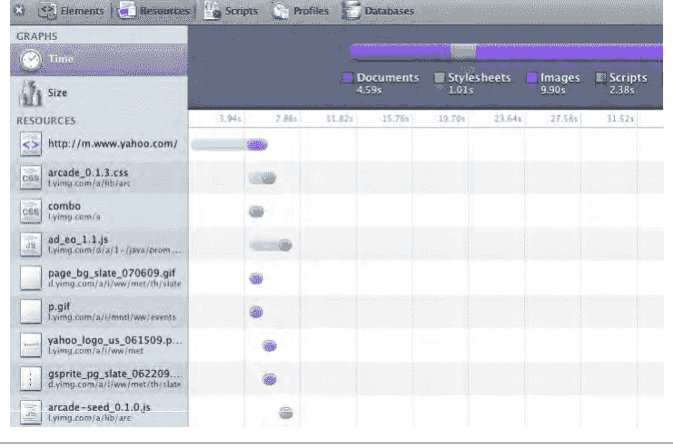

图 10-9. Safari 资源面板

注意与某些浏览器不同，Safari 4 是并行加载脚本而不是阻塞的。Safari 通过确保脚本按正确顺序执行来绕过阻塞限制。记住，这仅适用于最初嵌入 HTML 的脚本；动态添加的脚本既不加载也不执行（第 1 章）。

## Chrome 开发者工具

Google 也为其 Chrome 浏览器提供了一套开发工具，其中一些基于 WebKit/Safari Web Inspector。除了监控网络流量的资源面板外，Chrome 还添加了所有页面和网络事件的时间线（Timeline）视图。Chrome 包含了 Web Inspector 分析面板，以及获取当前内存“堆（heap）”快照的能力。与 Safari 类似，Chrome 分析原生函数并实现了 Firefox 控制台 API：`console.profile` 和 `console.time`。

如图 10-10 所示，时间线面板提供了活动概述，分类为“加载”、“脚本执行”或“渲染”。这使得开发者能够快速关注系统最薄弱的环节。某些事件包含其他事件行的子集，可以进行展开或隐藏以便在记录（Records）中查看更多或更少的详细信息。

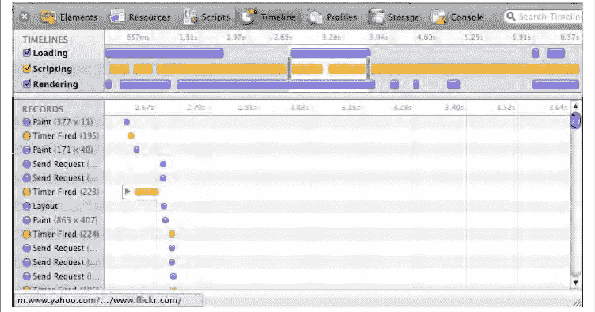

图 10-10. Chrome 开发者工具时间线面板

点击 Chrome 分析面板上的眼睛图标可以获取当前 JavaScript 内存堆的快照（图 10-11）。结果按构造函数分组，并可以展开以显示每个实例。可以使用分析面板底部的“Compared to Snapshot()” 选项对快照进行比较。`+/-` 计数（Count）和大小（Size）列显示了快照之间的差异。

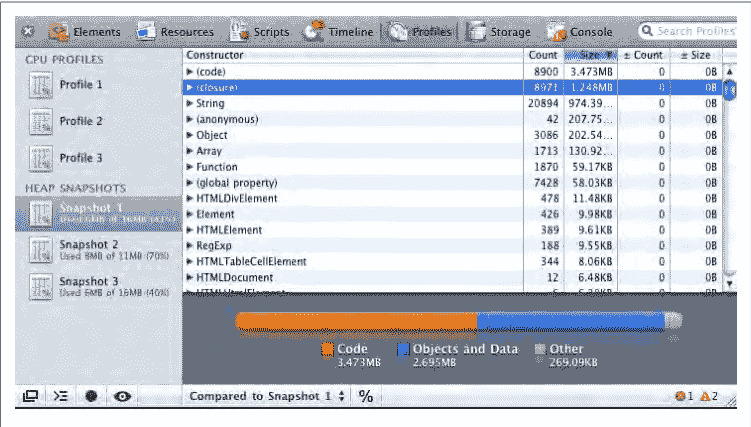

图 10-11. Chrome DevTools JavaScript 堆快照

## 脚本阻塞

传统上，浏览器限制一次请求一个脚本。这样做是为了文件之间的依赖关系。当依赖另一个文件的文件在源码后出现时，可以保证它在执行前已拥有依赖项。脚本之间的间隙可能表示脚本阻塞。较新的浏览器如 Safari 4、IE 8、Firefox 3.5 以及 Chrome 通过允许并行下载脚本但阻塞执行解决了这个问题。脚本阻塞可能会因为一个或多个文件的初始化缓慢而加剧，这值得进行一些分析和可能的优化。脚本的加载可能会阻塞页面渲染，导致用户等待。网络分析工具有助于优化资源的交付。可视化这些间隙可以了解哪些脚本执行较慢。

## 页面速度

Page Speed 最初由 Google 内部开发，后来作为 Firefox 插件发布，它像 Firebug 自己的 Net 面板一样提供了网页加载资源的信息。然而，除了加载时间和 HTTP 状态外，它还显示了解析和执行 JavaScript 的时间、识别延迟脚本，并报告未使用的函数。这些价值信息有助于识别需要进一步调查、优化和可能重构的区域。

Page Speed 面板上的“可延迟 JavaScript”选项可以识别可以延迟或拆分的函数，以交付更小的初始负载。通常情况下，页面上运行的脚本不需要渲染初始视图。在图 10-12 中，你可以看到大部分代码在窗口加载事件之前并未使用。延迟未立即使用的代码有助于初始页面更快加载。脚本和其他资源随后可以根据需要选择性加载。

解析和初始化脚本可能会花费大量时间，而这些脚本在页面渲染后才使用。页面速度活动（Page Speed Activity）面板还可以根据解析时间与首次调用时间的对比，提供关于哪些函数完全未被调用以及哪些函数可以延迟加载的报告（图 10-14）。

图 10-14. 可延迟和未使用的函数报告

报告显示了初始化那些从未被调用或可以稍后调用的函数所花费的时间。考虑重构代码以移除未调用的函数，并确定在初始渲染和设置阶段哪些是不需要的。

## Fiddler

Fiddler 是一个 HTTP 调试代理，它可以检查网络传输的资源并帮助识别任何加载瓶颈。它由 Eric Lawrence 创建，是一款适用于 Windows 的通用网络分析工具，可以提供关于任何浏览器或网络请求的详细报告。访问 http://www.fiddler2.com/fiddler2/ 获取安装和其他信息。

在安装期间，Fiddler 会自动与 IE 和 Firefox 集成。IE 工具栏上增加了一个按钮，Fiddler 的工具（Tools）菜单下增加了一个条目。Fiddler 也可以手动启动。任何发出网络请求的浏览器或应用程序都可以被分析。运行时，所有 WinInet 流量都会通过 Fiddler 路由，允许其监控和分析下载资源的性能。某些浏览器（例如 Opera 和 Safari）不使用 WinInet，但只要在启动浏览器时运行 Fiddler，它们就会检测到 Fiddler 代理。任何允许代理设置的程序都可以通过指向 Fiddler 代理（127.0.0.1，端口：8888）手动通过 Fiddler 运行。

类似于 Firebug、Web Inspector 和 Page Speed，Fiddler 提供了一个瀑布图，可以洞察哪些资源的加载时间较长，以及哪些资源可能影响其他资源的加载（图 10-15）。

图 10-15. Fiddler 瀑布图

从左侧面板选择一个或多个资源会在主视图中显示它们。点击时间线（Timeline）标签可以可视化网络传输中的资源。此视图提供了每个资源相对于其他资源的计时情况，允许你研究不同加载策略的影响，并使阻塞情况更加直观。

统计（Statistics）标签页显示了所有资源实际性能的详细视图——深入了解 DNS 查找和 TCP/IP 连接时间——以及所请求资源的大小和类型的细分（图 10-16）。

图 10-16. Fiddler 统计标签页

这些数据帮助你决定应该进一步调查哪些区域。例如，长的 DNS 查找和 TCP/IP 连接时间可能指示网络问题。资源计数可以明显看出哪些类型的资源构成了页面加载主体，识别出可能的延迟加载或性能分析（针对脚本）的候选对象。

由于 Fiddler 仅在 Windows 上可用，值得提到一个名为 Charles Proxy 的共享产品，它同时在 Windows 和 Mac 上运行。访问 http://www.charlesproxy.com/ 获取免费试用和详细文档。

## YSlow

YSlow 工具提供了初始页面视图整体加载和执行的性能洞察。该工具最初由 Steve Souders（一个 GreaseMonkey 作者）在 Yahoo! 内部开发。它已作为 Firefox 插件向公众开放，并由 Yahoo! 开发者定期维护和更新。访问 http://developer.yahoo.com/yslow/ 获取安装说明和其他产品详情。

YSlow 对页面到外部资源的加载进行评分，提供页面性能报告，并给出改进加载速度的建议。它提供的评分是基于性能专家进行的大量研究。应用这些反馈并在评分前阅读更多细节，有助于确保以最少的资源实现尽可能快的页面加载体验。

这显示了 YSlow 对经过分析的 Web 页面的默认视图。它将为优化页面的加载和渲染速度提供建议。每个评分都包含一个详细视图，带有额外信息以及对规则原理的解释。

通常情况下，提高总分将导致脚本更快加载和执行。图 10-18 显示了通过 JAVASCRIPT 选项过滤后的结果，以及关于如何优化脚本交付和执行的建议。

图 10-18. YSlow: JavaScript 结果

在解释结果时，请记住可能需要考虑的例外。这些可能包括决定何时将多个脚本请求合并为单个请求。

## dynaTrace AJAX 版

dynaTrace（一种强大的性能工具）的开发者发布了包含脚本在内的性能测量“Ajax 版”。图 10-19 所示的摘要（Summary）报告允许你快速找到哪些区域需要关注。图 10-20 所示的网络（Network）视图提供了可能需要某些调优的网络高度详细报告。

下方面板显示了请求头（左侧）和实际请求响应（右侧）。

| URL | 开始时间 [ms] | 网络 [ms] | JavaScript [ms] | 渲染 [ms] | 页面加载时间 [ms] |
| --- | --- | --- | --- | --- | --- |
| http://yahoo.com/ | 0.58 | 3942 | 1190 | 985 | 2415 |

资源
通过网络或浏览器缓存加载的资源数量

网络
花费在网络活动上的时间。并行活动会累加。

JavaScript 
触发器
由所显示事件触发的执行 JavaScript 所花费的时间。

JavaScript APIs
从所显示的 API 执行 JavaScript 耗花费的时间。

```html
<div id="ed_js_1" py="9.2.1" class="cors-16">

<span class="resource-slideshow-1.0.8">其他</span>

</div>
```

图 10-19. dynaTrace AJAX 版: 摘要报告

| 页面 | | | | | |
| --- | --- | --- | --- | --- | --- |
| CPU | http://yahoo.com/ | | | | |
| JavaScript | | | | | |
| 渲染 | | | | | |
| 网络 | | | | | |
| 事件 | | | | | |

选择 JavaScript 轨迹将调出在跟踪期间触发的每个事件的详细报告（见图 10-21）。在此，你可以深入研究特定事件（“加载”、“点击”、“鼠标悬停”等）以找到运行时性能问题的根源。

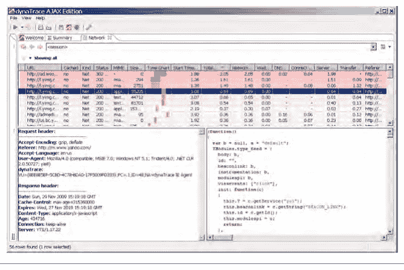

图 10-20. dynaTrace AJAX 版：网络报告

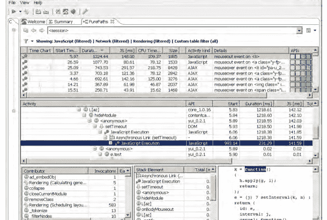

图 10-21. dynaTrace AJAX 版 PurePaths 面板

## 摘要

当网页或应用程序开始感觉运行缓慢时，通过分析传输过程中的资源，并在脚本运行时对其进行性能分析，可以让你将优化精力集中在最需要的地方。

- 使用网络分析器识别脚本和其他页面资源加载过程中的瓶颈；这有助于确定是否需要对脚本进行延迟加载或分析。
- 尽管传统观念认为尽量减少 HTTP 请求次数，但尽可能推迟脚本可以让页面渲染得更快，从而为用户提供更好的整体体验。
- 使用性能分析器识别脚本执行中的缓慢区域，通过检查每个函数消耗的时间、函数被调用的次数以及调用栈本身，可以为优化精力应该关注何处提供多重线索。
- 尽管消耗的时间和调用次数通常是有价值的数据，但更仔细地观察函数的调用方式可能会发现其他的优化目标。

这些工具有助于揭示现代代码必须运行的通常具有敌性的编程环境。在开始优化之前使用这些工具，将确保开发时间花在正确的问题上。

# 索引

# 符号

`+`（加号）运算符，82–84
`+=`（加加等于）运算符，82–84

# A

激活对象 (activation objects), 18
`add()` 函数，17
`addEventListener()` 函数，154
敏捷 JavaScript 构建过程，174
Ajax（异步 JavaScript 和 XML）， 125–150
- 数据格式，134–145
- 数据传输，125–134
- 性能，145–169
- 算法，61–80
- 条件判断，68–73
- 循环，61–68
- 递归，73–79
alation
- 与回溯相关，89
- 动画、元素与流，56

匿名函数
- 关于，182
- YUI 分析器，181
Apache Ant, 163, 173
Apache Web 服务器，ExpiresDefault 创建，

APIs
- 控制台 API: Firebug，184
- CSS 选择器，48
- DOM，35
- 数组项，定义，15
- 数组合并，84

- 数组处理，带计时器，114
`array.join()` 方法，82
数组
- 与 HTMLCollection 对象比较，42
- 双重评估，153
- for-in 循环，63
`assignEvents()` 函数，25
异步 JavaScript 和 XML（见 Ajax）
原子分组，模拟，93

# B

反向引用，模拟原子分组，93
- 关于，89
- 失控回溯，91–95
批量处理 DOM 更改，54
发送信标 (beacons)，133
正则表达式的性能基准测试，96
最佳实践（编程实践）
- 位掩码 (bitmask)，158
- 位运算符，156–169
- 脚本块，193
BOM（浏览器对象模型），对象
- 成员，27
- 括号表示法与点表示法，31
浏览器，1
（另见 Chrome; Firefox; IE; Safari）
- DOM 和 JavaScript 实现，35
DOM 脚本，35
原生代码值 eval()，12
性能，1, 15
脚本阻塞，193
trim，103
UI 线程，107

我们非常欢迎听到您对改进索引的建议。请发送电子邮件至 index@oreilly.com。

203

基于 WebKit 的 innerHTML，38
XPath，137
敏捷 JavaScript 构建过程，174
编译时与运行时过程，176

# C

- 缓存
Ajax, 145
- JavaScript 文件，171
- 布局信息，56
- 对象成员，31
- 使用，172
调用大小项，74
CDN（内容分发网络），173
链（服务原型链；作用域链）
childNodes 集合，47
Chrome
- 开发工具，192
- 即时编译 JavaScript 编译器，160
- 时间限制，110
克隆节点，41
Closure Clipper，169
Closure Inspector，169
闭包，作用域，24
集合
- childNodes 集合，47
- 集合元素，45
- HTML 集合，42–46
合并 JavaScript 文件，163
Firefox 编译折叠，84
压缩，170
concat 方法，86
字符串拼接，40, 81–87
条件提前加载，156
条件判断，68–73
- if-else，68, 70
- 查找表，72
控制台 API, Firebase，184
控制台面板页脚, Firebase，183
`console.time()` 函数，185
常量，数学常量，159
分发网络 (CDN)，173
爬取 DOM，47
CSS 文件加载，11
CSS 选择器，APIs，48
cssText 属性，53

# D

- 数据访问，15–33
- 对象成员，27
- 作用域，16–26
数据缓存，145
数据格式，134–145
- 自定义，142
- HTML，141
- JSON，137–141
- XML，134
数据传输，125–134
- 请求数据，125–131
- 发送数据，131–134
数据类型、函数和属性，27
Date 对象，178
延迟脚本，5
委托，事件，57
部署 JavaScript 资源，173
displayName，190
while 循环，62
文档片段，批量处理 DOM 更改，55
DOM（文档模型），对象
- 成员，27
DOM 脚本，35–59
访问文档结构，46–50
浏览器，35
克隆节点，41
事件委托，57
- HTML 集合，42–46
innerHTML，37–40
重绘和重流，50–57
点表示法与括号表示法，31
双重评估，151–153
下载，122
（另见 DOM 脚本；加载；非阻塞脚本；）
`<script>` 标签阻塞，3
使用节点，7
动态脚本元素，6–9
动态标签插入，127
dyn，199

# E

- DOM 节点，47
元素，45
`assignEvents()` 函数，25
缓存对象值，31
`console.time()` 函数，185
数据类型，27
`eval()` 函数，24, 138, 151
`execute()` 函数，24
`factorial()` 函数，75, 78
`intUI()` 函数，21
`mergeSort()` 函数，77
`multe()` 函数，118
`processArray()` 函数，184
`removeEventListener()` 函数，154
`setInterval()` 函数，112, 151
`setTimeout()` 函数，112, 151
执行中的任务，184
动态脚本元素，6–9
重流，56
模拟原子分组，93
`eval()` 函数，24, 138, 151
事件委托，DOM 脚本，57
消息事件，121
onchange 事件，7
`execute()` 函数，24
执行（安全脚本）
Expires Header，164
Apache Web 服务器，172
外部文件加载，122

`factorial()` 函数，75, 78
fiddler，196
文件，122

# G

GET 与 POST 使用HR，127
全局变量，性能，19
Google 工具，192
Google Closure Compiler，169
gzip 压缩，169, 170
（另见 DOM 脚本；加载；阻塞脚本；脚本）
缓存 JavaScript 文件，171
合并 JavaScript 文件，165
加载外部文件，122
预处理 JavaScript 脚本，166
Firebug，183–186

# H

编译折叠，84
流控制，61–80
条件判断，68–73
循环，61–68
递归，73–79
流（重流）
刷新渲染树更改，51
折叠，编译时和 Firefox，84
for 循环，62, 63
handleClick() 方法，108
hasOwnProperty() 方法，28
标头
Expires Header，164
:hover, IE，57
昂贵的集合，43
局部变量，45
HTML 数据格式，141
HTTP Header，Ajax，146

# I

等等操作，127
标识符解析，作用域，16–21
IE（Internet 浏览器）
数组合并，84
字符串拼接，70
动态脚本元素，7
nextSibling，47
forEach() 方法，67
Function() 构造函数，151
属性，116
（另见方法；语句）
add() 函数，17
addEventListener() 函数，154
匿名函数，181, 182
重流，57
重复操作，111
时间限制，109
使用，186
XHR 对象，148
调用栈大小限制，74
长时间脚本限制，109
字面量值，定义，15
加载，122
if-else
优化，70
与 switch，68
initUI() 函数，21
注入非阻塞脚本，9
innerHTML
数据格式，140
（另见 DOM 脚本；下载；非阻塞脚本；）
条件提前加载，156
CSS 文件，13
与 DOM，37–40
接口（用户接口）
Internet Explorer（见 IE）
互操作性，JSON，140
iPhone（Safari）
迭代
基于函数的，67
循环性能，63–67
递归，76
外部文件，122
JavaScript，10
懒加载，154
脚本，192
局部变量
HTML 集合，45
性能，19, 36
长时间脚本限制，109
预读，组原子分组，93
查找表，72
循环，61–68
基于函数的迭代，67
使用 `console.time()` 测量，185
性能，63–67
类型，61

# J

JavaScript 文件
缓存，171
合并，165
预处理，166
JavaScript 命名空间，嵌套属性，32
JavaScript 分析分析，178
合并数组，84
jQuery 库，压缩，171
JSMin，168
JSON（JavaScript 对象表示），数据格式，137–141
JSON-P（带填充的 JSON），139

# M

数学常量和方法列表，159
记忆化，递归，77
`mergeSort()` 函数，77
消息事件，121
方法，159
（另见函数）；对象成员；语句）
`Array.prototype.join` 方法，84
concat 方法，86
数据类型，27
forEach() 方法，67
handleClick(),108
hasOwnProperty() 方法，28
`$LAB.script()` 方法，13
`$LAB.wait()` 方法，13
数学方法，159
原生方法，159
postMessage() 方法，121
querySelector() 方法，160
querySelectorAll() 方法，48, 160
字符串拼接，82


此对象方法, 33
toString() 方法, 28
trim 方法, 99
代码压缩, 168
multistep() 函数, 118
MXHR (部分 XHR), 128–131

面板
- 控制台面板分析器: Firebug, 183
- 网络面板: Firebug, 185
- 性能分析面板, 189
- 资源面板: Safari Web Inspector, 191

解析时间, XML, 137
解析, 使用 eval(function) 配合 JSON, 138
性能
- Ajax, 145–149
- 数组合并, 30
- 浏览器, 15
- 闭包, 25
- DOM 脚本, 35, 36
- 格式比较, 144
- HTML 格式, 142
- 标识符解析, 19
- JavaScript 引擎, 24
- 浏览器中的 JavaScript, 1
- JSON 格式, 139
- JSON 格式, 140
- 循环, 63

# N

命名空间，嵌套属性, 32
原生方法, 159
嵌套对象方法, 30
嵌套量符，失控性回溯, 94
网络面板, Firebug, 185
Nielsen, Jakob 关于 UI 响应时间, 110
克隆, 41
非阻塞链, 5–14
延迟脚本, 5
动态脚本元素, 6–9
加载 JavaScript, 10
XMLHttpRequest 脚本注入, 9
非捕获组, 97,

# 0

对象成员, 27
（另参见方法; 属性）
缓存对象方法值, 31
数据访问, 27–33
已定义, 15
嵌套的, 30
原型链, 29
原型, 22
对象
- 激活对象, 18
- 日期对象, 178
- HTMLCollection, 42
- 编程实践, 153
- XHR 对象, 148
onmessage 事件, 121
- Opera, 时间限制, 110
运算符
- 位运算运算符, 156–159
- 加法 (+) 和等值赋值 (==) 运算符, 82–84

优化（另见性能）
作用域外变量, 26

原生代码对比 eval(), 152
嵌套成员, 31
正则表达式, 87, 96
定时器, 119
trim 实现, 103
XHR 格式, 144
XML, 137
加法 (+) 运算符, 82–84
等值赋值 (==) 运算符, 82–84
脚本定位, 2
使用 XHR 时对比 POST, 127
postMessage() 方法, 121
预处理 JavaScript 文件, 166
预测试条件, 162
processArray() 函数, 116
profileEnd() 函数, 184
性能分析器 (UI), 179–182
性能分析面板, Safari Web Inspector, 189
JavaScript 性能分析, 178
编程实践, 151–161
- 位运算运算符, 156–159
- 双重评估, 151–153
- 原生方法, 159
- 对象/数组字面量, 153
- 重复工作, 154
- prop 变量, 62
属性, 27

# P

Page Speed, 194

索引 | 207

（另见方法; 对象成员）
cssText 属性, 53
数据类型, 27
display 属性, 190
DOM 属性, 47
innerHTML 属性, 37
length 属性, 43
原型, 27
在函数中读取, 32
[[Scope]] 属性
原型链, 对象成员, 29
原型, 对象成员, 27

# Q

量符
- 嵌套查询, 94
性能, 98
HTML 集合查询, 43
querySelector() 方法, 160
querySelectorAll() 方法, 48, 160

# R

readyState
MXHR, 130
XHR, 126
XMLHttpRequest, 148
readystate属性 `<script>` 元素, 7
readystatechange 事件, IE, 7
递归, 73–97
调用栈大小限制, 74
迭代, 66
记忆化, 77
模式, 75
重流, 50–57
缓存布局信息, 56
元素, 56
IE, 57
优化, 52–56
排队并刷新渲染更改, 51
正则表达式 (regexes), 87–99
关于, 88
原子分组, 93
回溯, 89, 91
基准测试, 96
性能, 87, 96, 99
重复, 90

# S

Safari
缓存能力, 172
加载查询, 192
传递字符串, 122
启动和停止性能分析
通过程序化, 189
时间限制, 110
Safari Web Inspector, 188–192
作用域, 16–26
闭包, 24
动态作用域, 24
标识符解析, 16–21
增强, 21
标识符解析, 16
性能, 20
[[Scope]] 属性, 25
脚本阻塞, 193
脚本标签, 动态插入, 127
`<script>` 元素, 6
DOM, 6
性能, 1
放置, 2
脚本, 1–14
（另见 DOM）
性能分析, 183
分组, 4
加载, 192
非阻塞脚本, 5–14
定位, 2
选择器, CSS, 48
发送数据, Ajax, 131–134
setInterval() 函数, 112, 151
setTimeout() 函数, 112, 151
速度, 174
（性能）
栈, 调用栈限制, 74
语句, 116
（另见条件）
try-catch 语句, 23, 75
var 方法, 62
with 语句, 21
string.concat() 方法, 82
字符串
连接, 40, 81–87
在 Safari 中传递, 122
修, 99–103
样式和重流, 53
切换, if-else, 68

# U

用户界面, 107–124
浏览器线程, 107–111
web workers, 120–124
通过定时器产生, 111–120
<user> 标签, 136

# V

值，缓存成员值, 31
var 语句, 62
变量, 19
（另见局部变量）
已定义, 15
函数执行, 18
局部对比全局, 19
作用域外变量, 26
prop 变量, 62

# T

表格，查找表, 72
标签, 127
（另见元素）
<user> 标签, 136
动态脚本插入, 127
this 方法, 33
Thomas, Neil,120
浏览器, UI 线程, 107
时间限制, 浏览器, 109–111
定时器
性能, 19
通过定时器产生, 111–120
令牌，暴露, 98
工具, 177–202
通过匿名函数, 182
Chrome 开发者, 192
dynaTrace, 199
fiddler, 56
Firebug, 183–186
IE (Internet Explorer), 186
JavaScript 性能分析, 178
Page Speed, 194
Safari Web Inspector, 188–192
脚本阻塞, 193
YSlow, 198
YUI Profiler, 179–212

# W

Web Inspector (Safari), 188–192
web workers, 120–124
通信, 121
环境, 120
加载外部文件, 122
用途, 122
基于 WebKit 的浏览器, innerHTML, 33
while 循环, 62, 63
with 语句, 221

# X

XHR (XMLHttpRequest)
关于, 126
MXHR, 128–131
POST 对 GET, 127
发送数据, 131–134
XHR 对象, IE, 148
XML 数据格式, 134–137
XMLHttpRequest, 131, 148
XMLHttpRequest 脚本注入, 9
XPath, 137

# Y

通过定时器产生, 111–120
YSlow, 198
YUI 3, 加载 JavaScript, 12
YUI Profiler, 179–182
toString() 方法, 282
树（另见渲染树）
修剪字符串, 99–103, 99
try-catch 语句, 23, 75

# 关于作者

Nicholas C. Zakas 是一位 Web 软件工程师，专注于使用 JavaScript、动态 HTML、CSS、XML 和 XSLT 进行 Web 应用的用户界面设计和实现。他目前是 Yahoo! 主页的主前端工程师，Yahoo! 用户界面 (YUI) 库的贡献者，编写了 Cookie Utility、Profiler 和 YUI Test。

Nicholas 是《Professional JavaScript for Web Developers》的作者，《Professional Ajax》的合著者（均由 Wrox 出版），并在其他书籍做过贡献。他还为 WebReference、Sitepoint 和 YUI Blog 写过多篇在线文章。

Nicholas 经常讨论 Web 开发、JavaScript 和最佳实践。他曾在 Yahoo!、LinkedIn、Google、NASA 等公司进行过演讲，并在 Ajax Experience、Rich Experience 和 Velocity 等会议上发表过。

通过写作和演讲，Nicholas 旨在将他在开发世界上最流行和要求最高的 Web 应用程序时学到的宝贵经验教给他人。

有关 Nicholas 的更多信息，请参阅 http://www.nzonline.net/about/

# 版后记

《高性能 JavaScript》的动物是短耳欧幼（Asio flamous）。正如其名字所示，这种鸟标志性的耳朵羽很小，看起来只是大头顶部的隆起。然而，当这种猫头鹰受到威胁并防御某个位置时，这些羽就会变得更加明显。这种中等体型的猫头鹰拥有黄色眼睛、斑驳的羽毛（胸部有浅条纹），宽大的翅膀上有深色斑。

作为世界上分布最广泛的鸟类之一，除了澳大利亚和南极以外，各大洲都能找到。短耳欧幼生活在草原、湿地或冻原等开阔地区。它通过在低空飞行或栖息在短树上来捕获哺乳动物（如鼠类），偶尔也捕食鸟类。猫头鹰在清晨、傍晚和黄昏时分最为活跃。
