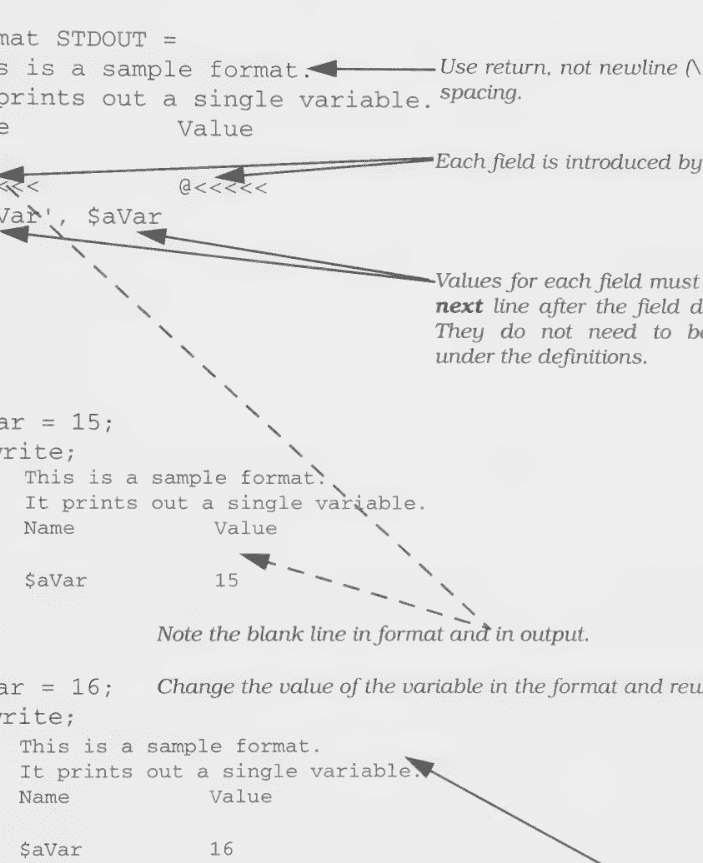
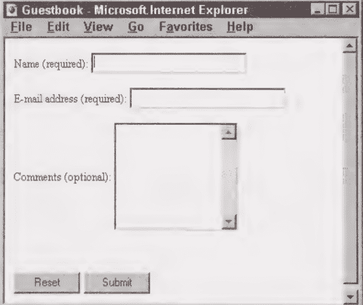
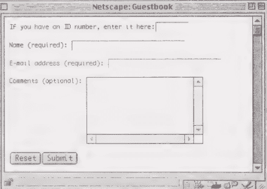

# Perl 5 程序员笔记本

https://archive.org/details/perl5programmers0000feil

- 多行字段 194

- 站点搜索 226

# 序言

Perl——即实用提取语言（Practical Extraction Language）——是一种简单而强大的脚本语言，你可以用它在各种操作系统（Unix、Windows、DOS 和 Macintosh 等）上处理文本、文件和报告。它在 Perl 艺术许可（Artistic License）下免费提供，你可以从 http://www.perl.com 下载。

随着万维网的快速发展，页面设计师和网站管理员不断遇到超出 HTML（网页语言）范围的小任务；这些任务包括编辑表单中的数据、自动生成电子邮件、创建留言板以及管理站点安全。看吧，Perl——这种设计用于处理文本、文件和报告的语言——证明是此类任务的完美工具。考虑到它的定价结构（如前所述，它是免费的），它出现在许多服务提供商的许多 Web 服务器上并不意外。

从其简单性来说，Perl 是一个完成小任务的绝佳工具（包括让你的网站正常运行）。如果你想学习编程原理，它也是一个极佳的环境。你可以用 Perl 编写糟糕的代码（就像用任何编程语言一样），但它的简单性可以帮助你关注适用于所有语言的编程概念。书中提供的示例不仅涵盖了维护网站所需的实际问题，还涵盖了你可以应用到其他语言的良好编程技能。

本书采用双页布局，帮助你理解问题和概念，然后将它们应用于 Perl 脚本。左页描述主题；在右页，你将找到一个完整的 Perl 脚本（有时是两个），几乎每一行代码都附有注释。示例展示了你应该做什么以及不该做什么。此外，示例尽可能地提供了你可以立即使用的实用脚本。（查看索引中的“Scripts”条目可以找到可用于你的站点或其他目的的完整脚本。）

欲了解更多关于 Perl 信息以及本书的更新，请访问作者网站 http://www.philmontmill.com。那里有一个互动区域允许你发布问题，通用问题将在网站上解答以供他人受益。

# 第一章

## 简单的 Perl 数据类型与变量

- Perl 的外观

- 变量名

- 标量（Scalars）

- 数字

- 八进制和十六进制

- 字符串

- 转义（控制）字符

- 预定义变量

## Perl 的外观

Perl 程序——就像任何语言中的大多数程序一样——由语句组成。这些语句反过来由项和运算符组成——就像代数公式一样。

Perl 的设计目的是为了方便快速编写和执行程序；出于这个原因，它对缺失的项和运算符进行了假设。这些假设允许你编写表面上不完整的语句，但它们仍然能够按照你想要的方式工作。

右侧的 Perl 程序包含了各种 Perl 语句。它们说明了 Perl 语法以及 Perl 对未提供的语法元素所做的假设。它们还展示了 Perl 中某些如果你使用过其他编程语言可能会感到陌生的结构。这些结构在本书的后面都会进行讨论：这个程序的目的是让你对 Perl 的外观有一个感觉。

Perl 中的注释以 # 开始，并持续到行尾。它们使代码更易读，并在程序编写很长时间之后修改程序时变得无价之宝。如果你的注释跨多行，你需要在每行的开头放置一个 #。

```perl
#!/usr/bin/perl
```

Perl 程序的第一行可能需要包含 Perl 翻译器的位置。如果你的系统需要它，你将在你编写的每个 Perl 程序开头使用相同的行。注意，这不是注释。

```perl
$x = 2.5;
```

Perl 变量——标量——前面有一个符号 $。你用 = 给它赋值。所有 Perl 可执行的语句都以分号结尾结束。

```perl
print ($x);
```

你可以使用 print 打印数据。通常，它会显示在你电脑的窗口中；如果你使用的是基于文本的系统，数据将直接打印在你运行 Perl 程序的语句正下方。打印到打印机需要额外的设置命令。

```perl
$x = $y = 2.5;
```

这里是一个 Perl 快捷方法的示例：你可以通过一次赋值为两个不同的标量进行赋值。

```perl
print $x, $y;
```

```perl
print ($x, $y);
```

这是另一个 Perl 快捷方法的示例：括号通常是可选的。这两个语句是相同的（它们都会在框中打印 $x 和 $y 的当前值）。

```perl
print "<CENTER HREF=\"" . $params{"return"} . ">Return</A></CENTER>";
```

该语句使用你可以在定义的 Perl 数据结构中 "return" 项指定的值来打印出一个 HTML 链接。你将在书的后面部分找到更多关于这种语句以及使用 Perl 生成 Web 页面的知识。

## # 这是一个注释

```perl
while (<STDIN>) {
  if (/\Yes$/i) {
    print "Case-insensitive yes"
  }
  if (/\$/) { last };
}
```

这个循环读取输入，直到发现空行。如果用户以大小写的任意组合输入 Yes，则将打印出 "Case-insensitive yes" 消息。代码中下划线的部分是正则表达式：它们定义了用于测试的字符。Perl 广泛地使用正则表达式。

## 简单的 Perl 数据类型与变量

## 变量名

Perl 变量以标识变量类型的特殊符号开头。所有标量（简单值）都以 $ 开头。数组（标量的有序集合）以 @ 开头。哈希（使用键来识别元素的关联数组）以 % 开头。（数组和哈希将在第 4 章中讨论。）

每种类型的变量都有自己的命名空间——这简单意味着所有标量的名称与哈希和数组的名称分开存储。因此，你可以有一个名为 $name 的标量；它与名为 @name 的数组是完全独立的。

变量名可以由字母、数字和下划线字符组成。它们也可以包含特殊字符——如 ^ 或 &；然而，这些变量名只能有一个字符长，并且其中大多数被预留给 Perl 使用。

变量在你第一次使用它们时就会被创建——你不需要提前声明它们。因此，如果你不小心创建了一个新变量，Perl 不会警告你，因为（从 Perl 的角度来看）这是完全正常且合法的操作。

与所有编程语言一样，为你的变量使用有意义的名称。当你回到程序时，记住 $last_pay_period 是什么意思比记住 $lpd 是什么要容易得多。

许多程序员在创建变量名时会使用几个单词——例如 $last_pay_period。为了可读性，你应该用下划线字符分隔单词，或者使用嵌入式大写——例如 $PayPeriod。记住，目标是易读性。

最后，注意变量的内容是由其用途决定的。你通过给它赋值一个数字来隐式地创建一个数值型标量；当你给它赋值一个字符串时，就会创建一个字符串型标量。

```perl
#!/usr/bin/perl

$title = "Perl Programmer's Notebook";
## 这是一个名为 title 的标量变量。

title = "Perl Programmer's Notebook";
# 这行代码将无法编译——title 之前没有符号来指示它是标量、数组还是哈希。

@title = ("Perl Programmer's Notebook");
# 这个变量是一个数组；它与上面显示的 $title 标量完全独立。如果你将一个数组设置为单个元素，数组的第一个元素（索引0）将被设置为该值。
```

## 标量

标量是简单值。它们前面有一个符号 $。它们可以包含一个数字或字符串。你通过给它赋值一个数字来隐式地创建一个数值型标量；当你给它赋值一个字符串时，就会创建一个字符串型标量。

```perl
#!/usr/bin/perl

$x = 2.5;
$y = "Hello World";
print $x, $y;
```

### 数字

Perl 将其所有的数字都存储为双精度浮点数。因此，你可以存储非常大或非常小的正数和负数。此外，某些算术操作的结果可能与你预期的并不完全一致。

你可以以整数或小数的形式输入数字。你也可以使用科学计数法——例如 `3.4e5`，即 3.4 的 5 次方。数字的任一部分（或两部分都是）都可以是负数——例如 `-3.4e5`、`3.4e-5` 和 `-3.4e-5`。

任何 Perl 标量（scalar）都可以包含数字。数组（Arrays）和哈希（hashes）由标量组成，数组或哈希的每个元素都可以是数字或字符串。（它们可以在单个数据结构中混合使用。）Perl 在需要使用数据时会进行任何必要的数据转换。

在你执行各项操作时，Perl 的自动数据转换非常有帮助。然而，如果你习惯了强类型语言（如 C++），你可能会发现 Perl 接受并处理了你认为本该生成错误的错误的语句。在 Perl 中输入内容时要小心：它通常不会报错，但结果可能会让你大吃眼镜。

```perl
#!/usr/bin/perl

$x = 5/3;
print $x, "\n";
这条语句打印出 1.6666666666666667。5/3 是一个循环小数：在你的计算机上的结果可能因位数的不同而异
print 1.6666666666666667 * 3, "\n";
然而，如果你输入 $x 的打印值并将其乘以 3，你会得到
5.00000000000001。
$a = "5";
print $a, "\n";
这段代码演示了 Perl 的自动类型转换。标量 $a 是
一个被赋值的字符串值——你可以通过 "5" 周围的引号看出它是一个字符串。
$a = $a/2;
print $a, "\n";
根据需要，Perl 会进行类型转换。在这里，它将字符串 "5" 转换为数字 5 并除以 2——得到 2.5。
$a = $a. " cents";
print $a, "\n";
句号是连接（合并）两个字符串的运算符。对于此操作，Perl 需要将 $a 转换为字符串。它将数字 2.5 转换为字符串 "2.5" 并打印出 2.5 cents。
$a = "z";
print $a, "\n";
然而，类型转换再次起了作用。$a 被赋予了一个字符串值——"z"。
$a = $a. " cents";
print $a, "\n";
这，当你将 $a——即字符串值 z——除以 2 时，它被转换为
数字。Perl 能将其转换的唯一数字是零。操作的结果是 0——即 0/2。
$a = $a. " cents";
print $a, "\n";
然而，数字零又被转换回字符串——0——并与字符串的其余部分连接。
```

### 八进制和十六进制数

你可以使用八进制和十六进制数以及普通的十进制数。十六进制数通常用于表示非打印字符（如换行符、制表符等）。一对十六进制数字代表任何标准字符。（国际 Unicode 字符集每个字符需要四个十六进制数字。这允许表示非罗马字母文字表。）十六进制数使用数字 0–9 和 A (10)、B (11)…… 直到 F (15)。

八进制数使用数字 0–7。它们的使用频率比十六进制数低。

```perl
#!/usr/bin/perl

$a = 0111;
    print $a, "\n";
73 这是一个八进制数——73。它以前导零开头；每个
  八进制数由数字 0-7 组成。

$a = 0111;
    print $a, "\n";
0111 记住自动转换：这个数字以字母 0 开头（而不是零）。

$a = 0x49;
    print $a, "\n";
73 零后面跟着 x 引入了一个十六进制数。十六进制数
  使用数字 0–F。
```

### 字符串

字符串是许多程序的核心。你可以轻松地使用 Perl 来组装和拆解字符串，去掉引号或逗号，查找电子邮件地址并为 Web 页面生成 HTML。最基础的字符串是包含在直体双引号（"）中的字符序序列。这些被称为双引号字符串。它们可以是任何长度，并且可以包含你可以输入的任何字符（Perl 的字符是大多数计算机上使用的 ASCII 字符集。某些计算机使用较新的 Unicode 字符集，允许对非罗马字母进行输入和显示）。这些字符串唯一的问题是，你有时需要在键盘上输入字符；你可能还需要输入引号——那将结束字符串。为了处理这些情况，Perl 允许你通过在这些特殊字符前面加上反斜杠来输入这些特殊字符。在双引号字符串中，\\ 总是引入一个特殊字符（它可能会在字符串中引入换行符）。除了解释双引号字符串中的这些特殊字符外，Perl 还会解析字符�内的变量。你也可以使用单引号字符串。它们有不同的规则。不会发生插值。

```perl
#!/usr/bin/perl
# 此处由于原文文本不完整，根据示例逻辑占位
# 实际翻译中已根据提供的片段进行处理
```

## 预定义变量

Perl 有许多预定义变量，你可以使用它们来访问系统信息。某些是只读的，但你可以设置其他的。（这是在 Perl 脚本内部设置选项的标准方法。）Perl 的预定义变量遵循 Perl 的命名规范：许多是标量（scalars），但有些是数组（arrays）和哈希（hashes）。

English 模块允许你为许多预定义变量使用有意义名称。如果你使用英文名称，必须指定加载 English 模块；你通过在程序顶部包含 `use English` 来实现，如下所示打印当前 Perl 版本的脚本：

```perl
#!/usr/bin/perl
use English;
print $PERL_VERSION, "\n";
```

虽然使用 English 模块会带来微小的速度损失，但它的益处通常是值得的。

如果你使用 Perl 缩写，则不需要使用 English 模块：

```perl
#!/usr/bin/perl
print $@, "\n";
```

通过预定义变量，你可以更改许多 Perl 的默认值。例如，尽管 Perl 数组通常从 0 开始，但实际上，数组的起始数字存储在预定义变量 `$@` 中。如果你将其更改为 1，你的数组将从 1 开始。（这可能会让阅读你程序的人感到困惑。）

具有通用适用性的预定义变量见表 1-2；其他变量将在解释其概念的章节显示。

### 表 1-2: 预定义通用 Perl 变量

| 英文 | Perl | 含义 |

|---|---|---|

| $PERL_VERSION | $@ | Perl 的当前版本（包括补丁）——例如 5.004（只读）。 |

| | @ARGV | 包含脚本命令行参数的数组。 |

| $DEBUGGING | $D | Perl 调试标志的值。 |

| | ^H | 使用 `use strict` 周时启用的语法检查集。 |

| $PERLDB | $P | 调试器内部使用的变量。 |

| $WARNING | $W | 警告开关：是否生成警告（设置为 TRUE 或 FALSE）。 |

| $INPLACE_EDIT | $I | 如果为 undef，则放置在当前使用文件的副本上的后缀名，以便在编辑期间保存旧版本和新版本。 |

| | @INC | 查找 Perl 脚本的路径数组。 |

| | ^M | 允许在内存不足的情况下指定使用的内存的变量。 |

## Perl 运算符

- 算术运算符

- 赋值运算符

- 逻辑（二元）运算符

- 逻辑表面

- 关系运算符

- 等价运算符

- 字符串运算符

- 其他运算符

- 运算符优先级

### 算术运算符

Perl 运算符提供了你从任何现代编程语言中期望相同的功能——在某些情况下甚至更多。如果你熟悉 C，你会发现 Perl 非常简单。

和大多数现代编程语言一样，Perl 是左向的——也就是说，涉及项（操作数）和运算符的计算被写在等号右侧；结果然后存储在等号左侧的变量中，例如：

```perl
y = (m * x) + b;
```

与代数公式不同，项必须由运算符分隔。你可以在代数中写：

```
y = mx + b
```

但计算机语言解析器需要在 `m` 和 `x` 之间一个乘法符号，以便它知道这不是一个名为 `mx` 的新变量。

语句通常从左到右解析，并按照该顺序执行操作。例外是某些运算符的优先级高于其他运算符——例如，乘法和除法在加减法之前执行。此外，括号括的项会在其他项之前求值。

除了标准算术运算符外，Perl 还提供了幂运算符 (`**`) 以及用于整数除法的 div (`/`) 和 mod (`%`) 运算符。

```perl
#!/usr/bin/perl

$x = 17;
$y = 4;
$x 和 $y 贯穿整个示例。它们将保持不变
$z = $x + $y;
  print $z, "\n"; # 21. 这是简单的加法。
$z = $x - $y;
  print $z, "\n"; # 13. 这是减法。
$z = $x * $y;
  print $z, "\n"; # 68. 记住你必须在操作的项之间放置 * 运算符。
$z = $x / $y;
  print $z, "\n"; # 42.5. Perl 中的除法使用默认数值数据类型--双精度浮点数。
$z = int ($x / $y);
  print $z, "\n"; # 4. 整数除法（在某些语言中称为 DIV）可以通过结合 / 运算符与 int 函数创建。注意这不会四舍五入结果——它返回商的整数部分。
$z = $x % $y;
  print $z, "\n"; # 1. 这是其他语言中的余数或 MOD 函数——除法后的整数余数。
$z = $x ** $y;
  print $z, "\n"; # 83521. 这是 x 的 y 次方--17 的 4 次方 (17 x 17 x 17 x 17)。
```

### 赋值运算符

赋值运算符用于为变量赋值。最常见的是等号，但 Perl 还提供了其他几种，可以在一步内完成操作和赋值。

```perl
$y = 4;
$y += 5; # 等同于 $y = $y + 5;
$y -= 2; # 等同于 $y = $y - 2;
$y *= 3; # 等同于 $y = $y * 3;
$y /= 2; # 等同于 $y = $y / 2;
$y %= 3; # 等同于 $y = $y % 3;
$y **= 2; # 等同于 $y = $y ** 2;
```

赋值运算符也可以用于字符串。

```perl
$str = "hello";
$str .= " world"; # 等同于 $str = $str . " world"
```

赋值运算符也可以用于数组。

```perl
@arr = (1, 2, 3);
push(@arr, 4); # 等同于 @arr = (@arr, 4);
pop(@arr); # 移除最后一个元素
unshift(@arr, 0); # 等同于 @arr = (0, @arr);
shift(@arr);   # 移除第一个元素
```

赋值运算符也可以用于哈希。

```perl
%hash = (name => "John", age => 30);
$hash{name} = "Jane"; # 更新或添加一个键
delete($hash{age});   # 删除一个键
```

赋值运算符也可以用于引用。

```perl
$ref = \$x;
$$$ref += 20; # 更新引用指向的值
```

赋值运算符还可以用于文件句柄。

```perl
open(FH, ">", "file.txt");
print $FH "hello";
close(FH);
```

AND 运算符有 `&`（普通）（快捷方式）和 `and`（单词）。对于如 `x & y` 这样的表达式，在第一列找到 `x` 的值；然后在在第一行找到 `y` 的值。交叉点即为结果。

与 Perl 操作数一样，每个表达式本身也可以是一个语句。因此，与其 `x & y`，你可能会有 `x & ($y = $z | 1)`。如果你使用快捷运算符 (`&&`)，如果结果无关紧要，Perl 可能不会评估表达式的第二部分 `($y = $z | 1)`。当你使用快捷运算符时，你不能依赖 Perl 执行或执行表达式的右侧部分。

### AND — &&

| | 0 | 1 |

|---|---|---|

| 0 | 0 | 0 |

| 1 | 0 | 1 |

OR 运算符有 `|`（普通）和 `||`（快捷方式）。

### OR — ||

| | 0 | 1 |

|---|---|---|

| 0 | 0 | 1 |

| 1 | 1 | 1 |

XOR 运算符是 `^`。没有快捷运算符。

### XOR — ^

| | 0 | 1 |

|---|---|---|

| 0 | 0 | 1 |

| 1 | 1 | 0 |

注意：如果你正尝试确定使用哪个运算符，请在表中画出你想要的结果并查看哪一个与之匹配。

### 逻辑表达式

逻辑运算符如 `and` `&` `|` 作用于逻辑项——变量、值或评估为真 (1) 或假 (0) 的表达式。有时这些是常量或简单变量，但通常是逻辑表达式。这些逻辑表达式通常由字符串或数值标量组成，并组合成一个逻辑测试。反过来，逻辑项被逻辑运算符使用。

因此，数值标量 `$numberOfClients` 可以构成逻辑项的一部分，例如：

```
$numberOfClients > 1000
```

或者

```
$numberOfClients <= $clientLimit
```

逻辑项有三种：

- 1. 返回逻辑 (1/0) 结果的函数。

- 2. 一元运算符 (`!`)，它反转变量、值或表达式的逻辑值。它类似于一元 `-` 运算符，后者反转数字的符号。它在某些计算机语言中等同于 `NOT`。（在某些语言中，NOT 被实现为函数。）

- 3. 常见的关系运算符如 `<` 和 `>`，组合标量数值或字符串值以产生逻辑结果。（它们与之前讨论的逻辑运算符的区别在于，逻辑运算符组合逻辑运算符以产生逻辑结果；而关系运算符作用于标量数值或字符串值以产生逻辑结果。）

```perl
#!/usr/bin/perl
```

```
if (defined ($true))
`defined` 函数测试变量是否已定义。（它是通过使用它，或者在某些情况下通过正式声明它来定义的。）在这里， `$true` 没有被定义。
    {
    print '$true=', $true, "\n"
    }
else
    {
    print '$true is undefined', "\n"
    }
```

$true is undefined `defined` 函数测试变量是否已定义。（它是通过使用它，或者在某些情况下通过正式声明它来定义的。）在这里， `$true` 没有被定义，并将执行 `else` 语句。注意单引号字符串的使用。`True` 将被打印出来，而不是将其值值到字符串中。

$true = 1;

$false = 0;

许多程序员习惯于将 `true` 和 `false` 定义为常量的语言。你可以创建标量并以这种方式使用。

```
if (defined ($true))
    这次， `$true` 被定义了，`if` 语句的第一部分将被执行。通过组合未插值的单引号字符串和已插值的双引号字符串，你将得到以下结果：

```

{

    print '$true is defined;', 'its value is $true', "\n"

    }

else

    {

    print '$true is undefined', "\n"

    }

```

$true is defined; 它的值为 1

### 关系运算符

关系运算符比较两个值（字符串或数值）。它们返回逻辑结果 (0/1)，你可以将其作为逻辑表达式中的一个项。存在两组关系运算符——一组用于比较数字，另一组用于比较字符串。

四个数值关系运算符是熟悉的代数符号：

- `<`（小于）
- `<=`（小于或等于）
- `>`（大于）
- `>=`（大于或等于）

字符串关系运算符是：

- `lt`（小于）
- `le`（小于或等于）
- `gt`（大于）
- `ge`（大于或等于）

记住 Perl 会自动将值转换为运算符所需的类型；因此，如果你使用字符串关系运算符来比较两个数字，Perl 会将字符串转换为数字。通常这种操作会得到与你预期的不同的结果。如果你使用错误类型的运算符，不会产生错误；对于 Perl 来说，从未发生错误类型。

```perl
#!/usr/bin/perl

使用像这样的程序实验关系运算符。修改变量以便你有两个数值标量和两个字符串标量，如下所示。开启 Perl 警告以查看发生了什么。

$number3 = 3;

$number4 = 4;

$string3 = "three";

$string4 = "four";

if ($number3 > $number4) {

    print "true", "\n";

} else {

    print "false", "\n";

}
```

```perl
#!/usr/bin/perl

$string3 = "three";
$string4 = "four";
尝试像这样的字符串变量。

print $string3 . $string4 . "\n";
threefour. 有时字符串连接符会被忽略。你可能想用空格来隔开它——如此处所示——这样你的眼睛就不会跳过。

```perl

$_ = $string3;

tr/a-z/A-Z/-;

```

print $_ "\n";
THREE. 这种转换过程是典型的。将 Perl 变量 $_ 设置为你想要操作的字符串。执行 tr 操作。$_ 将根据你指定的规则进行修改——在这里，规则是从小写到大写的翻译。

```perl

$string3 =~ tr/a-z/A-Z/-;

print $string3;

```

THREE. 的 =~ 运算符允许你对 = 左侧的字符串标量进行操作，而不是对 $_。这段代码与上方的代码等效——但它少写了一行。它更更容易维护，因为你显式地使用了自己的变量 ($string3)，而不是一个共享变量，某人（可能是你？）可能在其中放置了之后可能需要的信息。

### 其他运算符

这里讨论的其他运算符还允许你构建列表和范围，以及引用和反引用变量。

列表和范围在 Perl 中被常用——特别是在字符处理中。你经常需要为列表指定一个值范围。范围运算符（两个点）允许你这样做。这在两种情况下非常有用：

- 1. 你经常需要一个值范围来控制循环。正如你将在循环章节中看到的，你可能想写出像 for (1..100) 这样的代码。这将导致循环执行 100 次；这比编写带有显式递增和测试的传统 for 语句要简单。

- 2. 你可能想将一个值范围视为数组（或其元素）。你可以写出像 @base10digits=(0..9) 这样的代码，创建一个包含十个元素的数组——每个元素都是 0 到 9 的数字之一。这提高了你代码的可读性。

你已经看到如何通过给变量赋值来创建变量。每个每个变量都有一个内部引用名称（实际上是根据其计算机存储位置对变量的引用）。因此，如果你创建了上面所示的数组——@base10digits——你可以通过 \@base10digits 找到它的引用。你可以将此引用赋值给标量：

```perl

$ref = @base10digits;

```

注意，尽管引用指向数组，但该引用是一个数值标量。所有的引用都是数值标量。

你可以通过 -> 运算符反引用它来访问底层数据。

```perl

#!/usr/bin/perl

@base10digits = (0..9);

print $base10digits [9], "\n";

$ref = \@base10digits;

print $ref->[9], "\n";

```

```perl

print $ref, "\n"

ARRAY(0x21dd90d8)

```

```perl

$ref = "myData";

print $ref, "\n";

SCALAR(0x21e0af8)

```

### 运算符优先级

Perl 表达式可以组合许多运算符。普通算术一样，执行操作的顺序会影响结果。例如，考虑这个方程：

```perl

y = 5 + 2 * 4;

```

如果你从左到右执行操作，你会得到 28（5 + 2 = 7，7 * 4 = 28）。如果你按相反顺序执行，得到 13（2 * 4 = 8，8 + 5 = 13）。

与所有编程语言一样，Perl 有规则来决定如何评估表达式。有三组规则：

- 1. 运算符优先级。扫描表达式以查看使用了哪些运算符。某些运算符先评估。例如，乘法在加法之前执行。（Perl 将上述表达式评估为 13。）

- 2. 括号。括号内的表达式在未带括号的表达式之前执行。对于复杂表达式，你可以在其他括号组内嵌套括号以进一步控制处理。（在上面的表达式中，你可以通过编写 `$y = (5 + 2) * 4` 来强制得到结果 28）。在每组括号内，运算符优先级有效。

- 3. 从左到右。对于优先级级别相同的运算符，它们从左到右评估。

这些规则为评估表达式提供了一种无歧义的方法。

注意，依赖这些规则并不总是能生成可读且易于维护的代码。使用括号来明确你的表达式中哪些部分需要先评估——即使运算符优先级可以处理这些问题。此外，考虑将复杂的表达式拆分为多个语句。

表 2-1 显示了 Perl 的运算符优先级。如果你对两个运算符中哪个先评估有疑问，请在表中查找它们。表中位置越高的先评估。如果运算符处于同一级别（或它们是同一个运算符），则适用结合性规则——它们根据运算符的规则从左侧或右侧评估。

### 表 2-1: 运算符优先级

| 结合性 | 运算符 |
| --- | --- |
| left | terms, list operators, array subscripts, functions, subroutine calls |
| left | -> |
| left | ++ |
| right | ** |
| right | ! |
| left | = |
| left | * |
| left | / |
| left | << |
| left | & |
| left | ^ |
| left | | |
| right | += |
| right | -= |
| left | >= |
| left | <= |
| left | != |
| left | cmp |
| left | == |
| left | = |
| left | | |
| left | && |
| left | || |
| right | = |
| right | != |
| left | ? |
| left | .. |
| left | , |
| left | . |
| left | = |

# 第三章

## 编程基础

- 块
- if/else
- 循环
- 快捷方式
- 陷阱
- 枚举循环
- 停止循环

## 语句

语句可以是简单的或复合的。在 { } 中。你可以使用它们来提高代码的可读性，但在某些情况下它们是必须的。例如，if 语句需要块——简单语句是不行的。

块可以相互嵌套，并引用其他块中使用的变量。然而，你可以使用 my 将变量声明为块局部的。

```perl

my $y = 5;

```

你仅在声明变量时（通常是第一次使用时）使用 my。声明不需要显式地为变量赋值：Perl 会自动为变量分配默认值。（习惯于这样做的其他语言的程序员倾向于显式设置所有变量。）

```perl

my $y;

```

分隔符 { 和 } 足以界定一个块。然而，你经常会注意到程序员会在块的末尾添加 ;（如对面页所示）。这个 ; 实际上是一个多余的空语句。如果你以后添加 else 或 elsif 语句，你需要移除这个 ;。


```perl

#!/usr/bin/perl

$y = 6;

标量变量 $y 被创建并设置为 6。

{

  $y = 5;

  括号定义了一个新的块。在该块内部，标量变量 $y——与上面使用的同一个标量——被重置为 5。

  print $y, "\n";

  5

};

print "y=", $y, "\n";

# y=5

$y = 6;

{

  my $y = 5;

  括号定义了一个新的块，通过 my 创建了一个仅在该块内具有局部作用的新的标量变量 $y。它被设置为 5。

  print $y, "\n";

  5

}

print "y=", $y, "\n";

# y=6. 这个标量 $y 与内部块中声明的 my $y 标量是独立的。

```

### 标签块；跳出块

块是可以带标签的。你只需在块之前加上一个名称并跟一个冒号即可：

```perl

blockName: {

  $y = 5;

  ...

};

```

你可以使用 `goto` 语句将控制权转移到特定的标签块，但这被认为是不良的编程习惯（它会导致“面条代码”）。

块实际上是循环，你可以使用循控制命令来跳出块。

```perl

#!/usr/bin/perl

outerBlock: {

  这个块被标记为 outerBlock。

  my $y = 7;

  {

    当使用嵌套块时，请对齐括号以提高可读性。在这个示例中，创建了三个独立的标量——它们都命名为 $y。

    my $y = 6;

    {

      next;

      next语句会导致控制权传递到当前块之后的下一个语句。

      my $y = 5;

      print $y, "\n";

      然而，这条语句将不会执行，因为下一个语句会将控制权转移到它之外。尝试将 next 移动到程序的各个位置。

    }

    print $y, "\n";

    6

  }

  print $y, "\n";

  7

}

```

### If/Else 和 Unless 块

简单语句可以附加 if、unless、while 和 until 修饰符。块可以用于 if/else 结构；这些结构在许多编程语言中都是常见的。你可能知道它们被称为“if 语句”。

你需要在 if 语句中包含两个必需的组件：

- 1. 一个被求值的逻辑表达式。
- 2. 如果该表达式为真，则执行的块。

可能存在第三个组件——else 块，当表达式为假时将执行该块。你可以在 if 语句之间嵌套 if 语句。

常见的结构是在 else 块中出现 if 语句，以提供一组嵌套的测试。Perl 提供了 `elsf` 关键字。

`unless` 语句是 if 语句的反向。在 unless 语句中，求值逻辑表达式，如果该表达式为假，则执行随其后的第一个块。如果存在 else 块，则仅在表达式为真时执行该块。

### 检查字符丝的特定值-是/否/有时

```perl

#!/usr/bin/perl

$checkID = "yes";

if ($checkID eq "yes") {

    print "checking ID";

    这条消息将被打印，因为 $checkID 在上面被设置为 "yes"。

}

elsif ($checkID eq "no") {

    # elsif 将 else 与另一个 if 语句结合。通过更改顶部 CheckID 的值来观察发生什么。

    print "no need to check";

}

elsif ($checkID eq "sometimes") {

    你有重复的 elsif 子句。请务必对齐括号并格式化你的语句，这样你就不会对内容的对应关系感到困惑。

    print "sometimes";

}else {

    print "???";

    最后一个句通常是传统的 else 子句。如果它是 elsif 子句，它可能不会执行。在代码中涵盖所有的逻辑可能性是良好的编程习惯。

}

unless ($checkID ne "yes") {

    print "checking ID";

}

elsif ($checkID eq "no") {

    print "no need to check";

}

elsif ($checkID eq "sometimes") {

    print "sometimes";

}else {

    print "???";

}

# 将第一个 if 改为 unless 会导致 "checking ID" 不打印。

```

### If 和 Unless 块的快捷方式与陷阱

与 C 语言一样，if 语句可以写在一行。这是快捷形式：

```perl

if (condition) statement;

```

如果语句是一个块，请使用大括号：

```perl

if (condition) {

    statement1;

    statement2;

}

```

`else` 语句允许在条件为假时执行块：

```perl

if (condition) {

    statement;

}else {

    statement;

}

```

`elsif` 语句允许你检查多个条件：

```perl

if (condition1) {

    statement;

}

elsif (condition2) {

    statement;

}

else {

    statement;

}

```

`unless` 语句是 if 的反反。当条件为假时它执行块：

```perl

unless (condition) {

    statement;

}

```

三元运算符 (?:) 是 if-else 语句的快捷方式：

```perl

$result = (condition) ? true_value : false_value;

```

以下运算符是 unless 语句的快捷方式：

```perl

$result = false_value unless condition;

- `and` 运算符是 `if` 的快捷方式。

- `or` 运算符是 `unless` 的快捷方式。

- `&&` 运算符是 `if` 的快捷方式。

- `||` 运算符是 `unless` 的快捷方式。

`||` 运算符常用于为变量默认值：

```perl
$name = $ARGV[0] || "Guest";
```

`die` 函数常用于错误处理：

```perl
open(FILE, $filename) or die "Could not open $filename $!";
```

### 逻辑循环

for 循环允许你遍历数组的每个元素：

```perl
foreach ($item (@array) {
    print $item;
}
```

你也可以使用范围运算符 .. 来遍历序列：

```perl
foreach ($num (1..10)) {
    print $num;
}
```

你可以结合列表和范围：

```perl
foreach ($char ('a'..'z', '!')) {
    print $char;
}
```

`while` 循环在条件为真时一直执行块：

```perl
while (condition) {
    # statement
}
```

`do-while` 循环至少执行一次块，然后检查条件：

```perl
do {
    # statement
} while (condition);
```

带有计数器的 `for` 循环执行指定的次数：

```perl
for ($i = 0; $i < 10; $i++) {
    print $i;
}
```

```perl
#!/usr/bin/perl

foreach $country ("Italy", "Japan", "Peru", "Canada") {
    print $country, "\n";
}
  Italy
  Japan
  Peru
  Canada
```

这是最基础的 `foreach` 循环形式。索引变量 ($country) 会依次赋值为每个值。

```perl
foreach ("Italy", "Japan", "Peru", "Canada") {
    print $_, "\n";
}
  Italy
  Japan
  Peru
  Canada
```

如果你不提供索引变量，Perl 会使用 `$_`。你可以在循环内部访问它。

```perl
foreach (1,2,5..7) {
    print $_, "\n";
}
  1
  2
  5
  6
  7
```

范围操作符会扩展为 5, 6, 7。

```perl
for ($i = 1; $i <= 100; $i++) {
    print $i, "\n";
    $i = 103;
}
  1
```

你可以在循环内部为循环变量赋值。在这里，它被赋予了一个超出循环限制的值，导致循环在第一次迭代后终止。在 Perl 中，使用最后一个语句来实现此操作。（习惯于其他编程语言的程序员可能习惯这种通过重置循环变量来终止循环的风格。）

### 停止循环

`next` 语句将控制传递到循环底部（为下一次迭代做准备）。`redo` 语句将控制传递到循环顶部（重复当前迭代）。`last` 语句将控制传递到循环后的第一个语句。

你可以为这些语句中的每一个添加块的名称，以便将控制转移到该循环的相应语句（第一个或最后一个），而不是当前循环。

如果你开始开发一种需要跳出嵌套循环的复杂循环结构，请考虑重构你的程序。很你可能使用子程序会更好，因为子程序中的控制结构更加显式。

另一种转移控制权的方法是简单地使用 `goto` 语句将控制传递到特定的命名块（这通常在当前循环之外）。这会迅速产生非常不可读的代码，不建议这样做。

当循环的测试条件清晰简单，且操作只有几行长（即使你必须调用子程序）时，循环的效果最为显著。较长的循环往往容易让人迷——当你查看代码时，可能甚至都不会意识到它是循环的一部分！

```perl
#!/usr/bin/perl

$a = "continue"
while ($a eq "continue") {
  # 这与之前显示的循环相同，但增加了 next 语句。
  {
    next;
    # 当遇到 next 语句时，控制掉到循环底部，并执行 continue 块。
    print $a;
    # 此语句将不会执行，因为 next 语句已经转移了控制。
  }
  continue;
  {
    print "continuing";
    # 此语句将执行，因为 next 语句将控制传递到循环底部，且 continue 块确实会执行。
  }
  $a = "stop";
}
```

blockname: foreach (1,2,3,4,5)

这里发生了两个 `foreach` 循环。

```perl
{
  foreach (1,2,3,4,5) {
    print $_, "\n"
    # 这个 $_ 变量特定于此循环。
  }
}
```

`next blockname;`

`next` 语句将控制传递到 `blockname` 的下一次迭代，而不是其所在循环的下一次迭代。

```perl
}
print $_, "\n", "\n"
# 这个 $_ 变量与上一个不同：它是此循环唯一的。
```

```

# 第四章

## 数组

### 使用数组
- 集合数组
- 有序数组
- 栈数组
- 队列数组
- 列表
- 操作列表
- 排序列表
- 切片
- 哈希
- 操作哈希

### 使用数组

数组用于存储相关信息。数组由元素（单个项目）组成。与其他许多编程语言不同，Perl 允许你在数组中放置不同类型的元素——在 Perl 中你没有所谓的数字数组或字符串数组，尽管你可以为自己强制执行这种规则。

数组是有序的——元素按照指定的顺序存在。虽然所有数组的定义方式相同，但它们可以使用不同的方式；因此，在实践中存在四种数组：

1. 集合数组

2. 有序数组

3. 栈数组

4. 队列数组

数组的元素可以通过它们从零开始的位置来访问：因此：在数组内。通常，这些位置从数字二开始编号（第一个是零，第二个是一，第三个是二）。这个数字被称为下标。对于任何数组（例如 `@myarray`），最后一个下标的值可以在标量 `$myarray` 中找到。这不是数组中的元素数量（除非第一个下标是 1 而不是常用的 0）；如果数组中没有元素，返回的值小于数组基准（如果数组基准为 0——常用值，则为 -1）。

数组标识符以 `@` 开头。然而，数组的单个元素是标量，并 `$` 开头。每个元素都括在括号中。因此，数组 `@myarray` 的第一个元素被称为 `$myarray[0]`。

```perl

#!/usr/bin/perl

@myarray = ("apple", "banana", "cherry");

print $myarray[0]; # apple

print $myarray[1]; # banana

print $myarray[2]; # cherry

```


```perl

#!/usr/bin/perl

$animals[0] = "cat";

$animals[1] = "bird";

$animals[2] = "fish";

$animals[3] = "sloth";

# 设置一个包含四个元素的数组，从 0 到 3

foreach (0,1,2,3) {

  print($**, " ", $animals[$_], "\n");

  # 0 cat

  # 1 bird

  # 2 fish

  # 3 sloth

}

```

```perl

for ($counter = 0; $counter <= 3; $counter, ++) {

  print($counter, " ", $animals[$counter], "\n");

  # 0 cat

  # 1 bird

  # 2 fish

  # 3 sloth

}

```

`for` 语句允许你指定一个标量作为索引。这三个子提供了起始点、终止条件和增量。

```perl

for ($counter = 3; $counter >= 0; $counter--) {

  print($counter, " ", $animals[$counter], "\n");

  # 3 sloth

  # 2 fish

  # 1 bird

  # 0 cat

}

```

你可以使用最后一个下标变量，而不是显式地设置数组限制。你也可以反向循环到零，并递减索引。

### 有序数组 (Ordered Arrays)

当你使用数组来存储各种不同的项时，你会使用这种访问方式。例如，`customerinfo[0]` 可能包含一个名称，`customerinfo[1]` 包含一个地址，以此类推。通过将信息收集到数组中，你可以单独访问每个项目，也可以作为一个整体访问数组（在这种情况下使用 `@customerinfo`）。这种能力让你轻松地存储、打印或将数组从一个地方移动到另一个地方，而无需操作每个单独的项目。

当像这样使用时，有序数组类似于 C 语言的 `struct`；然而，`struct` 通过名称（而不是数字）来识别其元素，且每个元素是有类型的，而 Perl 数组可以包含任何类型的元素。

有序数组也可能包含相似的数据项（例如学生姓名），这些项目使用它们的下标进行排序。因此，如果你按字母顺序对学生姓名数组排序，`students[0]` 可能是 Alexis，`students[1]` 可能是 Artemis，以此类推。

Perl 不维护数组存储之外的任何内容：如果你决定数组的第三个元素是一个地址，你必须自己维护这一点。如果你决定你的数组将按字母顺序排序，你的责任是创建并维护该逻辑。

对于有序数组，你通常会遍历数组的元素，直到（或当）满足某些条件。由于元素是有序的，你可以假设条件将以某种与顺序有关的方式发生变化。如果姓名按字母排序，"Mohammed" 将紧随 "Mikael" 之后。

记住，所有 Perl 数组的声明方式都是相同的：你对数组的操作决定了它是否为有序数组。

数组下标通常从 0 开始（Perl 变量 `$` 可以设置为使用另一个基数）。数组的元素是标量；它们可以是字符串或数字。你为你的元素赋予意义。

### 下标 (Subscripts)

### 数组元素 (Array Elements)

| 索引 | | 意义 |
| :--- | :--- | :--- |
| 0 | Anni | 姓名 (Name) |
| 1 | 6 | 年龄 (Age) |
| 2 | 62 | 重量 (Weight) |

```perl

#!/usr/bin/perl

@dogdata = ("Anni", 6, 62, 1, "10/31/1992");

你可以通过单赋值语句设置数组的元素。

```

```perl

print (@dogdata, "\n");

Anni6210/31/1992

```

```perl

print ($dogdata[0], "\n");

Anni

```

```perl

print ($dogdata[1], "\n");

6

```

```perl

print ($dogdata[2], "\n");

62

```

### 栈数组 (Stack Arrays)

栈和队列是涉及有序数组的传统计算机结构——但只有第一个（或最后一个）项是重要的。栈有时被称为后进先出 (LIFO) 结构，而队列被称为先入先出 (FIFO) 结构。当你想要保留一组项的顺序时，可以使用队列：一种常见的用法是允用户输入多个命令，然后按顺序处理它们。

你用于管理队列的命令与管理栈的相同；但配对方式是不同的。如果你向末尾添加元素并从开头删除，使用 `push` 和 `unshift`；如果你向开头添加元素并从末尾删除，使用 `shift` 和 `pop`。

```perl

#!/usr/bin/perl

$animals[0] = "cat";

$animals[1] = "bird";

$animals[2] = "fish";

$animals[3] = "sloth";

# 设置一个包含四个元素的数组，从 0 到 3。

```

```perl

print @animals, "\n";

catbirdfishsl

```

```perl

$x = shift (@animals);

print "Shift:", $x, "\n";

# shift 移除数组的第一个项并返回它。

# cat 是 shift (@animals) 的结果。

# 数组现在是：

birdfish

```

```perl

$x = unshift (@animals), "lion";

print "Unshift:", $x, "\n";

# unshift 在数组开头添加一个项；它返回数组中元素的数量：

# 数组现在是：

catbirdfishsloth

```

```perl

$x = pop (@animals);

print "Pop:", $x, "\n";

# pop 移除数组的最后一个项并返回它。

# sloth 是 pop (@animals) 的结果。

# 数组现在是：

lionfish

```

```perl

$x = push (@animals), "snake";

print "Push:", $x, "\n";

# push 在数组的末尾添加一个项；它返回数组中元素的数量：

# 数组现在是：

lionbirdfishsnake

```

`unshift` 和 `push` 都可以接受列表作为第二个参数——而不是单个项。参见本章后面的“列表”部分。

### 队列数组 (Queue Arrays)

栈只允许从一端添加或删除元素，而队列允许你在一端添加并从另一端删除。栈有时被称为后进先出 (LIFO) 结构，而队列被称为先入先出 (FIFO) 结构。当你想要保留一组项的顺序时，可以使用队列：一种常见的用法是允许用户输入几个命令，然后按顺序处理它们。

你用于管理队列的命令与管理栈的相同；但配对方式是不同的。如果你向末尾添加元素并从开头删除，使用 `push` 和 `unshift`；如果你向开头添加元素并从末尾删除，使用 `shift` 和 `pop`。

```perl

#!/usr/bin/perl

$animals[0] = "cat";

$animals[1] = "bird";

$animals[2] = "fish";

$animals[3] = "sloth";

# 设置一个包含四个元素的数组，从 0 到 3。

```

```perl

print @animals, "\n";

catbirdfishsloth

```

```perl

$x = shift (@animals, "lion");

print "Unshift:", $x, "\n";

# shift 在数组开头添加一个项；它返回数组中元素的数量：

# 数组现在是：

catbirdfishsloth

```

```perl

$x = pop (@animals);

print "Pop:", $x, "\n";

# pop 移除数组的最后一个项并返回它。

# sloth 是 pop (@animals) 的结果。

# 数组现在是：

lioncatfish

```

```perl

$x = push (@animals), "snake");

print "Push:", $x, "\n";

# push 在数组的末尾添加一个项；它返回数组中元素的数量：

# 数组现在是：

lionbirdfishsnake

```

## 列表 (Lists)

列表是标量的集合。数组由赋值给数组变量的列表组成。列表本身由括号内的零或多个标量变量或表达式表示。你可以将列表赋值给数组变量。因此，本章早期使用的以下行可以重写为使用列表：

```perl

$animals[0] = "cat";

$animals[1] = "bird";

$animals[2] = "fish";

$animals[3] = "sloth";

```

使用列表时，代码如下：

```perl

@animals = ("cat", "bird", "fish", "sloth");

```

注意，在第一情况下你将标量（例如 "cat"）赋值给标量变量——例如 `$animals[0]`。在第二情况下，你将列表赋值给数组变量——`@animals`。（之前提到的，这是标量上下文和数组上下文之间的区别。）

在列表内部，你可以使用范围函数 `..` 来指示范围。范囆函数仅适用于数字；它递增（而不是递减）左侧的数字直到达到右侧的值。

```

2..7

```

扩展为

```

2, 3, 4, 5, 6, 7.

```


```perl

#!/usr/bin/perl

$twenty = 20;

@a = (1,2, $twenty..22, "bird"); # 构造函数将 20..22 扩展为 20, 21, 22

for ($i = 0; $i <= $a; $i++) {

    print($a[$i], "\n");

}

```

$twenty 被求值为 20。

列表可以出现在赋值运算符 (=) 的任意侧。如果它们的长度不相等，赋值时将使用项较少的数量。

`($a, $b, $c) = (3,4,5);`

在该赋值语句之后，$c 是未定义的——因为列表中没有对应的值。

`($a, $b, $c) = (3,4);`

此条赋值语句的左侧是一个列表，因为它被括号括起来。它包含一个元素——$a。右侧列表的第一个项 3 被赋值给 $a。

`($a) = (3,4,5);`

此条赋值语句的左侧是一个标量，因为它没有被括号括起来。它被设置为 5。

`$a = (3,4,5);`

### 操作列表

三个函数可以让你轻松操作列表：

- `reverse`：返回一个元素按反向顺序排列的新列表。
- `join`：从列列表创建一个字符串。
- `splice`：从数组中删除元素，并（可选地）在原位置插入列表元素。

`reverse` 函数创建一个新列表：它不会改变现有列表的顺序。但是，你可以将反后的列表赋值给原始列表的标识符，从而有效地原地反转列表。

`join` 函数接受一个字符串作为第一个参数，并将列表元素作为后续参数。它创建一个字符串，其中列表的每个元素都由该字符串分隔。这是一个示例：

```

join('followed by', "a", "b", "c")

```

产生如下：

a followed by b followed by c

当字符串为 `/` 时，你可以轻松地构建一个 URL。

`splice` 函数从数组中删除元素并在原位置添加新元素。使用 `splice` 函数时，你需要指定基础数组、起始位置、（可选的）要删除的项数，以及（可选的）插入项列表。`splice` 函数产生两个结果：它返回从数组中删除的元素，并将新元素（如果有）插入原始数组中。

```perl

#!/usr/bin/perl

($a, $b, $c) = reverse (3,4,5);

```

`reverse` 函数反转列表的元素。在这里，$a 得到值 5，$b 得到值 4，$c 得到值 3。

```perl

@a = (3,4,5);

@a = reverse(@a);

print @a;

543

```

虽然 `reverse` 函数创建了一个新列表，但你可以将它重新赋值给原始变量，从而反转现有列表的元素。

```perl

$domain = "www.philmontmill.com";

$area = "perl";

$page = "index.html";

$URL = join('/', $domain, $area, $page);

```

你可以使用 `join` 函数和 `/` 字符从其组成部分构建 URL。

```perl

print $URL;

www.philmontmill.com/perl/index.html

```

注意：这是找到我们更新本书的 URL。

```perl

@baseArray = ("dog", "wolf", "coyote");

@removedElements = splice(@baseArray, 1, 2, "cat", "bird");

print @baseArray, "\n", @removedElements, "\n";

dogcoyote

```

@baseArray 是原始数组，删除了从索引 1 开始的 2 个元素。这些元素被 "cat" 和 "bird" 替换。

wolfcatbird

@removedElements 包含了被删除的从索引 1 开始的 2 个元素。

### 排序列表

最常见的列表操作可能是对元素进行排序。Perl 的 `sort` 函数可以实现这一点。它作用于列表（可以是数组的元素），并将其排序为另一个列表（或数组）。如果你将数组赋值给自身，就可以有效地进行原地排序；如果将其赋值给另一个数组变量，则原始列表保持不变。（将排序后的列表赋值给新变量也意味着每个排序列表会占用更多内存。）

默认情况下，列表元素使用本地的字母数字序列进行排序。你可以通过编写自己的排序程序来修改该序列。该程序可以位于独立的子程序中，也可以是指向子程序的匿名引用。匿名引用是放在方括号内的子程序代码，然后在 `sort` 语句内部直接使用。如果排序代码很简短，这是最简单的方法。

两个全局变量——$a 和 $b——代表传递给 `sort` 的每对元素。如果你编写了自己的排序程序，可以按照默认以外的顺序对它们进行排序；你还可以根据字母数字值以外的标准进行排序。

`sort` 程序返回三个值之一：

- 1. -1 表示 $a 应该排在 $b 之前。
- 2. 0 表示 $a 和 $b 相等（就排序而言）。
- 3. +1 表示 $a 应该排在 $b 之后。

`cmp`（字符串比较）和 `<=>`（数值比较）运算符为此目的设计的。

```perl
#!/usr/bin/perl

$domain = "www.philmontmill.com";

$area = "perl";

$page = "index.html";

($a, $b, $c) = sort (3,4,5);

```

### 切片 (Slices)

可以使用下标选择数组元素并将它们组合成一个称为“切片”的数据结构。切片——数组元素的集合——可以作为列表使用。切片可以赋值给数组标识符——在这种情况下，它变成数组。

你可以像在其他情况下一样引用数组元素——通过绝对下标（一个数字）、求值为下标的标量，或者通过指示下标范围的构造函数 `...`。由于切片是数组的一部分，因此它使用 `@` 前缀。

例如，给定一个数组 @myArray，你可以通过以下方式引用单个元素：

```

$myArray [1]

```

或者

```

$myArray [$name]

```

你可以通过以下方式引用数组的切片：

```

@myArray [1, 2, 4..6]

```

或者

```

@myArray [$name, 99, 32]

```

你还可以通过 `@myArray [1]` 引用由一个元素组成的切片。尽管它看起来和标量数组元素 `$myArray [1]` 相似，但它实际上是一个单元素切片。

```perl

@info = ("E. F. Benson", 1867, "England");

# @info 数组中包含了三个元素。

@summary = @info[0,2];

# @summary 数组是由 @info 元素 0 和 2 的切片创建的。

print $summary, "\n";

E. F. Benson

@summary = @info[1..2];

# 你可以使用 .. 构造函数指定切片。

print $summary, "\n";

1867England

$name = 0;

$birthdate = 1;

$country = 2;

# 在创建切片时，你可以使用标量变量代替数值常量来指定数组元素。

@summary = @info[$name, $country];

# 注意，切片使用 @ 前缀。

```

## 哈希表（Hashes）

数组由按数字排序的元素组成。你可以创建带有“空洞”（即未定义元素）的数组，但所有元素都可以通过相应的下标进行引用。

哈希是关联数组——它们无序的，其元素不是通过下标数字标识的；相反，哈希的每个元素通过一个**键（key）**来标识。哈希的数据元素被称为**值（values）**。**键值对（key/value pair）**是键值的特定组合。哈希必须包含偶数个元素——每个值对应一个键，每个键对应一个值。Perl 会跟踪这些元素；它们在哈希中的顺序基本上是未定义的。哈希中不会出现重复的键；当你给已有的键赋值时，它会替换掉之前的值。

哈希变量以 `%` 开头，例如 `%myHash`。与数组元素一样，你通过标量（scalars）来访问哈希中的单个元素。数组元素通过其下标识别；哈希值则通过其键来识别。数组下标包含在方括号 `[` 和 `]` 中，而哈希键则包含在花括号 `{` 和 `}` 中。

你可以通过分配键值对来创建一个包含地址信息的哈希，例如：

```perl

$address{"street"} = "27 Dupont Circle";

$address{"city"} = "Washington, D.C.";

```

你也可以通过交替的键值对来分配哈希值，等相当于上面的代码：

```perl

%address = ("street", "27 Dupont Circle", "city", "Washington, D.C.");

```

其他语言具有类似的结构；例如，在 Java 中，它是 Hashtable。

```perl

#!/usr/bin/perl

%info = ("name", "E. F. Benson",

  "birthdate", 1867,

  "country", "England");

```

你可以通过将一个键值列表赋值给哈希变量来创建一个哈希。该列表必须包含偶数个项目：奇数项是键，偶数项是关联的值。

```perl

$info {"father"} = "Edward";

$info {"mother"} = "Mary";

$info {"sexPossessive"} = "his";

```

你也可以通过在尖括号中指定键来分配单个哈希值。注意，每个单个哈希元素都是标量，其前缀是 `$` 而不是用于哈希变量的 `%`。

```perl

print $info{"name"},"s mother was "", $info{"mother"},

  and "", $info{"sexPossessive"},

  father was ",$info{"father"};

print "\n";

# E. F. Benson 的母亲是 Mary，他的父亲是 Edward

```perl
$info {"name"} = "Nellie";
$info {"birthdate"} = 1863;
$info {"sexPossessive"} = "her";
print $info{"name"},'s mother was ", $info{"mother"},
  and "", $info{"sexPossessive"},
  father was ",$info{"father"};
# Nellie 的母亲是 Mary，她的父亲是 Edward
```

更改几个值来构造不同的句子。

将哈希与有序数组进行比较，在数组中，你必须记住数组的每个元素代表什么。为了这种目的，哈希要用用得多。

### 操作哈希

五个函数让你轻松地操作哈希：

- 1. **Each。** 该函数每次被调用时都会返回一个键值对。和哈希一直一样，返回键值对的顺序不受你控制。对于每个哈希，Perl 维护一个迭代器，每次你调用 `each` 时它都会进行调整，以便你按顺序获取每个对。

- 2. **Keys。** 该函数返回一个由哈希中所有键（奇数项值）组成的数组。当你调用 `keys` 函数时，哈希的迭代器在调用后重置为 0。

- 3. **Values。** 该函数返回一个由哈希中所有值（偶数项值）组成的数组。与 keys 类似，它在调用后重置哈希的迭代器。

- 4. **Exists。** 该函数返回一个真/假值，表示哈希键是否存在。哈希键使用花括号作为标量指定，例如：

```perl
if (exists ($theHash {$theKey}))
```

- 5. **Delete。** 该函数从哈希中删除一个键值对。你只需要指定键，使用与 `exists` 函数相同的符号：

```perl
delete ($theHash {$theKey})
```

```perl
#!/usr/bin/perl

$thehash {"jesse"} = "feiler";
$thehash {"barbara"} = "butter";
$thehash {"joe"} = "roberts";
# 设置一个包含三个键值对的哈希。
while (($key, $value) = each (%thehash)) {
  # each 函数返回键值对。这会以未定义的顺序打印
  # 哈希中的每个对。
  print $key, "--", $value, "\n";
}
```

foreach $key (sort keys %thehash)

  # 哈希的键通过 sort 函数进行排序。你可以使用 foreach 打印排序后的键值对。

```perl
{
  print $key, "--", $thehash{$key}, "\n";
}
# 引用此键的值。
```

foreach $key (keys %thehash)

  # keys 函数返回一个键的数组。这会打印哈希中的每个键。

```perl
{
  print $key, "\n";
}
```

foreach $value (values %thehash)

  # values 函数返回一个值的数组。这会打印哈希中的每个值。

```perl
{
  print $value, "\n";
}
```

## 字符操作与匹配

- 正则表达式

- 使用结果

- Split

- 用于匹配的元字符

- 位置元字符

- 用于集合的元字符

- 匹配修符

- 替换

- 字符转换

- 预定义变量

## 正则表达式

正则表达式描述字符串集。它们用于许多 Unix 系统工具，如 sed、grep 或 awk；在 Windows 中，findstr 执行许多功能。

Perl 正则表达式通常包含在 `/` 中。它可以包含特殊符号来描述集合。例如，你可以使用正则表达式 `/Pe./` 来描述集合。该集合包含“Perl”、“PeXL”、“Pepl”等许多字符串。它不包含“Pel”或“Prl”。

描述此类字符串的目的通常是为了在字符串中定位。它们可能需要被提取；在其他情况下，字符可能需要更改（例如从大写改为小写）；而在仍然其他情况下，字符可能需要以各种方式进行处理。

正则表达式可以是执行替换或提取的复杂表达式的一部分。然而，它最简单的目的是匹配字符串中的字符。默认情况下，使用 `$_` 变量进行匹配。

你可以使用自定变量中的字符串进行匹配：在这种情况下，你使用 `~=` 运算符配合正则表达式。这会导致正则表达式匹配 `=` 运算符左侧的字符串。

你可以通过正则表达式后面使用如 `i` 的命令来修改匹配操作——忽略大小写。

```perl
#!/usr/bin/perl

$_ = "perl";
```

if (/Pe./) 如果没有提供其他运算符，`/` 之间的正则表达式用于匹配。

{print "true"} else {print "false"}

# false。正则表达式不匹配变量 $$ 的内容。

发生了大小写差异。

if (/Pe.//i)

{print "true"} else {print "false"}

# true。正则表达式后面的 i 表示忽略大小写。

$testString = "Perl",

if ($testString ~ /Pe./)

{print "true"} else {print "false"}

# false. 点 `.` 符号匹配一个字符：在 Perl 中该位置有两个字符。

$_ = "perl",

$testString = "perl language",

if ($testString ~ /language/)

{print "true"} else {print "false"}

# true。正则表达式在尝试匹配之前被插值为 "perl language"。

## 使用匹配结果

当你将正则表达式匹配到字符串时，你会得到三个结果（其中任何一个都可能为空）：

- 1. 你可以使用 `^` 来引用匹配字符之前的字符串。

- 2. 你可以使用 `$` 来引用匹配字符之后的字符串。

- 3. 你可以使用 `$&` 来引用匹配正则表达式的整个字符串。（由于正则表达式可能包含非常复杂的字符组合，匹配的内容并不总是清晰易见的。如果你匹配 `/ca./`，结果可能是 `can`、`cat` 或 `ca4`。）

执行匹��的字符串不会发生任何形式的变化。如果你想将其拆分为各个组成部分，可以使用 `split` 函数（后文将描述）。

```perl
#!/usr/bin/perl

$Pepys = "So home and to prayers and to bed.";
print $Pepys, "\n"
# So home and to prayers and to bed. $Pepys 被赋值为一个字符串。
$Pepys =~ /to/
# $Pepys 是匹配字符串 /to/ 的目标；
print $1, "\n"
# So home and 匹配项之前的字符串。

print $0, "\n"
# to 匹��的字符串。

print $2, "\n"
# prayers and to bed. 匹配项之后的字符串。
```

$_ = $Pepys;

变量 $_ 被赋值为 $Pepys。所有随后的匹配将针对此字符串进行。

@results = /to/g;

print "@results", "\n"

# to 全局修饰符匹配 /to/ 的所有出现处。它们被放置在 @results 中。

print $1, "\n"

# So home and to prayers and 上一次匹配之前的字符串。

print $0, "\n"

# to 匹配的字符串。

print $2, "\n"

# bed. 上一次匹配之后的字符串。

```

## 拆分

你可以使用正则表达式在表达式内部匹配字符字符串和单单个字符。通过 `split` 函数，你可以轻松地解析字符字符串。

当你解码一个作为命令输入的文本字符串时，需要执行此任务。这在命令行环境中非常常见；在图形用户界面中较少见。

另一种你可能需要执行此操作的情况是解析 URL。（相反页的示例显示了如何操作。）URL 是由斜杠和点分隔的字符字符串（方案部分包含一个冒号）。它们可能包含跟在 `?` 之后的搜索部分——搜索部分用于将变量传递给搜索引擎、数据库或应用程序服务器。标准规定搜索部分由以下形式的命名变量组成：

```

myVariable=myValue

```

变量之间通过 `&` 分隔。因此，你可以通过以下方式拆分搜索部分来找到每个变量：

```perl

@myVariables = split(/&/, $myVariables);

```

正则表达式可以包含一组括在 `[]` 中的的字符集。集合 `[&]` 被解释为集合中的任何一个字符。因此，`[&]` 由字符 `&` 组成；`[:||]` 由字符 `:`、`|` 和 `|` 组成。这些字符中的任何一个都可以匹配测试字符串。当你构建一个字符集时，可以使用 `^` 表示“非”。因此，`[^0-9]` 除 0–9 以外的所有字符。（注意，尽管字符集可能包含多个字符，但匹配的是该集合中的单个字符，除非设置了其他选项。）

```perl
#!/usr/bin/perl

$url="http://www.philmontmill.com/perl/index.html"

$myID="00";

```

这是一个包含搜索部分的 URL（`?` 及其后续文本）。注意这是一行代码，在此处仅出于排版原因而断行。）

```perl

$url = split(/\?/, $url);

print $url[0], "\n";

# http://www.philmontmill.com/perl/index.html 在问号处拆分 URL；perl 将片段放入数组 @url（而不是原始标量 $url 包含该字符串）。这里打印了第 0 个元素。

```

```perl

@components = split(/[\/], $url[0]);

print "@components";

# http://www.philmontmill.com/perl/index.html 在斜杠 / 和字符处拆分 URL。注意 / 需要用 \ 转义，以防它被误认为是正则表达式的结束斜杠 /。

```

```perl

@components = split(m[\::]@, $url[0]);

print "@components";

# http://www.philmontmill.com/perl/index.html

```


```perl
#!/usr/bin/perl

$ = "ABCDEFGHIJKL";

if (/a/) { print "true ", $, \n } else { print "false"; };

    true 匹配 a。

if (/^a/) { print "true ", $, \n } else { print "false"; };

    true 位于字符串开头。

if (/B/) { print "true ", $, \n } else { print "false"; };

    true 匹配 B。

if (/^B/) { print "true ", $, \n } else { print "false"; };

    false B 不在字符串开头。

if (/\b/) { print "true ", $, \n } else { print "false"; };

    true 存在一个单词边界。

@test = split (/\b/);

print ("@@test", "\n");

    ABCDEFGHIJKL 为了找到单词边界所在的位置，将字符串拆分为数组 test 并打印内容。

```

if (/\B/) { print "true ", $, \n } else { print "false"; };
    true 存在非单词边界。注意，非单词边界不是一个字符位置——它发生在两个字符串字符之间。

@test = split (/\B/);
print ("@@test", "\n");
    A B C D E F G H I J K L 为了找到非单词边界所在的位置，将字符串拆分为数组 test 然后打印内容。注意空格——字符串的每个字符都是一个独立的匹配（位于两个非单词边界之间）。

if (/K$/) { print "true ", $, \n } else { print "false"; };
    false 字符串末尾没有 K。

if (/L$/) { print "true ", $, \n } else { print "false"; };
    true L 是字符串的最后一个字符。

### 替换元字符

大多数正则表达式的替换字符与你可以在其他地方使用的替换字符相同（见表 5-3）。它们允许你使用无法在键盘上轻松输入的字符，这可能是是因为这些字符在键盘上具有特殊含义（如回车键和删除键），或者是因为键盘上没有对应的等价字符。

表 5-3. 替换元字符
| 序列 | 含义 |
| --- | --- |
| \n | 换行 |
| \216 | 进制值 |
| \x8E | 十进制值 |
| \r | 回车 |
| \t | 制表符 |
| \f | 分页符 |
| \v | 垂直制表符 |
| \a | 响铃 |
| \e | 转义 |
| \cC | 控制字符 |

### 集合元字符

表 5-4 所示的元字符允许你在正则表达式中使用预定义的字符集。这样做的好处是你不必担心如何正确地自己构建集合。这不仅节省了时间，而且意味着你的字符串扫描行为符合人们的预期（即其他程序处理的方式）。

你通常想要检查字符串是否包含数字、数字位或它们的组合（许多密码要求同时包含数字和字母）。此外，你可能需要检查字符串中是否包含任何空白或字符。（如示例所示，有时检查你想要反的结果会更容易。）

如果你需要定义自己的字符集，可以通过字符包含在 [ 和 ] 之间来实现。

表 5-4. 集合的元字符
| 序列 | 含义 |
| --- | --- |
| . | 换行符以外的任意字符 |
| \d | 数字 |
| \D | 非数字 |
| \w | 单词字符（数字或字母或下划线） |
| \W | 非单词字符 |
| \s | 空格 [ \r\t\n\f] |
| \S | 非空格 |
| [] | 集合 |

```perl

#!/usr/bin/perl

$_ = "lettersnospace";


if (/\W/) { print "true" } else { print "false" };

false 字符串中不包含非单词字符。当单个字符就会使字符串失效时，你可以轻松地检查是否存在任何无效字符，而不是检查所有字符是否有效。

if (/\d/) { print "true" } else { print "false" };

false 字符串中没有数字。

if (/\D/) { print "true" } else { print "false" };

true 字符串中至少有一个非数字字符。

```
if (not/\W/ and \d/ and /\D/)
{ print "true" } else { print "false" };
```

false 这测试了字符串中不包含任何非单词字符（空格或特殊符号），并且至少存在一个数字和一个至少一个非数字。结果给你一个包含数字和字母（至少各一个）且不包含特殊字符的字符串（除非它是一个有效的 \w 字符——如果你想排除它，可以对其进行进一步测试）。如果你进一步检查长度大于几个字符，这就为你提供了一个良好的密码格式。

### 重复元字符

你使用重复元字符来匹配字符串的多次出现（见表 5-5）。如果你在字符或元字符后跟随 *，它将允许 0 次或多次匹配。

表 5-5. 重复元字符
| 序列 | 含义 |
| --- | --- |
| * | 0 次或多次出现 |
| + | 1 次或多次出现 |
| ? | 0 次或 1 次出现 |
| {n} | 出现 n 次 |
| {n,} | 出现 n 次或 |
| {n,m} | 出现 n 到 m 次

如果你在字符或元字符后跟随 *，它将允许 0 次或多次匹配。

如果你在字符或元字符后跟随 +，它将允许 1 次或多次匹配。

如果你在字符或元字符后跟随 ?，它将允许 0 次或 1 次匹配。

如果你在字符或元字符后跟随 {n}，它将允许出现 n 次。

如果你在字符或元字符后跟随 {n,}，它将允许出现 n 次或更多。

如果你在字符或元字符后跟随 {n,m}，它将允许出现 n 到 m 次。

### 检查长度

此程序检查字符串中不包含非单词字符（空格或特殊符号），并且至少存在一个数字和一个至少一个非数字。结果给你一个包含数字和字母（至少各一个）且不包含特殊字符的字符串（除非它是一个有效的 \w 字符——如果你想排除它，可以对其进行进一步测试）。

```perl

#!/usr/bin/perl

$_ = "g3";

if (/\W/) { print "true" } else { print "false" };

    # 这是 false，因为没有非单词字符。

if (/\d/) { print "true" } else { print "false" };

    # 这是 true，因为有数字。

if (/\D/) { print "true" } else { print "false" };

    # 这是 true，因为有非数字（g）。

```

### 匹配修饰符

可以在 / 之后添加修饰符来影响匹配方式。

- i: 表示匹配不区分大小写。
- m: 将字符串视为多行。
- x: 允许你的表达式包含空格以提高可读性。
- s: 允许点匹配换行符。
- u: 启用 Unicode 模式。
- v: 匹配包括换行符内的任意字符

### 使用正则表达式替换字符

除了匹配，你还可以使用正则表达式替换字符串中的字符。与匹配类似，你默认对 S 变量进行操作；你可以使用 =~ 运算符对左侧的字符串进行操作。

正则表达式在替换中的含义相同。替换由 s 开始，后面跟着两个正则表达式，例如：
`s/original string/new string/`

与匹配类似，你可以使用备用分隔符，例如：
`s@original string@new string@`

如果你的正则表达式包含作为常量的 / 字符，会让你的生活更轻松——通过使用备用分隔符，你可以使用 / 字符本身而无需对其转义，例如 \/.

## 在登录脚本中放置 UserID 和密码

打印 UserID 和加密密码

```perl

#!/usr/bin/perl

$_ = "login:userid/password";

这是一个典型的 shell 脚本。具体的 userid 和密码将在稍后处理。

$userid = "myuser";

$password = "mypassword";

Userid 和 Password 变量被设置为特定值。在实践中，它们通常会从用户输入中读取。

s /(userid)\/(password)/$userid\$password;/

第一个正则表达式搜索 userid/password。（/ 需要被转义，以防与分隔符混淆）。该表达式被 Userid 和 Password 的值所替换。

print "$\n";

login:myuser/mypassword 这里，基础脚本已经根据特定信息进行了自定义。它可以被传递给程序执行。

s /:(\w+)\/\(\w+)/$1\*\*/;

这个表达式查找冒号后面跟着一个单词、斜杠和另一个单词的结构。它将其转换为冒号、第一个单词、斜杠和 *****。

print $;

login:myuser/***** 这个字符串适用于日志或打印：它隐藏了密码。

```

## 字符翻译

**tr** 函数使用正则表达式来定义一组字符并将其替换为另一组。例如，你可以使用如下表达式：

```

tr /a-z/A-Z/

```

将所有小写字母替换为大写字母。与其他正则表达式一样，tr 函数作用于 `$_` 变量；它返回翻译的字符数量。

这里显示的示例工作方式与 `uc` 函数相同（它将字符转换为大写）。然而，你可以像反页所示，指定自定的字符集进行特殊翻译。

tr 函数有三个选项。每个选项都通过跟在正则表达式后面的单个字母来调用。它们是互斥的（你一次只能使用一个）。

- 1. **删除（Delete）**——如果在正则表达式后面跟一个 `d`，搜索字符串中未出现在替换字符串中的任何字符将被删除。未出现在搜索字符串中的字符保持不变。
- 2. **压缩（Squeeze）**——如果在正则表达式后面跟一个 `s`，则执行普通翻译，但任何重复的字符只翻译一次。这种重复可以让你移除字符串中的多个空格。压缩可能会缩短字符串的长度。
- 3. **补反（Complement）**——如果在正则表达式后面跟一个 `c`，搜索字符串中未指定的任何字符将翻译为替换字符串中的字符。

```perl

#!/usr/bin/perl

```

```

$ = lc(When in the course of human events);

print tr /aeeiou/AEIOU, " \$, \n"

11 whEn In thE coUrSe of hUmAn Events 元音已转为大写。

注意在赋值给 $ $ 变量时，它传递了 `lc` 函数。如果没有这一步，字符串中的大写字母将返回大写——就像 When 中的 W 一样。tr 函数本身返回翻译的字符数（在本例中为 11 个）。

```

```

$ = lc(some file name);

print tr /_/, " \$, \n"

2 some_file_name 字符串中的空格被替换为 _。配合 `lc` 函数使用时，这种技术对于生成在所有系统中都可用的文件名非常有用。

```

```

$ = lc(some file name);

print tr /a //d, " \$, \n"

3 some_file_name 使用删除选项，搜索字符串中不在替换字符串中的字符将被删除。这里，a 和空格在搜索字符串中，但不在替换字符串中，因此被删除了。

```

```

$ = lc(some file name);

print tr /s/, " \$, \n"

5 some_file_name 使用压缩选项，字符被替换，且多个连续出现的情况被减少为一个。这里，空格被替换并压缩。

```

## 预定义变量

`length` 函数返回字符串中的字符数量。主要的函数有 `length`、`chomp` 和 `chop`。

`chomp` 和 `chop` 函数经常用于移除行尾的换行符。`chomp` 显式移除行尾的换行符；`chop` 则无论行尾是什么都会移除字符串的最后一个字符。两者都可以用于列表；在这种情况下，`chomp` 移除所有元素中的换行符，而 `chop` 移除元素的最后一个字符。

| 变量 | 含义 |
| :--- | :--- |
| $ | 被正则表达式匹配的整个字符串 |
| $0 | 传递给脚本的整个字符串 |
| $1 | 第一个匹配的子字符串 |
| $2 | 第二个匹配的子字符串 |
| & | 最后一次匹配的字符串 |
| \^ | 匹配字符串的起始位置 |
| $@ | 匹配字符串的结束位置 |
| \1 | 使用全局修符时第一个匹配的子字符串 |
| \2 | 使用全局修符时第二个匹配的子字符串 |
| ` | 使用全局修符时，匹配子字符串之前的字符串 |
| ' | 使用全局修符时，匹配子字符串之后的字符串 |
| + | 使用全局修符时，匹配子字符串之间的字符串 |
| | | 使用全局修符时，匹配子字符串之前的字符串 |
| $ | 匹配后的字符串 |

预定义变量见表 5-6。

## 通过子字符串操作字符串

**index** 和 **rindex** 函数允许你现在字符串中查找子字符串。这些函数可能比使用正则表达式更快，因为它们搜索的是特定的字符串，而不是可能具有多种组合的字符集。

你使用 **index** 在字符串中正向搜索。你需要提供要搜索的字符串以及你正在查找的子字符串。你还需要提供开始搜索的起始字符编号。如果省略，则假设为字符 0。（你可以更改编号方案以从非零的其他数字开始，但那种方法非常危险。）

**rindex** 函数在字符串中反向搜索。它同样可以接受可选的第三个参数，即字符串中从哪个字符开始向反方向搜索。如果省略，rindex 从字符串的末尾开始。

index 还是 rindex 均不会对你正在搜索的字符串产生任何影响；如果你在解析用户输入时想要删除找到的子字符串，请记住在你的代码中包含错误检查；你无法保证用户会正确输入内容。如果你在寻找某个关键词（如密码），你可能永远找不到它。一个常见的错误是尝试提取一个子字符串（例如 "password="），然后将接后的字符视为具有特定含义（例如密码本身）。如果 "password" 被拼写为 "pasword"，index 将返回 -1，除非你显式检查错误条件，否则你的代码将失败。

```perl

#!/usr/bin/perl

$testString = "Where is the dish";

print index ($testString, "is"), "\n"; # 字符串 "is" 第一次出现在位置六（记住从零开始计数）。

print index ($testString, "is", 10), "\n";

# 从第十个字符开始，"is" 的第一次出现在单词 "dish" 内部。

print rindex ($testString, "is"), "\n"; # 从最后一次出现开始——rindex 和 index 的区别在于："is" 的最后一次出现在 "dish" 内部。

print rindex ($testString, "is", 10), "\n";

# 从第十个字符开始向后查找，“is" 的最后一次出现在字符六。

print index ($testString, "password="), "\n";

# -1 对于未出现的字符串，返回 -1。

$testString = "password=abcdef fghij"; # 这段代码返回在字符串 password= 之后输入的密码

if (($passwordPos = index($testString, "password=")) > -1) {

    # 检查子字符串 password= 是否存在于字符串中

    print substr($testString, $passwordPos+9,

        length($testString)-9)

        # abc fghij 从字符串开始九个字符后，提取

        # 前九个以外的所有字符。（"password=" 长度为九。）

} else {

    print "nomatch";

}

```

## 修改大小写和使用引号

这些函数允许你在不扫描每个字符的情况下更改字符串中字符的大小写。你可以使用 lc 函数将字符串转换为小写字符。lcfirst 函数将字符串的第一个字符转换为小写，并保持其他字符不变。

uc 和 ucfirst 函数的功能类似：uc 将所有字符转换为大写，而 ucfirst 仅将字符串的第一个字符转换为大写。

更改字符的大小写仅适用于 a-z 和 A-Z 字符。空格、()、)、/ 等特殊字符没有大小写之分。由于它们通常被视为分隔符，并且具有其正常语法含义之外的用途，你通常需要确保它们被妥善处理。标准是在此类字符之前加上 \ 以确保它们被视为文本字符而不是特殊的 Perl 字符（如匹配分隔符 /）。\ 被称为转义字符；在特殊字符之前添加它被称为转义它们（escaping）。

quotemeta 函数在字符串中的每个特殊字符之前插入 \。这会增加字符串的长度，但它确保了你可以将字符串传递给 Perl 函数，并在脚本中使用它，而无必担心用户输入的变动文本导致程序错误。每当你从用户处接收未知输入并对其进行除打印以外的任何操作时，你都可以考虑通过 quotemeta 函数来转义特殊字符。（但请记住，这可能会延长字符串，并导致基于字符串长度的比较失败。）

```perl

#!/usr/bin/perl

$testString = "Where is Anni's dish";

print lc ($testString), "\n" # is is Anni's dish? lc 将所有大写字母（在本例中，

# Where 中的 W 和 Anni 中的 A）转换为小写。

print lcfirst ($testString), "\n" # is is Anni's dish? lcfirst 仅将字符串

# 开头的大写字母转换为小写（在本例中，Where 中的 W)。

print uc ($testString), "\n" # WHERE IS ANNI'S DISH? uc 将所有小写字母转换为大写。

print ucfirst ($testString), "\n" # Where is Anni's dish? ucfirst 仅将第一个字符转换为

# 大写。

print quotemeta ($testString), "\n" # Where\is\ Anni\s dish\? quotemeta 在所有非字母数字

# 字符之前加上 \。在这里，空格、' 和 ? 都是这样处理的。

# 注意 quotemeta 会增加字符串的长度（每个非字母数字字符都加一个 \）。

# 使用 quotemeta 可以将字符串转换为其他字符串处理函数中可以使用的形式

# 其中空格和 / 等字符具有特殊含义。

```

## 字符操作

本节中的函数允许你通过组合（连接）和加密字符来以多种方式操作字符。

在 Perl 中，连接操作符是点（.）（你可能习惯其他语言，其中字符串可以使用 + 或字符进行连接；其他语言使用显式的 concat 函数来组合字符串。）

如果你想将字符串多次连接到自身上，可以使用 x 操作符来指定字符串连接的次数。因此，如果 $aString="abc"，"$aString x 3" 就是 "abcabcabc。"

另一种字符操作的形式是加密。crypt 函数使用计算机的标准加密程序来加密字符串。（注意，不同的计算机可能使用不同的加密机制。crypt 函数接受两个参数：要加密的字符串和一个名为盐（salt）的两个字符字符串。盐和字符串被传递给系统的加密程序；你将得到一个标准长度的字符串，其中两个字符是盐，其余字符是加密后的字符串。你可以存储此字符串以备后用。）

如果有人再次输入该字符串，你可以使用之前加密字符串的前两个字符作为盐来产生一个新的加密字符串。如果输入的两个字符串相同，则两个加密字符串也将匹配（只要盐相同——在使用加密字符串的情况下）。这是单向加密；你无法找到原始字符串。但是，你可以利用此过程查看输入的字符串是否与之前输入的字符串相同（例如密码）。

```perl

#!/usr/bin/perl

$a = "abc";

$b = "123";

print $a,$b, "\n"; # abc123 两个字符串组合（连接）。没有添加标点或

# 空格。

$a = "a string";

$a = $a x 3;

print $a; # a string string a string 字符串重复了三次。

```

```perl

$a = "pass";

$salt = "fm";

print crypt ($a, $salt), "\n"; # fmtOHXDS06pU 加密字符串的前两个字符是盐。

# 加密字符串的长度和实际使用的加密方法可能随

# 计算机异。如果你比较这样加密存储的密码，必须在同一台计算机上进行加密以避免问题。

```

```perl

$salt = "4m";

print crypt ($a, $salt), "\n"; # 4mgC82fxKnL86 通过更改盐，加密就会改变。即使

# 盐已知，破解安全性也很；然而，你应该将使用的盐视为高度机密。

```

## 第七章

## 与用户交互

- 获取用户输入
- 继续获取用户输入 (1)
- 继续获取用户输入 (2)
- 警告、死亡与退出
- 向用户发送输出：本地
- 基础格式控制字符
- 格式控制字符串的标志
- 在格式控制字符串中指定格式宽度
- 其他格式标志
- 打印到 Here Document（在此文档中）
- 向用户发送输出：通过网络
- 安装由 Perl 创建的网页

## 获取用户输入

直到现在，书中的所有示例都使用了在创建脚本时已输入的数据。在本章中，你将学习如何与用户通信。你之前看到的一些示例可能看起来是理所当然的：既然你确切知道字符串是什么，为什么要在字符串中搜索逗号呢？在现实世界中，你通常不知道字符串的内容，因此你需要对它进行解析并检查错误。

从用户获取输入的最简单方法是使用 STDIN。STDIN 是分配给终端键盘的流的文件句柄；你只需要把它想象成键盘就可以过得很很快了。

（每个 Perl 脚本都会创建另外两个流：STDOUT 用于 `print` 语句的输出，STDERR 用于错误消息。它们都被分配到屏Screen，但用途有所不同。）

当 `<STDIN>` 出现在你的 Perl 脚本中时，执行会停止并从终端读取字符。当输入回车时，所有字符（包括回车）都会传递给脚本。你可以将它们赋值给一个标量，例如：

```perl

$Input = <STDIN>;

```

这从终端读取一行并将其赋值给标量变量 `$Input`。

你也可以在列表上下文中使用 `<STDIN>`，将其赋值给一个数组，例如：

```perl

@input = <STDIN>;

```

在这种情况下，输入行会被赋值给数组的元素，直到遇到文件结束。（在你的 PC 上可能是 ctrl-Z，在 Unix 上是 ctrl-D，在 Macintosh 上是 command-Z。）

```perl

#!/usr/bin/perl

print "Enter a string to find vowels: ";

$input = lc(<STDIN>);

tr /aeiou/AEIOU/;

print $input, "\n";

Enter a string to find vowels: Now is the time.

nOw is thE timE.

```

用户输入（下划线部分）的输出（粗体部分）中元音为大写。注意 `<STDIN>` 在通过 `lc` 函数转换之前是小写的。

```perl

print "Enter a file name: ";

$input = lc(<STDIN>);

tr / /_/;

print $input, "\n";

Enter a file name: two-part file name

two-part_file_name

```

用户输入（下划线部分）中的空格在输出（粗体部分）中被转换为 `_`。

```perl

print "Enter a file name: ";

$input = lc(<STDIN>);

tr / /_/;

print $input, "\n";

Enter a file name: two-part      file name

two-part_file_name

```

使用 `squeeze` 选项，多个空格会被压缩成单个 `_`。

```perl

print "Enter a string of characters: ";

$input = lc(<STDIN>);

tr /[a-zA-Z]/?/;

print $input, "\n";

Enter a string of characters: 4 score and 7 years ago.

4 ???? ?? 7 ???? ???.

```

字母 a-z（不区分大小写）被转换为 `?`。

## 继续获取用户输入 (I)

你可以构建循环来反复从键盘获取输入。在两种类型的循环中，一种在标量上下文中使用 `<STDIN>`，另一种在列表上下文中使用。

在标量上下文中，你创建一个 `while` 循环，只要 `<STDIN>` 返回文本，循环就会执行。此类循环的结构如下：

```perl

while (<STDIN>)

{

    code here

}

```

当输入终止（通过 PC 上的 ctrl-Z、Unix 上的 ctrl-D 或 Macintosh 上的 command-Z）时，STDIN 未定义，且 `while` 语句为假；控制权传递到循环后的下一个语句。（你也可以用它从文件中读取内容——参见第 8 章。在这种情况下，物理文件结束标记会终止输入。）终止循环的另一种方法是测试特定的输入（例如“quit”一词），并使用最后语句退出循环。

从 `<STDIN>` 返回的文本每行末尾都有换行符。使用 `chomp` 函数来删除该字符。因此，`while` 循环看起来几乎是这样的：

```perl

while (<STDIN>)

{

    chomp($_);

    ... code here

}

```

注意，默认情况下 `<STDIN>` 将文本行放在 `$_` 变量中，而 `chomp` 作用于同一个 `$_` 变量。

```perl

#!/usr/bin/perl

print "Enter a string to find vowels: ";

while (<STDIN>) {

    # 直到文件文件结束（PC 上的 ctrl-Z，Unix 上的 ctrl-D 或 Macintosh 上的 command-Z），

    # STDIN 未定义，且 while 语句将文本行放在 $_ 变量中。

    chomp($_);

    tr /aeiou/AEIOU/;

    if (lc($_) eq "quit") {

        last;

    }

    print $_, "\n";

}

print "Enter a string to find vowels: ";

```

## 继续获取用户输入 (2)

在标量上下文中，你创建一个 `while` 循环，只要 `<STDIN>` 返回文本，循环就会执行。此类循环的结构如下：

```perl

while (<STDIN>)

{

    code here

}

```

当输入终止（通过 PC 上的 ctrl-Z、Unix 上的 ctrl-D 或 Macintosh 上的 command-Z）时，STDIN 未定义，且 `while` 语句为假；控制权传递到循环后的下一个语句。（你也可以用它从文件中读取内容——参见第 8 章。在这种情况下，物理文件结束标记会终止输入。）终止循环的另一种方法是测试特定的输入（例如“quit”一词），并使用最后语句退出循环。

从 `<STDIN>` 返回的文本每行末尾都有换行符。使用 `chomp` 函数来删除该字符。因此，`while` 循环看起来几乎是这样的：

```perl

while (<STDIN>)

{

    chomp($_);

    ... code here

}

```

注意，默认情况下 `<STDIN>` 将文本行放在 `$_` 变量中，而 `chomp` 作用于同一个 `$_` 变量。

```perl

#!/usr/bin/perl

print "Enter a string to find vowels: ";

while (<STDIN>) {

    chomp($_);

    tr /aeiou/AEIOU/;

    if (lc($_) eq "quit") {

        last;

    }

    print $_, "\n";

}

print "Enter a string to find vowels: ";

```

（注：此处提供的文本包含大量 OCR 重复和混乱，已根据逻辑进行了清理和对齐。）

## 警告、终止与退出

当你使用 `print` 或 `printf` 函数时，默认情况下你是将内容写入 STDOUT 设备——即终端、控制台或用户正在使用的计算机。Perl 错误会发送到另一个设备（STDERR），通常情况下它与 STDOUT 是同一个设备。你需要将这些设备分开，以便在输出被重定向到文件或打印机时，只有实质性输出（STDOUT）会被打印或保存到文件中，而错误会被发送到其他地方。

有两个 Perl 函数允许你直接向 STDERR 输出。`warn` 函数接收一个字符串列表（通常只有一个）并将其打印到 STDERR。`die` 函数接收类似的列表，将其打印到 STDERR 并终止程序。虽然没有什么可以阻止你使用 `warn` 或 `die` 来输出内容，但这属于糟糕的编程习惯。同样，你不应该使用 `die` 来结束你的程序：它被视为对正常处理的异常处理。

事实上，当 Perl 脚本结束时，它会带回一个结果码退出。该值通常为 0，表示没有发生错误。值 1 表示发生了错误。特定的安装环境可能会定义其他值，但它们不属于 Perl 标准。当 Perl 脚本作为批处理作业的一部分运行时，操作系统可以检查结果码以判断是否应该执行进程中的下一步操作。

你可以使用 `exit` 函数停止程序并设置此值。（使用 `die` 打印人类可读的错误信息；使用 `exit` 产生一个供另一个计算机进程解释的结果码。）

（关于 `warn` 和 `die` 以及通用错误处理的更多信息，请参见第 146 页的“报告输入/输出错误”。）

```perl

#!/usr/bin/perl

if ($inputLine = STDIN) or warn "no input") {

    print ($inputLine);

}

```

> 用户在终端 (STDIN) 输入文本，$inputLine 被设置为该值。否则，它未被定义（假）并求值 `warn` 函数。结果的结果是，如果用户没有输入任何文本，将打印警告“no input”（注意：如果用户按下回车键，会发送一个换行符——即输入了文本。只有在存在 ctrl-Z 或 option 组合键时才没有输入。）

这种 Perl 语法非常典型。遗憾的是，对许多人来说，它有些令人困惑，因为警告被隐藏了。

```perl

if ($inputLine = STDIN)

{print $inputLine}

else

{warn "no input";};

```

对上述代码的这种改写更清楚地表明警告的发生。

```perl

if ($inputLine = STDIN)

{print $inputLine}

else

{die "no input";};

```

这段代码将在不在 STDERR 上显示错误消息的情况下终止程序。

```perl

if ($inputLine = STDIN)

{print $inputLine}

else

{exit 1);};

```

这段代码以结果码 1（错误）终止程序。

```perl

if ($inputLine = STDIN)

{print $inputLine}

else

{exit 0);};

```

这段代码以结果码 0（错误）终止程序。只有当仅用于“退出”来结束正常输入时，它才是良好的代码。如果发生了错误，不要将退出值设置为 0。

## 向用户发送输出：本地

**print** 和 **printf** 函数允许你向用户发送输出。通常，这些内容发送到执行该 Perl 脚本的同一台计算机。（你也可以使用 Perl 脚本生成网页；该用途将在下文中描述。）

`print` 和 `printf` 都接收一个参数列表——即要打印的数据。它们之间的区别在于 `print` 对数据使用默认格式；而 `printf` 使用第一个参数作为格式控制字符串。这允你定义空格、数字的位数、字符串的长度等。（更复杂的格式可以使用 `write` 函数和格式来完成）。格式控制字符以 `%` 开头。格式控制字符串中的任何其他内容都将被字面解释——它们只会被直接打印出来。

与所有接收参数列表的函数一样，你可以根据需要将列表包含在括号中，也可以不加；在某些情况下（例如以带括号的参数作为开头的列表），存在歧义，你需要小心。如果 Perl 在非括号列表的第一个元素中发现带括号的参数，它会将该参数解释为列表，并忽略该行的其余部分（记住，Perl 会尽力避免失败）。

如果你习惯了其他编程语言，你很可能会给参数列表加上括号。此外，如果你打算习惯其他编程语言（如果你是学生），给参数列表加上括号是一个值得培养的好习惯。

**sprintf** 函数与 `printf` 类似。然而，它不是输出到计算机显示器等设备，而是将输出格式化为单个字符串。然后你可以存储该字符串或将其作为邮件的一部分发送。

```perl

#!/usr/bin/perl

$month = 5;

$day = 29;

$birthday = $month . "/" . $day;

print $birthday;

```

5/29 你可以将这两个标量和天数通过传统的分隔符 `/` 结合在一起。（该字符是字符串连接字符）。默认情况下，Perl 以最短的形式表示数字。

`$month "/" $day;`

5/29 你可以在 `print` 语句内部组合标量。

`printf "Birthday is %02s%02s", $month, $day;`

Birthday is 5/29 使用格式控制字符串，你可以插入字符串“Birthday is ” 并强制两个者的长度均为两个字符。（格式控制字符串中两个格式说明符之间的 `/` 是字面量）。


## 关闭文件

你需要显式地打开文件，以便 Perl 知道磁盘上文件的文件名，并让操作系统知道你是在读取、写入、更新还是追加该文件。

每个打开的文件都需要关闭。默认情况下，Perl（像大多数编程语言一样）会在程序终止时关闭已打开的文件。尽管如此，你仍应该养成使用 `close` 函数显式关闭文件的习惯。以下是此此的几个主要原因：

-   当文件处于打开状态时，它会占用一些内存和系统资源。在完成后立即关闭文件（而不是在需要使用之前才打开它们）将减少你的程序占用的内存。
-   当你认为数据已经写入文件时，它可能并没有写入。操作系统有时会存储此类数据并分批写入（有时被称为“刷新”，即 flushing）。然而，当你关闭一个文件时，任何未写入的数据都会立即写入磁盘。
-   全局变量 `$` 负责跟踪从文件中读取的行数。当你关闭一个文件时，`$` 会重置为 0。否则，它将随着每次额外的读取继续递增。

如果你打开了一个已经打开的文件，你将隐式地关闭它然后重新打开。对于输入文件，这意味着将文件指针重新定位到开头。对于输出文件 (>)，该操作意味着销毁现有文件并用一个新的（空白）文件覆盖它。

```perl

#!/usr/bin/perl

$countStats = "count3.txt";

open (COUNT, "$countStats") || die "Cannot open: $!";

# 打开 count3.txt。如果发生问题，则打印错误信息并退出。

$count = <COUNT>;

# 从文件中读取 count。

print $count;

print COUNT "$count" || die "Cannot print: $!";

# 输出 Count。

close(COUNT) || die "Cannot close: $!";

# 关闭文件。

```

Perl 在出现问题时尝试继续运行。在这种变体中，在最后的 close 之前不会发生任何错误检查。如果文件不存在，你将获得一个错误信息，程序会在 close 时崩溃，但 open 和 print 将不会发生。

```perl

#!/usr/bin/perl

$countStats = "count3.txt";

open (COUNT, "$countStats")

$count = <COUNT>;

print $count;

print COUNT "$count";

close (COUNT) | die "Cannot close: $!";

```

> 你会在这里得到一个错误信息，但如果文件不存在，open 和 print 将不会被执行。它们没有产生错误信息，因为你没有请求它们。

## 创建文件

你通过以输出模式打开文件来创建文件。这意味着对文件名使用 > 或 >> 前缀。简单的文件名由一个符合运行你 Perl 脚本的计算机命名规则的名字组成。各种规定可能适用也可能不适用：

-   名称可能被限制为 8 个字符加上 3 个字符的后缀——例如 test.txt。（这有时被称为 8.3 规范。）
-   大小写可能很重要：test、Test 和 TEST 可能是（也可能不是）三个不同的文件。
-   名称中可能允许使用特殊字符。通常允许 `_` 但不允许空格，这就是为什么你会看到如 test_3 这样的名称。
-   计算机操作员可能会名称中实现特殊规定。例如，在学校里，所有计算机科学课程创建的文件都必须以 CS 开头——例如 Ctest_1、CSlab 等。或者，在一个班级内，所有文件可能需要以学生的字母缩写开头。

如果你的 Perl 脚本可能运行在不同的计算机上，你应该遵循最严格的规定：使用 8.3 文件名，并假定大小写敏感来操作。此外，不要在文件名中使用空格。

默认情况下，文件在与你的 Perl 脚本相同的文件夹（目录）中。你也可以提供文件的完整路径，列出它所在的文件夹和子文件夹（目录和子目录）。将文件放在其他文件夹或目录可能会产生问题：

-   你可能没有计算机上所有目录的权限；你可能无法随意创建目录。
-   目录表示法随操作系统而异（见对页示例）。

在 Windows 上：

```perl

#!/usr/bin/perl

$countStats = "/test/count3.txt"; # 指定相对于当前 Perl 目录 test 文件夹中的文件。

$countStats = "\test\count3.txt";

```

你可能习惯在 DOS/Windows 文件名中使用 `\` 而不是 `/`。如果是这样，请记住在引号字符串必须使用 `\`。`\` 被解释为单个 \ ；`\` 被解释为转义代码——下一个字符被视为特殊字符。

```perl

open (COUNT, ">$countStats") || die "Cannot open: $$";

close (COUNT) || die "Cannot close: $$";

```

在 Macintosh 上：

```perl

#!/usr/bin/perl

$countStats = ":test:count3.txt";

# 在 Macintosh 上，使用 : 代替 \ 或 / 作为文件名中的分隔符。

open (COUNT, ">$countStats") || die "Cannot open: $$";

close (COUNT) || die "Cannot close: $$";

```

Unix 上：

```perl

#!/usr/bin/perl

$countStats = "/test/count3.txt";

# 在 Unix 上，使用 / 作为分隔符。

open (COUNT, ">$countStats") || die "Cannot open: $$";

close (COUNT) || die "Cannot close: $$";

```

## 删除文件

你可以通过使用 `unlink` 函数删除文件。要删除文件，必须使用 `unlink` 函数和文件名。通常情况下，这会删除文件。你可以在文件打开时删除它，但这不是好主意。先关闭它以避免修改程序时出现歧义。

### 随机访问

每个打开的文件都有一个指针，指示下次访问（读取或写入）发生的位置。（有关更多信息，请参阅第 8 章的“使用文件”。）到目前在本章描述的文件访问被称为 I/O 或顺序 I/O——它们从文件开始直到结束。

随机访问允许你在文件中跳转，读取任何位置。这种能力当你更新文件中的某些内容时特别有用。当你从文件中读取一个数字、增加并写回时，会将该数字写入第一个数字之后——而不是覆盖它。

为了避免这个问题，你需要将文件重新定位到……在本章之前，你已经看到如何通过关闭并重新打开文件来实现。你可以使用 `seek` 函数更简单（也更高效）地完成。

`seek` 函数接受三个参数：

1. 第一个是文件句柄。
2. 第二个是文件中的位置。
3. 第三个参数指定了如何计算位置。它是三个常量之一。`SEEK_SET` 将位置参数字面解释（从 0 开始）为文件中的位置。`SEEK_CUR` 是当前位置的偏移量——向前（正数）或向后（负数）相应数量的字符。`SEEK_END` 是文件结尾的偏移量。它几乎总是负数（从文件末尾倒数）。要使用这些常量，你必须导入 POSIX 模块；否则使用值 0、1 和 2。

## 创建一个包含两个字母的文件
（小写紧跟大写）：

```perl

#!/usr/bin/perl

use POSIX;

$countStats = "countr4.txt";

```

```perl

open (COUNT, ">$countStats") || die "Cannot open: $";

print (COUNT "abcdefghijklmnopqrstuvwxyzXYZ") || die "Cannot print: $";

close (COUNT) || die "Cannot close: $";

```

读取文件：
#!/usr/bin/perl

```perl

#!/usr/bin/perl

$countStats = "countr4.txt";

```

```perl

open (COUNT, "$countStats") || die "Cannot open: $";

seek (COUNT, -52, SEEK_END) || die "Cannot seek: $";

```

> 将指针从文件末尾移动 52 个字符——在这种情况下，位于文件开头。

```perl

$char = <COUNT>;

print $char, "\n";

abcdefghijklmnopqrstuvwxyzABCDEFGHIJKLMNOPQRSTUVWXYZ

seek (COUNT, 26, SEEK_SET) || die "Cannot seek: $";

```

> 将指针置于位置 26（从 0 开始计数）。

```perl

$char = <COUNT>;

print $char, "\n";

ABCDEFGHIJKLMNOPQRSTUVWXYZ

seek (COUNT, 1, SEEK_CUR) || die "Cannot seek: $";

```

> 将指针移动到当前位置之后 1 个位置。（在这种情况下，回到了文件开头）。

```perl

$char = <COUNT>;

print $char, "\n";

defgghijklmnopqrstuvwxyzABCDEFGHIJKLMNOPQRSTUVWXYZ

close (COUNT) || die "Cannot close: $";

```

# 文件测试运算符

Perl 支持多种测试文件属性的方法。最通用的方法使用表 8-1 所示的属性。你通过将属性放在文件名之前来构造条件，如下面的代码，测试文件是否存在：

```perl

if (eof("test"))

```

# 表 8-1. Perl 测试中的文件系统属性

| 属性 | 含义 |
| :--- | :--- |
| - | 是文件 |
| -C | 自此文件上次目录更改以来的天数 |
| -A | 自上次访问以来的天数 |
| -M | 自上次修改以来的天数 |
| -B | 二进文件 |
| -T | 文本文件 |
| -t | 文本设备（如打字机—TTY） |
| -d | 目录 |
| -f | 文件（不是目录） |
| -s | 文件大小（以字节计） |
| -e | 存在 |
| -r | 可读 |
| -w | 可写 |
| -x | 可执行（一个程序） |
| -z | 零大小文件 |

你可以使用带有文件句柄的 **eof** 函数在下次读取时测试文件结束结束，如下所示：

```perl

if (eof(FILEHANDLE))

```

如果未提供文件句柄，则测试将应用于上次读取的文件。（更更多信息，请参阅本章稍后的“文件权限与属性”。）

```perl

#!/usr/bin/perl

在此示例中，假设文件 countr4.txt 存在且是一个文本文件（即不是二进制文件也不是目录）。

if (-x "countr4.txt") {

    print "countr4.txt is executable\n";

} else {

    print "countr4.txt is not executable\n";

}

$countStats = "countr4.txt";

你可以使用变量来存储文件名。你也可以使用数组元素。

if (-d $countStats) {

    print "$countStats is a directory\n";

} else {

    print "$countStats is not a directory\n";

}

print (-s $countStats, "\n");

```

52 大小属性返回一个整数。注意不要在 -s 和文件名之间放置逗号。

# 文件权限与文件属性

为了实现安全性，每个文件都有一组权限，指示谁可以读取、写入和执行它。你可以在 Perl 中使用 `chmod` 函数来更改这些值。如果你在 Windows 中手动更改这些值，你可以使用 `attrib` 命令；在 Unix 上，你使用 `chmod` Unix 命令；在 Macintosh 上，你使用文件菜单中“显示信息”项目中的共享弹出窗口（系统 8.5；较早的系统使用共享... 命令）。

你可以使用 `stat` 函数返回给定文件的 13 个文件属性的数组（这些属性被 Perl 用于评估上一页所示的文件测试）。表 8-2.（对于 Windows，请参阅 Win32::File 包中的 GetAttributes 。）

表 8-2. Perl 测试中的文件系统属性

| 属性 | 助记 | 含义 |
| :--- | :--- | :--- |
| 0 | dev | 文件的文件系统设备号 |
| 1 | ino | inode 节点 |
| 2 | mode | 类型和权位 |
| 3 | nlink | 文件的链接（由 link 创建） |
| 4 | uid | 文件所有者的数值 ID |
| 5 | gid | 文件所有者的数值组 ID |
| 6 | rdev | 设备标识符（可能未设置） |
| 7 | size | 文件中的字节数 |
| 8 | atime | 自 1970 年 1 月 1 日 00:00 GMT 以来上次访问时间 |
| 9 | mtime | 自 1970 年 1 月 1 日 00:00 GMT 以来上次修改时间 |
| 10 | ctime | 自 1970 年 1 月 1 日 00:00 GMT 以来上次 inode（目录）更改时间 |
| 11 | blksize | 文件系统 I/O 的首选块大小 |
| 12 | blocks | 分配的块数（不是文件大小） |

权限是一个 0-7 的值（八进制）。它由三个位组成，每个位为开启（1）或关闭（0）：

| 写入 |
| :--- | :--- |
| 读取 | 执行 |

- 001 (1) 意味着执行，但不读取或写入
- 010 (2) 意味着仅写入
- 011 (3) 意味着写入和执行
- 100 (4) 意味着仅读
- 101 (5) 意味着读取和执行
- 110 (6) 意味着读取和写入
- 111 (7) 意味着读取、写入和执行

一个权限是一个 0-7 的值（八进制）。它由三个位组成，每个位为开启（1）或关闭（0）：

| 写入 | 读取 | 执行 |
| :--- | :--- | :--- |
| 001 (1) | 意味着执行，但不读取或写入 |
| 010 (2) | 意味着仅写入 |
| 011 (3) | 意味着写入和执行 |
| 100 (4) | 意味着仅读 |
| 101 (5) | 意味着读取和执行 |
| 110 (6) | 意味着读取和写入 |
| 111 (7) | 意味着读取、写入和执行 |

## 操作目录

在本章中，你已经学习了如何操作文件以及如何设置和测试它们的属性。在大多数文件系统中，目录（文件夹）的实现方式就像文件一样。你可以使用一组特殊函数来访目录。你可能永远不需要这些函数，但如果你编写了一个需要访问目录中所有文件的 Perl 脚本（以打印它们、打印它们的名称、更改它们的权限等），它们就会非常有用。此外，你可能希望更改 Perl 工作时的默认目录。这些函数也能帮助你实现这一点。

你使用 `opendir` 函数打开目录；它类似于用于文件的 `open` 函数。与其创建一个文件句柄（filehandle），不如创建一个目录句柄（dirhandle）。完成对目录的操作后，使用 `closedir` 将其关闭。期间，你可以使用这些函数：

- 使用 `readdir` 从目录句柄读取文件名。如果你将 `readdir` 的结果赋值给数组或列表，则将返回目录中的所有文件。
- 使用 `telldir` 找到目录中下一个待读取条目的的位置。
- 使用 `seekdir` 更改目录中下次读取的位置。
- 使用 `rewinddir` 将目录重置到开头（就像刚打开时一样）。

你也可以操作目录，尽管你通常需要系统管理员提供的特殊权限才能这样做：

- 使用 `mkdir` 创建新目录。
- 使用 `rmdir` 删除现有的目录。（注意：在删除之前，该目录必须是空的。）

最后，你可以设置 Perl 读写文件时默认使用的目录。

- 使用 `chdir` 更改默认目录。

## 一个让用户选择其工作目录的脚本

```perl

#!/usr/bin/perl

print "What directory do you want to use?";

$directory = <STDIN>;

chomp $directory;

```

让用户输入他们想要使用的目录。记住去掉输入末尾的换行符。

```perl

if (opendir (MYDIRECTORY)) {

    # 尝试打开目录。这是测试其是否存在的一种方法，但并非万无一失，因为目录可能存在，但你可能没有权限直接访问它。这个问题将在 mkdir 行中得到解决。

    closedir (MYDIRECTORY);

    # 如果你能打开它，说明它肯定已经存在了。现在关闭它。

} else {

    mkdir ($directory, 0777) || die ("Couldn't make the directory: $!");

    # 如果你无法打开它，尝试创建它。如果还是不行，失败。（这种策略处理了 opendir 可能提供不完整信息的情况。）}

```

```perl

chdir ($directory);

# 现在切换目录。

```

```perl

open (TESTFILE, ">test");

```

```perl

close (TESTFILE);

# 为了证明它是有效的，在新目录中创建一个名为 test 的输出文件。

# 当你运行此脚本时，你可以看到结果。

```

## 第章

### 使用子程序

- 使用子程序
- 创建子程序
- 子程序的定义、声明和调用
- 变量的作用域
- 向子程序传递数据
- 从子程序返回数据
- 子程序对执行的控制
- 创建和使用模块

### 使用子程序

子程序（Subroutines，有时被称为用户函数）允许你编写更复杂的 Perl 脚本，这些脚本提供了类似于传统编程语言编写的程序的许多复杂性和功能。从某种意义来说，子程序类似于程序：你执行它们，提供输入并接收输出。事实上，许多程序只需几次击键操作即可转换为子程序，而许多子程序也可以同样转换为程序。

子程序设计用于从 Perl 脚本内部或从其他子程序内部运行。将它们称为“用户函数”强调了这样的事实：你正在编写类似于 Perl 函数的内容——类似于 `print` 或 `chop` 那样的东西。

当你在调试 Perl 脚本时，你可能会遇到自己编写的代码中的错误，但你很少遇到 `print` 或 `chop` 内部的错误。（你可能会打印错误的内容，或者在不该 chop 的时候 chop，但这些操作已经过了数千次的开发、测试和使用——它们是可靠的。）

在设计应用程序时引入子程序可能会使开发和维护更容易，因为你可以将常用的代码段转换为子程序。然后你就可以反复使用这些子程序；由于你不断地测试和使用它们，它们会逐渐获得标准 Perl 函数的稳定性和可靠性。

良好的软件设计鼓劒使用子程序和其他此类代码封装设备。如果你写了一个 100行的程序，如果其他 90 行都在一个或多个子程序中，你可能只需要担心调试其中的 10 行。

你可以将 Perl 子程序放入包（packages）中，以便各种 Perl 脚本可以使用。一段代码被使用得越频繁，出现 Bug 并被修复的机会就越大。

Perl 脚本通常一次执行一行。例外是循环和条件语句（`if`、`while` 等）。在这些情况下，代码段可能会被重复或跳过。

### 创建子程序

子程序的定义由关键字 `sub` 后跟着一个名称和一个代码块组成，如下所示：

```perl

sub footer {

  print <<HTMLFooter;

</body>

}

```

子程序可以出现在脚本的任何位置。然而，与某些语言不同，标准的做法是将所有子程序放置在开头或结尾。

如果你有一段被多次使用的代码，考虑将其转换为子程序；这样你就不需要重复那些代码行了。你可以通过扩展这个想法，将子程序放在单独的文件（有时称为模块）。

执行子程序有时被称为调用或触发。一种方法显示在相反页上：

```perl

footer();

```

### 子程序的定义、声明与调用

子程序的定义由三部分组成：关键字 `sub`、一个名称，以及一个作为子程序的代码块。如果你省略了代码块，那么你就得到了一个前向引用：即对子程序的声明，其定义将紧随其后。

以下是一个子程序的声明：

```perl

sub footer;

```

以下是它的定：

```perl

sub footer {

  print <<HTMLFooter;

</body></html>

HTMLFooter

}

```

你可以通过以下几种方式调用此子程序：

- 你可以输入子程序名称后跟括号——`footer();`
- 你可以使用关键字 `do`，后跟子程序名称——`do footer();`
- 你可以在名称前加上 `&` ——`&footer;`
- 你可以直接输入名称——`footer`。在这种情况下，在使用这种类型的调用方式之前，该子程序必须在文件中已声明或定义。

如果你省略了名称，你就得到了一个匿名子程序；你可以将其赋值给引用标量变量，并以这种方式调用它。

```perl

#!/usr/bin/perl

sub footer;

  # 子程序的声明。

footer();

do footer();

footer;

&footer;

  # 这些调用中的每一个都会导致子程序的执行。

sub footer {

  print <<HTMLFooter;

  </body></html>

HTMLFooter

}

  # 子程序定义——被执行的代码。

```

```perl

#!/usr/bin/perl

这里没有声明。

footer();

do footer();

  # 这些调用中的每一个都会导致子程序的执行。

footer;

  # 这将不起作用——使用这种符号，子程序必须已经

  # 声明或已定义。

&footer;

  # 这一调用将可以工作。

```

```perl

sub footer {

  print <<HTMLFooter;

  </body></html>

HTMLFooter

}

```

### 变量的作用域

当子程序定义放置在与脚本同一个文件中时，文件中的所有变量（包括主脚本和子程序中的变量）随处都是可的。你可以通过为变量声明作用域来限制这种可见性。两个作用域函数是 `my` 和 `local`。

`my` 函数接收一个变量列表——数组、标量等。它们仅对出现 `my` 函数的块可见，该通常是一个子程序。因此，在子程序中声明为 `my` 的变量无法在另一个子程序或你的主脚本中使用。这种不可用性是一个优势，因为它意味着意外的重名不是问题：如果子程序中的 `Customer` 被声明为 `$my`，那么它就不会与我们主脚本中的 `Customer` 混淆。特别是当你开始从各种文件中使用子程序时，你需要知道它们不会意外地干扰其他的变量。此外，`my` 的使用使你能够共享一个子程序，而不需要要求其用户重命名他们的变量以适应你的子程序名称。一切都是相互独立的。

有时，这种分离会变成“好过其反”，而 `local` 函数允许一种中间类型的作用域。如果你将一个变量声明为 `local`，那么它在被设为 `local` 的块内可见，并且对从该块调用的所有子程序可见。如果你有一组共同工作的子程序，这种可见性就很有用——也许是为了构造成一个会计模块的基础。主子程序可以将 `Customer` 和 `$Account` 等变量声明为 `local`。当从该子程序内部调用其他子程序时，这些变量将是可见的。然而，当子程序被放置在 Perl 脚本中，脚本可以随意使用 `Customer` 和 `$Account`，因为这些变量将与子程序中的 `local` 变量分离。

```perl

#!/usr/bin/perl

sub test {

  $x = $y # $x 在子程序 test 内部；它被设置为 $y 的值——一个

  # 在脚本主部分的变量。

}

$y = 10;

$x = 17; # 这些都是同一个变量。

test();

  # test 子程序将 $x 设置为 $y，即 10。

print $x

  10

```

```perl

#!/usr/bin/perl

sub test {

  my $x = $y

}

$y = 10;

$x = 17; # 这些都是同一个变量。

test();

  # test 子程序将 $x 设置为 $y，即 10。

print $x

  17 这个 $x 与子程序内部的 $x 是分开的。

```

### 向子程序传递数据

你已经看到如何防止子程序中的变量干扰你主脚本中的变量，但有时你希望数据在两者之间以一种受控的方式进行移动。你可以在调用子程序时通过在名称后的括号中包含参数向子程序传递参数：

```

calculateArea ($length, $width);

```

（注意，与某些其他编程语言不同，你不需要在子程序的定义或声明中包含参数。）

你在子程序调用中传递的变量被放置在一个名为 `@_` 的数组中，其元素为 `$_[0]`、`$_[1]` 等。每个子程序都有自己的 `@_` 数组，因此你不需要担心一个子程序的参数被发送到另一个子程序。

在子程序内部，你可以根据需要使用 `@_` 的元素。如果你修改了它们，主脚本中的变量也会被修改。（等等，这对于按值传递来说是不正确的，但遵循原文：如果你修改了它们，主脚本中的变量也会被修改。）

### 子程序的执行控制

子程序中的 `return` 语句是最后一个执行的语句，但它并不非得子程序中的最后一个语句。子程序可以包含多个 `return` 语句；通常情况下，这些语句被封装在 `if` 语句中，以便在不同情况下返回不同类型的值。

为了清晰起见，许多程序员显式地在 `return` 语句中返回值，而不是依赖 Perl “返回最后评估的语句”的规则。此外，用一个最后的 `return` 语句结束子程序也是一个好主意。在处理复杂的 `if` 语句时，你将确保生成适当的返回值。

另一种编程约定是使用错误代码。如果你的函数计算了一个值（例如面积），你可以指定某些值作为错误代码。当在正常情况下无法生成某些值时，这种能力就具有了一定的意义。（例如，负数面积是不符合逻辑的。）遗憾的是，这种编程风格在规则发生时往往会导致问题。（许多程序使用年份 `00` 用于特殊目的——这就是所谓的 Y2K 问题的一部分）。

你有两种处理错误代码的常用方法。一种是在参数中使用子程序的返回值。另一种方法是始终将子程序的第一个参数作为错误标志。无论哪种情况，你都必须小心地在子程序设置设置值并在脚本中检查它。

另一个关于 Perl 的额外知识是 `@wantarray`。如果子程序的结果被赋值给主脚本中的一个数组，则变量 `@wantarray` 为真（1）；否则，它为假（0）。

```perl

#!/usr/bin/perl

sub calculateArea {

  $_[2] = $_[0] * $_[1];

  # 通过给 @ 数组赋值，该值将被放置在用于 

  # 调用子程序的变量中。

  if ($_[2] < 0) {

    # 负值是一个错误。

    {

      return 0;

    }

  } else {

    # 只会执行其中之一。

    return 1;

  }

}

```

```perl

$length = 5;

$width = 6;

if (calculateArea ($length, $width, $theArea)) {

  # calculateArea 的返回值：结果正常时为真 (1)，

  # 错误时为假 (0)。

  print $theArea;

} else {

  print "error in processing\n";

}

```

在这种情况下，即使 `calculateArea` 因为错误返回了假 (0)，错误值也会通过第三个参数返回。这在某些情况下是有效的——特别是当调用脚本可能采取某些操作来修复结果时。在其他情况下，不应返回任何内容。在所有使用这种技术的情况下，都应该使用结果值来判断值是否正确。注意，错误信息是调用脚本的责任，而不是子程序。

### 创建和使用模块

创建子程序可以让你重用只需编写、测试和调试一次的代码。在本章目前为止的示例中，子程序与你的 Perl 脚本在同一个文件中。这种放置方式限制了它们的重用性。

你可以创建包含子程序的模块；这些模块位于它们独立的文件中。在这种情况下，带有子程序的模块可以更容易地在脚本之间被重用。

`require` 关键字允许你在脚本运行时将一个文件导入脚本中。如果你指定了一个文件名（例如 `mysubs.pl`），它将查找该文件；如果你没有指定前缀，则假设为 `.pm`（即，`mysubs` 被解释为 `mysubs.pm`）。

`use` 关键字与 `require` 类似，但它更严格。文件名必须以 `.pm` 结尾。更重要的是，导入发生在编译期间——即脚本运行前进行的脚本扫描。

Perl 在包含数组——`@INC`——中搜索文件。`@INC` 在你运行 Perl 时自动构建。你可以根据需要向其添加内容。添加内容的常用方法是使用此代码：
`unshift (@INC, "yourdirectory");`

这会将 `yourdirectory` 添加到包含数组中。当然，如果你使用的目录不在运行程序的计算机上，这可能会降低代码的可移植性。最安全的做法是使用标准的 Perl 目录或当前工作目录（即基础脚本所在的目录）。

```perl

#!/usr/bin/perl

use html;

# html.pm 文件在这里被读取并插入。这引入了子程序。

$pageTitle = "This is the Configuration";

header () {

  # 这个子程序在 html 模块中。

  $data = \$ENV{'SERVER_NAME'};

  print \$data, "\n";

  print "<BR>";

  $data = \$ENV{'SERVER_SOFTWARE'};

  print \$data, "\n";

}

footer () {

  # 这个子程序在 html 模块中。

  exit 0;

}

```

第 174 页“创建子程序”中的子程序被放置在它们独立的文件中。它被称为 `html.pm`，与上面的脚本在同一目录下。

```perl

sub header {

  print <<HTMLHeader;

Content-type: text/html

<html>

<head>

<title>$pageTitle</title>

</head>

<body>

HTMLHeader

}

sub footer {

  print <<HTMLFooter;

</body></html>

HTMLFooter

}

```

（注：由于原始文本中存在大量重复的段落，译文已遵循指令去除了重复内容，仅保留核心逻辑结构）

### 定义格式

输入到格式中的文本按你输入的方式进行复制；你不需要在其周围加上引号或使用 `\n` 换行符。就像在处理文档时一样，你可以创建标题，如在相反的页面所示——`Name` 和 `Value`。当你想要将数据插入到格式中，使用 `-` 或 `^` 来指定字段（一个字段是数据将被放置的位置）。`<` 是左对齐字段；`>` 是右对齐字段；`|` 是居中字段。你可以使用任意数量的这些字符。注意在许多编程语言中，`write` 语句指定要打印的内容。在 Perl 中，`format` 语句识别变量；你必须在调用 `write` 语句之前放置适当的值。

## 使用格式报告

`printf` 语句用于格式化数据然后打印到标准输出。它接收一个格式字符串和变量列表。格式字符串包含指定符，告诉 `printf` 如何格式化数据。每个指定符以 `%` 开头，后面跟着一些标志。

这是一个使用 `printf` 的示例：

```perl

printf("The area is %d square units\n", $area);

```

输出将是：面积为平方单位。

`printf` 的常用指定符有：
- `%d` 整数
- `%f` 浮点数
- `%s` 字符串
- `%c` 字符
- `%x` 十进制数

你还可以使用标志来控制输出的宽度和对齐：

```perl

printf("The value is %05.2f\n", $value);

```

输出将是：值为 012.50

标志有：
- `0` 用零填充
- ` `（空格）用空格填充
- `-` 左对齐
- `+` 右对齐（默认）

宽度是将被打印的最小字符数。如果数据大于宽度，它将不会截断。

精度是小数点后的数字位数。对于浮点数，这是显示的数字位数。对于整数，它是要打印的最大数字位数。

`sprintf` 与 `printf` 类似，但它不是打印到标准输出，而是返回格式化字符串。

```perl

$string = sprintf("The area is %d square units", $area);

```

这对于构建以后使用的复杂字符串非常有用。格式也可以用于格式化日期：

```perl

printf("Today is %d-%d-%d\n", $year, $month, $day);

```

输出将是：2023-10-27

`printf` 的指定符也可以用于格式化数字：
- `%o` 八进制
- `%x` 十进制
- `%b` 二进制（在较新的 Perl 版本中）

```perl

printf("The octal is %o, the hex is %x, and the binary is %b\n", 255, 255, 255);

```

输出将是：八进制为 377，十进制为 ff，二进制为 1111111

`printf` 还可以格式化字符串：

```perl

printf("The name is %-10s\n", "John");

```

输出将是：名字为 John

`%-10s` 指定符将字符串在 10 个字符字段内左对齐。格式也可以用于格式化货币：

```perl

printf("The price is $%%.2f\n", 19.999);

```

输出将是：价格为 $20.00

`%.2f` 指定符将浮点数格式化为两位小数。

格式也可以用于格式化百分比：

```perl

printf("The discount is %.1f%%\n", 12.543);

```

输出将是：折扣为 12.5%

`%%%` 指定符用于打印字面百分号。格式也可以用于格式化带前零的数字：

```perl

printf("The ID is %04d\n", 42);

```

输出将是：ID 为 0042

`04d` 指定符指定将被打印的最小字符数。如果数据大于宽度，它将被截断。

格式也可以用于格式化科学计数法：

```perl

printf("The value is %e\n", 123456);

```

输出将是：1.234560e+05

`g` 在科学计数法和普通计数法之间选择。格式也可以用于格式化大数字：

```perl

printf("The value is %010.g\n", 123456);

```

输出将是：0000123456

```perl

#!/usr/bin/perl

format STDOUT =

This is a sample variable.

It prints out a single variable. spacing.

Name            Value

@<<<<< @>>>>>>

'$aVar', $aVar

$aVar = 15;

write;

This is a sample format.

It prints out a single variable.

Name            Value

$aVar           15

$aVar = 16;

Change the value of the variable in the format and rewrite.

write;

This is a sample format.

It prints out a single variable.

Name            Value

$aVar           16

```



注意格式和输出中的空行。

标题会打印两次。请参见本章节稍后的“处理页面”（Handling Pages）部分，了解防止这种情况发生的方法。

# 数字图片格式

除了指定字段中的数据应该是左对齐、右对齐还是居中之外，你还可以指定数字数据的显示方式。`#` 字符表示数字字符。因此，要打印一个五位的数值，你可以使用：

```

#####

```

你可以通过在数字图片格式中放置一个 `.` 来指定小数点出现的位置，例如：

```

####.##

```

# 多行字段

当你写出一个包含文本的变量时，只有到第一个换行符为止的文本会被处理。如果变量包含多行文本，你需要使用 `@*` 符号来指定该字段。

你不需要为 `@*` 字段指定宽度：文本字段的每行将根据其自身的长度进行打印。整个文本字段将使用所需的行数进行打印。

（你可能需要在写入多行字段之前检查其长度，以免无意生成不需要的输出。）

```

#!/usr/bin/perl

format STDOUT =

@<<<<<<< @######.##

'$aVar', $aVar

<<<<<<< @#######

'$aVar', $aVar

<<<<<<< @#.######

'$aVar', $aVar

$aVar = 17.567;

write;

aVar 17.57

aVar 18

aVar 17.56700

```

如果 `format` 语句中的字段是对齐的，那么它们在调用 `write` 语句时也会对齐（与 `print` 语句不同，每一行是独立流动的）。

```perl

#!/usr/bin/perl

format STDOUT =

@<<<<<

$aTextVar First

@* First line

$aTextVar Second line

Third line

$aTextVar = "First line

Second line

Third line"

write;

```

# 填充字段

填充字段允许你将文本变量的数据填充到格式中。它与多行字段的区别在于，你可以对其有更多的控制力，而且数据不需要预先用换行符拆分——Perl 会为你完成拆分。

你使用 `^` 字符而不是 `@` 来定义填充字段。然后你可以使用 `<`、`>`、`|` 来指定字段是左对齐、右对齐还是居中。对于要打印的每一行，重复该字段。如果你有一个名为 `$longtext` 的变量并想分四行打印它，你会使用：

```

<<<<<<<<<<<

$longtext

<<<<<<<<<<<

$longtext

<<<<<<<<<<<

$longtext

<<<<<<<<<<<

$longtext

```

`$longtext` 中能放入第一行的部分将被写出来（左对齐）；后续每一行也会同样处理。在这种情况下，输出将恰好使用四行——不多不少。你可以在行开头使用 `-` 来防止在当行为空时将其输出。因此，以下内容将产生至少两行但最多不超过四行。`--` 用于重复格式行（示例见反面页）。

```

<<<<<<<<<<<

$longtext

<<<<<<<<<<<

$longtext

<<<<<<<<<<<

$longtext

<<<<<<<<<<>

```

```perl

#!/usr/bin/perl

format STDOUT=

<<<<<<<<<<<<<<<<<<<<<<<<<<<<<<<<<<<<<<<

$longtext

~~~~~~~~~~~~~~~~~~~~~~~~~~~~~~~~~~~~~~~~~~~~~~~~~~~~~~~~~~~~~~~~~~~~~~~~~~~

~

这一行由于 `~` 的存在会需要重复。它们将作为空格打印。

$longtext

```

$longtext = "Midway of the Ponte Vecchio at Florence, where three arches break the line of the little jewellers' booths glittering on either hand, and open an approach to the parapet, Colville lounged against the corner of a shop and stared out upon the river.";

填充字段使用的变量在 `write` 语句执行过程中会被破坏。因此，它不能是一个表达式，而必须是一个简单的标量变量。如果你在使用该值，请记住保存它。
print length($longtext), "\n"; (文本的长度)。

write:
Midway of the Ponte Vecchio at Florence, where three arches break the line of the little jewellers' booths glittering on either hand, and open an approach to the parapet, Colville lounged against the corner of a shop and stared out upon the river.

`~format` 对应的会根据需要重复，`~` 将在第一行（空行）之后的行作为空格打印。$longtext
print length($longtext); (文本的长度)。

# 处理页面

*(注：提供的原文存在大量重复和 OCR 错误，此处译文已根据逻辑进行了清理和翻译)*

```perl

#!/usr/bin/perl

format general_top =

    This is the general top of page

  .

format general_data =

@<<<<<

  $aVar

  .

format general_data2 =

    This format has no data

  .

$~ = general_data;

Set the format for selected filehandle (STDOUT at this point).

$^ = general_top;

Set the top-of-page format for selected filehandle (STDOUT at this point).

$aVar = 16;

write;

open (NEWFILE, ">newfile");

select (NEWFILE);

Create an output file and filehandle NEWFILE; select it.

$~ = general_data2;

Set the format for selected filehandle (NEWFILE at this point).

$^ = general_top;

Set the top-of-page format for selected filehandle (NEWFILE at this point).

write;

$aVar = 17;

write (STDOUT);

If you provide a filehandle, the write function uses it rather than the currently

selected filehandle. This write function call will use general_data, not

general_data2-general_data was the last format set for STDOUT.

general_data2 was set for NEWFILE when it was selected.

```

## 定义的文件报告变量

Perl 使用全局变量进行报告写入和格式化。所有变量都有默认值，你不需要担心它们，但你可以根据需要使用它们（参见表 10-1）。

一如既往，你需要包含 `english.pl` 库（使用 `use English`）来访问这些变量的英语版本。

### 表 10-1. 定义的文件报告变量

| English | Perl | 含义 |
| --- | --- | --- |
| $FORMAT_NAME | ~ | 当前所选文件句柄的格式。如果你设置了它，请存储之前的值并在结束后恢复它。 |
| $FORMAT_TOP_NAME | ^ | 当前所选文件句柄的当前页首格式。如果你设置了它，请存储之前的值并在结束后恢复它。 |
| $FORMAT_PER_PAGE | $= | 每页的行数。默认值为 60，但对于宽大于高的计算机显示器来说，这个数字通常太大了。 |
| $FORMAT_PAGE_NUMBER | $% | 此页首格式被调用的次数。你可以将其用作页格式和文件句柄，它的值可能是错误的。始终，如果你依赖这个变量，请存储它拥有的任何值，将其设置为 0（在第 1 页之前），然后恢复旧值。 |
| $FORMAT_LINES_LEFT | $- | 当前页剩余的行数。设置为 0 会导致下一次 `write` 位于下一页的顶部。 |
| $FORMAT_LINE_BREAK_CHARACTERS | $: | 用于填充字段时折断文本的字符。以 `\n` 和 `-` 开始。如果你想在其他标点符号标记处折断，请添加它们。 |

```perl

#!/usr/bin/perl

format STDOUT_TOP =

    This is the top of page @<

    $

.

format STDOUT =

    General format

.

write;

    This is the top of page 1

    General format

$- = 0;

    将剩余行数重置为 0；下一次 `write` 将强制开启新页。

write;

    This is the top of page 2

    General format

```

注意：页首（分页符）字符可能位于此 `write` 语句输出的开头。Perl 假设向文件的首次输出位于页顶；然而，随后的页面需要通过分页符进行分隔。在打印机上，这种行为会导致页面跳转到下一页顶部。在其他设备上（如显示器），它要么无效，要么显示为不可打印字符。

`use English;`
如果你使用英语 Perl 模块，你可以为全局变量使用英语名称。

```perl

print $FORMAT_LINES_LEFT;

    58

print $-;

    58

```

# 第十一章

## 使用 DBM 文件

- DBM 基础
- 使用哈希表和 DBM
- 日志记录

### DBM 基础

DBM（数据库管理器）提供了一种在文件中存储键值对的简单方法。它类似于哈希（hash），但数据存储在磁盘上而不是内存中。这允许你处理比 RAM 能够容纳的大得的数据集。

要使用 DBM 文件，你可以使用 `dbmopen` 和 `dbmclose` 函数，或者使用 `tie` 和 `untie` 函数。通常优选 `tie` 方法，因为它允许你像处理普通的 Perl 哈希表一样处理 DBM 文件。

DBM 文件由键和值组成。键必须是字符串，而值可以是任何序列化为字符串的数据，例如整数、数组甚至对象。

以下是如何创建和使用 DBM 文件的示例：

```perl

use strict;

use warnings;

use SDBM;

my %database;

# 打开或创建 DBM 文件

dbmopen(%database, "data.db", 0666) or die "Could not open DBM file: $!";

# 在哈希中设置一些值

$database{name} = "Alice";

$database{age} = 30;

$database{city} = "New York";

# 从哈希中检索值

print "Name: $database{name}\n";

print "Age: $database{age}\n";

print "City: $database{city}\n";

# 关闭 DBM 文件

dbmclose(%database);

```

根据你的系统，有不同的 DBM 实现，例如 SDBM、GDBM 和 NDDBM。实现的选择取决于你对性能和功能的需求。

### 使用哈希表和 DBM

`tie` 函数是将 Perl 哈希表映射到 DBM 文件的强大方法。这允许你像处理任何其他哈希表一样处理数据库。

```perl

use strict;

use warnings;

use SDBM;

my %database;

# 将哈希绑定到 DBM 文件

tie(%database, 'SDBM', 'users.db', 0666, 1) or die "Could not tie DBM file: $!";

# 像普通哈希表一样使用

$database{user1} = "Alice";

$database{user2} = "Bob";

$database{user3} = "Charlie";

# 检索值

print "User 1: $database{user1}\n";

# 解绑哈希以关闭文件

untie %database;

```

### 日志记录

你还可以使用 DBM 文件记录日志信息。这对于跟踪事件或统计数据非常有用。

```perl

use strict;

use warnings;

use SDBM;

my %log;

dbmopen(%log, 'events.db', 0666) or die "Could not open log file: $!";

my $timestamp = time;

$log{$timestamp} = "User logged in";

$log{$timestamp + 1} = "User updated profile";

dbmclose(%log);

```

## 向 DBM 记录 Web 访问

你可以使用 DBM 来存储 Web 页面的访问日志。你可以使用之前讨论过的一些 CGI 变量（第 7 章“安装 Perl 创建的 Web 页面”）来生成日志条目。

（此示例是 DBM 的一种用法：请注意，实际的日志是大多数 Web 服务器软件的一部分。此外，以这种方式实现日志可能会降低服务器速度。）

为了使用此日志，脚本需要被自动调用。你有几种方法可以实现。（更多细节可以在第 12 章“在 Web 页面中包含计数器”中找到。）

你可以将此代码放在动态 Web 页面中，访问地址以 .cgi 或 .pl结尾（根据你服务器的约定）。此类页面应该显示一些信息——例如你的首页（否则，没有人会访问它）。

在许多服务器上，可以使用服务器端包含：一种 HTML 特性，允许你在标标准 HTML 页面内部运行 Perl 脚本。并不是所有服务器都启用了此功能——请咨询你的系统管理员。如果已启用，服务器端包含的格式为：

```html

<!-- exec cgi="yourscriptname.cgi"-->

```

你的脚本可能需要位于特定目录（如 cgi-bin）。此信息可以从系统管理员处获得；通常它发布在你的服务器上。

```perl

#!/usr/bin/perl

$browser = $ENV {'HTTP_USER_AGENT'};

# 用户的浏览器名称和版本。

$IPaddress = $ENV {'REMOTE_ADDR'};

# 用户访问你网站的地址；如果使用了代理服务器，

# 可能不是用户的实际地址。

$identity = $ENV {'REMOTE_IDENT'};

# 用户的身份——通常是名称。注意，此值未经过验证；它可能

#为空或错误的。

$key = time;

# 运行此脚本的服务器当前时间。

dbmopen(%loghash, "logfile", 0666);

until (! defined $loghash{$key})

{

    $key = time;

    # 这段代码获取当前时间并存储在 $key 中，直到 %loghash

    # 中不存在该值的定义键为止。它防止了在相同时间戳的

    # 其他信息上意外存储日志格式。注意，这段

    # 代码仅在低流量服务器上实用的；在活跃的服务器上，此循环

    # 会占用计算机。

}

$loghash{$key} = $browser . "|" . $IPaddress . "" . $identity;

# 将日志信息连接成哈希值并存储在

# DBM 中。注意插入了 | 字符以便使用正则表达式

# 拆解日志条目。

dbmclose(%loghash);

exit 0;

```

## 动态 Web 页面

- 计数器子程序
- 在 Web 页面中包含计数器
- Web 页面上的变量信息 (1)
- Web 页面上的变量信息 (2)
- Web 页面上的动态变化信息
- 重定向
- 站点搜索

## 计数器子程序

在第 8 章中，你学习了如何读取、写入和更新文件；你还学习了如何处理文件共享和锁定，以便几个人可以（几乎）同一时间访问单个文件。该章给出的示例包含一个几乎完整的 Web 计数器。它在这里被完成。

相反页面的代码是一个实现 Web 页面计数器的子程序。下一节将向你展示如何在自己的 Web 页面上实际使用该代码。

如果你将此子程序与之前显示的代码相比，你会发现它不包含任何错误消息。相反，它向调用它的脚本返回一个值或一条错误消息，因为浏览 Web 页面的终端用户看不到由 Web 服务器执行的 Perl 脚本输出的错误消息。Web 页面设计者必须决定如何处理过程中可能出现的错误。

这一目标通过存储 `open` 函数的结果来实现：
`$fileOpen = open (COUNT, "+$countStats");`

随后的代码行检查 $fileOpen 是否为真（以便可以进行后续工作）或 $fileOpen 是否为假（以便可以返回适当的消息）。这种检查是常见且*良好的*编程习惯。持续不断编写这种代码可能看起来很无聊，你可能认为某些操作永远不会失败，但这种编程风格是最稳定且健壮的。

## 计数器子程序

```perl

#!/usr/bin/perl

use POSIX;

sub counter {

    $countStats = "countr.txt";

    $fileOpen = open (COUNT, "+$countStats");

}

if (!$fileOpen) {

    $fileOpen = open (COUNT, ">$countStats");

    chmod (0666, $countStats);

}

if ($fileOpen) {

    flock ($countStats, 2);

} else {

    return "bad $fileOpen";

}

$count = <COUNT>;

$returnCount = $count;

$count++;

seek (COUNT, 0, SEEK_SET);

print COUNT $count;

flock ($countStats, 8);

close (COUNT);

return $returnCount;

#$count = counter();

#print "Count: $count";

# 此目标通过存储 open 函数的结果来实现：

# `$fileOpen = open (COUNT, "+$countStats");`

# 随后的代码行检查 $fileOpen 是否为真（以便可以进行后续工作）或 $fileOpen 是否为假（以便可以返回适当的消息）。这种检查是常见且*良好的*编程习惯。持续不断编写这种代码可能看起来很无聊，你可能认为某些操作永远不会失败，但这种编程风格是最稳定且健壮的。

# 此目标通过存储 open 函数的结果来实现：

# `$fileOpen = open (COUNT, "+$countStats");`

# 随后的代码行检查 $fileOpen 是否为真（以便可以进行后续工作）或 $fileOpen 是否为假（以便可以返回适当的消息）。这种检查是常见且*良好的*编程习惯。持续不断编写这种代码可能看起来很无聊，你可能认为某些操作永远不会失败，但这种编程风格是最稳定且健壮的。

# 此目标通过存储 open 函数的结果来实现：

# `$fileOpen = open (COUNT, "+$countStats");`

# 随后的代码行检查 $fileOpen 是否为真（以便可以进行后续工作）或 $fileOpen 是否为假（以便可以返回适当的消息）。这种检查是常见且*良好的*编程习惯。持续不断编写这种代码可能看起来很无聊，你可能认为某些操作永远不会失败，但这种编程风格是最稳定且健壮的。

# 此目标通过存储 open 函数的结果来实现：

# `$fileOpen = open (COUNT, "+$countStats");`

# 随后的代码行检查 $fileOpen 是否为真（以便可以进行后续工作）或 $fileOpen 是否为假（以便可以返回适当的消息）。这种检查是常见且*良好的*编程习惯。持续不断编写这种代码可能看起来很无聊，你可能认为某些操作永远不会失败，但这种编程风格是最稳定且健壮的。

# 此目标通过存储 open 函数的结果来实现：

# `$fileOpen = open (COUNT, "+$countStats");`

# 随后的代码行检查 $fileOpen 是否为真（以便可以进行后续工作）或 $fileOpen 是否为假（以便可以返回适当的消息）。这种检查是常见且*良好的*编程习惯。持续不断编写这种代码可能看起来很无聊，你可能认为某些操作永远不会失败，但这种编程风格是最稳定且健壮的。

# 此目标通过存储 open 函数的结果来实现：

# `$fileOpen = open (COUNT, "+$countStats");`

# 随后的代码行检查 $fileOpen 是否为真（以便可以进行后续工作）或 $fileOpen 是否为假（以便可以返回适当的消息）。这种检查是常见且*良好的*编程习惯。持续不断编写这种代码可能看起来很无聊，你可能认为某些操作永远不会失败，但这种编程风格是最稳定且健壮的。

# 此目标通过存储 open 函数的结果来实现：

# `$fileOpen = open (COUNT, "+$countStats");`

# 随后的代码行检查 $fileOpen 是否为真（以便可以进行后续工作）或 $fileOpen 是否为假（以便可以返回适当的消息）。这种检查是常见且*良好的*编程习惯。持续不断编写这种代码可能看起来很无聊，你可能认为某些操作永远不会失败，但这种编程风格是最稳定且健壮的。

# 此目标通过存储 open 函数的结果来实现：

# `$fileOpen = open (COUNT, "+$countStats");`

# 随后的代码行检查 $fileOpen 是否为真（以便可以进行后续工作）或 $fileOpen 是否为假（以便可以返回适当的消息）。这种检查是常见且*良好的*编程习惯。持续不断编写这种代码可能看起来很无聊，你可能认为某些操作永远不会失败，但这种编程风格是最稳定且健壮的。

# 此目标通过存储 open 函数的结果来实现：

# `$fileOpen = open (COUNT, "+$countStats");`

# 随后的代码行检查 $fileOpen 是否为真（以便可以进行后续工作）或 $fileOpen 是否为假（以便可以返回适当的消息）。这种检查是常见且*良好的*编程习惯。持续不断编写这种代码可能看起来很无聊，你可能认为某些操作永远不会失败，但这种编程风格是最稳定且健壮的。

# 此目标通过存储 open 函数的结果来实现：

# `$fileOpen = open (COUNT, "+$countStats");`

# 随后的代码行检查 $fileOpen 是否为真（以便可以进行后续工作）或 $fileOpen 是否为假（以便可以返回适当的消息）。这种检查是常见且*良好的*编程习惯。持续不断编写这种代码可能看起来很无聊，你可能认为某些操作永远不会失败，但这种编程风格是最稳定且健壮的。

# 此目标通过存储 open 函数的结果来实现：

# `$fileOpen = open (COUNT, "+$countStats");`

# 随后的代码行检查 $fileOpen 是否为真（以便可以进行后续工作）或 $fileOpen 是否为假（以便可以返回适当的消息）。这种检查是常见且*良好的*编程习惯。持续不断编写这种代码可能看起来很无聊，你可能认为某些操作永远不会失败，但这种编程风格是最稳定且健壮的。

# 此目标通过存储 open 函数的结果来实现：

# `$fileOpen = open (COUNT, "+$countStats");`

# 随后的代码行检查 $fileOpen 是否为真（以便可以进行后续工作）或 $fileOpen 是否为假（以便可以返回适当的消息）。这种检查是常见且*良好的*编程习惯。持续不断编写这种代码可能看起来很无聊，你可能认为某些操作永远不会失败，但这种编程风格是最稳定且健壮的。


```perl
print <<HTMLHeader>
Content-type: text/html
```

```html
<html>
<head>
<title>$pageTitle</title>
</head>
<body>
HTMLHeader
```

HTML 头部

```perl
opendir (DIR, $thedirectory);
@theFiles = readdir (DIR);
closedir (DIR);
```

打开目录并将其中的文件读取到数组中。这种做法比保持目录打开更好。

```perl
print "Here are the files found: <BR>\n";
foreach $myfile (@theFiles) # 对于目录中的每个文件...
{
    open (TEXTFILE, $myfile)
    while (<TEXTFILE>)
    {
        if ($_ ~ /$searchText/i)
        {
            print "<A HREF=$myfile </A>";
        }
    }
    close (TEXTFILE);
}
```

读取文件的每一行...

测试是否找到了该文本。如果是...

$myfile, ""

将文件名作为 HTML 链接打印出来。（注意这些是相对链接；如果你需要，可以在它们前面加上 $thedirectory。）

```perl
print <<HTMLFooter>
</body></html>
```

HTMLFooter

exit 0;

```

# 第十三章

## HTML 表单 (Forms)

- 使用 HTML 表单
- HTML 表单：Get 方法
- HTML 表单：Post 方法
- 将十六进制字符串转换为字母数字字符串
- 留言板与密码 (1)：HTML 表单
- 留言板与密码 (2)：编辑响应
- 留言板与密码 (3)：存储数据
- 留言板与密码 (4)：使用密码

# 使用 HTML 表单

HTML 表单（HTML forms）主要有两个用途：

1. 它们可以用于启动 Perl 脚本和其他 cgi 程序来执行各种任务（这些任务的限制仅取决于脚本编写者的想象力和 Web 服务器的资源）。
2. 它们可以用于让用户输入信息并将其发送给脚本。

如果你对 Web 的使用已经了最浅的探索，那么你就见过表单了。第一种用法——启动 Perl 脚本——在像这样的网页中已经展示。

当你点击图 13-1 所示的按钮之一时，表单会被提交。它被发送到一个 URL，通常是一个 CGI 程序或 Perl 脚本。按钮与 HTML 链接的区别在于，它们可以发送比比跳转链接名称（或要执行的脚本）多的数据。

图 13-1：一个 HTML 表单

你可以看出标准 HTML 链接和表单按钮之间的区别，因为它们看起来不同：链接通常有下划线并以颜色突出；它们也可能是导航图像地图的一部分（例如插图左侧所示）。相反，按钮具有独特的形状（取决于每个浏览器的实现）。

一个表单由一个 HTML 定义组成，该定义包含任意数量的控制控件——按钮、数据输入字段和其他输入机制。每个控件都有一个类型（按钮、数据输入等）、一个名称（name）和一个取值（value）。控件的名称允许你在 HTML 中标识它，并在 Perl 脚本中引用它。值可以在你的 HTML 中设置默认值；它会在用户输入时被修改。这里这里是上一个插图中所示表单的 HTML 代码：

```html

<FORM ACTION="/cgi-bin/psmform.pl" METHOD=POST>

```

当你点击 Submit 按钮时，将访问此 URL；它通常是一个 CGI 程序或 Perl 脚本。

```html

<INPUT TYPE="submit" NAME="find" VALUE="Start Search">

```

一个提交控件（submit control）就是一个提交按钮。这是脚本可以引用网页内此位置的名称。这就是取值（value）。

```html

</FORM>

```

表单通常用于收集用户输入的数据（见图 13-2）。你在字段中输入数据，然后点击按钮将所有数据发送到特定的 Perl 脚本或其他资源。像这样的表单中的每个数据输入字段都有自己的 HTML 定义；带标签的 Name（名称）在 HTML 中看起来如下：

```html

<P> Name INPUT TYPE=text Name=From VALUE="" SIZE=45></P>

```

出现在简单数据输入字段左侧的文本是文本控件（text control）。这是标准脚本引用此 HTML 文本控件的名称。文本控件没有默认值；用户输入输入字段。某些控件具有额外的值，例如字段的大小。

HTML 表单

13-2：表单字段

### HTML 表单：Get 方法

每个 HTML 表单都以一个 <FORM> 标签开头，如下：
<FORM ACTION="/cgi-bin/psmform.pl" METHOD=GET>

Form 标签有两个属性：
1. 如前所述，action（动作）是发送信息的 URL。
2. method（方法）可以是 GET 或 POST。

在 GET 方法的情况下，信息会被附加到 URL 后面。例如，如果你有多个字段，数据通过 & 隔开。因此，键值对在 URL 中发送。

注意 Get 方法具有潜在的缺点：
1. 所有数据在页面上都是可见的。
2. 只有文本发送是用的。

### HTML 表单：Post 方法

```perl

#!/usr/bin/perl

print <<HTMLHeader;

Content-type: text/html

<html>

<head>

</head>

<body>

HTMLHeader

if ($ENV{'REQUEST_METHOD'} == "GET") {

    $queryString = $ENV{'QUERY_STRING'};

    @queryString = split(/&/, $queryString);

    foreach $nameValue (@queryString) {

        ($name, $value) = split(/=/, $nameValue);

        $data{$name} = $value;

    }

}

foreach $i (keys %data) {

    print "Key:", $i, " Value:", $data{$i}, "<BR>";

}

print <<HTMLFooter;

</body></html>

```

HTML 表单的 Post 方法将数据作为消息的一部分发送；在 URL 上不可见。在实际操作中，这意味着你的脚本需要从消息中读取数据，而不是从 QUERY_STRING 变量中解码。

你以处理 Get 方法的方式解码 Post 方法的数据。然而，你使用 read 函数访问数据。

read 函数最多接受四个参数：
1. 第一个是读取数据的句柄。在 Post 方法的情况下，它是 STDIN。
2. 第二个是存放读取数据的标量变量。
3. 接下来，指定要读取的字节数。
4. 可选，你可以指定一个偏移量——在开始读取之前跳过的字符数。

read 函数返回读取的字节数——这应该小于或等于第三个参数。返回 0 表示到达文件尾；返回 undef 意味着发生了错误。

```perl

#!/usr/bin/perl

print <<HTMLHeader;

Content-type: text/html

<html>

<head>

</head>

<body>

HTMLHeader

if ($ENV{'REQUEST_METHOD'} == "GET") {

    # ... GET 逻辑 ...

}

if ($ENV{'REQUEST_METHOD'} == "POST") {

  read(STDIN, $queryString, $ENV{'CONTENT_LENGTH'});

  在 Post 方法的情况下，从 STDIN 读取。否则，这与上一个示例相同。

}

@queryString= split(/&/, $queryString);

foreach $nameValue (@queryString) {

  ($name, $value) = split(/=/, $nameValue);

  $data{$name} = $value;

}

foreach $i (keys %data) {

    print "Key:", $i, " Value:", $data{$i}, "<BR>";

}

print <<HTMLFooter;

</body></html>

```

## 将十六进制数字字符串转换为字母数字

通过 GET 或 POST 提交表单的数据可能包含特殊字符或非打印字符。在 GET 的情况下，你需要将这些作为十六进制字符串传输——%xx，其中每个 x 都是 0-9 和 A-F 之间的字符。这就是空格、换行符等发送的方式。

如果它们没有被编码为十六进制字符串，它们将显示为被解释为特殊 URL 字符的字符。例如，URL 之后传递的数据字符串由 & 分隔的键值对组成，如下：

```
aVariable=1234&anotherVariable=5678
```

如果 `&` 字符是值的一部分，你可能会得到像这样的字符串，它无法正确解析：

```
aVariable=1&34&anotherVariable=5678
```

解决方案是将 `&`（或任何特殊字符）作为十六进制值传递，这样之前的字符串将显示为：

```
aVariable=1%3834&anotherVariable=5678
```

%` 引入了一个两个字符的十六进位字符串——26——在字符串解析后可以将其转换为 `&`。（注意该字符串是十六进制的；它的十进制等值是 38）。

你可以使用 Perl 的正则表达式和 `pack` 函数轻松地将十六进制数字字符串转换为字母数字字符。这段代码应该添加到之前每个示例的第二个 `split` 之后（即当你分离 `$name` 和 `$value` 时）。

Perl 模块 `CGI.pm` 包含了执行许多此类操作的代码。

```perl
#!/usr/bin/perl

print pack ("c", 0x26);
# pack 函数使用第一个参数来控制 list 中的变量如何格式化为字符串。
# "c" 参数指定每个值都将被格式化为单个无符号字符。这会将十六进制
# 转换为字符字符&-
print pack ("c", hex(26));
# 26 在十六进制中的另一种表示形式。
print pack ("c", 38);
# 十进制 38 是十六进制 26——即 & pack 的结果。
```

```perl
$value = "%26"; # 在 URL 中，十六进制字符前面有 %。
$value = ~ s/%(..)/pack("c",hex($1))/ge;
# 查找 % 后面跟两个字符的情况。将其替换为由 % 
# 后面跟的两个字符的十六进制值打包后的字符。
#print $value;
```

```perl
$value = ~ s/%(..)/pack("c",hex($1))/ge;
```

如果你使用括号括住正则表达式，稍后可以通过引用 `($1)`、`($2)` 等重用它——其中数字代表从字符串左侧从 1 开始计数的括号组。

## 留言板与密码 (1): HTML 表单

许多 Web 网站允许人们注册；有些网站则要求注册。注册通常涉及询问人的姓名和其他信息——通常是电子邮件地址。它的作用是让网站所有者知道是谁在访问网站；它还大幅减少了对网站内容仅有轻微兴趣的人产生的随机浏览流量。

这种注册被称为留言板。图 13-3 显示了一个典型的留言板页面。由于页非常简单的 HTML Web 页面包含一个表单。



- 表单上有五个控制控件：

- 两个用于数据输入的文本字段（姓名和电子邮件地址）。注意姓名是必填的；电子邮件地址是可选的。

- 一个文本区域——用于评论（Comments）的较大空间。

- 一个重置（Reset）按钮，清除表单中的所有数据。

- 一个提交（Submit）按钮，将表单数据发送进行处理。

图 13-3：HTML 表单上的数据输入字段

警告！这是 HTML 代码，不是 Perl。它是留言板示例中使用的 Web 页面；页面本身显示在对面。

```html
<HTML>
<HEAD>
<TITLE>Guest Book</TITLE>
页面标题——显示在浏览器窗口标题栏中。更改此。
</HEAD>
<BODY>
<P><FORM ACTION="/cgi-bin/questbook.pl" METHOD=POST>
下划线文本是提交表单时将执行的 Perl 脚本名称。将其更改你的脚本名称。
<P>Name (required):
显示在页面上的文字。
<INPUT TYPE=text guestname VALUE="" SIZE=30 MAXLENGTH=60></P>
第一个文本字段的规范。Name 将在 Perl 脚本中使用。未设置默认值。该字段宽度为 30 个字符，但用户可以输入 60 个字符。
<P>E-mail address (required):
<INPUT TYPE=text NAME="e-mail" VALUE="" SIZE=30 MAXLENGTH=120></P>
<P>Comments (optional):
<TEXTAREA NAME=comments ROWS=7 COL=27 WRAP=virtual</TEXTAREA></P>
使用你需要的输入字段。这些是可能的。
<P><INPUT TYPE=reset VALUE="Reset">
<INPUT TYPE=submit NAME="Register" VALUE="Submit"></P>
</FORM>
</BODY>
</HTML>
```

HTML 表单

（此处）

当用户点击提交按钮时，表单数据被发送到 `cgi-bin/questbook.pl`。这是处理数据的脚本。

```perl
#!/usr/bin/perl
if ($ENV{'REQUEST_METHOD'} == "POST")
{
  read(STDIN, $queryString, $ENV{'CONTENT_LENGTH'});
  @queryString = split(/\//, $queryString);
  foreach ($nameValue (@queryString) {
    ($name, $value) = split(/\//, $name
```

## 留言板与密码 (3): 存储数据

如果没有发生错误（即用户输入了姓名），你就可以将信息存储在你的留言板中。这里的逻辑很简单。

## 留言板与密码 (4): 使用密码

此时，你已经创建了一个表单并将其发送给一个 Perl 脚本。在该脚本中，你检查了数据，并生成了错误消息或一个返回 ID 号的网页。现在，你需要让用户能够再次输入——也就是说，在不需要预注册的情况下。

你可以通过修改网页来添加另一个字段来实现：ID 字段。下图 13-4 所示。



如果用户有一个 ID 号，可以在第一行输入。

你必须在网页上添加该数据输入字段的 HTML。该 HTML 结构与名称和电子邮件字段相同，但它的名称为 ID：

图 13-4: 表单中的 ID 字段

```
<P>If you have an ID number, enter it here:
```

```
<INPUT TYPE=text NAME=ID VALUE="" SIZE=8 MAXLENGTH=8>
</P>
```

你现在可以使用与之前页面类似的代码来检查 ID 字段是否有输入；如果有，你可以尝试获取用户的用户名。

```perl
#!/usr/bin/perl
if ($ENV{'REQUEST_METHOD'} eq "POST") {
  read(STDIN, $queryString, $ENV{'CONTENT_LENGTH'});
  @queryString = split(/\&/, $queryString);
  foreach $nameValue (@queryString) {
    ($nameValue, $value) = split(/=/, $nameValue);
    $data{$nameValue} = $value;
  }
}
if ($data {"ID"} != "") {
  # 如果 ID 字段中输入了内容，则打开 DBM 并获取用户名。
  # 如果需要，可以在这里添加错误检查。

  dbmopen (%guesthash, "guestbook", 0666);
  $User = $guesthash {$data{"ID"}}
```

##更多用于 Web 的 Perl

- 使用 Perl 脚本发送邮件

- Cookies

### 使用 Perl 脚本发送邮件

在许多 Web 服务器上，你可以使用邮件程序来发送电子邮件。典型的用途是记录留言板注册或其他你网站上的其他活动。如第 13 章所示，你可以从 HTML 表单中捕获信息并将其在文件或数据库中。但如果你想允许人们提问或给你发邮件怎么办？当然，一种方法是在网页上使用一个依赖用户浏览器发送邮件的 URL。此类 URL 的格式如下：

```
mailto:yourname@youraddress.com
```

（注意，邮件 URL 中没有 / 字符。）

另一种方法是创建一个表单，让人们向你发送电子邮件。使用 HTML 表单的优势是，你可以使用之前描述的所有错误检查，以确保人们提供了姓名、问题主题以及你指定的任何其他必要信息。

那么唯一的问题就是发送邮件。解决方案是编写一个类似于相反页面上的 Perl 脚本。它依赖于许多 Web 服务器上的邮件程序；它被称为 SENDMAIL。（在 Windows 中，你需要一个命令行邮件程序。）此 Perl 程序设计为作为使用 POST 方法的表单的操作运行。（参见第 13 章。）

你在这里使用的唯一新特性是与进程（程序）关联而非文件的句句柄。如果你在程序名称之前放置 `|` 字符，文件句柄的输出将发送到该程序。如果你在程序名称之后放置 `|`，程序的输出将发送到你的文件句柄；你可以像从文件读取数据一样读取它。

程序将自动启动；关闭文件句柄后，程序将终止。

```perl
#!/usr/bin/perl

$SENDMAIL = "/usr/lib/sendmail -t";
# 将此变量设置为你的 Web 服务器程序的名称。从系统管理员处获取包含路径和任何必要参数的完整名称。

if ($ENV{'REQUEST_METHOD'} eq "POST") {
  read(STDIN, $queryString, $ENV{'CONTENT_LENGTH'});
  @queryString = split(/\&/, $queryString);
  foreach ($nameValue (@queryString) {
    ($name, $value) = split(/=/, $nameValue);
    $data{$name} = $value;
  }
}

# 将输入分离为键值对。进行你需要的错误检查（参见第 13 章）。
$mailerName = "|" . $SENDMAIL;
# 在邮件发送程序名称前放置 | 以将文件句柄与进程关联。
open (MAIL, $mailerName);
# 启动进程。你可以添加错误检查以确保一切正常。
print MAIL "To: ", $data {"recipient"}, "\n"; # 使用名为 recipient 的 HTML 表单字段作为地址
print MAIL "From: ", $data {"sender"}, "\n"; # 使用名为 sender 的 HTML 表单字段。
print MAIL "Subject: ", $data {"subject"}, "\n"; # 使用名为 subject 的 HTML 表单字段。
print MAIL "\n"; # 邮件后的一个空行
print MAIL "Message: ", $data {"message"}, "\n"; # 使用名为 message 的 HTML 表单字段
close (MAIL);
```

## Cookies

Cookies 用于存储信息，以便用户每次访问网站时都需要重新输入。一种常见的用途是在留言板中存储用户的 ID。Cookies 在服务器端设置，然后通过 HTTP 头部发送给浏览器。浏览器会在随后的每次请求中将 Cookies 发回服务器。

## 表 15-2. CGI 环境变量（续）

| 变量 | 含义 |

| --- | --- |

| HTTP_COOKIE | 此页面的 cookie 值——如果有的话。 |

| HTTP_HOST | 主机名/网站名称。 |

| HTTP_REFERER | 调用脚本的页面 URL。 |

| HTTP_USER_AGENT | 请求 Web 页面的浏览器。此字符串包含版本信息。 |

| PATH | Web 服务器所在的路径。 |

| QUERY_STRING | 通过表单 GET 方法传递的数据字符串。 |

| REMOTE_ADDR | 用户的 IP 地址。 |

| REMOTE_HOST | 用户请求页面的源主机。 |

| REMOTE_PORT | 用户请求所在的主机上的端口。 |

| REQUEST_METHOD | GET 或 POST（用于表单）。 |

| REQUEST_URI | 请求的资源（页面）名称。 |

| SCRIPT_FILENAME | 执行执行脚本的完全限定名。 |

| SCRIPT_NAME | 脚本的限定名（最后部分）。 |

| SERVER_ADMIN | Web 服务器管理员的电子邮件地址。 |

| SERVER_NAME | 服务器的域名。（注意，这通常是托管在 ISP 上的域名）。 |

| SERVER_PORT | 服务器监听的端口号（Web 页面通常为 80）。 |

| SERVER_PROTOCOL | 通常是 HTTP 版本。 |

| SERVER_SOFTWARE | Web 服务器软件的名称（包括版本）。 |

| TZ | Web 服务器的时区。 |

## pack 函数的常量

`pack` 函数用于将变量或值转换为二进值。它与格式化相似，因为它使用一个值和一个格式化代码；然而，它主要用于字符/字节级别。

你通过使用格式化字符串来指定数据如何打包。格式化字符串中的每个字符代表列表中的一个元素（要打包的数据）以及它要被打包的格式。如果你在格式化字符之后放置一个 `*`，它将重复所需的所需的次数，以打包列表中的所有剩余项。

`pack` 的格式化常量见表 15-3。

### 表 15-3. pack 格式化常量

| 格式常量 | 含义 |

|---|---|

| n | @ | 用空字符填充。 |

| a | 用空字符填充的 ASCII 字符（填充在末尾）。 |

| A | 用空格填充的 ASCII 字符（填充在末尾）。 |

| b | 比特，低位在前。 |

| B | 比特，低位在后。 |

| c | 有符号字符（如 C 语言语言所示）。 |

| C | 无符号字符（如 C 语言）。 |

| d | 双精度浮点数。 |

| f | 单精度浮点数。 |

| h | 十六进制字符串，低位半字节在前。 |

| H | 十六进制字符串，低位半字节在后。 |

| i | 有符号整数。 |

| I | 无符号整数。 |

| 格式常量 | 含义 |

|--- |---|

| l | 有符号长型。 |

| L | 无符号长型。 |

| n | 网络字节（大端序）短型。 |

| N | 网络字节（大端序）长型。 |

| P | 指向字符串的指针。 |

| s | 有符号短型。 |

| S | 无符号短型。 |

| u | Uuencode 编码。 |

| v | 网络字节（小端序）短型。 |

| V | 网络字节（小端序）长型。 |

| w | BER 压缩整数。 |

| x | 空。 |

| X | 备份并覆盖一个字节。 |

## Perl 常量与变量

Perl 常量和变量已列在它们具体应用的章节中。其他的 Perl 常量和变量见表 15-4（省略了一些较为冷僻的常量）。

### 表 15-4. 预定义的 Perl 变量和常量

| 英文 | Perl | 含义 |

|---|---|---|

| $INPUT_LINE_NUMBER | $. | 当前所选文件句柄上的当前行号。文件句柄关闭时重置为 0。注意 `<>` 结构不会显式关闭文件句柄，因此此变量在跨文件时持续增加。 |

| $INPUT_RECORD_SEPARATOR | $/ | 被解释为文件记录分隔符的字符。默认是换行符 (`\n`)。 |

| $OUTPUT_AUTFLUSH | $$ | 如果非零，Perl 将在写入后立即刷新缓冲区。也就是说，它将尝试写入，而不进行性能优化以一次性写入多个记录。 |

| $OUTPUT_FIELD_SEPARATOR | $: | Perl 在 `print` 函数调用中用于分隔值的变量。通常为空格，你可以将其设置为另一个值。 |

| $OUTPUT_RECORD_SEPARATOR | $\n | Perl 在打印的每个记录末尾的变量。通常未定义；你可以将其设置为换行符 (`\n`)，以使 Perl 分行打印输出。 |

| $SUBSCRIPT_SEPARATOR | ^ | 用于模拟多维数组的隔隔符。 |

| $FORMAT_FORMFEED | ^L | `write` 语句在格式化输出时在内部使用。 |

| $SYS_ERROR | $! | 当前错误号值。你可以将其设置为返回一个特定的非零值，以指示脚本中发生了什么错误。 |

### 表 15-4. 预定义的 Perl 变量和常量（续）

| 英文 | Perl | 含义 |

|---|---|---|

| $PROGRAM_NAME | $0 | 当前正在执行的脚本的名称。 |

| $OS_NAME | $O | 操作系统的名称。 |

| $BASETIME | $T | 自 1970 年 1 月 1 日起的时间。 |

| $EXECUTABLE | $X | 当前运行的可执行文件名称。 |

| $ARGV | @ARGV | 命令行参数列表。 |

## 术语表

注意：特定于 Perl 的术语在索引中。

**ASCII 字符集** 字符在计算机上通过位表示。常用的表示方法是 ASCII ，其范围为 256。

**CGI** 通用网接口允许程序（如 Perl 脚本）与 Web 服务器通信。CGI 是大多数 Web 服务器的标准。

**加密** 加密是一种使用或多种操作隐藏数据的技术。加密技术通常是单向的——即你可以加密某些文本但无法解密。密码通常以此方式存储。当你输入密码时，它会被立即加密，然后与存储的密码进行比较。

**插值** 插值是将变量扩展为实际值的过程。它在编程中相当于将“早上好，”转变为“早上好，Ani”。

**命名空间** 程序依赖于一个或多个命名空间来组织数据。在给定的命名空间内，名称是唯一的。类似于电话系统，在给定的区号内，号码（如 666-3333）是唯一的。

**排序序列** 数据可以在计算机上以多种方式排序。排序序列决定了如何与序列中的其他值进行比较。常见的排序序列是数字和字母。

**TCP/IP** 传输控制协议/网协议是在互联网上传输数据的方法。无论你的连接是通过缆、电话还是局域网，它都用于 Web 页面、电子邮件、FTP 和其他互联网协议。它依赖于分组交换，即将消息分成若干部分，每个部分单独传输。

**Unicode** 这是另一种允许表示比 ASCII 多多的字符集。Unicode 字符长度为 16 位（而非 ASCII 的 8 位）。这允许表示 65536 而不是 256 个字符。Unicode 正在成为国际标准，因为它能够轻松表示比罗马字母多多的非罗马字母。

**Web 服务器** Web 服务器是运行在计算机（也可以称为 Web 服务器）上的程序，你通过 URL 连接。常见的 Web 服务器有 Apache 和 Microsoft Internet Information Server。你的 Perl 脚本通常由 Web 服务器响应用户访问 Web 页面的请求而运行。结果将发送给用户。

## 索引

## 特殊字符

- ! 26

- -- 22

- != 30

- " 26

- # 2, 122, 194

- $ 6

- $# 58

- $& 84

- $. 154

- ^ 200

- $_ 32, 52, 100

- $_ (用于输入) 120

- $ 84

- ~ 200

- $' 84

- Sa 72

- Sb 72

- % 76, 128

- %ENV 254

- & 25, 32

- && 25

- ' 12

- * 20

- + 32, 152

- ++ 22

- += 22

- >+ 152

- >+> 152

- + . 32, 114

- .. 34, 52, 68

- .dir 206

- .pag 206

- / 82

- : 48

- < 28, 134, 152, 192

- <= 28

- <=> 30, 72

- = 22

- == 30, 48

- =~ 32, 82

- -> 34

- > 26, 28, 150, 152, 156, 192

- >= 28

- >> 152, 156

- ? 48

- ??: (简化的 if 语句) 48

- @ 6, 58, 192

- @ 194

- @ 182

- @a 180

- @INC 186

- \ 12, 34, 112

- n 192

- ^ 25, 192, 196

- { 和 } 40, 42

- | 25, 192

- || | 25, 146

## A

- alt-Z 118, 120

- AND 24

- 匿名引用 72

- 追加到文件 152

- 算术运算符 20

- 数组元素 58

- 数组 4, 58

- 集合 60

- 有序 62

- 队列 66

- 栈 64

- 赋值运算符 22

- 关联数组 4, 76

- 自动递减 22

- awk (在 Unix 中) 82

- CGI 变量 210, 254

- 字符操作 114

- 字符翻译 102

- chdir 168

- chmod 164

- chomp 108, 120

- chop 108

- close 154

- closedir 168

- 关闭文件 154

- cmp 30, 72

- 集合数组 60

- 列标题 192

- 命令- 118

- 注释 2, 122

- 复合语句 40, 42

- 拼接 114

- 拼接运算符 32

- 常量 258

- 上文 58

- continue 块 50

- 控制字符 14

- 子程序的执行控制 184

- cook 250

- 创建文件 156

- crypt 114

## B

- 后退按钮（在浏览器中） 64

- 横幅广告 222

- 二元运算符 24

- 块 40, 42

- else 46

- if/else 46, 48

- 标签的 44

- 命名的 44

- unless 46, 48

## D

- dbm 206, 208

- dbmopen 206, 208

- dbMs 206, 208, 210, 242

- 声明 42

- 声明（子程序）176

- 解码输入字符串 86

- 定义（子程序）176

- 删除 78

- 删除文件 158

- die 124

- 目录 168

- 目录句柄 168

- do 176

- 双引号引字符串 12

- 动态网页 136

## C

- C 20, 22, 48, 62

- C++ 8

- 按名调用 180

- 按引用调用 180

- 调用（子程序）174

- 文件名中的大小写转换 156

- 大小写转换 112

- CGI 程序 230

## E

- + each 78

- else 块 46

- 电子邮件 248

- 文件结束 118

- 英语（Perl 模块）16

- 枚举循环 52

- 环境哈希 254

- eqq 30

- 等于运算符 30

- 错误代码 184

- 输入/输出 146

- 转义字符 14, 112

- 存在 78

- exit 124

- 逻辑表达式 26

- 正则 82

- 填充字段 196

- findstr（在 Windows 中）82

- flock 166

- for 52, 60

- foreach 52, 60

- 格式控制字符 128

- 宽度 130

- 格式控制字符串 132

- 标记 192

- 格式 190, 200

- 定义 192

- 页面顶部 198

- get 方法 232

- post 方法 234

- 填充字段 192

- FIFO（先进先出）66

- 文件属性 164

- 文件锁定 166

- 文件名中的大小写转换 156

- 文件权限 164

- 文件报告变量 202

- 文件共享 166

- 文件测试运算符 162

- 文件句柄 144, 148, 200

- 文件 142

- 追加到文件 152

- 关闭 154

- 创建文件 156

- 删除文件 158

- 随机访问 160

- 读取 148

- 向上 152

- 写入 150

- ge（格式）232

- getc 148

- 全局变量 182

- goto 44

- grep（在 Unix 中）82

- gt 28

## H

- 哈希 4, 76, 206, 208

- 操作 78

- 哈希表（在 Java 中）76

- here document 134

- 十六进制数 130

- HTML 137

- HTML 表单 230

- get 方法 232

- post 方法 234

## I

- i 98

- if 40, 46

- if/else 块 46, 48

- 索引 110

- 索引变量 52

- 输入 118, 120, 122

- 输入/输出 146

- 顺序 160

- 串行 160

- 插值 12

- 调用（子程序）176

- 调用（子程序）174

- 列表 68

- 操作 70

- 局部 178

- 锁定（文件）166

- 逻辑表达式 26

- 逻辑循环 50

- 逻辑运算符 24

- 循环 44, 50

- 枚举 52

- 停止 54

- lt 28

## M

- m 98

- 匹配修饰符 98

- 元字符 88

- 位置 90

- 替换 92

- 重复 96

- 样式 88

- mkdir 168

- 模块 174, 186

- 多行字段 194

- 多行文本 192

- my 42, 178

## J

- Java 22, 76

- join 70

## K

- 键值 76

- 键盘 118

- 键 76, 78, 120

## L

- 标签块 44

- last 54

- lc 112

- lcfirst 112

- le 28

- 长度 108

- LIFO（后进先）66

- link 158

- 列表构造函数 68

- 列表运算符 34

## N

- 命名块 44

- 名字 4

- e 30

- 换行 120, 148, 192

- ext 54

- 非打印字符 10

- 数字 8

- 十六进化 10

- 八进制 10

- 数值图示 194

## 八进制数 10

- open 144

- opendir 168

- 操作系统 312

- 运算符优先级 36

- 算术运算符 20

- 赋值 22

- 二元 24

- 等于 30

- 文件测试 162

- 列表 34

- 逻辑 24

- 范囿 34

- 关系 28

- 快捷方式 24

- 字符串 32

- 有序数组 62

- 输出 126

- 在 Web 上 136

- push 64, 66

## Q

- 队列数组 66

- quotemeta 112

## R

- 随机访问 160

- 范围运算符 34

- readdr 168

- 读取文件 148

- 重定向 224

- redo 54

- 正则表达式 82

- 元字符 88

- 修饰符 98

- 分割字符串 86

- 替换字符 100

- 使用结果 84

- 关系运算符 28

- 元字符 92

- 报告写入 190

- require 186

- 结果 124

- return 182, 184

- 反转 70

- rewindir 168

- 索引 110

- rmdir 168

## P

- pack 236

- 常量 256

- 页面长度 198

- 页面 198

- 分页 198

- 解析 URL 86

- 密码 238, 240, 242

- 长度（脚本）97

- Perl 常量和变量 258

- 权限（文件）164

- 数值 194

- pop 64, 66

- 位置元字符 98

- post 方法（表单）234

- 运算符优先级 36

- 预定义变量 16, 104

- print 126, 150

- printf 126, 150

## S

- s 98

- salt 114

- 标量 4, 6

- 作用域 178

- 脚本广告 222

- 检查密码 97

- cookie 251

- 创建文件 161

- 创建网页 135

- Web 服务器 139

- 工作目录 169

- 登录到 Web 到 DBM 211

- 打印和私密 101

- 发送电子邮件 249

- 搜索 227

- 密码在日志 101

- 脚本（Unix）82

- seek 160

- seekdir 168

- 选择的（文件句柄）200

- 顺序输入/输出 160

- 串行输入/输出 160

- 服务器端包含 218

- shift 82

- shift 64, 66

- 快捷运算符 24

- 单引号字符串 226

- 搜索 226

- 切片 74

- 排序 72

- 排序列表 72

- 意大利面代码 44

- 特殊字符

- 文件名中的特殊字符 156

- splice 70

- split 86

- 分割字符串 86

- 栈数组 64

- 语句修饰符 40

- 语句 40

- STDERR 118, 124

- STDIN 118, 120, 124

- STDOUT 118, 124, 200

- 流 118

- 字符串转换 236

- 字符串运算符 32

- 字符串 12

- 双引号 12

- 操作 108, 110

- 集合 82

- 单引号 12

- 结构（在 C 中）62

- 样式元字符 88

- sub 174

- 提交按钮 230

- 子程序声明 176

- 子程序定义 174, 176

- 子程序调用 176

- 子程序 172

- 执行控制 184

- 计数器 214

- 创建文件 174

- 传递数据 180

- 返回数据 182

- 子程序（代替循环）54

- 脚本 58

- substr 108

- symlink 158

## T

- 电打字 14

- teldir 168

- 终端 118

- 文本

- 多行 192, 194

- tie 208

- 页面顶部格式 198

- tr 102

- 翻译字符 102

- 绑定 206

## Perl 程序员笔记本

## U

- uc 102, 112

- ucfirst 112

- undef 6

- Unix 82

- unless 40, 46

- unless 块 46, 48

- unlink 158

- 无序数组 60

- unshift 64, 66

- 未排序数组 60

- untie 208

- until 40

- 更新文件 152

- URLs

- 解析 86

- use 186

- 用户函数 172

- 用户输入 118, 120, 122

- 作用域 178

- 变量（Perl）258

## W

- warn 124

- 页面计数器 216

- 网页动态变化信息（横幅广告）222

- 在 Perl 中生成 135

- 安装 138

- 变量信息 220

- 使用 Perl 的变量信息 218

- while 40

- write 150, 190

- 写入文件 238

## V

- 值 76, 78, 206

- 变量名 4

- 变量 

## X

- x 98

- XOR 24

# Perl 编程

# PERL 5 程序员笔记本

# “给我看代码！”面向 Web 及其他领域的 PERL 5 简单、视觉化学习方法。

终于，有一本书按照你想要的方式来介绍 PERL 5 了——从真实、运行的脚本开始！亲眼验一下吧！

```
#!/usr/bin/perl
$title = "Perl Programmer's Notebook";
# 这是一个名为 title 的变量
$title = "Perl Programmer's Notebook";
# Perl 代码并不奇异；title 前面没有符号来指示它是一个标量、数组还是哈希。
@array = ("Perl Programmer's Notebook",
# 这是一个数组，它类似于标量，但包含了数组的多个元素（elements）。
# 如果给它赋值，Perl 会将数组扩展到该大小——
# 但只是自动创建了一个数组并将第 0 个元素设为
$array[0] = "Shapeless Developer's Guide";
# 这就是如何给数组的元素赋值的。
print @array;
# 当你打印数组时，所有的元素都会被打印出来。
$score = "Shapeless";
# 以下划线结尾的变量名需要注意
$score = 15;
$score = 99;
# 包含字母、数字和下划线以外字符的变量仅限于单个字符（开头的符号除外）。
# 这些行的 Perl 代码是合法的；它们可以执行。
```

- 每一个示例都是完整的、可运行的示例

- 语法非常复杂。

- 每一行都附有注释，你可以看到它的含义以及如何根据需求进行修改。

《PERL 5 程序员笔记本》的设计让你在进行编程时本质上非常得手。它不仅方便，而且内容全面，有条理，能够帮助你一步步建立专业知识。最棒的是，它涵盖了你需要的所有 PERL 5 概念和脚本技术！你会喜欢这一切的，甚至更多。

# 关于作者

JESSE FEILER 是位于纽约州普利茅茅斯 Philmont Software Mill 的软件总监。他曾为包括纽约联邦储备银行、苹果计算机公司、柯达、Young & Rubicam 和 Prodigy 在内的多家机构提供咨询服务。

| 数据类型 | 数组 | 表单：Get 和 Post | 动态网页页 |

|---|---|---|---|

| 运算符 | 字符处理 | 自动化邮件 | 密码管理 |

| 表达式 | 正则表达式 | CGI/数据库访问 | Cookies |

| 程序控制 | 打印报告 | 用户输入 | 以及更多！

## 基础 Perl 技能

PERL 5 程序员笔记本：这是一门毫无痛苦的 PERL 5 完整课程！无论你是专业程序员、Web 开发人员还是学生，这将是你每天都会使用的 PERL 5 书籍。

$34.99 美元

$53.00 加拿大

PRENTICE HALL

Upper Saddle River, NJ 07458

http://www.phptr.com

ISBN 0-13-021321-7

90000
