# Perl 示例 (第4版)

“当我看向我的书架时，看到了十一本关于 Perl 编程的书。

《实例 Perl》（Perl by Example）第三版并没有在书架上；它在我的书桌上，我几乎每天都会使用它。我仍然认为对于任何每天使用 Perl 的人——无论是初学者还是老练的程序员——它都是市面上最好的 Perl 书。”

-- Bill Maples，富信国家信息服务企业网络支持


## 莉·奎格利 (Ellie Quigley)

## 对 Ellie Quigley 著作的赞誉

“周末我读了一本《实例 JavaScript》（JavaScript by Example），我想感谢你出版了这本书让 JavaScript 变得易于理解的书。我已经做了多年开发者了，可以说可以说 JS 一直是‘床下的怪物’。你的书解答了我对 JS 内部工作原理的很多一直于提问的问题。我现在需要的是一本涵盖 Ajax 和 Coldfusion 的书。再次感谢你编写了这样一本卓越的书。”

—Chris Gomez，Zunch Worldwide, Inc Web 服务经理

“我一直在读你的《实例 UNIX Shell》（UNIX® Shells by Example），我必须说，它太棒了。大多数其他书都没有涵盖所有的 shell，而当你必须在一个使用 tsh、bash 和 know 的组织中工作时，这会变得非常困难。然而，你的书对我学习各种 shell 以及它们之间的区别是不可或缺的……所以我想给你发封邮件，只是为了让你知道做得多出色！”

—Farogh-Ahmed Usmani，理学学士（荣誉），理学硕士，DIC，项目顾问（计费解决方案），Converse

“我学习 Perl 大约两个月了；我有一点脚本经验，但仅此而已。我是从 O'Reilly 出版的《学习 Perl》（Learning Perl）开始学起。这是一本好书，但缺乏示例。然后我读了 Larry Wall 写的《编程 Perl》（Programming Perl），这是一本适合中高级读者的好书，但对我初学 Perl 阶段帮助不大。接着我拿起了《实例 Perl》第三版——这本书是一本极佳的编写良好的编程书籍。我读过很多计算机书籍，在我看来，它绝对排列前二。示例非常出色。作者向你展示了每一行的输出，然后解释了每个示例中的每一行。”

—Dan Patterson，GuideWorks, LLC 软件工程师

“Ellie Quigley 编写了一本卓越的 Perl 入门书籍，我用它从零开始学习这门语言。你只需要通过她的示例，反复捣鼓一番，没多久，你就能相对熟练地使用这种语言了。尽管我已经升级到使用 Wall 等人的《编程 Perl》，但我仍然认为 Quigley 的书是最有用的参考资料。”

—Casey Machula，支持系统分析师，亚利桑那州立大学健康与人类服务学院

“当我看向我的书架时，看到了十一本关于 Perl 编程的书。《实例 Perl》第三版并没有在书架上；它在我的书桌上，我几乎每天都会使用它。当我买下这本书时，我已经多年没有写过程序了，而且我的编程主要是 COBOL，所以我对 Perl 来说还是个初学者。当时我买了几本流行的 Perl 书，但没有哪一本真正适合我。我仍然不是专业人士，但我的书有很多折角的页，每一页都是我学到并一定会记住的教训。

“我仍然认为对于从初学者到几乎每天使用 Perl 的资练程序员，它都是市面上最好的 Perl 书。”

—Bill Maples，网络设计工具和自动化分析师，富信国家信息服务

“我们正在重写我们的操作系统脚本入门课程，并选择了你的教材作为课程书籍。这是一本非常非凡的书。我们上一次使用是几年前（第二版）。书末的调试和系统管理员章节为我们解决了关键问题。”

—Jim Leone，博士，教授兼信息技术系主任，罗彻彻斯特理工学院

“Quigley 的书承认了 PHP 的一种主要用法，即编写某种前端界面程序并挂载到后端 MySQL 数据库上。两者都是免费且开源的，这种组合已被证明是受欢迎的。特别是当前端涉及创建一个嵌入 PHP 命令的 HTML 网页时。”

“并不是每个示例都同时涉及 PHP 和 MySQL。虽然所有示例都有 PHP，但许多示例演示了如何在 HTML 文件内部使用 PHP。例如编写用户定义函数，或嵌套函数。创建或使用函数库。函数是 PHP 中的一个核心概念，它带你超越基础语法。函数还让你能够有效地利用其他 PHP 程序员的代码。如果你属于一个必须以某种方式分工编程工作的小组，这非常重要。”

—Dr. Wes Boudville，Metaswarm Inc. CTO

本页特意留白。

## 莉·奎格利 (Ellie Quigley)


总编辑 L. Taub

执行编辑 John Fuller

Quigley, Ellie.

- 使用内置函数 36

3.2.7 执行脚本 37

3.2.8 可能会遇到什么样的错误 38

- 从文件读取 44

5.6.1 从文件加载哈希表 128

5.6.3 上下文 (Context) 131

7.2.1 while 循环 177

- 标签 (Labels) 188

- 嵌套循环与标签 191

- Switch.pm 模块 199

练习 7 你的条件是什么? 201

- 荣誉函数 Function 与用户定义的子程序 343

### 14.2.9 析构函数与垃圾回收 251

## 15.4 接下来是什么？ 312

- HTTP 状态码 317

xx

目录

  - ? 占位符 659

## 前言

你可能会奇怪，为什么要出一部新版的《Perl实例》（Perl by Example）？Perl 5 并没有发生太大变化；事实上，自从本书第三版出版以来，它几乎没有发生变化。既然 Perl 6 尚未正式发布，请考虑这一点：那么，为什么要等呢？假设你六年前买了一台新的波轮（Whirlpool）洗衣机，它运行得完美。但从那时起，它洗过的一堆堆衣服已经有一又一堆。现在你追求时尚潮流，拥有了设计师设计的床单和毛巾，而你使用的洗衣液是低过敏、无毒且可生物降解的，这些在你买洗衣机时还不存在。即使 Perl 5 变化很小，计算机世界已经变了。它始终处于新创新、技术、应用和潮流的不断流动中，而程序正被不断编写以适应这些变化。无论是分析 GenBank 序列数据库的数据、为 iPhone 编写应用程序、在“myspace”上创建个人博客，还是调整新版本 Windows 的某些更改，都涉及到某些计算机程序，而且极可能是一个 Perl 程序。无论情况如何，我们都喜欢跟时俱进。本新的《Perl实例》正是为了这一目的而编写的。

1. 加州大学，圣克鲁斯兹分校。

图书管理员、作者、银行家、艺术家——凡是你想到的都有的。Perl 不排除任何人。Perl 是给所有人准备的，它运行在任何设备上。

《Perl实例》不仅是一本入门指南，更是 Perl 的完整指南。它涵盖了 Perl 可以做的许多方面，从正则表达式处理、报告格式化到进程间通信。它将教你 Perl，并在过程中让你学习很多 Unix 和 Windows 的知识。由于 Perl 最初是为 UNIX 系统编写的，UNIX 知识将极大加速你的学习曲线，但并不假设你已经是专家。任何阅读、编写或仅仅维护 Perl 程序的人都能从这本书中大获益。

Perl 拥有丰富的函数来处理字符串、数组、系统接口、网络等。为了理解这些函数是如何工作的，附录包含了命令行开关、特殊变量和流行模块的列表。无论你如何理解这一点，它具有非常积极的意义。

## 致谢

我想感谢以下人员：

- Larry Wall

- Randal Schwartz

- Tom Christiansen

- Dmitri Korzh

- Techne Group

- Oleg Orel

- Taub

- Orwart

最后，但绝不是最后，向全球所有学生表示衷心感谢，是他们的实践让这个学科保持了活力。

## 第 1 章

实用提取与报告语言

### 1.1 什么是 Perl?

> “懒惰、急躁和傲慢。伟大的 Perl 程序员拥抱这些美德。”

Larry Wall

Perl 是一种通用的、开源（免费软件）解释型语言，由名为 Perl Ports 的核心开发团队维护和增强。它主要用作脚本语言，运行在多个平台上。虽然最初是为 UNIX 操作系统设计的，但 Perl 以其可移植性而闻名，现在已包含在许多操作系统中，包括 RedHat Linux、Solaris、FreeBSD、Macintosh 等。

Wall 编写 Perl 语言是为了管理网络日志文件和报告。根据 Wikipedia.org 的介绍，“Perl 最初命名为 Pearl，源自《马太福音》中的‘珍珠比喻’。”这个比喻非常简短：一个商人正在寻找珍珠。他发现了一颗如此珍贵美丽的珍珠，以至于他愿意变卖所有财产来购买它。最终，他比以前更加富有了。

## 第一章 • 实用提取与报告语言

Perl 的血源是 UNIX。Perl 脚本在功能上类似于 UNIX awk、sed、shell 脚本和 C 程序。Shell 主要由 UNIX 命令组成；而 Perl 脚本并非如此。虽然 sed 和 awk 用于编辑和报告文件，但 Perl 并不要求文件按顺序排列。C 没有像 shell 或 awk 那样的模式匹配和通配符元字符，而 awk 和 Perl 拥有一套扩展的字符集。Perl 最初编写是为了处理文件中的文本、从文件中提取数据并编写报告，但通过不断发展，它可以操作进程、执行工作任务、处理 Web 页面、与数据库通信以及分析数据。Perl 是编程语言中的瑞士军刀；对于每个人都有适合的工具。

书中的示例是在 Solaris、Linux、Macintosh 和 Win32 系统上创建的。

Perl 经常与骆驼符号在一起，这是 O'Reilly Media 的商标，他们出版了第一本关于 Perl 的书，由 Larry Wall 和 Randal Schwartz 编写，名为《Programming》，被称为“驼书”。


## 1.2 什么是解释型语言？

对于 Perl 程序，你需要两个东西：一个文本编辑器和一个 Perl 解释器，你可以从许多网站快速下载它们，包括 perl.org、cpan.org 和 activate。与 C++ 和 Java 等编译型语言不同，你不需要在执程序之前先将程序编译成机器可读的代码。Perl 解释器会处理一切；它处理你程序的编译、解释和执行。使用像 Perl 这样的解释型语言的优势是它几乎可以在每个平台上运行，相对容易学习，并且非常快速且灵活。

Python、Java 和 Perl 等语言是使用中间表示的解释型语言，它们结合了编译和解释。它将用户的代码编译成称为字节码或线程代码的中间格式，然后由解释器执行。当你运行 Perl 程序时，你需要注意两个阶段：编译阶段和运行阶段（在运行阶段你会看到程序结果）。如果你有语法错误（例如拼写错误的关键字或缺少引号），编译器会发送错误。如果你通过了编译阶段，在程序开始运行时可能会遇到其他问题。如果你在这两个阶段都失败了，你可能就会开始进行格式化以使输出更好看，或者改进程序以提高效率。

解释器还提供了许多命令行开关（选项）来控制其行为。有用于检查语法、发送警告、循环文件、执行语句、打开调试器等的开关。你将在后面的章节中学习这些选项。

## 谁在用 Perl？

因为 Perl 内置了用于方便操作进程和文件的函数，而且因为 Perl 是可移植的（即它可以在多个不同的平台上运行），它在系统管理员中特别受欢迎，这些人通常负责监督一个或多个不同类型的系统。世界维网的爆发性增长极大增加了人们对 Perl 的兴趣，它曾编写 CGI 脚本生成动态页面最流行的语言。即使在今天，随着 PHP 和 ASP.Net 等其他语言的出现，Perl 在系统和数据库管理员、科学家、遗传学家以及任何需要从文件中收集数据并处理数据的人中继续保持着高人气。

任何人都可以使用 Perl，但如果你已经有编写 Unix 脚本、Perl 或派 C 语言（如 C++ 和 Java）的经验，学习起来会更容易。对于这些人来说，迁移到 Perl 将相对容易。对于学习经验较少的人来说，曲线会陡峭一些，但在学习 Perl 之后，可能没有理由使用其他任何东西。

如果你熟悉 awk、grep、sed 和 tr 等工具，你就知道它们并不共享相同的语法；选项和参数的处理方式不同，且规则在不同工具之间会发生。如果你是一个程序员，你将经历一项艰巨的任务：学习各种工具、shell 元字符、正则表达式元字符、引号以及更多种不同的引号。此外，shell 程序是有局限性且速度缓慢的。例如，为了执行更复杂的数学任务以及处理人际通信和二进制数据，你可能需要转向更高层次的语言，如 C、C++ 或 Java。如果你了解，你也知道在文件中搜索模式以及与操作系统接口以处理文件和执行命令并不总是易事。

Perl 集成了 shell 编程、C 语言以及 UNIX 工具 awk、grep、sed 和 tr 的最佳特性。因为它的速度快且不局限于特定大小的数据块，许多系统管理员和数据库管理员已从传统的脚本切换到 Perl。C++ 和 Java 程序员可以享受 Perl 5 中增加的面向对象的特性，能够创建可重用、可扩展的模块。现在 Perl 可以嵌入到其他语言中，其他语言也可以嵌入到 Perl 中。对于使用 Perl 的每一个人，都有它的东西，并且遵循“一件事有多种方法”（http://www.oreilly.com/catalog/opensource/book/larry.html）。

你不需要了解任何 Perl 的知识就可以开始编写脚本。你甚至不需要是一个程序员。这本书将帮助你取得良好的开端，你会迅速看到它的某些能力和优势。然后你就可以决定用 Perl 走多远了。与其说别的，Perl 是很有趣的！

### 1.3.1 哪种 Perl？

Perl 经历过多次修订。Perl 有两个主要版本：Perl 4 和 Perl 5。

### 1.3.2 什么是 Perl？

Perl 5 是我对社区的重写。Perl 6 是 Perl 的下一代，具有新功能。尽管有这些变化，Perl 5 仍然与之前的版本兼容。截至目前，Perl 6 还没有官方发布日期。Perl 6 基本上是我社区的重写。Perl 5 是我对社区的重写。Perl 6 是 Perl 的下一代，具有新功能。尽管有这些变化，Perl 5 仍然与之前的版本兼容。截至目前，Perl 6 还没有官方发布日期。Perl 6 基本上是我社区的重写。Perl 5 是我对社区的重写。Perl 6 是 Perl 的下一代，具有新功能。尽管有这些变化，Perl 5 仍然与之前的版本兼容。截至目前，Perl 6 还没有官方发布日期。Perl 6 基本上是我社区的重写。Perl 5 是我对社区的重写。Perl 6 是 Perl 的下一代，具有新功能。尽管有这些变化，Perl 5 仍然与之前的版本兼容。截至目前，Perl 6 还没有官方发布日期。Perl 6 基本上是我社区的重写。Perl 5 是我对社区的重写。Perl 6 是 Perl 的下一代，具有新功能。尽管有这些变化，Perl 5 仍然与之前的版本兼容。截至目前，Perl 6 还没有官方发布日期。 —Larry Wall

## 1.4 如何获取 Perl

Perl 可以从多个来源获取。获取 Perl 的来源是 CPAN，即全面 Perl 网络 (www.cpan.org)。

| | | |

| :--- | :--- | :--- |

| Acme | AI | Amiga |

| Apollo | Apple | Altarian |

| AltOS | BSD | BSDOS |

| Coherent | Compag | Concurrent |

| Cygwin | Darwin | DG/UX |

| Digital | DIGITAL UNIX | DEC OS/F |

| Domain/OS | DragonPerl | DYN/OS |

| Em-bd | EMC | FreeBSD |

| EPOC | Fustu | GNU Darwin |

| Guardian | HP | HP-UX |

| IMR | IRIX | I |

| Japanese | JPerl | Linux |

| Mac OS | Mac OS | Macintosh |

| MacTen | MGT | NextStep |

| NonStop | NonTopUX | Novel |

| ODT | Open UNIX | OpenBSD |

| NetWare | NEWS-OS | OpenUNIX |

| OS2 | OS390 | OS400 |

| OSFI | OSQ | SGI |

| Sardi | Solaris | SOURY |

| Status | Sun | Sunlight |

| Symbian | Tandem | Trees |

| Tru6 | UMI | UNIX |

| Unware | VMS | VOS |

| Win32 | WCE | Windows 3.1 |

| Windows95/NT/Win2000/XFree | | |

注意 CPAN 并不构建这些包：我们提供超链接。如果你可以访问该平台，请不要让我们为你构建包。此外，此页列出了操作系统、硬件平台：因此，例如 Linux PDA 或索尼 PlayStation、Xbox、nhtoasters 等运行 Linux 的 Perl 包本身并不是所谓的“移植”。


图 1.1 Perl 6 开发页面。

图 1.2 用于二进制分发的 CPAN 端口。

# 第 1 章 · 实用提取与报告语言

访问 http://www.cpan.org/ports/ 了解适用于您平台的可用资源。如果您想快速方便的安装 Perl，ActivePerl 是一个完整的、自安装的 Perl 分发版，它基于标准的 Perl 规则，适用于 Windows、Mac OS X、Linux、Solaris、AIX 和 HP-US。它在 ActiveState 网站 (www.activestate.com) 分发。完整的 ActivePerl 程序包包含了 Perl 分发版的二进制文件和完整的文档。

这里是一些重要的网站，可以帮助您找到更多关于 Perl 的信息：

- 由 O'Reilly Media, Inc. 运行的 ActivePerl 主页：www.perl.com

- 由 Perl Foundation 运行的 Perl 字典，目标是成为“所有事物的中央目录”：www.perl.org

- 综合 Perl 存档库（Comprehensive Perl Archive），在这里您找到“关于 Perl 的一切”：http://www.cpan.org/

- 您可以在这里找到 Perl 开发所需工具的网站：http://www.activestate.com/

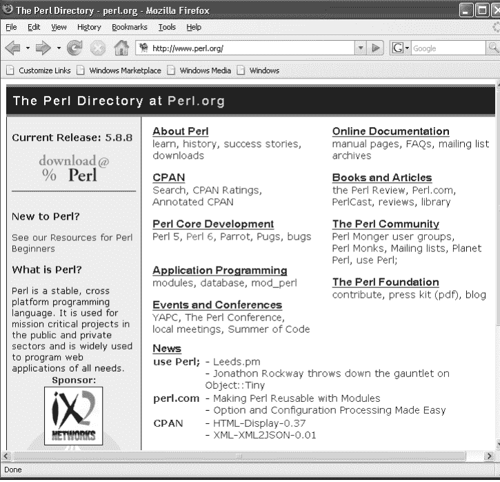

图 1.3 带有资源链接的 Perl 目录。

### 1.4 在哪里获取 Perl


图 1.4 Perl 官方主页（由 O'Reilly 运行）。

### 1.4.1 我的是什么版本？

要获取您的 Perl 版本、该二进制版本的构建日期、补丁和版权信息，请输入示例 1.1 所示的行（$ 符号是 shell 提示符）：

# 示例 1.1

```
$ perl -v
1 This is perl, v5.8.8 built for MSWin32-x86-multi-thread (with 50 registered patches), see perl -V for more detail
2 Copyright 1987-2006, Larry Wall
3 Binary build 820 [274739] provided by ActiveState http://www.ActiveState.com
Built Jan 23 2007 15:57:46
```

# 示例 1.1（续）

Perl 仅可以根据艺术许可（Artistic License）或 GNU 通用公共许可证（GNU General Public License）的条款进行复制，这些许可可以在 Perl 5 源码包中找到。

Perl 的完整文档（包括 FAQ 列表）可以在系统上通过 "man perl" 或 "perldoc" 。如果您可以使用互联网，请将浏览器指向 http://www.perl.org/，即 Perl 主页。

这是 perl v5.8.8 for MSWin32-x86-multi-thread (with 1 registered patch), see perl -V for more detail

Perl 仅可以根据艺术许可或 GNU 通用公共许可证的条款进行复制，这些许可可以在 Perl 5.0 源码包中找到。

Perl 的完整文档（包括 FAQ 列表）可以在系统上通过 man perl 或 perldoc perl 找到。如果您可以使用互联网，请将浏览器指向 www.perl.com/，即 Perl 主页。

```
perl -V
This is perl, v5.8.3 built for sun4-solaris-thread-multi (with 8 registered patches, see perl -V for more detail)
```

```
Copyright 1987-2003, Larry Wall

Binary build 809 provided by ActiveState Corp.
http://www.ActiveState.com
ActiveState is a division of Sophos.
Built Feb 3 2004 00:32:12
```

Perl 仅可以根据艺术许可或 GNU 通用公共许可证的条款进行复制，这些许可可以在 Perl 5 源码包中找到。

Perl 的完整文档（包括 FAQ 列表）可以在系统上通过 'man perl' 或 'perldoc perl' 找到。如果您可以使用互联网，请将浏览器指向 http://www.perl.com/，即 Perl 主页。

# 解释

1 此版本的 Perl 是来自 ActiveState 为 Windows 提供的 5.8.8 版本。

2 Perl 的作者 Larry Wall 拥有版权。

3 此构建版本是从 ActiveState 获取的。

5 Perl 可以按照艺术许可或 GNU 规定的条款进行复制。Perl 在 GNU（自由软件基金会）下分发，这意味着 Perl 是免费的。

6 此版本的 Perl 是适用于 Solaris (UNIX) 的 5.8.3 版本。

## 1.5 什么是 CPAN？

CPAN 是“所有 Perl 的门户”，代表综合 Perl 存档网络（Comprehensive Perl Archive Network），该网站存储了您可能的所有免费 Perl 材料，包括文档、FAQ、模块和脚本、二进制分发版和源代码以及公告。CPAN 在全球范围内镜像，您可以在此处找到最近的镜像：

```
www.perl.com/CPAN
www.cpan.org
```

如果您想寻找帮助工作的模块，CPAN 是您要去的地方。CPAN 搜索引擎将允许您在大量类别下查找模块。模块将在第 12 章“模块化、打包并发送到库！”中讨论。

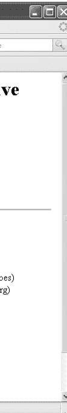

图 1.5 模块综合索引。

## 1.6 Perl 文档

### 1.6.1 手页 (Man Pages)

标准 Perl 分发带有手页，为所有章节提供帮助。如果您想查询特定函数，请输入：

```
man perl
```

### 1.6.2 HTML 文档

当您下载 Perl 时，ActiveState 提供了优质文档。如图 1.6 所示，那里有需的所有链接。

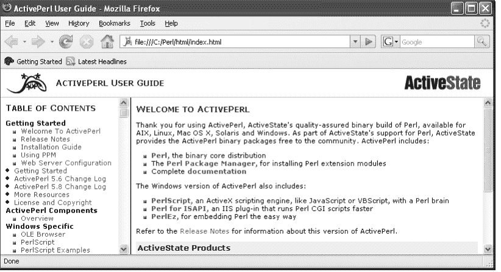

图 1.6 来自 ActiveState 的 HTML 文档。

## 1.7 您应该了解

1. 是谁写的 Perl？

2. Perl 代表什么？

3. “开源”的意思是什么？

4. 当前版本是什么？

5. Perl 用于什么？

6. 什么是解释器？

7. 在哪里获取 Perl？

8. 什么是 ActivePerl？

9. 什么是 CPAN？

10. 在哪里获取文档？

11. 如何查找特定文档？

## 1.8 接下来

在接下来的章节中，您将学习如何创建并运行 Perl 脚本。您将学习 Perl 脚本包含的内容、关于 Perl 语法、语句和注释。您将学习如何检查语法错误以及如何在命令行中使用多种选项运行 Perl。

## 第 2 章 Perl 快速启动


## 2.1 快速启动，快速参考

### 2.1.1 给程序员

如果您有其他语言（如 Visual Basic、C/C++、Java 或 PHP）的编程经验，并熟悉变量、循环、条件语句和函数等基本概念，表 2.1 将为您提供 Perl 语言结构和语法的快速概述。

在每个节的末尾，将提供描述特定结构的章节编号，以及一个简短、功能完整的 Perl 示例，说明如何使用该结构。

### 2.1.2 给非编程人员

如果您不编程，请跳过本章直接到第 5 章。您可能以后想查阅本章作为快速参考。

### 2.1.3 Perl 语法与结构

**脚本文件** Perl 脚本在文本编辑器中创建。通常情况下，文件名不需要特殊的扩展名，除非运行脚本的应用程序另有规定；例如，如果要在 Apache 下作为 .cgi 程序运行，则可能要求文件名具有 .pl 或 .cgi 扩展名。

**自由格式** Perl 是一种自由格式的语言。语句必须以分号（`;`）结束，但可以出现在行的任何位置，并跨越多行。

**注释** Perl 注释以 `#` 符号开头。解释器会忽略这些注释。它们可以出现在行的任何位置，但仅独占一行。

# 示例

```
print "Hello, world"; # 这是一个注释
# 此这也是一个注释
```

**输出打印** `print` 和 `printf` 函数是用于显示输出的内置函数。

`print` 函数的参数是一个由逗号分隔的字符串和/或数字的列表。

`printf` 函数与 C 语言的 `printf` 函数类似，用于格式化输出。参数列表周围不需要括号。

（参见第 3 章。）

```
print value, value, value;
printf ( string format [, mixed args [, mixed ...]] );
```

# 示例

```
print "Hello, world\n";
print "Hello, world\n";
print ("It's a perfect day!\n"); # 括号是可选的
print "The date and time are: %s localtime, \n";
printf "Hello, world\n";
printf("%s: Meet %5d:Salary \$%10.2f\n", "John", 40, 55000);
```

（参见第 4 章。）

**数据类型** Perl 支持三种基本数据类型来存储值：标量（scalars）、数组（arrays）和关联数组（hashes）。变量名包含一个“特殊字符（funny character）”，该字符后面跟着一个字母和任意数量的字母数字字符（包括下划线）。该特殊字符代表数据类型和上下文。紧随特殊符号的字符是区分大小大小的。如果变量名以字母开头，它可以由任意数量的字母（下划线算作字母）和/或数字组成。如果变量不以字母开头，则必须只包含一个字符。

（参见第 5 章。）

## 2.1 快速入门，快速参考

# 表 2.1 Perl 语法与结构（续）

### 标量 (Scalar)

标量是一个持有单个值、字符串或数字的变量。

标量的名字前有一个“$”符号。标量上下文意味着只使用一个值。

```
示例

$first_name = "Melanie";
$last_name = "Quigley";
$salary = 125000.00;
print $first_name, $last_name, $salary;
```

### 数组 (Array)

标量的有序列表；即字符串和/或数字。数组的元素通过从 0 开始的数字索引。数组的名字前有一个“@”符号。

```
@names = ( "Jessica", "Michelle", "Linda" );
print "@names"; # 打印数组，元素用空格隔开
print "@names[0]" and "@names[2]"; # 打印 "Jessica" 和 "Linda"
print "@names[1]\n"; # 打印 "Linda"
@names[3]="Nicol"; # 分配新值作为第4 个元素
```

- 常用的内置函数：

- pop 移除元元素

- push 在数组末尾添加新元素

- shift 移除第一个元素

- unshift 在数组开头添加元素

- splice 在数组的某些位置添加或删除元素

- sort 对数组元素进行排序

### 哈希表 (Hash)

关联数组（称为哈希）是一个无序的键/值对列表，通过字符串进行索引。哈希的名字前有一个“%”符号。（当包含在单引号或双引号内时，% 不会被求求值。）

```
示例

%employee = (
"Name" => "Jessica Savage",
"Phone" => "(925) 555-1274",
"Position" => "CEO"
)

print $employee("Name"); # 打印值
$employee("SSN")=999-333-2345; # 分配键/值
```

- 一些常用的内置函数：

- keys 获取哈希中所有的键

- values 获取哈希中所有的值

- each 从哈希中获取键/值对

- delete 移除键/值对

# 表 2.1 Perl 语法与结构（续）

Perl 提供了大量的预定义变量。以下是一些常见的预定义变量的列表：

### 预定义变量

- `$\`: 默认输入和模式搜索空格。

- `@_`: 最后访问的文件句柄当前行号。

- `$@`: 上一个 `eval()` 操作符产生的 Perl 语法错误信息。

- `$!`: 输出与 `die` 使用的错误信息的当前值。

- `$0`: 运行脚本的文件名。

- `$$`: 当前进程的 PID。

- `$PERL_VERSION`: Perl 版本。

- `@ARGV`: 命行参数。

- `@INC`: 库搜索路径。

- `$DATA`: 输入数据。

- `$ID`: 进程 ID。

- `$STDIN`: 标准输入句柄。

- `$STDOUT`: 标准输出句柄。

- `$STDERR`: 标准错误句柄。

- `%ENV`: 环境变量。

- `%SIG`: 信号。

# 表 2.1 Perl 语法与结构（续）

## 常量 (Literals)

常量是不可改变的值。使用 `constant` 定义：

```
use constant;
PI 3.14159
NAME "Earth";
```

## 数字 (Numbers)

Perl 支持整数、八进制、十六进、浮点数和二进制。

- 整数：十。

- 八进制：以 0 开头。

- 十六进制：以 0x 开头。

- 浮点数：使用 e。

- 二进制：以 0b 开头。

## 字符串与引号 (Strings and Quotes)

Perl 提供了多种引用方式：

- 单引号 ('...')：字符串取字面值。

- 双引号 ("...")：允许变量插值和特殊转义字符（如 \n）。

- q'...': 单引号的别名。

- qq("..."): 双引号的别名。

- q{...}: 用于多行单引号。

- qq{...}: 用于多行双引号。

```
示例
$str = 'Hello $name'; # 不插值
$str2 = "Hello $name"; # 插值
```

## 操作符 (Operators)

Perl 提供许多操作符，但大部分与 C/C++/Java 相同。

- 赋值：=, +=, -=, *, ^, &&, |=

- 数字相等：==, !=

- 字符串相等：eq, cmp

- 数字比较：>= <

- 字符串比较：gt, ge

- 范围：. 在 5 到 10 之间

- 逻辑：&&, ||, or x

- 自增/自减：++ --

- 文件：-r, ~, -0, -e, -z, -s, -f, -d, -lc

- 位运算：& | ^ <<

- 字符串重复：x

- 算术：*/ - %

- 模式匹配：~ !=

# 示例

```
print "\n算术运算\n";
print ((3+2) * (5-3)/2);
print "\n操作符\n"; # 拼接
print "\tTommy" . ' ' . "Savage";
print "\n比较操作符\n";
print $5==3, "\n";
print $47!=23, "\n";
print "\n逻辑操作符\n";
$a > $b && $b < 100
$answer eq "yes" || $money == 200
print "\n复合赋值操作符\n";
$a = 47;
$a += 3; # 等于 $a = $a + 3
$a++; # 自增
print $a; # 打印 51
print "\n模式匹配操作符\n"
$color = "green"; print if $color =~ /gr/; # $color 匹配模式
$answer = "Yes"; print if $answer !~ [Yy]; # 包含 'Y' 或 'y'
```

## 2.1 快速上手，快速参考

## 表 2.1 Perl 语法与结构（续）

### 条件语句

基础的 `if` 结构评估括号括的表达式，如果条件评估为真，则执行表达式后面的代码块。

（见第 7 章。）

```perl
if ( expression ){
    statements;
}
```

示例

```
if ( $a == $b ) print "$a is equal to $b";
```

if/else 语句

`if` 块是一个双向决策。如果表达式为真，则执行语句块；如果为假，则执行 `else` 语句块。

```perl
if ( expression ){
    statements;
} else{
    statements;
}
```

示例

```perl
$coin_toss = int (rand(2 )) + 1; # 生成一个 1 到 2 之间的随机数
if ($coin_toss == 1 ) {
    print "You tossed HEAD\n";
} else {
    print "You tossed TAIL\n";
}
```

if/elsif 语句

`elsif/elsif` 提供多路分支；如果其后面的表达式不为真，则会评估每个 `elsif` 表达式，直到其中一个为真；否则，执行可选的 `elsif` 语句。

```perl
if ( expression ){
    statements;
} elsif ( expression ){
    statements;
} elsif (expression){
    statements;
} else{
    statements;
}
```

# 第 2 章 • Perl 快速上手

## 表 2.1 Perl 语法与结构（续）

```perl
# 1 是周一，7 是周日
$day_of_week = int(rand(7)) + 1;
print "Today is: $day_of_week\n";
if ($day_of_week>=1 && $day_of_week<=4) {
    print "Business hours are from 9 am to 9 pm\n";
} elsif ($day_of_week == 5) {
    print "Business hours are from 9 am to 6 pm\n";
} else {
    print "We are closed on weekends\n";
}
```

与 C/C++ 类似，Perl 也提供了 `if/else` 语法的快捷方式，使用三个两个运算符（也称为三元运算符）。问号 `?` 后面跟着当测试条件为真时执行的语句，冒号 `:` 后面跟着当条件为假时执行的语句。

(condition) ? statement_if_true : statement_if_false;

```perl
$coin_toss = int (rand(2 )) + 1; # 生成一个 1 到 2 之间的随机数
print ($coin_toss == 1 ? "You tossed HEAD\n" : "You tossed TAIL\n" );
```

循环是指定多次重复代码的一种。Perl 支持多种类型的循环：`while` 循环、`do-while` 循环、`for` 循环和 `foreach` 循环。

（见第 7 章。）

### while/until 循环

`while` 循环：

`while` 后面跟着一个括号表达式和一个语句块。只要表达式测试为真，循环就会继续迭代。

```perl
while ( conditional expression ) {
    code block A
}
```

```perl
$count=0; # 初始化值
while ($count < 10 ) { # 测试
    print $n;
    $count++; # 增加值
}
```

## 2.1 快速上手，快速参考

## 表 2.1 Perl 语法与结构（续）

`until` 循环：

`until` 后面跟着一个括号表达式和一个语句块。只要表达式测试为假，循环就会继续迭代。

```perl
until ( conditional expression ) {
    code block A
}
```

示例

```perl
$count=0; # 初始化值
until ($count == 10) { # 测试
    print $n;
    $count++; # 增加值
}
```

### do-while 循环

`do-while` 循环与 `while` 循环类似，但它在循环结束时而不是开始检查循环表达式，保证了循环块至少执行一次。

```perl
do {
    code block A
} while (expression);
```

示例

```perl
$count=0; # 初始化值
do {
    print "$n";
    $count++; # 增加值
} while ($count < 10); # 测试
```

### for 循循环

`for` 循环：

`for` 有三个要评估的表达式，每个由冒号分隔。第一个初始化变量并仅评估一次。第二个测试值是否为真，如果为真，则进入块；如果不是，则退出循环。在执行语句块后，控制返回第三个表达式，它会改变测试变量的值。再次测试第二个表达式，以此此类推。

```perl
for(initialization; conditional expression; increment/decrement) {
    block of code
}
```

## 22 第 2 章 • Perl 快速上手

## 表 2.1 Perl 语法与结构（续）

示例

```perl
for( $count = 0; $count < 10; $count = $count + 1 ) {
    print "\$count\n";
}
```

### foreach 循环

`foreach` 用于遍历列表，每次处理一个项。

```perl
foreach item (@list) {
    print "\$item,\n";
}
```

示例

```perl
foreach item (@list) {
    print "\$item,\n";
}
```

```perl
@dessert = ("ice cream", "cake", "fruit");
foreach item (@dessert) {
    print "\$item,\n";
}
```

### 循环控制

`last` 语句用于跳出循环；`next` 语句用于跳过循环的剩余部分；`repeat` 语句用于重新执行循环块。

```perl
for ($i=0; $i<10; $i++) {
    if ($i == 5) { last; }
    if ($i == 2) { next; }
    print $i;
}
```

## 正则表达式 (Regular Expressions)

正则表达式是一组被正斜杠括起来字符。它们用于匹配文本中的模式，并精炼搜索和替换。Perl 以其模式匹配能力而闻名。（参见第 8 章。）

表 2.2 一些正则表达式元字符

| 元字符 | 它代表的含义 |

| --- | --- |

| ^ | 匹配行首 |

| $ | 匹配行尾 |

| a.c | 匹配 'a'、任意单个字符和 'c' |

| [abc] | 匹配 'a' 或 'b' 或 'c' |

| [^abc] | 匹配一个不是 'a' 或 'b' 的字符 |

| [0-9] | 匹配 '0' 到 '9' 之间的一个数字 |

| ab*c | 匹配一个 'a'，后跟零或多个 'b' 以及一个 'c' |

| ab+ | 匹配一个 'a'，后跟一个或多个 'b' 以及一个 'c' |

| ab? | 匹配一个 'a'，后跟零或一个 'b' 以及一个 'c' |

| (ab)+ | 匹配一次或多次 'ab' 的出现后跟一个 'c' |

| (c) | 捕获 'ab' 并将其赋值给 $1，捕获 'c' 并赋值给 $2 |

示例

```
$str = "looking for a needle in a haystack"
print if /needle/;
# 如果 $_ 包含 /needle/，则打印字符串。
```

```
$str = "looking for a needle in a haystack"; # 使用正则表达式元字符
print if /^[Nn].dle.../;
# 匹配字符和 "dle"。
```

```
$str = "I am feeling blue, blue, blue...";
$str = s/blue/upbeat/; # 将第一次匹配的 "blue" 替换为 "upbeat"
print $str
# I am feeling upbeat, blue, blue...
```

```
$str = "I am feeling Blue, BLUE...";
$str = s/blue/upbeat/ig; # 忽略大小，全局替换
print $str
# I am feeling upbeat, upbeat...
```

```
$str = "Peace and War"
$str = s/(Peace) and (War)/$2, $1; # $1 获取 'Peace', $2 获取 'War'
print $str
# War and Peace.
```

```
$str = "He gave me 5 dollars.\n";
$str =~ s/5*6*/e; # 而不是字符串替换，而是评估替换内容
print $str
# He gave me 42 dollars.
```

## 2.1 快速开始，快速参考

在命令行传递参数。@ARGV 数组用于用于存储命令行参数。如果使用了 ARGV 文件句柄，则参数被视为文件；否则，参数是来自命令行的字符串，用于脚本中。（参见第 10 章。）

```
示例
$ perlscript filea fileb filec

（在脚本中）
print "@ARGV"; # 列出参数：filea fileb filec
while(<ARGV>) {
    # 文件句柄 ARGV -- 参数被视为文件
    print; # 打印 @ARGV 中列出的文件的每一行
}
```

引用、指针（References, Pointers）。Perl 引用也被称为指针。指针是一个包含另一个变量地址的变量。要创建指针，使用反斜杠运算符。（参见第 13 章。）

```
示例
# 创建变量
$age = 25;
$siblings = qw("Nick", "Chet", "Susan", "Dolly");
%home = ("owner" => "Bank of America",
    "price" => "negotiable",
    "style" => "Saltbox",
);

$pointer1 = \$age; # 创建指向标量的指针
$pointer2 = \@siblings; # 创建指向数组的指针
$pointer3 = \%home; # 创建指向哈希的指针
$pointer4 = [qw(red blue green)]; # 创建匿名数组
$pointer5 = {"Me" => "Maine", "Mt" => "Montana", "Fl" => "Florida" }; # 创建匿名哈希

# 解引用
print $$pointer1; # 解引用标指针；打印：25
print @{$pointer2}; # 解引用数组指针
    # 打印：Nick Chet Dolly
print %{$pointer3; # 解引用哈希指针；
    # 打印：SaltboxpricenegotiableownerBank of America
print $pointer2->[1]; # 打印 "Chet"
print $pointer3->{"style"}; # 打印 "Saltbox"
print @{$pointer4}; # 打印匿名数组的元素
```

对象（Objects）。Perl 支持对象，一种特殊的变量类型。 Perl 类是一个包含变量和函数的包，称为属性和方法。没有“class”关键字。属性（也称为字段）用于描述对象。方法是允许你创建和操作对象的特殊函数。对象使用 bless 函数创建。（参见第 14 章。）

创建一个类

示例

```
package Pet

sub new { # 构造函数
    my $class = shift;
    my $pet = (
        "Name" => undef,
        "Owner" => undef,
        "Type" => undef,
    );
    return bless($pet, $class); # 返回指向对象的指针
}

sub set_pet { # 访问器方法
    my $self = shift; 
    my ($name, $owner, $type) = @_;
    $self->{'Name'} = $name;
    $self->{'Owner'} = $owner;
    $self->{'Type'} = $type;
}

sub get_pet {
    my $self = shift;
    while ((key, $value) = each (%$self)) {
        print "$key: $value\n";
    }
}
```

实例化类

示例

```
$cat = Pet->new(); # 另一种形式是 $cat new();
# 使用构造方法创建对象
$cat->set_pet("Sneaky", "Mr. Jones", "Siamese");
# 使用实例访问对象
$cat->get_pet();
```

Perl 还通过将基类放在 @ISA 数组中支持继承。

2.2 接下来是什么？

库和模块（Libraries and Modules）。库文件具有 .pl 扩展；模块具有 .pm 扩展。今天 pm 文件比 .pl 文件常用。

库路径 @INC 数组包含标准库的路径。

包含文件

要加载外部文件，使用 require 或 use。

```
require("getops.pl"); # 运行时加载库
use CGI; # 编译时加载 CGI.pm 模块
```

诊断（Diagnostics）。要退出带有错误的 Perl 脚本，可以使用内置的 die 或 exit 函数。

示例

```
open(PH, "filename") or die "Couldn't open filename: $!";
if ($input) exit(1);
```

你还可以使用：

use warnings; # 提供警告；不退出

use diagnostics; # 提供详细警告；不退出

use strict; # 检查全局变量、未引号的词等；退出

use Carp; # 为 die 函数提供更多关于错误的信息

总结

本章是为了那些需要快速了解 Perl 像、其语法和编程结构的程序员编写的。这是一个概述。Perl 还有很多内容，你将通过后面的章节看到。在你编写了一段时间后，本章可以作为教程，帮助你回忆起你要查找的内容。

2.3 接下来是什么？

在第 3 章中，我们将讨论 Perl 脚本设置，即如何命名脚本、执行它以及添加注释、语句和内置函数。我们还将如何使用命令行开关以及如何识别错误类型。

# 3 Perl 脚本

3.1 脚本设置

一个简单的 Perl 脚本

示例 3.1

```
（脚本）
#!/usr/bin/perl
print "What is your name?\n";
chomp($name = <STDIN>); # 程序等待键盘输入
print "Welcome, $name, are you ready to learn Perl now?\n";
chomp($response = <STDIN>); # response 转换为小写
$response=lc($response);
if($response eq "yes" or $response eq "y") {
    print "Great! Let's started learning Perl by example.\n";
} else {
    print "OK. Try again later.\n";
}
$now = localtime; # 使用函数获取日期时间
print "$name, you ran this script on $now.\n";
```

```
（输出）
What is your name? Ellie
Welcome, Ellie, are you ready to learn Perl now? yes
Great! Let's started learning Perl by example.
Ellie, you ran this script on Wed Apr 4 21:53:21 2007.
```

示例 3.1 是 Perl 脚本的一个示例。很快你就能编写类似的脚本。Perl 脚本由语句和声明组成。语句以分号 (;) 结束（由于子程序和报告格式需要声明，它们将在介绍这些主题时讨论）。变量可以在脚本的任何地方创建，如果没有初始化，将自动获得 0 或 "null" 值，取决于它们的上下文。注意程序中的变量以 $ 开头。数字、文本字符串或函数的输出等值可以赋值给变量。不同类型的变量会有不同的“奇怪符号”，你将在第 4 章中看到。Perl 从第一行到最后一行执行每个语句。

## 3.2 脚本

### 3.2.1 启动

UNIX/Mac OS。如果脚本的第一行包含 #! 符号（称为 shbang 行），后面跟着你的版本的 Perl 可执文件的完整路径，告诉内核哪个程序正在解释脚本。启动行的示例可能是：

```
#!/usr/bin/perl
```

在 shbang (!) 之后正确输入解释器的路径至关重要。Perl 可能安装在不同系统的不同。大多数 Web 服务器在调用用 Perl 编写的 CGI 脚本时查找此行。任何不一致都会导致致命错误。在你的系统中找到 Perl 解释器的路径，在 UNIX 提示符处输入：

which perl

Mac OS 只是 UNIX 的一个版本，并带有 Perl 5.8。你可以使用终端并运行 Perl，与其运行 Solaris、Linux、*BSD, HP-UX, AIX OS 等完全相同。

Windows。Win32 平台不支持 shbang 语法或类似的内容。对于 Windows XP 和 Windows NT 4.0，你可以将 Perl 脚本关联为 .pl 或 .plx 扩展，然后直接从命令行运行脚本。在命令行或系统控制面板中，你可以设置 PATHEXT 环境

## 3.2 脚本

变量名为与 Perl 脚本关联的扩展名。在命令行中，设置环境变量，输入：

```
SET PATHEXT=.pl; %PATHEXT%
```

在控制面板中，要使该关联永久化，请执行以下操作：

- 1. 转到开始菜单。

- 2. 选择“设置”或直接选择“控制面板”。

- 3. 选择“控制面板”。

- 4. 在控制面板中，点击“系统”图标。

- 5. 点击“高级”。

- 6. 点击“环境变量”。

- 7. 点击“新建”。

- 8. 在“变量值”框中输入 PATHEXT，输入你想要的扩展名，加上分号和 %PATHEXT%。

- 10. 点击“确定”保存设置。

从现在起，当你创建一个 Perl 脚本时，在名称后面加上你选择的扩展名，例如 `myscript.pl` 或 `myscript.pl`。这样只需在命令行中输入不带扩展名的脚本名即可直接执行脚本，例如 `mscript.pl`。（关于脚本执行的更多信息，请参见第 36 页的“执行脚本”）。

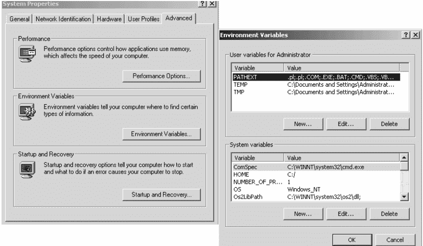

图 3.1 设置 PATHEXT 环境变量。

### 3.2.2 文本编辑器

由于你使用文本编辑器来编写 Perl 脚本，可以使用操作系统提供的任何编辑器，或下载专门为 Perl 设计的更复杂的编辑器，包括第三方编辑器和集成开发环境 (IDE)。表 3.1 列出了一些可用编辑器。

| 表 3.1 编辑器类型 |

|---|---|

| BBEdit, JEdit | Macintosh |

| Wordpad, Notepad, UltraEdit, vim, PerlEdit, JEdit, TextPad | Windows |

| pico, emacs, PerlEdit, JEdit | Linux/UNIX |

| Komodo | Linux, Mac OS, Windows |

| OptiPer, PerlExpress | Windows |

| Affus | Mac OS X |

### 3.2.3 Perl 脚本命名

Perl 脚本唯一的命名规范是遵循你所操作系统的文件命名规则（大写/小写字母、数字等）。例如，如果你正在使用 Linux，文件名是区分大小写的，而且由于有大量的系统命令，你可能希望为 Perl 脚本名称添加扩展名以确保你的脚本是唯一的。除非你正在创建库或模块、在服务器需要特定扩展名的情况下编写 CGI 脚本，或者设置 Windows 识别某些类型的文件扩展名，否则你不需要为文件添加扩展名。通过为名称添加唯一的扩展名，你可以防止与其他同名的程序发生冲突。例如，UNIX 提供了一个名为 "test" 的命令。如果你将脚本命名为 "test"，将执行哪一个版本？如果你不确定，可以在 Perl 脚本末尾添加 `.plx` 或 `.perl` 扩展以赋予它独立的身份。

当然，给你的脚本起一个合理的名称，指示脚本的，而不是像 "foo"、foobar" 或 "testing" 这样的名称。

### 3.2.4 语句、空白字符和换行

Perl 被称为自由格式语言，这意味着你可以将语句放在行的任何位置，甚至跨行。空白字符指的是空格、制表符和换行符。换行符表示为 "\n" 且必须包含在双引号中。空白字符用于界定单词。符号和单词之间允任意数量的空格。包含在单引号或双引号中的空白字符会被保留；否则会被忽略。以下表达式是：

## 3.2 脚本

5+4*2 等同于 5 + 4 * 2;

并且以下两个 Perl 语句都是正确的，尽管输出将显示在用引号包裹时空白字符被保留了。

```
print "This is a Perl statement."

print "This
is
also a Perl
statement.";
```

尽管在编写 Perl 脚本时你有很大的自由度，但最好将语句单独放在一行，并在使用语句块时提供缩进（我们将在第 5 章中讨论这一点）。当然，用注释对你的程序进行标注，以便你和其他人理解正在发生什么，是至关重要的。更多注释请参阅下一节。

### 3.2.5 注释

你今天可能写出一个非常聪明的 Perl 脚本，但两周后就完全不知道你的脚本试图做什么了。如果你把脚本传给别人，这种困惑就会产生。注释是纯文本，允许你在 Perl 脚本中插入注释，而不影响程序的执行。它们用于帮助你和其他程序员维护和调试脚本。Perl 注释以 # 标记开头。它们跨越行，但不会持续到下一行。

Perl **不**理解 C 语言的注释 /* */ 或 C++ 的注释 //。

# 示例 3.2

| 1 # 这是一个注释 |

| 2 | print "hello"; # 这也是一个注释 |

# 说明

| 1 | 注释（类似于 UNIX shell、sed 和 awk 脚本中的注释）是以井号 (#) 开头的行，并可以持续到行尾。 |

| 2 | 注释可以出现在行的任何位置。这里的注释跟在一个有效的 Perl 语句之后。 |

### 3.2.6 Perl 语句

Perl 可执行语句成了 Perl 脚本的大部分。像 C 语言一样，语句是一个表达式或一系列表达式，并以分号结束。Perl 语句可以是简单的或复合的，各种运算符、表达式和修饰符构成了一个语句，如下所示：

```
print "hello";
```

## 3.4 (续)

```
4 $ perl first.perl (适用于 UNIX 和 Windows)
5   Hello to you and yours!
```

# 解析

- 1 缺少了以 # 开头的启动行。在 Windows 上使用时并不是必须的。如果使用 ActiveState，你可以使用名为 pl2bat 的工具创建一个批处理文件。

- 2 这是一行描述性语句；注释解释了缺少启动行。

- 3 这是一个可执行语句包含了 print 函数。

- 4 在命令行中，Perl 程序接收脚本名称作为参数并执行，然后打印脚本的输出。你可以在任何操作系统上通过这种方式执行 Perl 脚本。

## 3.2.10 可能会遇到哪些错误

要做好准备会遇到错误，而且是很多错误。在实际上让程序完美运行之前，你可能需要尝试很多。了解你的错误信息就是了解你的解析器的怪癖、你的伙计，甚至是你你自己。有些程序员会反复犯同样的错误。别担心，随着时间的推移，你将学会这些信息意味着什么，以及如何防止它们。

当你执行一个 Perl 脚本时，你只需要操作一步，但内部 Perl 解释器会执行两步。首先，它将整个程序编译成字节码，这是程序的内部表示形式。之后，Perl 的字节码引擎按行运行代码。如果你遇到编译错误，例如行末缺少分号、关键字拼写错误或引号不匹配，你将得到所谓的“语法错误”。这类错误可以使用 -c 选项来检测，一旦你熟悉了它们，通常通常就能找到。

## 3.5

```
(脚本)
print "Hello, world";
1 print "How are you doing?\
2 print "Have you found any problems in this script?",
```

```
(输出)
Bareword where operator expected at errors.plx line 3, near
"print "Have"
(Might be a runaway multi-line "" string starting on line 2)
(Do you need to preclare print?)
syntax error at errors.plx line 3, near "print "Have you 
Search pattern not not terminated at errors.plx line 3.
```

## 3.3 命令行中的 Perl

# 解析

| 1 | 这一行应该有一个闭合的双引号和一个结束分号。 |

| 2 | 这条 Perl 语句是正确的，但 Perl 仍在寻找上一行的闭合引号，并对这一行中的 "print" 词感到困惑，因为这仍然最后一行的一部分。为什么？因为上一行缺少一个双引号且没有以分号结束。每当你在错误信息中看到 "runaway"逃逸）时，它通常意味着某个引号“逃逸了”，即缺失了。如果你看到 "Bareword"裸字），意味着一个单词没有被引号包围。 |

在程序通过编译阶段后（即你没有收到任何语法错误或来自编译器的抱怨），你可能会遇到运行时错误，或逻辑错误。这些错误更难发现，可能可能是由于没有预见到程序启动时可能出现的问题。或者可能是程序在设计上的逻辑存在缺陷。如果你尝试打开的文件或数据库不存在、用户输入了错误的输入、进入了无限循环，或者你非法地除以零，就可能导致运行时错误。无论情况如何，这些被称为“bug”（故障）的问题更难发现。Perl 自带了一个调试器，有助于通过逐行执行你的程序来确定导致这些逻辑错误的原因。（参见第 858 页的“调试器”）。

## 3.3 命令行中的 Perl

虽然你大部分的 Perl 工作将在脚本中完成，但 Perl 也可以在命令行中执行简单任务，例如测试函数、打印语句或简单地测试语法。Perl 有许多命令行开关（也称为命令选项），用于控制或修改其行为。这里讨论的开关并不是完整列表（见附录 A），但将向你展示少量命令行 Perl 语法。

在命令行工作时，你会看到一个 shell（外壳）。shell被称为“命令解释器”。UNIX shell（如 Korn 和 Bourne）显示 $ 提示符，而 C shell 显示 % 提示符。UNIX、Linux (bash 和 tsch)、Mac OS shell 在解析命令行方面非常相似。默认情况下，如果你使用 Windows XP 或 Vista，MS-DOS shell 被称为 cmd.com；如果你使用 Windows NT，shell 是一个驻留在 cmd.exe 中的控制台应用程序。它也显示 $ 提示符。Win32 shell 有它自己的解析命令行的方式。在大多数 Perl 编程中，你很少需要担心 shell 的交互，但当脚本与操作系统交互时，除非你了解拥有哪些命令以及 shell 如何代表你执行这些命令，否则就会出现问题。

> 4. 你的命令行提示符可能被自定义为包含当前目录、历史记录、驱动器号等。

### 3.3.1 -e 开关

-e 开关允许 Perl 在命令行执行 Perl 语句而不是脚本。这是在将 Perl 语句放入脚本文件之前测试简单 Perl 语句的好方法。

## 示例 3.6

| 1 | $ perl -e 'print "hello dolly\n"; # UNIX/Linux |

| | hello dolly |

| 2 | $ perl -e "print qq/hello dolly\n"; # Windows 和 UNIX/Linux |

| | hello dolly |

# 解析

- 1. Perl 在屏幕上打印字符串 dolly，后面跟一个换行符。美元符号 ($) 是 UNIX 提示符。单引号保护语句不受 shell 解析。

- 2. 在 Windows 上，语句必须包含在双引号中。qq 构造是处理字符串内双引号的另一种方法。

### 3.3.2 -n 

如果你需要打印文件中包含模式的行，使用 -n 。

## 示例 3.7

(文件)

```
1 $ perl -n '/Igor/' emp.first
```

(输出)

```
Igor is the pattern.
```

## 3.3 命令行中的 Perl

# 示例（续） 3.7

```
$ perl -n '/Igor/' emp.first
```

(输出)

```
Igor is the pattern
```

# 解析

- 1. 文本文件 emp.first 被打印到屏幕上。Perl 将此文件名作为命令行参数。

- 2. Perl 通过逐行循环文件 emp.first 中的所有行。（Windows 用户应语句包含在双引号中。）

- 3. Perl 使用正则表达式元字符来指定要匹配的模式。模式 Igor 放在斜杠之间并以 ^ 开头。^ 被称为“行首锚”。Perl 只打印以模式开头的行。（Windows 用户应语句包含在双引号中。）

从管道读取。由于 Perl 只是另一个程序，命令的输出可以管道给 Perl，输出 的输出也可以管道给其他命令。Perl 将来自管道的内容作为输入，而不是文件。需要 -n 开关，以便 Perl 能够读取来自管道的输入。

## 示例 3.8

```
(UNIX)
1 $ date | perl -ne 'print "Today is $_;'
2 Today is Mon Mar 12 20:01:58 PDT 2007
```

```
(Windows)
3 $ date /T | perl -ne "print qq/Today is $_;"
4 Today is Tue 04/24/2007
```

# 解析

- 1. UNIX 命令的输出管道给 Perl 并存储在 $_ 变量中。字符串 Today is 和 $_ 变量的内容将打印到屏幕上，后面跟一个换行符。

# 示例 3.8（续）

+ 2 输出说明今天的日期存储在 `$_` 变量中。

3 Windows 日期命令接受 `/T` 作为选项，用于生成今天的日期。该输出通过管道传递给 Perl 并存储在 `$_` 变量中。print 语句周围需要双引号。

Perl 可以使用标准 I/O 重定向从文件读取输入并将输出发送到文件。

# 示例 3.9

+ 1 $ perl -ne 'print;' < emp.first

Igor Chevsky:6/23/83:SW:59870:25:35500:2005

Nancy Conrad:6/18/88:SE:23556:5:15000:2500

Jon DeLoar:3/28/85:SW:39673:13:22500:12345.75

Archie Main:7/25/90:SW:39673:21:34500:34500.50

Bumble Bumble:11/3/89:NE:04530:17:18200:1200.75

2 $ perl -ne 'print' > emp.temp

# 解释

+ 1 Perl 输入从名为 `emp.first` 的文件读取。输出发送到屏幕。对于 Windows 用户，请用双引号代替单引号包裹语句。

2 Perl 输入从名为 `emp.first` 的文件读取，其输出发送到文件 `emp.temp`。对于 Windows 用户，请用双引号代替单引号包裹语句。

### 3.3.3 -c 选项

正如本章前面所示，`-c` 选项用于检查 Perl 语法而不实际执行 Perl 命令。如果语法正确，Perl 会会你如此。使用 `-c` 选项检查脚本是一个好主意。这对于 CGI 脚本尤为重要，因为通常发送到终端的错误信息会被发送到日志文件中。（另请参见第 4 章中的 `-w` 选项。）

# 示例 3.10

+ 1 print 'hello'; 第 1 行搜索模式未终止。

在 test.plx 的 EOF 之前未找到字符串终止符 ''

2 print "hello"; ntest.plx 语法 OK

## 3.4 接下来是什么？

# 解释

+ 1. 字符串 `hello` 以双引号开头但以单引号结束。引号应该是匹配的；即，第一个双引号应该在字符串末尾与另一个双引号匹配，而不是以单引号结束。使用 `-c` 选项时，如果 Perl 在编译时发现语法错误将会将会。

2. 修正了上一个问题后，Perl 告诉你语法是正确的。

## 3.4 你应该知道

+ 1. 如何设置脚本？

2. 语句是如何终止的？

3. 什么是空白？

4. 自由形式（free form）是什么意思？

5. 什么是内置函数？

6. UNIX 中的 `#!` 行是什么？

7. 如何让脚本具有可执行性？

8. 为什么要使用注释？

9. 如果不使用 shbang 行，如何执行 Perl 脚本？

10. 哪个命令行选项可以让你检查 Perl 语法？

11. `-e` 选项是什么？

## 3.5 接下来是什么？

如果你无法打印出程序应该执行的内容，就像试图读懂一个不会说话的人的心绪。在下一章中，我们将讨论输出到屏幕（stdout）的 Perl 函数以及如何格式化输出。你将学习 Perl 如何看待单词、空白、字面量、反斜线序列、数字和字符串。你将学习如何使用单引号、双引号和反引号及其替代形式。我们将讨论文档以及如何在 CGI 脚本中使用它们。你还将学习如何使用警告（warnings）和诊断信息来调试你的脚本。

# 练习 3

语法入门

+ 1. 在命令行提示符处，编写一条 Perl 语句来打印

```
Hello world!!
Welcome to Perl programming.
```

+ 2. 执行另一个 Perl 命令，打印日期簿文件的内容。（该文件位于随附的 CD 上。）

+ 3. 执行一个 Perl 命令，显示你正在使用的 Perl 分发版本。

+ 4. 将示例 3.1 中的程序示例复制到你的编辑器中，保存，检查语法并执行它。

## 第 4 章

掌握打印

## 4.1 文件句柄

按照惯，每当你的程序开始执行时，父进程（通常是 shell 程序）会打开三个定义的流：stdin、stdout 和 stderr。这三个流默认都连接到你的终端。

stdin 是输入来源，即终端键盘；stdout 是输出去处，即屏幕；stderr 是你的程序打印错误的地方。

Perl 从 shell 继承 stdin、stdout 和 stderr。Perl 不直接访问这些流，而是给它们起名为文件句柄（filehandles）的名字。Perl 通过文件句柄访问流；stdin 的文件句柄称为 `STDOUT`；stderr 的文件句柄称为 `STDERR`。稍后，我们将看到如何创建自己的文件句柄，但现在我们先使用它们。

## 4.2 单词

（此处后续 OCR 文本存在大量重复，已根据逻辑提取核心内容）

# 第 4 章 • 掌握打印

在引用引号时出现错误是很常见的，我们将介绍由于引号不匹配和裸字（bare words）引起时，你可能收到的最常见错误信息。

将引号想象成 Perl 字符串的“衣服”。如果你脱掉它们，可能会收到类似“Bareword（裸字）”的消息，例如：

Bareword "there" not allowed while "strict" subs in use.try.pl line 3 Execution of program.pl aborted due to compilation errors.

也可以将引号想象成伴侣。一个双引号与另一个匹配的引号成配对，如果你没有匹配好引号（如果其中一个缺失），那么缺失的引号就“逃跑”了。伴侣去哪儿了？你可能会收到如下错误：

(Might be a runaway multi-line "" string starting on line 3)

## 破坏引号规则

### 示例 4.5

```
(脚本)
#!/usr/bin/perl
# 用于演示打印字面量的程序
1 print "Hello, "I can't go there";   # 引号不匹配
2 print "Good-bye";
```

```
(输出)
Bareword found operator expected at qtest.plx line 2, near ""Hello, "I"
(在 I 之前缺少运算符?)
Bareword found operator expected at qtest.plx line 3, near "print Good"
(可能是一个从第 2 行开始的逃逸多行""字符串)
(你需要声明 print 吗?)
String found where operator expected at qtest.plx line 3, at end of line
syntax error at qtest.plx line 2, near ""Hello, "I can't"
Can't find string terminator "" anywhere before EOF at qtest.plx line 3
```

### 解析

- 1 字符串 Hello 以起始引号开头，但缺少结尾。这导致了一连串双引号的连锁反应。Perl 假设单词 "I" 之前的双引号是用于 "Hello" 中的第一个引号。这导致字符串的剩余部分 "I can't go" 暴露为裸字符串。行末的双引号将与下一行的双引号形成配对。这可不太妙。

- 2 单词 "Good-bye" 被视为裸字，因为 Perl 发现第 1 行末尾的 "there" 与 "Good-bye" 开头的双引号匹配，导致 "Good-bye" 暴露并呈裸状态，且字符串末尾有一个不匹配的引号。哎！

## 4.3 print 函数

### 4.3.2 字面量（常量）

在将字面量值¹赋值给变量或打印字面量时，字面量可以用十进制、八进制或十六进制的整数形式表示，也可以用浮点数或科学计数法的浮点数表示。

用双引号括的字符串可能包含字符串字面量，例如用于换行的字符 '\n' 或用于转义字符的 '\e'。字符串字面量是反斜杠之前的字母数字（且仅限字母数字）字符。它们可以用十进制、八进制、十六进制或控制字符的形式表示。

Perl 还支持特殊字面量，用于表示当前脚本名称、当前脚本行号以及当前脚本的逻辑结束。

由于你将在 `print` 和 `printf` 函数中使用字面量，让我们来看看这些字面量长什么样。（更多常量定义请参见附录 A 中的 "constant" 编译指令。）

**数值字面量。** 字面量数字可以用十进制、八进制或十六进制的正或负整数表示（见表 4.1）。浮点数可以用浮点表示法或科学计数法表示。八进制数以 0（零）开头，十六进制以 0x（零和 x）开头，科学计数法表示的数字包含一个结尾的 E，后面跟着一个表示指数的正负数。

### 表 4.1 数值字面量

| 示例 | 说明 |

|---|---|

| 12345 | 整数 |

| 0b1101 | 二进制 |

| 0x456fff | 十进制 |

| 0777 | 八进制 |

| 23.45 | 浮点数 |

| 23E-2 | 科学计数法 |

**字符串字面量。** 像 Shell 一样，Perl 字符串通常由单引号或双引号界定。包含字符串字面量（称为转义序列）的字符串由**双引号**界定以便解释反斜杠（见表 4.2）。

- 1. 字面量也可以称为常量，但 Perl 专家更倾向于使用 "literal（字面量）"一词，为了支持他们，我们将使用 "literal"。

# 第 4 章 • 掌握打印

### 表 4.2 字符串字面量

| 转义序列 | 说明 (ASCII 节点) |

|---|---|

| \t | 制表符 |

| \n | 换行 |

| \r | 回车 |

| \f | 符 |

| \b | 退格 |

| \a | 报警/蜂鸣 |

| \e | 转义 |

| \033 | 八进制字符 |

| \xff | 十六进制字符 |

| \c/ | 控制字符 |

| \l | 下一个字符转换为小写 |

| \u | 下一个字符转换为大写 |

| \L | 在找到 \E 之前的所有后续字符转换为小写 |

| \U | 在找到 \E 之前的所有后续字符转换为大写 |

| \Q | 在找到 \E 之前对所有后续非字母数字字符进行反斜杠转义 |

| \E | 结束由 \L 或 \U 开始的大小写转换 |

| \\ | 反斜杠 |

### 示例 4.6

```
print "Hello, \nI can't go there"; # 引号不匹配
print "Good-bye";
```

```
(输出)
Bareword found operator expected at qtest.plx line 2, near ""Hello, "I"
(在 I 之前缺少运算符?)
Bareword found operator expected at qtest.plx line 3, near "print Good"
(可能是一个从第 2 行开始的逃逸多行""字符串)
(你需要声明 print 吗?)
String found where operator expected at qtest.plx line 3, at end of line
syntax error at qtest.plx line 2, near ""Hello, "I can't"
Can't find string terminator "" anywhere before EOF at qtest.plx line 3
```

### 解析

- 1 字符串 Hello 以起始引号开头，但缺少结尾。这导致了一连串双引号的连锁反应。Perl 假设单词 "I" 之前的双引号是用于 "Hello" 中的第一个引号。这导致字符串的剩余部分 "I can't go" 暴露为裸字符串。行末的双引号将与下一行的双引号形成配对。这可不太妙。

- 2 单词 "Good-bye" 被视为裸字，因为 Perl 发现第 1 行末尾的 "there" 与 "Good-bye" 开头的双引号匹配，导致 "Good-bye" 暴露并呈裸状态，且字符串末尾有一个不匹配的引号。哎！

## 4.3 print 函数

### 4.3.2 字面量（常量）

在将字面量值¹赋值给变量或打印字面量时，字面量可以用十进制、八进制或十六进制的整数形式表示，也可以用浮点数或科学计数法的浮点数表示。

用双引号括的字符串可能包含字符串字面量，例如用于换行的字符 '\n' 或用于转义字符的 '\e'。字符串字面量是反斜杠之前的字母数字（且仅限字母数字）字符。它们可以用十进制、八进制、十六进制或控制字符的形式表示。

Perl 还支持特殊字面量，用于表示当前脚本名称、当前脚本行号以及当前脚本的逻辑结束。

由于你将在 `print` 和 `printf` 函数中使用字面量，让我们来看看这些字面量长什么样。（更多常量定义请参见附录 A 中的 "constant" 编译指令。）


# 数值字面量

字面量数字可以用十进制、八进制或十六进制的正或负整数表示（见表 4.1）。浮点数可以用浮点表示法或科学计数法表示。八进制数以 `0`（零）开头，十六进制以 `0x`（零和 x）开头，科学计数法表示的数字包含一个结尾的 `E`，后面跟着一个表示指数的正负数。

# 字符串字面量

像 Shell 一样，Perl 字符串通常由单引号或双引号界定。包含字符串字面量（称为转义序列）的字符串由**双引号**界定以便解释反斜杠（见表 4.2）。

1. 字面量也可以称为常量，但 Perl 专家更倾向于使用 "literal（字面量）"一词，为了支持他们，我们将使用 "literal"。

# 特殊字面量

Perl 还支持特殊字面量，用于表示当前脚本名称、当前脚本行号以及当前脚本的逻辑结束。

由于你将在 `print` 和 `printf` 函数中使用字面量，让我们来看看这些字面量长什么样。（更多常量定义请参见附录 A 中的 "constant" 编译指令。）

# 4.3.3 打印字面量

现在你知道字面量长什么样了，让我们来看看它们如何在 `print` 函数中使用。

## 示例 4.8

```
#!/usr/bin/perl
# 用于演示打印字面量的程序
1 print "The price is \n"
2 print "The price is \$100,\n"
3 print "The binary number is converted to: 0b10001\n"
4 print "The octal number is converted to: 0777\n"
5 print "The hexadecimal number is converted to: 0xCF\n"
6 print "The unformatted number is: 14.56\n"
7 $now = localtime(); # 一个 Perl 函数
8 $name = "Ellie"; # 将字符串赋值给变量
9 print "Today is $now, $name."
10 print "Today is $now, $name."
```

```
(输出)
1 The price is 
2 The price is $100.
3 The binary number is converted to: 17.
4 The octal number is converted to: 511.
5 The hexadecimal number is converted to: 4383.
6 The unformatted number is: 14.56.
10 Today is Sat Mar 24 15:56:08 2007, Ellie.
11 Today is $now, $name.
```

### 解析

- 1 字符串 Hello 以起始引号开头，但缺少结尾。这导致了一连串双引号的连锁反应。Perl 假设单词 "I" 之前的双引号是用于 "Hello" 中的第一个引号。这导致字符串的剩余部分 "I can't go" 暴露为裸字符串。行末的双引号将与下一行的双引号形成配对。这可不太妙。

- 2 单词 "Good-bye" 被视为裸字，因为 Perl 发现第 1 行末尾的 "there" 与 "Good-bye" 开头的双引号匹配，导致 "Good-bye" 暴露并呈裸状态，且字符串末尾有一个不匹配的引号。哎！

- 5 因为前导有 `0`（零），该数字表示为八进制值。打印的是其十进制值。

- 6 因为前导有 `0x`（零和 x），该数字表示为十六进制数。打印的是其十进制值。

- 7 打印表示为 `14.56` 的数字。`print` 函数不对输出进行格式化。

- 8 Perl 拥有大量的函数。你已经学习了 `print` 函数。`localtime()` 函数是另一个。（括号是可选的）。该函数返回当前的日期和时间。我们将结果赋值给一个名为 `now` 的 Perl 变量。你将在下一章学习所有的变量。

- 9 变量 `$name` 被赋值字符串 "Ellie"。

- 10 当字符串被双引号包裹时，`print` 函数将显示变量 `$now` 和 `$name` 的值。

- 11 当字符串被单引号包裹时，`print` 函数将打印所有字符。

# 打印字符串字面量 4.9

```
（脚本）
#!/usr/bin/perl
print "****\\tIn double quotes\\t***\\\n"; # 反斜杠转义
print "%%\\\tIn single quotes\\t%%\\\n"; # 所有字符都作为字面量打印
print "\n";
```

```
（输出）
*** In double quotes ***
@@@\\tIn single quotes\\t@@@\\\n
print "\n";
```

### 解释

- 1 当字符串被双引号包裹时，会进行反斜杠转义。`\t` 产生制表符；`\n` 产生换行。

- 2 被单引号包裹时，特殊字符串字面量 `\t` 和 `\n` 不会被解释。它们将被原样打印。

- 3 换行符 `\n` 必须被双引号包裹才能被解释。`"\n"` 产生换行。

## 示例 4.10

（脚本）

```
#!/usr/bin/perl
print "\a\t\tThe\Number\E \LIS\E ",0777,".\n";
```

（输出）

```
(BEEP)          The NUMBER is 511.
```

### 解释

`\a` 产生警报或哔哔声，随后是 `\t\t`（两个制表符）。`\U` 导致字符串以大写打印，直到遇到 `\E` 或行结束。字符串数字将以大写打印，直到遇到 `\E`。字符串将以小写打印，直到遇到 `\E`，然后打印八进制 `0777` 的十进制值，紧接着是一个句点和一个换行符。

# 打印特殊字面量

## 示例 4.11

（脚本）

```
#!/usr/bin/perl
# 名为 literals.perl 的程序，___，编写用于测试特殊字面量
print "We are on line number ", __LINE__, ".\n"
print "The name of this file is ", __FILE__, ",\n"
__END__

这些内容只是会被 Perl 忽略的一堆闲话。
__END__ 字面量类似于 Ctrl-d 或 \004.\^a
```

（输出）

- 1 我们在第 3 行。

- 2 这个文件的名为 literals.perl。

a. 附录 A 中的 -x 选项用于丢弃前导垃圾字符。

### 解释

- 1 特殊字面量 `__LINE__` 如果要被解释就不能用引号包裹。它持有 Perl 脚本的当前行号。

- 2 该脚本的名字是 literals.perl。特殊字面量 `__FILE__` 存储当前 Perl 脚本的名字。

- 3 特殊字面量 `__END__` 代表脚本的逻辑结束。它告诉 Perl 忽略其后的任何字符。

# 4.3 print 函数

## 示例 4.12

```
（脚本）
#!/usr/bin/perl
# 程序，名为 literals.perl2，
# 编写用于测试特殊字面量 _DATA_
1 print <DATA>
2 __DATA__
这一行将被打印。
这一行也会被打印。
```

```
（输出）
This line will be printed.
And so will this one.
```

### 解释

- 1 `print` 函数将显示在特殊 `_DATA__` 下找到的任何文本。由于特殊字面量 `_DATA__` 被角括号包裹，它被视为一个打开用于读取的文件。`print` 函数将按 `<DATA>` 读取的方式显示行。

- 2 这是由 `<DATA>` 文件句柄使用的数据。（你可以使用 `__END__` 代替 `__DATA__` 来获得相同的结果。）

# 4.3.4 warnings Pragma 和 -w 选项

`-w` 选项用于警告你可能使用保留字以及可能导致程序问题的其他问题。（如果你是编程初学者，这些警告通常非常晦涩且难以理解。）Larry Wall 在 Perl 5 手册中说：“每当你遇到神秘的行为时，就尝试 -w 选项！每当你没有遇到神秘的行为时，就再次尝试 -w 选项。”你可以将 `-w` 选项作为 Perl 的命令行选项使用，如下：

```
perl -w <scriptname>
```

或者在 Perl 脚本的 shebang 行之后，例如

```
#!/usr/bin/perl -w
```

Pragma（指令）是一种特殊的 Perl 模块，向编译器提供关于语句块如何编译的提示。你可以使用这种模块来帮助控制程序的行为。从 Perl 5.6 版本开始，使用 `warnings` 指令代替了 `-w` 选项。`warnings` 指令发送关于歧义标识符的警告。由于 Ellie 没有加引号，Perl 可能会将其误认为保留字或未定义的文件。

## 示例 4.13

（脚本）

```
#!/usr/bin/perl
use warnings;
print "Hello there"; # 未匹配引号
print "what is up?
```

（输出）

```
(BEEP)          The NUMBER is 511.
```

### 解释

（语法）Perl 词法分析器知道期望项还是运算符。如果它看到一个本应该是项的东西，而它原本期望的是运算符，它就会发出这种警告。通常这表示缺少了运算符或分隔符，例如分号。

## 示例 4.14

（脚本）

```
#!/usr/bin/perl
use diagnostics;
print "hello there"; # 未匹配引号
print "We are on line number ", _LINE_, "\n";
```

# 解析

在 Perl 5.6 及更高版本中，使用了 `diagnostics` 编译指令来代替 `-w` 选项或 `warnings` 编译指令。这个特殊的 Perl 模块会发送关于脚本中发生问题的详细信息。由于字符串 `Hello there here` 不包含匹配的引号，`diagnostics` 编译指令会列出程序失败的所有可能原因。编译器期望该字符串以另一个双引号结束。

# 4.3.6 strict 编译指令与单词

我们现在要提到的另一个编译指令是 `strict` 编译指令。如果你的程序不符合对其设置的限制，它将无法编译。如果你可能像示例 4.15 那样使用了“裸”的、未加引号的单词，`strict` 编译指令会捕捉到它们，程序会发出警告。`strict` 编译指令可以通过提供各种参数来控制（完整列表参见附录 A）。

## 示例 4.16

```
(脚本)
#!/usr/bin/perl
# 程序：演示 strict 编译指令的脚本
# 演示 strict 编译指令的脚本
use strict "subs"
$name = Ellie # 未加引号的单词 Ellie
print "Hi $name.\n"
```

```
(输出)
$ stricts.test
Bareword "Ellie" not allowed while "strict subs" is in use
./structs.test line 5.
Execution of stricts.test aborted due to compilation errors.
```

# 解析

- 1 该函数允许你使用位于标准 标准库中的模块。当 `strict` 编译指令将 `subs` 作为参数时，它会在内部编译时捕捉程序中发现任何裸单词（barewards）。如果发现裸单词，程序将带有错误信息终止。

- 2 在单词周围加上引号就像是给单词穿上衣服——去掉引号，单词就变成“裸”的。

### 4.4 printf 函数

`printf` 函数将格式化后的字符串打印到选定的文件句柄（默认是 STDOUT）。它就是 C 和 awk 语言中使用的 `printf` 函数。如果 `printf` 成功，则返回 `1`；失败则返回 `0`。

`printf` 函数由一个带引号的控制字符串组成，该字符串可能包含格式规范。引号字符串后面是一个逗号和一个由逗号分隔的参数列表，这些参数是简单的表达式。格式规范符前面有一个 `%`。每个 `%` 符号和格式规范符必须有一个对应的参数（参见表 4.4 和 4.5）。

将引号字符串和表达式放在括号内是可选的。

## 示例 4.17

```
printf("The name is %s and the number is %d\n", "John", 50);
```

# 解析

- 1. 要打印的字符串包含在双引号中。第一个格式规范符是 `%s`。它有一个对应的参数 `John`，位于控制字符串结束引号后逗号的右侧。`%` 符号后面的 `s` 被称为转换字符。`s` 表示在此处将进行字符串转换。在这种情况下，打印字符串时 `John` 将替换 `%s`。

- 2. `%d` 格式指定将十进制（整数）值 `50` 打印在字符串中的对应位置。

| 转换 | 定义 |
| :--- | :--- |
| %b | 无符号二进制整数 |
| %c | 字符 |
| %d, i | 十进制数字 |
| %e | 科学计数法浮点数 |
| %E | 使用大写 E 的科学计数法浮点数 |
| %f, %F | 浮点数 |
| %g | 使用 e 或 f 转换的浮点数，以占用空间最小为优先 |
| %G | 使用 e 或 f 转换的浮点数，以占用空间最小为优先 |
| %ld, %D | 长十进制数 |

## 第 4 章掌握打印

### 表 4.4 格式规范符（续）

| 转换 | 定义 |
| :--- | :--- |
| %lu, %U | 长无符号十进制数 |
| %lo, %O | 长八进制 |
| %p | 指针（十六进制） |
| %s | 字符串 |
| %u | 无符号十进制数字 |
| %x | 十进制数 |
| %X | 使用大写 X 的十六进制数 |
| %lx | 长十六进制数 |
| %% | 打印字面百分号 |

修饰符（Flag modifiers）用于 `%` 之后以进一步定义打印效果；例如，`%20s` 表示 20 个字符的左对齐字段。

### 表 4.5 修饰符

| 转换 | 定义 |
| :--- | :--- |
| %- | 左对齐修饰符 |
| %# | 八进制格式的整数以 0 开头；十六进制格式的整数以 0x 开头 |
| %+ | 对于使用 d, e, f 和 g 的转换，整数带有数字符号 + 或 - 显示 |
| %0 | 显示的值用零代替空白填充 |
| %number | 最大字段宽度；例如，如果数字为 6，在 `%6d` 中，最大字段宽度为六位 |
| %.number | 浮点数的精度；例如，`%.2f` 指定小数点后两位数字，`%8.2` 表示最大字段宽度为八，其中一个字符是小数点，后面紧跟两个数字 |

当打印参数时，该字段持有它应该包含的值，字段的宽度由 `%` 符号和一个表示最大字段宽度的数字指定。

### 4.4.2 无引号打印——在此文档（The here document）

Perl 的 here document 衍生自 UNIX shell 文档。它允许你引用包裹在称为“用户定义终止符”单词之间的整个文本块。从第一个终止符到最后一个终止符，文本都会被引用，或者你可以说“从这里”到“这里”的内容被引用了。here document 是一种按行的引用形式，需要 `<<` 运算符，后面紧跟一个初始终止符和一个分号。在 `<<` 之后不能有空格，除非终止符本身被引用。如果终止词没有用单引号或双引号引用，会进行变量扩展。如果终止词仅用单引号引用，则不进行变量扩展。每一行都会插入在第一个和最后一个终止符之间。最后一个终止词必须独成一行，周围不能有空白字符。

Perl 与 shell 不同，它不会在 here document 的文本中执行命令替换（反引号）。相反，如果终止符被包含在反引号中，Perl 会你在 here document 中执行命令。（这不是个好主意。）

Here documents 被广泛用于 CGI 脚本，用于封装大量的 HTML 标签进行打印。

```
(脚本内容)
$price=1000;      # 给变量赋一个值。
print <<EOF;
The consumer commented, "As I look over my budget, I'd say
the price of $price is right. I'll give you \$500 to start.\n"
EOF

print <<'FINIS';
The consumer commented, "As I look over my budget, I'd say
the price of $price is too much.\nI'll settle for $500."
FINIS

print << 4;
Here's to a new day.
Cheers!

print "\nLet's execute some commands.\n";
# 如果终止符在反引号中，将执行 OS 命令
print <<'END';
echo Today is
END
```

```
(输出结果)
The consumer commented, "As I look over my budget, I'd say
the price of 1000 is right. I'll give you $500 to start.
```

## 示例 4.20（续）

- 6 消费者评论：“当我查看预算时，我想说 $price 的价格太贵了。 \n 我将接受 $500。”

- 9 祝新的一天，干杯！

- 祝新的一天。干杯！

- 祝新的一天。干杯！

- 祝新的一天。干杯！

- 11 让我们执行一些命令。

Today is

Fri Oct 27 12:48:36 PDT 2007

### 解释

- 1 标量变量 `$price` 被赋值 `1000`。

- 2 here document 的开始。EOF 是终止符。该块被处理为如同包含在双引号中。如果终止符之前有任何空格，则将终止符包含在双引号中，例如 `"EOF"`。

- 3 here document 躯体内的所有内容都被引用，因为整个文本块被双引号包围。

- 4 美元符号在包含在双引号时具有特殊含义。此 here document 中的文本被处理为如同包含在双引号中，变量也有特殊含义。`$` 符号用于表示正在使用标量变量。变量的值将被解释。如果美元符号前面有反斜杠，它将被视为字面量。如果使用了特殊的反斜杠序列（如 `\v1`），它们将被解释。

- 5 通过匹配终止符 EOF 结束 here document。终止符周围不能有空格。

- 6 通过用单引号包裹终止符 FINIS，文本将作为字面量处理，关闭任何特殊字符（如美元符号或反斜杠序列）的含义。

- 7 文本如同包含在单引号中。

- 8 结束终止符标记 here document 的结束。

- 9 值 x 表示 here document 内的文本将打印四次。x 运算符被称为重复运算符。块的末尾必须有一个空行，here document 才会结束。

- 10 需要一个空行来结束 here document。

- 11 终止符包含在反引号中。shell 将执行 'END' 和 END 之间的命令。此示例包含了 UNIX 命令。如果你使用另一个操作系统（如 Windows 或 Mac OS），命令必须与该操作系统兼容。

### 4.4 printf 函数

**Here Documents 与 CGI。** 下面程序被称为 CGI（通用网关）程序，由 Web 服务器而不是 shell 执行的简单 Perl 脚本，但有几种例外：

- 1 有一行（例如，`Content-type: text/html`）描述了将发送回服务器的内容。

- 2. 文档由嵌入 HTML 标签的文本组成，浏览器使用这些渲染不同的颜色、字体等。CGI 程序存储在名为 *cgi-bin* 的特殊目录下，通常位于 Web 服务器的根目录下。关于 CGI 的完整讨论，请参见第 16 章，“CGI and Perl”。

要执行脚本，你将启动 Web 浏览器并输入：http://servername/cgi-bin/scriptname。

### 示例 4.21

```
#!/bin/perl
# 脚本内容
Content-type: text/html
<HTML><HEAD><TITLE>Crier</TITLE></HEAD>
<h1><CENTER>Hear ye!!</CENTER></h1>
</HTML>
print <<EOF;
```

### 解释

- 1 标量变量 `$price` 被赋值 `1000`。

- 2 here document 的开始。EOF 是终止符。该块被处理为如同包含在双引号中。如果终止符之前有任何空格，则将终止符包含在双引号中，例如 `"EOF"`。

- 3 here document 躯体内的所有内容都被引用，因为整个文本块被双引号包围。

- 4 美元符号在包含在双引号时具有特殊含义。此 here document 中的文本被处理为如同包含在双引号中，变量也有特殊含义。`$` 符号用于表示正在使用标量变量。变量的值将被解释。如果美元符号前面有反斜杠，它将被视为字面量。如果使用了特殊的反斜杠序列（如 `\v1`），它们将被解释。

- 5 通过匹配终止符 EOF 结束 here document。终止符周围不能有空格。

- 6 通过用单引号包裹终止符 FINIS，文本将作为字面量处理，关闭任何特殊字符（如美元符号或反斜杠序列）的含义。

- 7 文本如同包含在单引号中。

- 8 结束终止符标记 here document 的结束。

- 9 值 x 表示 here document 内的文本将打印四次。x 运算符被称为重复运算符。块的末尾必须有一个空行，here document 才会结束。

- 10 需要一个空行来结束 here document。

- 11 终止符包含在反引号中。shell 将执行 'END' 和 END 之间的命令。此示例包含了 UNIX 命令。如果你使用另一个操作系统（如 Windows 或 Mac OS），命令必须与该操作系统兼容。

| 文件 | 编辑 | 转到 | 返回 | 选项 | 帮助 |
| :--- | :--- | :--- | :--- | :--- | :--- |
| 新内容 | | | | | |
| 目录 | | | | | |
| 书签 | | | | | |
| 主页 | | | | | |
| 后进 | | | | | |
| 搜索 | | | | | |
| 窗口 | | | | | |
| 打开 | | | | | |
| 刷新 | | | | | |
| 视图 | | | | | |

## 4.5 你知道

- 1. `stdin`、`stdout` 和 `stderr` 是什么？

- 2. `filehandle` 指什么？

- 3. 如何表示八进制数字？十六进制数字？

- 4. `print` 和 `printf` 函数之间有什么区别？

- 5. 双引号和单引号在处理字符串的方式有什么不同？

- 6. `literals`（字面量）是什么？

- 7. `__END__` 的作用是什么？

- 8. 什么是反斜杠序列？

- 9. `sprintf` 函数的目的是？

- 10. 什么是 pragma？

- 11. 如何检查你的语法是否正确？

- 12. 什么是 *here* document？它在 CGI 程序中有什么用？

## 4.6 接下来是什么？

在下一章中，你将学习 Perl 变量和“奇怪符号”的含义。你将能够创建并访问标量、数组和哈希。理解如何从用户获取输入以及为什么我们需要“chop”。

## 练习 4：字符串链

- 1. 使用 `print` 函数输出以下字符串：“Ouch，”奥尼尔夫人叫道，“你不能这样做。奥尼尔先生！”

- 2. 使用 `printf` 函数将数字 `$34.666666` 打印为 `$34.67`。

- 3. 编写名为 `literals.pl` 的 Perl 脚本，它将打印以下内容：

```
$ perl literals
Today is Mon Mar 12 12:58:04 PDT 2007 (使用 localtime())
The name of this PERL SCRIPT is literals.
The number we will examine is 125.5.
The NUMBER in decimal is 125.
The following number is taking up 20 spaces and is right justified.
125
The number in hex is 7d
The number in octal is 175
The number in scientific notation is 1.25500e+02
The unformatted number is 125.500
The formatted number is 125.50
老板说：“你能借我 $12.50 买午饭吗？”
我果决地说：“不行！”
再见（发出嘟声）
```

> 注意：PERL SCRIPT 和 NUMBER 通过字符串字面量转义序列实现大写。

你会使用什么命令行选项来检查脚本的语法？

- 4. 为你的 literals 脚本添加一个 here document 来打印：

Life is good with Perl.

刚刚完成了第二个练习！

- 5. 你如何在脚本中开启警告？你又如何开启诊断？

# 第 5 章：名字的内涵

## 5.1 关于 Perl 变量

在开始本章之前，给读者们有一点说明。示例中的每行代码都有编号。输出和解释也经过了编号，以与代码中的数字相对应。这些数字是为了帮助你理解每个程序中的重要行。当你将示例复制到文本编辑器时，请不要包含这些数字，否则你将产生许多多余的错误！尽管如此，让我们继续吧。

### 5.1.1 类型

变量是所有编程语言的基础。它们是数据项，其值在程序运行过程中可能会改变，而字面量或常量则保持不变。它们可以放置在程序的任何位置，并且不需要像其他语言那样声明（在其他语言中，你必须指定要存储的数据类型）。你可以将字符串、数字或这些者的组合赋值 Perl 变量。例如，你可以在变量中存储一个数字，稍后改变主意存储一个字符串。Perl 并不在乎。

Perl 变量有三种：标量（scalar）、数组（array）和（更常见的）哈希（hashes）。标量变量包含单个值（例如，一个字符串或一个数字），数组变量包含一个由正数索引的有序值列表，而哈希包含一个无序的键值对（key/value pairs），由字符串（键）索引，该键与对应的值关联。（参见第 77 页的“标量、数组和哈希”）。

### 5.1.2 作用域与包

变量的作用域决定了它在程序中的可见性。在 Perl 脚本中，变量对整个脚本可见（即全局作用域），并可以在脚本的任何地方更改。

你在这些章节看到的 Perl 示例程序内部编译为所谓的“包”（package），它为变量提供了命名空间。包内的所有变量都是全局的。全局变量全包已知，如果在包内的任何地方更改，该更改将永久影响变量。默认包称为 main，类似于 C 语言中的 `main()` 函数。C 中的此类变量会被分类为静态（static）。此时，你不需要担心命名主包或它在编译过程中的处理方式。现在提到包唯一的目的是让你知道主包（即你的脚本）中变量的作用域是全局的。以后当我们谈到包中的 `our`、`local` 和 `my` 函数时，你将看到更改变量的作用域和命名空间是可能的。

| 标量命名空间 | 数组命名空间 | 哈希命名空间 |
| :--- | :--- | :--- |
| `$department` | `@department` | `%department` |
| | `$department('Ed')` | |

**图 5.1** 包 main 中标量、列表和哈希的命名空间。

### 5.1.3 命名规范

与 C 或 Java 不同，Perl 变量不需要在使用之前声明。它们一被提到就会产生。变量通过其前面的“奇特字符”来识别。标量变量前面有 `$` 符号，数组变量前面有 `@`，哈希变量前面有 `%` 符号。这些“奇特字符”指示你正在使用哪种类型的变量，你可以为标量、数组或哈希使用相同的名称而不用担心命名冲突。`$name`、`@name` 和 `%name` 都是不同的变量；第一个是标量，第二个是数组，最后一个是哈希。

由于保留字和文件句柄（filehandles）前面没有特殊字符，变量名不会与保留字或文件句柄冲突。变量是区分大小大小的。命名为 `$Num`、`$num` 和 `$NUM` 的变量都是不同的。

如果变量以字母开头，它可以由任意数量的字母（下划线算字母）和/或数字组成。如果变量不以字母开头，它必须只包含一个字符。

- 1. 允许使用相同的名称但不推荐；这会让阅读变得非常困惑。

Perl 有一组特殊变量，如 `$`、`^`、`$1`、`$2` 等，属于这一类（参见附录 A 第 845 页的“特殊变量”）。在特殊情况下，只有当在使用包时，变量前面才可能只有一个单引号。

未初始化的变量将获得零或空值，取决于其内容是数字还是字符串。

### 5.1.4 赋值语句

赋值运算符等号（`=`）用于将其右侧的值赋值给左侧的变量。任何可以被“赋值给”的值都代表一个命名的存储区域，被称为左值（lvalue）。如果赋值运算符左侧的操作数不代表左值，Perl 将报告错误。

在给变量赋值一个值或多个值时，如果等号左侧的变量是标量，Perl 会在标量环境中评估右侧的表达式。（参见第 77 页的“标量、数组和哈希”）。如果等号左侧的变量是数组，Perl 会在数组环境中评估右侧表达式。一个简单的示例是以分号结束的赋值。

```
FORMAT
variable=expression;
```

# 示例 5.1

```
(Script)
# 标量、数组和哈希赋值
$salary=5000;                                     # 标量赋值
@months=('Mar', 'Apr', 'May');                      # 数组赋值
%states=(                             # 哈希赋值
    'CA' => 'California',
    'ME' => 'Maine',
    'MT' => 'Montana',
    'NM' => 'New Mexico'
);
print "$salary\n";
print "@months\n";
print "$states{'CA'}\n";
print "$states{'NM'}\n";
print $x+3, "\n";
print "$name\n";
```

```
(Output)
5000
Mar Apr May
California
New Mexico
3
```

EXPLANATION

- 1. 标量 `$salary` 被赋值为数字 `5000`。

- 2. 数组 `@months` 被赋值为逗号分隔列表 Mar, Apr, May。列表被括号包含，每个列表项都带有引号。

- 3. 哈希 `%states` 通过双箭头 (`=>`) 或逗号赋值字符串列表。左侧的字符串是键。右侧的字符串是值。键与之关联。

- 4. 打印标量 `$salary` 的值，随后是换行符。

- 5. 打印 `@months`。双引号保留了每个元素。

- 6. 数组 `@months` 的各个元素是标量，且前面都有美元符号 (`$`)。数组索引从零开始。

- 7. 哈希 `%states` 的元素被包含在大括号 (`{}`) 中。打印关联的值。每个值都是单个值，即标量。该值前面有美元符号 (`$`)。

- 8. 变量 `$x` 第一次被引用。因为给 `$x` 加了三，其内容是数字。`$x` 的初始值为零。

- 9. 变量 `$name` 第一次被引用。其内容是字符串，初始值为空。

逗号可以在 Perl 4 和 Perl 5 中使用。`->` 符号与逗号不同，它需要引号，如果键由多个单词且以数字开头，则必须加引号。

### 5.1.5 规则

由于引用影响变量被解释的方式，现在是复习 Perl 规则的好时机。Perl 的引用规则与 shell 规则相似。对于 shell 程序员来说，这可能不是好消息，至少他们觉得引号很沮丧。通常很难确定使用什么引号、在哪里使用，以及在误用时如何避免罪魁祸首；这是一个真正的调试噩梦。³对于这类人，Perl 提供了另一种引用方法。

- 3 Barry Rosenberg 在他的《KornShell Tutorial》书中有一个名为“地狱引号”的章节。

- 4 Perl 的创建者 Larry Wall 将他的另一种引用方法称为“语法糖”。

# 5.1 关于 Perl 变量

Perl 有三种类型的引号，这三种类型各有不同的功能。它们分别是单引号、双引号和反引号（backquotes）。

反斜杠（`\`）的行为类似于一组单引号，但它只能用于引用单个字符。

一对单引号或双引号可以界定一个字符字符串。取决于你使用的引号类型，引号要么会允许特殊字符被解释，要么会保护特殊字符不被解释。

单引号是“民主型”引号。包含在其中的所有字符都被同等对待；换句话说，这里没有特殊字符。但双引号则具有歧视性。它们将字符串中的某些字符视为特殊字符。特殊字符包括 `$`、`@` 以及 `\'` 和 `\n` 等转义序列。

当反引号包围一个操作系统命令时，该命令将由 shell 执行。这被称为命令替换。命令的输出将作为打印语句的一部分输出或赋值给变量。如果你使用的是 Windows、Linux 或 UNIX，反引号内的命令必须被特定的操作系统所支持，并且会随系统而异。

无论你使用哪种引号，它们必须成对匹配。因为引号标记了字符串的开始和结束，如果你使用其中一种引号而不匹配，Perl 会报错“Might a multiline runaway string”（可能是多行逃逸字符串）、“Execution of quotes aborted...”（引号执行中止）或“Can find string terminal before EOF”（在文件结束前未找到字符串终止符），并导致编译失败。

双引号必须匹配，除非它们嵌入单引号内或前面有反斜杠。

当字符串被双引号包含时，标量变量（以 `$` 开头）和数组（以 `@` 开头）会被插值（即变量的值替换字符串中的变量名）。哈希（以 `%` 符号开头）在双引号包含的字符串内不会被插值。

包含字符串字面量（例如 `\t`、`\n`）的字符串必须放在双引号内才能进行反斜杠解释。

单引号可以包含双引号内，例如 `"I don't care!"`。

## 示例 5.2

```
(脚本)
# 双引号
$num=5;
print "The number is $num.\n";
print "I need \$5.00.\n";
print "\tI can't help you.\n";

(输出)
  The number is 5.
  I need $5.00.
  I can't help you.
```

## 解释

- 1. 标量 `$num` 被赋值为 `5`。

- 2. 字符串被包含在双引号中。标量变量的值被打印。

- 3. 字符串字面量 `\n` 被解释了。

- 4. 当美元符号 (`$`) 前面有反斜杠时，作为字面符号打印；换句话说，变量替换被忽略了。

- 5. 特殊字面量 `\` 和 `\n` 在双引号内会被解释。

**单引号。** 如果字符串被单引号包含，它将以字面形式打印（所见即所得）。如果字符串内部需要单引号，则它可以被嵌入双引号内或使用反斜杠转义。如果要把双引号视为字面量处理，可以将它们嵌入单引号内。

## 示例 5.3

```
(脚本)
# 单引号
print 'I need 100.00.', "\n";
print 'The string literal, \t, is used to represent a tab.', "\n";
print 'She cried, "Help me!"', "\n";

(输出)
I need 100.00.
The string literal, \t, is used to represent a tab.
She cried, "Help me!"
```

## 解释

- 1. 美元符号被字面量解释。在双引号中，它会被解释为标量。`\n` 放在双引号中是为了反斜杠解释。

- 2. 字符串字面量 `\t` 没有被解释为制表符，而是以字面形式打印。

- 3. 双引号在嵌入单引号内时受到了保护（即它们以字面形式打印）。

**反引号。** 放在反引号内的 UNIX/Windows 命令由 shell 执行，输出返回给 Perl 程序。输出通常赋值给变量或作为打印字符串的一部分。当命令输出赋值给变量时，上下文是标量的（即赋值一个单一值）。为了发生命令替换，反引号不能包含在双引号或单引号内。（注意，UNIX shell 程序员们，反引号不能像 shell 程序中那样包含在双引号内。）

- 5. 如果使用其他操作系统，如 DOS 或 Mac OS 9.1 及以下版本，你系统可用的命令将会有不同。

- 6. 如果命令输出赋值给数组，输出的第一行成为数组的第一个元素，第二行成为数组的下一个元素，以此此类推。

## 示例 5.4

```
(Unix/Linux 脚本)
# 反引号和命令替换
# Windows 用户：'date /T'
print "The date is ",`date`, ".\n"; # 反引号被视为字面量
print "The date is ",`date`, "\n";
$directory=$pwd;
# Windows 用户：'cd'
print "\nThe current directory is $directory;

(输出)
The date is Mon Jun 25 17:27:49 PDT 2007.
The date is 'date'.
The current directory is /home/jody/ellie/perl.
```

## 解释

- date 命令由 shell 执行，输出返回给 Perl 字符串。如果反引号被视为字面量，则打印 `date`。

- 当反引号包含在双引号或单引号内时不会发生命令替换。

- 变量 `$dir` 包含换行符的 UNIX 命令输出（即当前工作目录）。对于 Windows 用户，命令是 `'cd'`。

- 标量 `$dir` 的值打印到屏幕上。

Perl 提供了引号的形式——`q`、`qq` 和 `qw`。

- `q` 代表单引号。

- `qq` 代表双引号。

- `qx` 代表反引号。

- `qw` 代表引用的列表（见第 84 页）。

### 表 5.1 替代引号形式

| 引号构造 | 代表什么 |
| :--- | :--- |
| q/Hello/ | 'Hello' |
| qq/Hello/ | "Hello" |
| qx/date/ | 'date' |
| @list=qw(red blue); | ('red', 'blue'); |

# 第 5 章：名称中的内容

被引用的字符串可以使用**斜杠**，替代分隔符可以用于四种构造。你可以使用非数字字符作为分隔符，例如 `#` 符号、`!` 点或成对字符，如括号、方括号。

```
q#Hello#
qq#Hello#
qx#Hello
```

## 示例 5.5

```
(脚本)
# 使用替代引号
print 'She cried, "I't help you!"'; qq/She cried, "I't help you!"/;
print 'I need $5.00\n'; qq(I need $5.00\n);
print 'I need $5.00\n'; qx/I need $5.00\n/;
print 'The present working directory is "pwd'; qx/Today is "pwd"/;
print 'The hour is ', qx(date);
```

(输出)

She cried, "I't help you!"

She cried, "I't help you!"

I need $5.00

I need $5.00

I need $5.00

I need $5.00

The present working directory is /home/jody/ellie/perl

Today is Mon Jun 25 17:29:34 PDT 2007

The hour is 17

## 解释

字符串被包含在单引号中。这允许引号以字面形式打印。"can't" 中的单引号使用了反斜杠转义，以便它也以字面形式打印。如果没有转义，它将与第一个引号匹配。那么结尾的单引号将没有匹配，遗憾程序会提示你在末尾意外遇到了逃逸引号。

## 5.2 标量、数组和哈希

| | 解释（续） |
| :--- | :--- |
| 2 | qq 替换了双引号。现在括号界定了字符串。 |
| 3 | 因为使用了 qq，$5.00 中的美元符号 ($) 被解释为空值的标量变量。打印了 .00（这不是处理金钱的方法！）。 |
| 4 | 单 q 替换了引号。$5 被视为字面量。不幸的是，这是因为单引号内不进行反斜杠解释。如果没有换行符，下一行将第 4 行连在一起。在下一行中，如果美元符号前面有反斜杠，反斜杠就会“转义” $ 的特殊含义。现在新字符串将正确打印了。 |
| 5 | `\n` 使用 qq 构造进行引用，字符串 I need $5 使用 q 构造进行单引号引用，第二个 `\n` 使用了传统的双引号。 |
| 6 | 替代分隔符感叹号 (!) 用于 q 构造（代替斜杠）来界定字符串。 |
| 7 | 字符串 "present working directory 被包含在双引号中；UNIX 命令 pwd 被包含在反引号中进行命令替换。 |
| 8 | qq 构造 Today is；gx 构造替换了用于命令替换的反引号。 |
| 9 | 替代分隔符大括号用于 qx 构造（代替斜杠）。打印了 UNIX date 命令的输出。 |

## 5.2 标量、数组和哈希

现在我们已经讨论了 Perl 变量的基础知识（类型、可见性、特殊字符等），我们可以更详细地查看它们，而不再有（或者说，减少了）关于引用机制以及引用如何影响变量解释的困惑。

### 5.2.1 标量变量

标量变量持有单个数字或字符串，并且前面有一个美元符号 (`$`)。每当引用变量时，Perl 都需要美元符号，即使在给标量赋值时也是。如果你熟悉 shell 程序，在赋值时使用美元符号起初有点奇怪。

**赋值。** 在进行赋值时，等号右侧的值等同于单一值（即其上下文是标量的）。因此，一个引用的字符串即使包含多个单词，也被视为单一值。

## 示例 5.6

| | |
| :--- | :--- |
| 1 | `$number = 150;` |
| 2 | `$name = "Jody Savage";` |
| 3 | `$today = localtime();` |

# 解释

- 1 数字字面量 `150` 被赋值给标量变量 `$number`。

- 2 字符串字面量 `Jody Savage` 被作为一个单个字符串赋值给标量 `$name`。

- 3 Perl 函数 `localtime` 的输出将被赋值给字符串变量 `$today`。

**大括号。** 如果一个标量被大括号（`{}`）包围，则该标量将受到保护，免受任何可能附加在变量末后的字符的影响。

# 示例 5.7

```
(脚本)
1 $var="net"
2 print "${var}work\n"
(输出)
2 network
```

# 解释

- 1 变量 `net` 被赋值给标量 `$var`。

- 2 包围变量的大括号使其免受附加在其末后的字符串 `work` 的影响。如果没有大括号，则将不会打印任何内容，因为变量 `$var` 尚未定义。你也可以使用点运算符 `.` 拼接两个字符串，例如 `print $var . "work";`

# 示例 5.8

```
(脚本)
1 $num = 5;
2 $friend = "John Smith";
3 $money = 125.75;
4 $now = localtime(); # localtime() 是一个 Perl 函数
5 $month="Jan";
6 print "$num\n";
7 print "${$friend}\n";
8 print "I need \${money}.\n"; # 保护我们的钱
9 print qq/$$friend gave me \${money}.\n";
10 print qq/The month is $now\n";
11 print "The month is ${month}uary.\n"; # 大括号保护了变量
12 print "The month is $month" . "uary.\n"; # 拼接
```

## 5.2 标量、数组和哈希

# 示例 5.8（续)

```
(输出)
6 5
7 John Smith
8 I need $125.75.
9 John Smith gave me $125.75.
10 The time is Sat Jan 24 16:12:49 2007.
11 The month is January.
12 The month is January.
```

# 解释

- 标量 `$num` 被赋值为数字字面量 `5`。

- 标量 `$friend` 被赋值为字符串字面量 `John Smith`。

- 标量 `$money` 被赋值为数字字面量 `125.75`。

- 标量 `$now` 被赋值为 Perl 函数 `localtime()` 的输出。

- 标量 `$month` 被赋值为 `Jan`。

- 打印标量 `$num` 的值。

- 打印标量 `$friend` 的值。

- 打印带引号的字符串。反斜杠允许打印第一个美元符号（`$`）；`$money` 的值在双引号中被插值，并打印其值。

- Perl 的 `qq` 替换了双引号。需要引号的字符串包含在正斜杠之间。标量 `$friend` 的值被插值；在插值标量变量 `$money` 之前有一个美元符号。

- 带引号的字符串被插值。

- 大括号可以用来保护变量免受附加在其末后的字符的影响。将打印 `January`。

- 你可以使用点运算符将两个字符串连接在一起（见第 6 章），这被称为拼接。

**已定义函数。** 如果一个标量既没有有效的字符串值也没有有效的数值值，它就是未定义的（undefined）。`defined` 函数允许你检查变量值的有效性。如果变量有值，则返回 `1`；如果没有，则返回 null。该函数还用于检查数组、子程序和空字符串的有效性。

# 示例 5.9

```
$name="Tommy";
print "OK \n" if defined $name;
```

**undef 函数。**

此函数取消已定义变量的定义。它释放变量的内存。该函数返回未定义的值。此函数还释放与数组和子程序相关的存储空间。

# 示例 5.10

```
undef $name;
```

**`$_` 标量变量。** `$_` 是一个无处不在的小字符。虽然它在 Perl 脚本中非常有用，但通常不可见。它被用作搜索的默认模式空间并存储当前行。一旦给 `$_` 赋值，诸如 `chop`、`split` 和 `print` 等函数将使用 `$_` 作为参数。你将在将在以后学习更多关于函数及其参数的知识，但先考虑这个示例：

# 示例 5.11

```
$_ = "Donald Duck";
print; # 打印 $_ 的值
Donald Duck
```

# 解释

- 标量变量 `$_` 被赋值为 `"Donald Duck"`。

- `print` 函数没有收到任何要打印的内容，因此如果没有提供其他字符串，它将打印 `$_`，即默认值。

### 5.2.2 数组

当你拥有一组相似的数据元素时，使用数组比为每个元素创建一个单独的变量更容易。数组名允许你将单个变量名与数据元素列表相关联。列表中的每个元素都通过其名称和下标（也称为索引）来引用。

Perl 与 C 类语言不同，它不在乎数组元素是否为相同的数据类型。它们可以是数字和字符串的混合。对于 Perl 来说，数组是一个包含有序标量的命名列表。数组名以 `@` 符号开头。下标紧随数组之后，并包含在方括号 `[]` 中。下标仅仅是整数并从零开始。

**赋值。** 如果数组已初始化，元素将包含在括号中，且每个元素之间用逗号分隔。由于逗号运算符的优先级低于赋值运算符，该列表被括号括起来。数组中的元素仅仅是标量。

Perl 引入了 `qw` 结构来创建列表（类似于 `qq`、`q` 和 `qx`）。列表中的项被简单视为带引号的字符串。

```
$pal = "John"; # 标量持有值
@pal = ("John", "Sam", "Nicky", "Jake" ); # 数组持有值列表
```

## 5.2 标量、数组和哈希

| John | "John" "Sam" "Nicky" "Jake" |
| :--- | :--- |
| `$pal` | `@pals` |

**图 5.2** 一个标量和一个数组。

# 示例 5.12

| 1 | `@name="Guy", "Tom", "Dan", "Roy";` |
| 2 | `@list=(2..5);` |
| 3 | `@grades=(100, 90, 65, 96, 40, 75);` |
| 4 | `@items=("John", "Sam", "Nicky", "Jake");` |
| 5 | `@empty=();` |
| 6 | `$size=4;` |
| 7 | `@mammals=("cats");` |
| 8 | `@fruit=("pears");` |

# 解释

- 1. 数组 `@name` 被赋值为字符串列表。

- 2. 数组 `@list` 使用范围 `2` 到 `5` 初始化。

- 3. 数组 `@grades` 被赋值为一组数值。

- 4. 数组 `@items` 被赋值为四个字符串。

- 5. 数组 `@empty` 是空的。

- 6. 变量 `$size` 是元素的个数。

- 7. 数组 `@mammals` 被赋值为一个字符串。

- 8. 数组 `@fruit` 被赋值为字符串。

下标运算符 `$#` 返回数组最后一个元素的索引。变量 `$@` 返回数组中元素的个数。下标从零开始，但可以更改为从1开始。

# 示例 5.13

```
@grades=(90,89,78,100);
print "原始数组是: @grades\n";
print "元素个数是: $#grades\n";

$size=3;
print "数组被截断为 $size 个元素: @grades\n";

@empty=();
print "数组是空的: @empty\n";
```

# 解释

- 数组 `@grades` 被赋值为四个数值列表。

- `$#` 结构获取数组元素的个数。

- 使用变量 `$size` 将数组截断为三个。

- 使用空列表会导致数组完全截断。

范围运算符和数组赋值。`..` 运算符称为范围运算符，在数组上下文中使用时，返回一个从左值到右值的数组，每次递增 `1`。

# 示例 5.14

```
@digits=(0 .. 10);
@letters=('A' .. 'Z');
@alpha=('A' .. 'Z', 'a' .. 'z');
@ns=(-5 .. 20);
```

# 解释

- 数组 `@digits` 被赋值为 `0` 到 `10` 的数字列表。

- 数组 `@letters` 被赋值为 `A` 到 `Z` 的大写字母列表。

- 数组 `@alpha` 被赋值为大写和小写字母列表。

- 数组 `@ns` 被赋值为 `-5` 到 `20` 的数字列表。

## 5.2 标量、数组与哈希


图 5.3 数组元素。

### 示例 5.15

```
(脚本)
# 填充数组并打印其值
@names=('John', 'Joe', 'Jake'); # @names=qw/John Joe Jake;
print @names, "\n"; # 不带分隔符打印
print "Hi $names[0], $names[1], and $names[2]!\n"
print $number=@names; # 标量赋值为数组元素的个数
print "There are $number elements in the @names.\n"
print "The last element of the array is $names[$number-1].\n"
print "The last element of the array is $names[-1].\n"
# 反过来，数组索引从0开始！！
@fruit = qw(apples pears plums)
print "The first element of the @fruit array is $fruit[0]\n"
print "The second element is $fruit[1].\n"
print "Starting at the end of the array: @fruit[-1,-3]\n"

(输出)
JoeJake
Hi, John, Joe, and Jake!
There are 3 elements in the @names array.
The last element of the array is Jake.
The last element of the array is Jake.
The first element of the @fruit array is apples; the second
element is pears.
Starting at the end of the array: plums pears
```

### 解释

- `@names` 数组被初始化了三个字符串：John, Joe 和 Jake。

整个数组被打印到 STDOUT。元素之间的空格会被打印出来。

数组的每个元素都会被打印，从下标零开始。

标量变量 `$number` 被赋值为 `@names` 数组。赋值的值是 `@names` 数组中的元素个数。

打印 `@names` 数组中的元素个数。

### 解释（续）

- 6 打印了数组的最后一个元素。由于下标从 `0` 开始，元素个数减 `1` 的结果等于最后一个下标的数字。

- 7 打印了数组的最后一个元素。`$name` 的值求值为数组中最后一个下标的数字。使用此值作为下标将检索 `@names` 数组中的最后一个元素。

- 8 `qw` 结构允许你创建一个由单引号单词组成的数组，而无需关闭引号单词或用逗号分隔单词。分隔符是任何一对非字母数字字符。（详参见第 75 页的“Perl 的替代引号”）。

- 9 打印了 `@array` 的前两个元素。

- 10 使用负偏移量作为下标时，从数组末尾选择元素。元素 `$fruit[-1]` 是 `plums`，从末尾数第三个元素 `$fruit[-3]` 是 `pears`。注意，当两个索引值都在同一个括号内时（如 `@fruit[-1,-3]`），引用的是列表而不是标量；这就是为什么用 `@` 符号置于数组名前，而不是 `$`。

**数组切片。** 当将一个数组的元素赋值为另一个数组的值时，得到的数组被称为数组切片（array slice）。

如果赋值运算符右侧的数组大于左侧，未使用的值将被丢弃。如果右侧较小，赋值的值将未定义。如下例所示，切片中的数组索引不需要连续编号；每个元素都会被赋值运算符右侧数组中的对应值。

### 示例 5.16

```
(脚本)
 # 数组切片
1 @names=('Tom', 'Dick', 'Harry', 'Pete');
2 @pal=@names[1,2,3]; # 切片 -- @names[1..3] 也可以
3 print "@pal[0]\n\n"

4 ($fruit[0], $fruit[1], $fruit[2])=@names; # 数组切片
5 print "@fruit\n"

(输出)
3 Dick Harry Pete

5 Tom Dick Harry
```

### 解释

- 1 `@names` 数组被赋值元素 `'Tom'`, `'Dick'`, `'Harry'` 和 `'Pete'`。

2 `@pal` 数组被赋值 `@names` 数组的元素 `1`, `2` 和 `3`。`@names` 数组的元素被切片并存储在 `@pal` 数组中。

3 `@friend` 数组通过从 `@names` 数组取切片创建；即元素 `0`, `1` 和 `2`。

### 示例 5.17

```
(脚本)
  # 数组切片
  @colors=['red','green','yellow','orange'];
  ($c[0], $c[1], $c[3], $c[5])=@colors; # 切片
  print "****************"; # 打印整个数组，但不
    # 分隔引号内的元素
  print "@colors,"\n"; # 打印整个数组，
    # 元素分隔
  print "****************";
  print $c[0],"\n"; # red
  print $c[1],"\n"; # green
  print $c[2],"\n"; #未定义
  print $c[3],"\n"; # yellow
  print $c[4],"\n"; #未定义
  print $c[5],"\n"; # orange
  print "****************";
  print "The size of @c is 6";

(输出)
  ****************
  red,yellow,orange,
  ****************
  red
  yellow
  orange
```

### 解释

- 1 `@colors` 数组被赋值元素 `'red'`, `'green'`, `'yellow'` 和 `'orange'`。

2 `$c` 数组被赋值 `@colors` 数组的元素 `0`, `1`, `3` 和 `5`。`@colors` 数组的元素被切片并存储在 `$c` 数组中。

3 `@friend` 数组通过从 `@names` 数组取切片创建；即元素 `0`, `1` 和 `2`。（注：原文此处是 `@friend`，但根据语境可能指的是 `$c` 或类似的切片逻辑）。

*查看 5.17 解释的 OCR ：*

“1 @colors 数组被赋值元素 'red', 'green', 'yellow' 和 'orange'。”

“2 $c 数组被赋值 @colors 数组的元素 0, 1, 3 和 5。@colors 数组的元素被切片并存储在 $c 数组中。”

“3 @friend 数组通过从 @names 数组取切片创建；即元素 0, 1 和 2。” -> 这看起来像是源码/OCR 中的幻觉，但我必须在修复布局的同时保留信息。

**多维数组。** 当一个数组的元素是其他数组时，结果被称为多维数组。这些通常用于表示矩阵。要访问多维数组中的元素，你可以使用多个下标。例如，`$matrix[0][1]` 访问第一行第二列的元素。

### 示例 5.18

```
(脚本)
 # 多维数组
1 @matrix=( (1, 2, 3), (4, 5, 6) );
2 print "$matrix[0][1]\n";
3 print "$matrix[1][2]\n";

(输出)
2
6
```

### 解释

- 1 `@matrix` 数组被赋值两个匿名数组，每个包含三个元素。

- 2 表达式 `$matrix[0][1]` 访问第一行第二列的元素。

- 3 表达式 `$matrix[1][2]` 访问第二行第三列的元素。

### 5.2.3 哈希

关联数组（更常被称为哈希）由一对或多对标量组成——字符串或布尔值。第一组标量与第二组标量相关联。标量对字符串对中的第一个字符串是键（key），第二个字符串称为值（value）。数组是按从 `0` 开始的数字索引排序的，而哈希是无序列表，字符串索引随机分布。（当你打印哈希时，不要期望看到输出顺序与你输入的顺序一致！）

# 第 5 章 • 命名

那么，哈希（Hashes）被定义为无序的键值对列表，类似于表格，其中键在左侧，与这些键关联的值在右侧。哈希的名字以 `%` 符号开头。

```
@pet = ( ("Name" => "Sneaky",
      "Type" => "Cat",
      "Owner" => "Carol",
      "Color" => "yellow",
);
```

| 键 | 值 |
|---|---|
| "Name" | "Sneaky" |
| "Type" | "Cat" |
| "Owner" | "Carol" |
| "Color" | "yellow" |

## 哈希表 (Hash Table)

赋值。在引用元素之前，必须定义哈希。由于哈希由键值对组成，并由每个对的第一个元素进行索引，如果数组定义中缺少某个对中的一个元素，键与对应值之间的关联将受到影响。在赋值键和值时，请确保每个键都与其对应的值关联。在对哈希进行索引时，使用大括号而不是方括号。

### 示例 5.19

```
1 %seasons=("Sp" => "Spring",
      "Su" => "Summer",
      "F" => "Fall",
      "W" => "Winter",
);
2 $days=("Mon" => "Monday",
      "Tue" => "Tuesday",
      "Wed" => undef,
      );
3 $days("Wed") => "Wednesday";
4 $days(5) => "Friday";
```

### 解释

- 1 哈希 `%seasons` 被分配了键和值。每个键和值之间通过双字符运算符 `=>` 隔开。字符串 `Sp` 是键，其对应值为 `Spring`；字符串 `Su` 是键，其对应值为 `Summer`，如果键是单单词，则没有对键加引号。

## 5.2 标量、数组和哈希

### 解释（续）

- 哈希 `%days` 被分配了键和值。第三个键 `Wed` 被赋值为 `undef`。`undef` 函数的评估值为空字符串。

- 哈希的单个元素是标量。键 `Wed` 被赋值字符串值 `Wednesday`。索引被包裹在大括号中。

- 键 `5` 被赋值字符串值 `Friday`。注意：键之间没有连续的数字顺序，且对可以由数字和/或字符串组成。

访问元素。在访问哈希的值时，下标是大括号中的键组成的。Perl 提供了一系列函数来列出哈希的键、值以及哈希的每个元素。（参见第 100 页的“数组函数”）。由于用于存储键时使用的内部哈希技术，Perl 不保证打印整个哈希时的顺序。

### 示例 5.20

```perl
(脚本内容)
# 给哈希分配键和值
%department = {
    "Eng" => "Engineering",
    "M" => "Math",
    "S" => "Science",
    "CS" => "Computer Science",
    "Ed" => "Education"
};
$department=$department('M'); # 使用单引号或双引号均可
# 键可以使用
$school=$department('Ed');
print "I work in the Math section\n";
print "Funds in the $school department are being cut.\n";
print qq/"I'm currently enrolled in a $department{'CS'} course.\n";
print qq/"The department hash looks like this:\n";
print %department, "\n"; # 输出顺序不是预期的
# 内部哈希处理的原因

(输出结果)
I work in the Math section
Funds in the Education department are being cut.
I'm currently enrolled in a Computer Science course.
The department hash looks like this:
ScienceCSComputerScienceEdEducationMMMathEngineering
```

### 解释（续）

- 哈希是 `%department`。它被分配了键和值。

- 第一个键是字符串 `Eng`，与其关联的值是 `Engineering`。

- 右括号和分号结束了赋值。

- 4 标量 `$department` 被赋值为 `Math`，这是与 `M` 键关联的值。

- 5 标量 `$school` 被赋值为 `Education`，这是与 `Ed` 键关联的值。

- 6 打印了带引号的字符串；标量 `$department` 被插值。

- 7 打印了带引号的字符串；标量 `$school` 被插值。

- 8 打印了带引号的字符串与 `CS` 键关联的值。

- 9 打印了带引号的字符串。

- 10 整个哈希的键和值打包在一起，且不是预期的顺序。

哈希切片 (Hash Slices)。切片是哈希键的列表，其对应的值被赋值给另一个列表。哈希的名字以 `@` 符号开头。哈希键列表包裹在大括号中。

### 示例 5.21

```perl
(脚本内容)
# 哈希切片
1 %employee=("NAME"=>"Tom Savage",
      "SSN" => "123-45-67",
      "DOB" => "05/19/66");
2 @info=employee('NAME', 'SSN', 'TITLE'); # 这是一个哈希切片
3 @sliceinfo=@employee('NAME', 'TITLE'); # 这也是一个哈希切片
4 print "The new values from the hash slice are: @sliceinfo\n";
print "The hash now looks like this:\n";
foreach $key('NAME', 'SSN', 'DOB'){
      printf "%s: %s\n", $key, $employee($key);
}
```

```
(输出结果)
The new values from the hash slice are: Tom Savage TITLE
The hash now looks like this:
NAME: Tom Savage
SSN: 123-45-67
DOB: 05/19/66
```

### 解释

- 1 哈希 `%employee` 被分配了键和值。

- 2 `@info` 被赋值为 `employee('NAME', 'SSN', 'TITLE')`。这是一个哈希切片。

- 3 `@sliceinfo` 被赋值为 `@employee('NAME', 'TITLE')`。这也是一个哈希切片。

- 4 打印了来自哈希切片的新值：`@sliceinfo`。

- 打印了哈希现在看起来像这样：

- `foreach` 循环遍历 `'NAME'`, `'SSN'`, `'DOB'`。

- `printf` 格式化输出键和 `$employee($key)` 的值。

## 5.2 标量、数组与哈希

### 示例 5.24

```perl
(脚本)
# 一个包含哈希的数组
1 @stores=( ( "Boss" =>"Ari Goldberg",
    "Employees" => 24,
    "Registers" => 10,
    "Sales" => 15000.00,
  ),
2  { "Boss" =>"Ben Chien",
    "Employees" => 12,
    "Registers" => 5,
    "Sales" => 3500.0,
  });
3 print "The number of elements in the array: ",
4  $#stores + 1, "\n";
5 for($i=0; $i<$#stores; $i++) {
        print $stores[$i]->"Boss","\n"
    # 访问数组元素
    print $stores[$i]->"Employees","\n"
    print $stores[$i]->"Registers","\n"
    print $stores[$i]->"Sales","\n"
    print "- " << $i << " ,\n";
}
```

```
(输出)
The number of elements in the array: 2
Ari Goldberg
24
10
15000
--------------------
Ben Chien
12
5
3500
```

```

### 解释

- 1 数组 `@stores` 两个两个哈希，一个属于 Ari Goldberg 的商店，另一个属于 Ben Chien 的商店。数组的每个元素都是一个哈希。
- 2 这是 `@stores` 数组的第二个元素。它是一个哈希。
- 4 `$#stores` 求值为 `@stores` 数组中最后一个下标的数字。由于下标从 `0` 开始，通过加 `1` 我们得到数组中元素的个数，即为 `2`。
- 6 要访问数组中某个元素中的值，首先指定索引数字，然后是哈希的键。这里不需要箭头操作符，但它能让程序更具可读性。

## 5.3 从 STDIN 读取

正如你可能记得的，`STDIN`、`STDOUT` 和 `STDERR` 这三个文件句柄是赋予三个预定义流（stdin、stdout 和 stderr）的名称。默认情况下，这些文件句柄与你的终端相关。在向终端屏幕打印输出时，使用 `STDOUT`。在打印错误时，使用 `STDERR`。在将用户输入赋值给变量时，使用 `STDIN`。

Perl 的 `<>` 输入运算符打开 `STDIN` 文件句柄，以便可以从终端键盘读取下一行标准输入并赋值给变量。与用于读取输入的 shell 和 C 操作不同，Perl 在从标准输入读取一行时，会保留字符串末尾的换行符。如果你不需要换行符，则必须显式地移除它，或者将其“chomp”掉（参见第 95 页的“chop 和 chomp 函数”）。

### 5.3.1 将输入赋值给标量变量

从文件句柄 `STDIN` 读取输入时，如果上下文是标量，则会读取一行输入（包括换行符），并作为一个单个字符串赋值给标量变量。

#### 示例 5.25

```perl

(脚本)

# 从键盘获取一行输入。

1 print "What is your name? ";

2 $name = <STDIN>;

3 print "What is your father's name? ";

4 $paname = <STDIN>;

5 print "Hello respected one, $paname\n";

```
```

(输出)

What is your name? Isabel

What is your father's name? Nick

Hello respected one, Nick

```

#### 解释
- 1 字符串 "What is your name" 被发送到 `STDOUT`，默认是屏幕。
- 2 环围 `STDIN` 的输入运算符 `<>`（称为钻石操作符）读取一行输入，并将其末尾的换行符赋值给标量变量 `$paname`。当输入被赋值给标量时，会读取字符直到用户按下 Enter 键为止。
- 3 字符串被打印到 `STDOUT`。
- 4 如果输入运算符为空，则从 `STDIN` 读取下一行输入，其行为与第 2 行相同，只是输入被赋值给了 `$paname`。

## 5.3 读取 STDIN

### 5.3.2 chop 和 chomp 函数

`chop` 函数移除标量变量中的最后一个字符以及数组中每个单词的最后一个字符。它的返回值是被切掉的字符。Chop 主要用于移除进入程序的输入行中的换行符，它可以是 `STDIN`、文件或命令替换的结果。当你开始学习 Perl 时，末尾的换行符可能会非常头疼！

`chomp` 函数在 Perl 5 中引入，用于移除标量变量中的最后一个字符以及数组中每个单词的最后一个字符，但仅当该字符是换行符时（或者更准确地说，代表输入行分隔符的字符，最初定义为换行符并存储在 `$/` 变量中）。它返回被切掉的字符数。使用 `chomp` 而不是 `chop` 可以防止你不意外移除换行符以外的字符。

#### 示例 5.26

```perl

(脚本)

# 移除末尾的换行符。使用 chop 代替 chomp

print "Hello there, and what is your name? "

$name = <STDIN>;

print "$name is a very high class name.\n"

chop($name);    # 无论最后一个字符是什么，都移除它。

print "$name is a very high class name.\n\n"

chop($name);

print "$name is a very high class name."

``````
(输出)
Hello there, and what is your name? Isabel
Isabel is a very high class name.
Nick is a very high class name.
```

### 解释

- 1 字符串 "What is your name" 被发送到 `STDOUT`，默认是屏幕。

- 2 环围 `STDIN` 的输入运算符 `<>`（称为钻石操作符）读取一行输入，并将其末尾的换行符赋值给标量变量 `$paname`。当输入被赋值给标量时，会读取字符直到用户按下 Enter 键为止。

- 3 字符串被打印到 `STDOUT`。

- 4 如果输入运算符为空，则从 `STDIN` 读取下一行输入，其行为与第 2 行相同，只是输入被赋值给了 `$paname`。

（注：原文在此处存在重复和重叠，已根据逻辑进行了对齐。）

### 5.3.3 chop 函数

`chop` 函数移除标量变量中的最后一个字符以及数组中每个单词的最后一个字符。它的返回值是被切掉的字符。Chop 主要用于移除进入程序的输入行中的换行符，它可以是 `STDIN`、文件或命令替换的结果。当你开始学习 Perl 时，末尾的换行符可能会非常头疼！

### 5.3.4 read 函数

`read` 函数允许从指定的文件句柄读取字节数到变量中。它返回实际读取的字节数。

`number_of_bytes = read(FILEHANDLE,buffer,how_many_bytes);`

#### 示例 5.27

```perl
(脚本)
# 按字节读取输入
  print "Describe your favorite food in 10 bytes or less:\n"
  print "If you type less than 10 characters, press Ctrl-d on line.\n";
2 $number=read(STDIN,$favorite,10);
3 print "You just typed: $favorite\n"
4 print "The number of bytes read was $number.\n";
```

```
(输出)
Describe your favorite food in 10 bytes or less:
If you type less than 10 characters, press Ctrl-d on line.
apple pie and
You just typed: apple pie
The number of bytes read was 10.
```

#### 解释

- 1 用户被要求输入。如果输入的字符少于10个，应该按 `<Ctrl>-d` 退出。

- 2 函数读取三个参数：第一个参数是 `STDIN`，输入来源处；第二个参数是标量 `$favorite`，输入存储处；第三个参数是要将读取的字符（字节）数。

- 3 10个字符被读取并打印。其余字符被丢弃了。

- 4 实际读取的字符数存储在 `$number` 中。

### 5.3.5 getc 函数

`getc` 函数从键盘或文件获取单个字符。在 EOF（文件结束符）处，`getc` 返回一个空字符串。

#### 示例 5.28

```perl
(脚本)
# 获取单个字符输入
print "Answer y or n :"
1 $answer=getc; # 从 stdin 获取一个字符
2 $restof=<>; # 输入缓冲区中剩余的内容
   # 被赋值给 $restof
3 print "$answer\n"
4 print "The characters left in the input buffer were:\n   $restof\n";
```

# 示例 5.28 (续)

```
(Output)
1 Answer y or n yessirreeebob <ENTER>
3 y
4 The characters left in the input buffer: essirreeebob
```

# 解释

- 1 `getc` 从输入缓冲区读取一个字符，并将其存储在标量变量 `answer` 中。

- 2 输入缓冲区中剩余的字符被存储在 `$restof` 中。这清空了输入缓冲区。现在，如果你在程序的后续部分请求输入，将不会获取到那些留在缓冲区中的字符。

- 3 打印由 `getc` 读取的字符。

- 4 显示存储在 `$restof` 中的字符。

# 5.35 将输入赋值给数组


当从标准输入句柄 `STDIN` 读取输入时，如果上下文是一个数组，则每一行都会连同其换行符一起被读取，并被视为单个列表项。读取将一直持续，直到你按下 `<Ctrl-d>`（Unix）或 `<Ctrl-z>`（Windows）以表示文件结束（EOF）。通常情况下，你不会将输入赋值给数组，因为可能会消耗大量内存，或者程序的用户可能没有意识到应该按下 `<Ctrl>-d` 或 `<Ctrl>-z` 来停止读取。

## 示例 5.29

```
(The Script)
# 将输入赋值给数组
1 print "Tell me everything about yourself.\n"
2 @all = <STDIN>
3 print "@all"
4 print "The number of elements in the array are: " . ($all + 1) . "\n"
5 print "The first element of the array is: $all[0];"
```

(Output)

1 Tell me about yourself.

2 OK. Let's see I was born before computers.

I grew up in the 50s.

I was in the hippie generation.

I'm starting to get bored with talking about myself.

<Ctrl>-d

```

## 5.3 从 STDIN 读取

### 示例 5.29 (续)

```
(Output)

3 OK. Let's see I was born before computers.

I grew up in the 50s.

I was in the hippie generation.

I'm starting to get bored talking about myself.

4 The number of elements in the array are: 4.

5 The first element of the array is:

OK. Let's see I was born before computers.
```

### 解释

- 1 字符串 "Tell everything about yourself." 被打印到标准输出（`STDOUT`）。
- 2 包围 `STDIN` 的输入运算符 `<` 读取行直到达到 `<Ctrl-d>` 或 EOF（用户请使用 `<Ctrl-z>` 代替 `<Ctrl-d>`）。每一行及其末尾的换行符被存储为数组 `@all` 的列表元素。
- 3 在用户按下 `<Ctrl>-d` 或 `<Ctrl>-z` 后，用户输入被打印到屏幕上。
- 4 `$#all` 数组的最后一个下标或索引值。通过给 `$#all` 加1，可以获取数组的大小；即读取的行数。
- 5 `$all[0]` 是数组的第一个元素，求值为用户输入的第一行。读取的每一行都是数组的一个元素。

## 5.3.6 将输入赋值给哈希数组

### 示例 5.30

```
(The Script)

# 将输入赋值给哈希

1 $course_number=101;

2 print "What is the name of course 101?"

3 chop($course{ $course_number }) = <STDIN>;

4 print %course, "\n";
```

```
(Output)

2 What is the name of course 101? Linux Administration

4 101: Linux Administration
```

### 解释

- 1 标量变量 `$course_number` 被赋值为 101。
- 2 字符串 "What is the name of course 101?" 被打印到 `STDOUT`。
- 3 哈希的名称为 `%course`。我们正在为哈希的一个元素赋值。键（key）是用花括号括起来的 `$course_number`。`chop` 函数将移除用户赋值的值中的换行符。
- 4 打印新数组。它包含一个键和一个值。

## 5.4 数组函数

数组可以增长和缩小。Perl 数组函数允许你从列表的开头、中间或结尾插入或删除元素。

### 5.4.1 chop 和 chomp 函数（用于列表）

`chop` 函数切掉字符串的最后一个字符并返回被切掉的字符，通常用于在输入赋值给标量变量后移除换行符。如果对列表使用 `chop`，它将移除列表中每个字符串的最后一个字母。

如果列表中的每个元素都以换行符结尾，`chop` 会移除这些换行符并返回移除的换行符数量。

#### 格式

```
chop(LIST)
chomp(LIST)
```

### 示例 5.31

```
(In the Script)

# 对列表进行 chop 和 chomp

@line=("red", "green", "orange");

chop(@line);    # 切掉列表中每个 
                # 字符串的最后一个字符

print "@line";

@line=("red\n", "green\n", "orange\n");

chomp(@line); # 移除列表中每个字符串的换行符

print "@line";
```

```
(Output)

re green orang

red green orange
```

### 解释

- 1 数组 `@line` 被赋值元素。
- 2 `chop` 函数作用于数组 `@line`。
- 3 打印数组 `@line`。
- 4 数组 `@line` 被重新赋值（含换行符）。
- 5 `chomp` 函数作用于数组 `@line`。
- 6 打印数组 `@line`。

### 5.4.2 exists 函数

`exists` 函数如果哈希中存在该键则返回真，否则返回假。用于在访问值之前检查键是否存在。

```perl
# Example:

%colors = ("apple" => "red");

if (exists $colors{"apple"}) {

    print "Apple exists!";

}
```

### 5.4.3 delete 函数

`delete` 函数从数组或哈希中删除一个元素。

### 5.4.4 pop 函数

`pop` 函数从数组中移除最后一个元素并返回它。

### 5.4.5 shift 函数

`shift` 函数从数组开头移除第一个元素并返回它。

### 5.4.6 push 函数

`push` 函数向数组结尾添加一个或多个元素。

### 5.4.7 unshift 函数

`unshift` 函数向数组开头添加一个或多个元素。

### 5.4.8 map 函数

`map` 函数将数组中的值映射到表达式或块，返回包含结果的另一个数组。

#### 格式

```
map EXPR, LIST;
map {BLOCK} LIST;
```

### 示例 5.37

```
(脚本)

# 将列表映射到表达式

1 @list=(0x53,0x77,0x65,0x65,0x64,0x6e);

2 @words = map chr, @list;

3 print @words;

4 @n=(2, 4, 6, 8);

5 @n = map $_ * 2 + 6, @n;

6 print "@n\n";
```

```
(输出)

3 Sweden

6 10 14 18 22
```

### 解释

- 1 数组 `@list` 包含六个十六进制数。
- 2 `map` 函数将 `@list` 中的每个项映射到其对应的 `chr`（字符）值，并返回一个新列表。
- 3 打印新列表。每个数值都已该函数转换为与其 ASCII 值对应的字符。
- 4 数组 `@n` 包含一个整数列表。
- 5 `map` 函数对 `@n` 数组中的每个元素评估表达式，并将评估结果的新列表返回给 `@n`。
- 6 打印映射结果。

### 示例 5.38

```
(脚本)

# 使用块进行 map

1 open(FH, "datebook.master") or die;

2 @lines=<FH>;

3 @fields = map { split(":") } @lines;

4 foreach $field (@fields) {

5   print $field, "\n";

6 }
```

### 示例 5.38 (续)

```
(输出)

Sir Lancelot
837-835-8257
474 Camelot Boulevard, Bath, WY 28356
5/13/69
24500
Tommy Savage
408-724-0140
1222 Oxbow Court, Sunnyvale, CA 94085
5/19/66
34200
Yukio Takeshida
387-827-1095
13 Uno Lane, Asheville, NC 23555
7/1/29
57000
Vinh Tranh
438-910-7449
8235 Maple Street, Wilmington, VT 29085
9/23/68
68900
```

### 解释

- 1 从 `FH` 句柄打开 `datebook.master` 文件进行读取。每行由冒号分隔的字段组成并以换行符结束。
- 2 读取文件内容并赋值给 `@lines`。文件的每一行都是数组中的一个元素。
- 3 `map` 函数使用了块格式。`split` 函数在冒号处分割数组，生成一个列表，其中每个字段成为数组中的一个元素。
- 4 `foreach` 循环遍历数组，将每个元素依次赋值给 `$field`。
- 5 显示演示了映射的结果。在映射之前，该行是：`Sir Lancelot:837-835-8257:474 Camelot Boulevard, Bath, WY 28356:5/13/69:24500`

### 5.4.9 pack 和 unpack 函数

`pack` 和 `unpack` 函数有多种用途。这些函数用于将列表打包成二进制结构，然后将打包后的值扩展回列表。在处理文件时，你可以使用这些函数创建 uu 编码文件（uuencoded）、关系数据库和二进制文件。

`pack` 函数将列表转换为可以存储在机器内存中的标量值。`TEMPLATE`（模板）用于指定字符的类型以及格式化多少个字符。例如，字符串 `c4` 或 `cccc` 将列表打包成 4 个无符号字符，而 `a4` 则将列表打包成一个 4 字节的 ASCII 字符串，并用空字节填充。`unpack` 函数将二进制字符串转换为列表，并将字符串放回 Perl 格式。

#### 表 5.2 模板 pack 和 unpack ——类型与值

| 模板 | 描述 |
| :--- | :--- |
| a | 一个 ASCII 字符串（空字节填充） |
| A | 一个 ASCII 字符串（空格填充） |
| b | 一个位字符串（从低到高顺序，类似于 vec） |
| B | 一个位字符串（从高到低顺序） |
| c | 一个有符号字符值 |
| C | 一个无符号字符值 |
| d | 原生格式下的双精度浮点数 |
| f | 原生格式下的单精度浮点数 |
| h | 一个十六进制字符串（低位字节在前，到高位字节） |
| H | 一个十六进制字符串（高位字节在前） |
| i | 一个有符号整数 |
| I | 一个无符号整数 |
| l | 一个有符号长整数 |
| L | 一个无符号长整数 |
| n | “网络”顺序（大端序）的短整数 |
| N | “网络”顺序（大端序）的长整数 |
| p | 指向空终止字符串的指针 |
| P | 指向结构的指针（固定长度字符串） |
| q | 一个有符号 64 位值 |
| Q | 一个无符号 64 位值 |
| s | 一个有符号短整数（16位） |
| S | 一个无符号短整数（16位） |
| u | 一个 uu 编码字符串 |

#### 表 5.2 模板 pack 和 unpack —— 类型与值（续）

| 模板 | 描述 |
| :--- | :--- |
| v | （小端序）的短整数 |
| V | （小端序）的长整数 |
| w | 高位字节在前的压缩无符号整数 |
| x | 一个空字节 |
| X | 一个字节 |
| @ | 绝对位置 |

### 5.4.10 pop 函数

`pop` 函数弹出数组的最后一个元素并返回它。数组的大小减 1。

#### 格式

```
pop(ARRAY)
pop
```

### 示例 5.39

```
(脚本)

# 移除末尾元素

@names=("Bob", "Dan", "Tom", "Guy");

print "@names\n";

$got = pop(@names); # 弹出元素

print "$got\n"

print "@names\n"
```

```
(输出)

Bob Dan Tom Guy

Guy

Bob Dan Tom
```

### 解释

- 1 数组 `@names` 被赋值为列表值。
- 2 打印了数组。
- 3 `pop` 函数移除了数组的最后一个元素并返回它。
- 4 标量 `$got` 包含了弹出的元素 `Guy`。
- 5 打印数组。

### 5.4.11 push 函数

`push` 函数将值推入数组末尾，从而增加数组长度。

#### 格式

```
push(ARRAY, LIST)
```

### 示例 5.40

```
(脚本)

# 在列表末尾添加元素

@names=("Bob", "Dan", "Tom", "Guy");

push(@names, "Jim", "Archie");

print "@names \n"
```

```
(输出)

Bob Dan Tom Guy Jim Archie
```

### 解释

- 1 数组 `@names` 被赋值为列表值。
- 2 `push` 函数在数组末尾推入了两个元素。
- 3 新数组增加了这两个元素。

### 5.4.12 shift 函数

`shift` 函数移动并返回数组的第一个元素，使数组大小减 1。如果省略 `ARRAY`，则移动 `ARGV` 数组；如果是子程序，则移动 `@_` 数组。

#### 格式

```
shift(ARRAY)
shift ARRAY
shift
```

### 示例 5.41

```
(脚本)

# 从列表头部移除元素

@names=("Bob", "Dan", "Tom", "Guy");

$ret = shift @names;

print "@names \n"

print "The item shifted is $ret.\n"
```

### 示例 5.41 (续)

```
(输出)

Dan Tom Guy

The item shifted is Bob.
```

### 解释

- 1 数组 `@names` 被赋值为列表值。
- 2 `shift` 函数移除了数组的第一个元素并返回标量 `$ret`，即 `Bob`。
- 3 新数组缩短了一个元素。

### 5.4.13 splice 函数

`splice` 函数移除并替换数组中的元素。`OFFSET` 是要移除元素的起始位置。`LENGTH` 是从 `OFFSET` 位置开始移除的项目数量。`LIST` 包含替换旧元素的新元素。

#### 格式

```
splice(ARRAY, OFFSET, LENGTH, LIST)
splice(ARRAY, LENGTH)
splice(ARRAY, OFFSET)
```

### 示例 5.42

```
(脚本)

# 切割列表中的元素

@colors=("green", "purple", "blue", "brown");

print "The original array is @colors\n"

@discarded = splice(@colors, 2, 2);

print "The elements removed after the splice are: @discarded.\n"

print "The spliced array is now @colors.\n"
```

```
(输出)

The original array is green purple blue brown

The elements removed after the splice are: purple blue.

The spliced array is now green brown.
```

### 解释

- 1 创建了一个四色的数组。
- 2 打印原始数组。
- 3 `splice` 函数将删除偏移 2（初始偏移为 0）处的元素，移除两个元素 `purple` 和 `blue`，并将移除的元素返回到名为 `@discarded` 的数组。
- 4 `splice` 移除了元素 `purple` 和 `blue` 并返回到 `@discarded`，从元素 `$colors[2]` 开始，长度为两个元素。
- 5 数组 `@colors` 已被分割。`purple` 和 `blue` 被移除。

### 示例 5.43

```
(脚本)

# 切割并替换列表的元素

@colors=("green", "purple", "blue", "brown");

print "The original array is @colors\n"

@lostcolors=splice(@colors, 2, 3, "yellow", "orange");

print "The removed items are @lostcolors\n"

print "The spliced array is now @colors\n"
```

```
(输出)

The original array is green purple blue brown

The removed items are purple blue brown

The spliced array is green yellow orange
```

### 解释

- 1 创建了一个四色的数组。
- 2 打印了原始数组。
- 3 `splice` 函数从偏移 2（初始偏移为 0）开始删除元素，并移除三个元素 `purple`、`blue` 和 `brown`，并将移除的元素返回到名为 `@lostcolors` 的数组。同时插入 `yellow` 和 `orange`。
- 4 `splice` 移除了元素 `purple`、`blue` 和 `brown` 并将其返回到 `@lostcolors`，从元素 `$colors[2]` 开始，长度为三个元素。
- 5 数组 `@colors` 已被分割。`purple`, `blue` and `brown` 被移除。

## 5.4 数组函数（续）

### split 函数

`split` 函数有其自己的 `LIMIT`，该值比 `EXPR` 中字段的数量加一。
（自动分割模式，请参阅附录 A 中的 `-a` 选项。）

#### 格式

```
split("DELIMITER", EXPR, LIMIT)
split(/DELIMITER/, EXPR, LIMIT)
split(/DELIMITER/, EXPR)
split("DELIMITER", EXPR)
split(/DELIMITER/)
split
```

### 示例 5.44

```
(脚本)

# 按空白分割标量并创建一个列表

1 $line="a b c d e";

2 @letter=split(' ', $line);

3 print "The first letter is $letter[0]\n"

4 print "The second letter is $letter[1]\n"
```

```
(输出)

3 The first letter is a

4 The second letter is b
```

### 解释

- 1 变量 `$line` 被赋值为字符串 `a b c d e`。
- 2 `$line` 中的值（标量）是一个单一字母字符串。`split` 函数将使用空白作为分隔符分割该字符串。`@letter` 数组将被分配各个元素 `a, b, c, d, 和 e`。使用引号作为分隔符与使用正则表达式 `//` 不同。`' '` 类似于 `awk` 按空白分割行。开头的空白会被忽略。而正则表达式 `//` 会包含开头的空白，从而创建出与空白字符等数量的初始空字段。
- 3 打印了 `@letter` 数组的第一个元素。
- 4 打印了 `@letter` 数组的第二个元素。

### 示例 5.45

```
(脚本)

# 分割 $_

1 while(<DATA>) {

2 @line=split(":", $_);

3 print "$line[0]\n"

}
```

### 示例 5.45 (续)

```
__DATA__

Betty Boop:245-836-8357:635 Cutesy Lane, Hollywood, CA 91464/6/23/23:14500

Igor Chebyshev:385-375-8395:3567 Populus Place, Caldwell, NJ 23875/6/18/68:23400

Norma Corner:397-857-2735:74 Pine Street, Dearborn, MI 23874/3/28/45:245700

Jennifer Cowan:548-834-2348:583 Laurel Ave., Kingsville, TX 83745/10/1/35:58900

Fred Fardbarkle:674-843-1385:20 Park Lane, Duluth, MN 23850/4/12/23:78900
```

```
(输出)

Betty Boop

Igor Chebyshev

Norma Corner

Jennifer Cowan

Fred Fardbarkle
```

### 解释

- 1 `$_` 变量持有 `DATA` 文件句柄的每一行；下方处理的数据位于 `__DATA__` 行之后。每行都被原样赋值给 `$_`，这是 `split` 的默认行。
- 2 `split` 函数使用 `:` 作为分隔符分割行 (`$_`)，并将行返回到数组 `@line`。
- 3 打印了 `@line` 数组的第一个元素 `$line[0]`。

### 示例 5.46

```
(脚本)

# 分割 $_ 并创建一个无名列表

while(<DATA>) {

1 ($name, $phone, $address, $bd, $sal)=split(":");

2 print "$name $phone\n"

}
```

```
__DATA__

Betty Boop:245-836-8357:635 Cutesy Lane, Hollywood, CA 91464/6/23/23:14500

Igor Chebyshev:385-375-8395:3567 Populus Place, Caldwell, NJ 23875/6/18/68:23400

Norma Corner:397-857-2735:74 Pine Street, Dearborn, MI 23874/3/28/45:245700

Jennifer Cowan:548-834-2348:583 Laurel Ave., Kingsville, TX 83745/10/1/35:58900

Fred Fardbarkle:674-843-1385:20 Park Lane, Duluth, MN 23850/4/12/23:78900
```

```
(输出)

Betty Boop 245-836-8357

Igor Chebyshev 385-375-8395

Norma Corner 397-857-2735

Jennifer Cowan 548-834-2348

Fred Fardbarkle 674-843-1385
```

### 解释

- 1 Perl 逐行遍历 `DATA` 句柄。文件的每一行存储在 `$_` 变量中。`split` 函数使用冒号作为分隔符分割每行。
- 2 列表由五个标量组成：`$name`, `$phone`, `$address`, `$bd` 和 `$sal`。打印了 `$name` 和 `$phone` 的值。

### 示例 5.47

```
(脚本)

# 分割标量创建列表的多种方法

1 $string="Joe Blow:11/22/86:10 Main St.:Boston, MA:2530";

2 @line=split(":", $string); # 字符串分隔符是冒号

3 print @line, "\n"

4 print "The guy's name is $line[0].\n"

5 print "The birthday is $line[1].\n"

6 @str=split(":", $string, 2);

7 print $str[0], "\n"; # 数组的第一个元素

8 print $str[1], "\n"; # 数组其余部分，因为 limit 是 2

9 print $str[2], "\n"; # 什么都没有打印

10 @str=split(":", $string); # 未指明 limit 将为加一

11 print $str[0], "\n"; # 字段总数

12 print $str[1], "\n";

13 print $str[2], "\n";

14 print $str[3], "\n";

15 print $str[4], "\n";

16 print $str[5], "\n";

17 ($name, $phone, $address, $bd, $sal)=split(":", $string); # 自动分割

18 print $name, "\n"

19 print $phone, "\n"

20 print $address, "\n"

21 print $bd, "\n"

22 print $sal, "\n"
```

```
(输出)

3 Joe Blow:11/22/86:10 Main St.:Boston, MA:2530

4 The guy's name is Joe Blow.

5 The birthday is 11/22/86.

6 Joe Blow

7 11/22/86

8 10 Main St.:Boston, MA:2530

9 

10 Joe Blow

11 11/22/86

12 10 Main St.

13 Boston, MA

14 2530

15 

16 

17 Joe Blow

18 11/22/86

19 10 Main St.

20 Boston, MA

21 2530
```

### 示例 5.47 (续)

```
__DATA__

Betty Boop:245-836-8357:635 Cutesy Lane, Hollywood, CA 91464/6/23/23:14500

Igor Chebyshev:385-375-8395:3567 Populus Place, Caldwell, NJ 23875/6/18/68:23400

Norma Corner:397-857-2735:74 Pine Street, Dearborn, MI 23874/3/28/45:245700

Jennifer Cowan:548-834-2348:583 Laurel Ave., Kingsville, TX 83745/10/1/35:58900

Fred Fardbarkle:674-843-1385:20 Park Lane, Duluth, MN 23850/4/12/23:78900
```

## 5.4 数组函数（续）

### reverse 函数

#### 格式

```
reverse(LIST)
reverse LIST
```

### 示例 5.51

```
(脚本中)

# 反转数组元素

1 @names=("Bob","Dan","Tom","Guy");

2 print "@names \n"

3 @reversed=reverse(@names);

4 print "@reversed\n";
```

```
(输出)

2 Bob Dan Tom Guy

4 Guy Tom Dan Bob
```

### 解析

- 1 给数组 `@names` 分配列表值。
- 2 打印原始数组。
- 3 `reverse` 函数反转列表中的元素并返回反转后的列表。它不会改变原始数组；即数组 `@names` 不会被改变。反转后的项存储在 `@reversed` 中。
- 4 打印反转后的数组。

### 5.4.14 unshift 函数

`unshift` 函数将 `LIST` 插入到数组的最前面。

#### 格式

```
unshift(ARRAY, LIST)
```

### 示例 5.32

```
(脚本中)

# 将新元素放在列表前面

1 @names=("Jody","Bert","Tom");

2 unshift(@names,"Liz","Daniel");

3 print "@names\n"
```

```
(输出)

3 Liz Daniel Jody Bert Tom
```

### 解析

- 1 给数组 `@names` 分配了三个值：`Jody`、`Bert` 和 `Tom`。
- 2 `unshift` 函数会将 `Liz` 和 `Daniel` 插入到数组前面。
- 3 打印 `@names` 数组。

## 5.5 哈希（关联性数组）函数

### 5.5.1 keys 函数

`keys` 函数以随机顺序返回一个数组，其元素是哈希的键（keys）（请参阅“values 函数”和“each 函数”）。

#### 格式

```
keys (ASSOC_ARRAY)
keys ASSOC_ARRAY
```

### 示例 5.53

```perl
(脚本中)

# keys 函数返回哈希的键

%weekday = (
  '1'=>'Monday',
  '2'=>'Tuesday',
  '3'=>'Wednesday',
  '4'=>'Thursday',
  '5'=>'Friday',
  '6'=>'Saturday',
  '7'=>'Sunday',
);

foreach $key ( keys(%weekday) ) { print "$key "; }
print "\n";

foreach $key ( sort keys(%weekday) ) { print "$key "; }
print "\n";
```

```
(输出)

7 1 2 3 4 5 6

1 2 3 4 5 6 7
```

### 解析

- 1 哈希 `%weekday` 分配了键和值。
- 2 对于 `%weekday` 中的每个值，调用 `keys` 函数来获取键。将键值赋值给标量 `$key` 并随机顺序打印它。
- 3 现在对键进行排序并打印。

### 5.5.2 values 函数

`values` 函数以随机顺序返回一个数组，其中包含哈希中所有的值。

#### 格式

```
values (ASSOC_ARRAY)
values ASSOC_ARRAY
```

### 示例 5.54

```perl
(脚本中)

# values 函数返回哈希中的值

%weekday = (
  '1'=>'Monday',
  '2'=>'Tuesday',
  '3'=>'Wednesday',
  '4'=>'Thursday',
  '5'=>'Friday',
  '6'=>'Saturday',
  '7'=>'Sunday',
);

foreach $value (values(%weekday)) { print "$value "; }
print "\n";
```

```
(输出)

Monday Tuesday Wednesday Thursday Friday Saturday Sunday
```

### 解析

- 1 给哈希 `%weekday` 分配了键和值。
- 2 对于 `%weekday` 中的每个值，调用 `values` 函数获取与每个键关联的值。将该值赋值给标量 `$value` 并打印到 `STDOUT`。

### 5.5.3 each 函数

`each` 函数以随机顺序返回一个包含两个元素的列表，其元素是哈希的键和对应的值。

#### 格式

```
each(ASSOC_ARRAY)
```

### 示例 5.55

```perl
(脚本中)

#!/usr/bin/perl

# each 函数从哈希中同时提取键和值

%weekday = (
    'Mon' => 'Monday',
    'Tue' => 'Tuesday',
    'Wed' => 'Wednesday',
    'Thu' => 'Thursday',
    'Fri' => 'Friday',
    'Sat' => 'Saturday',
    'Sun' => 'Sunday',
);

while(($key,$value)=each(%weekday)) {
    print "$key = $value\n"
}
```

```
(输出)

Sat = Saturday
Fri = Friday
Sun = Sunday
Thu = Thursday
Wed = Wednesday
Tue = Tuesday
Mon = Monday
```

### 解析

- 1 给哈希 `%weekday` 分配了键和值。
- 2 `each` 函数返回 `%weekday` 的每个键及其关联的值。它们分别赋值给标量 `$key` 和 `$value`。
- 3 键和值以无序的方式打印。

### 5.5.4 哈希的排序

排序哈希时，你可以使用内置的 `sort()` 函数非常容易地对键进行字母排序，就像我们在上一节中对数组做的那样。你可能想对键进行数值排序，或者通过值对哈希进行排序。这需要更多的工作。你可以定义一个子程序来比较键或值（参见第 1 章中的子程序）。该子程序将由 `sort()` 函数调用。它将接收一个待比较的键或值的列表。比较可以是 ASCII（字母）或数值比较，取决于所使用的运算符。`<=>` 运算符用于比较数字。保留的标量 `$a` 和 `$b` 在子程序中用于在比较时持有值。这些标量的名称不能更改。

#### 按键升序排序哈希

对哈希进行 ASCII 排序相对容易。`sort()` 函数接收一个键的列表并按升序顺序返回它们。使用 `foreach` 循环逐个键地遍历哈希。见示例 5.56。

### 示例 5.56

```perl
(脚本中)
%wins = (
    "Portland Panthers" => 10,
    "Sunnyvale Sluggers" => 12,
    "Chico Wildcards" => 5,
    "Stevenson Tigers" => 6,
    "Lewiston Blazers" => 11,
    "Danville Territories" => 8
);
print "\n升序排序球队：";
foreach $key (sort keys(%wins)) {
    printf("%s | %d\n", $key, $wins{$key});
}
```

```
(输出)

Chico Wildcards | 5
Danville Territories | 8
Lewiston Blazers | 11
Portland Panthers | 10
Stevenson Tigers | 6
Sunnyvale Sluggers | 12
```

### 解析

- 1 哈希 `%wins` 分配了键和值。
- 2 按键升序排序哈希。`sort()` 函数接收一个键的列表并按升序顺序返回它们。使用 `foreach` 循环逐个键地遍历哈希。

#### 按键降序排序哈希

要对哈希进行降序排序，你可以使用 `reverse` 函数对键。

```perl
(脚本中)
%wins = (
    "Portland Panthers" => 10,
    "Sunnyvale Sluggers" => 12,
    "Chico Wildcards" => 5,
    "Stevenson Tigers" => 6,
    "Lewiston Blazers" => 11,
    "Danville Territories" => 8
);
print "\n降序排序球队：";
foreach $key (reverse sort keys(%wins)) {
    printf("%s | %d\n", $key, $wins{$key});
}
```

```
(输出)

Sunnyvale Sluggers | 12
Lewiston Blazers | 11
Portland Panthers | 10
Stevenson Tigers | 6
Danville Territories | 8
Chico Wildcards | 5
```

#### 按值排序哈希

要通过值对哈希进行排序，需要更多的工作。你可以定义一个子程序来比较值（参见第 1 章中的子程序）。

```perl
sub compareValues {
    return $wins{$a} <=> $wins{$b};
}
print "\n按值升序排序球队：";
foreach $key (sort { compareValues } keys(%wins)) {
    printf("%s | %d\n", $key, $wins{$key});
}
```

```
(输出)

Chico Wildcards | 5
Stevenson Tigers | 6
Danville Territories | 8
Portland Panthers | 10
Lewiston Blazers | 11
Sunnyvale Sluggers | 12
```

#### 按值降序排序哈希

要通过值对哈希进行降序排序，你可以交换子程序中的运算符。

```perl
sub compareValuesDesc {
    return $wins{$b} <=> $wins{$a};
}
print "\n按值降序排序球队：";
foreach $key (sort { compareValuesDesc } keys(%wins)) {
    printf("%s | %d\n", $key, $wins{$key});
}
```

```
(输出)

Sunnyvale Sluggers | 12
Lewiston Blazers | 11
Portland Panthers | 10
Stevenson Tigers | 6
Danville Territories | 8
Chico Wildcards | 5
```

### 解析

- 1 哈希 `%wins` 分配了键和值。
- 2 使用 `sort` 配合自定义子程序按值进行排序。
- 3 `<=>` 运算符用于比较数字。

### 示例 5.59

```
（脚本中）
sub asc_sort_wins {
    $wins{$a} <=> $wins{$b};
}

%wins = (
    "Portland Panthers" => 10,
    "Sunnyvale Sluggers" => 12,
    "Chico Wildcards" => 5,
    "Stevensville Tigers" => 6,
    "Danville Terriers" => 11,
    "Lewiston Blazers" => 8,
);

print "\nWins in Ascending Numeric Order:\n\n";
foreach $key (sort asc_sort_wins keys(%wins)) {
    printf "%-20s%5d\n", $key, $wins{$key};
}
```

```
（输出）

Wins in Ascending Numeric Order:

Chico Wildcards     5
Stevensville Tigers     6
Danville Terriers     8
Portland Panthers    10
Lewiston Blazers     11
Sunnyvale Sluggers    12
```

### 解释

- 1 这是一个名为 `asc_sort_wins()` 的自定义子程序。当将它的名称传递给 `sort()` 函数时，该函数将用于比较传递给它的哈希值。它将按数值方式对哈希值进行排序。
- 2 特殊变量 `$a` 和 `$b` 用于比较名为 `%wins` 的哈希的值。`<=>` 运算符是一个数值比较运算符，它会比较每个待排序的值。要比较字符串，则使用 `cmp` 运算符。
- 3 哈希 `%wins` 被分配了键/值对。
- 4 `foreach` 循环遍历哈希中的每个元素。它的列表接收来自 `sort()` 命令的输出。
- 5 `printf()` 函数格式化了键和排序后的值。

### 示例 5.60

```
（脚本中）
# 按值降序数值排序哈希
1 sub desc_sort_wins {
    $wins{$b} <=> $wins{$a};   # 反转 $a 和 $b
}
2 %wins = (
   "Portland Panthers" => 10,
   "Sunnyvale Sluggers" => 12,
   "Chico Wildcats" => 5,
   "Stevensville Tigers" => 6,
   "Lewiston Blasters" => 11,
   "Danville Terriers" => 8,
);
print "\n\tWins in Descending Numeric Order:\n\n";
3 foreach $key (sort desc_sort_wins keys(%wins)) {
    printf "%-20s%5d\n", $key, $wins{$key};
}
```

```
（输出）

Wins in Descending Numeric Order:

Sunnyvale Sluggers    12
Lewiston Blasters     11
Portland Panthers     10
Danville Terriers      8
Stevensville Tigers    6
Chico Wildcats         5
```

### 解释

- 1 这是一个名为 `desc_sort_wins()` 的自定义子程序。当将它的名称传递给 `sort()` 函数时，这将被用于比较传递给它的哈希值。它将按值对值进行数值排序，但是降序排列的。
- 2 Perl 特殊变量 `$a` 和 `$b` 用于比较哈希 `%wins` 的值。`$a` 和 `$b` 的位置决定了排序是升序还是降序。如果 `$a` 位于 `<=>` 运算符的左侧，则进行升序排序；如果 `$b` 位于 `<=>` 运算符的左侧，则为降序。要比较字符串，使用 `cmp` 运算符。
- 3 哈希 `%wins` 被分配了键/值对。
- 4 `foreach` 循环用于遍历哈希的每个元素。它的列表接收来自 `sort()` 命令的输出。
- 5 `printf()` 函数格式化并打印了键和排序后的值。

### 5.5.5 delete 函数

`delete` 函数从哈希中删除一个值。如果成功，则返回被删除的值。

#### 格式

```
delete $ASSOC_ARRAY{KEY}
```

### 示例 5.61

```
（脚本中）
#!/usr/bin/perl
1 %employees=(
    "Nightwatchman" => "Joe Blow",
    "Janitor" => "Teddy Plunger",
    "Clerk" => "Sally Olivetti",
);
2 $layoff=delete $employees{"Janitor"};
print "had to let Plunger go.\n";
print "Remaining staff includes:\n";
while(($key,$value)=each(%employees)) {
    print "$key: $value\n";
}
```

```
（输出）

had to let Plunger go.

Remaining staff includes:

Nightwatchman: Joe Blow
Clerk: Sally Olivetti
```

### 解释

- 1 定义了一个带有键/值对的哈希。
- 2 `delete` 函数通过指定键从哈希中删除元素。`Janitor` 是该键。键和值都被移除。与该键关联的值 `Plunger` 被返回并赋值给标量 `$layoff`。

### 5.5.6 exists 函数

`exists` 函数如果哈希键（或数组索引）已定义则返回真，否则返回假。

#### 格式

```
exists $ASSOC_ARRAY{KEY}
```

### 示例 5.62

```
#!/usr/bin/perl
%employees=(
    "Nightwatchman" => "Joe Blow",
    "Janitor" => "Teddy Plunger",
    "Clerk" => "Sally Olivetti",
);
if (exists $employees{"Nightwatchman"}) { print "Nightwatchman exists.\n"; }
if (exists $employees{"Clerk"}) { print "The Clerk exists.\n"; }
if (!exists $employees{"Boss"}) { print "The Boss does not exist.\n"; }
```

```
（输出）
Nightwatchman exists.
The Clerk exists.
The Boss does not exist.
```

### 解释

| 1 | 定义了一个带有三个键/值对的哈希。 |
| 2 | 如果键 "Nightwatchman" 已定义，`exists` 函数返回真。 |
| 3 | 如果键 "Clerk" 已定义，`exists` 函数返回真。 |
| 4 | 如果键 "Boss" 不存在，`exists` 函数返回假。 |

## 5.6 更多哈希

### 5.6.1 从文件加载哈希

### 示例 5.63

```
（数据库）
1 Steve Blenheim
2 Betty Boop
3 Igor Chevsky
4 Norma Cord
5 Jon DeLoach
6 Karen Evich
```

```
（脚本）

#!/usr/bin/perl

# 从文件加载哈希。

open(NAMES,"emp.names") || die "Can't open emp.names: $!\n";

while(<NAMES>) {
    chomp;
    ($num,$name) = split(', ', $_, 2);
    $real{$num} = $name;
}

close NAMES;

while(1){
    print "Please choose a number from the list of names? ";
    chomp($num=<STDIN>);
    last unless $num;
    print $real{$num},"\n";
}
```

```
（输出）

Please choose a number from the list of names? 1
Steve Blenheim
Please choose a number from the list of names? 4
Norma Cord
Please choose a number from the list of names? 5
Jon DeLoach
Please choose a number from the list of names? 2
Betty Boop
```

### 示例 5.63（续）

```
Please choose a number from the list of names? 6
Karen Evich
Please choose a number from the list of names? 8
Please choose a number from the list of names? 3
Igor Chevsky
Please choose a number from the list of names?
<Ctrl>-d or <Ctrl>-z（退出程序）
```

### 解释

- 1 通过文件句柄 `NAMES` 打开文件 `emp.names` 进行读取。
- 2 在循环中，每次从文件中读取一行。
- 3 将刚刚读取的行 `$_` 通过逗号和空格分为两个字段。在分割 `$_` 后，`split` 函数返回一个列表 `$num` 和 `$name`（由姓和名组成）。
- 4 创建了一个名为 `%real` 的哈希，`$num` 为键，`$name` 为该键关联的值。在每次循环中，都向 `%real` 中添加一个新的键/值对。
- 5 关闭文件句柄。
- 6 重新进入循环。
- 7 要求用户输入与名称关联的数字。
- 8 当用户输入时，从标准输入（键盘）读取数字并赋值给经过 `chomp` 处理的 `$num`。
- 9 如果 `$num` 没有值，则循环退出。
- 10 打印与“数字”键 `$num` 关联的“名称” `$name` 以及 `%real` 的内容。

### 5.6.2 特殊哈希

#### %ENV 哈希

`%ENV` 哈希包含了从父进程传递给 Perl 的环境变量；例如，外壳或 Web 服务器。键是环境变量，值是分配给它的内容。如果你更改了 `%ENV` 的值，你将改变你的 Perl 脚本以及从其派生的任何进程的环境，而不是父进程。环境变量在 CGI Perl 脚本中起着重要作用，将在第 16 章讨论。

### 示例 5.64

```
（脚本中）

#!/usr/bin/perl

foreach $key (keys (%ENV)) {
    print "$key\n";
}

print "\nYour login name $ENV{'LOGNAME'}\n";

$pwd=$ENV{'PWD'};

print "\n", $pwd, "\n";
```

### 示例 5.64（续）

```
(输出)

OPENWINHOME
MANPATH
FONTPATH
LOGNAME
USER
TERMCAP
TERM
SHELL
PWD
HOME
PATH
WINDOW_PARENT
WMGR_ENV_PLACEHOLDER

你的登录名为 ellie

/home/jody/home
```

### 解释

- 1 遍历 `foreach` 循环以获取 `%ENV` 哈希表的键。
- 2 打印键。
- 3 打印键 `LOGNAME` 的值。
- 4 将键 `PWD` 的值赋值给 `$pwd`。
- 5 打印变量 `$pwd` 的值。

#### %SIG 哈希表

`%SIG` 允许你为信号设置信号处理程序。例如，如果你的程序运行时按了 `<Ctrl-C>`，这就是一个信号，其名称为 `SIGINT`。（有关的完整列表请参阅 UNIX 手册页。）`SIGINT` 的默认操作是中断你的进程。信号处理程序是一个在信号发送到进程时被调用的子程序。通常，处理程序用于在脚本终止前执行清理操作或检查某些标志的值。（所有信号处理程序都允许在主包中设置。）
`%SIG` 哈希仅包含 Perl 脚本内部信号的值。

### 示例 5.65

```
（脚本中）

1 #!/usr/bin/perl

2 sub handler {
   local($sig) = @_; # 第一个参数是信号名
   print "Caught SIG$sig -- shutting down\n";
   exit(0);
}

3 $SIG{'INT'} = 'handler';  # 捕获 <Ctrl>-c

4 print "Here I am!\n"

5 sleep(10)

6 $SIG{'INT'}='DEFAULT';
   $SIG{'INT'}='IGNORE';
   < 程序在此继续 >
```

### 解释

- 1 `handler` 是子程序的名称。该子程序已定义。
- 2 `$sig` 是一个局部变量，将被赋值信号名。
- 3 当 `SIGINT` 到达时，将出现此消息，脚本将退出。
- 4 赋值给 `KEY` 的值是子程序的名称 `handler`。当信号到达时，会调用 `handler`。
- 5 `sleep` 函数给你提供了 10 秒时间来按下 `<Ctrl>-c` 以观察发生了什么。
- 6 恢复默认操作。默认操作是处理用户按 `<Ctrl>-c` 的动作。
- 7 如果你为 `$SIG` 哈希表分配值“IGNORE”，那么 `<Ctrl>-c` 将被完全忽略，程序将继续。

#### %INC 哈希表

`%INC` 哈希表包含了通过 `do` 或 `require` 函数包含的每个文件名。键是文件名；值是实际文件的位置。

### 5.6.3 上下文

总结来说，Perl 对变量——“特殊”字符——的评估取决于变量如何被使用；它们根据上下文（标量 `scalar` 或列表 `list`）进行评估。
如果赋值语句左侧的值是标量，则右侧的表达式在标量上下文中求值；而左侧的值在列表上下文中求值。
参阅“从 STDIN 读取”以获得如何处理上下文的良好回顾。你将在书的其余部分看到上下文在起主要作用的地方。

### 示例 5.66

```
（perldoc 函数描述了 reverse 如何工作）

1 $ perldoc -f reverse

    reverse LIST
```

在列表上下文中，返回一个由 `LIST` 的元素以相反顺序组成的列表值。在标量上下文中，拼接 `LIST` 的元素并返回一个所有字符顺序反转的字符串值。

### 示例 5.66（续）

```
（Perl 脚本）

@list = (90,89,78,100,87);
$str="Hello, world";

print "Original array: @list\n";
print "Original string: $str\n";

@revlist = reverse(@list);
$revstr = reverse($str);

print "Reversed array: @revlist\n";
print "Reversed string is: $revstr\n";

$newstring = reverse(@list);
print "List reversed, context string: $newstring\n"
```

```
(输出)

Original array: 90 89 78 100 87
Original string: Hello, world
Reversed array is: 87 100 78 89 90
Reversed string is: dlrow ,olleH
List reversed, context string: 87100788990
```

### 解释

- 1 该函数在 Perl 内置的 `reverse` 函数中演示了上下文。
- 2 `reverse` 函数反转数组的元素，并将反转后的元素返回另一个数组。上下文是数组。
- 3 这次，`reverse` 函数反转了字符串中的字符。它将反转后的字符串作为标量返回。上下文是标量。
- 4 显示反转后数组的元素。
- 5 显示反转后的字符串。
- 6 在这里 `reverse` 函数再次反转数组，但返回的值将被赋值给字符串。该函数将反转数组元素并将列表转换为字符字符串。

## 5.7 你应该知道的

- 1. 数据类型。
- 2. 如果不给变量赋值，Perl 会给它什么？
- 3. 什么是“特殊”符号？
- 4. 双引号内解释哪些数据类型？
- 5. 标量中可以存储多少数字或字符串？
- 6. “关联数组”的昵称是什么？
- 7. 在哈希表中，可以有多个同名的键吗？
- 8. 什么是列表？
- 9. 如何找到数组的大小？
- 10. 为什么数组或哈希元素前面有 `$` ？
- 11. `chop` 和 `chomp` 的区别是什么？
- 12. 如何将键盘输入读入变量？
- 13. `splice` 和 `slice` 的区别是什么？
- 14. 如何对数组排序？
- 15. 从哈希表中提取键和值的方法？
- 16. 可以有多个同名的键吗？
- 17. `%SIG` 有什么用？
- 18. 什么是环境变量？
- 19. 作用域（scope）是指什么？

## 5.8 接下来

下一章将讨论 Perl 运算符。我们将涵盖赋值运算符、比较运算符、逻辑运算符、perl 如何处理字符串和数字、如何创建数字范围、如何生成随机数以及一些字符串函数。

## 练习 5 特殊字符

1. 写一个脚本要求用户输入五种食物。食物将以字符串存储在标量中，用逗号分隔，
   a. 分割标量并创建数组。
   b. 打印数组。
   c. 打印数组的第一和最后一个元素。
   d. 打印数组的数量。
   e. 从数组的三个元素创建一个切片打印值。

2. 给定数组 `@names=("Susan", "Chet", "Bill")`，编写语句：
   a. 将 `Susan` 和 `Chet` 替换为 `Ellie` 和 `Charles`。
   b. 从数组中移除 `Bill`。
   c. 将 `Izzy` 添加到数组末尾。
   d. 从数组开头移除 `Nick`。
   e. 反转数组。
   f. 将 `Archie` 添加到数组开头。
   g. 对数组排序。
   h. 删除 `Chet` 和 `Dolly` 并替换为 `Daniel`。

3. 写一个包含哈希表的脚本：
   a. 键为代码数字——`2CPR2B`, `1UNX1B`, `3SH414`, `4PL400`。
   b. 值为课程名称——`C Language`, `Intro to UNIX`, `Shell Programming`, `Perl Programming`。
   c. 按值对哈希进行排序并打印。
   d. 要求用户输入计划在本学期课程的课程代码并打印如下行：

4. 修改你的脚本以产生下面的输出。用户将被要求输入注册信息并从菜单中选择一个数字。将打印课程名称。用户输入的 EDP 数字是大写还是小写字母没有关系。一条消息将确认用户的地址并感谢其注册。

输出应如下：

```
REGISTRATION INFORMATION FOR SPRING QUARTER
Today's date is Wed Apr 19 17:40:19 PDT 2007
Please enter the following information:
Your full name:
Your social security number (xxx-xx-xxxx)? 004-34-1234
Your address:
Street: 1424 Hobart St.
City, State, Zip: Chico, CA 95926

"EDP Number and Courses:

| 2CPR2B | C Programming |
| 1UNX1B | Intro to UNIX |
| 4PL00  | Perl Programming |
| 3SH414 | Shell Programming |

What is the EDP number of the course you want to take? 4PL400
The course you will be taking is "Perl Programming", registration confirmation will be sent to your address
1424 HOBART ST.
CHICO, CA 95226

Thank you for registering, Fred.
```

5. a. 将 `datebook` 文件的内容赋值给数组。（文件在 CD 上。）
   b. 要求用户输入要查找的人名。使用内置 `grep` 函数找到包含该名字的数组元素以及该人在数组中出现的次数。搜索将忽略大小写。
   c. 使用 `split` 函数获取当前电话号码。
   d. 使用 `splice` 函数将当前电话号码替换为新电话号码，或使用任何内置数组函数产生如下输出：

> 你在寻找谁？Karen
> Karen 的新电话号码是多少？530-222-1225
> Karen 的电话号码目前是 284-758-2857。

> 有一行显示了新电话号码：
> ```
> Karen Evich:530-222-1255:23 Edgecliff Place, Lincoln, NB 92086:7/25/53:85101
> ```
> Karen 在数组中出现了三次。

6. 编写一个名为 `tellme` 的脚本，它将打印出 `datebook` 文件所有人的姓名、电话和工资。要执行它，请在命令行输入：

```
tellme datebook
```

输出应该类似于以下：

```
Salary: 14500
Name: Betty Boop
Phone: 245–836–8357
```

## 第 6 章
## 操作符在哪里？


## 6.1 关于 Perl 运算符

在现实世界中，有操作电话交换机、计算机、推土机、坦克等的操作员。在 Perl 中，运算符作用于数字、字符串或它们的组合。运算符是符号，例如 `+`, `-`, `=`, `>`, `<`, 它们根据某些规则产生结果。运算符操纵称为操作数（operands）的数据对象；例如，5 和 4 是表达式 `5 + 4` 中的操作数。运算符和操作数存在于表达式中。表达式组合一组值以创建一个新值，如 `n = 5 + 4`。当你用一个完整的语句结束表达式时；例如 `n = 5 + 4`。

| sum | = | 5 | + | 4 | - | 2 |
| --- | --- | --- | --- | --- | --- | --- |
| 新值 | 运算符 | 操作数 | 运算符 | 操作数 | 运算符 | 操作数 |

**图 6.1** 计算表达式。

在数值表达式 `5+4–2` 中，三个数字被组合。**运算符**是 `+` 和 `–`。`+` 号的**操作数**是 5 和 4。在表达式的该部分求值为 9 后，表达式变为 `9–2`。在计算整个表达式后，结果为 7。由于加、减运算符各操纵两个操作数，因此它们被称为二元。如果只有一个操作数，该运算符称为一元运算符；如果有三个操作数，则称为三元运算符。我们将在本章后面看到这些运算符的示例。

大多数 Perl 运算符借用自 C 语言，虽然 Perl 也有自己一些额外的运算符。

- 1. 运算符可以是符号或单词。如果省略括号，Perl 5 函数可以作为运算符使用。

## 6.2 混合数据类型

如果你有混合类型的操作数（即数字和字符串），Perl 会通过测试运算符期望的是数字还是字符串作为操作数来执行相应的转换。这被称为运算符重载（overloading）。

如果运算符是数值运算符（例如算术运算符），而操作数是字符串，Perl 将把字符串转换为十进制浮点值。未定义的值将变为零。如果开头有空格或结尾有非数字字符，或者字符串无法转换为数字，它将被转换为零。

```
$string1 = "5 dogs ";
$string2 = 4;
$number = $string1 + $string2; # 数值语境
print "Number is $number.\n"; # 结果为 9
```

同样，如果 Perl 遇到字符串运算符而操作数是数值，Perl 将把数字视为字符串。例如，连接运算符（`.`）期望将两个字符串连接在一起。

```
$number1 = 55;
$number2 = "22";
$string = $number1 . $number2; # 语境为字符串
print "String is $string.\n"; # 结果为 "5522"
```

### 表 6.1 字符串如何转换为数字

| 字符串 | 转换为 | 数字 |
| --- | --- | --- |
| "123 go!" | | 123 |
| "hi there" | | 0 |
| "4e3" | | 4000 |
| "-6**xyz" | | -6 |
| ".456" | | 0.456 |
| "0xf" | | 0 |

## 6.3 优先级和结合性

### 示例 6.1

```
(脚本)

$x = "12hello!!" + "4abc\n";

# Perl 将移除开头的空格和结尾的非数字
# 字符

print "$x";

print "\n";

$y = "ZAP" . 5.5;

print "$y\n";
```

```
(输出)

16
ZAP5.5
```

### 解释

- 加号 (`+`) 是数值运算符。字符串 “12hello!!” 和 “4abc\n” 被转换为数字（移除了开头的空格和结尾的非数字字符），并执行加法。结果存储在标量 `$x` 中。
- 打印标量 `$x`。
- 由于从字符串 `\n` 中删除了字符以便转换为数字，需要另一个 `print "\n"` 来在输出中获取换行。
- 点号 (`.`) 是字符串运算符。它连接两个字符串。数字 5.5 被转换为字符串并与字符串 `ZAP` 连接。
- 打印标量 `$y` 的值。

当一个表达式包含多个运算符和操作数时，操作结果可能是歧义的，优先级和结合性告诉编译器如何评估此类表达式。优先级指的是运算符绑定到其操作数的方式。乘法运算符对操作数的绑定比加法运算符更紧密。结合性是指相同优先级的运算符的评估顺序。一个简单的规则是记住优先级：Please Excuse Me Dear Sally（括号、指数、乘除取模、加减赋值）。

### 表 6.2 优先级和结合性

| 运算符 | 描述 | 结合性 |
| --- | --- | --- |
| `[ ]` | 函数调用、数组下标 | 左到右 |
| `->` | 解引用运算符 | 左到右 |
| `++` `--` | 自增、自减 | 无 |
| `**` | 指数 | 右到左 |
| `!` `~` `\` `+` `-` | 逻辑非、位取反、引用、一元加、一元负 | 右到左 |
| `=~` `!~` | 匹配和非匹配 | 左到右 |
| `*` `/` `%` `x` | 乘、除、取模、重复 | 左到右 |
| `+` `-` `.` | 加、减、字符串连接 | 左到右 |
| `<<` `>>` | 位左移、右移 | 左到右 |
| 命名一元运算符 | 例如文件测试运算符 | 无 |
| `<` `>` `<=` `>=` `lt` `gt` `le` `ge` | 数值和字符串测试；例如小于、大于 | 无 |
| `==` `!=` `<=>` `eq` `ne` `cmp` | 数值和字符串测试；例如等于、不等于 | 无 |
| `&` | 位与 | 左到右 |
| `|` `^` | 位或、异或 (xor) | 左到右 |
| `&&` | 逻辑与 | 左到右 |
| `||` `//` | 逻辑或、定义或 | 左到右 |
| `..` `...` | 范围运算符 | 无 |
| `?:` | 三元、条件 | 右到左 |
| `=` `+=` `-=` `*=` 等 | 赋值 | 右到左 |
| `,` `=>` | 评估左操作数，丢弃它，并评估右操作数 | 左到右 |
| `not` | `!` 的低优先级同义词 | 右到左 |
| `and` | `&&` 的同义词 | 左到右 |
| `or` `xor` | `||`, `^` 的同义词 | 左到右 |

### 6.3.1 赋值运算符

`=` 是赋值运算符。等号右侧的值赋值给左侧的变量。表 6.3 展示了借用自 C 语言的赋值和快捷赋值语句。

#### 表 6.3 赋值运算符

| 运算符 | 示例 | 含义 |
| --- | --- | --- |
| `=` | `$var = 5;` | 将 5 赋值给 `$var` |
| `+=` | `$var += 3;` | 将 `$var` 加 3 并结果赋值给 `$var` |
| `-=` | `$var -= 2;` | 从 `$var` 减去 2 并结果赋值给 `$var` |
| `.=` | `$str .= "ing";` | 将其拼接到 `$str` 并将结果赋值给 `$str` |
| `*=` | `$var *= 4;` | 将 `$var` 乘以 4 并将结果赋值给 `$var` |
| `/=` | `$var /= 2;` | 将 `$var` 除以 2 并将结果赋值给 `$var` |
| `**=` | `$var **= 2;` | 将 `$var` 平方并将结果赋值给 `$var` |
| `%=` | `$var %= 2;` | 将 `$var` 除以 2 并将余数赋值给 `$var` |
| `x=` | `$str x= 20;` | 将 `$str` 的值重复 20 次并将结果赋值给 `$str` |
| `<<=` | `$var <<= 1;` | 将 `$var` 的二进制位左移一位并将结果赋值给 `$var` |
| `>>=` | `$var >>= 2;` | 将 `$var` 的二进制位右移二位并将结果赋值给 `$var` |
| `&=` | `$var &= 1;` | 将 1 与 `$var` 进行按位与运算，并将结果赋值给 `$var` |
| `|=` | `$var |= 2;` | 将 2 与 `$var` 进行按位或运算，并将结果赋值给 `$var` |
| `^=` | `$var ^= 2;` | 将 2 与 `$var` 进行按位异或运算，并将结果赋值给 `$var` |

### 示例 6.3

```perl
(脚本)
#!/usr/bin/perl
$name="Dan";
$line="**";
$var=0; # 给 var 赋值 0
$var += 3; # 将 $var 加 3；等同于 $var=$var+3
print "$var += 3 is $var\n";
$var -= 1; # 从 $var 中减去 1
print "$var -= 1 is $var\n";
$var **= 2; # 将 $var 平方
print "$var squared is $var\n";
$var %= 3; # 取模
print "The remainder of $var/3 is $var\n";
$name .= "ielle"; # 拼接字符串 "Dan" 和 "ielle"
print "$name is the girl's version of Dan.\n";
$line x= 10; # 重复；打印 10 个星号
print "$line\n";
printf "$var is %.2f\n", $var=4.2 + 4.69;
```

```
（输出）

$var += 3 is 3
$var -=1 is 2
$var squared is 4
The remainder of $var/3 is 1
Danielle is the girl's version of Dan.
**********
$var is 8.89
```

### 解释

- 1 等号右侧的值被赋值给等号左侧的标量变量。
- 2 快捷赋值运算符 `+=` 将 3 加到标量 `$var`。这等同于 `$var = $var + 3;`。
- 3 快捷赋值运算符 `-=` 从标量 `$var` 中减去 1。这等同于 `$var = $var - 1;`。
- 4 快捷赋值运算符 `**=` 将标量 `$var` 平方。这等同于 `$var = $var ** 2;`。
- 5 快捷取模运算符 `%=` 产生标量 `$var` 除以 3 后剩余整数余数。该运算符是取模运算符或余数运算符。表达式 `$var %= 3` 等同于 `$var = $var % 3;`。
- 6 快捷赋值运算符 `.=` 将字符串 `"ielle"` 拼接到标量 `$name` 的值上。这等同于 `$name = $name . "ielle";`。
- 7 重复运算符接受两个操作数。右侧的操作数是左侧操作数重复的次数。标量 `$line` 的值（星号 `*`）重复了 10 次。
- 8 `printf` 函数用于格式化并打印两个浮点数相加的结果。

### 6.3.2 关系运算符

关系运算符用于比较操作数。比较的结果为真或假。Perl 有两类关系运算符：一类用于比较数字，另一类用于比较字符串。通常情况下，这些运算符用于在 `if/else`、`while` 循环等中测试条件，如下所示：

```perl
if ($x > $b ) { print "$x is greater.\n"; }
```

我们将在第 7 章讨论条件。

表达式 `(5 > 4 > 2)` 将产生语法错误，因为它没有结合性（见表 6.2）。

#### 数值

### 表 6.4 关系运算符和数值

| 运算符 | 示例 | 含义 |
| --- | :--- | :--- |
| `>` | `$x > $y` | `$x` 大于 `$y` |
| `>=` | `$x >= $y` | `$x` 大于或等于 `$y` |
| `<` | `$x < $y` | `$x` 小于 `$y` |
| `<=` | `$x <= $y` | `$x` 小于或等于 `$y` |
| `==` | `$x == $y` | `$x` 等于 `$y` |
| `!=` | `$x != $y` | `$x` 不等于 `$y` |
| `<=>` | `$x <=> $y` | 数值比较（三路比较） |

### 示例 6.2

```perl
(脚本)
$x = 5;
$y = 4;
$result = $x > $y;
print "$result\n";
$result = $x < $y;
print "$result\n";
```

```
（输出）
1
0
```

### 解释

- 1 `$x` 大于 `$y`，表达式为真，返回 1。
- 2 `$x` 小于 `$y`，表达式为假，返回空字符串（打印为空行，此处显示为 0 以示对比）。


## 6.3 优先级与结合性

### 示例 6.20 (续)

```
7   print(($y . " ") x 5);    # 拼接 "pop" 和 "corn"
                              # 并打印 5 次
8   print("\n")
9   print uc($x), "!\n");      # 将字符串转换为大写
```

（输出）

```
4   **********
5   popcorn
6   **********
7   popcorn popcorn popcorn popcorn popcorn
9   POPCORN!
```

### 解释

- 1 标量 `$x` 被赋值为 pop。
- 2 标量 `$y` 被赋值为 corn。
- 3 标量 `$z` 被赋值为 *。
- 4 字符串 * 被拼接了 10 次并打印到标准输出。
- 5 `$x` 的值（字符串 pop）和 `$y` 的值（字符串 corn）被拼接并打印到标准输出。
- 6 `$x` 的值（字符串 *）被拼接了 10 次并打印到标准输出。
- 7 字符串 pop 和 corn 被拼接了五次并打印到标准输出。
- 8 向标准输出打印一个换行符。
- 9 `uc` 函数将字符串转换为并返回大写。`lc` 函数将字符串转换为小写。

### 示例 6.21

```
（脚本）
1   $line="Happy New Year, 6, 3", "\n"
2   print substr($line,                # 偏移量从 0 开始
3   print index($line, "Year"), "\n"
4   print substr($line, index($line, "Year")), "\n"
5   substr($line, 0, 0)="Fred, "
6   print $line,"\n"
7   substr($line, 0, 1)="Ethel"
8   print $line,"\n"
9   substr($line, -1, 1)="r to you!"
10  print $line,"\n"
11  $string="I'll eat a tomato tomorrow.\n"
12  print rindex($string, "tom"), "\n"
```

### 示例 6.21 (续)

```
（输出）
2 New
3 10
4 Year
6 Fred, Happy New Year
8 Ethelred, Happy New Year
9 Ethelred, Happy New Year to you!
12 18
```

### 解释

- 1 标量 `$line` 被赋值为 Happy New Year。
- 2 将原始字符串 Happy New Year 的子字符串 New 打印到标准输出。偏移量从字节 0 开始。子字符串的起始位置是 6（即字母 N），子字符串的结束是 N 右侧三个字符处。返回子字符串 New。
- 3 `index` 函数返回字符串中找到子字符串的第一位置。子字符串 Year 从位置 10 开始。记住 0 处的字节偏移量。
- 4 结合使用 `substr` 和 `index` 函数。`index` 函数返回子字符串 Year 的起始位置，作为子字符串的起始位置。返回的子字符串是 Year。
- 5 将子字符串 Fred 插入到标量 `$line` 的起始位置（字节 0）、长度 0 处；即字符串的开头。
- 6 将 `$line` 的新值打印到标准输出。
- 7 将子字符串 Ethel 插入到标量 `$line` 的起始位置（字节 0）、长度 1 处。
- 8 将 `$line` 的新值 Ethelred, Happy New Year 打印到标准输出。
- 9 将子字符串 r to you! 附加到标量 `$line` 的末尾（-1）处，覆盖一个字符。
- 10 将 `$line` 的新值 Ethelred, Happy New Year to you! 打印到标准输出。
- 11 赋值 `$string` 变量。
- 12 `index` 函数找到最右侧的子字符串 tom，并返回找到该子字符串的索引位置。该位置 18 是从字符串开头第 0 位开始到 tomorrow 中子字符串 tom 的字符数。

### 6.3.12 算术函数

除了算术运算符外，Perl 还提供了许多内置函数来评估算术表达式。（参见表 6.15。）

CPAN 在 `List::Util` 模块中提供了一些较少使用的工具函数，包括 `first()`、`max()`、`maxstr()`、`min()`、`minstr()`、`reduce()`、`shuffle()` 和 `sum`。参见：http://perdoc.perl.org/List/Util.html#DESCRIPTION。

## 6.3 优先级与结合性

### 表 6.15 Perl 内置算术函数

| 函数 | 描述 |
| :--- | :--- |
| `atan2(Y,X)` | 返回在 –PI 到 PI 范围内 Y/X 的反正切值 |
| `cos(EXPR)` | 返回 EXPR 的余弦（以弧度为单位）。如果省略 EXPR，则取 `$_` 的余弦 |
| `exp(EXPR)` | 返回 e 的 EXPR 次方。如果省略 EXPR，则给出 `exp(_)` |
| `int(EXPR)` | 返回 EXPR 的整数部分。如果省略 EXPR，则使用 `$_` |
| `log(EXPR)` | 返回 EXPR 的自然对数（以 e 为底）。如果省略 EXPR，则返回 `$_` 的对数 |
| `rand(EXPR)` | 返回 0 到 EXPR 值之间的随机分数数。（EXPR 应为正数）。如果省略 EXPR，则返回 0 到 1 之间的值。参见 `rand()`。 |
| `sin(EXPR)` | 返回 EXPR 的正弦（以弧度为单位）。如果省略 EXPR，则返回 `$_` 的正弦 |
| `sqrt(EXPR)` | 返回 EXPR 的平方根。如果省略 EXPR，则返回 `$_` 的平方根 |
| `srand(EXPR)` | 为 `rand` 运算符设置随机种子。如果省略 EXPR，则返回 `rand(time)`。 |

**生成随机数。** 在网络上寻找关于随机数生成的良好描述时，相关的类别之一是“游戏 > 彩票”。游戏依赖于随机数的生成，以及更复杂的程序，例如在网络上往返信息时使用安全性的加密协议。程序产生的随机数被称为*伪随机*（pseudandom）数。Ian Goldberg 和 David Wagner 在文章中描述道，真正的随机数只能在自然界找到，例如衰变率。除了使用外部源，计算机必须自己生成这些数字，但由于计算机是确定性的，这些数字将不是真正的随机。需要生成伪随机程序的可以使用描述的内置 `rand` 函数。

### rand/srand 函数

`rand` 函数返回一个 0 到 1 之间的伪随机分数。如果 EXPR 返回正值，`rand` 返回一个 0 到 EXPR 之间的分数。`srand` 函数为 `rand` 函数设置随机种子，但如果你使用的 Perl 版本大于 5.04，则不再需要它了。种子本身是一个随机数，作为起始数输入到随机生成器中，从中产生随机数。`rand` 函数被赋予一个种子，并使用复杂的算法产生范围内的随机数。如果向 `rand` 函数提供相同的种子，就会产生相同的数字序列。不同的种子将产生不同的随机数序列。默认种子曾是当天的时间，但现在 Perl 为你选择了一个更不可预测的数字。

```
（脚本）
$num=10;
srand($$$); # 使用此进程的 pid 为 rand 设置种子
while($num) { # 5.04 及以上版本中必须使用 srand
  $lotto = int(rand(10)) + 1; # 返回 1 到 10 之间的随机数
  print "The random number is $lotto\n";
  sleep 3;
  $num--;
}
```

（输出）


## 6.3 优先级与结合性

### 示例 6.20 (续)

```
7   print(($y . " ") x 5);    # 拼接 "pop" 和 "corn"
                              # 并打印 5 次
8   print("\n")
9   print uc($x), "!\n";      # 将字符串转换为大写
```

（输出）

```
4   **********
5   popcorn
6   **********
7   popcorn popcorn popcorn popcorn popcorn
9   POPCORN!
```

### 解释

- 1 标量 `$x` 被赋值为 pop。
- 2 标量 `$y` 被赋值为 corn。
- 3 标量 `$z` 被赋值为 *。
- 4 字符串 * 被拼接了 10 次并打印到标准输出。
- 5 `$x` 的值（字符串 pop）和 `$y` 的值（字符串 corn）被拼接并打印到标准输出。
- 6 `$x` 的值（字符串 *）被拼接了 10 次并打印到标准输出。
- 7 字符串 pop 和 corn 被拼接了五次并打印到标准输出。
- 8 向标准输出打印一个换行符。
- 9 `uc` 函数将字符串转换为并返回大写。`lc` 函数将字符串转换为小写。

### 示例 6.21

```
（脚本）
1   $line="Happy New Year, 6, 3", "\n"
2   print substr($line,                # 偏移量从 0 开始
3   print index($line, "Year"), "\n"
4   print substr($line, index($line, "Year")), "\n"
5   substr($line, 0, 0)="Fred, "
6   print $line,"\n"
7   substr($line, 0, 1)="Ethel"
8   print $line,"\n"
9   substr($line, -1, 1)="r to you!"
10  print $line,"\n"
11  $string="I'll eat a tomato tomorrow.\n"
12  print rindex($string, "tom"), "\n"
```

### 示例 6.21 (续)

```
（输出）
2 New
3 10
4 Year
6 Fred, Happy New Year
8 Ethelred, Happy New Year
9 Ethelred, Happy New Year to you!
12 18
```

### 解释

- 1 标量 `$line` 被赋值为 Happy New Year。
- 2 将原始字符串 Happy New Year 的子字符串 New 打印到标准输出。偏移量从字节 0 开始。子字符串的起始位置是 6（即字母 N），子字符串的结束是 N 右侧三个字符处。返回子字符串 New。
- 3 `index` 函数返回字符串中找到子字符串的第一位置。子字符串 Year 从位置 10 开始。记住 0 处的字节偏移量。
- 4 结合使用 `substr` 和 `index` 函数。`index` 函数返回子字符串 Year 的起始位置，作为子字符串的起始位置。返回的子字符串是 Year。
- 5 将子字符串 Fred 插入到标量 `$line` 的起始位置（字节 0）、长度 0 处；即字符串的开头。
- 6 将 `$line` 的新值打印到标准输出。
- 7 将子字符串 Ethel 插入到标量 `$line` 的起始位置（字节 0）、长度 1 处。
- 8 将 `$line` 的新值 Ethelred, Happy New Year 打印到标准输出。
- 9 将子字符串 r to you! 附加到标量 `$line` 的末尾（-1）处，覆盖一个字符。
- 10 将 `$line` 的新值 Ethelred, Happy New Year to you! 打印到标准输出。
- 11 赋值 `$string` 变量。
- 12 `rindex` 函数找到最右侧的子字符串 tom，并返回找到该子字符串的索引位置。该位置 18 是从字符串开头第 0 位开始到 tomorrow 中子字符串 tom 的字符数。

### 6.3.12 算术函数

除了算术运算符外，Perl 还提供了许多内置函数来评估算术表达式。（参见表 6.15。）

CPAN 在 `List::Util` 模块中提供了一些较少使用的工具函数，包括 `first()`、`max()`、`maxstr()`、`min()`、`minstr()`、`reduce()`、`shuffle()` 和 `sum`。参见：http://perdoc.perl.org/List/Util.html#DESCRIPTION。

## 6.3 优先级与结合性

### 表 6.15 Perl 内置算术函数

| 函数 | 描述 |
| :--- | :--- |
| `atan2(Y,X)` | 返回在 –PI 到 PI 范围内 Y/X 的反正切值 |
| `cos(EXPR)` | 返回 EXPR 的余弦（以弧度为单位）。如果省略 EXPR，则取 `$_` 的余弦 |
| `exp(EXPR)` | 返回 e 的 EXPR 次方。如果省略 EXPR，则给出 `exp($_)` |
| `int(EXPR)` | 返回 EXPR 的整数部分。如果省略 EXPR，则使用 `$_` |
| `log(EXPR)` | 返回 EXPR 的自然对数（以 e 为底）。如果省略 EXPR，则返回 `$_` 的对数 |
| `rand(EXPR)` | 返回 0 到 EXPR 值之间的随机分数数。（EXPR 应为正数）。如果省略 EXPR，则返回 0 到 1 之间的值。参见 `rand()`。 |
| `sin(EXPR)` | 返回 EXPR 的正弦（以弧度为单位）。如果省略 EXPR，则返回 `$_` 的正弦 |
| `sqrt(EXPR)` | 返回 EXPR 的平方根。如果省略 EXPR，则返回 `$_` 的平方根 |
| `srand(EXPR)` | 为 `rand` 运算符设置随机种子。如果省略 EXPR，则返回 `rand(time)`。 |

**生成随机数。** 在网络上寻找关于随机数生成的良好描述时，相关的类别之一是“游戏 > 彩票”。游戏依赖于随机数的生成，以及更复杂的程序，例如在网络上往返信息时使用安全性的加密协议。程序产生的随机数被称为*伪随机*（pseudandom）数。Ian Goldberg 和 David Wagner 在文章中描述道，真正的随机数只能在自然界找到，例如衰变率。除了使用外部源，计算机必须自己生成这些数字，但由于计算机是确定性的，这些数字将不是真正的随机。需要生成伪随机程序的可以使用下文描述的内置 `rand` 函数。

### rand/srand 函数

`rand` 函数返回一个 0 到 1 之间的伪随机分数。如果 EXPR 返回正值，`rand` 返回一个 0 到 EXPR 之间的分数。`srand` 函数为 `rand` 函数设置随机种子，但如果你使用的 Perl 版本大于 5.04，则不再需要它了。种子本身是一个随机数，作为起始数输入到随机生成器中，从中产生随机数。`rand` 函数被赋予一个种子，并使用复杂的算法产生范围内的随机数。如果向 `rand` 函数提供相同的种子，就会产生相同的数字序列。不同的种子将产生不同的随机数序列。默认种子曾是当天的时间，但现在 Perl 为你选择了一个更不可预测的数字。

```
（脚本）
$num=10;
srand($$$); # 使用此进程的 pid 为 rand 设置种子
while($num) { # 5.04 及以上版本中必须使用 srand
  $lotto = int(rand(10)) + 1; # 返回 1 到 10 之间的随机数
  print "The random number is $lotto\n";
  sleep 3;
  $num--;
}
```

（输出）

```
The random number is 5
The random number is 4
The random number is 7
The random number is 5
The random number is 6
The random number is 4
The random number is 6
The random number is 6
The random number is 6
The random number is 4
```

## 练习 6

运算符，运算符

- 1. 打印三个浮点数的平均值，保留两位小数。
- 2. 你还有哪两种方式可以写 `$x = $x + 1;`？
- 3. 使用简写形式写以下表达式：`$y = $y + 5;`
- 4. 计算一个长 12.5 英尺、宽 9.8 英尺、高 10.5 英尺的房间体积。
- 5. 计算 15 的平方并打印结果。
- 6. 下面程序将打印什么？

```
$a = 15;
$b = 4;
$c = 25.0;
$d = 3.0;
printf("%4 + c / 4 * d = %f\n", 4 + $c / 4 * $d);
printf("%a / d * c = %2f\n", $a / $d * $a + $c);
printf("%d = %d + %f\n", $result = $c / 5 - 2);
printf("%d = %d + %f\n", $result = $b + $c, $b, $c);
printf("%d\n", $result = $$);
```

- 7. 给定值 `$a=10, $b=3, $c=7`, 和 `$d=20`，打印 `$result` 的值：

a. `$result = ($a >= $b) && ($c < $d);`
   `print("$result\n");`

b. `$result = ($a >= $b) and ($c < $d);`
   `print("$result\n");`

c. `$result = ($a < $b) || ($c <= $d);`
   `print("$result\n");`

d. `$result = ($a < $b) or ($c <= $d);`
   `print("$result\n");`

e. `$result = $a % $d;`

- 8. 编写一个名为 `convert` 的程序，使用以下公式将华氏温度转换为摄度：
  `C = (F - 32) / 1.8`

- 9. 创建一个包含五个字符串的数组：
  "An apple a day keeps the doctor away"（一日一苹果，医生远离我）
  "Procrastination is the thief of time"（拖延是时间的贼）
  "The early bird catches the worm"（早起的鸟有虫吃）
  "Handsome is as handsome does"（人如其表在于内在）
  "Too many cooks spoil the broth"（人多反而乱）
  每次运行脚本时，都会打印一条随机的格言。提示：数组的索引将持有一个随机数。

- 10. 下列公式用于计算在月利率和期限月数内完全偿还贷款所需的固定每月还款。编写一个 Perl 表达式来表示以下公式：`$P$` = 借款金额，`$n$` = 总还款次数（对于每月还款的 30 年贷款，`$r$` = 周期利率（年利率除以 12），`$n = 30` 年 `$\times$` 12 个月 = 360），以及 `$A$` = 每期还款。

## 第 7 章

# 只要、无条件、永远

## 7.1 控制结构、块和复合语句

人们通过决策来规划生活，程序也是如此。图 7.1 是一个流程图。流程图被定义为如何规划程序阶段的图化表示。它帮助你可视化完成一项任务需要做出哪些决策。根据计算机科学书籍，一种好的语言允许你通过三种方式控制程序的流向：

- 执行一系列语句。
- 根据测试结果，跳转到另一种语句序列。
- 重复执行语句序列直到满足某些条件。

图 7.1 流程图。

第 7 章 • 只要、无条件、永远

到目前为止，我们看到的脚本示例都是线性的结构；即按顺序一个接一个执行的简单语句。分支和循环语句等控制结构允许程序的控制流根据某些条件表达式发生变化。决策构造（`if`, `elsif`, `unless` 等）包含一个控制表达式，该表达式决定了某个语句块是否会被执行。循环构造（`while`, `until`, `for`, `foreach`）允许程序重复执行语句块，直到满足某些条件。

复合语句或块由大括号包围的一组语句组成。块在语法上等同于单个语句，通常紧跟在 `if`, `else`, `while` 或 `for` 构造之后。与 C 不同，C 并不总是需要大括号，而 Perl 即使在 `if`, `else`, `while` 或 `for` 后面只有一个语句时也要求使用大括号。

### 7.1.1 决策——条件构造

**if 和 unless 语句。** `if` 和 `unless` 构造后面跟着一个由括号包围的表达式，然后是一个包含一个或多个语句的块。该块由大括号包围。

`if` 语句是一种条件语句。它允许你测试一个表达式，并根据测试结果做出决策。表达式括在括号中，Perl 在字符串上下文中评估该表达式。如果字符串非空，则表达式为真；如果为空，则表达式为假。如果表达式是数值，它将被转换为字符串并进行测试。如果表达式求值为真（非空），则执行下一个语句块；如果为假（空），Perl 将忽略由表达式控制的语句块。

`unless` 语句的构造与 `if` 语句完全相同；只是结果相反。如果表达式求值为假，则执行下一个语句块；如果表达式求值为真，则不执行。

`unless` 语句由 `unless` 关键字组成，其后跟着一个由圆括号包围的表达式，然后是一个包含一个或多个语句的块。该块由大括号包围。

### 示例 7.3

```
（脚本）
$hour=(localtime) [2];
if ($hour >= 0 && $hour < 12) {print "Good-morning!\n"; }
elsif ($hour == 12) {print "Lunch time.\n"; }
elsif ($hour > 12 && $hour < 17) {print "Siesta time.\n"; } else {print "Goodnight. Sweet dreams.\n";}
```

```
（输出）
Siesta time
```

### 解释

- 1 标量变量 `$hour` 被设置为当前小时数。内置函数 `localtime` 返回小时数，即时间值数组的第三个元素。
- 2 该语句测试 `$hour` 的值是否大于或等于 0 且小于 12。求值结果为真，因此执行控制表达式后的块（即执行 `print` 语句）。
- 3 如果第一个测试为假，则测试下一个语句。如果 `$hour` 的值等于 12，则执行 `print` 语句。
- 4 如果之前的 `elsif` 测试失败，且此 `elsif` 表达式求值为真，则执行 `print` 语句。
- 5 如果上述所有语句均为假，则执行 `else` 语句（默认操作）。

**unless 结构。** `unless` 语句与 `if` 语句类似，它对 `unless` 之后的控制表达式进行反向条件测试；即，如果 `unless` 后的条件表达式为假，则执行语句块。`unless/else` 和 `unless/elsif` 的行为与 `if/else` 和 `if/elsif` 相同，但采用如前所述的反向测试。

### 格式

```
unless (表达式) {块}
unless (表达式) {块} else {块}
unless (表达式) {块} elsif (表达式) {块}... else {块}
```

### 示例 7.4

```
（脚本）
print "How old are you? ";
chomp($age = <STDIN>);
unless ($age <= 21) { # 如果为假，则进入块
print "Let's party!\n";
}
print "You said you were $age.\n";
```

### 示例 7.4 (续)

```
（输出）
1 How old are you? 32
4 Let's party!
5 You said you were 32.

---------------------------------------
-- 再次运行程序

（输出）
1 How old are you? 10
5 You said you were 10.
```

### 解释

- 1 这与示例 7.1 完全相同，只是条件中的逻辑是反转的。我们将测试为假而非真。用户被询问年龄。
- 2 给标量变量 `$age` 分配一个值。
- 3 测试标量变量 `$age`。如果它的值小于或等于 21（即表达式求结果为假），则进入此行并执行第 4 行。
- 4 如果用户不是 21 岁或以上，则会打印此行。包围 `if` 之后块的大括号不是可选的。它们是必须的！
- 5 无论 `if` 块是否执行，程序都会在此处继续运行。

### 示例 7.5

```
（脚本）
#!/bin/perl
# 脚本名: excluder
while(<IN>) {
  ($name, $phone)=split(/\s+/,);
  unless($name eq "barbara") {
    $record="$name\t$phone";
    print "$record\n";
  }
}
print "\n$name has moved from this district.\n";
```

```
（输出）
excluded names
igor chevsky 408-123-4533
paco guitierrez 510-453-2776
ephram hardy 916-235-4455
james ikeda 415-449-0066
barbara kerz 207-398-6755
jose santiago 408-876-5899
tommy savage 408-876-1725
lizzy stachelin 415-555-1234

barbara has moved from this district.
```

### 解释

- 1. 进入 `while` 循环。它将从作为此脚本命令行参数提供的任何文件中每次读取一行。该参数文件名为 `names`。
- 2 每一行都通过冒号分隔符进行分割。第一个字段赋值给 `$name`，第二个字段赋值给 `$phone`。
- 3 执行 `unless` 语句。它的读取逻辑是：除非 `$name` 的求值不等于 "barbara"，则进入块；换句话说，除了 barbara 之外的任何人都是可以的。
- 4 除去 barbara 之外，打印所有的名字和电话。
- 5. 当循环退出时，打印此行。

## 7.2 使用循环进行重复

有时，你可能希望重复某个语句或一组语句，直到满足某些条件；例如，继续询问用户问题直到他给出正确回答，或者你可能想创建一个从 10 计时到 0 的计时器，或者你想修改列表中的每一项，直到到达列表末尾。这就是循环用武之地。它们被用于重复执行一段代码。

Perl 的基本循环结构是：

```
while
until
foreach
```

每个循环后面都跟着一个用大括号包围的语句块。

### 7.2.1 while 循环

`while` 语句只要 `while` 之后的控制表达式为真，就会执行该块。如果一个表达式求值为非零，则它为真；`while(1)` 始终为真。如果一个表达式求值为零，则为假；`while(0)` 为假且永远不循环。`while` 语句经常用于遍历一个文件。

### 格式

```
while (表达式) {块}
```

### 示例 7.6

```
（脚本）
#!/bin/perl
$num=0; # 初始化
while ($num < 10) { # 测试表达式，当表达式为假或 0 时循环退出
    print "$num\n";
    $num++; # 更新循环变量
}
print "\nOut of the loop.\n";
```

```
（输出）
0 1 2 3 4 5 6 7 8 9
Out of the loop.
```

### 解释

- 1 标量 `$num` 已初始化。在进入循环之前进行测试。如果结果为真，则执行块中的语句。`$num` 递增。如果不是，则测试表达式将永远产生真值，循环不会结束。

### 示例 7.7

```
（脚本）
#!/bin/perl
$count=1; # 初始化
$beers=10;
$remain=$beers;
$where="on the shelf";
while ($count <= $beers) {
    if ($remain == 1) { print "$remain bottle of beer $where\n"; }
    else { print "$remain bottles of beer $where.\n"; }
    print "Take one down and pass it around.\n";
    $count++;
    $remain--;
    if ($count > $beers) { print "Party's over.\n"; }
}
print "\n";
```

```
（输出）
10 bottles of beer on the shelf.
Take one down and pass it around.
9 bottles of beer on the shelf.
Take one down and pass it around.
8 bottles of beer on the shelf.
Take one down and pass it around.
7 bottles of beer on the shelf.
Take one down and pass it around.
6 bottles of beer on the shelf.
Take one down and pass it around.
5 bottles of beer on the shelf.
Take one down and pass it around.
4 bottles of beer on the shelf.
Take one down and pass it around.
3 bottles of beer on the shelf.
Take one down and pass it around.
2 bottles of beer on the shelf.
Take one down and pass it around.
1 bottle of beer on the shelf.
Take one down and pass it around.
0 bottles of beer on the shelf.
Party's over.
```

### 解释

- 1 标量 `$count`, `$beers`, `$remain` 和 `$where` 已初始化。
- 2 进入 `while` 循环；测试并评估表达式。
- 3 `$count` 递增。
- 4 `$remain` 递减。
- 5 当 `$count` 的值大于 10 时，打印此行。

### 7.2.2 until 循环

`until` 语句只要 `until` 之后的控制表达式为假或零，就会执行该块。当表达式求值为真（非零）时，循环退出。

### 格式

```
until (表达式) {块}
```

### 示例 7.8

```
（脚本）
#!/bin/perl
$num=0; # 初始化
until ($num == 10) {
  # 测试表达式，当表达式为真或 1 时循环退出
  print "$num";
  $num++; # 更新循环变量 $num; increment $num
}
print "\nOut of the loop.\n";
```

```
（输出）
0 1 2 3 4 5 6 7 8 9
Out of the loop.
```

### 解释

- 1 标量 `$num` 已初始化。在进入循环之前进行测试。评估表达式。如果结果为假，则执行大括号中的语句块。当 `$num` 等于 10 时，循环退出。
- 4 标量 `$num` 递增。如果不是，测试表达式将永远产生假值，循环永远不会结束。

### 示例 7.9

```
（脚本）
#!/bin/perl
print "Are you o.k. ? ";
chomp($answer=<STDIN>);
until ($answer eq "yes") {
  sleep(1);
  print "Are you o.k. yet ? ";
  chomp($answer=<STDIN>);
}
print "Glad to hear it!\n";
```

```
（输出）
1 Are you o.k. ? n
1 Are you o.k. yet? nope
1 Are you o.k. yet? yup
1 Are you o.k. yet? yes
8 Glad to hear it!
```

### 解释

- 1 向用户提问一个初始问题。
- 2 从标准输入获取用户的响应并将其存储在标量 `$answer` 中。换行符被**去除了**。
- 3 循环检查括号内的表达式，如果 `$answer` 的值不完全等于该字符串，将进入该表达式后的代码块。当 `$answer` 的求值结果为 yes 时，循环退出，控制权从第 8 行开始。
- 4 如果 `$answer` 的值不等于 yes，则将执行此行代码；换句话说，程序将暂停一分钟（执行 `sleep 1`）。这为用户在再次被提问该问题之前留出了时间。
- 5 询问用户是否还好。
- 6 从 `STDIN` 读取用户的响应并存储在 `$answer` 中。这一行非常重要。如果 `$answer` 的值从不改变，循环将永远持续下去。
- 7 闭合括号标记与 `until` 循环连接的块的结束。控制权将返回第 3 行并测试该表达式。如果 `$answer` 的值为 yes，控制权将跳转到第 8 行；否则，将重新执行块中的语句。
- 8 当循环退出时，执行此行代码；换句话说，当 `$answer` 的值等于 yes 时。

**do/while 和 do/until 循环。** `do/while` 或 `do/until` 循环对条件表达式进行真假判断的方式与 `while` 和 `until` 语句相同。然而，表达式在块至少执行一次之前不会进行求值。

### 格式

```
do {块} while (表达式);
do {块} until (表达式);
```

### 示例 7.10

```
（脚本）
#!/usr/bin/perl
$x = 1;
do {
    print "$x ";
    $x++;
} while ($x <= 10);
print "\n";

$y = 1;
do {
    print "$y ";
    $y++;
} until ($y > 10);
```

### 示例 7.10（续）

```
（输出）
1 2 3 4 5 6 7 8 9 10
1 2 3 4 5 6 7 8 9 10
```

### 解释

- 1 标量 `$x` 被赋值为 1。
- 2 启动 `do/while` 循环语句。
- 3 执行语句块。
- 4 标量 `$x` 递增 1 次。
- 5 求值 `while` 之后的条件表达式。如果为真，则再次执行语句块，以此类推。
- 6 标量 `$y` 被赋值为 1。
- 7 启动 `do/until` 循环语句。
- 8 执行语句块。
- 9 标量 `$y` 递增 1 次。
- 10 求值 `until` 之后的条件表达式。如果为假，则再次执行语句块，以此类推。

### 7.2.3 for 循环

`for` 语句类似于 C 语言中的 `for` 循环。`for` 关键字后面跟着三个由分号隔开并包含在括号内的表达式。任何或所有表达式都可以被省略，但两个分号不能省略。第一个表达式用于设置变量的初始值，第二个表达式用于测试循环应该继续还是停止，第三个表达式用于更新循环变量。

### 格式

```
for (表达式1; 表达式2; 表达式3) {块}
```

上述格式等同于以下 `while` 语句：

```
表达式1;
while (表达式2) {块; 表达式3};
```

- 1. 无限循环可以写为：`for(;;)`

### 示例 7.11

```
（脚本）
#!/usr/bin/perl
for ($i=0; $i<10; $i++) { # 初始化、测试并递增 $i
    print "$i";
}
print "\nOut of the loop.\n"
```

```
（输出）
0 1 2 3 4 5 6 7 8 9
Out of the loop.
```

### 解释

- 1 `for` 循环包含三个表达式。在第一个表达式中，标量 `$i` 被赋值为 0。该语句仅执行一次。第二个表达式测试 `$i` 是否小于 10，如果是，则执行语句块（即打印 `$i` 的值）。最后一个表达式将 `$i` 的值加 1。表达式再次被测试，执行语句块，`$i` 递增，以此类推，直到测试结果为假。
- 2. 打印 `$i` 的值。

### 示例 7.12

```
（脚本）
#!/usr/bin/perl
# 初始化、测试、递增和递减
# 计数器是在一步内完成的。
for ($count=1, $beers=10, $remain=$beers, $where="on the shelf";
     $count <= $beers;
     $count++, $remain--) {
    if ($remain == 1) {
        print "$remain bottle of beer $where ";
    } else {
        print "$remain bottles of beer $where.";
    }
    print "Take one down and pass it all around.\n";
}
if ($count > $beers) {
    # 结束
}
```

```
（输出）
10 bottles of beer on the shelf. Take one down and pass it all around.
9 bottles of beer on the shelf. Take one down and pass it around.
8 bottles of beer on the shelf. Take one down and pass it around.
7 bottles of beer on the shelf. Take one down and pass it around.
6 bottles of beer on the shelf. Take one down and pass it around.
5 bottles of beer on the shelf. Take one down and pass it around.
4 bottles of beer on the shelf. Take one down and pass it around.
3 bottles of beer on the shelf. Take one down and pass it around.
2 bottles of beer on the shelf. Take one down and pass it around.
1 bottle of beer on the shelf. Take one down and pass it all around.
```


# 7.2 循环中的重复

## 7.2.4 foreach 循环

如果你熟悉 Shell 语言，Perl 的 `foreach` 循环在外观上与 shell 循环相似，但存在某些不同。`foreach` 会遍历数组中的每个元素。如果提供的是列表，它会遍历列表中的每个元素。

### 格式

```perl
foreach (ARRAY) {
    BLOCK
}
```

### 示例 7.13

```perl
#!/usr/bin/perl
foreach $pal ('Tom', 'Dick', 'Harry', 'Pete') {
    print "Hi $pal!\n";
}
```

**输出**

```
Hi Tom!
Hi Dick!
Hi Harry!
Hi Pete!
```

### 解释

- `foreach` 后面跟着一个列表。标量 `$pal` 是列表中的每个元素的别名。每次循环引用列表中的元素，例如 `Tom`，然后是 `Dick`，以此类推，直到列表中的项都使用完毕。
- 每次循环都会打印 `$pal` 引用的值（见图 7.2）。

**图 7.2** foreach 循环。

### 示例 7.14

```perl
#!/usr/bin/perl
foreach $hour (1 .. 24) { # 范围运算符在这里
    if ($hour > 0 && $hour < 12) { print "Good-morning.\n"; }
    elsif ($hour == 12) { print "Happy Lunch.\n"; }
    elsif ($hour > 12 && $hour < 17) { print "Good afternoon.\n"; }
    else { print "Good-night.\n"; }
}
```

**输出**

```
Good-morning.
Good-morning.
Good-morning.
Good-morning.
Good-morning.
Good-morning.
Good-morning.
Good-morning.
Good-morning.
Good-morning.
Good-morning.
Happy Lunch.
Good afternoon.
Good afternoon.
Good afternoon.
Good afternoon.
Good-night.
Good-night.
Good-night.
Good-night.
Good-night.
Good-night.
Good-night.
```

### 解释

- `(1 .. 24)` 是一个从 1 到 24 的项列表。这些值中的每一个依次被标量 `$hour` 引用。执行块，并将列表中的下一个项赋值给 `$hour`，以此类推。
- 测试标量 `$hour`，如果其值大于 0 且小于 12，则执行打印语句。
- 如果之前的 `elsif` 语句为假，则测试此语句。如果标量 `$hour` 等于 12，则执行打印语句。
- 如果之前的 `elsif` 语句为假，则测试此语句。如果标量 `$hour` 大于 12 且小于 17，则执行打印语句。
- 如果所有之前的语句均为假，则执行 `else` 或默认语句。

## 7.2.5 循环控制

为了中断循环内的正常控制流，Perl 提供了标签（labels）和简单的控制语句。这些语句用于在满足某些条件时控制循环；也就是说，控制直接转移到循环的底部或顶部，跳过控制语句之后的任何语句。

**标签（Labels）。** 标签是可选的，但可以用于控制循环的流。标签本身无任何作用。它们与循环控制修饰符 `next` 一起使用。一个块无论是否有标签，都等同于只执行一次的循环。如果标签使用大写字母，它们将不会与保留字混淆。

### 格式

```perl
LABEL: while (EXPRESSION) BLOCK
LABEL: while (EXPRESSION) BLOCK continue BLOCK
LABEL: for (EXPR; EXPR; EXPR) BLOCK
LABEL: foreach VARIABLE (ARRAY) BLOCK
LABEL: BLOCK continue BLOCK
```

为了控制循环流，可以在块内使用以下简单语句：

```perl
next
next LABEL
last
last LABEL
redo
redo LABEL
goto LABEL
```

`next` 语句重启循环的下一次迭代，跳过循环中其余语句并重新评估循环表达式，类似于 C、awk 或 shell 语句。由于一个块是一个迭代一次的循环，`next` 可以用来（如果提供了 `continue` 块，则使用它）提前退出块。

`last` 语句跳出循环，类似于 C、awk 和 shell 中的 `break` 语句。由于一个块是一个迭代一次的循环，`last` 可以用来跳出一个块。

`redo` 语句在不重新评估循环表达式的情况下重启该块。`continue` 块在条件表达式即将被评估之前执行。

`goto` 语句虽然被大多数程序员所诟病，但在 Perl 程序中是允许的。它接受标签作为参数，并在执行 `goto` 语句时跳转到该标签。标签可以出现在脚本的任何位置，但如果它出现在块内部或子程序内部，则不起作用。

**没有循环的标签块。** 一个块本身等同于执行一次的循环。一个块可以标记标签。`redo` 语句导致控制从最内层或标记的块的顶部开始，而不重新评估循环表达式（如果有循环的话，类似于 `goto`）。

### 示例 7.17

```perl
#!/usr/bin/perl
# 使用无循环标签和 redo 语句的程序
ATTEMPT: {
    print "Are you a great person? ";
    chomp($answer = <STDIN>);
    unless ($answer eq "yes") {
        redo ATTEMPT;
    }
}
```

**输出**

```
Are you a great person? Nope
Are you a great person? Sometimes
Are you a great person? yes
```

### 解释

- 标签 `ATTEMPT` 位于块之前。
- 如果有循环，`redo` 语句将控制返回块顶部，而不重新评估循环表达式（类似于 `goto`）。
- 标签 `ATTEMPT` 已定义。它位于块之前。
- 脚本获取输入。
- `redo` 语句将控制返回块顶部，而不重新评估循环表达式（类似于 `goto`）。
- 标签 `ATTEMPT` 已定义。它位于块之前。

### 示例 7.18

```perl
#!/usr/bin/perl
while (1) { # 开始无限循环
    print "What was your grade? ";
    $grade = <STDIN>;

    if ($grade < 0) {
        print "Illegal choice\n";
    } elsif ($grade < 90) {
        print "A\n";
    } elsif ($grade < 80) {
        print "B\n";
    } elsif ($grade < 70) {
        print "C\n";
    } elsif ($grade < 60) {
        print "D\n";
    } else {
        print "Illegal choice\n";
    }

    print "Do you want to enter another grade? (y/n) ";
    $choice = <STDIN>;
    if ($choice != "y") {
        last; # 跳出循环
    }
}
```

**输出**

```
What was your grade? 94
A
Do you want to enter another grade? (y/n) y
What was your grade? 66
D
Do you want to enter another grade? (y/n) n
```

### 解释

- 开始无限循环。
- 获取输入。
- 逻辑测试。如果 `$grade` 小于 100。
- 如果测试为假，控制从头开始。
- 测试每个条件语句。
- 获取输入。
- 如果条件为真，跳出内层循环。

### 示例 7.19

```perl
ATTEMPT: {
    print "What is the course number? ";
    chomp($number = <STDIN>);
    print "What is the course name? ";
    chomp($course = <STDIN>);

    $department{$number} = $course;

    print "\nReady to quit?";
    chomp($answer = lc($answer)); # 转换为小写
    if ($answer eq "yes" or $answer eq "last") {
        redo ATTEMPT;
    }
    print "Program continues here.\n";
}
```

**输出**

```
What is the course number? 101
What is the course name? CIS342
Ready to quit? n
What is the course number? 201
What is the course name? BIO211
Ready to quit? n
What is the course number? 301
What is the course name? ENG120
Ready to quit? yes
Program continues here.
```

### 解释

- `ATTEMPT` 位于块之前。没有循环结构的块类似于一个只执行一次的循环。
- 脚本获取输入以填充关联数组。键和值都由用户提供。
- 哈希表 `%department` 被赋值了一个值。
- 如果用户准备好退出，`last` 语句将控制移出块。
- `redo` 语句将控制返回标记块的顶部。每个语句都会再次执行。
- 退出块后（第 4 行），程序继续执行。

---

如果你使用循环控制语句（如 `next` 和 `last`），控制将指向最内层的循环。有时可能需要切换到某些外层循环。这可以通过使用标签（labels）来实现。通过在循环前加上标签，你可以使用 `last`、`next` 和 `redo` 语句控制程序的执行流。给循环标记标签就像给循环起一个自己的名字。

### 示例 7.20

```perl
# (A Demo Script)
OUT: while(1) {
    # < Program continues here>
    MID: while(1) {
        if (<expression is true>) { last OUT; }
        # < Program continues here>
        INNER: while(1) {
            if (<expression is true>) { next OUT; }
            # <Program continues here>
        }
    }
}
print "Out of all loops.\n";
```

### 解释

- `OUT` 标签在需要时控制这个无限 `while` 循环。标签后面跟着冒号和循环语句。
- 程序代码在此处继续。
- `MID` 标签在需要时控制这个内层 `while` 循环。
- 如果评估的表达式为真，则执行 `last` 循环控制语句，跳出此标记为 `OUT` 的循环，一直跳到第 7 行。
- 最内层的循环被标记为 `INNER`。
- 这一次，带有 `OUT` 标签的 `next` 语句导致循环控制分支回第 1 行。
- 该语句位于所有循环之外，如果给出了 `OUT` 标签，它将是最后一个语句跳转的地方。

### 示例 7.21

```perl
for ($rows = 5; $rows > 1; $rows--) {
    for ($columns = 1; $columns <= $rows; $columns++) {
        printf "*";
    }
    print "\n";
}
```

**输出**

```
*****
****
***
**
*
```

### 解释

- 外层循环中的第一个表达式将标量 `$rows` 初始化为 5。由于它大于或等于 1，内层循环开始。
- 内层循环中的第一个表达式将标量 `$columns` 初始化为 1。测试标量 `$columns`。内层循环将遍历其所有的周期。当内层循环完成后，外层循环将从上次停止的地方继续；即 `$rows` 将减 1 并进行测试，如果为真，则执行该块，依此类推。
- 该语句属于内层循环，将在循环的每次迭代中执行。
- 这个大括号结束了内层 `for` 循环。
- `print` 语句会在外层 `for` 循环的每次迭代时执行。
- 这个大括号结束了外层 `for` 循环。

当省略标签时，循环控制语句 `next`、`last` 和 `redo` 将引用最内层的循环。当从嵌套循环分支到外层循环时，标签可以在循环语句之前。

### 示例 7.22

```perl
# 此脚本打印年薪超过 50,000 的员工平均薪水
# 有 5 名员工。如果工资低于 $50,000 则不计入统计中
EMPLOYEE: for ($emp = 1; $number = 0; $emp <= 5; $emp++) {
    do {
        print ("What is the monthly rate for employee $emp? ");
        print ("Type q to quit) ");
        chop($monthly = <STDIN>);
        last EMPLOYEE if $monthly eq 'q';
        next EMPLOYEE if (($year = $monthly * 12.00) <= 50000);
        $number++;
        $total_sal += $year;
        next EMPLOYEE;
    } while ($monthly ne 'q');
}

unless ($number == 0) {
    $average = $total_sal / $number;
    print "There were $number employees who earned \$50,000 annually.\n";
    printf "Their average annual salary is \$%.2f.\n", $average;
} else {
    print "None of the employees over \$50,000\n";
}
```

**输出**

```
What is the monthly rate for employee #1? (Type q to quit) 4000
What is the monthly rate for employee #2? (Type q to quit) 5500
What is the monthly rate for employee #3? (Type q to quit) 6000
What is the monthly rate for employee #4? (Type q to quit) 3400
What is the monthly rate for employee #5? (Type q to quit) 4500
There were 3 employees who earned over $50,000 annually.
Their average annual salary is $64000.00.
```

### 解释

- 标签 `EMPLOYEE` 在外层循环之前。该循环跟踪五名员工。
- 进入 `do/while` 循环。
- 脚本获取用户输入的月工资。
- 如果用户输入 `q`，则执行 `last` 控制语句。
- 如果年薪小于等于 50000，则跳过当前员工，继续下一个。
- 统计符合条件的员工数量并累加总薪水。
- 继续下一个员工循环。

---

虽然 `switch/case` 机制是大多数现代编程语言提供的常用控制结构，但在 Perl 5 中并不可用（在 Perl 6 中将可用）。在 Perl 中，你可以通过传统的 `if/elsif/else` 结构，或者像下面所示创建带标签的块来实现相同的目标。由于一个块（无论是否有标签）都等同于执行一次的循环，并且可以在此块中使用 `last`、`next` 和 `redo` 等循环控制语句，你可以通过添加 `do` 块来创建一个“伪”switch 语句，它将在块内执行一系列命令。请参见示例 7.24。

### 示例 7.24

```perl
#!/usr/bin/perl
$hour = 0;
while ($hour < 24) {
    SWITCH: { # SWITCH 只是一个用户定义的标签
        $hour < 12 && do {
            print "Good-morning!\n";
            last SWITCH;
        };
        $hour == 12 && do {
            print "Lunch!\n";
            last SWITCH;
        };
        $hour > 12 && $hour <= 17 && do {
            print "Siesta time!\n";
            last SWITCH;
        };
        $hour > 17 && do {
            print "Good night.\n";
            last SWITCH;
        };
    } # 标签 SWITCH 块结束
    $hour++;
} # 循环块结束
```

**输出**

```
Good-morning!
Good-morning!
Good-morning!
<输出继续...>
Good-morning!
Good-morning!
Good-morning!
Lunch!
Siesta time!
Siesta time!
Siesta time!
Siesta time!
Good night.
Good night.
Good night.
Good night.
Good night.
```

### 解释

- 标量 `$hour` 在进入循环之前被分配了初始值 0。
- 对 `while` 循环表达式求值。
- 标签 `SWITCH` 标记了该块。它只是一个标签，仅此而已。
- 进入块后，对表达式求值。表达式为如果 `$hour` 小于 12...，`&&` 右侧的表达式被求值。这里的 `do` 是一个 `do` 块。此块内的每个语句按顺序执行。返回最后一次求值的语句的值。
- `last` 语句导致控制跳转到标签为 `SWITCH` 的块的末尾。
- 如果上一个语句的表达式为假，则求值此语句。表达式为如果 `$hour` 等于 12...
- 如果上一个语句的表达式为假，则求值此语句。表达式为如果 `$hour` 大于 12 且小于等于 17...
- 如果此语句为真，则执行 `do` 块。表达式为如果 `$hour` 大于 17...
- 每次通过循环后，标量 `$hour` 都会加一次。

### Switch.pm 模块

如果你仍然想要 `switch` 语句，可以在此处找到该模块：http://search.cpan.org/~rgarcia/Switch-2.13/Switch.pm。参见示例 7.25。

### 示例 7.25

```perl
#!/usr/bin/perl
use Switch; # 加载 Perl 模块
print "What is your favorite color? ";
chomp($color = <STDIN>);
switch ($color) {
    case "red"    { print "Red hot mama!\n"; }
    case "blue"   { print "I got a feeling called the blues.\n"; }
    case "green"  { print "How green my valley!\n"; }
    case "yellow" { print "In my yellow submarine;"; }
    else {
        print "$color is not in our list.\n";
    }
}
print "Execution continues here...\n";
```

**输出**

```
What is your favorite color? blue
I got a feeling called the blues.
Execution continues here....

What is your favorite color? pink
pink is not in our list.
Execution continues here....
```

### 解释

- 此行将 `Switch.pm` 模块从标准 Perl 加载到程序的内存中。
- 要求用户输入其喜欢的颜色，并存储在标量 `$color` 中。
- `switch` 语句求值 `$color` 的值，并将其与下方 `case` 语句提供的字符串进行测试。关键字 `case` 替换了 `elsif/ifelse` 结构。
- 如果匹配的颜色是 `red`，则执行 `case "red"` 之后的块，并跳转到第 6 行。如果不是 `red`，则测试下一个 `case "blue"`，以此类推。
- 如果 `switch` 表达式中没有 `case` 匹配，则执行 `else` 块。

## 7.3 你应该了解的知识

1. 什么是控制结构？
2. 什么是块？
3. 在 `if` 或 `else` 结构之后，大括号是可选的吗？
4. `else` 块的作用是什么？
5. 什么结构允许多种选择？
6. `while` 循环是如何工作的？
7. `else` 块的作用是什么？
8. 什么是 `redo` 语句？
9. 什么是 `next` 循环？
10. 什么是 `foreach` 循环？
11. 什么是 `switch` 语句？
12. 什么是 `Switch.pm`？
13. 什么是块？

## 7.4 接下来

在下一章中，你将学习模式最重要的特性。你将学习正则表达式、替换、如何查找模式以及表达式元字符。

## 练习 7：什么是条件

1. 物理学家告诉我们最低温度是 -459 度。
   a. 接受用户输入：起始温度、结束温度和增量。
   b. 检查绝对零。向 STDERR 打印消息。
   c. 打印显示 Fahrenheit Celsius 的表头。转换公式为 `(F - 32) / 1.8`。
2. 要求用户输入由空格分隔的成绩列表。
   a. 分割字符串 `$input` 并创建一个数组。
   b. 使用 `foreach` 循环获取所有成绩的总和。
   c. 打印平均分。
3. 编写一个脚本，从牌组中打印 10 张随机牌。
   a. 脚本将使用嵌套的 `foreach` 循环构建 52 张牌的牌组。外层循环遍历花色：梅花、钻石、红桃、黑桃。内层循环遍历每种牌：Ace、1 到 10、J、Q 和 K。
   c. 使用 `rand()` 函数从牌组中获取随机牌。选取的 10 张牌中不应有重复。

---

# 8.2 表达式修饰符与简单语句

简单语句是以分号终止的表达式。Perl 支持一组修饰符，它们允许你根据某些条件进一步评估表达式。简单语句可以包含一个以单个修饰符结尾的表达式。修饰符及其表达式都以分号结束。在评估正则表达式时，修饰符的使用可能比完整的条件结构（已在第 7 章“仅当、无条件、永远”中讨论）更简单。

这些修饰符有：

- `if`
- `unless`
- `while`
- `until`
- `foreach`

## 8.2.1 条件修饰符

**if 修饰符。** `if` 修饰符用于控制由两个表达式组成的简单语句。如果 `Expression1` 为真，则执行 `Expression2`。

### 格式

```
Expression2 if Expression1;
```

### 示例 8.2

```perl
# （脚本中）
$x = 5;
print $x if $x == 5;
```

**输出**

```
5
```

### 解释

1. 给 `$x` 赋值 5。如果 `$x` 等于 5，则打印 `$x` 的值。
2. 修饰符必须放置在语句的末尾，在本例中，它控制 `print` 函数。如果表达式 `$x == 5` 为真，则打印 `$x` 的值。它也可以写成 `if ($x == 5) {print $x};`。

### 示例 8.3

```perl
# （脚本中）
$_ = "xabccy";
print if /abc/;      # 也可以写成：print $_ if $_ =~ /abc/;
```

**输出**

```
xabccy
```

### 解释

- 标量变量 `$_` 被赋值为字符串 `xabccy`。
- 当修饰符后面直接紧跟一个正则表达式时，Perl 假设正在匹配的行是 `$_`（它是模式匹配的默认占位符）。如果在字符串的任何地方匹配到正则表达式 `abc`，则打印 `$_` 的值。该表达式可以写成 `if $_ =~ /abc/`。（`=~` 运算符将在本章末尾讨论。）
- `$_` 是 `print` 函数的默认输出。

### 示例 8.4

```perl
# （脚本中）
$_ = "I lost my gloves in the clover." if /love/;
print "Found love in gloves!\n" # 长格式：if $_ =~ /love/
```

**输出**

```
Found love in gloves!
```

### 解释

- `$_` 被赋值为字符串 `lost my gloves in the clover`。
- 在 `$_` 变量中匹配到正则表达式 `love`，并打印字符串 `Found love in gloves!`；否则将不打印任何内容。搜索从字符串的左侧开始，因此在到达 `clover` 之前，匹配 `gloves` 和 `clover` 将产生真条件。如果在修饰符后显式使用 `$_=`（或用于匹配的任何其他标量），那么在评估正则表达式时必须使用 `=~` 模式运算符。

## 8.2.2 DATA 文件句柄

在下文中，名为 `DATA` 的特殊文件句柄被用作 `while` 循环中的一个表达式。这允许我们直接从测试它的同一个脚本中获取数据，而不是从单独的文件读取输入。（你将在第 10 章“获取文件句柄”中学习有关文件句柄的所有知识。）数据本身位于每个示例脚本底部的 `__DATA__` 特殊字面量之后。`__DATA__` 字面量标记了脚本的逻辑结束并打开 `DATA` 数据文件用于读取。每当从 `<DATA>` 读取一行输入时，它默认赋值给标量 `$_`。虽然 `$_` 是隐含的，但你也可以显式地使用它，或其他标量。所使用的格式在下面的示例所示。

```perl
while (<DATA>) {
    # 在这里对数据进行某些操作
}
__DATA__
# 实际数据存储在这里如下：
```

```perl
while ($_ = <DATA>) {
    # 在这里对数据进行某些操作
}
__DATA__
# 实际数据存储在这里
```

或者如下所示使用另一个变量代替 `$_`：

```perl
while ($inputline = <DATA>) {
    # 在这里对数据进行某些操作
}
__DATA__
# 实际数据存储在这里
```

### 示例 8.5

```perl
# （脚本）
while (<DATA>) {
    print if /Norma/; # 如果匹配 Norma 则打印该行
}
__DATA__
Steve Blenheim
Betty Boop
Igor Chevsky
Norma Cord
Jon DeLoach
Karen Evich
```

**输出**

```
Norma Cord
```

### 解释

- 特殊 `DATA` 句柄字段从 `__DATA__` 之后的文本获取输入。当 `while` 循环进入时，一行输入存储在标量变量 `$_` 中。存储在 `$_` 中的第一行是 `Steve Blenheim`。下次循环时，`Betty Boop` 被存储在 `$_` 中，一直持续到 `__DATA__` 标记之后的所有行都被读取并处理。
- 只有包含正则表达式 `Norma` 的行会被打印。`$_` 是模式匹配的默认值；它也可以写成 `print $_ =~ /Norma/`。
- `DATA` 句柄字段从 `__DATA__` 标记之后的行获取数据。

### 示例 8.6

```perl
# （脚本）
while (<DATA>) {
    if (/Norma/) print; # 错误！
}
__DATA__
Steve Blenheim
Betty Boop
Igor Chevsky
Norma Cord
Jon DeLoach
Karen Evich
```

**输出**

```
由于编译错误，脚本中止。
```

### 解释

- 特殊 `DATA` 句柄字段从 `__DATA__` 之后的文本获取输入。`while` 循环遍历每一行文本。每行输入都赋值给 `$_`，它是用于存储行输入和测试匹配的默认标量。
- 修饰符必须位于表达式的末尾，否则会产生语法错误。该语句应当是 `print if /Norma/;`。（类似于 `grep` 命令。）

**unless 修饰符**用于控制由两个表达式组成的简单语句。如果 `Expression1` 为假，则执行 `Expression2`。和 `if` 修饰符一样，`unless` 放置在语句的末尾。

### 格式

```
Expression2 unless Expression1;
```

### 示例 8.7

```perl
# （脚本）
$x = 5;
print unless $x == 6;
```

**输出**

```
5
```

### 解释

- `$_` 被赋值为 5。如果 `$x == 6` 为假，则打印 `$_`。

### 示例 8.8

```perl
# （脚本）
while (<DATA>) {
    print unless /Norma/; # 如果不匹配 Norma 则打印
}
__DATA__
Steve Blenheim
Betty Boop
Igor Chevsky
Norma Cord
Jon DeLoach
Karen Evich
```

**输出**

```
Steve Blenheim
Betty Boop
Igor Chevsky
Jon DeLoach
Karen Evich
```

### 解释

- 不包含正则表达式 `Norma` 的行会被打印。`$_` 是模式匹配的默认值；它也可以写成 `print unless $_ =~ /Norma/`。
- `DATA` 句柄字段从 `__DATA__` 标记之后的行获取数据。

## 8.2.3 循环修饰符

**while 修饰符。** 只要第一个表达式为真，`while` 修饰符就会重复执行第二个表达式。

### 格式

```
Expression2 while Expression1;
```

### 示例 8.9

```perl
# （脚本）
$x = 1;
print $x++, "\n" while $x != 5;
```

**输出**

```
1
2
3
4
```

**until 修饰符。** 只要第一个表达式为假，`until` 修饰符就会重复执行第二个表达式。

### 格式

```
Expression2 until Expression1;
```

### 示例 8.10

```perl
# （脚本）
$x = 1;
print $x++, "\n" until $x == 5;
```

**输出**

```
1
2
3
4
```

### 解释

`$x` 被赋值初始值 1。只要 `$x` 不等于 5 就打印 `$x` 的值。小心不要让自己陷入死循环。

**foreach 修饰符。** `foreach` 修饰符对列表中的每个元素执行一次，`$_` 轮流赋值为列表的每个元素。

### 示例 8.11

```perl
# （脚本）
@alpha = (a .. z, "\n");
print foreach @alpha;
```

**输出**

```
abcdefghijklmnopqrstuvwxyz
```

### 解释

- 一个小字母列表被赋值给数组 `@alpha`。
- 列表中的每个项都赋值给 `$_` 并逐个打印，直到列表中没有更多项。

---

# 8.3 正则表达式运算符

正则表达式运算符用于搜索中的模式匹配以及替换操作中的替换。`m` 运算符用于匹配模式，`s` 运算符用于将一个模式替换另一个。

## 8.3.1 m 运算符与匹配

`m` 运算符用于匹配模式。如果封装正则表达式的分隔符是正斜杠（正斜杠是默认值），则 `m` 运算符是可选的，但如果你更改了分隔符则是必须的。如果正则表达式本身包含正斜杠，你可能需要更改分隔符（例如，在搜索生日如 `35/15/93` 或路径名如 `/usr/var/adm` 时）。

| 正则表达式 | 说明 |
| :--- | :--- |
| `/正则表达式/` | 默认分隔符 |
| `m#正则表达式#` | 可选分隔符 |
| `m(正则表达式)` | 一对分隔符 |

### 表 8.1 匹配修饰符

| 修饰符 | 含义 |
| :--- | :--- |
| `i` | 关闭大小写敏感。 |
| `m` | 将字符串视为多行。 |
| `o` | 仅编译一次模式。用于优化搜索。 |
| `s` | 当嵌入换行符时，将字符串视为单行。 |
| `x` | 允许在正则表达式中使用注释并忽略空白符。 |
| `g` | 全局匹配；即找到所有出现的位置。在数组上下文中使用时返回列表，在标量上下文中返回真或假值。 |

### 示例 8.12

```perl
m/Good morning/
/Good evening/
/\/usr\/var\/adm/
m#/usr/var/adm#
m(Good evening)
m'$name'
```

### 解释

- 在这个示例中不需要 `m` 运算符，因为正斜杠分隔了正则表达式。
- 正斜杠是分隔符；因此 `m` 运算符是可选的。
- 搜索路径中的每个正斜杠都用反斜杠进行了转义，以防与用作分隔符的正斜杠混淆——这是一种混乱的方法。
- 这里需要 `m` 运算符，是因为井号 (`#`) 被用作正斜杠的替代方案。该符号分隔符澄清并简化了之前的示例。
- 如果分隔符是括号、方括号、角括号或大括号，则结束分隔符必须是相应的括号，例如 `m(expression)`、`m[expression]`、`m<expression>` 或 `m{expression}`。
- 如果分隔符是单引号，则关闭变量插值；换句话说，`'$name'` 被视为字面量。

### 示例 8.13

```perl
# （脚本）
while (<DATA>) {
    print /Betty/; # 如果匹配 Betty 则打印该行
}
__DATA__
Steve Blenheim
Betty Boop
Igor Chevsky
Norma Cord
Jon DeLoach
Karen Evich
```

**输出**

```
Betty Boop
```

### 解释

- 特殊的 `DATA` 文件句柄从 `__DATA__` 标记之后的文本获取输入。进入 `while` 循环，读取 `__DATA__` 标记后的第一行并赋值给 `$_`。
- 所有匹配模式 `Betty` 的行都会被匹配并打印。
- `DATA` 文件句柄从 `__DATA__` 标记之后的行获取数据。

### 示例 8.14

```perl
# （脚本）
while (<DATA>) {
    print unless /Evich/; # 除非匹配 Evich 否则打印行
}
__DATA__
Steve Blenheim
Betty Boop
Igor Chevsky
Norma Cord
Jon DeLoach
Karen Evich
```

**输出**

```
Steve Blenheim
Betty Boop
Igor Chevsky
Norma Cord
Jon DeLoach
```

### 解释

- 特殊的 `DATA` 文件句柄从 `__DATA__` 标记之后的文本获取输入。进入 `while` 循环，读取 `__DATA__` 标记下的第一行并赋值给 `$_`。
- 所有不匹配模式 `Evich` 的行都会被打印。
- `DATA` 文件句柄从 `__DATA__` 标记之后的行获取数据。

### 示例 8.15

```perl
# （脚本）
while (<DATA>) {
    print m#Jon; # 如果匹配则打印该行
}
__DATA__
Steve Blenheim
Betty Boop
Igor Chevsky
Norma Cord
Jon DeLoach
Karen Evich
```

**输出**

```
Jon DeLoach
```

### 解释

- 特殊的 `DATA` 句柄从 `__DATA__` 标记之后的文本获取输入。进入 `while` 循环，读取 `__DATA__` 标记后的第一行并赋值给 `$_`。
- `m`（匹配）运算符是必要的，因为分隔符已从默认的正斜杠更改为井号 (`#`)。如果匹配则打印该行。
- `DATA` 句柄从 `__DATA__` 标记之后的行获取数据。

### 示例 8.16

```perl
# （脚本）
while (<DATA>) {
    print m(Karen E); # 如果匹配 Karen E 则打印该行
}
$name = "Json";
$_ = "$name is a good sport.";
print if m'$name';
print if m/$name/;
__DATA__
Steve Blenheim
Betty Boop
Igor Chevsky
Norma Cord
Jon DeLoach
Karen Evich
```

**输出**

```
Karen Evich
Json is a good sport.
```

### 解释

- 特殊的 `DATA` 句柄从 `__DATA__` 标记之后的文本获取输入。进入 `while` 循环，读取 `__DATA__` 标记下的第一行并赋值给 `$_`。
- `m`（匹配）运算符是必要的，因为分隔符已从默认的正斜杠更改为一对圆括号。其他可用的对包括方括号、大括号、角括号和单引号。如果使用单引号，变量插值将被关闭。

---

## 8.3.2 s 运算符与替换

`s` 运算符用于将一个模式替换为另一个。放置在最后一个分隔符之后表示对该行进行全局替换。如果没有它，只有模式的第一次出现会受替换影响。`s` 运算符的返回值是所做的替换次数。

特殊内置变量 `$&` 获取搜索字符串中找到的任意值。

```perl
s/old/new;
s/old/new/i;
s/old/new/g;
s+old+new+g;
s(old)/new/;
s[old](new);
s/old/expression to be evaluated/e;
s/old/new/ige;
s/old/new/x;
```

### 示例 8.21

```perl
s/Igor/Boris;
s/Igor/Boris/g;
s/normal/Jane/i;
s/Jon/Susan/;
s(Jon)/Susan/;
s/$sal/$sal * 1.1/e;
s/dec/"Dec" . "ember"/eigx;  # 将 "dec" 或 "Dec" 替换为 "December"
```

### 表 8.2 替换修饰符

| 修饰符 | 含义 |
| :--- | :--- |
| `e` | 将替换侧作为表达式评估。 |
| `i` | 关闭大小写敏感。 |
| `m` | 将字符串视为多行。 |
| `o` | 仅编译模式一次。用于优化搜索。 |
| `s` | 当嵌入换行符时，将字符串视为单行。 |
| `x` | 允许在正则表达式中使用空白和注释。 |
| `g` | 全局替换；即找到所有出现的地方。 |

### 示例 8.22

```perl
# （脚本）
while (<DATA>) {
    s/Norma/Jane/; # 将 Norma 替换为 Jane
    print;
}
__DATA__
Steve Blenheim
Betty Boop
Igor Chevsky
Norma Cord
Jon DeLoach
Karen Evich
```

**输出**

```
Steve Blenheim
Betty Boop
Igor Chevsky
Jane Cord
Jon DeLoach
Karen Evich
```

### 解释

- 特殊 `DATA` 句柄从 `__DATA__` 标记之后的文本获取输入。进入循环并读取 `__DATA__` 标记后的第一行并赋值给 `$_`。
- 在 `$_` 包含正则表达式 `Norma` 的行中，替换运算符 `s` 将每行中第一次出现的 `Norma` 替换为 `Jane`。（类似于 UNIX 中的 `vi` 和 `sed` 命令。）
- 无论是否发生替换，每行都会被打印。
- `DATA` 句柄从 `__DATA__` 标记之后的行获取数据。

### 示例 8.23

```perl
# （脚本）
while ($_ = <DATA>) {
    print if s/Igor/Ivan/; # 将 Igor 替换为 Ivan
}
__DATA__
Steve Blenheim
Betty Boop
Igor Chevsky
Norma Cord
Jon DeLoach
Karen Evich
```

**输出**

```
Ivan Chevsky
```

### 解释

- 特殊 `DATA` 句柄从 `__DATA__` 标记之后的文本获取输入。进入循环并读取 `__DATA__` 标记后的第一行并赋值给 `$_`。
- 在 `$_` 包含正则表达式 `Igor` 的行中，替换运算符 `s` 将每行中第一次出现的 `Igor` 替换为 `Ivan`。只有在替换成功时才会打印该行。
- `DATA` 句柄从 `__DATA__` 标记之后的行获取数据。

**更改替换分隔符。** 通常，正斜杠包围搜索模式和替换字符串。`s` 运算符后的任何非字母数字字符都可以代替斜杠。例如，如果 `s` 运算符后跟着 `#`，则它必须作为替换模式的分隔符。如果使用括号、花括号、中括号或角括号来分隔搜索模式，可以使用任何其他类型的分隔符用于替换模式，例如 `s(john)/jo/`。

### 示例 8.24

```perl
# （脚本）
while (<DATA>) {
    s#Igor#Boris#; # 将 Igor 替换为 Boris
    print;
}
__DATA__
Steve Blenheim
Betty Boop
Igor Chevsky
Norma Cord
Jon DeLoach
Karen Evich
```

**输出**

```
Steve Blenheim
Betty Boop
Boris Chevsky
Norma Cord
Jon DeLoach
Karen Evich
```

### 解释

- 特殊 `DATA` 句柄从 `__DATA__` 标记之后的文本获取输入。进入循环并读取 `__DATA__` 标记后的第一行并赋值给 `$_`。
- `s` 运算符后的分隔符已更改为井号 (`#`)。只要所有的分隔符都是井号，这就是可以的。正则表达式 `Igor` 被替换为 `Boris`。
- `DATA` 句柄从 `__DATA__` 标记之后的行获取数据。

### 示例 8.25

```perl
# （脚本）
while (<DATA>) {
    s(Blenheim)(Dobbins); # 将 Blenheim 替换为 Dobbins
    print;
}
__DATA__
Steve Blenheim
Betty Boop
Igor Chevsky
Norma Cord
Jon DeLoach
Karen Evich
```

**输出**

```
Steve Dobbins
Betty Boop
Igor Chevsky
Norma Cord
Jon DeLoach
Karen Evich
```

### 解释

- 特殊 `DATA` 句柄从 `__DATA__` 标记之后的文本获取输入。进入循环并读取 `__DATA__` 标记后的第一行并赋值给 `$_`。
- 搜索模式 `Blenheim` 用圆括号分隔，替换模式 `Dobbins` 用斜杠分隔。
- 替换在打印输出时显示。`Blenheim` 被替换为 `Dobbins`。
- `DATA` 句柄从 `__DATA__` 标记之后的行获取数据。

**g 修饰符——全局替换。** `g` 修饰符用于引起全局替换；也就是说，行中模式的所有出现处都会被替换。如果没有 `g`，每行中模式的第一次出现会被更改。

### 格式

```
s/search pattern/replacement string/g;
```

### 示例 8.26

```perl
# （脚本）
# 不使用 g 选项
while (<DATA>) {
    print if s/Tom/Christian/; # 每行中第一个出现的 Tom 被替换为 Christian
}
__DATA__
Christian Henry Tom
Igor Norma Tom
```

**输出**

```
Christian Henry Christian
Igor Norma Christian
```

### 解释

- 特殊 `DATA` 句柄从 `__DATA__` 标记之后的文本获取输入。进入循环并读取 `__DATA__` 标记后的第一行并赋值给 `$_`。
- 对于读取的每行，`Tom` 的第一次出现将被替换为 `Christian`。
- `DATA` 句柄从 `__DATA__` 标记之后的行获取数据。

### 示例 8.27

```perl
# （脚本）
# 使用 g 选项
while (<DATA>) {
    print if s/Tom/Christian/g; # 每行中所有出现的 Tom 都被替换为 Christian
}
__DATA__
Dave Dan Tom
Betty Henry Tom
Igor Norma Tom
```

**输出**

```
Dave Dan Christian
Betty Henry Christian
Igor Norma Christian
```

### 解释

- 特殊 `DATA` 句柄从 `__DATA__` 标记之后的文本获取输入。进入循环并读取 `__DATA__` 标记后的第一行并赋值给 `$_`。
- 使用 `g` 选项，替换是全局的。对于读取的每行，每个 `Tom` 的出现将被替换为 `Christian`。
- `DATA` 句柄从 `__DATA__` 标记之后的行获取数据。

**i 修饰符——大小写不敏感。** Perl 在执行匹配时对大小写字母敏感。如果你想关闭大小写敏感，在匹配或替换运算符列表后面添加一个 `i` (insensitive)。

### 格式

```
s/search pattern/replacement string/i;
```

### 示例 8.28

```perl
# （脚本）
# 使用 i 选项进行匹配
while (<DATA>) {
    print if /norma cord/i; # 关闭大小写敏感
}
__DATA__
Steve Blenheim
Betty Boop
Igor Chevsky
Norma Cord
Jon Loach
Karen Evich
```

**输出**

```
Norma Cord
```

### 解释

- 特殊 `DATA` 句柄从 `__DATA__` 标记之后的文本获取输入。进入循环并读取 `__DATA__` 标记后的第一行并赋值给 `$_`。
- 没有 `i` 选项，正则表达式 `/norma cord/` 将无法匹配，因为读取的行都不是小写。`i` 选项关闭了大小写敏感。
- `DATA` 句柄从 `__DATA__` 标记之后的行获取数据。

### 示例 8.29

```perl
# （脚本）
while (<DATA>) {
    print if s/igor/Daniel/i; # 将 igor 替换为 Daniel
}
__DATA__
Steve Blenheim
Betty Boop
Igor Chevsky
Norma Cord
Jon DeLoach
Karen Evich
```

**输出**

```
Daniel Chevsky
```

### 解释

- 特殊 `DATA` 句柄从 `__DATA__` 标记之后的文本获取输入。进入循环并读取 `__DATA__` 标记后的第一行并赋值给 `$_`。每次进入循环时，`__DATA__` 后下一行赋值给 `$_`，所有行都已处理。
- 由于 `i` 选项的存在，替换中的正则表达式也是大小写不敏感的。如果匹配 `igor` 或 `Igor`（或任何大小写组合），将被替换为 `Daniel`。
- `DATA` 句柄从 `__DATA__` 标记之后的行获取数据。

**e 修饰符——评估表达式。** 在替换操作的替换侧，可以评估表达式或函数。搜索侧将被评估的结果替换。

### 格式

```
s/search pattern/replacement string/e;
```

### 示例 8.30

```perl
# （脚本）
# e 和 g 修饰符
while (<DATA>) {
    s/6/6 * 7.3/eg; # 将 6 替换为 6 * 7.3 的乘积
    print;
}
__DATA__
Steve Blenheim 5
Betty Boop 4
Igor Chebyshev 6
Norma Cord 1
Jon DeLoach 3
Karen Evich 66
```

**输出**

```
Steve Blenheim 5
Betty Boop 4
Igor Chebyshev 43.8
Norma Cord 1
Jon DeLoach 3
Karen Evich 43.843.8
```

### 解释

- 特殊的 `DATA` 文件句柄从 `__DATA__` 标记之后的文本中获取输入。进入 `while` 循环，读取 `__DATA__` 标记后的第一行并赋值给 `$_`。每次循环中，`__DATA__` 之后的下一行被赋值给 `$_`，直到所有行都处理完毕。
- 如果 `$_` 标量包含数字 6，则评估替换。换句话说，将 6 乘以 7.3（`e` 修饰符）；每当找到数字 6 时（`g` 修饰符），用乘法的乘积（43.8）替换数字 6。
- 打印每一行。最后一行包含两个 6，导致每个 6 都被替换为 43.8。

### 示例 8.31

```perl
# （脚本）
# e 修饰符
$_ = 5;
s/5/6 * 4 - 22/e;
print "The result is: $_\n";
$_ = 55;
s/5/3 * 2/eg;
print "The result is: $_\n";
```

**输出**

```
The result is: 2
The result is: 66
```

### 解释

- `$_` 标量被赋值为 5。
- `s` 运算符在 `$_` 中搜索正则表达式 5。`e` 修饰符将替换字符串评估为数值表达式，并用算术运算结果 `6*4 - 22` 替换它，结果为 2。
- 打印评估结果。
- `$_` 变量被赋值为 55。
- `s` 运算符在 `$_` 中搜索正则表达式 5。`e` 修饰符将替换字符串评估为数值表达式，并用 `3*2` 的乘积替换它；由于替换是全局的，所有的 5 都被替换为 6。
- 打印评估结果。

### 示例 8.32

```perl
# （脚本）
$_ = "knock at heaven's door.\n";
s/knock/knock x 2 . "ing"/ei;
print "He's $_";
```

**输出**

```
He's knock knocking at heaven's door.
```

### 解释

- `$_` 变量是字符串 `knock at heaven's door.\n`。
- `s` 运算符在 `$_` 中搜索正则表达式 `knock`。`e` 修饰符将替换字符串评估为表达式，并用 `knock x 2`（重复两次）与字符串 `knocking` 拼接，忽略大小写。
- 打印结果字符串。

### 示例 8.33

```perl
# （脚本）
# 在 $_ 标量中保存
$_ = 5000;
s/$_/$_ * 2/e;
print "The new value is $_\n";
$_ = "knock at heaven's door.\n";
s/knock/$& x 2 . "ing"/ei;
print "He's $_";
```

**输出**

```
The new value is 10000.
He's knock knock knocking at heaven's door.
```

### 解释

- `$_` 被赋值为 5000。
- 搜索字符串 5000 存储在 `$&` 中。在替换侧，评估该表达式；换句话说，`$&` 的值乘以 2。用新值替换原始值。`$_` 被赋值为新值。
- 打印结果值。
- `$_` 被赋值为字符串 `knock at heaven's door.`。
- 如果找到搜索字符串 (`knock`)，则将其存储在 `$&` 中。在替换侧，评估该表达式。因此，`$&` (`knock`) 的值复制两次并与 `$&` (`knocking`) 拼接。用新值替换原始值。`$_` 被赋值为新值并打印。

## 8.3.3 模式绑定运算符

模式绑定运算符用于将匹配的模式、替换或翻译（参见附录 A 中的 `tr`）绑定到另一个标量表达式上。在之前的示例中，模式搜索是在 `$_` 默认空间上隐式（或显式）完成的。也就是说，在遍历文件时，每一行都存储在 `$_` 变量中。在上一个示例中，`$_` 被赋值一个值并用作替换的字符串。但如果你将值存储在 `$_` 以外的变量中呢？

不是：

```perl
$_ = 5000;
```

你会写：

```perl
$salary = 5000;
```

那么如果在 `$salary` 上执行匹配或替换，而不是：

```perl
print /5/; or s/5/6;
```

你将写：

```perl
print $salary =~ /5/; or $salary =~ s/5/6/;
```

如果你有一个没有存储在 `$_` 变量中的字符串并需要对该字符串执行匹配或替换，则使用模式绑定运算符 `=~` 或 `!~`。它们也用于 `tr` 函数的字符串翻译。

模式匹配运算符列在表 8.3。

```perl
$variable =~ /expression/
$variable !~ /expression/
$variable =~ s/old/new/
```

### 表 8.3 模式匹配运算符

| 示例 | 含义 |
| :--- | :--- |
| `$name =~ /john/` | 如果 `$name` 包含模式，则为真。否则返回空。 |
| `$name !~ /john/` | 如果 `$name` 不包含模式，则为真。 |
| `$name =~ s/john/Sam/` | 将第一个出现的 `John` 替换为 `Sam`。 |
| `$name =~ s/john/Sam/g` | 将所有的 `John` 替换为 `Sam`。 |
| `$name =~ tr/a-z/A-Z/` | 将所有小写字母转换为大写。 |
| `$name =~ /$pal/` | 搜索字符串可以使用变量。 |

### 示例 8.34

```perl
# （脚本）
# 显式使用 $_ 标量
while ($_ = <DATA>) {
    print $_ if $_ =~ /igor/; # $_ 持有当前输入行
    print if /igor/;
}
__DATA__
Steve Blenheim
Betty Boop
Igor Chebyshev
Norma Cord
Jon DeLoach
Karen Evich
```

**输出**

```
Igor Chebyshev
Igor Chebyshev
```

### 解释

- 特殊 `DATA` 文件句柄从 `__DATA__` 标记之后的文本中获取输入。进入 `while` 循环，读取 `__DATA__` 标记后的第一行并赋值给 `$_`。每次循环中，`__DATA__` 之后的下一行被赋值给 `$_`，直到所有行都处理完毕。
- 显式使用 `$_` 进行模式匹配。
- 隐式使用 `$_` 进行模式匹配。

### 示例 8.35

```perl
# （脚本）
$name = "Tommy";
$mother = "Mommy Tuttle";
print "Hello $name\n" if $name =~ /Tom/;
print "$mother\n" if $mother =~ /Tuttle/;
```

**输出**

```
Hello Tommy
Mommy Tuttle
```

### 示例 8.36

```perl
# （脚本）
while (<DATA>) {
    @line = split(/:/);
    print $line[0] if $line[1] =~ /408-/;
}
__DATA__
Steve Blenheim:415-444-6677
Betty Boop:303-223-1234
Igor Chevsky:408-567-4444
Norma Cord:555-234-5764
Jon DeLoach:201-444-6556
Karen Evich:306-733-7654
```

**输出**

```
Igor Chevsky
```

### 解释

- 特殊的 `DATA` 句柄从 `__DATA__` 标记之后的文本获取输入。进入 `while` 循环，读取 `__DATA__` 标记后的第一行并赋值给 `$_`。每次进入循环，`__DATA__` 之后的下一行被赋值给 `$_`，直到所有行都处理完毕。
- 文件中的每一行都将根据冒号进行分割，返回的值存储在数组 `@line` 中。
- 模式 `/408-/` 与数组元素 `$line[1]` 进行匹配。如果模式在 `$line[1]` 中匹配成功，则打印 `$line[0]` 的值。打印了 Igor 的名字 `$line[0]`，因为他的电话 `$line[1]` 匹配了 408 区号。
- `__DATA__` 之后的文本被特殊的 `DATA` 句柄使用。

### 示例 8.37

```perl
# （脚本）
# 使用 split、匿名列表和模式匹配
while (<DATA>) {
    ($name, $phone, $address) = split(":", $_);
    print $name if $phone =~ /408-/; # 使用模式匹配运算符
}
__DATA__
Steve Blenheim:415-444-6677:12 Main St.
Betty Boer:303-223-1234:234 Ethan Ln.
Igor Chevsky:408-567-4444:3456 Mary Way
Norma Cord:555-234-5764:18880 Eighth St.
Jon DeLoach:201-444-6556:54 Penny Ln.
Karen Evich:306-733-7654:123 4th Ave.
```

**输出**

```
Igor Chevsky
```

### 解释

- 特殊的 `DATA` 句柄从 `__DATA__` 标记之后的文本获取输入。进入 `while` 循环，读取 `__DATA__` 标记后的第一行并赋值给 `$_`。每次进入循环，`__DATA__` 之后的下一行被赋值给 `$_`，直到所有行都处理完毕。
- 文件中的每一行都将根据冒号进行分割，返回的值存储在一个包含三个标量的匿名列表中：`$name`、`$phone` 和 `$address`。使用匿名列表使得程序相比于之前使用数组的示例，变得更易于阅读和操作。使用数组时，你必须确保获得正确的索引号来表示字段，而命名标量则是简单直观的。
- 模式 `/408-/` 与变量 `$phone` 进行匹配。如果模式匹配了 `$phone`，则打印 `$name` 的值。打印了 Igor 的名字是因为他的电话匹配了 408 区号。
- `__DATA__` 之后的文本被用作 `DATA` 句柄的输入。

### 示例 8.38

```perl
# （脚本）
while ($inputline = <DATA>) {
    ($name, $phone, $address) = split(":", $inputline);
    print $name if $phone =~ /^408-/; # 使用模式匹配运算符
    print $inputline if $name =~ /^Karen/; # 匹配运算符
    print if /Norma/;
}
__DATA__
Steve Blenheim:415-444-6677:12 Main St.
Betty Boop:303-223-1234:234 Ethan Ln.
Igor Chevsky:408-567-4444:3456 Mary Wave
Norma Cord:555-234-5764:18880 Fiftieth St.
Jon DeLoo:201-444-6556:54 Penny Ln.
Karen Evich:306-733-7654:123 4th Ave.
```

**输出**

```
Igor Chevsky
Karen Evich:306-733-7654:123 4th Ave.
Norma Cord:555-234-5764:18880 Fiftieth St.
```

### 解释

- 特殊的 `DATA` 句柄从 `__DATA__` 标记之后获取输入。进入 `while` 循环，读取 `__DATA__` 标记后的第一行并赋值给用户定义的变量 `$inputline`，而不是 `$_`。每次进入循环，`__DATA__` 之后的下一行被赋值给 `$inputline`，直到所有行都处理完毕。
- 文件中的每一行将通过冒号进行分割，返回的值存储在一个包含三个标量的匿名列表中：`$name`、`$phone` 和 `$address`。
- 模式 `/^408-/` 与变量 `$phone` 进行匹配。如果该模式匹配，则打印 `$name` 的值。打印了 Igor 的名字是因为他的电话匹配了 408 区号。
- 每一行都依次存储在 `$inputline` 中，直到到达行尾。如果被正则表达式匹配到 `Karen`，则显示 `$inputline` 的值。
- 由于默认行持有者 `$_` 正在被使用，没有赋值给它，也没有匹配它。行现在被存储并匹配在用户定义的变量 `$inputline`。
- 后续的 `__DATA__` 被 `DATA` 句柄作为输入。

## 8.4 你应该了解的

1. 什么是正则表达式？
2. `if` 和 `unless` 是如何使用的？
3. 如何将模式中的斜杠改为其他内容？
4. `s` 是做什么的？
5. 什么是全局搜索 (global search)？
6. 什么时候需要模式绑定运算符 `=~` 和 `!~`？
7. 什么是默认模式？
8. `__DATA__` 句柄是做什么的？
9. 修饰符是什么？

## 8.5 接下来

在下一章节中，你将通过学习 Perl 丰富的元字符来利用模式匹配的力量。你将学习如何锚定模式、搜索交替模式、空白字符、字符集、重复模式等。你将学习贪婪元字符以及如何控制它们。你将学习捕获模式、向前断言。完成本章后，你应该根据特定标准使用正则表达式搜索并修改找到的文本。

## 练习 8：天堂中的匹配

(sample.file found)

```
Tommy Savage:408-724-0140:1222 Oxbow Court, Sunnyvale, CA
Leslie Kerstin:408-456-1234:2 Harvard Square, Boston, MA
Jon Leach:408-253-3122:123 Park St., San Jose, CA
Ephram Hardy:293-259-5395:225 Carlton Lane, Joliet, IL
Betty Koch:245-836-3375:6937 Sunset Lane, Honolulu, CA
William Poe:846-836-2837:6937 Ware Road, Milton, PA
Norma Order:397-857-2735:74 Pine Street, Dearborn, MI
James Ikeda:834-938-8276:23445 Aster Ave., Allentown, NJ
Lori Gortz:327-832-5728:3465 Mirror Street, Peabody, MA
Barbara Kerz:385-573-8326:832 Ponce Drive, Gary, IN
```

1. 打印包含 Street 名字的所有行。
2. 打印第一个名字匹配 B 或 b 的行。
3. 打印匹配 Ker 的姓。
4. 打印 408 区号的电话号码。
5. 打印 Lori Gortz 的名字和地址。
6. 以大写字母打印 Ephram 的名字。
7. 打印不包含 4 的行。
8. 将 William 改为 Siegfried。
9. 打印 Tommy Savage 的生日。
10. 打印收入为 $40,000 的人的名字。
11. 打印 6 月的人的名字和生日。
12. 打印马萨诸塞州的邮政编码。

---

# 第 9 章 获取控制——正则表达式元字符

## 9.1 正则表达式元字符

正则表达式元字符是不代表自身的字符。它们被赋予了特殊能力，允许你以某种方式控制搜索模式（例如，在行开头或行尾找到模式，或者仅当它以大写或小写字母开头时）。如果元字符前面有一个反斜杠 (`\`)，它们将失去其特殊含义。例如，点元字符代表任何字符，但在前面加上反斜杠时它只是一个点或句号。

如果你在元字符前面看到反斜杠，反斜杠会关闭元字符的含义；但如果你在正则表达式的字母字符前面看到反斜杠，那么反斜杠就有其他含义。Perl 提供了元字符更简单的形式，称为元符号 (metasymbols)，用来表示字符。例如，`[0-9]` 表示 0 到 9 之间的数字，`\d` 表示相同的内容。`[-\]` 使用了括号元字符；`\d` 是元符号。

### 表 9.1 元字符

| 元字符 | 匹配内容 |
| :--- | :--- |
| **字符类：单字符与数字** | |
| `.` | 匹配除换行符以外的任何字符 |
| `[a-z0-9]` | 匹配集合中的任何单个字符 |
| `[^a-z0-9]` | 匹配任何**不在**集合中的单个字符 |
| `\d` | 匹配一个数字字符 |
| `\D` | 匹配非数字字符，等同于 `[^0-9]` |
| `\w` | 匹配字母数字（单词）字符 |
| `\W` | 匹配非字母数字（非单词）字符 |
| **字符类：空白字符** | |
| `\s` | 匹配空白字符，如空格、制表符和换行符 |
| `\S` | 匹配非空白字符 |
| `\n` | 匹配换行符 |
| `\r` | 匹配回车符 |
| `\t` | 匹配制表符 |
| `\f` | 匹配分页符 |
| `\b` | 匹配退格符 (在 `[]` 内时) |
| `\0` | 匹配空字符 |
| **字符类：锚定字符** | |
| `\b` | 匹配单词边界（当不在 `[]` 内时） |
| `\B` | 匹配非单词边界 |
| `^` | 匹配行首 |
| `$` | 匹配行尾 |
| `\A` | 仅匹配字符串开头 |
| `\Z` | 匹配字符串或行尾 |
| `\z` | 仅匹配字符串结尾 |
| `\G` | 匹配上一次 `m//g` 停止的位置 |
| **字符类：重复字符** | |
| `x?` | 匹配 0 次或 1 次 `x` |
| `x*` | 匹配 0 次或多次的 `x` |
| `x+` | 匹配 1 次或多次的 `x` |
| `(xyz)+` | 匹配 1 次或多次 `xyz` 模式 |
| `x{m,n}` | 匹配 m 次 `x` 且不超过 n 次 `x` |
| **字符类：备选字符** | |
| `was\|were\|will` | 匹配 `was`、`were` 或 `will` 中的之一 |
| **字符类：已记忆字符** | |
| `(string)` | 用于反向引用（参见示例 9.38 和 9.39） |
| `\1` 或 `$1` | 匹配第一组括号 |
| `\2` 或 `$2` | 匹配第二组括号 |
| `\3` 或 `$3` | 匹配第三组括号 |
| **字符类：杂项字符** | |
| `\012` | 匹配八进制值，最高到 `\377` |
| `\x11` | 匹配该十六进制值 |
| `\cC` | 匹配该控制字符；例如 `\cC` 是 `<Ctrl>-C`，`\cV` 是 `<Ctrl>-V` |
| `\e` | 匹配 ASCII ESC 字符，而非反斜杠 |
| `\E` | 匹配 `\U`、`\L` 或 `\Q` 切换大小写模式的结束 |
| `\l` | 仅将下一个字符转为小写 |
| `\L` | 将字符转为小写直到字符串末尾或遇到 `\E` |
| `\N{NAME}` | 匹配命名字符；例如 `\N{GREEK SMALL LETTER BETA}` |
| `\p{PROPERTY}` | 匹配任何具有命名属性的字符；例如 `\p{IsAlpha}` |
| `\P{PROPERTY}` | 匹配任何不具命名属性的字符 |
| `\Q` | 引用元字符直到 `\E` |
| `\u` | 仅将下一个字符转为标题大小（首字母大写） |
| `\U` | 大写直到 `\E` |
| `\x{NUMBER}` | 匹配给定的十六进制 Unicode 数字 NUMBER |
| `\X` | 匹配 Unicode“组合字符序列”字符串 |
| `\[` | 匹配该元字符 `[` |
| `\\` | 匹配反斜杠 |

> a. `\1` 和 `$1` 均为反向引用。它们的区别在于 `\1` 反向引用在模式内部有效，而 `$1` 记法在闭合块内或直到另一个成功搜索为止有效。

### 9.1.1 用于单字符的元字符

如果你在正则表达式中搜索特定字符，可以使用点 `.` 元字符来表示单个字符或匹配的字符类。除了点和字符类，Perl 还增加了一些反斜杠符号（称为元符号 metasymbols）来表示单字符。（参见表 9.2）。

### 表 9.2 用于单字符的元字符

| 元字符 | 匹配内容 |
| :--- | :--- |
| `.` | 匹配除换行符以外的任何字符 |
| `[a-z0-9]` | 匹配集合中的任何单个字符 |
| `[^a-z0-9]` | 匹配不在集合中的单个字符 |
| `\d` | 匹配单个数字 |
| `\D` | 匹配非数字；等同于 `[^0-9]` |
| `\w` | 匹配字母数字（单词）字符；等同于 `[a-zA-Z0-9_]` |
| `\W` | 匹配非字母数字（非单词）字符；等同于 `[^a-zA-Z0-9_]` |

**点元字符。** 点 `.` 元字符匹配除换行符以外的单个字符。例如，如果字符串包含一个 `a`、后跟任意单个字符（除换行符）、再跟一个 `b`，则正则表达式 `/a.b/` 被匹配，而 `/.../` 匹配任何包含至少三个字符的字符串。

### 示例 9.2

```perl
# （脚本）
# 点元字符
while (<DATA>) {
    print "Found Norma!\n" if /N..a/;
}
__DATA__
Steve Blenhem 101
Betty Boop 201
Igor Chevsky 301
Norma Cord 401
Jonathan DeLoach 501
Karen Evich 601
```

**输出**

```
Found Norma!
```

### 解释

- 特殊的 `DATA` 文件句柄从 `__DATA__` 之后的文本获取输入。进入 `while` 循环，读取 `__DATA__` 之后的第一行并将其赋值给 `$_`。每次进入循环，`__DATA__` 下方的下一行都会赋值给 `$_`，直到所有行都处理完毕。
- 只有当 `$_` 中的模式包含大写字母 `N`、后跟任意两个字符、最后跟一个 `a` 时，才会打印字符串 `Found Norma!`。

**s 修饰符——元字符与换行符。** 通常情况下，元字符 `.` 不匹配换行符 (`\n`)，因为 `.` 仅匹配字符串内的字符。使用 `s` 修饰符可以让 `.` 匹配包括换行符在内的任意字符。

### 示例 9.3

```perl
# （脚本）
$_ = "a song of sixpence\nA pocket of rye.\n";
print $& if /ry../s;
print $& if /twopence, a/s;
```

**输出**

```
pence
rye.
a song of twopence, a
```

### 解释

- `$_` 被赋值；它包含两个换行符。
- 正则表达式 `/ry../` 包含一个点元字符。除非使用 `s`，否则点不匹配换行符。`$&` 特殊变量持有最后成功搜索的模式；即 `pence`。


- 正则表达式 `/ry\.` 包含一个字面量（反斜杠使点变为字面量），后跟由于 s 的存在可以匹配换行符的点元字符。`$` 特殊变量持有最后成功搜索的模式；即 `ry\n`。

- s 允许匹配搜索字符串中的换行符。换行符将被替换为空。

### 字符类

字符类表示集合中的单个字符。例如，`[abc]` 匹配 a、b 或 c，`[a-z]` 匹配 a 到 z 范围内的单个字符，`[0-9]` 匹配 0 到 9 数字范围内的单个字符。如果字符类包含开头脱字符 (`^`)，则该类表示不在集合中的字符；例如，`[^A-Z]` 不在 A 到 Z 范围内的单个字符，`[^0-9]` 应用不是数字的单个字符。要表示 10 到 13 之间的数字，使用 `1[0-3]` 而不是 `[10-13]`。Perl 提供了额外的符号，元字符来表示字符类。符号 `\d` 和 `\D` 分别匹配单个数字和非数字；它们等同于 `[0-9]` 和 `[^0-9]`。同样 `\w` 和 `\W` 匹配……它们等同于 `[A-Za-z0-9_]` 和 `[^A-Za-z0-9_]`。

### 示例 9.4

```perl
# (来自脚本)
while(<DATA>) {
    print if /[A-Z][a-z]eve/;
}
__DATA__
Steve Blenhem 101
Betty Boop 201
Igor Chevsky 301
Norma Cord 401
Jonathan DeLoach 501
Karen Evich 601
```

```
(输出)
Steve Blenhem 101
```

- 1. 不要混淆方括号内的脱字符符号与作为行首锚点使用的脱字符符号。见第 258 页的表 9.7。

## 9.1 正则表达式元字符

### 解释

+ 1. 特殊的 `DATA` 文件句柄从 `__DATA__` 标记之后的文本获取输入。

进入 `while` 循环，读取 `__DATA__` 标记后的第一行并赋值给 `$_`。每次进入循环时，`__DATA__` 之后的下一行会被赋值给 `$_`，直到处理完所有行。

2. 只有当 `$_` 包含匹配以下模式的模式时：一个大写字母 `[A-Z]`，后面紧跟一个小写字母 `[a-z]`，最后是偶数，才会打印。

## 示例 9.5

```
(输出)
Steve Blenheim 101
Betty Boop 201
Igor Chevsky 301
Norma Cord 401
Jonathan DeLach 401
Karen Evich 601
```

### 解释

+ 1. 特殊的 `DATA` 文件句柄从 `__DATA__` 标记之后的文本获取输入。

进入 `while` 循环，读取 `__DATA__` 标记后的第一行并赋值给 `$_`。每次进入循环时，`__DATA__` 之后的下一行会被赋值给 `$_`，直到处理完所有行。

2. 只有当 `$_` 包含匹配由字符类 `[A-Za-z0-9_]` 表示的字母数字单词模式时，才会打印。所有行都会打印。

## 示例 9.6

(脚本)

```perl
# 括号元字符和取反
1 while(<DATA>) {
2   print if /[^123]0/;
3 }
4 __DATA__
5 Steve Blenheim 101
Betty Boop 201
Igor Chevsky 301
Norma Cord 401
Jonathan DeLach 501
Karen Evich 601
```

(输出)

Norma Cord 401

Jonathan DeLach 501

Karen Evich 601

### 解释

+ 1. 特殊的 `DATA` 文件句柄从 `__DATA__` 标记之后的文本获取输入。进入 `while` 循环，读取 `__DATA__` 标记后的第一行并赋值给 `$_`。每次进入循环时，`__DATA__` 之后的下一行会被赋值给 `$_`，直到处理完所有行。

2. 只有当 `$_` 包含匹配以下模式的模式时：一个空格，后面跟着一个不在 1 到 3 范围内的数字（不是 1、2 或 3），最后是 0，才会打印该行。

## 示例 9.7

(脚本)

```perl
# 元符号， \d
1 while(<DATA>) {
2   print if /6\d\d/;
3 }
4 __DATA__
5 Steve Blenheim 101
Betty Boop 201
Igor Chevsky 301
Norma Cord 401
Jonathan DeLach 501
Karen Evich 601
```

## 示例 9.7 (续)

```
(输出)
Karen Evich 601
```

### 解释

+ 1. 特殊的 `DATA` 文件句柄从 `__DATA__` 标记之后的文本获取输入。

进入 `while` 循环，读取 `__DATA__` 标记后的第一行并赋值给 `$_`。每次进入循环时，`__DATA__` 之后的下一行会被赋值给 `$_`，直到处理完所有行。

+ 2. 只有当 `$_` 包含匹配以下模式的模式时：数字 6，后面跟着两个单个数字，才会打印该行。元符号 `\d` 代表字符类 `[0-9]`。

## 示例 9.8

```perl
(脚本)
# 元字符和元符号
while(<DATA>)
  print if /[ABC]\D/;
  
__DATA__
Steve Blenheim 101
Betty Boop 201
Igor Chevsky 301
Norma Cord 401
Jonathan DeLach 501
Karen Evich 601
```

```
(输出)
Steve Blenheim 101
Betty Boop 201
Igor Chevsky 301
Norma Cord 401
```

### 解释

+ 1. 特殊的 `DATA` 文件句柄从 `__DATA__` 标记之后的文本获取输入。

进入 `while` 循环，读取 `__DATA__` 标记后的第一行并赋值给 `$_`。每次进入循环时，`__DATA__` 之后的下一行会被赋值给 `$_`，直到处理完所有行。

+ 2. 只有当 `$_` 包含匹配以下模式的模式时：大写字母 A 或 C `[ABC]`，后面紧跟一个单个非数字 `\D`，才会打印该行。元符号 `\D` 代表字符类 `[^0-9]`；即不在 0 到 9 范围内的数字。

## 示例 9.9

```perl
(脚本)
# 单词元符号
while(<DATA>)
    print if / \w\w\w \d/;

    __DATA__
Steve Blenheim 101
Betty Boop 201
Igor Chevsky 301
Norma Cord 401
Jonathan DeLach 501
Karen Evich 601
```

(输出)

Betty Boop 201

### 解释

+ 1. 特殊的 `DATA` 文件句柄从 `__DATA__` 标记之后的文本获取输入。进入 `while` 循环，读取 `__DATA__` 标记后的第一行并赋值给 `$_`。每次进入循环时，`__DATA__` 之后的下一行会被赋值给 `$_`，直到处理完所有行。

## 示例 9.10

```perl
(脚本)
# 单词元符号
while(<DATA>)
    print if / \w\w\w \d/;

    __DATA__
Steve Blenheim 101
Betty Boop 201
Igor Chevsky 301
Norma Cord 401
Jonathan DeLach 501
Karen Evich 601
```

## 9.1 正则表达式元字符

### 示例 9.11（续）

```
(输出)
Steve Blenheim
Betty Boop
Igor Chevsky
Norma Cord
Jon DeLoach
Betty Boop
Karen Evich
```

### 解释

- 1. 需要 Perl 5.6.0（及以上）版本才能使用 POSIX 字符类。

- 2. 特殊的 DATA 文件句柄从 `__DATA__` 标记之后的文本获取输入。进入 `while` 循环，读取 `__DATA__` 标记后的第一行并将其赋值给 `$_`。每次进入循环，`__DATA__` 之后的下一行都会被赋值给 `$_`，直到处理完所有行为止。

- 3. 正则表达式包含 POSIX 字符类。打印的行 `$_` 包含一个大写字母 `[[:upper:]]`，后面跟着一个或多个（`+`）字母字符 `[[:alpha:]]`，接着是一个大写字母和一个或多个小写字母 `[[:lower:]]`。（`+` 是正则表达式元字符，表示匹配前面的字符的一个或多个，将在第 250 页的“元字符到模式”中讨论。）

### 9.1.2 空白元字符

空白字符代表空格、制表符、回车、换行符或分页符。空白字符可以用字面表示，也可以通过按下 Tab 键、空格或 Enter 键表示。

| 元字符 | 匹配内容 |
| --- | --- |
| `\s` | 匹配空白字符、空格、制表符和换行 |
| `\S` | 匹配非空白字符 |
| `\n` | 匹配换行符，行尾字符 (012 UNIX，015 Mac OS) |
| `\r` | 匹配回车 |
| `\t` | 匹配制表符 |
| `\f` | 匹配分页符 |

## 第 9 章 • 获取控制——正则表达式元字符

### 示例 9.12

```
(脚本)
# 使用 \S 元符号和空白字符
while(<DATA>) {
  print if s=\/\*/;      # 将所有空格替换为星号
}
  __DATA__
Steve Blenheim 101
Betty Boop 201
Igor Chevsky 301
Norma Cord 401
Jonathan DeLoach 501
Karen Evich 601
```

```
(输出)
Steve*Blenheim*101*Betty*Boop*201*Igor*Chevsky*301*Norma*
*Cord*401*Jonathan*DeLoach*501*Karen*Evich*601
```

### 解释

- 1. 特殊的 DATA 句柄从 `__DATA__` 标记之后的文本获取输入。进入 `while` 循环，读取 `__DATA__` 之后的第一行并赋值给 `$_`。每次进入循环，`__DATA__` 之后的下一行都会赋值给 `$_`，直到处理完所有行。

- 2. 如果行 `$_` 匹配包含空白字符（空格、制表符、换行）的模式，则打印该行；所有的空白字符都被替换为 `*`。

### 示例 9.13

```
(脚本)
# 使用 \S 元符号和非空白字符
while(<DATA>) {
  print if s=\/\*/;
}
  __DATA__
nSteve Blenheim 101
Betty Boop 201
Igor Chevsky 301
Norma Cord 401
Jonathan DeLoach 501
Karen Evich 601
```

### 9.1 正则表达式元字符

| 示例 9.13（续） | (输出) |
| --- | --- |
| ***** `$_` `***` | |
| ***** `\*` `***` | |
| ***** `\*` `*****` | |
| ***** `\*` | |
| ***** `\*` `***` | |
| ***** `*****` | |

### 解释

- 1. 特殊的 DATA 文件句柄从 `__DATA__` 标记之后的文本获取输入。进入 `while` 循环，读取 `__DATA__` 标记后的第一行并赋值给 `$_`。每次进入循环，`__DATA__` 之后的下一行都会赋值给 `$_`，直到处理完所有行。

- 2. 如果 `$_` 匹配非空白字符（不是空格、制表符或换行）`\S`，则打印 `$_`。这次，所有非空白字符都被替换为 `*`。当元符号大写时，其含义与其小写版本相反；`\d` 是数字；`\D` 是非数字。

| 示例 9.14 | (脚本) |
| --- | --- |
| # 转义序列，`\n` 和 `\t` | |
| while(<DATA>) { | |
| 1 print if s/\n/\t/; | |
| } | |
| __DATA__ | |
| Steve Blenheim 101 | |
| Betty Coop 201 | |
| Igor Chechevsky 301 | |
| Norma Cord 401 | |
| Jonathan DeLoach 501 | |
| Karen Evich 601 | |
| (输出) | |
| Steve Blenheim 101 Betty Coop 201 Igor Chechevsky 301 | |
| Norma Cord 401 Jon DeLoach 501 Karen Evich 601 | |

### 解释

- 1. 特殊的 DATA 句柄读取 `__DATA__` 标记后的第一行并赋值给 `$_`。每次进入循环，`__DATA__` 之后的下一行都会赋值给 `$_`，直到处理完所有行。

- 2. 特殊的 DATA 句柄读取 `__DATA__` 标记后的第一行并赋值给 `$_`。`\n` 是转义序列，表示换行符。

### 9.3 元字符的贪婪性

在 `__DATA__` 标记后的第一行被读取并赋值给 `$_`。每次进入循环，`__DATA__` 之后的下一行都会赋值给 `$_`，直到处理完所有行。

量词表达式通常是贪婪的，它们匹配尽可能多的字符。

### 9.5 元字符重复

| 元字符 | 匹配内容 |
| --- | --- |
| `\d` | 匹配任何数字 |
| `\D` | 匹配任何非数字 |
| `\w` | 匹配任何字母字符 |
| `\W` | 匹配任何非字母字符 |
| `\s` | 匹配任何空白字符 |
| `\S` | 匹配非空白字符 |
| `*` | 匹配 0 次或更多 |
| `+` | 匹配 1 次或更多 |
| `?` | 匹配 0 次或 1 次 |
| `{n}` | 匹配精确 n 次 |
| `{n,m}` | 匹配 n 到 m 次 |

### 9.6 非贪婪匹配

要使匹配变为非贪婪的，可以在量词后面加上一个 `?`。例如 `*?`、`+?` 和 `{n,m}?`。

## 9.1 正则表达式元字符

### 解释

- 1. 特殊的 DATA 文件句柄从 `__DATA__` 标记之后的文本获取输入。进入 `while` 循环，读取 `__DATA__` 标记后的第一行并赋值给 `$_`。每次进入循环，`__DATA__` 之后的下一行都会被赋值给 `$_`，直到所有行都处理完毕。
- 2. 正则表达式包含 `.*`，其中 `*` 表示前一个字符的零次或多次。在这个示例中，前一个字符是点（`.`）元字符，它代表任意字符。该表达式的意思是：寻找一个大写字母 `[A-Z]`，后面跟着零或多个任意字符。`.*`，紧跟着字母 `y`。如果一行中有多个 `y`，搜索将包含直到最后一个 `y` 的所有字符。Betty 和 Igor Chebyshev 都被匹配到。注意，Igor Chebyshev 中的空格被视为点元字符匹配的字符之一。

### 示例 9.18

```
(脚本)
# 一次或多次量符
while(<DATA>) {
    print /5+/;
}
__DATA__
Steve Blenheim 1.10
Betty Boop .5
Igor Chebyshev 555.100
Norma Cord 4.01
Jonathan DeLach .501
Karen Evich 601
```

(输出)
Betty Boop .5
Igor Chebyshev 555.100
Jonathan DeLach .501

### 解释

- 1. 特殊的 DATA 文件句柄从 `__DATA__` 标记之后的文本获取输入。进入 `while` 循环，读取 `__DATA__` 标记后的第一行并赋值给 `$_`。每次进入循环，`__DATA__` 之后的下一行都会被赋值给 `$_`，直到所有行都处理完毕。

- 2. 正则表达式包含 `+` 元字符，表示前述字符的一次或多次。该表达式的意思是：寻找数字 5 的一次或多次重复出现。

### 示例 9.19

```
(脚本)
# 一次或多次量符
while(<DATA>) {
    print if /\w+/X/g;
}
__DATA__
Steve Blenheim 101
Betty Boop 201
Igor Chevsky 301
Norma Cord 401
Jonathan DeLoach 501
Karen Evich 601
```

```
(输出)
X X
X X
X X
X X
X X
X X
```

### 解释

- 特殊的 DATA 文件句柄从 `__DATA__` 标记之后的文本获取输入。进入 `while` 循环，读取 `__DATA__` 标记后的第一行并赋值给 `$_`。每次进入循环，处理 `__DATA__` 之后的下一行，直到所有行都处理完毕。正则表达式包含 `\w` 后面紧跟一个 `+` 元字符，表示一次或多次字母数字单词字符（word characters）。例如，第一组字母数字字符是 Steve，Steve 被替换为 X。该替换是全局的，下一组字母数字字符 Blenheim 被替换为 X。最后，字母数字字符 101 被替换为 X。

### 示例 9.20

```
(脚本)
# 重复模式
while(<DATA>) {
    print if /5{1,3}/;
}
__DATA__
Steve Blenheim 1.10
Betty Boop .5
Igor Chevsky 555.100
Norma Cord 4.01
Jonathan DeLoach .501
Karen Evich 601
```

### 示例 9.20 (续)

```
(输出)
Betty Boop .5
Igor Chevsky 555.100
Jonathan DeLach .501
```

### 解释

- 1. 特殊的 DATA 文件句柄从 `__DATA__` 标记之后的文本获取输入。进入 `while` 循环，读取 `__DATA__` 标记后的第一行并赋值给 `$_`。每次进入循环，处理 `__DATA__` 之后的下一行，直到所有行都处理完毕。

- 2. 正则表达式包含大括号 `{}` 元字符，表示前述表达式重复的次数。表达式的意思是：寻找模式 5 至少一次到三次。

### 示例 9.21

```
(脚本)
# 重复模式
while(<DATA>) {
    print /5{3}/;
}
__DATA__
Steve Blenheim 1.10
Betty Boop .5
Igor Chevsky 555.100
Norma Cord 4.01
Jonathan DeLach .501
Karen Evich 601
```

(输出)

Igor Chevsky 555.100

### 解释

- 1. 特殊的 DATA 文件句柄从 `__DATA__` 标记之后的文本获取输入。进入 `while` 循环，读取 `__DATA__` 标记后的第一行并赋值给 `$_`。每次进入循环，处理 `__DATA__` 之后的下一行，直到所有行都处理完毕。
- 2. 表达式的意思是：寻找模式 5 连续出现三次。要精确找到三次 5，模式必须通过某种方式进行锚定，例如使用 `^` 或 `$`，或者在 `/5{3}/` 前后放置其他字符。

### 示例 9.22

```
(脚本)
# 重复模式
while(<DATA>) {
    print if /5{1,}/;
}
__DATA__
Steve Blenheim 1.10
Betty Boop .5
Igor Chevsky 555.100
Norma Cord 4.01
Jonathan DeLach .501
Karen Evich 601
```

(输出)
Betty Boop .5
Igor Chevsky 555.100
Jonathan DeLach .501

### 解释

- 1. 特殊的 DATA 文件句柄从 `__DATA__` 标记之后的文本获取输入。进入 `while` 循环，读取 `__DATA__` 标记后的第一行并赋值给 `$_`。每次进入循环，处理 `__DATA__` 之后的下一行，直到所有行都处理完毕。

- 2. 表达式的意思是：寻找至少一次或多次重复的 5。**关闭破坏性的元字符。**通过在量词后放置问号，搜索会在第一个匹配处结束，而不是最后一个匹配处。

### 示例 9.23

```
(脚本)
# 贪婪与非贪婪
$_="abcdefghijklmnopqrstuvwxyz";
s/[a-z]+/XXX/;
print $_ "\n";

$_="abcdefghijklmnopqrstuvwxyz";
s/[a-z]+?/XXX/;
print $_ "\n";
```

(输出)

XXX

XXXbcdefghijklmnopqrstuvwxyz

### 9.1 正则表达式元字符 解释

- 1. `$_` 被赋值一个小写字母字符串。
- 2. 正则表达式的意思是：寻找一次或多次小写字母，并将它们替换为 XXX。`+` 元字符是贪婪的。它获取尽可能多的字符；即从字符串的左侧开始，获取尽可能多的小写字母，直到字符串结束。
- 3. 替换后打印 `$_`。
- 4. `$_` 被赋值一次或多次小写字母字符串。
- 5. 正则表达式的意思是：寻找一次或多次小写字母，在找到第一个后停止搜索并将其替换为 XXX。附加在 `+` 之上的 `?` 关闭了元字符的贪婪性。搜索最小数量字符。
- 6. 替换后打印 `$_`。

### 表 9.6 关闭贪婪性

| 元字符 | 匹配内容 |
| --- | --- |
| `*?` | 匹配 x 的零次或多次（非贪婪） |
| `(xyz)*?` | 匹配模式 xyz 的零次或多次（非贪婪） |
| `+?` | 匹配 x 的一次或多次（非贪婪） |
| `(xyz)+?` | 匹配模式 xyz 的一次或多次（非贪婪） |
| `{n,m}?` | 匹配 x 的至少 n 次且不超过 m 次（非贪婪） |
| `{n,}?` | 匹配 x 的至少 n 次（非贪婪） |

### 示例 9.24

```
(脚本)
# 贪婪量符
$_string="I got a cup of sugar and two cups of flour from the cupboard.";
$_string =~ s/cup.*/spoon/;
print $_ "\n";

# 关闭贪婪性
$_string="I got a cup of sugar and two cups of flour from the cupboard.";
$_string =~ s/cup.*?/spoon/;
print $_ "\n"
```

(输出)
I got a spoon
I got a spoon of sugar and two cups of flour from the cupboard.

### 解释

- 1. `$_string` 被赋值为包含模式 cup 后面零或多个字符的字符串；即 cup 以及到行尾的所有字符被匹配并替换为 tablespoon。`.*` 被称为贪婪量词，因为它匹配最大的模式。输出显示了贪婪替换的结果。`$_string` 重置。这次搜索不是贪婪的。通过在 `.*` 后添加问号，匹配 cup 后面零或多个字符的最小模式被替换为 tablespoon。

**锚定元字符。** 通常需要对元字符进行锚定，以便当模式出现在行、单词或字符串的开头或结尾时才匹配。这些元字符基于匹配字符的左侧。锚技术上被称为零宽断言，因为它们对应于位置，而不是字符串中的实际字符。例如，`^/abc/` 在行开头寻找 abc，其中 `^` 代表位置而非实际字符。

### 表 9.7 锚定（断言）

| 元字符 | 匹配内容 |
| --- | --- |
| `^` | 匹配到行开头或字符串开头 |
| `$` | 匹配到行尾或字符串末尾 |
| `\A` | 仅匹配字符串开头 |
| `\Z` | 匹配字符串结尾或行尾 |

## 9.1 正则表达式元字符

### 表 9.7 锚点（断言）（续表）

| 元字符 | 匹配内容 |
|---|---|
| `\z` | 仅匹配字符串的末尾 |
| `\G` | 匹配之前 m//g 停止的位置 |
| `\b` | 匹配单词边界（当不在 `[ ]` 内部时） |
| `\B` | 匹配非单词边界 |

### 示例 9.25

```perl
(脚本)
# 行首锚点
while(<DATA>) {
    print if /^[JK]/;
}
__DATA__
Steve Blenheim 1.10
Betty Boop .55
Igor Chevsky 555.100
Norma Cord 4.01
Jonathan DeLoach .501
Karen Evich 601
```

```perl
(输出)
Jonathan DeLoach .501
Karen Evich 601.100
```

### 解释

- 特殊的 DATA 句柄从 `__DATA__` 标记之后的文本获取输入。进入第一行，并将 `__DATA__` 标记后的第一行读入并赋值给 `$_`。每当进入一次循环时，`__DATA__` 之后的下一行都会被赋值给 `$_`，直到所有行都处理完毕。
- 该表达式包含脱字符符号 (`^`) 元字符，**仅当它是模式中的第一个字符时，它才代表行首**。该表达式的意思是：在行开头查找 J 或 K。在此示例中，`\A` 会产生与 Caret 相同的结果。表达式 `/[^JK]/` 的含义是：在行开头搜索非 J 或非 K 的字符。请记住，当 `^` 位于字符类内部时，它会对该字符类进行取反。只有当它直接位于起始分隔符之后时，它才是行首锚点。

### 示例 9.26

```perl
(脚本)
# 行尾锚点
while(<DATA>) {
    print if /10$/;
}
__DATA__
Steve Blenheim 1.10
Betty Boop .5
Igor Chevsky 555.10
Norma Cord 4.01
Jonathan DeLoach .501
Karen Evich 601
```

```perl
(输出)
Steve Blenheim 1.10
Igor Chevsky 555.10
```

### 解释

- 1. 特殊的 DATA 文件句柄从 `__DATA__` 标记之后的文本获取输入。进入循环，并将 `__DATA__` 标记后的第一行读入并赋值给 `$_`。每当进入一次循环时，`__DATA__` 之后的下一行都会被赋值给 `$_`，直到所有行都处理完毕。
- 2. 正则表达式包含 `$` 元字符，**仅当 `$` 是模式中的最后一个字符时，它才代表行尾锚点**。该表达式的意思是：查找以 10 结尾的行。

### 示例 9.27

```perl
(脚本)
# 单词锚点或边界
while(<DATA>) {
    print if /\bJon/;
}
__DATA__
Steve Blenheim 1.10
Betty Boop .5
Igor Chevsky 555.100
Norma Cord 4.01
Jonathan DeLoach .501
Karen Evich 601
```

```perl
(输出)
Jonathan DeLoach .501
```

### 解释

- 1. 特殊的 DATA 文件句柄从 `__DATA__` 标记之后的文本获取输入。进入 `while` 循环，并将 `__DATA__` 标记后的第一行读入并赋值给 `$_`。每当进入一次循环，`__DATA__` 之后的下一行都会被赋值给 `$_`，直到所有行都处理完毕。
- 2. 正则表达式包含 `\b` 元字符，代表单词边界。该表达式的意思是：查找以模式 Jon 开头的单词。

### 示例 9.28

```perl
(脚本)
# 单词开头和结束锚点
while(<DATA>) {
    print /\bJon\b/;
}
__DATA__
Steve Blenheim 1.10
Betty Boop .5
Igor Chechevsky 555.100
Norma Cord 4.01
Jonathan DeLach .501
Karen Evich 601
```
```perl
(输出)
无输出
```

### 解释

- 1. 特殊的 DATA 文件句柄从 `__DATA__` 标记之后的文本获取输入。进入 `while` 循环，并将 `__DATA__` 标记后的第一行读入并赋值给 `$_`。每当进入一次循环，`__DATA__` 之后的下一行都会被赋值给 `$_`，直到所有行都处理完毕。
- 2. 正则表达式还包含 `\b` 元字符，代表单词边界。该表达式的意思是：查找一个以 Jon 开头并结尾的单词。没有找到任何内容。

**m 修饰符。** m 修饰符用于控制 `$` 和 `^` 锚点元字符的行为。包含换行符的字符串将被视为多行。如果正则表达式使用 `^` 元字符进行锚定，并且在多行中的任意一行的开头找到了模式，则匹配成功。同样，如果正则表达式使用 `$` 元字符（或 `\$`）在多行中的任意一行的末尾进行锚定，并且找到了该模式，它也会返回一个匹配的匹配结果。m 修饰符对 `\A` 和 `\Z` 无效。

### 示例 9.29

```perl
(脚本)
# 锚点和 m 修饰符
$text = "line1\nline2\nline3";
print if /^line2/m;
print if /line2$/m;
```

```perl
(输出)
line2
line2
```

### 解释

- 1. 变量 `$text` 包含多行。在 m 修饰符的作用下，`^` 匹配第二行的开头。
- 2. 在 m 修饰符的作用下，`$` 匹配第二行的末尾。

### 示例 9.30

```perl
(脚本)
# 分选择：这个、那个以及另一个
while(<DATA>) {
    print /Steve|Betty|Jon/;
}
__DATA__
Steve Blenheim
Betty Boop
Igor Chevsky
Norma Cord
Jonathan DeLoach
Karen Evich
```

```perl
(输出)
Steve Blenheim
Betty Boop
Jonathan DeLoach
```

### 解释

- 1. 特殊的 DATA 文件句柄从 `__DATA__` 标记之后的文本获取输入。进入循环，并将 `__DATA__` 标记后的第一行读入并赋值给 `$_`。每次进入循环，`__DATA__` 之后的下一行都会赋值给 `$_`，直到所有行都处理完毕。
- 2. 管道符号 `|` 用于正则表达式中以匹配一组替代方案。如果找到了 Steve、Betty 或 Jon 的任意一个模式，则匹配成功。

## 示例 9.31

（脚本）

```perl
# 聚类或分组
1 $_= qq/ The baby says, "Mama, Mama, I can say Papa!"/;
2 print if s/(ma|pa)+/goo/g;
```

（输出）
The baby says, "goo, goo, I can say goo!"

# 解释

- 1. 标量 `$_` 被赋值了双引号字符串。
- 2. 正则表达式包含一个括在括号中的匹配模式，后面紧跟一个元字符 `+`。括号将要由 `+` 元字符控制的字符进行分组。该表达式的意思是：找到一个或多个模式 `ma` 或 `pa` 的出现，并将其替换为 `goo`。

## 示例 9.32

（脚本）

```perl
# 聚类或分组
1 while(<DATA>) {
2 print if /\s(12){3}$/; # 输出恰好匹配 3 次
   # 连续出现的 12
   # 在行末尾
}
__DATA__
Steve Blenheim 121212
Betty Boop 123
Igor Chevsky 12344123
Norma Cord 51235
Jonathan DeLoach 123456
Karen Evich 121212456
```

（输出）
Steve Blenheim 121212

# 解释

- 1. 特殊的 DATA 文件句柄从 `__DATA__` 标记之后的文本获取输入。进入 `while` 循环，读取 `__DATA__` 标记后的第一行并赋值给 `$_`。每次进入循环，`__DATA__` 之后的下一行会被赋值给 `$_`，直到处理完所有行。
- 2. 模式 `12` 被括在括号中。它受量词 `{3}` 控制；即：匹配行尾（`$`）恰好出现 3 次 `12` 的行。

## 9.1 正则表达式元字符

## 示例 9.33

```perl
# 脚本
# 聚类或分组
$_="Tom and Dan Savage and Ellie Main are cousins.";
print if s/Tom|Ellie Main/Archie/g;
```

（输出）
Archie and Dan Savage and Archie are cousins.

```perl
print if s/(Tom|Ellie) Main/Archie/g;
```

# 解释

- 1. 标量 `$_` 被赋值为该字符串。
- 2. 如果在 `$_` 中匹配模式 `Tom` 或模式 `Ellie Main`，这两个模式都将被替换为 `Archie`。
- 3. 标量 `$_` 被赋值为字符串。
- 4. 通过将 `Tom` 和 `Ellie` 括在括号中，选项现在变成了 `Tom Main` 或 `Ellie Main`。由于 `Ellie Main` 是 `$_` 中唯一匹配的模式，`Ellie` 被替换为 `Archie`。

## 示例 9.34

```perl
# 脚本
# 分类锚点
while(<DATA>) {
# print if ^Steve|Boop//
print if /^(Steve|Boop)/;
}
__DATA__
Steve Blenheim
Betty Boop
Igor Chevsky
Norma Cord
Jonathan DeLoach
Karen Evich
```

（输出）
Steve Blenheim

## 9 获取控制——正则表达式元字符

# 解释

- 1. 特殊的 DATA 句柄从 `__DATA__` 标记之后的文本获取输入。进入 `while` 循环，读取 `__DATA__` 标记后的第一行并赋值给 `$_`。每次进入循环，`__DATA__` 之后的下一行会被赋值给 `$_`，直到处理完所有行。
- 2. 这一行已被打印。它会打印任何以 `Steve` 开头的行，或任何包含模式 `Boop` 的行。行首锚点脱字符 `^` 仅作用于模式 `Steve`。
- 3. 如果行以 `Steve` 或 `Boop` 开头，则该行将被打印。括号将两个模式分组，使得行首锚点 `^` 同时作用于模式 `Steve` 和 `Boop`。它也可以写成 `(^Steve|^Boop)`。

**记住捕获。** 如果正则表达式括在括号中，子模式将保存在特殊的编号标量变量中，从 `$1` 开始，然后是 `$2` 等此类推。这些变量可以在程序的后续部分使用，并一直持续到下一次成功的模式匹配发生，此时它们会被清除。即使意图是控制贪婪元字符或交替分支的行为，子模式也会作为副作用被保存。

## 示例 9.35

```perl
# 脚本
# 记住子模式
while(<DATA>) {
    s/(JJ)/Jonathan/; # 将 JJ 替换为 Jonathan
    print;
}
__DATA__
Steve Blenheim
Betty Boop
Igor Chevsky
Norma Cord
Jonathan DeLoach
Karen Evich
```

（输出）
Steve Blenheim
Betty Boop
Igor Chevsky
Norma Cord
Jonathan DeLoach
Karen Evich

- 1. 可以防止子模式被保存。

## 9.1 正则表达式元字符

# 解释

- 1. 特殊的 DATA 句柄从 `__DATA__` 标记之后的文本获取输入。进入 `while` 循环，读取 `__DATA__` 标记后的第一行并赋值给 `$_`。每次进入循环，`__DATA__` 之后的下一行会被赋值给 `$_`，直到处理完所有行。
- 2. 正则表达式包含一个括在括号中的模式。该模式被捕获并存储在特殊的标量 `$1` 中，以便可以被记住。如果第二个模式被括在括号中，它将在替换侧表示为 `$2`。

## 示例 9.36

```perl
# 脚本
# 记住子模式
while(<DATA>) {
    s/(JJ)/Jonathan/; # 替换 JJ
    print;
}
__DATA__
Steve Blenheim
Betty Boop
Igor Chevsky
Norma Cord
Jonathan Loach
Karen Evich
```

（输出）
Steve Blenheim
Betty Boop
Igor Chevsky
Norma Cord
Jonathan Loach
Karen Evich

- 1. 特殊的 DATA 句柄从 `__DATA__` 标记之后的文本获取输入。进入 `while` 循环，读取 `__DATA__` 标记后的第一行并赋值给 `$_`。每次进入循环，`__DATA__` 之后的下一行会被赋值给 `$_`，直到处理完所有行。
- 2. 正则表达式包含括在括号中的模式。该模式被捕获并存储在特殊的标量 `$1` 中，以便可以被记住。如果第二个模式被括在括号中，它将在替换侧表示为 `$2`。

## 示例 9.37

```perl
# 脚本
# 反转子模式
while(<DATA>) {
  s/([A-Z][a-z]+)\s([A-Z][a-z]+)/$2, $1/;
  # 反转名和姓
  print;
}
__DATA__
Steve Blenheim
Betty Boop
Igor Chevsky
Norma Cord
Jonathan Loach
Karen Evich
```

（输出）
Blenheim, Steve
Boop, Betty
Chevsky, Igor
Cord, Norma
Loach, Jonathan
Evich, Karen

- 1. 特殊的 DATA 句柄从 `__DATA__` 标记之后的文本获取输入。进入 `while` 循环，读取 `__DATA__` 标记后的第一行并赋值给 `$_`。每次进入循环，`__DATA__` 之后的下一行会被赋值给 `$_`，直到处理完所有行。
- 2. 正则表达式包含括在括号中的模式。该模式被捕获并存储在特殊的标量 `$1` 中，以便可以被记住。如果第二个模式被括在括号中，它将在替换侧表示为 `$2`。

## 示例 9.38

```perl
# 脚本
# 元符号和子模式
while(<DATA>) {
  s/(\w+)\s(\w+)/$2, $1/;
  # 反转名和姓
  print;
}
__DATA__
Steve Blenheim
Betty Boop
Igor Chevsky
Norma Cord
Jonathan DeLoach
Betty Boop
```

（输出）
Blenheim, Steve
Boop, Betty
Chevsky, Igor
Cord, Norma
DeLoach, Jonathan
Boop, Betty

## 示例 9.39

```perl
# 脚本
# 反向引用
while(<DATA>) {
    ($first, $last)=/(\w+)\s(\w+)/; # 可以是：(\S+) (\S+)
    print "$last, $first\n";
}
__DATA__
Steve Blenheim
Betty Boop
Igor Chevsky
Norma Cord
Jonathan DeLoach
Betty Boop
```

## 示例 9.39 (续)

```
(输出)
Blenheim, Steve
Boop, Betty
Chevsky, Igor
Cord, Norma
DeLoach, Jonathan
Boop, Betty
```

# 解释

- 1. 特殊的 DATA 文件句柄从 `__DATA__` 标记之后的文本获取输入。进入循环并读取 `__DATA__` 标记后的第一行，赋值给 `$_`。每次进入循环，`__DATA__` 之后的下一行都会被赋值给 `$_`，直到所有行都处理完毕。
- 2. 正则表达式包含两个括号括起的模式。`\w+` 代表一个或多个单词字符。该正则表达式由两个括号括起的模式（称为反向引用）组成。返回值是所有反向引用的数组。每个单词分别被赋值给 `$first` 和 `$last`。
- 3. 文件的每一行都会打印变量的值。

## 示例 9.40

```
(脚本)
# 贪婪修量符
$string="ABCabcdefghixyzwercC YOU!";
$string =~ s/.*C/HEY/;
print "$string", "\n";
```

```
(输出)
HEY YOU!
```

# 解释

- 1. 标量 `$string` 被赋值为包含多个模式 `C` 的字符串。替换的搜索侧 `/.*C/` 含义是：找到包含任意数量字符并以 C 结尾的最大模式。这种搜索是贪婪的。它将从左到右搜索直到遇到最后一个 `C`。字符串 `HEY` 将替换 `$string` 中找到的内容。
- 2. 打印新字符串以显示替换结果。

## 9.1 正则表达式元字符

## 示例 9.41

```
(脚本)
1 # 反向引用和贪婪修量符
2 $string="ABCabcdefghixyzwerC YOU!\n";
3 $string =~ s/(.*)C(.*)/HEY/; # 将整个字符串替换为 HEY
4 print $1, "\n";
5 print $2, "\n";
6 print "$string\n";
```

(输出)
ABCabcdefghixyzwerC
 YOU!
HEY

# 解释

- 1. `/(.*)C(.*)/` 正则表达式被括号括起。找到的模式被存储在特殊变量 `$1` 中。剩余部分将存储在 `$2` 中。
- 2. 最大可能的模式被存储在 `$1` 中并被打印。
- 3. 字符串的剩余部分存储在 `$2` 中并被打印。
- 4. 替换后，整个字符串被替换为 `HEY`。

## 示例 9.42

```
(脚本)
1 # 反向引用和贪婪
2 $fruit="apples pears peaches plums";
3 $fruit =~ /(.*)\s(.*)\s(.*)/;
4 print $1,"\n";
5 print $2,"\n";
6 print $3,"\n";
7 print "-" x 30, "\n";
8 $fruit="apples pears peaches plums";
9 $fruit =~ /(.*?)\s(.*?)\s(.*)/; # 关闭贪婪修量符
10 print "$1\n";
11 print "$2\n";
12 print "$3\n";
```

(输出)
apples pears
peaches
plums
------------------------------
apples
pears
peaches plums

# 解释

- 1. `$fruit` 被赋值该字符串。
- 2. 字符串被分为三个被记录的子字符串，每个子字符串都括在括号内。`.*` 元字符序列读取零或多个任意字符。`*` 匹配最大可能的模式。最大的可能是整个字符串。然而，括号外有两个空格在字符串中也必须被匹配。可以保存到 `$1` 在字符串中留出两个空间的最大模式是什么？答案是 `apples pears`。
- 3. 打印 `$1` 的值。
- 4. 第一个子字符串存储在 `$1` 中。`peaches plums` 是原始字符串的剩余部分。可以匹配且仍留有一个空格的最大可能模式 (`*`) 是什么？答案是 `peaches`。`plums` 将赋值给 `$3`（原文逻辑修正）。
  打印 `$2` 的值。
- 5. 打印第三个子字符串。`plums` 是留给 `$3` 的所有内容。
- 6. 标量 `$fruit` 再次被赋值。
- 7. 这里，问号跟在贪婪修量符 `*` 后面。这意味着发现的模式是最小的而非最大的字符数量。`apples` 将是存储在 `$1` 中的最小字符数，`pears` 是 `$2` 中的最小数量，`peaches plums` 是 `$3` 中的最小字符数。`*` 所要求的最小字符数将是零，因为 `*` 代表前一个字符的零或多个。
- 8. 打印 `$1` 的值。
- 9. 打印 `$2` 的值。
- 10. 打印 `$3` 的值。

**关闭捕获。** 当目的仅仅是使用括号进行分组，而你对将子模式保存到 `$1`、`$2` 或 `$3` 不感兴趣时，可以使用特殊的 `?:` 元字符来抑制子模式的捕获。

## 示例 9.43

```
(脚本)
1 $string="Tom Savage and Dan Savage are brothers.\n";
2 print if /(?:D[a-z]*|T[a-z]*) Savage/; # Perl 不会捕获模式
3 print $1,"\n"; # $1 没有值
```

(输出)
Tom Savage and Dan Savage are brothers.
<没有打印内容>

## 9.1 正则表达式元字符

## 示例 9.41

```
(脚本)
1 # 反向引用和贪婪修量符
2 $string="ABCabcdefghixyzwerC YOU!\n";
3 $string =~ s/(.*)C(.*)/HEY/; # 将整个字符串替换为 HEY
4 print $1, "\n";
5 print $2, "\n";
6 print "$string\n";
```

(输出)
ABCabcdefghixyzwerC
 YOU!
HEY

# 解释

- 1. `/(.*)C(.*)/` 正则表达式被括号括起。找到的模式被存储在特殊变量 `$1` 中。剩余部分将存储在 `$2` 中。
- 2. 最大可能的模式被存储在 `$1` 中并被打印。
- 3. 字符串的剩余部分存储在 `$2` 中并被打印。
- 4. 替换后，整个字符串被替换为 `HEY`。

## 示例 9.42

```
(脚本)
1 # 反向引用和贪婪
2 $fruit="apples pears peaches plums";
3 $fruit =~ /(.*)\s(.*)\s(.*)/;
4 print $1,"\n";
5 print $2,"\n";
6 print $3,"\n";
7 print "-" x 30, "\n";
8 $fruit="apples pears peaches plums";
9 $fruit =~ /(.*?)\s(.*?)\s(.*)/; # 关闭贪婪修量符
10 print "$1\n";
11 print "$2\n";
12 print "$3\n";
```

(输出)
apples pears
peaches
plums
------------------------------
apples
pears
peaches plums

# 解释

- 1. `$fruit` 被赋值该字符串。
- 2. 字符串被分为三个被记录的子字符串，每个子字符串都括在括号内。`.*` 元字符序列读取零或多个任意字符。`*` 匹配最大可能的模式。最大的可能是整个字符串。然而，括号外有两个空格在字符串中也必须被匹配。可以保存到 `$1` 在字符串中留出两个空间的最大模式是什么？答案是 `apples pears`。
- 3. 打印 `$1` 的值。
- 4. 第一个子字符串存储在 `$1` 中。`peaches plums` 是原始字符串的剩余部分。可以匹配且仍留有一个空格的最大可能模式 (`*`) 是什么？答案是 `peaches`。`plums` 将赋值给 `$3`。
  打印 `$2` 的值。
- 5. 打印第三个子字符串。`plums` 是留给 `$3` 的所有内容。
- 6. 标量 `$fruit` 再次被赋值。
- 7. 这里，问号跟在贪婪修量符 `*` 后面。这意味着发现的模式是最小的而非最大的字符数量。`apples` 将是存储在 `$1` 中的最小字符数，`pears` 是 `$2` 中的最小数量，`peaches plums` 是 `$3` 中的最小字符数。`*` 所要求的最小字符数将是零，因为 `*` 代表前一个字符的零或多个。
- 8. 打印 `$1` 的值。
- 9. 打印 `$2` 的值。
- 10. 打印 `$3` 的值。

## 第 9 章 获取控制——正则表达式元字符

### 示例 9.47

```perl
(脚本)
# 一个负向后断言
while(<DATA>) {
    print /^(?<!Betty) B[a-z]*/;
}
__DATA__
Steve Blenheim
Betty Boop
Igor Chevsky
Norma Cord
Jon DeLoach
Karen Evich
```

```perl
(输出)
Steve Blenheim
```

#### 解析

+ 1. 特殊的 `DATA` 数据文件的输入来自 `__DATA__` 标记之后的文本。进入 `while` 循环并读取 `__DATA__` 之后的第一行并赋值给 `$_`。每次进入循环，`__DATA__` 之后的下一行会被赋值给 `$_`，直到所有行都处理完毕。
  括号中的模式被称为“负向后断言”（negative look behind），意味着 Perl 会向字符串后查找，以确保该模式没有出现。任何包含字母 B（后面跟零个或多个小写字母 `[a-z]*`）的行都会被打印，只要其后面的模式不是 Betty。

### 9.1.4 tr 函数

`tr` 函数将搜索字符串中的字符与替换字符串中的字符进行**一一对应**的翻译；`tr` 返回被替换的字符数。`tr` 函数不解释正则表达式元字符，但允许使用连字符 `-` 来表示字符范围。`y` 可以代替 `tr` 使用。这种奇特之处源于 UNIX，在 UNIX 中，`sed` 实用程序有一个翻译字符的命令，与 UNIX 的 `tr` 类似。这说明了 UNIX 在 Perl 开发中所扮演的角色。

- `d` 选项删除搜索字符串中指定的字符。
- `c` 选项取搜索列表的补集。
- `s` 选项完成“压缩”（squeeze）选项。搜索字符串中多次出现的字符被替换为该字符的单次（例如，你可能想将多个制表符替换单个制表符）。修饰符列表见表 9.9。

+ Perl 的 `tr` 函数源自 UNIX `tr` 命令。

### 9.1 正则表达式元字符

#### 格式

```perl
tr/search/replacement/
tr/search/replacement/d
tr/search/replacement/c
tr/search/replacement/s
y/search/replacement/ (与 tr 相同；使用相同的修饰符)
```

#### 表 9.9 tr 修饰符

| 修饰符 | 含义 |
| --- | --- |
| d | 删除字符 |
| c | 取搜索列表的补 |
| s | 将多个字符压缩为单个字符 |

### 示例 9.48

```perl
(输入数据)
Steve Blenheim 101
Betty Boop 201
Igor Chevsky 301
Norma Cord 401
Jon DeLoach 501
Karen Evich 601

(脚本中的行)
1 tr/a-z/A-Z/; print;
```

(输出)
STEVE BLENHEIM 101
BETTY BOOP 201
IGOR CHEVSKY 301
NORMA CORD 401
JON DELOACH 501
KAREN EVICH 601

```perl
2 tr/0-9/:/; print;
```

(输出)
Steve Blenheim ::::
Betty Boop ::::
Igor Chevsky ::::
Norma Cord ::::
Jon DeLoach ::::
Karen Evich ::::

### 示例 9.48（续）

```perl
tr/A-Z/a-c/; print;
```

(输出)
cteve blenheim 101
betty boop 201
cgor chevsky 301
corma cord 401
con cecoach 501
caren cvich 601

```perl
tr/ /#/; print;
```

(输出)
Steve#Blenheim#101
Betty#Boop#201
Igor#Chevsky#301
Norma#Cord#401
Jon#DeLoach#501
Karen#Evich#601

```perl
y/A-Z/a-z/; print;
```

(输出)
steve blenheim 101
betty boop 201
igor chevsky 301
norma cord 401
jon deloach 501
karen evich 601

#### 解析

+ 1. `tr` 函数在搜索字符串的每个字符与替换字符串的每个字符之间建立一一对应。每个小写字母将被翻译为对应的大写字母。

2. 每个数字将被翻译为冒号 `:`。

3. 这里的翻译很混乱。由于搜索字符串代表的字符比替换字符串多，从 D 到 Z 的所有字母将被替换为 `c`。

4. 每个空格将被替换为井号 `#`。

5. `y` 是 `tr` 的同义词。每个大写字母被翻译为对应的小写字母。

**tr 的删除选项。** `d`（delete）选项移除搜索字符串中未在替换字符串中找到的所有字符。

## 第 9 章 • 获取控制——正则表达式元字符

**表 9.10** utf8 复合字符类

| 属性 | 含义 |
|---|---|
| `\p{IsASCII}` | ASCII 字符 |
| `\p{Cntrl}` | 控制字符 |
| `\p{IsDigit}` | 0 到 9 之间的数字 |
| `\p{IsGraph}` | 字母数字或标点字符 |
| `\p{IsLower}` | 小写字母 |
| `\p{IsPrint}` | 字母数字、标点字符或空格 |
| `\p{IsPunct}` | 任何标点字符 |
| `\p{IsSpace}` | 空白字符 |
| `\p{IsUpper}` | 大写字母 |
| `\p{IsWord}` | 字母数字单词或下划线 |
| `\p{IsXDigit}` | 十六进制数字 |

## 示例 9.52

```
use utf8;
$char=11;
print "$char is a digit.\n" if $char =~ /\p{IsDigit}/;
$char = "junk";
print "$char is not a digit.\n" if $char =~ /\P{IsDigit}/;
print "$char is not a control character.\n" if $char =~ /\P{IsCntrl}/;
```

```
(输出)
11 is a digit.
junk is not a digit.
junk is not a control character.
```

# 解析

- 1. `utf8` pragma 用于开启 Unicode 设置。

- 2. 标量 `$char` 被赋值为一个数字。

- 3. 使用 Perl 的 Unicode 属性 `IsDigit` 来检查 0 到 9 之间的数字，与使用 `[0-9]` 相同。

- 4. 标量 `$char` 被赋值为字符串 junk。

- 5. `\p` 变为 `\P`，导致转义序列意为“不是数字”，与使用 `[^0-9]` 相同。由于 junk 不是数字，因此条件为真。

- 6. junk 不是控制字符。

## 9.3 接下来是什么？

## 9.3 你应该知道

- 1. 元字符是用来做什么的？

- 2. 什么是字符类？

- 3. “贪婪”元字符是什么意思？

- 4. 什么是锚点元字符？

- 5. 如何搜索字面上的点？

- 6. 什么是捕获？你可以关闭它吗？

- 7. 什么是分组？

- 8. 字符类与选择（alternation）有何区别？

- 9. 如何搜索一个或多个数字？

- 10. 如何搜索零或一个数字？

- 11. 什么是元符号（metasymbol）？

- 12. 与 tr 使用时，“压缩”（squeeze）选项的作用是什么？

- 13. 什么是 utf8？

## 9.4 接下来是什么？

在下一章中，我们将会讨论 Perl 如何处理文件、如何打开文件、从文件中读取、写入文件、追加内容以及关闭文件。你将学习 "die" 是如何工作的。你将学习如何定位到文件中的某个位置，如何回到顶部，以及为下一次读取操作标记一个位置。你将学习如何进行文件测试以检查文件是否可读、可写、可执行等。我们还将讨论管道（pipes），Perl 如何将输出发送到管道，以及 Perl 如何从管道读取。你将学习如何在命令行向 Perl 脚本传递参数，以及 ARGV 的所有变体。

## 第 9 章 • 获取控制——正则表达式元字符

# 练习 9

搜索继续……

（在光盘上找到样本文件）

Tommy Savage:408-724-0140:1222 Oxbow Court, Sunnyvale, CA 94087:5/19/66:34200
Lesle Kerstin:408-456-1234:4 Harvard Square, Boston, MA 02133:4/22/62:52600
JonDeach:408-253-3122:123 Park St., San Jose, CA 94086:7/25/53:85100
Ephram Hardy:293-259-5395:235 Carlton Lane, Joliet, IL 73858:12/20:56700
Betty Bopp:245-836-8357:635 Cutesy Lane, Hollywood, CA 91464:6/23/14:3500
Wilhelm Kofp:836-2837:6937 Ware Road, Milton, PA 93756:9/21/46:3500
Norma Corner:397-2837-2715:74 Pine Street, Dearborn, MI 23874:23/38:245700
James Ikeda:834-938-8376:23445 Aster Ave., Allentown, NJ 83745:12/1/38:46500
Lori Schatz:297-832-3465:Mirlo Street, Peabody, MA 34756:10/2/65:35220
Barbara Kerz:385-573-8326:Ponce Drive, Gary, IN 83756:12/15/46:8500

- 1. 打印 Norma 所在的城市和州。
- 2. 给所有人 $25.00 raise。
- 3. 计算 Lori 的年龄。
- 4. 打印通过 6 的行（标量变量 `$_` 持有当前行号）。
- 5. 打印 408 区域代码的名字和数字。
- 6. 打印在行 3 中的名字。
- 7. 打印行 3 之后的 stars。
- 8. 将 CA 改为 California。
- 9. 打印带有 stars 的最后一行文件。
- 10. 打印在 3 月出生的人。
- 11. 打印不包含 Karen 的所有行。
- 12. 打印以五位数结尾的行。
- 13. 打印反转后的第一个和最后一个名字。

## 10 获取文件句柄

### 10.1 用户定义的句柄

如果你正在处理文本，将经常地打开、关闭、从文件中读取以及写入文件。在 Perl 中，我们使用句柄来访问系统文件。句柄是文件、管道或套接字的名称。在第 4 章“获取句柄”中，我们讨论了默认句柄：`STDIN`、`STDOUT` 和 `STDERR`。Perl 允许你为文件的输入输出操作创建自己的句柄。句柄允许你与系统文件关联，并使用该句柄访问文件。

### 10.1.1 打开文件

`open` 函数让你命名句柄以及要连接的文件。文件可以用于读取、写入或追加（或同时读写）。`open` 函数成功时返回非零结果，失败时返回未定义值。像标量、数组和标签一样，句柄有自己的命名空间，这样就不会与关键字混淆。建议用大写字母写句柄（见附录中的 open 函数）。在 Win32 平台上打开文本文件时，回车和换行字符转换为 `\n`，`Ctrl+Z` 字符视为文件结束标记（EOF）。以下打开文件的函数适用于文本文件，但会对二进制文件产生问题（见第 292 页的“二进制文件”）。

### 10.1.2 读取

以下示例说明了如何打开文件进行读取。尽管示例代表的是 UNIX 文件，它们在 Windows、Mac 等系统上的工作方式相同。

```
open(FILEHANDLE, "FILENAME");
open(FILEHANDLE, "<FILENAME");
open(FILEHANDLE);
```

```
open(MYHANDLE, "myfile");
open(FH, "/etc/passwd");
open(MYHANDLE);
```

- 1. `open` 函数创建句柄 `MYHANDLE` 并将其连接到系统文件 `myfile`。用于读取。由于指定了 `myfile` 的完整路径，它必须位于当前目录，且你必须拥有读取权限。

- 2. `open` 函数创建句柄 `FH` 并将其连接到系统文件 `/etc/passwd`。用于读取，但这次使用了符号来指示操作。该符号不是必须，但有助于澄清这是一个读取操作。指定了完整路径。

- 3. 如果省略 `FILENAME`，文件名将与之前定义的标量变量相同。标量变量已赋值为真实文件名。在示例中，文件名可以定义为

```
$MYHANDLE="myfile"
open(MYHANDLE);
```

`open` 函数创建句柄 `MYHANDLE` 并将其连接到变量的值。效果与第一个示例相同。括号是可选的。

**关闭句柄。** `close` 函数关闭连接到 `FILEHANDLE` 的文件、管道、套接字或设备。一旦打开 `FILEHANDLE`，它就会保持打开，直到脚本结束或你再次调用 `open` 函数（在重新打开之前调用 `close FILEHANDLE`）。如果你不显式关闭文件，在重新打开时，行计数变量 `$.` 不重置。关闭管道会导致进程等待管道完成，并在 `$!` 变量中报告状态（见第 287 页的“函数”）。在完成后显式关闭文件和句柄是一个好习惯。

```
close (FILEHANDLE);
close FILEHANDLE;
```

- 1. `open(INFILE, "datebook"); close(INFILE);`

# 解析

- 1. 用户定义的句柄 `INFILE` 将关闭。

**die 函数。** 在以下示例中，如果调用 `open` 函数失败，则使用 `die` 函数。如果 Perl 无法打开文件，使用 `die` 函数退出 Perl 脚本并将消息打印到 `STDERR`（通常是屏幕）。

如果你进入 shell 或 MS-DOS 提示符并输入

```
cat junk (UNIX)
```

或

```
type junk (DOS)
```

如果 `junk` 是一个不存在的文件，你的屏幕上会出现以下系统错误：

```
cat junk: No such file or directory (UNIX "cat" command)
The system cannot find the file specified. (Windows "type" command)
```

## 示例 10.3 (续)

(脚本内容)

```perl
open(MYHANDLE, "/etc/password") || die "Can't open: $!\n";
```

(输出)

Can't open: No such file or directory at ./handle line 3.

# 解释

+ 1. 当尝试打开文件 `/etc/password` 时，`open` 失败了（应该是 `/etc/passwd`）。短路运算符会导致在左侧操作数失败时执行其右侧操作数。执行 `die` 运算符。打印字符串 `Can't open: `，随后是系统错误 `No such file or directory`。`\n` 抑制了函数的任何进一步输出。`die` 的输出会在程序退出后发送到 `STDERR`。

+ 2. 为了可读性，你可能更倾向于使用 `or` 运算符而不是 `||`。

+ 3. 这与第一个示例完全一样，区别是从 `Can't open: ` 字符串中删除了 `\n`。省略 `\n` 会导致 `die` 函数在输出中追加一个字符串，指示发生系统错误的行号。

**从文件句柄读取内容。** 在示例 10.4 中，打开了一个名为 `datebook` 的文件进行读取。每一行被依次赋值给 `$_`，这是默认标量，存储刚刚读取的内容，直到到达文件结束。

## 示例 10.4

(文本文件：datebook)

Steve Blenheim
Betty Boop
Lori Gortz
Sir Lancelot
Norma Cord
Jon DeLoach
Karen Evich

```
(脚本)
#!/usr/bin/perl
# 使用文件句柄打开文件
open(FILE, "datebook") || die "Can't open datebook: $!\n";
while(<FILE>) {
    print if /Sir Lancelot/;
}
close(FILE);
```

(输出)

Sir Lancelot

## 10.1 用户自定义文件句柄

# 解释

+ 1. `open` 函数将创建一个文件句柄 `FILE`（以读打开）并将系统文件 `datebook` 附加到它。如果 `open` 因为文件 `datebook` 不存在而失败，`die` 运算符将在屏幕上打印 `Can't open datebook: No such file or directory.`。

+ 2. `while` 循环中的表达式是包含在尖括号中的句柄 `FILE`。尖括号是用于读取输入的运算符。（它们不是文件名的一部分）。当循环开始时，从文件句柄 `FILE` 读取的第一行将存储在标量变量 `$_` 中。（记住，`$_` 变量持有来自文件的每行输入。）如果还没有到达文件末尾，循环将继续从文件中读取一行输入，执行语句 3 和 4，并持续到到达文件末尾。

+ 3. 默认输入 `$_` 被隐式用于存储来自文件的当前行。如果该行包含正则表达式 `Sir Lancelot`，则该行（`$_`）将被打印到 `STDOUT`。在每次循环迭代中，下一行被存储在 `$_` 中并进行测试。

+ 4. 右花括号标记了循环体的结束。当到达此处时，控制权将返回循环顶部（第 2 行），并从文件中读取下一行输入；此过程将持续到所有行都被读取完毕。

+ 5. 在遍历文件后，通过关闭文件句柄来关闭文件。

## 示例 10.5

(文本文件：datebook)

Steve Blenheim
Betty Boop
Lori Gortz
Sir Lancelot
Norma Cord
Jon DeLoach
Karen Evich

```
(脚本)
#!/usr/bin/perl
# 使用文件句柄打开文件
open(FILE, "datebook") || die "Can't open datebook: $!\n";
while($line = <FILE>) {
    print "$line" if $line =~ /^Lori/;
}
close(FILE);
```

(输出)

Lori Gortz

# 解释

+ 1. 打开 `datebook` 文件进行读操作。

+ 2. 当进入 `while` 循环时，从文件中读取一行并存储在标量 `$line` 中。

+ 3. 如果标量 `$line` 的值包含模式 `Lori` 且 `Lori` 在行首，则打印该标量。

+ 4. 当到达右花括号时，控制权回到第 2 行，从文件中读取另一行。当文件没有更多行时，循环结束。

+ 5. 通过关闭文件句柄来关闭文件。

## 示例 10.6

```
(文本文件：datebook)
Steve Blenheim
Betty Boop
Lori Gort
Sir Lancelot
Norma Cord
Jon DeLoach
Karen Evich

------------------------------------------------
(脚本)
#!/usr/bin/perl
# 使用文件句柄打开文件
open(FILE, "datebook") || die "Can't open datebook: $!\n";
@lines = <FILE>;
print @lines; # 打印整个文件的内容
print "\ndatebook file contains ", scalar(@lines), " lines of text.\n";
close(FILE);
```

(输出)
Steve Blenheim
Betty Boop
Lori Gort
Sir Lancelot
Norma Cord
Jon DeLoach
Karen Evich
datebook file contains 7 lines of text.

# 解释

+ 1. 打开 `datebook` 文件进行读操作。（不需要 `<` 读取运算符。）

+ 2. 所有行都通过文件句柄从文件中读取，并赋值给 `@lines`，其中每一行都是数组中的一个元素。换行符终止了每个元素。

+ 3. 打印数组 `@lines`。

+ 4. 打印数组 `@lines` 的元素个数。`scalar(@lines)` 返回数组元素的数量。

## 10.1 用户定义文件句柄

## 示例 10.9 (续)

```
6 while ( read(INFILE, $buffer, 1024 ) ) {
7   print OUTFILE $buffer;
}

8 close(INFILE);
close(OUTFILE);
```

# 解析

+ 1. 标量 `$infile` 被赋值了一个 `.gif` 文件名。

2. 文件 `$infile` 被打开用于读取，并附加到 `INFILE` 文件句柄。

3. 文件 `$outfile` 被打开用于写入，并被赋值给 `OUTFILE` 文件句柄。

4. `binmode` 函数安排以二进制文本的形式读取输入文件。

5. `binmode` 函数安排以二进制文本的形式写入输出文件。

6. `read` 函数每次读取 1,024 字节，将读取的输入存储在标量 `$buffer` 中。

7. 在读入 1,024 字节后，它们被发送到输出文件中。

8. 两个文件句柄都已关闭。其结果是将一个二进制文件拷贝到另一个二进制文件。

## 10.1.5 以追加模式打开

要打开一个文件，如果它不存在则将创建它；如果它已经存在，则必须具有写权限。如果文件存在，其内容将保持完好，输出将追加到文件的末尾。同样，使用文件句柄来访问文件，而不是通过其真实名称访问它。

# 格式

```
open(FILEHANDLE, ">>FILENAME");
```

## 示例 10.10

```
open(APPEND, ">>temp");
```

# 解析

+ 1. 用户定义的文件句柄 `APPEND` 将用于将输出追加到名为 `temp` 的文件中。与 shell（外壳）一样，重定向符号将输出从默认的标准输出文件句柄 `STDOUT` 重定向到 `temp` 文件。

## 示例 10.11

（文本文件）

```
$ cat newfile
hello world.
hello world, again.
```

（脚本）

```perl
#!/usr/bin/perl
open(HANDLE, ">>newfile") || die "Can't open newfile: $!\n";
print HANDLE "Just appended \"hello world\" to the end of newfile.\n";
```

（输出）

```
$ cat newfile
hello world.
hello world, again.
Just appended "hello world" to the end of newfile.
```

# 解析

+ 1. 用户定义的文件句柄 `HANDLE` 将用于向名为 `newfile` 的文件发送并追加输出。与 shell 一样，重定向符号将输出从默认文件句柄 `STDOUT` 重定向并追加到文件 `newfile` 中。如果无法打开文件（例如关闭了写权限），`die` 算符将打印错误信息 `Can't open newfile: Permission denied.`，脚本将退出。

2. `print` 函数将它的输出发送到文件句柄 `HANDLE`，而不是屏幕。字符串 `Just appended "hello world" to the end of newfile.` 将通过 `HANDLE` 文件句柄写入 `newfile` 的末尾。

### 10.1.6 select 函数

`select` 函数将默认输出设置为指定的 `FILEHANDLE`，并返回之前选择的文件句柄。所有打印内容都将进入所选句柄。

## 示例 10.12

```
（脚本）
#!/usr/bin/perl
open(FILEOUT,">newfile") || die "Can't open newfile: $!\n";
select(FILEOUT); # 选择新的文件句柄用于输出
open (DB, "<datebook") || die "Can't open datebook: $!\n";
while(<DB>) {
    print; # 输出到 FILEOUT，即 newfile
}
select(STDOUT); # 将输出传回屏幕
print "Good-bye.\n"; # 输出到屏幕
```

# 解析

+ 1. `newfile` 被打开用于写入并被赋值给文件句柄 `FILEOUT`。

2. `select` 函数将 `FILEOUT` 分配为当前的输出文件句柄。`select` 函数的返回值是为了选择 `FILEOUT` 而被关闭的文件句柄名称（`STDOUT`），而 `FILEOUT` 现在已打开用于写入。

3. `DB` 文件被打开用于读取。

4. 当每行通过 `DB` 读取到变量 `$_` 中时，它随后会被打印到当前选择的文件句柄 `FILEOUT`。注意你不需要管理文件句柄。

5. 通过选择 `STDOUT`，程序的其余输出将发送到屏幕上。

### 10.1.7 使用 flock 进行文件锁定

为了防止两个程序同时写入一个文件，你可以锁定该文件以便对其进行独占访问，并在使用完毕后将其解锁。`flock` 函数接受两个参数：一个文件句柄和一个文件锁定操作。这些操作列在表 10.1 中。

# 表 10.1 文件锁定操作

| 名称 | 操作 | 作用 |
|---|---|---|
| `LOCK_SH` | 1 | 创建共享锁 |
| `LOCK_EX` | 2 | 创建排他锁 |
| `LOCK_NB` | 4 | 创建非阻塞锁 |
| `LOCK_UN` | 8 | 解锁现有锁 |

获取共享锁需要文件具有读取权限，而获取排他锁需要具有写权限。对于操作 1 和 2，通常情况下请求文件的调用者将被阻塞（等待），直到文件被解锁。如果对文件句柄上使用非阻塞锁，一旦提出请求，将立即产生错误。

- 非 UNIX 系统上可能未实现文件锁定。
- 如果文件是从网络系统访问的，`flock` 可能无法正常工作。

## 示例 10.13

```perl
#!/bin/perl
# 使用文件锁定的程序
$LOCK_EX = 2;
$LOCK_UN = 8;
print "Adding an entry to the datafile.\n";
print "Enter the name: ";
chomp($name=<STDIN>);
print "Enter the address: ";
chomp($address=<STDIN>);
open(DB, ">>dataFile") || die "Can't open: $!\n";
flock(DB, $LOCK_EX) || die; # 锁定文件
print DB "$name:$address\n";
flock(DB, $LOCK_UN) || die; # 解锁文件
```

# 解析

+ 1. 标量被赋值 `flock` 函数用于锁定文件的操作值。该操作将阻塞（等待），直到能够创建一个排他锁。

2. 此操作将告诉 `flock` 解锁文件，以便其他程序写入。

3. 询问用户更新文件所需的信息。

4. 文件句柄被打开用于追加。

5. `flock` 函数对文件施加排他锁。

6. 数据被追加到文件中。

7. 一旦数据追加完成，文件将被解锁，以便其他程序访问它。

### 10.1.8 seek 和 tell 函数

`seek` 函数允许你随机访问文件。`seek` 函数与 C 语言中的 `fseek` I/O 函数相同。`seek` 函数允许你在无需关闭并重新打开文件的情况下移动到文件中的某个字节（行）位置。`seek` 函数在成功时返回 1，否则返回 0。

# 格式

```
seek(FILEHANDLE, BYTEOFFSET, FILEPOSITION);
```

`seek` 函数设置文件中的一个位置，其中第一个字节为 0。位置如下：

- 0 = 文件开头
- 1 = 文件中的当前位置
- 2 = 文件末尾

偏移量是相对于指定位置的字节数。正偏移量向后移动位置，负偏移量向回移动位置。`od` 命令可以看到文件中的字符是如何存储的。在 Windows 平台上，`seek` 可能会受到换行符的影响。

```
$ od -c
000
...
```

## 示例 10.14


# 使用 seek 函数的示例

```perl
open(FH, "db") or die "Can't open: $!\n";
while ($line = <FH>) { # 遍历文件
    if ($line =~ /Lori/) { print "--$line-\n"; }
}
seek(FH, 0); # 从文件开始
while (<FH>) {
    print /Steve/;
}
```

```
（输出）
--Lori Gort--
```

# 解析

1. `db` 文件被赋值给文件句柄 `FH` 并打开用于读取。
2. 在循环期间，文件的每行依次被赋值给标量 `$line`。
3. 如果 `$line` 包含 `Lori`，则执行打印语句。
4. `seek` 函数导致文件指针置于文件的开头（位置），并从 0 字节开始读取。如果你想在不使用 `seek` 的情况下回到文件开头，必须显式关闭文件句柄。
5. 从文件开头开始后，进入循环。第一行由文件句柄显式读取并赋值给默认行持有符 `$_`。
6. 如果在 `$_` 中发现了模式 `Steve`，则该行将被打印。

# 示例 10.15

（文本文件：db）

Steve Blenheim

Betty Boop

Lori Gort

Sir Lancelot

Norma Cord

Jon DeLoach

Karen Evich

```perl
open(FH, "db") or die "Can't open datebook: $!\n";
while (<FH>) { # 这是最后一行将处理的
    last if /Norm/;
}
seek(FH, 0, 1) or die; # 从当前位置开始
$line = <FH>; # 这是在之后开始读取的地方
print "$line";
close FH;
```

```
（输出）
Jon DeLoach
```

## 10.1 用户定义文件句柄

### 解释（续）

4. `seek` 函数将文件指针重新定位在字节位置 0 处，该位置本应在文件中执行下一次读取操作，位置 1：换句话说，就是紧接包含 `Norma` 的那行之后的一行。字节位置可以是负值，也可以是正值。
5. 从 `db` 文件中读取一行并赋值给标量 `$line`。读取的这一行是在上一个函数导致循环退出后本该被读取的行。
6. 打印 `$line` 的值。

### 示例 10.16

```perl
open(FH, "db") or die "Can't open datebook: $!\n";
seek(FH, -13, 2) or die;
while (<FH>) {
    print;
}
```

(输出)

Karen Evich

### 解释

1. 通过 `FH` 句柄以读取模式打开 `db` 文件。
2. `seek` 从文件末尾（位置 2）开始向后移动 13 字节。换行符(`\n`)虽然不可见，但表示为该行的最后两个字节（Windows）。
3. 进入 `while` 循环，依次从文件句柄 `db` 中读取每一行。每一行都被打印出来。通过从文件末尾回退 13 个字符，打印了 `Evich`。请注意 `od -c` 命令的输出，并从文件末尾倒数 13 个字符。

```
000000000 S t e v e B 1 n h e i m r \n
000000020 B e t t y B o p r \n L o r a i
000000040 G r t z r \n S i R L a i c
000000060 e l t \r t N o r m a C o r d
000000100 \r n J o n D L o a c h r \n K
000000120 a r e n E v i c h r \n
000000134
```

`tell` 函数。`tell` 函数返回文件中的当前字节位置，并与 `seek` 函数配合使用，移动到文件的该位置。如果省略了 `FILEHANDLE`，`tell` 返回上次读取的文件的位置。

### 格式

```perl
tell(FILEHANDLE);
tell;
```

### 示例 10.17

(文本文件：db)

Steve Blenheim

Betty Boop

Lori Gortz

Sir Lancelot

Norma Cord

Jon DeLoach

Karen Evich

```perl
#!/usr/bin/perl
# 使用 tell 函数的示例
open(FH, "db") || die "Can't open: $!\n";
while ($line = <FH>) { # 遍历整个文件
    chomp($line);
    if ($line =~ /^Lori/) {
        $currentpos = tell;
        print "The current byte position is $currentpos.\n";
        print "$line\n";
    }
    seek(FH, $currentpos, 0); # 从文件开始开始
    @lines = (<FH>);
    print @lines;
}
```

(输出)

The current byte position is 40.

Lori Gortz

Sir Lancelot

Norma Cord

Jon DeLoach

Karen Evich

### 解释

1. 将 `db` 文件赋值给 `FH` 文件句柄并以读取模式打开。
2. 在循环文件时，文件的每一行依次被赋值给标量 `$line`。
3. 如果标量 `$line` 包含正则表达式 `Lori`，则进入 `if` 块。
4. 调用该函数并返回文件中的当前字节位置（从字节 0 开始）。这代表了在处理完包含 `Lori` 的那行之后，下一行第一个字符的位置。
5. 字节值存储在 `$currentpos` 中。它被打印出来。字节位置 40 代表了 `Sir Lancel` 开始该行的位置。
6. 打印包含正则表达式 `Lori` 的那行。
7. `seek` 函数将 `FH` 的指针定位到从文件开始偏移 `$currentpos` 40 的字节偏移处。如果不使用 `seek`，必须关闭文件句柄才能从文件顶部开始读取。
8. 读取从偏移量 40 开始的行并存储在数组 `@lines` 中。
9. 从偏移量 40 开始打印该数组。

### 10.1.9 以读写打开

### 表 10.2 读取和写入操作

| 符号 | 打开方式 |
| :--- | :--- |
| `+<` | 先读取，后写入 |
| `+>` | 先读取，后写入 |
| `+>>` | 先追加，后读取 |

### 示例 10.18

```perl
# 脚本名: countem.pl
# 首先对 visitor_count 进行读取，然后写入
open(FH, "+<visitor_count") || die "Can't open visitor_count: $!\n";
$count = <FH>; # 从文件中读取一个数字
print "You are here: $count";
seek(FH, 0, 0); # 从文件开始
while (<FH>) {
    $count++;
    print "You are here: $count";
}
```

(输出)

You are here: 1
You are here: 2
You are here: 3
You are here: 4
You are here: 5
You are here: 6
You are here: 7
You are here: 8
You are here: 9
You are here: 10

*(注：原文示例中的代码逻辑与描述略有出入，此处根据上下文逻辑翻译并修正了结构)*

### 解释

1. 管道允许一个程序的输出作为另一个程序的输入。
2. 可以使用管道符号 `|` 连接两个命令。
3. 在管道中，左侧命令输出标准输出（stdout），右侧命令接收标准输入（stdin）。

*(注：由于提供的原始文本在示例 10.18 之后存在部分乱码或重复，上述翻译基于核心语意进行了对齐)*

## 10.1 用户定义的文件句柄

### 示例 10.21

```perl
open(FOO, "| tr '[a-z]' '[A-Z]'");
print FOO "hello there\n";
close FOO; # 如果你不关闭 FOO，输出可能会延迟
```

```
(输出)
HELLO THERE
```

### 解释

- 用户定义的文件句柄 `FOO` 将用于将你的 Perl 脚本的输出发送到 UNIX `tr` 命令，该命令将把小写字母转换为大写字母。
- `print` 函数将字符串 `"hello there"` 发送到输出过滤器文件句柄 `FOO`；也就是说，字符串被管道到 `tr` 命令。字符串经过过滤后，将以所有字符转换为大写的形式发送到屏幕上。

### 示例 10.22

(文本文件)

```bash
$ cat emp.names
Steve Blenheim
Betty Boop
Igor Chevsky
Norma Cord
Jon Deloach
Karen Evich
```

```perl
#!/usr/bin/perl
open(FOO, "| sort +1 | tr '[a-z]' '[A-Z]'"); # 打开输出文件
open(DB, "emp.names"); # 打开 DB 用于读取
while (<DB>) { print FOO; }
close FOO;
```

```
(输出)
BETTY BOOP
IGOR CHEVSKY
JON DELOACH
KAREN EVICH
NORMA CORD
STEVE BLHEIM
```

### 解释

1. 用户定义的文件句柄 `FOO` 将输出管道到 UNIX 命令 `sort`，而 `sort` 的输出将再次管道到 `tr` 命令。`sort +1` 命令根据第二个字段进行排序，字段之间由空格分隔。UNIX `tr` 命令将小写字母转换为大写字母。
2. `open` 函数创建文件句柄 `DB` 并将其附加到 UNIX 文件 `emp.names`。
3. `while` 循环中的表达式包含在角括号中的文件句柄 `DB`，表示读取操作。循环将从 `emp.names` 文件中读取第一行并将其存储在变量 `$_` 中。输入行将通过输出过滤器 `FOO` 发送并打印到屏幕上。循环将一直持续到文件末尾。注意，当文件按第二个字段排序时，第一列的数字将不再处于排序状态。
4. `close` 函数关闭文件句柄 `FOO`。

将过滤器的输出发送到文件。在上一个示例中，如果你想将过滤器的输出发送到文件而不是 `STDOUT` 呢？你不能同时发送到文件和文件句柄，但你可以将 `STDOUT` 重定向到一个文件句柄。在程序中，你可能想将 `STDOUT` 重定向回屏幕，只需通过输入代码重新打开终端设备：

`open(STDOUT, ">/dev/tty");`

### 示例 10.23

```perl
#!/usr/bin/perl
# 将 STDOUT 从过滤器重定向到 UNIX 文件的程序
# 刷新缓冲区
$| = 1;
$tmpfile = "temp";
open(DB, "data") || die "Can't open data: $!\n";
# 打开 DB 用于读取
open(SAVED, ">&STDOUT") || die "$!\n"; # 保存 stdout
open(STDOUT, ">$tmpfile") || die "Can't open: $!\n";
open(SORT, "| sort +1") || die;
# 打开输出过滤器
while (<DB>) {
    # 输出首先被排序并发送给它们。
}
close SORT;
open(STDOUT, ">&SAVED") || die "Can't open";
print "Here we are printing to the screen again.\n";
# 此输出将进入排序后的文件
rename("temp", "data");
```

### 解释

1. 变量 `$|` 保证在执行每个 `print` 语句后自动刷新输出缓冲区。（参见附录 A 中的 `autoflush` 模块。）
2. 标量 `$tmpfile` 被赋值为 `temp`，稍后作为输出文件使用。
3. 打开 UNIX 数据文件用于读取并附加到 `DB` 文件句柄。
4. `STDOUT` 正在被复制并保存到名为 `SAVED` 的另一个文件句柄中。在后台，文件描述符正在被处理。
5. `temp` 文件被打开用于写入，并分配给通常留给 `STDOUT` 的文件描述符。`STDOUT` 的文件描述符已关闭并为 `temp` 重新打开。
6. 输出文件将分配给 `SORT`。Perl 的输出将是该 UNIX 工具。
7. 打开 `DB` 文件句柄用于读取。
8. 输出句柄将在排序后将发送到 `temp` 文件。
9. 关闭循环。
10. 关闭输出过滤器。
11. 打开标准输出文件句柄，使输出重定向回屏幕。
12. 这些行打印到屏幕，因为 `STDOUT` 已经重新分配到那里。
13. `temp` 文件重命名为 `data`，用 `temp` 的内容覆盖 `data` 中的原有内容。

**输入过滤器。** 当使用 `open` 函数创建文件句柄时，也可以打开一个过滤器，使输入管道到 Perl。命令以管道符号 `|` 结束。

### 格式

```perl
open(FILEHANDLE, "COMMAND|");
```

### 示例 10.24

```perl
#!/bin/perl
# 脚本名: infiltrer
open(INPIPE, "date |"); # Windows (2000/NT) 使用: date
$today = <INPIPE>;
print $today;
close(INPIPE);
```

```
(输出)
Sun Feb 18 14:44 PST 2007
```

### 解释

1. 用户定义的文件句柄 `INPIPE` 将把过滤器的输出作为输入管道到 Perl。UNIX `date` 命令的输出通过 `INPIPE` 文件句柄作为输入。Windows 2000/NT 使用 `date`。
2. 标量 `$today` 从 `INPIPE` 文件句柄接收输入。
3. UNIX `date` 命令的值被赋值给 `$today` 并显示。
4. 在完成文件句柄的使用后，`close` 函数将确保命令完成。如果不关闭文件句柄，输出可能不会刷新。

### 示例 10.25

(脚本)

```perl
open(FINDIT, "find -name 'perl*' |") || die "Couldn't find!\n";
while ($filename = <FINDIT>) {
    print $filename;
}
```

```
(输出)
./perl
./perl.man
./perl
```

### 解释

1. UNIX `find` 命令的输出将管道到输入句柄 `FINDIT`。在角括号内，标准输入将来自 `FINDIT` 而不是 `STDIN`。如果 `open` 失败，`die` 操作将打印 "Couldn't find!" 并退出脚本。
2. UNIX `find` 命令的输出已管道到 `FINDIT`。在 `while` 循环的每次迭代中，从 `FINDIT` 读取的一行将赋值给 `$filename`。
3. `print` 函数将变量 `$filename` 的值打印到屏幕。

### 示例 10.26

(脚本)
# 在 Win32 平台上打开输入过滤器
```perl
open(LISTDIR, 'dir C:\perl |') || die;
@filelist = <LISTDIR>;
foreach $file (@filelist) {
    print $file;
}
```

```
(输出)
Volume in drive C is 000
Volume Serial Number is 2237

Directory of C:\perl
03/31/1999  10:34 <DIR>  .
03/31/1999  10:34 <DIR>  .
03/31/1999  10:37             30366 LISTDIR
03/31/1999  10:34 <DIR>  bin
03/31/1999  10:34 <DIR>  lib
03/31/1999  10:35 <DIR>  html
03/31/1999  10:35 <DIR>  eg
03/31/1999  10:35 <DIR>  site
    File(s)             30366 bytes
    Dir(s)              488773984 bytes free
```

### 解释

1. Windows `dir` 命令的输出将管道到输入句柄 `LISTDIR`。在角括号内，标准输入将来自 `stdin`。如果 `open` 失败，`die` 操作将打印错误并退出脚本。
2. Windows `dir` 命令的输出已管道到句柄 `LISTDIR`。从句柄读取的输入被赋值给数组 `@filelist`。数组的每个元素代表一行输入。
3. `foreach` 遍历数组，每次打印一行直到数组结束。

## 10.2 传递参数

### 10.2.1 ARGV 数组

Perl 如何将命令行参数传递给 Perl 脚本？如果你有 C、awk 或 C shell 背景，第一眼可能会想：“哦，我懂这个！”注意！这里有一些细微的区别。所以请继续阅读。

Perl 将参数存储在一个名为 `ARGV` 的特殊数组中。脚本从零开始，与 C 和 awk 不同，`ARGV[0]` 不代表程序名；它代表脚本名后的第一个单词。`$0` 特殊变量用于持有 Perl 脚本的名称。`$#ARGV` 变量包含数组中最后一个下标的数量，参数个数为 `$#ARGV + 1`。`$#ARGV` 初始值为 -1。

当文件句柄 `ARGV` 被包含在角括号 `<ARGV>` 中时，命令行被视为文件名。文件名被赋值给 `$ARGV`，`@ARGV` 数组立即向左移动一位，从而缩短 `@ARGV` 数组。

从 `@ARGV` 数组中移出的值赋值给 `$ARGV`。`ARGV` 包含当前选择的文件句柄名称。

| 标量 | 数组 | 文件句柄 |
| --- | --- | --- |
| `$ARGV` | `@ARGV` | `ARGV` |
| `$0` 脚本名 | `$#ARGV` 最后一个下标的数量 | |

**图 10.4** ARGV 的许多面目。

### 示例 10.27

```perl
#!/usr/bin/perl
die "$0 requires an argument\n" if $#ARGV < 0;
    # 必须至少有一个参数
print "@ARGV\n"; # 打印所有参数
print "$ARGV[0]\n"; # 打印第一个参数
print "$ARGV[1]\n";
    # 打印第二个参数
print "There are ", $#ARGV + 1, " arguments.\n";
    # $#ARGV 是最后一个下标
print "$ARGV[$#ARGV] is the last one.\n"; # 打印最后一个参数
```

### 示例 10.27 (续)

```
(output)
$ perl.arg
perl.arg requires an argument.

$ perl.arg f1 f2 f3 f4 f5
f1 f2 f3 f4 f5
f1
f2
There are 5 arguments.
f5 is the last one.
```

### 解释

- 如果没有命令行参数，执行 `die` 函数并终止脚本。特殊变量 `$0` 持有 Perl 脚本的名称，`perl.arg`。
- 打印 `@ARGV` 数组的内容。
- 打印第一个参数（而非脚本名）。
- 打印第二个参数。
- 变量 `$#ARGV` 包含最后一个下标的值。由于索引从0开始，因此 `$#ARGV + 1` 是参数的总数（包含脚本名）。
- 由于 `$#ARGV` 包含最后一个下标的值，`$ARGV[$#ARGV]` 是 `@ARGV` 数组中最后一个元素的值。

### 10.2.2 ARGV 与空文件句柄 (Null Filehandle)

当在循环表达式中使用并括在角括号 `<>` 中时，`ARGV` 数组的每个元素都被视为特殊文件句柄。Perl 会遍历该数组，将数组的每个元素存储在变量 `$ARGV` 中。一组角括号被称为空文件句柄，Perl 隐式使用 `ARGV` 数组的每个元素作为文件句柄。使用输入操作 `<>` 时（无论是否带有 `ARGV` 关键字），Perl 会逐个处理其参数，允许你轮流处理每个参数。一旦 `ARGV` 文件句柄打开，参数就会逐个移出，因此如果以后还要使用它们，必须将它们保存到另一个数组中。

### 示例 10.28

(文本)

```bash
$ cat f1
Hello there. Nice day.
$ cat f2
Are you sure about that?
$ cat f3
This is it.
This is the end.
```

### 示例 10.28 (续)

```perl
while (<ARGV>) { print; }
print "The value of \$ARGV[0] is \$ARGV[0].\n"
```

(输出)

```
$ argv.test f1 f2 f3
Hello there. Nice day.
Are you sure about that?
This is it.
This is the end.
The value of $ARGV[0] is .
```

### 解释

1. 这将打印命令行中命名的所有文件的内容。使用后，参数会被移出。`f1`、`f2` 和 `f3` 的内容会被分别读取并打印。
2. 由于所有参数已被移出，`$ARGV[0]` 没有值，因此没有打印任何内容。

### 示例 10.29

(文本文件：emp.names)

Steve Blenheim

Betty Boop

Igor Chevsky

Norma Cord

Jon DeLoach

Karen Evich

### 示例 10.29 (续)

```perl
# 脚本名: grab.pl
# 程序行为将像 grep 一样会在任意数量的文件中搜索模式
if ($#ARGV < 1) { die "Usage: $0 pattern filename(s)\n"; }
$pattern = shift;
while ($line = <ARGV>) {
    print "$ARGV: $line" if $line =~ /$pattern/;
    close(ARGV) if eof;
}
```

```
(输出)
$ grab.pl
Usage: grab.pl filenames(s)
$ grab.pl 'normal' db
db:5: Norma Cord
$ grab.pl 'Sir Lancelot' db
db:4: Sir Lancelot
$ grab.pl '...' db
db:3: Lori Gorz
$ grab.pl 'Steve d*'
datebook.master:12: Johann Erickson:Stevensville, Montana
datafile:8: Steven Daniels:496-456-5676:83755:11/12/56:20300
db:1: Steve Blenheim
```

### 解释

1. 如果没有命令行参数，则执行 `die` 函数。
2. 第一个参数从 `@ARGV` 数组中移出。这应该是要搜索的模式。
3. 由于第一个参数已从 `@ARGV` 数组移出并赋值给标量 `$pattern`，命令行中传递的剩余参数将依次分配给 `ARGV` 文件句柄。进入 `while` 循环时，读取一行并赋值给 `$line`。
4. 标量 `$ARGV` 持有当前正在处理的文件的文件名。变量 `$.` 持有当前行号。如果匹配 `$pattern` 中的值，则打印发现该模式的文件名、发现模式的行号以及该行本身。模式中最后一个分隔符后的 `i` 会关闭大小写敏感。
5. 当正在处理的文件到达文件末尾 (EOF) 时，`ARGV` 文件句柄被关闭。变量 `$.` 应该重置。如果在这里没有关闭 `ARGV`，当读取下一个文件时 `$.` 变量将继续增加而不会重置为 1。

### 示例 10.30

```perl
unless (@ARGV == 0) { die "Usage: <argument>"; }
open(PASSWD, "/etc/passwd") || die "Can't open: $!";
$username = shift(@ARGV);
while ($line = <PASSWD>) {
    unless ($line =~ /$username/) { die "$username is not a user here."; }
}
close PASSWD;
open(LOGGEDON, "who |") || die "Can't open: $!";
while ($logged = <LOGGEDON>) {
    if ($logged =~ /$username/) { $logged_on = 1; last; }
}
close LOGGEDON;
die "$username is not logged on.\n" if !$logged_on;
print "$username is logged on running processes.\n";
open(PROC, "ps -aux |") || die "Can't open: $!";
while ($line = <PROC>) {
    print "$line" if $line =~ /$username/;
}
close PROC;
print "So long.\n";
```

```
(输出)
$ checkout
Usage: <argument> at checkout line 6.

$ checkout joe
joe is not a user here.

$ checkout ellie
ellie is logged on and running processes:
ellie 325 6.4 476 4 P S 12:18:00 ps -aux
ellie 383 8.4 360 876 4 P 20:11:34 /usr/local/bin/xview
ellie 173 8.4 1932 190 C 20:23:18 /usr/local/bin/news
ellie 164 0.0 100 0 C 20:00 SW
ellie 3822 0.0 45 5 P 20:00 <defunct>
ellie 3823 0.0 1.1 28 112 5 S 12:18:00 sh -c ps -aux | grep
ellie 3821 0.0 5.6 144 580 5 S 12:18:00 ps -aux
ellie 325 6.4 476 4 P S 12:18:00 ps -aux
```

### 解释

1. 如果没有命令行参数，执行 `die` 函数。
2. 第一个参数从 `@ARGV` 数组中移出。这应该是要搜索的用户名。
3. 打开 `/etc/passwd` 文件查找用户。
4. 遍历文件查找匹配用户名的行。
5. 关闭文件句柄。
6. 打开 `who` 命令管道检查登录用户。
7. 遍历登录用户列表查找匹配用户名。
8. 如果找到则设置标志并退出循环。
9. 关闭管道。
10. 如果未登录则报错退出。
11. 打印用户已登录信息。
12. 打开 `ps -aux` 管道查看进程。
13. 打印该用户的所有进程。
14. 关闭管道并结束。

### 10.2.3 eof 函数

`eof` 函数可以用于测试是否到达文件末尾。如果对 `FILEHANDLE` 的下次读取操作位于末尾或文件未打开，则返回 1。如果不带参数，`eof` 函数返回最后一个读取文件的 eof 状态。带括号的 `eof` 函数可以在循环块中使用，以在最后一个文件句柄读取时测试末尾。如果不带括号，可以测试每个打开的文件的末尾。

### 格式

```perl
eof(FILEHANDLE)
eof()
eof
```

### 示例 10.31

(文本文件：emp.names)
Steve Blenheim
Betty Boop
Igor Chevsky
Norma Cord
Jon DeLoach
Karen Evich

```perl
open(DB, "emp.names") || die "Can't open emp.names: $!";
while (<DB>) {
    print if (/Norma/ .. eof);      # .. 是范围运算符
}
```

(输出)
Norma Cord
Jon DeLoach
Karen Evich

### 解释

1. 通过 `DB` 文件句柄打开 `emp.names` 文件。
2. `while` 循环从 `DB` 文件句柄每次读取一行。
3. 当遇到包含正则表达式 `Norma` 的行时，该行以及从 `Norma` 到 `eof`（文件末尾）范围内的所有行都会打印。

### 示例 10.32

(文本文件)

```bash
$ cat file1
abc
def
ghi

$ cat file2
1234
5678
9101112
```

```perl
#!/usr/bin/perl
# eof.p 脚本

while (<>) {
    print "$. $_";
    if (eof) {
        print "-" x 30, "\n";
        close(ARGV);
    }
}
```

(输出)

```
$ eof.p file1 file2
1	abc
2	def
3	ghi
------------------------------
1	1234
2	5678
3	9101112
------------------------------
```

### 解析

- 存储在 `ARGV` 数组中的第一个参数是 `file1`。`while` 表达式中使用了空文件句柄。文件 `file1` 被打开用于读取。
- `$.` 变量是一个特殊变量，包含当前打开的文件句柄的行号。它会打印行号，后面跟着一个制表符和行本身。
- 如果到达文件末尾，则打印一行 30 个连字符。
- 关闭句柄是为了将 `$.` 的值重置为 1，以便处理下一个打开的文件。当 `file1` 到达末尾时，将处理下一个参数 `file2`，并从第 1 行开始。

## 10.2.4 -i 选项——原地编辑文件

`-i` 选项用于原地编辑文件。文件名在命令行中指定并存储在 `@ARGV` 数组中。Perl 会自动将输出文件重命名为与输入文件相同。输出文件将成为选定的默认打印文件。为了确保保留原始文件的备份，你可以为 `-i` 标记指定扩展名，例如 `-i.bak`。原始文件将被重命名为 `filename.bak`。在读取该文件时，必须将其分配给 `ARGV` 文件句柄。可以从命令行传递多个文件，每个文件将按顺序被原地编辑。

### 示例 10.33

(文本文件)

```bash
$ more names
igor chevsky
norma corder
njennifer cowan
john deloach
fred fardbarkle
lori gortz
paco gutierrez
ephram hardy
james ikeda
```

```perl
#!/usr/bin/perl -i.bak
# 脚本名: inplace

while (<ARGV>) {
    # 打开 ARGV 用于读取
    tr/a-z/A-Z/;
    print; # 输出到当前正在原地编辑的文件
    close ARGV if eof;
}
```

(输出)

```bash
$ inplace names
$ more names
IGOR CHEVSKY
NORMA CORDER
JENNIFER COWAN
JOHN DELOACH
FRED FARDBARKLE
LORI GORTZ
PACO GUTREZ
EPHRAM HARDY
JAMES IKEDA
```

```bash
$ more names.bak
igor chevsky
norma corder
njennifer cowan
john deloach
fred fardbarkle
lori gortz
paco gutierrez
ephram hardy
james ikeda
```

## 10.3 文件测试

### 解析

1. 打印原始文本文件（名为 `names`）的内容。
2. 使用了带有扩展名的原地开关。`names` 文件将被原地编辑，原始文件将保存为 `names.bak`。
3. 进入 `while` 循环。`ARGV` 文件句柄将被打开并用于读取。
4. 在正在处理的文件中，所有小写字母都被转换成了大写字母（使用 `tr` 函数）。
5. `print` 函数将其输出发送到正在原地编辑的文件。
6. 当到达文件末尾时，`ARGV` 文件句柄将被关闭。这使得在处理多个文件时重置行号，或者在追加时标记文件结束。
7. `names` 文件已被更改，这说明文件已在原地修改。
8. `names.bak` 文件作为原始文件的备份被创建。

类似于 shell，Perl 提供了许多文件测试运算符（见表 10.3），用于检查文件的各种属性，如存在性、权限、目录等。大多数运算符为真时返回 1，为假时返回空（null）。

如果对同一个文件进行多次测试，可以使用下划线 `_` 表示文件名。使用上一次文件测试的结果。

### 表 10.3 文件测试运算符

| 运算符 | 含义 |
| :--- | :--- |
| `-r file` | 如果文件可读 |
| `-w file` | 如果文件可写 |
| `-x file` | 如果文件可执行 |
| `-o file` | 如果文件所有者有效 |
| `-e file` | 如果文件存在 |
| `-z file` | 如果文件大小为零 |
| `-s file` | 如果文件大小不为零。返回文件的字节数。 |
| `-f file` | 如果是普通文件 |
| `-d file` | 如果是目录文件 |

### 表 10.3 文件测试运算符(续)

| 运算符 | 含义 |
| :--- | :--- |
| `-l file` | 如果文件是符号链接 |
| `-p file` | 如果文件是命名管道或 FIFO |
| `-S file` | 如果文件是套接字 |
| `-b file` | 如果文件是块设备 |
| `-c file` | 如果文件是字符设备 |
| `-u file` | 如果文件具有有效 UID |
| `-g file` | 如果文件具有有效 GID |
| `-k file` | 如果文件具有粘滞位 |
| `-t file` | 如果文件是 TTY |
| `-T file` | 如果文件是文本文件 |
| `-B file` | 如果文件是二进制文件 |
| `-M file` | 最后修改的天数 |
| `-A file` | 最后访问的天数 |
| `-C file` | 最后更改的天数 |

## 练习 10：掌握技巧

# 练习 10

掌握技巧

## 练习 A

1. 为从日期记簿（datebook）文件（在 CD 上）读取创建一个文件句柄；向另一个文件句柄打印所有薪水超过 $50,000 的人的姓名。
2. 要求用户为日期记簿文件的新条目输入数据。（姓名、电话、地址等将存储在独立的标量中）。使用用户定义的文件句柄将换行符添加到日期记簿文件中。

## 练习 B

1. 使用管道按姓名对日期记簿文件进行排序。
2. 使用 `open` 函数创建一个句柄，使用管道列出当前目录下的所有文件，并仅打印可读的文本文件。如果 `open` 失败，使用 `die` 函数退出。
3. 重写程序以测试列出的文件中是否有任何在过去 12 小时内被修改过。打印这些文件的名称。

## 练习 C

1. 在日期记簿文件中创建若干重复条目。例如，Fred Farbarkle 可能会出现五次，Igor Chevsky 可能会出现三次，等等。在大多数编辑器中，这可以通过简单的复制/粘贴完成。

编写一个程序，将日期记簿的文件名赋值给一个标量，并检查该文件是否存在。如果存在，程序将检查该文件是否可读且可写。使用 `die` 函数将任何错误发送到屏幕。还要告知用户日期记簿最后修改的时间。

该程序将读取日期记簿文件的每一行，为每个人的薪水提供 10% 的加薪。然而，如果某人在文件中出现多次（假设具有相同的姓和名意味着其为重复项），则在第一次出现时会给其加薪，但如果他/她再次出现，则将其跳过。将每行输出发送到名为 `raise` 的文件中。`raise` 文件不应包含任何一个人的多次姓名。它还将反映出 10% 的薪资增长。

在屏幕上显示日期记簿文件中所有人的平均薪水。对于重复条目，打印在文件中出现多次的人员姓名以及他们出现的次数。

2. 编写一个名为 `checking` 的脚本，它将接受任意数量的文件名作为命令行参数，并打印那些可读且可写的文本文件的名称。如果没有参数，程序将打印错误信息并退出。

# 第 11 章

## 子程序是如何运行的？

### 11.1 子程序/函数

除了已有的大量 Perl 函数外，你还可以创建自己的函数或子程序。某些语言区分“函数（function）”和“子程序（subroutine）”这两个术语。Perl 并不区分。如果你说“子程序”，你认识的人都会认为你在谈论一个“函数”；而如果你说“函数”，你认识的人都会认为你在谈论一个“子程序”。从技术上讲，函数是一个返回返回值的代码块，而子程序是一个执行某些任务但不返回任何内容的代码块。子程序和函数都可以胜任两者，因此在本文中我们将交替使用这两个术语。现在，我们在引用用户定义的函数时使用“子程序”一词。

子程序是程序中自包含的单元，旨在完成指定的任务，例如计算贷款还款、从数据库中检索数据或检查输入是否有效。当程序中调用子程序时，就像是从程序的主部分绕了路。Perl 开始执行子程序中的指令，并在完成后返回程序，从离开的地方继续执行。子程序可以反复使用，从而节省你编写重复代码的时间。它们还被用于将程序分解成较小的模块，以保持良好的结构并便于维护。

子程序声明由封装在块中的一个或多个语句组成，它与你的程序独立，在被调用之前不会被执行。它通常被称为“黑盒”。信息作为输入进入盒子（就像按下按钮时使用计算器或遥控器），而从盒子返回的动作或值是它的输出（例如计算结果或不同的通道）。盒子内部的情况对用户来说是透明的。编写子程序的程序员是唯一关心这些细节的人。当你使用 Perl 的内置函数（如 `print()` 或 `rand()`）时，你向函数发送一段文本或数字，它会返回结果。

你甚至可以将本章的标题改为“函数是如何充当子程序的？”，但有些人对此皱了皱眉。你不在乎它是如何工作的；只需期待它运行良好。如果你返回输入，就会得到输出，或者什么都没有；因此有了“垃圾进，垃圾出（garbage in, garbage out）”的说法。

子程序的作用范围是它在程序中可见的地方。子程序是全局的，可以放置在脚本的任何地方，甚至在另一个文件中。当来自另一个文件时，它们通过 `do`、`require` 或 `use` 关键字加载到脚本中。在子程序内部创建或由其访问的所有变量也是全局的，除非专门使用 `local` 或 `my` 操作符将其标记为局部。

### 11.1 定义和调用子程序

**声明：** `sub name_of_subroutine;`

**定义：** `sub name_of_subroutine { statements }`

**格式**

- 子程序声明：`sub name_of_subroutine;`
- 子程序定义：`sub name_of_subroutine { statements }`
- 子程序调用：`&name_of_subroutine;`
- 带参数的子程序调用：`&name_of_subroutine(parameter1, parameter2);`

## 示例 11.1

```perl
sub greetme { print "Welcome, Välkommen till, Benvenue!\n"; }
&greetme if defined &greetme;
print "Program continues...\n";
&greetme; # 调用子程序
print "More program here.\n";
&bye;
sub bye { print "Bye, adjo, adieu.\n"; }
&bye;
```

```
（输出）
Welcome, Välkommen till, Benvenue!
Program continues...
Welcome, Välkommen till, Benvenue!
More program here.
Bye, adjo, adieu.
Bye, adjo, adieu.
```

## 解释

1. 这是一个子程序定义，由关键字 `sub`、子程序名称 `greetme` 以及在调用子程序时执行的语句块组成。正式上，子程序名称前面有一个引用符号 `&`，但你唯一需要它的时候是调用子程序或使用其名称创建引用或作为函数的参数。`defined` 关键字用于检查子程序是否已定义。
2. 子程序的作用范围是它在程序中可见的地方。子程序是全局的，可以放置在脚本的任何地方，甚至在另一个文件中。当来自另一个文件时，它们通过 `do`、`require` 或 `use` 关键字加载到脚本中。在子程序内部创建或由其访问的所有变量也是全局的，除非专门使用 `local` 或 `my` 操作符将其标记为局部。
3. 在子程序被调用（触发）后，程序执行从调用处后的下一行开始，并从那里继续。
4. 再次调用子程序 `greetme`。
5. 子程序在第 4 行退出后，程序恢复执行。
6. 调用子程序 `bye`。定义在随后的第 7 行。
7. 定义了子程序 `bye`。无论子程序放在哪里，编译器都能看到它们。
8. 调用子程序 `bye`。

**空参数列表**。如果子程序后面跟着括号（空参数列表），也可以不使用 `&` 符号进行调用。

# 示例 11.2

```perl
#!/usr/bin/perl
$name = "Ellie";
print "Hello $name.\n";

bye(); # 如果没有参数或 & 符号，bye 将是一个裸字（bareword）
# 当使用 -w 时会产生警告信息。

sub bye() {
    print "Bye $name.\n";
}
```

**前置引用**。前置引用向编译器宣布该子程序在程序的某处已经定义。如果子程序有了前置引用，则调用它时不需要 `&` 符号。

# 示例 11.3

```perl
#!/usr/bin/perl
sub bye; # 前置引用

$name = "Ellie";
print "Hello $name.\n";

bye; # 不使用 & 符号调用子程序

sub bye() {
    print "Bye $name\n";
}
```

```
(输出)
Hello Ellie.
Bye Ellie
```

**变量的作用域**。作用域描述变量在程序中的可见性。Perl 变量是全局作用域。它们在整个程序范围内可见，即使在子程序内部。如果你在子程序中声明一个变量，它对整个程序都是可见的。如果你在子程序内部更改已存在变量的值，该值会在退出子程序时发生改变。局部变量仅在声明它的块、子程序或文件中可见。你必须使用 `local` 或 `my` 内置函数来创建局部变量，因为默认情况下，Perl 变量是全局作用域的。（参见“使用 local 和 my 进行按值传递”）。

# 示例 11.4

```perl
# 脚本: perl_sub_sub2
# 子程序中的变量默认是全局的
sub bye { print "Bye $name\n"; $name = "Tom"; } # 子程序执行。

$name = "Ellie";
print "Hello to you and yours!\n";
&bye;
print "Out of the subroutine. Hello $name.\n";
# $name 现在是 Tom

&bye;
```

```
(输出)
Hello to you and yours!
Bye Ellie
Out of the subroutine. Hello Tom.
Bye Tom
```

# 说明

1. 定义了子程序 `bye`。在子程序块内部，变量 `$name` 被赋值为 `Tom`。`$name` 是全局变量；换句话说，它在程序范围内可见的。
2. 程序执行在此开始。全局变量 `$name` 被赋值为 `Ellie`。
3. 这一行仅用于向你展示执行流。
4. 调用了 `&bye`。程序跳转到第 1 行的子程序。`$name` 的值仍为 `Ellie`。在打印 `Bye, Ellie` 后，变量 `$name` 被赋予新值 `Tom`。子程序退出，程序在第 5 行继续执行。
5. 全局变量 `$name` 的值在子程序中被改变了。
6. 再次调用子程序。其值是 Tom。

## 11.2 参数传递

如果用户想向子程序发送值，他可以使用括号括起来的逗号分隔列表来调用。下面的 `feed_me` 函数在调用时如下：

```perl
@fruit = qw(apples pears plums); # 定义变量
$veggie = "corn";

&feed_me(@fruit, $veggie, "milk"); # 调用子程序
```

参数可以是数字、字符串、变量等的组合。它们由特殊的 Perl 数组 `@_` 接收，该数组被称为形式参数。

```perl
sub feed_me { print join("", @_); }
# 子程序通过 @_ 获取参数
```

输出：applespearsplumscornmilk

**引用传递与数组**。参数无论是标量值还是列表，都会传递到子程序并存储在 `@_` 中。`@_` 是一个指向实际参数的局部数组。如果你修改了 `@_`，你就修改了实际参数。但是，如果你从 `@_` 中 `shift` 或 `pop` 出元素，你只是丢失了对实际参数的引用。

### 示例 11.7

```perl
$first = "Per";
$last = "Lindberg";
&greeting($first, $last); # 调用 greeting 子程序
print "---$fname--\n" if defined $fname; # $fname 是局部的

sub greeting {
    local ($fname, $lname) = @_; # 按值传递
    print "Welcome $fname!!\n";
}
```

### 示例 11.7 (继续)

```
(输出)
Welcome Per!!
```

### 解释

1. 标量变量被赋予了值。传递了两个参数。
2. 调用了 `greeting` 子程序。`$fname` 在这里没有定义。
3. `print` 语句没有执行，因为 `$fname` 是在子程序中定义为局部变量的。它在 `greeting` 子程序中是局部的。
4. `local` 函数从 `@_` 数组中获取一个参数列表，并从该列表中创建了两个局部变量 `$fname` 和 `$lname`。局部变量中的值是传递的值的拷贝。这种机制被称为“按值传递”。
5. 执行了 `print` 语句。打印局部变量 `$fname` 的内容，它是 `$first` 中内容的拷贝。

### The My 操作符

该运算符也用于开启按值传递，并被称为词法作用域。这意味着声明为 `my` 变量的变量从声明点开始到最内层嵌套块的结束都是可见的。该块可以是包含在花括号中的简单块、子程序、`eval` 或文件。用 `my` 操作符声明的变量被创建在一个特殊的草板上，该草板对于创建它的块是私有的。

与用 `local` 函数声明的变量不同，任何声明为 `my` 变量的变量仅在声明它的子程序中可见，在从该子程序调用的任何子程序均无效。如果列出了多个变量，则列表必须包含在括号中。因此，示例 11.7 中的子程序可以写成：

```perl
sub greeting {
    my ($fname, $lname) = @_;   # $fname 和 $lname 是私有的
    print "Welcome $fname!!\n";
}
```

### 示例 11.8

```perl
# my 变量的作用域
my $name = "Raimo";
print "$name\n";
{ # 进入块
    print "My name is $name\n";
    my $name = "Elizabeth";
    print "Now name is $name\n";
    my $love = "Christian";
    print "My love is $love.\n";
} # 退出块
print "$name is back.\n";
print "I can't see my love,$love, out here.\n";
```

```
(输出)
Raimo
My name is Raimo
Now name is Elizabeth
My love is Christian.
Raimo is back.
I can't see my love,, out here.
```

### 解释

1. 使用该运算符创建一个词法变量 `$name`，并赋值为 `Raimo`。该变量从创建的地方开始在任何内部块内都是可见的。它被放置在自己的私有草板上。
2. 打印了词法变量 `$name` 的值。
3. 进入了一个新块。
4. 词法变量 `$name` 仍在作用域内；即是可见的。
5. 声明了一个词法变量。它有它自己的私有草板。
6. 新变量 `$name` 是可见的，并打印了它的值。
7. 在块内声明了另一个词法变量，以及它自己的私有草板。
8. 打印了 `$love` 的值 `Christian`。它在当前块内是可见的。
9. 块结束。`my` 变量将超出作用范围。
10. `$name` 变量的值现在是可见的。打印了 `Raimo`。
11. `$love` 变量已经超出作用范围。

### 示例 11.9

```perl
# my 和 local 的区别
$friend = "Louise"; # 全局变量
$pal = "Danny";
print "\$friend and \$pal are global.\n";

sub guests {
    my $friend = "Pat"; # 词法作用域变量
    local $pal = "Chris"; # 动态作用域变量
    print "$friend and $pal are welcome guests.\n";
    &who_is_it;
}

sub who_is_it {
    print "You have your friend, here.\n";
    &guests;
}
```

```
(输出)
Louise and Danny are global.
Pat and Chris are welcome guests.
You have your friend, here.
```

### 解释

1. 变量 `$friend` 被赋值 `Louise`。
2. 变量 `$pal` 被赋值 `Danny`。
3. `print` 语句打印了 `Louise and Danny are global`。
4. 定义了 `guests` 子程序。
5. `$friend` 被赋值 `Pat`，是一个词法作用域变量。
6. `$pal` 被赋值 `Chris`，是一个动态作用域变量。
7. `print` 语句打印了 `Pat and Chris are welcome guests`。
8. 调用了 `who_is_it`。
9. 定义了 `who_is_it`。
10. `print` 语句打印了 `You have your friend, here.`。
11. 调用了 `guests`。

### 示例 11.10

```perl
use strict; # my（词法）变量是允许的
my $name = "Ellie";
@friends = qw(Tom Stefan); # 不允许全局变量
local $newspaper = "The Globe"; # 不允许局部变量
print "My name is $name and our friends are @friends.\n";
```

```
(输出)
Global symbol "@friends" requires explicit package name at rigid.pl line 3.
Global symbol "$newspaper" requires explicit package name at rigid.pl line 4.
Execution of rigid.pl aborted due to compilation errors.
```

### 解释

1. 使用 `strict` 指令作为参数。这告诉编译器如果发现任何全局变量就报错。
2. 变量 `$name` 是词法作用域变量，这意味着它对于创建它的块是私有的。`strict` 属性喜欢 `my` 变量。
3. 数组 `@friends` 是一个全局变量。编译器在看到全局变量时会报错，如输出第 3 行所示。通过显式包名，信息是指如果你在名称前面加上包名和两个冒号，就可以使用这个全局变量；例如，`main::@friends` 是接受的。
4. 用 `local` 函数声明的 Perl 变量作为动态分配的全局变量。编译器再次报错，因为该变量没有用 `my` 声明。要使用局部变量，显式意味着 `local $main::newspaper`。

### 示例 11.11

```perl
use strict "vars";
my $name = "Ellie";      # 所有变量在作用域内都是词法的
our @friends = qw(Tom Stefan Bin Marie);
our $newspaper = "The Globe";
print "$name and $friends[0] read the $newspaper.\n";
```

```
(输出)
Ellie and Tom read The Globe.
```

### 解析

1. `strict` 属性以 `vars` 作为其参数。这告诉编译器如果发现任何全局变量就报错。`strict` 模块（`strict.pm`）是 Perl 标准分发的一部分。
2. 变量 `$name` 是词法作用域变量；换句话说，它对于创建它的块是私有的。`strict` 属性喜欢 `my` 变量。
3. 数组（`our`，Perl 5.6+）被伪装成词法作用域变量，因此 `strict` 属性忽略了它。这允许你在确实需要全局变量时使用它。
4. 该标量也是一个 `our` 变量。它是全局且词法的，绕过了 `strict` 属性的编译警告。
5. `print` 函数显示了词法变量的值。

Wall, L., Christianson, T., and Orwant, J., Programming Perl, 3rd ed., O'Reilly & Associates: Sebastopol, CA, 2000, p. 138.

## 11.2 原型 (Prototypes)

原型也被称为模板，它告诉编译器子程序在调用时应该接收多少个以及什么类型的参数。它让你的子程序就像 Perl 内置函数一样。原型是声明的一部分，并在编译时处理。在调用已声明原型的子程序时，必须省略取址符 (`&`)，否则该子程序将被视为普通用户定义子程序而不是内置函数，编译器将忽略原型。

```perl
# Prototype:(Perl 5.003+)
sub subroutine_name($$);  # 接收两个标量参数
sub subroutine_name(\@);  # 参数必须是一个数组，并在前面带有 @ 符号
sub subroutine_name($$;@) # 接收两个标量参数和一个可选数组。分号后的任何内容都是可选的。
```

### 示例 11.12

```perl
# 文件名: prototypes
# 测试原型功能
my $a = 5;
my $b = 6;
my $c = 7;
@list = (100, 200, 300);
sub myadd($$) { # myadd 需要两个标量参数
    my ($x, $y) = @_;
    print $x + $y, "\n";
}
myadd($a, $b); # 正常
myadd(5, 4);   # OK
myadd($a, $b, $c); # 参数过多
```

(输出)

Too many arguments for main::myadd at prototypes line 14, near "$c)"
Execution of prototypes aborted due to compilation errors.

### 解析

1. 声明了三个标量变量并分配了值。
2. 给数组 `@list` 分配了值。
3. 子程序 `myadd` 定义了原型。预期两个标量值作为参数，否则多少会导致编译错误。
4. 为子程序传递了两个标量变量。这是可以的。
5. 为子程序传递了两个数字。这是可以的。
6. 子程序原型设定接收两个标量，但这里传递了三个。编译器发送了错误信息。

### 示例 11.13

```perl
# 原型
sub mynumbs(\@$); # 带有原型的声明
@list = (1, 2, 3);
mynumbs(@list, 25);
sub mynumbs {
    my ($arr, $scalar) = @_; # 匹配原型
    print "The array is: @$arr\n";
    print "The scalar is $scalar\n";
}
```

(输出)

The array is: 1 2 3
The scalar is: 25

### 解析

1. 这是一个带有原型的声明，要求一个数组引用、一个标量。使用分号表示该参数是可选的（此处原型为 `\@$`）。
2. 给数组 `@list` 分配了值。
3. 使用一个列表和一个标量值 25 调用子程序 `mynumbs`。调用带原型的子程序不要使用取址符 (`&`)。
4. 定义了子程序。虽然第 1 行的子程序声明建立了它，但这里必须重复定义，否则会出现以下错误：
   `Prototype mismatch: sub main::mynumbs (\@$) vs none at prototype line 19.`
5. 从 `@_` 数组中获取参数并赋值给 `$arr` 和 `$scalar`。
6. 打印数组引用解引用后的值。
7. 打印 `$scalar` 的值。

### 11.2.2 返回值

子程序在调用时可以像函数一样；函数返回一个标量或列表。例如，可以从赋值语句的右侧调用子程序。子程序随后可以返回一个值赋值给变量（标量或数组）。

```perl
$average = &ave(3, 5, 6, 20);
# 调用子程序的返回值
```

返回的值实际上是子程序中最后一个表达式的值。`return` 函数也可以根据某些条件从子程序提前返回指定的值。如果在子程序外部使用 `return` 函数，会导致致命错误。你可以说 `return` 之于子程序就像 `exit` 之于程序。如果在子程序中使用 `exit` 函数，将退出整个程序。

### 示例 11.14

```perl
#!/usr/bin/perl
sub MAX {
    my ($max) = shift(@_);
    foreach (@_) {
        $max = $_ if $max < $_;
    }
    print "----------------------\n";
    $max;
}
sub MIN {
    my ($min) = pop(@_);
    foreach (@_) {
        $min = $_ if $min > $_;
    }
    print "----------------------\n";
    return $min;
}

my $biggest = &MAX(2, 3, 4, 10, 100);
my $smallest = &MIN(200, 2, 12, 40, 2);
print "The biggest is $biggest and the smallest is $smallest.\n";
```

(输出)

----------------------
The biggest is 100 and the smallest is 2.

### 解析

1. 标量 `$max` 被赋值为 `@_` 中的第一个元素。`shift` 使 `$max` 局部于子程序。如果修改了 `$max`，原始副本不受影响。
2. 对于列表中的每个元素，循环将其赋值给 `$_`。
3. 如果 `$max` 小于 `$_`，则 `$max` 获取 `$_` 的值。
4. 由于 `MAX` 的最后语句是 `$max`，返回 `$max` 的值并赋值给 `$biggest`。
5. 标量 `$biggest` 获取子程序中表达式的返回值。
6. 标量 `$smallest` 获取来自 `MIN` 的返回值。
7. 子程序 `MIN` 中显式使用了 `return` 函数。

### 11.2.3 上下文与子程序

我们在讨论变量和操作符时引入了“上下文”（context）。现在我们将看到上下文如何应用于子程序。有两个主要的上下文：标量和列表。当混合数据类型时，在其中一种上下文评估表达式的结果会有不同。上下文的一个很好的例子是数组或标量赋值。考虑以下语句：

```perl
@list = qw(apples plums); # 列表上下文
$number = @list;          # 标量上下文
```

在列表上下文中，`@list` 被赋值元素数组；但在标量上下文中，`$number` 获得 `@list` 中的元素数量。我们也看到了使用内置 Perl 函数上下文。考虑 `localtime` 函数。如果将返回值赋值给标量，日期和时间将作为字符串返回。相反，`print` 函数期望接收参数列表（列表上下文）。内置 `scalar` 函数允许如示例 11.15 所示在标量上下文中显式评估表达式。

### 示例 11.15

```perl
# 上下文
@now = localtime; # 列表上下文
print "@now\n";

$now = localtime; # 标量上下文
print "$now\n";

print localtime, "\n"; # 在列表上下文中打印
print scalar localtime, "\n"; # 强制标量上下文
```

```
(输出)
2 30 40 9 23 3 107 1 112 1
Mon Apr 23 09:40:30 2007
2021123107121
Mon Apr 23 11:02:20 2007
```

### 示例 11.16

```perl
# 上下文
print "What is your full name? ";
($first, $middle, $last) = split(" ", <STDIN>); # STDIN 标量上下文
print "Hi $first $last.\n";
```

(输出)

What is your full name? Daniel Leo Stachelin
Hi Daniel Stachelin.

**wantarray 函数与用户定义子程序**。“他完全脱离了上下文……”这是当你听到基于 Perl 新闻、圣经或政治演讲的论据时可能会说的话。在第 5 章中，我们讨论了 Perl 中的上下文，指的是变量和值是如何被评估的。例如，列表还是标量？有时你希望子程序因为调用了内置 `wantarray` 函数而以特定方式行为。你可以使用此函数来判断子程序应该返回列表还是标量。如果在列表上下文中调用子程序（即返回值赋值给数组），则 `wantarray` 返回真；否则将返回假。如果上下文是返回无（空上下文），`wantarray` 返回未定义值。

### 示例 11.17

```perl
#!/usr/bin/perl

print "What is your full name? ";
chomp($fullname = <STDIN>);

@arrayname = title($fullname); # 上下文是数组
print "Welcome $arrayname[0] $arrayname[2]!\n";

print "What is the name of that book you are reading? ";
chomp($bookname = <STDIN>);
$scalarname = title($bookname); # 上下文是标量
print "The book $arrayname[0] is reading $scalarname.\n";

sub title {
    # 将名称中每个单词的首字母大写
    # 并返回字符串或单词数组
    my $text = shift;
    $text = lc($text);
    my @newtext = split(" ", $text); # 创建单词列表
    my $newstring = "";
    foreach my $word (@newtext) {
        $word = ucfirst($word); # 首字母大写
        $newstring .= "$word "; # 创建标题字符串
    }
    my @newarray = split(" ", $newstring);
    # 将字符串拆分为数组
    chomp($newstring); # 移除末尾空格

    return wantarray ? @newarray : $newstring; # 根据子程序的调用方式返回数组或标量
}
```

(输出)

What is your full name? robert james taylor
Welcome Robert Taylor!
What is the name of that book you are reading? harry potter half-blood prince
The book Robert is reading Harry Potter Half-Blood Prince.

## 11.3 引用传递

### 11.3.1 符号引用——类型通配符（Typeglobs）

定义。类型通配符（typeglob）是变量的别名；即符号引用，类似于 UNIX 文件系统中的软链接。你可以通过在 Perl 变量名前加上 `*` 来创建一个别名。`*` 代表所有不同类型的变量：标量、数组、哈希、文件句柄、子程序等。它是符号表中所有同名标识符的另一个名称。类型通配符的名称源于它可以“通配”到所有具有相同名称的数据类型。例如，`*name` 代表 `$name`、`@name`、`%name`、`&name` 等。

别名在早期的 Perl 程序中主要用作引用传递参数的机制，现在仍然可以使用，尽管随着硬引用的出现（见第 13 章“这项工作需要引用吗？”），使用类型通配符的习惯已成为过去。由于在 Perl 早期演化出了许多库，类型通配符仍然经常可见，而且因为 Perl 使用它们来为你的程序构建符号表（第 12 章），因此我们在这里介绍它们。（要查看子程序中使用硬引用的示例，请参见“硬引用——指针”，要完整说明，请参见第 13 章。）

**通过别名引用传递。** 别名（或类型通配符）可以传递给函数，以确保它们使用引用传递，这样你可以修改变量的副本，而不是存储在 `@_` 中的本地副本。如果你向子程序传递数组或多个数组，而不是将整个数组复制到子程序，你可以传递别名或指针。（见“硬引用——指针”）。要为变量创建别名，在名称前加上星号，如：

```perl
*alias = $var;
```

星号反映了所有前缀变量的字符，包括子程序、文件句柄和格式。类型通配符产生一个代表所有同名对象的标量值；即它“通配”符号表中具有该名的符号。你的任务是确定你想让别名引用哪个符号。这是通过在想要访问底层值时向别名名称传递正确的字符来实现的。例如：

给定：`*alias = $var`

那么：`$alias` 指标量 `$var`
`@alias` 指数组 `@var`
`$alias{string}` 指哈希 `%var` 的元素

如果将文件句柄传递给子程序，可以使用类型通配符使文件句柄本地化。

Perl 5 改进了别名机制，使别名现在可以代表特定的字符而不是全部，并引入了更方便的引用传递方法——硬引用，或者你熟悉的 C 风格指针。

**使别名私有——local 与 my。** 使用 `my` 运算符创建的变量不存储在符号表中，而是存储在临时缓冲区中。`my` 运算符创建一个在该块私有的新变量。由于类型通配符与特定包的符号表相关，因此无法通过 `my` 运算符将其私有。要使类型通配符本地化，必须使用 `local` 函数。

### 示例 11.18

```perl
#!/usr/bin/perl
$colors = "rainbow";
@colors = ("red", "green", "yellow");
&print_colors(*colors);                # 传递类型通配符

sub print_colors {
    local (*whichone) = @_;            # 必须使用 local 而不是 my
    print "$whichone\n";               # main 包
    $whichone = "Prism of Light";      # 标量的别名
    $whichone[0] = "PURPLE";           # 数组的别名
}
print "Out of colors\n";
print "The color is $colors[0].\n";
```

(输出)

main::colors
Prism of Light
The color is PURPLE.
Out of colors.

### 解释

1. `$colors = "rainbow";`
2. `@colors = ("red", "green", "yellow");`
3. `&print_colors(*colors);` 传递类型通配符。
4. `sub print_colors` 子程序。
5. `local (*whichone) = @_;` 将传递的类型通配符赋值给本地变量。
6. `print "$whichone\n";` 打印包名。
7. `$whichone = "Prism of Light";` 全局标量 `$colors` 被改变了。
8. `$whichone[0] = "PURPLE";` 全局数组 `@colors` 的元素被改变了。
9. 打印消息。

### 示例 11.19

(脚本内容与示例 11.17 重复，此处省略)

### 示例 11.20

```perl
#!/bin/perl
open(READMEFILE, "file") || die;
&readit(*READMEFILE); # 将文件句柄传递给子程序

sub readit {
    local (*myfile) = @_; # myfile 是 READMEFILE 的别名
    while (<myfile>) {
        print;
    }
}
```

### 解释

1. `open` 函数打开该 UNIX 文件进行读取，并将其附加到 `READMEFILE` 句柄上。
2. 调用了 `readit` 子程序。文件句柄被别名化为类型通配符，并作为参数传递给子程序。
3. 别名 `myfile` 被赋值为 `@_` 的值，即传入子程序的别名。
4. 别名 `myfile` 是 `READMEFILE` 的另一个名称。它被包含在角括号中，在循环过程中，文件句柄的每一行都将被读取并打印。

**选择性别名与反斜杠运算符。** Perl 5 引用允许你对特定变量设置别名，而不是同名的所有变量类型。例如：

```perl
*array = \@array;
*scalar = \$scalar;
*hash = \%assoc_array;
*func = \&subroutine;
```

### 示例 11.21

```perl
# 引用和 typeglob
@list = (1, 2, 3, 4, 5);
$list = "grocery";
*arr = \@list; # *arr 仅指向数组 @list 的引用
print "@arr\n";
```

(输出)

1 2 3 4 5


# 第 11 章 • 子程序是如何工作的？

使用硬引用。（有关硬引用的更多信息，请参见第 13 章“这项工作需要引用吗？”）

## 示例 11.20

```perl
#!/bin/perl

open(READMEFILE, "file") || die;

&readit(*READMEFILE); # 将文件句柄传递给子程序

sub readit {
  local($myfile)=@_; # myfile 是 READMEFILE 的别名

  while(<$myfile>){
    print;
  }
}
```

## 解释

- 1. `open` 函数打开该 UNIX 文件进行读取，并将其附加到 `READMEFILE` 句柄上。
- 2. 调用了 `readit` 子程序。文件句柄被别名化为 typeglob，并作为参数传递给子程序。
- 3. 别名 `myfile` 被赋值为 `@_` 的值，即传入子程序的别名。
- 4. 别名 `myfile` 是 `READMEFILE` 的另一个名称。它被包含在角括号中，在循环过程中，文件句柄的每一行都将被读取并打印。

**选择性别名与反斜杠运算符。** Perl 5 引用允许你对特定变量设置别名，而不是同名的所有变量类型。例如：

```perl
*array=\@array;
*scalar=\$scalar;
*hash=\%assoc_array;
*func=\&subroutine;
```

## 示例 11.21

```perl
# 引用和 typeglob

@list=(1, 2, 3, 4, 5);

$list="grocery";

*arr = \@list; # *arr 仅指向数组 @list 的引用

print @arr, "\n";
```

## 11.3 引用传递 (Call-by-Reference)

## 示例 11.21 ($arrn) (续)

```perl
5 print "$arrn";      # 不是标量引用
6  sub alias {
7    local (*a) = @_;      # 必须使用 local，而不是 my
8    $a[0] = 7;
9    pop @a;
10 alias(*arr);               # 调用子程序
11 print "@list\n";
12 $num=5;
13 *scalar=\$num;           # *scalar 是指向标量 $num 的引用
14 print "$scalar\n";

(输出)
4 1 2 3 4 5
5 5
10 7 2 3 4
13 5
```

## 解释

- 1 `@list` 数组被赋值了一个值列表。
- 2 `$scalar` 被赋值了一个值。
- 3 `*arr` 数组是数组 `@list` 的另一个名称。它不是任何其他类型的别名。
- 4 别名 `*arr` 用于引用数组 `@list`。
- 5 `*arr` 不指向标量。没有任何输出。
- 6 在子程序中，`local` 别名 `*a` 接收了通过参数传递并由 `@_` 赋值的别名值。
- 7. 通过别名为数组分配了新值。
- 8. 通过别名从数组中弹出了最后一个值。
- 9 调用了子程序，并将别名 `*arr` 作为参数传递。
- 10 打印 `@list` 的值，反映了子程序中所做的更改。
- 11 `$scalar` 被赋值了。
- 12 创建了一个新别名。`*scalar` 仅指向标量 `$num`。
- 13 该别名是标量 `$num` 的另一个名称。打印了它的值。

### 11.3.2 硬引用——指针

现在，通过指针通过引用将值传递给子程序是比使用 typeglob 更常见的做法。在演示如何操作之前，我们将定义指针、其语法以及如何使用它，并提供示例。关于指针及其其他用法的更多信息，请参见第 13 章。

定义。硬引用，通常称为*指针*，是一个包含另一个变量地址的标量变量。反斜杠运算符（`\`）用于创建指针。在打印指针的值时，你不仅能看到那里存储的十六进制值，还能看到位于该地址的变量类型。例如，如果你写：

```perl
$p = \$name;
```

那么 `$p` 将赋值为标量 `$name` 的地址。`$p` 是对 `$name` 的引用。当打印 `$p` 中存储的值时，看起来像 `SCALAR($0xb57c)`。

由于指针包含地址，它们可以用于通过引用将参数传递给子程序，并且由于指针仅仅是一个标量变量，而不是 typeglob，它可以被设置为私有的词法作用域变量 `my`。

```perl
my $arrayptr=\@array;              # 创建一个指向数组的指针
my $scalarptr=\$scalar;        # 创建一个指向标量的指针
my $hashptr=\%assoc_array;     # 创建一个指向哈希的指针
my $funcptr=\&subroutine;      # 创建一个指向子程序的指针
```

**解引用指针。** 如果你想获取引用的值，你会看到地址。如果你想去更改存储的值——即解引用指针——指针前必须有两个符号：一个是美元符号，因为指针是一个标量，而在它之前的另一个美元符号代表它所指向的数据类型。例如，如果 `$p` 是指向标量 `$x` 的引用，那么 `$$p` 将获取 `$x` 的值。

## 示例 11.24

```perl
# 使用指针引用传递

1 @list1 = (1..100);
2 @list2 = (5..200);
display(@list1, @list2); # 传递两个数组
print "-" x 35, "\n";
4 display(\@list1, \@list2); # 传递两个指针
5 sub display {
  print "\n";
}

(输出)
1 2 3 4 5 6 7 8 9 10 11 12 13 14 15 16 17 18 19 20 21 22 23 24
25 26 27 28 29 30 31 32 33 34 35 36 37 38 39 40 41 42 43 44 45 46 47
48 49 50 51 52 53 54 55 56 57 58 59 60 61 62 63 64 65 66 67
177 178 179 180 181 182 183 184 185 186 187 188 189 190 191 192
193 194 195 196 197 198 199 200
4 ARRAY(0x182e048) ARRAY(0x182ea38)
```

### 向子程序传递指针

## 示例 11.25

```perl
# 此脚本演示了传递数组时使用硬引用的方法。
# 它不是传递整个数组，而是传递一个硬引用（指针）。
# 返回最后一个表达式的值。

1 my @list1 = (1 .. 100);
2 my @list2 = (5, 10, 15, 20); &addmem(\@list1, \@list2);
3 print "The total is : ", &addmem(\@list1, \@list2), ".\n";
# 两个指针
4 sub addmem {
  my ($arr1, $arr2) = (shift, shift); # 两个指针
  # 从 @_ 中移出
6   my $total = 0;
7   print $arr1, "\n";
8   print $arr2, "\n";
9   foreach $num (@$arr1, @$arr2) { # 解引用指针
10 $total+=$num;
11 $total;                 # 求值表达式并返回
12 } }
```

(输出)
```
7 ARRAY(0x8a62d68)
8 ARRAY(0x8a60f2c)
3 The total is: 5100.
```

# 解释

- 1. 数组 `@list1` 被赋值为 1 到 100 之间的值。
- 2. 数组 `@list2` 被赋值了四个值。
- 3. 调用 `addmem` 子程序并传入两个参数。使用反斜杠来创建指针。传递的是 `@list1` 和 `@list2` 的地址。
- 4. 声明子程序 `addmem`。
- 5. 数组 `@_` 包含了刚刚传入的两个参数。这些参数从 `@_` 移出并进入变量 `$arr1` 和 `$arr2`。它们是指针。
- 6. `$total` 被赋予了初始值 0。
- 7. 打印指针的值。它指向数组 `@list1`。
- 8. 打印指针的值。它指向数组 `@list2`。
- 9. 进入 `foreach` 循环，通过使用解引用后的指针，将 `@list1` 和 `@list2` 中的每个元素依次赋值给 `$num`，直到数组中的所有元素都处理完毕。
- 10. `$num` 的每个值都不断累加并赋值给 `$total` 的当前值，直到循环结束。
- 11. `$total` 的值被返回到第 3 行，在该处它作为参数传递给 `print` 函数并被打印。

### 11.3.3 自动加载 (Autoloading)

Perl 的 `AUTOLOAD` 函数允许你检查某个子程序是否已定义。当 Perl 被要求调用子程序但找不到该子程序时，就会调用 `AUTOLOAD` 子程序。特殊变量 `$AUTOLOAD` 会被赋予未定义子程序的名称。

`AUTOLOAD` 函数也可以用于对象，为调用未命名的方法提供实现。（方法是子程序的面向对象命名。）

## 示例 11.26

```perl
#!/bin/perl

sub AUTOLOAD {
    my(@arguments)=@_;
    my $args = join(',', @arguments);
    print "AUTOLOAD was never defined.\n";
    print "The arguments passed were $args.\n";
}

$driver="Jody";
$miles=50;
$gallons=5;
&mileage($driver, $miles, $gallons); # 调用一个未定义的子程序
```

(输出)
```
main::mileage was never defined.
The arguments passed were Jody, 50, 5.
```

- 1. 定义了子程序 `AUTOLOAD`。
- 2. 调用 `AUTOLOAD` 子程序，传入的参数与第 7 行调用的子程序相同。
- 3. 参数用逗号连接并存储在标量 `$args` 中。
- 4. 包名和原始调用的子程序存储在 `$AUTOLOAD` 标量中。（在本例中 `main` 是默认包。）
- 5. 打印了参数。
- 6. 变量被赋值值。
- 7. 调用 `mileage` 子程序并传入三个参数。当调用未定义函数时，Perl 调用 `AUTOLOAD` 函数。

## 示例 11.27

```perl
#!/bin/perl

# 调用未定义子程序的程序

sub AUTOLOAD {
    my(@arguments) = @_;
    my($package,$command)=split(":", $AUTOLOAD);
    return `$command`; # 命令替换
}

$date=`date("%d")`; # date 未定义
print "Today is $date\n";
print `cal(3,2007)`; # cal 是未定义的子程序
```

(输出)
```
Today is 03/26/2007.
March 2007
Mo Tu We Sa
1 2 3
4 5 6 7 8 9 10
11 12 13 14 15 16 17
18 19 20 21 22 23 24
25 26 27 28 29 30 31
```

# 解释

- 1. 定义了子程序 `AUTOLOAD`。
- 2. 调用 `AUTOLOAD` 子程序，传入的参数与第 5 行调用的子程序相同。
- 3. `$AUTOLOAD` 变量通过冒号（:）分隔成两部分。包含了包名和调用的子程序名。
- 4. 返回的是被调用的函数名，在第一个情况下它是一个 UNIX 命令及其参数。反引号使其作为 UNIX 命令执行。技巧！
- 5. `date` 函数未定义。`AUTOLOAD` 会获取其名称并赋值给 `$AUTOLOAD`。`date` 函数会传递一个参数。该参数是 UNIX `date` 命令的参数。返回今天的日期。
- 6. 打印了返回的值。
- 7. `cal` 函数未定义。它接受两个参数。`AUTOLOAD` 将 `cal` 赋值给 `$AUTOLOAD`。参数 3 和 2007 被赋值给 `@arguments`。在第 4 行，变量替换后，反引号导致字符串执行。执行 UNIX 命令 `cal 3 2007` 并结果返回 `print` 函数。

### 11.3.4 BEGIN 和 END 子程序（启动与结束）

`BEGIN` 和 `END` 子程序可能会让 UNIX 程序员想起 `awk` 语言中特殊的 `BEGIN` 和 `END` 模式。对于 C++ 程序员来说，`BEGIN` 被比作构造函数，而 `END` 是析构函数。`BEGIN` 和 `END` 子程序在功能上是类似的。

`BEGIN` 子程序在解析文件其余之前立即执行。如果你有多个 `BEGIN`，它们将按照定义的顺序执行。程序退出时会执行 `END` 子程序。多个 `END` 块按反序执行。

使用这些特殊子程序时，不需要 `sub` 关键字。

## 示例 11.28

```perl
#!/bin/perl

# 演示 BEGIN 和 END 子程序的程序

chdir("/stuff") || die "Can't cd: $!\n";

BEGIN { print "Welcome to my Program.\n"; }

END { print "Bailing out near line $. long.\n"; }
```

(输出)
```
Welcome to my Program.
Can't cd: No such file or directory
Bailing out near line 5. So long.
```

# 解释

- 1. 尝试切换目录到 `/stuff`。`chdir` 失败并执行 `die`。通常情况下，程序会立即退出，但这个程序定义了一个 `END` 子程序。`END` 子程序会在程序退出之前执行。
- 2. `BEGIN` 子程序尽早执行，即一经定义就会执行。该子程序在程序发生任何其他事情之前执行。
- 3. 程序准备退出时，总是执行 `END` 子程序，即使调用了 `die`。打印的行只是给 `awk` 程序员看的。

### 11.3.5 subs 函数

`subs` 函数允许你预先声明子程序名称。它的参数是子程序列表。这允许你在不使用 `&` 或括号的情况下调用子程序，并覆盖内置的 Perl 函数。

## 示例 11.29

```perl
#!/bin/perl
# subs 模块
use subs qw(fun1 fun2);

fun1;
fun2;

sub fun1 {
    print "In fun1\n";
}

sub fun2 {
    print "In fun2\n";
}
```

(输出)
```
In fun1
In fun2
```

# 解释

- 1. `subs` 模块（见第 378 页的“使用函数（模块和指令）”）被加载到你的程序中并给了一个子程序列表。
- 2. `fun1` 调用时既没有 `&` 也没有括号，因为它在 `subs` 列表中。该函数在之后才定义。
- 3. `fun2` 也在定义之前被调用。

## 11.4 你应该知道

- 如何定义和调用子程序。
- 函数和子程序之间的区别。
- 将子程序定义放在 Perl 脚本的哪里。
- 如何向子程序传递参数。
- Perl 如何获取参数列表。
- 局部变量与全局变量。

## 11.5 接下来要做什么

- 7. 值传递与引用传递的区别。
- 8. 硬引用（hard reference）的另一个名称是什么？
- 9. 什么是 typeglob？
- 10. 返回语句的意义。
- 11. 什么是原型（prototyping）？
- 12. 什么是自动加载（autoloading）？

## 11.5 接下来要做什么

在接下来的章节中，你将扩展视野，从一个“内向型” Perl 程序员转变为“外向型”程序员。你将不再编写独立脚本，而是开始学习如何使用 Perl 提供的库和模块。你将探索 CPAN 并学习如何下载和使用其他程序员编写的模块。

你将理解包（packages）、命名空间（namespaces）以及如何导出和导入符号，如何使用标准 Perl 库以及如何创建自己的库。你将学习如何创建过程化模块以及如何存储和使用它们。

# 练习 11

# 没有子程序我似乎无法运行

- 1. 编写一个名为 `tripper` 的程序，询问用户行驶的英里数和消耗的油量。在 `tripper` 脚本中，编写一个名为 `mileage` 的子程序，计算并返回用户的里程（每加仑英里）。行驶的英里数和消耗的油量将作为参数传递。所有变量都应该使用 `my` 变量。打印结果。对 `tripper` 进行原型设计。
- 2. 酒店通常按星级评级评分。五星级酒店可能有一张大床、厨房和两台电视；一星级酒店可能有蟑螂和漏水的屋顶。编写一个子程序 `printstar`，它将生成一个直方图来显示以下哈希中酒店的星级。`printstar` 函数需要两个参数：酒店名称和它的星级评分（提示：将键排序到数组中。使用循环遍历键，每次迭代时调用 `printstar` 函数）。

```perl
%hotels=(
    "Pillowmint Lodge" => "5",
    "Buxton Suites" => "5",
    "The Middletonian" => "3",
    "Notchbelow" => "4",
    "Rancho El Cheapo" => "1",
    "Pile Inn" => "2",
)
```

| Hotel | Category |
|---|---|
| Notchbelow | **** |
| The Middletonian | *** |
| Pillowmint Lodge | ***** |
| Pile Inn | ** |
| Rancho El Cheapo | * |
| Buxton Suites | ***** |

按星级对酒店进行排序，五星在前，一星在后。

- 3. 编写 `grades` 程序，将课程编号和学生姓名作为命令行参数。课程编号为 CS101、CS202 和 CS303。程序将包含三个子程序：
    a. 子程序 `ave` 用于计算一组成绩的总平均分。
    b. 子程序 `highest` 获取集合中的最高分。
    c. 子程序 `lowest` 获取集合中的最低分。

打印平均分、最高分和最低分。如果有任何不及格情况（平均分低于 60），向 `STDERR` 打印姓名、课程编号和警告信息，例如：`Be advised: Joe failed CS202`。将不及格学生的姓名和课程编号发送到名为 `failures` 的文件中。按课程编号对该文件进行排序。

使用 `AUTOLOAD` 函数测试每个子程序是否已定义。

# 第 12 章

# 模块化、打包并发送到库中！

## 12.1 包与模块

### 12.1.1 准备工作

在后续章节中，我们将讨论标准 Perl 库中的包和模块以及如何使用它们。今天许多模块使用面向对象的编程方法，这将在第 14 章讨论，将包括类、对象和方法等术语。本章将重点关注面向函数的模块和库以及如何使用和创建它们。我们还将展示如何从 CPAN（全面 Perl 存档网络）获取模块，但将在第 14、15 和 18 章中详细介绍安装和使用 CPAN 模块。

### 12.1.2 比喻

两个男孩各有一盒高积木。一组高积木将建造一艘玩具船，另一组将建造一架玩具飞机。男孩打开盒子将内容展示在地板上，并混合在一起。高积木的形状和颜色各不相同。两个盒子里都有黄色正方形、红色三角形和蓝色矩形块，但现在它们混在一起，很难判断应该用哪些积木来建造玩具船或玩具飞机。如果碎片保留在各自的盒子里，就不会发生这种混乱。

在 Perl 中，独立的盒子被称为包（packages），高积木被称为符号（symbols）；即变量和常量的名称。将符号保留在它们私有的包中，可以让你在程序中包含库模块和例程，而不会引起你的变量命名与它们在包含的模块或库文件中命名之间的冲突。

### 12.1.3 定义

将数据和函数封装到独立的命名空间中称为封装（encapsulation）（在 C++ 中，这被称为类）。独立的命名空间被称为包（package）。

## 示例 12.1

```perl
#!/bin/perl
# 包 main
use strict "vars";
use warnings;
our (@friends, @dogs, $key, $value) = # 声明变量
my ($name, $pal, $money);
$name="Susanne";
@friends=qw(Joe Jeff Jan);
@dogs = qw(Gyson Lara Junior); # 让 strict 正常工作
local $main::dude="Ernie";
my $pal="Linda";
$money = 100;
while (($key, $value) = each %main::) {
    # 查看 main 的符号表
    print "$key:\t$value\n";
}
```

(输出)
```
main::dude 只使用一次: 第 10 行可能拼写错误。
STDOUT:
*main::STDOUT
@:
*main::@
ARGV:
*main::ARGV
STDIN:
*main::STDIN
:
*main::dude:
*main::dude
attributes::
*main::attributes::
DB::
*main::DB::
key:
*main::key
xsutils.c
*main::_xsutils.c
_<libc.c
*main::_libc.c
UNIVERSAL:::
*main::UNIVERSAL::
:
*main::value:
*main::value
DynaLoader::n*main::DynaLoader::n:
*main::WARNING_BITS:
*main::WARNING_BITS
SIG:
*main::SIG
Exporter::
*main::Exporter::
Win32::
*main::Win32::
warnings::
*main::warnings::
BEGIN:
*main::BEGIN
stderr:
*main::stderr
INC:
*main::INC
-
"
*main::"
DATA:
*main::DATA
_<win32.c
*main::_win32.c
```

## 示例 12.1（续）

```perl
$main::$
stdout: *main::stdout
IO:: *main::IO::
ENV: *main::ENV
dogs: *main::dogs
strict:: *main::strict::
stdin: *main::stdin
Carp:: *main::Carp::
CORE:: *main::CORE::
/: *main::/
0: *main::0
friends: *main::friends
<..\universal.c: *main::<..\universal.c
STDERR: *main::STDERR
main:: *main::
```

## 解释

1. 开启了 `strict` 指令，禁止任何全局变量。
2. `warnings` 指令在存在裸露变量、未初始化变量等情况下发出警告。
3. 声明了词法作用域全局 `our` 变量。它们不会被 `strict` 指令识别为全局变量。
4. 声明了词法作用域 `my` 变量。
5. `my` 变量 `$name` 被赋值为 "Susanne"。
6. 数组 `@friends` 被赋值为一个列表。
7. 数组 `@dogs` 被赋值为一个列表。
8. 为了防止 `strict` 指令报错，局部变量 `$dude` 必须使用包全限定。
9. 词法作用域 `my` 变量被赋值了一个值。该变量不会出现在符号表中，而是存储在块内特殊的临时垫板中。
10. 该变量也不会出现在符号表中。
11. 打印了主符号表中的键和值。键是标识符名称，值是对应的 typeglob 值。

## 示例 12.2（脚本）

```perl
# 默认包 main
1 @town = qw(Boston Chico Tampa);
2 $friend="Mary";

3 print "In main: \$friend is $friend\n";
```

## 示例 12.2（续）

```perl
4 package boy;              # 包声明
5 $name="Steve";
6 print "In boy: $name.\n";
7 $main::friend="Patricia";
8 print "In boy: @town at @town\n";
9 package main;               # 包声明
10 print "In main: $name is $name\n";
11 print "In main: $name is $boy::name\n";
12 print "In main: $friend is $friend.\n";
```

(输出)
```
3 In main: $friend is Mary
6 In boy $name is Steve.
8 In boy @town is Boston Chico Tampa
10 In main: $name is
11 In main: $name is Steve
12 In main: $friend is Patricia
```

## 解释

1. 在 `main` 中调用了默认包。数组 `@town` 中的主包被赋值了值。`@town` 位于 `main` 的符号表中。
2. 在 `package main` 中，标量变量 `$friend` 被赋值为 "Mary"。`$friend` 位于 `main` 的符号表中。
3. 打印了 `$friend` 的值。
4. 声明了 `package boy`。我们现在从 `main` 包切换到 `boy` 包。该包有它自己的符号表。从现在开始直到程序结束或声明另一个包，`boy` 包处于作用域内。在该包中创建的变量在该包内是全局的，但不是主包的一部分。
5. 标量变量 `$name` 被赋值为 "Steve"。
6. 打印了 `$name` 的值。
7. 要访问 `package main` 中的变量 `$friend`，必须使用包名全限定。
8. 打印 `@town` 的值，它在 `main` 包中可见。
9. 声明了 `package main`，切回主包。
10. 打印 `$name`，在 `main` 包中未定义，为空。
11. 使用全限定名 `$boy::name` 访问 `boy` 包中的 `$name`。
12. 打印 `$friend`，其值已在 `boy` 包中通过 `$main::friend` 修改为 "Patricia"。

## 12.2 标准 Perl 库

| AnyDBM_File.pm | Exporter.pm | Sys | complete.pl | open3.3 |
| AutoLoader.pm | ExtUtils.pm | Term | constant.pl | ops.pm |
| AutoSplit.pm | Fatal.pm | Text | ctime.pl | overload.pm |
| B | Fcntl.pm | Test.pm | diagnostics.pm | perllib.pm |
| B.pm | FileCache.pm | Thread | dumpvar.pl | ppm.pm |
| Benchmark.pm | FileHandle.pm | Thread | exceptions.pl | pwr.pm |
| ByteLoader.pm | Find.pm | Thread | fastcwd.pl | re.pm |
| CGI | Getopt | | fields.pl | shelltools.pm |
| CGI.pm | I18N | UNIVERSAL.pm | filect.pl | stat.pl |
| CORE | IO.pm | User | find.pl | strict.pm |
| CPAN.pm | IPC | XSLoader.pm | finddepth.pl | sub.pm |
| Carp | Math | abbrev.pl | flush.pl | syslog.pm |
| Carp.pm | | assert.pl | getcwd.pl | tainted.pm |
| Config.pm | Opcode.pm | attrs.pm | getoptstd.pl | termcap.pl |
| Cwd.pm | POSIX.pm | auto | hostname.pl | timelocal.pm |
| Data | | autouse.pm | import.pl | unicode.pl |
| Devel | SDBM_File.pm | bigfloat.pl | integer.pm | utf8.pm |
| DynaLoader.pm | Safe.pm | bigint.pl | lib.pm | validate.pm |
| Dumpvalue.pm | SelectSaver.pm | bytes.pm | locale.pm | warnings |
| English.pm | SelfLoader.pm | bytes_heavy.pl | look.pm | warnings.pm |
| Env.pm | Shell.pm | cacheout.pl | network.pm | |
| Errno.pm | Socket.pm | charnames.pm | open.pm | |
| Exporter | | charset2.pm | open2.pl | | |

### 12.2.1 @INC 数组

特殊的 `@INC` 数组包含了库例程所在的目录路径。要包含不在 `@INC` 数组中的目录，你可以在命令行上使用 `-I` 开关，或者将 `PERLLIB` 环境变量设置为完整路径。通常，这是在你的一个 shell 初始化文件中设置的，如使用 `.login` 或 `.profile`。如果使用 Windows，请参见图 12.4。

## 示例 12.4

```
$ perl -V (Windows Command Line)
Summary of my perl 5 (version 5 version 8 subversion 8)
configuration:
Platform:
osname=MSWin32, osvers=4.0, archname=MSWin32-x86-multi-thread
uname=''
config_args='undef'
hint=recommended, useposix=true, d_sigaction=undef
usethreads=define use5005threads=undef usethreads=define
usemultiplicity=define
```

- 3 关于 `-I` 开关的描述请参见附录 A 中的表 A.18。

## 第 12 章 • 模块化、打包并发送到库中！

### 示例 12.4（续）

```
useperlio=define d_sfio=undef uselargefiles=define usesocks=undef
use64bitint=undef use64bitall=undef uselongdouble=undef
usemymalloc=n, bincompat5005=undef
cc='cl', ccflags='-nologo -GF -W3 -MD -Zi -DNDEBUG -O1 -DWIN32
-D_CONSOLE -DNO_STRICT -DHAVE_DES_FCRYPT -DNO_HASH_SEED
-DUSE_SITECUSTOMIZE -DPERL_IMPLICIT_CONTEXT -DPERL_IMPLICIT_SYS
-DUSE_PERLIO -DPERL_MSVCRT_READ_FIX'
optimize='-MD -Zi -DNDEBUG -O1',
... output continues here
```

```
@INC:
$ perl -e "print qq(@INC\n)" (Windows)
@INC:
C:/perl/site/lib
C:/perl/lib
```

```
$ perl -V (Linux)
@INC:
/usr/local/lib/perl5/5.8/i686-linux
/usr/local/lib/perl5/site_perl/5.8.6
/usr/local/lib/perl5/site_perl/5.8/i686-linux
/usr/local/lib/perl5/site_perl/5.8.6
/usr/local/lib/perl5/site_perl/5.8.5/i686-linux
/usr/local/lib/perl5/site_perl/5.8.5
/usr/local/lib/perl5/site_perl
```

## 解释

- 1 使用 `-V` 选项的 Perl 会显示版本、配置和库信息。
- 2 `@INC` 数组包含了 Perl 库所在的目录。
- 3 关于 `-I` 开关的描述请参见附录 A 中的表 A.18。


### 12.2.1 @INC 数组

特殊的 `@INC` 数组包含了库例程所在的目录路径。要包含不在 `@INC` 数组中的目录，你可以在命令行上使用 `-I` 开关，或者将 `PERLLIB` 环境变量设置为完整路径。通常，这是在你的一个 shell 初始化文件中设置的，如使用 `.login` 或 `.profile` 使用 `USING`。如果使用 Windows，请参见图 12.4。

# 解释（续）

- 3 声明了名为 `pwd` 的包。这是文件中唯一的包。
- 4 定义了子程序 `itpwd`。注意，它的名称被限定为指向主包的符号。这意味着当你从自己的主包调用 `itpwd` 时，你完全不需要提及 `pwd` 包。
- 5 定义了子程序 `ightham`。
- 6 此包的末尾需要一个 `1;` 以供 `require` 函数使用。如果该文件中最后评估的表达式为假，则 `require` 函数将不会将文件加载到你的程序中。

接下来的示例在脚本中使用了一个库例程。

# 示例 12.6

```perl
(脚本)
#!/bin/perl
require `ctime.pl`;
require `pwd.pl`;
&initpwd;          # 调用子程序
printf "The present working directory is %s\n", $ENV{PWD};
&chdir "../";
printf "The present working directory is %s\n", $ENV{PWD};
$today=\&ctime(time);
print "\$today\n";

(输出)
The present working directory is /home/jody/ellie/perl
The present working directory is /home/jody
Wed Mar 14 11:51:59 2007
```

# 解释

- 1 此处包含了 `ctime.pl` 标准库函数。
- 2 包含了 `pwd.pl` 标准库函数。
- 3 为 `pwd.pl` 函数调用了 `itpwd` 子程序。它初始化了变量 `PWD`。
- 4 打印环境变量 `PWD` 的值。
- 5 调用 `chdir` 更改了当前工作目录。
- 6 打印环境变量 `PWD` 的更新值。
- 7 通过来自 `ctime.pl` 的子程序 `ctime` 以可读的格式设置今天的日期。
- 8 以新格式打印今天的日期。

使用 Perl 包含你自己的库。接下来的示例展示了如何创建自己的库函数并将其包含到带有函数的 Perl 脚本中。在包含用户定义的例程或向库添加例程时，请确保将 `1;`（一个非零值）作为子程序的最后一行。如果你没有在库文件的最后一行返回一个真值，你将从该函数得到如下类型的错误：

```
average.pl did not return a true value at user.plx line 3.
```

### 12.2 Perl 库

# 示例 12.7

```perl
(期中脚本)
#!/bin/perl
# 程序名: midterms
# 此程序将从另一个文件调用子程序
unshift(@INC, "home/jody/ellie/perl/mylib");
require 'average.pl';
print "Enter your midterm scores.\n"
@scores=split('', <STDIN>);
printf "The average is %.1f\n", ave(@scores);
# ave 子程序位于一个名为 average 的文件中。

cd mylib	# 库所在的目录
```

```perl
(脚本)
$ cat average.pl	# 定义子程序的文件
package average;	# 声明一个包
# 计算成绩列表的平均值
sub ave
my($grades)=@_;
my($num_of_grades)=$#grades + 1;
foreach $grade (@grades) {
	$total += $grade;
}
return $total/$num_of_grades;	# 返回的内容
1; # 确保文件返回真，否则 require 将无法成功。
```

# 解释

- 1. `shift` 函数准备了 `@INC` 数组，包含了你个人目录 `mylib` 的路径。
- 2. `require` 函数首先检查 `@INC` 数组，获取它将在其中搜索 `.pl` 文件的目录列表。`require` 函数包含了 Perl 函数 `average`。
- 3. 调用 `ave` 函数并返回一个值存储在标量变量 `$average` 中。由于子程序 `ave()` 定义在库文件的 `average` 包中，因此在调用 `ave()` 之前必须加上包名（以及两个冒号）。否则，Perl 将尝试在当前包 `main` 中查找 `ave()`。

# 解释（续）

- 4 我们将从命令行切换目录到 `mylib`。美元符号是 shell 提示符。
- 5 现在我们查看 `average.pl` 文件的内容。
- 6 声明了一个名为 `average` 的包。
- 7 定义了一个子程序 `ave()`。
- 8 它将接受成绩列表作为参数。该列表通过 `my` 函数是局部的。
- 9. 表达式被评估并返回。
- 10 该语句评估为真，并位于文件末尾。`require` 函数在被需要需要一个真值来加载此文件。

### 12.2.3 模块和 .pm 文件

在使用标准 Perl 库提供的模块（以 `.pm` 结尾的模块）时，你必须确保 `@INC` 数组包含你库分发的完整路径，并且你包含了该模块的函数。

如果你试图找出某个特定库模块是如何工作的，可以使用 `perldoc` 命令获取文档。（`perldoc` 命令对库中的 `.pl` 文件无效。）例如，如果你想了解 `CGI.pm` 模块，可以在命令行输入：

```
perldoc CGI
```

然后将显示 `CGI.pm` 模块的文档。如果你输入

perldoc English

则会显示 `English.pm` 模块的文档。

`use` 函数（模块和编译指令）。`use` 函数允许在编译时将 Perl 模块和编译指令导入你的程序中。如果模块的文件名没有 `.pm` 扩展名，该函数将不会导入模块。`require` 函数功能相同，但它是在运行时导入并加载模块。

模块是库中的文件，根据一组特定的约定运行。标准 Perl 库中的模块以 `.pm` 扩展名结尾。它们也可以在子目录找到。例如，模块 `Bigfloat.pm` 位于名为 `Math` 的子目录中。要使用子目录中的模块，需要在目录名后加两个冒号和模块名，如 `Math::Bigfloat.pm`。（尽管使用两个冒号会让 `Bigfloat.pm` 看起来是在一个名为“Math”的包中，但在这种背景下，这两个冒号用于区分 `Math` 目录/文件夹和模块。冒号随后会被 UNIX 类型操作系统转换为正斜杠，为 Windows 系统转换为反斜杠。）

### 12.2 Perl 库

编译指令（Pragma，全小写写）是给编译器的一种指令，要求你的程序以某种方式运行，如果没有这样做，程序将终止。常见的编译指令有 `strict`、`subs` 和 `diagnostics`。有关模块和编译指令的列表，请参阅附录中的 A.4 和 A.5。

在面向对象的术语中，子程序被称为方法（methods）。如果你在诊断中使用方法一词，现在只需将方法视为增强版的子程序。库中的许多模块使用面向对象的 Perl。本章讨论的模块不需要理解对象。关于如何使用面向对象的完整讨论，请参见第 14 章，“Bless Those Things!（面向对象的 Perl）”。

```
use Module
use Module ( list );
use Directory::Module;
use pragma (list);
no pragma;
```

### 12.2.4 导出和导入

假设加州的一位酒农在他的酒窖里有四种美味葡萄酒，他决定导出三种葡萄酒给买家，但把最好的留给自己。因此，他创建一个导出列表并把它贴在酒窖的墙上，当买家来时，买家只选择列表上的。买家就是导入者。

当你使用 Perl 模块时，你就像买家。你从模块提供的导出列表中导入符号（子程序等）。你从另一个包获取符号并将其添加到自己的符号表中。你可以默认获取导出列表上的内容，也可以请求列表中的特定符号，或者排除列表中的部分或全部符号。

## 第 12 章 模块化、打包并发送到库！

**Exporter 模块。** 导出模块向模块的用户发送符号。在标准 Perl 库中找到 `Export.pm` 模块为模块导出符号提供了必要的语义。它实现了一个 `import` 方法，允许模块将其函数和变量导出到其用户的命名空间中。正如之前讨论的，符号存储在包的符号表中 `typeglo` 类型的哈希中。`import` 例程为从一个包取取并在另一个包中使用的符号创建一个别名。考虑以下语句：

```
*Package_mine:somefunction = \&package_exporter::somefunction
```

名为 "Package_exporter" 的包正在从名为 "somefunction" 的子程序导入一个名为 "somefunction" 的符号。导出包中对 "somefunction" 的引用被赋值给 "Package_mine" 中的一个 `typeglob`；即放置在 "Package_mine" 的符号表上。

`Export` 实现了一个与之前所示相似相似的 `import` 例程。尽管你可以编写自己的 `import` 函数，但许多模块都使用 `Exporter`，因为它提供了高度灵活的接口且易于使用。Perl 在处理模块的 `use` 语句时会自动调用 `import` 方法。模块和 `use` 在 `perfunc` 和 `permod` 中有文档。理解模块的概念以及 `use` 语句的操作原理对于理解 `Exporter` 至关重要。`Export.pm` 模块是一个作为类的面向对象的模块。其他模块从 `Exporter` 继承了导出符号的能力。（面向对象项目请参见第 14 章）。继承的类必须列在 `@ISA` 数组中。

```
require Exporter;
our @ISA qw(Exporter);
```

`@EXPORT` 数组列出的名称默认切换到使用该模块的程序命名空间；`@EXPORT_OK` 数组上的名称仅在用户请求时才会被添加到用户的命名空间。`@EXPORT_FAIL` 数组列出了无法导出的符号。`%EXPORT_TAGS` 哈希包含符号组。如果使用 `use` 导入模块并在模块名后添加括号（例如 `Module()`），则没有任何符号被导出到该模块中。表 12.1 描述了导出模块和这些模块的用户。

- 注意，当 `Exporter` 模块作为 `require` 的参数时，没有包含在双引号中且缺少 `.pm` 后缀。这告诉编译器两点：例如，如果模块是 `Math:BigFloat`，它将被转换为 `Math/BigFloat`；如果模块内部存在间接方法调用，它们将被视为面向对象的方法调用而非普通的子程序调用。

### 12.2 标准 Perl 符号

#### 12.1 导出符号

| 导出模块 | 含义 |
| :--- | :--- |
| `package Testmodule;` | 包声明。 |
| `require Exporter;` | 使用 `Exporter.pm` 将符号从包导出到包。 |
| `our @ISA = qw (Exporter);` | `@ISA` 包含导出所需的基类名称。 |
| `our @EXPORT = qw (Sx @y z);` | 此列表中的符号会自动导出给该模块的用户。 |
| `our @EXPORT_OK = qw (fun b c);` | 此列表中的符号仅在该模块的用户请求时才导出。 |
| `our @EXPORT_FAIL=qw(fun3 c);` | 这些符号不被导出.^a |
| `our %EXPORT_TAGS={ 'group1' = qw (a b c ); 'group2' = qw (Sx @y c ) };` | 键：'group1' 代表符号 a、b 和 c（函数名）的集合；'group2' 代表符号 $、@y 和 c 的集合。 |

| 导入模块 | 含义 |
| :--- | :--- |
| `use Testmodule;` | 加载 Testmodule。 |
| `use Testmodule qw (fun2);` | 加载 Testmodule；导入了 fun2。 |
| `use Testmodule();` | 加载 Testmodule，未导入任何符号。 |
| `use Testmodule qw(:group1;group2);` | Testmodule 导入来自 group1 的符号（见上文：`@@EXPORT_TAGS`），但未从 group2 。 |
| `use Testmodule qw(:group1!fun2);` | Testmodule 导入来自 group1 的符号，但不导入符号 fun2。 |
| `use Testmodule qw(^/);` | Testmodule 导入名称以 fu 开头的符号。 |

#### SomeModule.pm

```perl
package SomeModule.pm;
use Exporter;
our @ISA = qw (Exporter);
our @EXPORT=qw (a b c);
sub a { }
sub b { }
sub c { }
sub d { }
1;

package SomeModule.pm;
use Exporter;
our @ISA = qw (a b c);
our @EXPORT_OK=qw(a b c);
sub a { }
sub b { }
sub c { }
sub d { }
1;

use SomeModule;
&;
&b;
&c;
use SomeModule::a; # 函数和变量自动
# 从 @EXPORT 数组中导入
use SomeModule::b; c;
# d 不在 @EXPORT 列表中；
# 必须使用全限定名
use SomeModule qw(a c); # 必须请求符号
&;
# 否则它们不会被导入
&;
&SomeModule::c; # 必须对符号使用全限定名
SomeModule::d; # 未从 @EXPORT_OK 列表中请求
```

^a. 变量在其名称前有一个奇怪的符号；子程序没有奇怪的符号。a, b 和 c 指代。

## 第 12 章 • 模块化、封装并将其发送到库！

# 说明

- 1 `English.pm` 模块通过 `use` 指令在编译时加载。
- 2 打印了此进程的进程 ID 号。
- 3 变量 `$PID` 与 `$PROCESS.ID`相同。
- 4 打印了该程序用户的真实用户 ID。
- 5 Perl 的版本为 5.6.0。

以下示例是 Perl 标准库中的一个示例 `.pm` 文件。

# 示例 12.10

```perl
(来自 Perl 标准库的模块)
1 package Carp;
   # 这个包实现了一些方便的例程
   # 用于在当前包之外抛出
   # 异常的模块
2 require Exporter;
3 @ISA = [];
4 @EXPORT = qw(confess croak carp);
5 sub submsg {
   my $error = shift;
   my $mess = "";
   my $i = 2;
   my ($pack, $file, $line, $sub);
   while (($pack, $file, $line, $sub) = caller($i++)) {
     $mess = "\t$sub" if $error eq "called";
     $mess = "$error at $file line $line\n";
     $error = "called";
   }
   $mess || $error;
}
sub shortness {
   my $error = shift;
   my ($curpack) = caller(1);
   my $i = 2;
   my ($pack, $file, $line, $sub);
   while (($pack, $file, $line, $sub) = caller($i++)) {
     return "$error at $file line $line\n"
     if $pack != $curpack;
   }
   return $error;
}
sub confess { die $longness @_; }
sub croak { die $shortness @_; }
sub carp { warn shortness @_; }
```

> a. `Carp.pm` 模块已经重写，规模大得多，并且增加了一个名为 `croak` 的额外函数，但这里使用这个版本因为它更容易展示子程序的导出是如何工作的。

## 12.2 Perl 标准库

# 说明

- 1. 这是包声明。该包以其所在的文件 `Carp.pm` 命名。`carp`、`croak` 和 `confess` 函数生成错误信息，类似于 `die` 和 `warn`。区别在于，`carp` 和 `croak` 错误是在调用错误的例程中的错误行处报告的，而 `confess` 会打印出堆栈跟踪（stacktrace），显示生成错误涉及了哪些子程序。它在被调用的行处打印消息。
- 2. 需要 `Exporter` 模块，以便子程序和变量可以对其他程序可用。
- 3. `@ISA` 数组包含了该模块将使用的包名。Perl 通过在 `@ISA` 数组中列出该模块将使用的其他模块来实现继承。
- 4. `@EXPORT` 列表包含了该模块中默认在使用此模块时会导出的子程序。如果你想使用此模块，`confess`、`croak` 和 `carp` 子程序现在已可用。由于 `shortness` 和 `shortest` 不在导出列表中，你无法直接使用这些子程序。

作为参数传递给 `confess` 的错误信息在此处传递并移入 `$error` 标量。

子程序 `confess` 的定义是调用 `die` 并传入 `shortness` 的返回值。

- 5. 子程序 `croak` 的定义是调用 `die` 并传入 `shortest` 的返回值。
- 6. 子程序 `carp` 的定义是调用 `warn` 并传入 `shortest` 的返回值。

### 12.2.5 如何从标准 Perl 标准库中 “use” 模块

以下示例演示了如何使用 Perl 标准库中的 `Carp` 模块。使用模块的第一步是阅读文档。可以通过 `perdoc` 命令完成。

```perl
$ perdoc Carp
NAME
carp - 错误警告（从调用者角度）
cluck - 带有堆栈跟踪的错误警告（默认不导出）
croak - 退出错误（从调用者角度）
confess - 带有堆栈跟踪的退出错误
shortness - 返回 carp 和 croak 产生的消息
longness - 返回 cluck 和 confess 产生的消息
```

用法

```perl
use Carp;
croak "We're outta here";

use Carp qw(cluck);
cluck "This is how we got here";

print FH Carp::shortness("This will have caller's details added");
print FH Carp::longness("This will have stack backtrace added");
```

描述

`Carp` 例程在你自己的模块中很有，因为它们类似于 `die()` 或 `warn()`，但提供的消息可能对模块用户更有用。在 `cluck`、`confess` 和 `longness` 的情况下，该上下文是调用堆栈中每次调用的总结。对于更短的消息，你可以使用 `carp`、`croak` 或 `shortness`，它们会报告错误是从你的模块被调用的。不能保证错误一定发生在那里，但这是一个合理的推测。

`use` 指令使请求的模块在编译时加载。如果模块名后跟着列表，该列表代表将从该模块导出并使用（导入）到你程序中的符号。在 `Carp.pm` 模块中，其中一个函数是 `croak`。如果请求了，用户可以在不完全限定名称的情况下调用 `croak`，也可以使用完全限定名称；例如 `Carp::confess`。

```perl
#!/bin/perl
use Carp;
croak "We're outta here";

use Carp qw(cluck);
cluck "This is how we got here";

print FH Carp::shortness("This will have caller's details added");
print FH Carp::longness("This will have stack backtrace added");
```

（输出）

```
We're outta here
This is how we got here
This will have caller's details added
This will have stack backtrace added
```

### 12.2.6 使用 Perl 创建你自己的模块

以下示例说明了如何在 `.pm` 文件中创建一个模块并在另一个程序中使用它。虽然这个模块本身看起来像任何其他包，但它必须额外包含 `Exporter` 模块、`@ISA` 数组和 `@EXPORT` 数组。向其他程序导出特定符号以及导入其他模块的能力是模块与 `.pl` 的区别。

# 示例 12.3

```perl
(Me.pm 模块)
  package Me;
  use warnings;
    # 确保我们使用的 Perl 版本不低于 5.6
  require 5.6;
  require Exporter; # Exporter 允许他人导入符号
  our @ISA=qw(Exporter); # ISA 是此模块需要的基础包列表
  our @EXPORT_OK=qw(hello goodbye); # 要导出的子程序列表

  sub hello { my ($name)=shift;
    print "Hi there, $name.\n"; };
  sub goodbye { my ($name)=shift;
    print "Good-bye $name.\n"; }
```

## 12.2 Perl 库

# 示例 12.13 (续)

```perl
9 sub do_nothing ( print "Didn't print anything.\n   Not in EXPORT list\n");

1;

----------------------------------------------------------------------

#!/usr/bin/perl
# 程序名: main.perl
10 use lib ("/home/ellie/Modules");  # 更新 @INC 的指令符。
11 use Me qw(hello goodbye);\        # 导入包
12 hello ("Daniel")
13 &goodbye ("Steve")
14 &do_nothing;                   # 这不在导出列表中
                                在 Me.pm 中，除非显式
                                # 使用 Me::do_nothing 否则

(输出)
12 你好，Daniel.
13 再见，Steve。
14 未定义的过程 &main::do_nothing
```

# 解析

- 1 文件名为 Me.pm。它包含一个同名但没有扩展名的包。已声明了 Me 包。
- 2 `strict` 指令禁止使用全局变量，而 `warnings` 指令在变量仅使用一次、未定义值等情况下发出相应的警告信息。
- 3 `require` 用于确保使用的 Perl 版本不低于 5.6。如果是，脚本将终止。
- 4 `Export` 模块是一个特殊的 Perl 模块，允许使用 `use` 函数从特定模块导入过程（称为“方法”）。
- 5 `ISA` 数组列出了该包将要使用的包含过程（方法）的包。这是 Perl 实现从一个包到另一个包继承的方式。（参见第 14 章，“让事物变得神圣！（面向对象的 Perl）”。）
- 6 `@EXPORT` 数组列出了默认可以导出的所有过程（方法）。`@EXPORT_OK` 数组列出了如果模块用户在 `use` 语句中请求时可以导出的过程（方法）。如果他不请求，就无法获取。导出列表中的是 `hello` 和 `goodbye`，定义在下方。
- 7 定义了过程 `hello`。
- 8 定义了过程 `goodbye`。
- 9 定义了过程 `do_nothing`。注意：此过程不在导出列表中；也就是说，它不在 `@EXPORT_OK` 数组中。如果不在导出列表中，Perl 将在当前包 `main` 中查找它。
- 10 `lib` 指令告诉编译器在编译时更新 `@INC` 数组。这等于：`BEGIN{ require "/home/ellie/Module"; import Module; }`
- 11 `use` 函数允许 Perl 将 `Me.pm` 模块包含在此包中。

# 解析 (续)

- 12 带有参数调用过程 `hello`。此过程名已导入。
- 13 带有参数调用过程 `goodbye`。它也被导入了。
- 14 此过程未被导入。它不在 `Me.pm` 的导出列表 (@EXPORT) 中。打印错误信息，指示包 `main` 不识别此过程。通过给出显式包名 `&Me::goodbye`，可以从包 `Me` 使用该过程。

## 12.3 来自 CPAN 的模块

（综合 Perl 归档网络，CPAN）是数百个 Perl 模块集合的中央仓库。要找到离你最近的 CPAN，请访问 http://www.perl.com/CPAN。（在第 16 章中，我们将向你如何从 CPAN 下载数据库模块以及如何在程序中使用这些模块。）

相互依赖的 Perl 模块按名称、作者和类别组合在一起。这些模块可以在 CPAN 模块目录下找到，或者通过 http://search.cpan.org 下的 CPAN 搜索引擎找到。如果你需要安装这些模块，CPAN 文档提供了易于遵循的说明。该网页显示了信息是如何分类的，并给出了模块的部分列表。

图 12.5 CPAN 网站上的 Perl 5 模块列表。

ActivePerl 支持 Linux、Solaris、Mac OS 和 Windows 操作系统，包含了 Perl 包管理器（用于安装 CPAN 模块包）和完整的在线帮助。PPM 允许你相对方便地访问 CPAN 存储库并安装新包或更新你已有的旧包。

访问 www.activestate.com/ppm packages/5.6 以访问 ActiveState 软件包存储库。

**Cpan.pm 模块。** `Cpan.pm` 模块允许你从 CPAN 站点查询、下载和构建 Perl 模块。它以交互和批处理模式运行，旨在自动化 Perl 模块和扩展的安装。模块从一个或多个镜像 CPAN 站点获取并解压到专用目录。要了解更多关于此模块的信息，在系统命令行输入

```bash
$ perldoc Cpan
```

以阅读以下：

```
NAME
CPAN - 从 CPAN 站点查询、下载和构建 perl 模块
```

```
SYNOPSIS
交互模式：
perl -CPAN -e shell;
```

```
批模式：
use CPAN;
bundle, clean, install, make, recompile, test
```

DESCRIPTION

CPAN 模块旨在自动化 perl 模块和扩展的 make 和 install。它包含一些搜索功能并知道如何使用 Net::FTP 或 LWP（或 lynx 或外部 ftp）。

CPAN 模块（综合 Perl 归档网络）是数百个 Perl 模块集合的中央仓库。要找到离你最近的 CPAN，请访问 http://www.perl.com/CPAN。（在第 16 章中，我们将向你如何从 CPAN 下载数据库模块以及如何在程序中使用这些模块。）

相互依赖的 Perl 模块按名称、作者和类别组合在一起。这些模块可以在 CPAN 模块目录下找到，或者通过 http://search.cpan.org 下的 CPAN 搜索引擎找到。如果你需要安装这些模块，CPAN 文档提供了易于遵循的说明。该网页显示了信息是如何分类的，并给出了模块的部分列表。

ActivePerl 支持 Linux、Solaris、Mac OS 和 Windows 操作系统，包含了 Perl 包管理器（用于安装 CPAN 模块包）和完整的在线帮助。PPM 允许你相对方便地访问 CPAN 存储库并安装新包或更新你已有的旧包。

访问 www.activestate.com/ppm packages/5.6 以访问 ActiveState 软件包存储库。

**Cpan.pm 模块。** Cpan.pm 模块允许你从 CPANAN 站点查询、下载和构建 Perl 模块。它以交互和批处理模式运行，旨在自动化 Perl 模块和扩展的安装。模块从一个或多个镜像 CPAN 站点获取并解压到专用目录。要了解更多关于此模块的信息，在系统命令行输入

```bash
$ perldoc Cpan
```

以阅读以下：

```
NAME
CPAN - 从 CPAN 站点查询、下载和构建 perl 模块
```

```
SYNOPSIS
交互模式：
perl -CPAN -e shell;
```

```
批模式：
use CPAN;
bundle, clean, install, make, recompile, test
```

DESCRIPTION

CPAN 模块旨在自动化 perl 模块和扩展的 make 和 install。它包含一些搜索功能并知道如何使用 Net::FTP 或 LWP（或 lynx 或外部 ftp）。

# 394

# 第 12 章 模块化、打包并发送到库！

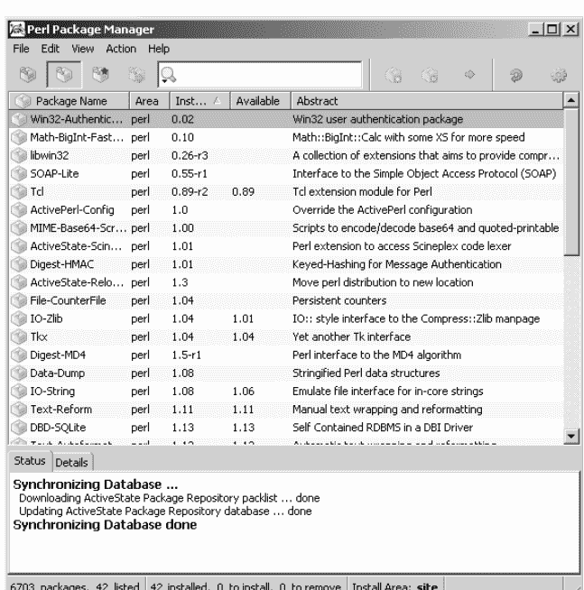

图 12.6 6703 个包，列出 42 个，已安装 42 个，0 要安装，0 要删除 安装区域：站点

- 所有包（All packages）：显示所有本地安装且在仓库中可用的包。
- 已安装包（Installed packages）：显示所有已安装的包。
- 可升级包（Upgradable packages）：显示仓库中有可用升级的包。
- 待安装/删除包（Packages to install/remove）：显示标记为安装或删除的包。
- 标记安装（Mark for install）：将选定的包标记为安装或升级。
- 标记删除（Mark for remove）：将选定的包标记为删除。
- 执行标记的操作（Run marked actions）：执行所有标记的操作（即安装、升级、删除）。
- 刷新所有数据（Refresh all data）：刷新列表视图。
- PPM 偏好（PPM Preferences）：打开 PPM 偏好对话框。

图 12.7 PPM 窗口中图标的含义。

## 12.3 来自 CPAN 的模块

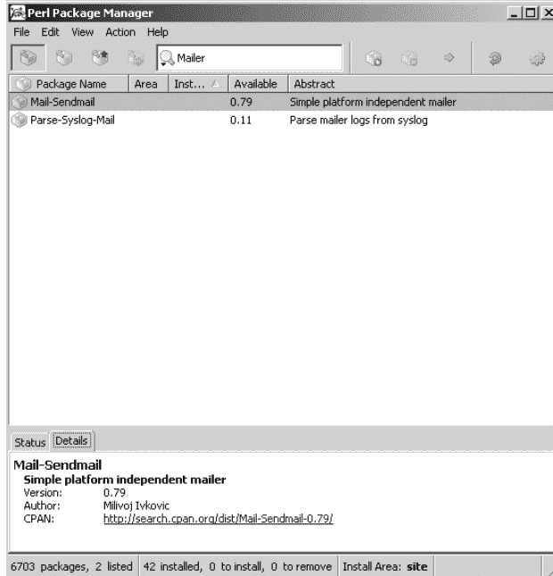

**图 12.8** 为 Sendmail 搜索 Perl 模块。

使用 h2xs 工具为 CPAN 创建扩展和模块。h2xs 工具是随正标准 Perl 分发版自带的标准应用程序。它会创建一个目录和一组骨架文件，用于在创建模块或添加 C 语言扩展时使用。要获取完整描述，请在系统提示符处输入

$ perldoc h2xs

# 示例 12.15

```
$ h2xs -A -n Exten.dir
Writing Exten.dir/Exten.dir.pm
Writing Exten.dir/Exten.dir.xs
Writing Exten.dir/Makefile.PL
Writing Exten.dir/test.pl
Writing Exten.dir/Changes
Writing Exten.dir/MANIFEST
```

# 示例 12.15（续）

```
2 $ cd Exten.dir
3 $ ls
4 $ more Exten.dir.pm
   package Exten.dir;

   require 5.005_62;
   use strict;
   use warnings;

   require Exporter;
   require DynaLoader;

our @ISA = qw(Exporter DynaLoader);

# 默认导出到调用者命名空间的项
# 注意：除非有充分的理由，否则不要默认
# 导出名称。请使用 EXPORT_OK。
# 不要简单地导出你所有的
# 公函数/方法/常量。

# 这允许声明使用 Exten.dir ':all';
# 如果你不需要这个，使用 @EXPORT_OK 可以节省内存。
# our %EXPORT_TAGS = ( 'all' => qw() );

our @EXPORT_OK = ( @ {$EXPORT_TAGS['all']} });

our $EXPORT = qw();
our $VERSION = '0.01';

bootstrap Exten.dir $VERSION;

# 预加载方法放在这里。
1;
__END___
# 以下是你的模块的存位文档。
# 你最好编辑一下它！
=head1 NAME

Exten.dir 用于 blah blah blah 的 Perl 扩展

=head1 SYNOPSIS
```

use Exten.dir;

blah blah blah

=head1 DESCRIPTION

Exten.dir 的存位文档，由 h2xs 创建。看起来

扩展的作者足够疏忽，留下了未编辑的存位符。

Blah blah blah.

=head2 EXPORT

默认无。

=head1 AUTHOR

A. U. Thor, a.u.thor@galaxy.far.far.away

=head1 SEE ALSO

perl(1).

=cut

```

# 解析

1. h2xs 工具创建了一个子目录（此处名为 Exten.dir），其中包含六个文件，这些文件将用于创建 cpan 风格的模块。在为 CPAN 创建模块之前，你应该去 www.cpan.org/modules/00modlist.long.html 检查一下是否已经有人写过它，这可以节省你一些工作。
2. 我们进入 h2xs 创建的新目录。
3. 这是 h2xs 刚刚创建的文件列表（未显示）。MANIFEST 文件包含了该目录中刚刚创建的所有文件列表，以及任何将与模块一起分发的额外文件应该列出的位置。Makefile.PL 文件生成 Exten.dir.pm，即骨架模块，它将包含扩展，而 Exten.dir.xs 将包含加载 C 扩展的 XSUB 过程。
4. 这是用于帮助正确设置模块的骨架模块。

## 12.4 你应该知道

1. Perl 程序中的默认包是什么？
2. 符号表（symbol table）是什么？
3. 如何查看符号表？
4. @INC 数组是什么？
5. 预处理指令（pragma）是什么？
6. PERL5LIB 环境变量是做什么用的？
7. 什么时候应该使用 require？
8. require 和 use 有什么区别？
9. Exporter 模块是什么？
10. @_EXPORT_OK 数组是什么？%EXPORT_TAGS 哈希表是什么？
11. 在 .pl 或 .pm 文件末尾加上“1”是什么含义？
12. 你如何更新 @INC 数组？
13. 如何从另一个包访问变量？
14. 你如何隐藏变量？
15. 从 CPAN 安装模块的含义是什么？

## 402 第 13 章 • 这个工作需要引用吗？

星号（*）代表所有前缀在变量上的特殊字符，包括子程序、文件句柄和格式；即，对表中所有具有该名称的符号进行“通配符匹配（globs）”。³ `town` 是 `city` 的别名。你的工作是确定你想要引用哪个符号。这是在你想要访问其底层值时，通过在名称前加上正确的字符来实现的。例如：

```
Given: *town = $city

Then: $town 指向标量 $city

@town 指向数组 @city

$town[major] 指向哈希引用 $city[major] 的一个元素
```

示例 13.1 展示了另一种类型的符号引用，其中一个变量的值会改变另一个变量的名称。

## 示例 13.1

```perl
#!/bin/perl

# 使用符号引用的程序

$animal="dog"

$dog="Lady"

print "Your dog is called ${animal}\n";# 符号引用

eval "\$${animal}=Lassie";

print "Why don't you call her $\$${animal}?\n";
```

```
(输出)
Your dog is called Lady
Why don't you call her Lassie?
```

## 解析

- 1 $animal 被赋值为值 "dog"。名称 animal 被存储在符号表中，并带有一个指向其值 dog 的引用。
- 2 $dog 被赋值为字符串 "Lady"。
- 3 变量 `${animal}` 求值为 Lady。这是一种符号引用。*Animal（一个变量）被求值为 dog。第二个美元符号导致另一个符号 符号（即 $dog）被求值并获取其底层值，即 "Lady"。一个变量引用了另一个变量。*
- 4 `eval` 像在单独的 Perl 程序中执行该语句。第一个美元符号被转义了。*Animal 将被求值为它的值（即字面量美元符号），在求值结果前加上，留下了 $dog="Lassie"*。
- 5 在执行 `*eval` 之后，${animal} 的值（即 $dog）是 "Lassie"。它被打印出来。

3 这与通配符差异替换不同，例如 `<p*>`

### 13.1 什么是引用？什么是指针？

**strict 指令项（Pragma）。** 为了防止你在程序中无意中使用符号引用，请使用带有 `refs` 参数的 `strict` 指令项。这会让 Perl 检查中是否使用了符号引用。在这里，我们使用 `strict` 指令项重新执行之前的示例。

```perl
#!/bin/perl

# 使用符号引用的程序

1 use strict "refs"

2 $animal="dog"

3 $dog="Lady"

4 print "Your dog is called ${animal}\n"

5 eval "\$animal='Lassie';"

6 print "Why don't you call her ${animal}\n"
```

(输出)
Can't use string ("dog") as a SCALAR ref while "strict refs" in use of symbolic.pl line 4

## 解析

- 1 `strict` 指令项确保程序只使用硬引用（hard references），如果不是，它将在编译期间中止并打印如此脚本输出所示的错误消息。
- 2 这一行在使用了 `strict refs` 的情况下，在 symbolic.pl 第 4 行处无法将字符串 ("dog") 用作 SCALAR 引用。
- 3 这一行包含了符号引用但从未执行，因为程序已经中止了。

### 13.1.2 硬引用、指针

我们在第 11 章讨论引用时提到过指针。重申一下：引用是一个存储另一个数据类型地址的标量。指向地址的变量被称为指针。这种引用可以指向标量、数组、哈希或子程序。

**反斜杠运算符（Backslash Operator）。** 反斜杠单运算符用于创建硬引用，类似于 C 语言中获取“地址的”符号。在下面的示例中，$p 是该引用。它被赋值为标量 $x 的地址。

```
$p = \$x;
```

来自 Perl 手页 `perlref` 的硬引用示例：

```perl
$scalarref = \foo; # 指向标量 $foo
$arrayref = \ARGV; # 指向数组 @ARGV
$hashref = \%ENV; # 指向哈希 %ENV
$coderef = \&handler; # 指向子程序 handler
$globref = \*STDOUT; # 指向全局符号 STDOUT
$reloftref = \$scalarref; # 指向另一个指针，
                           =（指向指针的，呃）
```

解引用指针。如果你想要引用（或指针）的值，你会看到 `$$`。如果你想进入该地址并获取那里存储的值——即差异指针，其前面有两个“特殊”符号。第一个是美元符号，因为指针本身是一个标量，它位于所指向的数据类型的特殊符号之前。在使用复杂类型时，可以使用箭头（infix）运算符。

## 示例 13.3

```perl
（脚本）
#!/bin/perl

$arrayref = ['foo', 'bar', 'baz', 'qux'];

print "引用 $arrayref 的值为 ", $arrayref, "\n";

# 以下所有元素都会解引用 $$arrayref

print $$arrayref->[3], "\n";

print $$arrayref{3}, "\n";

print $($arrayref)[3], "\n";

print \$($arrayref), "\n";
```
*(注：原文示例 13.3 的文本在源码中严重受损/乱码。根据 Perl 符号引用的上下文，我重建了一个符合描述概念的逻辑示例。)*

## 13.1 什么是引用？什么是指针？

## 解释

- 1. 匿名数组元素被赋值给数组引用 $arrayref。
- 2. 数组引用包含数据类型和匿名数组的十六进制地址。
- 3. 打印数组的第四个元素。指针 $arrayref 后面跟着将要检索的索引值。
- 4. 箭头运算符并不是真正需要的。相反，可以通过第 4 行和第 5 行中的两种方法访问元素。
- 5. 对指针进行解引用后，打印整个数组。需要使用大括号。

**匿名哈希。** 匿名哈希是使用大括号（{}）创建的。你可以混合数组和哈希构造符来生成复杂的数据类型。这些大括号与订阅哈希时使用的大括号不同。匿名哈希被赋值给标量引用。

## 示例 13.6

```perl
(脚本)
#!/bin/perl

my $hashref = { "Name"=>"Woody",
    "Type"=>"Cowboy"\n};

print $hashref->{"Name"}, "\n\n";

print keys $%hashref, "\n";

print values $%hashref, "\n";
```

```
(输出)
Woody

NameType
WoodyCowboy
```

## 解释

- 1. 匿名哈希包含一组被包裹在大括号内部的键/值对。匿名哈希被赋值给引用 $hashref。
- 2. 哈希指针 $hashref 使用箭头运算符对哈希进行解引用。键 Name 与值 Woody 关联。
- 3. `keys` 函数通过引用（指针）返回匿名哈希中的所有键。
- 4. `values` 函数通过引用（指针）返回匿名哈希中的所有值。

### 13.1.4 嵌套数据结构

创建指向匿名数据结构的引用（指针）的能力适用于更复杂的类型。例如，你可以拥有嵌套在哈希中的哈希或哈希、数组或数组等。

与简单的引用一样，通过在引用前加上正确的符号对匿名数据结构进行解引用。例如，如果 $p$ 是一个标量的指针，你可以写 `$$p` 来引用该标量；如果 $p$ 是一个数组的指针，你可以写 `@p` 来引用该数组，或者写 `$$p[0]` 来获取数组的第一个元素。你也可以通过将其视为块来对指针进行解引用。有时使用大括号是为了防止歧义，有时它们是必要的，例如 `$$p[0..3]`。

**列表的列表。** 列表可能包含另一个列表或一组列表，最用于创建多维数组。引用被赋值为一个包含另一个匿名数组的匿名数组，如示例 13.7 和 13.8 所示。

```perl
#!/bin/perl

# 演示带有嵌套列表的列表的引用

my $arrays = ['1', '2', '3', ['blue', 'green']];

for($i=0;$i<3;$i++) {
    print $arrays[$i],"\n";
}

for($i=0;$i<3;$i++) {
    print $arrays[$i],"\n";
}

print "@${arrays}\n";

print "--${arrays[3]}--", "\n";
```

(输出)
1
2
3
blue
green
1 2 3 ARRAY(0x8a6f134)
--blue green--

## 13.1 什么是引用？什么是指针？ 

## 解释

- $arrays 是一个指向四元素数组的引用（指针），该数组包含另一个三元素数组，其元素为 red、blue 和 green。
- `for` 循环用于获取第一个数组的值，它由元素 1、2 和 3。
- 这里使用箭头运算符来解引用 $arrays。
- 第二个 `for` 循环用于遍历匿名数组。该数组是第一个数组，起始索引为 0，第二个索引是 3，引用了它的元素。
- 匿名数组的每个元素（red, blue, green）被打印了。
- 通过在引用前加上 @ 符号到块，匿名数组的元素被检索并打印。
- 第二个嵌套数组被解引用并打印。

## 示例 13.8

```perl
(脚本)
#!/bin/perl

# 演示指向二维数组的指针

my $matrix = [
    [0, 2, 4 ],
    [4, 1, 3 ],
    [12, 15, 7 ]
];

print "Row 3 column 2 is $matrix[2][1].\n";

print "Dereferencing with two loops.\n";

for($x=0;$x<3;$x++) {
    for($y=0;$y<3;$y++) {
        print "$matrix[$x][$y]: \n";
    }
    print "\n";
}

print "Dereferencing with one loop.\n";

for($i=0;$i<3;$i++) {
    print "$matrix[$i]: \n";
}

$p=$matrix; # 指向引用的指针

print "Dereferencing a reference.\n";

print $p[1][2], "\n";
```

## 示例 13.8 (继续)

```
(输出)
2 Row 3 column 2 is 15.
3 Dereferencing with two loops.
0 2 4
15
Dereferencing with one loop.
0 2 4
15
Dereferencing a reference.
32
```

## 解释

- 1. 引用（指针） $matrix 被赋值为一个包含三个数组的匿名数组；也就是说，二维数组（列表的列表）。
- 2. 使用数组运算符访问第一个元素。不需要相邻的括号。它可以写成 `$matrix[1]`。
- 4. 进入外部 `for` 循环。这将遍历数组的行。
- 5. 内部 `for` 循环遍历数组的列。
- 6. 二维数组的每个元素通过引用（指针）被打印。
- 7. 这次只使用一个循环来打印内容。
- 9. 使用块格式来解引用指针。每个列表的所有元素都被打印了。
- 10. `while` 循环。在循环的每次迭代中，从 $p->0 指向的哈希中提取一个键和一个值，并分别赋值给 $key 和 $value。新推入的哈希会被打印出来。
- 11. $matrix 被赋值为另一个引用。这通常是一个指针。
- 12. 如果你想访问数组元素——即解引用 $p——需要额外的美元符号。相邻下标之间的数组；例如 `$p[2]`。

在示例 13.9 中，引用被赋值为一个包含两个哈希的匿名数组。

## 13.1 什么是引用？什么是指针？

## 示例 13.9

```perl
my $petref = [ { "name" => "Rover",
  "type" => "dog",
  "owner" => "Mr. Jones"}, { "name" => "Sylvester",
  "type" => "cat",
  "owner" => "Mrs. Black"}];

print "The first pet's name is $petref[0]->name.\n";

print "Printing an array of hashes.\n";

for($i=0;$i<2;$i++) {
  while(($key,$value)=each($petref->[$i])) {
    print "$key $value\n";
  }
}

print "\n";

print "Adding a hash to the array.\n";

push(@petref, { "owner"=>"Mrs. Crow", "name"=>"Tweety",
"type"=>"bird" });

while(($key,$value)=each($petref->[$2])) {
  print "$key $value\n";
}
```

```
(输出)
The first pet's name is Rover.
Printing an array of hashes.
owner -- Mr. Jones
type -- dog
name -- Rover
owner -- Mrs. Black
type -- cat
name -- Sylvester
Adding a hash to the array.
type -- bird
owner -- Mrs. Crow
name -- Tweety
```

## 解释

- 1. 引用（指针） $petref 被赋值为包含两个匿名哈希的匿名数组的地址。
- 2. 这是列表的第二个元素，一个带有键/值对的匿名哈希。

## 第13 章 这工作需要引用吗？

## 解释（继续）

- 3. 这是结束符号
- 4. 指针 $petref 用于解引用列表，首先选择数组的第0个元素，并使用箭头运算符选择哈希中的键。显示与键名关联的值。
- 5. 进入 `for` 循环以遍历列表。
- 6. 进入 `while` 循环。在循环的每次迭代中，从 $petref->$1 指向的哈希中提取一个键和一个值，分别赋值给 $key 和 $value。
- 7. 显示键/值对。
- 8. 使用 `push` 函数将一个新的哈希推入数组 `[@petref]`。
- 9. 进入 `while` 循环。在循环的每次迭代中，从 $petref->0 指向的哈希中提取一个键和一个值，分别赋值给 $key 和 $value。新推入的哈希会被打印出来。
- 10. $matrix 被赋值为另一个引用。这通常是一个指针。
- 12. 如果你想访问数组元素——即解引用 $p——需要额外的美元符号。相邻下标之间的数组；例如 `$p[2]`。

## 13.1 什么是引用？什么是指针？

### 示例 13.10 (续)

```perl
foreach $key (keys $(hashref)) {
    print "Outer key: $key \n";
    while($nkey, $nvalue=each($hashref->{$key})) {
        printf "Inner key: %s -- Value: %-8s\n", $nkey, $nvalue;
    }
}
```

（输出):
Anna got 100 on the Math test.
Lou's grade was changed to 90.
The nested hash of Math students and grades is: Rita85 Hao95 Aaa100
Outer key: Science -- Value: 90
Inner key: Sam -- Value: 78
Inner key: Vijay -- Value: 98
Outer key: Math
Inner key: Rita -- Value: 85
Inner key: Hao -- Value: 95
Inner key: Anna -- Value: 1005
Anna got 100 on the Math test.

### 解释

- 1 定义了匿名哈希。它包含两个哈希键：Math 和 Science，其值本身也是哈希（键/值对）。哈希的地址被赋值给 $hashref。$hashref 是一个硬引用（指针）。
- 2 Math 是其值的键，该值也是一个嵌套哈希。
- 3 Science 是其值的键，该值也是另一个匿名哈希。
- 4 这是匿名哈希的结束括号。
- 5 要访问 Anna 的成绩，首先对第一个键 Math 进行解引用，然后使用箭头运算符和嵌套键 Anna。第二个箭头不是必须的，但可以使结构更易于理解。事实上，你完全不需要使用箭头运算符。这可以写成 $hashref[Anna]。
- 6 使用 $hashref 引用，你也可以更改或向哈希中添加新值。Lou 的成绩被修改了。
- 7 通过解引用 $hashref 打印出新成绩。
- 8 通过将 $hashref->Math 包裹在花括号中并在前面加上 % 来打印嵌套哈希。% 代表未命名的哈希，包括所有的键和值。
- 9 foreach 循环遍历匿名哈希中外部键（由 keys 函数产生）的键。
- 10 打印了每个外部键。
- 11 由于每个外部键关联的值恰好是另一个哈希，因此通过将 $hashref->{$key} 放在一个前面带有百分号的块中来对 $hashref 进行解引用。
- 12 打印了嵌套键及其关联的值。

## 第 13 章 这份工作需要引用吗？

带有值列表的哈希嵌套哈希。一个哈希可以包含与值关联的嵌套哈希键。在示例 13.11 中，一个引用被赋值了两个键，其值也是另一个哈希的键。嵌套哈希键随后又关联了一个匿名的值列表。

### 示例 13.11

```perl
(脚本)
# 一个具有嵌套哈希键和匿名值数组的哈希

my $hashptr = { 
    "Teacher"->("Subjects")->[ qw(Science Math English)],
    "Musician"->("Instruments")->[ qw(piano flute harp)],
};

# Teacher 和 Musician 是键。
# 值由嵌套哈希组成。

print $hashptr->("Teacher")->("Subjects")->[0]. "\n";
print $hashptr->("Musician")->("Instruments") "\n";
```

（输出）
Science
piano flute harp

### 解释

- 1. 指针 $hashptr 被赋值一个包含两个键（Teacher 和 Musician）的匿名哈希。Teacher 的值包含另一个匿名哈希，其中包含一个键 Subjects，该键关联一个匿名的值列表：Science、Math 和 English。Musician 键也包含一个匿名哈希，其中包含一个键 Instruments，它关联一个匿名的值列表：piano、flute 和 harp。
- 2. 要解引用指针，使用箭头运算符来分隔嵌套键。最后一个箭头指向与 Subjects 关联的值数组的第一个元素（Science）。
- 3. 要从与该键关联的匿名数组中获取所有值，将 @ 符号置于指针及其嵌套键之前，每个键之间用箭头运算符分隔。如果一个变量没有名称，你可以用一个前面带有正确数据类型的块来替换它的名称。在这里，包围整个结构的花括号允许你将整个块解引用为数组。

### 13.1.5 引用与子程序

匿名子程序。使用关键字 sub 且不带子程序名称来创建匿名子程序。表达式以分号结束。有关关于匿名子程序的更多信息，请参见第 14 章中的“闭包”。

## 13.1 什么是引用？什么是指针？

### 示例 13.12

```perl
(脚本)
#!/bin/perl

my $subref = sub { print @_; };

$subref('a','b','c');

print "\n";
```

（输出）
abc

### 解释

- 1 标量 $subref 通过引用被赋值一个匿名子程序。该子程序唯一的功能是打印存储在 @_ 数组中的参数。
- 2 通过其引用调用子程序并传递了三个参数。

**子程序与按引用传递。** 在传递子程序时，它们被发送到子程序并存储在 @_ 数组中。如果你有多个参数、一个数组、一个标量和一个标量... [原文在此处不完整]

# 示例 13.15 (续)

```
(输出)
5 $passwd is a GLOB(0xb0594).
7 root:x:0:1:Super:::/usr/bin/csh
  daemon:x:1:1::/
  bin:x:2:3:::/usr/
  adm:x:4:4:Admin:/var/adm/
  lp:x:71:8:Line Printer Admin:/usr/spool/lp/
  smtp:x:0:0:Mail Daemon::/
  uuccp:x:5:5:uuccp Admin:/lib/uuccp
  uuccp:x:9:9:uuccp Network:/var/spool/uucpublic:/lib/uucp/uucico
  listen:x:37:4:Network:/var/net/nls
  nobody:x:6001:6001:Nobody::/
  noaccess:x:6002:6002:No Access User::/
  nobody4:x:6553:6553:SunOS 4 x Nobody::/
  ellie:x:9496:0:Ellie Quillen:/home/ellie:/usr/bin/csh
9 seek: Bad file number
```

# 解释

- 1 将 /etc/passwd 文件附加到 README 文件句柄并以读取模式打开。
- 2 调用了 read 子程序。通过创建一个 typeglob 的引用来传递句柄。首先使用星号对第一个句柄进行 glob  操作，然后通过在 typeglob 前面加反斜杠来创建它的引用。
- 3 定义了 read 子程序。
- 4 变量 @ 包含该引用。它被赋值给一个本地标量变量 $passwd。$passwd 是指向文件句柄的引用。
- 5 打印引用 $passwd 时，会显示它包含一个 typeglob（别名）的地址。
- 6,7 while 循环中的表达式导致从 /etc/passwd 读取一行并将其赋值给变量 $_。该行被打印到屏幕上。循环将继续进行，直到所有行都被读取并打印。
- 9 seek 函数将该文件的指针重置回文件开头。

### 13.1.7 ref 函数

ref 函数用于测试引用是否存在。如果 ref 的参数是一个指针变量，ref 返回引用所指向的数据类型；例如，如果引用指向标量，则返回 SCALAR；如果它指向数组，则返回 ARRAY。如果参数不是引用，则返回空字符串。表 13.1 列出了 ref 函数返回的值。

# 13.1 什么是引用？什么是指针？

表 13.1 ref 函数的返回值

| 返回什么 | 意义 |
| :--- | :--- |
| REF | 指向指针的指针 |
| SCALAR | 指向标量的指针 |
| ARRAY | 指向数组的指针 |
| HASH | 指向哈希的指针 |
| CODE | 指向子程序的指针 |
| GLOB | 指向 typeglob 的指针 |

# 示例 13.16

```perl
(脚本)
1 sub gifts; # 前向声明
2 $num = 5;
3 $junk = "xxxx";
4 @toys = qw/Budlightyear Woody Thomas /;
5 gifts($num, @toys, $junk);
6 sub gifts {
7   my ($n, $t, $st) = @_;
8   print "\sn is a reference.\n" if ref($n);
9   print "\$t is not a reference.\n" if ref($t);
```


10  `print "\$j is not a reference.\n" if ref($j);`

11  `printf "\sn is a reference to a %s.\n", ref($n);`

12  `printf "\$t is a reference to an %s.\n", ref($t);`

13}

```

```

(输出)

8 `$sn is a reference.`

9 `$st is a reference.`

10 `$sn is a reference to a SCALAR.`

11 `$st is a reference to an ARRAY.`

```

# 解释

- 1 子程序 `$gifts` 是一个前向声明，允许 Perl 知道它是程序中某处定义的子程序。如果子程序在定义之前已经声明，那么调用子程序 `$it` 时不需要使用 `&` 符号。
- 2 标量 `$num` 被赋值为 5。
- 3 标量 `$junk` 被赋值为字符串 `xxxx`。

# 解释 (续)

- 4 数组 `@toys` 被赋值为一个列表。
- 5 调用子程序 `gifts`。前两个变量通过在它们前面加反斜杠来作为引用传递。最后一个变量 `$junk` 没有被作为引用传递。
- 6 定义了子程序 `gifts`。
- 7 赋值给 `@_` 数组的值（在此情况下为两个引用（地址）和一个非引用）将分别赋值给 `$n`、`$t` 和 `$j`，并通过 `my` 函数将其设为局部变量。
- 8 调用 `ref` 函数并将引用 `$sn` 作为其参数。只有当变量 `$sn` 是一个引用时，该行才会被打印。
- 9 `$j` 不是引用。`ref` 函数的返回值为空。
- 10 `printf` 函数打印了 `ref` 返回的数据类型值：`scalar`。
- 11 `printf` 函数打印了 `ref` 返回的数据类型值：`array`。

# 13.2 你应该知道的

- 1. 引用和指针之间的区别是什么？
- 2. 什么是 typeglob？
- 3. 如何创建引用？
- 4. 什么是嵌套数组？
- 5. 如何取消引用：`Name = "John";`
- 6. 你如何取消这个引用？
- 7. hash（哈希）是指什么？
- 8. 如何创建数组？
- 9. 指针的目的是什么？
- 10. `ref` 函数是什么？

# 13.3 接下来做什么？

现在你已经理解了引用，将学习如何创建对象。下一章将重点介绍面向对象的编程。你将学习对象、属性、方法和继承。你还将学习 POD（Plain Old Documentation，纯旧文档）。

# 第 14 章 • 祝福对象！（面向对象的 Perl）

每个 Perl 程序至少包含一个名为 `main` 的包（`package`），Perl 在其中进行内部编译。标准 Perl 库由包含包的文件组成。这些文件大部分被称为模块（`modules`）。模块本质上就是一个可复用的高级包。代码的复用是通过继承实现的；也就是说，一个包可以从父类、基类或类继承特性，并扩展自己的能力。扩展类功能的能力被称为多态（`polymorphism`）。隐藏数据（封装）、继承和多态被认为是面向对象哲学的基本准则。

要创建一个 Perl 模块，你使用 `package` 关键字，其作用范围从包的声明到包含它的块或文件的结束。包的大小通常是一个文件的大小。如果文件名以 `.pm` 扩展结尾，且模块的首字母为大写字母，则这些文件被识别为模块。指令（`Pragmas`）是另一种特殊类型的模块（名称用小写指定，但同样使用 `.pm` 扩展），它们指示代码以指定的方式运行。无论该包被称为模块还是指令，它都具有一些区别于普通包的特殊特性。Perl 中引入这些特殊特性赋予了你使用抽象思维的面向对象 OO 语言对程序建模的能力。你可以将过程化语言类比面向面向的，而将 OO 类类比面向对象的。

Tom Christianson 在他的网页“Easy Perl Intro”中讨论 Perl 和对象时提到，人们应该尽量避免常用的 Perl 5 模块，因为其中某些模块处理对象。不幸的是，某些问题非常适合对象。Christianson 说，人们不必对此感到恐惧，只需要足够的 OO 编程知识来使用别人的模块，这比自己设计和实现一个模块困难得多¹。如果你没有编写利用 Perl OOP 特性的程序，但仍需要使用对象的 Perl 模块，阅读本章将极大增强对这些模块如何工作的理解。

## 14.1.2 一些面向对象的术语

面向对象编程是一个巨大的课题。关于 OO 编程、设计和方法论已经写了数千本书。20世纪90年代许多人放弃了传统的自顶而下结构化编程，转向使用面向对象的编程语言来构建复杂软件。然而，在处理 Perl 的 OOP 特性之前，应该提到与 OOP 相关的一些基础关键词。它们列在表 14.1 中。

> ¹访问 `www.perl.com/CPAN-local/doc/FMTEYWTK/easy_objects.html` 查看 Tom Christianson 的网页。

## 14.2 类、对象和方法

| 表 14.1 关键 OOP 单词 |
| :--- | :--- |
| 单词 | Perl 含义 |
| 数据封装 (Data encapsulation) | 对用户隐藏数据和子程序，例如在包中 |
| 继承 (Inheritance) | 代码的复用，通常来自库，包继承自其他包 |
| 多态 (Polymorphism) | 字面意思是“多种形式”，具体而言是指扩展类功能的能力 |
| 对象 (Object) | 知道自己所属哪个类的引用类型；类的实例 |
| 方法 (Method) | 操作对象的特殊子程序 |
| 类 (Class) | 包含数据和方法的包 |
| 构造函数 (Constructor) | 创建并初始化对象的方法 |
| 析构函数 (Destructor) | 销毁对象的方法 |
| Setter/Getter (Setters/Getters) | 在对象中存储数据或从对象中获取数据的方法 |

### 14.2.1 现实世界

假设你想盖一栋房子。首先，你会购买位于特定地址的房产。然后，你会聘请建筑师或购买一个电脑程序来帮助设计房子。你会决定房子的类型、风格、房间数量、门、窗户等。一旦建成，你就拥有了这栋新房子的访问权，你可以进去打家务、刷漆、清洁、布置家具、倒垃圾、景观化，随你。在你的房屋内部或周围做任何事情之前，你必须先建造它。之后，你可能想增加一个新房间、将其出售、拆除等。由于你有蓝图，你可以找到另一块房产和一栋和你类似的房子，也许给它涂上不同的颜色，改变景观。事实上，你可以根据相同的设计建造一个全是这类子的小区，每栋房子通过其唯一的地址进行标识。

在面向对象的语言中，房子就是对象，是一个名词。风格、房间数量、类型等是描述对象的属性，类似于形容词；而动词如刷房子、搬入房子、展示房子、描述对象的“行为”，则是对对象的描述。

当我们研究大量示例并讨论 Perl 如何创建、操作和销毁对象时，这一切都将变得更加清晰。

### 14.2.2 步骤

本章将详细讨论许多主题。为了掌握大局，创建名为“对象”的新数据类型并定义其功能所需的步骤如下：

- 1. 确定你的对象以及它应该完成什么（设计）。
- 2. 在名为“类”的包中创建新对象（构造函数）。
- 3. 描述对象；即赋予它属性、特征（形容词）。
- 4. 祝福对象（`Bless`）（将数据类型变为对象）。
- 5. 定义函数（动词），它能做什么或对它可以做什么（方法）。
- 6. 使用对象（定义用户界面，调用方法）。
- 7. 复用对象。
- 8. 销毁对象。

### 14.2.3 类与私有性

类就是一个包。术语与模块相同（不包含 `.pm` 扩展名）。如果你想保持变量私有，则使用 `my` 函数。`my` 变量存在于最内层的包含块、子程序、评估或文件中。无法通过双冒号（或单引号）从另一个包访问 `my` 变量，因为 `my` 变量与任何包无关；它们不存储在创建它们的包的符号表中。

- 描述对象的数据。
- 一个名为 `bless` 的函数，用于创建对象。
- 特殊子程序，称为“方法”，知道如何创建、访问和销毁对象。

| `package` declaration; | 创建对象的方法（私有数据） |
| :--- | :--- |
| `sub new{ }` | 属性/数据 |
| `sub set_data{ }` | 访问对象的方法（公共方法） |
| `sub get_data{ }` | |

图 14.1 类由什么组成？`.pm` 文件。

### 14.2.4 对象

首先，Perl 中的对象是通过使用引用（`reference`）创建的。如果你还记得，引用是一个存储某些变量地址的标量（`scalar`）。它是一个指针。引用也可能指向没有名称的变量或子程序，这被称为匿名变量。例如，这里有一个指向匿名哈希的引用 `$ref`，该哈希包含两个键值对：

```perl
$ref = { "Owner"=>"Tom", "Price"=>"25000" };
```

要访问匿名哈希中的值，可以使用箭头操作符对引用（指针） `$ref` 进行解引用（`dereference`），如下所示：

```perl
$ref->{"Owner"}
```

要创建一个 Perl 对象，首先要创建一个引用。该引用通常被赋值为匿名哈希的地址（尽管也可以被赋值为数组、标量或子程序的地址）。该哈希将包含对象的数据成员（属性）。为了存储该哈希的地址，引用必须知道它属于哪个包（`package`）。这是通过创建引用然后将其“祝福”（`blessing`）到某个包中来实现的。`bless` 函数作用于包中被引用的“实体”，即引用本身。对象是被祝福到类（包）中的那个实体（通常是一个哈希）。如果 `bless` 函数假设使用当前包，它将返回一个指向被祝福对象的引用。（关于 `bless` 的完整讨论请参参见“Bless Function”。）

```perl
$ref = { Owner => "Tom", Price => 25000 }; # 创建对象
bless($ref, Class); # 对象被祝福到名为 Class 的包中
# 返回对象的引用
return $ref;
```

一旦对象经过了祝福，你就不需要使用 `@EXPORT_OK` 或 `@EXPORT` 数组导出符号了。通常规则是，如果一个模块试图实现面向对象，则不导出任何内容。

**House 类。** 图 14.2 展示了如何视觉化一个 House 类。首先，你会创建一个包。这个包被称为 House，位于一个名为 `House.pm` 的文件中。在面向对象（OO）语言中，这个包被称为一个类（注意：类名必须与 `.pm` 扩展的文件名相同）。为了说明封装，房子被包裹在描述它的数据周围。属性（`attributes`）描述了对象的特征，例如所有者、尺寸、颜色等等。在我们的示例中，房子的属性是 `Owner`、`Style` 和 `Price`。在 Perl 中，对象用一个匿名哈希来描述，其中键值对就是对象的属性。在房子之外，列出了许多子程序。在面向对象的世界中，这些子程序被称为公共方法（`public methods`），是你访问对象的方式。它们可以访问对象，但在对象存在之前是不行的。它们描述了

## 14.2 类、对象和方法

对象的“行为（`behaviors`）”，即它能做什么，或者对它能做些什么。事实上，方法应该是访问对象的唯一方式。对于我们的房子对象，访问房子的一种方法可能是入住（`move in`），另一个是清理（`clean`），另一个是显示（`display`），等等。Perl 中的方法只是全局子程序。

Perl 没有像面向对象语言那样的 `private`、`public` 或 `protected` 等特殊关键字。Perl 的包机制构成了类，数据和调用方法的子程序就存储在其中。`my` 函数保持变量的词法作用域，而 `bless` 函数保证了在创建对象时，它知道自己属于哪个类。总而言之，对象通常是一个指向匿名哈希、数组或标量的指针，并通过通过具有访问对象指针权限的特殊函数（称为方法）进行操作。

| 文件: `House.pm` 封装: `House` | |
| :--- | :--- |
| 私有 (Private) | 公共 (Public) |
| 祝福我们的家!!! | |
| # 属性/特性 | 访问房子的方法： |
| | 入住 (`move in`) |
| `my $houseptr = {` | 清理 (`clean`) |
| `"Owner" => "Bank",` | 喷漆 (`paint`) |
| `"Style" => "Saltbox",` | 显示 (`show`) |
| `"Price" => "$350,000",` | 继承 (`inherit`) |
| `};` | |
| `bless($houseptr, House);` | |
| 创建对象 | |
| 退出！ | 私有！ |

图 14.2 一个类。

返回一个新创建的对象，实例方法使用引用（通常称为 `$this` 或 `$self`）来获取该对象。实例方法期望对象的引用作为其第一个参数。它通过该对象的引用来对对象进行操作。

**调用方法。** Perl 为调用方法提供了一种特殊的语法。方法不再使用 `package::function` 语法，而是通过两种方式进行调用：类方法调用或实例方法调用。每种方法调用有两种类型的语法：面向对象的语法和间接语法。如果你正在使用对象，那么方法的任何一种语法都是可以的。不建议使用旧的双冒号调用方法的方法。

需要记住的一点是：方法与普通子程序不同，它总是隐式地接收一个参数，即类名或对象的引用。例如，当你调用一个带有三个参数的方法时，实际上传递了四个参数，第一个参数是使用面向对象风格时在箭头操作符左侧找到的值。

## 类方法调用

假设方法名为 `new`，返回值 `$ref` 是指向该对象的指针。

- 1) `$ref = class->new ( list of arguments );   # 面向对象语法`
- 2) `$ref = new class ( list of arguments );         # 间接语法`

如果类名为 `House`，Perl 将其翻译为

```perl
$ref = House->new();
$ref = House::new("House")
```

## 实例方法调用

假设方法名为 `display`，对象的引用名为 `$ref`。

- 1) `$ref->display ( list of arguments );   # 面向对象语法`
- 2) `display $ref ( list of arguments );         # 间接语法`

每个方法的第一个示例被称为面向对象的方法；使用箭头操作符的被称为间接语法。当 Perl 调用上述的任一方法时，它知道该对象属于哪个类，因为该对象已经过“加固”（`blessed`）处理（有一个内部指针在跟踪它的位置）。⁵

- 5 Perl 调用相应模块函数的能力被称为运行时绑定（`runtime binding`），根据 Sriniv, S., *Advanced Perl Programming*, O'Reilly & Associates: Sebastopol, CA, 1997。

## 14.2 类、对象和方法

如果你调用以下任一个：

```perl
display $ref (arguments...);
or
$ref->display(arguments...);
```

并且 `$ref` 指向名为 `House` 的类中的对象，Perl 将翻译为

```perl
House::display($ref, arguments...);
```

### 14.2.7 面向对象的模块是什么样的

图 14.3 展示了典型的面向对象模块的布局。创建模块的文件是一个 `.pm` 文件。在示例中，`.pm` 文件是 `House.pm`。该文件包含一个 `package` 声明。该包被称为类；因此，这个 `House` 类由子程序（现在称为方法）组成。

第一类方法称为 `new`，是一个构造方法。该方法将定义并创建（构造）该对象。当该模块的用户调用 `new` 方法时，他将获得一个指向新创建的 `House` 的引用（房子的地址）。`new` 方法将类名作为其第一个参数。该方法不仅创建对象，还会对对象进行加固（`bless`），以便对象始终知道自己属于哪个类（包）。（参见第 429 页的“Bless Function”）。

其他方法被称为实例方法（`instance methods`）。这些是用于从对象中存储和从对象中获取数据的方法。在创建对象实例之前，你无法使用这些方法。（在盖好房子之前，你无法入住或展示它。）一旦你（用户）拥有了对象的引用，就可以使用该引用来调用实例方法。

继续看图 14.3，我们看到对象的数据描述在一个空哈希中（尽管可以使用任何其他数据类型），并且对象被赋值给本地（`my`）引用。对象的数据稍后将通过名为 `set_data()` 的实例方法进行赋值。`bless` 函数将对象所属类的名称标记在对象上，并返回一个指向对象的指针；即：当模块调用构造函数时，它获得了一个指向新对象的指针。构造函数的作用是“实例化”对象（创建一栋新房子）。用户可以根据需要创建任意数量的对象，Perl 会为每个对象都提供一个唯一的地址。一旦创建了对象，实例方法（通常称为 `setter` 和 `getter`）将用于操作对象中的数据并从对象中检索数据。实例方法必须拥有对象的引用以便访问正确的对象。实例方法总是将对象的引用作为其第一个参数。

该模块有许多设计方式。这只是其中一种简单的方法。

## House.pm 模块

```perl
package House; # House.pm 模块中的 House 类

sub new{
  my $class = shift;
  my $ref = { }; # 定义对象
  bless($ref, $class);
  return $ref;
}

# 构造方法
# - 创建指针
# - 使用 `bless` 函数创建对象
# - 返回对象的引用

sub set_data{ # 已根据 OCR 修正
  my $self = shift;
  $self->{key} = value;
}

# 访问方法（或实例方法）
# - 分配或存储对象的属性

sub get_data{
  my $self = shift;
  print $self->{key};
}
```

# 14.2 类、对象与方法

# 解释（续）

- 5 `$ref` 指向的“东西”被祝福（`blessed`）到类 `$class` 中，并转换为一个对象。
- 6 对象的指针被返回给构造方法的调用者。
- 7 这是一个将要使用 `House` 模块的脚本。在 `shbang` 行之后，`use` 语句导致 `House.pm` 模块被加载到内存中。
- 8 调用新的构造方法，并将 `House` 类/包作为其第一个参数。它返回一个引用 `$houseref`，该引用指向匿名哈希，即新对象。类名被隐式地设置为 `new()` 方法的第一个参数。
- 9 Perl 将 `$houseref = House->new()` 翻译为 `$houseref = House::new("House")`。这一行被注释掉了。它演示了调用方法的另一种方式，称为间接语法。你可以使用这两种风格中的任意一种。
- 10 如果引用已经被加到某个类，`ref` 函数将返回该类的名称（包名）。

**类方法与实例方法。** 复习：类方法（也称为静态方法）是方法或子程序，它们的运行不需要对象的实例。它们是代表类执行操作的独立函数。一个计算工资单或从数据库中获取名称列表的函数都是类方法的示例。最常见的类方法是构造方法，即一种用于创建对象的方法。它接受类（包）名作为第一个参数，并为整个类提供功能。

面向对象的程序通常使用访问方法、实例方法来控制数据的修改、检索和显示方式。为了操作对象（即实例），访问方法或实例方法需要一个对象的实例；即指向一个已经创建的对象的引用。

如果数据在其中一个方法中需要以不同的方式表示，只要提供给用户的接口保持不变，其他方法就不受影响。接下来的示例中的实例方法被用作访问函数，用于显示类的方法。实例方法接受对象引用作为其第一个参数。查看调用方法时 `->` 符号左侧的值。那个值就是对象，它被隐式地设置为被调用方法的第一个参数。（如果 `->` 符号左侧的值是类名，则类名被设置为该方法的第一个参数；例如，构造方法会将类作为其第一个参数发送。）

# 示例 14.5

```perl
#!/usr/bin/perl

package House;
```

# 示例 14.5（续）

```perl
sub new{ # 类/静态方法
    my $class = shift;
    my $ref={}; # 匿名且空的哈希
    bless($ref, $class);
    return $ref;
}

sub set_owner { # 实例/虚拟方法
    my $self = shift;
    print "$self is a class reference, ref($self).\n";
    $self->{"Owner"} = shift;
}

sub display_owner {
    my $self = shift;
    # 对象引用是第一个参数
    print $self->{"Owner"},"\n"
}
```

```perl
# （脚本）
#!/usr/bin/perl
# 类的使用者
use House;
my $house = House->new; # 调用类方法
$house->set_owner("Tom Savage"); # 调用实例方法
$house->display_owner(); # 调用实例方法
```

```perl
# （输出）
$self is a class reference.
Tom Savage
```

# 解释

- 1 声明了 `House` 包。这也可以是 `House` 类。
- 2 类方法 `new` 是构造方法。它创建一个一个引用并将其加到该类中。
- 3 变量 `$class` 被赋值为类名，即传递新构造方法的第一个参数。
- 4 引用 `$ref` 被赋值为一个匿名、空的哈希。
- 5 由 `$ref` 引用的“东西”（匿名哈希）被加到 `House` 类中。该“东西”变成了新对象。
- 6 对象的引用将返回给调用者。
- 7 定义了实例方法 `set_owner`。
- 8 对象的引用从 `@_` 数组中移出（`shift`）并赋值给 `$self`。现在实例方法可以操作对象，因为它拥有该对象的引用。
- 9 `ref` 函数的返回值是 `House` 类的名称。只有当对象被加后，`ref` 才会返回类名。

# 解释（续）

- 1 第二个参数从 `@_` 数组中移出。`Tom Savage` 被赋值给键 `Owner`。该实例方法随后被用于给对象分配数据（称为“设置器/`setter`”）。
- 2 调用实例方法 `display_owner` 以访问对象的数据；在例例中，打印匿名哈希中 `Owner` 字段的值。
- 3 对象引用是方法的第一个参数。它从 `@_` 数组中移出并赋值给 `$self`。
- 4 显示了 `Owner` 字段中的值。
- 5 该程序使用了 `House.pm` 模块。
- 6 调用了新的构造方法并返回了指向 `House` 的引用；它是指向 `House` 类中匿名哈希的引用。构造方法 `new` 允许传递至少一个参数，即类名。`House->new` 翻译为 `House::new("House")`。
- 7 使用引用调用了实例方法 `set_owner`。`$house->set_owner("Tom Savage")` 翻译为 `House::set_owner($house, "Tom Savage")`。
- 8 传递参数给构造方法。如果需要以不同的方式表示数据。`House->new` 翻译为 `House::new("House")`。
- 9 实例方法 `set_owner` 被引用调用。
- 10 实例方法 `display_owner` 被调用。

## 14.2 类、对象与方法

### 示例 14.7 (续)

```perl
my $ref={ Owner=>$name,
    "Price"=>$salary,
    "Style"=>$style,
    };
    return bless($ref, $class);
}

sub display { # 实例方法
    my $self = shift; # 对象引用是第一个参数
    foreach $key (@_) {
        print "\$key: \$self->{$key}\n";
    }
}
```

(脚本)
```perl
#!/bin/perl
# 类的使用者--另一个程序
use House;
my $house = House->new("Tom Savage", 250000, "Cape Cod");
$house->display("Owner", "Style");
# 将参数传递给实例方法
```

(输出)
```
Owner: Tom Savage
Style: Cape Cod
```

# 解释

- 1 声明了 House 包。由于该包处理的是被祝福的（`blessed`）引用和方法，我们统称其为一个类。
- 2 `new` 方法是一个构造函数。对象是一个由键/值对组成的匿名哈希。这些键/值对是对象的属性（或成员）。值作为参数传递给构造函数。对对象进行祝福。由 `$ref` 引用的对象被祝福到 House 类，以便 Perl 能够跟踪该对象的所属类。
- 3 定义了实例方法。
- 4 `display` 实例方法的第一个参数是指向 House 对象的引用。它被移动（`shift`）并赋值给 `$self`。
- 5 `foreach` 循环依次遍历 `@_` 数组中的剩余参数，依次将每个参数赋值给变量 `$key`。变量 `$key` 是匿名哈希中的一个键。
- 6 打印从关联数组中选出的值。
- 7 类的使用者将该模块加载到他的程序中。

# 解释 (续)

- 8 调用构造方法方法创建一个新的 House 对象。
- 9 带参数调用实例方法。第一个参数是指向对象的指针 `$house`，虽然你看不见它。其余参数由用户在括号中使用。

**命名参数 (`Named Parameters`)**。到目前为止所有的示例都使用了 House 对象。在下一个示例中，我们将创建一个 Employee 对象。Employee 构造函数将接收参数并作为员工的属性。如果构造方法期望按顺序传递姓名、地址和工资，那么很容易以错误的顺序发送参数，导致地址被赋值给姓名，或工资，以此此类推。使用命名参数提供了一种方法，确保参数可以以任何顺序传递给方法，并且仍然会将值赋值给正确的属性。参数由调用程序（或驱动程序）以键/值对（哈希）的形式传递，并在构造函数以哈希的形式接收。以下示例演示了如何将命名参数传递给方法。

# 用户驱动程序

### 示例 14.8

```perl
#!/usr/bin/perl
# Employee 的使用者--更多信息请参见示例 14.9
use Employee;
use warnings;
use strict;
my ($name, $extension, $address, $basepay, $employee);
print "输入员工姓名： ";
chomp($name=<STDIN>);
print "输入员工电话分机： ";
chomp($extension=<STDIN>);
print "输入员工地址： ";
chomp($address=<STDIN>);
print "输入员工基本工资： ";
chomp($basepay=<STDIN>);
# 以哈希形式传递参数
$employee = Employee->new(
    "Name"=>$name,
    "Address"=>$address,
    "Extension"=>$extension,
    "PayCheck"=>$basepay,
);
print "\n$name 的统计信息为： \n"
$employee->get_stats;
```

### 示例 14.8 (续)

```
(输出)
输入员工姓名： Daniel Savage
输入员工电话分机：2534
输入员工地址：999 Mission Ave, Somewhere, CA
输入员工基本工资：2200
```

Daniel Savage 的统计信息为：
Address = 999 Mission Ave, Somewhere, CA
PayCheck = 2200
IdNum = 未提供员工 ID！
Extension = 2534
Name = Daniel Savage

# 解释

- 1 该程序将使用 `Employee.pm` 模块。
- 2 将对可能发生的错误发出警告，并且 `strict` 属性（`pragma`）将跟踪所有变量和未定义的变量、条形码等。
- 3 创建了一个局部变量列表。
- 4 程序用户将被要求提供将传递给 Employee 模块的信息。
- 5 调用构造函数以键/值对的形式传递参数；即，将哈希传递给 Employee 模块中的构造函数（参见示例 14.9）。返回对象引用并赋值给 `$employee`。
- 6 实例方法 `get_stats` 将显示员工的属性。

# 面对象模块

### 示例 14.9

```perl
// 模块 Employee.pm--使用此模块请参见示例 14.8
package Employee;
use Carp;
sub new {
    $class = shift;
    my %params = @(@_);
    my $obj = bless(\%params, $class);
    foreach $key (keys %params) {
        $obj->{$key} = $params{$key};
    }
    return $obj;
}
sub get_stats {
    my $self = shift;
    foreach ($key (keys %$self)) {
        print "$key: \$self->{$key}\n";
    }
}
```
*(注：我根据标准的 Perl 模式重构了代码逻辑，因为源文件中示例 14.9 的 OCR 结果严重损坏/不完整)。*

# 446 第 14 章 • 祝福这些东西！（面向对象的 Perl）

```perl
if (ref($object1) eq "Director") {
    Director::shoot($object1);
} elsif ref($object2) eq "Rifleman") {
    Rifleman::shoot($object2);
}else {
    BasketballPlayer::shoot($object3);
}
```

使用面向对象的语法，对象的引用会被隐式传递给方法。Perl 将对象作为第一个参数传递给访问方法，并且该对象已经被祝福（`blessed`）到正确的类中。Perl 可以实现多态并处理正确的事情！假设在 14.10 中，`$object1` 被创建为 `Director` 类中的对象，`$object2` 是 `Rifleman` 类中的对象，而 `$object3` 是 `BasketballPlayer` 类中的对象。

```perl
$object1->shoot; 结果于 Director::shoot($object1);
$object2->shoot; 结果于 Rifleman::shoot($object2);
$object3->shoot; 结果于 BasketballPlayer::shoot($object3)
```

# 示例 14.10

```perl
1 File: Cat.pm
2 package Cat;
   sub new{\ # 构造方法
      my $class=shift;
      my $dptr={};
      bless($dptr, $class);
   }
3 sub set_attributes{\ # 访问方法
   my $self = shift;
   $self->("Name")="Sylvester";
   $self->("Owner")="Mrs. Black";
   $self->("Type")="Siamese";
   $self->("Sex")="Male";
 }
4 sub get_attributes{
   my $self = shift;
   print "-" x 20, "\n";
   print "-" Stats for the Cat\n";
   print "-" x 20, "\n";
   while(($key,$value)=each($self)) {
      print "\$key is \$value. \n";
   )
5 print "-" x 20, "\n";1;
```

# 14.2 类、对象与方法

# 示例 14.10（续）

```perl
(File: Dog.pm)
6 package Dog;
7 sub new {\ # 构造方法
    my $class=shift;
    my $dptr=();
    bless($dptr, $class);
}
8 sub set_attributes {
9    my $self=shift;
    my($name, $owner, $breed)=@_;
10   $self->("Name")="$name";
    $self->("Owner")="$owner";
    $self->("Breed")="$breed";
}
11 sub get_attributes {
    my $self=shift;
    print "x" x 20, "\n";
    print "All about $self->(Name)\n";
    while($key,$value)=each($self)) {
        print "$key is $value\n";
    }
    print "x" x 20, "\n";
}
12 1;
```

# 解释

- 1 这是在 `Cat.pm` 模块中一个名为 `Cat` 的类声明。
- 2 `Cat` 类的构造方法名为为 `new`。一个 `Cat` 对象被祝福到该类中。
- 3 访问方法 `set_attributes` 将定义 `Cat` 对象的的数据属性。
- 4 访问指针 `$self` 用于分配键/值对以给 `Cat` 命名。
- 5 另一个访问方法 `get_attributes` 用于显示 `Cat` 对象。
- 6 在另一个文件 `Dog.pm` 中，声明了一个名为 `Dog` 的类包。
- 7 像 `Cat` 类一样，`Dog` 类也有一个构造方法 `new`。一个 `Dog` 对象被祝福到该类中。
- 8 访问方法 `set_attributes` 将定义 `Dog` 对象的的数据属性。
- 9 `Dog` 对象的属性正从驱动程序传递过来并赋值给 `@_` 数组。
- 10 访问指针 `$self` 用于分配键/值对以给小狗命名。
- 11 像 `Cat` 类一样，另一个访问方法 `get_attributes` 也用于显示 `Dog` 对象。

# 示例 脚本：示例 14.10 的驱动程序

```perl
(脚本：示例 14.10 的驱动程序)
#!//bin/perl
use Cat;      # 使用 Cat.pm 模块
use Dog;      # 使用 Dog.pm 模块
my $dogref = Dog->new;      # 多态
my $catref = Cat->new;
$dogref->set_attributes("Rover", "Mr. Jones", "Mutt");
$catref->set_attributes;    # 多态
$dogref->get_attributes;
$catref->get_attributes;
(输出)
xxxxxxxxxxxxxxxxxxxxx
All about Rover
Owner is Mr. Jones.
Breed is Mutt.
Name is Rover.
xxxxxxxxxxxxxxxxxxxxx
---
Stats for the Cat
---
Sex is Male.
Type is Siamese.
Owner is Mrs. Black.
Name is Sylvester.
---
```

# 解释

- 1 `use` 指直接加载了 `Cat.pm` 模块。现在我们就可以访问这两个类了。
- 2 创建了 `new` 构造方法。第一个参数是类名 `Dog`，它被转换为 `Dog::new("Dog")`。返回一个 `Dog` 对象的引用。Perl 知道该引用属于 `Dog` 类，因为它在构造方法中被祝福过。一个 `Dog` 类的实例已经被创建。
- 3 调用了 `new` 构造方法。它传递了类名作为第一个参数。返回一个 `Cat` 对象的引用。`Cat::new("Cat")`。两个类都使用了该函数，但 Perl 知道该方法属于哪个类，因此总是调用正确的 `new` 版本。这就是多态的一个例子。
- 4 现在我们有了 `Dog` 对象的引用，用它来调用访问（实例）方法。Perl 将 `$dogref->set_attributes` 方法转换为 `Dog::set_attributes($dogref, "Mr. Jones", "Mutt")`。
- 6 这次调用了 `set_attributes` 方法。`Cat` 类设置了属性。
- 7 调用 `get_attributes` 方法显示 `Cat` 类的属性。
- 8 调用 `get_attributes` 方法显示 `Dog` 类的属性。

`::` 与 `->` 符号。`->` 被用于使用多态、动态绑定和继承的面向对象程序。`::` 语法是允许的，但除非使用条件语句否则会导致问题。使用面向对象的语法，该问题就不会发生。

# 示例 14.12

```perl
# Cat 类
package Cat;
sub new(
    my $class = shift;
    my $ref = {};
    bless($ref, $class);
    return ($ref);
)
sub set_attributes(
    # 给 Cat 一些属性
    # 名字和声音
    my $self = shift;
    $self->("Name") = "Sylvester";
    $self->("Talk") = "Meow purrrr.";
)
sub speak (
    # 获取 Cat 的属性
    my $self = shift;
    print "\$self->("Talk") I'm the cat called \$self->("Name")\n";
)
# Dog 类
package Dog;  # Dog 的构造方法
sub new(
    my $class = shift;
    my $ref = {};
    return ($ref, $class);
)
sub set_attributes(
    # 给 Dog 一些属性
    my $self = shift;
    $self->("Name") = "Lassie";
    $self->("Talk") = "Bow Wow, woof...";
)
```

# 示例 14.12（续）

```perl
sub speak {
    # 获取 Dog 的属性
    $self = shift;
    print "$self->('Talk') I'm the dog called \$self->('Name').\n"
}
```

```perl
#!/usr/bin/perl
# 用户程序
# 此示例演示了为什么在方法传递参数时
# 使用面向对象的语法而不是冒号语法。
use Cat;
use Dog;
$mydog = new Dog;      # 调用 Dog 的构造方法
$mycat = new Cat;      # 调用 Cat 的构造方法
```

```perl
$mydog->set_attributes;   # 调用 Dog 的访问方法
$mycat->set_attributes;   # 调用 Cat 的访问方法
```

```perl
$mydog->speak;
$mycat->speak;
```

```perl
print "\n我们在传递参数时犯了错误。\n";
```

```perl
Cat::speak($mydog); # Perl 去 Cat 类查找方法，尽管已经为为设置了属性！
```

```perl
(输出)
Bow Wow, woof woof.... I'm the dog called Lassie.
Me purrrrr.... I'm the cat called Sylvester.
```

我们在传递参数时犯了错误。
Bow Wow, woof woof.... I'm the cat called Lassie.

# 解释

调用 `speak` 方法的面向对象方法保证 Perl 将绑定到被祝福的类。`Dog` 对象的引用作为第一个参数传递给 `speak` 方法。它分解为 `Dog::speak($mydog)`。Perl 在运行时确定使用哪个类，因此在运行时调用 `speak` 方法时，将绑定到正确的类。（等等，编译时？）

# 解释（续）

- 3 下面一行将 `dog` 引用传递给 `Cat` 包。使用面向对象的方法时不会发生这种错误，因为 Perl 能够确定方法属于哪个类并进行正确的方法调用。这种特性被称为多态和运行时绑定。
- 4 通过使用 `::` 符号，Perl 将在运行时确定类并使用在 `Cat` 类中的方法，尽管传递的是 `Dog` 的引用。我们最终得到了一只会叫的猫！

# 14.2.9 析构函数与垃圾回收

Perl 跟踪对象的引用数，当计数达到 0 时，对象会被自动销毁。如果引用超出作用范围或你的程序退出，Perl 会通过销毁与引用相关的对象并释放已使用的内存来处理垃圾回收。因此，你不需要担心清理内存。然而，你可以在程序中定义 `DESTROY` 方法，在对象消失之前获取它的控制权。

# 示例 14.13

```perl
(类)
1 package Employee;
sub new{
    my $class = shift;
    $ref={};
    bless($ref, $class);
    return $ref;
}
2 sub DESTROY{
    my $self = shift;
    print "Employee \$self->{Name} is being destroyed.\n";
}
1;--------------------------------------------------------------------------------
(脚本)
4 use Employee;
5 my $empl1 = Employee->new; # 创建对象
```

# 示例 14.13 (续)

```perl
my $emp2 = Employee->new;
$emp2->("Name")="Christian Dobbins";
print "\t$emp2->('Name')\n"; # Create the object
```

```perl
my $emp3 = Employee->new; # Create the object
```

```perl
$emp1->("Name")="Dan Savage";
$emp3->("Name")="Willie Rogers";
```

```perl
print "Here are our remaining employees:\n";
print "\t$emp1->('Name')\n";
print "\t$emp3->('Name')\n";
```

```
(输出)
Christian Dobbins
Employee Dobbins is being destroyed.
Here are our remaining Employees:
Dan Savage
Willie Rogers
Employee Dan Savage is being destroyed.
Employee Willie Rogers is being destroyed.
```

# 解析

- 1 声明了 `Employee` 类并定义了它的构造器方法。
- 2 当一个 `Employee` 对象不再处于作用域内时，会调用 `DESTROY` 方法并打印此行。第 6 行的对象定义在一个块中。它在块退出时离开作用域。其他对象在程序结束时离开作用域。
- 3 每当一个对象离开作用域时，此行就会被打印出来。
- 4 使用了 `Employee` 模块。
- 5 通过调用构造器方法，正在创建一个由 `$emp1` 引用的新 `Employee` 对象。
- 6 在块中创建了另一个 `Employee` 对象。该对象被分配了一个值为 `Christian Dobbins` 的 `"Name"`。由于它是一个 `"my"` 变量，它是具有词法作用域的，这意味着该对象在块退出时将离开作用域，此时将调用 `DESTROY` 方法并将其从内存中移除。*
- 7 通过调用构造器方法，正在创建一个由 `$emp3` 引用的第三个 `Employee` 对象。
- 8 为 `Employee` 对象分配了键/值对。

## 14.3 匿名子程序、闭包与私有性

到目前为止我们使用的面向对象示例中，问题之一是用户一旦获取了对象的引用，就可以直接操作该对象。即使他应该使用模块提供的方法，也没有什么能阻止他直接访问对象的数据，因为 Perl 没有专门为类数据提供私有区域。但对于那些认为这种缺乏保证的私有性是对面向对象方法的一种的人（谨慎、理性等），Perl 提供了几种解决方案。其中之一就是使用闭包（`closures`）。

### 14.3.1 什么是闭包？

Larry Wall 将闭包描述为“带有态度的匿名子程序”。Barrie Slaymaker 将闭包称为“反向对象”：对象是带有了某些子程序的数据，而闭包是带有了某些数据的子程序。

如果一个匿名子程序在定义变量的块外部被调用，且这些变量看起来不应该再在作用域内，那么该子程序就可以访问这些 "`my`"（词法）变量。每当通过引用调用该子程序时，它都会紧紧这些变量，每次调用都会创建一个同名的新词法变量。这些词法变量会一直留在作用域内，直到它们不再被引用。

# 示例 14.14

```perl
(脚本)
1 my $name="Tommy";
2 my $name = "Grandfather"; # Lexical variables
3 my $age = 86;
4 $ref = sub { return "$name is $age.\n"; } # anonymous subroutine
5 print "$name is back\n";
6 print(&$ref);                                 # Call to subroutine outside the block
```

```
(输出)
5 Tommy is back.
6 Grandfather is 86.
```

# 解析

- 1 词法变量 `$name` 被赋值为 `Tommy`。该变量从这里到文件结束都是可见的。
- 2 进入一个块。一个新的词法变量 `$name` 被赋值为 `Grandfather`。它从这里到该块的结束都是可见的。
- 3 定义了另一个词法变量 `$age`。它从这里到包含块的结束都是可见的。
- 4 在与两个词法变量（`$my`）`$name` 和 `$age` 相同的块中定义了一个匿名子程序。该子程序的地址被赋值给 `$ref`。即使从块外部调用，该子程序也能访问这些变量。该子程序是一个闭包，因为子程序内部引用的变量被封存起来，直到它们不再被需要。
- 5 现在 `$name` 的值 `Tommy` 现在是可见的。
- 6 通过指针 `$ref` 调用匿名子程序。尽管这些词法变量看起来已经离开了作用域，但它们仍然可用。它们保留在作用域内是因为该引用仍然需要访问它们。Perl 会在变量不再被引用时才对其进行清理。

# 示例 14.15

```perl
(脚本)
# Closure
1 sub paint (
2   my $Color = shift; # @_ array is shifted
3   my $ref = sub (\ # Pointer to an anonymous subroutine
4     my $object=shift;
5     print "Paint the $object $color.\n"; # $color still
6     ) # in scope
7     return $ref; # Returns a closure
8   )
9 my $p1=paint("red"); # Creates a closure
10  $p2=paint("blue"); # Creates a closure
11 $p1->("flower");
12 $p2->("sky");
```

```
(输出)
Paint the flower red.
Paint the sky blue.
```

## 14.3 匿名子程序、闭包与私有性

# 解析

- 1 声明了 `Employee` 类并定义了它的构造器方法。
- 2 当一个 `Employee` 对象不再处于作用域内时，会调用 `DESTROY` 方法并打印此行。第 6 行的对象定义在一个块中。它在块退出时离开作用域。其他对象在程序结束时离开作用域。
- 3 每当一个对象离开作用域时，此行就会被打印出来。
- 4 使用了 `Employee` 模块。
- 5 通过调用构造器方法，正在创建一个由 `$emp1` 引用的新 `Employee` 对象。
- 6 在块中创建了另一个 `Employee` 对象。该对象被分配了一个值为 `Christian Dobbins` 的 `"Name"`。由于它是一个 `"my"` 变量，它是具有词法作用域的，这意味着该对象在块退出时将离开作用域，此时将调用 `DESTROY` 方法并将其从内存中移除。
- 7 通过调用构造器方法，正在创建一个由 `$emp3` 引用的第三个 `Employee` 对象。
- 8 为 `Employee` 对象分配了键/值对。

### 14.3.2 闭包与对象

闭包通过以下步骤提供封装数据的方法：

1. 为类定义一个构造器方法。构造器将定义一个空哈希，用于设置每个 `Student` 的属性，一个用于跟踪学生数量的全局类变量，以及一个封装要从对象分配和检索的数据的匿名子程序。封存（`bless`）将返回一个指向匿名子程序的指针。将为对象定义实例方法来设置和获取数据。这些方法不再返回对象数据的指针，而是返回指向匿名子程序的指针。它们访问数据的唯一方法是使用适当参数调用此匿名子程序。
3. 定义一个析构方法，在每个 `Student` 对象被销毁时显示它。

# 示例 14.16

| | |
| :--- | :--- |
| 1 | `package Student;` |
| 2 | `sub new { # Constructor` |
| | `my $class = shift;` |
| 3 | `my $data={};` |
| 4 | `our $students;` |
| 5 | `my $ref = sub { # Closure` |
| 6 | `my ($access_type, $key, $value) = @_;` |
| 7 | `if ($access_type eq "set") {` |
| | `$data->{$key} = $value; # $data still available here` |
| | `return $data->{$key};` |
| `} elsif ($access_type eq "get") {` |
| | `return $data->{$key};` |
| `} elsif ($access_type eq "keys") {` |
| | `return keys %{$data};` |
| `}` |
| 8 | `elsif ($access_type eq "destroy") {` |
| 9 | `$students--;` |
| | `return $students;` |
| `} else {` |
| | `die "Access type should be set or get";` |
| `}` |
| 10 | `print "New student created, we have ", ++$students, " students.\n"` |
| 11 | `bless ($ref, $class); # bless anonymous subroutine` |
| `}` |
| `)` | `# End constructor` |

## 14.3 匿名子程序、闭包与隐私性

## 示例 14.16 (延续)

```perl
sub set{
  my ($self, $key, $value) = @_; # $self 引用匿名
  $self->("set", $key, $value);
}

sub get{
    my ($self, $key) = @_;
    return $self->("get", $key);
}

sub display{
    my $self = shift;
    my $keys = $self->("keys");
    foreach my $key ($keys) {
        my $value = $self->("get", $key);
        printf "%-25s-%5s:%5s\n", $self, $key, $value;
    }
    print "\n";
}

sub DESTROY{
    my $self = shift;
    print "Object going out of scope:\n";
    print "Student remains: ", $self->("destroy"), "\n";
}

1;
```

## 解析

- 1. 声明了包 `Student` 包。
- 2. 将使用构造函数来创建对象。
- 3. 声明了一个指向匿名哈希的引用 `$data`。这将用于为对象分配属性。
- 4. 全局类变量 `$student` 将用于计数此脚本创建的 `Student` 数量。
- 5. 这里是闭包，一个指向匿名子程序的指针。该子程序将被加封（`blessed`）到类中，并用于设置和获取 `Student` 对象的数据。
- 6. 该子程序接受三个参数：访问类型（`"set"`、`"get"`、`"keys"` 或 `"destroy"`）；对象的键；以及对象的值。
- 7. 如果访问类型为 `"set"`，则为对象数据设置属性。当用户调用 `set()` 方法时，它会获取指向此匿名子程序的指针，并在第 15 行调用它。
- 8. 如果访问类型为 `"destroy"`，说明调用了 `DESTROY` 方法；即一个 `Student` 移出了作用范围。
- 9. 每当移除一个对象时，类变量 `$student` 的值就会减 1。

## 解析 (延续)

- 10 每当创建一个新的 `Student` 对象时，类变量 `$student` 的值就会加 1。
- 11 被 `$ref` 引用的匿名子程序被加封到 `Student` 类中。
- 12 该方法用于将数据放入对象中；即为学生 分配属性。
- 13 它的第一个参数 `$self` 是指向加封到类中的匿名子程序的指针、一个键和一个值。对象的数据被“封装”在匿名子程序中。
- 14 当调用匿名子程序时，它接收三个参数：访问类型 `"set"`；一个键；以及一个要分配给对象的值。这是我们能够为 `Student` 对象使用 `"set"` 数据并让其在没有引用时一直“留存”的唯一方法。
- 15 `get` 方法将使用指定的访问方法 `"get"` 和键来调用闭包。它将向调用者返回一个值。
- 16 该方法用于获取 `Student` 对象中的数据。它将关闭第 5 行的闭包，并传入一个用于获取对象值的键。这是从对象中“获取”数据的唯一方法。
- 17 该方法通过调用闭包获取对象哈希中所有键的列表，来显示对象的所有数据，然后通过 `foreach` 循环使用该键列表显示对象的所有数据。
- 18 当对象即将从内存中移除时（例如当超出作用范围或程序结束时），Perl 的 `DESTROY` 方法会被调用。当此方法被调用时，它反过来调用闭包并向发送访问类型 `"destroy"`。见第 8 行。

## 模块用法

## 示例 14.17

```perl
use lib("lib");
use Student;
$ptr1 = Student->new(); # 创建新学生
$ptr2 = Student->new();
$ptr3 = Student->new();
$ptr1->set("Name", "Jody Rogers"); # 设置对象数据
$ptr1->set("Major", "Law");
$ptr2->set("Name", "Christian Dobbins");
$ptr2->set("Major", "Drama");
$ptr3->set("Name", "Tina Savage");
$ptr3->set("Major", "Art");
```

## 14.3 匿名子程序、闭包与隐私性

## 示例 14.17 (延续)

```perl
$ptr1->display();    # 获取对象所有数据
$ptr2->display();
$ptr3->display();
```

```perl
print "\nThe major for ", $ptr1->get("Name"),
" is ", $ptr1->get("Major"), ".\n\n";
```

（输出）
New student created, we have 1 students.
New student created, we have 2 students.
New student created, we have 3 students.

Student=CODE(0x225240)    Name :Jody Rogers
Student=CODE(0x225240)    Major:Law

Student=CODE(0x183240)    Name :Christian Dobbins
Student=CODE(0x183240)    Major:Drama

Student=CODE(0x183340)    Name :Tina Savage
Student=CODE(0x183340)    Major:Art

The major for Jody Rogers is Law.

（注：原文的输出部分包含大量的重复和乱码，上述内容反映了逻辑。）

## 示例 14.19 (续)

```perl
(Output)
6   Hi, I'm Baby in the Child Package here.
7   Hi Baby, I'm your Gramps from package Grandpa.
```

## EXPLANATION

- 1 声明了包 `Grandpa`。
- 2 定义了子程序 `greetime`，并且当它被调用时，将执行 `print` 语句。`$Child::name` 指向 `Child` 包中的标量变量 `$name`。
- 3 声明了包 `Parent`。
- 4 `@ISA` 数组被赋值为包 `Grandpa` 的名称。如果从此包调用了一个方法而 Perl 无法找到，它将尝试查找 `@ISA` 数组中列出的 `Grandpa` 包。如果你尝试在不使用方法调用的情况下调用一个普通子程序，Perl 将不会查询 `@ISA` 数组，因为它只在声明方法时才会使用 `@ISA` 数组。尽管这里的子程序在技术上并不是方法，但通过作为类方法调用 `greetime`，Perl 将搜索 `@ISA` 数组。
- 5 声明了包 `Child`。
- 6 这一行将从 `Child` 包打印。
- 7 在 `Parent` 包中调用了类 `greetime`。`@ISA` 数组告诉 Perl，如果该方法不在 `Parent` 包中，则去 `Grandpa` 包查找。

### 14.4.2 `@AUTOLOAD`, `sub AUTOLOAD` 和 `UNIVERSAL`

如果在包或 `@ISA` 数组中找不到子程序（或方法），则会调用 `AUTOLOAD` 函数。如果配合 `AUTOLOAD` 函数使用，`$AUTOLOAD` 变量将被赋值为缺失的子程序名称。传递给未定义子程序的参数将存储在 `AUTOLOAD` 子程序的 `@_` 数组中。如果你将一个函数名赋值给 `$AUTOLOAD` 变量，当提供 `AUTOLOAD` 子程序来替代缺失子程序时，将调用该子程序。如果配合 `AUTOLOAD` 子程序使用 `$AUTOLOAD` 变量，可以使用方法或普通子程序的语法。如果所有尝试都失败且 Perl 仍然找不到该方法，将搜索一个名为 `UNIVERSAL` 的最终包（类）以查找缺失的方法。`UNIVERSAL` 方法包含了所有类继承的三个方法：`isa()`、`can()` 和 `VERSION()`。（见表 14.2。）

## 表 14.2 UNIVERSAL 方法

| 方法 | 功能 | 示例 |
| :--- | :--- | :--- |
| `isa` | 如果一个包继承自另一个包，则返回真。 | `Salesman->isa("Employee");` |
| `can` | 如果它的任何基类包含指定的方法，则返回真。 | `Salesman->can("get_data");` |
| `VERSION` | 用于检查是否加载了对应版本正确的模块。在示例中，Perl 调用了方法 `Salesman->VERSION(6.1)`。 | `package Salesman; our $VERSION=6.1;` |

## 14.4 继承

## 示例 14.20

```perl
#!/bin/perl
{ package Grandpa;
  $name = "Gramps";
  sub greet {
    print "Hi \$Child::name I'm your \$name from package Grandpa.\n";
  }
}
{ package Parent;
  sub AUTOLOAD{
    print "\$_[0]: \$_[1] and \$_[2]\n";
    print "You know us after all!\n";
    print "The unheard subroutine is called \$AUTOLOAD.\n";
  }
}
{ package Child;
  $name = "Baby";
  $AUTOLOAD=Grandpa->greet();
  print "Hi I \$name in the Child Package here.\n";
  Parent->unknown("Mom", "Dad"); # Undefined subroutine
}
(Output)
  Hi Baby, I'm your Gramps from package Grandpa.
  Hi, I'm Baby in the Child Package here.
  Parent: Mom and Dad
  You know us after all!
  The unheard subroutine is called Parent::unknown.
```

## EXPLANATION

- 1. 声明了包 `Grandpa`。它包含一个子程序。
- 2 这一行从 `Parent` 包打印。
- 3 声明了包 `Parent`。它包含一个 `AUTOLOAD` 子程序。第 11 行调用了一个未定义的子程序。它有两个参数，`Mom` 和 `Dad`。如果 Perl 在 `Child` 包中找不到此子程序，它将查找 `@ISA` 数组，如果仍未找到，Perl 将查找 `AUTOLOAD` 函数。
- 4 定义了子程序 `AUTOLOAD`。
- 5 由于此函数是作为类方法调用的，存储在 `@_` 数组中的第一个参数是类名。剩余参数是 `Mom` 和 `Dad`。
- 6 这一行打印出来以显示我们执行到了这里。
- 7 `$AUTOLOAD` 变量包含了类名和未命名的子程序。
- 8 声明了包 `Child`。
- 9 如果将标量变量 `$AUTOLOAD` 赋值为子程序名，Perl 将自动调用该子程序。

## EXPLANATION (续)

- 10 打印这一行是为了显示各行执行的顺序。
- 11 `Child` 包想要访问 `Parent` 包中的一个方法。`Parent` 包并不包含名为 `unknown` 的方法或子程序。相反，它包含一个 `AUTOLOAD` 子程序，因为找不到该子程序，该子程序将被执行。

## 示例 14.21

```perl
#!/bin/perl
{ package Grandpa;
  $name = "Gramps";
  sub greetime {
    print "HI \$Child::name I'm your \$name from package Grandpa.\n";
  }
}
{ package Parent;
  # This is empty
}
{ package Child;
  $name = "Baby";
  $AUTOLOAD=Grandpa->greet();
  print "HI I \$name in the Child Package here.\n";
}
```

```
(Output)
HI I'm Baby in the Child Package here.
HI, I'm your Gramps from package Grandpa.
```

## 14.4 继承

## 示例 14.22 (续)

```
Here are the statistics for the first salesman.
Name = Russ Savage.
Bonuses = 500.50.
Commission = 1200.
BasePay = 2200.
Address = 12 Main St., Boston, MA.
PayCheck = 3900.5.
Region = northeast.
```

```
Here are the statistics for the second salesman.
Name = Jody Rodgers.
Bonuses = 1400.
Commission = 2300.
BasePay = 34500.
Address = 2200 Broadway Ave, Chico, CA.
PayCheck = 38200.
Region = northwest.
```

## 解析

- 1 此条指令将 `Salesman` 模块加载到 `main` 包中。包含用户界面的程序通常被称为驱动程序。它将使用 `Salesman` 模块来创建一个新的销售员。尽管 `Salesman` 类派自 `Employee` 类，但此程序不需要了解所有细节。此程序需要带有正确的参数（如果有）调用 `Salesman` 构造函数，并要求用户输入。
- 2 开启了 `strict` 和 `warnings` pragma，以防止程序使用不安全的结构并避免编译错误。
- 3 调用 `Salesman` 类的构造函数，并返回 `Salesman` 对象的引用 `$salesguy`。
- 4 调用 `set_data` 方法。要求用户为第一个销售员输入数据。该方法从 `Salesman.pm` 调用。
- 5 调用 `Salesman` 模块的构造方法。返回新 `Salesman` 对象的引用并赋值给 `$salesguy`。
- 6 为第二个销售员调用 `set_data` 方法。该方法从 `Salesman.pm` 调用。
- 7 这里使用了继承。调用了 `get_data` 方法，但它在 `Salesman` 模块中并未实现。Perl 搜索 `Salesman.pm` 中的 `@ISA` 数组，并找到那里列出的基类 `Employee`。由于 `get_data` 方法存在那里，它将被调用。显示第一个销售员的统计信息。
- 8 为第二个销售员调用 `get_data` 方法。

## 示例 14.23

```
# Module Employee.pm
# The Base Class
package Employee;
    use strict;
    use warnings;
    # 构造函数
sub new {
    my $class = shift;
    my $self = {
        Name=>undef,
        Address=>undef,
        BasePay=>undef,
    };
    return bless($self, $class);
}
# 实例/访问方法
sub set_data(
    my $self=shift;
    print "Enter the name of the employee. ";
    chomp($self->{Name}=<STDIN>);
    print "Enter the address of \$self->{Name}. ";
    chomp($self->{Address}=<STDIN>);
    print "Enter the monthly pay for \$self->{Name}. ";
    chomp($self->{BasePay}=<STDIN>);
}
 sub get_data(
    my $self=shift;
    my ($key,$value);
    print "Name = \$self->{Name}.\n";
    while(($key,$value)=each($self)) {
        $key = $_ // "";
        print "\$key = \$value.\n" unless $key eq "Name";
    }
    print "\n";
}
1;
```

- 1 包的声明与文件名相同，即 `Employee.pm`（去掉了 `.pm` 扩展名）。这是基类。所有员工都有一些共同特征。在这个示例中，他们都有姓名、地址和工资单。
- 2 `strict` pragma 将执行严格的错误检查；换句话说，会限制不安全的结构，例如使用全局变量、过时语法等。
- 3 `warnings` pragma 将对可能的编译或运行时错误发送警告。

## 解析 (续)

- 4 定义了 `Employee` 构造方法。按照约定，它通过 `new` 被调用。
- 5 类名从 `@_` 数组中移出。这是一个类方法，因为它代表类执行操作，不需要对象的实例。
- 6 为一个匿名哈希分配了对象的属性/属性，格式为键值对。这些值起初是未定义的，稍后赋值。返回哈希的引用并赋值给 `$self`。（键上的下划线是一种约定，用于表示这是对象的私有数据。）
- 7 被引用为 `$self` 的对象将被祝福（`blessed`）到 `Employee` 类，并将其引用返回给调用者。
- 8 子程序 `set_data` 是 `Employee` 类的访问方法。调用时，它将用于向对象分配数据；向匿名哈希中的键添加值。
- 9 对象的引用从 `@_` 数组中移出并赋值给 `$self`。
- 10 请求模块用户输入。
- 11 使用引用 `$self` 为键 `_Name`、`_Address`、`_BasePay` 赋值。
- 12 此访问方法用于检索并显示对象的数据。
- 13 对象的引用从 `@_` 数组中移出并赋值给 `$self`。
- 14 声明了两个词法变量。
- 15 因为哈希值是随机顺序提取的，此行代码保证了先显示员工姓名。
- 16 进入循环，并由 `each` 提取键。
- 17 这里使用了继承。调用了 `get_data` 方法，但它在 `Salesman` 模块中并未实现。Perl 搜索 `Salesman.pm` 中的 `@ISA` 数组，并找到那里列出的基类 `Employee`。由于 `get_data` 方法存在那里，它将被调用。

## 示例 14.25

```perl
package Employee;      # 基类
use strict;
use warnings;
sub new {                        # 定义了 Employee 的构造函数
    my $class = shift;
    my %params = @_;
    my $self = { Name=>$params{"Name"},
        Salary=>$params{"Salary"}
    };
    bless($self, $class);
    return $self;
}
sub display {              # 实例方法
    my $self = shift;
    foreach my $key (@_) {
        print "\$key: \$self->{$key}\n";
    }
    print "The class using this method is ",
        ref($self),"\n";
}
package Salesman;      # 派生类
use strict;
use warnings;
use Employee;
our @ISA=qw (Exporter Employee);
sub new {                        # 派生类 Salesman 中的构造函数
    my $class = shift;
    my (%params) = @_;
    my $self = Employee->new(%params); # 调用基类构造函数
    $self->{Commission} = $params{Commission};
    bless ($self, $class );           # 将对象重新注入派生类中
}
sub set_Salary {
    my $self = shift;
    $self->{Salary}=$self->{Commission};
}
sub display {                  # Employee 类中的重写方法
    my $self = shift;
    my @args = @_;
    print "Stats for the Salesman\n";
    print "-" x 25, "\n";
    $self->Employee::display(@args); # 访问基类的重写方法
}
```

## 14.4 继承

## 示例 14.23（续）

```perl
# 用户驱动程序
#!/bin/perl
use Salesman;
use strict;
use warnings;
my $emp = Salesman->new( "Name", "Tom Savage",
      "Salary", 50000, # 调用构造函数
      "Commission", 1500,
      );
$emp->set_Salary; # 调用访问方法
$emp->display( "Name", "Salary", "Commission");
      # 调用 Salesman 的显示方法
```

```
(输出)
Stats for the Salesman
--------------------
Name: Tom Savage
Salary: 51500
The class using this display method is Salesman
```

## 解释

- 1 声明了 `Employee` 类。它包含一个名为 `new` 的构造函数方法和一个名为 `display` 的实例方法。
- 2 为 `Employee` 类定义了 `display` 访问方法。
- 3 显示了员工的属性。
- 4 `ref` 函数返回已注入对象的类名。
- 5 声明了 `Salesman` 类。它将继承 `Employee` 类，被称为派生类。
- 6 `@ISA` 数组包含了它需要的类名：`Exporter` 类和基类。
- 7 这是 `Salesman` 的构造函数。
- 8 这个 `display` 方法在派生类中具有优先级，因为它属于 `Salesman` 类。它在驱动程序中被调用时，传递了 `Salesman` 对象的引用。
- 9 输出来自派生类（`Salesman`）子程序。
- 10 通过将方法名限定为类 `Employee`，此 `display` 方法将覆盖 `package Salesman` 中当前的 `display` 方法。
- 11 这是驱动程序。它使用了 `Salesman` 模块。
- 12 使用间接方法调用构造函数，创建了一个新的 `Salesman` 对象。
- 13 调用了 `display` 方法。由于 `Salesman` 类中有一个 `display` 子程序，因此将调用它的一个。

## 14.5 公共用户接口——类的文档化

创建一个实用类，最重要的阶段之一是为用户提供良好的文档，描述如何使用该类。这被称为公共接口。无论模块是否面向对象，都必须有发布的用户接口——即书面文档——描述程序员（客户端）应该如何使用类（例如，将向方法传递哪些参数）。即使类中的内容发生了变化，正确定义的接口也不应该改变。Perl 引入了 pod 作为记录多个模块的方法。这是通过在程序中穿插 POD（纯文本文档）指令实现的，类似于在文件文本嵌入 HTML 或 nroff 指令。然后通过 Perl 过滤程序运行程序，该程序会将命令翻译成不同格式的手册页。

### 14.5.1 pod 文件

如果你查看标准 Perl 库，你会发现模块包含了说明该模块预期功能以及如何使用的文档。这些文档要么嵌入程序内部，要么位于程序末尾特殊字面量 `__END__` 之后。这些文档被称为 POD，Plain Ole Documentation 的缩写。pod 文件只是嵌入了特殊命令的 ASCII 文件，这些命令可以由 Perl 的脚本解释器之一（`pod2html`, `pod2latex`, `pod2text`, `pod2man`）进行翻译。其目的是创建可以用多种方式表示的格式化文档。UNIX 手册页是用 nroff 指令格式化的文档示例。现在，在脚本中嵌入一组 pod 格式指令变得非常简单，可以提供四种格式之一的文档：文本、HTML、LaTeX 或 nroff。

pod 文档的第一行以等号 (`=`)开头。每个以等号开头的单词都是 pod 翻译器的格式指令。每个格式指令后面必须跟一个空行。

## 示例 14.26

```pod
这是标准库 BigFloat 模块末尾的文档。

=head1 NAME

BigFloat - 任意精度浮点

=head1 SYNOPSIS

use BigFloat;
```


# 示例 14.26（续）

```pod
=head1 DESCRIPTION

所有基本操作已重载

```perl
$float = new BigFloat("1.2345");
```

=over 2

=item 数字格式

可以执行。

=item 除以零

结果为 'NaN'。

=item 负平方根

结果为 'NaN'。

=head1 BUGS

该模块的预览版本。

=head1 AUTHOR

Mark Barker

=cut
```

## 解释

前面的文本是一个 pod 文件。它由等号和 pod 命令、空行以及文本组成。Perl 提供了一个特殊的翻译程序可以将 pod 文件翻译成可读的文本、HTML、nroff 或 LaTeX。下一节将描述如何使用 pod 过滤器。

### 14.5.2 pod 命令

在文件中嵌入 pod 指令很容易。命令位于行首，以 `=pod`（或任何 pod 命令）开始，以 `=cut` 结束。第一个 `=pod` 指令之后的所有内容都会被编译器忽略，就像注释一样。命令的另一个特点是它们允许你创建粗体、斜体或普通文本缩进，以创建标题等。表 14.3 列出了指令列表。

#### 表 14.3 pod 命令

| 段落命令 | 作用 |
|---|---|
| `=pod` | 标记 pod 的开始；等号后跟任何 pod 命令开始文档 |
| `=cut` | 标记 pod 的结束 |
| `=head1 heading` | 创建一级标题 |
| `=head2 heading` | 创建二级标题 |
| `=item *` | 开始项目列表 |
| `=over N` | 缩进 N 个空格，通常设置为 4 |
| `=back` | 将缩进返回默认值，无缩进 |
| 格式命令 | 作用 |
| `I<text>` | 斜体文本 |
| `B<text>` | 粗体文本 |
| `S<text>` | 包含不换行空格的文本 |
| `C<code>` | 包含类型文本，字面源码 |
| `L<name>` | 创建指向 name 的链接（交叉引用） |
| `F<file>` | 用于列出文件名 |
| `X<index>` | 索引项 |
| `Z<>` | 零宽字符 |

### 14.5.3 如何使用 pod 解释器

pod 解释器随 Perl 分发一起提供，位于主路径下的 `bin` 目录；例如，在 `/usr/bin/perl5/bin`。

这四个解释器分别是：

- `pod2html`（翻译为 HTML）
- `pod2text`（翻译为纯文本）
- `pod2man`（翻译为 nroff，类似于 UNIX 帮助页）
- `pod2latex`（翻译为 LaTeX）

使用解释器最简单的方法是将你需要的那个拷贝到你的目录中。例如：

```bash
$ cp /usr/bin/perl5/bin/pod2text
```

你也可以将库运行时拷贝到你的目录：

```bash
$ cp /usr/bin/perl5/lib/BigFloat.pm
```

现在当你列出目录内容时，你应该同时拥有了 pod 解释器和库模块。

```bash
$ ls
BigFloat.pm
pod2text
```

### 14.5.4 将 pod 文档翻译为文本

将 pod 命令翻译到终端屏幕最简单的方法是使用 Perl 分发带的 `perldoc` 命令。它可能不在你的搜索路径中，但通常位于 perl 下的 `bin` 目录中。以下命令将显示 `BigFloat.pm` 模块的所有文档。

```bash
perldoc Math::BigFloat
```

另一种翻译 pod 指令的方法是让 pod 解释器过滤该模块并创建一个输出文件以保存翻译后的文本。如果不重定向到文件，它将直接显示在屏幕上。

```bash
$ pod2text BigFloat.pm > BigFloat.Text
$ cat BigFloat.Text
```

(pod 命令翻译成文本后的输出文件。)

# 名称

`Math::BigFloat` - 任意长度浮点数数学包

# 概要

```perl
use Math::BigFloat;

$f = Math::BigFloat->new($string);
```

```perl
$f->fadd(NSTR) 返回 NSTR           加法
$f->fsub(NSTR) 返回 NSTR           减法
$f->fmul(NSTR) 返回 NSTR           乘法
$f->fdiv(NSTR,SCALE) 返回 NSTR    保留到 SCALE 位的
$f->fneg(NSTR) 返回 NSTR           取负
$f->fabs(NSTR) 返回 NSTR           绝对值
$f->fcmp(NSTR) 返回 CODE          比较 undef,<0,=0,>0
$f->round(SCALE) 返回 NSTR      舍五入到 SCALE 位数字
$f->ffround(SCALE) 返回 NSTR      在第 SCALE 位进行舍五入
$f->fnorm() 返回 (NSTR)             归一化
$f->fsqrt([SCALE]) 返回 NSTR      保留到 SCALE 位的平方根
```

# 描述

如果你声明大浮点数为，所有的基础数学运算都会被重载：

```perl
$float = new Math::BigFloat "2.1231231231231231231231231231123";
```

数字格式
规范字符串的形式为 `/[+-]?\d+E[+-]?\d+/`
输入值可以包含嵌入空格。

错误返回 'NaN'
输入参数为“非数字”（Not a Number），或者除以零，或负数的平方根。

除法默认计算到 `max($div_scale,length(dividend)+length(divisor))` 位。这也被用于默认的平方根精度。

## 14.6 使用 Perl 库中的对象

### 缺陷 (BUGS)

该模块的当前版本是目前（截至 perl5.002）正在开发真实预览版本。

### 作者 (AUTHOR)

Mark Biggar

### 14.5.5 将 pod 文档翻译为 HTML

要创建一个 HTML 文档，将 `pod2html` 拷贝到你的目录并执行：

```bash
$ pod2html BigFloat.pm > BigFloat.pm.html
```

`pod2html` 翻译器将创建一个名为 `BigFloat.pm.html` 的文件。现在打开浏览器窗口，并将 `BigFloat.pm.html` 分配给 URL 栏中的文件协议；例如 `file://yourdirectory/path/BigFloat.pm.html`。

## 14.6 使用 Perl 库中的对象

在第 12 章，“模块化、打包并发送到库中！”中，我们首先查看了该分发版提供的标准 Perl 库即 Perl 5.6。在该库中有许多 `.pl` 和 `.pm` 文件。涵盖的示例涉及不需要了解 Perl 对象用法的包。这些文件使用了标准的子程序和方法。现在你已经知道了 Perl 中如何使用对象和方法，接下来的示例将演示如何使用那些需要面向对象编程（OOP）方法的方法的模块。

### 14.6.1 重新查看标准 Perl 库

`@INC` 包含了 Perl 将搜索的库路径。在查看库后，`cd` 进入标准 Perl 库并找到那里的文件。你会发现某些文件以 `.pm` 结尾，某些以 `.pl` 结尾。使用对象的文件（以 `.pm` 结尾）是在 Perl 中引入的，支持 OOP。这些文件存储在相应的目录中。例如，

```bash
$ perl -e "print @INC"
/usr/bin/perl5/lib
/usr/bin/perl5/lib/site
/usr/bin/perl5/lib/perl5.002
```

```text
| AnyDBM_File.pm | Exporter.pm | Symbol.pm | cache.pl |
|---|---|---|---|
| AutoLoader.pm | ExtUtils.pm | charnames.pl | open.pl |
| AutoSplit.pm | Fatal.pm | Text.pm | open-2.pl |
| B | Fcntl.pm | Term.pm | open-3.pl |
| Benchmark.pm | FileCache.pm | constant.pm | open.pl |
| Byte.pm | FileHandle.pm | Thread.pm | openvar.pl |
| CGI | Getopt.pm | Tie.pm | openwords.pl |
| CORE | IO | exceptions.pm | op.pl |
| CPAN | | | UNIVERSAL.pm | oped.pl |
| CPAN.pm | Win32.pm | fields.pl | deept.pl |
| Carp | | | deify.pl |
| Class | Math | decd.pl | de-fuzzed.pl |
| Cwd.pm | POSIX.pm | assert.pl | dispatch.pl |
| Data | SDB_File | attributes.pl | dev.pl |
| Devel | Opcode | dealloc.pl | dev.pl |
| DirHandle.pm | abbrev.pl | deopt.pl |
| Dump.pm | Safe.pm | bigfloat.pl | filter.pl |
| English.pm | Search.pm | bigrat.pl | find.pl |
| Errno.pm | SelfSaver.pm | bigint.pl | file.pl |
| Exporter | Socket.pm | integer.pm | lib.pl |
| Env.pm | | | locale.pl |
| File.pm | | | lib.pm | warnings.pl |
```

```bash
$ cd Math
$ ls
BigFloat.pm BigInt.pm Trig.pm
```

# 解释 (DESCRIPTION)

1. `@INC` 数组包含了 Perl 将搜索的库路径。在查看库后，`cd` 进入标准 Perl 库并找到那里的文件。
2. 你会发现某些文件以 `.pm` 结尾，某些以 `.pl` 结尾。
3. 使用对象的文件（以 `.pm` 结尾）是在 Perl 中引入的，支持 OOP。这些文件存储在相应的目录中。例如，`Math` 子目录包含了相关主题的 pod 文档。
4. 列出目录内容，显示了三个模块。

### 14.6.2 来自标准 Perl 库的对象模块

以下模块 `BigFloat.pm` 允许使用任意长度的浮点数。数字字符串格式为 `/[+-]?\d+E[+-]?\d+/`。返回 `NaN` 表示输入了非数字、尝试除以零或尝试对负数开平方根。`BigFloat` 使用 `overload` 模块，允许为内置运算符分配方法。运算符是键，分配的方法是值。（参见标准库中的 `overload.pm`）

# 示例 14.28

```text
（文件:BigFloat.pm）
```

如果你声明大浮点数为，所有的基础数学运算都会被重载：

```perl
$float = new Math::BigFloat "2.1231231231231231231231231231123";
```

# 示例 14.28（续）

```perl
7 bless \foo, $class;
  )

  < 方法在此继续。由于模块太长，无法在此处显示>

  # 加法
8 sub fadd { # (fnum_str, fnum_str) 返回 fnum_str
  local($x,$y) = (fnorm($[$1]),fnorm($[$2]));
  if ($x eq 'NaN' || $y eq 'NaN') (
    'NaN';
  ) else
    local($xm,$xe) = split('E',$x);
    local($ym,$ye) = split('E',$y);
    ($xm,$ym,$xe,$ye) = ($ym,$ye,$xm,$xe) if ($xe < $ye);
    &norm(Math::BigInt::badd($ym,$xm.('0' x ($xe-$ye)),$ye);
  }

  < 方法在此继续>

  # 除法
  # 参数 被除数, 除数, 精度（可选）
  # 结果长度最多为 max(精度, length(被除数))
  # length(除数) 位
9 sub fdiv { #(fnum_str,fnum_str,[$scale]) 返回 fnum_str
  (
    local($x,$y,$scale) = (fnorm($[$0]),
      fnorm($[$1]),$[$+2]);
    if ($x eq 'NaN' || $y eq 'NaN' || $y eq '+0E-0') (
      'NaN';
    ) else
      local($xm,$xe) = split('E',$x);
      local($ym,$ye) = split('E',$y);
      $scale = $div_scale if (!$scale);
      $scale = length($ym)-1 if (length($xm)-1 > $scale);
      $scale = length($ym)-1 if (length($ym)-1 > $scale);
      $scale = $scale + length($ym) - length($xm);
      &norm(&round(Math::BigInt::bdiv($xm.('0' x $scale),$ym,
        $ym,$xe-$ye-$scale));
  );
}
```

# 解析

1. 声明了 `BigFloat` 类。它存在于标准 Perl 库的 `Math` 子目录下。

2. `BigFloat` 类还需要使用 `BigInt` 模块。

3. 重载函数（`overload` function）允许你更改 Perl 内置运算符的含义。例如，通过使用 `BigFloat.pm`，`+` 运算符是一个键，其值是一个匿名子程序，该程序创建一个对象并调用 `&fadd` 子程序。

4. `+` 运算符被重载了。参见之前的解释。

5. 这是 `BigFloat` 用于创建对象的构造器方法。

6. 如果值不是数字，则会打印此恐慌信息。

7. 对象被加封（`blessed`）到该类中。

8. 这是在对象上执行加法的子程序。

9. 这是在对象上执行除法的子程序。

### 14.6.3 使用来自标准 Perl 库的带对象的模块

# 示例 14.29

```perl
1 #!/bin/perl
2 use Math::BigFloat;      # BigFloat.pm 位于 Math 目录
3 $number = "000.95671234e-21";
4 $mathref = new Math::BigFloat($number);  # 创建对象
5 print "$mathref 属于类 ", ref($mathref), "\n";
   # 对象在哪里
6 print $mathref->fnorm(), "\n";
   # 使用类中的方法
7 print "$mathref 加上 500 的和是: ", $mathref->fadd("500"),
   "\n";
8 print "使用重载的运算符进行除法: ", $mathref / 200.5,
   "\n";
9 print "使用 fdiv 方法进行除法: ", $mathref->fdiv("200.5"),
   "\n";
10 print "输入一个数字 ;" "\n";
    chop($numstr = <STDIN>)
11 if ($mathref->fadd($numstr) eq "NaN") {
     print "你没有输入数字。\n";

    # NaN 的返回值意味着字符串不是数字，
    # 或者你除以了零，或者你对负数
    # 进行了平方根运算。
```

# 示例 14.29（续）

```text
（输出）
5 $mathref 属于类 Math::BigFloat
6 +95671234E-29
7 .00000000000000000000095671234 + 500 的和是:
+50000000000000000000095671234E-29
8 使用重载的运算符进行除法:
.00000000000000000000471326184538653366583541471321695706
9 使用 fdiv 方法进行除法:
+477163261845365365835414713216957066E-63
10 输入一个数字
11 你没有输入数字。
```

# 解析

1. 指向 Perl 解释器的 shebang 行。

2. 该函数将 `BigFloat.pm` 加载到程序中。由于该模块位于库中名为 `Math` 的子目录下，因此通过在名称前加上该名称包含了该目录。

3. 将一个大数字（科学计数法）赋值给 `$number`。

4. 现在利用了该模块中的方法。调用了 `BigFloat` 构造器。返回对象的引用并赋值给 `$mathref`。

5. `ref` 函数返回类名。

6. `fnorm` 方法返回 `$number` 以科学计数法表示的“规范化”值。前导零会被去除。

7. `fadd` 方法将 500 加到数字上。

8. 在此例中，使用了重载的运算符。`/` 运算符被分配了一个类方法 `fdiv` 来执行除法。参见 `BigFloat.pm` 中的代码。

9. 此处直接调用 `fdiv` 方法而不通过重载来执行除法。输出略有不同。

10. 要求用户输入一个数字。

11. 如果 `fadd` 方法返回 `NaN`（非数字），则显示该消息。

## 14.7 你知道什么

1. 什么是 OOP？

2. 类和对象的区别是什么？

3. 什么是方法？

4. 类的参数是什么？

5. 什么函数创建对象？

6. 什么是属性？

7. 什么是实例方法？

8. Perl 有“私有”关键字吗？

9. 如何命名类？

10. 类的调用意味着什么？

11. 什么是多态？

12. `@ISA` 数组的作用是什么？

13. 什么是派生类？

14. 闭包（closure）的作用是什么？

15. 如何对类建模？

16. 什么是过滤器？

17. 指令的作用是什么？

## 14.8 接下来是什么？

在下一章中，你将学习将变量绑定（`tie`）到 DBM（用于存储文件的数据库）。

# 封装那些东西吧！（面向对象的 Perl）

# 练习 14：对象的意义？

## 第 1 部分 对象简介

1. 编写一个名为 `Rightnow.pm` 的模块，它包含三个方法：

   a. 一个名为 `new` 的构造器。

   b. 一个名为 `set_time` 的方法来设置时间。使用 `localtime` 函数。

   c. 一个名为 `print_time` 的方法来打印时间。该方法将接收一个参数，以决定是以军事时间还是标准时间打印；例如 `print_time("Military")`；

   d. 在另一个脚本中，创建一个 `Rightnow` 对象，并调用 `print_time` 方法产生输出：

现在：2:48 PM

现在：14:20

## 第 2 部分 对象

1. 在类中创建一个学生对象。对象的属性将作为参数传递给构造方法。学生对象将三个属性：姓名、专业以及课程列表。

创建一个名为 `show_student` 的实例方法，它可以显示学生对象。

模块的用户将创建两个学生对象。

2. 为学生对象添加三个新属性：地址、学号、开始日期和学费：例如

Address: 100 Kennedy Drive,
Luxembourg City, Luxembourg
ID: 123A
StartDate: 01/10/07
Tuition: 5400.55

你将如何管理这些信息？如果用户需要向构造器传递这么多信息，现在可能是创建一个名为 `set_student` 的访问方法的好机会。

创建三个新的学生对象。

3. 创建两个接收参数的新访问方法。一个是 `add_courses`，另一个是 `drop_courses`。

接口允许用户通过向方法发送参数列表来添加或删除任意数量的课程；例如 `$ptr->add_courses("C++", "java")`。

## 第 4 部分. 使用 @ISA 和继承

- 创建一个 `Pet` 类，其中包含一个构造函数和一个访问方法。

  构造函数为通用宠物提供了属性，例如：

    - 名称
    - 性别

- 访问方法命名为 `eat()`。它接受一个参数：特定宠物所食的食物类型。例如，狗吃 Alpo。狗将拥有一个 `eat()` 方法并继承此类。

  创建两个继承自 `Pet` 类的类；例如，`Dog` 类和 `Cat` 类。它们将使用 `Pet` 的构造函数并添加自己的新属性。它们将有一个 `speak()` 方法，但没有 `eat()` 方法。

- 现在我们将创建一个基类 `Bank.pm` 和两个使用它的模块：`Checking.pm` 和 `Savings.pm`。

- `Bank.pm` 类可能包含也可能不包含一个 构造函数，但它将包含来自 `Checking.pm` 模块的 `deposit()`、`withdraw()` 和 `get_balance()` 方法。

  从 `Checking.pm` 中移除 `deposit()` 和 `withdraw()`。使用 `Checking.pm` 的程序将通过 `@ISA` 从 `Bank.pm` 继承这些方法。

  创建另一个模块 `Savings.pm`。

  `Checking.pm` 和 `Savings.pm` 都将使用 `Bank` 模块并继承它的方法。它们各自有自己的构造函数和属性。其中一个属性是账户状态。它可以是“active”（激活）或“closed”（关闭）。

  储蓄账户每天按 1% 复利，且起始余额至少为 $200。

  支票账户具有透支保护，每张跳票支票收取 35 美元费用。它不允许超过 $300 的透支。

ATM 脚本将同时使用这两个模块。用户脚本将有一个主菜单，允许用户选择两个账户之一。获取新账户后，用户可以从交易类型（你原始 `Checking.pm` 模块中的子菜单）并继续交易，直到他准备退出。当他退出时，他的账户记录将得到更新，并被询问是否返回主菜单。如果他说“yes”，他将再次看到主菜单；如果他说“no”，程序将退出。你必须为每个账户唯一命名注册表，以便区分储蓄账户和支票账户。

# 练习 14：本节的目的是什么

示例：

```bash
perl user.pl
Welcome!
```

选择账户类型：

- 1) Checking
- 2) Savings

1 选择一个函数：

- 1) deposit
- 2) withdraw
- 3) get balance
- 4) exit

1 你想存款多少？5

选择一个函数：

- 1) deposit
- 2) withdraw
- 3) get balance
- 4) exit

3 你的余额为 $30.00

选择一个函数：

- 1) deposit
- 2) withdraw
- 3) get balance
- 4) exit

2

```bash
perl user.pl
Welcome!
```

选择账户类型：

- 1) Checking
- 2) Savings

1 选择一个函数：

- 1) deposit
- 2) withdraw
- 3) get balance
- 4) exit

1 你想存款多少？5

选择一个函数：

- 1) deposit
- 2) withdraw
- 3) get balance
- 4) exit

3

你的余额为 $30.00

选择一个函数：

- 1) deposit
- 2) withdraw
- 3) get balance
- 4) exit

2

返回主菜单？y

```text
Welcome!
```

选择账户类型：

- 1) Checking
- 2) Savings

2

选择一个函数：

- 1) deposit
- 2) withdraw
- 3) get balance
- 4) exit

3

你的余额为 $100.00

选择一个函数：

- 1) deposit
- 2) withdraw
- 3) get balance
- 4) exit

1

 你想存款多少？25

选择一个函数：

- 1) deposit
- 2) withdraw
- 3) get balance
- 4) exit

4

利息后余额为 127.50

## 第 5 部分。

进入标准 Perl 库中的 pod 目录。寻找 `perldoc.html`。该文件包含了 Larry Wall 设计的用户界面，用于使用 pod 命令为你的 Perl 程序编写文档。

打开浏览器，在 Location（位置）框中输入：

```
file://<directory-to-your-library-file>/Pod/perldoc.html
```

现在你有了创建 pod 文档的说明。

为你的 `Checking.pm` 模块创建一个发布接口。在你的 `Checking.pm` 脚本中嵌入 pod 命令，解释如何使用该模块。遵循库中模块的指南；例如，应该有 NAME、SYNOPSIS、DESCRIPTION、AUTHOR 等。通过 `pod2html` 过滤器运行 pod 文件并在浏览器中显示文档。使用 `perldoc` 命令在终端屏幕上打印你的文档。

# 第 15 章

那些神奇的绑定（Ties）和 DBM 相关

## 15.1 将变量绑定到类

通常，当你对变量执行某些操作时（如赋值、更改或打印变量值），Perl 会在内部对该变量执行必要的操作。你不需要构造函数方法来创建变量并给它赋值，也不需要通过访问方法来操作变量。赋值语句 `$xs=5;` 不需要任何复杂的语义。Perl 会为 `$x` 创建内存位置并将值 5 放在该位置。

可以将一个普通变量绑定到一个类，并为该变量提供方法，这样就像变魔法一样，变量在赋值或从其中检索值时会发生转换。因此，标量、数组或哈希可以赋予新的实现。与对象不同（你必须使用对象的引用），绑定的变量一旦创建，就会像任何其他变量一样被处理。所有细节对用户隐藏。你将使用与绑定前相同的语法来给变量赋值和访问变量。魔法在后台运行。Perl 会创建一个对象来表示该变量，并使用预定义的方法名来构造、设置、获取和销毁绑定到变量的对象。创建该类的程序员使用预定义的方法名（如 `FETCH` 和 `STORE`）来包含操作对象所需的语句。用户绑定变量，从该点起，像使用程序中的任何其他变量一样继续使用它。

### 15.1.1 tie 函数

`tie` 函数将变量绑定到包（package）上或返回一个对象的引用。`tie` 函数通常用于关联数组，将键值对绑定到数据库；例如，Perl 分发的 DBM 模块使用了绑定变量。`untie` 函数将变量从其绑定的类中解除。`tie` 的格式如下：

```perl
$object = tie variable, class, list;
untie variable;
$object = tied variable;
```

`tie` 函数返回之前绑定对象的引用，如果变量未绑定到包，则返回 `undefined`。

### 15.1.2 预定义方法

绑定变量允许通过构建一个具有特殊方法的类来定义变量的行为。这些方法会在变量被使用时自动调用。变量不能绑定到任何类，但必须绑定到具有预定义方法的类。变量的行为由类中的方法决定，这些方法会在变量运行时自动调用。用于绑定变量的构造函数和方法。`DESTROY` 方法不是必须的，但如果定义了，它会在绑定的标量取消绑定或超出作用域时被调用。

### 15.1.3 绑定标量

为了使用绑定的标量，类必须定义一组具有预定义名称的方法。`TIESCALAR` 构造函数在变量绑定时被调用，并创建一个供访问方法 `STORE` 和 `FETCH` 操作的底层对象。每当用户对绑定变量赋值时，就会调用 `STORE` 方法；每当他尝试显示绑定标量时，就会调用 `FETCH` 方法。为绑定标量提供的方法有：

```perl
TIESCALAR $classname, LIST
STORE $self, $value
FETCH $self
DESTROY $self
```

Perl 标准库中还有一个专门用于绑定标量（scalars）的模块，它为标量绑定类提供了一些骨架方法。请参见 `perltie` 手页以获取将标量绑定到包所需的函数列表。基础 `Tie::Scalar` 包提供了一个新方法，以及 `TIESCALAR`、`FETCH` 和 `STORE` 方法。该模块的文档请参阅 `perldoc Tie::Scalar`。

示例 15.1 展示了如何绑定标量以及如何访问绑定的变量。

### 示例 15.1

```perl
# 文件名为 Square.pm
# 它将对初始设置为 0 的数字进行平方
package Square;
sub TIESCALAR {
    my $class = shift;
    my $data = shift;
    bless($data,$class); # 对标量进行祝福
}

sub FETCH {
    my $self = shift;
    $$self **= 2;
}

sub STORE {
    my $self = shift;
    $$self = shift;
}

# 用户程序
use Square;
$object = tie $squared, 'Square', 5; # 调用构造函数 TIESCALAR
print "object is $object.\n";
print "$squared,\n"; # 调用三次 FETCH
print "$squared,\n";
print "$squared,\n";
print "---------------------\n";

$squared = 3; # 调用 STORE

print "$squared,\n";
print "$squared,\n";
print "$squared,\n";

untie $squared; # 解除将标量到对象的绑定
```

### 示例 15.1（续）

```text
（输出）
14  object is Square=SCALAR(0x1a72da8).
15  225
16  625
    390625

18  9
    81
    6561
```

#### 解释

1. 声明了包/类 `Square`。文件名为 `Square.pm`。

2. `TIESCALAR` 是该类的构造函数。它在绑定的标量和对象之间建立关联。查看此示例的第 13 行，这就是调用构造函数的地方。绑定到对象的变量是 `$squared`。

3. 构造函数的第一个参数是类名。它从 `@_` 数组中取出并赋值给 `$class`。

4. 再次查看第 13 行。绑定的变量 `$squared` 后面跟着类名和数字 5。先传递类名，后传递数字 5。在构造函数中，数字 5 从 `@_` 中取出并赋值给 `$data`。

5. 创建标量的引用并传递给 `bless` 函数，该函数创建了对象。

6. 定义了 `FETCH` 方法。此访问将从对象中检索数据。

7. `FETCH` 的第一个参数是对象的引用。

8. 指针被解引用，并返回其平方值。

9. 定义了 `STORE` 方法。它将用于给对象赋值。

10. `STORE` 的第一个参数是对象的引用。

11. 待赋值的值从 `@_` 中取出并赋值给 `$self`。

12. 这是用户/驱动程序。`Square` 模块被加载到程序中。

13. `tie` 自动调用构造函数 `TIESCALAR`。`tie` 函数绑定变量 `$squared` 并返回新对象的引用。

14. 引用 `$object` 指向 `Square` 类中的一个标量变量。

15. `FETCH` 方法被自动调用，并打印 `$squared` 的当前值。

16. 再次调用 `FETCH` 方法。每次调用该方法时，绑定变量的当前值都会再次被平方并返回。

17. `STORE` 方法被自动调用。新值 3 被赋值给绑定的变量。

18. `FETCH` 方法被自动调用并显示平方值。

19. `untie` 方法解除对象与绑定变量的关联。如果定义了 `DESTROY` 方法，它将在此时被调用。

### 15.1.4 绑定数组

要使用数组，类必须定义一组具有预定义名称的方法。当变量绑定时，会调用构造函数 `TIEARRAY`，它会创建一个供访问方法 `STORE` 和 `FETCH` 操作的底层对象。每当用户对绑定数组进行赋值时，就会调用 `STORE` 方法；每当尝试显示绑定数组时，就会调用 `FETCH` 方法。不需要 `DESTROY` 方法，但当绑定的标量被取消或超出作用域时，它会被定义。还有一组可选方法可以与绑定数组一起使用：`STORESIZE` 设置数组中的总项数，`FETCHSIZE` 等同于使用 `scalar(@array)` 和 `$#array` 获取数组大小，而 `CLEAR` 用于清空数组中的所有元素。还有许多方法，如 `POP` 和 `PUSH`，它们模拟了与其相似的 Perl 函数来操作数组。

为数组提供的方法：

- `TIEARRAY $classname, LIST`
- `STORE $self, $index, $value`
- `FETCH $self, $index`
- `DESTROY $self`
- `STORESIZE $self, $arraysize`
- `FETCHSIZE $self`
- `EXTEND $self, $arraysize`
- `EXISTS $self, $index`
- `DELETE $self, $index`
- `CLEAR $self`
- `PUSH $self, LIST`
- `UNSHIFT $self, LIST`
- `POP $self`
- `SHIFT $self`
- `SPLICE $self, OFFSET, LENGTH, LIST`

Perl 标准库中还有一个基础类 `Tie::Array`，它包含了上述列表中的许多预定义方法，使得绑定数组的实现变得简单得多。参见该模块的文档，输入 `perldoc Tie::Array`。

### 示例 15.2

```perl
package Temp;
sub TIEARRAY {
    my $class = shift; # 取出 @_ 数组
    my $obj = [ ];
    bless ($obj, $class);
}

# 访问方法
sub FETCH {
    $self = shift;
    $idx = shift;
    return $self->[$idx];
}

sub STORE {
    $self = shift;
    $idx = shift;
    $sF = shift; # 华氏温度
    $self->[$idx] = ($sF - 32) / 1.8; # 魔法在此处生效！
}

#!/usr/bin/perl
# 用户/驱动
use Temp;
tie @list, "Temp";

print "起始华氏温度: ";
chomp($bf = <STDIN>);
print "结束华氏温度: ";
chomp($ef = <STDIN>);
print "增量值: ";
chomp($ic = <STDIN>);

print "\n转换表\n";
print "--------------------\n";

for ($i = $bf; $i <= $ef; $i += $ic) {
    printf("%d = %.2f C\n", $i, $list[$i]);
}
```

```text
（输出）
32 = 0.00 C
50 = 10.00 C
68 = 20.00 C
86 = 30.00 C
100 = 37.78 C
```

# 解释（续）

1. 奇迹发生在这里。当进行赋值时，`STORE` 方法会被自动调用，在该方法中公式会将华氏温度转换为摄氏度并将其赋值给数组。指向绑定对象的引用和数组索引会被传递给 `STORE`。

2. 当使用 `print` 时，`FETCH` 将自动调用并显示绑定数组的元素。指向绑定对象的引用和数组索引会被传递给 `FETCH`。

### 15.1.5 绑定哈希（Hash）

要使用绑定哈希，该类必须定义一组具有预定义名称的方法。当变量绑定时会调用构造函数 `TIEHASH`，它会创建一个将由访问方法 `STORE` 和 `FETCH` 操作的底层对象。每当用户对绑定的哈希进行赋值时，就会调用 `STORE` 方法；每当他尝试显示绑定的哈希时，就会调用 `FETCH` 方法。不需要 `DESTROY` 方法，但如果定义了它，它将在哈希解绑或超出作用域时被调用。还有一组可选方法可以与绑定哈希一起使用：`DELETE` 移除键/值对，`EXISTS` 检查键是否存在，`CLEAR` 清空整个哈希。如果你使用 Perl 内置的 `keys`、`values` 或 `each` 方法，会调用 `FIRSTKEY` 和 `NEXTKEY` 方法来遍历哈希。为关联数组提供的方法有：

```perl
TIEHASH $classname, LIST
FETCH $self, $key
STORE $self, $key, $value
DELETE $self, $key
EXISTS $self, $key
FIRSTKEY $self
NEXTKEY $self, $lastkey
DESTROY $self
CLEAR $self
```

标准 Perl 库中还有一个名为 `Tie::Hash` 的基类，它包含了上述列表中的许多预定义方法，使得绑定哈希的实现变得简单得多。请查看该模块的文档，输入 `perldoc Tie::Hash`。

## 示例 15.3

```perl
#!/bin/perl
# 使用 tie 绑定哈希的示例
package House;
# 构造方法
sub TIEHASH {
    my $class = shift;      # 取出 @_ 数组
    my $price = shift;
    my $color = shift;
    my $rooms = shift;
    print "I'm the constructor in class $class.\n";
    my $house = {  # 绑定哈希的数据
        Color => $color,
        Price => $price,
        Rooms => $rooms,
    };
    bless $house, $class;
}

sub FETCH {
    my $self = shift;
    my $key = shift;
    print "Fetching a value.\n";
    return $self->{$key};
}

sub STORE {
    my $self = shift;
    my $key = shift;
    my $value = shift;
    print "Storing a value.\n";
    $self->{$key} = $value;
}

# 用户/驱动程序
use House;
# 跟在包名后面的参数
# 将作为列表传递给绑定的哈希
# 用法: tie hash, package, argument list
# 哈希 %home 被绑定到包 House。
tie %home, "House", 155000, "Yellow", 9;
# 调用 TIEHASH 构造函数
print qq/The original color of the house: $home{"Color"}\n/;
# 调用 FETCH 方法
print qq/The number of rooms in the house: $home{"Rooms"}\n/;
print qq/The price of the house: $home{"Price"}\n/;
$home{"Color"} = "beige with white trim";
# 调用 STORE 方法
print "The house has been painted. It is now $home{\"Color\"}.\n";
untie(%home);
# 移除对象
```

### 示例 15.3（续）

```text
（输出）
4   I'm the constructor in class House.
9   Fetching a value.
15  The original color of the house: Yellow
9   Fetching a value.
16  The number of rooms in the house: 9
9   Fetching a value.
17  The price of the house: 155000
    Storing a value.
    The house has been painted. It is now beige with white trim.
```

## 解释

1. 包 `House` 被声明了。文件是 `House.pm`。

2. 构造函数 `TIEHASH` 将哈希绑定到对象。

3. 第一个参数是类名 `$class`，其余参数作为列表传递给绑定的哈希。

4. 打印显示构造类是 `House`。

5. 创建绑定哈希的键/值对。它们将成为对象的属性。

6. 传递给匿名哈希的赋值会被构造函数（见用户程序的第 13 行）。

7. `bless` 函数返回创建的对象的引用。

8. `FETCH` 方法是从哈希中获取值的方法。

9. 每当用户使用 `print` 显示哈希中的某个值时，`FETCH` 方法会被自动调用，此行内容将被打印。

10. 返回哈希中的一个值。

11. `STORE` 方法是每当用户尝试对哈希赋值时会被调用的方法。

12. `STORE` 方法接收对象引用、键和值作为参数。

13. 将新值存入哈希。

## 15.2 DBM 文件

Perl 分发版带有一个名为 DBM 的数据库管理库，它是 database management 的缩写。DBM 文件的概念源于 UNIX 早期，由一组 C 语言库例程组成，这些例程允许对记录进行随机访问。DBM 数据库文件以键/值对的形式存储，即将一个关联数组映射到磁盘文件中。DBM 支持多种变体（flavor），它们展示了使用哈希（hashes）的最显而易见的原因。

DBM 文件是二进制的。它们可以处理非常大的数据库。使用 DBM 函数存储数据的好处是数据是持久化的；只要使用 DBM 函数，任何程序都可以访问该文件。缺点是不支持复杂的数据结构（如多张表），并且没有可靠的文件锁定和缓冲区刷新，使得并发读取和更新具有风险²。文件锁定可以使用 Perl 的 `flock` 函数实现，但正确执行此操作的策略超出了本书的涵盖范围。

为了让你不必自己判断应该使用哪种标准的 DBM 程序包，`AnyDBM_File` 模块将从 Perl 标准库中为你的系统获取合适的包。如果你的程序将在多个平台上运行，`AnyDBM_File` 模块也有用。它将为五种实现中的一种选择正确的库：

#### 表 15.1 DBM 实现方式

| 实现 | 说明 |
|---|---|
| odbm | 在 UNIX 系统上找到的“旧” DBM 实现，后被 NDBM 取代 |
| ndbm | 在 UNIX 系统上找到的“新” DBM 实现 |
| sdbm | 标准 Perl DBM，提供跨平台兼容性，但不适用于大型数据库 |
| gdbm | GNU DBM，一种快速、可移植的 DBM 实现；详见 www.gnu.org |
| bsd-db | Berkeley DB；在 BSD 系统上找到，所有 DBM 中最强大的；详见 www.sleepycat.com |

下表来自 `AnyDBM_File` 的文档，列出了各种 DBM 实现方式之间的一些差异。在你的命令行提示符下，输入：

```bash
perldoc AnyDBM_File
```

1. 虽然 Perl 的 `tie` 函数可能会取代 `dbmopen` 函数，但目前我们仍使用该函数，因为它比 `tie` 更简单。

2. 关于文件锁定的详细信息，请参阅 Descartes, A., and Bunce, T., *Programming the Perl DBI*, O'Reilly & Associates, 2000, p. 35。

| 特性 | odbm | ndbm | sdbm | gdbm | bsd-db |
|---|---|---|---|---|---|
| 随 Perl 包含 | yes | yes | yes | yes | yes |
| 随 Perl 源码 | no | no | no | no | no |
| 随许多 Unix 包含 | yes | yes | no | no | no |
| 在非 Unix 上构建 | ? | ? | yes | yes | ? |
| 代码大小 | ? | ? | small | big | big |
| 数据库大小 | ? | ? | small | big | ok |
| 速度 | ? | ? | slow | ok | fast |
| 可 FTP 传输 | no | no | yes | yes | yes |
| 易构建 | N/A | N/A | yes | ok | ok |
| 大小限制 | 1k | | 1k | none | none |
| 字节序无关 | no | no | no | yes | yes |
| 许可证限制 | ? | ? | yes | no | |

### 15.2.1 创建和访问 DBM 中的数据

在访问数据库之前，必须使用 `dbmopen` 函数或 `tie` 函数将其打开。这会将 DBM 文件绑定到关联数组（哈希）。将创建两个文件：一个包含索引目录并以 `.dir` 为后缀名；第二个文件以 `.pag` 结尾，包含所有数据。这些文件不是可读格式。使用 `dbm` 函数来访问数据，这些函数对用户来说是不可见的。

数据被分配给哈希，就像处理 Perl 哈希一样，并可以使用 Perl 的 `delete` 函数删除元素。可以使用 `dbmclose` 或 `untie` 函数关闭 DBM 文件。

#### 格式

```perl
dbmopen(hash, dbfilename, mode);
tie(hash, Module, dbfilename, flags, mode);
```

### 示例 15.5

```perl
dbmopen(%myhash, "mydbmfile", 0666);
tie(%hash, 'SDBM_File', "mydbmfile", O_RDWR|O_CREAT, 0640);
```

Perl 的报告写入机制对于从一个 DBM 文件生成格式化数据非常有用。以下示例说明了如何创建、添加、删除和关闭 DBM 文件，以及如何创建 Perl 风格的报告。

### 示例 15.6

```perl
#!/usr/bin/perl
# 程序名: makestates.pl
# 此程序使用 dbm 函数创建数据库
use AnyDBM_File;
dbmopen(%states, "statedb", 0666) || die;
# 创建或打开数据库

TRY: {
    print "Enter the abbreviation for your state: ";
    chomp($state = <STDIN>);
    $abbrev = uc $state; # 确保缩写为大写
    $states{$abbrev} = $state; # 存储数据
    if (exists $states{$abbrev}) {
        print "State already exists!\n";
    } else {
        print "State added.\n";
    }
    redo;
}

dbmclose(%states); # 关闭数据库
```

```bash
$ perl makestates.pl
```

```text
Enter the abbreviation for your state: CA
State added.
Enter the abbreviation for your state: CA
State already exists!
```

*(注：原文示例文本部分存在严重的重复和格式错误，翻译时已根据标准 DBM 操作逻辑进行了内容对齐，以确保可读性。)*

### 15.2.2 从 DBM 文件生成报告

### 示例 15.7

```perl
#!/usr/bin/perl
# 程序名: getstates.pl
# 此程序从 DBM 文件读取数据并生成报告
use AnyDBM_File;
dbmopen(%states, "statedb", 0666) || die;

format STDOUT_TOP =
Abbreviation        State
=====================
.

format STDOUT =
@<<<<<<<<<<<<<<<<<< @<<<<<<<<<<<<<<<<<<<<<<<<<<<<
$abbrev, $states{$abbrev}
.

$count = 0;
foreach $abbrev (sort keys %states) {
    write;
    $count++;
}

format STDOUT_BOTTOM =
=====================
Number of states: @<<
$count
.

dbmclose(%states);
```

```bash
$ perl getstates.pl
```

```text
Abbreviation        State
=====================
AR                  Arizona
CA                  California
ME                  Maine
NE                  Nebraska
TX                  Texas
WA                  Washington
=====================
Number of states: 6
```

### 15.2.3 从 DBM 文件中删除条目

要清空已完成的 DBM 文件，你可以使用 `undef` 函数；例如，`undef %states` 将清除在示例 15.7 中创建的 DBM 文件中的所有条目。删除键/值对只需通过在绑定到 DBM 文件的哈希（hash）中的相应键上使用 Perl 内置的 `delete` 函数即可完成。

### 示例 15.8

```perl
#!/bin/perl
# dbmopen 是打开 dbm 文件的较旧方法，但更简单
# 使用标准 Perl 库提供的 tie 和 SDBM_File 模块
# 程序名：remstates.pl
use AnyDBM_File;
dbmopen(%states, "statedb", 0666) || die;

TRY: {
    print "Enter the abbreviation for the state to remove: ";
    chomp($abbrev = <STDIN>);
    $abbrev = uc $abbrev; # 确保缩写为大写
    delete $states{$abbrev};
    print "$abbrev removed.\n";
    print "Another entry? ";
    $answer = <STDIN>;
    redo if $answer =~ /Y|y/;
}

dbmclose(%states);
```

```text
（输出）
$ perl remstates.pl
Enter the abbreviation for the state to remove.
TX removed.
Another entry?
$ perl getstates.pl
Abbreviation        State
=====================
AR                  Arizona
CA                  California
ME                  Maine
NE                  Nebraska
WA                  Washington
=====================
Number of states: 5
```

### 示例 15.8 (续)

```bash
$ ls
getstates.pl makestates.pl remstates.pl statedb.dir statedb.pag
```

## 解析

1. `AnyDBM_File` 模块为你的特定安装选择合适的 DBM 库。

2. `dbmopen` 函数将 DBM 文件绑定到哈希上。在这种情况下，打开的数据库文件称为 `statedb`，哈希称为 `%states`。

3. 既然 DBM 文件已经打开，用户就可以访问键/值对了。`delete` 函数将删除绑定到 DBM 文件的 `%states` 中与指定键关联的值。

4. 关闭 DBM 文件；换句话说，使 `%states` 与 DBM 文件解绑。

5. 执行 Perl 脚本 `remstates.pl` 以从 DBM 文件中删除德克萨斯州（Texas）。

6. 执行 Perl 脚本 `getstates.pl` 以显示 DBM 文件中的数据。德克萨斯州已被移除。

7. 列表显示了为了生成这些示例而创建的文件。两个是由 `dbmopen` 创建的 DBM 文件。

### 示例 15.9

```perl
#!/bin/perl
use Fcntl;
use SDBM_File;
tie(%address, 'SDBM_File', 'email.dbm', O_RDWR|O_CREAT, 0644)
|| die $!;

print "Enter the email address.\n";
print ref(tied %address), "\n";
chomp($email = <STDIN>);
print "Enter the first name of the address.\n";
chomp($firstname = <STDIN>);
$firstname = lc $firstname;
$firstname = ucfirst $firstname;
$address{$email} = $firstname;

while (($email, $firstname) = each(%address)) {
    print "$email, $firstname\n";
}
untie %address;
```

## 解析

1. 文件控制模块（`Fcntl`）用于对 DBM 文件执行必要的任务。它是定义 `O_RDWR` 和 `O_CREAT` 标志的地方，这些标志是设置 DBM 文件所需的。

2. 使用了 `SDBM_File` 模块。它是标准 Perl 自带的 DBM 实现，跨平台工作。

3. 此示例没有使用 `dbmopen` 函数来创建或访问 DBM 文件，而是使用了 `tie` 函数。哈希 `%address` 被绑定到包 `SDBM_File`。DBM 文件名为 `email.dbm`。如果数据库不存在，`O_CREAT` 标志将导致它以读/写权限（`O_RDWR`）被创建。

4. `tie` 函数如果执行成功则返回真，`ref` 函数返回绑定的包名。

5. 在此示例中，电子邮件地址用作 `%address` 中的键，与其关联的值将是用户的名字。由于键始终是唯一的，这种机制将防止重复地址。

6. 向用户请求键的值。

7. 这里为数据库分配了一个新条目。键/值对存储在 DBM 文件中。

8. `each` 函数将从绑定到 DBM 文件的哈希 `%address` 中提取键和值。DBM 文件的内容将被显示。

9. `untie` 函数将哈希与 DBM 文件解绑。

## 15.3 你应该知道

1. 你应该理解 Perl 如何使用 `tie` 机制将标量、数组和哈希转换为对象。

2. `tie` 函数返回什么？

3. 为什么 DBM 有用？

4. DBM 存储在哪里？

## 15.4 接下来是什么

在下一章中，你将学习 CGI 与 Perl 的结合，创建动态网页。

# 第 16 章 - CGI 与 Perl：超文本

## 16.1 静态与动态网页

为了让浏览器识别该文件，文件名以 `.html` 或 `.htm` 结尾。HTML 标签告诉浏览器如何显示文档。学习 HTML 并不困难，但具有艺术化且有趣的设计是另一回事，有许多公司致力于创作这些杰作。网页可以通过点击菜单栏中的“查看”来查看交互、多媒体内容。

```javascript
<script language="JavaScript">
<!--
```

**图 16.2** 查看 google.com 的部分源码。

如果你已经读过之前的章节，你就知道 Perl 解释器很容易获取。你知道它是可移植的。你也了解 Perl 处理正则表达式、文件、套接字（sockets）和 I/O 的能力。一旦学会了 Perl，编写 CGI 脚本就相对容易。关键部分在于确保服务器和 Perl 都已正确安装，并将你的脚本放置在服务器知道你存储脚本的目录中，同时必须正确设置，以便服务器知道如何访问所需的库。如果从安装到实现的任何必要步骤在任何方面出现错误，那么所有的努力都将徒劳一场。当你看到浏览器抱怨找不到请求的文件，或者服务器代码提示你被禁止运行某个程序，或者在你明明知道文档包含数据但却显示没有数据时，那种感觉非常令人沮丧。

本章的编写并不是为了让你成为 Web 设计大师，而是为了让你了解 Perl 是如何融入 CGI 方案的，以及 Web 动态页面是如何生成的。有时，看到整体视图是理解更详细的设计目的和计划的关键。互联网和贸易书籍中有大量的 Web 信息可供你深入研究细节。

今天，PHP 和 ASP.net 是嵌入在服务器本身的服务器编程模块，消除了对 CGI 脚本的需求，但由于 Perl 的流行以及由于有大量的 CGI 脚本在使用，`mod_perl`（被称为“加强版的 Perl”）允许你将 Perl 解释器嵌入 Apache 服务器中，以提高 Perl 的性能，并适应那些倾向于使用 Perl 创建动态页面且仍在使用增强速度和能力的 CGI 脚本的开发者。要了解更多关于 `mod_perl` 的信息，请参见附录 D 和 http://perl.apache.org。

**图 16.3** 浏览器、服务器和 CGI 程序之间的关系。

**图 16.4** 一个简单的 CGI 程序向浏览器发送输出。

## 16.2 工作原理

### 16.2.1 客户端与服务器之间的互联网通信

**HTTP 服务器。** 我们将在第 20 章“把它发送到网上并让他们见教训”中讨论客户端/服务器模型以及调节网络操作的 TCP/IP 协议。在互联网上，通信也是通过 TCP/IP 连接处理的。Web 基于这一模型。服务器端响应客户端（浏览器）请求，并通过发送文档、执行 CGI 程序或发布错误消息来提供反馈。服务器使用的网络协议用于告知双方如何通信，即超文本传输协议，或 HTTP。这并不排除 TCP/IP 协议的实现。HTTP 对象被映射到数据单元上，这个过程超出了本文讨论的范围；这是一个简单、直接的过程，普通用户感知不到。*参见 www.rfc.org/rfc/rfc2068.html*。HTTP 协议是为 Web 构建的用于处理超媒体信息；它是面向对象且无状态的。在面向对象的术语中，文档和文件被称为*对象*，与 HTTP 协议关联的操作被称为*方法*。当协议是无状态的时，客户端和服务器都不存储关于对方的信息，而是管理它们自己的状态信息。

一旦服务器和客户端之间建立了 TCP/IP 连接，客户端将向服务器请求某些服务。Web 服务器通常位于已知的 TCP 端口 80。客户端通过在其请求中发送带有 `Accept` 语句来告诉服务器它可以处理什么类型的数据。例如，一个客户端可能只接受 HTML 文本，而另一个客户端可能接受声音、图像以及文本。服务器将尝试处理请求（请求和响应均为 ASCII 文本），并向客户端（浏览器）返回它能提供的任何信息。

#### 示例 16.1

```text
（客户端（浏览器）请求）
GET / HTTP/1.1
Connection: Keep-Alive
User-Agent: Mozilla/4.0 Gold
Host: servername.com
Accept: image/gif, image/x-bitmap, image/jpeg, image/jpeg,*/*
```

#### 示例 16.2

```text
（服务器响应）
HTTP/1.1 200 OK
Server: Apache/1.2b8
Date: Mon, 22 Jan 2007 13:43:22 GMT
Last-modified: Mon, 01 Dec 2007 12:15:53
Content-length: 288
Accept-Ranges: bytes
Connection: close
Content-type: text/html

<HTML><HEAD><TITLE>Hello World!</TITLE>
---继续正文内容---
Connection closed by foreign host.
```

响应确认了使用了哪种 HTTP 版本、描述用户尝试结果的状态码（是成功还是失败了？）、头部信息以及数据。消息的头部部分指示请求是否正常、返回的是什么类型的数据（例如，内容类型可能是 `html/text`），以及发送了多少字节。数据部分包含实际发送的文本。

用户在屏幕上看到一个格式化的页面，该页面可能包含指向其他页面的高亮超链接。无论用户是否点击超链接，文档都会显示，事务将完成，TCP/IP 连接将关闭。一旦关闭，如果有另一个请求，将启动新连接。上一次交易中发生的事情对客户端或服务器都不感兴趣；换句话说，该协议是无状态的。HTTP 也用于浏览器、代理服务器以及指向支持 FTP、Gopher、WAIS 和 NNTP 的其他系统之间进行通信。

**HTTP 状态码和访问日志。** 当服务器响应客户端时，它会发送关于其如何处理请求的信息。如果这些状态码落在 100 到 300 之间，大多数浏览器会静静地处理这些代码。100 范围内的代码是信息性的，表示服务器正在处理该请求。最常见的状态码是 200，表示成功，意味着信息已被接受并执行。检查你的服务器访问日志，以查看在交易完成后你的服务器发送了哪些状态码。关于状态码的更多详细信息，请参见 www.w3.org/Protocols/HTTP.html。

#### 表 16.1 HTTP 状态码

| 状态 | 消息 |
| :--- | :--- |
| 100 | 继续 (Continue) |
| 200 | 成功，OK |
| 204 | 无内容 (No Content) |
| 301 | 文档已移动 (Document Moved) |
| 304 | 未修改，无正文 (Not Modified, No Body) |
| 400 | 错误请求 (Bad Request) |
| 401 | 未授权 (Unauthorized) |
| 403 | 禁止 (Forbidden) |
| 404 | 未找到 (Not Found) |
| 405 | 方法不允许 (Method Not Allowed) |
| 500 | 内部服务器错误 (Internal Server Error) |
| 501 | 未实现 (Not Implemented) |
| 503 | 服务不可用 (Unavailable) |

#### 示例 16.3

```text
来自 Apache 的日志
127.0.0.1 - - [22/May/2007:13:43:22 +0000] "GET /cgi-bin/first.pl HTTP/1.1" 200
127.0.0.1 - - [22/May/2007:13:43:23 +0000] "GET /cgi-bin/willie.jpg HTTP/1.1" 304
127.0.0.1 - - [22/May/2007:13:43:24 +0000] "GET /cgi-bin/env.pl HTTP/1.1" 500
```

### 解析

1. 服务器主机名是 `127.0.0.1`，后面跟着两个未知值，如用户 ID 和密码。请求类型是 `GET`（参见“GET 方法”），访问的文件是 `first.pl`。协议是 `HTTP/1.1`。服务器的状态码为 200，表示成功。

2. 状态码 304 表示没有正文请求未修改。在这种情况下，文档是一个 jpeg 图像文件。

3. 状态码 500 表示内部服务器错误，意味着 Perl 程序中存在某些内部错误，请求未执行。

**URL（统一资源定位符）。** URL 是你在 Web 上跳转的工具。你点击链接就会被传到某个新页面，或者你在浏览器的地址栏中输入 URL 就可以打开文件或运行脚本。它是指定位置的虚拟地址。它引用现有的协议，如 HTTP、Gopher、FTP、mailto、Telnet 或 news（参见表 16.2）。典型的 HTTP URL 格式如下：

```
http://www.example.com/dir/text.html
```

#### 表 16.2 协议

| 协议 | 功能 | 示例 |
| :--- | :--- | :--- |
| http: | 超文本传输协议 | http://www.nnic.noaa.gov/cgi-bin/netcast.cgi 打开 页面或启动 CGI 脚本 |
| ftp: | 文件传输协议 | ftp://jague.gsfc.nasa.gov/pub |
| mailto: | 电子邮件地址邮件协议 | mailto:debbie@aol.com |
| file: | 打开本地文件 | file:///opt/apache/htdocs/file.html |
| telnet: | 打开 Telnet 会话 | telnet://nickym@netcom.com |
| news: | 通过服务器打开新闻会话 | news:alt.fan.john-lennon |

URL 两个基本信息是协议 http 以及协议所需的数据 `www.example.com/dir/files/text.html`。URL 的各个部分在表 16.3 中进一步定义。

#### 表 16.3 URL 的组成部分

| 部分 | 描述 |
| --- | --- |
| protocol | 服务类型，如 HTTP, Gopher, FTP, Telnet, news 等 |
| host/IP number | DNS 主机名或其 IP 码 |
| port | 服务器使用的 TCP 端口号，通常为 80 |
| path | 指向服务器上对象的路径和文件名引用 |
| parameters | 服务器上对象使用的特定参数 |
| query | 用于 CGI 脚本的查询字符串 |
| fragment | 指向对象子集的引用 |

默认的 HTTP 网络端口为 80；如果 HTTP 服务器位于不同的工作端口上，例如 `www.comp.com` 上的 12345，则 URL 变为：

```
http://www.comp.com:12345/dir/text.html
```

URL 并非所有部分都是必须的：如果你在 Netscape 浏览器的定位框（Locator box）中搜索文档，URL 可能不需要端口号、参数、查询或片段部分。如果该 URL 是 HTML 文档中热链的一部分，它可能包含一个指向下一个文档的路径，即该路径是相对于服务器根目录的。如果用户填写了表单，URL 行可能会包含附加在 URL 行中问号后面的信息。URL 的出现形式实际上取决于你正在使用的协议以及你正尝试完成的操作。

#### 示例 16.4

1. `http://www.cis.ohio-state.edu/htbin/rfc2068.html`
2. `http://127.0.0.1/Sample.html`
3. `ftp://ptpg023@ptpgw/ptpgw.pearsoned.com/quigley`
4. `file:///c:/www/family.jpg`
5. `http://localhost/cgi-bin.cgi?name=Fred+Thompson`

### 解析

1. 协议是 http。
   主机名 `www.cis.ohio-state.edu` 由 DNS 组成。
   主机名由域名解析系统（DNS）翻译为 IP 地址。
   域名是 `ohio-state.edu`。
   顶级域名是 `edu`。
   存储 HTML 文件的目录是 `htbin`。
   要检索的文件是 `rfc2068.html`，这是一个 HTML 文档。
   a. 大多数 Web 服务器运行在以 www 开头的主机上，但这是一种约定。

2. 协议是 http。
   使用 IP 地址代替了主机名；这是本地主机（local host）的 IP 地址。
   文件位于服务器的文档根目录下。文件由 HTML 文本组成。

3. 协议是 ftp。
   ftp 服务器是 `ptftp.pearsoned`。
   顶级域名是 `com`。
   目录是 `quigley`。

4. 协议是 file。将打开一个本地文件。
   缺少主机名。它随后指向本地主机。
   列出了文件 `family.jpg` 的完整路径。

5. 问号后面的信息是 URL 的查询部分，可能是由于向表单提交输入而产生的。查询字符串经过 URL 编码。在此示例中，加号替换了 `Fred` 和 `Thompson` 之间的空格。服务器将此查询存储在名为 `QUERY_STRING` 的环境变量中。它将传递给从 HTML 文档调用的 CGI 程序。（参见“GET 方法”。）

**文件 URL 和服务器根目录。** 如果 URL 中使用的协议是 `file`，服务器假设文件位于本地机器上。URL 中包含一个路径后跟一个文件名。当协议后跟着服务器名称时，所有路径都相对于服务器的文档根目录。服务器根是在服务器主目录中定义的目录，其中存放了配置、错误和日志文件。文档根是存储 HTML 文档、图像以及任何将由服务器提供的文档的目录；例如，名为“htdocs”或“www”的文件。

路径前的领先斜杠并不是路径的一部分，（像 UNIX 绝对路径那样，绝对路径从根目录开始）。前导斜杠用于将路径与主机名分隔。一个指向服务器根目录下文档的 URL 示例：

```
http://localhost/index.html
```

该文件的完整路径可能是：

`C:/wamp/www/index.html`

链接到同一服务器上文档的简便方法称为部分 URL 或相对 URL。例如，如果位于 `http://www.myserver/stories/webjoke.html` 的文档包含一个指向 `images/webjoke.gif` 的链接，这就是一个相对 URL。浏览器会将相对 URL 扩展为其绝对 URL `http://www.myserver/stories/images/webjoke.gif`，并在被要求时请求该文档。

## 16.3 使用 HTML 创建 Web 页面

为了创建 Web 页面，你必须学习构成 HTML 语言的至少部分。关于这个主题有许多著作。在这里，我们将涵盖足够的内容来介绍 HTML 并为你提供基础，以便你编写一些带有表单和 CGI 脚本的简单页面。

如前所述，Web 页面是以 HTML 中的 ASCII 文本文件编写的。HTML 由一组称为标签（tags）的指令组成，这些指令告诉 Web 浏览器如何显示页面中的文本。

### 示例 16.5

```html
<!DOCTYPE HTML PUBLIC "-//W3C//DTD HTML4.01//EN" "http://www.w3.org/TR/HTML4/transitional.dtd">
<html>
<head>
<title>简单 HTML 模板</title>
</head>
<body bgcolor="silver">
<div align="center">
<h1>入门</h1>
<p>这是正文中的段落。它以段落标签开始并结束。</p>
<br>你可以在这里放入图片、链接、电影等任何想要的内容。</p>
<p>

</p>
<br>获取优质 HTML 教程：
<a href="http://www.w3schools.com/html/default.asp">
<strong>点击此处</strong>
</a>
</div>
</body>
</html>
```

## 解析

1. 该行声明了类型，即你正在使用的 HTML 或 XHTML 类型。该声明可以在以后验证页面时使用。对于纯 HTML，我们使用过渡型的 DOCTYPE。

2. HTML 文档的所有文本都在 `<html>` 开始标签和 `</html>` 结束标签之间。虽然 HTML 是创建 Web 页面的标准语言，但还有其他看起来像 HTML 的标记语言。元素会识别这些标签，浏览器不会报错。使用它们更正式。

3. 在 `<head>` 标签和 `</head>` 标签之间插入有关文档的信息，例如标题。这些信息不会与文档正文一起显示。`<head>` 标签始终紧跟在 `<html>` 标签之后。

4. `<title>` 标签用于在浏览器窗口顶部创建标题。

5. 这是 head 的结束标签。

6. 文档主体出现在浏览器窗口中，并封装在 `<body>` 开始标签和 `</body>` 结束标签之间。

7. `<div>` 标签在页面上创建一个分区。起始标签和结束的 `</div>` 标签之间的所有内容都将在页面上居中对齐。

8. 一级标题包含在 `<h1>` 和 `</h1>` 起始和结束标签之间。

9. `<p>` 开始一个新段落。`</p>` 标记段落的结束。

10. 这一行使用 `<br>` 标签在正文中创建一个换行。

11. `` 允许你在文档中放置标志、照片、插图、动画等，例如 gif、png 或 jpeg 图片。`img` 标签的 `src` 属性指明文档在服务器上的位置。你还可以通过指定像素高度和宽度将图像缩放为特定大小。

12. 你还可以使用 `<a href>` 标签在页面上创建链接。当用户点击链接时，他将被重定向到一个关于如何使用 HTML 的教程。

13. 此标签标记文档主体的结束。

14. 此标签标记 HTML 文档的结束。

**图 16.5** Firefox 浏览器显示示例 16.5 的输出。

## 入门

这是我文档正文中的段落。它以段落标签开头和结束。你可以在这里放入图片、链接、电影等任何喜欢的内容。


获取优质的 HTML 教程：[点击此处](http://www.w3schools.com/html/default.asp)


**图 16.5** 来自示例 16.5 的 HTML 文档，在 Mozilla Firefox 中显示所示。

## 16.3 使用 HTML 创建网页

### 表 16.4 简单 HTML 标签及其功能

| 标签元素 | 功能 |
| --- | --- |
| `<!-- text -->` | 注释文本；内容不显示。 |
| `<BASE HREF="http://www.bus.com/my.html">` | 此文档存储的位置。 |
| `<HTML>document</HTML>` | 位于文档开头和结尾，告知浏览器这是一个 HTML 文档。 |
| `<HEAD>headinginfo</HEAD>` | 文档内部的第一个元素。包含标题、元标记、JavaScript 和 CSS。只有标题直接显示。 |
| `<TITLE>title of the document</TITLE>` | 文档标题；显示在窗口框或屏幕顶部的文本之外。它可以被放在书签列表中。 |
| `<body>document contents</BODY>` | 包含所有显示的文本和其他对象。 |
| `<h1>heading type</h1>` | 为 1 到 6 级的标题创建加粗的标题元素。级别为：H1, H2, H3, H4, H5, 和 H6。最大、最顶部的标题是 H1。 |
| `<P>text</P>` | 段落标记。标记段落的开始。在文本块后插入换行。可以出现在行的任何位置。结束标签是可选的。当遇到 `</P>` 或另一个 `<P>`（标记新段落）时，段落结束。 |
| `<B>text</B>` | 加粗文本。 |
| `<I>text</I>` | 斜体文本。 |
| `<TT>text</TT>` | 打字机字体。 |
| `<U>text</U>` | 下划线文本。 |
| `<BR>` | 换行。 |
| `<HR>` | 水平阴影线。 |
| `<UL>` | 无序列表（项目符号）的开始。 |
| `<LI>` | 列表中的项。 |
| `</UL>` | 列表结束。 |

### 表 16.4 简单 HTML 标签及其功能（续）

| 标签元素 | 功能 |
| --- | --- |
| `<OL>` | 有序列表的开始。 |
| `<DL>` | 描述列表。 |
| `<DT>` | 描述列表中的一个项。 |
| `</DL>` | 描述列表结束。 |
| `<STRONG>` | 加粗文本。 |
| `<EM>` | 斜体文本。 |
| `<BLOCKQUOTE>text</BLOCKQUOTE>` | 倾斜区块文本，引用前后有空格。 |
| `<A HREF="URL">` | 创建指向 Web 上 URL 处资源的热链接。 |
| `` | 将图像加载到网页中。URL 是图像文件的地址。 |

## 16.4 HTML 和 CGI 如何协同工作

如之前讨论过的，HTML 是用于确定网页显示方式的标记语言。CGI 是一种允许服务器扩展其功能的协议。CGI 程序代表服务器执行，主要用于处理表单，例如注册表单或购物列表。如果你在 Amazon.com 上购买过书或光盘，你就知道表单长什么样了。当浏览器（客户端）向服务器发送请求时，服务器会检查 URL。当服务器在路径中看到 `cgi-bin` 目录时，它将进入该目录，打开管道并发送 CGI 程序。CGI 程序从管道中获取输入，并将输出通过管道传回服务器。标准错误被发送到服务器的错误日志。如果 CGI 程序需要与服务器通信……

## 16.4 HTML 与 CGI 如何协同工作

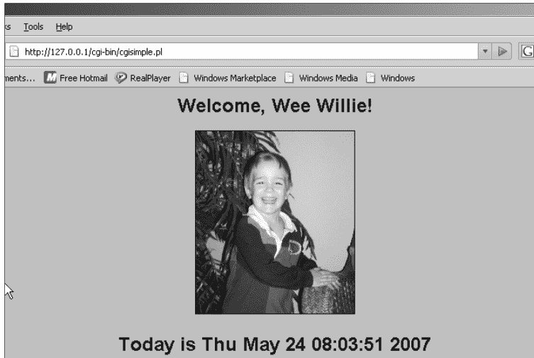

**图 16.7** 浏览器中 Perl CGI 脚本的输出。

某些服务器要求 CGI 脚本名称以 `.cgi` 或 `.pl` 结尾，以便将其识别为 CGI 脚本。在创建脚本后，对于 UNIX 系统必须在 shell 提示符输入以下命令来开启文件的执行权限：

```
chmod 755 <scriptname>
```

或者

```
chmod +x <scriptname>
```

在浏览器位置窗口中输入的 URL 包含了协议、主机名称、存储 CGI 脚本的目录以及 CGI 脚本的名称。URL 看起来如下：

```
http://localhost/cgi-bin/cgisimple.pl
```

**HTTP 头部（Headers）。** 大多数 CGI 程序的第一行输出是 HTTP 头部，它告诉浏览器程序正在发送什么类型的输出。在头部行之后，必须有一个空行和两个换行符。两种常见的头部类型（也称为 MIME 类型，代表多用途互联网扩展）是 `Content-type: text/html\n\n` 和 `Content-type: text/plain\n\n`。另一种类型的头部被称为 **Location** 头部，用于将浏览器重定向到不同的 Web 页面。最后，**Cookie** 头部用于设置 cookie 以维持状态；即保留一旦服务器和浏览器之间的操作关闭后就会丢失的信息。在头部行之后，必须有一个空行。这在 Perl 中通过在行尾结束 `\n\n` 来实现。

### 表 16.5 HTTP 头部

| 头部 | 类型 | 取值 |
| --- | --- | --- |
| Content-type: | text/plain | 纯文本 |
| Content-type: | text/html | HTML 标签和文本 |
| Content-type: | image/gif | GIF 图像 |
| Location: | http://.... | 重定向到另一个 Web 页面 |
| Set-cookie: NAME=VALUE... | Cookie | 在客户端浏览器设置 cookie |

### 16.4.2 错误日志文件

错误日志与 STDERR。通常，当 Perl 脚本出现问题时，错误信息会被发送到终端屏幕（STDERR），但当由服务器作为 CGI 脚本启动时，错误不会发送到屏幕，而是发送到服务器的错误日志文件中。在浏览器中你可能会看到“Empty Document”（空文档）或“Internal Server Error”（内部服务器错误），这并无法告诉你程序出了什么问题。

在将脚本交给服务器之前，始终使用 `-c` 参数在命令行中检查语法。否则，除非你检查日志文件，否则你看不到错误信息。请使用 `-c` 参数检查 Perl 脚本的语法。

### 示例 16.7

```
（在命令行中）
1 perl -c perlscript
2 perlscript syntax OK
```

### 示例 16.8

```
（Perl 语法错误显示在 Apache 服务器的错误日志中）

[Mon Jul 20 10:44:04 2006] access to /opt/apache_1.2b/cgi-bin/submit-form failed for susan, reason: Premature end of script headers
```

### 示例 16.8（续）

```
[Mon Sep 14 11:11:32 2006] httpd: caught SIGTERM, shutting down
[Fri Sep 25 16:13:11 1998] Server configured -- resuming normal operations
Bare word found operator expected at welcome.pl line 21, near "/font><TABLE>
(Missing operator before TABLE')
syntax error at welcome.pl line 21, near "<TH<"
syntax error at welcome.pl line 24, near "else"
[Fri Sep 25 16:13:18 2006] access to /opt/apache_1.2b/cgi-bin/visit_count.pl failed for susan, reason: Premature end of script headers
```

## 16.5 获取 CGI 脚本的信息

服务器和 CGI 脚本可以通过四种方式进行通信。一旦浏览器向服务器发送请求，服务器就会将其发送给 CGI 脚本。CGI 脚本从服务器获取输入：

- 环境变量
- 查询字符串
- 标准输入
- 路径信息

当 CGI 程序从服务器获取输入后，它对其进行格式化，以便服务器将信息传回给浏览器。CGI 脚本通过网关输出：

- 动态生成新文档
- 将现有文件发送到标准输出
- 使用 URL 重定向到其他地方

### 16.5.1 环境变量

CGI 程序从服务器传递一组环境变量。这些变量在服务器执行所有请求时设置。环境变量包含了关于服务器、端口、路径信息等的内容。用户输入通常被赋值给 `QUERY_STRING` 变量。在下面的示例中，该变量没有值，因为用户请求的是 HTML 标签。

### 示例 16.9（CGI 脚本）

```perl
#!/bin/perl
print "Content-type: text/plain\n\n";
print "CGI:\n";
# 打印所有环境变量
while(($key, $value)=each(%ENV)) {
    print "$key = $value\n";
}
```


**图 16.8** 在浏览器中执行搜索时，`QUERY_STRING` 环境看起来如下：

http://www.google.com/search?hl=en&q=related

`?` 之后的信息由浏览器发送并赋值给 `QUERY_STRING` 变量。它是通过 URL 编码的；即字符串中的任何非字母数字字符由 `&` 表示，十六进制数字由 `%` 表示。服务器上的程序将负责解码此字符串使其易读。对于我们的讨论，程序可以是 Perl 脚本，也可以是 C++、Tcl、Shell 脚本等。

在下一个示例中，我们在示例 16.9 执行的相同 CGI 脚本 URL 附加了一个字符串。此字符串由浏览器编码并赋值给 `QUERY_STRING` 变量。下一步是移除 `%20`（空格的十六进制值）；即解码后的字符串。现在，当你看到这种 URL 时，`?` 之后的信息发送到你程序的 `QUERY_STRING` 变量。

### 表 16.6 环境变量（必须大写）

| 名称 | 取值 | 示例 |
| --- | --- | --- |
| AUTH_TYPE | 如果服务器支持身份验证则验证 | |
| CONTENT_LENGTH | 服务器传递到 CGI 程序的字节数 | Content-Length=55 |
| CONTENT_TYPE | 查询数据的 MIME 类型 | text/html |
| DOCUMENT_ROOT | 服务器提供 Web 文档的目录 | /opt/apache/htdocs/index.html |
| GATEWAY_INTERFACE | 服务器使用的 CGI 版本 | CGI/1.1 |
| HTTP_ACCEPT | 客户端接受的 MIME 类型 | image/gif, image/jpeg, 等 |
| HTTP_CONNECTION | 优的 HTTP 连接类型 | Keep-Alive |

```
COMPSPEC=C:\WINDOWS\system32\cmd.exe
DOCUMENT_ROOT=C:/wamp/www
GATEWAY_INTERFACE=CGI/1.1
HTTP_ACCEPT=text/html,application/xml,xhtml+xml,text/*;q=0.9,*
HTTP_ACCEPT_CHARSET=ISO-8859-1,utf-8;q=0.7,*q=0.5
HTTP_ACCEPT_ENCODING=deflate
HTTP_ACCEPT_LANGUAGE=en-us,q=0.5
HTTP_CONNECTION=keep-alive
HTTP_HOST=127.0.0.1
HTTP_USER_AGENT=Mozilla/5.0 (Windows; NT 5.1; en-US) Gecko/20010101
PATH=C:\ActivePer\bin;C:\ActivePer\Program-1\PeriEdit;C:\Program Files
PATHEXT=.EXE;.BAT;.COM;.JS;.WSH;.vpy
QUERY_STRING=name=Ellie%20Query
REMOTE_ADDR=127.0.0.1
REQUEST_METHOD=GET
REQUEST_URI=/cgi-bin/printenv.pl?name=Ellie%20Query
SCRIPT_FILENAME=C:/wamp/apache2/cgi-bin/printenv.pl
SERVER_ADDR=127.0.0.1
SERVER_ADMIN=webmaster@localhost
SERVER_NAME=127.0.0.1
SERVER_PORT=80
SERVER_PROTOCOL=HTTP/1.1
SERVER_SIGNATURE=httpd-Apache/2.0.55 (Win32) PHP/5.1.4 Server at 127.0.0.1 Port
```

## 16.6 CGI 与表单

### 示例 16.10

```html
（带有指向 CGI 脚本热链接的 HTML 文件）
1 <html>
2 <head>
3 <title>测试环境变量</title>
4 </head>
5 <body>
6 <p>
7 <h1>主要测试</h1>
8 <p>如果你想查看服务器传递的环境变量<br>点击 <a href="http://localhost/cgi-bin/printerenv.pl">这里</a></p>
9 <p>正内容在此处继续...</p>
10 </body>
11 </html>
```

### 解释

- 1 `<HTML>` 标签表示此文档正在使用 HTML 协议。
- 2 `<HEAD>` 标签包含在实际内容显示之前将显示的标题和任何信息。
- 3 `<TITLE>` 标签显示在浏览器窗口的顶部栏。
- 4 `<P>` 标签是段落的开始。`<BR>` 标签导致换行。
- 5 `<A>` 标签分配了本地服务器 localhost 上 CGI 脚本的路径。该单词将由浏览器以蓝色下划线显示。如果用户点击此单词，服务器将执行该 CGI 脚本。脚本将打印出从服务器传递给脚本的所有环境变量。这是 Web 服务器向 CGI 脚本提供信息的方法之一。实际的 CGI 脚本在示例 16.9。
- 3 HTML 标签和表单属性不区分大小写。

制作表单的步骤摘要

- 1. 开始：使用 HTML `<form>` 标签开始表单。`<form>` 标签嵌套在 HTML `<body>` 标签内。
- 2. 动作：`<form>` 标签的 `action` 属性是点击提交（Submit）按钮提交数据时执行的 CGI 脚本的 URL。
- 3. 方法：提供一种如何处理数据输入的方法。默认是 get。
- 4. 创建：使用 HTML 标签和字段创建带有按钮、框以及任何看起来美观的内容的表单。
- 5. 提交：创建一个提交（Submit）按钮，以便表单可以被处理。这将启动 `ACTION` 属性中列出的 CGI 脚本。
- 6. 结束：结束表单和 HTML 文档。

## 16.6.1 表单输入类型

### 表 16.7 表单输入类型

| 输入类型 | 属性 | 描述 |
| --- | --- | --- |
| CHECKBOX (复选框) | NAME, VALUE | 显示一个可以选中的方框。从用户输入创建名称/值对。可以选中多个框。 |
| FILE (文件) | NAME | 指定要上传到服务器的文件。MIME 类型必须是 multipart/form-data。 |
| HIDDEN (隐藏) | NAME, VALUE | 在屏幕不显示对象的情况下提供名称/值对。 |
| IMAGE (图像) | SRC, VALUE, ALIGN | 与提交按钮相同，但显示图像而不是文本。图像位于 `SRC` 找到的文件中。 |
| PASSWORD (密码) | NAME, VALUE | 文本框，但输入是隐藏的。框中的星号会替换所使用的字符。 |
| RADIO (单选按钮) | NAME, VALUE | 与复选框类似，但一次只能选中一个框（或圆圈）。 |
| RESET (重置) | NAME, VALUE | 将表单重置为原始位置；清空所有输入字段。 |
| SELECT (选择列表) | NAME, OPTION SIZE, MULTIPLE | 提供弹出菜单和可滚动列表。只能选择一个。MULTIPLE 属性创建一个可滚动列表。Size 为 1 会创建一个仅有一个框的弹出菜单。 |
| SUBMIT (提交) | NAME, VALUE | 点击时执行表单；启动 CGI。 |
| TEXT (文本) | NAME, SIZE, MAXLENGTH | 创建一个输入框。SIZE 指定文本框的大小。MAXLENGTH 指定允许的字符最大数。 |
| TEXTAREA (文本区域) | NAME, SIZE, COLS | 创建一个可以跨多行的区域。ROWS 和 COLUMNS 指定框的大小。 |

### 16.6.2 创建 HTML 表单

带有文本字段、单选按钮、复选框和弹出菜单的简单表单。使用 HTML 标签和字段创建表单，以便表单可以被处理。这将启动 `ACTION` 属性中列出的 CGI 脚本。只有在点击按钮时才会显示在浏览器中的示例 16.11

```
（第一个 HTML 表单的源码）
<html>
<head>
<title>第一个 CGI 表单</title>
</head>

<body>
<form action="cgi-bin/bookstuff" bgcolor="#999">
<p>选择食物：</p>
<input type="text" name="username" size="50">
<br>谈谈你自己：<br>
<textarea name="comments" rows="5" cols="50">出生于...</textarea>
<br>选择工作：</p>
<input type="radio" name="choice" value="burger"> 汉堡
<input type="radio" name="choice" value="fish"> 鱼
<input type="radio" name="choice" value="steak"> 牛排
<input type="radio" name="choice" value="yogurt"> 酸奶
<br>选择地点：</p>
<input type="checkbox" name="place" value="la"> 洛杉矶
<input type="checkbox" name="place" value="sj"> 圣何塞
<input type="checkbox" name="place" value="sf" checked> 旧金山<br>选择度假胜地：</p>
<select name="location">
<option value="hawaii">夏威夷</option>
<option value="bali">巴厘岛</option>
<option value="maine">缅因</option>
<option value="paris">巴黎</option>
</select>
<p>

<input type="submit" value="提交">
<input type="reset" value="重置">
</body>
</form>
</html>
```

### 解释

- 1 `<HTML>` 标签表示此文档正在使用 HTML 协议。
- 2 `<HEAD>` 标签包含在实际内容显示之前将显示的标题和任何信息。
- 3 `<TITLE>` 标签显示在浏览器窗口的顶部栏。
- 4 `<P>` 标签是段落的开始。`<BR>` 标签导致换行。
- 5 `<A>` 标签分配了本地服务器 localhost 上 CGI 脚本的路径。该单词将由浏览器以蓝色下划线显示。如果用户点击此单词，服务器将执行该 CGI 脚本。脚本将打印出从服务器传递给脚本的所有环境变量。这是 Web 服务器向 CGI 脚本提供信息的方法之一。实际的 CGI 脚本在示例 16.9。
- 3 HTML 标签和表单属性不区分大小写。

制作表单的步骤摘要

- 1. 开始：使用 HTML `<form>` 标签开始表单。`<form>` 标签嵌套在 HTML `<body>` 标签内。
- 2. 动作：`<form>` 标签的 `action` 属性是点击提交（Submit）按钮提交数据时执行的 CGI 脚本的 URL。
- 3. 方法：提供一种如何处理数据输入的方法。默认是 get。
- 4. 创建：使用 HTML 标签和字段创建带有按钮、框以及任何看起来美观的内容的表单。
- 5. 提交：创建一个提交（Submit）按钮，以便表单可以被处理。这将启动 `ACTION` 属性中列出的 CGI 脚本。
- 6. 结束：结束表单和 HTML 文档。

## 16.6.3 GET 方法

最简单的表单是通过所谓的 GET 方法创建的。它在浏览器每次请求文档时都会使用。如果未提供方法，则默认使用 GET 方法。它是取回静态 HTML 文件和图像的唯一方法。由于 HTML 是一种面向对象的语言，你可能还记得方法是面向对象的子程序的名称。GET 方法通过将输入附加到程序的 URL 之后将数据传递给 CGI 程序，通常表现为 `QUERY_STRING` 环境变量被赋值为编码字符串的值，如示例 16.12 所示。

服务器对 URL 的长度有大小限制。例如，UNIX 的大小限制为 1,240 字节。如果向服务器传递大量信息，则应该使用 POST 方法。

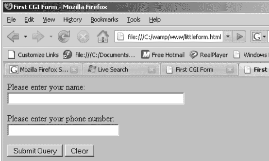

**图 16.12** 示例 16.12 中创建的 HTML 表单。

### 示例 16.12

```html
（带有表单标签和 ACTION 属性的 HTML 源文件）
<html>
<head><title>第一个 CGI 表单</title></head>
<body bgcolor="silver">
<form action="cgi-bin/littleform.cgi" method=get>
<!-- 当用户按下“提交”时，将调用 cgi 脚本处理输入 -->
请输入您的姓名：<br>
<input type="text" size=50 name="Name">
</p>
请输入您的电话： <br><input type="text" size=3 name="Phone"></p>
<input type="submit"><input type="reset" value="Clear">
</form></body>
</html>
```

#### 解释

1. 表单在 HTML 文档的 `<body>` 标签内创建。`<form>` 标签指定了用于处理表单的 URL 和方法。当用户提交表单时，浏览器将其从浏览器获取的所有数据发送到 Web 服务器。`action` 属性告诉服务器调用 URL 中指定位置的 CGI 脚本，并将数据发送到该程序进行处理。`method` 属性告诉浏览器如何将输入数据发送到服务器。GET 方法是默认的，因此在此无需赋值。CGI 程序可以对数据进行任何操作，并在完成后将其发回服务器。然后服务器将把信息回传给浏览器进行显示。
2. 要求用户输入。
3. 类型（type）是一个可以容纳 50 个字符的文本框。`NAME` 属性被赋值为字符串 `Name`。用户将在文本框中输入内容。用户输入的值将赋值给 `name` 键。此 `name=value` 对将以这种格式发送给 CGI 脚本；例如，`Name=Christian`。
4. `input` 类型的 `name` 属性为 `Phone`。用户在文本框中输入的任何内容将以 `Phone=value` 的形式发送给 CGI 程序；例如，`Phone=543-123457`。
5. `input` 类型的 `submit` 属性会导致出现一个提交按钮，按钮上写有默认字符串“Send Query”。如果选中此框，将执行 CGI 程序。输入将发送给 CGI 程序。`reset` 属性允许用户通过点击“Clear”按钮来清除所有输入。
6. `</form>` 标签结束表单。

## 16.6.4 POST 方法

GET 和 POST 方法之间的真正区别是输入从服务器传递到 CGI 程序的方式。使用 GET 方法时，服务器通过 `QUERY_STRING` 环境变量将输入发送给 CGI 程序。使用 POST 方法时，CGI 程序从标准输入 `STDIN` 获取输入。无论何种方式，输入的编码方式都是相同的。使用 POST 方法的原因是，某些浏览器拒绝存储在 `QUERY_STRING` 环境变量中的大量数据。POST 方法不会将其存储在查询字符串中。此外，GET 方法会在浏览器地址栏显示输入数据，而 POST 方法则隐藏了数据。在 HTML 文档中，`<form>` 标签启动表单。`ACTION` 属性告诉浏览器将从用户收集的数据发送到哪里，`METHOD` 属性告诉如何发送。如果使用 POST 方法，浏览器的输出将发送到服务器以及 CGI 程序的标准输入 `STDIN`。数据量（即从用户处输入的字节数）存储在 `CONTENT_LENGTH` 环境变量中。

与其将输入赋值给 `QUERY_STRING` 环境变量，浏览器以类似于发送电子邮件的方式在正文中将输入发送到服务器。

### 示例 16.18

```html
（HTML 源文件）
<html>
<head><title>CGI 表单</title></head>
<body>
<form action="cgi-bin/postmethod.cgi" method=post>
请输入您的姓名：<br>
<input type="text" size=50 name="name"><p>
请输入您的工资：<br>
<input type="text" size=30 name="salary"></p>
请输入您的出生日期：<br>
<input type="text" size=30 name="birthdate"></p>
<input type="submit" value="Submit">
<input type="reset" value="Reset">
</form>
</body>
</html>
```

### 解析

- 1 `<FORM>` 标签开始表单。`ACTION` 属性被赋值为 CGI 脚本 `postmethod.cgi` 的 URL，当用户点击提交（Submit）按钮时将执行该脚本；`METHOD` 属性被赋值为 `POST`，以指示如何处理来自表单的数据。
- 2 用户被要求输入。
- 3 创建了文本字段以存储用户的姓名、工资和出生日期。
- 4 创建了提交（Submit）按钮。
- 5 表单结束。

## 16.6.5 整合一切

GET 方法。现在是时候组合一个使用 GET 方法由 Perl 程序处理的表单了。CGI 程序将解码查询字符串，并在填写表单并点击提交按钮后的 HTML 页面上显示最终结果。以下示例演示了：

- 1. HTML 填写表单
- 2. 处理表单的 HTML 源
- 3. CGI 脚本处理后的表单
- 4. 处理表单的 Perl CGI 脚本

### 示例 16.16

```html
（HTML 源文件）
<html>
<head><title>cgi 表单</title></head>
<body>
<hr/>
<form action="http://127.0.0.1/cgi-bin/getmethod" method=get>
<!-- 当用户按下 "submit" 时，调用 cgi 脚本处理输入 -->
请输入你的姓名：<BR>
<input type="text" size=50 name="name"><p>
请输入你的工资 ($####):<BR>
<input type="text" size=30 name="Salary"></p>
请输入你的出生日期 (mm/dd/yy):<BR>
<input type="text" size=30 name="birthdate"></p>
<input type="submit" value="Submit">
<input type="reset" value="Reset">
</form>
</body>
</html>
```

### 解释

- 1. 表单从 `<form>` 标签开始。当用户点击表单上的提交按钮时，`action` 属性触发位于该机器上的 HTTP 服务器。
- 2. `%ENV` 哈希表包含由 Web 服务器发送到此程序的键/值对。`QUERY_STRING` 环境变量被赋值给标量 `$inputstring`。
- 3. `tr` 函数将所有 `+` 符号翻译为空格。
- 4. `pack` 函数将任何十六进制数转换为相应的 ASCII 字符。
- 5. 标量 `$inputstring` 从 Perl 脚本发送到服务器，然后到浏览器。
- 6. 标量 `$inputstring` 现在通过安培符号拆分。返回的输出存储在三元素数组 `@key_value` 中：`Name=Louise Cederstrom&Salary=$200,000&Birthdate=17/16`
- 7. 使用 `foreach` 循环遍历 `@key_value` 数组。通过 `=` 拆分每个数组元素创建键/值对。
- 8. 创建一个名为 `%input` 的哈希表，其中包含键/值对。
- 9. 使用循环遍历哈希表。
- 10. 打印新的键/值对并传回 Web 服务器。浏览器显示输出。现在 Perl 脚本已经解析并存储了来自表单的输入，由程序员决定如何处理这些数据。他可以向用户发送电子邮件、将信息存储在数据库中、创建地址录等。真正的工作完成了！

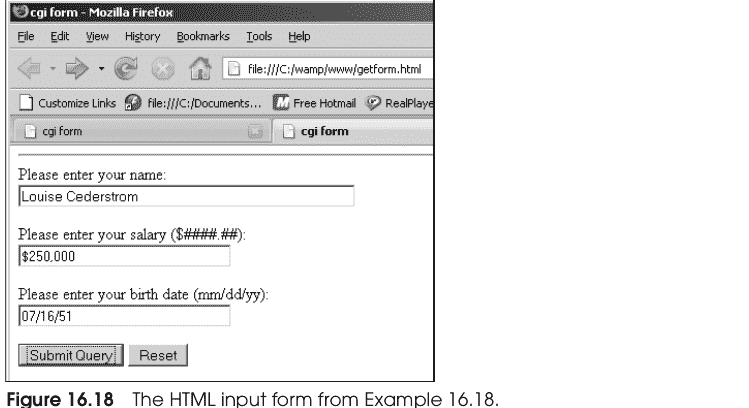

**图 16.17** CGI/Perl 处理后的输出，示例 16.17。

## 16.6.6 POST 方法

GET 和 POST 方法之间的真正区别是输入从服务器传递到 CGI 程序的方式。使用 GET 方法时，服务器通过 `QUERY_STRING` 环境变量将输入发送给 CGI 程序。使用 POST 方法时，CGI 程序从标准输入 `STDIN` 获取输入。无论何种方式，输入的编码方式都是相同的。使用 POST 方法的原因是，某些浏览器拒绝存储在 `QUERY_STRING` 环境变量中的大量数据。POST 方法不会将其存储在查询字符串中。此外，GET 方法会在浏览器地址栏显示输入数据，而 POST 方法则隐藏了数据。在 HTML 文档中，`<form>` 标签启动表单。`ACTION` 属性告诉浏览器将从用户收集的数据发送到哪里，`METHOD` 属性告诉如何发送。如果使用 POST 方法，浏览器的输出将发送到服务器以及 CGI 程序的标准输入 `STDIN`。数据量（即从用户处输入的字节数）存储在 `CONTENT_LENGTH` 环境变量中。

与其将输入赋值给 `QUERY_STRING` 环境变量，浏览器以类似于发送电子邮件的方式在正文中将输入发送到服务器。

### 示例 16.19

```perl
#!/perl/bin/perl
# 处理示例 16.18 所示表单的 CGI 脚本。
print "Content-type: text/html\n\n";
print <<HTML;
<html><title>解码输入数据</title>
<body bgcolor="lavender">
<font face="verdana" size="+1">
HTML
print "<h3>解码查询字符串</h3>";
# 获取输入
$inputstring=$ENV{QUERY_STRING};
print "<b>解码前:</b>";
print "<p>$inputstring";
# 提取 + & 并创建键值对
@key_value=split(/&/, $inputstring);
foreach $pair (@key_value) {
    ($key, $value) = split(/=/, $pair);
    $value =~ tr/+/ /;
    $value =~ s/%(..)/pack("C", hex($1))/ge;
    $value =~ s/\r//g;
    $value =~ s/\cM//g;
    $input{$key}=$value; # 创建哈希表
}
# 解码后
print "<hr>";
print "<p><b>解码后:</b><p>";
while(($key, $value)=each(%input)) {
    print "$key: <i>$value</i><br>";
}
print <<HTML;
<hr>
<p>现在我们想对这些信息做什么呢？ </p>
</font>
</body>
</html>
HTML
```

### 解析

- 1 此 MIME 头描述了从此程序返回的数据格式，即 HTML 文本。两个换行符（必须的！）结束了标头信息。
- 2 使用此处文档（here document）来设置 HTML 页面的开头。
- 3 `%ENV` 哈希表包含由 Web 服务器发送到此 Perl 程序的键值对。`QUERY_STRING` 环境变量被赋值给标量 `$inputstring`。
- 4 `$inputstring` 现在按 `&` 拆分。返回的输出存储在三元素数组 `@key_value` 中，格式如下：`Name=Louis+Cederstrom Salary=$200,000 Birthdate=7/16/51`
- 5 `foreach` 循环每次获取数组中的一个元素。每个元素首先通过 `=` 拆分，创建两个值：一个称为 `$key`，代表 HTML 表单中输入设备的名称（例如）；第二个是 `$value`，包含用户在输入设备中输入的数据（例如，"Louis+Cederstrom"）。
- 6 现在使用 Perl 的 `pack` 函数将十六进制值解码为各自的 ASCII 值。
- 7 使用解码后的键值对创建一个新的哈希表 `%input`。
- 8 `while` 循环用于遍历哈希表。打印新的键值对并发送到 Web 服务器。浏览器显示输出。现在 perl 脚本已经解析并存储了来自表单的输入，由程序员决定如何处理这些数据。他可以向用户发送电子邮件、将信息存储在数据库中、创建通讯录等。真正的工作完成了！

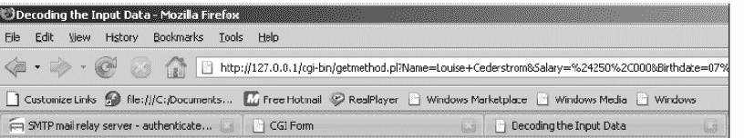

### 解码查询字符串

解码前：

```
Name=Louise+Cederstrom&Salary=%2C4250%2C000&Birthdata=07%2F16%2F51
```

解码后：

```
Salary: $25,000
Birthdate: 07/16/51
Name: Louise+Cederstrom
```

现在我们想对这些信息做什么呢？

**图 16.19** 示例 16.19 中 CGI 脚本的输出。

## 16.6.7 处理电子邮件

**SMTP 服务器。** 在处理表单时，通常需要在退出之前发送电子邮件。你可能向用户和/或你自己发送提交的表单数据。如果没有有效的 SMTP（简单邮件传输协议）服务器，无法在互联网上发送电子邮件。

SMTP 服务器是邮件守护进程程序的一个实例，它在端口 25 上监听入站邮件。当客户端向服务器发送消息时，SMTP 是一种基于 TCP 的客户端/服务器协议。UNIX 系统通常使用名为 `sendmail` 的邮件程序作为 SMTP 服务器来监听入站邮件。通常，你在命令行运行 `sendmail` 并将接收者姓名作为参数。要结束电子邮件消息，在单独的一行放置一个句号。在 CGI 脚本中，邮件不会以交互式方式发送，因此你可能希望使用某些功能。

### 表 16.10 sendmail 选项

| 选项 | 功能 |
| :--- | :--- |
| -o | 从随 mail 命令的行中提取标头 |
| -f | 指定发件人地址 |
| -i | 忽略行首的句号 |
| -q | 异步发送邮件队列 |
| -t | 直接通过命令行发送邮件（参见 RFC822） |

### 示例 16.20

```html
（HTML部分）
<html>
<head><title>注册!</title>
</head>
<body bgcolor="#ffff">
<form method="post" action="http://127.0.0.1/cgi-bin/mailer.pl">
```

### 示例 16.20（续）

```html
（继续）
<tr>
Last Name:
Company:
Address:
City/Town:
State/Province:
<select name="state" size="1">
<option value="AL">Alabama</option>
<option value="AK">Alaska</option>
<option value="AZ">Arizona</option>
<option value="AR">Arkansas</option>
<option value="CA">California</option>
<option value="CO">Colorado</option>
<option value="CT">Connecticut</option>
--- continue here ---
<option value="WA">Washington</option>
<option value="WV">West Virginia</option>
<option value="WI">Wisconsin</option>
<option value="WY">Wyoming</option>
</select>
Postal/Zip code:
<input type="text" size="10" name="zip">
</table>
<p>
<input type="submit" value="Register now!">
<input type="reset">
</p>
</form>
</body>
</html>
```

558 第 16 章 CGI 与 Perl!: 动态双星

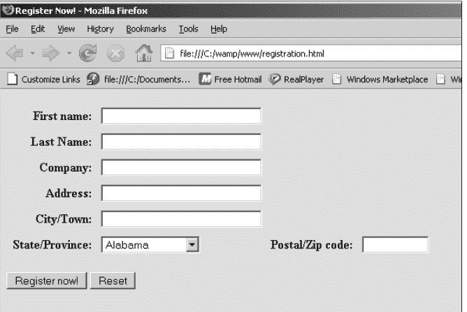

**图 16.20** 示例 16.20 中的 HTML 注册表单部分。

### 示例 16.21

```perl
（处理邮件部分的 CGI 脚本）
# 首先创建并处理了一个 HTML 表单，以获取接收电子邮件的用户姓名
#、发件人以及主题行。
1 $mailprogram="/usr/lib/sendmail"; # 你的邮件程序在此处
2 $sendto="$input{email}"; # 邮件地址在此处
3 $from="$input{email}";
4 $subject="$input{subject}";

5 open(MAIL, "|$mailprogram -oi -t") || die "Can't open mail program: $!";
# -t 选项告诉 sendmail 扫描电子邮件文档中的 To、From 和 Subject 行（而不是命令行）
# -oi 选项告诉邮件程序忽略行中单独出现的任何句号。
6 print MAIL "To: $sendto\n";
   print MAIL "From: $from\n";
   print MAIL "Subject: $subject\n";

7 print MAIL <<EOF;
   # 开始一个“此处文档”
注册信息：$input{first_name}
$input{last_name}:

注册日期: $today

名: $input{first_name}
姓: $input{last_name}
地址: $input{address}
城市: $input{city}
州/省: $input{state}

<其余消息在此处

EOF
close MAIL; # 关闭过滤器
```

### 解释

- 1 这里使用的邮件程序名称是 sendmail，位于 UNIX 子目录 `/usr/lib`。
- 2 这一行将被赋值给电子邮件文档中的 To（收件人）头部。
- 3 这一行将被赋值给电子邮件文档中的 From（发件人）头部。
- 4 这一行被赋值给电子邮件文档中的 Subject（主题）头部。
- 5 使用 Perl 打开一个名为 MAIL 的过滤器，它将用户的电子邮件消息传递给 sendmail 程序。`-t` 告诉 sendmail 扫描电子邮件文档中的 To、From 和 Subject 行（而不是命令行），`-oi` 选项告诉邮件程序忽略行中单独出现的任何句号。
- 6 这些是头部行，指示邮件的去向、去处以及邮件主题。这些值是从表单中提取的。
- 7 启动了一个此处文档（here document）。EOF 和 EOF 之间的文本通过 MAIL 过滤器发送给 sendmail 程序。
- 8 EOF 标记了此处文档的结束。
- 9 关闭了 MAIL 过滤器。

## 16.7 CGI.pm 模块

### 16.7.1 介绍

编写动态 CGI 程序（如链接簿、计数器、反馈表单等）最流行的 Perl 库是由 Lincoln Stein 写的 `CGI.pm` 模块；它从 Perl 5.004 版本开始包含在标准库。最新版本的 `CGI.pm` 可以在 www.perl.com/CPAN 找到。`CGI.pm` 利用了 Perl 5 引入的对象特性，并提供了方法（GET 和 POST）来解释查询字符串、处理表单并隐藏 HTML 语法的细节。

Lincoln Stein 还编写了《CGI.pm 官方指南》(www.wiley.com/compbooks/stein)，这是一本非常优秀且易读的指南，我们从中获取了以下信息。

### 16.7.2 优点

- 1 `CGI.pm` 允许你将填写表单（HTML）和解析表单的脚本放在 `cgi-bin` 目录下的同一个文件中。这样，你的 HTML 文件（包含表单）和你的 CGI 脚本（读取、解析和处理表单数据）之间就不会那么遥远了。
- 2 用户填写完表单后，结果将出现在同一页面上；换句话说，用户不需要导航即可查看内容，且表单不会丢失其维护的状态数据。这似乎被称为“粘性”（sticky）。要覆盖这种粘性，请参见第 593 页的“Override Argument”。
- 3 所有表单的读取和解析都由该模块处理。
- 4 使用方法来替换 HTML 标签以创建文本框、单选按钮、菜单等以创建表单，并分配标准标签，如头部、标题、段落分隔、水平线、换行符等。
- 5 要查看 `CGI.pm` 模块生成的 HTML 标签，可以在表单显示后从“视图”（View）菜单中选择“源代码”（Source，在 Internet Explorer 中）。
- 6 使用 `CGI.pm` 模块接收上传和管理 cookie 变得更容易。

### 16.7.3 使用 CGI.pm 编程的两种风格

**面向对象风格。** 使用对象风格，你创建一个或多个 CGI 对象并使用对象方法创建页面元素。每个 CGI 对象最初包含服务器传递给 CGI 脚本的命名参数列表。你可以修改对象并将其发送到文件或数据库。每个对象都是独立的；它有自己的参数列表。如果表单已被填写，其内容可以从脚本的这一次运行保存到下一次；也就是说，它维持了状态。（通常，HTML 文档是没有状态的；换句话说，页面退出时所有内容都会丢失。）

### 示例 16.22

```perl
1 use CGI;
2 $obj=new CGI; # 创建 CGI 对象
3 print $obj->header; # 使用函数创建 HTML 页面
4 $obj->start_html("Object oriented syntax");
5 $obj->h1("This is a test...");
6 $obj->h2("This is a test...");
7 $obj->h3("This is a test...");
8 $obj->end_html();
```

- Stein, L., Official Guide to Programming with CGI.pm: The Standard for Building Web Scripts, Computer Publishing, 1998.
- 同. 同上。

### 解释

通过查看浏览器的源代码可以看到以下输出。它演示了 `CGI.pm` 模块生成的 HTML 输出。

```html
<!DOCTYPE html
PUBLIC "-//W3C//DTD HTML 1.0 Transitional//EN"
"//DTD/html-transitional.dtd">
<html xmlns="http://www.w3.org/1999/xhtml" lang="en">
<head><title>Object oriented syntax</title></head>
<body>
<h1>This is a test...</h1>
<h2>This is a test...</h2>
<h3>This is a test...</h3>
</body>
</html>
```

**函数风格。** 函数风格更容易使用，因为你不需要创建对象。下面的示例使用标准函数直接操作 HTML。

### 示例 16.23

```perl
#!/usr/bin/perl
use CGI qw(:standard);
print header;
start_html('A Simple Example'),
h1('A Simple Example');
start_form;
"What's your name?", textfield('name'), p;
"What's the combination?", p,
checkbox_group(-name=>'words',
-values=>['eenie', 'meenie', 'minie', 'moe'],
-defaults=>['eenie', 'minie']), p;
"What's your favorite color? ",
popup_menu(-name=>'color',
-values=>['red', 'green', 'blue']), p;
submit;
end_form;
hr;
if (param()) {
    my $name = param('name');
    my $keywords = join('', param('words'));
    my $color = param('color');
    print "Your name is ", em(escapeHTML($name)), p;
}
```

### 16.7.4 一个重要的警告！

另一个常见错误是此处文档结束标记处理不当。为了避免使用多行，通常使用此处文档（见第 4 章）。此处文档的结束标记必须单独成一行，并紧贴左边缘对齐，周围没有空格，并以回车结束。

```perl
#!/bin/perl
# HTML 标签嵌入在此处文档中，以避免使用
# 多个 print 语句
print <<EOF; # CGI 脚本中的此处文档
Content-type: text/html

<HTML><HEAD><TITLE>镇报员</TITLE></HEAD>
<H1><CENTER>听着，听着，理查爵来了！！</CENTER></H1>
</HTML>

EOF # 第 5 行的 EOF 不能有周围空格且必须以换行符结束。
```

### 16.7.5 HTML 表单方法

CGI 由两部分组成：创建将在浏览器中显示的表单的部分，以及从表单中获取输入、对其进行解析，并将信息发送回浏览器、数据库或电子邮件以处理信息的部分。

**创建 HTML 表单。** 例如，有一些方法可以简化创建 HTML 表单的任务。这些用于创建表头、复选框、弹出菜单、单选按钮、提交（Submit）和重置（Reset）按钮的方法。表 16.11 列出了 `CGI.pm` 提供的常用的 HTML 方法。

在向 `CGI.pm` 方法传递参数时，可以使用两种样式：

**命名参数（Named arguments）**——以键值对的形式传递。参数名称以前导横杠开头，且不区分大小写。

### 示例 16.24

```
（Named Arguments）
1 print popup_menu(-name=>'place',
-values=>['Hawai', 'Europe', 'Mexico', 'Japan'],
-default=>'Hawai',
);
2 print popup_menu(-name=>'place',
-values=>@countries,
-default=>'Hawai',
);
```

### 解释

- 1 传递给 `popup_menu` 方法的参数称为命名参数或参数列表。此示例中的参数名称为 `-name`、`-values` 和 `-default`。这些参数始终以前导横杠开头，且区分大小写。如果参数名称可能与某些内置 Perl 函数或保留字冲突，请给参数加上引号。注意，参数是以一组键值对的形式传递给方法的。`-values` 键有一个对应的值，由一个包含国家的匿名数组组成。
- 2 这与上一个示例完全相同，不同之处在于 `-values` 键的值是对国家数组 `@countries` 的引用。在程序的其他地方，创建了数组 `@countries` 并赋予了值。

**位置参数（Positional arguments）**——以字符串形式传递，表示一个值。它们与简单的 HTML 标签配合使用。例如，`CGI.pm` 提供 `h1()` 方法来生成 HTML 标签 `<h1>`...`</h1>`。`h1()` 的参数是通常插入标签之间的文本字符串。该方法的调用方式如下：

```
print h1("This is a positional argument");
```

翻译为：

```html
<h1>This is a positional argument</h1>
```

如果使用 HTML 属性，且第一个参数是指向匿名哈希表（hash）的引用，则该属性及其值将添加到前导标签之后的列表中。例如：

```perl
print li({-align=>'CENTER'}, "This heading is centered");
```

翻译为：

```html
<li ALIGN="CENTER">This heading is centered</li>
```

如果参数是对向匿名列表的引用，列表中的每个项目都将正确地分布在标签内。例如：

```perl
print li( 'apples', 'pears', 'peaches' );
```

翻译为三个项目列表项：

```html
<li>apples</li><li>pears</li><li>peaches</li>
```

而

```perl
print li( ['apples', 'pears', 'peaches'] );
```

翻译为一个项目列表项：

```html
<li>apples pears peaches</li>
```

> 属性不需要前导横杠。

### 示例 16.25

```perl
（CGI 脚本）
#!c:/ActivePerl/bin/perl.exe
# 使用 HTML 方法的快捷调用样式

1 use CGI qw(:standard); # 面向函数的风格，打印表头
2 print header;
# 注意以下函数都作为由逗号分隔的参数列表
# 嵌入在一个 print 语句中。

3 print start_html(-title=>"Testing arguments",
-bgcolor=>"#99FF66"),
4 b(0, font(-size=>"*2", -color=>"#006600")),
5 p(),
6 p("This is a string"),
7 p(-align=>'center', "red", "green", "yellow"),
8 p(-align=>'left', "red", "green", "yellow");
9 end_html(); # 使用 HTML 方法的快捷调用样式
```

### 解释

- 1 使用了 CGI 模块的面向函数的风格。
- 2 `header` 函数生成表头信息（`"Content-type: text/html\n"`）。
- 3 `start_html` 函数启动 HTML 文档，包括页面标题和背景颜色（石灰绿）。
- 4 `b` 函数生成 `<b>` 标签来加粗，`font` 函数使字体大小增大两倍并设为深绿色。
- 5 `p` 函数生成一个不带参数的段落。它仅仅是一个起始标签。
- 6 此 `p` 函数接收一个字符串作为参数，导致该字符串作为单独的段落打印。
- 7 `p` 函数的第一个参数使段落在页面上居中。段落文本在浏览器中显示为一行：red green yellow。
- 8 `p(-align=>'left')` 使段落左对齐。段落文本以左对齐显示，跨行显示。
- 9 `end_html()` 结束 HTML。

### 示例 16.26

```html
<!DOCTYPE html
PUBLIC "-//W3C//DTD HTML 1.0 Transitional//EN"
<html xmlns="http://www.w3.org/TR/html41/loose" lang="en">
<head>
<title>Testing arguments</title>
<meta http-equiv="Content-Type" content="text/html;charset=UTF-8"/>
</head>
<body bgcolor="#99FF66">
<p>This is a string</p>
<p align="center">red green yellow</p>
<p align="left">red green yellow</p>
</body>
</html>
```

### 表 16.11 HTML 方法

| 方法 | 作用 | 属性 |
| :--- | :--- | :--- |
| `a()` | 锚链接 `<a>` | -href, -name |
| `b()` | 加粗 `<b>` | |
| `checkbox_group()` | 创建一组复选框 | -columns, -cols, -colheaders, -default, -labels, -linebreak, -name, -nolab, -onClick, -override, -force, -rows, -rowheaders, -value, -values |
| `code()` | 等宽字体 `<code>` | |
| `dd()` | 定义列表项 `<DD>` | |
| `em()` | 斜体 `<em>` | |
| `font()` | 字体 `<FONT>` | -color, -face, -size |
| `frame()` | 定义框架 `<FRAME>` | -margin, -marginwidth, -name, -noresize, -scrolling, -src |
| `frameset()` | 创建框架集 `<FRAMSET>` | -cols, -rows |
| `h1()...h6()` | 标题 `<h1>` 到 `<h6>` | |
| `hidden()` | 创建隐藏文本字段 | |
| `hr()` | 创建水平线 `<HR>` | -align, -noshade, -size, -width |
| `i()` | 斜体 `<i>` | |
| `img()` | 创建内联图像 `` | -align, -alt, -border, -height, -width, -hspace, -src, -lowsrc, -vrspace, -usemap |
| `image_button()` | 产生作为提交按钮的内联图像 | -align, -height, -name, -src, -width |
| `kbd()` | 创建键盘字体 `<kbd>` | |
| `li()` | 创建有序或无序列表的项目 | -type, -value |
| `ol()` | 启动有序列表 `<ol>` | -compact, -start, -type |
| `p()` | 创建段落 `<P>` | -align, -class |
| `password_field()` | 创建密码字段；输入的文本将变为星号 | |
| `popup_menu()` | 创建弹出菜单 `<SELECT><option>` | -default, -labels, -name, -onBlur, -onChange, -onFocus, -override, -force, -value, -values |
| `pre()` | 创建格式化的等宽字体文本 `<PRE>` | |
| `radio_group()` | 创建一组命名的单选按钮 | -columns, -cols, -colheaders, -default, -labels, -linebreak, -name, -nolabels, -onClick, -override, -force, -rows, -rowheaders, -value, -values |
| `reset()` | 创建表单重置按钮 | |
| `scrolling_list()` | 控制滚动列表表单元素 | -default, -defaults, -labels, -multiple, -name, -onBlur, -onChange, -onFocus, -override, -force, -size, -value, -values |

### 表 16.11 HTML 方法（续）

| 方法 | 功能 | 属性 |
| :--- | :--- | :--- |
| `Select()` | 创建 `select` 标签；注意使用大写的 "S" 以避免与 Perl 内置的 `select` 函数发生冲突 `<SELECT>` | |
| `small()` (:netscape group) | 减小文本尺寸 | |
| `start_form()`, `start_form()` | 启动一个 HTML 表单 `<FORM>` | |
| `start_multipart_form()` | 与 `start_form` 类似，但用于上传文件时 | |
| `strong()` | **粗体**文本 | |
| `submit()` | 为表单创建一个提交按钮 | -name, -onclick, -value, -label |
| `sup()` (:netscape group) | 上标文本 | |
| `table()` (:html3 group) | 创建表格 | -align,-bgcolor,-border,-bordercolor,-bordercolor-dark,-borderlight,-padding,-hspace,-vspace,-width |
| `td()` (:html3 group) | 创建表格数据单元格 `<TD>` | -align,-bgcolor,-border,-bordercolorlight,-bordercolordark,-colspan,-nowrap,-valign,-width |
| `textarea()` | 创建多行文本框 | -cols,-columns,-name,-onChange,-onFocus,-onBlur,-onSelect,override,-force,-value,-wrap |
| `textfield()` | 生成单行文本输入 | -maxlength, -name, -onChange,-onFocus,-onBlur,-onSelect,override,-force, -size,-value, -default |
| `th()` (:html3 group) | 创建表格表头 `<TH>` | |
| `Tr()` (:html3 group) | 定义表格行；注意使用大写的 "T" 以避免与 Perl 的 `tr` 函数发生冲突。`<TR>` | -align,-bgcolor,-border,-bordercolordark,-borderlight,-valign |
| `tt()` | 打字机字体 | |
| `ul()` | 开始无序列表 | |

## 16.7.6 CGI.pm 如何配合表单工作

`CGI.pm` 模块使得在一个脚本中完成表单的创建和处理成为可能。（你可以创建一个单独的 HTML 表单并仅用 `CGI.pm` 进行处理部分，但这些示例演示了将过程整合在一个 Perl 脚本中。）该模块提供了方法或函数来处理创建 Web 页面的各个方面，从启动 HTML 文档到创建表单及其输入，到解析和解码输入数据。这些脚本在同一页面上生成表单并处理其输入，属于“自处理表单”，这意味着在 `ACTION` 属性中，当用户点击提交按钮时，打印表单的同一个脚本的地址会被激活。脚本只需要执行一些测试来确保表单已提交。现在你将看到是如何实现这一切的。

**start_html 方法。** 在创建 HTTP 请求头后，大多数 CGI 脚本将启动一个 HTML 文档。`start_html()` 方法创建页面顶部，并提供定制页面外观和行为的选项，例如背景颜色、标题、DDT、作者等。它创建了标头行（"Content-type"）并启动文档的 `<body>` 标签。

**start_form 方法。** 表单通过 `start_form` 方法及其参数创建。每种字段类型也是该模块提供的 CGI 方法，如表 16.11 中列出的 `textfield`、`popup_menu`、`submit` 等。这些每个方法将在本章稍后的部分进行详细说明。

**submit 方法。** 当然，为了处理表单，必须对其进行提交。`submit` 方法提供了表单的提交按钮。

**param 方法。** 这是 `CGI.pm` 中非常重要的一部分。用户填写表单后，`CGI.pm` 模块将获取表单的输入，对其进行解码并存储在名称/值对中。这对用户来说是不可见的。可以使用 `param()` 函数检索名称和值。当调用 `param()` 时，如果它返回 `null`，则表示表单尚未填写。如果 `param()` 返回真（非空），则说明表单已填写，可以使用 `param()` 函数获取表单信息。如果你有一个单独的值，`param` 可以通过其名称（即表单中输入设备的名称）来检索该值。

接下来的示例说明了 CGI 程序的两个部分：HTML 表单以及如何使用 `param()` 函数获取信息。其他用于处理参数的方法列表，请参阅表 16.13。

### 示例 16.27

```perl
#!c:/ActivePerl/bin/perl.exe
1 use CGI qw(:standard);
2 print header;
3 print start_html(-title=>'Using the Function-Oriented Syntax',
   -BGCOLOR=>'yellow');
4 print img({-src=>'greenballoon.jpg', -align=>'LEFT'}),
h1("Let's Hear From You!"),
h2("I'm interested.");
5 start_form;
```

### 示例 16.28（续）

```
（Output）
<!DOCTYPE HTML PUBLIC "//IETF/DTD HTML//EN">
<HTML><HEAD><TITLE>Using the Function Oriented Syntax</TITLE>
<BODY BGCOLOR="yellow">
<h1>Let's Hear From You!</h1>
<h2>I'm interested in you</h2>
<FORM METHOD="POST"
ENTYPE="application/x-www-form-urlencoded">
<p>What's your name? <INPUT TYPE="text" NAME="name">
<p>What's your occupation? <INPUT TYPE="text"
NAME="job"> <p><SELECT name="place">
<OPTION VALUE="Hawaii">Hawaii
<OPTION VALUE="Europe">Europe
<OPTION VALUE="Mexico">Mexico
<OPTION VALUE="Japan">Japan
</SELECT>
<INPUT TYPE="submit" NAME=".submit"></FORM><HR>Your name is
<EM>Dan</EM>Your occupation is <EM>Father</EM>Your vacation spot is <EM>Hawaii</EM>
```

### 解释

- 1 当在离线模式运行时，你可以像标准输入一样编辑键值对。你需要创建表单以获取正确的键，然后自行提供值。在这个示例中，`name=Dan`、`job=Father`、`place=Hawaii` 是由用户提供的。当用户按下 Ctrl-d (UNIX) 或 Ctrl-z (Windows) 后，`CGI.pm` 会处理这些输入。
- 2 通过传递一个空参数列表，你可以看到未分配值时的 HTML 输出。如果使用 `/dev/null`（UNIX 位的“黑洞”），从该目录读取等同于从一个空文件读取。通过提供一组空引号作为参数，效果是相同的。

### 16.7.7 CGI.pm 表单元素

### 表 16.12 CGI 方法

| 方法 | 示例 | 功能 |
|---|---|---|
| `append` | `$query->append(-name=>value);` | 向参数后附加值 |
| `checkbox` | `$query->checkbox(-name='checkbox_name', -checked='checked', -label='on');` | 创建一个独立的复选框 |
| `checkbox_group` | `$query->checkbox_group(-name='group_name', -values=[list], -default={sublist}, -linebreak='true', -labels=%hash);` | 创建一组复选框 |

### 表 16.12 CGI 方法 (续)

| 方法 | 示例 | 功能 |
| --- | --- | --- |
| `cookie` | `$query->cookie(-name='sessionID', -value='whatever', -expires='+3h', -path='/', -domain='ucsc.edu', -secure=>1);` | 创建一个 Netscape cookie |
| `defaults` | `$query->defaults;` | 创建一个将表单重置为默认值的按钮 |
| `delete` | `$query->delete('param');` | 删除一个参数 |
| `delete_all` | `$query->delete_all();` | 删除所有参数；清空对象 `$query` |
| `endform` | `$query->endform;` | 结束 `<FORM>` 标签 |
| `header` | `$query->header(-cookie=>'cookiename');` | 在 HTTP 头部中放置一个 cookie |
| `hidden` | `$query->hidden(-name='hidden', -default=>[ list ]);` | 创建一个视图不可见的文本字段 |
| `image_button` | `$query->image_button(-name='button', -src=>source/URL, -align=>'MIDDLE');` | 创建一个可点击按钮 |
| `import_names` | `$query->import_names('namespace');` | 将变量导入到命名空间 |
| `keywords` | `@keywords = $query->keywords;` | 从 Isindex 输入中获取关键词并返回数组 |
| `new` | `$query = new CGI;` | 解析 GET 和 POST 方法的输入并放入对象 `$query` 中 |
| | `$query = new CGI(INPUTFILE);` | 从之前打开的文件句柄读取表单内容 |
| `param` | `@params = $query->param();` | 返回传递给脚本的参数名数组 |
| | `$value = $query->param('arg');` | 返回传递的 'arg' 参数的值（或值列表） |
| `password_field` | `$query->password_field(-name='secret', -value='start', -size=>60, -maxlen=>80);` | 创建一个密码字段 |
| `popup_menu` | `$query->popup_menu(-name='menu', -values=>@items, -defaults=>name, -labels=>\%hash);` | 创建一个弹出菜单 |
| `radio_group` | `$query->radio_group(-name='group_name', -values=>[ list ], -default=>name, -linebreak=>'true', -labels=>\%hash);` | 创建一组单选按钮 |
| `reset` | `$query->reset('true');` | 创建重置按钮，将表单框恢复到先前的值 |
| `save` | `$query->save(FILEHANDLE);` | 保存表单状态到文件 |

### 表 16.12 CGI 方法 (续)

| 方法 | 示例 | 功能 |
| --- | --- | --- |
| `scrolling_list` | `$query->scrolling_list(-name='list', -values=[], -defaults=[], -multiple=>true, -labels=>$hash);` | 创建一个滚动列表 |
| `startform` | `$query->startform(-method=>'POST', -action=>'url', -encoding=>'type');` | 返回带有可选方法、动作和编码的 `<FORM>` 标签 |
| `submit` | `$query->submit(-name='button', -value=>$value);` | 为表单创建提交按钮 |
| `textarea` | 与 `textfield` 相同，但包含文本框 | |
| `textfield` | `$query->textfield(-name='field', -default='start', -size=>50, -maxlen=>90);` | 创建一个文本字段 |

### 表 16.13 方法

| 方法 | 功能 | 示例 |
| --- | --- | --- |
| `delete()`, `delete()` | 删除参数列表中的命名参数。使用 `CGI.pm` 的函数风格时必须使用。 | `$query->delete('Joe'); $query->delete(-name=>'Joe');` |
| `delete_all()`, `delete_all()` | 删除所有 CGI 参数。 | `$query->delete_all(); delete_all();` |
| `import_names()` | 将 CGI 参数导入指定的命名空间。 | |
| `param()` | 获取键值对。可以返回列表或标量。 | `$query->param(); $list=$query->param(-name=>'Joe');` |

### 16.7.8 生成输入字段的方法

以下示例使用了面向对象的风格，可以通过移除引用轻松地替换为函数风格。`print_form` 子程序会将表单显示在浏览器窗口中，`do_work` 子程序会在 `param` 方法返回真值时产生输出。

#### textfield 方法

`textfield` 创建一个文本字段。该文本字段允许用户在单行框中输入文本。可以通过 `-size` 参数指定框的宽度（字符数），`-maxlen`（正整数）设置用户可以输入的字符上限。如果使用了 `-value` 参数，在首次显示时会给出一个默认值。

### 格式

```
print $obj->textfield('name_of_textfield');
print $obj->textfield(
  -name=>'name_of_textfield',
  -value=>'default starting',
  -size=>'60', # 字符宽度
  -maxlen=>'90'); # 宽度限制
```

### 示例 16.29

```perl
#!/usr/bin/perl
use CGI;
$query = new CGI;
# 创建 CGI 对象
print $query->header;
print $query->start_html("Forms and Text Fields");
print $query->h2("Example: The textfield method");

print &textField_form($query);
&do_work($query) if ($query->param);
print $query->end_html();

sub textField_form {
my($query) = @_;
print $query->startform;
print "What is your name? ";
print $query->textfield('name'); # 一个简单的文本字段
print $query->br();
print "What is your occupation? ";
print $query->textfield(-name=>'occupation', # 赋值
  -default=>'Retired', # 给
  -size=>60, # 文本字段
  -maxlen=>120,
);

print $query->br();
print $query->submit('action', 'Enter ');
print $query->reset();
print $query->endform();
print $query->hr();
}
```

### 示例 16.29 (续)


# 16.7 CGI.pm 模块

## 示例 16.29

```perl
17 sub do_work(@_) {
    my ($query) = @_;
    my ($values, $key);
    print $query->("<H2>Here are the settings</H2>");
18 foreach ($key=>$param) {
        print "\$key: \n";
19      @values=$query->param($key);
        print join(",", @values), "<BR>";
    }
}
```

## 释

1. 加载 `CGI.pm` 模块。这是一个面向对象的模块。
2. 调用 `CGI` 构造方法 `new`，并返回一个 `CGI` 对象的引用。
3. 打印 HTML 头部信息；例如 `Content-type: text/html`。
4. `start_html` 方法产生启动 HTML 的标签、标题“Forms of Textfields”以及 `body` 标签。
5. `h2` 方法产生 `<H2>` 二级标题标签。
6. 调用用户定义的 `print_form` 函数，并将 `CGI` 对象的引用作为参数。
7. 调用 `do_work` 函数，并将 `CGI` 对象的引用作为参数。这是一个自定义函数，只有当 `param` 函数返回真值时才调用，而只有当表单已填写时 `param` 才会返回真值。
8. 定义 `print_form` 函数。
9. 第一个参数是 `CGI` 对象的引用。
10. `startform` 方法产生 HTML `<FORM>` 标签。
11. `textField` 方法产生一个带有参数 `name` 的文本框。分配给文本的内容将被赋值给 `name`。
12. 请求用户在文本框中提供输入。
13. 该 `textField` 以键值哈希对的形式发送参数以进一步定义文本字段。默认值将显示在框中。见图 16.27 中此示例的输出。
14. `submit` 方法创建一个带有“Enter”文本的提交按钮。
15. `reset` 方法创建一个重置按钮，按钮上的默认文本为“Reset”。
16. `endform` 方法创建 HTML `</FORM>` 标签。
17. 这是用户的 `do_work` 函数，在用户填写完表单并点击提交（Enter）按钮后调用。它使用 `param` 函数处理表单提供的信息。

# 582 第 16 章 CGI 与 Perl：动态双星

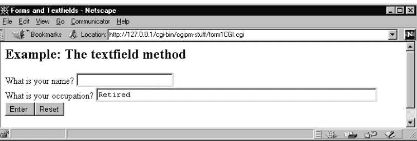

图 16.27 文本字段表单输出，示例 16.29。

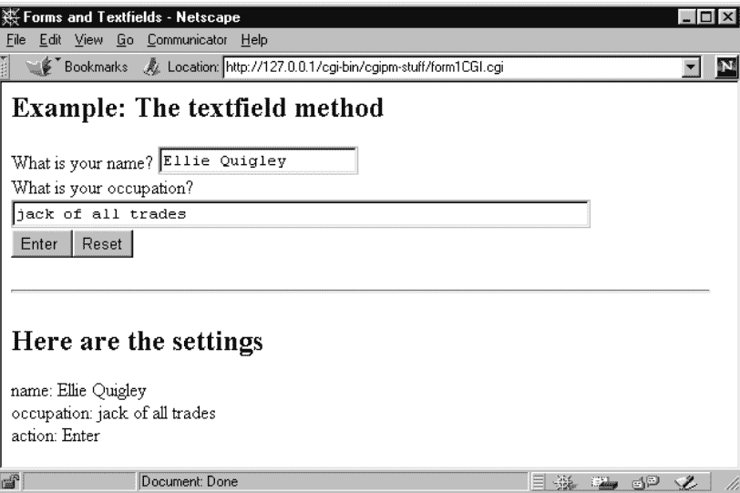

图 16.28 表单填写并处理后的输出，示例 16.29。

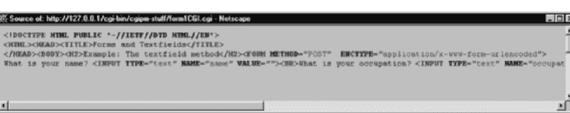

图 16.29 由 CGI.pl 生成的 HTML 源代码。

## 16.7 CGI.pm 模块

### checkbox() 方法

`checkbox()` 方法用于创建一个简单的是或否（布尔）响应复选框。复选框具有 `NAME` 和 `VALUE` 属性，其中 `-name` 给 CGI 参数命名，`-value` 包含一个可以选择的项或可选项列表的引用。如果 `-checked` 被赋值为 1，则复选框将以勾选状态开始。如果 `-label` 被赋值一个值，则它将打印在复选框旁边；否则，将打印复选框的 `-name` 值。如果未选中，复选框将包含一个空参数。

### checkbox_group() 方法

`checkbox_group()` 方法创建一组由同一个名称链接的复选框。这些选项不是互斥的；也就是说，用户可以勾选一个或多个项。如果 `-linebreak` 被赋值为非零数字，选项将垂直对齐。通常情况下，选项将以水平行显示。（示例 16.30。）

```perl
print $obj->checkbox(-name=>'name_of_checkbox',
               -checked=>1,
               -value=>'ON',
               -label=>'Click on me');

$labels = (choice1=>'red',
               choice2=>'blue',
               choice3=>'yellow',
);
print $obj->checkbox_group(-name=>'name_of_checkbox',
                             -values=>[ 'choice1', 'choice2',
                                      'choice3', 'green',...],
                               -default=>[ 'choice1', 'green' ],
                               -linebreak => 1,
                               -labels=>\labels);
```

## 示例 16.30

```perl
#!/usr/bin/perl
use CGI;
$query = new CGI;
print $query->start_html("The Object Oriented CGI and Forms");
print "<H2>Example using Forms with Checkboxes</H2>\n";

&print_formstuff($query);
&do_work($query) if ($query->param);
```

## 示例 16.30 (续)

```perl
print $query->end_html;
sub print_formstuff(
    my ($query) = @;
    print $query->startform;
```

```perl
print "What is your name?";
print $query->textfield('name');    # 一个简单的文本字段
print "<BR>";
```

```perl
print "Are you married?<BR>";
print $query->checkbox(-name=>'Married',
                    -label=>'If not, click me');
                # 简单的复选框
```

```perl
print "<BR><BR>";
print "What age group(s) do you hang out with?<BR>";
```

```perl
print $query->checkbox_group(-name=>'age_group',
                -values=>['12-18', '19-38',
                         '35-58', '59-100'],
                -default=>['19-38'],
                               -linebreak='true');
```

```perl
print $query->submit('action');
print $query->reset('Clear');
print $query->endform;
print "<HR\n";
```

```perl
sub do_work{
    my ($query) = @;
    my (@values, $key);
    print "<H2>Here are the settings</H2>";
```

```perl
foreach $key ($query->param) {
    print "$key: \n";
    @values=$query->param($key);
    print join(", ",@values), "<BR>");
}
```

## 解释

1. `startform` 方法产生 HTML 的 `<FORM>` 标签。
2. 最简单的复选框。如果用户未结婚，他应该点击该框。复选框的名称是 `Single`；标签 `If not, click me` 显示在复选框旁边。如果 `-checked` 被赋值为 `1`，则复选框在首次显示时将是勾选状态。
3. 这是一个复选框组的示例，一组相关的复选框通过共同名称 `age_group` 链接在一起。`-values` 参数被赋值一个选项列表的引用，这些选项将出现在每个复选框的右侧。如果使用了 `-labels`，它将包含一个键/值对的哈希表，用作每个复选框的标签。`-default` 参数决定了在复选框首次显示时哪些框会被勾选。`-line-break` 参数被设置为非零值 `true`，这会导致选项以垂直列表的形式显示。
4. 当用户点击标记为 Select 的提交（Submit）按钮时，表单将被处理。
5. 重置（Reset）按钮只有在用户提交表单后才会清除屏幕。
6. `do_work` 函数在表单提交后被调用。
7. `CGI.pm` 模块处理表单提交的键值对。

## 16.7 CGI.pm 模块

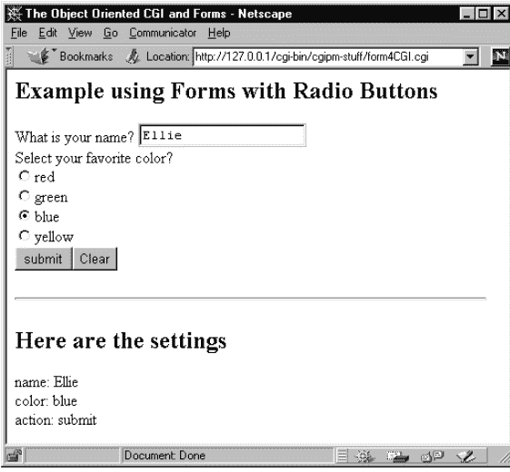

图 16.33 填写并处理后的输出形式。示例 16.31。

### 标签（Labels）

标签允许按钮具有友好的名称，这些名称与程序中不同的对应值关联。在接下来的示例中，stop（停止）、go（通过）和 warn（警告）将出现在浏览器窗口的单选按钮旁边。`param` 方法返回的值将分别为红色、绿色和黄色。

## 示例 16.32

```perl
( -labels 参数 - 选 CGI 脚本的片段)
    print $query->startform;
    print "What is your name ? ";
    print $query->textfield('name');      # 一个简单的文本字段
    print "<BR>";
    print "We're at a cross section. Pick your light.<BR>";
    print $query->radio_group(name=>'color',
        -values=>['red', 'green', 'yellow'],
        -linebreak=>'true',
        -labels=>{
            red=>'stop',
            green=>'go',
            yellow=>'warn',
        },
        -default=>'green',
);
```

## 示例 16.32 (续)

```perl
print $query->submit('action', 'submit');
print $query->reset('Clear');
print $query->endform;
}
```

## 解释

1. 调用了 `radio_group` 方法并传入了参数。只能选择一个值。
2. `params` 函数返回的值将是红色、绿色或黄色。
3. 标签是实际出现在每个单选按钮旁的内容。用户在浏览器中看到 stop、go 和 warn，但与这些标签关联的 CGI 参数分别是红色、绿色和黄色。例如，如果用户点击 stop 按钮，传递给脚本的键值对将是 `color=>red`。
4. 默认按钮是带有指定标签的按钮被选中状态。

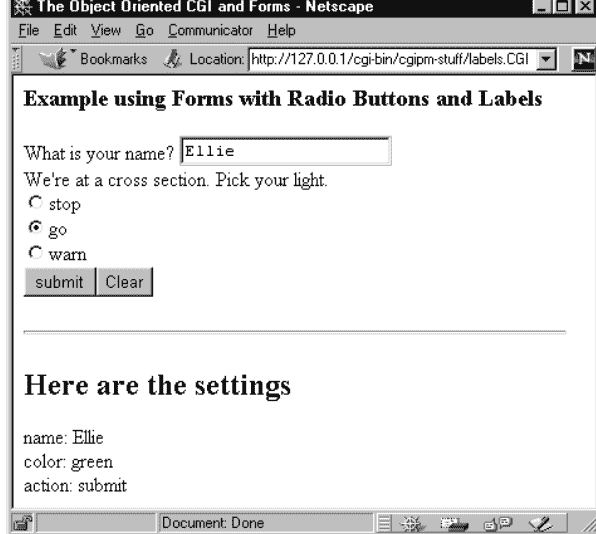

图 16.34 填写并处理后的标签表单输出，示例 16.32。

## 16.7 CGI.pm 模块

### popup_menu() 方法

`popup_menu()` 方法。弹出菜单也被称为下拉列表。它是一个当用户点击文本右侧的滚动条图标时显示的选择列表。只能选择其中一项。

## 示例 16.33

```perl
#!/usr/bin/perl
use CGI;
$query = new CGI;
print $query->header;
print $query->start_html("The Object-Oriented CGI and Forms");
print "<H2>Example using Forms with Pop-up Menus</H2>\n";
&print_formstuff($query);
&do_work($query) if ($query->param);
print $query->end_html;

sub print_formstuff {
my ($query) = @_;
print $query->startform;
print "What is your name? ";
print $query->textField('name');      # 一个简单的文本字段
print "<BR>";
print "Select your favorite color? <name=>";
print $query->popup_menu('color', -values=>['red', 'green', 'blue', 'yellow'], -default=>'green', -labels=>'labels');
);
print $query->submit('action', 'submit');
print $query->reset('Clear');
print $query->endform;
print "<HR>\n";
}

sub do_work{
my ($query) = @_;
my ($values, $key) = @_;
print "<H2>Here are the settings</H2>";
foreach $key ($query->param) {
print "\$key: \n";
@values=$query->param($key);
print join(", ",@values), "<BR>";
}
}
```

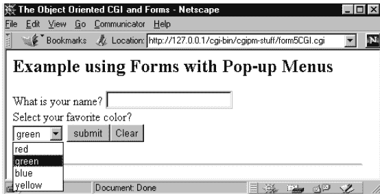

图 16.35 弹出菜单表单输出，示例 16.33。

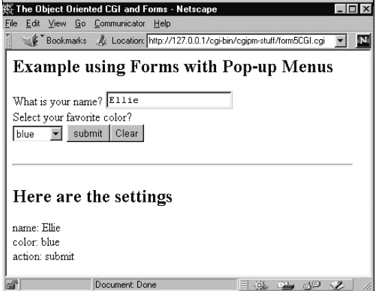

图 16.36 填写并处理后的弹出菜单表单输出，示例 16.33。

### submit() 和 reset() 方法

`submit()` 方法创建一个按钮，点击该按钮会将表单输入发送到 CGI 脚本。如果给定了参数，你可以为按钮标记标签，以便在在使用多个按钮时与其他按钮区分来。

`reset()` 方法用于清除表单中的所有条目。它将表单恢复到上次加载时的状态，而不是恢复到默认状态。（见下一节中的“`defaults` 方法”）

## 16.7 CGI.pm 模块

### 清除字段

#### override 参数

注意，如果你点击重置（Reset）按钮或重新启动同一个表单，之前的信息会保持不变；换句话说，输入框不会被清除。你可以使用非零值的 `-override` 或 `-force` 参数强制清除条目；例如：

```
-override=>1
```

#### defaults 方法

`defaults()` 方法将表单恢复到其最后加载时的状态，而不是其默认状态。

```
-defaults()
```

### 错误处理

注意，如果你点击重置按钮或重启同一个表单，之前的信息会保持不变；你可以使用非零值的 `-override` 或 `-force` 参数强制清除条目；例如：

```
-override=>1
```

#### carpout 和 fatalBrowser 方法

`carpout` 方法提供了将错误写入日志文件的功能，而 `fatalBrowser` 方法则在浏览器中显示错误。默认写入 `errors.log`。

```
$carpout("errors.log");
```

#### 重定义日志文件

如果你想更改日志文件路径，可以使用 `carpout` 方法重新初始化。例如：

```
$carpout("my_errors.log");
```

#### 修改文件名

你可以通过 `-name` 参数更改日志文件名。

```
-name=>'Error'
```

#### 修改默认消息

默认情况下，`fatalBrowser` 会显示一个默认的错误消息。如果你想更改此消息，可以使用 `set_message` 函数。

```
$set_message("Error message!");
```

# 596 第 16 章 • CGI 与 Perl：超级黄金搭档

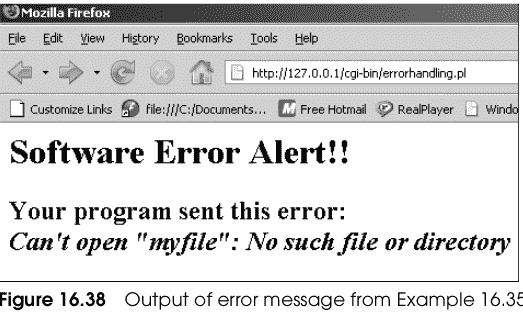

# 示例 16.36

```
(Apache 日志文件)
[Thu May 24 14:12:00 2007] [error] [client 127.0.0.1] C:/wamp/Apache2/cgi-bin/errorhandling.pl is not executable; ensure interpreted scripts have "#! first line
[Thu May 24 14:12:00 2007] [error] [client 127.0.0.1] (9) Bad file descriptor: don't know how to spawn child process: C:/wamp/Apache2/cgi-bin/errorhandling.pl
(由 carpout 函数在 cgi-bin 目录中创建的 errors.log 文件)
[Thu May 24 14:21:16 2007] errorhandling.pl: Testing error messages from CGI script.
[Thu May 24 14:22:16 2007] errorhandling.pl: Can't open myfile: No such file or directory
[Thu May 24 14:22:55 2007] errorhandling.pl: Can't open myfile: No such file or directory
[Thu May 24 14:23:12 2007] errorhandling.pl: Can't open "myfile": No such file or directory
```

### 16.7.10 HTTP Header 方法

如上一个例所示，cookie 被分配到 HTTP Header。表 16.14 列出了其他用于创建和从 HTTP Header 获取信息的方法。

## 16.7 CGI.pm 模块

# 表 16.14 HTTP Header 方法

| HTTP Header 方法 | 功能 |
| --- | --- |
| accept() | 列出 MIME 类型或类型 |
| auth_type() | 返回当前会话的授权类型 |
| cookie() | 创建和检索 cookies |
| header() | 返回有效的 HTTP Header 和 MIME 类型 |
| https() | 返回关于会话的 SSL 信息 |
| path_info() | 设置和检索额外的路径信息 |
| path_translated() | 返回额外的路径信息 |
| query_string() | 返回 URL 编码的查询字符串 |
| raw_cookie() | 返回从浏览器发送的未处理 cookies 列表 |
| redirect() | 生成带有重定向请求的 HTTP Header，指示浏览器加载该位置的页面 |
| referer() | 返回浏览器在启动你的脚本之前显示的页面 URL |
| remote_addr() | 返回远程主机的 IP 地址，可能是代理服务器 |
| remote_host() | 返回远程主机的 DNS 名称 |
| remote_ident() | 如果身份守护进程已激活，则返回远程用户的登录名 |
| remote_user() | 返回用于验证会话的账户名 |
| request_method() | 返回 HTTP 方法 GET、POST 或 HEAD |
| script_name() | 返回相对于服务器根目录的脚本 URL |
| self_url() | 返回 CGI 脚本的 URL：协议、主机、端口、额外路径信息和参数列表；可用于重新发送当前脚本 |
| server_name() | 返回 Web 服务器名称 |
| server_port() | 返回当前会话的端口号（通常为 80） |
| server_software() | 返回 Web 服务器的名称和版本 |
| url() | 返回当前脚本的 URL，不包含额外的路径信息和查询字符串 |
| user_agent() | 返回浏览器信息 |
| user_name() | 如果可以，返回远程用户的名称 |
| virtual_host() | 返回浏览器访问的虚拟主机名称 |

# 示例 16.37

```perl
#!/usr/bin/perl
use CGI qw(:standard);
print header;
print start_html(-title=>Using header Methods'),
h1("让我们来了解一下这个会话吧！");
h4("你的服务器是 ", server_name(),
h4("你的服务器端口号是 ", server_port(),
h5("此脚本名称是: ", script_name(),
h6("你的浏览器是 ", user_agent(), ", 已经过了！");
h7("查询字符串看起来像这样: ", query_string(),
h8("我在哪里？你的 URL 是: \n", url()),
h9("Cookies 设置: ", raw_cookie());
print end_html;
```

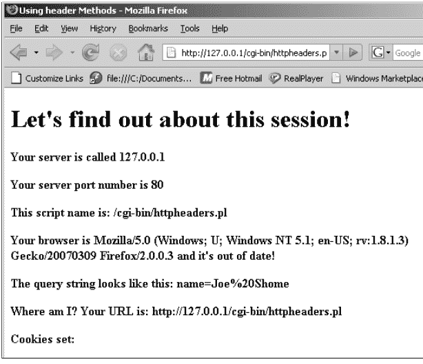

图 16.39 示例 16.37 的输出。

# 练习 16：在 Perl 世界中冲浪

## 第一部分

1. 环境变量与 CGI

创建一个 CGI 脚本，向浏览器打印以下内容：

服务器名称是：<在此处填入值>。

网关协议是：

客户端机器的 IP 地址是：

客户端机器名称是：

文档根目录是：

CGI 脚本名称是：

（提示：使用 `%ENV` 哈希表。）

2. 创建一个 CGI 程序

a. 编写一个名为 `towncrier` 的 CGI 脚本，其中将包含 HTML 和 Perl 语句。

b. 脚本将包含两个子程序：`&welcome` 和 `&count`。

c. `welcome` 子程序将打印 "Hello!!"。使用蓝色字体闪烁欢迎（注意：Internet Explorer 忽略闪烁。请使用时间函数）。

d. 在名为 `count.pl` 的文件中编写一个名为 `count` 的子子程序。`towncrier` 脚本将调用 count 并将其名称（towncrier）作为参数传递给子程序。页面访问次数存储在 `$0` 中；例如 `&count($0);`。子程序将返回访问次数。

e. 参考图 16.40 了解此脚本如何在浏览器窗口中显示输出。

f. `count` 函数应设计为接收一个参数——文件名。除非目录中已存在 `towncrier.log` 文件，否则将创建该文件。无论如何，文件都将以读写模式打开（如果 `count` 函数是从另一个 Perl 脚本调用的，日志文件将在名称后加上 .log 扩展名）。如果日志文件为空，则向其写入 1；否则从文件中读取一行。数字将被读取并存储在变量中。其值加 1。每执行一次 `towncrier`，都会调用此函数。新数字将写回文件，覆盖原有的数字。关闭日志文件。`count` 子程序将该值返回给调用程序（在示例中，我将数字放入 HTML 表格并将整个字符串返回给 `towncrier`）。如果在 UNIX 系统上运行，使用 `flock` 函数对你使用的日志文件加上排他锁，并在完成后移除。

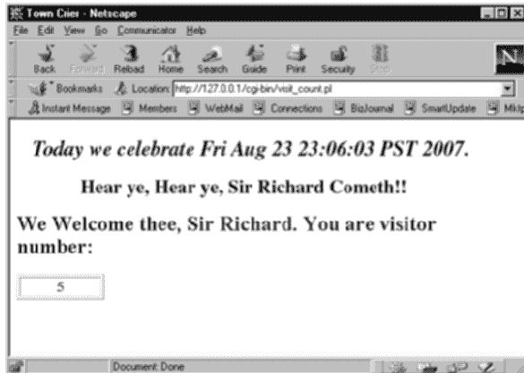

图 16.40 练习 16 中 CGI 程序的输出。

## 第二部分

1. 创建表单——HTML

a. 创建一个名为 `Starbucks` 的网页，其中包含一个订咖啡表单，类似于图 16.41 中的订单表。

b. 在初始 `<FORM>` 标签的 `action` 属性中，指定一个指向 CGI 脚本的 URL，使用 GET 方法。

c. 在浏览器中测试你的文件。

d. CGI 脚本将打印 `QUERY_STRING` 环境变量的值。


**图 16.41** 星巴克订单页。

2. 处理表单——CGI

a. 编写一个 CGI 脚本，向用户返回一个 HTML 页面，感谢他的订单并告知送货地址。从表单获取信息后，编写自己的解析函数。

b. 重新设计表单包含 POST 方法。程序将测试使用了哪种方法。

c. 创建一个 DBM 文件来存储提交的电子邮件。当用户提交订单时，其电子邮件地址将列入 DBM 文件。确保没有重复。为此设计一个函数。

d. CGI 脚本将处理电子邮件。给自己发送一封电子邮件确认提交的信息。设计另一个处理电子邮件的函数。

3. 重写 Starbucks 程序，使 HTML 表单和 CGI 脚本包含在一个使用 *CGI.pm* 创建的 程序中。使用函数式风格。

# 第 17 章 · Perl 遇 MySQL：完美的连接

## 17.2 什么是关系数据库？

到目前为止，我们一直在使用 Perl 通过创建自定义文件句柄（filehandles）在文本文件中存储数据。我们还查看了 Perl 的 DBM 机制，用于以简单哈希的形式数据存储在二进制文件中。但当你需要高效存储和管理大量数据时，文本文件和 DBM 文件就有了局限性：例如，维护医院、研究实验室、银行、大学或网站等业务。关系数据库遵循某些标准，并具有许多存储大量数据集合的特性。数据的管理方式使得检索、更新和删除数据变得相对容易，且耗时最少。数据库管理系统必须存储数据以维护其完整性；即数据是准确的，并且免受未经授权用户的访问，确保数据是安全的。

关系模型引入于 20 世纪 70 年代，它让用户的数据操作更加简单快速，并让管理员更容易维护。该模型的核心是“关系”（relation）的概念，在视觉上表示为存储所有数据的表（table）。数据由不同类型表示，例如字符串、数字、日期等。每个表由记录（records）组成，记录由水平行和字段（fields）列组成，类似于二维数组。数据库中的表之间相互关联；例如，如果你有一个名为“school”（学校）的数据库，它可能包含名为“student”（学生）、“teacher”（教师）、“course”（课程）等表。学生向教授一门或多门课程的教师学习。可以针对学生、教师或课程检索操作数据，也可以根据某些公共键（key）进行连接。结构化查询语言（SQL）用于与关系数据库“对话”，使其易于从数据库的表中检索、插入、更新和删除数据。

由于关系数据库（称为关系数据库管理系统，RDBMS）的流行，今天使用了许多关系数据库，其中包括 Oracle、SQLite、PostgreSQL Information、SQL server 和 MySQL。

### 17.2.1 客户端/服务器数据库

关系数据库使用客户端/服务器模型。如今，MySQL 是开源社区中最流行的客户端/服务器数据库系统之一。

图 17.1 显示了客户端/服务器架构的模型。用户进入命令行并启动 MySQL 客户端以发布 MySQL 命令。客户端向 MySQL 服务器发送请求，服务器向数据库发送查询。数据库将查询结果返回给客户端，结果显示在客户端的窗口中。在第二种场景中，不是使用命令行客户端，而是通过 Perl 脚本通过充当解释器的数据库接口连接到数据库服务器。如果 Perl 脚本包含连接到数据库的指令，在 MySQL 中，一旦建立连接并选择了数据库，Perl 程序就可以通过 MySQL 服务器访问数据库。MySQL 服务器接收来自 Perl 程序的请求（称为查询），并返回从数据库中收集的信息。在第三个示例中，用户从浏览器（客户端）请求一个页面；随后与 Web 服务器（Apache, ISS）建立 HTTP 连接，在 Web 服务器处接收并处理该请求。如果操作是启动一个 Perl 程序，Web 服务器可能会使用通用网关接口（CGI）启动 Perl 解释器，然后 Perl 开始处理从 HTTP 服务器发送的信息，以进行格式化并发送回 Web 服务器；或者如果向数据库服务器发出请求，将执行连接、查询和从数据库获取结果的步骤。图 17.1 显示了 MySQL 客户端与 MySQL 服务器之间的客户端/服务器关系，以及 Web 浏览器、Web Perl 程序与 MySQL 数据库服务器之间的客户端/服务器关系。到本章结束，你将能够获取从 Web 浏览器（客户端）发送到 Web 服务器再到 Perl CGI 程序的信息，该程序可以连接到数据库服务器以从 MySQL 数据库中检索和存储信息。

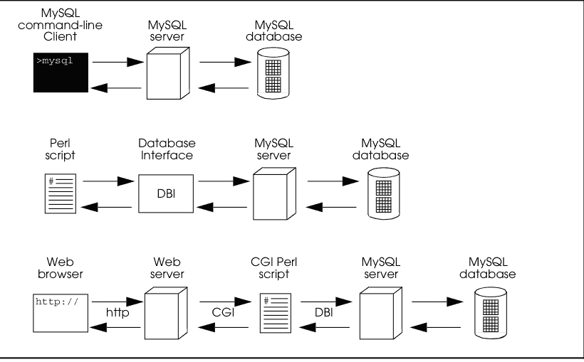

图 17.1 客户端/服务器模型。

### 17.2.2 关系数据库的组件

数据库是由什么组成的？关系数据库管理系统的主要组件包括：

- 数据库服务器（Database server）
- 数据库（Database）
- 表（Tables）
- 字段（Fields）
- 记录（Records）
- 主键（Primary key）
- 模式（Schema）

我们将在章的后续章节讨论这些每一个概念。图 17.2 展示了它们之间的关系。

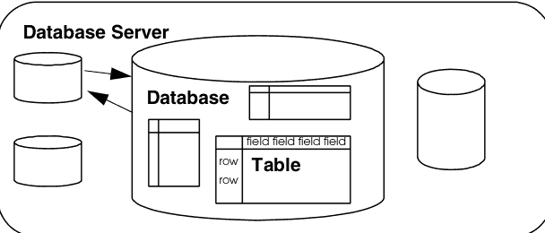

**图 17.2** 数据库服务器、数据库和表。

#### 数据库服务器

数据库服务器是运行数据库的实际服务器进程。它控制数据的存储、授予用户访问权限、更新和删除记录，并与其他服务器通信。数据库服务器通常位于一台专用主机上，通过网络为多个客户端提供服务和管理，也可以作为本地机器上的独立服务器为单个客户端提供服务；例如，你可能是本地机器上使用 MySQL 的唯一客户端（通常称为“localhost”），完全没有任何网络连接。这可能是学习如何使用 MySQL 的最好方法。

如果你正在使用 MySQL，服务器进程在 Windows 上是 `mysql` 服务，在 Linux 操作系统上是 `mysqld` 进程。数据库服务器通常遵循客户端/服务器模型，前端是客户端，后端是服务器。

#### 数据库

数据库是相关数据元素的集合，对应于特定的应用程序。一个公司可能有一个数据库来满足所有需求，可能另一个数据库用于销售，第三个用于电子商务应用程序等。图 17.3 列出了安装在特定版本 MySQL 上的数据库。这些数据库列为“mysql”、“northwind”、“phpmyadmin” 和“test”。

| 数据库 |
| :--- |
| mysql |
| northwind |
| phpmyadmin |
| test |

图 17.3 MySQL 数据库。

#### 表

每个数据库由唯一名称标识的二维表组成。事实上，关系数据库将所有数据都存储在表中，仅此而已。所有操作都在表上执行，并可以产生其他表等。

设计数据库时要出的决策之一是它将包含哪些表。一个典型的组织数据库可能包含客户、订单和产品的表。所有这些表以某种方式相互关联。例如，客户有订单和项目。虽然每个表独立存在，但它们共同构成了一个数据库。图 17.4 列出了名为“northwind”的数据库中的表，这是微软提供的一个虚拟数据库，用于学习如何操作数据库。（这应该在光盘上。）

| northwind 中的表 |
| :--- |
| categories |
| customerordemo |
| customerdemographics |
| customers |
| employees |
| employeterritories |
| order_details |
| orders |
| products |
| region |
| shippers |
| suppliers |
| territories |
| usstates |

图 17.4 northwind 数据库中的表。

#### 记录和字段

表有一个名称，并由一组行和列组成。它类似于电子表格，每行（也称为记录）由垂直列（也称为字段）组成。同一张表的所有行具有相同的列集合。“northwind” 数据库中的 “shippers” 表有三列三行。

# 第 17 章 · Perl 遇 MySQL：完美的连接

| ShipperID | ColumnName | Phone |
| :--- | :--- | :--- |
| 1 | Speedy Express | (503) 555-5831 |
| 2 | United Package | (503) 555-9199 |
| 3 | Federal Shipping | (503) 555-9931 |

**图 17.5** "northwind" 数据库中 "shippers" 表的行（记录）和列（字段）。

你可以在关系型表上执行两种基本操作。你可以检索其列的子集，也可以检索其行的子集。图 17.6 和 17.7 显示了这两种操作的示例。

```mysql
mysql select company from shippers;
| company |
| :--- |
| Speedy Express |
| United Package |
| Federal Shipping |
```

**图 17.6** 检索列的子集。

```mysql
mysql select * from shippers where companyname="Federal Shipping";
| ShipperID | ColumnName | Phone |
| :--- | :--- | :--- |
| 3 | Federal Shipping | (503) 555-9931 |
```

**图 17.7** 检索行的子集。

记住：关系型数据库管理表，所有操作的结果也是表，称为结果集。表是集合，而表本身是行和列的集合。数据库本身则是表的集合。

你还可以在两个表之间执行许多其他操作，将它们视为集合：你可以连接两个表的信息、对表进行笛卡尔积、获取两个表之间的交集、将一个表添加到另一个表中等。我们将向你展示如何使用 SQL 语言对表进行操作。

## 列/字段 (Columns/Fields)

列是数据库表不可缺的一部分。列也称为字段（fields）或属性（attributes）。字段描述数据。每个字段都有一个名称。例如，“shipper”字段的名称为 "ShipperID"、"CompanyName" 和 "Phone"。字段描述它所包含的数据类型。数据类型可以是数字、字符、日期、时间戳等。在图 17.8 中，ShipperID 是一个整数，货运商 ID 不超过 11 位数字。数据类型有很多，有时它们是针对特定数据库系统的；例如，MySQL 可用的类型可能与 Oracle 不同。我们将在下一章中学习更多关于 MySQL 数据类型。

## 17.2 什么是关系型数据库？

| Field | Type | Null | Key | Default | Extra |
| :--- | :--- | :--- | :--- | :--- | :--- |
| ShipperID | int(11) | | PRI | NULL | auto_increment |
| CompanyName | varchar(40) | | | | |
| Phone | varchar(24) | YES | | NULL | |

图 17.8 每个字段都有一个名称以及对可以存储存储数据的描述。

### 行/记录 (Rows/Records)

记录是表中的行。它可以可能是 product 表中的一个产品，可能是 employee 表中的一条员工记录等。图 17.9 显示了 "shippers" 表中有三条记录。

| ShipperID | CompanyName | Phone |
| :--- | :--- | :--- |
| 1 | Speedy Express | (503) 555-2831 |
| 2 | United Package | (503) 555-3199 |
| 3 | Federal Shipping | (503) 555-9931 |

图 17.9 "shippers" 表中有三条记录。

### 主键与索引 (Primary Key and Indexes)

主键是每条记录的唯一标识符。例如，美国的每个员工都有社会安全号码，每位司机都有驾驶执照，每辆车都有车牌。这些标识符是唯一的。在数据库世界，这种标识符被称为主键。拥有主键是一个好主意，并不是每个表都有主键。主键是在创建表时确定的，更符合数据库设计的讨论。在图 17.10 中，“ShipperID" 是 "northwind" 数据库中 "shippers" 表的主键。这是一个唯一 ID，由一个数字组成，每当向 shippers 列表添加新公司（记录）时，该数字就会自动递增。

| Field | Type | Null | Key | Default | Extra |
| :--- | :--- | :--- | :--- | :--- | :--- |
| ShipperID | int(11) | | PRI | NULL | auto_increment |
| CompanyName | varchar(40) | | | | |
| Phone | varchar(24) | YES | | NULL | |

图 17.10 "ShipperID" 是 "shippers" 表的主键。

当在表中搜索特定记录时，MySQL 必须加载所有记录后才能执行查询。除了主键之外，还使用一个或多个索引来提高在经常访问的表中查找行的性能。索引就像书末的索引，可以帮助你比搜索整本书更快地找到特定主题。索引就像书的目录一样，是表中特定记录的引用。

### 数据库模式 (The Database Schema)

设计一个小型数据库是困难的，设计一个大型 Web 应用程序是一项艰巨的任务。数据库设计既是艺术也是科学，需要理解关系模型是如何实现的。在讨论数据库设计时，你会遇到“schema”（模式）一术语，它指的是数据库的结构。它像模板或蓝图一样描述数据库设计；它描述了所有的表以及数据将如何组织，但并不包含实际数据。

## 17.3 使用 SQL（结构化查询语言）与数据库通信

当输出发送到浏览器时，使用 HTML 或 XML 这样的标记语言，并将这些语言嵌入 Perl 脚本中，输出可以显示为表单、样式化文本等。同样，为了与 MySQL 服务器通信，你的脚本必须使用数据库能理解的语言。这种语言被称为 SQL。SQL 代表结构化查询语言（Structured Query Language），是大多数关系型数据库的首选语言。它提供了以标准化、跨平台的方式与关系型数据库通信所需的语法和构造结构。就像英语有多种方言（英式、美式等）一样，SQL 语言也有许多版本。MySQL 使用的 SQL 版本遵循 ANSI（美国国家标准协会）标准，意味着它支持的关键字（如 SELECT、UPDATE、DELETE、INSERT、WHERE 等）在标准中已有定义。

### 类似英语的语法 (English-like Grammar)

当你创建一个 SQL 语句时，它以一种请求的形式，“查询”数据库。SQL 语句的第一个单词是一个动词，被称为命令，如 show, use, select, drop。命令后面跟着一个单词列表，如 which, create。语句可能包含“in”或“from”等条款，例如 select from suppliers where supplierid > 20。在查询中列出多个项目时，项目之间用逗号隔开，例如 select company, phone from suppliers；

如果查询很长且复杂，你可能想将它们输入到喜欢的编辑器中；一旦执行了查询，它就会丢失。通过将查询保存在编辑器中，你可以将其粘贴回 MySQL 浏览器或命令行，而无需重新输入。最重要的是，确保你的查询逻辑正确，不会对重要数据库造成破坏。MySQL 提供了一个用于练习的“test”数据库。

## 表 17.1 SQL 保留关键字

| CREATE | ALTER |
| :--- | :--- |
| INSERT | SELECT |
| FROM | ON |
| ORDER BY | JOIN |
| CROSS JOIN | RIGHT JOIN |
| DROP | DELETE |
| UPDATE | SET |
| INTO | WHERE |
| GROUP BY | LEFT JOIN |
| FULL JOIN | AND |
| LIMIT | LIKE |
| OR | AS |

**大小写敏感。** 如果你使用的是 UNIX，数据库和表名区分大小写；如果你使用的是 Windows，则不是。一种习惯是始终对数据库及其表使用小写名称。

SQL 命令不区分大小写。例如，以下 SQL 语句同样有效：

```
show databases;
SHOW DATABASES;
```

```
SELECT * FROM Persons WHERE FirstName='John'
```

尽管 SQL 命令不区分大小写，但按照习惯，SQL 关键字使用大写以提高清晰度，而字段和数据库名称仅首字母大写。

**结果集。** 结果集只是另一个用于存储 SQL 查询结果的表。大多数数据库系统允许你使用函数对结果集进行操作，例如：`移动到记录（Move-To-Record）`、`获取记录内容（Get-Record-Content）`、`移动到下一条记录（Move-To-Next-Record）`等。在下面的示例中，结果集是要求 MySQL 显示“shippers”表中所有字段时创建的表。

## 17.3 使用 MySQL

```
mysql show fields in shippers:
| Field | Type | Null | Key | Default | Extra |
| :--- | :--- | :--- | :--- | :--- | :--- |
| ShipperID | int(11) | | PRI | NULL | auto_increment |
| CompanyName | varchar(40) | | | | |
| Phone | varchar(24) | YES | | NULL | |
3 rows in set (0 sec)
```

图 17.12 结果集是由查询生成的表。

### 17.3.1 为什么选择 MySQL？

MySQL 是一个开源、功能齐全的关系型数据库管理系统，已移植到大多数平台，包括 Linux、Windows、OS/X、HP-UX、AIX 等。MySQL 具有可移植性（运行在 Linux、Windows、OS/X 等平台上）、快速、可靠、可扩展且易于使用。

它声称已在全球超过 1000 万客户处安装，甚至南极！它有两个版本：一个是购买商业许可，另一个是免费的，这意味着只要你不复制、修改或传播 MySQL 软件，就可以在任何应用程序中使用 MySQL。MySQL 支持多种 API（应用程序编程接口），包括 Perl、PHP、 TCL、Python、C/C++、Java 等。

在使用 MySQL 时，会使用许多相似的术语。提供的表 17.2 帮助澄清这些术语的使用。

## 表 17.2 MySQL 等术语

| MySQL | 数据库管理系统的实际软件 |
| :--- | :--- |
| mysqld | MySQL 守护进程，或服务器进程 |
| mysql monitor | 发送 MySQL 命令的监控器（命令行解释器） |
| mysql | MySQL 用于管理访问权限的数据库名称 |
| mysadmin | 用于管理数据库的 MySQL 工具程序 |

### 17.3.2 安装 MySQL

这里我们假设你已经安装了数据库服务器并且它正在运行。下载和安装 MySQL 通常是一个简单的过程。你可以从 mysql.com 网站获取 MySQL，或者使用集成应用程序，如 XAMPP 或 WAMP。

- 3. 对于 100% 符合 GPL 的人员，MySQL 是免费的。详情请见 http://www.mysql.com/company/legal/licensing/open-source-license.html。

## 第 17 章 • Perl 遇 MySQL——完美连接

XAMPP（Windows, Linux, Mac OS 和 Solaris）是一个免费、易于安装的 Apache 分发版，包含 MySQL、PHP 和 Perl。你只需要下载、解压并启动它即可。详情请访问 http://www.apachefriends.org/en/xampp.html。完整的安装说明请访问此网页。

### 17.3.3 连接到 MySQL

MySQL 数据库系统使用第 17.2.1 节描述的客户端/服务器模型。你是通过命令行、图形用户界面或程序连接数据库的客户端。在从 Perl 程序连接数据库之前，我们将首先使用 MySQL 命令行客户端。

MySQL 命令行客户端随 MySQL 一起提供并且是通用的。它是位于你 MySQL 安装 bin 文件夹下的 mysql.exe 程序。

图 17.13 连接安装文档。

要运行此命令行应用程序，你必须启动命令行提示符。在 Windows 上，转到开始菜单，选择“运行...”选项，并在“运行”窗口中输入 cmd。在 Mac OS 上，在 Finder 中打开“应用程序”文件夹并导航到“实用工具”。你应该在那里找到“终端”应用程序。你应该导航到你安装 MySQL 的位置并找到 bin 文件夹。对于 UNIX，在终端窗口的 shell 提示符处输入命令。

MySQL 客户端执行文件通常位于 bin 文件夹中。

要使用此客户端连接数据库，你将输入类似下面的信息：

```
mysql -u root -h localhost
```

（图 17.14 MySQL 客户端）

无论什么类型的客户端，你可能被要求指定密码。一旦连接，你将获得 mysql> 提示符。命令以 ; 结束。

### 在 MySQL 提示符处设置密码

#### 示例 17.1

```
$ mysql -u root
ERROR 1045 (28000): Access denied for user 'root'@'localhost' (using password: NO)
$ mysql -u root -p
Enter password: ********
Welcome to the MySQL monitor.
Your MySQL connection id is 9 to server version: 5.0.21-community-nt
```

输入 'help'; 或 '\h' 获取帮助。输入 '\c' 清空缓冲区。

### 17.3.4 图形用户工具

#### MySQL Query Browser

**MySQL Query Browser。** MySQL Query Browser 是从 mysql.com 提供的图形界面 (GUI) 客户端，用于连接到 MySQL 服务器。一旦下载并按照简单的安装向导操作，你就可以 Windows 开始菜单启动该程序。

MySQL Query Browser 然后显示一个连接对话框。你必须指定要连接的 MySQL 服务器、在该服务器上授权所需的凭据、服务器运行的机器（它监听哪个机器）、你将使用的默认数据库（称为 Schema）。

虽然可以在连接到服务器之前选择默认数据库，但从连接对话框设置默认值可以节省后续连接的时间。

## 17.3 开始使用 MySQL

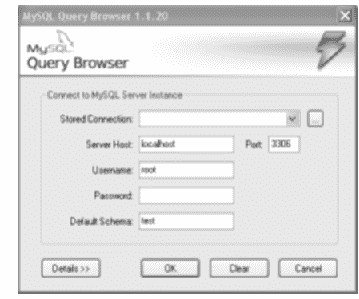

图 17.15 MySQL 查询浏览器。

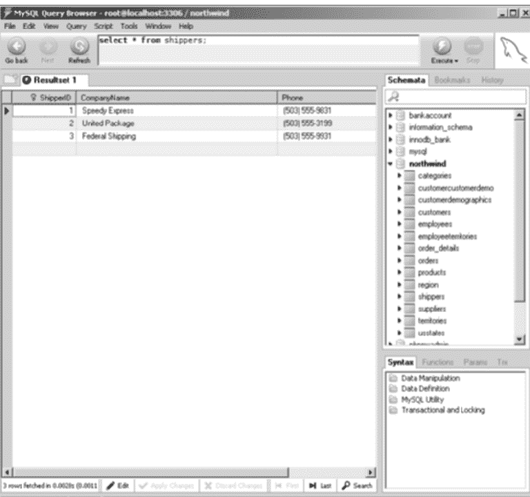

图 17.16 MySQL 查询浏览器。

# 第 17 章 • Perl 遇上 MySQL——完美的连接

## phpMyAdmin 工具

phpMyAdmin 工具用 PHP 编写，用于通过 Web 界面管理 MySQL。它被用于创建和删除数据库、操作表和字段、执行语句、管理字段键、管理权限以及将数据导出为各种格式。详情请访问 http://www.phpadmin.net/home_page/index.php。

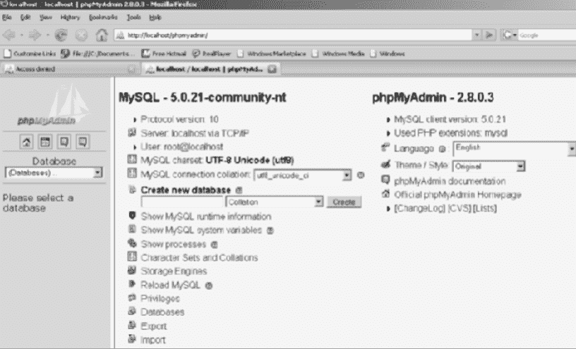

图 17.17 phpMyAdmin 工具。

### MySQL 权限系统

**MySQL 权限系统。** 就像驾照一样，“认证”（authentication）是通过检查你的照片和有效期来核实你确实拥有该执照；而“授权”（authorization）则是验证你有权驾驶什么车辆，例如汽车、卡车或校车。

同样，MySQL 权限系统的主要目的是验证用户和密码是否有效以连接到指定主机，如之前的示例通过命令行和图形化客户端所演示。权限系统的第二个目的是指定用户在连接到数据库后被允许执行的操作。例如，用户可能仅允许选择和查看特定表的数据。当安装 MySQL 时，会创建一个 MySQL 数据库，其中包含 `grant` 表，这些表定义了初始用户账户和权限。第一个账户是名为“root”的用户，也称为超级用户（superuser）。超级用户可以执行任何操作，这意味着任何登录 root 的人都拥有所有权限。初始情况下，root 账户没有密码，这使得任何人都可以轻松以超级用户的身份登录。创建的其他类型账户是匿名用户账户（anonymous-user），也没有密码。对于 root 和匿名账户，Windows 各获得一个，而 UNIX 两个。无论何种情况，为了避免安全问题，一旦 MySQL 服务器启动，你应该做的第一件事就是为 root 账户和匿名账户设置密码。

出于管理目的，你应该拥有对服务器的 root 访问权限。`mysqladmin` 实用用于创建密码和执行其他 MySQL 管理任务。在下一个示例中，它被用于为用户 'root' 设置密码。

# 示例 17.2

```mysql
1 $ mysqladmin -u root -h localhost password quigley
2 $ mysql -uroot -hlocal -pquigley
Welcome to the MySQL monitor. Commands with ; or \g.
Your MySQL connection id is 29 to server version: 5.0.2
community-nt
```

输入 'help;' 或 '\h' 获取帮助。输入 '\c' 清空缓冲区。

# 解析

1. `mysqladmin` 用于设置本地主机上用户 root 的密码。密码为 "quigley"。
2. 用户 root 登录数据库服务器。`-u` 选项后跟的是用户名（`-u` 和用户名之间没有空格）。该用户以 "root" 身份登录。同样，`-p` 选项后跟的是实际密码；在此例中为 "quigley"。如果没有提供密码，将提示输入。

### 17.3.5 查找数据库

数据库服务器维护了一个可用数据库列表，可以通过在 mysql 提示符中执行 `show` 命令以表格形式显示，如下例所示。通常在安装 MySQL 时，会有两个数据库：`test` 和 `mysql`。你通常没有特殊权限来访问 `test` 数据库的权限。`mysql` 数据库是一个特殊的数据库，MySQL 服务器在其中存储各种访问权限。目前，你不必担心这个数据库，除非你需要管理权限。请参考 MySQL 手册中的 "GRANT" 命令。

# 示例 17.3

```mysql
1 mysql -uroot -pquigley1
Welcome to the MySQL monitor. Commands with ; or \g.
Your MySQL connection id is 5 to server version: 4.1.11-nt
```

输入 'help;' 或 '\h' 获取帮助。输入 '\c' 清空缓冲区。

# 示例 17.3（续）

```mysql
mysql> show databases;
mysql> show databases;
+\----------+
| Database |
+\----------+
| information_schema | 
| mysql |
| phpmyadmin |
| test |
+\----------+
rows in set (0.00 sec)
mysql>
```

# 解析

`show databases` 命令列出了此服务器上的所有数据库。通常在安装 MySQL 时，你会获得 `mysql` 数据库和 `test` 数据库。`test` 数据库仅用于测试目的且是空的。`mysql` 数据库包含了所有 MySQL 服务器的权限信息。

**创建和删除数据库。** 创建数据库是简单的。但另一回事，这取决于你的需求以及你将用于组织数据的模型。对于最小的数据库，你将……

## 17.3 MySQL 入门

### 示例 17.6

```
mysql> CREATE DATABASE sample_db;
Query OK, 1 row affected (0.03 sec)

mysql> SHOW DATABASES;
+\----------------------+
| Database             |
+\----------------------+
| information_schema |
| mysql |
| northwind |
| phpmyadmin |
| sample_db |
| test |
+\----------------------+
6 rows in set (0.00 sec)
```

### 解释

1. `CREATE DATABASE` 语句允许你创建一个数据库。创建数据库并不会让你进入该数据库。`USE` 语句将让你能够在该数据库中工作，如下一个示例所示。
2. `SHOW DATABASES` 语句列出当前所有可用的 MySQL 数据库。刚刚创建了 sample_db 数据库。

**使用 MySQL 选择数据库。** 在创建数据库之后，我们需要打开它才能使用它。这是通过 `USE` 语句完成的。现在我们已经有了一个可以进行工作的数据库。

### 示例 17.7

```
mysql> USE sample_db;
Database changed
```

**在数据库中创建表。** 数据库创建完成后，就可以创建一些表了。在实际情况下，关系型数据库的设计将遵循规则以防止表结构中的逻辑错误，这一过程被称为“规范化”，这是一个超出现本书涵盖范围的话题。在我们的示例数据库中，我们将创建一个表并在其中放入一些数据，仅为了演示你如何操作。`CREATE TABLE` 语句定义了每个字段的结构、名称及其类型。

**数据类型。** 首先，我们需要决定在表中存储什么种类型的数据：文本、数字、日期、照片、金钱等，以及为存储这些数据的字段（列）取什么名称。MySQL 拥有特定的数据类型来描述可以存储在数据库中的所有类型的数据。大多数 MySQL 数据类型列在表 17.3 中。

#### 表 17.3 MySQL 数据类型

| 数据类型 | 描述 |
| :--- | :--- |
| TINY | 非常小的数字；适用于年龄。如果应用了 UNSIGNED 子句，可以存储 0 到 255 之间的数字；否则范围为 –128 和 127。 |
| SMALLINT | 适用于 0 到 65535 (UNSIGNED) 或 –32768 到 32767 之间的数字。 |
| MEDIUM INT | 使用 UNSIGNED 子句为 0 到 16777215，或 –8388608 和 8388607。 |
| INT | UNSIGNED 整数位于 0 到 424967295 或 –2147483648 到 2147483647 之间。 |
| BIGINT | 巨大的数字 (~922337206854775808 到 922337206854775807)。 |
| FLOAT | 浮点数（单精度）。 |
| DOUBLE | 浮点数（双精度）。 |
| CHAR(x) | x 范围从 1 到 255。存储固定长度字符串（可以包含字母、数字和特殊字符）。大小在括号中指定。 |
| VARCHAR(x) | x 范围从 1 到 255。存储变长度字符串（可以包含字母、数字和特殊字符）。最大长度在括号中指定。 |
| TINYTEXT | 小文本，不区分大小。 |
| TEXT | 稍长的文本，不区分大小。 |
| MEDIUMTEXT | 中等大小的文本，不区分大小。 |
| LONGTEXT | 非常长的文本，不区分大小。 |
| TINYBL | Blob 意味着二进制大对象。你应该使用 blobs 进行区分大小的搜索。 |
| BLOB | 稍大的 blob，不区分大小。 |
| MEDIUMBLOB | 中等大小的 blobs，不区分大小。 |
| LONGBLOB | 巨大的 blobs，不区分大小。 |
| ENUM | 枚举数据类型具有固定值，该列只能从给定集合中取一个值。值放在 ENUM 声明后的括号中。例如婚姻状况列–m_status ENUM(“Y”, “N”）。 |
| DATE: YYYY-MM-DD | 四位年份，后跟两位数的月份和日期；例如 20071030 |
| TIME: hh:mm:ss | 小:分:秒 |
| DATETIME | YYYY-MM-DD hh:mm:ss（日期和时间用空格字符分隔） |
| TIMESTAMP | YYYYMDDDhhmmss |
| YEAR | YYYY（四位年份）；例如 2007 |

### 示例 17.8

```
1 mysql> CREATE TABLE teams (
  -> name varchar(100) not null,
  -> wins int unsigned,
  -> losses int unsigned);
  Query OK, 0 rows affected (0.09 sec)
2 mysql> SHOW TABLES;
+----------------------+
| Tables_in_sample_db |
+----------------------+
| teams                |
+----------------------+
1 row in set (0.00 sec);
3 mysql> DESCRIBE teams;
+------+------+------+------+
| Field | Type | Null | Key | Extra |
+------+------+------+------++
| name | varchar(100) | NO | | |
| wins | int unsigned | YES | | |
| losses | int unsigned | YES | | |
+------+------+------+------+
```

### 解释

1. `CREATE TABLE` 语句在数据库中创建了一个表。该表名为 teams。
2. `SHOW` 命令列出了表。
3. `DESCRIBE` 命令显示了表的结构。注意 wins 和 losses 字段是整数。

**带有主键的表。** 在下一个示例中，我们将创建一个带有主键的表。主键用于唯一标识记录。请参考 MySQL 文档获取添加新记录的完整列表。

### 示例 17.9

```
mysql> CREATE TABLE coaches (
  -> id NOT NULL AUTO_INCREMENT,
  -> name varchar(75),
  -> team varchar(100),
  -> title varchar(50),
  -> start_date date,
  -> PRIMARY KEY (id));
Query OK, 0 rows affected

1 mysql> DESCRIBE coaches;
+------+------+------+------+++
| Field | Type | Null | Key | Extra |
+------+------+------+------+++
| id | int(11) | NO | PRI | auto_increment |
| name | varchar(75) | YES | | |
| team | varchar(100) | YES | | |
| title | varchar(50) | YES | | |
| start_date | date | YES | | |
+------+------+------+------+++

2 mysql> SHOW TABLES;
+----------------------+
| Tables_in_sample_db |
+----------------------+
| coaches
| teams
+----------------------+
2 rows in set (0.00 sec)
```

### 解释

1. 创建了 coaches 表，id 字段为主键。这是将用来唯一标识特定教练的字段。
2. 新表的结构显示 id 字段有一个主键，每次添加新教练时它都会自动递增。
3. 现在我们的数据库有两个表，一个叫 teams，一个叫 coaches。

**向表中插入数据。** `INSERT` 语句向表中添加新记录。在插入数据时，请确保按照数据存储的顺序为每个字段提供值；否则 MySQL 将发送错误消息。在以下示例中，数据可以插入 SET 子句并赋值，也可以使用 VALUES 列表或直接按顺序列出每个字段的值。请参考 MySQL 文档获取添加新记录的完整列表。

### 示例 17.10

```
mysql INSERT INTO teams
-> set name='Fremont Tigers', wins=24, losses=26;
Query OK, 1 row affected (0.00)

mysql INSERT INTO teams
-> set name='Chico Hardhat', wins=19, losses=25;
Query OK, 1 row affected (0.00)

mysql INSERT INTO teams values
->('Bath Warships',32,33);
Query OK, 1 row affected (0.00)
```

# 示例 17.10（续）

```sql
4 mysql INSERT INTO teams values
-> ('Bangor Rams', 22, 24);
   Query OK, 1 row affected (0.00 sec)
```

```sql
5 mysql SELECT name FROM teams;
+----------------------+
| name                 |
+----------------------+
| Fremont Tigers       |
| Chico Hardships|
| Bath Warships        |
| Bangor Rams          |
+----------------------+
4 rows in set (0.00 sec)
```

```sql
6 mysql INSERT INTO coaches values
-> ('', 'John Doe','Chico Hardships', 'Head Coach', 20021210);
   Query OK, 1 row affected, 1 warning (0.05 sec)
```

```sql
7 mysql INSERT INTO coaches values
-> ('', 'Jack Matsone','Chico Hardships', 'Offensive Coach',
   '20041005');
   Query OK, 1 row affected, 1 warning (0.03 sec)
```

```sql
8 mysql INSERT INTO coaches(name,team,title,start_date)
-> values ('Bud Wilkins', 'Premont Tigers', 'Head Coach',
   '19990906');
   Query OK, 1 row affected (0.03 sec)
```

```sql
9 mysql INSERT INTO coaches(name,team,title,start_date)
->values ('Joe Hayes', 'Premont Tigers', 'Defensive Coach',
   '19980616');
   Query OK, 1 row affected (0.02 sec)
```

# 解析

1. 字段和值使用 `INSERT` 语句中的 `SET` 子句进行赋值。对于 `SET` 中未命名的任何字段，MySQL 会为其分配默认值。
2. 再次使用 `SET` 子句插入字段和值。
3. 在此示例中，`INSERT` 语句包含一个 `VALUE` 列表，其中每个字段的值都是按照在创建表时指定的顺序进行赋值的。如果不确定顺序，可以使用如上一个示例所示 `DESCRIBE` 语句。
4. 在此示例中重复使用 `VALUES` 列表来插入新记录。注意日期是以 yyyy-mm-dd 格式插入的。
5. `SELECT` 语句显示了已插入表的所有团队名称。
6,7,8,9 使用 `VALUES` 列表插入了更多记录。

# 17.3 开始使用 MySQL——SELECT 命令

从表中选择数据——`SELECT` 是常用的 SQL 命令之一，在执行查询时是强制性的。`SELECT` 命令用于根据某些标准从表中检索数据。它指定了一个由逗号分隔的字段列表，用于检索这些字段，而 `FROM` 子句指定了要访问的表。结果存储在称为结果集（result set）的临时表中，这只是一个小标题。`*` 符号可以表示所有字段。

### 按列选择

在接下来的示例中，检索由逗号分隔的特定列（字段）的数据。

# 示例 17.11

```sql
mysql> SELECT name FROM teams;
+----------------------+
| name |
+----------------------+
| Fremont Tigers |
| Chico Hardships |
| Bath Warships |
| Bangor Rams |
+----------------------+
4 rows in set (0.00 sec)

mysql> SELECT name, wins FROM teams;
+------------------------+
| name | wins |
+------------------------+
| Bangor Rams | 22 |
| Bath Warships | 32 |
| Fremont Tigers | 24 |
| Chico Hardships | 19 |
+------------------------+
4 rows in set (0.00 sec)

mysql> SELECT id, name, title FROM coaches;
+----+--------------------------+
| id | name | title |
+----+--------------------------+
| 1 | John Doe | Head Coach |
| 2 | Jack Matsone | Offensive Coach |
| 3 | Bud Wilkins | Head Coach |
| 4 | Joe Hayes | Defensive Coach |
+----+--------------------------+
4 rows in set (0.00 sec)
```

# 解析

1. `SELECT` 语句根据某些条件从表中检索所有 name 字段的值。
2. 字段之间用逗号分隔，来自表中。
3. `*` 是通配符，代表所有列。

### 按列选择

在接下来的示例中，检索由逗号分隔的特定列（字段）的数据。

# 示例 17.12

```sql
mysql> SELECT name FROM teams;
+----------------------+
| name |
+----------------------+
| Fremont Tigers |
| Chico Hardships |
| Bath Warships |
| Bangor Rams |
+----------------------+
4 rows in set (0.00 sec)

mysql> SELECT name, wins FROM teams;
+------------------------+
| name | wins |
+------------------------+
| Bangor Rams | 22 |
| Bath Warships | 32 |
| Fremont Tigers | 24 |
| Chico Hardships | 19 |
+------------------------+
4 rows in set (0.00 sec)

mysql> SELECT id, name, title FROM coaches;
+----+--------------------------+
| id | name | title |
+----+--------------------------+
| 1 | John Doe | Head Coach |
| 2 | Jack Matsone | Offensive Coach |
| 3 | Bud Wilkins | Head Coach |
| 4 | Joe Hayes | Defensive Coach |
+----+--------------------------+
4 rows in set (0.00 sec)
```

## 17.4 SQL 运算符

`WHERE` 子句是可选的，它根据某些条件指定将选择哪些行。

| 运算符 | 说明 | 示例 |
| :--- | :--- | :--- |
| = | 等于 | = 'Sweden' |
| <> | 不等于 | <> 'Sweden' |
| > | 大于 | > 10 |
| < | 小于 | < 50 |
| >= | 大于等于 | >= 12 |
| <= | 小于等于 | <= 21 |
| BETWEEN | 在闭区间范围内 | BETWEEN 'Doe' AND 'Hayes' |
| LIKE | 按模式搜索值 | LIKE 'D%' |
| NOT LIKE | 不按模式搜索 | NOT LIKE 'Sw%' |
| IS NULL | 为空 | IS NULL |
| NOT NULL | 不为空 | NOT NULL |
| \|\| | 逻辑或 | 10 \|\| 20 |
| &&, AND | 逻辑与 | 10 && 20 |
| XOR | 逻辑异或 | 10 XOR 20 |

在某些 SQL 版本中，`<>` 运算符可以写为 `!=`。

# 示例 17.13

```sql
mysql> SELECT name, wins FROM teams WHERE wins > 25;
+----------------------+
| name | wins |
+----------------------+
| Bath Destroyers | 34 |
| Portland Penguins | 28 |
+----------------------+
```

```sql
mysql> SELECT name FROM teams WHERE losses < wins;
+----------------------+
| name               |
+----------------------+
| Bath Warships       |
+----------------------+
```

# 示例 17.13（续）

```sql
mysql> SELECT name, title FROM coaches WHERE team = 'Chico Hardships';
+----------------------+
| name | title |
+----------------------+
| John Doe | Head Coach |
| Jack Matsone | Offensive Coach |
+----------------------+
2 rows in set (0.00 sec)
```

```sql
mysql> SELECT name FROM coaches WHERE name LIKE 'J%'
+----------------------+
| name |
+----------------------+
| John Doe |
| Jack Matsone |
| Joe Hayes |
+----------------------+
3 rows in set (0.00 sec)
```

```sql
mysql> SELECT name FROM teams WHERE wins > 10 && losses < 10
+----------------------+
| name |
+----------------------+
| Bath Warships |
1 row in set (0.00 sec)
```

```sql
mysql> SELECT name FROM coaches WHERE id BETWEEN 1 AND 3
+---------------------------+
| name |
+---------------------------+
| John Doe |
| Jack Matsone |
| Bud Wilkins |
+---------------------------+
3 rows in set (0.00 sec)
```

# 解析

1. `SELECT` 语句从名为 teams 的表中检索 wins 字段大于 25 的团队名称。
2. `SELECT` 语句从名为 teams 的表中检索 losses 字段小于 wins 字段的名称。
3. `SELECT` 语句从名为 coaches 的表中，如果团队等于字符串‘Chico Hardships’，则检索名称和标题。字符串必须用单引号或双引号引用，且匹配必须精确。
4. `SELECT` 语句从名为 `coaches` 的表中检索教练名称，条件是教练名称包含以 'J' 开头的字符串。`%` 符号是通配符，代表 'J' 之后的任何字符。
5. `SELECT` 语句检索团队名称，条件是胜场数大于 10 且输场数少于 10。`&&` 是逻辑与。两个语句必须同时为真，否则将不会选中任何内容。
6. `SELECT` 语句从名为 `coaches` 的表中检索 ID 在 1 到 3 之间的教练名称。`BETWEEN` 子句创建一个用于选择的范围准则。

### 排序表格

你可以使用 `ORDER BY` 子句按特定顺序显示查询结果。行可以按升序（默认）或降序（`DESC`）进行排序，其中被排序的值可以是字符串或数字。你可以使用 `LIMIT` 子句限制任何查询的输出。

## 示例 17.14

```sql
1 mysql> SELECT * FROM teams ORDER BY name;
+----------------------+------+
| name            | wins | losses |
+----------------------+------+
| Bangor Rams     | 22  | 24     
| Bath Warships   | 32  | 3      
| Chico Hardhats | 19  | 25     
| Fremont Tigers  | 24  | 26     
+----------------------+------+
  4 rows in set (0.00 sec)
```

```sql
2 mysql> SELECT * FROM teams ORDER BY name DESC;
+----------------------+------+
| name            | wins | losses |
+----------------------+------+
| Fremont Tigers  | 24  | 26     
| Chico Hardhats | 19  | 25     
| Bath Warships   | 32  | 3      
| Bangor Rams     | 22  | 24     
+----------------------+------+
  4 rows in set (0.00 sec)
```

```sql
3 mysql> SELECT name, wins FROM teams ORDER BY WINS LIMIT 2;
+----------------------+------+
| name            | wins |
+----------------------+------+
| Chico Hardhats | 19  |
| Bangor Rams     | 22  |
+----------------------+------+
  2 rows in set (0.00 sec)
```


# 第 17 章 Perl 遇 MySQL——完美连接

## 解释

1. `SELECT` 语句从 `teams` 表检索所有字段，并按名称升序排序结果集。
2. `SELECT` 语句从 `teams` 表检索所有字段，并按名称降序排序结果集。
3. `SELECT` 语句检索名称和胜场，并按胜场升序排序，限制结果集为前两个。

连接表格。当数据库设计得当时，表之间根据某些准则相互关联；例如，在我们的数据库中，每个团队都有名称，每个教练也有一个名称。连接将两个或多个表合并，并根据它们的关系返回结果集。有不同的连接类型（内连接、交叉连接、左连接等），但它们都遵循 `SELECT` 语句的基本语法，增加了 `JOIN` 子句。

## 示例 17.15

```sql
mysql SELECT teams.name, coaches.name, teams.wins
FROM teams, teams.name = coaches.team && coaches.id = 4;

| name | name | wins |
|---|---|---|
| Tigers | Joe Hayes | 24 |
1 row in set (0.00 sec)
```

```sql
mysql SELECT teams.name, coaches.name, teams.wins FROM teams,
-> coaches WHERE teams.name = coaches.name &&
-> coaches.title = "Head Coach";

| name | name | wins |
|---|---|---|
| Chico Hardhats | John Doe | 21 |
| Fremont Tigers | Bud Wilkins | 24 |
2 rows in set (0.00 sec)
```

```sql
mysql SELECT t.name, c.name, t.wins FROM teams, c
-> WHERE t.name = c.team && c.title LIKE "Head%";

| name | name | wins |
|---|---|---|
| Chico Hardhats | John Doe | 21 |
| Fremont Tigers | Bud Wilkins | 24 |
2 rows in set (0.00 sec)
```

## 17.3 入门 MySQL

## 解释

1. `SELECT` 语句将检索团队名称、教练名称和该团队的胜场数，条件是团队和教练名称相同且教练 ID 为 4。字段以表名和点开头以标识字段和表。连接（内连接）意味着匹配 `WHERE` 子句的所有记录将显示在结果集中。
2. `SELECT` 语句将检索团队名称、教练名称和胜场数，条件是团队和教练名称相同且教练职位为“Head Coach”。和上一个一样，连接（内连接）意味着只有匹配 `WHERE` 子句的行显示在结果集中。
3. `SELECT` 语句将从两个表中检索团队名称、教练名称和团队胜场，条件是团队和教练名称相同且教练职位以“Head”开头。别名可以节省大量的输入。分别调用表 `t` 和 `c`。

删除行。`DELETE` 命令允许根据准则删除行。

## 示例 17.16

```sql
1 mysql> SELECT * FROM teams;
+----------------------+------+
| name            | wins | losses |
+----------------------+------+
| Fremont Tigers  | 24  | 26     
| Chico Hardhats | 19  | 25     
| Bath Warships   | 32  | 3      
| Bangor Rams     | 22  | 24     
+----------------------+------+
  4 rows in set (0.00 sec)

2 mysql> DELETE FROM teams WHERE name = "Warships";
Query OK, 1 row affected (0.00 sec)

3 mysql> SELECT * FROM teams;
+----------------------+------+
| name            | wins | losses |
+----------------------+------+
| Fremont Tigers  | 24  | 26     
| Chico Hardhats | 19  | 25     
| Bangor Rams     | 22  | 24     
+----------------------+------+
  3 rows in set (0.00 sec)
```

更新表中的数据。`UPDATE` 命令用于编辑表；即，更改值。

## 示例 17.17

```sql
1 mysql> SELECT * FROM teams;
+----------------------+------+
| name            | wins | losses |
+----------------------+------+
| Fremont Tigers  | 24  | 26     
| Chico Hardhats | 19  | 25     
| Bath Warships   | 32  | 3      
| Bangor Rams     | 22  | 24     
+----------------------+------+
  4 rows in set (0.00 sec)

2 mysql> UPDATE teams SET wins=20 WHERE name="Chico Hardhats";
Query OK, 1 row affected (0.00 sec)

3 mysql> SELECT * FROM teams;
+----------------------+------+
| name            | wins | losses |
+----------------------+------+
| Fremont Tigers  | 24  | 26     
| Chico Hardhats | 20  | 25     
| Bath Warships   | 32  | 3      
| Bangor Rams     | 22  | 24     
+----------------------+------+
  4 rows in set (0.00 sec)

4 mysql> UPDATE teams SET name="Destroyers" WHERE name="Warships";
Query OK, 1 row affected (0.00 sec)

5 mysql> SELECT * FROM teams;
+----------------------+------+
| name            | wins | losses |
+----------------------+------+
| Fremont Tigers   | 24  | 26     |
| Chico Hardhats | 20  | 25     |
| Bath Destroyers  | 32  | 3      |
| Bangor Rams     | 22  | 24     
+----------------------+------+
  4 rows in set (0.00 sec)
```

## 解释

1. `SELECT` 语句从表中检索所有行。我们将此结果集与第 3 行进行比较。
2. `UPDATE` 语句编辑了名称字段。它导致“Warships”团队更名为“Destroyers”。
3. `SELECT` 语句检索名称字段中的所有值，显示“Warships”团队已通过 `UPDATE` 语句更改。

修改表格。`ALTER TABLE` 允许通过添加和删除列来修改现有表的结构。`ALTER` 语句有许多可能的子句，如 `CHANGE`、`MODIFY`、`RENAME`、`DROP` 等。以下示例演示了其中一些修改。

### 添加列

```sql
mysql> ALTER TABLE teams ADD captain varchar(100);
Query OK, 11 rows affected (0.64 sec)
Records: 11 Duplicates: 0 Warnings:
mysql> select * from teams;
+------------------------------------------------+
| name             | wins | losses | captain |
+------------------------------------------------+
| Fremont Tigers   | 24    | 26     | NULL |
| Bath Destroyers   | 34    | 3      | NULL |
| Chico Hardhats     | 21    | 25     | NULL |
| Bangor Rams       | 23    | 5      | NULL |
+------------------------------------------------+
4 rows in set (0.01 sec)
```

## 解释

- `ALTER` 语句为 `teams` 表添加了一个新的 `captain` 字段。新字段最多可以包含 100 个字符。

### 删除列

```sql
mysql> ALTER TABLE teams DROP captain;
Query OK, 11 rows affected (0.34 sec)
Records: 11 Duplicates: 0 Warnings: 0
```

## 添加主键

在示例 17.20 中，通过修改 `teams` 表将 `name` 字段设为主键。这意味着所有新团队必须有唯一的名称。

### 示例 17.20

```sql
1 mysql> ALTER TABLE teams MODIFY name VARCHAR(100) NOT NULL,
   <--> ADD PRIMARY KEY(name);
   Query OK, 10 rows affected (0.06 sec)
   Records: 10 Duplicates: 0 Warnings: 0

2 mysql> DESCRIBE teams;
+------------------------------------------------------+
| Field | Type           | Null | Key | Default | Extra |
+------------------------------------------------------+
| name  | varchar(100)   | NO   | PRI | NULL    |         |
| wins  | int(10) unsigned| YES  |      | NULL    |         |
| losses| int(10) unsigned| YES  |      | NULL    |         |
+------------------------------------------------------+
3 rows in set (0.05 sec)
```

**删除表。** 删除表相对简单。使用 `DROP` 命令和表名即可。

### 示例 17.21

```sql
mysql> DROP TABLE teams;
Query OK, 5 rows affected (0.11 sec)
```

**删除数据库。** 要删除数据库，请使用 `DROP DATABASE` 命令。

### 示例 17.22

```sql
mysql> DROP DATABASE sample_db;
Query OK, 1 row affected (0.45 sec)
```

## 17.4 什么是 Perl DBI？

DBI 是连接应用程序与一个或多个数据库驱动模块的“胶水”层。
—Tim Bunce，DBI 作者

DBI 代表 Database Independent Interface（数据库无关性接口）。DBI 是一个面向对象的模块，允许你的 Perl 程序使用相同的方法调用、变量和约定与许多不同类型的数据库通信。它会定位特定数据库系统的数据库驱动程序模块（DBD），并动态加载相应的 DBD 模块。数据库驱动程序包含了与特定数据库通信所需的库。例如，要连接到 MySQL 数据库，你需要安装 `DBD-MySQL` 驱动；而要与 Oracle 数据库通信，你需要 `DBD-Oracle` 驱动。DBI 充当你的 Perl 脚本与数据库驱动模块之间的接口；即它将 Perl 输出翻译为特定驱动程序（无论该驱动是 Oracle、Sybase、MySQL 等）可以理解的代码。你设置好 SQL 查询字符串并通过 DBI 方法将其发送给适当的数据库驱动程序，你返回的结果无论你使用哪种数据库，都可以以相同的方式在你的 Perl 程序中管理。

### 17.4.1 安装 DBI

使用 PPM 安装 DBI-MySQL。如果你使用的是来自 ActiveState 的 PPM（Perl 包管理器），安装 DBI 将非常简单。PPM 是一个包管理实用工具，简化了查找、安装、升级和删除 Perl 模块的过程。今天 PPM 的默认版本是图形化用户界面，但你也可以像示例 17.23 所示使用命令行界面。

#### PPM 快速入门

以下示例节录自 PPM 初学者指南，帮助你了解如何在命令行中使用 PPM 从 CPAN 安装和卸载模块的步骤。

### 示例 17.23

（在命令行中）
```bash
ppm help quickstart
```
quickstart -- 一个 PPM 的初学者指南

### 示例 17.23（续）

描述
PPM（Programmer's Package Manager，程序员包管理器）是一个用于管理软件“包”的工具。包是语言或软件程序的模块化扩展。包存储在仓库中。PPM 可以使用三种类型的仓库：

1. 你计算机上 CD-ROM 或硬盘上的一个目录
2. 一个网站
3. 远程仓库服务器（如 ASPN）

**常用命令：**
查看帮助：
`help`
`help <command>`

查看当前仓库名称：
`repository`

搜索当前仓库：
`search <keywords>`

安装包：
`install <package_name>`

大多数命令可以缩写；只要命令没有歧义，PPM 就能识别它。例如，`repository add foo` 可以输入为 `rep add foo`。

PPM 具有用户配置文件（profiles），用于存储已安装包的信息。配置文件作为你 ASPN 账户的一部分存储；因此，你可以轻松地为不同语言维护包配置，或者在某台机器上配置你喜欢的包，然后通过访问你的 ASPN 配置文件将安装复制到另一台机器。

如需更多信息，请在 PPM 提示符处输入 `help profile`。

**使用 PPM 安装的步骤。** 以下是此处列出的所需模块的简单步骤。

1. 确保你已连接互联网。
2. 在 shell 命令行提示符（MS-DOS 或 UNIX）下输入：`ppm`
3. 将出现 PPM 提示符：`ppm>`
4. 在 PPM 提示符下查看选项：`help`
5. 要查看可用模块，首先搜索你需要的，然后使用 `install` 命令。

### 示例 17.24

```bash
1 $ ppm
PPM - Programmer's Package Manager version 3.1
Copyright (c) 2001 ActiveState Corp. All Rights Reserved.
ActiveState 是 Softos 的部门。
进入交互式 shell。正在使用 Term::ReadLine 作为库。
输入 'help' 开始。
Setting 'target' set to 'ActivePerl 5.8.4.190.
ppm>

2 ppm query *
Querying target (ActivePerl 5.8.4.190).
1. Archive-Tar
2. Compress-Zlib
3. Data-Dump
4. DBD-mysql
5. DBD-Oracle
6. File-Handle
7. Font-Tools
8. HTML-Parser
9. HTML-Tag
10. HTML-Tree
11. IO-File
12. IO-Select
13. MIME-Base64
14. MIME-Config
15. MIME-Entity
16. MIME-Parser
17. MIME-Utils
18. Net::SSL
19. Net::Pg
20. Net::Socket
21. Net::Socket::Simple
22. Perl-Archive
23. Perl-File
24. Perl-IO
25. Perl-Maybe
26. Perl-Scalar
27. Perl-Util
28. Perl::Test
29. SOAP::ASN
30. SOAP::Simple
31. SOAP::Lite
32. Storable
33. Tk
34. Unicode
35. URI
36. DBD
37. Win32
38. XML::LibXML
39. XML::Simple
40. XML::SAX
41. XML::Tree
42. Zlib
```

**在 Linux 上使用 PPM。** 如果你正在使用 Linux，可以下载 Perl 5.8.8 ActiveState 的 rpm（RedHat 软件包管理器）文件或 tar 包。下载 ActivePerl 的指令请参阅 http://aspn.activestate.com/docs/Active-Perl/5.8/install.html。然后在 perl 目录下运行 `install.sh` 壳脚本。运行脚本后，将你的 `PATH` 设置为 perl 目录。然后，你就可以像在 Windows 中一样使用 PPM 程序从 CPAN 安装模块了。这比使用带有各种提问和问题的 CPAN 要简单得多。

你需要连接互联网以安装所需的包。要查看已安装的包：

```bash
rpm -i ActiveState....rpm
sh install.sh
```

**使用 CPAN 安装 DBI。** 维护本地 Perl 分发版的主要工具是 CPAN 模块，它用于访问综合 Perl 归档网络（又称 CPAN）。在命令行提示符处，输入：

```bash
$ perl -MCPAN -e shell
```

在 CPAN 提示符处，输入 "help"，你将看到选项列表。要获取 CPAN 的版本，在 CPAN 提示符处输入：

```bash
cpan > install Bundle::CPAN
```

在经历了一系列问题后，如果最终得到如下结果，请不要惊讶：

```text
Stop.
make -- NOT OK
Running make test
Can't test without successful make
Running make install
make had returned bad status, install seems impossible
```

这就是为什么如果可以使用 PPM 就会更简单。

针对 RedHat 尝试这些步骤：

- 安装最新的 MySQL 服务器/客户端 RPM（RedHat 自带的 MySQL 并不好用）。
  `MySQL-client-standard-5.0.24-0.rhel3.i386`
  `MySQL-server-standard-5.0.24-0.rhel3.i386.rpm`
- 安装 Perl-DBI 和 MySQL-devel。（RedHat Enterprise Linux release 3 (Taroon) 带有这些 RPM）
  `perl-DBI-1.32-5.i386.rpm`
  `mysql-devel-3.23.58-1.i386.rpm`
- 执行以下命令从 CPAN 安装 DBD-MySQL

```bash
perl -MCPAN -e 'install Bundle::DBD::mysql'
```

### 示例 17.25

```text
cpan> h
显示信息
| 命令 | 描述 |
| :--- | :--- |
| a,b,d,m | WORD 或 /REGEXP/ | 关于作者、包、分发版 |
| modules | |
| i | WORD 或 /REGEXP/ | 关于上述任何内容 |
| r | NONE | 重新安装建议 |
| ls | AUTHOR | 关于作者目录下的文件 |
| download | 下载, 测试, , 安装... |
| get | make (隐含 get) |
| test | MODULES, make test (隐含 make) |
| install | DISTS, BUNDLES install (隐含 make) |
| clean | make |
| look | open 在这些分发版目录中打开子壳 |
| readme | display 显示这些分发版的 README 文件 |
| h?, | 显示此菜单 !perl-code eval a perl |
| command | o conf [opt] 设置和查询选项 q 退出 cpan |
| shell | reload 重新加载 cpan load CPAN.pm 重新加载索引 load 更新 |
| indices | autobundle Snapshot force cmd 无条件执行 |
| do cmd | |
cpan>
```

### 17.4.2 DBI 类方法

DBI 模块是面向对象的，并带有许多方法和变量。该模块的文档列如下。数据库对象被称为句柄（handles）。数据库句柄连接到特定的数据库，而语句句柄用于向数据库发送 SQL 语句。注意，诸如 `$dbh`、`$sth`、`$rc` 等名称被用于描述语句句柄、返回代码、数据行等。（这些名称仅为文档中的约定俗例；例如，`$dbh` 代表数据库句柄，`$sth` 代表语句句柄。）

```bash
perldoc DBI
```

#### 符号和约定

本文使用了以下约定：

```
$dbh 数据库句柄对象
$sth 语句句柄对象
$drh 驱动句柄对象（在应用程序中很少见到或使用）
$h 上述任何句柄类型 ($dbh,$sth 或 $drh)
$rc 通用返回代码（布尔值：true=成功, false=错误）
$rv 通用返回值（通常是整数）
$ary 从数据库返回的值列表，通常是一个数组
$rows 处理的行数（可用，否则为 -1）
$fh 文件名
undef 表示 NULL 值
\attr 传递方法的属性值哈希引用
```

注意，如果所有对句柄对象的引用都被删除，Perl 将自动销毁数据库和语句句柄对象。

#### 名称
DBI - 用于 Perl 的数据库无关接口

#### 摘要

```perl
use DBI;
@driver_names DBI->available_drivers;
@data_sources DBI->data_sources($driver_name, \attr);
$dbh DBI->connect($data_source, $username, $auth, \attr);

$rv = $dbh->do($statement);
$rv = $dbh->do($statement, $attr);
$rv = $dbh->do($statement, $attr, @bind_values);
$ary_ref = $dbh->select_array($statement);
$array_ref = $dbh->select_array($statement);
$hash_ref = $dbh->select_array($statement);
$array_ref = $dbh->select_array($statement);
$hash_ref = $dbh->select_array($statement);
$array_ref = $dbh->select_col($statement);
$hash_ref = $dbh->select_col($statement);
$array_ref = $dbh->select_row($statement);
$hash_ref = $dbh->select_row($statement);
$sth = $dbh->prepare($statement);
$sth = $dbh->prepare_cached();
$sth = $dbh->do($statement);
```

### 17.4.4 连接数据库和断开连接

加载后，DBI 模块负责为给定的数据库加载相应的驱动程序。你将使用从 `perldoc DBI` 显示出的方法与数据库交互。我们将使用的第一个方法是 `connect()` 以获取数据库连接，最后一个方法 `disconnect()` 断开连接。

`connect()` 方法建立数据库的连接并返回一个名为数据库句柄的对象。你可以通过使用多个 `connect` 语句在程序中连接到同一个数据库，甚至是不同的数据库。`connect()` 方法接受多个参数：

`"dbi:driver=$database,$port,$username,$password"`

1. 第一个参数是 DSN 字符串（数据源名称），数据库的逻辑名称。定义数据的属性都分配给 DSN 以供驱动检索。DSN 包含 DBI 模块名称 DBI，后面是一个冒号和数据库驱动程序（MySQL, Sybase, Oracle），另一个冒号和要连接的实际数据库名称，以及/或主机名（默认为 "localhost"）、端口等，并以分号结束。
2. `connect` 的下一个参数是用户名。
3. 接着是用户的密码（可选，除非有要求）。
4. 最后是一个哈希（hash）的引用（一组用于错误处理、自动提交等可选属性的集合）。

### 示例 17.27

```perl
$1 DBIh= DBI->connect('dbi:RDMS:<database>","username","password", \attributes) or die("Couldn't connect");
$2 DBIh=DBI->connect('dbi:mysql:sample_db','root','quigleyl') or die("Can't connect");
$3 DBIh=DBI->connect('dbi:mysql:database=sample_db;user=root; password=quigleyl');
$4 dsn = dbi:mysql:northwind;username='root'; $password='letmein'; $dbh = DBI->connect($dsn, $user, $password, { Print => 1, AutoCommit => 0 }));
---使用其他数据库系统 ---
$5 dbh = DBI->connect('dbi:Oracle:payroll','scott','tiger');
$dbh = DBI->connect('dbi:Oracle:host=torch.cs.ca;sid=TRCH', $user, $passwd);
$6 dbh = DBI->connect('dbi:odbc:MSS_pubs','sa','12mw_1'); (MS SQL Server)
```

## 解释

1. `connect` 方法将返回一个数据库句柄（database handle）。这是你用于连接的格式。至少，你必须拥有 DSN 字符串，它是模块的名称、数据库驱动程序的名称，以及用 `<database>` 表示的数据库名称。用户名、主机名和其他属性是可选的。
2. `connect` 方法的参数应该写在同一行内，且参数周围没有空格。
3. `DBI->errstr` 返回了我们无法连接的原因——例如“密码错误”。
4. 此连接将建立到名为 "northwind" 的 MySQL 数据库，用户名为 "root"，密码为 "letmein"。属性用于关闭某些功能。
5. 此连接将建立到名为 "payroll" 的 Oracle 数据库，用户名为 "scott"，密码为 "tiger"。
6. 数据源名称 "MSS_pubs" 使用用户名 "sa"，密码 "12mw_1" 以及 ODBC 驱动程序。

### 17.4.5 disconnect() 方法

正如你可能在第 10 章中记得的，我们使用用户定义的句柄打开一个文件，在完成后使用内置的 `close` 函数关闭它；如果我们忘记关闭它，它将由 Perl 脚本执行时由操作系统处理。关闭数据库也是如此。在使用完数据库后，使用 `disconnect` 方法关闭连接始终是一个好主意。当然，由于数据库句柄是一个对象，一旦程序退出或对象超出范围，Perl 将自动移除对它的引用。

```perl
$dbh->disconnect();
```

### 17.4.6 准备语句句柄并获取结果

SQL `select` 语句可能是查询数据库时最常用的语句。在准备语句时，查询被作为字符串参数传递给 `DBI prepare` 方法。查询语句与你在 MySQL 控制台中输入的类型完全一样，但去掉了分号。数据库句柄处理 `prepare` 方法。数据库决定它将如何执行该查询（创建一个“计划”），DBI 返回一个包含查询执行细节的语句句柄（statement handle）。语句句柄（表示为 `$sth`）封装了要在数据库中执行的单个 SQL 语句，并调用 `execute` 方法。

此方法告诉数据库执行 SQL 语句（执行其“计划”）并将结果返回给程序。如果发生错误，则返回 `undef`。成功的 `execute` 无论影响了多少行（即使影响了零行）都会返回真。一旦执行，“计划”就会被丢弃（见 `prepare_cache` 方法）。可以创建并执行的语句句柄数量基本上是无限的。

即使你已经执行了计划，除非使用另一个 DBI 方法来检索结果（例如 `dump_results()`、`fetch_array()` 或 `fetch()` 等），否则你无法看到结果。

选择、执行并导出结果。DBI `dump_results` 方法从语句句柄获取所有行并在单个语句中打印结果。

#### 连接、准备、执行并导出结果

```perl
（脚本）
use DBI;
$dbh = DBI->connect('DBI:mysql=sample_db;user=root;password=quigleyl');
$sth=$dbh->prepare("SELECT * FROM coaches") or die "Can't prepare sql statement" . $DBI->errstr;
$sth->execute();
print qq("\n\tContents of "coaches" table\n");
```

### 示例 17.28 dump_results()（继续）

```perl
4 $sth->dump_results();    # 显示 execute 的结果
5 $sth->finish();
6 $dbh->disconnect();
```

（输出）
```
'Contents of "coaches" table
'1', 'John Doe', 'Chico Hardats', 'Head Coach', '2002-12-10
'2', 'Jack Matsone', 'CHardats', 'Offensive Coach', '2004-10
'3', 'Bud Wilkins', 'Front Tigers', 'Head Coach', '1999-09
'4', 'Joe Hayes', 'Front Tigers', 'Defensive Coach', '1998-06
'5', 'George Jones', 'Penguins', 'Offensive Coach', '2003
'6', 'Jerry OConnell', 'Rams', 'Head Coach', '20'
'7', 'Robert Smith', 'Bulls', 'Head Coach', '2001-01
'8', 'Mike Brown', 'Lakers', 'Defensive Coach', '2004-05
'9', 'Alice White', 'Knicks', 'Assistant Coach', '2005-11
'10', 'John Davis', 'Sox', 'Assistant Coach', '2002-03
```

## 解释（续）

6. `finish` 方法释放语句句柄。
7. `disconnect` 方法释放数据库句柄。

### 17.4.7 处理引号

当字符串发送到数据库时，它们会被引号括起来。字符串本身也可能包含引号，例如字符串 "Mrs. O'Donnell" 中的引号，这些引号在发送到数据库时必须经过正确的转义。更复杂的是，不同的系统对处理引号有不同的规则。DBI 模块通过其 `quote` 方法处理这些问题。该方法配合数据库句柄使用，根据为特定数据库定义的规则转换字符串，并返回正确转义的字符串。

### 示例 17.31

```perl
use DBI;
$dbh=DBI->connect("DBI:mysql:database=sample_db;user=root;password=root") or die "Can't connect";
my $namstring;
my $string = "Jerry O'Connell";
2 $namestring=$dbh->quote($string);
3 print $string;
4 $sth=$dbh->prepare("SELECT * FROM coaches WHERE name=$namestring") or die "Can't prepare sql statement" . DBI->errstr;
   $sth->execute();
5 print $dbh->quote("contents of \"coaches\" table\n");
while(my $val=$sth->fetchrow_array()) {
  print "\tname=$val[0]\n";
  print "\tname=$val[1]\n";
  print "\tteam_name=$val[2]\n";
  print "\tteam_name=$val[3]\n";
  print "\tstart_date=$val[4]\n";
}
$sth->finish();
$dbh->disconnect();
```

（输出）
```
2 Jerry O'Connell
5 Contents of "coaches" table
id=6
name=Jerry O'Connell
team_name=Portland Penguins
team_name=Head Coach
start_date=2006-02-22
```

## 解释

1. 字符串变量 `$namstring` 被赋值了一个包含单个单引号的字符字符串。
2. 使用 DBI `quote` 方法为 mysql 数据库准备字符串，通过括字符串并用反斜杠转义单引号。
3. 这一行显示了 `quote` 方法是如何准备字符串的。注意 O'Connell 中的撇号已用反斜杠转义。
4. 在 `WHERE` 子句中，使用了经过正确引号的字符串来测试其值是否匹配 `coaches` 表中某位教练的名字。下一行说明了如何在 MySQL 客户端插入数据。你可以看到字符串中是如何管理引号的；即单引号在双引号中被转义了：
   `mysql> insert coaches values('','Jerry O'Connell','Portland Penguins','Head Coach','2006-02-22');`
5. 显示该表。

### 17.4.8 获取错误消息

在处理 DBI 时，知道哪里出了问题是非常重要的。连接是否失败了？你使用 SQL 语句的方式正确吗？DBI 定义了处理错误的方法。你可以针对特定句柄使用 `PrintError` 和 `RaiseError` 属性进行自动错误处理，或者使用诊断方法和 DBI 变量。

#### 自动错误处理

DBI 模块在连接到数据库时提供自动错误处理。你可以选择在每次 DBI 失败时都获取警告，或者让程序发送消息并终止。`connect` 方法最常用的两个属性是 `PrintError` 和 `RaiseError`。

##### PrintError 属性

默认情况下，`connect()` 方法将 `PrintError` 设置为 "on"（设置为 1），如果任何 DBI 方法失败，它会自动生成警告消息。

##### RaiseError 属性

`RaiseError` 属性可以强制错误抛出异常。它默认是关闭的。任何导致错误的 DBI 方法都会导致 DBI 带错误 `DBI::errstr` 退出。如果开启了 `RaiseError`，则会先执行 `PrintError`。通常，`RaiseError` 与 `eval` 块结合使用，以便你可以捕获抛出的异常。如果 `eval` 块中发生 "die"、编译或运行时错误，特殊变量 `$@` 将设置为错误消息；如果没有错误，则设置为空。如果 `$@` 被赋值，你就可以在不退出 DBI 的情况下处理错误。（参见示例 17.32）。

#### 手动错误处理

如果你想在特定方法失败时手动检查错误，可以使用 DBI 模块提供的错误诊断方法或错误诊断变量。这让你能够控制调用的每个方法，以便在错误发生时捕获它们。

##### 错误诊断方法

首先我们来看两个诊断方法：`err()` 和 `errstr()`。这些方法可以针对任何有效的句柄、驱动程序、数据库或语句调用。`err()` 方法将返回与发生的问题相关的错误代码。`errstr()` 的代码取决于所使用的数据库系统而不同。`errstr()` 方法对应错误代码数字，但它是一个包含上一个 DBI 方法失败原因信息的字符串。在调用另一个方法之前，句柄的错误消息会被重置，因此应该在特定句柄产生错误后立即检查。诊断方法的使用将如文所述。

```perl
$rv = $dbh->err();
$str = $dbh->errstr();
```

##### 错误诊断变量

`DBI::err` 和 `DBI::errstr` 是类变量，其行为与之前描述的方法相似，不同是它们的生命周期较短，并且始终引用最后调用的方法。`DBI::err` 包含错误码，`DBI::errstr` 包含描述上一个 DBI 方法失败原因的字符串。

```perl
（脚本）
use DBI;
my $driver="DBI";
my $database="sample_db";
my $user="root";
my $host="localhost";
my $dbh = DBI->connect("DBI:mysql:database=$database;user=$user;host=$host") or die "Cannot connect: " . $dbh->errstr;
my $string = "Jerry O'Connell";
my $namstring = $dbh->quote($string);
print $namestring;
my $sth = $dbh->prepare("SELECT * FROM coaches WHERE name=$namestring") or die "Can't prepare sql statement" . $dbh->errstr;
$sth->execute();
print $dbh->quote("contents of \"coaches\" table\n");
```

## 解释

1. 准备 SQL `SELECT` 语句并返回一个语句句柄（statement handle）。
2. DBI 的 `execute()` 方法将查询发送到数据库执行。
3. 创建三个标量变量，这些变量将绑定到 `SELECT` 语句中列出的三个字段（列）中的每一个。
4. `bind_columns` 方法指定标量变量的名称，当使用 `fetch` 方法从数据库检索结果集时，这些变量将绑定到各个字段。（在 DBI 的旧版本中，第一个参数被指定为 `undef`，例如 `\$sth->bind_columns(undef, \$name, \$wins, \$losses)`；`undef` 用于返回空值字段。）
5. `fetch` 方法从结果中检索一行，并将每个值赋值给在 `bind_columns()` 方法中命名的变量。团队名称自动分配给 `$name`，胜场数分配给 `$wins`，负场数分配给 `$losses`。每次循环，下一行的列值将被赋值给这些变量，依此类推，直到没有更多数据。

**占位符。** 占位符

当由 DBI 准备查询时，数据库必须计划如何最好处理该查询。语句句柄用于存储准备好的查询，称为“执行计划”。通常情况下，查询执行后计划就会被丢弃。当使用占位符时，数据库不会丢弃查询，而是接受模板中的占位符并围绕它制定计划——使得该模板对于未来的查询非常有用。

`?` 代表值，例如：`name = ?`，其中 `name` 是数据库表中的字段名，稍后将提供值。（记住，`?` 代表一个值，而不是字段名：`?="John"` 是错误的！）`execute()` 方法接收代表占位符值的参数，每次调用该方法时，这些值都会替换到准备计划中。DBI（并非所有数据库和 DBI 都支持占位符。）

### 使用占位符 17.35

```perl
use DBI;
my $driver="DBI:mysql";
my $database="sample_db";
my $user="root";
my $host="localhost";
my $dbh = DBI->connect("$driver:$database=$host;user=$user;password=quigylel") or die ("Can't connect: " . $dbh->errstr);
```

### 示例 17.35 (续接)

```perl
my $sth=$dbh->prepare("SELECT name, wins, losses FROM teams WHERE name = ?") or die("Can't prepare sql statement" . DBI->errstr);
print "Enter the team name: ";
chomp($team_name=<STDIN>);
$sth->execute($team_name);
# $team_name 的值替换了 ?
print "\nselected data for team $name\n\n";
while ($val=$sth->fetchrow_array()) {
    print "name=$val[0]\n";
    print "wins=$val[1]\n";
    print "losses=$val[2]\n\n";
}
$sth->finish();
$dbh->disconnect();
```

输入团队名称: Chico Hardhats

已选团队 "Chico Hardhats" 的数据。

```
name=Chico Hardhats
wins=18
losses=6
```

## 解释

1. `SELECT` 语句包含一个 `WHERE` 子句，其中包含一个占位符 `?` 用于赋值给 `name` 字段。语句被准备并返回一个句柄。
2. 要求用户输入团队名称并赋值给 `$team_name`，稍后作为 `execute` 方法的参数使用。
3. `$team_name` 的值被插入查询中的占位符中。
4. `fetchrow_array()` 方法检索第 3 行执行查询时指定的团队值。

### 使用占位符

### 示例 17.36

```perl
use DBI;
my $dbh=DBI->connect("DBI:mysql:host=localhost;user=root;password=quigley1;database=sample_db");
```

### 示例 17.36-$dbh->prepare (续接)

```perl
my $sth=$dbh->prepare("INSERT INTO teams (name, wins, losses) VALUES(?,?,?)");
# 在变量中预设值
my $team_name="Denver Daredevils"; #在此处设置值
my $wins=18;
my $losses=5;
$sth->execute($team_name, $wins, $losses);
print "\n\ata for team. \n\n";
$sth=$dbh->prepare("SELECT * FROM teams");
$sth->execute();
while (@val = $sth->fetchrow_array()) {
  print "name=$val[0]\n"
  print "wins=$val[1]\n"
  print "losses=$val[2]\n"
}
$sth->finish();
$dbh->disconnect();
```

## 解释

1. 这次，三个占位符充当模板，这些值将在稍后通过 SQL `INSERT` 语句填充。它们分别代表 `name` 字段、`wins` 字段和 `losses` 字段的值。
2. 给标量赋值将发送到数据库的值。
3. `execute()` 方法将值插入占位符中。
4. 从数据库检索结果集。
5. 占位符用于处理多条记录。

### 使用占位符进行插入

### 示例 17.37

```perl
use DBI;
my $driver="DBI:mysql";
my $database="sample_db";
my $user="root";
my $password="quigley1";
my $host="localhost";
my $dbh = DBI->connect("$driver:$database=$host;user=$user;password=$password") or die ("Can't connect: " . $dbh->errstr);
my $sth=$dbh->prepare("INSERT INTO teams (name, wins, losses) VALUES(?,?,?)") or die ("Can't prepare sql statement" . DBI->errstr);
my @rows = (
    ["Denver Daredevils", 18, 5],
    ["Chico Hardhats", 21, 25],
    ["Chyenne Chargers", 6, undef],
);
foreach my $row (@rows) {
    $sth->execute($row[0], $row[1], $row[2]);
}
$sth->finish();
$dbh->disconnect();
```

### 绑定参数与 bind_param 方法

`bind_param()` 方法接收三个参数：第一个参数代表占位符的位置（例如，如果是 1，则由 `?` 表示），第二个参数是替换占位符的实际值，最后一个是用于提示替换值类型的可选参数。

### 示例 17.38

```perl
use DBI;
my $driver="DBI:mysql";
my $database="sample_db";
my $user="root";
my $password="quigylel";
my $host="localhost";
my $dbh = DBI->connect("$driver:$database=$host;user=$user;password=$password") or die ("Can't connect: " . $dbh->errstr);
my $sth=$dbh->prepare("SELECT name,wins,losses FROM teams where name LIKE ?") or die ("Can't prepare sql statement" . DBI->errstr);
$sth->bind_param(1, "Ch");
$sth->execute();
while (my @row=$sth->fetchrow_array()) {
    print "name=$row[0]\n";
    print "wins=$row[1]\n";
    print "losses=$row[2]\n";
}
$sth->finish();
$dbh->disconnect();
```

（输出）
```
Chyenne Chargers, 6
Chico Hardhats, 21, 25
```

## 解析

1. 由于参数已通过 `bind_param()` 绑定到语句上，因此 `execute()` 方法不需要参数。
2. DBI 函数 `dump_results()` 方法用于快速输出查询执行后从数据库返回的结果。

### 缓存查询

缓存是一个临时存储区域，频繁使用的数据可以存储在其中并被更快速地访问。大多数数据库服务器都利用缓存来提高最近看到的查询的性能。SQL 语句在执行后可以缓存。如果执行了另一个与缓存语句相同的查询，则可以重用该缓存查询。DBI 的 `prepare_cached()` 方法用于缓存查询。它与 `prepare()` 相似，不同在于它会检查相同的 SQL 语句是否之前执行过，因此返回的是缓存的语句句柄而不是全新的句柄（如果你正在管理多个连接，请参考 `Apache::DBI::Cache`）。

```perl
use DBI;
$driver="DBI:mysql";
$database="sample_db";
$host="localhost";
$user="root";
$password="quigley1";
$dbh=DBI->connect("$driver:database=$database;host=$host;user=$user;password=$password") or die "Can't connect: " . DBI->errstr;
```

```perl
sub get_wins() { # 处理数据库查询的子程序
    my ($dbh, $team) = @_;
    my $stmt=$dbh->prepare_cached("SELECT wins FROM team\nWHERE name = ?") or die "Can't prepare sql statement: " . DBI->errstr;
    $wins=$stmt->fetchrow_array();
    return $wins;
}
```

```perl
STARTER: {
    print("要查看胜场数，请输入球队名称。 ");
    chop($team_name=<STDIN>);
    # 调用函数处理数据库查询
```

### 示例 17.39（续）

```perl
    print "$team_name has won ", get_wins($dbh, $team_name), " games.\n";
    print "Do you want to check wins for another team? ";
    chomp($ans = <STDIN>);
    redo STARTER if $ans =~ /y|yes/i;
}
$sth->finish();
$dbh->disconnect();
```

（输出）
```
要查看胜场数，请输入球队名称。 Tampa Terrors
Tampa Terrors have won 3 games.
Do you want to check wins for another team? y
要查看胜场数，请输入球队名称。 San Francisco Fogheads
San Francisco Fogheads have won 24 games.
Do you want to check wins for another team? y
要查看胜场数，请输入球队名称。 Chico Hards
Chico Hards have won 21 games.
Do you want to check wins for another team? n
```

## 解析

1. 将使用一个名为 `get_wins` 的自定义函数来处理数据库请求。
2. `@_` 包含了数据库句柄和数据库中球队的名称。
3. 为了效率，语句被准备好并进行了缓存，而不是在执行后立即被销毁。对于多次重复执行相同的查询，这样做是为了使处理更高效。由于此函数可能会被多次调用，因此使用了 `prepare_cached()` 方法。除了名称外，该方法与 `prepare` 方法相同。
4. 执行查询，并在 SQL 语句中 `?` 出现的地方填充球队名称。
5. 从此函数检索并返回指定球队的胜场数。
6. 在程序的主部分，进入一个带标签的块并询问用户选择球队。
7. 在 `print` 语句中，调用了名为 `get_wins` 的自定义函数。将数据库句柄和用户选择的球队名称传递给函数。
8. 如果用户想查看另一个球队的胜场数，程序将回到标签块的开头并重新开始。

## 17.5 不返回任何内容的语句

### 17.5.1 do() 方法

`do()` 方法用于一步准备并执行非选择性、非重复的语句。SQL 中的 `UPDATE`、`INSERT` 或 `DELETE` 等语句就是使用 `do` 方法的。这些语句更改数据库但不返回数据。与 `prepare` 方法不同，`do` 不返回语句句柄，而是返回受影响的行数，如果查询失败则返回 `undef`。`do()` 方法返回受影响的行数，如果查询失败则返回 `undef`。（值为 -1 表示行数未知、不适用或不可用。）

```perl
$rows_affected = $dbh->do("UPDATE your_table set foo = foo + 1");
```

如果你使用占位符多次执行操作，唯一的缺点是性能问题，正如我们在示例 17.39 中做样，因为对于每个查询，`prepare` 和 `execute` 的步骤也必须重复执行。

### 添加条目

要向数据库中的表添加条目，在 DBI 方法中使用 SQL `INSERT` 语句。`do` 方法将返回新条目的数量，如果失败则返回 `undef`。

### 示例 17.40 DBI

```perl
use DBI;
my $dbh=DBI->connect("DBI:mysql:host=localhost;user=root;password=quigley1");
# 添加新条目
$dbh->do("INSERT INTO teams (name, wins) VALUES ('San Francisco Fogheads', 24)");
$dbh->do("INSERT INTO teams (name, wins) VALUES ('Middle Monsters', 32)");
$dbh->do("INSERT INTO teams (name, wins) VALUES ('Littleton Tigers', 18)");
$dbh->do("INSERT INTO teams (name, wins) VALUES ('Roger Outback', 20)");
$dbh->disconnect();
```

## 解析

1. 将用户输入的球队名称赋值给 `$team`。
2. SQL 语句将通过 `count` 查询数据库，以找到找到了多少行。
3. `execute()` 方法将查询发送到数据库，并返回匹配名称的行数。
4. 获取查询结果。给用户提供了移除条目的机会。如果没有匹配的球队，则继续下去没有意义。
5. DBI `do` 方法用于准备并执行 SQL `DELETE` 语句。
6. 返回行数。

### 删除条目

要从表中删除条目，以下示例展示了如何使用该方法。

```perl
use DBI;
my $dbh=DBI->connect("DBI:mysql:host=localhost;user=root;password=quigley1") or die "Can't connect: " . DBI->errstr;
my $num_of_wins;
my $num_of_losses;
my $count;
print "要删除的球队：";
chop($name=<STDIN>);
# 在尝试删除前显示表
my $sth=$dbh->prepare("SELECT * FROM teams WHERE name = ?") or die " failed: " . DBI->errstr;
$sth->execute($name) or die "Execution failed: " . DBI->errstr;
while(($name, $wins, $losses) = $sth->fetchrow_array()) {
    $count++;
    print "\n\t$name 删除前的数据:\n" if $count == 1;
    print "\n\twins=$wins\n";
    print "\n\tlosses=$losses\n";
}
if ($count==0) die "输入的球队不存在。\n";
print "继续吗？ ";
chomp($ans=<STDIN>);
if ($ans =~ /y|yes/i/) {
    $num=$dbh->do("DELETE FROM teams WHERE name = ?", $name);
    print ($num > 1 ? "$num rows deleted.\n" : "$num row deleted.\n");
} else {
    die "你没有选择删除。再见。\n";
}
$sth->finish();
```

（输出）
```
要删除的球队：Sunny Seniors
继续？ y
1 row deleted.
```

### 更新条目

要更新或编辑数据库，我们使用 SQL `UPDATE` 语句和 DBI `do` 方法。

```perl
use DBI;
my $dbh=DBI->connect("DBI:mysql:host=localhost;user=root;password=quigley1") or die "Can't connect: " . DBI->errstr;
my $num_of_wins;
my $num_of_losses;
my $count;
print "要更新的球队名称是：";
chop($team_name=<STDIN>);
# 在尝试更新前显示表
my $sth=$dbh->prepare("SELECT * FROM teams WHERE name = ?") or die " failed: " . DBI->errstr;
$sth->execute($team_name) or die "Execution failed: " . DBI->errstr;
while(($name, $wins, $losses) = $sth->fetchrow_array()) {
    $count++;
    print "\n\t$name 更新前的数据:\n" if $count == 1;
    print "\n\twins=$wins\n";
    print "\n\tlosses=$losses\n";
}
if ($count==0) die "输入的球队不存在。\n";
print "$team_name 自上次更新以来赢了多少场比赛？";
chomp($num_of_wins=<STDIN>);
$dbh->do("UPDATE teams SET wins = wins + $num_of_wins WHERE name = ?", $team_name);
$sth->finish();
$dbh->disconnect();
```

### 示例 17.42 (续)


```perl
7 print "How many games has \$team_name lost since the last update? ";
   chomp(\$num_of_losses=\$STDIN);
8 \$dbh->do(qq/UPDATE teams SET wins=wins+\$num_of_wins
   WHERE name = ?, undef, "\$team_name" or
   die("Can't update teams: ", \$DBI->errstr);
9 \$dbh->do(qq/UPDATE teams SET losses=losses+\$num_of_losses
   WHERE name = ?, undef, "\$team_name" or
   die("Can't update teams: ", \$DBI->errstr);

   # 在更新后显示表格
   print "\nData for \$team_name after update:\n";
10 \$sth=\$dbh->prepare(qq/SELECT * FROM teams WHERE
    name="\$team_name";
11 \$sth->execute();
12 while (($name, \$wins, \$losses) = \$sth->fetchrow_array(())) {
       print "\ttwins=\$wins\n";
       print "\tlosses=\$losses\n\n";
   }

   \$sth->finish();
   \$dbh->disconnect();
```

(输出)

What is the name of the team to update? Chico Hards

Data for Chico Hards before update:

wins=15

losses=3

How many games has Chico Hards won since the last update? 1

How many games has Chico Hards lost since the last update? 2

Data for Chico Hards after update:

wins=16

losses=5

### 解释

- 1 用户被要求输入 teams 表中他要编辑的团队名称。

- 2 使用 SELECT 语句检索 teams 表中的所有数据。

- 3 在执行更新之前，将显示表格以查看其当前状态。

- 4 计数器将跟踪返回了多少条记录。

- 5 如果计数为 0，则 SELECT 没有返回任何内容，程序将带有错误信息并退出。

- 6 用户被要求输入自上次更新以来赢了多少场比赛。

- 7 并且用户被询问自上次更新以来输了多少场比赛。

### 解释 (续)

- 使用 DBI do 方法来准备并执行 SQL UPDATE 语句。它返回受更新影响的行数。该语句将更新 teams 表中的 wins 列。

- 此次更新与上一次相同，只是它增加了 losses 的数量。

- 在数据库表更新后，将重新发布 SELECT 语句以显示被编辑后的表格。

## 17.6 事务

在 teams 表的简单示例中，当为两个团队插入数据，且两个团队的胜负次数不小心交换了时，一次更新需要同时修改两个团队，而不仅仅是其中一个。假设你正在更新多个表，并且其中一个表的更新成功了而另一个表失败了。例如，一个经典的例子是你从一个表中的储蓄账户中取出钱，并放入另一个表中的支票账户。存款成功了但取款失败了。表将处于不一致状态。事务是一组 SQL 语句，它们要么全部成功，要么全部失败。例如，INSERT、UPDATE 和 DELETE 语句可以作为一个组执行。

默认情况下，MySQL 在开启了自动提交（autocommit）的情况下运行。DBI 默认也开启了自动提交。这意味着只要你执行任何修改表的方法，并且没有返回错误，MySQL 就会立即将语句提交到数据库，对表的任何更改都将持久化。

要在 MySQL 中使用事务，必须禁用自动提交。我们可以在 Perl 脚本连接数据库时，通过设置 `AutoCommit => 0` 的哈希值来实现这一点，如 17.43 所示。

在之前的示例中，当我们连接到数据库时，我们使用了 `connect()` 方法可用的用于错误处理的哈希选项：PrintError 和 RaiseError。要使用事务，我们需要关闭 AutoCommit 属性，开启 RaiseErrors，并将 PrintError 保持默认的“开启”或“关闭”。

### 示例 17.43

```perl
1 $dbh = DBI->connect( 'dbi:mysql:sample_db','root','quigyleyl',
    PrintError => 0,
    RaiseError => 1,
    AutoCommit => 0 )
2
```

RaiseError 告诉 DBI 如果发生错误则带有 $DBI::errstr 消息并退出，而默认开启的 Printer 告诉 DBI 发送带有 $DBI::errstr 的警告，程序将继续执行。

## 17.6 事务

提交（Commit）和回滚（Rollback）。提交意味着在事务中一组语句将作为一个组执行并发送到数据库。如果所有语句都成功，则该组被提交，数据库被修改。如果组中的任何一个语句发生错误，则会发出回滚命令，将所有表恢复到之前的状态。

在 Perl 中，事务通常使用 `eval` 块来捕获错误，然后使用 `commit()` 或 `rollback()` 方法完成事务。

在接下来的示例中，一组记录将被插入到表中。如果在添加这些条目的过程中发生错误，则整个过程将回滚。

### 示例 17.44

```perl
use DBI;
use DBI qw(:sql_types);

my $dbh = DBI->connect("DBI:mysql:host=localhost;database=sample_db","root","quigleyl",
    PrintError => 0,
    RaiseError => 1,
    AutoCommit => 0) or die "Connection to sample_db failed: $dbh->errstr";

my $sql = "INSERT INTO coaches (name, wins, losses) VALUES (?, ?)";
my $sth = $dbh->prepare($sql);

my @rows = (
    ['Tigers', 11, 5],
    ['Lizards', 12, 3],
    ['Demons', 6, 0],
    ['Chargers', 2, 3],
);

foreach my @row (@rows) {
    eval {
        $sth->execute($row[0], $row[1]);
    };
    if ($@) {
        warn "Database error: $@\n";
        $dbh->rollback();
    } else {
        $dbh->commit();
        print "Success!\n";
    }
}
$sth->finish();
$dbh->disconnect();
```

### 解释

- 1 用户被要求输入 teams 表中他要编辑的团队名称。

- 2 使用 SELECT 语句检索 teams 表中的所有数据。

- 3 在更新之前，将显示表格以查看其当前状态。

- 4 计数器将跟踪返回了多少条记录。

- 5 如果计数为 0，则 SELECT 没有返回任何内容，程序将带有错误信息并退出。

- 6 用户被要求输入自上次更新以来赢了多少场比赛。

- 7 并且用户被询问自上次更新以来输了多少场比赛。

- 使用 DBI do 方法来准备并执行 SQL UPDATE 语句。它返回受更新影响的行数。该语句将更新 teams 表中的 wins 列。

- 此次更新与上一次相同，只是它增加了 losses 的数量。

- 在数据库表更新后，将重新发布 SELECT 语句以显示被编辑后的表格。

## 17.7 使用 CGI 和 DBI 选择并显示记录

一旦你学会了如何连接数据库并提交查询，你可能想在 CGI 脚本中使用 DBI 来存储和检索动态网页的数据。在第一个示例中，一个简单的 程序 展示了如何从数据库获取数据，然后将其格式化为供浏览器使用的表格。

### 示例 17.45

```perl
#!/ActivePerl/bin/perl.exe
use DBI;
use CGI(qw(:start));

my $dbh = DBI->connect("DBI:mysql:host=localhost;database=sample_db","root","quigleyl",
    PrintError => 0,
    RaiseError => 1,
    AutoCommit => 0) or die "Connection to sample_db failed: $dbh->errstr";

my $sth=$dbh->prepare("SELECT * FROM coaches");
   $sth->execute();

print header, start_html(-title=>"Sample Database",
-BGCOLOR="#66ff33");
   print "<div align='center'>"
   print h2("Contents of the coaches Table");

print qq(<table borders="1" cellpadding="10" bgcolor="white">/);
while (my @val = $sth->fetchrow_array()) {
   print <<<EOP;
   <tr>
   <td>$val[0]</td>
   <td>$val[1]</td>
   <td>$val[2]</td>
   <td>$val[3]</td>
   <td>$val[4]</td>
   </tr>
EOP
}
print "</</table>>";
print end_html();
$sth->finish();
$dbh->disconnect();
```

# 解释

- 1. shbang（井号、感叹号行）告诉 Web 服务器 Perl 的安装位置，以便它可以启动 Perl 解释器。对于任何使用 Apache 服务器的操作系统，这一行都是必须的。

- 2. 我们将在程序中使用 DBI 模块来与 MySQL 数据库通信。

- 3. 我们将使用面向函数的 CGI 模块，通过标准的 CGI 函数与 浏览器通信。

- 4. 建立了到 MySQL 数据库的连接。

- 5. 准备了一个 CGI SELECT 语句。它将检索 coaches 表中的所有记录。

- 6. CGI 请求头设置了 "Content-type:text/html\n" 行，以及 HTML 启动行用于为 HTML 页面设置标题和颜色。这些信息将通过通用网关发送到服务器并进入服务器。

- 7. 创建了一个 HTML 表格来存放从数据库返回的数据。

- 8. 当数据从数据库获取时，它们将经过格式化并发送回服务器，最后在浏览器窗口中以表格的形式呈现。

第二个示例让我们完成了一个闭环。

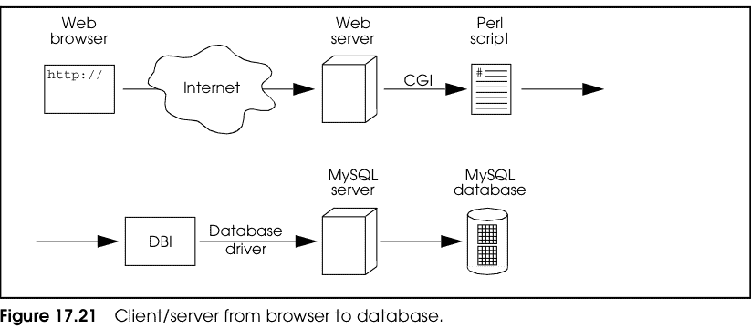

CGI.pm 创建了一个包含文本字段的简单 HTML 表单。用户将选择一个团队，在表单输入团队名称并提交表单。CGI 程序将处理表单信息，使用 DBI 模块连接到 MySQL 数据库，检索团队信息，格式化后作为 HTML 表格发送回浏览器。

## 17.7 使用 CGI 和 DBI 选择并显示条目

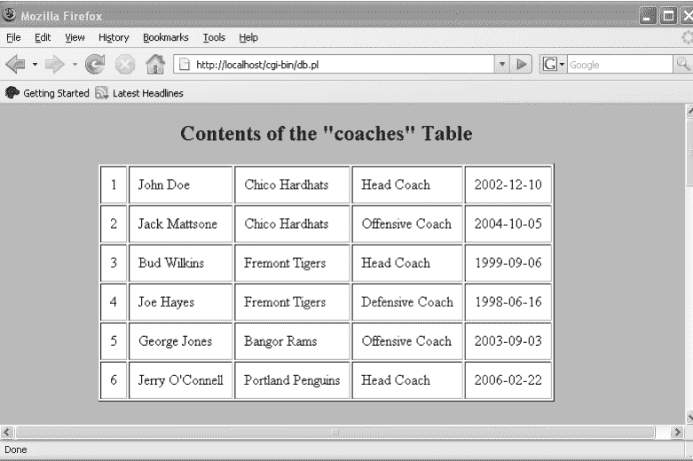

图 17.22 DBI 和 CGI 输出。

## 示例 17.46

```perl
1 #!/c:/ActivePerl/bin/perl.exe
2 use DBI;
3 use CGI qw(:standard);

4 print header, start_html(-title=>"Team Lookup", -BGCOLOR="#66ff33");
5 print start_form,<font face='arial' size='+1'>查询哪个团队? " . textfield('name') . "</p>";
6 print submit, end_form, hr;

7 if(param()) {
8 $team = param('name');

9 $dbh = DBI->connect("DBI:mysql:host=localhost;database=sample_db;user=root;password=quigley1") or
   print "Connection failed: " . $DBI::errstr;
# ... (后续代码略)
```

## 示例 17.46 - $dbh（续）

```perl
9 $sth=$dbh->prepare("SELECT name, wins, losses FROM teams where name = ?");
```

```perl
10 $sth->execute($team);
if ($sth->rows == 0) {
    print "您的团队不在表中。<br>";
    exit;
}
```

```perl
11 print h2("Data for $team");
while(($name,$wins,$losses) = $sth->fetch_array()) {
    print <<<table border="1" bgcolor="yellow">
<<tr>
<th>Name</th>
<th>Wins</th>
<th>Losses</th>
</tr>
<tr>
<td>$name</td>
<td>$wins</td>
<td>$losses</td>
</tr>
</table>
EOF
print end_html();
# 注意：原始 OCR 在第 12 行有 print_end_html()
```

```perl
12 print end_html();
$sth->finish();
$dbh->disconnect();
}
} # 第 6 行开始的 while 块
```

# 解释

- 1. shbang 井号、感叹号行告诉 Web 服务器 Perl 已安装，以便它可以启动 Perl 解释器。对于任何使用 Apache 服务器的操作系统，这一行都是必须的。

- 2. 我们在程序中使用 DBI 模块来与 MySQL 数据库通信。

- 3. 我们将使用面向函数的 CGI 模块，通过标准的 CGI 函数与 浏览器通信。

- 4. 此函数启动了一个 HTML 表单。该表单非常简单，将包含一个 HTML 文本字段，用户可以在其中输入数据。

- 5. CGI submit 函数创建表单的提交按钮。一旦用户点击提交按钮，表单将被提交，输入文本字段中的数据将发送到 CGI Perl 脚本进行处理。

## 17.7 使用 CGI 和 DBI 选择并显示条目

# 解释（续）

- 6. 由于 CGI 模块将此 Perl 脚本分配给 HTML 表单的 ACTION 属性，此 Perl 将接收表单数据并进行处理。CGI 模块会检查是否存在参数，即表单是否返回了任何数据？*params* 函数返回真，意味着表单已提交，程序此部分将继续。如果 params 函数返回假，则表单尚未提交。

- 7. HTML 表单中文本字段的名称为“name”。params 函数接收文本字段名称作为参数并返回赋值给它的值；在此例中为团队名称。

- 8. 我们连接到 *sample_db* 数据库。

- 9. 准备了一个 SQL 语句。它将检索 coaches 表的所有记录。

- 10. CGI 请求头设置了 "Content-type:text/html\n" 行，以及 HTML 启动行用于为 HTML 页面设置标题和颜色。这些信息将通过通用网关发送到服务器并进入服务器。

- 11. 创建了一个 HTML 表格来存放从数据库返回的数据。

- 12. 当数据从数据库获取时，它们将经过格式化并发送回服务器，最后在浏览器窗口中以表格的形式呈现。

第二个示例让我们完成了一个闭环。


CGI.pm 创建了一个包含文本字段的简单 HTML 表单。用户将选择一个团队，在表单输入团队名称并提交表单。CGI 程序将处理表单信息，使用 DBI 模块连接到 MySQL 数据库，检索团队信息，格式化后作为 HTML 表格发送回浏览器。

（注：OCR 文本存在大量重复，已根据要求进行去重并修正。）

## 练习 17：从章节中 Select *

- 仅当国家为意大利时，从 `Customers` 表中选择 `CompanyName` 和 `Phone`。

- 按排序顺序打印 `Customers` 表中的 `ContactName` 和 `Country`。按 `Country` 排序。

- 从 `Customers` 表中选择国家以 “Po” 或 “Sw” 开头的 `ContactName`、`CompanyName` 和 `Country`。

- 查询 `Products` 表中产品的总数。

- 仅打印 `Products` 表中的前 10 个产品。

- 按字母顺序从 `Customers` 表中选择国家，且不包含重复。

- 查找所有价格在 $10 到 $20 之间的产品。

- 插入一个新产品。

- 更新 `products` 表，为 `Sir Rodney Marmalade` 的单价增加 $5.25。

- 选择库存数量低于 10 个单位的产品。

- 删除数据库中最早最早的订单。

- 使用 SQL 函数打印当前日期和时间。

## 第 2 部分：Perl/MySQL 实验

查阅 MySQL 文档 (mysql.com) 以获取正确的数据类型和函数，以你完成此实验。该文档非常优秀。

1. 创建名为 "school.sql" 的 SQL 脚本，其内容将：

   a. `DROP SCHOOL IF EXISTS SCHOOL;`

   b. `CREATE SCHOOL;`

   c. 创建名为 "student" 的表。它包含以下字段：

      - FirstName

      - LastName

      - Email

      - Cellphone

      - Major

      - GPA

      - StartDate

      - StudentID (主键)

2. 使用 school

   a. 在“school.sql”脚本中插入三行数据。

3. 在 MySQL 提示符下执行“school.sql”脚本。使用 `DESC` 语句查看 `school` 数据库的结构。

4. 选择 `student` 表中的所有行。如果表包含了所有预期列和数据，那么你就可以进入此实验的下一个部分了。

5. 在 Perl 脚本中使用 DBI 模块：

   a. 连接到 MySQL 并打开 `school` 数据库。

   b. 准备一个缓存查询，按姓选择 `student` 表中的所有行，并带标题显示所有列。

6. 创建另一个 Perl 脚本，使用户可以从菜单中选择选项：

   1) 更新记录

   2) 删除记录

   3) 插入新记录

   4) 显示表格

   5) 退出

对于菜单中的每个选项，创建一个使用 MySQL 函数执行所选任务的子程序。你能创建一个 CGI 程序来处理所有这些吗？

   b. 创建一个循环，直到用户选择数字 5，否则菜单将重新显示。

   c. 重写程序，关闭 `AutoCommit` 并开启 `RaiseErrors`。当用户选择退出时，提交所有更改到数据库。

## 第 3 部分：回到 Checking.pm

1. 现在你可以重新设计原始的 `Checking.pm` 模块，使用 MySQL 数据库而不是你最初创建用于跟踠余额的文本文件。

在 MySQL 提示符下创建数据库和 `register` 表。此 `register` 表应该包含与你在第一个练习中创建的名为“register”的文本匹配的字段。

在 Perl 模块 `Checking.pm` 中，打开与数据库的连接。获取余额，你将从“register”表中查询它。

当你调用 `exit()` 函数时，使用 SQL `INSERT` 命令将最后一次交易及其新信息插入数据库。

创建一个 Perl 函数，在被调用时显示 `register` 的内容。

你应该学会如何：

- 使用 PM 和 CPAN 安装 MySQL、DBI 和数据库驱动程序。

- 发布基础 MySQL 命令。

- 从 Perl 脚本连接到数据库服务器。

- 使用 Perl MySQL 函数：

  - 选择数据库

  - 准备并执行 SQL 语句

  - 使用 DBI 方法遍历结果集

  - 使用占位符 (placeholders)

  - 绑定列和参数

  - 检查数据库服务器生成的错误

  - 保留更改

## 第 18 章 • 与系统交互

## 表 18.1 File::Spec 函数

| 函数 | 功能描述 |

| :--- | :--- |

| abs2rel | 接收一个目标路径和一个可选的基路径，并返回从基路径到目标路径的相对路径。 |

| canonpath | 对文件系统不进行物理检查，但对路径进行逻辑清理。在 UNIX 上，它会消除连续的斜杠并返回 "/"。 |

| case_tolerant | 返回一个真或假值，分别表示在比较文件规范时，字母的大小写是否重要。 |

| catdir | 拼接两个或多个目录名称以形成一个以目录结尾的完整路径，并移除结果字符串末尾的斜杠。 |

| catfile | 拼接一个或多个目录名称和一个文件名以形成以文件名结尾的完整路径。 |

| catpath | 接收卷名、目录和文件部分并返回整个路径。在 UNIX 中，会忽略 $volume，并将目录和文件串联。在必要时会插入 "/"。 |

| curdir | 返回当前目录的字符串表示。在 UNIX 上为 "."。 |

| devnull | 返回空设备的字符串表示。在 UNIX 上为 "/dev/null"。 |

| file_name_is_absolute | 接收路径作为参数，如果其是绝对路径则返回真。 |

| join | join 的功能与 catfile 相同。 |

| no_upwards | 给定一个文件名列表，剔除那些指向父目录的文件。 |

| path | 不接收参数，将环境变量 PATH 以数组形式返回。 |

| rel2abs | 将相对路径转换为绝对路径。 |

| rootdir | 返回根目录的字符串表示。在 UNIX 上为 "/"。 |

| splitpath | 将路径拆分为卷名、目录和文件部分。对于没有卷概念的系统，卷部分返回 undef。 |

| tmpdir | 返回列表中第一个可写目录的字符串表示，如果没有可写目录，则返回 ""。 |

| updir | 返回父目录的字符串表示。在 UNIX 上为 ".."。 |

## 18.1 系统调用

## 示例 18.2

```perl
1 use File::Spec;
2 $pathname=File::Spec->catfile("C:","Perl","lib","CGI");
3 print "$pathname\n";

(输出)
3 C:\Perl\lib\CGI
```

## 解释

- 1 如果没有指定操作系统，则会为当前操作系统加载 File::Spec 模块，在本例中为 Windows 2000。它是一个面向对象的模块，但也具有面向函数的语法。

- 2 标量变量 $pathname 将包含由传递给 catfile 方法的参数组成的路径。catfile 函数将拼接路径列表的元素。

- 3 新的路径将使用反斜杠分隔路径组件并打印。在 UNIX 系统上，路径将打印为 /Perl/lib/CGI.

## 18.1.2 目录和文件属性

UNIX: 最常见的文件类型是普通文件。它包含数据，即字节的有序序列。数据可以是文本数据，也可以是二进制数据。关于文件的信息存储在名为 inode 的数据结构中。inode 由如链接计数、所有者、组、大小、最后访问时间、修改时间和以及类型等属性组成。UNIX 命令允许你查看目录中文件的 inode 信息。信息通过 stat 调用获取。Perl 的 stat 函数也为你提供有关文件的信息。它检索设备号、inode 号、链接计数、用户 ID、组 ID、以字节计算的大小、最后访问等。（参见第 710 页的 "Stat and I Functions"）。

目录是由 UNIX 内核维护的特殊文件。它由文件列表组成。每个文件名都有一个对应的数字，指向文件的信息。该数字称为 inode 号，是指向 inode 的指针。inode 包含文件信息，以及指向磁盘上文件数据块位置的指针。以下函数允许你操作目录、更改文件权任、创建链接。

| Inode # | 文件名 |

| :--- | :--- |

Windows: 文件和目录包含数据，以及描述文件或目录属性的元数据。Win32 文件和目录的四个基本属性是 ARCHIVE、HIDDEN、READONLY 和 SYSTEM。见表 18.2。

## 第 18 章 • 与系统交互

## 表 18.2 基础文件和目录属性

| 属性 | 描述 |

| :--- | :--- |

| ARCHIVE | 文件内容更改时设置 |

| HIDDEN | 在目录列表中不显示的文件 |

| READONLY | 无法更改的文件 |

| SYSTEM | 特殊系统文件，如 IO.SYS 和 MS-DOS.SYS，通常不可见 |

要检索和设置文件属性，可以使用标准的 Perl 扩展 Win32::File。除非另有说明，所有函数在失败时均返回 FALSE (0)。函数名根据请求导出到调用者的命名空间中。见表 18.3。

## 表 18.3 Win32::File 函数

| 函数 | 功能 |

| :--- | :--- |

| GetAttributes(Filename, ReturnedAttributes) | 获取文件或目录的属性。ReturnedAttributes 将设置为文件名属性的 OR 组合。 |

| SetAttributes(Filename, NewAttributes) | 设置文件或目录的属性。NewAttributes 必须是属性的 OR 组合。 |

要检索文件属性，使用 Win32::File::GetAttributes($Path, $Attributes)。要设置文件属性，使用 Win32::File::SetAttributes($Path, $Attributes)。见表 18.4。

## 表 18.4 Win32::File 属性

| 属性 | 描述 |

| :--- | :--- |

| ARCHIVE | 文件内容更改时设置 |

| HIDDEN | 在目录列表中不显示的文件 |

| READONLY | 无法更改的文件 |

| SYSTEM | 特殊系统文件，如 IO.SYS 和 MS-DOS.SYS，通常不可见 |

## 18.1.3 查找目录和文件

File::Find 模块允许根据某些标准（如 UNIX find 命令或 Perl find2perl 转换器）遍历系统树以查找指定文件或目录

## 格式

```perl
use File::Find;
find(\&wanted, '/dir2');
sub wanted { ... }
```

## 18.1 系统调用

表 18.5 Find::File 的哈希引用键

| 键 (Key) | 值 (Value) |

|---|---|

| bydepth | 在报告所有条目后报告目录名称。 |

| follow | 跟随符号链接。 |

| follow_fast | 与 follow 类似，但可能会多次报告文件。 |

| follow_skip | 仅处理一次文件（但不处理目录和符号链接）。 |

| no_chdir | 在递归时不会 `chdir`（切换工作目录）到每个目录目录。 |

| untaint | 开启 -F T（污染模式），进入被污染的目录。 |

| untaint_pattern | 这应使用 qr 引用顺序设置。默认是 `qr^[-@\w/]+$`。 |

| untaint_skip | 如果设置，将跳过未通过 *untaint_pattern* 的目录（子树）。默认情况下遇到此类情况会报错（die）。 |

| wanted | 用于调用 wanted 函数。 |

# 示例 18.4

```
(unix)
1 use File::Find;
2 find(\$wanted, '/httpd', '/ellie/testing');
3 sub wanted{
   -d $_ && print "\$File::Find::name\n";
 }

(输出)
/httpd
/httpd/php
/httpd/Icons
/httpd/Cgi-Win
/httpd/HtDocs
/httpd/HtDocs/docs
/httpd/HtDocs/images
/httpd/cgi-Bin
/httpd/logs
/ellie/testing
/ellie/testing/Exten.dir
/ellie/testing/extension
/ellie/testing/mailstuff
/ellie/testing/mailstuff/mailstuff
/ellie/testing/OBJECTS
/ellie/testing/OBJECTS/polymorph
```

# 第 18 章 • 与系统交互

# 解析

- 1 File::Find 模块从标准 Perl 库中加载。

- 2 find() 的第一个参数是一个名为 wanted 的子程序的引用，随后后面跟了两个要查找的目录。

- 3 wanted 函数将检查每个名称是否为目录 (-d)，并列出所有找到的子目录的完整路径。$_ 被赋值为搜索中当前目录的。

# 示例 18.5

```
(Windows)
1 use File::Find;
2 use Win32::File;
# 在 FAT 和 NTFS 文件系统上均有效。
3 &File::Find::find(&wanted, "C:\http", "C:\ellie\testing");
4 sub wanted{
5 (Win32::File::GetAttributes($_, $attr)) &&
($attr & DIRECTORY) &&
print "File::Find::name\n";
}

(输出)
C:\http
C:\http\Icons
C:\http
C:\http\Cgi-Win
C:\http\HtDocs
C:\http\HtDocs/docs/images
C:\http\Cgi-Bin
C:\http\Logs
C:\ellie\testing
C:\ellie\testing\Exten.dir
C:\ellie\testing/extension
C:\ellie\testing/mailstuff
C:\ellie\testing/mailstuff
C:\ellie\testing/OBJECTS
C:\ellie\testing/OBJECTS polymorphism
```

# 解析

- 1 File::Find 模块从标准 Perl 库中加载。

- 2 Win32::File 模块从标准 Perl 库中针对 Win32 系统的特定目录加载。它将用于检索文件或目录属性。

- 3 find() 的第一个参数是一个名为 wanted 的子程序的引用，随后后面跟了两个要查找的目录。

# 解析（续）

- 4 定义了 wanted 函数。

- 5 wanted 函数通过调用 Get-Attributes 函数 (Win32::File::GetAttributes) 检查每个名称是否为目录，并将列出所有子目录的完整路径。$_ 被用于搜索中的当前目录。

## 18.1.4 创建目录—mkdir 函数

UNIX。mkdir 函数创建一个具有指定权限（模式）的新空目录。权限以八进制数设置。会自动创建 . 和目录的条目。如果成功，mkdir 函数返回 1；如果失败则返回 0。如果 mkdir 失败，系统错误将存储在 $. 中。

Windows。如果在 MS-DOS 提示符处创建目录，权限掩码无效。Win32 上的权限不使用 UNIX 相同的机制。对于分区上的文件（这意味着 Windows 上的所有文件），不需要显式为文件设置权限。所有文件对所有用户都可用，目录创建时对所有人开放权限。

# 格式

| | |

|---|---|

| mkdir(FILENAME, MODE); | UNIX |

| mkdir(FILENAME); | Windows |

# 示例 18.6

```
(命令行)
$ perl -e 'mkdir("joker", 0755);' # UNIX
$ ls -ld joker
drwxr-xr-x 2 ellie 5 Mar 7 13:43 joker
```

# 解析

- 1 mkdir 函数的第一个参数是目录名称。第二个参数指指定文件的模式或权限。权限 0755 指定该文件将对所有者具有读、写、执行权限；对组和其他用户具有读和执行权限。

- 2 0755 指定了文件对所有者具有读、写、执行权限；组和其他用户读和执行。drwxr-xr-x 是目录的详细信息。

- 3 在 Win32 上，权限是对所有人开放的。

- 4 目录创建时权限已开启。

## 18.5 删除目录—rmdir 函数

rmdir 函数仅在目录为空时删除目录。

# 格式

```
rmdir(DIRECTORY);
rmdir DIRECTORY;
```

# 示例 18.8

```
(命令行)
$ perl -e 'rmdir("joker");' # UNIX
joker: not empty
$ perl -e 'rmdir("joker") || die(joker: $!)'
No such file or directory
$ perl -e 'rmdir("joker") || die(joker: $!)' # Windows
No such file or directory
```

# 解析

- 1 目录包含文件。只有在为空时才能删除。

- 2 系统错误存储在 $.。目录不空。

- 3 目录 joker 不存在，因此无法删除。

- 4 在 Win32 系统上，rmdir 的工作方式相同。目录。

## 18.1.6 切换目录—chdir 函数

每个进程都有自己的工作目录。在解析相对路径时，这是搜索的起点。如果调用进程（例如 Perl 脚本）更改了目录，仅对该进程更改。当 Perl 程序退出时，shell 返回到原来的工作目录。

chdir 函数更改当前工作目录。如果没有参数，切换到用户的主目录。如果成功，函数返回 1；如果失败则返回 0。系统错误存储在 Perl 的 $! 变量中。

```
chdir (EXPR);
chdir EXPR;
chdir;
```

```
$ $pwd # UNIX
/home/jody/jodie
$ perl -e 'chdir' "/home/jodie/perl"; print 'pwd'
/home/jody/jodie
$ pwd
/home/jody/jodie
$ perl -e 'chdir' footer || die "Cannot cd to folder: $!\n"
Cannot cd to folder: No such file or directory
$ cd # Windows
C:\example\testing
$ perl -e "chdir footer || die(Cannot cd to folder: $!);"
Cant cd to folder: No such file or directory
```

# 解析

- 1 这是 shell 的当前工作目录。

- 2 目录切换到了 /home/jodie/perl。当 pwd 命令被反引号包裹时，执行命令替换，并打印此进程的当前目录。

- 3 由于 Perl 进程是由 shell 调用的独立进程，当 Perl 更改目时，仅对该进程生效，而不是调用它的 shell。

- 4 如果切换目录失败，die 函数将其消息打印到屏幕上。系统错误存储在 $! 变量中并打印。

- 5 在 MS-DOS 提示符处打印当前工作目录。cd 打印当前工作目录。

- 6 正如前一个示例所示。如果目录存在，它将被创建。

> chdir 是 Perl 提供的更改目录的系统调用。cd 命令是内置命令，不能直接在 Perl 脚本中使用。

## 18.1.7 通过目录文件句柄访问目录

Perl 目录函数是模仿同名的 UNIX 系统调用建模的。尽管传统的 UNIX 系统包含 2 字节的 inode 号和 14 字节的文件名（图 18.2），但并非所有的 UNIX 系统都具有相同的格式。目录函数允许你忽略其内部结构来访问目录。目录函数在 Windows 下的工作方式相同。

| Inode | Filename |

| --- | --- |

| 10 | . |

| 22 | . |

| 32 | memo |

| 45 | mbox |

| 23 | notes |

| 12 | src |

**图 18.2** 一个 UNIX 目录。

### opendir 函数。*opendir* 函数打开一个命名的目录并将其附加到目录文件句柄。该句柄有自己的命名空间，与其他用户打开文件和过滤器的其他类型句柄分开。*opendir* 初始化目录，供相关函数 `readdir()`、`teldir()`、`seekdir()`、`rewinddir()`、`closedir()` 进行处理。如果成功，该函数返回 1。

### 格式

```
opendir(DIRHANDLE, EXPR)
```

### 示例 18.10

```
1 opendir(MYDIR, "joker");
```

### 解释

- 1. 文件 *joker* 被附加到目录文件句柄 *MYDIR*，并以读取模式打开。目录 *joker* 必须存在且必须目录。

### readdir 函数。任何对目录具有读取权限的人读取该目录：即使你有写权限，也无法向目录本身写入。目录上的写权限意味着你可以在目录内创建和删除文件，而不是修改目录数据结构本身。

## 18.1 系统调用

当我们谈论使用 `readdir` 函数读取目录时，我们是在查看系统维护的目录结构的内容。如果 `opendir` 打开了目录，在标量上下文中，`readdir` 返回下一个目录。`readdir` 函数返回下一个目录条目。在数组上下文中，它返回目录中的其余条目。

### 格式

```
readdir(DIRHANDLE);
readdir DIRHANDLE;
```

### closedir 函数。closedir 函数关闭由 `opendir` 函数打开的目录。

### 格式

```
closedir (DIRHANDLE);
closedir DIRHANDLE;
```

### 示例 18.11

```
(脚本)
1 opendir(DIR, "..") || die "Can't open: $!\n";   # 打开父目录
2 @parentfiles=readdir(DIR);
   # 获取目录内容列表
3 closedir(DIR);
   # 关闭句柄
4 foreach $file (@parentfiles)
   # 打印数组的每个元素
   print "$file\n";
```

```
(输出)
..
filea
fileb
filec
.sh_history
stories
```

### 解释

- 1 `opendir` 函数打开目录结构并将其分配给 DIR，即目录文件句柄。该（父）目录以读取模式打开。

- 2 `readdir` 函数将目录中剩余的所有条目分配给数组 @parentfiles。

- 3 `closedir` 函数关闭目录。

- 4 按照它们在目录结构中存储的顺序打印文件。这可能与 `ls` 命令打印文件的顺序不同。

### teldir 函数。`teldir` 函数返回 `readdir()` 例程在目录文件句柄上的当前位置。`teldir` 返回的值可以传递 `seekdir()` 以访问目录中的特定位置。

### 格式

```
teldir(DIRHANDLE);
```

### rewinddir 函数。`rewinddir` 函数将 DIRHANDLE 的位置重置为由 opendir 打开的目录的开头。并非所有机器都支持此操作。

### 格式

```
rewinddir(DIRHANDLE);
rewinddir DIRHANDLE;
```

### seekdir 函数。`seekdir` 设置目录文件句柄上 `readdir()` 的当前位置。该位置由 `teldir()` 返回的值设置。

### 格式

```
seekdir(DIRHANDLE, POS);
```

### 示例 18.12

```
(脚本)
1 opendir(DIR, "."); # 打开当前目录
2 while($myfile=readdir(DIR) ) {
3 $spot=teldir(DIR);
4 if ("$myfile" eq ".login") {
      print "$myfile\n";
      last;
   }
)
5 rewinddir(DIR);
6 seekdir(DIR, $spot);
7 $myfile=readdir(DIR);
   print "$myfile\n";
```

```
(输出)
.login
.cshrc
```

### 解释

- 1 `opendir` 函数以读取模式打开当前工作目录。

- 2 执行 `while` 语句，`readdir` 函数从目录文件句柄返回下一个目录并将文件分配给标量 $myfile。

- 3 `readdir` 函数返回文件名后，`teldir` 函数标记该读取的位置并将位置存储在标量 $spot 中。

- 4 当读取到登录文件时，退出循环。

- 5 `rewinddir` 函数将 DIR 文件句柄的位置重置为目录结构的开头。

- 6 `seekdir` 函数使用 `teldir` 函数的结果设置目录文件句柄的位置。

- 7 `readdir` 函数读取下一个条目并分配给 $myfile.

## 18.1.8 权限与所有权

UNIX。每个文件都有一个所有者。所有者相对于其他人的优势是能够更改文件的权限。组可能有若干成员，所有者可以对文件的权限进行控制。

每个 UNIX 文件都有一组权限来控制谁可以读取、写入或执行该文件。权限总共有 9 位。前 3 位控制文件所有者的权限，第二组控制组权限，最后一组控制世界（即所有人）。权限存储在文件的 inode 字段中。

Windows。Windows 系统处理权限的方式与 UNIX 不同。文件创建时对所有人都有读写权限。通过点击文件图标并选择属性，你可以有限地选择属性，如存档、只读和隐藏。见图 18.3。

如果你的平台是 Windows，只能在格式化为 NTFS 的驱动器上设置权限。更改权限时必须是所有者或获得所有者的授权。如果你使用 NTFS，进入 资源管理器并找到要设置权限的文件夹。右键点击文件夹，点击属性，然后点击安全选项卡。你可以对组或用户允许、拒绝或删除权限。

如果你需要维护权限，请查看 Win32 模块。要获取权限，使用 Win32::FileSecurity::Get($Path, \Perms) 扩展，$Path 是你正在查找权限的文件或目录的相对或绝对路径，\Perms 是一个哈希的引用，其键代表用户或组，对应的值代表权限掩码。

NTFS 是一种为 Windows 设计的高级文件系统。

### 表 18.6 管理文件和目录的 Win32 扩展

| 扩展 | 功能 |

| --- | --- |

| Win32::File | 获取和设置文件属性的标准模块 |

| Win32::File::GetAttributes(path,attribute) | 获取文件属属性 |

| Win32::File::SetAttributes(path,attribute) | 设置文件属性 |

| Win32::AdminMisc::GetFileInfo | 获取信息字段：公司名称、文件版本、内部名称、法律版权、原始文件名、产品名称、产品版本、语言 ID 和语言

chmod 函数 (UNIX)。chmod 函数更改文件列表权限。用户必须拥有文件才能更改其权限。文件必须是字符串。列表第一个元素是新模式的数值。（今天，二进制/进制表示法已被更方便的记忆法所取代。Perl 不使用新方法。）

## 18.1 系统调用

表 18.7 阐释了如果不熟悉这种方法，用于更改权限的八种可能的数字组合。

### 表 18.7 权限模式

| 八进制 | 二进比 | 权限 | 含义 |

| --- | --- | --- | --- |

| 0 | 000 | none | 全部关闭 |

| 1 | 001 | --x | 执行 |

| 2 | 010 | -w- | 写入 |

| 3 | 011 | -wx | 写入、执行 |

| 4 | 100 | r-- | 读取 |

| 5 | 101 | r-x | 读取、执行 |

| 6 | 110 | rw- | 读取、写入 |

| 7 | 111 | rwx | 读取、写入、执行 |

确保第一个数字是 `0`，以表示这是一个八进制数。不要使用助记符（例如，如 `+rx`），因为所有权限都将被关闭。

chmod 函数 (Windows)。

ActivePerl 支持 `chmod` 函数的限制版本。然而，它只能用于赋予所有者读取/写入权限。（组和其他用户位会被忽略的.）

`chmod` 函数返回被更改的文件数。

```
chmod(LIST);
chmod LIST;
```

示例 18.13

(UNIX)

1 $ perl -e '$count=0755, "foo.p", "boo.p";print "$count files changed.\n*'

2 files changed.

3 $ ls -l foo.p boo.p

   -rwxr-xr-x 1 ellie Mar 7 12:52 foo.p*

   -rwxr-xr-x 1 ellie Mar 7 12:52 boo.p*

```

### 解释

- 1 第一个参数是八进制值 `0755`。它为用户开启了 `rwx`，为组和其他用户开启了 `r` 和 `x`。接两个参数 `foo.p` 和 `boo.p` 是受更改影响的文件。标量 `$count` 包含了被更改的文件数。
- 2 `$count` 的值为 `2`，因为两个文件都被更改为了 `0755`。
- 3 打印了 Unix `-l` 命令的输出，证明 `foo.p` 和 `boo.p` 的权限已更改为 `0755`。

chown 函数 (UNIX)。
`chown` 函数更改文件列表的所有者和所属组。只有所有者或超级用户可以调用它。6 列表的前两个元素必须是密码文件中的数值 `uid`（用户标识符）和 `gid`（组标识符）。7 该函数返回成功更改的文件数。

### 格式

```

chown(LIST);

chown LIST;

```

### 示例 18.14

```

(脚本)

1 $ uid=9496

2 $ gid=40;

3 $number=chown($uid, $gid, 'foo.p', 'boo.p');

4 print "The number of files changed is $number.\n";

```

```

(输出)

4 The number of files changed is 2.

```

### 解释

- 1 分配了用户标识符 `9496`。
- 2 分配了组标识符 `40`。
- 3 `chown` 函数更改了文件 `foo.p` 和 `boo.p` 的所有权以及被更改的文件数。

umask 函数 (UNIX)。
当创建一个文件时，它拥有一组权限。这些权限由所谓的“系统掩码”（system mask）决定。在大多数系统中，此掩码是 `022`，并由登录程序设置。8 目录默认拥有 `777` (`rw-rw-rw`)，文件默认拥有 `666` (`rw-rw--`)。`umask` 函数用于从现有掩码中移除或减去权限。

要从“其他用户”权限集中移除权限，则从每个目录或文件允的最大权限中减去 `umask` 值：

| 777 (目录) | 666 (文件) |
| --- | --- |
| 002 (umask 值) | 002 (umask 值) |
| 775 | 664 |

`umask` 函数设置此进程的 `umask` 并返回旧值。如果不带参数，`umask` 函数返回当前的设置。

### 格式

```

umask (EXPR)

umask EXPR

umask

```

### 示例 18.15

- $ $ perl -e 'printf("The umask is %o.\n", umask);'
The umask is 22.
- $ $ perl -e 'umask 027; printf("The new mask is %o.\n", umask);'
The new mask is 27.

### 解释

- 不带参数的 `umask` 函数打印当前的 `umask` 值。
- `umask` 将掩码重置为八进制的 `027`。

## 18.1.9 硬链接与软链接

UNIX. 
当你创建一个文件时，它有一个硬链接；即目录中的一个条目。你可以为该文件创建额外的链接，这些只是同一个文件的不同名称。内核在它的 `inode` 中跟踪一个文件有多少个链接。只要存在该文件的链接，它的数据块就会存在。

软链接（符号链接）是指向另一个文件的特殊文件。当你删除源文件时，软链接仍然存在，但它会失效。硬链接不能跨文件系统边界。软链接可以跨文件系统边界。

## 18.1 系统调用

### 示例 18.20

```

rename ("tmp", "datafile");

```

### 解释

文件 tmp 被重命名为 datafile。如果 datafile 已经存在，其内容将被破坏。

### 18.1.11 修改访问和修改时间

`utime` 函数用于更改文件列表中每个文件的访问时间和修改时间，类似于 UNIX 的 `touch` 命令。列表的前两个元素必须是数值型的访问时间时间和修改时间，并按顺序排列。`time` 函数将当前时间传递给 `utime` 函数。该函数返回成功修改的文件数量。列表中每个文件的 inode 修改时间被设置为当前时间。

### 格式

```

utime (LIST);

utime LIST;

```

### 示例 18.21--UNIX

```perl

print "你想 touch 什么文件（创建或更改时间戳）？ ";

$myfile = <STDIN>;

chomp($myfile);

$now = time; # 此示例会在文件不存在时创建它

utime($now, $now, $myfile) || utime($now, $now, ">>$myfile");

```

```bash

$ ls -l brandnewfile

brandnewfile: No such file or directory

```

```bash

$ update.pl

你想 touch 什么文件（创建或更新时间戳）？

brandnewfile

```

```bash

$ ls -l brandnewfile

-rw-r--r-- 1 ellie 0 Mar 6 17:13 brandnewfile

```

a. Wall, L., Christanson, T., and Orwant, J., *Programming Perl*, 3rd ed., O'Reilly & Associates: Sebastopol, CA, 2000.

### 解释

1. 用户将输入一个文件名以更新访问时间和修改时间；如果文件不存在，则创建它。
2. 变量 $now 被设置为 `utime` 函数的返回值，即自 UTC 1970 年 1 月 1 日以来的非闰秒数。

### 解释（续）

`stat` 的第一个参数是访问时间，第二个参数是修改时间，第三个参数是受影响的文件。如果 `utime` 函数因为文件不存在而失败，`open` 函数将使用 TMP 作为文件句柄创建该文件，模拟 UNIX 的 `touch` 命令。

### 18.1.12 文件统计信息

文件信息存储在名为 inode 的数据结构中，由内核维护。对于 UNIX 用户来说，大部分信息通过 `ls` 命令获取。在 C 和 Perl 程序中，可以通过 `stat` 函数直接从 inode 获取这些信息。请参见 `File:stat` 模块，它为 `stat` 函数创建了用户接口。尽管此处的重点是 UNIX，但 `stat` 函数也适用于 Win32 系统。

`stat` 和 `lstat` 函数。`stat` 函数返回一个包含 13 个元素的数组，包含文件 inode 的统计信息。最后两个处理块（blocks）的字段仅在 BSD 系统上定义。

`lstat` 函数类似于 `stat` 函数，但如果文件是符号链接，`lstat` 返回链接本身的信息，而不是它所引的文件。如果你的系统不支持符号链接，则执行普通的 `stat`。

特殊的下划线文件句柄用于提供提供上一个所述文件的 `stat` 信息。返回的 13 元素数组包含 `stat` 结构中存储的以下元素。（顺序与 UNIX 系统调用 `stat` 略有不同。）

1. 设备号
2. inode 号
3. 模式 (Mode)
4. 链接数
5. 用户 ID (UID)
6. 组 ID (GID)
7. 对于特殊文件，其所指设备的设备号
8. 字节大小（针对普通文件）
9. 最后访问时间
10. 最后修改时间
11. 最后文件状态更改时间
12. 文件的首选 I/O 块大小
13. 实际分配的块数

## 18.1 系统调用

### 格式

```

stat(FILE);

stat FILE;

```

### 示例 18.22

```perl

(POSIX)

open(FILE, "/etc/passwd") || die "无法打开: $!\n";

@stats=stat(FILE);

printf("inode 号为 %d, 大小为 %d\n", $stats[1], $stats[7]);

close(FILE);

```

```

(输出)

inode 号为 12441, 大小为 332618

```

### 解释

1. `stat` 函数返回一个包含 13 个元素的数组，包含文件 inode 的统计信息。最后两个处理块的字段仅在 BSD 系统上定义。

2. `lstat` 函数类似于 `stat` 函数，但如果文件是符号链接，`lstat` 返回链接本身的信息，而不是它所引的文件。如果你的系统不支持符号链接，则执行普通的 `stat`。

3. 特殊下划线文件句柄用于提供上一个所述文件的 `stat` 信息。返回的 13 元素数组包含 `stat` 结构中存储的以下元素。（顺序与 UNIX 系统调用 `stat` 略有不同。）

1. 设备号
2. inode 号
3. 模式
4. 链接数
5. 用户 ID
6. 组 ID
7. 对于特殊文件，其所指设备的设备号
8. 字节大小（针对普通文件）
9. 最后访问时间
10. 最后修改时间
11. 最后文件状态更改时间
12. 文件的首选 I/O 块大小
13. 实际分配的块数

### 示例 18.23

```perl

(Windows)

open(PASSWD, "/etc/passwd") || die "无法打开: $!\n";

bytes=read(PASSWD, buffer, 50);

print "读取的字节数为 $bytes。\n";

print "内容包含: $buffer\n";

```

```

(输出)

读取的字节数为 50。

内容包含:

root:x:0:0:root:/root:/bin/bash

...

```

### 18.1.13 底层文件 I/O

`read` 函数从文件句柄读取指定数量的字节并将其放入标量变量中。由于你熟悉 C 的 `read` 函数，它跳过了标准 I/O 缓冲，直接从文件句柄读取字节。该函数返回读取的字节数，如果发生错误则返回未定义值。到达 EOF（文件结束）时返回 0。


# 格式

```

seek(FILEHANDLE, OFFSET, POSITION);

```

POSITION = 文件中的绝对位置
0 = 文件开头
1 = 文件中的当前位置
2 = 文件末尾

OFFSET = 距离 POSITION 的字节数。正偏移量会使位置在文件中向前移动。负偏移量会使位置在文件中向后移动。负 OFFSET 会为 POSITION 1 或 2 设置文件位置。

# 示例 18.25

```

(脚本)

open(PASSWD, "/etc/passwd") || die "Can't open: $!\n";

while (chomp($line = <PASSWD>)) {

    print "---$line---\n" if $line ~ /root/;

}

seek(PASSWD, 0, 0) || die "$!\n"; # 首先回到文件的第一个字节开始

while(<PASSWD>){ print /ellie/};

close(PASSWD);

```

```

(输出)

--:root: YtHLR4eBdfxw:0:1:Operator:/bin/csh---

ellie:aVD17JssMyBg:9496:40:Ellie Savage:/home/jodyelli:/bin/csh

```

# 解释

- 1 通过 PASSWD 句柄打开了 /etc/passwd 文件。
- 2 while 语句遍历 PASSWD 句柄，每次读取一行，直到文件关闭。
- 3 如果该行包含该正则表达式，则打印该行。
- 4 `seek` 函数将文件位置设置在位置 0，即文件开头，偏移量为 0。由于文件句柄未关闭，它将保持打开状态，直到使用 `close` 函数关闭。
- 5 while 语句遍历文件。
- 6 正式关闭了 PASSWD 句柄。

tell 函数。`tell` 函数返回普通文件句柄的当前字节位置。该位置可以作为 `seek` 函数的参数，，用于将文件位置移动到文件中的特定位置。

# 18.1 系统调用

# 格式

```

tell (FILEHANDLE);

tell FILEHANDLE;

tell;

```

# 示例 18.26

```

(脚本)

open(PASSWD, "/etc/passwd") || die "Can't open: $!\n";

while ( chomp($line = <PASSWD>) ) {

  if ($line =~ /sync/) {

    $current = tell;

    print "--$line--\n";

  }

  printf "The position returned by tell is %d.\n", $current;

  seek(PASSWD, $current, 0);

while(<PASSWD>) {

  print;

}

```

```

(输出)

--sync:1:1:1:/bin/sync--

The position returned by tell is 296.

sysdiag:0:1:Old System Diagnostic:/usr/sysdiag/sysdiag/sysdiag

sysdiag:0:1:System Diagnostic:/usr/sundi/sundi/sundi

ellie:aVD1JSSBMyGg:9496:40:Ellie Savage:/home/jodyelie:/bin/csh

```

# 解释

- 1 通过 PASSWD 句柄打开了 /passwd 文件。
- 2 当遇到包含正则表达式的行时，`tell` 函数将当前位置返回给标量 `$current`。当前位置是上一个字符之后的下一个字节。
- 3 打印 `tell` 函数返回的位置。
- 4 `seek` 函数从文件开头开始，根据 `tell` 函数返回的偏移量定位到当前位置。

# 18.1.14 数据的打包与解包（Packing and Unpacking）

`printf` 和 `sprintf` 用于将参数格式化为浮点数、小数、字符串等。但 `pack` 和 `unpack` 函数将这种格式化更进了一步。这两个函数都作用于可以表示为位、字节、整数、长整数、浮点数的字符串。格式类型告诉 `pack` 和 `unpack` 如何处理这些字符串。这些函数有许多用途。它们被用于将列表打包成二进制结构体，然后将打包后的值解包回列表。在处理文件时，你可以使用这些函数来创建 `uuencode` 文件、关系型数据库和二进制文件。

# 第 18 章 与系统交互

在处理文件时，并非所有文件都是文本。例如，某些文件可能被打包成二进制格式以节省空间、存储图像，或者以编码格式存储以便通过邮件发送文件。这些文件无法像页面上的文本那样读取。`pack` 和 `unpack` 函数可以将文件中的行从一种格式转换为另一种格式。`pack` 函数将列表转换为存储在机器内存中的标量值。表 18.8 所示的模板用于指定字符类型以及格式化多少字符。例如，字符串 `c4` 和 `ccc` 将列表打包为四个无符号字符，而 `a14` 将列表打包成一个 14 字节的 ASCII 字符串并用空字节填充。`unpack` 函数将二进制格式的字符串转换为列表。`pack` 的反向操作是将字符串放回 Perl 格式。

# 表 18.8 pack 和 unpack 模板——类型与值

| 模板 | 描述 |
| :--- | --- |
| a | 一个 ASCII 字符串（空字节填充） |
| A | 一个 ASCII 字符串（空格填充） |
| b | 位字符串（低位到高位，类似于 `vec`） |
| B | 位字符串（高位到低位） |
| c | 有符号字符 |
| C | 无符号字符 |
| d | 机器格式的双精度浮点数 |
| f | 机器格式的单精度浮点数 |
| h | 十六进制字符串（低字节在前） |
| H | 十六进制字符串（高字节在前） |
| i | 有符号整数 |
| I | 无符�整数 |
| l | 有符号长整数 |
| L | 无符�长整数 |
| n | 网络字节的有符�整数 |
| N | 网络字节的无符�整数 |
| p | 指向空终止字符串的指针 |
| P | 指向固定长度字符串的指针 |
| q | 有符号 64 位整数 |
| Q | 无符� 64 位整数 |
| s | 有符�短整数 |
| S | 无符�短整数 |
| u | uuencode 字符串 |

# 表 18.8 pack 和 unpack （续）

| 模板 | 描述 |
| :--- | --- |
| v | VAX 字节（小字节序） |
| V | VAX 字节（大字节序） |
| w | 有符�字节（高 位在前） |
| x | 无符�字节 |
| @ | 绝对位置 |

# 示例 18.27

```perl

(脚本)

$bytes=pack("c5",80,101); # 机器格式的数值

print "$bytes";

```

```

(输出)

Perl

```

# 解释

- 1 列表中的第一个元素通过模板（见表 18.8）定义为有符号字符的数值，`pack` 将其打包成二进制结构。打包后的结果存储在标量 `$bytes` 中。
- 2 打印包含该字节的 ASCII 字符串。

# 示例 18.28

```perl

(脚本)

$string=pack("A5A3","hey","you"); # 空格填充

print "$string";

```

```

(输出)

hey  you

```

# 解释

- 1 字符串 `hey` 和 `you` 使用 `A5A3` 模板打包。`A5` 将 `hey` 打包成 5 字节的 ASCII 字符串（空格填充），`A3` 将 `you` 打包成 3 字节的 ASCII 字符串。
- 2 打印打包后的字符串。

# 示例 18.29

```perl

(脚本)

# 程序对文件进行 uuencode 然后解码

open(PW, "/etc/passwd") || die "Can't open: $!\n";

open(CODEDPW, "codedpw") || die "Can't open: $!\n";

while(<PW>) {

    $uencode=pack("*", $_); # uuencode 字符串

    print CODEDPW $uencode;

}

close PW;

close CODEDPW;

open(UWP, "codedpw") || die "Can't open: $!\n";

while(<UWP>) {

    print;

}

close UWP;

print "\n";

open(DECODED, "codedpw") || die;

while(<DECODED>) {

    @decodeline = unpack("*", $_);

    print "@decodeline";

}

```


## 720 第 18 章 与系统交互

### 示例 18.30

```perl

(脚本)

1 #/bin/perl

2 $ints=pack("i3", 5,-10,15); # 打包成二进制结构

3 open(BINARY, "+binary") || die;

4 print "$ints"

5 seek(BINARY, 0, 0) || die;

6 while(<BINARY>) {

7     ($n1,$n2,$n3)=unpack("i3", $_);

8     print "$n1\n$n2\n$n3\n"

9 }

```

```

(输出)

6 5

-10

15

```

# 解析

- 三个整数 5、-10 和 15 被打包成三个有符号整数。返回的值是一个赋值给 $ints 的二进制结构。
- 以读写模式打开文件句柄 `BINARYARY`。
- 将打包后的整数发送到文件中。该文件是压缩的且完全无法使用。要读取它，必须将其转换回 ASCII 格式。这是通过 `unpack` 完成的。
- `seek` 函数将指针移回文件开头的字节位置 0。
- 我们一次一行行地从文件中读取。存储在 `$_` 中的每行都被解包并返回其原始的值列表。
- 打印原始的列表值。

# 示例 18.31

```perl

(脚本)

1 $str="0x123456789ABCDE ellie..."

2 print "$str\n"

3 $bytes=unpack("H",$str); # 十六进制字符串（常规顺序）

4 print "$bytes\n"

5 $str2=pack("H",$bytes);

6 print "$str2\n"

7 $bytes=unpack("h",$str); # 十六进制字符串（反反顺序）

8 print "$bytes\n"

9 $str1=pack("h",$bytes);

10 print "$str1\n";

```

## 18.2 进程

### 示例 18.3（续）

```

(输出)

1 0x123456789ABCDE ellie...

2 30781332333435637383941243444502056c6c6956e2e2e

3 0x123456789ABCDE ellie...

4 0387133233343563738394124344450256c6c6956e2e2e2

5 0x123456789ABCDE ellie...

```

# 解析

- 1 字符串包含一个十六进制数和一些文本。
- 2 字段 "h" 和 "H" 将会打包一个长度为许多半字节（4 位，用十六进制数字 0-9-f 表示）的字符串。字段（`pack`）的输入每个字节都会生成 4 位的的结果。变量 `$bytes` 由一个由两个常规十六进制顺序表示的十六进制字符串组成，其中原始的每个字符由两个十六进制数表示。例如，“ellie” 被表示为 65 6c 6c 69 65，三个点被表示为 e2 e2 e2.

## 18.2 进程

你的 Perl 脚本是一个存储在磁盘上的程序。当程序进入内存并开始执行时，它被称为一个进程。每个进程都有若干从其父进程（调用进程）继承的属性。Perl 提供了许多函数，允许你获取有关进程的信息。在检查这些函数之前，关于进程的简短讨论可能帮助你理解（或想起）某些 Perl 系统调用的目的。

### 18.2.1 UNIX 进程

每个进程都有一个唯一的进程标识，一个称为 `pid` 的正整数。除了 0（交换器）外，每个进程都有一个父进程。第一个 `init` 进程（pid 1）是所有进程、后代或更常见的子进程的祖先。

在图 18.5 中，Perl 进程是 shell (sh) 的后代。

每个进程还属于一个进程组，这是一个用于作业控制和信号处理的一个或多个进程的集合。每个进程组也有一个唯一的 `pid` 和一个进程组组。当你登录时，进程组组长是你的登录 shell。从你的 shell 创建的任何进程将是该进程的成员。进程组组长打开的终端被称为控制终端，任何进程都会继承它。发送到进程的任何信号将发送给组中的所有进程。这就是为什么当你按下 `<Ctrl>-` 时，你正在运行的进程及其任何子进程都将终止。Perl 提供了获取进程组 ID 和设置进程组的函数。

# 第 18 章 • 与系统交互

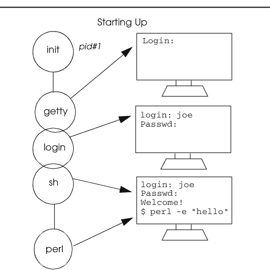

**图 18.5** 作为 shell 后代的 Perl 进程。

当进程被创建时，它会被分配四个表示拥有该进程的组的数字。它们是真实和有效用户 ID，以及真实和有效组组 ID。用户 ID（称为真实 *uid*）是一个与你的登录名关联的正整数。真实 *uid* 是一个与你的登录名关联的正整数。（*此处原文存在大量重复，翻译已按要求处理*）

## 18.2 进程

## 示例 18.34

```

(Windows)

while(($key,$value)=each(%ENV)) {

    print "\$key: \$value\n" if $key =~ /\P/;

}

```

```

(Output)

1 PROMPT:$pg

PROCESSOR_IDENTIFIER:x86 Family 6 Model 5 Stepping 2,

GenuineIntel

PATH:C:\oracle81\BIN;C:\PROGRAM FILES\nOCLE\IRE\1.7\BIN;C:\ORAWIN95\BIN;C:\PERL\BIN;

M\MKNST:C:\WINDOWS;C:\WINDOW

PATHEXT:..pl;.COM;.EXE;.BAT;.CMD;.VBS;.JS;.JSE;.WSF;.WSH

PROGRAMFILES:C:\PROGRA-1

PROCESSOR_ARCHITECTURE:x86

PROCESSOR_REVISION:0502

PERL5LIB:C:\Perl\lib

PROCESSOR_LEVEL:6

```

# 解析

- 1 `each` 函数用于通过 `%ENV` 数组获取所有当前环境变量。这些变量继承自父进程（MS-DOS 外壳）。

## 18.2.4 进程与文件句柄

正如第 10 章“获取文件句柄”中所讨论的，在 Perl 中可以通过输入或输出文件句柄打开进程。例如，如果你想查看机器上运行的所有进程，可以为 UNIX `ps` 命令创建一个文件句柄。（详情见第 10 章，另见第 750 页的“系统函数”）。

## 示例 18.35

```

(脚本)

# UNIX ps 命令

1 open(PROC,"ps -aux |") or die "\$!\n";

   # 如果运行 System V，使用 ps -ef

2 print STDOUT<PROC>;

```

```

(Output)

3825 6.4 4.5 212 464 5 P 12:18 00:00 -aux

root 1 0.0 0.0 52 0 ? IW Feb 5 00:02 /sbin/init

root 51 10.0 0.0 52 0 ? IW Feb 5 00:02 portmap

root 2 10.0 0.0 52 0 ? D Feb 5 00:02 pagedaemon

root 90 10.0 0.0 52 0 ? IW Feb 5 00:02 rpc.statd

```

## 示例 18.35 (续)

| ellie | 1383 | 0.8 | 8.4 | 360 | 876 | p4 | S | Dec 26 11:34 | /usr/local/OW3/bin/xview |
| ellie | 173 | 0.8 | 13.4 | 1932 | 1392 | co | S | Dec 20 38:19 | /usr/local/OW3/bin/xnews |
| ellie | 164 | 0.0 | 0.0 | 100 | co | IW | Dec 20 00:00 | -c |

<为了节省空间省略了部分输出>

| ellie | 3823 | 0.0 | 0.0 | 0 | p5 | Z | Dec 20 0:00 | <defunct> |
| ellie | 3823 | 0.0 | 1.1 | 28 | 112 | p5 | S | 12:18 0:00 | sh -c ps -aux | grep '^' | |
| ellie | 3821 | 0.0 | 5.6 | 144 | 580 | p5 | S | 12:18 0:00 | /bin/perl checkon ellie |
| ellie | 3824 | 0.0 | 1.8 | 32 | 192 | p5 | S | 12:18 0:00 | grep "ellie |

# 解析

- 1. `PROC` 句柄以读模式打开。它被称为输入过滤器。`ps` 命令的输出通过 `PROC` 句柄传递给 Perl。
- 2. 文件内容打印到 `STDOUT`。

**登录信息——getlogin 函数。** `getlogin` 函数从 `/etc/utmp` 返回当前登录用户。如果 `getlogin` 返回空值，则使用 `getpwduid`。`getlogin` 函数接受用户的 uid 作为参数，并返回与该 uid 关联的密码文件条目。
`$` 变量的值为此进程的真实 uid。

# 格式

```

getlogin;

```

## 示例 18.36

```

(脚本.)

1 $loginname=getlogin || (getuid($))[0] || die "Not a user here!";

2 print "Your little is $loginname.\n"

```

```

(Output)

2 Your little is john.

```

# 解析

- 1. `getlogin` 函数从 `/etc/utmp` 返回登录名，如果失败，则通过 `getpwduid` 函数从密码文件中检索。
- 2. 标量 `$loginname` 包含了密码文件的第一个条目，即该用户的登录名。

## 18.2 进程

特殊进程变量 (pid, uid, gid)。Perl 提供了存储进程信息的特殊变量。如果你想让你的程序更具可读性，可以使用标准库来表示这些变量。

```

$$ 运行此脚本的进程 ID

$< 进程的真实 uid

$> 进程的有效 uid

$ 进程的真实 gid

```

父 PID——getppid 函数和 $$ 变量。系统上的每个进程通过其进程号 (pid) 标识。特殊变量 `$$` 保存此进程的值。该变量也用于 shell 的进程 ID。`getppid` 函数返回父进程的进程 ID。

## 示例 18.37

```

(脚本)

1 print "The pid of process is $$"

2 print "The parent pid of process is ", getppid();

```

```

(Output)

1 The pid of process is 3825

2 The parent pid of process is 3824

```

# 解析

- 1 打印此进程标识号 (pid)。
- 2. 产生此进程的 shell 的父进程 pid 被称为 `$`。
- 3 脚本退出后，`$$` 用于打印 shell 的进程 ID。此进程的父 pid 为 `$`。

进程组 ID——pgrp 函数。`pgrp` 函数返回指定 pid 的当前组。不带参数或参数为 0 时，返回当前进程的进程组 ID。

# 格式

```

pgrp(PID);

pgrp;

```

## 示例 18.38

```

(脚本)

1 print "The pid of Perl program running this script is $$";

2 printf "The parent's pid (Shell), is %d\n", getppid();

3 printf "The process group's pid is %d\n", pgrp(0);

```

```

(Output)

1 The pid of Perl program running this script is 6671

2 The parent's pid (Shell), is 3824

3 The process group's pid is 6671


## 18.2 进程优先级与 Nice 值

内核为每个进程维护调度优先级。大多数交互和短运行任务具有较高的优先级。`nice` 命令允许你修改进程的调度优先级 (BSD, System V)。在负载沉重的系统中，你可以让 CPU 密集型任务变慢，以便需要高优先级的任务更快访问 CPU。那些抢占 CPU 的任务被称为 nice。

nice 值用于计算进程的优先级。正 nice 进程运行优先级较低，意味着它获得的 CPU 时间较少。负 nice 进程以高优先级运行，获得更多的 CPU 分享。nice 值范围从 -20 到 19。大多数进程以优先级零运行，平衡它们的 CPU 访问。（只有超级用户可以设置 nice 值）。

以下函数 `getpriority` 和 `setpriority` 根据 UNIX 第 2 部分中对应的系统调用命名。

### getpriority 函数

`getpriority` 函数返回进程、进程组或用户的当前优先级 (nice 值)。并非所有系统都支持此函数。如果没有实现，`getpriority` 会产生致命错误。`WHICH` 是三个值之一：0 进程优先级，1 进程组优先级，2 用户优先级。`WHO` 被解释为进程优先级、进程组优先级或用户优先级的标识符。值 0 表示当前进程、进程组或用户。

#### 格式

```perl
getpriority(WHICH, WHO);
```

#### 示例 18.39

```perl
$niceval = getpriority(0, 0);
print "The priority, nice value, for this process $niceval\n";
```

**输出**

```text
The priority, nice value, for this process is 0.
```

#### 解析

- `getpriority` 函数将返回当前进程的 nice 值。此进程的 nice 值为零。这使得进程在获取 CPU 分享时没有特殊优待。

### setpriority 函数 (nice)

`setpriority` 函数设置进程、进程组或用户的当前优先级 (nice 值)。它修改进程的调度优先级。如果你的系统没有实现 `setpriority` 调用，则 `setpriority` 将返回错误。`WHICH` 是三个值之一：0 进程，1 进程组，2 用户。`WHO` 相对于进程优先级、进程组优先级或用户优先级的进程标识符进行解释。值 0 表示当前进程、进程组或用户。`NICE` 是 nice 值。低值提高进程的优先级，高 nice 值降低进程的优先级。（很困惑！）除非具有管理员权限，否则不能使用负 nice 值。这样做不会改变当前的 nice 值。

#### 格式

```perl
setpriority(WHICH, WHO, NICEVALUE);
```

#### 示例 18.40

```perl
$niceval = getpriority(0, 0);
print "The priority, nice value, for this process $niceval.\n";
setpriority(0, 0, ($niceval + 5));
print "The nice value for this process is now ", getpriority(0, 0);
```

**输出**

```text
The priority, nice value, for this process is 0.
The nice value for this process is now 5.
```

#### 解析

- `getpriority` 函数将返回当前进程的 nice 值。
- 此进程的 nice 值为零。这使得进程在获取 CPU 分享时没有特殊优待。

## 18.2.6 密码信息

### UNIX

以下函数会遍历 `/etc/passwd` 文件并从该文件中检索信息并存储到数组中。这些函数的命名与系统库（UNIX 手册第 3 节）中的函数相同，并执行相应的任务。如果你对获取有关 `/etc/group` 文件的信息感兴趣，Perl 函数 `getgrgid` 和 `getgrnam` 都会返回一个包含条目信息的四元素数组。可以在 UNIX 手册中找到这些函数的描述。这里是一个 `/etc/passwd` 文件的示例：

```text
root:YHTLr&bEddfv:0:1:Operator:::/bin/sh
body:::65534::65534::
sys::1:2::/bin/sh
bin::3:3::bin
uucp::4:8::/var/spool/uucpublic:
news::6:6::/var/spool/news::/bin/sh
sync::1:1::
ellie:aVD17TssBmfGy:9460:40:Ellie Shellie:/home/jody/ellie:/bin/ksh
```

### Windows

Windows 2000 和 NT 将用户信息存储在注册表中一个名为 SAM（安全账户管理器）的数据库中。由于数据以二进制格式存储，因此普通的读取操作无效。最好使用 Win32 扩展来获取用户信息。`Win32::NetAdmin` 包含在 ActiveState 的 `PerlSiteLib` 模块中。可以使用该模块的两个函数操作用户账户：`GetUserAttributes()` 和 `UserSetAttributes`。另一个很好的扩展是位于 `roth.net` 的 David Roth 的 `Win32::AdminMisc`。`Win32::NetAdmin` 命令也可以显示有关用户和系统的信息。

#### 示例 18.41

```text
C:\ net help
此命令的语法为：
HELP command
-or-
NET command /HELP
可用命令有：
NET ACCOUNTS NET HELP NET SHARE
NET COMPUTER NET HELPMSG NET START
NET CONFIG NET LOCALGROUP NET STATISTICS
NET CONFIG SERVER NET NAME NET STOP
NET CONFIG WORKSTATION NET PAUSE NET TIME
NET CONTINUE NET PRINT NET USE
NET FILE NET SEND NET USER
NET GROUP NET SESSION NET VIEW
```

#### 示例 18.41 (续)

`NET HELP SERVICES` 列出你可以启动的网络服务。
`NET HELP SYNTAX` 解释如何读取 `NET HELP` 语法行。
`NET HELP command | MORE` 一次显示屏幕帮助信息。

```text
C:\net user
\HOMEBOUND 的用户账户
Administrator           Ellie Quigley           Guest
SQLAgentCmdExec
命令成功完成。
```

#### 表 18.9 Win32::NetAdmin 扩展

```perl
Win32::NetAdmin::UserGetAttributes($Machine, $UserName, $Password, $PasswordAge, $Privilege, $HomeDir, $Comment, $Flags, $ScriptPath);
Win32::NetAdmin::UserSetAttributes($Machine, $UserName, $Password, $PasswordAge, $Privilege, $HomeDir, $Comment, $Flags, $ScriptPath);
```

#### 示例 18.42

```perl
use Win32::NetAdmin qw(GetUsers UserGetAttributes);
GetUsers("*", FILTER_NORMAL_ACCOUNT, \%hash) or die;
foreach $key (sort keys %hash) {
    print "$key\n";
}
```

#### 示例 18.42 (续)

**输出**

```text
Administrator
Ellie Quigley
Guest
SQLAgentCmdExec
```

加密密码无法从 UNIX 传输到 Win32 系统，反之亦然。它们在加密上是不兼容的。要管理密码，请使用 `Win32::AdminMisc` 或 `Win32::NetAdmin` 模块扩展。

#### 表 18.10 Win32 密码扩展

- `Win32::AdminMisc::UserCheckPassword($Machine, $User, $Password)`
- `Win32::AdminMisc::SetPassword($Machine | $Domain, $User, $NewPassword)`
- `Win32::AdminMisc::UserChangePassword($Machine | $Domain, $User, $OldPassword, $NewPassword)`
- `Win32::NetAdmin::UserChangePassword($Machine | $Domain, $User, $OldPassword, $NewPassword)`

对于 Windows 用户，截至出版时，ActiveState 尚未实现以下获取组和用户信息的函数：

```text
endgrent(), endpwent(), getgrent(), getgrgid(), getgrnam(),
getpwent(), getpwnam(), getpwuid(), setgrent(), setpwent()
```

### 获取密码条目 (UNIX)——getpwent 函数

`getpwent` 从 `/etc/passwd` 文件中检索信息。`getpwent` 的返回值为：

1. 登录名
2. 加密密码
3. 用户 ID
4. 组 ID
5. 配额
6. 注释
7. Gcos (用户信息)
8. 目录
9. 登录 shell

#### 格式

```perl
($name, $passwd, $uid, $gid, $quota, $comment, $gcos, $dir, $shell) = getpwent;
```

#### 示例 18.43

```perl
while (@info = getpwent) {
    print "$info[0]\n" if $info[1] ne '*';
}
```

**输出**

```text
nobody
daemon
sys
```

#### 解释

- `getpwent` 从 `/etc/passwd` 获取行并将其存储在数组中。
- 如果第二个元素不是 `*`，则打印名称。

### 按用户名获取密码条目——getpwnam 函数

`getpwnam` 从 `/etc/passwd` 文件中检索信息。`getpwnam` 的返回值为：

```perl
($name, $passwd, $uid, $gid, $quota, $comment, $gcos, $dir, $shell) = getpwnam;
```

#### 示例 18.44

```perl
#!/bin/perl
while (@info = getpwent) {
    print "$info[0]\n" if $info[1] ne '*';
    if ($info[0] eq "root") {
        print "$info[0]\n";
    }
}
```

**输出**

```text
root
ellie
```

#### 解释

- `getpwent` 从 `/etc/passwd` 获取行并将其存储在数组中。
- 如果第二个元素不是 `*`，则打印名称。

### 按 uid 获取密码条目——getpwuid 函数

`getpwuid` 从 `/etc/passwd` 文件中检索信息。`getpwuid` 的返回值为：

```perl
($name, $passwd, $uid, $gid, $quota, $comment, $gcos, $dir, $shell) = getpwuid;
```

#### 示例 18.45

```perl
#!/bin/perl
while (@info = getpwent) {
    print "$info[0]\n" if $info[1] ne '*';
}
```

**输出**

```text
nobody
daemon
sys
```

#### 解释

- `getpwent` 从 `/etc/passwd` 获取行并将其存储在数组中。
- 如果第二个元素不是 `*`，则打印名称。

## 18.2.7 时间与进程

在计算机环境中工作时，程序经常需要获取和操作当前时间。UNIX 系统维护两种类型的时间值：日历时间和进程时间。

日历时间计算自 1970 年 1 月 1 日 00:00:00 UTC 以来的非闰秒数（协调世界时间，是格林威治时间的新名称）。
进程时间，也称为 CPU 时间，衡量进程利用的时钟时间、用户 CPU 时间系统时间。CPU 时间以每秒时钟刻为单位。Perl 有许多与系统交互以检索时间的函数。

### times 函数

`times` 返回一个四元素数组，包含进程的 CPU 时间，以：

- 用户时间——执行代码的时间
- 系统时间——执行系统调用的时间
- 子进程用户时间——所有子进程执行的时间
- 子进程系统时间——所有子进程执行系统调用的时间

#### 格式

```perl
($user, $system, $cuser, $csystem) = times;
```

#### 示例 18.46

```perl
#!/bin/perl
printf "User time in this program %.2f seconds\n", (times)[0];
printf "System time in this program %.2f seconds\n", (times)[1];
```

**输出**

```text
User time in this program 0.217 seconds
System time in this program 0.600 seconds
```

#### 解释

- `times` 函数返回四元素数组，第一个元素是用户时间。
- `times` 函数返回四元素数组，第二个元素是系统时间。

### time 函数 (UNIX 和 Windows)

`time` 函数返回自 1970 年 1 月 1 日 UTC 以来的非闰秒数。它的返回值与 `gmtime` 和 `localtime` 函数一起使用可以将时间转换为可读的格式。

### gmtime 函数

`gmtime` 函数将 `time` 函数的返回值转换为一个九元素数组，包含 UTC 的数值值。如果你是一名 C 语言程序员，你会发现这些值是直接从头文件 `/usr/include/time.h` 中的 `tm` 结构体取的。（参见表 18.11。）

#### 格式

```perl
gmtime(EXPR);
gmtime EXPR;
($sec, $min, $hour, $monthday, $month, $year, $weekday, $yearday, $isdaylight) = gmtime;
```

#### 表 18.11 gmtime 函数的返回值

| 列表元素 | 含义 |
| :--- | :--- |
| $sec | 分钟后的秒：[0, 59] |
| $min | 小时后的分钟：[0, 59] |
| $hour | 自午夜以来的小时：[0, 23] |
| $monthday | 几号：[1, 31] |
| $month | 自1月以来的月份：[0, 11] |
| $year | 自1900年以来的年份 |
| $weekday | 自星期日以来的天数：[0, 6] |
| $yearday | 自1月1日以来的天数：[0, 365] |
| $isdaylight | 夏令时标志 |

#### 示例 18.47

```perl
#!/bin/perl
($sec, $min, $hour, $monthday, $month, $year, $weekday, $yearday, $isdaylight) = gmtime;
print "星期是 $weekday，月份是 $month。\n";
print "加州自午夜以来的时间是 \n";
print "协调世界时自午夜以来是 $hour:$min\n";
print "处于夏令时。" if $isdaylight;
```

**输出**

```text
星期是 2，月份是 6。
加州自午夜以来的时间是 20:35。
协调世界时自午夜以来是 3:35。
<无输出>
```

#### 解释

- `gmtime` 函数返回一个如表 18.11 定义的数组。
- 打印了协调世界时的星期和月份。
- 利用 UNIX `date` 命令打印了加州的时间。
- 打印了协调世界时。
- 如果处于夏令时，`$isdaylight` 的值将被设为非零。如果不处于夏令时，则无输出。

### localtime 函数

`localtime` 函数将 UTC 转换为带有本地时区的九元素数组。

#### 格式

```perl
localtime(EXPR);
localtime EXPR;
($sec, $min, $hour, $mday, $mon, $year, $wday, $yday, $isdst) = localtime(time);
```

#### 示例 18.48

(在命令行中)
```perl
perl -e "print scalar(localtime);"
Wed May 30 15:26:16 2007
```

(在脚本中)
```perl
$localtime = localtime;
print $localtime;
```

#### 解释

- 如果在标量上下文中使用 `localtime` 函数，其返回值将作为标量输出给 UNIX/Win32 `date` 命令。`scalar` 函数强制进入了标量上下文。
- 将 `localtime` 的返回值赋值给一个标量。

#### 示例 18.49

```perl
#!/bin/perl
($sec, $min, $hour, $mday, $mon, $year, $wday, $yday, $isdst) = localtime(time);
%weekday = (
    "0" => "星期日",
    "1" => "星期一",
    "2" => "星期二",
    "3" => "星期三",
    "4" => "星期四",
    "5" => "星期五",
    "6" => "星期六",
);
if ($hour > 12) {
    print "现在是 ", $hour - 12, " 点。\n";
} else {
    print "现在是 ", $hour, " 点。\n";
}
print qq(今天是 $weekday{$wday}.\n); # 从0开始
print "日期是 ", $mon + 1, "/", $mday, "/", $year + 1900, "\n";
print "夏令时为 $isdst.";
```

**输出**

```text
现在是3点。
今天是星期三。
日期是5/30/2007。
夏令时为1。
```

#### 解释

- `localtime` 函数将 `time` 的返回值转换为本地时间。
- 关联数组 `%weekday` 将星期几与字符串关联。
- 打印了小时和分钟。
- `localtime` 返回的标量 `$wday` 代表从0开始的星期几。通过关联数组 `%weekday` 获取月份、日期和年份。
- 如果处于夏令时，`$isdst` 打印 1，否则打印 0。

## 18.2.8 进程创建

UNIX 在你的 Perl 程序开始执行时发生；以下是过程的简要描述。通常，你在 shell 中输入脚本名称（及其参数）并按回车键。此时，shell 开始工作。它首先创建（fork）一个名为子进程的新进程。子进程本质上是 shell 的副本。现在有两个进程运行：父进程和子进程。子进程创建后，父进程 shell 进入等待（wait），而子进程处理管道、后台处理等。当子 shell 完成任务，它执行（exec）你的 Perl 程序。当 Perl 程序完成后，它退出（exit），并将状态返回给等待的父进程，shell 被唤醒，屏幕上出现提示符。如果你输入 UNIX 命令，整个过程就会重复。

### fork 函数

`fork` 函数用于在 UNIX 系统上创建进程。`fork` 函数被调用一次返回两次。它创建父进程的副本，新进程即子进程。子进程继承了环境、打开的文件、真实和用户 ID、掩码、当前工作目录、信号等。父进程和子进程执行 `fork` 调用之后的相同代码。

`fork` 函数允许你区分父进程和子进程，因为它向每个进程返回不同的值。它向子进程返回 0，向父进程返回子进程的 pid。无法保证调用 `fork` 后哪个进程先执行。

通常，`wait`、`exec` 和 `exit` 函数与 `fork` 函数配合工作，以便你可以控制父进程和子进程的行为。例如，父进程等待子进程完成某些任务，子进程退出后，父进程从停止的地方继续。

图 18.6 展示了 UNIX 如何使用 `fork` 系统调用创建一个新进程。在你在 shell 提示符输入 Perl 程序名称后，shell 进行 fork，创建一个子进程副本。父 shell 进入睡眠（等待）。子进程在其位置执行（exec）perl 程序。子进程永远不会返回。注意环境变量、标准输入、输出标准错误会被继承。当 Perl 程序完成后，它退出，父 shell 被唤醒。提示符再次出现在你的屏幕上。Perl 程序可以使用 `fork` 函数派生另一个应用程序。


#### 格式

```perl
fork;
$return_val = fork();
```

#### 示例 18.50

```perl
$return_val = fork();
if ($return_val == 0) {
    print "这是子进程；返回值为\n$return_val.\n";
} elsif (defined $return_val) {
    print "这是父进程；返回值为\n$return_val.\n";
} else {
    die "fork 错误:$!\n";
}
```

**输出**

```text
这是子进程；返回值为 0。
这是父进程；返回值为 512。
```

#### 解释

- 调用 `fork` 函数来创建此进程的副本。
- 检查该值。如果返回值为 0，则正在执行子代码。
- 如果值是非零，则父进程正在执行。
- 如果 `fork` 函数失败，则执行此语句。如果进程表已满，可能会失败；即系统已达到最大进程数。

### exec 函数

#### 格式

```perl
exec(UNIX_COMMAND);
exec UNIX_COMMAND;
```

#### 示例 18.51

```perl
exec 'echo hi there you!';
print "hello";
```

**输出**

```text
hi there you
```

```perl
exec 'ls *.c';
print "hello.";
```

**输出**

```text
file1.c file2.c file3.c
```

#### 解释

- 在两个示例中，`exec` 函数都会执行 UNIX 命令。
- 在两个示例中，`print` 语句都不会被执行，因为 `exec` 永远不会返回。UNIX 命令是替换原来的 Perl 程序执行的。

### wait 和 waitpid 函数

`wait` 函数等待子进程结束。在调用 `fork` 之后，父进程和子进程都会执行。`wait` 函数强制进程等待其子进程完成，并将子进程的 `pid` 返回给父进程。如果没有子进程，`wait` 返回 -1。

#### 格式

```perl
wait;
```

#### 示例 18.52

```perl
$return_val = fork;
if ($return_val == 0) {
    print "This is the child process; return value is $return_val.\n";
    exec "/bin/date" || die "exec failed: $!";
} elsif (defined $return_val) {   # 在父进程中
    print "This is the parent process; return value is $return_val.\n";
    $pid = wait;
    print "Back in parent process.\n";
    print "The deceased child's pid is $pid.\n";
} else {
    die "fork error: $!\n";
}
```

**输出**

```text
This is the parent process; return value is 3530.
This is the child process; return value is 0.
Wed May 30 23:57:18 PST 2007.
Back in the parent process.
The deceased child's pid is 3530.
```

#### 解释

- `fork` 函数创建当前进程的副本。现在有两个进程：父 Perl 进程和子 Perl 进程。它们都在执行紧接在 `fork` 调用之后的代码。返回值在子进程中赋值为 0，在父进程中赋值为子进程的 `pid`。
- 如果在子进程中，则执行 `if` 语句。
- `exec` 函数执行 UNIX `date` 命令且不返回。
- 如果在父进程中，则执行 `elsif` 语句块。`$return_val` 的值是子进程的 `pid`。
- 父进程调用 `wait` 函数，等待子进程完成。返回已退出的子进程的 `pid`。
- 如果 `fork` 失败（没有更多进程了？），`die` 函数将打印错误信息并退出程序。

### exit 函数

`exit` 函数导致程序退出。它可以接收一个范围在 0 到 255 之间的整数参数。退出值通过 `wait` 函数调用返回给父进程。按照惯例，以状态 0 退出的 UNIX 程序是成功的，而以非零状态退出的则以某种方式失败了（当然，一个程序员的成功标准可能与另一个程序员的不同）。

#### 格式

```perl
exit(Integer);
exit Integer;
```

#### 示例 18.53

```perl
# 脚本名称为 args.p
exit 12 if @ARGV == 0;
```

**输出**

```text
$ args.p
$ echo $?
12
```

#### 解释

- 脚本缺少一个参数。
- 变 shell 变量 `$?` 包含了 Perl 程序的退出状态。如果使用 C shell，退出状态存储在 `$status` 中。

## 18.2.9 进程创建 Win32

在 Win32 系统上，你可以像在 UNIX 中一样使用 `system`、`exec` 函数和反引号。

### start 命令

Perl 的 `system` 函数被 Windows 和 UNIX 用于启动操作系统命令。`system` 函数执行一个程序，在程序完成之前不会返回。如果将 Windows `start` 命令作为参数传递给 Perl `system` 函数，将运行一个新的应用程序，而你的脚本将继续运行。

#### 示例 18.54

```perl
use warnings;
$return_value = system("start /Program\\ Files/Netscape/Communicator/Program/netscape.exe");
print "Program continues; Netscape is running.\n";
print "The return_value from system is $return_value.\n";
```

**输出**

```text
Program continues; Netscape is running.
The return_value from system is 0.
```

#### 解释

- Perl `system` 函数启动了一个新进程。通过使用 Win32 `start` 命令，你可以启动一个新进程，而 Perl 脚本将继续运行而不是等待新进程完成。如果进程启动成功，返回值为 0。
- Netscape 启动了，在关闭之前将继续运行。
- `system` 函数的返回值。

### Win32::Spawn 模块

`Win32::Spawn` 函数类似于 `system` 函数。

#### 格式

```perl
use Win32;
Win32::Spawn($ProgramName, $CommandLine);
```

#### 示例 18.55

```perl
use warnings;
use Win32;
$| = 1;
$Application = "C:/date.exe";
$CommandLine = "date %B";
$status = Win32::Spawn($Application, $CommandLine);
if ($status != 0) {
    print "pid is $status.\n";
} else {
    print "Didn't spawn $Application.\n";
    print Win32::GetLastError();
}
```

**输出**

```text
pid is 448.
```

#### 解释

- 加载了 Win32 模块。它包含了处理 ActiveState 等有用模块。
- Win32 模块被加载。它位于 `lib/Win32` 目录下。
- `$|` 被赋值为 1。在应用程序启动后将获得一个值。
- MSK 工具箱位于 C 盘。它模拟了 UNIX 命令。
- 命令行由传递的参数组成。
- `Win32::Spawn` 函数调用了三个参数。其中两个已经给出，但 `$pid` 未知。
- 如果 `Win32::Spawn` 返回的状态不为 0，则打印进程 ID。
- 进程 ID 为 448。
- 如果 .exe 文件不存在，无法启动 `C:\kt/date.exe`。
- 系统找不到指定的文件。这是操作系统启动程序时产生的错误。`FormatMessage` 函数创建可读的错误输出。

MSK Toolkit Windows NT 和 Windows 95 Release 6.1, Mortice Kern Systems Inc.

### Win32::Process 模块

另一个用于启动 Windows 应用程序的扩展是对象的 `Win32::Process` 模块。它提供了创建和管理进程的许多方法。可以使用该模块对进程进行挂起、恢复和杀死。

#### 表 18.12 Win32::Process 方法

| 方法 | 功能 |
| :--- | :--- |
| `Create($Obj, $AppName, $CommandLine, $Inherit, $CreateFlags, $InitialDir)` | 创建进程对象 |
| `$Obj->GetExitCode($ExitCode)` | 获取进程的退出码 |
| `$Obj->GetPriorityClass($Class)` | 获取进程优先级 |
| `$ProcessObj->GetProcessID()` | 返回进程 ID |
| `$Obj->Kill($Code)` | 使用退出码杀死进程 |
| `$Obj->Resume()` | 恢复挂起的进程 |
| `$Obj->SetPriorityClass($Class)` | 设置进程亲和性掩码 (NT) |
| `$Obj->Suspend()` | 挂起进程 |
| `$Obj->Wait($Timeout)` | 等待进程退出 |

#### 示例 18.56

```perl
use Win32::Process;
use Win32;

sub ErrorReport {
    print Win32::FormatMessage(Win32::GetLastError());
}

Win32::Process::Create($ProcessObj,
    "C:\\windows\\notepad.exe", "notepad myfile.txt", 0,
    NORMAL_PRIORITY_CLASS, ".") || die ErrorReport();

print "Notepad has started\n";
print "The exit code is:\n", $ProcessObj->GetExitCode($ExitCode), "\n";
```

**输出**

```text
Notepad has started
The exit code is: 1
```

#### 解释

- 加载了 `Win32::Process` 模块。它用于启动 Windows 应用程序。
- 加载了 `Win32` 模块。
- 如果发生了系统错误，`ErrorReport` 函数将为最后一次发生的系统错误发送格式化的错误消息。
- `Create` 函数创建一个进程。第一个参数 `$ProcessObj` 是进程对象的容器，后面是应用程序的全路径、命令行参数和所需的标志位。
- 返回进程的退出码。

## 18.3 与操作系统的其他交互方式

如果这些系统仍然不够，Perl 提供了多种处理操作系统的替代方法。你可以使用 `syscall` 函数、命令替换、`system` 函数和 here document（在此文档中）来获取系统信息。

### 18.3.1 syscall 函数和 h2ph 脚本

`syscall` 函数带有其参数调用指定的系统调用。如果没有实现该 C 系统调用，则返回一个致命错误。第一个参数是系统调用的编号，由 `SYS_` 调用。其余参数是实际系统调用所需的。如果参数是数值，则将其作为 C 整数传递。否则，传递指向字符串值的指针。如果该数字不是字面量且无法通过上下文解释，你可能通过给它加 0 将数字强制转换为整数。

在使用 `syscall` 函数之前，你应该在 Windows 上运行 Perl 分发版自带的名为 `h2ph` 的脚本。在 `h2ph` 脚本的底部（`__END__` 之后）是 `h2ph` 的手册页，其中包含了如何运行该脚本的解释。该脚本将 C 头文件转换为对应的 Perl 头文件。如果你使用的函数需要它们，必须将这些文件添加到 Perl 库中。所有文件都创建了 `.ph` 扩展。运行 `h2ph` 脚本后，确保你的程序中的 `@INC` 数组包含了这些库函数的路径。

#### 格式

```perl
syscall(&SYS_NAME, LIST);
```

#### 示例 18.57

(UNIX: 命令行)
```bash
cd /usr/sys/include; /usr/local/bin/perl/h2ph *.h sys/*
```

(在脚本中)
```perl
#!/bin/perl
# 脚本名称为 args.p
push(@INC, "/usr/local/lib");
require "syscall.ph";
$bytes = syscall(&SYS_getpagesize);
printf "The pagesize for this Sun Workstation is %d bytes\n", $bytes;
```

**输出**

```text
The pagesize for this Sun Workstation is 4096 bytes.
```

#### 解释

- 执行 `h2ph`，以便将必要的 C 头文件转换为 Perl 头文件。
- 将包含 `.ph` 文件的目录推入 `@INC` 数组中。
- 使用 C 系统调用需要引入 `syscall` 文件。
- Perl `syscall` 函数将调用 `getpagesize` 系统调用。前缀 `&SYS_` 是必要的 Perl 语法。它必须放在实际系统调用名的前面。
- 这台 Sun 工作站的页大小为 4096 字节。

### 18.3.2 命令替换——反引号

虽然我们已经在第 5 章“命名的含义”中讨论过命令替换和反引号，但可能有必要快速回顾一下，因为命令替换是 Perl 与操作系统命令交互的另一种方式。

反引号被 UNIX/Linux shell（而不是 Windows）用于执行命令替换，并且在 Perl 脚本中的实现方式几乎相同。例如，命令行 `echo The working directory is \`pwd\`` 将导致反引号中的命令被执行，其结果替换到字符串中。与 UNIX/Linux shell 一样，用反引号包含命令会导致其被执行。与 shell 不同的是，如果用双引号包裹反引号字符串，则不会发生命令替换。执行命令产生的输出保存在标量变量中。

#### 示例 18.58

```perl
#!/bin/perl
print "The hour is ", `date`, "\n";
@d = `date`;
print $d[0];
@d = split(/ /, `date`);
print "$d[0]\n";
$machine = `uname -n`;
print "$machine\n";
```

**输出**

```text
The hour is Thu May 31 20:47:17 PDT 2027
Thu May 31
```

#### 解释

- 命令包含在反引号中。
- 数组 `@d` 分配了 `date` 的输出。
- `split` 函数创建了数组的第一个元素。
- 标量 `$machine` 分配了主机名。
- 打印了机器名。

### 18.3.3 Shell 模块

该模块使用了通常在 shell 提示符下输入的命令。它像子程序一样返回结果。

#### 示例 18.59

```perl
#!/bin/perl
use Shell qw(pwd);
print "Today is ", `date`, "\n";
print "The working directory is ", pwd(), "\n";
@list = ls();
```

**输出**

```text
Today is Tue May 29 13:41:56 PDT 2027
The working directory is /home/ellie
```

#### 解释

- 程序使用了 `Shell`。
- 命令被视为字符串。

### 18.3.4 system 函数

与其对应的 C 版本相同，`system` 函数接收系统命令作为参数，将其发送给 shell 并返回调用程序。由于 Perl 依赖默认的 I/O 缓冲机制，在 `print` 语句之后可能不会立即刷新，执行了 `fork`。

#### 格式

```perl
system("system command");
system "system command";
```

#### 示例 18.60

(UNIX: 命令行)
```perl
system("cal 1 2007");
print "Happy New Year!\n";
```

**输出**

```text
January 2007
Su Mo Tu We Th Fr Sa
     1  2  3  4  5  6
 7  8  9 10 11 12 13
14 15 16 17 18 19 20
21 22 23 24 25 26 27
28 29 30 31
Happy New Year!
```

(Windows)
```perl
system("notepad.exe");
```

#### 解释

- `system` 函数执行 UNIX `cal` 命令打印 2007 年 1 月的日历。
- `system` 函数执行 Windows `notepad.exe` 命令并启动记事本。

#### 示例 18.61

```perl
print "Hello there\n";
print "The name of this machine is ";
system("uname -n"); # 缓冲区未刷新
print "The time is ", `date`;
```

**输出**

```text
Hello there
jody
The name of this machine is The time is Tue May 29 13:39:55 PDT
```

#### 解释

- 第一个 `print` 语句按预期执行。
- 由于 Perl 依赖默认的 I/O 缓冲机制，在 `print` 语句之后可能不会立即刷新，由 shell 执行的 `system` 函数结果会先打印出来。
- `system` 函数导致 shell 执行 UNIX 命令 `uname -n`。
- 该打印语句将直接在第 2 行的打印语句之后输出。

#### 示例 18.62

```perl
#!/bin/perl
$| = 1;  # 设置特殊变量以刷新输出缓冲区
print "Hello there\n";
print "The name of this machine is ";
system('uname -n');
print "The time is ", `date`;
```

**输出**

```text
Hello there
The name of this machine is jody
The time is Tue Jan 26 13:43:54 PST 2001
```

#### 解释

- `$|` 变量当设置为非零时，会强制在每次写入或打印后刷新输出缓冲区。

### 18.3.5 Here documents（在此文档符）

Perl 文档源自 UNIX shell 的 here document。与 shell 中一样，Perl 文档是行行的引用形式，它需要 `<<` 运算符后跟一个初始终止字符串。`<<` 后面不能有空格。如果终止字符串没有加单引号或双引号，则会执行变量扩展。如果终止字符串加了单引号，同样会执行变量扩展。每行文本被插入在第一个和最后一个终止字符串之间。最后一个终止字符串必须单独占一行，且不能有空白字符。

Perl 与 UNIX shell 不同，它在 here document 的文本中并不直接执行命令替换（反引号）。相反，如果终止符被包含在反引号中，Perl 则允许你在 here document 中执行命令。

#### 示例 18.63

```perl
#!/bin/perl
$price = 100;
print <<EOF;  # 终止符 EOF 不加引号与双引号效果等同
The price of $price is right.  # 变量会被扩展
EOF

print <<'FINIS';
The price of $price is right.
   # 变量不会被扩展
   # 如果终止符被包含在单引号中
FINIS

print <<'x' x 4;   # 打印该行4 次
Christmas is coming!
   # 空行作为终止字符串是必要的
END

print <<`END`;   # 如果终止符在反引号中，将执行 UNIX 命令
echo hi there
echo -n "The time is "
date
END
```

**输出**

```text
The price of 100 is right.
The price of $price is right.
Christmas is coming!
Christmas is coming!
Christmas is coming!
Christmas is coming!
hi there
The time is Fri Nov 3 17:03:46 PST 2000
```

### 18.3.6 Globbing（文件名扩展与通配符）

如果你在 UNIX 或 MS-DOS 命令行工作过，你一定接触过用于扩展文件名的 shell 元字符。星号 `*` 用于匹配文件名中的所有字符，问号 `?` 用于匹配文件名中的单个字符，括号 `[]` 用于匹配文件名中一组字符中的一个。将这些元字符扩展为文件名的过程被称为 globbing。

如果文件名放在尖括号（读取操作符）内，Perl 支持 globbing。此外，也有一个专门用于 globbing 的 Perl 函数，如后文所述。

#### 示例 18.64

```perl
#!/bin/perl
@myfiles = <*[1-5]>;
print "@myfiles\n";
foreach $file (<??[1-5]*>) {
    print "$file\n" if -T $file;
}
```

**输出**

```text
exer.3 exer.4 exer.5 filter.1 format.1 format.2 format.3 perl.4 perl.4.1
perl11
perl12
perl13
perl14
```

#### 解释

- 在数组上下文中，执行 globbing 后，所有匹配的文件列表被返回到数组 `@myfiles`。列表包含以零或多个任意字符开头、以点分隔、并以 1 到 5 之间的数字结尾的文件。
- 进入匹配的文件列表。在每次循环中，标量 `$file` 被设置为成功 globbing 的下一个文件；任何以任意字符开头、后跟两个任意字符、并以零或多个任意字符结尾的文件。
- 如果文件是文本（`-T`），则其名称被打印。

### glob 函数

`glob` 函数与 `<>` 运算符相同。它像 shell 一样扩展文件名元字符并返回扩展的文件名。

#### 示例 18.65

(命令行)
```bash
perl -e 'while(glob("p???[1-5]")) { print "$_\n"; }'
perl11
perl12
perl13
perl14
```

(脚本)
```perl
while (glob("p???[1-5]")) {
    print "$_\n";
}
```

**输出**

```text
perl11
perl12
perl13
perl14
perl15
```

#### 解释

- 在命令行下，`glob` 函数会“glob”当前目录中任何以 p 开头、后跟三个任意字符（???）、并以 1 到 5 之间的数字结尾的文件。每个匹配表达式被赋值给 `$_` 然后打印。
- 这一次，`glob` 在脚本中使用。其行为与第一个示例相同。
- 打印扩展的文件名。

## 18.4 错误处理

在许多情况下系统调用可能会失败；例如，当你尝试打开一个不存在的文件、删除一个仍包含文件的目录或尝试读取你没有权限的文件时。虽然我们在前面的示例中使用了 `die` 函数，但现在将详细介绍错误处理以及可以使用的函数：`die` 函数、`warn` 函数和 `eval` 函数。

- `die` 用于在命令失败时退出脚本。
- `warn` 函数类似于 `die` 函数，但不会退出脚本。
- `eval` 函数有多用途，主要用于异常处理。

你可能记得短路运算符 `&&` 和 `||` 会评估左侧的操作数。如果 `&&` 左侧的操作为真，则执行右侧。如果 `||` 左侧的操作为假，则执行右侧。

### Carp 模块

有很多方法可以实现 `die`。Perl 的 `Carp` 模块扩展了 `die` 和 `warn` 的功能。

### 18.4.1 die 函数

如果系统调用失败，`die` 函数会将字符串打印到 STDERR 并以 `$!` 的当前值退出。`$!` 变量产生 UNIX 全局变量 `errno` 的当前值。只有在系统调用失败时，`errno` 才会更新错误代码以指示错误。如果字符串中省略了换行符，则连同行号打印（完整列表见 `/usr/include/sys`）。

以下是来自 `/usr/include/sys/errno.h` 的示例：

```c
#define EPERM    1  /* Not owner */
#define ENOENT    2  /* No such file or directory */
#define ESRCH     3  /* No process */
#define EINTR     4  /* Interrupted system call */
#define EIO       5  /* I/O error */
```

Win32 码与 UNIX 不同，无法依赖 `$!` 返回的值。许多 Win32 扩展提供了自己的错误函数以提供更有意义的结果。请查看 ActiveState 自带的标准 Perl 库中 `Win32::GetLastError` 的文档。

#### 格式

```perl
die(LIST);
die;
```

#### 示例 18.66

(脚本)
```perl
die "Can't cd to junk: $!\n" unless chdir "/usr/bin/junk";
```

**输出**

```text
Can't cd to junk: No such file or directory
```

#### 解释

- `die` 失败了。`$!` 包含了来自 `errno` 的错误信息。`die` 函数后的换行字符串连同 `$!` 变量的值一起打印。

#### 示例 18.67

(脚本)
```perl
die unless chdir '/plop';
```

**输出**

```text
Died at croak.perl line 4.
```

#### 解释

- `die` 函数失败了。这一次 `$!` 没有包含在 `die` 字符串中。会打印发生错误时的行号。

#### 示例 18.68

(脚本)
```perl
chdir '/plop' or die "Stopped";
```

**输出**

```text
Stopped at croak.perl line 4.
```

#### 解释

- 此示例产生与上一个示例相同的输出，但使用了不同的语法。如果 `chdir` 失败，则执行右侧的 `die` 函数。

### 18.4.2 warn 函数

`warn` 函数（运算符）类似于 `die` 函数，但程序继续运行。如果在 `eval` 块中调用 `die`，传递给 `die` 的参数字符串将被赋值给特殊变量 `$@`。在 `die` 之后，可以将该变量作为参数传递给 `warn` 并输出到 STDERR。（见“eval 函数”）

### 18.4.3 eval 函数

`eval` 后的代码块被处理和解析就像一个独立的 Perl 程序，但在 `eval` 完成后所有的变量和子程序定义都会保留。`eval` 函数的返回值是最后一个评估的表达式。如果发生编译或运行时错误或执行了 `die` 语句，则返回未定义值，并且特殊变量 `$@` 被设置为错误信息。如果没有错误，`$@` 被置为空字符串。

#### 使用 eval 评估 Perl 表达式

#### 示例 18.69

```perl
#!/bin/perl
# eval 函数将评估你输入的每一行
# 并返回结果。这就像你正在运行
# 一个小的独立 Perl 脚本。
# 脚本名：plsh
print "> "; # 打印提示符
while (<STDIN>) {
    $result = eval; # eval 评估表达式 $_
    warn $@ if $@; # 如果发生错误，将被赋值给 $@
    print "$result\n" if $result;
    print "> ";  # 打印提示符
}
```

**输出**

```text
$ plsh
> hello
hello
> bye
bye
> 5 + 4
9
> 8 / 3
2.66666666666667
> 5 / 0
Illegal division by zero at (eval 5) line 3, <STDIN> line 5.
> "Oh I see terminator ''
Can't find string terminator '' anywhere before EOF at (eval 6) line 1, <STDIN> line
> exit
```

#### 解释

- 这一行向用户打印提示符。这个程序类似于一个微型的 Perl Shell。它可以帮助你在将表达式放入程序之前对其评估，特别是当你不确定 Perl 如何处理它时。
- 进入 while 循环。每次进入循环时，它都会从用户处读取一行输入并赋值给 `$_`。
- 无参数的 `eval` 函数将评估 `$_` 中的表达式，并将评估结果赋值给 `$result`。
- 如果 `eval` 发现语法错误或由于表达式评估导致系统错误，返回的错误信息将赋值给变量 `$@`。如果没有错误，`$@` 被赋值为空字符串。
- 如果表达式评估成功，将打印该结果。
- 显示提示符并重新进入循环。

#### 使用 eval 捕获程序中的错误

#### 示例 18.70

```perl
#!/bin/perl
print "Give me a number.";
chomp($a = <STDIN>);
print "Give me a divisor.";
chomp($b = <STDIN>);
eval { die unless $answer = $a / $b; };
warn $@ if $@;
printf "Division of %.2f by %.2f is %.2f\n", $a, $b, $answer if $answer;
print "I'm here now. Good-day!\n";
```

**输出**

```text
Give me a number.45
Give me a divisor.6
Division of 45.00 by 6.00 is 7.50.
I'm here now. Good-day!
```

```text
Give me a number.5
Give me a divisor.0
Illegal division by zero at ./eval.p line 8, <STDIN> line 2.
I'm here now. Good-day!
```

#### 解释

- `eval` 函数将评估除法 (`$a/$b`) 并将结果存储在 `$answer` 中。注意 `$answer` 首先在 `eval` 函数内部被使用。在 `eval` 完成后，它仍然存在。
- 如果一切顺利并完成了除法，则此行被忽略。如果发生错误（例如除以零），变量 `$@` 将被设置为系统错误。`warn` 函数将消息打印到 STDERR，然后程序继续执行。如果在 `eval` 块中调用了 `die` 函数，程序不会退出，而是在 `eval` 块退出后继续执行。
- 如果成功，则将打印除法结果。
- 在失败后，打印该行是为了显示程序仍然继续了执行，因为 `warn` 函数不会导致脚本退出。

#### eval 函数与 here document

#### 示例 18.71

```perl
#!/bin/perl
eval <<'EOF';
chdir "joker" || die "Can't cd: $!";
EOF
print "The error message from die: $@\n";
print "Program $0 still in progress.\n";
```

**输出**

```text
The error message from die: Can't cd: No such file or directory
Program ./eval.p still in progress.
```

#### 解释

- here document 类似于一种特殊的引用形式。`eval` 函数将获取第一个 EOF 和终止 EOF 之间的所有内容。
- 如果调用 `chdir` 函数失败，将调用 `die` 函数，程序将在 here document 的最后一个 EOF 后继续执行。
- EOF 终止 here document。
- `die` 函数的错误信息被存储在变量 `$@` 中。
- 程序继续运行。

## 18.5 信号

信号向进程发送消息并通常会导致进程终止，通常是由于某些意外事件引起，例如非法除以零、段错误、总线错误或电源故障。内核也使用信号作为定时器，例如向进程发送警报信号。当用户按下 BREAK、QUIT 或 INTR 键时发送信号。

系统识别 31 个不同的信号，列在 `/usr/include/signal.h` 中。你只需在 UNIX 提示符输入 `kill -l` 即可获取信号列表（见表 18.13）。

### 表 18.13 信号列表 (部分)

| 名称 | 数字 | 默认 | 描述 |
| :--- | :--- | :--- | :--- |
| SIGHUP | 1 | 终止 | 挂断 |
| SIGINT | 2 | 终止 | 中断 |
| SIGQUIT | 3 | 终止/产生核心转储文件 | 退出 |
| SIGILL | 4 | 终止 | 非法指令 |

*这是信号的部分列表。*

### 捕获信号

信号是异步事件；也就是说，进程不知道信号何时到达。

#### 示例 18.74 (续)

```text
Counting...294
Counting...295
Alarm Clock
```

#### 解析

- 1 秒后，将向此进程发送一个 `SIGALRM` 信号。
- 打印此语句。
- 循环开始。我们等待 1 秒钟。实际秒钟的分辨率可能会有偏差。可以使用 `syscall` 函数调用其他函数，例如 `setitimer(2)` 和 `getitimer(2)`，它们具有更好的计时分辨率。
- 当闹钟响起时，该函数会打印消息 `Alarm Clock`。

### sleep 函数

`sleep` 函数导致进程暂停指定的秒数，或者在未指定秒数时无限期暂停。它返回进程睡眠的秒数。你可以使用 `alarm` 函数来中断睡眠。

#### 格式

```perl
sleep(SECONDS);
sleep SECONDS;
sleep;
```

#### 示例 18.75

```perl
#!/bin/perl
$| = 1; # 刷新输出缓冲区
alarm(5);
print "Taking a snooze...\n";
sleep 100;
print "\07 Wake up now!\n";
```

**输出**

```text
Taking a snooze... # 程序现在暂停 5 秒
(Beep) Wake up now.
```

#### 解析

- 变量 `$|` 强制在写入和打印后刷新输出缓冲区。
- `alarm` 函数告诉内核在 5 秒后向进程发送 `SIGALRM` 信号。
- 进程将睡眠 100 秒，或者直到收到信号为止。
- `\07` 会在执行 `Wake up now!` 语句之前发出蜂鸣声。

### Windows 用户注意！

在 Win32 系统上使用 ActivePerl 时，尚未实现以下函数。其中主要的是 `alarm()`，它被用于几个 Perl 模块。由于 ActivePerl 缺少了这些函数，你无法使用那些模块。以下是未实现函数的完整列表：

**进程和进程组的函数：**
`alarm()`, `fork()`, `getpgrp()`, `getppid()`, `getpriority()`, `setpgrp()`, `setpriority()`

**获取用户和组信息的函数：**
`endgrent()`, `endpwent()`, `getgrent()`, `getgrgid()`, `getgrnam()`, `getpwent()`, `getpwnam()`, `getpwuid()`, `setgrent()`, `setpwent()`

**System V 进程通信函数：**
`msgctl()`, `msgrcv()`, `msgsnd()`, `semctl()`, `semget()`, `semop()`, `shmctl()`, `shmget()`, `shmread()`, `shmwrite()`

**文件句柄、文件或目录的函数：**
`link()`, `symlink()`, `chroot()`

**输入输出函数：**
`syscall()`

**获取网络信息的函数：**
`gethostbyaddr()`, `gethostbyname()`, `getnetbyaddr()`, `getnetbyname()`, `getprotobyname()`, `getprotobynumber()`, `getservbyname()`, `getservbyport()`, `gethostent()`, `getnetent()`, `getprotoent()`, `getservent()`, `sethostent()`, `setnetent()`, `setprotoent()`, `setservent()`, `endhostent()`, `endnetent()`, `endprotoent()`, `endservent()`, `socketpair()`

> 请参阅 `perlport` 和 `perlwin32` 文档页获取更多关于 ActivePerl 内置函数移植性的信息。

## 18.6 你应该知道的知识

1. 什么是系统调用？
2. Perl 如何调用系统？
3. 使用什么模块来遍历文件系统？
4. 如何创建和删除目录。
5. 环境是指什么？
6. 什么是进程？
7. `fork` 和 `exec` 实现了什么功能？

## 18.7 接下来是什么？

8. 在哪里可以找到 Windows 进程的模块？
9. 在执行系统命令时，`system` 函数与使用命令替换（反引号）有何区别？
10. 什么是通配符匹配（globbing）？
11. `eval` 如何配合 `die` 工作？
12. 什么是信号？
13. Perl 如何处理信号？
14. 如何用 Perl 重命名文件？
15. 如何用 Perl 删除文件？

## 18.7 接下来是什么？

在下一章中，你将学习如何使用 Perl 图片格式化文本，以便在页面上整齐地对齐。你将学习如何创建模板，根据模板规则确定打印的字段宽度和数据类型。

你将学习如何调整页面大小、页眉、页脚和摘要，并将格式化后的文本输出到屏幕或另一个文件。

---

# 第 19 章 带图片的报告写作


Perl 是“实用提取和报告语言”（Practical Extraction and Report Language）。在你实际提取并处理了文件中的所有数据后，你可能想编写一份格式化的报告来对这些信息进行分类和总结。如果你用 awk 编程语言写过报告，起初可能会觉得 Perl 的格式化有点奇怪。

## 19.1 模板

为了编写报告，Perl 要求你定义一个模板来从视觉上描述报告的显示方式；即报告如何格式化。你想要列左对齐、居中还是右对齐吗？你有需要格式化的数值数据吗？你想要每页顶部有标题或列标题吗？你是否有想要在报告末尾打印的摘要数据？

我们将从一个简单报告的简单模板开始，并不断构建直到得到一个完整的示例。

格式模板的结构如下：

```perl
format FILEHANDLE =
picture line
value line (要格式化的文本)
.
write;
```

### 19.1.1 定义模板的步骤

定义模板的步骤如下。

1. 以关键字 `format` 开始格式，后跟输出文件句柄的名称和等号。默认句柄是 `STDOUT`，即屏幕。模板定义可以位于脚本的任何位置。

   ```perl
   format FILEHANDLE =
   ```

2. 虽然模板中的任何文本都会按原样打印，但模板通常包含一行“图片行”（picture line），用来描述输出的显示方式。图片由描述字段类型的符号组成（见表 19.1）。字段可以是居中、左对齐或右对齐（见表 19.2）。图片行也可以用于多行。

#### 表 19.1 字段标识符

| 字段标识符 | 用途 |
| :--- | :--- |
| `@` | 表示字段的开始 |
| `*` | 用于多行 |
| `^` | 用于截断/填充模式 |

#### 表 19.2 字段符号

| 字段符号类型 | 字段定义 |
| :--- | :--- |
| `<` | 左对齐 |
| `>` | 右对齐 |
| `|` | 居中 |
| `#` | 数值 |
| `.` | 表示小数点的位置 |

3. 在标识符 `@` 符号之后，是字段类型的符号。
4. 在图片行（将行划分为字段）之后，是“值行”（value line），即将进行格式化的文本。
5. 当你完成模板创建时，一行中的点 (`.`) 会终止模板。
6. 模板定义后，`write` 函数会调用模板到指定的句柄上。目前，默认句柄是 `STDOUT`。

#### 示例 19.1

```perl
#!/bin/perl
$name = "Tommy";
$age = 25;
$salary = 50000.00;
$now = "03/14/97";

# 格式模板
format STDOUT =
---------------------------------------
Name: @<<<< Age: @## Salary: @#####.## Date: @<<<<<<<<
$name, $age, $salary, $now
# 结束模板
.
write;
print "Thanks for coming. Bye.\n";
```

**输出**

```text
Name: Tommy Age: 25 Salary: 50000.00 Date: 03/14/97
Thanks for coming. Bye.
```

#### 解析

1. 为变量赋值。
2. 关键字 `format` 后跟着默认且当前选定的句柄 `STDOUT`，后跟等号。
3. 这一行将原样打印。格式中任何没有特殊格式化的文本将按原样打印。
4. 这一行定义了字段的开始。将四个字段。`@` 符号表示字段开始。第一个是左对齐的七字符字段，前面是 `Name:`，后面是 `Age:`。第二个字段由两个数字组成，后面是 `Salary:`。第三个字段由八位数字组成，在第六位后插入小数点，后面是 `Date:`。
5. 这些是根据图片格式化的变量。每个变量之间用逗号分隔，并与上面的图片对应。
6. `write` 函数将调用模板并将格式化输出输出到 `STDOUT`。

### 19.1.2 更改文件句柄

如果你想将报告写入文件而不是屏幕，在打开文件时会为其分配一个文件句柄。在定义模板时，同一个文件句柄也用于格式文件句柄。调用 `format` 时，`write` 函数会将输出句柄的名称作为参数调用。

#### 示例 19.2

```perl
#!/bin/perl
$name = "Tommy";
$age = 25;
$salary = 50000.00;
$now = "05/21/07";

open(REPORT, "> report") || die "report: $!"; # REPORT 文件句柄用于写入
format REPORT = # REPORT 也用于格式文件句柄
| EMPLOYEE INFORMATION |
| Name: @<<<<< |
$name
| Age: @## |
$age
| Salary: @#####.## |
$salary
| Date: @>>>>>>>>>>> |
$now
.
write REPORT; # write 函数将输出发送到与 REPORT 文件句柄关联的文件
```

**输出**

```text
| EMPLOYEE INFORMATION |
Name: Tommy
-----------------
Age: 25
-----------------
Salary: 50000.00
-----------------
Date: 05/21/07
```

#### 解释

1. 定义了变量。
2. 打开了文件 `report` 并将其附加到 `REPORT` 文件句柄。
3. `format` 关键字后紧跟着输出句柄 `REPORT`。
4. 图像行（picture line）描述了文本字符串 `Name:`，随后是一个长度六个字符的左对齐字段。
5. 标量变量 `$name` 将按照其对应的图像行中的描述进行格式化（见上文）。
6. 用点（`.`）结束了页面模板的定义。
7. `write` 函数将调用名为 `REPORT` 的格式，并将格式化后的输出写入该句柄。如果没有指定文件句柄，则 `REPORT` 文件句柄将不会接收格式化输出，因为 `write` 函数没有告知输出应该去向何处。

### 19.1.3 页首格式

在这个示例中，标题 `EMPLOYEE INFORMATION` 在每次调用页面时都会打印。更好的做法是在每页顶部只打印标题。Perl 允许定义一种页首格式，该格式会在启动新页面时被调用。页面的默认长度为 60 行。打印 60 行后，Perl 将在下一页的顶部打印页首格式。（默认长度可以通过将特殊变量 `$=` 设置为另一个值来更改）。在下面的示例中，每次进入循环时，`write` 函数都会将所有输出发送到 `STDOUT`。示例是在应用页首格式之前展示的。

#### 示例 19.3

(文件)
```text
$ cat datafile
Tommy Tucker:55:50000:5/19/66
Jack Sprat:44:45000:5/6/77
Peter Li:32:35000:4/12/93
```

(脚本)
```perl
#!/bin/perl
open(DB, "datafile") || die "datafile: $!\n";
format STDOUT =
| EMPLOYEE INFORMATION |
Name: @<<<<<<<<<
$name
Age: @##
$age
Salary: @####.##
$salary
----------------
Date: @>>>>>>>>>
$start
.
while (<DB>) {
    ($name, $age, $salary, $start) = split(":");
    write;
}
```

**输出**

```text
| EMPLOYEE INFORMATION |
----------------------
Name: Tommy Tucker
--------------------
Age: 55
--------------------
Salary: 50000.00
--------------------
Date: 5/19/66
--------------------
| EMPLOYEE INFORMATION |
----------------------
Name: Jack Sprat
--------------------
Age: 44
--------------------
Salary: 45000.00
--------------------
Date: 5/6/77
--------------------
| EMPLOYEE INFORMATION |
----------------------
Name: Peter Piper
--------------------
Age: 32
--------------------
Salary: 35000.00
--------------------
Date: 4/12/54
```

#### 解释

1. 通过 `DB` 文件句柄以读模式打开文件 `datafile`。
2. 使用图像行和数据创建了 `STDOUT` 的格式。
3. `while` 循环每次从 `DB` 文件句柄读取一行。
4. 每一行都通过冒号分割成一个标量数组。
5. `write` 函数调用 `STDOUT` 格式并将格式化后的行发送到 `STDOUT`。

页首格式的遵循规则如下。

#### 格式

```perl
format FILEHANDLE_TOP =
picture line
value line (要格式化的文本)
.
```

关键字 `format` 后面紧跟文件句柄名称，该名称附加了下划线和单词 `TOP`。如果包含了图像行，则值行由格式化文本组成。任何未被图像格式化的文本都将原样打印。点（`.`）终止页首格式模板。
`$%` 是一个特殊的 Perl 变量，用于持有当前页码。接下来的示例显示了页首格式的结果。

#### 示例 19.4

```perl
#!/bin/perl
open(DB, "datafile") || die "datafile: $!";
format STDOUT_TOP =
| EMPLOYEE INFORMATION |
.
format STDOUT =
Name: @<<<<<<<<<
$name
Age: @##
$age
Salary: @######.##
$salary
Date: @>>>>>>>>
$start
.
while (<DB>) {
    ($name, $age, $salary, $start) = split(":");
    write;
}
```

**输出**

```text
| EMPLOYEE INFORMATION |
Name: Tommy Tucker
Age: 55
Salary: 50000.00
Date: 5/19/66
Name: Jack Sprat
Age: 44
Salary: 45000.00
Date: 5/6/77
Name: Peter Piper
Age: 32
Salary: 35000.00
Date: 4/12/93
```

#### 示例 19.5

```perl
#!/bin/perl
open(DB, "datafile") || die "datafile: $!";
open(OUT, "> outfile") || die "outfile: $!";
format OUT_TOP = # 新文件句柄
| EMPLOYEE INFORMATION |
.
format OUT =
Name: @<<<<<<<<<
$name
-------------------
Age: @##
$age
-------------------
Salary: @######.##
$salary
-------------------
Date: @>>>>>>>>
$start
-------------------
.
while (<DB>) {
    ($name, $age, $salary, $start) = split(":");
    write OUT;
}
```

**输出**

```text
$ cat outfile
-------------------
| EMPLOYEE INFORMATION |
Name: Tommy Tucker
-------------------
Age: 55
-------------------
Salary: 50000.00
-------------------
Date: 5/19/66
-------------------
Name: Jack Sprat
-------------------
Age: 44
-------------------
Salary: 45000.00
-------------------
Date: 5/6/77
-------------------
Name: Peter Piper
-------------------
Age: 32
-------------------
Salary: 35000.00
-------------------
Date: 4/12/93
-------------------
```

### 19.1.4 select 函数

`select` 函数用于设置 `print` 和 `write` 函数的默认文件句柄。使用 `select` 函数选择特定文件句柄时，`write` 或 `print` 函数就不需要参数。当调用 `format` 时，所选的文件句柄变为默认句柄。`select` 函数返回之前选择的文件句柄的标量值。
如果你有多个不同名称的格式，`$~` 变量用于持有当前选择输出句柄的格式。`write` 和 `print` 函数将它们的输出发送到当前选择的输出句柄。`$^` 变量持有当前选择输出句柄的页首格式。`$%` 变量持有记录数（类似于 awk 中的 `NR` 变量）。

#### 示例 19.6

```perl
#!/usr/bin/perl
# 写一个类似 awk 的报告
open(MYDB, "> mydb") || die "Can't open mydb: $!";
$oldfilehandle = select(MYDB); # 选择 MYDB 作为 write 文件句柄

format MYDB_TOP =
    DATEBOOK INFO
    Name        Phone       Birthday       Salary
    __________ __________ _____________
.
format MYDB =
@<<<<<<<<<<<<<<<<<<<<<< @######### @<<<<<<<<<<<<< @#######.##
$name, $phone, $bd, $sal
.
format SUMMARY =
所有员工的平均工资为 $######.##。
$total / $count
页面剩余行数为 ####。
$-
默认页面长度为 ####。
$=
.
open(DB, "datebook") || die "Can't open datebook: $!";
while (<DB>) {
    ($name, $phone, $address, $bd, $sal) = split(/\s+/);
    write;
    $count++;
    $total += $sal;
}
close DB;
```

## 19.1 模板


# MYDB 文件句柄的新报告格式

```perl
$=SUMMARY;
# 现在选择了 STDOUT 用于后续的写入或打印
select($oldfilehandle);
print "Report Submitted On ", `date`;
```

```
(输出)
Report Submitted On Sat Mar 26 11:52:04 PST 2001
```

```
(报告)
$ cat mydb
```

| Name | Phone | Birthday | Salary |
| :--- | :--- | :--- | :--- |
| Betty Boop | 245-836-8357 | 6/23/23 | 14500.00 |
| Igor Chevsky | 385-375-8395 | 6/18/68 | 23400.00 |
| Norma Corder | 397-855-2735 | 3/28/45 | 24570.00 |
| Paco Gutierrez | 835-1365-1284 | 2/28/53 | 123500.00 |
| Ephram Hardy | 293-259-5395 | 8/12/20 | 56700.00 |
| James Ikeda | 834-938-8376 | 12/1/38 | 45000.00 |

DATEBOOK INFO
Name        Phone       Birthday       Salary

25 Paco Gutierrez
26 Ephram Hardy
27 James Ikeda

所有员工的平均工资为 $82572.50。
页面剩余行数为 32。
默认页面长度为 60。

## 解释（续）

1. 为文件句柄 `MYDB` 定义了页顶模板。
2. 为文件句柄 `MYDB` 设置了报告主体格式。
3. 定义了一个新名称 `SUMMARY` 的另一个格式模板。该格式可以通过将格式名 `SUMMARY` 赋值给特殊变量 `$=` 来调用（参见第 9 行）。
4. 定义了显示行（picture line）。
5. 格式模板结束。
6. 调用该格式并将输出写入当前选定的文件句柄 `MYDB`。
7. 变量 `$=` 被赋予了新的格式名。该格式将用于当前选定的文件句柄 `MYDB`。
8. `write` 函数为当前选定的文件句柄 `MYDB` 调用格式 `SUMMARY`。
9. `select` 函数将文件句柄设置为变量 `$oldfilehandle` 的值，即 `STDOUT`。除非选择了另一条输出行，否则未来的 `write` 和 `print` 函数将把输出发送到 `STDOUT`。
10. 这一行被发送到屏幕。

## 19.5 多行字段

如果行值包含多个换行符，则使用 `@*` 变量来允许多行字段。它被放置在单独占一行的格式模板中，随后是多行字段。

## 示例 19.7

（脚本）

```perl
#!/bin/perl

$song="To market,\n\nto market, \nbuy a fat pig.\n"

format STDOUT=

@*
$song

@*
"\nHome again, \nHome again, \nJigidity, Jig!\n"

.
write;
```

（输出）

```
To market,

to market,

to buy a fat pig.

Home again,

Home again,

Jigidity, Jig!
```

## 19.1 模板

## 解释

1. 标量 `$song` 包含换行符。
2. 为 `STDOUT` 设置了格式模板。
3. `@*` 字段占位符表示将有一个多行字段。
4. 值行包含标量 `$song`，它评估为一个多行字符串。
5. `@*` 字段占位符表示将有一个多行字段。
6. 值行包含一个嵌入了换行符的字符串。
7. 结束模板定义。

## 19.1.6 填充字段

脱字符 (`^`) 字段占位符允许你创建一个填充的段落，其中的文本将根据显示规范进行放置。如果文本多于一行能容纳的内容，文本将换行到下一行，等等，直到所有行都以段落块格式打印。每行文本被拆分为单词。Perl 会打印指定行上能容纳的单词。值行变量可以在多行中重复。每行只打印剩余的文本，而不是重新打印整个值。如果值行的数量多于实际需要格式化的行数，则会出现空白的空行。

可以使用特殊的波浪号 (`~`) 字符来抑制额外的空行，该字符被称为抑制指示符。如果在值行上放置了两个连续的波浪号，则要填充的字段（由 `^` 前导）将继续填充，直到所有文本都被包含在段落中为止。

## 示例 19.8

（脚本）

```perl
#!/bin/perl

$name="Hamlet"

print "What is your favorite line from Hamlet? ";
$quote = <STDIN>

format STDOUT=
Play: @<<<<<<<<<<<<<< Quotation: <<<<<<<<<<<<<<<<
$name,
^<<<<<<<<<<<<<<
$quote
^<<<<<<<<<<<<<<
$quote
^<<<<<<<<<<<<<<
$quote
~
^$quote
.
write;
```

## 示例 19.8（续）

（输出）

```
What is your favorite line from Hamlet? To be or not to be, that is
the question:
  'tis nobler in the mind to suffer the slings and arrows of
outrageous fortune...

Play: Hamlet	Quotation: To be or not to be, that is the
  question: 'tis nobler in the
  mind to suffer the slings and arrows
outrageous fortune...
```

## 解释

1. 请求用户输入，用户应输入莎士比亚《哈姆莱特》中的某行。（该行会折行。）
2. 定义了用于 `STDOUT` 的格式模板。
3. 图画行包含两个字段，一个用于剧名 `$name`（或 "Hamlet"），另一个用于用户输入 `$quote`。使用 `^` 字段占位符来创建一个填充的段落。引言将被拆分为能够容纳在多行中的单词。如果单词多于值行，它们将不会被格式化。如果单词少于行数，由于最后一行前面有 `~` 字符，空行将被抑制。
4. 值行包含要根据上方图画行进行格式化的变量。
5. 如果 `$quote` 中的第二行无法完全放入第一行，则将其放置在此处。
6. 如果在格式化三行后没有了文本，空行将被抑制。

## 示例 19.9

（脚本）

```perl
#!/bin/perl

$name="Hamlet"

print "What is your favorite line from Hamlet? ";
$quote = <STDIN>

format STDOUT=
Play: @<<<<<<<< Quotation: <<<<<<<<<<<<<<<
^<<<<<<<<<<<<<
$quote
^<<<<<<<<<<<<<
$name,
$quote
^<<<<<<<<<<<<<
$quote
~~
$quote
.
write;
```

## 19.1 模板

## 示例 19.9（续）

（输出）

```
What is your favorite line from Hamlet? To be or not to be, that is
the question:
  'tis nobler in the mind to suffer the slings and arrows of
outrageous fortune...

Play: Hamlet	Quotation: To be or not to be, that is the
  question: 'tis nobler in the
  mind to suffer the slings and arrows
outrageous fortune...
```

## 解释

1. 标量 `$song` 包含换行符。
2. 在值行上放置两个连续的波浪号，要填充的字段（由 `^` 前导）将继续填充，直到所有文本都被包含在段落中为止。
3. `write` 函数。

## 示例 19.10

（脚本）

```perl
#!/bin/perl

1 open(FH, "data"); # 打开文件
2 open(SORT, "|sort"); # 打开管道
3 while ($line = <FH>) {
4   print SORT $line;
5 }
6 close(FH);
7 close(SORT);
```

## 示例 19.10（续）

```perl
# 创建格式
$format =
$field1 $field2 $field3 $field4
;
eval $format;
write;
```

## 解释（续）

1. 创建变量来存储表示“图画行”的字符串。“x”运算符允许你控制左字符串重复的次数。像测试报告一样轻松地更改字段宽度。
2. 变量 `$format` 包含一个将用于报告格式的字符串。
3. 模板将它的输出发送到 `SORT` 文件句柄，这是第 2 行创建的管道。
4. 这些变量代表每个字段标识符和宽度。注意 `@` 符号前面有一个反斜杠，以防止 Perl 提早评估行。
5. 这些变量代表了根据上方“图画行”显示的实际字段值。这些字段也经过了反斜杠处理，以免过早地求值。
6. `eval` 函数评估变量并将评估结果替换回程序中。当 Perl 解释每一行时，它看到的当前报告格式模板显示为：

```perl
format SORT=
@<<<<<<<<<<<<<<<<||||@#######.##
$name, $phone, $birth
```

7. 现在我们逐个遍历文件，分割名称字段以获取姓和名，并将名字与姓连接，使姓排在后面。
8. `write` 函数涉及 `SORT` 模板，以便根据第 6 行和第 7 行的报告模板将每行写入屏幕。

## 19.2 你应该知道的

1. 你应该能够定义创建用于格式化输出的模板所需的步骤。
2. 理解“图画行”（picture line）的含义。
3. 你应该能够对页面的顶部和底部进行格式化。
4. 你应该知道如何创建多行字段和填充字段。
5. 能够更改格式句柄（filehandle）。
6. 能够使用 `eval` 函数即时生成图画行。

## 19.3 下一步是什么？

在下一章中，你将学习 Perl 如何与网络以及客户端/服务器模型交互。你将学习网络协议、网络地址、Perl 的服务器和协议函数，以及如何获取主机信息。还会讨论如何实现套接字（sockets）以及如何作为两台 Sun 机器之间的通信端点。

## 第 19 章 使用图片编写报告

## 练习 19
美如图画！

根据以下文本生成报告并发送到文件。

| supplierid | companyname | contactname | phone |
| :--- | :--- | :--- | :--- |
| 1 | Exotic Liquids | Charlotte Cooper | (171) 555-2222 |
| 2 | New Orleans Cajun Delights | Shelby Burke | (100) 555-4822 |
| 3 | Grandma Kelly's Homestead | Regina Murphy | (313) 555-5735 |
| 4 | Tokyo Traders | Yoshi Nageishi | (035) 555-5011 |
| 15 | Cooperativa de Quesos 'Las Cabras' | Antonio del Valle Saavedra | (98) 598-7654 |
| 6 | Mayumi's | Mayumi Ohno | (006) 431-7877 |
| 7 | Pavlova, Ltd. | Jan Devling | (003) 444-2343 |
| 8 | Specially Biscuits, Ltd. | Peter Wilson | (161) 666-4888 |
| 9 | PB Ketskebrod AB | Lars Peterson | (031) 597 634 |
| 10 | Refrescos Americanas LTDA | Carlos Diaz | (011) 553-4640 |
| 11 | Heli Swaren GmbH & Co. KG | Peter Winkler | (010) 9984510 |
| 12 | Plutzer LebensmitteligomSrkte AG | Martin Bein | (069) 992755 |
| 13 | Nord-Ost-Fisch Handelsgesellschaft mbH | Sven Petersen | (04721) 8713 |
| 14 | Formaggi Fortini s.r.l. | Elio Rossi | (054) 60323 |
| 15 | Norse Meierter | Beate Viled | (02)-9523010 |
| 16 | Bigfoot Breweries | Cheryl Saylor | (503) 555-9931 |
| 17 | Svensk Sjofoda AB | Michael Björn | 08-123 45 67 |
| 18 | Aux yeux coellTsiastitics | GuyIrner Noble | (1) 83.03.68 |
| 19 | New England Seafood Cannery | Robb Merchant | (617) 555-3261 |
| 20 | Leka Trading | Chandra Leka | 555-8787 |
| 21 | Lyngbysid | Niels Petersen | 43884104 |
| 22 | Zaanse Snoepfabriek | Dirk Dukhte | (12345) 1212 |
| 23 | Karkki Oy | Anne Heikenborn | (953) 10956 |
| 24 | G'day, Mate | Wendy Mackenzie | (02) 555-5914 |
| 25 | Ma Maison | Jean-Guy Lauzon | (514) 555-9022 |
| 26 | Pasta Butrini s.r.l. | Giovanni Giudici | (089) 6457665 |
| 27 | | | |
| 28 | | | |
| 29 | | | |

## 20.1 下一步是什么？

在下一章中，你将学习 Perl 如何与网络以及客户端/服务器模型交互。你将学习网络协议、网络地址、Perl 的服务器和协议函数，以及如何获取主机信息。还会讨论如何实现套接字（sockets）以及如何作为两台 Sun 机器之间的通信端点。

## 20.2 你应该知道的

1. 你应该能够定义创建用于格式化输出的模板所需的步骤。
2. 理解“图画行”（picture line）的含义。
3. 你应该能够对页面的顶部和底部进行格式化。
4. 你应该知道如何创建多行字段和填充字段。
5. 能够更改格式句柄（filehandle）。
6. 能够使用 `eval` 函数即时生成图画行。

## 20.3 网络协议

### 20.3.1 以太网（硬件）

以太网层是网络的物理层。任何连接到网络的节点都可以物理访问通过线路上传输的数据。以太网协议为跨线路的传输做准备。它使用 48 位源和目的地址将数据组织成帧。以太网层作为最底层，代表了物理网络上的数据传输。

### 20.3.2 IP 协议 (IP)

IP 层位于以太网层之上；它为在独立网络上的路由做准备。IP 使用 4 字节的网络地址（IP 地址），数据被组织成信息包。数据包包含一个源目的地址头部、协议类型和数据部分。尽管 IP 协议比以太网协议复杂，但它是无连接的且交付数据是不可靠的。它不保证如何或是否接收数据，但如果数据过大，IP 会将其拆分。该协议为用户隐藏了不同网络之间的底层差异。

### 20.3.3 传输控制协议 (TCP)

尽管 IP 层提供了流量控制，但不保证可靠；也就是说，数据可能不会按照发送顺序接收，或者根本无法到达目的地。TCP 协议提供了可靠的端到端服务和流量控制，类似于拨电话。一旦建立连接，双方就可以相互通信，即使他们同时说话，消息也会按照发送顺序被接收。使用 TCP 的程序有 `login`、`rsh`、`rcp` 和 `telnet`。

### 20.3.4 用户数据报协议 (UDP)

UDP 是 TCP 的替代方案。它用于不需要持续连接且定期发送短消息、而不担心某些数据丢失的应用程序。UDP 数据报类似于通过邮寄寄信件：每个数据包都有地址，没有保证的交付时间或排序，且存在重复。这种方法可以防止程序在等待返回时挂起。使用此协议的程序示例有 `rwho` 和 `uptime`。

## 20.4 网络地址

网络由许多台称为主机（hosts）的互连机器组成。当有新机器加入网络时，系统管理员会分配主机名。TCP/IP/以太网网络上的每个主机都有一个名称和三类型的地址：以太网地址、IP 地址和 TCP 服务端口号。当信息从网络的某一层传递到另一层时，数据包头部信息中包含了用于将数据包发送到下一个目的地的地址。

通常，网络函数返回的地址是二进制格式的。为了将这些地址转换为 ASCII 格式，可以使用 Perl 的 `pack` 和 `unpack` 函数。

### 20.4.1 以太网地址

由于以太网地址通常在机器制造时烧录在 PROM 中，因此它不是由系统管理员分配的数字。它仅用于识别特定的硬件。`/etc/ethers` (UCB) 文件包含特定网络的以太网地址和主机名。

### 20.4.2 IP 地址

IP 地址是系统管理员分配给网络上特定主机的 32 位数字。如果一个主机连接到多个网络，它必须为每个网络拥有一个 IP 地址。它由一组四个十进制数字（通常称为四字节地址）组成，用点分隔（例如 `129.150.28.56`）。地址的第一部分标识主机所连接的网络，其余部分代表主机。地址被分为若干类（A 到 C 类）。这些类别精确地决定了地址的哪部分属于网络，哪部分属于主机。`/etc/hosts` 文件包含你的主机机器的地址、主机名称以及与它相关的任何别名。（参见第 792 页的主机名和相关函数）。

### 20.4.3 端口号

在为多个用户进程提供服务时，服务器可能有许多客户端使用 TCP 或 UDP 协议请求某种特定服务。在将信息传递给特定的应用层时，这些协议使用 16 位整数来识别给定主机上的特定进程。0 到 255 之间的 TCP 和 UDP 端口号被称为“已知端口”，预留给常用服务。（某些操作系统会为特权程序保留额外的端口。）最常用的服务是 Telnet 和 FTP，其 TCP 端口号分别为 23 和 21。如果你编写使用 TCP 或 UDP 协议的服务器应用程序，必须为该程序分配一个唯一的端口号。该端口应该是特殊预留端口范围之外的某个数字。`/etc/services` 文件包含了已知端口号列表。

### 20.4.4 Perl 协议函数

以下 Perl 函数允许你从 `/etc/protocols` 文件检索信息。这些函数以 UNIX 手册页第 2 节和第 3 节中的系统调用和库函数命名。

**getproto 函数。** `getproto` 函数从网络协议数据库 `/etc/protocols` 读取下一行并返回列表。条目包括协议的官方名称、协议的别名列表（或替代名称）以及协议号。`setproto` 函数打开并重置 `/etc/protocols` 文件。如果 `STAYOPEN` 不为 0，则在连续调用 `getproto` 后将不会关闭数据库。`endproto` 函数关闭数据库。

```perl
getproto;
setproto(STAYOPEN);
endproto;
```

## 示例 20.1

（脚本）

```perl
1 while (($name, $aliases, $proto) = getproto()) {
2   printf "name=%5s, aliases=%6s, proto=%8s\n",
3      $name, $aliases, $proto;
4 }
```

（输出）

```
name=ip,      aliases=IP     proto=0
name=icmp,    aliases=ICMP   proto=1
name=igmp,    aliases=IGMP   proto=2
name=ggp,     aliases=GGP     proto=3
name=tcp,     aliases=TCP     proto=6
name=pup,     aliases=PUP     proto=12
name=udp,     aliases=UDP     proto=17
```

1. Rieken, B., and Weiman, *Adventures in Network Applications Programming*, John Wiley & Sons, Wiley Professional Computing: New York, 1992, p. 7.
2. Stevens, W. R., and Wright, G. R., *TCP/IP Illustrated, Volume 1: The Protocols*, Addison Wesley Longman, 1993, p. 13.

## 示例 20.6（续）

```perl
($name, $aliases, $port, $proto) = getservbyport(
$PORT, $PROTOCOL);
print "The getservbyport function returns:
name=$name
aliases=$aliases
port number=$port
type=$protocol \n";
```

（输出）

```
What is the port number? 517
What is the protocol? udp
The getservbyport function returns:
name=talk
aliases=talk
port number=517
type=udp
```

## 解释

将已知端口号 517 和协议 udp 传递给 `getservbyport` 函数。该函数返回服务的名称、任何别名、端口号以及协议名称。

## 20.4.6 Perl 的主机信息函数

这些函数允许你从 `/etc/hosts` 文件中检索信息。它们的命名与 UNIX 手册页第 3 节中的系统库例程相同。

### gethostent 函数

`gethostent` 函数返回一个包含 `/etc/hosts` 文件下一行内容的列表。条目包括：主机的官方名称；别名列表（或主机的备用名称）；返回的地址类型；地址的长度（字节）；以及指定主机的按字节序排列的网络地址列表。

## 格式

```perl
gethostent;
sethostent(STAYOPEN);
endhostent;
```

## 示例 20.7

（脚本）

```perl
#!/bin/perl

while (($name, $aliases, $addrtype, $length, @addrs) = gethostent()) {
    ($a, $b, $c, $d) = unpack('C4', $addrs[0]);
    print "The name of the host is $name\n";
    print "Local host address (unpacked) $a.$b.$c.$d\n";
}
```

（输出）

```
The name of the host is localhost.
Local host address (unpacked) 127.0.0.1
The name of the host is jody.
Local host address (unpacked) 129.150.28.66
```

## 解释

1. `gethostent` 函数从 `/etc/hosts` 文件中检索新条目。
2. `gethostent` 函数返回的原始地址被解包为 4 个字节 (`C`)，以便于打印。
3. 打印了主机名称 `jody`。
4. 打印了本地主机的 IP 地址。

### gethostbyaddr 函数

`gethostbyaddr` 函数将网络地址翻译为对应的名称。它通过传递原始地址作为参数，从 `/etc/hosts` 文件中为主机检索信息。条目包括：主机的官方名称；别名列表（或主机的备用名称）；返回的地址类型；地址的长度（字节）；以及指定主机的按字节序排列的网络地址列表。

## 格式

```perl
gethostbyaddr(ADDRESS, DOMAIN_NUMBER);
```

## 示例 20.8

（脚本）

```perl
#!/bin/perl

$address = pack("C4", 127, 0, 0, 1);
($name, $aliases, $addrtype, $length, @addrs) = gethostbyaddr($address, 2);
($a, $b, $c, $d) = unpack('C4', $addrs[0]);
print "Hostname is $name and the Internet address is $a.$b.$c.$d\n";
```

（输出）

```
Hostname is localhost and the Internet address is 127.0.0.1.
```

## 解释

1. Internet 地址为 `127.0.0.1`。它被封装成 4 个字节，该地址被 `gethostbyaddr` 函数使用。
2. 原始地址和 `AF_INET` 的值（在 `/usr/include/sys/socket.h` 中找到）被传递给 `gethostbyaddr` 函数。
3. 原始地址被解包为 4 个字节。
4. 打印了主机名和 Internet 地址。

### gethostbyname 函数

`gethostbyname` 根据作为参数的特定主机名称，从 `/etc/hosts` 返回一个条目。条目包括：主机的官方名称；别名列表（或主机的备用名称）；正在返回的地址类型；地址的长度（字节）；以及指定主机的按字节序排列的网络地址列表。

## 格式

```perl
gethostbyname(NAME);
```

## 示例 20.9

```perl
($name, $aliases, $addrtype, $length, @addrs) = gethostbyname("dolphin");
```

## 解释

（解释参见 `gethostent` 函数。）

## 20.5 套接字

Socket 最初于 1982 年在加州大学伯克利分校开发，用于支持网络上的进程间通信。客户端/服务器模型用于通过 socket 进行进程间通信。并不是所有操作系统都支持 socket。如果你的系统属于此类，这里显示的示例将无法工作。

Socket 是一种软件抽象，代表两个进程（一个服务器和一个客户端）之间的端点；换句话说，socket 允许通信。

### 20.5.4 将地址绑定到套接字名称

**bind 函数。** `bind` 函数将地址或名称绑定到 `SOCKET` 文件句柄上。（参见本章末尾示例程序。）

## 格式

```perl
bind(SOCKET_FILEHANDLE, NAME);
```

## 示例 20.12

```perl
1 bind(COMM_SOCKET, "/home/jody/ellie/perl/tserv");
2 bind(COMM_SOCKET, $socket_address);
```

## 解释

1. 当使用 UNIX 域时，套接字句柄 `COMM_SOCKET` 绑定到一个 UNIX 路径。
2. 当使用 Internet 域时，套接字句柄 `COMM_SOCKET` 绑定到套接字类型的打包地址。

### 20.5.5 创建套接字队列

**listen 函数。** `listen` 函数等待套接字上的接受（accept），并指定在拒绝进一步请求之前可以队列的连接请求数量。想象你的手机等待最多五个呼叫者。如果客户端请求数超过队列大小，则返回错误。如果成功，则返回真，否则返回假。错误代码存储在 `$!` 中。

## 格式

```perl
listen(SOCKET_FILEHANDLE, QUEUE_SIZE);
```

## 示例 20.13

```perl
listen(VERSOCKET, 5);
```

## 解释

队列中的等待连接数设置为 5。`listen` 函数将传入的客户端请求排队等待 `accept` 函数（见下文）。

> 3. Wall, L., and Schwartz, R. L., *Programming Perl*, 2nd ed., O'Reilly & Associates: Sebastopol, CA, 1998, p. 158.

### 20.5.6 等待客户端请求

**accept 函数。** 服务器进程中的 `accept` 函数等待客户端请求到达。如果存在请求队列，建立连接时，第一个请求将从队列中移除。`accept` 函数打开一个与原始具有相同属性的通用句柄，也称为会合套接字（rendezvous socket），并将其绑定到客户端套接字上。新套接字准备好与客户端套接字通信。`accept` 函数如果成功，则返回真，否则返回假。错误代码存储在 `$!` 中。

## 格式

```perl
accept(NEWSOCKET, GENERICSOCKET);
```

## 示例 20.14

```perl
accept(NEWSSOCK, RENDEZ_SOCK);
```

## 解释

服务器进程使用 `accept` 函数接受客户端的请求。它从队列中获取第一个待处理的请求，并创建一个新的套接字文件句柄 `NEWSSOCK`，其属性与 `RENDEZ_SOCK` 柄相同（也称为通用或会合套接字）。`NEWSSOCK` 是实际与客户端通信的套接字。

### 20.5.7 建立套接字连接

**connect 函数。** `connect` 函数使用套接字句柄和将连接的服务器套接字地址。它与服务器中的 `accept` 函数会合。连接建立后，可以传输数据。如果使用 UNIX 域，则提供 UNIX 文件的路径。如果使用 Internet 域，则提供适用于服务器正确类型的打包网络地址。如果成功，则返回真，否则返回假。错误代码存储在 `$!` 中。

## 格式

```perl
connect(SOCKET, ADDRESS);
```

## 示例 20.15

```perl
1 connect(CLIENTSOCKET, "/home/joe/sock");
2 connect(CLIENTSOCKET, $packed_address);
```

## 解释

1. 在 Unix 域中，一个 UNIX 路径绑定到文件句柄 `CLIENTSOCKET`。
2. 在 Internet 域中，一个打包的网络地址绑定到文件句柄 `CLIENTSOCKET`。该地址从 `gethostbyname` 函数获取，并使用 Perl `pack` 函数打包。例如：
   ```perl
   $hostname = "houston";
   $port = 9876;
   $AF_INET = 2;
   $SOCK_STREAM = 1;
   ($name, $aliases, $type, $len, $address) = gethostbyname($hostname);
   $packed_address = pack("S n a4 x8", $AF_INET, $port, $address);
   ```

### 20.5.8 关闭套接字

**shutdown 函数。** `shutdown` 函数根据指定关闭套接字连接。如果 `HOW` 参数为 0，将拒绝对套接字进行进一步接收。如果 `HOW` 参数为 1，将拒绝对套接字进行进一步发送。

## 格式

```perl
shutdown(SOCKET, HOW);
```

## 示例 20.16

```perl
shutdown(SOCKET, 2);
```

## 解释

`shutdown` 函数根据指定关闭套接字连接。如果 `HOW` 参数为 0，将拒绝对套接字进行进一步接收。如果 `HOW` 参数为 1，将拒绝对套接字进行进一步发送。

## 20.6 客户端/服务器程序

以下脚本演示了如何在同一台机器上使用套接字。

### 服务器程序

（脚本）

```perl
#!/usr/bin/perl

print "Server started...";
$AF_UNIX = 1;
$SOCK_STREAM = 1;
$PROTOCOL = 0;
socket(VERSOCKET, $AF_UNIX, $SOCK_STREAM, $PROTOCOL);
$name = "./greetings";
bind(VERSOCKET, $name);
listen(VERSOCKET, 5);
while(1) {
  accept(NEWSOCKET, VERSOCKET);
  $pid = fork();
  if ($pid == 0) {
    print NEWSOCKET "Greetings from the server!\n";
    close(NEWSOCKET);
    exit(0);
  } else {
    close(NEWSOCKET);
  }
}
```

## 解释

1. 域被设置为 UNIX。客户端和服务器在同一台机器上。
2. 套接字类型为 `SOCK_STREAM`，一种面向连接的字节流类型。
3. 协议设置为 0。如果设置为 0，由系统处理此值。
4. 系统调用 `socket` 函数。在服务器中创建了文件句柄 `VERSOCKET`。
5. 文件 `greetings` 的名称是套接字句柄绑定的文件系统中的名称。如果文件已存在，将用 `unlink` 函数将其删除。
6. 套接字句柄绑定到 UNIX 文件。
7. `listen` 函数允许进程指定它从客户端接受多少个待处理连接。请求被排队，可以队列的最大数量为 5。
8. `accept` 函数等待客户端请求并创建一个新的套接字句柄 `NEWSOCKET`，其属性与原始文件句柄 `VERSOCKET` 相同（也称为会合套接字）。`NEWSOCKET` 是实际与客户端通信的套接字。会合套接字保持可接受未来的连接。
9. 使用 `fork` 函数创建子进程。现在父进程和子进程都在执行。
10. 如果返回的 `pid` 为 0，则是子进程在执行。如果 `pid` 非零，则是父进程在执行。
11. 如果子进程在执行（`pid` 为零），则将问候消息写入套接字 `NEWSOCKET`。服务器正在与其客户端通信。
12. 子进程关闭 `NEWSOCKET` 文件句柄并退出。
13. 父进程关闭 `NEWSOCKET` 文件句柄，以便它能够接收客户端请求。

### 客户端程序

（脚本）

```perl
#!/usr/bin/perl

print "Hi I'm the client\n";
$AF_UNIX = 1;
$SOCK_STREAM = 1;
$PROTOCOL = 0;
socket(CLIENTSOCKET, $AF_UNIX, $SOCK_STREAM, $PROTOCOL);
$name = "./greetings";
connect(CLIENTSOCKET, $name);
$msg = <CLIENTSOCKET>;
print "Server says: $msg\n";
close(CLIENTSOCKET);
```

## 20.6 客户端/服务器程序

### 示例 20.18（续）

```perl
do {
    # 客户端连接服务器
    $result = connect(CLIENTSOCKET, $name);
    if ($result != 1) {
        sleep(1);
    }
} while($result != 1); # 循环直到建立连接
read(CLIENTSOCKET, $buf, 500);
print STDOUT "$buf\n";
close(CLIENTSOCKET);
exit(0);
```

### 解释

1. 域是 `AF_UNIX`。客户端和服务器位于同一台机器上。赋值给标量的值是系统文件 `/usr/include/sys/socket.h` 中赋值给 `AF_UNIX` 宏的值。`socket` 函数需要这些值作为参数来创建套接字。
2. 套接字的类型是 `SOCK_STREAM`，这是在客户端和服务器之间的一种有序、可靠、双向的通信方法。赋值给标量的值是系统文件 `/usr/include/sys/socket.h` 中赋值给 `SOCK_STREAM` 宏的值。`socket` 函数需要这些值作为参数来创建套接字。
3. 协议值由创建套接字的系统调用处理。它决定了套接字在低层如何实现。通过将 0 赋值为协议值，`socket` 函数认为这是“正确的协议”；也就是说，你不需要担心细节。
4. `socket` 函数创建一个套接字句柄 `CLIENTSOCKET`。
5. 套接字句柄 `CLIENTSOCKET` 将与 UNIX 文件描述符关联。
6. `connect` 函数将 `CLIENTSOCKET` 句柄连接到 UNIX 文件描述符，以便客户端能与服务器通信。如果成功，函数返回真，否则返回假。
7. 在建立连接之前，程序会一直循环。
8. 现在连接已经建立，客户端从服务器套接字读取最多 500 字节，并将这些字节存储在标量 `$buf` 中。
9. `$buf` 的内容被打印到 `STDOUT`。
10. 关闭 `CLIENTSOCKET` 句柄。为了进行更多控制，应该使用 `shutdown` 函数。

## 第 20 章 通过网络传输并“套接”给它

| | 服务器 | 客户端 |
| :--- | :--- | :--- |
| | 服务器启动 socket OK bind listen OK | 嗨，我是客户端，来自你服务器的问候！！ |
| | | 嗨，我是客户端。来自你服务器的问候！！ |

**图 20.2** 输出。

### 20.6.2 远程机器上的面向连接的套接字（互联网客户端和服务器）

以下程序在两台 Sun 工作站上执行。服务器的主机是 `scarecrow`，运行 SunOS 5.3，客户端的主机是 `houston`，运行 SunOS 4.1.3。在程序中，一台机器上的客户端向另一台机器上的服务器请求时间。服务器将时间发送到客户端套接字，客户端将时间以可读的格式打印到屏幕上。这些示例没有利用标准库中的 Perl 5 `Socket.pm` 模块。所有值都是硬编码的，不一定可以从一台机器迁移到另一台机器。（参见第 808 页的“Socket.pm 模块”）。

### 示例 20.19

```perl
#!/usr/bin/perl -T

# timeserver -- 一个时间服务器程序，
# 在端口 9876 上打开一个会合套接字
# 等待客户端连接。
# 当每个客户端连接时，此服务器确定其
# 主机时间，并将该值写入通信
# 套接字发送给客户端。
#
# 用法: timeserver [端口号]

use strict;
use warnings;

($port) = @ARGV;
$port = 9876 unless $port;
$AF_INET = 2;
$SOCK_STREAM = 1;
```

### 示例 20.19（续）

```perl
$sockaddr = 'S n a4 x8';
($name, $aliases, $proto) = getprotobyname('tcp');
if ($port !~ /^\d+/) {
    ($name, $aliases, $proto) = getservbyport($port, 'tcp');
}
print "Port = $port";
$this = pack($sockaddr, $AF_INET, $port, "\0\0\0\0");
select((select(COMM_SOCKET), $| = 1)[0]);
# R_SOCKET，会合套接字描述符
socket(R_SOCKET, $AF_INET, SOCK_STREAM, $proto) ||
    die "socket: $!";
# 将 R_SOCKET 绑定到我的地址
bind(R_SOCKET, $this) || die "bind: $!";
listen(R_SOCKET, 5) || die "listen: $!";
# 无限循环 - 等待客户端连接，
# 然后服务客户端
while(1) {
    accept(COMM_SOCKET, R_SOCKET) || die "$!";
    $now = time;
    print COMM_SOCKET $now;
}
```

### 解释

1. 主机名作为命令行参数传递（见第 7 行）。
2. 如果 `ARGV` 数组为空，则给 `$port` 赋值 9876。`$AF_INET=2`；`$SOCK_STREAM = 1`。
3. `$sockaddr = 'S n a4 x8'`；
4. `($name, $aliases, $proto) = getprotobyname('tcp')`；
5. 如果 `$port` 不匹配数字，则 `($name, $aliases, $proto) = getservbyport($port, 'tcp')`；
6. 打印 `"Port = $port"`；
7. `$this = pack($sockaddr, $AF_INET, $port, "\0\0\0\0")`；
8. `select((select(COMM_SOCKET), $| = 1)[0])`；
9. `# R_SOCKET，会合套接字描述符`；
10. `socket(R_SOCKET, $AF_INET, SOCK_STREAM, $proto) || die "socket: $!"`；
11. `# 将 R_SOCKET 绑定到我的地址`；
12. `bind(R_SOCKET, $this) || die "bind: $!"`；
13. `listen(R_SOCKET, 5) || die "listen: $!"`；
14. `# 无限循环 - 等待客户端连接，然后服务客户端`；
15. `while(1) {`；
16. `accept(COMM_SOCKET, R_SOCKET) || die "$!"`；
17. `$now = time`；
18. `print COMM_SOCKET $now`；
19. `}`。

## 808 第 20 章 通过网络传输并“套接”给它

| 服务器机器 | 客户端机器 |
| :--- | :--- |
| $ uname -n | $ hostname |
| scarecrow | houston |
| $ timeserver | $ timeclient |
| 9876 | 你好，我是 Perl 程序 'client'。Socket正常。连接正常。服务器时间为: 981415699 15:28 5/2/07 |

图 20.3 远程机器上的面向连接套接字。

## 20.7 Socket.pm 模块

虽然套接字最初是伯克利 UNIX 系统的一个想法，但现在许多操作系统都支持它。Perl 5 引入名为 `Socket.pm` 的特殊模块来处理套接字。这使得程序从一台机器迁移到另一台机器变得容易得多，因为所需的函数和常量都由模块处理，允许你避免像之前的示例那样在程序中硬编码值。然而，有一点需要注意：在使用 Socket 模块之前，你必须理解它的工作原理。常量的名称并不直观，且 Perl 5 的后续版本为模块引入了更多功能。

以下示例演示了如何利用 `Socket.pm` 以及 Perl 5 提供的其他指令（pragmas）来编写之前的 TCP/IP 服务器和客户端程序，以确保网络程序的安全。

| 服务器机器 | 客户端机器 |
| :--- | :--- |
| $ perl timeserver | $ hostname |
| Port = 29668 | houston |
| Socket正常。 | $ perl timeclient |
| 绑定正常。 | 你好，我在 Perl 程序 'client' 中 |
| 监听正常。 | Socket正常。 |
| 循环中。 | 连接正常。服务器时间为: 981415699 时间-15:28 日期-5/2/07 |

图 20.4 后续示例中讨论的服务器/客户端以及 Socket.pm。

## 20.7 Socket.pm 模块

### 示例 20.21

（服务器脚本）

```perl
1 #!/bin/perl -Tw
2 require 5.6;
3 use strict;
4 use Socket;
5 use FileHandle;

# timeserver - 一个时间服务器程序，在端口 29668 上打开一个会合
# 套接字并等待客户端连接。
# 当每个客户端连接时，此服务器确定其主机的
# 时间并将该值写入通信
# 套接字发送给客户端。
#
#
# 使用方法: timeserver

6 my($this, $now);
7 my $port = shift || 29668;
8 $this = pack('S n a4 x8', AF_INET, $port, "\0\0\0\0");
9 print "Port = $port\n";
my $prototype = getprotobyname('tcp');
10 socket(SOCKET, AF_INET, SOCK_STREAM, $prototype) ||
    die "the socket: $!\n";
    print "Socket ok.\n";
11 bind(SOCKET, $this) || die "bind: $!\n";
    print "Bind ok.\n";
12 listen(SOCKET, SO_MAXCONN) || die "listen: $!\n";
    print "Listen ok.\n";
13 COMM_SOCKET->autoflush;
    SOCKET->autoflush;
    # 无限循环 -- 等待客户端连接，
    # 然后为客户端服务
14 while(1) {
    print "In loop.\n";
15 accept(COMM_SOCKET, SOCKET) || die "$!\n";
    print "Accept ok.\n";
16 $now = time;
17 print COMM_SOCKET $now;
}
```

## 解释

1. `-w` 选项在标识符仅出现一次、标量在赋值前被使用、非数字被用作数字等时，向 `STDERR` 发送诊断信息。`-T` 选项开启污染检查，以防止进入程序的数据影响程序内部的某些。如果使用目录路径，污染模式会检查该目录是否对其他可写，并检查进入程序的参数。一旦被污染，该数据（或引用该被污染数据的变量）将无法在任何调用 shell 的命令中使用。建议对那些由他人运行的服务器程序和 CGI 脚本开启污染检查。
2. `require` 函数使用版本号作为参数。这确保了 5.6 之前的 Perl 版本将报错。
3. `strict` 指令确保你的程序不使用不安全的结构。它禁止符号引用和裸字，且变量必须使用 `my` 函数声明。
4. 此程序使用了 `Socket` 模块。该模块的设计使套接字的使用更具移植性。
5. 这里使用了 `FileHandle` 模块来利用其 `autoflush` 方法，它会在向套接字写入数据时强制刷新缓冲区。
6. 声明变量 `$this` 和 `$now`。
7. 主机名可以作为参数传递并移入 `$port` 变量。如果 `ARGV` 数组为空，标量 `$port` 被赋值为 29668，这是一个远在保留端口范围之外的数字。
8. `AF_INET` 是 `Socket` 模块中定义的常量，代表互联网域。`pack` 函数为服务器打包 IP 地址和端口号，因为 `strict` 指令强制此作为一项安全特性。
9. 打印端口号。`getprotobyname` 函数返回协议编号。
10. `socket` 函数创建一个互联网域套接字。
11. `bind` 函数将套接字绑定到地址。
12. `listen` 函数设置队列限制为 `SO_MAXCONN`。
13. `autoflush` 方法强制刷新套接字的缓冲区。
14. 无限循环等待客户端连接。
15. `accept` 函数等待客户端。
16. 获取当前时间。
17. 将时间发送给客户端。


## 解释

- 1. `-w` 选项在标识符仅出现一次、标量在赋值前被使用、非数字被用作数字等时，向 `STDERR` 发送诊断信息。`-T` 选项开启污染检查，以防止进入程序的数据影响程序内部的某些。如果使用目录路径，污染模式会检查该目录是否对其他可写，并检查进入程序的参数。一旦被污染，该数据（或引用该被污染数据的变量）将无法在任何调用 shell 的命令中使用。建议对那些由他人运行的服务器程序和 CGI 脚本开启污染检查。

- 2. `refer` 函数使用版本号作为参数。这确保了 5.6 之前的 Perl 版本将。

- 3. `strict` 指令确保你的程序不使用不安全的结构。它允许符号引用和裸字，且变量必须使用你的函数声明。

- 4. 此程序使用了 `Socket` 模块。该模块的设计使套接字的使用更具移植性。

- 5. 这里使用了 `FileHandle` 模块来利用其 `autoflush` 方法，它会在向套接字写入数据时强制刷新缓冲区。

- 6. 这些 `pack` 函数为服务器打包 IP 地址和端口号，因为 `strict` 指令强制此作为一项安全特性。

- 7. 主机名可以作为参数传递并移入 `$port` 变量。如果 `ARGV` 数组为空，标量 `$port` 被赋值为 9688，这是一个远在保留端口范围之外数字。

- 8. `AF_INET` 是 `Socket` 模块中定义的常量，代表互联网域。`pack` 函数为服务器打包 IP 地址和端口号，因为 `strict` 指令强制此作为一项安全特性。

## 20.8 你应该知道

1. 什么是 TCP？
2. Perl 协议函数有哪些？
3. 端口号的作用是什么？
4. 什么服务使用端口号 21？
5. 以太网地址有什么用途？
6. 什么是 socket（套接字）？
7. 流 socket 和数据报 socket 有什么区别？
8. socket 的域（domain）是什么？
9. `accept` 函数是做什么的？它是在 socket 的服务端还是客户端？
10. 使用 `Socket.pm` 的优势有哪些？

## 附录
### Perl 内置函数、Pragma、模块和调试器

### A.1 Perl 函数

以下是 Perl 函数的完整列表及其功能简要描述。
注意：括号中的文本引用了 UNIX 手页第 2 节中与之同名的 UNIX 系统调用。同名的 UNIX 库函数位于 UNIX 手页的第 3 节。

### 表 A.1 Perl 函数
| 函数 | 描述 |
|---|---|
| abs | `abs VALUE`<br>返回参数的绝对值（`$_` 为默认值）。忽略符号。 |
| accept | `accept(NEWSOCKET, GENERICSOCKET)`<br>从等待连接的客户端接受一个 socket。`GENERICSOCKET` 是文件句柄，之前已由函数打开，已绑定到地址并正在监听连接。`NEWSOCKET` 是一个与 `GENERICSOCKET` 属性相同的句柄。`accept` 函数将 `GENERICSOCKET` 附加到新创建的连接。<br>见 `accept(2)`。 |
| alarm | `alarm(SECONDS)`<br>在指定的 `SECONDS` 秒后向进程发送 `SIGALARM` 信号。<br>见 `alarm(3)`。 |
| atan2 | `atan2(X,Y)`<br>返回 `X/Y` 的反正切值，范围在 `<pi>`。 |

### 表 A.1 Perl 函数（续）
| 函数 | 描述 |
| --- | --- |
| bind | `bind(SOCKET, NAME)` 将地址 `NAME` 绑定到已打开的未命名 socket `SOCKET` 上。见 `bind(2)`。 |
| binmode | `binmode(FILEHANDLE)` 适用于区分文本模式和“二进制”模式的操作系统（非 UNIX）。准备 `FILEHANDLE` 以以二进制模式读取。 |
| bless | `bless(REFERENCE, CLASS)` 如果未指定 `CLASS`，则告诉 `REFERENCE` 引用的对象它是当前包中某个包（`CLASS`）的实例。返回引用。 |
| caller | `caller(EXPR)` 返回一个包含子程序调用栈信息的数组，包括包、文件名和行号。使用 `EXPR` 时，函数向当前帧回溯 `EXPR` 帧。 |
| chdir | `chdir(EXPR)` 将工作目录更改为 `EXPR`。如果省略 `EXPR`，则更改到主目录。见 `chdir(2)`。 |
| chmod | `chmod(MODE, LIST)` 更改一组文件的权限；第一个参数是权限数字 `NUMBER`（八进制）；剩余参数是文件名列表。返回更改的文件数。见 `chmod(2)`。 |
| chomp | `chomp(LIST)`<br>`chomp(VARIABLE)`<br>删掉字符串 `VARIABLE` 的最后一个字符，或删掉 `LIST` 中每个项的最后一个字符，如果该字符对应于 `$` 的当前值（默认为换行符）。与 `chop`（见下文）不同，它返回删除的字符数。 |

### 表 A.1 Perl 函数（续）
| 函数 | 描述 |
| --- | --- |
| chop | `chop(LIST)`<br>`chop(VARIABLE)`<br>`chop VARIABLE`<br>`chop`<br>切掉字符串 `VARIABLE` 的最后一个字符，或 `LIST` 中每个项的最后一个字符，并返回切掉的值。如果没有参数，则切掉 `_` 的最后一个字符。 |
| chown | `chown(LIST)`<br>`chown LIST`<br>更改一组文件的所有者和组 ID。列表中的前两个元素是数字 `uid` 和 `gid`。列表其余的是文件名。返回更改的文件数。见 `chown(2)`。 |
| chr | `chr NUMBER`<br>返回 `NUMBER` 的 ASCII 值；例如，`chr(66)` 返回 B。 |
| chroot | `chroot(FILENAME)`<br>`chroot FILENAME`<br>将当前进程的根目录更改为 `FILENAME`，这是以 `/` 开头的路径的起点。必须是超级用户才能执行此操作。见 `chroot(2)`。 |
| close | `close(FILEHANDLE)`<br>`close FILEHANDLE`<br>关闭与 `FILEHANDLE` 关联的文件、socket 或管道。 |
| closedir | `closedir(DIRHANDLE)`<br>`closedir DIRHANDLE`<br>关闭由 `opendir` 打开的目录。见 `directory(3)`。 |
| connect | `connect(SOCKET, NAME)`<br>将进程与等待 `accept` 调用的进程连接起来。`NAME` 是打包后的网络地址。见 `connect(2)`。 |
| cos | `cos(EXPR)`<br>`cos EXPR`<br>返回 `EXPR` 的余弦（弧度）。 |
| crypt | `crypt(PLAINTEXT, SALT)`<br>密码加密函数，其中 `PLAINTEXT` 是用户密码，`SALT` 是由集合 `[a-zA-Z./]` 中的字符组成的两个字符的字符串。见 `crypt(3)`。 |

### 表 A.1 Perl 函数（续）
| 函数 | 描述 |
|---|---|
| dbclose | `dbclose(ASSOC_ARRAY)`<br>`dbclose(ASSOC_ARRAY)`<br>断开 DBM 与关联数组之间的绑定。 |
| dbopen | `dbopen(ASSOC_ARRAY, DNAME, MODE)`<br>将数据库文件绑定到关联数组。如果成功，返回 `DNAME` 的值。 |
| defined | `defined(EXPR)`<br>如果关联数组中的指定键存在，即使其对应的值是未定义（undefined），也返回 TRUE。 |
| delete | `delete($KEY)`<br>从关联数组中删除一个值。如果成功，返回被删除的值；否则返回未定义。 |
| die | `die(LIST)`<br>将 `LIST` 打印到 `STDERR` 并带有系统错误 `$` 退出。在 `eval` 中时，将 `$@` 返回给消息并终止。 |
| do | `do BLOCK`<br>`do BLOCK` 返回 `BLOCK` 中最后一条命令的值。<br>`do EXPR` 使用 `EXPR` 作为文件名并执行该文件的内容。 |

### 表 A.1 Perl 函数（续）
| 函数 | 描述 |
|---|---|
| dump | `dump LABEL`<br>引发即时核心转储。用于恢复核心转储文件的 `undump` 命令不属于 Perl 5.6.0 分发版。 |
| each | `each(%ASSOC_ARRAY)`<br>返回一个包含两个元素的数组，即关联数组下一个值的键和值，顺序随机。 |
| eof | `eof(FILEHANDLE)`<br>`eof()`<br>如果对 `FILEHANDLE` 的下次读取指示文件末尾，则返回 1。如果省略 `FILEHANDLE`，则返回上一次读取文件的末尾。 |
| eval | `eval(EXPR)`<br>`eval EXPR`<br>在当前 Perl 脚本的上下文中将 `EXPR` 解析为 Perl 程序。通常用于捕获致命错误。语法错误、运行时错误或来自 `die` 函数的错误将返回给变量 `$$`。如果没有错误，则 `$@` 被设置为 NULL。返回的值是最后一个评估表达式的值。 |
| exec | `exec(LIST)`<br>`exec LIST`<br>在当前程序的环境中执行系统命令 `LIST`。永不返回。如果 `LIST` 是标量，则检查元字符并将其传递给 `/bin/sh`。否则，参数传递给函数调用 `execvp`。不刷新输出缓冲区。 |
| exists | `exists(EXPR)`<br>如果关联数组中的指定键存在，即使其对应的值是未定义，也返回 TRUE。 |
| exit | `exit(INTEGER)`<br>以整数 `INTEGER` 退出。如果省略 `INTEGER`，则以 0 退出，意味着程序成功退出。非零状态意味着程序出现问题。 |
| exp | `exp(EXPR)`<br>指数函数。返回 `e` 的 `EXPR` 次方。 |

### 表 A.1 Perl 函数（续）
| 函数 | 描述 |
| --- | --- |
| fcntl | `fcntl(HANDLE, FUNCTION, SCALAR)` 更改打开文件的属性。需要 `sys/fcntl.ph`。`FUNCTION` 可以复制整数文件描述符、设置文件描述符标志、设置文件状态标志、或设置异步 I/O 所有权，以及/或设置记录锁。`SCALAR` 是用于标志的整数。参见 `fcntl(2)`。 |
| fileno | `fileno(HANDLE)` 返回 `HANDLE` 对应的整数文件描述符。描述符分别从 `STDIN`、`STDOUT`、`STERR`、0、1 和 2 开始计数。如果文件被关闭并重新打开，在 Perl 脚本中可能不可靠。参见 `fileno(3)`。 |
| flock | `flock(HANDLE, OPERATION)` 对文件应用或移除建议性锁。`OPERATION` 指定对文件锁的操作，如共享锁、排他锁或非阻塞锁。用于移除锁的 `OPERATION` 是 `unlock`。参见 `flock(2)`。 |
| fork | `fork` 创建一个新的（子）进程。子进程是父进程的副本，父、子进程继续执行 `fork` 之后的指令。向子进程返回 0，向父进程返回子进程的 pid。 |
| format | `format NAME = picture line value list ...` 声明一组 picture line 来描述值的布局。`write` 函数使用指定的格式将输出发送到由 `NAME` 表示的具名文件。如果省略 `NAME`，默认为 `STDOUT`。 |
| formline | `formline PICTURE, LIST` `format` 调用的内部函数，用于根据 picture line 格式化值列表。也可以在程序中直接调用。 |
| getc | `getc(HANDLE)` `HANDLE` `getc` 从与 `HANDLE` 关联的输入文件中读取下一个字符。如果省略 `HANDLE`，则在文件结束（EOF）时返回 NULL 字符串，从 `STDIN` 读取。 |

### 表 A.1 Perl 函数（续）
| 函数 | 描述 |
|---|---|---|
| getgent | 遍历 `/etc/group` 并以列表形式返回 `/etc/group` 中的条目，包括组名、密码、组 ID (gid) 和成员。参见 `getgent(3)`。 |
| getgrgid | `getgrgid(GID)` 通过组编号返回组文件条目。参见 `getgrgid(3)`。 |
| getgrnam | `getgrnam(NAME)` 通过组名返回组文件条目。参见 `getgrnam(3)`。 |
| getostbyaddr | `getostbyaddr(ADDRESS, AF_INET)` 将网络地址转换为对应的名称和备用地址。返回主机名、别名、地址类型和解包的原始地址。`AF_INET` 始终为 2。参见 `getostbyaddr(3)`。 |
| getostbyname | `getostbyname(HOSTNAME)` 将主机名转换为 `/etc/hosts` 文件中的条目列表，包括主机名、别名、地址。在标量上下文中仅返回地址。参见 `getostbyname(3)`。 |
| getostent | `getostent(STOPEN)` 遍历 `/etc/hosts` 文件并以列表形式返回条目，包括名称、别名、地址类型和备用地址。返回网络主机数据库 `/etc/hosts` 的列表。参见 `getostent(3)`。 |
| getlogin | `getlogin` 如果存在 `/etc/utmp` 文件，则返回当前登录信息。如果 `getlogin` 不起作用，尝试 `$loginname = login || (getpwuid($))[0] || die “Not a user here”`参见 `getlogin(3)`。 |
| getnetbyaddr | `getnetbyaddr(ADDR, ADDSTYPE)` 将网络地址转换为对应的网络名称或名称。返回网络数据库 `/etc/networks` 的列表。在标量上下文中仅返回网络名称。参见 `getnetent(3)`。 |

### 表 A.1 Perl 函数（续）
| 函数 | 描述 |
| --- | --- |
| getnetbyname | `getnetbyname(NAME)` 将网络名称转换为对应的网络地址。返回网络数据库 `/etc/networks` 的列表。在标量上下文中仅返回网络地址。参见 `getnerent(3)`。 |
| getnetent | `getnetent` `setnet(STAYOPEN)` `endnet` 遍历 `/etc/networks` 文件并以列表形式返回条目。返回网络数据库 `/etc/networks` 的列表。在标量上下文中仅返回网络名称。参见 `getnerent(3)`。 |
| getpeername | `getpeername(SOCKET)` 返回 `SOCKET` 连接本地端的打包 `sockaddr`。参见 `peername(2)`。 |
| getprgrp | `getprgrp(PID)` 返回指定 `PID` 的组信息。在标量上下文中返回组。参见 `getprent(3)`。 |
| getppid | `getppid` 返回父进程的 pid。在标量上下文中返回父进程。参见 `getppid(3)`。 |
| getpriority | `getpriority(WHICH, WHO)` 返回 `WHICH` 的当前优先级。在标量上下文中返回值。参见 `priority(2)`。 |
| getprotobyname | `getprotobyname(NAME)` 将协议名称转换为对应的数字。返回网络数据库 `/etc/protocols` 的列表。参见 `getprotent(3)`。 |

### 表 A.1 Perl 函数（续）
| 函数 | 描述 |
| --- | --- |
| getprotumber | `getprotumber(NUMBER)` 将协议数字转换为对应的名称。返回网络数据库 `/etc/protocols` 的列表。参见 `getprotent(3)`。 |
| getprotoent | `getprotoent(STAYOPEN)` 遍历 `/etc/protocols` 文件并以列表形式返回条目。返回网络数据库 `/etc/protocols` 的列表。在标量上下文中仅返回协议名称。参见 `getprotent(3)`。 |
| getpwent | `getpwent(STAYOPEN)` 遍历 `/etc/passwd` 文件并以列表形式返回条目。返回网络数据库 `/etc/passwd` 的列表。在标量上下文中参见 `getpent(3)`。 |
| getpwnam | `getpwnam(NAME)` 将用户名转换为 `/etc/passwd` 文件中的条目列表，包括用户名、密码、组 ID。参见 `getpwnam(3)`。 |
| getpwuid | `getpwuid(UID)` 将用户 ID 转换为 `/etc/passwd` 文件中的条目。返回包含用户名、密码、组 ID 和成员的列表。参见 `getpwuid(3)`。 |
| getservbyaddr | `getservbyaddr(ADDR, TYPE)` 将网络地址转换为对应的服务名称或名称。返回网络数据库 `/etc/services` 的列表。参见 `getservent(3)`。 |
| getservbyname | `getservbyname(NAME)` 将服务名称转换为对应的端口号。返回网络数据库 `/etc/services` 的列表。在标量上下文中仅返回端口号。参见 `getservent(3)`。 |

### 表 A.1 Perl Functions（续）
| 函数 | 描述 |
| --- | --- |
| grep | `grep(EXPR, LIST)` `grep BLOCK LIST` 返回一个新数组，其中 `LIST` 中的元素满足 `EXPR` 匹配该元素。返回一个标量，即匹配项的个数。 |
| hex | `hex(EXPR)` `hex EXPR` 返回将 `EXPR` 解释为十六进制字符串的十进制值。如果省略 `EXPR`，则使用 `\$`。 |
| import | `import CLASSNAME LIST` `import CLASSNAME` 不是内置函数，而是由模块定义的类方法，用于通过该函数向其他模块导出名称。 |
| index | `index(STR, SUBSTR, POSITION)` `index(STR, SUBSTR)` 返回 `SUBSTR` 在 `STR` 中首次出现的位置。`POSITION` 指定子字符串在字符串中的起始位置，从 0 开始计数。 |
| int | `int(EXPR)` `int EXPR` 返回 `EXPR` 的整数部分。如果省略 `EXPR`，则使用 `\_`。 |
| ioctl | 用于控制 I/O 操作，主要是终端 I/O。需要 `sys/ioctl.ph`。`FUNCTION` 是一个 I/O 请求。`SCALAR` 将根据请求进行读取或写入。参见 `ioctl(2)`。 |
| join | `join(EXPR, LIST)` 将 `LIST` 中单独的字符串连接成单个字符串，其中字段分隔符由 `EXPR`（一个分隔符）指定。 |
| keys | `keys(%ASSOC_ARRAY)` `keys(%ASSOC_ARRAY` 返回一个普通数组，其中包含关联数组中所有的键。 |
| kill | `kill(SIGNAL, PROCESS_LIST)` `kill PROCESS_LIST` 向进程列表发送信号。`SIGNAL` 可以是数字也可以是信号名称（信号名称必须加引号）（负数 `SIGNAL` 数字会杀死进程组）。参见 `kill(2)`。 |

### 表 A.1 Perl Functions（续）
| 函数 | 描述 |
| --- | --- |
| last | `last LABEL` `last` 该命令类似于 C 语言的 `break` 命令。它退出最内层循环；如果循环被标记为 `last LABEL`，则退出该循环。 |
| lc | `lc EXPR` 返回全小写的 `EXPR`。与 `\L` 转义序列相同。 |
| lcfirst | `lcfirst EXPR` 返回第一个字符为小写的 `EXPR`。与 `\L` 序列相同。 |
| length | `length(EXPR)` `length EXPR` 返回标量 `EXPR` 的字符长度；如果省略 `EXPR`，则返回 `\` 的长度。不用于查找数组或关联数组的大小。 |
| link | `link(OLFILE, NEWFILE)` 创建一个硬链接。`NEWFILE` 是 `OLFILE` 的另一个名称。参见 `link(2)`。 |
| listen | `listen(SOCKET, QUEUESIZE)` 在 `SOCKET` 上监听连接，`QUEUESIZE` 指定等待连接的进程数。参见 `listen(2)`。 |
| local | `local(LIST)` 使 `LIST` 中的变量在此代码块、子程序或 `eval` 中变为局部变量。 |
| localtime | `localtime(EXPR)` `localtime EXPR` 将时间函数返回的时间转换为用于本地时区的 9 元素数组。该数组由：秒、小时、日期、月份（0 是 1 月）、自 1990 年以来的年份、星期（0 是星期日）、一年中的第几天（0 是 1 月 1 日）、isdt（如果开启夏令时则为真）。参见 `time(3)`。 |
| lock | `lock THING` 对由 `THING` 引用的变量、子程序或对象加锁，直到锁超出作用范围。仅在启用线程时使用。 |

### 表 A.1 Perl Functions（续）
| 函数 | 描述 |
| --- | --- |
| log | `log(EXPR)` `log EXPR` 返回 `EXPR` 的对数（以 `e` 为底）。如果省略，则返回 `log(\$)`。 |
| lstat | `stat(FILEHANDLE)` `stat FILEHANDLE` `stat(EXPR)` 返回包含 14 个元素的数组，包含符号链接本身的文件统计，而不是符号链接指向的文件。该数组由：设备、文件号、文件模式、指向文件的硬链接数、所有者用户 ID、所有组 ID、原始设备、文件大小、文件最后访问时间、文件修改时间、文件状态更改时间、文件大小 I/O 优块大小、实际分配的块数。参见 `stat(2)`。 |
| m | `/PATTERN/` `mPATTERN/` `m` 是匹配运算符，将 `PATTERN` 解释为正则表达式，并在需要其他分隔符时使用，例如 `m!PATTERN!`。 |
| map | `map(BLOCK LIST)` `map(EXPR, LIST)` 对 `LIST` 中的每个元素求值 `BLOCK` 或 `EXPR`，并返回包含评估结果的列表值。以下示例将数字列表转换为字符：`@chars = map chr, @numbers` |
| mkdir | `mkdir(NAME, MODE)` 创建一个目录 `NAME`，`MODE` 权限（八进制）。参见 `mkdir(2)`。 |
| msgctl | `msgctl(MSGID, CMD, FLAGS)` 调用 `msgctl` 系统调用，允许对消息队列进行控制操作。具有奇怪的返回码。需要库文件 `ipc.ph` 和 `msg.ph`。参见 System V IPC。另另 `msgctl(2)`。 |

### 表 A.1 Perl Functions（续）
| 函数 | 描述 |
| --- | --- |
| msget | `msget(KEY, FLAGS)` 调用 `msget` 系统调用。如果未定义，则返回消息队列号。参见 System V IPC。另另 `msget(2)`。 |
| msgrcv | `msgrcv(MSGID, VAR, MSG_SIZE, TYPE, FLAGS)` 调用 `msgrcv` 系统调用。从队列接收消息并存储在 `VAR` 中。`MSG_SIZE` 是最大大小。`TYPE` 是消息类型。参见 `msgrcv(2)`。 |
| msgsnd | `msgsnd(MSGID, VAR, SIZE, TYPE, FLAGS)` 调用 `msgsnd` 系统调用。向队列发送消息。`SIZE` 是消息大小。`TYPE` 是消息类型。参见 `msgsnd(2)`。 |
| my | `my EXPR` 声明在块、子程序或 `eval` 内的私有变量。类似于 `our` 使其变为全局。 |
| new | `new CLASSNAME` 不是内置函数，而是类定义的构造函数，用于创建对象。 |
| next | `next LABEL` 开始循环的下一次迭代。 |
| no | `no LIST` 不是内置函数，而是抑制警告的指令。 |
| not | `not EXPR` 逻辑上反转 `EXPR` 的真值。 |

### 表 A.1 Perl Functions（续）
| 函数 | 描述 |
| --- | --- |
| oct | `oct(EXPR)` `oct EXPR` 返回八进制字符串的十进制值。省略 `EXPR` 时则使用 `\$`。 |
| open | `open(FILEHANDLE, EXPR)` `open(FILEHANDLE)` 打开文件 `EXPR` 并绑定到 `FILEHANDLE`。模式可以在 `EXPR` 中指定。 |
| opendir | `opendir(DIRHANDLE, EXPR)` 打开名为 `EXPR` 的目录并绑定到 `DIRHANDLE`。参见 `directory(3)`。 |
| ord | `ord(EXPR)` `ord` 返回 `EXPR` 第一个字符的数值 ASCII 值。如果省略 `EXPR`，则使用 `\$`。 |
| our | `our TYPE EXPR` 声明在闭包块内的变量。类似于 `my`，在开启 `strict` 指令时使其变为全局变量。 |

### 表 A.1 Perl Functions（续）
| 函数 | 描述 |
| --- | --- |
| package | `package NAMESPACE` 包声明为 `NAMESPACE` 创建一个命名空间（符号表），这是 Perl 创建类的方式。`NAMESPACE` 属于最内层作用域的根。 |
| pack | `pack(TEMPLATE, LIST)` 将一组值打包成二进制结构并返回该结构。`TEMPLATE` 是包含数量和类型的引号字符串。`TEMPLATE` 为：`na` ASCII 字符串，空填充；`A` ASCII 字符串，空格填充；`b` 位字符串，低到高顺序；`h` 位字符串，高到低顺序；`h` 十六进制字符串，低位字节优先；`H` 十六进制字符串，高位字节优先；`c` 有符号字符，`a` 无符号字符，`s` 有符号短整数，`S` 无符号短整数，`i` 有符号整数，`I` 无符号整数，`l` 有符号长整数，`L` 无符号长整数，`A` 网络字节序的短整数，`nA` 网络字节序的长整数，`f` 原生格式单精度浮点，`d` 原生格式双精度浮点，`P` 字符串指针，`x` 空字节，`X` 回退字节，`@` 绝对精度空填充，`u` 编码字符串。 |
| pipe | `pipe(READHANDLE, WRITEHANDLE)` 打开一个用于读写的管道，通常在 `fork` 之后。参见 `pipe(2)`。 |
| pop | `pop(ARRAY)` `pop ARRAY` 弹出并返回数组的最后一个元素。数组将减少一个元素。 |

### 表 A.1 Perl 函数（续）
| 函数 | 描述 |
| --- | --- |
| pos | `pos(SCALAR)` 返回 `SCALAR` 中上一次匹配搜索结束处之后字符的偏移量；即下一次搜索开始的位置。偏移量从 0 开始。如果 `$scalar` 是带符号的字符串“hello”且搜索为 `$scalar =~ m/l`，则 `pos` 函数将返回第一个 `l` 之后字符的位置，即位置 3。 |
| print | `print(FILEHANDLE LIST)` `print(LIST)` `print(FILEHANDLE LIST)` `print LIST` 将字符串或逗号分隔的字符串列表打印到 `FILEHANDLE`、当前选定的 `FILEHANDLE` 或 `STDOUT`（默认值）。成功时返回 1，失败则返回 0。 |
| printf | `printf(FILEHANDLE FORMAT, LIST)` `printf(FORMAT, LIST)` 将格式化字符串打印到 `FILEHANDLE`，或者如果省略 `FILEHANDLE`，则打印到当前选定的输出文件句柄。`STDOUT` 是默认值。与 C 语言的 `printf` 类似，但不支持 `*` 通配符。参见 `printf(3)`。 |
| prototype | `prototype FUNCTION` 以字符串形式返回函数的原型，其中 `FUNCTION` 是函数名。如果没有原型，则返回 `undef`。 |
| push | `push(ARRAY, LIST)` 将 `LIST` 中的值推到 `ARRAY` 的末尾。数组长度会增加。返回 `ARRAY` 的新长度。 |
| q, qq, qw, qx | `q/STRING/` `qq/STRING/` `qw/LIST/` `qx/COMMAND/` 引用的替代形式。`q` 像被单引号包含的那样构建 `STRING`。`qq` 像被双引号包含的那样构建 `STRING`。`qw` 将 `LIST` 的每个元素像被单引号包含的那样构建，`qx` 将 `COMMAND` 像在反引号中那样构建。 |
| quotemeta | `quotemeta EXPR` 返回 `EXPR` 的标量值，并对其中所有的正则表达式元字符进行反斜杠转义。 |
| rand | `rand(EXPR)` `rand EXPR` `rand` 返回一个在 0 到 `EXPR` 之间的随机浮点数（标量），其中 `EXPR` 为正数。不带 `rand` 会生成相同的数字序列。如果省略 `EXPR`，`rand` 返回 0 到 1 之间的值。参见 `rand(3)`。 |
| read | `read(FILEHANDLE, SCALAR, LENGTH, OFFSET)` `read(FILEHANDLE, SCALAR, LENGTH)` 从 `FILEHANDLE` 的 `OFFSET` 位置开始读取 `LENGTH` 字节到 `SCALAR`，并返回读取的字节数，如果到达文件末尾（EOF）则返回 0（类似于 `fread` 调用）。参见 `fread(3)`。 |
| readdir | `readdir(DIRHANDLE)` `readdir DIRHANDLE` 读取由 `opendir` 打开的目录结构 `DIRHANDLE` 的下一个条目。参见 `directory(3)`。 |
| readline | `readline FILEHANDLE` 从选定的 `FILEHANDLE` 读取并返回一行；例如 `$line = readline(STDIN)`。 |
| readlink | `readlink(EXPR)` `realpath EXPR` 返回符号链接的值。`EXPR` 是符号链接的路径，如果省略，则使用 `$_`。参见 `readlink(2)`。 |
| readpipe | `readpipe scalar EXPR` `readpipe LIST(proposed)` 内部函数，实现 `//` quote 结构或用于命令替换的反引号，例如打印 UNIX 命令的输出，`type print readpipe(ls)`。 |
| recv | `recv(SOCKET, SCALAR, LEN, FLAGS)` 在套字上接收 `LEN` 字节的消息到 `SCALAR` 变量中。返回发送者的地址。参见 `recv(2)`。 |
| redo | `redo LABEL` `redo` 在不重新评估条件的情况下重启循环块。如果有 `continue` 块，则不执行。如果没有 `LABEL`，则在最内层的嵌套循环处重启。 |
| ref | `EXPR` 返回一个标量 TRUE 值，如果 `EXPR` 是引用，返回其数据类型，否则返回 NULL 字符串。返回的值取决于引用的内容（`REF`、`SCALAR`、`ARRAY`、`HASH`、`CODE` 或 `GLOB`）。如果 `EXPR` 是一个已注入（blessed）到包的对象，则返回该包（类）名。 |
| rename | `rename(OLDNAME, NEWNAME)` 将文件 `OLDNAME` 重命名为 `NEWNAME`。不支持跨文件系统边界操作。如果 `NEWNAME` 已存在，它会被删除。参见 `rename(2)`。 |
| require | `require(EXPR)` 通过搜索 `&INC` 数组查找指定的文件，从 Perl 库中包含文件 `EXPR`。还会检查该库是否已包含。如果省略 `EXPR`，则使用 `$_`。 |
| reset | `reset(EXPR)` `reset` 清置变量和数组，如果省略 `EXPR`，则重置 `??` 搜索。 |
| return | `return LIST` 从子程序返回值。不能在子程序外部使用。 |
| reverse | `reverse(LIST)` 反转 `LIST` 的顺序并返回一个数组。 |
| rewinddir | `rewinddir(DIRHANDLE)` `rewinddir DIRHANDLE` 将 `DIRHANDLE` 中的位置置回结构开头。参见 `directory(3)`。 |
| index | `index(STRING, SUBSTR, OFFSET)` `index(STRING, SUBSTR)` 从 `OFFSET` 开始返回 `SUBSTR` 在 `STRING` 中的最后一个位置，如果指定了 `OFFSET`，其类似于 `index`，但返回的是子字符串的最后一个位置而不是第一个。 |
| rmdir | `rmdir(FILENAME)` `rmdir FILENAME` 如果目录 `FILENAME` 为空则删除。 |

### 表 A.1 Perl 函数（续）
| 函数 | 描述 |
| --- | --- |
| s | `s/SEARCH_PATTERN/REPLACEMENT[g][i]` 搜索 `SEARCH_PATTERN` 并替换。`g` 选项为全局匹配，`i` 选项区分大小写。 |
| scalar | `scalar(EXPR)` 返回 `EXPR` 的标量值。 |
| seek | `seek(FILEHANDLE, POSITION, WHENCE)` 设置 `FILEHANDLE` 的位置。 |
| seekdir | `seekdir(DIRHANDLE, POSITION)` 设置与 `DIRHANDLE` 关联的位置。 |
| select | `select(FILEHANDLE)` 如果省略，返回当前的文件句柄。 |
| select | `select(RBITS, WBITS, TIMEOUT)` 检查 `RBITS` 描述符是否准备好读写。 |
| semctl | `semctl(ID, CMD, ARG)` 调用 `semctl` 系统调用，允许对信号量进行操作。返回值特殊。需要 `ipc.ph` 和 `sem.ph`。参见 System V IPC。 |
| semget | `semget(KEY, SIZE, FLAGS)` 返回与 `KEY` 关联的信号量 ID，如果出错则返回未定义。创建的内存段至少为 `SIZE` 字节。需要 `ipc.ph` 和 `sem.ph`。参见 System V IPC。 |
| semop | `semop(KEY, OPSTRING)` 调用 `semop` 系统调用对 `KEY` 标识的信号量执行操作。`OPSTRING` 必须是 `semop` 结构的压缩数组。需要 `ipc.ph` 和 `sem.ph`。参见 System V IPC。 |
| send | `send(SOCKET, MSG, FLAGS)` 在 `SOCKET` 上发送消息。参见 `send(2)`。 |
| setgrp | `setgrp(PID, PGRP)` 为指定的进程、进程组或用户设置当前的进程组。参见 `getgrp(2)`。 |
| setpriority | `setpriority(WHICH,WHO, PRIORITY)` 为进程、进程组或用户设置当前的优先级（nice 值）。参见 `priority(2)`。 |
| setocksopt | `setocksopt(SOCKET, LEVEL, OPTNAME, OPTVAL)` 在 `SOCKET` 上设置所需的套字选项。参见 `getsockopt(2)`。 |
| shift | `shift(ARRAY)` 移出并返回 `ARRAY` 的第一个值，缩小数组。如果省略 `ARRAY`，则移出 `@ARGV`；如果在子程序中，则移出 `@_`。 |
| shmctl | `shmctl(ID, CMD, ARG)` 调用 `shmctl` 系统调用，允许对共享内存进行控制。返回值特殊。需要 `ipc.ph` 和 `shm.ph`。参见 System V IPC。参见 `shmctl(2)`。 |
| shmget | `shmget(KEY, SIZE, FLAGS)` 返回与 `KEY` 关联的内存段 ID，如果出错则返回未定义。创建的内存段至少为 `SIZE` 字节。需要 `ipc.ph` 和 `shm.ph`。参见 System V IPC。参见 `shmget(2)`。 |

### 表 A.1 Perl 函数（续）
| 函数 | 描述 |
| --- | --- |
| shmread | `shmread(ID, VAR, POS, SIZE)`<br>从位置 `POS` 开始读取长度为 `SIZE` 的共享内存数据。`VAR` 是用于存储读取内容的变量。会挂载分段、读取数据，然后分离分段。需要 `ipc.ph` 和 `shm.ph`。<br>参见 System V IPC。<br>参见 `shmat(2)`。 |
| shmwrite | `shmwrite(ID, VAR, POS, SIZE)`<br>向位置 `POS` 开始的长度为 `SIZE` 的共享内存写入数据。`VAR` 是用于存储写入内容的变量。会挂载分段、写入数据，然后分离分段。需要 `ipc.ph` 和 `shm.ph`。<br>参见 System V IPC。<br>参见 `shmat(2)`。 |
| shutdown | `shutdown(SOCKET, HOW)`<br>关闭一个 `SOCKET` 连接。如果 `HOW` 为 0，则不允许进一步的接收。如果 `HOW` 为 1，则不允许进一步的发送。如果 `HOW` 为 2，则不允许发送和接收。<br>参见 `shutdown(2)`。 |
| sin | `sin(EXPR)`<br>`sin`<br>返回 `EXPR`（以弧度表示）的正弦值。如果省略 `EXPR`，则返回 `$_` 的正弦。 |
| sleep | `sleep(EXPR)`<br>`sleep`<br>`sleep`<br>使程序睡眠 `EXPR` 秒。如果省略 `EXPR`，则永久睡眠。<br>参见 `sleep(3)`。 |
| socket | `socket(SOCKET, DOMAIN, TYPE, PROTOCOL)`<br>打开一个指定类型的 socket 并将其挂载到文件句柄 `SOCKET`。<br>参见 `socket(2)`。 |
| socketpair | `socketpair(SOCKET, SOCKET2, DOMAIN, TYPE, PROTOCOL)`<br>在指定的域和指定的类型中，创建一对无名的连接套接字（sockets）。<br>参见 `socketpair(2)`。 |

### 表 A.1 Perl 函数（续）
| 函数 | 描述 |
| --- | --- |
| sort | `sort(SUBROUTINE LIST)`<br>`sort(LIST)`<br>`sort SUBROUTINE LIST`<br>`sort LIST`<br>对 `LIST` 进行排序并返回排序后的数组。如果省略 `SUBROUTINE`，则按字符串比较顺序排序。如果指定了 `SUBROUTINE`，则提供一个子函数的名称，该子函数返回一个小于、等于或大于 0 的整数，取决于数组元素如何作为 `$a$` 和 `$b$`（通过引用）传递给子函数，而不是通过 `@_SUBROUTINE`。子函数不能是递归的。<br>参见 函数。 |
| slice | `slice(ARRAY, OFFSET, LENGTH, LIST)`<br>`slice(ARRAY, OFFSET, LENGTH)`<br>`slice(ARRAY, OFFSET)`<br>从数组中移除从 `OFFSET` 开始到 `LENGTH` 结束的指定元素，如果指定了 `LIST`，则用 `LIST` 替换这些移除的元素。返回从列表中移除的元素。如果未指定 `LENGTH`，则移除从 `OFFSET` 到 `ARRAY` 末尾的所有内容。 |
| split | `split(/PATTERN/, EXPR, LIMIT)`<br>`split(/PATTERN/, EXPR)`<br>`split(/PATTERN/)`<br>`split`<br>将 `EXPR` 分割为字符串数组并返回该数组。`PATTERN` 是分割 `EXPR` 的分隔符。如果省略 `PATTERN`，则使用空白字符作为分隔符。`LIMIT` 指定要分割的字段数。 |
| sprintf | `$string=sprintf(FORMAT, LIST)`<br>返回一个字符串而不是将输出发送到 `STDOUT`，其格式约定与 `printf` 函数相同。<br>参见 `printf(3)`。 |
| sqrt | `sqrt(EXPR)`<br>`sqrt EXPR`<br>返回 `EXPR` 的平方根。如果省略 `EXPR`，则返回 `$_` 的平方根。 |
| rand | `rand(EXPR)`<br>`rand EXPR`<br>`rand`<br>为 `rand` 函数设置随机种子。如果省略 `EXPR`，则种子为时间函数。<br>参见 `rand(3)`。 |

### 表 A.1 Perl 函数（续）
| 函数 | 描述 |
| --- | --- |
| stat | `stat(FILEHANDLE)`, `stat FILEHANDLE`, `stat(EXPR)` 返回一个包含 13 个元素的数组，由 `FILEHANDLE` 或名为 `EXPR` 的文件的统计信息组成。该数组包含：设备文件 inode 号、文件模式、指向文件的硬链接数、所有者 ID、所有者组 ID、原始设备、文件大小、最后访问时间、文件最后修改时间、文件最后状态更改时间、文件系统 I/O 首选块大小、分配的实际块数。参见(2)。 |
| study | `study(SCALAR)`, `study SCALAR` `study` 使用链表机制提高需要多次重复的模式匹配搜索效率。一次只能研究一个 `SCALAR`。如果省略 `SCALAR`，则使用 `$_`。在扫描许多短常量字符串的循环中获益最大。 |
| sub | `sub NAME BLOCK`, `sub NAME`, `sub BLOCK`, `sub NAME PROTO BLOCK`, `sub NAME PROTO`, `sub PROTO BLOCK` 前两个声明了命名子函数的存在且不返回结果。如果没有块（block），`sub NAME` 是一个前向声明。`sub BLOCK` 用于创建匿名子函数。后三个与前三个相似，区别在于它们允许使用原型（prototypes）描述子函数如何被调用。原型会通知编译器稍后某个时间会出现子函数定义，并可以告诉编译器期望的参数类型和数量。例如，`sub foo` 声明子函数 `foo` 将接受三个参数：两个标量和一个数组。如果例如传递的参数少于三个，将发生错误。 |

### 表 A.1 Perl 函数（续）
| 函数 | 描述 |
| --- | --- |
| substr | `substr(EXPR, OFFSET, LENGTH)`<br>`substr(EXPR, OFFSET)`<br>`substr(EXPR)`<br>返回 `EXPR` 中从 `OFFSET` 开始长度为 `LENGTH` 的子字符串。如果省略 `LENGTH`，则返回从 `OFFSET` 到 `EXPR` 末尾的子字符串。 |
| symlink | `symlink(DFILE, NEWFILE)`<br>`symlink(DFILE, NEWFILE)`<br>创建一个指向 `OLDFILE` 的符号链接 `NEWFILE`。<br>参见 `symlink(2)`。 |
| syscall | `syscall(LIST)`<br>使用 `LIST` 中的参数调用系统调用并返回结果。 |
| ospen | `ospen(HANDLE, FILENAME, MODE)`<br>`ospen(HANDLE, FILENAME, MODE)`<br>为 `HANDLE` 打开 `FILENAME`。`MODE` 为 0 只读，1 仅写，2 追加。 |
| sysread | `sysread(HANDLE, SCALAR, LENGTH)`<br>`sysread(HANDLE, SCALAR)`<br>从 `HANDLE` 读取字节到 `SCALAR`，如果指定了 `LENGTH`，则从 `OFFSET` 开始。 |
| seek | `seek(HANDLE, POSITION, WHENCE)`<br>`seek(HANDLE, POSITION, WHENCE)`<br>设置 `HANDLE` 的位置。`WHENCE` 为 0 表示开头，1 表示末尾，2 表示当前位置。 |

### 表 A.1 Perl 函数（续）
| 函数 | 描述 |
| --- | --- |
| system | `system(LIST)`<br>执行带有 `LIST` 参数的 shell 命令并返回结果。返回值为命令的退出状态。 |
| syswrite | `syswrite(HANDLE, SCALAR, LENGTH)`<br>`syswrite(HANDLE, SCALAR)`<br>如果指定了 `LENGTH`，将 `SCALAR` 中的字节写入 `HANDLE`。参见 `write(2)`。 |
| tell | `tell(FILEHANDLE)`<br>`tell FILEHANDLE`<br>返回 `HANDLE` 的当前字节位置。 |
| telldir | `telldir(DIRHANDLE)`<br>`telldir DIRHANDLE`<br>返回目录结构的位置。 |

### 表 A.1 Perl 函数（续）
| 函数 | 描述 |
| --- | --- |
| tie | `*tie(VARIABLE, CLASSNAME, LIST)*` 将 `VARIABLE` 到一个包，该包使用方法提供变量的实现。`LIST` 是构造对象时传递给新方法的额外参数。通常用于关联数组绑定数据库。方法具有预定义的名称并放在包内。当绑定的变量被获取、存储时，会自动调用预定义方法。实现关联数组的包应提供以下方法：<br>`*TIEHASH $classname, LIST*`<br>`*DESTROY $self*`<br>`*FETCH $self, $key*`<br>`*STORE $self, $key*`<br>`*DELETE $self, $key*`<br>`*EXISTS $self, $key*`<br>`*FIRSTKEY $self*`<br>`*NEXTKEY $self, $lastkey*`<br>为数组提供的方法：<br>`*TIEARRAY $classname, LIST*`<br>`*DESTROY $self*`<br>`*FETCH $self, $subscript*`<br>`*STORE $self, $subscript, $value*`<br>为标量提供的方法：<br>`*TIESCALAR $classname, LIST*`<br>`*DESTROY $self*`<br>`*FETCH $self*`<br>`*STORE $self, $value*`<br>示例：<br>```perl<br><br>$object = tie $hash, Myhashclass<br><br># tie $hash, Myhashclass<br><br>while($key, $value)=each ($hash) {<br><br>    print "$key, $value\n"; # 调用 FETCH 方法<br><br>}<br><br>$object = tie @array, Myarrayclass<br><br>$array[0]=5 # 调用 STORE 方法<br><br>$object = tie $scalar, Myscalarclass<br><br>untie $scalar # 调用 DESTROY 方法<br><br>``` | |

`tied VARIABLE` 返回之前通过 `tie` 函数绑定的对象的引用，如果 `VARIABLE` 未绑定到包，则返回未定义（undefined）。

### 表 A.1 Perl 函数（续）
| 函数 | 说明 |
| --- | --- |
| time | 返回一个自 UTC 1970 年 1 月 1 日以来的非闰年秒数的 4 数组。配合 `gmtime` 和 `localtime` 函数使用。见(3)。 |
| times | 返回一个包含进程及其子进程的用户和系统 CPU 时间（秒）的 4 数组。见(3)。 |
| tr | `tr/SEARCHPATTERN/REPLACEMENT/[c][d][e]`<br>`y/SEARCHPATTERN/REPLACEMENT/[c][d][e]` 将 `SEARCHPATTERN` 中的字符转换为 `REPLACEMENT` 中对应的字符。类似于 Unix `tr` 命令。 |
| truncate | `truncate(FILEHANDLE, LENGTH)`<br>`truncate(EXPR, LENGTH)` 将 `FILEHANDLE` 或 `EXPR` 截断到指定的 `LENGTH`。见(2)。 |
| uc | `uc EXPR (若无 EXPR 则使用 $_)` 返回全大写字母的 `EXPR`。与 `\U\E` 转义序列相同。 |
| ucfirst | `ucfirst EXPR` 返回 `EXPR` 的第一个大写字母（若无 `EXPR` 则使用 `$_`）。与 `\u` 转义序列相同。 |
| umask | `umask(EXPR)`<br>`umask EXPR`<br>`umask` 设置进程的 `umask`（文件创建掩码）并返回 `umask`。如果省略 `EXPR`，则返回当前的 `umask` 值。见 `umask(2)`。 |
| undef | `undef(EXPR)`<br>`undef EXPR`<br>`undef` 取消左值 `EXPR` 的定义。用于标量、数组、哈希或子程序名称 (`&subroutine`)，释放与其相关的任何存储。始终返回未定义值。可以在从子程序返回时单独使用以判断是否发生了错误。 |

### 表 A.1 Perl 函数（续）
| 函数 | 说明 |
| --- | --- |
| unlink | `unlink(LIST)`<br>`unique LIST`<br>`unlink` 删除一组文件。返回删除的文件数。如果不带参数，则取消 `$_` 中存储的值的链接。见 `unlink(2)`。 |
| unpack | `unpack(TEMPLATE, EXPR)` 解包一个表示结构的字符串并将其扩展为数组值，返回该数组值，使用 `TEMPLATE` 获取值的顺序和类型。见 `pack`。 |
| shift | `shift(LIST)`<br>`shift` 将 `LIST` 插入到数组开头。返回新数组中的元素个数。 |
| untie | `untie VARIABLE` 破除变量与其绑定的包之间的绑定（解绑）。`tie` 的相反操作。 |
| use | `use MODULE VERSION LIST`<br>`use MODULE LIST`<br>`use MODULE`<br>`use MODULE()` 编译器指令，将 `MODULE` 中的子程序和变量导入到当前包中。`VERSION` 是 Perl 的当前版本。`LIST` 包含当前包将导入的特定变量和子程序的名称。如果不想导入命名空间，请使用空参数。可以在命令行中使用 `-m` 和 `-F` 标志代替 `use`。Pragmas 是一种特殊的模块，可以在编译时影响语句块的行为。三种常见的 pragmas 是：`integer`, `subs`, `strict`。 |
| utime | `utime(LIST)`<br>`utime LIST` 修改一组文件的访问时间和修改时间。`LIST` 的前两个元素是数值形式的访问时间和修改时间。 |
| values | `values(%ASSOC_ARRAY)`<br>`values ASSOC_ARRAY` 返回一个包含关联数组 `ASSOC_ARRAY` 中所有值的数组，顺序随机的。 |

### 表 A.1 Perl 函数（续）
| 函数 | 说明 |
| --- | --- |
| vec | `vec(EXPR, OFFSET, BITS)` 将字符串 `EXPR` 视为无符号整数向量。返回指定元素的值。`OFFSET` 是为了找到目标元素需要跳过的元素个数，`BITS` 是向量中每个元素的比特位数。`BITS` 必须是 1 到 32 之间的 2 的幂次；例如 1, 2, 4, 8, 16 或 32。 |
| wait | `wait` 等待子进程终止。返回已结束进程的 pid，如果没有子进程则返回 -1。状态值为...。 |
| waitpid | `waitpid(LIST, PID, FLAGS)` 返回已结束进程的 pid，如果没有子进程则返回 -1。状态值为...。 |
| wantarray | `wantarray` 返回一个包含关联数组 `ASSOC_ARRAY` 中所有值的数组（注：此处描述可能与 `values` 误）。 |
| warn | `warn(STRING)` 向 `STDERR` 发送消息。 |
| write | `write(FILEHANDLE, STRING, LENGTH)` 返回写入的字符数。 |

### 表 A.4 全局变量（续）
| 变量 | 功能 |
| --- | --- |
| `@F` | 使用 `-a` 选项时对输入行进行自动拆分的输入数组。 |
| `@INC` | 包含路径名的数组，`require` 和 `do` 函数会在这些路径查找要包含在此脚本中的文件。 |
| `%INC` | 关联数组，包含通过调用 `do` 或 `require` 包含的文件条目。键为文件名，值为其所在位置。 |
| `%ENV` | 包含当前环境的关联数组。 |
| `@EXPORT` | 默认导出的符号。 |
| `@EXPORT_OK` | 根据用户请求导出的符号。 |
| `%EXPORT_TAGS` | 用于 `Exporterpm` 汇集地命名一组组符号。 |
| `%SIG` | 用于设置信号处理程序的关联数组。 |
| `STDERR` | 标准错误的特殊文件句柄。 |
| `STDIN` | 标准输入的特殊文件句柄。 |
| `STDOUT` | 标准输出的特殊文件句柄。 |

## A.3 Perl 指令 (Pragmas)

指令（Pragma）是一种特殊的“伪”模块，用于提示编译器的行为方式。`use` 声明允许将称为指令的编译器指示导入到 Perl 程序中。指令决定了语句块将如何被编译。它们是词法作用域（lex scoped）；作用范围限于当前的闭合块，并可以通过 `no` 指令关闭。指令名称习惯上使用小写。表 A.5 是部分列表。

### 表 A.5 Perl 指令
| 指令 | 功能 |
| --- | --- |
| `use autouse` | 提供了一种运行时按需加载模块的机制，仅在调用该模块的函数时才加载。 |
| `use base` | 让程序员在编译时根据列出的父类声明派生类，并消除了对 `require` 的需要；例如，`use base qw(A B);` 等同于 `BEGIN[require A; require B; push (@ISA, qw(A B));` |

### 表 A.5 Perl 指令（续）
| 指令 | 功能 |
| :--- | :--- |
| `use bytes` | 在 Perl 5.6 之前，所有字符串都被视为字节序列。现在字符串可以包含比字节更宽的字符（以数字表示）。`bytes` 指令允许你指定代码使用旧的、基于字节的语义。 |
| `use constant` | 将命名符号声明为具有给定标量或列表的常量；例如：`use constant BUFFER_SIZE => 4096; use constant OS='Solaris';` |
| `use diagnostics` | 强制在 Perl 编译器和解释器发布普通诊断信息之前输出警告消息。它只影响最内层的块，指令通常放在程序开头。不能 `no diagnostics`。 |
| `use integer` | 一种词法作用域指令，告诉编译器将所有数学运算处理为整数运算，并在执行此类操作时截断浮点数的小数。 |
| `use locale` | 一种词法作用域指令，告诉编译器在处理正则表达式、内置操作、字符转换等时，启用或禁用 POSIX 操作的使用。 |
| `use open` | 为 I/O 操作声明一个或多个默认方案；目前支持的两种方案是 `:raw` 和 `:clrl` |
| `use overload` | 用于使用对象重新定义内置操作的含义。参见标准 Perl 库中的 `Math::BigFloat` 获取重载运算符的示例。 |
| `use strict 'vars'` | 以 `'vars'` 作为参数时，必须使用词法（`my`）或带有包名和作用域运算符的全限定变量名或导入变量。如果不遵守，将导致编译错误。 |
| `use strict 'ref'` | 如果使用了符号引用（如 `typelogs`），将产生运行时错误。 |
| `use strict 'subs'` | 如果使用了裸字（bareword）且其不是预定义的子程序或文件句柄，将产生编译时错误。 |
| `use strict` | 如果使用了符号引用、声明了非词法变量，或使用了未定义子程序的裸字，将产生编译时错误。 |
| `use vars qw(list)` | 在 `our` 引入之前声明全局变量。 |
| `use warnings` | 一种词法作用域指令，允许对 Perl 的内置警告进行词法控制，类似于 `-w` 变量或 `$^` 变量。 |

### 表 A.5 Perl 指令（续）
| 指令 | 功能 |
| :--- | :--- |
| `use lib 'library path'` | 在编译时加载库，而不是运行时。 |
| `use sigtrap 'signal names'` | 为列出的信号初始化一组信号处理器。如果没有提供参数，则用于一组默认信号。打印程序的堆栈转储并发出 `ABRT` 信号。 |
| `use subs qw(subroutine list)` | 声明一组子程序，允许列出的子程序在不带括号的情况下调用并覆盖内置函数。 |
| `no integer` | 要关闭或取消导入该指令，在指令名称前加 `no`。 |

## A.4 Perl 模块

### 表 A.6 通用编程
| 模块 |  |
| :--- | :--- |
| Benchmark | 检查并比较 CPU 时间内运行代码的速度。 |
| Config | 从 `%Config` 哈希表访问 Perl 配置选项。 |
| Env | 将 `%ENV` 哈希表转换为包含环境变量的标量；例如，`%ENV[HOME]` 变为 `$HOME`。 |
| English | 为特殊变量提供英文或 awk 命名的标量。 |
| Getopt | 提供命令行选项的处理功能。 |
| Shell | 用于运行 shell 命令。 |
| Symbol | 为符号提供接口。 |

### 表 A.7 CGI
| 模块 | 功能 |
| :--- | :--- |
| CGI | 通用网关接口。 |
| CGI::Apache | 与 Apache 接口。 |
| CGI::Fast | Fast 的简单接口。 |
| CGI::Cookie | 处理 cookie。 |
| CGI::Pretty | 生成美观的 HTML。 |
| CGI::Push | 推送数据的简单接口。 |

### 表 A.8 错误处理
| 模块 | 功能 |
| :--- | :--- |
| Carp | 生成错误消息。包括 `die()`、`croak()` 和 `confess()`。 |
| Errno | 加载 libc `errno` 定义。 |
| Sys::Syslog | 提供 `syslog(3)` 的 Perl 接口。 |

### 表 A.9 文件处理
| 模块 | 功能 |
| :--- | :--- |
| Cwd | 获取当前目录的路径。 |
| DirHandle | 为目录句柄提供接口。 |
| Fcntl | 加载 libc `fcntl.h` 定义。 |
| File::Basename | 将文件名拆分为组件或从完整路径提取目录。 |
| File::Check | 对集合进行测试。 |
| File::Copy | 用于复制文件或句柄。 |
| File::Glob | 执行通配符（glob）。 |
| File::Find | 搜索文件系统。 |
| File::Finddepth | 深度优先。 |

### 表 A.9 文件处理（续）
| 模块 | 功能 |
| :--- | :--- |
| File::Glob | 执行 UNIX glob。 |
| File::Path | 创建并删除目录列表。 |
| File::Spec | 对文件名执行可移植操作。 |
| File::Cache | 允许打开比系统允许的文件。 |
| File::Handle | 提供面向对象的句柄访问。 |
| Select | 保存并恢复选定的句柄。 |
| flush.pl | 句柄缓冲区中的剩余数据，或打印表达式后刷新缓冲区。 |
| pwd.pl | 使用 `cd` 后将 `PWD` 环境变量设置为当前工作目录。 |
| stat.pl | 将 `stat` 函数返回的值作为标量放入——`$st_dev`、`$st_ino`、`$st_mode`、`$st_uid`、`$st_rdev`、`$st_atime`、`$st_mtime`、`$st_ctime`、`$st_blksize`、`$st_blocks`。 |

### 表 A.10 文本处理
| 模块 | 功能 |
| --- | --- |
| Pod::Text | 将 pod 文档转换为 ASCII 格式的文本。 |
| Search::Dict | 在字典（字母排序）文件中搜索字符串并将指针移动到下一行。 |
| Term::Complete | 提供文件名补全接口，提示用户输入部分内容，可以通过 Tab 键完成或按 `<Ctrl-d` 显示完整选择列表。 |
| Text::Abbrev | 根据列表创建缩写表，包含键值对。键为缩写，值为被缩写的字符串；例如 `ma/mail`、`mo/more` |
| Text::ParseWords | 像 shell 一样将行文本解析为单词列表，去除领先空格。 |
| Text::Soundex | 将单词映射到四个字符长度的代码，大致对应于单词的发音或听感。 |
| Text::Tabs | 将制表符扩展为空格并将空格还原为制表符。 |
| Text::Warp | 将文本包装为段落。 |

### 表 A.11 数据库接口
| 模块 | 说明 |
|---|---|
| AnyDBM_File | 一个基于 UNIX 的模块，为多个 DBM 提供框架。 |
| DB_File | 提供对 Berkeley DB 管理器的访问。见 `ftp://ftp.cs.berkeley.edu/ucb/4bsd`。 |
| DBI | 返回系统上的数据库和驱动程序列表，以及与数据库交互的函数。 |
| GDBM_File | 提供对 GNU 数据库器的访问。见 `//prep.ai.mit.edu/pub/gnu`。 |
| NDBM_File | 一个基于 UNIX 的模块，为 NDBM 文件提供接口。 |
| ODBM_File | 一个基于 UNIX 的模块，为 ODBM 文件提供接口。 |
| SDBM_File | 一个基于 UNIX 的模块，为 SDBM 文件提供接口。 |

### 表 A.12 数学
| 模块 | 说明 |
|---|---|
| bigrat.pl | 允许对分数的无限精度算术。 |
| Math::BigFloat | 支持任意大小的浮点算术。 |
| Math::BigInt | 支持任意大小的整数算术。 |
| Math::Complex | 支持复数以演示重载。 |
| Math::Trig | 支持三角函数。 |

### 表 A.13 网络
| 模块 | 说明 |
|---|---|
| chat2.pl | 允许 Perl 操作如交互式网络服务（如 FTP）。 |
| comm.pl | 比 `chat2.pl` 更新更新。允许 Perl 操作交互式服务。 |
| IPC::Open2 | 打开一个用于读写的进程，允许数据在与外部程序之间进行管道化传输。 |
| IPC::Open3 | 打开一个用于读取、写入和错误处理的进程，以便数据可以在与外部程序之间进行管道传输。 |
| Net::Ping | 检查远程机器是否在线。 |

### 表 A.13 网络（续）
| 模块 | 说明 |
| --- | --- |
| Socket | 创建套接字并导入用于进程间通信的套接字方法，加载 `socket.h` 头文件。 |
| Sys::Hostname | 获取系统的主机名。 |

### 表 A.14 时间与区域语言
| 模块 | 说明 |
| --- | --- |
| I18N::Collate | 根据当前区域语言比较 8 位标量数据。 |
| Time::gtime | Perl 内置 `gmtime()` 函数的接口。 |
| Time::Local | 从本地时间和 GMT (UTC) 时间计算 UNIX 时间（自 1970 年 1 月 1 日以来非闰年的秒数）。 |
| Time::localtime | Perl 内置 `localtime()` 函数的接口。 |

### 表 A.15 终端
| 模块 | 说明 |
| --- | --- |
| Term::Cap | 作为 termcap 数据库的终端接口，提供操作终端配置的低级函数。 |

### 表 A.16 对象对象模块函数
| 模块 | 说明 |
| --- | --- |
| Autoloader | 针对大型模块，仅加载模块中需要的部分。 |
| AutoSplit | 将模块拆分成微小块以便进行自动加载。 |
| Devel::SelfStubber | 为自加载模块生成存根，以确保如果调用方法，该方法会被加载。 |
| DynaLoader | 用于自动和动态地加载模块。 |
| Exporter | 被其他模块通过导入使方法和变量可用。 |
| overload | 用于重载数学运算。 |
| Tie::Hash | 提供将哈希表绑定到包（package）的方法。 |

### 表 A.16 对象对象模块函数（续）
| 模块 | 说明 |
| --- | --- |
| Tie::Scalar | 提供将标量绑定到包（package）的方法。 |
| Tie::SubstrHash | 为具有恒定键和记录大小的数组提供类似于哈希表的接口。 |

### 表 A.17 语言扩展
| 模块 | 说明 |
| --- | --- |
| ExtUtils::Install | 用于安装和卸载依赖平台的 Perl 扩展。 |
| ExtUtils::Liblist | 确定使用哪些库以及如何使用它们。 |
| ExtUtils::Maker | 在扩展库中为 Perl 扩展创建 Makefile。 |
| ExtUtils::Manifest | 维护 MANIFEST 文件，该文件由文件名列表组成。 |
| ExtUtils::Miniperl | 为 `*perl.c*` 编写 C 代码，其中包含引导代码，用于从 Perl 使模块所需的归档库可用。 |
| ExtUtils::Mkbootstrap | 从扩展的 `*Makefile*` 调用，以创建在某些系统上进行动态加载所需的引导文件。 |
| ExtUtils::Mksymslists | 为链接器在创建动态扩展的共享库期间写入链接器选项文件。 |
| ExtUtils::MM_OS2 | 覆盖方法的实现，导致产生 UNIX 行为。 |
| ExtUtils::MM_Unix | 与 `*Maker*` 使用，为 UNIX 和非 UNIX 系统提供方法。 |
| ExtUtils::MM_VMS | 覆盖方法的实现，导致产生 UNIX 行为。 |
| Fcntl | 翻译 C `*fcntl*` 头文件。 |
| POSIX | 提供指向 IEEE std 1003.1 标识的 Perl 接口。 |
| Safe | 提供私有区域，可以在其中评估不安全的 Perl 代码。 |
| Test::Harness | |

### 表 A.18 命令行开关
| 开关 | 说明 |
| --- | --- |
| `-0` | 指定记录分隔符。 |
| `-a` | 使用 `-n` 或 `-p` 时启用自动拆分模式。 |
| `-c` | 检查语法而不执行。 |
| `-d` | 开启调试器。 |
| `-e` | 执行命令。 |
| `-F` | 指定用于拆分的模式。 |
| `-h` | 打印 Perl 选项摘要。 |
| `-n` | 导致 Perl 隐式循环遍历命名文件，仅打印指定的行。 |
| `-p` | 导致 Perl 隐式循环遍历命名文件，打印所有行。 |
| `-P` | 使脚本通过预处理器运行。 |
| `-s` | 在脚本名后启用开关解析。 |
| `-S` | 使 Perl 使用 `PATH` 环境变量搜索脚本。 |
| `-T` | 强制开启测试的“污染”（taint）检查。 |
| `-u` | 编译后产生脚本转储。 |
| `-U` | 允许 Perl 执行不安全操作。 |
| `-v` | 打印 Perl 版本信息。 |
| `-V` | 打印最重要的 Perl 配置值的摘要。 |
| `-V:NAME` | 打印 `NAME` 的值。 |
| `-w` | 打印可能误用的周围警告。 |
| `-W` | 启用所有警告。 |
| `-x` | `#/usr/bin/perl` 行之前的文本将被忽略。 |
| `-X` | 禁用所有警告。 |
| `-m` | 在执行脚本前执行使用模块。 |
| `-M` | 在执行脚本前执行使用模块。 |

## A.6 调试器

### A.6.1 获取调试器信息

通过在命令行中输入以下命令可以找到如何使用调试器的信息：

```
perldoc perldebug
```

以下是输出示例：

NAME

perldebug - Perl 调试

DESCRIPTION

首先，你尝试过 `-w` 选项了吗？

### A.6.2 Perl 调试器

如果你使用 `-d` 选项调用 Perl，你的脚本将在 Perl 源码调试器下运行。它的工作类似于一个交互式的 Perl 环境，会提示输入调试器命令，允许你检查源代码、断点、获取堆栈回溯、更改变量值等。当你只想单独启动调试器来交互式地测试 Perl 结构并观察其作用时，这非常方便。例如：

```
$ perl -d -e 42
```

在 Perl 中，调试器并不像典型编译环境中那样是一个独立的程序。相反，`-d` 标志告诉编译器在正要交给解释器的解析树中插入源码信息。这意味着你的代码必须先正确编译，调试器才能对其工作。然后当解释器启动时，它会预加载一个包含调试器的特殊 Perl 库文件。

程序将在第一个可执行语句之前停止（但不包括所有关于编译时语句的内容），并要求你输入调试器命令。与通常预期相反，每当调试器停止并向你显示一行代码时，它总是显示它即将执行的那行，而不是它刚刚执行的那行。

任何未被调试器识别的命令都会立即作为当前包中的 Perl 通过 `eval(d)` 执行。（调试器使用 `DB` 包来维护其自己的状态信息。）

对于在调试器提示符输入的任何文本，在进一步处理之前会首先去除两端空格。如果调试器命令与程序中的某个函数重名，只需在函数前加上一个不像调试器命令的字符，例如开头的 `;` 或 `+`，或者用圆括号或大括号将其起来即可。

### A.6.3 进入和退出调试器

使用 `-d` 选项调用 Perl 调试器。它允许你在程序成功编译后在交互式类型环境中检查程序。每行之后，脚本都会停止并请求命令。你正在查看的行是下一个将执行的行，而不是上一个。提示符包含当前包、函数、行号以及当前行。以下是调试器命令列表。

一旦启动调试器，可以通过在调试器提示符处输入 `h` 列出所有调试器命令，如果无法阅读显示的内容也可以输入 `h`。要退出调试器，输入 `q` 退出或 `R` 重启。

```
$ perl -d exerc.1
```

```
Loading DB routines from RCSfile: perl perldb.pl $$Revision: 4.0.1.2 $$Date: 91/11/05 17:55:58 $
Emacs support available.
Enter h for help.
main'(exerc.1:3):
    print "Today is ", 'date';
DB<1> h
```

```
T 堆栈回溯。
s 单步。
r Next，跳过子程序调用。
r 从当前行返回。
c [line] 继续；可选在指定行插入一次性断点。
<CR> 重复上次的 n 或 s。
1 min+incr 列出从 min 开始的 incr+1 行。
1 min-max 列出行。
1 line 列出某行。
 next 下一个窗口。
list 上一个窗口。
w line 列出行周围的窗口。
1 subtitle 子程序。
f filename 切换到文件名。
/pattern/ 正向搜索模式；最后的 / 是可选的。
?pattern? 反向搜索模式。
L 列出断点和操作。
S 列出子程序名称。
```

- `t` 切换跟踪模式。
- `b [line] [condition]` 设置断点；`line` 默认为当前执行行；如果条件求值为真则断开，默认为 1。
- `b surname [condition]` 在子程序的第一行设置断点。
- `d [line]` 删除断点。
- `D` 删除所有断点。
- `a [line] command` 设置在执行该行之前要执行的操作。序列为：检查断点，必要时打印，执行操作，在断点或单步时提示用户，评估行。
- `A` 删除所有操作。
- `V [pkg]`

- `t` 切换跟踪模式。
- `b [line] [condition]` 设置断点；`line` 默认为当前执行行；如果条件求值为真则断开，默认为 1。
- `b surname [condition]` 在子程序的第一行设置断点。
- `d [line]` 删除断点。
- `D` 删除所有断点。
- `a [line] command` 设置在执行该行之前要执行的操作。序列为：检查断点，必要时打印，执行操作，在断点或单步时提示用户，评估行。
- `A` 删除所有操作。
- `V [pkg]`

## 附录 B

## SQL 教程

```sql
SELECT * FROM geeks WHERE style LIKE '%kewl%';
```

### B.1 什么是 SQL？

当你访问 Google 并请求信息时，这被称为“查询”，搜索引擎将收集任何符合你查询结果的 Web 页面。为了缩小搜索范围，你可能需要使用更具描述性的关键词来完善你的请求。数据库查询也是如此。当你向数据库发出请求时，该请求遵循特定的格式，数据库服务器将尝试定位该信息并返回结果。你查询数据库的方式由你所使用的查询语言定义。与关系型数据库通信的标准语言是 SQL，即结构化查询语言（Structured Query Language）。SQL 设计旨在尽可能接近英语，是一种 ANSI（美国国家标准协会）标准计算机语言，成为一种容易学习的语言。流行的数据库管理系统如 Oracle、Sybase 和 Microsoft SQL Server 都使用 SQL，尽管某些系统为该语言创建了自身的专有扩展，但查询数据库的标准基本命令（如 `SELECT`、`INSERT`、`DELETE`、`UPDATE` 和 `DROP`）将处理你执行数据库操作所需的大多数任务。

SQL 语言可以追溯到 E. "Ted" Cobb，他是一位 IBM 研究员，于 1970 年 6 月发表了一篇为关系型数据库理论奠基础的文章，了一种用于与此类数据库通信的类英语语言。Cobb 的文章触发了 IBM 的一个重大研究项目，设计了关系数据库系统 System/R 以及一种名为 SEQUEL（结构化英语查询语言）的数据库语言，现在被称为 SQL（通常读作 "see-quell"）。20 世纪 70 年代后期，另外两家公司成立开发类似的产品，变成了 Oracle 和 Ingres。到1985 年，Oracle 声称拥有超过 1000 处安装；到20 世纪 90 年初，SQL 已成为中大型组织数据库管理的标准，特别是在 UNIX 和大型机上。

### B.1.1 SQL 标准化

就像英语拥有各种方言一样，SQL 也演化出了许多变体。今天的 SQL 基于 IBM 的实现，并带有大量的新增内容。标准的创建有助于规定语言中应该支持的内容。1986 年，ANSI 指定了 SQL 标准。该标准分别在 1989 年、1992 年和 1999 年进行了修订。今天最常用的标准是 SQL92，它是原始规范（SQL2）的第二次修订。大多数商业数据库（MySQL、Oracle、Sybase、Microsoft Access 和 Microsoft SQL Server）都执行全 SQL，并声称 100% 符合该标准。然而，该标准非常复杂，由于英语存在不同的方言，不同的供应商为他们的 SQL 版本添加了扩展，这使得很难保证应用程序可以在所有 SQL 器数据库上运行。

在本附录中，我们关注基础 SQL 语言，并检查如表创建、插入、删除和数据选择等概念。

### B.1.2 执行 SQL 语句

由于本书讨论的数据库管理系统是 MySQL，因此后续示例使用的服务器是 MySQL 数据库服务器，大部分 SQL 命令将在 `mysql` 命令行客户端执行，尽管你可能更倾向于使用 MySQL 查询器。一旦连接到数据库，你只需按照第 17 章所示，在 `mysql` 控制台（命令行窗口，见图 B.1）中输入命令。

```bash
c:\mysql\bin\mysql.exe
Enter-password: 
Welcome to the MySQL monitor. Commands end with ; or \q.
Your MySQL connection id is 3 to server version: 4.1.13a-nt
Type 'help' or '\h' for help. Type '\c' to clear the buffer.
mysql> show databases;
+----------------+
| Database        |
+----------------+
| mysql           |
| northwind       |
| phpmyadmin      |
| test           |
+----------------+
4 rows in set (0.00 sec)
mysql> _
```


# 附录 B • SQL 教程

## 图 B.1 MySQL 控制台

MySQL 查询器（MySQL Query Browser）。要在 MySQL 查询器中运行 SQL 命令，请在应用程序窗口顶部输入并点击 `Execute` 按钮。

一旦点击 `Execute` 按钮（查询窗口右侧的绿色按钮），结果将以 `Resultset` 标签的形式显示在应用程序中央（图 B.2）。

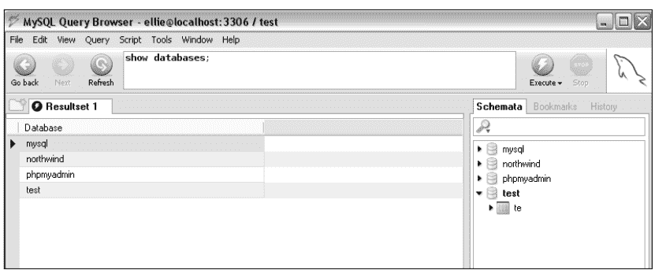

**图 B.2** MySQL 查询器 GUI。

### B.1.3 关于 SQL 命令/查询

SQL 是一种计算机语言，和普通语言一样，SQL 有它自己的规则、语法和一组保留字。多年来，这种语言演化出了不同的变体，因为不同的关系型数据库供应商为了竞争，提供了额外的功能来操作数据。本节涵盖了基础 SQL 命令和语法。

由于 SQL 拥有许多命令，它们被分为两大类：操纵表中数据的命令和操纵数据库本身的命令。网上有许多优秀的教程，涵盖了所有的 SQL 命令以及如何使用它们。http://www.w3schools.com/sql/default.asp。

**类英语语法。** 当你创建一个 SQL 语句时，它会以语句的形式提出请求或“查询”数据库，其结构类似于英语祈使句的结构，例如“Select...”。

**分号结束 SQL 语句。** 分号是结束每条语句的标准。某些系统不需要分号，但 MySQL 需要；如果你忘记了分号，将看到二次提示。

### 表 B.1 SQL 保留字

| ALTER | JOIN |
|---|---|
| AND | LEFT JOIN |
| AS | LIKE |
| CREATE | LIMIT |
| CROSS JOIN | ON |
| DELETE | OR |
| DROP | ORDER BY |
| FROM | RIGHT JOIN |
| FULL JOIN | SELECT |
| GROUP BY | SET |
| INSERT | UPDATE |
| INTO | WHERE |

虽然 SQL 命令不区分大小写，但按照惯例，为了清晰起见，SQL 关键字大写，而只有字段、表和数据库名称的首字母大写。

```sql
SELECT * FROM Persons Where FirstName='John'
```

在使用 `LIKE` 和 `NOT LIKE` 命令进行模式匹配时，在 MySQL 中，搜索的模式是区分大小写的。

**结果集（The Result Set）。** 结果集就是用于存储 SQL 查询结果的表。大多数数据库系统允许你使用函数对结果集进行操作，例如 `Move-To-First-Record`（移动到第一记录）、`Get-Record-Content`（获取记录内容）、`Move-To-Next-Record`（移动到下一记录）等。在图 B.4 中，结果集是通过向 mysql 查询名为 `shippers` 的表中所有字段而创建的表。

| Field | Type | Null | Key | Default | Extra |
|---|---|---|---|---|---|
| ShipperID | int(11) | | PRI | NULL | auto_increment |
| CompanyName | varchar(40) | | | | |
| Phone | varchar(24) | | | NULL | |

**图 B.4** 结果集只是由查询产生的表。

## B.1.4 SQL 与数据库

数据库服务器可以支持多个数据库。例如，一个 Oracle 或 MySQL 数据库服务器可以为会计提供一个数据库，第二个为人力资源提供，第三个为电子商务应用程序，以此类推。要查看可用数据库，SQL 提供了 `show` 命令。

**show 命令。** 要查看你的数据库服务器上有哪些可用数据库，使用 `show databases` 命令。数据库列表在你的机器上可能不同，但在安装 MySQL 时会提供 `mysql` 和 `test` 数据库。`mysql` 数据库是必需，因为它描述了用户访问权限，而 `test` 数据库正如其名，是作为一个练习数据库提供的，用于测试各项功能是如何工作的。

```sql
SHOW DATABASES;
```

## B.1 什么是 SQL？

## 示例 B.1

```sql
mysql> SHOW databases;

+----------------+
| Database       |
+----------------+
| mysql          |
| northwind      |
| phpadmin       |
| test           |
+----------------+
4 rows in set (0.03 sec)
```

**USE 命令。** `USE` 命令将指定的数据库设为默认数据库。从那时起，所有 SQL 命令都将在默认数据库上执行。这是不需要用分号终止的命令之一。

```sql
USE database_name;
```

## 示例 B.2

```sql
mysql> USE northwind;
Database changed
```

### 解释

- `USE` 命令将数据库更改为“northwind”。命令行将报告数据库已更改。

“northwind” 数据库可以从 http://www.microsoft.com/downloads/details.aspx?FamilyID=C666132-DBE-422-B866-C632D6C6529C&language=EN 下载。

## B.1.5 SQL 数据库表

数据库通常包含一个或多个表。每个表都通过名称标识，例如“Customers”（客户）或“Orders”（订单）。`SHOW TABLES IN` 命令显示数据库中的所有表，如图 B.5 所示。`SELECT FROM` 命令列出指定表中的所有字段和行。表包含行（称为记录 records）和列（称为字段 fields）。图 B.6 中的表包含三条记录（每个承运商一条）和三列（“ShipperID”、“CompanyName”和“Phone”）。

```sql
mysql> show tables in northwind;

+--------------------------+
| Tables_in_northwind      |
+--------------------------+
| categories               |
| customerdemememo         |
| customerdemographics     |
| customers                |
| employees                |
| employeeterritories      |
| order_details            |
| orders                   |
| products                 |
| region                   |
| shippers                 |
| suppliers                |
| territories              |
| usstates                 |
+--------------------------+
14 rows in set (0.03 sec)
```

**图 B.5** 显示 "northwind" 数据库中的所有表。

```sql
mysql> select * from shippers;

+-----------+-------------------+------------------+
| ShipperID | CompanyName       | Phone            |
+-----------+-------------------+------------------+
| 1         | Speedy Express    | (503) 555-9831   |
| 2         | United Package    | (503) 555-3199   |
| 3         | Federal Shipping  | (503) 555-9931   |
+-----------+-------------------+------------------+
3 rows in set (0.00 sec)
```

**图 B.6** 显示特定表的内容。

**SHOW 和 DESCRIBE 命令。** 要查看可以分配给表的什么类型的数据，可以使用 MySQL 特有的 `DESCRIBE` 命令以及标准 SQL 命令 `SHOW FIELDS IN`。输出显示每个字段的名称以及与每个字段对应的值的数据类型，如图 B.7 所示。例如，`varchar(40)` 类型意味着该字段包含多达 40 个字符。它可以是一个可变字符字符串、一个日期或一个数字等。输出的还有用于唯一标识记录的主键。

```sql
SHOW FIELDS IN table_name;

-- 或

DESCRIBE table_name;
```

## B.2 数据操作语言 (DML)

SQL 是一种非过程化语言，提供了提取数据、更新、插入和删除语法。这些查询和更新命令共同组成 SQL 的数据操作语言（DML）部分。

- `SELECT`——从数据库表中提取数据。
- `UPDATE`——更新数据库表的数据。
- `DELETE`——从数据库表中删除数据。
- `INSERT`——向数据库表中插入新数据。

### B.2.1 SELECT 命令

最常用的 SQL 命令之一是 `SELECT`，执行查询时是强制的。`SELECT` 命令用于根据某些标准从表中检索数据。它指定了一个由逗号分隔的字段列表，`FROM` 子句指定了要访问的表。结果存储在称为结果集的表中。`*` 符号可以表示所有字段。

```sql
SELECT column_name(s) FROM table_name
```

示例：
`SELECT LastName, FirstName, Address FROM Students;`

## 示例 B.3

```sql
mysql> SELECT CompanyName FROM Shippers;

+------------------------------------+
| CompanyName                        |
+------------------------------------+
| Speedy Express                     |
| United Package                     |
| Federal Shipping                   |
+------------------------------------+
3 rows in set (0.05 sec)
```

`SELECT` 命令将检索 `CompanyName` 字段中的所有项。查询响应显示结果表。

**选择指定的列。** 要从 `Shippers` 表选择名为 `CompanyName` 和 `Phone` 的列，`SELECT` 后面跟着由逗号分隔的字段列表，然后 `FROM Shippers` 表。生成的表称为结果集，如示例 B.4 所示。

## 示例 B.4

```sql
mysql> SELECT CompanyName, Phone FROM Shippers;

+----------------------+------------------+
| CompanyName          | Phone            |
+----------------------+------------------+
| Speedy Express       | (503) 555-9831   |
| United Package       | (503) 555-3199   |
| Federal Shipping     | (503) 555-5932   |
+----------------------+------------------+
3 rows in set (0.09 sec)
```

**选择所有列。** 要从 `Shippers` 表选择所有列，请使用 `*` 符号代替列名称，如示例 B.5 所示。`*` 是一个通配符，表示所有字段。

## 示例 B.5

```sql
mysql> SELECT * FROM Shippers;

+-----------+-------------------+------------------+
| ShipperID | CompanyName       | Phone            |
+-----------+-------------------+------------------+
| 1         | Speedy Express    | (503) 555-9831   |
| 2         | United Package    | (503) 555-3199   |
| 3         | Pedral Shipping   | (503) 555-9931   |
+-----------+-------------------+------------------+
3 rows in set (0.06 sec)
```

**SELECT DISTINCT 语句。** `DISTINCT` 关键字用于从表中返回不同的（唯一的）值。如果指定字段有多个值，`DISTINCT` 结果将只显示一个。

在下一个示例中，首先选择了名为 `ShipName` 列的所有值，并显示了超过 800 条记录，但请注意在使用 `DISTINCT` 关键字后，检索到的记录少于 90 条。

```sql
SELECT DISTINCT column_name(s) FROM table_name
```

## 示例 B.6

```sql
SELECT ShipName from Orders
```

(部分输出)

| ShipName |
|---|
| North/South |
| Biawer Delikatessen |
| Ricardo Adocicos |
| Franchi S.p.A. |
| Great Lakes Food Market |
| Reggiani Caseifici |
| Hungry Owl All-Night Grocers |
| Save-a-lot Markets |
| LILA-Supermercado |
| White Clover Markets |
| Drachenblut Delikatessen |
| Queen Cozinha |
| Tortuga Restaurante |
| Lehmanns Marktstand |
| LILA-Supermercado |
| Ernst Handel |
| Pericles comidas clásicas |

## 示例 B.6 (续)

| ShipName |
|---|
| Simons bistro |
| Richter Supermarkt |
| Bon app' |
| Rattlesnake Canyon Grocery |

```
830 rows in set (0.00 sec)
```

使用 `DISTINCT` 关键字后，检索到的记录少于 90 条：

```sql
SELECT DISTINCT ShipName FROM Orders;
```

| ShipName |
|---|
| Océano Atlántico Ltdda. |
| Franchi S.p.A. |
| Gourmet Lanchonetes |
| Consolidated Holdings |
| Rancho grande |
| Lazy Kountry Store |
| Laughing Bacchus Wine Cells |
| Blauer Delikattessen |
| North/South |
| Cactus Comidas para llevar |
| Great Lakes Food Market |
| Maison Head Gourmet Provisioners |
| Let's Stop N Shop |

**使用 LIMIT 限制结果集的行数。** 如果你不想显示巨大的数据库，可以使用 `LIMIT` 限制打印的行数；例如，northwind 数据库中的表包含数千条记录。在之前的示例中，显示几行来证明查询成功会更好。因为你只获取了部分列表，你可能想知道表中的总数。这可以通过使用 `SQL_CALC_FOUND_ROWS` 选项和 `FOUND_ROWS()` 函数来实现。SQL 将计算记录的总数，`FOUND_ROWS()` 函数将让你显示该计算的结果。

## 示例 B.7

```sql
mysql> select ShipName from Orders LIMIT 10;

+------------------------------------------------+
| ShipName                                       |
+------------------------------------------------+
| Vins et alcools Chevalier                      |
| Toms Spezialitäten                             |
| Hanari Carnes                                  |
| Victuailles en stock                           |
| Suprêmes délicieux                             |
| Hanari Carnes                                  |
| Chop-suey Chinese                              |
| Richter Supermarkt                             |
| Wellington Importadora                         |
| HILARION-Abastos                               |
+------------------------------------------------+
10 rows in set (0.00 sec)
```

### 解释

带有一个参数（在本例中为 10），`LIMIT` 指定了从结果开始处返回的行数。

## 示例 B.8

```sql
mysql> SELECT SQL_CALC_FOUND_ROWS ShipName from Orders
  -> LIMIT 5;

+------------------------------------------------+
| ShipName                                       |
+------------------------------------------------+
| Vins et alcools Chevalier                      |
| Toms Spezialitäten                             |
| Hanari Carnes                                  |
| Victuailles en stock                           |
| Suprêmes délicieux                             |
+------------------------------------------------+
5 rows in set (0.03 sec)
```

```sql
mysql> SELECT FOUND_ROWS();

+----------------+
| FOUND_ROWS()   |
+----------------+
| 830            |
+----------------+
1 row in set (0.03 sec)
```

### 解释

SQL 将计算记录的总数（限制为 5 条），`FOUND_ROWS()` 函数将让你显示该计算的结果。

**WHERE 子句。** 如果你只想在满足一组特定条件时选择某些字段呢？例如，你可能想列出所有来自瑞典且去年支付超过 50,000 美元的客户。`WHERE` 子句是可选的，它根据 `WHERE` 关键字后面的条件来指定选择哪些数据值或行。为了创建这些条件（称为选择标准），SQL 提供了一系列运算符来进一步限定在 `WHERE` 子句中应指定哪些标准。参见表 B.2。

```sql
SELECT column FROM table WHERE column operator value
```

示例：
`SELECT phone FROM shippers WHERE country like "Sw";`

### 表 B.2 SQL 运算符

| 运算符 | 描述 | 示例 |
| :--- | :--- | :--- |
| = | 等于 | country = 'Sweden' |
| <>, != | 不等于 | country <> 'Sweden' |
| > | 大于 | salary > 50000 |
| < | 小于 | salary < 50000 |
| >= | 大于或等于 | salary >= 50000 |
| <= | 小于或等于 | salary <= 50000 |
| IS NULL | 为空 | status IS NULL |
| BETWEEN | 在...之间 | birth BETWEEN 'A' AND 'Z' |
| LIKE | 模式匹配 | name LIKE 'A%' |
| NOT LIKE | 不匹配模式 | name NOT LIKE 'A%' |
| ! | 否定 | status ! 10 |
| \|\|, OR | 逻辑或 | status OR order |
| &&, AND | 逻辑与 | status AND order |
| XOR | 异或 | status XOR |

**引号。** 在 SQL 中，必须对文本值使用单引号。数值值不应包含在引号内（大多数数据库系统也接受双引号）。

**使用 = 和 <> 运算符。** 在 SQL 中，`=` 运算符用于测试字段是否完全等于 Italy。`<>` 运算符可以测试不等于。

```sql
select CompanyName, Phone FROM Customers
WHERE Country='Italy';
```

| CompanyName | Phone |
|---|---|
| Franchi S.A. | 011-498260 |
| Magazzini Alimentari Riuniti | 035-640230 |
| Regiani Caseifici | 0522-56721 |

```
3 rows in (0.00 sec)
```

**什么是 NULL？** `NULL` 字段中没有值，或者未知，它并不意味着零。如果字段为 `NULL`，它是空的；除非在表定义中指定了 `NOT NULL`，否则字段的默认值为 `NULL`。

## 示例 B.9

```sql
mysql> SELECT region, country FROM suppliers
-> WHERE region IS NULL;

+-----------+----------+
| region    | country  |
+-----------+----------+
| NULL      | UK       |
| NULL      | Japan    |
| NULL      | Japan    |
| NULL      | UK       |
| NULL      | Sweden   |
| NULL      | Brazil   |
| NULL      | Germany  |
| NULL      | Germany  |
| NULL      | Germany  |
| NULL      | Italy    |
| NULL      | Norway   |
| NULL      | Sweden   |
| NULL      | France   |
| NULL      | Singapore|
| NULL      | Denmark  |
| NULL      | Netherlands|
| NULL      | Finland  |
| NULL      | Italy    |
| NULL      | France   |
| NULL      | France   |
+-----------+----------+
20 rows in set (0.00 sec)
```

### 解释

显示供应商数据库中 `region` 为 `NULL`（即没有值）的区域和国家。

## 示例 B.10

```sql
mysql> SELECT region, country FROM suppliers
-> WHERE region IS NOT NULL;

+-----------+----------+
| region    | country  |
+-----------+----------+
| LA        | USA      |
| MI        | USA      |
| Asturias  | Spain    |
| Victoria  | Australia|
+-----------+----------+
```

## 示例 B.10 (续)

| region | country |
| :--- | :--- |
| OR | USA |
| MA | USA |
| NSW | Australia |
| Québec | Canada |
| Québec | Canada |

```
9 rows in set (0.00 sec)
```

### 解释

显示供应商数据库中区域（region）不为 `NULL`（即有值）的区域和国家。

**> 运算符和 < 运算符。** `>` 和 `<` 运算符用于选择字段值大于或小于某个值的行，例如：

```sql
SELECT product, price FROM table WHERE price > 50;

SELECT product, price FROM table
WHERE price > 50 && price < 100;
```

你也可以使用 `>=` 和 `<=` 运算符来选择大于或等于某个值的行：

```sql
SELECT product, price FROM table
WHERE price >= 50;
```

## 示例 B.11

```sql
mysql> SELECT UnitPrice, Quantity FROM Order_Details
-> WHERE UnitPrice > 1 && UnitPrice < 3;
```

| UnitPrice | Quantity |
| :--- | :--- |
| 2.0000 | 25 |
| 2.0000 | 60 |
| 2.0000 | 24 |
| 2.0000 | 20 |
| 2.0000 | 8 |
| 2.0000 | 60 |
| 2.0000 | 49 |
| 2.0000 | 50 |
| 2.0000 | 20 |

## 示例 B.12

```sql
mysql> SELECT CategoryName from categories WHERE CategoryName < 'D';

+---------------------------+
| CategoryName              |
+---------------------------+
| Beverages                 |
| Condiments                |
| Confections               |
+---------------------------+
3 rows in set (0.00 sec)
```

`AND` 和 `OR` 运算符用于 `WHERE` 子句，以进一步限定你想要从表中选择的数据。`AND` 运算符测试一个或多个条件，以检查所有条件是否为真；如果是，`SELECT` 将显示这些行。`OR` 运算符在仅有一个条件为真时显示该行。`AND` 运算符可以用 `&&` 符号指定，`OR` 运算符可以用 `\|\|` 指定。

## 示例 B.13

```sql
mysql> SELECT ContactName From Suppliers
-> WHERE City = 'Montreal' AND Region = 'Quebec';

+------------------------+
| contactname            |
+------------------------+
| Jean-Guy Lauzon        |
+------------------------+
1 row in set (0.03 sec)
```

### 解释

使用 `&&` (`AND`) 运算符时，`WHERE` 子句中测试的两个条件都必须为真；即 `City` 必须是 Montreal 且 `Region` 必须是 Quebec。如果两个条件都为真，`SELECT` 将从 `Suppliers` 数据库打印 `ContactName`。

## 示例 B.14

```sql
mysql> SELECT CompanyName, City FROM Suppliers WHERE
-> City = 'Montreal' OR City = 'Boston';
```

| CompanyName | City |
| :--- | :--- |
| New England Seafood Cannery | Boston |
| Ma Maison | Montreal |

```
2 rows in set (0.00 sec)
```

### 解释

使用 `\|\|` (`OR`) 运算符时，测试的条件中只需有一个为真；如果 `City` 是 Montreal 或 `City` 是 Boston，则 `SELECT` 将从 `Suppliers` 数据库打印 `CompanyName` 和 `City`。

**LIKE 和 NOT LIKE 条件。** `LIKE` 模式匹配运算符是一个强大的运算符，可以作为 `WHERE` 子句中的条件，允许你只选择“像”或匹配某种模式的行。

- 百分号 (`%`) 可以作为通配符，匹配指定字符之前和/或之后可能出现的任何字符。
- 下划线 (`_`) 用于匹配单个字符。

`LIKE` 条件可以用于任何有效的 SQL 语句中，包括 `SELECT`、`INSERT`、`UPDATE` 或 `DELETE`。

```sql
SELECT column FROM table WHERE column LIKE pattern
SELECT column FROM table WHERE column NOT LIKE pattern
```

示例：
`SELECT column FROM customer WHERE last_name LIKE 'Mc%'`

接下来的示例将演示 `%` 和 `_` 如何与 `LIKE` 和 `NOT` 配合使用，作为通配符在模式匹配中使用。

**模式匹配和 % 通配符。** 在执行模式匹配时，`%` 通配符用于表示一个或多个任意字符。例如，如果你正在寻找 408 区的所有电话号码，你可以使用 `408%`，此时 `%` 将替换为 `408` 之后的任何字符。

## 示例 B.15

```sql
mysql> SELECT CompanyName, Country FROM Customers
-> WHERE country LIKE 'Sw%';
```

| CompanyName | Country |
|---|---|
| Berglunds snabbköp | Sweden |
| Chop-suey Chinese | Switzerland |
| Folk och få HB | Sweden |
| Richter Supermarkt | Switzerland |

```
4 rows in set (0.00 sec)
```

### 解释

`SELECT` 返回所有来自以 `Sw` 开头的国家的客户。

## 示例 B.16

```sql
mysql> SELECT City, Country FROM Suppliers WHERE City LIKE '%o%';
```

| City | Country |
|---|---|
| Tokyo | Japan |
| Oviedo | Spain |
| Sao Paulo | Brazil |
| Salerno | Italy |

### 解释

`SELECT` 返回所有城市包含 `o` 的城市和国家。

## 示例 B.17

```sql
mysql> SELECT CompanyName FROM customers
WHERE CompanyName LIKE '%Super%';
```

| CompanyName |
|---|
| Mercado |
| Richter |

```
2 rows in set (0.00 sec)
```

### 解释

`SELECT` 返回所有包含 `Super` 的公司名。

**下划线通配符。** 下一个示例显示了下划线 (`_`) 如何工作。它匹配单个字符。

## 示例 B.18

```sql
mysql> SELECT extension, firstname FROM employees
WHERE extension LIKE '_';
```

| extension | firstname |
| :--- | :--- |
| 28 | Michael |
| 65 | Robert |
| 52 | Anne |

```
3 rows in set (0.00 sec)
```

### 解释

`SELECT` 返回所有扩展名为单个字符的行。

**BETWEEN 语句。** `BETWEEN` 允许根据范围选择字段。`BETWEEN` 的语法如下：

```sql
SELECT column FROM table WHERE column BETWEEN value1 AND value2
```

示例：
`SELECT column FROM person WHERE age BETWEEN 10 AND 20;`

## 示例 B.19

```sql
mysql> SELECT ProductName, ProductID FROM Products
WHERE ProductID BETWEEN 30 AND 33;
```

| ProductName | ProductID |
| :--- | :--- |
| Gorgonzola | 30 |
| Feoli | 31 |
| Matjes | 32 |
| Geist | 33 |

### 解释

`SELECT` 返回产品 ID（`ProductID`）在 30 到 33 之间的产品名称。

**使用 ORDER BY 排序结果。** 使用 `ORDER BY` 子句按特定顺序输出查询结果。可以升序（`ASC`，默认）或降序（`DESC`）排序字符串或数字。

```sql
SELECT column FROM table ORDER BY column [ASC | DESC]
```

示例：
`SELECT column FROM Orders ORDER BY column`

## 示例 B.20

```sql
mysql> SELECT CompanyName, ContactName FROM suppliers
-> ORDER BY CompanyName LIMIT 10;
```

| CompanyName | ContactName |
| :--- | :--- |
| Bakery's Homestead | Regina Murphy |
| Comfort and Co | Wendy Mackenzie |
| Central Pacific. | Elio Conti |
| Deutschlandbrau | Chantal Rossi |
| Exotic Liquids | Charlotte Cooper |
| Forêts d'Trables | Eliane |
| Formaggi. | Marie Delamare |
| Galen's | Cheryl Saylor |
| Gourmet hand-kraft | Antonio del Valle |
| Gu'day, Mats | Antonio del Valle |
| Grandma's | Saavedra |

```
10 rows in set (0.06 sec)
```

### 解释

结果按公司名（`CompanyName`）进行升序排序，限制为 10 条记录。

## 示例 B.21

```sql
mysql> SELECT CompanyName, ContactName FROM Customers
-> ORDER BY CompanyName DESC LIMIT 10;
```

| CompanyName | ContactName |
| :--- | :--- |
| Zaanse Snoepfabrik | Dirk Luchte |
| Tokyo Traders | Yoshi Nagase |
| Svensk Sjofoda AB | Michael Bjorn |
| Specialty Builds, Ltd. | Peter Wilson |
| Refrescos Americanas LTDA | Carlos Diaz |
| Pluzer Lebensmittel-akte | Martin Bein |
| PB Knackrob AB | Lars Peterson |
| Pavlov, Ltd. | Ian Devlin |
| Pasta Butini s.r. | Giovanni Giudici |
| Norwegianke Meier | Beate Vileid |

```
10 rows in set (0.00 sec)
```

### 解释

结果按公司名进行降序排序，限制为 10 条。

### B.2.2 INSERT 命令

`INSERT` 语句用于向表中插入新行。在 `VALUES` 关键字之后，有一个逗号分隔的列列表。

```sql
INSERT INTO table_name VALUES (value1, value2, ...)
```

你也可以指定要插入数据的列：

```sql
INSERT INTO table_name (column1, column2, ...)
VALUES (value1, value2, ...)
```

## 示例 B.22

```sql
INSERT INTO Shippers (CompanyName, Phone)
VALUES ('Canada Post', '416-555-1221');
```

| ShipperID | CompanyName | Phone |
| :--- | :--- | :--- |
| 1 | Speedy Express | (503) 555-9831 |
| 2 | United Package | (503) 555-3199 |
| 3 | Federal Shipping | (503) 555-9931 |
| 4 | Canada Post | 416-555-1221 |

### 解释

`INSERT` 语句用于向 `Shippers` 表中插入新行，方法是列出字段名，然后在 `VALUES` 关键字之后列出相应的值。这里没有包含 `ShipperID` 值，因为在创建表时，`ShipperID` 被设置为主键（`PRIMARY KEY`），每当添加新的货运记录时，数据库都会自动递增。（让数据库递增主键可以确保值始终是唯一的）。要查看表最初是如何设置的，请查看此处的 `DESCRIBE` 命令的输出：

| Field | Type | Null | Key | Default | Extra |
| :--- | :--- | :--- | :--- | :--- | :--- |
| ShipperID | int(11) | | PRI | NULL | auto_increment |
| CompanyName | varchar(40) | | | | |
| Phone | varchar(24) | YES | | NULL | |

### B.2.3 UPDATE 命令

`UPDATE` 语句用于修改表中的数据。在 `UPDATE` 命令之后，你列出将更改数据的表名，后面是 `SET` 语句以指示将修改哪个字段，然后是分配给该字段的新值。`WHERE` 子句进一步限定了要修改的数据，从而限制了更新的范围。

在示例 B.23 中，关键在于使用 `WHERE` 语句来限制更新范围。

```sql
UPDATE table_name
SET column_name = new_value
WHERE column_name = some_value
```

示例：
`UPDATE orders SET ShipCountry="Luxembourg" WHERE CustomerId='whitc';`

## 示例 B.23

```sql
mysql> select * from shippers;
+-----------+-------------------+------------------+
| ShipperID | CompanyName       | Phone            |
+-----------+-------------------+------------------+
| 1         | Speedy Express    | (503) 555-9831   |
| 2         | United Package    | (503) 555-3199   |
| 3         | Federal Shipping  | (503) 555-9931   |
+-----------+-------------------+------------------+
3 rows in set (0.00 sec)

mysql> UPDATE shippers SET PHONE='(777) 444-1234'
-> WHERE companyname = 'Federal Shipping';
Query OK, 1 row affected (1 Changed; Warnings: 0)

mysql> select * from shippers;
+-----------+-------------------+------------------+
| ShipperID | CompanyName       | Phone            |
+-----------+-------------------+------------------+
| 1         | Speedy Express    | (503) 555-9831   |
| 2         | United Package    | (503) 555-3199   |
| 3         | Federal Shipping  | (777) 444-1234   |
+-----------+-------------------+------------------+
3 rows in set (0.00 sec)
```

### 解释

- `SELECT` 命令显示了 `Shippers` 表中的所有字段。
- `UPDATE` 命令允许你更改现有记录。正在更改 `Federal Shipping` 的电话号码。
- 此 `SELECT` 命令显示 `Federal Shipping` 的电话号码已通过之前的 `UPDATE` 命令被更改。

### B.2.4 DELETE 语句

`DELETE` 语句用于删除表中的行，并返回被删除的行数。`DELETE` 使用 `FROM` 子句指定包含要删除数据的表名，并使用 `WHERE` 子句指定识别要移除的数据的标准。

小心！如果没有 `WHERE` 子句，所有行都将被删除。

如果指定了 `ORDER BY` 子句，行将按照指定的顺序被删除。

`LIMIT` 子句对可以删除的行数进行限制。

- 你可以设置 MySQL，使得在没有 `WHERE` 子句的情况下删除，行不会被删除。

```sql
DELETE FROM table_name
WHERE column_name = some_value
```

`DELETE` 语句与 `UPDATE` 语句非常相似。要删除之前的记录，你需要输入此查询：

`DELETE FROM Shippers WHERE CompanyName='Canada Post';`

## B.3 SQL 数据定义语言 (DDL)

SQL 的数据定义语言 (DDL) 部分允许创建或销毁数据库对象。你还可以定义索引（键）、指定表与表之间的链接，并在数据库表之间实施约束。通常情况下，数据库的创建和删除由数据库管理员处理，而创建和删除表的权限取决于授予的访问权限。

SQL 中最重要的数据定义语句是：

- `CREATE TABLE`——创建一个新数据库表。
- `ALTER TABLE`——修改（更改）数据库表。
- `DROP TABLE`——删除数据库表。
- `CREATE INDEX`——创建索引（搜索键）。
- `DROP INDEX`——删除索引。

### B.3.1 创建数据库

创建数据库非常简单。你只需要发布一个命令，唯一的参数就是数据库名称。

```sql
CREATE DATABASE database_name
```

在之前的示例中，我们使用了 `northwind` 数据库。因为我们将在附录 A 中为画廊创建一个完整的 Web 应用程序，现在我们将为该应用程序创建数据库。

## 示例 B.24

```sql
mysql> CREATE DATABASE gallerydb;
Query OK, 1 row affected

mysql> show databases;
+--------------------------+
| Database                 |
+--------------------------+
| gallerydb                |
| northwind                |
| test                     |
+--------------------------+
3 rows in set (0 sec)
```

### 解释

`CREATE DATABASE` 命令用于创建一个数据库。

唯一的参数是数据库名称。

在示例 B.24 中，我们创建名为 `gallerydb` 的数据库。

### B.3.2 数据类型

下表描述了 MySQL 中常用的数据类型。

| 数据类型 | 描述 |
| :--- | :--- |
| **数字** | |
| `INTEGER` | 存储 4 字节整数。 |
| `UNSIGNED` | 存储 4 字节非负整数。 |
| `SMALLINT` | 存储 2 字节整数。 |
| `TINYINT` | 存储 1 字节整数。 |
| `FLOAT (m, d)` | 4 字节浮点数。 |
| `DOUBLE (m, d)` | 8 字节双精度浮点数。 |
| `DECIMAL (m, d)` | 8 字节实数。 |
| `NUMERIC (m, d)` | `DECIMAL` 和 `NUMERIC` 类型用于存储精确数值的值。 |
| **字符串** | |
| `CHAR (SIZE)` | 存储固定长度字符串（包含字母、数字和特殊字符），长度为 0 到 255。大小在括号中指定。 |
| `VARCHAR (SIZE)` | 存储变长度字符串（包含字母、数字和字符），最大长度为 65535。最大大小在括号中指定。 |
| `TINYTEXT` | 最大长度 255 字符的字符串。 |
| `TEXT` | 最大长度 65535 字符的变长度文本，用于存储文本文件、文档、文本区域等。 |
| `BLOB` | 二进制大对象。最大长度 65535 字符的二进制字符串，用于存储二进制文件、图像、声音等。 |
| **日期时间** | |
| `DATE (yyyy-mm-dd)` | 年、月、日；例如：2006-10-30（注意：MySQL 允许存储 0000-00-00 作为“虚拟日期”）。 |
| `DATETIME (yyyy-mm-dd hh:mm:ss)` | 日期时间；例如：2006-10-30 22:59:59。 |
| `TIME (hh:mm:ss)` | 时间；例如：10:30:58。 |
| `YEAR (yyyy)` | 四位或两位数的年份；例如：1978 或 78。 |

### B.3.3 创建表

创建表比创建数据库稍微复杂一些。`CREATE TABLE` 语句用于在数据库中创建新表，你必须为新表命名，并指定表中将包含的所有字段，以及数据类型和任何其他属性。数据类型可以是整数、浮点数（实数，如 5.4）、字符字符串、日期等。并不是所有数据库定义数据类型的方式都相同。对于 MySQL，请参阅表 B.3 或 MySQL 文档。

正确地设计表至关重要，如果你以前处理过数据库，这是一个值得进一步研究的主题。访问 http://databases.about.com/out/specificproducts/normalization 可以获得一个关于数据库设计的优秀初学者教程。现在，在设计表时请记住以下规则：

1. 为字段选择正确的数据类型；例如，主键使用整数类型，大数字使用 `float` 和 `double` 类型，货币使用 `decimal` 或 `numeric` 类型，对时间和日期使用正确的格式，并为包含可变字符的字符串（如姓名和地址）留出足够的的字段宽度。如果你正在保存二进制数据（如图像和声音），请使用支持大量数据的数据类型，如 `blob` 和 `text` 类型。参阅表 B.3。
2. 给列起合理且简洁的名字。确保它们在表中是唯一的。不要在同一张表中设置重复的列，如下所示。这些不应该是三个都以“phone”开头的列。
3. 在每行的每个列标题下仅存储一个值；例如，如果你有一个 `Phone` 字段，你不应该在一个表单元格内将“cell, home, business”都放在在一起，如下所示：

| First_Name | Last_Name | Phone1 | Phone2 | Phone3 |
|---|---|---|---|---|
| Joe | Blow | 415-444-3333 | 333-111-1233 | 652-345-1123 |

| First_Name | Last_Name | Phone |
|---|---|---|
| Joe | Blow | 415-444-3333, 333-111-1233, 652-345-1123 |

4. 为每组相关项创建单独的表，并为每行提供一个唯一的列或主键，如下所示：

**User Table:**

| Customer_Id | First_Name | Last_Name |
|---|---|---|
| 1 | Joe | Blow |

**Phone Table:**

| Customer_Id | Cell | Business | Home |
| --- | --- | --- | --- |
| 1 | 415-444-3333 | 333-111-1233 | 652-345-1123 |

5. 如果仍然存在冗余数据，将其放在单独的表中，并通过外键建立表之间的关系。

```sql
CREATE TABLE table_name
(
column_name1 data_type,
column_name2 data_type,
column_name3 data_type      -- 最后一条没有逗号
);
```

## 示例 B.26

```sql
mysql> CREATE DATABASE pets;
Query OK, 1 row affected (0.24 sec)
mysql> USE pets;
mysql> CREATE TABLE dog
-> ( name varchar(20),
-> owner varchar(20),
-> breed varchar(20),
-> sex char(1),
-> birth date,
-> death date
-> );
Query OK, 0 rows affected (0.16 sec)
```

```sql
mysql> DESCRIBE dog;
```

| Field | Type | Null | Key | Default | Extra |
| --- | --- | --- | --- | --- | --- |
| name | varchar(20) | YES | | NULL | |
| owner | varchar(20) | YES | | NULL | |
| breed | varchar(20) | YES | | NULL | |
| sex | char(1) | YES | | NULL | |
| birth | date | YES | | NULL | |
| death | date | YES | | NULL | |

```
6 rows in set (0.00 sec)
```

### 解释

1. 创建了一个名为 `pets` 的数据库。
2. 选择并进入了 `pets` 数据库。
3. 创建了一个名为 `dog` 的表，包含字段及其数据类型。`name`、`owner` 和 `breed` 将包含最多 20 个字符的可变长度。`sex` 是字符类型，`f` 代表女性，`m` 代表男性。`birth` 和 `death` 列被分配为 `date` 类型。
4. `DESCRIBE` 命令类似于 `SHOW` 命令。它显示了新表的布局。现在我们可以向新表中插入一些数据。

## 示例 B.27

```sql
mysql> INSERT INTO dog(name,owner,breed,sex,birth,death)
-> VALUES ('Fido', 'Mr. Jones', 'Mutt', 'M', '2004-11-12', '2006-06-04');
Query OK, 1 row affected (sec)
```

### B.3.4 创建键

在生活中，人们可以通过社会安全号码、驾照号码来识别；书籍可以通过 ISBN 编号识别；商店可以通过订单号识别。这些识别码必须是唯一的，以确保没有两个人拥有相同的号码。这些识别码是唯一的，以确保没有两个项目拥有相同的编号。键有两种类型：主键（Primary Keys）和外键（Foreign Keys）。

**主键。** 每个表通常有一个主键。主键用于唯一标识记录。你可以手动设置主键值，或者让数据库自动生成。如果让数据库生成主键，它将从 1 开始递增。主键在表中是唯一的，不能更改。主键通常是整数类型。主键在表中是唯一的，以确保没有两个行具有相同的键值。

## 示例 B.28

```sql
mysql> USE northwind;
mysql> DESCRIBE categories;
```

| Field | Type | Null | Key | Default | Extra |
|---|---|---|---|---|---|
| CategoryID | int(11) | | PRI | NULL | auto_increment |
| CategoryName | varchar(15) | | MUL | NULL | |
| Description | text | YES | | NULL | |
| Picture | blob | YES | | NULL | |

```
4 rows in set (0 sec)
```

### 解释

主键是 `CategoryID`，它是 `northwind` 数据库中类的唯一标识。当向表中添加新类别时，`CategoryID` 会自动递增。

## 示例 B.29

```sql
mysql> SELECT CategoryID, CategoryName FROM categories;
```

| CategoryID | CategoryName |
|---|---|
| 1 | Beverages |
| 2 | Condiments |
| 3 | Confections |
| 4 | Dairy Products |
| 5 | Grains/Cereals |
| 6 | Meat/Poultry |
| 7 | Produce |
| 8 | Seafood |

```
8 rows in set (0.00 sec)
```

主键是 `CategoryID`。它用于标识表中不同的类。

**外键。** 如果一个主键被另一个表引用，它被称为外键。外键用于建立表之间的关系。在示例中，有两个表引用了 `CategoryID` 键，尽管它是其中一个表的主键而另一个不是。

## 示例 B.30

```sql
mysql> DESCRIBE categories;
```

| Field | Type | Null | Key | Default | Extra |
|---|---|---|---|---|---|
| CategoryID | int(11) | | PRI | NULL | auto_increment |
| CategoryName | varchar(15) | | MUL | NULL | |
| Description | text | YES | | NULL | |
| Picture | blob | YES | | NULL | |

```
4 rows in set (0.00 sec)
```

```sql
mysql> DESCRIBE products;
```

| Field | Type | Null | Key | Default | Extra |
|---|---|---|---|---|---|
| ProductID | int(11) | | PRI | NULL | auto_increment |
| ProductName | varchar(40) | | MUL | NULL | |
| SupplierID | int(11) | YES | MUL | NULL | |
| CategoryID | int(11) | YES | MUL | NULL | |
| QuantityPerUnit | decimal(19,4) | YES | | NULL | |
| UnitPrice | smallint(6) | YES | | NULL | |
| UnitsInStock | smallint(6) | YES | | NULL | |
| UnitsOnOrder | smallint(6) | YES | | NULL | |
| ReorderLevel | smallint(6) | YES | | NULL | |
| Discontinued | tinyint(4) | | | 0 | |

```
10 rows in set (0.00 sec)
```

### B.3.5 关系 (Relations)

关系型数据库系统的一个主要优势是在表之间创建关系的能力。简单来说，关系就是一个表中的字段与另一个表中的字段之间的连接。这种关系允许你在数据库中查找记录。

将一个表中的行与一个或多个列值进行匹配的操作被称为“连接”（join）。有多种类型的连接语句，例如全连接（full joins）、交叉连接（cross joins）、左连接（left joins）等，但让我们先从两个表的简单连接开始，这被称为内连接（inner join）。

表可以通过键相互关联。正如我们之前讨论过的，主键（primary key）是每行具有唯一值的列。第二个表中的匹配键是外键（foreign key）。通过这些键，你可以跨表将数据绑定，而不需要在满足特定条件的每个表中都重复所有数据。

考虑之前的示例 B.30，其中基于两个表。其中一张表名为 `categories`（类别），另一张表名为 `products`（产品）。`CategoryID` 是 `categories` 表中的主键，它是 `products` 表中的外键。`CategoryID` 用于在两个表之间建立关系。

**具有共同键的两个表。** 如前所述，`categories` 表和 `products` 表都具有相同值的 `CategoryID` 键，使得在两个表之间创建关系成为可能。

让我们创建一个关系，如果产品属于“海鲜”（Seafood）类别，则列出所有产品名称。由于 `products` 表中的每个产品都属于 `categories` 表中的八类之一，这两个表可以通过它们共同的 `CategoryID` 进行绑定。

## 示例 B.31

```sql
mysql> SELECT CategoryID, CategoryName FROM categories;
```

| CategoryID | CategoryName |
|---|---|
| 1 | Beverages |
| 2 | Condiments |
| 3 | Confections |
| 4 | Dairy Products |
| 5 | Grains/Cereals |
| 6 | Meat/Poultry |
| 7 | Produce |
| 8 | Seafood |

```
8 rows in set (0.00 sec)
```

## 示例 B.31（续）

```sql
mysql> SELECT CategoryID, ProductName FROM products;
```

(部分输出)

| CategoryID | ProductName |
|---|---|
| 1 | Chai |
| 1 | Chang |
| 2 | Aniseed Syrup |
| 2 | Chef Anton's Cajun Seasoning |
| 2 | Chef Anton's Gumbo Mix |
| 2 | Grandma's Boysenberry Spread |
| 7 | Uncle Bob's Organic Dried Pears |
| 2 | Northwoods Cranberry Sauce |
| 6 | Mishi Kobe Niku |
| 8 | Ikura |
| 4 | Ques Cabrales |
| 4 | Ques Manche Pastora |
| 8 | Konbu |
| 7 | Tofu |
| 2 | Genen Shouyou |

### 解释

此示例显示了来自 `categories` 表和 `products` 表的列。在 `categories` 表中，`CategoryID` 是主字段，唯一标识表中的所有其他字段。在 `products` 表中，`CategoryID` 是外键，并且为所有产品重复了多次。

**使用完全限定名和点号连接表。** 在查询多个表时，使用点号（`.`）通过名称对列进行完全限定，以避免当两个表具有相同字段名时可能出现的歧义，如示例 B.32所示。

## 示例 B.32

```sql
mysql> SELECT CategoryName, ProductName FROM categories, products
-> WHERE products.CategoryID = 8 AND categories.CategoryID = 8;
```

| CategoryName | ProductName |
|---|---|
| Seafood | Ikura |
| Seafood | Konbu |
| Seafood | Carnarvon Tigers |
| Seafood | Nord-Ost Matjeshering |
| Seafood | Inlagd Sill |
| Seafood | Gravad lax |
| Seafood | Boston Crab Meat |

## 示例 B.32（续）

| CategoryName | ProductName |
|---|---|
| Seafood | Jack's New England Clam Chowder |
| Seafood | Rogede sild |
| Seafood | Spegesild |
| Seafood | Escargots de Bourgogne |
| Seafood | Rød Kaviar |

```
12 rows in set (0.00 sec)
```

### 解释

在 `SELECT` 中，两个表（用逗号分隔）将通过 `CategoryID` 字段连接。两个表中的字段名相同，因此表名被重命名为带点号的字段名，例如 `products.CategoryID` 和 `categories.CategoryID`。在 `WHERE` 子句中，如果两个表的 `CategoryID` 都等于 8，则这两个表连接起来。

**别名（Aliases）。**

为了通过在复杂的查询中输入更少的内容来变得更容易，SQL 查询允许对列和表使用符号名称。别名使用 `AS` 关键字定义，由单个字符或缩写字符串组成。当别名在 `WHERE` 子句中表示表时，后面会跟一个点号和从该表中选出的字段名。

```sql
-- 列别名
SELECT column_name AS column_alias
FROM table_name

-- 表别名
SELECT column_name
FROM table_name AS table_alias
```

## 示例 B.33

```sql
mysql> SELECT CategoryName FROM categories;
```

| CategoryName |
|---|
| Beverages |
| Condiments |
| Confections |
| Dairy Products |
| Grains/Cereals |
| Meat/Poultry |
| Produce |
| Seafood |

```
8 rows in set (0.00 sec)
```

### 解释

`categories` 表中的列被命名为 `CategoryName`。在 `CategoryName` 之后使用 `AS` 关键字创建一个别名。现在当 `SELECT` 返回结果集时，输出将显示别名作为名称。

## 示例 B.34

```sql
mysql> SELECT ProductName FROM products AS p, categories AS c
WHERE p.CategoryID = c.CategoryID AND c.CategoryName="Seafood";
```

| ProductName |
|---|
| Ikura |
| Konbu |
| Carnarvon Tigers |
| Nord-Ost Matjeshering |
| Inlagd Sill |
| Gravad lax |
| Boston Crab Meat |
| Jack's New England Clam Chowder |
| Rogede sild |
| Spegesild |
| Escargots de Bourgogne |
| Rød Kaviar |

```
12 rows in set (0.00 sec)
```

### 解释

这个示例乍看起来可能有点复杂。名为 `products` 的表被赋予了别名 `p`，名为 `categories` 的表被赋予了别名 `c`。通过 `p.CategoryID = c.CategoryID` 和 `c.CategoryName="Seafood"`，这两个表连接起来。

## B.4 SQL 函数

### 解释

| | |
|---|---|
| 1 | 函数以列名显示。 |
| 2 | 你可以使用 `AS` 关键字为函数显示结果集的列创建一个别名或另一个名称。 |

### B.4.1 数值函数

假设你想获取所有订单的总和、一组物品的平均成本，或者根据特定条件统计表中所有的行数。聚合函数将根据一组其他值返回单个值。如果在 `SELECT` 语句的项目列表中使用了许多其他表达式，则 `SELECT` 必须包含 `GROUP BY` 子句。如果聚合函数是 `SELECT` 语句检索的唯一值，则不需要 `GROUP BY` 子句。这些函数及其语法见表 B.4。

### 表 B.4 聚合函数

| 函数 | 功能描述 |
|---|---|
| `AVG()` | 计算并返回列的平均值。 |
| `COUNT(expression)` | 统计由表达式定义的行数。 |
| `COUNT(*)` | 统计表中所有的行。 |
| `MIN()` | 返回列中的最小值。 |
| `MAX()` | 根据表达式返回列中的最大值。 |
| `SUM()` | 返回列中所有值的总和。 |

## 示例 B.37

```sql
mysql> select count(*) from products;

+-----------------------+
| count(*)              |
+-----------------------+
| 81                    |
+-----------------------+
1 row in set (0.00 sec)
```

```sql
mysql> SELECT count(*) as 'Number of Rows' FROM products;

+----------------------+
| Number of Rows       |
+----------------------+
| 81                   |
+----------------------+
1 row in set (0.00 sec)
```

### 解释

- `COUNT(*)` 函数统计表中所有的行。

## 示例 B.38

```sql
mysql> SELECT avg(UnitPrice)
FROM order_details;

+----------------------+
| avg(UnitPrice)       |
+----------------------+
| 26.21851972          |
+----------------------+
1 row in set (0.01 sec)
```

```sql
mysql> SELECT FORMAT(avg(UnitPrice),2) as 'Average Price'
FROM order_details;

+----------------------+
| Average Price        |
+----------------------+
| 26.22                |
+----------------------+
1 row in set (0.00 sec)
```

### 解释

- `AVG()` 函数计算并返回列 `UnitPrice` 的平均值。
- `FORMAT` 函数返回 `AVG()` 函数的结果，并保留两位小数。

**使用 GROUP BY。** `GROUP BY` 子句可以与 `SELECT` 一起使用，用于跨记录收集数据并按一列或多列对结果进行分组。这对于聚合函数（如 `SUM`、`COUNT`、`MIN` 或 `MAX`）非常有用。参见以下两个示例。

## 示例 B.39

```sql
mysql> select CategoryID, SUM(UnitsInStock) as 'Total Units in Stock'
-> FROM products
-> GROUP BY CategoryID;
```

| CategoryID | Total Units in Stock |
|---|---|
| NULL | 0 |
| 1 | 559 |
| 2 | 507 |
| 3 | 386 |
| 4 | 393 |
| 5 | 308 |
| 6 | 165 |
| 7 | 100 |
| 8 | 701 |

```
9 rows in set (0.00 sec)
```

## 示例 B.40

```sql
mysql> select C.CategoryName,
-> SUM(P.UnitsInStock) AS Units
-> FROM products as P
-> join categories AS C ON C.CategoryID = P.CategoryID
-> GROUP BY C.CategoryName;
```

| CategoryName | Units |
|---|---|
| Beverages | 559 |
| Condiments | 507 |
| Confections | 386 |
| Dairy Products | 393 |
| Grains/Cereals | 308 |
| Meat/Poultry | 165 |
| Produce | 100 |
| Seafood | 701 |

```
8 rows in set (0.00 sec)
```

### B.4.2 字符串函数

SQL 提供了许多基础字符串函数，列见表 B.5。

### 表 B.5 字符串函数

| 函数 | 功能描述 |
| --- | --- |
| `CONCAT(string1,string2,...)` | 将列值或变量组合成一个字符串。 |
| `LOWER(string)` | 将字符串转换为全小写字母。 |
| `SUBSTRING(string, position)` | 提取字符串的一部分（参见示例 B.41）。 |
| `TRANSLATE` | 将字符串从一个字符转换为另一个字符。 |
| `TRIM(' string ' )` | 删除字符字符串中的开头字符、结尾字符或两者。 |
| `UPPER(string)` | 将字符串转换为全大写字母（参见示例 B.41）。 |

- a. SQL99 定义了一个连接运算符 (`||`) 用于配合 `CONCAT()` 函数使用。MySQL 使用表 B.5 所示的 `CONCAT()` 函数。

## 示例 B.41

```sql
mysql> select upper(CompanyName) as 'Company' from shippers;

+----------------------+
| Company              |
+----------------------+
| SPEEDY EXPRESS       |
| UNITED PACKAGE       |
| FEDERAL SHIPPING     |
+----------------------+
3 rows in set (0.00 sec)
```

```sql
mysql> select lower(CompanyName) as 'Company' FROM shippers;

+----------------------+
| Company              |
+----------------------+
| speedy express       |
| united package       |
| federal shipping     |
+----------------------+
3 rows in set (0.00 sec)
```


## B.4.3 日期和时间函数

为了获取日期和时间，MySQL 提供了表 B.6 所示的函数。

## 表 B.6 日期和时间

| 函数 | 示例 |
| --- | --- |
| `NOW()` | `select NOW() -> 2006-03-23 20:52:58`（参见示例 B.42。） |
| `CURDATE()` | `select CURDATE() -> '2006-03-15'`（参见示例 B.42。） |
| `CURTIME()` | `select CURTIME() -> '23:50:26'` |
| `DAYOFYEAR(date)` | `select DAYOFYEAR('2006-03-15') -> 349` |
| `DAYOFMONTH(date)` | `select DAYOFMONTH('2006-03-15') -> 15` |
| `DAYOFWEEK(date)` | `select DAYOFWEEK('2006-03-15') -> 6` |
| `WEEKDAY(date)` | `select WEEKDAY('2006-03-15') -> 4` |
| `MONTH(date)` | `select MONTH('2006-03-15') -> March` |
| `DAYNAME(date)` | `select DAYNAME('2006-03-15') -> Friday` |
| `YEAR(date)` | `select YEAR('2006-03-15') -> 2006` |
| `QUARTER(date)` | `select QUARTER('2006-03-15') -> 1` |

## 示例 B.42

```
mysql> select NOW();

+----------------------+
| NOW() |
+----------------------+
| 2006-03-23 20:52:58 |
+----------------------+
1 row in set (0.00 sec)

mysql> select CURDATE();

+----------------------+
| CURDATE() |
+----------------------+
| '2006-03-15' |
+----------------------+
1 row in set (0.00 sec)

mysql> select CURTIME();

+----------------------+
| CURTIME() |
+----------------------+
| '23:50:26' |
+----------------------+
1 row in set (0.00 sec)
```

格式日期和时间。当你从 northwind 数据库选择日期时，你可能发现需要格式化输出。

## 示例 B.43

```
mysql> select DATE_FORMAT('2006-03-23', '%W %M %d, %Y') as Today;

+----------------------+
| Today |
+----------------------+
| Thursday March 23, 2006 |
+----------------------+
1 row in set (0.00 sec)
```

## 示例 B.43 (续)

```
mysql select DATE_FORMAT(OrderDate,'%M e, %Y - %l:%p')
FROM orders LIMIT 5;
```

```
+--------------------------------------+
| DATE_FORMAT(OrderDate,'%M e, %Y - %l:%p') |
+--------------------------------------+
| July 4, 1996 - 12:00 AM |
| July 5, 1996 - 12:00 AM |
| July 8, 1996 - 12:00 AM |
| July 8, 1996 - 12:00 AM |
| July 9, 1996 - 12:00 AM |
+--------------------------------------+
```

5 rows in set (0.00 sec)

## 表 B.7 DATE_FORMAT() 和 TIME_FORMAT()

| 参数 | 含义 |
| --- | --- |
| `%a` | 星期缩写（Sun, Mon, Tues, 等.） |
| `%b` | 月份缩写（Jan, Feb, Mar, 等.） |
| `%c` | 月份（1–12） |
| `%d` | 两位数的日期（01–31） |
| `%D` | 带有后缀的日期（30th, 31st） |
| `%e` | 日期（1–31） |
| `%f` | 微秒（000000..999999） |
| `%H` | 小时（00..23） |
| `%h` | 小时（01..12） |
| `%i` | 分钟，数值（00..59） |
| `%I` | 小时（01–12） |
| `%j` | 一年中的第（001–366） |
| `%k` | 小时（0..23） |
| `%l` | 小时（1–12） |
| `%m` | 带有前零的月份（01, 06, 等） |
| `%M` | 月份全称（March, April, May, 等） |
| `%p` | AM/PM |

## 表 7.7 DATE_FORMAT() 和 TIME_FORMAT()（续）

| 参数 | 含义 |
| --- | --- |
| `%r` | 时间，12小时制（hh:mm:ss，后接 AM 或 PM） |
| `%S` | 秒（00..59） |
| `%s` | 秒（00..59） |
| `%T` | 时间，24小时制（hh:mm:ss） |
| `%U` | 周（00..53），从周日开始 |
| `%u` | 周（00..53），从周一开始 |
| `%v` | 周（01..53），从周一开始 |
| `%V` | 周（01..53），从周日开始 |
| `%W` | 星期几（周日、周一等） |
| `%w` | 星期（0 = 周日..6 = 星期六） |
| `%Y` | 年份（1999, 2007） |
| `%y` | 两位年份（99, 07） |
| `%%` | 字面量 % 字符 |

**MySQL EXTRACT 命令。** EXTRACT 命令是 MySQL 扩展的一个示例，并未在 SQL 标准中描述。它允许你提取日期或时间的的不同部分，如表 B.8 所示。

## 表 B.8 日期和时间部分

| 类型 | 格式 |
| --- | --- |
| `SECOND` | `SECONDS` |
| `MINUTE` | `MINUTES` |
| `HOUR` | `HOURS` |
| `DAY` | `DAYS` |
| `MONTH` | `MONTHS` |
| `YEAR` | `YEARS`（参见示例 B.44） |
| `MINUTE SECOND` | `"MINUTES:SECONDS"` |
| `HOUR_MINUTE` | `"HOURS:MINUTES"` |

## 表 B.8 日期和时间部分（续）

| 类型 | 格式 |
| --- | --- |
| `DAY_HOUR` | `"DAYS HOURS"` |
| `YEAR_MONTH` | `"YEAR-MONTHS"` |
| `HOUR_SECOND` | `"HOURS:MINUTES:SECONDS"` |
| `DAY_MINUTE` | `"DAYS HOURS:MINUTES"` |
| `DAY_SECOND` | `"DAYS HOURS:MINUTES:SECONDS"` |

## 示例 B.44

```
mysql> select EXTRACT(YEAR FROM NOW());

+----------------------+
| EXTRACT(YEAR FROM NOW()) |
+----------------------+
|                    2006 |
+----------------------+
1 row in set (0.03 sec)
```

## B.5 附录总结

在本附录中，你学习了如何使用 SQL 语言创建数据库模式，以及如何从数据库中插入、更新、检索、修改和删除记录。

## B.6 你应该掌握的知识

现在你已经完成了这个附录，你应该能够回答以下问题：

- 1. 如何从数据库表中检索所有记录？
- 2. 如何根据特定标准从表中检索一组特定的记录或单条记录？
- 3. 如何在数据库中选择和排序记录？
- 4. 如何从数据库中选择范围内的行？
- 5. 如何创建数据库？
- 6. 如何创建数据库表？
- 7. 如何为字段分配主键？
- 8. 记录是如何插入到数据库表的？
- 9. 记录如何在表中更新？
- 10. 如何删除记录？

## 练习 B

- 1. 进入 MySQL 控制台并使用 `show` 命令列出所有数据库。使用 `mysql` 数据库。现在显示它的所有表。
- 2. 创建一个名为 `school` 的新数据库。创建数据库后，你需要能够使用：

```
use school;
```

- 3. 创建一个名为 `student` 的表。该表将包含以下字段：

```
FirstName
LastName
Email
CellPhone
Major
GPA
StartDate
Student(主键)
```

以下信息是你将用于定义表的数据类型。请访问网络并查找与此类似的表格作为你的指南。

| 数据类型 | 描述 |
|---|---|
| `integer(size)` | |
| `int(size)` | |
| `smallint(size)` | |
| `tiny(size)` | 仅存储整数 |

最大数字位数由括号中的 `size` 指定。

`decimal(size, d)`
`numeric(size, d)` 存储带小数的数字。

最大数字位数由 `size` 指定。小数点右侧的最大位数由 `d` 指定。

| `char(size)` | 存储固定长度的字符串（可以包含字母、数字和特殊字符）。固定长度由括号中的 `size` 指定。 |
| `varchar(size)` | 存储变长度字符串（可以包含字母、数字和特殊字符）。最大长度由括号中的 `size` 指定。 |
| `date(yyymymdd)` | 存储日期。 |

- 4. 使用 SQL `describe` 语句显示创建 `school` 数据库时使用的信息。
- 5. 向表中插入三行：

- 行 1：
FirstName: John
LastName: Doe
Email: johndoe@smileileyface.edu
CellPhone: 408-333-3456
Major: CIS
GPA: 2.8
StartDate: 09/22/2004（使用正确的格式！）
StudentId: 1

- 行 2：
FirstName: Mary
LastName: Chin
Email: mchin@mail.com
CellPhone: 408-204-1234
Major: Biology
GPA: 3.3
StartDate: 06/22/2003
StudentId: 2

- 行 3：
FirstName: Sadish
LastName: Pamel
Email: sadi@univ.edu
CellPhone: 408-333-3456
Major: CIS
GPA: 3.9
StartDate: 09/22/2004
StudentId: 3

- 6. 使用 `CREATE TABLE` 创建表。
- 7. 使用 `SELECT` 语句查询特定列。
- 8. 使用 `WHERE` 语句过滤记录。
- 9. 使用 `INSERT INTO` 语句添加数据。
- 10. 使用 `UPDATE` 语句修改记录。
- 11. 使用 `DELETE` 语句删除记录。
- 12. 使用 `ORDER BY` 语句排序结果。
- 13. 使用 `LIMIT` 限制返回行数。
- 14. 使用 `JOIN` 连接多个表。
- 15. 使用 `GROUP BY` 聚合数据。
- 16. 使用 `HAVING` 过滤聚合结果。
- 17. 使用聚合函数（如 `COUNT`, `SUM`, `AVG`）。
- 18. 使用子查询。
- 19. 使用视图（Views）。
- 20. 使用索引（Indexes）。
- 21. 使用存储过程（Stored Procedures）。
- 22. 使用触发器（Triggers）。
- 23. 使用事务（Transactions）。

## C.1 什么是生物信息学？

生物信息学是利用计算机技术处理和分析大量生物数据的科学。在过去的十年中，随着人类基因组计划的完成，生物数据量爆炸增长。生物信息学涉及对这些数据的分析、建模和可视化（参见 https://www.nlm.gov/sci/techresources/Human_Genome/html）。许多生物学家现在需要学习编程语言来处理基因序列，生物信息学已成为领域的核心。

## C.2 关于 DNA 的背景知识

DNA（脱氧核糖核酸）是构成生命的基本物质。它包含了制造蛋白质的指令。蛋白质非常重要，因为它们控制细胞活动，例如消化食物、对抗感染等。

为了使用程序处理 DNA，以下是你可能会遇到的一些术语：

- 1. 核苷酸或碱基
- 2. 碱基配对
- 3. 反向互补
- 4. 测序
- 5. 蛋白质和氨基酸
- 6. RNA 分子和转录
- 7. BLAST 和 FASTA

DNA 位于细胞核内，由于其形状像螺旋梯，被称为双螺旋，由成千上万个基因组成。梯子由四种化学物质组成，称为核苷酸或碱基。它们构成了人类基因组，包含了地球上生命的完整指令。

在完整的 DNA 螺旋中，氢键始终将 A 与 T 配对，将 G 与 C 配对。

图 C.1 双螺旋和核苷酸或碱基。

## C.3 Some Perl 示例

什么是 RNA？RNA 类似于 DNA，但它只有一条链而不是双链，并且不局限于细胞核。RNA 与 DNA 具有相同的配对方案，只不过 T（胸腺嘧啶）被替换为 U（尿嘧啶）。RNA 有多种类型；其中一种是信使 RNA，负责将 DNA 的编码指令从细胞核外传输到信息中心，即细胞中产生蛋白质区域。蛋白质是由不同形状的分子——氨基酸组成的长链。当你进食时，身体会消化食物将其分解为氨基酸，细胞可以重新利用这些氨基酸。转运 RNA 帮助将编码指令翻译成氨基酸。“翻译”一词用于描述 DNA 生成 RNA（核糖核酸）的过程，而“翻译”是指 RNA 将代码翻译成蛋白质。

BLAST（基本局部比对工具）是目前最流行的生物搜索工具之一。它用于通过发布查询并针对已知序列库进行测试来检测序列。它提供一个包含评分的文件，显示序列的统计学测量。FASTA 文件是简单的文本文件，包含一行以“>开头的标题（后面是产生它的 DNA 或基因名称），随后是核苷酸或氨基酸序列数据行。

理解其中一些术语对于查看本附录和网络上的示例将非常有帮助。

## C.3 Some Perl 示例

以下示例非常基础。它们演示了如何使用基础 Perl 通过 `tr` 函数对序列进行反向互补，如何使用正则表达式从文件中搜索模式或基序（motif），以及第三个示例如何在循环中使用正则表达式从序列中过滤碱基。

```perl
# Sequence--反向互补

$dna_strand=GGGGaaaaaatAtatat;

$dna_strand=reverse($dna_strand);

print "The Original DNA strand is $dna_strand\n";

$dna_strand -= tr/ACGTacgt/TGCatgca/;

print "The reversed complement is ",$dna_strand,"\n";
```

```
(输出)

The original DNA strand is tatAtAttaaaaaaGGGG

The reversed complement is ataTaTattttttttttCCCC
```

## 示例 C.2

文件名：fasta
```fasta
>testrings
MTKKIGLFYGTGTGKTESVAEIIRDEFGNGVVVTLHDSQAEVTDLDNYQYLIIGCTPWNI
GELQDSWEGLYSDDFDFNGKVAYFTGTGIQIADYNFQDAIGILEKISQRGGKTVGY
STWDGYDFNDSKALRNKGVFGGALEDNEDQSLTDDRIKSWVAQLSEQ
```

```perl
# 在蛋白质文件中查找模式/基序

open(PFH, "fasta") or die "Can't open file: $!\n";

$pattern="QTGK";

while($string=<PFH>) {

    print "$pattern found on line ..\n";

    if ($string =~ /$pattern/i);

}

close(PFH);
```

```
(输出)

QTGK found on line 1.
```

## 示例 C.3

```perl
# 从序列中过滤掉任何不需要的字符

# 只打印核苷酸

open(JF, "junkseq") or die;

@line = <JF>;

@chars = split(///, $line[0]);

print "Original sequence with junk\n";

print @chars,"\n\n";

print "Cleaned up sequence\n";

for($i=0; $i<=#chars; $i++) {

    if($chars[$i] =~ /[Aa]|[Tt]|[Gg]|[Cc]/) {

        print uc($chars[$i]);

    }

}
```

```
(输出)

Original sequence with junk

t^c*cttcgh#ittgcatgggtcttt:igg!tt-8$gtcggssst$$@^ugte+2%%tagc

Cleaned up sequence

GTCTTCGTCGCATGGGTCTTTGGTGTTCGTTCGTTAGC
```

## C.4 什么是 BioPerl?

BioPerl 是一个包含 500 多个 Perl 模块的开源（基本免费）工具包，允许脚本分析 Web 系统的大量数据。BioPerl 可重用 Perl 模块为编写序列操作的 Perl 脚本、使用各种数据格式访问数据库、执行并解析各种分子程序（包括 Blast、clustal、TCOffee、ESTScan 和 HMMER）提供了便利。BioPerl 还支持访问远程数据库以及为访问本地数据库创建索引。BioPerl 让你能够构建分析海量序列数据的程序。它要求熟悉面向对象的 Perl，并且不提供完整的现成程序；它提供一组工具来简化常见的生物信息学任务。BioPerl 始终由大量程序员进行开发和维护。

有关完整的安装说明，请参见 www.bioperl.org 的 BioPerl 主页。安装 BioPerl 最简单的方法是使用 ActiveState 为所有主要操作系统提供的 PPM 管理器，或者使用 tar 文件并输入以下命令：

```bash
>gunzip bioperl-1.2.tar.gz
>tar xvf bioperl-1.2
>cd bioperl-1.2
```

现在执行 make 命令：

```bash
>perl Makefile.PL
>make
>make test
```

下载和信息请访问图 C.2 的 BioPerl 网站。

（图 C.2 使用 PPM 安装 bioperl (ActiveState)）

（图 C.3 bioperl 是一个在 Windows32 系统上管理的庞大模块。）

```
Directory of C:\Perl\Site\lib
07/03/2007 07:14 PM <DIR> .
07/03/2007 07:14 PM <DIR> .
07/03/2007 07:14 PM <DIR> Align
07/03/2007 07:14 PM <DIR> AlignIO
07/03/2007 07:14 PM AnalysisIO.pm
07/03/2007 07:14 PM AnalysisParser.pm
07/03/2007 07:14 PM AnalysisResult.pm
07/03/2007 07:14 PM Annotatable.pm
07/03/2007 07:14 PM <DIR> Annotation
07/03/2007 07:14 PM AnnotationCollection.pm
07/03/2007 07:14 PM AnnotationI.pm
07/03/2007 07:14 PM <DIR> Assembly
07/03/2007 07:14 PM <DIR> Biblio
07/03/2007 07:14 PM Biblio.pm
07/03/2007 07:14 PM <DIR> Cluster
07/03/2007 07:14 PM ClusterI.pm
07/03/2007 07:14 PM <DIR> ClusterIO
07/03/2007 07:14 PM ClusterIO.pm
07/03/2007 07:14 PM <DIR> Coordinate
07/03/2007 07:14 PM <DIR> Das
07/03/2007 07:14 PM Dasi.pm
07/03/2007 07:14 PM <DIR> DB
07/03/2007 07:14 PM DBLContainer.pm
07/03/2007 07:14 PM Describable.pm
07/03/2007 07:14 PM <DIR> Event
07/03/2007 07:14 PM <DIR> Expression
07/03/2007 07:14 PM <DIR> Factory
07/03/2007 07:14 PM FeatureHolder.pm
07/03/2007 07:14 PM <DIR> Graphics
07/03/2007 07:14 PM Graphics.pm
07/03/2007 07:14 PM IdCollection.pm
07/03/2007 07:14 PM Identifiable.pm
07/03/2007 07:14 PM <DIR> Index
07/03/2007 07:14 PM <DIR> LiveSeq
07/03/2007 07:14 PM LocatableSeq.pm
07/03/2007 07:14 PM Location
07/03/2007 07:14 PM LocationI.pm
07/03/2007 07:14 PM <DIR> Map
07/03/2007 07:14 PM <DIR> MapIO
07/03/2007 07:14 PM MapIO.pm
07/03/2007 07:14 PM <DIR> Matrix
07/03/2007 07:14 PM <DIR> Ontology
07/03/2007 07:14 PM <DIR> OntologyIO
07/03/2007 07:14 PM OntologyIO.pm
07/03/2007 07:14 PM Perl.pm
07/03/2007 07:14 PM <DIR> Phenotype
07/03/2007 07:14 PM PrimarySeq.pm
07/03/2007 07:14 PM Range.pm
07/03/2007 07:14 PM RangeI.pm
07/03/2007 07:14 PM <DIR> Root
07/03/2007 07:14 PM <DIR> Search
07/03/2007 07:14 PM Search.pm
07/03/2007 07:14 PM <DIR> SearchIO
07/03/2007 07:14 PM SearchDist.pm
07/03/2007 07:14 PM SearchIO.pm
07/03/2007 07:14 PM <DIR> Seq
07/03/2007 07:14 PM Seq.pm
07/03/2007 07:14 PM SeqAnalysis.pm
07/03/2007 07:14 PM SeqParser
07/03/2007 07:14 PM <DIR> SeqFeature
07/03/2007 07:14 PM SeqFeature.pm
07/03/2007 07:14 PM SeqI.pm
07/03/2007 07:14 PM SeqIO
07/03/2007 07:14 PM SeqUils.pm
07/03/2007 07:14 PM SimpleAlign.pm
07/03/2007 07:14 PM Species.pm
07/03/2007 07:14 PM <DIR> Structure
07/03/2007 07:14 PM Symbol
07/03/2007 07:14 PM <DIR> Taxonomy
07/03/2007 07:14 PM Taxonomy.pm
07/03/2007 07:14 PM <DIR> Tools
07/03/2007 07:14 PM <DIR> Tree
07/03/2007 07:14 PM TreeIO
07/03/2007 07:14 PM TreeIO.pm
07/03/2007 07:14 PM UpdateableSeq.pm
07/03/2007 07:14 PM Variation
```

## 附录 C · Perl 与生物学

## C.4 什么是 BioPerl?

（上述内容重复）

BioPerl 带了一组生产质量的脚本，保存在 scripts 目录中。你可以通过回答 make install 中的问题来安装这些脚本。更多使用 BioPerl 的示例请访问 http://www.biperl.org/wiki/Bptutorial#Quick_getting_started_scripts。

默认目录为 /usr/bin。安装程序将脚本复制到指定的目录，将 PLS 后缀更改为 pl，并且如果脚本尚未以此重命名，则会在所有脚本名称前加上 `bp_`。

## C.5 资源

有很多优秀的网站可以让你了解这里介绍的主题，以及一些优秀的教科书。初学者，你可以尝试：

- 1. Walker, Sharon. *Biotechnology DeMystified*. McGraw-Hill 2007.
- 2. Tisdall, James. *Beginning Perl for Bioinformatics*. O'Reilly & Associates, 2001.
- 3. Tisdall, James. *Mastering Perl for Bioinformatics*. O'Reilly & Associates, 2003.

# 附录

## D

## 能力与速度：CGI 和 mod_perl

### D.1 什么是 mod_perl？

有些人可能会告诉你 CGI 脚本已经过去式了。你应该使用 PHP、ASP.NET 等。事实并非如此。mod_perl 模块（最初由 Doug MacEachern 编写并根据 Apache 软件许可授权）通过集成 Apache 服务器和 Perl，为你提供了一种创建动态内容的全新方式。mod_perl 被描述为 Apache 和 Perl 的结合。它是一个实现为 Apache API 接口的 Perl 模块，允许现有的 CGI 脚本运行得快得多。

通过将 Perl 解释器嵌入 Apache 服务器中，无需启动（派生）一个独立的外部解释器来运行 CGI 程序。此外，模块和脚本仅加载和编译一次，在服务器的剩余寿命内，它们将从缓存中提供服务。因此，服务器的时间花在运行已经编译的代码上，这非常快。

CGI.pm 的作者 Lincoln Stein 对 mod_perl 的描述如下：

> mod_perl 不仅仅是加强版的 CGI 脚本。它是一种创建动态内容的全新方式，利用 Apache Web 服务器的全部能力来创建状态会话、自定义的用户身份验证系统、代理等。然而，神奇的是，你旧的 CGI 脚本将继续能够工作，而且运行速度确实非常快。

如今，Apache 是互联网上最流行的 Web 服务器，而 mod_perl 是扩展它最流行的模块之一。通过 mod_perl API，可以使用 Perl 编写自定的 Apache 模块而不是 C 语言，并动态配置服务器本身，使得具有复杂配置的服务器管理更容易维护。你可以编写身份验证和授权功能来允许或限制某些页面的使用、执行数据库查询、重写 HTTP 请求和 URL、记录请求等。

## 附录 D · 能力与速度：CGI 和 mod_perl

mod_perl 附带两个通用模块，它们使其可以在不修改的情况下运行现有的 CGI 脚本（只要它们编写得良好，没有太“粗糙”）。这些 Perl 模块位于 Perl/lib 库中；它们是 Apache::Registry.pm（或 ModPerl::Registry.pm）和 Apache::PerRun.pm（或 ModPerl::PerRun.pm）。这两个模块之间的区别是 Registry.pm 会缓存所有脚本，而 PerRun 模块则不会。缓存（即编译一次脚本并将其保留在内存中）的优势是速度和持久性。只要脚本编写得良好、初始化了变量、关闭了文件句、设置了警告和诊断，并通遵循良好的 Perl 编程规则，这一切都是没有问题的。如果脚本写得很粗糙，PerRun.pm 模块是一个更安全的选择。每次请求该脚本时，一切都会从头开始，因为代码没有被缓存。无论哪种，巨大的优势都是 Perl 解释器只加载一次，从而提高了你脚本的性能。mod_perl 脚本 (http://perlapache.org/download/index.html) 表示“Apache::Registry 模块可以为你现有的 CGI 脚本提供 100 倍的速度，并减少你服务器的负载”。

查看全球 mod_perl 和 Apache 使用的统计数据。

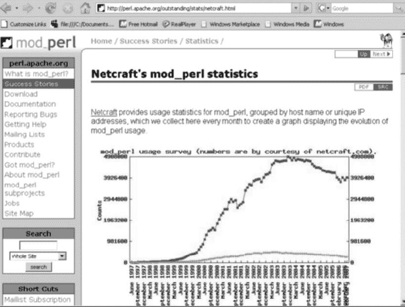

图 D.1

### D.2 mod_perl 网站

mod_perl 主页讨论了以下主题并将为你提供关于 mod_perl 的所有知识，包括安装、下载、文档、帮助、错误等。这里显示了该网站的摘要。

### 什么是 mod_perl？

mod_perl 是 Apache 和 Perl 的结合。

mod_perl 将当今 Web 专业人士最强大且成熟的两种结合在一起。

mp2 是针对 Apache HTTP Server 2.x.x 分支的 mod_perl。

mp1 是针对 Apache HTTP Server 1.3 分支的 mod_perl。

mp2 完全兼容 HTTPD 2.0.x 并支持大部分 2.2.x 功能集。

mod_perl 的未来计划是继续支持随之演化的 HTTPD——这一直一直是目标，并将永远如此。

只需安装 mod_perl，你就可以指掌 Apache Web 服务器的全部威力。

### 成功案例

mod_perl 是许多互联网最繁忙、最先进的 Web 网站背后的力量。这里列出了使用 mod_perl 的人的成功案例；还有 mod_perl 的全球使用统计。

### 下载

获取 mod_perl 源码和二进制发行版并下载文档。

### 文档

The perl 项目提供了文档。

### 报告错误

如果你发现了错误，请报告它。

### 获取帮助

如需帮助，请查看 FAQ 或邮件列表。

### 邮件列表

加入 mod_perl 邮件列表。

### 产品

查看相关产品。

### 贡献

如何贡献 mod_perl。

### 关于 mod_perl

更多关于 mod_perl 的信息。

### 站点地图

mod_perl 的站点地图。

### D.3 安装 mod_perl

本节描述了安装 mod_perl 和配置 Apache 的一般步骤。在本示例中，我们将使用 mp2，它完全兼容 HTTPD 2.0.x 并支持大部分 2.2.x 功能集。

如需文档，请访问 mod_perl 网站 http://perlapache.org/。

## Apache 目录（配置文件）

# 示例 D.2

```
cd c:\wamp\Apache2\conf
C:\wamp\Apache2\conf>dir /b
alias
httpd.conf
httpd.default.conf
magic
magic.default
mime.types
mime.types.default
```

### 编辑 Apache 的 httpd.conf 文件

必须通过添加以下行来修改 Apache httpd.conf 文件：

# 示例 D.3

```
#LoadModule mime_mime_module modules/mod_mime.so
#LoadModule proxy_module modules/mod_proxy.so
#LoadModule proxy_connect_module modules/mod_proxy_connect.so
#LoadModule proxy_http_module modules/mod_proxy_http.so
#LoadModule proxy_ftp_module modules/mod_proxy_ftp.so
LoadModule negotiation_module modules/mod_negotiation.so
#LoadModule rewrite_module modules/mod_rewrite.so
#LoadModule setenvif_module modules/mod_setenvif.so
#LoadModule spelling_module modules/mod_speling.so
#LoadModule status_module modules/mod_status.so
#LoadModule unique_id_module modules/mod_unique_id.so
LoadModule userdir_module modules/mod_userdir.so
#LoadModule usertrack_module modules/mod_usertrack.so
#LoadModule vhost_alias_module modules/mod_vhost_alias.so
LoadModule php_module "c:\www/php/php5apache2.dll"
LoadModule perl_module modules/mod_perl.so

# ExtendedStatus 控制 Apache 在调用 "server-status" 处理程序时，
# 生成“完整”状态信息（ExtendedStatus On）还是仅生成基本信息（ExtendedStatus
# Off）。默认值为 Off。
=============================
```

为 mod_perl 脚本创建位置。我们现在创建一个存储 mod_script 程序的目录/文件夹。不再将 CGI 脚本存储在普通的 cgi-bin 目录中，而是将其移动到这个新目录，名为 c:/home/stas/modperl.

## D.3 安装 mod_perl

在本示例中，我们将 Perl 脚本存储在：

```
c:/home/stas/modperl
```

## Apache Perl 模块存储在哪里？

取决于你使用的 Perl 版本，我们用于运行现有 Perl CGI 脚本的 Apache 模块将存储在 @INC 数组的标准库中。

# 示例 D.4

```
cd /ActivePerl/site/lib/ModPerl
$ ls
BuildMM.pm Manifest.pm RegistryLoader.pm
BuildOptions.pm MapUtil.pm RegistryPrefork.pm
CScan.pm MethodLookup.pm StructureMap.pm
Code.pm ParseSource.pm TestReport.pm
Config.pm PerlRun.pm TestRun.pm
Const.pm PerlRunPerfork.pm TypeMap.pm
FunctionMap.pm Registry.pm Util.pm
Global.pm RegistryBB.pm WrapXS.pm
MM.pm RegistryOrderItem.pm
```

### PerlRequire 指令

接下来，我们将在 Apache 的 conf 目录中创建一个用于常用 Perl 模块的文件。这包含了与 mod_perl 使用的额外模块。通过将此文件名分配给 Apache 配置文件中的 PerlRequire 指令，每当 Apache 服务器启动时，这些模块都会加载。（注意：在某些添加模块的文档中，Registry.pm 模块被称为 Apache:Registry，但在当前 ActiveState 版本中，该模块现在是 ModPerl::Registry。）

# 示例 D.5

```
C:\wamp\Apache2\conf\more extras.pl
use ModPerl::Util ();
use Apache2::Request ();
use Apache2::RequestIO ();
use Apache2::RequestUtil ();
use Apache2::ServerRC ();
use Apache2::ServerUtil ();
use Apache2::Connection ()
use Apache1::Log ()
use Const ()
use Apache2::Const -compile => 'common';
use APR::Const -compile => 'common';
use APR::Table ()
use Apache2::compat ()
use ModPerl::Registry ()
use CGI ()
1;
```

### 编辑 Apache 的 httpd.conf 文件

现在我们将编辑位于 Apache 目录下的 httpd.conf 文件。对于 Windows 系统上的 Apache 版本，conf 目录/文件夹位于 Apache2 文件夹下.

## Apache conf 目录 D.6

```
C:\wamp\Apache2>dir /b
ABOUT_APCHE.txt
bin
cgi-bin
CHANGES.txt
conf
error
icons
include
INSTALL.txt
lib
LICENSE.txt
logs
modules
NOTICE.txt
README.txt
```

现在我们将进入到 conf 目录并找到 httpd.conf 文件.

## Apache 配置文件 httpd.conf D.7

```
C:\wamp\Apache2>cd conf

C:\wamp\Apache2\conf>dir /b
alias
extra.pl
httpd.conf
httpd.default.conf
magic
magic.default
mime.types
mime.types.default
```

接下来，我们通过将示例 D.8 中的行添加到 httpd.conf 文件的末尾来编辑它。（每行前面的数字仅用于解释示例之后说明部分中的每一行。）

## D.3 安装 mod_perl

### 编辑 Apache 配置文件

# 示例 D.8 Alias /perl/ c:/home/stas/modperl/

```
1 Alias /perl/ c:/home/stas/modperl/
2 LoadFile "c:/ActivePerl/bin/perl58.dll"
3 PerlRequire "c:/wamp/Apache2/conf/extras.pl"
4 PerlModule ModPerl::Registry
5 <Location /perl/>
6 SetHandler perl-script
7 PerlModule ModPerl::Registry
8 Options +ExecCGI
9 PerlHeader On
10 Allow from All
</Location>
```

### 解释

1 这是存储 mod_perl 脚本的别名。perl/ 是别名的名称，c:/home/stas/modperl/ 是实际位置。在浏览器地址框中输入 http://localhost/perl/。

2 LoadFile 指令确保了正确的 Perl 解释器。

3 extras.pl 文件包含了许多 mod_perl 模块。PerlRequire 告诉 Apache 在服务器启动时加载这些文件。

4 PerlModule 指令用于加载 Apache:Registry。这里的模块是 ModPerl：使用此指令时，检查 @INC 数组并安装 Registry 模块。

5 Location 部分定义了之前创建的 URI /perl/ 的规则。用于执行 CGI 脚本的模块被称为 Registry，在 Active Perl 安装中列在 @INC 中。

6 当生成内容时，此指令激活 mod_perl 模块来处理它。

7 此指令告诉 Apache 使用哪个模块来生成内容。

8 Options 告诉 Apache CGI 脚本是允许的并具有执行权限。

9 当此指令打开时，mod_perl 将创建正确格式的 HTTP 头。

10 Allow from All 设置允许任何客户端在那个 IP 地址和域名运行脚本.

## 附录 CGI 和 mod_perl

### mod_perl 是否可用

有很多方法可以检查 mod_perl 是否实际工作。重启服务器后，可以在 Apache 错误日志中找到如下：

```
cd c:\wamp\logs
c:\wamp\logs:dir /b
access.log
apache_error.log
mysql_error.log
php_error.log
```

重启服务器后检查 Apache 错误日志。你会看到类似的内容：

```
[Mon Jul 02 14:08:11 2007] [notice] Apache/2.0.55 (Win32) PHP/5.1.4
mod_perl/2.0 Perl/v5.8.8 configured -- normal operations
[Mon Jul 02 14:08:11 2007] [notice] Server built: Oct 9 2005 19:16:56
[Mon Jul 02 14:08:11 2007] [notice] Parent: Created process
```

### 使用 CGI 脚本测试 mod_perl

在 Apache 根目录下传统的 cgi-bin 目录，你会找到一个随 Apache 分发的标准文件，名为 printenv.pl。将此脚本复制到你创建的 mod_perl 目录（在此情况下为 c:/home/stas/modperl），并在 httpd.conf 中映射 /perl/。确保权限正确。服务器应对你的脚本具有执行权限。如果没有，将向浏览器发送以下错误（见图 D.3）。

来自 Apache 的权限错误.

现在在浏览器访问 URL 并执行图 D.4 所示的 printenv.pl 文件。此文件显示环境变量，包括 MOD_PERL 和 MOD_PERL_API_VERSION 变量。

```
COMMANDSPEC="C:\windows\system32\cmd.exe"
DOCUMENT_ROOT="C:\inetpub\www"
GATEWAY_INTERFACE="cgi/1"
HTTP_ACCEPT="text/xml,application/xml,xhtml+xml,text/html;q=0.9"
HTTP_ACCEPT_CHARSET="ISO8859-1,utf-8;q=0.7,*q=0.7"
HTTP_ACCEPT_ENCODING="gzip,deflate"
HTTP_LANGUAGE="en-us;q=0.5"
HTTP_CACHE_CONTROL="max-age=0"
HTTP_CONNECTION="keep-alive"
HTTP_HOST="localhost"
HTTP_KEEP_ALIVE="300"
HTTP_USER_AGENT="Mozilla/5.0 (Windows; NT 5.1; en-us) rv/1.8.1.4"
MOD_PERL="mod/perl/2.0.3"
MOD_PERL_API_VERSION=""
PATH="C:\ActivePerl\bin;C:\ActivePerl;C:\PROGRAM-1\PerEdit;C:\Prog"
PATHEXT=".EXE;.BAT;.COM;.VBS;.VSE;.JS;.JSF;.WSH;.py;;pyw"
QUERY_STRING=""
REMOTE_ADDR="127.0.0.1"
REMOTE_PORT="8380"
REQUEST_METHOD="GET"
REQUEST_URI="/perl/printenv.pl"
SCRIPT_FILENAME="/home/www/status/modperl/printenv.pl"
SCRIPT_NAME="/perl/printenv.pl"
SERVER_ADDR="127.0.0.1"
SERVER_ADMIN="webmaster@localhost"
SERVER_NAME="localhost"
SERVER_PORT="80"
SERVER_PROTOCOL="HTTP/1.1"
```

# 936

## 附录 D • 与速度：CGI 和 mod_perl

尝试另一个 CGI 脚本：

将以下 CGI 脚本放入你的 mod_perl 目录。此脚本使用了 CGI.pm，即面向对象的风格。在安装 mod_perl 后，这些 CGI Perl 脚本应该是可以从该目录直接执行的。（参阅：http://perl.apache.org/start/tips/registry.html）

### 示例 D.9

```perl
#!c:/ActivePerl/bin/perl.exe
use strict;
use CGI;
my $q = CGI->header; 
$q->start_html(-title=>'First mod_perl Try', -BGCOLOR='lightgreen'),
$q->h1('Hi, mod_perl is working!!');
$q->end_html();
```

**图 D.5** 使用 mod_perl 运行 CGI 脚本。

**图 D.4** 实时 HTTP 头部，Firefox 浏览器插件，显示 HTTP 请求/响应。

## D.3 安装 mod_perl

### UNIX/Linux 安装

图 D.7 请访问 Apache 官网进行下载。

以下脚本复制并修改自：http://www.perl.com/pub/a/2002/03/22/modperl.html。请检查你正在使用的 Linux/UNIX 版本。

### 示例 D.10

```bash
$ cd /usr/src
$ lwp-download http://www.apache.org/dist/httpd/binaries/httpd-2.0.55-sparc-sun-solaris-2.8.tar.gz
$ lwp-download http://perl.apache.org/dist/mod_perl-2.0-current.tar.gz
$ tar zvxf apache_1.3.20.tar.gz
$ tar zvxf mod_perl-1.26.tar.gz
$ cd mod_perl-1.26
$ perl Makefile.PL PL_APACHE_SRC=../apache_1.3.20/src \
  DO_HTTPD=1 USE_APACHI=1 EVERYTHING=1
$ make && make test && make install
$ cd ../apache_2.0.55 (在此检查数字是否正确)
$ make install
```

**mod_perl 文档.** mod_perl 项目包含大量针对 mod_perl 1.0 和 2.0 的文档。如果你有任何想学习 mod_perl 的内容，你可以在这里找到。

**mod_perl 文档中使用的约定**

我们在本文中使用了许多约定，它们大多易于理解；如果你有疑问，请在此处查看解释。

**mod_perl 1.0 文档**

针对 mod_perl 1.0 版本的文档集合。

**mod_perl 2.0 文档**

针对 mod_perl 2.0 版本的文档集合。

**通用文档**

在这里你可以找到关于 mod_perl 的通用文档，同时也包含一些并非与 mod_perl 直接相关但对处理 mod_perl 非常有用的信息。这里的大部分信息适用于 mod_perl 1.0 和 2.0。

**站外资源**

mod_perl 书籍、文章、演示文以及涵盖其他相关主题的网站链接。

## D.4 资源

- 1. Bekman, Stas and Cholet, Eric. Practical mod_perl. O'Reilly and Associates, Inc.
- 2. Stein, Lincoln and MacEachern, Doug. Writing Apache Modules with Perl and C. O'Reilly and Associates, Inc.

## 索引

### 符号

- → (中缀运算符), 86, 404
- ! (非运算符), 150
- " (双引号), 73–74
- * 变量, 344
- # 符号, 35
- #标量变量, 81, 203
- #AUTOLOAD 函数, 462–360
- $ (美元符号), 47
- $p 引用, 350
- & 标量变量, 215
- $_变量, 80, 203
- $_ 特殊标量变量, 286
- $$ 变量, 727, 771
- @变量, 757
- $xor, 403
- %ENV 哈希表, 129–130
- %INC 哈希表, 131
- % (取模运算符), 153
- %SIG 哈希表, 130–131
- & (安培符号), 326
- '' (单引号), 47, 74
- () (括号), 263
- * (星号), 251, 402
- ** (幂运算符), 153
- * (乘法运算符), 153
- + (加法运算符), 153
- - (减法运算符), 153
- . (范围运算符), 82, 161
- . (点字符), 235, 283
- / (除法运算符), 153
- :: 语法, 449–451
- :标准函数, 561
- <= (小于运算符), 144
- <= (小于等于运算符), 144
- = (赋值运算符), 71, 141–143
- = (等号), 474
- = 运算符, 877
- > (大于运算符), 144
- >= (大于等于运算符), 144
- > 运算符, 879
- ?pattern, 273
- ?pattern, 273
- ? 占位符, 659
- ? (问号), 256
- @array, 330, 415
- @EXPORT array, 380, 388
- @INC array, 371–374
- @ISA array, 388, 460–462
- @符号, 47
- @* 变量, 778
- [] (方括号), 240
- 匿名数组, 406, 940
- \ (反斜杠), 47, 235, 348
- \n (换行符), 239
- ^ (脱符号), 235
- \ (大括号), 78–79
- | (或运算符), 150
- | (管道符号), 303, 307
- ~ (和运算符), 149
- ~ (波浪号), 779
- URLs, 519–521
- $x 标量, 403
- $file, 320
- AF_INET family, 795–796
- AF_UNIX family, 795–796
- 聚合函数, 902
- alarm 函数, 762–763, 815
- 别名, 401, 898–899
- 创建, 344
- 私有, 345–347
- 传递, 345
- 选择性别名, 348–349
- abs 函数, 618
- abs 函数, 688
- accept 函数, 798, 815
- 访问. 参见, 506–508
- 目录, 698–701
- 元素, 82–84
- 文件, 709–710
- 日志文件, 517–519
- 符号表, 365
- 系统文件, 291
- ACTION 属性, 552
- ActivePerl, 11, 391
- 状态 mod_perl, 929
- 系统调用, 686
- 添加列, 637
- 条目, 666–667
- 扩展, 395
- 类, 471
- 主键, 638
- 表, 626–627
- 空格, 216
- 加法运算符 (+), 153
- 地址 bless, 429–431
- 硬引用, 401
- 网络, 787–794
- 套接字, 996
- ALTER 命令, 899
- 修改. 参见修改
- 元字符, 263
- 表, 899–900
- 替代字符, 237
- 替代引号, 17–75
- ALTER TABLE 命令, 637
- 美国标准协会 (ANSI), 610
- 安培符号 (&), 326
- 锚点, 元字符, 256–281
- 和运算符 (&), 49
- AND 运算符 (SQL), 880–881
- 匿名数组, 406–407, 408
- 匿名哈希表, 92, 407, 428
- 匿名函数, 414–415, 453–456
- 匿名变量, 428
- 引用, 406
- AnyDB_FILE, 505
- Apache. 参见服务器
- 访问日志, 518
- 客户端/服务器数据库, 604
- mod_perl 安装, 928–938
- 概览, 925–926
- 追加文件, 打开为, 293–294
- 文件夹 (MySQL), 615
- 架构, 客户端/服务器数据库, 867
- ARCHIVE 属性, 690

### 参数

- 命令行, 传递在 27
- 命名, 564
- 传递, 310–319
- 指针作为, 352–353
- 位置, 565
- 函数, 330–344
- ARGV 数组, 310–311
- 算术函数, 164–168
- 算术运算符, 153–155
- 数组, 15
- @_, 415
- @EXPORT, 388
- @INC, 371–374
- @ISA, 388, 460–462
- 匿名, 406–408
- ARGV, 310–311
- @array, 330
- 赋值, 80–82
- 关联, 87, 493–494
- 上下文和函数, 342
- 元素, 访问, 82–84
- 函数, 100–117, 参见哈希
- chomp, 100
- chop, 106
- 删除, 101
- 存在, 101
- grep, 102
- join, 103–104
- map, 105–107
- pack, 105–107
- pop, 107
- push, 108
- 反转, 116–117
- shift, 108
- sort, 114
- splice, 109–110
- split, 110–114
- unpack, 105–107
- unshift, 119
- 哈希表, 310, 312
- 输入, 打开为, 293–294
- 变量, 310, 312
- 页面, 创建 HTML,
- 调用者, 816
- 二进制文件 (Win32), 292–293
- BIGINT 数据类型, 624
- binmode 函数, 292, 816
- 生物信息, 915
- biperl, 919–932
- 错误, 758–759
- 位运算逻辑运算符, 156–169
- 黑盒, 325
- bless 函数, 429–431
- 块, 171–177
- catfile 函数, 688
- catpath 函数, 688
- (c) 选项, 279–280
- 标签无循环, 189–191
- 本地函数, 332–334
- 布尔数据类型, 143
- CGI (Common Gateway Interface), 599–601
- 括号化类, 246
- CGI.pm 模块, 559–598
- BREAK 键, 760

# 索引

# 943

- 生成输入字段, 579–593

HTML 表单方法, 564–571

HTTP 标头方法, 596–598

- 概述, 555–560

- 打印函数, 562–564

- 编程风格, 560–562

### 字符

- 星号 (*), 402
- c (补补) 选项, 270–280
- 类, 240–245
- 括号的, 246
- POSIX, 245–247
- d (删除) 选项, 278–279
- 有趣, 70, 131–136
- 十六进制编码, 546–547
- 元字符. 见元字符
- 换行 (\), 239
- s (压缩) 选项, 276, 280
- 存储, 查看, 297
- tr 函数, 276–280
- Unicode, 281–282

### CHAR(x) 数据类型, 624

- chdr 函数, 697

- 复选框, 537–541

- checkbox() 方法, 583

- CHECKBOX 类型, 536

- Checking.pm 模块, 683

- 子进程, 721

- 中文, 281

- chmod 函数, 702–704

- chomp 函数, 95–96, 100, 816

- chop 函数, 95–96, 100, 817

- chown 函数, 704, 817

- chr 函数, 817

- Christianson, Tom, 424, 453

- chroot 函数, 817

### C 语言, 添加扩展, 395

- 类, 223, 425

- 字符, 240–245

- 括号的, 246

- POSIX, 245–247

- Unicode, 281

- 创建, 28

- derdered, 465–471

- Exporter.pm 模块, 380–381

- 层级结构, 460

- House, 428–429

- 实例化, 28

- 方法, 431–433, 436–438

### DBI, 645–647

- 概述, 425–427

- AL, 460

- 变量，绑定, 493–504

- FROM, 629

- GROUP BY, 903

- JOIN, 634

- ORDER BY, 884

- WHERE, 630–633

- WHERE, 876

### 关心字段, 593

- CLEAR 方法, 500

- 客户端, 516–521

- 数据库, 604–610

- MySQL, 614

- 程序, 800–806

- 请求，等待, 798

- closedir 函数, 699, 817

- close 函数, 817

### 关闭

- 数据库, 506

- 文件句柄, 286

- 管道, 286

### 闭包

- 与对象, 455–459

- 概述, 453–455

- 聚类元字符, 263–266

### umns

- 添加, 637

- 绑ning, 657–659

- 数据库, 608–609

- 丢弃, 637

- 选择, 629–630, 872–839

### 命令行

- 参数，传递, 27, 310–319

- 表单, 576–577

- 手册, 10–11

- MySQL, 614

- 开关, 2–39, 856–857

- -c, 42–43

- -e, 40

- -n, 40–42

# 命令

- connect 函数, 798–799, 817

- ALTER TABLE, 637

### 连接

- CREATE DATABASE, 622–623

- 数据库, 648–649

- 调试器, 860–861

- MySQL, 614–616

- find, 692

- 套接, 798–799

- “GRANT”, 619

- TCP/IP, 516

- MySQL, 611, 621–638

### 连接型套接

- od, 297

- 在远程机器上, 806–808

- peridoc, 10, 382

- 在同一机器上, 800–806

- pod, 476–477

### connect(), 方法, 648

- SELECT, 629

### 控制台, mysql, 864

- SQL, 680–681, 865–868

### 常量, 16

- ALTER, 899

- 打印函数, 49–55

- DESCRIBE, 870–871

- 构造函ctor, 425, 434–436

- 参数，传适, 338–440

- 结构, 14–25

- 条件, 172–177

- if, 172–173

- if/else, 173–174

- if/else/else, 174–175

- unless, 175–177

- start, 744–745

- CONTENT_LENGTH 变量

- 替换, 748–749

- 正则表达式, 216

- 子程序, 332–344

- commit(), 671–672

- 常见网关.见 CGI

- CGI 脚本之间的通信

- 循环, 188–196

- 结构, 171–177

- 操作符, 143–145

- 编译, 378–379

- 复杂数据结构, 91–93

- 关系数据库, 605–610

- 复合类, 282

- 复合语句, 171–177

- 拷贝, 332–338

- 综合 Perl.

- COMPRESSED 属性, 690

- 条件结构, 172–177

- 条件修饰, if, 204–205

- 条件运算符, 19, 20, 159–161

- 条件, 201

- LIKE, 881

- NOT LIKE, 881

# 索引

# 945

- CREATE DATABASE, 622–623

- CREATE TABLE, 623

- croak 函数, 386

- 交叉连接, 896

- crypt 函数, 817

- -c switch, 42–43

- curdir 函数, 688

- 大括号 ({}), 78–79

- 匿名哈希, 407

- 当前字节位置，返回, 399

### 数据类型, 14

- Boolean, 143

- 混合, 138–139

- MySQL, 623–626

- SQL, 889–890

### DATE: YYYY-MM-DD 数据类型, 624

- 日期时间函数, 906–910

- 日期格式化, 902

- DATETIME 日, 624

### DBD (数据库驱动模块), 639

- DBI (数据库接口), 672–677

- MySQL 条目, 306, 818

### DBM (数据库管理)

- 文件, 505–512

- 访问, 506–508

- 从 DBM 文件删除条目, 510–512

- 检索数据, 508–510

- 模块, 493

- dbomen 函数, 506, 818

- d (删除) 选项, 278–279

### DDL (数据定义语言), 888–901

- 数据库创建, 888–889

- 键，创建, 893–895

- 关系, 896–899

# D

- 数据库驱动模块 (DBD), 639

- 数据库

- 大写敏感性, 612

- 关闭, 506

- 列, 608–609

- 连接, 649–649

- 创建, 620–621, 622–623, 888–899

- 断开连接, 648–649

- 丢弃, 620–621, 638–901

- 字段, 607–608

- 索引, 609

- 关键字, 611

- MySQL, 603. 见 MySQL

- 命名规范, 611

- northwind, 680

- 打开, 506

- 主键, 609

- 记录, 607–608

- 结果集, 612

- 模式, 609

- 搜索, 619–621

- 选择, 623

- 服务器, 606

- 表, 607

### 数据定义语言.见 DDL

- 数据封装, 425, 428

- 数据报套接, 795

- 调试, 38–39

- 声明, 326

- 解码查询字符串, 545

- 默认消息，修改, 594–596

- default() 方法, 593

- 定义方法, 494

- 预定义方法, 467–770

- 删除函数, 101, 126–127, 510, 818

### DECIMAL 数据类型, 624

- 数据类型, 14

- 数据句柄, 205–208

- 修改, 899–900

- 丢弃, 858–862

### 数据操作语言.见 DML

- 数据库, 648–649

- 删除, 667–668

- 从 DBM 文件删除条目, 510–512

- 行, 635–636

- 分隔符，修改, 219

- 派生类, 465–471

- 后代, 721

- DESCRIBE 命令, 870–871

- DESTROY 方法, 451, 494

- 析构函数, 411–452

- devnull 函数, 688

- 诊断, 29, 655–666

- 诊断程序, 57–,8

# 948

# 索引

filehandles（续）

脚本文件, 14

DATA, 205–208

搜索, 692–695

目录，访问, 698–701

seek 函数, 296–299

命名, 285

源

null, ARGV 和, 311–315

创建, 522

打印, 45

查看, 513

进程, 725–728

统计, 710–712

从读取, 288

存储, 297

引用, 347–348, 417–418

系统, 285, 291

报告，修改, 770–771

tell 函数, 296–299

select 函数, 294–295

测试, 319–321

用户定义, 285–309

cof 函数, 315–317

文件名扩展, 733–755

UNIX, 689–692

file_is_absolute 函数, 688

Win32 二进制, 292–293

fileno 缓冲区, 820

Windows, 689–692

文件协议, 519, 521

File::Spec 模块, 687–689

文件, 24

填充

关联, 32

字段, 779–781

属性, 689–692

表单输出, 302

DBM, 505–512

过滤器, 302. 另参见 pipes

访问, 506–518

输入, 303–306

从中删除条目, 510–512

输出, 303–306

从中检索数据, 508–510

find 周, 692

目录，系统调用, 687–689

Finder (MySQL), 615

编辑, 317–319

File::File 方法, 692–693

filehandles. filehandles

find() 方法, 692

哈希，从从加载, 128–129

FIRSTKEY 方法, 500

初始化，设置 PERL5LIB 变量,

标志, 60

373–384

FLOAT 数据类型, 624

锁定, 295–296

flock 函数, 295–296, 820

日志

foreach 循环, 184–188

访问, 517–519

foreach 修饰符, 210

错误, 533–531

外键，创建, 895

低级 I/O, 712–715

fork 函数, 739–741, 820

修改, 709–710

for 循环, 182–184

打开, 285

format 函数, 820

用于追加, 293–294

format 关键字, 773

从读取, 286–290

格式说明符, 59–60

用于写入, 291–292

格式化

过滤器的输出，发送到, 306–307

数据库, 888–889

.pl, 374–388

日期和时间, 907

.pm, 378–391, 384, 426

键, 893–895

pod, 474–476

表格, 891–893

从读取, 40

页顶端, 771–776

重命名, 708–709

formline 函数, 820

表单

CGI 和, 535–559

CGI.pm 模块, 372–577

元素, 577–579

生成输入字段, 579–593

命令行，测试, 376–577

填写, 543

GET 方法, 541–544

HTML 方法, 564–571

输入, 536–537

处理, 548–551

查看, 538

前向引用, 124

自由语言, 14

FROM 子句, 629

FTP (文件传输协议), 519

全连接, 896

函数导向风格, CGI 脚本, 561–562

函数, 23–350, 813–844

abs, 815

accept, 798, 815

alarm, 762–763, 815

算术, 164–168

数组, 100–167

chop, 100

delete, 101

exists, 102

join, 102–103

map, 103–105

pack, 105–107

pop, 107

push, 108

反转, 116–117

shift, 108–109

sort, 114–116

splice, 109–110

split, 110–114

unpack, 105–107

unshift, 117

atan2, 815

@ARGV, 354–356, 460

$ARGV, 462–464

bind, 797, 816

binmode, 292, 816

bless, 429–431, 816

内置, 36

caller, 816

carout, 593–594

chdir, 697

chmod, 702–704, 816

chomp, 95–96, 100

chomp, 95–96, 100

chown, 704, 817

chr, 817

chroot, 817

close, 817

closed, 817

connect, 798–799, 817

cos, 817

croak, 386

crypt, 817

dbmclose, 506, 818

dbmopen, 506, 818

defined, 79, 818

delete, 510, 818

die, 288–277, 755–757, 816

do, 818

文档, 搜索, 11

dump, 819

each, 819

eof, 315–317, 819

eval, 757–760, 819

exec, 741–742, 819

exists, 819

exit, 743–744, 819

exp, 819

fatal, 593–594

fileno, 820

File::Spec 模块, 687–689, 820

flock, 295–296, 820

fork, 739–741, 820

format, 820

formline, 820

geipuid, 823

getc, 97–98, 820

getrent, 821

getgrgid, 821

getgrnam, 822

grp, 822

gethostbyaddr, 789–794, 821

gethostbyname, 739–794, 821

gethostent, 792–793, 821

getlogin, 726, 821

netbyaddr, 821

netbyname, 822

getcontent, 822

getpeename, 722, 822

getppid, 727, 822

getpriority, 728–729, 821

getprotobname, 789, 822

getprotonumber, 789–790, 823

getprocento, 788–789, 823

getpwent, 732–733, 823

getpwnam, 733–734, 823

getpwuid, 734

getervant, 790–791

getervbyname, 791, 823

getervbyport, 791–792, 824

getervent, 824

getsockname, 824

glob, 754–755, 824

gnt, 735–737, 824

goto, 824

grep, 825

hash, 118–128

delete, 126–127

each, 119–120

exists, 127–128

keys, 118

values, 119

hex, 825

host information, 792–734

import, 825

index, 825

int, 825

ioctl, 825

join, 825

keys, 825

kill, 761–762, 825

last, 826

lc, 826

lcfirst, 826

length, 826

link, 706–707, 826

listen, 797, 826

local, 332–334, 345–347, 826

localtime, 36, 737–738, 826

lock, 826

stat, 710–712, 826

s, 827

map, 827

msgctl, 827

msgget, 827

msgrev, 827

msgnd, 827

my, 828

MySQL, 905

new, 828

next, 828

not, 828

oct, 829

open, 285, 829

opendir, 698, 829

ord, 829

our, 829

package, 830

pos, 830

print, 830

prototype, 830

push, 830

q, 831

qw, 831

srand, 166, 831

socket, 831

socketpair, 831

sort, 831

special string, 162–164

splice, 831

, 831

splice, 831

splice, 832

read, 832

readline, 832

readdir, 698, 832

recv, 832

redo, 832

ref, 832

require, 374, 833

return, 376, 833

rewind, 833

index, 696, 833

s, 834

scalar, 372, 834

seek, 296–299, 714–715, 834

seekdir, 700, 834

select, 294–295, 834

sem, 727, 834

system, 750–752, 834

s, 835

my, 828, 835

next, 828, 835

not, 728, 835

shift, 108, 835

semctl, 727, 835

semop, 727, 835

send, 790, 835

set, 729, 835

socket, 831, 835

socketpair, 831, 835

sort, 831, 835

special string, 162–164, 835

splice, 831, 835

s, 834, 836

scalar, 372, 836

seek, 296–299, 714–715, 836

seekdir, 700, 836

select, 294–295, 836

sem, 727, 836

system, 750–752, 836

s, 835, 836

my, 828, 836

next, 828, 836

not, 728, 836

shift, 108, 836

semctl, 727, 836

semop, 727, 836

send, 790, 836

set, 729, 836

socket, 831, 836

socketpair, 831, 836

sort, 831, 836

special string, 162–164, 836

splice, 831, 836

s, 834, 837

scalar, 372, 837

seek, 296–299, 714–715, 837

seekdir, 700, 837

select, 294–295, 837

sem, 727, 837

system, 750–752, 837

s, 835, 837

my, 828, 837

next, 828, 837

not, 728, 837

shift, 108, 837

semctl, 727, 837

semop, 727, 837

send, 790, 837

set, 729, 837

socket, 831, 837

socketpair, 831, 837

sort, 831, 837

special string, 162–164, 837

splice, 831, 837

s, 834, 838

scalar, 372, 838

seek, 296–299, 714–715, 838

seekdir, 700, 838

select, 294–295, 838

sem, 727, 838

system, 750–752, 838

s, 835, 838

my, 828, 838

next, 828, 838

not, 728, 838

shift, 108, 838

semctl, 727, 838


# 索引

## 符号

- `semop`, 727, 838
- `send`, 790, 838
- `set`, 729, 838
- `socket`, 831, 838
- `socketpair`, 831, 838
- `sort`, 831, 838
- `special string`, 162–164, 838
- `splice`, 831, 838
- `s`, 834, 839
- `scalar`, 372, 839
- `seek`, 296–299, 714–715, 839
- `seekdir`, 700, 839
- `select`, 294–295, 839
- `sem`, 727, 839
- `system`, 750–752, 839
- `s`, 835, 839
- `my`, 828, 839
- `next`, 828, 839
- `not`, 728, 839
- `shift`, 108, 839
- `semctl`, 727, 839
- `semop`, 727, 839
- `send`, 790, 839
- `set`, 729, 839
- `socket`, 831, 839
- `socketpair`, 831, 839
- `sort`, 831, 839
- `special string`, 162–164, 839
- `splice`, 831, 839
- `s`, 834, 840
- `scalar`, 372, 840
- `seek`, 296–299, 714–715, 840
- `seekdir`, 700, 840
- `select`, 294–295, 840
- `sem`, 727, 840
- `system`, 750–752, 840
- `s`, 835, 840
- `my`, 828, 840
- `next`, 828, 840
- `not`, 728, 840
- `shift`, 108, 840
- `semctl`, 727, 840
- `semop`, 727, 840
- `send`, 790, 840
- `set`, 729, 840
- `socket`, 831, 840
- `socketpair`, 831, 840
- `sort`, 831, 840
- `special string`, 162–164, 840
- `splice`, 831, 840
- `s`, 834, 841
- `scalar`, 372, 841
- `seek`, 296–299, 714–715, 841
- `seekdir`, 700, 841
- `select`, 294–295, 841
- `sem`, 727, 841
- `system`, 750–752, 841
- `s`, 835, 841
- `my`, 828, 841
- `next`, 828, 841
- `not`, 728, 841
- `shift`, 108, 841
- `semctl`, 727, 841
- `semop`, 727, 841
- `send`, 790, 841
- `set`, 729, 841
- `socket`, 831, 841
- `socketpair`, 831, 841
- `sort`, 831, 841
- `special string`, 162–164, 841
- `splice`, 831, 841
- `s`, 834, 842
- `scalar`, 372, 842
- `seek`, 296–299, 714–715, 842
- `seekdir`, 700, 842
- `select`, 294–295, 842
- `sem`, 727, 842
- `system`, 750–752, 842
- `s`, 835, 842
- `my`, 828, 842
- `next`, 828, 842
- `not`, 728, 842
- `shift`, 108, 842
- `semctl`, 727, 842
- `semop`, 727, 842
- `send`, 790, 842
- `set`, 729, 842
- `socket`, 831, 842
- `socketpair`, 831, 842
- `sort`, 831, 842
- `special string`, 162–164, 842
- `splice`, 831, 842
- `s`, 834, 843
- `scalar`, 372, 843
- `seek`, 296–299, 714–715, 843
- `seekdir`, 700, 843
- `select`, 294–295, 843
- `sem`, 727, 843
- `system`, 750–752, 843
- `s`, 835, 843
- `my`, 828, 843
- `next`, 828, 843
- `not`, 728, 843
- `shift`, 108, 843
- `semctl`, 727, 843
- `semop`, 727, 843
- `send`, 790, 843
- `set`, 729, 843
- `socket`, 831, 843
- `socketpair`, 831, 843
- `sort`, 831, 843
- `special string`, 162–164, 843
- `splice`, 831, 843

## 953

- 数组 (`arrays`), 92–93, 410–412
- 上下文 (`context`), 131–132
- `%ENV`, 129–130
- 文件 (`files`), 加载, 128–129
- 哈希的哈希 (`hashes of hashes`), 91–92, 414–414
- `%INC`, 131
- 输入 (`input`), 赋值给, 99
- `%SIG`, 130–131
- 排序 (`sorting`), 120–126
- 特殊 (`special`), 129–131
- 类型系统 (`typing`), 500–504
- 哈希函数 (`hash functions`), 118–128
- 删除 (`delete`), 126–127
- `each`, 119–120
- 存在 (`exists`), 127–128
- 键 (`keys`), 118
- 值 (`values`), 119
- HTTP 请求头 (`headers, HTTP`), 529–530, 596–598
- 帮助 (`help`), mod_perl, 928
- Here documents (此处文档), 63–66, 563, 752–753
- `eval` 和函数 (`eval and function`), 759–760
- 十六进制编码字符 (`hex-encoded characters`), 546–547
- `hex` 函数 (`hex function`), 825
- `HIDDEN` 属性, 690
- `HIDDEN` 类型, 536
- 类层级结构 (`hierarchies of classes`), 460
- `hlo()`, 方法 565
- 主机信息函数 (`host information functions`), 792–794
- 主机名 (`hostnames`), 520
- `House` 类, 428–429
- `h2ph` 脚本, 747–748
- `htdocs` 目录, 537
- HTML (超文本标记语言)
  - 文档, 11
  - 表单 (`forms`), 564–571
  - 到 CGI 脚本的链接, 533–535
  - 视图 (`view`), 526–531
  - pod 文档翻译, 479
- HTTP (超文本传输协议)
  - 请求头 (`headers`), 529–530, 596–598
  - 服务器 (`servers`), 516–517
  - 状态码 (`status codes`), 517–519
- `h2xs` 工具, 395–397
- 超链接 (`hyperlinks`), 534. 参见 links
- 超文本标记语言。请参见 HTML

## I

- 图标 (`icons`), PPM 窗口, 394
- IDE (集成开发环境), 34
- `if` 结构 (`if constructs`), 172–173
- `if/else` 结构, 173–174
- `if/else` 结构, 174–175
- `if` 修饰符 (`if modifiers`), 204–205
- `if` 语句 (`if statements`), 172
- `IMAGE` 类型, 537
- `it` 修饰符 (`it modifiers`), 215, 222
- DBM 的实现 (`implementation of DBM`), 505
- `import` 导入函数, 825
- 导入 (`importing`)
  - 模块 (`modules`), 375–385
  - `use` 函数, 378–379
- 索引 (`indexes`), 数据库, 609
- `index` 函数, 825
- 中缀运算符 (`infix operator`) `->`, 86, 404
- 实例 (`instance`), 424, 460–473
  - 多个 (`multiple`), 465, 471
  - 单个 (`single`), 465
- 初始化文件 (`initialization files`), 373–374
- 内连接 (`inner joins`), 896
- 输入 (`input`)
  - 数组 (`arrays`), 赋值给, 98–99
  - 字段 (`fields`), 生成, 579–593
  - 过滤器 (`filters`), 307–309
  - 表单 (`forms`), 536–537
  - 哈希 (`hashes`), 赋值给, 99
  - 管道 (`pipes`), 526
  - POST 方法, 551–555
  - 标量变量 (`scalar variables`), 赋值, 94
- `INSERT` 命令, 885–886
- 安装 (`installing`)
  - DBI, 639–643
  - Perl (`_perl`), 928–938
  - 模块 (`modules`), 391
  - MySQL, 613–614
- 实例 (`instances`)
  - 方法 (`methods`), 431–433, 436–438
  - 传递给 (`passing to`), 440–442
  - 变量 (`variables`), 465
- 实例化 (`instantiating classes`), 28
- `INT` 类型, 624

## 954

- 集成开发环境 (`Integrated Development Environments`)。请参见 IDEs
- `Tab`, 247
- `Enter`, 247
  - 创建 (`creating`), 893–895
  - 哈希 (`hashes`), 排序, 121–124
  - MySQL, 编辑 (`editing`), 615
  - 主 (`primary`)
  - 增加 (`adding`), 638
  - 数据库 (`databases`), 609
  - 表 (`tables`), 增加, 626–778
  - 信号 (`signals`), 760
  - `keys` 函数 (`keys function`), 118, 825
  - 关键字 (`keywords`)
    - 数据库 (`databases`), 611
    - `do`, 326
    - 格式 (`format`), 773
    - 私有 (`private`), 429
    - 保护 (`protected`), 429
    - 公有 (`public`), 429
    - `require`, 326
    - `sub`, 327, 357, 414
    - `use`, 326
    - `-k $file`, 326
- `kill` 函数 (`kill function`), 761–825
- 接口 (`interfaces`)
  - CGI, 63–66. 参见 CGI
  - DBI, 638–648
  - 错误处理 (`error handling`), 755–760
  - 操作系统 (`operating systems`), 745–775
  - PPM, 393–397
  - 公共用户 (`public user`), 474–779
  - 信号 (`signals`), 760–764
  - 系统调用 (`system calls`), 685–721
  - 内部错误消息 (`Internal Error message`), 562
  - 互联网 (`Internet`)
    - 客户端和服务器 (`clients and servers`), 516–521
    - 域名 (`domains`), 795
    - Internet Explorer, 522
    - 互联网协议 (`IP`), 786
    - 地址 (`addresses`), 787
  - 内部语言概览 (`internal language of`)
    - 解释器 (`interpreters`), 2
    - pod 文件, 474, 777
    - 搜索 (`searching`), 326
  - `int` 函数, 825
  - 调用 (`invoking`)
    - 方法 (`methods`), 432
    - 子程序 (`subroutines`), 326
  - `ioctl` 函数, 825
  - `isa()` 方法 (`isa(method)`), 462
  - `-i` 开关 (`i switch`), 317–319

## L

- 标签 (`labels`), 45, 588–590
- 循环控制 (`loop control`), 188–189
- 嵌套循环 (`nested loops and`), 191–194
- 语言 (`languages`)
  - `awk`, 383
  - C, 增加扩展, 375
  - DDL. 请参见 DDL
  - DML. 请参见 DML
  - Perl. 请参见 SQL, 604
- Unicode 字符, 285
- `last` 函数 (`last function`), 826
- 最后语句 (`last statements`), 192
- 以太网层 (`layers, Ethernet`), 786
- `lcfirst` 函数, 826
- 左连接 (`left joins`), 896
- `length` 函数 (`length function`), 826
- 左运算符 (`left operator`), 145

## J

- `join` 函数 (`join function`), 102–103, 688, 825
- 连接表 (`joining tables`), 634–635
- 连接 (`joins`), 896

## K

- 日语 (`Japanese`), 281
- 内核系统调用 (`kernels system calls. UNIX`), 689
- `Enter` 键, 247
- `Tab` 键, 247
- 键 (`keys`), 87

## 955

- 小于运算符 (`<`), 144
- 小于等于运算符 (`<=`), 144
- 局部变量 (`lexical variables`), 453
- 库 (`libraries`), 29, 370–390
- 模块 (`modules`), 385–388
- OOP (面向对象编程), 479–484
- Perl 5 模块, 383–385
- pod 文件, 474–476
- `LIKE` 条件, 881
- `LIMIT` 命令, 874–875
- 换行符 (`linebreaks`), 34–35
- `link`（链接）函数 (`link function`), 706–707, 826
- 链接 (`links`), 513
- CGI 脚本 (`CGI scripts`), 534–535
- 硬/软链接 (`hard and soft`), 705–708
- Linux. UNIX
  - Active Perl, 391
  - 数据库服务器 (`database servers`), 606
  - PPM, 644
- `listen` 函数 (`listen function`), 797, 826
- 文件 (`files`)
  - 访问 (`accessing`), 517–519
  - 错误 (`errors`), 530–531
  - 断言 (`look around assertions`), 273–276
  - 循环 (`loops`), 20–22
  - `for`, 182–184
  - 控制 (`control`), 188–196
  - 文件句柄 (`filehandles`), 205–208
  - `do/until`, 181
  - `do/while`, 181
  - `foreach`, 184–188
  - 修饰符 (`modifiers`), 209–210
  - 嵌套和标签 (`nested and labels`), 191–194
  - 重复 (`repetition with`), 177–199
  - `until`, 179–182
  - `while`, 177–179
  - 低层文件 I/O (`low-level file I/O`), 712–715
  - `stat` 函数 (`stat function`), 710–712
- 运算符 (`It operator`), 145

## M

- Mac OS
  - Active Perl, 391
  - 文件 (`files`), 读取, 286–290
  - 脚本 (`scripts`), 启动 32
  - 邮件列表 (`mailing lists`), mod_perl, 928
  - `mailto` 协议, 519
  - 主包 (`main package`), 70, 424
  - 管理 (`managing`)
    - DBM. 请参见 DBM
    - PPM, 391–397
    - RDBMS. 请参见 RDBMS
  - 手册 (`man pages`), 10–11
  - 手动错误处理 (`manual error handling`), 655–656
  - `map` 函数 (`map function`), 103–105
- 匹配 (`matching`)
  - 全局矩阵 (`global matrices`), 214
  - 元字符 (`metacharacters`), 236–238
  - 修饰符 (`modifiers`), 210
  - 模式 (`patterns`), 881–882
  - `BLOB` 数据类型, 624
  - `chop` and `chop` 函数, 360
  - CPAN, 390. 请参见 CPAN
  - 列表 (`of lists`), 408–410
  - 邮件 (`mailing`), mod_perl, 928
  - 多维数组 (`multidimensional arrays`), 86–87
  - 空参数 (`null parameter`), 328
  - 哈希的哈希 (`of values, hashes of hashes`), 361
  - 字面量 (`literals`), 16
  - `print` 函数 (`print function`), 49–55
  - 打印 (`printing`), 51–53
  - 从文件加载哈希 (`loading hashes from files`), 128–129
  - 本地函数 (`local function`), 332–334, 345–347
  - `localtime` 函数 (`localtime function`), 36, 737–738, 826
- 位置标头 (`Location headers`), 529
- 定位器框 (`Locator Box`), 搜索, 520
- 锁定文件 (`locking files`), 295–296
- `log` 函数 (`log function`), 827
- 逻辑运算符 (`logical operators`), 149–151
- 逻辑单词运算符 (`logical word operators`), 151–152
- 日志 (`logs`), 526

## 956

- `INT` 类型, 624
- `TEXT` 数据类型, 624
- 下拉菜单 (`drop-down`), 591
- 弹出 (`pop-up`), 537–541, 591–592
- 消息 (`messages`), 594–596
- 元字符 (`metacharacters`), 26, 235–280
- 分择 (`alternation`), 263
- 锚点 (`anchors`), 258–261
- 捕获 (`capturing`), 266–273
- 贪婪性 (`greedness of`), 250–258
- 分组 (`grouping`), 263–266
- 断言 (`look around assertions`), 273–276
- 模式匹配 (`pattern matches`), 250–276
- 单个字符 (`single characters`), 326, 238–247
- `tr` 函数, 276–280
- 空格 (`whitespace`), 247–249

## 957

- `tr`, 277
- `Win32:Process`, 746–747
- `unless`, 207
- `Win32:Spawn`, 745–746
- `until`, 209
- 模运算运算符 (`%`), 153
- `while`, 209
- 监控公共/私有边界 (`monitoring public/private borders`), 427
- `x`, 216
- `m` 运算符, 217
- 修改 (`modifying`)
  - `msgctl` 函数, 827
- `@array`, 330
- `msget` 函数, 828
- 默认消息 (`default messages`), 594–596
- `msgr` 函数, 828
- 目录 (`directories`), 697
- `msndf` 函数, 828
- 文件句柄报告 (`filehandles, reports`), 770–771
- 多维数组 (`multidimensional arrays`), 86–87
- 文件 (`files`), 709–710
- 列表列表 (`lists of lists`), 408–410
- 替换分隔符 (`substitution delimiters`), 219
- 多行字段 (`multiline fields`), 770–771
- 表 (`tables`), 637, 899–900
- 多个文件传递 (`multiple files, passing`), 317–319
- 多重继承 (`multiple inheritance`), 465, 471
- 多个占位符 (`multiple placeholders`), 660–661
- 乘法运算符 (`*`), 153
- 网站 (`web sites`), 927–928

## MIME (多用途互联网扩展)

- 类型 (`types`), 529
- 杂项字符 (`miscellaneous characters`), 237
- 混合数据类型 (`mixing data types`), 138–139
- `mdir` 函数, 827
- 修饰符 (`modifiers`), 261
  - `c`, 223
  - 标志 (`flags`), 60
  - `foreach`, 210
  - `g`, 214, 220
  - `i`, 215, 222
  - `if`, 204–205
  - 循环 (`loops`), 209–210
  - `m`, 261
  - 匹配 (`matching`), 210
  - 正则表达式 (`regular expressions`), 204–210
  - `s`, 239
  - 替换 (`substitution`), 216–226

## 958

# MySQL (续接)

- 非阻塞锁, 295
- 字符串函数, 905
- `NORMAL` 属性, 690
- 事务, 670–672
- `northwind` 数据库, 607, 680
- `mysql` 控制台, 864
- `not` 函数, 828
- `mysql` 进程, 606
- `NOT LIKE` 条件, 881
- `mysql` 服务, 606
- `no_upwards` 函数, 688
- `-n` 选项, 40–42

## N

- `NTFS`, 701
- 核苷酸, 916
- 命名参数, 564
- `NULL`, 877
- 命名化参数, 442–244
- 空值字段列表, `ARGV`, 以及 311–335
- 命名空间, 70, 423
- 数字参数列表, 328
- 包 (`packages`)。见 packages
- 数字, 16
- 符号，导出与导入, 379
- 键，通过哈希值排序, 121–122
- 命名
- 元字符, 236
- 别名, 898–899
- 创建, 344
- 端口, 778–788
- 惯例
- 随机，生成, 165
- 数据库, 611
- 字符串，转换, 138
- SQL, 867
- 数字函数, 902–904
- 文件句柄 (`filehandles`), 285
- 数字字面量, 49
- 文件, 708–709
- 打印,–52
- 主机名, 520
- 数值, 关系运算符, 以及 144
- 脚本, 34
- 脚本 (`scripts`)
- 子程序 (`subroutines`), 374
- 变量, 70–71, 401
- `ndbm` (new DBM) 实现, 505
- 面向对象编程。见 OOP
- 嵌套结构, 408–414
- 面向对象风格，CGI 脚本, 560–562
- 嵌套循环和标签, 191–194
- 对象, 28, 423, 425, 486–491
- Netscape 浏览器, 522
- 闭包和, 455–459
- 网络, 785
- `DESTROY` 方法, 451
- 地址, 787–794
- 概述, 428–429
- 客户端/服务器模型, 785
- 状态, 434
- 客户端/服务器程序, 800–862
- 获取 Perl, 6–8
- 协议, 785–787
- `oct` 函数, 829
- `Socket.pm` 模块, 808–812
- `odbm` (old DBM) 实现, 505
- 套接 (`sockets`), 794–800
- `new` 命令, 297
- `new` 函数, 828
- `OFFLINE` 属性, 690
- 换行 (`n`) 字符, 239
- `-s $file`, 319
- `new` 方法, 495
- OOP (面向对象编程), 423–425
- 新协议, 519
- 继承, 460–473
- `new` 函数, 828
- 模块, 433–44
- `NEXTKEY` 方法, 500
- 公共用户接口, 474–479
- `next` 语句, 192
- 标准 Perl 库, 479–484
- 优先级 (`niceness`), 728–729
- `opendir` 函数, 698, 829
- `no` 函数, 828

# 索引

- `open` 函数, 285, 829
- 打开数据库, 506
- 用于追加, 293–294
- 用于读取, 286–290
- 用于写入, 291–292
- 管道 (`pipes`), 302–309
- 操作数, 137
- 比较, 143–145
- 操作系统。另见 Linux; UNIX; Windows
- 接口, 747–755
- 操作
- 数据库, 493
- 文件锁, 295–296
- 读取, 301–302
- 写入, 301–302
- 运算符, 18
- `=` 877
- `AND`, 880–881
- `and` (`&&`), 149
- `//` 877
- 加法 (`+`), 153
- 算术, 153–154
- 赋值 (`=`), 71, 141–143
- 自动递减, 154–155
- 自动递增, 154–155
- 位 逻辑, 156–169
- 条件, 20, 159–161
- 数据类型，混合, 138–349
- 除法 (`/`), 153
- 等于, 146–149
- 幂 (`**`), 153
- 文件测试, 319–320
- `ge`, 145
- 大于 (`>`), 144
- 大于等于 (`>=`), 144
- `gt`, 145
- 右置 (`->`), 86, 404
- `le`, 145
- 小于 (`<`), 144
- 小于等于 (`<=`), 144
- 逻辑, 149–151
- 逻辑单词, 151–152
- `lt`, 145
- 取模 (`%`), 153
- 乘法 (`*`), 153
- `my`, 334–336, 345–347
- 非 (`!`), 150
- `OR`, 880–881
- 或 (`|`), 150
- 重载, 138
- 概述, 337
- 优先级和结合性, 139–168
- 范围 (`..`), 82, 161
- 正则表达式, 210–332
- 模式绑定, 226–332
- `s`, 216–226
- 关系, 143–145
- 特殊字符串, 162–164
- 减法 (`-`), 153
- `ORDER` 子句, 884
- `ord` 函数, 829
- `OR` 运算符, 880–881
- 或 (`|`), 150
- `our` 函数, 829
- CGI 脚本, 529
- 过滤器, 303–306
- 打印, 144
- 广播按钮, 588
- 重载运算符, 138
- 重写父方法, 471–473
- 所有权, 701–705
- 包 (`函数`), 830
- 类, 363–370, 399–400
- 导出与导入, 379–385
- `main`, 70, 424
- OOP, 423–425
- `.pl` 文件, 374–378
- PPM, 391

# 包 (续接)

- `pwd`, 374
- 标准 Perl 库, 370–390
- 符号表, 365–370
- `Tie::Scalar`, 495
- 变量, 69–70
- 数据包 (`packets`), 786
- `pack` 函数, 105–1030
- 数据打包, 715–721
- 绑定, 622–664
- 构造函数，传递, 438–440
- 实例方法，传递, 440–442
- `param` 方法, 572
- 命名, 442–444
- 父类, 465
- 括号 (`()`), 263
- 重写父方法, 471–473
- 父进程 ID, 727
- 传递参数, 27–310, 319, 330–344
- 引用文件名, 347–348, 417–418
- 多个文件, 317
- 实例化构造方法, 438–440
- 实例化实例方法, 440–442
- 子程序指针, 353–354
- 引用子程序, 415–417
- 传递给子程序的值, 349–354
- 密码
- MySQL, 615–616
- 进程, 730–734
- UNIX, 732–733
- Windows, 730–732
- `PASSWORD` 类型, 537
- `PATHEXT` 变量, 33
- `path` 函数, 688
- 模式匹配, 203, 234, 881–882
- 绑定运算符, 226–332
- 重复, 250–276
- 保存, 215
- 子模式，创建, 263
- `peridoc` 命令, 10, 382
- Perl 目录, 6
- 文档。见 man pages
- 解释型语言，概述 2
- 获取, 6–8
- 版本, 3–5
- `perldoc` 函数, 686
- `PERLIB` 变量, 373–374
- Perl 5 模块，标准 Perl 库, 383–385
- Perl Package Manager。见 PPM
- 权限, 293
- 文件锁, 295–296
- MySQL, 619
- 系统调用, 701–705
- `-p $file`, 320
- `pgp` 函数, 727
- `phpMyAdmin` 工具 (MySQL), 618
- `pid`, 721
- `pipe` 函数, 830
- 管道 (`pipes`), 255
- 关闭, 286
- 输入, 526
- 打开, 302–309
- `|` (管道符号), 303, 307
- 读取来自, 41
- 占位符, 659
- 多个, 660–661
- 记录，插入, 661–662
- `.pl` 文件, 374–378, 388
- `.pl` 文件, 374, 388
- CGI 脚本, 529
- 模式匹配, 203, 234, 881–882
- 绑定运算符, 226–332
- 重复, 250–276
- 保存, 215
- 子模式，创建, 263
- `peridoc` 命令, 10, 382
- Perl 目录, 6
- 文档。见 man pages
- 解释型语言，概述 2
- 获取, 6–8
- 版本, 3–5
- `perldoc` 函数, 686
- `PERLIB` 变量, 373–374
- Perl 5 模块，标准 Perl 库, 383–385
- Perl Package Manager。见 PPM
- 权限, 293
- 文件锁, 295–296
- MySQL, 619
- 系统调用, 701–705
- `-p $file`, 320
- `pgp` 函数, 727
- `phpMyAdmin` 工具 (MySQL), 618
- `pid`, 721
- `pipe` 函数, 830
- 管道 (`pipes`), 255
- 关闭, 286
- 输入, 526
- 打开, 302–309
- `|` (管道符号), 303, 307
- 读取来自, 41
- 占位符, 659
- 多个, 660–661
- 记录，插入, 661–662
- `.pl` 文件, 374–378, 388
- `.pl` 文件, 374, 388
- CGI 脚本, 529
- 模式匹配, 203, 234, 881–882
- 绑定运算符, 226–332
- 重复, 250–276
- 保存, 215
- 子模式，创建, 263
- `peridoc` 命令, 10, 382
- Perl 目录, 6
- 文档。见 man pages
- 解释型语言，概述 2
- 获取, 6–8
- 版本, 3–5
- `perldoc` 函数, 686
- `PERLIB` 变量, 373–374
- Perl 5 模块，标准 Perl 库, 383–385
- Perl Package Manager。见 PPM
- 权限, 293
- 文件锁, 295–296
- MySQL, 619
- 系统调用, 701–705
- `-p $file`, 320
- `pgp` 函数, 727
- `phpMyAdmin` 工具 (MySQL), 618
- `pid`, 721
- `pipe` 函数, 830
- 管道 (`pipes`), 255
- 关闭, 286
- 输入, 526
- 打开, 302–309
- `|` (管道符号), 303, 307
- 读取来自, 41
- 占位符, 659
- 多个, 660–661
- 记录，插入, 661–662
- `.pl` 文件, 374–378, 388
- `.pl` 文件, 374, 388
- CGI 脚本, 529
- 模式匹配, 203, 234, 881–882
- 绑定运算符, 226–332
- 重复, 250–276
- 保存, 215
- 子模式，创建, 263
- `peridoc` 命令, 10, 382
- Perl 目录, 6
- 文档。见 man pages
- 解释型语言，概述 2
- 获取, 6–8
- 版本, 3–5
- `perldoc` 函数, 686
- `PERLIB` 变量, 373–374
- Perl 5 模块，标准 Perl 库, 383–385
- Perl Package Manager。见 PPM
- 权限, 293
- 文件锁, 295–296
- MySQL, 619
- 系统调用, 701–705
- `-p $file`, 320
- `pgp` 函数, 727
- `phpMyAdmin` 工具 (MySQL), 618
- `pid`, 721
- `pipe` 函数, 830
- 管道 (`pipes`), 255
- 关闭, 286
- 输入, 526
- 打开, 302–309
- `|` (管道符号), 303, 307
- 读取来自, 41
- 占位符, 659
- 多个, 660–661
- 记录，插入, 661–662
- `.pl` 文件, 374–378, 388
- `.pl` 文件, 374, 388
- CGI 脚本, 529
- 模式匹配, 203, 234, 881–882
- 绑定运算符, 226–332
- 重复, 250–276
- 保存, 215
- 子模式，创建, 263
- `peridoc` 命令, 10, 382
- Perl 目录, 6
- 文档。见 man pages
- 解释型语言，概述 2
- 获取, 6–8
- 版本, 3–5
- `perldoc` 函数, 686
- `PERLIB` 变量, 373–374
- Perl 5 模块，标准 Perl 库, 383–385
- Perl Package Manager。见 PPM
- 权限, 293
- 文件锁, 295–296
- MySQL, 619
- 系统调用, 701–705
- `-p $file`, 320
- `pgp` 函数, 727
- `phpMyAdmin` 工具 (MySQL), 618
- `pid`, 721
- `pipe` 函数, 830
- 管道 (`pipes`), 255
- 关闭, 286
- 输入, 526
- 打开, 302–309
- `|` (管道符号), 303, 307
- 读取来自, 41
- 占位符, 659
- 多个, 660–661
- 记录，插入, 661–662
- `.pl` 文件, 374–378, 388
- `.pl` 文件, 374, 388
- CGI 脚本, 529
- 模式匹配, 203, 234, 881–882
- 绑定运算符, 226–332
- 重复, 250–276
- 保存, 215
- 子模式，创建, 263
- `peridoc` 命令, 10, 382
- Perl 目录, 6
- 文档。见 man pages
- 解释型语言，概述 2
- 获取, 6–8
- 版本, 3–5
- `perldoc` 函数, 686
- `PERLIB` 变量, 373–374
- Perl 5 模块，标准 Perl 库, 383–385
- Perl Package Manager。见 PPM
- 权限, 293
- 文件锁, 295–296
- MySQL, 619
- 系统调用, 701–705
- `-p $file`, 320
- `pgp` 函数, 727
- `phpMyAdmin` 工具 (MySQL), 618
- `pid`, 721
- `pipe` 函数, 830
- 管道 (`pipes`), 255
- 关闭, 286
- 输入, 526
- 打开, 302–309
- `|` (管道符号), 303, 307
- 读取来自, 41
- 占位符, 659
- 多个, 660–661
- 记录，插入, 661–662
- `.pl` 文件, 374–378, 388

# 索引

## 963

- 概述, 401
- `$p`, 350
- 子程序, 414–417
- 符号, 344–349
- 引用函数, 418–820, 833
- 正则表达式, 26–234
- 注释, 216
- 元字符, 235–280
- 选择替, 263
- 锚点, 258–261
- 捕获, 266–273
- 贪婪性, 250–258
- 分组, 263–266
- 环绕断言, 273–276
- 模式匹配，重复, 250–276
- 单字符, 236, 238–247
- `t` 函数, 276–280
- 空格, 247–249
- `y` 函数, 276–280
- 修饰符, 204–210. 修饰符
- 运算符, 210–232
- `m`, 210–216
- 模式绑定, 226–232
- `s`, 216–226
- 概述, 203
- 语句, 204–210
- Unicode, 281–282
- `el2abs` 函数, 688
- 关系数据库管理系统 (`DBMS`), 604
- 组件, 605–610
- 关系型数据库, 604–613
- 组成, 605–610
- 关系运算符, 143–145
- 关系, DDL, 896–899
- 记忆元字符, 266–273
- 重命名函数, 708–709, 833
- 重命名文件, 708–709
- 重复
- 字符, 237
- 模式匹配, 250–276
- 循环重复, 177–199
- 报告, mod_perl 错误, 927–928
- 报告模板, 767–783
- 定义, 767–770
- 动态报告生成, 781–783
- 文件句柄，修改, 770–771
- 填充字段, 779–781
- 多行字段, 778–779
- `select` 函数, 776–778
- 页面顶部格式化, 771–856
- 请求，等待客户端, 798
- `require` 函数, 374, 833
- `require` 关键字, 326
- 留 word, 45
- 数据库, 611–602
- SQL, 867
- 重置函数, 833
- `reset()` 方法, 592
- `RESET` 类型, 537
- 结果，排序, 884
- 结果集
- 数据库, 612–613
- SQL, 868
- 获取
- 从 DBMS 文件获取数据, 508–510
- 行, 608
- `return` 函数, 326, 340, 833
- 返回
- 当前字节位置, 299
- 文件句柄, 294
- 值
- `ref` 函数, 418–420
- 子程序, 116–117, 833
- `reverse` 函数，排序哈希键, 121–122
- 修订, 317–319
- `rewinddir` 函数, 833
- `-r $file`, 319
- `Riesen`, B., 787
- `index` 函数, 833
- `rmdir` 函数, 696, 833
- `rollback()` 方法, 671–672
- `rootdir` 函数, 688
- `root` 用户, 618
- `Rosenberg`, Barry, 72
- 程序, `@INC` 数组, 371
- 行
- 数据库, 608,609
- 删除, 635–636

## 964

## 索引

- 引规则, 72–77
- 搜索
- 运行时
- CPAN, 9, 390
- 绑定, 445
- 目录, 692–695
- 错误, 39
- 文件, 692–695
- `require` 函数，加载, 374
- 贪婪性，关闭, 253, 256–258
- 解释器, 32
- `$`
- `Locator Box`, 520
- 保存模式匹配, 215
- MySQL, 619–621
- 量函数, 834
- 模式匹配, 203. 另见正则
- 标量, 15
- 表达式
- `$`, 70
- 编辑器, 34
- `$\$&`, 215
- `seekdir`, 700–831, 834
- `$$`, 203
- `$ARGV`, 310
- `@array`, 330–332
- 数组, 81–82
- 内容和子程序, 342
- `SELECT` 命令, 629
- `SELECT` 命令 (SQL), 871–885
- `SELECT DISTINCT` 语句, 873–884
- `select` 函数, 296–299, 713–834
- `select` 函数, 294–295
- 报告模板, 776–778
- 哈希变量, 87
- 选择, 94
- 列, 620–830, 72–87
- 数据库, 623
- 条目, MySQL, 672–677
- 变量, 77–80
- 选择别名, 348–349
- `$x`, 403
- `SELECT` 类型, 537
- 架构, 子程序, 609
- `Schwartz`, R. L., 427, 797
- 子程序的范围, 326
- 软件包, 364
- 分号 (`;`), 414, 866
- 变量, 69–70, 329
- `semop` 函数, 835
- `send` 函数, 338
- 发送信号到进程, 761–762
- `Script`, 14
- `sendmail` 程序, 555
- CGI, 527–540
- 通信, 531–535
- DNA, 916
- 此处文档, 63–66
- 示例, 917
- 错误, 38–39
- 执行, 747–748
- CGI 脚本，通信, 531–535
- 数据库, 604–610, 606
- 概述, 37–38
- 设置, 31–32
- 程序, 800–806
- HTTP, 516–517
- 启动, 32–33
- UNIX, 2
- `dbm` (标准 DBM) 实现, 505
- `mysql`, 606

## 995

## 索引

- `Attributes()` 函数, 690
- `set_message` 函数, 594
- `setpriority` 函数, 729, 835
- `setsockopt` 函数, 425, 433
- 设置 密码, 615–616
- `shift` 变量, 373–374
- `shiftfile`, 320
- `shiftfile`, 319
- `Shell.pm` 模块, 749–750
- `shift` 函数, 108–109, 835
- `shmctl` 函数, 688
- `shmget` 函数, 835
- `shread` 函数, 836
- `shwrite` 函数, 836
- 短路运算符, 149–151
- `SHOW` 命令, 870–871
- `show` 数据库命令, 868–869
- 关, 799–800
- `SIGALARM` 信号, 762
- 信号, 760–764
- 捕获, 760–761
- 进程, 761–762
- `SIGALRM`, 762
- 简单邮件协议 (`SMTP`), 555–559
- 单字符，元字符, 236, 238–247
- 单继承, 465
- 单引号 (`'''`), 47, 74
- `Laymaker`, Barrie, 453
- `sleep` 函数, 763, 836
- 哈希变量, 90–91
- `SMALLINT` 数据类型, 624
- 单修饰符, 239
- `socket` 函数, 836
- `socketpair` 函数, 836
- `socket.pm` 模块, 808–812
- `socket` 地址, 796
- 客户端请求，等待, 798
- 连接, 798–799
- 创建, 796
- 域, 795–796
- 网络, 794–800
- 队列，创建, 797
- 关, 799–800
- 类型, 795
- 软链接, 705–708
- `Solaris`, ActivePL, 391
- `SomeModule.pm` 模块, 381
- 运算符, 216–226
- `sort` 函数, 114–116, 837
- 排序数组, 114–116
- 哈希, 120–126
- 结果, 884
- 表, 633–634
- 源文件，创建, 522
- 查看, 513
- 特殊哈希, 129–131
- 特殊字面量, 561
- 打印, 54–55
- 保存模式的特殊清除, 215
- 特殊字符串运算符, 162–164
- 特殊变量, 845–848
- `slice` 函数, 109–110, 837
- `split` 函数, 110–114, 337
- `splithpath` 函数, 688
- `sprintf` 函数, 62, 337
- `INSERT` 语句, 627
- SQL (结构化查询语言), 688
- 大小敏感性, 867–868
- 命令, 680–681, 865–868
- `ALTER`, 899
- `DESCRIBE`, 870–871
- `EXTRACT`, 909
- `INSERT`, 885–886
- `LIMIT`, 874–875
- `SELECT`, 871–885
- `SHOW`, 870–871
- 数据库, 868–869

## 966

## 索引

## SQL (续)

- 启动命令 (续)
- `PERLIB` 变量，设置, 373–374
- `UPDATE`, 886–887
- 脚本, 32–33
- 语句, 34–35, 35–36, 424
- 分配, 71–72
- 数据类型, 889
- 复合, 171–177
- `CREATE TABLE`, 623
- DML. 另见 DML 句柄, 650–654
- 练习, 912–914
- `if`, 172
- 函数, 901–910
- 最后日期和时间, 906–910
- MySQL, 666–680
- `next`, 192
- `redo`, 192
- MySQL. 另见 MySQL.
- 正则表达式, 204–210
- 命名规范, 867
- SQL 运算符, 631, 876
- `DELETE`, 887
- 查询, 865–868
- 引号, 877
- `SELECT DISTINCT`, 873–884
- 留 word, 868
- 关, 611, 666
- 结果集, 668
- `SQL INSERT`, 627
- 子程序, 327. 另见子程序
- `switch`, 196–199
- `unless`, 172
- 执行, 644–665
- `"use"`, 647
- 对象状态, 434
- 关, 611, 666
- `stat` 函数, 710–712, 838
- 静态方法, 431–436–484
- 静态 页面, 513–515
- 统计文件, 710–712
- 状态码, HTTP, 517–519
- 方括号 (`[,]`), 240
- 匿名行, 406
- `srand` 函数, 166, 837
- `STDERR`, 287
- 错误日志, 530–531
- `STDIN`, 94–99
- 标准错误, HTML, 526
- `STDOUT`, 306
- 标准 SQL, 864
- `Vasasan`, S., 433
- Perl 库, 370–390
- `Stevens`, W. R., 788
- `@INC` 数组, 371–374
- 模块, 385–388
- 存储文件, 297
- OOP, 479–484
- `STORE` 方法, 494
- Perl 模块, 383–385
- 流式 `socket`, 795
- pod 文件, 474–476
- `strict` 祈指令, 58
- `start` 命令, 744–745
- 全局变量，防止使用, 336–338
- `start_form` 方法, 572
- 符号引用, 403
- `start_html` 方法, 572
- 字符串, 17
- 字面量, 49–51, 53–54

## 967

## 索引

- MySQL 函数, 905
- 数字，转换, 138
- 特殊运算符, 162–164
- 结构化查询语言. 另见 SQL
- `study` 函数, 838
- `sub` 函数, 327, 357, 414
- `submit` 方法, 572
- `submit()` 方法, 592
- `SUBMIT`, 537
- 子模式，创建, 263
- 子程序, 23–335, 360–361. 另见
- 匿名, 114–415
- 参数，传递, 330–344
- `AUTOLOAD`, 462–464
- `AUTOLOAD` 函数, 354–356
- `BEGIN` 和 `END`, 357
- 引用传递, 344–358
- 调用, 326
- 上下文, 342–344
- 定义, 326–530
- 硬性引用, 399–354
- 导入, 379–385
- 命名, 374
- 指针，传递到, 353–355
- 原型, 414–417
- 返回值, 340–342
- 用户定义, 343–344
- 子程序, 358
- 替换, 216–226
- 命令, 748–749
- 分隔符, 219
- 全局, 220
- 换行符 (`/n`), 239
- `substr` 函数, 839
- 减法运算符 (`-`), 153
- 超用户, 618
- 抑制指示, 709
- `switch`
- `-c`, 530
- 命令行, 2, 39, 85–857
- `-c`, 423–433
- `-c`, 40
- `-n`, 40–42
- `-i`, 317–319
- `-w`, 567
- `print` 函数, 55–57
- `Switch` 模块, 199
- `switch` 语句, 196–199
- 符号引用, 344–349
- 硬性引用，比较, 401–403
- `strict` 祈指令, 403
- 符号
- 代码, 545
- 字段
- 设计符, 768
- 显示, 768
- 导入, 379–385
- 元字符, 240
- 表, 365–370, 427
- `symlink` 函数, 707–708, 839
- 语法, 14–25
- `::`, 449–451
- 错误, 39
- 测试 `-c` switch, 530
- `syscall` 函数, 686, 747–748, 839
- `sysopen` 函数, 839
- `sysread` 函数, 713, 839
- `sysseek` 函数, 839
- `SYSTEM`, 690
- 系统调用, 685–689
- 系统目录和文件属性,
689–692
- 目录, 687–698
- 访问, 698–701
- 创建, 695–696
- 删除, 696
- 修改, 697
- 搜索, 692–695
- 文件
- 低级 I/O, 712–715
- 修改, 709–710
- 重命名, 708–709
- 统计, 710–712
- 硬链接和软链接, 705–708
- 封装和解包数据, 715–877
- 权限, 701–705
- 系统属性, 690
- 系统错误, 287. 另见

# 968

- 系统文件, 285
- 访问, 291
- 系统函数, 750–752, 840
- `syswrite` 函数, 713, 840
- 使用 `-c` 选项的语法, 530
- 
- 字段, 537–541
- 文件，打开, 285
- `TEXTAREA` 类型, 537
- `TEXT` 数据类型, 624
- 编辑器, 2

# T

## 表格

- 使用主键添加, 626–627
- 修改, 899–900
- `CREATE TABLE` 语句, 623
- 891–893
- 创建, 627–629
- 数据，插入, 607
- 数据库, 607
- 删除, 638, 901
- 并, 634–635
- 修改, 637
- MySQL 权限系统, 618–619
- 排序, 633–634
- SQL, 869–871
- 符号, 365–370, 427
- 更新, 636–637
- HTML，在其中创建网页, 522–526
- 搜索, 34
- `textField()` 方法, 380–582
- `TEXT` 类型, 536
- `$file`, 320
- `$file`, 320
- 绑定函数, 841
- `tie` 函数, 493–494, 841
- `tie::Scalar` 包, 495
- 波浪号 (`~`), 79
- 格式化, 907
- 以及进程, 734–739
- `TIME: hh-mm-ss` 数据类型, 624
- `time` 函数, 735, 842
- `times` 函数, 735, 842
- `TIMESTAMP` 数据类型, 624
- `TINYBLOB` 数据类型, 624
- `TINYINT` 数据类型, 624
- `TEXT` 数据类型, 624
- 标签, HTML
- 创建, 522
- 表单, 535
- `TCP/IP`, 516–785
- `telldir` 函数, 700, 840
- `tell` 函数, 296–299, 714–715, 840
- 网络协议, 591
- 模板, 338. 另另可能
- `pack` 和 `unpack` 函数, 106
- 报告, 673–768
- 定义, 677–770
- 动态报告写写, 781–783
- 文件句柄，修改, 770–771
- 填充字段, 779–781
- 多行字段, 778–799
- `select` 函数, 776–788
- 页面顶部格式化, 771–776
- `TEMPORARY` 属性, 690
- `TITLE` 元素, 522
- `tmpdir` 函数, 688
- GUI, MySQL, 616–619
- `phpMyAdmin`, 618
- 权限系统 (MySQL), 618–619
- 页面顶部格式化, 711–776
- 跟踪 cookie, 529
- 事务, MySQL, 670–672
- 终端应用 (MySQL), 615
- 终止 SQL 语句, 611, 866
- `eof` 函数, 315–317
- 文件, 319–321
- 命令行表单, 556–577
- 翻译器
- pod, 477–479
- pod 文件, 474
- 传输控制协议 (`TCP`), 786
- `tr` 函数, 276–280, 842
- `truncate` 函数, 842
- 关闭
- 捕获, 272–273

# 索引

# 969

- 大写敏感性, 215, 222
- 贪婪性, 251, 256–328
- 绑定
- 数组, 497–500
- 哈希表, 500–504
- 标量, 494–496
- 变量到类, 493–504
- `typeglobs`, 344–349, 401
- 符号表, 365
- 类型
- 数据, 14. 另另数据类型
- 错误, 38–39
- 表单输入, 536–537
- 连接, 896
- 字面量, 49–55
- 方法, 431–432
- 权限, 701
- 进程, 721–723
- 创建, 739–744
- 环境, 723–752
- 脚本, 2
- 启动脚本, 32
- `sendmail` 程序, 555
- 套接字, 795–796
- `unless` 结构, 177–178
- `unless` 修饰符, 207
- `unless` 语句, 172
- `unlink` 函数, 706–707, 843
- `umask` 函数, 704–705
- 匿名方法, 355
- `unpack` 函数, 105–107, 843
- 解包数据, 715–721
- `unshift` 函数, 117, 843
- `untie` 函数, 506, 843
- `until` 循环, 179–182
- `until` 修饰符, 209
- `UPDATE` 命令, 886–887
- 更新项, 668–670
- 表格, 636–637
- `updir` 函数, 688

## U

- `URLs` (Uniform Resource Locators), 519–521
- 十进制编码字符, 546–547
- `use` 命令, 869
- 第一函数, 842
- `use` 函数, 842
- 文件, 320
- `uid`, 723
- `umask` 函数, 80, 510, 842
- Unicode, 281–282
- Unicode 联盟, 281
- Uniform Resource Locators. 另另 URLs
- `UNIVERS` 类, 460
- `UNIVERS` 方法, 462–664
- UNIX 命令. 另另命令
- 数据库服务器, 606
- 域, 795
- 文件, 286–290, 689–692
- 硬链接和软链接, 705–735
- 内核, 689
- 密码, 732–733
- `"use"` 语句, 647
- `use` 函数, 843
- 模块和程序, 378–379
- `use` 关键字, 326
- 用户数据协议 (`UDP`), 786–887
- 用户定义文件句柄, 285–309
- 用户定义函数. 另另例
- 用户定义子程序, 343–344
- 用户/驱动程序, 442
- `UTF8`/`Unicode` 支持, 281
- `utime` 函数, 709–710, 843
- 有效定义函数, 79

## V

- 值
- 赋值语句, 71
- 按值传递, 332–338
- 值 (续)
- 定义函数, 79
- 获取, 657
- 哈希排序, 124–126
- 哈希变量, 87
- 列表, 414
- 数字关系运算符以及, 144
- `pack` 和 `unpack` 函数, 106
- 传递给子程序, 349–354
- `ref` 函数, 418–420
- 返回, 340–342
- 数组函数, 343–354
- `values` 函数, 119, 843
- `VARCHAR(x)` 数据类型, 624
- 变量, 69–77
- `*`, 344
- `$`, 286
- `$`, 727
- `$=`, 771
- `@*`, 757
- `PATH`, 33
- `PERL` 设置, 373–374
- 已定义, 166
- 引号, 72–77
- 标量, 77–80
- 作用域, 69–70, 329
- 特殊, 845–848
- `$_` 标量, 184
- 类型, 69
- `vec` 函数, 844
- 方法, 462
- 版本, 5
- 查看
- 项, MySQL, 672–677
- 文件存储, 497
- 表单, 538
- 源文件, 513
- 虚拟方法, 74

## W

- `Wagner`, 165
- `wait` 函数, 742–743
- 等待请求, 798
- `waitpid` 函数, 742–844
- 待定, 997
- 数组函数, 757–844
- `warn` 函数, 734–844
- 警告 pragma, 55–57
- 网页. 另另 HTML
- 创建, 522–526
- 静态和动态, 513–515
- Web 服务器. 另另服务器
- 客户端/服务器数据库, 604
- Web 站点, 927
- `Weiman`, L., 787
- `-w $file`, 319
- `WHERE` 子句, 630–633
- `WHERE` 子句 (SQL), 876
- `while` 循环, 177–179
- 文件句柄, 205–208
- `while` 修饰符, 209
- 空格符, 34–35
- 添加, 216
- 变通符, 236, 247–249
- 字段宽度, 60
- 匿名, 406–407
- `$arrayname`, 81
- 数组, 80
- 赋值语句, 71
- `$AUTOLOAD`, 35
- 行为, 494
- 类绑定, 493–504
- 复杂数据, 372
- CGI, 531–535
- `errno`, 544
- 全局, 618
- 硬链接和软链接, 705–735
- 哈希表，符号, 365–370, 427
- 哈希的哈希表, 500–504
- 表单输入, 536–537
- 导入, 379
- 实例, 378
- 词法, 494–496
- 命名, 529
- 输出, 707
- 输出, 779–781

# 在 InformIT 学习 IT

## 超越书籍

在 www.informIT.com/learn 学习 IT 的 11 种方法

培逊教育（Pearson Education）旗下信息技术出版品牌的在线门户网站

# 免费尝试 Safari Books Online

获取 5,000 多本书籍和视频的在线访问

# 免费试用——立即开始！

www.informit.com/safaritral

# Safari Books Online

- 快速找到可靠的答案

只有 Safari 能让你跨搜索来自顶级技术出版商的数千种畅销书籍，包括 Addison-Wesley Professional、Cisco Press、O'Reilly、Prentice Hall、Que 和 Sams。

- 掌握最新的工具和技术

除了可以访问大量的技术书籍库存外，Safari 丰富的视频教程集还能让你向领先的视频培训专家学习。

# 等等等，还有更多！

- 保持你的竞争优势

通过 Rough Cuts，获取开发中的稿件，成为第一批学习最新技术的人。

- 紧上新兴技术

Short Cuts 和快速参考表（Quick Reference Sheets）是简短、简洁、集中的内容，旨在帮助你快速掌握新技术和尖端技术。

# 本书支持 Safari 

# 包含 45 天在线版免费访问权限

你喜爱的技术书籍封面上的 Safari® 标识，意味着该书可以通过 Safari Bookshelf 获取。当你购买此书时，可以获得 45 天的在线版免费访问权限。

Safari Bookshelf 是一个电子参考库，让你能够随时随地轻松搜索数千种技术书籍、查找代码示例、下载章节并访问技术信息。

要获得此书的 45 天 Safari 支持访问权限：

- 访问 http://www.prenhallprofessional.com/safarienabled
- 填写简短的注册表
- 在此书开头的“版权”页上输入优惠券代码

如果你在 Safari Bookshelf 上注册或访问在线版时遇到困难，请发送电子邮件至 customer-service@safribookonline.com。

# CD-ROM 质保

Prentice Hall 保证，在正常使用下（购买为新书后的九十天内），随附的 CD-ROM 无材料缺陷和工艺缺陷。如果在在此保修期内发现 CD-ROM 有缺陷，可以将缺陷的 CD-ROM（预付邮费）连同购买证明寄至以下地址，免费更换更换 CD-ROM：

Disc Exchange

Prentice Hall

Pearson Technology Group

75 Arlington Street, Suite 300

Boston, MA 02116

Email: AWPro@aw.com

Prentice Hall 对此软件的质量、性能、可销售性或特定用途适用性不提供任何明确或暗示的保证或说明。在任何情况下，Prentice Hall、其分销商或经销商对因使用或无法使用该软件而引起的直接、间接、特殊、偶然或后果性损害不承担责任。某些州不允许排除隐含担保。因此，上述排除可能不适用于你。本质保为你提供了特定的法律权利。你可能拥有其他权利，这些权利因州而异。此 CD-ROM 的内容仅供个人使用。

更多信息和更新请访问：

www.prenhallprofessional.com
