# Perl 快速 Web 开发

## 封面

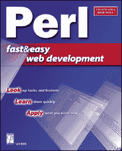

***

| 标题 | : | Perl Web 开发：快速且简易 |
| 作者 | : | Bate, Les. |
| 出版社 | : | Course PTR |
| isbn10 | asin | : | 1931841179 |
| 打印 isbn13 | : | 9781931841177 |
| 电子 isbn13 | : | 9780585456782 |
| 语言 | : | 英语 |
| 主题 | | Perl（计算机程序语言），网站开发。 |
| 出版日期 | : | 2003 |
| lcc | : | QA76.73.P22B39 2003eb |
| ddc | : | 005.2/762 |

第 i 页

Perl 快速简易® Web 开发

第 ii 页

本页故意留白。

第 iii 页

# Perl 快速简易® Web 开发

Les Bate


第 iv 页

© 2003 Premier Press，Course Technology 部门。保留所有权利。未经 Premier Press 书面许可，不得以任何形式或手段（电子或机械）复制或传输本书的任何部分，包括复印、录制或通过信息存储或检索系统，但评论中的简短引文除外。

|  | Premier Press 标志及相关贸易设计是 Premier Press, Inc. 的商标，未经书面许可不得使用。所有其他商标均为其所有者的财产。 |

**出版者：** Stacy L. Hiquet

**营销经理：** Heather Hurley

**策划编辑：** Kevin Harreld

**项目编辑：** Estelle Manticas

**技术审核员：** Michelle Jones

**文字编辑：** Kate Givens

**内文布局：** Jill Flores

**封面设计：** Mike Tanamachi

**索引员：** Kelly Talbot

**校对：** Kim Benbow

Perl 是 Larry Wall 的注册商标。所有其他商标均为其所有者的财产。

*重要*：Premier Press 不提供软件支持。请联系相关软件制造商的技术支持热线或网站寻求帮助。

Premier Press 和作者在全书中尝试通过遵循制造商使用的大写风格，将专有商标与描述性术语区分来。

书中包含的信息均由 Premier Press 从认为可靠的来源中获得。然而，由于我们的来源、Premier Press 或其他可能存在人为或机械错误，出版者不保证任何信息的准确性、充分性完整性，并对任何错误、遗漏或使用此类信息获得的结果不负责。读者应特别注意，互联网是一个不断变化的实体。本书出版以来，某些事实可能已经发生变化。

ISBN: 1-931841-17-9

美国国会图书馆目录卡号：20011096997

美国打印

03 04 05 06 07 BH 10 9 8 7 6 5 4 3 2 1

Premier Press, Course Technology 部门

2645 Erie Avenue, Suite 41

Cincinnati, Ohio 45208

第 v 页

献给我亲爱的妻子 Pauline 和我美丽的女儿 Victoria，带着所有的爱……以及我的猫 Cassie 和 Biggles，感谢它们在我的键盘上行走！

第 vi 页

## 致谢

我有许多想要感谢的人，我难免会漏掉某位，如果其中之一有你，请多原谅！

首要，我想感谢 Julie C. Meloni，她告诉我我的第一个示例文本足够好。还要感谢 Lynette Quinn 在早期阶段的鼓励。同样感谢 Estelle Manticas，她用她的幽默感和有帮助的意见鼓励我，并将我的胡言乱语变成了这本书。感谢 Kevin Harreld，他在整个过程中一直让我保持在正轨。

感谢我的妻子 Pauline 和女儿 Victoria 忍受我的缺席。

我还要感谢过去的 UWE 讲师，特别是 Simon Langley、Nigel Baker 和 Jane Berry，他们激发了我对计算的热情，在 Simon 的情况下，也点燃了我的幽默感！

感谢爸爸妈妈做我的爸爸和妈妈！

最后，特别感谢我的好朋友 Clarisse Craen，她给了我开始这个项目的最初推力：谢谢你，伙计！

Les

第 vii 页

## 关于作者

**LES BATE** 是布里斯托尔菲尔顿航空航天（空中客车公司）的高级分析程序师。1998 年，他在西英格兰大学获得了计算机科学学士学位（荣誉），后来转行从事系统分析与开发。他使用过许多技术，包括 `C++`、`Perl`、`JavaScript`、`VBScript`、`ASP`，这些技术在技术应用方面为他开启了新的视野。闲暇时间他摆弄电子产品、弹吉他、旅行。他将对阅读的热爱完全归功 J.R. 托尔金的作品。

第 viii 页

## 内容概览

| 标题 | 页码 |
| :--- | :--- |
| 引言 | xv |
| 第一章 开始 | 1 |
| 第二章 Perl 快速上手 | 21 |
| 第三章 数据类型 | 33 |
| 第四章 运算符 | 51 |
| 第五章 数组 | 81 |
| 第六章 哈希 | 95 |
| 第七章 程序流 | 105 |
| 第八章 函数 | 119 |
| 第九章 HTML 分支 | 145 |
| 第十章 CGI 编程 | 191 |
| 第十一章 CGI 连接 | 221 |
| 第十二章 使用 Perl 文件 | 235 |
| 第十三章 使用 Perl 发送电子邮件 | 277 |
| 第十五章 JavaScript 分支 | 309 |
| 第十六章 CGI.pm 模块 | 341 |
| 第十七章 案例研究：数据库 | 361 |
| 附录 A 更多 Perl 函数 | 395 |
| 附录 B 网络资源 | 403 |
| 索引 | 407 |

第 ix 页

第 xi 页

## 第 8 章 Perl 函数

| 内容 | 页码 |
| :--- | :--- |
| 什么是函数 | 120 |
| 字符串函数 | 120 |
| 数组函数 | 132 |
| 哈希表函数 | 139 |
| 子程序 | 140 |

## 第 9 章 趣谈：HTML

| 内容 | 页码 |
| :--- | :--- |
| 保存 HTML 文件和测试 HTML 页面 | 146 |
| HTML 文档的结构 | 147 |
| 编写 HTML 文档 | 147 |
| 更多文本格式 | 153 |
| 添加结构和颜色 | 155 |
| 超链接 | 174 |
| 页面内链接 | 175 |
| 框架 (Frames) | 181 |
| 框架标签 | 182 |

## 第 10 章 CGI 编程

| 内容 | 页码 |
| :--- | :--- |
| 什么是 CGI? | 192 |
| 一个简单的 Perl CGI 程序 | 193 |
| HTML 表单 | 203 |
| 使用表单 | 206 |

## 第 11 章 CGI：建立连接

| 内容 | 页码 |
| :--- | :--- |
| 从表单接收数据 | 222 |

第 xii 页

## 第 12 章 在 Perl 中使用文件

| 内容 | 页码 |
| :--- | :--- |
| 在 Perl 中打开文件 | 236 |
| 从文件中读取数据 | 237 |
| 错误检查 | 241 |
| 向文件写入 | 243 |
| 删除文件 | 247 |
| 在 Perl 中使用目录 | 249 |
| 数据文件 | 253 |

## 第 13 章 在 Perl 中发送电子邮件

| 内容 | 页码 |
| :--- | :--- |
| 使用 FTP | 260 |
| 什么是 FTP? | 261 |
| 在 Perl 中使用 SMTP 发送电子邮件 | 264 |
| 使用 Blat.exe 发送电子邮件 | 267 |
| 在 UNIX 服务器上使用 Sendmail 发送邮件 | 272 |

## 第 14 章 将 Perl 与数据库结合

| 内容 | 页码 |
| :--- | :--- |
| 此处为一级标题 | 278 |
| 创建数据源名称 (DSN) | 286 |
| 使用 ADO 从数据库读取记录 | 289 |
| 使用 ADO 向数据库添加记录 | 294 |
| 使用 ADO 更新数据库表中的记录 | 296 |
| 使用 ADO 从数据库表中删除记录 | 297 |
| DBI | 299 |

## 第 15 章 另一个趣谈：JavaScript

| 内容 | 页码 |
| :--- | :--- |
| 关于 JavaScript 的几点说明 | 310 |
| 面向方式 | 310 |
| JavaScript 元素 | 313 |
| 你的 JavaScript 放在哪里? | 314 |
| 更多 JavaScript 语法 | 315 |
| JavaScript 变量 | 319 |
| 你的第一个表单验证 JavaScript 函数 | 321 |

## 第 16 章 CGI.pm 模块

| 内容 | 页码 |
| :--- | :--- |
| CGI.pm 模块背后的思想是什么? | 342 |
| 使用 CGI.pm 开始和结束 HTML 页面 | 343 |
| 表单与 CGI.pm | 348 |
| 从表单获取数据 | 352 |
| 对象模式下的 CGI.pm | 354 |

## 第 17 章 案例研究：联系人数据库

| 内容 | 页码 |
| :--- | :--- |
| 需求 | 362 |
| 首页 | 363 |
| listcontacts.pl 程序 | 365 |
| addcontact.htm | 369 |
| insertrec.pl 程序 | 376 |
| editcontact.pl 程序 | 379 |
| updaterec.pl 程序 | 387 |
| 数据库 | 390 |
| 结语 | 392 |

## 附录 A 更多 Perl 函数

| 内容 | 页码 |
| :--- | :--- |
| length() 函数 | 396 |
| reverse() 函数 | 396 |
| index() 函数 | 397 |
| rindex() 函数 | 397 |
| substr() 函数 | 398 |
| tr/// 运算符 | 399 |
| chr() 函数 | 400 |
| ord() 函数 | 400 |
| join() 函数 | 400 |
| sort() 函数 | 401 |
| rand() 函数 | 401 |
| Here Document (在此文档) | 402 |

## 附录 B 网站资源

| 内容 | 页码 |
| :--- | :--- |
| 获取 Perl 及更多内容的官方网站 | 404 |
| 学习更多 Perl | 404 |
| 免费 Perl 脚本 | 405 |
| 学习更多 HTML 和 JavaScript | 405 |

## 索引

407

第 xv 页

## 引言

Perl 由 Larry Wall 在 1987 年作为一个博士项目诞生。在许多情况下，它是默认语言。它已经在许多平台上被使用，并成为了一种不可或缺的工具。在当前的时尚下，它是一种解释语言。它还被用于创建动态网站。换句话说，这就是编程语言的设计初衷！

在本书中，你将探索 Perl 的许多特性。Perl 被用于许多平台，并已成为了一种不可或缺的工具。在许多情况下，它是默认语言。它还被用于创建动态网站。换句话说，这就是编程语言的设计初衷！它是，那意味着它是可能的。Perl 是一种解释语言。它还被用于构建网站。在许多情况下，Perl 是强大的，Perl 是快速的！几乎没有什么工作是 Perl 不能完成的，而且很多工作用少得的代码就能完成。

## 本书是如何组织的

本书的目标是让你在最短时间内达到你的目标，同时帮助你理解其工作原理。

你会发现本书的前几章关于创建 Web 开发环境——安装 Perl 和 Web 服务器。从这里到本书的一半以后，你会发现许多小型 Perl 代码段，每个用于演示语言的一个特定方面。逐步代码示例配有代码及其执行结果的截图。从那里开始你将构建真实的 Perl 应用——研究 CGI 和表单，以及文件和电子邮件。

## 谁应该读这本书？

本书假设得尽可能少。它针对对 Web 开发知识较少的人，或者使用过 WYSIWYG 点点式 Web 创作工具但现在希望在尽可能短时间内创建 Web 应用的人。

## 软件/硬件要求

为了使用本书及其示例，你需要一个 Web 服务器。如果你使用的是 Windows 95，可以获取 Personal Web Server。这通常可以在免费杂志附赠的 CD 中找到，包含在一个名为 NT Server 4 Option Pack 的免费产品中。该选项包还包含 Windows NT 4 的 Peer Web Services，它具有相同的功能。Windows 98 / ME 用户应该发现他们的机器上已经有了 Personal Web Server。如果没有，请检查你的 Windows 安装光盘。Windows 2000 专业版 / XP 专业版用户应该发现他们的机器上安装了 Internet 信息服务 (`IIS`)，这更好。UNIX 用户可以使用从 `http://www.apache.org` 获取的优秀的 Apache Web 服务器（也有 Windows 版本）。

当然，你还需要 Perl 本身；关于从哪里获取它以及如何安装，书中会有详细介绍。

你需要一个编辑器来编写代码。你可以使用简单的编辑器，例如 Windows 中的 `Notepad`，或者 UNIX 平台上的 `Vi` 或 `Emacs`。对于 Windows 用户，我个人非常喜欢的是 `HTMLPad 2000` (`http://www.blumentals.net/`)。还有 `OptiPerl` (`http://www.xarka.com/optiperl/`)，它为 Perl 提供了一个完整的集成开发环境 (`IDE`)。

开发 Perl 并不需要性能极其强劲的机器；几乎任何机器都可以，只要它有足够的内存（`128Mb+`）以及几百兆的空闲空间供你开发即可。

当然，你还需要一个 Web 浏览器；你们大多数人的机器上已经预装了微软的 `Internet Explorer`，但你可能也想尝试 `Opera` (`www.opera.com`)，这是一个非常优秀的浏览器，内置了一个非常实用的邮件客户端。

第 xviii 页

本页特意留白。

第 1 页

# 第一章 开始入门

本章将介绍如何在你的机器上设置 Perl。这里的重点是 Windows 用户，但对于其他平台的设置建议也并不缺少。请参阅本书附录 B 中实用的 URL，你可以在那里找到 Perl 之道的网站地址，以及提供详细建议、示例和更新的海量 Perl 资源网站。当你浏览互联网时，请看看这些网站——它们确实是获取 Perl 相关知识的极佳来源！

具体来说，本章将涵盖：

* 哪里获取 Perl
* 如何安装 Perl
* 配置个人 Web 服务器

第 2 页

## 我可以在哪里获得 Perl？

Perl 可以从多个来源获取。最著名的是 `http://www.activestate.com` 和 `http://www.perl.com`。

我建议你不要下载 Perl 的“开发版本”，因为如果你遇到任何错误，这可能会导致一些困惑。软件的开发版本顾名思义并不是最终的、完全调试过的版本，可能包含导致你误以为代码中写了错误的 bug。由于这个原因，Perl 的开发版本通常被称为“不稳定”版本。当你对使用 Perl 更有经验时，你可能想要尝试开发版本以利用提供的新功能，在此之前，最好坚持使用最新的“稳定”版本。

除了下载 Perl 之外，你可能还会查看一些为 Perl 开发者提供的资源。这里给出了一些实用的互联网网站，附录 B 中还有更多。

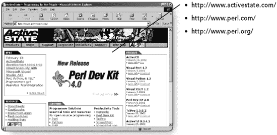

这些网站将让你紧跟 Perl 世界的动态，并能为你提供有关技术、编程思路以及关于 Perl 语言及其使用者的大量新闻的宝贵资源。Perl 是互联网的自然语言，因此你在广维网、新闻组、邮件列表和公告板上发现对这种强大且备受尊敬的语言的持续支持也是理所当然。

第 3 页

## 我如何安装 Perl？

在使用 Perl 之前，你需要安装它并设置好你打算与之使用的 Web 服务器。你很快就会学习如何设置 Web 服务器，但现在，这里是你开始使用 Perl 所需的信息。你可以在“命令提示符”中使用 Perl，就像你过去可能运行 DOS 程序一样！Perl 最初是作为系统管理和报告工具出生的，因此在这种方式下工作得同样出色。

### Windows 安装

1. 从 `www.activestate.com` 或 `www.perl.com` 下载 Perl。
2. 下载完成后，双击文件开始安装。
3. 按照屏幕上的提示在你的机器上安装 Perl。如果安装失败，你可能需要获取最新版本的微软安装程序。如果你使用的是 Activestate 网站，可以在下载链接下找到最新 MS 安装程序的链接。

安装过程应该更新 Windows 路径，以便能够找到 Perl 可执行文件。打开一个 MS-DOS “提示符”命令行窗口运行 Perl 并验证其版本。

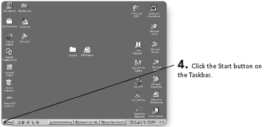

第 4 页

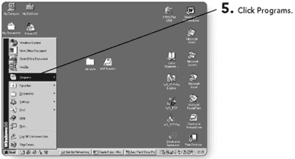

第 5 页


第 6 页

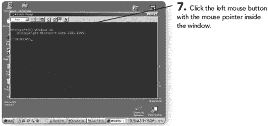

第 7 页


第 8 页


第 9 页


第 10 页


第 11 页


第 12 页


### UNIX 安装

在 UNIX 上安装 Perl 与在 Windows 上这样做非常不同。要在 UNIX 上安装 Perl，你必须首先获取一个副本，如周知，来自 `http://www.perl.com` 或 `http://www.activestate.com`。注意，有一个生产版本和一个标记为“开发”的版本。我建议选择生产版本（有时被称为“稳定”版本）。

获取 UNIX 压缩包后，你现在必须构建你的系统。这需要一个 ANSI C 编译器。有很多种选择，并且你的 UNIX “机器”上很可能已经有了。

事实上，你的机器上可能已经有了 Perl 副本，因为许多机器现在已作为操作系统的一部分附带 Perl。

就像 Windows 测试一样，尝试输入：

```bash
perl -v
```

如果你有 Perl，你将得到一个版本报告；如果没有，你会收到“UNIX command not found”的消息。

值得查看 `activestate.com` 或 `perl.com` 网站看看有哪些可用包。技术在不断进步，你可能会找到适用于你平台的易安装版本。只需下载它，严格按照说明操作，一切都应该是正常的。

当然，还有一个适用于 Mac 的 Perl 版本。被称为 MacPerl，可以从 `http://www.perl.com` 获取。你应该可以在那里找到可下载版本，并使用著名的 StuffIt 解压程序进行解压。如果你没有该程序的副本，请访问 `http://www.aladdinsys.com/expander/` 并下载。（顺便提一下，StuffIt 也适用于其他平台！）

## 个人 Web 服务器 (PWS)

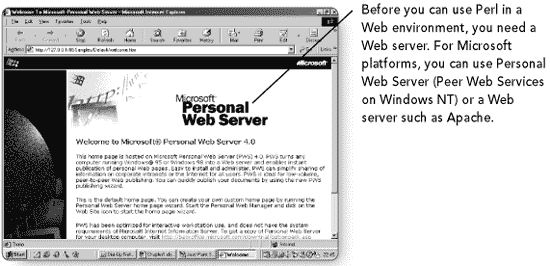

第 13 页

Apache 可以从 `http://www.apache.org` 下载，而个人版服务器可以作为微软下载选项包的一部分进行下载。安装个人版服务器（适用于 Windows NT 或 Windows 95）简单的方法是使用 NT Server 4 选项包，该包下载时是免费的，或者可以在杂志的“免费光盘”中找到。

请注意，要通过你的个人版服务器查看页面，必须使用“特殊”IP 地址：`http://127.0.0.1`，或者你可以使用 `http://localhost/`。

如果你使用的是 Windows 98，你应该很容易就能找到个人版服务器；它已经出现在你的程序列表中：

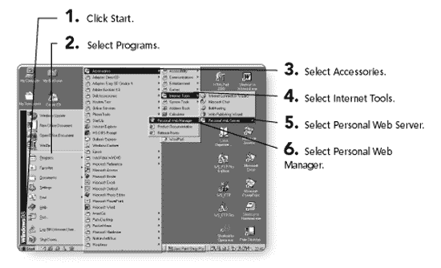

第 14 页

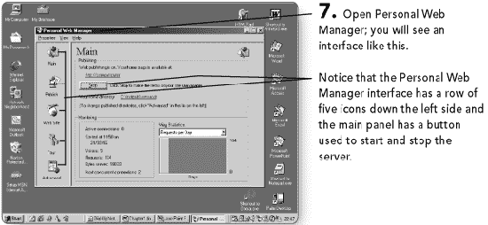

> **注意**
>
> 在连接互联网时运行 Web 服务器不是一个好主意，因为这为黑客提供了一个方便的入口！确保 PWS 不在你的启动列表中，如果它已加载（你会在任务栏托盘中看到一个图标），请确保在访问互联网时使用“停止/启动”切换按钮停止服务器。

当你的 Web 服务器运行时，你会看到“停止”按钮处于显示状态——也就是说，服务器已启动。相反，当 Web 服务器停止时，“启动”按钮将显示在原本“停止”按钮所在的位置。（这听起来很困惑，我明白，但在你使用时你就会明白我的意思了！）

第 15 页

左侧的五个按钮是：

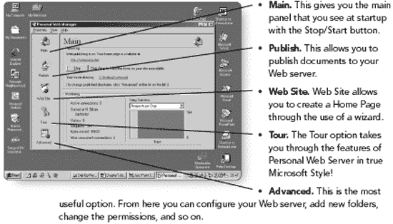

### PWS 高级选项

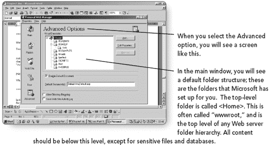

第 16 页

PWS（以及所有其他服务器）允许你在 Web 服务器根结构以外的位置存储除 HTML 文件以外的文件，但允许你通过使用 Web 服务器别名功能（有时被称为虚拟目录或文件夹）将 Web 服务器连接到它们。

同样注意，你默认会获得一个 `SCRIPTS` 文件夹；这类似于大多数普通 Web 服务器上常见的 `CGI-BIN` 文件夹。你几乎可以在你的 ISP 上传（FTP）目录列表中找到它。

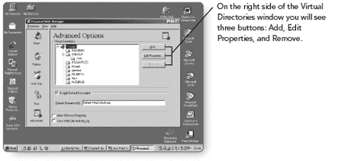

`Add`（添加）按钮将引导你通过向导来设置新文件夹。假设你想为你的 Web 服务器添加一个新站点——我们可以将该站点称为 Web 文件（HTML 等）的集合，它在根目录下有一个主页，可能还有一组其他辅助页面、图像等。

为了说明这一点，你现在将在你的 Web 服务器上设置名为 `Test` 的新文件夹。

1. 在 `C:\inetpub\wwwroot` 文件夹下创建一个名为 `Test` 的文件夹。

> **注意**
>
> 你也可以通过“我的电脑”界面使用 `文件`、`新建`、`选项`，或者通过 Windows 资源管理器界面来创建新文件夹。

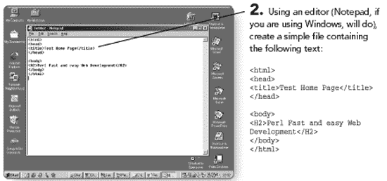

第 17 页

3. 在你新的测试文件夹中将文件保存为 `default.htm`。

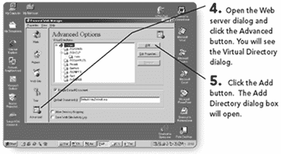

第 18 页


> **警告**
>
> 注意主窗口下方的访问复选框。这些复选框设置了你新文件夹或虚拟目录的访问选项。你可能会发现 `Read`（读取）和 `Scripts`（脚本）访问已被勾选。这些是“安全”选项，分别允许运行和读取脚本以及 HTML 页面。中间的选项 `Execute`（执行）允许你在文件夹内运行可执行程序。如果该文件夹在操作系统权限中也设置了“写入”权限，这可能具有危险性。此外，许多商业 Web 服务器在服务器端有“写入访问”功能，而 UNIX 允许通过使用 `CHMOD` 命令设置权限。无论你使用何种平台，务要记住，一个同时具有执行和写入权限的文件夹是危险的。这允许黑客可能将自己的程序安装到你的文件夹中，然后执行并写入你的磁盘——可能会导致灾难性的结果！

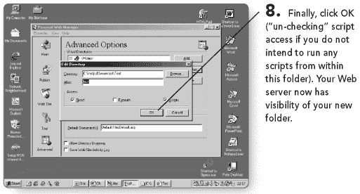

第 19 页

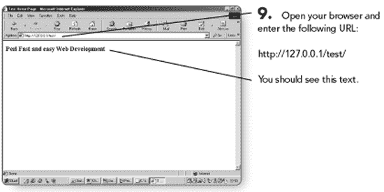

如果你使用的是不同的 Web 服务器，请遵循供应商的说明，在你选择的服务器上实现这一点。

你现在应该有一个可以工作的 Web 服务器和一个可以工作的 Perl 副本，我们现在可以开始讨论 Perl 的基础。

第 20 页

*本页留空。*

第 21 页

# 第二章 Perl 的第一步

### 开始之前

在这一阶段，决定你想要使用的文本编辑器是很有用的。有很多选择，从 `记事本`（Windows）和 `Vi`（UNIX）到具有特定功能的复杂编辑器。一个适合初学者的编辑器是 `HTMLPad 2000`。它很容易学习，虽然没有提供语言支持，但它可以对源代码进行颜色显示，使其更容易阅读。

对于本章以及接几章，请在硬盘上的任意位置创建一个名为 `test`（或你喜欢的名称）的文件夹。你可以在顶层文件夹 `c:\Perl` 下，或者在硬盘上创建一个 `myPerl` 文件夹。

* **注释** 是一行（或多行）在程序中不执行任何函数的文本。它是描述性文本，用于帮助人类阅读者理解代码在做什么。在 Perl 中，每行注释都以 `#` 符号开头。

Perl 是一门*自由格式*语言。这意味着，你可以根据需要使用任意数量的空白（空格、制表符、换行符等）。这意味着你可以以一种比其他语言更具可读性的方式来编写代码。

这也意味着 Perl 需要某种方式来显示它何时到达一个语句的结束。这是通过使用分号（`;`）实现的。因此，一个 Perl 语句可能看起来这样：

```perl
print "I think Perl is great \n";
```

这是终止语句的常用方法。`C`、`C++`、`Java`、`PHP` 和 `Pascal` 等语言都使用分号来终止语句；所以，如果你是从这些语言过来的，你可能已经熟悉这一点了。

好了，假设你已经选择了想要使用的编辑器，现在可以投入到 Perl 的世界中看看它是如何运作的了！

### 初学 Perl

所有的 Perl 程序都应该以亲切地称为"shebang"的语句开头。shebang 语句应该出现在程序第一行第一列的开头，并且它应该包含指向 Perl 解释器 `perl.exe` 的文件路径。为什么它应该被称为"shebang"语句尚无争议，但它是计算机中用于某些特殊字符的典型命名类型（感叹号通常被称为"shriek" 或 "splat"）。

shebang 语句以 `#` 符号开头，表示它是一行注释。然而，它实际上是此规则的唯一例外！在 UNIX 系统上，这一行告诉操作系统去哪里寻找 Perl，以便执行该程序。

> **注意**
>
> 记住：Perl 程序始终应该以 `#!pathname_to_Perl` 开头，位于第 1 行第 1 列。

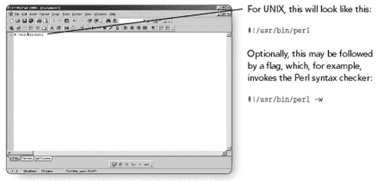

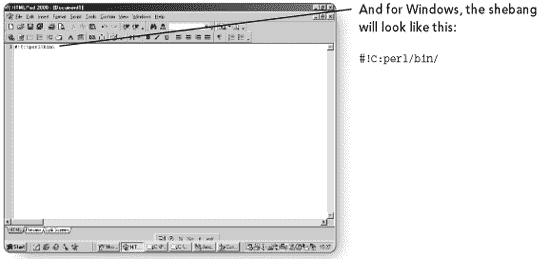

但注意，对于 Windows 来说，这完全是一个注释！

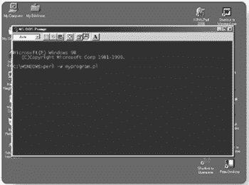

> **警告**
>
> 这是 UNIX 和 NT 平台之间的一个重要区别。任何以 `#` 开头的语句都被 Perl 视为注释，因此被解释器忽略。此规则的例外是 Perl 程序的第一行，如前所述。这条语句告诉 UNIX 操作系统去哪里寻找 Perl 解释器。只要程序文件被设置为可执行文件（通过将 `chmod` 设置为 `755`），只需输入名称即可运行。当然，你仍然可以在 NT 的命令行中使用 `-w` 标志。

在 NT 平台上，这第一行将被视为注释。然而，NT 使用程序与其文件扩展名之间的“关联”。换句话说，当 Windows NT（以及 Windows 9x 等）看到 `.pl` 扩展名时，它会自动调用 Perl 解释器。

### 在 Perl 程序中输入和输出

我们已经看到，可以使用 Perl 的 `print` 命令在屏幕上显示内容：

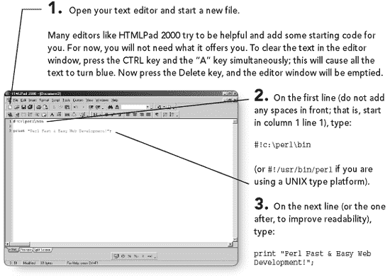

（注意语句末尾的分号。）

**4.** 将此小程序保存为 `02-01.pl`，于你的 "Test" 文件夹中。

**5.** 打开 MS-DOS 命令提示符，进入你保存程序的地方，并输入：

```bash
perl 02-01.pl
```

你的程序应该显示这条简单的信息：

Perl Fast & Easy Web Development!

#### 打印格式化

在你通过 Perl `print` 语句实现任何令人兴奋的功能之前，你必须稍作旁听。你稍将在第 3 章再次回到这个主题，但学习一下 `print`（屏幕显示）格式是值得的，这样你可以在早期示例代码段中使用它，而不会感到太困惑。

输出到屏幕可以使用内置的“转义序列”进行格式化。表 2.1 列了一些常见的转义代码。

| **表 2.1 常见转义代码** |
| :--- |
| **转义代码** | **含义或效果** |
| `\n` | 插入换行符 |
| `\t` | 插入制表符 |
| `\r` | 回到当前行的开头（即回车但不换行） |
| `\\` | 这是你向输出字符串中添加反斜杠的方法（否则，它会“转义”下一个字符）。 |
| `\"` | 同上，但针对双引号 |
| `\'` | 同上，但针对单引号 |
| `\$` | 这需要此来阻止 Perl 将 `$` 解析为变量的开头。 |

所以尝试一下以下操作：


> **注意**
>
> *注释*是一个换行符。

**6.** 将程序保存为 `02-02.pl`。


#### 获取输入

任何语言最有用的功能之一就是允许用户提供输入。尝试以下操作：

**1.** 打开你的文本编辑器。


**7.** 打开 MS-DOS 命令。


**9.** 输入你的名字并按回车。


所以这个程序是如何工作的？


注意变量仍然留在字符串中。Perl 用其包含的值替换变量。


你已经迈了一个开端。你可以编写一个小程序来获取输入并显示消息。但为了能够操作数据，你需要能够存储它。所以，接下来你将学习变量。

## 第三章 数据类型：标量

Perl 有四种内置数据类型。它们是标量、数组、哈希和引用。*标量*基本上是单个数据。*数组*是通过数字下标访问的数据列表，而*哈希*是通过另一个变量或字面量访问的数据列表；数组和哈希将在后面的章节介绍。*引用*是指其他东西的“指针”。例如，引用被用作文件句柄指向文件。

本章涉及 Perl 中的标量数据类型。具体而言，你将学习：

* 标量变量
* 字符串
* `$_` 变量
* 用于格式化的转义序列

### 标量变量

所有的标量变量名前面都有美元符号（`$`）。因此，例如，存储年龄的变量可以写为 `$age`。

如果你不习惯使用这种变量表示法的语言，你很容易忘记 `$` 并导致代码中出现奇怪的错误。

> **注意**
>
> Perl 变量名是区分大小写的。大小写敏感在现代语言中很常见，但请记住，这在调试 Perl 程序时可能是某些沮丧的源头。

#### 标量变量

标量变量是存储单个值的变量。它们可以是整数、字符串、浮点数（实数）或引用。引用标量变量仅存储另一个变量地址的变量；也就是说，它是该变量的指针。

整数标量仅仅是一个存储整数的变量：

```perl
$age = 20;
```

当然，你可以对它执行通常对数值变量可以执行的所有操作。为了演示这一点并展示如何在 Perl 中使用简单的算术运算，请尝试以下操作：

1. 打开你的文本编辑器。

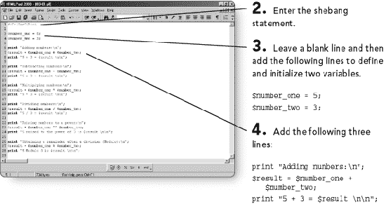

> **注意**
>
> 空行是可选的，但它们确实有助于让程序更易于读。连续多行代码看起来会有些拥挤。在逻辑上属于一组的代码块之间留空行，对眼睛和大脑都更友好！

这三行中的第一行是一个打印语句，用于显示你即将执行的操作。第二行创建一个名为 `$result` 的变量，并赋值一个等于 `$number_one + $number_two` 结果的值。第三条语句是另一个打印语句，用于演示结果。

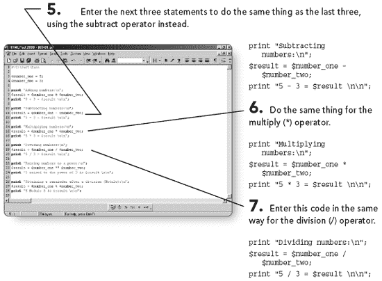

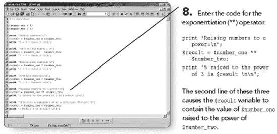

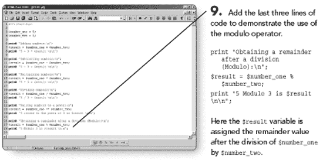

10. 将代码保存到测试文件夹中的 `03-01.pl`。

11. 打开 DOS 命令提示符。

12. 导航到你的程序测试文件夹。

13. 使用 `perl 03-01.pl` 命令运行你的代码。

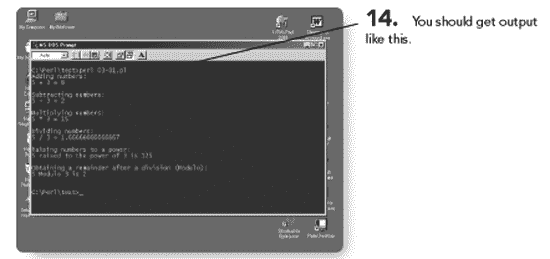

如果你的输出看起来不正确，返回第 2 步并检查是否有拼写错误。

此练习演示了你可能想使用普通算术运算符执行的简单算术操作。

### 其他运算符

还有几个看起来可能有点奇怪的简单运算符。这些是自增、自减和赋值运算符。让我们快速看看它们。

1. 打开你的文本编辑器。

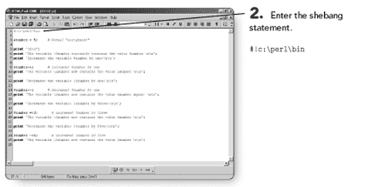

3. 在一个空行之后，创建一个名为 `$number` 的变量并赋值为 5。

```perl
$number = 5; #Normal "assignment"
```

注意由井号符号前置的注释。

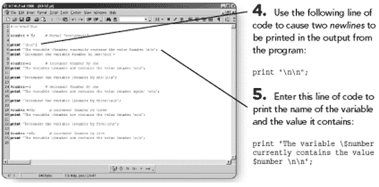

> **注意**
>
> 注意变量名 `$number` 前面有一个反斜杠 (`\`)，这样变量就不会被插值（也就是说，打印的是它的名称而不是它的值）。在行尾变量被打印出来，这次没有反斜杠，所以变量被替换为它的值。行尾有两个额外的换行符，因此显示输出中会有两个额外的回车符。

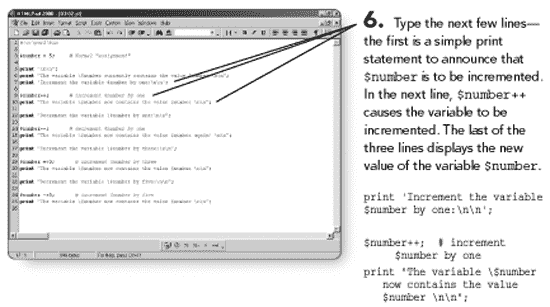

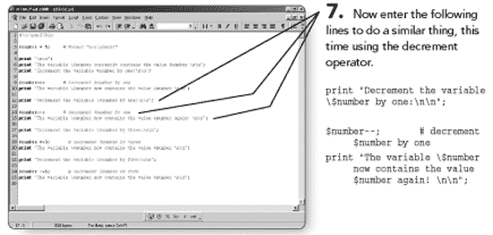

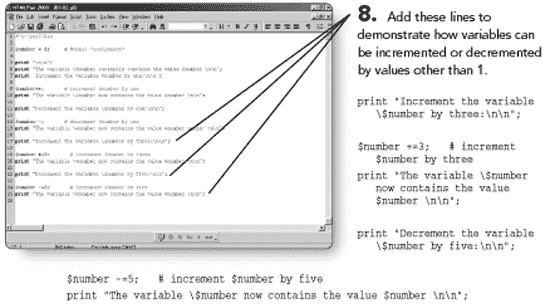

9. 将代码保存到测试文件夹中的 `03-02.pl`。

10. 打开 DOS 命令提示符。

11. 导航到你的程序测试文件夹。

12. 使用 `perl 03-02.pl` 命令运行你的代码。

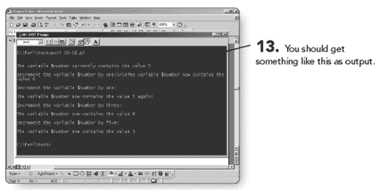

> **注意**
>
> 注意注释自动以斜体形式的方式出现。这是我在这里选择使用的编辑器的功能。如果你使用另一个编辑器，你的注释可能不会以斜体显示，尽管这在大多数现代编辑器中很常见。

回看你的程序，注意第 6 行、10 行、15 行等行中变量名前的反斜杠 (`\`)。这是为了让 Perl 将 `$number` 作为字面量打印，而不是尝试将其视为变量。在 `$` 符号前面没有反斜杠的地方，你会发现变量名被替换成了变量的值。

自增和自减赋值运算符有一点复杂之处，即它们可以出现在变量之前或之后。运算符的效果是相同的，不同在于当运算符在变量之前，变量的值会在操作之前进行更新。

### 字符串

字符串也存储在变量中。例如，如果你使用 `$surname`：

```perl
$surname
```

此示例展示了标量如何用于数值或字符串值，并展示了当你尝试对字符串值进行算术运算时会发生什么。

最后两行演示了 `$_` 变量的使用。在你继续探索 Perl 的过程中，你将再次使用它。

再次注意，打印语句中的变量被包含在引号中。双引号允许你在字符串内插值变量。完全理解这一机制非常重要。

```perl
$thing = "Fred"; print "the value of the string is $thing \n";
```

将给你：

the value of the string is Fred

单引号对于字面量的工作方式类似，但它们*不会*引起插值的发生，因此变量在字符串内*不会*被求值。

换句话说，以下代码：

```perl
$thing = "Fred"; print 'the value of the string is $thing';
```

将给你：

the value of the string is $thing \n

### `$_` 变量

如果你不向函数传递参数，Perl 将使用 `$_` 变量。这是一个非常实用的功能。尝试以下操作：

1. 打开你的编辑器。


5. 将你的程序保存为 `03-03.pl`。

6. 使用 `perl 03-03.pl` 运行程序。


最后，注意打印语句结尾的 `\n` 字符。熟悉 C、C++、Java、PHP 等语言的人会识别出这是换行符。这导致任何后续的文本输出移动到屏幕的下一行。注意，如果打印语句中使用单引号，此字符同样不会被插值为换行符。

单引号会使转义序列被忽略。如果你将上一个程序中的某个 print 语句放在单引号中，`\n` 序列将被显示出来，而不会产生换行。

注意，标量变量可以为空。例如，如果你执行以下操作：

```perl
print $string1;
```

`$string1` 现在存在，但没有值。不过，你可以通过以下方式检查标量变量是否存在：

```perl
if (defined $string1) { print "That variable has been defined! \n"; }
```

你甚至可以这样“取消初始化”一个标量变量：

```perl
undef($string1);
```

或者

```perl
$string1 = undef;
```

当你开始实际使用字符串时，你将学习更多在 Perl 中对字符串进行的操作。

第 48 页

### 用于格式化的转义序列

你已经在 Perl 中用过 `print` 函数。你最近还学会了使用转义字符 `\n` 来提供换行符——即强制换行并将文本光标移动到下一行，以及使用 `\t` 提供制表符。

在第 2 章中，你看到一个转义序列的短表。还有许多其他转义序列提供文本格式化功能。参见表 3.1 获取这些常用转义序列的完整列表。

#### 表 3.1 转义序列

| 转义代码 | 含义 |
| :--- | :--- |
| `\b` | 退格 |
| `\n` | 换行 |
| `\r` | 回车（回到行首） |
| `\t` | 制表符 |
| `\u` | 将下一个字符转换为大写 |
| `\U` | 将后续字符全部转换为大写 |
| `\l` | 将下一个字符转换为小写 |
| `\L` | 将后续字符全部转换为小写 |
| `\\` | 显示反斜杠 |
| `\'` | 显示单引号 |
| `\"` | 显示双引号 |
| `\E` | 结束 U 或 L 效果 |

注意，反斜杠也可以用于文本格式化之外的其他用途。例如，如果你想显示类似 `\n` 的字符串，甚至只是一个 `\` 怎么办？

第 49 页

你需要在想要打印的内容前面再放一个反斜杠（或者将字符串放在单引号中）。所以，如果你想显示 `\n`，请使用：

```perl
print "\\n";
```

如果你想显示反斜杠，请使用：

```perl
print "\\";
```

此外，如果你想显示引号，可以这样做：

```perl
print "One of the words here has \"quotes\" around it \n";
```

现在你知道如何设置字符串值以及如何显示它了。接下来你将学习一种没有它就无法进行大量编程的东西——运算符。

第 50 页

# 第四章 运算符

你已经使用了一些运算符，例如加法 (`+`) 运算符和减法 (`-`) 运算符。在本章中，你将学习更多关于它们的知识，以及一些新的运算符。

在本章中，你将有机会检查：

* 赋值运算符
* 字符串运算符
* 比较运算符
* 逻辑运算符

第 52 页

### 赋值运算符

第一个提到的运算符是赋值运算符。它是等号 (`=`)，你已经用过它了。赋值运算符在几乎每种编程语言中，不需要过多解释。

非常简单，等号右侧的值被复制（而不是移动）到左侧的变量中。

```perl
$surname = "Smith"; $age = 30;
```

尝试这个小程序：

1. 打开你的编辑器。

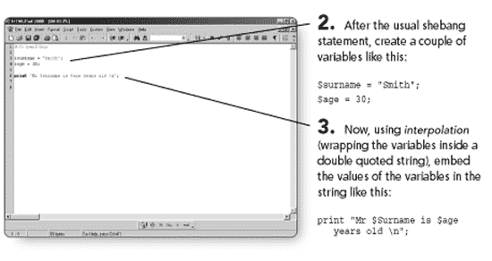

4. 将程序保存为 `04-01.pl` 或你喜欢的名称。

5. 打开命令行窗口并运行程序 (`perl 04-01.pl`）。

第 53 页

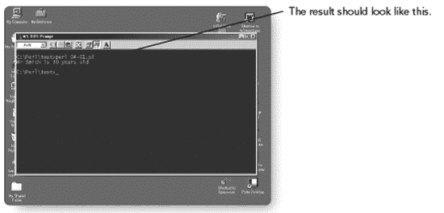

同样，像大多数其他语言一样，你可以*链式*赋值连接在一起，使得所有变量具有相同的值，且该值是链中的最后一个。（这通常在程序开始时用于设置很多变量。）

尝试这个程序。

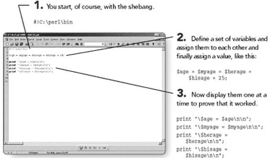

你的程序应该看起来像这里所示。

第 54 页

4. 保存你的程序（我使用了 `04-02.pl`，你可以使用任何适合的名字）。

5. 运行你的程序。你应该看到所有变量都被设置了相同的值。


### 算术运算符

Perl 有一组熟悉的算术运算符：

* `+` 加法运算符
* `-` 减法运算符
* `*` 乘法运算符
* `/` 除法运算符
* `%` 取模运算符
* `**` 幂运算符

我们提到了大部分，但在这里：

* `%` 取模运算符得到余数。例如，`3 % 7` 得到 `5`。
* `**` 幂运算符得到幂。例如，`5 ** 3` 得到 `125`。


第 56 页

### 其他运算符

Perl 还支持递增和递减运算符，正如你发现的；现在你可以更详细地查看它们。

* `counter++` 等同于 `counter = counter + 1`。
* `counter--` 等同于 `counter = counter - 1`。
* `counter+=5` 等同于 `counter = counter + 5`。
* `counter-=5` 等同于 `counter = counter - 5`。
* `counter*=5` 等同于 `counter = counter * 5`。
* `counter/=5` 等同于 `counter = counter / 5`。
* `counter%=5` 等同于 `counter = counter % 5`。
* `counter**=5` 等同于 `counter = counter ** 5`。

关于数值运算符的介绍可能已经让你了解它们是如何工作的了。接下来你将学习字符串运算符。

第 62 页

## 字符串运算符

字符串运算符为你提供了一些实用的字符串处理方法；通过这些运算符，你可以将字符串连接在一起（称为*拼接*， concatenation）或从其他字符串中提取“子字符串”。你将在接下来的章节中学习一些不同的字符串运算符。

### 拼接运算符

在 Perl 中，你可以使用“点”（.）连接运算符将字符串连接在一起。尝试这个示例。

**1.** 打开你的编辑器。

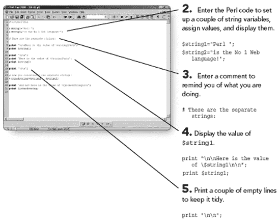

> **注意**
>
> 在整个程序中保持这种做法是一个良好的习惯——当你以后回来修复它们时，你会感谢自己这么做的！

第 63 页

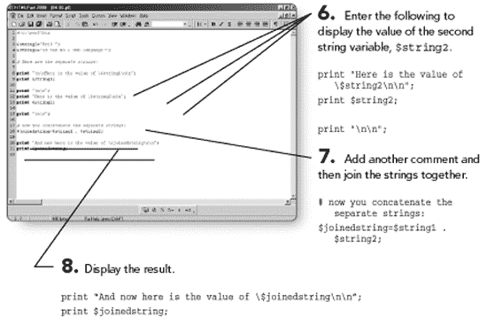

**9.** 将其保存为 `04-06.pl`。

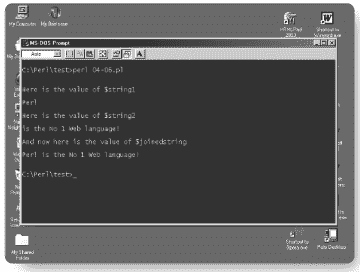

**10.** 打开命令行窗口。

**11.** 输入 `perl 04-06.pl` 来运行你的程序，并观察字符串是如何连接或拼接的。

如你所见，在 Perl 中拼接字符串和字符串变量是非常简单的，只要你知道如何操作！

第 64 页

### 重温变量插值

你已经学习了插值，即如果一个变量包含在双引号括的字符串中，该变量将被该变量的值所替换。

```perl
$language = "Perl"; print "The best Web Programming language is $language \n";
```

将给你输出：

The best Web Programming language is Perl

在某些情况下，你希望在插值并将变量值与相邻的单词连接。考虑以下示例：

```perl
$something = "comfort"; print "This chair is very $somethingable\n";
```

这是试图将 `$something` 连接到主字符串的字面部分 `able` 上。遗憾的是，这不起作用，因为 Perl 会尝试扩展一个名为 `$somethingable` 的变量。如果你添加一个空格来尝试修复，显然结果中会出现一个空格。

尝试这个示例并向自己证明这一点。

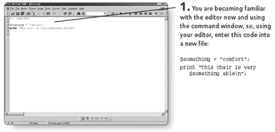

**2.** 将代码保存为 `04-07.pl`。

**3.** 打开命令行窗口。

**4.** 运行你的程序。

第 65 页

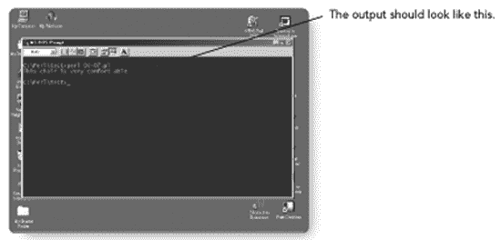

注意在 `comfort` 和 `able` 之间有一个空格——那不是你想要的！

但 Perl 有解决办法。你可以将变量名包裹在大括号中。

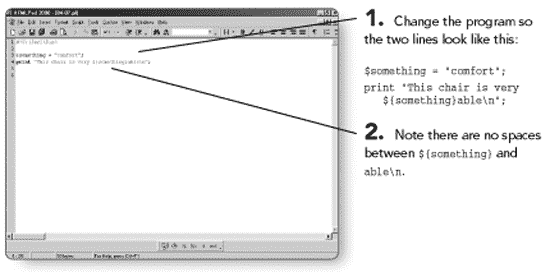

**3.** 重新保存你的程序。

**4.** 打开命令行窗口。

第 66 页

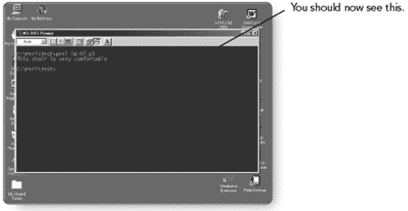

这样好多了！再次，这是另一个非常简单但非常有实用的例子，解决了一个潜在令人沮丧的问题。

### 子字符串

Perl 允许你提取字符串的一部分并将其打印或放在另一个变量中。然而，执行子字符串操作的 Perl 函数更为复杂。该函数的语法为：

```perl
substr(stringb, startpos, length)
```

这意味着你应该从 `stringb` 中获取要查找的值；该值从 `startpos` 字符开始，提取 `length` 数量的字符。

如果这让你感到困惑，请尝试这个小程序。

第 67 页

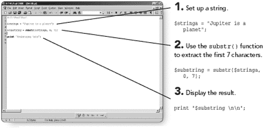

**4.** 将程序保存为 `04-08.pl`。

**5.** 打开命令行提示符窗口并运行程序（`perl 04-08.pl`）。

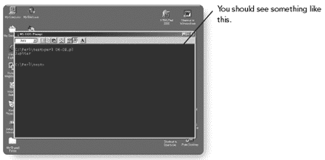

> **注意**
>
> `substr()` 函数的长度参数是可选的。如果你省略了它，那么 `substr()` 将假设长度值为字符串直到末尾。

### 更改大小写

你可能想要更改字符串的“大小写”，例如在对值进行比较之前。Perl 有几个执行此功能的字符串函数。

第 68 页

非常简单地，这些 Perl 函数执行以下操作：

* `uc()`: 将字符串转换为全大写。
* `lc()`: 将字符串转换为全小写。
* `ucfirst()`: 只将字符串的第一个字符转换为大写。
* `lcfirst()`: 只将字符串的第一个字符转换为小写。

尝试这个示例程序。


这是因为 `==` 是一个数值比较运算符，因此 Perl 会将 `$string1` 和 `$string2` 解释为数值变量。由于 Perl 无法将它们作为数字进行评估，它们将被设置为零。因此，两个变量在数值上是相等的，测试通过，并打印字符串 `'Those two names are the same!'`。

出于这个原因，Perl 为字符串提供了一套不同的比较运算符。

* `eq`: 等于
* `ne`: 不等于
* `lt`: 小于
* `gt`: 大于
* `le`: 小于或等于
* `ge`: 大于或等于

这些运算符用法与数值运算符类似，但显然只用于字符串变量。

这里有一个相同的程序，不同之处你将使用字符串比较运算符 `eq`，并且有一个 `else` 选项来捕获结果；否则你将看不到任何输出。

**1.** 打开一个新文件或复制上一个文件。

第 76 页

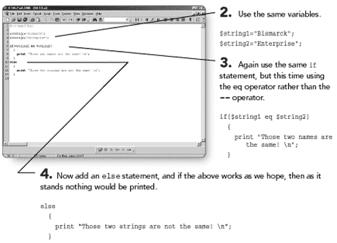

**5.** 将你的程序保存为 `04-13.pl`。

第 77 页

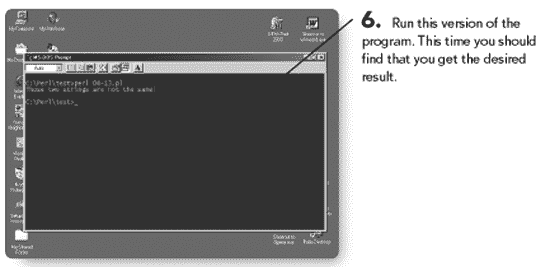

在我们暂时离开运算符之前，你将学习一些逻辑运算符。

### 逻辑运算符

最后，在你对运算符的简要检查中，出现了逻辑运算符。`logical operator` 用于评估正在测试的条件是真还是假。你经常会看到大写的 `True` 和 `False`（如此处所示），以强调这是一个逻辑值或布尔值。

`Boolean` 一词源于数学家乔治·布尔（George Boole）的名字，他是逻辑形式代数规则的先驱。计算机依赖逻辑来工作，因此你经常会遇到 `True`（通常用值 1 表示，也可以用任何非零值表示）和 `False`（通常用值 0 表示）。

数值 `True` 值是任何非零值，因此数值零等同于 `False`。所以 1、5、7、232、-175 等都是 `True`。只有数值零是 `False`。我们也可以对字符串应用 `True/False` 检查。单词 `Olympic` 是 `True`，包含 `'0'` 的字符串是 `True`，单个空格也是 `True`。只有完全没有任何字母或数字字符才是 `False`。

第 78 页

基本上有三个逻辑运算符：`and`、`or` 和 `not`。

这意味着你可以仅通过以下方式检查两个变量是否有值：

```perl
if ($num1 and $num2) { print "Both of those variables have a non-zero value.\n"; }
```

或者你可以说：

```perl
if (not $num1) { print "That variable is empty.\n"; }
```

你还可以说：

```perl
if ($num1 or $num2) { print "One of those variables has a non-zero value.\n"; }
```

你可以组合条件，例如：

```perl
if ($num1 and $num2 or $num3) { print "Both of the first variables have a non-zero value or that last one does!.\n"; }
```

逻辑运算符的工作方式完全相同。正如你所发现的，空字符串等于 `False`，而所有其他值都等于 `True`。

第 79 页

最后，有一些可以代替 `and`、`or` 和 `not` 的符号。

* `||` 等同于 `or` 逻辑运算符
* `&&` 等同于 `and` 运算符
* `!` 等同于 `not` 运算符

使用这些符号代替单词运算符 `and`、`or` 和 `not` 的唯一区别是符号版本的优先级更高。这意味着，`||` 的处理会在 `or` 之前。不要过于担心这个。如果你想让某个内容在另一个内容之前进行评估，只需将想要先执行的内容括在括号中即可。

逻辑运算符看起来很简单，但误用可能会导致非常困惑的错误。你以后会经常使用逻辑运算符。尝试使用之前的示例并玩玩代码，或者继续读下去等待一些真实的例子。

第 80 页

*本页特意留白。*

第 81 页

# 第五章 数组

*Arrays*（数组）简单来说就是标量的集合。数组的名称与简单的标量非常相似，但它还有许多元素。每个元素都有相同的名称，并通过数字下标指向。

在本章中，你将学习到：

* 声明数组
* 加载数组
* 合并数组
* 数组函数

第 82 页

从概念上讲，数组可以被认为若干个“鸽巢”，每个鸽巢都可以包含单独的数据项。正如所述，每个元素共享一个名称，并通过 `subscript`（下标）来确定是哪一个元素。

```perl
@ships = (@warships, @passengerships);
```

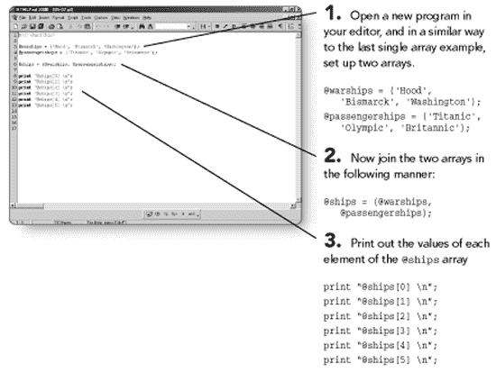

第 91 页

> **注意**
>
> 你可以使用像在之前的示例中那样的循环来显示数组的内容。

**4.** 将你的程序保存为 `05-07.pl`。

**5.** 打开命令提示窗口。

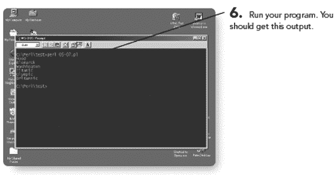

### 数组函数与数组操作

Perl 数组非常灵活，实际上，你才刚刚触及它们功能的冰山一角。正如你将学到的那样，还有许多内置函数设计用于帮助你操作数组。

你想知道数组中有多少个元素吗？尝试一下这个：

```perl
print $#ships;
```

现在尝试运行修改后的程序。

第 92 页

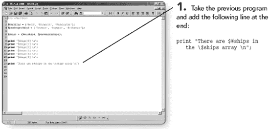

**2.** 将你的程序保存为 `05-08.pl`。

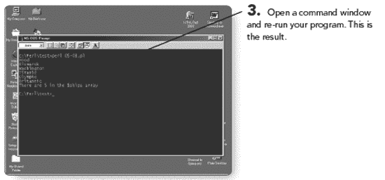

> **注意**
>
> 如果你使用了刚才尝试的那个数组示例，你将得到结果 5。（不要忘记 Perl 数组从元素 0 开始计数，所以如果有 6 个元素，得到的结果将是 5）。

第 93 页

想用 250 个 0 填充数组吗？用这个就能搞定：

```perl
@zeros = (0) x 250;
```

这看起来有点困惑，不是吗？但它仅仅意味着取一个零，并将其加载到新数组元素中 250 次，然后将数组命名为 `zeros`！

亲自试一下看吧。

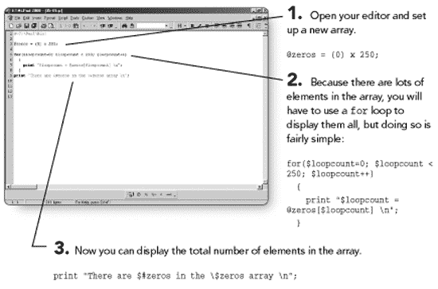

**4.** 将程序保存为 `05-09.pl`。

第 94 页

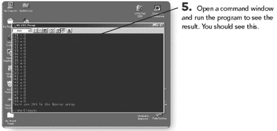

Perl 与大多数其他语言不同，它只支持一维数组，因此二维数组必须使用引用数组或指针来模拟。你很快就会有机会研究引用了。

第 95 页

# 第六章 哈希映射

哈希在 Perl 中有时被认为是一个晦涩的主题。这种认知在很大程度上源于所谓的“误导且不一致”的语法。出于这个原因，这个短章节的开头包含了对什么是哈希以及如何在 Perl 中引用它们的讨论。希望你将发现哈希不仅有用，而且完全符合逻辑！随后，你将学习并练习如何使用这种强大的数据结构。所以，请继续读下去并耐心听我说；这段旅程是值得的。

在本章中，你将学习什么是哈希以及如何使用哈希前缀，以及如何：

* 初始化哈希
* 创建哈希
* 加载和搜索哈希
* 从哈希中移除键

第 96 页

### 什么是哈希？

哈希（有时称为*关联数组*）在作为标量值列表这方面与“普通”数组相似的。然而，它们的访问方式是不同的——该机制利用“键”而不是简单的数字下标。关于哈希需要记住的重要点仅仅是引述或指定它们的顺序，即先指定键，后指定值。在大多数其他方面，哈希可以被看作一个你可以向其中倾倒数据的桶。

哈希拥有像标量和数组一样的前缀。对于哈希，前缀是 `%` 符号。这表示在使用时，你正在引用整个哈希；如果你想访问哈希的单个元素，则像处理数组一样使用 `$` 前缀。这可能看起来很令人困惑，直到你考虑到你只是在引用哈希内部的单个标量；因此，你使用标量表示法。只有当你访问整个哈希时，才使用哈希的 `%` 前缀符号。

哈希为你提供了一种实用的查找机制，有点类似于数据库表。唯一键被用于定位给定的值。哈希的速度是均匀快速的；也就是说，哈希可以增长得很大，而速度几乎不会下降，而且只要你的机器有资源来处理它们，你就可以让它们变得随你想要的大小！

哈希有许多用途，尤其是在 Web 应用中，它们对于处理来自 HTML 表单的输入、CGI 环境变量等非常有用。

### 哈希前缀

哈希拥有像标量和数组一样的前缀。对于哈希，前缀是 `%` 符号。这表示在使用时，你正在引用整个哈希；如果你想访问哈希的单个元素，则像处理数组一样使用 `$` 前缀。这可能看起来很令人困惑，直到你考虑到你只是在引用哈希内部的单个标量；因此，你使用标量表示法。只有当你访问整个哈希时，才使用哈希的 `%` 前缀符号。

第 97 页

### 初始化哈希

要初始化哈希，只需：

```perl
%animals = ();
```

现在你有了一个名为 `animals` 的哈希，其中没有键或值。

### 创建哈希

你可以单独或一次性向哈希添加键值对。要向哈希中添加元素，你可以这样做：

```perl
$animals{'Horse'} = 'Red Rum';
```

这为哈希 `animals` 增加了一个键值对。（注意 `$` 前缀。正如你之前看到的，你使用 `$` 前缀是因为你正在访问哈希的单个元素）。

如果你想一次添加多个元素，可以按照以下方式进行：

```perl
%animals = ('Red Rum', 'Horse', 'Jaws', 'Shark', 'King Kong', 'Gorilla');
```

现在，这样做是可以的，但你是否注意到在阅读整个列表时发生了什么？随着列表的增长，想象一下当你尝试跳到列表中间时会发生什么。对于你这里使用的主题和名称，很容易判断哪个是键哪个是值。然而，在某些情况下，这并不明显，因此 Perl 有另一种表示法可以帮助你判断哪个是哪个，无论列表有多长。这种表示法被称为*逗号箭头运算符*，看起来如下：

```perl
%animals = (Horse => 'Red Rum', Shark => 'Jaws', Gorilla => 'King Kong');
```

现在你可以很容易地看到 `=>` 运算符从键指向哈希中该对的数据。不仅如此，你现在还可以添加换行符/回车和其他空白字符而它仍然可以正常工作，因此你可以通过每行使用一个键值对来使程序中的哈希定义更具可读性，如下：

```perl
%animals = (
    Horse => 'Red Rum',
    Shark => 'Jaws',
    Gorilla => 'King Kong'
);
```

这种符号可能被称为逗号箭头运算符，因为 `=>` 替换了上一个例子中的逗号。无论原因如何，逗号箭头运算符让值对更容易识别。

让我们加载你的第一个哈希。

第 99 页

### 加载与搜索哈希

现在你将学习如何加载哈希以及如何在其中查找数据。正如你开始看到的，哈希的使用难度并不比数组大出多少，而且它们非常强大。

**1.** 打开你的编辑器。


**5.** 将程序保存为 `06-01.pl`。

**6.** 打开命令窗口。

第 100 页


这里是对上一个程序的简要检查：

第 3 行显示了加载哈希的方法。

第 5 行显示了在给定键的情况下如何从哈希中获取单个值。

第 7 行到 10 行显示了如何列出哈希的所有键。

最后，注意你可以通过使用这样的语句非常简单地打印整个哈希：

```perl
print %animals;
```

但结果是一个接一个打印的，这完全没有用处！

### 从哈希中删除键

要从哈希中删除单个键，只需使用 `delete` 函数即可。

```perl
delete($animals{Shark});
```

第 101 页


**4.** 将程序保存为 `06-02.pl`。


你也可以像这样从哈希中删除所有的键（以及值）：

```perl
%animals=();
```

注意，你并没有真正删除任何东西。你只是重新初始化了哈希，或者从头开始。但效果是一样的。

第 102 页

再次修改上一个程序并试一下。

**1.** 再次以之前的程序为起点，在程序末尾添加以下行：

```perl
print "\n\n正在清空哈希 …\n\n"; %animals=();
```


**3.** 将程序保存为 `06-03.pl`。


作为哈希的最后一个演示（目前），你可以测试特定的键是否存在于哈希中。

**1.** 打开你的编辑器。

**2.** 复制 `06-01.pl`。

第 103 页


**4.** 将程序保存为 `06-04.pl`。

**5.** 打开命令窗口。

第 104 页


正如你发现的，哈希非常强大，而且可能比你最初想象的要容易用。当你进入 Web CGI 编程时，你将大量使用它们，并感谢它们的存在。

这些信息足够作为对哈希的入门级介绍了。在这一章和之前的章节之后，你现在应该对 Perl 中处理数据的一些方式有了感觉。

接下来，你将学习更多关于如何控制 Perl 程序执行流的内容——如何做出决策以及控制循环来执行重复性操作。你已经看到其中一部分了，但下一章将完全致力于这个主题。

第 105 页

# 第七章 程序执行流

本章将从对什么是程序流的基本讨论开始（无论使用什么语言，程序中总是某种形式的流程控制）。然后你将学习如何使用流程控制来从你的 Perl 程序中产生你想要的结果。

如果你已经熟悉基础编程技术，可能想跳过这段简短的介绍。如果你是一个扩展到 Web 开发的 Web 作者，或者是对编程非常的新手想成为 Web 开发人员，你可能会发现这一节感兴趣。

在本章中，你将学习：

* 什么是程序流
* 程序流在 Perl 中如何工作
* 如何使用 `if` 语句
* 如何在 Perl 中循环

第 106 页

### 什么是程序流？

程序流是程序中允许做出决策的属性。在编程中，基本上有三种结构：顺序、选择和迭代。

#### 顺序

顺序是按照顺序执行的指令块。

#### 选择

选择是根据值执行的。块通常是缩进的。这有助于代码的可读性。

#### if 语句

`if` 语句是 Perl 的选择语句之一。它根据变量中的值做出决策。

Perl 中的 `if` 语句与 `C`、`C++` 等语言相似。

```perl
if (condition) {
  statement;
} elsif {
  statement;
} else {
  statement;
}
```

第 107 页

注意，通常你会发现第一个大括号与 `if (condition)` 部分在同一行，如下：

```perl
if (condition) {
```

再次，这只是一个约定，取决于你是否采用它。如果你不是在任何设定的规则下工作，请保持一致。否则你可能会困扰那些从你的程序中学习的人。

`elsif`/`else` 部分是 `if` 构造可选的。你可能不需要它们；事实上，通常不需要。还要注意 `elsif` 的拼写。

你也可以在 `if` 语句中嵌套 `if` 语句，或者在 `else` 子句中，你会遇到许多不同的示例。你已经学习了 `if` 语句的基本语法，现在是时候尝试一个了。你实际上以前见过这个例子，但复习一遍也没有坏。

第 108 页

```perl
if ($number == 5) {
  print "\n\n\$number 等于 5\n\n";
}
```

**1.** 打开你的编辑器。


第 109 页

这是一个简单的 `if` 语句。这里使用完整 `if` 语句语法的 `if` 语句。

**1.** 打开你的编辑器。


第 110 页

> **注意**
>
> 这将 `$number` 的值设置为 1；然后，只要 `$number <= 3`，就执行循环（接下来的大括号之间）中的任何操作。`$number++` 在每次执行循环时增加 `$number` 的值。


**6.** 将代码保存为 `07-02.pl`。

**7.** 打开命令行窗口并运行该程序。

第 111 页


## Perl 中的循环

Perl 的循环功能非常丰富。Perl 可以在条件为真时进行循环，也可以直到条件为真时循环。Perl 可以在条件为真或假时进行循环或直到循环，并确保循环至少执行一次。最后，Perl 可以使用 `for` 循环执行预定的次数。接下来你将学习如何使用这些循环结构。

### while 和 until 循环

`while` 循环在给定条件为真时一直运行。如果指定的条件最初不为真，则 `while` 循环内的代码将永远不会执行。`while` 循环的形式如下：

```perl
while (condition) { statement …; statement …; }
```

> **注意**
>
> 请注意，你经常会看到左大括号与 `while (condition)` 在同一行——这只是另一种习惯写法。

第 112 页

`until` 循环与 `while` 循环非常相似。正如这些循环名称所示，`while` 循环在给定条件满足*时*继续循环，而 `until` 循环则在*直到*某个条件出现为止继续循环。

这里是一个包含两种类型循环的示例。

**1.** 在你的编辑器中启动一个新程序。

**2.** 声明你将要做什么（当然，这是可选的）。

```perl
print "The While Loop:\n";
```


第 113 页


**8.** 将你的程序保存为 `07-03.pl`。


> **注意**
>
> 我没有在程序的 `print` 语句中插入换行符，以便输出能够在单个屏幕上显示。

此示例使用了简写自增运算符：

```perl
$loopcounter++;
```

你当然可以使用

```perl
$loopcounter = $loopcounter + 1;
```

### do 循环

`do` 循环是 `while` 和 `until` 循环的变体；重要的区别是在循环结束时测试条件（无论是“当条件为真时”或“直到条件为真时”），从而确保循环至少执行一次。

第 114 页

这是一个 `do-while` 和 `do-until` 循环的示例。

**1.** 打开你的编辑器，开始一个新程序文件。


第 115 页

**7.** 将程序保存为 `07-04.pl`。

**8.** 打开 MS-DOS 命令行窗口并执行该程序。


此示例中的两个循环都与之前的 `while` 和 `until` 循环相似，但正如提到的，主要区别在于 `do` 版本的循环至少执行一次。

### for 循环

这与 C/C++ 的 `for` 循环相似。`for` 循环的格式为：

```perl
for(loop_variable = initial_value; loop_termination_condition; loop_variable_update)
```

该语法以关键字 `for` 开始，后面跟着一个左括号，然后是 `for` 语句的初始条件，接着是决定循环是否应该结束的测试，最后是针对被测试变量的更新。这通常是一个增量，也可以是一个递减值。最后是右括号。然后是在测试条件允许时要执行的代码块。

以下是 Perl `for` 循环的一个示例。

第 116 页

**1.** 在你的编辑器中打开一个新程序。


**4.** 将程序保存为 `07-05.pl`。

**5.** 打开命令行窗口并运行该程序。


增量也可以递减，所以你可能会看到这种形式：

```perl
for($linenumber = 1; $linenumber < 10; $linenumber--)
```

第 117 页

你有时会看到奇特的 `for` 循环实现。尝试这一个：

```perl
for(;;) { print "Perl " }
```

`chop()` 的行为与处理字符串变量时完全相同。这并不完全意外；正如你所记得的，标量可以是字符串或数字，事实上，它可以是任何数据类型的任何单个值。`chop()` 接收一个标量变量作为其参数（或参数），因此无论它包含什么，`chop()` 都会以相同的方式处理它。


在处理如删除文件行尾的回车符等操作时，`chop` 函数非常有用。但随着学习的深入，你还会发现它的其他用途。

### 智能切除：chomp()

`chomp` 与 `chop` 类似，不同在于你对它“切掉”……呃，应该是“吃掉”的内容有一定的控制权。它同样从行（字符串）的末尾提取字符，但这次只提取你告诉它提取的字符。这是通过使用名为“输入记录分隔符”（input record separator）的特殊变量来实现的。`输入记录分隔符`表示如下：

`$/`

`$/` 将包含你想要从字符串末尾删除的字符，这意味着如果你提供的字符串不包含你想要删除的字符，则返回原始字符串。查看下一页的示例。

第 124 页

```
$/ = "\n"; $stringvalue = "This is a string \n"; print ($stringvalue);
```

这将返回

This is a string

如果你执行以下操作：

```
$/ = "\n"; $stringvalue = "This is a string"; # 注意此字符串中没有 \n print ($stringvalue);
```

那么它仍然返回

This is a string

为了说明这一点，请尝试以下程序。

**1.** 打开你的编辑器。


| **注意** |

| :--- |

| 请注意，`\n` 是 `$/` 的默认值，除非 `$/` 之前包含其他内容，否则你并不真的需要这样做。 |

第 125 页


**8.** 显示结果。

```
print "The string that had NO newline character becomes: $stringvalue"; print " and this is a following string\n\n";
```

**9.** 保存程序为 `08-03.pl`。

**10.** 打开命令行窗口。

第 126 页


如你所见，`chomp()` 比 `chop()` 更灵活一点，它让你省去了在切除之前检查不需要的字符是否在字符串末尾的麻烦。

让我们来看几个 Perl 函数。

### 测量字符串长度：length()

这是一个简单的函数，允许你测量字符串的长度。

尝试这个简单的示例。

**1.** 打开你的编辑器。


第 127 页


**5.** 保存程序为 `08-04.pl`。

**6.** 打开命令行窗口。


`length()` 函数是一个非常简单但非常有用的 Perl 字符串函数，在许多不同的应用程序中有许多用途。你会惊讶于自己使用它有多频繁。

### 获取子字符串：substr()

`substr` 函数允许你提取字符串的一部分。Perl 需要这个函数，因为与 C 不同，Perl 字符串标量不是字符数组，因此你不能像下一页示例中那样通过类似的方法单独访问字符。

第 128 页

```
$stringvalue = "Perl is a great language"; $char = $stringvalue[5]; # 这不起作用！！
```

`substr` 函数允许你像这样从字符串标量中提取一个或多个字符：

**1.** 打开你的编辑器。


**5.** 保存程序为 `08-05.pl`。

**6.** 打开命令行窗口。

第 129 页


因此，`substr` 函数接受三个参数：正在处理的字符串、你想要提取的子字符串的起始字符位置，以及要提取的长度（字符数）。

| **注意** |

| :--- |

| 字符串的起始位置从零开始，也就是说在上面的示例中，`$anotherstring = substr($stringvalue, 1, 3);` 将返回 `erl` |

`Substr` 是一个非常有用的函数，你无疑会经常使用它。很多情况下，你可能想要从电子邮件地址中提取域名，或者从页面中提取内容。

### 改变大小写：lc(), uc(), lc()

你在第 4 章学过这些函数，但我们将在这里详细检查它们。`lc()` 函数简单地将任何字符转换为小写。在这个示例中，`string2` 将包含 "smith"。

第 130 页

```
$stringvalue = "SMITH"; $string2 = lc($stringvalue);
```

`uc()` 是它的相反。在这个示例中，`string2` 将包含 "SMITH"。

```
$stringvalue = "smith"; $string2 = uc($stringvalue);
```

`ucfirst()` 函数将首字母转换为大写。在这个示例中，`string2` 将包含 "Smith"。

```
$stringvalue = "smith"; $string2 = ucfirst($stringvalue);
```

为了说明这一点，请尝试以下程序。

**1.** 打开你的编辑器。


| **注意** |

| :--- |

| 请注意，`\n` 是 `$/` 的默认值，除非 `$/` 之前包含其他内容，否则你并不真的需要这样做。 |

第 125 页


**8.** 显示结果。

```
print "The string that had NO newline character becomes: $stringvalue"; print " and this is a following string\n\n";
```

**9.** 保存程序为 `08-03.pl`。

**10.** 打开命令行窗口。

第 126 页


如你所见，`chomp()` 比 `chop()` 更灵活一点，它让你省去了在切除之前检查不需要的字符是否在字符串末尾的麻烦。

让我们来看几个 Perl 函数。

### 数组函数

在本节中你将学习数组提供的一些函数。

### 打印数组

之前你学习了如何打印数组。在这个示例中，`string2` 将包含 "smith"。

```
$string1 = "SMITH"; $string2 = lc($string1);
```

### 获取数组的大小

你在第 5 章已经见过如何打印数组的大小。`scalar()` 返回数组的大小，以便将其存储在变量中。在这个示例中，`string2` 将包含 "3"。

```
$string1 = "SMITH"; $string2 = scalar($string1);
```

要确定数组的大小，你可以使用索引运算符。这里有另一种方法：

```
print $#passengers;
```

这输出 2，因为返回值是从 0 开始计数的。

```python
$arraysize = @passengers; print $arraysize;
```

这将返回 3。

### 向数组添加元素：push()

你可以使用 `push()` 函数向数组末尾添加元素。

继续使用示例中的数组，你可以这样向末尾添加另一个元素：

```python
push(@passengers, "QE2");
```

尝试这个示例。

**1.** 打开你的编辑器。


# 6. 打开命令行窗口。


Perl 数组在定义时并不确定大小，而且在任何时候都不会固定大小，因此你可以不断添加元素。当然，在之前的示例中，你也可以通过简单地添加更多用逗号分隔的值来同时添加更多元素。

## 从数组中删除元素：pop()

你可以使用 `pop()` 函数从数组的末尾删除元素。

第 138 页


# 4. 将修改后的程序保存为 08-11.pl。

调用 `pop` 函数后，`$poppedstring` 将包含 "QE2"。


现在你有了一些实用的数组函数，可以帮助你开始处理数组工作。

第 139 页

## 哈希函数

Perl 提供了许多哈希函数。让我们简单看一个非常常用的函数。`each` 函数允许你遍历哈希的键值对，这样你就可以对值进行任何你想的操作。一个简单的例子是打印哈希的所有值。


# 3. 将程序保存为 08-12.pl。


第 140 页

| 注意事项 |

| 注意不要将 `each` 函数与 `foreach` 循环混淆。`foreach` 是一个具有多种用途的循环结构，而不是用于处理哈希的特定函数。 |

为了帮助你理解本章的内容，我保持了 Perl 函数示例的非常简单。不过，你只是刚刚开始接触 Perl 中提供的某些内置函数的皮毛。正如你所看到的，还有很多函数。

现在，请看看另一种类型的函数——*子程序*。

### 子程序

子程序与函数非常相似，区别在于它们是用户定义的函数。你可以编写自己的子程序，当它们写好后，你的程序就可以像调用 Perl 内置函数一样调用它们。如今，“子程序”一词与*函数*一词是互换使用的。然而，为了让你清楚你看到的是自己编写的子程序，本文中将保持这种区别。

使用以下语法创建子程序：

```
Sub subroutine_name { statement1 …; statement2 …; statement3 …; statement4 …; . . . . . . }
```

调用子程序的方法与函数类似。

```
Subroutine_name( );
```

第 141 页

要让子程序像 Perl 内置函数一样返回一个值，你需要使用 `return` 语句。通常这只是返回一个变量的值。

```
Sub subroutine_name { statement1 …; statement2 …; return($variable); }
```

如果你期望返回一个值，可以这样捕获该值：

```
$result = subroutine_name( );
```

你也可以像使用许多内置函数一样传递参数。

```
$result = subroutine_name($);
```

如果这看起来很奇怪，请尝试这个简单的示例，帮助你完全理解发生了什么。


第 142 页


# 10. 最后，你必须关闭括号来结束你的子程序。

```
}
```

第 143 页

# 11. 将程序保存为 08-13.pl。


你只看到了一种编写子程序的方法。你将看到不同的方法和技术；仔细阅读这些示例，看看你能否弄清楚发生了什么。在 Perl 中，有许多方法可以相同的结果。

在编写自己的子程序时，有许多方面需要考虑，例如作用域以及全局与局部变量（或者 Perl 对应的答案——例如 `my` 关键字）。最好慢慢地介绍这些主题，当它们能通过实际应用展示得最好的时候。

你才刚刚开始接触 Perl 的皮毛。这并不是说你没有学到很多，因为你学到了！但 Perl 是一门巨大的语言，世界上有很多经验丰富的程序员和 Web 开发者仍然不知道 Perl 的所有奥秘。现在，你需要开始为 Web 奠定一些基础。到目前，你从作为“控制台”或“命令行”编程语言的角度来看待 Perl。然而，为了将 Perl 用于 Web，你必须以稍微不同的方式使用它。

• `<SCRIPT>` 标签。可选情况下，可以将脚本添加到 HTML 头部（header）中，例如，用于表单字段验证——稍后会详细介绍。

• 其他标签，例如 `<META …>` 标签，它们包含关于网页的信息，并被搜索引擎用于查找和编目录你的页面。

`<BODY>` 标签包含页面的实际内容——通常称为 `document`——它由各种可能的 HTML 标签组成。

## 编写 HTML 文档

在本章中，你将学习 HTML 的基础知识，帮助你尽可能快地上手 Web 应用程序，但你应该知道，正如计算机领域的大多数其他事物一样，HTML 也有正式且公认的标准。随着你编写 Web 应用变得越来越熟练，你将会想要更多关于这些标准。网上有许多网站以及一些优秀的书籍，可以帮助你扩展知识。

第 148 页

HTML 是简单的，但像生活中的大多数事情一样，它是有规则的。遵循文本并尝试示例；当你读到章节结束时，你应该能够仅使用一个简单的文本编辑器和 Web 浏览器从零开始编写网页。

首先告诉浏览器这是一个 HTML 文档。要做到这一点，你使用 `<HTML>` 标签。你用 `</HTML>` 标签结束 HTML 文档。所有的结束标签与起始标签相同，只是它们在标签名称开头有一个正斜杠。

所以，头部标签是 `<HEAD>`，并以 `</HEAD>` 结束。主体标签是 `<BODY>`，并以 `</BODY>` 结束。明白了吗？

打开你的编辑器并开始编写一些 HTML。


HTML 页面的标题（显示在你 Web 浏览器顶部蓝色标题栏上的那个，而不是网页内部的！）的代码为：

`<HEAD> <TITLE>This is a Web Page</TITLE>`

| 注意 |

| :--- |

| `<HEAD>` 标签打开 HTML 页面头部。`<HEAD>` 用于包含标标题和其他内容，例如 JavaScript、VBScript 等。当你编写表单代码时，你会看到这一点。 |

第 149 页


| 注意 |

| :--- |

| 注意，HTML 标签全部是大写字母。这完全是出于惯例。你可以使用大写或小写，取决于你的喜好。 |

**4.** 将其保存为硬盘上的 `09-01.htm`。

第 150 页


第 151 页


浏览器将这两行文字在了一起。在 HTML 文档中，换行符（carriage returns）会被忽略。这样做是为了让文档流具有灵活性，这样当你更改浏览器窗口大小时，文本会移动以占据可用空间。如果你在文档中放置普通的换行符，这种调整功能将无法良好工作。

如果你想强制换行，必须使用 HTML 标签 `<BR>`。它代表 break（换行符）。

为了演示这一点：


第 152 页


`<BR>` 是许多简单 HTML 文本格式命令之一。还有许多其他命令，当你继续阅读本章时会看到更多。

### 空格

Web 浏览器只会注意到遇到的第一个空格字符。如果你在单词之间放置三个空格，将只显示一个空格，任何随后的空格都会被忽略。要解决这个问题，你必须输入 HTML 不换行空格。这不是一个 HTML 标签，而是一个转义码（escape code）：

`&nbsp;`

它被称为转义码（或转义序列），因为它会导致系统跳出当前进程，执行代码，然后返回系统。`&` 字符开始转义，分号表示代码的结束。

你可以将若干 `&nbsp;` 代码组合在一起，使文本沿行移动得更远，提供另一种简单的文本格式形式。虽然有更好的方法，但这种方法确实有其用途。

再次，修改你的 HTML 代码以添加一些 `&nbsp;` 转义码。

**1.** 在编辑器中打开上一个 HTML 页面。

第 153 页


三个 `&nbsp;` 代码已被添加。

实现此操作有两种方法——使用 `<CENTER></CENTER>` 标签或 `<DIV ALIGN=CENTER></DIV>` 标签。（`<DIV>` 标签可以用于许多用途，但在这里用于文本居中）。`<CENTER>` 标签是一个已弃用的标签，因此最好是使用 `<DIV>` 标签。

| **注意** |

| *已弃用的标签*是指现在被认为过时的标签，但当前的 HTML 版本和浏览器仍然支持它，它可能会在未来的版本中被移除。 |

注意，这里 `DIV` 标签使用 `ALIGN=` 参数来执行定位。这也可以用于将文本（或图像）置于左侧或右侧。正如你预期的那样，标签将读作 `<DIV ALIGN=LEFT></DIV>` 或 `<DIV ALIGN=RIGHT></DIV>`。

**1.** 重新打开之前的 HTML 页面。


第 159 页

| **注意** |

| `<DIV></DIV>` 标签可以包含一个标题或一行文本，也可以包含任意数量的文本，这样你就不需要为每一行想要居中的文本都单独使用 `<DIV></DIV>` 标签。 |

**4.** 现在将页面保存为 `09-03.htm`。

**5.** 在浏览器中打开 `09-03.htm`。


现在你已经很擅长格式化和定位文本了，但看起来仍然有点单调！接下来，你将快速查看如何为页面添加一些颜色。

#### 颜色

现在你可以创建 HTML 文档了，你可以创建不同大小的标题并将它们跨越页面宽度，你还可以为页面创建文本并将其渲染为粗体、斜体、下划线等。遗憾的是，这看起来有点无趣，因为白色背景上的文字全是黑色的。这在某些浏览器上会更糟，尤其是旧版浏览器，因为背景将是灰色的。

第 160 页

但你可以通过一些颜色让你的页面变得活跃。颜色的主题可以根据你的需要变得简单或复杂。你稍后就会明白我的意思。

网页，特别是网页浏览器，使用 RGB 颜色系统，你的 PC（通常也是如此）。通过这个系统，使用不同强度的红、绿、蓝混合可以产生所需的所有颜色。每个颜色的强度（或饱和度）有 255 个离散的步骤。因此，红色的最大饱和度 = 255，绿色 = 255，蓝色 = 255 为白色，而黑色由红色 = 0，绿色 = 0，蓝色 = 0 给出——这很像在学校混合颜料。

进一步的复杂之处在于，计算机通常使用一种被称为 `hexadecimal` 的数字表示。人类按十计数，可能是因为我们有十根手指。计算机使用 `binary`，因为它们只认懂 1 或 0、开启或关闭等。十六进制是人类（几乎）和计算机都能读懂的混合。它与我们的十进制相似，不同在于当你开始计数时，在达到 16 之前不会进入两位。

为了表示大于 9 的数字，你使用 `A` 到 `F`，因此你在十六进制（hexadecimal 的缩写）中这样计数：0, 1, 2, 3, 4, 5, 6, 7, 8, 9, A, B, C, D, F ….

然后继续是 … 10, 11, 12, 13, 14, 15, 16, 17, 18, 19, 1A, 1B, 1C, 1D, 1E, 1F …20，以此此类推。

明白主意了吗？（如果不明白，不用担心；除非你感兴趣，否则不需要理解它，你稍后就会看到）。

正如我所说的，白色由 255 红、255 绿和 255 蓝表示。在 HTML 中，你将这些数字转换为十六进并将它们拼接。在十六进制中，255 表示为 `FF`，所以当你转换所有三个数字并将它们拼接时，白色变成了 `FFFFFF`（3 个 FF 连在一起，顺序为红、绿、蓝）。

HTML 在这些数字前加一个 `#` 号。这仅表示该数字是十六进制。所以现在白色表示为 `#FFFFFF`。黑色是 `#000000`。亮黄色将是 `#FFFF00`。

第 161 页

注意，我说你不需要担心使用十六进制值来表示颜色。这有两个主要原因。

- 浏览器能够从 216 色的调色板中显示颜色。

- 许多 HTML 编辑器或其他 Web 开发工具具有某种调色板，允许你通过点击来设置颜色。

最后，许多颜色已经被命名，这样你就可以使用英语名称如 `YELLOW` 和 `BLUE` 等来设置颜色，它们将分别替换 `#FFFF00` 和 `#0000FF`。

好了，既然你已经知道如何表示颜色，让我们尝试使用它们。

#### 背景

设置文档的背景颜色是通过使用 `BGCOLOR` 属性实现的。现在你已经很擅长格式化和定位文本了，但看起来仍然有点单调！接下来，你将快速查看如何为你的页面添加一些颜色。

这是一段搞笑的红色 arial 字体

这是一段红色 tahoma 字体

这是一段中等蓝色 arial 粗体字体

这是一段微绿色 Times New Roman 斜体字体

这是一段大黑色 arial 粗体斜体字体

这是一段较大的白色 Courier 下划线字体

第 166 页


**2.** 将其保存为 `09-10.htm`。


| NOTE |

| 单个 `<` 标签可以包裹许多段文本。请注意，你会看不清白色文字，因为它们位于大部分白色的背景上。 |

第 167 页

### 水平线标签

此时另一个值得关注的标签是 `<HR>` 标签。`HR` 代表 `horizontal rule`（水平规则），它会在屏幕上提供一条贯分割线。它不像以前那样被频繁使用，因为作者现在更倾向于使用更多图形化的方法，但作为简单的页面分割符它很有用。注意，不需要结束标签。

修改早前的页面以显示 `HR` 的外观（使用哪个示例均可，或者你自己编写一个也可以）。

水平线标签可以是一个非常简单的标签，如下所示：

```html
<HR>
```

或者你可以为它添加其他属性，例如以百分比表示的宽度，如下：

```html
<HR WIDTH=75%>
```

你甚至可以像这样添加一个颜色属性：

```html
<HR WIDTH=500 SIZE=5 COLOR="#804040">
```

**1.** 将以下内容添加到第二个示例 Web 页面 (`09-02.htm`)：

```html
<HR WIDTH=75%> It is just a simple demonstration<BR> <HR> Here is some more text<BR> <HR WIDTH=500 SIZE=5 COLOR="#804040">
```


**3.** 将此示例保存为 `09-07.htm`。

第 168 页

| NOTE |

| 注意上一个列中有三个示例。第一个示例说明水平线应为页面宽度的 75%。这意味着规则将调整其宽度，使其始终为页面当前宽度的 75%，因此当你更改浏览器窗口大小时，规则的宽度也会随之变化。 |


| TIP |

| 用鼠标拖动角部并观察线条宽度的变化。请注意，75% 的规则会自动调整，以保持其相对于窗口宽度的比例。 |

第 169 页

### 段落标签

段落标签 `<P>` 用于将文本部分拆分为多个段落。它比仅用于强制换行的 `<BR>` 标签更好。`<P>` 标签有一个结束标签 `</P>`，并且应该使用它。现在你可能不使用它也没关系，但它的本意是应该在那里的，而且无法保证未来的浏览器不会坚持要求它存在。无论如何，它有助于保持你的 HTML 整洁，所以请使用它吧！

这是一个段落标签的简单示例。


第 170 页


**11.** 将你的 HTML 保存为 `09-08.htm`。


第 171 页

### 图片

除了文本，Web 页面还可以包含图片、声音、视频以及几乎你想要的任何内容。现在，你可以了解更多关于图片以及在 Web 页面中使用它们的知识。Web 浏览器通常支持两种图像格式：`JPEG` 和 `GIF` 图片。

#### JPEG 文件

JPEG 文件在颜色丰富的地方（如照片）效果非常好，因为它们可以实现高程度的压缩，从而减文件大小并缩短下载时间。

#### GIF 文件

`GIF` 格式由 ISP CompuServe 开发，已成为一种流行的图像标准。`GIF` 格式在颜色丰富的地方（如照片）效果非常好，因为它们可以实现高程度的压缩，从而减少文件大小并缩短下载时间。`GIF` 格式由 ISP CompuServe 开发，已成为一种流行的图像标准。`GIF` 格式由 ISP CompuServe 开发，已成为一种流行的图像标准。`GIF` 格式通过限制颜色数量来表现更好。有一种新格式 `PNG` 似乎在未来会兴起，`GIF` 之于 Web 页面。

第 172 页


第 173 页


第 174 页


第 175 页

第 176 页

第 177 页

<HTML>

<HEAD>

<TITLE>格言 (The Desiderata)</TITLE>

</HEAD>

<BODY ALINK=FUCHSIA BGCOLOR=#C8FFFF LINK=BLUE VLINK=BLUE>

<H1 ALIGN=CENTER>

<FONT FACE=''arial" COLOR=#cc3333>格言<BR></font>

</H1>

<BR>

<DIV ALIGN=CENTER>

<FONT FACE="arial" SIZE=3>

在喧嚣与忙碌中从容行事，并记住沉默中可能存在的和平。<BR><BR>

在可能范围内，在不放弃的情况下，与所有人和为处。<BR><BR>

平静而清晰地诉说你的真理；听他人的意见<BR><BR>

即使是对那些愚钝无知的人；他们也有自己的故事。<BR><BR>

避开喧闹和侵略性的人；他们是精神的苦源。<BR><BR>

如果你与他人比较，可能会变得虚荣或苦涩<BR><BR>

因为世界上总会有比你伟大或卑小的人。<BR><BR>

享受你的成就，也享受你的计划。 <BR><BR>

对自己的事业保持兴趣，无论它多么卑微，<BR><BR>

在变迁的岁月中，它是真正的财富。<BR><BR>

在事务中要保持谨慎，因为世界充满了欺诈。<BR><BR>

第 178 页

但不要让这让你忽视美德的存在；<BR><BR>

许多人为高尚的理想奋斗，生活处处充满英雄主义。<BR><BR>

做你自己。 <BR><BR>

特别是不要假装喜爱。不要对爱情愤世嫉俗；<BR><BR>

因为面对所有的枯燥和幻灭，<BR><BR>

它像草一样长久常青。<BR><BR>

善意接受岁月的建议，<BR><BR>

优雅地放弃青春的事物。<BR><BR>

培养精神的力量来保护你免受突如其来的灾难。<BR><BR>

但不要用阴暗的想象困扰自己。<BR><BR>

许多恐惧源于疲劳和孤独。<BR><BR>

在良好的自律之外，要对自己温柔。<BR><BR>

<A NAME=child>你是宇宙的孩子，并不比树木和星辰少；<BR><BR>

你有权待在这里。<BR><BR>

无论你对而言是否清晤，<BR><BR>

无疑，宇宙正以其应有的方式展开。<BR><BR>

因此要与上帝和解，无论你如何想象他。<BR><BR>

无论你的努力和愿望如何，在生活的嘈杂混乱中，<BR><BR>

保持你内心的平静。<BR><BR>

尽管充满了虚伪、劳累和破碎的梦想，它依然是一个美丽的世界。<BR><BR>

保持开朗。努力变得快乐。 <BR><BR>

</FONT> </DIV>

</BODY>

</HTML>

# 9. 注意 `<A NAME=child>` 标签。这是上一个 HTML 页面中第二个链接跳转的地方。

第 179 页


## 11. 将列表保存为 `desiderata.htm`。

## 12. 现在在浏览器中打开 `09-10.htm` 并测试链接以查看效果。


## 14. 尝试在 `desiderata.htm` 底部添加一个链接，回到 `09-10.htm`。

## 15. 然后尝试在 `desiderata.htm` 底部添加一个回到页面顶部的链接。（你需要一个新的 `<A NAME=` 标签。）

最后，你还可以通过使用 `TARGET` 属性来使链接在新的浏览器窗口中打开新页面。

`TARGET` 属性有多个预定义值可以使用。目前，只需使用 `"_new"` 属性即可。

第 180 页


在两个 `<A HREF= …>` 标签中都加入它，使列表看起来如下所示。


| **注意** |

| :--- |

| 你可以使用属性 `_blank` 代替 `_new` ——它的效果相同。 |

关于超链接的内容目前就这些，但很快你将在我们讨论框架（frames）时再次使用它们。

第 181 页

### 框架 (Frames)

在开始之前，有一个警告：谨慎使用框架——它们可能会让你的网站加载速度变慢，而且在所有浏览器中的显示并不总是相同。然而，它们确实有其用途。最常见的用途是辅助导航。

你见过这样的网站：左侧有一个选项菜屏，屏幕顶部可能有一个横幅。如果你发现向下滚动主屏幕时左侧菜单没有移动，那么这个网站很可能是这样创建的。


| **注意** |

| :--- |

| 你可以使用属性 `_blank` 代替 `_new` ——它的效果相同。 |

有时你可能不想看到分隔窗口或框架的线条——你可以使用 `FRAMEBORDER="0"` 属性来移除它们。尝试修改 `framedemo.htm` 中的第一个 `FRAMESET` 标签，使其看起来像这样：

```html
<FRAMESET ROWS="20%,80%" COLS="*" FRAMEBORDER="0">
```

**8.** 保存并再次尝试。

**9.** 重新打开页面；线条应该消失了。

第 189 页

关于框架的内容足够你入门了。HTML 的两个主要组件——表单和表格——被省略了。你将在编写 Web 应用程序的过程中学习这些内容。

第 190 页

*本页故意留白。*

第 191 页

# 10. CGI 编程

还记得在第 1 章开头，你安装 Web 服务器并对其进行测试时？现在是时候开始使用它了。

在本章中，你将：

 学习什么是 CGI 以及你可以用它做什么

 尝试你的第一个 Perl CGI 程序

 使用 HTML 表单

第 192 页

### 什么是 CGI？

让我们快速概述一下 Web 服务器的作用。通常情况下，Web 服务器从用户的 Web 浏览器接收一个所谓的 `request`（请求）。也就是说，用户从某个网站请求一个页面。Web 服务器接收请务，找到页面并将其返回给浏览器。浏览器使用我们之前讨论过的 HTML 标签渲染页面，并在用户的屏幕上对页面进行格式化。


对于 HTML 页面来说这很好，但当你想要让 Web 页面使用 Perl 程序来更新数据库时会发生什么？Web 服务器无法独立处理该操作。当此类请求到达 Web 服务器时，它会被传递给其他外部软件。这是通过“通用网关接口”（Common Gateway Interface）实现的，这正是 CGI 编程的核心。

#### CGI 处理


所示的 CGI 可能包含许多内容。例如，如果你打算在 Web 应用程序中使用 ASP，任何对 ASP 页面的请求将会被重定向到程序 `asp.dll`。但目前最重要的是 Perl；对 Perl 脚本或程序的请求将传递给 `perl.exe`。在第 1 章你已经在机器上安装了 Perl，所以现在你已经准备就绪了。

第 193 页

### 我可以用 CGI 做什么？

CGI 编程允许你使用 Perl CGI 程序完成任何你想要的基于 Web 的任务。使用 Perl 与其 Web 环境通信有一些规则需要你学习。CGI 本身的一些功能也需要学习，你会发现它们非常有用。

### 一个简单的 Perl CGI 程序

你终于要尝试一个真实的 CGI 程序了。你将编写一个非常简单的 Perl 程序，在 Web 页面上显示你机器的 IP 地址。

| 注意 |

| :--- |

| IP `address` 是你 PC 的网络地址。每台连接到互联网的计算机都有 IP 地址。IP 地址看起来像这样：`121.236.157.53`。也就是说，它是由点分隔的四组数字。互联网使用名称来查找网站地址，但这些名称由域名服务器（DNS）转换为 IP 地址，这些计算机的工作就是执行这种转换，以便计算机能够相互找到。 |

在第 1 章中，你学习了 Web 服务器以及如何为网站设置文件夹。你还学习了 `cgi-bin`，即脚本文件夹。如果你使用 Microsoft Personal Web Server，你将把 Perl 程序放在 scripts 文件夹中；如果你使用 UNIX 机器和类似 Apache Web Server（极佳的选择），则将其放在 `cgi-bin` 文件夹中。

当然，如果你的 ISP 允许你运行自己的 Perl 脚本，请向他们咨询你应该将脚本放在哪里，以及你的 Web 空间是否有任何禁忌。你将使用 `127.0.0.1` 地址从 Web 浏览器访问你的 Web 页面。但记住，如果你选择在 ISP Web 空间托管你的程序，你将使用如下地址：

`http://www.mydomain.com/scripts/`

用于 Perl 代码，以及类似：

`http://www.mydomain.com/`

用于 HTML。

当然，如果你的 IP 地址是静态的（也就是说它不会改变——大多数都是如此），那么你可以用它代替域名。

创建你的第一个 Perl CGI 程序，请遵循以下步骤，仔细注意实际编码，以确保没有遗漏任何代码或出现任何拼写错误。

**1.** 打开你的编辑器，创建一个新文件。

请备好这个程序，因为查看每个环境变量的作用是非常有用的。当你开始构建自己的 Web 应用程序时，你将需要用到其中的许多变量。

你的 Perl Web 应用程序开始变得稍微有趣了一些。但你能用它们做什么呢？你可以获取有关客户端浏览器的信息等，但似乎缺少了东西。

## HTML 表单

为了让 Web 应用程序真正有用，你必须能够与它们“对话”——向它们发送数据并获取数据。你可以使用我们已经用过的 print HTML 类型语句来获取数据。但你如何发送数据呢？为了这一点，你需要比我们目前涵盖的更多的 HTML。你需要 HTML 表单。

| 注意 |

| :--- |

| 在继续之前，如果你还没有这样做，请在 `wwwroot` 文件夹下创建一个名为 `myhtml` 的文件夹。这对于你即将尝试的示例非常有帮助。 |

HTML 表单允许用户通过输入数据与 网站进行交互，这些数据可以用于填充数据库或文件，或者向网站所有者发送电子邮件。表单让网页变得有用！通过使用表单，你可以从网站用户那里收集信息，并向他们提供想要和需要的信息。

第 204 页

### 什么是表单？

如果你要构建任何静态 HTML 网站以外的内容；也就是说，如果你希望页面执行显示文本图像以外的功能，你就必须将页面连接到某种存储机制。这将使你能够存储数据，以便从用户那里捕获数据并发送到用户的 Web 浏览器。

通常，数据存储在数据库或文件中。如果你的页面能够处理某种数据，那么你必须能够以某种方式输入数据——这种输入机制就是表单。

表单有许多元素，如表 10.1 所示。

**表 10.1 表单元素及其用途**

| 元素 | 目的 |

| :--- | :--- |

| Text（文本） | 允许输入短字符串。 |

| Textarea（文本区域） | 允许输入占据多行的较长字符串。 |

| Radio Button（单选按钮） | 一“多选一”的选择机制。 |

| Check Box（复选框） | 真假指示器——选中时显示带有勾号或 X 的框。 |

| Select Boxes（选择框） | 下拉选项列表，可以从中选择一个（或多个）选项。 |

| Hidden（隐藏） | 文本框，但框在页面上不可见。它通常用于携带用户不需要看到的数据。 |

| Password（密码） | 文本框，但在用户输入时，每个字符都用星号表示。 |

| Submit Button（提交按钮） | 允许将表单输入数据传输到处理机制的按钮。 |

| Reset Button（重置按钮） | 清除表单中所有数据的按钮，使用户重新开始。 |

表单本身使用 `<FORM> </FORM>` 标�定义，并在其中包含表示所有所需数据项的标签。

第 205 页

这是一个典型的 FORM 标签：

```html
<FORM NAME="myform" METHOD="POST" ACTION="/scripts/myscript.pl">
```

`NAME` 属性允许表单内的元素被页面中的脚本引用，例如 `JavaScript`、`VBScript` 等。你将在第 15 章学习更多关于 `JavaScript` 的知识。

`METHOD` 通常设置为 "POST" 或 "GET"。这是一种向脚本或其他程序发送数据的方法。

#### METHOD="GET"

通过 `GET` 方法发送的数据将随 URL 一起发送到脚本，作为一个字符串发送。你可能注意到，在互联网上填写表单时，浏览器的 URL 地址栏中会有类似这样的内容：

`http://www.somedomain.com/scripts/ascript.exe?dataitem1=value1`

注意分隔脚本名称和其后数据的问号。

这种方法的主要缺点是所传递的数据可以很容易被看到，而且数据字符串的长度受到限制。

#### METHOD="POST"

这种方法将数据发送到接收这些数据的“标准输入”。程序员们，特别是那些编写过 `C`、`C++` 等软件的人，会理解这意味着什么。只需说明，这是将数据获取到程序的标准方法。

这种方法的主要优势是可以传输的数据量是无限的。

第 206 页

### ACTION

`ACTION` 是描述要执行的脚本或程序的位置和名称的属性。它可能像：

`/scripts/myprogram.pl`

当然，你可以使用位于其他的程序，也许在另一个域名的另一个服务器上，在这种情况下，可以使用程序的完整语法，如下：

`http://www.mydomain.net/scripts/myprogram.pl`

## 使用表单

将表示表单要收集的所有数据的标签放在 `<FORM>` 和 `</FORM>` 标签之间。

你现在将查看一些用于描述数据输入字段的典型标签。HTML 表单中的几乎所有字段都是 `INPUT` 标签类型。

| 注意 |

| :--- |

| 后文中的标签名将同时以全大写（例如：`SELECT`）和全小写（例如：`select`）出现。在 HTML 早期，始终使用大写 HTML 标签是一种习惯。近年来，在整个 HTML 文档中使用小写字母已成为习惯，可能是因为 HTML（或生成它的程序）现在常用 `C`、`C++` 等。 |

### 文本字段

文本字段可能是最常用的。表单中的几乎所有字段都是这种类型。它们提供普通的单行文本输入。

第 207 页

文本字段的 HTML 代码如下：

```html
<INPUT TYPE="TEXT" NAME="surname" SIZE="30" MAXLENGTH="25">
```

`SIZE` 属性是可选的，决定框的大小。`MAXLENGTH` 属性也是可选的，用于限制可以到框中输入的文本量。在这种情况下，限制被设置为 25。

### 密码字段

密码字段在大多数方面与文本字段相同。主要区别是输入密码字段的文本是不可见的。每个输入的字符都会被星号代替。

典型密码字段的 HTML 代码如下：

```html
<INPUT TYPE="Password" NAME="pwrd">
```

显然，密码字段对于 Web 应用程序中的登录功能有用。

### 隐藏字段

隐藏字段与文本字段也非常相似。主要区别是在 Web 页面上看不到该字段。你可能认为这很没用，但它对于静地将数据从一个页面传递到另一个页面或 Perl 程序非常方便。

典型隐藏字段的 HTML 代码如下：

```html
<INPUT TYPE="hidden" NAME="secret" value=3000
```

### 单选按钮

单选按钮的名字来源于带有波段选择机械按钮收音机。你以前按下按钮，之前选中的按钮就会弹出来。这些单选按钮以逻辑相似的方式工作。它们在大多数浏览器中显示是圆形的；如果有多个，当你用鼠标点击其中一个，之前选中的按钮将取消选择。

单选按钮的语法是

```html
<INPUT TYPE="RADIO" NAME="choice1">
```

如果你希望这种类型的字段已经是被选中状态，请添加 `SELECTED` 属性。

```html
<INPUT TYPE="RADIO" NAME="choice1" SELECTED>
```

单选按钮也可以像所示的值：

```html
<INPUT TYPE="RADIO" NAME="choice1" value="1" SELECTED>
```

这是一个非常简单的 HTML 示例，以便让你有个概念。

**1.** 打开你的编辑器。

第 209 页

| 单选按钮的 `name` 属性都具有相同的 `name`。正是这一点导致了单选按钮的效果。如果你给它们赋予不同的名称，你就可以一次选择任何一个或所有选项。尝试一下看看。 |

**8.** 将你的 HTML 保存到 `myhtml` 文件夹或任何你想要保存的地方。

**9.** 打开你的 Web 浏览器。

第 210 页

**10.** 在浏览器的地址框中输入你新 HTML 文件的地址，并按 `Enter` 键。


**11.** 尝试操作单选按钮并观察效果。

**12.** 更改单选按钮 `name` 属性的名称，看看在你选择它们时它们如何不再互斥重置。

### 复选框 (Check Boxes)

复选框是另一种实用的输入框。它在原理上与单选按钮相似，但它是为多选设计的——你一定见过某些在线调查表单，其中要求你从列表中选出所有你喜欢或同意的项目。

即使给复选框赋予相同的名称也不会改变它们的行为。这会让它们处理起来稍微困难一些，因此给它们赋予各自独立的名称会更有意义。你可以拥有一个满是复选框的页面，并根据需要选择任意数量的框。

此外，请注意通过再次点击复选框可以取消选择。

```html
<INPUT TYPE=''CHECKBOX" NAME="selection1">
```

再次，如果你想让此字段显示为已选中状态，请添加 `checked` 属性。

```html
<INPUT TYPE="checkbox" NAME="choice1" checked>
```

这里有一个与上一个类似的示例，但是针对复选框的。

第 211 页

**1.** 与上一个示例一样，打开你的编辑器并开始一个新的 HTML 文件。

**2.** 完成标准的 HTML 头部。

```html
<html> <head> <title>Checkbox Demo</title> <head>
```


**8.** 将你的程序保存到 `myhtml` 文件夹中，名为 `check.htm`。

第 212 页


### 下拉框 (Drop-Down Boxes)

对于下拉框，你使用 `<SELECT>` 标签。`select` 标签与其他标签不同，因为它不是 `<input type= >` 类型标签的变体。

一个典型的 `select` 标签如下：

```html
<SELECT NAME=''country"> <OPTION value="UK" SELECTED>UK</OPTION> <OPTION value="USA">USA</OPTION> <OPTION value="France">France</OPTION> <OPTION value="Germany">Germany</OPTION> </SELECTED>
```

`select` 标签内部嵌入了 `option` 标签。每个 `option` 标签包含一个选项。`option` 语句的 `value` 子句是表单实际使用的值。`option` 标签之前的文本是实际上在页面上显示的文本，尽管两者通常是相同的。

如果你想在页面加载时将其中一个选项显示为预选，可以在 `option` 标签内包含 `selected` 属性。

第 213 页

你也可以为 `select` 标签指定 `size`，但这会让用户感到困惑。但是，当你向 `select` 标签添加 `multiple` 属性时，可以使用 `size` 标签。这告诉 `select` 标签你可以选择多个选项。用户通过按住 `Ctrl` 键然后用鼠标点击更多选项来实现这一点。你也可以通过点击第一个选项，向下移动 `select` 列表直到到达想要选择的块的末尾，最后按住 `Shift` 键并点击最后一项来选择一组选项。该块中的所有选择将被选中并变为蓝色。

现在你可以使用 `select` 标签的 `size` 属性。`size` 属性决定了可见选项的数量。

尝试以下操作查看两种类型 `select` 标签的示例。

**1.** 打开你的编辑器。

**2.** 创建一个新文件。


第 214 页


第 215 页


| **注意** |

| :--- |

| 这一次没有被选中的选项，但你在 `select` 标签上有一个 `multiple` 属性，因此可以选择多个值。 |

**13.** 将你的新 HTML 页面保存为 `select.htm`。

第 216 页

**14.** 打开你的浏览器。


你会发现 `<select>` 标签在很多方面都非常有用。假设你正要从 HTML 表单保存数据到数据库中，并希望以后能够操作该数据库。假设你想选出住在伦敦的人。有些人会输入 **London**，有些人会输入 **london**，有些人甚至可能拼错。

如果你使用 `<select>` 标签...

### 文本区域 (Text Area)

复选框是另一种实用的输入框。它在原理上与单选按钮相似，但它是为多选设计的——你一定见过某些在线调查表单，其中要求你从列表中选出所有你喜欢或同意的项目。

即使给复选框赋予相同的名称也不会改变它们的行为。这会让它们处理起来稍微困难一些，因此给它们赋予各自独立的名称会更有意义。你可以拥有一个满是复选框的页面，并根据需要选择任意数量的框。

此外，请注意通过再次点击复选框可以取消选择。

```html
<INPUT TYPE=''CHECKBOX" NAME="selection1">
```

再次，如果你想让此字段显示为已选中状态，请添加 `checked` 属性。

```html
<INPUT TYPE="checkbox" NAME="choice1" checked>
```

这是一个与上一个类似的示例，但是针对复选框的。

---

```html
<textarea name="comments" cols="60" rows="50">Here is some default</textarea>
```

 学习如何使用 HTML 表格

 学习如何通过 GET 和 POST 方法获取表单数据

第 222 页

## 从表单接收数据

如既往，演示如何使用表单的最佳方法是通过一个简单的示例。但，你应该学习 HTML 的另一个功能：表格。现在是讨论 HTML 表格的好时机，因为它们对于创建整洁的表单布局非常有用！

### HTML 表格

HTML 表格用于（以及其他用途）格式化网页的内容。在本节中，你将学习如何使用它们让 Web 输入 HTML 表单看起来更漂亮。表格对于表单来说不是必须的——但它们确实能让表单看起来更好。你可以直接使用空格 `&nbsp;` 和换行符 `<BR>` 来在页面上定位表单元素，但效果可能不太理想。

正如你所预期的，表格以 `<TABLE>` 标签开始。`<TABLE>` 标签有许多属性；例如，你可以使用 `background = imagename.jpg` 来设置表格的背景图片，就像你对 `<BODY>` 标签做一样。同样，你可以使用 `bgcolor` 属性设置背景颜色。

你可以使用表格标签的 `width=nnn` 或 `width=nn%` 属性来设置表格宽度，类似于 `<HR>` 水平规则标签的 `width` 属性。

一个典型的表格标签可能如下：

```html
<table width=600 bgcolor=lightblue>
```

这段代码表示创建一个宽度为 600 像素、背景颜色为浅蓝色的表格。简单不是吗？

表格通过成为你预期的样子来实现目的：一个行列组成的表格，你可以在其中放置选择的元素、图片或文本。

在表格顶部，你可以有一个可选的“表头”行，用于标题等内容。表头行如下：

```html
<tr><th width=200>列标题 1</th><th width=200>列标题 2</th><th width=200>列标题 3</th><tr>
```

第 223 页

`<tr>` 标签标志表格行的开始。`<th>` 标签定义一列的表格表头，在这种情况下，它是表头的宽度，因此整个列被固定在 200 像素（同样，也可以使用百分比）。`</th>` 标签关闭此表头。在这个示例中，有三个相同的表头，包含了表格的三个列标题。

注意，虽然在本示例中表头的宽度设置为 200 像素，但如果 `<th>` 和 `</th>` 标签之间的标题超过了 200 像素宽度，列将拉伸（即表头标签正下任何单元格都会拉伸），以容纳你放置在其中的文本、图像或任何内容。

在表头的末尾，使用 `</tr>` 标签关闭行。

随后的行可以包含 HTML 所说的“数据”。数据行的格式与表头行非常相似，只是单个单元格是由 `<<td>` 标签而不是表头行的 `<th>` 标签定义的。表头行或数据行也可以有自己的宽度标签、背景颜色标签等。

一个数据行可能如下：

```html
<tr><td>列标题 1</td><td>列标题 2</td><td>列标题 3</td><tr>
```

HTML 表格可以包含许多行数据，正如你将看到的，这在基于 Web 的应用程序中非常有用。

每个 `<td>` 或 `<th>` 标签都可以自己的背景颜色 `bgcolor`、`width` 和 `height` 属性。它们还可以用于对齐单元内容的标签。在水平方向，对齐可以指定为左、中或右。在垂直方向，对齐可以指定为顶、中或底。例如，`<<td>` 标签可以这样指定对齐属性：

```html
<td align='center" valign="top">
```

注意，`valign` 和 `height` 属性也可以添加到 `<tr>` 标签中。

正如你预期的，HTML 表格使用 `</table>` 标签关闭。

下面的表单示例显示了如何使用表格定位表单元素以产生整洁的布局。

第 224 页

1. 打开你的编辑器。

2. 创建一个新的 HTML 页面。


| NOTE |

| :--- |

| 你正在使用 POST 方法。你在第 9 章中学习了一些关于这种方法的知识。在本章中你将学习更多关于 POST 和 GET 的知识。 |

第 225 页


第 226 页


13. 将表单 HTML 保存为 11-01.htm，放在 Web 服务器 root 文件夹下的合适目录下。


在本章中，你学习了如何使用 `GET` 和 `POST` 方法从 HTML 表单获取用户输入。这是一个重大的里程碑，因为你现在已经建立了从用户 Web 浏览器中的表单输入到服务器上可用的实际数据之间的链接。

所以，你可以创建表单，并在你的 Perl 程序中获取这些数据。现在，你打算做什么呢？你可能想做的一件事是将数据保存到文件中。因此，在下一章中，你将学习文件。

第 234 页

*本页特意留空。*

第 235 页

# 12 在 Perl 中使用文件

在本章中，你将学习如何在 Perl 中使用文件——如何创建文件、写入文件、读取文件以及删除文件。你还将学习如何在 Perl 中创建和删除目录。

在本章中，你将学习如何：

 在 Perl 中打开文件

 从文件中读取数据

 关闭文件

 使用目录

 删除文件

第 236 页

### 在 Perl 中打开文件

在对文件进行任何操作之前，你需要打开它。这是通过 Perl 的 `open` 函数完成的。`open` 函数的通用语法为：

```perl
open(MYFILE, "testfile.dat") || die "Error encountered when opening file ...";
```

这意味着 Perl 将尝试打开一个文件句柄为 `MYFILE` 的文件。*文件句柄*（file handle）是一个引用变量，用于存储文件的*内部名称*，即 Perl 程序识别该文件的名称。

文件句柄之后是文件的真实名称；在本例中，为 `testfile.dat`。

注意代码行，该行中的后续内容是*双竖线*（double pipe）。这是 `OR` 运算符，在这里用于在文件打开代码失败时执行其后的任何内容。换句话说，如果由于任何原因 Perl 无法打开文件，将将执行 `||` 符号后面的代码。

双竖线 `OR` 运算符后的代码简单来说：

```perl
die "Error encountered when opening file ..."
```

`die` 函数会在显示消息 "Error encountered when opening file .. ..." 后停止程序运行。

一个通用的错误消息本身并没有太大帮助。然而，Perl 还有一个特殊的错误变量，用于存储此类事件的错误消息。这就是 `$!` 变量。你现在可以将此变量添加到 `die` 错误消息中：

```perl
open(MYFILE, "testfile.dat") || die "Error encountered when opening file . . . $!";
```

由于当文件成功打开时你无法看到任何内容，现在尝试示例可能没意义。下一步是读取文件，以便你能够看到 `open` 函数的作用，并看到如何从文件中读取数据。如果你愿意，可以重命名输入文件使程序找不到它，然后尝试 `die` 函数和错误消息。

第 237 页

### 从文件中读取数据

在 Perl 中，可以使用角括号运算符 `< >` 从文件中读取数据。要获取一行数据，你只需将文件句柄封装在角括号运算符中即可：

```perl
$dataline = <MYDATA>;
```

这将从 `MYDATA`（`testfile.dat`）获取任何数据并将其存储在 `$dataline` 中。遇到换行符时数据停止。

当文件句柄返回 `undefined` 时即可识别文件结束。因此，要读取并显示文件的全部内容，你可以这样做：

```perl
while (defined($dataline=<MYFILE>)) { print "$dataline <br>"; }
```

如果你在 `while` 语句中没有其他条件，这可以进一步简化。`while` 语句会在后续括号内的条件为真（True）时执行。文件句柄的 "undefined" 条件实际上为假。

因此，你现在可以说：

```perl
while (<MYFILE>) { print; }
```

注意，现在除非你在文件中的数据行末尾有 `<BR>` 标签，否则所有数据将连接在一起。当然，你可以在后面单独放一个打印行来提供 `<br>` 标签。

```perl
while (<MYFILE>) { print; print "<br>"; }
```

第 238 页

| 注意 | |

| :--- | :--- |

| 你不能在打印语句中添加 `<BR>` 标签，否则将不再读取来自 `$_` 的数据，而是打印 `<br>`。 |

现在，如果你有一个可以操作的文件，就可以尝试 `open` 函数和从文件中读取数据。

**1.** 打开编辑器并清除其可能创建的默认代码，以便获得一个完全的文件。

Page239

| 注意 | |

| :--- | :--- |

| 你不能在打印语句中添加 `<BR>` 标筓，否则将不再读取来自 `$_` 的数据，而是打印 `<br>`。 |

现在，如果你有一个可以操作的文件，就可以尝试 `open` 函数和从文件中读取数据。

**1.** 打开编辑器并清除其可能创建的默认代码，以便获得一个完全的文件。


打开一个文件进行写入与打开文件进行读取一样简单。你只需要使用 `open` 函数，如下所示。

```perl
open(MYFILE, '>c:\\inetpub\wwwroot\filetest\outfile.dat")
```

请注意，这与打开文件进行读取只有一个非常细微的区别——在文件名之前包含了 `>` 符号。

### 要从 Perl 程序创建一个文件，请执行以下操作。


| 注意事项 |

| :--- |

| 数组中的每一项都以 `\n` 结尾，且每项都用双引号括起来，这样换行符 `\n` 被正确解析。 |


| 注意 |

| :--- |

| 在此示例中，你在 `open` 函数的文件名的开头使用了 `>` 符号，这将导致写入一个新文件。如果你再次运行该程序，它仍然会执行相同的操作。也就是说，任何之前的文件都将被覆盖。记住这一点对于未来避免丢失重要文件非常重要。 |

**9.** 现在将你的文件保存为 `12-04.pl`。

**10.** 运行你的程序（http://127.0.0.1/scripts/12-04.pl）。


### 向现有文件添加数据

你也可以向现有文件添加数据。实现此点的代码变化是非常细微的。请记住，你在 `open` 函数中向文件名开头添加了一个 `>` 符号，以便写入该文件。要打开一个文件以追加数据，你只需要在名称开头放置两个 `>` 符号即可。

尝试一下：

**1.** 重新打开你的写入文件程序（`12-04.pl`）。


**3.** 现在你在文件打开语句的文件名属性开头处有了 `>>`。

**4.** 将你的程序保存为 `12-05.pl`。

**5.** 运行你的程序（http://127.0.0.1/scripts/12-04.pl）。


如你所见，与其 `12-03.pl` 那样覆盖文件 `outfile.dat`，你现在是将程序中的每份文本副本添加到文件的末尾。

### 删除文件

删除文件非常简单。它是通过使用命名奇特的 `unlink` 函数实现的。

为了演示 `unlink` 函数，请删除你刚刚创建的输出文件。


| 注意事项 |

| :--- |

| 可以通过逗号分隔文件名来指定多个文件。 |

| `unlink('c:/inetpub/wwwroot/filetest/outfile.dat, c:/inetpub/wwwroot/filetest/anotherfile.dat ') || die "File(s) could not be deleted …";` |

| 你也可以将要删除的文件名存储在一个数组中，这样你的删除操作变为： |

| ```perl
  @files = {"c:/inetpub/wwwroot/filetest/outfile.dat", "c:/inetpub/wwwroot/filetest/anotherfile.dat"};
  unlink(@files) || die "Files could not be deleted …";
  ``` |

**5.** 将你的程序保存为 `12-06.pl`。


### 在 Perl 中使用目录

Perl 能够创建和删除目录或文件夹。这使其非常强大，因为它可以创建应用程所需的任何环境或文件和文件夹结构。

#### 创建目录

使用 Perl 创建目录或文件夹非常简单，使用的函数与相应的 DOS 和 UNIX 命令非常相似。用于创建目录的函数是 `mkdir`。

尝试这个简单的程序。


**4.** 将你的程序保存为 `12-07.pl`。


#### 删除目录

删除目录与创建目录一样简单，正如你所期的那样，它的用法与 `rmdir` 命令相似。

 （此处由于原文内容截断）

数据库更加强大，但在你学习如何在 Perl 中使用它们之前，你将学习另一个在 Web 应用程序中非常有用的的话题：电子邮件。

第 259 页

# 13 在 Perl 中发送电子邮件

电子邮件是 Perl Web 应用程序功能的一项有用补充。在 Perl 中发送电子邮件并不困难。遗憾的是，实现实现的方法各不相同，这很大程度上取决于向你的互联网服务提供商（ISP）获取信息。电子邮件需要一个名为邮件传输代理（MTA）的程序将邮件发送到 SMTP 服务器。在 UNIX 平台上，壳命令 `sendmail` 可以完成此操作。在 Windows 类型环境中，有来自微软互联网信息服务器（IIS）自带的 SMTP 服务器，但 Windows 中没有 MTA。相反，你可以使用 Perl 中一个名为 `SMTP` 的包来帮助发送电子邮件，或者使用一个较新的名为 `sender.pm` 的模块。在 Windows 平台上，也可以使用名为 `Blat.exe` 的程序通过 SMTP 发送电子邮件。

在本章中，你将学习：

 什么是 FTP 以及如何使用它

 如何在 Perl 中使用 SMTP 发送电子邮件

 如何使用 `Blat.exe` 发送电子邮件


# 如何在 UNIX 服务器上使用 `Sendmail` 发送电子邮件

## 第 260 页

由于使用电子邮件的方法因 ISP 而异，我将通俗地描述每种方法，但会带有真实的代码。显然，通过截图证明电子邮件已发送是困难的，但我会像往常一样描述并展示代码。如果你有任何问题，请咨询你的 ISP；或者在开始之前，如果有关于你特定环境需要了解的任何信息，请询问你的 ISP。大多数问题将是微小的——例如，你可能需要更改 `Blat.exe` 或 `Sendmail` 程序的路径。

无论使用什么平台，发送电子邮件的方法都是相似的。无论你使用什么硬件或软件，发送电子邮件都需要某些信息。例如，以下数据项是始终需要的：

- 收件者
- 主题
- 正文
- 发件者

有了这些基本信息，你就可以编写一个 Perl 程序来发送电子邮件。

正如我所说，所有平台发送电子邮件的基本方法是类似的。通用方法是：

1. 定义邮件程序的路径。
2. 打开邮件连接。
3. 提供收件者和主题信息。
4. 发送邮件主体数据。
5. 关闭电子邮件连接。

## 使用 FTP

在开始学习 Perl 电子邮件之前，你需要知道如何将文件从你的机器上传到你的 ISP 或托管公司的 Web 空间，因为对于本章来说，你需要走出开发环境（如果你使用 Windows 9x，则是 Microsoft Personal Web Server；如果你使用 Windows NT，则是 Peer Web Services）。你还需要使用带有一个电子邮件服务的 Web 空间。你需要一个 SMTP 服务器或某种发送电子邮件的方法。要将你的工作放到你的 ISP Web 空间，你必须学习如何使用 FTP（文件传输协议）将文件从你的机器上传到 ISP 服务器。

### 什么是 FTP？

FTP 是你将文件从一台电脑传输到另一台电脑的方法，通常是你存放 Web 站点和 Web 应用程序的 ISP 安装地的一台服务器。

学习使用 FTP 并不困难，但熟悉它是一个好主意，可以消除一些猜测并加快你的进度。因此，在开始学习发送电子邮件之前，请阅读这段关于如何使用 FTP 的简要介绍。我将使用一个 FTP 客户端作为示例；有很多种，但它们基本上非常相似。市场上有许多 FTP 客户端，其中一些对个人用户免费。

> **注意**
>
> 就此讨论而言，我将集中在 WS-FTP LE 上（LE 代表 Light Edition）。这是一个优秀、免费、易于使用且非常有效的 FTP 客户端。

#### 我如何使用 FTP？

首先，从 `http://www.ipswitch.com` 获取 WS-FTP 副本。下载安装文件的副本，按照现场说明操作并安装 WS-FTP LE。市场上有很多 FTP 客户端，一旦你熟悉了使用 FTP，你可能想寻找一个适合你的产品。

安装产品后，你必须配置它。按照此步骤操作。

## 第 262 页

许多基于 Windows 的 ISP（互联网服务提供商）通过一个名为 `Blat.exe` 的免费程序发送电子邮件。该程序最初实际上是作为一个命令行电子邮件程序开发的，它从文件中发送电子邮件文本。事实上，当在 Web 上使用该程序时，它仍然使用文件，并且仍然将 `Blat.exe` 作为一种命令行程序（某种程度上）。你使用的是系统的 Perl 命令，该命令的设计旨在允许你在 Perl 程序中运行任何可执行程序。

因此，在正常情况下，你需要做的是从 HTML 表单中收集你将发送的地址信息和数据（文本）。然后将文本数据保存到文件中。接着，调用 `Blat.exe` 程序，并将你的数据和消息文本文件作为参数传递。`Parameters`（参数）只是程序完成工作所需或告诉程序如何行为的单个数据项。在这种情况下，它们是诸如收件人地址、发件地址以及包含消息的文本文件名等的数据项。

尝试以下程序（如果你的 ISP 或托管公司提供 `Blat.exe` 功能）。

1. 在你的编辑器中启动一个新程序。

```perl
#!c:\perl\bin
```

> **注意**
>
> 注意 `\` 字符；这允许你转义特殊字符，例如 `@` 字符，否则 Perl 会将其解释为数组指示符。

> **注意**
>
> 为了测试，你可能想在 `$recipient` 变量中填入自己的地址。

注意 `if` 语句的不同用法。它仅意味着：如果正在检查的变量有内容，则执行语句的第一部分。

17. 现在将你的程序保存为 `13-02.pl`。
18. 将程序上传到你的 Web 空间。
19. 创建一个包含消息的文本文件，并将其保存到 `$message` 变量所在的位置。
20. 将消息文件上传到该位置。
21. 打开 Web 浏览器并输入 URL（脚本文件夹的位置将由你的 ISP 或托管公司决定）来运行脚本。

如果一切顺利，你很快就会收到一封电子邮件。如果没有收到，请再次检查你的脚本。如果你看不出有任何问题，请咨询你的 ISP 或托管公司，并向他们索要在其系统中使用 `Blat.exe` 的示例（ISP 通常有你可以使用的示例脚本，在这种情况下，你可以省去大量工作）。

Blat 程序并不复杂，但必须创建文件的额外步骤很麻烦。不过它是有用的，而且这可能就是你的 ISP 或托管公司提供的全部功能，所以它是一个值得学习的程序。

你也可以使用 Perl 根据用户在表单提供的数据创建文件。因此，你可以从表单获取数据（你现在已经知道怎么做了），将文本数据写入文件（你也可以这样做），然后让 `blat.exe` 如前所示运行。

这里给出的程序是发送电子邮件的 Perl 程序的典型示例，但在目录等方面有许多可能的变化，因此请咨询你的托管服务商。你可能会发现你的 ISP 会为你提供一个可以运行的示例，插入到你的应用程序中。

## 在 UNIX 服务器上使用 Sendmail 发送邮件

多年来，UNIX 社区一直有一个 `Sendmail` 的邮件程序。它非常简单易用，但在你开始之前，请咨询你的托管公司或 ISP，了解从他们的服务器使用 `sendmail` 的任何本地差异或提示。

在与托管公司交流后，尝试此示例，并根据公司针对特定安装指示进行任何修改（再次，公司可能会为你提供一个预先写的示例，为你节省调试时间）。

以下是一个使用 Perl 使用 `Sendmail` 的简单示例。

1. 打开你的编辑器并启动一个新程序。

```perl
#!/usr/bin/perl
```

> **注意**
>
> 注意 UNIX 的 shebang 语句——路径不同，这在 UNIX 中很重要，因为 shebang 语句不仅仅是注释，它是操作系统用于查找 Perl 的。

> **注意**
>
> 为了测试，你可能想在 `$to` 变量中填入自己的地址。

9. 将你的程序保存为 `13-03.pl`。

> **注意**
>
> 注意 `$sendmail` 变量前的 `|` 符号。这允许 `sendmail` 从 `STDIN` 获取输入。

> **注意**
>
> `sendmail` 允许 `To`、`CC` 和 `BCC` 字段。

10. 现在将你的程序上传到 Web 空间。
11. 打开浏览器并运行脚本。如果一切顺利，你很快就会收到一封电子邮件。如果没有收到，请再次检查你的脚本。如果你看不出有任何问题，请咨询你的 ISP 或托管公司，并向他们索要在其系统中使用 `Sendmail` 的示例（ISP 通常有你可以使用的示例脚本，在这种情况下，你可以省去大量工作）。`Sendmail` 程序并不复杂。它在 Windows 平台上也日益可用。关注 Web 并寻找适合你的工具。你会庆幸这么做的。

# 14 使用 Perl 使用数据库

你已经学习了如何使用 Perl 收集数据。你知道如何在文件中存储数据以及如何检索它。你知道如何使用 Perl 响应访问网站的人。现在你将使用 Perl 以更强大的方式存储数据，即使用关系型数据库。本质上，*数据库* 是任何相关数据的存储。例如，文件柜就是一个数据库。但通常情况下，我们真正指的是电子数据库。

在本章中，你将学习如何：

- 为你的网站添加 MS Access 数据库
- 使用 ADO 从数据库中读取、添加和删除记录
- 使用 DBI 从数据库中读取、添加和删除记录

## Access 97 和关系型数据库

Access 97 是一个数据库软件包，包含了足够的代码以允许用户使用表单、SQL 等创建独立的应用程序。然而，在本章中，你只对使用数据库引擎感兴趣。有许多相同甚至更好的数据库系统，例如 MySQL、PostgreSQL 和 SQL Server，但 Microsoft Access 被广泛使用且许多用户可用，因此我在本章的示例中使用它。

> **注意**
>
> 你也可以使用 Access 2000 进行本章的练习。

Access 97 是一个关系型数据库系统。关系型数据库允许定义或描述数据结构。数据组织成表格。“表格”是相同组织记录的集合，表中的每条记录（行）都包含相同的*字段*，形成该字段的列。一个或多个字段可以指定为*键*，从而加速对特定值的搜索。

在本章中，你将学习如何编写作为构建简单通讯录基础的脚本。为了简单起见，将省略 HTML 表单，并且你将构建的数据库中要输入的值将硬编码在 Perl 代码中。显然，这不是一种实际的安排，但你已经知道如何从表单获取数据了（如果你忘记了，请参阅第 11 章）。

现在，请集中学习操作简单通讯录数据库所需的技巧和代码。

### 数据库设计

这将是一个在 Access 97 中易于实现的简单数据库。你将使用的数据项如表 14.1 所示，以及一些你可能想要输入以测试代码的典型测试数据。

## 第 279 页

### 表 14.1 数据库项目和测试数据

| **ID** | **名** | **姓** | **地址** |
| :--- | :--- | :--- | :--- |
| 1 | Joe | Bloggs | 14 High Street |
| 2 | Fred | Smith | 1 Sun Street |
| 3 | Jane | Doe | 4 Love Lane |
| 4 | Angus | McCoatup | 17 Lake Close |

注意 `ID` 列。在本章中不会使用它，但当你在第 17 章将这个简单示例扩展为“联系人数据库”案例研究时，你会用到它。简而言之，`ID` 字段（或你定义的名称）是数据库中每条记录（或行）的唯一引用。这是必要的，因为对数据库的某些操作需要确切知道你指的是哪条记录。例如，如果你必须从数据库中删除一条记录，唯一的 `ID` 可以确保删除的是正确的记录，且仅删除正确的记录。这比某种系统要好得多，例如，如果你尝试删除一个姓 Smith 的人的记录，数据库将不知道你指的是哪一个，因此可能会删除所有这些人。当然，有些时候你想要做这样的操作，但通常你只想提取某条特定的记录，这时 `ID` 字段（即唯一键）就非常有用了。

数据库的另一个考虑因素是`数据类型`。并不是所有数据都是文本数据。还有日期时间字段（以产生问题而闻名）、布尔字段（用作标记，包含表示是/否、开启/关闭、1/0 或 True/False 的值）以及备忘字段（能够容纳大量文本）。

最后，还有`规则`和`默认值`。规则的一个示例可能是“允许零长度字符串”。默认值用于在表单未返回值时为字段填充一个值。

数据库可以非常复杂。你可以拥有大量的表，其中许多表通过外键系统相互链接，以便一个表可以对另一个表进行查找。这种类型的数据库以及随之而来的复杂 SQL 超出了本书的范围，但随着你构建简单应用程序的经验和信心增长，你将希望扩展在这方面的知识。

## 第 280 页

### 在 Access 97 中创建数据库

让我们构建一个数据库。在本节中，我将介绍创建可以在网站应用程序中使用的数据库表的基础知识。

要构建你的第一个数据库表，请执行以下操作：

1. 启动 Microsoft Access 97。将弹出的对话框，允许你打开空白数据库、使用数据库向导或打开现有数据库。

16. 点击 `firstname` 字段并输入另一个名字。按照处理第一个字段的方法完成另外两个字段，但使用不同的名字和地址。
17. 关闭数据库表框。

## 第 286 页

### 创建数据源 (DSN)

现在你已经有一个了一些数据的数据库；很快你就要编写 Perl 程序从数据中读取记录。在此之前，你还有一件事要做。你需要创建一个数据源（`DSN`）。按照以下简单步骤操作：

12. 关闭控制面板。

## 使用 ADO 从数据库读取记录

在本章中，你将学习两种使用 Perl 使用数据库的方法——使用 OLE（对象链接与嵌入）数据库访问和 Perl `DBI` 方法。第一种方法被称为 ActiveX Data Objects，或 `ADO`。在本节中，你将学习如何使用 `ADO` 和 `SQL`（结构查询语言，用于从数据库选择记录、向其写入记录等）从关系型数据库中选择记录。对 `SQL` 的深度讨论超本书范围，但你将学习足够的 `SQL` 来执行常用的数据库功能——读取、写入、删除等。

## 第 290 页

1. 打开编辑器并开始一个新程序。

```perl
#!/usr/bin/perl
```

> **注意**
>
> `recordset` 是包含数据库查询返回记录的临时表。

## 第 291 页

> **注意**
>
> 该语句意味着：从名称存储在变量 `$table` 中的表中选择所有列。也就是说，`*` 表示“所有列”。你也可以简单地列出你想要从查询返回的所有字段，如下：
>
> ```perl
> $sql = "SELECT firstname, lastname, address FROM $table";
> ```
>
> 你还可以添加 `WHERE` 子句来过滤记录，如下：
>
> ```perl
> $sql = "SELECT * FROM $table WHERE lastname='Bate'";
> ```
>
> 最后，你可以通过 `ORDER BY` 子句更改记录的顺序，如下：
>
> ```perl
> $sql = "SELECT * FROM $table ORDER BY lastname";
> ```

## 第 292 页

> **注意**
>
> `1, 1` 是一个高级功能，用于控制使用游标读取记录的方式（你可以为读取和写入数据库表设置不同的游标）以及锁定类型（在 `ADO` 术语中如是），它们决定了应根据不同目的使用何种锁定。这些是高级功能，我们在这里不会深入探讨；现在只需按照它们编写代码即可。

## 第 293 页

18. 将你的程序保存为脚本文件夹中的 `14-01.pl`。

## 第 294 页

## 使用 ADO 向数据库添加记录

向数据库添加记录的代码比上一个示例要简单得多。

1. 在编辑器中打开一个新程序，再次引入 `WIN32::OLE` 模块。

```perl
#!/usr/bin/perl
use Win32::OLE;
use Win32::OLE::Const 'Microsoft ActiveX Data Objects';
```

### 8. 将你的程序保存为 `14-02.pl`。

## 第 296 页

接下来，你将学习如何更新表中的记录。

### 使用 ADO 更新数据库表中的记录

这与之前的示例几乎相同，区别在于 SQL 语句略有不同，正如你预期的那样。

1. 重新打开你的 `14-02.pl` 程序。
4. 将你的程序保存为 `14-03.pl`。

## 第 297 页

你现在需要知道的是如何从数据库表中删除记录。

### 使用 ADO 从数据库表中删除记录

再次，这只是对程序中 SQL 语句的一个简单更改。

## 第 298 页

1. 重新打开你之前的程序。
4. 将你的程序保存到你的脚本（scripts）文件夹中，命名为 `14-04.pl`。

## 第 299 页

所以，就是这样了。你现在能够对数据库表执行所有的 CRUD（创建、读取、更新和删除）操作了。

### Perl DBI

`DBI`，Perl 的数据库接口已经存在了一段时间了。它在 UNIX 类型平台上被广泛使用，但在 Windows 平台上也可以正常工作，因此这里值得简要介绍一下。

#### 安装 DBI

在使用 `DBI` 之前，你必须在 Perl 中安装 `DBI` 模块。在 Windows 上执行此操作，请遵循以下简单说明。当然，你的 ISP 可能已经为你安装了 `DBI`。

## 第 300 页

该过程可能需要几分钟时间，完成后，你将看到当前已安装的所有模块列表。

当你任何需要确认安装了哪些模块时，只需在 MS-DOS 命令行（或 UNIX 机器上的命令提示符）中输入命令 `ppm query`。

#### 使用 DBI 读取数据库表

好了，现在让我们看看如何使用 `DBI`。你将运行与使用 `ADO` 时相同的一系列练习，但使用的是 `DBI`。

## 第 301 页

此操作返回一个句柄（handle），该句柄用于在程序的后续操作中引用数据库。连接字符串（connect string）指定了通过 `DBI` 访问数据库，它是一个 ODBC 数据库（你可以将其替换为 `DBI` 支持的任何数据库类型），最后，数据库的名为 address。

## 第 302 页

11. 将你的程序保存为 `14-05.pl`。

#### 使用 DBI 写入数据库表

使用 `DBI` 向数据库写入的方法与之前的示例非常相似。

## 第 303 页

2. 现在移除循环，并读取之前示例中的记录。

## 第 304 页

使用 `DBI` 更新表与之前的示例几乎相同，只是 SQL 语句略有不同。

> **提示**
>
> 如果你总是看到错误，请尝试刷新

# 15 偏离 JavaScript

## 面向对象

面向对象试图将现实世界引入编程。现实世界对象（我很快会给出一个例子）被表示为软件对象。从理论上，面向对象的程序更简单、更可靠，并且更贴近它们的现实世界主体。

面向对象在软件创建方面也应该更高效，因为你不需要不断重写代码。对象使用被称为类（class）的东西来描述。类可以被重用和修改以适应特定的用途，而无需从头开始重写。这产生了一种被称为继承的属性。

### 关于 JavaScript 的几点

JavaScript 是一种解释型的、面向对象的编程语言，专为 HTML 网页开发（即客户端编程）。尽管它也可以作为服务器端语言使用，但我们在这里不讨论这方面。

如果你能够知道进入你表单的数据是正确的，那不是好吗？

这就是 JavaScript 发挥作用的地方。JavaScript 可以在客户端（即你的网页内）检查表单数据，并阻止提交表单，直到用户纠正了所有错误。

在本章，你将学习：

- 面向对象
- JavaScript 语法
- JavaScript 变量
- 使用 JavaScript 验证表单

在类定义中，你会编写方法（在普通编程术语中称为函数）来处理这些操作中的每一个。

有了对象的定义（以类的形式存在），你现在可以创建银行账户对象本身了；事实上，你可以创建很多这样的对象。普通语言可能只有整数数组等，而在面向对象的语言中，你也可以拥有对象数组。这确实非常强大。设想一下在普通的过程化语言中尝试跟踪大量的账户。

面向对象的编程要点之一是，对象内部的数据可以被设置为仅通过该对象的方法进行访问。这有助于确保数据的完整性并减少错误。这种特征被称为`数据隐藏`（data hiding）。

从类定义创建对象被称为`实例化`（instantiation）。

目前已经开发出一种记法，帮助你描述访问对象内部访问方法的行为。这有时被称为`点表示法`（dot notation）。例如，如果你想访问对象的 `add_funds()` 方法，你可以写成：

```javascript
account.add_funds()
```

注意 `account` 和 `add_funds()` 之间的点。

如果你一直跟得上我的思路，这里还有一个转折。

## 第 312 页

创建了你的账户类后，你现在可以稍微改变账户的目的。例如，你可以拥有现期账户和储蓄账户。定义账户的基本信息（账户号码、余额等）可以存储在一个超类中。然后其他类可以继承这个类，并提供描述特定类型账户的更具体的信息。这是面向对象编程潜在灵活性的说明。这种对继承的使用是面向对象语言中广为讨论的代码重用优势的例子。

让我们来举一个愚蠢的例子，创建一个名为 `Animal` 的类。

关于动物，你可以存储哪些数据？

- 肉食性（真/假）
- 腿的数量（整数）

你可以拥有哪些方法（函数）？大多数动物都会发出某种声音，所以你可以有一个名为 `talk()` 的方法。

```javascript
talk()
```

这提供了一个基础的动物类。你可以继承这个类并特化为更具体的子类。你的子类可以继承父类（或更高层的类）的基础方法。因此你可以为猫创建一个类，为狗创建一个类，它们都基于动物超类，但都有它们自己的描述与基础动物类差异的特化内容。

现在，为你创建的每个对象调用 `talk()` 方法，例如 `dog.talk()`、`cat.talk()`，会导致每个对象产生适当的响应——狗会汪汪，猫会喵喵。

这种产生等效但适当响应的能力被称为`多态`（polymorphism）。也许你已经开始看到这种行为的可能用途。

关于面向对象编程所有方面的深入讨论超出了本书的范围，但我希望你能够开始看到面向对象优于传统过程化编程的可能优势。现在让我们回到 JavaScript 中。

## 第 313 页

### JavaScript 的元素

JavaScript 使用对象。你在任何特定时间可能停留的 HTML 页面被称为`document 对象`（document object）。还有许多其他对象，例如窗口对象、表单对象、表单元素对象（包含 `<INPUT TYPE=…>` 元素）和按钮对象。

这些许多对象会产生`事件`（events），即用户操作的结果或页面或窗口上某些元素状态的变化。例如，点击表单上的按钮会触发 `onClick` 事件。当你将鼠标悬停在图像上时，你会触发 `onMouseOver` 事件。你可以将 JavaScript 代码附加到这些事件上以导致某些事情发生。

和其他面向对象的语言一样，你通过使用方法来让对象发生某些情况。这里有一个简单的例子。如果你想将光标移动到名为 `MyForm1` 表单上名为 `Surname` 的文本框，你会写：

```javascript
document.MyForm1.Surname.focus()
```

再次注意点表示法。这意味着 `document` 对象包含一个名为 `MyForm1` 的表单对象，而对象 `MyForm1` 包含一个名为 `Surname` 的对象。名为 `Surname` 的对象内部有一个名为 `Focus()` 方法，这就是示例中正在调用或执行的内容。所以你有包含在对象中的对象，有点像俄罗斯套娃。

还要注意方法名末尾的括号。这些显示这是一个方法，但它们也被用于向接受参数的方法传递参数。在我们之前的银行账户示例中，你可能想添加资金。当你使用该方法执行此操作时，你可以写道：

```javascript
account1.addfunds(500.00)
```

这意味着（在这个例子中）你正在向 `account1` 添加 $500.00。

在很多时候，方法名后的括号是空的。有时，正如上一个例子一样，括号被用于向方法传递信息。

## 第 314 页

所以你现在对对象是如何使用的有了一个概念；你将通过一些示例在此基础上构建。但在那之前，你必须学习如何将 JavaScript 整合到你的 Web 页面中。

### 你把 JavaScript 放在哪里？

现在你对 JavaScript 是什么有一定的了解，是时候看看把它放在哪里了。要告诉 Web 浏览器你正在使用任何脚本，你必须使用 `<SCRIPT>` 标签。这是一个通用 HTML 标签，与 JavaScript 本身无关。它被用来指出后面跟着某种脚本。默认脚本语言（至少对于 IE 而言）是 VBScript。所以，如果你想使用 JavaScript，你应该使用：

```html
<SCRIPT LANGUAGE="JavaScript">
```

如果不指定语言，浏览器通常足以识别你正在使用的语言，但不要假设。`</SCRIPT>` 用于结束所有脚本，无论是 VBScript、JavaScript 还是其他语言。注意 JavaScript 有多个版本，当你变得精通并想要扩展脚本的复杂度时，你需要意识到这些差异。

## 第 315 页

另一个需要记住的是，你可以将脚本放在 HTML 文档的 `<BODY>` 中或 `<HEAD>` 中。

通常，如果你希望在页面加载时执行 JavaScript，就会在文档的 `<body>` 中使用。放置在 `<head>` 中的 JavaScript 通常是由于需要，或者说是被“调用”，因为执行它的动作被称为调用。头部的脚本形式为`函数`（离散的代码段），每个函数都有特定的目的。

### 更多 JavaScript 语法

JavaScript 到处使用代码块。这些是用花括号括起来的代码行，非常像 Perl。

例如：

```javascript
{ Document.write ('Hello There!'); Alert("This is a pop-up box!"); }
```

看到这样的代码块是不常见的。它通常是函数的体，如下例所示。

## 第 316 页

## 第 317 页

> **注意**
>
> 通常，你会将此保存在 wwwroot 文件夹下的子文件夹中，或者将其上传到你的托管公司以便在互联网上使用，然后你像连接到普通 Web 站点一样使用相应的 URL 访问它。
>
> 如果你将此页面保存在 ISP Web 空间顶层的一个名为 `test` 的文件夹中，你会输入类似 `http://www.mydomainname.com/test/15-01.htm`。

14. 将其保存为 `15-01.htm`。

# 15. 使用编辑器中的预览选项来测试你的 JavaScript，或者双击 `15-01.htm` 文件，它将在你的浏览器中打开。无论哪种方式，你都会看到你创建的按钮。

这是一个非常简单的 JavaScript 函数完整示例，展示了在代码周围使用大括号 `{}` 的用法。它还展示了函数放置的位置以及调用函数的方法之一（`onClick=`）。

提醒你一下，`<!--` 和 `-->` 标签通常用于包裹 HTML 注释（设计为人类提供信息但会被浏览器忽略的文本），因此它们内部的任何内容都会被忽略。现代浏览器可以识别它们内部包含脚本，因此会执行它。旧版浏览器（不理解 JavaScript 的浏览器）会忽略 JavaScript 代码；这可以防止出现必要的错误消息。当然，JavaScript 代码在旧版浏览器上也无法运行。HTML 注释的开头需要一个小于符号（`<`），后跟至少两个横线，如下：

```html
<!--
```

它应该以至少两个横线后跟一个大于符号（`>`）结束，如下：

```html
-->
```

注意，在指定 JavaScript 关键字时大小写是非常重要的——`function` 是关键字，而 `Function` 不是。

## JavaScript 变量

与所有其他语言一样，JavaScript 使用变量来存储信息。你可以在需要时随时创建变量，但最好在脚本开头创建它们，这样更容易追踪，而且你也就知道去哪里寻找它们。要创建一个变量，你使用 `var` 关键字。

```javascript
var age; var name;
```

以此类推。要给变量赋值，你使用赋值运算符 `=`。

```javascript
age = 17; name = 'fred';
```

大多数 JavaScript 语句以分号结尾。JavaScript 像大多数现代语言一样，是自由格式的，也就是说，如果需要，它可以被分成多行，通常是为了提高可读性。它使用分号来表示语句的结束，这种符号形式是从 C++ 和 Java（以及当然还有 Perl）语言中借来的。

你可能想用 JavaScript 做的其他事情包括：

- 数字相加
- 减法
- 乘法
- 除法

你可以像这样将几个变量的值相加：

```javascript
firstNumber = 13; secondNumber = 23; ressultOne = firstNumber + secondNumber;
```

注意，标准约定是变量的第二个字母大写。这使得代码更易读并减少错误。是否遵循这一约定取决于你，但这样做会让其他跟进你代码的人更容易更新你的代码。

减法、乘法和除法的执行方式与之前的示例类似，分别使用 `-`、`*` 和 `/` 运算符。

你可能还会做很多很多事情；例如，你可能想获取字符字符串的长度。

```javascript
stringVar = 'fred'; sLength = stringVar.length;
```

`length` 后面没有括号，因为这不是一个方法，而是字符串对象 `stringVar` 的属性。

要测试一个值，你使用相等运算符 `==`（记得你已经用过 `=` 运算符给变量赋值了）。

所以你会说：

```javascript
if(numVar == 5) {
```

其他运算符有：

- `>`（大于）
- `<`（小于）
- `<=`（小于或等于）

你还可以用 JavaScript 做几百种其他事情，包括打开新窗口、跳转到不同的 Web 页面、打开对话框等。JavaScript 是一门巨大、复杂且强大的语言。你将随着经验学习更多语言的特性，但现在我们必须果断，坚持那些对你的 Web 应用有帮助的内容。

## 你的第一个表单验证 JavaScript 函数

你用 JavaScript 能做的最有趣且实用的事情之一是客户端验证。但在继续之前之前，让我们简要回顾一下关于对象的讨论。JavaScript 中的所有内容都被视为对象。一个 HTML 页面被称为*文档对象*（document object）。正如你不久前学到的，表单是另一个位于文档内部的对象，并有一个你可以通过它引用它的名称。因此，你可以这样引用一个具有 `NAME='addrecord'` 属性的表单：

```javascript
document.addrecord
```

注意点符号！这还不是完整的语句，但它的意思是“进入文档中的 `addrecord` 表单”。

表单中的任何字段都以类似的方式引用。所以，如果你有一个名为 `surname` 的字段，如下：

```html
<INPUT TYPE=TEXT NAME="surname">
```

那么你就可以这样引用它：

```javascript
document.addrecord.surname
```

这让你到达表单对象内部的字段对象，而字段对象在文档对象内部。现在你到达了字段对象。但这个对象有很多属性，例如 `length`、`value` 等。所以，为了访问字段的值，你可以这样引用字段的值：

```javascript
document.addrecord.surname.value
```

现在，你可以查看字段中的内容了。要这样做，使用 JavaScript 的 `if` 语句。如果你想检查字段是否为空，可以这样做：

```javascript
if (document.addrecord.surname.value == "") { ... }
```

在这里使用大括号 `{}` 来限制 `if` 语句的作用范围。使用 `==` 来检查相等性。单个 `=` 用于赋值。其他测试运算符还有：

- `!=`（不等于）
- `>`（大于）
- `<=`（小于或等于）
- `>=`（大于或等于）

你可以在 `if` 语句中使用多个条件。这些条件可以使用与运算符 `&&` 和或运算符 `||` 组合。所以，一个 `if` 语句可能像这样：

```javascript
if ((document.formname.department.value == "HR" || document.formname.expenses.value != 0) && (document.formname.jobtitle.value == "Manager")) {
```

括号强制条件按照你的意图进行分组，而不是按照 JavaScript 的决定（如果你省略了内部括号）。如果你不确定条件将如何被解释，使用括号来分组。

### 使用 JavaScript 提交表单

你可以在 JavaScript 函数内部将表单提交到服务器端脚本或程序（例如你的 Perl 程序）。可以通过表单对象的 `submit()` 方法来实现，如下：

```javascript
document.addrecord.submit()
```

### 条件提交

现在你可以检查表单内字段的值并提交表单。但还有很多需要学习。如何检查字段是否为空？你已经简要遇到过 `if` 语句；if 语句的完整语法包含一个 `else` 块来处理条件为假的情况：

```javascript
if (condition) { 做一些事情[...] ... } else { 做一些其他事情[...] 做更多其他事情[...] }
```

所以，把所有内容整合在一起，尝试以下示例并看看结果。

1. 首先，在编辑器中打开一个新的 HTML 页面。

```html
<HTML> <HEAD> <TITLE>JavaScript Example</TITLE>
```

> **注意**
>
> 使用 `TYPE=BUTTON` 而不是 `TYPE=SUBMIT`，可以防止表单内容立即发送到服务器。相反，你可以调用自己的 JavaScript 函数，该函数可以检查你是否填写了所有必填字段，在适当的地方显示错误信息，或者在没有错误的情况下提交你的表单。

21. 将你的页面保存为 `15-02.htm` 并检查以确保它运行正常。

## 第 328 页

> **注意**
>
> 如果你在姓（surname）字段中输入了名字，那么正如前面说的，你将看到除了页面刷新和姓字段变空之外，什么都没有发生。

还有另一种方法可以让表单更加实用且用户友好，特别是对于具有许多字段的表单。你可以使用 JavaScript 的 `focus()` 方法将用户引导回出错的字段。

2. 将你的页面保存为 `15-03.htm` 并确保它运行正常。

## 第 329 页

### 更多 JavaScript 函数

如果你想检查用户输入的内容是否为数字呢？JavaScript 有名为 `isNaN()` 的函数，意思是“是否不是数字”。此函数返回一个布尔结果（True 或 False），如果传递给它的值不是数字，则返回 True。

你可以像这样使用 `isNaN`：

```javascript
if(isNaN(variable)) {
```

## 第 330 页

3. 将页面保存为 `15-04.htm`。

## 第 331 页

如果你想检查两个字段，例如年龄和姓氏呢？你可以将两个检查都放在一个函数中，这运行得良好。但如果表单包含 15 或 20 个字段呢？如果有很多错误又怎样？

嗯，用户会收到很多错误信息，但可能只记得最后二三个；他或她必须再次点击按钮来获取其他错误。更好的方法是逐个检查每个字段，当你发现问题时，跳过剩余的检查并显示第一个错误信息。用户纠正该错误后，当他或她再次点击按钮时，会出现下一个错误信息，直到表单没有错误，此时提交表单。

这很容易做到。

1. 再次打开你的 HTML 页面。

## 第 332 页

> **注意**
>
> 注意 `if` 语句说：`If (isNAN(testVariable) && okeydokey)`
>
> 记得我说过任何非零值都是 True 吗？这意味着上面的 `okeydokey` 会被值 `True` 替换。遵循逻辑看看你是否理解它是如何工作的！

## 第 333 页

9. 将页面保存为 `15-05.htm`。

## 第 334 页

现在你知道如何检查表单中的空字段，以及如何引导用户回到填写错误的字段了。

### 电子邮件地址验证

电子邮件地址验证是你可能想要用 JavaScript 实现的另一个实用功能。但你如何检查电子邮件地址呢？为了避免偶尔的拼写错误，有几个基础检查是做的。

一个有效的电子邮件地址通常包含以下内容：

- 电子邮件地址字符串中有一个 `@` 符号。
- `@` 符号之前有一些字符。
- `@` 符号之后有一些文本。
- `@` 符号之后的字符中有一个点（period）。

如果这些检查没有发现问题，那么该地址可能没问题。

## 第 335 页

## 第 336 页

## 第 337 页

## 第 338 页

## 第 339 页

有很多书籍、网站和课程教授 JavaScript。我敦促你深入研究 JavaScript，因为它是一个可以节省服务器端工作的非常有用的工具。

## 第 340 页

*本页留白。*

## 第 341 页

# 16 CGI.pm 模块

在书中，你已经学习了（除其他之外）关于 Perl、HTML 以及如何从 Perl 创建 HTML。这是非常有用的，因为学习如何从 Perl 动态创建 HTML 加强了你所学的内容。在本章中，你将学习一个名为 `CGI.pm` 的模块，它简化了 HTML 的创建。具体来说，你将学习：

- `CGI.pm` 是什么
- 如何使用 `CGI.pm` 开始和结束 HTML 页面
- 如何使用 `CGI.pm` 使用表单
- 如何以面向对象的模式使用 `CGI.pm`

## 第 342 页

### CGI.pm 模块背后的想法是什么？

`CGI.pm` 模块试图简化并规范 CGI 应用中使用的函数。 CGI 程序执行过程中需要采取的一些操作并不直观，某些操作的必要性已迷失在时光流中——早在 90 年代！

Perl 是一种强大的语言，但为了完成一些本该简单的事情仍然需要进行一些复杂的体操。事实是现有技术已经进步，出现了一些新技术，但在许多情况下，我们仍然只有非常原始的机制来访问这些技术。

你已经看到发送头（`print "Content-type: text/html\n\n";`）有多单调，以及从表单获取数据有多困难。该模块旨在简化这一切，提供 CGI 函数接口，并让你更快速更方便地创建 HTML 表单和后端 CGI 脚本。`CGI.pm` 模块中有许多函数，在本章中将学习一些常用的。

要使用 `CGI.pm` 函数，你必须导入 `CGI.pm` 模块方法。你可以通过以下语句来实现；此语句使 `CGI.pm` 模块包含的函数在程序可用：

```perl
use CGI qw(:standard);
```

`qw` 仅仅是将 `:standard` 包起来的方式。

你也可以使用：

```perl
use CGI ':standard';
```

`:standard` 指的是标准函数集，这样你可以使用不那么长的方法来引用函数。

快速学习这些 `CGI.pm` 函数的最佳方法是通过示例，让我们直接开始吧。

## 第 343 页

### 使用 CGI.pm 开始和结束 HTML 页面

使用传统的 HTML 开始和结束页面并不困难。你可以使用 Perl 的 `print` 语句逐行创建 HTML（有点单调），或者可以使用附录 A“更多 Perl 函数”中描述的文档，或者第 17 章“案例研究：联系数据库”中演示的方法。

但尝试一下：

1. 打开你的编辑器并启动一个新的 Perl 程序。

```perl
#!c:/perl/bin
```

> **注意**
>
> 这等同于使用 `<<h1>>Welcome to Perl Fast and Easy: the CGI.pm module!</h1>`

> **注意**
>
> 这就像使用 `</body></html>`

9. 将你的程序保存为 `16-01.pl` 存放在你的脚本文件夹中。

## 第 345 页

这比标准 HTML 要整洁一点，不是吗？

使用 `CGI.pm` 函数似乎并不比使用 `print` 函数和普通的 HTML 更容易。这里有一个例子。要使用 `CGI.pm` 打印一条水平线，你可以这样做：

```perl
print hr();
```

并不困难，但也不算更短。当然，在如今的现代编程中一致性有很多优点可言，如果你正在使用 `CGI.pm` 模块，也许你可能在整个程序中使用它，以避免困扰后来的维护者。但坦率地说，将标准 Perl 与 `CGI.pm` 内容混合使用，允许你将 `CGI.pm` 模块的有用功能与你已经熟悉的其他 Perl 标准功能结合起来。

其他类似的“非成对标签”（例如 `<BR>` 和 `<P>` 标签）以类似的方式处理。请尝试下一页的短程序，演示如何通过 `CGI.pm` 使用其他标签。

## 第 346 页

> **注意**
>
> 有序列表之前是 HTML 中 `<h3>Languages</h3>` 标题的 `CGI.pm` 等效项。

6. 将此程序保存为脚本文件夹中的 `16-02.pl`。

让我们再看几下 `CGI.pm` 能够做的其他几件事。

## 第 348 页

### 表单与 CGI.pm

`CGI.pm` 还可以构建表单。你可以动态生成 HTML 来创建表单，包括所有常规元素，如选择框、文本区域和提交按钮。尝试以下程序，它包含了你可能期望在表单中看到的许多常规元素。由你来判断它有多么容易使用。

你在这里创建的页面将调用自己。这个表单在每次执行表单时都会记住所有字段的状态或值。稍后你会明白我的意思的。

1. 在编辑器中打开一个新程序。

```perl
#!c:/perl/bin
```

> **注意**
>
> 注意参数：Default 是表单显示时你希望字段具有任何文本，50 是字段的长度。这等于 `<INPUT TYPE='TEXT" NAME="surname" VALUE="Default" SIZE="50">`。

注意复选框组名称的参数以及每个复选框的值。

## 第 350 页

13. 将脚本保存为 `16-03.pl`。

## 第 351 页

在继续之前，给出一个警告：有几种情况可能会导致困惑，最常见的是，如果你使用 `tr()` 函数尝试创建一个表格行（是的，`CGI.pm` 也处理表格），你最终会调用 Perl 的转换函数（translate）。类似的冲突在 `select`（如选择列表）中也会发生。坦率地说，你最好使用传统的 HTML 创建表格；这样你就不会遇到冲突了。

顺便提一下，如果你感到好奇，你可以这样生成表格：

```perl
print table(Tr( td('Some Data'), td('Some More Data'), td('Even More Data')));
```

它将生成正常的 HTML，如下：

```html
<table><tr><td>Some Data</td> <td>Some More Data</td> <td>Even More Data</td></tr></table>
```

接下来你将学习一些非常实用的东西，`CGI.pm` 的功能真正减轻了从 HTML 表单获取数据的繁琐工作。

## 第 352 页

### 从表单获取数据

这是 `CGI.pm` 真正大显身手的地方。使用 `CGI.pm` 从表单获取数据对程序员来说要容易且直观得多。有了 `CGI.pm`，你不需要考虑将如何分离键值对，或者如何将表单字段名与其对应的值分离。

记得你学过的那些从表单获取数据并必须进行转换、对 `=` 进行分割等所有内容吗？亏了 `CGI.pm`，你现在可以避开这些。如果你使用 `POST` 方法，可以通过 `CGI.pm` 的 `param('fieldname')` 函数简单地获取表单数据。

`param()` 函数只需返回括号中指定的字段的值。所以：

```perl
myfield = param('surname');
```

返回输入 `Surname` 字段的值。现在这很有用！尝试这个：

1. 重新打开你的程序。

## 第 353 页

3. `if` 语句检查字段是否有值，如果有则显示。这就是我所说的页面调用自己并记住其状态。
4. 将程序保存为 `16-04.pl`。

## 第 354 页

使用 `CGI.pm` 操作表单是一个非常有用的领域。在我看来，另一个让你感兴趣的方面是——`CGI.pm` 的面向对象模式。

### 面向对象的模式 CGI.pm

在我们离开 `CGI.pm` 主题之前，还有一点你需要了解的。你已经在所谓的面向函数模式中使用过 `CGI.pm`。`CGI.pm` 也可以以面向对象的方式使用。

## 第 355 页

- 如果你将 `CGI` 视为类，你可以拥有多个 `CGI` 对象。
- 你可以继承 `CGI` 类并修改结果的行为以符合你的需求。
- 在面向对象模式下使用 `CGI.pm` 内存更少。
- 你可以使用生成的参数，而不需要学习位置；
- 你可以将 `CGI` 对象保存到磁盘并重新加载。

然而，面向对象模式也是冗长的，这意味着更多的输入。为了好玩，让我们用面向对象模式做一个与上一个类似的程序（`16-04.pl`），你就会明白我的意思了。

1. 在编辑器中启动一个程序。

```perl
#!c:/perl/bin
```

## 第 356 页

## 第 357 页

6. 将你的程序保存为 `16-05.pl`。

## 第 358 页

## 第 359 页

面向对象使用 `CGI.pm` 的意义在于你可以许多独立的 `CGI` 对象并分别处理它们（`q2`、`q3` 等）。事实上，Perl 现在本身就有面向对象的模式，遗憾这出了本书的范围。但如果你想了解更多信息，在书末附录 B 中列出的网站上有大量信息。

## 第 360 页

# 17 案例研究：联系人数据库

在 361 章中，你将看到到为止学到的所有内容如何结合在一起演示一个完整的 Perl 数据库驱动应用程序。该应用程序是一个简单的联系人数据库。当然，你可以修改它来执行许多不同的工作，包括留言板。我认为你会发现该应用程序中使用的技术有很多实用的之处。

在本章中，你将：

- 创建首页
- 使用 `listcontacts.pl` 程序读取并列出数据库表的内容
- 使用 `editcontact.pl` 程序向数据库插入数据
- 使用 `editcontact.pl` 程序将数据加载到字段

## 第 362 页

### 要求

#### 联系人数据库应用需要哪些要求？

简单来说，你需要能够：

- 添加新联系人
- 更新现有联系人
- 删除联系人
- 列出联系人

是的，可以应用各种变体和改进，但基本上这是任何数据库应用的核心需求。其他所有内容都是微调（尽管某些微调非常有用）。我将在本章最后提到一些你可能想尝试的微调。

你已经知道想对数据库做什么，那么你对哪些数据项感兴趣呢？这里有一组基础数据：

- 名字
- 中间名缩写
- 姓
- 地址（门牌号、街道等）
- 城镇/城市
- 邮政编码/邮码
- 电话号码
- 电子邮件地址

这构成了一个有用信息集的基础。你可能还想存储其他信息，你可以回来添加任何你需要的额外信息。或者，你当然也可以更改所有数据，并将该程序完全用于其他用途。

现在你知道我们要做什么，以及用什么来做了。是时候视觉化一下应用程序应该长什么样，以及它应该如何运行了。当我说“样子”时，我指的不是审美——那并不重要，而且在你对应用程序满意后可以再推敲。我的意思是它将如何工作。

一个很好的起点是想象你自己是新应用程序的用户。当程序启动时，你期望看到什么？你认为新记录应该是如何添加的，这种过程应该是如何运作的？你如何在系统中导航？简而言之，如何才能尽可能让你的应用程序更加友好且不那么笨拙？

一个好的起点是在纸上画出你的想法，规划你的应用程序包含哪些内容以及它们如何组织在一起，注意导航和逻辑事件顺序。

这是我为这个简单应用采用的方法。我认为这个简单的设计非常浅显易懂。我给文件命名了，以便让你了解它们应该的功能。实线是通往应用程序不同部分的链接。虚线是你可能想要为了方便导航而设置的可能链接。

现在，你可以开始组装你的应用程序了。

## 主页

一个很好的起点是 `home.htm` 页面，这是一个简单的 HTML 页面，作为应用程序的首页和菜单。

顶层页面（`home.htm`）没有什么特别吸引人的。它只是一个简单的 HTML 页面，带有两个指向“列出联系人”程序和“添加新联系人”页面的链接。

1. 打开你的编辑器并开始一个新的 HTML 页面。

```html
<html> <head>
```

8. 将你的页面保存为 `home.htm`，存放在名为 `Contacts` 的合适文件夹中。
9. 如果你愿意，打开浏览器查看你的 `home.htm` 页面。

好了，你已经开始制作你的联系人数据库应用了。你还需要一个 Perl 脚本来以列表的形式显示数据库中的联系人。让我们接着做这个。

## listcontacts.pl 程序

`listcontacts.pl` 程序简单地读取数据库表的内容，并列出每条记录的名字、姓和城镇字段。（数据库设计的视图在本章末尾）。在此程序中，使用了 ADO 连接 Access 数据库。这里不应该有什么意外，但如果某些地方对你不理解，请参阅第 14 章“数据库”。

1. 打开你的编辑器并开始一个新的 Perl 程序。

```perl
#!c:/perl/bin
```

> **注意**
>
> 注意你正在使用 `SELECT * FROM $table` 类型的 SQL 语句，这意味着获取所有列。对于像这样的小型程序来说没问题，但你实际上取回了不需要的列，因此数据库和网络在做不必要的工作。这为了让这个示例保持简单，但一个改进的 SQL 语句应该是：`$sql = 'SELECT id, firstname, lastname, town FROM $table';`

8. 只为了整洁，关闭 `<body>` 和 `</html>` 标签。

```html
</body> </html>
```

9. 将你的程序保存为 `listcontacts.pl`。

`listcontacts.pl` 程序写完成了。当然，你现在还不能运行它，因为还没有数据库来运行它！接下来你将创建一个表单来向数据库添加数据，以及一个插入数据的 Perl 脚本。

## addcontact.htm

你现在有了 HTML 表单，以及需要传递给插入数据的 Perl 程序的所有数据；这里将是 `addcontact.htm`。

这是一个简单的 HTML 表单，将数据发送到 `insertrec.pl`。你还将使用 JavaScript 检查用户是否输入了数据。

```html
<script>
function checkfields() {
  var okeyey = 1;
  if (document.firstname == "") {
    alert("你没有输入名字");
    okeyey = 0;
  }
  if (document.lastname == "") {
    alert("你没有输入姓");
    okeyey = 0;
  }
  if (document.street == "") {
    alert("你没有输入街道");
    okeyey = 0;
  }
  if (document.town == "") {
    alert("你没有输入城镇");
    okeyey = 0;
  }
  if (document.postcode == "") {
    alert("你没有输入邮编");
    okeyey = 0;
  }
  if (document.phone == "") {
    alert("你没有输入电话号码");
    okeyey = 0;
  }
  if (document.email == "") {
    alert("你没有输入电子邮件地址");
    okeyey = 0;
  }
  if (okeyey) {
    document.addrec.submit();
  }
}
</script>
```

> **注意**
>
> 注意函数的最后部分。它对 `okeyey` 进行检查以决定是否提交表单。如果有错误且 `okeyey` 为假，则不会执行提交方法，表单会停留让用户修正错误。每次修正错误，`checkfields()` 函数都会再次执行。如果一切正常，表单将被提交，你的数据将发送到插入数据的 Perl 程序。

10. 将你的 HTML 页面保存为 `addcontact.htm` 到 wwwroot 下的 Contacts 文件夹中。

## insertrec.pl 程序

你现在有了 HTML 表单，以及需要传递给插入数据的 Perl 程序的所有数据；这里将是 `insertrec.pl`。

1. 在编辑器中打开一个新的 Perl 程序：

```perl
#!c:/perl/bin
```

还记得 `listcontacts.pl` 程序有一个表单可以发送所选记录的记录编号吗？现在，你将查看你的新程序 `editcontact.pl` 如何将记录的所有数据加载到字段中，以便用户进行修改。然后，你将检查如何将任何更改（事实上你将传递所有字段，无论是否更改）传递给数据库更新程序 `updaterec.pl`。

### 1. 在你的编辑器中打开一个新的 Perl 程序。

```perl
#!c:/perl/bin
```

## 第 380 页

> **注意**
>
> 注意，这与 `listcontacts.pl` 的处理非常相似，不同在于那里处理的是一个列表，因此在上述语句周围包裹了一个 `while` 循环。在这里你只需要一条记录，而且你知道它存在，因为你的 `listcontacts.pl` 程序找到了它。

从现在起，所有内容与 `addcontact.htm` 程序几乎完全相同，因此你可以从 `addcontact.htm` 页面复制并粘贴表单。以下是你需要更改的几处。

## 第 382 页

### 12. 将 JavaScript `checkfields()` 函数中引用的表单名称更改为 `editrec`。这样做不会改变它的工作方式，但对任何阅读你代码的人来说都很合适！只要 JavaScript 中的表单名称引用与表单名称匹配，一切就能正常工作。

```html
<html> <head> <title>Update Contact</title> <Script Language=JavaScript> function checkfields( ) { var okeydokey; okeydokey = 1; if(document.editrec. firstname.value == "") { alert("You have not entered the contact's First Name"); okeydokey = 0; document.editrec. firstname.focus( ); } if(document.editrec.lastname.value == "" && okeydokey) { alert("You have not entered the contact's Last Name"); okeydokey = 0; document.editrec.lastname.focus( ); }
```

## 第 383 页

```javascript
if(document.editrec.street.value == '' && okeydokey) { alert("You have not entered the contact's Street Address"); okeydokey = 0; document.editrec.street.focus( ); } if(document.editrec.town.value == "" && okeydokey) { alert("You have not entered the contact's Town"); okeydokey = 0; document.editrec.town.focus( ); } if(document.editrec.postcode.value == "" && okeydokey) { alert("You have not entered the contact's Zip / Post Code"); okeydokey = 0; document.editrec.postcode.focus( ); } if(document.editrec.phone.value == "" && okeydokey) { alert("You have not entered the contact's Phone No."); okeydokey = 0; document.editrec.phone.focus( ); } if(document.editrec.email.value == "" && okeydokey) { alert("You have not entered the contact's e-mail address"); okeydokey = 0; document.editrec.email.focus( ); } if(okeydokey) { document.editrec.submit( ); } }
```

## 第 384 页

```html
</script> </head>
```

## 第 385 页

## 第 386 页

17. 将程序保存为 `editcontact.pl`。

现在 `editcontact.pl` 程序就完成了。这个程序将“调用” `updaterec.pl` 程序，这是你接下来要编写的代码。

### updaterec.pl 程序

`editcontact.pl` 程序中的表单指向 `updaterec.pl` 程序。同样，使用隐藏字段将 `id` 传递给 `updaterec.pl` 程序，因为用户不需要看到它。这是另一个使用 `SQL` 和 `ADO` 的简单程序，用于更新由 `editcontact.pl` 表单提供的数据。

## 第 388 页

### 1. 在你的编辑器中打开一个新的 Perl 程序。

```perl
#!c:/perl/bin
```


```html
<html> <head> <title>Update Contact</title> <Script Language=JavaScript> function checkfields( ) { var okeydokey; okeydokey = 1; if(document.editrec. firstname.value == "") { alert("You have not entered the contact's First Name"); okeydokey = 0; document.editrec. firstname.focus( ); } if(document.editrec.lastname.value == "" && okeydokey) { alert("You have not entered the contact's Last Name"); okeydokey = 0; document.editrec.lastname.focus( ); }

第 383 页

if(document.editrec.street.value == '' && okeydokey) { alert("You have not entered the contact's Street Address"); okeydokey = 0; document.editrec.street.focus( ); } if(document.editrec.town.value == "" && okeydokey) { alert("You have not entered the contact's Town"); okeydokey = 0; document.editrec.town.focus( ); } if(document.editrec.postcode.value == "" && okeydokey) { alert("You have not entered the contact's Zip / Post Code"); okeydokey = 0; document.editrec.postcode.focus( ); } if(document.editrec.phone.value == "" && okeydokey) { alert("You have not entered the contact's Phone No."); okeydokey = 0; document.editrec.phone.focus( ); } if(document.editrec.email.value == "" && okeydokey) { alert("You have not entered the contact's e-mail address"); okeydokey = 0; document.editrec.email.focus( ); } if(okeydokey) { document.editrec.submit( ); } }

</script> </head>
```


第 385 页

第 386 页


第 387 页


### 17. 将程序保存为 `editcontact.pl`。

现在 `editcontact.pl` 程序就完成了。这个程序将“调用” `updaterec.pl` 程序，这是你接下来要编写的代码。

### updaterec.pl 程序

`editcontact.pl` 程序中的表单指向 `updaterec.pl` 程序。同样，使用隐藏字段将 `id` 传递给 `updaterec.pl` 程序，因为用户不需要看到它。这是另一个使用 `SQL` 和 `ADO` 的简单程序，用于更新由 `editcontact.pl` 表单提供的数据。

第 388 页

### 1. 在你的编辑器中打开一个新的 Perl 程序。

```
#!c:/perl/bin
```


第 380 页


第 381 页

| NOTE |
| :--- |
| 注意，这与 `listcontacts.pl` 的处理非常相似，不同在于那里处理的是一个列表，因此在上述语句周围包裹了一个 `while` 循环。在这里你只需要一条记录，而且你知道它存在，因为你的 `listcontacts.pl` 程序找到了它。 |


从现在起，所有内容与 `addcontact.htm` 程序几乎完全相同，因此你可以从 `addcontact.htm` 页面复制并粘贴表单。以下是你需要更改的几处。

第 382 页


### 12. 将 JavaScript `checkfields()`函数中引用的表单名称更改为 `editrec`。这样做不会改变它的工作方式，但对任何阅读你代码的人来说都很合适！只要 JavaScript 中的表单名称引用与表单名称匹配，一切就能正常工作。

```html
<html> <head> <title>Update Contact</title> <Script Language=JavaScript> function checkfields( ) { var okeydokey; okeydokey = 1; if(document.editrec. firstname.value == "") { alert("You have not entered the contact's First Name"); okeydokey = 0; document.editrec. firstname.focus( ); } if(document.editrec.lastname.value == "" && okeydokey) { alert("You have not entered the contact's Last Name"); okeydokey = 0; document.editrec.lastname.focus( ); }

第 383 页

if(document.editrec.street.value == '' && okeydokey) { alert("You have not entered the contact's Street Address"); okeydokey = 0; document.editrec.street.focus( ); } if(document.editrec.town.value == "" && okeydokey) { alert("You have not entered the contact's Town"); okeydokey = 0; document.editrec.town.focus( ); } if(document.editrec.postcode.value == "" && okeydokey) { alert("You have not entered the contact's Zip / Post Code"); okeydokey = 0; document.editrec.postcode.focus( ); } if(document.editrec.phone.value == "" && okeydokey) { alert("You have not entered the contact's Phone No."); okeydokey = 0; document.editrec.phone.focus( ); } if(document.editrec.email.value == "" && okeydokey) { alert("You have not entered the contact's e-mail address"); okeydokey = 0; document.editrec.email.focus( ); } if(okeydokey) { document.editrec.submit( ); } }

</script> </head>
```

*(注：原文中存在大量重复内容，已根据要求按不重复输出逻辑进行翻译处理。)*

语法如下：

```
$position = index($teststring, $substring);
```

或者

```
$position = index($teststring, $substring, $startposition);
```

例如：

```perl
$teststring = ''Perl Fast & Easy Web Development"; $position = index($teststring, "Web"); print "The position of \"Web\" in \$teststring is: $position \n";
```

将显示：

The position of "Web" in $teststring is: 17;

| 注意事项 |
| :--- |
| 字符串中的第一个位置是 0。如果未找到要搜索的子字符串，该函数将返回值 -1。 |

### rindex() 函数

`rindex()` 函数查找另一个字符串首次出现的最右侧位置。也就是说，它是反向搜索字符串的。在所有其他方面，该函数与 `index()` 函数相同。

第第 398 页

语法如下：

```perl
$position = rindex($teststring, $substring);
```

或者

```perl
$position = rindex($teststring, $substring, $startposition);
```

例如：

```perl
$teststring = ''Perl Fast & Easy Web Development"; $position = rindex($teststring, "Web" ); print "The position of \"Web\" in \$teststring is: $position \n";
```

也将显示：

The position of "Web" in $teststring is: 17;

### substr() 函数

`substr()` 函数允许你从另一个字符串中提取部分字符串。其语法如下：

```
Substr( $wholestring, offset, length, $replacementstring);
```

这意味着检查 `$wholestring`（可以是变量或字面量），从 `offset` 位置开始，长度为 `length`，如果找到子字符串，则将其替换为 `$replacementstring` 的内容（该也可以是字面量）。

因此，以下代码：

```perl
$wholestring = "Cats are cute"; $substring = substr( $wholestring, 0, 4, "Dogs"); print $substring;
```

将给您输出：

Cats are cute

第第 399 页

如果你省略了 `$replacementstring` 参数，则只返回子字符串，因此与上述代码相同但没有 `$replacementstring` 参数的代码将给出：

Cats

`substr()` 是一个非常强大的函数。

### tr/// 运算符

`tr///` 运算符严格来说不是函数，但可以认为它提供了函数功能。`tr///` 运算符的语法为：

```
tr/ searchstring / replacestring /
```

正斜杠仅仅是分隔符。

`tr///` 运算符非常强大。考虑以下内容：

```perl
$newstring =~ tr/a-z/A - Z/
```

这将替换字符串中 a 到 z 范围内的每个字符，并将其替换为对应的大写字母 A 到 Z。

注意 `=~` 符号。这被称为*绑定运算符*，如果不使用它，操作将在 `$_` 中的任何内容上执行。在这种情况下，你不会在左侧使用变量，如下所示：

```
tr/a-k/A-K
```

你还可以在翻译运算符的末尾添加修饰符。因此

```
tr/a-k/h-k/c
```

（其中 `/c` 是修饰符）会替换任何不在搜索字符串中的字符。

```
tr/a-k/h-k/c
```

* http://www.w3schools.com/
* http://www.htmlgoodies.com/
* http://www.w3schools.com/html/
* http://www.pageresource.com/jscript/
* http://www.w3schools.com/js/default.asp
* http://javascriptkit.com/
* http://developer.netscape.com/tech/javascript/resources.html

希望这些内容能让你对 Perl 开发者在 Web 世界有一个良好的了解。正如我所说的，有大量的资源等待着开发。

第 406 页

*本页特意留白。*

第 407 页

## 索引

### 符号

`--` (递减运算符), 40, 57-61
`'` (单引号), 46
`!`
* 感叹号, 24
* 非运算符, 79
`#` (注释符号), 24
`$`
* 哈希值 (hashes), 96
* 子程序占位符, 142
`$!` 变量, 236
`$/` (输入记录分隔符), 123
`$_` 标量变量, 43-47
`$blatpath` 变量, 269
`$commandline` 变量, 270
`$conn` 变量, 290
`$count` 变量, 60-61
`$dbhandle` 变量, 300-302
`$from` 变量, 273
`$fromaddress` 变量, 265
`$fromsender` 变量, 268
`$loopcounter` 变量, 112
`$message` 变量, 266, 269, 273
`$number` 变量, 38-42
`$recipients` 变量, 268
`$result` 变量, 35
`$rs` 变量, 290
`$sendmailpath` 变量, 273-274
`$server` 变量, 265, 269
`$smtp` 变量, 266
`$sql` 变量, 291
`$sqlstatement` 变量, 301
`$statementhandle` 变量, 301
`$string` 变量, 62
`$subject` 变量, 265, 269, 273
`$table` 变量, 290
`$tempbuffer` 变量, 227
`$thisline` 变量, 254-256
`$title` 变量, 87
`$to` 变量, 273
`$toaddress` 变量, 265
`$WIN_TEMPFILE` 变量, 269
`%`
* 哈希值 (hashes), 96
* 取模运算符, 54-56
`&&` (与运算符), 79
`&nbsp` 代码, 151-153
`()` (括号), 79
* HTML 数值, 184
`**` (幂运算符), 54-56

第 408 页

`.` (连接运算符), 62-63
`;` (分号), 23, 319
`@`
* 数组符号, 82
* 哈希值 (hashes), 96
`@_` 变量, 142
`@alphabet` 数组, 85-86
`@letters` 数组, 86-87
`@months` 数组, 83
`@mynumbers` 数组, 84-85
`@things` 数组, 87-88
`[]` (括号), 86
`\` (反斜杠), 42, 48
`\n` (换行符), 47
`{}` (大括号), 65, 108
`||` (或运算符), 79
`++` (递增运算符), 40, 57-61
`=` (赋值运算符), 52-54
`=>` 运算符, 98
`>` (文件写入字符), 243-247
`¬` (非字符), 253-254

### A

`<A>` 标签, 175-180
* 访问文件夹, 18
* 访问 97 个数据库. *参见* 数据库
* Active Data Objects. *参见* ADO
* Active State 网站, 2
* addcontact.htm 表单 (联系人数据库), 369-375
* 添加记录, 294-296
* 地址
* IP, 193
* 验证, 334-339
* ADO (Active Data Objects), 289
* LockTypes, 292
* 记录
* 添加, 294-296
* 删除, 297-299
* 读取, 289-293
* 记录集, 290
* 更新, 296-297
* Aladdin Systems 网站, 11
* alert 命令, 316
* `alert()` 方法, 325
* alias (PWS), 15
* 文本对齐, 158-159
* `@alphabet` 数组, 85-86
* 与运算符 (`&&`), 78
* Apache 网站, 12
* 参数
* 默认变量, 43-47
* 函数, 120
* 算术运算符, 54-56
* 数组
* `@alphabet` 符号, 85-86
* 关联数组. *参见* 哈希值
* 括号 (`[]`), 86
* 声明, 82-88
* 元素零, 82
* 函数, 91-94
* `pop()`, 132
* `print()`, 137
* `push()`, 136
* `scalar()`, 133
* 组合, 89-91
* `@letters`, 86
* 加载, 88
* `@months`, 83
* `@mynumbers`, 84-85
* `@things`, 87-88
* 二维, 94
* 赋值值, 35, 319
* 赋值运算符 (`=`), 52-54
* 关联数组. *参见* 哈希值
* 属性
* BACKGROUND, 162-164
* BGCOLOR, 161-162
* 空格属性, 180
* 大写敏感性, 149
* CHECKED, 210
* COLS, 184
* MAXLENGTH, 207
* METHOD, 205-206
* NAME, 175, 205
* 新, 180
* ROWS, 184
* TARGET, 179
* autoexec.bat 文件, 6-10

### B

* `b()` 函数, 346
* `<B>` 标签, 154
* 背景, 161-164
* BACKGROUND 属性, 162
* 反斜杠 (\), 42, 48
* BGCOLOR 属性, 161-162
* 空格属性, 180
* 空行, 35
* `Blat.exe`, 267-272
* `$blatpath` 变量, 269
* 代码块, 107, 315
* `<BODY>` 标签, 147-149, 161
* 布尔值, 77-79
* `br()` 函数, 346
* `<BR>` 标签, 151
* 大括号 ({}), 65, 108
* 括号 ([])), 86
* 构建
* 数据库, 280-285
* 表单 (CGI.pm), 348-351
* 公告板, 2
* 按钮 (HTML 表单), 218-220

### C

* 大写敏感性
* 调试程序, 34
* 转义码, 48-49
* HTML 标签, 149
* JavaScript, 319
* 字符串运算符, 67-69
* 变量, 34
* `<CENTER>` 标签, 158-159
* CGI (Common Gateway Interface). *参见* CGI.pm
* 处理, 192
* 程序, 193-203
* 故障排除, 197-200
* CGI-BIN 文件夹 (PWS), 15
* CGI.pm. *参见* CGI
* 构建表单, 348-351
* 表单数据, 352-354
* HTML 页面, 343-347
* 面对象模式, 354-359
* 故障排除表, 351
* 复选框, 210-212
* `checkbox_group()` 函数, 349
* CHECKED 属性, 210
* `checkfields()` 函数, 375
* 检查错误, 241-242
* `checkit()` 方法, 324, 327
* `CHMOD` 命令, 18
* `chomp()` 函数, 123-126
* `chop()` 函数, 120-123
* `chr()` 函数, 398
* 类
* 继承, 310
* 超类, 312
* `close()` 函数, 242-243
* 关闭文件, 242-243
* 代码块, 107, 315
* 代码颜色, 22
* 代码源, 22
* 编码基础, 22
* 颜色
* 编码, 22
* HTML 文档, 159-161
* COLS 属性, 184
* 列选择, 367
* 逗号箭头运算符, 98
* 命令行邮件, 267-272
* 命令行提示符 (MS-DOS), 3-6, 27
* `$commandline` 变量, 270
* 命令. *参见另* 语句
* alert, 316
* CHMOD, 18
* document.write, 316
* SET,, 20
* comments,, 23
`document 对象`, 313
`document.write 命令`, 316
`documents`
在此处, 400

### HTML

- `背景`, 161-164
- `颜色`, 159-161
- `结构`, 147
- `写入`, 147-153
- `发布`, 14

`域名系统服务器 (DNS)`, 193

`DOS 命令`

- `PATH`, 6-10
- `Perl -v`, 5
- `SET`, 6

`点符号表示`, 311

`下载`

- `开发版本`, 2
- `FTP`, 261
- `PWS`, 12
- `网站`, 402

`下拉框 (HTML 表单)`, 212-216

`DSN (数据源名称)`, 286-289

## E

- `each() 函数`, 139-140
- `editcontact.pl (联系数据库)`, 379-387
- `编辑器, 选择`, 22, 第 412 页
- `元素零 (数组)`, 82
- `元素 (HTML 表单)`, 204-206
- `elsif 语句`, 108
- `em() 函数`, 346, 353
- `电子邮件`
    - `地址验证`, 334-339
    - `Blat.exe`, 267-272
    - `命令行`, 267-272
    - `FTP`. 另见 FTP
    - `列表`, 2
    - `平台`, 260
    - `Sendmail`, 272-275
    - `SMTP`, 264-267
    - `UNIX`, 272-275
- `end_html 函数`, 344
- `环境变量`, 195
- `错误检查`, 241-242
- `转义码`. 另见键盘快捷键
    - `HTML`, 151-153
    - `文本格式化`, 48-49
- `事件`
    - `onClick`, 313
    - `onMouseOver`, 313
- `感叹号 (!)`, 24
- `幂运算符 (****)`, 54-56
- `表达式`, 23

## F

- `FAQ 网站`, 392
- `字段`
    - `$thisline`, 254-256
    - `表单`, 328-329
    - `分隔符`, 253-254
    - `表格`, 278
- `文件`
    - `删除`, 247-249
    - `autoexec.bat`, 6-10
    - `关闭`, 242-243
    - `数据`, 253-254
    - `目录`, 249
    - `创建`, 250-251
    - `删除`, 251-253
    - `错误检查`, 241-242
    - `字段分隔符`, 253-254
    - `文件句柄`, 236
    - `GIFs`, 171
    - `HTML`, 146
    - `JPEGs`, 171-174
    - `命名`, 236
    - `打开`, 236
    - `路径`, 23-26
    - `PNGs`, 171
    - `读取`, 256-258
    - `读取数据`, 237-241
    - `测试首页`, 16
    - `写入`, 243-247, 254-256
- `flag -w`, 24
- `流`. 另见程序流程
- `focus() 方法`, 328
- `Focus() 方法`, 313
- `文件夹`
    - `访问`, 18
    - `CGI-BIN (PWS)`, 15
    - `创建`, 16
    - `Home (PWS)`, 14
    - `myhtml`, 203
    - `myPerl`, 22
    - `脚本`, 193
    - `SCRIPTS (PWS)`, 15
    - `Test (PWS)`, 15-19
    - `wwwroot`, 203
- `<FONT> 标签`, 165-166
- `字体`, 165-166
- `for 循环`, 109-111, 115-117
- `foreach 循环`, 140
- `<FORM> 标签`, 204, 第 413 页
- `格式, 免费`, 23
- `文本格式化`, 48-49, 153-155
- `表单`
    - `构建`, 348-351
    - `数据`, 352-354
    - `HTML`, 203
    - `复选框`, 210-212
    - `联系数据库`, 369-375
    - `数据检索`, 226-233
    - `下拉框`, 212-216
    - `元素`, 204-206
    - `隐藏字段`, 207
    - `密码字段`, 207
    - `单选按钮`, 207-210
    - `重置按钮`, 218-220
    - `提交按钮`, 218-220
    - `文本区域字段`, 216-218
    - `文本字段`, 206-207
    - `JavaScript`
        - `条件提交`, 323-328
        - `字段`, 328-329
        - `提交`, 323
        - `验证`, 321-323
    - `框架`, 181-188
    - `<FRAMESET> 标签`, 182-188
    - `免费格式`, 23
    - `$from 变量`, 273
    - `$fromaddress 变量`, 265
    - `$fromsender 变量`, 268
    - `FTP`, 261
    - `配置`, 261-264
    - `下载`, 261
    - `ISPs`, 260-261
    - `函数`. 另见方法
    - `参数`, 120
    - `数组`, 91-94, 132-138
    - `b()`, 346
    - `br()`, 346
    - `checkbox_group()`, 349
    - `checkfields()`, 375
    - `chomp()`, 123-126
    - `chop()`, 120
    - `chr()`, 398
    - `close()`, 242-243
    - `data()`, 266
    - `dataend()`, 267
    - `datasend()`, 266-267
    - `delete()`, 100-104
    - `die()`, 236, 241-242
    - `each()`, 139-140
    - `em()`, 346, 353
    - `end_html`, 344
    - `h1()`, 344
    - `header()`, 343
    - `hr()`, 345
    - `i()`, 346
    - `index()`, 395
    - `int()`, 399-400
    - `join()`, 353, 398-399
    - `lc()`, 68, 129-132
    - `lcfirst()`, 68, 129-132
    - `length()`, 126-127, 394
    - `li()`, 346
    - `mail()`, 266
    - `mkdir()`, 250-251
    - `ol()`, 346
    - `onClick()`, 375
    - `open()`, 236, 243-247, 256-258
    - `ord()`, 398
    - `param()`, 352-354
    - `pop()`, 137-138
    - `popup_menu()`, 349
    - `print()`, 132-133, 239
    - `push()`, 136-137
    - `quit()`, 267
    - `qw`, 342
    - `radio_group()`, 350
    - `rand()`, 399-400
    - `return()`, 142
    - `reverse()`, 394
    - `rindex()`, 395-396
    - `rmdir()`, 251-253
    - `scalar()`, 133-136
    - `sort()`, 399
    - `start_html`, 343
    - `substr()`, 66-67, 127-129, 396-397
    - `td()`, 351
    - `textarea()`, 349
    - `textfield()`, 349
    - `to()`, 266
    - `tr()`, 351
    - `tr///()`, 397
    - `uc()`, 68, 129-132
    - `ucfirst()`, 68, 129-132
    - `unlink()`, 247-249
    - `用户定义`. 另见子程序

## G

- `GET 方法`, 230-233
- `GIFs`, 171

## H

- `h1() 函数`, 344
- `句柄`, 236
- `哈希`
    - `% 符号`, 96
    - `创建`, 98
    - `删除键`, 100-104
    - `函数`, 139-140
    - `初始化`, 97, 101
    - `加载`, 99, 100
    - `运算符`, 98
    - `前缀`, 96-97
    - `<HEAD> 标签`, 147-149
    - `header() 函数`, 343
    - `标题`
        - `HTML`, 155-157
        - `故障排除`, 194
    - `文档`, 400
    - `隐藏字段 (HTML 表单)`, 207
    - `Home 文件夹 (PWS)`, 14
    - `主页`
        - `联系数据库`, 363-365
        - `创建`, 14
    - `水平规则`, 167-168
    - `hr() 函数`, 345
    - `<HR> 标签`, 167-168
    - `HTML`
        - `属性`
            - `BACKGROUND`, 162-164
            - `BGCOLOR`, 161-162
            - `blank`, 180
            - `大小写敏感`, 149
            - `CHECKED`, 210
            - `COLS`, 184
            - `MAXLENGTH`, 207
            - `METHOD`, 205-206
            - `NAME`, 175, 205-206
            - `new`, 180
            - `ROWS`, 184
            - `SIZE`, 207
            - `TARGET`, 179
    - `CGI.pm`, 343-347
    - `文档`
        - `背景`, 161-164
        - `颜色`, 159-161
        - `结构`, 147
        - `写入`, 147-153
    - `转义码`, 151-153
    - `文件`, 146
    - `表单`, 203
    - `复选框`, 210-212
    - `联系数据库`, 369-375
    - `数据检索`, 226-233
    - `下拉框`, 212-216
    - `元素`, 204-206
    - `隐藏字段`, 207
    - `密码字段`, 207
    - `单选按钮`, 207-210
    - `重置按钮`, 218-220
    - `提交按钮`, 218-220
    - `文本区域字段`, 216-218
    - `文本字段`, 206-207
    - `标题`, 155-157
    - `水平规则`, 167-168
    - `图像`, 171
    - `链接`, 174-180
    - `换行符`, 151
    - `空格`, 151
    - `表格`, 222-226
    - `标签`
        - `value`, 184
        - `<A>`, 175-180
        - `<B>`, 54
        - `<BODY>`, 147-164
        - `<BR>`, 151
        - `<CENTER>`, 158-159
        - `<DIV>`, 158, 168
        - `<FONT>`, 165-166
        - `<FORM>`
        - `<FRAMESET>`, 182-188
        - `<HEAD>`, 147-149
        - `<HR>`, 167-168
        - `<HTML>`, 48
        - `<Hx>`, 155-157
        - `<I>`, 54
        - `<INPUT TYPE>`, 216
        - `<META>`, 147
        - `<P>`, 169-170
        - `<SCRIPT>`, 147, 314-315
        - `<SELECT>`, 212-216
        - `<STDIN>`, 31
        - `<TABLE>`, 222-226
        - `<TD>`, 223
        - `<TEXTAREA>`, 216-218
        - `<TH>`, 223
        - `<TITLE>`, 147-148
        - `<TR>`, 223
        - `<U>`, 54
    - `文本`
        - `对齐`, 158-159
        - `字体`, 165-166
        - `格式化`, 153-155
        - `网站`, 403

- `<HTML> 标签`, 48
- `HTMLPad 2000`, 22
- `<Hx> 标签`, 155-157

## I

- `i() 函数`, 346
- `<I> 标签`, 54
- `if() 方法`, 322-328
- `if 语句`, 107-111
- `图像`
    - `GIFs`, 171
    - `Images`, 171
    - `JPEGs`, 171
    - `PNGs`, 171
- `index()`, 395
- `int()`, 399-400
- `join()`, 353, 398-399
- `length()`, 126-127, 394

`length()` 函数, 126-127, 394
`@letters` 数组, 86-87
`li()` 函数, 346
`lines`, HTML, 167-168
`linking HTML`, 174-180
`listcontacts.pl` (联系数据库), 365-369
`listing parameters`, 142
`literals`, 42

## loading 加载

arrays, 88-89
operators, 99-100
`LockTypes`, 292
`logical operators`, 77-79
`$loopcounter` 变量, 112
`loops.` *另参见* 条件语句
`do`, 113-115
`for`, 109-111, 115-117
`foreach`, 140
程序流, 106
`until`, 111-113
variables, 60-61
`while`, 111-113, 237-241

### M

`Macintosh`, 安装, 11
`MacPerl`, 11
`Mail Transfer Agent (MTA)`, 259
`mail()` 函数, 266
`MAXLENGTH` 属性, 207
`$message` 变量, 266, 269, 273
`<META>` 标签, 147
`METHOD` 属性, 205-206
`methods.` *另参见* 函数
`alert()`, 325
`checkit()`, 324, 327
`focus()`, 328
`Focus()`, 313
`GET`, 230-233
`if()`, 322-328
`isNaN()`, 329-334
`POST`, 226-230
`submit()`, 323, 325
`Win32`, 290
`Microsoft Installer`, 3
`Microsoft System Information page`, 7
`mkdir()` 函数, 250-251

## modules 模块

`CGI.pm`, 342
构建表单, 348-351
表单数据, 352-354
HTML 页面, 343-347
面向对象模式, 354-359
故障排除表, 351
`Net`, 264-267
`modulus operator (%)`, 54-56
`@months` 数组, 83
`MS Installer`, 3
`MS-DOS prompt`, 3-6, 27
`MTA (Mail Transfer Agent)`, 259
`myhtml folder`, 203
`@mynumbers` 数组, 84-85
`myPerl folder`, 22

### N

`\n` (换行符), 47
`NAME` 属性, 175, 205-206

## naming 命名

files, 236
variables, 92
`&nbsp` 代码, 151-153
`Net module`, 264-267
`networking functions`, 264-267
`new` 属性, 180
`newlines`, 39
HTML, 151
`\n`, 47
`newsgroups`, 2, 402
`non-breaking spaces`, 151-153
`not character (¬)`, 253-254
`not operator (!)`, 78-79
`NT`, 24-26
`NT Server 4 Option Pack`, 12
`$number` 变量, 38-42
`numeric comparison operators`, 71-73
`numeric variables`, 69-71

### O

`Object Linking and Embedding (OLE)`, 289
`object-oriented mode (CGI.pm)*`, 354-359
`object-oriented programming (OOP).` *见* JavaScript

## objects 对象

document objects, 313
JavaScript, 313-314
`ODBC`, 366
`ol()` 函数, 346
`OLE (Object Linking and Embedding)`, 289
`onClick` 事件, 313
`onClick()` 函数, 375
`onMouseOver` 事件, 313
`OOP (object-oriented programming).` *见* JavaScript
`open()` 函数, 236, 243-247, 256-258
`opening files`, 236

## operators 运算符

`!` (非), 79
`&&` (与), 79
`()` (括号), 79
`.` (连接), 62-63
`||` (或), 79
`=>`, 98
and, 78
arithmetic, 54-56
assignment (=), 52-54
comma-arrow, 98
comparison, 71-77
numeric, 71-73
string, 74-77
decrement (--), 40, 57
exponentiation (**), 54-56
hashes, 98
increment (++), 40, 57
interpolation, 52
JavaScript, 320
logical, 77-79
modulus (%)`, 54-56
not, 78
or, 78
precedence, 79
searching, 99-100
strings, 62-71
case, 67-69
numeric variables, 69-71
variable interpolation, 64-66
precedence, 42, 60-61
scalar variables, 37
updating, 57-61
`or operator (||)`, 78
`ord()` 函数, 398
`output`, 239

### P

`<P>` 标签, 169-170

## pages 页面

home, 14
Microsoft System Information, 7
viewing (PWS), 12
`param()` 函数, 352-354
parameters
default variables, 43-47
functions, 120
length, 67
listing, 142
placeholders, 142
programs, 268
parentheses (()), 79
passing data, 142
password fields (HTML), 207
`PATH` 命令, 6-10
paths, updating, 6-10
`Peer Web Services`, 11
`Perl Bundle`, 10
`Perl -v` 命令, 5
`Perl Web sites`, 2, 402
`perl.exe`, 23-26
permissions (UNIX), 18
`Personal Web Manager`, 13
`Personal Web Server.` *见* PWS
`placeholder, $`, 14
`acing JavaScript`, 314-315
platforms, 24-26, 260
`PNGs`, 171
`polymorphism`, 312
`pop()` 函数, 137-138
`popup_menu()` 函数, 349
`POST` 方法, 226-230
`ppm install dbi` 命令, 300
`ppm query` 命令, 300
precedence, operators, 42, 60-61, 79
prefixes, hashes, 96-97
`print` 命令, 26-28
`print()` 函数, 132-133, 239
`processing CGI`, 192
`Production version`, 10

## programs 程序

CGI, 193-203
troubleshooting, 197-200
debugging, case-sensitivity, 34
contacts database
`editcontact.pl`, 379-387
`insertrec.pl`, 376-378
`listcontacts.pl`, 365-369
`updaterec.pl`, 387-390
flow, 106
code blocks, 107
looping, 106
selection, 106
sequence, 106
parameters, 268
StuffIt Expander, 11
`prompts.` *见* command prompts
`publishing documents`, 14
`push()` 函数, 136-137
`PWS (Personal Web Server)`, 11-19
alias, 15
CGI-BIN folder, 15
downloading, 12
Home folder, 14
home pages, 14
Internet security, 13
Peer Web Services, 11
Personal Web Manager, 13
publishing documents, 14
SCRIPTS folder, 15
Test folder, 15-19
touring, 14
viewing pages, 12
virtual directories, 15

### Q

`quit()` 函数, 267
quotes, single ('), 46
`qw` 函数, 342

### R

`radio buttons`, 207-210
`radio_group()` 函数, 350
`rand()` 函数, 399-400

## reading 读取

data, 237-241
DBI, 300-302
files, 256-258
records, 289-293
`$recipients` 变量, 268
`record separator, input`, 123

## records 记录

adding, 294-296
deleting, 297-299
reading, 289-293
recordsets, 290
updating, 296-297
`recordsets`, 290
`reference scalar variables`, 34
`Registry Editor`, 197
`relational databases`, 278
`result`, 311
`results`, 120
`return()` 函数, 398
`reverse()` 函数, 394
`index()` 函数, 395-396
`rmdir()` 函数, 251-253
`rows`, 207
`rules`, 279

### S

`scalar variables`, 34-53
`$_`, 54
`$number`, 38-42
`operators`, 35-47
`references`, 34
`strings`, 34
`start_html()` 函数, 343
`statementhandle`, 301
`statements.` *另参见* 命令
`code blocks`, 107
`conditional.` 见循环
`elsif`, 108
`if`, 107-111
`JavaScript`, 319
`SELECT`, 367
`Shebang`, 23-26
`system`, 271
`terminating`, 23
`<STDIN>` 标签, 31
`$string` 变量, 62
提交按钮，218-220
`submit()` 方法，323, 325
提交表单，323-328

### 子程序

- `$ placeholder` 占位符，142
- 数据，传递，142
- 函数，120, 140-143
- 参数，142

`substr()` 函数，66-67, 127-129, 396-397
子字符串，66-67
超类，312
支持，2

### 语法，22

- 空行，35
- 检查器，24
- 感叹号 (!),24
- JavaScript，315-319
- 分号 (;), 23

### 系统配置工具，7-8

system 语句，271

### T

- `<TABLE>` 标签，222-226
- `$table` 变量，290
- 表格。另参见数据库
  - 字段，278
  - HTML，222-226
  - 故障，351
- 标签。另参见 HTML 标签
`TARGET` 属性，179
`td()` 函数，351
`<TD>` 标签，223
`$tempbuffer` 变量，227
终止语句，23
测试文件夹 (PWS)，15-19
测试主页文件，16

### 文本

- 对齐，158-159
- 字体，165-166
- 格式化，48-49, 153-155
- 选择
  - 全部，26
  - 编辑器，22
文本区域字段（HTML 表单），216-218
文本字段（HTML 表单），206-207
`textarea()` 函数，349
`<TEXTAREA>` 标签，216-218
`textfield()` 函数，349
`<TH>` 标签，223
`@things` 数组，87-88
`$thisline` 变量，254-256
`<TITLE>` 标签，147-148
`$title` 变量，87
`to()` 函数，266
`$to` 变量，273
`$toaddress` 变量，265
浏览 PWS，14
`tr()` 函数，351
`tr///()` 函数，397
`<TR>` 标签，223

### 故障排除

- CGI 程序，197-200
- 文件，241-242
- 头部，194
- 输出，239
- 空格，65
- 语法，24
- 表格，351
二维数组，94

### U

- `<U>` 标签，154
`uc()` 函数，68, 129-132
`ucfirst()` 函数，68, 129-132
UIDs（唯一标识符），279
唯一标识符，279
UNIX，24-26
- DBI
  - 删除，305-307
  - 安装，299-300
  - 读取，300-302
  - 更新，304-305
  - 写入，302-304
- 电子邮件，272-275
- 安装，10-11
- Perl 软件包，10
- 权限，18
- 版本，10
`unlink()` 函数，247-249

第 423 页

不稳定版本，2
until 循环，111-113
`updaterec.pl`（联系数据库），387-390

### 更新

- DBI，304-305
- 路径，6-10
- 记录，296-297
- 变量，57-61

URLs，脚本，193
用户输入，29-31
用户定义函数。另参见子程序
工具，系统配置工具，7-8

### V

验证
- 地址，334-339
- 表单，321-323

### 值

- 赋值，35, 319
- 布尔，77-79
- 默认，279
`var` 关键字，319

### 变量

- `@_`，142
- `$!`，236
- `$/ (输入记录分隔符)`,123
- 赋值，35
- `$blatpath`，269
- 大小敏感，34
- `$commandline`，270
- `$conn`，290
- 上文，42
- `$count`，60-61
- 链式，53
- `$dbhandle`，300, 302
- 默认，43-47
- 环境，195
- `$from`，273
- `$fromaddress`，265
- `$fromsender`，268
- 插值，39, 64-66
- JavaScript，319-321
- 字面量，42
- `$loopcounter`，112
- 循环，60-61
- `$message`，266, 269, 273
- 名称，92
- 数字字符串运算符，69-71
- 运算符
- 优先级，42, 60-61
- 更新，57-61
- `$recipients`，268
- `REMOTE_HOST`，195
- `$result`，35
- `$rs`，290
- 标量，34-42
- `$_`，43-47
- `$number`，38-42
- 运算符，35-37
- 引用，34
- 字符串，42-43
- `$sendmailpath`，273-274
- `$server`，265, 269
- 集合，53
- `$smtp`，266
- `$sql`，291
- `$sqlstatement`，301
- `$statementhandle`，301
- `$string`，62
- `$subject`，265, 269, 273
- `$table`，290
- `$tempbuffer`，227
- `$thisline`，254-256
- `$title`，87
