# Perl：快速简易 Web 开发


Les Bate


献给我亲爱的妻子 Pauline 和我美丽的女儿 Victoria，带着所有的爱……

以及感谢我的猫 Cassie 和 Biggles，感谢它们在我的键盘上走动！

# 致谢

我有许多想要感谢的人，我难免会忘记某位，如果其中之一是你，我深表歉意！

首先，我想感谢 Julie C. Meloni，她告诉我我的第一个示例文本很好。还要感谢 Lynette Quinn 在早期阶段的鼓励。同样感谢 Estelle Manticas，她用她的幽默感和有帮助的建议鼓励我，并将我的胡话转化成了这本书。感谢 Kevin Harrel，他全程都让我保持在正轨上。

感谢我的妻子 Pauline 和女儿 Victoria 忍受我的缺席。

我还要感谢我过去的 UWE 讲师，特别是 Simon Langley、Nigel Baker 和 Jane Berry，他们激发了我对计算的热情，而在 Simon 身上，他完全点燃了我的幽默感！

感谢妈妈爸爸做我的妈妈爸爸！

最后，特别感谢我的好朋友 Clarisse Craen，她给了我启动这个项目的最初推力：谢谢你，我的哥们！

Les

1998 年，他在西英格兰大学（University of the West of England）获得了计算科学学士（荣誉）学位，这在技术及其应用方面为他开启了全新的视野。

Les 使用过许多目前现有的技术，包括 `C++`、`Perl`、`PHP`、`JavaScript`、`VBScript`、`ASP` 和 `HTML`，他享受新技术带来的可能性。

在空闲时间，他摆弄电子设备，弹吉他（他说他弹得很糟糕！），并喜欢听音乐、旅行和阅读。他将对阅读的热爱完全归于 J.R.R. Tolkien 的作品。

- 第 1 章 入门 .................................................................................................................................................................. 1
- Perl 中的循环 .................................................................................................................................................................. 111
- 在 Perl 中使用 SMTP 发送电子邮件 .................................................................................................................................. 264
- DBI .................................................................................................................................................................................................. 299
- 第 15 章 另一个趣插：JavaScript .................................................................................................................................. 309
- `chr()` 函数 .................................................................................................................................................................. 400
- 免费 Perl 脚本 .................................................................................................................................................................. 405

# 引言

Perl 生于 1987 年 10 月。由 Larry Wall 作为一个博士项目编写，首次在 `comp.sources` 新闻组以 Perl 1.0 版本出现。现在 Perl 提供了一套标准的内置库、面向对象的编程设施以及扩展正则表达式。

Perl 是一种解释型语言。这意味着它的运行不像 `C` 等语言那样快，但也意味着你不需要不断循环编辑、编译、测试，然后重新编辑、重新编译等繁琐过程。使用 Perl，你只需要编辑并运行！它是一种开发快速的语言，也是一种极好的原型设计语言！Perl 也可以非常简洁。用很少的代码就能实现很多功能。在目前的术语中，Perl 是一种以结果为导向的语言。

Perl 已成为许多其他工具连接在一起的“胶水”。它被移植到许多平台，成为操作系统管理员和 Web 程序员的必备工具。它被用于构建整个系统，也被用于创建一次性的代码片段来完成单项任务。Perl 在全球范围内许多平台和不同的 Web 服务器上运行。在许多情况下，它是默认的 Web 语言。如果 ISP 提供任何 CGI 类型的编程设施，很可能会包含 Perl。如果它只提供一种语言，那种语言很可能是 Perl。Perl 是强大的、快速的（对于解释型语言来说！）、而且实用的！几乎没有工作是无法用 Perl 完成的，而且完成任务的代码量比其他语言少得多。

# 本书是如何组织的？

这是一本非常实用的“上手指南”类书籍。我刻意避开了学习如 Perl 等语言时某些较为困难的部分，因为那些地方往往隐藏着挫败、幻灭以及可能导致放弃该语言的种子。

你会发现书的前几章节是关于创建 Web 开发环境的——安装 Perl 和 Web 服务器。从那里开始到书的一半多一点，你将看到许多易于理解的 Perl 代码，每段代码都旨在演示 Perl 语言的一个特定方面。循序渐进的代码示例配有截图，展示代码内容及其产生的执行结果。

从这里开始，你将致力于构建真实的 Perl 应用——研究 CGI 和表单，以及文件和电子邮件。本书以一个完整的 Perl 数据库 Web 应用作为结束。

# 谁应该读这本书？

本书假设的背景知识尽可能少。它针对的是对 Web 开发了解较少的人，或者是使用过 WYSIWYG（所见即所得）点点击型 Web 创作工具、现在想在尽可能短时间内创建 Web 应用的人。

# 软件/硬件要求

要使用本书及提供的示例，你需要一个 Web 服务器。如果你使用的是 Windows 95，可以获取 Personal Web Server。这通常可以在 freebie 杂志附赠的光盘中找到，它是一个名为 NT Server 4 Option Pack 的免费产品。该选项包还包含了适用于 Windows NT 4 的 Peer Web Services，其功能相同。Windows 98 / ME 用户应该会发现机器上已经有一份 Personal Web Server。如果没有，请检查你的 Windows 安装光盘。Windows 2000 专业版 / XP 专业版用户应该发现机器上有一份 Internet Information Server (IIS)，这甚至更好。UNIX 用户可以使用来自 `www.apache.org` 的优秀 Apache Web 服务器（也提供 Windows 版本）。

当然，你需要 Perl 本身；从哪里获取以及如何安装在书中会有介绍。

你需要一个编辑器来编写代码。你可以使用简单的编辑器，如 Windows 中的 `notepad` 或 UNIX 平台上的 `Vi` 或 `Emacs`。对于 Windows，我个人非常喜欢的是 HTMLPad 2000 (`http://www.blumentals.net/`)。还有 OptPerl (`http://www.xarka.com/optierl/`)，它为 Perl 提供了一个完整的集成开发环境 (IDE)。

开发 Perl 程序不需要极其强大的机器；几乎任何机器都可以，只要它有足够的内存（128Mb+）以及几百兆的空闲空间供你开发。

当然，你还需要一个 Web 浏览器；你们大多数机器上已经安装了微软的 Internet Explorer，但你可能也想尝试 Opera (`www.opera.com`)，这是一款优秀的浏览器，内置了良好的邮件客户端。

# 第 1 章：入门

本章将介绍如何在你的机器上设置 Perl。这里的重点是 Windows 用户，但对于其他平台的设置建议也并不匮乏。请参阅本书附录 B 中有用的 URL，在那里你可以找到 Perl 组织的网站地址，以及提供详细建议、示例和更新的海量 Perl 资源。当你浏览互联网时，看看这些网站——它们确实是所有 Perl 相关内容的绝佳来源！

具体来说，本章将涵盖：

- 从哪里获取 Perl
- 如何安装 Perl
- 配置 Personal Web Server

## 我可以在哪里获取 Perl？

Perl 可以从多个来源获取。最广为人知的是 `http://www.activestate.com` 和 `http://www.perl.com`。

我建议你不要下载 Perl 的“开发版本”，因为如果你遇到任何错误，这可能会导致困惑。软件的开发版本并不是最终的、完全调试过的版本，可能包含导致你误以为自己犯了错误的 bug。开发版本通常被称为“不稳定版”。

出于这个原因，最好坚持使用稳定版本。当你浏览互联网时，看看这些网站——它们确实是所有 Perl 相关内容的绝佳来源！

- `http://www.activestate.com`
- `http://www.perl.com`
- `http://www.apache.org`

除了下载 Perl 之外，你可能还想看下以下资源：

- `http://www.activestate.com`
- `http://www.perl.com`
- `http://www.apache.org`

## 我如何安装 Perl？

在使用 Perl 之前，你需要安装它并设置好环境。

1. 从 `www.activestate.com` 或 `www.perl.com` 下载 Perl。
2. 下载完成后，双击文件。
3. 按照屏幕提示进行安装。
4. 点击任务栏上的“开始”按钮。
5. 点击“程序”。
6. 点击“MS-DOS 提示符”。一个命令窗口将打开。
7. 将鼠标指针置于窗口内点击鼠标左键。
8. 在 `C:` DOS 提示符处，输入：

   ```bash
   perl -v
   ```

9. 你应该会得到已安装 Perl 版本报告。如果你收到“无效命令或文件名”的消息，说明 `PATH` 可能未更新。

要验证 `PATH` 是否设置正确：

10a. 在 DOS 提示符处输入：

   ```bash
   set
   ```

   这将报告当前设置的环境变量值。

或者

10b. 输入：

   ```bash
   path
   ```

如果 `PATH` 尚未更新，则你需要将 `C:\perl\bin` 目录添加到 `PATH` 中。你可以通过 `autoexec.bat` 文件来实现。Windows 95 / 98 允许通过 `autoexec.bat` 文件更新 `PATH`。

### 通过系统配置实用程序修改 PATH

1. 转到屏幕左下角的“开始”菜单。
2. 点击“程序”。
3. 点击“附件”。
4. 点击“系统工具”。
5. 点击“系统信息”。将出现微软系统信息页面。

   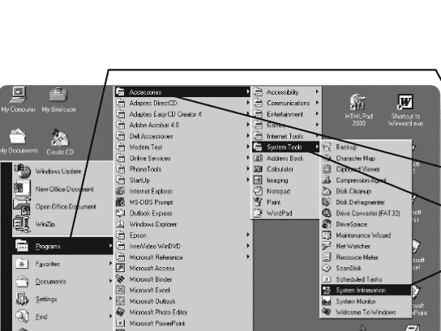

6. 从“工具”菜单中选择“系统配置实用程序”。

   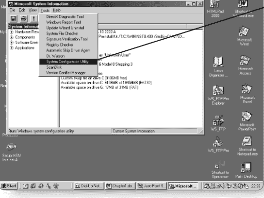

7. 选择 `Autoexec.bat` 标签页。

   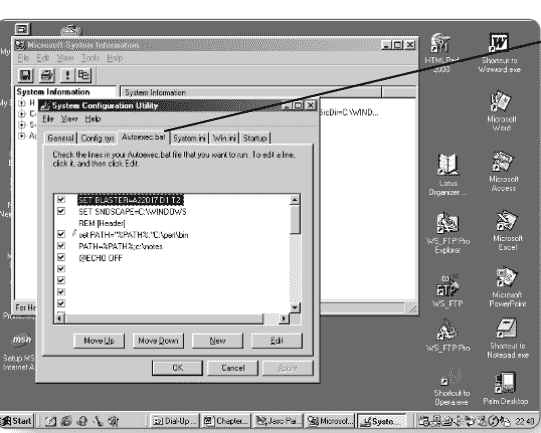

8. 点击“新建”并添加以下内容：

   ```
   PATH="%PATH%; C:\perl\bin"
   ```

   注意 `%PATH%` 周围的引号

   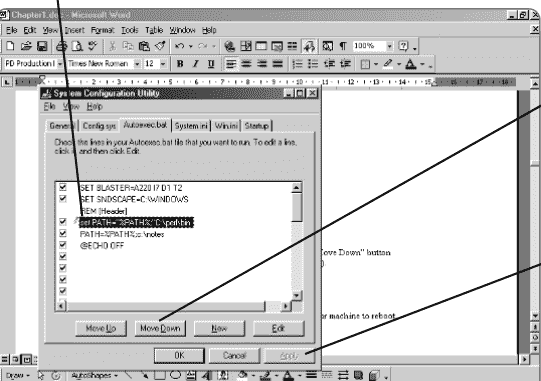

   > #### 提示
   >
   > 如果你想在其他语句之前插入它，请使用“下移”按钮然后点击“编辑”。

9. 点击“应用”。
10. 现在你会被要求重启计算机。请执行并等待计算机重启。

## 验证 Perl 安装

你的计算机现在应该已经安装 Perl 并准备就绪。

现在运行一个简单的测试，以确保 Perl 正常工作并且你的操作系统知道在哪里找到它。

1. 点击“开始”。
2. 选择“程序”。
3. 选择“MS-DOS 提示符”。将打开一个 MS-DOS 命令窗口。

   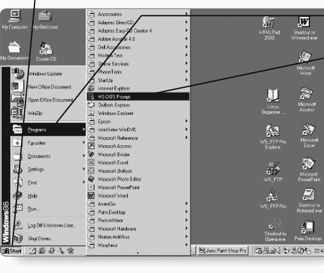

4. 在 DOS 提示符输入 `perl -v` 并按回车键。

   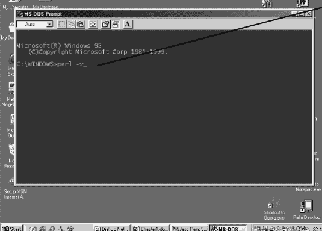

   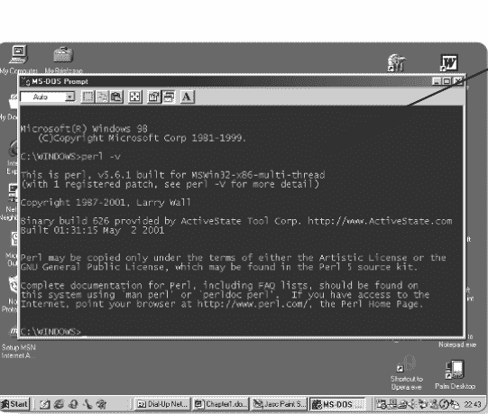

5. 你应该会收到版本报告。如果是这样，说明一切运行正常。如果不是，请返回检查安装情况并验证路径信息。

假设一切正常，你现在已经准备好开始 Perl 了！

## 在 UNIX 机器上安装 Perl

在 UNIX 机器上安装 Perl 与在 Windows 机器上安装非常不同。要在 UNIX 机器上安装 Perl，你必须先从 `http://www.perl.com` 或 `http://www.activestate.com` 获取一份 Perl 安装包。注意，有一个“生产版”和一个通常被标记为“开发版”的版本。我建议你选择生产版（有时被称为“稳定版”）。

> #### 提示
>
> 你还可以在这些网站上找到许多实用的工具，以及有帮助的文章、教程、提示等。

获取了 UNIX Perl 安装包后，你现在必须构建你的 Perl 系统。为此，你需要一个 ANSI 编译器。有很多种可供选择，你可能已经在你的 UNIX 机器上拥有了一个。

事实上，你的机器上可能已经有一份 Perl，因为现在许多机器在出厂时已将 Perl 作为操作系统的一部分。

与 Windows 测试一样，尝试输入：

```bash
perl -v
```

如果你有 Perl，你将得到版本报告；如果没有，你将收到“command not found”的消息。

值得查看 `activestate.com` 或 `perl.com` 网站，看看有哪些可用的包。情况一直在不断改进，你可能会为你的平台找到一个易于安装的版本。只需下载它，严格按照说明操作，一切都应该没问题。

> #### 注意
>
> 当然，Mac 也有一个版本的 Perl。它被称为 MacPerl，可以从 `http://www.perl.com` 获取。你应该能够找到一个下载版本，并使用著名的 StuffIt 扩展程序对其进行解压。如果你没有该程序，请访问 `http://www.aladdinsys.com/expander/` 并下载一份。（顺便说一下，StuffIt 也适用于其他平台！）

## 个人网页服务器 (PWS)


在 Web 环境中使用 Perl 之前，你需要一个 Web 服务器。对于微软平台，你可以使用 Personal Web Server（Windows NT 上的 Peer Web Services）或 Apache。

> #### 注意
>
> Apache 可以从 `http://www.apache.org` 下载，Personal Web Server 可以作为微软下载选项包的一部分下载。安装 Personal Web Server（针对 Windows NT）最简单的方法是使用已经提供的选项包。注意，要查看你的 Web 服务器，你必须使用地址：`http://127.0.0.1`。如果你有 Windows 98，你应该在列表中找到它：

1. 点击“开始”。
2. 选择“程序”。

   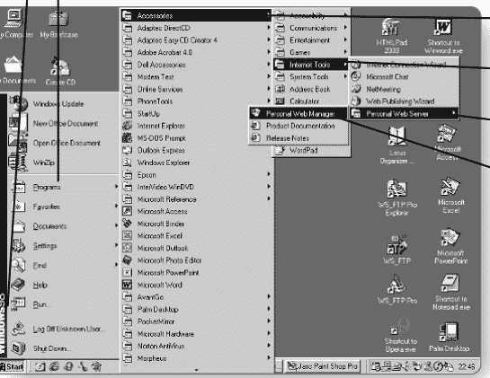

3. 选择“附件”。
4. 选择“工具”。
5. 选择“Web 服务器”。
6. 选择“Web 管理”。

### 打开 Personal Web Server

7. 打开 Personal Web Server

   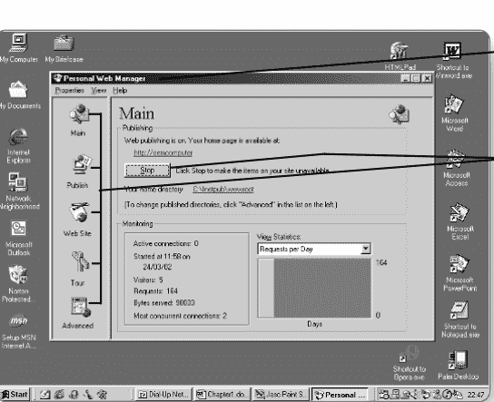

   你会看到一个这样的界面。

> #### 提示
>
> 注意主面板侧边有五个图标：

为了说明这一点，你现在要在 Web 服务器上设置一个名为 Test 的文件夹。

### 创建测试文件夹和默认页面

1. 在 `C:\inetpub\wwwroot` 文件夹下创建一个名为 Test 的文件夹。

> #### 注意
>
> 你也可以通过“我的电脑”界面使用“文件”，或通过 Windows 资源管理器创建一个新文件夹。

2. 使用记事本作为编辑器（如果你正在使用 Windows），创建一个包含以下文本的文件：

   ```html
   <html>
   <head>
   <title>Test Home Page</title>
   </head>
   <body>
   <h2>Perl Fast and easy Web Development</h2>
   </body>
   </html>
   ```

   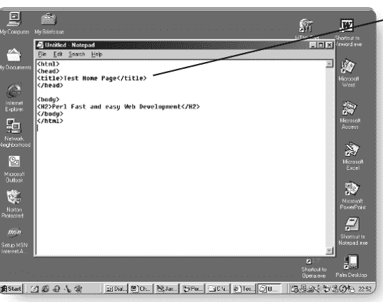

3. 将文件保存为新 test 文件夹中的 `default.htm`。

   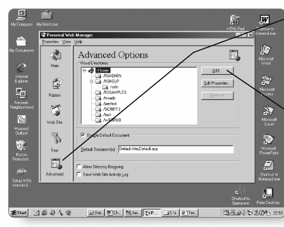

### 配置虚拟目录

4. 打开 Web 服务器对话框并点击“高级”按钮。你将看到虚拟目录对话框。
5. 点击“添加”按钮。将打开“添加目录”框。

   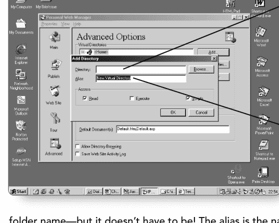

6. 在“目录”字段中，输入你想添加的文件夹的完整路径。或者点击“浏览”按钮搜索你想添加的文件夹。
7. 在“别名”字段中，输入你想要为该文件夹指定的名称。通常这与物理文件夹名称相同——但不必如此！别名是你放在 URL 主部分之后的名称，但它可能指向机器上任何位置的文件夹！

> #### 注意
>
> 注意主窗口下方的访问检查复选框。为你的新文件夹或虚拟目录设置访问选项。你可能会发现“读取”和“脚本”访问已经被勾选。这些是“安全”选项，分别允许读取和运行脚本以及 HTML 页面。中间的选项“执行”允许你在你的文件夹中运行程序。如果该文件夹在操作系统权限中也设置了“写入”访问，这可能是危险的。此外，许多商业 Web 服务器在 Web 服务器中具有“写入访问”功能，而 UNIX 允许你通过使用 `chmod` 命令设置权限。
>
> 无论你使用哪种平台，请始终记住，拥有同时具有执行权限和写入权限的文件夹是危险的。这会让黑客可能将其程序安装到你的文件夹中，然后执行它并向你的磁盘写入内容——可能会导致灾难性的结果！

   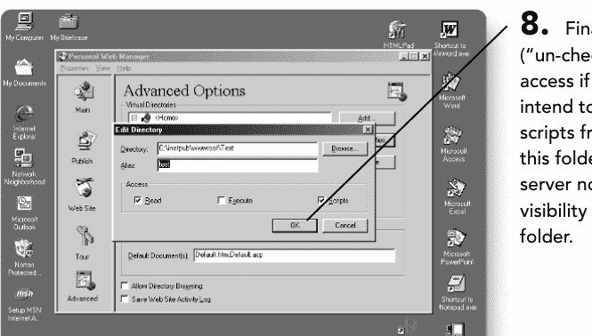

8. 最后，如果你不想从此处运行任何脚本，请点击确定（取消勾选执行访问）。你的 Web 服务器现在就可以看到你的新文件夹了。

### 测试 Web 服务器

9. 打开浏览器并输入以下 URL：

   `http://127.0.0.1/test/`

   你应该能看到这段文字。

   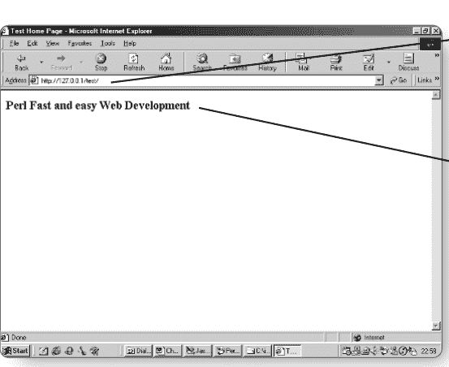

如果你使用的是不同的 Web 服务器，请遵循供应商的说明，通过你选择的服务器达到类似的点。

你现在应该有一个可以运行的 Web 服务器和一个可以运行的 Perl，我们现在可以开始讨论 Perl 的基础知识。

---

# 第 2 章：迈出 Perl 的第一步

这个相当短的章节旨在通过编写并运行一个简单的 Perl 程序来帮助你入门，并希望你在此过程中了解发生了什么。

由于 Perl 是一种解释型语言（即每行代码都会转换为机器码并立即执行的语言），因此测试非常容易。你可以保持编辑器打开，并在另一个窗口中运行代码。如果出现问题，你可以快速回到编辑器进行修改并重新运行，重复此过程直到正确为止。由于你遇到的大多数问题将是拼写错误，这是一种非常方便的工作方式。

虽然 Perl 对于解释型语言来说其实非常快，但你最终将其用于在线应用程序，在这些应用程序中，速度通常不是大问题（例如与高并发批处理相比）。

在本章中，你将学习：

- 在开始之前
- Perl 编码基础
- Perl 语法
- 学习在 Perl 程序中进行数据输入与输出

## 在开始之前

在此阶段，确定你想要用来编写和编辑程序的文本编辑器是有用的。有很多可用选择，从 Windows 上的 `notepad` 到 UNIX 上的 `Vi`，以及更复杂的编辑器。对于本章以及接下来的几个章节，在你的硬盘上创建一个名为“test”（或任何你喜欢的名称）的文件夹。无论你把它放在哪里其实并不重要，只要你能轻松找到它即可！

## Perl 编码基础

在本章中，你将开始了解 Perl 的结构、哪些元素构成 Perl 程序以及如何使用它们。为了学习基础概念，此阶段的示例将尽可能简单。随着章节的推进，你将接触其他实用的 Perl 概念并逐渐增加知识。最后，一个完整的 CGI 示例程序将把所有内容整合在一起。

## Perl 语法

现在是学习如何操作数据了。

### 语句

以下是一些定义：

- **注释**：以 `#` 开头的行，供人类使用的描述性文本，会被 Perl 忽略。

### 语句格式

你可以在语句之间使用任何所需的空白符（空格、制表符、换行）。例如：

```perl
print "I think Perl is great";
```

### 开始 Perl

所有的 Perl 程序都应该以亲称为 shebang 的语句开始。shebang 语句位于程序的第一行，并应包含 Perl 解释器的路径。

> #### 注意
>
> 记住：Perl 程序始终应该以 shebang 语句开始。

对于 UNIX，它如下：

```perl
#!/usr/bin/perl
```

可选地，后面可以跟一个标记，例如调用语法检查器：

```perl
#!/usr/bin/perl -w
```

而对于 Windows，shebang 如下：

```perl
#!C:\perl\bin\
```

但注意，对于 Windows 来说，这纯粹是一个注释！

在 NT 平台上，这一行将被视为注释。然而，NT 使用了程序与其文件名扩展名之间的“关联”。换句话说，当 Windows NT（以及 Windows 9x 等）看到 `.pl` 扩展名时，它会自动调用 Perl 解释器。

## 学习在 Perl 程序中进行数据输入与输出

我们之前已经看到，可以使用 Perl 的 `print` 命令在屏幕上显示内容：

1. 打开你的文本编辑器并开始一个新文件。

   许多像 HTMLPad 2000 这样的编辑器尝试提供帮助并为你添加一些起始代码。现在，你不需要它提供的内容。要清除编辑器窗口中的文本，请同时按下 `Ctrl` 键和 `A`；这会让文本变成蓝色。现在按 `Delete` 键，编辑器窗口就会清空。

   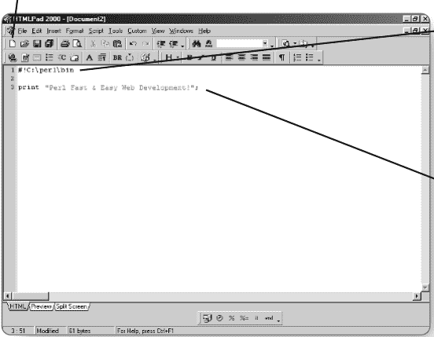

2. 在第一行（不要在前面添加任何空格；即从第 1 行第 1 列开始），输入：

   ```perl
   #!c:\perl\bin
   ```

   （如果你使用的是 UNIX 平台，则使用 `#!/usr/bin/perl`）。

3. 在下一行（或之后的某行，以提高可读性），输入：

   ```perl
   print "Perl Fast & Easy Web Development!";
   ```

   （注意语句末尾的分号。）

4. 将此小程序保存为 `02-01.pl`，存放在你的“Test”文件夹中。
5. 打开 MS-DOS 命令行提示符，进入你保存程序的地方，并输入：

   ```bash
   perl 02-01.pl
   ```

   你的程序应该会显示这条简单的信息：

   Perl Fast & Easy Web Development!

### 打印格式

在你用 Perl `print` 语句实现任何非常有趣的内容之前，你必须进行一个小小的插曲。你稍后会在第 3 章再次回到这个主题，但学习一下 `print`（屏幕显示）格式是值得的，这样你可以在早期示例代码段中使用它而不会感到太困惑。

到屏幕的输出可以使用内置的“转义序列”进行格式化。表 2.1 列出了一些常见的转义码。

**表 2.1 常见转义码**

| 转义码 | 含义或效果 |
| :--- | :--- |
| `\n` | 插入换行符 |
| `\r` | 回到当前行的行首（即回车但不换行） |
| `\\` | 这是向输出字符串中添加反斜杠的方法（否则，它会“转义”下一个字符）。 |
| `\"` | 与上相同，但针对双引号 |
| `\'` | 与上相同，但针对单引号 |
| `\$` | 这为了停止 Perl 将 `$` 解释为变量的开头。 |

请尝试以下操作：

1. 打开你的编辑器并开始一个新文件。

   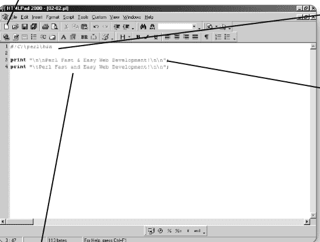

2. 输入 shebang 语句：

   ```perl
   #!c:\perl\bin
   ```

3. 添加一个 `print` 语句：

   ```perl
   print "Perl Fast and Easy Web Development!\n";
   ```

4. 注意“换行”转义码 `\n`。换行是由回车符产生的空行。

5. 现在添加另一个开头带有制表符的 `print` 语句：

   ```perl
   print "\tPerl Fast and Easy Web Development!\n";
   ```

6. 将程序保存为 `02-02.pl` 放在你的 Test 文件夹中。

   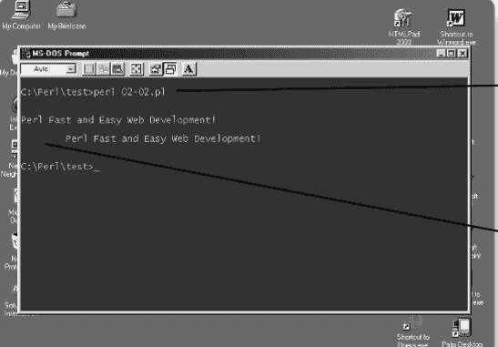

7. 打开命令行窗口并输入以下命令运行程序：

   ```bash
   perl 02-02.pl
   ```

8. 最后一行开头的 `\t` 会导致插入一个制表符，这强制输出文本移动一个空格。

## 为 Perl 程序获取输入

任何语言提供的最有用功能之一就是允许用户为你的程序提供输入，使你的程序具有交互性。Perl 可以作为命令行语言运行，并可以从命令行接受输入。

尝试以下操作：

1. 打开你的文本编辑器。

   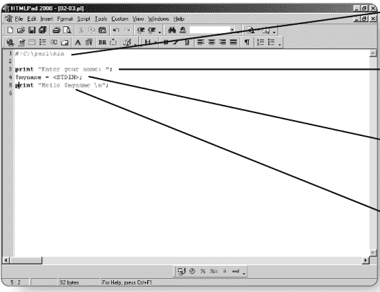

2. 在第 1 行第 1 列输入 shebang 语句。
3. 留一个空行，然后输入：

   ```perl
   print "Enter your name: ";
   ```

4. 在下一行输入：

   ```perl
   $name = <STDIN>;
   ```

5. 现在在下一行输入：

   ```perl
   print "Hello $name\n";
   ```

6. 将程序保存为例如 `02-03.pl`。
7. 打开 MS-DOS 命令行框。

   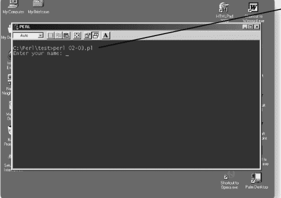

8. 输入 `perl 02-03.pl` 运行程序，并输入你的名字。

   

9. 你的程序应该显示这条简单的信息：

   Hello [你的名字]

10. 尝试更改名字并看看效果。

---

# 第 3 章：PERL 数据类型：标量

## 算术运算符

Perl 有一个对程序员来说熟悉的运算符列表。

- `+` 加运算符
- `-` 减运算符
- `*` 乘运算符
- `/` 除法运算符
- `%` 模运算符
- `**` 幂运算符

我们之前提到过大部分运算符，但这里是最后两个的描述：

- 模运算符 (`%`) 提供除法运算后的余数。`33 % 7` 得到值 `5` (33 / 7 余 5)。
- 幂运算符 (`**`) 提供数字进行幂后的值。一个简单的演示是 `5 ** 3` 将得到 `125`。也就是说，5 的 3 次方 (5³) 得到 125。

为了让你知道它们在代码中是什么样子，这里有一些 Perl 中使用的算术运算示例。

### 练习：基本算术运算

1. 打开你的编辑器。
2. 输入 shebang 语句。

   ```perl
   #!c:\perl\bin
   ```

   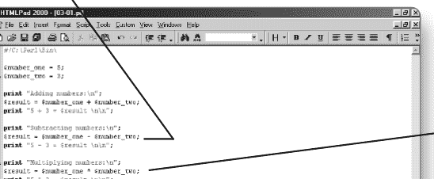

3. 创建两个变量并赋值：

   ```perl
   $number_one = 5;
   $number_two = 3;
   ```

4. 输入以下三行语句，执行加法操作并显示结果。

   ```perl
   print "Adding numbers:\n";
   $result = $number_one + $number_two;
   print "5 + 3 = $result\n";
   ```

5. 输入以下三行语句，执行与上一步相同的操作，但使用减法操作符。

   ```perl
   print "Subtracting numbers:\n";
   $result = $number_one - $number_two;
   print "5 - 3 = $result\n";
   ```

   

6. 对乘法 (`*`) 运算符执行相同的操作。

   ```perl
   print "Multiplying numbers:\n";
   $result = $number_one * $number_two;
   print "5 * 3 = $result\n";
   ```

7. 以同样的方式输入除法 (`/`) 运算符的代码。

   ```perl
   print "Dividing numbers:\n";
   $result = $number_one / $number_two;
   print "5 / 3 = $result\n";
   ```

   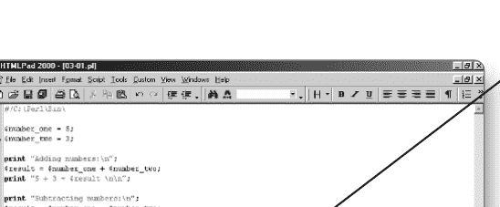

8. 输入幂 (`**`) 运算符的代码。

   ```perl
   print "Raising numbers to a power:\n";
   $result = $number_one ** $number_two;
   print "5 raised to the power of 3 is $result\n";
   ```

   这三行代码中的第二行会导致 `$result` 变量包含 `$number_one` 的 `$number_two` 次幂的值。

   

9. 添加最后三行代码以演示取模（Modulo）运算符的使用。

   ```perl
   print "Obtaining a remainder after a division (Modulo):\n";
   $result = $number_one % $number_two;
   print "5 Modulo 3 is $result\n\n";
   ```

   在这里，`$result` 变量被赋值为 `$number_one` 除以 `$number_two` 的余数。

   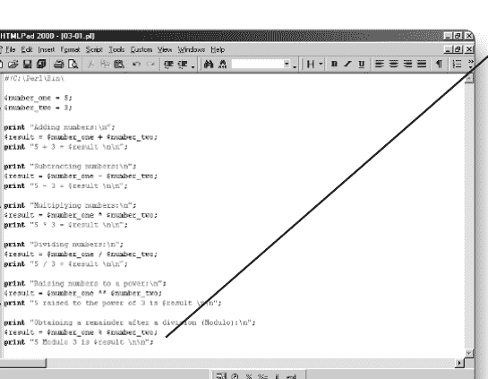

10. 将代码保存到你的测试文件夹并命名为 `03-01.pl`。
11. 打开 DOS 命令行提示符。
12. 导航到你的程序测试文件夹。
13. 使用 `perl 03-01.pl` 命令运行你的代码。

   

14. 你应该得到如下输出。

如果你的输出看起来不正确，请返回第 2 步检查是否有拼写错误。

此练习演示了你可能使用普通算术操作符执行的简单算术运算。

## 其他操作符

还有几个看起来有点奇怪的操作符。这些是自增、自减和赋值操作符。让我们快速查看它们。

### 练习：自增、自减与复合赋值

1. 打开你的编辑器。

   

2. 输入 shebang 语句。

   ```perl
   #!c:\perl\bin
   ```

3. 在空行之后，创建一个名为 `$number` 的变量并赋值为 5。

   ```perl
   $number = 5; # 正常赋值
   ```

   注意以井号符号（`#`）开头的注释。

4. 使用以下代码行使程序输出打印两个换行符：

   ```perl
   print "\n\n";
   ```

5. 输入此行代码以打印变量名及其包含的值：

   ```perl
   print "The variable \$number currently contains the value $number\n\n";
   ```

   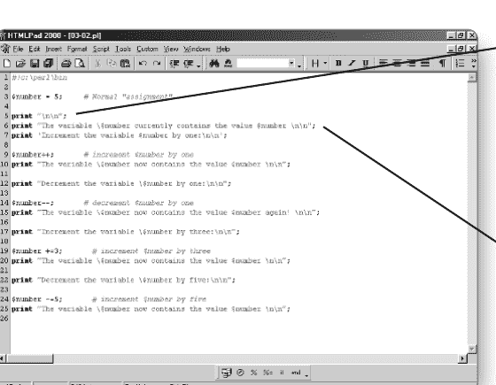

> #### 注意
>
> 注意变量名 `$number` 前面有一个反斜杠 (`\`)，这样该变量就不会被插值（即打印的是它的名字而不是它的值）。在行尾，变量被打印，而这次没有反斜杠，所以变量被替换为它的值。行末还有两个换行符，因此在显示的输出中会有更多的回车。

6. 输入几行——第一行是一个简单的 `print` 语句，用于宣布 `$number` 将要增加。在下一行中，`$number++` 导致变量自增。三行的最后一行显示变量 `$number` 的值。

   ```perl
   print "Increment the variable \$number by one:\n\n";
   $number++; # 将 $number 增加1
   print "The variable \$number now contains the value $number\n\n";
   ```

   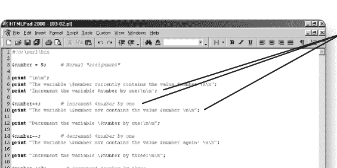

7. 现在输入以下行执行类似的操作，但使用自减运算符。

   ```perl
   print "Decrement the variable \$number by one:\n\n";
   $number--; # 将 $number 减少1
   print "The variable \$number now contains the value $number!\n\n";
   ```

   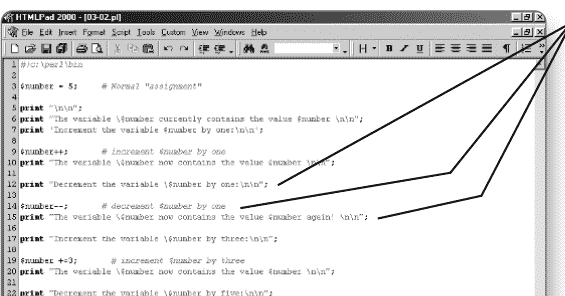

8. 添加这些行以演示变量如何通过非 1 的值进行自增或自减。

   ```perl
   print "Increment the variable \$number by three:\n\n";
   $number += 3; # 将 $number 增加3
   print "The \$number now contains the value $number\n\n";

   print "Decrement the variable \$number by five:\n\n";
   $number -= 5; # 将 $number 减少5
   print "The \$number now contains the value $number\n\n";
   ```

9. 将代码保存到你的测试文件夹并命名为 `03-02.pl`。
10. 打开 DOS 命令行提示符。
11. 导航到你的程序测试文件夹。
12. 使用 `perl 03-02.pl` 命令运行你的代码。

## `$_` 变量

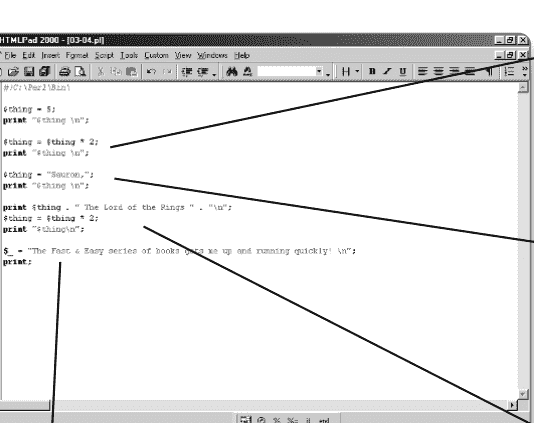

### 练习：`$_` 默认变量

1. 打开你的编辑器。
2. 输入 shebang 语句。
3. 创建一个变量 `$thing` 并赋值为 `10`。

   ```perl
   $thing = 10;
   print "$thing\n";
   ```

4. 现在添加这两行，将 `$thing` 乘以 2 并显示结果。

   ```perl
   $thing = $thing * 2;
   print "$thing\n";
   ```

5. 现在为 `$thing` 赋值“Sauron”，并再次显示 `$thing` 的值。

   ```perl
   $thing = "Sauron";
   print "$thing\n";
   ```

6. 添加以下行将 `$thing` 与字符串字面量“The Lord of the Rings” 和 `"\n"` 拼接。然后尝试将结果乘以 2 并显示结果。

   ```perl
   print $thing . " The Lord of the Rings " . "\n";
   $thing = $thing * 2;
   print "$thing\n";
   ```

7. 最后，将 `$_` 变量设置为“The Fast & Easy series of books gets me up and running quickly! \n”并显示结果。

   ```perl
   $_ = "The Fast & Easy series of books gets me up and running quickly! \n";
   print $_;
   ```

8. 将你的程序保存为 `03-04.pl`。
9. 运行程序（在命令行运行 `perl 03-04.pl`）。

   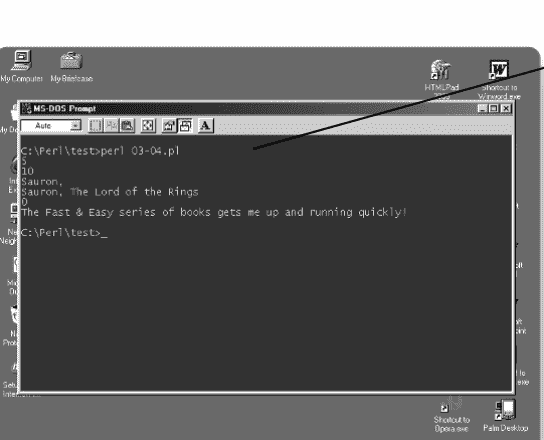

这是结果。

此示例展示了如何使用标量处理数值或字符串，以及当你尝试对字符串值进行算术运算时会发生什么。

最后两行演示了 `$_` 变量的使用。在你继续探索 Perl 的过程中，你将再次使用它。

再次注意，`print` 语句中的变量被包含在引号内。双引号允许你在字符串中进行变量插值。完全理解这一机制至关重要。

```perl
$thing = "Fred";
print "the value of the string is $thing \n";
```

将给你得到：

the value of the string is Fred

单引号对字面量起的作用类似，但它们不会导致插值的发生，因此变量在字符串内部不会被求值。

换句话说，以下代码：

```perl
$thing = "Fred";
print 'the value of the string is $thing';
```

将给你得到：

the value of the string is $thing \n

尝试一下，你就会明白我的意思了。

最后，注意 `print` 语句末尾的 `\n` 字符。熟悉 `C`、`C++`、`Java`、`PHP` 等语言的人会认出这是换行符。它会导致任何随后的文本输出移动到屏幕的下一行。注意，如果在 `print` 语句中使用单引号，该字符也不会被作为换行符进行插值。

单引号会导致转义序列被忽略。如果你将上程序中的其中一个 `print` 语句放在单引号中，`\n` 序列将被显示出来，而不会产生换行。

注意，标量变量可以是空的。例如，如果你执行了以下操作：

```perl
print $string1;
```

`$string1` 现在存在但没有值。然而，你可以使用以下方法检查标量的存在性：

```perl
if (defined $string1) {
    print "That variable has been defined! \n";
}
```

你甚至可以这样“取消初始化”标量变量：

```perl
undef($string1);
# 或者
$string1 = undef;
```

当你开始在实际工作中使用字符串时，你将研究更多对 Perl 字符串可以进行的操作。

## 用于格式化的转义序列

你已经使用过 Perl 中的 `print` 函数了。你最近学习了如何使用转义字符 `\n` 提供换行符——即，强制换行并将文本光标移动到下一行，以及使用 `\t` 提供制表符。

在第 2 章中，你看到了一个转义序列的简表。还有许多其他转义序列提供文本格式化功能。参见表 3.1 获取这些常用转义序列的完整列表。

**表 3.1 转义序列**

| 转义代码 | 含义 |
| :--- | :--- |
| `\b` | 退格 |
| `\n` | 换行 |
| `\r` | 回车（回到行首） |
| `\t` | 制表符 |
| `\u` | 将下一个字符转换为大写 |
| `\U` | 将后续字符转换为大写 |
| `\l` | 将下一个字符转换为小写 |
| `\L` | 将后续字符转换为小写 |
| `\\` | 显示反斜杠 |
| `\'` | 显示单引号 |
| `\"` | 显示双引号 |
| `\E` | 结束 `\U` 或 `\L` 效果 |

注意，反斜杠也可以用于文本格式化以外的用途。例如，如果你想显示一个如 `\n` 的字符串甚至只是一个 `\` 呢？

你需要在你想打印的内容前面再放置一个反斜杠（或者将字符串放在单引号中）。所以，如果你想显示 `\n`，使用：

```perl
print "\\n";
```

如果你想显示反斜杠，使用：

```perl
print "\\\\";
```

此外，如果你想显示引号，可以这样做：

```perl
print "One of the quotes is \"";
```

现在你知道如何处理字符串并显示它们了。接下来你将学习更多关于运算符的内容。

---

# 第 4 章：运算符

## 算术运算符（续）

为了让你知道它们在代码中是什么样子，这里有一些 Perl 中使用的算术运算示例。

### 练习：算术运算示例

1. 打开你的编辑器。
2. 输入 shebang（我不会再提到 shebang 了……我确定你现在明白我的意思了）。

   ```perl
   #!c:\perl\bin
   ```

   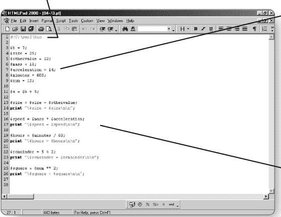

3. 输入代码设置若干变量。

   ```perl
   $b = 7;
   $size = 25;
   $othervalue = 12;
   $mass = 10;
   $acceleration = 14;
   $minutes = 600;
   $num = 12;
   ```

4. 输入代码对你的变量进行算术运算并显示结果。

   ```perl
   $a = $b + 5;
   $size = $size - $othervalue;
   print "\nsize = $size\n\n";

   $speed = $mass * $acceleration;
   print "\nspeed = $speed\n\n";

   $hours = $minutes / 60;
   print "\nhours = $hours\n\n";

   $remainder = 5 % 2;
   print "\nremainder = $remainder\n\n";

   $square = $num ** 2;
   print "\nsquare = $square\n\n";
   ```

5. 将你的程序保存为 `04-03.pl`。
6. 打开一个 MS-DOS 命令行窗口。
7. 运行你的程序 (`perl 04-03.pl`)。

   

你应该得到这样的输出。

在你自己简单的 Perl 程序中尝试一些示例，并使用 `print` 语句来显示效果。

## 其他运算符

Perl 还支持自增和自减运算符，正如你之前发现的那样；现在你可以更详细地查看它们。这些运算符是更新数值变量值的一种快捷方式。

```perl
$counter++;      # 这等同于：$counter = $counter + 1;
$counter--;      # 这等同于：$counter = $counter - 1;
```

如果你想给数值变量增加大于 1 的值，可以执行以下操作。

```perl
$counter += 5;      # 这等同于：$counter = $counter + 5;
```

同样地：

```perl
$counter -= 5;      # 这等同于：$counter = $counter - 5;
```

这种更新变量的快捷方法也适用于其他运算符，如下所示：

```perl
$counter %= 5;      # 这等同于：$counter = $counter % 5;
```

（也就是说，将 `$counter` 除以 5，然后将余数放入 `$counter` 中。）

```perl
$counter *= 5;      # 这等同于：$counter = $counter * 5;
```

作为提醒，这里有一个演示这些运算符的小程序。

### 练习：复合赋值运算符演示

1. 打开你的编辑器。
2. 使用这段简单的代码将数字赋值给变量。

   ```perl
   $number = 5;          # 正常的“赋值”
   ```

3. 输入以下代码打印几个空行，然后显示变量。

   ```perl
   print "\n\n";
   print "The variable \$number currently contains the value $number \n\n";
   ```

   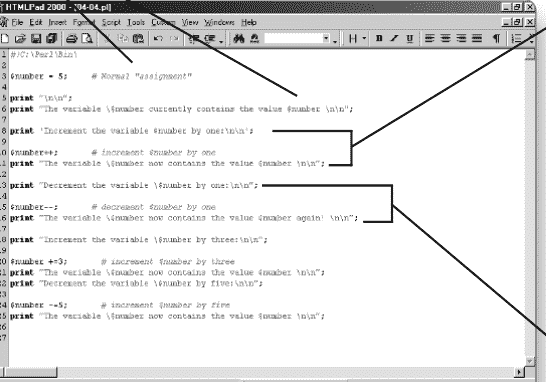

4. 现在显示一条消息并这样自增变量：

   ```perl
   print "Increment the variable \$number by one: \n\n";
   $number++;          # 自增 $number by one
   print "The variable \$number now contains the value $number \n\n";
   ```

5. 现在使用这段代码显示消息并自减变量。

   ```perl
   print "Decrement the variable \$number by one: \n\n";
   $number--;          # 自减 $number by one
   print "The variable \$number now contains the value $number again! \n\n";
   ```

6. 然后输入以下内容将变量加 3 并显示结果。

   ```perl
   print "Increment the variable \$number by three:\n";
   $number += 3; # 自增 $number by three
   print "The variable \$number now contains the value $number\n";
   ```

7. 最后，输入代码将变量减 5。

   ```perl
   print "Decrement the variable by five:\n";
   $number -= 5;
   print "The variable \$number now contains the value $number\n";
   ```

8. 将其保存为 `04-04.pl`。
9. 打开一个 MS-DOS 命令行窗口。
10. 运行程序 (`perl 04-04.pl`)。

你应该得到所示的结果。

## 前置与后置自增/自减

在继续学习之前，可能还有一件事值得提。自增和自减运算符可以出现在变量名之前，如下所示：

```perl
++$count;
```

起初，它看起来可能和下面没有区别：

```perl
$count++;
```

其实并没有多大区别。毕竟，值仍然是增加了 1。唯一的区别在于，在变量用于循环的情况下，在第一种情况下，`$count` 中包含的值是在其被使用**之前**增加，而在第二种情况下是在其使用**之后**增加。起初这看起来并不重要，但记住它；你会发现使用其中一个而不是另一个的理由。

尝试这个简单的示例来演示区别：

### 练习：前置与后置自增对比

1. 打开你的编辑器。
2. 创建一个新文件。
3. 在 shebang 语句后，输入以下 `print` 语句：

   ```perl
   print "\nHere is the pre-increment example: \n";
   ```

4. 现在创建一个变量作为计数器并将其值设置为零。

   ```perl
   $count = 0;
   ```

5. 使用一个简单的 `while` 循环，将循环限制设置为 5。在这种情况下，使用前置自增。

   ```perl
   while (++$count < 5) {
       print "The variable \$count now contains the value $count \n\n";
   }
   ```

6. 现在使用这段代码显示消息并演示后置自增。

   ```perl
   print "\nHere is the post-increment example: \n";
   $count = 0;
   while ($count++ < 5) {
       print "The variable \$count now contains the value $count \n\n";
   }
   ```

---

# 字符串操作符

输出应该像这样。


注意在 `comfort` 和 `able` 之间有一个空格——这并不是你想要的结果！

但 Perl 有解决办法。你可以将变量名用大括号括起来。

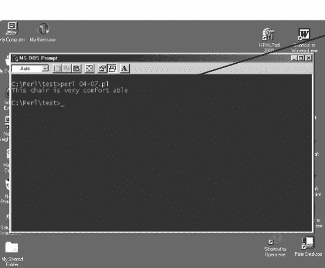

1. 修改程序，使这两行看起来如下所示：

```perl
$something = "comfort";
print "This chair is very ${something}able\n";
```

2. 注意 `${something}` 和 `able\n` 之间没有空格。

3. 重新保存你的程序。

4. 打开命令行窗口。

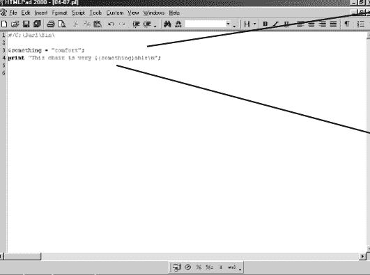

# 第 4 章：操作符

你现在应该看到这个。

这样好多了！这又是一个非常简单但非常有用的例子，解决了一个潜在的令人沮丧的问题。

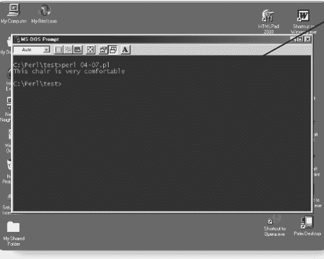

## 子字符串

Perl 允许你提取字符串的一部分并将其打印出来或放入另一个变量中。然而，执行子字符串操作的 Perl 函数更为复杂。该函数的语法为：

```
substr(stringb, startpos, length)
```

这意味着你应该从 `stringb` 中获取要查找的值；该值从 `startpos` 处的字符开始，长度为 `length` 个字符。

如果这让你感到困惑，请尝试这个小程序。

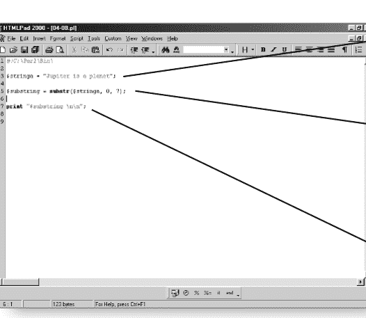

1. 设置一个字符串。

```perl
$stringa = "Jupiter is a planet";
```

2. 使用 `substr()` 函数提取前 7 个字符。

```perl
$substring = substr($stringa, 0, 7);
```

3. 显示结果。

```perl
print "$substring\n\n";
```

4. 保存程序为 `04-08.pl`。

5. 打开命令行提示符窗口并运行程序 (`perl 04-08.pl`)。

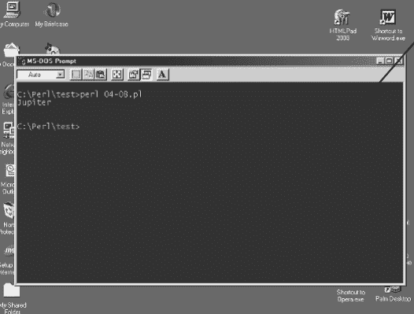

你应该看到类似内容。

> **注意**
>
> `substr()` 函数的长度参数是可选的。如果你省略它，`substr()` 将假设长度值为字符串的末尾。

## 修改大小写

你可能想更改字符串的“大小写”，例如在进行值比较之前。Perl 有几个执行此功能的字符串函数。

非常简单，这些 Perl 函数执行以下操作：

- `uc`：将字符串转换为大写。
- `lc`：将字符串转换为小写。
- `ucfirst`：只将字符串的第一个字母转换为大写。
- `lcfirst`：只将字符串的第一个字母转换为小写。

尝试这个示例程序。

1. 这样设置几个字符串变量：

```perl
$stringlower = "perl fast & easy";
$stringupper = "PERL FAST & EASY";

$convertinguc = uc($stringlower);
print "\nusing uc gives: \$convertinguc\n";
$convertinglc = lc($stringupper);
print "\nusing lc gives: \$convertinglc\n";
$convertingucfirst = ucfirst($stringlower);
print "\nusing ucfirst gives: \$convertingucfirst\n";
$convertinglcfirst = lcfirst($stringupper);
print "\nusing lcfirst gives: \$convertinglcfirst\n";
```

2. 显示大写函数 `uc` 的效果。

```perl
$casestring = uc($stringlower);
print "\nusing uc gives: \$casestring \n\n";
```

3. 显示小写函数 `lc` 的效果。

```perl
$casestring = lc($stringupper);
print "\nusing lc gives: \$casestring \n\n";
```

4. 同样，显示 `ucfirst` 和 `lcfirst` 函数的效果。

```perl
$casestring = ucfirst($stringlower);
print "\nusing ucfirst gives: \$casestring \n\n";
```

```perl
$casestring = lcfirst($stringupper);
print "\nusing lcfirst gives: \$caslcfirst \n\n";
```

## 混合字符串与数字

5. 保存你的程序为 `04-09.pl`。

6. 打开命令行提示符并运行你的程序。

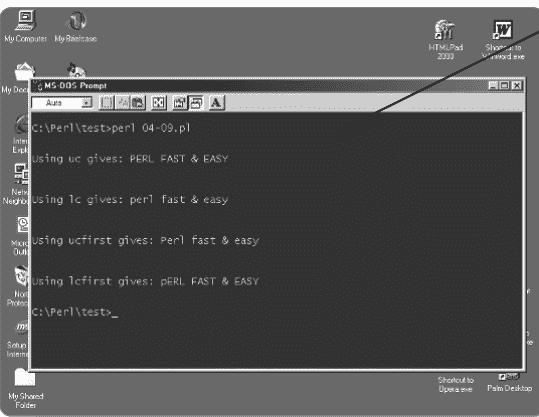

这应该得到这些结果。

如你所见，Perl 是一种非常强大的语言，拥有许多非常有用的函数。事实上，Perl 用于各种目的的函数极其丰富。你正在学习许多最有用的函数，还有许多其他函数在等着你。而且，程序员大军不断创建新函数，帮助 Perl 保持最强大语言之一的地位。

### 混合字符串和数字

正如你之前学到的，Perl 根据上下文（`context`）来决定如何处理标量（`scalar`）。这可能会导致一些困惑，除非你已经准备好面对结果！

尝试以下代码并仔细阅读每行注释；如果你愿意，请将代码输入你的编辑器中。

1. 设置一些数值变量，赋值，并显示它们。

```perl
$num1 = 25;
print "\n\n$num1";

$num2 = 10;
print "\n\n$num2";
```

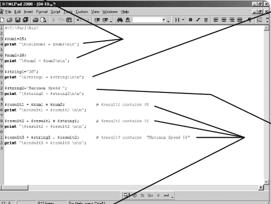

2. 现在设置一个字符串变量，赋值 `"20"` 而不是 `20`，并显示它以证明正常。

```perl
$string1 = "20";
print "\n\n$string1";
```

3. 设置另一个字符串变量并显示。

```perl
$string2 = "Maximum Speed";
print "\n\n$string2";
```

4. 现在对变量执行一些操作——仔细阅读——

```perl
$result1 = $num1 + $num2;
print "\n\n$result1";

$result2 = $num1 + $string1;
print "\n\n$result2";

$result3 = $string2 . $result2;
print "\n\n$result3";
```

`$result1` 包含 `35`

`$result2` 包含 `55`

`$result3` 包含 `Maximum Speed 55`

5. 保存程序为 `04-10.pl`。

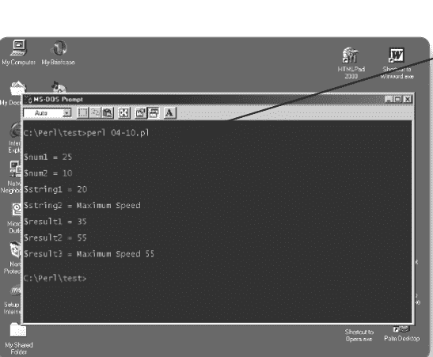

6. 运行程序；你应该得到这些结果。

跟上这一切吗？规则是 Perl 会根据标量看起来的类型来处理它。如果它看起来像数字，Perl 很可能会将其视为数字。将上面的代码复制到编辑器中的一个新的 Perl 程序，保存并尝试。测试哪些有效哪些无效。

## 比较操作符

当你编写 `if` 语句时，使用比较操作符来测试字符串、数字等。

### 数字比较操作符

如果你在测试数值，可以使用以下比较操作符：

- `>`：大于
- `==`：等于
- `<`：小于
- `>=`：大于等于
- `<=`：小于等于
- `!=`：不等于

尝试下一个程序查看数字操作符的使用。

1. 打开你的编辑器。

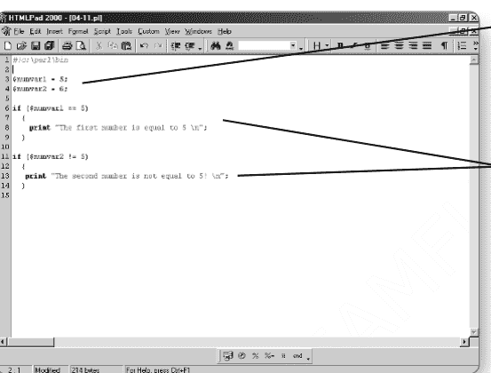

2. 这样定义两个变量并赋值：

```perl
$numvar1 = 5;
$numvar2 = 6;
```

3. 使用 `if` 语句（我们还没有介绍，但这里足够简单）测试变量的值，如果通过 `==` 和 `!=` 操作符通过测试，则打印消息。

```perl
if ($numvar1 == 5) {
    print "The first number is equal to 5 \n"
}

if ($numvar2 != 5) {
    print "The second number is not equal to 5! \n"
}
```

> **注意**
>
> `if` 语句在第 7 章“程序流程”中描述，但我希望你能跟上这里使用的简单 `if` 语句。如果没有，请在阅读第 7 章后再这里重新检查这段代码。

4. 保存你的程序为 `04-11.pl`。

5. 打开命令行窗口。

6. 运行你的程序。

> **注意**
>
> 在检查值的相等性时，使用相等比较操作符 `==` 这一点再强调不过。“`=` 是赋值运算符。这是许多 bug 的根源。

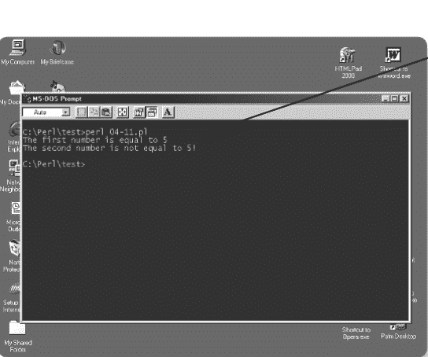

其他相似的操作符用法与之前的示例完全相同。

```perl
if ($numvar > 5) {
    print "You chose a number greater than 5 \n";
}
```

```perl
if ($numvar >= 5) {
    print "You chose a number greater than 4 \n";
}
```

以此类推。

你以后还会使用数字操作符。它们的用法显而易见，正如后续真实的 Web 应用代码所示。

### 字符串比较操作符

上面的运算符（`==`、`<`、`>` 等）应该用于测试数值。为什么？尝试以下程序，它将演示数字比较和字符串比较之间的区别。

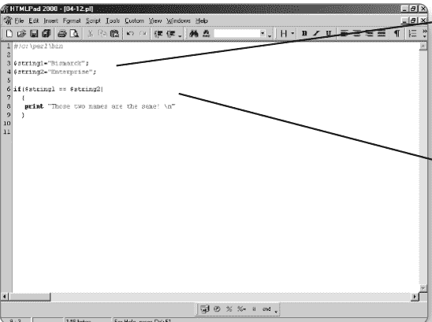

1. 设置两个字符串变量并为它们赋值。

```perl
$string1 = "Bismarck";
$string2 = "Enterprise";
```

2. 执行与之前程序类似的测试，如果它们相等则打印结果（显然它们并不相等！）。

```perl
if ($string1 == $string2) {
    print "Those two names are the same! \n"
}
```

3. 保存你的程序为 `stringcomp1.pl`。

4. 打开命令行窗口并运行你的程序。

比较结果判定这两个字符串是相同的。

此原因为 `==` 是一个数值比较运算符，因此 Perl 会将 `$string1` 和 `$string2` 解释为数值变量。由于 Perl 无法将它们评估为数字，它们将被设置为 `0`。因此，两个变量在数值上是相等的，所以测试通过，并打印出字符串“Those two names are the same!”。

出于这个原因，Perl 为字符串提供了一套不同的比较运算符。

- `eq`：等于
- `ne`：不等于
- `lt`：小于
- `gt`：大于
- `le`：小于或等于
- `ge`：大于或等于

这些运算符的使用方式与数值运算符类似，但显然只用于字符串变量。

这里有一个完全相同的程序，只是你将使用字符串 `eq` 比较运算符，并且有一个 `else` 选项来捕获结果；否则你将没有任何输出。

1. 打开一个新文件或复制上一个文件。

2. 使用相同的变量。

```perl
$string1 = "Bismarck";
$string2 = "Enterprise";
```

3. 再次使用相同的 `if` 语句，但这次使用 `eq` 运算符而不是 `==` 运算符。

```perl
if ($string1 eq $string2) {
    print "Those two names are the same! \n"
}
```

4. 现在添加一个 `else` 语句，如果上面的代码如我们预期那样工作，那么目前将不会打印任何内容。

```perl
else {
    print "Those two strings are not the same! \n"
}
```

5. 将你的程序保存为 `04-13.pl`。

## 逻辑运算符

6. 运行这个版本的程序。这次你应该发现你得到了结果。

在我们暂时离开运算符之前，你将学习一些逻辑运算符的知识。

### 逻辑运算符

最后，在运算符的简要检查中，将是逻辑运算符。逻辑运算符用于评估被测试的条件是真还是假。你经常会看到大写的 **True** 和 **False**，就像这里一样，以强调这是一个逻辑值（或布尔值）。

“布尔”一词源于数学家乔治·布尔（George Boole）的名字，他是逻辑代数形式规则的先驱。计算机依赖逻辑工作，因此你经常会遇到 **True**（通常用值 `1` 表示，也可以用任何非零值表示）和 **False**（通常用值 `0` 表示）。

数值上的 **True** 是任何非零值，因此数值 `0` 等于 **False**。所以 `1`、`5`、`7`、`232`、`-175` 等都是 **True**。只有数值 `0` 是 **False**。我们也可以对字符串进行 **True/False** 检查。单词“Olympic”是 **True**，包含“0”的字符串是 **True**，单个空格也是 **True**。只有在完全没有任何字母或数字的情况下才是 **False**。

基本上有三个逻辑运算符：`and`、`or` 和 `not`。

这意味着你仅通过这种方式就可以检查两个变量是否有值：

```perl
if ($num1 and $num2) {
    print "Both of those variables have a non-zero value.\n"
}
```

你可以说：

```perl
if (not $num1) {
    print "That variable is empty.\n"
}
```

你也可以说：

```perl
if ($num1 or $num2) {
    print "One of those variables has a non-zero value.\n"
}
```

你可以组合条件，例如：

```perl
if ($num1 and $num2 or $num3) {
    print "Both of the first variables have a non-zero value or that last one does!\n"
}
```

逻辑运算符的工作方式完全相同。正如你所发现的，空字符串等于 **False**，而所有其他值都等于 **True**。

最后，可以使用符号来代替 `and`、`or` 和 `not`。

- `||` 等同于逻辑运算符 `or`
- `&&` 等同于 `and` 运算符
- `!` 等同于 `not` 运算符

使用这些符号代替单词 `and`、`or` 和 `not` 的唯一区别是符号版本具有更高的优先级。也就是说，`||` 会在 `or` 之前处理。不用担心。如果你想让某个内容在另一个内容之前评估，只需将你想先执行的内容括在括号中。

逻辑运算符看起来很简单，但误用可能会导致非常困惑的错误。你稍后会经常用到逻辑运算符。尝试使用之前的示例并玩代码，或者继续读下去等待一些真实的例子。

## 数组

数组简单来说就是标量的集合。数组的名称与简单标量非常相似，但它还有许多元素。每个元素都有相同的名称，并通过下标指向。

在本章中，你将学习到：

- 声明数组
- 加载数组
- 合并数组
- 数组函数和操作

从概念上说，数组可以被认为若干个“鸽巢”，每个鸽巢都可以区分数据。如所述，每个元素与其他所有元素共享一个公共名称，并使用下标来引用数组中的哪个元素。

你可能记得标量变量前面有一个美元符号 (`$`)。数组使用 `@` 前缀使其与标量变量一眼区分开来。标量变量使用 `$` 作为前缀，而数组使用 `@`，这样你就能识别出这是一个数组。在大多数编程语言中，数组的第一项索引为 `0`。我会随着时间的推移再次提到这一点。

### 声明数组

你可以声明数组并加载数组，就像我们预期的那样。

1. 打开编辑器并开始新程序。

2. 输入如下数组定义：这将加载 1 到 12。

```perl
@months = (1..12);
foreach (@months) {
    print "Months: ";
}
```

3. 现在添加一个简单的循环来显示数组中的值。使用 `for` 循环。

```perl
for ($loopcount = 0; $loopcount < 12; $loopcount++) {
    print "@months[$loopcount]\n";
}
```

4. 将你的程序保存为 `05-01.pl`。

5. 现在打开命令行。

6. 运行程序（`perl 05-01.pl`）

你应该得到列表（数组每个元素的内容），如下。

在定义数组时可以有一个间隔，如下：

1. 使用此数组重复上面的示例。注意 21 到 24 的数字间隔。

```perl
@mynumbers = (1..20, 25..40);
```

2. 添加之前的循环。

```perl
for ($loopcount = 0; $loopcount < 40; $loopcount++) {
    print "@mynumbers[$loopcount]\n";
}
```

3. 将你的程序保存为 `05-02.pl`。

你可以对字符做同样的事情，如下：

在定义数组时可以这样做设置，如下：

1. 再次使用以下数组修改程序：

```perl
@alphabet = (a..z);
```

这将创建一个 26 个标量的数组，每个包含一个字母表中的字母。

2. 你需要更改计数器以覆盖字母表中的字母。

```perl
for ($loopcount = 0; $loopcount < 27; $loopcount++) {
    print "@alphabet[$loopcount]\n"
}
```

3. 将你的程序保存为 `05-03.pl`。

4. 运行你的程序，你应该看到这个。你并不限于使用单个字符。

1. 将数组更改如下。

```perl
@letters = (aa..dd);
```

你将创建一个包含 82 个值的数组；包含 `aa`、`ab`、`ac`、`ad` 等，直到 `dd`。

2. 再次更改循环代码以处理新数组。

```perl
for ($loopcount = 0; $loopcount < 82; $loopcount++) {
    print "(@letters[$loopcount])\n";
}
```

这里使用了括号（圆括号）而不是简单的换行符，这样你就可以看到所有的并验证此程序的输出。

3. 将程序保存为 `05-04.pl`。

4. 打开命令提示符并运行你的程序。正如你想象的，你需要观察它能运行到什么程度。

最后，你可以像这样混合元素：

```perl
@things = ("Fred", 16, 57.23456, $title);
```

这里有一个字面量字符串、一个整数、一个浮点数，以及一个包含任何内容的标量变量。

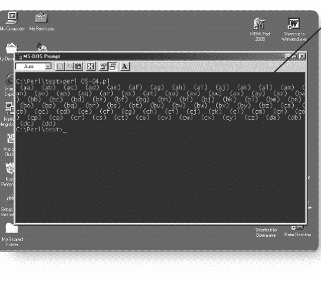

1. 再次修改程序以包含一个字符串变量 (`$title`) 并将其设置为 `"This is a title"`，以适应之前的数组。

```perl
$title = "This is a title";
@things = ('Fred', 16, 57.23456, $title);
```

2. 修改循环，使其使用新数组 `@things`。

```perl
for ($loopcount = 0; $loopcount < 4; $loopcount++) {
    print "* @things\n    [$loopcount] \n";
}
```

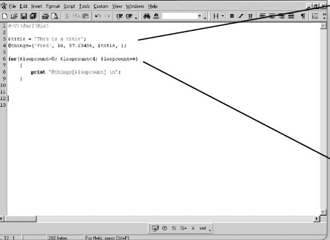

3. 将其保存为 `05-05.pl`。

4. 打开命令窗口。

5. 运行程序。你应该能看到这个。

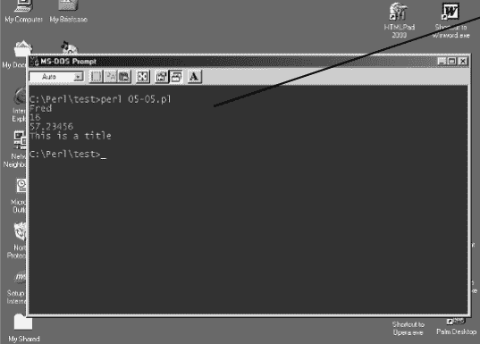

# 第 5 章：数组

## 加载数组

你可以对数组做很多事情，并且有许多函数可以操作它们。这里是几个示例。

假设你有一个名为 `ships` 的数组。你可以这样加载它：

```perl
@ships = ('Bismarck', 'Titanic', 'Hood', );
```

你可以通过使用数字下标来引用数组的单个元素，如下：

```perl
$shipname = @ships[1];
```

1. 在编辑器中启动一个新程序。

2. 这样设置数组。

```perl
@ships = ('Bismarck', 'Titanic', 'Hood', );
```

3. 现在打印每个元素的值。

```perl
print "@ships[0] \n";
print "@ships[1] \n";
print "@ships[2] \n";
```

4. 打开命令窗口。

5. 运行你的程序。你应该得到这个结果。

注意，数组从元素 `0`（零）开始，下标 `1` 指向数组中的第二个元素。因此，以下语句：

```perl
print "@ships[1]";
```

将打印：

```
Titanic
```

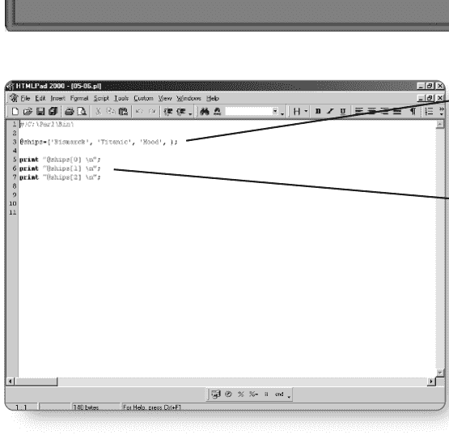

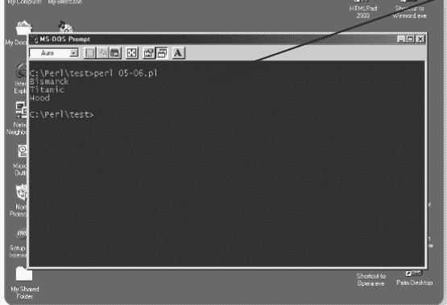

## 合并数组

你也可以将数组合并。如果你像这样有两个数组：

```perl
@Warships = ('Hood', 'Bismarck', 'Washington');
@passengerships = ('Titanic', 'Olympic', 'Britannic');
```

你可以这样合并它们：

```perl
@ships = (@Warships, @passengerships);
```

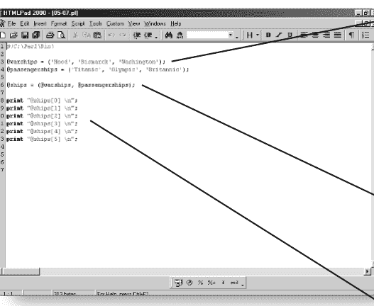

1. 在编辑器中打开一个新程序，以与上单个数组示例类似的方法设置两个数组。

```perl
@ships = ('Hood', 'Bismarck', 'Washington');
@passengerships = ('Titanic', 'Olympic', 'Britannic');
```

2. 按照以下方式合并两个数组：

```perl
@ships = (@ships, @passengerships);
```

3. 打印 `@ships` 数组每个元素的值

```perl
print "@ships[0] \n";
print "@ships[1] \n";
print "@ships[2] \n";
print "@ships[3] \n";
print "@ships[4] \n";
print "@ships[5] \n";
```

## 数组函数与数组操作

> **注意**
>
> 你可以使用循环（就像你在之前的一些示例中做的那样）来显示数组的内容。

4. 将你的程序保存为 `05-07.pl`。

5. 打开命令窗口。

6. 运行你的程序。你应该得到这个输出。

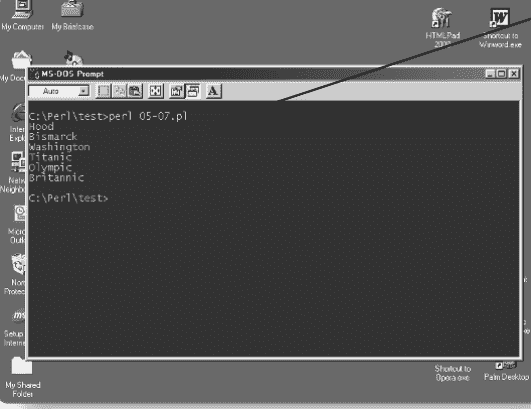

# 数组函数和数组操作

Perl 数组非常灵活，你刚刚触及了它们能做的冰山一角。还有许多内置函数旨在帮助操作数组，正如你将学到的那样。你想知道数组中有多少元素吗？尝试一下：

```perl
# (原文此部分不完整)
```

## 初始化哈希

注意，哈希使用了 `$` 前缀。这很合逻辑，不是吗？确实如此，因为你返回的是单个项目，即一个标量（`scalar`）。同样，当你想要返回多个值时，你可以使用以下代码：

```
@arrayvalues = @hashname{'keyvalue1', 'keyvalue2'}
```

这意味着：从给定的哈希中返回一个项目值的数组，这些值对应于（在情况下）提供的两个键（`key values`）。你返回了多个项目，所以你使用了 `@` 前缀。为什么呢？因为你正将多个项目返回到一个数组中。

为了增加点趣味性，你甚至可以这样做：

```
@arrayvalues = @hashname{@arraykeys}
```

你不是在大括号中提供键（是的，那些大括号不是圆括号），而是提供一个键的数组。尽管如此，你仍然像上一个例子一样返回了多个值，所以你仍然按习惯使用哈希名称前缀。

像 Perl 中的很多事物一样，初看可能显得自相矛盾或不符合逻辑，但当你观察它们并进行思考时，一切都变得非常合逻辑。Perl 确实迫使你思考，但你会意识到只要它是符合逻辑的，它在 Perl 中就能运行。随着你变得越来越精通 Perl，你会形成自己的想法，并惊讶地发现你的逻辑想法运行得良好。

现在你将开始创建和操作哈希。我保证，这比看起来要简单。

### 初始化哈希

要初始化一个哈希，只需这样操作：

```
%animals = ();
```

你现在有了一个名为 `animals` 的哈希，它没有键或值。

你稍后会尝试一下，但让我们先涵盖几个简单的哈希操作。你将开始向哈希中添加键和值。

### 创建哈希

你可以逐个或一次性向哈希添加键值对。要向哈希中添加元素，你可以像这样：

```
$animals{'Horse'} = 'Red Rum'
```

这向哈希 `animals` 中添加了一个键值对。（注意 `$` 前缀。正如你之前看到的……）

如果你想一次性添加多个，可以按照以下方式进行：

```
%animals = ('Red Rum', 'Horse', 'Jaws', 'Shark', 'King Kong', 'Gorilla');
```

现在，这是可以的，但在你阅读列表时，你注意到开始发生了什么吗？当你阅读列表时，想象一下当你尝试跳到列表中间时会发生什么。用你在这里使用的主题和名称，可以明显看出哪个是键，哪个是值。然而，在某些情况下，这并不显而易见，Perl 还有另一种表示法可以帮助你判断哪个是哪个，无论列表有多长。这种表示法被称为“逗号箭头运算符”（`comma-arrow operator`），看起来如下所示：

```
%animals = (Horse => 'Red Rum', Shark => 'Jaws', Gorilla => 'King Kong');
```

现在你可以很容易地看到 `=>` 运算符从键指向哈希中的该键值对。不仅如此，你现在可以添加换行符/回车符和其他空白字符，它仍然可以正常工作，因此你可以通过每行一个键值对来让你的程序中的哈希定义更具可读性：

```
%animals = (Horse => 'Red Rum',
  Shark => 'Jaws',
  Gorilla => 'King Kong');
```

这种表示法可能被称为逗号箭头运算符，因为 `=>` 替换了上一个例子中的逗号。无论原因何，逗号箭头运算符让值对更容易识别。

让我们加载你的第一个哈希。

## 加载和搜索哈希

现在你将学习如何加载哈希以及如何在其内部查找数据。正如你开始看到的，哈希的使用并不比数组困难多少，而且它们非常强大。

1. 打开你的编辑器。

2. 使用以下代码创建一个哈希：

```perl
%animals = (Horse => 'Red Rum', Shark => 'Jaws', Gorilla => 'King Kong');
```

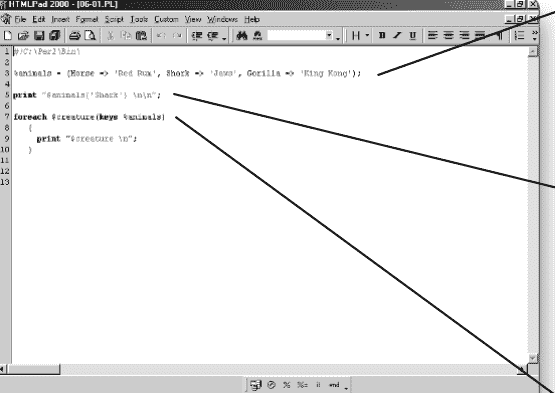

3. 你将显示哈希中对应于名称 `"Shark"` 的动物。

```perl
print "$animals{'Shark'}\n\n";
```

4. 现在，你将使用 `foreach` 循环列出整个哈希的键。

```perl
foreach $creature (keys %animals) {
    print "$creature \n";
}
```

5. 将程序保存为 `06-01.pl`。

6. 打开命令行窗口。

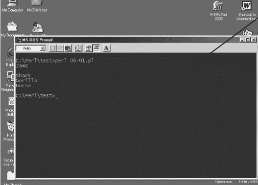

7. 运行程序——你应该看到这个。

这里是对上一个程序的简要检查：

第 3 行显示了加载哈希的方法。

第 5 行显示了如何给定键从哈希中获取单个值。

第 7 行到 10 行显示了如何列出哈希的所有键。

最后，注意你可以通过这样的语句非常简单地打印整个哈希：

```
print %animals;
```

但结果是连接在一起打印的，这完全没有用处！

## 从哈希中删除键

要从哈希中删除单个键，只需使用 `delete` 函数。

```
delete($animals{'Shark'});
```

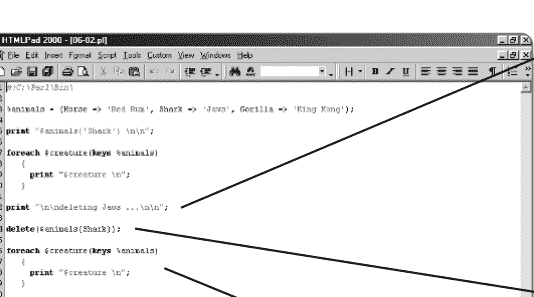

1. 以上一个程序为起点，在末尾添加以下行，宣布你将要删除：

```perl
print "\ndeleting Shark...\n";
```

2. 为了删除哈希，输入这个：

```perl
delete($animals{'Shark'});
```

3. 现在再次使用 `foreach` 循环证明它已经消失了：

```perl
foreach $creature (keys %animals) {
    print "$creature \n";
}
```

4. 将程序保存为 `06-02.pl`。

5. 打开命令行窗口。

6. 运行程序——你应该看到这个。

你并没有真正删除任何东西，只是重新初始化了哈希，或者让它重新开始。效果是那样的。

1. 如果你想清空哈希，可以使用以下语句：

```perl
%animals = ();
```

2. 然后再次使用 `foreach` 循环显示值：


```perl
foreach $creature (keys %animals) {
    print "$creature \n";
}
```

3. 将程序保存为 `06-03.pl`。

4. 打开命令行窗口。

5. 运行程序——你应该看到这个。

正如你发现的，哈希非常强大，而且可能比你最初认为的要简单。当你进入 CGI 编程时，你会频繁使用它们，并会感激它们的存在。

# 什么是程序流？

程序流是程序的一种属性，赋予程序做出决策或执行重复工作的能力。在编程逻辑中，基本上有三种程序结构：顺序、选择和迭代。

## 顺序

顺序是一种编程模式，按照指令编写的顺序执行一系列指令，直到程序结束。大多数旧的汇编语言程序都是这种类型（其中混入了少量“go to”语句或类似的语句）。

## 选择

选择涉及程序执行的路径，该路径取决于提供给程序的值或在程序内部计算或得出的值。换句话说，当程序执行时，执行哪些语句是根据某些数据决定的。其中一些数据可能来自所考虑的程序的外部；另一些数据可能是程序内部计算的结果。

选择中使用的主要工具是 `IF` 语句和 `CASE` 语句的变体。

## 迭代

迭代是循环（`looping`）的高级名称。循环如果是无意的，可能会成为程序员的噩梦。但如果使用正确，它也可以非常有用；例如，循环结构可以处理文件或数据库中的记录。

有许多循环结构，大多数语言中最常见的是 `for` 循环、`while` 循环和 `repeat` 循环。

# Perl 中的程序流

首先，让我们讨论一下程序块。这是一组按顺序执行的语句。它们被包裹在大括号中，如下：

```
{
  statement one;
  statement two;
  statement three;
  statement four;
}
```

你可以将一个语句块嵌套在另一个块内部。注意，虽然这对程序的运行方式没有影响，代码块通常会与其前后的代码进行缩进。这有助于提高代码的可读性并简化未来的维护。代码块通常出现在循环结构和 `IF` 语句中，这些也会被缩进，以便让程序更容易阅读。

# If 语句

`if` 语句是 Perl 的选择语句之一。它允许 Perl 根据变量中包含的值做出决策。

Perl 中的 `if` 语句与 C、C++ 以及其他语言中的相似。

```
if (condition) {
  statement ...;
  statement ...;
}
elsif {
  statement ...;
  statement ...;
}
else {
  statement ...;
  statement ...;
}
```

注意，通常你会发现第一个大括号与语句的 `if (condition)` 部分在同一行，如下所示：

```
if (condition) {
    statement ...;
}
```

再次，这仅仅是一种约定，取决于你是否采用它。如果你没有按照组织内的任何既定规则工作，只需保持一致。否则，你可能会困扰那些试图维护或学习你程序的人。

`if` 结构中的 `elsif/else` 部分是可选的。你可能不需要它们；事实上，通常不需要。请注意 `elsif` 的拼写。

你还可以在语句或 `else` 子句中使用 `if` 语句，你会遇到许多不同的示例。你已经学习了 `if` 语句的基本语法，现在是时候尝试一下了。你实际上以前见过它，但再次复习一遍也没有坏处。

1. 打开你的编辑器。

2. 设置一个名为 `number` 的变量并将其设为 `5`。

```perl
$number = 5;
```

3. 使用你之前使用的简单 `if` 语句，检查值是否等于 `5`。（注意双等号，`==`。）

```perl
if ($number == 5) {
    print "\n\n$number is equal to 5\n\n";
}
```

4. 将代码保存为 `07-01.pl`。

5. 打开命令行窗口并运行程序。

你应该能看到这些结果。

这是一个简单的 `if` 语句。这里有一个使用完整 `if` 语句语法的 `if` 语句。

1. 打开你的编辑器。

2. 这次你将使用 `for` 循环来测试值。从这里开始：

```perl
for ($number = 1; $number <= 3; $number++)
```

# 第 7 章：程序流

> **注意**
>
> 这将 `$number` 的值设置为 `1`；然后，循环中（接下来的大括号之间）的任何内容只要 `$number <= 3`；`$number++` 就会在每次执行循环时增加 `$number` 的值。

3. 显示循环变量的值。

```perl
print "\nnumber:\n$number";
```

4. 现在是 `if/else` 结构。

```perl
if ($number < 2) {
    print "\n$number is less than 2\n";
}
elsif ($number > 2) {
    print "\n$number is greater than 2\n";
}
else {
    print "\n$number equals 2\n";
}
```

5. 最后，不要忘记闭括号。

6. 将代码保存为 `07-02.pl`。

7. 打开命令行窗口。

8. 你应该看到这些结果。

# Perl 中的循环

Perl 在功能上非常丰富。

`while` 循环与 `until` 循环非常相似。`while` 循环在条件满足时继续执行。

```
while (condition) {
  statement ...;
  statement ...;
}
```

`until` 循环在条件满足为止继续执行。

```
until (condition) {
  statement ...;
  statement ...;
}
```

`do` 循环是 `while` 和 `until` 循环的变体；重要的区别是在循环结束时测试条件（无论是“当条件为真时”或“直到条件为真为止”），从而确保循环至少执行一次。

```
do {
  statement ...;
  statement ...;
} while (condition);
```

```
do {
  statement ...;
  statement ...;
} until (condition);
```

7. 将程序保存为 `07-04.pl`。

8. 打开 MS-DOS 命令行窗口并执行程序。

9. 结果应该如下所示。


此示例中的两个循环与之前的 `while` 和 `until` 循环相似，正如前面所述，主要的区别在于 `do` 版本的循环至少会执行一次。

## For 循环

这类似于 C/C++ 的 `for` 循环。`for` 循环的格式为：

```
for (loop_variable = initial_value; loop_termination_condition; loop_variable_update)
```

该语法以关键字 `for` 开始，后面跟着一个左括号，然后是 `for` 语句的初始条件，接着是决定循环是否应该结束的测试条件，最后是对被测试变量的更新。这通常是一个增值，但也可以是递减值。最后是右括号。然后是在当测试条件允许时执行的代码块。

下面是一个 Perl 循环的示例。

# 第 7 章：程序流程

1. 在你的编辑器中打开一个程序。


2. 输入一条注释来提醒你正在做什么。（你的程序应该充满注释。）

### 这是一个 for 循环的示例：

3. 这是一个简单的 `for` 循环。它与你在其他没有讨论循环但使用它们时看到的示例类似，那时使用它们很方便。

```perl
for ($linenumber = 1; $linenumber < 10; $linenumber++) {
    print "Perl Fast & Easy \n";
}
```

4. 将程序保存为 `07-05.pl`。


5. 打开命令行窗口并运行程序。

你的程序将反复打印 `"Perl Fast & Easy"`，直到 `$linenumber` 不再小于 `10`。

增值也可以是递减，所以你可能会看到这种：

```perl
for ($linenumber = 1; $linenumber < 10; $linenumber--)
```

你有时会看到奇异的 `for` 循环实现。尝试这一个：

```perl
for (;;) {
    print "Perl Fast & easy \n";
}
```

这个循环没有初始化变量、没有测试也没有更新，所以它将无限循环。这通常意味着你并不总是知道循环在什么条件下终止，因此这种技术有时被用来允许你使用不同的方法来决定何时跳出循环。这种类型的循环的一种用法用于说明 Perl 循环的灵活性。我们已经讨论了数据类型，并给出了一些如何使用的示例。在这些方面还有更多需要学习，你将根据需要扩展对该语言的知识。这本书的其余部分将提供这些知识；你自己的经验将填补空白并扩展你的经验。

# 8. 函数

Perl 是一个函数丰富的语言。在本章中，你将探索 Perl 提供的许多函数，特别是那些帮助你构建应用程序的函数。某些函数在许多语言中都存在，另一些则是 Perl 特有的；在你学会如何使用它们后，你会希望所有语言都有：

- 字符串函数
- 数组函数
- 子程序

## 什么是函数？

函数通常被认为执行一组有限相关操作的代码段。它可以作用于传递它的值（数字），这些值被称为*参数*（`arguments` 或 `parameters`），它通常返回一个*结果*。不返回结果的函数通常称为*子程序*。首先，看看你在 Perl 中可以使用的一些函数，其中一些你已经在前面的章节中见过。

### 字符串函数

#### `chop()` 函数

`chop()` 函数从标量变量的末尾删除一个字符（也就是说，它既可以处理数值，也可以处理字符串）。`chop` 函数的基本语法为：

```
$scalar_variable = chop($other_scalar_variable);
```

例如：

1. 在编辑器中打开一个新程序。

2. 设置一个变量并进行初始化：

```perl
$word = 'Lengthy';
```

3. 在执行 `chop` 函数之前显示字符串。

```perl
print $word;
```

4. 现在执行 `chop` 函数。

```perl
$word2 = chop($word);
```

5. 显示结果：


```perl
print "Result of chop = $word2";
print "Original string after chop = $word";
```

6. 将程序保存为 `08-01.pl`。

7. 打开命令行窗口。

8. 检查结果。

9. 执行后，`$word2` 将包含字符串 `"Length"`（`$word` 是去掉了 `"y"` 的原始字符串）。

所以 `chop()` 函数是双重用的，它同时给你删除后的单词和被删掉的字符。

正如你所学的，这也适用于数字；尝试这个示例来证明。

1. 打开编辑器。

2. 设置一个带有值的标量变量。

```perl
$number = 105;
```

3. 再次在应用 `chop` 之前打印变量的值。

```perl
print "Before chop = $number";
```

4. 现在执行 `chop`。

```perl
$number2 = chop($number);
```

5. 显示结果。

```perl
print "Result after chop function = $number2\n";
print "Original string after chop = $number";
```

6. 将程序保存为 `08-02.pl`。

7. 打开命令行窗口。

8. 运行程序检查结果。


#### 智能删除：`chomp()`

`chomp` 类似于 `chop`，不同在于你可以对它删除的内容进行控制。它从行（字符串）的末尾提取字符，这次只提取你指定的字符。它通过使用一个被称为输入分隔符（`input separator`）的特殊变量来实现。输入分隔符表示如下：

```
$/
```

`$/` 将包含你从字符串末尾删除的字符，这意味着如果你给它的字符串没有你想要的字符，则会返回原始字符串。查看下一页的示例。

```perl
$/ = "\n";
$stringvalue = "This is a string \n";
print ($stringvalue);
```

这将返回：

```
This is a string
```

如果你这样做：

```perl
$/ = "\n";
$stringvalue = "This is a string";    # 注意此字符串中没有 \n
print ($stringvalue);
```

这将仍然返回：

```
This is a string
```

> **注意**
>
> 尽管如此 `\n` 是 `$/` 的默认值，所以除非 `$/` 之前包含过其他内容，否则你真的不需要这样做。

3. 设置另一个变量并像这样初始化它。

```perl
$stringvalue = "This is a string \n";
```

4. 使用 `chop` 函数移除字符串末尾的换行符。

```perl
$stringvalue = "This is a string \n";
print $stringvalue;
print "This had a newline character: $stringvalue\n";
print "And this is a following string\n\n";
```

```perl
chop $stringvalue;
```

5. 显示结果。

```perl
print "The string that had a newline character becomes: $stringvalue";
print " and this is a following string\n\n";
```

6. 现在，恢复字符串标量变量。（注意，在执行之前的代码之后，此变量已经有了这个值。）

```perl
$stringvalue = "This is a string"; # 注意，这个字符串中没有 \n
```

7. 再次执行 `chop`。

```perl
chop $stringvalue;
```

8. 显示结果。

```perl
print "The string that had NO newline character becomes: $stringvalue";
print " and this is a following string\n\n";
```

9. 将程序保存为 `08-03.pl`。

10. 打开一个命令行窗口。

# 第 8 章：PERL 函数

11. 运行程序并观察发生了什么。

12. 注意，在第一种情况下 `'\n'` 被删除了，而在第二种情况下没有 `\n`，因此这两种情况看起来是一样的。


如你所见，`chomp()` 比 `chop()` 稍微灵活一点，它让你省去了在切除（`chop`）字符之前检查不需要的字符是否在字符串末尾的麻烦。

让我们再看几个 Perl 函数。

#### 测量字符串长度：`length()`

这是一个简单的函数，允许你测量字符串的长度。

尝试这个简单的例子。

1. 打开你的编辑器。

2. 初始化一个标量变量，并赋值所示的字符串：

```perl
$stringvalue = "Perl is a great language";
```

3. 现在使用 `length` 函数来测量字符串的长度。

```perl
$stringlength = length($stringvalue);
```


4. 并显示结果。

```perl
print "\n\nLength of the string is:\n$stringlength\n\n";
```

```perl
use strict;
my $string = "Perl is a great language";
my $length = length($string);
print "The length of the string is: $length\n\n";
```

5. 将程序保存为 `08-04.pl`。

6. 打开一个命令行窗口。


7. 运行程序并查看结果。

`length()` 函数是一个非常简单但非常有用的 Perl 字符串函数，在不同的应用程序中有许多用途。你会惊讶于你使用它的频率有多高。


#### 获取子字符串：`substr()`

`substr` 函数允许你提取字符串的一部分。Perl 需要这个函数是因为与 C 语言不同，Perl 字符串标量不是字符数组，因此你不能像下一页的示例中那样单独寻址字符。

# 第 8 章：PERL 函数

```perl
$stringvalue = "Perl is a great language";
$char = $stringvalue[5]; # 这将不起作用！
```

`substr` 函数允许你这样从字符串标量中提取一个或多个字符：

1. 打开你的编辑器。

2. 设置一个标量变量来包含一个字符串。

```perl
$stringvalue = "Perl is a great language";
```

3. 从位置 10 开始获取长度为 14 个字符的字符。

```perl
$anotherstring = substr($stringvalue, 10, 14);
```

4. 显示存储在变量 `$anotherstring` 中的结果。


```perl
print "\n\n$anotherstring contains: $anotherstring \n\n";
```

5. 将程序保存为 `08-05.pl`。

6. 打开一个命令行窗口。

7. 运行程序并观察输出。

8. `$anotherstring` 包含 `"great language"`

因此，`substr` 函数接受三个参数：正在处理的字符串、要提取的子字符串的起始字符位置，以及要提取的长度（字符数）。


### 注意

```perl
$stringvalue = "Perl is a great language";
$char = $stringvalue[5]; # 这将不起作用！
```

#### 更改大小写：`lc()`、`uc()`、`ucfirst()`

`lc()` 函数会将字符串转换为小写。
`uc()` 函数会将字符串转换为大写。
`ucfirst()` 则会将字符串的首字母转换为大写。

### 数组函数

在本节中你将学习一些处理数组的函数。

#### 打印数组：`print`

`print` 函数可以轻松地打印数组。尝试这个简单的数组例子。

1. 打开你的编辑器。

2. 创建一个包含三个元素的数组：

```perl
@passengerships = ('Titanic', 'Olympic', 'Britannic');
```

3. 然后简单地打印数组。

```perl
print "@passengerships\n";
```

#### 数组大小：`scalar`

在第 5 章，你看到了如何打印数组的大小。`scalar()` 函数返回数组的大小，以便将其存储在变量中用于其他用途，或者再次允许打印数组的大小。从这种方法开始，这里有几个描述测量数组大小的示例。

1. 使用与上例相同的数组，在你的程序末尾添加以下行：

```perl
print scalar(@passengerships);
```

2. 将你的程序保存为 `08-08.pl`。

3. 运行你的程序应该得到这个结果。

这会给你数组中元素的数量。这里是确定数组大小的另一种方法。

要打印数组的大小，正如你在第 5 章中学习的那样，你可以这样做：

```perl
print scalar @passengerships;
```

这会打印 `2` 作为数组的大小，因为返回的值是从 `0` 开始的元素计数。

最后，你可以使用

```perl
$arraysize = @passengerships;
print $arraysize;
```

这将返回值 `3`。

为了演示这些技术，再次修改之前的程序。

1. 显示几个换行符，以区分程序的之前的输出。

```perl
print "\n\n";
```

2. 像这样显示数组的大小：

```perl
print scalar @passengerships;
```

3. 再显示两个换行符。

```perl
print "\n\n";
```

4. 将数组的大小存储在变量中。

```perl
$arraysize = @passengerships;
```

5. 打印结果。

```perl
print $arraysize;
```

6. 将其保存为 `08-09.pl`。

# 第 8 章：PERL 函数

7. 运行程序并观察结果。

你会发现，测量数组的大小是非常有用的，Perl 让你能够轻松获取所需的信息。

#### 向数组末尾添加元素：`push()`

你可以使用 `push()` 函数向数组末尾添加元素。

结合之前的数组，你可以像这样向数组添加另一个元素：

```perl
push(@passengerships, "QE2");
```

尝试这个示例。

1. 打开你的编辑器。

2. 在数组定义之后，像以前一样打印数组。

```perl
print "\n\n@passengerships\n\n"; # 打印数组值
```

3. 使用 `push` 函数向数组添加另一个元素，像这样：

```perl
push(@passengerships, "QE2"); # 添加另一个元素
```

# ARRAY 函数

4. 再次显示数组以证明已生效。

```perl
print "@passengerships\n";
push(@passengerships, "QE2"); # 添加另一个元素
print "@passengerships\n";
```

5. 将程序保存为 `08-10.pl`。

6. 打开命令行窗口。

7. 运行程序并验证 `QE2` 已出现在你的数组中。Perl 数组的大小在定义时并不固定，任何时候都可以继续添加元素。当然，在之前的示例中，你可以通过逗号分隔添加更多值。

#### 从数组中删除元素：`pop()`

你可以使用 `pop()` 函数从数组的末尾删除元素。

```perl
#!/usr/bin/perl
@passengerships = ('tamer', 'bipmagic', 'britannannic');
print @passengerships, "\n";
push(@passengerships, "QE2"); # 添加另一个元素
print @passengerships, "\n"; # 再次打印数组值
$popped = pop(@passengerships);
print $popped, "\n";
print @passengerships, "\n"
```

1. 使用 `pop()` 函数从数组删除一个元素。

```perl
$poppedstring = pop(@passengerships);
```

2. 显示 `$poppedstring` 中的内容，这是 `pop()` 的结果。

```perl
print "$poppedstring\n";
```

3. 显示数组以证明元素已被删除。

```perl
print "@passengerships\n";
```

4. 将修改后的程序保存为 `08-11.pl`。

执行 `pop` 后，`$poppedstring` 将包含 `"QE2"`。

5. 运行你的程序并查看 `pop()` 函数的效果。

现在你有一些实用的数组函数来开始。

## 哈希函数

Perl 提供了哈希函数。简单看一下常用的：`each` 函数允许你遍历哈希的键值对，你可以对这些值进行任何操作。一个简单的示例是打印哈希的所有值。

1. 为了实现这一点，创建一个这样的哈希：

```perl
%animals = ('Red', 'Horse', 'Jaws', 'King Kong', 'Gorilla');
```

2. 使用 `while` 循环显示哈希的内容。

```perl
while (($key, $value) = each %animals) {
    print "$key, $value\n";
}
```

3. 将程序保存为 `08-12.pl`。

4. 运行代码，你应该看到这个输出。

> **注意**
>
> 注意不要将 `each` 函数与 `foreach` 循环混淆。`foreach` 是具有多种用途的循环结构，而不是处理哈希的特定函数。

我保持 Perl 函数的示例非常简单，以帮助你理解本章的内容。不过，你只是开始接触 Perl 中可用的一些内置函数。你会发现还有很多其他函数。

不过现在，来看看另一种类型的函数——子程序。

## 子程序

子程序与函数非常相似，只不过它们是用户定义的函数。你可以编写自己的子程序，编写完成后，你的程序就可以像调用内置函数一样调用它们。如今，`subroutine` 和 `function` 是互换使用的。然而，为了让你清楚你正在看自己编写的子程序，本文保留了这种区别。

子程序使用以下语法创建：

```perl
sub subroutine_name {
    statement1 ...;
    statement2 ...;
    statement3 ...;
    statement4 ...;
}
```

子程序的调用方式与函数类似。

```perl
subroutine_name();
```

要让子程序像 Perl 内置函数一样返回值，你需要使用 `return` 语句。通常这只是返回一个变量的值。

```perl
sub subroutine_name {
  statement1;
  statement2;
  return($variable);
}
```

如果你期望返回一个值，可以这样捕获该值：

```perl
$result = subroutine_name();
```

你也可以像使用许多内置函数一样传递参数。

```perl
$result = subroutine_name($arg);
```

如果这看起来奇怪，尝试这个简单的示例来帮助理解发生了什么。

1. 开始一个新文件并设置一个数字 `12` 的变量。

```perl
$number = 12;
```

2. 现在用你的变量作为参数调用子程序。

```perl
$result = square($number);
```

3. 添加此行来显示结果：

```perl
print "the square of $number is $result\n\n";
```

11. 将程序保存为 `08-13.pl`。

12. 现在运行程序并观察结果；你应该会得到 `144`，如下所示。


你刚刚只看到编写子程序的一种方法。你将看到不同的方法和技术；请仔细阅读这些示例，看看你是否能弄出发生了什么。在 Perl 中，有许多方法可以实现相同的结果。在编写子程序时，有许多方面需要考虑，例如作用域以及全局与局部变量（或者 Perl 对这些问题的回答——例如 `my` 关键字）。最好的方法是从浅入介绍这些主题，因为它们通过实际用法来展示效果最好。

你刚刚开始触及 Perl 的表面。这并不是说你没有学到很多，因为你确实有很多！Perl 是一门巨大的语言，许多经验丰富的程序员和 Web 开发者仍然不知道关于 Perl 的全部知识。现在，你需要开始为 Web 应用程序做一些基础工作。到目前，你一直从作为“控制台”或“命令行”编程语言的角度来看待 Perl。然而，为了将 Perl 用于 Web，你必须以稍微不同的方式使用它。在这样做之前，你必须完全了解 Web 的主要语言：HTML。

# 第 9 章：一段插曲：HTML

为了将 Perl 用于 Web，你必须了解 Web 的主要语言 HTML。对于那些没有 HTML 经验的人（或使用 WYSIWYG 编辑器的人），这一章将是关于 HTML 的一小插曲。即使你更倾向于使用鼠标点击的编辑器，如果你想知道应用程序内部到底发生了什么，理解 HTML 也是很有用的。

如果你已经熟悉 HTML，可以跳过这一章。如果你从未见过任何 HTML，请继续往下看。如果你不确定，请将其看作一门复习课程——我们有时都需要这些课程！

在本章中，你将学习如何：

- 编写 HTML 文档
- 添加标题和颜色
- 添加图像和超链接
- 添加框架

## 保存 HTML 文件和测试 HTML 页面

HTML 仅仅是文本，因此可以使用任何文本编辑器（如记事本、WordPad、Word、HTMLPad 2000 等）进行编写。市场上有许多 HTML 编辑器，但它们与普通文本编辑器的区别仅在于它们拥有专门的工具，能够让你更快速且（希望）更少错误地编写 HTML。

当你保存 HTML 文件时，通常会将其保存为具有 `.htm` 扩展名的文件。

```
Home.htm
```


> 注意
你也可以使用 `.html` 扩展名，这在基于 UNIX 的系统上通常是标准。三个字符的 `.htm` 扩展名可能是由于 DOS 和 Windows 3.1 中的 8.3 文件名限制。

使用记事本或 Word 等编辑器时要小心，因为它们可能会（除非你明确要求否则）为你的 HTML 文件名添加 `.txt` 或 `.doc` 扩展名。

你可以通过直接在 Web 浏览器中打开文件来测试你的 HTML 页面。在 Windows 中，你只需双击文件即可，这将打开浏览器并显示 HTML 文件的内容。当然，测试文件的更好方法是将它们保存到 `wwwroot` 或 `htdocs` 文件夹下（取决于你的平台、Web 服务器等）。然后你可以在浏览器的地址栏中使用 `http://127.0.0.1/foldername` 类型的地址。

> 注意：当你实际编写 Perl Web (CGI) 程序时，必须将它们保存在 Web 服务器下的 `scripts` 文件夹（或另一个具有执行权限的文件夹），否则它们将无法工作。

# 编写 HTML 文档

从现在开始，由你决定使用哪种方法测试 HTML 文件。

## HTML 文档的结构

HTML 标签告诉 Web 浏览器关于你的页面的所有信息以及如何格式化。大多数情况下，HTML 标签有一个开始标签和一个结束标签，以便浏览器知道何时开始格式化以及何时结束。通常情况下，你可以省略结束标签，但这不是良好的习惯，可能会在某些浏览器中引起问题。

HTML 文档中有许多可选元素，但基本上，一个 HTML 文档由 `<HEAD>` 标签和 `<BODY>` 标签组成。同样，`<HEAD>` 标签和 `<BODY>` 标签由许多其他标签组成。

`<HEAD>` 标签可以包含：

- `<TITLE>` 标签。这是显示在浏览器窗口最上方标题栏上的标题。
- `<SCRIPT>` 标签。可选地，可以在 HTML 头部内部添加脚本，例如用于字段验证——稍后会对此详细介绍。
- 其他标签，如 `<META ...>` 标签，它们包含关于页面的信息，并被搜索引擎用于查找和索引你的页面。
- `<BODY>` 标签包含页面的实际内容——通常称为文档——由各种可能的 HTML 标签组成。

## 编写 HTML 文档

在本章中，你将学习 HTML 的基础知识，以便尽快上手 Web 应用程序，但你应该知道 HTML 有正式的、公认的标准。

# 第 9 章：趣插：HTML


## 2. 重新保存你的文件并再次双击它，或者通过浏览器中的 http 地址运行它。现在，你可以看到两行不同的文本。

`<BR>` 是许多简单的 HTML 文本格式命令之一。还有许多其他命令，当你继续阅读本章时，你会看到更多。

## 空格

Web 浏览器只会注意到它遇到的第一个空格字符。如果你在单词之间放置三个空格，将只会显示一个空格，而随后的任何空格都会被忽略。为了解决这个问题，你必须输入一个 HTML 不换行空格。这不是一个 HTML 标签，而是一个转义代码：

```
&nbsp;
```

它之所以被称为转义代码（或转义序列），是因为它会导致系统跳出当前进程，执行代码并返回系统。`&` 字符开始转义，分号 `;` 表示代码的结束。

你可以将多个 `&nbsp;` 代码组合在一起，使文本向行移动更远，从而提供另一种简单的文本格式形式。虽然有更好的方法，但这种方法也有它的用处。

再次修改你的 HTML 代码以添加 `&nbsp;` 转义代码。

1. 在编辑器中打开之前的 HTML 页面。

## 2. 找到如下这一行：

this:

It is just a simple demonstration

## 3. 在行首添加三个不换行空格，它看起来像这样：

`&nbsp; &nbsp; &nbsp;It is just a simple demonstration`


## 4. 再次保存并观察效果。

增加了三个 `&nbsp;` 代码，每个提供一个空格，因此第二行文本向右移动了三个空格。

## 更多文本格式

好了，现在你可以创建一个新文档，给它一个标题，显示文本，强制换行，并在 HTML 文档中放入由空格组成的较大间隙。

这里是一些你可以使用的简单文本格式：

- **粗体**是通过使用 `<B>` 标签实现的，并以 `</B>` 标签结束。
- *斜体*是通过使用 `<I>` 标签实现的，并以 `</I>` 标签结束。
- <u>下划线</u>是通过使用 `<U>` 标签实现的，并以 `</U>` 标签结束。

你可以组合其中任何或全部效果来结合使用。现在你可以让你的 `test.html` 看起来更有趣。


1. 修改之前的 HTML 文件。
2. 添加标签使第一行文本加粗；通过将该行包裹在 `<B>` 和 `</B>` 标签中来实现，如下：

`<B>This is a very simple page</B><BR>`

### 注意

你在行尾保留了 `<BR>` 标签来实现换行。在第二行文本上，分别使用 `<I>...</I>` 和 `<U>...</U>` 标签添加斜体和下划线效果：

```
<I><U>It is just a simple demonstration</U></I>
```

这里没有 `&nbsp;` 代码。这只是为了清晰，以便你专注于当前主题。如果你想包含它们以查看效果，请尽管添加。

3. 保存修改后的文件并查看效果。


但你可以通过一些色彩为你的页面增添活力。色彩的主题可以根据你的需要变得简单，也可以变得复杂。稍后你就会明白我的意思。

网页，特别是网络浏览器，使用 RGB 色彩系统，你的 PC（通常也是如此）。在这个系统中，红、绿、蓝三种颜色不同强度的混合可以产生所有所需的颜色。每种颜色的强度（饱和度）可以在 255 个离散步骤中变化。因此，红色的最大饱和度 = 255，绿色 = 255，蓝色 = 255 得到白色，而黑色由红色=0、绿色=0 且蓝色=0 给出——这很像在学校里混合颜料。

进一步的复杂之处在于，计算机通常使用一种被称为十六进制（hexadecimal）的表示法。人类按十的倍数计数，可能是因为我们有十根手指。计算机使用二进制，因为它们只理解 1 或 0、开或关等。十六进制是一种人类（几乎）和计算机都能读懂的混合格式。它与我们的十进制系统相似，区别在于你在计数时，直到达到 16 才会进入两位。

使用 A 到 F 来表示大于 9 的数字，因此你可以用 Hex（十六进制的缩写）这样计数：0, 1, 2, 3, 4, 5, 6, 7, 8, 9, A, B, C, D, F ...

然后继续……10, 11, 12, 13, 14, 15, 16, 17, 18, 19, 1A, 1B, 1C, 1D, 1E……以此类推。

明白意思了吗？（如果不明白也不担心；除非你感兴趣，否则不需要理解它，稍后你会看到的）。

正如我所说的，白色由 255 红、255 绿和 255 蓝表示。在 HTML 中，将这些数字转换为 Hex 并它们合并。在十六进制中，255 表示为 FF，所以当你转换三个数字并合并时，白色就变成了 FFFFF（3 个 FF 连在一起，顺序为红、绿、蓝）。

HTML 在这些数字前加上一个 `#` 号。这仅仅表示该数字是十六进制。所以现在白色表示为 `#FFFFFF`。黑色是 `#000000`。亮黄色将是 `#FFFF00`。

注意，我说过你不需要担心使用十六进制值来表示颜色。这主要有两个原因：

- 网页浏览器能够显示来自 216 种颜色调色板的颜色。
- 许多 HTML 编辑器或其他 Web 开发工具具有某种调色板，允许你通过点击来设置颜色。

最后，许多颜色已经被命名，这样你就可以设置颜色的英文名称，如 `YELLOW` 以及 `#FFFF00` 和 `#0000FF` 等，然后替换掉十六进制值。

好了，现在你已经知道如何表示颜色，让我们尝试使用它们吧。

# 背景

通过使用 `<BODY>` 标签来实现文档背景色的设置。利用你所学的知识，你可以设置页面的背景颜色。


1. 修改 `09-03.htm` 列表以添加 `BGCOLOR` 属性。这只需简单地向 `<BODY>` 标签插入 `BGCOLOR=xxxxxxxx` 属性，如下：

```
<BODY BGCOLOR=#DD88CC>
```

> (#) 之后的十六进制字符通过三对十六进制数字描述使用的颜色，或者你可以使用不带井号的颜色名称。

2. 修改后的页面 HTML 现在看起来像这样。

# 第 9 章：插曲：HTML

### 注意

注意 `BGCOLOR` 是标签的属性，而不是标签本身。属性会修改其所属标签的行为，随着你继续学习 HTML，你将遇到更多属性。


3. 保存你修改过的 `09-04.htm` 文件，然后再次打开以观察与新背景颜色的差异。（好吧，你在这本书里看不到颜色，但在浏览器中是可以看到的。）

4. 尝试更改 `#xxxxx` 数字并查看差异。如果你增加前两个数字，背景会更偏红。如果你增加中间两个数字，会有更多的绿色；当然，如果你增加最后两个数字，会有更多的蓝色。如果你增加或减少所有颜色，我们将分别得到更亮或更暗。

# 背景图像

你还可以使用 `<BODY>` 标签的 `BACKGROUND` 属性让背景变得更有趣。尝试修改之前的示例来展示差异。使用简单的背景纹理。在处显示的示例中，图形文件名为 `background.jpg`。

# 添加结构和颜色

图形不需要与页面一样大——覆盖整个页面的小图形平铺可以让你用背景图形填充屏幕，这意味着下载所需的时间非常短。可以使用软件（如 Paint Shop Pro）来产出无缝图形，以便它们在你的页面上平铺，而不会产生糟糕的网格。

在放置 `BGCOLOR=#` 的地方，放置 `BACKGROUND="bg.jpg"`


1. 在编辑器的 `<BODY>` 标签中输入背景代码。
2. 你的 HTML 应该像这样。
3. 将 HTML 文件保存为 `09-05.htm` 并在浏览器中测试。将你决定的任何图像保存到与 HTML 相同的文件夹中，以便 `BACKGROUND` 属性可以找到图形。
4. 你的页面现在应该像这样。你也可以使用这个原理产生你可能在冲浪 Web 时见过的有趣效果。例如，将上面使用的图形替换为另一个（命名为 `background2.jpg`）并相应更改 `BACKGROUND` 属性。


你的页面现在看起来像这样。你还可以使用类似的技术产生许多其他效果。

# HTML 中的字体

现在你可以在页面的任何位置设置背景颜色和各种大小的标题。但“普通”文本呢？你也可以使用 `<FONT>` 标签对其进行很多处理。通过 `<FONT>` 你可以设置大小、字体和颜色，当然可以将 `<FONT>` 标签与其他任何文本格式标签结合。

一个典型的字体标签如下：

```
<FONT FACE="classname" SIZE="n">这里是文本</FONT>
```

修改之前的 HTML 页面包含一些 `<FONT>` 设置；你可以将它们与之前学习的标签结合。这里是一些供你添加到 HTML 页面的示例：

```
<FONT FACE="arial" SIZE="2" COLOR="#80040">这是红色的 arial 文本</FONT><BR>
<FONT FACE="Tahoma" SIZE="5" COLOR="#FFFF00">这是红色 Tahoma 文本</FONT><BR>
<FONT FACE="arial" SIZE="3" COLOR="#0000FF">这是中等蓝色粗体文本</FONT><BR>
<FONT FACE="New Roman" SIZE="1" COLOR="green">这是微小的绿色 New Roman 斜体文本</FONT><BR>
<FONT FACE="arial" SIZE="7" COLOR="#000000">这是大黑色 arial 粗体斜体文本</FONT><BR>
<FONT FACE="Courier" SIZE="6" COLOR="white">这是相当白色的 Courier 下划线文本</FONT><BR>
```

1. 将代码插入你的 HTML 页面中，使其看起来像这样。
2. 将其保存为 `09-10.htm`。


3. 在浏览器中查看它；应该像这样。


> 注意
单个 `<FONT></FONT>` 标签可以包裹多个段落。还要注意，你会丢失白色文本，因为它们是在大部分白色的背景上。

## 水平线标签

此时另一个值得关注的标签是 `<HR>` 标签。HR 代表 horizontal rule（水平规则），它会在屏幕上显示一条分割线。它现在的使用频率不像以前那样了，因为现在的作者更倾向于使用更多图形化的方法，但作为简单的页面分割符它仍然很有用。注意它不需要结束标签。

修改之前的页面以显示 `<HR>` 的外观（使用哪个示例都可以，或者自己编写一个也行）。

水平线标签可以是一个非常简单的标签，如下：

```
<HR>
```

或者你可以为它添加其他属性，例如百分比形式的宽度，如下：

```html
<HR WIDTH=75%>
```

你甚至可以这样添加颜色属性：

```html
<HR WIDTH=50 SIZE COLOR="#804040">
```


1. 在第二个示例 Web 页面 (`09-02.htm`) 中添加以下内容：
```html
<HR WIDTH=75%>

It is just a simple demonstration<BR>

<HR>

Here is some more text<BR>

<HR WIDTH=500 SIZE="#804040">
```

2. 在第一行文本之前添加 `<DIV ALIGN=CENTER>`，并在 `</BODY>` 标签之前添加 `</DIV>`。
3. 将此示例保存为 `09-07.htm`。

## 注意事项

注意上一个列表中三个示例。第一个示例说明水平线应该是页面宽度的 75%。这意味着规则线将调整其宽度，始终保持为当前页面宽度的 75%，因此当你更改浏览器窗口大小时，规则线的宽度也会随之改变。


4. 列表第二个示例是 `<HR>` 标签最简单的用法。如果这样使用，你将看到一条占据整个页面宽度的规则线。
5. 第三个示例也设置了规则线的宽度，但这次不是百分比，而是以像素为单位的值。还设置了 `SIZE` 属性，它影响规则线的厚度。最后，你还可以使用与背景颜色和字体颜色相同的符号 (`#cccccc`) 来设置颜色。

#### 提示

用鼠标拖动边角，观察线条宽度的变化。注意，75%宽宽规则线会自动调整，以保持其相对于窗口的宽度比例。

## 段落标签

段落标签 `<P>` 用于将文本部分划分成不同的段落。它比仅用于换行的 `<BR>` 标签更好。`<P>` 标签有一个结束标签 `</P>`，并且应该使用它。虽然你现在可能可以不使用它也能运行，但它的本意是应该存在那里的，而且无法保证未来的浏览器不会在它缺失时自动插入。无论如何，它有助于保持你的 HTML 代码整洁，所以使用它吧！

这里是段落标签的简单示例。

1. 在编辑器中打开一个新的 HTML 文件。
2. 创建标准的 `<HTML>` 和 `<HEAD>` 标签。

```html
<html>
<HEAD>
<TITLE>This is an example Web Page</TITLE>
</HEAD>
<BODY>
<P>This is the first paragraph. The text will simply wrap around until the end paragraph tag is found. Then the text will break ready for a new paragraph. <P>This is the second paragraph, etc. ...</P>
</BODY>
</html>
```

3. 打开 `<BODY>` 标签。
4. 像这样打开一个段落标签：

```html
<P>
```

5. 现在输入一些文本：

这是第一个段落。文本会自动换行，直到找到段落结束标签。然后文本将断开，准备开始新的段落。段落可以根据你的需要任意长，虽然结束标签不是强制性的，但建议包含一个段落结束标签以保持整洁！

# 第 9 章：趣插：HTML


6. 现在关闭段落标签。

```html
</p>
```

7. 打开一个新的段落标签。

```html
<p>
```

8. 再添加一些文本。

这是第二个段落标签。等等，等等……

9. 当然，关闭段落标签。
10. 最后，像往常一样关闭 `<BODY>` 和 `<HTML>` 标签。

```html
</body>
</html>
```

11. 将你的 HTML 保存为 `09-08.htm`。


12. 生成的页面看起来像这样。

## 图片

除了文本，Web 页面还可以包含图片、声音、视频以及几乎任何你想要的东西。现在你可以了解更多关于图片以及如何在 Web 页面中使用它们。浏览器通常支持两种图像格式：JPEG 和 GIF。

### JPEG 文件

JPEG 文件适用于颜色丰富的地方（例如照片），因为它们可以实现高比例压缩，从而减小文件大小并缩短下载时间。

### GIF 文件

GIF 格式由 ISP CompuServe 开发，已成为一种流行的图像标准。它通过将颜色数量限制在 256 种来实现压缩。GIF 图像在颜色较少的地方更好。可以移除所有未使用的颜色来减小文件大小。

有一种新的图像格式 (PNG) 似乎可能在不久将来兴起，但目前为止还没有流行起来。你不需要担心这一点。无论如何，在 Web 页面方面原理是类似的。

让我们在 Web 页面中添加一张图片。为此示例创建一个新的 Web 页面；保持简单。

# 第 9 章：插曲：HTML

尝试这个简单的超链接演示。

1. 使用常用的 `<HEAD>` 标签等创建一个 HTML 页面，并设置一个合适的标题。

```html
<HTML>
<HEAD>
<TITLE>超链接测试页面</TITLE>
</HEAD>
```

2. 开始页面的 `<body>` 部分，并使用一个适当的标题标签。

```html
<BODY>
<DIV ALIGN=CENTER>
<FONT color=#990000 face=Arial size=6>超链接演示</FONT><FONT><BR><BR><BR>
```

3. 为随后的文本设置字体：

```html
<FONT face=Arial SIZE=3>
本页面的目的是演示使用超链接的效果。<BR><BR><BR>
```

4. 现在创建一个指向另一个名为 Desiderata 的页面的锚点。

```html
<A href="desiderata.htm">点击此处</a>跳转到 Desiderata 页面<BR><BR>
```

5. 编写另一个锚点，这次指向 Desiderata 页面内部的某个。

```html
<A href="desiderata.htm#child">点击此处</a>跳转到 Desiderata 页面上的“You are a Child...”行<BR><BR>
```

## 页面内链接

6. 通过关闭 `<FONT>`, `<div>`, `<BODY>`, 和 `<HTML>` 标签来整理代码。

```html
</FONT>
</div>
</BODY>
</HTML>
```

7. 将此列表保存为 `09-10.htm`。
8. 现在在你的编辑器中输入以下内容（这是 Max Ehrmann 写的《愿》/The Desiderata）：

```html
<HTML>
<HEAD>
<TITLE>愿 (The Desiderata)</TITLE>
</HEAD>
<BODY ALINK=FUCHSIA BCOLOR=#C8FFFF VLINK=BLUE>
<H1 ALIGN=CENTER>
<FONT FACE="arial" COLOR=#cc3333>愿 (The Desiderata)</FONT>
</H1>
<BR>
<DIV ALIGN=CENTER>
<FONT FACE="arial" SIZE=3>
在喧嚣和匆忙中从容行事，记住沉默中可能存在的和平。<BR><BR>
尽可能，在不放弃原则的情况下，与所有人保持良好相处。
<BR><BR>
平静而清晰地诉说你的真理；倾听他意见，<BR><BR>
即使是那些愚钝和无知的人；他们也有自己的故事。
避开大声且有攻击性的人；他们是精神的骚扰。<BR><BR>
如果你与他人比较，你可能会变得虚荣或苦涩，<BR><BR>
因为总会有比你更伟大或卑微的人。<BR><BR>
享受你的成就，也享受你的计划。<BR><BR>
对你自己的事业保持兴趣，无论它多么卑微，<BR><BR>
在时光流变的命运中，它是一份真正的财富。<BR><BR>
在商业事务中要谨慎，因为世界充满了欺诈。
<BR><BR>
但不要让这让你忽视美德的存在；<BR><BR>许多人为了高尚的理想奋斗，生活处处充满英雄主义。<BR><BR>
做你自己。<BR><BR>特别是不要假装感情。也不对爱情冷嘲热讽；<BR><BR>因为面对所有的枯燥和幻灭，<BR><BR>它像草木一样长久常青。<BR><BR>善意接受岁月的建议，<BR><BR>优雅地交出青春的产物。<BR><BR>培养精神的力量来保护你免受突如其来的灾难。<BR><BR>
但不要用阴暗的想象困扰自己。<BR><BR>许多痛苦源于疲劳和孤独。<BR><BR>
除了必要的自律外，要对自己温柔一点。<BR><BR><A NAME=child>你是宇宙的孩子</a>，正如树木和星辰一样；<BR><BR>你有权留在这里。<BR><BR>
而且无论这对你来说是否清晰，<BR><BR>无疑，宇宙正以它应有的方式展开。<BR><BR>
因此，与上帝达成和解，无论你如何想象他。<BR><BR>
无论你的努力和愿望如何，在生活的嘈杂混乱中，<BR><BR>保持你内心的宁静。<BR><BR>尽管这个世界充满了虚伪、劳累和破碎的梦想，它依然是一个美丽的世界。<BR><BR>
保持开朗。努力变得快乐。<BR><BR>
</FONT>
</div>
</BODY>
</HTML>
```

9. 注意 `<A NAME=child>` 标签。之前的 HTML 页面中的第二个链接将跳转此处。
10. HTML 代码在你的编辑器中看起来应该是这样的。
11. 将列表保存为 `desiderata.htm`。
12. 现在在浏览器中打开 `09-10.htm` 并点击链接查看效果。
13. 注意，第二个链接应该带你直接跳转到“You are a child...”一行。
14. 尝试在 `desiderata.htm` 的底部添加一个链接，跳转到 `09-10.htm`。
15. 然后在 `desiderata.htm` 的底部添加一个回到页面顶部的链接（你需要一个...）。

最后，你也可以...

```html
</FRAMESET>
</FRAMESET>
<NOFRAMES><BODY BGCOLOR="#FFFFFF">
Sorry, Your browser does not support frames.
</BODY></NOFRAMES>
</html>
```

1. 将此代码复制到你的编辑器中。
2. 将其保存为 `framedemo.htm`。
3. 以常规方式在浏览器中打开文件。
4. 当你在浏览器中打开它时，你将看到预期的三个框架，但它们都将显示 404—未找到的消息，因为为了填充到每个框架中的 HTML 页面尚未编写。

这段代码可能需要一些解释。


5. 第一个 `FRAMESET` 标签创建了两个作为“行”的 `FRAME`（即水平分割屏幕），并将第一行（上方）设置为页面高度的 20%，第二行（下方）设置为 80%。
6. 下一个标签是 `FRAME` 标签，它描述了第一个（20%）框架应该包含的内容——一个名为 `banner.htm` 的 HTML 页面。
7. 下一个标签将描述进入下方（80%）框架的内容。

# 184 第 9 章：插插：HTML


8. 在这种情况下，它是另一个 `FRAMESET` 标签。
9. 这个新的 `FRAMESET` 标签这次将下方的 80% 框架进一步分为两个框架。注意，这次 `FRAMESET` 是一个 `COLS`（列）框架集，因此你将垂直分割下方的 80%。左侧框架宽度为 20%，右侧框架为 80%。
10. 左侧框架将包含一个名为 `menu.htm` 的页面，右侧框架将包含一个名为 `main.htm` 的页面。
11. 注意第一个 `FRAMESET` 中的 `COLS` 属性被设置为 `*`，这意味着全部或在此情况下指整个宽度。同样，第二个 `FRAMESET` 的 `ROWS` 设置为 `*`，即整个高度。

尝试更改 `FRAMESET` 标签中数字的值以观察效果。

尝试将 `ROWS` 和 `COLS` 属性中的 `*` 值替换为数字，看看结果如何。

在 `FRAMESET` 属性中添加用逗号分隔的额外数字。

```html
<FRAMSET ROWS*=100,500,100* COLS*=100,200*>
```

另外注意，虽然这里的值是以像素指定的，但你也可以使用百分比值。

```html
<FRAMSET ROWS*=10%, 90% COLS=**>
```

现在让我们在框架中放入一些东西吧。

对于这个演示，你需要构建五个页面。

1. 你应该已经有了 `framedemo` 页面。如果没有，请将以下内容复制到编辑器中并保存为 `framedemo.htm`。

```html
<HTML>
<HEAD>
<TITLE>Frames Demo</TITLE>
</HEAD>
<FRAMESET ROWS="20%,80%" COLS="*" FRAMEBORDER="0">
<FRAME SRC="banner.htm" NAME="banner">
<FRAMESET COLS="20%,80%" ROWS="*">
<FRAME SRC="menu.htm" name="menu">
<FRAME SRC="page1.htm" name="main">
</FRAMESET>
<NOFRAMES><BODY BGCOLOR="#FFFFFF">
Sorry, your browser does not support frames.
</BODY></NOFRAMES>
</HTML>
```

# 186 第 9 章：插插：HTML

2. 对于 banner（横幅），将此列表复制到你的编辑器并保存为 `banner.htm`。


```html
<HTML>
<HEAD>
<TITLE>Banner</TITLE>
</HEAD>
<BODY>
<DIV ALIGN=CENTER>
<H1><FONT COLOR=#0000FF><I>This is the Banner</I></FONT></H1>
</DIV>
</BODY>
</HTML>
```

3. 对于 menu（菜单）页面，将此列表复制到你的编辑器并保存为 `menu.htm`。


```html
<HTML>
<HEAD>
<TITLE>Menu</TITLE>
</HEAD>
<BODY>
<FONT FACE="arial" SIZE="5">
Menu</FONT><BR>
<FONT FACE="arial" SIZE="3">
<A HREF="page1.html" TARGET="main">Page 1</A><BR><BR>
<A HREF="page2.html" TARGET="main">Page 2</A><BR><BR>
<A HREF="page3.html" TARGET="main">Page 3</A><BR><BR>
</FONT>
</BODY>
</HTML>
```

### 注意

注意 `TARGET` 属性——这意味着在名为 "main" 的框架（即主窗口）中打开页面。当然，这个名字可以是任何你想要的。

现在，让三个页面进入主窗口。

4. 对于 page 1，将此列表复制到你的编辑器并保存为 `page1.htm`。


```html
<html>
<head>
  <title>Page 1</title>
</head>
<body BGCOLOR="#ffffcc">
  <h2>This is Page One</h2>
</body>
</html>
```

5. 对于 page 2，将此列表输入到你的编辑器并保存为 `page2.htm`。


```html
<html>
<head>
  <title>Page 2</title>
</head>
<body BGCOLOR="#00ffcc">
  <h2>This is Page Two</h2>
</body>
</html>
```

# 第 9 章：插插：HTML


6. 对于 page 3，将此列表输入到你的编辑器并保存为 `page3.htm`。

```html
<HTML>
<HEAD>
<TITLE>Page 3</TITLE>
</HEAD>
<BODY BGCOLOR="#99ffff">
  <h2>This is Page Three</h2>
</body>
</html>
```


现在在浏览器中加载 `framedemo.htm` 并尝试左侧的链接——当你点击左窗口中的链接时，你应该看到主窗口中的页面变化。有时不想看到窗口之间的线条——可以使用 `FRAMEBORDER="0"` 来移除它们。尝试修改 `framedemo.htm` 中的第一个 `FRAMESET` 标签，使其看起来像这样：

- Menu
- Page 1
- Page 2
- Page 3

```html
<FRAMESET ROWS="20%,80%" COLS="*" FRAMEBORDER="0">
```

8. 保存并再次尝试。
9. 重新打开页面；线条应该消失了。

关于框架的内容已经足够让你入门了。HTML 的两个主要组件表单和表格省略了。你将在编写应用程序时学习这些内容。

此页故意留空

# 第 10 章：CGI 编程

还记得在第 1 章开头，当你安装了 Web 服务器并对其进行测试吗？现在是时候使用它了。在本章中，你将：

- 学习 CGI 以及以及用它做什么
- 尝试你的第一个 Perl 程序
- 使用 HTML 表单

## 什么是 CGI？

让我们快速概述一下 Web 服务器的作用。通常，Web 服务器从用户的浏览器接收请求。即用户从某个站点请求页面。Web 服务器接收请求并将其返回给浏览器。浏览器使用我们之前讨论过的 HTML 标签在用户的屏幕上格式化页面。


然后设置有点像这样。对于 HTML 页面来说是可以的，但当你想让 Web 页面使用 Perl 程序更新数据库时会发生什么？Web 服务器无法独立处理。当此类请求到达 Web 服务器时，它会被传递给外部软件。这是通过通用网关接口（Common Gateway Interface）实现的，这也是 CGI 编程的核心。

## CGI 处理

现在设置如下。所示的 CGI 框可以包含许多内容。例如，如果你打算在 Web 应用程序中使用 ASP，任何对 ASP 页面的请求都将重定向到 `asp.dll` 程序。但目前最感兴趣的是 Perl；对 Perl 脚本或程序的请求将传递给 `perl.exe`

在第 1 章中你在机器上安装了 Perl，所以现在你应该准备就绪了。

## 我可以用 CGI 做什么？

CGI 编程允许你使用 Perl CGI 程序完成你可能想做的任何基于 Web 的任务。使用 Perl 与其 Web 环境通信有一些规则需要你学习。CGI 本身的一些功能也需要学习，你会发现很有用。

## 一个简单的 Perl CGI 程序

最后你将尝试一个真实的 CGI 程序。你将编写一个简单的 Perl 程序在 Web 页面上显示你机器的 IP 地址。

> 注意 IP 地址是你的 PC 的网络地址。连接到互联网的每台计算机都有 IP 地址。IP 地址看起来像：`121.236.157.53`。即四组由点（句）分隔的数字。互联网使用名称来查找 Web 地址，但这些名称由域名服务器（DNS）转换为 IP 地址，DNS 这种计算机的工作是执行这种转换，以便计算机能够相互找到。

在第 1 章中，你学习了 Web 服务器以及如何设置 Web 站点。你还学习了 `cgi-bin` 或 `scripts` 文件夹。如果你使用 Microsoft Personal Web Server，将把 Perl 程序放在 `scripts` 文件夹；如果你使用 UNIX 机器和类似 Apache Web Server（极佳的选择），则将其放在 `cgi-bin` 文件夹。

当然，如果你的 ISP 允许你运行自己的 Perl 脚本，请查明你应该将脚本放在哪里，以及你的 Web 空间有什么禁忌。你将使用 `127.0.0.1` 地址从 Web 浏览器访问你的 Web 页面。但记住，如果你选择在你的 ISP Web 空间中托管程序，你将使用如下地址：

`http://www.mydomain.com/scripts/`

# 第 10 章：CGI 编程

对于 Perl 代码，类似于：

`http://www.mydomain.com/`

对于 HTML 则是。

当然，如果你的 IP 地址是静态的（也就是说它不会改变——大多数地址都是如此），那么你可以使用它来代替你的域名。

要创建你的第一个 Perl CGI 程序，请遵循以下步骤，并仔细注意代码编写，以确保没有遗漏任何代码或出现任何错误。

1. 打开你的编辑器，创建一个新文件。
2. 从常用的 shebang 语句开始（对于 CGI 程序，你仍然需要它）。
3. 现在输入以下行：

```
print "Content-type: text/html\n\n";
```

这一行告诉 Web 服务器正在发送的是什么类型的数据。在这种情况下，你正在告诉服务器这是一个 HTML 文档，它是文本文档的一个子类型（因此是 `text/html` 部分）。

注意这两个换行符。它们非常重要——它们不是为了美观。`Content-type: text/html` 语句后面必须紧跟两个换行符；否则，你的程序将无法工作，并且你会收到一条消息，告诉你你返回了不完整的标头或类似的内容。

## 一个简单的 Perl CGI 程序

4. 你已经告诉服务器期待一些 HTML，现在你可以向它发送一些了。

像你之前在学习 Perl 示例时编写控制台程序那样，使用 `print` 语句，但现在将它们嵌入到其中。

```html
<html>
print "Content-type: text/html\n";
print "<html>";
print "<title>First Perl Test</title>";
print "Your address is: $ENV{REMOTE_HOST}";
print "<body>";
print "</html>";
```

```
<<html>
print "<head>"
print "<title>First Perl Test</title>"
print "</head>"
print "<body>";
```

所有这些都是标准的 HTML；它们被封装在 `print` 语句中，以便 Perl 能将它们发送到 Web 服务器。`print` 语句引号内的文本将由 Web 服务器视为普通 HTML 处理，并以正常方式返回你的浏览器。

5. 现在你将要做一些不同的事情。完全按照所示所示输入以下行：

```
"Your IP address is: $ENV{REMOTE_HOST}";
```

上面的语句的意思是：打印以下文本（以下是一个环境变量）。

你想要显示的变量是一个名为 `REMOTE_HOST` 的变量。

> 注意：环境变量是包含关于服务器和客户端（你的 Web 浏览器）信息的变量。在编写 Web 应用时，这些信息非常有用。

6. 在显示了字符串 "Your IP address is :" 后接 `REMOTE_HOST` 变量后，然后以正常方式关闭 HTML，但当然是封装在 Perl 的 `print` 语句中：

```
print "<body>";
print "<html>";
```

这就是你的第一个 Perl CGI 程序。也许并不令人兴奋，但这是一个良好的开始，你将用它来检查你的 Perl/Web 服务器是否正在运行。

7. 将你的程序保存到 `scripts`（或 `cgi-bin` 文件夹）中，命名为 `cgi-1.pl`，或者如果你想遵循书中的章节，将其命名为 `10-01.pl`。

现在，打开你的 Web 浏览器，在位置或地址框中输入你的服务器地址，后面跟着脚本路径。你还记得你机器的本地 IP 地址吗？它是 `127.0.0.1`。

## 或者

你也可以使用 `localhost` 作为名称代替 IP 地址，如下：`http://localhost`。所以，你应该输入以下地址并按回车键：

```
http://localhost/scripts/10-01.pl
```

如果你看到类似这样的内容，说明你的 Web 服务器没有识别你的脚本是一个 Perl 程序。UNIX 用户不应该遇到这个问题，因为在大多数情况下 Perl 都是预装的。

如果你是 Windows 用户并遇到了这个问题，请执行以下操作：

1. 打开开始菜单。
2. 点击“运行”。
3. 在“运行”对话框中，输入 `Regedit` 并点击确定。
4. 打开以下注册表项：`HKEY_LOCAL_MACHINE\System\CurrentControlSet\Services\W3SVC\Parameters`
5. 从“编辑”菜单中，选择“新建”，然后点击“字符串值”。
6. 值输入 `.pl` 并按回车。
7. 选择 `.pl`，并从“编辑”菜单中选择“修改”。
8. 在“数据”列中，输入：

```
c:\perl\bin\perl.exe
```

> 注意：使用小写 s；大写 S 将不起作用。
9. 通过顶部菜单选择“注册表”，点击“退出”关闭注册表编辑器。

重启你的电脑。

> 注意：如果你不确定修改计算机注册表中的值，请不要尝试进行任何修改。如果你在更改注册表时出错，可能会导致你的计算机无法使用，可能需要重新安装！在进行更改之前，务必遵循你计算机关于备份注册表的说明。

你现在已经证明了程序在你的环境中可以工作了。现在你可以更进一步。你刚刚使用 Perl 程序通过环境变量显示了你的 IP 地址。你可以用另一个简单的 Perl 程序显示所有这些变量。

1. 启动你的编辑器。
2. 打开一个新文件。如果你使用的是尝试创建文件的编辑器，先创建一个 HTML 页面，然后让它为空。
3. 输入常用的 shebang 语句。

```
#!c:\perl\bin
```

4. 输入 Perl 语句将输出重定向回浏览器。

```
print "Content-type:text/html\n\n";
```

5. 输入以下内容使用 Perl `print` 语句构建页面：

```
print "<html><head><title>Environment Variables</title></head>";
print "<body bgcolor=#9CCCC>";
```

6. 现在使用简单的 `foreach` 循环显示环境变量的键和值。

```
foreach $envvar (keys %ENV) {
    print "$envvar : \n$envvar<br>\n";
}
```

7. 将你的程序保存为 `10-02.pl`。
8. 打开你的 Web 浏览器。
9. 在浏览器地址栏输入 URL 并按回车键。

## HTML 表单

你应该看到这些。保留这个程序，因为查看环境变量的作用很有用。当你开始构建自己的 Web 应用时，你会需要其中的许多变量。

你的 Perl Web 应用开始变得稍微有趣一点了。但用它们能做什么呢？你可以获取关于客户端浏览器等的信息，但缺少了某些东西。

## HTML 表单

要让 Web 应用真正有用，你必须能够与它们“对话”——向它们发送数据并获取数据。你可以使用我们已经使用的 `print` HTML 类型语句来获取数据。但如何发送数据呢？为了做到，你需要比我们目前涵盖的更多的 HTML。你需要 HTML 表单。

HTML 表单允许用户通过输入数据与 Web 网站交互，这些数据可以填充数据库或文件，或者可能向网站所有者发送电子邮件。表单让 Web 页面变得有用！通过表单，你可以从用户那里收集信息，并提供他们想要和需要的信息。

## 什么是表单？

如果你要构建除静态 HTML 站点之外任何内容；也就是说，如果你希望页面执行显示文本和图像以外的功能，你就必须将页面连接到某种存储机制。这将使你能够存储数据，从而从用户处获取数据并将数据发送到用户的 浏览器。

通常，数据存储在数据库或文件中。如果你的页面能够处理某种数据，你就必须能够以某种方式输入数据——这种输入机制就是表单。

表单包含多个元素，如表 10.1 所示。

| 表 10.1 表单元素及其用途 |
| :--- | :--- |
| 元素 | 用途 |
| 文本 (Text) | 允许输入短字符串。 |
| 文本区域 (Textarea) | 允许输入占据多行的较长字符串。 |
| 单选按钮 (Radio Button) | 一种“n选一”的选择机制。 |
| 复选框 (Check Box) | 真/假指示器——选中时显示打钩或 X 的框。 |
| 选择框 (Select Boxes) | 下拉选项列表，可以从中选择一个（或多个）选项。 |
| 隐藏型 (Hidden) | 在页面上不可见的文本框。它通常用于传输用户不需要看到的数据。 |
| 密码 (Password) | 与文本框类似，但在用户输入时，每个字符都用星号表示。 |
| 提交按钮 (Submit Button) | 允许将表单输入的数据传输到处理机制的按钮。 |
| 重置按钮 (Reset Button) | 清除表单所有数据的按钮，以便用户可以重新开始。 |

表单本身使用 `<FORM> </FORM>` 标签定义，其中包含表示所有所需数据的标签。

这是一个典型的 `FORM` 标签：

```html
<FORM NAME="myform" METHOD="POST" ACTION="/scripts/myscript.pl">
```

`NAME` 属性允许页面中的脚本（如 JavaScript、VBScript 等）引用表单内的元素。你将在第 15 章中学习更多关于 JavaScript 的知识。

`METHOD` 通常设置为 "POST" 或 "GET"。这是一种向脚本或其他程序发送数据的方法。

### METHOD="GET"

通过 GET 方法发送的数据将随 URL 一起发送到脚本，全部作为一个字符串。你可能注意到，在互联网上填写表单时，浏览器的 URL 框中会出现这样的内容：

```
http://www.somedomain.com/scripts/ascript.exe?dataitem1=value
```

注意问号将脚本名称与其后的数据隔开。

这种方法的主要缺点是传递的数据很容易被看到，而且数据字符串的长度受到限制。

### METHOD="POST"

这种方法将数据发送到接收这些程序的“标准输入”。程序员（特别是那些写过 C++ 等软件的人）会理解这意味着。简单来说，这是向程序中获取数据的标准方法。

这种方法的主要优势是可以传输的数据量是无限制的。

### ACTION

`ACTION` 是描述要执行的脚本的位置和名称的属性。它可能像这样

```
/scripts/myprogram.pl
```

当然，你可以使用位于其他处的程序，也许在另一个域名的另一个服务器上，在这种情况下，你可以使用程序的完整语法，如下：

```
http://www.mydomain.net/scripts/myprogram.pl
```

## 使用表单

将表示表单收集的所有数据所需的标签放在 `<FORM>` 和 `</FORM>` 标签之间。

你现在将查看一些用于描述数据输入字段的典型标签。HTML 表单中的几乎所有字段都是 `INPUT` 标签类型。

> 注意
> 后续文本中的标签名称将同时以大写（例如：`SELECT`）和全小写（例如：`select`）的形式出现。在 HTML 早期，始终大写 HTML 标签是一种习惯。近年来，在整个 HTML 文档中使用小写字母已成为习惯，可能是因为 HTML（或生成 HTML 的程序）现在通常由习惯在 C、C++、Java 等语言中使用小写字母的程序员编写。你应该习惯看到这两种写法的标签名。

### 文本字段 (Text Fields)

文本字段可能是常用的。通常，表单上的几乎所有字段都是这种类型。它们为你提供通常的接受单行文本的矩形输入框。

文本字段的 HTML 代码如下：

```html
<INPUT TYPE="TEXT" NAME="surname" SIZE="30" MAXLENGTH="25">
```

`size` 属性是可选的，它决定了框的字符大小。

`MAXLENGTH` 属性也是可选的，当你想限制输入到框中的文本量时使用。在这种情况下，限制被设置为 25 个字符。

### 密码字段 (Password Fields)

密码字段在大多数方面与文本字段相同。主要区别是输入密码字段的文本是不可见的。输入的每个字符都会被星号替换。

典型密码字段的 HTML 代码看起来如下：

```html
<INPUT TYPE="Password" NAME="pwd">
```

显然，密码字段对于 Web 中的登录类型功能非常有用。

### 隐藏字段 (Hidden Fields)

隐藏字段与文本字段非常相似。主要区别是你在 Web 页面上完全看不到该字段。你可能认为它没用，但它对于静静地从一个页面传递数据到另一个页面非常方便。

典型隐藏字段的 HTML 代码如下：

```html
<INPUT TYPE="hidden" NAME="secret" value=3000>
```

### 单选按钮 (Radio Buttons)

单选按钮源自具有机械选择功能的按钮。你按下按钮，之前选中的按钮就会弹出。它们在逻辑上表现相似。在大多数浏览器中是圆形的；如果你通过点击选择一个，之前选中的按钮将取消。

单选按钮的语法是：

```html
<INPUT TYPE="RADIO" NAME="choice1">
```

如果你想让这种类型的字段默认被选中，可以添加 `SELECTED` 属性。

```html
<INPUT TYPE="RADIO" NAME="choice1" SELECTED>
```

单选按钮也可以如下值：

```html
<INPUT TYPE="RADIO" NAME="choice1" value="1">
```

这是一个三个单选按钮的示例：

```html
<html>
<head>
<title>Radio Demo</title>
</head>
<body>
<form>
Button1<input type="radio" name="button1" value="1">
Button2<input type="radio" name="button1" value="2">
Button3<input type="radio" name="button1" value="3">
</form>
</body>
</html>
```

### 复选框 (Check Boxes)

复选框是另一种输入框。它原理上与单选按钮类似，但它是为了多选设计的——你一定见过在线调查表单，要求你从所有你喜欢或同意的项目列表中进行选择。

给复选框相同的名称不会改变它们的行为。这会让它们处理起来变得稍微困难，因此给它们各自独立的名称会更合理。你可以有一满页的复选框，并根据需要选择几个或多个。

此外，注意通过再次点击复选框来取消选择。

```html
<INPUT TYPE="CHECKBOX" NAME="selection1">
```

再次，如果你想显示此字段已勾选，则添加 `checked` 属性。

```html
<INPUT type="checkbox" NAME="choicel" checked>
```

这是一个与上一个相似的示例，但是是用于复选框的。

1. 与上一个示例一样，打开编辑器并开始创建一个新的 HTML 文件。
2. 完善标准的 HTML 头部。

```html
<html>
<head>
<title>Checkbox Demo</title>
</head>
```

3. 打开 HTML 页面的 body 部分。

```html
<body>
```

4. 开始编写一个表单（再次，不需要 method 或 action 属性）。

```html
<form name="checktest">
```

5. 现在，以类似于上一个示例的方法创建三个按钮。

```
Button1<input type=checkbox name=button1 value="1">
Button2<input type=checkbox name=button2 value="1">
Button3<input type=checkbox name=button3 value="1" checked>
```

最后一个按钮具有 `checked` 属性。这会导致它显示为已经被选中（用鼠标点击过）的状态。

6. 关闭表单。

```html
</form>
```

7. 当然，关闭页面的 body 和 HTML 标签。

```html
</body>
</html>
```

8. 将你的程序保存到 `myhtml` 文件夹中，并命名为 `check.htm`。


9. 打开浏览器并访问以下 URL：

```
http://127.0.0.1/myhtml/check.htm
```


你应该看到类似所示的内容。

### 下拉框 (Drop-Down Boxes)

对于下拉框，你使用 `<SELECT>` 标签。`select` 标签与其他标签不同之处在于它不是 `<input type=>` 标签的变体。

一个典型的 `select` 标签看起来如下：

```html
<SELECT NAME="country">
<OPTION value="UK">UK</OPTION>
<OPTION value="USA">USA</OPTION>
<OPTION value="France">France</OPTION>
<OPTION value="Germany">Germany</OPTION>
</SELECT>
```

`select` 标签内部嵌入了多个 `option` 标签。每个 `option` 标签包含一个选项。`option` 语句的 `value` 子句是表单实际使用的值。`option` 标签紧前的文本是在页面上实际显示的文本，尽管通常这二者是相同的。

如果你想在页面加载时预先选中其中一个选项，请在 `option` 标签中包含 `selected` 属性。

你也可以为 `select` 标签指定 `size`（大小），但这样做会让用户感到很困惑。不过，当你向 `select` 标签添加 `multiple` 属性时，你可以使用 `size` 标签。这告诉 `select` 标签你可以选择多个选项。用户通过按住 `Ctrl` 键然后用鼠标点击更多选项来实现这一点。你也可以通过点击第一个选项，向下移动选择列表直到到达你想要选择的块的末，最后按住 `Shift` 键并点击最后一项来选择一组选项。块中的所有选择将被选中并变为蓝色。

现在你可以使用 `select` 标签的 `size` 属性。`size` 属性决定了可见的选项数量。

尝试以下步骤以查看两种类型 `select` 标签的示例。

1. 打开编辑器。
2. 创建一个新文件。


3. 开始编写 HTML 并如所示添加头部部分：

```html
<html>
<head>
<title>Select Demo/</title>
</head>
```

4. 添加 `<body>` 开启标签。

```html
<body>
```

5. 编写 `form` 标签。因为你没有使用 Perl 程序来处理表单，所以你不需要编写 `action` 或 `method` 属性。

```html
<form name=selecttest>
```

6. 在此示例中你将使用两个 `select` 标签。添加一些文本来标记第一个 `select`。

我住在哪里：<br><br>

7. 现在编写第一个 `select`。

```html
<SELECT NAME="London"
<OPTION value="London" SELECTED>London</OPTION>
<OPTION value="Bristol">Bristol</OPTION>
<OPTION value="Manchester">Manchester</OPTION>
<OPTION value="Hobbit">Hobbit</OPTION>
</SELECT>
```

在这种情况下，"London" 具有 `selected` 属性，因此它将作为默认选项。

8. 现在在添加后续内容之前添加几个换行符。

<br><br><br>

9. 现在为第二个 `select` 添加一些文本。

我听以下广播电台：<br><br>


10. 现在添加第二个 `select`。

```html
<SELECT NAME="Station" size=4 multiple>
<OPTION value="1">Radio 1</OPTION>
<OPTION value="4">Radio 4</OPTION>
<OPTION value="Beacon">Beacon</OPTION>
<OPTION value="5">Radio 5</OPTION>
<OPTION value="Talk">Talk</OPTION>
</SELECT>
```

# 使用表单

3. 确保 `<form>` 标签指定了 `method` 和 `action` 属性，如下所示：

```
<form name="storeit" action="scripts/storeit.pl" method="post">
```

4. 在第二个 `<select>` 标签之后添加一个名为 `notes` 的文本字段，如下：

```
<br><br>Notes: <br><input type="text" name="notes"><br><br>
```

5. 现在，在 `</form>` 标签之前插入类似下面的一行：
6. 添加一个重置按钮。

```html
<input type="reset" name="reset" value="重置表单并重新开始！">
```

7. 现在将你的程序保存到 `myhtml` 文件夹中，命名为 `form1.htm`。
8. 打开 浏览器，在地址框中输入 URL，然后按回车键。

```
http://127.0.0.1/myhtml/form1.htm
```

你应该能看到类似这样的界面。

现在表单可以工作了，但如果你点击提交按钮，你会得到错误，因为你还没有处理该表单的程序。你可以通过选择某些选项并在 notes 字段中输入内容，然后点击重置按钮来测试重置功能。你的选择应该被重置，而你在 Notes 文本框中输入的文本将会消失。

现在你已经知道如何捕获用户输入。接下来，你将学习如何在服务器端处理数据，以及如何向客户端机器的浏览器发送回复或“响应”。

# CGI：建立连接

你现在已经了解了 Perl 的基础知识——你知道变量如何工作，如何构建表单，甚至知道在将数据获取到服务器后可以对数据做什么。你可以构建一个 HTML 页面，并学习了如何通过超链接提供导航、如何添加颜色，以及如何构建表单来捕获用户数据。你甚至学习了环境变量以及它们可能有多用。

你还尚未学习的是信息是如何从你的表单传输到 Web 服务器上的 Perl 程序的。现在你将看到如何建立 HTML 表单到 Perl 脚本的连接。

在本章中，你将：

- 检查如何从表单接收数据
- 学习如何使用 HTML 表格
- 学习如何通过 GET 和 POST 方法获取表单数据

## 从表单接收数据

一如既往，演示如何使用表单的最佳方法是使用简单的示例。但首先，你应该学习 HTML 的另一个功能：表格。现在是讨论 HTML 表格的好时机，因为它们对于创建整洁的格式布局非常有用！

# HTML 表格

HTML 表格用于（等）格式化网页的内容。在本节中你将学习如何使用它们让 HTML 输入表单看起来更漂亮。表格对于表单并不是必须的——但它们能让外观更好。你可以使用空格 (`&nbsp;`) 和换行符 (`<BR>`) 在页面上定位元素，但效果可能并不理想。

正如你预期的，表格从 `<TABLE>` 标签开始。`<TABLE>` 标签有很多属性；例如，你可以使用 `background=imageName.jpg` 设置表格的背景图片，就像你对 `<BODY>` 标签做的那样。同样，你可以使用 `bgcolor` 属性设置背景颜色。

你可以使用表格标签的 `width=nnn` 或 `width=nn%` 属性设置表格宽度，类似于 `<HR>` 水平线标签的 `width` 属性。

一个典型的表格标签可能如下：

```html
<table width=600 bgcolor=lightblue>
```

这段代码表示创建一个宽度为 600 像素、背景颜色为浅蓝色的表格。足够简单吗？

表格通过呈现你预期的样子来实现目标：一个由行和列组成的表格，你可以在其中放置选择的元素、图片或文本。

在表格的顶部，你可以有一个可选的“表头”行，用于标题。表头行看起来如下：

```html
<tr><th width="200">列标题 1</th><th width="200">列标题 2</th><th width="200">列标题 3</th></tr>
```

## 从表单接收数据

`<tr>` 标签标记表格行的开始。`<th>` 标签定义列的表头，在本例中，它是表头的宽度，因此整个列被固定在 200 像素（同样，可以使用百分比）。`</tr>` 标签关闭此表头。在这个示例中，有三个相同的表头，包含表格的三个列标题。

注意，虽然在本示例中表头的宽度设置为 200 像素，但如果 `<th>` 和 `</tr>` 之间的标题超过了 200 像素，列将会拉伸（也就是说表头标签下方的任何单元格都会拉伸以适应文本、图像或你选择放置的任何内容）。在表头的末尾，使用 `</tr>` 标签关闭行。

后续行包含 HTML 数据。数据行的格式与表头行非常相似，只是单个单元格是由 `<td>` 定义的，而不是表头的 `<th>` 标签。表头行或数据行也可以有自己的宽度标签、背景颜色等。数据行可能如下：

```html
<tr><td>列标题 1</td><td>列标题 2</td><td>列标题 3</td></tr>
```

HTML 表格可以包含许多行，`<td>` 标签可以具有对齐方式、`bgcolor`、`width` 和 `height` 属性。对齐方式可以是左、中或右。垂直上，`<td>` 标签可以这样设置：

```html
<td valign="top">
```

1. 打开你的编辑器。
2. 创建一个新的 HTML 页面。
3. 使用 `<html>` 标签开始。
4. 编写 `<head>` 标签。
5. 设置默认字体和标题。
6. 在打开 `<body>` 之后，你需要像这样的简单表单标签：

```html
<form name="phoneform" method="post" action="scripts/phoneform.pl">
```

7. 打开一个表格，你将在其中开始放置你的表单元素。

```html
<table width="500">
```

8. 使用表格表头行来固定表单字段、文本标签的位置。

```html
<tr><th width="200"></th><th width="300"></tr>
```

9. 现在在数据行中编写一个文本框来捕获用户的名字（fore名），如下：

```html
<tr><td>名字</td><td><input type="text" name="forename"></td></tr>
```

10. 添加更多标签来捕获典型工作数据，如姓、部门、电话号码和注释，同样采用行和列的形式，如下：

```html
<table>
  <tr><td>姓</td><td><input type="text" name="surname"></td></tr>
  <tr><td>部门</td><td><input type="text" name="dept"></td></tr>
  <tr><td>电话</td><td><input type="text" name="phone"></td></tr>
  <tr>
    <td>注释</td><td><textarea name="comments" cols="50" rows="4"></textarea></td>
  </tr>
</table>
```

11. 现在添加一个包含提交按钮和重置按钮的行，将数据发送回服务器。

```html
<tr>
  <input type="submit" name="submit" value="添加记录">
</tr>
<tr><input type="reset" name="reset" value="清除表单并重新开始！"></tr>
```

# 第 11 章：CGI：建立连接

12. 此时，关闭表格、表单、字体、body 标签以及 HTML 标签。

```html
<html>
<head>
<title>添加新电话号码</title>
</head>
<body>
<form action="index.cgi" method="post">
<input type="text" name="phone" size="10"><br>
<input type="text" name="name" size="20"><br>
<select name="type">
<option value="home">家庭</option>
<option value="work">工作</option>
<option value="cell">手机</option>
</select><br>
<input type="text" name="department" size="20"><br>
<input type="submit" value="添加记录并重新开始">
</form>
</body>
</html>
```

13. 将该表单 HTML 保存为 `11-01.htm`，存放在 Web 文件夹下 `wwwroot` 目录的子目录下。
14. 打开 Internet Explorer，导航到你的新页面，并确保你的表单看起来正常。

此时，你无法在不收到错误的情况下实际提交表单，因为目前还没有 Perl 程序来接收数据。这正是我们接下来要做的。

## 通过 POST 方法获取表单数据

在你的编辑器中，开始一个新的 Perl 程序。现在你将添加一个 Perl 程序来处理来自 HTML 表单的输入。这个短小的 Perl 程序需要一些解释，因为将包含一些你以前没过的代码。

### 1. 以通常的方式启动你的程序，并在此处添加 HTTP 请求头。

```perl
#!/usr/bin/perl
print "Content-type: text/html\n\n";
```

### 2. 添加以下行将表单输入读取到你的 Perl 程序中：

```perl
read(STDIN, $tempbuffer, $ENV{'CONTENT_LENGTH'});
```

这一行从 `STDIN` 读取。`STDIN` 是内置文件句柄的引用。在这种情况下，来自你表单的数据被放置在一个名为 `$tempbuffer` 的临时缓冲区中，你可以在那里访问这些数据。从表单获取的数据量是通过使用环境变量 `CONTENT_LENGTH` 获取的。因此，这一行知道要期待多少数据并将其放入 `$tempbuffer` 中。

```perl
my @pairs = split(/\n/, $tempbuffer);
foreach my $pair (@pairs) {
    list($key, $value) = split(/=/, $pair);
    print "<font face='verdana' size='2' color='blue'>$key: $value</font>\n";
}
```

### 3. 来自表单的数据作为单项存储在 `$tempbuffer` 中。为了使其发挥作用，你需要知道原始字段是什么以及它包含什么值。下一行代码为你完成了这一操作。

```perl
@pairs=split(/&/, $tempbuffer);
```

使用数组 `@pairs` 来包含表单中的键值对。此行代码使用 `split` 函数将每个键值对从所有其他对中分离出来，因此你将得到一个包含字段及其关联值的键值对数组。（注意，每个对之间通过 `&` 分隔；在这种情况下，`split` 函数使用该字符将数据分离成离散的对）。你几乎就处于获得有用内容的阶段。

### 4. 编写一个 `foreach` 行，对数组 `@pairs` 中的每个项执行一次代码块（在大括号 `{}` 内）。

```perl
foreach $item(@pairs) {
```

```php
<?php
// 列表项目字段
$pairs = array(
    'first' => 'Item1',
    'second' => 'Item2'
);
foreach ($pairs as $key => $value) {
    print "<content-type:text/html>$$key: $value</content>";
}
?>
```

### 5. 打开代码块

{

### 6. 添加以下行将字段名与关联值分离。

```perl
($key, $content) = split(/=/, $item, 2);
```

这一行代码简单地表示：再次使用 `split` 函数分割每个元素中包含的值，将结果放入两个变量 `$key` 和 `$content` 中。`=` 用于识别在何处分割，这意味着只有两个元素：键和值——或者在本文应用程序中，是变量及其关联的值。

### 7. 通过 HTTP POST 方法接收的内容包含一个 `+`，而你通常期望在该处找到空格。输入以下行以使用 `translate` 函数将 `+tr+/` 替换为空格。

```perl
$content~=tr+/ / ;
```

注意我们正在使用绑定运算符（`~=`），这意味着符号右侧模式匹配的结果将被合并到加载到 `$content` 的数据副本。在这种情况下，正斜杠 `/` 被用作分隔符，以便 `translate` 命令知道想要翻译的内容是什么。

### 8. 现在输入这一行看起来复杂的代码：

```perl
$content =~ s/(..)/pack("c",hex($1))/g;
```

## 从表单接收数据

注意：这里又有一行使用绑定运算符的模式匹配行。使用模式的命令是替换命令 `s`。在这种情况下，通过 HTTP 传输期间的十六进制代码被替换为等效字符。命令末尾的 `/g` 表示“全局”（global），即替换数据中发现的每一个出现处。

### 9. 现在你你现在看起来复杂的代码。使用模式的命令是替换命令 s。在这种情况下，通过 HTTP 传输期间的十六进制代码被替换为等效字符。命令末尾的 `/g` 表示“全局”，即替换数据中发现的每一个出现处。

### 10. 现在输入以下行将键和值存入哈希表。

```perl
$fields{$key}=$content;
```

### 显示每个字段（键）及其关联值。

```perl
print "<font size=2 color=red>$key</font>";
print "<font size=2 color=blue>$content</font><br>";
```

### 10. 现在你现在看起来复杂的代码。将键和值存入哈希表。

```perl
$fields{$key}=$content;
```

### 11. 最后，关闭 `foreach` 代码块。

```perl
}
```

这看起来很费力吗？但读一下每一行以及关联的说明，你会发现它简单得多。

12. 将你的代码保存为 `11-01.pl`。
13. 在浏览器中输入以下 URL（或你放置 html 的地方）：

```
http://localhost/myhtml/11-01.htm
```

14. 在表单中输入一些数据并点击按钮。
15. 你将发现来自你表单的所有变量及其值如下：

## 通过 GET 方法获取表单数据

好了，现在你已经知道如何使用 POST 方法从表单获取数据。那么 GET 方法呢？

好消息是大部分代码都是相同的。在表单中，你只需要将 `method="post"` 属性更改为 `method="get"`。

尝试以下操作：

1. 用编辑器重新打开 `11-01.htm` 页面。
2. 将表单标签的 `method="post"` 属性替换为 `method="get"`；并将程序名称 `11-01.pl` 改为 `11-02.pl`，以便表单现在看起来像：

```html
<form name="phoneform"
method="get"
action="/scripts/11-02.pl">
```

3. 你的页面现在应该是这样的；将其保存为 `11-02.htm`。
4. 现在重新打开你的 `11-01.pl` 程序。
5. 删除以下行：

```perl
read(STDIN, $tempbuffer, $ENV{'CONTENT_LENGTH'});
```

6. 将以下行：

```perl
@pairs=split(/&/, $tempbuffer);
```

替换为这一行：

```perl
@pairs=split(/&/, $ENV{'QUERY_STRING'});
```

注意：现在你将环境变量 `QUERY_STRING` 中包含的数据作为表单数据的来源。

注意你不再需要 `read` 命令了，因为在 GET 方法的情况下，数据只是 URL 的一部分，因此出现在 `QUERY_STRING` 中。

7. 剩余代码与 `11-01.pl` 完全相同；现在将此代码保存为 `11-02.pl` 放在你的 `scripts` 文件夹中。
8. 打开浏览器打开你的新页面 `11-02.htm`。
9. 输入一些数据并点击提交（在这种情况下它被称为 Add Record）按钮。

# 从表单 233 接收数据


你应该看到这样的内容。

再次，表单上使用的数据字段将与它们对应的值一起显示出来。

在本章中，你学习了如何使用 GET 和 POST 方法从 HTML 表单获取用户输入内容。这是一个重大的里程碑，因为你现在已经建立了从用户浏览器中的输入到服务器上可用的实际数据的链接。

所以，你可以创建表单，并可以在你的 Perl 程序中获取数据。现在，你打算做什么呢？你可能想做的一件事是将数据保存到文件中。因此，在下一章中，你将学习关于文件。

# 第 12 章：在 Perl 中使用文件

在本章中，你将学习如何在大 Perl 中使用文件——如何创建文件、写入文件、读取文件以及删除文件。你还将学习如何在 Perl 中创建和删除目录。

在本章中，你将学习如何：

- 在 Perl 中打开文件
- 从文件中读取数据
- 关闭文件
- 使用目录
- 删除文件

## 在 Perl 中打开文件

在对文件进行任何操作之前，你需要先打开它。这是通过 Perl 的 `open` 函数完成的。`open` 函数的通用语法如下：

```
open(MYFILE, "testfile.dat") || die "Error encountered when opening file ..."; // 打开文件
```

这意味着 Perl 将尝试打开一个文件句柄为 `MYFILE` 的文件。文件句柄是一个引用变量，用于存储文件的内部名称，即 Perl 程序识别该文件的名称。

紧随句句柄的是文件的真实名称；在示例中，为 `testfile.dat`。

注意代码行，该行中的下一个内容是双管道 `||`。这是 OR（或）运算符，在这里用于在文件打开代码失败时执行其其后的任何内容。换句话说，如果由于任何原因 Perl 无法打开文件，将执行 `||` 符号之后的代码。

双管道 OR 运算符之后的代码简单地表示：

```
die "Error encountered when opening file ..."; // 打开文件时遇到错误...
```

`die` 函数随后会在显示“打开文件时遇到错误...”消息后停止程序运行。

通用的错误消息本身并没有什么帮助。然而，Perl 还有一个特殊的错误变量，用于保存此类事件的错误消息。这就是 `$!` 变量。你现在可以将此变量添加到 `die` 错误消息中：

```
open(MYFILE, "testfile.dat") || die "Error encountered when opening file ...$!"; // 打开文件
```

由于在文件成功打开时你将无法进行任何操作，现在尝试示例可能有点没意义。下一步是读取文件，这样你就可以看到 `open` 函数的作用了，并看到如何从文件中读取数据。如果你愿意，可以重命名输入文件，使程序找不到它，然后尝试 `die` 函数和错误消息。

## 从文件中读取数据

在 Perl 中可以使用尖角运算符 `< >` 从文件中读取数据。要获取一行数据，你只需将文件句柄封装在尖角运算符中即可：

```
$dataline = <MYDATA>;
```

这将从 `MYDATA` (`testfile.dat`) 获取任何数据并将其存储在 `$dataline` 中。当遇到换行符时，数据将停止。

当文件句柄返回“undefined”时，即识别为文件结束。因此，要读取并显示文件的全部内容，你可以这样做：

```
while(defined($dataline=<MYFILE>))
{
    print "$dataline <br>";
}
```

如果你在 `while` 语句中没有其他条件，这可以进一步简化。当后续括号中的条件为 True（真）时，`while` 语句将执行。文件句柄的“undefined”条件实际上是 False（假）。

因此，你现在可以写：

```
while(<MYFILE>)
{
    print;
}
```

注意，现在，除非你在文件数据行的末尾有 `<BR>` 标签，否则所有数据将连接在一起。当然，你可以在空行之后单独放置一个 print 行来提供 `<br>` 标签。

```
while(<MYFILE>)
{
    print;
    print "<br>";
}
```


# 第 12 章：在 Perl 中使用文件

> **注意**
> 你不能在第一个 `print` 语句中添加 `<BR>` 标签，因为它将不再从 `$` 读取数据，而是直接打印 `<br>` 而不打印其他任何内容。

现在，只要有一个文件可以处理，你就可以尝试 `open` 函数和从文件中读取数据。

1. 打开你的编辑器并清除编辑器可能创建的任何默认代码，以便你有一个完全空白的文件。
2. 使用你的编辑器创建一些文本（如这段文字，来自 J.R.R. 托尔金的《指环王》）：
   枚环戒指统治一切
   枚环戒指找到它们
   枚环戒指将它们统归于一
   并在黑暗将它们束缚
   在魔多之地
   在阴影所在之处
3. 在你的 Web 服务器的根目录 (`wwwroot`) 下创建一个名为 `document` 的文件夹。
4. 将你的文本保存到新的文件文件夹中，例如 `testfile.dat`。


# 从文件中读取数据


5. 打开你的编辑器，创建一个包含 shebang 的新程序：

```perl
#!/bin/perl
```

6. 打开文件句柄：

```perl
open(MYFILE, "testfile.dat") || die "Error encountered when opening file ..."; # 打开文件
```

> **注意**
> 记住，如果打开操作失败，它将返回 False 值。由于 Perl 还有一个特殊的错误变量来保存此类错误，你可以使用正斜杠：

```perl
open(MYFILE, "c:/wwwroot/testfile.dat") || die "Error encountered when opening file ..."; # 打开文件
```

# 错误检查

只要你有一个文件可以处理，你就可以尝试 `open` 函数和从文件中读取数据。

1. 打开你的编辑器并清除编辑器可能创建的任何默认代码，以便你有一个完全空白的文件。
2. 使用你的编辑器创建一些文本（如这段文字，来自 J.R.R. 托尔金的《指环王》）：
   枚环戒指统治一切
   枚环戒指找到它们
   枚环戒指将它们统归于一
   并在黑暗将它们束缚
   在魔多之地
   在阴影所在之处

```html
<html>
<head>
```

```perl
print "Content-type:text/html";
$file = fopen("C:\\xampp\\test.html","r");
if (!$file) { die("Error opening file..."); }
while ($file) {
    $line = fgets($file);
    print("$line");
}
```

10. 将程序保存为 `12-02.pl`。
11. 如果你再次运行程序，你应该得到与 `12-01.pl` 相同的结果。


# 错误检查

为了证明错误条件确实被捕获，尝试临时重命名你的数据文件然后重新运行代码。你应该得到错误消息。


你到为止使用的 `die` 函数是检查错误最简单的方法。另一种替代方案可以使用下面的代码：

```perl
if (open(MYFILE, "testfile.dat")) {
    while (defined($dataline = <MYFILE>)) {
        print "$dataline <br>";
    }
} else {
    print "There was an error opening the file...";
}
```

这之所以有效是因为 `open` 函数在失败时会返回 False 值。（更准确地说，如果你显示该值，你会发现它是 undefined）。如果成功，它将返回一个非零值。任何非零值在逻辑上等同于 True，因此将执行读取文件的代码。

以这种方式捕获错误的优势在于程序不会终止。`die` 函数会停止程序的执行，因此应在打开文件被视为灾难性错误时使用。

# 关闭文件

当你完成文件操作后，应该始终关闭它。这样做是良好的编程习惯，并确保不再使用的资源被返回给操作系统。如果在大系统中不这样做，可能会达到同时可打开的文件句柄数量的上限，导致系统故障。

要关闭文件，只需使用 `close` 函数。对于之前的示例，其代码将如下所示：

```perl
close(MYFILE);
```

# 写入文件

现在，完整的文件读取示例如下。

将你更新后的程序保存为 `12-03.pl` 并检查其运行情况。

## 写入文件

你已经学习了从文件中获取数据的方法。现在，你将学习如何向新文件写入数据，以及如何向现有文件添加数据。

## 打开文件进行写入

打开文件进行写入与打开文件读取一样简单。你只需要使用 `open` 函数，如下：

```perl
open (MYFILE, ">c:\\inetpub\\wwwroot\\filetest\\outfile.dat")
```

注意，这与打开文件进行读取之间只有一个非常细微的区别——在文件名之前包含了 `>` 符号。

## 创建文件

要从 Perl 程序创建一个文件，请执行以下操作：

1. 打开编辑器并启动一个新程序。
2. 创建一个包含某些文本的数组（更多关于托尔金的内容）：

```perl
@linestring = (
    "Three Rings for the Elven Kings under the Sky\n",
    "Seven for the Dwarf Lords in the Halls of Stone\n",
    "Nine for mortal men doomed to die\n",
    "One for the Dark Lord on his dark throne\n",
    "In the land of Mordor where the shadows lie\n"
);
```

> **注意**
> 数组中的每个项目都以 `\n` 结尾，且每个项目都用双引号括起，这样换行符 `\n` 才能被正确解析。

3. 输入打开文件写入的代码：

```perl
open(MYFILE, ">c:\\inetpub\\wwwroot\\filetest\\output.dat")
|| die "Error encountered opening file ... $!";
```

4. 现在，由于数组中有五行数据，开始一个循环来处理数组：

```perl
for ($i = 0; $i < 5; $i++) {
```

5. 将数据拷贝到标量变量：

```perl
$thisline = $linestring[$i];
```

6. 将数据打印到你的 `MYFILE` 句柄，以便将其写入文件。

```perl
print MYFILE "$thisline";
```

记住，`MYFILE` 句柄将输出重定向到你在 `open` 函数中指定的文件。

7. 现在关闭循环。
8. 最后，关闭文件并显示一条数据已写入的消息。

```perl
close(MYFILE);
print "Data has been written ...";
```

> **警告**
> 在此示例中，你在 `open` 函数的文件名前使用了 `>` 符号，这会导致写入新文件。如果你再次运行该程序，它仍然会执行相同的操作。也就是说，任何之前的文件将被覆盖。记住这一点对于未来非常重要，以避免丢失重要文件。

9. 现在将你的文件保存为 `12-04.pl`。
10. 运行你的程序 (`http://127.0.0.1/scripts/12-04.pl`)。
11. 进入你的 `filetest` 文件夹，打开 `outfile.dat` 文件，并检查数据是否已写入文件。

## 向现有文件添加数据

你也可以向现有文件添加数据。实现此点的代码更改是非常细微的。记住，你在 `open` 函数的文件名前添加了 `>` 符号以便写入文件。要打开一个文件以追加数据，只需在名字前面加上两个 `>` 符号即可。

尝试一下：

1. 重新打开你的写文件程序 (`12-04.pl`)。
2. 修改 `open` 语句包含 `>>` 符号，如下：

```perl
open(MYFILE, ">>c:\\inetpub\\wwwroot\\filetest\\outfile.dat")
|| die "Error encountered opening file $!";
```

3. 现在你在 `open` 文件语句的文件名前有了 `>>`。
4. 将你的程序保存为 `12-05.pl`。
5. 运行你的程序 (`http://127.0.0.1/scripts/12-05.pl`)。
6. 页面上的输出与 `12-04.pl` 相同。但现在打开 `outfile.dat` 文件，你将看到来自《指环王》的文本。
7. 运行程序几次并查看文件。如你所示，`12-05.pl` 不会覆盖文件，而是将每个代码段添加到文件的末尾。

## 删除文件

删除文件非常简单。它是使用 `unlink` 函数完成的。为了演示 `unlink` 函数，请删除你刚刚创建的文件。

1. 再次在编辑器中启动一个新程序。

```perl
#!/c:\\perl\\bin
print "Content-type: text/html\n\n";
print "Deleting file ...";
unlink("c:\\inetpub\\wwwroot\\filetest\\outfile.dat")
|| die "File could not be deleted";
```

2. 显示一条消息显示你正在进行的操作。

```perl
print "Deleting file ...";
```

3. 现在使用 `unlink` 函数删除文件，不要忘记使用 `die` 函数捕捉任何错误。

```perl
unlink("c:\\inetpub\\wwwroot\\filetest\\outfile.dat")
|| die "File could not be deleted";
```

4. 注意，你可以使用标量存储文件名，这样你的代码就变为：

```perl
unlink($filename)
|| die "File could not be deleted";
```

> **注意**
> 多个文件可以通过逗号分隔指定。

```perl
unlink("c:\\inetpub\\wwwroot\\filetest\\outfile.dat", "c:\\inetpub\\wwwroot\\filetest\\anotherfile.dat")
|| die("Files could not be deleted...");
```

你也可以将要删除的文件存储在数组中，这样你的代码就变为：

```perl
@files = ("c:\\inetpub\\wwwroot\\filetest\\outfile.dat", "c:\\inetpub\\wwwroot\\filetest\\anotherfile.dat");
unlink(@files) || die("Files could not be deleted...");
```

5. 将你的程序保存为 `12-06.pl`。
6. 运行你的程序，进入 `filetest` 目录检查文件是否已删除。

## 使用目录

Perl 还可以创建和删除目录。这使其非常强大，因为它可以创建应用程序所需的任何环境或文件结构。

## 创建目录

在 Perl 中创建目录非常简单，使用的函数与相应的命令类似。创建目录的函数是 `mkdir`。尝试这个简单的程序。

1. 打开编辑器并启动一个新程序。

```perl
#!/c:\\perl\\bin
print "Content-type: text/html\n\n";
```

2. 显示一条消息显示你要做的操作。

```perl
print "Creating Directory ...";
```

3. 现在输入创建你的新文件夹或目录的代码。

```perl
mkdir("c:\\inetpub\\wwwroot\\filetest\\newdir") || die "Directory could not be created ...";
```

4. 将你的程序保存为 `12-07.pl`。
5. 运行程序。
6. 进入 `filetest` 文件夹；你应该发现现在有一个名为 `newdir` 的新文件夹。这非常简单，不是吗？

## 删除目录

删除目录与创建目录一样简单，正如你预期的，它使用的语法与 DOS `rd` 命令类似。

```perl
#!/c:\\perl\\bin
print "Content-type: text/html\n\n";
print "Removing directory ...";
rmdir("c:\\inetpub\\wwwroot\\filetest\\newdir")
|| die "Directory could not be deleted";
```

1. 打开编辑器并创建一个程序。
2. 显示一条消息说明你正在进行的操作。
3. 输入代码删除由程序 `12-07.pl` 创建的目录。
4. 将你的程序保存为 `12-08.pl`。
5. 运行程序。
6. 进入 `filetest` 文件夹。你应该发现你的 `newdir` 目录已被删除。

> **注意**
> 如果你使用的是美国式键盘（或英国式以外的任何键盘），可以通过按住 `ALT` 键并在键盘右侧的数字键盘上输入 `170` 在编辑器中输入 `¬` 字符。松开 `ALT` 键，该字符就会出现在你的编辑器代码中。但正如我所说，你可以使用任何你喜欢的字符。

现在让我们来看从文件中读取和写入数据，并看看如何将这些信息作为独立的数据字段检索出来。

## 写入文件

尝试这个示例，它与之前的示例几乎完全相同，不同之处数据被存储在一个名为 `$thisline` 的字段中。不同之处在于这不是一个数据项，而是如你所见的多个字段。


1. 打开你的编辑器并启动一个新的 Perl 程序。

```perl
#!/perl/bin
print "Content-type: text/html\n\n";
```

2. 创建你的四个数据项，用 `~` 符号（或你选择的符号）分隔，并将它们存储在一个字符串标量变量中。

```perl
$thisline = "Les~Bate~Computing~9045";
```

3. 输入 Perl 代码打开文件进行写入（记得使用 `>`）。

```perl
open(MYFILE, ">c:/inetpub/wwwroot/filetest/personnel.dat")
|| die "Error encountered opening file ... $!";
```

4. 现在写入 `$thisline` 变量的内容。

```perl
print MYFILE $thisline;
```

5. 最后，关闭文件并向网页写入一条消息告知用户你已完成。

```perl
close(MYFILE);
print "Data has been written\n";
```

6. 将你的程序保存为 `12-09.pl`。


7. 打开浏览器并输入 URL (`http://127.0.0.1/scripts/12-09.pl`) 来运行你的程序。


8. 如果你进入 `filetest` 文件夹，你应该会发现一个名为 `personnel.dat` 的新文件。用编辑器、记事本或其他你喜欢的工具打开它，你会发现 `$thisline` 变量的内容，这证明你的 Perl 程序已成功将数据写入文件。

下一步是能够从文件中取回你的数据。

## 读取文件

现在检索你刚刚写入名为 `personnel.dat` 文件的数据。


1. 打开你的编辑器并启动新程序。

```perl
#!c:\\perl\\bin
print "Content-type: text/html\n\n";
```

2. 以通常读取文件的方式打开文件。

```perl
open($MYFILE, "c:/inetpub/wwwroot/filetest/personnel.dat") ||
die "Error encountered opening file... $!";
```

3. 使用 `while` 循环从文件中读取数据。

```perl
while (defined($dataline = <$MYFILE>)) {
    print "Reading file ...<br>";
```

4. 这与你之前尝试的文件读取程序之间的微小区别在于，你将从文件中读取的数据存储到数组中，并且通过寻找用于分割数据的 `~` 符号将数据拆分成独立的部分。

```perl
@fields = split(/~/, $dataline);
```

5. 关闭 `while` 循环。


6. 现在，为了证明这一点，通过“打印”你刚刚创建的数组的每个元素的值，显示每个独立数据项的值：

```perl
foreach $field (@fields) {
    print "$field <br>";
}
```

7. 最后，当然，关闭文件。

```perl
close($MYFILE);
```

8. 将你的程序保存为 `12-10.pl`。


9. 打开浏览器并运行你的脚本。你应该看到一个数据项列表。

# 第 13 章：在 Perl 中发送电子邮件

## 什么是 FTP？

1. 启动 WS-FTP 程序，你将看到类似所示的内容。
2. 点击“New”（新建）按钮。


现在的显示界面将像这样。


3. 在“Profile Name”（配置名称）文本框中，输入配置的名称，这将提醒你 FTP 客户端中的此条目是针对该特定的 ISP（互联网服务提供商）。
4. 现在输入你 ISP 的主机名。通常类似于 `www.myhostname.com` 或 `homepages.myisp.com`（其中 `myisp` 是你 ISP 的地址）。


5. 将“Host Type”（主机类型）设置为“Automatic detect”（自动检测）。
6. 在相应的框中输入你 ISP 的用户 ID 和密码。
7. 点击“Save”（保存）按钮，这样当你启动 WS-FTP LE 时就会记住此配置。
8. 当你点击“Connect”（连接）（或“OK”）时，只要你已连接到 ISP，你就会连接到你的 Web 空间。


9. 你可以从左窗口（本地机器）传输文件到右窗口（远程机器，即你 ISP 的服务器）。你可以通过选择左窗口中的文件，然后点击右箭头来实现。

> **注意**
> 当然，你也可以反向传输，通过高亮右窗口中的文件并点击左箭头按钮来实现。

你可以通过按住 `Shift` 键并点击鼠标来选择列表中分组的多个文件，或者通过按住 `Ctrl` 键并点击鼠标来选择列表中不连续的文件。

尝试传输一些文件，你很快就会发现 WS-FTP 是多么简单。和大多数 Windows 类型工具一样，学习如何使用它们最简单的方法就是玩以及阅读帮助页面。

需要注意的一点是，你需要将 Perl 和 HTML 文件以 ASCII 格式传输。你的图像将作为二进制文件传输。在 WS-FTP 传输界面的底部，你会看到 ASCII 和 Binary（二进制）的单选按钮。根据要传输的文件类型选择合适的一个。

> **提示**
> Auto 按钮使用文件扩展名来确定使用二进制传输模式还是 ASCII 模式。要设置扩展名以自动传输文件，点击“Options”（选项）按钮，选择“Extensions”（扩展）选项卡，然后添加所有可能需要的 ASCII 扩展名。

WS-FTP LE 中有很多设置供你尝试，但我将让你自己发现；我建议你在更改任何设置之前阅读帮助文档。

## 使用 Perl 通过 SMTP 发送电子邮件

Perl 有一个包含其网络功能的模块 `Net`。Net 的组件之一是 SMTP 模块，它包含了通过 SMTP 服务器发送电子邮件所需的所有函数。尝试下面的示例。

### 使用 Perl 通过 SMTP 发送电子邮件

1. 在你的编辑器中打开一个新程序。

```perl
#!/usr/bin/perl
```


2. 引入 `Net` 模块的 SMTP 组件。

```perl
use Net::SMTP;
```

3. 准备向浏览器返回数据。

```perl
print "Content-type: text/html\n\n";
```

4. 设置一个包含邮件服务器地址的变量。

```perl
$server = 'mail.mydomain.com';
```

5. 现在设置另一个变量来包含你自己的地址。

```perl
$fromaddress = 'me@mydomain.com';
```


6. 添加另一个变量来包含你尝试发送电子邮件的收件人地址。

```perl
$toaddress = 'you@mydomain.com';
```

7. 设置一个用于主题的变量。

```perl
$subject = "Test Example\n\n";
```

8. 设置一个包含消息正文的变量。

```perl
$message = "This is a test \n\n";
```


9. 现在与 SMTP 服务器建立连接。

```perl
$smtp = Net::SMTP->new($server);
```

10. 向 SMTP 提供发件人地址，使用你在第 5 步中设置的变量。

```perl
$smtp->mail($fromaddress);
```

11. 提供收件人地址。

```perl
$smtp->to($toaddress);
```

12. 开始数据传输。

```perl
$smtp->data();
```

13. 设置主题。

```perl
$smtp->datasend("Subject: $subject");
```


> **注意**
> `\` 字符允许你转义特殊字符 `@`，否则它会被 Perl 解释为数组指示符。
> 为了测试，你可能希望将自己的地址放在 `$recipient` 变量中。

14. 现在发送消息。

```perl
$smtp->datasend($message);
```

15. 完成发送。

```perl
$smtp->dataend();
```

16. 关闭 SMTP 连接。

```perl
$smtp->quit();
```

17. 检查输出是否正确。

## 另一种方法：使用 Blat.exe 发送电子邮件

许多 Windows 系统的发送电子邮件方式使用 `Blat.exe`。

10. 启动一个 HTML 页面。

```perl
print "<html>";
print "<head><title>Blat.exe test</title></head>";
print "<body>\n";
```

11. 显示一条消息说明 `blat.exe` 正在运行。

```perl
print "Blat is sending an e-mail ...\n";
```

12. 现在使用拼接运算符构建命令行，将字符串片段连接起来并将命令行字符串存储在合适的变量中。

```perl
$commandline = $blpath;
$commandline .= " $message";
$commandline .= " -s $subject" if $subject;
$commandline .= " -t $recipients" if $recipients;
$commandline .= " -f $fromsender" if $fromsender;
$commandline .= " -server $server" if $server;
```

`if` 语句的不同用法仅意味着如果变量中有内容，则执行语句的第一部分。

13. 显示你将要运行的命令行。你不需要这样做，但对于调试很有用，因为你可以查看命令行看起来是否正确。

```perl
print "$commandline = $commandline";
```

# 使用 BLAT.EXE 发送邮件


14. 现在使用系统命令运行命令行。

```perl
system($commandline);
```

15. 现在显示一条令人放心的消息，让你知道 Blat 已经运行。

```perl
print "Blat has run ... <br>\n";
```

16. 最后，关闭 HTML 页面。

```perl
print "</body>\n";
print "</html>";
```

17. 现在将你的程序保存为 `13-02.pl`。
18. 将程序上传到你的 Web 空间。
19. 创建一个包含消息的文本文件，并将其保存在你在 `$message` 变量所在的位置。
20. 将消息文件上传到该位置。
21. 打开你的浏览器并输入 URL（脚本文件夹的位置将由你的 ISP 或托管公司决定）来运行你的脚本。

如果一切顺利，你很快就会收到一封邮件。如果没有收到，请再次检查你的脚本。如果你看不出它有任何问题，请咨询你的 ISP 或托管公司，并向他们索要在其系统上使用 `Blat.exe` 的示例（ISP 经常有你可以使用的示例脚本，在这种情况下，你将省去很多工作量）。

`Blat` 程序并不复杂，必须创建一个文件的额外步骤确实很麻烦人。但它是很有用的，而且这可能就是你的 ISP 或托管公司提供的全部服务，所以它是一个值得学习的程序。

你还可以使用 Perl 根据用户在表单上提供的数据创建一个文件。这样你就可以从表单获取数据（你已经知道如何做到了），将文本数据写入文件（你也可以这样做），然后像之前显示那样运行 `blat.exe`。

这里提供的程序是发送邮件的 Perl 程序的典型例子，但在目录等方面有许多可能的变体，因此请与你的托管商沟通。你可能会发现你的 ISP 会为你提供一个运行良好的示例，插入到你的应用程序中。

# 使用 Sendmail 在 UNIX 服务器上发送邮件

UNIX 社区多年来一直有一个名为 Sendmail 的邮件程序。它非常易用，但同样，在你开始之前，请咨询你的托管公司或 ISP，了解关于从他们的服务器使用 sendmail 的任何本地差异或提示。

## 尝试这个示例

以下是一个在 Perl 中使用 Sendmail 的简单示例。

1. 打开你的编辑器并开始一个新程序。

```perl
#!/usr/bin/perl
```

> **注意** UNIX 的 shebang 语句——路径是不同的，这在 UNIX 情况下非常重要，因为 shebang 语句不仅仅是一个注释，它被操作系统用于查找 Perl。

2. 设置变量来存储发件地址、收件人地址 和主题。


```perl
$from = "me@mydomain.com";
$to = "you@mydomain.com";
$subject = "Test email";
```

> **注意**
> 为了测试，你可能想将你的地址放在 `$to` 变量中。

3. 创建另一个变量来存储 Sendmail 程序的路径。

```perl
$sendmailpath = "/usr/sbin/sendmail";
```

4. 创建另一个变量来存储消息。

```perl
$message = "This is a test e-mail using Sendmail\n\nFrom me\n\n";
```

5. 现在打开 Sendmail 程序。

```perl
open(SENDMAIL, "| $sendmailpath -t") or die "Cannot open $sendmail: $!";
```


注意管道符号 (`|`) 对应的 `sendmailpath`。

6. 现在写入邮件头。

```perl
print SENDMAIL "Subject: $subject\n";
print SENDMAIL "From: $from\n";
print SENDMAIL "To: $to\n";
```

7. 现在发送正文。

```perl
print SENDMAIL "$message";
```

8. 最后，关闭连接。

```perl
close(SENDMAIL);
```

# ACCESS 97 与关系型数据库

| 表格 14.1 数据库项目和测试数据 | | | |
|---|---|---|---|
| ID | 名字 | 姓 | 地址 |
| 1 | Joe | Bloggs | 14 High Street |
| 2 | Fred | Smith | 1 Sun Street |
| 3 | Jane | Doe | 4 Love Lane |
| 4 | Angus | McCoatup | 17 Lake Close |

注意 `ID` 列。这在本章中将不会使用它，但当你在第 17 章中将此示例扩展为“联系人数据库”案例研究时，你将会用到它。简而言之，`ID` 字段（或你决定如何命名它的字段）是数据库中每条记录（或行）的唯一引用。这是必要的，因为对数据库的某些操作需要确切地知道你指的是哪条记录。例如，如果你必须从数据库中删除一条记录，唯一的 `ID` 可以确保删除的是正确的记录且仅删除正确的记录。这比某种系统要好得多，例如，如果你尝试删除一个姓 `Smith` 的人的记录，数据库将不知道你指的是哪一个，因此可能会删除所有姓 `Smith` 的人。当然，你会有想做这类操作的时候，但你通常想要提取某个特定的记录，这时 `ID` 字段（即唯一键）就非常有用。

数据库的另一个考虑因素是数据类型。并不是所有数据都是文本数据。还有日期和时间字段（因产生问题而闻名）、布尔字段（用作标记并包含“是”或“否”、或“1”、“0”、或“True”或“False”的值）以及备注字段（可以存储大量文本）。

最后是规则和默认值。规则的一个示例可能是“允许零长度字符串”。默认值用于在表单未返回值时为字段填充一个值。

数据库可以非常复杂。你可以拥有大量的表，其中许多表通过外键系统相互链接，其中一个表可以对另一张表进行查找。这种数据库以及与之相关的复杂 SQL 超出了本书的涉及范围，但随着你构建简单应用程序的经验和信心增长，你将希望扩展这方面的知识。

# 在 Access 97 中创建数据库

让我们建立一个数据库。在本节中，我将介绍创建数据库表的基本知识，你可以在你的 Web 应用程序中使用它。

1. 启动 Microsoft Access 97。将弹出一个对话框，让你打开空白数据库、使用数据库向导或打开现有数据库。
2. 选择“空白数据库”并点击确定。你将看到一个对话框，询问你想要将数据库放在哪里。
3. 导航到你的 `Inetpub` 文件夹，使用“新建文件夹”图标创建一个新文件夹。
4. 双击你的文件夹，并将数据库保存为 `address.mdb`。你将看到一个新的对话框，你可以在其中管理和创建 Access 中的许多功能。对于 Web 应用程序，你现在只需要“表”选项卡。
5. 如果尚未选中，请选择“表”选项卡。
6. 点击“新建”按钮。将打开“新建表”对话框。
7. 在窗口中选择“设计视图”选项并点击确定。你将看到一个网格，你可以在其中输入数据库表的所有详细信息。
8. 将鼠标光标点击在第一个“字段名称”框中输入 `id`。
9. 点击“数据类型”字段，将出现一个带有黑色向下箭头的灰色小按钮。点击此按钮，并从出现的列表中选择“自动编号”。
10. 在 `id` 字段名称左侧，你将看到一个指向（后退）的小箭头。右键点击该箭头，将出现一个带有选项列表的灰色框。选择列表第一项，“主键”。你现在已经为此数据库设置了键。
    注意：注意对话框底部的“索引”选项已更改为“是（不允许重复）”。
11. 现在向数据库添加其余字段，数据类型接受默认的“文本”，直到你的表看起来像这里的一样。
12. 关闭“表设计”对话框。将出现一个询问你是否要保存对表更改的提示框。点击“是”。
13. 这不是你想要的名称，因此点击高亮的文本框并输入 `address`，然后点击确定。你将返回到“表”对话框，你的新表将在窗口中可见。
14. 现在点击“打开”按钮。你将看到一个新的网格，你可以在其中每个字段中输入数据。
15. 点击“firstname”字段并输入一些数据。然后点击“lastname”字段并输入一个姓氏。最后，点击“address”字段并输入一个地址。
16. 点击下一个“firstname”字段并输入另一个名字。按照你处理第一个字段的方式完成其他字段，但使用不同的名字和地址。
17. 关闭数据库对话框，然后关闭 Access 97。

# 创建数据源名称 (DSN)

现在你有了一个包含一些数据的数据库；很快你就会编写一个 Perl 程序来从数据中读取记录。但在此之前，你还有一件事要做。你需要创建一个数据源名称 (DSN)。请按照以下简单步骤操作：

1. 双击桌面上的“我的电脑”图标。
2. 双击“控制面板”图标。控制面板窗口将打开。
3. 双击“ODBC 源”图标。将打开“ODBC 数据源管理员”对话框。
4. 选择“系统 DSN”选项卡。在“数据源”窗口中，你将看到已存在的数据源列表（如果有）。
5. 点击“添加”按钮。
6. 确保“Microsoft Access Driver (*.mdb)”项被选中，然后点击“完成”。将打开“ODBC Microsoft Access 设置”对话框。
7. 在“数据源名称”字段中，输入 `address` 作为名称。
    注意：“描述”字段仅用于文档说明；留空或输入某些文本来提醒你此数据库的用途。
8. 点击“选择”按钮。将打开“选择数据库”对话框。
9. 导航到你的数据库并点击确定。

# 使用 ADO 从数据库读取记录

在本章中，我们将学习在 Perl 中使用数据库的两种方法——使用 OLE（对象链接与嵌入）数据库访问和 Perl DBI 方法。第一种方法通常被称为 ActiveX 数据对象或 ADO。在本节中，你将学习如何使用 ADO 和 SQL（结构化查询语言）从关系型数据库中选择记录，SQL 是用于从数据库中选择记录、向其写入记录等的语言。对 SQL 的深入讨论超出了本书的范围，但你将在这里学习到足够的 SQL，以执行最常见的数据库功能——读取、写入、删除等。

# 第 14 章：使用 Perl 访问数据库

1. 打开你的编辑器并开始一个新程序。

```perl
#!/usr/bin/perl
```

2. 在你的 Perl 程序中引入几个所需的模块。这些模块包含了通过 `Win32::OLE` 方法操作数据库所需的代码。

```perl
use Win32::OLE;
use Win32::OLE::Const 'Microsoft Data Objects';
```

3. 创建一个变量来存储数据库表名。

```perl
$table = "address";
```

4. 现在创建一个 ADO 数据库连接。

```perl
$conn = Win32::OLE->new("ADODB.Connection");
```

5. 创建一个 ADO 记录集 来存储从数据库返回的记录。

```perl
$rs = Win32::OLE->new("ADODB.Recordset");
```

> 记录集是一个包含从你的 SQL 查询中返回记录的临时表。

6. 使用你创建的连接打开数据库。

```perl
$conn->Open("address");
```

## 使用 ADO 从数据库读取记录

7. 准备你的 Perl 程序以便写入浏览器。

```perl
print "Content-Type: text/html\n\n";
```

8. 现在创建一个带有字段头的 HTML 表格。注意表格通过 `<div align=center>` 标签在页面上居中。

```perl
print "<div align=center><font face=verdana color=#333339 size=5></font><br>";
print "<table bgcolor=lightyellow><tr><th width=150>Name</th><th width=150>Address</th></tr>";
```

9. 创建一个变量来存储 SQL 查询。

```perl
$sql = "SELECT * FROM $table;";
```

该语句表示：从表中选择所有列。你也可以指定从查询中返回的所有字段，如下：

```perl
$sql = "SELECT firstname, lastname, address FROM $table;";
```

你还可以添加 `WHERE` 子句来过滤记录，如下：

```perl
$sql = "SELECT * FROM $table WHERE lastname='Smith';";
```

最后，你可以通过 `ORDER BY` 子句更改记录的顺序，如下：

```perl
$sql = "SELECT * FROM $table ORDER BY lastname;";
```

10. 现在，使用你刚刚创建的 SQL 语句和名为 `$conn` 的连接打开记录集。

```perl
$rs->Open($sql, $conn, 1, 1);
```

> **注意**
> `1, 1` 是一个高级特性，用于控制使用游标 进行读取和写入数据库表的方式。这些高级特性我们现在不会深入探讨；目前只需这样编写代码即可。

11. 现在循环记录，直到到达记录集的 `EOF`（文件末尾）。

```perl
while (!$rs->EOF) {
```

12. 在循环中，将记录集中每列的值存储到相应的变量中。

```perl
$firstname = $rs->Fields('firstname')->Value;
$lastname = $rs->Fields('lastname')->Value;
$address = $rs->Fields('address')->Value;
```

13. 现在在 HTML 表格行中显示这些值。

```perl
print("<tr><td>$firstname</td><td>$lastname</td><td>$address</td></tr>");
```

14. 获取记录集中的下一条记录（或行）。

```perl
$rs->MoveNext;
```

15. 关闭循环块。

```perl
}
```

16. 关闭 HTML 表格。

```perl
print "</table></div>";
```

17. 关闭记录集和连接对象。

```perl
$rs->Close;
$conn->Close;
```

18. 将你的程序保存为脚本文件夹中的 `14-01.pl`。
19. 打开浏览器并输入新程序的 URL；你应该看到所示的结果。如果没有得到结果，请检查代码并重试。

## 使用 ADO 向数据库添加记录

向数据库添加记录的代码比上一个示例更简单。

1. 在编辑器中打开一个程序，再次引入 `Win32::OLE` 模块。

```perl
#!/usr/bin/perl
use Win32::OLE;
use Win32::OLE::Const 'Microsoft Data Objects';
```

2. 设置一个变量存储表名，并像上次一样创建连接和记录集对象。

```perl
$table = "address";
$conn = Win32::OLE->new("ADODB.Connection");
$rs = Win32::OLE->new("ADODB.Recordset");
```

3. 打开连接。

```perl
$conn->Open("address");
```

4. 现在执行 SQL 向数据库添加记录，并将 `firstname`、`lastname` 和 `address` 字段分别设置为 `Sauron`、`The Dark Lord` 和 `Barad-dur`。这意味着向表中插入一条新记录并添加这些值。

```perl
$conn->Execute("INSERT INTO $table (firstname, lastname, address) VALUES ('Sauron', 'The Dark Lord', 'Barad-dur, Mordor')");
```

5. 准备将数据发送回用户的浏览器。

```perl
print "Content-type: text/html\n\n";
```

6. 打印一条提示消息，表示程序已完成。

```perl
print "Record Added ...";
```

7. 最后，关闭记录集和连接。

```perl
$rs->Close;
$conn->Close;
```

8. 将你的程序保存为 `14-02.pl`。
9. 现在打开浏览器并输入新程序的 URL。你应该看到消息显示你已向数据库表添加了记录。

```vb
Private Sub Main()
    Dim conn As Object
    Set conn = CreateObject("ADODB.Connection")
    Set rs = CreateObject("ADODB.Recordset")
    conn.Open("Students.mdb")
    conn.Execute("INSERT INTO Students (lastname, city, address) VALUES ('Deacon', 'The Back Lot', 'Boston')")
    print "Record Added ..."
    rs.Close
    conn.Close
End Sub
```

10. 现在回到你的 `14-01.pl`。你应该能在列表中看到新的记录。

接下来，你将学习如何更新表格中的记录。

## 使用 ADO 更新表格中的记录

这与上一个示例几乎相同，只是 SQL 有所不同，正如你所预期那样。

1. 重新打开你的 `14-02.pl` 程序。
2. 将旧的 SQL 替换为此处所示。

```perl
$conn->Execute("UPDATE $table SET Address='The Tower of Barad-dur, Mordor' WHERE firstname='Sauron'");
```

3. 将确认消息替换为此处。

```perl
print("Record Updated ...");
```

4. 将你的程序保存为 `14-03.pl`。
5. 在浏览器中打开你的 `14-03.pl` 程序，你应该再次收到记录已更新的消息。
6. 再次回到浏览器中的 `14-01.pl` 程序（如果你使用了后退按钮，需要点击浏览器的刷新按钮）确认更新已执行。

## 使用 ADO 从数据库表中删除记录

你现在唯一需要学会的就是从数据库表中删除记录。

再次，这只是对程序 SQL 的一个简单修改。

1. 重新打开你之前的程序。
2. 修改包含 SQL 的行，使其看起来如下所示：

```perl
$conn->Execute("DELETE FROM $table WHERE firstname='Sauron'");
```

3. 将确认消息修改为如下：

```perl
print "Record Deleted ...";
```

4. 将你的程序保存为脚本文件夹中的 `14-04.pl`。
5. 打开浏览器并运行新程序；你应该看到确认消息。
6. 再次，在浏览器中访问 `14-01.pl` 以确认数据库表中已删除了索伦（Sauron）的记录。

大局如此。你现在已经能够对数据库表执行所有的 CRUD（创建、读取、更新和删除）操作了。

## Perl DBI

DBI 是 Perl 的数据库接口，已经存在相当一段时间了。它在 UNIX 类型平台上被广泛使用，但也可以在 Windows 平台上运行，因此这里值得我们简要介绍一下。

## 安装 DBI

在使用 DBI 之前，你必须在 Perl 中安装 DBI 模块。在 Windows 上执行此操作，请遵循以下简单指令。当然，你的互联网服务提供商可能已经为你安装了 DBI。

1. 打开一个 MS-DOS 命令行窗口。
2. 输入以下命令并按回车键：

```
ppm install dbi
```

该过程可能需要几分钟时间，完成后，你将看到所有已安装模块的列表。

每当你想要确认安装了哪些模块时，只需在 MS-DOS 命令行（或 UNIX 机器的命令提示符）中输入 `ppm query` 即可。

## 使用 DBI 读取数据库表

现在，让我们看看如何使用 DBI。你将运行与之前 ADO 时相同的练习，但使用的是 DBI 而不是 ADO。

1. 在编辑器中打开一个新程序。

```perl
#!/perl/bin
```

2. 将 DBI 模块引入你的程序。

```perl
use DBI;
```

3. 通过 DBI 连接到数据库。

```perl
$dbhandle = DBI->connect("dbi:ODBC:address");
```

此操作返回一个句柄，用于在程序的后续操作中引用数据库。连接字符串指定了通过 DBI 访问数据库，即一个 ODBC 数据库（你可以将其替换为 DBI 支持的任何数据库类型），最后，数据库名称为 `address`。

4. 设置一个变量来存放你的 SQL 语句，就像你在 ADO 版本中做的那样。

```perl
$sqlstatement = "SELECT firstname, lastname FROM address";
```

5. 准备将数据传回浏览器。

```perl
print "Content-type: text/html\n\n";
```

6. 准备运行 SQL。

```perl
$statementhandle = $dbhandle->prepare($sqlstatement);
```

7. 现在输入 DBI 代码来执行 SQL 查询。这次你正在检查错误。

```perl
$statementhandle->execute() or die "<br><br>Could not execute SQL statement <br>";
```

8. 显示确认消息。

```perl
print "<br>Executed ...<br><br>";
```

9. 显示返回的行。

```perl
while (@row = $statementhandle->fetchrow_array) {
    print "@row <br>";
}
```

10. 最后，通过关闭连接和语句句柄来清理工作。

```perl
$dbhandle->disconnect();
$statementhandle->finish();
```

11. 将你的程序保存为 `14-05.pl`。
12. 在浏览器中运行该程序。你应该能看到显示的数据库记录。

## 使用 DBI 写入数据库表

使用 DBI 向数据库写入数据与上一个示例非常相似。

1. 打开之前的示例，并将 SQL 语句行替换为以下内容：

```perl
$sqlstatement = "INSERT INTO address (firstname, lastname, address) VALUES ('Saruman', 'The White', 'Isengard');";
```

2. 循环并读取之前示例中的记录。
3. 打开浏览器并运行新程序。你应该能看到一条确认消息。
4. 现在回到第一个 DBI 程序 `14-05.pl`，以确认新记录已添加。

> **提示**：如果你在 Web 浏览器中没有看到预期的内容，请尝试点击刷新按钮。

## 使用 DBI 更新数据库表

以下使用 DBI 更新数据库表的示例与上一个示例相同，仅 SQL 语句有所不同。

1. 打开你之前的程序 (`14-06.pl`)。
2. 将 SQL 语句替换为以下内容：

```sql
$sqlstatement = "UPDATE address SET firstname='Wormtongue', lastname='Wielder of Words' WHERE address='Isengard';";
```

3. 将你的程序保存为 `14-07.pl`。
4. 在浏览器中运行程序；你再次应该看到确认消息。
5. 返回浏览器中的程序 `14-05`，以确认更新已完成。

## 使用 DBI 从数据库表中删除记录

再次，从数据库删除记录的代码与上一个示例中使用的相同。

1. 重新打开 `14-07.pl`。
2. 将 SQL 语句替换为以下内容：

```perl
$sqlstatement = "DELETE FROM address WHERE address='Isengard';";
```

3. 将你的程序保存为 `14-08.pl`。
4. 在浏览器中打开你的程序，你应该能看到确认消息。
5. 最后，通过在浏览器中重新运行 `14-05.pl` 来检查记录是否已从数据库中消失。

就是这样。你现在已经知道了通过两种可能的方法（ADO 和 DBI）操作数据库的基础知识。你将在第 17 章中看到更多实用代码示例。

# 第 15 章：偏题：JavaScript

你已经知道如何创建表单以及将表单数据发送到 Perl 程序。但如果用户输入的数据是非法的怎么办？你可以让你的 Perl 程序返回表单并指示问题所在，但这种检查表单的方法效率低下，因为每发现一个错误表单就会被重新发送。如果能在客户端（即你的网页内）就知道进入 Perl 程序的数据是正确的，那不是更好吗？

这就是 JavaScript 的用武之地。JavaScript 可以检查你的表单数据并在所有错误纠正之前阻止表单提交。这意味着你可以获得即时通知，并且表单只需要传输一次。

在本章中，你将学习：

- 面向对象
- JavaScript 语法
- 使用 JavaScript 验证表单数据

## 面向对象

在确定了类中可能包含的数据后，你现在需要能够操作这些数据项以进行读取、写入、更新和删除。也就是说，为了使用该账户，你需要能够：

- 打开账户
- 增加资金
- 扣除资金
- 关闭账户

在类定义中，你将编写方法（在普通编程术语中称为函数）来处理这些动作中的每一个。

有了对象的定义（以类的形式存在），你现在可以创建银行账户对象本身了；事实上，你可以创建很多这样的对象。普通语言可能拥有整数数组等，而在面向对象的语言中，你也可以拥有对象数组。这确实非常强大。想象一下在普通的过程化语言中跟踪大量账户。

面向对象的核心要点之一是对象内部的数据可以被设置为仅通过对象的方法进行访问。这有助于确保数据的完整性并减少错误。这种特征被称为**数据隐藏**（data hiding）。

从类定义创建对象被称为**实例化**（instantiation）。

目前已经开发出一种符号表示法来帮助你描述访问对象内部方法的行为。这有时被称为**点符号表示法**（dot notation）。例如，如果你想访问对象的 `add_funds()` 方法，你可以写成：

```
account.add_funds()
```

注意 `account` 和 `add_funds()` 之间的点。

如果你一直跟得上，这里还有另一个转折。

在创建了账户类后，你现在可以稍微改变账户属性。例如，你可以拥有活期账户和储蓄账户。定义账户的基本信息（账户号码、余额等）可以存储在超类中。然后，其他类可以继承这个类，并提供描述特定类型账户的更具体信息。这是面向对象潜在灵活性的说明。这种对继承的使用是面向对象语言中被广泛讨论的代码重用优势的例子。

让我们举一个简单的例子，创建一个名为 `Animal`（动物）的类。

关于动物你可以存储哪些数据？

- 食肉性（真/假）
- 腿的数量（整数）

你可以拥有哪些方法（函数）？大多数动物都会发出某种声音，所以你可以有一个名为：

```
talk();
```

这提供了一个基础的动物类。你可以继承这个类并特化为更具体的子类。你的子类可以继承来自超类的基本方法。因此，你可以为猫创建一个类，为狗创建一个类，它们都基于动物超类，但拥有自己的描述与基础动物类差异的特化属性。

现在为你创建的每个对象调用 `talk()` 方法，例如 `dog.talk()`、`cat.talk()`，会导致每个对象产生相应的响应——狗会汪汪，猫会喵喵。

这种产生相应且适当响应的能力被称为**多态**（polymorphism）。也许你已经开始看到这种行为的可能用途。

关于面向对象各个方面的深入讨论超出了本书的范围，但我希望你能开始看到面向对象优于传统过程化编程的可能优势。现在让我们回到讨论 JavaScript。

## JavaScript 元素

JavaScript 使用对象。你可能在任何时候所处的 HTML 页面被称为文档对象。还有许多其他对象，例如窗口对象、表单对象、表单元素对象（包含 `<INPUT TYPE...>` 元素）和按钮对象。

这些许多对象会产生事件，即用户操作的结果或页面或窗口上某些元素状态的变化。例如，点击表单上的按钮会触发 `onClick` 事件。当你将鼠标悬停在图像上时，你会触发 `MouseOver` 事件。你可以将 JavaScript 代码附加到这些事件上以使其发生。

与其他面向对象的语言一样，你使用方法来让对象发生某些情况。这里有一个简单的示例。如果你想将光标移动到名为 `MyForm1` 的表单中的 `Surname` 文本字段，你会写：

```
document.MyForm1.Surname.focus();
```

再次注意点表示法。这意味着文档对象包含一个名为 `MyForm1` 的表单对象，而对象 `MyForm1` 包含一个名为 `Surname` 的对象。名为 `Surname` 的对象内部有一个名为 `focus()` 的方法，这就是示例中被调用或执行的内容。所以你有嵌套的对象，有点像俄罗斯娃娃。

此外注意方法名末尾的括号。这些显示这是一个方法，但它们也用于向接受参数的方法传递参数。在我们之前的银行账户示例中，你可能想增加资金。当你使用方法执行此操作时，你可以写：

```
account1.addfunds(500.00)
```

这意味着（在这个示例中）你正在向 `account1` 添加 $500.00。

在很多时候，方法名后面的括号是空的。有时，如上一个示例所示，括号用于向方法传递信息。

所以你现在对如何使用对象有了思路；你将通过一些示例在此基础上构建。但在那之前，你必须学习如何将 JavaScript 整合到你的 Web 页面中。

## 你把 JavaScript 放在哪里？

现在你对如何使用对象有了思路；你将通过一些示例在此基础上构建。但在那之前，你必须学习如何将 JavaScript 整合到你的 Web 页面中。

10. 关闭 `<SCRIPT>` 标签和 HTML `<HEAD>` 标签。

```html
</SCRIPT>
</HEAD>
```


11. 现在打开一个 `<BODY>` 标签。
正如你所学到的，这通常是你放置 Web 页面主体部分的地方，其中包含你的图像、文本等。

12. 创建一个按钮。正如你所看到的，这些按钮通常用于与 HTML 表单进行交互。但你也可以单独使用它们。

```html
<INPUT TYPE="BUTTON" NAME="button1" VALUE="Click Me!" onclick="somewords()">
```

13. 最后，关闭 `<BODY>` 标签和 `<HTML>` 标签。

```html
</BODY>
</HTML>
```

> **注意**
> 通常，你会将此文件保存在 `wwwroot` 文件夹下的一个子目录，或者将其上传到你的托管公司以便在互联网上使用，然后你就可以像连接普通 Web 网站一样，使用适当的 URL 来访问它。
> 如果你将此页面保存到 ISP Web 空间顶层名为 `test` 的文件夹中，你将输入类似 `http://www.mydomain.com/test/15-01.htm`。

14. 将其保存为 `15-01.htm`。


15. 使用你编辑器中的预览选项来测试你的 JavaScript，或者双击 `15-01.htm` 文件，它将在你的浏览器中打开。无论哪种方式，你都会看到你创建的按钮。
16. 点击 Click Me! 按钮并观察效果。


你会得到像这样的消息框。

这是一个简单的 JavaScript 函数的完整示例，展示了在代码周围使用大括号 `{}` 的用法。它还展示了函数放置的位置以及调用函数的一种方法 (`onClick`)。

提醒你一下，`<!--` 和 `-->` 标签通常用于包含 HTML 注释（旨在向人类提供信息但会被浏览器忽略的文本），因此它们内部的任何内容都会被忽略。现代浏览器可以识别出其中包含脚本并执行它。旧版浏览器（不理解 JavaScript 的浏览器）会忽略 JavaScript 代码；这可以防止出现不必要的错误消息。当然，JavaScript 代码在旧版浏览器上无法运行。HTML 注释的开头需要一个小于符号 `<`，后面跟着至少两个破折号，如下：

```html
<!--
```

它应该以至少两个破折号加一个大于符号 `>` 结尾，如下：

```html
-->
```

注意，在 JavaScript 中指定关键字时，大小写非常重要——`function` 是关键字，而 `Function` 不是。

## JavaScript 变量

与所有其他语言一样，JavaScript 使用变量来存储信息。你可以根据需要随时创建变量，但在脚本开头创建它们是一个好主意，这样更容易追踪，你也知道去哪里寻找它们。要创建一个变量，你使用 `var` 关键字。

```javascript
var age;
var name;
```

以此类推。

要给变量赋值，你使用赋值运算符 `=`。

```javascript
age = 17;
name = "fred";
```

JavaScript 语句以分号结束。JavaScript 与大多数现代语言一样，是**自由格式的**（free format），也就是说，如果需要可以分成多行，通常是为了提高可读性。它使用分号来表示语句的结束，这种符号形式是从 C++ 和 Java（当然还有 Perl）语言借用的。

你可能想对 JavaScript 做的其他操作包括：

- 加法
- 减法
- 乘法
- 除法

你可以这样相加两个变量的值：

```javascript
firstNumber = 13;
secondNumber = 23;
resultOne = firstNumber + secondNumber;
```

注意，标准约定是变量中的第二个单词字母大写。这使得代码更易读并减少错误。是否遵循这一约定取决于你，但这样做会让其他跟随你学习的人更容易更新你的代码。

减法、乘法和除法的执行方式与之前的示例类似，分别使用 `-`、`*` 和 `/` 运算符。

你可能还想做许多其他事情；例如，你可能想获取字符串的长度。

```javascript
stringVar = "fred";
sLength = stringVar.length;
```

`length` 后面没有括号，因为这不是一个方法，而是字符串对象 `stringVar` 的属性。

要测试一个值，你使用相等运算符 `==`（记得你已经使用 `=` 运算符给变量赋值了）。

所以你会说：

```javascript
if (numVar == 5) {
```

## 你的第一个表单验证 JavaScript 函数

其他运算符有：

- `!=` 不等于
- `>` 大于
- `<` 小于
- `<=` 小于等于
- `>=` 大于等于


# JavaScript 语句与表单验证

JavaScript 语句以分号结束。JavaScript 与大多数现代语言一样，是*自由格式的*（free format），也就是说，如果需要可以分成多行，通常是为了提高可读性。它使用分号来表示语句的结束，这种符号形式是从 C++ 和 Java（当然还有 Perl）语言借用的。

你可能想对 JavaScript 做的其他操作包括：

- 加法
- 减法
- 乘法
- 除法

你可以这样相两个变量的值：

```javascript
firstNumber = 13;
secondNumber = 23;
resultOne = firstNumber + secondNumber;
```

注意，标准约定是变量中的第二个单词字母大写。这使得代码更易读并减少错误。是否遵循这一约定取决于你，但这样做会让其他跟随你学习的人更容易更新你的代码。

减法、乘法和除法的执行方式与之前的示例类似，分别使用 `-`、`*` 和 `/` 运算符。

你可能还想做许多其他事情；例如，你可能想获取字符串的长度。

```javascript
stringVar = "fred";
sLength = stringVar.length;
```

`length` 后面没有括号，因为这不是一个方法，而是字符串对象 `stringVar` 的属性。

要测试一个值，你使用相等运算符 `==`（记得你已经使用 `=` 运算符给变量赋值了）。

所以你会说：

```javascript
if (numVar == 5) {
}
```

# 你的第一个表单验证 JavaScript 函数

其他运算符有：

- `!=` 不等于
- `>` 大于
- `<` 小于
- `<=` 小于等于
- `>=` 大于等于

所以，综上所述，尝试以下示例并看看结果。

## 1. 首先，在你的编辑器中打开一个新的 HTML 页面。

```html
<HTML>
<HEAD>
<TITLE>JavaScript Example</TITLE>
```

## 2. 打开一个 `<Script>` 标签来存放你的 JavaScript 函数。

```html
<SCRIPT LANGUAGE="JavaScript">
```

## 3. 打开 HTML 注释以在旧浏览器中隐藏你的脚本。

```html
<!--
```

## 4. 使用你的函数名称开始函数，并在末尾加上括号，添加一个左大括号来标记函数代码块的开始。

```javascript
function checkit() {
}
```

## 5. 现在添加 if 语句来检查名为 addrecord 的表单中的 surname 字段是否为空。

```javascript
if (document.addrecord.surname.value == "")
```

## 6. 如果该语句有自己的代码块，你需要打开一个新的左大括号。

```javascript
{
```

## 7. 在此代码块内部，输入所需的代码，给空的 surname 字段提供你想要的响应，在这种情况下，是一个显示问题性质的 JavaScript 弹出警告框。

```javascript
alert("You have not entered anything in the Surname Field...");
```

## 8. 现在你已经完成了 if 部分，所以关闭该代码块的右大括号。

```javascript
}
```

## 9. 但现在你将告诉 JavaScript 如果 surname 字段中有内容，它必须做什么，所以现在是 else 语句。

```javascript
else
```

## 10. 再次，else 语句需要它自己的代码块，因此需要一个左大括号。

```javascript
{
```

## 11. 如果这个简单表单的 surname 字段中有内容，你可以假设一切正常并提交 addrecord HTML 表单，如下所示：

```javascript
document.addrecord.submit();
```

## 12. 关闭属于 else 语句的右大括号，然后使用另一个右大括号关闭函数代码块。

```javascript
}
```

## 13. 为了完成脚本，关闭脚本标签。

```html
-->
</SCRIPT>
```

## 14. 现在关闭 HTML 头部。

```html
</HEAD>
```

现在 HTML 的其余部分包含了 HTML 文档的正文，包括由你的 JavaScript 函数提交的表单。

## 15. 打开你的 `<BODY>` 语句，在这种情况下将颜色设置为白色。

```html
<BODY BCOLOR=#FFFFFF>
```

## 16. 添加一个 FORM 标签，保留 METHOD 和 ACTION 属性。你只是为了验证你的 JavaScript 是否工作。如果你的表单工作正常，表单将被提交但什么都不会发生；否则，你应该会得到 JavaScript 警告框。

```html
<FORM NAME=addrecord>
```

## 17. 输入一些文本来标记 surname 字段。

输入姓氏：

## 18. 现在为 surname HTML 文本字段本身编码。

```html
<INPUT TYPE=TEXT NAME=surname>
```

## 19. 添加你的表单按钮。

```html
<INPUT TYPE=BUTTON NAME=button VALUE="Show me the Message" onclick='checkit()'>
```

## 20. 最后，关闭你的表单、主体和 HTML 标签。

```html
</FORM>
</BODY>
</html>
```

> **注意** 使用 `TYPE=BUTTON` 而不是 `TYPE=SUBMIT`，是为了防止表单被立即发送到服务器。相反，你可以调用一个 JavaScript 函数，该函数可以检查你是否完成了任何必填字段，在适当的地方显示错误消息，或者如果没有错误，可以提交你的表单。

## 21. 将你的页面保存为 `15-02.html` 并检查以确保它工作正常。

# 第 15 章：另一个消遣：JAVASCRIPT

如果你留空 surname 字段并点击按钮，你应该收到一条消息，告诉你没有在该字段中输入任何内容。

> **注意**
> 如果你在 surname 字段中输入了名称，正如提到的，你将看到页面刷新外什么都没有发生，且 surname 字段将是空的。

还有另一种方法可以让表单更加实用和用户友好，特别是在带有许多字段的表单上。你可以使用 `focus()` JavaScript 方法将用户引导回错误字段。

通过向你的 JavaScript 函数添加 `focus()` 来修改你的上 HTML 页面，如下所示：

```javascript
document.addrecord.surname.focus();
```

将你的页面保存为 `15-03.htm` 并确保它工作正常。

3. 注意到细微的区别：这次当你点击消息框上的 OK 按钮时，你会看到光标跳回文本框。在之前的示例中，Show me 按钮被高亮了。

## 更多 JavaScript 函数

如果你想检查用户输入的是否为数字？JavaScript 有一个函数名为 `isNaN()`，意思是“不是数字”。该函数返回一个布尔结果（真或假），如果发送给它的数字不是数字，则返回真。

你可以这样使用 `isNaN`：

```javascript
if (isNaN(variable))
```

1. 再次将你的程序加载到编辑器中并修改包含以下代码行：

```javascript
var testVariable;
testVariable = document.addrecord.age.value;
if (isNaN(testVariable)) {
    alert("You should enter a number for age");
} else {
    document.addrecord.submit();
}
```

2. 将表单中的 surname 文本字段替换为另一个存储年龄数据的字段，如下所示。

```html
<BR>输入年龄：
<INPUT TYPE=TEXT NAME="age">
```

3. 将页面保存为 `15-04.html`。

4. 在浏览器中加载页面，并在 Age 字段中输入一些字母，然后点击按钮。

你应该得到一个错误消息。

如果你想检查 age 和 surname 两个字段？你可以将所有的检查放在一个函数中，这样可以运行。但如果表单包含 15 或 20 个字段呢？如果有很多错误呢？

好吧，用户会收到很多错误消息，但记住在用户点击按钮时，更好的方法是依次检查每个字段，并在发现问题时跳过剩余错误。

这是很容易的。

1. 再次打开你的 HTML 页面。

2. 在函数开头添加以下变量。

```javascript
var okeydokey;
```

3. 同时添加变量来存储表单中的 surname 值。

```javascript
var testVariable;
```

```html
<!DOCTYPE html>
<html>
<title>JavaScript Example</title>
<script language="javascript">
function checkobject() {
    var okeydokey = document.form.age.value;
    var okeydok2 = document.form.surname.value;
    if (okeydokey == "" || okeydok2 == "") {
        alert("You have not entered anything in the Surname Field...");
    }
    if (isNaN(okeydokey)) {
        alert("You have entered a non-numeric value for Age!");
    }
}
</script>
</head>
<body>
<form>
Age: <input type="text" name="age">
Surname: <input type="text" name="surname">
<input type="button" onclick="checkobject()" value="Check">
</form>
</body>
</html>
```

## 4. 将 okeydokey 变量设置为 1。

```javascript
okeydokey = 1;
```

## 5. 现在编写 if 语句来检查 surname 字段是否为空。

```javascript
if (document.addrecord.surname.value == "")
```

## 6. 如果为空，将 okeydokey 设置为 0 并显示错误消息。

注意这里没有 else 语句。

```javascript
{
    okeydokey = 0;
    alert("You have not entered anything in the Surname Field ..");
}
```

## 7. 现在编写同一时间的 isNaN 检查以查看 okeydokey 是否被设置为 1（或真）。

```javascript
if (isNaN(testVariable) && okeydokey) {
    alert("You have entered a non-numeric value for Age!");
    okeydokey = 0;
}
```

> **注意**
> 注意如果语句是 `if (isNaN(testVariable) && okeydokey)`，记得我说过任何非零值都是真吗？这意味着上面的 okeydokey 被替换为该值。遵循逻辑看看你是否能理解它是如何工作的！

# 你的第一个表单验证 JavaScript 函数

```javascript
if (okeydokey) {
    document.addrecord.submit();
}
```

9. 将页面保存为 `15-05.htm`。

# 第 15 章：另一个插曲：JAVASCRIPT

10. 测试该页面并确保其正常工作：在姓（Surname）字段中不输入任何内容，然后点击按钮。你应该看到“你没有在姓字段中输入任何内容”的消息。

11. 现在在姓（Surname）字段中输入一个名字，并在年龄（Age）字段中输入单词。你应该看到“你为年龄输入了非数字值”的消息。

现在你已经知道如何检查表单中的空字段，以及如何引导用户回到填写错误的字段。

## 电子邮件地址验证

电子邮件地址验证是你可能想要用 JavaScript 实现的另一个有用函数。但你如何检查电子邮件地址呢？有几个基础检查是值得做的，以避免偶尔的拼写错误。

一个有效的电子邮件地址通常包含：

- 电子邮件地址字符串内有一个 `@` 符号。
- `@` 符号之前有一些字符。
- `@` 符号之后有一些文本。
- `@` 符号之后的字符中有一个句号（点）。

如果这些检查没有发现问题，那么该地址可能是好的。

# 你的第一个验证 JavaScript 函数

# 1. 在你的编辑器中启动一个新的 HTML 文件。

```html
<HTML>
<HEAD>
<title>E-mail check</title>
<Script language="JavaScript">
function checkmail() {
    var emailaddress;
    var atposition;
    var keyposition;
    emailaddress = document.addrect.email.value;
    if (emailaddress == "") {
        keyposition = 0;
        alert("You have not entered an email address";
        document.form.focus();
    }
}
atposition = emailaddress.indexOf("@");
if (atposition == -1) {
    alert("There seems to be a problem with that email address, there is no symbol or th";
    document.addrect.email.focus();
}
}
```

# 2. 创建一个变量来存储电子邮件地址。

```javascript
var emailaddress;
```

# 3. 创建另一个变量来存储进度并在遇到失败测试时阻止进一步检查，正如你在上一个示例中做的那样。

```javascript
var odokey;
```

# 4. 创建一个变量来存储 @ 符号的位置。

```javascript
var atposition;
```

# 5. 将检查变量设置为 1。

```javascript
odokeyey = 1;
```

# 第 15 章：另一个插曲：JAVASCRIPT

# 6. 检查是否提供了电子邮件地址。

```javascript
emailaddress = document.addrecord.email.value;
if (emailaddress == "") {
    okedey = 0;
    alert("You have not entered an email address!");
    document.form.email.focus();
}
```

# 7. 找到 @ 符号在电子邮件字符串中的位置。

```javascript
atposition = emailaddress.indexOf("@", 1)
```

# 8. 现在对从第二个位置开始未找到的情况进行检查。如果 @ 符号在字符位置及之后，则这是一个错误。

```javascript
if (atposition == -1 && okeydokey) {
    alert("There seems to be a problem with that email address, there is no symbol or there is nothing in front of it");
    okedeyey = 0;
    document.addrecord.email.focus();
}
```

# 你的第一个表单验证 JavaScript 函数

# 9. 假设最后一个检查通过，现在查找 @ 符号之后的句号。

```javascript
dotposition = emailaddress.indexOf(".", atposition);
```

这查找符号所在位置之后句号的索引位置（`indexOf`）。

```javascript
if (dotposition == -1 && okeydey) {
    alert("There is a problem with the domain in that address (no dot)");
    okeydey = 0;
    document.addrecred.email.focus();
}
```

# 10. 域名的最后部分（在 @ 符号之后）至少应该是两个字符。

```javascript
if (emailaddress.length - dotposition < 3 && okeydey) {
    alert("The domain part is too short");
    okeydey = 0;
    document.addrecred.email.focus();
}
```

# 11. 如果 @ 符号之后没有句号，则这是一个错误。

```javascript
if (dotposition == -1 && okeydey) {
    alert("There is a problem with the domain in that address (no dot)");
    okeydey = 0;
    document.addrecred.email.focus();
}
```

# 12. 现在关闭 JavaScript 标签。

```javascript
}
```

# 13. 现在关闭 HEAD 部分。

```html
</HEAD>
```

# 14. 现在关闭 BODY 部分。

```html
</BODY>
```

# 15. 现在关闭 HTML 标签。

```html
</HTML>
```

# 第 16 章：CGI.pm 模块

6. 现在在 HTML 中添加一个标题。

```perl
h1('Welcome to Perl Fast and Easy: the CGI.pm module!');
```

> **注意**
> `<H1>Welcome to Perl Fast and Easy: the CGI.pm module!</H1>`

7. 现在在页面上添加一些文本。

```perl
'这就是你如何使用 CGI.pm 模块动态创建 HTML 的……'
```

8. 结束 HTML。

```perl
end_html();
```

> **注意**
> 这就像是使用
> </BODY>
> </HTML>

9. 将你的程序保存为 `16-01.pl` 并放在你的脚本文件夹中。

## 使用 CGI.PM 开始和结束 HTML 页面

10. 现在通过在浏览器中输入以下 URL 来尝试运行程序：

```
http://localhost/scripts/16-01.pl
```

这比标准的 HTML 要整洁一点，不是吗？

有些东西看起来使用 CGI.pm 函数并不比使用通常的 HTML 函数更简单。这里有一个例子。要使用 CGI.pm 打印一条水平线，你可以这样做：

```perl
print hr();
```

并不难，但也不算更短。当然，在当今的现代编程时代，一致性有许多值得说的地方，如果你正在使用 CGI.pm 模块，也许你可能想在整个程序中使用它，以避免混淆后接你后面的人。但坦率地说，标准 Perl 与 CGI.pm 的混合使用允许你将 CGI.pm 模块的有用功能与你已经熟悉的其他标准 Perl 特性结合。

其他类似的“非成对标签”（如 `<BR>` 和 `<P>` 标签）也以类似的方式处理。尝试下一页的短程序，以演示如何通过 CGI.pm 使用其他标签。

# 第 16 章：CGI.pm 模块

### 表单与 CGI.pm

CGI.pm 也可以构建表单。你可以动态生成 HTML 创建表单，包括所有常用的元素，如选择框、文本区域和提交按钮。尝试以下程序，它包含了你可能在表单中找到许多常用元素。我留给你来判断它有多容易使用。

你在这里将创建的页面将调用自己。这个表单在每次执行表单时都会记住每个字段的状态或值。你很快就会明白我的意思。

1. 在编辑器中打开一个新程序。

```perl
#!c:/perl/bin
```

2. 引入 CGI.pm 模块。

```perl
use CGI ':standard';
```

3. 使用 CGI.pm header 函数创建一个 HTTP 请求头。

```perl
print header();
```

4. 添加一个标题和几行空行。

```perl
print p, "<Form>", br(), br();
```

5. 告诉 CGI.pm 你将开始一个新表单。

```perl
print p, start_form();
```

6. 添加一个文本框。

```perl
print p, "Name: ", textfield('name');
```

> **注意**
> 注意：这就像 HTML 中的 `<input type="text" size="50">`

7. 添加一个下拉框。

```perl
print p, "Country: ", dropdown('country', ['USA', 'Canada', 'UK']);
```

8. 添加一个文本区域。

```perl
print p, "Comments: ", textarea('comments', 4, 20);
```

9. 添加一个复选框。

```perl
print p, "Interests: ", checkbox('interests', ['Reading', 'Music', 'Sports']);
```

10. 添加一个单选按钮组。

```perl
print p, "Agree: ", radio('agree', ['Yes', 'No']);
```

11. 添加一组单选按钮。

```perl
print p, "Gender: ", radio('gender', ['Male', 'Female', 'Other']);
```

12. 添加提交按钮。

```perl
print submit();
```

13. 结束表单。

```perl
print end_form();
```

14. 将程序保存为 `16-03.pl`。

15. 在浏览器中运行它。

你应该看到一个非常常规的表单。

# 第 16 章：CGI.PM 模块

5. 现在运行你的程序，输入一些数据，并观察结果。

6. 尝试字段中的值并点击提交查询按钮。

表单操作是使用 CGI.pm 的非常有用的领域。在我看来，是所有领域中最实用的！然而，有一个方面会让你感兴趣——CGI.pm 的面向对象模式。

## 面向对象模式下的 CGI.pm

在我们离开 CGI.pm 这个主题之前，还有一些你应该了解的。到目前为止，你一直在所谓的“函数导向模式”中使用 CGI.pm。CGI.pm 也可以以面向对象的方式使用。

这有几个优点：

- 如果你将 CGI 视为一个类，你可以拥有多个 CGI 对象。
- 你可以继承 CGI 类并修改生成对象的行为，以适应你的需求。
- 在面向对象模式下使用 CGI.pm 消耗内存更少。
- 你可以通过名称使用标签的参数，所以你不需要学习参数的位置；你只需要命名它并按你喜欢的任何顺序赋值即可。
- 你可以将 CGI 对象保存到磁盘并重新加载它。

然而，面向对象模式也更加冗长，这意味着需要更多的输入工作。

为了好玩，让我们用面向对象模式编写一个与上一个程序（16-04.pl）相似的程序，你就会明白我的意思了。

1. 在编辑器中启动一个新程序。

```perl
#!c:/perl/bin
```

2. 导入 CGI 模块。

```perl
use CGI;
```

3. 通过此创建一个新的 CGI 对象；将对象命名为 q1。

```perl
$q1 = new CGI;
```

4. 调用你新 CGI 对象 q1 的 header 方法。

```perl
print $q1->header();
```

5. 启动一个 HTML 表单。

```perl
print $q1->start_form();
```

6. 为文本框标签打印一些文本。

```perl
print "A Text Box: &nbsp; &nbsp; &nbsp; ";
```

7. 现在在你的 q1 对象表单中创建一个文本框。

```perl
print $q1->textfield(-name=>'surname', -default=>'The default value', -size=>50);
```

8. 添加一个 `<BR>` 标签。

```perl
print $q1->br();
```

9. 为你的选择框添加一些文本并创建选择列表。

```perl
print "A Select Box: ", $q1->popup_menu(-name=>'SelectBox', -values=>['Perl', 'Fast', 'and', 'Easy', 'Web', 'Development'], -default=>'Fast');
```

10. 添加一个文本区域。

```perl
print $q1->p("Text Area: &nbsp; &nbsp; &nbsp;", $q1->textarea(-name=>'comments', -default=>'Default Text', -rows=>10, -cols=>50));
```

11. 添加一组复选框。

```perl
print $q1->checkbox_group(-name=>'check1', -values=>['one', 'two', 'three']);
```

12. 添加一组单选按钮。

```perl
print $q1->radio_group(-name=>'radiol', -values=>['a', 'b', 'c']);
```

13. 当然，你还需要一个提交按钮。

```perl
print $q1->p, $q1->submit(-value=>'Click Me');
```

14. 关闭你的表单。

```perl
print $q1->end_form;
```

15. 你可以使用这些代码行显示表单中字段的值：

```perl
print "Surname: ", $q1->param('surname'), "<BR>";
print "Selection: ", $q1->param('SelectBox'), "<BR>";
print "comments: ", $q1->param('comments'), "<BR>";
print "check1: ", $q1->param('check1'), "<BR>";
print "radiol: ", $q1->param('radiol'), "<BR>";
```

16. 将你的程序保存为 `16-05.pl`。

17. 在浏览器中运行你的程序，确认它的工作方式与之前的程序（16-04.pl）类似。

18. 通过更改字段中的数据并点击 Click Me 按钮来确认你的程序工作正常。

19. 查看生成页源代码以了解生成了什么。使用 CGI 的面向对象方式的重要一点是，你可以拥有独立的对象并分别处理它们（q1, q2 等）。事实上，Perl 本身拥有面向对象模式，遗憾的是这超出了本书的范围。如果你想了解更多，在书末的附录 B 中有大量信息。

# 案例研究：联系人数据库

在本章中，你将看到到为止所学的所有内容如何整合在一起，演示一个完整的数据库驱动应用程序。这个应用程序是一个简单的联系人数据库。当然，你可以修改它来执行许多不同的任务。我认为你将在本章发现很多有用的事情：

- 创建首页
- 使用 `listcontacts.pl` 读取并列出数据库内容
- 使用 `editcontact.pl` 将数据插入数据库

## 要求

联系人应用程序的要求有哪些？简单来说，你必须能够：

- 添加新联系人
- 更新现有联系人
- 删除联系人
- 列出联系人

是的，可以应用一些变体和改进，但基本上这是任何数据库应用程序的核心要求。其他都是调整（尽管某些调整非常有用）。我将在章末提到一些你可能想尝试的调整。

你知道你想对数据库做什么，所以你对哪些数据项感兴趣？这里有一组基础：

- 名字
- 中名
- 姓
- 地址（编号、街道等）
- 城镇/城市
- 邮政编码/邮编
- 电话号码
- 电子邮件地址

这组成了有用信息的基础。还有其他你想存储的信息，你可以返回并添加你喜欢的额外信息。或者，当然你可以更改所有数据并将应用程序完全用于其他地方。

现在你知道你要做什么以及如何做了。

## 6. 现在在几行换行符之后，添加你的菜单链接。

```html
<br><br>
<a href="scripts/contacts/listcontacts.pl">联系人列表</a><br><br>
<a href="contact/addcontact.htm">添加新联系人</a>
```

## 7. 最后，关闭 `<div>`, `<body>` 和 `<HTML>` 标签。

```html
</div>
</body>
</html>
```

## 8. 将你的页面保存为 `home.htm`，并将其存放在一个合适的文件夹中，比如叫 Contacts。

## 9. 如果你愿意，打开浏览器并查看你的 `home.htm` 页面。

---

# listcontacts.pl 程序

`listcontacts.pl` 程序简单地读取数据库表的内容，并列出每条记录的姓、名和城镇字段。（数据库设计的视图请见本章末尾）。在此程序中，使用 ADO 来连接 Access 数据库。这里不应该有意外，但如果某些内容对你来说不合理，请参阅第 14 章“数据库”。

## 第 17 章：案例研究：联系人数据库

## 1. 打开你的编辑器并开始一个新的 Perl 程序。

```perl
#!/perl/bin
```

2. 你将使用 ADO 访问数据库，因此你需要在程序中引入适当的 Perl 模块，如下所示：

```perl
use Win32::OLE;
use Win32::OLE::Const 'Microsoft ActiveX Data Objects';
```

3. 现在创建一些变量使你的程序能够访问数据库。注意表已命名为 "contact_table"。在 Microsoft Access 中创建表时，你需要用这个名称调用它，以便在数据库中引用它。

```perl
$table = "contact_table";
$conn = Win32::OLE::Connection->_new('ADODB.Connection');
$rs = Win32::OLE::Recordset->_new('ADODB.Recordset');
```

4. 你还需要一个到数据库的连接。你的数据库将通过你在 ODBC 中提供的名称被数据库识别。以下命令允许你与数据库建立连接。

```perl
$conn->Open("contact");
```

5. 创建一个表来包含从数据库收到的结果列表。使用表格表头（Table Header）设置表格列宽和每个单元格的标题。

```perl
print "Content-Type:text/html\n\n";
print "<div align=center><font face=verdana color=#333339 size=5>联系数据库</font><br><br>";
print "<table bgcolor=lightyellow>";
print "<tr>";
print "<th width=20 align=left>ID</th>";
print "<th width=150 align=left>名</th>";
print "<th width=150 align=left>姓</th>";
print "<th width=150 align=left>城镇</th>";
print "<th width=150 align=left>编辑？</th>";
print "</tr>";
```

6. 现在创建一个变量来包含一个 SQL 语句，用于从你的联系人数据库请求记录，然后打开一个包含你的 SQL 语句结果的记录。

```perl
$sql = "SELECT * FROM $table";
$rs->Open($sql, $conn, 1, 1);
```

> **注意**
> 注意你正在使用 `* FROM table` 这种类型的 SQL 语句，这意味着获取所有列。对于像这样的小型程序来说没问题，但你实际上带回了不需要的列，数据库和网络正在进行不必要的工作。为了这个示例，我们保持了它的简单，但更好的 SQL 语句应该是：
> ```perl
> $sql = "SELECT id, firstname, lastname, town FROM $table";
> ```

7. 现在你可以从数据库表中的每条现有记录中提取所有字段值。在这里你正在使用 while 循环来处理记录集中的每条记录。对于每条记录，你都在向页面写入一个表格。注意每个表格的末尾有一个表单，允许用户调用 `editcontact.pl` 程序，发送记录 ID 作为键，以便 `editcontact.pl` 能够从数据库中调用所需的详情。

```perl
while ($rs->Fields('id')->value) {
    $id = $rs->Fields('id')->value;
    $firstname = $rs->Fields('firstname')->value;
    $lastname = $rs->Fields('lastname')->value;
    $town = $rs->Fields('town')->value;
    print "<tr>";
    print "<td>" . $id . "</td><td>" . $firstname . "</td><td>" . $lastname . "</td><td>" . $town . "</td>";
    print "<form name=editrec" . $id . " method=post action=editcontact.pl>";
    print "<input type=hidden name=id value=" . $id . ">";
    print "<td><input type=submit value=Edit></td>";
    print "</form></tr>";
    $rs->MoveNext();
}
```

8. 为了整理一下，关闭 `<body>` 和 `<HTML>` 标签。

```html
</body>
</html>
```

9. 将你的程序保存为 `listcontacts.pl` 在你的文件夹中。

`listcontacts.pl` 程序完成了。当然，你现在还不能运行它，因为你还没有数据库来运行它！接下来你将创建一个 HTML 表单，通过 JavaScript 检查用户是否填写了所有字段。

---

<head>
<title>Add New Contact</title>
</head>

```javascript
<script Language=JavaScript>
function checkfields() {
    var okeydock;
    okeydock = 1;
    if (document.addrec.firstname.value == "") {
        alert("You have not entered First Name");
        okeydock = 0;
        document.addrec.firstname.focus();
    }
    if (document.addrec.lastname.value == "" && okeydock) {
        alert("You have not entered Last Name");
        okeydock = 0;
        document.addrec.lastname.focus();
    }
    if (document.addrec.street.value == "" && okeydock) {
        alert("You have not entered Street Address");
        okeydock = 0;
        document.addrec.street.focus();
    }
    if (document.addrec.town.value == "" && okeydock) {
        alert("You have not entered Town");
        okeydock = 0;
        document.addrec.town.focus();
    }
    if (document.addrec.postcss.value == "" && okeydock) {
        alert("You have not entered Zip / Post Code");
        okeydock = 0;
        document.addrec.postcss.focus();
    }
    if (document.addrec.phone.value == "" && okeydock) {
        alert("You have not entered Phone No.");
        okeydock = 0;
        document.addrec.phone.focus();
    }
    if (document.addrec.email.value == "" && okeydock) {
        alert("You have not entered e-mail address");
        okeydock = 0;
        document.addrec.email.focus();
    }
    if (okeydock) {
        document.addrec.submit();
    }
}
</script>
```

> **注意**
> 注意函数的最后部分。它使用 `if(true)` 检查对 `okeydock` 变量来决定是否提交表单。如果存在错误且 `okeydock` 为 False，则 `submit` 方法将不会执行，表单将停留等待用户纠正错误。`checkfields()` 函数将再次执行。如果一切正常，表单将被提交，你的数据将发送到将数据插入数据库表的 Perl 程序中。

3. 现在你可以关闭 HTML `<HEAD>` 标签。

```html
</head>
```

4. 与所有的 HTML 页面一样，下一步是打开页面的 `<body>` 部分。

```html
<body topmargin=1>
```

5. 在你的 HTML 页面上添加一个标题，解释你将在该页面要做什么。

```html
<div align=center>
<font face=verdana color=DarkRed size=4>联系数据库</font><br><br>
<font face=verdana color=DarkBlue size=3> - 添加新联系人</font><br><br>
</div>
```

6. 创建表标签以调用你的 `insertrec.pl` Perl 程序（你稍后会创建它）。

```html
<form name="addrec" method="post" action="/scripts/contacts/insertrec.pl"><br>
```

## 7. 使用表格来保持界面整洁，为每个字段创建所有的表单字段标签，以便将数据传递到数据库：

```html
<div align=center>
<table border=0 width="700" bgcolor="#BBBBBB">
<tr>
<th width=75></th>
<th width=150></th>
<th width=100></th>
<th width=100></th>
<th width=75></th>
<th width=100></th>
<th width=75></th>
</tr>
</table>
```

```html
<tr>
<td colspan=6>&nbsp;</td>
</tr>
<tr>
<td><font face=verdana size=1 color=darkblue>名</font></td>
<td><input name="firstname" type="text" size="15"></td>
<td><font face=verdana size=1 color=darkblue>中间字母</font></td>
<td><input name="middle" type="text" size="3"></td>
<td><font face=verdana size=1 color=darkblue>姓</font></td>
<td><input name="lastname" type="text" size="20"></td>
</tr>
```

```html
<tr>
<td><font face=verdana size=1 color=darkblue>地址</font></td>
<td colspan=3><input name="street" type="text" size="40"></td>
<td><font face=verdana size=1 color=darkblue>城市</font></td>
<td><input name="town" type="text" size="15"></td>
</tr>
<tr><td colspan=6>&nbsp;</td></tr>
<tr>
<td><font face=verdana size=1 color=darkblue>邮编</font></td>
<td><input name="postcode" type="text" size="15"></td>
<td><font face=verdana size=1 color=darkblue>电话</font></td>
<td><input name="phone" type="text" size="10"></td>
<td><font face=verdana size=1 color=darkblue>邮箱</font></td>
<td><input name="email" type="text" size="20"></td>
</tr>
<tr><td colspan=6>&nbsp;</td></tr>
<tr>
<td valign=top><font face=verdana size=1 color=darkblue>备注</font></td>
<td colspan=5><textarea name="comments" rows=4 cols=50></textarea></td>
</tr>
<tr><td colspan=6>&nbsp;</td></tr>
```

## 8. 提供一个提交按钮和一个重置按钮，使用户提交表单或清除内容并重新开始。

```html
<tr>
<td colspan="2"></td>
</tr>
<tr>
<td><input type="button" name="add" value="添加联系人" onclick='checkfields()'></td>
<td><input type="reset" name="reset" value="清除表单"></td>
</tr>
</table>
</div>
</body>
</html>
```

注意在这种情况下，你的提交按钮是一个 "button" 标签。还要注意它上面绑定了一个 `onClick` 函数。这意味着你的按钮不会直接提交表单；相反，它将调用你在页面顶部创建的 `checkfields()` 函数，正如我解释过的，该函数将决定是否应该提交表单！

## 9. 现在，像通常一样，关闭你的 HTML `<body>` 和 `<HTML>` 标签，不要忘记先关闭你在开始时为了让页面所有内容居中的 `<DIV ALIGN=CENTER>` 标签。

```html
</div>
</body>
</html>
```

## 10. 将你的 HTML 页面另存为 `addcontact.htm`，可以保存在 wwwroot 下的 Contacts 文件夹中。

# insertrec.pl 程序

你现在已经有了 HTML 表单以及所有需要传递给 Perl 程序的数据，该程序将把数据插入数据库；这里它将被命名为 `insertrec.pl`。

## 1. 在你的编辑器中打开一个新的 Perl 程序：

```perl
#!/perl/bin
```

## 2. 在程序中引入使用 ADO 所需的 Perl 模块：

```perl
use Win32::OLE;
use Win32::OLE::Const 'Microsoft Data Objects';
```

## 3. 接下来，引入 CGI.pm 模块。

```perl
use CGI ':standard';
```

## 4. 现在发送 HTTP 头。

```perl
print header();
```

记得吗？这等同于：

```perl
print "Content-type: text/html\n\n";
```

## 5. 获取表单中的所有值并将其存储在命名的变量中。

```perl
$firstname = param("firstname");
$lastname = param("lastname");
$middle = param("middle");
```

```perl
$street = param("street");
$town = param("town");
$postcode = param("postcode");
$phone = param("phone");
$email = param("email");
$comments = param("comments");
```

## 6. 添加存储表名的变量：

```perl
$table = "contact_table";
```

## 7. 现在创建对象，一个用于连接，一个用于记录集，以存储数据库的详细信息。

```perl
$conn = Win32::OLE::new("ADODB.Connection");
$rs = Win32::OLE::new("ADODB.Recordset");
```

## 8. 创建一个变量来存储你需要从表单获取并添加到数据库的 SQL 语句。

```perl
$sql = "INSERT INTO $table (firstname, lastname, street, town, postcode, email, comments) VALUES ('$firstname', '$lastname', '$street', '$town', '$postcode', '$email', '$comments');";
```

## 9. 打开连接。

```perl
$conn->Open("connection");
```

## 10. 执行你刚刚创建的语句。

```perl
$conn->Execute($sql);
```

## 11. 显示确认消息让用户知道已完成。

```perl
print "<div align='center'><font face=verdana size=5 color=darkred>添加成功!</font><br><br>";
```

## 12. 此时用户不知道该去哪里，所以给他一个返回主页的机会。

```perl
print "<a href='home.htm'>首页</a><br><br>";
```

## 13. 为了清理，关闭记录集和连接对象。

```perl
$rs->Close;
$conn->Close;
```

## 14. 将你的程序另存为 `insertrec.pl`。

# editrec.pl 程序

`editrec.pl` 程序将加载供用户修改的记录。然后你将解释如何使用 `updaterecord.pl`。

## 1. 在你的编辑器中打开一个新的 Perl 程序。

```perl
#!/perl/bin
```

## 2. 在程序中引入使用 ADO 所需的 Perl 模块。

```perl
use Win32::OLE;
use Win32::OLE::Const 'Microsoft Data Objects';
```

## 3. 接下来，引入 CGI.pm 模块。

```perl
use CGI ':standard';
```

## 4. 现在发送 HTTP 头。

```perl
print header();
```

记得吗？这等同于：

```perl
print "Content-type: text/html\n\n";
```

## 5. 获取表单中的所有值并将其存储在命名的变量中。

```perl
$id = param('id');
```

## 6. 创建一个变量来存储表名：

```perl
$table = "contact_table";
```

## 7. 为数据库连接和记录集创建对象变量。

```perl
$conn = Win32::OLE::new("ADODB.Connection");
$rs = Win32::OLE::new("ADODB.Recordset");
```

## 8. 现在打开连接。

```perl
$conn->Open("connection");
```

## 9. 创建一个变量来存储你的 SQL 语句，如下：

```perl
$sql = "SELECT * FROM $table WHERE id = $id";
```

## 10. 打开记录集，如下：

```perl
$rs->Open($sql, $conn, 1);
```

## 11. 获取记录集中每列存储的值，并将每个值赋值给相应命名的变量。

```perl
$id = $rs->Fields('id')->value;
$firstname = $rs->Fields('firstname')->value;
$middle = $rs->Fields('middle')->value;
$lastname = $rs->Fields('lastname')->value;
$street = $rs->Fields('street')->value;
$town = $rs->Fields('town')->value;
$postcode = $rs->Fields('postcode')->value;
$phone = $rs->Fields('telephone')->value;
$email = $rs->Fields('email')->value;
$comments = $rs->Fields('comments')->value;
```

> **注意**
> 注意，这与 `listcontacts.pl` 的处理方式相似，不同之处在于你处理的是列表，因此在上述语句外层包裹了一个 `while` 循环。在这里，你只需要一条记录，而且你知道它是存在的。

## 12. 创建 HTTP 请求头。

```perl
print header();
```

## 13. 现在开始一个 Here document（此处文档）。基本上，Here document 将把所有内容按 HTML 原样传递，例外是标签（对于 EOPGM，它是随机选择的表示程序结束）会重复两次，你可以包含变量，它们会被进行插值。像如下所示编写你的 Here document：

```perl
print <<"EOPGM";
从现在开始，一切都与 addcontact.htm 程序几乎相同，因此你可以从你的 addcontact.htm 页面复制并粘贴表单。以下是你必须修改的几处地方。
```

## 14. 将 JavaScript `checkfields()` 函数引用的表单名称改为 `editrec`。这样做不会改变它的工作方式，但对任何阅读你代码的人来说看起来更合适！只要表单名称引用与表单名称一致，JavaScript 中的所有内容与表单名称匹配，一切就能正常工作。

```html
<html>
<head>
<title>更新联系人</title>
<Script Language=JavaScript>
function checkfields() {
    okeydokey = 1;
    if (document.editrec.firstname.value == "") {
        alert("你没有输入联系人的名字（First Name）");
        okeydokey = 0;
        document.editrec.firstname.focus();
    }
    if (document.editrec.lastname.value == "" && okeydokey) {
        alert("你没有输入联系人的姓（Last Name）");
        okeydokey = 0;
        document.editrec.lastname.focus();
    }
    if (document.editrec.street.value == "" && okeydokey) {
        alert("你没有输入联系人的街道地址（Street Address）");
        okeydokey = 0;
        document.editrec.street.focus();
    }
    if (document.editrec.town.value == "" && okeydokey) {
        alert("你没有输入联系人的城市（Town）");
        okeydokey = 0;
        document.editrec.town.focus();
    }
    if (document.editrec.postcode.value == "" && okeydokey) {
        alert("你没有输入联系人的邮编（Zip / Post Code）");
        okeydokey = 0;
        document.editrec.postcode.focus();
    }
    if (document.editrec.phone.value == "" && okeydokey) {
        alert("你没有输入联系人的电话号码（Phone No.）");
        okeydokey = 0;
        document.editrec.phone.focus();
    }
    if (document.editrec.email.value == "" && okeydokey) {
        alert("你没有输入联系人的电子邮箱地址（e-mail address）");
        okeydokey = 0;
        document.editrec.email.focus();
    }
    if (okeydokey) {
        document.editrec.submit();
    }
}
</script>
</head>
```

## 15. 将表单名称改为 "editrec"，并将 HTML 表单中的程序改为 "updaterec.pl"。

```html
<body topmargin=1>
<div align=center>
<font face=verdana color=DarkRed size=4>联系人数据库</font><br><font face=verdana color=DarkBlue size=3>-查看 / 更新联系人</font><br></div>
<form name="editrec" method="post" action="scripts/contacts/updaterec.pl">
```

## 16. 将存储数据库每个字段值的变量名添加到表单字段的 "value" 属性中。

```html
<input type="hidden" name=id value=$id>
<div align=center><table border=0 width="700" bgcolor="#BBB">
<tr>
<th width="75"></th>
<th width="150"></th>
<th width="100"></th>
<th width="100"></th>
<th width="75"></th>
<th width="100"></th>
<th width="75"></th>
</tr>
<tr>
<td colspan=6>&nbsp;</td></tr>
<tr>
<td><font face=verdana size=1 color=darkblue>名字</font>
<input name="firstname" type="text" size="15" value='$firstname'>
<td><font face=verdana size=1 color=darkblue>中间名</font>
<input name="middle" type="text" size="3" value='$middle'>
<td><font face=verdana size=1 color=darkblue>姓</font>
<input name="lastname" type="text" size="20" value='$lastname'>
</tr>
<tr>
<td colspan=6>&nbsp;</td></tr>
<tr>
<td><font face=verdana size=1 color=darkblue>地址</font>
<td colspan=3><input name="street" type="text" size="40" value='$street'>
<td><font face=verdana size=1 color=darkblue>城市</font>
<input name="town" type="text" size="15" value='$town'>
</tr>
<tr>
<td colspan=6>&nbsp;</td></tr>
<tr>
<td><font face=verdana size=1 color=darkblue>邮编</font>
<input name="postcode" type="text" size="15" value='$postcode'>
<td><font face=verdana size=1 color=darkblue>电话</font>
<input name="phone" type="text" size="10" value='$phone'>
<td><font face=verdana size=1 color=darkblue>邮箱</font>
<input name="email" type="text" size="20" value='$email'>
</tr>
<tr>
<td colspan=6>&nbsp;</td></tr>
<tr>
<td valign=top><font face=verdana size=1 color=darkblue>备注</font>
<td colspan=5><textarea name="comments" rows="4" cols="50">$comments</textarea></td>
</tr>
<tr><td colspan=6>&nbsp;</td></tr>
<tr>
<td></td>
<td><input type="button" name="add" value="更新联系人" onclick='checkfields()'></td>
<td></td>
<td><input type="reset" name="reset" value="清除表单"></td>
<td></td>
<td></td>
</tr>
</table>
</div>
</body>
</html>
EOPGM
```

## 17. 如所示，修改按钮名称以使其合适。

```html
<input type="button" name="add" value="更新联系人" onclick='checkfields()'>
```


# UPDATEREC.PL 程序

## 16. 最后，输入 Here document 的标签，然后按几次回车。如果这是程序的结束，Here document 要求结束标签后有一个空行。

```html
<html>
<body>
<table>
<td>
</td>
</table>
</body>
</html>
```

EOPGM

## 17. 将程序保存为 `editcontact.pl`。

此时，`editcontact.pl` 程序编写完成。该程序将“调用” `updaterec.pl` 程序，这是你接下来要编写的。

# updaterec.pl 程序

`editcontact.pl` 程序中的表单指向 `updaterec.pl`。同样，使用隐藏字段将 `id` 传递给 `updaterec.pl` 程序，因为用户不需要显示它。

## 1. 在编辑器中打开一个新的 Perl 程序。

```perl
#!/usr/perl/bin

use Win32::OLE;

my $cod = Win32::OLE->CreateObject('Microsoft Data Objects');

my $cgi = $cod->new('CGI');

print header();

$id = param("id");

$firstname = param("firstname");

$lastname = param("lastname");

$middle = param("middle");

$street = param("street");

$town = param("town");

$phone = param("phone");

$comments = param("comments");

$table = param("table"); # 注意：在现实中可能是硬编码的

$conn = Win32::OLE->new("ADODB.Connection");

$req = $conn->Execute("INSERT INTO $table (id,firstname,lastname,middle,street,town,phone,comments) VALUES ('$id','$firstname','$lastname','$middle','$street','$town','$phone','$comments')");
```

## 2. 导入 ADO CGI.pm 模块。

```perl
use Win32::OLE;

use Win32::OLE::Const 'Microsoft ActiveX Data Objects';

use CGI ':standard';
```

## 3. 创建 HTTP 请求头。

```perl
print header();
```

## 4. 使用 CGI.pm `param()` 函数从 `edit.pl` 表单中获取字段值。

```perl
$id = param("id");

$firstname = param("firstname");

$lastname = param("lastname");

$middle = param("middle");

$street = param("street");

$town = param("town");

$postcode = param("postcode");

$phone = param("phone");

$email = param("email");

$comments = param("comments");
```

## 5. 创建包含表名的变量。

```perl
$table = "contact_table";
```

## 6. 创建现在熟悉的连接和记录集对象。

```perl
$conn = Win32::OLE->new("ADODB.Connection");

$rs = Win32::OLE->new("ADODB.Recordset");
```

## 7. 现在创建一个变量来包含 UPDATE SQL 字符串，如下所示：

```perl
$sql = "UPDATE table set
firstname = '$firstname',
middle = '$middle',
lastname = '$lastname',
street = '$street',
town = '$town',
postcode = '$postcode',
telephone = '$phone',
email = '$email',
comments = '$comments'
WHERE id = $idin";
```

## 8. 打开与数据库的连接。

```perl
$conn->Open("contact");
```

## 9. 添加添加代码执行你的 UPDATE SQL。

```perl
$conn->Execute($sql);
```

## 10. 像 `insertrect.pl` 程序一样，添加一条确认消息和链接，给用户返回记录列表或返回联系人主页的机会：

```perl
print "<div align=\"center\">";

print "<br><br><br><font face=verdana size=5 color=DarkRed>联系人数据库</font><br><br><br><br><br>";

print "<font face=verdana size=3 color=DarkRed>记录已更新！</font><br><br><br>";

print "<a href='scripts/contacts/listcontacts.pl'>返回列表？</a>";

print "<a href='contact/home.html'>首页</a><br><br>";
```

## 11. 按照一样，通过关闭记录和设置连接来清理。

```perl
$stmt->Close;

$conn->Close;
```

## 12. 将你的程序保存为 `updaterec.pl`。

这就完成了！你只需要创建数据库本身，就可以开始工作了。

# 数据库

这是创建你的应用程序的最后一步。你将创建一个你的应用程序“对话”的数据库。按照与你在第 14 章完全相同的方式创建数据库 (`contact.mdb`)。不要忘记为了增加安全性，数据库应该存储在 Web 根目录（`wwwroot`）之外。

确保每个字段的“允许零长度”（Allow Zero Length）选项都设置为“是”。如果某个字段不是必填且你删除了与该字段相关的 JavaScript 代码，这可以防止错误。

不要忘记使用控制面板中的 ODBC 功能设置数据源名称。如果你不记得，请参考第 14 章。

将你的数据库保存为 `contact.mdb`。

它就在这里。前往你的应用程序首页（`home.htm`）并进行测试。如果你发现任何错误，请返回检查代码中的拼写错误。

你拥有了一个完整的、可运行的应用程序。我确实漏掉了一个功能：删除选项。看看你是否能看出如何实现。这里有一个提示：`deletec.pl` 将与 `updaterc.pl` 程序几乎相同。你还记得 `listcontacts.pl` 程序是如何使用隐藏的 `id` 字段链接到 `editcontact.1` 程序的吗？删除功能将以相同的方式工作！你需要另一个单独的表单类似于 `listcontacts.pl` 程序中用于编辑按钮的那种。这次你可以直接跳到 `deletec.pl` 程序，因为你不需要编辑任何内容。

你可以对这个程序进行多项改进。你可以改进视觉效果和体验，可以添加搜索功能（记得 SQL 中的 `LIKE%` 选项吗？），你还可以添加一个不包含编辑选项的独立视图选项，这样你就可以查看数据。你甚至可以允许直接从程序中发送电子邮件。

# 结语

这带我们到达了本书的终点。我并没有试图让你成为 Perl 专家，但我希望我帮助你以最少的麻烦和复杂性开始编写 Web 应用程序。你还有很多想要学习的内容，这些超出了本书的范围；我将留给你自己去研究。

如果你有任何问题或困难，请随时通过电子邮件联系我。我无法承诺回答每一个问题，但我一定会阅读它们并创建一个 FAQ 页面来回答最常见的问题。

发送电子邮件至：`perl@sparksoft.net`。

祝运并快乐 Perl 快速轻松编程！

# 附录

- 附录 A ........................................ 395
  更多 Perl 函数....................................
- 附录 B ........................................ 403
  网站资源 .................................

# 附录 A：更多 Perl 函数

此附录是你未来可能会发现有用的函数杂锦。

## `length()` 函数

`length()` 函数返回标量的长度。语法如下：

```perl
$size = length($variable);
```

例如，以下代码：

```perl
$variable = "fred";

$size = length($variable);
```

将得到 4。

## `reverse()` 函数

`reverse()` 函数接收数组作为参数，并反转返回。语法如下：

```perl
$reversedarray = reverse(@startarray);
```

所以：

```perl
$startarray = ("A", "B", "C", "D", "E", "F", "G", "H", "I");
```

将显示元素。

## `index()` 函数

`index()` 函数查找另一个字符串首次出现的位置。默认情况下，它从左侧字符开始。语法如下：

```perl
$position = index($teststring, $substring);
```

所以，例如：

```perl
$teststring = "Perl & Easy Development";

$position = index($teststring, "Web");
```

将在 `teststring` 中显示 "Web"。如果未找到 `substring`，函数将返回 -1。

## `rindex()` 函数

`rindex()` 函数查找另一个出现的最右侧的位置。在其他方面，该函数与 `index()` 函数相同。语法如下：

```perl
$position = rindex($teststring, $substring);
```

所以，例如：

```perl
$teststring = "Perl & Easy Development";

$position = rindex($teststring, "Web");
```

## `substr()` 函数

`substr()` 函数允许你从另一个字符串中提取部分字符串。语法如下：

```perl
$substring = substr($wholstring, offset, length, $replacementstring);
```

所以：

```perl
$wholstring = "Cats are cute";

$substring = substr($wholstring, 0, 4, "Dogs");
```

将给你 Cats。如果你省略了 `$replacementstring` 参数，则只返回子字符串，因此上面的代码：

```perl
$wholstring = "Cats are cute";

$substring = substr($wholstring, 0, 4);
```

## `tr///` 运算符

`tr///` 运算符严格来说不是函数，但可以认为它提供了一个函数。`tr///` 运算符的语法如下：

```
tr/ searchstring / replacingstr /
```

`tr///` 运算符非常强大。考虑以下：

```perl
$newstring =~ tr/a-z/A-Z/;
```

这将替换字符串中 a 到 z 范围内的每个字符，将其转换为大写的 A 到 Z。

注意 `=~` 符号。这被称为绑定运算符，如果不使用，操作将在 `$_` 上执行。在这种情况下，你不会在左侧使用变量，如下：

```perl
tr/a-k/A-K
```

你可以在翻译运算符的末尾添加修饰符。所以

```perl
tr/a-k/h-k/c
```

（其中 `/c` 是修饰符）替换不在搜索字符串中的任何字符。

## `chr()` 函数

`chr()` 函数返回括号内提供的 ASCII 码相对应的字符。

`chr(67)` 返回字母 C。

此函数可以用于输出特殊代码，例如换行符、制表符等。

## `ord()` 函数

本质上，`ord()` 函数的作用与 `chr()` 函数相反。因此，如果你提供 'C' 作为参数或变量，它将返回 67。

如果你向函数发送了多个一个字符，则只使用第一个字符。

所以：

```perl
$asciinumber = ord("Cat");
```

这会在变量 `$asciinumber` 中返回 67。

## `join()` 函数

`join()` 函数是一个非常有意思的函数。它将列表或字符串连接成一个字符串，但使用提供的分隔符将它们隔开。语法如下：

```perl
$wholestring = join (separator_character, list);
```

通常，分隔符是一个逗号或其他被认为用作字段分隔符的字符。这在创建逗号分隔值（csv）文件时有而易见的用途。

例如：

```perl
@array1 = ( "Lord", "of", "the", "rings");

$string1 = join( ' ', @array1);

print $string1;
```

将显示：`Lord of the rings`

分隔符可以是你喜欢的任何字符串。

## `sort()` 函数

`sort()` 函数对值列表进行排序。

语法为：

```perl
sort (@listofvalues);
```

例如，如果你执行以下操作：

```perl
print sort("animal", "vegetable", "mineral");
```

那么将显示 `animalvegetablemineral`。你可以再次使用 `join()` 函数将这些单词隔开。

## `rand()` 函数

`rand()` 函数生成一个小于 1 但大于 0 的随机浮点数。如果你想要一个更大的数字，必须提供你想要的最大值。如果你想要一个整数，必须使用 `int()` 函数来返回一个整数，如下所示：

```perl
print int(rand(10));
```

这会打印一个 0 到 9 之间的整数。

# Here Document（在此文档符）

这是一个特殊但非常实用的特性。Here document 允许你将起始标识符之后的所有内容直接传递，使得所有内容在 Perl 看到结束标识符之前都被视为文本进行引用。

如果你在 Here document 的开头放置一个未引号的标识符，Perl 将插值文本中找到的任何变量。当你返回一个分配了表单元素的变量表单时，这非常有用。它可以节省大量的代码工作。

这是基本语法：

```perl
<<an_identifier_string;

a line of text

and another line of text

and yet another line of text

an_identifier_string
```

如果结束标识符是 Perl 程序的最后一行，则必须有另一个回车换。

带引号的起始标识符，例如

```perl
'an_identifier_string';
```

可以防止插值。

在第 17 章“案例研究：联系人数据库”中有这种使用的示例。

我希望你发现这些额外的函数和特性很有用。本书没有描述或构成 Perl 可用特性和函数的完整列表，也没有描述每个函数每个参数的所有可能用途。但我希望这些内容已经足够勾起你的兴趣，而又不会把你吓跑。

# 附录 B：网站资源

## 获取 Perl 及更多信息的官方网站

这里列出了一些最好的 Perl 网站，你可以在那里找到任何关于 Perl 的所需信息。正如你将发现的，这种强大无处不在的语言的资源是巨大的，而且列表每天都在增长。我的小列表将帮助你入门。上网愉快！

- http://www.perl.com/
- http://www.activestate.com/
- http://www.perl.org/
- http://www.cpan.org/

## 更多关于 Perl 的

如果你想深入学习 Perl，这些网站将给你一个良好的开始。这些网站上有很多高质量的内容，即使你找不到完全正在寻找的内容，你可能也会发现一些能启发你生成自己的解决方案的内容。

以下是你可以获取所有 Perl 官方下载、Perl 新闻、版本信息等内容的网站：

- http://www.perlmonks.org/index.pl?node=Tutorials
- http://www.webreference.com/perl/
- http://cgi.resourceindex.com/Documentation/Programming_Languages/Programming_in_Perl/
- http://www.devshed.com/Server_Side/Perl
- http://www.perlmasters.com/tutorial/

## 免费 Perl 脚本

这里有一些提供可以执行许多任务的免费 Perl 脚本的网站。这些脚本是很好的学习工具。如果你想快速找到某东西或者你今天很闲，尝试一下这些脚本之一！

- http://www.scriptarchive.com/ (这个网站可能是代码示例和想法最好的网站之一..)
- http://www.bignosebird.com/cgi.shtml
- http://cgi.resourceindex.com/
- http://www.freeperlcode.com/

## 更多 HTML 和 JavaScript

你觉得 HTML 和 JavaScript 的章节有趣吗？想学习更多吗？这些网站将教你更多：

- http://www.w3schools.com/
- http://www.htmlgood.com/
- http://www.w3schools.com/html/
- http://www.pagerource.com/
- http://www.w3schools.com/
- http://www.javascriptkey.com/

我希望这些信息对你有用。正如你所看到的，学习编程语言是无穷的，HTML 和 JavaScript 也是如此。

# 索引

## 符号

- `-` (减运算符), 40, 57
- `'` (单引号), 46
- `!` (感叹号), 24
- `#` (注释), 24
- `$` (美元符号), 96
- `&` (与运算符), 78-79
- `(` (括号), 79
- `*` (乘运算符), 184
- `**` (幂运算符), 54-56
- `.` (连接运算符), 62-63
- `;` (分号), 23, 319
- `=` (赋值运算符), 52-54
- `=>` (箭头), 98
- `>` (大于运算符), 243-254
- `~` (取反符号), 253-254
- `\` (换行符), 47
- `||` (或运算符), 79
- `++` (自增运算符), 40, 61
- `@` (数组符号), 82
- `@alphabet`, 85-86
- `[` (左括号), 86
- `@variable`, 142
- `@letters`, 85-87
- `@months`, 83
- `@mynumbers`, 84-85
- `@things`, 87-88
- two-dimensional, 94

## A

- 赋值, 35, 319
- 赋值运算符 (`=`), 52-54
- 关联数组。见 hashes
- 属性 (attributes)
    - 数据库, 280-285
    - 表单 (CGI.pm), 348-351
    - 布板, 2
    - 按钮 (HTML 表单), 218-220
    - BACKGROUND, 162-164
    - BGCOLOR, 161-162
    - blank, 180
    - 大小写敏感, 149
    - CHECKED, 210
    - COLS, 184
    - MAXLENGTH, 207
    - METHOD, 205-206
    - NAME, 175, 205-206
    - new, 180
    - ROWS, 184
    - SIZE, 207
    - TARGET, 179

## B

- `b()` 函数, 346
- `<B>` 标签, 154
- 背景 (background), 161-164
- BACKGROUND 属性, 162-164
- 反斜杠 (`\`), 42, 48
- BGCOLOR 属性, 161-162
- blank 属性, 180
- 空行, 35
- Blat.exe, 267-272
- `$Spath` 变量, 269
- 代码块, 107, 315
- `<BODY>` 标签, 147-149, 161-164
- 布尔值, 77
- `br()` 函数, 346
- `<BR>` 标签, 151
- 花括号 (`{}`), 65, 108
- 方括号 (`[`), 86

## C

- CGI-BIN 文件夹 (PWS), 15
- CGI.pm。见下
- 构建表单, 348-351
- 表单数据, 352-354
- HTML 页面, 343-347
- 面对象模式, 354-359
- 故障排除表格, 351
- 复选框, 210-212
- `checkbox_group()` 函数, 349
- CHECKED 属性, 210
- `checkfields()` 函数, 375
- 检查错误, 241-242
- `checkit()` 方法, 324, 327
- CHMOD 命令, 18
- `chomp()` 函数, 123-136
- `chop()` 函数, 120-123
- `chr()` 函数, 398
- 类 (classes)
    - 继承, 310
    - 超父类, 312
- `close()` 函数, 242-243
- 关闭文件, 242-243
- 代码块, 107, 315
- 代码颜色, 22
- 代码源, 22
- 编码基础, 22
- 颜色 (color)
    - 编码, 22
    - HTML 文档, 159-161
    - COLS 属性, 184
- 列，选择, 367
- 逗号箭头运算符, 98
- 命令行 e1, 267-272
- 命令行提示符 (MS-DOS), 3-6, 27
- `$command` 变量, 270
- 命令。见 statements
    - alert, 316
- CHMOD, 018
- `document.write`, 316
- PATH, 6-10
- Perl -v, 5
- ppm install dbi, 300
- ppm query, 300
- print, 26-28
- SET, 6
- 注释, 23
- `#` 号, 24
- 斜体, 42
- 通用网关接口。见 CGI
- 比较运算符, 71-77
    - 数值, 71-73
    - 字符串, 74-77
- 编译型语言, 21
- 拼接运算符 (`()`), 62-33
- 条件语句。见 loops
    - elsif, 108
    - if, 107-111
    - 条件提交, 323-268
- 配置 FTP, 261-264
- `$conn` 变量, 290
- 联系人数据库数据库, 390-391
    - addcontact.htm, 369-375
    - editcontact.pl 程序, 379-387
    - 首页, 363-365
    - insertrec.pl, 376-378
    - listcontacts.pl, 365-369
    - ODBC, 366
    - 要求, 362-363
    - 选择列, 367
- 上文, 42
- `$count` 变量, 60-61
- 计数器, 112
- 创建 hashes, 98
- Ctrl+A 快捷键, 27

## D

- 菊花链连接, 53
- 数据 (data)
    - 文件, 253-254
    - 表单 (CGI.pl), 352-354
    - 隐藏, 311
    - HTML 表单
    - GET 方法, 230-233
    - POST 方法, 226-230
    - 传递, 142
    - 读取, 237-241
- `data()` 函数, 266
- 数据源名称 (DSN), 286-289
- 数据类型, 279
- 数据库接口。见 DBI
- 数据库。见 tables
    - 构建, 280-285
    - 联系人数据库。见 database
    - 数据类型, 290
    - 默认值, 279
    - 设计, 278-279
    - DSN, 286-289
    - 添加, 294-296
    - 数据数据库, 278-279
    - `dataend()` 函数, 267
    - `dataend()` 函数, 266-267
    - `$dbhandle` 变量, 300, 302
    - DBI (数据库接口), 299
    - 删除, 305-307
    - 安装, 299-300
    - 读取, 300-302
    - 更新, 304-305
    - 调试, 34
    - 声明数组, 82-88
    - 默认值 (数据库), 43-47
    - 定义集合, 53
    - `delete()` 函数, 10-104
    - DBI, 305-307
    - 文件, 247-249
    - 键 (hashes), 100-104
    - 记录, 297-299
    - 设计, 278-279
    - `die()` 函数, 236, 241-242
    - 删除, 251-253
    - PWS, 15
    - `<DIV>` 标签, 158-159
    - DNS (域名服务器), 193
    - do 循环, 113-115
    - document 对象, 313
    - `document.write` 命令, 316
    - 文档, 400
    - HTML
    - 背景, 161-164
    - 颜色, 159-161
    - 结构, 147
    - 写入, 147-153
    - 域名服务器 (DNS), 193
    - DOS 命令
    - PATH, 6-10
    - Perl -v, 5
    - SET, 6
    - 点表示法, 311
    - 下载版本, 2
    - FTP, 261
    - PWS, 12
    - Web 网站, 402
    - 下拉框 (HTML 表单), 212-216
    - DSN (数据源名称), 286-289

## E

- `each()` 函数, 139-140
- editcontact.pl (联系人数据库), 379-389
- 编辑器，选择, 22
- 元素 (数组), 82
- 元素 (HTML 表单), 204-256
- elsif 语句, 108
- `emem()` 函数, 346, 353
- e-mail
    - 地址验证, 334-339
    - Blat.exe, 267-272
    - 命令行, 267-272
    - FTP：见 FTP
    - 列表, 2
    - 平台, 260
- Sendmail, 272-275
- SMTP, 264-267
- UNIX, 272-275
- `end_html` 函数, 344
- 环境变量, 195
- 错误检查, 241-242
- 转义码。见快捷键
- HTML, 151-153
- 文本格式, 48-49
- 删除, 247-249
- 目录, 249
- 创建, 250-251
- 删除, 251-253
- 错误检查, 241-242
- 字段分隔符, 253-254
- 文件处理程序, 236
- GIFs, 171
- HTML, 146
- JPEGs, 171-174
- 命名, 236
- 打开, 236
- 路径, 23-26
- PNGs, 171
- 读取, 256-258
- 读取数据, 237-241
- Test Home Page, 16
- 写入, 243-247, 256
- 事件
    - OnClick, 313
    - MouseOver, 313
- 感叹号 (`!`), 24
- 幂运算符 (`**`), 54-56
- 表达式, 23
- 标记 `-w`, 24
- 流程。见程序
- `focus()` 方法, 328
- `Focus()` 方法, 313
- 访问, 18
- CGI-BIN (PWS), 15
- 创建, 16
- Home (PWS), 14
- myhtml, 203
- myPer, 22
- 脚本, 193
- SCRIPTS (PWS), 15
- Test (PWS), 15-19
- wwwroot, 203

## F

- FAQ
- 网站, 392
- `$thisline`, 254-256
- 表单, 328-329
- 数据库接口。见 DBI
- 表格, 278
- autoeec.bat, 256
- 关闭, 242-243
- 数据, 253-254
- `<FONT>` 标签, 165-166
- 字体, 165-166
- for 循环, 109-111, 155
- foreach 循环, 140
- `<FORM>` 标签, 204
- 格式，自由, 23
- 文本格式, 48-49, 153-355
- 表单, 348-351
- 数据, 352-354
- HTML, 203
- 复选框, 210-212
- 联系人数据库, 369-375
- 数据检索, 226-233
- 下拉框, 212-216
- 元素, 204
- 隐藏字段, 207
- 默认值, 207
- 单选按钮, 218-220
- 重置按钮, 218-220
- 提交按钮, 218-220
- 文本域, 216-218
- 文本字段, 216-218
- `checkfields()` 函数, 375
- `chomp()` 函数, 123-136
- `chop()` 函数, 120-123
- `chr()` 函数, 398
- `close()` 函数, 242-243
- `data()` 函数, 266
- `dataend()` 函数, 267
- `dataend()` 函数, 266-267
- `$dbhandle` 变量, 300, 302
- DBI (数据库接口), 299
- 删除, 305-307
- 安装, 299-300
- 读取, 300-302
- 更新, 304-305
- 调试, 34
- 声明数组, 82-88
- 默认值 (数据库), 43-47
- 定义集合, 53
- `delete()` 函数, 10-104
- DBI, 305-307
- 文件, 247-249
- 键 (hashes), 100-104
- 记录, 297-299
- 设计, 278-279
- `die()` 函数, 236, 241-242
- 删除, 251-253
- PWS, 15
- `<DIV>` 标签, 158-159
- DNS (域名服务器), 193
- do 循环, 113-115
- document 对象, 313
- `document.write` 命令, 316
- 文档, 400
- HTML
- 背景, 161-164
- 颜色, 159-161
- 结构, 147
- 写入, 147-153
- 域名服务器 (DNS), 193
- DOS 命令
- PATH, 6-10
- Perl -v, 5
- SET, 6
- 点表示法, 311
- 下载版本, 2
- FTP, 261
- PWS, 12
- Web 网站, 402
- 下拉框 (HTML 表单), 212-216
- DSN (数据源名称), 286-289

## G

- 转义码, 151-153
- 文件, 146
- 表单, 203
    - 复选框, 210-212
    - 联系人数据库, 369-375
    - 数据检索, 226-233
    - 下拉框, 212-216
    - 元素, 204-206
    - 隐藏字段, 207
    - 密码字段, 207
    - 单选框按钮, 207-210
    - 重置按钮, 218-220
    - 提交按钮, 218-220
    - 文本区域字段, 216-218
    - 文本字段, 206-207
- `<Hx>`, 155-157
- `<I>`, 154
- `<INPUT TYPE>`, 216
- `<META>`, 147
- `<P>`, 169-170
- `<SCRIPT>`, 147, 314-315
- `<SELECT>`, 212-216
- `<STDIN>`, 31
- `<TABLE>`, 222-226
- `<TD>`, 223
- `<TEXTAREA>`, 216-278
- `<TH>`, 223
- `<TITLE>`, 147-148
- `<TR>`, 223
- `<U>`, 154
- 文本字段, 206-207
- 帧, 181-188
- 标题, 155-157
- 水平线, 167-168
- 图像, 171-174
- 链接, 174-180
- 换行, 151
- 空格, 151-153
- 表格, 222-226
- 对齐, 158-159
- 字体, 165-166
- 格式化, 153-155
- 网站, 403
- `<HTML>` 标签, 148
- HTMLPad 2000, 22
- `<Hx>` 标签, 155-157
    - value, 184
- `<A>`, 175-180
- `<B>`, 154
- `<BODY>`, 147-164
- `<BR>`, 151
- `<CENTER>`, 158-159
- `<DIV>`, 158-159
- `<FONT>`, 165-166
- `<FORM>`
- `<FRAMES>`, 182-188
- `<HEAD>`, 147-149
- `<HR>`, 167-168
- `<HTML>`, 148
- `i()` 函数, 346
- `<i><i>` 标签, 154
- `if()` 方法, 322-328
- if if 语句, 107-111
- 图像
    - GIFs, 171
    - HTML, 171-174
    - JPEGs, 171-174
    - PNGs, 171
- 递增运算符 (`++`), 40, 57-61
- `index()` 函数, 395

## H

- 继承, 类, 30
- 初始化哈希表, 97, 101
- 输入
    - 记录分隔符, 123
    - 用户, 29-31
    - `<INPUT TYPE>` 标签, 216
- insertc.pl (联系人数据库), 376-378
- 安装程序 (MS5), 3
    - 安装
        - DBI, 299, 300
        - Macintosh, 11
        - UNIX, 10, 11
        - Windows, 3-10
    - 实例化, 311
- `int()`, 399-400
- 接口安全 (PWS), 231
- 插值
    - 运算符, 52
    - 单引号, 46
    - 字符串, 239
    - 变量, 39, 64-66
    - 解释型语言, 21
- 解释器 (`perl.exe`), 23-26
- IP 地址, 193
- IP Switch 网站, 261
- `isNaNa()` 方法, 329-334
- ISP (FTP), 260-261
    - 斜体, 注释, 42
- 迭代。参见循环 (looping)

## J

- JavaScript
    - `;`(分号), 319
    - 大写敏感, 319
    - 类
        - 实例, 310
        - 超类, 312
        - 代码块, 315
    - 命令
        - alert, 316
        - `document.write`, 316
        - 文档隐藏, 311
        - 文档对象, 313
        - 点表示法, 311
        - 电子邮件地址验证, 334-334
    - 表单
        - 条件提交, 323-328
        - 字段, 328-329
        - 提交, 323
        - 验证, 321-323
    - 实例化, 311
    - 方法
        - `alert()`, 325
        - `checkit()`, 324, 327
        - `focus()`, 328
        - `if()`, 322-328
        - `isNaN()`, 329-334
        - `submit()`, 323-325
    - 对象, 313-314
    - 运算符, 320
    - 放置, 314-315
    - 多态性, 312
    - 语句, 319
    - 语法, 315-319
    - 值, 319
    - 变量, 319-321
    - 网站, 403
    - `join()` 函数, 353, 398-399
    - 合并数组, 89-91
    - JPEGs, 171-174

## K

- 快捷键。参见转义码 (escape codes)
- Ctrl+A, 26
- 键盘, 31
- 键, 删除, 100-104
- 关键字 var, 319

## L

- 语言
    - 编译型, 21
    - 解释型, 21
- `lc()` 函数, 68, 129-132
- `lcfirst()` 函数, 68, 129-132
- length 参数, 67
- `length()` 函数, 126-394
- `@letters` 数组, 86-87
- `li()` 函数, 346
- 行, HTML, 167-168
- 链接 HTML, 174-180
- list.pl (联系人数据库), 365-369
- 列表参数, 142
- 字面量, 42
- 载入
    - 数组, 88-89
    - 运算符, 99-100
- LockTypes, 292
- `@loopcounter` 变量, 112
- 循环。参见条件语句 (conditional statements)
    - do, 113-115
    - for, 109-111, 115-117
    - foreach, 140
    - 程序流, 106
    - until, 111-113
    - while, 111-113, 237-201

## M

- Macintosh, 安装, 11
- 邮件传输代理 (MTA), 259
- `mail()` 函数, 266
- LENGTH 属性, 207
- `@message` 变量, 266, 269, 273
- `<META>` 标签, 147
- METHOD 属性, 205-206
- 方法。参见函数
    - `alert()`, 325
    - `checkit()`, 324, 327
    - `focus()`, 328
    - `Focus()`, 313
    - `if()`, 322-328
    - `isNaN()`, 329-334
    - `submit()`, 323-325
- GET, 230-233
- POST, 226-230
- Win32, 290
- Microsoft 安装程序, 3
- Microsoft 系统信息, 7
- `@mkdir`
- `mkdir` 函数, 250-251
- 模块
    - CGI.pm, 342
    - 构建表单, 348-351
    - 表单数据, 352-354
    - HTML 页面, 343-347
    - 对象模式, 359-354
    - 故障表格, 351
    - 取模运算符 (`%`), 54-56
    - `@months` 数组, 83
    - MS 安装程序, 3
    - MS-DOS 提示符, 3-67
    - MTA (邮件传输代理), 259
    - myhtml 文件夹, 203
    - `@numbers` 数组, 84-85
    - onClick 事件, 313
    - MouseOver 事件, 313
- OOP (面向对象编程)。参见 JavaScript

## N

- `\n` (换行符), 47
- NAME 属性, 175, 205-206
- 命名
    - 文件, 236
    - 变量, 92
- `&nbsp` 代码, 151-153
- `open()` 函数, 236, 243-247, 256-258
- 打开文件, 236
- Net 模块, 264-267
- 网络函数, 264-267
- new 属性, 180
- 换行, 39
- HTML, 151
- `\n`, 47
- `!` (非), 79
- `&&` (与), 79
- `()` (连接), 62-63
- `||` (或), 79
- `=>`, 98
- and, 78
- 算术, 54-56
- 赋值 (`=`), 52-54
- 逗号箭头, 98
- 比较, 71-77
- 数值型, 71-73
- 字符串, 74-77
- 递减 (`-`), 40, 57-61
- 幂 (`**`), 54-56
- 哈希表, 98
- 递增 (`++`), 40, 57-61
- 插值, 52
- JavaScript, 320
- 逻辑, 77-79
- 取模 (`%`), 54-56
- 非, 78
- 或, 78
- 前置, 79
- 搜索, 99-100
- 字符串, 62-71
- 新组, 2, 402
- 不换行空格, 151-153
- `†`, 253-254
- 非 运算符 (`!`), 78
- NT, 24-26
- NT 服务器包, 12
- `@number` 变量, 38-42
- 数值比较, 71-39
- 数值型变量, 69-71

## O

- 对象嵌入 (OLE), 283
- 面向对象模式 (CGI.pm),, 354-359
- 面向对象编程 (OOP)。参见 JavaScript
- 对象
    - 文档对象, 313
    - JavaScript, 313-314
- ODBC, 366
- `ol()` 函数, 346
- OLE (对象嵌入), 289
- 情况, 67-69
- 数值型变量, 69-71
- 子字符串, 66, 77
- 变量插值, 64-86

## P

- `<P>` 标签, 169-170
- 页面
    - 首页, 14
    - Microsoft 系统信息, 7
    - 视图 (PWS), 12
- `param()` 函数, 352-354
- 参数
    - 默认变量, 43-48
    - 函数, 120
    - 长度, 67
    - 列表, 142
    - 占位符, 142
    - 程序, 268
    - 括号 (`()`), 79
    - 传递数据, 142
    - 密码字段 (表单), 207
    - PATH 更新, 6-10
    - 路径更新, 6-10
    - 对等网络服务, 11
    - Perl 绑, 10
    - Perl -v 命令, 5
    - Perl 网站, 2, 4
    - `per.exe`, 23-26
    - 权限 (UNIX), 18
    - 个人网页管理器, 13
    - 个人网页服务器, 12
    - 占位符, 14
    - 平台, 26
    - 发布文档, 14
    - `push()` 函数, 136-137
    - PWS (个人网页服务器), 11
    - 前缀, 96
    - print 命令, 27-28
    - `print()` 函数, 132-133
    - 处理, 192
    - 生产版本, 10
    - CGI, 193
    - 调试, 情况
    - edit.pl, 369
    - insertc.pl, 376-379
    - update-c.pl, 387-390
    - 流, 106
    - 代码块, 315
    - 循环, 106
    - 选择, 106
    - 序列, 106
    - 参数, 268
    - 提示, 27
    - PWS, 11

## Q

- `quit()` 函数, 267
- 引号, 单引号 (`''`), 46
- `qw` 函数, 342

## R

- 单选框按钮, 207-210
- `radio_group()` 函数, 305
- `rand()` 函数, 399-400
- 读取
    - 数据, 237-241
    - DBI, 300-302
    - 文件, 256-258
    - 记录, 289-293
- `@recipients` 变量, 268
- 记录分隔符, 输入, 123
- 记录
    - 添加, 294-296
    - 删除, 297-299
    - 读取, 289-290
    - 记录集, 290
    - 更新, 296-297
- 引用变量, 34
- 注册表编辑器, 197-200
- 关系型数据库, 278
- REMOTE_HOST 变量, 195
- 要求 (联系人数据库), 362-363

## S

- 标量变量, 34-42
- `$`, 43-47
- `$number`, 38-82
- 运算符, 35-37
- 引用, 34
- 字符串, 42-43
- `scalar()` 函数, 133-136
- 屏幕显示：参见打印
- `<SCRIPT>` 标签, 147, 314-315
- 脚本
    - 文件夹, 193
    - URL, 193
    - 网站, 403
- SCRIPT 文件夹 (PWS), 15
- 搜索，运算符, 99-100
- 安全性 (PWS), 13
- SELECT 语句, 367
- `<SELECT>` 标签, 212-216
- 选择
    - 全部, 26
    - 列, 367
    - 文本编辑器, 22
    - 选择（程序流）, 106
- icol号 (`;`), 23, 319
- Sendmail, 272-275
- `$sendmailpath` 变量, 273-274
- 分隔符 (输入流), 123
- sequence (程序流程), 106
- `$server` 变量, 265, 269
- SET 命令, 6
- sets，变量, 53
- Shebang 语句, 23-26
- shebang, 24
- 模拟二维数组, 94
- 单引号 (`''`), 46
- SIZE 属性, 207
- 斜杠 (`/`) 比较, 239
- SMTP, 264-267
- `$smtp` 变量, 266
- `sort()` 函数, 399
- 源代码, 22
- 空格
- HTML, 151-153
- 故障排除, 65
- splats (星号), 24
- SQL (结构化查询语言). 参见 ADO
- `$Sql` 变量, 291
- `$statement` 变量, 301
- 稳定版本, 010
- 标准输入流或设备, 31
- `start_html` 函数, 343
- `$statement` 变量, 301
- 语句 (statements). 亦参见命令 (commands)
- 代码块, 107
- 条件的 (conditional). 参见循环 (loops)
- elself, 108
- if, 107-111
- JavaScript, 319
- SELECT, 367
- Shebang, 23-26
- system (系统), 271
- 终止 (terminating), 23
- `<STDIN>` 标签, 31
- `$string` 变量, 62
- 字符串
- 比较运算符, 74-77
- 函数, 120
- `chop()`, 123-126
- `chop()`, 120-123
- `lci()`, 129-132
- `lfirst()`, 129-132
- `length()`, 126-127
- `substr()`, 127-129
- `uc()`, 129-132
- `ucfirst()`, 129-132
- 插值 (interpolating), 239
- 运算符, 62-71
- case, 67-69
- 数值变量, 69-78
- 子字符串, 66-67
- 变量插值, 64-66
- 标量变量, 42-43
- 结构 (HTML文档), 147
- 结构化查询语言. 参见 ADO
- Stuffit Expander 扩展, 11
- `$subject` 变量, 265, 269, 273
- 提交按钮, 218-220
- `submit()` 方法, 323, 325
- 提交表单, 323-328
- 子程序 (subroutines)
- `$placeholder`, 142
- 数据传递, 142
- 函数, 120-140-143
- 参数, 142
- `substr()`, 66-67, 127-129, 396-397
- 子字符串, 66-67
- 超类, 312
- 支持, 2
- 语法, 22
- 空行, 35
- 检查器 (checker), 24
- 感叹号 (`!`), 24
- JavaScript, 315-319
- 分号 (`;`), 23
- 系统配置实用, 7-8
- `system` 语句, 271

## T

- `<TABLE>` 标签, 222-226
- 稳定变量 (Stable variable), 290
- 表 (tables). 亦参见数据库 (databases)
- 字段 (fields), 278
- HTML, 222-226
- 故障排除, 351
- 标签 (tags). 参见 HTML 标签
- TARGET 属性, 179
- `td()` 函数, 351
- `<TD>` 标签, 223
- Stbuffer 变量, 229
- 终止语句, 23
- 测试文件夹 (PWS), 15-19
- 测试页面文件 (Test Page file), 16
- 文本 (text)
- 对齐, 158-159
- 字体, 165-166
- 格式化, 48-49, 153-155
- 选择 (selecting)
- 全部, 26
- 编辑器, 22
- 文本区域字段 (HTML表单), 216-218
- 文本字段 (HTML表单), 206-207
- `textarea()` 函数, 349
- `<TEXTAREA>` 标签, 216-218
- `textField()` 函数, 349
- `<TH>` 标签, 223
- `@others` 数组, 87-88
- `$inline` 变量, 254-256
- `<TITLE>` 标签, 147-148
- `$title` 变量, 87
- `to()` 函数, 266
- `$to` 变量, 273
- toaddress 变量, 265
- 游览 PWS, 14
- `tr()` 函数, 351
- `trr()` 函数, 397
- `<TR>` 标签, 223
- 故障排除 (troubleshooting)
- CGI 程序, 197-200
- 文件, 241-242
- 头部 (headers), 194
- 输出, 239
- 空格, 65
- 语法, 24
- 表, 351
- 二维数组, 194

## U

- `<U>` 标签, 154
- `uc()` 函数, 68, 129-132
- `ucfirst()` 函数, 68, 129-132
- 唯一 ID, 279
- 唯一 ID, 279
- UNIX, 24-26
- 删除 (deleting), 305-307
- 安装, 299-302
- 读取, 300-302
- 更新, 304-305
- 写入, 302-304
- 电子邮件, 272-275
- 安装, 10-11
- Perl Bundle, 10
- 权限, 18
- 版本, 10
- `unlink()` 函数, 247-249
- 循环 (until loops), 111-113
- 更新数据库, 387-390
- 路径, 6-10
- 记录, 296-297
- 变量, 57-61
- 脚本, 193
- 用户输入, 31
- 用户定义函数. 参见子程序 (subroutines)
- 系统实用程序 (System Utility), 7-8
- `$from`, 273
- `$fromaddress`, 265
- `$fromsender`, 268
- 插值, 39, 64-66
- JavaScript, 319-321
- 之后, 42
- `$loopcounter`, 112
- 循环, 60-61
- `$message`, 266, 269, 273
- 命名, 92
- 数值字符串运算符, 69-71
- 优先级, 42, 60-61
- 收件人, 268
- REMOTE_HOST, 195
- `$result`, 35
- 标量, 34-42
- 数量, 43-47
- 运算符, 35-37
- 引用, 34
- 字符串, 42-43
- `$sendmailpath`, 273-274
- `$server`, 265, 269
- sets, 53
- `$smtp`, 266
- `$Sql`, 291
- `$statement`, 301
- `$statementhandle`, 301
- `$string`, 62
- `$subject`, 265, 269, 273
- `$table`, 290
- `$tempbuffer`, 227
- `$thisline`, 254-256
- `$title`, 87

## V

- 地址, 334-339
- 表单, 321-323
- 数值, 35, 319
- 布尔型, 77-79
- 默认, 279
- var 关键字, 319
- 变量
- `@`, 142
- `$`, 126
- `/` (记录分隔符), 123
- 赋值, 35
- `$bit-sensitivity`, 34
- `$commandline`, 270
- `$conn`, 290
- 上下文, 42
- 计数, 60-61
- 菊花链, 53
- `$dbhandle`, 300, 302
- 默认, 43-47
- 环境, 195
- `$to`, 273
- `$toaddress`, 265
- `$WIN_TEMPFILE`, 269
- 版本
- 产品版本, 10
- 稳定, 10
- UNIX, 10
- 不稳定, 2
- 验证, 3-6
- 网站, 402
- JavaScript, 403
- 新闻组, 402
- Perl, 2, 402
- 脚本, 403
- 版本, 402
- while 循环, 111-113, 237-241
- `$WIN_TEMPFILE` 变量, 269
- Win32 方法, 290
- Windows
- 查看页面, 12
- 虚拟目录 (PWS), 315

## W

- `-w` 标记, 24
- 网站
- Active State, 2
- Aladdin Systems, 11
- Apache, 12
- 下载, 402
- 常见, 392
- HTML, 403
- IP 切换, 261
- 安装, 3-10
- NT Server 4 Option Pack, 12*
- Peer Web Services, 11
- 注册表编辑器, 197-200
- 写入
- DBI, 302-304
- 文件, 243-247, 243-256
- HTML 文档, 147-153
- WS-FTP LE. 参见 FTP
- wwwroot 文件夹, 203

## X-Z

- 零元素 (数组), 82
- Zip 程序, 11
