# PHP 5 / MySQL 编程初学者指南

> “本系列丛书证明，我们可以在向新手教授编程语言和良好的编程实践的同时，不会让他们感到烦躁。”

—Lou Grinzo，《Dr. Dobb's Journal》杂志评论员

> “本系列丛书证明，我们可以在向新手教授编程语言和良好的编程实践的同时，不会让他们感到烦躁。”

—Lou Grinzo，《Dr. Dobb's Journal》杂志评论员

# SVP, Thomson Course-Technology PTR:

Andy Shafran

# 出版人：

Stacy Hiquet

# 高级营销经理：

Sarah O'Donnell

# 营销经理：

Heather Tabor

# 编辑服务部经理：

Heather Tabor

# 采编编辑：

Mitzi Koontz

# 高级编辑：

Mark Garvey

# 助理营销经理：

Kristin Eisenzopf 和 Sarah Dubois

# 项目编辑：

Scott Harris / Argosy Publishing

# 技术评审员：

Arlie Hartman

# Thomson Course Technology-PTR 市场协调员：

Amanda Weaver

# 校对编辑：

Tonya Cupp

# 内部排版技术：

Sharon Morningstar

Mike Tanakaishi

# CD-ROM 制作：

Arlie Hartman

# 索引员：

Maureen Shepherd

# 校对员：

Jan Cocker

致 Heather, Elizabeth, Matthew 和 Jacob，

以及所有称呼我为老师的人。

## 致谢

首先，我感谢万物的源头——祂。

Heather，你在这系列书上的工作总是比我还要辛苦。感谢你的爱和支持。感谢 Elizabeth、Matthew 和 Jacob 理解为什么爸爸一直一直在打字。

感谢开源社区创造了像 PHP 和 MySQL 这样优秀的免费软件。感谢 phpMyAdmin 团队和 SQLite 团队开发了如此出色的软件并将其免费提供。

感谢 Stacy Hiquet 在其他项目上给予的持续支持和鼓励。

感谢 Scott Harris。你处理那些杂务的工作非常出色。

感谢 Tonya Cupp 大幅提升了手稿的可读性。Arlie Hartman，感谢你的技术编辑以及汇编 CD-ROM。

感谢 J. Wynia (www.phpgeek.com) 的技术编辑。也感谢 Jason 在 CD-ROM 上使用 PHPTriad。

特别感谢那些在第一版中工作的人。你们的辛勤工作是更优秀成就的基础。

感谢参与本书的 Premier/Course 团队的许多成员。

非常感谢 CSCI N399 和 N452 服务器端 Web 开发课程，以及许多从第一版寄来评论和建议的人。感谢你们对我的手稿保持耐心，帮助我发现许多错误，并提供了宝贵的建议。我从你们身上学到的比你们从我身上学得多。

## 关于作者

Andy Harris 的职业生涯始于高中教师。在那段时间，他的教学经验足以让他兼职咨询。自 1995 年以来，他一直是印第安纳大学印第安纳波利斯分校计算机科学系的全职讲师，在那里管理流实验室并教授多种语言的课程。他写过许多关于这些及其他主题的书籍。

# xiv

## 目录

## 第 10 章：在 PHP 中连接数据库

- 连接到 Hero 数据库
- 获取连接
- 选择数据库
- 创建查询
- 获取字段名
- 解析结果集
- 回到冒险游戏程序
- 连接到冒险数据库
- 显示一个片段
- 查看和选择记录
- 编辑记录
- 将更改提交到数据库
- 总结

## 第 11 章：数据规范化

- 介绍 spy 数据库
- badSpy 数据库
- 数据不一致问题
- 操作信息的问题
- 列出字段的问题
- 设计更好的数据结构
- 为良好的数据设计定义规则
- 规范化你的数据
- 定义关系类型
- 构建你的数据表
- 设置系统
- 创建 `agent` 表
- 构建操作表
- 使用 Join 连接表
- 创建有用的 Joins
- 检查不带 WHERE 子句的 Join
- 为 Join 添加 WHERE 子句以创建正确的 Join
- 在连接的查询中添加条件
- 构建多对多关系的 Link 表
- 增强 ER 图
- 创建 `specialty` 表
- 使用查询解释 `agent_specialty` 表
- 创建使用 Link 表的查询
- 总结

## 第 12 章：构建三层数据应用

- 介绍 SpyMaster 程序
- 查看主屏幕
- 查看查询结果
- 查看表数据
- 编辑记录
- 确认记录更新
- 删除记录
- 添加记录
- 处理添加
- 构建 SpyMaster 系统设计
- 创建状态图
- 设计系统
- 构建函数库
- 编写非库代码
- 准备数据库
- 检查 `spyMaster.php` 程序
- 构建 `viewQuery.php`
- 查看 `editTable.php` 程序
- 查看 `editTable.php`
- 查看 `editTable.php`
- 查看 `editTable.php`
- 查看 `editTable.php`
- 查看 `editTable.php`
- 查看 `editTable.php`
- 查看 `editTable.php`
- 查看 `editTable.php`
- 查看 `editTable.php`
- 查看 `editTable.php`
- 查看 `editTable.php`
- 查看 `editTable.php`
- 查看 `editTable.php`
- 查看 `editTable.php`
- 查看 `editTable.php`
- 查看 `editTable.php`
- 查看 `editTable.php`
- 查看 `editTable.php`
- 查看 `editTable.php`
- 查看 `editTable.php`
- 查看 `editTable.php`
- 查看 `editTable.php`
- 查看 `editTable.php`
- 查看 `editTable.php`
- 查看 `editTable.php`
- 查看 `editTable.php`
- 查看 `editTable.php`
- 查看 `editTable.php`
- 查看 `editTable.php`
- 查看 `editTable.php`


本第二版增加了新功能，并包含了对书中上一版内容的更新。具体而言，它包含了关于面向对象编程（OOP）和 XML 的新章节，以及关于使用 PHP 创建内容管理系统的示例。我更新了代码以反映 PHP 5.0 的改进，包括改进的面向模型和 XML 工具，以及新的 SQLite 数据访问工具。

编程并不是一种你仅通过阅读就能学会的技能。你必须编写代码才能真正理解正在发生什么。我鼓励你在家里也跟着练习。查看附带 CD 上的代码。亲自运行这些程序。尝试修改代码并观察它是如何运行的。根据你自己的需求对程序进行新的改进。

## 章节

## 探索 PHP 环境

网页是有趣的，但它们本身仅仅是文档。你可以使用 PHP 为你的 Web 页面添加代码，以便它们实现更多功能。像 PHP 这样的脚本语言可以将你的网站从静态文档转换为交互式应用程序。在本章中，你将学习如何为 Web 页面添加基本的 PHP 功能。你还将学习如何完成以下工作：

- 下载并安装 Apache

- 下载并安装 PHP

- 配置 Apache 以识别 PHP 5.0

- 配置 PHP 以运行本书中使用的扩展（包括 MySQL 和 XML）

- 确保 PHP 已安装在你的系统上

- 对你的 PHP 安装进行基础诊断检查

- 向 Web 页面添加 PHP 代码

## 介绍“每日提示”程序

你的第一个程序可能不会获得任何 Web 奖，但它带你超越了普通 HTML 的能力范围。图 1.1 展示了“每日提示”页面，它提供了友好且有用的建议。

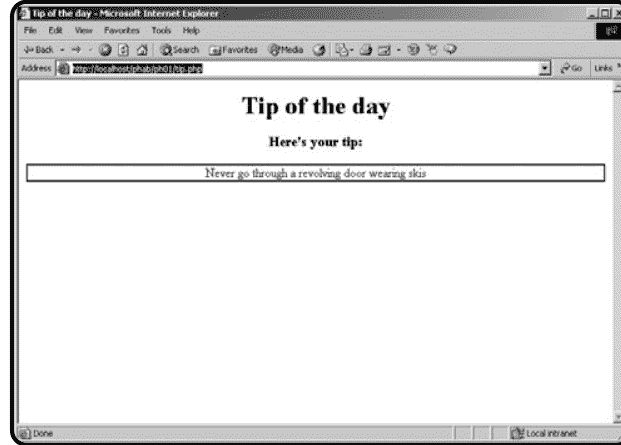

# 图 1.1

每日提示看起来可能很简单，但它是一个技术奇迹。它包含了 HTML、层叠样式表和 PHP 代码。

你可以在不使用 PHP 这种技术的情况下编写这种页面，但这个程序比它表面看起来要复杂得多。提示实际上并没有嵌入到 Web 页面中，而是存储在一个完全独立的文件中。程序将该独立文件到 HTML 页面中。页面所有可以通过编辑包含提示的文件来轻松更改每日提示。

# 在现实世界中

“每日提示”页面展示了今天 Web 编程中最热门的概念之一：这种结构允许程序员设计 Web 网站的总布局，但将内容与页面设计隔离开。页面所有者（他们可能不知道如何直接修改 Web 页面）可以轻松更改文本文件，而无需暴露支撑网站结构的代码。你将在第 8 章“XML 和内容管理系统”中学习如何构建一个完整的内容管理系统。

你应该从复习 HTML 技能开始。很快，你将开始编写生成 Web 页面的程序，因此你需要对自己的 HTML 编码非常严谨。如果你通常使用纯文本编辑器编写所有的 Web 页面，那就没问题。如果你倾向于依赖如 Microsoft FrontPage 或 Macromedia Dreamweaver 这样的高级工具，你应该暂时放下这些工具，并确保你可以手动编写 HTML。要使用现代标准（HTML 4.0 或 XHTML）构建 Web 页面，包括表单元素和层叠样式表（CSS）。如果你需要复习，请参附录 A，它存储在随书的 CD 中。

## 在 Web 服务器上编程

互联网的核心是各种计算机之间的通信。互联网的主流模型是客户端和服务器的概念。你可以通过想象一个得速服务餐厅来理解这一点。当你开车到达小扬声器处，一个模糊不清的声音询问你的订单。你要求一份胆固醇至尊，青少年为你打包食物。你开过去，用钱换取食物，然后离开。与此同时，青少年在等待另一个客户的出现。互联网的工作方式就像这个模型。大型永久计算机作为 Web 服务器，托管 Web 页面和其他信息。它们非常像得速服务餐厅。用户使用 Web 浏览器开车到达 Web 服务器。数据进行交换，用户可以在 Web 浏览器上读取信息。

这个模型的有趣之处在于，交互并不一定止于此。由于客户端（用户）机器是一台计算机，因此可以给它下达指令。通常，JavaScript 语言在 Web 页面中存储特殊指令。这些指令（如 HTML 代码本身）在服务器上没有任何意义。页面到达客户端机器后，浏览器解释 HTML 代码和任何其他 JavaScript 指令。

虽然大部分工作都交给了客户端，但这种客户端方法也有一些缺点。设计用于在 Web 浏览器内部运行的程序在能够执行的操作种类通常受到很大限制。客户端 Web 程序通常无法访问用户的打印机或磁盘驱动器。单此一项限制就让此类程序无法执行许多许多最有用的工作，例如数据库连接和用户跟踪。

服务器也是一台计算机；可以编写设计在服务器而非客户端运行的程序。这种安排具有许多优势：

- 服务器端程序运行在强大的 Web 服务器计算机上。

- 服务器可以自由地处理文件和数据库。

- 返回给用户的代码是纯 HTML，可以在任何 Web 浏览器上显示。

## 安装 PHP 和 Apache

PHP 只有在配置为 Web 服务器的计算机上运行时才有意义。

### 使用现有服务器

如果你足够幸运，已经有一个 Web 服务器，你需要以下组件：PHP、一个 Web 服务器（如 Apache）以及一些数据库管理系统。

## 安装你自己的开发环境

即使你可以访问在线服务器，你可能也想为开发构建一个练习服务器。这种方法有很多优势：

- 你可以精确控制你安装的服务器。你可以对其进行调整，开启所有你需要的选项，并禁用你不需要的内容。（我将在本章稍后的“告诉 Apache 关于 PHP 的”部分描述如何做这一点）

- 你可以在不将程序暴露给全世界的情况下测试你的程序。当你安装本地服务器时，你通常不会向你以外的任何人暴露它。这样在你准备好公开之前，别人就不会窥探你的工作。

- 使用本地服务器配置开发环境与远程服务器协作会更容易。

- 你工作时不需要连接互联网。

然而，安装服务器（及其相关程序）并不像安装商业应用程序那样简单。有很多种类和可能出现的问题。但是，只要有耐心，你应该能够完成。

你需要几个组件来构建你自己的 PHP 开发系统。PHP 开发通常使用名为 LAMP（Linux, Apache, MySQL 和 PHP）或 WAMP（Windows, Apache, MySQL 和 PHP）的系统进行。

> > 技巧 如果你运行 Linux，很有可能一切都已安装在你的系统中，你只需要配置并开启它们。由于由于原因，我假设你正在使用 Windows 系统。请查看软件组件自带的各种帮助文档，以获取在其他操作系统上安装的帮助。

### Web 服务器

Web 服务器是计算机托管 Web 页面的软件。目前最流行的 Web 服务器是 Apache，它是一个开源软件，运行在 Windows、Linux 以及几乎任何其他操作系统上。Web 服务器让你能够在本地计算机上编写和测试程序，这与其在互联网上运行的方式完全一致。

# PHP 环境

PHP 环境是一系列程序和库文件。这些程序之所以奇特，是因为用户永远不会直接运行它们。相反，用户向 Web 服务器请求一个 PHP 程序，然后服务器调用 PHP 来处理文件中的指令。随后，PHP 会返回 HTML 代码，用户在浏览器中看到这些代码。本书是使用 PHP 5.0 编写的，尽管大多数代码在较早的 PHP 版本中也能良好运行。

### 数据库环境

与数据库交互是 PHP 最强大的用途之一。因此，你需要在系统中至少安装一个数据库引擎。对于本书来说，你将使用 MySQL 和 SQLite。我将后将在第 9 章中更详细地介绍这些软件包的安装和使用，因为在很久之前你不需要它们。

### 编辑器

你需要某种编辑器来操作你的代码。你可以使用记事本（Notepad），但你可能想要一个功能更强大的工具。目前有很多免费和商业性的 PHP 编辑器供选择。对于本书，我使用了 emacs（一个强大的基于 UNIX 的文本编辑器，对初学者来说有些晦涩）和 Maguma Studio。后者是一个商业编辑器，并提供非常令人印象深刻的免费版。

### 安装 Apache

根据行业标准的 Netcraft（www.netcraft.com）调查，截至 2004 年 3 月，全球 67% 的服务器正在运行 Apache。你的机器上可能已经安装了微软的信息服务器（IIS）。如果是这样，可以使用它，但你必须阅读文档来查看如何让 IIS 与 PHP 通信。（PHP 自带的安装说明解释了如何在 IIS 服务器上运行 PHP）。

> 我认识几位在 IIS 服务器上运行 PHP 运气不错的人，但我自己遇到过问题。当我尝试在同一系统上同时运行 IIS 和 Apache 时，情况变得特别混乱。IIS 往往会在几乎没有警告的情况下关闭 Apache。如果没有迫切需要运行 IIS，我会在我的 PHP 服务器上坚持使用 Apache。在我的办公室里，我们实际上在 Linux 服务器上运行 PHP，并在 Windows 服务器上运行 IIS。

Apache Web 服务器极其稳定，且安装后相对容易使用。本书的代码在 Apache 1.3.23、1.3.29 和 2.0 上经过了测试。

# 安装 Apache 文件

随书附带的光中提供了 Apache。你也可以直接访问 Apache 网站下载更新版本或获取安装帮助。

将 Apache 安装到你的系统中，这是构建 WAMP 环境的第一步。如果你遇到任何问题，请阅读 http://httpd.apache.org/docs/windows.html 上的优秀文档。

当提示输入域名时，本地安装请使用 `localhost`。这允许仅从你的本地机器访问这台练习服务器。一旦你确认一切运行良好，就可以输入不同的域名。

# 测试你的服务器

现在来检查 Apache 是否安装正确。

- 1. 使用文件管理器查找 Apache 目录。

2. 找到一个名为 `apache.exe` 的程序。

3. 如果没找到，请查看 `bin` 目录。

   运行 `apache.exe`。

   一个 DOS 窗口会启动。

> 在配置系统时，**切勿关闭这个 DOS 窗口！** 如果你关闭它，Apache 将关闭并运行异常。测试完这个控制台版本的 Apache 后，你会将其作为服务运行，它会在后台运行。（稍后我会详细解释）如果你安装的是 Apache 2.0，它会自动作为服务安装。

- 4. 启动 浏览器并输入以下 URL 之一：

   http://localhost/ 或 http://127.0.0.1/

   Apache 在运行时不会显示什么，但它为你的电脑增加了强大的新功能。对我来说，`127.0.0.1` 地址实际上更好用，因为 IE 有时会“热心”地在我输入 `localhost` 时带我进入搜索引擎。任一地址都将指向你当前所在机器的主页。如果你正确开启了 Apache，你应该能看到一个看起来类似于图 1.2 的页面。

当 Apache 启动后，你可以通过 `localhost` 地址访问它。当然，如果你的电脑有域名且你关闭了防火墙，其他人也可以访问。

# Apache 安装测试页面

如果你能看到这个，说明该系统上的 Apache Web 服务器运行成功。你现在可以将你的内容添加到此目录并替换此页面。

# 看到的是这个而不是预期的网站？

这是因为网站管理员更改了此 Web 服务器的配置。请联系维护该网站的人员。编写 Web 服务器的 Apache 软件基金无法帮助解决此类。

# 作为服务启动 Apache

你可以作为可执行程序运行 Apache，但最好将其作为服务启动。服务是计算机重新启动时会自动重启的后台进程。服务通常没有图形界面，但有时会在任务栏中显示图标。（图 1.3）

要作为服务运行 Apache，请从控制面板激活服务（在你的机器上路径为 `Control Panel/Administrative Tools/Services`）。使用此面板开启或关闭各种服务。注意，如果你更改了服务器配置，必须先关闭再重新开启，服务器才能识别这些更改。

此控制面板用于启动和停止 Apache。最新版本的 Apache 似乎会自动启动。如果发生这种情况，再次强调，不用担心提到的文档；它不会出现的。最重要的是当你的浏览器指向 `localhost` 时是否能得到页面。如果是，你就拥有了一个功能正常的服务器。

### 配置 Apache

Apache 通过一系列带有大量注释的文本文件进行配置。在 Apache 目录的 `conf` 文件夹中查找名为 `httpd.conf` 的文件。这是 Apache 的主配置文件。你不需要修改此文件，但如果你想修改（例如添加域名），就可以修改这个文件。在安装 PHP 后，修改 `httpd.conf` 以告诉 Apache 它的位置。请期待——一旦安装了 PHP，我将向你展示如何操作。

# 运行你的本地服务器

Apache 目录下有一个 `htdocs` 子目录。你在本地服务器上显示的任何文件都必须在此目录或其子目录中。

# 陷阱

你通常可能会在文件管理器中双击文件以便在浏览器中显示它，或者你可以将其拖入浏览器。这对于纯 HTML 文件有效，但它绕过了本地服务器。这意味着 PHP 程序将无法正常工作。PHP 代码必须通过对 `localhost` 的正式调用来执行，除非你在 `httpd.conf` 文件中指定另一个可访问的目录。

### 安装 PHP

PHP 环境是一系列程序和库文件。这些程序之所以奇特，是因为用户永远不会直接运行它们。相反，用户向 Web 服务器请求一个 PHP 程序，然后服务器调用 PHP 来处理文件中的指令。随后，PHP 会返回 HTML 代码，用户在浏览器中看到这些代码。

> 这对初学者合适吗？

老实说，Apache、PHP 和 MySQL 的安装是一个非常头疼的问题。很难配置正确。最好你能够找到一种方法跳过这些，直接在正常的服务器上开始编程。如果你无法让别人为你设置服务器，本书的后续章节将引导你完成这个过程。我很抱歉你必须从一个如此混乱的过程开始。

# 下载 PHP 程序

本书中的示例使用 PHP 5.0，该版本随书附的光盘提供。你也可以访问 http://www.php.net 获取 PHP Windows 二进制文件。你可以将 PHP 安装在任何地方，但我将其安装在 Apache 的子目录中，这样所有的 PHP 程序都处于接近位置。

- 1. 查看 PHP 目录下的 `install.txt`。这是一份非常重要的文档。务必仔细阅读并遵循其指令。

2. 找到 PHP 目录中大量的 `.dll` 文件。

3. 确保这些 `.dll` 文件与 `php.exe` 位于同一目录。

当你告诉 Apache 如何找到 PHP 时，它也会找到这些重要文件。

4. 找到名为 `php.ini-recommended` 的文件。

5. 将其复制到你的 C:\windows 目录下。

6. 将新文件重命名为 `php.ini`。

之后你需要编辑此文件来配置 Apache，但你需要先安装 PHP。


`install.txt` 文档建议 `php.ini` 文件放在 `C:\winnt`。我发现这在 PHP 4 版本中运行良好，但版本 5 要求该文件位于 `C:\windows`（至少在我的机器上是这样）。如果你的配置没有生效，请检查此文件的位置。你应该也可以将文件放在你的 Apache 目录中——但如果你这样做了，它就是你拥有的唯一版本。如果你遇到奇怪的行为，请检查是否在某处多了一份 `php.ini` 副本。

在本章的后面部分，我将向你展示如何修改此文件，以便书中的程序无问题地运行。不过现在，请确保 PHP 正在运行。

## 让 Apache 知道 PHP

- 1. 在你的文本编辑器中打开 Apache 配置文件。

记住，此文件名为 `http.conf`，它可能在 Apache 安装目录的 `conf` 目录下。

- 2. 找到包含一系列 `loadmodule` 指令的区域。

如果你使用的是 PHP 5 版本，你必须明确告诉 Apache 在哪里可以找到它。

- 3. 在其他 `loadmodule` 命令之后，添加以下代码：

```
LoadModule php5_module c:/apache/php5apache.dll
```

- 4. 修改代码，使其指向你系统中安装 `php5apache.dll` 文件的位置。

- 5. 向下滚动，直到你看到一系列 `AddModule` 命令。

- 6. 向 `http.conf` 中添加以下代码以添加模块：

```
AddModule mod_php5.c
```

- 7. 在文件末尾添加此行：

```
AddType application/x-httpd-php .php
```

- 8. 保存 `httpd.conf` 并重启 Apache 以确保更改永久生效。

## 探索 PHP 环境

## 在你的页面中添加 PHP

现在你已经安装了 PHP，是时候添加一些代码了。

确保 PHP 已安装并运行快速诊断检查以查看它是如何配置的。无论你是安装自己的 Web 服务器还是使用现有服务器运行你的程序，都应该这样做。

判断服务器上是否存在 PHP 最简单的方法是：编写一个简单的 PHP 程序并看它是否运行。这里有一个非常简单的 PHP 程序，它可以向用户问候并显示关于开发环境的各种有用信息。

## 在 HTML 页面中添加 PHP 命令

```html
<html>
<head>
<title>Hello in PHP</title>
</head>
<body>
<h1>Hello in PHP</h1>

<?php
print "Hello, world!";
phpinfo();
?>
</body>
</html>
```

由于这是你从从书中看到的第一段 PHP 代码，我需要复过一下一些基本概念。

用 PHP 编写的页面起始方式与普通的 HTML 页面非常相似。它们都是用纯文本编辑器编写并存储在 Web 服务器上的。PHP 程序的不同之处在于嵌入的 `<script>` 元素。当用户请求 PHP 页面时，服务器会在将结果发送给用户之前解析并执行任何脚本元素。

> `<?` 序列是指示 PHP 代码最简单的方法，但并不总是最好的。你也可以用较长的版本指示 PHP 代码，例如这样：`<?php ?>`。当你的代码被解释为 XML 时，这个版本效果更好。你也可以用普通的 HTML 标签（如 `<script language="php"></script>`）指定你的代码。某些 PHP 服务器被配置为倾向于某一种脚本标签而非另一种；你可能需要灵活处理。然而，所有这些变体的工作方式完全相同。

PHP 程序看起来像典型的 HTML 页面。不同之处在于特殊的 `<?php` 标签，它指定了 PHP 代码的存在。标签内的任何代码都会被 PHP 解释器读取并转换为 HTML 代码。写在 `<` 和 `>` 符号之间的代码是 PHP 代码。我在页面添加了两个命令。查看图 1.4 所示的程序输出。你可能会感到惊讶。

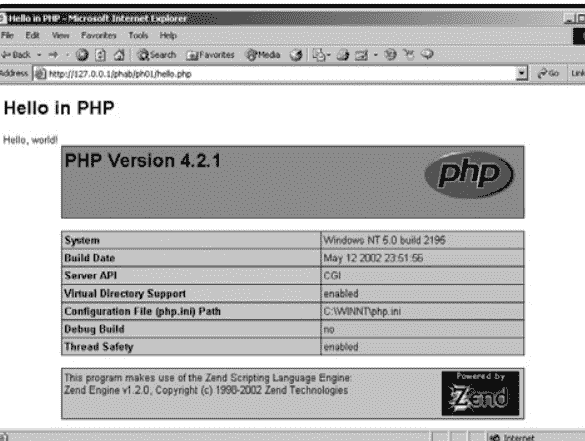

图 1.4

该页面将 HTML 与其他内容混合在一起。

## 检查结果

此页面有三种不同类型的文本。

- Hello in PHP 是普通的 HTML。我像写普通 HTML 页面一样写了它，它像普通 HTML 一样显示。

- Hello, world!是由嵌入中的 PHP 程序编写的。

- 页面的其余部分有点神秘。它包含了许多关于所用特定 PHP 引擎的信息。它实际上跨越了几页。`phpinfo()` 命令生成了所有代码。此命令显示有关 PHP 安装的信息。

理解 `phpinfo()` 命令显示的所有信息并不重要。更关键的是要意识到当用户请求 `hello.html` Web 页面时，文本首先会通过 PHP 解释器。该程序扫描所有的 PHP 命令，执行它们，并用 HTML 代码替换原始命令。当页面到达用户手中，所有的 PHP 代码都消失了。

为了证明这一点，请查看 `hello.php` 的源码。它看起来像这样：

```html
<html>
<head>
<title>Hello in PHP</title>
</head>
<body>
<h1>Hello in PHP</h1>

<style>
a { text-decoration: none; }
a:hover { text-decoration: underline; }
h1 { font-family: Arial, sans-serif; font-size: 18px; font-weight: bold; }
h2 { font-family: Arial, sans-serif; font-size: 14px; font-weight: bold; }
body { font-family: Arial, sans-serif; font-size: 11px; }
td { font-family: Arial, sans-serif; font-size: 10px; }
th { font-family: Arial, sans-serif; font-size: 11px; }
</style>
</head>
<body>
<table border="0" cellpadding="3" cellspacing="1" width="600" bgcolor="#f0f0f0">
<tr>
<td align="left"></td>
<td align="middle"></td>
<td align="right"></td>
</tr>
<tr>
<td align="left"></td>
<td align="center"></td>
<td align="right"></td>
</tr>
</table>
</body>
</html>
```

## 配置你的 PHP 版本

如果你运行自己的服务器，可能可能调优你的 PHP 版本使其运行更顺畅。我有很多配置建议，可以为初学者提供一个相对友好的环境。特别要考虑以下元素。

### Safe Mode

这是一个主设置，允许你在编程易性和服务器安全性之间进行选择。对于初学者，我建议在自己的服务器上工作时将安全模式设置为关闭。当你迁移到生产服务器时，通常会将安全模式设置为开启，这要求你对某些元素更加小心。（不过，大部分都是你现在不需要担心的高级设置。现在关闭安全模式最重要的原因是允许访问下描述的 `register_globals` 指令。）

### Register Global

`register_globals` 参数决定 PHP 是否自动将表单信息传输到你的程序中。（如果这对你来说没什么意义也没关系。）这个功能对初学者很有用，但存在安全风险。当你变得更熟悉后（第5章之后我将向你展示 `register_globals` 的一些替代方案），你可以关闭此变量以保护你的代码免受潜在问题。要更改此变量的值，只需将 `register_globals` 设置为 `on` 或 `off`。与 `php.ini` 的任何更改一样，重启你的 Web 服务器以确保更改生效。

在 `php.ini` 中搜索如下的一行：

```
register_globals = On
```

# Windows 扩展

PHP 自带了许多扩展，允许你修改其行为。你可以通过添加新模块为你的 PHP 版本添加功能。要找到 `php.ini` 中描述这些扩展的部分，请在 `php.ini` 文件中查找windows extensions`。

你会看到类似下面的代码：

```
;Windows Extensions

;extension=php_bz2.dll
;extension=php_ctype.dll
;extension=php_cpdf.dll
;extension=php_curl.dll
;extension=php_cybersash.dll
;extension=php_db.dll
;extension=php_dba.dll
;extension=php_database.dll
;extension=php_dbx.dll
;extension=php_domxml.dll
;extension=php_dotnet.dll
;extension=php_exif.dll
;extension=php_fbsql.dll
;extension=php_fdf.dll
;extension=php_filepro.dll
;extension=php_gd.dll
;extension=php_gettext.dll
;extension=php_hyperve.dll
;extension=php_iconv.dll
;extension=php_ifx.dll
;extension=php_isisunc.dll
;extension=php_imap.dll
;extension=php_ingres.dll
;extension=php_interbase.dll
;extension=php_java.dll
;extension=php_ldap.dll
;extension=php_mbstring.dll
;extension=php_mcrypt.dll
;extension=php_mhash.dll
;extension=php_mssql.dll
;extension=php_oci.dll
;extension=php_openssl.dll
;extension=php_oracle.dll
;extension=php_pdf.dll
;extension=php_pgql.dll
;extension=php_printer.dll
;extension=php_sablot.dll
;extension=php_shmop.dll
;extension=php_snmp.dll
;extension=php_sockets_ct.dll
;extension=php_sybase_ct.dll
;extension=php_xslt.dll
;extension=php_yaz.dll
;extension=php_zlib.dll
```

我添加了 gd2 扩展

```
extension=php_gd2.dll
```

我添加了 mysqli 支持

```
extension=php_mysqli.dll
```

我添加了 mysql 扩展

```
extension=php_mysql.dll
```

> PHP 5.0 自带的 `php.ini` 文件中有一个注释，说明 MySQL 支持是内置的。（我发现我的安装中并非如此。例如，可以运行之前描述的 `phpinfo()` 程序）以确切查看你的安装中哪些扩展是激活的。如果你没有看到你需要的扩展，可以自己添加它。

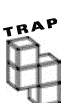

扩展以分号开头。该字符充当注释字符，并导致该行被忽略。要添加特定的扩展，只需删除行开头的分号即可。我通常会在代码中添加一条注释，提醒自己我添加了该扩展。

我添加了 `php_mysql.dll` 扩展。这允许支持本书后半部分将使用的 MySQL 数据库语言。添加对移除 mysql 行开头分号的支持。

# 18

# 技巧

你可以通过再次查看 `phpinfo()` 函数的结果来判断 PHP 是否添加了对 MySQL 支持。如果单独启用 `php_mysql.dll` 扩展不起作用，你可能需要找到 `libmysql.dll` 文件并将其移动到 `C:\Windows` 目录。


绝对初学者的 PHP MySQL

我还添加了我偶尔用到的两个图形库的支持。`gd2` 库允许我构建和修改图形，而 `mysqli` 允许允许我创建 Flash 电影。在能够熟悉基础 PHP 编程之前，不必担心启用这些文件。然而，当你准备好时，发现可以通过支持新模块来轻松扩展 PHP 的功能，这种感觉非常棒。

# 陷阱

PHP 5.0 版本附带的一些文档表明，MySQL 支持是内置的，不需要添加到配置文件中。（事实上，这些信息就在配置文件内部）。


PHP 5.0 版本附带的一些文档表明，MySQL 支持是内置的，不需要添加到配置文件中。（事实上，这些信息就在配置文件内部）。

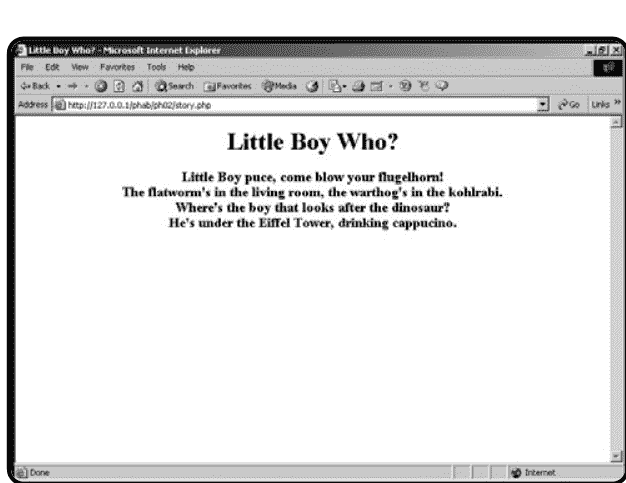

图 2.2

我讨厌��蓝蓝里有丛芜猪。

## 在脚本中使用变量

本章最重要的新概念是变量。*变量*（*variable*）是计算机内存中一个用于存储信息的容器。为了方便程序员操作，每个变量都有一个名称。你可以向变量中存入信息，也可以从变量中取出信息。

## 介绍 Hi Jacob 程序

图 2.3 所示的程序使用了变量，尽管你可能无法仅通过输出结果判断出这一点。

你无法从网页本身上真正看到这个程序有任何特别之处（即使查看 HTML 源代码）。要看到新内容，请查看 `hiJacob.php` 的源代码。

```html
<<html>
<head>
<title>Hi Jacob</title>
</head>
<body>
<h1>Hi Jacob</h1>
```

### 演示变量的使用

```php
<?php
$userName = "Jacob";

print "Hi, $userName";

?>
</body>
</html>
```

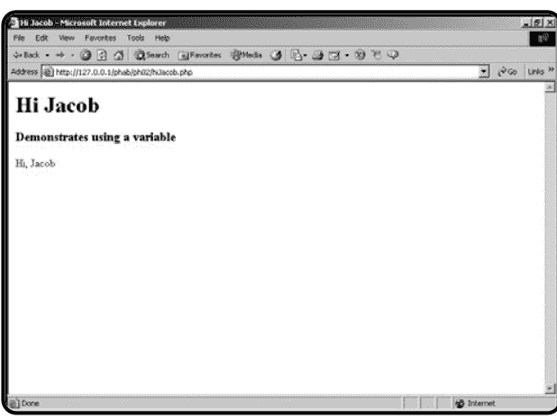

图 2.3

Jacob 这个词存储在此页面的变量中。

在普通的 HTML 和 JavaScript 编程中，你可以使用浏览器的“查看源代码”命令来检查你的程序代码。对于服务器端语言，这是不够的；查看源代码文档中完全没有 PHP。记住，实际的程序代码永远不会到达你的浏览器。相反，程序是在服务器上执行的，程序结果作为普通的 HTML 发送到浏览器。在检查这些程序时，要查看实际 PHP 源代码。顺便提一下，你不能简单地使用浏览器的文件菜单加载 PHP 页面。相反，通过服务器运行它。

helloJacob 页面主要是 HTML，其中包含一小段 PHP 代码。这段代码执行了许多非常重要的工作。

## 创建字符串变量

`$userName = "Jacob";` 这一行做了两件主要的事。首先，它创建名为 `$userName` 的变量。其次，它会将值 "Jacob" 赋值给该变量。在 PHP 中，所有变量都以美元符号（$）开头，以便与其他程序元素区分来。变量的名称是有意义的。

## 为你的变量命名

作为程序员，你经常需要进行命名。经验丰富的程序员已经学习了一些关于变量和其他元素命名的技巧。

- 让名称具有描述性。弄清楚 `$userName` 的意思比弄清楚 `$myVariable` 或 `$r` 要得多。在可能的情况下，确保你的变量描述了它们包含的信息类型。

- 使用适当的长度。你的变量名应该足够长以体现描述，但不要太长导致输入起来很麻烦。

- 不要使用空格。大多数语言（包括 PHP）都不允许在变量名中使用空格。

- 不要使用符号。大多数特殊字符（如 #、* 和 /）在编程语言中已经有了特定含义。当然，PHP 中的每个变量都以 $ 字符开头，但除此之外之外，你应该避免使用标点符号。该规则的一个例外是下划线（_）字符，在包括 PHP 在内的大多数语言中都是允许的。

- 注意大小写。PHP 是一种大小敏感语言，这意味着它认为 `$userName`、`$USERNAME` 和 `$UserName` 是三个不同的变量。PHP 的习惯是在分隔单词时使用小写。这是一个值得遵循的好习惯，也是我在整本书中使用的习惯。

- 注意拼写！每当你引用一个变量时，PHP 都会检查该变量是否已存在于程序的某处。如果是，它就会使用该变量。如果不是，它会静地为你创建一个新变量。PHP 不会捕捉拼写错误。相反，它会创建一个全新的变量，而你的程序可能无法正常运行。

##为变量赋值

等号（=）在 PHP 中是特殊的。它并不代表“等于”（至少在当前的语境下不是如此）。等号用于赋值。如果你将等号读作“获取”（gets），那么你就更接近 PHP 对该符号所运用的含义。例如，看这行代码：

```php
$userName = "Jacob";
```

它应该被读作：变量 `$userName` 获取了值 Jacob。

在 PHP 中创建变量时，你也会给它分配一些值。赋值是从右向左的。计算机对进入变量的信息类型非常挑剔，但 PHP 通过根据变量的上下文确定其数据类型来为你自动化这一过程。尽管如此，识别出 Jacob 是文本值仍然重要的，因为文本在内存中的存储和处理方式与数值数据略有不同。

> 计算机程序员几乎从不称文本为。相反，他们更倾向于使用更深奥的术语 string（字符串）。string 这个词实际上带有一种某种诗意的起源，因为计算机内存中存储文本的底层机制让早期程序员想起了在绳子上穿串珠子。

## 打印变量的值

下一行代码在屏幕上打印一条消息。你可以在屏幕上打印任何想要的文本。文本（也称为字符串数据）通常封装在引号中。如果你想打印变量的值，只需将变量名放在你想要的文本中即可。

```php
print "Hi, $userName";
```

它产生如下输出：

```
Hi, Jacob
```

helloJacob 页面主要是 HTML，其中包含一小段 PHP 代码。这段代码执行了许多重要的工作。

## 使用分号结束行

PHP 像大多数语言一样，对语法有一些严格的规则。每条指令都预期以分号结束。如果你查看 helloJacob 的完整代码，你会看到每一行都以分号结束。如果你忘记这样做，就会得到类似于图 2.4 那样的错误。


图 2.4

如果你在每行的末尾都不加分号，就会出现这种错误。

指令有时比单行长。分号通常（但并非总是）对应行的结束。尽管如此，通常你会用分号结束。

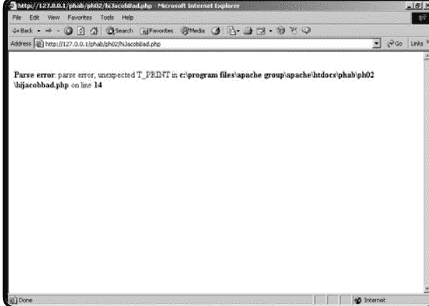

如果你收到错误消息，不要恐慌。错误是编程过程中完全正常的一部分。即使是经验丰富的程序员在构建程序时也会看到很多错误消息。通常产生的错误代码会为你提供关于错误的的重要线索。确保你仔细查看报告的每一行代码。虽然错误并不总在该行，但你通常可以获得提示。在许多情况下（特别是缺少分号时），语法错误指向实际问题之后的行。如果你在第 14 行遇到语法错误，而问题是缺少分号，那么问题行实际上是第 13 行。

## 用于更复杂的页面变量

虽然 Hello 程序很有趣，但使用变量并没有真正的优势。看看变量的其他用途。

## 构建 Row Boat 页面

图 2.5 显示了 Row your boat 页面。

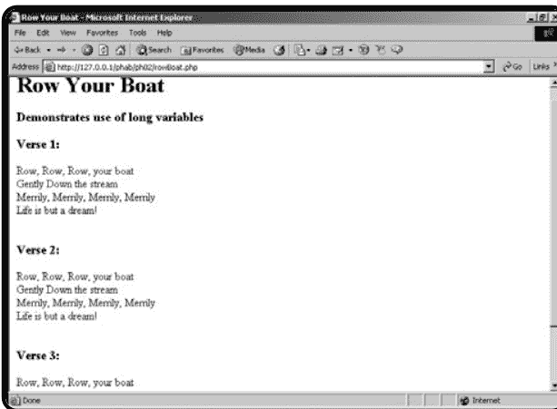

这个程序展示了一首流行歌曲的歌词。它们确实重复了很多。

我特别选择这首歌曲是因为它重复了三次副歌。如果你查看 rowBoat.php 程序的原始代码，你会看到我使用了一个技巧来节省一些输入工作。

```php
<?php
$verse = <<<HERE
```

划呀，划呀，划呀，划你的船

顺着水流轻轻向前

快乐，快乐，快乐，快乐

人生如梦！

这里是：

```php
print "<h3>Verse 1:</h3>";
print $verse;

print "<h3>Verse 2:</h3>";
print $verse;

print "<h3>Verse 3:</h3>";
print $verse;

?>
</body>
</html>
```

## 创建多行字符串

你发现自己想要一次打印几行 HTML 代码。使用引号来表示此类字符串可能非常麻烦（尤其是因为 HTML 经常使用引号符号）。PHP 提供了一种特殊的引用机制，非常适合这种情况。下面这一行开始为变量 `$verse` 赋值：

```
$verse = <<<HERE
```

`<<<HERE` 表示这是一个特殊的多行字符串，它以符号 `HERE` 结束。你可以使用任何短语，但我将使用 HERE 这个词，因为我想这三个较短的符号代表“直到（up to）”。换句话说，你可以将以下内容理解为 $verse 获取直到 HERE 为止的所有内容。

```
$verse = <<<HERE
```

你也可以将 `<<<HERE` 视为特殊的引用符号，它以值 `HERE` 结束。

你可以在 `<<<HERE` 和 `HERE` 之间编写任意数量的文本。你可以在特殊文本中放入变量，PHP 会变量替换为它的值，就像在普通的（带引号的）字符串中一样。结束语句（HERE）必须单独一行，且前面不能有空格。

## 30

## 陷阱

你可能会疑惑为什么 `$verse = <<<HERE` 这一行后面没有分号。虽然这在编辑器中是一行，但它开始了一个多行结构。从技术上讲，从那一行到 `HERE;` 这一行结束，都是同一行的一部分，尽管代码在编辑器中占据了多行。`<<<HERE` 和 `HERE` 之间的所有内容都是一个字符串值。

分号在字符串内部没有特殊含义。至少，你应该知道，开始多行引用的行不需要分号，但结束引用的行需要分号。

面向绝对初学者的 PHP 5/MySQL

一旦构建了多行字符串，使用起来非常简单。实际上，编写这三段歌的标题比编写歌词本身要难。`print` 语句只需将 `$verse` 变量的值放置在输出 HTML 的相应位置。

## 处理数值变量

计算机最终以“开/关”脉冲存储信息。你可以将这些简单的数据值转换为更方便的信息类型。PHP 语言让这些大部分操作对你来说是不可见的，但重要的是，内存处理字符串（文本）的方式与处理数值的值不同，而且数值有两个主要类型：整数和浮点数。

## 编写 ThreePlusFive 程序

作为 PHP 如何处理数字的示例，考虑图 2.6 所示的 `ThreePlusFive` 程序。

`ThreePlusFive` 程序中的所有工作通过两个名为 `$x` 和 `$y` 的变量完成。（我知道，我建议你为变量分配更长、描述性的名称，但这些变量在算术问题中很常见，在这种情况下这些非常短的变量名是可以接受的。）程序的代码如下：

```html
<html>
<head>
<title>Three Plus Five</title>
</head>
<body>
<h1>Three Plus Five</h1>
<h3>演示数值变量的使用</h3>
```

## 第 2 章 使用变量和输入

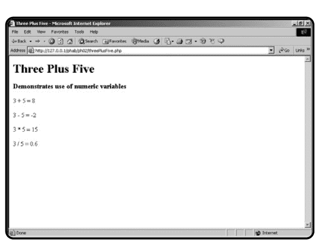

### Three Plus Five

演示数值变量的使用

- 3 + 5 = 8

- 3 - 5 = -2

- 3 * 5 = 15

- 3 / 5 = 0

图 2.6

此程序对包含值 3 和 5 的变量进行基础数学运算。

```php
php
$x = 3;
$y = 5;

print "$x + $y = ";
print $x + $y;
print "<br><br>";

print "$x - $y = ";
print $x - $y;
print "<br><br>";

print "$x * $y = ";
print $x * $y;
print "<br><br>";

print "$x / $y = ";
print $x / $y;
print "<br><br>";

?>
</body>
</html>
```

## 赋值数值

你可以像创建 PHP 中任何其他变量一样创建数值变量：只需为变量赋值即可。注意，数值不需要引号。我创建了名为 `$x` 和 `$y` 的变量，并为这些变量分配了适当的值。

## 使用数学运算符

对于每次计算，我都想打印问题及其解。这一行打印 `$x` 和 `$y` 变量的值，并在它们之间加上加号：

```php
print "$x + $y = ";
```

在特定情况下（因为 `$x` 是 3 且 `$y` 是 5），它会打印这个字面量：

```
3 + 5 =
```

由于加号和等号在引号内，它们被视为普通的文本元素。PHP 不会对它们进行任何计算（如加法）。下一行不包含任何这些内容：

```php
print $x + $y;
```

它计算 `$x + y` 的值并将其打印。

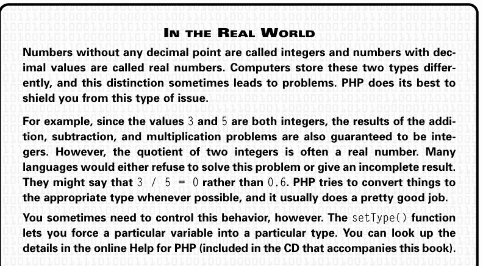

## 使用数学运算符

你熟悉的大多数数学符号也适用于数值变量。加号 (+) 用于加法，减号 (-) 表示减法，星号 (*) 乘法，正斜杠 (/) 用于除法。

## 创建表单

当你想要从用户获取信息时，表单非常有用。为了说明如何这样做，请看图 2.7。

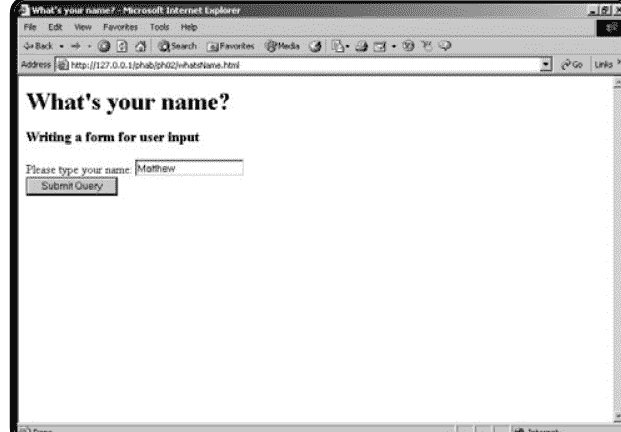

图 2.7

`whatsName.html` 包含一个表单。当用户点击提交按钮时，所有字段的值（情况下只有一个）将被打包发送到名为 `handler.php` 的程序，该程序应该在 `whatsName.html` 相同的目录下。

## 构建带有表单的 HTML 页面

`whatsName.html` 如下：

```html
<html>
<head>
<title>What's your name?</title>
</head>
<body>
<h1>What's your name?</h1>
<h3>编写用户输入表单</h3>
<form method="post" action="handler.php">
请输入你的名字：
<input type="text" name="userName" value="">
<br>
<input type="submit">
</form>
</body>
</html>
```

## 编写检索数据的脚本

`handler.php` 的代码是专门构建的。调用 `handler.php` 代码的表单应该有一个名为 `userName` 的元素。查看 `handler.php` 的代码就能我的意思。

在现实世界中

某些 PHP 服务器关闭了从表单自动创建变量的功能。你可能会说服你的服务器管理员在 `PHP.INI` 文件中开启 `register_globals`。如果不行，有一个通通方法：如果你的表单有一个名为 `userName` 的字段，在需要该字段值的程序开头添加此代码：

```
$userName = $_REQUEST['userName'];
```

对于你想要从原始表单中提取的每个变量，重复此代码。

```html
<html>
<head>
<title>你好，用户</title>
</head>
<body>
<h1>你好，用户</h1>
<h3>接收来自 "whatsName" 值的 PHP 程序</h3>

<?php
print "<h3>你好，$userName!</h3>";
?>

</body>
</html>
```

与许多 PHP 页面一样，`hiUser.php` 主要是 HTML。唯一不同之处是 `print` 语句（此处原文误为 print statement，应为 PHP 语句），该语句包含了变量 `$userName`。令人困惑的是：在代码的任何地方都没有再次提到该变量。

当用户向 PHP 程序提交表单时，PHP 处理器会自动创建一个与原始 HTML 中每个元素同名的变量。由于由于 `whatsName.html` 页面上有一个名为 `userName` 的表单元素，因此任何由 `whatsName.html` 激活的 PHP 程序都可以访问一个名为 `$userName` 的变量。该变量的值就是用户在点击“提交”按钮之前在字段中输入的内容。

## 不使用表单发送数据

在不使用表单的情况下向服务端程序发送数据是非常困难的。这个不为人知的技巧可以在不需要学习 PHP 编程的情况下增强你的 Web 页面。图 2.9 和 2.10 显示的链接演示页（linkDemo.html）说明了这种现象。

## 理解 get 方法

`linkDemo.html` 页面中的所有链接都使用了类似的技巧。正如你回想起在本章前面看到的，表单数据可以通过两种不同的方法发送到程序。`post` 方法是你表单中通常使用的技术，但你一直在使用 `get` 方法，因为普通的 HTML 请求实际上是 `get` 请求。有趣的地方在于，你可以通过将请求嵌入 URL 中，将数据发送到任何知道如何读取 get 请求的程序中。

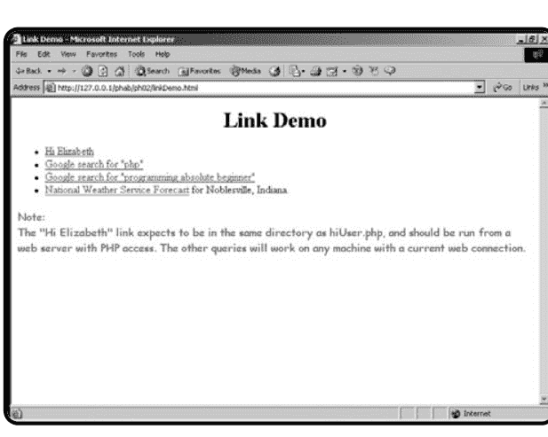

## 链接演示

图 2.9

页面上的链接看起来很普通，但它们异常强大。

## 第2章 使用变量和输入

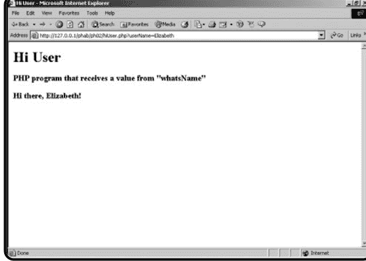

## 你好，用户

接收来自 "whatsName" 值的 PHP 程序
你好，Elizabeth!

图 2.10

当我点击 "Hi Elizabeth" 链接时，我被带到了 `hiUser` 程序，并且值 Elizabeth 自动自动发送到了程序中！

作为一个实验，切换 `whatsName.html` 的 `method` 属性，使表单看起来像这样：

```html
<form method="get"
action="hiUser.php">
```

再次运行页面。它的工作原理与之前相同，但结果页的 URL 看起来如下（假设你的用户名是 Andy）：

```
http://127.0.0.1/phab/ph02/hiUser.php?userName=Andy
```

get 方法使用一种特殊代码将所有表单信息存储在 URL 中。如果你回到 `whatsName` 页面并输入 Harris，你将得到略有不同的结果：

```
http://127.0.0.1/phab/ph02/hiUser.php?userName=Andy+Harris
```

Andy 和 Harris 之间的空格被转换成了加号，因为字符会引起很多困惑。当表单数据传输时，它通常会经历许多类似的转换。在 PHP 编程中所有的翻译都是自动的，所以你不需要担心这个问题。

## 使用 URL 嵌入表单数据

如果你理解 URL 中嵌入数据的工作原理，你就可以使用类似的技术来利用互联网上的任何服务端程序（假设它被配置为获取 get 方法数据）。当我检查 Google 搜索的 URL 时，我可以在命名字段 `q`（我猜是 query 的）中看到我的数据。我赌所有其他字段都有默认值，并写了一个包含查询的超链接。我的链接看起来如下：

```html
<li><a href="http://www.google.com/search?q=php">Google 搜索 "php"</a></li>
```

每当用户点击此链接时，它都会向 Google 搜索程序建立一个方法 query 请求。结果是一个很方便的 Google 搜索。你可能想要弄清楚如何在搜索引擎中设置你最常用查询的预设版本，这样你只需点击一下即可更新。图 2.11 展示了当用户点击 `linkDemo` 页面中的 "Google search for 'php'" 链接时发生了什么。

图 2.12 显示了这个稍微复杂的搜索结果。

```html
<li><a href="http://www.google.com/search?q=programming for the absolute beginner">Google 搜索 "programming absolute beginner"</a></li>
```

这种方法有一个缺点。程序所有者可以更改告知你的程序的程序，你的链接将不再正常工作。大多数 Web 程序员假设他们的程序仅由他们构建的表单创建。


另一个需要考虑的是，人们可以对你的程序这样做。因为你打算让你的程序只通过某种格式调用，并不意味着它总是这样工作的。去一下自由格式互联网的活力吧。

## 第2章 使用变量和输入

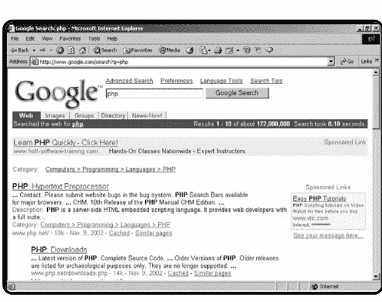

图 2.11

对编程入门的搜索。

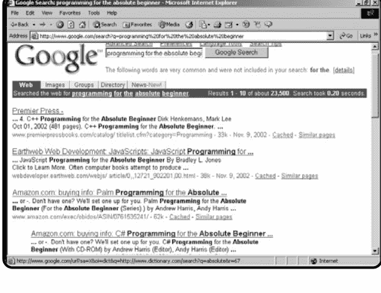

图 2.12

对编程的搜索。

## 处理多个查询

作为另一个实际示例，链接看起来如下：

```html
<li><a href="http://www.google.com/search?q=php&city=Elizabethville">国家气象局</a></li>
```


搜索 Elizabeth。

PHP 程序可以读取任何类型表单元素的输入。在所有情况下，HTML 对象的`name`属性变成 PHP 中的变量名。通常情况下，PHP 变量来自表单对象的`value`属性。

## 介绍 borderMaker

为了检查大多数元素，我创建了一个简单的页面来演示层样式表（CSS）边框的各种属性。HTML 程序如图 2.13 所示。

## 第2章 使用变量和输入

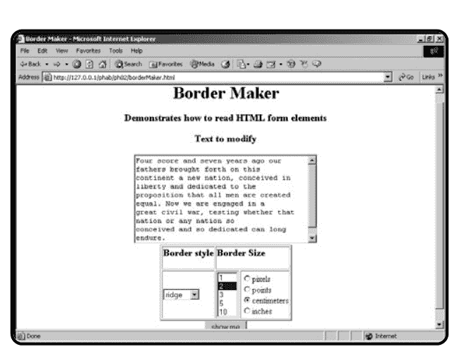

## 边框

### 读取表单元素

要修改的文本

七年前，我们的祖先在这里建立了一个新国家，在自由中孕胎，并致力于使人人生而平等这一主题。

| 边框样式 | 边框大小 |
|---|---|
| 1 | 像素 |
| 2 | 磅 |
| 3 | 厘米 |
| 10 | 英寸 |


`borderMaker.html`页面使用了文本区域、列表框和选择组。该表单的代码如下：

```html
<html>
<head>
<title>字体选择</title>
</head>
<body>
<center>
<h1>字体选择</h1>
<h3>演示如何读取 HTML 表单元素</h3>
<form method="post" action="borderMaker.php">
<h3>要修改的文本</h3>
<textarea name="basicText" rows="10" cols="40">
七年前，我们的祖先在这里建立了一个新国家，
```

一个新国家，它在自由中构生，并致力于坚持“人生而平等”这一命题。现在，我们正处于一场伟大的内战，测试这样一个国家或任何如此构生并如此投入的国家是否能够长久。

| 边框样式 | 边框大小 |
| :--- | :--- |
| `<select name="borderStyle"><option value="ridge">ridge</option><option value="groove">groove</option><option value="double">double</option><option value="inset">inset</option><option value="outset">outset</option></select>` | `<select size="5" name="borderSize"><option value="1">1</option><option value="2">2</option><option value="3">3</option><option value="5">5</option><option value="10">10</option></select>` |
| `<input type="radio" name="sizeType" value="px">pixels（像素)<br><input type="radio" name="sizeType" value="pt">points（点)<br><input type="radio" name="sizeType" value="cm">centimeters（厘米）<br><input type="radio" name="sizeType" value="in">inches（英寸）` |

`<input type="submit" value="show me">`
</form>
</center>
<body>
</html>

`borderMaker.html`页面被设计用于与名为`borderMaker.php`的 PHP 文件进行交互，你可以通过检查`action`属性看到这一点。注意，我为每个`option`元素添加了`value`属性，所有的单选按钮都有相同的`name`但不同的`value`。当你的程序旨在被程序读取时，`value`属性变得非常重要。最后，提交按钮至关重要，因为在用户提交表单之前，不会发生任何有趣的事情。

> 技巧
> 在这个特定的示例中没有包含复选框。我会在第 3 章“用条件和函数控制你的代码”中向你展示复选框的工作原理，因为你需要条件语句来处理它们。条件语句允许你的程序做出选择。

# 读取表单元素

`borderMaker.php`程序期望来自`borderMaker.html`的输入。当用户提交 HTML 表单时，PHP 程序将产生如图 2.14 所示的结果。

通常情况下，你在 HTML 表单上使用什么种类型的元素并不重要。PHP 解释器只需查看每个元素的`name`和`value`。当信息到达服务器时，使用了什么种类型的输入元素已经不重要了。PHP 自动为每个表单元素创建一个相应的变量。该变量的值就是元素的值。`borderMaker.php`中使用的代码说明了：

```html
<html>
<head>
<title>Your Output</title>
</head>
<body>
<h1>Your Output</h1>
<center>
<?
$style = <<<'HERE'
"border-width:$borderSize$sizeType;\nborder-style:$borderStyle;\nborder-color:green"
HERE';
print "<div style = \$style>";
print $basicText;
print "</span></div>";
?>
</center>
</body>
</html>
```

对于文本框和文本区域，用户直接输入值。在`border.html`中，有一个名为`basicText`的文本区域。PHP 解释器创建了一个变量`$basicText`。输入到该框中的任何内容（作为葛底斯堡演说默认的前几行）都会变成`$basicText`变量的值。

# 读取 Select 元素

回想下拉列表和列表框都是通过`select`对象创建的。该对象有一个`name`属性。列表框中的每个可能的选择都是一个`option`对象。每个`option`对象都有一个`value`属性。

`select`对象的名称变为变量名。例如，`border.html`有两个`select`对象：`borderSize`和`border`。PHP 程序期望找到两个对应的变量：`$borderSize`和`$border`。因为用户必须向`select`对象输入一个值，所以该值可以返回表单本身的编码结构中。用户选择的任何选项的值都将作为相应变量的值发送给 PHP 程序。例如，如果用户选择了边框样式，那么`$borderStyle`变量的值就是`groove`。

# 在现实世界中

选项的`value`不一定非得用户在表单上看到的那个值。如果你想向服务器显示内容，这个“隐藏值”非常有用。例如，你可能想让用户从几种颜色中选择。在这种情况下，`value`属性显示每个`option`对象对应的值，这些可能是实际的十六进制值。类似的技巧也用于在线购物环境，你可能允许用户通过名称选择项目，但与该项目关联的`value`在数据库环境中可能更容易处理。

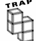

你可以在列表框中启用多选。在这种情况下，变量包含一个响应列表。虽然管理这个列表并不困难，但另一个章节的主题（具体为第 4 章“循环和数组”）。现在，集中在单列表框样式上。

# 读取单选组

CSS 允许开发者使用各种测量单位指示大小。这是单选按钮组的理想位置，因为一次只能只有一个测量单位是合适的。尽管`borderDemo.html`页面上有四个`name`为`size`的单选按钮，但 PHP 程序只会看到一个`$size`变量。与所选中的一个关联的值将变成`$size`变量的值。注意，与`option`元素一样，单选按钮的`value`可能与其旁边显示的文本不同。

# 表单的决策

你可能会怀疑所有这些元素都是必要的，因为它们都归结为`name`和`value`。

- 使用鼠标比打字更容易（特别是对用户来说）。界面元素（尤其是下拉列表）在空间利用方面非常高效。看看有多少人正在使用 PDA 和手机上网。如果你能预测它们会发送什么，你的程序员生活将变得容易得多。当用户输入内容时，他们会犯拼写和语法错误，而且是不可预测的。

# 回到故事

本章开头介绍的“故事”程序是一个整合你学到的所有新知识的机会。该程序没有引入任何新东西，但它帮助你看到一个更大的背景。

# 设计故事

虽然这个程序写起来不是特别困难，但如果你只是打开文本编辑器就开始乱写，你就会遇到问题。提前计划非常有意义。最重要的思考发生在在你写第一行代码之前。

在这种情况下，从思考你的故事开始。你可以写自己的故事，也可以修改现有文本以达到幽默效果。我从一本童谣书中搜集了故事。无论你如何构思，在开始写代码之前要把它准备好。我先在文本编辑器中写了未修改的《小男孩蓝》，以便欣赏它的艺术才华。

当你查看原始过程时，寻找可以删掉的关键词，并找到一个暗示原词但不泄露任何信息的描述。例如，我打印了我的故事，在原文中圈出“blue”，并在另一张纸上写下“color”。继续这种操作，直到你从原始故事中找出了几个词。你应该有一个有很多洞的文档和一个提示列表。我的看起来就像图 2.15。

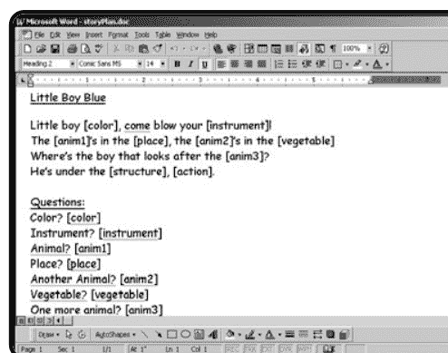

图 2.15

我在写任何代码之前，已经考虑了故事和单词列表。

# 在现实世界中

图 2.15 显示了以 Word 文档编写的计划。虽然有时会这样处理（特别是在专业的编程环境中），但我把计划写在了纸上。我将其复制到更整洁的格式，因为你不应该受我手写字的苦。

我通常在纸上、黑板或白板上计划程序。我避免在计算机上计划程序，因为很容易忍不住立即开始编程。在担心如何实现计划之前，用英语描述你想做什么是非常重要的。大多数初学者（以及很多专业人士）过早开始编程。因此，在本章接下来的部分，你会看到这个计划是如何演变成一个运行中的程序的。

## 构建 HTML 页面

根据图 2.15 的基本框架，可以清楚地看到 Story 程序应该如何创建。它应该包含两个部分：第一部分是一个提示用户输入各种单词的 HTML 页面。以下是我版本的代码：

```html
<html>
<head>
<title>Story</title>
</head>
<body>
<h1>故事填空</h1>
<h3>请填写下方的空白，我将为你讲一个故事。</h3>
<form method="story.php">
<table border="1">
<tr>
<th>颜色：</th>
<th>
<input type="text" name="color" value="">
</th>
</tr>
<tr>
<th>乐器：</th>
<th>
<input type="text" name="instrument" value="">
</th>
</tr>
<tr>
<th>动物：</th>
<th>
<input type="text" name="animl" value="">
</th>
</tr>
<tr>
<th>另一种动物：</th>
<th>
<input type="text" name="anim2" value="">
</th>
</tr>
<tr>
<th>再一种动物！</th>
<th>
<input type="text" name="anim3" value="">
</th>
</tr>
<tr>
<th>地点：</th>
<th>
<input type="text" name="place" value="">
</th>
</tr>
<tr>
<th>蔬菜：</th>
<th>
<input type="text" name="vegetable" value="">
</th>
</tr>
<tr>
<th>结构：</th>
<td>
<input type="text" name="structure" value="">
</td>
</tr>
<tr>
<th>动作：</th>
<td>
<select name="action">
<option value="fast asleep">熟睡</option>
<option value="dinking cappuccino">喝着卡奇诺</option>
<option value="wandering around aimlessly">无目的地闲荡</option>
<option value="doing nothing in particular">无所事事</option>
</select>
</td>
</tr>
<tr>
<td colspan="2">
<center>
<input type="submit" value="给我讲故事">
</center>
</td>
</tr>
</table>
</form>
</body>
</html>
```

HTML 部分本身并没有特别令人兴奋的。事实上，由于我已经有了计划，我确切地知道想要哪些内容，并创建了表单元素来询问每个问题。我在最后一个问题上使用了列表框，这样可以提供一些有趣的建议。注意，我稍微调整了顺序，以让用户措意不及。

在编写连接到脚本的页面时，请检查以下几点：

- 确保已添加了`action`属性。
- 确保`form`标签中有正确的`action`属性。
- 确保每个表单元素都有适当的`name`属性。
- 如果你有单选框（radio）或选项（option）对象，确保每个都有合适的`value`值。
- 确保你的表单中某处有一个提交按钮。
- 不要忘记包含你的表单标签。如果你忘记包含`</form>`，你的浏览器可能还可以工作，但你不知道用户的浏览器会如何表现。

## 检查表单

我实际上编写了两个不同的脚本来读取这个表单。第一个只是简单地检查每个元素，以确保它接收了我预期的值。这是第一个程序，命名为`storySimple.php`：

```html
<html>
<head>
<title>小是谁？</title>
</head>
<body>
<h1>小是谁？</h1>
<h3>来自故事页面的值：</h3>
<table border="1">
<tr>
<th>变量/</th>
<th>值/</th>
</tr>
<tr>
<th>color/</th>
<td><?php print $color; ?></td>
</tr>
<tr>
<th>instrument/</th>
<td><?php print $instrument; ?></td>
</tr>
<tr>
<th>anim1</th>
<td><?php print $anim1; ?></td>
</tr>
<tr>
<th>anim2</th>
<td><?php print $anim2; ?></td>
</tr>
<tr>
<th>anim3</th>
<td><?php print $anim3; ?></td>
</tr>
<tr>
<th>place</th>
<td><?php print $place; ?></td>
</tr>
<tr>
<th>vegetable</th>
<td><?php print $vegetable; ?></td>
</tr>
<tr>
<th>structure</th>
<td><?php print $structure; ?></td>
</tr>
<tr>
<th>action</th>
<td><?php print $action; ?></td>
</tr>
</table>
</body>
</html>
```

## 查看 Roll Em 程序

图 3.2 显示的 Roll Em 程序演示了`rand`函数如何生成虚拟骰子。

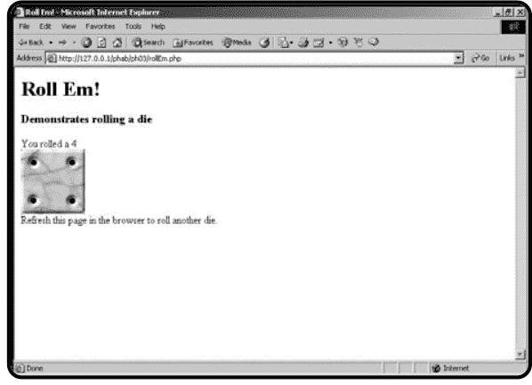

图 3.2：骰子是由 PHP 随机生成的

Roll Em 程序的代码展示了生成随机数有多简单：

```html
<html>
<head>
<title>Roll Em!</title>
</head>
<body>
<h1>Roll Em!</h1>
<h3>Demonstrates rolling a die</h3> <!-- 演示掷骰子 -->
<?php
$roll = rand(1,6);
print "You rolled a $roll";
print "<br>";
print "";
?>
<br>
刷新此页面以投掷另一个骰子。
</body>
</html>
```

`rand`函数生成一个从 1 到 6 之间（包含边界）的随机数，并将结果存储在`$roll`变量中。`rand`函数需要两个参数：第一个值是最小值，第二个值代表最大值。由于我想复制一个普通的六面骰子，所以我告诉`rand`函数返回一个 1 到 6 之间的值。当以下行执行完毕后，`$roll`变量中就有一个随机值：

```php
$roll = rand(1,6);
```

可能的最小值是 1，最大值是 6，且该值不会有小数部分（换句话说，它永远不会 1.5）。

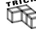

如果你是从其他语言过来的，你可能会对 PHP 生成随机数的方式感到惊讶。大多数语言允许你创建一个 0 到 1 之间的随机浮点数，然后要求你将该值转换为你所需的任何范围。PHP 允许——事实上——直接在一个范围内创建随机整数，这通常正是你需要的。如果你真的想要一个 0 到 1 之间的值，可以生成一个 0 到 1000 之间的随机数，然后将该值除以 1000。

## 打印相应的图像

注意我在前面的代码中使用的变量插值（variable interpolation）技巧。我仔细地将我的第一张图像命名为`die1.jpg`，第二张命名为`die2.jpg`，等等。当我准备在屏幕上打印图像时，我使用带有源的普通 HTML 标签`die$roll.jpg`。如果`$roll`是 3，图像就会显示`die3.jpg`。

如果你知道文件名结构，变量插值是一个神奇的技巧。你可能还记得第 2 章“使用变量”中允许你通过简单使用变量名将其嵌入引用字符串中的技术。

## 使用 if 语句控制流

计算机做的有趣的事情之一就是做决策。决策能力是一种幻觉。程序员在计算机内部存储特定的指令，计算机会根据这些指令运行。这种行为最简单的形式被称为`if`语句结构。

## 现实世界

本章中的骰子游戏演示了图形图像让你的程序更有趣、精彩的力量。你可以通过许多方式为程序获取图形。最简单的方法是在网上找到现有的图像。虽然这在技术上非常简单，但网络上的许多图像都属于某些。请尊重原始所有者的知识产权。对于你使用的任何图像，请获得许可。

另一个替代方案是自己创建图形。即使你完全没有艺术天赋，现代软件和技术也让生成合格的图形变得非常容易。你可以利用数码相机和免费的图形编辑器做很多事情。即使你聘请了专业艺术家为你的程序制作图形，你可能仍然需要能够勾画你想要的内容。这本书的 CD 备有几个非常强大的免费图像编辑程序。

## 引入 Ace 程序

你可以用`if`结构来改进 Roll Em 程序。图 3.3 显示了程序掷出 1 以外任何数值时的 Ace 程序。

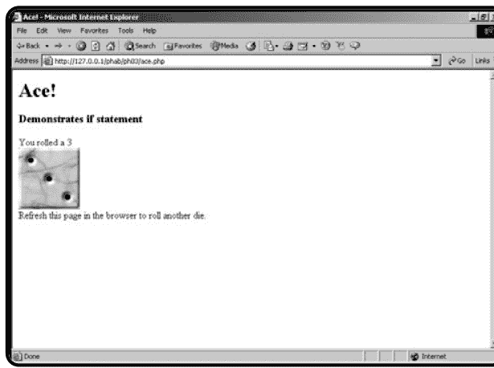

图 3.3：当掷出的结果不是 1 时，什么都不会发生。

然而，当程序掷出 1 时，它会发生一些令人兴奋的事情（好吧，中等程度兴奋），如图 3.4 所示。

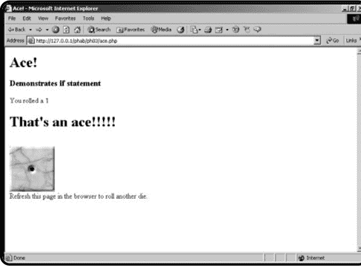

图 3.4：当出现 1 时，用户将享受到一场华丽的多媒体展示。

## 创建条件

从表面上看，Ace 程序的行为非常直观：只有当骰子结果为 1 时，它才会做一些有趣的事，在其他任何情况下都不这样做。虽然这是一个简单的想法，但其意义是深远的。Ace 程序中同样的简单机制是所有复杂计算机行为的基础，从飞行模拟器到心率监护器。看看 Ace 程序的代码，看看你是否能发现新元素：

```html
<html>
<head>
<title>Ace!</title>
</head>
<body>
<h1>Ace!</h1>
<h3>Demonstrates if statement</h3>
```

```php
<?php
$roll = rand(1,6);
print "You rolled a $roll";
if ($roll == 1){
print "<h1>That's an ace!!!!!</h1>";
} // end if
print "<br>";
print "";
?>
<br>
</body>
</html>
```

# 代码风格

PHP 处理器会忽略你 PHP 代码中的空格和换行符，你可能会疑惑，如此关注代码的缩进方式、大括号的位置等是否真的重要。虽然 PHP 处理器不在乎你如何格式化代码，但人类阅读者是在乎的。程序员对于应该如何格式化代码经常会有激烈的争论。

如果你是和小组一起编写代码（例如，在一个大型项目或一门课程中），你通常会得到一份需要遵循的风格指南。当你自己独立工作时，采用何种特定风格并不如保持代码的一致性那样重要。我在本书中所采用的特定风格惯例相当常见，具有较可读性，并且很容易适应多种语言。

如果你还没有自己的编程风格，书中的这种风格是一个很好的起点。然而，如果你的团队组长或老师要求另一种风格，请适应它。无论你使用哪种风格指南，对代码进行缩进、在程序中大量添加注释以及使用空白字符使程序更易阅读和调试，都是极有意义的。

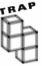

陷阱：不要在`if`行的末尾加分号。以下代码将打印“we must be near a black hole.”。

```php
if ("day") == "night") { 
 print "we must be near a black hole";
 // end if
```

当处理器看到`"day" == "night"`后面跟着分号时，它认为如果条件为真，没有代码需要执行。该条件实际上被忽略了。本质上，大括号表示整组行应被视为一个结构，而该结构是当前逻辑行的一部分。

# 处理负面结果

Ace 程序展示了如何编写处理条件的代码。在很多时候，你希望程序在条件为真时执行某项操作，在条件为假时执行另一个操作。大多数语言都包含这种语句的特殊变体，专门用于处理这类意外情况。

# 展示 Ace or Not 程序

Ace or Not 程序基于 Ace 程序构建的，但它有一个重要的区别，正如图 3.5 和图 3.6 所示。

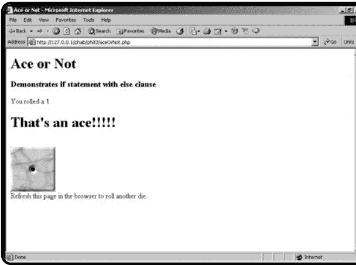

图 3.5

如果程序掷出 1，仍然会大喊“That's an ace!!!!!”。

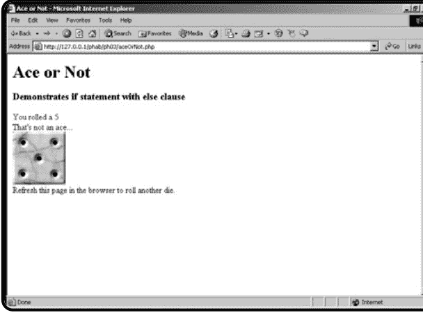

图 3.6

如果程序掷出 1 以外的任何数字，它仍然给用户一条消息。

程序在条件为真时执行一个操作，在条件为假时执行另一个操作。

# 使用 else 子句

Ace or Not 程序的代码展示了`else`子句如何根据不同条件允许多种行为：

```html
<html>
<head>
<title>Ace or Not</title>
</head>
<body>
<h1>Ace or Not</h1>
<h3>带有 else 子句的 if 语句演示</h3>
<?
$roll = rand(1,6);
print "You rolled a $roll";
print "<br>";
if ($roll == 1) {
print "<h1>That's an ace ace</h1>";
} else {
print "That's not an ace...";
} // end if
print "<br>";
print "
<br>
在浏览器中刷新此页面以掷另一个骰子。
</body>
</html>
```

这段代码中有趣的部分位于`if`语句附近：

```php
if ($roll == 1) {
print "<h1>That's an ace ace</h1>";
} else {
print "That's not an ace...";
} // end if
```

如果`$roll == 1`为真，程序会打印“That's an ace ace”。如果条件为假，则执行`else`部分。

# 处理多个值

你经常会发现自己正在处理更复杂的数据。例如，你可能想对六种可能的掷骰结果做出不同的反应。图 3.7 和图 3.8 所示的 Binary Dice 程序通过显示骰子的二进制表示演示了这种情况。

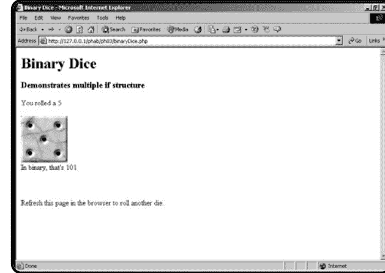

图 3.7

掷出的是 5，程序显示该值的二进制表示。

# 编写 Binary Dice 程序

Binary Dice 程序具有比其他稍微复杂的`if`结构，因为六种可能结果的二进制值应该是不同的。

# Binary Dice

演示多个 if 语句

```html
<html>
<head>
<title>Binary Dice</title>
</head>
<body>
<h1>Binary Dice</h1>
<h3>带有多个 if 语句演示</h3>
<?
$roll = rand(1,6);
print "You rolled a $roll";
print "<br>";
if ($roll == 1) {
print "<h1>That's an ace ace</h1>";
} else if ($roll == 2) {
print "That's a two";
} else if ($roll == 3) {
print "That's a three";
} else if ($roll == 4) {
print "That's a four";
} else if ($roll == 5) {
print "That's a five";
} else if ($roll == 6) {
print "That's a six";
} else {
print "I don't know that...";
} // end if
print "<br>";
print "
<br>
在浏览器中刷新此页面以掷另一个骰子。
</body>
</html>
```

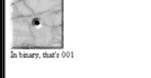

图 3.8

再次掷骰后，程序报告二进制表示。

# 使用 switch 结构简化编程

Binary Dice 程序中的情况发生频繁，因此设计了另一种结构用于将一个变量与多个可能值进行比较。图 3.9 所示的 Switch Dice 程序在用户看来与 Binary Dice 程序完全相同，但 Switch Dice 显示的是骰子的罗马数字表示。

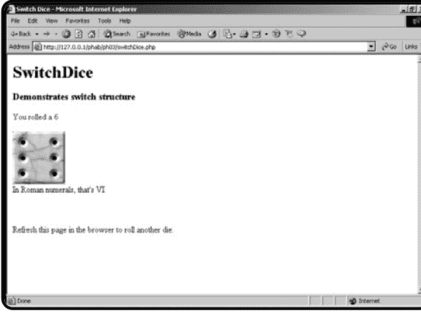

图 3.9

这个版本用罗马数字显示掷骰结果。

```html
<html>
<head>
<title>Switch Dice</title>
</head>
<body>
```

## SwitchDice

### 演示 switch 结构

```php
<?
$roll = rand(1,6);
print "You rolled a $roll";
print "<br>";
switch ($roll){
  case 1:
    $romValue = "I";
    break;
  case 2:
    $romValue = "II";
    break;
  case 3:
    $romValue = "III";
    break;
  case 4:
    $romValue = "IV";
    break;
  case 5:
    $romValue = "V";
    break;
  case 6:
    $romValue = "VI";
    break;
  default:
    print "This is an illegal die!";
} // end switch
print "<br>";
print "";
print "<br>";
print "In Roman numerals, that's $romValue";
print "<br>";
print "<br>";
print "<br>";
?>
<br>
在浏览器中刷新此页面以再次掷骰子。
```

```html
</body>
</html>
```

## 使用 switch 结构

当你有一个变量需要与多个可能的值进行比较时，`switch`结构是最优的。使用`switch`关键字，后跟括号，然后是你想要评估的变量名。大括号表示接下来的代码块将专注于评估该变量的可能值。

对于每个可能值，使用`case`语句，后跟该值，然后是冒号。每个`case`以`break`语句结束，这表示程序应该停止处理这个特定情况，并准备处理下一个。

> `break`语句的使用可能是`switch`语句中最难处理的部分——特别是如果你熟悉像 Visual Basic 这样的语言时，它不需要这种结构。在每个`case`的末尾添加`break`语句是关重要的，否则程序会直接“穿透”（fall through）到下一个可能值，即使该值在其他情况下不会为真。作为初，你应该始终将`break`语句放在每个`case`的末尾。


最后一个`case`就像多值`if`语句中的`else`情况一样，被称为`default`。它定义了当其他任何`case`都不激活时执行的代码；即使你认为计算机不可能到达这个默认选项，测试`default`情况也是明智的。疯狂的事情总会发生。为它们做好准备是好的。

## 合并表单及其结果

到目前，你的大多数 PHP 程序都有两个不同的文件。一个 HTML 文件包含一个表单，它调用一个 PHP 程序。跟踪两个独立的文件可能很麻烦。使用`if`语句将功能合并到一个文件中。

图 3.10 和 3.11 显示的 User 程序看起来与第 2 章“使用变量和输入”中的对应程序非常相似，但有一个重要的区别。它不再是一个 HTML 页面和一个独立的 PHP 程序，整个程序都位于服务器上的一个文件中。

# 72

面向初者的 PHP 5/MySQL 编程

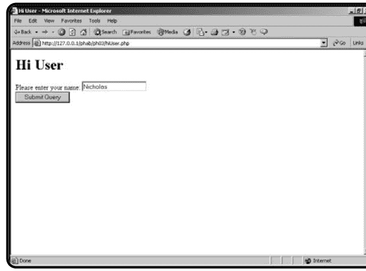

# 图 3.10

HTML 页面实际上是通过“Hi User” PHP 代码生成的。

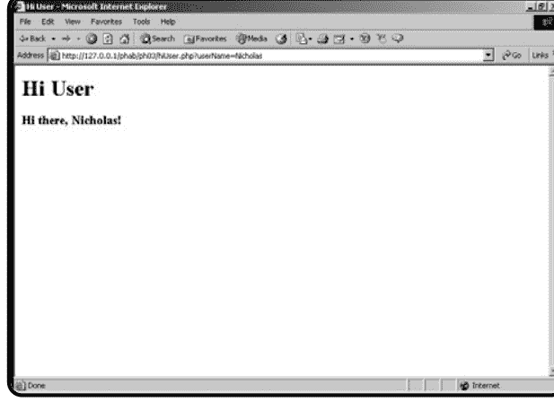

# 图 3.11

结果是由完全相同的“Hi User”程序产生的。

新版本`hiUser`的代码展示了如何实现这个技巧：

```html
<html>
<head>
<title>Hi User</title>
</head>
<body>
<h1>Hi User</h1>

<?php
if (empty($userName)) {
    print <<<HERE
    <form>
    Please enter your name:
    <input type="text"
    name="userName"><br>
    <input type="submit">
</form>
HERE;
} else {
    print "<h3>Hi there, $userName</h3>";
}
?>
</body>
</html>
```

此程序从查找变量`$userName`开始。当用户第一次链接到`hiUser.php`时，程序会一个表单。用户在表单上输入一个值并点击提交按钮。这会导致相同的程序在服务器上再次运行。不过，变量是...

## 响应复框

现在你已经学会了如何使用`empty()`，你就可以处理复框了。查看以下代码：

```html
<html>
<head>
<title>Checkbox Demo</title>
</head>
<body>
<h1>Checkbox Demo</h1>

<h3>Demonstrates checkboxes</h3>

<form action="checkDemo.php">
<h3>What would you like?</h3>
<ul>
<li><input type="checkbox" name="chkFries" value="1">Fries
<li><input type="checkbox" name="chkSoda" value="1">Soda
<li><input type="checkbox" name="chkShake" value="1">Shake
<li><input type="checkbox" name="chkKetchup" value="1">Ketchup
</ul>
<input type="submit">
</form>
</body>
</html>
```

```php
if (empty($chkFries)) {
    print("You chose Fries <br>");
    $total += 10;
}
if (empty($chkSoda)) {
    print("You chose Soda <br>");
    $total += 15;
}
if (empty($chkShake)) {
    print("You chose Shake <br>");
    $total += 20;
}
if (empty($chkKetchup)) {
    print("You chose Ketchup <br>");
    $total += 12;
}

echo "The total cost is $" . $total;
```

# 78

面向初学者的 PHP 5/MySQL 编程

## 这首老歌

函数的演示

这首老歌，他玩了 1

在我的大拇指上玩了咯咯

伴随着 knick-knock

paddy-whack

给狗根骨头

这首老歌就滚着回家了

这首老歌，他玩了 2

在他的膝盖上玩了咯咯

伴随着 knick-knock

paddy-whack

给狗根骨头

这首老歌就滚着回家了

## 图 3.14

这首歌有一个直接的模式：主歌、副歌、主歌、副歌。

```html
<head>
<title>This Old Man</title>
</head>
<body>
<h1>This Old Man</h1>
<h3>演示函数的用法</h3>
<?php
```

```php
verse1();
chorus();
verse2();
chorus();
```

```php
function verse1() {
print <<<HERE
This old man, he played 1<br>
He played knick-knack on my thumb<br><br>
HERE;
} // end verse
```

```php
function verse2() {
print <<<HERE
This old man, he played 2<br>He played knick-knack on my shoe<br><br>
HERE;
} // end verse
```

```php
function chorus(){
print <<<HERE
...with a knick-knack<br>
paddy-whack<br>
give a dog bone<br>
this old man came rolling home<br><br><br>
HERE;
} // end chorus
?>
</body>
</html>
```

仔细检查这段代码可以发现它是如何运行的。程序的主部分极其简单：

```php
verse1();
chorus();
verse2();
chorus();
```

## 创建新函数

《这首老歌》似乎包含了一些 PHP 函数。我调用了`verse1()`函数，然后是`chorus()`函数，依此类推。这些新函数并不是 PHP 自带的。相反，我将其作为页面的一部分创建的。你可以获取一组指令并给它们命名进行存储。这在 PHP 中构建了一个新的临时命令，因此你可以将简单的命令组合成复杂的任务。

构建函数非常简单。使用关键字`function`，后面跟上函数名和一组括号。暂时保持括号为空；在下一节中学习如何使用此功能。使用一对大括号`{}`将一系列代码行组合成一个函数。不要忘记右大括号`{}`——在函数的开始和结束之间的所有内容进行缩进是明智的。

第 3 章

使用条件和函数控制你的代码

79

## 技巧 (TRICK)

当你查看我的代码时，你会注意到有一行我从没有缩进：那就是用于多行字符串的`HERE`标记。`HERE`这个词的作用就像结束引号，必须一直位于屏幕的最左侧，因此它不能缩进。

## 陷阱 (TRAP)

你可以使用任何你喜欢的函数名。但要小心：如果你尝试定义一个已经存在的函数，你一定会感到困惑。PHP 内置了大量的函数。如果你在某个函数上遇到问题，请查看帮助文档看看该函数是否已经存在。

`chorus()`函数在这个程序中特别有用，因为它可以被重用。你不需要每次都重写副歌的代码，只需要简单地调用函数即可。

## 使用参数和函数返回值

函数应当是自包含的。这是件好事，因为整个程序可能会复杂到难以理解。如果你将复杂的程序拆分成较小的函数，每个函数都可以独立设置。你在函数内部工作时，不需要担心函数外部的任何事情。当你在函数内部创建一个变量时，变量一旦离开函数就会消失。这防止了许多可能潜入你代码的错误。

这种自包含性的缺点当你想要让它们处理外部数据时显而易见。你可以通过几种方式实现：

- 向函数发送参数，这允许你在函数启动时确定发送函数的一个或多个值。
- 给函数一个返回值。

图 3.15 显示的`param`程序展示了《这首老歌》歌曲的另一种形式。尽管用户可能仍然没有，但这个更复杂的程序与第一个版本的《这首老歌》程序之间存在一些重要的区别。

## 检查 Param.php 程序

注意图 3.15 的输出比 3.14 长，但生成这个更长输出的代码更短。

```html
<head>
<title>Param Old Man</title>
</head>
```

## Param Old Man

演示函数参数的使用

这首老歌，他玩了 1

在他的大拇指上玩了咯咯：

- 伴随着一个 knuckle-knack
- paddy-whack
- 给狗根骨
- 这首老歌就滚着回家了

这首老歌，他玩了 2

在他的鞋子上玩了咯咯：

- 伴随着一个 knuckle-knack
- paddy-whack
- 给狗根骨头
- 这首老歌就滚着回家了

这首老歌，他玩了 3

在他的膝盖上玩了咯咯：

- 伴随着一个 knuckle-knack
- paddy-whack

虽然输出看起来和图 3.14 相似，但产生此输出的程序高效得多。

## 第 3 章 使用条件和函数控制代码

```html
<h1>Param Old Man</h1>
<h3>函数参数的用法</h3>
```

```php
verse(1);
chorus();
verse(2);
chorus();
verse(3);
chorus();
verse(4);
chorus();
```

```php
function verse($stanza) {
switch ($stanza) {
  case 1:
print <<<HERE
This old man, he played 1<br>
He played knick-knack on my thumb:<br><br>
HERE;
break;
  case 2:
print <<<HERE
This old man, he played 2<br>He played knick-knack on my shoe:<br><br>
HERE;
break;
  case 3:
print <<<HERE
This old man, he played 3<br>He played knick-knack on my knee:<br><br>
HERE;
break;
  case 4:
print <<<HERE
This old man, he played 4<br>He played knick-knack on my foot:<br><br>
HERE;
break;
  default:
print <<<HERE
...with a knuckle-knack
paddy-whack
give a dog-bone
this old man came rolling home<br><br>
HERE;
} // end verse
```

```php
function chorus(){
print <<<HERE
...with a knick-knack<br>
paddy-whack<br>
give a dog bone<br>
this old man came rolling home<br><br><br>
HERE;
} // end chorus
?>
```

图 3.15 的输出如下：

这首老歌，他玩了 1

在我的大拇指上玩了咯咯：

- 伴随着一个 knuckle-knack
- paddy-whack
- 给狗根骨
- 这首老歌就滚着回家了

这首老歌，他玩了 2

在他的鞋子上玩了咯咯：

- 伴随着一个 knuckle-knack
- paddy-whack
- 给狗根骨头
- 这首老歌就滚着回家了

这首老歌，他玩了 3

在他的膝盖上玩了咯咯：

- 伴随着一个 knuckle-knack
- paddy-whack

虽然输出看起来和图 3.14 相似，但产生此输出的程序高效得多。

通过仔细检查这段代码可以发现它是如何运行的。程序的主部分极其简单：

```php
verse1();
chorus();
verse2();
chorus();
```

## 创建新函数

《这首老歌》似乎包含了一些 PHP 函数。我调用了`verse1()`函数，然后是`chorus()`函数，依此类推。这些新函数并不是 PHP 自带的。相反，我将其作为页面的一部分创建的。你可以获取一组指令并给它们命名进行存储。这在 PHP 中构建了一个新的临时命令，因此你可以将简单的命令组合成复杂的任务。

构建函数非常简单。使用关键字`function`，后面跟上函数名和一组括号。暂时保持括号为空；在下一节中学习如何使用此功能。使用一对大括号`{}`将一系列代码行组合成一个函数。不要忘记右大括号`{}`——在函数的开始和结束之间的所有内容进行缩进是明智的。

第 3 章

使用条件和函数控制你的代码

79

```php
case 4:
$place = "door";
break;
default:
$place = "I don't know where";
} // end switch
```

```php
$output = <<HERE
This old man, he played $stanza<br>
He played knick-knack on my $place<br>
HERE:
return $output;
```

在这个函数中，我在函数定义中将`$stanza`指定为参数。参数简单来说就是一个与函数关联的变量。如果你创建一个带有参数的函数，那么每当你调用该函数时，都需要提供某些参数值。参数变量会自动接收来自主体的值。例如，如果程序执行`verse(1)`，则`verse`函数被调用，且`$stanza`变量包含值 1。然后我使用`switch`语句根据`$stanza`的值来填充`$place`变量。最后，我创建了`$stanza`和`$place`变量并返回了`$output`的值。

> 技巧你可以创建带有多个参数的函数。只需在函数定义的括号内声明几个变量，并确保在调用函数时提供相应数量的参数。确保用逗号分隔参数。

在现实世界中

如果你是一个经验丰富的程序员，你可能知道其他让这段代码运行更高效的方法。在接下来的章节中学习循环和数组后，再回到这个程序。

## 管理变量作用域

你已经学习了一些让你的主程序与函数共享变量信息的方法。除了参数传递，有时你还希望函数能够访问在主程序中创建的变量。这尤其如此，因为 PHP 自动创建的所有变量（例如来自表单的变量）都在主级别生成。你必须告诉 PHP 何时你想让函数使用在主级别创建的变量。这些程序级的变量也被称为全局变量。

如果你用另一种语言进行编程，你一定会对 PHP 处理全局变量的方式感到困惑。在大多数语言中，主级别创建的任何变量对每个函数都是可见的。在 PHP 中，你必须在函数内部显式请求将变量设置为全局。如果不这样做，会在函数级别创建一个同名（但没有值）的新变量。

## 查看作用域演示

为了说明全局变量的概念，请看图 3.16 所示的作用域演示。

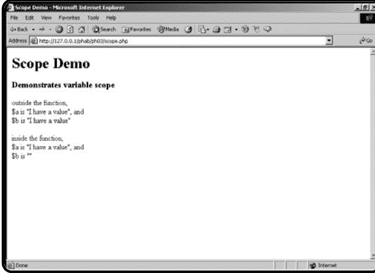

图 3.16

变量`$a`在函数内部保持其值，但`$b`则不然。

看一眼作用域演示的代码，看看它是如何运行的。

```html
<html>
<head>
<title>Scope Demo</title>
</head>
<body>
<h1>Scope Demo</h1>
<h3>Demonstrates variable scope</h3>
```

```php
<?php
$a = "I have a value";
$b = "I have a value";
```

```php
print <<HERE
outside the function, <br>
\$a is "$a", and<br>
\$b is "$b"<br><br>
HERE:

myFunction()

function myFunction(){
//将 $a 设置为全局变量，但 $b 不是
global $a;
print <<HERE
inside the function, <br>
\$a is "$a", and<br>
\$b is "$b"<br><br>
HERE:
} // end myFunction
```

```html
</body>
</html>
```

我为这个演示创建了两个变量：`$a`和`$b`。我给它们都赋予了值`"I have a value"`。作为测试，我打印了`$a`和`$b`的值。

> 技巧我使用的技巧是在引号中显示实际的美元符号（dollar sign$）。当 PHP 在引号内看到美元符号时，它通常期望处理的是一个变量。在某些情况下（如本例所示），你真的想打印一个美元符号。你可以在美元符号前加一个反斜杠来让该符号出现。因此，`print \$a`打印变量`$a`的值，而`print \$a`则打印`"$a"`。

第 3 章 使用条件和函数控制你的代码

## 回到花瓣游戏

在本章开始，我向你展示了“玫瑰周围的花瓣”（Petals Around the Rose）游戏。这个游戏使用了你到目前为止学的所有技能，包括本章的新概念。如果你还没有玩过，现在就玩玩吧，看看它是如何运行的。

这是花瓣游戏的基本计划：每当页面绘制时，它都会随机生成五个骰子，并根据一个超级公式计算正确的花瓣数量。页面包含一个表单，其中有一个文本区域供用户输入答案。表单还包含一个隐藏字段`numPetals`，它告诉程序正确答案是什么。

## 程序不能记住正确答案吗？

既然程序最初就生成了正确答案，你会惊讶地发现，正确答案必须隐藏在 Web 页面中并由生成它的同一个程序检索。客户端与服务器之间的每次连接都是全新的。

当用户第一次玩游戏时，页面被发送到浏览器，连接完全断开，直到用户点击提交按钮。当用户提交表单时，花瓣程序会重新开始。用户可能在睡觉前刚玩完游戏，将页面留在电脑上过夜。在此期间，其他一百人可能正在使用该程序。目前，隐藏数据有助于跟踪状态。在本书的后面，我们将学习其他跟踪用户的高明方法。

## 开始 HTML

像大多数 PHP 程序一样，花瓣游戏使用 HTML 来设置一切。因为 PHP 代码创建了大部分有趣的 HTML。

```html
<html>
<head>
<title>Petals Around the Rose</title>
</head>
<body bgcolor="tan">
<center>
<font face="Comic MS">
<h1>Petals Around the Rose</h1>
```

我决定使用棕色背景和奇特的字体。这应该让程序感觉很轻盈。

## 主体代码

主 PHP 代码段有三个任务：打印问候语、打印骰子和打印表单。这些任务被相应地存储在不同的函数中。封装的一个目标是让主体尽可能简洁。

```php
printGreeting();
printDice();
printForm();
```

所有的实际工作都交给了各种函数。甚至在看到函数本身之前，你对每个函数的功能都有大致的了解。

### printGreeting() 函数

`printGreeting()`函数向用户打印三种可能的问候语之一。如果用户以前调用过此程序，它应该提供欢迎词。当用户猜中且`$guess`为`$numPetals`时，我打印适当的祝贺。如果这两个条件都不成立（大多数情况下如此），函数将打印一个稍微复杂的字符串，指示用户的上一次猜测和正确答案。这应该给用户足够的信息来解开谜题。

```php
function printGreeting(){
    global $guess, $numPetals;
    if (empty($guess)){
        print "<h3>欢迎来到玫瑰周围的花瓣游戏</h3>";
    } else if ($guess == $numPetals){
        print "<h3>你猜对了！</h3>";
    } else {
        print <<HERE
        <h3>上次尝试：</h3>
        你猜的是: $guess<br><br>
        而正确答案是: $numPetals 片玫瑰花周围<br>
HERE;
    } // end if
} // end printGreeting
```

### printDice() 函数

在程序打印问候语后，它执行生成随机骰子的重要业务。生成随机骰子相对容易，正如你在本章前面看到的。然而，我也想提高效率并计算正确的花瓣数量。为了让`printDice()`函数更高效，它调用了一些其他自定义函数。

```php
function printDice(){
    global $numPetals;
    print "<h3>新轮次：</h3>";
    $numPetals = 0;
}
```

```php
$diel = rand(1,6);
$die2 = rand(1,6);
$die3 = rand(1,6);
$die4 = rand(1,6);
$die5 = rand(1,6);
```

```php
showDie($diel);
showDie($die2);
showDie($die3);
showDie($die4);
showDie($die5);
```

```php
print "<br>";
```

```php
calcNumPetals($diel);
calcNumPetals($die2);
calcNumPetals($die3);
calcNumPetals($die4);
calcNumPetals($die5);
```

```php
} // end printDice
```

`printDice`函数非常关注`$numPetals`变量，它不需要访问`$guess`。它向主程序请求对`$numPetals`的访问权限。在打印“新轮掷”消息后，它会将`$numPetals`重置为 0。每次掷骰子时，`$numPetals`的值都会被重新计算。

我通过调用六次`rand(1, 6)`获取了新的骰子值。我将每个结果存储在不同的变量中，命名为`$diel`到`$die6`。为了给每个骰子打印合适的图形，我调用了`showDie()`函数。我打印了一个换行符，然后为每个骰子调用一次`calcNumPetals()`函数。

## showDie() 函数

`showDie()`函数用于简化重复代码。它接受一个骰子值作为参数，并生成用于绘制具有相应点数骰子的适当 HTML 代码。

```php
function showDie($value){
  print <<HERE
  

HERE:
} // endDie
```

使用函数处理重复 HTML 代码的一个优势是能够方便地修改大段代码。例如，如果你想更改尺寸，只需修改此函数中的`img`标签即可。所有六个骰子图像都会随改变。


## calcNumPetals 函数

`printDice()`函数也会为每个骰子调用一次`calcNumPetals()`。此函数接收一个骰子值作为参数。它还引用了全局变量`$numPetals`。该函数使用`switch`语句根据当前骰子的值来决定给`$numPetals`增加多少。

这里有一个技巧：骰子的中心点是玫瑰花。中心周围的任何点都是花瓣。值 1 有玫瑰但没有花瓣；2、4 和 6 有花瓣但没有玫瑰；3 有两个花瓣；5 有四片花瓣。如果掷骰子结果是 3，`$numPetals`应该增加 2；如果结果是 5，`$numPetals`应该增加 4。

```php
function calcNumPetals($value){

global $numPetals;

switch ($value) {
case 3:
$numPetals += 2;
break;
case 5:
$numPetals += 4;
break;
} // end switch

} // end calcNumPetals
```

`+=`代码是一种简写表示法。这里显示的行

```php
$numPetals += 2;
```

与下面这一行完全等：

```php
$numPetals = $numPetals + 2;
```

第一种样式短得多且更容易输入，因此是大多数程序员偏好的形式。

## printForm() 函数

`printForm()`函数的目的是打印 HTML 页面底部的表单。除了需要为`$numPetals`放置隐藏字段外，该表单非常简单。

```php
function printForm() {
global $numPetals;

print <<<HERE

<h3>玫瑰花周围有多少片花瓣？</h3>

<form method="post">
<input type="text" name="guess" value="0">
<input type="hidden" name="$numPetals" value="$numPetals">
<br>
<input type="submit">
</form>
<br>
<a href="petalHelp.html" target="_selfPage">给我一个提示！</a>
HERE;

} // end printForm
```

这段代码将表单放在了页面上。我本可以使用纯 HTML 完成表单的大部分，除了隐藏字段外都不需要 PHP。然而，当我开始使用 PHP 时，我喜欢将大部分代码写在 PHP 中。这有助于我更清晰地看到流程（例如，打印问候、打印骰子和打印表单）。

## 结束的 HTML 代码

最后一组 HTML 代码关闭了所有内容。它完成了 PHP 段、字体、居中文本、正文，最后是 HTML 本身。

```html
<?php
<font>
</center>
<body>
</html>
```

## 总结

在这一章中你学到了。学习了几种分支结构，包括`if`子句、`else`语句和`switch`结构。你知道如何编写函数，这让你的程序更高效且更容易阅读。你知道如何向函数传递参数并从中返回值。你可以在函数内部访问全局变量。你将所有这些组合成了一个有趣的游戏。你应该感到非常自豪！在下一章中，你将学习如何使用循环结构。

## 挑战

- 1. 写一个使用 4 面、10 面或 20 面骰子的程序。
- 2. 写一个让用户自己选择骰子面数的程序。
- 3. 写一个为掷骰子结果生成图像的程序。
- 4. 修改程序以显示组合。
- 5. 创建一个使用循环进行显示的程序。

```php
$i = 0;
```

这指定哨兵变量（sentry variable）名为`$i`且其初始值为 0。

# 在现实世界中

你可能会好奇为什么哨兵变量被称为`$i`。就像大多数变量一样，哨兵变量最好有一个与其用途相符名称。然而，有时`for`循环的哨兵仅仅是一个整数，没有其他特殊意义。在这些情况下，通常会沿用一种古老的编程惯例。

在 Fortran 语言（最早的常用编程语言之一）中，所有整数变量必须以字母`$i`以及其他几个字符开头。Fortran 程序员通常使用`$i`作为通用变量的名称。尽管大多数现代程序员从未写过一行 Fortran 代码，但这一传统仍然保留了下来。在计算机编程这样一个相对较新的活动中，竟然存在如此多的“民间传统”，这真是令人惊叹。

计算机程序经常从 0 开始，因此我也将将`$i`初始化为 0。

> 尽管`$i = 0;`部分看起来像（并且是）是一行完整的代码，但它通常与`for`循环的其他部分放在同一行。

# 设置循环结束条件

让计算机重复行为是容易的部分。更困难的任务是尝试让计算机正确停止。`for`循环结构的第二部分是一个条件。当这个条件被求值为 TRUE（真）时，循环应该继续。一旦条件被求值为 FALSE（假），循环就应该立即退出。在这种情况下，我将条件设置为`$i < 10`。这意味着只要`$i`的值小于 10，循环就会继续。当程序检测到`$i`的值大于或等于 10 时，循环就会退出。通常，`for`循环的条件会检查哨兵变量是否达到了某个终端值或结束值。

# 修改哨兵变量

`for`循环的最后一个关键元素是改变哨兵变量值的机制。在某个时刻，`$i`的值必须变成 10 或更大，否则循环将永远持续。在`basicLoop`程序中，实现这一点的结构部分看起来像`$i++`。`$i++`符号表示给`$i`加 1，或者`$i = $i + 1`。`++`符号被称为自增运算符，因为它为变量增加（加 1）提供了一种方便的方法。

# 构建循环

一旦你设置好了`for`语句各个部分，循环本身就很容易使用。在你的代码周围加上大括号（`{}`），并对循环内部的所有代码进行缩进。你可以在循环内部放置任意行的代码，包括分支语句和其他循环。

哨兵变量在循环内部有特殊行为。它从初始值开始。循环每次重复时，它都会像`for`结构中那样发生变化，解释器会检查条件以确保它仍然成立。如果是这样，循环中的代码将再次执行。

在`bookArray`程序中，`$i`从 0 开始。第一次执行打印语句时，它打印 0，因为这是`$i`的当前值。当解释器到达结束循环的右侧分支时，它会将`$i`增加 1（遵循`for`结构中的`$i++`指令），并检查条件（`$i < 10`）。

因为 0 小于 10，条件为真，循环内部的代码再次执行。最终，`$i`的值变为 10，因此条件（`$i < 10`）不再为真。程序控制随后返回循环结束后的下一行代码，从而结束程序。

# 修改循环

一旦你理解了`for`循环结构的基础，你就可以用有趣的方式修改它。你可以构建一个按 5 计数的循环，或者一个倒数的循环。

# 按 5 计数

图 4.4 显示的`countByFive.php`程序演示了一个按 5 计数的程序。

该程序与`basicArray`程序相似，但有几处不同。

```html
<html>
<head>
<title>
```

# 第 4 章 循环与数组

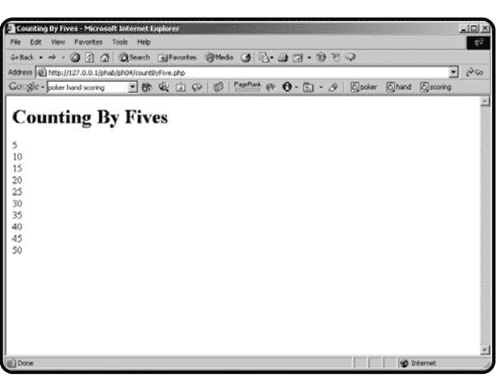

图 4.4

此程序使用`for`循环按五进行计数。

按 5 计数

```html
</title>
</head>
<body>
<h1>按 5 计数</h1>
```

```php
for ($i = 5; $i <= 50; $i += 5)
  print "$i\n";
} //结束 for 循环
```

```html
</body>
</html>
```

我修改的只是`for`语句中的各种参数。由于从 0 开始计数似乎很愚蠢，所以我将`$i`的初始值设置为 5，并决定在 50 处停止（经过10次迭代）。每次循环，`$i`都会增加五。

以下代码中的`+=`语法增加了变量的值：

```php
$i += 5;
```

上述代码等同于：

```php
$i = $i + 5;
```

# 倒数

修改`for`循环使其进行倒数非常简单。图 4.5 展示了这一点。

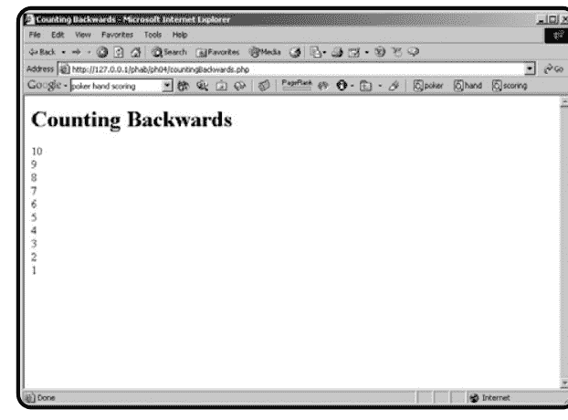

此程序使用`for`循环从 10 到 1 倒数。

图 4.5

再次，基础结构与`for`循环完全一样。一旦你理解了`for`循环的基础，你就可以修改它。此程序展示了如何实现：

```html
<html>
<head>
<title>倒数</title>
</head>
<body>
```

```php
for ($i = 10; $i > 0; $i--) {
    print "$i\n";
} //结束 for 循环
```

```html
</body>
</html>
```

只要`$i`大于 0，循环就会持续。一旦`$i`小于 0，循环就会退出。哨兵变量发生了变化，`$i`每次减少 1。

# 使用 while 循环

PHP 像大多数语言一样，提供了另一种比`for`循环更灵活的循环结构。当你知道某操作要执行多少次时，可以使用`while`循环。图 4.6 展示了`while`循环：

```html
<html>
<head>
<title>简单的 while 循环</title>
</head>
<body>

<h1>简单的 while 循环</h1>
<?php
$i = 1;

while ($i <= 10){
    print "$i\n";
    $i++;
} //结束 while
?>
</body>
</html>
```

`while`循环只需要一个参数，即条件。当条件被求值为 TRUE（真）时，循环应该继续。一旦条件被求值为 FALSE（假），循环就应该立即退出。

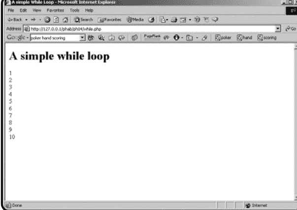

图 4.6

尽管此程序的输出看起来和`basicArray`程序非常相似，但它使用了不同的结构来实现相同的结果。这个特定的程序通过初始化变量`$i`开始，然后检查它是否大于或等于 10。在循环体内部，程序打印`$i`的当前值并增加`$i`。只要`$i`大于 0，循环就会持续。在在这种情况下，哨兵变量发生了变化，`$i`每次减少 1。

# 识别无限循环

`while`结构的灵活性赋予了它力量，但这种力量也带来了潜在问题。循环很容易构建，但工作不当的循环会导致很多麻烦。循环中的代码可能永远不会执行。更糟糕的是，你可能会遇到逻辑错误导致循环无限持续。作为一个例子，看`badWhile.php`的代码：

```html
<html>
<head>
<title>坏的 while 循环</title>
</head>
<body>
<h1>坏的 while 循环</h1>
<?php
$i = 1;
while ($i <= 10) {
    print "<br\n";
    $j++;
} //结束 while
?>
</body>
</html>
```

`badWhile.php`程序展示了当代码中出现无限循环时会发生什么。如果你运行此程序，可能会暂时减慢你的 Web 服务器。确保你的服务器配置为在用户按下浏览器上的停止按钮时停止 PHP 进程。（大多数 PHP 实例的默认设置如此。）

`badWhile.php`程序包含一个微妙但致命的错误。仔细查看源代码就能发现它。这段代码和第一个`while`程序完全一样，区别在于我没有增加`$i`而是增加了`$j`。变量`$j`与`$i`无关，且`$i`永远不会改变。

你可能还会检查值以确保循环至少运行一次（如果这是你的意图的话）。创建一个变量与`for`构造的初始化阶段非常相似。

# 构建一个用于继续循环的条件

你的条件通常比较一个变量和一个值。确保你有一个既可以被满足也可以被跳出的条件。最难的部分在于是确保程序在正确的时间退出循环。这个条件与你循环中的条件非常相似。

# 确保循环可以退出

必须有某种触发器来改变哨兵变量（sentry variable），以便循环能够退出。这段代码必须存在于代码体内部。确保哨兵变量有可能通过条件变为`false`来达到退出循环所需的值。

# 使用基础数组

编程是关于控制结构（如循环）和数据结构（如变量）的结合。你已经了解了强大的循环结构。现在是时候看看一种与循环自然配合工作的数据结构了。

数组是用于存储信息列表的特殊变量。PHP 让处理数组变得非常简单。看图 4.7，它的`basic.php`程序演示了两个数组。

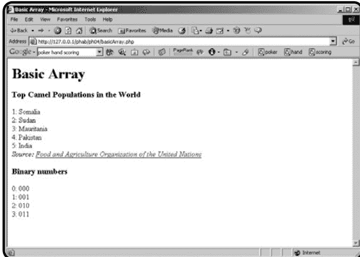

图 4.7

此页面显示的信息存储在两个数组变量中。

首先查看整个程序，然后看它是如何工作的。

```html
<html>
<head>
<title>
基础数组
</title>
</head>

<body>
<h1>Basic Array</h1>
<?php
//简单地给数组赋值
$camelPop[1] = "Somalia";
$camelPop[2] = "Sudan";
$camelPop[3] = "Mauritania";
$camelPop[4] = "Pakistan";
$camelPop[5] = "India";

//输出数组值
print "<h3>Top Camel Populations in the World</h3>\n";
for ($i = 1; $i <= 5; $i++) {
    print "$i:$camelPop[$i]<br>\n";
} // 循环结束

print "<i>Source: <a href =http://www.fao.org/ag/aga/glipha/index.jsp>联合国粮食农业组织</a></a>i>\n";

//使用数组函数加载数组
$binary = array("000", "001", "011");

print "<h3>Binary numbers</h3>\n";
for ($i = 0; $i < count($binary); $i++) {
    print "$i:$binary[$i]<br>\n";
} // 循环结束
?>
</body>
</html>
```

# 生成一个基础数组

看描述`$camelPop`的几行：

```php
//简单地给数组赋值
$camelPop[1] = "Somalia";
$camelPop[2] = "Sudan";
$camelPop[3] = "Mauritania";
$camelPop[4] = "Pakistan";
$camelPop[5] = "India";
```

变量`$camelPop`是存储世界上骆驼数量最多的五个国家的一种手段。（如果这个数组对你不起作用，至少你在这章中也学到了某些东西！）由于`$camelPop`将包含五个不同国家的名称，因此这是一个数组（计算机术语中的列表），而不是普通的变量。

`$camelPop`与你目前为止处理过的所有变量唯一不同点是`$camelPop`可以有多个值。要区分这些值，请在方括号中使用数字索引。


`$camelPop`变量是存储世界上骆驼数量最多的五个国家的一种手段。（如果这个数组对你不起作用，至少你在这章中也学到了某些东西！）由于`$camelPop`将包含五个不同国家的名称，因此这是一个数组（计算机术语中的列表），而不是普通的变量。

`$camelPop`与你目前为止处理过的所有变量唯一不同点是`$camelPop`可以有多个值。要区分这些值，请在方括号中使用数字索引。


`$camelPop`与你目前为止处理过的所有变量唯一不同点是`$camelPop`可以有多个值。要区分这些值，请在方括号中使用数字索引。


`$camelPop`变量是存储世界上骆驼数量最多的五个国家的一种手段。（如果这个数组对你不起作用，至少你在这章中也学到了某些东西！）由于`$camelPop`将包含五个不同国家的名称，因此这是一个数组（计算机术语中的列表），而不是普通的变量。

### 数组

```php
//简单地给数组赋值
$camelPop[1] = "Somalia";
$camelPop[2] = "Sudan";
$camelPop[3] = "Mauritania";
$camelPop[4] = "Pakistan";
$camelPop[5] = "India";
```

你可能还会检查值以确保循环至少运行一次（如果这是你的意图的话）。创建一个变量与`for`构造的初始化阶段非常相似。

# 构建一个用于继续循环的条件

你的条件通常比较一个变量和一个值。确保你有一个既可以被满足也可以被跳出的条件。最难的部分在于确保程序在正确的时间退出循环。这个条件与你循环中的条件非常相似。

# 确保循环可以退出

必须有某种触发器来改变哨兵变量，以便循环能够退出。这段代码必须存在于代码体内部。确保哨兵变量有可能通过条件变为`false`来达到退出循环所需的值。

# 使用基础数组

编程是关于控制结构（如循环）和数据结构（如变量）的结合。你已经了解了强大的循环结构。现在是时候看看一种与循环自然配合工作的数据结构了。

数组是用于存储信息列表的特殊变量。PHP让处理数组变得非常简单。看图4.7，它的`basic.php`程序演示了两个数组。


图4.7 此页面显示的信息存储在两个数组变量中。

首先查看整个程序，然后看它是如何工作的。

```html
<html>
<head>
<title>
基础数组
</title>
</head>

<body>
<h1>Basic Array</h1>
<?php
//简单地给数组赋值
$camelPop[1] = "Somalia";
$camelPop[2] = "Sudan";
$camelPop[3] = "Mauritania";
$camelPop[4] = "Pakistan";
$camelPop[5] = "India";

//输出数组值
print "<h3>Top Camel Populations in the World</h3>\n";
for ($i = 1; $i <= 5; $i++) {
    print "$i:$camelPop[$i]<br>\n";
} // 循环结束

print "<i>Source: <a href =http://www.fao.org/ag/aga/glipha/index.jsp>联合国粮食农业组织</a></i>\n";

//使用数组函数加载数组
$binary = array("000", "001", "011");

print "<h3>Binary numbers</h3>\n";
for ($i = 0; $i < count($binary); $i++) {
    print "$i:$binary[$i]<br>\n";
} // 循环结束
?>
</body>
</html>
```

# 生成一个基础数组

看描述`$camelPop`的几行：

```php
//简单地给数组赋值
$camelPop[1] = "Somalia";
$camelPop[2] = "Sudan";
$camelPop[3] = "Mauritania";
$camelPop[4] = "Pakistan";
$camelPop[5] = "India";
```

`$camelPop`变量是存储世界上骆驼数量最多的五个国家的一种手段。（如果这个数组对你不起作用，至少你在这章中也学到了某些东西！）由于`$camelPop`将包含五个不同国家的名称，因此这是一个数组（计算机术语中的列表），而不是普通的变量。

`$camelPop`与你目前为止处理过的所有变量唯一不同点是`$camelPop`可以有多个值。要区分这些值，请在方括号中使用数字索引。


## 构建位置数组

我注意到每个位置（place）都是与某个数字相关的字符串值。我使用`array()`指令来预加载带有适当值的`$place`数组。0没有任何对应的位置，所以我简单地将第0个元素留空。

```php
$place = array(
  "\n  on my thumb",
  "on my shoe",
  "on my knee",
  "on a door");
```

在PHP中，大多数位置在编写源代码时，回车符并不重要。我将每个位置单独放在一行，仅仅是因为那样看起来更整洁。

## 写出歌词

这首歌具有极强的重复性。除了主歌编号和位置，每段主歌都是相同的。对于每段主歌，`$verse`变量的值是当前的主歌编号。对应的位置存储在`$place[$verse]`中。`for`循环中的大型`print`语句打印了整个代码。

```php
//print out song
for ($verse = 1; $verse <= 4; $verse++) {

  print <<<HERE
This old man, He played $verse
He played knick-knack $place[$verse]
...with a knick, knack, paddy-whack
give a dog a bone
This old man came rolling home
HERE;

} // end for loop
```

“Fancy Old Man（时髦的老头）”程序非常形象地说明了与数组相关的权衡。创建一个正确使用数组的程序通常比仅使用控制结构（如《This Old Man》）需要多一点规划。然而，这种前期的额外工作是有回报的，因为程序更容易修改和扩展。

## 保持持久化数据

大多数传统类型的编程都假设用户和程序正在进行持续的对话。程序开始运行，可能会向用户提一些问题，接收对这些输入的响应，并继续与用户交互，直到他表示有离开程序的意愿。

在Web服务器上编写的程序是不同的。你编写的PHP程序生命周期非常短。当用户通过Web浏览器向你的PHP程序发送请求时，服务器会运行PHP解释器（将你的PHP代码转换为服务器能够理解的底层机器语言的程序）。程序的结果是一个发送回用户浏览器的页面（Page）。一旦你的程序向用户发送了页面，PHP程序就会关闭，因为它的工作已经完成。Web服务器在发送页面后不会与浏览器保持联系。用户的每个请求都被视为一个完全全新的事务。

本章开头的扑克程序似乎与用户进行无限期交互。实际上，是同一个程序被反复调用。该程序在不同情况下表现得不同。以某种方式，它需要跟踪当前处于什么状态。

底层的Web协议（HTTP）意味着Web服务器不会保持比需要更长的连接。这种行为被称为无状态协议（stateless protocol）。想象一下，只要Web上任何地方有人在看你的程序，它就一直运行。如果某人启动了你的程序然后去睡觉呢？你的Web服务器将与那个人保持连接。还要记住，你的程序可能被数千人同时调用。

开启所有这些并发连接对你的服务器来说非常困难。无状态行为可以提高Web服务器的性能，但这种性能是有代价的。本质上说，你的程序每次运行时都是完全失忆的。你需要一种机制来确定当前状态。

## 使用表单字段计数

你有几种方式存储信息，包括文件、XML和数据库。本书的后半部分将详细介绍这些重要概念。实现数据持久性的简单方法是将数据隐藏在用户的页面中。为了说明这一点，请看图4.9和4.10。

## 第4章 循环与数组


### 图4.9

程序有两个计数器，当程序运行时读取为1。

### 图4.10

当用户点击提交按钮时，两个计数器都加了1。

无状态行为在用户点击提交按钮时，计数器会增加。事实上，每当用户点击程序的提交按钮时，它似乎都记得之前的值。查看源代码看看它是如何工作的：

```html
<html>
<head>
<title>persistence</title>
</head>

<body>

<center>
<h1>Persistence Demo</h1>
</center>
<form>
<?php
//increment the counters
$txtNameCounter++;
$hdnCounter++;

print <<<HERE
<input type="text"
name="$txtNameCounter"
value="$txtNameCounter">

<input type="hidden"
name="$hdnCounter"
value="$hdnCounter">
<h3>The hidden value is $hdnCounter</h3>
<input type="submit"
value="click to counters">
HERE;

?>
</form>
</body>
</html>
```

## 在文本中存储数据

程序有两个变量：`$txtNameCounter`和`$hdnCounter`。通常你需要在页面之间跟踪信息，你可以将信息存储在隐藏字段中。

```php
<?php
//increment the counters
$txtNameCounter++;
$hdnCounter++;

print <<<HERE
<input type="text"
name="$txtNameCounter"
value="$txtNameCounter">

<input type="hidden"
name="$hdnCounter"
value="$hdnCounter">
<h3>The hidden value is $hdnCounter</h3>
<input type="submit"
value="click to counters">
HERE;

?>
```

## 使用隐藏字段进行持久化

这里显示的隐藏字段技术对于存储少量信息来说没问题，但在处理严肃数据时非常低效且不安全。

隐藏字段是服务器端编程的无名英雄。

## 编写扑克程序

是时候再次看一眼在本章开头亮相的扑克程序了。通常，这个程序没有做任何你没学过的东西。它比我展示的示例程序复杂一点，但考虑到它的功能，非常紧凑。你不会惊讶数组和循环是这个程序成功的秘密。

## 设置HTML

一如既往，基础HTML页面作为PHP程序的基础。我为页面添加了一个简单的样式表，以便在绿色背景上显示棕色字符。

## 构建主代码体

扑克程序足够长，值得编写函数。我将其分成了较小的部分，但你可能想查看它的全部，它在随书的CD中。

代码的主部分设置了通用的程序流。大部分工作由从这个主区域调用的其他函数完成。

```php
<?php
//check to see if is first time here
if (empty($cash)) {
  $cash = 100;
} // end if

rollDice();

if ($secondRoll == TRUE) {
  print "<h2>Second roll</h2>\n";
  $secondRoll = FALSE;
  evaluate();
} else {
  print "<h2>First roll</h2>";
  if (...) {
    $secondRoll = TRUE;
  } // end if

  printStuff();
}
```

首要任务：检查用户是否是第一次访问此页面。理解此程序中的计时机制是如何运作至关重要。用户认为自己正在玩多回合同一个游戏，但每当他掷骰子时，整个程序都会运行。程序会根据哪些元素（如果有）具有值而表现出不同的行为。如果用户以前从未访问过页面，则变量`$cash`的值为`null`。第一个`if`语句会检查此条件。如果`$cash`变量尚未被创建，用户将获得$100的初始值。（我希望现实赌场也是这样运作的。）程序调用了`rollDice()`函数，稍后会描述该函数。该程序掷骰子并将其打印到屏幕上。

如果你仔细观察运行中的程序，你会发现它以两种不同的模式运行。每个回合都包含两次可能的掷骰。在第一次掷骰中，用户可以通过一个复选框进行掷骰。此时不进行评分。第二次掷骰没有复选框（因为用户在下一回合开始时需要从所有全新的骰子开始）。程序通过为各种组合增加金额来跟踪玩家的分数。

变量`$secondRoll`用于跟踪用户是否处于第二次掷骰。当用户处于第二次掷骰时，我将其赋值为`TRUE`，在第一次掷骰时为`FALSE`。如果`$secondRoll`为`TRUE`，程序会调用`evaluate()`函数，统计任何损失或收益。无论如何，我都会告知用户是哪一次，并更改`$secondRoll`的值以反映下次调用此程序时应该发生的情况（当用户点击提交按钮时发生）。

## 创建rollDice()函数

`rollDice()`函数的作用是掷骰子。它有点复杂，所以我按照你解释的方式将其拆分成较小的部分进行打印。本质上，此函数根据五次掷骰构建一个HTML表格。它决定用户是否保留了之前的任何骰子，如果用户没有保留，则掷一个新的骰子。如果是第一次掷骰，程序会打印一个复选框，允许用户选择要保留的骰子。

```php
function rollDice(){
global $die, $secondRoll, $keepIt;

print "<table border = 1><td><tr></tr>";

for ($i = 0; $i < 5; $i++) {
    if ($keepIt[$i] == "") {
        $die[$i] = rand(1, 6);
    } else {
        $die[$i] = $keepIt[$i];
    } // end if
    $file = "die" . $die[$i] . ".jpg";

    //打印骰子图像
    print <<<HERE
<td>
<br>
HERE;

    //在第一次掷骰时打印一次复选框
    if ($secondRoll == FALSE) {
        print <<<HERE
        <input type = "checkbox"
            name = "keepIt[$i]"
            value = "$die[$i]">
</td>
HERE;
    } // end if
} // end for loop

//打印提交按钮并结束表格
print <<<HERE
</tr></td>
<tr>
    <td colspan="5">
    <center>
        <input type = "submit"
            value = "roll again"
    </center>
</td>
</tr>
</table>
HERE;
}
```

有时出现的`rollDice`复选框是特殊的。它们的通用策略是：如果是第一回合，我会在每个骰子下面打印一个复选框。所有复选框都称为`keepIt`并且都有索引。当PHP看到具有相同名称但不同索引的变量时，会自动创建一个数组。回想第二章“使用变量”，PHP复选框与其他表单元素有些不同。只有当它们被勾选时，才会传递给程序。任何选中的复选框的值都会传递给程序。

## 需要时掷骰子

程序使用两个数组来跟踪骰子。`$die`数组存储骰子的当前值。`$keepIt`数组除非用户勾选了复选框（这只在第一次掷骰时发生，因为第二次掷骰时不打印复选框），否则不包含任何值。

```php
if ($keepIt[$i] == "") {
  $die[$i] = rand(1, 6);
} else {
  $die[$i] = $keepIt[$i];
} // end if

$file = "die" . $die[$i] . ".jpg";
```

程序为用户没有选择保留的骰子掷一个新值。如果用户选择了保留某个骰子，对应的`$keepIt`数组值将传递`$die`数组。

## 打印表格内容

在函数为每个骰子确定了值后，打印图像。

```php
//打印骰子图像
print <<<HERE
<td>
<br>
HERE;

//在第一次掷骰时打印复选框
if ($secondRoll == FALSE) {
    print <<<HERE
<input type = "checkbox"
    name = "keepIt[$i]"
    value = "$die[$i]">
</td>
HERE;
} // end if
```

如果是第一次掷骰，函数还会打印对应的复选框。注意，复选框的名称对应骰子。（记住，值`$i`在打印HTML页面之前被转换为数字。）这些是隐藏的HTML元素。你可能需要运行程序几次并仔细查看生成的HTML源代码。在掷骰子并打印骰子后，打印提交按钮和结束表格很容易。

```php
//打印提交按钮并结束表格
print <<<HERE
</tr></td>
<tr>
<td colspan="5">
<center>
<input type = "submit"
    value = "roll again"
</center>
</td>
</tr>
</table>
HERE;
```

## 创建evaluate()函数

`evaluate()`函数的作用是检查`$die`数组并判断用户是否获得了奖励模式。同样，我在这里打印整个函数并在之后显示。

```php
function evaluate(){
global $die, $cash;
//设置收益
$payoff = 0;

//为这次掷扣除一些钱
$cash -= 2;

//统计骰子
$numVals = array(6);
for ($theVal = 1; $theVal <= 6; $theVal++){
  for ($dieNum = 0; $dieNum < 5; $dieNum++){
    if ($die[$dieNum] == $theVal)
      $numVals[$theVal]++;
    } // end if
  } // end dieNum loop
} // end theVal loop

//统计对子、三条、四条、五条
$numPairs = 0;
$numThrees = 0;
$numFours = 0;
$numFives = 0;

for ($i = 1; $i <= 6; $i++) {
  switch ($numVals[$i]) {
    case 2:
      $numPairs++;
      break;
    case 3:
      $numThrees++;
      break;
    case 4:
      $numFours++;
      break;
    case 5:
      $numFives++;
      break;
  } // end switch
} // end for loop

//检查两对
if ($numPairs == 2) {
  print "You have two pairs!<br>";
  $payoff = 1;
} // end if

//检查三条和葫芦
if ($numThrees == 1) {
  if ($numPairs == 1) {
    //三条加一对是葫芦
    print "You have a full house!<br>";
    $payoff = 5;
  } else {
    print "You have three of a kind!<br>";
    $payoff = 2;
  } // end 'pair' if
} // end 'three' if

//检查四条
if ($numFours == 1) {
  print "You have four of a kind!<br>";
  $payoff = 5;
} // end if

//检查五条
if ($numFives == 1) {
  print "You got five of a kind!<br>";
  $payoff = 10;
} // end if

//检查顺子
if (($numVals[1] == 1) && ($numVals[2] == 1) && ($numVals[3] == 1) && ($numVals[4] == 1) && ($numVals[5] == 1)) {
  print "You have a flush!<br>";
  $payoff = 10;
} // end if
}
```

## 统计骰子数值

当你考虑这个游戏中的各种得分组合时，知道用户掷出了每个数值的多少是非常重要的。用户对于对子、三条、四条、五条以及顺子（连续的五个数值）可以获得分。我创建了一个名为`$numVals`的新数组，它包含六个元素。`$numVals[1]`包含用户掷出1的个数。`$numVals[2]`显示了2的个数，以此类推。

```php
// count the code
for ($theVal = 1; $theVal <= 6; $theVal++) {
  for ($dieNum = 0; $dieNum < 5; $dieNum++) {
    if ($die[$dieNum] == $theVal) {
      $numVals[$theVal]++;
    } // end if
  } // end dieNum for loop
} // end theVal for loop
```

```php
// print out results
for ($i = 1; $i <= 6; $i++) {
  print "$i: $numVals[$i]\n";
} // end for loop
```

为了构建`$numVals`数组，我使用`for`循环遍历了每个可能的数值（1到6）。我使用了另一个`for`循环来查看每个骰子，并确定它是否显示了相应的数值。（换句话说，我在外层循环的第一次遍历中检查1、2、3等。）如果我找到了当前数值，就会相应地增加`$numVals[$theVal]`的值。

注意这一段末尾被注释掉的几行。如果`$numVals`数组没有按照预期工作，我将计分代码移出来，通过一个快速的循环来告诉我程序找到了每个数值的多少。这确保了在添加功能之前，我的程序是运行正常的。

定期检查你的工作并确保一切运行都符合预期是明智的。当我确定一切运行正常后，我在每行代码前面加了注释，以临时关闭调试代码。这虽然移除了代码，但如果发生了错误我需要重新查看`$numVals`数组，它们将仍然存在。

## 统计对子、三条、四条和五条

`$numVals`数组包含了我大部分需要的信息，但格式还不完全对。用户对于对子以及三条、四条、五条可以获得现金。

为了检查这些条件，我使用了其他变量和另一个循环来查看`$numVals`。

```php
//count how many pairs, threes, fours, fives
$numPairs = 0;
$numThrees = 0;
$numFours = 0;
$numFives = 0;

for ($i = 1; $i <= 6; $i++){
  switch ($numVals[$i]) {
    case 2:
      $numPairs++;
      break;
    case 3:
      $numThrees++;
      break;
    case 4:
      $numFours++;
      break;
    case 5:
      $numFives++;
      break;
  } // end switch
} // end loop
```

首先创建了变量来跟踪对子、三条、四条和五条。我将所有这些变量初始化为0。然后遍历`$numVals`数组，查看每个数值出现了多少。例如，如果用户掷出了1, 1, 5, 5, 5，那么`$numVals[1]`等于2，`$numVals[5]`等于3。

在执行`switch`语句后，`$numPairs`等于1，`$numThrees`等于1。所有其他`$numVals`变量仍然包含0。创建这些变量可以很容易判断发生了哪些得分情况（如果有的话）。

## 寻找两个对子

设置得分变量的所有工作都得到了回报，因为现在非常容易判断何时发生了得分条件。我为两个对子奖励用户1美元（一个对子不奖励）。如果`$numPairs`的值为2，说明用户获得了两个对子；给`$payoff`变量赋值为1。

```php
//check for two pairs
if ($numPairs == 2){
    print "You have two pairs!<br>\n";
    $payoff = 1;
} // end if
```

当然，欢迎你更改奖金。目前来看，这个游戏非常慷慨，但这让用户觉得很有趣。

## 寻找三条和葫芦

我将三条和葫芦（即三条加对子）的检查合并在一起。代码首先通过查看`$numThrees`来检查三条。如果用户有三条，它会检查是否有对子。如果两个条件都成立，那就是葫芦，用户将获得相应的奖励。如果没有对子，用户将获得三条的微薄奖励。

```php
//check for three of a kind and full house
if ($numThrees == 1){
    if ($numPairs == 1){
        //three of a kind and a pair is a full house
        print "You have a full house!<br>\n";
        $payoff = 5;
    } else {
        print "You have three of a kind!<br>\n";
        $payoff = 2;
    } // end 'pair' if
} // end 'three' if
```

## 检查四条和五条

检查四条和五条是非常轻而易举的。

```php
//check for four of a kind
if ($numFours == 1){
    print "You have four of a kind!<br>\n";
    $payoff = 4;
} // end if
```

```php
//check for five of a kind
if ($numFives == 1){
    print "You have five of a kind!<br>\n";
    $payoff = 5;
} // end if
```

## 检查顺子

顺子稍微复杂一点，因为它们需要五个不同的数值。为了检查顺子，我需要查看用户是否掷出了五个不同的数值。

```php
//check for straight
$distinctValues = 0;
for ($i = 1; $i <= 6; $i++) {
  if ($numVals[$i] > 0) {
    $distinctValues++;
  }
}

if ($distinctValues == 5) {
    print "You have a straight!<br>\n";
    $payoff = 4;
} // end if
```

## 总结

你正在完成作为程序员的基础训练，为程序增加了循环行为。你的程序可以根据你建立的条件进行重复。你知道如何构建向前、向后以及跳过数值的循环。你还知道如何创建`while`循环。你知道创建良好循环的标准，以及如何手动和通过`array()`创建数组。使用循环遍历数组的所有元素是可能的，你的程序可以通过将变量存储在输出页面中来跟踪它们。你将所有技能结合在一起，构建了一个有趣的游戏。在第5章，你将通过构建更强大的数组和使用特殊结构来扩展处理数组和循环的能力。

## 挑战

1. 以某种方式修改扑克游戏。添加自定义背景、更改骰子图像或修改奖金以符合你的喜好。
2. 编写经典的“猜数字”游戏。让计算机随机生成一个数字，让用户猜其数值。告诉用户高了、低了或正确。当猜对时，告诉他花了多少回合。这个游戏不需要数组，但你必须将值存储在隐藏表单元素中。
3. 反过来编写猜数字。这次由用户生成一个1到100之间的随机数字，由计算机来猜。让用户选择太高、太低或正确。你的算法应该总能在七回合内猜中数字。
4. 编写一个发牌随机扑克手的程序。使用来自http://waste.org/~oxymoron/cards/或其他来源的牌图像。你的程序不需要为手牌评分。它只需要发五张随机牌。使用数组来处理牌组。

# 第5章 更好的数组与字符串处理

在本章中，你将学习一些能够提高数据处理能力的重要技能。你将学习使用更复杂的方法来处理数组，以及如何更有技巧地管理文本信息。具体而言，你将学习到以下内容：

- 使用`foreach`循环管理数组
- 创建并使用关联数组
- 从PHP的某些内置数组中提取有用信息
- 构建基础的二维数组
- 构建二维关联数组
- 将字符串拆分为更小的片段
- 在一个字符串中搜索另一个字符串

## 引入单词查找游戏生成器

在本章结束时，你能够创建一个有趣的程序，用于生成单词查找谜题。用户在列表框中输入一系列单词，如图5.1所示。

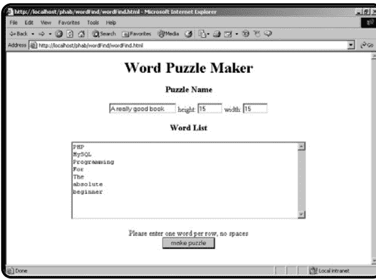

用户输入单词列表以及完成后谜题的大小。

程序随后尝试根据用户的单词列表生成一个单词查找游戏。（这并不总是可能的，但程序通常可以生成谜题。）图5.2展示了图5.1所示单词列表的一种可能解决方案。

如果需要，程序还可以根据谜题生成答案密钥。此功能在图5.3中所示。

单词查找游戏（实际上大多数计算机程序）的秘诀在于处理数据的方式。一旦我确定了处理程序中数据的良好方案，实际的编程工作并不困难。

### 一本非常棒的书

```
JDOFPQBULTELBC
OMMHGEOPHYNGAEC
LSFRQPQLNBFIQGC
QAUGZYNEZEBYQG
SZBPXUSNBRMTNNI
YDUHLNTXGERVIN
MHECCSQIROTIME
KFGHWRQETURMRP
QAQFACVCDLXLATT
LHIMFORLCOQRRE
AYFHYQGLNASQLE
YDRYCQREGBCOPT
DYCHNWLIJYRAHW
UDYTVITPVVOYPER
QSBSKSZSDUSITUR
```

### 单词列表

```
PHP
MYSQL
```

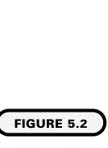

此谜题包含了列表中的所有单词。

### 一本非常棒的书答案密钥

```
L
Q
S
Y
M
B
E
G
GI
NN
IN
T
MR
LA
T
FOR
BR
H
SG\GE
B
OP
A
RH
FF
```


这是谜题的答案。

## 使用foreach循环处理数组

正如我在第4章“循环与数组”中提到的，`for`循环和数组是天然的伴侣。事实上，PHP提供了一种特殊的循环叫做`foreach`循环，它使得遍历每个数组元素变得更加简单。

### 引入foreach.php程序

图5.4所示的程序展示了`foreach`循环是如何工作的。

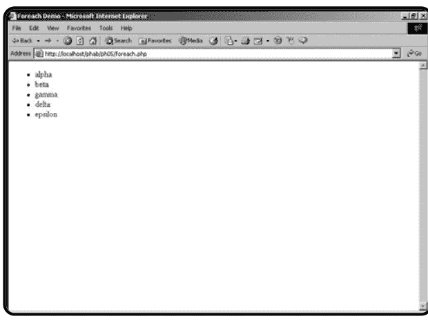

图5.4 尽管这个页面看起来就像普通的HTML，但它是用数组和`foreach`循环创建的。

HTML页面由异常简单的代码生成：

```html
<html>
<head>
<title>Foreach Demo</title>
</head>
<body>
<?php
$list = array("alpha", "beta", "gamma", "delta", "epsilon");

print "<ul>\n";
foreach($list as $value) {
    print "<li>$value</li>\n";
} // end foreach
print "</ul>\n";
?>
</body>
</html>
```

列表中的值是使用`array()`函数在`$list`变量中创建的。`foreach`循环的工作与`for`循环非常相似，只是它更简单。`foreach`结构的第一个参数是一个数组——在这种情况下是`$list`。关键字`as`表示轮流持有每个值的变量名。在这种情况下，`foreach`循环会根据需要遍历`$list`数组。每次循环时，函数都会将`$list`数组的当前成员填充到`$value`变量中。本质上，这个`foreach`循环的作用与下面的传统`for`循环相同：

```php
foreach($list as $value) {
    print "<li>$value</li>\n";
} // end foreach
```

这是你传统的`for`循环：

```php
for ($i = 0; $i < length($list); $i++) {
    $value = $list[$i];
    print "<li>$value</li>\n";
} // end loop
```

> `foreach`循环和`for`循环的主要区别在于是否存在索引变量（本例中的`$i`）。如果你使用`foreach`循环并需要知道当前索引，你将必须维护自己的计数器。

当你只需要遍历数组中的每个元素而不关心索引时，`foreach`循环要清晰得多。它处理了初始化、递增和终止条件。

在处理关联数组时，`foreach`循环也非常有用。与其使用数字索引，你可以同时访问键和值：

```php
foreach ($array as $key => $value) {
    echo "$key: $value\n";
}
```

这种语法使得处理键为有意义标签的数据变得极其简单。

## 关联数组

关联数组是一种索引不是数字而是字符串的数组。这允许你将值与特定的键关联，使得数据更易读取和管理。例如，你可以存储城市和首都：

```php
$countries = array(
    "USA" => "Washington DC",
    "UK" => "London",
    "France" => "Paris"
);
```

你可以通过向新键赋值为关联数组添加新元素：

```php
$countries["Japan"] = "Tokyo";
```

要删除元素，使用`unset()`函数：

```php
unset($countries["UK"]);
```

关联数组是PHP中一种强大的工具，允许你表示数据库查询结果或配置等复杂的数据结构。

## 使用数组处理字符串

有时你需要将字符串拆分为更小的部分。PHP提供了几个为此目的的函数。最常用的是`explode()`，它根据指定的分隔符将字符串拆分为数组。

```php
$string = "apple,banana,cherry";
$fruits = explode(",", $string);
```

反之，如果你想将数组元素合并成字符串，请使用`implode()`：

```php
$fruits = array("apple", "banana", "cherry");
$string = implode(" - ", $fruits);
```

另一个有用的函数是`strpos()`，它查找子字符串在字符串中的位置，以及`substr()`，它提取字符串的一部分。这些工具允许你非常精确地处理和分析文本。

我使用`array()`语法来构建`$worldCap`数组：

```php
$worldCap = array(
  "Albania"=>"Tirana",
  "Japan"=>"Tokyo",
  "United States"=>"Washington DC"
);
```

在构建普通数组时，`array()`函数需要数据，但不需要指定索引。该函数会通过获取下一个可用的整数自动生成每个元素的索引。在关联数组中，你需要负责同时提供数据和索引。

这种赋值的通用格式使用了一种特殊的赋值运算符。`=>`表示某个元素持有某种值。通常我们将其读作“持有”（holds），所以你可以看到“日本”持有着“东京”。换句话说，`"Japan" => "Tokyo"`表示PHP将生成一个索引为`"Japan"`的数组元素，并在该元素中存储值`"Tokyo"`。你可以像访问任何其他关联数组一样访问此数组的值：

```php
print "Japan: ";
print $worldCap["Japan"];
print "<br><br>";
```

### 在关联数组中使用foreach

`foreach`循环在关联数组上的用性与在普通数组上同样大。不过，它的语法略有不同。请看`assoc.php`页面中的这段代码：

```php
foreach ($worldCap as $country => $capital){
  print "country:$capital<br>\n";
} // end foreach
```

普通数组的`foreach`循环只使用一个变量，因为索引很容易计算。在关联数组中，数组中的每个元素都有唯一的索引和值。`foreach`循环的关联形式通过指定两个变量考虑这一点。第一个变量持有索引。第二个变量引用与索引关联的值。在循环内部，你可以使用在`foreach`结构中指定的任何变量名来引用当前的索引和值。

循环每次执行，你都会得到一个键/值对。在这个示例中，键存储在变量`$country`中，因为此数组中的所有索引都是国家名称。循环每次执行时，`$country`都有不同的值。在每次迭代中，`$capital`变量的值包含响应于当前`$country`值的数组值。

与传统数组不同，当你使用`foreach`循环访问数组元素时，你不能依赖它们按特定的顺序返回。如果你需要元素按特定顺序显示，请显式地调用它们。

## 使用内置关联数组

关联数组非常实用，因为它们反映了一种经常使用的信息存储方式。事实上，从第2章“使用变量和输入”开始，你一直都在变相地使用关联数组了。当PHP程序从表单接收数据时，这些数据会为你存储在多个关联数组中。PHP会为你的每个元素自动创建一个变量。

然而，你并不总是能依靠那个特定的魔法。出于安全考虑，越来越多的服务器管理员正在关闭这种自动变量创建功能。事实上，PHP的默认设置现在已关闭了这种行为（名字很奇怪的`register_globals`）。

了解PHP如何从表单获取数据作为关联数组的一个很好的例子，是很有帮助的。这也很有用，因为你可能需要知道如何在没有显式为你创建变量的情况下获取数据。

### 介绍formReader.php程序

`formReader.php`程序实际上是我编写的早期PHP程序之一，而且我经常使用它。它非常方便，因为它可以接收任何HTML表单的输入，并报告页面上每个表单元素的名称和值。为了说明这一点，图5.6显示了一个带有表单的典型Web页面。

当用户点击“提交查询”（Submit Query）按钮时，`formReader`会响应基础诊断信息，如图5.7所示。

### 读取$_REQUEST数组

`formReader.php`程序通过利用PHP内置的关联数组来工作。到目前为止，你一直依靠PHP根据调用程序的表单的输入元素为你创建一个变量。这种自动变量创建被称为`register_globals`。虽然这种功能非常方便，但某些管理员会关闭它。即使`register_globals`开启，了解其他获取方式也是很有用的。数据会自动存储到一个名为`$_REQUEST`的特殊关联数组中。表单上的每个字段都会变成一个键，该字段的值变成该键的值。如果你有一个名为`userName`的字段，可以通过调用`$_REQUEST["userName"]`获取该字段的值。

## 创建多维数组

普通数组非常像列表。关联数组像键/值对。一种特殊类型——多维数组，类似于表格数据。例如，想象你正尝试编写一个程序帮助用户确定城市之间的距离。你可能会在纸上从像表5.1这样的表格开始。

### 表5.1 城市间的距离

| | 印第安波利斯 | 纽约 | 东京 | 伦敦 |
| --- | --- | --- | --- | --- |
| 印第安波利斯 | 0 | 648 | 6476 | 4000 |
| 纽约 | 648 | 0 | 6760 | 3470 |
| 东京 | 6476 | 6760 | 0 | 5956 |
| 伦敦 | 4000 | 3470 | 5956 | 0 |

在程序中处理此类表格数据是非常常见的。PHP（以及大多数语言）提供了一种特殊类型的数组来协助处理此类信息。图5.8和5.9所示的`basicMultiArray`程序说明了如何封装一个表格。

### 构建基础多维数组的HTML

如果你计划得当，使用二维数组其实非常简单。我先在纸上画了表格。（实际上，为了应对这种情况，我在办公室里有一块可以反复写擦的白板。）我为每个城市分配了一个数值：

- 印第安波利斯（Indianapolis）= 0
- 纽约（New York）= 1
- 东京（Tokyo）= 2
- 伦敦（London）= 3

这之后更容易追踪这些城市。

HTML代码在表单中构建了两个选择框和一个提交按钮。

```html
<!doctype html "-//W3C//DTD HTML 4.0 //EN">
<html>
<head>
<title>Basic multi-dimensional array</title>
</head>
<body>
<h1>Basic 2D Array</h1>
<form action="basicMultiArray">
<table border="1">
<tr>
<th>First city</th>
<th>Second city</th>
</tr>
<!--注意每个option的值都是数值 -->
<tr>
<td>
<select name="cityA">
<option value="0">Indianapolis</option>
<option value="1">New York</option>
<option value="2">Tokyo</option>
<option value="3">London</option>
</select>
</td>
<td>
  <select name="cityB">
    <option value="0">Indianapolis</option>
    <option value="1">New York</option>
    <option value="2">Tokyo</option>
    <option value="3">London</option>
  </select>
</td>
</tr>
<tr>
<td colspan="2">
  <input type="submit"
    value="calculate distance">
</td>
</tr>
</table>
</form>
</body>
</html>
```

回想一下用户提交此表单时，会发送两个变量。`cityA`变量包含用户所选内容的`value`属性；`cityB`同样包含当前选择的目标城市的`value`。我仔细设置了`value`属性，以便它们与每个城市的数值索引相对应。如果用户选择纽约作为起始城市，`cityA`的值为1，我决定纽约用值1表示。我之所以给出数值是因为信息都存储在数组中，而普通数组使用数值索引。（在下一节中，我将向你展示如何用关联数组实现相同的功能。）

### 响应距离查询

一旦数组就绪，确定城市间距离的PHP代码实际上很简单：

```php
<?php
$city = array (
  "Indianapolis",
  "New York",
  "Tokyo",
  "London"
);

$distance = array (
  array (0, 648, 6476, 4000),
  array (648, 0, 6760, 3470),
  array (6476, 6760, 0, 5956),
  array (4000, 3470, 5956, 0)
);

$result = $distance[$cityA][$cityB];

print "<h3>The distance between ";
print "$city[$cityA] and $city[$cityB]";
print " is $result miles.</h3>";
?>
```

### 在$city数组中存储城市名称

此程序中有两个数组：`$city`和`$distance`。`$city`数组是一个完全普通的字符串值数组。它包含一个城市名称列表。我设置该数组，使得分配给城市的数值与数组中的索引对应。记住，索引通常从0开始，所以印第安波利斯是0，纽约是1等。用户并不关心印第安波利斯是0，因此`$city`数组为各种城市分配名称。如果用户为`cityA`字段选择0，我可以通过`$city[0]`引用名称，因为`$city[0]`是Indianapolis。

### 在$distance数组中存储距离

距离无法放入普通列表，因为确定距离需要两个值。你必须知道从哪个城市出发到达哪个城市。这两个值对应原始表格中的行和列。再次查看生成`$distance`数组的代码：

```php
$distance = array (
  array (0, 648, 6476, 4000),
  array (648, 0, 6760, 3470),
  array (6476, 6760, 0, 5956),
  array (4000, 3470, 5956, 0)
);
```

`$distance`数组实际上是一个包含所有数组的数组！每个内部数组对应一个城市。例如，由于印第安波利斯是城市0，内部数组指的是与其他城市之间的距离。如果有帮助，你可以将每个内部数组视为表格的一行，并将表格视为数组。

构建二维数组听起来可能复杂，但比你想象的要自然。将原始数据与生成二维数组的代码对比，你会发现数字都在正确的位置。不需要限于二维。可以构建三维、四维或任何数量的数组。然而，可视化这些复杂数组的操作会变得困难。对于更复杂的数据类型，请参考后续的文件操作和关系结构。

### 从$distance数组获取数据

一旦数据存储在二维数组中，检索就很容易。要在表格中查找信息需要知道行和列。二维数组需要两个索引——一个行，一个列。要找到从东京（城市2）到纽约（城市1）的距离，只需引用`$distance[2][1]`。获取索引值的代码为：

```php
$result = $distance[$cityA][$cityB];
```

该值存储在变量`$result`中发送给用户。

## 创建二维关联数组

你也可以创建二维关联数组。设置起来需要更多工作，但这是值得的，因为名称/值的关系消除了跟踪每个元素数值标识符的需求。程序的另一个版本演示了如何使用关联数组生成相同的城市-距离。由于此程序与`basicMultiArray`程序完全一样，我不展示截图。此程序的所有有趣特性都在源码中。

### 构建关联数组的HTML

此程序的关联数组HTML页面与索引版本相似，只有一个主要区别。看看能否发现源码中的差异：

```html
<!doctype html "-//W3C//DTD HTML 4.0 //EN">
<html>
<head>
<title>2D Array</title>
</head>
<body>
<h1>2D Array</h1>
<form action="multiArray.php">
<table border="1">
<tr>
<th>First city</th>
<th>Second city</th>
</tr>
<!--注意每个option的值都是字符串 -->
<tr>
<td>
<select name="cityA">
<option value="Indianapolis">Indianapolis</option>
<option value="New York">New York</option>
<option value="Tokyo">Tokyo</option>
<option value="London">London</option>
</select>
</td>
<td>
<select name="cityB">
<option value="Indianapolis">Indianapolis</option>
<option value="New York">New York</option>
<option value="Tokyo">Tokyo</option>
<option value="London">London</option>
</select>
</td>
</tr>
<tr>
<td colspan="2">
  <input type="submit"
    value="calculate distance">
</td>
</tr>
</table>
</form>
</body>
</html>
```

这个HTML页面与上一个唯一的区别是`select`对象的`value`属性。在这种情况下，`$distance`数组是关联数组，因此它没有数值索引。由于索引可以基于文本，我将实际城市名称作为`$cityA`和`$cityB`的值。

### 响应查询

关联数组的代码很有趣，因为它花费了大量精力来构建华丽的关联数组。一旦创建了数组，处理起来非常容易。

```php
<?php
//创建数组
$indy = array (
  "Indianapolis" => 0,
  "New York" => 648,
  "Tokyo" => 6476,
  "London" => 4000
);

$ny = array (
  "Indianapolis" => 648,
  "New York" => 0,
  "Tokyo" => 6760,
  "London" => 3470
);

$tokyo = array (
  "Indianapolis" => 6476,
  "New York" => 6760,
  "Tokyo" => 0,
  "London" => 5956
);

$london = array (
  "Indianapolis" => 4000,
  "New York" => 3470,
  "Tokyo" => 5956,
  "London" => 0
);

//设置主数组
$distance = array (
  "Indianapolis" => $indy,
  "New York" => $ny,
  "Tokyo" => $tokyo,
  "London" => $london
);

$result = $distance[$cityA][$cityB];

print "<h3>The distance between $cityA and $cityB is $result miles.</h3>";
?>
```

### 构建二维关联数组

构建二维数组的基本方法或用途，无论是使用普通数组还是使用关联索引，其原理都是相同的。本质上，你先为每一行创建一个数组，然后构建一个由这些数组组成的数组。在传统数组中，索引是自动创建的。关联数组的开发稍微复杂一些，因为你需要为每个值指定键（key）。例如，查看用于生成`$indy`数组的代码：

```php
$indy = array (
  "Indianapolis" => 0,
  "New York" => 648,
  "Tokyo" => 6476,
  "London" => 4000
);
```

在数组内部，我使用城市名称作为索引。每个索引的值是指从当前城市（印第安波利斯）到特定目的地的距离。印第安波利斯到印第安波利斯的距离为0，印第安波利斯到纽约的距离为648，以此类推。

我为每个城市创建了一个关联数组，并将这些关联数组组合成了一个类似于“超级关联数组”的结构：

```php
// 主数组
$distance = array (
  "Indianapolis" => $indy,
  "New York" => $ny,
  "Tokyo" => $tokyo,
  "London" => $london
);
```

这个新数组也是一个关联数组，但它的每个索引都指向一个距离数组。

### 从二维关联数组中获取数据

一旦构建了二维数组，使用起来极其简单。城市名称本身被用作索引，因此不需要单独数组来存储名称。可以通过两行代码输出数据：

```php
$result = $distance[$cityA][$cityB];
print "<h3>The distance between $cityA and $cityB is $result miles.</h3>";
```

你可以将关联数组和普通数组结合。你可以创建一个关联数组列表并将其放入一个普通数组中，反之亦然。PHP的数组处理能力允许你对数据结构进行极其惊人的控制。

## 操控字符串值

本章开头的程序使用数组执行了一些“魔法操作”，但数组不足以处理该程序所需的任务。该程序利用大量的字符串函数来对文本值进行广泛处理。PHP拥有大量的字符串函数，让你具备折叠、旋转和操控字符串值的能力。

### 使用拉丁语翻译器演示字符串操控

作为字符串操控函数的背景，请考虑图5.10和5.11中的特色程序。该程序允许用户在文本框中输入一个短语，并将其转换为拉丁语。如果你不熟悉拉丁语，这是一个愚蠢的游戏。本质上，你取每个单词的首字母，将其移动到单词末尾，并加上`"ay"`。如果单词以元音开头，则保持单词不变。

程序使用了许多字符串函数来处理文本：

```html
<!DOCTYPE html PUBLIC "-//W3C//DTD HTML 4.0//EN">
<html>
<head>
  <title>拉丁语生成器</title>
</head>
<body>
<h1>拉丁语生成器</h1>
<?php
if ($inputString == NULL) {
  print <<<HERE
<form>
  <textarea name="inputString" rows="20" cols="40"></textarea>
  <input type="submit" value="latin">
</form>
HERE;
} else {
  // 有值，所以我们来处理它
  // 将字符串拆分为数组
  $words = split(" ", $inputString);

  foreach ($words as $theWord){
    $theWord = rtrim($theWord);
    $firstLetter = substr($theWord, 0, 1);
    $restOfWord = substr($theWord, 1);

    if (strstr("aeiouAEIOU", $firstLetter)){
      // 是元音
      $newWord = $theWord . "ay";
    } else {
      // 是辅音
      $newWord = $restOfWord . $firstLetter . "ay";
    } // end if

    $newPhrase = $newPhrase . $newWord . " ";
  } // end foreach

  print $newPhrase;
} // end if
?>
</body>
</html>
```

`strstr()`函数在未在目标字符串（haystack）中找到子字符串（needle）时返回布尔`FALSE`。如果找到了，它将返回子字符串在`haystack`参数中的位置。在这种情况下，我真正关心的是`$firstLetter`是否在变量列表中。如果是的话，它就是一个元音，这会改变我修改单词的方式。

### 使用拼接运算符

在PHP中，大多数时候你可以使用字符串插值来组合字符串值。然而，有时你需要一个正式的操作来组合字符串。组合两个字符串的过程被称为“拼接”（concatenation）。（我喜欢这种简单的想法配上复杂的漫画的感觉）。点号`.`是PHP的拼接运算符。

如果一个拉丁语单词以元音开头，它应该以字符串`"way"`结尾。我使用了字符串拼接来实现这一功能：

```php
$newWord = $word . "way";
```

当单词以辅音开头时，创建新单词的公式稍微复杂一些，但仍然通过字符串拼接完成：

```php
$newWord = $restOfWord . $firstLetter . "way";
```

> 最近的测试表明，构建字符串的拼接方法比插值快得多。如果速度是一个问题，你可能希望使用字符串拼接而不是字符串插值。

### 完成拉丁语程序

一旦创建了新单词，我将其以及空格一起添加到`$newPhrase`变量中。当`foreach`循环执行完成后，`$newPhrase`包含了原始句子的拉丁语翻译。

## 在字符与ASCII值之间转换

虽然在拉丁语程序中并非必须，但单词查找程序需要随机生成字符的能力。我通过随机生成一个ASCII值并将该数字转换为相应的字符来实现。（ASCII是计算机内存中以二进制形式存储字符时使用的代码。）`ord()`函数在这种情况下非常有用。大写字母在ASCII中的表示为65到90之间的数字。

要获取随机大写字母，可以使用以下代码：

```php
$theNumber = rand(65, 90);
$theLetter = chr($theNumber);
```

## 返回单词查找创建器

单词查找程序存储在三个文件中。首先，用户在HTML页面输入列表和谜题信息。该页面调用主程序`wordFind.php`，它分析单词列表、创建谜题并将其打印。最后，用户有机会打印答案，答案是由一个PHP程序创建的。

### 从用户处获取谜题数据

`wordfind.html`页面是用户进入单词查找系统的入口。该页面是一个标准的HTML表单，包含若干基础元素：

```html
<html>
<head>
  <title>单词游戏制作器</title>
</head>
<body>
<center>
  <h1>单词游戏制作器</h1>
<form action="wordfind.php" method="post">
  <h3>谜题名称</h3>
  <input type="text" name="name" value="My Word Find">
  高度:<input type="text" name="height" value="10" size="5">
  宽度:<input type="text" name="width" value="10" size="5">
  <br><br>
  <h3>单词列表</h3>
  <textarea rows="10" cols="60" name="wordList"></textarea><br><br>
  请每行输入一个单词，不要空格<br>
  <input type="submit" value="制作谜题">
</form>
</center>
</body>
</html>
```

表单的`action`属性指向`wordFind.php`程序，这是系统中的主程序。我使用`post`方法向程序发送数据，因为我预期会向程序发送长字符串。`get`方法仅允许向服务器发送少量数据。

表单包含用于谜题名称、高度和宽度的基础文本框。这些数据决定了谜题的构建方式。`wordList`区域预计包含一个创建谜题的单词列表。

### 设置响应页面

`wordFind`系统的大部分工作发生在`wordFind.php`页面。该程序包含少量的HTML来搭建舞台，但该文件的绝大部分由PHP代码组成。

```html
<html>
<head>
<title>
单词查找
</title>
</head>
<body>
```

```php
<?php
// 单词查找
// 作者 Andy Harris, 2003
// 适用于初学者的 PHP/MySQL 编程
// 根据用户输入的单词列表生成单词查找谜题
// 用户还可以指定谜题的大小，并在需要时打印答案密钥
```

注意代码开头的注释。由于此程序的代码比你在书中看到的大多数程序都要复杂一些，我决定更仔细地注释它。我这里的注释基本上概述了程序的计划。

### 解析单词列表

一个重要任务是分析来自用户的单词列表。单词列表以由换行符`\n`分隔的长字符串形式存在。`parseList()`函数将此字符串转换为单词数组。它还包含其他重要功能：将每个单词转换为大写、检查单词是否符合指定的谜题尺寸以及移除不必要的换行符。

```php
function parseList(){
  // 获取列表并创建单词数组
  // 如果失败返回 false
  global $word, $wordList, $boardData;
  $itWorked = TRUE;

  // 将单词列表完全转换为大写
  $wordList = strtoupper($wordList);

  // 将单词列表拆分为数组
  $word = split("\n", $wordList);

  foreach ($word as $currentWord){
    // 移除尾部换行符
    $currentWord = rtrim($currentWord);

    // 如果任何单词无法放入谜题则停止
    if ((strlen($currentWord) > $boardData["width"] &&
         strlen($currentWord) > $boardData["height"])){
      print("$currentWord 对于谜题来说太长");
      $itWorked = FALSE;
    } // 结束 if
  } // 结束 foreach

  return $itWorked;
} // 结束 parseList
```

我做的第一件事是使用`strtoupper()`函数将整个单词列表转换为大写字母。单词搜索谜题似乎总是使用大写字母，所以我决定将所有内容转换为该格式。

这种带有换行符的长字符串在这里并不是实用的格式，因此我将该长字符串转换为一个名为`$word`的数组。`split()`函数处理此任务非常完美。我根据字符串`"\n"`进行拆分。这是一个换行符字符，所以我应该将文本区域的每一行转换为新`$word`数组中的一个元素。

接下来的任务是使用`foreach`循环来分析数组中的每个单词。我测试了程序的这部分，因为很清楚地看出，有时末尾的换行符仍然存在，所以我使用了`rtrim()`函数来修剪任何不必要的末尾空格。

如果用户输入的单词比游戏棋盘的高度或宽度还大，就无法创建谜题，因此我通过比较每个单词的长度与棋盘的高度、宽度来检查这种情况。请注意，如果单词太长，我直接将`$itWorked`的值设为`FALSE`。

在函数的早期阶段，我将`$itWorked`的值初始化为`TRUE`。当函数结束时，如果所有单词都足够小可以放入谜题，`$itWorked`仍然包含值`TRUE`。如果任何单词太大，`$itWorked`的值就是`FALSE`且程序会停止。

## 清空棋盘

单词搜索使用了一种粗放但有效的技术来生成合法的游戏板（包含列表中所有单词的棋盘）。它会创建随机棋盘，直到找到一个合法的为止。虽然这看起来像是一种浪费的方法，但它比许多更复杂的方法更容易编写程序，并且对于简单问题能产生非常理想的结果。

| 在现实世界中 |
|---|


尽管此程序使用暴力破解法来寻找解决方案，但你可以看到代码在优化方面有很多方法，以增加获得良好解决方案的可能性。其中一个例子是，当一个单词太长无法放入谜题时，程序停止运行的方式。这防止了程序在尝试将单词放入谜题但无法成功时产生过长的处理时间。代码中的其他地方也做了一些工作，以引导算法走向良好的解决方案并避开陷阱。由于这些努力，你会发现程序在寻找搜索谜题方面其实相当不错，除非单词太多或游戏板太小。

游戏板在一次程序执行期间会重新创建几次。

我需要一个可以轻松初始化或重置游戏棋盘的函数。

棋盘存储在一个名为`board`的二维数组中。当棋盘是“空”时，每个单元格都包含点`.`字符。我选择这个版本是因为它在每个单元格中都提供了可见的内容，并提供了一个代表空单元格的字符。`clearBoard()`函数设置或重置`board`数组，使得每个单元格都包含一个点。

```php
function clearBoard(){
  //在每个单元格中用 . 初始化 board
  global board, boardData;

  for (row = 0; row < boardData["height"]; row++){
    for (col = 0; col < boardData["width"]; col++) {
      board[row][col] = ".";
    }
    } // end列循环
  } // end行循环
} // end clearBoard
```

这段代码是二维数组中常见的嵌套`for`循环。注意，我使用了`for`循环而不是`foreach`循环，因为我对循环索引感兴趣。另一个`for`循环遍历行。在每个行循环内部，另一个循环遍历每一列。我将当前`$row`和`$col`位置的`board`数组赋值为`"."`。最终，数组中的每个单元格中都填充了`"."`。

> 我通过引用`boardData`关联数组来确定循环的大小。虽然我可以用许多方法实现此点，但我选择关联数组是出于几个原因。最重要的一点是清晰性。通过这种结构，我很容易看到我正在处理与棋盘相关的高度和宽度。在这种情况下，另一个优势是方便性。

## 填充棋盘

我通过引用`boardData`关联数组来确定循环的大小。虽然我可以用许多方法实现此点，但我选择关联数组是出于几个原因。最重要的一点是清晰性。通过这种结构，我很容易看到我正在处理与棋盘相关的高度和宽度。在这种情况下，另一个优势是方便性。你可以通过使用特殊的布尔变量来实现这一点。布尔变量旨在只包含`TRUE`或`FALSE`。PHP对类型比较宽容，但你可以通过给它赋值`TRUE`或`FALSE`来让它变成布尔类型。在`fillBoard()`函数中，观察`keepGoing`是如何使用的。它被初始化为`TRUE`，只要这种情况持续，主循环就会一直运行。

然而，导致循环退出的两个条件——`addword()`函数未能放置单词，或者整个单词列表已耗尽——会导致`keepGoing`变量变为`FALSE`。当这种情况发生时，循环停止，函数退出。

```php
function fillBoard(){
  //通过列表调用 addWord() 填充棋盘
  // 如果失败则返回 false
  global $word;
  $direction = array("N", "S", "E", "W");
  $itWorked = TRUE;
  $counter = 0;
  $keepGoing = TRUE;
  while($keepGoing){
    $dir = rand(0, 3);
    $result = addWord($word[$counter], $direction[$dir]);
    if ($result == FALSE){
      //print "failed to place $word[$counter]";
      $keepGoing = FALSE;
      $itWorked = FALSE;
    } // if
    $counter++;
    if ($counter >= count($word)) {
      $keepGoing = FALSE;
    } // if
  } // while
  return $itWorked;
} // end fillBoard
```

## 第五章：更好的数组和字符串处理

## 添加单词

该函数清理单词，并根据单词放置的方向提供略不同的服务。它将单词的每个字母放置在相应的单元格中，同时防止其超出游戏板的边界。它还会检查该单元格当前没有包含某些另一个单词中的字母（除非该字母恰好是函数正在尝试放置的那个）。这个函数初看起来很长且复杂，但当你仔细观察时，会发现它是极其重复的。

```php
function addWord($word, $dir) {
//尝试向棋盘添加一个单词，失败则返回 false
global $board, $boardData;

//必要，移除末尾字符
$word = rtrim($word);

$itWorked = TRUE;

switch($dir) {
case "E":
//列从 0 到棋盘宽度 - 单词宽度
//行从 0 到棋盘高度
$newCol = rand(0, $boardData["width"] - 1 - strlen($word));
$newRow = rand(0, $boardData["height"] - 1);

for ($i = 0; $i < strlen($word); $i++) {
//新字符位于同一行，初始列 + $i
$boardLetter = $board[$newRow][$newCol + $i];
$wordLetter = substr($word, $i, 1);

//检查棋盘上当前位置的合法值
if (($boardLetter == $wordLetter) ||
($boardLetter == ".") {
```

```php
case "W":
//列从单词宽度到棋盘宽度
//行从 0 到棋盘高度
$newCol = rand(strlen($word), $boardData["width"] - 1);
$newRow = rand(0, $boardData["height"] - 1);
//print "west:$newRow\tCol:$newCol<br>\n";
```

## 第 5 章：更好的数组和字符串处理

```php
for ($i = 0; $i < strlen($word); $i++) {
  //检查合法移动
  $boardLetter = $board[$newRow][$newCol] = $i;
  $wordLetter = substr($word, $i, 1);
  if (($boardLetter == $wordLetter) || ($boardLetter == ".")) {
    $board[$newRow][$newCol] = $wordLetter;
  } else {
    $itWorked = FALSE;
  } // end if
} // end for loop
```

case "S":

```php
//列从 0 到棋盘宽度
//行从 0 到棋盘高度 - 单词长度
$newCol = rand(0, $boardData["width"]-1);
$newRow = rand(0, $boardData["height"]-1 - strlen($word));
//print "south:$iRow $newRow\t:$newCol<br>\n"
```

```php
for ($i = 0; $i < strlen($word); $i++) {
  //检查合法移动
  $boardLetter = $board[$newRow][$newCol] = $i;
  $wordLetter = substr($word, $i, 1);
  if (($boardLetter == $wordLetter) || ($boardLetter == ".")) {
    $board[$newRow][$newCol] = $boardLetter;
  } else {
    $itWorked = FALSE;
  } // end if
} // end for loop
```

break;

case "N":

```php
//列从 0 到棋盘宽度
//行从单词长度到棋盘高度
$newCol = rand(0, $boardData["width"]-1);
$newRow = rand(strlen($word), $boardData["height"]-1);
```

```php
for ($i = 0; $i < strlen($word); $i++) {
//检查合法移动
$boardLetter = $board[$newRow][$i][$newCol];
$wordLetter = substr($word, $i, 1);
if (($boardLetter == $wordLetter) || ($boardLetter == ".")) {
    $board[$newRow][$i][$newCol] = $wordLetter;
} else {
    $itWorked = FALSE;
} // end if
} // end for loop
break;
```

} // end switch

return $itWorked;

} // end addWord

`addWord`函数的核心是一个基于单词方向的`switch`结构。`switch`内部的分支在通用方法上是相似的。

## 仔细检查东向代码

在西方语言中，习惯是从左到右写，因此向东（E）写入的代码可能最容易理解的。我将解释这段代码如何工作，然后展示其他方向的差异。以下是尝试向东方写入单词的代码片段：

```php
case "E":
    //列从 0 到棋盘宽度 - 单词宽度
    //行从 0 到棋盘高度
    $newCol = $boardData["width"] - 1 - strlen($word);
    $newRow = rand(0, $boardData["height"]-1);
```

```php
for ($i = 0; $i < strlen($word); $i++) {
    //新字符位于同一行，初始列 + $i
    $boardLetter = $board[$newRow][$newCol + $i];
    $wordLetter = substr($word, $i, 1);
}
```

```php
//检查棋盘上当前位置合法值
if (($boardLetter == $wordLetter) ||
($boardLetter == ".")) {
    $board[$newRow][$newCol + $i] = $wordLetter;
} else {
    $itWorked = FALSE;
} // end if
} // end for loop
```

其中`i`代表当前字母在单词中的位置。在方向`W`中，我将单词中位置为`2`的字母放置在随机选择的起始行，但在起始列减去2的位置。这将从右到左打印字母。在网格纸上推演其他示例，你就能看到它们是如何运作的。

# 在现实世界

对于大多数人来说，这正是编程变得神秘的地方。到目前为止，你可能一直在跟着做，但这个放置字符的业务涉及到大量的数学知识，而你并没有看到我为此苦挣扎。在你看来，我似乎直接就知道哪些是正确的公式。其实并不是。我必须在不打开电脑的情况下仔细思考。我拿出一块白板（我最喜欢的编程工具）和一些网格纸，弄清楚当我说“字符从下到上”时，在数学上是什么意思。

这很难，但你可以做到。最重要的是记住什么？关掉电脑。拿些纸，弄清楚你到底想让计算机做什么。然后你就可以开始写代码了。可能会出错（至少我犯过）。但如果你已经写好了策略，就可以将预期的结果与实际发生的结果进行对比，并可能解决这个带有数学色彩的问题。

# 制作拼图面板

当`fill()`函数完成调用`addNew()`并添加所有单词后，答案就生成了。每个单词都已就位，任何不包含单词之一的单元格仍然是句号。主程序将当前的面板变量复制到`$key`数组中。答案密钥现在准备就绪，可以格式化为用户使用的形式。

| 表格 5.2 | 放置数据摘要 |

| E | W | S | N |

|---|---|---|---|---|

| min Col | 0 | 单词宽度 | 0 | 0 |

| max Col | 画板宽度 – 1 – 单词宽度 | 画板宽度 – 1 | 画板宽度 – 1 | |

| min Row | 0 | 0 | 单词宽度 | |

| max Row | 画板高度 – 1 | 画板高度 – 1 – 单词宽度 | 画板高度 – 1 | |

| letter col | start + i | start – i | start | start |

| letter row | start | start | start + i | start – i |

然而，我没有写一个函数来打印答案再写另一个函数来打印完成的拼图，而是写了一个以数组作为参数的函数，创建了一大行HTML代码将该拼图放在表中。

```php
function makeBoard($theBoard) {
// 给定面板数组，返回一个基于数组的 HTML 表格
global $boardData;
$puzzle = "";
$puzzle .= "<table border = 0>";
for ($row = 0; $row < $boardData["height"]; $row++) {
    $puzzle .= "<tr>";
    for ($col = 0; $col < $boardData["width"]; $col++) {
        $puzzle .= "<td width = 15>${$boardData[$row][$col]}</td>";
    }
    $puzzle .= "</tr>";
}
$puzzle .= "</table>";
return $puzzle;
} // end printBoard;
```

该函数的大部分细节涉及处理HTML表格，存储在变量`$puzzle`中。每个拼图行从构建一个HTML`<tr>`标签开始，并为每个表格元素创建一个`<td></td>`对。

有时PHP在正确插值二维数组时会遇到问题。如果你发现数组没有被正确插值，请尝试三件事：

- 像我在`makeBoard()`代码中那样，用大括号将数组引用括起来

- 放弃插值，改用字符串拼接。例如，你使用以下代码构建了每个单元格：

```php
$puzzle .= "<td width = 15>${$theBoard[$row][$col]}</td>";
```

# 添加干扰字母

拼图本身可以很容易从答案密钥推导出。一旦列表中的单词就位，生成拼图只需要将句号替换为其他随机字母。我将这些其他字符称为“干扰字母”（foil letters），因为它们的工作是阻碍用户。与添加单词的过程相比，这实际上非常简单。

```php
function addFoils() {
// 在面板上添加虚拟字符
global $board, $boardData;
```

```php
for ($row = 0; $row < $boardData["height"]; $row++) {
  for ($col = 0; $col < $boardData["width"]; $col++) {
    if ($board[$row][$col] == ".") {
      $newLetter = rand(65, 90);
      $board[$row][$col] = chr($newLetter);
    } // end if
  } // end col for loop
} // end row for loop
} // end addFoils
```

该函数使用标准的嵌套循环遍历数组中的每个单元格。对于每个包含句号的单元格，函数生成一个65到90之间的随机数。这些数字对应于大写字母的ASCII数字代码。我使用`chr()`函数获取对应数字的字母，并将新字母存储在数组中。

# 打印拼图

主程序的最后一步是向用户打印结果。到目前为止，所有工作都在后台完成。现在需要打印结果了。

```php
print <<<HERE
<center>
<h1>$puzzleName key</h1>
$key
</center>

HERE;
?>
<body>
</html>
```

# 总结

在本章中，你将看到以有意义的方式组织数据是多么重要。你将学习一些更强大的数组以及操作这些数组的工具。你将学习如何使用`foreach`循环逐个查看数组的每个元素。你可以使用字符串索引来生成关联数组，并使用数字索引和字符串索引创建二维数组。你将学习如何进行多种类型的字符串处理技巧，包括在另一个字符串中搜索特定字符串、提取子字符串以及将字符串拆分为数组。你应该在一个有趣且详细应用程序中将这些技能整合在一起。你应当为自己的努力感到自豪。

# 挑战

- 1. 为你的谜题添加使用对角线的功能。（提示：你只需要结合我建立的公式即可。不需要任何新公式。）

- 2. 在同一台电脑上创建一个双玩家的“战舰大战”（Battle Ship）游戏。游戏会打印一个网格。（预设好舰队位置以降低难度。）让用户通过复选框在网格上选择位置。报告射击结果，然后将分数交给第二个用户。

- 3. 编写一个版本的“康威形态生命游戏”（Conway's Life）。该程序根据三个简单规则在网格上模拟细胞生命。

    a. 每个恰好有三个邻居的细胞变为存活或保持存活。

    b. 每个存活且恰好有两个邻居的细胞保持存活。

    c. 所有其他细胞死亡。

- 4. 随机生成第一个细胞，让用户点击按钮生成下一代。

# 处理文件

随着你编程经验的增长，数据的相对重要性变得越来越显。你从简单的变量开始理解数据，但学会了简单和更复杂的数组如何让你的程序更加灵活和强大。然而，存储在计算机内存中的数据是瞬态的，特别是在服务器环境中。通常需要以比你目前所学到的结构更具永久的形式存储信息。PHP提供了许多处理文本文件的强大函数。通过这些技能，你可以创建出非常有用的程序。具体来说，你将学习如何：

- 以读、写和追加模式打开文件

- 使用文件句柄（file handles）处理文本文件

- 将数据写入文本文件

- 从文本文件中读取数据

- 将整个文件打开到数组中

- 即时修改文本数据

- 获取特定目录下所有文件的信息

- 根据文件名获取文件子集

# 预览测验机

本章的主程序是一个有趣且强大的工具，你可以以许多不同的方式使用它。它不仅仅是一个程序，而是一套共同工作的程序系统，让你能够创建、管理和评分多选择测验。

# 现实世界

构建一个显示测验的HTML页面和一个编辑该测验的程序很容易。然而，如果你有多个测验，那么投入时间和精力构建一个能够自动创建和管理测验的系统可能是值得的。编程真正的威力不仅体现在解决一个即时问题时，更体现在你能产生一个适用于整个相关问题的解决方案时。测验机正是这样一个系统的例子。构建它需要一些精力，但当你有一个可以重复使用的系统时，这些努力是非常值得的。

# 进入测验机系统

图6.1显示了系统的主页面。用户需要密码来测试，需要管理员密码来编辑测试。在这种情况下，我将管理员密码（它是绝对的——就像在*初学者绝对指南*中一样）输入到相应的密码框中，并将要编辑Monty Python测验。

> 我将测验机称为一个系统而不是一个程序，因为它使用了多个旨在协同工作的程序。

# 编辑测验

当用户拥有正确密码时，会出现图6.2所示的屏幕。你可以在屏幕上看到特殊格式的请求测验。

测验管理员可以编辑测验。每个测验都有名称、讲师邮箱地址和密码。每个问题都存储在单行中，问题、四个可能的答案和正确答案用`:)`字符隔开。

# 第 6 章 处理文件

图6.1

用户是一个正准备编辑测验的管理员。

图6.2

用户选择了编辑Monty Python测验。

## 参加测验

拥有相应密码的用户可以参加系统已知的任何测验。如果用户选择参加Monty Python测验，将出现图6.3所示的屏幕。

面向绝对初学者的PHP编程

图6.3

用户正在参加Monty Python测验。如果你想成为一名认真的程序员，你可能应该学习。它是文化的一部分。

# 查看结果

当用户参加测验时，用户的响应会被发送到一个给测验评分并提供即时反馈的程序中，如图6.4所示。

图6.4

评分程序提供即时反馈并将信息存储在文件中，以便管理员查看。

# 查看测验日志

系统为每个测验保留一个日志文件，以便管理员查看每个分数。图6.5显示了人们在Monty Python测验中的表现。

图6.5

日志显示了活动。虽然生成的日志看起来很简单，但它是以可以轻松导入到大多数电子表格的格式生成的。如果你在教室中使用该测验，这将非常有用。

# 将文件保存到文件系统

PHP程序可以访问服务器的文件系统以检索信息。你的程序可以创建新文件、向文件添加数据并从文件中读取信息。你从编写一个创建一个文件并向其添加数据的程序开始。

# 介绍 savenet.php 程序

以下代码所示的`savenet.php`程序打开服务器上的一个文件并将莎士比亚的一首十四行诗写入该文件。通常我会显示每个程序的截图，但除非这个特定的程序不显示任何内容，否则它是没有用的。接下来的几个程序将读取此文件并显示在屏幕上。到时候你就会看到它们的样子了。

```html
<head>
<title>Savenet</title>
</head>
<body>
<?php
$sonnet = <<<HERE
William Shakespeare
Why is my verse so barren of pride,
So far from variation or change?
Why with time do I not glance aside
To found methods, and compounds strange?
Why I still, ever the same,
And keep invention noted,
That every word doth almost tell my name,
Showing their birth, and where they did proceed?
Thou know sweet love always writes of,
And you are still my argument;
So all my best is dressed,
Is my love telling what told.
HERE;

$fp = fopen("sonnet.txt", "w");
fwrite($fp, $sonnet);
close($fp);
?>
</body>
</html>
```

## 检查文件访问修饰符

`fopen()`命令的最后一个参数是访问修饰符。PHP支持多种访问修饰符，它们决定了你的程序与文件交互的方式。文件通常以这些模式打开：读取、写入或追加。读取模式（Read mode）打开文件以进行输入，因此你的程序可以从文件中读取信息。你不能向以读取模式打开的文件写入数据。写入模式（Write mode）允许你以输出访问的方式打开文件。如果文件不存在，PHP会自动创建它。追加模式（Append mode）允许你在不破坏当前内容的情况下向文件写入。当你以追加模式写入文件时，所有新数据都会添加到文件的末尾。

你可以对文件进行随机访问，这允许文件同时以输入和输出模式打开，但在PHP中通常不需要此类文件。关系型数据库技术提供了相同的能力，且灵活性更高，开销小得多。然而，其他形式的文件访问（读取、写入和输出）极其有用，因为它们提供了方便访问文件信息的方法。

### 表 6.1 文件访问修饰符

| 修饰符 | 类型 | 描述 |

| --- | --- | --- |

| "r" | 只读 | 可以从文件中读取 |

| "w" | 写入 | 写入文件，如果文件已存在则覆盖它 |

| "a" | 追加 | 写入文件末尾 |

| "r+" "w+" | 读写 | 随机访问。对文件的指定部分进行读取或写入 |

> 陷阱（TRAP）以写入模式打开文件要非常小心。如果你以写入访问打开一个已存在的文件，PHP会创建一个新文件并覆盖且破坏旧文件的内容。

`"r+"`和`"w+"`修饰符用于另一种形式的文件访问，称为“随机访问”，它允许对同一个文件进行同时读取和写入。虽然这是一个非常有用的工具，但我不会在本书中花费大量时间讲解它。本章中的顺序访问方法对于简单的文件存储问题已经足够了；书中其余部分的XML和关系型数据库函数并不比随机访问模型更困难，而且提供了远强大的功能。

## 写入文件

`saveSonnet`程序以写入访问方式打开`sonnet76.txt`文件。如果当前目录下已经存在该文件，它会被删除。变量`$fp`存储了该文本文件的指针。完成此后，你可以使用`fputs()`函数实际向文件写入数据。

你可能注意到这里有一个趋势。大多数访问函数都以字母`f`开头：`fopen()`、`fclose()`、`fputs()`、`fgets()`、`feof()`。这种约定继承自C语言。它可以帮助你记住某个函数是与文件相关的。当然，PHP中每个包含`f`的语句并不一定都是文件函数（`foreach`就是一个很好的例子），但PHP中大多数以`f`开头的函数名都是文件处理命令。

`fputs()`函数需要两个参数。第一个是文件指针，它告诉PHP向何处写入数据。第二个参数是要写入文件的文本内容。

## 关闭文件

`fclose()`函数告诉系统你的程序已经完成了对该文件的操作，应该将其关闭。

> 驱动器系统比计算机内存慢得多，需要很长时间才能达到速度。因此，当程序遇到`fputs()`命令时，它并不总是立即将数据保存到磁盘上的文件。相反，它将数据添加到一个特殊的缓冲区中，只有当缓冲区中有足够的数据或程序遇到`fclose()`语句时才会写入数据。这就是为什么关闭文件非常重要的原因。如果程序在没有遇到`fclose()`语句的情况下结束，PHP应该会自动为你关闭文件，但预期发生的情况和实际发生的情况往往是两件完全不同的事情。

## 从驱动器系统加载文件

你可以从文件系统中检索信息。如果你使用`"r"`访问修饰符打开文件，你就可以从文件中读取信息。

## 介绍 loadSonnet.php 程序

图6.6所示的`loadSonnet.php`程序加载了由`saveSonnet.php`保存的诗，并以符合“莎士比亚”风格的方式进行显示。

## 图 6.6

文件已从驱动器系统加载，并使用一些级联样式表（CSS）技巧进行了简单的美化。

`loadSonnet`程序的代码如下：

```html
<html>
<head>
<title>LoadSonnet</title>
<style type = "text/css">
body(
  background-color:darkred;
  color:white;
  font-family:'Brush Script MT';
  font-size:20pt
)
</style>
</head>
<body>
<?php
$fp = fopen("sonnet76.txt", "r");

//第一行是标题
$line = fgets($fp);
print "<center><h1>$line</h1></center>";

while (!eof($fp)) {
    $line = fgets($fp);
    print "<center>$line</center>";
}

fclose($fp);
?>
</body>
</html>
```

## 使用 CSS 美化输出

CSS样式是改进外观的最佳方式。通过设置简单的样式表，我可以快速改进文本。

## 使用 "r" 修饰符

要从文件中读取内容，你必须通过`"r"`打开文件来获取文件指针。如果文件不存在，你会得到结果`FALSE`。

## 使用 feof() 检查文件结束

当你从文件中读取数据时，程序通常不知道文件的长度。`fgets()`命令从文件中获取数据每次读取一行。PHP提供了一个名为`feof()`的特殊函数，它的意思是文件结束（显然是由冗余部门命名的）。

如果文件中还有剩余行，该函数返回`FALSE`。当程序到达文件末尾时，它返回`TRUE`。大多数读取文件数据时使用一个只要`eof`不为真就持续的`while`循环。设置这种循环最简单的方法是使用如下语句：

```php
while (!eof($fp)) {
```

`eof()`函数需要文件指针作为唯一参数。

## 将文件加载到数组

通过将文件加载到内存中的数组来处理通常有用。经常发现自己在数组的每一行执行某些操作。PHP提供了几个简化此类操作的功能。`cartoonifier.php`程序演示了在不使用文件指针的情况下处理整个文件。

## 介绍 cartoonifier.php 程序

图6.7所示的`cartoonifier.php`程序是对高级服务器技术的一种真正严肃且重量级的使用。

该程序将整个诗加载到数组中，遍历每一行，并通过执行搜索和替换操作将其转换为漫画方言。

```html
<html>
<head>
<title>Cartoonify</title>
</head>
<body>
<?php
$fileName = "sonnet76.txt";

$sonnet = file($fileName);
$output = "";
```

## 第 6 章 处理文件

威廉·莎士比亚，第76首诗

为何我们失去了新的希望，

为何如此之少的叶子在瞬息间落下？

为何时间不向旁推进，

去寻找新发现的方法和奇特的组合？

为何即使是相同的事物也引起惊畏，

让发明被铭记于。

## 探索 PHP 环境

`imageIndex.php`程序展示了当你作为一个角色时会发生什么。一些快捷的文件处理小技巧不需要你创建文件指针。`file()`命令也类似；它简单地读取文件并返回一个数组，每行占据一个元素。这可以使文件操作变得简单；你可以使用`foreach`循环遍历每一行并执行修改。

```php
foreach ($file as $currentLine) {
  $currentLine = str_replace("\r", "", $currentLine);
  $currentLine = str_replace("\n", "", $currentLine);
  $output .= rtrim($currentLine) . "<br>";
}

$output = "You are finished!<br>";
```

### 将文件加载到数组

将文件读取到数组非常有吸引力，因为它很容易；一旦文件进入内存，你就可以快速处理它。问题出现在处理大文件时。计算机的内存是有限的，大文件可能会导致问题。对于较大的数据文件，尝试在循环中使用`fgets()`函数一次处理一行的方法。

### 使用 str_replace() 修改文件内容

在`foreach`循环内部，使用`str_replace()`函数将所有出现的`"\r"`和`"\n"`转换为空字符串是非常简单的事。生成的字符串被添加到`$output`变量中，最终打印到屏幕上。这个特定的应用很简单，但在文本中替换所有某个字符串为另一个字符串的能力在各种情况下都非常有用。例如，你可以替换所有出现的……

### 处理目录信息

当你与文件系统工作时，你通常需要处理包含文件的目录结构。PHP包含了几个可以帮助目录操作的命令。

### 介绍 imageIndex.php 程序

图6.8所示的`imageIndex.php`程序是一个简单的实用程序，用于生成特定目录下所有jpg和gif文件的索引。每当用户点击缩略图时，都会显示图像的全版本。显示图像的技术可以从任何目录获取文件集。`imageIndex.php`程序会自动根据特定目录下的所有图像文件生成缩略图页。

```html
<html>
<head>
<title>imageIndex</title>
</head>
```

## 第 6 章 处理文件

图6.8 `imageIndex.php`自动创建了这个HTML文件。

```php
<body>
<?
// 图像索引
// 生成一个包含特定目录下所有图像的索引文件
// 指向你想要索引的任何目录
// index 将作为 imageIndex.html 写入此目录
$dirName = "C:\images";
$dp = opendir($dirName);
chdir($dirName);

// 将目录中的所有文件添加到 $theFiles 数组
while ($currentFile != false) {
  $currentFile = readdir($dp);
  $theFiles[] = $currentFile;
} // end while

// 提取 gif 和 jpg 图像
$imageFiles = preg_grep("/*.jpg|gif$/", $theFiles);

$output = "";
foreach ($imageFiles as $currentFile) {
  $output .= <<<HERE
<a href="$currentFile"></a>
HERED;
} // end foreach
// 将索引保存到本地文件系统
$fp = fopen("imageIndex.html", "w");
fwrite($fp, $output);
fclose($fp);
// readfile("imageIndex.html");
print("<a href=$dirName/imageIndex.html'>image index</a>");
?>
</body>
</html>
```

### 使用 opendir 创建目录句柄

当然，目录操作针对特定的目录。将目录名存储在变量中以便更改是明智的，因为当程序迁移到不同系统时，目录约定会发生。在`imageIndex`程序中，我将目标目录存储在变量`$dirName`中。你可以使用相对引用（在这种情况下它相对于当前程序的目录）或绝对引用（在当前文件系统中）来存储目录。

### 使用 readdir() 获取文件列表

`readdir()`函数从有效的目录指针读取一个文件。当它用完文件时，会返回`false`。

```php
while ($currentFile != false) {
  $currentFile = readdir($dp);
  $theFiles[] = $currentFile;
} // end while
```

### 使用 preg_grep() 获取特定文件

一旦特定目录下的所有文件存储在数组中，你通常只想处理这些文件的子集。在这种特定情况下，我对图形文件感兴趣，它们以gif或jpg结尾。

## 技巧

虽然可以使用字符串处理函数来确定哪些文件复制到新数组，但你可能希望以更详细的方式处理字符串数据。正则表达式是一种用于处理这种情况以及更多情况的特殊约定。

## 表 6.2 总结了主要的正则表达式元素。

| 表 6.2 基础正则表达式运算符摘要 |

| 运算符 | 描述 | 示例模式 | 匹配 | 不匹配 |

| --- | --- | --- | --- | --- |

| . | 换行符外的任意字符 | e | e | \n |

| ^ | 字符串开头 | ^a | apple | banana |

| $ | 字符串结尾 | a$ | banana | apple |

| [characters] | 括号内的任意字符 | [abcABC] | a | d |

| [char range] | 描述字符范围 | [a-zA-Z] | r | 9 |

| \d | 任意数字 | \d+ | 123-4567 | the-thing |

| \b | 单词边界 | \b\b | the | theater |

| + | 前述字符出现一次或多次 | \+ | 1234 | text |

| * | 前述字符出现零次或多次 | [a-zA-z]* | | |

| (digit) | 重复前述字符指定次数 | \d{3}-\d{4} | 123-4567 | 999-99999 |

| \| | 或运算符 | apple\|banana | apple, banana | peach |

| (pattern segment) | 将结果存储在模式内存中，并用数字代码返回 | (^).*/$ | gig, blab (任何开头和结尾字母相同的单词) | 任何其他单词 |

注意，方括号可以包含示例所示的任意字符或字符范围。

为了便于说明，我将解释一下`"/jpg|gif$/"`表达式是如何工作的。`"/jpg|gif$/"`匹配任何以jpeg或gif结尾的字符串。

- 斜杠通常标记正则表达式的开始和结束。表达式的第一个和最后一个字符就是这些斜杠。

- 管道符号（`|`）表示“或”，所以我正在寻找jpg或gif。

- 美元符号（`$`）在正则表达式的上下文中表示字符串的结束，因此`jpg$`仅当它位于字符串末尾时匹配值jpg。

正则表达式非常强大，尽管有些晦涩。PHP除了`preg_grep`之外，还支持许多使用正则表达式的特殊函数。请查看在线帮助中的“正则表达式函数–Perl兼容”，以获取这些函数的列表以及关于正则表达式在PHP中如何工作的详细信息。如果你觉得正则表达式很棘手，通常可以找到一个（或两个）字符串处理函数来完成相同的工作。

## 存储输出

一旦`$imageFiles`数组完成，程序将使用这些数据构建一个所有图片的HTML索引，并将数据存储到文件中。由于你已经很久没看到这些内容了，我在这里重新生成了一部分：

```php
foreach($imageFiles as $currentFile){
  $output = <<<$currentFile
<a href="$currentFile">

</a>
>>>;

} // end foreach
```

在此处：

```php
//将索引保存到本地文件系统
$fp = fopen("imageIndex.html", "w");
fwrite($fp, $output);
fclose($fp);

print "<a href = $dirName/imageIndex.html>image index</a>\n";
```

我使用`foreach`循环遍历`$imageFiles`数组的每个元素。生成每个图像的缩略图版本的HTML被赋值给变量`$output`。最后，我打开当前目录下名为`imageIndex.html`的文件进行写入，将`$output`的值写入文件，并关闭文件句柄。最后，我为文件添加了一个链接。

你可能想使用`readFile()`命令立即查看文件内容。它可能无法正常工作，因为浏览器假设`imageList.php`目录是当前目录。在程序内部，我切换到了本地文件系统中的另一个目录，但浏览器并不知道。当我执行`readFile()`时，HTML充满了损坏的链接，因为HTML页面中的所有相对链接都指向另一个目录中的文件。当我向页面添加链接时，浏览器本身可以找到所有图像，因为它们被发送到了正确的目录。

## 处理格式化文本

文本文件很容易处理，但它们极度缺乏结构。有时你可能想对要处理的文件施加一些格式。虽然在接下来的几章节中你将学习更多数据管理技能，但通过几个简单的技巧，你就可以用纯文本文件做很多事情。

## 介绍 mailMerge.php 程序

为了说明如何使用文本文件进行基础存储，我创建了一个简单的邮件合并程序。结果如图6.9所示。

你可以看到同一封信被重复了，每次都有不同的姓名和电子邮件地址。姓名和电子邮件信息是从文件中提取的。

## 确定数据格式

该程序的数据文件（如图6.10所示）仅仅是一个在记事本中创建的文件。文件的每行都包含一个姓名和一个电子邮件地址，用制表符分隔。这很有用，因为文件中的每行都代表某个人。

## 检查 mailMerge.php 代码

该程序的下一步是自动将每条消息作为电子邮件发送。

```html
<html>
<head>
<title>Mailing List</title>
</head>
<body>
```

# 构建 QuizMachine.php 控制页面

测试系统的核心是`QuizMachine.php`页面。用户直接进入此页面。所有其他部分都从此页面或其调用的页面调用。该页面充当控制面板，由三部分组成，分别对应系统可以执行的三项主要任务：编写或编辑测试、参加测试以及分析测试结果。在每种情况下，用户心中都有一个特定的测试，因此控制面板会自动在每个部分提供一个适当的文件列表。此外，这些任务中的每项都需要密码。

`QuizMachine.php`程序是测试管理员和测试者进入系统的入口。该程序本质上由三个表单组成，允许访问程序的其他部分。为了确保最低限的安全性，系统中的所有其他程序都需要密码访问。

`QuizMachine.php`程序主要作为通往系统其他部分的网关。如果用户具有管理员权限（通过密码确定），他可以选择一个考试并调用`editQuiz.php`页面。该页面会加载测试的实际主文件（如果已存在），或者设置一个原型测试并将测试数据放置在Web页面中作为一个简单的编辑器。`editQuiz`程序会调用`writeQuiz.php`程序，该程序接收`editQuiz`的结果并将其写入主测试文件和一个HTML页面。

如果用户想参加测试，系统将移动到`takeQuiz.php`页面，该页面会检查用户密码并在授权后显示测试。当用户指示已完成时，`gradeQuiz.php`程序将对测试进行评分并将结果存储在文本文件中。

最后，管理员可以通过从`quizMachine.php`中指定某个测试来查看任何测试产生的日志文件。`showLog.php`程序会显示相应的日志文件。

`QuizMachine.php`程序的主部分只是设置了打开的HTML，并调用一系列函数，这些函数执行了所有的实际工作：

```html
<html>
<head>
<title>Quiz Machine</title>
</head>
<body>
<center>
<h1>Quiz Machine</h1>
</center>

<?
getFiles();
showTest();
showEdit();
showLog();
```

程序首先调用`getFiles()`。此函数检查目录并获取该目录下的文件列表。此文件名列表将用于其他函数。接下来的三个函数生成HTML表单。每个表单都包含一个从文件列表动态生成的选择列表。每个表单对应的按钮会将表单提交到相应的PHP页面。

- 为参加你测试的人制作此主页面的另一个版本。在新页面上，你甚至不需要显示管理员选项。制作这样的页面非常简单。将`QuizMachine.php`程序复制到另一个文件中，并删除对`showEdit()`和`showLog()`函数的调用。

# 获取文件列表

由于`QuizMachine`程序中的大部分代码都在处理文件列表，因此下面所示的`getFiles()`函数负责这项重要任务。

```php
function getFiles(){
// 获取所有文件列表供其他例程使用

global $dirPtr, $files;

chdir(".");
$dirPtr = openDir(".");
$currentFile = readDir($dirPtr);
while ($currentFile != false){
$theFiles[] = $currentFile;
$currentFile = readDir($dirPtr);
 // end while
}
// // endFiles
```

该函数执行的第一件事是更改文件系统使其指向当前目录，然后程序设置一个指向该目录的指针变量。

存放PHP程序的目录是所有人可见的。你可能不希望你的测试文件如此显眼。为了简化此示例，我将所有测试文件保留在与程序相同的目录中，但你可以将数据文件保留在不同的目录中。它可能对Web不可用（例如在你的`public_html`结构之外），这样人们通过浏览就能看到答案。如果你这样做，请更改每个目录引用的声明引用。

我创建了一个名为`$theFiles`的数组，它持有目录中的每个文件名。变量`$theFiles`是全局的，所以它与程序以及声明引用它的其他函数共享。

# 显示参加测试列表

大多数用户不创建或编辑测试。相反，他们参加测试。要参加测试，用户必须选择一个测试并输入与其相关的密码。为了简化测试选择，`showTest()`函数获取测试目录中的所有HTML文件并将它们放入选择列表中。密码放在一个普通的密码字段中。`showTest()`中的代码创建了一个表单，在提交时会调用`takeQuiz.php`程序：

```php
function showTest(){
// 打印供用户参加的测试列表

global $theFiles;
print <<<takeQuiz.php
<form action="takeQuiz.php" method="post">
<table border = 1 width = 400>
<tr>
  <td colspan = 2><center>
  <h3>Take a Test</h3>
  </center></td>
</tr>
<tr>
  <td>Password</td>
  <td>
    <input type="password" name="password">
  </td>
</tr>
<tr>
  <td>Quiz</td>
  <td>
    <select name="takeFile">
<?php
// 仅选择 html
$testFiles = preg_grep("/html$/", $theFiles);

foreach ($testFiles as $myFile) {
  $fileBase = substr($myFile, 0, strlen($myFile) - 5);
  print "<option value=\"$fileBase\">$fileBase</option>\n";
}
 // end foreach
?>
</select>
  </td>
</tr>
<tr>
  <td colspan = 2><center>
    <input type="submit" value="Go">
  </center></td>
</tr>
</table>
</form>
takeQuiz.php
```

# 显示编辑列表

`showEdit()`函数与`showTest()`相似，但表单指向`editQuiz.php`程序，且文件列表基于以`mas`结尾的文件。

```php
function showEdit(){
// 用户选择一个主文件进行编辑

global $theFiles;
// 获取主文件
$testFiles = preg_grep("/mas$/", $theFiles);

print <<<editQuiz
<form action="editQuiz.php" method="post">
<table border = 1 width = 400>
<tr>
  <td colspan = 2><center>
  <h3>Edit a Quiz</h3>
  </center></td>
</tr>
<tr>
  <td>Administrative Password</td>
  <td>
    <input type="password" name="password" value="">
  </td>
</tr>
<tr>
  <td>Quiz</td>
  <td>
    <select name="editFile">
<option value="new">new quiz</option>
<?php
foreach($testFiles as $myFile) {
  $fileBase = substr($myFile, 0, strlen($myFile) - 4);
  print "<option value=\"$fileBase\">$fileBase</option>\n";
}
 // end foreach
?>
</select>
  </td>
</tr>
<tr>
  <td colspan = 2><center>
    <input type="submit" value="Go">
  </center></td>
</tr>
</table>
</form>
editQuiz
}
 // end showEdit
```

# 显示日志

最后一个部分是为管理员设计的。它允许具有管理员权限的用户查看任何测试的日志。这记录了谁参加了测试、何时参加以及她的分数。当用户点击此页面部分的提交按钮时，`showLog.php`程序将接管。

```php
function showLog() {
// 用户从日志文件中进行选择

global $theFiles;
// 获取仅日志文件
$testFiles = preg_grep("/log$/", $theFiles);

print <<<showLog
<form action="showLog.php" method="post">
<table border = 1 width = 400>
<tr>
  <td colspan = 2><center>
  <h3>Show a Log File</h3>
  </center></td>
</tr>
<tr>
  <td>Administrative Password</td>
  <td>
    <input type="password" name="password" value="">
  </td>
</tr>
<tr>
  <td>Log</td>
  <td>
    <select name="logFile">
<?php
foreach($testFiles as $myFile) {
  $fileBase = substr($myFile, 0, strlen($myFile) - 4);
  print "<option value=\"$fileBase\">$fileBase</option>\n";
}
 // end foreach
?>
</select>
  </td>
</tr>
<tr>
  <td colspan = 2><center>
    <input type="submit" value="Go">
  </center></td>
</tr>
</table>
</form>
showLog
}
 // end showLog
```

```html
<tr>
  <td>测验</td>
  <td>
    <select name="logFile">
  HERE:

    //仅选择日志文件
    $logFiles = preg_grep("/log$/, $theFiles);
    foreach ($logFiles as $myFile) {
      $fileBase = substr($myFile, 0, strlen($myFile) - 4);
      print "<option value = $myFile>$fileBase</option>\n";
    } // end foreach

    print <<HERE
    </select>
  </td>
</tr>
<tr>
  <td colspan="2"><center>
    <input type="submit" value="go">
  </center>
</tr>
</table></form>
HERE:
) // end showLog
?>
</center>
</body>
</html>
```

我决定所有的日志文件都以`.log`结尾，这样程序就可以轻松获取日志文件列表并将其放入`select`组中。

## 编辑测试

为了简单起见，我决定采用非常简单的测试格式。测试文件的前三行包含测验名称、讲师电子邮件地址和测验密码。随后是测验数据本身。每个问题占据一行（尽管它可以自由换行——一行由换行符定义）。每个问题包含一个提问，随后是四个可能的答案以及正确答案。用冒号分隔每个元素。

## 在现实世界中

你认为测验格式的规则太多了吗？我同意。这是存储数据的顺序文件访问技术的局限性。在第8到12章中，你将学到有些格式并不那么挑剔。然而，这是一种存储数据相对简单的方法，因此我编写了程序来尽可能地协助这一过程。你通常希望编写的程序让用户完全无需知道底层数据结构。

`editQuiz.php`程序协助用户创建和编辑测验。这是一个简单的程序，因为实际工作是在用户编辑并按下提交按钮后发生的。

## 获取现有的测验数据

`editQuiz`程序的第一首要任务是确定用户请求的是哪个测验。记住，值`new`表示用户想要构建一个新测试；该值会被特殊处理。任何其他值都是测试文件名的基础，因此我打开相应的主文件并将其值加载到相应的表单元素中：

```html
<html>
<head>
<title>测验构建器</title>
</head>
<body>
<?

if ($password != "absolute") {
    print <<<HERE

<font color = "red" size = +3>

密码错误！
</font>

HERE

} else {

  // 检查用户是否选择了要编辑的表单

  if ($editFile == "new") {

    // 如果是新文件，填充一些虚拟值

    $quizName = "sample test";

    $quizEmail = "root@localhost";

    $quizData = "qa:b:c:d:correct";

    $quizPwd = "php";

  } else {

    // 打开文件并从中获取数据

    $fp = fopen($editFile, "r");

    $quizName = fgets($fp);

    $quizEmail = fgets($fp);

    $quizPw = fgets($fp);

    while (!feof($fp)) {

      $quizData .= fgets($fp);

    } // end while

    fclose($fp);

  } // end 'new form' if

}
```

我决定将值`absolute`（源自该书丛的名字）编码为管理员密码。每个测试都有自己的密码，而管理功能（如编辑测验）也有自己的密码。如果密码字段具有除我选择的密码以外的任何值，程序将指示出现问题并拒绝继续。

管理员密码可以防止偶然的窥探者进入你的系统，但它远不是无懈可击的安全。这种系统不适用于必须绝对保护测试的情况。

一旦你确定用户有编辑测试的权限，就可以判断它是新测验还是现有的测验。如果是新测验，我只需将示例数据添加到变量中，这些变量将用于后续的表单。如果用户想查看现有测试，我打开文件读取并获取前三行，它们分别对应`$quizName`、`$quizEmail`和`$quizPwd`字段。`foreach`循环将文件的其余部分加载到`$quizData`变量中。

## 技巧

你可能会奇怪，为什么既然进入这个表单就需要密码，测验还需要一个密码字段？测验系统有多个安全级别。任何人都可以访问`quizBuilder.php`页面。然而，要移动到其他页面之一，用户必须拥有正确的密码。只有管理员应该进入`editPage`和`showLog`程序，因此这些程序需要特殊的管理员密码。每个测验也有关联的密码。测验主文件存储密码，以便你可以为每个测验关联不同的密码。这样，授权参加一个测试的用户就不会参加其他测试。

## 打印表单

一旦变量加载了适当的值，打印HTML表单并让用户编辑测验就是件简单的事。

```php
function buildHTML(){

    global $quizName, $quizData;

    $htData = <<<HERE

<head>

    <title>$quizName</title>

</head>

<body>

HERE;

    //获取测验数据

    $problems = split("\n", $quizData);

    $htData .= <<<HERE

    <center>

    <h1>$quizName</h1>

    </center>

<form action = "gradeQuiz.php"

      method = "post">

<label>姓名:</label>

<input type = "text"

      name = "student">

<ol>

HERE;

    $questionNumber = 1;

foreach ($problems as $currentProblem) {

        list($question, $answerA, $answerB, $answerC, $answerD, $correct) = split(":*", $currentProblem);

        $htData .= <<<HERE

    <li>

    $question

    <ol type = "A">

        <li>

            <input type = "radio"

              name = "quest[$questionNumber]"

```

```php

value = "A"

  $answerA

</li>

<li>

  <input type = "radio"

  name = "quest[$questionNumber]"

  value = "B"

  $answerB

</li>

<li>

  <input type = "radio"

  name = "quest[$questionNumber]"

  value = "C"

  $answerC

</li>

<li>

  <input type = "radio"

  name = "quest[$questionNumber]"

  value = "D"

  $answerD

</li>

</ol>

</li>

HERE;

$questionNumber++;

} // end foreach

$htData .= <<<HERE

</ol>

</ol>

<input type = "hidden"

  name = "quizName"

  value = "$quizName">

<input type = "submit"

  value = "提交测验">

```

```php

</form>

```

HERE;

print $htData;
return $htData;
) // end buildHTML

?>
</html>
```

该函数最重要的关键信息存储在`$quizData`中。`$quizData`的每一行存储一个问题，我使用`split()`函数将`$quizData`拆分为一个名为`$problems`的数组。通过`foreach`循环遍历每个问题。每个问题包含一个值列表，通过`split()`和`list()`的组合将这些值拆分为一系列标量变量。

在`foreach`循环内部，我还添加了打印当前问题信息所需的HTML代码。仔细观察单选按钮的代码。回想你的HTML经验或附录A，单选按钮作为一组工作，应该都具有相同的`name`属性。我通过调用`quest[$questionNumber]`实现了这一点。`$questionNumber`变量包含当前题号，该值在写入HTML代码之前会被插值。题号1有四个名为`quest[1]`的不同单选按钮。`gradeQuiz`程序将其识别为名为`$quest`的数组。

在HTML的末尾，我添加了测验名称（作为隐藏字段）和提交按钮。

## 参加测验

所有这些工作的目的是让用户有一组可以参加的测验，因此有一个程序来运行这些测验是很好的。实际上，测验被保存为HTML页面，你只需提供一个测验链接即可完成任务，但我想要更高的安全性。我希望能够将我的测验文件存储在常规`public_html`文件空间之外，并具有基本的密码保护，以便人们在我不确认准备好之前不会进行测验。（我在准备好让大家参加测验之前不会发布密码。）此外，我还可以通过简单更改密码来轻松“关闭”某个测验。

`takeQuiz`页面的唯一真实工作是检查用户密码与指定测试的密码是否匹配，并在适当的情况下允许测验。

```php
<?php
//takeQuiz.php
// 给定一个测验文件，打印该测验

//从文件中获取密码
$masterFile = $takeFile . ".mas";
$fp = fopen($masterFile, "r");
// 密码是第三行，所以获取前两行并忽略它们
$dummy = fgets($fp);
$dummy = fgets($fp);
$magicWord = fgets($fp);
$magicWord = rtrim($magicWord);
close($fp);

if ($password = $magicWord) {
  $hFile = $takeFile . ".html";
  // 如果用户获取了密码，则打印页面
  readFile($hFile);
} else {
  print <<<'HERE'
<font color="red">
密码错误。<br>
你必须拥有密码才能参加此测验
</font>
HERE
>;
}
?>
```

与测试关联的密码存储在测试文件中，因此一旦我知道用户想要参加，我就可以打开该文件并提取密码。密码存储在文件的第三行。对于顺序访问文件，获取密码的唯一方法是将前两行加载到虚拟变量中，然后将密码加载到名为`$magicWord`的变量中。如果用户提供的密码与`$magicWord`匹配，我使用`readFile()`函数将测验HTML页面的内容发送到浏览器。否则，我会发送一条消息指示密码错误。

## 技巧

这是一个设置更多安全措施的好地方。我在生产版本中保留了每次访问的日志文件。

```php
$logLine .= $percentage . "\n";
```

```php
fputs($lgfp, $logLine);
close($lgfp);
```

我在日志文件中添加了一些元素，这些元素对测试管理员可能很有用。当然，我还添加了学生的姓名和当前日期。我另外添加了位置信息，它使用`$REMOTE_ADDR`环境变量来指示用户在提交考试时位于哪台机器。这非常有用，因为它可以提醒你注意某些类型的黑客攻击（例如，同人在同一台机器上多次参加同一个测验，但使用了不同的名字）。`gradeQuiz`程序还将正确的分数和百分比添加到日志文件中，然后关闭文件。

注意，日志文件中的数据是用制表符（tab）分隔的。这样做是为了让分析程序可以使用`split`命令轻松处理该文件。此外，大多数电子表格程序都可以读取制表符分隔的文件，因此日志文件很容易导入到电子表格中进行进一步分析。

查看PHP在线帮助中的日期函数部分，了解显示当前日期的所有方法。

如果你想进行一些深度分析，可以大大改进日志功能。例如，存储每个用户对测验中每个问题的回答。这可以为你提供一个关于每道题性能的数据库，让你确定哪些题目增加了难度。

## 查看日志

`showLog.php`程序实际上与`takeQuiz`非常相似。它检查密码以确保用户具有管理员权限，然后使用`file()`函数打开日志。它在`<pre>`标签内打印结果，这样就保留了制表符。

```php
// showLog.php
// 显示日志文件
// 需要管理员密码
if ($password == "admin") {
    $lines = file($logFile);
    print "<pre>";
    foreach ($lines as $theLine) {
        print $theLine;
    } // end foreach
    print "</pre>";
} else {
    print '<font color="red" size="2">你必须拥有相应的密码才能查看此日志</font>';
} // end if
?>
```

通过将数据写入HTML表格来改进此程序。然而，并不是所有的电子表格都能轻松处理HTML表格数据，所以我更倾向于制表符格式，包括平均分和标准差。

## 总结

本章探索了顺序文件作为数据存储和检索机制的使用。你学习了如何以读取、写入追加模式打开文件，以及如何使用指针引用文件。你学习了使用函数向文件写入数据并从文件中加载数据。你学习了如何将整个文件加载到数组中。你可以检查目录并确定其中包含哪些文件。你学习了如何在`preg_glob()`函数中使用基本正则表达式来显示目录中的子集文件。最后，你将所有这些内容整合到一个允许多级访问的系统中。你应该为自己感到自豪。

## 挑战

- 按照本章建议的任一方法改进测验程序：添加发送结果的功能、加入一些测试成绩分析、改进测验页面，或尝试你自己的方法。

- 将此系统中的几个值设为全局变量。根目录和管理员密码是显而易见的候选者。编写一个程序将这些值存储在`.ini`文件中，并修改测验程序在需要时获取这些值。

- 创建源代码查看器。给定文件名，程序应读取文件并将每个实例转换为HTML。将此新文件保存为另一个文件。这允许你向他人展示你的源代码。

- 创建一个简单的留言板。让用户在表单中输入信息，并在点击提交按钮时将评论添加到页面底部。你可以使用一个或两个文件来实现。

## 使用对象编写

面向对象编程（有时缩写为OOP）是编程语言的一项重要发展。像Java这样的语言完全是面向对象的，需要对面向对象的范式有深入的理解。PHP保持了其随性的特性，支持形式的面向对象编程但并不要求。在本章中，你将学习什么是对象以及如何在PHP中构建它们。具体来说，你学习了如何：

- 使用自定义类增强Web页面

- 设计你自己的基本类

- 构建类的实例

- 利用继承、封装和多态

- 在你的类中创建属性和方法

## 引入 SuperHTML 对象

以前我用Perl编程时（在PHP出现之前），我非常喜欢`cgi.pm`特性。这是一个简化服务器端编程的模块。该模块最吸引我的点之一是允许你通过函数调用快速构建Web页面。一旦我理解了如何使用`cgi.pm`，我就能以难以置信的速度和便利性创建Web页面。PHP没有内置此功能，因此我决定使用面向对象的范式自己创建一个类似的对象。在本章中，你将看到对象的使用，然后你将学习如何为了你的需求来构建和修改它。

当你观察`SuperHTML`对象时，应该将其视为具有两个层面：

- 第一，忽略对象的内部工作机制，学习如何使用它。这个类有很多内容，并且具有改进你PHP编程的潜力。

- 第二，检查它是如何构建的。这在你玩过对象了一段时间之后。你无疑会有一些改进它的想法。一旦理解了PHP中对象的工作方式，你就能自己构建更强大的对象。

## 使用 SuperHTML 构建简单文档

`SuperHTML`对象是一种特殊的实体，允许你自动创建和修改Web页面。理解什么是对象可能困难，所以我先向你展示它是如何工作的。查看图7.1中的一个简单的HTML页面。

这个文档的有趣之处在于它的构建方式。`BasicSuper.php`的源代码与你目前见过的任何代码都不同。

```php
<?
include "SuperHTMLDef.php";
$s = new SuperHTML("Basic Super Page");
$s->buildTop();
$s->buildBottom();
print $s->getPage();
?>
```

## 第 7 章 使用对象编写程序

图7.1

基础SuperHTML页面对用户来说是一个普通的页面。


该变量包含一个对象。对象是复杂的变量类型，可以同时包含变量和代码。`SuperHTML`对象是我发明的一个自定义对象，用于描述一种奇特的网页。因为它是一个对象，所以它具有某些特性、属性和行为，这些行为被称为“方法”。通过调用这些方法，你可以在不需要大量工作的情况下完成实际操作。在这个特定的示例中，大多数对象都被隐藏了，但它们仍然在那里。请注意我创建了`$s`，我为页面指定了一个名称：Basic Super Page（基础超级页面）。该名称将用于形成页面的标题和说明。


你无疑记得我曾建议过对事物使用描述性的命名。你现在可能正在为变量`$s`给我写一封愤怒的邮件：那不是一个具有描述性的名称。然而，我遵循的是一种在面向对象的程序员中相当常见的约定。当我需要频繁使用某个特定对象时，我会给它一个单字符的名字以保持输入简单。如果这让你感到困扰，你最喜欢的文本编辑器中的全局搜索和替换功能是一个合理的选择。

## 构建网页

图 7.1 所示的网页具有所有的标准配置，如`<head>`和`<body>`标签、`<title>`，甚至还有`<h1>`格式的标题。然而，你可以看到代码并没有直接包含这些元素中的任何一个。相反，它有两行 PHP 代码，它们都调用了`$s`对象。

```php
$s->buildTop();
$s->buildBottom();
```

`buildTop()`和`buildBottom()`都被视为方法，它们只是与特定对象类型关联的函数。实际上，由于`$s`是一个`SuperHTML`对象，它知道如何构建网页的顶部和底部。`buildTop()`会自动生成以下 HTML 代码：

```html
<!doctype html "//W3C//DTD HTML 4.0 //EN">
<html>
<head>
<title>Basic Super Page</title>
</head>
<body>
<center>
<h1>Basic Super Page</h1>
</center>
</body>
</html>
```

这个函数能生成所有这些 HTML 代码并不神奇，代码是相当可预测的。奇妙的是`SuperHTML`对象知道它的标题和标题应该是应该是。短语 Basic Super Page 是初始化`SuperHTML`对象的字符串。`buildBottom()`方法比`buildTop()`更加简单，它简单地添加了一些模板化的页面结束代码：

```html
</body>
</html>
```

## 编写页面

`buildTop()`和`buildBottom()`指令感觉非常像函数调用，因为它们和你已经创建并多次使用的函数非常相似。然而，这些函数被设计在特定对象的上下文中工作。附加到对象上的函数被称为对象的方法。一个牛奶对象可能有`moo()`和`giveMilk()`方法。

在 PHP 中引用方法的语法是使用箭头语法 (`->`)。没有专门的符号来指示这个运算符，它是横杠和大于符号的组合。

`buildTop()`和`buildBottom()`实际上都没有向屏幕写入任何代码。相反，它们将页面作为对象内部的一个长字符串属性准备好。`SuperHTML`有一个名为`getPage()`的方法，返回页面的实际 HTML 代码。程序员可以将代码保存到文件中、将其打印出来，或者在此情况下，接的一行代码简单地输出了`getPage()`方法的结果：

```php
print $s->getPage();
```

## 使用标题属性

在创建`SuperHTML`对象时可以指定标题，但如果你以后想更改标题怎么办？对象可以在方法中存储代码，也可以在属性中存储数据。属性是附加到特定对象的变量。`SuperHTML`对象有一个`title`（标题）属性。牛奶对象可能有`breed`（品种）属性和`age`（年龄）属性。图 7.2 显示的`Properties.php`展示了这一功能。

`Property.php`程序的开头与你之前看到的 Basic Super page 完全相同。我甚至用相同的初始值（Basic Super Page）创建了`$s`变量。


PHP 5 / MySQL 基础教程

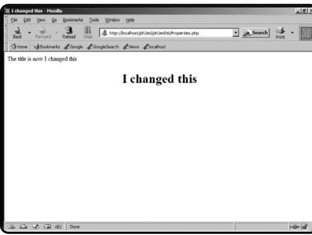

## 图 7.2

我创建了这个带标题的页面，然后更改了标题。

当我创建`SuperHTML`对象时，标题属性被自动设置为 Basic Super Page。可以直接更改标题，如下：

```php
$s->title = "new title";
```

正如你在观察`SuperHTML`代码本身时看到的，这种方法会导致一些问题。通常情况下，使用特殊方法来获取和设置属性更好。看看以下`Property.php`的代码，你将看到更改属性值的更好方法。

```php
<?php include "SuperHTMLDef.php";
$s = new SuperHTML("Basic Super Page");
$s->setTitle("new title");
$s->buildTop();
print $s->getTitle();
$s->buildBottom();
print $s->getPage();
?>
```

`buildTop()`和`buildBottom()`指令感觉非常像函数调用，因为它们和你已经创建并多次使用的函数非常相似。然而，这些函数被设计在特定对象的上下文中工作。附加到对象上的函数被称为对象的方法。牛奶对象可能有`moo()`和`giveMilk()`方法。

在 PHP 中引用方法的语法是使用箭头语法 (`->`)。没有专门的符号来指示这个运算符，它是横杠和大于符号的组合。

`buildTop()`和`buildBottom()`实际上都没有向屏幕写入任何代码。相反，它们将页面作为对象内部的一个长字符串属性准备好。`SuperHTML`有一个名为`getPage()`的方法，返回页面的实际 HTML 代码。程序员可以将代码保存到文件中、将其打印出来，或者在此情况下，接的一行代码简单地输出了`getPage()`方法的结果：

```php
print $s->getPage();
```

在创建`SuperHTML`对象时可以指定标题，但如果你以后想更改标题怎么办？对象可以在方法中存储代码，也可以在属性中存储数据。属性是附加到特定对象的变量。`SuperHTML`对象有一个`title`属性。牛奶对象可能有`breed`属性和`age`属性。图 7.2 显示的`Properties.php`展示了这一功能。

`Property.php`程序的开头与你之前看到的 Basic Super page 完全相同。我甚至用相同的初始值（Basic Super Page）创建了`$s`变量。

## 现实世界

图 7.1 所示的网页具有所有的标准配置，如`<head>`和`<body>`标签、`<title>`，甚至还有`<h1>`格式的标题。然而，你可以看到代码并没有直接包含这些元素中的任何一个。相反，它有两行 PHP 代码，它们都调用了`$s`对象。

`buildTop()`和`buildBottom()`都被视为方法，它们只是与特定对象类型关联的函数。实际上，由于`$s`是一个`SuperHTML`对象，它知道如何构建网页的顶部和底部。`buildTop()`会自动生成以下 HTML 代码：

```html
<!doctype html "//W3C//DTD HTML 4.0 //EN">
<html>
<head>
<title>Basic Super Page</title>
</head>
<body>
<center>
<h1>Basic Super Page</h1>
</center>
</body>
</html>
```

这个函数能生成所有这些 HTML 代码并不神奇，代码是相当可预测的。奇妙的是`SuperHTML`对象知道它的标题和标题应该是应该是。短语 Basic Super Page 是初始化`SuperHTML`对象的字符串。`buildBottom()`方法比`buildTop()`更加简单，它简单地添加了一些模板化的页面结束代码：

```html
</body>
</html>
```

## 添加文本和标签

`buildTop()`和`buildBottom()`指令感觉非常像函数调用，因为它们和你已经创建并多次使用的函数非常相似。然而，这些函数被设计在特定对象的上下文中工作。附加到对象上的函数被称为对象的方法。牛奶对象可能有`moo()`和`giveMilk()`方法。

在 PHP 中引用方法的语法是使用箭头语法 (`->`)。没有专门的符号来指示这个运算符，它是横杠和大于符号的组合。

## 图 7.3

`SuperHTML`对象使得构建页面变得简单。

```php
<?php include "HTMLDef.php";
$s = new SuperHTML("Basic Super Page");
$s->buildTop();
$s->setTitle("Adding Text and Tags");
$s->buildBottom();
print $s->getPage();
```

`SuperHTML`对象使得构建页面变得简单。

到文档中。在此函数完成后，文档末尾添加了以下文本：

```html
<i>这一行是斜体</i>
```

如果你查看`AddText.php`的 HTML 源代码，你会发现发生的情况确实是这样。

`tag()`方法的优妙之处在于它的灵活性。它可以用任何标签包裹任何文本。

## 以 SuperHTML 的高级方式创建列表

即使你只使用`add()`和`tag()`方法，你也可以创建非常精美、灵活的 Web 页面。然而，这个对象的真正威力来自于某些解决特定显示问题的专门方法。想一想，PHP 的许多构造结构在 HTML 世界中都有其天生的一对的伴侣。例如，如果你在 PHP 中有一个数据数组，你通常希望以某种形式的 HTML 列表来显示它。图 7.4 展示了一个包含多个数量列表的页面，所有列表都是从数组自动生成的。

你已经写过代码来从数组生成 HTML 列表的代码。虽然这并不困难，但可能会很繁琐。如果你能直接将该功能交给对象，并在处理其他问题时不再去担心它，那就太棒了。`SuperHTML`对象恰恰具有这种能力。`list.php`代码说明了实现此点的几种方法。

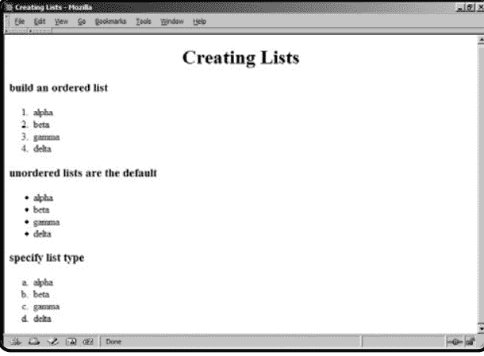

图 7.4

这些 HTML 列表是从数组生成的。

```php
include "SuperHTMLDef.php";
$s = new SuperHTML("Creating Lists");
$s->buildTop();

$myArray = array("alpha", "beta", "gamma", "delta");

$s->h3("build an ordered list");
$s->buildList($myArray, "ol");

// 无序列表是默认的：
$s->buildList(array("alpha", "beta", "gamma", "delta"));
$s->h3("specify list type");
$s->buildList($myArray, "ol type = 'a'");

$s->buildBottom();
print $s->getPage();
?>
```

## 构建基础列表

我通过创建一个数组（很聪明地）`$myArray`来开始编写`list.php`代码。`buildList()`方法需要两个参数：一个数组和一个列表类型。然后我调用了该函数：

```php
$s->buildList($myArray, "ol");
```

`SuperHTML`对象通过向其页面的内部表示添加以下代码来响应：

```html
<ol>
<li>alpha</li>
<li>beta</li>
<li>gamma</li>
<li>delta</li>
</ol>
```

你可以看到，每个数组项都被包裹在`<li></li>`标签中，整个数组被封装在一个带有适当缩进的`<ol></ol>`集合中。当你有一个像这样易用的工具来显示数组时，你会更倾向于使用数组。

## 构建即时列表

当然，你并不总是想要有序列表。下一次调用`buildList()`方法与第一个版本相比有两个不同：

```php
$s->buildList(array("alpha", "beta", "gamma", "delta"));
```

- 第一，你是即时构建此列表，而不是使用预定义的数组。当在你想要快速构建列表但还没有数组时，这非常有用。只需在将数组发送到`buildList()`方法之前，将值放入一个即时数组中。

- 第二，这由于缺少列表类型而与不同。如果我不指定我想要的列表类型，`SuperHTML`足够智能，可以猜测并为我放置一个合法的值。这种行为是称为“多态”原则的良好示例，其中对象在不同情况下可以有不同的行为。（当然，正式定义比这更深奥，但目前这足够了。）你可能猜出默认列表类型是无序的。

## 构建更专门的列表

`buildList()`方法还有一个“杀手锏”。如果你回看 HTML 输出中的第三个列表，它是用特定的列表类型（`<ol = 'a'>`）编写的。我将列表属性包含在列表类型参数中，如下：

```php
$s->buildList($myArray, 'ol = "a"');
```

你可以指定带有属性的完整列表类型，以创建更灵活的列表。

## 使用 SuperHTML 创建表格

你所看到的所有`SuperHTML`特现在都非常实用，但我主要想要的是轻松地处理表格。你经常发现自己将数据放入表格中，从 PHP 语法切换到 HTML 语法可能会很困惑（尤其是当你把 SQL 混合进来时，因为你同时在用三种非常不同的语言思考）。我想要一些能够让你从 PHP 数据结构轻松构建 HTML 表格的功能。图 7.5 显示了一个具有这种能力的程序。

使用`SuperHTML`构建表格的基本计划与创建列表的方法类似。然而，正如你在审阅代码时看到的，表格基于的数据结构比列表更复杂。

PHP 5/MySQL 零初学者编程

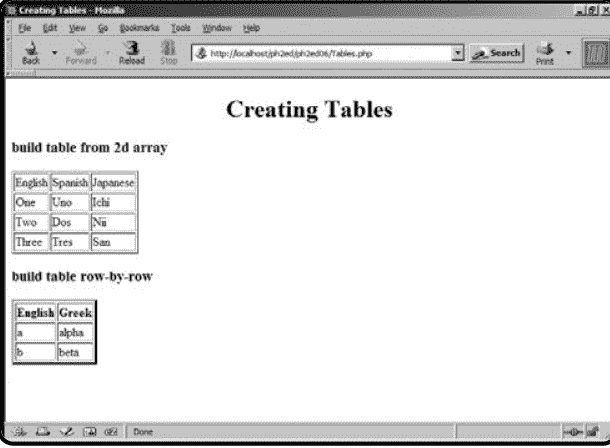

图 7.5

这些表格是由`SuperHTML`对象自动生成的。

```php
<?
include "SuperHTMLDef.php";
$s = new SuperHTML("Creating Tables");
$s->buildTop();

$s->h3("build table from array");
$myArray = array(
  "English", "Spanish",
  "One", "Japanese",
  "Two", "Dos",
  "Three", "San"
);
$s->buildTable($myArray);

$s->h3("build table from array");
$s->startTable(3);
$s->addRow(array("English", "Spanish"), "th");
$s->addRow(array("One", "Japanese"));
$s->addRow(array("Two", "Dos"));
$s->endTable();

$s->buildBottom();
print $s->getPage();
?>
```

## 创建基础表格

在本章早期，我提到 PHP 数组和列表是天生的一伴的。`buildTable()`方法很有用，但对于所有需求来说并不灵活。使用二维数组构建表格是简单的。

```php
$s->buildTable($myArray);
```

`SuperHTML`对象通过向其页面的内部表示添加以下代码来响应：

```html
<table>
  <tr>
    <th>English</th>
    <th>Spanish</th>
  </tr>
  <tr>
    <td>One</td>
    <td>Japanese</td>
  </tr>
  <tr>
    <td>Two</td>
    <td>Dos</td>
  </tr>
  <tr>
    <td>Three</td>
    <td>San</td>
  </tr>
</table>
```

## 创建更复杂的表格

`buildTable()`方法很有用，但对于所有需求来说并不灵活。使用二维数组构建表格是简单的。经常（特别是在数据库应用程序中）我想要构建表格的顶部、标题行、一系列行，然后

```php
$s->startTable(3);
$s->addRow(array("English", "Spanish"), "th");
$s->addRow(array("One", "Japanese"));
$s->addRow(array("Two", "Dos"));
$s->endTable();
```

## 创建超级表单

`SuperHTML`对象很有用，但如果它真的要有帮助，它应该轻松地构建表单元素，如文本框和提交按钮。大多数这些对象构建都很容易，但我一直觉得下拉菜单（HTML 选择对象）编程很繁琐。`SuperHTML`提供了一种强大、灵活且简单的方法来构建各种表单元素。图 7.6 中的页面是使用某些特殊对象生成的。

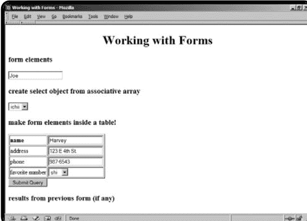

图 7.6

表单对`SuperHTML`来说不是问题。程序代码看起来比其他示例复杂一些，但比你已经见过的任何内容都更困难。首先我给你代码，然后我拆解它并向你展示功能。

```php
<?
include "SuperHTMLDef.php";
$s = new SuperHTML("Working with Forms");
$s->buildTop();

$s->h3("form elements");

$s->asText("<form> \n");
$s->textbox("userName", "Joe");

$s->h3("create select object from associative array");
?>
```

```php
$numArray = array(
  "1"=>"ichii",
  "2"=>"nii",
  "3"=>"san",
  "4"=>"shi"
);

$s->select("options", $numArray);

$s->h3("make form elements inside a table!");

$myArray = array(
  ($s->gTag("b", "name"), $s->Textbox("name")),
  ($s->gAddText("address"), $s->Textbox("address")),
  ($s->gAddText("phone"), $s->Textbox("phone")),
  ($s->gAddText("favorite number"), $s->gSelect("number", $numArray))
);

$s->buildTable($myArray);
$s->submit();

$s->addText("</form> \n");

$s->h3("results from previous form (if any)");
$s->formPage();

$s->buildBottom();
print $s->getPage();
?>
```

## 构建简单的表单并添加文本框

以下代码段构建了最基本的`SuperHTML`表单：

```php
$s->addText("userName");
$s->textbox("userName", "Joe");
$s->submit();
$s->addText("</form>");
```

我使用了`addText()`方法来提供基础的表单标签，然后使用`SuperHTML`对象的特殊方法创建了文本框和提交按钮。

你可能会惊讶，我没有提供用于开始和结束表单的特殊方法。这些方法很容易实现，但我觉得它们并不能简化多少问题，所以我直接使用了`addText()`方法来添加表单标签。（当然，如果你愿意，可以自己添加这些方法。`SuperHTML`项目被设计成一个框架，我渴望看到人们为它添加新功能。）

`textbox()`方法可以接受一个或两个参数。第一个参数是`<input>`元素的名称。第二个（可选）参数是元素的默认值。如果你不指定值，它将留空。

当然，提交按钮返回的是几乎相同的 HTML 代码，它的工作方式与文本框非常相似。然而，如果你省略了提交方法的第二个参数，你的 HTML 代码将显示出典型的查询（Query）说明文字。

## 构建下拉菜单

在很多情况下，你会希望用户从有限的选项中选择输入。通常，你想要发送给下一个程序的值与用户看到的并不完全相同。这种情况下合适的 HTML 设备是`<select>`元素，内部包含许多个`<option>`对象。如果你尝试将`select`和`option`的组合映射到 PHP 函数，最显可能的对比就是你在第 5 章“更好的数组和字符串处理”中使用的关联数组。查看下面的代码片段来了解它是如何工作的。

```php
$numArray = array(
  "1"=>"ichii",
  "2"=>"nii",
  "3"=>"san",
  "4"=>"shi"
);

$select->select("options", $numArray);
```

我创建了一个以数字为索引、以数字日语名称为值的关联数组。

一旦有了数组，就可以使用命名巧妙的`select()`方法轻松地创建一个 select 对象。两个参数是`select`对象的名称和数组。这段代码产生以下内容：

```html
<select name = "options"
<option value = "1">ichii</option>
<option value = "2">nii</option>
<option value = "3">san</option>
<option value = "4">shi</option>
</select>
```

## 在表格内构建表单元素

拥有外观专业的文档是非常重要的。大多数程序员会将所有表单放在一个表格中。`SuperHTML`对象通过使用本章之前描述的`buildTable()`方法，让这变得相对容易。然而，这里有一个新的转折。看看这段代码，看看你是否发现了它。

```php
$myArray = array(
  array($s->gTag("b", "name"), $s->gTextbox("name")),
  array("address"), $s->gTextbox("address")),
  array("phone", $s->gTextbox("phone")),
  array("favorite number", $s->gSelect("number", $numArray))
);
```

```php
$s->buildTable($myArray);
```

`$myArray`是一个包含最终表格的大数组。每行由两列组成。第一列是指定所收集数据类型的标签；第二列是某个表单元素。

转折点在于：虽然数组内部使用的方法看起来很熟悉，但每一个都是新的！记住，`SuperHTML`中构建页面的所有方法都是通过直接向内容添加到内存中的某个变量来实现的。这样做是为了让程序更具活性，以便它可以生成结果并将其保存到文件中。

当我构建数组时，我不想实际向 HTML 文档中添加任何内容。相反，我想接收函数的结果，以便我可以将其添加到我的数组中。然后使用`buildTable()`方法将数组添加到页面。大多数`SuperHTML`方法都有一个变体，以`g`开头。例如，记住`$s->gTag("b", "name")`会产生代码`<b>name</b>`并立即将代码添加到内部 HTML 文档。该命令的 g 变体（见下方）产生完全相同的代码，但不会将其添加到内部表示中：

```php
$s->gTag("b", "name");
```

相反，它返回该值以便你可以用它添加任何你想要的内容。在这种情况下，我只想将代码作为伪标题添加到表格中。（事实上，我可以在这里包含任何类型的 HTML。）表格中的其他元素要么是纯文本（标签），要么是对`SuperHTML`对象方法的调用。在描述了二维数组中的所有信息后，使用`buildTable()`方法将其添加非常容易。

虽然构建二维数组可能看起来很琐，但请考虑此函数产生的输出：

```html
<table border="1">
  <tr>
    <td>name</td>
    <td><input type="text" name="name" value="" />
  </tr>
  <tr>
    <td>address</td>
    <td><input type="text" name="address" value="" />
  </tr>
  <tr>
    <td>phone</td>
    <td><input type="text" name="phone" value="" />
  </tr>
  <tr>
    <td>favorite number</td>
    <td><select name="number">
      <option value="1">ichii</option>
      <option value="2">nii</option>
      <option value="3">san</option>
      <option value="4">shi</option>
    </select></td>
  </tr>
</table>
```

## 查看结果

通常当我构建一个响应表单的 PHP 页面时，我通过检索来自此表单的所有字段名称和值开始。这很有用，因为我经常会在字段名称上出错，或者忘记我期望表单发送的内容。如果有一个真正的方法会很好。`SuperHTML`内置了这一功能。如果你填写表单中的元素并点击提交按钮，你会得到另一个表单版本，但这一个包含了表单数据，如图 7.7 所示。

### 图 7.7

在提交表单后，第二次调用`formResults`返回字段名称和值的表格。产生这些结果的代码非常简单：

```php
$s->formResults();
```

如果没有之前的表单，`formResults`返回一个空字符串。如果页面是从表单调用的，结果如下：

```html
<table border="1">
  <tr>
    <td>userName</td>
    <td>Joe</td>
  </tr>
  <tr>
    <td>options</td>
    <td>1</td>
  </tr>
  <tr>
    <td>name</td>
    <td>Jonathon</td>
  </tr>
  <tr>
    <td>address</td>
    <td>123 W 4th St</td>
  </tr>
  <tr>
    <td>phone</td>
    <td>999-9999</td>
  </tr>
  <tr>
    <td>number</td>
    <td>3</td>
  </tr>
</table>
</body>
</html>
```

## 理解 OOP（面向对象编程）

`SuperHTML`项目使用许多 OOP 特性来工作。在深入研究`SuperHTML`之前，更多地思考对象是什么以及如何在 PHP 中创建它们是有意义的。

### 对象概述

如你所见，对象具有属性（properties，即对象的特征）和方法（methods，即对象可以做的事情）。除了支持属性和方法，设计良好的对象应该反映面向对象范式的某些价值观。

许多关于 OOP 的讨论指出对象还具有事件（events）。事件是对象可以响应的某种刺激。事件在 OOP 中确实很重要，但在 PHP 编程中并不使用，因为事件旨在捕捉实时发生的事情。PHP 程序涉及与用户的实时交互，因此事件在 PHP 对象中并不像在其他语言中那样关键。

### 封装

对象可以被视为某些数据（属性）和处理这些数据的代码（方法）。或者，你也可以将对象视为一系列方法以及支持这些方法的数据。无论如何，你都可以在不确切它是如何构建的情况下使用对象。这种封装原则得到了 PHP 的良好支持。当你构建普通函数时利用了封装。对象通过组合代码和数据将封装的概念向前推进了一步。

### 继承

继承对象可以从另一个对象继承的想法。想象一下你必须制造一辆警车。你可以建立一个从钢板和其他原材料开始的工厂，你可以从一辆更普通的汽车开始，简单地添加使其成为警车的功能。继承涉及获取现有类型的对象并添加新功能以创建新的对象类型。PHP 至少支持一种继承，正如你在本章稍后部分看到的。

### 多态性

你在`SuperHTML`描述中遇到过多态。多态涉及到对象在不同情况下表现得略有不同的能力。具体来说，它通常用于处理意外或缺失的数据。PHP 支持某些类型的多态，但诚实地说，这更多是 PHP 宽容和松散变量类型的一个因素，而不是任何特定的对象设计考虑。

### 创建基础对象

理解某事最简单的方法之一是看示例。从查看图 7.8 中的基础生物开始。

# 面向初者的 PHP 5/MySQL 编程

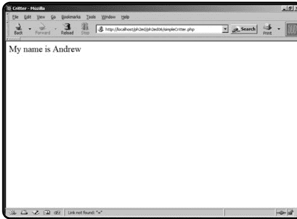

图 7.8

Critter（小动物）是一个非常简单的动物，但它是面向对象设计的一个简单示例。

当然，如果你查看 HTML 输出或 Critter.html 的 HTML 源代码，不会发现任何特别之处。有趣的工作是在 PHP 代码中完成的：

```php
<!doctype html public "-//W3C//DTD HTML 4.0//EN">
<html>
<head>
<title>Critter</title>
</head>
<body>
<? // 基础 OOP 演示
// 定义 critter 类
class Critter {
    var $name;
} // Critter 类结束
// 创建 critter 的实例
$theCritter = new Critter();
// 给 name 属性赋值
$theCritter->name = "Andrew";
```

```php
// 返回 name 属性的值
print "My name is ";
print $theCritter->name;

?>
</body>
</html>
```

# 定义 SimpleCritter 类

SimpleCritter 程序以经典的面向对象风格工作。首先，它定义了小动物是什么什么，然后创建该设计的实例。考虑代码的这部分：

```php
// 定义 critter 类
class Critter {
    var $name;
} // Critter 类结束
```

关键字表示我正在定义一个类。类是某个事物的设计或模板。食谱就是类的一个很好的例子。你不会真的去吃掉印有饼干食谱的卡片，但你使用那份食谱来制作可以食用的饼干。食谱是类，而饼干是该类的实例。（太棒了，现在我饿了）。

当我定义`Critter`类时，我是在定义小动物应该长什么样（食谱），但我还没有制作其中一个（饼干）。我的`Critter`类非常简单。目前它只有一个属性，即变量`$name`。类的定义会变得复杂得多，但这是一个很好的开始。

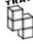

> 注意：使用`var`关键字来指定实例变量。在 PHP 中创建普通变量时不需要使用`var`关键字（而且几乎没人这样做）。在类定义中，`var`关键字是必要的，否则变量将无法被正确解析。

# 创建 Critter 类的实例

一旦你定义了一个类，你就想要拥有它的一个或多个实例。对象的伟大之处之一在于你可以非常轻松地为某个类创建多个实例。然而，在这个示例中，你只需要创建一个实例。创建实例的代码看起来像：

```php
$theCritter = new Critter();
```

我创建了一个名为`$critter`的新变量，并使用`new`关键字表示我想实例化某种对象。当然，我创建了一个`Critter`类的实例。

传统上，类名以大写字母开头，而实例（大多数大多数其他变量）以小写字母开头。我在本书中遵循这一习惯，`$critter`是一个实例，而`Critter`是一个类。在 PHP 中，也很看出`Critter`不是变量，因为它不是以美元符号开头的。

# 操作对象的属性

一旦你有了对象的实例，就可以操作该实例的属性。`$critter`变量是`Critter`类的实例，因此我可以给`$critter`的`name`属性赋值。

```php
// 给 name 属性赋值
$critter->name = "Andrew";
```

注意关于此的几点：

- 你可以将值附加到类的实例上，而不是类本身。

- 仔细查看为`name`属性赋值的语法。你处理的变量是`$critter`。`name`属性类似于`$critter`的一个子数组。使用`实例->属性`语法来引用对象的属性。

> 陷阱：像我在示例中这样直接访问属性实际上被认为是危险的。然而，为了清晰，我这样做。一旦我向你展示如何创建一个方法，你就会开始访问方法。这样你就不需要直接访问属性了。

# 从类中获取属性

从类获取属性值的基本语法与添加属性非常相似。

```php
// 返回 name 属性的值
print "My name is ";
print $critter->name;
```

再次注意语法：`$critter`是变量，`name`是它的属性。

# 为类添加方法

要让一个类变得真正有趣，它需要拥有某些行为而不仅仅是数据。这就是方法大用用场。我将改进简单的`Critter`类，使其拥有可以操作`name`属性的方法。以下是位于`methods.php`中的新代码：

```php
<!doctype html public "-//W3C//DTD HTML 4.0//EN">
<html>
<head>
<title>Critter</title>
</head>
<body>
<?
// 添加方法

// 定义 critter 类
class Critter {
    var $name;

    function __construct($handle = "anonymous") {
        $this->name = $handle;
    } // 构造函数结束

    function setName($newName) {
        $this->name = $newName;
    } // setName结束

    function getName() {
        return $this->name;
    } // getName结束
} // Critter 类结束

// 创建 critter 的实例
$theCritter = new Critter();

// 打印初始名称
print "Initial name: " . $theCritter->getName() . "<br>";

第 7 章 使用对象编写

```php

print "Changing name...<br>";

$theCritter->setName("Melville");

print "New name: " . $theCritter->getName() . "<br>";

```

?>
</body>
</html>
```

这段代码产生了图 7.9 所示的输出。

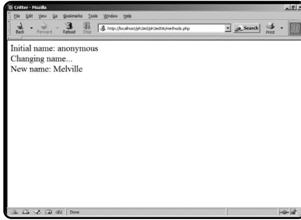

图 7.9

Critter 可以动态更改它的名字。

创建方法的基本技术是在类内部定义函数。

# 构造函数

大多数类中的第一个函数被称为构造函数。构造函数是用于构建对象的特殊方法。示例：

```php
function __construct($handle = "anonymous") {
}
```

要要指定一个函数是类构造函数，它应该命名为`__construct`（前面有两个下划线）。构造函数的名称是在 PHP 5.0 中引入的。如果你使用的是更早的版本，构造函数的名称与类名相同，但它仍然是类内部定义的函数。

构造函数通常用于初始化属性——在这里是`name`属性。注意构造函数接受一个参数。

# 创建属性 Setter

`setName()`方法是属性访问方法（setter）的一个示例，它允许通过方法更改属性。`setName()`的代码非常简洁：

```php
function setName($newName) {
} // setter 结束
```

Setter 通常以`set`开头，并且总是接受一个参数。参数是用户想要更改的内容。在方法内部，我修改与`name`属性关联的实际实例变量。访问方法非常有用，因为在进行任何属性更改之前，我可以对信息进行许多处理。例如，如果我决定所有的名字应该少于五个字符，我可以修改`setName()`来执行这条规则。

```php
function setName($newName) {
    if(strlen($newName) > 5) {
        $newName = substr($newName, 0, 5);
    }
}
```

这是一个微不足道的例子，但访问方法可以防止许多类型的问题。例如，如果你的程序期望数字输入而收到了字符串，你的访问方法可以安静地（如果你愿意，也可以不安静地）将值更改为合法值而不导致程序崩溃。使用访问方法可以是为类添加多态性的极佳方法。如果你在使用带有访问方法的类，你应该始终使用它们，而不是直接修改属性。如果你直接修改属性，你就绕过了访问方法提供的安全性。

# 构建 Getter 方法以检索属性值

拥有返回属性值的方法也是很好的。这些方法都被称为 getter 方法（访问器），它们通常非常直观，比如这一个：

```php
function getName() {
    return $this->name;
} // getName()
```

`getName()`方法简单地返回相应属性的值。这很有用，因为你可能有不同的方式来返回同一个值。有时，你可能会为一个实际上并不存在的属性编写 getter！例如，如果你正在创建一个圆形，它可能会有`setRadius()`、`getArea()`和`getCircumference()`方法。用户应该能够读取和写入圆的半径和面积。这些值实际上并没有存储在类中，因为它们是从半径推导出来的。程序员不需要知道或关心这些，只需要知道某些属性是可读写的，而某些是只读的。

# 使用访问方法操作属性

有了 getter 和 setter 方法，操作对象的属性变得简单了。

```php
// 创建一个 critter 实例
$theCritter = new Critter();
```

```php
// 打印原始名称
print "Initial name: " . $theCritter->getName() . "<br>\n";

// 打印更改名称...<br>\n
$theCritter->setName("Melville");

print "New name: " . $theCritter->getName() . "<br>\n";
```

每当我想更改名称时，我都调用`setName()`方法。要检索名称，我使用`getName()`方法。

> 技巧：注意，get 和 set 术语在程序员使用类的语境下是有意义的，而不是设计类的程序员。对象的受众是程序员而不是普通大众。你编写代码是为了让程序员的工作更轻松。

# 继承父类

你已经见过封装和多态了。OOP 的第三支柱是一个被称为继承的概念。

继承被用于在之前工作的基础上添加新功能。它被用于构建通用功能，同时允许变化。例如，在用 Critters 编写一个游戏时，我在基础`Critter`类中定义了所有事物共有的特征，并为各种类型添加了许多子类。这些子类包含了对基本行为的补充或偏离。再次想想我在本章之前提到的警车。汽车是一个基类，而警车是基类的扩展。

我将类定义放在它单独的文件中，如下所示：

```php
<?php
// Critter 定义

// 定义 critter 类
class Critter{
    var $name;

    function __construct($handle = "anonymous") {
        $this->setName($handle);
    } // 构造函数结束

    function setName($newName) {
        $this->name = $newName;
    } // setName结束

    function getName() {
        return $this->name;
    } // getName结束

} // Critter 类结束
?>
```

注意这里没有 HTML，也没有使用该类的代码。此文件仅包含普通 php 标签内的类定义。一旦我将类定义安全地存储在文件中，我就可以轻松地重用它。我在`Critter`类定义中做了一个微小但用的更改：注意构造函数不再直接设置名称属性，而是使用`setName`方法。这在稍后很有用。

`Inherit.php`程序为基础`Critter`类添加了一些新功能：

```php
<!DOCTYPE html "-//W3C//DTD HTML 4.0 //EN">
<html>
<head>
<title>Glitter Critter</title>
</head>
<body>
<?php
// 结合继承

// 引入 Critter 类
include "critter.php";

// 基于 Critter 创建新的 Glitter Critter
class GlitterCritter extends Critter{

// 添加一个方法
function glow(){
    print $this->name . " gently shimmers...<br> \n"
} // glow 结束

// 重写 setName 方法
function setName($newName) {
    $this->name = "Glittery " . $newName;
} // setName结束

} // GC 类定义结束

// 创建新 critter 的实例
$theCritter = new GlitterCritter("Gloria");

// GC 没有构造函数，所以它从父类“借用”
print "Critter name: " . $theCritter->getName() . "<br>\n";

// 调用新的 glow 方法
$theCritter->glow();

?>
</body>
</html>
```

该程序从包含之前设计的`Critter`开始。现在我可以创建该类的实例了，但我脑子里有一个更狡猾的想法。我想创建一种知道如何发光的 Critter。我把它称为`GlitterCritter`。（我也为`HitterCritter`、`BitterCritter`和`SpitterCritter`写了原型，但我决定不把它们放在书中。）

我像定义任何其他类一样定义`GlitterCritter`，除了`extends`关键字：

```php
class GlitterCritter extends Critter {
```

除非我另有说明，否则`GlitterCritter`的行为就像普通的`Critter`一样。它会自动继承父类的所有属性、方法，甚至构造函数。

# 构建 SuperHTML 类

现在你已经对 OOP 有了一些了解，让我们来看看……（我将根据提供的 OCR 文本片段继续逻辑流）。

*注意：后几页提供的 OCR 文本在源文件中变得有点混乱/重复。我根据提供的清晰片段重构了逻辑结构。*

# 设置文件

类文件将被包含在程序中，所以我剥离了不必要的 HTML 和 PHP 代码。文件中只包含类定义。

```php
// SuperHTML 类定义
class SuperHTML {

// 属性
    var $title;
    var $thePage;

}
```

# 创建构造函数

你可能期望一个复杂的对象有一个复杂的构造函数，但不必如此。

```php
function __construct($tTitle = "Super HTML"){
  // 构造函数
  $this->setTitle($tTitle);
} // 构造函数结束
```

构造函数使用当前的`setName()`方法将临时标题值复制到标题属性。

# 操作属性

你会期望找到属性的访问方法，`SuperHTML`有几个。有`setTitle()`、`getTitle()`和`getPage()`方法。然而，我打算不提供显式的`setPage()`方法，通过所有其他方法增量地构建页面。

```php
function getTitle(){
  return $this->title;
} // getTitle结束
```

```php
function setTitle($tTitle){
  $this->title = $tTitle;
} // setName结束
```

```php
function getPage(){
  return $this->thePage;
} // getPage结束
```

# 添加文本

`SuperHTML`程序不打印任何内容。它所做的只是创建一个大字符串（`$thePage`），并允许程序员检索该页面。

`addText()`函数将输入的内容添加到`$getPage`的末尾，并带有一个尾随换行符。类中的大多数函数中，getter 返回值时带有换行符，但不会向`$thePage`写入任何内容。

`gAddText()`方法并不是必须的，但为了完整性我包含了它。

```php
function addText($content) {
// 任意文本（包括 HTML 标记）
//将文本添加到页面中
$this->thePage .= $content;
$this->thePage .= "\n";
} //结束 addText
```

```php
function gAddText($content) {
// 任意文本（包括 HTML 标记）
//返回文本
$temp = $content;
$temp = "\n";
return $temp;
} // 结束 gAddText
```

# 构建页面顶部

我制作的几乎每个 Web 页面的顶部都完全相同，因此我想有一个函数能自动为我构建它。`buildTop()`方法接收一个包含我所有常用的开头代码的多行字符串，并使用`addText()`方法将其添加到页面。

```php
function buildTop() {
$temp = <<<HERE
<!doctype html public "-//W3C//DTD HTML 4.0 //EN">
<html>
<head>
<title>$this->title</title>
</head>
<body>
<center>
<h1>$this->title</h1>
</center>
HERE
$this->addText($temp);
} // 结束 buildTop;
```

如果你想要不同的开头代码（例如，特定的 CSS 样式），可以使用包含你自己的代码的函数来覆盖我的`buildTop()`。

# 创建页面底部

页面底部非常简单。我只是构建了一些标准的页面结束 HTML，并将其添加到`thePage`中。

```php
function buildBottom(){
  //构建通用网页页面的底部
$temp = <<<HERE
</body>
</html>
HERE
  $this->addText($temp);
} // 结束 buildBottom;
```

# 添加标题和通用标签

`tag()`方法非常有用，因为它允许你使用你想要的任何 HTML 标签（或 XML 标签）来包裹任何文本。`gTag`函数与之类似，它不会将任何内容排序到`$Page`。为了简化我的编码，我先写了`gTag()`。该方法创建了一个包含标签名和内容的临时变量，并且格式良好。（我不喜欢`cgi.pm`的点之一就是生成的 HTML 代码看起来非常糟糕。我希望我的程序生成的代码看起来像是由我编写的良好代码。）

`tag()`方法调用`gTag()`并使用`addText()`添加结果。如果我对`gTag()`函数进行了更改，我就不需要忘记在`tag()`中进行相同的更改。在可以的情况下，避免重写是件好的。

```php
function gTag($tagName, $contents) {
  //给定任意标签，用标签包裹内容
  //改进标签以便标签可以具有属性
  //返回标签但不添加到页面
  $temp = "<$tagName>\n";
  $temp .= " . . $contents . "\n";
  $temp .= "</$tagName>\n";
  return $temp;
} // 结束 gTag
```

```php
function endTag($tagName, $contents) {
  //给定任意标签，用标签包裹内容
  //改进以便标签可以具有属性
  $temp = $this->gTag($tagName, $contents);
  $this->addText($temp);
} // 结束 endTag
```

```php
//标题函数
function h1($stuff) {
$this->tag("h1", $stuff);
} // 结束 h1
```

```php
function h2($stuff) {
$this->tag("h2", $stuff);
} // 结束 h2
```

```php
function h3($stuff) {
$this->tag("h3", $stuff);
} // 结束 h3
```

```php
function h4($stuff) {
$this->tag("h4", $stuff);
} // 结束 h4
```

```php
function h5($stuff) {
$this->tag("h5", $stuff);
} // 结束 h5
```

```php
function h6($stuff) {
$this->tag("h6", $stuff);
} // 结束 h6
```

`h1()`到`h6()`方法都是`tag()`方法的包装器，仅为这些非常常见的 HTML 标签提供了快捷方式。当然，你也可以为你所有其他喜欢的标签添加快捷方式。

# 从数组创建列表

我喜欢列表方法，因为它们整洁了我的代码。`buildList()`方法需要两个参数。第一个是数组，包含了最终列表中的所有元素。第二个参数是列表类型，不带角括号。列表类型默认为`ul`，但也可以是`ol`或`dl`。

该方法使用`foreach()`循环遍历数组中的每个元素，然后在元素周围添加一个`<li></li>`对。和往常一样，函数的`g`版本将此值返回给程序员，而另一个版本则将其添加到`$Page`中。

```php
function buildList($array, $type = "ul") {
    //给定一个值数组，根据该数组构建列表
    $temp = "$type \n";
    foreach ($array as $value) {
        $temp .= " <li>$value</li> \n";
    } // 结束foreach
    $temp .= "</$type> \n";
    return $temp;
} // 结束 buildList
```

```php
function buildList($array, $type = "ul") {
    $temp = $this->buildList($array, $type);
    $this->addText($temp);
} // 结束 buildList
```

# 从 2 维数组创建表格

`buildTable()`方法的工作方式类似于`buildList()`方法。`startTable()`方法构建表格头。`tRow()`方法构建表格行。`endTable()`方法结束表格。

```php
function startTable($border = "") {
  $this->getPage .= "<table border=$border\n";
} // 结束 startTable
```

```php
function tRow($rowData, $type = "td") {
  $this->getPage .= "<tr>\n";
  foreach ($rowData as $cell) {
    $this->getPage .= "<$type>$cell</$type>\n";
  } // 结束foreach
  $this->getPage .= "</tr>\n";
} // 结束 tRow
```

```php
function endTable() {
  $this->getPage .= "</table>\n";
} // 结束 endTable
```

```php
} // end class def
?>
```

# 总结

本章向你介绍了面向对象编程的基本概念。你已经看到对象包含了属性和方法。你学习了对象如何实现继承、多态和封装。你实验了`SuperHTML`类，并学习了在创建自己的有用且强大的对象类时如何扩展它。

# 挑战

- 1. 使用`SuperHTML`对象重写之前的程序之一。
- 2. 为`SuperHTML`类添加对更多 HTML 标签的支持。
- 3. 创建`SuperHTML`的扩展类，包含一个自定义头部，反映你开始 Web 页面的方式。
- 4. 添加对复选框（checkboxes）和单选按钮（radio buttons）的支持。
- 5. 改进`buildTable()`方法，使其根据参数自动将第一行或列设置为表头。
- 6. 使用自定义对象重写之前的程序。

## 第 7 章：使用对象编写程序

# XML 与内容管理系统

Web 自诞生以来一直在变化。对于 PHP 程序员来说，理解两个特定的进展尤为重要。第一个是内容管理系统（CMS）的概念。这是一种简化复杂网站创建和操作的应用程序。XML 是一种数据管理技术，通常用于 CMS 应用程序以及其他类型的编程。PHP 是实现 XML 和 CMS 解决方案的理想语言。在本章中，你将探索这些令人兴奋的话题。你完成以下工作：

- 探索一些流行的常用 CMS
- 仅使用一个 PHP 程序构建一个基础 CMS 系统
- 将 XML 作为一种数据存储方案进行研究
- 实现用于处理 XML 的 simpleXML 应用程序接口（API）
- 使用 XML 创建一个更复杂的 CMS

# 介绍 XCMS

在这里，你研究了三种不同形式的 CMS。首先，你查看了一个名为 PHPNuke 的强大 CMS 系统。然后，你使用普通的 PHP 构建了一个基础 CMS。最后，你学习了如何结合 XML 的力量为构建强大且灵活的 CMS 引擎奠基础。

你从安装和修改现有系统开始，以创建一个类似于图 8.1 所示的自定义高端 Web 网站。

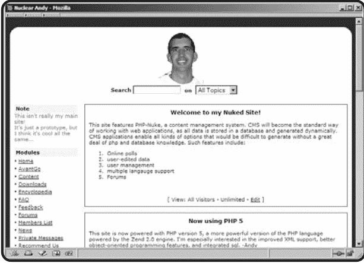

你可以用最少的 PHP 编程来开发这个精美的页面。

由于 PHP-Nuke 需要运行中的 MySQL 服务器，我没有将这个特定示例包含在 CD 中。然而，PHP-Nuke 位于本书的 CD 上；你可以使用它来构建像这样的站点。

CMS 网站可以非常强大，但你可能并不想要 PHP-Nuke 这种高端软件包的所有功能。另一方面，你可能希望“自制”一个 CMS。这种程序在不理解基本概念的情况下也非常容易构建。到本章结束，你可以构建出一个与图 8.2 所示非常类似的站点。

# Andy 的主页 - Hev

# 第 8 章：XML 与内容管理系统


# Andy 的页面

主菜单

- 主页
- 类
- 链接
- 软件
- 媒体

你好，欢迎来到我的网站！

我叫 Andy Harris，我是印第安纳大学/普渡大学-印第安波利斯分校（IUPUI）的计算机科学教师。我还在该部门担任媒体实验室协调员，为分布式教育开发课程和技术。

我对许多计算主题感兴趣，但我的主要兴趣是编程、Web 开发以及多种语言的编程；特别是 java（客户端和服务端）、javascript/Dynamic HTML、perl、PHP/SQL 以及其他服务器端语言、C#、Visual Basic/RAD 工具、数据库、多媒体和虚拟现实。

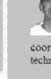

图 2

这个 CMS 要简单得多，但仍然强大。

还要学习如何使用一种名为 XML 的酷技术构建一个更强大的 CMS。不过，我不会给你那个程序的截图，因为对用户来说，它看起来和图 8.2 描述的简单 CMS 一样。

# 理解内容管理系统

当 Web 出现时，它被构想为互联文档的网。将任何文档链接到任何其他文档的能力是强大的。然而，作为利用 Web 的开发者，互联网的自由形式特性带来了头疼的问题。特别是对于管理大型相关页面系统、为单个用户定制内容，以及在一个可能包含数百或数千份文档的网站中保持一致性变得有些具有挑战性。此外，Web 的性质也开始发生。Web 不仅仅是文档的仓库，而是变成了一系列互联的应用程序。大部分 Web 内容不再存储在 HTML 页面中，而是由 PHP 等程序动态创建的。

CMS 已成为创建动态网站的流行解决方案，它可以连接许多 HTML 页面并以灵活高效的方式提供服务。（在此语境下，灵活性意味着网站所有者有许多选项来确定页面的布局和内容。）许多免费和商业 CMS 都是基于 PHP 的。CMS 经常包含此类功能：

- 用户管理。用户可以登录系统。CMS 通常有多个用户访问级别，以便某些人可以添加内容，而另一些人可以查看内容。
- 将内容分块。内容可以根据其含义分组为语义块。例如，与其使用任意页面作为基本单元，你可以将新闻故事、链接和其他元素组织到 HTML 页面中。
- 布局与内容分离。CMS 通常将布局与内容分离。这样做有几个原因：
- 即使有许多人贡献内容，整个网站的外也应该是统一的。
- 内容开发者不需要担心格式或如何编写 HTML。
- 布局应该能够适应新的设计或技术。
- 用户贡献的内容。许多 CMS 包括支持在线论坛和留言板的功能。此外，你通常可以授予权限让用户添加内容。例如，如果你正在运行一个教会网站，你可以允许儿童牧师直接添加内容。你可以控制访问权限，让人们无法访问不该访问的部分

# 使用 PHP-Nuke

PHP-Nuke 是最流行的开源 CMS 之一。它使用 PHP 和 MySQL 动态生成门户（门户是作为 Web 起点的自定义系统的另一个术语）。当你进入 PHP-Nuke 时，你会发现许多站点运行该系统或其变体。图 8.3 展示了使用 PHP-Nuke 的我的站点版本。

PHP-Nuke 是一个极其强大的 CMS 系统。它支持之前列出的所有功能，以及更多。如果我以管理员登录，我会得到不同的显示，使我有机会修改网站的各种选项，如图 8.4 所示。

任何具有相应权限的用户（由管理员决定）都可以通过添加新项目来更改内容。此外，授权的用户可以通过选择新主题来更改网站的整体外观，这可能包括新的颜色、字体、图标和布局。图 8.5 展示了使用不同主题的主页。

# 276

面向绝对初学者的 PHP/MySQL 编程

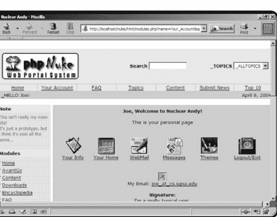

## 图 8.5

内容相同，但此主题中使用了不同的颜色和图形。

## 安装 PHP-Nuke

随书附带的 CD 中包含了一份 PHP-Nuke 副本。你也可以直接访问 PHP-Nuke 网页（http://phppnuke.org）并确保你拥有最新版本的软件。PHP-Nuke 完全使用 PHP 和 MySQL 编写，因此无论你使用哪种操作系统都无所谓。

> 提示
> 请务必将文件安装在 Web 服务器根目录的子目录下（通常为 hdocs）。

PHP-Nuke 很大程度上依赖于一系列 MySQL 表。（我的安装版本中有 92 个专门用于 PHP-Nuke 的表。）幸运的是，你不需要手动安装这些表。所有必要的代码都在一个名为`nuke.sql`的 MySQL 脚本中，并随 PHP-Nuke 一起提供。使用 MySQL 控制台或 phpMyAdmin 运行该脚本。你将在第 9 章“使用 MySQL 创建数据库”中学习更多关于使用这些工具的知识。现在，你只需要按照随 PHP-Nuke 的 readme 文件操作即可。

> 提示
> 你可能需要编辑 SQL 脚本以更改用户名、添加密码或根据其他其他方案创建数据表。像常一样，请对副本进行操作，以防万一出错。

PHP-Nuke 附带的安装说明解释了如何设置和测试你的系统。

## 定制 PHP-Nuke

PHP-Nuke 安装时带有大量的数量和海量的选项。对你的网站进行一些尝试，以让一切都按照你想要的方式运行。你可能仍然需要进行一些更改。至少，你可能想用自定义图像替换一些项目图标或按钮。实现此最简单的方法是修改现有的主题：

- 1. 访问系统的`admin.php`页面以管理员身份登录。
- 2. 找到站点上的偏好（preferences）选项。
- 3. 浏览主题，直到找到你想要作为起点的主题。
- 4. 进入你的文件管理器并找到相应的主题文件夹。
- 5. 在默认安装中，查看 PHP-Nuke 子目录；在`html/themes/`下找到主题。每个主题都有自己的子目录。
- 6. 复制你想要操作的主题目录并重命名文件夹创建新主题。
- 7. 进入主题文件夹并打开`theme.php`。
- 8. 搜索并替换任何对旧主题名称的引用为你的新主题名称。

现在你可以编辑主题目录中的任何 HTML 文件或图像来定制你的主题。例如，`blocks.html`页面控制屏幕左侧菜单部分的样式。如果你单独加载`blocks.html`，它看起来可能像图 8.6。

如果你查看`block.html`代码块，它看起来可能像这样：

```html
color="#FFFF00"

<table border="0" cellpadding="0" cellspacing="0" bgcolor="#FFFF00"
width="100%"><tr><td align="left">
<font class="block-title"><b>$title</b></b></font>
<td></td></tr></table>

<table border="0" cellpadding="0" cellspacing="0" bgcolor="#ffffff"
width="140">
<tr valign="top"><td bgcolor="#ffffff">
$content
</td></td></tr>
</table><br>
```

# 278

面向绝对初学者的 PHP 5 MySQL

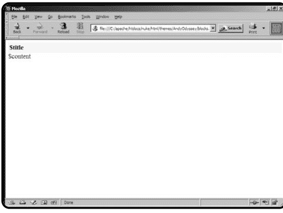

## 图 8.6

这是 Odyssey 主题中`block.html`的标准外观。

> 你的代码可能与你看到的不同，因为每个主题对每种类型的元素都有代码片段。实际细节没有通用概念那么重要。

该代码片段值得注意的特点是缺乏任何实际内容。这是 CMS（内容管理系统）的特征。主题中的代码片段并没有显示任何实际值，而是描述了如何显示特定类型的文本。注意占位符`$title`和`$content`。它们当然是 PHP 变量，实际的标题和内容元素将替换它们。

你可以修改任何 HTML 主题页面，只要你不更改任何这些页面的名称。同样，你可以用自己的图形替换任何图形，但不要使用不同的名称，否则系统将找不到它们。从简单的更改（如颜色更改和新图形）开始；当你开始理解文件结构时，再变得更加复杂。

## 引入 simpleCMS

PHP-Nuke 极其强大，但对于许多个人网站来说它大材小用了。它最初被设计用作新闻网站，高度侧重于新闻分发和在线论坛。PHP-Nuke 系统（以及类似的系统）的强大力量也可能让新程序员感到非常畏畏。（此外，我不喜欢呈现结果页面的代码风格。PHP-Nuke 很大程度上依赖 HTML 表格作为格式工具，而不是我偏好的 CSS 元素定位。）

我想创建一个提供许多核心功能的轻量级内容管理系统。我希望它易于学习和修改。

## 在这里我使用的基础 CSS：

```css
<!--
  此样式将菜单放在左侧，并将项目区域放在
  中心。旨在用于 PHP/MySQL 的 CMS 演示，
  参考《The Abs. Beg》，Andy Harris 
-->
```

```css
<style type = "text/css">
body (
  background-image: url("binaryBG.gif")
)
h1 {
  color: #0000FF;
  font-family: "Comic Sans MS";
  text-align: center;
}
span.menuPanel {
  position: absolute;
  left: 1%;
  width: 15%;
  background-color: #CCCC
}
span.item {
  position: absolute;
  left: 17%;
  width: 80%;
  background-color: #CCCC
}
```

我为该系统创建的所有页面定义了背景样式。我还构建了两个`span`标签子类。你可能记得`span`对 CSS 很有用，因为它不携带任何格式包。`span.menuPanel`类被定义为靠近左侧边界的定位元素，跨越边界宽度的 15%。该元素的顶部和高度没有定义。这意味着该元素将放置在之前显示的任何 HTML 标签正下方，但所有`span`内容都经过了格式化，以适应 15% 的限制。我打算让页面的这部分填充一个链接列表，作为菜单。

（当然，菜单可以做得复杂得多，但从缓慢开始是好的。在下一节中，你将看到菜单 HTML 代码编码的一种巧妙（但并不困难）的方法。）

我保持了代码非常简单，但当然，你可以（也应该）按照自己的意愿对其改进。添加背景图形、边框或改进文本。将菜单移到右侧或顶部。

## 技巧

在这个元素中使用百分比测量是非常重要的，因为我不知道用户的屏幕分辨率。通过用百分比来指定位置和宽度，我拥有了一种无论浏览器大小如何都能良好工作的样式。

## 在现实世界中

那些不支持 CSS 的浏览器怎么办？有些人会争说，基于表格的布局方法（如 PHP-Node 和许多其他 CMS 工具所使用的）比以 CSS 为中心的方法具有更好的浏览器兼容性。虽然某些旧浏览器支持表格但不支持 CSS 是事实，但它们作为页面布局时也有自己的问题。

表格从初并不是为了那个目的而设计的，为了获得完全符合要求的布局，通常必须构建一个嵌套在表格中的拜占庭式结构，带有各种`colspan`技巧和不可见的边框。

可能的 CSS 元素的发明是为了为页面布局头部提供一个更简单、更统一的解决方案。不支持 CSS 的浏览器仍然会显示 CSS 增强页面中编码的所有内容。CSS 将不会生效，但所有其他 HTML 代码将正常工作，用户可以使用该页面。

`item`类是代码示例中另一个重要的 CSS 元素。它是另一个专门用于放置网页主要内容的特化`span`标签。`item`类与`menuItem`类配合得很好。它被放置在菜单面板稍微右侧的位置，占据剩余屏幕的大部分空间。再次，实际样式非常简单，你可能想对它进行修饰。

## 检查菜单系统

simpleCMS 的真正关键在于它的使用方式。用户看到的每个页面都是三个不同的 HTML 页面的组合：横幅、菜单和内容页面。`simpleCMS.php`程序根据特定的样式表将这三个元素结合在一起。对于此示例，假设 CSS 样式和横幅对于系统显示的每个页面保持不变。（这通常是你想要的行为。）

你永远不会直接链接到系统中的任何页面。相反，你链接到`simpleCMS.php`程序，并传递你想要的内容文件（如果你愿意，还有菜单文件）。记得 simpleCMS 需要两个参数。大多数 PHP 程序从 HTML 表单获取参数，但你可能还从第 2 章“使用变量和输入”中记得，参数可以通过 URL 协议发送。你可以通过将其调用为参数，让任何页面显示为你 CMS 中的一个元素。

为了清楚起见，看看`menu.html`的代码：

```html
<h3>主菜单</h3>
<ul>
<li><a href="simpleCMS.php?content=default.html">首页</a></li>
<li><a href="simpleCMS.php?content=classes.html">课程</a></li>
<li><a href="simpleCMS.php?content=links.html">链接</a></li>
<li><a href="simpleCMS.php?content=software.html">软件</a></li>
<li><a href="simpleCMS.php?content=wallyindex.html">媒体</a></li>
</ul>
```

技巧是什么？第一个链接指向一个名为`default.html`的页面。我没有直接链接到`default.html`，而是链接到`simpleCMS`并将`default.html`值作为`content`参数传递。当 simpleCMS 运行时，它放置默认横幅（top.html）和默认菜单（menu.html），但将`default.html`的内容放置在新页面的 item 区域中。我没有发送菜单参数，但我可以这样做，它会在菜单区域放置另一个页面。

简而言之，你可以通过将值分配给`menu`参数将任何页面放置在菜单区域；通过将值分配给`content`参数将任何页面分配到 item 区域。任何你想要

## 理解 XML 规则

XML 与 HTML 非常相似，但它对语法的宽容程度并不。。创建 XML 文档时记住这些规则：

- **XML 是大小敏感的。** 大多数标签使用小写或驼峰命名法（就像 PHP 一样）。`<pet>`和`<PET>`是两个不同的标签。

- 所有属性必须封装在引号内。在 HTML 中，引号始终是可选的。在 XML 中，几乎所有属性值都应该加引号。例如，`<dog name =muchacha>`在 XML 中是不合法的。正确的表达式是`<dog name="muchacha">`。

- 所有的标签都需要一个结束标签。HTML 对于是否包含标签的处理非常宽容。XML 则严格得多。每个标签必须有一个结束标签，或者用末尾的斜杠表示它没有结束标签。在之前的示例中，`<cat>`有一个结束标签`</cat>`。我将`dog`定义为将所有数据封装在属性中而非标签中，因此它它没有显式的结束标签。注意`dog`如何以一个斜杠（`/`）结尾以表示它没有结束标签。

## 检查 main.xml

本章中的第二个 CMS 系统可能会很有用，我们来看描述我在基于 XML 的内容管理系统 (XCMS) 中主页面的 XML 文件：

```xml
<?xml version="1.0" encoding="utf-8"?>
<cpage>
  <title>Andy's Main Page</title>
  <css>menuLeft.css</css>
  <top>top.html</top>
  <menu>menuX.html</menu>
  <content>http://www.ciupui.edu/~aharris/default</content>
</cpage>
```

整个文档存储在`<cpage></cpage>`元素中。`cpage`代表一个 CMS 页面。该页面有五个参数。每个页面都有标题以及指向 CSS 样式、顶部页面、菜单页面和内容页面的 URL。XML 简洁地描述了构建我的 CMS 页面所需的所有数据。我为系统中显示的的每个页面都构建了这样一个 XML 页面。这其实很简单，因为除了内容之外，大多数页面都是相同的。

> 技巧
> 在现实世界的应用中，这会更加简单，因为我可能会编写一个编辑器来自动创建 XML 页面。这样用户就永远不需要知道他们正在构建 XML。听起来像是另一个很棒的章末项目！

## 简化菜单页面

当所有数据存储在 XML 页面时，菜单页面就不那么复杂了。每次调用系统只需要一个参数：包含布局指令的 XML 文件名。这里是更改为处理 XML 文件后的菜单页面：

```html
<h3>Main Menu</h3>
<!-- 为 XML 版本的 CMS 修改的菜单页面 -->
<ul>
  <li><a href="XCMS.php?theXML=main.xml">main</a></li>
  <li><a href="XCMS.php?theXML=classes.xml">classes</a></li>
  <li><a href="XCMS.php?theXML=links.xml">links</a></li>
  <li><a href="XCMS.php?theXML=software.xml">software</a></li>
  <li><a href="XCMS.php?theXML=media.xml">media</a></li>
</ul>
```


此菜单调用 XML 版本的 CMS 代码 (`XCMS.php`) 并将其发送到描述要创建每个页面的 XML 文件名（此处应为发送到描述要创建每个页面的 XML 文件名）。当然，你将检查该程序中是如何处理 XML 数据的。不过，先从一个查看 XML 数据的简单程序开始。

## 引入 XML 解析器

读取和解释 XML 数据的程序通常称为 XML 解析器。PHP 5 正式拥有三种不同的 XML 解析器。我重点关注最容易使用的一个。它被称为 `simpleXML API`，并随 PHP 5 标准提供。API 是应用程序编程接口——一种为语言添加功能的扩展。

如果你正在使用其他版本的 PHP，可以尝试将 `simpleXML API` 作为加载项加载，或者使用另一个 XML 解析器。DOM（文档对象模型）解析器如果已启用，其工作方式与 `simpleXML` 类似。PHP 的旧版本包含一个基于 SAX（XML 简单 API）的解析器。这也相对容易使用，但它使用了一种完全不同的模型来处理文件操作。通过仔细阅读在线帮助文档，你可以搞定它：核心概念是相同的。如果你使用 `simpleXML`，这是一个极佳的起点，因为它是进入 XML 编程世界非常容易的入口。

## 使用 Simple XML

`simpleXML` 模型的命名非常准确，因为一旦你理解了它是如何看待数据的，使用起来就异常地简单。XML 数据可以被看作一棵层次树（类似于你硬盘上的目录结构）。每个元素（根元素除外）恰好有一个父元素，而每个元素都有能力拥有多个子元素。`simpleXML` 模型将整个 XML 文档视为一个名为“XML节点”的特殊对象。表 8.1 说明了 `simplexml_element` 对象的主要方法。

| 方法 | 返回值 |
| --- | --- |
| `->asXML()` | 包含节点内容的 XML 字符串 |
| `->attributes()` | 节点属性的关联数组 |
| `->children()` | `simplexml_element` 节点数组 |
| `->xpath()` | 由路径寻址的 `simplexml_elements` 数组 |

这些各种元素通过操作 XML 文件来移动各种文件元素。

## 使用 simpleXML API

看看图 8.8 中特色的 `XMLDemo` 程序，它说明了 `simpleXML API`。

HTML 输出并不特别出色，但生成该页面的源代码在许多方面都很趣。

面向初学者的 PHP 5/MySQL 编程

```html
<!DOCTYPE html public "-//W3C//DTD HTML 4.0 //EN">
<html>
<head>
<title>XML Demo</title>
</head>
<body>
<h1>XML Demo</h1>
</body>
</html>
```

```php
// 加载 main.xml 并检查它
$xml = simplexml_load_file("main.xml");
print "<h3>original XML</h3>";
$xmlText = $xml->asXML($xml);
$xmlText = htmlentities($xmlText);
print "<pre>" . $xmlText . "</pre>";
print "<h3>extract a named element</h3>";
print $xml->title;
print "<br />";
```

```php
<h3>Extract as an array</h3>
foreach ($xml->children() as $name => $value){
    print "<b>" . $name . "</b>" . $value . "<br />";
}
```

`foreach` 循环的关联变量（在第 5 章“更好的数组和字符串处理”中描述）允许访问文档的键值对。

每次循环时，当前标签被存储在 `$name` 中，其关联的值存储在 `$value` 中。这允许我根据意愿快速打印 XML 元素中的所有数据。

## 处理更复杂的 XML
使用 simpleXML API

`XMLdemo` 中演示的功能已足够处理 XCMS 系统使用的极简 XML 变体，但你可能需要处理具有多个标签的更复杂的 XML 文件。例如，以下代码可以用于第 6 章“处理文件”中介绍的支持 XML 的程序形式。

```xml
<xml version="1.0" encoding="utf-8"?>
<test>
 <problem type="mc">
 <question>What is your name?</question>
 <answerA>Roger the Shruber</answerA>
 <answerB>Galahad the pure</answerB>
 <answerC>Arthur, King of the Britons</answerC>
 <answerD>Brave Sir Robin</answerD>
 <correct>C</correct>
</problem>
 <problem type="mc">
 <question>What is your question?</question>
 <answerA>I seek the holy grail</answerA>
 <answerB>I'm looking for a swallow</answerB>
 <answerC>I'm pining for the Fjords</answerC>
 <answerD>I want to be a lumberjack!</answerD>
 <correct>A</correct>
</problem>
 <problem type="mc">
 <question>What is your favorite color?</question>
 <answerA>Red</answerA>
 <answerB>Green</answerB>
 <answerC>Orange</answerC>
 <answerD>Yellow. No, Blue!</answerD>
 <correct>D</correct>
</problem>
<problem type="mc">
 <question>What is your command?</question>
 <answer>I'm not to leave the room until you come and get him</answer>
 <answerB>I'm going with you</answerB>
 <answerC>I'm not to let him enter the room</answerC>
 <answerD>It seems daft to be guarding a guard!</answerD>
 <correct>A</correct>
</problem>
</test>
```

这更符合大多数 XML 数据的特征，因为它具有多层编码。整个文档可以被视为一个问题节点的数组，而每个问题节点可以看作一组答案和正确答案。`simpleXML API` 能够轻松地处理这些更复杂的文档，如图 8.9 所示。

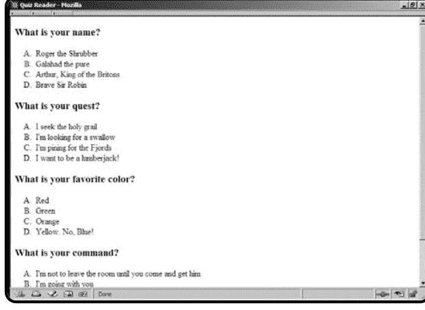

图 8.9
`quizreader.php` 程序读取 XML 文件并格式化为 HTML

XML 代码稍微复杂一些，你可能需要仔细检查原始 XML 代码以进行解析。一旦我意识到该文档本质上是一个问题数组，XML 的解析变得相对简单了：

```php
<!doctype html "//W3C//DTD HTML 4.0 //EN">
<html>
<head>
<title>Quiz Reader</title>
</head>
<body>
<?php
//quiz reader
//演示如何处理更复杂的 XML 文件
// 加载测验文件
$xml = simplexml_load_file("quiz.xml");
// 以关联数组的形式遍历测验
foreach($xml->children() as $problem) {
// 将每个问题打印为有序列表。
print <<HERE
<h3>$problem->question</h3>
<ol type="A">
<li>$problem->answerA</li>
<li>$problem->answerB</li>
<li>$problem->answerC</li>
<li>$problem->answerD</li>
</ol>
HERE:
} //  foreach
// 直接访问节点：
print $xml->problem[0]->question;
?>
</body>
</html>
```

此过程可以通过若干步骤完成：

1. 将测验加载为 XML 数据。
2. 使用 `foreach` 循环检查 XML 的 `children()` 数组中的每个元素，将其视为独立的问题。在这个示例中，`$problem` 变量不包含字符串数据，而是另一个包含其元素的节点。
3. 在循环内部，使用标签引用来指示你想要显示的问题元素。（注意，我选择不显示每个问题的答案，但如果我需要，也可以这样做。）

如果你想显示特定元素的值，请使用数组风格语法。
此行引用了 0 号问题：

```php
print $xml->problem[0]->question;
```

然后它查找问题中名为 `question` 的子元素并显示它。如果你正在处理极其极其复杂的 XML 文档，可以使用这样的结构直接映射到特定元素。本质上，`simpleXML` 系统允许你将 XML 文档视为一组嵌套数组。这允许你以任何你需要的详尽程度访问可能复杂的文档。

## 在现实世界中

你可能在以下主要场景中想要 XML 数据：

- 你想为信息提供一个更好的组织方案，但又不想亲自处理它。

## 使用 MySQL 创建数据库

当你开始学习 PHP 编程时，你从非常简单的变量开始。很快，你就学会了如何使用数组和关联数组处理更有趣的事情。你又增加了文件操作的能力以获得了巨大的技能。现在，你将学习如何使用关系型数据库来管理数据。在本章中，你将发现如何构建一个基础数据库以及如何将其连接到你的 PHP 程序中。具体而言，你将学习到：

- 如何启动 MySQL 执行文件
- 如何构建基础数据库
- 核心数据定义 SQL 语句
- 如何返回基础 SQL 查询结果
- 如何使用 `phpMyAdmin` 管理你的数据库
- 如何将数据库整合到 PHP 程序中

## 介绍冒险生成程序

数据库是严肃的工具，但它们也可以很有趣。图 9.1 到 9.4 显示的程序了如何使用数据库为冒险游戏生成器提供支持。冒险生成器是一个允许用户创建和玩简单多选择冒险游戏的系统。这种风格的游戏由几个节点组成。每个节点描述某种决策。在每个情况下，用户都可以从三个选项中进行选择。用户的选择会导致新的决策。如果用户做出系列正确选择，他们就赢得了游戏。

图 9.1
用户可以选择一个选项。
我正跳进那个子任务……

这个程序作为一个游戏很有趣，但真正令人兴奋的部分是用户如何修改这个游戏。用户可以使用同一个系统来创建和修改冒险游戏。图 9.3 显示了谜游戏背后的数据。请注意，你可以通过点击此屏幕上的相应按钮来编辑任何节点。

如果用户选择编辑某个片段，将出现图 9.4 所示页面。

## 第 9 章 使用 MySQL 创建数据库

图 9.2
也许仓库终究是更好的选择。

图 9.3
此页面提供了有关游戏中每个片段的信息，包括指向直接编辑每个片段的链接。

图 9.4
从此屏幕可以更改节点的所有属性。到目前为止创建的所有节点都可以作为新位置可用。（注：OCR 文字可能是指图 9.4）

如你所见，数据结构是这个游戏最重要的元素。你已经知道了一些处理数据的方法，但本章引入了关系型数据库管理系统（RDBMS）的概念。RDBMS 是一个帮助程序员处理数据的系统。冒险生成器程序使用数据库来存储和操作所有数据。

## 使用数据库管理系统

数据是现代编程的重要部分，整门编程语言都致力于操作数据库。数据库语言的主要标准是结构化查询语言（SQL）。SQL 是一种用于创建数据库、在数据库中存储信息以及从数据库中检索信息的标准化语言。特殊的应用程序和编程环境专门用于解释 SQL 数据并对其采取操作。

通常，程序员首先在 SQL 中创建数据结构，然后用其他语言（如 PHP）编写程序以允许访问该数据。随后，PHP 程序可以制定数据请求或更新，并将这些请求/更新传递给 SQL 解释器。这种方法有几个优点：

- 一旦你学会了 SQL，就可以轻松将其应用到新的编程语言。
- 你可以轻松地为现有数据集添加多个接口，因为许多编程语言都有访问 SQL 解释器的方法。有许多关系型数据库管理系统可用，MySQL 环境特别适合与 PHP 配合。

> 无论你处理的是什么类型的数据库，SQL 的基本概念都是保持相同的。在本章描述的大多数 SQL 命令在 Microsoft Access、Microsoft SQL Server、Oracle 以及许多其他 RDBMS 软件包中无需修改即可运行。

我从本章开始，将首先解释如何在 MySQL 中创建一个简单的数据库。你可以以多种方式使用此软件包，但请从在文本文件中编写构建数据库的脚本开始。SQL 语言在语法和风格上与 PHP 不同。我将向你展示如何使用一些可视化工具来帮助处理数据库，以及如何使用 PHP 5 内的 SQLite 数据库。在第 10 章“在 PHP 中连接数据库”中，我将向你如何在 PHP 内部连接并操作你的 MySQL 数据库。

## 与 MySQL 工作

有很多 RDBMS 软件包可用。这些程序在功能、灵活性价格方面各异。然而，它们的工作方式本质相同。书中的大多数示例都使用 MySQL 数据库。

- 它本身就是一个非常强大的程序。它处理了最昂贵且强大的数据库软件包的大部分功能。
- 它使用了著名的 SQL 数据语言的标准形式。
- 它以开源许可协议发布。
- 它可以在许多操作系统上运行。
- 它运行速度非常快。
- 它带有很多许多函数。

## 安装 MySQL

如果你正在运行 Web 服务器，你必须在运行客户端之前运行 MySQL 服务器。在 Windows 下，运行 `WinMySQLAdmin` 工具来启动 MySQL 服务器。这会自动启动 MySQL 服务器并设置你的系统，使得 MySQL 在计算机启动时作为服务运行（类似于 Apache）。在控制面板的“服务”部分或通过系统托盘中出现的 MySQL 工具菜单关闭 MySQL 服务器。

## MySQL 执行文件

MySQL 实际上是许多程序。它有一个始终运行的服务器组件，以及一些实用程序。图 9.5 所示的命令行控制台是一个基础程序。它并不漂亮，但它提供了对数据库的低级访问。

图 9.5
MySQL 程序连接到数据库。

## 命令行控制台

随 MySQL 提供的 exe 控制台是与其交互的最佳方式。尽管它不会获得任何用户界面奖，但该程序提供了对数据库的低级访问。然而，学习这个界面很重要，因为它非常像程序与数据库交互的方式。

## 创建数据库

数据库通过非常特定的组织方案来描述。为了说明数据概念，我创建并查看了一个简单的电话列表。电话列表的基本结构在表 9.1 中。

| 表 9.1 电话列表摘要 |
| id | firstName | lastName | e-mail | phone |
|---|---|---|---|---|
| 0 | Andy | Harris | aharris@cs.iupui.edu | |
| 1 | Joe | Slow | jslow@myPlace.net | 987-6543 |

电话列表显示了一个非常典型的数据表。数据库人员给数据库的各个赋予了特殊的名称。

- 表中的每一行被称为*记录*。记录描述离散的（单独定义的）实体。

表中的每个记录具有相同的字段定义，但记录在字段中的值可以是不同的。表中的字段是以特定的方式定义的。

由于数据库表是存储在文件中的，计算机必须始终知道为每个字段分配多少空间。因此，每个字段的大小和类型至关重要。这个特定的数据库包含五个字段。`id` 字段是一个整数。所有其他字段都包含字符串（文本）数据。

## 创建表

当然，为了使用数据库系统，你需要学习如何构建表。

关系型数据库管理系统（RDBMS）程序使用名为 SQL 的语言来创建和操作数据库。与完整的编程语言相比，SQL 很容易理解。通常你不需要过多的知识就能猜出发生了什么。例如，看以下 SQL 代码：

```sql
USE chapter9;
CREATE TABLE phoneList (
  id INT PRIMARY KEY,
  firstName VARCHAR(15),
  lastName VARCHAR (15),
  email VARCHAR(20),
  phone VARCHAR(15)
);
DESCRIBE phoneList;
```

这段代码是一个 SQL 脚本。它与 PHP 程序很相似，因为它是一组发送给计算机的指令。然而，PHP 解释器并不直接与 SQL 语言交互。相反，这些命令会被发送给另一个程序。作为一名 PHP 程序员，你将编写发送到数据库语言的代码。就像你的 PHP 代码经常编写 HTML 格式的代码供浏览器解释一样，你也将编写 SQL 代码供 MySQL 解释器使用。

当这段代码被发送到符合 SQL 标准的数据库程序（如 MySQL）时，它会创建表 9.1 所示的数据库结构。

## 使用数据库

你可能在同一个关系型数据库系统中运行多个数据库项目。在我的情况下，每个章节都有自己的数据库。有时你的系统管理员会为你分配一个数据库。无论如何，你可能都需要使用 `USE` 命令来调用该数据库。

## SQL 的优势

从一开始，数据库一直是编程的重要部分，但处理数据的过程已经演变。一种可以在许多应用程序中使用的通用语言出现是非常重要的一步。SQL 是一种第四代语言。通常，这些语言是为了解决特定类型的问题设计的。某些第四代语言（如 SQL）并不是完整的编程语言，因为它们不支持分支和循环等结构。

尽管如此，这些语言仍然可以发挥作用。SQL 之所以方便是因为被广泛支持。你在本章中学到的 SQL 命令几乎不需要修改即可应用于大多数现代数据库程序。你可以获取 MySQL 中的脚本，并将相同的代码发送到 Oracle 或 MS SQL Server（另外两个常见选择），而这三个程序都会构建相同的数据库。如果你升级到更强大的数据包，可以使用现有的脚本来处理数据。如果你正在使用 SQLite，你的 SQL 命令将与 MySQL 中使用的命令几乎完全相同。

> SQL 语法与 PHP 并不相同。SQL 有一套不同的文化，尊重 SQL 代码历史上的编写方式是有意义的。SQL 通常对大小写不敏感，但大多数 SQL 编码人员会将 SQL 命令大写字母。当将一组 SQL 命令放在文件中时（如这段代码所示），你通常会在每行末尾加上分号。
>
> 如果你还没有一个可以 `USE` 的数据库，可以使用 `CREATE` 命令创建一个。例如，使用这些命令创建一个名为 `myStuff` 的数据库：
>
> ```sql
> CREATE DATABASE myStuff;
> USE myStuff;
> ```

## 创建表

要创建一个表，必须指定表名以及每个字段。对于每个字段，列出该字段存储的数据类型，以及（对于文本数据）字段的字符长度。例如，以下代码创建了 `phoneList` 表：

```sql
CREATE TABLE phoneList (
  id INT PRIMARY KEY,
  firstName VARCHAR(15),
  lastName VARCHAR (15),
  email VARCHAR(20),
  phone VARCHAR(15)
);
```

你可以将字段想象成非常像变量，虽然 PHP 对变量中的数据类型很宽容，但 SQL 对字段中的数据类型非常挑剔。为了创建一个高效的数据库，MySQL 需要确切知道为数据库中的每个字段留出多少字节的内存。这主要是通过要求数据库设计者指定每个表中每个字段的类型和大小来实现的。表 9.2 列出了 MySQL 支持的几种主要数据类型。

## 表 9.2 MySQL 中的常用数据类型

| 数据类型 | 说明 |
| :--- | :--- |
| INT | 标准整数 +/- 20 亿（约） |
| BIGINT | 大整数 +/- 9 x 10^18 |
| FLOAT | 38 位浮点小数 |
| DOUBLE | 308 位双精度浮点数 |
| CHAR(n) | 长度为 n 的文本；如果实际值小于 n，则字段将用空格填充 |
| VARCHAR(n) | 长度为 n 的文本；末尾空格会自动删除 |
| DATE | YYYY-MM-DD 格式的日期 |
| TIME | HH:MM:SS 格式的时间 |
| YEAR | YYYY 格式的年份 |

> 虽然表 9.2 列出的数据类型是最常用的，但 MySQL 还支持许多其他类型。如果你需要更具体的类型，请查阅 MySQL 的在线帮助文档。

## 处理字符串数据

检查表的结构非常有帮助，特别是当表是由别人创建的，或者你不确切字段类型或大小时。`DESCRIBE` 命令可以让你查看表结构。

## 插入值

一旦你创建了表，就可以开始向其中添加数据了。`INSERT` 命令是添加记录的主要工具。

```sql
INSERT INTO phoneList
VALUES (
0, 'Andy', 'Harris', 'aharris@cs.iupui.edu', '123-4567'
);
```

`INSERT` 语句允许你向数据库中添加记录。值的列表顺序必须与字段定义的顺序完全一致。每个值之间用逗号分隔，`VARCHAR` 和 `CHAR` 类型必须括在单引号中。

如果你有大量数据需要加载，可以使用 `LOAD DATA` 命令。该命令接受一个制表符分隔的文本文件，每行一条记录，字段之间用制表符分隔。它将整个文件加载到数据库中。这通常是向数据库加载测试数据最快的方法。以下行将名为 `addresses.txt` 的文件加载到 `phoneList` 表：

```sql
LOAD DATA LOCAL INFILE "addresses.txt" INTO TABLE phoneList;
```

图 9.7 显示了我在表中添加一条记录后的 MySQL 工具界面。


图 9.6
这是我创建 `phoneList` 表后的命令行工具界面。

## 在现实世界中

在你构建数据库时，请用测试值填充数据库。在现阶段不要使用真实数据，因为在你对它进行一段时间的折腾之前，你的数据库是无法正常工作的。然而，你的测试值应该反映你的数据库将要存储的数据类型。在这里，你可能会发现某些问题，例如字段太小或缺失。

```sql
command-prompt mysql>
mysql> use chapter1;
Database changed.
mysql> CREATE TABLE phonelist(
-> id INT PRIMARY KEY,
-> firstName VARCHAR(25),
-> lastName VARCHAR(25),
-> email VARCHAR(20),
-> phone VARCHAR(15)
);
Query OK, 0 rows affected (0.04 sec)
mysql> insert into phonelist (id, firstName, lastName, email, phone)
-> VALUES (0, 'Andy', 'Harris', 'aharris@cs.iupui.edu', '123-4567');
Query OK, 1 row affected (0.05 sec)
```


MySQL 告诉你操作成功了，但你并没有得到更多信息。

## 查询结果

当然，你想看到你所有建表活动的结果。如果你想查看表中的数据，可以使用 `SELECT` 命令。这也许是 SQL 中最强大的命令，但它的基础语法非常简单。使用此命令查看 `phoneList` 表中的所有数据：

```sql
SELECT * FROM phoneList
```

此命令收集 `phoneList` 数据库中所有记录的所有字段，并以表格格式显示它们。

图 9.8 显示了我在添加 `SELECT` 语句获取结果后的情况。

## 编写脚本来创建表

```sql
command prompt - mysql>
> phone VARCHAR(15)
> 
Query OK, 0 rows affected (0.04 sec)
mys> DESCRIBE phonelist;
| Field | Type | Null | Key | Default | Extra |
|---|---|---|---|---|---|
| id | Int(1) | NO | PRI | | |
| firstName | varchar(15) | YES | | NULL |
| lastName | varchar(15) | YES | | NULL |
| email | varchar(15) | YES | | NULL |
| phone | varchar(15) | YES | | NULL |
5 rows in set (0.07 sec)
mysql>
mys> INSERT INTO phonelist VALUES (
0, Andy, Harris, aharris@cs.iupui.edu);
Query OK, 1 row affected (0.05 sec)
mys> SELECT * FROM phonelist;
| id | firstName | lastName | email | phone |
|---|---|---|---|---|
| 0 | Andy | Harris | aharris@cs.iupui.edu | 123-4567 |
1 row in set (0.00 sec)
mys>
```


`SELECT` 语句的结果是一个表，与原始表一样。

理解如何用 SQL 手动创建表是非常重要的，因为你的程序必须完成相同的工作。然而，在 MySQL 窗口中直接编写 SQL 代码是非常繁琐的。当你创建实际应用程序时，通常需要多次构建和重建数据表才能对它们满意，这在命令行界面中操作会很笨拙。此外，当你编写与数据库交互的程序时，可能会导致损坏原始数据的错误。

准备一个脚本以便用测试数据轻松重建数据库是好的。大多数程序员会使用文本编辑器创建一个 SQL 命令脚本（使用你编写 PHP 代码的同一个编辑器），并使用 `SOURCE` 命令加载该代码。以下是创建 `phoneList` 数据库的 SQL 脚本：

### 构建我的 MySQL 列表
```sql
USE chapter9;
DROP TABLE IF EXISTS phonelist;
CREATE TABLE phonelist (
id INT PRIMARY KEY,
firstName VARCHAR(25),
lastName VARCHAR(25),
email VARCHAR(20),
phone VARCHAR(15)
);
INSERT INTO phonelist VALUES (0, 'Andy', 'Harris', 'aharris@cs.iupui.edu', '123-4567');
```

`phpMyAdmin` 基本上为类似 Microsoft Access 的程序提供了可视化编辑工具。它还添加了一些工具用于添加记录、查看数据、将数据导出为各种格式以及处理结构。该程序用 PHP 编写的，请将其安装到服务器的 HTML 路径（如果你使用 Apache 服务器，通常位于 `htdocs`）。

> 技巧：`phpMyAdmin` 的一些高级功能包括自动处理关系、创建数据图表以及其他特殊配置。如果你的服务器管理员没有启用这些功能，请参阅 http://www.garvinning.de/tops/texte/imetutorial 的优秀教程。

## 连接服务器

MySQL 是一个客户端/服务器应用程序。MySQL 服务器通常运行在 PHP 程序所在的 Web 服务器上。你可以通过 `phpMyAdmin` 等 MySQL 客户端连接到任何 MySQL 服务器。图 9.10 显示 MySQL 连接。


重要的是，你可以连接到任何你有权限使用的数据服务器。该服务器不需要位于你使用的物理机器上。例如，如果你想使用 `phpMyAdmin` 查看你维护的远程 Web 服务器上的数据，这是非常有用的。然而，许多远程 Web 服务器未配置接受此类访问，因此你应该了解如何使用 MySQL 控制台。

> 技巧：第一次运行 `phpMyAdmin` 时，它可能会要求一些登录信息。这些数据会被存储，这样你就不需要每次都记住。如果你想更改登录或尝试其他 `phpMyAdmin` 功能，请编辑 `phpMyAdmin` 文件夹中的 `config.inc.php` 文件。

## 创建和修改表格

`phpMyAdmin` 提供了可视化工具帮助可视化工具。列表对我来说太单调了，我将创建一个表来演示 `phpMyAdmin` 的功能。这个新表包含随机生成的超级英雄。从左框选择表格，并使用结果页的“创建新表”部分创建一个新表。图 9.11 显示用于创建表格或更改其结构的对话框。


使用 `phpMyAdmin` 创建表格并修改其结构很容易。通过 `phpMyAdmin`，你可以从下拉列表中选择类型；许多字段属性可以通过复选框提供。选择类型时（如果是字符字段则指定长度）至关重要。当你完成表格修改后，将为你生成并执行正确的 SQL。

## 编辑表格数据

无聊时可以看看这个网站：http://home.hiwaay.net/~lkseitz/comics/herogen/。特别感谢 Lee Seitz 和他的疯狂超级英雄生成器。

你可以使用 `phpMyAdmin` 以类似于电子表格的格式浏览表格。图 9.12 展示了这种能力。


| id | 名字 | 力量 | 武器 | 交通工具 |
|---|---|---|---|---|
| 0 | 一教授 | 地震产生 | 激光笔 | 二进制牛 |
| 1 | 蝙蝠虫 | 超速 | 豹子带 | 蝙蝠出租车 |
| 2 | 千年豹子 | 死亡呼吸 | 豹子弹 | 豹子潜艇 |
| 3 | 闪守护者 | 电击脚趾 | 守护者 | 守护者摩托车 |
| 4 | 牦机器人 | 超级小屋 | 牦牛油火焰喷射器 | 牦牛飞艇 |

使用“浏览”选项卡查看表格数据。

按照以下步骤在 `phpMyAdmin` 中编辑表格：

1. 从 SQL 屏幕左侧的表格列表中选择表格。表格以电子表格格式出现在屏幕主要部分。你可以在此窗口编辑表格内容。
2. 点击记录附近显示的相应图标来编辑或删除记录。
3. 点击表格底部相应的链接添加行。
4. 离开你编辑的单元格或按回车键。你对表格数据进行的任何更改都会自动转换为相应的 SQL 代码。

## 导出表格

`phpMyAdmin` 最有趣的功能之一涉及导出表格信息。你可以生成多种数据格式。“导出”选项卡看起来就像页面 9.13。


导出结果对话框允许你以多种格式保存表格数据。

你可能更喜欢将结果保存为第 6 章“处理文件”中讨论的某种分隔符格式。通过选择逗号分隔值 (CSV) 选项并选择你的，你可以轻松生成此类格式。在以下情况下，这是一个很好的选择：

- 你希望数据能被电子表格读取。
- 你正在编写一个可以处理此类格式但无法直接访问数据库的程序。

Excel CSV 格式配置了数据，使得 Excel 电子表格可以轻松读取。普通的 CSV 格式允许你……

你可能想要获取数据库中所有姓氏以 E 开头的英雄列表，或者也许有人把一辆雅牦式飞气艇（Yak Dirigible）停在了你的停车位上，你需要知道是谁开的。你可能还希望列表按特殊能力排序，或者只列出车辆。所有这些（诚然是人为假设的）场景都涉及获取原始数据的子集。`SELECT` 语句是 SQL 的主力工具。

1. 点击 SQL 标签页以在 `phpMyAdmin` 中打开查询界面。
2. 输入查询。
3. 点击 Go 按钮查看查询结果。

你已经见过该命令最简单的形式，即获取表中的所有数据，如下：

```sql
SELECT * FROM hero;
```

图 9.19 显示了这种形式的 `SELECT` 语句作用于 `hero` 表。

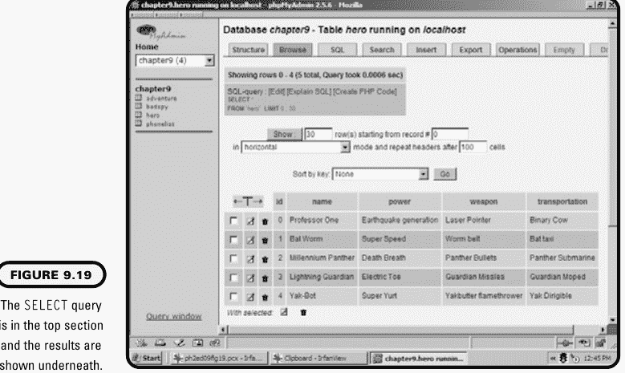

`SELECT` 查询位于顶部，结果显示在下方。

`phpMyAdmin` 是实验 `SELECT` 语句极好的工具，因为你可以手动编写 SQL 并在非常整洁的格式立即查看结果。如果你不想（或无法）使用 `phpMyAdmin`，可以直接在 MySQL 中进行实验。它可以运行，但结果是以文本格式化的，并不总是容易查看。

`SELECT` 语句非常强大，因为它可以获取数据的子集，只返回请求的字段和记录。这种向数据库提问的过程通常被称为查询（query）。注意，`phpMyAdmin` 有时会向查询添加元素（特别是 `limit` 限制）。这提高了查询的效率，但并没有从本质上改变查询。

## 限制列

你可能不需要表中的所有字段。例如，你可能只需要列表中每个人的名字和武器。你可以通过使用 `SELECT` 语句来指定这一点，如图 9.20 所示。

```sql
SELECT name, weapon
FROM hero;
```


此查询仅返回名称和武器。

对于像 `hero` 列表这样简单的数据库，这种功能似乎很没意义。然而，你经常会遇到具有许多字段的极其复杂的表，并且只需要过滤少数字段。例如，我使用数据库来跟踪我的指导学生。每个学生的信息都包含大量数据，但我可能只需要一个名字和电子邮件地址的列表。分离出我需要的字段的能力是从数据库中获取有用信息的基础。

查询的结果看起来非常像一张新表。你可以将查询结果视为一个临时表。

## 使用 WHERE 子句限制行

除了限制查询中返回的列之外，你可能对限制行数感兴趣。例如，你可能会遇到一个只能用激光笔击败的邪恶反派。图 9.21 显示的查询说明了一个恰好解决这一困境的查询。


如果你知道如何设置查询，就可以获得非常具体的的结果。在这种情况下，查询只选择了那些拥有有激光笔的英雄。

此代码仅返回匹配特定条件的行：

```sql
SELECT *
FROM hero
WHERE weapon = 'Laser Pointer';
```

## 使用 WHERE 子句添加条件

查询中的 `WHERE` 语句指定你想看到的行。该子句允许你指定一个条件。数据库管理器检查表中的每条记录。如果该记录的条件为 `TRUE`，则它会被包含在结果集中。`WHERE` 子句中的条件与 PHP 代码中的条件相似，但它们并不完全相同。在 SQL 中使用这些符号：

- 使用单等号 (`=`) 表示相等。
- 将文本元素包含在单引号 (`''`) 中。
- 使用 `<`, `>`, `<=` 或 `!=` 条件来限制你的搜索。

比较运算符对于数值型数据（如整数和浮点数）来说很容易理解。语言如何处理文本比较并不完全直观。SQL 已经制定了一些标准规则，但每个实现都可能略有不同。SQL 通常以不区分大小写的方式运行，因此 `Yak-Bot` 会匹配 `yak-bot` 或 `yAK-BOT`。此外，`<` 和 `>` 运算符指的是字母顺序，以下代码选取了所有名字以 A、B 或 C 开头的记录。

```sql
SELECT *
FROM hero
WHERE name < 'D';
```

## 使用 LIKE 子句进行部分匹配

通常你并不知道要尝试匹配的字段的确切值。`LIKE` 子句允许你指定部分匹配。例如，哪些英雄拥有某种超能力？此查询返回每个能力以 `Super` 开头的英雄：

```sql
SELECT *
FROM hero
WHERE power LIKE 'Super%';
```

百分号 (`%`) 可以作为一个通配符，表示任意次数的任意字符。你可以使用 `LIKE` 子句的变体来查找所有交通工具方案以字母 B 开头的英雄相关信息：

```sql
SELECT name, transportation
FROM hero
WHERE transportation LIKE 'B%';
```

你还可以使用下划线 (`_`) 来指定单个字符。

> SQL 中简单的通配符支持已足够许多用途。如果你喜欢表达式，请使用 `REGEXP` 子句来指定字段是否匹配正则表达式。

## 生成多个条件

你可以结合 `AND`、`OR` 和 `NOT` 关键字组合条件以实现更复杂的表达式。例如，以下代码选取交通工具以 B 开头且具有 super 能力的英雄：

```sql
SELECT *
FROM hero
WHERE transportation LIKE '%B%'
AND power LIKE '%super%';
```

## 使用 ORDER BY 子句排序

`SELECT` 语句的另一个功能是可以按任何字段进行排序。图 9.22 和 9.23 说明了 `ORDER BY` 子句如何决定表的排序。

`ORDER BY` 子句允许你指定任何字段作为排序字段。`DESC` 子句指定数据应按降序排列。


图 9.22
此查询按武器降序显示整个数据库。

## 使用 UPDATE 语句更改数据

你可以使用 SQL 修改数据库中的数据。这种行为的关键是 `UPDATE` 语句。一个示例有助于理解：

```sql
UPDATE hero
SET power = 'Super Electric Toe'
WHERE name = 'Lightning Guardian';
```


PHP 5/MySQL Programming for the Absolute Beginner


#### 图 9.23
此代码将 `Lightning Guardian` 更新为 `Super Electric Toe`（这可能比普通的 `Electric Toe` 好得多），通常，你一次只更新一条记录。你可以使用 `WHERE` 子句来选择要更新的表中记录。

## 回到冒险游戏

在本章开始的冒险游戏使用了 MySQL 和 PHP 代码的结合。你可以在第 10 章“在 PHP 中连接数据库”中学习更多 PHP 部分。现在你有了足够的信息来构建游戏核心的数据结构。

## 设计数据结构

冒险游戏完全关于数据，并且具有极其重复的结构。相同的代码在数据库的不同部分反复运行我在我在程序时草拟了主要的游戏界面，并思考每个屏幕需要的数据元素。我最终建立了像表 9.3 这样的表。

你可以看到我简化了游戏，使得每个选择都归于元素。每个节点（或决策点）包含一个 id（或房间号）、房间名称和当前情况的描述。每个节点还具有

## 表 9.3 尼格玛冒险游戏数据结构

| id | 名称 | 描述 | 北 | 东 | 南 | 西 |
|---|---|---|---|---|---|---|
| 0 | -无- | 你不能往那里去！ | 1 | 0 | 0 | 0 |
| 1 | 重新开始 | 你在一个潜艇制造厂，寻找著名的尼格玛密码机 | 0 | 3 | 0 | 2 |
| 2 | 潜艇甲板 | 当你踏上潜艇甲板时，一名守卫向你走来。唯一的选择是在被抓住之前跳下潜艇。 | 15 | 15 | 15 | 15 |
| 3 | 仓库 | 你在仓库内等待。你看到东边有一扇门，前方有一个箱。 | 0 | 4 | 5 | 0 |
| 4 | 门口 | 你直接走进了一群守卫。这看起来不太妙…… | 0 | 19 | 0 | 15 |
| 5 | 箱子 | 你爬进箱子里等待。突然，你感到被提起并运过了码头！ | 6 | 0 | 0 | 7 |
| 6 | 等待 | ...你等待箱子在一个黑暗的空间停稳。你可以向前或向后移动…… | 8 | 0 | 9 | 0 |
| 7 | 跳出 | 你决定跳出箱子，但你在码头的尽头被困住了。 | 15 | 19 | 15 | 15 |
| 8 | 向前 | 当你向前移动时，两个水员抓住了你并将你扔出了舱。 | 15 | 15 | 15 | 15 |
| 9 | 向后 | 在一个黑暗的房间里，你看到了尼格玛设备。你如何把它带出潜艇？ | 13 | 11 | 10 | 12 |
| 10 | 尼格玛发信号 | 你使用尼格玛设备发送信号。盟军识别了你的信号，并在潜艇浮面时包围了它。 | 14 | 0 | 0 | 0 |
| 11 | 击出生路 | 在潜潜艇上进行枪战是个坏主意…… | 19 | 0 | 0 | 0 |
| 12 | 带着尼格玛等待 | 你在等待，水员们发现尼格玛丢失了并在整个潜艇中寻找。你被发现了并扔进了鱼雷管。 | 15 | 0 | 0 | 0 |

## 表 9.3 尼格玛冒险游戏数据结构（续）

| id | 名称 | 描述 | 北 | 东 | 南 | 西 |
|---|---|---|---|---|---|---|
| 13 | 替换尼格玛并等待 | 你将尼格玛放回原位并耐心等待，但再也没有了另一个。当潜艇入港时，你被发现了。 | 19 | 0 | 0 | 0 |
| 14 | 胜利 | 恭喜！你捕获了设备并缩短了战争！ | 1 | 0 | 0 | 0 |
| 15 | 水中 | 你在水里。潜艇离开了。它看起来像…… | 19 | 0 | 0 | 0 |
| 16 | | | 0 | 0 | 0 | 0 |
| 17 | | | 0 | 0 | 0 | 0 |
| 18 | | | 0 | 0 | 0 | 0 |
| 19 | 游戏结束 | 游戏结束。你输了。 | 1 | 0 | 0 | 0 |

指针描述了当用户选择从该节点向各个方向移动时发生的情况。例如，如果用户在仓库（节点 3）并选择向东走，他将到达节点 4，即代表门口。从节点 3 向南走将用户带到节点 5，即箱子。该数据结构表示了用户在游戏中可以去的所有地方。我选择考虑胜利节点和失败节点，因此游戏中的所有内容都可以封装在表格中。

理解在纸上创建表格是第一步至关重要。一旦你决定了程序需要什么类型的数据，就可以考虑如何将这些数据组合。选择数据库给了我极大的控制权，并使数据处理变得简单。也许令人惊讶的是，这个程序只需更改数据库即可处理完全不同的游戏。我不需要更改任何代码来让游戏变得完全不同。我需要做的只是指向不同的数据库或更改数据库。

一旦我决定了数据结构，我就编写了一个 SQL 脚本来创建数据库的初稿。该脚本所示：

```sql
## build Adventure SQL File
## for MySQL
## Andy Harris
DROP TABLE IF EXISTS adventure;
CREATE TABLE ADVENTURE (
id int PRIMARY KEY,
name varchar(200),
description varchar(200),
north int,
east int,
south int,
west int
);
INSERT INTO adventure values(
0, 'lost', '你不能往那里去!',
1, 0, 0, 0
);
INSERT INTO adventure values(
1, 'start', '你在一个潜艇制造厂，寻找著名的尼格玛密码机',
0, 3, 0, 2
);
INSERT INTO adventure values(
2, 'sub deck', '当你踏上潜艇甲板时，一名守卫向你走来。唯一的选择是在被抓住之前跳下潜艇。',
15, 15, 15, 15
);
INSERT INTO adventure values(
3, 'warehouse', '你在仓库内等待。你看到东边有一扇门，前方有一个箱。',
0, 4, 5, 0
);
INSERT INTO adventure values(
4, 'doorway', '你直接走进了一群守卫。这看起来不太妙……',
0, 19, 0, 15
);
INSERT INTO adventure values(
5, 'box', '你爬进箱子里等待。突然，你感到被提起并运过了码头！',
6, 0, 0, 7
);
INSERT INTO adventure values(
6, 'wait', '...你等待箱子在一个黑暗的空间停稳。你可以向前或向后移动……',
8, 0, 9, 0
);
INSERT INTO adventure values(
7, 'jump out', '你决定跳出箱子，但你在码头的尽头被困住了。',
15, 19, 15, 15
);
INSERT INTO adventure values(
8, 'forward', '当你向前移动时，两个水员抓住了你并将你扔出了舱。',
15, 15, 15, 15
);
INSERT INTO adventure values(
9, 'aft', '在一个黑暗的房间里，你看到了尼格玛设备。你如何把它带出潜艇？',
13, 11, 10, 12
);
INSERT INTO adventure values(
10, 'signal on Enigma', '你使用尼格玛设备发送信号。盟军识别了你的信号，并在潜艇浮面时包围了它。',
14, 0, 0, 0
);
INSERT INTO adventure values(
11, 'shoot your way out', '在潜潜艇上进行枪战是个坏主意……',
19, 0, 0, 0
);
INSERT INTO adventure values(
12, 'wait with Enigma', '你在等待，水员们发现尼格玛丢失了并在整个潜艇中寻找。你被发现了并扔进了鱼雷管。',
15, 0, 0, 0
);
INSERT INTO adventure values(
13, 'replace Enigma and wait', '你将尼格玛放回原位并耐心等待，但再也没有了另一个。当潜艇入港时，你被发现了。',
19, 0, 0, 0
);
INSERT INTO adventure values(
14, 'Win', '恭喜！你捕获了设备并缩短了战争！',
1, 0, 0, 0
);
INSERT INTO adventure values(
15, 'Water', '你在水里。潜艇离开了。它看起来像……',
19, 0, 0, 0
);
INSERT INTO adventure values(16, '', '', 0, 0, 0, 0);
INSERT INTO adventure values(17, '', '', 0, 0, 0, 0);
INSERT INTO adventure values(18, '', '', 0, 0, 0, 0);
INSERT INTO adventure values(
19, 'Game Over', '游戏结束。你输了。',
1, 0, 0, 0
);
```

## 章节：在 PHP 中连接数据库

在讨论了这么多数据库内容之后，你可能急于将数据库连接到你的 PHP 程序中。PHP 以其无缝的数据库集成而闻名，特别是与 MySQL 的集成。实际上，在 PHP 内部连接 MySQL 数据库非常简单。一旦建立了连接，你就可以向数据库发送 SQL 命令，并将结果作为你可以在 PHP 程序中使用的数据接收回来。

在本章结束时，你将构建出在第 9 章“使用 MySQL 创建数据库”开头介绍的冒险游戏。如你所见，如果数据设计得当，编程并不困难。具体来说，你将学习如何：

- 从 PHP 内部获取 MySQL 数据库的连接。
- 使用特定的数据库。
- 向数据库发送查询。
- 解析查询结果。
- 检查数据错误。
- 从数据结果构建 HTML 输出。

# 连接 Hero 数据库

为了展示数据库连接的工作原理，我编写了一个简单的 PHP 程序，它返回你在第 9 章中创建的 Hero 数据库中的所有值。图 10.1 展示了 Show Hero PHP 程序。


我决定回到这个简单的数据库，而不是更复杂的冒险游戏。当你学习新概念时，最好从最简单的环境开始，然后转向更复杂的情况。该数据库包含许多信息，记录之间的相互指向关系非常复杂。通过一个简单的数据库，我确保在处理具有自身复杂性的生产数据库之前，已经理解了数据库连接的基础知识。


| id | name | power | weapon | transportation |
|---|---|---|---|---|
| 0 | Professor One | 地震生成 | 激光笔 | 雪牛 |
| 1 | Bat Worm | 超速 | 蠕虫带 | 蝙蝠坦克 |
| 2 | Millennium Panther | 死亡呼吸 | | 豹子子弹 | 豹子潜艇 |
| 3 | Lightning Guardian | 电脚趾 | 守护者先生 | 守护者摩托车 |
| 4 | Yah-Hot | 超级龟 | | 牦牛油火焰喷器 | 雅双 |

# 图 10.1
此 HTML 表格是由读取数据库的 PHP 程序生成的。

以下是生成此页面的代码：

```html
<body>
<h1>Show Heros</h1></h1>
```

```php
<?php
// 建立数据库连接
$conn = mysql_connect("localhost", "", "");
mysql_select_db("chapter7", $conn);
// 创建查询
$sq = "SELECT * FROM hero";
$result = mysql_query($sq, $conn);
print "<table border = 1>\n";
// 获取字段名
print "<tr>\n";
while ($field = mysql_fetch_field($result)) {
    print "<td>${$field->name}</td>\n";
} // 结束 while
print "</tr>\n\n";
// 以关联数组获取行数据
while ($row = mysql_fetch_assoc($result)) {
    print "<tr>\n";
    // 查看每个字段
    foreach ($row as $col=$val) {
        print "<td>${$val}</td>\n";
    } // 结束 foreach
    print "</tr>\n\n";
} // 结束 while
print "</table>\n";
?>
</body>
</html>
```

浏览一下代码，你会发现它除了几个以 `mysql_` 开头的新函数外，都是很熟悉的。这些函数允许访问 MySQL 数据库。如果你查阅 PHP 文档，会发现针对其他几种类型的数据库也有类似的函数，包括 Oracle、Informix、mSQL 和 ODBC。你会发现，无论你使用哪种数据库，连接和使用其他数据库的过程大体相同。

本章详细介绍了连接到 MySQL 数据库的过程。如果你使用的是 SQLite，请参阅 CD 上的附录 B，了解如何修改本章代码以适用于替代数据库。概念保持完全相同，但某些细节有所变化。

# 获取连接

首要任务是在你的 PHP 程序和 MySQL 服务器之间建立连接。你可以连接到任何你有权限使用的服务器。`mysql_connect` 函数安排了 MySQL 和 PHP 之间的通信链接。以下是 showHero 程序中的连接语句：

```php
$conn = mysql_connect("localhost", "", "");
```

`mysql_connect()` 函数需要三个参数：

- 服务器名称。该服务器是你想要连接的 MySQL 服务器的名称或 URL。（如果你的 PHP 和 MySQL 服务器位于同一机器上，这里就是 `localhost`，这非常常见。）
- 用户名。MySQL 中的用户名。大多数数据库软件包都有账户。
- 密码。与 MySQL 用户关联的密码，通过用户名识别。

> 如果你在某个服务器上运行此代码，你可能需要更改用户名和密码字段。我使用了在隔离测试服务器上运行良好的默认值，但如果你在生产服务器上尝试此代码，必须更改你的用户名和密码。

你可以使用相同的用户名和密码登录 MySQL，你的程序将拥有与你相同的权限。当然，你可能想要更受限的访问。`mysql_connect()` 函数返回一个连接资源，该资源随后用于后续数据库函数。如果连接失败，它将返回 `false`。

（注：原文后续部分存在大量重复内容，译文已按要求仅保留核心逻辑并翻译）

目前，字段对象（field object）最常用的用途是确定查询中所有字段的。其他属性在某些情况下也很有。你可以在随 MySQL 附带的 MySQL 帮助文档中，或者在线访问 http://www.mysql.com 查看完整的属性列表。

你使用面向对象的语法来引用对象的属性。注意我在 HTML 表格中打印了 `$field->name`。这种语法仅仅是指引用字段对象的属性。现在，将其认为一个高级的关联数组是相当准确的。

## 解析结果集

代码的其余部分负责检查结果集。回想一下：

```php
// 将每行数据作为关联数组处理
while ($row = mysql_fetch_assoc($result)) {
    print "<tr>\n";
    // 遍历每个字段
    foreach ($row as $col=$val) {
        print "<td>$val</td>\n";
    } // 结束 foreach
    print "</tr>\n";
} // 结束 while
```

`mysql_fetch_assoc()` 函数从结果集中获取下一行数据。它需要一个指针作为参数，并返回一个关联数组。

> 有许多相关函数可以从结果集中提取行。`mysql_fetch_object()` 将行存储为对象，类似于 `mysql_fetch_fields()` 函数所做的。`mysql_fetch_array()` 函数获取一个可以被视为普通数组或两者兼顾的数组。我倾向于使用 `mysql_fetch_assoc()`，因为对于那些不熟悉面向对象语法的人来说，这是最直观的方法。当然，你可以自由研究这些其他函数，并在它们对你更有意义时使用它们。

如果结果集中没有剩余行，`mysql_fetch_assoc()` 将返回值 `FALSE`。`mysql_fetch_assoc()` 的调用通常用作 `while` 循环的条件（正如我获取结果集中的每一行所做）。每一行代表最终 HTML 表格的一行，因此我在 `while` 循环内部打印 HTML 代码来开启新行。

一旦获取了一行，它就会被存储为关联数组。你可以使用标准的 `foreach` 循环操作此数组。我将每个元素赋值给变量 `$col` 和 `$val`。 实际上，在这种情况下我不需要 `$col`，但拥有它可能会很方便。在 `foreach` 循环内部，我放置了在表格单元格中打印当前字段的代码。

## 回到冒险游戏程序

在第 9 章结束时，你为冒险游戏创建了一个数据库。现在你已经知道如何将 PHP 程序连接到 MySQL 数据库，准备好开始编写游戏本身了。

## 连接到冒险数据库

一旦我构建了数据库，我写的第一个 PHP 程序是到数据库的最简单连接。我想确保正确地获取了所有数据。以下是该程序的代码：

```php
<html>
<head>
<title>Show Adventure</title>
</head>
<body>
<?php
$conn = mysql_connect("localhost", "", "");
$mysql_select_db("chapter7", $conn);
$sql = "SELECT * FROM adventure";
$result = mysql_query($sql);
while ($row = mysql_fetch_assoc($result)) {
  foreach($row as $key=>$value) {
    print "$key: $value<br>\n";
  } // 结束 foreach
  print "<hr>\n";
}
?>
</body>
</html>
```

这个简单的程序建立了连接，并确保所有内容都按预期存储了。每每当我写一个数据程序时，我通常会写类似这样的代码，通过快速遍历我的数据来确保一切运行正常。在确定已建立基础连接之前，继续后续是没有意义的。

我没有给你提供这个程序的截图，因为它看起来并不漂亮，但我把它包含在 CD-盘中，以便你可以运行它。这里的要点是从小开始，然后一步一步将你的基础程序转变为更复杂的程序。

## 显示一个片段

实际的游戏过程由重复调用 `showSegment.php` 程序组成。该程序接收一个片段 ID 作为输入，然后利用它根据该数据库的记录构建页面。令人惊讶的是，这个程序的代码竟然如此简单。

```php
<html>
<head>
<title>Show Segment</title>
<style type="text/css">
body {
  color:red
}
td {
  background-color: blue;
  width: 20%;
  height: 3em;
  font-size: 20pt;
}
</style>
</head>
<body>
<?php
if (empty($room)){
  $room = 1;
} // 结束 if
//连接到数据库
$conn = mysql_connect("localhost", "", "");
$select = mysql_select_db("chapter7", $conn);
$sql = "SELECT * FROM adventure WHERE id = '$room'";
$result = mysql_query($sql);
$mainRow = mysql_fetch_assoc($result);
```

```php
$text = $mainRow["description"];
$northButton = buildButton("north");
$eastButton = buildButton("east");
$westButton = buildButton("west");
$southButton = buildButton("south");
$roomName = $mainRow["name"];
```

```php
<?php
print << "post";
<center><h1>$roomName</h1></center>
<form method = "post">
<table border = 1>
<tr>
<td></td>
<td>$northButton</td>
<td></td>
</tr>
<tr>
<td>$eastButton</td>
<td>$text</td>
<td>$westButton</td>
</tr>
<tr>
<td></td>
<td>$southButton</td>
<td></td>
</tr>
</table>
<center>
<input type = "submit" value = "go">
</center>
</form>
post;
?>
```

```php
function buildButton($dir) {
  // 为指定的方向构建按钮
  global $mainRow, $conn;
  $newID = $mainRow[$dir];
  //打印 "newID is $newID"
  $query = "SELECT name FROM adventure WHERE id = $newID";
  $result = mysql_query($query);
  $row = mysql_fetch_assoc($result);
  $roomName = $row["name"];
  $buttonText = << "HERE";
<input type = "radio"
  name = "room"
  value = "$newID">$roomName
HERE;
  return $buttonText;
} // 结束 build button
?>
```

3. 重复查询创建过程，构建一个仅请求与新 ID 关联行的查询。
4. 从该数组中提取房间名称。完成后，就可以很容易地构建单选按钮的文本。单选按钮的名称为 room，所以当此程序被调用时，`$room` 变量将对应于用户选择的单选按钮。

# 完成 HTML

剩下的工作是在表单中添加一个提交（Submit）按钮，并关闭表单和 HTML 标签。神奇的是，你只需要这些。单单这段代码就足够让用户玩这个游戏了。设置数据结构需要一些精力，但之后你只需要提供第一条记录的链接（通过不带任何参数的调用 `Segment.php`）。程序将不断地调用自己。

# 查看和选择记录

我想你可以在此停下，因为游戏已经运行了，但这种结构真正伟大之处在于它的灵活性。要创建一个可以添加和修改记录的编辑器并不需要多少额外工作。

这实际上需要两个 PHP 程序。第一个如图 10.2 所示，它打印整个游戏的摘要，并允许用户编辑任何节点。


`listSegments.php` 程序的代码与你之前看到的 `showAdventure.php` 程序非常相似。它只是为了为了将数据放在表格中，并提供了一个当用户选择记录时调用的编辑器。

```html
<html>
<head>
<title>List Sections</title>
<style type="text/css">
body {
color:red;
}
td, th {
color: white;
background-color: blue;
}
</style>
</head>
<body>
<?php
$conn = mysql_connect("localhost", "", "");
$select = mysql_select_db("chapter7", $conn);
$sql = "SELECT * FROM adventure";
$result = mysql_query($sql);
print <<
<form action="editSegment.php"
method="post">
while ($row = mysql_fetch_assoc($result)) {
print "<table border = 1 width = 80%";
foreach($row as $key->$value) {
// print "$key: $value<br>";
$roomNum = $row["id"];
print <<
<tr>
<th width = 10%">$key</th>
<td>$value</td>
</tr>
<<
<tr>
<td colspan = 2><center>
  <input type="radio"
    name="room"
    value="$roomNum">
  Edit this room
  <input type="submit"
    value="go">
</center></td>
</tr>
</table><br>
}
}
}
?>
<center>
<input type="submit"
  value="edit room">
</center>
</form>
</body>
</html>
```

整个程序包含在一个表单中，激活时会调用 `editSegment.php`。程序打开数据连接并从数据库中提取所有元素。它为每条记录构建一个 HTML 表格。每个表格包含一个名为 room 的单选按钮，其值为房间号。每个表格还有一个提交按钮，以便用户不需要滚动到页面底部即可提交表单。

# 编辑记录

当用户从 `listSegments.php` 选择了记录后，`editSegment.php` 程序（如图 10.3 所示）就会运行。

# 第 10 章：使用 PHP 连接数据库

`editSegment.php` 程序显示来自请求记录的数据并允许用户操作这些数据。


重要的是要理解 `editSegment` 程序并没有实际上更改数据库中的记录。相反，它提取出一个包含请求记录当前值的表单，并允许用户确定新值。`editSegment` 页面另一个表单。当用户提交此表单时，控制将传递给另一个程序，该程序实际上会修改游戏模式下的数据库。`editSegment` 的代码与显示记录的代码非常相似。区别在于记录数据进入了可编辑字段。

仔细观察游戏开发者如何为每个位置选择房间。下拉菜单显示了所有的房间名称。这个设备允许游戏开发者直接使用房间名称工作，尽管数据库更关注房间号。

```html
<html>
<head>
<title>Edit Segment</title>
<style type="text/css">
body {
color:red;
}
td {
color: white;
background-color: blue;
}
```

```css
width: 20%;
height: 5em;
text-align: center;
}
</style>
</head>
<body>
```

```php
<?php if (empty($room)) {
$room = 0;
} // end
//connect to database
$conn = mysql_connect("localhost", "", "");
$select = mysql_select_db("chapter7", $conn);
```

```php
$sql = "SELECT * FROM adventure WHERE id = '$room'";
$result = mysql_query($sql);
$mainRow = mysql_fetch_assoc($result);
$text = $mainRow["description"];
$roomName = $mainRow["name"];
$northList = $mainRow["north"];
$westList = $mainRow["west"];
$eastList = $mainRow["east"];
$southList = $mainRow["south"];
$roomNum = $mainRow["id"];
```

```html
<form action = "editSegment.php"
method = "post">
<table border = 1 width = 80%">
<tr>
<th width = 10%">$key</th>
<td>$value</td>
</tr>
```

```html
<input type="radio" name="room" value="$roomNum">
Edit this room
<input type="submit" value="go">
```

```html
<input type="hidden" name="room" value="$roomNum">
<input type="text" name="room" value="$text">
<input type="text" name="room" value="$roomName">
<textarea name="room" rows="5" cols="30">$northList</textarea>
<input type="text" name="room" value="$westList">
<input type="text" name="room" value="$eastList">
<input type="text" name="room" value="$southList">
<input type="hidden" name="room" value="$roomNum">
<input type="submit" value="edit room">
```

```sql
$sql = <<<HERE
UPDATE adventure
SET
name = '$name',
description = '$description',
north = $north,
east = $east,
south = $south,
west = $west
WHERE
id = $id;
HERE
```

```php
//print sql;
$result = mysql_query($sql);
if ($result) {
    print "<h3>$name updated successfully</h3>\n";
    print "<a href = \"$listSegments.php\">view the rooms</a>\n";
} else {
    print "<h3>There was a problem with the database</h3>\n";
}
} // end if
```


进入`/path/to/xxx`目录，找到`xxx.json`。

在表达式`cvar = avar + bvar`中，加法运算符（`+`）将`avar`与`bvar`相加，得到它们的和`cvar`

在`List.of(arg0, arg1, arg2)`中，`List`接口的工厂方法`of()`接受一系列的元素，返回包含它们的只读列表。

之后我们这样调用`cmd`命令：`cmd arg0 arg1 arg2`。

```
if (condVar > someVal) {console.log("xxx")}
```


# 表格：字段与值

| 字段 | 值 |
| :--- | :--- |

## PHP 代码示例

```php
$fieldNum = 0;

while ($field = mysql_fetch_field($result)) {
    $fieldName = $field->name;

    if ($fieldNum === 0) {
        // 它是主键字段。它将是自动递增（autoNumber）
        $output .= <<<HERE
<tr>
    <td>$fieldName</td>
    <td>AUTONUMBER
        <input type="hidden" name="$fieldName" value="null">
    </td>
</tr>
HERE;
    } else if (preg_match(".*ID$", $fieldName, $match)) {
        // 它是外键引用。使用 fieldToList 获取用于此字段的 select 对象
        $valList = fieldToList($match[1], $fieldName, 0, "name");
        $output .= <<<HERE
<tr>
    <td>$fieldName</td>
    <td>$valList</td>
</tr>
HERE;
    } else {
        // 它是普通字段。打印一个文本框
        $output .= <<<HERE
<tr>
    <td>$fieldName</td>
    <td><input type="text" name="$fieldName" value=""></td>
</tr>
HERE;
    } // 结束 if

    $fieldNum++;
} // 结束 while

$output .= <<<HERE
<tr>
    <td colspan="2">
        <input type="hidden" name="$tableName" value="">
        <input type="submit" value="添加">
    </td>
</tr>
</table>
</form>
HERE;

return $output;
} // 结束 tToAdd
```

`updateRec()` 传递给它的构建 SQL 语句。它期望一个表名，一个包含字段名的数组，以及另一个包含字段值的数组。`UPDATE` 语句是字段名和值的列表，可以通过 `for` 循环遍历 `$fields` 和 `$vals` 数组来轻松获取。

一旦创建了查询，它就会提交到数据库。更新的成功或失败将报告给用户。

> **注**：由于原文文本在某些处存在逻辑断层或代码不完整，译文已根据上下文逻辑进行了必要的对齐，以确保文档的连贯性。

## 挑战

1. 添加一个允许用户交互式查询数据库的模块。从一个允许用户输入代理（agent）名称并根据该代理返回数据的页面开始。
2. 在完成代理搜索程序的基本功能后，添加复选框，允许显示某些代理的方面（操作和技能）。
3. 编写程序允许对数据的其他方面进行搜索，包括技能和操作。
4. 修改 SpyMaster 数据库以支持另一个数据集或 SQLite。

## 索引

### 符号

- `*` 星号，33, 420
- `{}` 大括号，62, 66, 71, 79, 100, 198
- `|` 管道符，198, 199
- `/` 正斜杠，33, 420
- `\` 反斜杠，33, 198
- 换行符，182
- 行终止符，27, 62
- 扩展起始字符，17
- `if` 语句字符，62, 63
- 字符串内部字符，30
- 字符串结束指示，190, 420
- 哨兵变量，99, 100, 103, 137
- 变量命名字符，106, 198, 199
- `+` 加法运算符，33
- `++` 递增运算符，100
- `-` 减号，33
- `=` 赋值运算符，26, 32
- `*=` 比较运算符，17
- `==` 比较运算符，62
- `>=` 比较运算符，62
- `<=` 比较运算符，62
- `!==` 比较运算符，62
- `.` 拼接运算符，159
- 正则表达式运算符，198
- `->` 箭头语法，233, 234
- `<?` 脚本标签，12-13, 98, 238, 265

### 数据结构，328-333
### 编辑记录，350-355
### 概览，300-302
### 段码显示，343-348
### 查看记录，348-350
### AND 结构，375-376
### 答案键
- 创建，223
- 通过，178
- 谜题，177-179

### Apache
- 配置，9
- 概览，5, 6-7
- 运行，9-10
- 作为服务启动，8-9
- 测试服务器，7-8

### 追加访问，224-225
### 应用程序编程接口 (API)，289-291, 293-296
### `array()` 函数，110, 139-140
### array，95。另见：变量
- 关联数组，137
- `array()` 函数，139-140
- 构建，137-140
- 内置，141-144
- `foreach` 循环，140-141
- 表单，141-144
- 二维，150-154
- 与...结合，109-113
- 生成，109
- 多维。另见：数据库；
- 构建，144-147
- 距离查询响应，147-149
- 预加载，110
- 大小检测，110-111
- 结构，107-108
- `foreach` 循环，135-137
- 列表创建，264-265
- 读取文件
    - Cartoonier 程序，192-193
    - 加载文件，193-194
    - 修改文件，194
    - 将行分为，203
    - 表格创建，265-266
    - 二维，241

## A

- 访问方法，234, 252, 256
- 访问修饰符，118
- Ace or Not，64-66
- 动作属性，35
- `addFols()` 函数，163, 175-176
- 添加 PHP 命令，12
- 添加记录模块，391, 422-425
- `addTest()` 函数，235-237, 261-262
- `addWord()` 函数，168-174
- 即时列表，239
- 管理密码，213-214

### Adventure Generator 程序
- 提交更改，355-356
- 连接，342-343

- `*` 星号
- `->` 箭头语法，233, 234
- `AS` 子句，373
- 提问，33–36
- `=` 赋值运算符，26, 32

### 关联数组
- `array()` 函数，139–140
- 构建，137–140
- 内置
    - `$_request` 数组，141–144
    - `formReader` 程序，141
- `foreach` 循环，140–141
- 表单
    - 调试，144
    - 读取，141–144
- 二维
    - 构建，150–151, 153
    - 获取数据，154
- 星号 (`*`)，33, 420
- `AUTO_INCREMENT` 标识符，370

## B

- 背景样式，282–283
- Bad，105–106
- 块，277–278
- 布尔变量，167

### Border 程序
- 构建，41–43
- 概览，40–41
- 表单元素，45–46
- 单选组，46

- 页面底部，263
- 函数定义，79
- `if` 语句，62, 66
- `for` 循环，100
- 正则表达式运算符，198
- `switch` 结构，71
- `break` 语句，211
- 浏览器，283
- `build()` 函数，232–233, 263
- `build()` 函数，216–220
- 回车符，98
- Cartoonier 程序，192–193

### 层叠样式 (CSS)
- 关联数组，139
- 属性，40–41
- 数据库连接，345
- 查看，281–283

- 大小敏感性，25, 286
- `case` 语句，71
- 字符翻译，159–160
- 复选框，74–122
- `chor()` 函数，83–84
- 城市名称，148
- `class` 关键字，251, 252
- `clear()` 函数，166
- 客户端程序，3
- 关闭文件，189
- 封装，82–83
- 扑克骰，118–119
- 冒号 `:`，182
- 列，数据，305 324
- 逗号分隔格式，201
- 逗号值 (CSV)，201, 319
- 注释字符，314
- 比较运算符，62, 197
- 拼接运算符，159

### 条件
- Ace 程序，60–61
- 添加，325–326
- 间谍数据库，375–376
- 多个，326–327

### 配置 PHP
- 全局变量，15
- 安全模式，15
- Windows 扩展，16–18

- `connectTo()`，397, 408
- 构造函数，254–255, 261

### 内容管理系统 (CMS)
- 特性，273–274

## C

- `calcNumber` 函数，92–93
- XML，285-286
- 输出存储，199-200
- 数据提取，297-298
- 正则表达式，197-199
- 主页，287
- 距离查询，147-149
- 菜单页面，288
- `/` 除法符号，32
- 更复杂的，293–296
- `div` 标签，281
- 解析器，288-289
- `$` 美元符号，87
- 规则，286-287

### 下拉菜单
- 简单，287
- 库模块，426
- 简单 API，289-293
- phpMyAdmin，317
- SuperHTML，244-245
- 使用，286

## C 控制面板，Apache，8-9

- `count()` 函数
    - 反向，102-103

## E

- 按五，100-102
- East 代码，171-173
- 表单字段，114-116
- 编辑器，6
- 概览，110-111
- `editQuery` 程序，210, 212-215
- 扑克骰字典，126-129
- `edit record` 模块，391, 402
- `critter` 类，250-252, 257-260
- 通用表单，410-413
- 智能表单，415-418

## D

- `editSegment` 程序，350-354
- `edit table` 模块，391, 397-399, 401-413

### 数据库环境
- `else` 子句
    - 要求，6
    - Ace or Not，65-66
    - 多个，68

### 数据库管理系统。另见关系
- 嵌入表单，38-40
- 空函数，77

### 数据库管理系统 (RDBMS)
- 封装
    - 正文代码，82-83
- 数据提取，297-298
- 面向对象编程 (OOP)，249

### 数据规范化
- This Old Mann，77-80
- 概念，363-364
- 封闭，123, 265
- 第一范式，365
- 结束行章节 `;`，27, 62
- 第二范式，365
- 第三范式，365

- 调试事实，144
- 无限循环，105-106
- `delete-record` 模块，392, 404, 422
- 实体关系 (ER) 图，366, 376
- `DESC` 语句，310
- 描述，346
- `==` 等于，32
- 等值化，23
- 开发环境，5-6
- 事件，对象，249
- 退出循环，99

## F

- Fancy 程序，111
- `fclose()` 函数，189
- `fgets()` 函数，189, 192
- `get` 203
- 字段名，340–341
- 文件读取，205–206
- `get` 方法，36–38, 284
- 获取名称，256
- `getName()` 函数，256
- `getPage()` 函数，233, 261
- `getVariant()` 函数，245
- `get` 方法，36–38, 284
- `global` 关键字，407
- 全局变量，86
- `gradeQuiz` 程序，222–223, 225
- 图形，骰子游戏，58–59
- `>` 大于符号，62
- `gTextBox()` 函数，267

## H

- 表头 (headers)，264
- `HERE` 标记，80
- 条件 (conditions)，375-376
- 隐藏表单字段，45, 117

## J

- 创建，373-374
- Jacob 程序，23-52
- 使用，373

## H (续)

- Hi User 程序，71-73
- `WHERE` 子句，374-375
- `htdocs` 目录，8, 276
- `htdocs` 子目录，9-10

## L

- LAMP (Linux, Apache, MySQL, and PHP)，5

### HTML (超文本标记语言)
- `<` 小于符号，62
- 关联数组，150-151

### 库模块 (library module)
- 连接，408
- 库模块，409-413
- 创建
    - CSS 样式，406-407
    - 变量，407-408
- 字段类型，418-419
- 外键，419-420
- 表单
    - 通用编辑记录 (generic edit record)，314-415
    - 智能编辑记录 (smart edit record)，415-418
- HTML 表格，409-413

## I

- `if else` 子句，68

### `if` 语句
- Ace 程序，59-61
- `mainButton` 程序，427
- 并表单与结果，71-73
- 概述，392-393-397
- 创建者运算符，62
- 创建，62-63
- 快速列表，408-409
- 多重条件，68

### 记录 (records)
- 索引程序 (index program)，194-196
- 添加，422-225
- 图像，打印，58-59
- 删除，422
- `include` 命令，231, 281-397
- 处理，425
- 不一致数据，251-362
- 更新，420-422

- 缩进行，80
- 常规字段，420
- `index.html`，第 8 页
- `LIKE` 子句，326
- 继承，249, 257-260
- 换行分离语法 `\n`，182
- 插入表值，311-312
- 行结束语法 `;`，27
- 链接表，376-380

### 列表框
- Apache - 60
- 冒险游戏，355
- 开发环境，5-6
- 库模块，426
- MySQL，303-304
- PHP，10-11
- PHP-Nuke，276
- 已列出字段，362-363
- 列表 `list()`，203
- 使用现有服务器，4

### 列表 (lists)
- 创建，264-265
- SuperHTML，237-239
- 整数，32
- 信息服务器 (IIS)，6

### 插值 (interpolation)
- 临时 (ad hoc)，239
- 基础 (basic)，239
- 速度，159
- 特定的 (specialized)，239

- 故障排除，175
- `listSegments`，348-350
- 变量，58
- 加载文件 (CSS)，191-192
- 解释器，114
- `loadSonnet` 程序，189-192
- 项目类，283

## Index

- `localhost` 地址，7

### 日志文件 (log files)
- 测验结果，224–225
- 查看，225–226

- 逻辑构建，单词搜索游戏 (Word Search)，163–164
- 循环结构，95
- 与数组结合，111–113
- 检查数组内容，109–110
- `fillBoard()` 函数，167–168

### `for` 循环
- 使用...计数，96–100
- 检查数组内容，109–111
- 修改，100–103

### `foreach` 循环
- 关联数组，140–141
- 数据库存储，342
- 加载文件，193
- 修改文件，194
- 分割函数，203
- 存储输出，199–200
- 与 `for` 循环对比，137
- 与数组一起，135–137
- XML，292–293

- 距离查询，147–149
- 城市名称，148
- 距离，148–149
- 多行字符串，29–30
- 多字段查询，40
- 多个值，66–68
- `*` 乘法符号，32
- `mysql_fetch` 函数，340–341

## N

### 命名 (naming)
- `class` 关键字，252
- 文件，187
- 函数，80
- 字符串变量，25

- 负结果，63
    - Ace 或不是程序 (Ace or Not)，64
    - `else` 子句，65–66
- netcraft 调查，64
- 换行，98
- 规范化。参见数据归一化
- 记事本 (notepad)，64

### 数字变量
- 数学运算符，32–33
- ThreeFive 程序，30–32

### `while` 循环
- 构建，106–107
- 死循环，105–206
- 重复代码，103–105

## M

### 面向对象编程 (OOP)。参见
- `mail()` 函数，203
- `mailMerge` 程序，200–203
- `mainButton()` 函数，401, 408
- 多对多关系，367, 376–380
- 多对一关系，367
- 主文件，测验程序，217
- 数学运算符，32–33

### 菜单系统
- 方法 (methods)，对象，233, 234, 248
- 添加到类，253–254
- 访问方法，256
- 构造函数，254–255
- getter 方法，256
- setter 方法，255

- 修改数组，194

### 多维数组
- 构建，144–147
- 距离查询响应，147–149
- 预加载，110

### 面向对象编程 (OOP)
- 构建构造函数，254–255
- 创建基础对象，249–251
- `critter` 类，251–252
- 属性 (properties)，252
- 实例 (instance)，249
- 封装，249
- 多态，249
- 一对一关系，366–367
- `openURL()` 函数，196
- 打开文件，187
- `ORDER BY` 子句，327
- `ord()` 函数，159–160
- 输出存储，199–200

## P

- 对 (pairs)，计数，126–128

### 参数 (parameters)
- 发送到函数，80–82
- `param.php`，80–82

- 结果集，341–342
- 单词列表，163, 164
- XML，288–289
- 数据库连接，338
- PHP-Nuke，276
- 测验程序，213, 234, 211–222
- 模式运算符，198
- 持久化函数，114
- 管道 `|`，199
- `+` 加号，32

### 扑克骰子游戏
- 目录，196–197, 206
- `evaluate()` 函数，123
- 主体代码，118
- `Dice()` 函数，119–123
- 设置 HTML，117–118

- 多态，249, 255
- 门户 (portal)，274
- `post` 方法，35, 36, 178
- `preg_get()` 函数，197, 208
- `preg_match()` 函数，419, 420
- 主键，310, 370, 377, 418
- `printDice()` 函数，90–91
- `printForm()` 函数，93
- `print()` 函数，83
- `printGreeting()` 函数，89–93

### 打印
- 冒险游戏代码，354–355
- 答案键，178–179
- East 代码，171–173
- 其他方向，173–174
- 扑克骰子游戏，121–123, 129–130
- 谜题 (puzzle)，176–178
- 测验表单，214–215
- 变量代码，26
- `printPuzzle()` 函数，176–178
- `procAdd()` 函数，405

### 处理添加，391, 405–426
- 属性，对象，248, 252
- 属性代码，233–235

### 谜题板 (puzzle board)
- 添加字母，175–176
- 创建，174–175
- 打印，176–179

## Q

- `qToList()` 函数，408–409
- `qToTable()` 函数，400, 410
- 查询创建，MySQL，339–340
- 测验表单，spyMaster，395–397, 399–401
- 快速列表，408–409

## R

- 编辑，182
- 日志 (log)，185
- 结果，184
- 采取，183–184
- 测验机器程序，182–183

### 测验程序
- 构建，203–211
- 编辑列表，208–210
- 获取文件，205–206
- 日志列表，210–211
- 参加测试，206–208

### 编辑测试
- 获取测试数据，212–214
- HTML 文件，217–220
- 主逻辑，216–217
- 主文件，217
- 打印表单，214–215
- 写测试，215
- 测验评分，222–225
- 参加测验，220–222
- 查看日志，225–226
- 引号，287

## R (续)

- 对 (pairs)，计数，126–128
- 发送到函数，80–82
- `param.php`，80–82
- 结果集，341–342
- 单词列表，163, 164
- XML，288–289
- 数据库连接，338
- PHP-Nuke，276
- 测验程序，213, 234, 211–222
- 模式运算符，198
- 持久化函数，114
- 管道 `|`，199
- `+` 加号，32
- 扑克骰子游戏，96
- 目录，196–197, 206
- `evaluate()` 函数，123
- 主体代码，118
- `Dice()` 函数，119–123
- 设置 HTML，117–118
- 多态，249, 255
- 门户 (portal)，274
- `post` 方法，35, 36, 178
- `preg_get()` 函数，197, 208
- `preg_match()` 函数，419, 420
- 主键，310, 370, 377, 418
- `printDice()` 函数，90–91
- `printForm()` 函数，93
- `print()` 函数，83
- `printGreeting()` 函数，89–93
- 冒险游戏代码，354–355
- 答案键，178–179
- East 代码，171–173
- 其他方向，173–174
- 扑克骰子游戏，121–123, 129–130
- 谜题 (puzzle)，176–178
- 测验表单，214–215
- 变量代码，26
- `printPuzzle()` 函数，176–178
- `procAdd()` 函数，405
- 处理添加，391, 405–426
- 属性，对象，248, 252
- 属性代码，233–235

### 谜题板 (puzzle board)
- 添加字母，175–176
- 创建，174–175
- 打印，176–179

## S

- 安全模式 (safe mode)，15
- `saveRoom` 程序，355-356
- `saveSonnet` 程序，185-186
- 标量值 (scalar values)，203
- 作用域 (scope)，85-87

### 脚本 (scripts)
- 构建表，313-115
- 数据检索，35-36
- 导出表，321-322
- 设置关注，33
- 间谍数据库 (spy database)，368-369
- 标签命令，12-13
- 正常第二表单，365
- 安全密码，213-214, 221-222
- `SELECT` 命令，312-313, 323-324, 397, 409
- 选择元素，45
- `select()` 函数，244-245
- 选择对象，构建，268

## 437

- `showLogI()` 函数，210–211
- `showLog` 程序，225–226
- `showSegment` 程序，343–348
- `showTest()` 函数，206–208
- `simpleCriter` 类，251
- 尺寸检测，数组，110–111
- This Old Man 程序，113
- 修剪，157
- `VARCHAR` 字段，309
- `str_replace()` 函数，194, 216, 400
- `stri()` 函数，158–159
- `strtoupper()` 函数，165
- 结构查询语言 (SQL)，302–303, 307
- 导出表格，321–322
- `substr()` 函数，158
- 子字符串，158
- 减法方法，302
    - 反向，98
    - 正向，32
- 正则表达式输入，402, 413, 415–418, 419, 426
- `smartToEdit()` 函数，402, 314–315
- `span` 标签，281, 282
- `split()` 函数，157, 165, 205
- Spy 数据库，360
- 构建表格，367–368
- 创建表格，368–371
- 操作表，371–373
    - 设置，368–369
- 连接表格，373–376
- 数据设计，363
- 数据规范化，363–366
- 不一致数据，361–362
- 链接表格，376–380
- 提升字段，362–363
- 操作信息，366–367
- 关系类型，366–379
- 特殊表，377

### SuperHTML
- 添加文本，261–262
- 页底部，263
- 创建构造函数，261
- 页眉，264
- 属性属性，261
- 设置文件，260
- 标签，263–264
- 页面顶部，262

### SuperHTML 对象
- 添加文本和标签，235–237
- 构建文档，230–233
- 包含文件，231
- 变量，231–232

- 网页，222–223

### 创建表单，241–248
- 向框中添加文本，243–254
- 下拉菜单，244–245
- 内部元素，245–247
- 查看结果，247–248

### 创建列表，237–239
- 临时 (ad hoc)，239
- 基础 (basic)，239
- 特殊 (specialized)，239

- `spyMaster` 程序，384–389, 395–399
- `startf()` 函数，241, 266
- 数据语句，390–392
- 无状态协议，114
- 存储输出，199–200

### Story 程序
- 构建，48–51
- 检查表单，51–53
- 设计，46–47
- 完成，53–54

- 直排，129
- 字符串数据（文本），26
- 字符串插值，26

### 字符串变量
- 字符翻译，159–160
- 拼接运算符，159
- 赋值，26
- 命名，25
- 查找子字符串，158
- 表单，157
- Pig Latin 翻译器，154–159
- 正则表达式，197–199
- 搜索，158–159
- `split()` 函数，157

## T

- 制表符分隔文件，201

### 表格
- 创建
    - 从数组，265–266
    - 一次一行，266
- 数据库，305
- 创建，306–311
- 删除，314
- 插入值，311–312
- 选择结果，312–313
- 使用脚本，313–315

### Switch 程序
- 构建，69–71
- 结构，69–71, 73

### 表格（续）
- 数据规范化，363–366
- 限制
    - 列，324–325
    - 行，325–327
- phpAdmin
    - 创建，317–318
    - 编辑数据，319–332
    - 导出数据，319–332
- `SELECT` 命令，312–313, 323–324
- Spy 数据库，367–372
- SuperHTML，239–241, 245–248
- `UPDATE` 命令，327–328
- `tag()` 函数，236–337, 263–264

### 标签
- 添加，236–337, 263–264
- `div` 和 `span`，281–282
- XML，291–292

- `takeQuiz` 程序，220–222
- 服务器，7–8
- 文本值，312

### 文本
- 添加，235–237
- 打印，26

### 文本框
- 构建，267
- 数据存储，116–117
- SuperHTML，243–244
- `textbox()` 函数，234–244, 267

### 文本文件
- 确定，201
- 检查代码，201–302
- 加载数据，202–303
- `mailMerge` 程序，200–203
- 分割函数，3

- `Page` 属性，260–261
- 第三种表单，365–366

## This Old Man
- 组合数组和循环，111–113
- 创建函数，79–80
- 检查，77–79
- 程序，80–82

## 三种
- 每日提示，2–3, 18–19
- `title` 属性，233–235, 260–261
- 页面顶部，262
- 跟踪用户，88
- 修剪字符串，157
- `tRow()` 函数，241
- `tAdd()` 函数，404–405, 422, 225, 426
- 二维数组，241–266

## U
- 更新记录模块，391, 402–403, 420–422
- `UPDATE` 语句，327–328, 356, 422
- 用户创建的内容，274
- 用户名，338
- 用户视角，279–280
- 用户响应，223–224
- 用户情况，88

## V
- 值，变量
    - 赋值，26, 32
    - `borderMaker` 程序，43
    - 多个
    - 二进制代码
    - `else if` 子句，68
    - 使用，66

### 变量
- `VARCHAR` 字段，309, 400
- `$list`，137
- 在函数内部创建，84
- 数据库连接，346, 354
- 定义，23
- 全局，86
- Jacob 程序，22–25
- 插值，58
- 库模块，407–408
- 作用域管理，85–87
- 多行创建，29–30
- 命名规范，106, 198, 199

### 数字
- 赋值，32
- 数学运算符，32–33
- ThreePlusFile，30–32
- 类型，30
- 打印，26
- Row Your Boat 页面，28–29
- 字符串，25–26
- SuperHTML，231–252
- 使用分号，27

### 值
- 赋值，26, 32
- `borderMaker` 程序，43
- 多个，66–68

- `var` 关键字，251
- 查看查询模块，391, 399–401
- 查看源码命令，24

## W
- `w+` 文件访问修饰符，188
- WAMP (Windows, Apache, and PHP)，5

### Web 服务器
- 连接，316–317
- 函数，5
- 在其编程，3–4
- 测试，7–8

- `WHERE` 子句，325–326, 374–375

### `while` 循环
- 继续，107
- 退出，107
- 变量，106
- 无限循环，105
- 代码，103
- 程序，178–179
- 程序，160–161
- 创建，174–175
- 字符，176
- 查找，178
- 响应，179
- 数据库，161
- 存储，162
- 标记，164

## X
- XML (扩展标记语言)，271
- 数据提取，297–298
- 引入，285–287
- 页面，288
- 菜单，288
- 复杂模型，293–296
- 解析器，288–289
- 简单模型，289
- 表格创建，320–321

# 学习的有趣方式

C++、ASP 和 Java 可能会让人望而生畏。但现在不再如此。入门系列为你提供了有趣的、无恐惧的编程介绍。如果你是编程新手，想要学习并获得乐趣，那么 Premier Press 的入门系列正是你需要的！

- 入门 C++ 游戏编程，ISBN: 1-59200-205-6
- 入门 DirectX 9，ISBN: 1-59200-349-4
- 入门 OpenGL 游戏编程，ISBN: 1-59200-369-9
- PHP 游戏编程，ISBN: 1-59200-153-X，$39.99

访问高级书籍和完整的游戏开发系列请访问：
WWW.COURSEPTR.COM/GAMEDEV
