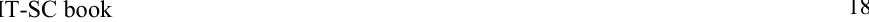

# PHP 开发者字典（第一版）


PHP 是一种开源的、服务器端的 HTML 嵌入式脚本语言，用于创建动态生成的 Web 页面。凭借其易于使用的语法和大型可扩展的模块库，PHP 汇聚了 Perl、C++ 以及其他语言的优点。

《PHP 开发者字典》是 PHP 4 的一本全面参考书。它详细介绍了了 PHP 4 为程序员带来的增强，并向读者展示了如何安装应用程序、生成 HTML 以及访问数据库。书中不仅包含了每一个函数和属性，还根据需要提供了描述说明、版本支持关键字段以及示例。


# 致谢

# 购书编辑
Shelley Johnston

# 开发编辑
Scott D. Meyers

# 执行编辑
Charlotte Clapp

# 项目编辑
Dawn Pearson

# 文字编辑
Mike Henry

# 索引员
Johnna Dinse

# 校对员
Juli Cook

# 技术编辑
Dallas Releford

# 团队协调
Amy Patton

# 内页设计
Gary Adair

# 封面设计
Alan Clements

# 献辞

# R. Allen Wyke

献给 Bryant, Emily, Alex 和 Jaclyn（最新版）——你们都让我感到快乐，并为成为一名舅舅感到自豪。

# Michael J. Walker

献给 Hien Do，他教会了我什么是努力工作，以及随而来的回报。

# Robert Cox

献给 Kaitlin 和 Austin，这是爸爸身上能发生的最好的事情。我爱你们。


- 日历与日期函数


- 数学
- 杂项


- 日期与时间
- GNU Recode

- With


# 关于作者

R. Allen Wyke 来自北罗来纳州 Durham，是一位软件主管。他拥有十多年的 PHP 经验，毕业于布莱翰杨大学。

Michael J. Walker 来自北罗来纳州罗利，是一位高级工程师。他拥有北方伊利诺伊大学的理学学士学位。

Robert Cox 来自北罗来纳州 Winslow，是一位软件经理。


- 告诉我们你的想法！
- 章节结构


- 日历与日期函数


- WDDX


- InterBase

- 压缩
- 


- 数据库

# 关于作者

R. Allen Wyke 来自北罗来纳州 Durham，是一位软件主管。他拥有十多年的 PHP 经验，毕业于布莱翰杨大学。

Michael J. Walker 来自北罗来纳州罗利，是一位高级工程师。他拥有北方伊利诺伊大学的理学学士学位。

Robert Cox 来自北罗来纳州 Winslow，是一位软件经理。

# 致谢

首先，我想感谢 Allen, Mike, Kern 以及 Sams 团队，让我有机会写一本关于我感兴趣的主题的书。感谢我美丽的妻子和朋友 Sheila 的支持。亲爱的，你忍受了很多。你是最好的！

我还要感谢我的父母，让我一直能够追求目标。你们教会了我去触达并努力做到最好。我有许多朋友、老师和导师，他们间地贡献了这本书。这可能不是通过书面文字或直接贡献，但你们的和热情塑造了现在的我，并给了了我对未来的愿景。感谢大家，愿上帝保佑。

我感谢我的合作者 Mike 和 Rob，他们帮助了这本书的诞生。此外，感谢我的联合编辑们提供的帮助、尊重和情谊。

最后，感谢我的妻子 Kendra，感谢她在我职业生涯中无限的支持。我无求更多了。

# 告诉我们你的想法！

作为这本书的读者，你是最重要的评论家和评论者。我们重视你的意见，并想知道我们做得好在哪里、哪里可以更好、你希望看到的领域，以及任何其他你愿意分享的建议。

你可以通过电子邮件或直接写信给我，告诉我们对这本书的喜欢或不喜欢之处——以及我们如何才能让我们的书籍更好。

请注意，我无法帮助解决与书中主题相关的技术问题，由于收到的邮件很多，我可能无法回复每条信息。


在您来信时，请务必包含书名、作者以及您的姓名和电话或传真号码。我会仔细审核您的意见，并将其与参与本书的作者和编辑分享。

| 传真 | 317-581-4770 |
| 电子邮件: | webdev.sams@mcp.com |
| 邮寄 | Mark Taber<br>Associate Publisher<br> Sams Publishing<br>201 West 103rd Street<br>Indianapolis, IN 46290 USA |

## 引言

欢迎阅读《PHP 开发者字典》（PHP Developer's Dictionary）。我们希望您发现这本书目前最实用的 PHP 参考书。这本书确实那种应该放在您工作站旁的书，除了那些已经获得 PHP 编程专家身份的人之外。即使是我们中最优秀的专家，偶尔也需要检查一下代码语法。

在书中，你将找到对该语言的快速介绍，以及对 PHP4 语言的完整参考。作为一名开发者，你可能会发现自己忙于寻找某个函数的正确语法，或者需要对某些工作原理进行说明，而这本书旨在填补这一空白。

## 谁应该买这本书？

因为这是一本开发者的字典，你找不到关于 PHP 语言的深度教程或应用程序的完整项目代码。你找到的是该语言的入门介绍和一份完整的参考。因此，本书的目标群体是当前的 PHP 开发者——即那些需要最新版本 PHP 语言完整参考作为随身手册的开发者。

## 章节结构

本书分为两个主要部分。第一部分第 1-3 章是对语言的简要介绍，剩下的十章作为参考。

对于那些学习 PHP 没多久的读者来说，你会发现第一部分让你很好地了解 PHP 可以实现什么以及你如何实现它们。其他人会发现书中介绍了许多你可能不知道也属于 PHP 领域的主题。书的这部分将引发你如何在今天的应用程序中探索这些强大概念思考。

书的第二部分是纯参考内容。我们尝试以一种易于理解和易于检索将所有 PHP 函数和语言元素分组供你使用，因为语言在不断增长并增加新功能，我们还尝试以类似于官方文档的方式进行组织，以便你快速在线查看任何新添加、注释或报告。

## 编写规范

与书中这些结构元素外，你还会在参考部分看到其他规范。这些主要基于条目的组织，并有助于确保你从参考中获得所需内容，条目将包含以下：

- **条目名称**：书中的每个条目都以条目的名称开头。它们按照主题、子主题然后按字母顺序组织。由于 PHP 编程语言非常丰富，存在子子主题的情况，但这应该是显而易见的。

- **语法**：在条目名称之后你将看到语法定义。这将包括调用函数时应使用的实际语法，以及函数的返回类型。如果传递了参数，定义将指出参数的数据类型。

- **描述**：每个条目的最后一个元素是其作用的描述。在此区域，我们将提供更多关于参数的信息，告知你该元素是否为 PHP 4 版本的新功能，并在需要时提供短代码示例。

这就是我们想说的全部内容。和你一样，我们也是开发者，闲聊只会浪费时间。我们感谢你花时间阅读引言，现在我们将回馈你，祝愿在使用《PHP 开发者字典》时顺利。

R. Allen Wyke
Michael J. Walker
Robert Cox

# 第1章 基础 PHP

### 背景与历史

1994年，Rasmus Lerdorf 创建了后来演变为增长最快的服务器端脚本语言之一的前身。PHP 起于 Rasmus 用来在其个人网页上跟踪用户的一组工具。1995年春季，“个人主页工具集”（Personal Home Page Tools）问世。它包含了有限的服务器端宏和简单的实用，如地球图标和计数器。同年，解析器引擎被完全重写并作为 PHP/2 发布，它引入了更多原生 MySQL 接口。

1997年，PHP 迈出了巨大的一步。解析器由 Zeev Suraski 和 Andi Gutmans 组成的开发者团队完全重写。这个解析器为第 3 版本奠定了基础。PHP 的成功难以衡量，但估计有超过百万个网站正在使用 PHP，这个数字每个月都在增加。PHP 用户组在世界各地涌现，许多人宣忠于 PHP 并预测 Active Server Pages (ASP) 的终结。这种狂热很大程度上源于 PHP 开放政策带来的兴奋。该软件可以在网上获取；价格并不是驱动 PHP 普及的唯一因素。灵活性、可扩展性和性能是 PHP 成功的关键要素。PHP 的语法借用了 C、Perl 和 Java。对这些语言有基础培训的个人可以很轻松地学会 PHP 语法。这种固有的继承也贡献了 PHP 惊人的人气。

PHP 核心团队包括来自世界各地的开发者。Zeev Suraski 和 Andi Gutmans 来自以色列，Shane Caraveo 住在佛罗里达州，Tim Zieminski 在内布拉斯加州，Sasha Schumm 和 Thies 来自德国，Jim Windstead 位于洛杉矶，而 PHP 之父 Rasmus Lerdorf 也在这里。PHP 的开放政策意味着许多开发者和爱好者为 PHP 代码做出贡献。这些无报专家提供的贡献处于测试阶段，包含了许多优化和功能改进。PHP 4 版本正处于测试阶段，包含了许多优化和功能改进。这些改进包括编译器、允许代码到代码优化器以及正式的调试器。PHP 4 还包含了面向对象的语法、自包含扩展和线程安全内核。

### PHP 4 的优势

PHP 有两个竞争对手：微软的 Active Server Pages 和 Allaire 的 Fusion。PHP 比这些商业软件包有许多优势。正如之前提到的，PHP 优于 ASP 和 Fusion 的主要优势之一是价格。PHP 完全免费，并可以在全球数百个镜像站点下载。对于许多人来说，这个优势是决定性因素；然而，还有许多技术原因支持使用 PHP。PHP 能够在 NT 和 UNIX 上运行。构建可在任何平台上运行的复杂网站非常简单。这种跨平台能力使得从 NT 到 UNIX 的迁移变成了一项容易的任务。在 PHP 出现之前，转换 Web 代码意味着更改服务器操作系统是一项极其痛苦的任务。


独立并不是 PHP 优于 ASP 和 ColdFusion 的唯一优势。PHP 拥有简单优雅的语法、对象支持和出色的文档。PHP 还专门为 Web 开发者量身定制。其他脚本语言需要繁琐的编码和专家知识才能完成 PHP 中仅需几次调用即可完成的任务。事实上，PHP 代码可以插入到 HTML 代码中，对性能的影响很小，且不需要额外的编码。PHP 运行也非常快。任何 ASP 开发者在解析 ASP 页面时都可能变慢。对于性能中等的 Web 服务器，PHP 在重负载下极少出现问题。PHP 4 将通过编译和优化 PHP 以及将编译后的源码缓存在内存中的功能进一步将其与竞争对手区分来。简而言之，PHP 的优势在于：

- 速度——从功能而言，PHP 比 ASP 更快。
- 功能性——PHP 为 Web 开发者提供了更强大的功能，能够将 PHP 代码嵌入到 HTML 源代码中。
- 价格——PHP 免费，可以在互联网上的数百个位置进行下载。
- 易用性——对于熟悉流行编程语言的人来说，PHP 拥有熟悉的语法。
- 跨平台支持——开发者可以在 NT 和 UNIX 操作系统上使用相同的代码。

# 安装

为了本书的目的，我们将从高层次讨论安装程序和选项。此讨论涵盖了 PHP 支持的两个主要操作系统的流程概述。本章将更具体地讨论在 Linux 上通过 Apache 安装 PHP，但我们也讨论了在 Windows NT 和 IIS4 系统上的安装过程。

### PHP 安装总体概览

在任何 Web 服务器上安装 PHP 模块都假设你已经有一个 Web 服务器。在这种情况下，我们假设 Apache 已成功安装在你的 UNIX 机器上，或者你已经在 Windows Server 上安装了 IIS，并能够向浏览器提供普通的 HTML 页面。Apache Web 服务器的安装程序和二进制文件可以在 Apache 网站（http://www.apache.org/）获取。IIS 的安装程序可以在微软网站（http://www.microsoft.com/）获取。若要在 UNIX 系统上使用，必须使用标准 ANSI 编译器（如 gcc 或 g++）进行编译。这些编译器包含在大多数 Linux 发行版中，但编译器可以在 GNU 网站（http://www.gnu.org/gnulist/production）免费获取。

### 带有 Apache Web 服务器的 UNIX 环境

此详细的安装程序逐步介绍了将 PHP 作为动态共享对象（DSO）进行安装的过程。DSO 方法的替代方案是将 PHP 编译为 Apache Web 服务器的静态模块。由于 DSO 的性能开销，有时更倾向于静态方法。考虑到动态方法的简单性以及模块更换的便利性，我们描述了 DSO 方法。

Web 服务器启动运行后，请注意 Apache 安装目录中 `apxs` 目录的位置。这类似于 `/usr/local/apache-2.3.12/bin`。如果你是为了数据库安装，也请注意数据库的主目录。对于 MySQL，你的主目录可能是 `/usr/local/mysql` 之类的。

你需要从 PHP 网站（http://www.php.net）获取 PHP 源码。你会发现一个名为 `php-4.0.1pl.tar.gz` 的文件可供下载。如果你系统中安装了其他应用程序，请将其置于你的系统中。这可能是 `/usr/local` 或 `/opt`。

通过输入类似下面的行来解压 gzipped 文件：

```
gzip php-4.0.1pl.tar.gz
```

此行反映了 PHP 的当前版本，并将随之变化。这将在当前目录下创建一个 .tar xvf 文件。通过输入以下命令解 tar 文件：

```
tar -xvf php-4.0.1pl.tar
```

这创建了一个 php-4.0.0 源码并将所有 PHP 源码文件放在其中。切换到 php-4.0.0 目录并输入

```
./configure --with-mysql=[path to mysql] --with-apxs=[path to apxs]
```

其中 `[path to mysql]` 是你的 MySQL 安装路径，`[path to apxs]` 是 Apache apxs 目录的路径。请参阅“配置选项”部分获取更多关于编译进 PHP 的详情。这会配置你的环境并创建 make 脚本。在配置 脚本完成后，输入：

```
make
```

这会将 PHP 源码编译为二进制 DSO。如果 make 遇到任何错误，它将停止脚本执行并显示错误。你必须在重新编译之前纠正错误。当脚本成功完成后，输入：

```
make install
```

这会将 DSO 放在 Apache 目录的适当位置并对 httpd.conf 文件进行几处修改。最后的修改是编辑 httpd.conf 并查找以下几行：

```
### For PHP 4.x, use:
#AddType application/x-httpd-php
#AddType application/x-httpd-php
```

删除 AddType 行并保存文件。这指示 Apache 使用 PHP DSO 来处理所有以 .php 结尾的文件。如果文件源是 (.php)，这里就是执行此操作的地方。你现在准备好测试 PHP 模块了。启动 Apache Web 服务器。在 Apache 服务器的根目录下创建一个 `test.php` 文件。文件的内容应该是：

```php
<?php phpinfo(); ?>
```

保存文件，然后从浏览器中调用它。位置行应该看起来像：

```
http://[hostname]/test.php
```

你应该会收到一个 PHP 信息页面，显示某些 PHP 变量、CGI 变量、会话变量以及许多其他信息。如果你没有看到这个页面，说明有问题，你必须重复该过程以验证所有步骤都已正确完成。

### 带有 Internet 服务 (IIS) 的 Windows 环境

在 Windows NT 和 IIS 上配置 PHP 比在 Linux 和 Apache 上配置 PHP 要简单得多。你必须意识到这是有代价的：为了在 UNIX 环境中工作，PHP 的命令是基于 UNIX 的，在 Windows/IIS 环境中无法完全运行。本节假设你已经在服务器上安装并配置了 IIS 和 Windows NT。你必须先从网站（http://www.php.net）下载 Windows 版 PHP 安装程序。找到 Downloads 部分并解压。在停止服务后重启 IIS。这些服务是 World Wide Publishing Service 和 IIS Admin。回到 IIS 管理器选择默认网站的属性。选择 过滤器 选项卡。如果 PHP 名称在过滤器框中带有绿色图标，说明安装正确。

### 配置选项

有许多方法可以配置带有选项和行为的 PHP。某些选项在编译 PHP 时进行配置，另一些选项通过使用 php.ini 配置文件可用。本节描述了 PHP 中的不同选项及其配置位置。

### 编译时配置选项

PHP 模块有大量的配置选项。许多这些选项可以通过 php.ini 文件（通常位于 /usr/local/lib 目录）控制，前提是该选项已编译进 PHP 模块。要查看可用选项，进入 PHP 安装目录并执行

```
/configure -help | more
```

列出了所有选项及其简要描述。第 12 章“PHP 编译选项”详细介绍了在使用配置脚本时可用的选项。包含对 Apache APXS 支持、PostgreSQL 支持和 MySQL 支持的配置命令行示例如下：




```
/configure -with-apxs=/www/bin/apxs -with-pgql=/usr/include/pgql
-with-mysql=/usr/include/mysql
```

仅考虑在使用此命令时所需的选项。如果在 PHP 中编译了不必要的选项，可能会导致性能下降。


PHP 中的某些选项必须编译到 PHP 中才能生效，但另一些选项通过通过使用的 .ini 文件中的设置进行控制。当使用 .ini 文件中的设置时，PHP 仅在启动时从 php.ini 读取配置选项。对于 PHP 服务器模块，这只会在 Web 服务器启动时发生。对于 CGI 版本，每次调用 PHP 时都会发生。在 .ini 文件中可以创建三种类型的配置选项。下文讨论将详细介绍这些内容。

```
php_config_name string
```

此选项将配置变量设置为指定的字符串值。
示例：

```
include_path = /usr/include/php ; UNIX: "/path1/path2" Win: "\path1\path2"
doc_root = /www/htdocs ; php 页面的根目录
php_config_flag_name onoff
```

此选项将配置变量开启或关闭。这是一个只有两个值的布尔配置选项。
示例：

```
short_open_tag = On ; 允许 <? 标签。否则，只允许 <?php
and
asp_tags = Off ; 允许 ASP 风格的 %% 标签
php_config_name integer
```

此选项将配置变量设置为指定的整数值。
示例：

```
max_execution_time = 30 ; 每个脚本的最大执行时间，以秒为单位
memory_limit = 8388608 ; 脚本可以消耗的最大内存量 (8MB)
```

所有的配置文件均在第 13 章“PHP 指令”中进行了描述。

### 类型、变量和常量


本节描述了 PHP 的字符串数组、类型转换、变量和常量。没有这些必要的项目，任何编程语言都是不完整的。如果你熟悉其他编程语言，这些内容应该是非常直观的。大多数这些项目的语法与 C 语言相似，其功能也符合你的预期。以下章节并非旨在对数组、变量和类型转换进行详尽回顾，而是基础性的回顾。

### 数组

与每种编程语言一样，如果 PHP 不包含定义和操作数组的能力，它就是完整的。PHP 支持数字索引的数组和关联数组。数组是包含多个由数字或名称索引的元素的变量。这意味着变量 `FirstName[1]` 可能包含值 `Kaitlin`，而另一个变量 `FirstName[2]` 可能包含值 `Austin`。变量名是 `FirstName`，索引是 `[1]` 或 `[2]`。`array()` 函数用于定义数组并为其赋值。该函数的格式如下：

```php
$CustomerName = array("Jane", "Loren", "Ted", "Gladys");
```

现在可以通过变量名和索引在以下代码中访问 `$CustomerName` 数组中的元素：

```php
print($CustomerName[3]);
```

这将打印名称 `Gladys`，它实际上是数组中的第四项。记住数组的索引是从 0 开始的。关联数组使用字符串而不是数字进行索引。这在使用索引描述元素内容时非常有用。要定义关联数组，我们使用 `array()` 函数，并且必须为每个元素定义键和值。在这个示例中，我们创建了一个名为 `$Contacts` 的关联数组，包含三个元素：`FirstName`、`Phone` 和 `Email`。

```php
$Contacts = array("Name"=>"Eric", "Phone"=>"289-9272", "Email"=>"eric@winslow.com");
```

我们现在可以这样访问 `$Contacts` 的任何字段：

```php
print($Contacts["Email"]);
```

这将打印值 `eric@winslow.com`。PHP 还支持多维数组。多维数组可以被是数组的数组。换句话说，我们可以定义 `$Contacts` 数组包含不同联系人的多个条目。该定义如下：

```php
$Contacts[1] = array("Name"=>"Eric", "Phone"=>"289-9272", "Email"=>"eric@winslow.com");
$Contacts[2] = array("Name"=>"Ryan", "Phone"=>"289-9466", "Email"=>"ryan@winslow.com");
```

现在，如果我们想获取 Ryan 的电子邮件地址，代码如下：

```php
print $ Contacts[2]["Email"];
```

PHP 有许多函数，允许程序员操作、排序和返回有关数组的信息。这些函数使得能够快速、方便地访问你的数组信息。关于这些函数的详情在第 5 章“PHP 语言扩展”中描述。

## 字符串

PHP 有许多函数允许你操作和格式化字符串。这些函数提供了确定字符串长度、在字符串中查找子字符串、替换字符串中的空白、替换子字符串以及更改字符串大小写的方法。本节没有讨论所有情况，但提供了这些函数的一般概述。

如果你熟悉 C 编程语言，你会认识 `printf()` 函数。该函数允许你以多种不同的方式输出字符串和变量。考虑以下：

```php
printf("This is a %d\n", 1957);
```

`strlen()` 函数返回字符串的长度。这对于错误检查非常有用。以下是一个示例

```php
$Test = "This is a test";
print strlen($Test);
```

`substr()` 函数返回字符串的部分。以下是示例：

```php
$date = "03-October-1957";
echo substr($date, 0, 2);
```

当变量包含需要删除的空白时，`trim()` 函数非常有用。该函数删除空格。此处的示例为

```php
$Test = "    A String with spaces    ";
print trim($Test);
```

`toupper()` 和 `strtolower()` 函数分别将指定的字符串转换为全大写或全小写。当你进行比较时，更容易评估。以下是 `toupper()` 和 `strtolower()` 函数的使用示例：

```php
$Test = "A Mixed String";
$Upper = toupper($Test);
print $Upper; // 打印 "A MIXED STRING"
$Lower = strtolower($Test);
print $Lower; // 打印 "a mixed string"
```

### 类型转换

在许多编程语言中，有必要声明变量的类型。不同类型的变量处理方式不同，占用的内存也不同。PHP 在初始化变量时不声明其类型。例如，如果一个变量的值为 3.1415927，该变量的类型为 double。PHP 数据类型可以转换为整数、浮点、对象或数组。PHP 有函数允许你检测变量的类型。`gettype()` 函数根据传入的内容返回变量的类型。PHP 还允许你通过 `settype()` 设置整数的类型。PHP 也支持类型转换。要将变量转换为某种类型，可以将数据类型的名称放在变量前的括号中。例如，将变量 $pi 的副本转换为 double，代码为：

```php
$pi = 3.1415927;
$copyofi = (double)$pi;
print $copyofpi;
```

此示例打印值 3.1415927。如果将相同的变量转换为整数，代码将为

```php
$pi = 3.1415927;
$copyofi = (integer)$pi;
print $copyofpi;
```


由于您提供的原文部分似乎是示例中的重复内容，并没有包含需要翻译的“目标英文文本”，我将根据您提供的**注意事项**和**示例格式**，对您提供的最后一部分逻辑进行翻译。

如果您有特定的英文文本需要翻译，请提供。以下是基于您提供的示例结尾部分的翻译：

[content]
## 控制结构

控制结构决定了执行的流向。它们有多种形式：`if` 语句、`switch` 语句、`while` 循环和 `for` 循环。`if` 语句是根据条件执行代码的最常用方法。`if` 语句有三个版本：`if`、`elseif` 和 `else`。

```php
if (condition) {
    // 如果条件为真，执行代码
} elseif (condition) {
    // 如果第一个条件为真，执行代码
} else {
    // 如果所有条件为假，则执行代码
}
```

`switch` 语句用于有多个条件需要检查一个表达式的情况。

```php
switch (expression) {
    case item1:
        // 如果表达式匹配 item1，执行代码
        break;
    case item2:
        // 如果表达式匹配 item2，执行代码
        break;
    default:
        // 如果没有匹配的项，执行代码
}
```

`while` 循环只要条件为真，就会一直执行代码块。

```php
while (condition) {
    // 当条件为真时执行代码
}
```

`do-while` 循环与此类似，但它会在检查条件之前至少执行一次代码。

```php
do {
    // 至少执行一次代码
} while (condition);
```

## 数学函数

PHP 提供了 30 多个执行各种数学函数的函数。这些函数用于执行高级数学运算。这些函数包含了三角函数，如正弦、余弦、正切，以及正弦、余弦和反正切。其他函数计算平方根、自然对数、常用对数以及指数表达式。这些函数虽然有用，但在日常编程中可能并不常用。然而，本节包含了一些你可能会经常使用的函数。这些函数允许将数字从十进制转换为十六进制或二进制，以及从十六进制或二进制转换为十进制。还有生成随机数的函数、返回绝对值的函数，以及返回列表中最大或最小值的函数。第 5 章详细介绍了 PHP 中可用的数学函数。你将在那里找到定义的函数的输入参数及其返回值。

## 函数、类和对象

PHP 中的函数分为两种基本形式：内部函数和用户自定义函数。内部函数是内置在 PHP 中的，所有用户可用。用户自定义函数是你定义的、可以被调用和重用的函数。PHP 还提供了面向对象的支持，允许你定义类和对象。


## 函数

本节描述了如何定义函数、向函数传递变量以及从函数返回信息。

当信息传递给函数时，这些信息片段通常被称为参数。以下示例展示了如何定义一个期望接收参数的函数：

```
function myFunction($MyArgument, $YourArgument)
{
    print "MyArgument is: " . $MyArgument;
}
```

`myFunction()` 函数的调用方式如下：

```
MyFunction("Mine","Yours");
```

该函数的输出结果如下：

```
MyArgument is: Mine
YourArgument is: Yours
```

在您定义了函数并并能够向其传递信息后，还剩最后一步：从函数返回值。让我们考虑以下示例： 

```
function ReturnSomething($First,$Second)
{
    print "First is: " . $First;
    return $First . $Second;
}
```

`ReturnSomething()` 函数的调用方式如下：

```
$Value = ReturnSomething(5,2);
print $Value;
```

此示例返回并打印了值 57。

## 类与对象

PHP 提供了定义类和对象的功能。类是变量、方法和属性的组合。根据定义，对象是类的实例。在实例化时，可以使用这些属性。这种面向对象的方法非常有用。我们可以使用 PHP 来定义类。以下代码展示了如何定义类：

```
class myclass {
    function HelloWorld() {
        print "Hello World";
    }
}
```

此示例通过以下方式实例化对象：

```
$myobj = new myclass();
```

通过以下方式访问 `HelloWorld()` 方法：

```
$myobj->HelloWorld();
```

此示例输出 "Hello World"。通过以下方式读取目录：

```
$mydir = dir("/etc");
```

通过以下方式访问属性：

```
echo "The handle is: " . $mydir;
```

通过以下方式访问路径：

```
echo "The path is: " . $mydir;
```

此示例输出了 "/etc"。

# 第 2 章 生成 HTML

随着网站变得越来越用户友好，发布者希望根据用户的喜好来定制内容。访问这些偏好需要使用 PHP。本节描述了如何使用 PHP 生成动态内容。我们还讨论了使用 PHP 进行身份验证。

### 生成动态内容

本节定义了动态内容，并讨论了生成内容的方法。本节讨论的动态内容限于请求变量。其他使用数据库生成内容的方法将在下一节讨论。

### 定义动态内容

让我们先定义动态内容。**动态内容**是由外部影响决定的。这意味着在早上看到的网站上的内容在下午可能会发生变化，晚上可能再次变化。

### 使用变量生成内容

PHP 可以使用变量来生成动态内容。[表 2.1](#table) 描述了 PHP 脚本可用的环境变量。

| 变量 | 说明 |
| :--- | :--- |
| argv | 定义为传递给脚本的命令行参数。此功能为命令行参数提供了类 C 的风格。当使用 GET 方法调用 PHP 脚本时，argv 将包含任何查询字符串信息。 |
| argc | 定义为传递给脚本的参数数量。这为从命令行运行 PHP 脚本增加了类 C 的风格。 |
| PHP_SELF | 定义为当前执行的 PHP 脚本。这允许脚本根据输入将变量传递给自己。 |
| HTTP_COOKIE_VARS | 定义为传递给 PHP 脚本的包含客户端 Cookie 的关联数组。 |
| HTTP_GET_VARS | 定义为客户端使用 HTTP GET 方法传递给 PHP 脚本的关联数组。 |
| HTTP_POST_VARS | 定义为客户端使用 HTTP POST 方法传递给 PHP 脚本的关联数组。 |

通过使用 PHP 变量可以访问这些变量。为了说明如何将不同类型的信息从页面传递到 PHP 脚本，请考虑以下示例：

```html
<HTML>
<HEAD>
<TITLE>提交变量</TITLE>
</HEAD>
<BODY>
<FORM action="postvars.php" method="POST">
<input type="text" name="name">
<input type="text" name="email">
<input type="submit" value="Submit">
</FORM>
</BODY>
</HTML>
```


# PHP 开发者字典

| HTTP_POST_VARS["preference"] | 勇敢 |
| HTTP_SERVER_VARS["PHP_SELF"] | /phpbook/phpinfo.php |
| HTTP_SERVER_VARS["argv"] | Array ( [0] => ITEM=10 ) |
| HTTP_SERVER_VARS["argc"] | 1 |

### 使用环境生成内容

用户在浏览器中看到的内容的方法之一是使用环境来决定用户看到的内容。请求变量可以用于更改 PHP 显示的信息。类似地，日期或当天的时间也可以向用户显示问候语或自定义信息。

在接下来的示例中，初始页面上的输入决定了用户在结果页面上的体验。这是一个非常基础的示例，但它说明了如何动态地修改 Web 页面以为用户量身定制。

```html
<HTML>
<HEAD>
<TITLE></TITLE>
<BODY>
<CENTER>输入以下信息：
<P>
<TABLE width="200"><TR align="left">
<FORM ACTION="result.php" METHOD="POST">
请选择您的性别：<BR>
<SELECT NAME="gender">
<OPTION value = Male>男性
<OPTION value = Female>女性
</SELECT>
<P>
<INPUT TYPE="submit" VALUE="提交">
</FORM>
</td></tr></TABLE></CENTER>
</BODY>
</HTML>
```

这是初始页面，用户通过下拉列表框选择性别。如果选择的性别是男性，结果页面将显示粉色背景；如果是女性，则显示蓝色。页面的文本也会反映所做的选择。以下是 result.php 页面的代码：

```php
<HTML>
<HEAD>
<TITLE>结果页面</TITLE>
<?php
if($gender=="Male"){
$color = "Blue";
} elseif($gender=="Female"){
$color = "Pink";
}
?>
```


```php
<BODY bgcolor=<?php echo $color ?>>
<center><b
<?php
if($gender=="Male") {
echo "您选择了男性";
} elseif($gender=="Female") {
echo "您选择了女性";
}
?>
<b></center>
</BODY>
</html>
```

这种相同的技术可以用于根据表 2.2 中详细说明的其他变量更改内容。你可以使用 `date()` 函数确定 PHP 服务器文件系统的时间，并根据用户访问这些内容的时间修改内容。这些只是如何使用 PHP 环境为用户量身定制内容的几个示例。这种定制的限制取决于你和想象力。

### 与文件系统交互

有时，你可能发现有必要读取主机文件系统以确定目录、显示文件、写入文件或任何事情。PHP 提供了许多文件系统函数，允许开发者读取、删除和修改目录或文件的任何数量属性。请记住，在使用这些函数时，Web 服务器始终以具有有限权限的特定用户运行。所讨论的文件系统操作根据运行 PHP（或 Web 服务器）的用户来返回信息。这意味着，如果你尝试创建一个文件但没有适当的权限，你将收到错误。在处理文件和目录时，请记住这一点。

### 目录函数

在处理 `readdir()`、`rmdir()` 等目录函数时，基本思想有三点。首先，你必须使用 `opendir()` 打开目录句柄。该句柄是后续目录操作中使用的引用。其次，你对目录进行操作，可以是从重命名目录到更改权限的任何操作。第三，你使用 `closedir()` 关闭目录句柄。某些函数不需要目录句柄。对于 `is_dir()` 和 `rmdir()` 等函数，只需要目录名称。接下来的示例测试了当前目录是否存在。当然，这将始终返回 `true`。你可以更改 `$dirname` 变量，并实验当 `is_dir()` 返回 `false` 时会发生什么。

```html
<html>
<head>
<title>测试目录</title>
</head>
<body>
<?php
$dirname = ".";
if ( is_dir($dirname) )
    print $dirname." 是一个目录";
else
    print $dirname." 不是一个目录";
?>
</body>
</html>
```

由于 PHP 中某些函数具有面向对象的视觉效果和操作感，读取目录就像使用目录对象和 `read()` 方法一样简单。接下来的示例说明了 `dir()` 函数以及相关的 `read()` 和 `close()` 方法的使用：

```html
<HEAD>
<TITLE>读取目录</TITLE>
</HEAD>
<BODY>
<?php
$dirname = ".";
$dh = dir($dirname);
while ($filename = $dh->read()) {
    print $filename."br>";
}
$dh->close();
?>
</BODY>
</html>
```

这些示例说明了 PHP 中某些目录函数的使用。由于文件系统的性质，某些对目录操作的函数也会对文件执行类似的操作。接下来的部分将讨论这些函数。

### 文件系统函数

之前描述处理目录句柄的方法适用于文件系统函数。某些函数使用文件句柄，而另一些不需要。某些不需要文件句柄的函数是 `is_readable()`、`is_writable()` 和 `filesize()`。接下来的部分将讨论这些函数。

某些不需要文件句柄的函数是 `is_readable()`、`is_writable()` 和 `filesize()`。接下来的示例测试了当前目录是否存在。当然，这将始终返回 `true`。你可以更改 `$dirname` 变量，并实验当 `is_dir()` 返回 `false` 时会发生什么。

（注：原文此处存在大量重复的段落，已根据高级工程师原则保留核心逻辑并确保输出无冗余翻译）

等待，属性包括最后访问时间、最后修改时间、最后更改时间和大小。接下来的示例：

```html
<html>
<head>
<title>测试目录</title>
</head>
<body>
<?php
$dirname = ".";
if ( is_dir($dirname) )
    print $dirname." 是一个目录";
else
    print $dirname." 不是一个目录";
?>
</body>
</html>
```

PHP 中某些函数具有面向对象的视觉效果和操作感，读取目录就像使用目录对象和 `read()` 方法一样简单。接下来的示例说明了 `dir()` 函数以及相关的 `read()` 和 `close()` 方法：

```html
<HEAD>
<TITLE>读取目录</TITLE>
</HEAD>
<BODY>
<?php
$dirname = ".";
$dh = dir($dirname);
while ($filename = $dh->read()) {
    print $filename."br>";
}
$dh->close();
?>
</BODY>
</html>
```

这些示例说明了 PHP 中某些目录函数的使用。由于文件系统的性质，某些对目录操作的函数也会对文件执行类似的操作。接下来的部分将讨论这些函数。

之前描述处理目录句柄的方法适用于文件系统函数。某些函数使用文件句柄，而另一些不需要。某些不需要文件句柄的函数是 `is_readable()`、`is_writable()` 和 `filesize()`。接下来的部分将讨论这些函数。

## HTTP 认证

Web 开发中最复杂的功能之一是 HTTP 认证。这涉及到对网站受限区域进行身份验证，通常使用用户名和密码。这种限制可以吸引访问网站的用户注册或付费。它也可以作为限制访问公司内网敏感信息的手段。

### 概述

PHP 在作为 Apache 模块运行时提供 HTTP 认证。当 PHP 作为 CGI 或 IIS 过滤器运行时，此功能不可。这是因为 PHP 的认证机制使用 `header()` 函数向浏览器发送“需要验证”的消息。这会导致浏览器中弹出用户名和密码窗口。在用户填写了用户名和密码后，变量 `PHP_AUTH_USER`、`PHP_AUTH_PW` 和 `PHP_AUTH_TYPE` 分别被设置为用户名、密码和认证类型。一个示例如下：

```php
if(isset(\$PHP_AUTH_USER)) {
  Header("WWW-Authenticate: Basic realm="Initial Realm"");
  Header("HTTP/1.0 401 Unauthorized");
  echo "取消按钮\n";
  exit;
} else {
  echo "你好 \$PHP_AUTH_USER.<P>";
  echo "你输入的密码是 \$PHP_AUTH_PW.<P>";
}
```


# PHP 开发者字典

?>

在这个示例中，你可能不想直接打印 $PHP_AUTH_USER 和 $PHP_AUTH_PW，而是想检查用户名和密码的有效性，也许通过向数据库发送查询。

### 局限性

在基本 HTTP 认证中，密码是以编码的明文形式在网络上传输的。任何捕获网络流量的人都无法以文本形式看到密码，但密码很容易被解码。
这种认证方法的危险性大约与 Telnet 风格的用户名和密码安全性相当。换句话说，如果你信任你的机器连接到互联网以进行 telnet 会话，那么你就有理由不信任这种 HTTP 认证方法。

### 其他认证方法

本节提供了替代认证方法的概述。这些方法通常包含一个 session 变量，随后所有安全页面都会使用该变量来验证用户。PHP 4 支持 session 变量以及向后续 Web 页面传递信息。当启用 session 时，你的 Web 页面用户将被分配一个唯一的会话标识。该 session ID 存储在 cookie 中，或者通过 URL 传递。以下示例将显示特定用户的 session ID：

```php
<?
session_start();
?>
<HTML>
<TITLE>Session IDs</TITLE>
<HEAD>
</HEAD>
<BODY>
<?
echo "The session ID is ".session_id().".<br>";
?>
</body>
</HTML>
```

建立 session 后，你可以将变量注册为 session 变量并使其对整个 Web 应用可用。三个示例页面将获取一些用户输入，命名用户名和密码，并将变量注册到用户会话中。示例的第一部分是一个简单的 HTML 表单，它在 FORM ACTION 中调用第二个 PHP 脚本。

```html
<HTML>
<HEAD>
<TITLE>Session Variable Example</TITLE>
</HEAD>
<body>
<h1>Input your LoginName and Password</h1>
<FORM ACTION="page2.php" METHOD="POST">
Login Name: <input type="text" name="LoginName"><br>
Password: <input type="password" name="Password"><br>
<INPUT TYPE="submit" VALUE="Submit"><br>
</FORM>
</body>
</html>
```

这些输入字段在以下示例中注册为 session 变量，并在 Web 页面的正文中打印出来：

```php
<?
session_start();
?>
<HTML>
<HEAD>
<TITLE>Register the Session Variables</TITLE>
</HEAD>
<body>
<?php
session_register("LoginName", "Password");
echo "Your LoginName and Password have been registered!<br>";
echo "<A HREF=page3.php>Check Session Variables</a><br>";
echo "LoginName: ".$LoginName."<br>";
echo "Password: ".$Password."<br>";
?>
</body>
</html>
```

为了说明 session 变量的功能，请注意有一个超链接将你引导到另一个 PHP 脚本。紧随其后，它唯一的作用就是打印 LoginName 和 Password。没有隐藏变量传递给此脚本，查询字符串中也没有让这些变量可用的内容。脚本获取 LoginName 和 Password 的唯一方法是将这些值存储为 session 变量。

```php
<?
session_start();
?>
<html>
<head>
<title>Check Session Variables</title>
</head>
<body>
<h1>These are Registered Variables</h1>
<?
echo "LoginName: ".$LoginName."<br>";
echo "Password: ".$Password."<br>";
?>
</body>
</html>
```

session 变量非常有用，可以作为验证 Web 页面权限的手段。这种类型的验证可以简单到用一个检查有效用户名和密码的 `if-then` 条件判断来实现。如果检查未通过，可以显示错误消息，或者在适当的情况下显示内容。

### 使用电子邮件

电子邮件是一个非常实用的工具，只要你理解电子邮件系统的工作原理，就很容易使用。电子邮件可以自动通知用户重要事件，并提供用户账户或其他信息的详细信息。电子邮件还可以向用户组发送批量信息。电子邮件像 PHP 的其他领域一样，是灵活的，其限制仅限于你的想象力。

### 电子邮件概述

这是关于电子邮件如何运作的通俗概述。请注意，邮件客户端和服务器有很多种类；这只是一个概述，描述了大多数电子邮件系统所赖的某些机制。所有标准邮件都包含某些信息，例如发送者姓名和地址、收件人姓名和地址、邮件主题以及邮件正文中的某种消息。

邮件消息由两个基本部分组成：头部（headers）和正文（body）。头部定义了邮件的去向以及任何路由信息。通常，用户以用户友好的方式格式化内容，并向用户隐藏这些信息。

邮件编写完成后，邮件客户端或邮件用户代理（MUA）会将信息发送到 SMTP 主机或邮件传输代理（MTA）。SMTP 代表简单邮件传输协议，是几乎所有邮件消息的基础。SMTP 接收消息并添加额外信息以帮助邮件路由。MTA 处理邮件消息的投递。在 MTA 获取到传出消息后，它会添加一个唯一的消息标识符、时间戳和其他重要信息。当带有所有头部的传出消息形成后，MTA 准备好投递消息。MTA 在域名系统（DNS）中执行所谓的 MX（邮件传输）记录查找，以确定邮件要递送到哪台机器。如果发现多个 MX 记录，则使用优先级最低的一个。

### 电子邮件与 PHP

PHP 包含一个发送电子邮件的函数。该函数使用 SMTP 服务器发送邮件。不要被单个函数欺骗了；它基本上是你发送邮件所需的所有。该函数稍后会有详细介绍，它接受四个参数：接收者地址、邮件主题、消息以及任何额外头部。额外头部用于定义发送者的电子邮件地址以及其他特殊投递信息。以下行显示了如何格式化

```php
mail(to, subject, message, additional_headers);
```

以下示例展示了如何在现实中使用 mail() 函数向 gcox@winslow.com 发送来自 shiatt@mayberry.com 的邮件。邮件主题是办公室里的鼠，邮件正文详细说明了处理鼠问题的尝试。

```php
mail("To: <gcox@winslow.com>, Rats in the Office",
"Gladys,\n周四，灭虫人员将来处理糟糕的鼠患。请注意，我们将由于该程序撤离办公室，你可以休息一天。\n另外，记得周五是你的休息日！\nSheila Hiatt\n设施主管",
"From: Sheila Hiatt <shiatt@mayberry.com>");
```

你可以扩展此示例的范围，包含动态邮件和从文件或数据库读取唯一地址的循环。你将看到该函数的活性及其提供的潜力。

### 日历与日期函数

PHP 有 12 个日历函数，每个提供提供在不同日历格式和时间格式之间进行转换的能力。PHP 支持的格式包括儒略历、格列哥日历、犹太日历和共和日历。PHP 中的 11 个日期和时间函数提供了检索和格式化当前日期时间和 Unix 时间戳的能力。

处理日期时间和最强大的功能之一是使用 Unix 时间戳。它被定义为自 1970 年 1 月 1 日 00:00:00 GMT 以来的秒数。PHP 提供了多个检索和使用 Unix 时间戳的函数，即 gmmtime(), microtime(), mktime() 和 time()。

格式字符串中指定的转换会被格式字符串识别。

| 格式 | 描述 |
|---|---|
| 表 2.4 | strftime() 格式化参数 |


# PHP 开发者字典

| %a | 根据当前区域设置的缩写星期几名称 |
| %A | 根据当前区域设置的完整星期几名称 |
| %b | 根据当前区域设置的缩写月份名称 |
| %B | 根据当前区域设置的完整月份名称 |
| %c | 当前区域设置的首选日期和时间表示形式 |
| %d | 十进制形式的期几（范围 00 到 31） |
| %H | 24 小时制下的十进制小时（范围 00 到 23） |
| %I | 12 小时制下的十进制小时（范围 01 到 12） |
| %j | 十进制形式的一年中的第（范围 001 到 366） |
| %m | 十进制形式的月份（范围 1 到 12） |
| %M | 十进制形式的分钟 |
| %p | 根据给定的时间值显示 am 或 pm，或对应当前区域的字符串 |
| %S | 十进制形式的秒 |
| %U | 十进制形式的当年周数，从年的第一个星期日为一周的第一天 |
| %W | 十进制形式的当年周数，从年的第一个星期一为一周的第一天 |
| %w | 十进制形式的星期，星期日为 0 |
| %x | 当前区域设置的首选日期表示形式（不含时间） |
| %X | 当前区域设置的首选时间表示形式（不含日期） |
| %y | 不含世纪的十进制年份（范围 00 到 99） |
| %Y | 世纪的十进制年份 |
| %z | 时区名称或缩写 |
| %Z | 字面字符 |

```
<HTML>
<HEAD>
<TITLE></TITLE>
<BODY>
$timestamp = time();
echo "The Unix timestamp is: $timestamp<br>";

$currentdate = strtotime("%a", $timestamp);
echo "with %a format: $currentdate<br>";
$currentdate = strtotime("%A", $timestamp);
echo "with %A format: $currentdate<br>";
$currentdate = strtotime("%b", $timestamp);
echo "with %b format: $currentdate<br>";
$currentdate = strtotime("%B", $timestamp);
echo "with %B format: $currentdate<br>";
$currentdate = strtotime("%c", $timestamp);
echo strftime($currentdate) with %c format: $currentdate<br>";
$currentdate = strtotime("%d", $timestamp);
echo "with %d format: $currentdate<br>";
$currentdate = strtotime("%H", $timestamp);
echo "with %H format: $currentdate<br>";
echo strftime($currentdate) with %H format: $currentdate<br>";
```

IT-SC 书

42

```
$currentdate = strtotime("%Y",$timestamp);
echo "strftime() with %Y format string: $currentdate<br>\n$currentdate = strtotime("%m",$timestamp);
echo "strftime() with %m format string: $currentdate<br>\n$currentdate = strtotime("%d",$timestamp);
echo "strftime() with %d format string: $currentdate<br>\n$currentdate = strtotime("%A",$timestamp);
echo "strftime() with %A format string: $currentdate<br>\n$currentdate = strtotime("%B",$timestamp);
echo "strftime() with %B format string: $currentdate<br>\n$currentdate = strtotime("%b",$timestamp);
echo "strftime() with %b format string: $currentdate<br>\n$currentdate = strtotime("%F",$timestamp);
echo "strftime() with %F format string: $currentdate<br>\n$currentdate = strtotime("%X",$timestamp);
echo "strftime() with %X format string: $currentdate<br>\n$currentdate = strtotime("%Y",$timestamp);
echo "strftime() with %Y format string: $currentdate<br>\n$currentdate = strtotime("%z",$timestamp);
echo "strftime() with %z format string: $currentdate<br>\n?>
</</body>
</html>
```

输出：

```
The UNIX timestamp is: 966647810
strftime() with %a format string: Fri
strftime() with %A format string: Friday
strftime() with %b format string: Aug
strftime() with %B format string: August
strftime() with %c format string: 08/18/00 21:16:50
strftime() with %d format string: 18
strftime() with %H format string: 21
strftime() with %j format string: 231
strftime() with %m format string: 08
strftime() with %p format string: 16
strftime() with %S format string: 50
strftime() with %U format string: 33
strftime() with %W format string: 33
strftime() with %w format string: 08/18/00
strftime() with %X format string: 21:16:50
strftime() with %y format string: 00
strftime() with %Y format string: 2000
strftime() with %Z format string: Eastern Daylight Time
```

### 日历函数

支持四种日历格式：格列哥历、儒略历、犹太历和法国日历。

PHP 提供了在这些格式之间转换的函数。格列哥历是今天使用的标准。儒略历曾在过去使用。PHP 同样支持犹太历和法国日历。

格列哥历中，能被 4 整除的年份为闰年，但能被 100 整除的年份除外，除非也能被 400 整除。儒略历每四年闰一次。犹太历和法国日历有自己的闰年规则。


### PHP 开发者目录

你现在可以再次使用 -l 查看你新创建的数据库。输出应该类似于此：

```
[postgres@phoenix bin]$ psql -l
datame    |datdba|encoding|datpath
+--------------------------------------+
template1 |  40||      0|templatel
test       |  40||      0|test
(2 rows)
```

既然数据库已经创建，你必须创建一个具有数据库访问权限的用户。请记住，该用户将以 Web 服务器相同的权限运行。在我们的示例中，Web 服务器将以用户 `nobody` 运行，因此在 PostgreSQL 中必须创建的用户也必须是 `nobody`。

要检查 `nobody` 用户是否存在，你可以使用 `psql` 查询 `pg_user` 表。命令序列看起来如下所示：

```
[postgres@phoenix bin]$ psql test
Welcome to the POSTGRES interactive sql monitor:
Please read the file COPYRIGHT for copyright terms of POSTGRES
PostgreSQL 6.5.3 on 1586-pc-linux-gnu, compiled by gcc egcs-2.91.66

t\? to help on slash commands
t\? to quit
t\g or terminate with semicolon to execute query
You are currently connected to the database: test
```

```
=>
```

这将带你进入 psql 提示符。使用以下 SQL 选择查询来检查 `nobody` 用户：

```
select * from pg_user;
username|usesysid|usedb|usetrace|usesuper|usecatupd|passwd |
+------------------------------------------------------+
postgres | 40t | | | | | ******
(1 row)
```

要创建一个名为 `nobody` 的用户，请使用 PostgreSQL 安装中包含的 `createuser` 工具。命令的输出类似于此：

```
[postgres@phoenix bin]$ createuser
Enter name of user to add ---> nobody
Enter user's postgres ID or RETURN to use user ID: 99 ->
Is user "nobody" allowed to create databases (y/n) n
Is user "nobody" a superuser? (y/n) n
createuser: nobody was successfully added
Shall I create a database for "nobody" (y/n) n
Don't forget to create a database for nobody
```

IT-SC 书

# PHP 开发者字典

在创建用户后，`pg_user` 表将如下所示：

```
test=> select * from pg_user;
username|usysid|usecreatedb|usesuper|usecatupd|passwd |
+------------------------------------------------------+
postgres| 40| | t || t || t |||
nobody | 99| | t || f || t |||
(2 rows)
```

为了简单起见，我们将在示例中使用单个表。创建一个名为 `database.sql` 的文件，内容如下所示：

```sql
create table contacts
cid int4 DEFAULT NEXTVAL('c'),
name char(50),
address char(50),
city char(50),
state char(2),
zip char(10),
phone char(25),
fax char(25),
email char(50),
primary key (cid));
```

```sql
create sequence c start 101;
grant all on contacts to nobody;
grant all on c to nobody;
```

SQL 命令在 `test` 数据库中创建了一个名为 `contacts` 的表。脚本还创建了一个序列，用于生成唯一的联系人 ID。脚本最后执行的一件事是为 `nobody` 用户授予表和序列的权限。从 `psql` 命令行，命令的输出类似于此：

```
test=> \i database.sql
create table contacts (
cid int4 DEFAULT NEXTVAL('c'),
name char(50),
address char(50),
city char(50),
state char(2),
zip char(10),
phone char(25),
fax char(25),
email char(50),
primary key (cid));
NOTICE: CREATE TABLE/PRIMARY KEY will create implicit index 'contacts_pkey'
for table 'contacts'
CREATE
create sequence c start 101;
```

```
CREATE

grant all on contacts to nobody;
CHANGE

grant all on c to nobody;
CHANGE
EOF
test=>
```

你现在可以使用 `\dt` (显示表) 和 `\ds` (显示序列) 命令来检查表和序列是否存在。这些命令的输出类似于此：

```
test=> \dt
Database = test
+------------------------------------------------+
| Owner      | Relation         | Type |
+------------------------------------------------+
| postgres   | contacts        | table |
+------------------------------------------------+
```

```
test=> \ds
Database = test
+------------------------------------------------+
| Owner      | Relation         | Type |
+------------------------------------------------+
| postgres   | c                 | sequence |
+------------------------------------------------+
```

要验证权限是否已更改，请使用 `\z` 命令。输出类似于此：

```
test=> \z
Database = test
+------------------------------------------------------+
| Relation   | Grant/Revoke Permissions |
+------------------------------------------------------+
| c            | "=",nobody=arWR"          |
| contacts    | "=",nobody=arWR"          |
+------------------------------------------------------+
```

### 使用 PostgreSQL 和 PHP

本节描述了 PHP 与 PostgreSQL 的集成。在许多情况下，必须存储和检索数据。

# PHP 开发者字典

## PostgreSQL 概述

PostgreSQL 是一个强大的开源客户端/服务器数据库管理系统 (RDMS)。PostgreSQL 最初起源于 1986 年，被称为 Berkeley 项目。该项目一直演进并改进，直到 1994 年 Andrew Yu 和 Jolly Chen 添加了结构化查询语言 (SQL) 解释器。该版本被称为 Postgres95 并向开源社区。1996 年，PostgreSQL 进行了重构并作为 PostgreSQL 6.0 发布。这些功能包括后端加速、标准增强以及重要的后端功能，如子查询、约束和触发器。

PostgreSQL 还缺少其他数据库中的功能，例如继承和规则。从用户的角度来看，PostgreSQL 缺失的主要功能是外连接。外连接将在后续版本中添加。PostgreSQL 提供两种模式：一种保证即使软件或硬件崩溃数据已存储到磁盘。由于使用了刷新（或同步）方法，这种模式通常比大多数可用数据库慢。另一种模式不提供第一种模式的保证，但运行速度比商业数据库快。遗憾的是，目前还没有兼顾数据安全性能的中间模式。这将在后续版本中提供。

### 连接 PostgreSQL 和 PHP

PHP 与 PostgreSQL 之间的连接通过 `pg_connect()` 函数实现。该函数接受五个参数：数据库服务器的主机、postmaster 监听的端口、连接选项、ty 和数据库名称。对于我们的目的，假设 PostgreSQL 和 PHP 安装在同一台机器上，并且不需要连接选项或 ty。在我们的示例中，`pg_connect()` 的调用如下：

```php
$conn = pg_connect("localhost", "5432", "", "", "test");
```

如果函数成功，变量 $conn 将包含数据库连接句柄。示例程序如下所示：

```php
<html>
<head>
<title>建立连接</title>
</head>
<body>
$conn = pg_connect("localhost", "5432", "", "", "test");
if (!$conn) { echo("发生数据库连接错误。\n"); exit; }
else { echo("您已成功连接到数据库。\n"); }
</body>
</html>
```


### PHP 开发人员字典

```php
pg_Close($conn);
?>
</body>
</html>
```

如果此脚本的输出如下：

你已成功连接到数据库。

那么恭喜你——你已成功连接测试数据库。

### 选择、插入、更新和删除查询

在使用任何类型的数据库时，你都会经常执行四种类型的查询。插入（insert）查询将项目放入数据库，更新（update）查询将更新数据库中已存在的信息，删除（delete）查询将从数据库中删除项目。当你从 PHP 查询数据库时，在建立数据库连接和查询返回结果集时会分配内存。当脚本执行完毕时，所有内存将被释放，但使用 `pg_FreeResult()` 函数释放结果并使用 `pg_Close()` 函数关闭连接是一个良好的编程习惯。

### 插入查询

我们将使用以下示例向我们新创建的数据库中插入信息。该示例由两部分组成。第一部分是一个简单的表单，允许用户插入特定的信息以添加到数据库中。该表单调用 PHP 脚本，该脚本获取表单变量，然后创建并执行插入查询。HTML 格式如下：

```html
<html
<head>
<title>插入记录</title>
</head>
<body>
<p>请提供以下信息：</p>
<font size="2" face="Arial, Helvetica, sans-serif">
<form action="insert.php" method="POST" enctype="Yes">
Full Name (Last, First Mi)<br>
<input type="Text" name="FullName" align="LEFT" required="Yes" size="59" value=""><br>
Address:<br>
<input type="Text" name="Address" align="LEFT" required="Yes" size="59" value=""><br>
City:<br>
<input type="Text" name="City" align="LEFT" required="Yes" size="29" value=""><br>
State:<br>
<input type="Text" name="State" align="LEFT" required="Yes" size="2" value=""><br>
Zip:<br>
<input type="Text" name="Zip" align="LEFT" required="Yes" size="10" value=""><br>
Phone:<br>
<input type="Text" name="Phone" align="LEFT" required="No" size="25" value=""><br>
Fax:<br>
<input type="Text" name="Fax" align="LEFT" required="Yes" size="25" value=""><br>
Email:<br>
<input type="Text" name="Email" align="LEFT" required="Yes" size="59" value=""><br>
<input type="Submit" name="Submit" value="Submit">
</form>
</body>
</html>
```

请注意示例中的格式为 FullName, Address, City, State, Zip, Phone, Fax 和 Email。名为 insert 的 PHP 脚本将这些提交的表单引用为 $FirstName, $Address, $City, $State, $Zip, $Phone, $Fax 和 $Email。PHP 脚本所示：

```php
<html
<head>
<title>插入表单数据</title>
</head>
<body>
// 连接到 Postgres 数据库
$conn = pg_connect("localhost", "5432", "", "", "test");
if (!($conn) { echo "An database connection error occurred.\n";
exit; }
// 将值插入数据库
$result = pg_execute($conn, "INSERT INTO contacts (NEXTVAL('seq_id'), '$FirstName', '$Address', '$City', '$State', '$Zip', '$Phone', '$Fax', '$Email');");
if (!($result) { echo "An INSERT query error occurred.\n";
exit; }
// 获取最后插入的 ID
$oid = pg_getlastid($result);
if (!$oid) { echo "The OID error occurred.\n";
exit; }
// 选择最后进入的记录
$result = pg_execute($conn, "SELECT cid FROM contacts WHERE oid=$oid");
if (!($result) { echo "A SELECT query error occurred.\n";
exit; }
// 将结果存入变量
$cid = pg_fetch_result($result, "cid");
if (!($cid) { echo "There is a problem returning the Contact ID.\n";
exit; }
// 打印联系 ID
echo "The record was successfully entered and the Contact ID is: $cid \n";
// 释放结果
pg_FreeResult($result);
// 关闭连接
pg_Close($conn);
?>
</body>
</html>
```

此示例的代码将表单信息插入数据库，然后使用 `pg_getlastoid()` 函数获取最后进入的记录。然后它使用检索的对象标识符 (OID) 查询数据库，并返回记录的客户标识符 (CID)。如果全部失败，联系 ID 将打印到浏览器窗口。此示例的最后部分对于使用 PHP 插入记录并不是需要的，但包含进去是为了说明 OID() 函数的使用。

### 使用 PHP 进行选择查询

我们在上一节中给你布置了一个选择查询的任务。本节获取选择查询的结果集并对其进行格式化以便在网页上显示。选择查询通常显示你想要更改或删除的信息。在接下来的示例中，包含了编辑和删除链接。我们稍后会创建这些页面。现在，让我们这个示例：

```php
<head><title>选择查询</title>
$conn = pg_connect("localhost","5432","","test");
if ($conn) { echo "An database connection error occurred.\n"; } exit();
$result = pg_execute($conn, "SELECT cid, name, address, city, state, phone");
if (!$result) { echo "A query error occurred.\n"; exit; }
$Count = pg_num_rows($result);
$i = 0;
while ($i < $Count) {
$CID[$i] = pg_fetch_result($result, "cid");
$Name[$i] = pg_fetch_result($result, $i, "name");
$Address[$i] = pg_fetch_result($result, $i, "address");
$City[$i] = pg_fetch_result($result, $i, "city");
$State[$i] = pg_fetch_result($result, $i, "state");
$Zip[$i] = pg_fetch_result($result, $i, "zip");
$Phone[$i] = pg_fetch_result($result, $i, "phone");
$Fax[$i] = pg_fetch_result($result, $i, "fax");
$Email[$i] = pg_fetch_result($result, $i, "email");
$i++;
}
pg_free_result($result);
pg_close($conn);
?>
<body>
<table>
<tr>
<td>Full Name</td>
<td>Address</td>
<td>City</td>
<td>State</td>
<td>Zip</td>
<td>Phone</td>
<td>Email</td>
</tr>
$i = 0; while ($i < $Count) {
  echo "<tr><td><a href='edit.php?id=$CID[$i]'>Edit</a></td><td><a href='delete.php?id=$CID[$i]'>Delete</a></td><td>$Name[$i]</td><td>$Address[$i]</td><td>$City[$i]</td><td>$State[$i]</td><td>$Phone[$i]</td><td>$Email[$i]</td></tr>";
  $i++;
}
?>
</body>
</html>
```

下一节将此示例并说明如何处理查询返回的数据。

### 处理结果集

前面的示例的主要功能之一是使用数组存储选择查询返回的项目。`while` 循环使用 `pgResult()` 函数获取选择查询返回的记录并存储在变量中。这些变量在脚本中用于向浏览器展示信息。`pgNumRows()` 函数用于返回记录的数量，因此执行 `while` 循环以存储所有返回的信息。注意 `while` 循环遍历数组并在 HTML 表格的适当位置打印变量。CID 在所有返回的行中用作标识符。编辑和删除链接完成后，此标识符将在后续查询中跟踪记录。

### 更新查询

本节继续从选择查询开始的示例。在点击选择查询上的编辑超链接后，CID 将传递到编辑记录页面。该页面的代码如下：

```html
<html>
<head>
<title>编辑记录表</title>
<?php
$conn = pg_connect("localhost", "5432", "", "", "test");
if (!$conn) { echo "An database connection error occurred.\n"; exit; }
$result = pg_execute($conn, "SELECT cid, name, address, city, state, zip, phone, email FROM contacts WHERE cid = $ID");
if (!$result) { echo "A query error occurred.\n"; exit; }
$CID = pg_fetch_result($result, "cid");
$CName = pg_fetch_result($result, $i, "name");
$CAddress = pg_fetch_result($result, $i, "address");
$CCity = pg_fetch_result($result, $i, "city");
$CState = pg_fetch_result($result, $i, "state");
$CZip = pg_fetch_result($result, $i, "zip");
$CPhone = pg_fetch_result($result, $i, "phone");
$CFax = pg_fetch_result($result, $i, "fax");
$CEmail = pg_fetch_result($result, $i, "email");
pg_free_result($result);
?>
</head>
<body>
<p><font size="2" face="Arial, Helvetica, sans-serif">
<form action="edit.php?ID=<?php echo $CID; ?>" method="POST">
Full Name (Last, First MI):<br>
<input type="Text" name="FullName" align="LEFT" required="Yes" size="6" value="<?php echo $CName; ?>"><br>
Address:<br>
<input type="Text" name="Address" align="LEFT" required="Yes" value="<?php echo $CAddress; ?>"><br>
City:<br>
<input type="Text" name="City" align="LEFT" required="Yes" size="29" value="<?php echo $CCity; ?>"><br>
State:<br>
<input type="Text" name="State" align="LEFT" required="Yes" size="2" value="<?php echo $CState; ?>"><br>
Zip:<br>
<input type="Text" name="Zip" align="LEFT" required="Yes" size="10" value="<?php echo $CZip; ?>"><br>
Phone:<br>
<input type="Text" name="Phone" align="LEFT" required="No" size="25" value="<?php echo $CPhone; ?>"><br>
Fax:<br>
<input type="Text" name="Fax" align="LEFT" required="Yes" size="25" value="<?php echo $CFax; ?>"><br>
Email:<br>
<input type="Text" name="Email" align="LEFT" required="Yes" size="59" value="<?php echo $CEmail; ?>"><br>
<input type="Submit" name="Submit" value="Submit">
</form>
</body>
</html>
```


# PHP 开发者字典

```php
value="<?php echo $CPhone ?>"br>
Fax:<br>
<input type="Text" name="Fax" align="LEFT" required="Yes" size="25"
value="<?php echo $CFax ?>"><br>
Email:<br>
<input type="Text" name="Email" align="LEFT" required="Yes"
size=""
value="<?php echo $CEmail ?>"><br>
<input type="Submit" name="Submit" value="Submit" align="MIDDLE">
</form>
</body>
</html>
```

此第一个任务的脚本用于通过 CID 确定要编辑哪条记录。这是通过一个简单的 `select` 查询实现的。该查询的结果被放入变量中，用于 HTML 表单。请注意，由于只返回一条记录，我们不需要使用 `while` 循环和数组来返回记录。返回的变量被放置在 HTML `input` 标签中，作为字段的取值。这将信息放在了输入字段中，并允许最终用户编辑信息。

点击提交（Submit）按钮后，此脚本的第二部分将执行更新（update）查询。表单变量被传递给此脚本，并用于创建发送到数据库的查询。

```php
<html>
<head>
<title>编辑记录</title>
<?php
$conn = pg_connect("localhost", "5432", "", "test");
if (!$conn) { echo "发生数据库连接错误。\n"; 
exit; }
$result = pg_query($conn, "UPDATE contacts SET name='$FullName', \naddress='$CAddress', city='$CCity', state='$CState', zip='$CZip', \nphone='$CPhone', fax='$CFax', email='$CEmail' WHERE cid='$ID'");
if (!$result) { echo "发生查询错误。\n"; 
exit; }
$result = pg_query($conn, "SELECT name, address, city, state, zip, \nphone, fax, email FROM contacts WHERE cid='$ID'");
if (!$result) { echo "发生查询错误。\n"; 
exit; }
$CName = pg_result($result, 0, "name");
$CAddress = pg_result($result, 0, "address");
$CCity = pg_result($result, 0, "city");
$CState = pg_result($result, 0, "state");
$CZip = pg_result($result, 0, "zip");
$CPhone = pg_result($result, 0, "phone");
$CFax = pg_result($result, 0, "fax");
$CEmail = pg_result($result, 0, "email");
pg_freeResult($result);
pg_close($conn);
?>
</head>
<body>
<b>信息已更改为：</b><br>
<b>全名 (姓, 名 间名):</b>",
```

IT-SC 书籍

55

# PHP 开发者字典

```php
<b><? echo $cName ?></b><br>地址:<br><b><? echo $cAddress ?></b><br>城市:<br><b><? echo $cCity ?></b><br>州:<br><b><? echo $cState ?></b><br>邮编:<br><b><? echo $cZip ?></b><br>电话:<br>
```

```php
<b><? echo $cPhone ?></b><br>传真:<br><b><? echo $cFax ?></b><br>邮箱:<br><b><? echo $cEmail ?></b><br><a href="select.php">返回选择页面</a><br></body></html>
```

此脚本通过执行一个 `select` 查询来验证数据库中的信息是否已更改，该查询会在浏览器窗口中显示更改的信息。

### 删除查询

删除查询是我们的简单示例中的最后一个。如果在初始的 `select` 查询中点击了删除链接，CID 将被传递给以下脚本：

```php
<title>删除记录</title>
<?php 
$conn = pg_connect("localhost", "5432", "", "test");
if (!$conn) { echo "发生数据库连接错误。 \n"; exit; }
$result = pg_exec($conn, "DELETE FROM contacts WHERE cid='$ID'");
if (!$result) { echo "发生删除查询错误。 \n"; exit; }
pg_free_result($result);
pg_close($conn);
?>
</head>
<body>
<b>记录已删除！</b><br>
<a href="select.php">返回选择页面</a>
</body></html>
```

此脚本简单地从数据库中删除由 CID 定义的记录。你可以点击“返回选择页面”链接来验证记录已删除。这四个功能是所有数据库应用程序执行的全部。我们说明了 PHP 如何使用 PostgreSQL 作为数据库来实现 `insert`、`select`、`update` 和 `delete` 查询。我们还提供了一些如何使用 PHP 在 Web 浏览器中显示和操作信息的示例。

### 其他数据库函数

除了之前演示的各种查询外，还可以执行许多其他数据库函数。PHP 与 PostgreSQL 的接口允许你指定信息如何从数据库返回。你可以通过使用 `pg_fetch_array()` 或 `pg_fetch_row()` 将信息作为对象返回。其他函数将返回字段或列的大小和类型，或者是字段的数量。这些函数的每个描述和用法都包含在第 10 章“数据库扩展”中。许多有用的信息和属性都包含在。


# PHP 开发者字典

```sql
city char (50),
state char (2),
zip char (10),
phone char (25),
fax char (25),
email char (50),
resume oid,
primary key (cid));
```

此脚本创建了一个包含常规信息的表，另一个名为 `resume` 的项目类型为对象。
要向此表插入数据，对于 `resume` 字段，插入查询如下：

```sql
INSERT INTO contacts VALUES (NEXTVAL('c'),'Test Name','Test Address',
'TS','11111','111.222.3333','444.555.6666','me@email.com',
lo_import('/resumes/rcox.doc'));
```

该查询从 `/resumes` 目录获取名为 `rcox.doc` 的文件，并将其作为大对象导入数据库中。
同样地，从数据库中提取 `resume` 的查询语句如下：

```sql
SELECT cid, name, address, city, state, zip, phone, fax, email
lo_export(resume,'/resumes/rcox.doc') FROM contacts WHERE cid=101;
```

这会将 `resume` 从数据库导出，放置在 `/resumes` 目录中，并命名为 `rcox.doc`。
以下示例说明了如何使用 PHP 大对象功能将大对象插入数据库中：

```php
<html>
<head>
<title>Large Objects</title>
<body>
<?
// 连接到 Postgres 数据库
$conn = pg_connect("localhost", "5432", "", "", "test");
if (!$conn) { echo "Database connection error occurred. \n";
exit(); }
// 开启事务
$result = pg_exec($conn, "begin");
if (!$result) { echo "An error occurred beginning the transaction.\n";
exit(); }
// 锁表
$oid = pg_largeobject_create($conn);
echo ("The Large Object is created with Object ID = " . $oid . "<br>");
$handle = pg_lo($conn, $oid);
echo ("The Large Object is opened in Write mode with Handle = " . $handle . "<br>"); ?>
fwrite($handle, "/resumes/rcox.doc");
pg_close($handle);
pg_exec($conn, "INSERT INTO contacts VALUES (NEXTVAL('c'),'Test Name','Test Address','TS','11111','111.222.3333','444.555.6666','me@email.com',$oid)");
pg_exec($conn,"commit");
// 释放结果
pg_free_result($result);
// 关闭连接
pg_close($conn);
?>
</body>
</html>```

此脚本的输出应该如下所示：

The Large Object is created with Object ID = 2
The Large Object is opened in Write mode with Handle = 3

普通程序员通常不会经常使用大对象。与其直接在数据库中存储二进制文件，通常更好的做法是存储文件的链接，并让二进制文件留在操作系统中。只存储链接可以让数据库保持精简，并且当向 Web 浏览器提供信息时，Web 服务器可以包含文件系统上的二进制文件路径。

# 第 4 章：PHP 核心语言

理解编程语言的一部分是理解其语义和语法，这是消化任何语言核心元素最重要的部分之一。核心元素是指在多种语言中常见的语法或概念。这些元素可以是任何内容，从如何指定注释到如何控制循环。在本章中，我们将查看与 PHP 语言相关的这些元素：

- 基础语法
- 常量
- 控制结构
- 转义字符
- 对象和函数
- 运算符
- 预定义变量

### 基础语法

基础语法是涵盖 PHP 语言最基本元素的语法。这些包括表示 PHP 代码的标签和两种类型的注释。

### 标签 (Tags)

标签指的是 PHP 标识符，在某种程度上，它们非常像 HTML 标签，用于指示解释器的操作。在本节中，我们将记录这些标签以及它们如何与语言配合工作。

```php
<?
```

## 语法

```php
<?php ?>
```

### 描述

`?>` 标识符表示标识 PHP 代码的起始和结束标签，是 `<?` 的简写。PHP 解析器将寻找该标识符的实例，以便执行其中的代码。还请查看 `<?php>`、`<script language="php"></script>` 和 `?>` 的条目，以了解表示 PHP 代码的其他方法。

```php
<?php
```

## 语法

```php
<?php code ?>
```

### 描述

`<?php` 标识符是默认值，表示标识 PHP 代码的起始和结束标签。PHP 解析器将寻找该标识符的实例，以便执行其中的代码。还请查看 `<?php>`、`<script language="php"></script>` 和 `?>` 的条目，以了解表示 PHP 代码的其他方法。

```php
<?php_track_vars?>
```

## 语法

```php
<?php_track_vars?>
```

### 描述

`<?php_track_vars?>` 执行指令曾用于 PHP 4.0.1 之前的版本，但在该版本中已正式移除。尽管它被包含在 PHP 4.0 中，但它并不起作用，因此可以说它在 PHP 中完全没有被过。`<?php_track_vars?>` 仅仅是一个告诉引擎在解释时跟踪某些变量的指令。如果你想获取有关此指令的更多信息，请访问 PHP 网站 http://www.php.net。

```php
<?php
```

## 语法

```php
<?php code %>
```

### 描述

`<??>` 表示 PHP 配置文件中标识 PHP 代码的起始和结束标签。这旨在帮助以前使用过微软 Active Server Pages (ASP) 的开发者更容易地过渡到 PHP 语言。某些应用程序（如早期版本的 Macromedia Dreamweaver）可以识别标签并知道要忽略它们，但并不理解 PHP 标签。对于这些标签，PHP 解析器将寻找该标识符的实例，以便执行其中的代码。还请查看 `<?...>`、`<?php>` 的条目，以了解表示 PHP `<script language="php"></script>` 代码的其他方法。

```html
<script language="php">...</script>
```

## 语法

```html
<script language="php">
code
</script>
```

### 描述

`<script language="php">...</script>` 标识符表示标识 PHP 代码的起始和结束标签。PHP 解析器将寻找标识符实例，以便执行其中的代码。还请查看 `<?...>`、`<?php>` 和 `?>` 的条目，以了解表示 PHP 代码的其他方法。

### 注释 (Comments)

如果你接触过编程世界，就会知道代码中注释性。在任何其他语言中，PHP 都提供了几种表示注释的方法，这些会被解释引擎忽略。注释将在本章的节中介绍。

```php
//
```

## 语法

```php
// comment
```

### 描述

`//` PHP 元素被称为“单行注释”，使程序员能够在代码中包含注释。这种特定风格与 C、C++、Java 和 JavaScript 等语言相同；注释必须成行出现并位于 `//` 标识符之后。以下是使用这种方法的简单示例：

```php
// C、Java 和 JavaScript 程序员应该理解这种方法在 PHP 编程语言中的工作方式。
```

### /*.*/

```php
/*
comment
*/
```

### 描述

`/*.*/` PHP 元素是 PHP 语言定义注释的另一种方法。这种方法允许你编写跨行注释，因此无需使用多个 `//` 。使用这种语法时要小心，避免嵌套注释。以下是使用这种方法的简单示例：

```php
/*
标题：理解注释
描述：在你的注释中，你希望有跨越多行的注释。如果是这样，你应该使用这种方法。
*/
```

# #

```php
### comment
```

### 描述

`#` PHP 元素被称为“UNIX Shell 风格注释”，使程序员能够在代码中包含单行注释。这种特定风格与 UNIX Shell 中看到的相同，同样，注释必须出现在一行中并位于 `#` 标识符之后。以下是使用这种方法的简单示例：


# 你们 Perl 程序员应该理解这种方法在 PHP 语言中是如何工作的。

## 常量

常量是程序员在运行时使用 `define()` 方法为变量定义常量值的一种。这些变量与你在代码中可能有的其他变量的区别在于它们不能被更改。在本书的这一节中，我们将查看几个预定义的 PHP 常量，它们反映了 PHP 解释器运行的环境。

### __FILE__

## 语法

```
__FILE__
```

### 描述

`__FILE__` 常量反映 PHP 解释器正在解析的文件的名称。

### __LINE__

## 语法

```
__LINE__
```

### 描述

`__LINE__` 常量反映 PHP 解释器正在解析的文件的行号。

### E_ERROR

## 语法

```
E_ERROR
```

### 描述

`E_ERROR` 常量包含已发生的非解析且不可恢复的错误。此外，你可以使用 `error_reporting()` 函数指定你想要从此函数获得的错误报告级别。

### E_NOTICE

## 语法

```
E_NOTICE
```

### 描述

`E_NOTICE` 常量包含你的 PHP 代码中可能出现或可能错误的错误，但无论如何，它都不会阻止代码完成执行。此外，你可以使用 `error_reporting()` 函数指定你想要从此函数获得的错误报告级别。

### E_PARSE

## 语法

```
E_PARSE
```

# 描述 

`E_PARSE` 常量反映了 PHP 解析器因为语法问题而失败且无法恢复。此外，你可以使用 `error_reporting()` 函数指定你想要从此函数获得的错误报告级别。

### E_WARNING

## 语法

```
E_WARNING
```

# 描述 

`E_WARNING` 常量包含你的 PHP 代码中的错误，但不会阻止代码完成执行。此外，你可以使用 `error_reporting()` 函数指定你想要从此函数获得的错误报告级别。

### PHP_OS

## 语法

```
PHP_OS
```

# 描述 

PHP_OS 常量反映了当前解析和解释 PHP 代码的操作系统名称。如果你在多个平台上运行脚本，这将允许你在执行任何特定系统的任务之前检查操作系统。

### PHP_VERSION

## 语法

```
PHP_VERSION
```

# 描述 

PHP_VERSION 常量包含一个反映 PHP 解释器准确版本的字符串。

### FALSE

## 语法

```
FALSE
```

# 描述 

`FALSE` 常量反映一个布尔假值。

### TRUE

## 语法

```
TRUE
```

# 描述 

`TRUE` 常量反映一个布尔值。

## 控制结构和语句

控制结构和语句是所有程序员用于控制程序流程的项目。这包括大多数循环命令，如 if 或 while 语句，以及其他命令，如 break 和 continue，它们可以用于控制控制结构体内的程序执行。

### break

## 语法

```
break [int num]
```

### 描述

`break` 语句允许你跳出 if、switch 或 while 结构。可选的 num 值可用于告诉解析器跳出多少个控制结构。例如，如果你在一个 while 语句内部的 if 语句内部使用了 `break` 语句，你可以使用 `break 2` 同时跳出这两个语句。使用 `break 1`（在未传递参数时的默认隐含值）将只会简单地跳出 if 语句。

```
if($num == 5) {
  // 执行某些操作
  if($string == "go") {
    // 执行更多操作
    break 2; // 跳出两个 if 语句
  }
}
// 如果执行，break 2 将返回到这里
```

### continue

## 语法

```
continue [int num]
```

### 描述

`continue` 语句允许你停止当前控制迭代的执行，并跳到开头进行下次迭代。可选的 num 值可用于告诉解析器继续多少个控制结构。例如，如果你在第二个 while 语句内部的 while 语句内部使用 `continue` 语句，可以使用 `continue:2`。使用 `continue:1`（未传递时的默认值）将仅仅导致你继续执行第二个（即嵌套的）while 语句。

```php
if($num == 5) { // 如果执行，continue 语句将返回这里
  // 在此处操作
  if($string == "go") {
    // 在此处执行更多
    $string = "stop";
    continue 2; // 跳出两个语句回到第一个
  }
}
$num++;
```

### do..while

## 语法

```
do{
  code
}while(condition);
```

# 描述 

`do..while` 循环与 while 循环相似，区别在于它是在循环执行之后评估条件，而不是之前。这样做的效果是保证循环至少执行一次，而 while 循环则不允许这样做。

### else

## 语法

```
if(condition) {
  code
} elseif(condition) {
  code
} else {
  code
}
```

# 描述 

`else` 语句扩展了 if 或 elseif 语句，当之前的 if 或 elseif 语句未满足条件时，提供一组默认执行的代码。语法示例中 elseif 部分周围的括号显示这是该语句的可选部分，而 if 部分对于 else 语句是必须的。

### elseif

## 语法

```
if(condition){
  code
}elseif(condition){
  code
}else{
  code
}
```

# 描述 

`elseif` 语句扩展了 if 语句，为第二组要执行的代码提供第二次评估。这假设之前的 if 或其他 elseif 语句未满足它们各自的条件。语法示例中 else 部分周围的括号显示这是语句的可选部分，而 if 部分对于 elseif 语句是必须的。

### for

## 语法

```
for([assignment];[condition];[change_assignment]]{
  code
}
```

# 描述 

`for` 循环被认为是最复杂的循环结构，不仅在 PHP 中，在其他编程语言中也是如此。该循环接收一个初始赋值，为变量分配值。第二个参数指定了在循环每次迭代之前评估的条件。如果条件为真，则执行代码并进行 `change_assignment`，例如通过 t 增加或减少赋值。此时，每次赋值时都会重新评估条件。

### for...endfor

## 语法

```
for([assignment];[condition];[change_assignment]):
code
endfor
```

# 描述 

`for...endfor` 循环是 for 循环的另一种语法。使用这种方法，大大括号被替换为 `:` 和 endfor。关于 condition 和 code 的更多信息请参见 for 条目。

### foreach

## 语法

```
foreach(array as current_value){
  code
}

foreach(array as current_key => current_value){
  code
}
```

# 描述 

`foreach` 循环在 PHP4 中引入，有两种语法定义。在两种定义中，循环都接收一个数组并遍历它。在此过程中，它存储 `current_value`以便在代码中引用和处理。对于关联数组，可以使用第二种语法定义来存储相应的 `currentKey` 以进行处理。以下示例应该有助于理解：

```php
// 创建数组
$weekdays = array (
  "Sunday" => 0,
  "Monday" => 1,
  "Tuesday" => 2,
  "Wednesday" => 3,
  "Thursday" => 4,
  "Friday" => 5,
  "Saturday" => 6
);
```

```php
// 打印日期对应的数字
foreach($weekdays as $day = $number) {
  print "\$weekday = $day.\n";
}
```

### if

## 语法

```php
if(condition){
  code
}
elseif(condition){
  code
}else{
  code
}
```

# 描述 

`if` 语句允许根据条件验证的成功来执行代码。该语句是编程语言中最广泛使用的语句之一，PHP 也不例外。可选的，如语法描述


显示，它通常与 elseif 和/或 else 语句结合使用，为代码执行提供更多层级的控制。

if...endif

## 语法

```
if(condition):
  code
endif;
```

### 描述

if...endif 语句是 if 语句的替代语法。使用这种方法，左括号和右括号分别被替换为 : 和 endif。关于条件和代码的更多信息，请参阅 if 条目。

include()

## 语法

```
include(string filename)
```

### 描述

include() 函数允许包含由 `filename` 指定的其他文件。这些辅助文件可以是有效的 PHP 代码，也可以是任何文本（例如 HTML）。如果你有需要执行的额外 PHP 代码，请确保使用了正确的开始和结束标签，否则解析器不会执行这些代码。`require()` 语言结构具有类似的功能。主要区别在于 `include()` 在每次遇到它时都会执行，而 `require()` 则是拉入被包含文件的内容。如果你将这些语句放在循环语句体中，就能看到这种区别。

# 提示

你可以在包含的文件中放置 `return` 语句，以终止文件的解析并返回到执行包含操作的文件。

### require()

## 语法

### 描述

```
require(string filename)
```

`require()` 语言结构类似于服务器端包含 (SSI) `#include` 指令，允许你包含由 `filename` 指定的其他文件。这些辅助文件可以是有效的 PHP 代码，也可以是任何文本（例如 HTML）。如果你有需要执行的额外 PHP 代码，请确保使用正确的 PHP 开始和结束标签，否则解析器不会执行这些代码。它与 `include()` 的区别在于，`include()` 调用在每次遇到时都会执行，而 `require()` 是一次性拉入所有包含文件的内容。这意味着即使文件没有被执行（例如在一个未通过条件的 `if` 语句体中），它也会被拉入。而 `include()` 是唯一的，它只在执行时才拉入文件。

### 注意

PHP3 允许程序员在包含文件中执行 `return` 语句，但 PHP4 已经弃用了该功能，因此请避免使用它。

### switch..case

## 语法

```
switch(variable) {
  case value1:
    break;
  case value2:
    break;
  case valueN:
    break;
    default:
      [code]
}
```

### 描述

switch..case 语句的作用类似于多个 `if` 语句。对于变量，该语句将检查每个 `case`（value1, value2, ..., valueN）以确定变量相等的位置。当找到匹配时，将执行该 `case` 下的代码。如果你在找到匹配后想要跳出可选的 `break` 命令，你需要包含 `break` 命令；否则，每一部分代码都将被执行——而不仅仅是匹配的 `case` 下的代码。如果你想在没有匹配项时包含默认值，请包含 `default` 部分。如果没有任何之前的 `case` 语句匹配，则将执行该部分下的代码。

### switch...endswitch

## 语法

```
switch(variable):
  case value1:
    break;
  case value2:
    break;
  case valueN:
    break;
  default:
    [code]
  endswitch;
```

### 描述

switch...endswitch 语句是 switch..case 循环的替代语法。使用这种方法，左括号和右括号分别被替换为 : 和 endswitch。关于变量、值(s) 和代码的更多信息，请参阅 switch..case 条目。

```
switch($num):
  case 0:
    echo "The number is 0";
    break;
  case 1:
    echo "The number is 1";
    break;
  default:
    echo "The number is not 0 or 1";
  endswitch;
```

### while

## 语法

```
while(condition) {
code
}
```

### 描述

while 循环评估条件，如果结果为真，则执行代码。这会持续持续，直到条件不再为真。此循环类似于 `do..while` 循环，区别在于它不保证至少执行一次，而 `do..while` 循环可以保证。

### while..endwhile

## 语法

```
while(condition):
code
endwhile;
```

### 描述

while..endwhile 语句是 while 循环的替代语法。使用这种方法，左括号和右括号分别被替换为 : 和 endwhile。关于变量、值(s) 和代码的更多信息，请参阅 while 条目。

### 转义字符

转义字符通常用于字符串中表示原本难以输入的特殊字符。一些常见的转义字符包括：

- \n: 换行符
- \r: 回车符
- \t: 制表符
- \$: 美元符号
- \\: 反斜杠
- \": 双引号
- \': 单引号

## 对象与函数

对象是一组变量以及对这些变量进行操作函数。在 PHP 中，对象是从类创建的。类是创建单个对象的蓝图。

### class

## 语法

```
class name {
  [variable]
  function name()
}
```

### 描述

类是创建对象的蓝图。它定义了对象将拥有的属性和方法。例如，一个类可以包含颜色或门数量等属性。

### class..extends

```
class new_class extends base_class {
  [variable]
  function name()
}
```

### 描述

class..extends 提供了从现有的 `base_class` 派生新类的能力。在这种情况下，除了定义的项外，还从 `base_class`

继承了变量和函数。

### create_function()

## 语法

```
string create_function(string arguments, string code)
```

### 描述

create_function() 函数是在 PHP 4.0.1 中添加的，创建一个匿名函数并为其返回一个唯一的名称。创建的函数执行传递的代码并可以接受任何参数。由于你可能需要创建一个多个参数的函数，可以使用单引号、逗号分隔的字符串来传递参数。例如，你可以这样做：

```
create_function('$arg1, $arg2', 'echo "You passed in $arg1 $arg2";');
```

### function

## 语法

```
function name() {}

### 描述

函数允许程序员定义一段重用的代码。这段代码可能接收可选数量的参数并可能返回一个结果。例如，如果你想检查传递的数字的摄氏或华氏温度，你可以创建一个接收数值温度值和类型（摄氏或华氏）的函数。该函数可以根据另一个测量单位返回相应的值。将其定义为函数使你能够在无限次计算中重用代码。
在 PHP3 中，这些函数必须在使用之前定义，在 PHP4 中情况发生了变化。此外，PHP4 增加了对变长参数列表的支持。

### 注意

除了 `function` ，PHP 还有一个 `old_function`，它支持 PHP/FI2 语法。然而，该功能已被弃用，应避免使用。


### PHP 开发人员字典

## 语法

```
variable = new class
```

### 描述

`new` 关键字为指定的类创建一个名为 `variable` 的新实例。

## 运算符

运算符是语言元素，允许你对程序中的项目（如变量）进行评估或对其施加条件。还有允许你执行数学函数、递增和递减的运算符以及逻辑运算符。

使用运算符时的一个重要部分（在第 1 章“PHP 基础”中介绍过）是理解优先级。优先级决定了运算符在给定等式中执行的顺序。我们记得小学就记得乘法和除法在加法和减法之前进行，这概述了这些运算符的优先级。表 4.1 列出了 PHP 中的运算符优先级。

| 表 4.1. PHP 中的运算符优先级 |
| 结合性 | 运算符 |
| --- | --- |
| 右结合 | new { |
| 右结合 | !, +, -, (int), (double), |
| 右结合 | *, (string), (array), (object), @ |
| 左结合 | *, /, % |
| 左结合 | ;, - |
| 左结合 | <<, >> |
| 非结合 | ==, !=, === |
| 非结合 | <, <=, >= |
| 左结合 | ^ |
| 左结合 | \| |
| 左结合 | && |
| 左结合 | || |
| 左结合 | ?, +=, -=, *=, /=, %, &=, |=, ~, <=, >= |
| 右结合 | print |
| 左结合 | and |
| 左结合 | xor |
| 左结合 | or |

### 算术

算术运算符列表包含了所有编程语言中常见的数学操作列表。这些运算符允许你对数值（有时是字符串）值执行基础的加、减、除、乘和取模运算。

### + (加法)

## 语法

```
num1 + num2
```

### 描述

当你想要将 `num1` 加到 `num2` 上时使用该运算符。这些值是数值。

### - (减法)

## 语法

```
num1 - num2
```

### 描述

当你想要从 `num1` 中减去 `num2` 时使用该运算符。这些值是数值。

### * (乘法)

## 语法

```
num1 * num2
```

### 描述

当你想要将 `num1` 乘以 `num2` 时使用 `* 运算符。这些值是数值。

### / (除法)

## 语法

```
num1 / num2
```

### 描述

当你想要将 `num1` 除以 `num2` 时使用 `/` 运算符。这些值是数值。

### % (取模)

## 语法

```
num1 % num2
```

### 描述

% 运算符用于获取 `num1` 除以 `num2` 的整数余数。例如，`num1=5`  `num2=3`，此操作返回的整数将是 `2`。这些值是数值。

```php
$result = 5 % 3; // 将 2 返回到 $result
```

### 赋值

赋值运算符是最强大的运算符之一。它们允许你将一个值（可能是计算结果）赋值给变量。值进入变量后，可以用于后续处理。本章的这一节概述了 PHP 中的赋值运算符及其使用方法。

### =

## 语法

```
variable = num
variable = string
variable1 = variable2
&variable1
```

### 描述

该运算符将 `variable` 赋值给操作数右侧的 `num` 或 `string`。第二个语法定义显示了如何给变量赋值与另一个变量相同的值——创建一个“副本”。最后一个定义显示将 `variable2` 作为引用赋值给 `variable1`，这意味着如果 `variable2` 改变，`variable1` 也随之改变。

```php
$first = 5;
$second = $first; // 现在 second = 5
```

### +=

## 语法

```
num1 += num2
```

### 描述

当你想要将 `num1` 加到 `num2` 上并将新值赋值给 `num1` 时使用 `+=` 运算符。这些值是数值。

```php
$num = 5;
$num += 3; // $num 现在等于 8
```

### -=

## 语法

```
num1 -= num2
```

### 描述

当你想要从 `num1` 中减去 `num2` 并将新值赋值给 `num1` 时使用 `-=` 运算符。这些值是数值。

### *=

## 语法

```
num1 *= num2
```

#### 描述 

当你想要将 `num1` 乘以 `num2`并将新值赋值给 `num1` 时使用 `*=` 运算符。这些值是数值。

```php
$num = 5;
$num *= 3; // $num 现在等于 15
```

### /=

## 语法

```
num1 /= num2
```

#### 描述 

当你想要将 `num1` 除以 `num2` 并将新值赋值给 `num1` 时使用 `/=` 运算符。这些值是数值。

### %=

## 语法

```
num1 %= num2
```

#### 描述 

% 运算符用于获取 `num1` 除以 `num2` 的整数余数并将新值赋值给 `num1`。例如，如果 `num1 =5` 且 `num2 = 3`，此操作返回的整数将是 `2` 并存储在 `num1` 中。这些值是数值。

### 位运算

位运算符是最难理解的之一。简而言之，它们将转换为二进制等价值并执行位操作。

### & (与)

## 语法

```
variable1 & variable2
```

#### 描述 

当你想要检查两个数的位是否都被设置时使用 `&` 运算符。为了帮助理解这一点，让我们查看表 4.2，位与运算的示例。

### | (或)

## 语法

```
variable1 | variable2
```

#### 描述 

当你想要检查两个数中至少有一个位被设置时使用 `|` 运算符。

### xor (异或)

## 语法

```
variable1 ^ variable2
```

#### 描述 

当你想要检查两个数是否恰好有一个位被设置时使用 `^` 运算符。

### ~ (非)

## 语法

```
~variable
```

#### 描述 

`~` 运算符用于反反变量的所有位。

### << (左移)

## 语法

```
variable1 << variable2
```

#### 描述 

`<<` 运算符将 `variable1` 向左移动 `variable2` 位。这意味着 `variable1` 的二进制版本右侧将填充 `variable2` 个零。这通常用于每每个 `variable2` 乘以二。

### >> (右移)

## 语法

```
variable1 >> variable2
```

#### 描述 

`>>` 运算符将 `variable1` 向右移动 `variable2` 位。这意味着 `variable1` 的二进制版本左侧将填充 `variable2` 个零。这通常用于每每个 `variable2` 除以二。

### 比较

比较运算符列表通常与控制结构结合使用。在控制结构内部，程序员使用比较运算符来比较变量、字符串、数值等，以检查是否应该执行控制结构的主体。例如，你可能想在执行之前知道一个变量是否大于 10，而比较运算符允许你做到这一点。

### == (等于)

## 语法

```
variable1 == variable2
```


# PHP 开发者字典

== 运算符比较 variable1 和 variable2 以判断它们是否相等。如果相等，则返回 true。

### === (全等)

## 语法

```
variable1 === variable2
```

### 描述

=== 运算符比较 variable1 和 variable2，判断它们是否相同且具有相同的数据类型。如果相同，则返回 true。

```
$num1 = 5;
$num2 = 5;
$string = "5";
$result1 = ($num1 === $num2); // 返回 1
$result2 = ($num1 === $string); // 返回 0
```

### != (不等于)

## 语法

```
variable1 != variable2
```

### 描述

!= 运算符比较 variable1 和 variable2，判断它们是否不相等。如果不相等，则返回 true。

### < (小于)

## 语法

```
variable1 < variable2
```

### 描述

< 运算符检查 variable1 是否小于 variable2。如果是，则返回 true。

IT-SC 书 90

### > (大于)

## 语法

```
variable1 > variable2
```

### 描述

> 运算符检查 variable1 是否大于 variable2。如果是，则返回 true。

## <= (小于或等于)

## 语法

```
variable1 <= variable2
```

### 描述

<= 运算符检查 variable1 是否小于或等于 variable2。如果是，则返回 true。

```
$num1 = 5;
$num2 = 4;
$result = ($num1 <= $num2); // 返回 0
```

## >= (大于或等于)

## 语法

```
variable1 >= variable2
```

### 描述

>= 运算符检查 variable1 是否大于或等于 variable2。如果是，则返回 true。

### 递增与递减

递增和递减运算符用于增加或减少其所作用项的值的值。这一过程可以在前递增或后递增的时间范围内发生，通常用于增加或减少计数器，例如在循环中。

## ++num (前递增)

## 语法

```
++num
```

### 描述

++num 运算符将 num 的值加 1。如果 num=0 并应用了 ++num，则 num 现在将等于 1。因为 ++ 运算符在任何其他操作之前执行。例如，如果你尝试在 num=0 时打印 ++num，它将打印 1。这与后递增相反，后递增会打印 0 并在打印语句之后调整值。

## --num (前递减)

## 语法

```
--num
```

### 描述

--num 运算符将 num 的值减 1。如果 num=1 并应用了 --num，则 num 现在将等于 0。因为 -- 运算符在任何其他操作之前执行，递减操作在任何其他操作之前执行。例如，如果你尝试在 num=1 时打印 --num，它将打印 0。这与后递减相反，后递减会打印 1 并在打印语句之后调整值。

## num++ (后递增)

## 语法

```
num++
```

### 描述

num++ 运算符将 num 的值加 1。如果 num=0 并应用了 num++，则 num 现在将等于 1。因为 ++ 运算符在 num 之后执行，增加操作在任何其他操作之后执行。例如，如果你尝试在 num=0 时打印 num++，它将打印 0。这与前递增相反，前递增会打印 1 并在打印语句之前调整值。

## num-- (后递减)

## 语法

```
num--
```

### 描述

num-- 运算符将 num 的值减 1。如果 num=1 并应用了 num--，则 num 现在将等于 0。因为 -- 运算符在 num 之后执行，递减操作在任何其他操作之后执行。例如，如果你尝试在 num=1 时打印 num--，它将打印 1。这与前递减相反，前递减会打印 0 并在打印语句之前调整值。

### 其他

某些运算符组（如错误控制）只包含一个语言元素。出于组织考虑，我们将它们包含在本章的这一节。

### @ (错误控制)

## 语法

```
@expression
```

### 描述

@ 运算符可以加在任何 PHP 表达式之前，它告诉解释器忽略它可能遇到的任何错误信息。

### 注意

如果在配置文件中设置了 `track_errors` 选项，遇到的任何错误将存储在 `$php_errormsg` 变量中。如果有错误，这将允许你停止程序、访问错误并将其写入页面。更多信息请参见第 5 章“PHP 语言扩展”中的 `die()` 条。

### 执行

## 语法

```
`command`
```

### 描述

`..` 运算符将尝试执行 shell `command`。如果你将变量赋值为此运算符，运行 `command` 的结果将存储在变量中。

### 警告

这些反引号，*不是*单引号。

### 逻辑

逻辑运算符与比较运算符非常相似，用于评估布尔表达式。使用此类运算符时，理解相应的真值表。在本章的这一节中，我们将讨论这些运算符，每个条目将包含其相应的真值表。

### and

## 语法

```
variable1 and variable2
```

### 描述

`and` 运算符评估 variable1 和 variable2 是否为真或相等。表 4.5 包含了可能值的真值表。

### 注意

此运算符与 `&&` 运算符的区别在于优先级。

### 表 4.5. and 的真值表

| variable1 | variable2 | 结果 |
| --- | --- | --- |
| False | False | False |
| False | True | False |
| True | False | False |
| True | True | True |

### or

## 语法

```
variable1 or variable2
```

### 描述

`or` 运算符评估 variable1 或 variable2 是否有一个为真。表 4.6 包含了可能值的真值表。

### 注意

此运算符与 `||` 运算符的区别在于优先级。

### 表 4.6. or 的真值表

| variable1 | variable2 | 结果 |
| --- | --- | --- |
| False | False | False |
| False | True | True |
| True | False | True |
| True | True | True |

### xor

## 语法

```
variable1 xor variable2
```

### 描述

`xor` 运算符（异或）评估是否 variable1 或 variable2 为真，但不能两者都为真。表 4.7 包含了可能值的真值表。

### 表 4.7. xor 的真值表

| variable1 | variable2 | 结果 |
| --- | --- | --- |
| False | False | False |
| False | True | True |
| True | False | True |
| True | True | False |

### ! (非)

## 语法

```
!variable
```

### 描述

`!` 运算符（非）返回 `variable` 的相反值。例如，如果 `variable` 为真，`!` 运算符将返回假。

### && (与)

## 语法

```
variable1 && variable2
```

### 描述

`&&` 运算符评估 variable1 和 variable2 是否都真。表 4.8 包含了可能值的真值表。

### 注意

此运算符与 `and` 运算符的区别在于优先级。

### 表 4.8. && 的真值表

| variable1 | variable2 | 结果 |
| --- | --- | --- |
| False | False | False |
| False | True | False |
| True | False | False |
| True | True | True |

### || (或)

## 语法

```
variable1 || variable2
```

### 描述

`||` 运算符评估 variable1 或 variable2 是否有一个为真。表 4.9 包含了可能值的真值表。

### 注意

此运算符与 `or` 运算符的区别在于优先级。

### 表 4.9. || 的真值表

| variable1 | variable2 | 结果 |
| --- | --- | --- |
| False | False | False |
| False | True | True |
| True | False | True |
| True | True | True |

## 字符串

字符串运算符用于对字符串数据类型进行操作。虽然在本节之前讨论的一些运算符也可以用于字符串，但这些运算符仅限于字符串。

- + (连接)


# PHP 开发者字典

## 语法
$string1 . $string2

### 描述
`.`（即连接运算符）在应用时会将 $string2 “添加”到 $string1 中。例如，如果 $string1="P" 且 $string2="HP"，则 $string1 . $string2 的结果将等于 "PHP"。

```php
$string1 = "hel";
$string2 = "p";
$string3 = "lo";
$result1 = $string1 . $string2; // $result1 为 "help"
$result2 = $string1 . $string3; // $result2 为 "hello"
```

### .= (连接赋值)

## 语法
$string1 .= $string2

### 描述
`.=`（即连接赋值运算符）在应用时会将 $string2 “添加”到 $string1 中，并将新字符串存储在 $string1 中。例如，如果 $string1="P" 且 $string2="HP"，那么 $string1 .= $string2 的结果将等于 "PHP"，并成为 $string1 的新值。

## 预定义变量
PHP 中的预定义变量是指在该环境中所有应用程序中保持一致的语言元素。这与你在 UNIX 和 Windows 操作系统看到的环境变量非常相似。（在命令行中输入 `env` 可以查看你的环境变量列表。）

### Apache
Apache 预定义变量反映了运行 PHP 时 Apache Web 服务器的环境设置。还有一些变量反映了用户代理（user-agent）或浏览器请求的信息。这允许你获取请求的 URL、查询字符串或 HTTP 请求的其他元素。

### DOCUMENT_ROOT

## 语法
```
string DOCUMENT_ROOT
```

### 描述
DOCUMENT_ROOT 变量包含文档根目录，该目录由 PHP 配置文件定义，当前脚本在该目录下进行解析。

### GATEWAY_INTERFACE

## 语法
```
string GATEWAY_INTERFACE
```

### 描述
GATEWAY_INTERFACE 变量包含服务器使用的通用网关接口（CGI）规范版本。例如，CGI/1.1 是一个有效的 GATEWAY_INTERFACE。

### HTTP_ACCEPT

## 语法
```
string HTTP_ACCEPT
```

### 描述
如果用户代理向服务器发送了 HTTP Accept 头部，则 HTTP_ACCEPT 变量包含该标头的内容。

### HTTP_ACCEPT_CHARSET

## 语法
```
string HTTP_ACCEPT_CHARSET
```

### 描述
如果用户代理向服务器发送了 HTTP Accept-Charset 头部，则 HTTP_ACCEPT_CHARSET 变量包含该标头的内容。

## HTTP_ACCEPT_LANGUAGE

## 语法
```
string HTTP_ACCEPT_LANGUAGE
```

### 描述
如果用户代理向服务器发送了 HTTP Accept-Language 头部，则 HTTP_ACCEPT_LANGUAGE 变量包含该标头的内容。

### HTTP_CONNECTION

## 语法
```
string HTTP_CONNECTION
```

### 描述
如果用户代理向服务器发送了 HTTP Connection 头部，则 HTTP_CONNECTION 变量包含该标头的内容。

### HTTP_ENCODING

## 语法
```
string HTTP_ENCODING
```

### 描述
如果用户代理向服务器发送了 HTTP Accept-Encoding 头部，则 HTTP_ENCODING 变量包含该标头的内容。

### HTTP_HOST

## 语法
```
string HTTP_HOST
```

### 描述
如果用户代理向服务器发送了 HTTP Host 头部，则 HTTP_HOST 变量包含该标头的内容。

### HTTP_REFERER

## 语法
```
string HTTP_REFERER
```

### 描述
HTTP_REFERER 变量包含用户代理来源的页面 URL。用户代理可能不会发送此内容。

### HTTP_USER_AGENT

## 语法
```
string HTTP_USER_AGENT
```

### 描述
如果用户代理向服务器发送了 HTTP User-Agent 头部，则 HTTP_USER_AGENT 变量包含该标头的内容。例如，当你使用 Windows NT 4 上的 Internet Explorer 5.5 浏览器访问时，你会得到以下内容：

```php
echo HTTP_USER_AGENT; // 输出 "Mozilla/4.0 (compatible; MSIE 5.5; Windows NT 4.0)"
```

### PATH_TRANSLATED

## 语法
```
string PATH_TRANSLATED
```

### 描述
PATH_TRANSLATED 变量包含正在处理文件的实际文件系统路径。

### QUERY_STRING

## 语法
```
string QUERY_STRING
```

### 描述
QUERY_STRING 变量包含 URL 中 `?` 字符之后发送到服务器的所有内容。因此，如果发送了 `http://www.mcp.com/createuser.php?name=allen&gender=male`，该变量的值为 `name=allen&gender=male`。

### REMOTE_ADDR

## 语法
```
string REMOTE_ADDR
```

### 描述
REMOTE_ADDR 变量包含向服务器请求的用户代理的 IP 地址。

### REMOTE_PORT

## 语法
```
string REMOTE_PORT
```

### 描述
REMOTE_PORT 变量包含向服务器请求的用户代理所使用的端口号。

### REQUEST_METHOD

## 语法
```
string REQUEST_METHOD
```

### 描述
REQUEST_METHOD 变量包含所发请求类型的值。在 HTTP 变量中，该值可能是 GET、POST、HEAD 或 PUT 等值。

### REQUEST_URI

## 语法
```
string REQUEST_URI
```

### 描述
REQUEST_URI 变量包含用户代理请求的实际 PATH_INFO。例如，它可能持有类似 `/sports/baseball/news.html` 的值。

### SCRIPT_FILENAME

## 语法
```
string SCRIPT_FILENAME
```

### 描述
SCRIPT_FILENAME 变量包含 PHP 解释器解析的文件完整路径。

### SCRIPT_NAME

## 语法
```
string SCRIPT_NAME
```

### 描述
SCRIPT_NAME 变量包含当前脚本路径。

### SERVER_ADMIN

## 语法
```
string SERVER_ADMIN
```

### 描述
SERVER_ADMIN 变量是 Apache 专有的设置。它包含 Apache 配置文件中管理员 指令设置的值。

### SERVER_NAME

## 语法
```
string SERVER_NAME
```

### 描述
SERVER_NAME 变量包含处理 PHP 页面的服务器主机名。如果服务器是虚拟服务器，它将包含虚拟主机信息。

### SERVER_PORT

## 语法
```
string SERVER_PORT
```

### 描述
SERVER_PORT 变量包含服务器运行的端口号。

### SERVER_PROTOCOL

## 语法
```
string SERVER_PROTOCOL
```

### 描述
SERVER_PROTOCOL 变量包含所用协议的名称和版本。例如，HTTP/1.1 是一个有效的 SERVER_PROTOCOL。

### SERVER_SIGNATURE

## 语法
```
string SERVER_SIGNATURE
```

### 描述
SERVER_SIGNATURE 变量包含服务器字符串，类似于用户代理（浏览器）。

### SERVER_SOFTWARE

## 语法
```
string SERVER_SOFTWARE
```

### 描述
SERVER_SOFTWARE 变量包含服务器软件的名称和版本。


# 第 5 章 PHP 语言扩展

本章主要详细介绍了 PHP 中用于处理数字、数组和字符串的函数。此外，本章还描述了提供环境信息以及当前运行的 PHP 脚本可用的变量信息的函数。

### 任意精度数学

PHP 的任意精度数学函数允许你对实数进行数学运算，包括整数、长整数、浮点数和双精度浮点数。任意精度数学源于这些函数可以指定标度（scale）参数的能力。标度表示计算和输出中应考虑的数字小数点右侧位数。在 PHP 中，任意精度数字以字符串形式表示参数和返回值：

这些函数是 `bcmath` 库的一部分，由于许可限制，它们必须单独编译到 PHP 中（在配置时使用 `--enable-bcmath`）。更多信息请参阅 PHP 源码文件中附带的 `readme.bcmath` 文件。

### bcadd()

## 语法

```
string bcadd(string left_operand, string right_operand, [int scale])
```

### 描述

`bcadd()` 函数计算左操作数和右操作数的和，并将结果作为字符串返回。可选的标度参数用于指示结果中小数点右侧的位数。如果省略了 `scale`，则默认为 0。

```
echo bcadd(2.002,2.002);//结果是 4.00
echo bcadd(2.009,2.009,2);//结果是 4.00
```

## bccomp()

## 语法

```
int bccomp(string left_operand, string right_operand, [int scale])
```

### 描述

`bccomp` 函数对左操作数和右操作数进行数值比较。当左操作数大于右操作数时结果为 +1，当左操作数小于右操作数时结果为 -1。如果两者相等，结果为 0。可选的标度参数用于指示比较时应考虑的小数点右侧位数。如果省略了 `scale`，则默认为 0。

```
echo bccomp(2.005,2.009);//结果是 0
echo bccomp(2.00,3.00,2);//结果是 -1
echo bccomp(3.00,2.00,2);//结果是 1
```

### bcdiv()

## 语法

```
string bcdiv(string left_operand, string right_operand, [int scale])
```

### 描述 

`bcdiv()` 函数计算左操作数除以右操作数的商。可选的标度参数指示小数点右侧的位数。如果省略了 `scale`，则默认为 0。如果右操作数为 0，则会发生除零警告。

```
echo bcdiv(2.005,1.009,2);//结果是 2
echo bcdiv(10.00,3.00,2);//结果是 3.33
echo bcdiv(2.00,3.00,2);//结果是 0.66
echo bcdiv(2.00,0.005,2);//结果是产生除零警告
```

### bcmod()

## 语法

```
string bcmod(string left_operand, string modulus)
```

### 描述 

`bcmod()` 函数将左操作数除以模数并返回余数。

```
echo bcmod(15,3);//返回 0
echo bcmod(15,4);//返回 3
```

### bcmul()

## 语法

```
string bcmul(string left_operand, string right_operand, [int scale])
```

### 描述 

`bcmul` 函数计算左操作数和右操作数的乘积。标度参数是可选的，指示结果小数点右侧的位数。如果省略了 `scale`，则默认为 0。

```
echo bcmul(2.005,3.009,2);//结果是 6.00
echo bcmul(10.00,0.500,2);//结果是 5.00
echo bcmul(0.500,0.500,2);//结果是 0.25
```

### bcpow()

## 语法

```
string bcpow(string x, string y, [int scale])
```

### 描述 

`bcpow` 函数返回 x 的 y 次方的字符串。注意 y 的精度必须为 0，否则会发生警告。标度参数是可选的，指示结果小数点右侧的位数。如果省略了 `scale`，则默认为 0。

```
echo bcpow(2.005,3,2);//结果是 8.00
echo bcpow(4.25,2,2);//结果是 18.06
```

### bcscale()

## 语法

```
string bcscale(int scale)
```

### 描述 

`bcscale()` 函数设置所有后续 `bcmath` 函数在未显式指定标度时将使用的标度。标度参数用于指示结果的期望精度——具体为小数点右侧的位数。

### bcsqrt()

## 语法

```
string bcsqrt(string operand, int scale)
```

### 描述 

`bcsqrt()` 函数计算操作数的平方根。标度参数是必需的，指示结果小数点右侧的位数。

```
echo bcsqrt("4",2);//结果是 2.00
echo bcsqrt("2",2);//结果是 1.41
```


# PHP 开发者字典

```php
$array1 = array(1,2,"two"=>3);
$array2 = array("one"=>1,"two"=>2);
$array3 = array_merge($array1,$array2);
//$array3 = (1,2,"two"=>2,"one"=>1)
```

### array_merge_recursive()

## 语法
```php
array_merge_recursive(array array1, array array2, [...])
```

### 描述

array_merge_recursive() 函数添加于 PHP 4.0，它将多个数组合并成一个单一数组。如果其中一个数组参数包含数组，则它也会被合并。

```php
$array1 = array("type" => array("values" => "long", 1);
$array2 = array(2,"type" => array("values" => "int","blob"));
$array3 = array_merge_recursive ($array1,$array2);
//$array3 = ("type"=>array("values"=>array("int","blob"),"long"),1,2)
```

### array_multisort()

## 语法
```php
array_multisort(array array1 [, mixed arg [, mixed ...], [array ...]])
```

### 描述

array_multisort() 函数添加于 PHP 4.0b4，用于将多个数组作为多维数组进行排序。第一个参数必须是数组，但后续参数可以是数组，也可以是排序标志。排序顺序标志有 SORT_ASC 或 SORT_DESC，分别表示升序或降序排序。可能的排序顺序标志类型包括 SORT_REGULAR、SORT_STRING 和 SORT_NUMERIC。默认值为 SORT_ASC 和 SORT_REGULAR，且这些标志仅作用于上一个指定的数组，而不是参数列表中的每一个数组。

### array_pad()

## 语法
```php
array_pad(array input, int pad_size, mixed pad_value)
```

### 描述

array_pad() 函数添加于 PHP 4.0b4，它使用 `pad_value` 扩展输入数组以达到 `pad_size` 大。如果 `pad_size` 为正数，则在右侧进行填充；如果 `pad_size` 为负数，则在左侧进行填充。如果输入数组的大小大于 `pad_size`，则不进行填充。

### array_pop()

## 语法
```php
mixed array_pop(array array)
```

### 描述

array_pop() 函数添加于 PHP 4.0，它会移除并返回数组的最后一个元素。这允许数组作为栈数据结构使用，其中栈顶位于数组的末尾。

```php
$array = array(1,2,3);
$top = array_pop($array);//top = 3, $array=(1,2)
```

### array_push()

## 语法
```php
int array_push(array array, mixed var, [...])
```

### 描述

array_push() 函数添加于 PHP 4.0，它将所传递的变量添加到数组的末尾。这允许数组作为栈或队列数据结构使用。项目可以推入栈中，也可以入队到队列末尾。

```php
$array = array(1,2);
array_push($array1,3);$array1 = (1,2,3)
```

### array_rand()

## 语法
```php
int array_rand(array input [, int num_req])
```

### 描述

array_rand() 函数添加于 PHP 4.0，从输入数组中随机选取一个或多个键。如果 `num_req` 为 1 或未指定，则返回一个键；如果 `num_req` 大于 1，则返回一个包含这些键的数组。应该调用 `rand()` 函数来生成随机数。

### array_reverse()

## 语法
```php
array array_reverse(array array)
```

### 描述

array_reverse() 函数添加于 PHP 4.0，返回一个顺序反转的数组。

### array_shift()

## 语法
```php
mixed array_shift(array array)
```

### 描述

array_shift() 函数添加于 PHP 4.0，它移除并返回数组的第一个元素。这允许数组作为队列数据结构，从队列中出队。

```php
$array = array(1,2,3);
$front = array_shift($array);//front=2,3
```

### array_slice()

## 语法
```php
array array_slice(array array, int offset, int [length])
```

### 描述 

array_slice() 函数从 `offset` 开始返回 `array` 的一个子集。如果 `offset` 为负数，则相对于数组的末尾计算。`length` 参数指定返回的元素数量。如果 `length` 未指定，则返回从 `offset` 开始的所有元素。

```php
$array = array(1,2,3,4,5);
$slice = array_slice($array,2,2);$slice=(3,4)
```

### array_splice()

## 语法
```php
array array_splice(array input, int offset, int [length], [replacement])
```

### 描述

array_splice() 函数添加于 PHP 4，移除数组的一部分并用其他内容替换。`offset` 参数指定移除/替换的位置。如果 `offset` 为负数，则相对于数组的末尾计算。`length` 参数指定移除的元素数量。如果 `length` 未指定，则移除从 `offset` 到结束的所有元素。`replacement` 参数可选可选，它是要插入到 `offset` 位置的元素数组。

```php
$array = array(1,2,3,4,5);
$result = array_splice($array,2,array(6,7));$result=(6,7)
```

### array_unique()

## 语法
```php
array array_unique(array array)
```

### 描述 

array_unique() 函数添加于 PHP 4.0，返回一个去除了重复值的数组。

### array_unshift()

## 语法
```php
int array_unshift(array array, mixed var, [...])
```

### 描述 

array_unshift() 函数添加于 PHP 4.0，将元素添加到数组的开头。返回值为元素数量。

### array_values()

## 语法
```php
array array_values(array input)
```

### 描述 

array_values() 函数返回输入数组的所有值（而不是键）。


# PHP 开发者字典

`current()` 函数返回当前由内部指针指向的数组中的元素。每个数组都有这个内部指针，它被初始化为数组的第一个元素。如果内部指针指向了元素列表之外，该函数将返回 false。

### each()

## 语法

```
array each(array array)
```

### 描述

`each()` 函数从数组中返回当前的键值对，并将内部指针移动到下一个键值对。返回的数组包含四个元素，这些元素由键名：0、1、key 和 value 组成。元素 0 和 key 包含数组元素的键名，1 和 value 包含数据。如果数组的内部指针超出了数组内容的末尾，`each()` 返回 false。

### end()

## 语法

```
end(array array)
```

### 描述

`end()` 函数将数组的内部指针移动到数组中的最后一个元素。

### extract()

## 语法

```
void extract(array var_array, int [extract_type], string [prefix] )
```

### 描述

`extract()` 函数添加于 PHP 3.0.7 和 PHP 4.0，用于将数组中的变量导入到当前的符号表中。它检查 `var_array` 并将其键作为变量名，将其值作为相应的变量值。每个键/值对都会在符号表中创建一个新条目。在发生冲突（符号表中已存在变量）的情况下，将考虑 `extract_type`。`extract_type` 的可能值为：

- `EXTR_OVERWRITE`-导致现有变量被覆盖。
- `EXTR_SKIP`-保留符号表中现有的变量值。
- `EXTR_PREFIX_SAME`-将带有变量名前前缀的新变量插入符号表中。
- `EXTR_PREFIX_ALL`-导致符号表中所有新变量都带有 `prefix` 前缀。

`prefix` 默认为 `EXTR_OVERWRITE`，且 `EXTR_OVERWRITE` 和 `EXTR_SKIP` 不需要指定特定的 `prefix` 值。

### in_array()

## 语法

```
bool in_array(mixed needle, array haystack)
```

### 描述

`in_array()` 函数添加于 PHP 4.0，用于在 `haystack` 中搜索 `needle`，如果找到 `needle` 则返回 true。

```
$array1 = array(1,2,3,4,5);
echo in_array(3,$array1);//显示 1
```

### key()

## 语法

```
mixed key(array array)
```

### 描述 

`key()` 函数返回内部指针指向的当前 `array` 位置的索引元素。

### krsort()

## 语法

```
int krsort(array array)
```

### 描述 

`krsort()` 函数添加于 PHP 3.0.13 和 PHP 4.0，根据键反序对数组进行排序。保留键值对关系。

```
$array1 = array("a"->"3","b"->"2","c"->"1");
krsort($array1);//array1 = ("c"->"1","b"->"2","a"->"3")
```

### ksort()

## 语法

```
int ksort(array array)
```

### 描述 

`ksort()` 函数根据键对数组进行排序。保留键值对关系。

```
$array1 = array("c"->"1","b"->"2","a"->"3");
ksort($array1);//array1 = ("a"->"3","b"->"2","c"->"1")
```

### list()

## 语法

```
void list(...)
```

### 描述 

`list()` 语言结构用于在一次操作中分配一组变量。`list()` 结构通常将函数的多个返回值赋值给变量。

### next()

## 语法

```
mixed next(array array)
```

### 描述 

`next()` 函数将内部指针移动一位并返回位于新位置的元素。如果数组中没有更多元素可以移动，函数返回 false。注意此函数也会返回 false。

### pos()

## 语法

```
mixed pos(array array)
```

### 描述 

`pos()` 函数是 `current()` 的别名。`current()` 函数返回当前由内部指针指向的数组中的元素。每个数组都有这个内部指针，它被初始化为数组的第一个元素。如果内部指针指向了元素列表之外，该函数返回 false。

### prev()

## 语法

```
mixed prev(array array)
```

### 描述 

`prev()` 函数将内部指针移动一位并返回位于新位置的元素。如果数组中没有更多元素可以移动，函数返回 false。

### range()

## 语法

```
array range(int low, int high)
```

### 描述 

`range()` 函数添加于 PHP 3.0.7 和 PHP 4.0，返回一个从 `low` 到 `high` 的数组。

### reset()

## 语法

```
mixed reset(array array)
```

### 描述 

`reset()` 函数将数组的内部指针移动到数组中的第一个元素。

### rsort()

## 语法

```
void rsort(array array)
```

### 描述 

`rsort()` 函数根据键对数组进行反序排序。保留键值对关系。

### shuffle()

## 语法

```
void shuffle(array array)
```

### 描述 

`shuffle()` 函数添加于 PHP 3.0.13 和 PHP 4.0，用于打乱元素的顺序。

### sizeof()

## 语法

```
int sizeof(array array)
```

### 描述 

`sizeof()` 函数返回数组中的元素数量。

### sort()

## 语法

```
void sort(array array)
```

### 描述 

`sort()` 函数根据键对数组进行排序。保留键值对关系。

## uasort()

## 语法

```
void uasort(array array, callback callback)
```

### 描述 

`uasort()` 函数根据值对数组进行排序。保留键值对关系。

### uksort()

## 语法

```
void uksort(array array, callback callback)
```

### 描述 

`uksort()` 函数根据键对数组进行排序。保留键值对关系。

### usort()

## 语法

```
void usort(array array, callback callback)
```

### 描述 

`usort()` 函数根据值对数组进行排序。保留键值对关系。


## 说明

`mhash_count()` 函数在 PHP 3.0.9 和 PHP 4.0 中引入，返回最高可用的哈 ID。哈 ID 从零开始计数。

## mhash()

## 语法

```
string mhash(int hash, string data)
```

## 说明

`mhash()` 函数在 PHP 3.0.9 和 PHP 4.0 中引入，它将 `hash` 函数应用于 `data` 并返回结果生成的哈希字符串，该字符串也称为摘要（digest）。

### 数学

PHP 的数学函数库提供了几何操作、数值转换和数值函数的方法。请注意，当在 PHP 中执行几何操作时，几何函数期望参数以弧度表示，但同时也提供了从弧度转换为角度以及反之转换的函数。你甚至可以为 `deg2rad()` 提供一个角度值作为弧度。此处的转换因子为 `\pi (~3.14)` 弧度 = 180 度。

### abs()

## 语法

```
mixed abs(mixed number)
```

## 说明

`abs()` 函数返回 `number` 的绝对值。如果 `number` 是浮点数，返回类型为 float；否则为 int。

### acos()

## 语法

```
float acos(float arg)
```

## 说明

`acos()` 函数返回以弧度表示的 arg 反余弦。

### asin()

## 语法

```
float asin(float arg)
```

## 说明

`asin()` 函数返回以弧度表示的 arg 反正弦。

### atan()

## 语法

```
float atan(float arg)
```

## 说明

`atan()` 函数返回以弧度表示的 arg 反正切。

### atan2()

## 语法

```
float atan2(float y, float x)
```

## 说明

`atan2()` 函数在 PHP 3.0.5 和 PHP 4.0 中引入，返回 x 和 y 的反正切。它与 `atan y/x` 的不同在于，两个参数的符号都被用于确定结果所在的象限。结果以弧度表示。

### base_convert()

## 语法

```
string base_convert(string number, int frombase, int tobase)
```

## 说明

`base_convert()` 函数在 PHP 3.0.6 和 PHP 4.0 中引入，返回一个用 `tobase` 进制表示的 `number` 字符串。`frombase` 参数指定与其关联的基数。对于大于 10 的数字，使用字母表，例如 a 代表 11，z 代表 35。

```php
echo base_convert(15,10,16);//返回 f
```

## bindec()

## 语法

```
int bindec(string binary_string)
```

## 说明

`bindec()` 函数返回 `binary_string` 的十进制等值。可以转换的最大数字包含 31 位 1，即十进制的 2,147,483,647。参数 `binary_string` 是一个无符号数字。

### ceil()

## 语法

```
int ceil(float number)
```

## 说明

`ceil()` 函数返回高于 `number` 的下一个整数值值。

```php
echo ceil(5.23);//返回 6
```

### cos()

## 语法

```
float cos(float arg)
```

## 说明

`cos()` 函数返回以弧度表示的 arg 的余弦。

### decbin()

## 语法

```
string decbin(int number)
```

## 说明

`decbin()` 函数返回十进制数的二进制等值字符串。可以转换的最大数字是 2,147,483,647 或 31 位设置为 1。

### dechex()

## 语法

```
string dechex(int number)
```

## 说明

`dechex()` 函数返回 `number` 的十六进制等值。可以转换的最大数字是 2,147,483,647 或十六进制的 7fffffff。

### decoct()

## 语法

```
string decoct(int number)
```

## 说明

`decoct()` 函数返回 `number` 从十进制转换为八进制格式的字符串。可以转换的最大 `number` 是十进制的 2,147,483,647，对应的八进制为 17777777777。

### deg2rad()

## 语法

```
double deg2rad(double number)
```

## 说明

`deg2rad()` 函数在 PHP 3.0.4 和 PHP 4.0 中引入，将 `number` 从角度转换为弧度等值。

### exp()

## 语法

```
float exp(float arg)
```

## 说明

`exp()` 函数返回 $e$ 的 `arg` 次方。

```php
echo exp(1);//返回 ~ 2.72
```

### floor()

## 语法

```
int floor(float number)
```

## 说明

`floor()` 函数返回低于 `number` 的下一个整数。

```php
echo floor(2.99);//返回 2
```

### getrandmax()

## 语法

```
int getrandmax(void)
```

## 说明

`getrandmax()` 函数返回调用 `rand()` 可能返回的最大值。

### hexdec()

## 语法

```
int hexdec(string hex_string)
```

## 说明

`hexdec()` 函数返回 `hex_string` 的十进制等值。可以转换的最大数字是 2,147,483,647 或十六进制的 7fffffff。

### log()

## 语法

```
float log(float arg)
```

## 说明

`log()` 函数返回 arg 的自然对数。

### log10()

## 语法

```
float log10(float arg)
```

## 说明

`log10()` 函数返回 arg 的以 10 为底的对数。

### max()

## 语法

```
mixed max(mixed arg1, mixed arg2)
```

## 说明

`max()` 函数比较参数并返回值。如果 arg1 是数组，则返回数组中的最高值。否则，比较两个参数。

### min()

## 语法

```
mixed min(mixed arg1, mixed arg2)
```

## 说明

`min()` 函数比较参数并返回最小值。如果 arg1 是数组，则返回数组中的最小值。否则，比较两个参数。

### mt_rand()

## 语法

```
int mt_rand([int min], [int max])
```

## 说明

`mt_rand()` 函数在 PHP 3.0.6 和 PHP 4.0 中引入，利用梅森旋转算法算法而非标准 libc 生成随机数。可选参数 `min` 和 `max` 指定了你希望随机数落在范围内（包含边界）。

### mt_srand()

## 语法

```
void mt_srand(int seed)
```

## 说明

`mt_srand()` 函数在 PHP 3.0.6 和 PHP 4.0 中引入，使用种子初始化随机数生成器。这允许随机生成函数根据给定的种子产生不同的结果。

## mt_getrandmax()

## 语法

```
int mt_getrandmax(void)
```

## 说明

`mt_getrandmax()` 函数返回调用 `mt_rand()` 可能返回的最大值。

### number_format()

## 语法

```
string number_format(float number, int decimals, string dec_point, string thousands_sep)
```

## 说明

`number_format()` 函数根据其他参数提供的格式信息格式化数字。如果只给一个参数，使用逗号作为千位分隔符。两个参数表示数字将根据小数点后的 `decimals` 位小数进行格式化。此外，逗号将作为千位分隔符。四个参数表示数字将根据小数点后的 `decimals` 位小数进行格式化。此外，`dec_point` 指定了小数点位置使用的字符，即个位和十分位之间的分隔符。最后，`thousands_sep` 指定了使用什么字符来表示千位。在美国，小数点通常指定为 "."，千位分隔符指定为 ","，但在某些国家这些是反过来的。

### octdec()

## 语法

```
int octdec(string octal_string)
```

## 说明

`octdec()` 函数返回 `octal_string` 的十进制等值，其表示一个八进制数。可以转换的最大数字是八进制的 177777777777 或十进制的 2,147,483,647。

### pi()

## 语法

```
float pi()
```


```php
double pi(void )
```

## Description

pi() 函数返回 pi 的近似值。

### pow()

## 语法

```
float pow(float base, float exp)
```

### Description

pow() 函数返回 base 的 exp 次方。
`echo pow(2,3);////返回 8`

### rad2deg()

## 语法

```
double rad2deg(double number)
```

### Description

rad2deg() 函数新增于 PHP 3.0.4 和 PHP 4.0，它接收一个指定的以弧度为单位的数字并返回其对应的度数。
`echo rad2deg(pi());//显示 180`

### rand()

## 语法

```
int rand([[int min [, int max]])
```

PHP 开发者字典

## Description

rand() 函数返回一个伪随机数。返回的范围在 0 到 RAND_MAX 之间，或者如果指定了则在 min 和 max 之间。在使用此函数之前应对对随机数进行种子。

### round()

## 语法

```
double round(double val)
```

### Description

round() 函数返回 val 四舍五入后的结果。当 val 的最后一位是 5 或更大时，向上舍入；当最后一位小于 5 时，向下舍入。

### sin()

## 语法

```
float sin(float arg)
```

### Description

sin() 函数返回以弧度为单位的 arg 的正弦。

### sqrt()

## 语法

```
float sqrt(float arg)
```

### Description

sqrt() 函数返回 arg 的平方根。

`echo sqrt(16);//显示 4`

IT-SC 书 140

### srand()

## 语法

```
void srand(int seed)
```

### Description

srand() 函数使用种子初始化随机数生成器。这允许 rand() 产生不同的结果。

### tan()

## 语法

```
float tan(float arg)
```

### Description

tan() 函数返回以弧度为单位的 arg 的正切。

### 其他

本节中的函数提供了各种实用的工具，它们不属于特定的操作组。其中一些工具包括有关浏览器当前连接状态以及以及该浏览器的信息。此外，还包含了一些处理脚本执行的调试和语言结构。

### connection_aborted()

## 语法

```
int connection_aborted(void)
```

### Description

connection_aborted()新增于 PHP 3.0.7 和 PHP 4.0b4，如果客户端已断开连接则返回 true。这通常是因为用户点击了浏览器上的停止按钮。

### connection_status()

## 语法

```
int connection_status(void)
```

### Description

connection_status()新增于 PHP 3.0.7 和 PHP 4.0b4，返回连接状态字段。结果可能表示正常（NORMAL）状态、中止（ABORTED）状态、超时（TIMEOUT）状态，或者中止和超时状态的组合（这种情况发生在 PHP 设置为忽略用户中止并在用户退出后继续处理脚本的情况下）。

### connection_timeout()

## 语法

```
int connection_timeout(void)
```

### Description

connection_timeout()新增于 PHP 3.0.7 和 PHP 4.0b4，如果脚本已超时则返回 true。

### define()

## 语法

```
int define(string name, mixed value, int [case_insensitive] )
```

### Description

define() 函数声明一个命名常量。命名常量与变量相似，有以下例外：

- 常量的名称前不引用 $ 符号。
- 常量没有作用域，因此可以从代码的任何部分访问。

PHP 开发者字典

不允许重定义常量。常量可以表示标量值。

第三个参数 case_insensitive 是可选的。如果值为 1，则常量将被定义为不区分大小写。默认行为是区分大小写。

### defined()

## 语法

```
int defined(string name)
```

### Description

如果 name 代表已存在的命名常量，defined() 函数返回 true，否则返回 false。

### die()

## 语法

```
void die(string message)
```

### Description

die() 语言结构输出消息并停止解析脚本。没有返回值。

```php
//如果登录失败
die("未授权访问 - 终止");
```

### eval()

## 语法

```
void eval(string code_str)
```

### Description

eval() 函数将 code_str 作为 PHP 代码执行。code_str 必须遵循标准的 PHP 要求，包括语句终止符。在 code_str 中创建的变量将在函数执行后持续于主代码。

### exit()

## 语法

```
void exit(void)
```

### Description

exit() 语言结构停止当前脚本的执行且不向脚本返回控制。

### func_get_arg()

## 语法

```
int func_get_arg(int arg_num)
```

### Description

func_get_arg() 函数新增于 PHP 4.0b4，返回用户定义函数参数列表中位于 arg_num 偏移处的参数。参数从零开始编号。如果不是从用户函数内部调用，则会生成警告。
如果 arg_num 大于用户定义函数的参数数量，将生成警告并返回 false。

### func_get_args()

## 语法

```
int func_get_args(void )
```

### Description

func_get_args() 函数新增于 PHP 4.0b4，返回当前用户定义函数的参数数组。计数从零开始。这类似于 C 程序程序中的 argv[] 参数。如果从用户函数定义外部调用，将生成警告。

### func_num_args()

## 语法

```
int func_num_args(void )
```

### Description

func_num_args() 函数新增于 PHP 4.0b4，返回传入用户定义函数的参数数量。如果从用户函数定义外部调用，将生成警告。

### function_exists()

## 语法

```
int function_exists(string name)
```

### Description

function_exists() 函数新增于 PHP 3.0.7 和 4.0，如果函数已定义则返回 true；否则返回 false。

### get_browser()

## 语法

```
object get_browser(string user_agent)
```

### Description

get_browser() 函数返回一个关于浏览器的对象。该对象包括浏览器名称、版本和操作系统。

### get_include_path()

## 语法

```
string get_include_path(string $path)
```

### Description

get_include_path() 函数返回包含文件的路径。如果指定了 $path，则将其附加到包含路径。

### set_include_path()

## 语法

```
void set_include_path(string $path, bool $append)
```

### Description

set_include_path() 函数设置包含路径。如果 $append 为 true，则将路径附加到现有包含路径。

### get_filename()

## 语法

```
string get_filename(string $datename)
```

### Description

get_filename() 函数返回存在的文件名（basename）。

### get_include()

## 语法

```
string get_include(string $filename)
```

### Description

get_include() 函数返回包含文件的完整路径。

### get_magic()

## 语法

```
string get_magic(string $filename)
```

### Description

get_magic() 函数返回文件的 MIME 类型。

### get_headers()

## 语法

```
array get_headers(string $url)
```

### Description

get_headers() 函数返回给定 URL 的 HTTP 头。

### get_mime()

## 语法

```
string get_mime(string $filename)
```

### Description

get_mime() 函数返回文件的 MIME 类型。

### get_owner()

## 语法

```
string get_owner(string $filename)
```

### Description

get_owner() 函数返回文件的所有者。

### get_line()

## 语法

```
int get_line(string $filename)
```

### Description

get_line() 函数返回文件的行数。

### get_perms()

## 语法

```
int get_perms(string $filename)
```

### Description

get_perms() 函数返回文件的权限。

### get_size()

## 语法

```
int get_size(string $filename)
```

### Description

get_size() 函数以字节返回给定文件的大小。

### get_time()

## 语法

```
int get_time(string $filename)
```

### Description

get_time() 函数返回文件的最后修改时间。

## get_usertime()

## 语法

```
float get_usertime()
```

### Description

get_usertime() 函数返回脚本使用的 CPU 时间。

### get_user_agent()

## 语法

```
string get_user_agent()
```

### Description

get_user_agent() 函数返回浏览器的 User-Agent 字符串。

### get_url()

## 语法

```
string get_url(bool $absolute = false, bool $query = false)
```

### Description

get_url() 函数返回当前脚本的 URL。

### get_variables()

## 语法

```
array get_variables(string $prefix)
```

### Description

get_variables() 函数返回所有以给定前缀开变量数组。

### get_version()

## 语法

```
string get_version(longlong)
```

### Description

get_version() 函数返回 PHP 解释器的版本。

### get_workdir()

## 语法

```
string get_workdir(string &$workdir)
```

### Description

get_workdir() 函数返回当前工作目录。

### get_xheaders_all()

## 语法

```
array get_xheaders_all()
```

### Description

get_xheaders_all() 函数返回请求中接收的所有 HTTP 头。

### get_extensions()

## 语法

```
array get_extensions()
```

### Description

get_extensions() 函数返回已加载的 PHP 扩展列表。

### get_extension_dir()

## 语法

```
string get_extension_dir()
```

### Description

get_extension_dir() 函数返回 PHP 扩展的目录。

### get_extension_info()

## 语法

```
array get_extension_info()
```

### Description

get_extension_info() 函数返回关于已加载扩展的信息。

### get_loaded_extensions()

## 语法

```
array get_loaded_extensions(string $order)
```

### Description

get_loaded_extensions() 函数返回已加载的 PHP 扩展。

### get_loaded_functions()

## 语法

```
array get_loaded_functions(string $prefix)
```

### Description

get_loaded_functions() 函数返回所有加载的函数。

### get_loaded_classes()

## 语法

```
array get_loaded_classes(string $prefix)
```

### Description

get_loaded_classes() 函数返回所有加载的类。

### get_loaded_constants()

## 语法

```
array get_loaded_constants(string $prefix)
```

### Description

get_loaded_constants() 函数返回所有加载的常量。

### get_included_files()

## 语法

```
array get_included_files(string $path)
```

### Description

get_included_files() 函数返回所有包含的文件。

### get_included_path()

## 语法

```
string get_included_path()
```

### Description

get_included_path() 函数返回包含路径。

### get_include_vars()

## 语法

```
array get_include_vars()
```

### Description

get_include_vars() 函数返回所有包含的变量。

### get_ini_file()

## 语法

```
string get_ini_file()
```

### Description

get_ini_file() 函数返回 php.ini 路径。

### get_ini_dir()

## 语法

```
string get_ini_dir()
```

### Description

get_ini_dir() 函数返回 php.ini 目录。

### get_ini_array()

## 语法

```
array get_ini_array()
```

### Description

get_ini_array() 函数返回所有 ini选项。

### get_ini_vars()

## 语法

```
array get_ini_vars()
```

### Description

get_ini_vars() 函数返回所有 ini 变量。

### get_include_path()

## 语法

```
array get_include_path()
```

### Description

get_include_path() 函数返回所有包含路径。

### get_module_path()

## 语法

```
string get_module_path(string $module)
```

### Description

get_module_path() 函数返回指定模块的路径。

### get_module_dir()

## 语法

```
string get_module_dir()
```

### Description

get_module_dir() 函数返回模块所在的目录。

### get_module_info()

## 语法

```
array get_module_info()
```

### Description

get_module_info() 函数返回关于已加载模块的信息。

### get_loaded_modules()

## 语法

```
array get_loaded_modules()
```

### Description

get_loaded_modules() 函数返回所有加载的模块。

### get_module_functions()

## 语法

```
array get_module_functions(string $prefix)
```

### Description

get_module_functions() 函数返回所有加载模块中的函数。

### get_module_classes()

## 语法

```
array get_module_classes(string $prefix)
```

### Description

get_module_classes() 函数返回所有加载模块中的类。

### get_module_constants()

## 语法

```
array get_module_constants(string $prefix)
```

### Description

get_module_constants() 函数返回所有加载模块中的常量。


- d-Double（取决于机器的大小和表示方式）
- x-NULL 字节
- x-回退一个字节
- @-NULL-填充到绝对位置

### register_shutdown_function()

## 语法
```
int register_shutdown_function(string func)
```

### 描述

register_shutdown_function() 函数于 PHP 3.0.4 和 PHP 4.0b4 中，用于指定脚本处理完成后要调用的函数名称。停机函数不允许向浏览器输出内容。

### serialize()

## 语法

```
string serialize(mixed value)
```

### 描述

serialize() 函数于 PHP 3.0.5 和 PHP 4.0b4 中，返回一个包含值的字节流表示的字符串，该字符串可以存储在任何地方。变量的类型和结构会被保留。serialize() 处理整数、双、字符串、数组（多维）和对象类型。注意，在序列化对象时，仅保留其属性。对象的方法不会被序列化。

### sleep()

## 语法

```
void sleep(int seconds)
```

### 描述

sleep() 函数使脚本处理暂停指定的秒数。注意，你可以指定一个表达式作为秒值，例如 (30 * 60) 表示 30 分钟。

### uniqid()

## 语法

```
int uniqid(string prefix, boolean [lcg])
```

### 描述

uniqid() 函数返回一个以微秒为单位的前带唯一标识符。prefix 长度可达 114 个字符。prefix 在跨进程或机器创建唯一标识符非常有用，因为函数可能在同一微秒内被调用。如果 lcg 设置为 true，则会在返回值中添加一个“组合 LCG”熵，这会使结果更加独特。LCG 代表线性同余生成器，是另一种类型的伪随机数生成器。在为用户生成 cookie 值时，建议使用类似 md5(unique(rand())) 的这种方法以获得最大的安全性。

### unpack()

## 语法

```
array unpack(string format, string data)
```

### 描述

unpack() 从二进制字符串 ( data ) 中提取数据，并根据格式参数将其放入数组中。格式代码的细节请参阅 pack()。

### unserialize()

## 语法

```
mixed unserialize(string str)
```

### 描述

unserialize() 函数于 PHP 3.0.5 和 PHP 4.0b4 中，返回 `str` 在序列化之前的原始 PHP 值。该值可以是整数、双、字符串、数组或对象。对象的方法不能被序列化，只有属性可以。

### usleep()

## 语法

```
void usleep(int micro_seconds);
```

### 描述

usleep() 函数使脚本处理暂停 `micro_seconds` 指定微秒数。

## PHP 选项和信息

PHP 提供了相关函数，让你检查当前运行的 PHP 版本信息，以及来自操作系统关于 PHP 进程的信息。此外，它允许脚本与操作系统环境交互。

### assert()

## 语法

```
int assert(string|bool assertion);
```

### 描述

assert() 函数于 PHP 4.0b4 中，用于检查给定的 `assertion` 并在结果为假时采取操作。如果参数是字符串，则将执行它。断言应仅作为调试功能，而不用于运行时操作。

### assert_options()

## 语法

```
int assert_options(int what {,mixed value});
```

### 描述

assert_options 函数于 PHP 4.0b4 中，允许你同时检查和设置断言选项。可用选项如下：

| 选项 | 设置 | 默认 | 描述 |
|---|---|---|---|
| ASSERT_ACTIVE | assert.active | 1 | assert() 开启 |
| ASSERT_WARNING | assert.warning | 1 | 每次失败发出警告 |
| ASSERT_BAIL | assert.bail | 0 | 如果断言失败则终止执行 |
| ASSERT_QUIET_EVAL | assert.quiet_eval | 0 | 在断言评估期间禁用错误报告 |
| ASSERT_CALLBACK | assert.callback | (null) | 断言失败时调用用户函数 |

### error_log()

## 语法

```
int error_log(string message, int message_type, string [destination] , string [extra_headers] )
```

### 描述

error_log() 函数可以将消息发送到 Web 服务器的错误日志、TCP 端口或文件。message 参数代表应该记录的信息。message_type 参数指示消息的去向，共有四种可能的值：

- 0—消息发送到 PHP 的系统日志，该日志取决于 error_log 配置选项的设置。
- 1—消息通过电子邮件发送到 destination 参数指定的地址。extra_headers 参数也用于此选项。该选项的行为类似于 mail()。
- 2—消息通过 PHP 调试连接发送。这 仅在启用远程调试时才可能。使用此选项时，destination 表示监听调试信息的连接主机和端口。
- 3—消息写入到 destination 指定的文件末尾。

### error_reporting()

## 语法

```
int error_reporting(int [level])
```

### 描述

error_reporting() 函数设置错误报告级别。该级别是由以下内容组成的位掩码：

| 数值 | 名称 |
|---|---|
| 1 | E_ERROR |
| 2 | E_WARNING |
| 4 | E_PARSE |
| 8 | E_NOTICE |
| 16 | E_CORE_ERROR |
| 32 | E_CORE_WARNING |
| 64 | E_USER_ERROR |
| 128 | E_USER_WARNING |
| 256 | E_USER_NOTICE |
| 512 | E_STCTURE |
| 1024 | E_DEPRECATED |
| 2048 | E_NOTICE |
| 4096 | E_WARNING |
| 8192 | E_COMPILE_ERROR |
| 16384 | E_COMPILE_WARNING |
| 32768 | E_CORE |
| 65536 | E_USER |
| 131072 | E_ALL |
| 262144 | E_ALL |
| 524288 | E_STRICT |
| 1048576 | E_DEPRECATED_NOTICE |
| 2097152 | E_DEPRECATED_WARNING |
| 4194304 | E_DEPRECATED_ERROR |
| 8388608 | E_DEPRECATED_CORE |
| 16777216 | E_DEPRECATED_USER |
| 33554432 | E_DEPRECATED_ALL |
| 67108864 | E_DEPRECATED_ALL |

error_reporting() 函数返回当前的错误报告级别。


### getmypid()

## 语法

```
int getmypid(void)
```

### 描述

getmypid() 函数返回 PHP 运行的进程 ID，如果出错则返回 false。请注意，当 PHP 作为服务器模块运行时，多个脚本可能会共享相同的进程 ID。

### getmyuid()

## 语法

```
int getmyuid(void)
```

### 描述

getmyuid() 函数返回当前脚本运行时的用户 ID，如果出错则返回 false。

### getrusage()

## 语法

```
array getrusage(int [who] )
```

### 描述

getrusage() 函数添加于 PHP 3.0.7 和 PHP 4.0b2，它返回一个由系统调用 `getrusage()` 返回的关联数组。当 `who` 设置为 1 时，将带有 `USAGE_CHILDREN` 参数调用系统函数 `getrusage()`。数组结构依赖于系统，因此您应该查阅您的 man页（帮助页面）以获取更多信息。

## phpcredits()

## 语法

# PHP 开发者字典

```
void phpinfo(int flag)
```

### 描述

phpcredits() 函数添加于 PHP 4.0，输出关于 PHP 及其模块开发者的详细信息。输出为 HTML 格式，其内容基于 `flag` 参数。可能的值包括：

| CREDITS_ALL | 所有的致谢信息。 |
| CREDITS_DOCS | 列出文档团队成员。 |
| CREDITS_FULLPAGE | 表示应生成一个 HTML 页面。这与其他标志配合使用。 |
| CREDITS_GENERAL | 列出语言开发者、4.0 作者和 SAPI 模块。 |
| CREDITS_GROUP | 列出核心开发者。 |
| CREDITS_MODULES | 列出扩展模块开发者。 |
| CREDITS_SAPI | 未实现。 |

### phpinfo()

## 语法

```
int phpinfo(void)
```

### 描述

phpinfo() 函数输出关于 PHP 当前状态的详细信息。这些信息包括 PHP 编译选项和扩展、PHP 版本、服务器信息（作为模块编译时）、PHP 环境、操作系统版本、路径、配置选项的主/值、HTTP 头部以及 GNU 许可证。

### phpversion()

## 语法

```
string phpversion void
```

### 描述

phpversion() 函数返回包含当前运行的 PHP 版本的字符串。

### php_logo_guid()

## 语法

```
string php_logo_guid(void)
```

### 描述

php_logo_guid() 函数添加于 PHP 4.0b4，返回 logo guid。

### php_sapi_name()

## 语法

```
string php_sapi_name(void)
```

### 描述

php_sapi_name() 函数添加于 PHP 4.0，返回 Web 服务器与 PHP 之间的接口类型，例如 cgi 或 apache。

### putenv()

## 语法

```
void putenv(string setting)
```

### 描述

putenv() 函数将 `setting` 添加到环境变量。

## set_magic_quotes_runtime()

## 语法

```
long set_magic_quotes_runtime(int new_setting)
```

### 描述

set_magic_quotes_runtime() 函数添加于 PHP 3.0.6 和 PHP 4.0，设置当前激活的配置 `magic_quotes_runtime` 为 `new_setting`，可以是 0（关闭）或 1（开启）。

### set_time_limit()

## 语法

```
void set_time_limit(int seconds)
```

### 描述

set_time_limit() 函数设置脚本允许运行的秒数。默认值为 30 秒，或者存在配置文件中定义的 `max_execution_time` 值。如果 `seconds` 设置为零，则不实施时间限制。如果在脚本执行期间调用此函数，计时器将重置为 0 并开始计数。如果 PHP 在安全模式下运行，`set_time_limit()` 将无效。

### zend_logo_guid()

## 语法

```
string zend_logo_guid(void)
```

### 描述

zend_logo_guid() 函数添加于 PHP 4.0b4，返回 Zend guid。

### String

PHP 有许多字符串处理函数，其中大多数遵循其 C 语言对应函数的语法和操作。

### addcslashes()

## 语法

```
string addcslashes(string str, string charlist)
```

### 描述

addcslashes() 函数添加于 PHP 4.0b4，在 `charlist` 参数列出的字符前添加反斜杠。与 C 语言类似，它转义 `\n`、`\t`、`\r` 等。任何 ASCII 码小于 32 或大于 126 的字符转换为八进制表示。`charlist` 参数还可以通过指示字符的 ASCII 码指定范围。表示法为 `\<start>\<end>`，其中 start 和 end 是 ASCII 码。

### addslashes()

## 语法

```
string addslashes(string str)
```

### 描述

addslashes() 函数返回 `str` 的新版本，其中必须用于数据库查询的字符已进行转义。

### bin2hex()

## 语法

```
string bin2hex(string str)
```

### 描述

bin2hex() 函数添加于 PHP 4.0b4，返回二进制字符串 `str` 的十六进制表示。

### chop()

## 语法

```
string chop(string str)
```

### 描述

chop() 函数返回删除末尾空白的 `str` 副本。

### chr()

## 语法

```
string chr(int)
```

### 描述

chr() 函数添加于 PHP 4.0，返回对应 ASCII 码的字符。

### chunk_split()

## 语法

```
string chunk_split(string string, int [len], string [separator])
```

### 描述

chunk_split() 函数添加于 PHP 4.0，将 `string` 分分为长度为 `len` 的块。如果未指定 `len`，默认认为 1。`separator` 默认认为 ""。

### crc32()

## 语法

```
int crc32(string str)
```

### 描述

crc32() 函数添加于 PHP 4.0.1，计算 `string` 的 crc32 多项式校验。这通常用于验证已传输的数据。

### crypt()

## 语法

```
string crypt(string str, string [salt])
```

### 描述

crypt() 函数使用标准的 UNIX 加密方法加密 `str`。`salt` 参数是加密的依据。如果 `salt` 是可选的两个字符参数，PHP 将随机生成一个。对于某些操作系统，基于 MDS 的加密算法取代了标准的 DES 加密。加密类型由 `salt` 参数指定。在安装 PHP 期间，会确定系统在使用哪些加密函数。如果提供 `salt`，PHP 将根据系统的默认加密类型自动生成一个 `salt`。使用标准的 2 字符 DES 盐或随机的 MDS 兼容盐。

### convert_cyr_string()

## 语法

```
string convert_cyr_string(string str, string from, string to)
```

### 描述

convert_cyr_string() 函数添加于 PHP 3.0.6 和 PHP 4.0，将 `str` 从一种西里尔字符集转换为另一种。`from` 和 `to` 参数是字符集。

### count_chars()

## 语法

```
mixed count_chars(string string, [mode])
```

### 描述

count_chars() 函数添加于 PHP 4.0，统计 `string` 中每个字节（0–255）出现的次数，并根据 `mode` 决定的格式返回信息。如果未指定 `mode`，默认认为 0。模式选项包括：

- 0-数组，键表示字节值，值表示每个字节的频率。
- 1-类似于 0 的数组，但仅列出非零频率。
- 2-类似于 0 的数组，但仅列出零频率。
- 3—返回一个字符串，仅包含已使用的字节。
- 4—返回一个字符串，仅包含未使用的字节。


# PHP 开发者字典

CRYPT_MD5 使用 12 字符盐值的 MD5 加密，结果的前几个字符为 $1

CRYPT_BLOWFISH() 使用 16 字符盐值的扩展型 DES 加密，结果的前几个字符为 $2

注意，crypt() 是一个单向算法。无法从生成的字符串确定原始的 str。

### echo()

## 语法

```
echo(string arg1, string [...])
```

### 描述

echo() 语言结构将所有给参数输出到页面。只有一个参数时，括号是可选的，但在多个参数时不应使用括号。

```
echo "Hello World"; //向用户显示 Hello World 消息
```

### explode()

## 语法

```
array explode(string separator, string string, string string)
```

### 描述

explode() 函数返回一个字符串数组，其中每个元素来自字符串参数，并由分隔符字段拆分。

```
$array = explode(",",1,2,3"); //$array = (1,2,3)
```

### flush()

## 语法

```
void flush(void)
```

### 描述

flush() 函数尝试强制将当前输出返回给用户。实际结果取决于 PHP 使用的传输方法。

## get_html_translation_table

## 语法

```
string get_html_translation_table(int table)
```

### 描述

get_html_translation_table() 函数添加于 PHP 4.0b4 中，它返回内部用于 htmlspecialchars() 和 htmlentities() 的翻译表。你应该使用 HTML_ENTITIES 或 HTML_SPECIALCHARS 来指定你想要的类型。

### get_meta_tags()

## 语法

```
array get_meta_tags(string filename, int [use_include_path] )
```

### 描述

get_meta_tags() 函数添加于 PHP 3.04 和 PHP 4.0 中，它打开由 filename 指定的文件并解析其中的任何 <meta> HTML 标签。返回的数组中，每个 meta 标签的 name 属性成为键，每个 meta 标签的内容成为值。如果 name 属性的值中存在任何特殊字符，它们将被替换为 '_'，且值的其余部分将转换为小写。将 use_include_path 指定为 1 允许 PHP 沿标准路径查找。

### htmlspecialchars()

## 语法

```
string htmlspecialchars(string string)
```

### 描述

htmlentities() 函数返回字符串的版本，其中任何预留的 HTML 字符都被翻译成“安全”字符串。最常遇到的字符是：

- '&'（和号）变为 '&amp;'
- '"'（双引号）变为 '&quot;'
- '<'（小于号）变为 '&lt;'
- '>'（大于号）变为 '&gt;'

然而，htmlentities() 还会翻译其他具有 HTML 等效对应项的字符。这些翻译基于 ISO-8859-1 字符集。此函数通常用于处理将在 Web 页面中显示的用户输入文本。

### htmlspecialcharschars()

## 语法

```
string htmlspecialchars(string string)
```

### 描述

htmlspecialchars() 函数返回字符串的版本，其中任何预留的 HTML 字符都被翻译成“安全”字符串。由 htmlspecialchars() 翻译的字符为：

- '&'（和号）变为 '&amp;'
- '"'（双引号）变为 '&quot;'
- '<'（小于号）变为 '&lt;'
- '>'（大于号）变为 '&gt;'

### implode()

## 语法

```
string implode(string glue, array pieces)
```

### 描述 

implode() 函数返回包含所有 pieces 元素的字符串，元素顺序相同，并在每个元素之间插入 glue 参数。

```
$array1 = array(1,2,3);
echo implode(",",$array1); //结果为 "1,2,3"
```

### join()

## 语法

```
string join(string glue, array pieces)
```

### 描述 

join() 函数返回包含所有 pieces 元素的字符串，元素顺序相同，并在每个元素之间插入 glue 参数。join() 函数是 implode() 的别名，因此具有相同的行为。

### levenshtein()

## 语法

```
int levenshtein(string str1, string str2)
```

### 描述 

levenshtein() 函数添加于 PHP 4.0.1 中，计算两个字符串之间的 Levenshtein 距离。注意，字符串长度必须小于 255 个字符，否则将返回 -。距离定义为将一个字符串转换为另一个字符串所需的替换、插入或删除字符的最小数。该算法的复杂度为 o(m*n)，这相当昂贵。

### itrim()

## 语法

```
string ltrim(string str)
```

### 描述 

ltrim() 函数返回一个删除了所有前导空白的字符串 str。空白包括以下字符："\n", "\r", "\t", "\v", "\0" 和普通空格。

### md5()

## 语法

```
string md5(string str)
```

### 描述 

md5() 函数使用 RSA Data Security, Inc. 的 MD5 消息摘要算法计算 str 参数字符串的 MD5 哈希。更多信息请参阅 http://www.faqs.org/rfcs/rfc1321.html。

```
echo md5(str);
```

### metaphone()

## 语法

```
string metaphone(string str)
```

### 描述 

metaphone() 函数添加于 PHP 4.0 中，创建字符串的元音表示。metaphone() 函数返回字符串的语音表示，基于 metaphone 算法，用于识别语音相似但拼写不同的单词。

### nl2br()

## 语法

```
string nl2br(string string)
```

### 描述 

nl2br() 函数返回将所有换行符替换为 <br /> 标签的字符串。

### parse_str()

## 语法

```
void parse_str(string str)
```

### 描述 

parse_str() 函数将 str 处理为查询字符串，并将读取变量设置到当前作用域。

### print()

## 语法

```
print(string arg)
```

### 描述 

print() 函数输出 `arg`。

```
$avar = "test";
print($avar); //显示 test
```

### printf()

## 语法

```
int printf(string format, mixed [args] )
```

### 描述 

printf() 函数根据格式显示 args。格式字符串由零或多个指令组成：直接复制到结果中的普通字符（% 外），以及转换规范，每个规范都会获取其参数。

- 填充说明是一个可选参数，指定在需要调整以适应更大大小时使用什么字符。默认使用空格填充，也可以指定为 0（零字符）。要指定备用填充字符，请在该字符前加单引号（''）。
- 对齐说明是一个可选参数，指示结果字符串应该是右对齐还是左对齐。默认是右对齐，并使用 "-" 字符表示左对齐。
- 宽度说明是一个可选参数，指定结果应包含的最小字符数。
- 精度说明是一个可选参数，指定浮点数显示的小位数。这仅适用于双精度类型的数字。
- 类型说明指定了处理参数的类型。参数可以处理的可能类型为：
    - %-视为百分号字符。不需要参数。
    - b-视为整数处理并以二进制形式显示。
    - c-视为整数处理并以相应 ASCII 值的字符显示。
    - d-视为整数处理并以十进制数字显示。
    - f-视为双精度并以浮点数显示。
    - o-视为整数处理并以八进制数字显示。
    - s-视为字符串处理。
    - x-视为整数处理并以十六进制数字（小写字母）显示。
    - X-视为整数处理并以十六进制数字（大写字母）显示。


# PHP 开发者字典

```php
printf("type = %s, balance = %2.2f",$type,$balance);
//显示 type = checking, balance= 500.00
```

### quoted_printable_decode()

## 语法

```php
string quoted_printable_decode(string str)
```

### 描述

quoted_printable_decode() 函数添加于 PHP 3.0.6 和 PHP 4.0，它返回一个 8 位二进制字符串，对应于解码后的被引用打印字符串 str。此函数与 map_qprint() 相似，不同之处在于运行此函数不需要 IMAP 模块。

### quotemeta()

## 语法

```php
string quotemeta(string str)
```

### 描述

quotemeta() 函数返回 str 的版本，在位于这些字符中的每一个字符前加上一个反斜杠字符 (\)

- + \ \ * ? [ ] ( )

### rawurldecode()

## 语法

```php
string rawurldecode(string str)
```

### 描述

rawurldecode() 函数返回 str，其中任何 % 后面跟着两个十六进制数字都被替换为字面字符。这通常用于解码从浏览器传递的包含特殊字符的 URL 信息。

### rawurlencode()

## 语法

```php
string rawurlencode(string str)
```

### 描述 

rawurlencode() 函数返回一个字符串，其中 str 中除 '-', '_', '.' 以外的所有非字母数字字符都被替换为百分号 (%) 后后跟两个十六进制数字。编码过程在 RFC 1738 中有详细说明。此函数的目的是保留字符，使其不被解释为特殊的 URL 分隔符。

### setlocale()

## 语法

```php
string setlocale(string category, string locale)
```

### 描述

setlocale() 函数指示类别（category）中的函数应该使用的区域设置（locale）。category 参数有以下可能的选项：

- LC_ALL 用于后续选项中列出的所有内容。
- LC_COLLATE 用于字符串比较。这目前在 PHP 中尚未实现。
- LC_CTYPE 用于字符分类和转换，例如 strtolower()、toufirst() 和 strtoupper()。
- LC_MONETARY 用于 localeconv()——目前在 PHP 中尚未实现。
- LC_NUMERIC 用于 strftime() 中的小数分隔符。

### similar_text()

## 语法

```php
int similar_text(string first, string second, [double percent])
```

### 描述 

similar_text() 函数添加于 PHP 3.0.7 和 PHP 4.0b24，描述了第一个字符串和第二个字符串之间的相似性。相似性是基于 Oliver 在 1992 年提出的算法。同时注意，该算法的复杂度为 O(N*)，其中 N 是最长字符串的长度。通过传递引用作为第三参数，similar_text() 将为你计算百分比形式的相似性。它返回两个字符串中匹配的字符数。

```php
echo similar_text("abcdef","bcdefh");//显示 5
```

### soundex()

## 语法

```php
string soundex(string str)
```

### 描述 

soundex() 函数返回一个表示字符串发音的键。这在未知正确拼写的情况下搜索某个单词时非常有用。soundex() 函数返回一个四个字符的字符串，以字母开头。Donald Knuth 在《计算机程序设计艺术》第 3 卷：排序与搜索（Addison-Wesley, 1973）第 391–392 页中描述了 soundex() 函数。

```php
echo soundex("their");//显示 T600
echo soundex("there");//显示 T600
echo soundex("root");//显示 R300
echo soundex("route");//显示 R300
echo soundex("wrote");//显示 W630
```

### sprintf()

## 语法

```php
string sprintf(string format, mixed [args]...)
```

### 描述 

`sprintf` 函数返回由 `arg` 组成的字符串，这些 `arg` 已应用了 `format`。`format` 字符串由零或多个指令组成：直接复制到结果中的普通字符（不包括 % 除外），以及转换规范，每个转换规范都会导致获取其自身的参数。每个转换规范按顺序指定以下这些元素：

- 填充说明符：一个可选参数，指定在需要填充以将字符串调整为较大尺寸时使用的字符。默认用空格填充，也可以指定为 0（零字符）。要指定备选的填充字符，在字符前加一个单引号（'）。
- 对齐说明符：一个可选参数，指示结果的字符串应该是右对齐还是左对齐。默认是右对齐，使用 "-" 表示左对齐。
- 宽度说明符：一个可选数字，指定结果应包含的最小字符数。
- 精度说明符：一个可选参数，指定浮点数应显示的小数位数。这仅适用于类型为 double 的数字。


### strlen()

### Syntax

```
int strlen(string str)
```

### Description

strlen() 函数返回 str 的长度。

```
echo strlen("123456789");//显示 9
```

### strpos()

### Syntax

```
int strpos(string haystack, string needle, [int offset] )
```

### Description

strpos() 函数返回 needle 在 haystack 中最后一次出现的位置，该位置是一个表示偏移量的数字。如果未找到 needle，则返回 false。如果 needle 是一个数字，它将被转换为整数，并作为字符的序数值（ASCII 值/Unicode 码）使用。
偶尔，offset 参数允许你指定从 haystack 的哪个位置开始搜索。然而，返回的位置是相对于 haystack 开头的。

### strchr()

### Syntax

```
string strchr(string haystack, string needle)
```

### Description

strchr() 函数返回 haystack 的一个子字符串，该子字符串从 needle 最后一次出现的位置开始到 haystack 的结束。如果在 haystack 中未找到 needle，该函数返回 false。仅使用 needle 的第一个字符，如果 needle 是数字，则使用其对应的 ASCII 值。

```
echo strchr("abcdef","d123");//显示 def
```

### str_repeat()

### Syntax

```
string str_repeat(string input, int multiplier)
```

### Description

str_repeat() 函数添加于 PHP 4.0b4，它返回根据 multiplier 指定次数重复的 input 字符串。multiplier 参数必须大于 0。

```
echo str_repeat("*",50);//显示 50 个星号
```

### strrev()

### Syntax

```
string strrev(string string)
```

### Description

strrev() 函数返回倒序后的字符串。

### strrpos()

### Syntax

```
int strrpos(string haystack, char needle)
```

### Description

strstrpos() 函数（注：原文此处误为 strstrpos）返回 needle 在字符串 haystack 中最后一次出现数字数字位置。注意 needle 是一个字符，如果作为字符串传递，则仅使用其第一个字符。如果 needle 不是字符串，它将被转换为整数，并作为字符的序数值使用。如果在 haystack 中未找到 needle，则返回 false。

```
$text = "123456";
echo strstrpos($text,"4");//显示 3
```

### strspn()

### Syntax

```
int strspn(string str1, string str2)
```

### Description

strspn() 函数添加于 PHP 3.0.3 和 PHP 4.0，返回 str 初始段的长度，该段由仅出现在 str2 中的字符组成。

### strstr()

### Syntax

```
string strstr(string haystack, string needle)
```

### Description

strstr() 函数返回从 needle 第一次出现开始到 haystack 结束的 haystack 部分。如果未找到 needle，则返回 false。如果 needle 不是字符串，它将被转换并作为字符的序数值使用。

### strtok()

### Syntax

```
string strtok(string arg1, string arg2)
```

### Description

strtok() 函数用于将字符串分割成更小的标记标记。arg1 表示要切分的字符串，arg2 是用于分割字符串的字段分隔符。如果 arg2 包含多个字符，其中任何一个字符都会创建一个标记。在 strtok() 调用之间会保留一个内部指针。要继续切分同一个字符串，你每次只需指定分隔符字符串而无需指定原始字符串。

```
$strtok = "UID:USER;PWD=PASSWORD";
strtok ($strtok, ":=");
$userid = strtok(":=");
str(":=");
$password = strtok(":=");
echo $userid.".$password;显示 USER/PASSWORD
```

### strtolower()

### Syntax

```
strtolower(string str)
```

### Description

strtolower() 函数返回将所有字母字符转换为小写的 str。注意字母表是由当前的本地区域设置决定的。

### strtoupper()

### Syntax

```php
strtoupper(string string)
```

### Description

strtoupper() 函数返回将所有字母字符转换为大写的 string。注意字母表是由当前的本地区域设置决定的。

### str_replace()

### Syntax

```
str_replace(string needle, string str)
```

### Description

str_replace() 函数添加于 PHP 3.0.3 和 PHP 4.0，返回一个字符串，其中所有 needle 的出现处都被替换为 str。如果未找到 needle，则返回原始字符串。

```
echo str_replace("world", "PHP", "hello world");//显示 hello PHP
```

### substr()

### Syntax

```
string substr(string haystack, int start, [length])
```

### Description

substr() 函数返回从 start 偏移开始的 haystack 部分。如果 start 是正数，则是相对于 haystack 开头的偏移。如果 start 是负数，则是相对于 haystack 结尾的偏移。如果指定了 length，它是要返回的字符数。

```
echo substr("12345",1,3);//显示 234
```

### substr_replace()

### Syntax

```
substr_replace(string string, string replacement, int start, [length])
```

### Description

substr_replace() 函数用 replacement 字符串替换 string 中受 start 和 length 限定的部分并返回结果。如果 start 是正数，从 start 位置开始。如果 start 是负数，从字符串末尾开始。如果指定了 length，它是应替换的字符串长度。如果 length 是负数，它表示从字符串末尾停止替换的位置。

```
echo substr_replace("12345","abcd",2,3);//显示 1abcd
```

### trim()

### Syntax

```
string trim(string str)
```

### Description

trim() 函数移除 str 中的空白字符并返回结果字符串。空白包括 "\n", "\r", "\t", "\v", "\0" 和普通空格。

### ucfirst()

### Syntax

```
string ucfirst(string str)
```

### Description

ucfirst() 函数将 str 的第一个字符如果是字母则大写。字母表是由当前的本地区域设置决定的。

```
$text = "hello world!"; echo ucfirst($text);//显示 Hello world!
```

### ucwords()

### Syntax

```
string ucwords(string str)
```

### Description

ucwords() 函数添加于 PHP 3.0.3 和 PHP 4.0，返回一个字符串，其中 str 每个单词的首字母如果是字母则转换为大写。

```
$text = "hello world!"; echo ucwords($text);//显示 Hello World!
```

## Variable

以下函数主要处理获取和设置变量类型。

### doubleval()

### Syntax

```
double doubleval(mixed var)
```


### double()
### Description
`double()` 函数返回参数 `var` 的双倍精度（浮点）值。`var` 参数必须是标量类型，不能是对象或数组。

### empty()
### Syntax
```
int empty(mixed var)
```

### Description
`empty()` 函数判断变量是否设置。如果 `var` 被设置为非空或非零值，则返回 `false`，否则返回 `true`。

### gettype()
### Syntax
```
string gettype(mixed var)
```

### Description
`gettype()` 函数返回 PHP 定义的参数 `var` 类型。可能的 PHP 类型包括整数（integer）、双倍精度（double）、字符串（string）、数组（array）、对象（object）和未知类型（unknown）。

```php
$avar = array(1,2,3);
echo gettype($avar); // displays array
```

### intval()

### Syntax
```
int intval(mixed var, int [base])
```

### Description
**PHP 开发者字典**
`intval()` 函数使用指定的进制返回参数 `var` 的整数值。`base` 是一个可选参数，默认值为 10。参数 `var` 可以是任何标量类型。注意，你不能在数组或对象上使用 `intval()`。

```php
echo (intval("123")); // displays 123
echo (intval("10",16)); // displays 16
```

### is_array()
### Syntax
```
int is_array(mixed var)
```

### Description
`is_array()` 函数在 `var` 是数组时返回 `true`，否则返回 `false`。

### is_boolean()
### Syntax
```
int is_bool(mixed var)
```

### Description
`is_bool()` 函数于 PHP 4.0b4 添加，如果 `var` 是布尔值则返回 `true`，否则返回 `false`。

### is_double()
### Syntax
```
int is_double(mixed var)
```

### Description
`is_double()` 函数在 `var` 是双倍精度类型时返回 `true`，否则返回 `false`。

### is_float()
### Syntax
```
int is_float(mixed var)
```

### Description
`is_float()` 函数在 `var` 是双倍精度类型时返回 `true`，否则返回 `false`。此函数是 `is_double()` 的别名。

### is_int()
### Syntax
```
int is_int(mixed var)
```

### Description
`is_int()` 函数在 `var` 是整数（long）时返回 `true`，否则返回 `false`。此函数是 `is_long()` 的别名。

### is_integer()
### Syntax
```
int is_integer(mixed var)
```

### Description
`is_integer()` 函数在 `var` 是整数（long）时返回 `true`，否则返回 `false`。此函数是 `is_long()` 的别名。

### is_long()
### Syntax
```
int is_long(mixed var)
```

### Description
`is_long()` 函数在 `var` 是整数（long）时返回 `true`，否则返回 `false`。

### is_numeric()
### Syntax
```
int is_numeric(mixed var)
```

### Description
`is_numeric()` 函数于 PHP 4.0RC1 添加，如果 `var` 是数字或数字字符串则返回 `true`，否则返回 `false`。

### is_object()
### Syntax
```
int is_object(mixed var)
```

### Description
`is_object()` 函数在 `var` 是对象时返回 `true`，否则返回 `false`。

### is_real()
### Syntax
```
int is_real(mixed var)
```

### Description
`is_real()` 函数在 `var` 是双倍精度类型时返回 `true`，否则返回 `false`。此函数是 `is_double()` 的别名。

### is_string()
### Syntax
```
int is_string(mixed var)
```

### Description
`is_string()` 函数在 `var` 是字符串时返回 `true`，否则返回 `false`。

### isset()
### Syntax
```
int isset(mixed var)
```

### Description
`isset()` 函数在 `var` 存在时返回 `true`，否则返回 `false`。

```php
$avar = 100;
echo isset($avar); // displays 1
```

### print_r()
### Syntax
```
void print_r(mixed expression);
```

### Description
`print_r()` 函数于 PHP 4.0 添加，用于显示变量值的人类可读信息。如果 `expression` 是字符串、整数或双倍精度，则将打印值本身。如果 `expression` 是数组，则将显示键和值。对象也使用类似的表示法。

```php
$array = array(1...
```

### settype()
### Syntax
```
int settype(string var, string type)
```

### Description
`settype()` 函数将 `var` 的类型设置为 `type` 的类型。`type` 的可能值有 "integer","double","string","array" 和 "object"。如果类型可以设置，则返回 `true`，否则返回 `false`。

### strval()
### Syntax
```
string strval(mixed var)
```

### Description
`strval()` 函数返回 `var` 的字符串表示。`var` 必须是标量类型，不能是数组或对象。

### unset()
### Syntax
```
int unset(mixed var)
```

### Description
`unset()` 函数销毁指定的变量。

### var_dump()
### Syntax
```
void var_dump(mixed expression)
```

### Description
`var_dump()` 函数于 PHP 4.0 添加，用于显示变量值的人类可读信息。如果 `expression` 是字符串、整数或双倍精度，则将打印值本身。如果 `expression` 是数组，则将显示键和值。对象也使用类似的表示法。

```php
$array = array(1...
var_dump($array);
```


## PHP 字典

```
int ftp_get(int ftp_stream, string local_file, string remote_file, int mode);
```

### 描述

ftp_get() 函数从 `ftp_stream` 获取 `remote_file` 并将其存储为 `local_file`。如果向 `mode` 传递 `FTP_ASCII`，文件将以 ASCII（或“文本”）模式传输。如果传递 `FTP_BINARY`，文件将以二进制（或“源”）模式传输。此函数成功时返回 1，发生错误时返回 0。以下是一个快速示例，将 `local.txt` 放置在远程系统中，该连接由 `$my_conn` 定义。在远程系统中，文件（以 ASCII 模式传输）名为 `remote.txt`。

```
$status = ftp_get($my_conn, 'local.txt', 'remote.txt', FTP_ASCII);
```

## ftp_login()

## 语法

```
int ftp_login(int ftp_stream, string username, string password);
```

### 描述

ftp_login() 函数接收传入的 `ftp_stream`（使用 `ftp_connect()` 打开的流名称句柄），并传递 `username` 和 `password` 进行登录。如果函数执行成功，返回 1；否则在发生错误时返回 0。

## ftp_mdtm()

## 语法

```
int ftp_mdtm(int ftp_stream, string remote_file);
```

### 描述

ftp_mdtm() 函数返回通过 `ftp_stream` 连接的 `remote_file` 的最后修改时间戳。如果成功，返回 UNIX 时间戳；否则在错误时返回 -1。

### 注意

并不是所有的 FTP 服务器都支持此功能。

## ftp_mkdir()

## 语法

```
string ftp_mkdir(int ftp_stream, string directory)
```

### 描述

ftp_mkdir() 函数在 `ftp_stream` 的当前工作目录下创建一个目录，`ftp_stream` 是使用 `ftp_connect()` 打开的流名称句柄。如果成功，则返回新创建的目录名称。如果函数失败，则返回 0。

## ftp_nlist()

## 语法

```
int ftp_nlist(int ftp_stream, string directory)
```

## 描述 

ftp_nlist() 函数类似于 `ftp_rawlist()`，它以数组形式返回 `ftp_stream` 目录下的文件列表，`ftp_stream` 是使用 `ftp_connect()` 打开的流名称句柄。如果操作失败，则返回 0。

## ftp_pasv()

## 语法

```
int ftp_pasv(int ftp_stream, int boolean)
```

## 描述 

ftp_pasv() 函数根据 `boolean` 参数开启或关闭被动模式（对于 `ftp_stream` 连接的服务器）。如果成功则返回 1，失败则返回 0。

## ftp_put()

## 语法

```
int ftp_put(int ftp_stream, string local_file, string remote_file, int mode)
```

ftp_put() 函数将 `local_file` 上传到 `ftp_stream` 的 `remote_file`。如果向 `mode` 传递 `FTP_ASCII`，则以 ASCII 模式传输；如果传递 `FTP_BINARY`，则以二进制模式传输。此函数成功时返回 1，发生错误时返回 0。

## ftp_pwd()

## 语法

```
int ftp_pwd(int ftp_stream)
```

## 描述 

ftp_pwd() 函数返回 `ftp_stream` 连接的工作路径，`ftp_stream` 是通过 `ftp_connect()` 打开的句柄。以下示例显示了如何打印 `$my_conn` 连接的当前目录。

```
echo ftp_pwd($my_conn);
```

## ftp_quit()

## 语法

```
int ftp_quit(int ftp_stream)
```

## 描述 

ftp_quit() 关闭通过 `ftp_connect()` 打开的 `ftp_stream` 连接。

## ftp_rawlist()

## 语法

```
int ftp_rawlist(int ftp_stream, string directory)
```

## 描述 

ftp_rawlist() 函数与 `ftp_list()` 一一样，以数组形式返回 `ftp_stream` 目录下的文件列表，`ftp_stream` 是使用 `ftp_connect()` 打开的流名称句柄。如果操作失败，则返回 0。

## ftp_rename()

## 语法

```
int ftp_rename(int ftp_stream, string old_name, string new_name)
```

## 描述 

ftp_rename() 函数将 `ftp_stream` 连接的上的 `old_name` 文件重命名为 `new_name`。如果重命名成功，返回 1；发生错误时返回 0。

## ftp_rmdir()

## 语法

```
int ftp_rmdir(int ftp_stream, string directory)
```

## 描述 

ftp_rmdir() 函数在 `ftp_stream` 的当前工作目录下删除目录，`ftp_stream` 是使用 `ftp_connect()` 打开的流名称句柄。如果成功，返回删除的目录名称。如果函数失败，则返回 0。

## ftp_list()

## 语法

```
int ftp_list(int ftp_stream, string directory)
```

## 描述 

ftp_list() 函数以数组形式返回 `ftp_stream` 目录下的文件列表，`ftp_stream` 是使用 `ftp_connect()` 打开的流名称句柄。如果操作失败，则返回 0。

## ftp_size()

## 语法

```
int ftp_size(int ftp_stream, string remote_file)
```

## 描述 

ftp_size() 函数返回通过 `ftp_stream` 连接的 `remote_file` 的大小（字节）。如果成功，返回大小；否则在错误时返回 -1。

### 注意

并不是所有的 FTP 服务器都支持此功能。

## ftp_systype()

## 语法

```
int ftp_systype(int ftp_stream)
```

## 描述 

ftp_systype() 函数返回通过 `ftp_stream` 连接的系统类型标识符。如果成功，返回该标识符；否则在错误时返回 -1。

## setcookie()

## 语法

```
int setcookie(string name, string value, int expire, string path, string domain, int secure);
```

### 描述

setcookie() 函数在客户端设置设置 cookie。它接收 cookie 的名称、值、过期时间（Unix 时间戳）、路径、域名以及安全标志。如果函数执行成功，返回 1；否则在发生错误时返回 0。


# PHP 开发者字典

要让这些扩展生效，你必须使用 `--with-imap` 参数编译 PHP，这需要 C 语言 IMAP 库才能工作。你可以从 ftp://ftp.cac.washington.edu/ 获取该库的最新版本。

## imap_8bit()

## 语法

```
string imap_8bit(string string)
```

### 描述

imap_8bit() 函数接收一个 8 位字符串，并根据请求注释 (RFC) 2045 第 6.7 节返回一个引用可打印字符串。你可以在 http://www.iet.org/rfc/rfc2045.txt 了解更多信息。

```
imap_8bit(' '); //传入一个制表符返回 "09"
```

## imap_alerts()

## 语法

```
array imap_alerts()
```

### 描述

imap_alerts() 函数于 PHP 3.0.12 中引入，返回自上次调用该函数以来发生的所有 IMAP 警报消息数组。

## imap_append()

## 语法

```
int imap_append(int imap_stream, string mailbox, string message, [string flags])
```

### 描述

`append()` 函数将 `message` 追加到指定的 `mailbox` 中。如果函数执行成功，返回 1；否则在出错时返回 0。如果传递了可选的 `flags`，它们也会被写入 `mailbox` 中。

### 注意

使用 Cyrus IMAP 服务器时，你必须使用 `\r\n` 来表示你的行结束符 (EOL)，而不是普通的 `\n`。不这样做会导致操作失败。

## imap_base64()

## 语法

```
string imap_base64(string text);
```

### 描述

imap_base64() 函数接收 Base64 编码的 `text` 并对其进行解码。如果你想了解更多关于 Base64 编码的信息，请参阅 http://www.ietf.org/rfc/rfc2045.txt 中请求注释 (RFC) 2045 第 6.8 节。

## imap_binary()

## 语法

```
string imap_binary(string string);
```

### 描述

imap_binary() 函数于 PHP 3.0.2 中引入，接收 8 位 `text` 并返回一个 Base64 字符串。如果你想了解更多关于 Base64 编码的信息，请参阅 http://www.ietf.org/rfc/rfc2045.txt 中请求注释 (RFC) 2045 第 6.8 节。

## imap_body()

## 语法

```
string imap_body(int imap_stream, int num, [int flags]);
```

### 描述

imap_body() 函数返回由 `imap_stream` 连接的邮箱中，由 `num` 指定的消息正文。该函数接受可选的标志，该标志是表 6.1 中一个或多个项的位掩码。

表 6.1. flags 参数的值

| 值 | 描述 |
| --- | --- |
| FT_INTERNAL | 指定返回字符串为内部格式。这强制其不标准为 CRLF。 |
| FT_PEEK | 告诉请求不要设置 \Seen（已读）标记，假设该标记尚未设置。 |
| FT_UID | 指定 num 是 UID 而不是消息 ID。 |

## imap_check()

## 语法

```
object imap_check(int imap_stream);
```

### 描述

imap_check() 函数返回一个包含各种属性的对象，这些属性定义了 `imap_stream` 连接的邮箱。这些属性如下：

- Date—返回邮箱内容的最后更改时间。
- Driver—返回访问此邮箱时使用的协议，可能是 POP3、IMAP 或 NNTP。
- Mailbox—给出邮箱的名称。
- Nmsgs—返回邮箱中的消息数量。
- Recent—返回邮箱中新消息的数量。

如果函数失败，将返回 FALSE。

## imap_clearflag_full()

## 语法

```
string imap_clearflag_full (int imap_stream, string sequence, string flag, string options);
```

### 描述

imap_clearflag_full() 函数于 PHP 3.0.3 中引入，清除 `imap_stream` 连接的消息上的标记。标记可以是以下列表中的任何项。（有关这些标记的更多信息，你可以在 http://www.ietf.org/rfc/rfc2060.txt 检查请求注释 (RFC) 2060。）

- \Seen
- \Answered
- \Flagged
- \Deleted
- \Draft
- \Recent

options 字段包含一个一个或多个 STUID 的位掩码，STUID 是包含 UID 而不是序列号的参数。

## imap_close()

## 语法

```
int imap_close(int imap_stream [, int flag])
```

### 描述 

imap_close() 函数关闭 `imap_stream` 连接的邮箱。

## imap_delete()

## 语法

```
int imap_delete(int imap_stream, int message_num);
```

### 描述 

imap_delete() 函数将 message_num 处的消息标记为待删除。

## imap_creatbox()

## 语法

```
int imap_creatbox(int imap_stream, string mailbox)
```

### 描述 

imap_creatbox() 函数在 `imap_stream` 上创建一个新的邮箱。

## imap_expunge()

## 语法

```
int imap_expunge(int imap_stream)
```

### 描述 

imap_expunge() 函数从 `imap_stream` 连接的邮箱中移除标记为待删除的消息。

## imap_errors()

## 语法

```
array imap_errors(int imap_stream)
```

### 描述 

imap_errors() 函数返回所有生成的错误消息的数组。

## imap_fetch_overview()

## 语法

```
array imap_fetch_overview(int imap_stream, string sequence [, int flag])
```

### 描述 

imap_fetch_overview() 函数于 PHP 3.0.4 中引入，获取给定序列的标头并返回一个数组。sequence 是消息 ID 列表，除非 flag 设置为 FT_UID，在这种情况下它代表 UID。

## imap_fetchbody()

## 语法

```
string imap_fetchbody(int imap_stream, int num, string part_num [, flags flags])
```

### 描述 

imap_fetchbody() 函数将获取 `num` 处消息的由 `part_num` 定义的部分。你可以可选地传递表 6.2 中的一个或多个标志来完成此过程。


您可以在 IMAP 规范 2.3 中找到关于此主题的更多信息。您可以在请求评论（RFC）2060 中找到关于此主题的更多信息，地址为 http://www.ietf.org/rfc/rfc2060.txt。

# imap_fetchheader()

## 语法

```
string imap_fetchheader(int imap_stream, int num, [int flags])
```

# Description

imap_fetchheader() 函数将获取并返回位于 `num` 消息的完整且未过滤的 RFC822 (http://www.ietf.org/rfc/rfc822.txt) 格式标头。选项 `flags` 可以是表 6.3 中的任何项。

表 6.3. flags 参数的值
| Value | 描述 |
| --- | --- |
| FT_INTERNAL | 指定返回字符串为内部格式。这会强制其不标准化为 CRLF。 |
| FT_PREFETCHTEXT | 预取 RFC822.TEXT。如果需要完整的消息正文（例如在“保存到本地文件”操作中），这可以避免在 IMAP 连接产生额外的 RTT（往返时间）。 |
| FT_UID | 指定 `num` 是 UID 而不是消息 ID。 |

# imap_fetchstructure()

## 语法

```
object imap_fetchstructure(int imap_stream, int num [, int flag])
```

# Description

imap_fetchstructure() 函数将获取位于 `num` 消息的所有结构信息，并返回一个包含其信封（envelope）、内部日期、大小、标志和主体结构（body structure）的对象。它还会为消息的每个 MIME 附件返回一个类似的对象。可选的 `flag` 必须是 FT_UID，指定 `num` 是 UID 而不是消息 ID。返回的对象本身具有表 6.4 中定义的属性。

表 6.4. imap_fetchstructure() 函数返回的对象包含的属性

| Property | 描述 | 备注 |
| --- | --- | --- |
| type | 包含主主体。此类型可以是任何一种类型 | 0—Text（文本)<br>1—Multipart（多部分)<br>2—Message（消息)<br>3—Application（应用程序)<br>4—Audio（音频)<br>5—Image（图像)<br>6—Video（视频)<br>7—Other（其他） |
| encoding | 包含主体传输。此编码可以是以下任何一种： | 0—7BIT<br>1—8BIT<br>2—BINARY<br>3—BASE64<br>4—QUOTED-PRINTABLE<br>5—OTHER（其他） |
| ifsubtype | 如果存在子类型字符串，则包含 true | |
| subtype | 包含 MIME 子类型 | |
| ifdescription | 如果存在描述字符串，则包含 true | |
| description | 包含内容描述字符串 | |
| ifid | 如果存在标识字符串，则包含 true | |
| id | 包含标识字符串 | |
| lines | 包含消息的行数 | |
| bytes | 包含消息的字节数 | |
| ifdisposition | 如果存在置用（disposition）字符串，则包含 true | |
| disposition | 如果存在，则包含该置用字符串 | |
| ifdparameters | 如果存在 dparameters 数组，则包含 true | |
| dparameters | 如果存在，则包含置用参数数组 | 这是一个对象数组，每个对象都有一个属性和一个值 |
| ifparameters | 如果存在 parameters 数组，则包含 true | |
| parameters | 如果存在，则包含 MIME 参数 | 这是一个对象数组，每个对象都有属性和值属性 |
| parts | 包含一个描述每个消息部分的对象数组 | 这与顶层返回的内容相同，区别是它不包含另一个嵌套的 `parts` 属性 |

# imap_getmailboxes()

## 语法

```
array imap_getmailboxes(int imap_stream, string ref, string pattern)
```

# Description

`imap_getmailboxes()` 函数添加于 PHP 3.0.12，它用于获取一个对象列表（存储在返回的数组中），这些是用户可以访问的邮箱。通过 `imap_stream` 锁定连接并将服务器名称作为 `ref` 传递来实现。这与您使用 `imap_open()` 函数打开流时使用的服务器名称相同。您通过向函数传递要查找的 `pattern` 来定义要获取哪些邮箱的信息。对于模式，您可以使用 `*` 或 `%` 来表示两种不同的通配符。使用 `*` 时，将返回所有邮箱。而使用 `%` 则仅返回顶层邮箱。

对象数组本身将包含三个项。它包含邮箱的全名 `fullname`、层级分隔符 `delimiter` 以及一个位标志 `attribute` 字段。这些属性可以与[表 6.6]中的项进行对比。

| Value | 描述 |
| --- | --- |
| LATT_NOINFERIORS | 邮箱下没有子文件夹。 |
| LATT_NOSELECT | 邮箱只是容器，不是您可以打开的邮箱。 |
| LATT_MARKED | 邮箱已标记，仅供 UW-IMAPD 使用。 |
| LATT_UNMARKED | 邮箱未标记，仅供 UW-IMAPD 使用。 |

以下是如何调用该函数的快速示例：

```
mailboxes = imap_getmailboxes($mbox, "imap.mcp.com", "*");
```

# imap_getsubscribed()

## 语法

```
array imap_getsubscribed(int imap_stream, string ref, string pattern)
```

# Description

`imap_getsubscribed()` 函数添加于 PHP 3.0.12，它用于获取一个对象列表（存储在返回的数组中），这些是用户可以访问的邮箱。通过 `imap_stream` 锁定连接并将服务器名称作为 `ref` 传递来实现。这与您使用 `imap_open()` 函数打开流时使用的服务器名称相同。您通过向函数传递要查找的 `pattern` 来定义要获取哪些邮箱的信息。对于模式，您可以使用 `*` 或 `%` 来表示两种不同的通配符。使用 `*` 时，将返回所有邮箱。而使用 `%` 则仅返回顶层邮箱。

对象数组本身将包含三个项。它包含邮箱的全名 `fullname`、层级分隔符 `delimiter` 以及一个位标志 `attribute` 字段。这些属性可以与[表 6.7]中的项进行对比。

表 6.7. 属性的值

| Value | 描述 |
| --- | --- |
| LATT_NOINFERIORS | 邮箱下没有子文件夹。 |
| LATT_NOSELECT | 邮箱只是容器，不是您可以打开的邮箱。 |
| LATT_MARKED | 邮箱已标记，仅供 UW-IMAPD 使用。 |
| LATT_UNMARKED | 邮箱未标记，仅供 UW-IMAPD 使用。 |

以下是如何调用该函数的快速示例：

```
$mailboxes = imap_getsubscribed($mbox, "{imap.mcp.com}", "*");
```

# imap_header()

## 语法

```
object imap_header(int imap_stream, int num [, int from_length [, string subject_length])
```

# Description

imap_header() 函数读取位于 `num` 消息的各种标头信息，并返回一个包含这些元素的对象。该对象包含表 6.8 中的元素。

表 6.8. 返回对象的属性

| Property | 注释 |
| --- | --- |
| remain | |
| date | |
| subject | |
| in_reply_to | |
| message_id | |
| newsgroups | |
| followup to | |
| references | |
| message_flags | 可以返回的消息标志类型：R（最新）：如果消息是新的且已读；N（未读）：如果消息是新的但未读；如果不是新的则返回空。U（未读）：如果消息未读且不是新的；如果已读或不是新的则返回空。A（已回复）：如果消息已回复；如果未回复则返回空。D（已删除）：如果消息已删除；如果未删除则返回空。X（草稿）：如果消息是草稿；如果不是草稿则返回空。F（已标记）：如果消息已标记；如果没有标记则返回空。 |
| to | 返回完整的 To 行，最多 1024 字符 |
| to[] | 返回来自 To 行的对象数组，包含：*个人；* 列表；* 邮箱；*主机 |
| fromaddress | 返回完整的 From 行，最多 1024 字符 |
| from[] | 返回来自 From 行的对象数组，包含：*个人；* 列表；* 邮箱；*主机 |
| ccaddress | 返回完整的 Cc 行，最多 1024 字符 |
| cc[] | 返回来自 Cc 行的对象数组，包含：*个人；* 列表；* 邮箱；*主机 |
| bccaddress | 返回完整的 Bcc 行，最多 1024 字符 |
| bcc[] | 返回来自 Bcc 行的对象数组，包含：*个人；* 列表；* 邮箱；*主机 |


# PHP 开发者字典

| | 描述 |
|---|---|
| • adl | |
| • mailbox | |
| • host | |
| reply_toaddress | 返回完整的 reply-to: 行，最多 1,024 个字符 |
| reply_to[] | 返回来自 Reply_to 行的对象数组，包含 |
| • personal | |
| • adl | |
| • mailbox | |
| • host | |
| senderaddress | 返回完整的 sender: 行，最多 1,024 个字符 |
| sender[] | 返回来自 sender 行的对象数组，包含 |
| • personal | |
| • adl | |
| • mailbox | |
| • host | |
| return_path | 返回完整的 return-path: 行，最多 1,024 个字符 |
| return_path[] | 返回来自 return_path 行的对象数组，包含 |
| • personal | |
| • adl | |
| • mailbox | |
| • host | |
| update | 返回 UNIX 时间格式的邮件消息日期 |
| fetchfrom | 返回格式化以适应 fromlength 字符的 from 行 |
| fetchsubject | 返回格式化以适应 subjectlength 字符的主题行 |

# imap_headers()

语法

```
array imap_headers(int imap_stream)
```

描述

imap_headers() 函数返回一个包含标头信息的字符串数组。每条邮件消息对应一个数组元素。

# imap_last_error()

语法

```
string imap_last_error()
```

### 描述

imap_last_error() 函数在 PHP 3.0.12 中引入，返回页面上发生的最后一个 IMAP 错误。调用此函数不会清除错误，因此随后的调用将返回相同的错误。

# imap_listbox()

## 语法

```
array imap_listbox(int imap_stream, string ref, string pattern)
```

### 描述

imap_listbox() 函数返回一个包含 imap_stream 连接的邮箱箱名称的数组。ref 参数与你使用 imap_open() 函数打开流时使用的服务器名称相同。你通过传递一个要查找的模式来定义要获取哪些邮箱箱的信息。对于模式，你可以使用 * 或 % 来表示两种不同的通配符。当使用时，* 将返回所有邮箱箱。另一方面，% 仅返回顶层邮箱箱。

# imap_listsubscribed()

## 语法

```
array imap_listsubscribed(int imap_stream, string ref, string pattern)
```

### 描述

imap_listsubscribed() 函数返回一个包含所有 imap_stream 连接的订阅邮箱箱名称的数组。ref 参数与你使用 imap_open() 函数打开流时使用的服务器名称相同。你通过传递一个供函数查找的模式来定义要获取哪些邮箱箱的信息。对于模式，你可以使用 * 或 % 来表示两种不同的通配符。当使用时，* 将返回所有邮箱箱。另一方面，% 只返回顶层邮箱箱。

# imap_mail()

## 语法

```
string imap_mail(string to, string subject, string message
 [, string additional_headers [, string cc [, string bcc
 , string rpath]]]])
```

### 描述

imap_mail() 函数在 PHP 3.0.14 中引入，将邮件消息发送到指定的 to 地址，带有 subject。你也可以传递任何 additional_headers，即 cc 或 bcc。

# imap_mail_compose()

## 语法

```
string imap_mail_compose(array envelope, array body)
```

### 描述

imap_compose() 函数在 PHP 3.0.5 中引入，根据传递的 envelope 和 body 创建 MIME 消息。在 envelope 中，将值分配给 to、subject 和 from 等键。

# imap_mail_copy()

## 语法

```
int imap_mail_copy(int imap_stream, string message_list, string mailbox
 [, int flags])
```

### 描述

imap_mail_copy() 函数将指定的 message_list 复制到特定的 mailbox。可选的 flags 是表 6.10 中一个或多个位掩码字段。表 6.10 位掩码字段的可能值

| 值 | 描述 |
|---|---|
| CP_MOVE | 完成复制后删除当前邮箱箱的消息。 |
| CP_UID | message list 中包含 UID。 |

# imap_mail_move()

## 语法

```
int imap_mail_move(int imap_stream, string message_list, string mailbox [, int flag])
```

### 描述

imap_mail_move() 函数将指定的 message_list 移动到特定的 mailbox。可选的 flag 是掩码字段，可以包含 CP_UID，指定 message_list 中包含 UID。

# imap_mailboxmsginfo()

## 语法

```
object imap_mailboxmsginfo(int imap_stream)
```

### 描述

imap_mailboxmsginfo() 函数在 PHP 3.0.2 中引入，返回 imap_stream 连接的当前邮箱的信息。如果发生错误，将返回 FALSE。成功时，它返回一个包含表 6.9 中列属性的对象。表 6.9 返回对象的属性

| 属性 | 描述 |
|---|---|
| Date | 邮箱上次更改的日期。 |
| Driver | 驱动程序。 |
| Mailbox | 邮箱箱名称。 |
| Nmsgs | 邮箱中的消息数。 |
| Recent | 邮箱中的最新消息数。 |
| Unread | 邮箱中的未读消息数。 |
| Deleted | 邮箱中的已删除消息数。 |
| Size | 邮箱的总大小。 |

# imap_msgno()

## 语法

```
int imap_msgno(int imap_stream, int uid)
```

### 描述

imap_msgno() 函数在 PHP 3.0.3 中引入，返回 uid 的消息数。

# imap_msg()

## 语法

```
int imap_msg(int imap_stream)
```

### 描述

imap_msg() 函数返回消息数。

# imap_recent()

## 语法

```
int imap_recent(int imap_stream)
```

### 描述

imap_recent() 函数返回最新消息数。

# imap_open()

## 语法

```
int imap_open(int imap_stream, string mailbox, string username [, string password [, string flags]])
```

### 描述

imap_open() 函数打开邮箱连接。如果失败，将返回 FALSE。mailbox 的语法包括服务器名称、端口和邮箱名称。用户名和密码是可选的。flags 参数是一个位掩码，可以包含表 6.11 中的一个或多个项目。表 6.11 位掩码的值

| 值 | 描述 |
|---|---|
| CL_EXPUNGE | 关闭连接时自动清空邮箱箱。 |
| OP_ANONYMOUS | 对于新闻（仅 NNTP），不使用或更新 .newsrc。 |
| OP_HALFOPEN | 打开连接但不打开邮箱（用于 IMAP 和 NNTP 名称）。 |
| OP_READONLY | 以只读模式打开邮箱。 |

此函数可连接到 IMAP、POP3 或 NNTP。示例语法如下：

```
$imap = imap_open("imap.example.com:143/INBOX", "user", "pass"); // IMAP
$imap = imap_open("pop3.example.com:110/INBOX", "user", "pass"); // POP3
$imap = imap_open("news.example.com:119/group", "user", "pass"); // NNTP
```

# imap_ping()

## 语法

```
int imap_ping(int imap_stream)
```

### 描述

imap_ping() 函数检查 imap_stream 是否仍然激活并返回 1。如果不是，则返回 0。

# imap_qprint()

## 语法

```
string imap_qprint(string string)
```

### 描述

imap_qprint() 函数将被引打印字符串转换为 8 位字符串并返回。有关此转换的更多信息，你可以查看请求意见草（RFC）2045，该文件位于地址为 http://www.ietf.org/rfc/rfc2045.txt。

# imap_renamemailbox()

## 语法

```
int imap_renamemailbox(int imap_stream, string old_name, string new_name)
```

### 描述

imap_renamemailbox() 函数将指定的邮箱箱从 old_name 重命名为 new_name。查看 imap_open() 的条目以了解这些名称的格式，它们包含了服务器名称、端口和邮箱名称。

# imap_reopen()

## 语法

```
int imap_reopen(int imap_stream, string mailbox [, string flags])
```

### 描述

imap_reopen() 函数将重新打开 imap_stream，但指向一个新的邮箱。可选的 flags 参数是一个位掩码，可以包含表 6.12 中的一个或多个项目。表 6.12 位掩码的值

| 值 | 描述 |
|---|---|
| CL_EXPUNGE | 关闭连接时自动清空邮箱箱。 |
| OP_ANONYMOUS | 对于新闻（仅 NNTP），不使用或更新 .newsrc。 |
| OP_HALFOPEN | 打开连接但不打开邮箱（用于 IMAP 和 NNTP 名称）。 |
| OP_READONLY | 以只读模式打开邮箱。 |


# PHP 开发者字典

```
array imap_rfc822_parse_adlist(string address, string default_host)
```

# 说明

`imap_rfc822_parse_adlist()` 函数添加于 PHP 3.0.2，它解析 `default_host` 上的 `address` 并返回一个包含表 6.13 中属性的对象的数组。

| 表 6.13. 返回对象的属性 | |
| 属性 | 描述 |
| --- | --- |
| mailbox | 邮箱箱的用户名。 |
| host | 主机名。 |
| personal | 姓名。 |
| adl | 域名源路由（At domain source route）。 |

以下是该函数工作的代码示例：

```
$address = "John Doe, mcp.com, jdoe";
$adlist = imap_rfc822_parse_adlist($address, "mcp.com");
reset($adlist);
while (list($key, $value=$adlist)) {
    print "mailbox: "
```

# imap_rfc822_parse_headers()

## 语法

```
object imap_rfc822_parse_headers(string headers {, string default_host})
```

# 说明

`imap_rfc822_parse_headers()` 函数添加于 PHP 4.0，返回一个包含 `headers` 信息的对象。你可以使用可选的 `default_host` 参数来指定函数使用的默认主机。

# imap_rfc822_write_address()

## 语法

```
string imap_rfc822_write_address(string mailbox, string host, string personal)
```

# 说明

`imap_rfc822_write_address()` 函数添加于 PHP 3.0.2，它根据请求意见稿（RFC） 822 返回一个格式化正确的电子邮件地址。

```
// "John Doe <jdoe@mcp.com>
echo imap_rfc822_write_address('jdoe', 'mcp.com', 'John Doe')
```

# imap_scanmailbox()

## 语法

```
array imap_scanmailbox(int imap_stream, string text)
```

# 说明

`imap_scanmailbox()` 函数在由 `imap_stream` 连接的邮箱箱中搜索 `text` 的出现。所有匹配项都存储在返回的数组中。如果你不想通过指定 `text` 来限制返回的数据，请使用 `imap_listmailbox()` 函数。

# imap_search()

## 语法

```
array imap_search(int imap_stream, string criteria, int flags)
```

# 说明

`imap_search()` 函数添加于 PHP 3.0.12，它在由 `imap_stream` 连接的邮箱箱中搜索 `criteria` 的出现。`criteria` 是一个由空格分隔的关键字和值的列表。其中一个值可能包含一个值（例如 "John Doe"），你必须用引号包含该值。可以使用的关键字可以在 `imap_search()` 中。

> 表 6.14. 在 imap_search() 中可使用的关键字

| 关键字 | 描述 |
| --- | --- |
| ALL | 匹配所有其余条件的消息。 |
| ANSWERED | 匹配带有 \ ANSWERED 标记的消息。 |
| BCC "string" | 匹配 BCC 字段中包含 "string" 的消息。 |
| BEFORE "date" | 匹配 Date 在 "date" 之前的消息。 |
| BODY "string" | 匹配正文中包含 "string" 的消息。 |
| CC "string" | 匹配 CC 字段中包含 "string" 的消息。 |
| DELETED | 匹配已删除的消息。 |
| FLAGGED | 匹配带有 \ FLAGGED 标记的消息。 |
| FROM "string" | 匹配 From 字段中包含 "string" 的消息。 |
| KEYWORD "string" | 匹配关键字为 "string" 的消息。 |
| NEW | 匹配新消息。 |
| OLD | 匹配旧消息。 |
| ON "date" | 匹配 Date 符合 "date" 的消息。 |
| RECENT | 匹配带有 \ RECENT 标记的消息。 |
| SEEN | 匹配带有 \ SEEN 标记的消息。 |
| SINCE "date" | 匹配 Date 在 "date" 之后的消息。 |
| SUBJECT "string" | 匹配 Subject 字段中包含 "string" 的消息。 |
| TEXT "string" | 匹配包含文本 "string" 的消息。 |
| TO "string" | 匹配 To 字段中包含 "string" 的消息。 |
| UNANSWERED | 匹配未回复的消息。 |
| UNDLETED | 匹配未删除的消息。 |
| UNFLAGGED | 匹配未标记的消息。 |
| UNKEY "string" | 匹配不包含关键字 "string" 的消息。 |
| UNSEEN | 匹配未读的消息。 |

所有匹配的项都存储在返回的数组中。

# imap_setflag_full()

## 语法

```
string_setflag_full(int imap_stream, string sequence,
string message_flag [, string_flag])
```

# 说明

`imap_setflag_full()` 函数添加于 PHP 3.0.3，为 `sequence` 指定的消息设置 `message_flag`。可选的 `string_flag` 可进一步指定标记。所有匹配的项都存储在返回的数组中。

- Answered（已回复）
- Flagged（已标记）
- Deleted（已删除）
- Draft（草稿）
- Recent（最近）
- Seen（已读）

# imap_sort()

## 语法

```
array imap_sort(int imap_stream, string criteria, int flags)
```

# 说明

`imap_sort()` 函数添加于 PHP 3.0.3，在由 `imap_stream` 连接的邮箱箱中搜索 `criteria` 的出现。`criteria` 是由空格分隔的关键字和值的列表。其中一个值可能包含一个值（例如 "John Doe"），你必须用引号包含该值。可以使用的关键字可以在 `imap_search()` 中。

| 表 6.14. 在 imap_search() 中可使用的关键字 | |
| 关键字 | 描述 |
| --- | --- |
| ALL | 匹配所有其余条件的消息。 |
| ANSWERED | 匹配带有 ANSWERED 标记的消息。 |
| BCC "string" | 匹配 BCC 字段中包含 "string" 的消息。 |
| BEFORE "date" | 匹配 Date 在 "date" 之前的消息。 |
| BODY "string" | 匹配正文中包含 "string" 的消息。 |
| CC "string" | 匹配 CC 字段中包含 "string" 的消息。 |
| DELETED | 匹配已删除的消息。 |
| FLAGGED | 匹配带有 FLAGGED 标记的消息。 |
| FROM "string" | 匹配 From 字段中包含 "string" 的消息。 |
| KEYWORD "string" | 匹配关键字为 "string" 的消息。 |
| NEW | 匹配新消息。 |
| OLD | 匹配旧消息。 |
| ON "date" | 匹配 Date 符合 "date" 的消息。 |
| RECENT | 匹配带有 RECENT 标记的消息。 |
| SEEN | 匹配带有 SEEN 标记的消息。 |
| SINCE "date" | 匹配 Date 在 "date" 之后的消息。 |
| SUBJECT "string" | 匹配 Subject 字段中包含 "string" 的消息。 |
| TEXT "string" | 匹配包含文本 "string" 的消息。 |
| TO "string" | 匹配 To 字段中包含 "string" 的消息。 |
| UNANSWERED | 匹配未回复的消息。 |
| UNDLETED | 匹配未删除的消息。 |
| UNFLAGGED | 匹配未标记的消息。 |
| UNKEY "string" | 匹配不包含关键字 "string" 的消息。 |
| UNSEEN | 匹配未读的消息。 |

`imap_sort()` 函数返回一个根据条件排序的消息数组。

# imap_status()

## 语法

```
object imap_status(int imap_stream, string mailbox {, string default_host})
```

# 说明

`imap_status()` 函数添加于 PHP 3.0.4，返回一个包含 `mailbox` 信息的对象。你可以使用可选的 `default_host` 参数来指定函数使用的默认主机。

| 表 6.17. 返回对象的属性 | |
| 属性 | 描述 |
| --- | --- |
| messages | 邮箱箱中的消息数量。 |
| recent | 最近消息的数量。 |
| val | 邮箱箱中消息的有效性。 |
| uidnext | 下将使用的 UID。 |
| uidvalidity | 当 UID 不再有效时改变的常量。 |
| unseen | 未读消息的数量。 |

`imap_status()` 函数返回一个包含表中属性的对象。

# imap_subscribe()

## 语法

```
int imap_subscribe(int imap_stream, string mailbox)
```

# 说明

`imap_subscribe()` 函数允许你订阅 `imap_stream` 上的一个新的邮箱箱。如果成功，函数返回 1；否则返回 0。

# imap_uid()

## 语法

```
int imap_uid(int imap_stream, int message_num)
```

# 说明

`imap_uid()` 函数添加于 PHP 3.0.3，返回由 `message_num` 指定的消息的 UID。由于 message_num 可能会发生变化，此函数通常用于获取唯一标识符。

# imap_undelete()

## 语法

```
int imap_undelete(int imap_stream, int message_num)
```

# 说明

`imap_undelete()` 函数从指定的 `message_num` 中删除标记。如果函数成功，将返回 1；在发生错误时返回 0。

### 注意

在 PHP 3 版本中，你可能会发现此函数似乎不起作用。如果是，请向函数传递第三个空参数。

# imap_utf7_decode()

## 语法

```
string imap_utf7_decode(string text)
```

# 说明

`imap_utf7_decode()` 函数添加于 PHP 3.0.15，解码修改后的 UTF7 文本并返回 8 位数据。如果传递的文本无效，将返回 false。


### PHP 开发人员字典

## 语法

## 语法

string imap_utf7_encode(string text)

### 描述

`imap_utf7_encode()` 函数于 PHP 3.0.15 版本引入，将由 `text` 指定 8 位数据转换为修改后的 UTF-7 文本。如果传递的 `text` 无效，则返回 `false`。你可以在请求注释 (RFC) 2060 中找到关于 imap-UTF-7 编码的更多信息，该地址为 http://www.ietf.org/rfc/rfc2060.txt。

## imap_utf8()

## 语法

string imap_utf8(string text)

### 描述

`imap_utf8()` 函数于 PHP 3.0.13 版本引入，根据请求注释 (RFC) 2044 的定义将 `text` 转换为 UTF-8。你可以在 http://www.ietf.org/rfc/rfc2044.txt 到更多关于 UTF-8 的信息。

## LDAP

轻量级目录访问协议 (LDAP) 用于在网络上定位人员、组织和资源（如文件）。这些目录服务器是一种特殊的数据库，以树形结构存储其信息。与存储在文件系统中并通过路径引用的文件不同，LDAP 条目是通过其区分名称（Distinguished Name，简称 DN）进行引用的。例如，以下可能包含一个条目：

```
cn=John Doe,o=PHP Programmers Corp,st=NC,country=USA
```

由于序列是从右到左读取的，你看到的树结构如下：

- countryName: John 工作所在的国家名称
- st: John 工作所在的州名称（当然，假设他在美国工作）
- oc: John 工作的公司名称
- cn: John 的全名

这门课程使你能够轻松地根据值进行排序，而不会导致条目在整体结构或树中丢失位置。你可以在 http://www.ietf.org/rfc/rfc1959.txt 阅读请求注释 (RFC)。

## ldap_add()

## 语法

```
int ldap_add(int ldap_pointer, string distinguished_name, array fields)
```

### 描述

`ldap_add()` 函数向由 `distinguished_name` 定义的条目添加额外的字段。如果函数成功，将返回 `1`；否则发生错误时返回 `0`。

## ldap_bind()

## 语法

```
int ldap_bind(int ldap_pointer {, string rdn [, string password]]])
```

### 描述 

`ldap_bind()` 函数将目录绑定到指定的相对区分名称 (RDN) 和密码。如果未传递 `rdn` 和 `password`，则尝试匿名绑定。如果函数成功，则返回 `1`；否则返回一个错误。

## ldap_close()

## 语法

```
int ldap_close(int ldap_pointer)
```

### 描述 

`ldap_close()` 函数关闭到指定 LDAP 服务器的连接。如果成功，返回 `1`；否则返回一个错误。

## Ldap_connect()

## 语法

```
int ldap_compare(int ldap_pointer, string distinguished_name, string attribute, string value)
```

### 描述 

`ldap_compare()` 函数于 PHP 4.0.2 版本引入，将 `attribute` 的值（不能为二进制）与由 `distinguished_name` 指定条目中的相同值进行比较。如果函数成功，返回 `1`；否则出错时返回 `-1`。

## Ldap_count_entries()

## 语法

```
int ldap_count_entries(int ldap_pointer, int result)
```

### 描述 

`ldap_count_entries()` 函数返回内部 LDAP 搜索结果的计数。发生错误时返回 `false`。

## Ldap_delete()

## 语法

```
int ldap_delete(int ldap_pointer, string distinguished_name)
```

### 描述 

`ldap_delete()` 函数删除 LDAP 目录中由 `distinguished_name` 指定条目。如果函数失败，返回 `false`。

## Ldap_dn2ufn()

## 语法

```
string ldap_dn2ufn(string distinguished_name)
```

### 描述 

`ldap_dn2ufn()` 函数将 `distinguished_name` 转换为用户友好命名 (UFN) 格式，这对你来说可能更容易读。这种转换是通过从 `distinguished_name` 中删除类型名称来实现。

## ldap_err2str()

## 语法

```
string ldap_err2str(int error_num)
```

### 描述 

`ldap_err2str()` 函数于 PHP 3.0.13 版本引入，接收一个 LDAP `error_num` 并返回该错误的等效字符串或描述。实际的 `error_num` 值在 LDAP 中是标准化的，但在转换为字符串时，消息可能会返回略不同的描述。

## ldap_errno()

## 语法

```
int ldap_errno(int ldap_pointer)
```

### 描述 

`ldap_errno()` 函数于 PHP 3.0.12 版本引入，返回上一个 LDAP 命令的错误代码。调用时，这些错误将写入你的 HTML 输出，除非你为 LDAP 添加前缀。

## ldap_error()

## 语法

```
string ldap_error(int ldap_pointer)
```

### 描述 

`ldap_error()` 函数于 PHP 3.0.13 版本引入，返回上一个 LDAP 命令的错误信息。调用时，这些错误将写入你的 HTML 输出，除非你为 LDAP 添加前缀。

## ldap_explode_dn()

## 语法

```
array ldap_explode_dn(string distinguished_name, int with_attribute)
```

### 描述 

`ldap_explode_dn()` 函数拆分 `distinguished_name` 的组件并返回一个数组。如果 `with_attribute` 等于 1，数组每个元素将包含名称和值。

## ldap_first_attribute()

## 语法

```
string ldap_first_attribute(int ldap_pointer, int result)
```

### 描述 

`ldap_first_attribute()` 函数返回搜索结果的第一个属性。在随后的 `ldap_next_attribute()` 调用中参数会递增。

## ldap_first_entry()

## 语法

```
int ldap_first_entry(int ldap_pointer, int result)
```

### 描述 

`ldap_first_entry()` 函数返回搜索结果的第一个条目。如果调用失败，则返回 `false`。

## ldap_free_result()

## 语法

```
int ldap_free_result(int result)
```

### 描述 

`ldap_free_result()` 函数从内存中释放内部搜索结果。默认情况下，内会在页面结束后释放，但此函数允许你手动释放内存。

## ldap_get_attributes()

## 语法

```
array ldap_get_attributes(int ldap_pointer, int result)
```

### 描述 

`ldap_get_attributes()` 函数返回内部搜索结果属性和值的多维数组。数组的第一列包含属性标识符，第二列包含属性值。使用以下方法可以数组中包含的内容：

- $array["count"]: 属性总数（第一列）
- $array["attribute"]:属性的值

## ldap_get_dn()

## 语法

```
string ldap_get_dn(int ldap_pointer, int result)
```

### 描述 

`ldap_get_dn()` 函数返回搜索结果的区分名称 (DN)。

## ldap_get_entries()

## 语法

```
array ldap_get_entries(int ldap_pointer, int result)
```

### 描述 

`ldap_get_entries()` 函数返回搜索结果的所有条目。如果函数失败，则返回 `false`。你可以通过以下方式访问数组项：

- $array["count"]: 结果中的条目数
- $array[0]["dn"]: 第一条目的详情
- $array[i]["dn"]: 第 i 个条目的 DN
- $array[i]["count"]: 第 i 个条目的属性数
- $array[i][j]: 第 i 个条目中的第 j 个属性
- $array[i]["attribute"]["count"]: 第 i 个条目中属性的值
- $array[i]["attribute"]: 第 i 个条目中属性的第 j 个值

## ldap_get_values()

## 语法

```
array ldap_get_values(int ldap_pointer, int result, string attribute)
```

### 描述 

`ldap_get_values()` 函数从内部搜索结果数组返回指定属性的所有值。


# PHP 开发者字典

```php
$result_array["count"]; //结果中值的数量
$result_array[]; //第一个条目的值
```

如果你想返回二进制值，请参考 `ldap_get_values_len()` 函数的条目。

## ldap_get_values_len()

## 语法

```
array ldap_get_values_len(int ldap_pointer, int result, string attribute)
```

### 描述

`ldap_get_values_len()` 函数于 PHP 3.0.13，它从内部 LDAP 搜索中返回指定属性的所有二进制值，并以数组形式。

```php
$result_array["count"]; //结果中值的数量
$result_array[]; //第一个条目的值
```

如果你想返回字符串值，请参考 `ldap_get_values()` 函数的条目。

## ldap_list()

## 语法

```
int ldap_list(int ldap_pointer, string base_distinguished_name, string filter, array attributes [, int attributes_only {, int size_limit [, int time_limit [, int dereference]]])
```

### 描述

`ldap_list()` 函数对指定的过滤器执行单级搜索（即其作用范围是 `LDAP_SCOPE_ONELEVEL`，位于 `base_distinguished_name` 下方的一层）。过滤器的格式为 `attribute=value`。如果你想返回所有属性值的条目，可以简单地将 `*` 作为值传递。如果你想限制此函数的结果，可以通过将其限制为仅在数组中指定的属性（这些属性是可选的）。如果你只想返回属性类型而不返回值，可以将 `attributes_only` 设置为 `1`。还可以通过可选的 `size_limit` 进一步限制结果，该参数是要返回的条目数量。可选的 `time_limit` 允许你指定函数完成所需的秒数。最后一个属性 `dereference`（解引用）定义了如何处理 LDAP 服务器中的别别名（*aliases*）。表 6.18 显示了你必须从中选择的完整列表。

表 6.18. `dereference` 属性的可能值

| 值 | 描述 |
| --- | --- |
| LDAP_DEREF_ALWAYS | 应该始终对别名进行解引用 |
| LDAP_DEREF_FINDING | 搜索期间不应对别名进行解引用，而是在定位基对象时 |
| LDAP_DEREF_NEVER | 永远不对别名进行解引用。这是默认设置 |
| LDAP_DEREF_SEARCHING | 搜索期间应该应对别名进行解引用，但在定位基对象时不 |

可选参数（`attributes_only`、`size_limit`、`time_limit`、`dereference`）于 PHP 4.0.2。

## ldap_mod_add()

## 语法

```
int ldap_mod_add(int ldap_pointer, string distinguished_name, array attributes)
```

### 描述

`ldap_mod_add()` 函数于 PHP 3.0.8，向指定的 `distinguished_name` 添加新属性。如果函数成功，将返回 `1`；否则将返回错误。

## ldap_mod_del()

## 语法

```
int ldap_mod_del(int ldap_pointer, string distinguished_name, array attributes)
```

### 描述

`ldap_mod_del()`函数于 PHP 3.0.8，从指定的 `distinguished_name` 删除属性。如果函数成功，将返回 `1`；否则将返回错误。

## ldap_mod_replace()

## 语法

```
int ldap_mod_replace(int ldap_pointer, string distinguished_name, array attributes)
```

### 描述

`ldap_mod_replace()`函数于 PHP 3.0.8，替换指定的 `distinguished_name` 中的属性。如果函数成功，将返回 `1`；否则将返回错误。

## ldap_modify()

## 语法

```
int ldap_modify(int ldap_pointer, string distinguished_name, array fields)
```

### 描述

`ldap_modify()` 函数修改由 `distinguished_name` 定义的条目中的字段。如果函数成功，将返回 `1`；否则将返回错误。

## ldap_next_attribute()

## 语法

```
string ldap_next_attribute(int ldap_pointer, int result, int ber)
```

### 描述

`ldap_next_attribute()` 函数返回内部 LDAP 搜索结果的下一个条目。`ber` 参数是指针内部内存状态的引用传递值，它在函数调用时递增。

## ldap_next_entry()

## 语法

```
int ldap_next_entry(int ldap_pointer, int result)
```

### 描述 

`ldap_next_entry()` 函数返回内部 LDAP 搜索结果的下一个条目的标识符。此函数在调用 `ldap_first_entry()` 后首次调用，直到没有更多条目存在。此时，将返回 `false`。

## ldap_read()

## 语法

```
int ldap_read(int ldap_pointer, string base_distinguished_name, string filter [, array attributes [, int attributes_only [, int size_limit [, int time_limit [, int dereference]]])
```

### 描述 

`ldap_read()` 函数执行搜索，作用范围为 `LDAP_BASE`，针对指定的过滤器。过滤器的格式为 `attribute=value`。如果你想返回所有属性值的条目，可以简单地将 `*` 作为值传递。如果你想限制此函数的结果，可以通过将其限制为仅在数组中指定的属性（这些属性是可选的）。如果你只想返回属性类型而不返回值，可以将 `attributes_only` 设置为 `1`。还可以通过可选的 `size_limit` 进一步限制结果，该参数是要返回的条目数量。可选的 `time_limit` 允许你指定函数完成所需的秒数。最后一个属性 `dereference` 定义了如何处理 LDAP 服务器中的别名。表 6.19 显示了你必须从中选择的完整列表。

表 6.19. `dereference` 属性的可能值

| 值 | 描述 |
| --- | --- |
| LDAP_DEREF_ALWAYS | 应该应对别名进行解引用 |
| LDAP_DEREF_FINDING | 搜索期间不应对别名进行解引用，而是在定位基对象时 |
| LDAP_DEREF_NEVER | 永远不对别名进行解引用。这是默认设置 |
| LDAP_DEREF_SEARCHING | 搜索期间应该应对别名进行解引用，但在定位基对象时不 |

可选参数（`attributes_only`、`size_limit`、`time_limit`、`dereference`）于 PHP 4.0.2。

## ldap_search()

## 语法

```
int ldap_search(int ldap_pointer, string base_distinguished_name, string filter [, array attributes [, int attributes_only [, int size_limit [, int time_limit [, int dereference]]])
```

### 描述 

`ldap_search()` 函数执行搜索，作用范围为 `LDAP_SUBTREE`（整个目录），针对指定的过滤器。过滤器的格式为 `attribute=value`。如果你想返回所有属性值的条目，可以简单地将 `*` 作为值传递。如果你想限制此函数的结果，可以通过将其限制为仅在数组中指定的属性（这些属性是可选的）。如果你只想返回属性类型而不返回值，可以将 `attributes_only` 设置为 `1`。还可以通过可选的 `size_limit` 进一步限制结果，该参数是要返回的条目数量。可选的 `time_limit` 允许你指定函数完成所需的秒数。最后一个属性 `dereference` 定义了如何处理 LDAP 服务器中的别名。

## ldap_unbind()

## 语法

```
int ldap_unbind(int ldap_pointer)
```

### 描述 

`ldap_unbind()` 函数断开由 `ldap_pointer` 指向的 LDAP 目录。如果成功，将返回 true；否则，错误返回 false。

## SNMP

简单网络管理协议（SNMP）是一种构建网络管理框架的协议。在 UNIX 上，你必须安装 UCD SNMP 软件包进行此工作。你可以从 http://ucd-snmp.ucdavis.edu 获取它。在 Windows NT/2000 上，这些函数不需要安装任何额外的组件，但请注意它们在 Windows 95/98 ME 平台上不起。你可以在请求意见稿（RFC）2571 中了解更多关于 SNMP 的信息，你可以在 http://www.ietf.org/rfc/rfc2571.txt 找到它。

### snmp_get_quick_print()

## 语法

```
boolean snmp_get_quick_print()
```

### 描述 

`snmp_get_quick_print()` 函数于 PHP 3.0.8，获取 UCD 库的 `quick_print` 设置值，如果开启则返回 true，如果关闭则返回 false。

### 注意

此函数仅在在使用 UCD 库时存在，它是一个仅限 UNIX 的函数。

### snmp_set_quick_print()


## 语法

## 语法

```
snmp_set_quick_print(int quick_print)
```

### 描述

`snmp_set_quick_print()` 函数于 PHP 3.0.8，用于设置 UCD 库的 `quick_print` 设置值。如果传递的 `quick_print` 为 1（代表真），则将开启此设置。使用 0 用于关闭它。

### 注意事项

此函数仅在使用 UCD 库时存在，该库是一个仅适用于 UNIX 的函数。

# snmp_get()

## 语法

```
string snmp_get(string hostname, string community, string object_id [, int timeout [, int retries]]])
```

### 描述

`snmp_get()` 函数通过读取社区（read community）读取 `hostname` 上 `object_id` 处的对象。如果成功，它将返回对象值；如果出错，则返回 false。可选的 `timeout` 参数允许你提供一个以秒为单位的超时，如果使用，你还可以提供想要尝试的重试次数。

# snmp_set()

## 语法

```
bool snmm_set(string hostname, string community, string object_id, string type, mixed value [, int timeout [, int retries]]])
```

### 描述

`snmp_set()` 函数设置读取社区内 `hostname` 上 `object_id` 的值。`type` 参数必须是以下类型之一，取决于在 SNMP 主机上设置的变量类型：

- i-INTEGER
- u-Unsigned
- t-TIMICKS
- a-IPADDRESS
- o-OBJID
- s-STRING
- x-HEX
- d-DECIMAL

如果你在编译 SNMP 库时定义了 OPAQUE，你还可以访问以下类型：

- U-Unsigned
- F-Float
- D-Double

可选的 `timeout` 参数允许你提供一个以秒为单位的超时，如果使用，你还可以提供想要尝试的重试次数。

### snmp_walk()

## 语法

```
array snmp_walk(string hostname, string community, string object_id [, int timeout [, int retries]])
```

### 描述

`snmp_walk()` 函数返回一个对象数组，从 `hostname` 和读取社区开始于 `object_id`。如果为 `object_id` 传递空值，则假设为 `hostname`，如果该值不存在，则返回错误。可选的 `timeout` 参数允许你提供一个以秒为单位的超时，如果使用，你还可以提供想要尝试的重试次数。

### snmp_walkoid()

## 语法

```
array snmp_walkoid(string hostname, string community, string object_id [, int timeout [, int retries]])
```

### 描述

`snmp_walkoid()` 函数于 PHP 3.0.8，它返回一个对象的关联数组，从 `hostname` 和读取社区开始于 `object_id`。如果为 `object_id` 传递空值，则假设为根节点，如果该值不存在，则返回错误。可选的 `timeout` 参数允许你提供一个以秒为单位的超时，如果使用，你还可以提供想要尝试的重试次数。

# 第 7 章. Internet 相关扩展

本章描述了一组特定于 Internet 的函数。该组包含了处理 Internet 应用程序函数，例如 Web 服务器、WXDD 和 MailMgr。本章还讨论了提供网络、邮件和会话访问的函数。

### Apache 特定

Web 服务器是一个高度可配置、功能强大的服务器。Apache 是最流行的 Web 服务器的原因包括 Apache 模块的扩展性。Apache 流行的另一个原因是它的多平台支持。Apache 运行在大多数种类的 UNIX、Windows NT/2000、NetWare 和 OS 上。本节描述的 Internet 相关函数提供了有关 Apache 资源、头部和其他功能的信息。如果将 Apache 作为 CGI 使用，这些函数中的大部分不被支持。

### apache_lookup_uri()

## 语法

```
apache_lookup_uri(filename);
```

### 描述

`apache_lookup_uri()` 函数对由 `filename` 定义的 URI 执行请求。它获取足够的资源信息以返回一个具有表 7.1 所示属性的类。

| 表 7.1 apache_lookup_uri() 函数返回的属性 | 状态 | Uri | Handler | Boundary |
| :--- | :--- | :--- | :--- | :--- |
| the request | | No_cache | | |
| status_line | Filename | No_local_copy | | |
| Method | Path_info | Allowed | | |
| Content_type | Args | | send_body | |
| Bytes_sent | Length | | Mtime | |
| Range | Unparsed_uri | | Request_time | |

### apache_note()

## 语法

```
apache_note(note_name, [note_value]);
```

### 描述

`apache_note()` 函数向请求的注释表发送并接收信息。当函数传递一个参数时，它返回 `note_name` 的值。如果用两个参数调用 `apache_note()`，它会将 `note_name` 的值设置为 `note_value`。

### getallheaders()

## 语法

```
getallheaders();
```

### 描述

`getallheaders()` 函数返回当前 HTTP 请求中所有 HTTP 头的关联数组。所有的头部变量都可以作为单独的 PHP 变量供你使用，但此函数将它们以单个数组的形式呈现给你。

### virtual()

## 语法

```
virtual(filename);
```

### 描述

`virtual()` 函数用于通过 `filename` 将文件包含到 PHP 请求中。这等同于服务器端包含 (SSI) 语法 <!--#include filename-->。此函数不能用于包含 PHP 文件，如果遇到错误，则返回 false (0)。

## 邮件

从 PHP 脚本发送电子邮件可以是一个非常强大的工具。它通常用于向用户或管理员提醒应用程序内指定的特定条件。下一节描述的单个 `mail()` 函数是 UNIX 系统上兼容 SMTP 和 sendmail 的应用程序的接口，以及 Windows 上兼容 SMTP 的邮件服务器的接口。

### mail()

## 语法

```
mail([recipient, subject, message, [additional_headers]);
```

### 描述

`mail()` 函数用于发送电子邮件，其正文由 `message` 参数指定，发送到 `recipient` 中定义的电子邮件地址。邮件的主题由 `subject` 标识。可以通过由逗号分隔的 `recipient` 列表指定多个收件者。`additional_headers` 参数用于定义插入在原始邮件开头的额外头部信息。多个额外头部用回车换行符 "\r\n" 分隔。额外的头部信息可指定地址或格式。特定的邮件参数在 `php.ini` 配置文件的 [mail function] 部分中设置。如果 `mail()` 函数遇到错误，则返回 false (0)。

## 网络

本节描述了一组使用标准 Internet 协议进行通信并返回网络资源信息的函数。由于实现方法的，本节也描述了调试函数。

# checkdnsnsr()

## 语法

```
checkdnsnsr(host, [type]);
```

### 描述

`checkdnsnsr()` 函数搜索由 `host` 定义的具有特定 `type` 的主机的 DNS 记录。如果找到记录则返回 1，如果没有找到记录或发生错误则返回 false 0。表 7.2 显示了有效的 DNS 记录类型。

| 表 7.2 有效的 DNS 记录类型 | 类型 |  |
| :--- | :--- | :--- |
| A | IP 地址 |
| MX | 邮件交换 (默认) |
| NS | 名称服务器 |
| SOA | 权威起始 |
| PTR | 指向其他信息的指针 |
| CNAME | 别名 |
| ANY | 任何记录 |

`host` 的有效值为点分表示法的 IP 地址或主机名。


# PHP 开发者字典

`debugger_on()` 函数告诉 PHP 开始向内部调试器发送诊断信息。`address` 属性是用于调试的宿主机 IP 地址。端口在 `php.ini` 文件的 `[Debugger]` 部分进行设置。

### fsockopen()

## 语法

```
fsockopen(hostname, port, [errno], [errstr], [timeout]);
```

### 描述

`fsockopen()` 函数建立到 `hostname` 上运行的 `port` 的 TCP 连接。可选的 `timeout` 参数定义了 `connect()` 系统调调用的超时时间。如果 `fsockopen()` 失败，它将返回 `false` 和 `0`。`errno` 和 `errstr` 使用的可选变量将被设置为发生系统错误的系统级错误号和系统错误字符串。如果 `fsockopen()` 成功，它将返回一个文件指针，该指针可以被其他文件相关函数（如 `fputs()`、`fclose()` 等）使用。

### gethostbyaddr()

## 语法

```
gethostbyaddr(ip_address);
```

### 描述

`gethostbyaddr()` 函数返回由 `ip_address` 指定的主机名。如果函数失败，它将返回 `false` 和 `0`。

### gethostbyname()

## 语法

```
gethostbyname(hostname);
```

# 描述 

`gethostbyname()` 函数返回由 `hostname` 指定的 Internet 主机的点分十表示法的 IP 地址。

# gethostbynamel()

## 语法

```
gethostbynamel(hostname);
```

# 描述 

`gethostbynamel()` 函数返回一个数组，包含由 `hostname` 指定的 Internet 主机解析的 IP 地址列表。

# getmxrr()

## 语法

```
getmxrr(hostname, mxhosts, [weight]);
```

# 描述 

`getmxrr()` 函数在 DNS 中查找由 `hostname` 定义主机的所有 MX（邮件交换器）记录。如果找到任何记录，该函数将返回 `true` 和 `1`；如果没有找到任何记录或发生错误，则返回 `false` 和 `0`。找到的记录列表被放入 `mxhosts` 数组中。可选情况下，如果返回了 MX 记录的权重，则 `weight` 数组将包含此信息。

### getprotobyname()

## 语法

```
getprotobyname(name);
```

# 描述 

`getprotobyname()` 函数返回与 `name` 定义的协议名称相关的数字。该数字从 /etc/protocols 获取。

# getprotobynumber()

## 语法

```
getprotobynumber(number);
```

# 描述 

`getprotobynumber()` 函数返回与 `number` 定义的协议数字相关的名称。该名称从 /etc/protocols 获取。

### getservbyname()

## 语法

```
getservbyname(service, protocol);
```

# 描述 

`getservbyname()` 函数返回与 `service` 和 `protocol` 对应的端口。这些服务从 /etc/services 文件中检索。有效的协议指定为 TCP 或 UDP。

### getservbyport()

## 语法

```
getservbyport(port, protocol);
```

# 描述 

`getservbyport()` 函数返回与 `port` 和 `protocol` 对应的服务。服务从 /etc/services 中检索。有效的协议指定为 TCP 或 UDP。

### openlog()

## 语法

```
openlog(ident, option, facility);
```

# 描述 

`openlog()` 函数打开与系统日志记录器的连接。字符串 `ident` 会被添加到每个系统日志条目中。`option` 的有效值见表 7.3，`facility` 的有效值见表 7.4。这些值也可以在 syslog(3) 的帮助页中找到。

### 注意

PHP 开发者字典

在 Windows 环境下，选项 `LOG_PID` 是唯一的有效选项。

| 表 7.3. option 的有效值 |
| 选项 | 描述 |
| --- | --- |
| LOG_PID | 在每条消息中添加 PID。 |
| LOG_CONS | 如果消息无法发送到系统日志，则将消息发送到系统控制台。 |
| LOG_ODELAY | 延迟打开日志直到第一次调用 syslog。默认认为真。 |
| LOG_NDELAY | 立即打开日志。不要等待第一次调用 syslog。 |
| LOG_NOWAIT | 不要等待子进程。不建议使用此标志。 |

注意

`LOG_USER` 是 Windows 环境下唯一的有效 facility 值。

| 表 7.4. facility 的有效值 |
| 设施 | 描述 |
| --- | --- |
| LOG_KERN | 内内核消息 |
| LOG_USER | 通用用户级消息（默认） |
| LOG_MAIL | 邮件子系统 |
| LOG_DAEMON | 其他系统守护进程 |
| LOG_AUTH | 安全/授权消息（已弃用）；改用 LOG_AUTHPRIV |
| LOG_SYSLOG | syslog 内部生成的消息 |
| LOG_LPR | 行打印机子系统 |
| LOG_NEWS | Usenet 新闻子系统 |
| LOG_UUCP | UUCP 子系统 |
| LOG_CRON | 时钟守护进程 (cron and at) |
| LOG_AUTHPRIV | 安全/授权消息 |

### pfsockopen()

## 语法

```
pfsockopen(hostname, port, [errno], [errstr], [timeout]);
```

### 描述

`pfsockopen()` 函数是 `fsockopen()` 的持久版本。两个函数都建立连接。可选的 `timeout` 参数定义了 `connect()` 系统调用的超时时间。如果 `pfsockopen()` 失败，它将返回 `false` 和 `0`。`errno` 和 `errstr` 使用的可选变量将被设置为发生系统错误的系统级错误号和系统错误字符串。如果 `pfsockopen()` 成功，它将返回一个文件指针，该指针可以被其他文件相关函数（如 `fputs()`、`fclose()` 等）使用。

### set_socket_blocking()

## 语法

```
set_socket_blocking(socket, mode);
```

### 描述

`set_socket_blocking()` 函数设置套字的阻塞模式。如果模式为 `false` (0)，则套字将切换到非阻塞模式。将模式设置为 `true` (1) 将将套字设置为阻塞模式。在阻塞模式下，调用将阻塞直到套字上的所有可用数据。

### syslog()

## 语法

```
syslog(priority, message);
```

### 描述

`syslog()` 函数将带有优先级的消息添加到系统日志。有效的优先级见表 7.5。

### 注意

在 Windows 上，syslog 服务通过模拟器提供。消息记录在 NT 事件日志中，可以使用事件查看器查看。

| 表 7.5. 优先级的有效值 |
| 优先级 | 描述 |
| --- | --- |
| LOG_EMERG | 紧急情况，系统不稳定。该消息可能会广播给系统的所有用户。在 Windows 上翻译为警告。 |
| LOG_ALERT | 需要立即采取行动的情况。在 Windows 上翻译为错误。 |
| LOG_CRIT | 关键情况，可能由外部或硬件问题引起。 |
| LOG_ERR | 通用错误情况。 |
| LOG_WARNING | 警告，严重性低于错误。 |
| LOG_NOTICE | 注意不是错误，但它是需要关注的重要状况。在 Windows 上翻译为警告。 |
| LOG_INFO | 信息消息不需要采取任何特殊行动。 |
| LOG_DEBUG | 这些消息仅为调试级别消息。在 Windows 上翻译为警告。 |

## 会话处理

本节描述了 PHP4 发行版中的会话处理函数。这些函数允许按访问者建立并跟踪会话变量。此功能允许根据权限、用户定义的选项或环境更改用户体验。会话不需要将变量存储在 Cookie 中（尽管可以），而是通过 URL 传递会话 ID。无论哪，这些变量都通过 PHP 函数在服务器上存储和检索。

### session_start()

## 语法

```
session_start();
```

### 描述

`session_start()` 函数始终返回 `true`，分配内存并为用户建立会话。

### session_destroy()


```php
session_destroy();
```

### 描述

session_destroy() 函数始终返回 true，它终止会话并销毁与用户会话相关的数据。

### session_name()

## 语法

```php
session_name([name]);
```

### 描述

session_name() 函数以字符串形式返回当前会话名称。如果指定了 name，当前会话名称将更改为 name。

### session_module_name

## 语法

```php
session_module_name([module]);
```

### 描述

session_module_name() 函数以字符串形式返回当前会话模块名称。如果指定了 module，将使用该模块。

### session_save_path()

## 语法

```php
session_save_path([path]);
```

### 描述

session_save_path() 函数返回当前保存会话数据的目录路径。如果指定了 path，会话数据存储将更改为 path。

### session_id()

## 语法

```php
session_id([id]);
```

### 描述

session_id() 函数以字符串形式返回当前会话的会话 ID。如果指定了 id，将用该值替换当前的会话 ID。

### session_register()

## 语法

```php
session_register(name, [...]);
```

### 描述

session_register() 函数将变量注册到当前会话中。该函数接受数量数量参数，如果会话变量注册成功，则返回 true 或 1。参数可以是持有变量名的字符串、包含变量名的数组，或数组本身。对于作为参数发送给 session_register() 的每个变量名，会在当前会话中创建一个全局变量。

### session_unregister()

## 语法

```php
session_unregister(name);
```

### 描述

session_unregister() 函数从当前会话中取消注销由 name 定义的变量。如果变量成功从会话中取消注册，此函数返回 true 或 1。

### session_is_registered()

## 语法

```php
session_is_registered(name);
```

### 描述

如果变量名已注册到当前会话中，session_is_registered() 函数返回 true 或 1。

### session_decode()

## 语法

```php
session_decode(data);
```

### 描述 

session_decode() 函数将 data 定义的字符串解码为变量，并将这些变量插入当前会话中。

### session_encode()

## 语法

```php
session_encode();
```

### 描述 

session_encode() 函数返回包含所有当前会话数据和相关变量的编码字符串。

## URL

本部分涉及编码、解码或解析 URL 数据的函数。这通常用于向 CGI 程序提交表单，或从 URL 将变量传递给程序。

### base64_decode()

## 语法

```php
base64_decode(encoded_data);
```

### 描述 

base64_decode() 函数解码由 encoded_data 定义的字符串，并将原始数据以字符串形式返回。

### base64_encode()

## 语法

```php
base64_encode(data);
```

### 描述 

base64_encode() 函数对 data 定义的字符串进行编码，并以 base64 编码字符串返回数据。该编码字符串旨在减少原始二进制数据的损坏。由于错误检查，编码后的字符串比原始数据大约大 33%。RFC-2045 表 7.6 描述了 Base64 编码，并说明了发生的编码。

#### 表 7.6. Base64 转换

| Val | Encod | Val | Encod | Val | Encod |
|---|---|---|---|---|---|
| 0 | A | R | 34 | 51 | z |
| 1 | B | S | 35 | 52 | 0 |
| 2 | C | T | 36 | 53 | 1 |
| 3 | D | U | 37 | 54 | 2 |
| 4 | E | V | 38 | 55 | 3 |
| 5 | F | W | 39 | 56 | 4 |
| 6 | G | X | 40 | 57 | 5 |
| 7 | H | Y | 41 | 58 | 6 |
| 8 | I | Z | 42 | 59 | 7 |
| 9 | J | a | 43 | 60 | 8 |
| 10 | K | b | 44 | 61 | 9 |
| 11 | L | c | 45 | 62 | + |
| 12 | M | d | 46 | 63 | / |
| 13 | N | e | 47 | v | |
| 14 | O | f | 48 | w | (pad) = |
| 15 | P | g | 49 | x | |
| 16 | Q | h | 50 | y | |

### parse_url()

## 语法

```php
parse_url(url);
```

### 描述 

parse_url() 函数返回一个包含 url 组件的关联数组。该数组将包含一个或多个元素：

- scheme（方案）
- host（主机）
- port（端口）
- user（用户名）
- pass（密码）
- path（路径）
- query（查询字符串）
- fragment（锚点）

### urldecode()

## 语法

```php
urldecode(str);
```

### 描述 

urldecode() 函数解码 URL 编码字符串。

### urlencode()

## 语法

```php
urlencode(str);
```

### 描述 

urlencode() 函数将字符串编码为 URL 编码格式。


# PHP 开发者字典

Web 上所有的标准编程环境（ColdFusion、Perl、Java、JavaScript、PHP 等）都拥有原生数据结构，如数组和记录集。WDDX 为每种语言提供了一个模块，可以自动将原生数据结构序列化或翻译为 WDDX 数据包，或将 WDDX 数据包反序列化为原生数据结构。WDDX 可与支持传输文本数据的 HTTP、SMTP、POP、FTP 以及其他 Internet 协议配合。

## 资源

您可以在 http://www.allaire.com 接收更多关于 Allaire 的信息。

关于 WDDX 的更多信息可以访问 http://www.wddx.org。

### wddx_serialize_value()

## 语法

```
wddx_serialize_value(var, [comment]);
```

### 描述

wddx_serialize_value() 函数根据 `var` 定义的值创建一个 WDDX 数据包。可选地可以向数据包添加一个由 `comment` 定义的注释字符串。此注释将出现在数据包包头中。wddx_serialize_value() 返回 WDDX 数据包。

### wddx_serialize_vars()

## 语法

```
wddx_serialize_vars(var_name, [...]) ;
```

### 描述

wddx_serialize_vars() 函数根据数量数量的参数创建一个 WDDX 数据包。每个参数可以是一个变量名、包含变量名的数组，或者是一个数组本身。

### wddx_packet_start()

## 语法

```
wddx_packet_start([comment]);
```

### 描述

wddx_packet_start() 函数接受一个可选的注释字符串，用于定义 WDDX 数据包的开始。该函数返回一个整数，定义为 WDDX 数据包 ID。

### wddx_packet_end()

## 语法

```
wddx_packet_end(packet_id);
```

### 描述

wddx_packet_end() 函数返回带有 WDDX 数据包的字符串，并结束由 `packet_id` 定义的 WDDX 数据包。

### wddx_add_vars()

## 语法

```
wddx_add_vars(packet_id, name_var, [...]);
```

# 描述 

wddx_add_vars() 函数接受任意数量且可以是任意类型的参数，将序列化的变量添加到由 `packet_id` 定义的 WDDX 数据包中。变量的序列化方式与 wddx_serialize_vars() 函数完全相同。数据包通过首先调用 wddx_packet_start() 初始化，并通过 wddx_packet_end() 结束。

### wddx_deserialize()

## 语法

```
wddx_deserialize(packet);
```

# 描述 

`wddx_deserialize()` 函数获取 `packet` 定义的 WDDX 数据包并对其进行反序列化。返回的结果可以是字符串、整数或数组。

# 第 8 章 文档相关扩展

PHP 允许您利用许多为了完成非常特定的文档相关任务而开发的外部库。本章提供了每个文档相关扩展库中可用函数的快速参考。若要深入了解这些库，您需要查阅特定的文档。要理解 PHP 函数是如何调的，您应该检查该库扩展目录下的 `.c` 文件，例如 CliPDF 库的 `/php-4.0.2/ext/cpdf.c`。您经常会发现并不是每个可用库都在 PHP 中得到了实现，而那些已经实现的库可能具有与库中版本不同的特性和功能。

### Aspell

Aspell 库提供了从 PHP 访问字典的功能。您可以验证一个单词的拼写，还可以根据特定的拼写获取可能的匹配单词。该库不是标准源码的一部分，但可以从 http://aspell.sourceforge.net 获取。然而，这是一个过时的库，您可能更希望使用 Psell 库函数。

### aspell_new()

## 语法

```
int aspell_new (string master, string personal)
```

# 描述 

aspell_new() 函数在 PHP 3.0.7 中添加，返回一个字典句柄，用于其他 aspell 函数。

### aspell_check()

## 语法

```
Boolean aspell_check (int dictionary_link, string word)
```

# 描述 

aspell_check() 函数在 PHP 3.0.7 中添加，检查由 `dictionary_link` 参数指定的字典的拼写。如果单词拼写正确，则返回 TRUE；否则返回 FALSE。

### aspell_check_raw()

## 语法

```
Boolean aspell_check_raw(int dictionary_link, string word)
```

# 描述 

aspell_check_raw() 函数在 PHP 3.0.7 中添加，根据 `dictionary_link` 参数指定的字典检查 `word` 参数的拼写。在进行查找之前，`word` 参数不会被裁剪或调整大小写。如果拼写正确，则返回 TRUE；否则返回 FALSE。

### aspell_suggest()

## 语法

```
array aspell_suggest(int dictionary_link, string word)
```

# 描述 

aspell_suggest() 函数在 PHP 3.0.7 中添加，返回在 `dictionary_link` 中找到与 `word` 参数拼写相似的单词数组。

### Pspell

Pspell 库优于 Aspell，它同样提供了从 PHP 访问字典的功能。您可以验证一个单词的拼写，还可以根据特定的拼写获取匹配单词。您可以从 http://aspell.sourceforge.net 和 http://pspell.sourceforge.net 获取 Aspell 和 Pspell 库。

### pspell_new()

## 语法

```
int pspell_new (string language [, string jargon [, string encoding [, int mode]])
```

# 描述 

pspell_new() 函数返回一个字典句柄，用于其他 pspell 函数。`language` 参数代表双字母 ISO 代码。`jargon` 参数用于存在多种语言的情况，例如美国、英国和加拿大英语。`encoding` 参数代表单词的类型。`mode` 参数决定库如何运行：

- PSPELL_FAST—快速模式，提示较少
- PSPELL_NORMAL—普通模式
- PSPELL_BAD_SPELL—严格模式
- PSPELL_RUN_TOGETHER—将连词视为正确

### pspell_check()

## 语法

```
boolean pspell_check (int dictionary_link, string word)
```

# 描述 

pspell_check() 函数在 PHP 4 中添加，检查由 `dictionary_link` 参数指定的字典的拼写。如果拼写正确，则返回 TRUE；否则返回 FALSE。

### pspell_suggest()

## 语法

```
array pspell_suggest (int dictionary_link, string word)
```

# 描述 

pspell_suggest() 函数在 PHP 4 中添加，返回在 `dictionary_link` 中找到的与 `word` 参数拼写相似的单词数组。

### ClibPDF

ClibPDF 函数允许您从代码动态生成 PDF 文档。ClibPDF 库可以在 http://www.fastio.com 获取，但它不是免费的，因此在使用前您应该查看许可协议。随 ClibPDF 的文档包含了本节提到的每个函数的详细信息。要理解 ClibPDF 的映射，您应该检查通常位于 /lib/cpdf/ 目录下的 cpdf.c 文件。注意 Windows 版本目前未提供 ClibPDF。要包含 ClibPDF，请在配置参数中添加 `--withcpdf=<directory above /lib/cppdf.a>`。使用 ClibPDF 创建的文档必须包含以下函数：`cpdf_open()`、`cpdf_pageinit()`、`cpdf_finalize()` 和 `cpdf_close()`。ClibPDF 库的另一种方案是本节后面介绍的 PDF 库。库在许可方面存在差异，功能也有差异——最重要的是使用 ClibPDF 在内存中创建整个文档的能力。

# cpdf_global_set_document_limits()

## 语法

```
void cpdf_global_set_document_limits(int maxpages, int maxfonts, int maximages, int maxannations, int maxobjects)
```

# 描述 

cpdf_global_set_document_limits() 函数在 PHP 4.0.b4 中添加，为后续所有 PDF 文档设置限制。此函数必须在调用 cpdf_open() 函数之前调用。参数名称指示哪些选项可以全局设置。这是一个可选函数，默认值可以在 cpdflib.h 中找到。

# cpdf_set_creator()

## 语法

```
void cpdf_set_creator (string creator)
```

### 描述


### cpdf_set_font()


# PHP 开发者字典

```php
string font name, double size, string encoding)
```

### 描述
cpdf_set_font() 函数添加于 PHP 3.0.8 和 PHP 4.0.b4 中，用于指定字体的名称、大小和编码。它支持 41 种罗马字体（Roman fonts）以及许多国际变体；详情请参阅 ClipPDF 手册。常用的罗马字体包括 Helvetica、Times Roman 和 Courier。`size` 参数以磅（points）为单位指定字体大小。编码的可能取值为 MacRomanEncoding、MacExpertEncoding、WinAnsiEncoding，而 `NULL` 表示指定字体的内置编码。如果你没有偏好，应该使用 WinAnsiEncoding，因为效率最高。

### cpdf_set_leading()

## 语法
```
void cpdf_set_leading(int pdf document, double distance)
```

### 描述
cpdf_set_leading() 函数添加于 PHP 3.0.8 和 PHP 4.0.b4 中，用于设置文本行之间的间距，`distance` 以磅为单位（72 磅 = 1 英寸）。这在在使用 `cpdf_continue_text()` 函数显示文本时非常有用。

### cpdf_set_text_rendering()

## 语法
```
void cpdf_set_text_rendering(int pdf document, int mode)
```

### 描述
cpdf_set_text_rendering() 函数添加于 PHP 3.0.8 和 PHP 4.0.b4 中，用于设置默认的渲染模式。默认值为 0，表示用当前填充颜色填充字符轮廓。其他值还包括：1=描边文本，2=填充并描边文本，3=不可见，4=填充文本并将其添加到裁剪路径，5=描边文本并添加到裁剪路径，6=填充并描边文本并添加到裁剪路径，7=添加其本身。

### cpdf_set_horiz_scaling()

## 语法
```
void cpdf_set_horiz_scaling (int pdf document, double scale)
```

### 描述
cpdf_set_horiz_scaling() 函数添加于 PHP 3.0.8 和 PHP 4.0.b4 中，将水平缩放因子设置为 `scale`，该值是一个百分比。这可以拉伸或倾斜字符串的水平长度。默认值为 100%。

### cpdf_set_text_rise()

## 语法
```
void cpdf_set_text_rise (int pdf document, double value)
```

### 描述
cpdf_set_text_rise() 函数添加于 PHP 3.0.8 和 PHP 4.0.b4 中，用于设置文本相对于基线的偏移值，该值以磅为单位（72 磅 = 1 英寸）。使用正值表示上标，使用负值表示下标。

### cpdf_set_text_matrix()

## 语法
```
void cpdf_set_text_matrix (int pdf document, array matrix)
```

### 描述
cpdf_set_text_matrix() 函数添加于 PHP 3.0.8 和 PHP 4.0.b4 中，允许你将变换矩阵与当前文本字体关联，用于旋转和倾斜。

### cpdf_set_text_pos()

## 语法
```
void cpdf_set_text_pos (int pdf document, double x-koor, double y-koor, int mode)
```

### 描述
cpdf_set_text_pos() 函数添加于 PHP 3.0.8 和 PHP 4.0.b4 中，设置下次调用 `cpdf_show()` 输出文本的位置。可选的 `mode` 参数可用于以磅为单位设置单位长度。如果 `mode` 为 0 或未指定，将使用页面的默认单位长度。

### cpdf_set_char_spacing()

## 语法
```
void cpdf_set_char_spacing (int pdf document, double space)
```

### 描述
cpdf_set_char_spacing() 函数添加于 PHP 3.0.8 和 PHP 4.0.b4 中，用于在字符之间添加额外的间距。`space` 参数应以磅为单位（72 磅 = 1 英寸）。

### cpdf_set_word_spacing()

## 语法
```
void cpdf_set_word_spacing (int pdf document, double space)
```

### 描述
cpdf_set_word_spacing() 函数添加于 PHP 3.0.8 和 PHP 4.0.b4 中，用于在单词之间添加额外的间距。`space` 参数应以磅为单位（72 磅 = 1 英寸）。

### cpdf_continue_text()

## 语法
```
void cpdf_continue_text (int pdf document, string text)
```

### 描述
`cpdf_continue_text()` 函数添加于 PHP 3.0.8 和 PHP 4.0.b4 中，在下一行的开头输出文本。其效果类似于在输出文本之前执行了回车和换行符。

## cpdf_stringwidth()

## 语法
```
double cpdf_stringwidth (int pdf document, string text);
```

### 描述
`cpdf_stringwidth()` 函数添加于 PHP 3.0.8 和 PHP 4.0.b4 中，返回以磅为单位的文本宽度。

### cpdf_save()

## 语法
```
void cpdf_save (int pdf document);
```

### 描述
`cpdf_save()` 函数添加于 PHP 3.0.8 和 PHP 4.0.b4 中，用于保存图形状态。

### cpdf_restore()

## 语法
```
void cpdf_restore (int pdf document);
```

### 描述
`cpdf_restore()` 函数添加于 PHP 3.0.8 和 PHP 4.0.b4 中，用于恢复图形状态。

### cpdf_translate()

## 语法
```
void cpdf_translate (int pdf document, double x-koor, double y-koor, int mode)
```

### 描述
`cpdf_translate()` 函数添加于 PHP 3.0.8 和 PHP 4.0.b4 中。可选的 `mode` 参数可用于以磅为单位设置单位长度。如果 `mode` 为 0 或未指定，将使用页面的默认单位长度。

### cpdf_scale()

## 语法
```
void cpdf_scale (int pdf document, double x-scale, double y-scale)
```

### 描述
`cpdf_scale()` 函数添加于 PHP 3.0.8 和 PHP 4.0.b4 中，设置 x 轴和 y 轴的缩放因子。

### cpdf_rotate()

## 语法
```
void cpdf_rotate (int pdf document, double angle)
```

### 描述
`cpdf_rotate()` 函数添加于 PHP 3.0.8 和 PHP 4.0.b4 中，按角度旋转坐标系。

## cpdf_setflat()

## 语法
```
void cpdf_setflat (int pdf document, double value)
```

### 描述
`cpdf_setflat()` 函数添加于 PHP 3.0.8 和 PHP 4.0.b4 中，用于指定两条线段在交汇处的平直度，包括线条在锐角交汇时角角的尖锐程度。`value` 的最小值为 1。

### cpdf_set_linejoin()

## 语法
```
void cpdf_set_linejoin (int pdf document, int value)
```

### 描述
`cpdf_set_linejoin()` 函数添加于 PHP 3.0.8 和 PHP 4.0.b4 中，设置连接处的类型。`value` 必须在 0 到 2 之间。取值：0=直角，1=圆角，2=斜角。

### cpdf_set_linecap()

## 语法
```
void cpdf_set_linecap (int pdf document, int value)
```

### 描述
`cpdf_set_linecap()` 函数添加于 PHP 3.0.8 和 PHP 4.0.b4 中，设置线端处的类型。`value` 必须在 0 到 2 之间。取值：0=平端，1=圆角，2=方端。

### cpdf_set_miterlimit()

## 语法
```
void cpdf_set_miterlimit (int pdf document, double value)
```

### 描述
`cpdf_set_miterlimit()` 函数添加于 PHP 3.0.8 和 PHP 4.0.b4 中，用于指定两条线段在交汇处的行为，包括线条在锐角交汇时角角的尖锐程度。

### cpdf_set_linewidth()

## 语法
```
void cpdf_set_linewidth (int pdf document, double width)
```

### 描述
`cpdf_set_linewidth()` 函数添加于 PHP 3.0.8 和 PHP 4.0.b4 中，设置当前的线宽。`width` 参数是以磅为单位的数值（72 磅 = 1 英寸）。

### cpdf_set_dash()

## 语法
```
void cpdf_set_dash (int pdf document, double white, double black)
```

### 描述
`cpdf_set_dash()` 函数添加于 PHP 3.0.8 和 PHP 4.0.b4 中，为虚线设置模式，其中 `white` 和 `black` 是以磅为单位的线段长度。零值表示实线。

### cpdf_moveto()

## 语法
```
void cpdf_moveto (int pdf document, double x-koor, double y-koor, int mode)
```


cpdf_moveto() 函数添加于 PHP 3.0.8 和 PHP 4.0.b4，它将当前点移动到由 x-koor 和 y-koor 坐标指定的位置。可选参数 mode 用于指定除页面默认值以外的单位长度。

### cpdf_rmoveto()

Syntax

```
void cpdf_rmoveto (int pdf document, double x-koor, double y-koor, int mode)
```

Description

cpdf_curveteto() 函数添加于 PHP 3.0.9 和 PHP 4.0.b4，它将当前点移动到由 x-koor 和 y-koor 值指定的偏移量。可选参数 mode 用于指定除页面默认值以外的单位长度。

### cpdf_curveto()

Syntax

```
void cpdf_curveto (int pdf document, double x1, double y1, double x2, double y2, double x3, double y3, int mode)
```

Description

cpdf_curveto() 函数添加于 PHP 3.0.8 和 PHP 4.0.b4，它使用当前点为起点，x3 和 y3 为终点，(x1,y1), (x2,y2) 为控制点来绘制一条贝塞尔曲线。可选参数 mode 用于指定除页面默认值以外的单位长度。

### cpdf_lineto()

Syntax

```
void cpdf_lineto (int pdf document, double x-koor, double y-koor, int mode)
```

Description

cpdf_lineto() 函数添加于 PHP 3.0.8 和 PHP 4.0.b4，它从当前点到由 x 和 y 坐标指定的位置画一条线。可选参数 mode 用于指定除页面默认值以外的单位长度。

### cpdf_rlineto()

Syntax

```
void cpdf_rlineto (int pdf document, double x-koor, double y-koor, int mode)
```

Description

cpdf_circle() 函数添加于 PHP 3.0.8 和 PHP 4.0.b4，它从当前点到由 x 和 y 坐标指定的相对位置画一条线。可选参数 mode 用于指定除页面默认值以外的单位长度。

### cpdf_circle()

Syntax

```
void cpdf_circle (int pdf document, double x-koor, double y-koor, double radius, int mode)
```

Description

cpdf_circle() 函数添加于 PHP 3.0.8 和 PHP 4.0.b4，它绘制一个以 x 和 y 坐标为中心、半径为 radius 的圆。可选参数 mode 用于指定除页面默认值以外的单位长度。

### cpdf_arc()

Syntax

```
void cpdf_arc (int pdf document, double x-koor, double y-koor, double radius, double start, double end, int mode)
```

Description

cpdf_arc() 函数添加于 PHP 3.0.8 和 PHP 4.0.b4，它绘制一个以 x 和 y 坐标为中心，从 start 角度开始并在 end 角度（单位为度）结束的弧。可选参数 mode 用于指定除页面默认值以外的单位长度。

### cpdf_rect()

Syntax

```
void cpdf_rect (int pdf document, double x-koor, double y-koor, double width, double height, int mode)
```

Description

cpdf_rect() 函数添加于 PHP 3.0.8 和 PHP 4.0.b4，它绘制一个宽度为 width、高度为 height 的矩形，其左下角位于 x 和 y 坐标。可选参数 mode 用于指定除页面默认值以外的单位长度。

### cpdf_closepath()

Syntax

```
void cpdf_closepath(int pdf document)
```

Description

cpdf_closepath() 函数添加于 PHP 3.0.8 和 PHP 4.0.b4，它连接当前绘制路径中的第一个和最后一个点。

### cpdf_stroke()

Syntax

```
void cpdf_stroke (int pdf document)
```

Description

cpdf_stroke() 函数添加于 PHP 3.0.8 和 PHP 4.0.b4，它使用当前的描边颜色和线宽描边当前路径。

## cpdf_closepath_stroke()

Syntax

```
void cpdf_closepath_stroke(int pdf document)
```

Description

cpdf_closepath_stroke() 函数添加于 PHP 3.0.8 和 PHP 4.0.b4，它结合了 cpdf_close_path() 和 cpdf_stroke() 的功能。它还会清除路径。

### cpdf_fill()

Syntax

```
void cpdf_fill(int pdf document)
```

Description

cpdf_fill() 函数添加于 PHP 3.0.8 和 PHP 4.0.b4，它用当前的填充颜色填充当前路径内部。

### cpdf_fill_stroke()

Syntax

```
void cpdf_fill_stroke(int pdf document)
```

Description

cpdf_fill_stroke() 函数添加于 PHP 3.0.8 和 PHP 4.0.b4，它用当前的填充颜色填充当前路径内部，然后用当前的描边颜色描边当前路径。

### cpdf_closepath_fill_stroke()

Syntax

```
void cpdf_closepath_fill_stroke(int pdf document)
```

Description

cpdf_closepath_fill_stroke() 函数添加于 PHP 3.0.8 和 PHP 4.0.b4，它将 cpdfpdf_closepath()、cpdf_fill() 和 cpdf_stroke() 函数合并为一个操作。它关闭当前路径，用当前的填充颜色填充内部，并绘制当前路径。

### cpdf_clip()

Syntax

```
void cpdf_clip(int pdf document)
```

Description

cpdf_clip() 函数添加于 PHP 3.0.8 和 PHP 4.0.b4，它将所有绘制内容裁剪在当前路径内。

## cpdf_set_gray_fill()

Syntax

```
void cpdf_set_gray_fill(int pdf document, double value)
```

Description

cpdf_set_gray_fill() 函数添加于 PHP 3.0.8 和 PHP 4.0.b4，它设置填充路径的灰色值，value 是0 到 1 之间的数字。

### cpdf_set_gray_stroke()

Syntax

```
void cpdf_set_gray_stroke (int pdf document, double value)
```

Description

cpdf_set_gray_stroke() 函数添加于 PHP 3.0.8 和 PHP 4.0.b4，它设置描边的灰色值，value 是0 到 1 之间的数字。

### cpdf_set_gray()

Syntax

```
void cpdf_set_gray(int pdf document, double value)
```

Description

cpdf_set_gray() 函数添加于 PHP 3.0.8 和 PHP 4.0.b4，它同时设置描边和填充颜色，value 是0 到 1 之间的数字。

## cpdf_set_rgb_fill()

Syntax

```
void cpdf_set_rgb_fill(int pdf document, double red value, double green value, double blue value)
```

Description

cpdf_set_rgb_fill() 函数添加于 PHP 3.0.8 和 PHP 4.0.b4，它设置填充路径的 RGB 颜色。每个值都是0 到 1 之间的数字。

## cpdf_set_rgb_stroke()

Syntax

```
void cpdf_set_rgb_stroke(int pdf document, double red value, double green value, double blue value)
```

Description

cpdf_set_rgb_stroke() 函数添加于 PHP 3.0.8 和 PHP 4.0.b4，它设置绘制路径的 RGB 颜色。每个值都是0 到 1 之间的数字。

## cpdf_set_rgbcolor()

Syntax

```
void cpdf_set_rgbcolor(int pdf document, double red value, double green value, double blue value)
```

Description

cpdf_set_rgbcolor() 函数添加于 PHP 3.0.8 和 PHP 4.0.b4，它设置绘制和填充路径的 RGB 颜色。每个值都是0 到 1 之间的数字。

### cpdf_add_outline()

Syntax

```
void cpdf_add_outline(int pdfdoc, int lastoutline, int sublevel, int open, int pagernr, string title);
```

Description

cpdf_add_outline() 函数添加于 PHP 3.0.9 和 PHP 4.0.b4，它向文档添加一个大纲项（也称为书签）。pdfdoc 参数标识你正在工作的文档。lastoutline 参数是分配给文档的上一个大纲的引用。你必须始终在列表底部——不能进行任何插入或删除。如果 sublevel 不为零，新项将位于 lastoutline 之下；如果为零，该项位于同一层。如果 open 不为零，当页面首次打开时该项是可见的。pagernr 参数代表该项的目标页。title 参数代表大纲的字符串。

## cpdf_set_page_animation()

Syntax

```
void cpdf_set_page_animation(int pdf document, int transition, double duration);
```

Description

cpdf_set_page_animation() 函数添加于 PHP 3.0.9 和 PHP 4.0.b4，它指定当前页面切换效果的类型和参数。切换发生在从另一个页面跳转到当前页面时。duration 参数表示页面之间的秒数。transition 参数可以取以下值：

- 0—无切换
- 1—两条线横扫屏幕显示页面
- 2—多条线横扫屏幕显示页面
- 3—一个方框显示页面
- 4—单条线横扫屏幕显示页面
- 5—上一页消失并显示下一页
- 6—消失效果从一个边缘移动到另一个边缘
- 7—旧页面被新页面替换，这是默认值

## cpdf_import_jpeg()

Syntax

```
int cpdf_open_jpeg (int pdf document, string file name, double x-koor, double y-koor, double angle, double width, double height, double x-scale, double y-scale, int mode)
```

Description

cpdf_open_jpeg() 函数添加于 PHP 3.0.9 和 PHP 4.0.b4，它从文件导入 JPEG 图像带有缩放和方向旋转。图像放置在 x-koor 和 y-koor 坐标指定的指定。angle 参数是旋转角度（度）。height、width、x-scale 和 y-scale 参数用于调整图像尺寸，可以设置为拉伸或倾斜图像，或设置为 0 以不更改图像。可选参数 mode 用于指定除页面默认值以外的单位长度。

## cpdf_place_inline_image()

Syntax

```
void cpdf_place_inline_image (int pdf document, int image, double x-koor, double y-koor, double angle, double width, double height, int mode)
```


# PHP 开发者字典

### 描述

cpdf place_inline_image() 函数新增于 PHP 3.0.9 和 PHP 4.0.b4，它将由 PHP 图像函数生成的图像插入到 x 和 y 坐标指定的页面。`height` 和 `width` 参数允许您缩放图像以满足所需的尺寸。`angle` 参数允许您按指定的度旋转图像。可选参数 `mode` 用于指定页面默认值以外的单位长度。

### cpdf_add_annotation()

## 语法

```
void cpdf_add_annotation (int pdf_document, double lx, double lly, double urx, double ury, string title, string content, int mode)
```

### 描述

cpdf_add_annotation() 函数新增于 PHP 3.0.12 和 PHP 4.0.b4，它在 lx,lly 和 urx,ury 点围成的矩形内添加注释。参数 `title` 和 `content` 分别设置注释的值。可选参数 `mode` 用于指定除页面默认值以外的单位长度。

## 表单数据格式 (Forms Data Format)

### 描述

表单数据格式库允许您与 PDF 文档中的表单进行交互。关于该库的用途和使用的详细信息可以在 http://partners.adobe.com/developer/acrosdk/forms.html 找到。要在 PHP 中包含此库，您应该在 `/include/LibPDFTK` 之上添加以下行作为配置参数。PDF 表单的操作与 HTML 表单类似，区别在于表单变量和值无法直接获取，必须先写入文件，然后再从文件中读取。该库还允许您填充 PDF 表单值。

### fdf_open()

## 语法

```
int fdf_open (string filename)
```

### 描述

fdf_open() 函数新增于 PHP 3.0.6 和 PHP 4.0，用于打开一个表单数据文件进行处理。该文件必须仅包含 PDF 表单返回的数据。由于无法像 HTML 表单那样从环境中获取表单数据，因此在处理之前必须将表单结果写入文件，然后使用此函数读取。

```php
<?php
$fp = fopen("formdata", "fdf", "w");//创建一个文件来存储表单数据
fwrite($fp, HTTP_FDF_DATA, strlen($HTTP_FDF_DATA));
//将表单数据写入文件
close($fp);//关闭文件
$fdf = fdf_open("formdata.fdf");//打开表单数据文件
//进行一些处理
close($fdf);//关闭文件
?>
```

### fdf_close()

## 语法

```
void fdf_close (int fdf_document)
```

### 描述

fdf_close() 函数新增于 PHP 3.0.6 和 PHP 4.0，用于关闭通过 fdf_open() 函数打开 FDF 文档。

### fdf_create()

## 语法

```
int fdf_create (void)
```

### 描述

fdf_create() 函数新增于 PHP 3.0.6 和 PHP 4.0，创建一个新的 FDF 文档。使用此函数用数据填充 PDF 文档中的输入字段。

### fdf_save()

## 语法

```
int fdf_save(string filename)
```

### 描述

fdf_save() 函数新增于 PHP 3.0.6 和 PHP 4.0，保存一个 FDF 文档。`filename` 参数用于命名输出文件。虽然工具包支持使用 "-" 写入标准输出，但在 PHP 作为 Apache 模块运行时，不支持此操作。在这种情况下，您应该使用 `fpassthru()` 函数输出 FDF。

### fdf_get_value()

## 语法

```
string fdf_get_value (int fdf_document, string fieldname)
```

### 描述

`fdf_get_value()` 函数新增于 PHP 3.0.6 和 PHP 4.0，返回 FDF 文档中字段的值。

### fdf_set_value()

## 语法

```
void fdf_set_value (int fdf_document, string fieldname, string value, int isName)
```

### 描述

`fdf_set_value()` 函数新增于 PHP 3.0.6 和 PHP 4.0，设置 FDF 文档中字段的值。`isName` 参数用于指示字段值是否应转换为 PDF 名称 (1) 或 PDF 字符串 (0)。

### fdf_next_field_name()

## 语法

```
string fdf_next_field_name (int fdf_document, string fieldname)
```

### 描述

fdf_next_field_name() 函数新增于 PHP 3.0.6 和 PHP 4.0，返回 fieldname 之后的下一个字段名称。如果 fieldname 为 NULL，将返回第一个字段的名称。

### fdf_set_ap()

## 语法

```
void fdf_set_ap (int fdf_document, string field_name, int face, string filename, int page_number)
```

### 描述

fdf_set_ap() 函数新增于 PHP 3.0.6 和 PHP 4.0，指定字段的外观。fdf_set_ap() 函数被称为 FDF 文档。`face` 参数可以是：
- 1 表示 PDF 名称
- 2 表示 PDF 字符串
- 3 表示正常外观

### fdf_set_status()

## 语法

```
void fdf_set_status (int fdf_document, string status)
```

### 描述

fdf_set_status() 函数新增于 PHP 3.0.6 和 PHP 4.0，设置字段的状态。

### fdf_get_status()

## 语法

```
string fdf_get_status (int fdf_document)
```

### 描述

fdf_get_status() 函数新增于 PHP 3.0.6 和 PHP 4.0，返回字段的状态。

### fdf_set_file()

## 语法

```
void fdf_set_file (int fdf_document, string filename)
```

### 描述

fdf_set_file() 函数新增于 PHP 3.0.6 和 PHP 4.0，设置字段的文件名。

### fdf_get_file()

## 语法

```
string fdf_get_file (int fdf_document)
```

### 描述

fdf_get_file() 函数新增于 PHP 3.0.6 和 PHP 4.0，返回字段的文件名。


# PHP 开发者字典

hw_deleteobject() 函数添加于 PHP 3.0.3 和 PHP 4.0，用于删除由 `object_to_delete` 参数引用的对象，如果成功返回 TRUE，否则返回 FALSE。

## hw_docbyanchor()

## 语法

```
int hw_docbyanchor (int connection, int anchorID)
```

### 描述

hw_docbyanchor() 函数添加于 PHP 3.0.3 和 PHP 4.0，返回 `anchorID` 所属文档的对象 ID。

## hw_docbyanchorobjj()

## 语法

```
string hw_docbyanchorobjj (int connection, int anchored)
```

### 描述

hw_docbyanchorobjj() 函数添加于 PHP 3.0.3 和 PHP 4.0，返回 `anchorID` 所属文档的对象记录。

## hw_documentattributes()

## 语法

```
string hw_documentattributes (int hw_document)
```

### 描述

hw_documentattributes() 函数添加于 PHP 3.0.3 和 PHP 4.0，返回由 `hw_document` 参数指定的文档的对象记录。

## hw_documentbodytag()

## 语法

```
string hw_documentbodytag(int hw_document)
```

### 描述 

hw_documentbodytag() 函数添加于 PHP 3.0.3 和 PHP 4.0，返回由 `hw_document` 参数指定的文档对应的 BODY 标签。如果文档是由 HTML 编写的，应在文档之前打印 BODY 标签。

## hw_documentcontent()

## 语法

```
string hw_documentcontent(int hw_document)
```

### 描述 

hw_documentcontent() 函数添加于 PHP 3.0.3 和 PHP 4.0，返回 `hw_document` 的内容。如果文档是基于 HTML 的，则返回 BODY 标签之后的所有内容，因为 HEAD 和 BODY 标签的内容存储在的对象记录中。

## hw_documentsetcontent()

## 语法

```
string hw_documentsetcontent(int hw_document, string content)
```

### 描述 

hw_documentsetcontent() 函数添加于 PHP 3.0.8，用于如果 `hw_document` 不存在则将其内容设置为 `content`，如果已存在则替换文档内容。如果文档是 HTML，`content` 指的是 BODY 标签之后的所有内容，因为 HEAD 和 BODY 标签存储在对象记录中。

## hw_documentsize()

## 语法

```
int hw_documentsize (int hw_document)
```

### 描述 

hw_documentsize() 函数添加于 PHP 3.0.3 和 PHP 4.0b1，返回 `hw_document` 以字节为单位的大小。

## hw_errormsg()

## 语法

```
string hw_errormsg (int connection)
```

### 描述 

hw_errormsg() 函数添加于 PHP 3.0.3 和 PHP 4.0，返回包含指定连接上一个命令生成的错误信息的字符串。如果上一个命令成功，则返回 "No Error"。

## hw_edittext()

## 语法

```
int hw_edittext (int connection, int hw_document)
```

### 描述 

hw_edittext() 函数添加于 PHP 3.0.3 和 PHP 4.0，将纯文本的 `hw_document` 上传到服务器。在编辑文档期间，无法更改此文档的对象记录。注意，在上传到服务器期间，控制连接会被阻塞。

## hw_error()

## 语法

```
int hw_error (int connection)
```

### 描述 

hw_error() 函数添加于 PHP 3.0.3 和 PHP 4.0，返回为指定连接上一个命令生成的错误号，如果上一个命令成功则返回 0。

## hw_free_document()

## 语法

```
int hw_free_document (int hw_document)
```

### 描述 

hw_free_document() 函数添加于 PHP 3.0.3 和 PHP 4.0，释放为 `hw_document` 分配的内存。

## hw_getparents()

## 语法

```
array hw_getparents (int connection, int objectID)
```

### 描述 

hw_getparents() 函数添加于 PHP 3.0.3 和 PHP 4.0，返回一个表示给定 `objectID` 父对象的对象 ID 数组。

## hw_getparentsobj()

## 语法

```
array hw_getparentsobj (int connection, int objectID)
```

### 描述 

hw_getparentsobj() 函数添加于 PHP 3.0.3 和 PHP 4.0，返回一个表示指定 `objectID` 父对象的对象记录索引数组。返回数组的最后一个元素是一个包含对象记录统计详细信息的关联数组。

## hw_getchildcoll()

## 语法

```
array hw_getchildcoll(int connection, int objectID)
```

### 描述 

hw_getchildcoll() 函数添加于 PHP 3.0.3 和 PHP 4.0，返回一个表示由 `objectID` 参数指示的集合子集的对象 ID 数组。

## hw_getchildcolobj()

## 语法

```
array hw_getchildcolobj(int connection, int objectID)
```

### 描述 

hw_getchildcolobj() 函数添加于 PHP 3.0.3 和 PHP 4.0，返回一个表示由 `objectID` 参数指示的集合子集的对象记录数组。

## hw_getremote()

## 语法

```
int hw_getremote(int connection, int objectID)
```

### 描述 

hw_getremote() 函数添加于 PHP 3.0.3 和 PHP 4.0，检索存储在外部源中的文档。远程文档使用 Hyperwave 网关接口 (HGI) 访问，允许您从其他 HTTP、FTP 和某些数据库服务器获取文档。如果需要此功能，考虑直接使用 PHP 访问文档而不是利用 HGI。

## hw_getremotechildren()

## 语法

```
int hw_remotechildren(int connection, string object)
```

### 描述 

hw_getremotechildren() 函数添加于 PHP 3.0.3 和 PHP 4.0，返回远程文档的子级。如果仅存在一个子级，返回文档本身；如果存在多个子级，则返回 HGI 返回的对象数组。

## hw_getsrcbyobj()

## 语法

```
array hw_getsrcbyobj(int connection, int objectID)
```

### 描述 

hw_getsrcbyobj() 函数添加于 PHP 3.0.3 和 PHP 4.0，返回指向由 `objectID` 指定对象的锚点的对象记录数组。`objectID` 可以是文档也可以是锚点。

## hw_getobject()

## 语法

```
array hw_getobject(int connection, [int|array] objectID, string query)
```

### 描述 

hw_getobject() 函数添加于 PHP 3.0.3 和 PHP 4.0，如果 `objectID` 是整数，则返回对应的对象记录；否则返回记录数组。数组基于 `query` 参数，该参数指示了搜索的标准。`query` 参数允许以下语法：

```
<expr> := "(<expr>)" |
"! <expr> | /* NOT
<expr> | || <expr> | /* OR
<expr> | & <expr> | /* AND
<attribute> <operator> <value>
```

```
<attribute> ::= 任意属性名称（Title, Author, DocumentType ...)
<operator> ::= "=" 等于
< / 小于（字符串比较）
> / 大于（字符串比较）
~" / /* 正则表达式匹配 */
```

## hw_getandlock()

## 语法

```
string hw_getandlock (int connection, int objectID)
```

### 描述 

hw_getandlock() 函数添加于 PHP 3.0.3 和 PHP 4.0，返回指定的 `objectID` 参数的对象记录并锁定该对象的访问。

## hw_getgettext()

## 语法

```
int hw_getgettext (int connection, int objectID [,mixed rootID/prefix])
```

### 描述 

hw_getgettext() 函数添加于 PHP 3.0.3 和 PHP 4.0，检索对应 `objectID` 的文档。文档中的任何锚点在检索前已插入。如果 `rootID/prefix` 整数值为 0，链接将根据目标对象的名称构建。如果 `rootID/prefix` 是非零整数，链接将从相对于 `rootID/prefix` 对象开始的所有名称构建，并用斜杠分隔。如果 `rootID/prefix` 是字符串，则该字符串将加在位置之前。此函数仅适用于纯文本文档，并在传输期间阻塞控制连接。

## hw_getobjectbyquery()

## 语法

```
array hw_getobjectbyquery (int connection, string query, int max hits)
```


### 描述
`hw_getobjectquery()` 函数添加于 PHP 3.0.3 和 PHP 4.0，它返回一个与 `query` 参数指定的搜索匹配的对象 ID 数组。`max_hits` 参数允许你限制返回的搜索结果数量（-1 表示不限制）。注意，该搜索仅对索引属性有效。

## hw_getobjectbyqueryobj()

## 语法
```
array hw_getobjectbyqueryobj(int connection, string query, int max_hits)
```

### 描述
`hw_getobjectbyqueryobj()` 函数添加于 PHP 3.0.3 和 PHP 4.0，它返回一个与 `query` 参数指定的搜索匹配的对象记录数组。`max_hits` 参数允许你限制返回的搜索结果数量（-1 表示不限制）。注意，该搜索仅对索引属性有效。

## hw_getobjectbyquerycoll()

## 语法
```
array hw_getobjectbyquerycoll(int connection, int objectID, string query, int max_hits)
```

### 描述
`hw_getobjectbyquerycoll()` 函数添加于 PHP 3.0.3 和 PHP 4.0，它返回一个与 `query` 参数指定的搜索匹配的对象 ID 数组。范围局限于 `objectID` 参数指定的集合。`max_hits` 参数允许你限制返回的搜索结果数量（-1 表示不限制）。注意，该搜索仅对索引属性有效。

## hw_getobjectbyquerycollobj()

## 语法
```
array hw_getobjectbyquerycollob(int connection,
int objectID, string query, int max_hits)
```

### 描述
`hw_getobjectbyquerycollob()` 函数添加于 PHP 3.0.3 和 PHP 4.0，它返回一个与 `query` 参数指定的搜索匹配的对象记录数组。范围局限于 `objectID` 参数指定的集合。`max_hits` 参数允许你限制返回的搜索结果数量（-1 表示不限制）。注意，该搜索仅对索引属性有效。

## hw_getchildldoccoll()

## 语法
```
array hw_getchildldoccoll(int connection, int objectID)
```

### 描述
`hw_getchildldoccoll()` 函数添加于 PHP 3.0.3 和 PHP 4.0，返回一个由 `objectID` 指定集合的子对象 ID 数组。

## hw_getchildldoccollob()

## 语法
```
array hw_getchildldoccollob(int connection, int objectID)
```

### 描述
`hw_getchildldoccollob()` 函数添加于 PHP 3.0.3 和 PHP 4.0，返回一个由 `objectID` 指定集合的子对象记录数组。

## hw_getananchors()

## 语法
```
array hw_getanchors(int connection, int objectID)
```

### 描述
`hw_getanchors()` 函数添加于 PHP 3.0.3 和 PHP 4.0，返回一个由 `objectID` 指定文档的锚点（anchors）的对象 ID 数组。

## hw_getanchorsobj()

## 语法
```
array hw_getanchorsobj(int connection, int objectID)
```

### 描述
`hw_getanchorsobj()` 函数添加于 PHP 3.0.3 和 PHP 4.0，返回一个由 `objectID` 指定文档的锚点的对象记录数组。

## hw_mv()

## 语法
```
int hw_mv(int connection, array object_id_array, int source_id, int destination_id)
```

### 描述
`hw_mv()` 函数添加于 PHP 3.0.3 和 PHP 4.0，将 `object_id_array` 参数中的对象从 `source_id` 移动到 `destination_id`。如果 `destination_id` 参数设置为 0，则 `object_id_array` 中的对象将从 `source_id` 集合中取消链接。如果该对象是该对象的最后一个实例，它将被删除。

## hw_identify()

## 语法
```
int hw_identify(string username, string password)
```

### 描述
`hw_identify()` 函数添加于 PHP 3.0.3 和 PHP 4.0，允许你识别是哪一个用户在发出请求。这通常在建立服务器连接时处理。

## hw_incollections()

## 语法
```
array hw_incollections(int connection, array object_id_array,
array collection_id_array, int return_collections)
```

### 描述
`hw_incollections()` 函数添加于 PHP 3.0.3 和 PHP 4.0，验证 `object_id_array` 中列出的对象是否是 `collection_id_array` 的一部分。如果 `return-collections` 参数为 0，则以数组返回对象 ID 的交集；如果为 1，则返回在 `object_id_array` 中具有相应子对象的连接的对象 ID。

## hw_info()

## 语法
```
string hw_info (int connection)
```

### 描述
`hw_info()` 函数添加于 PHP 3.0.3 和 PHP 4.0，提供有关指定连接当前状态的信息。返回的字符串格式如下：“<ServerString>,<Host>,<Port>,<Username>,<Port of Client>,<Byte swapping>”

## hw_inscroll()

## 语法
```
int hw_inscroll(int connection, array object_id_array,
array collection_id_array, int return_collections)
```
*(注：此处原文描述与 hw_incollections 相同，已按要求翻译)*
### 描述
`hw_incollections()` 函数添加于 PHP 3.0.3 和 PHP 4.0，验证 `object_id_array` 中列出的对象是否是 `collection_id_array` 的一部分。如果 `return-collections` 参数为 0，则以数组返回对象 ID 的交集；如果为 1，则返回在 `object_id_array` 中具有相应子对象的连接的对象 ID。

## hw_info()

## 语法
```
int hw_in ( (int connection, int objectID, array object_array)
```

  

`__scroll()` 函数添加于 PHP 3.0.3 和 PHP 4.0，将 `object_array` 参数指定的新的集合插入到 `objectId` 集合中。

## hw_insdoc()

## 语法
```
int hw_insdoc (int connection, int parentID, string object_record, string text)
```

### 描述
`hw_insdoc()` 函数添加于 PHP 3.0.3 和 PHP 4.0，将 `object_record` 参数指定的新文档插入到 `parentID` 指定集合中。如果 `text` 参数存在，则将其作为对象记录插入。

## hw_insertdocument()

## 语法
```
int hw_insertdocument (int connection, int parentID, string document)
```

### 描述
`hw_insertdocument()` 函数添加于 PHP 3.0.3 和 PHP 4.0，将 `document` 参数指定的新文档插入到 `parentID` 指定集合中。`hw_insdocument()` 更加灵活，通常使用它。

## hw_insertobject()

## 语法
```
int hw_insertobject (int connection, string object_rec, string parameter)
```

### 描述
`hw_insertobject()` 函数添加于 PHP 3.0.3 和 PHP 4.0，将对象插入服务器。`object_rec` 代表要插入的对象。

## hw_mapid()

## 语法
```
int hw_mapid (int connection, int server, int object id)
```

### 描述
`hw_mapid()` 函数添加于 PHP 3.0.3 和 PHP 4.0，即使你没有连接到服务器，也允许你在任何服务器上映射一个全局 ID。全局 ID 由服务器 ID 及其 IP 地址组成。

## hw_modifyobject()

## 语法
```
int hw_modifyobject(int connection, int objectID, array remove, array add, int mode)
```

### 描述
`hw_modifyobject()` 函数添加于 PHP 3.0.7 和 PHP 4.0b，允许你修改对象记录的属性。`array` 参数指定要删除和添加的属性。修改现有属性，必须先删除旧的再添加。`mode` 参数指定是否递归处理更改，`1` 表示是。以下示例修改了属性：

```php
// $Sid 是要修改对象的 ID

// $connect 是现有的连接
$removearray = array("Name" => "oldname");
$addarray = array("Name" => "newname");
```

## hw_new_document()

## 语法
```
int hw_new_document (string object_record, string document, int document size, int document size)
```

### 描述
`hw_new_document()` 函数添加于 PHP 3.0.3 和 PHP 4.0，创建一个 Hyperwave 文档，其数据和对象记录分别设置为 `document_data` 和 `object_record`。`document_data` 的长度必须在 `document_size` 参数中指定。此函数仅创建文档而不插入服务器。

## hw_objrec2array()

## 语法
```
array hw_objrec2array (string object record)
```

### 描述
`hw_objrec2array()` 函数添加于 PHP 3.0.3 和 PHP 4.0，根据 `object_record` 参数生成对象数组。`object_record` 的属性名存储为数组的键。多个相似的属性被放在子数组中。目前只有标题（Title）、描述（Description）、组（Group）和关键字（Keyword）属性被正确处理。


# PHP 开发者字典

`hw_outputdocument()` 函数于 PHP 3.0.3 和 PHP 4.0b1 中，它输出由 `hw_document` 参数指定的文档，但不包含 `BODY` 标签。

## hw_pconnect()

## 语法

```
int hw_pconnect(string host, int port, string username, string password)
```

### 描述

`hw_pconnect()` 函数于 PHP 3.0.3 和 PHP 4.0 中，它尝试使用 `username` 和 `password` 参数进行身份验证，与指定的服务器建立持久连接。如果成功，返回连接索引，否则返回 `FALSE`。你可以通过指定用户名或密码来尝试匿名访问。另外注意，可以同时存在多个连接。

## hw_pipedocument()

## 语法

```
int hw_pipedocument(int connection, int objectID)
```

### 描述

`hw_pipedocument()` 函数于 PHP 3.0.3 和 PHP 4.0 中，它返回由 `objectID` 参数指定的 Hyperwave 文档（包括锚点）。内容将在特殊数据连接上返回，该连接不会阻塞控制连接。

## hw_root()

## 语法

```
int hw_root()
```

### 描述

`hw_root()` 函数于 PHP 3.0.3 和 PHP 4.0 中，目前始终返回 0，代表 `hyperroot` 集合的对象 ID。已连接服务器的根集合是 `hyperroot` 的子集合。

## hw_unlock()

## 语法

```
int hw_unlock (int connection, int objectID)
```

### 描述

`hw_unlock()` 函数于 PHP 3.0.3 和 PHP 4.0 中，它释放由 `objectID` 参数指定的对象的锁，以便其他用户访问。

## hw_who()

## 语法

```
int hw_who (int connection)
```

### 描述

`hw_who()` 函数于 PHP 3.0.3 和 PHP 4.0 中，它返回一个列出当前登录服务器用户的数组。每个数组项代表一个用户，包含元素 `id`、`name`、`system`、`onSinceDate`、`onSinceTime`、`TotalTime` 和 `self`；如果该项对应于发出 `hw_who()` 请求的用户，则 `self=1`。

## hw_username()

## 语法

```
string hw_getusername (int connection)
```

### 描述 

`hw_getusername()` 函数于 PHP 3.0.3 和 PHP 4.0 中，它返回对应当前连接的用户名。

## PDF

PDF 库函数允许你从 PHP 代码动态生成 PDF 文档。PDF 库可以从 http://www.pdflib.com 获取。它不是免费软件，因此在代码中实现它之前，你应该咨询许可协议。要了解从 PHP 到 PDF 库的映射关系，你应该检查位于 `php-x.x/pdf/` 目录下的 `pdf.c` 文件。请注意，PDF 库目前未作为 Windows 发行版的一部分提供。要包含 PDF 库，请使用以下 `configure` 参数。

```
--pdflib=directory above / /lib/pdflib.so
--zlib-dir=directory above /lib/zlib.so
--jpeg-dir=directory above /lib/jpeg.so
--png-dir=directory above /lib/libpng.so
--tiff-dir=directory above /lib/tiff.so
```

如运行 `configure --help` 所示，PDF 库使用了 JPEG、PNG、TIFF 和 Zlib 库。在本章之前记录了 PDF 库的替代方案。这两个库之间存在许可差异以及一些功能上的差异。你应该咨询 PDF 和 ClipPDF 库附带的文档获取更多详情。

## pdf_get_info()

## 语法

```
info pdf_get_info (string filename)
```

### 描述

`pdf_get_info()` 函数于 PHP 3.0.6 和 PHP 4.0b1 中，它为 PDF 文档返回一个空的 `info` 结构。该 `info` 结构可以填充文档细节，如主题、作者等。

## pdf_set_info()

## 语法

```
info pdf_set_info (int pdf_document, string fieldname, string value)
```

### 描述

`pdf_set_info()` 函数于 PHP 4.0.1 中，用于设置 PDF 文档的信息字段。可能的 `fieldname` 参数值包括 `Subject`、`Title`、`Creator`、`Author`、`Keywords` 以及一个自定义名称。此函数必须在 `pdf_begin_page()` 之前调用。

## pdf_open()

## 语法

```
int pdf_open (int file)
```

### 描述 

`pdf_open()` 函数于 PHP 3.0.6 和 PHP 4.0 中，打开一个新的 PDF 文档。相应的文件必须用 `fopen()` 打开，并将产生的文件描述符作为 `file` 参数传递。返回值将作为访问文档的后续 PDF 函数的参数。

## pdf_close()

## 语法

```
void pdf_close (int pdf_document)
```

### 描述 

`pdf_close()` 函数于 PHP 3.0.6 和 PHP 4.0 中，关闭指定的 `pdf_document`。

## pdf_begin_page()

## 语法

```
void pdf_begin_page (int pdf_document, double width, double height)
```

### 描述 

`pdf_begin_page()` 函数于 PHP 3.0.6 中，创建一个新页面。维度为宽度和高度。

## pdf_end_page()

## 语法

```
void pdf_end_page (int pdf_document)
```

### 描述 

`pdf_end_page()` 函数于 PHP 3.0.6 和 PHP 4.0 中，结束页面。

## pdf_show()

## 语法

```
void pdf_show (int pdf_document, string text)
```

### 描述 

`pdf_show()` 函数于 PHP 3.0.6 和 PHP 4.0 中，在当前位置输出文本。

## pdf_show_boxed()

## 语法

```
int pdf_show_boxed (int pdf_document, string text, double x_coord, double y_coord, double width, double height, string mode)
```

### 描述 

`pdf_show_boxed()` 函数于 PHP 4.0RC1，在左下角位于 x 和 y 坐标的框内输出文本。宽度和高度指定。`mode` 可以为 `left`、`right` 或 `center`。

## pdf_show_xy()

## 语法

```
void pdf_show_xy (int pdf_document, string text, double x_coord, double y_coord)
```

### 描述 

`pdf_show_xy()` 函数于 PHP 3.0.6 和 PHP 4.0 中，在 x 和 y 坐标处输出。

## pdf_set_font()

## 语法

```
void pdf_set_font (int pdf_document, string name, double size, int embed)
```

### 描述 

`pdf_set_font()` 设置字体类型、大小和编码。如果你使用的是 2.20 之前的 pdflib 版本，编码应设置为 0 到 4 之间的数字，0 为 `builtin`，1 为 `pdfdoc`，2 为 `macroman`，3 为 `expert`。对于高于 2.20 的 pdflib 版本，编码应为 `builtin`、`pdfdoc`、`macroman` 或 `expert`。`embed` 参数指定字体是否包含在文档中。如果你使用非标准字体，为了确保读者可以查看文档。

## pdf_set_leading()

## 语法

```
void pdf_set_leading (int pdf_document, double distance)
```

### 描述 

`pdf_set_leading()` 函数于 PHP 3.0.6 和 PHP 4.0 中，在使用 `pdf_show_text()` 函数时指定文本行之间的距离。（注：原文为 `pdf_continue_text`，但根据上下文是指类似的文本显示函数）。

## pdf_set_parameter()

## 语法

```
void pdf_set_parameter (int pdf_document, string name, string value)
```

### 描述 

`pdf_set_parameter()` 函数于 PHP 4.0RC1，用于为 pdflib 库设置参数，`name` 为键，`value` 为参数值。

## pdf_set_text_rendering()

## 语法

```
void pdf_set_text_rendering (int pdf_document, int mode)
```

### 描述 

`pdf_set_text_rendering()` 函数于 PHP 3.0.6 和 PHP 4.0 中，根据 `mode` 参数设置如何渲染文本。`mode` 参数可以取以下值：0 表示填充文本，1 表示描边文本，2 表示填充和描边文本，3 表示不可见，4 表示填充文本并添加到裁剪路径，5 表示描边文本并添加到裁剪路径，6 表示填充和描边并添加到裁剪路径，7 表示添加到裁剪路径。

## pdf_set_horiz_scaling()

## 语法

```
void pdf_set_horiz_scaling (int pdf_document, double scale)
```

### 描述 

`pdf_set_horiz_scaling()` 函数于 PHP 3.0.6 和 PHP 4.0 中，设置水平缩放因子 `scale`，它是一个百分比。


## 语法

## 语法
void pdf_set_text_rise (int pdf_document, double rises)

### 描述
pdf_set_text_rise() 函数添加于 PHP 3.0.6 和 PHP 4.0，用于设置文本相对于基线的偏移量，单位为磅（72 = 1 英寸）。使用正值表示上标，负值表示下标。

## pdf_set_text_matrix()

## 语法
```
void pdf_set_text_matrix (int pdf_document, array matrix)
```

### 描述
pdf_set_text_matrix() 函数添加于 PHP 3.0.8 和 PHP 4.0-b4，允许您将变换矩阵与当前文本字体关联。矩阵可以设置当前点、旋转和倾斜。更多矩阵的细节请参阅 PostScript 文档。

## pdf_set_text_pos()

## 语法
```
void pdf_set_text_pos (int pdf_document, double x_coor, double y_coor)
```

### 描述
pdf_set_text_pos() 函数添加于 PHP 3.0.6 和 PHP 4.0，用于设置下一次调用 cpdf_show() 输出文本的位置。

## pdf_set_char_spacing()

## 语法
```
void pdf_set_char_spacing (int pdf_document)
```

### 描述
pdf_set_char_spacing() 函数添加于 PHP 3.0.6 和 PHP 4.0，用于在字符之间增加额外的间距。`space` 参数应以磅为单位（72 磅 = 1 英寸）。

## pdf_set_word_spacing()

## 语法
```
void pdf_set_word_spacing (int pdf_document, double space)
```

### 描述
pdf_set_word_spacing() 函数添加于 PHP 3.0.6 和 PHP 4.0，用于在单词之间增加额外的间距。`space` 参数应以磅为单位（72 磅 = 1 英寸）。

## pdf_skew()

## 语法
```
void pdf_skew (int pdf_document, double alpha, double beta)
```

### 描述
pdf_skew() 函数添加于 PHP 4.0RC1，通过 `alpha` 和 `beta` 度倾斜坐标系。角度从当前坐标系的 x 轴逆时针测量。注意，`alpha` 和 `beta` 均不能为 90 或 270 度。

## pdf_continue_text()

## 语法
```
void pdf_continue_text (int pdf_document, string text)
```

### 描述
pdf_continue_text() 函数添加于 PHP 3.0.6 和 PHP 4.0，在下一行的开头输出文本。其效果类似于在输出文本之前执行了回车符和换行符。

## pdf_stringwidth()

## 语法
```
double pdf_stringwidth(int pdf_document, string text)
```

### 描述
pdf_stringwidth() 函数添加于 PHP 3.0.6 和 PHP 4.0，以磅为单位返回当前字体下文本的宽度。必须预设置字体值，该函数才能正常工作。

## pdf_save()

## 语法
```
void pdf_save(int pdf_document)
```

### 描述
pdf_save() 函数添加于 PHP 3.0.6 和 PHP 4.0，用于保存当前的图形状态。它允许您轻松地处理一个对象而不影响其他对象。

## pdf_restore()

## 语法
```
void pdf_restore(int pdf_document)
```

### 描述
pdf_restore() 函数添加于 PHP 3.0.6 和 PHP 4.0，用于恢复通过 pdf_save() 保存的图形状态。它允许您轻松地处理一个对象而不影响其他对象。

## pdf_translate()

## 语法
```
void pdf_translate(int pdf_document, double x_coor, double y_coor)
```

### 描述
pdf_translate() 函数添加于 PHP 3.0.6 和 PHP 4.0，用于将坐标原点移动到 x_coor 和 y_coor 值。在使用此函数后，需要调用 pdf_moveto() 来设置当前点。

## pdf_scale()

## 语法
```
void pdf_scale(int pdf_document, double x_scale, double y_scale)
```

### 描述
pdf_scale() 函数添加于 PHP 3.0.6 和 PHP 4.0，用于通过 x_scale 和 y_scale 缩放因子对 x 轴和 y 轴的坐标系进行缩放。

## pdf_rotate()

## 语法
```
void pdf_rotate(int pdf_document, double angle)
```

### 描述
pdf_rotate() 函数添加于 PHP 3.0.6 和 PHP 4.0，用于角度参数旋转坐标系。旋转以当前原点为中心，角度正值表示顺时针旋转。

## pdf_setflat()

## 语法
```
void pdf_setflat(int pdf_document, double value)
```

### 描述
pdf_setflat() 函数添加于 PHP 3.0.6 和 PHP 4.0，设置平直度，取值范围 0 到 100。

## pdf_linejoin()

## 语法
```
void pdf_linejoin(int pdf_document, int value)
```

### 描述
pdf_linejoin() 函数添加于 PHP 3.0.6 和 PHP 4.0，设置两条线段在角处相时的行为。可选值有 miter 和 round。

## pdf_linecap()

## 语法
```
void pdf_linecap(int pdf_document, int value)
```

### 描述
pdf_linecap() 函数添加于 PHP 3.0.6 和 PHP 4.0，设置线条末端的行为。可选值有 butt、round 和 square。

## pdf_miterlimit()

## 语法
```
void pdf_miterlimit(int pdf_document, double value)
```

### 描述
pdf_miterlimit() 函数添加于 PHP 3.0.6 和 PHP 4.0，用于指定斜角限制的最大尺寸。

## pdf_linewidth()

## 语法
```
void pdf_linewidth(int pdf_document, double width)
```

### 描述
pdf_linewidth() 函数添加于 PHP 3.0.6 和 PHP 4.0，设置当前的线宽。

## pdf_dash()

## 语法
```
void pdf_dash(int pdf_document, array dash, double offset)
```

### 描述
pdf_dash() 函数添加于 PHP 3.0.6 和 PHP 4.0，为虚线设置模式，其中数组包含虚线和间隙的长度。


`pdf_stroke()` 函数新增于 PHP 3.0.6 和 PHP 4.0 版本，它使用当前的描边颜色和线宽描边当前路径。

## pdf_closepath_stroke()

语法

```
void pdf_closepath_stroke (int pdf document)
```

描述

`pdf_closepath_stroke()` 函数新增于 PHP 3.0.6 和 PHP 4.0 版本，结合了 `pdf_close_path()` 和 `pdf_stroke()` 的功能。它还会清除路径。

## pdf_fill()

语法

```
void pdf_fill (int pdf document)
```

描述

`pdf_fill()` 函数新增于 PHP 3.0.6 和 PHP 4.0 版本，它用填充颜色填充当前路径内部。

## pdf_fill_stroke()

语法

```
void pdf_fill_stroke (int pdf document)
```

描述

`pdf_fill_stroke()` 函数新增于 PHP 3.0.6 和 PHP 4.0 版本，它先用填充颜色填充当前路径内部，然后用当前的描边颜色描边当前路径。

## pdf_closepath_fill_stroke()

语法

```
void pdf_closepath_fill_stroke (int pdf document )
```

### 描述

`pdf_closepath_fill_stroke()` 函数新增于 PHP 3.0.6 和 PHP 4.0 版本，将 `pdf_closepath()`、`pdf_fill()` 和 `pdf_stroke()` 的功能合并为一个操作。它会闭合当前路径，用当前的填充颜色填充内部，并绘制当前路径。

## pdf_endpath()

语法

```
void pdf_endpath (int pdf document )
```

描述

`pdf_endpath()` 函数新增于 PHP 3.0.6 和 PHP 4.0 版本，它结束当前路径，但不关闭路径。

## pdf_clip()

语法

```
void pdf_clip (int pdf document )
```

描述

`pdf_clip()` 函数新增于 PHP 3.0.6 和 PHP 4.0 版本，将后续所有的绘制操作限制在当前路径内。

## pdf_setgray_fill

语法

```
void pdf_setgray_fill (int pdf document, double gray value )
```

描述

`pdf_setgray_fill()` 函数新增于 PHP 3.0.6 和 PHP 4.0 版本，设置用于填充路径的灰度值，其中 `value` 是 0 到 1 之间的数字（包含边界）。

## pdf_setgray_stroke()

语法

```
void pdf_setgray_stroke(int pdf document, double gray value)
```

描述

`pdf_setgray_stroke()` 函数新增于 PHP 3.0.6 和 PHP 4.0 版本，设置描边的灰度值，其中 `value` 是 0 到 1 之间的数字（包含边界）。

## pdf_setgray()

语法

```
void pdf_setgray(int pdf document, double gray value)
```

描述

`pdf_setgray()` 函数新增于 PHP 3.0.6 和 PHP 4.0 版本，设置描边和填充的灰度颜色，其中 `value` 是 0 到 1 之间的数字（包含边界）。

## pdf_setrgbcolor_fill()

语法

```
void pdf_setrgbcolor_fill(int pdf document, double red value, double green value, double blue value)
```

描述

`pdf_setrgbcolor_fill()` 函数新增于 PHP 3.0.6 和 PHP 4.0 版本，设置用于填充路径的 RGB 颜色。每个值都是 0 到 1 之间的数字（包含边界）。

## pdf_setrgbcolor_stroke()

语法

```
void pdf_setrgbcolor_stroke (int pdf document, double red value, double green value, double blue value);
```

描述

`pdf_setrgbcolor_stroke()` 函数新增于 PHP 3.0.6 和 PHP 4.0 版本，设置用于绘制路径的 RGB 颜色。每个值都是 0 到 1 之间的数字（包含边界）。

## pdf_setcolor()

语法

```
void pdf_setcolor (int pdf document, double red value, double green value, double blue value);
```

描述

`pdf_setcolor()` 函数新增于 PHP 3.0.6 和 PHP 4.0 版本，设置用于绘制和填充路径的 RGB 颜色。每个值都是 0 到 1 之间的数字（包含边界）。

## pdf_add_outline()

语法

```
int pdf_add_outline (int pdf document, string text [, int parent [, int open]]);
```

描述

`pdf_add_outline()` 函数新增于 PHP 3.0.6 和 PHP 4.0 版本，向文档中添加一个大纲（书签）。`pdf_document` 参数标识你正在操作的文档。`parent` 参数是对上一个大纲的引用。你必须将其添加到列表末尾——你无法进行插入或删除。如果 `open` 为非零，则该项在页面打开时可见。`text` 参数代表大纲的文本。

## pdf_set_transition()

语法

```
void pdf_set_transition (int pdf document, int transition)
```

描述

`pdf_set_transition()` 函数新增于 PHP 3.0.6 和 PHP 4.0 版本，指定当前页的切换类型。切换是从另一个页面到当前页。`transition` 参数具有以下值：

- 0—无切换
- 1—跨行显示页面
- 2—多行跨行显示页面
- 3—框式显示页面
- 4—单行跨行显示页面
- 5—上一页溶解并显示下一页
- 6—从一个边缘移动到另一个边缘
- 7—旧页面被新页面替换（默认）

## pdf_set_duration()

语法

```
void pdf_set_duration (int pdf document, double duration)
```

描述

`pdf_set_duration()` 函数新增于 PHP 3.0.6 和 PHP 4.0 版本，设置页面切换之间的时间。它可以与 `pdf_set_transition()` 函数结合使用。

## pdf_open_gif()

语法

```
int pdf_open_gif (int pdf document, string filename)
```

描述

`pdf_open_gif()` 函数新增于 PHP 3.0.6 和 PHP 4.0 版本，打开指定的 GIF 文件。返回值是一个 PDF 标识符，可用于后续调用。

## pdf_open_memory_image()

语法

```
int pdf_open_memory_image (int pdf document, int image)
```

描述

`pdf_open_memory_image()` 函数新增于 PHP 3.0.7 和 PHP 4.0b2 版本，为 PDF 文档创建一个使用 PHP 函数创建的图像。返回值是一个 PDF 标识符。

## pdf_open_jpeg()

语法

```
int pdf_open_jpeg (int pdf document, string filename)
```

描述

`pdf_open_jpeg()` 函数新增于 PHP 3.0.7 和 PHP 4.0b2 版本，从指定的文件导入 JPEG 图像并返回 PDF 标识符。

## pdf_close_image()

语法

```
void pdf_close_image (int image)
```

描述

`pdf_close_image()` 函数新增于 PHP 3.0.7 和 PHP 4.0b2 版本，关闭任何通过 PDF 打开打开的图像。

## pdf_place_image()

语法

```
void pdf_place_image (int pdf document, int image, double x-co, double y-coord, double scale)
```

描述

`pdf_place_image()` 函数新增于 PHP 3.0.7 和 PHP 4.0b2 版本，将图像放置在 x 和 y 坐标指定的位置。`scale` 参数允许调整图像大小。缩放会调整像素大小，但不会进行任何下采样。

## pdf_put_image()

语法

```
void pdf_put_image (int pdf document, int image)
```

描述

`pdf_put_image()` 函数新增于 PHP 3.0.7 并在 PHP 4.0b4 后移除，它允许将图像放入 PDF 文件中，但在调用 `pdf_execute_function()` 之前不显示。此函数不用于 2.01 以上版本的 pdflib。

## pdf_execute_image()

语法

```
void pdf_execute_image (int pdf document, int image, double x-co, double y-coord, double scale)
```

描述

`pdf_execute()` 函数新增于 PHP 3.0.7 并在 PHP 4.0b4 后移除，它使通过 `pdf_put_image()` 放置在 PDF 文档中的图像显示 x 和 y 坐标。显示时可以使用 `scale` 参数对图像进行缩放，值为 1 表示原始大小。

## pdf_add_annotation()

语法

```
void pdf_add_annotation (int pdf document, double llx, double lly, double urx, double ury, string title, string content)
```

描述

`pdf_add_annotation()` 函数新增于 PHP 3.0.12 和 PHP 4.0.b2 版本，在由 llx, lly 和 urx, ury 点围成的矩形内添加注释。参数 `title` 和 `content` 分别设置注释的标题和内容值。


# PHP 开发者字典

## 语法

## 语法
```
void xml_set_object(int parser, object &object);
```

### 
xml_set_object() 函数添加于 PHP 4.0b4 中，它允许你在对象内部使用解析器。这使得你在类内部可以可以使用 `xml_parser_create()` 创建的解析器。

```php
<?php
class xmlobject {
    var $parser;
    function xmlobject() {
        $this->parser = xml_parser_create(&$this);
        xml_set_object($this->parser,"tag_open","tag_close");
        xml_set_character_data_handler($this->parser,"data");
    }
    //xmlobject methods...
} // end of class xml
```

## xml_set_element_handler()

## 语法
```
int xml_set_element_handler(int parser, string startElementHandler, string endElementHandler);
```

### 描述
xml_set_element_handler() 函数添加于 PHP 3.0.6 和 PHP 4.0 中，它为 XML 解析器启用了 startElementHandler 和 endElementHandler 函数。如果任一处理器字符串为 FALSE 或空，解析器将被禁用。如果处理器设置成功，返回 TRUE；如果解析器无效，则返回 FALSE。

startElementHandler 函数必须有三个参数：

- parser—一个整数值，指向调用该处理函数的 XML 解析器的引用。
- name—一个字符串，包含调用此处理器的元素名称。大小写转换（Case-folding）将使该名称变为大写字符。
- attrs—一个包含元素属性的关联数组，其中键是名称，值是属性的值。属性名称的值可能会与元素名称一起进行大小写转换，但属性值不会进行大小写转换。

endElementHandler 函数有两个参数：

- parser—一个整数值，指向调用处理器的 XML 解析器的引用。
- name—一个字符串，包含调用此处理器的元素名称。大小写转换会使该名称变为大写字符。

## xml_set_character_data_handler()

## 语法
```
int xml_set_character_data_handler (int parser, string handler)
```

### 描述
xml_set_character_data_handler() 函数添加于 PHP 3.0.6 和 PHP 4 中，用于为 XML 解析器定义字符数据处理器函数。handler 参数包含一个在为解析器调用 xml_parse() 时必须存在的函数名。如果处理器为空或 FALSE，解析器将被禁用。返回 TRUE 表示处理器函数已正确设置，返回 FALSE 表示解析器无效。该处理器函数必须接受两个参数：

- parser—指向调用处理器的 XML 解析器的引用。
- data—字符字符串。

## xml_set_processing_instruction_handler()

## 语法
```
int xml_set_processing_instruction_handler (int parser, string handler)
```

### 描述
xml_set_processing_instruction_handler() 函数添加于 PHP 3.0.6 和 PHP 4.0 中，用于为给定的解析器设置处理指令处理器。处理函数必须遵循以下格式：

```xml
<?php target
data?>
```

你也可以将 PHP 代码放入标签中，但限制是：在 XML 处理指令（PI）中，PI 结束符 '?' 不能被引用。如果处理器函数为空或 FALSE，解析器将被禁用。返回 TRUE 表示处理器已正确设置，返回 FALSE 表示解析器无效。该处理器函数必须接受三个参数：

- parser—一个整数值，指向调用该处理器函数的 XML 解析器的引用。
- target—包含 PI 目标（target）的字符串。
- data—包含 PI 数据的字符串。

## xml_set_default_handler()

## 语法
```
int xml_set_default_handler (int parser, string handler)
```

### 描述
xml_set_default_handler() 函数添加于 PHP 3.0.6 和 PHP 4.0 中，用于为给定的解析器设置默认处理器。如果处理器函数为空或 FALSE，解析器将被禁用。返回 TRUE 表示处理器已正确设置，返回 FALSE 表示解析器无效。该处理器函数必须接受两个参数：

- parser—一个整数值，指向调用该处理器函数的 XML 解析器的引用。
- data—包含字符数据的字符串。处理任何之前没有指定处理器的数据。

## xml_set_unparsed_entity_decl_handler()

## 语法
```
int xml_set_unparsed_entity_decl_handler (int parser, string handler)
```

### 描述
xml_set_unparsed_entity_decl_handler() 函数添加于 PHP 3.0.6 和 PHP 4.0 中，用于为给定的解析器设置未解析实体声明处理器函数。解析器看到的包含 NDATA 的外部实体声明如下：

```xml
<!ENTITY name { systemId | NDATA notationName>
```

如果处理器为空或 FALSE，解析器将被禁用。返回 TRUE 表示处理器函数已正确设置，返回 FALSE 表示解析器无效。


## 语法

```
int xml_get_current_line_number (int parser)
```

### 描述

`xml_get_current_line_number()` 函数于 PHP 3.0.6 和 PHP 4.0，它返回解析器当前正在处理的行号。

## xml_get_current_column_number()

## 语法

```
int xml_get_current_column_number (int parser)
```

### 描述

`xml_get_current_column_number()` 函数于 PHP 3.0.6 和 PHP 4.0，返回解析器当前正在处理的行的列数。

## xml_get_current_byte_index()

## 语法

```
int xml_get_current_byte_index (int parser)
```

### 描述

`xml_get_current_byte_index()` 函数于 PHP 3.0.6 和 PHP 4.0，返回解析器当前正在处理的字节索引。

## xml_parser_free()

## 语法

```
string xml_parser_free (int parser)
```

### 描述

`xml_parser_free()` 函数于 PHP 3.0.6 和 PHP 4.0，释放解析器，并在成功时返回 TRUE；否则返回 FALSE。

## xml_parser_set_option()

## 语法

```
int xml_parser_set_option(int parser, int option, mixed value)
```

### 描述

`xml_parser_set_option()` 函数于 PHP 3.0.6 和 PHP 4.0，为指定的解析器设置选项。可能的选项值包括 `XML_OPTION CASE_FOLDING`（一个用于开启或关闭大小写折的整数，默认关闭）以及 `XML_OPTION TARGET_ENCODING`（用于设置目标编码类型的字符串）。编码类型包括 ISO-8859-1、US-ASCII 和 UTF-8。

## xml_parser_get_option()

## 语法

```
mixed xml_parser_get_option(int parser, int option)
```

### 描述

`xml_parser_get_option()` 函数于 PHP 3.0.6 和 PHP 4.0，用于返回指定的 `xml_parser_set_option()` 的可能值。

## utf8_decode()

## 语法

```
string utf8_decode(string data)
```

### 描述 

`utf8_decode()` 函数于 PHP 3.0.6 和 PHP 4.0，将 UTF-8 字符字符串解码为单字节 ISO-8859-1 编码。

## utf8_encode()

## 语法

```
string utf8_encode (string data)
```

### 描述 

`utf8_encode()` 函数于 PHP 3.0.6 和 PHP 4.0，将 ISO-8859-1 编码的字符字符串转换为 UTF-8 编码。

# 第9章 系统扩展

本章描述了与操作系统交互的 PHP 函数。这些函数返回有关用户、目录、文件和进程的信息。它们提供了系统信息并允许访问文件和目录。本章还包含了关于与 NIS 交互以及从 POSIX 系统调用检索信息的特定信息。此外的函数允许你管理共享内存、信号量并执行外部脚本或程序并将信息返回 PHP。

## 目录

本节描述了用于打开、读取、更改、重置和关闭目录的函数。记住，在使用这些函数时权限非常重要。如果使用 PHP 脚本的用户没有执行操作的权限，函数将返回错误。

### chdir()

## 语法

```
int chdir(string directory);
```

### 描述

`chdir()` 函数将当前工作目录更改为 `directory`。如果函数执行成功，返回 true (1)；如果更改目录出现问题，返回 false (0)。

### dir()

## 语法

```
new dir(string directory);
```

### 描述

`dir()` 函数使用面向对象的方法创建一个目录对象，该对象由两个属性定义：handle（句柄）和 path（路径）。`handle` 属性可以与其他目录函数配合使用，如 `readdir()` 和 `closedir()`。它的行为与使用 `opendir()` 函数打开目录完全相同。`path` 属性设置为已打开的目录，且始终与调用函数的字符串 `directory` 相同。该函数提供了三个可用方法：`read`、`rewind` 和 `close`。它们的操作方式与 `readdir()`、`rewind()` 和 `closedir()` 相同。

### closedir()

## 语法

```
void closedir(int dir_handle);
```

### 描述

`closedir()` 函数关闭由 `dir_handle` 定义的目录。该流必须之前由 `opendir()` 或 `dir()` 打开。

### opendir()

## 语法

```
int opendir(string path);
```

### 描述

`opendir()` 函数打开由 `path` 定义的目录并返回目录句柄。该句柄用于调用 `closedir()`、`readdir()` 和 `rewind()`。

### readdir()

## 语法

```
string readdir(int dir_handle);
```

### 描述

`readdir()` 函数返回由 `dir_handle` 定义的目录中的下一个文件名。返回的文件没有特定的排序。

### rewinddir()

## 语法

```
void rewinddir(int dir_handle);
```

### 描述

`rewinddir()` 将 `dir_handle` 定义的目录重置到开头。

## 文件系统

本节描述了与操作系统交互的函数。这些函数返回有关用户、目录、文件和进程的信息。它们提供了系统信息并允许访问文件和目录。本章还包含了关于如何与 NIS 交互以及从 POSIX 系统调用检索信息的特定信息。此外的函数允许你管理共享内存、信号量并执行外部脚本或程序并将信息返回 PHP。

### basename()

## 语法

```
string basename(string path);
```

### 描述 

`basename()` 函数返回路径的文件名。

### chgrp()

## 语法

```
int chgrp(string filename, mixed group);
```

### 描述 

`chgrp()` 函数将 `filename` 定义的文件组更改为指定的 `group`。如果函数成功，返回 true (1)。Unix 权限允许该组成员的用户执行此函数。

### chmod()

## 语法

```
int chmod(string filename, int mode);
```

### 描述

`chmod()` 函数将 `filename` 指定的权限更改为 `mode`（见表9.1和9.2）。

表9.1 Unix 系统权限
| 模式 | 权限 |
|---|---|
| 000 | 无权限 |
| 001 | 执行 |
| 010 | 写入 |
| 011 | 写入并执行 |
| 100 | 读取 |
| 101 | 读取并执行 |
| 110 | 读取并写入 |
| 111 | 读取、写入并执行 |

表9.2 Windows系统权限
| 模式 | 权限 |
|---|---|
| 0000100 | 执行 |
| 0000200 | 写入 |
| 0000400 | 读取 |

注意：Windows系统使用的唯一权限是只读权限。执行由文件扩展名决定，而不是执行权限。

## clearstatcache()

## 语法

```
void clearstatcache(void);
```

### 描述

`clearstatcache()` 函数清除状态缓存。由于执行 stat 或 lstat 系统调用需要消耗资源，PHP 会缓存上次调用的结果并在后续每次调用中使用这些结果。该函数没有参数且返回状态，但在调用以下函数时用于强制新的状态检查：

| stat() | file_exists() |
| iswritable() | is_readable() | is_executable() |
| isfile() | is_dir() | is_link() |
| filetime() | fileatime() | filetime() |
| fileinode() | filegroup() | fileowner() |
| filesize() | filetype() | fileperms() |

### copy()

## 语法

```
int copy(string source, string dest);
```


## Description

`copy()` 函数为 `source` 中指定的文件创建副本，并将其放置在 `dest` 定义的目标位置。如果执行成功，函数返回 `1`；如果失败，则返回 `0`。

### dirname()

### Syntax

```
string dirname(string path);
```

### Description

`dirname()` 函数返回作为 `path` 传递的字符串中的目录部分。在 Windows 上，使用正斜（`/`）和反斜（`\`）作为路径分隔符。在 UNIX 环境中，仅使用正斜（`/`）。

## diskfreespace()

### Syntax

```
float diskfreespace(string directory);
```

### Description

`diskfreespace()` 函数接收一个字符串 `directory`，并返回相应磁盘上可用的字节数。

### fclose()

### Syntax

```
int fclose(int fp);
```

### Description

`fclose()` 关闭与文件指针 `fp` 对应的文件。函数执行成功时返回真（`1`），如果文件指针无效或未通过 `fopen()` 或 `fsockopen()` 成功打开，则返回失败（`0`）。

### eof()

### Syntax

```
int feof(int fp);
```

### Description

如果由 `fp` 指定的文件指针到达文件末尾（EOF）或发生错误，`feof()` 函数返回真（`1`）。

### Note

> 由 `fp` 的文件必须指向一个通过 `fopen()`、`pop()` 或 `fsockopen()` 成功打开的文件。

### fgets()

### Syntax

```
string fgetc(int fp);
```

### Description

`fgets()` 函数返回一个包含从 `fp` 指向的文件读取的单个字符的字符串，并将文件指针 `fp` 增加一个字符。如果到达文件末尾（EOF），该函数返回假（`0`）。

## fgetcsv()

### Syntax

```
array fgetcsv(int fp, int length, string [delimiter]);
```

# PHP 开发者字典

### Description

`fgetcsv()` 函数从文件指针 `fp` 引用的逗号分隔值文件（CSV）中获取行数据。它返回一个数组，其中的值由可选的分符 `delimiter` 分隔。如果未指定 `delimiter`，则假设为逗号（`,`）。参数 `length` 是 CSV 文件中最长行，允许包含末尾的回车符和换行符。

### Note

输入 CSV 文件中的空行将被转换为包含一个空 字段的数组。该空行不会被解释为错误。

### fgets()

### Syntax

```
string fgets(int fp, int length);
```

### Description

`fgets()` 函数读取 `fp` 引用的文件，并返回一个长度为 `length - 1` 的字符串。如果到达文件末尾（EOF），将忽略 `length` 参数并返回该字符串。如果读取文件发生错误，函数将返回假（`0`）。

### fgetss()

### Syntax

```
string fgetss(int fp, int length, string [allowable_tags]);
```

### Description

`fgetss()` 函数读取 `fp` 引用的文件，并返回一个长度为 `length - 1` 的字符串。如果到达文件末尾（EOF），将忽略 `length` 参数并返回该字符串。可选参数 `allowable_tags` 定义了不从输入文件中剥离任何标签。如果读取文件发生错误，函数将返回假（`0`）。

### file()

### Syntax

```
array file(string filename, int [use_include_path]);
```

### Description

`file()` 函数读取 `filename` 指定的文件，并返回一个包含文件每行的数组。如果可选参数 `include_path` 设置为 `1`，则将在包含路径中搜索该文件。

### file_exists()

### Syntax

```
int file_exists(string filename);
```

### Description

`file_exists()` 函数检查由 `filename` 定义的文件，如果存在，该函数返回真（`1`）。如果文件不存在，则返回假（`0`）。

### Note

> 此函数的结果由 PHP 缓存。即使环境发生变化，任何对 `file_exists()` 的后续调用都将返回相同的结果。可以通过 `clearstatcache()` 函数清除缓存。

### fileatime()

### Syntax

```
int fileatime(string filename);
```

### Description

`fileatime()` 函数返回 `filename` 定义的文件最后访问时间。该时间的格式是标准的 UNIX 时间格式，即自 UNIX 元年（或 1970 年 1 月 1 日）开始的秒数。如果返回错误，函数返回假（`0`）。

### Note

> 此函数的结果由 PHP 缓存。即使环境发生变化，任何对 `filemtime()` 的后续调用都将返回相同的结果。可以通过 `clearstatcache()` 函数清除。

### filetime()

### Syntax

```
int filetime(string filename);
```

### Description

`filetime()` 函数返回 `filename` 指定的文件最后修改时间。该时间的格式是标准的 UNIX 时间格式，即自 UNIX 元年（或 1970 年 1 月 1 日）开始的秒数。如果遇到错误，函数返回假（`0`）。

### Note

> 此函数的结果由 PHP 缓存。即使环境发生变化，任何对 `filemtime()` 的后续调用都将返回相同的结果。可以通过 `clearstatcache()` 函数清除。

### filegroup()

### Syntax

```
int filegroup(string filename);
```

### Description

`filegroup()` 函数返回 `filename` 指定文件的组标识符（GID）。如果发生错误，返回假（`0`）。

### Note

> 此函数的结果由 PHP 缓存。即使环境发生变化，任何对 `filegroup()` 的后续调用都将返回相同的结果。可以通过 `clearstatcache()` 函数清除。

## inode()

### Syntax

```
int inode(string filename);
```

### Description

`inode()` 函数返回 `filename` 指定文件的 inode 号。如果发生错误，返回假（`0`）。

### Note

> 此函数的结果由 PHP 缓存。即使环境发生变化，任何对 `inode()` 的后续调用都将返回相同的结果。可以通过 `clearstatcache()` 函数清除。

### fileowner()

### Syntax

```
int fileowner(string filename);
```

### Description

`fileowner()` 函数返回 `filename` 指定文件的所有者用户标识符（UID）。如果发生错误，返回假（`0`）。

### Note

> 此函数的结果由 PHP 缓存。即使环境发生变化，任何对 `fileowner()` 的后续调用都将返回相同的结果。可以通过 `clearstatcache()` 函数清除。

### fileperms()

### Syntax

```
int fileperms(string filename);
```

### Description

`fileperms()` 函数返回 `filename` 指定文件的权限（见表 9.3 和 9.4）。权限以标准八进制格式返回。如果发生错误，返回假（`0`）。

| 表 9.3. UNIX 系统下 fileperms() 返回的权限 | 模式 | 权限 |
| --- | --- | --- |
| 0(000) | 无权限 |
| 1(001) | 执行 |
| 2(010) | 写入 |
| 3(011) | 写入和执行 |
| 4(100) | 读取 |
| 5(101) | 读取和执行 |
| 6(110) | 读取和写入 |
| 7(111) | 读取、写入和执行 |

| 表 9.4. Windows 系统下 fileperms() 返回的权限 | 模式 | 权限 |
| --- | --- | --- |
| 7(111) | 执行–具有 .exe 或 .bat 扩展的文件 |
| 6(110) | 写入–普通文件 |
| 4(100) | 读取–具有只读属性的文件 |


# PHP 开发者字典

```php
string filetype(string filename);
```

# 说明

filetype() 函数返回由 filename 指定的文件类型。返回的文件类型有 fifo、char、dir、block、link、file 和 unknown（未知）。在 Windows 中，此函数返回 file（文件）或 directory（目录）。如果遇到错误，此函数返回 false 或 0。

# 注意事项

此函数的结果会被 PHP 缓存。即使环境发生了变化，任何对 filetype() 的后续调用都将返回相同的结果。可以通过 `clearstatcache()` 函数来清除缓存。

### flock()

## 语法

```php
bool flock(int fp, int operation);
```

# 说明

flock() 函数锁定由 fp 引的文件。此函数使用一种锁定方法，该方法要求所有其他程序都以相同的方式锁定该文件。文件的锁定方法如表 9.5 所示。

表 9.5. flock() 函数使用的操作参数

| 操作 | 进制值 | 二进制值 |
|---|---|---|
| 共享锁 (Shared lock) | 1 | 001 |
| 排他锁 (Exclusive lock) | 2 | 010 |
| 锁 (Release a lock) | 3 | 011 |
| 非阻塞共享锁 (Shared lock without blocking) | 5 | 101 |
| 非阻塞排他锁 (Exclusive lock without blocking) | 6 | 110 |

# 注意事项

flock() 函数适用于 Windows 平台和 UNIX 平台。如果操作成功，flock() 函数返回 true 或1。

### fopen()

## 语法

```php
int fopen(string filename, string mode, int [use_include_path]);
```

# 说明

fopen() 函数打开 filename 指定的文件并返回指向该文件的指针。mode 定义了打开文件的模式。选项如表 9.6 所示。

| 表 9.6. fopen() 函数的模式 |
| mode | 说明 |
|---|---|
| r | 以只读模式打开文件，并将文件指针 fp 置于文件开头。 |
| r+ | 以读/写模式打开文件，并将文件指针 fp 置于文件开头。 |
| w | 以读/写模式创建一个新文件，并将文件指针 fp 置于文件开头。如果文件已存在，则会被新文件覆盖。 |
| w+ | 以读/写模式创建一个新文件，并将文件指针 fp 置于文件开头。如果文件已存在，则会被新文件覆盖。 |
| a | 以读/写模式打开文件，并将文件指针 fp 置于文件末尾。如果文件不存在，将创建它。 |
| a+ | 以读/写模式打开文件，并将文件指针 fp 置于文件末尾。如果文件不存在，将创建它。 |

如果 filename 以 "http://" 开头，将打开到 URL 的 HTTP 1.0 连接，并将文件指针置于响应文本的开头。
如果 filename 以 "ftp://" 开头，将打开到指定服务器的 FTP 连接，并将文件指针置于请求文件的开头。

# 注意事项

> 如果 FTP 服务器不支持被动模式（passive mode），将返回错误。

如果你想使用 `include_path` 来搜索文件，可以将可选参数 `use_include_path` 设置为 "i"。

### fpassthru()

## 语法

```php
int fpassthru(int fp);
```

# 说明

fpassthru() 函数读取由 fp 指向的文件并将其写入标准输出（通常是浏览器）。该函数会一直读取到文件末尾（EOF）。如果函数执行成功，则返回 true 或 1。

### fputs()

## 语法

```php
int fputs(int fp, string str, int [length]);
```

# 说明

fputs() 函数与 `fwrite()` 函数相同。它向 fp 写入 str 定义的字符串内容。`length` 参数是可选的，如果没有指定，将写入整个字符串；否则，将在写入 `length` 字节后停止写入。如果发生错误，此函数返回 false 或 0。

### fread()

## 语法

```php
string fread(int fp, int length);
```

# 说明

fread() 函数从 fp 引用的文件中读取 `length` 字节。当读取了 `length` 字节或到达 EOF 时停止，以先者为准。

### fseek()

## 语法

```php
int fseek(int fp, int offset);
```

# 说明

fseek() 函数将文件指针 fp 设置为距离文件开头 `offset` 字节的位置。

# 注意事项

- 如果跳转到文件末尾（EOF）之后，fseek() 函数不会返回错误。

### ftell()

## 语法

```php
int ftell(int fp);
```

# 说明

ftell() 函数返回 fp 引用的文件指针的位置。如果执行失败，则返回 false 或 0。

### fwrite()

## 语法

```php
int fwrite(int fp, string string, int [length]);
```

# 说明

fwrite() 函数向 fp 定义的文件写入字符串的内容。`length` 参数是可选的，如果未指定，将写入整个字符串；否则，将在写入 `length` 字节后停止写入。

### set_file_buffer()

### is_dir()

## 语法

```php
bool is_dir(string filename);
```

# 说明

is_dir() 函数在 filename 为目录时返回 true。

# 注意事项

此函数的结果会被 PHP 缓存。即使环境发生了变化，任何对 is_dir() 的后续调用都将返回相同的结果。可以通过 `clearstatcache()` 函数来清除缓存。

### is_file()

## 语法

```php
bool is_file(string filename);
```

# 说明

is_file() 函数在 filename 为普通文件时返回 true。

# 注意事项

此函数的结果会被 PHP 缓存。即使环境发生了变化，任何对 is_file() 的后续调用都将返回相同的结果。可以通过 `clearstatcache()` 函数来清除缓存。

### is_link()

## 语法

```php
bool is_link(string filename);
```

# 说明

is_link() 函数在 filename 为符号链接时返回 true。

# 注意事项

此函数的结果会被 PHP 缓存。即使环境发生了变化，任何对 is_link() 的后续调用都将返回相同的结果。可以通过 `clearstatcache()` 函数来清除缓存。

### is_readable()

## 语法

```php
bool is_readable(string filename);
```

# 说明

is_readable() 函数在文件可读时返回 true。

# 注意事项

此函数的结果会被 PHP 缓存。即使环境发生了变化，任何对 is_readable() 的后续调用都将返回相同的结果。可以通过 `clearstatcache()` 函数来清除缓存。

### is_writeable()

## 语法

```php
bool is_writeable(string filename);
```

# 说明

is_writeable() 函数在文件可写时返回 true。

# 注意事项

此函数的结果会被 PHP 缓存。即使环境发生了变化，任何对 is_writeable() 的后续调用都将返回相同的结果。可以通过 `clearstatcache()` 函数来清除缓存。

### link()

## 语法

```php
int link(string target, string link);
```

# 说明

link() 函数创建 `target` 到 `link` 的硬链接。此函数在 Windows 上不起任何作用。

### linkinfo()

## 语法

```php
int linkinfo(string path);
```

# 说明

linkinfo() 函数验证由 `path` 引用的链接是否存在。

### mkdir()

## 语法

```php
int mkdir(string pathname, int mode);
```

# 说明

mkdir() 函数创建 `pathname` 指定的目录。`mode` 参数指定目录权限，并应采用八进制格式（见表 9.7）。例如，用户的所有权限、组的读取和执行权限以及世界的读取和执行权限将表示为 0755。

表 9.7. UNIX 系统上的有效模式
| 模式 | 权限 |
|---|---|
| 0 | 无权限 |
| 1 | 执行 |
| 2 | 写入 |
| 3 | 写入和执行 |
| 4 | 读取 |
| 5 | 读取和执行 |
| 6 | 读取和写入 |
| 7 | 读取、写入和执行 |

在 Windows 系统上，`mode` 参数会被忽略。


### pclose()

## 语法

```
int pclose(int fp);
```

### 描述

pclose() 函数关闭由 `popen()` 打开的管道的文件指针 `fp`。此函数返回通过 `popen()` 函数运行的进程的退出状态。

### popen()

## 语法

```
int popen(string command, string mode);
```

### 描述

popen() 函数派生（fork）由 `command` 定义的进程，并打开一个指向输出的管道。`mode` 参数可以是 `r` 或 `w`，该函数返回一个指向管道输出开头的句指针。如果返回错误，该函数返回 `false` 或 `0`。

### readfile()

## 语法

```
int readfile(string filename, int [use_include_path]);
```

### 描述

readfile() 函数根据文件名 `filename` 读取整个文件并将其写入标准输出（通常是浏览器）。此函数返回读取的字节数。如果发生错误，则返回 `false`。
如果 `filename` 以 "http://" 或 "ftp://" 开头，则将打开到相应服务器的连接，并将响应文本写入标准输出。

# PHP 开发者字典

如果你想在包含路径（include path）中搜索文件，可以将可选参数 `use_include_path` 设置为 "1"。

### readlink()

## 语法

```
string readlink(string path);
```

### 描述

`readlink()` 函数返回由 `path` 定义的符号链接的目标地址。如果发生错误，此函数返回 `false` 或 `0`。

### rename()

## 语法

```
int rename(string oldname, string newname);
```

# 描述 

rename() 函数将由 `oldname` 定义的文件或目录重命名为 `newname` 中指定的名称。如果操作成功，此函数返回 `true` 或 `1`。

# rewind()

## 语法

```
int rewind(int fp);
```

# 描述 

rewind() 函数将文件指针 `fp` 设置为文件的开头。如果发生错误，此函数返回 `false` 或 `0`。

### rmdir()

## 语法

```
int rmdir(string dirname);
```

# 描述 

rmdir() 函数删除由 `dirname` 定义的目录。必须具有足够的权限才能完成操作，且目录不能包含任何文件。如果函数成功，此函数返回 `true` 或 `1`。

### stat()

## 语法

```
array stat(string filename);
```

# 描述 

stat() 函数返回由 `filename` 定义的文件的表 8.8 所示的信息。

| 表 9.8. stat() 数组的内容 |
| 名称 | 描述 |
| :--- | :--- |
| Device/drive | 文件所在的设备或驱动器号 |
| Letter | Windows 系统上的 (0, 1, ...) |
| Inode | 文件的 inode 节点。在 Windows 中为 0。 |
| Inode mode | 文件上的读、写、执行权限。 |
| Number of links | 指向文件的链接数。Windows 始终返回 1。 |
| User | 文件所有者的用户 ID (UID)。Windows 始终返回 0。 |
| Group | 文件所有者的组 ID (GID)。Windows 始终返回 0。 |
| Device type/drive | UNIX 系统上的设备类型。Windows 返回驱动器字母。 |
| Size | 文件的大小（字节）。 |
| Last access time | 文件最后访问的时间。 |
| Last modified time | 文件最后修改的时间。 |
| Last changed time | 文件最后更改的时间。在 Windows 上，这是创建时间。 |
| Block size | I/O 块大小。在 Windows 环境中为 -1。 |
| Number of blocks | 文件使用的块数。Windows 始终返回 -1。 |
| Note | |

### lstat()

## 语法

```
array stat(string filename);
```

#   statstatstat 函数由 `filenamefilename` 定义的表 9.9 所示的信息。lstat() 函数与 `stat()` 函数相同，但它返回的是符号链接的信息。

| 表 9.9. 内容 |
| 名称 | 描述 |
| :--- | :--- |
| Device/drive | 文件所在的设备或驱动器号 |
| Letter | Windows 系统上的 (0, 1, ...) |
| Inode | 文件的 inode 节点。在 Windows 中为 0。 |
| Inode mode | 文件上的读、写、执行权限。 |
| Number of links | 指向文件的链接数。Windows 始终返回 1。 |
| User | 文件所有者的用户 ID (UID)。Windows 始终返回 0。 |
| Group | 文件所有者的组 ID (GID)。Windows 始终返回 0。 |
| Device type/drive | UNIX 系统上的设备类型。Windows 返回驱动器字母。 |
| Size | 文件的大小（字节）。 |
| Last access time | 文件最后访问的时间。 |
| Last modified time | 文件最后修改的时间。 |
| Last changed time | 文件最后更改的时间。在 Windows 上，这是创建时间。 |
| Block size | I/O 块大小。在 Windows 环境中为 -1。 |
| Number of blocks | 文件使用的块数。Windows 始终返回 -1。 |
| Note | |

### symlink()

## 语法

```
int symlink(string target, string link);
```

# 描述 

symlink() 函数从 `target` 到 `link` 创建符号链接。

### tempnam()

## 语法

```
string tempnam(string dir, string prefix);
```

# 描述 

tempnam() 函数在目录中创建一个唯一的文件名。如果 `dir` 不存在，它将在临时目录创建。

### touch()

## 语法

```
int touch(string filename, int time);
```

# 描述 

touch() 函数更改文件的最后修改时间。如果没有给出 `time`，则将其设置为当前时间（自 1970 年 1 月 1 日起的秒数）。如果成功，此函数返回 `true` 或 `1`。

### umask()

## 语法

```
int umask(int mask);
```

# 描述 

umask() 函数设置 PHP 的 umask 为 `mask`。如果调用时未提供任何选项，则返回当前的 umask。如果发生错误，函数返回 `false` 或 `0`。

### unlink()

## 语法

```
int unlink(string filename);
```

# 描述 

unlink() 函数删除由 `filename` 定义的文件。如果操作成功，此函数返回 `true` 或 `1`。

## NIS

网络信息系统（NIS）由 Sun Microsystems 在 80 年代开发，旨在帮助网络管理员集中管理关键系统文件。NIS 演变成一种架构，为管理网络上的任何文件或文件组提供分布式数据库服务。NIS 为这些文件的集中管理，并能够将单个更改传播到域内的每台机器。本节假设你对 NIS 有了解，并理解 NIS 域、映射、主、从和网络组。

### yp_get_default_domain()

## 语法

```
int yp_get_default_domain();
```

# 描述 

yp_get_default_domain() 函数返回默认域。这通常用于获取后续 NIS 调用所需的域参数。如果函数遇到错误，返回 `false` 或 `0`。

### yp_order()

## 语法

```
int yp_order(string domain, string map);
```

# 描述 

yp_order() 函数返回指定域内映射的顺序号。如果发生错误，返回 `false` 或 `0`。

### yp_master()

## 语法

```
string yp_master(string domain, string map);
```

# 描述 

yp_master() 函数返回指定域内映射的主 NIS 服务器的机器名。如果不成功，返回 `false` 或 `0`。


## 语法

```
string[] yp_first(string domain, string map);
```

### 描述

yp_first() 函数从指定域内的命名 map 中返回第一个键/值对。如果函数遇到错误，则返回 false()。

### yp_next()

## 语法

```
string[] yp_next(string domain, string map, string key);
```

### 描述

yp_next() 函数从指定域内指定 key 之后的命名 map 中的下一个键/值对。如果发生错误，此函数返回 false 或 0。

### yp_errno()

## 语法

```
int yp_errno(void);
```

### 描述

如果之前的 NIS 操作失败，yp_errno() 函数将返回错误代码（参见表 9.10）。

> 表 9.10. yp_errno() 返回的可能错误

| 编号 | 描述 |
| --- | --- |
| 1 | 函数的参数无效。 |
| 2 | 远程过程调用 (RPC) 失败。域已取消绑定。 |
| 3 | 该域内的服务器无法绑定。 |
| 4 | 该服务器域内的指定 map 无效。 |
| 5 | 指定 key 在指定的 map 中无效。 |
| 6 | 内部 NIS 错误。 |
| 7 | 资源分配错误。 |
| 8 | map 数据库中没有更多记录。 |
| 9 | 与 portmapper 通信错误。 |
| 10 | 与 ypbind 通信错误。 |
| 11 | 与 ypserv 通信错误。 |
| 12 | 未设置本地域名。 |
| 13 | yp 数据库损坏。 |
| 14 | 存在 yp 版本冲突。 |
| 15 | 访问违规。 |
| 16 | 数据库正忙。 |

### yp_err_string()

## 语法

```
string yp_err_string(void);
```

### 描述

如果之前的 NIS 操作失败，yp_err_string() 函数将返回错误消息（参见表 9.11）。

表 9.11. yp_err_string() 返回的可能错误

| 编号 | 描述 |
| --- | --- |
| 1 | 函数的参数无效。 |
| 2 | 远程过程调用 (RPC) 失败。域已取消绑定。 |
| 3 | 该域内的服务器无法绑定。 |
| 4 | 该服务器域内的指定 map 无效。 |
| 5 | 指定 key 在指定的 map 中无效。 |
| 6 | 内部 NIS 错误。 |
| 7 | 资源分配错误。 |
| 8 | map 数据库中没有更多记录。 |
| 9 | 与 portmapper 通信错误。 |
| 10 | 与 ypbind 通信错误。 |
| 11 | 与 ypserv 通信错误。 |
| 12 | 未设置本地域名。 |
| 13 | yp 数据库损坏。 |
| 14 | 存在 yp 版本冲突。 |
| 15 | 访问违规。 |
| 16 | 数据库正忙。 |

## POSIX

本节描述了包含在 PHP4 中的 POSIX 命令。POSIX（可移植操作系统接口）是一项 IEEE 标准，旨在使代码在不同的 UNIX 操作系统之间更易迁移。归根结底，POSIX 是一组供应商尝试为每个版本的 UNIX 创建单一标准程序接口的努力。POSIX 标准定义了系统函数如何被调用、返回什么信息以及信息的格式如何。

### posix_kill()

## 语法

```
bool posix_kill(int pid, int sig);
```

### 描述

posix_kill() 函数向由 pid 标识的进程发送由 sig 指定的。如果函数未成功，则返回 false 或 0。

### posix_getpid()

## 语法

```
int posix_getpid(void);
```

### 描述

posix_getpid() 函数返回当前进程的进程标识 (PID)。如果函数未成功，则返回 false 或 0。

### posix_getppid()

## 语法

```
int posix_getppid(void);
```

### 描述

posix_getppid() 函数返回当前进程父进程的进程标识 (PID)。如果函数未成功，则返回 false 或 0。

### posix_getuid()

## 语法

```
int posix_getuid(void);
```

# 描述 

posix_getuid() 函数返回当前进程的真实用户 ID (UID)。如果函数未成功，则返回 false 或 0。

### posix_geteuid()

## 语法

```
int posix_geteuid(void);
```

# 描述 

posix_geteuid() 函数返回当前进程的有效用户 ID (UID)。如果函数未成功，则返回 false 或 0。

### posix_getgid()

## 语法

```
int posix_getgid(void);
```

# 描述 

posix_getgid() 函数返回当前进程的真实组 ID (GID)。如果函数未成功，则返回 false 或 0。

### posix_getid()

## 语法

```
int posix_getid(void);
```

# 描述 

posix_getid() 函数返回当前进程的组 ID (GID)。如果函数未成功，则返回 false 或 0。

### posix_egid()

## 语法

```
int posix_egid(void);
```

# 描述 

posix_egid() 函数返回当前进程的有效组 ID (GID)。如果函数未成功，则返回 false 或 0。

### posix_setuid()

## 语法

```
bool posix_setuid(int uid);
```

# 描述 

posix_setuid() 函数设置当前进程的真实用户 ID (UID)。如果函数未成功，则返回 false 或 0。

### posix_setgid()

## 语法

```
bool posix_setgid(int gid);
```

# 描述 

posix_setgid() 函数设置当前进程的真实组 ID (GID)。如果函数未成功，则返回 false 或 0。

### posix_setpgid()

## 语法

```
int posix_setpgid(int pid, int pgid);
```

# 描述 

posix_setpgid() 函数设置指定进程的进程组 ID。此函数返回新的组 ID，如果发生错误则返回 -1。

### posix_kill()

## 语法

```
int posix_kill(int pid, int sig);
```

# 描述 

posix_kill() 函数向由 pid 标识的进程发送由 sig 指定的信号。成功时返回 0，如果发生错误则返回 -1。

### posix_setsid()

## 语法

```
int posix_setsid(void);
```

# 描述 

posix_setsid() 函数将调用进程设置为会话首进程。此函数成功时返回 0，如果发生错误则返回 -1。


# PHP 开发者字典

### posix_ctermid()

### 描述
posix_ctermid() 函数获取控制终端的路径。

## posix_ttypename()

## 语法
```
string posix_ttypename(int fd);
```

### 描述
posix_ttypename() 函数获取与文件描述符 `fd` 相关的终端设备名称。

### posix_isatty()

## 语法
```
bool posix_isatty(int fd);
```

### 描述
posix_isatty() 函数判断文件描述符 `fd` 是否为交互式终端。

### posix_getcwd()

## 语法
```
string posix_getcwd(void);
```

### 描述
posix_getcwd() 函数返回当前工作目录的路径。

### posix_mkfifo()

## 语法
```
bool posix_mkfifo(string pathname, int mode);
```

### 描述
posix_mkfifo() 函数根据 `mode` 指定模式在 `pathname` 指定的位置创建一个命名管道。

### posix_getgrnam()

## 语法
```
array posix_getgrnam(string name);
```

### 描述
posix_getgrnam() 函数返回一个包含 `name` 定义组信息的关联数组。该关联数组包含表 9.14 列出的条目。

表 9.14. posix_getgrnam() 返回的关联数组
| 条目 | 描述 |
|---|---|
| name | 组名 |
| gid | 组的数字组 ID |
| number[n] | 组的成员列表 |
| members | 组的人数 |

## posix_getgrgid()

## 语法
```
array posix_getgrgid(int gid);
```

### 描述
posix_getgrgid() 函数返回一个包含通用 `gid`（组 ID）定义的组信息的关联数组。该关联数组包含表 9.15 列出的条目。

表 9.15. posix_getgrnam() 返回的关联数组
| 条目 | 描述 |
|---|---|
| name | G 组的名称 |
| gid | 组的数字组 ID |
| number[n] | GID 的成员列表 |
| members | GID 的成员数 |

### posix_getpwnam()

## 语法
```
array posix_getpwnam(string name);
```

### 描述
posix_getpwnam() 函数返回一个包含由 `name` 定义的用户名的关联数组（见表 9.16）。这与 /etc/passwd 文件中包含的信息相同。

表 9.16. posix_getpwnam() 返回的关联数组
| 条目 | 描述 |
|---|---|
| name | 用户的用户名 |
| passwd | 用户的加密密码 |
| uid | 用户的用户 ID |
| gid | 用户的组 ID |
| gecos | 用户的真实名 |
| dir | 用户的家目录 |
| shell | 用户的首选 shell |

### posix_getpwuid()

## 语法
```
array posix_getpwuid(int uid);
```

### 描述
posix_getpwuid() 函数返回一个包含由 `uid` 定义的用户名的关联数组（见表 9.17）。这与 /etc/passwd 文件中包含的信息相同。

表 9.17. posix_getpwnam() 返回的关联数组
| 条目 | 描述 |
|---|---|
| name | uid 的用户名 |
| passwd | uid 的加密密码 |
| uid | uid 的用户 ID |
| gid | uid 的组 ID |
| gece | uid 的真实名 |
| dir | uid 的家目录 |
| shell | uid 的首选 shell |

## posix_getrrlimit()

## 语法
```
array posix_getrrlimit(void);
```

### 描述
posix_getrrlimit() 函数返回一个关于操作系统资源限制的关联数组。该关联数组返回表 9.18 列出的项目。

表 9.18. posix_getrrlimit() 返回的关联数组
| 数字 | 描述 |
|---|---|
| core | 最大文件大小 |
| data | 最大数据大小 |
| stack | 最大栈大小 |
| virtualmem | 最大虚拟内存大小 |
| totalmem | 系统总内存 |
| rss | 最大驻内存大小 |
| maxproc | 最大进程数 |
| memlock | 最大锁定在内存中的地址空间 |
| cpu | 秒级的 CPU 时间 |
| filesize | 最大文件大小 |
| openfiles | 最大打开文件数 |

## 程序执行

本节描述了允许外部程序向 PHP 返回信息的函数。这些函数在向 PHP 或浏览器返回信息的方式，以及格式化输出的方式上有所不同。这些是非常强大的函数，允许 PHP 调用操作系统可用的任何外部可执行文件。

### escaphellcmd()

## 语法
```
string escapeshellcmd(string command);
```

### 描述
escaphellcmd() 函数转义任何字符。

### escapeshellarg()

## 语法
```
string escapeshellarg(string arg);
```

### 描述
escapeshellarg() 函数转义字符串以便作为 shell 命令的参数。

### shell_exec()

## 语法
```
string shell_exec(string command);
```

### 描述
shell_exec() 函数通过 shell 执行命令并返回完整的输出字符串。

### exec()

## 语法
```
string exec(string command, array &$output = null, int &$result_code = null);
```

### 描述
exec() 函数通过 shell 执行命令并返回输出的最后一行。它也可以向数组填充输出。

### system()

## 语法
```
int system(string command, int &$result_code = null);
```

### 描述
system() 函数通过 shell 执行命令并显示输出。

### proc_open()

## 语法
```
resource proc_open(string command, array descriptors, &$pipes);
```

### 描述
proc_open() 函数执行命令并打开指向 stdin、stdout 和 stderr 的管道。

### proc_close()

## 语法
```
int proc_close(resource process);
```

### 描述
proc_close() 函数关闭进程并返回其退出代码。

## proc_status()

## 语法
```
array proc_status(resource process);
```

### 描述
proc_status() 函数返回进程的状态。

## proc_terminate()

## 语法
```
int proc_terminate(resource process, int signal = 0);
```

### 描述
proc_terminate() 函数终止进程。

### popen()

## 语法
```
resource popen(string command, string mode);
```

### 描述
popen() 函数执行命令并打开一个读取其输出的管道。

### pclose()

## 语法
```
int pclose(resource pipe);
```

### 描述
pclose() 函数关闭由 popen() 打开的管道，并返回命令的退出状态。


## shm_detach()

语法

```
int shm_detach(int shm_identifier);
```

描述

shm_detach() 函数断开与 `shm_identifier` 标识的共享内存的连接。该共享内存必须已经通过 `shm_attach()` 创建。该函数在出错时返回 false，0。

## shm_remove()

语法

```
int shm_remove(int shm_identifier);
```

描述

shm_remove() 函数移除由 `shm_identifier` 标识的共享内存并销毁所有数据。该函数在出错时返回 false，0。

## shm_put_var()

语法

```
int shm_put_var(int shm_identifier, int variable_key, mixed variable);
```

描述

shm_put_var() 函数在由 `shm_identifier` 标识的共享内存中插入或更新变量。定义的 `variable_key` 将用 `variable` 的值更新。

## shm_get_var()

语法

```
mixed shm_get_var(int shm_identifier, int variable_key);
```

描述

shm_get_var() 函数返回由 `shm_identifier` 标识的共享内存空间中给定 `variable_key` 的变量。

## shm_remove_var()

语法

```
int shm_remove_var(int shm_identifier, int variable_key);
```

描述

shm_remove_var() 函数移除由 `shm_identifier` 标识的共享内存空间中给定 `variable_key` 的变量，并释放该变量占用的内存。

## 第 10 章 数据库扩展

本章为所有支持的小型数据库（包括原生支持以及在某些情况下通过 ODBC 驱动支持）提供了参考。数据库支持是 PHP 最重要的功能之一，并且不断更新，因此请务必检查最新文档以获取新功能。

许多受支持的不同数据库之间存在一些共同点。其中之一是持久连接和非持久连接。非持久连接在脚本处理开始时自动销毁，而持久连接在脚本结束后仍然存在。由于建立连接所涉及的开销可能很大，通常使用持久连接可以获得更好的性能，但只有当 PHP 作为服务器模块运行时，并且在尝试连接时，PHP 会寻找类似的连接并返回其引用而不是创建新连接（如果可能的话）这样做。这对于持久和非持久连接都是如此。

在本章中，你可能会熟悉的概念包括事务（transaction）、提交（commit）、回滚（rollback）和获取（fetch）。事务是一组相关的 SQL 查询，因为它们确保某个特定过程成功完成。典型的例子是：在两个储蓄账户之间转移储蓄。事务的第一部分将从您的储蓄账户扣款，第二部分将向您的检查账户存款。如果任何一个操作失败，你希望整个过程失败；否则，你的钱可能会凭空消失。这就是事务的目的：确保整个过程执行完毕。当你满意时，调用 commit，这会告诉数据库你已完成并正在确认你的更改。Rollback 意味着撤销之前的事务或查询。最后，游标（cursor）指的是查询的结果，而 fetch 意味着检查集合的结果。要更完整地理解这些概念，请咨询任何数据库供应商的参考资料。

## 数据库抽象层

数据库抽象层（DB）提供了一个函数用于处理许多可用的文件数据库。这些包括 Dbm。这些数据库的底层结构基于键/值对，提供了简单高效的查找。对于许多应用程序来说，这就是你需要的全部数据库功能，并让你能够避免维护关系型数据库的任务，而这可能是令人令畏的。以下示例打开了一个数据库，读取 user123 的密码，

```php
<?php
$dba_handle = dba_open("/usr/local/users.db", "n", "db2");
if (!$dba_handle ) { 
    echo "database open failed\n";
    exit();
}
echo "Password for user123 is:\n";
echo dba_fetch("user123", $dba_handle);
dba_close($dba_handle);
?>
```

## dba_close()

语法

```
void dba_close(int handle)
```

描述

dba_close() 函数在 PHP 3.0.8 和 PHP 4.0b2 中添加，用于关闭由 handle 参数标识的数据库连接。由 dba_open() 函数创建的 handle 所利用的所有资源都会被释放。该函数没有返回值。

## dba_delete()

语法

```
string dba_delete(string key, int handle)
```

描述

dba_delete() 函数在 PHP 3.0.8 和 PHP 4.0b2 中添加，用于从 handle 参数标识的数据库中删除对应键的条目。如果键被删除则返回 TRUE，否则返回 FALSE。

## dba_exists()

语法

```
bool dba_exists(string key, int handle)
```

描述

dba_exists() 函数在 PHP 3.0.8 和 PHP 4.0b2 中添加，用于检查 handle 参数标识的数据库中是否存在对应键的条目。如果键存在则返回 TRUE，否则返回 FALSE。

## dba_fetch()

语法

```
string dba_fetch(string key, int handle)
```

描述

dba_fetch() 函数在 PHP 3.0.8 和 PHP 4.0b2 中添加，返回 handle 标识的数据库中与键的数据。如果存在则返回数据，否则返回 FALSE。

## dba_firstkey()

语法

```
string dba_firstkey(int handle)
```

描述

dba_firstkey() 函数在 PHP 3.0.8 和 PHP 4.0b2 中添加，返回 handle 标识的数据库中的第一个键。如果存在则返回键，否则返回 FALSE。

## dba_insert()

语法

```
bool dba_insert(string key, string value, int handle)
```

描述

dba_insert() 函数在 PHP 3.0.8 和 PHP 4.0b2 中添加，向 handle 参数标识的数据库中插入条目。如果条目被插入则返回 TRUE，否则返回 FALSE。

## dba_nextkey()

语法

```
string dba_nextkey(int handle)
```

描述

dba_nextkey() 函数在 PHP 3.0.8 和 PHP 4.0b2 中添加，返回 handle 标识的数据库中的下一个键。如果存在则返回键，否则返回 FALSE。

## dba_open()

语法

```
int dba_open(string path, string mode, string handler)
```

描述

dba_open() 函数在 PHP 3.0.8 和 PHP 4.0b2 中添加，用于打开数据库连接。成功时返回 handle，出错时返回 FALSE。

## dba_popen()

语法

```
int dba_popen(string path, string mode, string handler)
```

描述

dba_popen() 函数在 PHP 3.0.8 和 PHP 4.0b2 中添加，用于打开数据库的持久连接。成功时返回 handle，出错时返回 FALSE。

## dba_replace()

语法

```
bool dba_replace(string key, string value, int handle)
```

描述

dba_replace() 函数在 PHP 3.0.8 和 PHP 4.0b2 中添加，在 handle 参数标识的数据库中替换或插入条目。如果条目被替换或插入则返回 TRUE，否则返回 FALSE。

## dba_sync()

语法

```
bool dba_sync(int handle)
```

描述

dba_sync() 函数在 PHP 3.0.8 和 PHP 4.0b2 中添加，同步 handle 标识的数据库。成功时返回 TRUE，否则返回 FALSE。


# PHP 开发者字典

### 描述

`dba_sync()` 函数于 PHP 3.0.8 和 PHP 4.0b2 中引入，用于同步由 `handle` 参数引用的数据库。该函数通常会缓存要写入磁盘的更改。成功时返回 TRUE，否则返回 FALSE。

## dBASE

dBase 函数允许你与存储在 `.dbf` 文件中的记录进行交互。目前不支持索引、锁定或备忘字段（memo fields）。由于不存在锁定机制，极有可能出现两个并发进程同时运行并损坏数据库的情况。dBase 文件是固定长度的序列。在 dBASE 中删除记录仅会将该记录标记为删除；在调用 `dbase_pack()` 之前，该记录不会被移除。dBase 对并发用户的支持并不良好，且有许多其他局限性，因此建议仅用于测试目的使用 dBASE。以下示例打开了一个 dBASE 文件并转储记录的内容：

```php
<?
$dba_db = dbase_open("users.dbf",0);
$dba_numfields = dbase_numfields($db);
$dba_record = dbase_get_record($db,0);
for ($i=0; $i < $dba_numfields; $i++) {
    print $dba_record[$i]."<br\n";
}
$dba_close($dba_db);
?>
```

## dbase_create()

## 语法

```
int dbase_create (string filename, array fields)
```

### 描述

`dbase_create()` 函数在 PHP 3.0.16 及之前的版本以及 PHP 4.0 中可用，用于创建一个 dBASE 数据库文件。`filename` 参数用于命名新文件，`fields` 参数用于指定文件的数据库列。`fields` 参数应该是一个二维数组，其中每个子数组描述数据库中的一个文件字段。每个数组由四个字段组成：列名、指示列类型的字符、字段长度和精度（precision）。精度代表小数点后的数字位数。如果创建成功，则返回一个 `dbase_identifier`；否则返回 FALSE。

### 可用字段类型

| 字符 | 类型 | 备注 |
| --- | --- | --- |
| L | 布尔 | 这些字段没有长度或精度。 |
| M | 备忘 | PHP 不支持这些字段。它们没有长度或精度。 |
| D | 日期 | 这些字段以 YYYYMMDD 格式存储。它们没有长度或精度。 |
| N | 数字 | 这些同时具有长度和精度。 |
| C | 字符串 | 这些用于存储指定长度内的字符数据。 |

```php
$tabledef = array(array("userid","N",8,0), array("username","C",50), array("password","C",50));
dbase_create("users.dbf",$tabledef);
```

## dbase_open()

## 语法

```
int dbase_open (string filename, int flags)
```

### 描述

`dbase_open()` 函数在 PHP 3.0.16 及之前的版本以及 PHP 4.0 中可用，尝试打开一个 dBASE 文件，如果成功则返回 `dbase_identifier`，否则返回 FALSE。`filename` 参数代表要打开的 dBASE 文件的名称，`flags` 参数用于确定文件的打开模式。典型的标志值为：0 表示只读，1 表示只写，2 表示读写。

## dbase_close()

## 语法

```
bool dbase_close (int dbase_identifier)
```

### 描述 

`dbase_close()` 函数在 PHP 3.0.16 及之前的版本以及 PHP 4.0 中可用，关闭由 `dbase_identifier` 参数指定的 dBASE 文件。

## dbase_pack()

## 语法

```
bool dbase_pack (int dbase_identifier)
```

### 描述 

`dbase_pack()` 函数在 PHP 3.0.16 及之前的版本以及 PHP 4.0 中可用，用于对 `dbase_identifier` 参数对应的 dBASE 文件进行压缩。当使用 SQL 在 dBASE 中删除记录时，仅被标记为删除而不会被实际移除。此函数会将记录从数据库中移除。

## dbase_add_record()

## 语法

```
bool dbase_add_record (int dbase_identifier, array record)
```

### 描述 

`dbase_add_record()` 函数在 PHP 3.0.16 及之前的版本以及 PHP 4.0 中可用，用于向 `dbase_identifier` 参数指定的 dBASE 数据库添加记录。`record` 参数必须与 dBASE 数据库的记录类型匹配，否则调用将失败并返回 FALSE。

## dbase_replace_record()

## 语法

```
bool dbase_replace_record (int dbase_identifier, array record, int dbase_record, int dbase_record_number)
```

### 描述 

`dbase_replace_record()` 函数在 PHP 3.0.16 及之前的版本以及 PHP 4.0 中可用，用于替换 `dbase_identifier` 参数引用的数据库中由 `dbase_record_number` 参数指定位置的记录。`dbase_record` 类型必须与其替换的记录匹配；否则替换将失败并返回 FALSE。

## dbase_delete_record()

## 语法

```
bool dbase_delete_record (int dbase_identifier, int record)
```

### 描述 

`dbase_delete_record()` 函数在 PHP 3.0.16 及之前的版本以及 PHP 4.0 中可用，将 `dbase_identifier` 参数指定的数据库记录标记为删除。在调用 `dbase_pack()` 之前，该记录不会被实际移除。

## dbase_get_record()

## 语法

```
array dbase_get_record (int dbase_identifier, int record)
```

### 描述 

`dbase_get_record()` 函数在 PHP 3.0.16 及之前的版本以及 PHP 4.0 中可用，获取由 `dbase_identifier` 引用的数据库中的记录。

## dbase_get_record_with_names()

## 语法

```
array dbase_get_record_with_names (int dbase_identifier, int record)
```

### 描述 

`dbase_get_record_with_names()` 函数在 PHP 3.0.16 及之前的版本以及 PHP 4.0 中可用，返回 `dbase_identifier` 参数引用的数据库中由 `record` 参数指定的记录。

## dbase_numfields()

## 语法

```
int dbase_numfields (int dbase_identifier)
```

### 描述 

`dbase_numfields()` 函数在 PHP 3.0.16 及之前的版本以及 PHP 4.0 中可用，返回 `dbase_identifier` 参数引用数据库的字段数量。

## dbase_numrecords()

## 语法

```
int dbase_numrecords (int dbase_identifier)
```

### 描述 

`dbase_numrecords()` 函数在 PHP 3.0.16 及之前的版本以及 PHP 4.0 中可用，返回 `dbase_identifier` 参数引用数据库的记录数量。

## DBM

DBM 函数允许你访问存储在多种 DBM 类型数据库中的数据，例如 Berkeley DB、Gdbm 和一些扁文件数据库。DBM 存储的是键值对，而不是关系型数据库。以下示例展示了一个 DBM 数据库并获取 user23 的密码：

```php
<?
$dbm_db = dbmopen("users","r");
echo dbm_fetch($dbm_db,"user23");
dbmclose($dbm_db);
?>
```

## dbmopen()

## 语法

```
int dbmopen(string filename, string flags)
```

### 描述 

`dbmopen()` 函数在 PHP 3.0.16 及之前的版本以及 PHP 4.0 中可用，用于打开 DBM 文件连接。`filename` 参数代表 DBM 文件的完整路径。`flags` 参数可以是四种之一：'r' 用于只读，'w' 对现有数据库进行读写，'c' 读写并创建，'n' 创建、读写并截断。返回的值可以作为后续 DBM 函数调用的句柄。注意除了数据库本身的锁定外，PHP 还有自己的锁定（通过创建 .lock 文件）。

## dbmclose()

## 语法

```
bool dbmclose(int dbm_identifier)
```

### 描述 

`dbmclose()` 函数在 PHP 3.0.16 及之前的版本以及 PHP 4.0 中可用，关闭 `dbm_identifier` 参数指定的 DBM 文件并关闭关联锁。成功时返回 TRUE，否则返回 FALSE。

## dbbmexists()

## 语法

```
bool dbbmexists(int dbm_identifier, string key)
```

### 描述 

`dbbmexists()` 函数在 PHP 3.0.16 及之前的版本以及 PHP 4.0 中可用，如果 `dbm_identifier` 参数引用的 DBM 文件存在与 `key` 参数关联的值，则返回 TRUE。

## dbmfetch()

## 语法

```
string dbm_fetch(int dbm_identifier, string key)
```

### 描述 

`dbm_fetch()` 函数在 PHP 3.0.16 及之前的版本以及 PHP 4.0 中可用，返回 `dbm_identifier` 参数引用的 DBM 文件中与 `key` 参数关联的值。如果键不存在，则返回 FALSE。


### PHP 开发人员字典

## 语法

## 语法
```
string dbmfetch (int dbm_identifier, string key)
```

### 描述
dbmfetch() 函数在 PHP 3.0.16 及之前的版本以及 PHP 4.0 中可用，它返回与 `dbm_identifier` 参数引用的 DBM 数据库中的 `key` 参数关联的值。

## dbminsert()

## 语法
```
int dbminsert (int dbm_identifier, string key, string value)
```

### 描述
dbminsert() 函数在 PHP 3.0.16 及之前的版本以及 PHP 4.0 中可用，它将记录插入到由 `dbm_identifier` 参数指示的 DBM 文件中。该记录由 `key` 和 `value` 参数组成。可能的返回值为：0 表示成功，1 表示键已存在，-1 表示文件以只读模式打开。如果你想更改现有的值，应该使用 dbmreplace()。

## dbmreplace()

## 语法
```
bool dbmreplace (int dbm_identifier, string key, string value)
```

### 描述
dbmreplace() 函数在 PHP 3.0.16 及之前的版本以及 PHP 4.0 中可用，它将由 `dbm_identifier` 参数引用的数据库中之前与 `key` 参数关联的值替换为 `value` 参数的值。返回 TRUE 表示成功，返回 FALSE 表示失败。

## dbmdelete()

## 语法
```
bool dbmdelete(int dbm_identifier, string key)
```

### 描述
dbmdelete() 函数在 PHP 3.0.16 及之前的版本以及 PHP 4.0 中可用，它会删除由 `dbm_identifier` 参数引用的 DBM 文件中与 `key` 参数对应的值。如果成功，则返回 TRUE，否则返回 FALSE。

## dbmfirstkey()

## 语法
```
string dbmfirstkey(int dbm_identifier)
```

### 描述
dbmfirstkey() 函数在 PHP 3.0.16 及之前的版本以及 PHP 4.0 中可用，它返回由 `dbm_identifier` 参数引用的数据库中的第一个键。注意，DBM 文件并不要求具有特定的顺序。

## dbmnextkey()

## 语法
```
string dbmnextkey(int dbm_identifier, string key)
```

### 描述
dbmnextkey() 函数在 PHP 3.0.16 及之前的版本以及 PHP 4.0 中可用，它返回由 `dbm_identifier` 参数引用的 DBM 文件中 `key` 参数之后的下一个键。要遍历整个 DBM 文件，请从 dbmfirstkey() 开始，然后反复调用 dbmnextkey() 直到返回 FALSE 为止。

## dblist()

## 语法
```
string dblist (void)
```

### 描述
dblist 函数在 PHP 3.0.16 及之前的版本以及 PHP 4.0 中可用，它会详细列出正在使用的 DBM 兼容库。

## FilePro
FilePro 函数允许你访问存储在 FilePro 数据库中的只读数据。有关 FilePro 的更多信息，请访问：http://www.fileproplus.com。

## filepro()

## 语法
```
bool filepro (string directory)
```

### 描述
filepro() 函数在 PHP 3.0.16 及之前的版本以及 PHP 4.0 中可用，读取并验证位于目录下的映射文件。

## filepro_fieldnamename()

## 语法
```
string filepro_fieldname (int field_number)
```

### 描述
filepro_fieldname() 函数在 PHP 3.0.16 及之前的版本以及 PHP 4.0 中可用，返回由 `field_number` 参数引用的字段名称。

## filepro_fieldtype()

## 语法
```
string filepro_fieldtype (int field_number)
```

### 描述
`filepro_fieldtype()` 函数在 PHP 3.0.16 及之前的版本以及 PHP 4.0 中可用，检查由 `field_number` 参数引用的字段并返回其编辑类型。

## filepro_fieldwidth

## 语法
```
int filepro_fieldwidth (int field_number)
```

### 描述
`filepro_fieldwidth()` 函数在 PHP 3.0.16 及之前的版本以及 PHP 4.0 中可用，检查由 `field_number` 参数引用的字段并返回其宽度。

## filepro_retrieve()

## 语法
```
string filepro_retrieve (int row_number, int field_number)
```

### 描述
`filepro_retrieve()` 函数在 PHP 3.0.16 及之前的版本以及 PHP 4.0 中可用，返回位于 `row_number` 和 `field_number` 参数指示位置的数据。

## filepro_fieldcount()

## 语法
```
int filepro_fieldcount (void)
```

### 描述
`filepro_fieldcount()` 函数在 PHP 3.0.16 及之前的版本以及 PHP 4.0 中可用，返回当前打开的 FilePro 数据库中的字段（列）数量。

## filepro_rowcount()

## 语法
```
int filepro_rowcount (void)
```

### 描述
`filepro_rowcount()` 函数在 PHP 3.0.16 及之前的版本以及 PHP 4.0 中可用，返回当前打开的 FilePro 数据库中的行数。

## Informix
Informix 函数允许你访问存储在以下任何数据库中的数据：Informix 7.x、SE 7.x、Universal Server (US) 9.x 和 IDS 2000。处理 BLOB（二进制大对象）时，请使用 ifx_get_blob()`、`ifx_create_blob()` 和 `ifx_update_blob()`，它们允许你在创建和更新 BLOB 的过程中在变量之间传输 BLOB 内容。以下示例演示了如何连接用户密码：

```php
<?php
$ifx_db = ifx_connect("users","password");
$result_id = ifx_query("select password from users where username = 'user123'",ifx_db);
$row = ifx_fetch_row($result_id);
echo $row[password];
$ifx_close($ifx_db);
?>
```

## ifx_connect()

## 语法
```
int ifx_connect ([string database [, string userid [, string password])
```

### 描述
ifx_connect() 函数在 PHP 3.0.16 及之前的版本以及 PHP 4.0 中可用，连接到 Informix 数据库。如果成功，则返回数据库句柄，否则返回 FALSE。

## ifx_pconnect()

## 语法
```
int ifx_pconnect ([string database [, string userid [, string password]])
```

### 描述
ifx_pconnect() 函数在 PHP 3.0.16 及之前的版本以及 PHP 4.0 中可用，与 ifx_connect() 相同，但建立的是持久连接。如果成功，则返回数据库句柄，否则返回 FALSE。

## ifx_close()

## 语法
```
int ifx_close ([int link_identifier])
```

### 描述
ifx_close() 函数在 PHP 3.0.16 及之前的版本以及 PHP 4.0 中可用，用于关闭由 `link_identifier` 参数标识的连接。该函数始终返回 TRUE。

## ifx_query()

## 语法
```
int ifx_query (string query [, int link_identifier [, int cursor_type [, mixed blobidarray]])
```

### 描述
`ifx_query()` 函数在 PHP 3.0.16 及之前的版本以及 PHP 4.0 中可用，向由 `link_identifier` 参数指示的活动数据库发送查询。如果没有使用 `link_identifier`，则尝试使用最后一个打开的链接。如果没有可用的链接，可选的 `cursor_type` 参数将用于设置游标处理为滚动、保持、顺序或滚动与保持的组合。如果成功，则返回结果句柄，否则返回 FALSE。

## ifx_prepare()

## 语法
```
int ifx_prepare (string query, int conn_id, int cursor_type, mixed blobidarray);
```

### 描述
`ifx_prepare()` 函数在 PHP 3.0.4 到 PHP 3.0.16 以及 PHP 4.0 及更高版本中可用，在 `conn_id` 参数指示的数据库上准备查询。可选的 `cursor_type` 参数用于设置游标处理为滚动、保持、顺序或滚动与保持的组合。要设置滚动处理，请指定 `IFX_SCROLL`；要设置保持，请使用 `IFX_HOLD`——这些是不需要引号的常量。如果你想使用滚动和保持，请使用 `or`。如果查询中包含 BLOB 列，请在 `blobidarray` 参数中指定它们的 ID 并在查询中使用问号占位符。


# PHP 开发者字典

```php
int ifx_do (int result_id)
```

### 描述

ifx_do() 函数在 PHP 3.0.4 到 PHP 3.0.16 以及 PHP 4.0 及更高版本中可用，用于执行之前通过 `ifx_prepare()` 函数准备的语句。成功时返回 TRUE，否则返回 FALSE。

## ifx_error()

## 语法

```php
string ifx_error (void)
```

### 描述

ifx_error() 函数在 PHP 3.0.3 到 PHP 3.0.16 以及 PHP 4.0 及更高版本中可用，用于返回上一次调用的错误代码。Informix 错误代码（SQLSTATE 和 SQLCODE）的格式如下：

```
x [SQLSTATE = aa bbb SQLCODE=cccc]
where x =
space : 无错误
E : 错误
: : 无更多数据
W : 警告
?: 未定义
```

如果该字符不是空格，SQLSTATE 和 SQLCODE 将更详细地描述错误。有关 SQLSTATE 和 SQLCODE 的描述，参阅 Informix 手册。返回的字符串包含一个描述语句通用结果的字符，以及与最近执行的 SQL 语句相关的 SQLSTATE 和 SQLCODE。字符串的格式为 {char} [SQLSTATE={两位数字} SQLCODE={一位数字}] (空格)。第一个字符可以是 ''（表示成功）、'W'（语句导致某些警告）、'E'（执行语句时发生错误）或 'N'（语句未返回任何数据）。

## ifx_errormsg()

## 语法

```php
string ifx_erromsg ([int errorcode])
```

## 描述 

ifx_errormsg() 函数在 PHP 3.0.4 到 PHP 3.0.16 以及 PHP 4.0 及更高版本中可用，返回与最后发生的错误或（如果存在）errorcode 参数相对应的 Informix 错误信息。

## ifx_affected_rows()

## 语法

```php
int ifx_affected_rows (int result_id)
```

## 描述 

ifx_affected_rows() 函数在 PHP 3.0.3 到 PHP 3.0.16 以及 PHP 4.0 及更高版本中可用，返回执行由 result_id 引用的查询时影响的行数。对于 insert、update 和 delete语句，返回的数字是实际值；但对于 select语句，返回的数字只是估计值，不应依赖。

## ifx_getsqlca()

## 语法

```php
array ifx_getsqlca (int result_id)
```

## 描述 

ifx_getsqlca() 函数在 PHP 3.0.8 到 PHP 3.0.16 以及 PHP 4.0 中可用，返回一个关联数组，该数组在执行由 result_id 指定的查询后由 `sql.sqerr[0]` 组成。对于插入、更新和删除，服务器会在查询执行后设置这些值，包括受影响的行数以及序列插入值。对于选择语句，这些值在调用 prepare 函数后被设置。因此，你只能得到受影响行数的估计值。

## ifx_fetch_row()

## 语法

```php
array ifx_fetch_row (int result_id [, mixed position])
```

### 描述

ifx_fetch_row() 函数在 PHP 3.0.3 到 PHP 3.0.16 以及 PHP 4.0 及更高版本中可用，返回由 result_id 参数标识的获取行的关联数组。如果没有可用行，则返回 FALSE。BLOB 列以整数 blob id 返回，供 `ifx_get_blob()` 函数使用，除非你使用了 `ifx_textvarchar(1)` 或 `ifx_byteasvarchar(1)`，这会导致 BLOB 以字符串值形式返回。可选的 position 参数只能用于滚动光标，用于指定要获取的某行。可能的值包括 'NEXT'、'PREVIOUS'、'FIRST'、'CURRENT'、'LAST' 或指示特定行的数字。每行都以零为基索引的数组返回，列名为键。

## ifx_htmlmtbl_result()

## 语法

```php
int ifx_htmlmtbl_result (int result_id [, string html_table_options])
```

## 描述 

ifx_htmlmtbl_result() 函数在 PHP 3.0.3 到 PHP 3.0.16 以及 PHP 4.0 及更高版本中可用，用于将 result_id 参数引用的查询结果作为 HTML 表返回。可选的 html_table_options 参数用于指定要使用的任何 <table> 标签选项。

## ifx_fieldtypes()

## 语法

```php
array ifx_fieldtypes (int result_id)
```

## 描述 

ifx_fieldtypes() 函数在 PHP 3.0.3 到 PHP 3.0.16 以及 PHP 4.0 及更高版本中可用，检查由 result_id 参数指定的查询结果。它返回一个关联数组，其中以字段名为键，字段类型为数据元素。如果发生错误，返回值将为 FALSE。

## ifx_fieldproperties()

## 语法

```php
array ifx_fieldproperties (int result_id)
```

## 描述 

ifx_fieldproperties() 函数在 PHP 3.0.3 到 PHP 3.0.16 以及 PHP 4.0 及更高版本中可用，检查由 result_id 指定的的结果。它返回一个以字段名为键、字段属性为元素的关联数组。如果发生错误，返回值将为 FALSE。字段属性格式如下：SQLTYPE；长度；精度；NULLABLE；其中 SQLTYPE 是 Informix 类型；长度是长度；精度是小数点后的位数；NULLABLE 为 'Y' 或 'N'表示字段是否可以为 NULL。

## ifx_fields()

## 语法

```php
int ifx_fields (int result_id)
```

## 描述 

ifx_fields() 函数在 PHP 3.0.3 到 PHP 3.0.16 以及 PHP 4.0 及更高版本中可用，返回 result_id 引用的查询的列数。

## ifx_rows()

## 语法

```php
int ifx_rows (int result_id)
```

## 描述 

ifx_rows() 函数在 PHP 3.0.3 到 PHP 3.0.16 以及 PHP 4.0 及更高版本中可用，返回由 result_id 结果的行数。

## ifx_free_result()

## 语法

```php
int ifx_free_result (int result_id)
```

## 描述 

ifx_free_result() 函数在 PHP 3.0.3 到 PHP 3.0.16 以及 PHP 4.0 及更高版本中可用，尝试释放与 result_id 相关的所有资源并在出错时返回 FALSE。

## ifx_create_char()

## 语法

```php
int ifx_create_char (string param)
```

## 描述 

ifx_create_char() 函数在 PHP 3.0.3 到 PHP 3.0.16 以及 PHP 4.0 及更高版本中可用，根据 param 创建字符对象。

## ifx_free_char()

## 语法

```php
int ifx_free_char (int bid)
```

## 描述 

ifx_free_char() 函数在 PHP 3.0.3 到 PHP 3.0.16 以及 PHP 4.0 及更高版本中可用，删除由 bid 标识的字符对象。成功返回 TRUE，否则返回 FALSE。

## ifx_update_char()

## 语法

```php
int ifx_update_char (int bid, string content)
```

## 描述 

ifx_update_char() 函数在 PHP 3.0.3 到 PHP 3.0.16 以及 PHP 4.0 及更高版本中可用，用 content 参数的内容更新 bid 标识的字符对象。成功返回 TRUE，否则返回 FALSE。

## ifx_get_char()

## 语法

```php
int ifx_get_char (int bid)
```

## 描述 

ifx_get_char() 函数在 PHP 3.0.3 到 PHP 3.0.16 以及 PHP 4.0 及更高版本中可用，返回 bid 标识的字符对象的内容。

## ifx_create_blob()

## 语法

```php
int ifx_create_blob (int type, int mode, string param)
```

## 描述 

ifx_create_blob() 函数在 PHP 3.0.4 到 PHP 3.0.16 以及 PHP 4.0 及更高版本中可用，创建一个 BLOB 对象，如果出错则返回 FALSE，否则返回新的 BLOB 对象 ID。type 参数接受 0 (BYTE) 或 u (TEXT)。mode 参数接受 0（内存中的 BLOB 内容）或 1（文件中的 BLOB 内容）。param 参数接受 0（内容的指针）或 1（字符串的指针）。

## ifx_copy_blob()


```c
int ifx_copy_blob (int bid)
```

### 描述

`ifx_copy_blob()` 函数适用于 PHP 3.0.4 到 PHP 3.0.16 以及 PHP 4.0 及更高版本，它会复制由 `bid` 参数标识的 BLOB 对象。返回值为新的 BLOB 对象 ID，失败时返回 FALSE。

## ifx_free_blob()

## 语法

```c
int ifx_free_blob (int bid)
```

### 描述

`ifx_free_blob()` 函数适用于 PHP 3.0.4 到 PHP 3.0.16 以及 PHP 4.0 及更高版本，它会删除由 `bid` 参数引用的 BLOB 对象，成功时返回 TRUE，否则返回 FALSE。

## ifx_get_blob()

## 语法

```c
int ifx_get_blob (int bid)
```

### 描述

`ifx_get_blob()` 函数适用于 PHP 3.0.4 到 PHP 3.0.16 以及 PHP 4.0 及更高版本，它返回返回由 `bid` 参数引用的 BLOB 对象的内容。

## ifx_update_blob()

## 语法

```c
ifx_update_blob (int bid, string content)
```

### 描述

the `ifx_update_blob()` 函数适用于 PHP 3.0.4 到 PHP 3.0.16 以及 PHP 4.0 及更高版本，它用 `content` 参数的内容更新由 `bid` 参数引用的 BLOB 对象的内容，成功时返回 TRUE，否则返回 FALSE。

## ifx_blobfile_mode()

## 语法

```c
void ifx_blobfile_mode (int mode)
```

### 描述

the `ifx_blobfile_mode()` 函数适用于 PHP 3.0.4 到 PHP 3.0.16 以及 PHP 4.0 及更高版本，它指定 select 语句的默认 BLOB 模式。模式值 1 表示将 BLOB 保存到文件中，0 表示将字节流 BLOB 保存到内存中。

## ifx_textasvarchar()

## 语法

```c
void ifx_textasvarchar (int mode)
```

### 描述 

the `ifx_textasvarchar()` 函数适用于 PHP 3.0.4 到 PHP 3.0.16 以及 PHP 4.0 及更高版本，它指定 select 语句的默认文本模式。模式值 1 表示返回带有文本内容的 varchar，0 表示返回 BLOB ID。

## ifx_byteasvarchar()

## 语法

```c
void ifx_byteasvarchar (int mode)
```

### 描述 

`ifx_bytevarchar()` 函数适用于 PHP 3.0.4 到 PHP 3.0.16 以及 PHP 4.0 及更高版本，它指定 select 语句的默认字节模式。`mode` 参数值为 `1` 表示返回带有文本内容的 varchar，`0` 表示返回 BLOB ID。

## ifx_nullformat()

## 语法

```c
void ifx_nullformat (int mode)
```

### 描述 

`ifx_nullformat()` 函数适用于 PHP 3.0.4 到 PHP 3.0.16 以及 PHP 4.0 及更高版本，它设置 NULL 数据的默认返回值。`mode` 参数值为 `1` 表示返回 `'NULL'`，0 表示返回 `"`。

## ifx_create_slob()

## 语法

```c
int ifx_create_slob (int mode)
```

### 描述 

`ifx_create_slob()` 函数适用于 PHP 3.0.4 到 PHP 3.0.16 以及 PHP 4.0 及更高版本，创建并打开一个 SLOB 对象。可能的 `mode` 值有：
- 1 = LO_RDONLY
- 2 = LO_WRONLY
- 4 = LO_APPEND
- 8 = LO_RDWR
- 16 = LO_BUFFER
- 32 = LO_NOBUFFER -> 或或掩码

您也可以使用命名的数字。成功时返回新的 SLOB 对象 ID，否则返回 FALSE。

## ifx_free_slob()

## 语法

```c
int ifx_free_slob (int bid)
```

### 描述 

`ifx_free_slob()` 函数适用于 PHP 3.0.3 到 PHP 3.0.16 以及 PHP 4.0 及更高版本，它删除由 `bid` 参数引用的 SLOB 对象。成功时返回 TRUE，否则返回 FALSE。

## ifxus_close_slob()

## 语法

```c
int ifxus_close_slob(int bid)
```

### 描述 

`ifxus_close_slob()` 函数适用于 PHP 3.0.4 到 PHP 3.0.16 以及 PHP 4.0 及更高版本，它删除由 `bid` 参数引用的 SLOB 对象，成功时返回 TRUE，否则返回 FALSE。

## ifxus_open_slob()

## 语法

```c
int ifxus_open_slob(long bid, int mode)
```

### 描述 

`ifxus_open_slob()` 函数适用于 PHP 3.0.4 到 PHP 3.0.16 以及 PHP 4.0 及更高版本，打开由 `bid` 参数引用的现有 SLOB 对象。`mode` 参数接受以下值：
- 1 = LO_RDONLY
- 2 = LO_WRONLY
- 4 = LO_APPEND
- 8 = LO_RDWR
- 16 = LO_BUFFER
- 32 = LO_NOBUFFER -> 或或掩码

返回 SLOB 对象 ID，错误时返回 FALSE。

## ifxus_tell_slob()

## 语法

```c
int ifxus_tell_slob(long bid)
```

### 描述 

`ifxus_tell_slob()` 函数适用于 PHP 3.0.4 到 PHP 3.0.16 以及 PHP 4.0 及更高版本，它返回由 `bid` 参数引用的打开的 SLOB 对象的文件或偏移位置。发生错误时返回 FALSE。

## ifxus_seek_slob()

## 语法

```c
int ifxus_seek_slob(long bid, int mode, long offset)
```

### 描述 

`ifxus_seek_slob()` 函数适用于 PHP 3.0.4 到 PHP 3.0.16 以及 PHP 4.0 及更高版本，它设置由 `bid` 参数引用的打开的 SLOB 对象的文件或偏移位置。可能的 mode 值有：
- 0 = LO_SEEK_SET
- 1 = LO_SEEK_CUR
- 2 = LO_SEEK_END

`offset` 参数单位为字节。发生错误时返回 FALSE；否则返回新的偏移位置。

## ifxus_read_slob()

## 语法

```c
int ifxus_read_slob(long bid, long nbytes)
```

### 描述 

`ifxus_read_slob()` 函数适用于 PHP 3.0.4 到 PHP 3.0.16 以及 PHP 4.0 及更高版本，它从由 `bid` 参数引用的 SLOB 对象中读取。返回读取的字节数，否则返回 FALSE。

## ifxus_write_slob()

## 语法

```c
int ifxus_write_slob(long bid, string content)
```

### 描述 

`ifxus_write_slob()` 函数适用于 PHP 3.0.4 到 PHP 3.0.16 以及 PHP 4.0 及更高版本，它将 `content` 内容写入由 `bid` 参数引用的 SLOB 对象。返回写入的字节数，否则返回 FALSE。


`ibase_fetch_row()` 函数在 PHP 3.0.6 到 PHP 3.0.16 以及 PHP 4.0 及以上版本可用，它返回由 `result_identifier` 参数引用的结果集的下一行，该参数是来自 `ibase_query()` 的返回值。

## ibase_fetch_object()

## 语法

```
object ibase_fetch_object (int result_id)
```

### 描述

`ibase_fetch_object()` 函数在 PHP 3.0.6 到 PHP 3.0.16 以及 PHP 4.0 及以上版本可用，它根据 `result_id` 参数获取一个伪对象形式的结果，该参数由 `ibase_query()` 和 `ibase_execute()` 函数返回。

## ibase_free_result()

## 语法

```
int ibase_free_result (int result_identifier)
```

### 描述

`ibase_free_result()` 函数在 PHP 3.0.6 到 PHP 3.0.16 以及 PHP 4.0 及以上版本可用，它释放由 `result_identifier` 参数引用的结果集。

## ibase_prepare()

## 语法

```
int ibase_prepare ([int link_identifier, string query])
```

### 描述 

`ibase_prepare()` 函数在 PHP 3.0.6 到 PHP 3.0.16 以及 PHP 4.0 及以上版本可用，它为后续与 `ibase_execute()` 函数的绑定和执行对 `query` 准备。`link_identifier` 是一个打开的数据库连接。

## ibase_execute()

## 语法

```
int ibase_execute (int query {}, int bind_args)
```

### 描述 

`ibase_execute()` 函数在 PHP 3.0.6 到 PHP 3.0.16 以及 PHP 4.0 及以上版本可用，它执行之前准备好的查询。`bind_args` 参数代表执行前应替换到查询中的变量。要准备执行查询，请使用 `ibase_query()` 函数。

## ibase_free_query()

## 语法

```
int ibase_free_query (int query)
```

### 描述 

`ibase_free_query()` 函数在 PHP 3.0.6 到 PHP 3.0.16 以及 PHP 4.0 及以上版本可用，它释放由 `ibase_prepare()` 函数创建的查询。

## ibase_timefmt()

## 语法

```
int ibase_timefmt (string format [, int col_type])
```

### 描述 

`ibase_timefmt()` 函数在 PHP 3.0.6 到 PHP 3.0.16 以及 PHP 4.0 及以上版本可用，用于设置查询返回的时间戳、日期或时间类型列的格式。在内部使用了 C 函数 `strtotime()` 进行格式化，因此查阅其文档可能有所帮助。`column_type` 参数在 PHP 4.0 中添加，可以取值为 `IBASE_TIMESTAMP`、`IBASE_DATE` 和 `IBASE_TIME`，默认为 `IBASE_TIMESTAMP`。可以使用配置指令 `ibase.timestampformat`、`ibase.dateformat` 和 `ibase.timeformat` 来设置默认值。

## ibase_num_fields()

## 语法

```
int ibase_num_fields (int result_id)
```

### 描述 

`ibase_num_fields()` 函数在 PHP 3.0.7 到 PHP 3.0.16 以及 PHP 4.0rc1 及以上版本可用，返回由 `result_id` 指定的结果集中的字段数量。

## Microsoft SQL Server

SQL Server 函数允许你访问 Microsoft SQL 数据库中的数据。在本文期间，最常用的 MS SQL Server 版本是 7，但 MS SQL 2000 正在迅速流行。请注意，多个供应商都提供了驱动程序，允许你从 UNIX/Linux 机器访问此数据库。以下示例连接到用户数据库并从 `users` 表中获取 user123 的密码：

```php
<?php
$ms_link_id = msql_connect('users');
$ms_result_id = msql_query ('select password from users where username=user123',$ms_link_id);
echo $ms_result_id[0];
msql_close($ms_link_id);
?>
```

## mssql_close()

## 语法

```
int mssql_close ([int link_identifier])
```

### 描述 

`mssql_close()` 函数从 PHP 3.0 到 PHP 3.0.16 以及 PHP 4.0 及以上版本可用，它关闭由 `link_identifier` 指定的 MS SQL Server 连接，并在未指定时关闭最后一个打开的连接。连接会在脚本执行结束时自动关闭，因此没有必要使用它。

## mssql_connect()

## 语法

```
int mssql_connect ([string servername [, string username [,string password]])
```

### 描述 

`mssql_connect()` 函数从 PHP 3.0 到 PHP 3.0.16 以及 PHP 4.0 及以上版本可用，用于创建到 MS SQL Server 的连接。`servername` 参数应该是在 `interfaces/file` 中定义的有效服务器名称。如果已经使用相同的参数打开了连接，则将返回该标识符而不是打开新连接。连接会在脚本执行结束后自动关闭。

## mssql_data_seek()

## 语法

```
int mssql_data_seek (int result_identifier, int row)
```

### 描述 

`mssql_data_seek()` 函数在 PHP 3.0.6 到 PHP 3.0.16 以及 PHP 4.0 及以上版本可用，它将由 `result_identifier` 引用的结果指针移动到 `row` 行。

## mssql_fetch_array()

## 语法

```
array mssql_fetch_array (int result)
```

### 描述 

`mssql_fetch_array()` 函数在 PHP 3.0 到 PHP 3.0.16 以及 PHP 4.0 及以上版本可用，类似于 `mssql_fetch_row()`，但它返回一个以列名为键的数组。

## mssql_fetch_field()

## 语法

```
array mssql_fetch_field (int result)
```

### 描述 

`mssql_fetch_field()` 函数在 PHP 3.0 到 PHP 3.0.16 以及 PHP 4.0 及以上版本可用，用于获取有关特定字段的信息。返回的数组包含：

- name: 字段名称
- length: 字段长度
- type: 字段类型

## mssql_fetch_object()

## 语法

```
object mssql_fetch_object (int result)
```

### 描述 

`mssql_fetch_object()` 函数在 PHP 3.0 到 PHP 3.0.16 以及 PHP 4.0 及以上版本可用，返回一个以列名为属性的对象。

## mssql_fetch_row()

## 语法

```
array mssql_fetch_row (int result)
```

### 描述 

`mssql_fetch_row()` 函数在 PHP 3.0 到 PHP 3.0.16 以及 PHP 4.0 及以上版本可用，返回一个以列索引为键的数组。

## mssql_field_length()

## 语法

```
int mssql_field_length (int result [, int offset])
```

### 描述 

`mssql_field_length()` 函数在 PHP 3.0 到 PHP 3.0.16 以及 PHP 4.0 及以上版本可用，返回结果集中指定位置字段的长度。

## mssql_field_name()

## 语法

```
string mssql_field_name (int result [, int offset])
```

### 描述 

`mssql_field_name()` 函数在 PHP 3.0 到 PHP 3.0.16 以及 PHP 4.0 及以上版本可用，返回结果集中指定位置字段的名称。

## mssql_field_seek()

## 语法

```
int mssql_field_seek (int result, int field_offset)
```

### 描述 

`mssql_field_seek()` 函数在 PHP 3.0 到 PHP 3.0.16 以及 PHP 4.0 及以上版本可用，将结果集的字段位置设置到指定的偏移量。

## mssql_field_type()

## 语法

```
string mssql_field_type (int result [, int offset])
```

### 描述 

`mssql_field_type()` 函数在 PHP 3.0 到 PHP 3.0.16 以及 PHP 4.0 及以上版本可用，返回结果集中指定位置字段的类型。

## mssql_free_result()

## 语法

```
int mssql_free_result (int result)
```

### 描述 

`mssql_free_result()` 函数在 PHP 3.0 到 PHP 3.0.16 以及 PHP 4.0 及以上版本可用，释放与结果集相关的所有内存。这会在脚本处理结束时自动发生，因此通常不需要调用此函数。

## mssql_get_last_message

## 语法

```
string mssql_get_last_message (void)
```


### 描述

`mql_get_last_message()` 函数适用于 PHP 3.0 到 PHP 3.0.16 以及 PHP 4.0 及更高版本，它返回服务器生成的最后消息。

## mssql_min_error_severity()

## 语法

```
void mssql_min_error_severity(int severity)
```

### 描述

`mssql_min_error_severity()` 函数适用于 PHP 3.0 到 PHP 3.0.16 以及 PHP 4.0 及更高版本，它设置服务器生成的错误最小严重性阈值。

## mssql_min_message_severity()

## 语法

```
void mssql_min_message_severity(int severity)
```

### 描述

`mssql_min_message_severity()` 函数适用于 PHP 3.0 到 PHP 3.0.16 以及 PHP 4.0 及更高版本，它设置服务器生成的消息的最大阈值。

## mssql_num_fields()

## 语法

```
int mssql_num_fields (int result)
```

### 描述

`mssql_num_fields()` 函数适用于 PHP 3.0 到 PHP 3.0.16 以及 PHP 4.0 及更高版本，它返回结果集中的字段数量。

## mssql_num_rows()

## 语法

```
int mssql_num_rows (int result)
```

### 描述

`mssql_num_rows()` 函数适用于 PHP 3.0 到 PHP 3.0.16 以及 PHP 4.0 及更高版本，它返回结果集中的行数。

## mssql_pconnect()

## 语法

```
int mssql_pconnect (string servername [, string username [, string password]]])
```

### 描述

`mssql_pconnect()` 函数适用于 PHP 3.0 到 PHP 3.0.16 以及 PHP 4.0 及更高版本，其作用与 `mssql_connect()` 类似，不同之处在于它会首先查找已经建立的持久连接。如果存在用的持久连接，该函数将使用它而不是打开新连接。其次，连接不会在脚本处理结束时关闭。

## mssql_query()

## 语法

```
int mssql_query (string query [, int link_identifier])
```

### 描述 

`mssql_query()` 函数适用于 PHP 3.0 到 PHP 3.0.16 以及 PHP 4.0 及更高版本，它向由 `link_identifier` 参数指定的数据库发送查询。如果没有指定 `link_identifier`，则会像调用了 `msql_connect()` 一样尝试连接。成功时返回 `result_identifier`；否则返回 `FALSE`。

## mssql_result()

## 语法

```
int mssql_result(int result, int i, mixed field)
```

### 描述 

`mssql_result()` 函数适用于 PHP 3.0 到 PHP 3.0.16 以及 PHP 4.0 及更高版本，它返回结果集中某一列的内容。`field` 参数可以是三个值之一：偏移量、字段名或字段所在的表名.字段。如果指定了别名，则将使用该别名。如果需要处理结果集的多个列或整行，您应该使用 `mssql_fetch_row()`、`mssql_fetch_array()` 或 `mssql_fetch_object()`，因为它们的效率更高。另外请注意，指定偏移量比使用列名更高效。

## mssql_select_db()

## 语法

```
int mssql_select_db(string database_name [, int link_identifier]) )
```

### 描述 

`mssql_select_db()` 函数适用于 PHP 3.0 到 PHP 3.0.16 以及 PHP 4.0 及更高版本，它设置由 `link_identifier` 参数引用的服务器的活动数据库。如果没有指定 `link_identifier`，将尝试像调用了 `mssql_connect()` 一样尝试打开连接。

## mSQL

mSQL 函数允许您访问 mSQL 数据库中的数据。更多信息可以访问 http://www.Hughes.com.au 查询。要支持此数据库，请使用 `--with-mssql-[dir]` 选项进行编译，其中 `dir` 通常是 `/usr/local/Hughes`。以下示例连接到用户数据库并从 `users` 表中检索 `user123` 的密码：

```php
<?
$mssql_link_id = mssql_connect("users");
$msql_result = msql_query("select password from users where username=user123,$msql_link_id);
$results = msql_fetch($mssql_result_id);
echo $results[0];
msql_close($mssql_link_id);
?>
```

## msql()

## 语法

```
int msql (string database, string query, int link_identifier)
```

### 描述 

`msql()` 函数适用于 PHP 3.0 到 PHP 3.0.16 以及 PHP 4.0 及更高版本，它对可选的 `link_identifier` 指定数据库执行查询。如果没有指定 `link_identifier`，则会像调用了 `msql_connect()` 一样尝试连接。成功时返回 `result_identifier`；否则返回 `FALSE`。

## msql_affected_rows()

## 语法

```
int msql_affected_rows (int query)
```

### 描述 

`msql_affected_rows()` 函数适用于 PHP 3.0 到 PHP 3.0.16 以及 PHP 4.0 及更高版本，返回受查询影响的行数。

## msql_close()

## 语法

```
int msql_close (int link_identifier)
```

### 描述 

`msql_close()` 函数适用于 PHP 3.0 到 PHP 3.0.16 以及 PHP 4.0 及更高版本，关闭由 `link_identifier` 引用的连接。

## msql_connect()

## 语法

```
int msql_connect (string servername [, string username [, string password]]])
```

### 描述 

`msql_connect()` 函数适用于 PHP 3.0 到 PHP 3.0.16 以及 PHP 4.0 及更高版本，建立到数据库的连接。成功时返回连接标识；否则返回 `FALSE`。

## msql_create_db()

## 语法

```
int msql_create_db (string database_name [, int link_identifier])
```

### 描述 

`msql_create_db()` 函数适用于 PHP 3.0 到 PHP 3.0.16 以及 PHP 4.0 及更高版本，在服务器上创建一个新数据库。

## msql_drop_db()

## 语法

```
int msql_drop_db (string database_name [, int link_identifier])
```

### 描述 

`msql_drop_db()` 函数适用于 PHP 3.0 到 PHP 3.0.16 以及 PHP 4.0 及更高版本，从服务器上删除数据库。

## msql_data_seek()

## 语法

```
int msql_data_seek (int query, int row)
```

### 描述 

`msql_data_seek()` 函数适用于 PHP 3.0 到 PHP 3.0.16 以及 PHP 4.0 及更高版本，将结果集的内部行指针移动到指定的行。

## msql_dbname()

## 语法

```
string msql_dbname (int query, int i)
```

### 描述 

`msql_dbname()` 函数适用于 PHP 3.0 到 PHP 3.0.16 以及 PHP 4.0 及更高版本，返回存储在结果集中位置 `i` 的数据库名称。

## msql_num_rows()

## 语法

```
int msql_num_rows (int query)
```

### 描述 

`msql_num_rows()` 函数适用于 PHP 3.0 到 PHP 3.0.16 以及 PHP 4.0 及更高版本，返回结果集中的行数。


不仅包含数组的数字索引，还包含字段名作为键的关联索引。`result_type` 参数是可选，可以取 `MYSQL_ASSOC`、`MYSQL_NUM` 和 `MYSQL_BOTH` 值，用于指示返回数组的格式。注意，`mysql_fetch_row()` 和 `mysql_fetch_array()` 之间的性能差异微忽略不计。

## mysql_fetch_field()

## 语法

```
object mysql_fetch_field(int query_identifier, int field_offset)
```

### 

`mysql_fetch_field()` 函数在 PHP 3.0.7 和 PHP 4.0 中引入，返回一个包含与 `query_identifier` 参数相关的结果集信息的对象。如果没有指定 `field_offset`，则 `mysql_fetch_field()` 将检索下一个字段。返回对象的属性有：

- name—列名
- table—列所属的表名
- not_null—如果该列不能为空，则为 1
- primary_key—如果该列为主键，则为 1
- unique—如果该列是唯一的，则为 1
- type—列的类型

## mysql_fetch_object()

## 语法

```
int mysql_fetch_object(int query_identifier [, int result_type])
```

### 

`mysql_fetch_object()` 函数存在于 PHP 3.0 到 PHP 3.0.16 以及 PHP 4.0 及更高版本，返回一个与 `query_identifier` 所引的结果集中获取的行对应的对象。由于返回的是对象而不是数组（如 `mysql_fetch_array()`），您可以通过字段名访问数据。可选参数 `result_type` 是常量，可以取 `MSQL_ASSOC`、`MSQL_NUM` 和 `MSQL_BOTH` 值。该函数与 `msql_fetch_array()` 相比性能相当，或仅略后于 `msql_fetch_row()`，其差异实际上可以忽略不计。

## msql_fetch_row()

## 语法

```
array msql_fetch_row (int query_identifier)
```

### 

`msql_fetch_row()` 函数存在于 PHP 3.0 到 PHP 3.0.16 以及 PHP 4.0 及更高版本，返回一个与 `query_identifier` 所引的结果集中获取的行对应的枚举数组。每个结果列存储在数组从零开始的偏移量处。如果结果集中没有更多行，则返回 FALSE。

## msql_fieldname()

## 语法

```
string msql_fieldname (int query_identifier, int field)
```

### 

`msql_fieldname()` 函数存在于 PHP 3.0 到 PHP 3.0.16 以及 PHP 4.0 及更高版本，返回 `query_identifier` 所引的结果集中位于 `field` 索引位置的字段名。

## msql_field_seek()

## 语法

```
int msql_field_seek (int query_identifier, int field_offset)
```

### 

`msql_field_seek()` 函数存在于 PHP 3.0 到 PHP 3.0.16 以及 PHP 4.0 及更高版本，跳转到 `query_identifier` 所引的结果集中指定的 `field_offset`。如果未指定偏移量，下一次调用 `msql_fetch_field()` 将使用此字段。

## msql_fieldtable()

## 语法

```
int msql_fieldtable (int query_identifier, int field)
```

### 

`msql_fieldtable()` 函数存在于 PHP 3.0 到 PHP 3.0.16 以及 PHP 4.0 及更高版本，返回 `field` 参数来源的表名。

## msql_fieldtype()

## 语法

```
string msql_fieldtype (int query_identifier, int i)
```

### 

`msql_fieldtype()` 函数存在于 PHP 3.0 到 PHP 3.0.16 以及 PHP 4.0 及更高版本，返回 `query_identifier` 所引的结果集中位置 `i` 字段的类型。返回值包括 `'int'`、`'string'` 和 `'real'`。

## msql_fieldflags()

## 语法

```
string msql_fieldflags (int query_identifier, int i)
```

### 

`msql_fieldflags()` 函数存在于 PHP 3.0 到 PHP 3.0.16 以及 PHP 4.0 及更高版本，返回 `query_identifier` 所引的结果集中位于 `i` 位置的字段标志。返回值将是 `'not null'`、`'primary key'`、两者的组合或空字符串 ("")。

## msql_fieldlen()

## 语法

```
int msql_fieldlen(int query_identifier, int i)
```

### 

`msql_fieldlen()` 函数存在于 PHP 3.0 到 PHP 3.0.16 以及 PHP 4.0 及更高版本，返回 `query_identifier` 参数所引的结果集中位于 `i` 位置的字段的长度。

## msql_free_result()

## 语法

```
int msql_free_result(int query_identifier)
```

### 

`msql_free_result()` 函数存在于 PHP 3.0 到 PHP 3.0.16 以及 PHP 4.0 及更高版本，释放与 `query_identifier` 所引的结果相关的内存。

## msql_query_result()

## 语法

```
resource msql_query_result(int query_identifier)
```

### 

`msql_query_result()` 函数存在于 PHP 3.0 到 PHP 3.0.16 以及 PHP 4.0 及更高版本，返回与 `query_identifier` 关联的结果集。


# PHP 开发者字典

```php
int mysql_pconnect(string hostname [, string hostname[:port], string username {, string password []}]])
```

### 描述

mysql_pconnect() 函数适用于 PHP 3.0 到 PHP 3.0.16，以及 PHP 4.0 及更高版本。它会向 mSQL 数据库打开一个持久连接，成功时返回链接标识符，失败则返回 FALSE。该函数在可能的情况下会尝试寻找一个现有的持久连接并返回其句柄，而不是打开新连接。此外，该连接不会在脚本处理结束或通过调用 `mysql_close()` 命令时关闭。

## mysql_query()

## 语法

```php
int mysql_query(string query, int link_identifier)
```

### 描述

mysql_query() 函数适用于 PHP 3.0 到 PHP 3.0.16，以及 PHP 4.0 及更高版本。它将查询发送到与指定的 `link_identifier` 关联的服务器。如果没有指定 `link_identifier`，则使用最后一个打开的链接。如果没有打开的链接，则会尝试像调用 `mysql_connect()` 一样进行连接。成功时返回链接标识符，失败则返回 FALSE。

## mysql_regcase()

## 语法

```php
string mysql_regcase(string string)
```

### 描述

mysql_regcase() 函数适用于 PHP 3.0 到 PHP 3.0.16，以及 PHP 4.0 及更高版本。它会创建一个用于不区分大小写匹配的正则表达式。返回值将是一个匹配 `string` 的有效正则表达式。生成的表达式是将 `string` 中的每个字符都转换为括号表达式的字符串。

## mysql_result()

## 语法

```php
int mysql_result (int query_identifier, int i, mixed field)
```

### 描述

mysql_result() 函数适用于 PHP 3.0 到 PHP 3.0.16，以及 PHP 4.0 及更高版本。它返回相应字段中由参数 `i` 指定行的单元格内容。`field` 参数可以是字段名、字段偏移量，或“表名.字段名”（`tablename.fieldname`）。在使用列别名的情况下，请使用别名而非列名。在处理大型结果集时，一次获取一行比逐个获取单元格更高效。此外，使用偏移量比使用名称的性能更好。

## mysql_select_db()

## 语法

```php
int mysql_select_db (string database_name, int link_identifier)
```

### 描述

mysql_select_db() 函数适用于 PHP 3.0 到 PHP 3.0.16，以及 PHP 4.0 及更高版本。它为由 `link_identifier` 参数引用的连接设置当前激活的 `database_name`。如果没有指定链接，则使用最后一个打开的链接；如果没有可用链接，该函数将尝试建立新连接。成功时返回 TRUE，失败则返回 FALSE。

## mysql_selectdb()

## 语法

```php
int mysql_selectdb (string database_name, int link_identifier)
```

### 描述

mysql_selectdb() 函数适用于 PHP 3.0 到 PHP 3.0.16，以及 PHP 4.0 及更高版本。它与 `mysql_select_db()` 完全相同。

## mysql_tablename()

## 语法

```php
string mysql_tablename(int query_identifier, int field)
```

## 描述 

mysql_tablename() 函数适用于 PHP 3.0 到 PHP 3.0.16，以及 PHP 4.0 及更高版本。它使用 `mysql_list_tables()` 函数返回的 `query_identifier` 结合字段索引，返回该字段对应的名称。可以使用 `mysql_numrows()` 函数来确定结果集中的行数。

## MySQL

MySQL 函数允许你访问 MySQL 数据库中的数据。更多信息可以参阅 http://www.mysql.com。要包含对 MySQL 支持，请在配置 PHP 时使用 `--mysql=path` 指定 mysql 的值（值是可选的，但如果你使用不同版本的 PHP 作为服务器，则建议使用）。以下示例连接到用户数据库并从 users 表中获取 user123 的密码：

```php
<?
$link_id = mysql_connect("users");
$result_id = mysql_query("select password from users username=user123", $mysql_link_id);
$results = mysql_fetch_row($mysql_result_id);
echo $results[0];
mysql_close($link_id);
?>
```

## mysql_affected_rows()

## 语法

```php
int mysql_affected_rows ({int link_identifier})
```

## 描述 

mysql_affected_rows() 函数适用于 PHP 3.0 到 PHP 3.0.16，以及 PHP 4.0 及更高版本。它返回在 `link_identifier` 上执行的上一次 MySQL 操作（插入、更新或删除）受影响的行数。如果没有指定 `link_identifier`，则使用最后一个操作的链接。对于 select 语句，该函数会返回 0。注意，在执行 update 语句时，该函数会返回受影响的行数。以下示例连接到 users 数据库并获取了 user123 的数据：

```php
<?
$link_id = mysql_connect("users");
$result_id = mysql_query("select password from users username=user123", $mysql_link_id);
$results = mysql_fetch_row($mysql_result_id);
echo $results[0];
mysql_close($link_id);
?>
```

## mysql_change_user()

## 语法

```php
int mysql_change_user (string user, string password, int link_identifier)
```

## 描述 

mysql_change_user() 函数适用于 PHP 3.0 到 PHP 3.0.16，以及 PHP 4.0 及更高版本。它更改由 `link_identifier` 引用的连接的用户。如果没有指定 `link_identifier`，则使用当前连接。

## mysql_close()

## 语法

```php
int mysql_close ([int link_identifier])
```

## 描述 

mysql_close() 函数适用于 PHP 3.0 到 PHP 3.0.16，以及 PHP 4.0 及更高版本。它关闭由 `link_identifier` 引用的连接，如果没有指定，则使用最后一个打开的链接。连接会在脚本处理结束时自动关闭。

## mysql_connect()

## 语法

```php
int mysql_connect(string hostname [, string hostname[:port], string username {, string password []]])
```

## 描述 

mysql_connect() 函数适用于 PHP 3.0 到 PHP 3.0.16，以及 PHP 4.0 及更高版本。它向 MySQL 数据库打开一个连接，成功时返回链接标识符，失败则返回 FALSE。hostname 默认为 'localhost:3306'，username 默认为所有者，password 默为空字符串。hostname 也可以包含端口。

## mysql_create_db()

## 语法

```php
int mysql_create_db (string database_name, int link_identifier)
```

## 描述 

mysql_create_db() 函数适用于 PHP 3.0 到 PHP 3.0.16，以及 PHP 4.0 及更高版本。它尝试在由 `link_identifier` 引用的服务器上创建一个名为 `database_name` 的新数据库。注意，为了向后兼容，可以使用该函数。

## mysql_data_seek()

## 语法

```php
int mysql_data_seek (int result_identifier, int row_number)
```

## 描述 

mysql_data_seek() 函数适用于 PHP 3.0 到 PHP 3.0.16，以及 PHP 4.0 及更高版本。它将 `result_identifier` 所引的结果集的内部行指针移动到 `row_number`。下一次调用 `mysql_fetch_row()` 将返回该行。注意，行号从 0 开始。

## mysql_db_name()

## 语法

```php
int mysql_db_name (int result, int row [, mixed field])
```

## 描述 

mysql_db_name() 函数适用于 PHP 3.0 到 PHP 3.0.16，以及 PHP 4.0 及更高版本。它用于遍历由 `mysql_list_db()` 函数创建的列表。`result` 参数指示使用的结果集，`row` 和可选的 `field` 参数指示结果集中的单元格。出错时返回 FALSE。

## mysql_db_query()

## 语法

```php
int mysql_db_query (string database, string query [, int link_identifier])
```

## 描述 

mysql_db_query() 函数适用于 PHP 3.0 到 PHP 3.0.16，以及 PHP 4.0 及更高版本。它将查询发送到数据库进行执行，使用 `link_identifier` 或最后一个打开的链接。如果没有链接，则会尝试像不带参数调用 `mysql_connect()` 一样建立连接。该函数等同于 `mysql_query()`。


# PHP 开发者字典

mysql_drop_db() 函数存在于 PHP 3.0 到 PHP 3.0.16 以及 PHP 4.0 及更高版本，它尝试从与 link_identifier 关联的服务器删除 database_name。成功时返回 TRUE，否则返回 FALSE。此函数与 mysql_dropdb() 相同。

## mysql_errno()

## 语法

```
int mysql_errno ([int link_identifier])
```

### 描述

mysql_errno() 函数存在于 PHP 3.0 到 PHP 3.0.16 以及 PHP 4.0 及更高版本，它返回在 link_identifier 连接上最后生成的错误消息的数值值。如果没有发生错误，则返回 0。

## mysql_error()

## 语法

```
string mysql_error ([int link_identifier])
```

### 描述

mysql_error() 函数存在于 PHP 3.0 到 PHP 3.0.16 以及 PHP 4.0 及更高版本，它返回与 link_identifier 连接关联的最后一条消息的文本，如果没有发生错误，则返回空字符串。

## mysql_fetch_array()

## 语法

```
array mysql_fetch_array (int result [, int result_type])
```

### 描述

mysql_fetch_array() 函数存在于 PHP 3.0 到 PHP 3.0.16 以及 PHP 4.0 及更高版本，它从结果集中取出一行并将其放入关联数组中。这扩展了 mysql_fetch_row() 函数，因为它除了将数据存储在数组的数字索引中，还将数据存储在关联索引中，其中字段名为键。请注意，如果两个列具有相同的名称，请使用数字索引或别名；否则，最后列出的列具有优先级。result_type 参数可以是 MYSQL_ASSOC、MYSQL_NUM 或 MYSQL_BOTH。

## mysql_fetch_field()

## 语法

```
object mysql_fetch_field (int result [, int field_offset])
```

### 描述

mysql_fetch_field() 函数存在于 PHP 3.0 到 PHP 3.0.6 以及 PHP 4.0 及更高版本，它从结果集中检索列信息并将其作为对象返回。如果没有指定 field_offset，则返回 mysql_fetch_field() 将检索的下一个字段。该对象具有以下属性。

| 名称 | 列名 |
|---|---|
| table | 所属表的列名 |
| max_length | 列的最大长度 |
| not_null | 如果列不能为空则返回 1 |
| primary_key | 如果列是主键则返回 1 |
| unique_key | 如果列是唯一键则返回 1 |
| multiple_key | 如果列是非唯一键则返回 1 |
| numeric | 如果列是数值型则返回 1 |
| blob | 如果列是 BL 则返回 1 |
| type | 列的类型 |
| unsigned | 如果列是无符号的返回 1 |
| zerofill | 如果列填充了零则返回 1 |

## mysql_fetch_lengths()

## 语法

```
array mysql_fetch_lengths (int result)
```

### 描述

mysql_fetch_lengths() 函数存在于 PHP 3.0 到 PHP 3.0.16 以及 PHP 4.0 及更高版本，它返回一个从 0 开始的数组，其中包含结果集中最后一行中每个字段的长度。

## mysql_fetch_object()

## 语法

```
object mysql_fetch_object(int result, int result_type)
```

### 描述 

mysql_fetch_object() 函数存在于 PHP 3.0 到 PHP 3.0.16 以及 PHP 4.0 及更高版本，它返回一个具有结果集中获取的行属性的对象。要访问对象中的数据，必须使用字段名而不是它们的偏移量。可选参数 result_type 可以取 MYSQL_ASSOC、MYSQL_NUM 和 MYSQL_BOTH 值。此函数与 mysql_fetch_array() 函数匹配，且仅略后于 mysql_fetch_row() 函数；性能差异微忽略不计。

## mysql_fetch_row()

## 语法

```
array mysql_fetch_row(int result)
```

### 描述 

mysql_fetch_row() 函数存在于 PHP 3.0 到 PHP 3.0.16 以及 PHP 4.0 及更高版本，它返回该行中字段的数组。

## mysql_field_name()

## 语法

```
string mysql_field_name(int result, int field_index)
```

### 描述 

mysql_field_name() 函数存在于 PHP 3.0 到 PHP 3.0.16 以及 PHP 4.0 及更高版本，它返回结果集中由 field_index 指定的字段名称。

## mysql_field_seek()

## 语法

```
int mysql_field_seek(int result, int field_offset)
```

### 描述 

mysql_field_seek() 函数存在于 PHP 3.0 到 PHP 3.0.16 以及 PHP 4.0 及更高版本，它跳转到结果集中的 field_offset。

## mysql_field_table()

## 语法

```
string mysql_field_table(int result, int field_offset)
```

### 描述 

mysql_field_table() 函数存在于 PHP 3.0 到 PHP 3.0.16 以及 PHP 4.0 及更高版本，它返回由 field_offset 指定的字段的所属表。

## mysql_field_type()

## 语法

```
string mysql_field_type(int result, int field_offset)
```

### 描述 

mysql_field_type() 函数存在于 PHP 3.0 到 PHP 3.0.16 以及 PHP 4.0 及更高版本，它返回由 field_offset 指定的字段的类型。

## mysql_field_flags()

## 语法

```
string mysql_field_flags(int result, int field_offset)
```

### 描述 

mysql_field_flags() 函数存在于 PHP 3.0 到 PHP 3.0.16 以及 PHP 4.0 及更高版本，它返回由 field_offset 指定的字段的标志。

## mysql_field_len()

## 语法

```
int mysql_field_len(int result, int field_offset)
```

### 描述 

mysql_field_len() 函数存在于 PHP 3.0 到 PHP 3.0.16 以及 PHP 4.0 及更高版本，它返回由 field_offset 指定的字段的长度。

## mysql_free_result()

## 语法

```
int mysql_free_result(int result)
```

### 描述 

mysql_free_result() 函数存在于 PHP 3.0 到 PHP 3.0.16 以及 PHP 4.0 及更高版本，释放与结果集关联的所有内存。

## mysql_insert_id()

## 语法

```
int mysql_insert_id ([int link_identifier])
```

### 描述 

mysql_insert_id() 函数存在于 PHP 3.0 到 PHP 3.0.16 以及 PHP 4.0 及更高版本，它返回在 link_identifier 上执行的上一个 insert 语句中为 AUTO_INCREMENT 列自动生成的 ID。如果没有指定连接，则假设使用上一个连接。如果语句没有生成值，则返回值将为 0。注意，生成的 ID可以通过内部函数 LAST_INSERT_ID() 获取。如果列类型为 bigint，必须使用内部函数代替此函数。

## mysql_list_fields()

## 语法

```
int mysql_list_fields (string database_name, string table_name [, int link_identifier ])
```

### 描述 

mysql_list_fields() 函数存在于 PHP 3.0 到 PHP 3.0.16 以及 PHP 4.0 及更高版本，它通过 link_identifier 返回有关 table_name 信息的指针。生成的列表可以使用 mysql_field_flags(), mysql_field_len(), mysql_field_name() 和 mysql_field_type() 进行检查。返回值代表结果标识符的正数，如果发生错误则返回 FALSE。为了向后兼容，也支持 mysql_list_fields()。

## mysql_list_dbs()

## 语法

```
int mysql_list_dbs ([int link_identifier])
```


### 描述

mysql_list_dbs() 函数适用于 PHP 3.0 到 PHP 3.0.16 以及 PHP 4.0 及以上版本，它返回一个指向 MySQL 守护进程上当前可用数据库列表的指针。使用 `mysql_tablename()` 函数遍历该列表。

## mysql_list_tables()

## 语法

```
int mysql_list_tables (string database, [, int link_identifier)
```

### 描述

mysql_list_tables() 函数适用于 PHP 3.0 到 PHP 3.0.16 以及 PHP 4.0 及以上版本，它返回一个指向该数据库表列表的指针。应该使用 `mysql_tablename()` 函数来遍历列表。

## mysql_num_fields()

## 语法

```
int mysql_num_fields (int result)
```

### 描述

mysql_num_fields() 函数适用于 PHP 3.0 到 PHP 3.0.16 以及 PHP 4.0 及以上版本，它返回结果集中的字段数量。为了向后兼容，同时也支持 `mysql_num_fields()`。

## mysql_num_rows()

## 语法

```
int mysql_num_rows (int result)
```

### 描述

PHP 开发者字典

`mysql_num_rows()` 函数适用于 PHP 3.0 到 PHP 3.0.16 以及 PHP 4.0 及以上版本，它返回结果集中的行数。这仅对 select 语句有效。如果你需要确定 insert、update 或 delete 语句影响的行数，应该使用 `mysql_affected_rows()` 函数。为了向后兼容，同时也支持 `mysql_num_rows()` 函数。

## mysql_pconnect()

## 语法

```
int mysql_pconnect ((string hostname [:port] [:/path/to/socket]), , string username [, string password]])
```

### 描述

`mysql_pconnect()` 函数适用于 PHP 3.0 到 PHP 3.0.16 以及 PHP 4.0 及以上版本，用于建立到 MySQL 服务器的持久连接。默认的 `host` 为 `localhost:3306`，默认的 `username` 是拥有服务器进程的用户，默认的 `password` 为空字符串。`hostname` 参数也可以包含端口或 socket 路径。如果已经存在持久连接，将返回该连接而不是执行函数，且连接在脚本处理完成后不会被关闭。

## mysql_query()

## 语法

```
int mysql_query (string query [, int link_identifier])
```

### 描述

mysql_query() 函数适用于 PHP 3.0 到 PHP 3.0.16 以及 PHP 4.0 及以上版本，它将 `query` 发送到由 `link_identifier` 引用的服务器。如果未指定链接，则使用已打开的链接。如果没有可用链接，将尝试像在不带参数调用 `mysql_connect()` 一样建立一个链接。注意，`query` 字符串不应以分号结尾。成功返回 TRUE，否则返回 FALSE，尽管 TRUE 返回值并不保证查询确实影响了任何数据行或返回了结果集。

## mysql_result()

## 语法

PHP 开发者字典

```
mixed mysql_result (int result, int row [, mixed field])
```

### 描述

mysql_result() 函数适用于 PHP 3.0 到 PHP 3.0.16 以及 PHP 4.0 及以上版本，它返回结果集中位于行和偏移字段位置的单元格内容。`field` 参数可以是名称、偏移或表名字段名 (tablename.fieldname)。如果 select 语句使用了别名，请使用这些名称而不是列名。如果需要获取某行的多个单元格，获取整行会更快。此外，使用偏移量而不是名称可以获得更好的性能。

## mysql_select_db()

## 语法

```
int mysql_select_db (string database_name [, int link_identifier])
```

### 描述

mysql_select_db() 函数适用于 PHP 3.0 到 PHP 3.0.16 以及 PHP 4.0 及以上版本，它为由链接标识参数引用的服务器选择当前活动数据库，如果未指定链接，则使用最后打开的链接。如果不存在链接，该函数将尝试建立一个。为了向后兼容，支持 `mysql_selectdb()` 函数。

## mysql_tablename()

## 语法

```
string mysql_tablename int result, int i
```

### 描述

mysql_tablename() 函数适用于 PHP 3.0 到 PHP 3.0.16 以及 PHP 4.0 及以上版本，它遍历由 `mysql_list_tables()` 函数返回的列表并返回表名。参数 `i` 用作列表的索引。

## ODBC

PHP 开发者字典

ODBC 函数允许你不仅可以访问存在 ODBC 驱动程序的数据库，还可以访问借用了了 ODBC 语义的数据库。这些数据库包括 Adabas D、IBM DB2、ODBC、Solid 和 Sybase SQL Anywhere。虽然 ODBC 最初由微软开发，但它现在广泛适用于包括 UNIX/Linux 变体在内的多个平台。

## odbc_autocommit()

## 语法

```
int odbc_autocommit (int connection_id [, int OnOff)
```

### 描述

odbc_autocommit() 函数适用于 PHP 3.0 到 PHP 3.0.16 以及 PHP 4.0 及以上版本，它返回连接的自动提交状态。TRUE 表示开启自动提交，FALSE 表示关闭。

## odbc_binmode()

## 语法

```
int odbc_binmode (int result_id, int mode)
```

### 描述

odbc_binmode() 函数适用于 PHP 3.0 到 PHP 3.0.16 以及 PHP 4.0 及以上版本，它决定如何处理二进制数据。可能的模式值有：

- ODBC_BINMODE_PASsthrough
- ODBC_BINMODE_RETURN
- ODBC_BINMODE_CONVERT

## odbc_close()

## 语法

```
void odbc_close (int connection_id)
```

### 描述

odbc_close() 函数适用于 PHP 3.0 到 PHP 3.0.16 以及 PHP 4.0 及以上版本，关闭由 connection_id 引用的连接。

## odbc_close_all()

## 语法

```
void odbc_close_all()
```

### 描述

odbc_close_all() 函数适用于 PHP 3.0 到 PHP 3.0.16 以及 PHP 4.0 及以上版本，关闭所有服务器连接。

## odbc_commit()

## 语法

```
int odbc_commit (int connection_id)
```

### 描述

odbc_commit() 函数适用于 PHP 3.0 到 PHP 3.0.16 以及 PHP 4.0 及以上版本，提交 connection_id 上的所有待处理事务。成功返回 TRUE，否则返回 FALSE。

## odbc_connect()

## 语法

```
int odbc_connect (string dsn, string user, string password [, int cursor_type])
```

### 描述

odbc_connect() 函数适用于 PHP 3.0 到 PHP 3.0.16 以及 PHP 4.0 及以上版本，建立到 ODBC 数据源的连接。成功返回连接 ID，否则返回 FALSE。可选参数 cursor_type 可以取以下值值：

- SQL_CUR_USE_IF_NEEDED
- SQL_CUR_USE_ODBC
- SQL_CUR_USE_DRIVER
- SQL_CUR_DEFAULT

通常不需要 cursor_type 参数，但对于解决 ODBC 驱动相关问题有用。使用 SQL_CUR_USE_ODBC 通常可以解决问题。

## odbc_cursor()

## 语法

```
string odbc_cursor (int result_id)
```

### 描述

odbc_cursor() 函数适用于 PHP 3.0 到 PHP 3.0.16 以及 PHP 4.0 及以上版本，返回对应 result_id 的游标名称。

## odbc_do()

## 语法

```
int odbc_do (int conn_id, string query)
```

### 描述

odbc_do() 函数适用于 PHP 3.0 到 PHP 3.0.16 以及 PHP 4.0 及以上版本，在 conn_id 连接上执行查询。

## odbc_exec()

## 语法

```
int odbc_exec (int connection_id, string query_string)
```

IT-SC 书


# PHP 开发者字典

`odbc_exec()` 函数适用于 PHP 3.0.6 到 PHP 3.0.16 以及 PHP 4.0 及更高版本，它使用 `connection_id` 连接准备并执行在 `query_string` 中指定的语句。成功时返回一个 ODBC 结果标识符，否则返回 FALSE。

## odbc_execute()

## 语法

```
int odbc_execute (int result_id [, array parameters_array])
```

### 描述

`odbc_execute()` 函数适用于 PHP 3.0.6 到 PHP 3.0.16 以及 PHP 4.0 及更高版本，它执行一个用 `odbc_prepare()` 函数准备的语句。如果有需要传递给语句的参数，则应使用 `parameters_array`。成功时返回 TRUE，否则返回 FALSE。

## odbc_fetch_into()

## 语法

```
int odbc_fetch_into (int result_id [, int rownumber, array result_array])
```

### 描述

`odbc_fetch_into()` 函数适用于 PHP 3.0.6 到 PHP 3.0.16 以及 PHP 4.0 及更高版本，它将一行取到 `result_array` 中，该数组应通过引用传递。该数组将从索引 0 开始包含列值。`rownumber` 参数用于指定应获取结果集中哪一行，而 `result_id` 引用相应的结果集。

## odbc_fetch_row()

## 语法

```
int odbc_fetch_row (int result_id [, int row_number])
```

### 描述

`odbc_fetch_row()` 函数适用于 PHP 3.0.6 到 PHP 3.0.16 以及 PHP 4.0 及更高版本，它从由 `result_id` 引用的结果集中获取一行，以便可以使用 `odbc_result()` 函数进行访问。如果获取了行，则返回 TRUE，否则返回 FALSE。要遍历结果集，在第一次调用此函数时将 `row_number` 设置为 1，后续调用省略该参数。

## odbc_field_name()

```
string odbc_field_name (int result_id, int field_number)
```

### 描述

`odbc_field_name()` 函数适用于 PHP 3.0.6 到 PHP 3.0.16 以及 PHP 4.0 及更高版本，它返回由 `result_id` 引用的结果集中 `field_number` 位置的列名。列索引从 1 开始，如果不存在列或发生错误，则返回 FALSE。

## odbc_field_type()

```
int odbc_field_type (int result_id, string field_number)
```

### 描述 

`odbc_field_type()` 函数适用于 PHP 3.0.6 到 PHP 3.0.16 以及 PHP 4.0 及更高版本，它返回由 `result_id` 引用的结果集中 `field_number` 处列的 SQL 类型。注意列编号从 1 开始。

## odbc_field_len()

```
int odbc_field_len (int result_id, int field_number)
```

### 描述


odbc_field_len() 函数适用于 PHP 3.0.6 到 PHP 3.0.16 以及 PHP 4.0 及更高版本，它返回由 `result_id` 引用的结果集中 `field_number` 处字段的长度。注意列编号从 1 开始。

## odbc_free_result()

## 语法

```
int odbc_free_result(int result_id)
```

### 描述

odbc_free_result() 函数适用于 PHP 3.0.6 到 PHP 3.0.16 以及 PHP 4.0 及更高版本，它释放与 `result_id` 引用的结果集相关的资源。由于结果集在脚本处理结束时会自动释放，因此通常没有调用此函数。如果未设置自动提交（autocommit），当调用此函数时，任何挂起的事务将被回滚。

## odbc_longreadlen()

## 语法

```
int odbc_longreadlen(int result_id, int length)
```

### 描述

odbc_longreadlen() 函数适用于 PHP 3.0.6 到 PHP 3.0.16 以及 PHP 4.0 及更高版本，它设置设置返回给 PHP 的字节数，其中 Ø 表示长列数据通过客户端传递。

## odbc_num_fields()

## 语法

```
int odbc_num_fields(int result_id)
```

### 描述 

odbc_num_fields() 函数适用于 PHP 3.0.6 到 PHP 3.0.16 以及 PHP 4.0 及更高版本，它返回由 `result_id` 参数引结果集的列数。如果发生错误，返回值将为 FALSE。

## odbc_pconnect()

## 语法

```
int odbc_pconnect(string dsn, string user,
string password [, int cursor_type])
```

### 描述 

odbc_pconnect() 函数适用于 PHP 3.0.6 到 PHP 3.0.16 以及 PHP 4.0 及更高版本，它到数据源建立持久连接。成功时返回 TRUE，否则返回 FALSE。`cursor_type` 参数可以取值 `SQL_CURSOR_DEFAULT`、`SQL_CURSOR_FORWARD_ONLY`、`SQL_CURSOR_STATIC`、`SQL_CURSOR_SENSITIVE` 或 `SQL_CURSOR_KEYSET_DRIVEN`。

## odbc_prepare()

## 语法

```
int odbc_prepare (int connection_id, string query_string)
```

### 描述 

odbc_prepare() 函数适用于 PHP 3.0.6 到 PHP 3.0.16 以及 PHP 4.0 及更高版本，它为使用连接执行准备一个语句。

## odbc_num_rows()

## 语法

```
int odbc_num_rows (int result_id)
```

### 描述 

odbc_num_rows() 函数适用于 PHP 3.0.6 到 PHP 3.0.16 以及 PHP 4.0 及更高版本，它返回由 `result_id` 引用的结果集行数。对于插入（insert）、更新（update）和删除（delete）语句，返回值为受影响的行数。

## odbc_result()

## 语法

```
string odbc_result (int result_id, mixed field)
```

### 描述 

odbc_result() 函数适用于 PHP 3.0.6 到 PHP 3.0.16 以及 PHP 4.0 及更高版本，它返回结果集中 `field` 内容。`field` 参数可以是表示列号的整数（从 1 开始），也可以是列名的字符串。如果列无效，则返回 FALSE。

## odbc_result_all()

## 语法

```
int odbc_result_all (int result_id [, string format])
```

### 描述 

odbc_result_all() 函数适用于 PHP 3.0.6 到 PHP 3.0.16 以及 PHP 4.0 及更高版本，它以格式化表格的形式返回由 `result_id` 引用的结果集中所有行。可选的 `format` 参数表示应与表格配合额外格式，如边框或阴影。

## odbc_rollback()

## 语法

```
int odbc_rollback(int connection_id)
```

### 描述 

odbc_rollback() 函数适用于 PHP 3.0.6 到 PHP 3.0.16 以及 PHP 4.0 及更高版本，它回滚所有与 `connection_id` 相关的挂起事务。成功时返回 TRUE，否则返回 FALSE。

## odbc_setoption()

## 语法

```
int odbc_setoption (int id, int function, int option, int param)
```

### 描述 

odbc_setoption() 函数适用于 PHP 3.0.6 到 PHP 3.0.16 以及 PHP 4.0 及更高版本，用于修改结果集或连接的选项。此函数的选项和结果随 ODBC 驱动程序而异，因此在使用前应咨询 ODBC 程序员参考。`id` 参数代表要应用参数的结果 ID 或连接 ID。`function` 参数代表 ODBC 类型， 0 代表 `SQLSetConnectOption()`，1 代表 `SQLStmtOption()`。`option` 和 `param` 参数代表要设置的选项和值。

## Oracle

以下函数允许你使用早于 OCI8 的接口库访问 Oracle 数据库存储的数据。如果你需要更新的库支持，应使用下一节中的 OCI 函数。以下示例打开了 users 表并从用户表中检索 user123：

```php
<?
$oracle_db = ora_parse("username@mytname","password");
ora_parse(1,"select password from user where username=user123",0);
ora_exec(1);
ora_fetch(1);
echo ora_get_column (1,"password");
ora_free_result(1);
ora_logoff($oracle_db);
?>
```


### PHP 开发人员字典

```php
int ora_bind (int cursor, string PHP_variable_name,
string SQL_parameter_name, int length =, int type})
```

### 描述

ora_bind() 函数适用于 PHP 3.0 及更高版本，将 `PHP_variable_name` 绑定到 `SQL_parameter_name`，后者必须采用 `':name'` 的形式。可选的 `type` 参数用于指定 SQL 参数的使用方式。值 0（默认值）表示输入/输出；值 1 表示输入，2 表示输出。在 PHP 3.0.1 及更高版本中，你也可以使用常量值 `ORA_BIND_INOUT` 和 `ORA_BIND_OUT` 代替。该函数必须在 `ora_parse()` 之后且 `ora_exec()` 之前调用。

## ora_close()

## 语法

```php
int ora_close (int cursor)
```

### 描述

ora_close() 函数适用于 PHP 3.0 及更高版本，用于关闭游标。成功时返回 TRUE，否则返回 FALSE。此函数与 `ora_close()` 配合使用。

## ora_columnname()

## 语法

```php
string ora_columnname (int cursor, int column)
```

### 描述

ora_columnname() 函数适用于 PHP 3.0 及更高版本，返回游标中指定列位置的列名。请注意，返回的名称均为大写字母。

## ora_coltype()

## 语法

```php
string ora_columntype (int cursor, int column)
```

### 描述

ora_columntype() 函数适用于 PHP 3.0 及更高版本，返回游标中指定列的列类型。可能的返回值为 VARCHAR2, VARCHAR, CHAR, NUMBER, LONG, LONG RAW, DATE 和 CURSOR。

## ora_commit()

## 语法

```php
int ora_commit (int conn)
```

### 描述

ora_commit() 函数适用于 PHP 3.0 及更高版本，用于提交与 `conn` 连接关联的事务。事务在连接开始时、上一次提交或回滚后、或者当自动提交（autocommit）被关闭时开始。

## ora_commitoff()

## 语法

```php
int ora_commitoff (int conn)
```

### 描述 

ora_commitoff() 函数适用于 PHP 3.0 及更高版本，禁用由 `conn` 参数指定连接的自动提交。

## ora_commiton()

## 语法

```php
int ora_commiton (int conn)
```

### 描述 

ora_commiton() 函数适用于 PHP 3.0 及更高版本，启用由 `conn` 参数指定连接的自动提交。

## ora_error()

## 语法

```php
string ora_error (int cursor_or_connection)
```

### 描述 

ora_error() 函数适用于 PHP 3.0 及更高版本，返回在连接或游标上生成的错误消息。消息的格式为 `XXX-NNNN`，其中 XXX 代表错误来源，NNNN 代表错误本身。有关错误信息的更多信息，请参考 Oracle 的 `oerr`。

## ora_errorcode()

## 语法

```php
int ora_errorcode (int cursor_or_connection)
```

### 描述 

ora_errorcode() 函数适用于 PHP 3.0 及更高版本，返回为给定游标或连接执行的上一个语句生成的数字错误代码。

## ora_exec()

## 语法

```php
int ora_exec (int cursor)
```

### 描述 

ora_exec() 函数适用于 PHP 3.0 及更高版本，在指定的游标上执行已解析的语句。

## ora_fetch()

## 语法

```php
int ora_fetch (int cursor)
```

### 描述 

ora_fetch() 函数适用于 PHP 3.0 及更高版本，从指定的游标中获取行数据。成功时返回 TRUE，否则返回 FALSE。

## ora_getcolumn()

## 语法

```php
mixed ora_getcolumn (int cursor, mixed column)
```

### 描述 

ora_getcolumn() 函数适用于 PHP 3.0 及更高版本，返回指定游标中对应位置的数据。如果发生错误或发现其他情况（如无数据 `NULL` 或空字符串），将返回 FALSE。

## ora_logoff()

## 语法

```php
int ora_logoff (int connection)
```

### 描述 

ora_logoff() 函数适用于 PHP 3.0 及更高版本，关闭由 `connection` 参数引用连接。成功时返回 TRUE，否则返回 FALSE。

## ora_logon()

## 语法

```php
int ora_logon (string user, string password)
```

### 描述 

ora_logon() 函数适用于 PHP 3.0 及更高版本，使用给定的用户名和密码创建 Oracle 数据库连接。如需包含 TNS 名称，请在用户名后追加 `<TNSNAME>`。如果使用非 ASCII 字符，请确保在环境中设置了 `NLS_LANG`。

## ora_open()

## 语法

```php
int ora_open (int connection)
```

### 描述 

ora_open() 函数适用于 PHP 3.0 及更高版本，为指定的连接打开游标。成功时返回游标索引，失败时返回 FALSE。

## ora_parse()

## 语法

```php
int ora_parse (int cursor_ind, string sql_statement, int defer)
```

### 描述 

ora_parse() 函数适用于 PHP 3.0 及更高版本，解析由 `sql_statement` 参数引用的 SQL 语句或 PL/SQL 块，并将其与 `cursor_ind` 参数指定的游标关联。成功时返回 TRUE，否则返回 FALSE。

## ora_rollback()

## 语法

```php
int ora_rollback (int connection)
```

### 描述 

ora_rollback() 函数适用于 PHP 3.0 及更高版本，回滚与 `connection` 关联的事务。成功时返回 TRUE，否则返回 FALSE。

## Oracle 8

以下函数允许你通过 Oracle 接口访问 7 或 8 数据库，提供了对 LOB、FILE 和 ROWID 的完整支持。

## ocbindbyname()

```php
int ocbindbyname (int stmt, string column_name, mixed &variable [, int type])
```

### 描述 

ocbindbyname() 函数在 PHP 3.0.7 和 4.0 中引入，用于将列获取到定义的变量中。请注意 `column-name` 参数应使用大写，如果你定义的变量在语句中不存在，则不会报错。

## 语法

```php
int ocbindbyname (int stmt, string ph_name, mixed &variable, int length [, int type])
```

### 描述 

ocbindbyname() 函数在 PHP 3.0.7 和 4.0 中引入，将 PHP 变量 `$variable` 绑定到 `stmt` 中的占位符 `ph_name`。`length` 参数用于指定最大长度，值 -1 会计算 `$variable` 的长度。可选的 `type` 参数设置使用的描述符，可选值为 `OCI_B_FILE`（二进制文件）、`OCI_CFILE`（字符文件）、`OCI_B_CLOB`（字符 LOB）、`OCI_B_BLOB`（二进制 LOB）以及 `OCI_B_ROWID`（ROWID）。输入或输出由运行时决定。

## ocilogon()

## 语法

```php
int ocilogon (string username, string password [string db])
```

### 描述 

ocilogon() 函数适用于 PHP 3.0.7 及更高版本，返回一个作为大多数其他 Oracle 函数句柄的连接标识符。可选的 `db` 参数识别本地 Oracle 实例名称或 tnsnames.ora 文件中的项。如果未指定 `db` 参数，PHP 将使用 `ACLE_SID` 或 `TWO_TASK` 环境变量来确定连接的数据库。请注意，使用此函数的连接在页面级别共享，这意味着提交和回滚适用于与该页面关联的所有事务，即使它们存在于不同的连接中。

## ocipilogon()

```php
int ocipilogon (string username, string password [, string db])
```

### 描述 

ocipilogon() 函数的作用与 `ocilogon()` 相同，不同在于它建立的是持久连接，该连接在脚本处理结束时不会被销毁。


# PHP 开发者字典

或在 tnsnames.ora 文件中找到条目。如果没有指定 `db` 参数，PHP 将使用 `ORACLE_SID` 或 `TWO_TASK` 环境变量来确定它应该连接的数据库。此函数强制建立新连接，而不是在可能的情况下共享现有连接。与 `ocilogoff()` 函数不同，在此连接上执行的提交（commit）和回滚（rollback）都不会与面的其他连接共享。

## ocilogoff()

## 语法

```
int ocilogoff (int connection)
```

### 描述

`ocilogoff()` 函数适用于 PHP 3.0.4 及更高版本销指定的连接并释放任何关联资源。

## ociexecute()

## 语法

```
int ociexecute (int statement [, int mode])
```

### 描述

`ociexecute()` 函数适用于 PHP 3.0.4 及更高版本执行之前解析过的语句。可选的 `mode` 参数用于指定执行模式；默认值为 `OCI_COMMIT_ON_SUCCESS`。如果你不希望语句自动提交，应该对模式使用 `OCI_DEFAULT`。

## ocicommit()

## 语法

```
int ocicommit (int connection)
```

### 描述 

`ocicommit()` 函数适用于 PHP 3.0.7 及更高版本提交与给定连接关联的任何待定事务。

## ocirollback()

## 语法

```
int ocirollback (int connection)
```

### 描述 

`ocirollback()` 函数适用于 PHP 3.0.7 及更高版本回滚与给定连接关联的最后一次提交的事务。

## ocinewdescriptor()

## 语法

```
string ocinewdescriptor (int connection, [, int type])
```

### 描述 

`ocinewdescriptor()` 函数适用于 PHP 3.0.7 及更高版本为 LOB 对象分配存储。可选的 `type` 参数可以是 `OCI_D_FILE`、`OCI_D_LOB` 或 `OCI_D_ROWID`。对于 LOB 描述符，`load`、`save` 和 `savefile` 方法与描述符相关，但对于 `BFILE`，仅存在 `load` 方法。

## ocirowcount()

## 语法

```
int ocirowcount (int statement)
```

### 描述 

`ocirowcount()` 函数适用于 PHP 3.0.7 及更高版本返回更新、插入或删除语句影响的行数。此函数不会告诉你 `select` 语句返回的行数。

## ocinumcols()

## 语法

```
int ocinumcols (int stmt)
```

### 描述 

`ocinumcols()` 函数适用于 PHP 3.0.4 及更高版本返回语句中的列数。

## ociresult()

## 语法

```
mixed ociresult (int statement, mixed column)
```

### 描述 

`ociresult()` 函数适用于 PHP 3.0.7 及更高版本从给定语句的给定列返回数据。除了 `ROWID`、`LOB` 和 `FILE` 等抽象数据类型外，返回值均为字符串。

## ocifetch()

## 语法

```
int ocifetch (int statement)
```

### 描述 

`ocifetch()` 函数适用于 PHP 3.0.7 及更高版本将由 `statement` 参数确定的结果集下一行提取到内部结果缓冲区。

## ocifetchinto()

## 语法

```
int ocifetchinto (int stmt, array &result [, int mode])
```

### 描述 

`ocifetchinto()` 函数适用于 PHP 3.0.7 及更高版本从 `stmt` 指向的结果集中提取下一行到 `&result` 数组中。默认行为是 `&result` 是一个从 1 开始的数组，所有非 NULL 计数值为。可选的 `mode` 参数用于更改此行为。选项有：

- OCI_ASSOC--返回关联数组
- OCI_NUM--返回从 1 开始的数字数组（默认）
- OCI_RETURN_NULLS--同样返回 NULL 列
- OCI_RETURN_LOBS--返回 LOB 的值而不是其描述符

注意，这些标志可以相加以实现组合行为。

## ocifestetchstatement()

## 语法

```
int ocifestetchstatement (int stmt, array &variable)
```

### 描述 

`ocifestetchstatement()` 函数适用于 PHP 3.0.7 及更高版本将 `stmt` 参数指示的结果集所有行提取到 `&variable` 数组中。

## ocicolumnisnull()

## 语法

```
int ocicolumnisnull (int stmt, mixed column)
```

### 描述 

`ocicolumnisnull()` 函数适用于 PHP 3.0.4 及更高版本，如果结果集 `stmt` 中指定的列包含 NULL 值，则返回 TRUE。`column` 参数可以是基于 1 的列号或列名。

## ocicolumnsize()

## 语法

```
int ocicolumnsize (int stmt,mixed column)
```

### 描述 

`ocicolumnsize()` 函数适用于 PHP 3.0.7 及更高版本返回结果集 `stmt` 中列的大小。`column` 参数可以是基于 1 的列号或列名。

## ociserver()

## 语法

```
string ociserver (int conn)
```

### 描述 

`ociserver()` 函数适用于 PHP 3.0.7 及更高版本返回关于连接引用的服务器信息。

## ocistatement()

## 语法

```
string ocistatement (int stmt)
```

### 描述 

`ocistatement()` 函数适用于 PHP 3.0.7 及更高版本返回语句类型，可以是 SELECT、UPDATE、DELETE、INSERT、CREATE、DROP、ALTER、BEGIN。

## ocinewcursor()

## 语法

```
int ocinewcursor (int conn)
```

### 描述 

`ocinewcursor()` 函数适用于 PHP 3.0.7 及更高版本为连接分配一个新的游标句。

## ocifrestatement()

## 语法

```
int ocifrestatement (int stmt)
```

### 描述 

`ocifrestatement()` 函数适用于 PHP 3.0.7 及更高版本释放与结果集关联的所有资源。

## ocifcursor()

## 语法

```
int ocifcursor (int stmt)
```

### 描述 

`ocifcursor()` 函数适用于 PHP 3.0.7 及更高版本释放与游标关联的所有资源。

## ocicolumnname()

## 语法

```
string ocicolumnname (int stmt, int col)
```

### 描述 

`ocicolumnname()` 函数适用于 PHP 3.0.7 及更高版本返回结果集中指定的列名。

## ocicolumntype()

## 语法

```
mixed ocicolumntype (int stmt, int col)
```

### 描述 

`ocicolumntype()` 函数适用于 PHP 3.0.4 及更高版本返回结果集中指定列的数据类型，其中 `col` 是基于 1 的列号。


### PHP 开发人员字典

```php
int pg_connect(string host, string port, string options, string tty, string dbname)
```

### 描述

pg_connect() 函数适用于 PHP 3.0 及更高版本，用于建立与 PostgreSQL 服务器的连接，成功时返回连接索引，否则返回 FALSE。每个参数都应该是带引号的字符串，options 和 tty 是可选参数。

## pg_dbname()

## 语法

```php
string pg_dbname (int connection)
```

### 描述

pg_dbname() 函数适用于 PHP 3.0 及更高版本，返回给定连接的数据库名称，如果连接无效则返回 FALSE。

## pg_errormessage()

## 语法

```php
string pg_errormessage (int connection)
```

### 描述

pg_errormessage() 函数适用于 PHP 3.0 及更高版本，返回一个包含在给定连接上生成的最后一个错误信息的字符串。

## pg_exec()

## 语法

```php
int pg_exec (int connection , string query)
```

### 描述

pg_exec() 函数适用于 PHP 3.0 及更高版本，使用 connection 执行 `query` 并返回结果集的索引，如果出错则返回 FALSE。

## pg_fetch_array()

## 语法

```php
array pg_fetch_array (int result , int row [,int result_type])
```

## 描述 

pg_fetch_array() 函数适用于 PHP 3.0.1 及更高版本，返回 result 集中已获取的 `row` 的数组。可选的 result_type 参数可以取值：`PGSQL_ASSOC`、`PGSQL_NUM` 和 `PGSQL_BOTH`。返回的数组包含索引格式和关联格式的数据，并将列名作为键。

## pg_fetch_object()

## 语法

```php
object pg_fetch_object (int result , int row [, int result_type])
```

## 描述 

pg_fetch_object() 函数适用于 PHP 3.0.1 及更高版本，返回一个包含获取行数据的对象，字段仅可以通过名称访问。可选的 result_type 参数可以取值 `PGSQL_ASSOC`、`PGSQL_NUM` 和 `PGSQL_BOTH`。

## pg_fetch_row()

## 语法

```php
array pg_fetch_row (int result, int row)
```

## 描述 

pg_fetch_row() 函数适用于 PHP 3.0.1 及更高版本，返回一个从 0 开始的数组，包含 result 集中指定 `row`的数据。

## pg_fieldnull()

## 语法

```php
int pg_fieldnull(int result_id, int row, mixed $field)
```

## 描述 

pg_fieldnull() 函数适用于 PHP 3.0 及更高版本，如果引用 result_id 对应的行字段为 NULL 则返回 TRUE，否则返回 FALSE。field 参数可以是从 0 开始的列号或列名。

## pg_fieldname()

## 语法

```php
string pg_fieldname(int result_id, int field_number)
```

## 描述 

pg_fieldname() 函数适用于 PHP 3.0 及更高版本，返回 result_id 参数引用的结果集中 field_number 位置的字段名称。注意字段编号从 0 开始。

## pg_fieldnum()

## 语法

```php
int pg_fieldnum(int result_id, string field_name)
```

## 描述 

pg_fieldnum() 函数适用于 PHP 3.0 及更高版本，返回 result_id 标识的结果集中给定 field_name 的索引号。

## pg_fieldprtlen()

## 语法

```php
int pg_fieldprtlen (int result_id, int row_number, string field_name)
```

## 描述 

pg_fieldprtlen() 函数适用于 PHP 3.0 及更高版本，返回 result_id 参数引用的结果集中 row_number 处 field_name 参数引用的字段的实际打印字符长度。

## pg_fieldsize()

## 语法

```php
int pg_fieldsize (int result_id, int field_number)
```

## 描述 

pg_fieldsize() 函数适用于 PHP 3.0 及更高版本，返回 result_id 参数引用的结果集中由 field_number 参数指定的字段的内部存储大小。

## pg_fieldtype()

## 语法

```php
string pg_fieldtype (int result_id, int field_number)
```

## 描述 

pg_fieldtype() 函数适用于 PHP 3.0 及更高版本，返回给定 result_id 集中 field_number 的类型名称字符串。注意字段编号从 0 开始。

## pg_freeresult()

## 语法

```php
int pg_freeresult (int result_id)
```

## 描述 

pg_freeresult() 函数适用于 PHP 3.0 及更高版本，释放与 `result_id` 集相关的资源。

## pg_getlastoid()

## 语法

```php
int pg_getlastoid (int result_id)
```

## 描述 

pg_getlastoid() 函数适用于 PHP 3.0 及更高版本，返回插入结果集的最后一行的 oid。

## pg_host()

## 语法

```php
string pg_host (int connection)
```

## 描述 

pg_host() 函数适用于 PHP 3.0 及更高版本，返回与连接的主机名。

## pg_close()

## 语法

```php
void pg_close (int connection)
```

## 描述 

pg_close() 函数适用于 PHP 3.0 及更高版本，关闭连接。

## pg_loopen()

## 语法

```php
int pg_loopen(int conn, string mode)
```

## 描述 

pg_loopen() 函数适用于 PHP 3.0 及更高版本，打开大对象并返回其描述符。mode 参数可以取 'r'、'w' 或 'rw'分别表示读、写或两者。

## pg_loread()

## 语法

```php
string pg_loread (int fd, int len)
```

## 描述 

pg_loread() 函数适用于 PHP 3.0 及更高版本，从 fd 读取最多 len 字节的大对象。

## pg_loreadall()

## 语法

```php
string pg_loreadall (int fd)
```

## 描述 

pg_loreadall() 函数适用于 PHP 3.0 及更高版本，读取 fd 引用的整个大对象。

## pg_lounlink()

## 语法

```php
void pg_lounlink (int conn, int lobjid)
```

## 描述 

pg_lounlink() 函数适用于 PHP 3.0 及更高版本，删除 lobjid 引用的大对象。

## pg_lowwrite()

## 语法

```php
int pg_lowwrite (int fd, string buf)
```

## 描述 

pg_lowwrite() 函数适用于 PHP 3.0 及更高版本，尝试将 buf 写入大对象并返回写入的字节数，如果出错则返回 FALSE。


## pg_port()

## 语法

```
int pg_port (int connection_id)
```

### 描述

pg_port() 函数适用于 PHP 3.0 及更高版本，返回用于给定 `connection_id` 的端口。

## pg_result()

## 语法

```
mixed pg_result (int result_id, int row_number, mixed fieldname)
```

### 描述

pg_result() 函数适用于 PHP 3.0 及更高版本，返回由 `result_id` 参数标识的结果集中、位于 `row_number` 和 `fieldname` 所指位置的数据。对于 `fieldname`，您可以使用名称或从 0 开始的列号。

## pg_tty()

## 语法

```
string pg_tty (int connection_id)
```

### 描述

pg_tty() 函数适用于 PHP 3.0 及更高版本，返回与给定 `connection_id` 相关的 tty。

## Sybase

Sybase 函数允许您访问 Sybase 数据库中的数据。更多信息可以访问 http://www.Sybase.com。以下示例演示了如何打开到 `users` 数据库的连接，并从 `user` 表中获取 user123 的密码：

```php
<?php
$sybase_db = sybase_connect("users","username","password");
$sybase_result_query = sybase_query("select password from user where username='userid'", $sybase_db);
$sybase_row = sybase_fetch_row($sybase_result_id);
echo $sybase_row[0];
$sybase_close($sybase_db);
?>
```

## sybase_affected_rows()

## 语法

```
int sybase_affected_rows (int link_identifier)
```

### 描述

sybase_affected_rows() 函数适用于 PHP 3.0.6 及更高版本，返回使用 `link_identifier` 指定连接执行的最后一次 `insert`、`update` 或 `delete` 语句受影响的行数。该函数对 `select` 语句无效，因为它只报告语句修改的行数。应该使用 `sybase_num_rows()` 函数来检查 `select` 语句的结果。

## sybase_close()

## 语法

```
int sybase_close (int link_identifier)
```

### 描述

sybase_close() 函数适用于 PHP 3.0 及更高版本，它关闭由 `link_identifier` 引用的链接，成功时返回 TRUE，否则返回 FALSE。此函数通常不被显式使用，因为连接在脚本处理结束时会自动关闭。

## sybase_connect()

## 语法

```
int sybase_connect (string servername , string username , string password )
```

### 描述

sybase_connect() 函数新增于 PHP 3.0.7 和 PHP 4.0，尝试建立到 Sybase 服务器的连接并返回链接标识符。如果已存在连接，将返回其链接标识符。连接将持续到调用 `sybase_close()` 或脚本处理结束为止。

## sybase_data_seek()

## 语法

```
int sybase_data_seek (int result_identifier, int row_number)
```

### 描述

sybase_data_seek() 函数适用于 PHP 3.0 及更高版本，它将由 `result_identifier` 标识的结果集的内部行指针移动到相应的 `row_number`。这会导致在未指定的情况下，下一次调用 `sybase_fetch_row()` 时使用此行号。

## sybase_fetch_array()

## 语法

```
int sybase_fetch_array (int result)
```

## 描述 

sybase_fetch_array() 函数适用于 PHP 3.0 及更高版本，返回一个与结果集中获取的行对应的数组。返回数组中的数据可以通过数值索引和关联索引访问。

## sybase_fetch_field()

## 语法

```
object sybase_fetch_field (int result, int field_offset)
```

## 描述 

sybase_fetch_field() 函数新增于 PHP 3.0.7 和 PHP 4.0，返回一个对象，该对象包含结果集中 `field_offset` 处的字段（或在未指定偏移量时为下一个字段）的属性。返回对象的属性为 `name`、`column_source`、`max_length` 和 `numeric`（如果 TRUE 则为 1）。

## sybase_fetch_object()

## 语法

```
int sybase_fetch_object (int result)
```

## 描述 

sybase_fetch_object() 函数适用于 PHP 3.0 及更高版本，返回一个包含获取行数据的对象，可以使用字段名访问这些数据。

## sybase_fetch_row()

## 语法

```
array sybase_fetch_row (int result)
```

## 描述 

sybase_fetch_row() 函数适用于 PHP 3.0 及更高版本，返回一个从 0 开始的数组，其中包含结果集的一行数据。

## sybase_field_seek()

## 语法

```
int Sybase_field_seek (int result ,int field_offset)
```

## 描述 

sybase_field_seek() 函数适用于 PHP 3.0 及更高版本，跳转到结果集中指定的 `field_offset`。

## sybase_free_result()

## 语法

```
int sybase_free_result (int result)
```

## 描述 

sybase_free_result() 函数释放与结果关联的所有资源。

## sybase_num_rows()

## 语法

```
int sybase_num_fields (int result)
```

## 描述 

sybase_num_fields() 函数适用于 PHP 3.0 及更高版本，返回结果集的字段数。

## sybase_num_rows()

## 语法

```
int sybase_num_rows (int result)
```

## 描述 

sybase_num_rows() 函数适用于 PHP 3.0 及更高版本，返回结果集的行数。

## sybase_pconnect()

## 语法

```
int sybase_pconnect (string servername , string username , string password )
```

## 描述 

sybase_pconnect() 函数与 `sybase_connect()` 类似，不同之处在于连接不会在脚本处理结束。

## sybase_query()

## 语法

```
int sybase_query (string query, int link_identifier)
```

## 描述 

sybase_query() 函数通过 `link_identifier` 将查询发送到数据库。如果不存在连接，将尝试建立一个。

## sybase_result()

## 语法

```
mixed sybase_result (int result, int row, mixed field)
```

## 描述 

sybase_result() 函数适用于 PHP 3.0 及更高版本，返回结果集中位于 `field` 和 `row` 的单元格内容。`field` 参数可以是名称（列别名）、偏移量或表名。

## sybase_select_db()

## 语法

```
int sybase_select_db (string database_name , int link_identifier)
```

## 描述 

sybase_select_db() 函数适用于 PHP 3.0 及更高版本，将 `link_identifier` 的当前活动数据库设置为指定的 `database_name`。如果没有提供连接，将使用最后打开的一个；如果不存在，将尝试建立一个。

## 实用扩展

在 PHP 语言中，你会发现许多不同的扩展。这些扩展代表了语言本身一些实用的封装函数。它们包括：

- 日历
- 压缩
- 日期和时间
- 加密
- GNU 
- 图像
- 正则表达式

## 日历

此日历函数代表了来自 MCAL（模块日历访问库）模块和 PHP 内置的功能。

## MCAL

MCAL 函数集的操作方式与 IMAP 函数非常相似。你打开特定的日历并对其进行操作。要使用这些函数，你需要从 http://www.mcal.chek.com 下载 MCAL 库，编译并安装，然后使用 `--with-mcal` 选项编译 PHP。

> 注意

此集合中的函数新增于 PHP 3.0.13，另另另。

MCAL 库中的函数使用一些预定义的常量。这些常量如表 11.1 所示。

| 表 11.1 MCAL 库使用的常量 | 类型 | 常量 |
| :--- | :--- |
| 星期几 | MCAL_SUNDAY |
| | MCAL_MONDAY |


# PHP 开发者字典

| | |
|---|---|
| | MCAL TUESDAY |
| MCAL WEDNESDAY |
| MCAL THURSDAY |
| MCAL FRIDAY |
| MCAL SATURDAY |
| MCAL JANUARY |
| MCAL FEBRUARY |
| MCAL MARCH |
| MCAL APRIL |
| MCAL MAY |
| MCAL JUNE |
| MCAL JULY |
| MCAL AUGUST |
| MCAL SEPTEMBER |
| MCAL OCTOBER |
| MCAL NOVEMBER |
| MCAL DECEMBER |
| 重复 | MCAL RECUR_NONE |
| MCAL RECUR_DAILY |
| MCAL RECUR_WEEKLY |
| MCAL RECUR_MONTHLY MDAY |
| MCAL RECUR_MONTHLY WDAY |
| MCAL RECUR_YEARLY | |

# mcal_append_event()

## 语法

```
int mcal_append_event (int mcal_stream)
```

### 描述

`mcal_append_event()` 函数添加于 PHP 4，允许您在 MCAL 日历中存储一个新事件。如果成功，该函数返回新事件的 ID。

# mcal_close()

## 语法

```
int mcal_close (int mcal_stream, int flags)
```

### 描述

`mcal_close()` 函数添加于 PHP 3.0.13，用于关闭之前打开的 mcal_stream。

# mcal_date_compare()

## 语法

```
int mcal_date_compare (int 1st_yr, int 1st_month, int 1st_day, int 2nd_yr,
    int 2nd_month, int 2nd_day)
```

### 描述

`mcal_date_compare()` 函数添加于 PHP 3.0.13，用于比较第一组日期与第二组日期。表 11.2 显示了可能的返回值。

| 表 11.2. mcal_date_compare() 函数的返回值 |
| 返回 | 含义 |
|---|---|
| <0 | 第一组 < 第二组 |
| 0 | 第一组 == 第二组 |
| >0 | 第一组 > 第二组 |

# mcal_create_calendar()

## 语法

```
int mcal_create_calendar(string calendar)
```

### 描述

`mcal_create_calendar()` 函数创建一个名为 calendar 的新日历。

# mcal_date_valid()

## 语法

```
int mcal_date_valid (int year, int month, int day)
```

### 描述

`mcal_date_valid()` 函数添加于 PHP 3.0.13，用于检查传递的日期是否有效。如果是有效的，函数返回 1；否则返回 0。

# mcal_day_of_week()

## 语法

```
int mcal_day_of_week(int year, int month, int date)
```

### 描述

`mcal_day_of_week()` 函数添加于 PHP 3.0.13，返回所传递的 `month/date/year` 的星期几。

# mcal_day_of_year()

## 语法

```
int mcal_day_of_year(int year, int month, int date)
```

### 描述

`mcal_day_of_year()` 函数返回所传递的 `month/date/year` 是一年中的第几天。

# mcal_days_in_month()

## 语法

```
int mcal_days_in_month(int month, int year)
```

### 描述

`mcal_days_in_month()` 函数返回所传递月份和年份的天数。需要年份参数是为了适应闰年的情况。

# mcal_delete_event()

## 语法

```
int mcal_delete_event (int mcal_stream, int id)
```

### 描述

`mcal_delete_event()` 函数删除通过可选 id 指定的事件；否则，它删除与 mcal_stream 连接的当前事件。如果成功，此函数返回 1。

# mcal_delete_calendar()

## 语法

```
int mcal_delete_calendar(string calendar)
```

### 描述

`mcal_delete_calendar()` 函数删除指定的 MCAL 日历。

# mcal_event_add_attribute()

## 语法

```
int mcal_event_add_attribute(int mcal_stream, string attribute, string value)
```

### 描述

`mcal_event_add_attribute()` 函数添加于 PHP 3.0.15，向 mcal_stream 的全局事件结构中添加属性。该属性将被赋值值。

# mcal_event_init()

## 语法

```
int mcal_event_init (int mcal_stream)
```

### 描述

`mcal_event_init()` 函数初始化 mcal_stream 的全局事件结构，将所有值设为 0。

# mcal_event_set_alarm()

## 语法

```
int mcal_event_set_alarm(int mcal_stream, int alarm)
```

### 描述

`mcal_event_set_alarm()` 函数将 mcal_stream 全局事件结构中的闹钟设置为事件发生前 alarm 分钟。

# mcal_event_set_category()

## 语法

```
int mcal_event_set_category(int mcal_stream, string category)
```

### 描述

`mcal_event_set_category()` 函数设置 mcal_stream 全局事件结构中的类别。如果成功，此函数返回 1。

# mcal_event_set_class()

## 语法

```
int mcal_event_set_class(int mcal_stream, int class)
```

### 描述

`mcal_event_set_class()` 函数设置 mcal_stream 全局事件结构中的类。如果成功，此函数返回 1。

# mcal_event_set_description()

## 语法

```
int mcal_event_set_description(int mcal_stream, string description)
```

### 描述

`mcal_event_set_description()` 函数设置 mcal_stream 全局事件结构中的描述。如果成功，此函数返回 1。

# mcal_event_set_end()

## 语法

```
int mcal_event_set_end(int mcal_stream, int year, int month, int date, int hour, int seconds)
```

### 描述

`mcal_event_set_end()` 函数将 mcal_stream 全局事件结构中的结束时间设置为传递的值。这包括月、日、小时和秒。如果成功，此函数返回 1。

# mcal_event_set_start()

## 语法

```
int mcal_event_set_start(int mcal_stream, int year, int month, int date, int hour, int seconds)
```

### 描述

`mcal_event_set_start()` 函数将 mcal_stream 全局事件结构中的开始时间设置为传递的值。这包括月份以及可选的日期、小时和秒。如果成功，此函数返回 1。

# mcal_event_set_title()

## 语法

```
int mcal_event_set_title(int mcal_stream, string title)
```

### 描述

`mcal_event_set_title()` 函数设置 mcal_stream 全局事件结构中的标题。如果成功，此函数返回 1。

# mcal_event_set_recur_daily()

## 语法

```
int mcal_event_set_recur_daily(int mcal_stream, int year, int month, int date, int interval)
```

### 描述

`mcal_event_set_recur_daily()` 函数将 mcal_stream 全局事件结构中的重复频率设置为在 month/date/year 结束的每日间隔。

# mcal_event_set_recur_monthly_mdday()

## 语法

```
int mcal_event_set_recur_monthly_mdday(int mcal_stream, int year, int month, int day, int interval)
```

### 描述

`mcal_event_set_recur_monthly_mdday()` 函数将 mcal_stream 全局事件结构中的重复频率设置为在 month/date/year 结束的每月按日间隔。

# mcal_event_set_recur_monthly_wday()

## 语法

```
int mcal_event_set_recur_monthly_wday(int mcal_stream, int year, int month, int day, int interval)
```

### 描述

`mcal_event_set_recur_monthly_wday()` 函数将 mcal_stream 全局事件结构中的重复频率设置为在 month/date/year 结束的每月按周间隔。

# mcal_event_set_recur_none()

## 语法

```
int mcal_event_set_recur_none(int mcal_stream)
```

### 描述

`mcal_event_set_recur_none()` 函数添加于 PHP 3.0.15，将 mcal_stream 全局事件结构中的重复频率设置为不重复。

# mcal_event_set_recur_weekly()

## 语法

```
int mcal_event_set_recur_weekly(int mcal_stream, int year, int month, int date, int interval, int weekdays)
```

### 描述

`mcal_event_set_recur_weekly()` 函数将 mcal_stream 全局事件结构中的重复频率设置为在 month/date/year 结束的每周间隔，仅包含传递的星期几。

# mcal_event_set_recur_yearly()

## 语法

```
int mcal_event_set_recur_yearly(int mcal_stream, int year, int month, int date, int interval)
```

### 描述

`mcal_event_set_recur_yearly()` 函数将 mcal_stream 全局事件结构中的重复频率设置为每月间隔。

# mcal_expunge()

## 语法

```
int mcal_expunge(int mcal_stream)
```

### 描述

`mcal_expunge()` 函数删除所有之前被标记为删除的事件。

# mcal_fetch_current_stream_event()

## 语法

```
int mcal_fetch_current_stream_event(int mcal_stream)
```

### 描述

`mcal_fetch_current_stream_event()` 函数返回当前 mcal_stream 及其事件结构的对象。该对象包含了表 11 中的所示属性。

| 表 11.3. 返回对象的属性 |
| 属性 | 描述 |
|---|---|
| IT-SC book | 503 |


# PHP 开发者字典

| 属性 | 描述 |
| --- | --- |
| alarm | 在事件发生前发送警报或提醒的分钟数。 |
| category | 这是事件的分类字符串。 |
| description | 这是事件的描述字符串。 |
| end | 这是一个包含日期/时间条目的对象。 |
| id | 此整数是该事件的 ID（ID）。 |
| public | 如果事件是公开的为 1，如果是私有的则为 0。 |
| recur_data | 这是循环数据。 |
| recur_enddate | 这是循环的结束日期，格式为日期/时间。 |
| recur_interval | 这是循环间隔。 |
| recur_type | 这是循环类型。 |
| start | 这是一个包含日期/时间条目的对象。 |
| title | 这是事件的标题。 |

日期/时间条目也是对象。这些对象包含了表 11.4 所示的属性。

| 表 11.4. 返回的日期/时间对象的属性 |
| 属性 | 描述 |
| --- | --- |
| alarm | 在事件发生前发送警报的分钟数。 |
| hour | 数字小时。 |
| mday | 月份中的数字日期。 |
| min | 数字分钟。 |
| month | 数字月份。 |
| sec | 数字秒。 |
| year | 数字年份。 |

## mcal_fetch_event()

## 语法

```
object mcal_fetch_event (int mcal_stream, int id [, int flags])
```

### 描述

`mcal_fetch_event()` 函数根据由 `id` 指定的 `mcal_stream` 返回一个事件对象及其其事件结构。该对象包含了表 11.5 所示的属性。

| 表 11.5. 返回对象的属性 |
| 属性 | 描述 |
| --- | --- |
| alarm | 在事件发生前发送警报或提醒的分钟数。 |
| category | 这是事件的分类字符串。 |
| description | 这是事件的描述字符串。 |

IT-SC 书 504

# PHP 开发者字典

| 属性 | 描述 |
| --- | --- |
| end | 这是一个包含日期/时间条目的对象。 |
| id | 此整数是该事件的 ID。 |
| public | 如果事件是公开的为 1；如果是私有的则为 0。 |
| recur_data | 这是循环数据。 |
| recur_enddate | 这是循环的结束日期，格式为日期/时间。 |
| recur_interval | 这是循环间隔。 |
| recur_type | 这是循环类型。 |
| start | 这是一个包含日期/时间条目的对象。 |
| title | 这是事件的标题字符串。 |

日期/时间条目都是对象。这些对象包含了表 11.6 所示的属性。

| 属性 | 描述 |
| --- | --- |
| alarm | 在事件发生前发送警报的分钟数 |
| hour | 数字小时 |
| mday | 月份中的数字日期 |
| min | 数字分钟 |
| month | 数字月份 |
| sec | 数字秒 |
| year | 数字年份 |

## mcal_is_leap_year()

## 语法

```
int mcal_is_leap_year(int year)
```

### 描述

`mcal_is_leap_year()` 函数在该年份为闰年时返回 1。

## mcal_list_alarms()

## 语法

```
array mcal_list_alarms (int mcal_stream [, int begin_year [, int begin_month [, int begin_day [, int end_year [, int end_month [, int end_day]]]]]]])
```

### 描述

`mcal_list_alarms()` 函数返回一个在传入的开始和结束日期范围内的具有警报的 ID 数组。如果没有传递任何日期，函数将使用全局事件结构中的开始和结束日期。

## mcal_list_events()

## 语法

```
array mcal_list_events (int mcal_stream, object begin_date [, object end_date])
```

`mcal_list_events()` 返回一个在传入的开始和结束日期范围内的 ID 数组。如果没有传递任何日期，函数将使用全局事件结构中的开始和结束日期。属性如表 11.7 所示。

| 表 11.7. 返回的日期/时间对象的属性 |
| 属性 | 描述 |
| --- | --- |
| alarm | 在片段发生前发送警报的分钟数 |
| hour | 数字小时 |
| mday | 月份中的数字日期 |
| min | 数字分钟 |
| month | 数字月份 |
| sec | 数字秒 |
| year | 数字年份 |

## mcal_next_recurrence()

## 语法

```
object mcal_next_recurrence(int mcal_stream, int week_start, array id)
```

`mcal_next_recurrence()` 函数返回一个日期和时间对象，该对象包含 `id` 数组中预期发生的下一次事件的信息。你必须传递 `week_start` 属性以指示你认为的一周从哪开始。
返回的对象包含了表 11.8 所示的属性。

| 表 11.8. 返回的日期/时间对象的属性 |
| 属性 | 描述 |
| --- | --- |
| alarm | 事件发生前发送警报的分钟数 |
| hour | 数字小时 |
| mday | 月份中的数字日期 |
| min | 数字分钟 |
| month | 数字月份 |
| sec | 数字秒 |
| year | 数字年份 |

IT-SC 书 506

# PHP 开发者字典

| 属性 | 描述 |
| --- | --- |
| alarm | 在事件发生前发送警报的分钟数 |
| hour | 数字小时 |
| mday | 月份中的数字日期 |
| min | 数字分钟 |
| month | 数字月份 |
| sec | 数字秒 |
| year | 数字年份 |

## mcal_open()

## 语法

```
int mcal_open(string calendar, string password, int options)
```

### 描述

`mcal_open()` 函数根据用户名和密码创建一个日历的流（处理器）。你也可以传递任何选项。流已初始化。

## mcal_popen()

## 语法

```
int mcal_popen(string calendar, string password, int options)
```

### 描述 

`mcal_popen()` 函数根据用户名和密码创建一个日历的流（处理器）。你也可以传递任何选项。流已初始化。

## mcal_rename()

## 语法

```
int mcal_rename(string old_name, string new_name)
```

### 描述 

`mcal_rename()` 函数将 `old_name` 重命名为 `new_name`。

## mcal_reopen()

## 语法

```
int mcal_reopen(string calendar)
```

### 描述 

`mcal_reopen()` 函数使用之前打开的流打开一个新的日历。

## mcal_snooze()

## 语法

```
int mcal_snooze(int id)
```

### 描述 

`mcal_snooze()` 函数关闭指定事件 ID 的警报。

## mcal_store_event()

## 语法

```
int mcal_store_event(int mcal_stream)
```

### 描述 

`mcal_store_event()` 函数存储关于事件的任何修改信息。如果成功则返回 1。

## mcal_time_valid()

## 语法

```
int mcal_time_valid(int hour, int minutes, int seconds)
```

### 描述 

`mcal_time_valid()` 函数在小时、分钟和秒代表有效时间时返回 1。


| 1 | 返回一个包含星期几的字符串，例如 Monday、Tuesday 或 Wednesday。 |
| 2 | 返回一个包含星期几缩写的字符串，例如 Mon、Tues 或 Wed。 |

## jdmonname()

语法

```
string jdmonname(int julian_date, int mode)
```

### 描述

jdmonname() 函数接收一个儒略日计数值（julian_date），并根据 mode 参数返回该日期所属的月份名称。可能的 mode 值见表 11.10。

| Mode | 描述 |
| :--- | :--- |
| 0 | 格里高历—缩写 |
| 1 | 格里高历 |
| 2 | 儒略历—缩写 |
| 3 | 儒历 |
| 4 | 犹太历 |
| 5 | 法国共和历 |

## jdtofrench()

语法

```
string jdtofrench(int month, int date, int year)
```

### 描述

jdtofrench() 函数将由月份、日期和年份定义的儒日计数转换为法国共和历。

## jdtogregorian()

语法

```
string jdtogregorian(int julian_date)
```

### 描述 

jdtogregorian() 函数将儒略日计数转换为月/日/年格式的格里高历日期。

## jdtojewish()

语法

```
string jdtojewish(int julian_date)
```

### 描述 

jdtojulian() 函数将儒略日计数转换为犹太历历日期。

## jdtojulian()

语法

```
string jdtojulian(int julian_date)
```

### 描述 

jdtojulian() 函数将儒略日计数格式化为月/日/年格式。

## jdtounix()

语法

```
int jdtounix(int julian_date)
```

### 描述 

jdtounix() 函数是在 PHP 4 中添加的，它根据传入的儒略日计数返回一个 UNIX 格式的时间戳。如果日期超出 UNIX 支持的范围（1970 年到 2037 年），则返回 0。

## jewishtojd()

语法

```
int jewishtojd(int month, int day, int year)
```

### 描述 

jewishtojd() 函数将由月份、日期和年份定义的犹太历日期转换为儒略日计数。

## juliantojd()

语法

```
int juliantojd(int month, int day, int year)
```

### 描述 

juliantojd() 函数将由月份、日期和年份定义的儒略历日期转换为儒略日计数。

## unixtojd()

语法

```
int unixtojd([int time_stamp])
```

### 描述 

unixtojd() 函数是在 PHP 4 中添加的，它将 UNIX 时间戳转换为儒略日计数。

## 压缩（Compression）

压缩函数组使用了 zlib，zlib 由 Jean-loop Gailly 和 Mark Adler 编写。压缩函数允许脚本读取和写入 gzip (.gz) 压缩文件。你必须拥有 zlib 1.0.9 或更高版本才能使用此模块。

## gzclose()

语法

```
int gzclose(int gz_pointer)
```

### 描述

```gzclose() 函数关闭之前使用 gzopen() 打开的 gz_pointer 或文件。如果函数执行成功，返回 1。

## gzcompress()

语法

```
string gzcompress(string data [, int level])
```

### 描述 

gzcompress() 函数是在 PHP 4.0.1 中添加的，返回一个包含数据的压缩文件。也可以向此函数传递压缩级别，级别为 1 到 9 之间的数字，其中 9 表示最大压缩。

## gzeof()

语法

```
int gzeof(int gz_pointer)
```

### 描述 

如果 gz_pointer 在文件末尾 (EOF) 或发生错误，gzeof() 函数返回 1。

## gzfile()

语法

```
array gzfile(string gz_file [, int include_path])
```

### 描述 

gzfile() 函数的操作与 readgzfile() 类似，但它返回一个数组，返回 gz_file 的内容。如果设置了可选的 include_path，PHP 将在 php.ini 文件指定的 include_path 中查找 gz_file。

## gzgetc()

语法

```
string gzgetc(int gz_pointer)
```

### 描述 

gzgetc() 函数从 gz_pointer 指向的文件返回单个未解压缩的字符。如果文件已结束 (EOF)，返回 FALSE。

## gzgets()

语法

```
string gzgets(int gz_pointer, int length)
```

### 描述 

gzgets() 函数从 gz_pointer 指向的文件返回单个未解压缩行。它在遇到换行符或文件末尾 (EOF) 标记时停止。如果遇到 EOF，返回 FALSE。

## gzgetss()

语法

```
string gzgetss(int gz_pointer, int length, string allowable_tags)
```

### 描述 

gzgetss() 函数从 gz_pointer 返回指定长度的未解压缩字符，并移除任何允许的标签。

## gzopen()

语法

```
int gzopen(string gz_file, int mode [, int include_path])
```

### 描述 

gzopen() 函数尝试打开 gz_file。mode 参数告诉你如何打开文件。如果你指定 include_path，PHP 将在 php.ini 文件指定的 include_path 中查找 gz_file。

| Mode | 描述 |
| :--- | :--- |
| r | 读取 |
| w | 写入 |
| a | 附加 |
| f | 过滤器 |
| h | 压缩 |

## gzsthru()

语法

```
int gzsthru(int gz_pointer)
```

### 描述 

gzsthru() 函数从 gz_pointer 返回所有数据直到遇到 EOF。

## gzputs()

语法

```
int gzputs(int gz_pointer, string [, int length])
```

### 描述 

gzputs() 函数与 gzwrite() 函数相同；将指定长度的字符串写入 gz_pointer 指的文件。

## gzread()

语法

```
string gzread(int gz_pointer, int length)
```

### 描述 

gzread() 函数从 gz_pointer 读取指定长度的内容。

## gzrewind()

语法

```
int gzrewind(int gz_pointer)
```

### 描述 

gzrewind() 函数将 gz_pointer 重置到文件开头。

## gzseek()

语法

```
int gzseek(int gz_pointer, int offset)
```

### 描述 

gzseek() 函数将文件内部指针设置为相对于当前位置的偏移。注意，如果文件是以只读打开的，此操作可能会缓慢。此外，如果文件是以写打开的，你只能向前寻。

## gztell()

语法

```
int gztell(int gz_pointer)
```

### 描述 

gztell() 函数返回文件内部指针的位置。

## gzuncompress()

语法

```
string gzuncompress(string data [, int level])
```

### 描述 

gzuncompress() 函数是在 4.0.1 中添加的，它获取 gzcompress() 函数压缩的数据并返回解压格式。

## gzwrite()

语法

```
int gzwrite(int gz_pointer, string [, int length])
```

### 描述 

gzwrite() 函数与 gzputs() 函数相同；将指定长度的字符串写入 gz_pointer 指的文件。

## 日期与时间（Date and Time）

PHP 中的日期时间函数允许你为脚本获取和格式化时间戳。还有一些函数允许你验证特定风格的时间格式。

## checkdate()

语法

```
int checkdate(int month, int date, int year)
```

### 描述 

checkdate() 函数验证传入的格里高历日期/时间，由月份、日期和年份参数表示。如果日期有效，则返回 1。注意适用于这些参数的规则：

- month—必须在 1 到 12 之间。
- date—必须在给定月份允许的天数范围内。考虑了闰年。
- year—必须在 1 到 32767 之间。

## date()

语法

```
string date(string format [, int time_stamp])
```


# 说明

`date()` 函数根据传递的 `format` 返回一个 `time_stamp` 字符串。表 11.12 列出了 `format` 的所有可能值。

| 表 11.12. 可能的 format 取值 |
| Value |  Description |
|---|---|
| a | "am" 或 "pm" |
| A | "AM" 或 "PM" |
| B | Swatch 网络时间 |
| D | 两位数的日期 |
| d | 3字母缩写的星期几 |
| F | 完整的月份；例如，October |
| g | 1 或 2 位的格式 |
| G | 1 或 2 位的 24 小时格式 |
| h | 两位数的 12 小时格式 |
| H | 两位数的 24 小时格式 |
| i | 两位分钟 |
| J | 如果为夏令时；否则为 0 |
| j | 1 或 2 位的日期 |
| l | 完整的星期几；例如，Friday |
| L | 如果当年为闰年；否则为 0 |
| m | 两位数的月份 |
| M | 3字母缩写的月份 |
| n | 1 或 2 位的月份 |
| s | 两位秒数 |
| S | 2 字符的英语后缀；例如，th 或 nd |
| t | 给定月份的天数，范围从 28 到 31 |
| T | 3字母时区设置 |
| U | 自 UNIX 纪开始的秒数 |
| w | 1 位的星期几，从 0 表示星期日 |
| Y | 4 位年份 |
| y | 两位年份 |
| z | 1 到 3 位的年数，闰年期间范围从 0 到 366 |
| Z | 秒时间偏移量，范围从 -43200 到 43200 |

# getdate()

## 语法

```
array getdate(int time_stamp, 0)
```

PHP 开发者字典

# 说明

getdate() 函数接收传递的 `time_stamp` 并返回一个包含 `time_stamp` 中信息的关联数组（带有关联值的“键名”）。表 11.13 显示了该数组的内容及其描述。

表 11.13. 返回数组的内容

| Key | Value 的 描述 |
|------||
| hours | 小时 |
| mday | 日期 |
| minutes | 分钟 |
| mon | 数字月份 |
| month | 月份；例如，January |
| seconds | 秒 |
| wday | 数字星期几 |
| yday | 数字年数 |
| year | 数字年份 |
| weekday | 星期几；例如，Friday |

# gettimeofday()

## 语法

```
array gettimeofday()
```

# 说明

gettimeofday() 函数添加于 PHP 3.0.7，它返回一个包含调用 gettimeofday() 系统调用结果的关联数组（带有关联值的“键名”）。表 11.14 列出了该数组的内容及其描述。

表 11.14. 返回数组的内容

| Key | Value 的 描述 |
|------||
| dstime | 夏令时类型 |
| minutes | 格林威治分钟 |
| sec | 秒 |
| usec | 微秒 |

夏令时修正类型包含在表 11.15 中。

表 11.15. 夏令时修正类型

| Return Value | 类型 |
|------||
| 0 | 未开启 |
| 1 | 美国 |
| 2 | 澳大利亚 |
| 3 | 西欧 |
| 4 | 中欧 |
| 5 | 东欧 |
| 6 | 加拿大 |
| 7 | 英国 |
| 8 | 罗马尼亚 |
| 9 | 土耳其 |
| 10 | 澳大利亚 |

# gmdate()

## 语法

```
string gmdate(string format, int time_stamp)
```

# 说明

gmdate() 函数根据 `format` 返回格式化为格林威治标准时间 (GMT) 的 `time_stamp` 字符串。表 11.16 列出了 `format` 的所有可能值。

表 11.16. 可能的 format 取值 |

| Value |  Description |
|---|---|
| a | "am" 或 "pm" |
| A | "AM" 或 "PM" |
| B | Swatch 网络时间 |
| d | 两位数的日期 |
| D | 3字母缩写的星期几 |
| F | 完整的月份；例如，October |
| g | 1 或 2 位的 12 小时格式 |
| G | 1 或 2 位的 24 小时格式 |
| h | 两位数的 12 小时格式 |
| H | 两位数的 24 小时格式 |
| i | 两位分钟 |
| I | 如果为夏令时为1；否则为 0 |
| j | 1 或 2 位的日期 |
| l | 完整的星期几；例如，Friday |
| L | 如果当年为闰年为1；否则为 0 |
| m | 两位数的月份 |
| M | 3字母缩写的月份 |
| n | 1 或 2 位的月份 |
| s | 两位秒数 |
| S | 2 字符的英语后缀；例如，th 或 nd |
| t | 给定月份的天数，范围从 28 到 31 |
| T | 3字母时区设置 |
| U | 自 UNIX 纪开始的秒数 |
| w | 1 位的星期几，从 0 表示星期日 |
| Y | 4 位年份 |
| y | 两位年份 |
| z | 1 到 3 位的年数，闰年期间范围从 0 到 366 |
| Z | 秒时间偏移量，范围从 -43200 到 43200 |

# dategmtime()

## 语法

```
int dategmtime(int hour, int minute, int second, int month, int day, int year, int is_dst)
```

# 说明

dategmtime() 函数根据传递的时、分、秒、月、年返回 UNIX 时间戳，这些参数均为格林威治标准时间 (GMT)。它代表从 UNIX 纪（1970年1月1日）开始到时间的秒数。可选的 `is_dst` 参数添加于 PHP 3.0.12，如果当前为夏令时则应设置为 1。

# gmstrftime()

## 语法

```
string gmstrftime(string format, int time_stamp)
```

# 说明

gmstrftime() 函数添加于 PHP 3.0.12，根据指定的格式返回 `time_stamp` 的格林威治标准时间 (GMT) 字符串。如果没有传递 `time_stamp`，则使用当前时间。表 11.17 包含了可用的格式选项。

表 11.17. 格式选项 |

| Option |  Description |
|---|---|
| %a | 缩写的星期名 |
| %A | 完整的星期名 |
| %b | 缩写的月份名 |
| %B | 完整的月份名 |
| %c | 首选的日期时间格式 |
| %C | 两位世纪 |
| %d | 两位数的日期 |
| %D | 与 %m/%d/%y 相同 |
| %e | 1 或 2 位的日期 |
| %h | 与 %b 相同 |
| %H | 使用 24 小时制的两位小时 |
| %I | 使用 12 小时制的两位小时 |
| %j | 3 位的年数 |
| %m | 1 或 2 位的月份 |
| %M | 分钟 |
| %n | 换行符 |
| %p | 根据给定时间的 'am' 或 'pm' |
| %r | a.m. 和 p.m. 符号的时间 |
| %R | 24 小时制的时间 |
| %S | 秒 |
| %t | 制表符 |
| %T | 当前时间，等于 %H:%M:%S |
| %U | 1 位的星期，1 表示星期一，7 表示星期日 |
| %V | 当前年的周数，从年的第一个星期日开始，该周至少有四天，且星期一为周的第一天 |
| %W | 当前年的 ISO 8601:1988 周数，从第一周的第一个星期一开始 |
| %w | 1 位的星期，星期日 表示星期日 |
| %x | 首选的日期表示（不含时间） |
| %X | 首选的时间表示（不含日期） |
| %y | 不含世纪的两位年份 |
| %Y | 包含世纪的年份 |
| %Z | 时区或缩写 |
| %s | 字符

# localtime()

## 语法

```
array localtime([int time_stamp [, boolean is_associative]])
```

# 说明

localtime() 函数添加于 PHP 4，返回本地时间的数组，或者传递的可选参数 `time_stamp`。如果 `is_associative` 参数为 1，则返回一个带有关联值的“键名”关联数组。否则，返回普通的从 0 开始的索引数组。关联数组的内容见表 11.18。

| Key | Value 的 描述 |
|------||
| tm_hour | 小时 |
| tm_mday | 日期 |
| tm_min | 分钟 |
| tm_mon | 年中的月份 |
| tm_isdst | 是否处于夏令时 |
| tm_sec | 秒 |
| tm_wday | 数字星期几 |
| tm_yday | 数字年数 |
| tm_year | 数字年份 |

# microtime()

## 语法

string microtime();

# 说明

microtime() 函数返回字符串 "msec seconds"，其中 seconds 是自 UNIX 纪开始（1970年1月1日 0:00:00 GMT）的秒数，msec 是微秒部分。

> 注意

此函数仅对支持 `gettimeofday()` 系统调用的系统可用。

# mktime()

## 语法


# PHP 开发者字典

```php
int mktime(int hour, int minute, int second, int month, int day, int year
[, int is_dst])
```

### 描述

mktime() 函数根据传入的小时、分、秒、月、日返回一个 时间 时间戳。这代表了从 UNIX 纪元（1970 年 1 月 1 日）开始到指定时间之间的秒数。可选参数 `is_dst` 是在 PHP 3.0.10 中引入的，如果当前处于夏令时，应将其设置为 1。

## strftime()

## 语法

```php
string strftime(string format [, int time_stamp])
```

### 描述

strftime() 函数根据指定的格式返回一个字符串。如果未传递 `time_stamp`，则使用当前时间。表 11.19 包含了你可以使用的各种格式化选项。

> 表 11.19. 格式选项

| 选项 | 描述 |
| --- | --- |
| %a | 简写的星期名称 |
| %A | 完整的星期名称 |
| %b | 简写的月份名称 |
| %B | 完整的月份 |
| %c | 优的日期和时间格式 |
| %C | 2 位世纪数字 |
| %d | 2 位的日期 |
| %D | 同 %m/%d/%y |
| %e | 1 或 2 位的日期 |
| %h | 同 %b |
| %H | 使用 24 小时制的 2 位小时 |
| %I | 使用 12 小时制的 2 位小时 |
| %j | 一年的 3 位计数 |
| %m | 1 或 2 位的月份 |
| %M | 分钟 |
| %n | 换行符 |
| %p | 根据给定时间显示 'am' 或 'pm' |
| %r | a.m. 和 p.m. 符号的时间 |
| %R | 24 小时制的时间 |
| %S | 秒 |
| %t | 制表符，等同于 %H:%M:%S |
| %u | 1 位星期，1 代表周一，7 代表周日 |
| %W | 当前年份周数，从年的第一个星期日开始计算第一周的第一 |
| %V | 当前年份的 2 位 ISO 8601:1988 周，其中第一周在当年至少包含四天，并以周一作为一周的第一天 |
| %W | 当前年份周数，从年的第一个周一开始计算一周的第一 |
| %w | 1 位星期，星期日为 0 |
| %x | 不含时间的优先日期表示 |
| %X | 不含日期的优先时间表示 |
| %y | 不含世纪的 2 位年份 |
| %Y | 包含的的 |
| %Z | 时区名称或缩写 |
| %% | 字符 |

## strtotime()

## 语法

```php
int strtotime(mixed date_time )
```

### 描述

strtotime() 函数在 PHP 3.0.12 中引入，它可以解析几乎任何英文日期时间字符串并返回 UNIX 时间戳。你也可以传递诸如 "now" 的字符串来获取当前时间，或传递 "+1 day" 来获取明天同一时间的时间戳。

## time()

## 语法

```php
int time()
```

### 描述

`time()` 函数返回当前时间，即自 UNIX 纪元开始以来的秒数，从 1970 年 1 月 1 日 00:00:00 GMT。

## 加密

加密函数集实际上通过使用 mcrypt 工作。要使用这组函数，你必须先从 `ftp://argeas.cs-net.org/pub/unix/mcrypt` 下载 libcrypt 并使用 `--disable-posix-threads` 进行编译。然后，你需要使用 `--with-mcrypt` 参数编译 PHP。该库本身支持以下加密方法：

- DES
- WAY
- Blowfish
- 在 CBC, OFB, CFB 和 ECB 密码模式下的 GOST
- IDEA
- 在 CBC, OFB, CFB 和 ECB 密码模式下的 RC2
- RC6
- SAFER-SK128
- SAFER-SK64
- TEA
- TripleDES
- TWOFISH

如果你下载了大于 2.4.x 版本的 mcrypt，可以使用以下块算法：

- CAST
- LOKI97
- RIJNDAEL
- SAFERPLUS
- SERPENT

此外，你可以使用 mcrypt 库访问以下流加密器：

- ENIGMA
- nOFB (2.4.x 或更高)
- PANAMA
- RC4
- WAKE

### 注意

本节中的函数是在 PHP 3.0.8 和 PHP 4.0.2 中添加的。为了区分，如果条目是在 4.0.2 中添加的，我们在描述中包含了一条说明。

## mcrypt_cbc()

## 语法

```php
string mcrypt_cbc(int cipher, string key, string data, int mode
, string init_vector)
```
(当链接 libmcrypt 2.2.x 时)

```php
string mcrypt_cbc(string cipher, string key, string data, int mode
, string init_vector)
```
(当链接 libmcrypt 2.4.x 时)

### 描述

mcrypt_cbc() 函数使用 CBC 密码模式和密钥对数据进行加密或解密。`cipher` 以 MYCRYPT_name 的形式传递，其中 name 是使用的加密算法。加密或解密通过查看 `mode` 来决定，模式可以是 MYCRYPT_ENCRYPT 或 MYCRYPT_DECRYPT。可选的 `init_vector` 参数是初始化向量。

## mcrypt_cfb()

## 语法

```php
string mcrypt_cbc(int cipher, string key, string data, int mode
, string init_vector)
```
(当链接 libmcrypt 2.2.x 时)

```php
string mcrypt_cfb(string cipher, string key, string data, int mode
, string init_vector)
```
(当链接 libmcrypt 2.4.x 时)

### 描述

mcrypt_cfb() 函数使用 CFB 密码模式和密钥对数据进行加密或解密。`cipher` 以 MYCRYPT_name 的形式传递，其中 name 是使用的加密算法。加密或解密通过查看 `mode` 来决定，模式可以是 MYCRYPT_ENCRYPT 或 MYCRYPT_DECRYPT。可选的 `init_vector` 参数是初始化向量。

## mcrypt_create_iv()

## 语法

```php
string mcrypt_create_iv(int size, int source)
```

### 描述

mcrypt_create_iv() 函数创建一个指定大小的初始化向量。

| 源 | 描述 |
| --- | --- |
| MYCRYPT_DEV_RAND | 从 /dev/random 读取数据 |
| MYCRYPT_DEV_URANDOM | 从 /dev/urandom 读取数据 |
| MYCRYPT_RAND | 系统随机数生成器。 |


## 语法

## 语法

```
int mcrypt_enc_is_block_algorithm(resource encrypt_descriptor)
```

### 描述

mcrypt_enc_is_block_algorithm() 函数于 PHP 4.0.2，如果 `encrypt_descriptor` 指定的算法是块算法，则返回 1。如果是流式算法，则返回 0。

## mcrypt_enc_is_block_algorithm_mode()

## 语法

```
int mcrypt_enc_is_block_algorithm_mode(resource encrypt_descriptor)
```

### 描述

mcrypt_enc_is_block_algorithm_mode() 函数于 PHP 4.0.2，如果附加到 `encrypt_descriptor` 的模式用于块算法（如 CBC、CFB 和 OFB），则返回 1。否则，函数返回 0 表示流式模式。

## mcrypt_enc_is_block_mode()

## 语法

```
int mcrypt_enc_is_block_mode(resource encrypt_descriptor)
```

### 描述

mcrypt_enc_is_block_mode() 函数于 PHP 4.0.2，如果附加到 `encrypt_descriptor` 的模式输出字节块（如 CBC、CFB 和 OFB），则返回 1。否则，函数返回 0 表示非块类型输出。

## mcrypt_enc_self_test()

## 语法

```
int mcrypt_enc_self_test(resource encrypt_descriptor)
```

### 描述

mcrypt_enc_self_test() 函数于 PHP 4.0.2，对 `encrypt_descriptor` 指定的算法运行自检。如果测试成功则返回 true，否则返回 false。

## mcrypt_encrypt()

## 语法

```
string mcrypt_encrypt(string cipher, string key, string data, string mode [, string init_vector])
```

### 描述

mcrypt_encrypt() 函数于 PHP 4.0.2，使用指定的加密模式通过 `cipher` 和 `key` 对数据进行加密。`cipher` 以 `MCRYPT_name` 的形式传入，其中 `name` 是使用的加密算法名称。`mode` 是 `MCRYPT_MODE_name` 常量之一（ECB、CBC、CFB、OFB、NOFB 或 STREAM），并决定了加密模式。可选的 `init_vector` 参数是 CBC、CFB、OFB 模式的初始化向量，在某些算法中也用于 STREAM 模式。

## 注意事项

如果数据不符合适当的块大小，将用 \\0 进行填充。此外，如果没有传递 `init_vector` 参数，则假设其全为 \\0。

## mcrypt_decrypt()

## 语法

```
string mcrypt_decrypt(string cipher, string key, string data, string mode [, string init_vector])
```

### 描述

mcrypt_decrypt() 函数于 PHP 4.0.2，使用指定的加密模式通过 `cipher` 和 `key` 对数据进行解密。`cipher` 以 `MCRYPT_name` 的形式传入，其中 `name` 是使用的加密算法名称。`mode` 是 `MCRYPT_MODE_name` 常量之一（ECB、CBC、CFB、OFB、NOFB 或 STREAM），并决定了解密模式。可选的 `init_vector` 参数是 CBC、CFB、OFB 模式的初始化向量，在某些算法中也用于 STREAM。

## 注意事项

如果数据不符合适当的块大小，将用 \\\0 进行填充。此外，如果没有传递 `init_vector` 参数，则假设其全为 \\\0。

## mcrypt_generic()

## 语法

```
int mcrypt_generic(resource encrypt_descriptor, string data)
```

## 描述 

mcrypt_generic() 函数于 PHP 4.0.2，会对数据进行加密。如果数据不符合适当的块大小，返回的数据将用 \\\0 进行填充。

## mcrypt_generic_end()

## 语法

```
boolean mcrypt_generic_end(resource encrypt_descriptor)
```

## 描述 

mcrypt_generic_end() 函数于 PHP 4.0.2，结束 `encrypt_descriptor` 的加密。成功时返回 TRUE，否则返回 FALSE。

## mcrypt_generic_init()

## 语法

```
int mcrypt_generic_init(resource encrypt_descriptor, string key, string init_vector);
```

## 描述 

mcrypt_generic_init() 函数于 PHP 4.0.2，初始化所有加密缓冲区，包括 `encrypt_descriptor`、`key` 和 `init_vector`。`init_vector` 通常应具有算法块的大小，你可以通过 `mcrypt_enc_get_iv_size()` 获取。该选项在 ECB 模式下忽略，但在 CFB、CBC、STREAM、NOFB 和 OFB 模式下必须存在。

## mcrypt_get_block_size()

## 语法

```
int mcrypt_get_block_size(int cipher);
```

### 描述

mcrypt_get_block_size() 函数返回指定加密算法块大小（字节）。`cipher` 参数是 `MCRYPT_name` 常量之一。

## mcrypt_get_cipher_name()

## 语法

```
string mcrypt_get_cipher_name(int cipher);
```

（链接到 libmcrypt 2.2.x 时）

### 描述

mcrypt_get_cipher_name() 函数在链接到 libmcrypt 2.2.x 时返回加密算法的名称。

## mcrypt_get_iv_size()

## 语法

```
int mcrypt_get_iv_size(int cipher);
```

### 描述

mcrypt_get_iv_size() 函数返回指定加密算法的初始化向量的大小。`cipher` 参数是 `MCRYPT_name` 常量之一。


## 语法

## 语法
```php
boolean mcrypt_module_is_block_mode(string mode [, string modes_dir))
```

### 描述
mcrypt_module_is_block_mode 函数添加于 PHP 4.0.2，用于检查指定的模式是否输出字节块。如果是，该函数返回 TRUE；如果模式仅输出，则返回 FALSE。可选的 `modes_dir` 参数是一个指定所有模式所在处的目录。

## mcrypt_module_open()

## 语法
```
resource mcrypt_module_open(string algorithm, string algorithm_dir, string mode, string mode_dir)
```

### 描述
mcrypt_module_open() 函数添加于 PHP 4.0.2，用于打开要使用的算法和模式模块。算法名称在算法本身中指定，或者使用其中一个 MCRYPT_name 常量来表示。`mode_dir` 是指定所有模式所在处的目录，而 `algorithm_dir` 参数是指定所有算法所在处的目录。该函数本身返回一个加密描述符。

## mcrypt_module_self_test()

## 语法
```
boolean mcrypt_module_self_test(string algorithm [, string algorithm_dir])
```

### 描述
mcrypt_module_self_test() 函数添加于 PHP 4.0.2，对指定的算法运行自检。`algorithm_dir` 参数是指定所有算法所在处的目录。

## mcrypt_module_ofb()

## 语法
```
string mcrypt_ofb(int cipher, string key, string data, int mode, string init_vector)
```
（当链接到 libmcrypt 2.2.x 时）

```
string mcrypt_ofb(string cipher, string key, string data, int mode [, string init_vector])
```
（当链接到 libmcrypt 2.4.x 时）

### 描述
mcrypt_ofb() 函数使用 OFB 密码模式通过 cipher 和 key 对数据进行加密或解密。cipher 以 MCRYPT_name 的形式传递，其中 `name` 是所使用的加密器的名称。数据的加密或解密通过查看 `mode` 来确定，即 MCRYPT_ENCRYPT 或 MCRYPT_DECRYPT。可选的 `init_vector` 参数是初始化向量。

## mdecrypt_generic()

## 语法
```
int mdecrypt_generic(resource encrypt_descriptor, string data)
```

### 描述
mdecrypt_generic() 函数添加于 PHP 4.0.2，用于解密由 `encrypt_descriptor` 指向的数据。

## GNU Recode

GNU Recode 函数组实际上通过使用 GNU Recode 3.5 或更高版本工作。该组可以理解并生成大约 150 种不同的字符集。凭借这些广泛的功能，它可以在这 150 种集合之间转换几乎任何字符集。该库支持大多数 RFC 1345 字符集。

要使用这组函数，你必须带有 `--with-recode` 参数编译 PHP。

### 注意
除非另有说明，此组中的函数添加于 PHP 3.0.13。

## recode()

## 语法
```
boolean recode(string request, string string)
```

### 描述
recode() 函数添加于 PHP 4，是 `recode_string()` 函数的别名。请查看该条目以获取更多信息。

## recode_file()

## 语法
```
boolean recode_file(int input, int output)
```

### 描述
recode_file() 函数将输入重编码到输出文件，如果成功则返回 TRUE，否则返回 FALSE。

## recode_string()

## 语法
```
string recode_string(string request, string string)
```

### 描述
recode_string() 函数根据请求重编码字符串。检查 GNU Recode 库以获取有关请求类型的更多信息。

## Image

图像函数组允许你返回以下类型图像的大小：

- JPEG—你需要从 ftp://ftp.uu.net/graphics/jpeg 下载并安装 jpeg-6b，并编译 gd 以使用 jpeg-6b 实现此功能。你还必须带有 `--with-jpeg-dir=/path_to_/jpeg-6b` 编译 PHP。
- GIF—对于这种格式，你首先必须从 http://www.bottleoul.com/gd 安装 GD 库。gd-1.6 之前的版本将支持 GIF 图像。
- PNG—对于这种格式，你首先必须从 http://www.bottleoul.com/gd 安装 GD 库。gd-1.6 之前的版本将支持 PNG 图像。
- SWF

最后，你可以通过安装 tliblib 添加对 Type 1 字体的支持，你可以从 ftp://ftp.neuroinformatik.ruhr-uni-bochum.de/pub/software/tliblib 下载它。下载 tliblib 后，你必须带有 `--with-tliblib=/path_to_/tliblib` 编译 PHP。

## getimagesize()

## 语法
```
array images imagesize(string filename [, array imageinfo])
```

### 描述
imagesize() 函数将根据文件类型返回任何 GIF、JPG、PNG 或 SWF 的大小。这些信息包含数组中。

## imagearc()

## 语法
```
int imagearc(int image, int x, int y, int width, int height, int start, int end, int color)
```

### 描述
imagearc() 函数在 x 和 y 处绘制一个椭圆。width 和 height 与 start 和 end 一起指定。

## imagechar()

## 语法
```
int imagechar(int image, int font, int x, int y, int color)
```

### 描述
imagechar() 函数在 x 和 y 处绘制字符。font 和 color 也是传入的。

## imagecharup()

## 语法
```
int imagecharup(int image, int font, int x, int y, int color)
```

### 描述
imagecharup() 函数在 x 和 y 处垂直绘制字符。font 和 color 也是传入的。

## imagecolorallocate()

## 语法
```
int imagecolorallocate(int image, int red, int green, int blue)
```

### 描述
imagecolorallocate() 函数返回传入 red、green 和 blue (RGB) 参数的颜色标识符。

## imagecolordeallocate()

## 语法
```
int imagecolordeallocate(int image, int variable)
```

### 描述
imagecolordeallocate() 函数添加于 PHP 3.0.6，用于释放之前由 imagecolorallocate 定义的颜色。

## imagecolorat()

## 语法
```
int imagecolorat(int image, int x, int y)
```

### 描述
imagecolorat() 函数返回 x 和 y 处颜色的索引值。

## imagecolorclosest()

## 语法
```
int imagecolorclosest(int image, int red, int green, int blue)
```

### 描述
imagecolorclosest() 函数返回最接近 red、green 和 blue (RGB) 值的颜色索引值。

## imagecolororeact()

## 语法
```
int imagecolororeact(int image, int red, int green, int blue)
```

### 描述
imagecolororeact() 函数返回传入 red、green 和 blue (RGB) 值的指定颜色索引值。如果该位置没有颜色，则返回 -1。

## imagecolorresolve()

## 语法
```
int imagecolorresolve(int image, int red, int green, int blue)
```

### 描述
imagecolorresolve() 函数添加于 PHP 3.0.2，返回传入 red、green 和 blue (RGB) 值的指定索引值，或接近该值的颜色。

## imagegamammacorrect()

## 语法
```
int imagegamammacorrect(int image, double input_gamma, double output_gamma)
```

### 描述
imagegamammacorrect() 函数添加于 PHP 3.0.13，根据 input_gamma 和 output_gamma 对图像进行伽马校正。

## imagecolorsetat()


# PHP 开发者字典

```
boolean imagecolorset(int image, int index, int red, int green, int blue)
```

### 描述

imagecolorset() 函数将图像中指定索引处的颜色设置为指定的红、绿、蓝（RGB）值。

# imagecolorsforindex()

## 语法

```
array imagecolorsforindex(int image, int index)
```

### 描述

imagecolorsforindex() 函数返回一个关联数组（“键”及其关联的值），其中键为红、绿、蓝，值是它们在图像中索引位置处对应的值。

# imagecolortotal()

## 语法

```
int imagecolortotal(int image)
```

### 描述

imagecolortotal() 函数返回传入图像调色板中的颜色总数。

# imagecolortransparent()

## 语法

```
int imagecolortransparent(int image [, int color])
```

### 描述

imagecolortransparent() 函数定义图像中指定的指定的颜色为透明色。

# imagecopy()

## 语法

```
int imagecopy(int destination_image, int source_image,
int destination_x,
    int destination_y, int source_x, int source_y, int source_width,
    int source_height)
```

### 描述

imagecopy() 函数添加于 PHP 3.0.6，它将 `source_image` 中从 `source_x` 和 `source_y` 点开始、并受 `source_width` 和 `source_height` 限制的部分复制到 `destination_image` 中。复制的部分被放置在该图像上，从 `destination_x` 和 `destination_y` 位置开始。

# imagecopyresized()

## 语法

```
int imagecopyresized(int destination_image, int source_image,
int destination_x, int destination_y, int source_x, int source_y,
int destination_width, int destination_height, int source_width,
int source_height)
```

### 描述

imagecopyresized() 函数将 `source_image` 中从 `source_x` 和 `source_y` 点开始、并受 `source_width` 和 `source_height` 限制的部分复制到 `destination_image` 中。复制的部分被放置在该图像上，从 `destination_x` 和 `destination_y` 位置开始，并拉伸到 `destination_width` 和 `destination_height` 参数的大小。

# imagecreate()

## 语法

```
int imagecreate(int width, int height)
```

### 描述

`imagecreate()` 函数返回一个由 `width` 和 `height` 参数定义的尺寸空白图像标识符。

# imagecreatefromgif()

## 语法

```
int imagecreatefromgif(string location)
```

### 描述

`imagecreatefromgif()` 函数返回 `location` 处 GIF 图像的标识符，`location` 可以是文件名或 URL。如果处理失败，该函数将返回错误消息。为了避免这种情况，可以使用以下类型的代码，当请求的图像不存在时则创建一个新图像：

```php
$image = imagecreatefromgif("myfile.gif");
if(!$image) { // 检查错误
$image = imagecreate(1, 1); // 创建空白图像
$background = imagecolorallocate($image, 0, 0, 0); // 创建白色
imagefill($image, 0, 0, $background); // 创建白色图像
}
return $image;
```

# imagecreatefromjpeg()

## 语法

```
int imagecreatefromjpeg(string location)
```

# 描述 

`imagecreatefromjpeg()` 函数返回 `location` 处 JPEG 图像的标识符，`location` 可以是文件名或 URL。如果处理失败，该函数将返回错误消息。为了避免这种情况，可以使用以下类型的代码，当请求的图像不存在时则创建一个新图像：

```php
$image = imagecreatefromjpeg("myfile.jpg");
if(!$image) { // 检查错误
$image = imagecreate(1, 1); // 创建空白图像
$background = imagecolorallocate($image, 0, 0, 0); // 创建白色
imagefill($image, 0, 0, $background); // 创建白色图像
}
return $image;
```

# imagecreatefrompng()

## 语法

```
int imagecreatefrompng(string location)
```

# 描述 

`imagecreatefrompng()` 函数添加于 PHP 3.0.13，返回 `location` 处 PNG 图像的标识符，`location` 可以是文件名或 URL。如果处理失败，该函数将返回错误消息。为了避免这种情况，可以使用以下类型的代码，当请求的图像不存在时则创建一个新图像：

```php
$image = imagecreatefrompng("myimage.png");
if(!$image) { // 检查错误
$image = imagecreate(1, 1); // 创建空白图像
$background = imagecolorallocate($image, 0, 0, 0); // 创建白色图像
imagefill($image, 0, 0, $background); // 创建白色图像
}
return $image;
```

# imagedashedline()

## 语法

```
int imagedashedline(int image, int x_1, int y_1, int x_2, int y_2, int color)
```

# 描述 

`imagedashedline()` 函数从 (x_1, y_1) 到 (x_2, y_2) 绘制一条虚线。

# imagedestroy()

## 语法

```
int imagedestroy(int image)
```

# 描述 

`imagedestroy()` 函数释放与图像相关的内存。

# imagefill()

## 语法

```
int imagefill(int image, int x, int y, int color)
```

# 描述 

`imagefill()` 函数从 (x, y) 开始用指定的颜色填充图像。

# imagefilledpolygon()

## 语法

```
int imagefilledpolygon(int image, array points, int color)
```

# 描述 

`imagefilledpolygon()` 函数填充由数组点定义的多边形。

# imagefilledrectangle()

## 语法

```
int imagefilledrectangle(int image, int x_1, int y_1, int x_2, int y_2, int color)
```

# 描述 

`imagefilledrectangle()` 函数从 (x_1, y_1) 到 (x_2, y_2) 绘制一个填充的矩形。

# imagefilltoborder()

## 语法

```
int imagefilltoborder(int image, int x, int y, int color)
```

# 描述 

`imagefilltoborder()` 函数从 (x, y) 开始填充图像直到遇到边界。

# imagefontheight()

## 语法

```
int imagefontheight(int font)
```

# 描述 

`imagefontheight()` 函数返回字符的像素高度。

# imagefontwidth()

## 语法

```
int imagefontwidth(int font)
```

# 描述 

`imagefontwidth()` 函数返回字符的像素宽度。

# imageinterlace()

## 语法

```
int imageinterlace(int image, int level)
```

# 描述 

`imageinterlace()` 函数设置图像是否交错显示。


# PHP 开发者字典

```php
int imageinterlace(int image [, int interlace])
```

### 描述

imageinterlace() 函数用于开启或关闭图像中的交错位。除非使用可选的 `interlace` 参数，否则该函数将切换该位状态；当该参数设置为 1 时，开启该位；设置为 0 时，关闭该位。

## imageline()

## 语法

```php
int imageline(int image, int x_1, int y_1, int x_2, int y_2, int color)
```

### 描述

imageline() 在图像上从 x_1, y_1 绘制一条彩色线条到 x_2, y_2。

## imageloadfont()

## 语法

```php
int imageloadfont(string font)
```

### 描述

imageloadfont() 函数加载一个用户定义的位图字体。该函数返回一个始终大于 5 的标识符，以避免与内置字体发生冲突。由于该格式是二进制的且依赖于架构，因此您应该在运行 PHP 的机器具有相同类型的 CPU 上生成字体文件。

## imagepolygon()

## 语法

```php
int imagepolygon(int image, array points, int num_points, int color)
```

## 描述 

imagepolygon() 函数在图像中创建一个由点和 `num_points` 定义的彩色多边形。`points` 参数是一个包含多边形顶点的数组（即 points[0] = x0, points[1] = y0, points[2] = x1, points[3] = y1，以此此类推），`num_points` 是顶点总数。

## imagesbpsbox()

## 语法

```php
array imagesbpsbox(string text, int font, int size [, int space [, int character_space [, float angle]])
```

## 描述 

imagesbpsbox() 函数添加于 PHP 3.0.9 中，它使用 PostScript Type 1 字体提供文本矩形的包围框。可选的 `space` 参数允许您定义空格的大小，`character_space` 允许您定义字符之间的间距。

### 注意

由于该框使用了来自字符度量的可用信息，您可能希望为通常为 0 的位置指定角度 1。

返回的数组包含表 11.21 中列出的项目。

| 表 11.21 | 返回数组的内容 |
| :--- | :--- |
| 0 | 左下角 x 坐标 |
| 1 | 左下角 y 坐标 |
| 2 | 右上角 x 坐标 |
| 3 | 右上角 y 坐标 |

## imagespsencodefont()

## 语法

```php
int imagespsencodefont(string encoding_file)
```

### 描述

imagespsencodefont() 函数添加于 PHP 3.0.9 中，将字体的字符编码向量更改为 encoding_file。与其调用此文件（当您创建非英语语言的文本时经常使用该文件），您可以在 `php.ini` 文件中将 `ps.default_encoding` 指令设置为适当的编码字体。

## imagespsfreefont()

## 语法

```php
imagespsfreefont(int font_index)
```

## 描述 

imagespsfreefont() 函数添加于 PHP 3.0.9 中，用于释放由 PostScript Type 1 字体占用的任何内存（销毁）。

## imagepsloadfont()

## 语法

```php
int imagepsloadfont(string font)
```

## 描述 

imagepsloadfont() 函数添加于 PHP 3.0.9 中，加载 PostScript Type 1 字体。如果有错误，将返回并打印给您。

## imageopsextendfont()

## 语法

```php
boolean imageopsextendfont(int font, double extend_or_condense)
```

## 描述 

imageopsextendfont() 函数添加于 PHP 3.0.9 中，允许通过在 `extend_or_condense` 参数中提供更大或更小的数字来扩展或压缩字体。

## imagepsslantfont()

## 语法

```php
boolean imagepslantfont(int font, double slant)
```

## 描述 

imagepslantfont() 函数添加于 PHP 3.0.9 中，将特定字体倾斜。

## imagepesttext()

## 语法

```php
array imagepesttext(int image, string text, int font, int size, int foreground, int background, int x, int y, int space [, int character_space [, int angle [, int antialias]]])
```

## 描述 

imagepesttext() 函数添加于 PHP 3.0.9 中，使用按大小比例的 PostScript 字体在图像上绘制文本字符串。`foreground` 参数包含您想用于此文本的颜色，`background` 参数包含背景颜色。绘图本身从指定的 x 和 y 位置开始。

`space` 参数允许您定义空格的大小，`character_space` 允许您定义字符之间的间距。`angle` 允许您控制抗锯齿 `antialias` 16。

### 注意

由于字符串使用了来自字符度量的可用信息，您可能希望为通常为 0 的位置指定角度 1。

返回的数组包含表 11.21 中列出的项目。

| 表 11.21 | 返回数组的内容 |
| :--- | :--- |
| 0 | 左下角 x 坐标 |
| 1 | 左下角 y 坐标 |
| 2 | 右上角 x 坐标 |
| 3 | 右上角 y 坐标 |

## imagerectangle()

## 语法

```php
int imagerectangle(int image, int x_1, int y_1, int x_2, int y_2, int color)
```

## 描述 

imagerectangle() 函数在图像上从 x_1, y_1 绘制一个矩形到 x_2, y_2。

## imagesetpixel()

## 语法

```php
int imagesetpixel(int image, int x, int y, int color)
```

### 描述

imagesetpixel() 函数设置图像中的单个像素。

## imagestring()

## 语法

```php
int imagestring(int image, string text, int font, int size, int foreground, int background, int x, int y)
```

## 描述 

imagestring() 函数在图像上绘制字符串。

## imagestringup()

## 语法

```php
int imagestringup(int image, string text, int font, int size, int foreground, int background, int x, int y)
```

## 描述 

imagestringup() 函数在图像上绘制字符串。

## imagesx()

## 语法

```php
int imagesx(int image)
```

## 描述 

imagesx() 函数返回图像的宽度。

## imagesy()

## 语法

```php
int imagesy(int image)
```

## 描述 

imagesy() 函数返回图像的高度。

## imagettfbbox()

## 语法

```php
array imagettfbbox(int size, int angle, string font, string text)
```

## 描述 

imagettfbbox() 函数添加于 PHP 3.0.9 中，为 TrueType 文本计算像素级包围框。返回的数组见表 11.23。

| 表 11.23 | 返回数组的内容 |
| 索引数组位置 |  |
| :--- | :--- |
| 0 | 左下角 x 坐标 |
| 1 | 左下角 y 坐标 |
| 2 | 右上角 x 坐标 |
| 3 | 右上角 y 坐标 |
| 4 | 右上角 x 坐标 |
| 5 | 右上角 y 坐标 |
| 6 | 左上角 x 坐标 |
| 7 | 左上角 y 坐标 |

## imagettftext()

## 语法

```php
array imagettftext(int image, int size, int angle, int x, int y, int foreground, int background, string font, string text)
```

## 描述 

imagettftext() 函数添加于 PHP 3.0.9 中，在图像上写入 TrueType 文本。`font` 参数可以是文件名也可以是 URL。它从 x 和 y 位置开始。

## imagetypes()

## 语法

```php
int imagetypes()
```

## 描述 

imagetypes() 函数返回您的 PHP 构建版本支持的图像格式。以下项目表示可能返回的内容：

- IMG_GIF
- IMG_JPG
- IMG_PNG
- IMG_WBMP


## eregi()

### Syntax

```
int eregi(string pattern, string string [, array regs])
```

### Description

eregi() 函数在 `string` 中搜索任何匹配 `pattern` 的项。如果传递了可选的 `matches` 数组变量，结果将存储在该数组中。否则，如果找到匹配项则返回 1，否则返回 0。此函数与 ereg() 函数的唯一区别在于该函数忽略字母的大小。

## eregi_replace()

### Syntax

```
string eregi_replace(string pattern, string replacement, string string)
```

### Description

eregi_replace() 函数在 `string` 中搜索 `pattern` 并将其替换为 `replacement`。如果成功，则返回修改后的字符串。此函数与 `eregi_replace()` 函数的唯一区别在于该函数忽略字母的大小。

## split()

### Syntax

```
array split(string pattern, mixed string [, int limit])
```

### Description

split() 函数根据 `pattern` 搜索 `string` 并将其拆分为单个元素，每个元素都存储在返回的数组中。你可以通过可选的 `limit` 参数限制存储在数组中的项目数量。此函数与 split() 函数的唯一区别在于该函数忽略字母的大小。

## split()

# PHP 开发者字典

### Syntax

```
array split(string pattern, mixed string [, int limit])
```

### Description

`split()` 函数是在 PHP 4.0.1 中添加的，它搜索 `string` 并根据 `pattern` 将其拆分为单个元素，每个元素都存储在返回的数组中。你可以使用可选的 `limit` 参数限制存储在数组中的项目数。此函数与 split() 函数的唯一区别在于该函数忽略字母的大小。

## sql_regcase()

### Syntax

```
string sql_regcase(string string)
```

### Description

sql_regcase() 函数接收一个 `string` 并返回一个新的字符串，该字符串包含 `string` 中字符的大写和小写等价形式，每个字符都包含在自己的括号中。

```
`echo sql_regcase("Hello World"); // [Hh] [Ee] [Ll] [Ll] [Ww] [Oo] [Rr] [Ll] [Dd]`
```

## Perl 语义

这些函数集用于执行正则表达式模式匹配。然而，它们的语法类似于 Perl 语言的正则表达式语法。

### 注意

除非另有说明，此函数集中的函数是在 PHP 3.0.9 中添加的。

## preg_match()

# PHP 开发者字典

### Syntax

```
int preg_match(string pattern, mixed string [, array matches])
```

### Description

preg_match() 在 `string` 中搜索任何匹配 `pattern` 的项。如果传递了可选的 `matches` 变量，结果将存储在该数组中。否则，如果找到匹配项则返回 1，否则返回 0。

```
preg_match("/ll", "Hello,World!"); // returns 1
```

## preg_match_all()

### Syntax

```
int preg_match_all(string pattern, mixed subject, array matches [, int order])
```

### Description

preg_match_all() 在 `string` 中搜索任何匹配 `pattern` 的项，并将结果存储在 `matches` 数组中。如果传递了可选参数，匹配值的存储将按顺序进行，该顺序可以是表 11.24 中列出的项目之一。

> 表 11.24. order 参数的值

| Value | Description |
|---|---|
| PREG_PATTERN_ORDER | 排序使得 $matches[0] 是完整匹配项的数组，而 $matches[1] 是由第一个括号子模式匹配的字符串数组。 |
| PREG_SET_ORDER | 排序使得 $matches[0] 是第一组匹配项的数组，$matches[1] 是第二组的。 |

## preg_replace()

### Syntax

```
mixed preg_replace(string pattern, mixed replacement, mixed string [, int limit])
```

### Description

`preg_replace()` 函数在 `string` 中搜索 `pattern` 的匹配项，并将其替换为 `replacement`。可选的 `limit` 参数可以限制你想要进行的匹配次数。

## preg_split()

### Syntax

```
array preg_split(string pattern, mixed string [, int limit [, int flag]])
```

### Description

preg_split() 函数根据 `pattern` 返回 `string` 的子字符串数组。可选的 `limit` 参数可以限制你想要进行的匹配次数。

## preg_quote()

### Syntax

```
string preg_quote(string string)
```

### Description

preg_quote() 函数接收一个 `string` 并返回一个新的字符串，该字符串包含 `string` 中字符的大写和小写等价形式，每个字符都包含在自己的括号中。

```
`echo sql_regcase("Hello World"); // [Hh] [Ee] [Ll] [Ll] [Ww] [Oo] [Rr] [Ll] [Dd]`
```

## Perl 语义 

这些函数集用于执行正则表达式模式匹配。然而，它们的语法类似于 Perl 语言的正则表达式语法。

## preg_match()

### Syntax

```
int preg_match(string pattern, ...)
```

### Description

preg_match() 函数在 `string` 中搜索任何匹配 `pattern` 的项。如果传递了可选的 `matches` 变量，结果将存储在该数组中。否则，如果找到匹配项则返回 1，否则返回 0。

```
preg_match("/ll", "Hello,World!"); // returns 1
```

## preg_match_all()

### Syntax

```
int preg_match_all(string pattern, mixed subject, array matches [, int order])
```

### Description

preg_match_all() 在 `string` 中搜索任何匹配 `pattern` 的项，并将结果存储在 `matches` 数组中。如果传递了可选参数，匹配值的存储将按顺序进行，该顺序可以是表 11.24 中列出的项目之一。

## preg_replace()

### Syntax

```
mixed preg_replace(string pattern, mixed replacement, mixed string [, int limit])
```

### Description

preg_replace() 函数在 `string` 中搜索 `pattern` 的匹配项，并将其替换为 `replacement`。可选的 `limit` 参数可以限制你想要进行的匹配次数。


# Description

此选项启用对内部服务器重定向的安全检查。如果你在 Apache Web 服务器上作为 CGI 运行 PHP，则应该启用此选项。此选项确保 PHP CGI 不会被用于绕过正常的 Web 身份验证。如果没有启用此选项，可能会绕过 httpd 认证，从而导致严重的安全漏洞。

# enable-magic-quotes

## 语法

```
--enable-magic-quotes
```

# Description

此选项启用魔引号（magic quotes）。

# enable-safe-mode

## 语法

```
--enable-safe-mode
```

# Description

此选项允许 PHP 在安全模式下运行。安全模式提供了更高的安全级别，并限制了 PHP 可以执行的一些操作。这些限制包括限制文件访问和用户类型安全检查。

# enable-sysvsem

## 语法

```
--enable-sysvsem
```

# Description

此选项启用对 System V 信号量的支持。如果你正在使用共享内存或信号量，则必须启用此选项。关于信号量和共享内存的更多信息，请参阅第 9 章“系统扩展”。

# PHP 开发者字典

# enable-sysvhm

语法

```
--enable-sysvhm
```

Description

此选项启用对 System V 共享内存的支持。如果你正在使用共享内存或信号量，则必须启用此选项。关于信号量和共享内存的更多信息，请参阅第 9 章。

# enable-track-vars

## 语法

```
--enable-track-vars
```

Description

此选项启用 PHP 跟踪功能。该功能允许 PHP 跟踪 HTTP/POST/cookie 变量分别来自 `HTTP_GET_VARS`、`HTTP_POST_VARS` 和 `HTTP_COOKIE_VARS` 数组的位置。

# enable-url-includes

## 语法

```
--enable-url-includes
```

Description

此选项可以使用 PHP 的 include() 函数在其他 HTTP 或 FTP 服务器上运行 PHP 脚本。另请参见配置文件中的 `include_path` 选项。

# help

## 语法

```
--help
```

# Description

此选项显示所有配置选项以及每个选项的简短描述。

# With

第二组有用选项是 `with` 集合。这些选项通常只描述默认设置，然后允许通过 .ini 文件启用或禁用该选项。这些选项通常包含一个由 `DIR` 关键字定义的目录。`DIR` 告诉编译器去哪里寻找 `with` 命令定义的库或配置。

# with-adabas

## 语法

```
--with-adabas=DIR
```

# Description

此选项启用 Adabas D 支持。`DIR` 参数指向 Adabas D 的安装目录。`DIR` 参数默认为 `/usr/local/adabas`。

# with-apache

## 语法

```
--with-apache=DIR
```

# Description

此选项允许 PHP 与 Apache Web 服务器协同工作。`DIR` 参数指向 Apache 的基础目录。

# with-config-file-path

## 语法

```
--with-config-file-path=DIR
```

# Description

此选项告诉 PHP 在初始化时去查找配置文件。`DIR` 参数指向 `php.ini` 文件所在的目录。

# with-custom-odbc

## 语法

```
--with-custom-odbc=DIR
```

# Description

此选项告诉 PHP 寻找自定义的 ODBC 库。`DIR` 选项定义基础目录，默认为 /usr/local。

# with-dbase

## 语法

```
--with-dbase
```

# Description

此选项启用 BASE 支持。dBase 默认包含在 PHP 中，因此不需要外部库也不需要定义目录。

# with-exec-dir

## 语法

```
--with-exec-dir=DIR
```

# Description

此选项允许在 PHP 运行在安全模式时，仅在 DIR 定义的目录中执行 PHP 脚本。`DIR` 参数默认为 /usr/local/bin。

# PHP 开发者字典

# with-fhtpd

## 语法

```
--with-fhtpd=DIR
```

# Description

此选项允许你将 PHP 构建为 fhtpd 模块。`DIR` 选项定义 fhtpd 源码基础目录，默认为 /usr/local/src/fhtpd。fhtpd 模块提供了更好的性能、更多的控制能力和远程执行能力。

# with-filepro

## 语法

```
--with-filepro
```

# Description

此选项启用 FilePro 支持。该库与 PHP 捆在一起，因此不需要 `DIR` 参数来定义目录。

# with-odbc

## 语法

```
--with-odbc=DIR
```

# Description

此选项允许 PHP 使用 ODBC 支持。这是一个运行在许多不同版本 UNIX 下的 ODBC 驱动管理器。`DIR` 参数指向 ODBC 安装目录，默认为 /usr/local。

# with-ldap

## 语法

```
--with-ldap=DIR
```

# PHP 开发者字典

# Description

此选项包含轻量级目录访问协议 (LDAP) 支持。`DIR` 参数是 LDAP 基础安装目录，默认为 `/usr/local/ldap`。

# with-mcrypt

## 语法

```
--with-mcrypt=DIR
```

# Description

此选项包含对 mcrypt 库的支持。此命令的 `DIR` 选项可选的并用于定义。

# with-msql

## 语法

```
--with-msql=DIR
```

Description

此选项启用。

# with-mysql

## 语法

```
--with-mysql=DIR
```

# Description

此选项启用 MySQL 支持。`DIR` 参数是 MySQL 安装目录。

# with-openlink

## 语法

```
--with-openlink=DIR
```

# Description

此选项包含 OpenLink 支持。`DIR` 参数指向 ODBC 目录。

# with-oracle

## 语法

```
--with-oracle=DIR
```

# Description

此选项包含 Oracle 支持。`DIR` 参数指向 目录。

# with-pgsql

## 语法

```
--with-pgsql=DIR
```

# Description

此选项启用 PostgreSQL 支持。`DIR` 参数是 PostgreSQL 安装目录。

# with-solid

## 语法

```
--with-solid=DIR
```

# Description

此选项启用 Solid 支持。`DIR` 参数指向安装目录。

# with-sybase

## 语法

```
--with-sybase=DIR
```

# Description

此选项启用 Sybase 支持。`DIR` 参数指向 Sybase 目录。

# with-sybase-ct

## 语法

```
--with-sybase-ct=DIR
```

# Description

此选项包含 Sybase-CT 支持。`DIR` 参数是。

# with-system-regex

## 语法

```
--with-system-regex
```

# Description

此选项使用系统的正则表达式。

# with-velocis

## 语法

```
--with-velocis=DIR
```

# Description

此选项启用 Velocis 支持。`DIR` 参数指向。

# with-xml

## 语法

```
--with-xml
```

# Description

此选项包含一个非验证的 XML 解析器。

### 第 13 章 PHP 指令

本章概述了用于影响脚本引擎行为的许多配置选项。这些选项被称为指令，可以在 php.ini 和 php3.ini 文件中找到，当作为 Apache 模块使用时，也可以 Apache 的配置和 .htaccess 文件中找到。php.ini 文件的位置取决于你使用的操作系统。指令的语法为 `name=value`，需要注意的是指令名称是区分大小写的。请注意布尔值 '1'、'True'、'Yes' 和 'On' 是等效的。同样 '0'、'False'、'No' 和 'Off' 也等效。使用 'none'（不带引号）表示空字符串。最后，你可以使用 `phpinfo()` 查看所有设置，并使用 `get_cfg_var()` 查看单个设置。

# 通用

以下指令用于影响 PHP引擎的整体行为。

### asp_tags

## 语法

```
asp_tags boolean
```

# Description

asp_tags 指令允许通过将代码封装在 Active Server Pages 风格 HTML 标签中，在文件中指示 PHP 风格 HTML 标签。ASP 代码由 <% 和 %> 表示。默认标签（<PHP 和 ?>）仍然可用。当设置此选项时，还支持 ASP 语言打印变量内容的快捷方式 (<=$variable %)。此指令的默认值为 Off。当 asp_tags 开启时，以下代码集产生等效的输出：

```
<?php $text = "Hello World";necho $text; ?>
```

and

```
<% $text = "Hello World!"; %>n<=$text%>
```

### auto_append_file


### auto_append_file

## 语法

```
auto_append_file string
```

### 描述

auto_append_file 指令指示在处理主文件后应该解析哪个文件。实际效果等同于使用 `include()` 函数调用该文件；因此会使用 `include_path` 设置。要禁用此功能，请将选项设置为 `none`。此选项适用于在 Web 页面末尾显示版权信息和其他可能需要的细节。默认值为 `none`。

### auto_prepend_file

## 语法

```
auto_prepend_file string
```

### 描述

auto_prepend_file 指令指示在处理源文件之前应该解析哪个文件。实际效果等同于使用 `include()` 函数调用该文件；因此会使用 `include_path` 设置。要禁用此功能，请将选项设置为 `none`。此选项适用于每个 Web 页面开头使用的标题或其他内容。默认值为 `none`。

### cgi_ext

## 语法

```
cgi_ext string
```

### 描述

cgi_ext 指令尚未实现。

### display_errors

## 语法

```
display_errors boolean
```

### 描述

display_errors 指令用于指示是否在输出的 HTML 中返回 PHP 错误消息。错误消息通常仅用于调试。在生产环境中，应向用户返回“友好型”的错误。默认值为 `On`。

### doc_root

## 语法

```
doc_root string
```

### 描述

doc_root 指令结合 `safe_mode` 使用，允许 PHP 仅访问此目录下的文件。这提供了额外的安全层保护。默认值为 `none`。

### error_log

## 语法

```
error_log string
```

### 描述

error_log 指令指定在处理过程中发生任何错误应记录的文件名。值 `syslog` 表示使用系统日志机制而不是文件。对于 UNIX 系统，这是通过输出 3 所指的 `syslog` 文件，其中标准输出为 (1)，标准错误为 (2)。在 Windows NT 和 Windows 2000 上，这些信息由事件日志系统进行记录。默认值为 `none`。

### error_reporting

## 语法

```
error_reporting integer
```

### 描述

error_reporting 指令指示应该报告哪些层级的错误消息。选项包括：

- 1 代表普通错误
- 2 代表普通警告
- 4 代表解析错误
- 8 代表非关键的、样式相关的警告

这些选项可以相加以提供报告级别的组合。例如，默认值 7 表示级别 1 + 2 + 4 的组合。

### open_basedir

## 语法

```
open_basedir string
```

# 描述 

open_basedir 指令限制 PHP 脚本可以打开的文件，仅限于指定目录树中的文件。打开文件的常用方法将由 PHP 解析，因此无法绕过此安全级别。对于多个目录，在 Windows 中使用分号隔开多个值，在其他情况下使用冒号（类似于 `PATH` 环境变量）。这表示可以从脚本运行的相同目录访问文件。此设置的默认值是任何位置。

# gpc_order

## 语法

```
gpc_order string
```

# 描述 

gpc_order 指令设置 GET/POST/COOKIE 变量解析的顺序。请注意，此函数已弃用，取而代之的是 `variable_order`。它指定了相同变量名多次出现时的顺序。右侧的选项优先级高于左侧。例如，`gpc_order` 告诉 PHP 忽略变量。默认值为 `GPC`。

### ignore_user_abort

## 语法

```
ignore_user_abort boolean
```

# 描述 

ignore_user_abort 指令指示如果与用户的连接丢失，脚本是否应该运行到完成。默认值为 `on`，表示脚本应该始终完成。请注意，如果您的脚本正在执行事务性操作，可能希望确保将此值设置为 `On`。

### include_path

## 语法

```
include_path string
```

# 描述 

include_path 指令指示在存在被包含的文件时应该搜索哪些目录。此设置的语法模仿操作系统的 `PATH`；在 Windows 中使用分号隔开多个路径，在 UNIX 中使用冒号。此选项的默认值是仅）当前目录。以下是一个 UNIX 示例：

```
include_path = /usr/local/apache/htdocs:/home/user
```

### isapi_ext

## 语法

```
isapi_ext string
```

# 描述 

isapi_ext 指令尚未实现。

### log_errors

## 语法

```
log_errors boolean
```

# 描述 

log_errors 指令指示是否将错误消息记录到 Web 服务器的错误日志中。此错误日志的实际细节取决于配合 PHP 的 Web 服务器。默认值为 `Off`。

### magic_quotes_gpc

## 语法

```
magic_quotes_gpc boolean
```

# 描述 

magic_quotes_gpc 指令设置在处理 GET/POST/COOKIE 变量时是否对单引号、双引号、NULL 和反斜杠进行自动转义。类似的选项 `magic_quotes_sybase` 指示单引号将使用另一个反斜杠转义。默认值为 `On`。

### magic_quotes_runtime

## 语法

```
magic_quotes_runtime boolean
```

# 描述 

magic_quotes_runtime 指令指示从外部数据源返回数据或文本时，所有引号都将被自动转义。`magic_quotes_sybase` 同样开启，单引号将使用另一个反斜杠转义。默认值为 `Off`。

### magic_quotes_sybase

## 语法

```
magic_quotes_sybase boolean
```

# 描述 

magic_quotes_sybase 指令结合 `magic_quotes_runtime` 和 `magic_quotes_gpc` 选项使用，指示单引号将使用另一个反斜杠转义。默认值为 `Off`。

### max_execution_time

## 语法

```
max_execution_time integer
```

# 描述 

max_execution_time 指令指示单个脚本允许执行的时间（秒为单位）。默认值为 30 秒。

### memory_limit

## 语法

```
memory_limit integer
```

# 描述 

memory_limit 指令指定一个执行中的脚本可以分配的最大内存（字节为单位）。默认值为 8388608 或 8MB。

### nsapi_ext

## 语法

```
nsapi_ext string
```

# 描述 

nsapi_ext 尚未实现。

### short_open_tag

## 语法

```
short_open_tag boolean
```

# 描述 

short_open_tag 指令指示是否允许使用短形式（PHP 标签的 <? 和 ?>）。XML 要求使用长形式（<?php 和 ?>）标签。默认值为 `On`。

### sql.safe_mode

## 语法

```
sql.safe_mode boolean
```

# 描述 

sql.safe_mode 指令指示作为连接字符串部分的任何用户名和密码信息都应被忽略。这是一种额外的安全层，防止他人尝试猜测用户名/密码组合。

### track_errors

## 语法

```
track_errors boolean
```

# 描述 

track_errors 指令导致生成的最后一个错误消息在全局变量 $php_errormsg 中可用。默认值为 `off`。


# PHP 开发者字典

### 描述

`user_dir` 配置设置指示用于用户主目录的基础名称。例如，值 "/home" 告诉 PHP 在 `/home/~username` 查找某人的用户的 PHP 文件。默认值为 `none`。

## variable_order

## 语法

```
variable_order string
```

### 描述

`variable_order` 指令设置了 `GET/POST/COOKIE` 变量解析的顺序。请注意，此函数取代了已废弃的 `gpc_order` 指令。当 PHP 读取传入的请求时，它会自动分析请求并识别变量及其值，以便脚本可以访问。该指令指定了分析请求的顺序。顺序指示了当同一个变量名出现多次时，哪个选项具有更高的优先级。右侧的选项优先级高于左侧选项。例如，`variable_order PC` 告诉 PHP 忽略 `GET` 变量，且 `COOKIE` 值的优先级高于 `POST` 值。默认值为 `GPC`。

## warn_plus_overloading

## 语法

```
warn_plus_overloading boolean
```

### 描述

`warn_plus_overloading` 指令用于指示当解析器遇到使用加号 (+) 符号而不是点 (.) 运算符（这是连接字符串的首选方法）进行字符串拼接时，是否生成警告消息。默认值为 `off`。

## 扩展加载

PHP 允许指定额外的库，这些库的函数可以在 PHPget可用。

## enable_dl

## 语法

```
enable_dl boolean
```

### 描述

`enable_dl` 指令仅适用于 PHP 的 Apache 模块。它用于开启或关闭 PHP 扩展的动态加载。动态加载通过使用 `dl()` 函数实现。该指令默认值为 True，除非在安全模式下运行（此时无法使用动态加载）。

## extension_dir

## 语法

```
extension_dir string
```

### 描述

`extension_dir` 指令指定了 PHP 引擎查找动态加载库的目录。

## 语法

```
extension string
```

## extension

`extension` 指令指定了 PHP 引擎在启动时应该加载哪些动态加载的扩展。以下是一些 Windows 示例：

```
;Windows Extensions
extension=php_mysql.dll
extension=php_nsmail.dll
extension=php_calendar.dll
```

## 浏览器兼容性

PHP 允许将不同浏览器的功能存储在名为 `browsercaps.ini` 的文件中。此文件允许您根据请求的浏览器功能调整脚本的执行和输出。

## browsecap

## 语法

```
browsecap string
```

### 描述

`browsecap` 指令指定了用于根据用户代理字符串（agent string）确定特定浏览器功能的文件。`get_browser()` 函数用于从 browsecap 文件检索值。

## 邮件

PHP 可以配置为与邮件系统接口。邮件系统需要支持 SMTP 协议才能与 PHP 工作。

## SMTP

## 语法

```
SMTP string
```

## 描述 

`SMTP` 指令指定了在使用 `mail()` 函数时 Windows 应该路由邮件的主机（IP 地址或主机名）。此函数仅用于 Windows。默认值为 `localhost`。

## sendmail_from

## 语法

```
sendmail_from string
```

## 描述 

`sendmail_from` 指令指定了使用 `mail()` 函数发送邮件时的发件人名称，且仅在 Windows 上有效。默认值为 `me@localhost.com`。

## sendmail_path

## 语法

```
sendmail_path string
```

## 描述 

`sendmail_path` 指令指定了 UNIX 系统上 `sendmail` 程序的路径，通常为 `/usr/sbin/sendmail` 或 `/usr/lib/sendmail`。该指令在构建 PHP 的配置阶段被设置为默认值，但可以修改。如果您的邮件程序支持 sendmail 类型引用，可以使用此指令进行利用。您还可以带路径和默认值 `t` 提供的 sendmail 参数。

## 数据库

PHP 为其支持的每个数据库版本都提供了独立但相似的配置文件指令。

## MySQL

## mysql.allow_persistent

## 语法

```
mysql.allow_persistent boolean
```

## 描述 

`mysql.allow_persistent` 指令指定了在连接 MySQL 数据库时是否使用持久连接。持久连接通常会提高整体性能并应尽可能使用，但当 PHP 作为 CGI 程序运行时不可用。默认值为 `On`。

## mysql.default_host

## 语法

```
mysql.default_host string
```

## 描述 

`mysql.default_host` 指令指定了如果在连接字符串中未指定主机名，则应该连接的主机。默认值为 `none`。

## mysql.default_user

## 语法

```
mysql.default_user string
```

## 描述 

`mysql.default_user` 指令指定了如果在连接字符串中未定义用户名，连接应使用的用户名。默认值为 `none`。

## mysql.default_password

## 语法

```
mysql.default_password string
```

## 描述 

`mysql.default_password` 指令指定了如果在连接字符串中未定义密码，连接应使用的密码。默认值为 `none`。

## mysql.max_persistent

## 语法

```
mysql.max_persistent integer
```

## 描述 

`mysql.max_persistent` 指令指定了在连接到 MySQL 数据库时，每个进程允许的最大持久连接数。默认值为 `-1`，表示无限。

## mysql.max_links

## 语法

```
mysql.max_links integer
```

## 描述 

`mysql.max_links` 指令指定了单个进程可以拥有的连接总数，包括持久连接和非持久连接。默认值为 `-1`，表示无限。

## mSQL

## msql.allow_persistent

## 语法

```
msql.allow_persistent boolean
```

## 描述 

`msql.allow_persistent` 指令指定了是否使用持久的 mSQL 连接。持久连接通常会提高整体性能并应尽可能使用，但当 PHP 作为 CGI 程序运行时不可用。默认值为 `On`。

## msql.max_persistent

## 语法

```
msql.max_persistent integer
```

## 描述 

`msql.max_persistent` 指令指定了每个进程允许的最大持久连接数。默认值为 `-1`，表示无限。

## msql.max_links

## 语法

```
msql.max_links integer
```

## 描述 

`msql.max_links` 指令指定了每个进程允许的连接总数。这持久连接和非持久连接。默认值为 `-1`，表示无限。

## Postgres

## pgsql.allow_persistent

## 语法

```
pgsql.allow_persistent boolean
```

## 描述 

`pgsql.allow_persistent` 指令指定了在连接到 Postgres 数据库时是否使用持久连接。持久连接通常会提高整体性能并应尽可能使用，但当 PHP 作为 CGI 程序运行时不可用。默认值为 `On`。

## pgsql.max_persistent

## 语法

```
pgsql.max_persistent integer
```

## 描述 

`pgsql.max_persistent` 指令指定了每个进程允许的最大持久连接数。默认值为 `-1`，表示无限。

## pgsql.max_links

## 语法

```
pgsql.max_links integer
```

## 描述 

`pgsql.max_links` 指令指定了每个进程允许的连接总数。这包括持久连接和非持久连接。默认值为 `-1`，表示无限。

## Sybase

## sybase.allow_persistent

## 语法

```
sybase.allow_persistent boolean
```

## 描述 

`sybase.allow_persistent` 指令指定了在连接到 Sybase 数据库时是否使用持久连接。默认值为 `On`。

## sybase.max_persistent

## 语法

```
sybase.max_persistent integer
```

## 描述 

`sybase.max_persistent` 指令指定了每个进程的最大持久连接数。持久连接通常会提高整体性能并应尽可能使用，但当 PHP 作为 CGI 程序运行时不可用。默认值为 `-1`，表示无限。

## sybase.max_links

## 语法

```
sybase.max_links integer
```


sybase.max_links 指令指定了每个进程允许的连接总数。这包括持久连接和非持久连接。默认值为 -1，表示不限制数量。

## Sybase-CT

## sybct.allow_persistent

## 语法

```
sybct.allow_persistent boolean
```

### 描述

sybct.allow_persistent 指令指定在连接到 Sybase-CT 数据库时是否应该使用持久连接。持久连接通常可以提高整体性能并应尽可能使用，但在 PHP 作为 CGI 程序运行时无法使用持久连接。默认值为 On。

## sybct.max_persistent

## 语法

```
sybct.max_persistent integer
```

### 描述

sybct.max_persistent 指令指定了每个进程允许的最大持久连接数。默认值为 -1，表示不限制。

## sybct.max_links

## 语法

```
sybct.max_links integer
```

### 描述

sybct.max_links 指令指定了每个进程允许的连接总数。这包括持久连接和非持久连接。默认值为 -1，表示不限制。

## sybct.min_server_severity

## 语法

```
sybct.min_server_severity integer
```

### 描述 

sybct.min_server_severity 指令决定了作为警告报告的服务器消息最低级别。默认级别为 10，包括信息级别或更高级错误。

## sybct.min_client_severity

## 语法

```
sybct.min_client_severity integer
```

### 描述 

sybct.min_client_severity 指令设置了应报告的客户端库消息的最低级别。默认值 10 实际上禁用了报告。

## sybct.login_timeout

## 语法

```
sybct.login_timeout integer
```

### 描述 

sybct.login_timeout 指令指定了脚本等待数据库连接的时间。默认值为一分钟。如果超时在脚本达到 `max_execution_time` 之后发生，你将无法对此事件采取操作。

## sybct.timeout

## 语法

```
sybct.timeout integer

```

### 描述

sybct.timeout 指令指定了脚本在指示失败之前等待 select_db 或 query 操作返回的时间。默认超时为无限制。如果超时在脚本达到 `max_execution_time` 之后发生，你将无法对此事件采取操作。

## sybct.hostname

## 语法

```
sybct.hostname string
```

### 描述 

sybct.hostname 指令指定了你声称连接的主机名。此信息可以通过 Sybase 中的 `sp_who()` 命令查看。默认值为 none。

## Informix

## ifx.allow_persistent

## 语法

```
ifx.allow_persistent boolean
```

### 描述 

ifx.allow_persistent 指令指定在连接 Informix 数据库时是否应该使用持久连接。持久连接通常可以提高整体性能并应尽可能使用，但在 PHP 作为 CGI 程序运行时无法使用持久连接。默认值为 On。

## ifx.max_persistent

## 语法

```
ifx.max_persistent integer
```

### 描述 

ifx.max_persistent 指令指定了每个进程可用的最大持久连接数。默认值为 -1，表示不限制。

## ifx.max_links

## 语法

```
ifx.max_links integer
```

### 描述 

ifx.max_links 指令指定了每个进程可用的连接总数。这包括持久连接和非持久连接。默认值为 -1，表示不限制。

## ifx.default_host

## 语法

```
ifx.default_host string
```

### 描述 

ifx.default_host 指令指示如果在连接字符串中未提供主机名，则应该使用哪个主机名进行连接。默认值为 none。

## ifx.default_user

## 语法

```
ifx.default_user string
```

### 描述 

ifx.default_user 指令指示如果在连接字符串中未提供用户，则应该使用哪个用户进行连接。默认值为 none。

## ifx.default_password

## 语法

```
ifx.default_password string
```

### 描述 

ifx.default_password 指令指示如果在连接字符串中未提供密码，则应该使用哪个密码进行连接。默认值为 none。

## ifx.blobinfile

## 语法

```
ifx.blobinfile boolean
```

### 描述 

ifx.blobinfile 指令指定了 blob（二进制大对象）列数据应该在内存中还是文件中返回。默认值为 Off。

## ifx.textvarschar

## 语法

```
ifx.textvarschar boolean
```

### 描述 

ifx.textvarschar 指令指定了文本大对象列是否应该作为普通字符串（true）或作为 blob ID 参数（false）返回。你可以通过 `ifx_textvarschar()` 函数覆盖此设置。默认值为 Off。

## ifx.bytesvarschar

## 语法

```
ifx.bytesasvarchar boolean
```

### 描述 

ifx.bytesasvarchar 指令指定了字节大对象列是否应该作为普通字符串（true）或 blob ID 参数（false）返回。你可以通过 `ifx_textvarschar()` 函数覆盖此设置。默认值为 Off。

## ifx.charasvarchar

## 语法

```
ifx.charasvarchar boolean
```

### 描述 

ifx.charasvarchar 指令指定了在返回 CHAR 列数据时是否应该移除（修剪）空格。默认值为 Off。

## ifx.nullformat

## 语法

```
ifx.nullformat boolean
```

### 描述 

ifx.nullformat 指令指定了你希望如何返回空值。使用 true 返回字面量 "NULL"，使用 false 返回空字符串 ""。可以在运行时通过 `ifx_nullformat()` 函数进行覆盖。默认值为 Off。


# PHP 开发者字典

## bcmath.scale
### 描述
bcmath.scale 指令指定了在使用 BC 数学运算时，结果中考虑并使用的小数后位数。例如，如果 bcmath.scale 设置为 2，则 `bcadd (2.002,2.002)` 的结果为 4.00。

## Debugger
### 描述
PHP 的调试方法由指定一个主机名和端口，该进程监听来自 PHP 引擎发送的错误消息。

## debugger.host
## 语法
```
debugger.host string
```
### 描述
debugger.host 指令指定运行调试器的主机 DNS 名称或 IP 地址。默认值是 localhost。

## debugger.port
## 语法
```
debugger.port string
```
### 描述
debugger.port 指令指定调试器运行的端口。默认值为 7869。

## debugger.enabled
## 语法
```
debugger.enabled boolean
```
### 描述

## 安全模式 (Safe Mode)
PHP 中的安全模式选项允许控制脚本通过访问文件系统的函数（如 `include()`、`fopen()`、`readfile()` 等）可以访问的文件。限制如下：如果文件由尝试访问它的脚本具有相同的用户 ID 所有，或者该文件位于运行脚本的用户有权访问的目录中，则可以访问。

## safe_mode
## 语法
```
safe_mode boolean
```
### 描述
safe_mode 指令指定是否启用安全模式。默认值是 Off。

## safe_mode_exec_dir
## 语法
```
safe_mode_exec_dir string
```
### 描述
safe_mode_exec_dir 指令指定了在安全模式下运行时允许执行的程序的位置。`system()` 函数和其他执行系统程序的函数都受此指令的约束。默认值为 none。

### Apache
某些 PHP 指令可以在 Apache 文件中进行设置。

## php_value
## 语法
```
php_value name value
```
### 描述
php_value 指令允许你从自己的配置文件中指定 PHP 变量。`php_admin_value` 指令权限更高，但仅限在 `httpd.conf` 文件中使用。

## php_flag
## 语法
```
php_flag name on | off
```
### 描述
php_flag 指令用于 Apache 配置文件，将 PHP 值指定为 On 或 Off。`php_admin_flag` 指令权限更高，但仅限在 `httpd.conf` 文件中使用。

## php_admin_value
## 语法
```
php_admin_value name value
```
### 描述
php_admin_value 指令在 Apache 配置文件内设置 PHP 变量的值。此指令仅用于服务器端的 Apache 配置设置，不能在 .htaccess 文件中使用。此指令能够修改任何 PHP 指令的值。

## php_admin_flag
## 语法
```
php_admin_flag name off | on
```
### 描述
php_admin_flag 指令在 Apache 配置文件内设置 PHP 变量的布尔值。此指令仅用于服务器级的 Apache 配置设置，不能在 .htaccess 文件中使用。此指令能够修改任何 PHP 指令的值。

## engine
## 语法
```
engine boolean
```
### 描述
engine 指令仅在作为 Apache 模块运行 PHP 时有效。它用于为单个目录或虚拟服务器开启或关闭 PHP 解析。此设置用于 Apache 的 `httpd.conf` 文件中。

# PHP
# 开发者字典

PHP 是一种开源的、服务器端的 HTML 嵌入脚本语言，用于创建动态生成的 Web 页面。凭借易于使用的语法和大型可扩展的模块库，PHP 结合了 Perl、C++ 以及其他语言的优之处。

《PHP 开发者字典》是 PHP+ 的全面参考。它详细介绍了 PHP 语言的演变以及 PHP 为程序员带来的增强，并向读者展示了如何安装应用程序、生成 HTML 以及访问数据库。书中不仅包含了函数和属性，还根据需要提供了描述、版本支持键值以及示例示例。

R. Allen Wyke 是 Engage Technologies 的咨询经理，他在那里与许多领先的互联网站点合作，在他们的网站上实现广告和分析分析解决方案。他的写作著作包括《Pure JavaScript》和《Perl 5 Programmer's Reference》。

Michael J. Walker 是 Engage Technologies 的高级系统工程师。在 Engage，他为美国及全球的许多顶尖网站提供咨询。他在计算机行业拥有超过 10 年的经验，涵盖了数据处理操作、互联网软件实现以及客户端/服务器开发等多种角色。

Robert M. Cox 是 Engage Technologies 的技术支持经理。他设计过许多 Web 页面，大部分使用 PHP 和 ColdFusion 动态生成内容。他的大部分正式开发经验是在 Novell, Inc. 担任开发者支持期间获得的。

$39.99 美国 / $59.95 加拿大 / £28.99 英国

