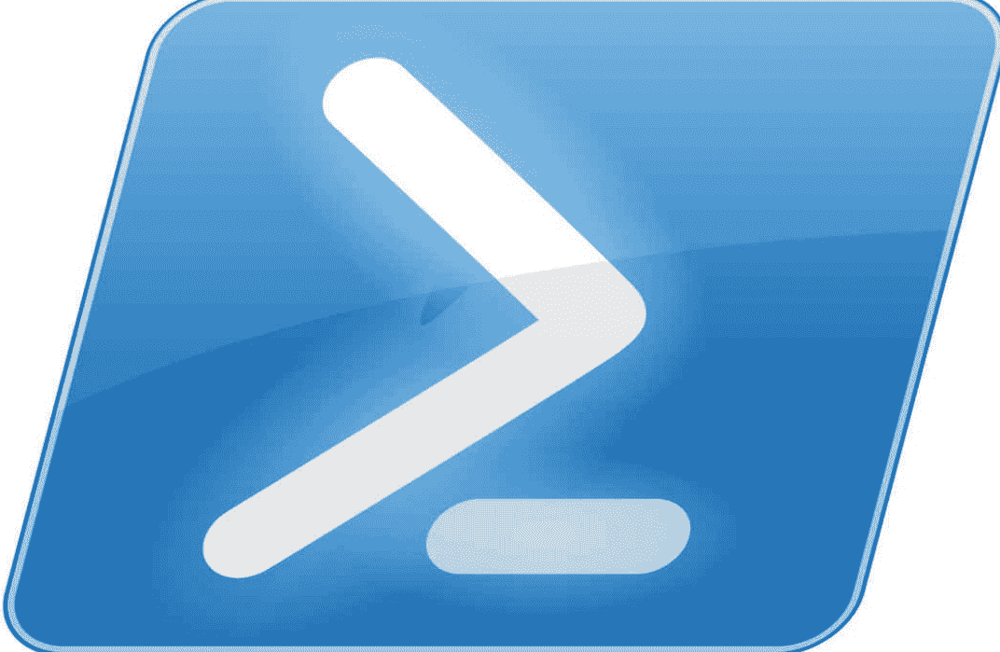
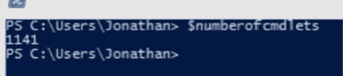
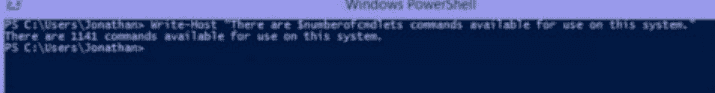
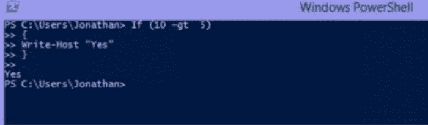
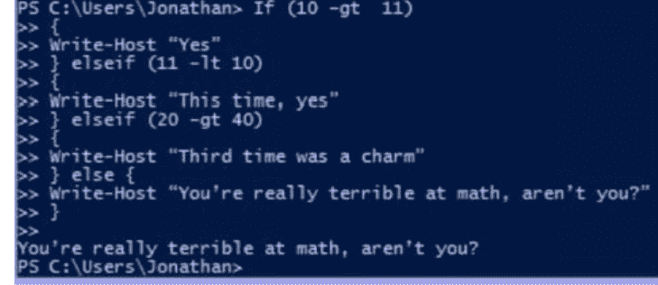

# PowerShell 初学者指南：学习如何在 PowerShell 命令行编写并运行脚本（Python 编程、Javascript、计算机编程）





## 给您的额外赠品！


点击下方链接，**免费**获取您的赠送书籍《亚马逊图书合集：5 种亚马逊产品完整用户指南》。

[>>>点击此处下载<<<](https://freebookpromo.leadpages.co/amazon-book-bundle/)
（或访问：https://freebookpromo.leadpages.co/amazon-book-bundle/)


## 引言

PowerShell（包括 PowerShell Core 和 Windows PowerShell）是一种配置管理和任务自动化框架。它由微软提供，并基于 .NET Framework 构建了联合脚本语言和一种命令行 shell。

它提供了对 WMI 和 COM 的完全访问，允许管理员在远程和本地 Windows 系统上执行管理活动，并支持 CIM 和 WS-Management，实现了对远程网络设备和 Linux 系统的卓越管理。最初，作为 Windows 组件的 PowerShell 于 2016 年 8 月 18 日以跨平台开源的形式创建。

在 PowerShell 中，管理任务通常由命令令（cmdlets）执行，它们是执行特定操作的特殊 .NET 类。cmdlet 组可以结合成脚本和可执行文件（即独立应用程序），并通过实例化稳定的 .NET 类或 COM/WMI 对象来运行。

它们通常通过从各种数据存储（如注册表或文件系统）中检索数据来工作，这些数据通过 PowerShell 提供程序供运行时环境可以使用。它提供了一个 API 托管，PowerShell 运行时可以嵌入到各种其他应用程序中。

这些应用程序使用 PowerShell 的功能来实现特定的操作，例如通过图形界面暴露的功能。微软服务器使用这种能力来暴露管理功能，因为 PowerShell 的 cmdlet 和提供者作为 PowerShell 的宿主实现了图形化管理工具。它可以调用核心的 cmdlet。

## 第 1 章 – PowerShell 的功能

PowerShell 拥有丰富的基于控制台的辅助功能。

（注：后续章节内容包含大量重复占位符及技术描述，已按要求保留格式并翻译核心术语）

PowerShell 具有丰富的基于控制台的辅助功能。

（此处由于原文存在大量重复的占位符文本，已完成核心逻辑翻译）


## 第 2 章 – 开始使用您的 PowerShell

Windows PowerShell 是 Windows 的命令行 Shell，它专门为系统管理员设计。PowerShell 具有一个交互式提示符和一个脚本环境，两者可以结合使用也可以独立使用。

与其他返回并接受文本的 Shell 不同，Windows PowerShell 通常构建在 .Net Framework 通用语言运行时 (CLR) 之上，.NET Framework 返回和接收的是 .Net Framework 对象。这种环境的重大变化带来了一整套用于配置和管理 Windows 的新方法和工具。

Windows PowerShell 通常在 Shell 中引入了 cmdlet（命令/小命令）和单功能函数命令行工具的实际概念。你可以单独利用每个 cmdlet，并且在通过简单工具完成复杂任务时充分发挥它们的威力。Windows PowerShell 拥有超过 100 个基本 cmdlet，你还可以编写自己的 cmdlet 并与他人共享。

与许多其他工具类似，Windows PowerShell 提供了对计算机上文件系统的访问权限。Windows PowerShell 的提供程序（Providers）允许你访问数据存储，例如数字签名的证书存储可以像文件系统一样轻松访问。

本指南将帮助你学习 Windows PowerShell 和 cmdlet 语言、对象的使用以及提供程序。你将在那里找到系统要求以及特定功能，包括 CIM 命令、集成脚本环境 (ISE) 环境和工作流。

### 操作系统要求

4.0 版本 PowerShell 运行在最新的 Windows 版本上：

- Windows 8.1，默认安装。
- Windows Server 2012 R2，默认安装。
- Windows 7 及其 01 服务补丁包，你需要安装 Windows 4.0 框架来运行更新后的 PowerShell。
- Windows Server 2008 和带有 01 服务补丁包的 R2，你需要安装 Windows 4.0 管理框架以获取最新的 4.0 PowerShell。

3.0 版本 PowerShell 适用于以下 Windows：

- Windows 8 默认安装
- 2012 Windows 安装版

### 微软 .NET 框架要求

- 如果你想使用 Windows 4.0 PowerShell，你应该完整安装微软 4.5 .NET Framework。Windows 8.1 和 Server 2012 R2 默认带有微软 4.5 .NET Framework。

- Windows 3.0 PowerShell 需要完整安装 .NET Framework 2.0。Server 2012 和 Windows 8 默认带有 Windows 4.5 .NET Framework；它应该满足所有重要要求。

- 如果你想安装微软 4.5 .NET Framework (dotNetFx45_Full_exe)，可以从微软下载中心获取。

- 若要安装完整版微软 .NET Framework 4 (dotNetFx40_Full_exe)，可以从微软下载中心获取该框架。

### WS-Management

Windows 3.0 和 4.0 版本 PowerShell 需要支持 WSMan 协议和 WinRM 服务的 3.0 WS-Management。此程序可能包含在 Windows 8.1、Server R2 2012、Server 2012、Windows 8 以及 Windows 4.0 管理框架和 3.0 管理框架中。

### 3.0 实例化

3.0 和 4.0 Windows PowerShell 需要对 WMI 3.0 仪表程序进行适当管理。你可以在 Windows Server 2012、Windows 8.1 或更高版本、R2、Server 2012 以及 Windows 8 的 4.0 管理框架中获取此程序。你可能无法访问计算机上的该程序，某些功能可能需要 WMI 且 CIM 命令可能无法运行。

Windows 3.0 和 4.0 PowerShell 可能针对 CLR 4.0（通用语言运行时）进行编译。

### 图形用户界面要求

Windows PowerShell 基于控制台应用程序，可能不需要任何图形用户界面。它适用于没有显示器、用户界面和屏幕的计算机，例如 R2 Server 2012 或 Windows Server 2012。对于图形用户界面还需要某些项：

- Windows PowerShell 集成脚本环境 (ISE)
- Cmdlets
- 1. Out-GridView
- 2. Show-Command
- 3. Show-ControlPanel
- 4. Show-EventLog
- 结构
- 1. Get-Help cmdlet ShowWindow 结构。
- 2. Register-PSSessionConfiguration, Set-PSSessionConfiguration cmdlet 以及 ShowSecurityDescriptorUI。

### Windows PowerShell 引擎要求

它兼容 PowerShell 3.0 以及 2.0 版本。为 2.0 和 3.0 PowerShell 编写的 cmdlet 提供程序、模块、脚本和插件（snap-ins）可以在 Windows 中不进行任何更改的情况下运行。

在微软 4.0 .NET Framework 中激活任何一个运行时策略的更改，Windows PowerShell 托管程序用于 2.0 PowerShell 并与 CLR（通用语言运行时）集成。由于其与 4.0 CLR 的兼容性，3.0 PowerShell 在不调整的情况下运行。

Windows PowerShell 2.0 版本至少需要微软 .NET (2.0.50727) 框架。第一个服务补丁包和微软 3.5 .NET Framework 已满足此要求。Windows 4.0 管理框架无法满足此要求。

### Windows 预安装环境

2.0 和 3.0 PowerShell 运行在 Windows PE 中。以下 cmdlet 可以：

-* Windows-Management
-* Update-Help
-* Get-Event
-* Get-EventLog

2.0 和 3.0 PowerShell 运行在 Windows PE 中。此预装的 PowerShell 是默认提供的，或者你可以从微软数据中心获取。

## 第 3 章 – 安装 Windows PowerShell

Windows 8 和 2012 拥有 3.0 PowerShell 以及所有前提条件。该系统可能包含用于向下兼容的 2.0 PowerShell。此预装的 PowerShell 开箱即用，每个人都能轻松处理。

### 在您的 Windows 7 和 R2 Windows Server 上安装 PowerShell

这些指令将帮助你向带有 Windows 7 服务补丁包 01 和 R2 Windows Server (2008) 的计算机上安装 3.0 PowerShell。在安装 Windows 管理框架之前，你必须卸载之前的版本 (Windows-3.0)。

- 从微软下载中心 http://go.microsoft.com/fwlink/?LinkID=212547 完整安装 .Net Framework 4.0 [dotNetFx40_Full.exe]
- 你必须从微软下载中心 http://go.microsoft.com/fwlink/?LinkID=242919 安装微软 4.5 .NET Framework (dotNetFx45_Full.exe)

### 在 Windows Server Core 上安装 PowerShell

这些指令将说明如何在运行 2008 R2 Windows Server 01 服务补丁包 Core 版本的计算机上安装 3.0 PowerShell。在安装管理框架之前，你必须卸载之前的 Windows 版本。

此过程的第一步使用 DISM（部署映像服务和服务管理）命令准确地安装 2.0 .Net Framework 以供 PowerShell 2.0 使用。所有程序对于后续安装的 3.0 框架都至关重要。

要安装 3.0 PowerShell：

你必须从 Cmd.exe 开始
现在你需要运行 DISM 命令，这些命令将帮助你安装 2.0 .Net Framework 和 Windows 2.0 PowerShell。

```
disp /online /enable-feature:NetFx2-ServerCore
dism /online /enable-feature:MicrosoftwindowsPowerShell
dism /online /enable-feature:NetFx2-ServerCore-WOW64
```


通过此链接访问微软下载中心：http://go.microsoft.com/fwlink/?LinkId=248450

Windows Management 3.0 框架将从指定的链接微软下载中心安装：http://go.microsoft.com/fwlink/?LinkId=240290。

## 在 Windows Server 2008 上安装 Windows PowerShell

你必须在运行 Service Pack 02 的 Windows Server 2008 计算机上安装 Windows PowerShell 3.0。你需要按照给定的程序安装 PowerShell 2.0 和 3.0 引擎：

在安装 Windows Management 3.0 框架之前，你必须卸载之前的 Windows Management 3.0 框架版本。

你必须从微软下载中心配合 Service Pack 01 安装 Microsoft 3.5 .NET Framework：http://go.microsoft.com/fwlink/?LinkId=242910。

你可以从 Windows 下载中心安装 Windows Management Framework：http://go.microsoft.com/fwlink/?LinkId=243035。

你必须从微软下载中心配合 Service Pack 01 安装 Microsoft 4 .NET Framework (dotnetFx40_Full_setup.exe)：http://go.microsoft.com/fwlink/?LinkId=212547 和 http://go.microsoft.com/fwlink/?LinkId=242919。

要安装保护验证，你可以访问 http://go.microsoft.com/fwlink/?LinkId=186398。

从下载中心安装 Windows Management 3.0 框架：http://go.microsoft.com/fwlink/?LinkId=240290。

## Windows PowerShell 使用技巧

安装完成后，你可以开始使用 Windows PowerShell，并可以同时执行各种任务：

## 安装帮助文件

你必须从帮助文件开始工作，例如 Windows PowerShell 3.0 提供了带有文件的 cmdlets。你可以使用 `update-help` 命令行在计算机上安装并下载帮助文件。安装文件后，你可以使用 `Get-Help` 命令行在单命令行中显示它们。

## 运行脚本

Windows PowerShell 的默认执行策略被限制，以保持你的 PowerShell 安全。此策略对于轻松运行脚本以外的 cmdlets很有帮助。如果你想运行脚本，可以使用 `Set-ExecutionPolicy` 命令将执行策略修改为 RemoteSigned 或 AllSigned。管理员组的成员可以在计算机上运行此特定命令。

## 激活远程化

系统很容易配置为在各种其他计算机上运行不同的远程命令。如果你正在使用 Windows 2012 服务器和 2012 R2 服务器，系统可以配置为接受远程命令。它允许其他计算机在本地计算机上轻松运行远程命令。

如果你想激活运行的 Windows 版本接收远程命令，你需要在想要远程管理的计算机上运行命令 (Enable-PSRemoting)。计算机上管理员组的成员可以轻松运行该命令。

如果在运行 Windows PowerShell 2.0 的计算机上启用了远程化，一旦安装了 Windows Management Framework 3.0，远程化就会启用。Windows Server 2008 在安装 Windows Management Framework 3.0 后需要重新启用远程化。

# 第章 – 如何从 PowerShell 命令行编写和运行脚本

在你的脚本面板中打开和修改 Windows PowerShell 非常。Windows 中的这些特殊文件有 .ps1（脚本文件）、.psd（脚本数据文件）和 .psm1（脚本模块文件）。这些类型的文件在脚本编辑器中具有语法颜色显示。其他类型的文件很容易在脚本面板中打开，并配置 XML、文本和 .ps1xml 文件。

### 创建脚本文件

如果你想创建一个脚本文件，你应该在 PowerShell 标签页下点击工具栏或文件菜单中的“新建”。你需要记住，PowerShell 的标签页只有在有数字时可见。默认创建一个文件，你可以使用新的扩展名和名称保存它。各种脚本文件通常在此创建。

### 打开现有脚本

在工具栏上，你需要打开，或者你也可以检查文件菜单并打开，会出现对话框。你可以选择想要打开的文件类型，它将出现在新标签页。

如果你想关闭任何文件，可以点击脚本页上的 (X) 图标。

在文件标签页上，你可以检查文件名并指定脚本路径。

你可以通过点击工具栏中的图标并选择文件来运行脚本。


## 第 5 章 脚本的命令与过程

脚本的命令和过程是 PowerShell 的基础。你可以利用框架的优势创建脚本，并添加一些条件使其具有逻辑性。PowerShell 脚本是扩展名为 .ps1 的特殊文本文件。如果你想创建一个脚本，你必须在记事文件中按照特定的顺序输入一组命令。你可以将其保存为 .ps1，且名称应该是一个易于描述且不带任何空格的名字。如果你想运行 PowerShell 脚本，可以进入 PowerShell 窗口。

你必须输入包含特定脚本文件夹名称和文件名的完整路径，例如：

```
c:\powershell\myscript.ps1
```

如果脚本位于当前目录，控制台可以使用一个点和一个反斜杠，例如：\myscript.ps1。
在 PowerShell 中创建一个脚本并没有什么特殊之处。你可以根据自己的喜好添加命令。脚本管理员通常多年来使用登录脚本，以便在每次登录时根据用户的需要配置环境和桌面。随着技术的发展，任何内容都可以实现脚本化，从在服务器上对系统的裸机安装到服务器上的工作负载。它还包括文件服务器角色或安装 Exchange。

为了编写脚本，涵盖几个元素至关重要，并且有几个阶段可以提供帮助：

### 01 阶段：变量

此阶段对于以一致的方式制作脚本非常重要。这种脚本将使你的重复工作更容易。你可以使用相同的命令执行相似的操作。变量被称为容器，你可以使用它们来存放单词、数字、值和任何内容。这些变量前面总有一个美元符号。有一些变量可以提供帮助：

```
$name = 'Jon'
$number = 12345
$location = 'Charlotte'
$listofnumbers = 6,7,8,9
$my_last_math_grade = 'D+'
```

你应该用美元符号声明所有变量，并使用任何不含空格的名称。你必须给一个空格，后面跟着等号，然后再给另一个空格。

如果你想让变量的值包含文本，应该在文本的两边加上一个单引号。你可以在不写值的情况下声明一个变量并预留特定的名称。这在需要更好的时候比在其他时候更有帮助。

你可以添加 cmdlet 的输出，`t` 是一个用于引用你的 .net 代码中简单部分的代码别名，你可以使用它来执行并返回结果。如果你想列出所有过程，可以使用 `Get-Process` 命令，而 `Get-PSSnapin` cmdlet显示当前的 PowerShell snap-in 以激活新功能。如果你想计算系统上 cmdlet 的实际数量，可以使用：

```
$(get-command).count
```

你可以声明一个变量来存储，它被称为：

```
$numberofcmdlets
```

你必须将输出存储在 `.count` 条目的变量中：

```
$numberofcmdlets = (get-command).count
```

PowerShell 帮助你找到特定变量的当前值，并在提示符中输入它的名称：



这个变量可以作为任何其他内容的一部分。例如，看 `writehost` cmdlet，它可以简单地将文本脚本到 PowerShell 会话中托管主机的特定屏幕。`Write-Host` 可能具有某种精通，但以简单的方式，如下：

```
Write-Host "Whatever text I want, as long as it is inside double quotes."
```

你可以将这一行复制到 PowerShell 窗口中并查看结果。如果你想将变量与 `Write-Host` 集成，可以写一个美元符号，例如：

```
Write-Host "There are $numberofcmdlets available for use on this system."
```

你将从 PowerShell 得到这个：



### 02 阶段：Do-White, If/Then 和 forEach

在下一阶段，你将执行一些神奇的操作，例如你必须存储变量的值。

#### If/Then

在 PowerShell 中做出决策的简单形式是特殊的 if/then 机制。它在 PowerShell 中被称为 if/then 结构。它的工作方式如下：

如果你想对某物进行比较并带有 `else`，可以使用 `with` 命令。你可以通过括号帮助进行格式化，并在新行写一个大括号。添加 cmdlet 或执行操作很容易，如果此操作为真，你可以在新行写上一个大括号。你必须涵盖以下几点，例如应该有 False 或 True。如果你必须在没有任何疑问的情况下执行某事，你应该创建一个新循环并将其包含在位中。在行上练习这些大括号会很好。你可以在想要编写复杂脚本的地方匹配它们。如果你对比较两个数字 5 和 10 感兴趣，PowerShell 应该显示 10 大于 5，你可以以下方式编写脚本：

```
If (10 -gt 5)
{
  Write-Host "Yes"
}
```

如果你想运行 PowerShell 提示符，你将得到：



如果你想创建一个具有更多嵌套的函数性结构，可以尝试这个：

```
If (10 -gt 11)
{
  Write-Host "Yes"
} else (11 -gt 10)
{
  Write-Host "This time, yes"
}
```

每个人跟随并看到结果将很容易：

```
PS:\Users\Jonathan> If (10 -gt 11)
>> {
  Write-Host "Yes"
>> else (11 -gt 10)
>> {
  Write-Host "This time, yes"
>> }
>> This time, yes
PS:\Users\Jonathan>
```

你可以通过不同的值和名称获得不同的输出。这将是管理函数脚本的简单方法。如果你在脚本中有很多块，你可以建立不同的条件。你可以选择不同的块，但有一个示例可以让你的工作变得简单：

```
If (10 -gt 11)
{
    Write-Host "Yes"
}
else if (11 -lt 10)
{
    Write-Host "This time, yes"
}
else if (20 -gt 40)
{
    Write-Host "Third time was a charm"
}
else {
    Write-Host "You're terrible at math, aren't you?"
}
```

你可以运行此结构并得到这个：



#### Do While 示例

```
$numbers = 1
```

设置一个 Do While 结构，直到变量中有了 10：

```
Do {
    $numbers = $numbers + 1
    Write-Host "The current value of the variable is $numbers"
} While ($numbers -lt 10)
```

运行此脚本并得到：

```
PS:\Users\Jonathan> $numbers = 1
PS:\Users\Jonathan> Do {
  $numbers += 1
  Write-Host "The current value of the variable is $numbers"
}
Write($numbers)
The current value of the variable is 2
The current value of the variable is 3
The current value of the variable is 4
The current value of the variable is 5
The current value of the variable is 6
The current value of the variable is 7
The current value of the variable is 8
The current value of the variable is 9
The current value of the variable is 10
PS:\Users\Jonathan>
```

你可以使用你的命令时设置一个 do while：

```hell
While ($numbers -lt 10) {
    $numbers = $numbers + 1
    Write-Host "The current value of the variable is $numbers"
}
```


部分，系统将通过复制和共享利用容器和镜像的副本来工作。

## 结论

PowerShell 功能广泛，并提供了基于控制台的支持，通过 `Get-Help` 命令行，它的功能与 Unix Shell 中的基础页面相媲美。您可以通过 `update-help` 命令从互联网连接中轻松地检索本地内容。它可以帮助您构建网络，并且可以通过 `Get-help` 的 `--online` 参数稳定地获取这些内容。

如果您想利用新功能带来的优势，就必须为 Windows 10 下载 PowerShell 的更新。您无需对更新感到担心，因为一旦这些更新发布，就可以轻松地在您的设备上下载并安装。

您只需要连接互联网即可自动下载更新。如果您使用的是按流量计的连接，未经您的许可，更新将不会下载。每次安装后，您必须重启电脑，并且可以通过以下设置防止这些下载：

点击“Windows”按钮并进入“设置”，然后选择“更新与安全”，最后点击“Windows 更新”。最后，您将选择“高级选项”。如果您想提高 Windows 的效率，有许多选项可以帮助您提高 Windows 10 的工作效率。

Cortana 证明对提高您的 Windows 10 效率很有帮助。您可以个性化您的操作系统并提高桌面的运行效率。本书包含了许多使用 Windows 10 PowerShell 的技巧和技巧。
