# PowerShell：初学者指南！24 小时精通 PowerShell 命令行（Python 编程、Javascript、计算机编程、C++、SQL、计算机黑客、编程）

## 引言

长期以来，许多针对具有 VBScript 经验的人开发的 Windows `PowerShell` 书籍、教学材料甚至是 Windows `PowerShell` 演示。为了理解书中的技术教学语言或参加课程，读者和参与者需要了解脚本。可以理解，这限制了能够从现有 Windows `PowerShell` 文献中学习的人。尽管某些 Windows 管理员希望 Windows `PowerShell` 成为下一个 VBScript，但这不太可能发生。

Windows `PowerShell` 不仅仅是一个脚本 Shell。它首先是一个命令行 Shell，人们可以在其中运行命令行实用程序。虽然可以选择不使用 Windows `PowerShell` 进行脚本，但如果不运行命令行功能，就不可能使用 `PowerShell`。对于任何人来说，该 Shell 的第一个也是主要的用途可能是执行命令行功能。你有时可以用它编写脚本，但不可能不使用 Shell 执行命令。

在本书中，我们将专注于讨论 Windows `PowerShell` 的核心用途——它的命令行实用程序。如果你对脚本感兴趣，那么这本书不适合你。但如果你想了解关于 `PowerShell` 命令行功能的所有知识，至少是对于任何初学者都有用的基础知识，请继续读下去。

通过本书，你将学习所有让 Windows `PowerShell` 成为为任何 Windows 系统管理员提供自动化技能有效工具的命令。它具有最灵活、最易操作的方法来自动化一系列管理任务。Windows `PowerShell` 将会让任何 Windows 管理员在工作中更高效、更有效。

## 回顾 Windows PowerShell 历史

自图形用户界面 (GUI) 时代以来，系统管理员已经走了很远。Windows 管理员最初用于管理公司 Windows 系统的工具是 GUI 实际上 是 Windows `PowerShell` 的灵感来源。

使用 GUI 完成任务太耗费时间。需要一种更高效的工具来减少工作流程并允许管理员更快地交付工作。例如，如果过去管理员使用 GUI 向计算机系统中添加新用户需要 5 小时，Windows `PowerShell` 能够将完成该任务的时间缩短小时。因此，效率低的 GUI 产生并启发了其更高效的对应物——Windows `PowerShell`。

预计 Windows `PowerShell` 将随着时间的推移不断改进，功能变得更加精简以满足 Windows 管理员的需求。在未来，所有与自动化和管理相关的任务都能够在 Shell 中使用最精确的命令在最短时间内完成管理。

## 本书是写谁的？

本书是为负责管理公司集成 Windows 系统的 Windows 系统管理员准备的。这本书也适用于那些运行命令并不断寻找命令工具以添加到命令知识库的系统管理员。对于刚刚进入领域并正在寻找 Windows `PowerShell` 初学者指南以开始学习的新 Windows 系统管理员来说，也会发现本电子书非常实用，任何想在该领域寻求发展的人也是如此。

## 如何使用此书

由于本书主要侧重于如何在 Windows `PowerShell` 上运行命令，建议每天花点时间阅读并完成每一章的测试。不建议急于求成或一次性读完。这不是吸收从阅读中获得的所有技术信息的最佳方式，更不用说掌握书中每一章教给你的技能了。

稳扎前进是阅读本书的最佳节奏。确保自己沉浸在每一章中，并充分利用提供的实践测试来真正深入研究 Shell 的命令功能。

## 第 1 章：搭建你的 PowerShell 游乐场

以下是搭建 Windows PowerShell 游乐场的基本要求。这是你可以在其中尝试 Windows `PowerShell` 命令空间的空间。确保所有技术组件已就绪并安装，以确保你从书中获得最大的指导：

1. 至少带有 `PowerShell` 版本 3 的 Windows。最低要求是 Windows 8 或 Windows Server 2012。

## 2. “x64” 操作系统

检查方法：前往开始菜单。打开应用文件夹。寻找 `Windows PowerShell` 文件夹。如果在里面找到了 `Windows PowerShell` 和 `Windows PowerShell ISE` 文件，说明你拥有了正确的操作系统。这意味着该版本的 `Windows PowerShell` 是所要求的 64 位版本。

注意：作为 32 位操作系统的“x86”版本与本书的教学材料不兼容。建议升级到 64 位操作系统。

## 运行 PowerShell

虽然大多数电脑上已经预装了 `Windows PowerShell V3`，但检查一下你正在使用的电脑是否真的安装了它总是有好的。检查电脑上是否安装了 `PowerShell V3` 非常简单。

进入开始菜单，点击“应用”，打开 `Windows PowerShell ISE` 文件夹。在 `Windows PowerShell` 控制台中输入 `$PSVersionTable` 并按回车。检查屏幕上出现的 `PS Version` 信息。它应该显示版本为 `3.0`。如果不是，你将需要升级。

如果你需要安装升级，请访问 [`download.microsoft.com`](http://download.microsoft.com)。在搜索框中输入 `PowerShell 3`。下载 `Windows Management Framework 3.0`，它应该包含 `PowerShell V3`。记得下载 64 位程序，因为这是本书所兼容的操作系统。

注意：`Windows PowerShell V3` 有两个组件可供选择启动 Shell。第一个是 `PowerShell.exe`。它是基于文本的控制台主机。第二个是 `PowerShell_ISE.exe`。它是基于图形的控制台。它提供了一个更视觉化的集成脚本环境。两者都适用于本书。因此，这取决于读者的喜好。然而，本书倾向于 `.exe` 控制台主机版本。建议使用该控制台。

### 为 PowerShell.exe 自定义 Shell

如果你决定使用基于文本的 `PowerShell` 控制台，我们强烈建议在开始操作 Shell 之前自定义控制台功能。需要考虑的更改：

- **字体**：点击 `PowerShell` 图标（位于控制台左角的控制框）。从“菜单”中选择属性，在对话框中浏览选项卡，将默认字体更改为 `Lucida fixed-width font`。这是针对 `PowerShell` 命令优化的字体。为了确保在控制台中输入的单词、字符和符号清晰可见，请将字体大小增加比默认字体 `12` 大。

- **颜色**：也可以更改控制台背景和前景的颜色。选择你喜欢的颜色。

- **窗口大小**：窗口大小和屏幕缓冲区应具有相同的宽度值。

### PowerShell V3 在线资源

关于 `PowerShell V3` 的任何附加信息，请访问 `MoreLunches.com`。该网站提供了可以下载的代码列表相关信息。你还会在网站上找到书中测试题的答案。在网站上还可以访问关于 `PowerShell V3` 的文章、视频和博客链接。

# 第 2 章：向 PowerShell 问好

在引言中提到过 `Windows PowerShell` 用户有 2 种可用控制台。准确地说，实际上有 4 种控制台选项。预览方法：前往“开始”，打开“所有应用”。图 2.1 显示了点击“应用”后的桌面视图。

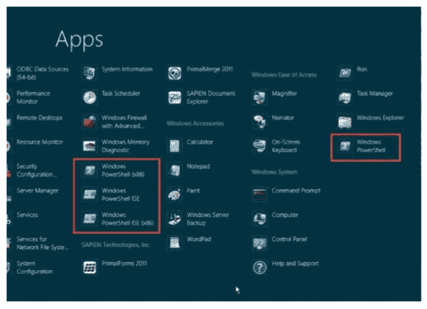

图 2.1

我们之前提到过 `Windows PowerShell` 上有 2 种可用控制台。这些是基于文本和基于图形的控制台。还提到过驱动 `Windows PowerShell` 的 2 种操作系统。这些是 64 位操作系统和 32 位操作系统。

在 `PowerShell` 图标的桌面视图中，32 位系统的文本和图形控制台是带有 `(x86)` 标记的，而 64 位版本则没有。

注意：出于本书的考虑，建议使用 64 位系统和标准的 `.exe` 文本控制台进行。

## 标准 PowerShell 控制台窗口（基于文本）

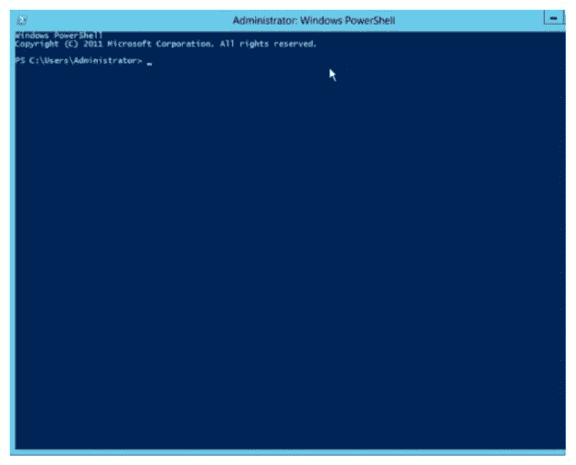

图 2.2

在整本书中，我们将使用这个 `PowerShell` 控制台。见图 `2.2`。因为它比基于图形的选项更简单、更不复杂。

### 配置基于文本的控制台

自定所需的所有选项都可以在窗口控制框的“属性”选项卡中找到。控制框是窗口左上角的 Windows 图标。属性文件夹将具有以下选项卡：

- **选项**：建议增加 `Command History Buffer Size`（命令历史缓冲区大小）。这很重要，因为你希望能够清晰读取过去输入的命令信息。

- **字体**：首选字体是 `Lucida fixed width-font`。字体大小应大于默认的 `12`。由于运行命令工作很大程度上取决于输入的准确性，你希望确保输入的每个字母和符号都是准确的。最好的检查方法是使用大字体，让你看清屏幕上精确的字符。

- **布局**：宽度大小应具有相同的数字，以便窗口恰好适应屏幕。避免过度扩展控制台大小，以至于某些区域在屏幕上不再可见。这确保了屏幕上输入的所有信息都是可读的。

- **颜色**：如果你喜欢看到不同的背景、字体和前景颜色，可以自行调整。如果不满意，总可以回到默认的蓝色和白色。

## 集成脚本环境 (ISE)

使用基于图形的控制台 `(ISE)` 的优点是支持双字节字符集，并且由于为了视觉化，它是更好的 `PowerShell` 工作环境。另一个优势是它可以帮助高级用户创建 `PowerShell` 命令和脚本。与文本版本不同，你可以在控制台上复制粘贴项目。查看图 `2.3` `ISE` 的视图。

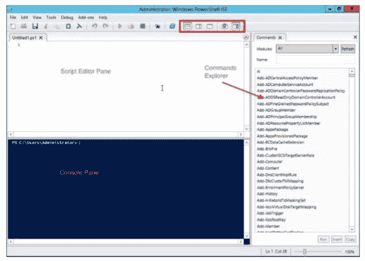

图 2.3 集成脚本环境 (ISE)

尽管如此，`ISE` 也有局限性，其中包括：它不支持转录、启动速度比文本控制台慢，并且需要 `Windows Presentation Foundation (WPF)`。这意味着硬件或电脑应安装 `GUI`，否则 `ISE` 将无法运行。

许多 `Windows PowerShell` 用户喜欢从文本控制台开始，然后转向使用 `ISE` 版本。由于 `ISE` 设计用于更优化的命令运行和脚本体验，所有使用 `PowerShell` 的管理员最终都会转向 `ISE`。

由于本书为 `PowerShell` 初学者编写，因此从文本控制台开始是合适的。会有充足的时间让你熟悉 `PowerShell.exe`。

## 不要拼写错误！

由于 `PowerShell` 是一个命令行界面，请预计会有大量的输入。这意味着准确、无错误的输入。严格不允许任何拼写错误，否则控制台无法生成正确的答案和响应。

让我们试一下。你可能可以开始熟悉控制台的选择功能。让我们进行几次练习：

1. 输入 `Get-S`，按几次 `Tab`，然后按 `Shift-Tab`。`PowerShell` 将循环遍历文件。意图是让用户扫描选项以获取所需的选项卡。完成后，按 `Esc` 清除控制台。

2. 输入 `Dir c:\` 然后按 `Tab`。`PowerShell` 将循环遍历文件夹，就像练习 `1` 一样。完成后再次按 `Esc` 清除控制台。

3. 输入 `Set-Execu` 然后按 `Tab` 键，添加空格和破折号 (`-`)，多次按 `Tab` 键。此时 `PowerShell` 将在参数之间循环切换。再次按 `Esc` 键清除控制台。

你刚刚学习了 `Tab` 补全的重要性。按下 `Tab` 键会生成 Shell 中可用的各种选项。它为用户提供关于 Shell 内部的各种命令、函数或参数名称的信息。

### Intellisense（智能感知）

出现在 `PowerShell ISE` 控制台右侧的弹出菜单被称为 `Intellisense`。见下图 2.4。在菜单上向上或向下滚动以查找查找要搜索的项目，然后按 `Tab` 键并继续输入以获取所需的信息或结果。

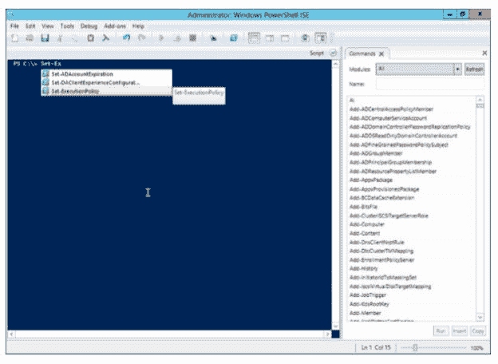

图 2.4 Intellisense

**注意**：我们如何强调都不为过：在操作 `PowerShell` 控制台时，输入的准确性是需要掌握的最重要技能。曾出现过由于简单的拼写错误导致整个系统失效的情况。为了确保 `PowerShell` 控制台的功能正常运行，在输入每个字符时最好保持非常警惕和谨慎。双击单词和符号是必须的。

### 如何确认你的 PowerShell 版本

让我们确保计算机实际上至少运行在 V3 版本的 `PowerShell` 上。在控制台上输入此命令：`$PSVersionTable`

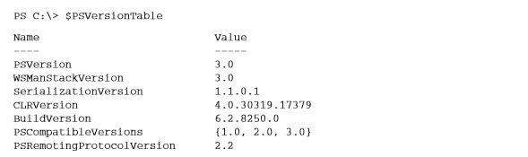

图 2.5 PowerShell V3 详细信息

控制台上应出现上述图 2.5 所示。`PSVersion` 项目的值应显示为 `3.0` 或更高。如果没有显示该值，你至少需要升级或下载 V3 版本。该表还提供了该版本所兼容的所有 `PowerShell` 相关技术的信息。

### PowerShell 实验室

让我们通过几次控制台配置测试，以确保你的控制台属性已为后续课程做好了准备：

1. 根据你的要求自定义控制台颜色。

2. 根据你的要求自定义字体。但请记住，我们推荐的字体是 `Lucida` 字体，大小应比默认字体大小 `12` 大。如果有其他偏好且 `Lucida` 不满意，你可以选择不同的字体。

3. 检查字符和符号的可读性。输入单引号（‘`）和反引号（` ` `）。检查你是否能区分两者。

4. 输入括号 (`()`)、方括号 (`[]`)、角括号 (`<>`)、大括号 (`{}`)。确保符号易于识别。如果不是，请更改字体或增大字体大小，以便它们易于阅读。

如果你已经完成了测试并对 `PowerShell` 控制台的外观满意，那么是时候进入下一章了。

# 第 3 章：使用帮助系统发现命令

本书不会对所有可能被提出的 `PowerShell` 问题提供所有答案。本书的目标是为管理员提供相关信息，说明 Shell 如何作为命令行实用程序运行，以便更好地理解其功能。本书希望确保 `PowerShell` 是一个在通过命令运行来自动化和管理集成 Windows 系统时的有用工具。

本书并不是一本包含所有答案的手手册。因此，我们强烈建议你专家并详细地掌握 `PowerShell` 最重要的发现功能——帮助系统。

`PowerShell` 帮助系统提供了 Windows `PowerShell` 函数、脚本、模块以及 `cmdlet`（组合命令）或命令的详细说明。它能够解释 Windows `PowerShell` 语言的复杂之处，并解释每个 `PowerShell` 项目、符号、字符和元素的概念。

我们建议你亲近帮助系统，花尽可能的时间与它相处，并真正了解帮助系统能提供的最细微的细节和最小的信息。如果你在帮助系统上投入了高质量的时间，它将回报你关于所有 `PowerShell` 复杂且非常有用的细节的近专家级知识，让你成为真正的 `PowerShell` 魔法师。此外，拥有 `PowerShell` 的专家知识意味着每个 `PowerShell` 用户的生活变得更轻松。它字面上拥有任何任何 `PowerShell` 问题的答案。

不知道某个任务的命令？帮助系统会告诉你。不理解某些术的定义？帮助系统有答案。在获取命令的准确语法方面遇到困难？帮助系统知道每个命令的语法。想创建一个命令字符串但不知道如何做？帮助系统可以引导任何人按照正确将多个命令连接在一起的步骤进行操作。

是的，你没错。帮助系统就是 `PowerShell` 系统手册。因此，从头到尾阅读它以充分理解 Shell 的工作原理是明智之举。这是让使用体验变得愉快且高效的唯一途径。否则，你会陷入困境。所以不要不要固执，要做一个聪明的 `PowerShell` 用户。阅读帮助系统。掌握帮助系统。

## 更新帮助系统

现在我们已经知道帮助系统对 `PowerShell` 用户有多重要了，现在是时候获取副本了。是的，帮助系统并没有预装在 `PowerShell` 中。这是因为它频繁更新。实际上，更新频率之，以至于让用户在购买 `PowerShell` 后安装帮助系统版本更为实用。这样他们就能在购买当天获得最新版本的帮助系统。

更新帮助系统应该是获取 Windows `PowerShell` 后的首要任务。这是在开始使用 Shell 进行任何工作之前要完成的第一项任务。

那么让我们来尝试一下。一个重要的提醒——在控制台上输入 `Update Help` 命令之前，请确保检查你是否是以管理员身份运行 `PowerShell`。检查控制台的顶栏，它应该显示“Administrator: Windows PowerShell”。见图 3.1。


图 3.1

如果显示的不是“Administrator”，请以管理员身份运行 Shell。只有在显示“Administrator”时，你才再次输入 `Update Help` 命令。对于此任务，计算机连接互联网是重要的。输入 `Update Help` 后，给 `PowerShell` 一时间更新帮助系统。这需要几分钟。之后，你就可以继续使用 `PowerShell` 了。

**注意**：在 `PowerShell` 用户需要培养习惯中，每月更新帮助系统是最重要的。记住，`PowerShell` 会定期产生持续的新信息和功能。养成定期更新帮助的习惯。

### 请求帮助

开始使用 `PowerShell` 帮助系统非常简单，在 `PowerShell` 控制台上输入 `Get-Help` 命令。你应该看到关于帮助系统的所有相关信息：描述、在线帮助、更新帮助、获取帮助。所有必要的命令函数也应该在页面上。见图 3.2。

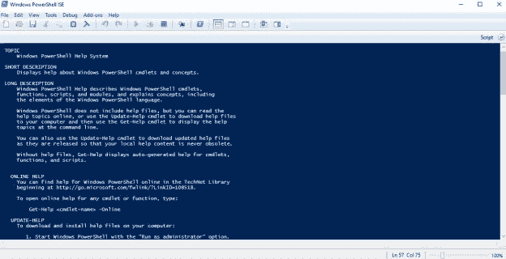

图 3.2

某些来源建议使用 `Help` 或 `Man` 作为替代命令。两者都有效。它们产生与 `Get-Help` 相同的结果。

### 让帮助查找命令

为了管理预期，帮助系统不提供关于系统中命令类型的信息。它知道自己的系统中有一系列帮助主题。然而，微软为它创建的每个命令都创建了帮助主题。因此，只要你知道自己在寻找什么命令，可以期待帮助系统的任何命令请求都能得到回答。

关于命令的一些信息，所有命令后面都紧跟着一个参数。这是一个强制性公式。参数是在输入命令或小程序（`cmdlet`）后输入的单词、短语或符号，用于识别 shell 被要求检索或搜索的项。

对于 `Get-Help` 或 `Help` 小程序，参数是名称参数（`name parameter`）。这意味着当向帮助系统请求帮助时，只需输入你想让其提供信息的主题名称即可。

例如，任务是清除“事件日志”。你希望通过 `Help` 查询 `run` 命令或小程序以了解如何完成清除“事件日志”。

在控制台上输入 `Help` 空格 `log` 或 `Help` 空格 `event`。添加通配符符号 `*`，因为你正正在搜索所有可能的选项。如果不添加通配符符号 `*`，结果将受到限制。它应该是这样的：

`Help *log*`

`Help *event*`

结果列表将出现在控制台屏幕上。见下图 3.3。

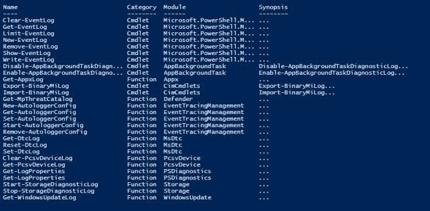

图 3.3

注意列表中的所有项目都指向事件日志主题。其中十一个是实际的命令运行或小程序，其余的是函数。现在选择最符合你要求的项。顶部的项目 `Clear-Eventlog` 看起来是最佳选择。现在你拥有了准确的小程序来向 `Help` 查询该主题的信息：`Help Get-Eventlog`。在向 `Help` 查询其他小程序的信息时，遵循相同的公式。

### Tab 键补全 (Tab Completion)

我们在前面的章节中讨论过这一点。再次提醒大家养成在控制台输入时按 `Tab` 键的习惯。`Tab` 补全允许你将输入的单词完成为最匹配的项。它显示了 shell 中可用的许多命令、函数、脚本选项。它增加了你对 shell 内部内容的了解。如果 `Tab` 生成的信息不准确，没有必要输入另一个单词，只需再次按 `Tab` 键，它将循环显示选项。当 `Tab` 显示准确单词时停止。`Tab` 补全让工作变得更加简单快捷。

### 通配符 (Wildcard)

与 `Tab` 补全类似，`*` 通配符符号可以完成你要求 `Help` 提供信息的整个单词。只需在字母后添加 `*` 通配符符号，`Help` 就能将范围缩小到搜索的精确帮助主题。

例如，在控制台上输入 `Help EventL*`。你会发现 `Help` 并没有像你输入 `Help log` 或 `Help event` 那样遍历它系统中所拥有的所有可能的事件日志项。相反，它直接进入了 `EventLog` 的帮助文件。`*` 通配符符号直击主题并将你直接带到该主题。

### 摘要帮助 (Summary Help)

如果你输入了 `Help EventL*`，那么下面的控制台屏幕应该是这样的。

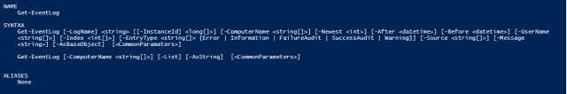

图 3.4

图 3.4 是摘要帮助。它描述了命令的名称。在这种情况下为 `Get-EventLog`。它提供了关于命令语法的信息。语法是命令的使用方法。

### 解释帮助文件 (Interpret a Help File)

查看图 3.4 提供的摘要帮助，注意语法下方有 2 组不同的参数集。这意味着根据所选的参数集，运行此特定命令有 2 种独特方法。参数是包含在 `[ ]` 方括号中的所有项。

两个参数集都以 `Get-EventLog` 开头。这就是我们识别有 2 组参数的方法。第一组的参数比第二组多。注意这 2 组参数还有一个共同的参数。它们都有 `[Computer Name]` 参数。相反，总会有仅存在于一个参数集的特殊参数。`[AsString]` 和 `[List]` 是较短参数集中的唯一参数。较长参数集中的几个参数在较短的参数集中是找不到的。

具有 2 组参数集的命令意味着只要你只使用共享参数，就可能使用两组参数来运行命令。如果你使用了仅存在于其中一个参数集的特殊参数（在上面的示例中，为 `[AsString]`），那么你就只能局限于使用该参数集中的参数。为了与多个参数集协同工作并访问更大的参数池，最好避免使用不被多个参数集共享的唯一参数。

### 不同类型的参数 (Different Types of Parameters)

让我们来定义并区分参数，以更好地理解它们的功能。

- **强制性参数 (Mandatory Parameters)**：任何不在 `[ ]` 方括号内的参数都是强制性的。在图 3.4 中，`string` 是一个强制性参数。

- **可选参数 (Optional Parameters)**：这些是 `[ ]` 括号中的参数。运行命令并不强制要求使用集合中的每个参数。事实上，大多数参数都是可选的，因为信息可以由系统提供。注意，在图 3.4 的短参数集中，所有参数都是可选的。

- **位置参数 (Positional Parameters)**：某些参数出现在所有的语法字符串中，因此不需要在每次运行命令时都输入它们。这些就是位置参数。在图 3.4 中，位置参数是 `[InstanceId]`，因为它在另一组 `[ ]` 括号内含有一个 `[ ]` 方括号。这意味着你可以保留该参数，但必须为位置 `<long[]>` 添加值。

### 参数值 (Parameter Values)

关于理解参数值或参数运行命令时所需的输入的信息，请参考下方的图 3.5：


图 3.5 参数值

首先是开关（switches）。开关是一个独立的、不需要值的参数。在图 3.5 中开关的示例是 `[AsString]`。在处理的完整语法时，开关会被明确标记为开关，以便管理员知道不要为其提供值。

对于需要值输入的参数，其识别方式如下：

1. 参数位于 `[ ]` 方括号内，并与其他参数隔开。例如：`[LogName] <string>`

对于独立不需要值的参数，其识别方式如下：

1. 参数后跟着等号、冒号、方括号等。例如：`[AsString]`

### 参数值的类型 (Types of Parameter Values)

1. **DateTime**：可以视为日期的参数值。因此预期是一个数字字符串。例如 `12-01-2012`。`DateTime` 通常计算机的区域设置。

2. **String**：字母和数字的组合。如果字符串之间有空格，应用引号括。

3. **Int, Int64, Int32**：`Int` 代表整数。不是小数，而是整数。

### 为带有 [ ] 方括号的字符串添加值

`[ComputerName <string>]`

上述示例中的 `[ ]` 方括号意味着参数可以添加字符串数组或列表。例如：

**单个值：**

`Get –EventLog Security –computer Station-A2`

**多个值：** 每个值之间应用逗号隔开，且中间没有空格。

`Get –EventLog Security –computer Station-A2,AB5,Files02`

**带有空格的多个值：** 应用引号括起来：

`Get –EventLog Security –computer “Station-A2”, “AB5”, “Files02”`

**文本文件值：** 这些值应每行输入。

`Get –EventLog Security –computer Station-A2`, `Files02`, `Files07`, `Files30`, `AB5`, `AB8`

如果你想读取文件内容，最有效的方法是通过 `Get-Content` 小程序强制 `PowerShell` 显示内容。下面的语法正是这样做的。注意获取内容的命令在括号中。那个符号可以让 `PowerShell` 在给定的参数内执行命令。

```
Get –EventLog Security –computer (Get-Content names.txt)
```

如果你是那种喜欢摆弄系统并乐于通过尝试来学习的管理员，那么让 `Help` 为你提供命令示例将引起你的兴趣。以下是获取 `Help` 显示命令示例的语法：

`Help Get-EventLog –examples`

尽管去测试 `Help` 提供的 `cmdlet` 示例列表。只需确保你正在一台未连接到公司系统的计算机上操作，这样在测试示例列表时遇到错误，就不会对你的 Windows 生产线产生影响。

## 获取常用参数的命令帮助

回看图 3.5，图中展示了用于解释参数值的示例。如果我们仔细观察语法中的两组参数，我们会注意到它们都以 `[<CommonParameters>]` 结尾。`<CommonParameters>` 是一组包含八个参数的集合，在每个 `cmdlet` 中都能被找到。

让我们命令 `Help` 提供关于 `[<CommonParameters>]` 的更多信息。在控制台上输入以下命令：

`Help common*`

结果应该是 `About_common_parameters`。由于 `*` 通配符符号的存在，不应该有其他选项。此外，关于常用参数没有其他 `Help` 主题。仅此而已。

查看 `About_common_parameters` 并查看 `<[CommonParameters>]` 中找到的 8 个参数。它们是：

- `-Verbose`

- `-Debug`

- `-WarningAction`

- `-WarningVariable`

- `-ErrorAction`

- `-ErrorVariable`

- `-OutVariable`

- `-OutBuffer`

`About_common_parameters` 只是帮助系统中可“关于”（about）主题之一。如果你想查看所有其他“关于”主题，请在控制台上输入：

`Help about*`

尽管去尝试，随意摆弄并筛选 `PowerShell` 隐藏在 `Help` 中的更多海量文档吧。对于任何管理员来说，掌握 `PowerShell` 存储的这些大量信息总是一项优势。

## 如何访问在线帮助

从一开始，我们就建议养成每月更新一次帮助系统的习惯。帮助系统正在被不断更新，只要 `PowerShell` 仍在使用中，它将一直保持更新。更新 `Help` 的最佳方法是访问在线版的 `Help`。它是目前、并将永远是最新的版本。参与 `PowerShell` 开发的每个人都为添加和更新在线帮助系统做出了贡献。定期将所有这些新信息添加到你的 `PowerShell` 帮助系统中是很好的。以下是访问 `PowerShell` 在线帮助的命令：

`Help Get-EventLog -online`

养成访问在线帮助并每月更新你的帮助系统的习惯。当你遇到新的且复杂的 Windows `PowerShell` 命令和脚本任务时，你会感谢自己自己的。

## 实验室测试

1. 确保你已成功安装了 `Update-Help`。

2. 找到可以输出到文件的 `cmdlet`。

3. 找到可以输出到打印机的 `cmdlet`。

4. 写入事件日志的命令是什么？

5. 使用命令 `Help` 从安全日志日志获取最近的 50 条目。

提示：如果测试遇到困难，请访问 `MoreLunches.com` 等在线资源寻找答案。事实上，与更新 `Help` 一样，建议养成定期检查可靠在线资源的习惯，以获取有关 Windows `PowerShell` 的最新消息。跟上 `PowerShell` 的新动态将提高工作效率。

# 第 4 章：使用命令——终于到了！

每位系统管理员、Web 开发人员、IT 专业人员都有共同点。每个人，我们每一个人在职业生涯之初都经历并从某项任务开始。那个任务就是运行命令。没有比 Windows `PowerShell` 更好的命令行支持的计算机系统了。

这就是 `PowerShell` 开发的初衷——为了运行命令。如果说 Windows `PowerShell` 是一个脚本工具是不准确的。它它可以执行脚本，但它开发的首要任务是运行命令。它能提供的任何其他附加功能都是其运行命令行能力和目的的次要任务。

## 它是一个 Shell

与其他 shell（例如 `Cmd.exe`、`MS-DOS`、`Unix Bourne` 和 `Unix Bash`）一样，使用 `PowerShell` 方法非常简单。输入命令，添加所需的参数来告诉命令如何运行，按回车并查看输出。

创建一个 `PowerShell` 脚本非常容易。只需编写一个脚本并在文件末尾添加 `.PS1` 即可。漂亮！你现在有一个 `PowerShell` 脚本了。创建非常复杂的 `PowerShell` 脚本是可能的，随你所欲。`PowerShell` 也完全可能运行该脚本并实现脚本创建的目标。

许多许多具有高技能的 IT 专业人员以编写想象中最复杂的脚本著称，而 `PowerShell` 能够运行这些命令。这就是 `PowerShell` 的可靠且同样复杂之处。无论你向它投掷什么，它都能给你反馈。

但如果你是一个只想解决公司集成计算机系统产生的日常任务的管理员，那么创建复杂脚本的能力还没有运行解决系统问题和故障的命令的能力重要。因此，精通 `PowerShell` 的命令运行比用复杂的脚本组合挑战 `PowerShell` 重要得多。

如果我们对 `PowerShell` 要现实且实用，那么在运行命令方面变得非常精通并熟悉 `PowerShell` 的功能和特性，比创建最令人印象深刻的脚本重要得多。好利用你的时间并理解真正的优先级。

## 命令的元素

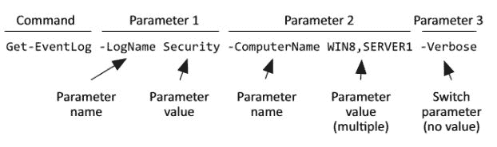

图 4.1

上方是构成命令的每个元素或项目的详细列表。对于 `PowerShell` 及其功能，理解命令的组成部分至关重要。让我们开始吧。参考图 4.1。

1. `Command`：称为 `cmdlet`。所有的 `cmdlet` 都采用动词-名词格式。

2. `Parameter 1 Name`：`LogName` 是参数 1 的名称。如果参数名称包含标点或空格，需要添加引号。

3. `Parameter 1 Value`：`Security` 是 `Logname` 的值。

4. `Parameter 2 Name`：`ComputerName` 是参数 2 的名称。如果参数名称包含标点或空格，需要添加引号。

5. `Parameter 2 Value`：`Win8` 和 `Server1` 是 `ComputerName` 的值。

6. `Parameter 3 Name`：`Verbose` 是参数 3 的名称。它是一个常用参数。它不需要值。

## 创建命令的规则

1. 始终在命令名称和第一个参数名称之间添加空格。

2. 始终在每个参数名称前添加破折号。不要在破折号和参数名称之间添加空格。

3. 始终用空格将参数名称与其值分开。

4. 始终用空格将值与下一个参数名称分开。

5. 输入命令不区分大小写。

再次，完美输入命令会导致无错误的结果。练习、练习、练习输入技巧，并熟记创建命令的规则。当你使用 `PowerShell` 时将将一帆风顺。

## 5. 命令：指 cmdlet（谓词命令）、函数、工作流和应用程序。

## 微软推荐的 cmdlet 命名方式

以动词（`Verb`）开头，后面接连字符（`-`），最后以名词（`Noun`）结束。例如：`Get-EventLog`。为 `cmdlet` 设定命名公式可以更容易猜测要使用的命令。`PowerShell` 中可用的动词只有约 100 个，且只有少数会被频繁使用。通过 `Help` 或 `Get-Command` 确认动词也是一项快速的任务。

## 别名 (Alias)

大多数情况下，命令名称非常长，因为它们通常是一系列组合在一起的单词。输入由 15 个单词组成的命令可能相当麻烦。这时别名就派上用场了。别名是命令的昵称，是冗长完整版本的缩写。以下是获取命令别名的方法：`get alias –Definition Get-Service`

结果应该如下：

| 能力名称 |

| :--- | :--- |

| `cmdletgsv` | `Get-Service` |

命令 `Get-Service` 的别名是 `gsv`。请记住，使用别名不会改变命令的任何属性。只有名称变成了缩写，所有其他元素和参数都保持相同，唯一的区别就是别名。

在处理和使用别名时，可能会出现这种情况：无论你如何尝试解析别名，都无法想起对应的命令名称。在这些时刻，请求 `Help` 帮助以澄清该别名代表哪个命令名称。使用上面的示例，请输入：`help gsv`

控制台应反映下方的图 4.2。

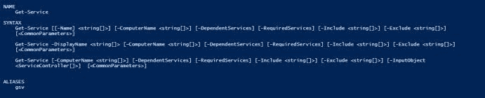

图 4.2

图 4.2 非常清楚地显示了命令的完整名称、组成命令的参数集以及它的别名。当对别名的含义感到困惑，进入 `Help` 请求信息始终是最佳解决方案。

某些任务或项目可能会让你希望创建自己的别名。好消息是！你实际上可以为特定项目自定义别名。只需输入 `New-Alias` 以及你想要创建的别名。但请注意，你创建的新别名仅在当天的会话有效。如果你下次会话还需要它，则必须重新创建。

## 使用参数快捷径

既然提到了快捷径，你会很高兴地发现可以创建参数的更短版本。以下是实现它的各种方法：

- **截断 (Truncating)**：`PowerShell` 能够识别每个产品名称，即使只输入前 5 个字母。只需确保按下 `Tab` 键，以便 `PowerShell` 补全名称，你就可以检查设置参数名称是否正确。

- **参数别名 (Parameter Alias)**：这是一个如何查找参数名称别名的示例。加粗字体部分可以替换为未来你想要检查别名的命令名和参数名。`PS C:\> (get-command get-eventlog | select –ExpandProperty parameters).computername.aliases`

- **位置参数 (Positional Parameters)**：当参数被括在 `[ ]` 方括号中时，它就是位置参数。这里有一个快速测试，识别下方图 4.3 中的两个位置参数。

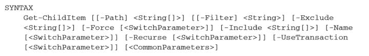

图 4.3

如果你的答案是 `[–Path]` 和 `[-Filter]`，那么你是正确的。对于位置参数，并不强制输入参数名称，这可以节省时间。有一个选项可以保持它们的原样。

## Show-Command

这是一个语法格式的图形化表示，你可以在给定的参数集中输入每个参数的值。参见提供的图 4.4。

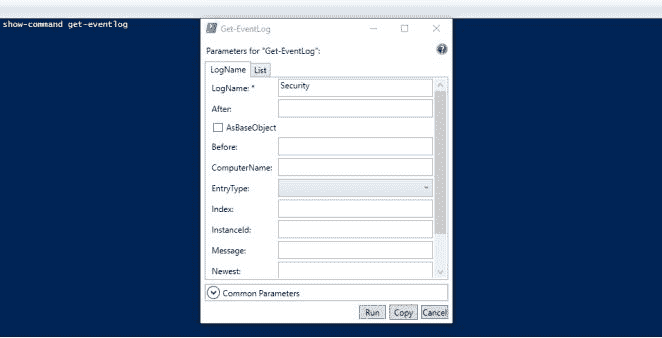

图 4.4 Show 命令框

与其手动输入语法或参数的每个单词和符号，不如进入 `Show-Command` 选项。它允许在框中输入必填字段，并且可以要求运行命令，或者在填充框后将其复制到控制台。

这让工作变得简单得多，因为它为你创建了参数集。你只需要在每个参数上输入值和名称。手动输入语法或参数集的参数时，发生错误的概率非常高。`Show-Command` 框减少了出错的可能性，因为它会以数字方式在参数集上添加正确的符号、名称和单词。

如果你在获取参数集的正确语法遇到困难，只需输入 `show-command space`、命令名并按回车。控制台屏幕应该像图 4.5。在每个框中添加值。

如前所述，使用 `show-command` 有选项。第一种是运行命令。完成要求后，点击框下方的 `run` 标签，它将直接运行命令。

第二种选项是复制并粘贴到控制台。点击 `copy`，返回 `shell` 并粘贴命令 –`ctrl + V`。第二种选项的棒之处在于，你将看到语法的完整格式，以及每个参数的完整值和名称。这是熟悉命令完整详细语法信息的绝佳方法。参见图 4.5 查看 `get-eventlog` 命令的完整语法。

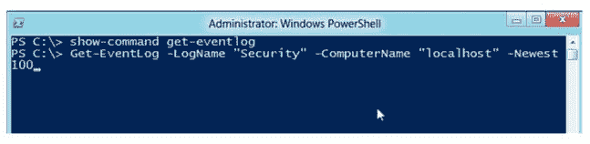

图 4.5

## 外部命令 (External Commands)

每台新购买的 Windows 计算机系统中都内置了至少 400 个 `cmdlet`。每个新的 Windows 服务器操作系统内部还有成千上万个内置 `cmdlet`。`PowerShell` 还规定管理员在需要时可以创建自己的 `cmdlet`。例如，如果管理员以前具有 `NsLookup`、`Ipconfig`、`Net` 等方面的经验，并且实际上拥有这些程序的 `cmdlet` 集合，那么非常有可能将它们导出到 `PowerShell`，并像在之前的程序中那样使用它们。

有一点提示：不要期望所有导出到 `PowerShell` 的外部命令都能完美运行。由于它们不是 shell 的原生命令，错误将会很。在过去，特别是 `PowerShell` 版本 1 & 2 时，必须添加准确的参数并手动修改外部命令，以便在 shell 内部无缝运行。这对于具有多个参数字符串的复杂外部命令来说尤为如此。

但不要灰心。手动修正外部命令的日子已经结束了。从 `PowerShell` 版本 3 发布以来，无法在 `PowerShell` 中正常运行的外部命令已变得完全可用。这是通过在点击运行按钮之前外部命令前添加两个连字符解决的。

## 解析错误消息

images/00016.jpeg)

图 4.6

`PowerShell` 错误消息是当 `PowerShell` 无法理解发送给它的命令时反映在控制台上的红色文本。错误信息的棒之处在于它非常清楚地说明了 `PowerShell` 认为哪里错误，并且通常会提供如何解决问题的建议。就像上面的示例。

当 `PowerShell` 发送错误消息且不清楚如何处理时，有三种方法回到正轨：

1. 询问 `Help` 获取答案。

2. 确保语法上所有的参数信息都是准确的。

3. 进入 `Show Command` 检查准确的语法信息。

## cmdlet 输入规则

虽然 `PowerShell` 完全不在乎命令上的字母是大写还是小写，但它非常在意 `cmdlet` 或命令中的空格和连字符。如果搞错了，你就会看到控制台上到处都是红色字体。

在输入命令或 `cmdlet` 时必须记忆的强制规则有：

1. `动词–名词格式`：每个 `cmdlet` 或命令始终始终始终遵循“动词+名词”的格式。

2. `连字符 (dash)`：每个 `cmdlet` 或命令名词之间都应该用连字符连接。

3.  连字符间不留空格`：每个 `cmdlet` 或命令在连字符的前或后都绝对不能有空格。

在输入命令或 `cmdlet` 时，请记住格式为：动词、连字符、名词。

## 参数输入规则

输入参数时也是同样的原则。请注意至关重要的空格和连字符。以下是参数的强制性输入规则：

1. 所有没有值的参数其前面都应该有一个连字符。

2. `cmdlet` 与参数之间应该有空格。

3. 一个参数与其后的另一个参数之间应该有空格。

## PowerShell 实验室

这里有几个测试题，用于复习和练习第 4 章的课程。如果卡住了答案，可以查找在线资源进行快速查看。

1. 收集所有 `cmdlet` 类型命令的列表。

2. 提供 50 个别名（`aliases`）的列表。

3. 通过 `Help` 查找更多关于 Windows 防火墙规则的信息。

# 第 5 章：管道函数

在 `PowerShell` 中运行命令的伟大之处在于，它能够在一个整洁的语法中将多组命令串联在一起。在之前的章节中，我们已经讨论了关于单条命令的所有知识。现在是时候学习如何将 2 组或更多命令语法组合在一起，让 shell 执行多项任务了。

管道（`Piping`）就是我们所说的 shell 将多个命令组合在一起的能力。这是因为 `|` 管道符号被放置在组合的每组命令语法之间。它被称为管道（`pipeline`）。

管道充当前一个命令通过的通道，以便下一个命令可以接收它并有东西可做。第二个命令接着执行同样的操作。它通过管道传递，以便后面的第三个命令有素材可以处理。

管道实际上是 Windows `PowerShell` 最优秀且独特的特征之一，其他命令行运行工具不具备这种在一种语法中运行多个命令的能力。

## 逗号分隔值 (CSV) 导出

假设任务是获取系统 CPU 使用情况的详细信息以及内存信息。该任务的多条命令字符串为：

```
Get-Process | Export-csv procs.csv
```

在上面的语法中有 2 组命令。第一条命令是 `Get-Process`，第二条命令是 `Export-csv procs.csv`。

`Get-Process` 命令是要求 `PowerShell` 提供有关计算机进程的信息。例如：CPU 利用率和计算机内存。

而第二个命令 `Export-csv procs.csv` 是要求 `PowerShell` 通过 `|` 管道将 `Get-Process` 获取的所有 CPU 利用率和内存信息导出到 CSV 文件。

让我们在 shell 中只输入命令 `Get-Process`。结果应该如底 5.1 所示。

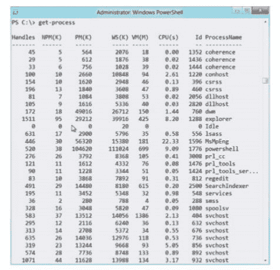

图 5.1

图 5.1 表格中的信息描述了 CPU 利用率和系统内存使用情况。

现在，要求 `PowerShell` 将其导出为 CSV 文件，以便传输到 Microsoft excel 文件用于演示，请输入下面的命令：

```
Get-Process | Export-csv c:\procs.csv
```

让我们通过在记事本上预览列表，查看双重命令 `Get-Process | Export-CSV` 提供的计算机进程详细信息。

图 5.2 应该是控制台上的结果：

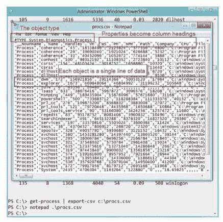

图 5.2

第一行区分信息为“系统诊断进程”（Systems Diagnostics Process）。第二行识别了每个表格信息的性质。第三行提供了计算机中运行的进程详细列表。上方是从双重命令运行 `Get-Process | Export-CSV c:\procs.csv` 中提取出的信息。

现在确保将该信息保存到 CSV 文件中。一旦完成，该文件就可以与任何需要将信息转换到演示型 Microsoft excel 文件的同事共享。

可以将 CSV 文件导入到 `PowerShell` 吗？当然可以。只需在 shell 中输入 `Import-CSV c:\procs.csv`，结果应该与图 5.2 非常相似。

## 可扩展标记语言 (XML) 导出

另一种导出和导入文件的方法是通过 XML 或可扩展标记语言。某些管理员倾向于使用 XML，因为它不像 CSV 那样是扁平文件，而且通常生成比 CSV 更丰富的信息数组。

要导出 XML 文件，运行的命令非常相似，只是第二条命令不同：

```
Get-Process | Export-cliXML C:\procs.csv
```

要导入文件，运行的命令应为：

```
Get-Process | Import-cliXML C:\procs.csv
```

建议测试 XML 导出命令以以熟悉。确保也运行导入 XML 命令，并检查记事本上的结果，看是否可以预览进程信息。

## Compare-Object 命令

`PowerShell` 有一个非常实用的功能叫做 `compare object` 命令。它允许在 2 组文件之间进行比较。通过 `PowerShell`，例如比较最近处理的 CSV 和 XML 进程信息，将它们并排放置并比较两个文件之间的差异。

在 shell 上输入命令 `Help Compare-object`。查看图 5.3 中的命令运行结果。

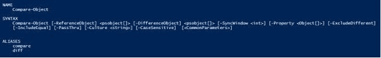

图 5.3

`Compare-object` 有两个别名。它们是 `compare` 和 `diff`。这意味着 `compare-object` 有 2 种可能的命运行方式，别名分别为 `diff` 和 `compare`。

`Compare-object` 是言自明的。它是 `PowerShell` 将来自两台计算机的相似信息合并到一个文件中，以便确定两组信息之间的差异。

仔细观察语法显示了 `compare-object` 的 3 个重要参数——`referenceobject`、`differenceobject` 和 `property`。

例如，任务是比较来自 2 台计算机的进程信息。第一台计算机将作为参考计算机（`reference computer`），从中提取 `referenceobject`。因为它是 `referenceobject`，这意味着它拥有的信息是 `differenceobject` 衡量的标准。

第二台计算机将作为差异计算机（`difference computer`），`differenceobject` 将来自那里。`differenceobject` 的信息是要检查准确性的内容。

为了练习 `compare-object` 命令，需要 2 台计算机。一旦有了 2 台计算机，请确定哪一台是参考计算机。记住，这是拥有准确信息或基准标准的计算机。然后在在参考计算机上运行此命令：

```
Get-Process | Export-cliXML reference.xml
```

下一步是在第 2 台计算机上运行此命令将文件传输过去：

```
Diff –reference (Import-cliXML reference.xml) –difference (Get-Process) –property name
```

该命令有点复杂，因为它是系列命令的组合。解释一下，每当在命令语法中使用括号时，意味着括号内的命令将首先执行，并将处理后的信息发送到之前的命令运行。

在上面的示例中，由于 `Import-cliXML reference.xml` 在括号内，`PowerShell` 会先导入参考 cliXML，然后发送给 `Diff –reference`。命令 `(Get-Process)` 也是如此。`PowerShell` 会先处理它，然后发送给 `–difference`。

末尾的 `-property` 参数告诉 `PowerShell` 仅显示引用集和差异集之间不同的进程。`<=` 是仅存在于引用集中进程的指示器。`=>` 是仅存在于差异集中进程的指示器。图形示例请见图 5.3。

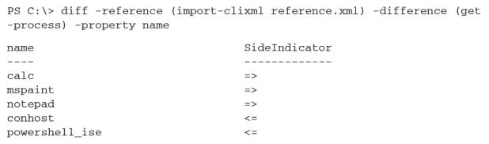

图 5.4

上表表明，差异计算机或计算机 2 具有 `calc`、`mspaint` 和 `notepad`而参考计算机或计算机 1 没有。而计算机 1 或参考计算机具有 `conhost` 和 `powershell_ise`，差异计算机则没有。

对于管理员来说，运行 `PowerShell` 的 `compare-object` 命令对于定期检查一组计算机数组相对于标准基准或参考对象的内部运行情况非常有用。因此，运行 `PowerShell` 的 `compare-object` 命令是进行高效系统管理的完美工具。

## PowerShell 输出 cmdlet (Out Cmdlets)

`PowerShell` 拥有多个 `cmdlet`，允许将命令输出到文件、打印机，甚至提供删除或置空的选项。这些被称为输出 `cmdlet`（`out cmdlets`）。进入外壳程序并输入 `Help Out*`。结果应该是以下输出 `cmdlet`：

1. `Out-null`：命令语法中的对象（无论是单命令还是流水线命令）将被置空或删除。

示例：

```
PS C:\>get-newitem | out-null
```

2. `Out-default`：命令语法中的对象将发送到主机或外壳程序。信息反映在外壳程序上。

3. `Out-host`：与 `Out-Default` 类似。

4. `Out-file`：处理由命令生成的项目列表，使其输出为 `.txt` 文件。

示例：

```
PS C:\ get-process | outfile –filepath C:\docs\process.txt
PS C:\ get-process | out-file C:\docs\process.txt
```

5. `Out-printer`：要求 `PowerShell` 通过流水线打印 `.txt` 文件。

示例：

```
PS C:\ get-content $pshome\about_signing.help.txt |
Out-Printer
```

6. `Out-string`：搜索并处理数据以字符串形式输出。示例 1 将 `.txt` 文件作为单个字符串发送到外壳程序。示例 2 从计算机获取区域设置信息并转换为字符串。

示例：

```
1. PS C:\ get-content C:\docs\test1.txt | out-string
2. PS C:\> $cult = get-culture | select-object * out-string –inputobject $cult –width 100
```

## 转换命令 (The Convert Command)

在讨论 `PowerShell` 的转换命令之前，有必要区分导出（`export`）命令和转换（`convert`）命令。

在 `PowerShell` 术语中，导出意味着将数据转换为格式（例如 `CSV`），然后将转换后的格式保存到文件中进行存储。而转换则仅意味着转换为不同的格式，而不一定将其保存到文件中。

可以将命令转换为 HTML 格式吗？可以。命令语法将是：

```
Get-Service | ConvertTo-HTML
```

该命令将 `Service` 转换为其 HTML 格式。可以将 `Get-Service` 的 HTML 格式导出到 `.txt` 文件吗？可以的。

作为一个测试，确定哪种流水线命令将允许将 `Get-Service` 的 HTML 格式保存为 `.txt`。如果你输入以下内容，答案是准确的：

```
Get-Service | ConvertTo-HTML | Out-file services.html
```

通过运行上述流水线命令，可以轻松将服务 HTML 数据保存到 `.txt` 文件格式。

`PowerShell` 中可用的其他 `ConvertTo-` `cmdlet` 有：

1. `ConvertTo-CSV`：该命令将外壳程序上的任何数据转换为 `CSV` 格式。

2. `ConvertTo-Json`：将任何对象转换为 JavaScript 对象表示（`Json`）字符串格式。转换结果将属性变为字段名，移除方法并将字段值转换为属性值。

3. `ConvertTo-XML`：将流水线对象转换为基于 XML 的表示。只有当流水线中有多个命令时才有效。

## 危险！cmdlet (Dangerous! cmdlets)

如果例如用户希望再也看不到计算机内部的所有数据和系统，那么崩溃计算机系统是一个有效选项。如果目的是清理计算机并永远与其内部的内容彻底撇清关系，这始终是一个有效选项。

但这是一个罕见的情况，其背后的逻辑应该足够充分，足以完全销毁设备中获取和存储的所有信息。通常情况下，我们希望尽可能地延长计算机设备的寿命。毕竟，计算机是极具私性的设备，通常包含人们无法离开的一些最重要的个人和工作信息。

因此，理解对计算机持续功能构成危险的 `cmdlet` 非常重要。这可以防止计算机崩溃的不幸发生。

应避免在外壳程序中运行的危险 `cmdlet` 是：

1. `Get-Process | Stop-Process`

2. `Get-Service | Stop-Service`

请不要测试运行这些命令。在外壳程序中运行它们，它将继续永久关闭你的计算机。永远不要让外壳程序运行这些命令。

如果由于某种原因你意外运行了命令，`PowerShell` 有一个安全保护机制，在执行 `Stop-Process` 命令之前会询问“你确定吗？”。

这是因为 `PowerShell` 的设计旨在衡量每个命令的影响级别。这是为了确保在请求停止命令时，它们不会对数据的完整性构成任何威胁。要检查计算机的影响级别设置，请在外壳程序上运行此命令：

```
PS C:\ $confirmpreference
```

`get` 答案应该是 `High`。这意味着当 `PowerShell` 运行对系统完整性有害的命令时，它会先询问“你确定吗？”，提供了中止命令并防止计算机崩溃的选项。确保每个计算机的 `$confirmpreference` 设置为高以防止意外关机。确保每个计算机的 `$confirmpreference` 设置为高以防止无意关机。

`PowerShell` 实验室：

以下是几个在外壳程序上运行的实际测试，用于回顾本章课程：

1. `CSV` 和 `XML` 之间的区别是什么？运行一个导出到 `CSV` 的命令。

2. 运行流水线命令并将文件打印到打印机。

3. 将命令流水线转换为 `Json`。

4. 将命令流水线导出到 `.txt` 文件。

5. 在流水线命令中使用 `convert` & `export`。

# 结

恭喜你！你已经完成了这本书。希望它为你提供了成功运行 `PowerShell` 命令所需的实用性基础信息。根据这 5 章的课程，你应该已经有能力在 `PowerShell` 帮助系统中进行探索，以获取所需的关于 `cmdlet`、函数、模块和脚本的任何信息。

正如不要让 `PowerShell` 执行 `Stop` 运行那样重要，养成更新帮助系统的习惯也同样重要。它的创建者甚至是每天贡献新更新的实际 `PowerShell` 用户，都在定期、持续地更新帮助系统。

要跟上不断演变的 `Windows PowerShell`，唯一的方法就是制定一个定期更新其帮助系统的计划。毕竟，对于任何陷入 `PowerShell` 任务困境的系统管理员来说，帮助系统都是他们的救命稻草。请始终记住，帮助文档会提供答案，但前提是你必须保持它是最新状态。

正如书中早期提到的，如果你想获取更多关于 `PowerShell` 的高级信息，网上有一系列资源可供选择。只需访问提供 `Windows PowerShell` 最新新闻和信息的网站及在线资源即可。

祝你好运！
