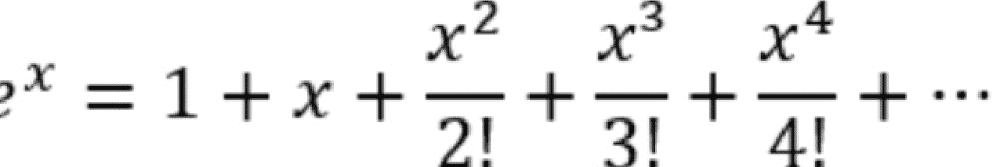
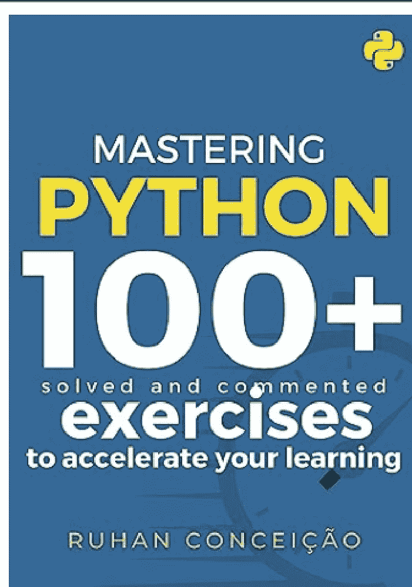
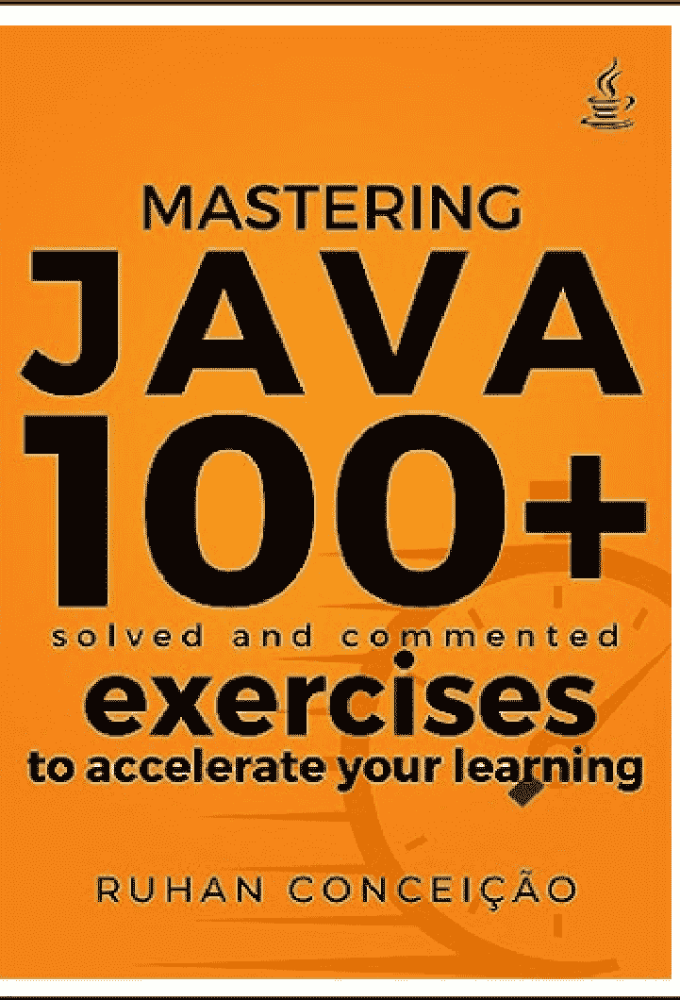
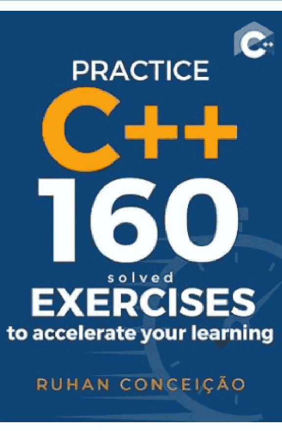

# Javascript 实践指南：160 个习题加速你的学习


## 前言

欢迎阅读本书，书中介绍了许多已解答并附带注释的 Javascript 练习题。在书中，你将找到 160 道练习题的集合，旨在帮助你提升在这门强大语言中的编程技能。

学习编程不仅涉及理解理论概念，还涉及将这些概念应用于现实场景中。这正是在本书书中你会发现的：从基础知识到更复杂的挑战的各种问题。

随着练习的进行，你将面临涉及数学公式操作、字符串、条件判断、循环、向量操作、矩阵等许多任务的挑战。

本书的主要目标是为寻求进步的程序员提供一个实用且全面的资源。无论你是想要巩固知识的 Javascript 初学者，还是希望加深专业知识的经验丰富的程序员，这些练习都将作为极佳的学习指南和参考。本书也适用于希望拥有丰富的编程逻辑练习题集以为学生创建题目和问题的老师。

享受这段学习旅程，并深入这些已解答且附带注释的 Javascript 练习中。准备好迎接刺激性的挑战、创造性的解决方案以及增强编程技能的独特机会。

本书的内容创作过程中使用了人工智能工具，但所有材料都经过了作者的审查和编辑，以交付最终的高质量产品。

阅读愉快，学习进步，并在探索迷人的 Javascript 编程世界时乐趣。
Ruhan Avila da Conceição.


## 引言

如果你拥有了这本书，说明你想要尽快开始编程并接受逻辑挑战，而不是想听长篇大论的教条。但在我们开始之前，强调几点是很重要的。

尽管许多练习可能被认为是易的，但如果你是这段编程旅程的新手，在看答案之前，首先尝试自己解决问题是非常重要的。同一个问题可能有多种解决方案，你需要思考并开发出你自己的解决方案。然后，你可以将其与书中提出的方案进行比较，识别各自的优点，并尝试学习更多知识。

如果练习太难且你无法解决，请跳到下一个，并在第二天再次尝试。即使无法解决，也不要立即跳到答案，更不要在没有尝试解决的情况下就看答案。

学习编程逻辑不在于得到答案，而在于你到达答案所经历的历程。

尽管如此，本书剩余章节将根据建议练习中涵盖的编程主题进行划分。

从现在起，一切取决于你！

## 基础练习

在开始练习之前，仔细阅读这里非常重要。当某个练习需要用户输入时，将使用 **prompt** 命令。但请注意，需要先安装 **prompt-sync** 包。要做到这一点，请初始化一个 npm 项目并使用以下步骤安装该包：

```
npm init
```

```
npm install prompt-sync
```

此外，你必须在代码的第一行添加以下命令：

```
prompt = require("prompt-sync")()
```

- 1. 编写一个程序在屏幕上打印 "Hello World!"。

```
console.log("Hello World!");
```

- 2. 编写一个程序，使用两个不同的命令在第一行打印 "Hello"，在底行打印 "World!"。

```
console.log("Hello");
```
```
console.log("World!");
```

- 3. 编写一个程序，仅使用一个打印命令在第一行打印 "Hello"，在底行打印 "World!"。

```
console.log("Hello\nWorld!");
```

- 4. 编写一个程序，在第一行打印 "Hello"，在底行打印 "World!"，并在单词之间留一个空行。

```
console.log("Hello");
console.log(""); // 空行
console.log("World!");
```

- 5. 编写一个程序，在屏幕上打印 "Hello World!"（在同一行），使用一个命令打印 "Hello"，另一个命令打印 "World!"。

```
process.stdout.write("Hello ");
process.stdout.write("World!");
console.log(); // 添加换行符移动到下一行
```

要执行这一点，你必须先运行此命令：npm i --save-dev @types/node

- 6. 编写一个程序，在屏幕上打印 "Hello World!"（在同一行），使用一个命令打印 "Hello"，另一个命令打印 "World"，另一个打印 "!"

```
process.stdout.write("Hello ");
process.stdout.write("World");
process.stdout.write("!");
console.log(); // 添加换行符移动到下一行
```

- 7. 编写一个程序询问用户的姓名，并在之后立即在屏幕上打印该姓名。

// 下面的命令将在后续练习中省略

```
prompt = require("prompt-sync")()

const userName = prompt("Please enter your name:")
console.log("Hello, " + userName + "!");
```

- 8. 编写一个程序，按顺序读取三个人的姓名，然后读取各自的年龄，并在屏幕上打印每个人的姓名和年龄。

// 第一个人的信息

```
const name1 = prompt("Please enter your name:")
const age1 = prompt("Please enter your age:")
```

```
// 第二个人的信息

const name2 = prompt("Please enter your name:")
const age2 = prompt("Please enter your age:")
```

```
// 第三个人的信息
const name3 = prompt("Please enter your name:")
const age3 = prompt("Please enter your age:")
```

```
// 打印每个人的姓名和年龄
console.log(name1 + " is " + age1 + " years old.");
console.log(name2 + " is " + age2 + " years old.");
console.log(name3 + " is " + age3 + " years old.");
```

- 9. 编写一个程序，按顺序读取三个人的姓名，然后读取各自的年龄和身高，并在屏幕上以表格格式打印数据。

```
// 第一个人的信息
const name1 = prompt("Please enter your name:")
const age1 = prompt("Please enter your age:")
const height1 = prompt("Please enter your height (in cm):")
```

```
// 第二个人的信息
const name2 = prompt("Please enter your name:")
const age2 = prompt("Please enter your age:")
const height2 = prompt("Please enter your height (in cm):")
```

```
// 第三个人的信息
const name3 = prompt("Please enter your name:")
const age3 = prompt("Please enter your age:")
const height3 = prompt("Please enter your height (in cm):")

// 以表格格式打印数据
console.log("Name\t\Height(cm)")
console.log(name1 + "\t" + age1 + "\t" + height1);
console.log(name2 + "\t" + age2 + "\t" + height2);
console.log(name3 + "\t" + age3 + "\t" + height3);
```

- 10. 编写一个程序，按顺序读取三个人的姓名，然后读取各自的年龄和身高，并在屏幕上以表格格式打印数据，使用横线 (-) 分隔行，使用竖线 (|) 分隔列。


```javascript
// Read information for the third person
const name3 = prompt("Enter the name of the third person:");
const age3 = prompt("Enter the age of the third person:");
const height3 = prompt("Enter the height of the third person (in cm):");

// Print the data in table format with dashes and pipes
console.log("Name\t Age\t Height (cm)");
console.log("----------------------------");
console.log(name1 + "\t" + age1 + "\t" + height1);
console.log(name2 + "\t" + age2 + "\t" + height2);
console.log(name3 + "\t" + age3 + "\t" + height3);
```

# 数公式

11. 编写一个程序，提示用户输入两个数字并显示它们之间的加法、减法、乘法和除法。

```javascript
// Prompt the user for the first number
const firstNumber = parseFloat(prompt("Enter the first number:"));
```

## 12. 编写一个程序，计算用户输入的两个数字的算术平均值。

```javascript
// Prompt the user for the first number
const firstNumber = parseFloat(prompt("Enter the first number:"));

// Prompt the user for the second number
const secondNumber = parseFloat(prompt("Enter the second number:"));

// Calculate the arithmetic mean
const mean = (firstNumber + secondNumber) / 2;

// Display the result
console.log("The arithmetic mean of " + firstNumber + " and " + secondNumber + " is: " + mean);
```

## 13. 编写一个程序，计算并显示用户输入的三个数字的算术平均值。

```javascript
// Prompt the user for the first number
const firstNumber = parseFloat(prompt("Enter the first number:"));

// Prompt the user for the second number
const secondNumber = parseFloat(prompt("Enter the second number:"));

// Prompt the user for the third number
const thirdNumber = parseFloat(prompt("Enter the third number:"));
```

```javascript
// Calculate the arithmetic mean
const mean = (firstNumber + secondNumber + thirdNumber) / 3;

// Display the result
console.log(
"The arithmetic mean of " + +
firstNumber +
" " + +
secondNumber +
" and " + +
thirdNumber +
" is: " + +
mean
);
```

## 14. 编写一个程序，读取两个数字（第一个为底数，第二个为指数），然后打印第一个数字的第二个数字幂。

```javascript
// Prompt the user for the base number
const base = parseFloat(prompt("Enter the base number:"));

// Prompt the user for the exponent
const exponent = parseFloat(prompt("Enter the exponent:"));

// Calculate the result using the Math.pow() function
const result = Math.pow(base, exponent);
```

```javascript
// Display the result
console.log(base + " raised to the power of " + exponent + " is: " + result);
```

## 15. 编写一个程序，读取一个数字并在屏幕上打印该数字的平方根。

```javascript
// Prompt the user for a number
const userInput = parseFloat(prompt("Enter a number:"));

// Calculate the square root regardless of whether the input is valid
const squareRoot = Math.sqrt(userInput);

// Display the result
console.log("The square root of " + userInput + " is: " + squareRoot);
```

## 16. 编写一个程序，计算用户输入的三个数字的几何平均值 → GeoMean = ³√n1 × n2 × n3

```javascript
// Prompt the user for the first number
const number1 = parseFloat(prompt("Enter the first number:"));

// Prompt the user for the second number
const number2 = parseFloat(prompt("Enter the second number:"));

// Prompt the user for the third number
const number3 = parseFloat(prompt("Enter the third number:"));

// Calculate the geometric mean regardless of the input values
const geometricMean = Math.pow(number1 * number2 * number3, 1 / 3);

// Display the result
console.log("The geometric mean of " + number1 + ", " + number2 + ", and " + number3 + " is: " + geometricMean);
```

# 17. 编写一个程序，计算个体的 BMI 指，使用公式 BMI = weight / height²

```javascript
// Prompt the user for their weight in kilograms
const weight = parseFloat(prompt("Enter your weight in kilograms:"));

// Prompt the user for their height in meters
const height = parseFloat(prompt("Enter your height in meters:"));

// Calculate the BMI
const bmi = weight / (height * height);

// Display the BMI
console.log("Your Body Mass Index (BMI) is: " + bmi.toFixed(2));
```

## 18. 创建一个程序，计算并显示圆的周长，提示用户输入半径，使用公式 P = 2πr

```javascript
// Prompt the user for the radius of the circle
const radius = parseFloat(prompt("Enter the radius of the circle:"));

// Calculate the perimeter (circumference) regardless of the input value
const perimeter = 2 * Math.PI * radius;

// Display the perimeter
console.log("The perimeter (circumference) of the circle is: " + perimeter.toFixed(2));
```

## 19. 编写一个程序，计算圆的面积，使用公式 A = πr²

```javascript
// Prompt the user for the radius
const radius = parseFloat(prompt("Enter the radius of the circle:"));

// Calculate the area
const area = Math.PI * Math.pow(radius, 2);

// Display the result
console.log("The area of the circle is: " + area.toFixed(2));
```

## 20. 编写一个程序，计算矩形的面积，使用公式 A = length × width

```javascript
// Prompt the user for the length
const length = parseFloat(prompt("Enter the length:"));

// Prompt the user for the width
const width = parseFloat(prompt("Enter the width:"));

// Calculate the area
const area = length * width;

// Display the result
console.log("The area of the rectangle is: " + area);
```

## 21. 编写一个程序，计算三角形的周长，使用公式 P = a + b + c

```javascript
// Prompt the user for the sides of the triangle
const sideA = parseFloat(prompt("Enter length of side A:"));
const sideB = parseFloat(prompt("Enter length of side B:"));
const sideC = parseFloat(prompt("Enter length of side C:"));

// Calculate the perimeter
const perimeter = sideA + sideB + sideC;

// Display the result
console.log("The perimeter of the triangle is: " + perimeter);
```


```javascript
const kineticEnergy = (mass * Math.pow(velocity, 2)) / 2;

// 显示结果
console.log("The kinetic energy of the object is: " + kineticEnergy.toFixed(2) + " joules");
```

## 25. 编写一个程序，使用公式计算作用在物体上的力所做的功，公式为 W = F * d，其中 W 是功，F 是施力，d 是物体移动的距离。

```javascript
// 提示用户输入以牛顿为单位的力
const force = parseFloat(prompt("输入施力（单位：牛顿）："));

// 提示用户输入物体移动的距离（单位：米）
const distance = parseFloat(prompt("输入物体移动的距离（单位：米）："));

// 计算做的功
const work = force * distance;

// 显示结果
console.log("The work done by the force is: " + work.toFixed(2) + " joules");
```

## 26. 编写一个程序，根据给出的首项、公差（比率）以及用户输入的 n 值，计算等差数列的第 n 项，公式为 $a_n = a_1 + (n-1) 	imes r$

```javascript
// 提示用户输入首项
const firstTerm = parseFloat(prompt("输入等差数列的首项 (a)："));

// 提示用户输入公差 (d)
const commonDifference = parseFloat(prompt("输入公差 (d)："));

// 提示用户输入 n 值
const n = parseInt(prompt("输入 n 的值："));

// 计算等差数列的第 n 项
const nthTerm = firstTerm + (n - 1) * commonDifference;

// 显示结果
console.log("The " + n + "-th term of the arithmetic progression is: " + nthTerm);
```

## 27. 编写一个程序，读取笛卡洛平面上两点的 x 和 y 坐标，并计算它们之间的距离

```javascript
// 提示用户输入第一个点的 x 和 y 坐标
const x1 = parseFloat(prompt("输入第一个点的 x 坐标："));
const y1 = parseFloat(prompt("输入第一个点的 y 坐标："));

// 提示用户输入第二个点的 x 和 y 坐标
const x2 = parseFloat(prompt("输入第二个点的 x 坐标："));
const y2 = parseFloat(prompt("输入第二个点的 y 坐标："));

// 计算两点之间的距离
const distance = Math.sqrt(Math.pow(x2 - x1, 2) + Math.pow(y2 - y1, 2));

// 显示结果
console.log("The distance between the two points is: " + distance.toFixed(2));
```

## 28. 创建一个程序，提示用户输入球半径，计算并显示其体积。

```javascript
// 提示用户输入球半径
const radius = parseFloat(prompt("输入球半径："));

// 计算球体体积
const volume = (4/3) * Math.PI * Math.pow(radius, 3);

// 显示结果
console.log("The volume of the sphere is: " + volume.toFixed(2));
```

# 29. 编写一个程序，读取两个电阻的阻值，并显示串联时的等效阻值（相加）以及并联时的阻值（使用公式 (R1 * R2) / (R1 + R2））。

```javascript
// 提示用户输入第一个电阻 (R1) 的阻值
const resistance1 = parseFloat(prompt("输入第一个电阻的值 (R1)："));

// 提示用户输入第二个电阻 (R2) 的阻值
const resistance2 = parseFloat(prompt("输入第二个电阻的值 (R2)："));

// 计算串联等效电阻
const seriesResistance = resistance1 + resistance2;

// 计算并联等效电阻
const parallelResistance = (resistance1 * resistance2) / (resistance1 + resistance2);

// 显示结果
console.log("Equivalent resistance in series: " + seriesResistance.toFixed(2) + " ohms");
console.log("Equivalent resistance in parallel: " + parallelResistance.toFixed(2) + " ohms");
```

## 30. 编写一个程序，读取商品价值和税率（百分比），并计算其最终价值。

```javascript
// 提示用户输入商品的初始价值
const initialValue = parseFloat(prompt("输入商品的初始价值："));

// 提示用户输入百分比形式的税率
const taxRate = parseFloat(prompt("输入税率（百分比）："));

// 计算包含税的商品最终价值
const taxAmount = (initialValue * taxRate) / 100;
const finalValue = initialValue + taxAmount;

// 显示结果
console.log("Tax Amount: $" + taxAmount.toFixed(2));
console.log("Final Value (including tax): $" + finalValue.toFixed(2));
```

## 条件判断

31. 编写一个程序，询问一个人的年龄并显示其是否达到年龄（年龄 >= 18）。

```javascript
// 提示用户输入年龄
const age = parseInt(prompt('请输入您的年龄：'));

// 检查年龄是否大于或等于 18
const isLegalAge = age >= 18;

// 显示结果
if (isLegalAge) {
  console.log("You are of age.");
} else {
  console.log("You are not of age.");
}
```

32. 编写一个程序，读取一个数字并判断其是奇是偶。

```javascript
// 提示用户输入数字
const number = parseInt(prompt("输入一个数字："));

// 检查是否为偶数
if (number % 2 === 0) {
  console.log(number + " is even.");
} else {
  console.log(number + " is odd.");
}
```

33. 编写一个程序，读取一个数字并报告其是正、负还是零。

```javascript
// 提示用户输入数字
const number = parseFloat(prompt("输入一个数字："));

// 检查正负零
if (number > 0) {
  console.log(number + " is positive.");
} else if (number < 0) {
  console.log(number + " is negative.");
} else {
  console.log("The number is zero.");
}
```

## 34. 创建一个程序，读取三个数字并检查它们的和是否为正、负或零。

```javascript
// 提示用户输入三个数字
const number1 = parseFloat(prompt("输入第一个数字："));
const number2 = parseFloat(prompt("输入第二个数字："));
const number3 = parseFloat(prompt("输入第三个数字："));

// 计算三个数字之和
const sum = number1 + number2 + number3;

// 检查和的正负零
if (sum > 0) {
  console.log("The sum is positive.");
} else if (sum < 0) {
  console.log("The sum is negative.");
} else {
  console.log("The sum is zero.");
}
```

## 35. 编写一个程序，读取两个数字并告诉你哪个更大。

```javascript
// 提示用户输入两个数字
const number1 = parseFloat(prompt("输入第一个数字："));
const number2 = parseFloat(prompt("输入第二个数字："));

// 使用 if 语句找到较大的值
if (number1 > number2) {
  console.log(number1 + " is bigger than " + number2);
} else if (number2 > number1) {
  console.log(number2 + " is bigger than " + number1);
} else {
  console.log("Both numbers are equal.");
}
```

不使用 if 语句

```javascript
// 提示用户输入两个数字
const number1 = parseFloat(prompt("输入第一个数字："));
const number2 = parseFloat(prompt("输入第二个数字："));

// 使用 Math.max 函数找到较大的值
const biggerNumber = Math.max(number1, number2);

// 显示结果
console.log(biggerNumber + " is the bigger number.");
```

## 36. 编写一个程序，要求用户输入三个数字并显示最大的一个。

```javascript
// 提示用户输入三个数字
const number1 = parseFloat(prompt("输入第一个数字："));
const number2 = parseFloat(prompt("输入第二个数字："));
const number3 = parseFloat(prompt("输入第三个数字："));

let largestNumber;

// 使用 if 语句比较数字找到最大的
if (number1 >= number2 && number1 >= number3) {
  largestNumber = number1;
} else if (number2 >= number1 && number2 >= number3) {
  largestNumber = number2;
} else {
  largestNumber = number3;
}

// 显示最大的数字
console.log("The largest number is: " + largestNumber);
```

## 37. 编写一个程序，读取三个数字并告知它们的和是否能被 5 整除。

```javascript
// 提示用户输入三个数字 
const number1 = parseInt(prompt("输入第一个数字："));
const number2 = parseInt(prompt("输入第二个数字："));
const number3 = parseInt(prompt("输入第三个数字："));

// 计算三个数字之和
const sum = number1 + number2 + number3;

// 检查和是否能被 5 整除
if (sum % 5 === 0) {
  console.log("The sum is divisible by 5.");
} else {
  console.log("The sum is not divisible by 5.");
}
```


```javascript
const number2 = parseInt(prompt("Enter the second number:"));
const number3 = parseInt(prompt("Enter the third number:"));

// 计算三个数字之和
const sum = number1 + number2 + number3;

// 检查和是否能被 5 整除
if (sum % 5 === 0) {
  console.log("三个数字之和 " + sum + " 能被 5 整除。");
} else {
  console.log("三个数字之和 " + sum + " 不能被 5 整除。");
}
```

## 38. 写一个程序，要求一个整数并检查它是否同时能被 3 和 5 整除。

```javascript
// 询问用户一个整数
const number = parseInt(prompt("Enter an integer:"));

// 检查该数字是否同时被 3 和 5 整除
if (number % 3 === 0 && number % 5 === 0) {
  console.log(number + " 同时能被 3 和 5 整除。");
} else {
  console.log(number + " 不能同时被 3 和 5 整除。");
}
```

## 39. 写一个程序，询问两个数字并显示第一个数字是否能被第二个数字整除。

```javascript
// 询问用户两个数字
const number1 = parseInt(prompt("Enter the first number:"));
const number2 = parseInt(prompt("Enter the second number:"));

// 检查第一个数字是否能被第二个数字整除
if (number2 != 0 && number1 % number2 == 0) {
  console.log(number1 + " 能被 " + number2 + " 整除");
} else {
  console.log(number1 + " 不能被 " + number2 + " 整除");
}
```

## 40. 写一个程序，读取两次考试的成绩，并报告学生每次考试是及格（分数大于等于 6）还是不及格（分数小于 6）。

```javascript
// 询问用户两次考试的成绩
const test1Score = parseFloat(prompt("Enter the score for 1:"));
const test2Score = parseFloat(prompt("Enter the score for 2:"));

// 检查学生是否通过了第一次考试
if (test1Score >= 6) {
  console.log("学生通过了第一次考试。");
} else {
  console.log("学生未通过第一次次考试。");
}

// 检查学生是否通过了第二次考试
if (test2Score >= 6) {
  console.log("学生通过了第二次考试。");
} else {
  console.log("学生未通过第二次次考试。");
}
```

## 41. 写一个程序，读取两次考试的成绩，计算算术平均值，并告知学生是及格（平均分大于等于 6）还是不及格（平均分小于 6）。

```javascript
// 询问用户两次考试的成绩
const test1Grade = parseFloat(prompt("Enter the grade for 1:"));
const test2Grade = parseFloat(prompt("Enter the grade for 2:"));

// 计算算术平均值
const average = (test1Grade + test2Grade) / 2;

// 根据平均分检查学生及格还是不及格
if (average >= 6) {
  console.log("学生及格。平均分: " + average.toFixed(2));
} else {
  console.log("学生不及格。平均分: " + average.toFixed(2));
}
```

## 42. 写一个程序，读取三个人的年龄，并统计其中有多少人已成年（18 岁及以上）。

```javascript
// 询问三个人的年龄
const age1 = parseInt(prompt("Enter the age of person 1:"));
const age2 = parseInt(prompt("Enter the age of person 2:"));
const age3 = parseInt(prompt("Enter the age of person 3:"));

// 统计有多少人达到成年（18 岁及以上）
let legalAgeCount = 0;

if (age1 >= 18) {
  legalAgeCount++;
}

if (age2 >= 18) {
  legalAgeCount++;
}

if (age3 >= 18) {
  legalAgeCount++;
}

// 显示成年人数
console.log("成年人数: " + legalAgeCount);
```

## 43. 写一个程序，读取三个数字，并按升序在屏幕上显示它们。

```javascript
// 询问用户三个数字
const number1 = parseFloat(prompt("Enter the first number:"));
const number2 = parseFloat(prompt("Enter the second number:"));
const number3 = parseFloat(prompt("Enter the third number:"));

// 寻找最小、中间和最大的数字
let smallest, middle, largest;

if (number1 <= number2 && number1 <= number3) {
  smallest = number1;
  if (number2 <= number3) {
    middle = number2;
    largest = number3;
  } else {
    middle = number3;
    largest = number2;
  }
} else if (number2 <= number1 && number2 <= number3) {
  smallest = number2;
  if (number1 <= number3) {
    middle = number1;
    largest = number3;
  } else {
    middle = number3;
    largest = number1;
  }
} else {
  smallest = number3;
  if (number1 <= number2) {
    middle = number1;
    largest = number2;
  } else {
    middle = number2;
    largest = number1;
  }
}

// 按升序显示数字
console.log("升序数字为: " + smallest + ", " + middle + ", " + largest);
```

## 44. 写一个程序，读取三个数字并告诉你它们是否可以组成三角形（任意两边之和必须大于第三条边）。

```javascript
// 询问用户三个数字
const side1 = parseFloat(prompt("Enter the length of side 1:"));
const side2 = parseFloat(prompt("Enter the length of side 2:"));
const side3 = parseFloat(prompt("Enter the length of side 3:"));

// 检查数字是否能组成三角形
const canFormTriangle = (side1 + side2 > side3) && (side2 + side3 > side1) && (side1 + side3 > side2);

// 显示结果
if (canFormTriangle) {
  console.log("这些数字可以组成三角形。");
} else {
  console.log("这些数字不能组成三角形。");
}
```

## 45. 写一个程序，读取出生年份并告知其是否有投票权。

```javascript
// 询问出生年份
const yearOfBirth = parseInt(prompt("Enter the year of birth:"));
const currentYear = new Date().getFullYear();

// 计算年龄
const age = currentYear - yearOfBirth;

// 检查是否有投票权
if (age >= 18) {
  console.log("你有投票权。
} else {
  console.log("你没有投票权。");
}
```

## 46. 创建一个程序询问年龄并显示他们是儿童（0-12 岁）、青少年（13-17 岁）、成人（18-59 岁）还是老年人（60 岁及以上），使用嵌套判断。

```javascript
// 询问年龄
const age = parseInt(prompt("Enter age:"));

// 使用嵌套判断年龄
if (age >= 0) {
  if (age <= 12) {
    console.log("你是儿童。");
  } else if (age <= 17) {
    console.log("你是青少年。");
  } else if (age <= 59) {
    console.log("你是成人。");
  } else {
    console.log("你是老年人。");
  }
} else {
  console.log("无效年龄。");
}
```

## 47. 创建一个程序询问年龄并显示他们是儿童（0-12 岁）、青少年（13-17 岁）、成人（18-59 岁）还是老年人（60 岁及以上），使用逻辑运算符，不使用 else。

```javascript
// 询问年龄
const age = parseInt(prompt("Enter age:"));

// 使用逻辑运算符检查年龄
const isChild = age >= 0 && age <= 12;
const isTeenager = age >= 13 && age <= 17;
const isAdult = age >= 18 && age <= 59;
const isElderly = age >= 60;

// 根据年龄类别显示消息
console.log(
  isChild ? "你是儿童。" :
  isTeenager ? "你是青少年。" :
  isAdult ? "你是成人。" :
  isElderly ? "你是老年人。" :
  "无效年龄。"
);
```

## 48. 写一个程序读取一个人的年龄，并告知其没有投票权（年龄小于 16 岁）、有投票权但没有义务（16、17 岁或年龄大于等于 70 岁），或者有义务（18 到 69 岁）。

```javascript
// 询问用户年龄
const age = parseInt(prompt("Enter age:"));

// 检查年龄范围和投票状态
if (age < 16) {
  console.log("你没有投票权。");
} else if ((age >= 16 && age <= 17) || age >= 70) {
  console.log("你有投票权但没有义务。");
} else if (age >= 18 && age <= 69) {
  console.log("你有义务必须投票。");
} else {
  console.log("无效年龄。");
}
```


## 49. 编写一个程序，从学生处读取三个成绩，并报告其是及格（最终成绩大于等于 7）、不及格（最终成绩小于 4）还是处于恢复分（最终成绩在 4 到 7 之间）。

```javascript
// 提示用户输入三个成绩
const grade1 = parseFloat(prompt("输入第一个成绩:"));
const grade2 = parseFloat(prompt("输入第二个成绩:"));
const grade3 = parseFloat(prompt("输入第三个成绩:"));

// 计算平均分
const averageGrade = (grade1 + grade2 + grade3) / 3;

// 根据最终成绩报告学生状态
if (averageGrade >= 7) {
    console.log("学生及格了.");
} else if (averageGrade < 4) {
    console.log("学生不及格.");
} else {
    console.log("学生处于恢复分阶段.");
}
```

## 50. 编写一个程序，询问用户的身高和体重，并计算其体质指数（BMI），显示相应的类别（体重过轻、正常、超重、肥胖、严重肥胖）。

```javascript
// 提示用户输入以米为单位的身高
const height = parseFloat(prompt("输入你的身高（米）"));

// 提示用户输入以公斤为单位的体重
const weight = parseFloat(prompt("输入你的体重（公斤）"));

// 计算 BMI
const bmi = weight / (height * height);

// 确定 BMI 类别
let category;
if (bmi < 18.5) {
  category = "过轻";
} else if (bmi < 24.9) {
  category = "正常";
} else if (bmi < 29.9) {
  category = "超重";
} else if (bmi < 34.9) {
  category = "肥胖";
} else {
  category = "严重肥胖";
}
// 显示 BMI 和相应的类别
console.log(`你的 BMI 是: ${bmi.toFixed(2)} - ${category}`);
```

## 51. 编写一个程序，要求用户输入分数（0-100），并打印其字母等级（90-100 为 A，80-89 为 B，70-79 为 C，60-69 为 D，60 分以下为 F）。

```javascript
// 提示用户输入分数
const grade = parseInt(prompt("输入你的分数 (0-100):"));

// 根据输入的数的确定字母等级
let letterGrade;
if (grade >= 90 && grade <= 100) {
  letterGrade = 'A';
} else if (grade >= 80 && grade <= 89) {
  letterGrade = 'B';
} else if (grade >= 70 && grade <= 79) {
  letterGrade = 'C';
} else if (grade >= 60 && grade <= 69) {
  letterGrade = 'D';
} else {
  letterGrade = 'F';
}
// 显示对应的字母等级
console.log(`你的字母等级是: ${letterGrade}`);
```

## 52. 编写一个程序，读取二次方程的系数 a、b 和 c，并判断函数的根是实数还是虚数。

```javascript
// 提示用户输入二次方程的系数
const a = parseFloat(prompt("输入系数 a:"));
const b = parseFloat(prompt("输入系数 b:"));
const c = parseFloat(prompt("输入系数 c:"));

// 计算判别式
const discriminant = b * b - 4 * a * c;

// 根据判别式判断根是实数还是虚
if (discriminant > 0) {
  console.log("二次方程的根是实数.");
} else if (discriminant === 0) {
  console.log("二次方程的根是实数且相等.");
} else {
  console.log("二次方程的根是虚数.");
}
```

## 53. 创建一个程序读取产品价格。如果价格超过 200 美元，税率为 5%；如果超过 500 美元，税率为 7.5%。200 美元及以下的产品不收税。在屏幕上打印该产品的最终价格。

```javascript
// 提示用户输入产品价格
const price = parseFloat(prompt("输入产品价格:"));

let finalPrice;

// 根据不同的税率计算最终价格
if (price > 500) {
  finalPrice = price * 1.075; // 7.5% 税
} else if (price > 200) {
  finalPrice = price * 1.05; // 5% 税
} else {
  finalPrice = price; // 200 美元以下的产品不收税
}

// 显示产品的最终价格
console.log(`产品的最终价格为: $${finalPrice.toFixed(2)}`);
```

## 54. 编写一个程序读取年份（四位数字），并检查其是否为闰年。

```javascript
// 提示用户输入四位年份
const year = parseInt(prompt("输入四位年份:"));

let isLeapYear = false;

// 检查是否为闰年
if ((year % 4 === 0 && year % 100 != 0) || year % 400 === 0) {
  isLeapYear = true;
}

// 显示结果
if (isLeapYear) {
  console.log(`${year} 是闰年.`);
} else {
  console.log(`${year} 不是闰年.`);
}
```

## 55. 输入三个代表二次方程系数的数字 (a, b, c)，求它的根，同时说明它们是实数还是复数。

```javascript
// 提示用户输入二次方程的系数
const a = parseFloat(prompt("输入系数 a:"));
const b = parseFloat(prompt("输入系数 b:"));
const c = parseFloat(prompt("输入系数 c:"));

// 计算判别式
const discriminant = b * b - 4 * a * c;

let root1, root2;
if (discriminant > 0) {
  root1 = (-b + Math.sqrt(discriminant)) / (2 * a);
  root2 = (-b - Math.sqrt(discriminant)) / (2 * a);
  console.log(`根是实数: ${root1}, ${root2}`);
} else if (discriminant === 0) {
  root1 = -b / (2 * a);
  console.log(`根是实数且相等: ${root1}`);
} else {
  let realPart = -b / (2 * a);
  let imaginaryPart = Math.sqrt(-discriminant) / (2 * a);
  console.log(`根是复数: ${realPart} + ${imaginaryPart}i 和 ${realPart} - ${imaginaryPart}i`);
}
```


## 66. 编写一个程序，使用循环结构计算并显示用户输入的数字相对于用户输入的指数的幂值。

```javascript
// 提示用户输入底数和指数
const baseNumber = parseFloat(prompt("Enter the base number:"));
const exponent = parseInt(prompt("Enter the exponent:"));

let result = 1;

// 循环计算幂
for (let i = 0; i < exponent; i++) {
  result *= baseNumber; // 将结果乘以底数，'exponent' 次
}

// 显示结果
console.log(`Result: ${baseNumber}^${exponent} = ${result}`);
```

## 67. 编写一个程序，使用循环显示前 N 个完全平方数，其中 N 由用户提供。

```javascript
// 提示用户要显示的完全平方数个数
const N = parseInt(prompt("Enter the number of perfect squares to display:"));

console.log(`The first ${N} perfect squares are:`);

// 循环查找并显示前 N 个完全平方数
for (let i = 1; i <= N; i++) {
  const perfectSquare = i*i; // 计算完全平方数
  console.log(perfectSquare);
}
```

## 68. 编写一个程序，询问用户一个数字 N，并判断它是否为质数。

```javascript
// 提示用户输入一个数字
const N = parseInt(prompt("Enter a number:"));

let isPrime = true;

// 检查数字是否为质数
if (N <= 1) {
  isPrime = false;
} else {
  for (let i = 2; i <= Math.sqrt(N); i++) {
    if (N % i === 0) {
      isPrime = false;
      break;
    }
  }
}

// 显示结果
if (isPrime) {
  console.log(`${N} is a prime number.`);
} else {
  console.log(`${N} is not a prime number.`);
}
```

## 69. 编写一个程序，提示用户输入数字 N，并显示所有小于 N 的质数。

```javascript
// 提示用户输入一个数字
const N = parseInt(prompt("Enter a number:"));
console.log(`Prime numbers less than ${N}:`);

// 循环检查并显示小于 N 的质数
for (let number = 2; number < N; number++) {
  let isPrime = true;

  if (number === 2) {
    console.log(number);
    continue;
  }

  for (let i = 2; i <= Math.sqrt(number); i++) {
    if (number % i === 0) {
      isPrime = false;
      break;
    }
  }

  if (isPrime) {
    console.log(number);
  }
}
```

## 70. 编写一个程序，使用循环显示前 N 个质数，其中 N 由用户提供。

```javascript
// 提示用户要显示的质数个数
const N = parseInt(prompt("Enter the number of prime numbers to display:"));
console.log(`The first ${N} prime numbers are:`);

let count = 0;
let number = 2; // 从 2 开始检查

// 循环查找并显示前 N 个质数
while (count < N) {
  let isPrime = true;

  for (let i = 2; i <= Math.sqrt(number); i++) {
    if (number % i === 0) {
      isPrime = false;
      break;
    }
  }

  if (isPrime) {
    console.log(number);
    count++;
  }

  number++;
}
```

## 71. 编写一个程序，提示用户两个数字 A 和 B，并显示 A 和 B 之间的所有数字。

```javascript
// 提示用户两个数字 A 和 B
const A = parseInt(prompt("Enter number A:"));
const B = parseInt(prompt("Enter number B:"));

console.log(`Numbers between ${A} and ${B}:`);

// 显示 A 和 B 之间的数字
if (A < B) {
  for (let i = A + 1; i < B; i++) {
    console.log(i);
  }
} else {
  for (let i = B + 1; i < A; i++) {
    console.log(i);
  }
}
```

## 72. 编写一个程序，从用户处读取数字直到输入负数为止，并打印所有正数的和。

```javascript
let sum = 0;
let number = parseInt(prompt("Enter a number (enter a negative number to stop):"));
while (number >= 0) {
  sum += number;
  number = parseInt(prompt("Enter a number (enter a negative number to stop):"));
}
console.log(`The sum of the positive numbers entered is: ${sum}`);
```

## 73. 编写一个程序，询问用户一个数字 N，并显示从 1 到 N 所有数字之和。

```javascript
// 提示用户输入一个数字 N
const N = parseInt(prompt("Enter a number:"));

let sum = 0;

// 计算从 1 到 N 的数字和
for (let i = 1; i <= N; i++) {
  sum += i;
}

console.log(`The sum of numbers from 1 to ${N} is: ${sum}`);
```

## 74. 编写一个程序，使用循环结构计算并显示 1 到 100 之间偶数的和。

```javascript
let sum = 0;
let number = 2; // 从第一个偶数开始
while (number <= 100) {
  sum += number; // 将当前偶数加和
  number += 2; // 移动下一个偶数
}

console.log(`The sum of even numbers from 1 to 100 is: ${sum}`);
```

# 75. 编写一个程序，提示用户输入数字，并使用循环显示到该数的斐波那契数列。

```javascript
const limit = parseInt(prompt("Enter a number:"));

let a = 0, b = 1;
let result = "";

while (a <= limit) {
  result += a + " ";
  let temp = a + b;
  a = b;
  b = temp;
}

console.log(`Fibonacci sequence to ${limit}: ${result}`);
```

# 76. 编写一个程序，从用户处读取数字直到输入零为止，并显示这些数字的平均值。

```javascript
let sum = 0;
let count = 0;
let number = parseInt(prompt("Enter a number (enter 0 to stop):"));

while (number != 0) {
  sum += number;
  count++;
  number = parseInt(prompt("Enter a number (enter 0 to stop):"));
}

if (count === 0) {
  console.log("No numbers were entered.");
} else {
  const average = sum / count;
  console.log(`The average of the numbers is: ${average}`);
}
```

# 77. 编写一个程序，提示用户输入一组数字直到输入零为止，并显示列表中最大和最小的数字。

```javascript
let largest = Number.MIN_VALUE;
let smallest = Number.MAX_VALUE;
let number = parseInt(prompt("Enter a number (enter 0 to stop):"));

while (number != 0) {
  if (number > largest) {
    largest = number;
  }
  if (number < smallest) {
    smallest = number;
  }
  number = parseInt(prompt("Enter a number (enter 0 to stop):"));
}

if (largest === Number.MIN_VALUE && smallest === Number.MAX_VALUE) {
  console.log("No numbers were entered.");
} else {
  console.log(`The largest number is: ${largest}`);
  console.log(`The smallest number is: ${smallest}`);
}
```

## 78. 编写一个程序，提示用户输入数字并显示它的约数。

```javascript
const number = parseInt(prompt("Enter a number:"));

console.log(`The divisors of ${number} are:`);

for (let i = 1; i <= number; i++) {
  if (number % i === 0) {
    console.log(i);
  }
}
```

# 79. 编写一个程序，计算用户输入的两个数字之间的公约数 (GCD)。

```javascript
const num1 = parseInt(prompt("Enter the first number:"));
const num2 = parseInt(prompt("Enter the second number:"));

let a = num1;
let b = num2;

while (b !== 0) {
  const temp = b;
  b = a % b;
  a = temp;
}

const gcd = a;

console.log(`The greatest common divisor (GCD) of ${num1} and ${num2} is: ${gcd}`);
```

# 80. 编写一个程序，计算用户输入的两个数字之间的公倍数 (LCM)。

```javascript
const num1 = parseInt(prompt("Enter the first number:"));
const num2 = parseInt(prompt("Enter the second number:"));

let lcm;
let larger = (num1 > num2) ? num1 : num2;

while (true) {
  if (larger % num1 === 0 && larger % num2 === 0) {
    lcm = larger;
    break;
  }
  larger++;
}

console.log(`The lowest common multiple (LCM) of ${num1} and ${num2} is: ${lcm}`);
```

# 81. 编写一个程序，计算下面的级数到第十项：



```javascript
const x = parseFloat(prompt("Enter the value of x:"));

let result = 1;
let factorial = 1;

for (let i = 1; i <= 10; i++) {
  factorial *= i;
  result += Math.pow(x, i) / factorial;
}

console.log(`e^${x} up to the tenth element is approximately: ${result}`);
```

# 82. 重写上一个练习的代码，直到项与项之间的差异小于0.001。

```javascript
const x = parseFloat(prompt("Enter the value of x:"));

let result = 1;
let term = 1;
let factorial = 1;
let i = 1;

while (Math.abs(term) >= 0.001) {
  factorial *= i;
  term = Math.pow(x, i) / factorial;
  result += term;
  i++;
}

console.log(`e^${x} with difference less than 0.001 is approximately: ${result}`);
```


## 83. 编写一个程序，根据下方公式使用泰勒级数计算正弦值，直到项之间的差小于 0.001。

$$sen(x) = x - \frac{x^3}{3!} + \frac{x^5}{5!} - \frac{x^7}{7!} + \dots$$

```javascript
const x = parseFloat(prompt("Enter the value of x in radians:"));
let result = 0;
let term = x;
let sign = -1;
let factorial = 1;
let i = 3;
while (Math.abs(term) >= 0.001) {
  result += term;
  sign *= -1;
  factorial *= (i - 1) * i;
  term = Math.pow(x, i) / factorial * sign;
  i += 2;
}
console.log(`The sine of ${x} is approximately: ${result}`);
```

## 84. 编写一个程序，根据下方公式使用泰勒级数计算余弦值，直到项之间的差小于 0.001。

$$\cos(x) = 1 - \frac{x^2}{2!} + \frac{x^4}{4!} - \frac{x^6}{6!} + \frac{x^8}{8!} - \frac{x^{10}}{10!} \dots$$

```javascript
const x = parseFloat(prompt("Enter the value of x in radians:"));
let result = 1;
let term = 1;
let sign = -1;
let factorial = 1;
let i = 2;
while (Math.abs(term) >= 0.001) {
  factorial *= i * (i - 1);
  term = Math.pow(x, i) / factorial * sign;
  result += term;
  sign *= -1;
  i += 2;
}
console.log(`The cosine of ${x} is approximately: ${result}`);
```

## 85. 编写一个程序，显示从 0 到 6.3 的所有数字的正弦和余弦值，步长为 0.1，使用泰勒级数计算相应的正弦和余弦。

```javascript
const step = 0.1;
const limit = 6.3;
for (let x = 0; x <= limit; x += step) {
  let sineResult = 0;
  let sineTerm = x;
  let sineSign = -1;
  let sineFactorial = 1;
  let sineI = 3;
  while (Math.abs(sineTerm) >= 0.001) {
    sineResult += sineTerm;
    sineSign *= -1;
    sineFactorial *= (sineI - 1) * sineI;
    sineTerm = Math.pow(x, sineI) / sineFactorial * sineSign;
    sineI += 2;
  }
  let cosResult = 1;
  let cosTerm = 1;
  let cosSign = -1;
  let cosFactorial = 1;
  let cosI = 2;
  while (Math.abs(cosTerm) >= 0.001) {
    cosFactorial *= cosI * (cosI - 1);
    cosTerm = Math.pow(x, cosI) / cosFactorial * cosSign;
    cosResult += cosTerm;
    cosSign *= -1;
    cosI += 2;
  }
  console.log(`x: ${x.toFixed(1)}, sin(x): ${sineResult.toFixed(4)}, cos(x): ${cosResult.toFixed(4)}`);
}
```

## 数组

## 86. 编写一个程序，读取一个整数数组并倒序显示其元素。

```javascript
// Read the array of integers
const input = prompt("Enter a list of integers separated by spaces:");
const integers = input.split(" ").map(Number);

// Display the elements in reverse order
console.log("Elements in reverse order:");
for (let i = integers.length - 1; i >= 0; i--) {
  console.log(integers[i]);
}
```

## 87. 编写一个程序，读取一个整数数组并显示所有元素的和。

```javascript
// Read the array of integers
const input = prompt("Enter a list of integers separated by spaces:");
const integers = input.split(" ").map(Number);

// Calculate the sum of the elements
let sum = 0;
for (let i = 0; i < integers.length; i++) {
  sum += integers[i];
}
console.log(`The sum of all elements is: ${sum}`);
```

## 88. 编写一个程序，读取一个整数数组并显示元素的平均值。

```javascript
// Read the array of integers
const input = prompt("Enter a list of integers separated by spaces:");
const integers = input.split(" ").map(Number);

// Calculate the average of the elements
let sum = 0;
for (let i = 0; i < integers.length; i++) {
  sum += integers[i];
}
const average = sum / integers.length;
console.log(`The average of all elements is: ${average}`);
```

## 89. 编写一个程序，读取一个整数数组并显示数组中的最大元素。

```javascript
// Read the array of integers
const input = prompt("Enter a list of integers separated by spaces:");
const integers = input.split(" ").map(Number);

// Find the largest element in the array
let largest = integers[0];
for (let i = 1; i < integers.length; i++) {
  if (integers[i] > largest) {
    largest = integers[i];
  }
}
console.log(`The largest element in the array is: ${largest}`);
```

## 90. 编写一个程序，读取两个长度相同的整数向量并显示包含对应元素和的新向量。

```javascript
// Read the first vector
const input1 = prompt("Enter the first vector of integers separated by spaces:");
const vector1 = input1.split(" ").map(Number);

// Read the second vector
const input2 = prompt("Enter the second vector of integers separated by spaces:");
const vector2 = input2.split(" ").map(Number);

// Check if both vectors have the same length
if (vector1.length !== vector2.length) {
  console.log("Vectors should have the same size.");
} else {
  // Create a new vector with the sum of elements
  const sumVector = [];
  for (let i = 0; i < vector1.length; i++) {
    sumVector.push(vector1[i] + vector2[i]);
  }
  console.log("The new vector with the sum of elements:", sumVector);
}
```

## 91. 编写一个程序，读取两个长度相同的整数数组并显示包含对应元素乘积的新数组。

```javascript
// Read the first array
const input1 = prompt("Enter the first array of integers separated by spaces:");
const array1 = input1.split(" ").map(Number);

// Read the second array
const input2 = prompt("Enter the second array of integers separated by spaces:");
const array2 = input2.split(" ").map(Number);

// Check if both arrays have the same length
if (array1.length != array2.length) {
  console.log("Arrays should have the same size.");
} else {
  // Create a new array with the multiplication of elements
  const productArray = [];
  for (let i = 0; i < array1.length; i++) {
    productArray.push(array1[i] * array2[i]);
  }
  console.log("The new array with the product of elements:", productArray);
}
```

## 92. 编写一个程序，读取一个整数数组并显示特定数字在数组中出现的次数。

```javascript
// Read the array from the user
const input = prompt("Enter a list of integers separated by spaces:");
const integers = input.split(" ").map(Number);

// Read the specific number to count
const numberToFind = parseInt(prompt("Enter the number to find:"));

// Count occurrences of the specific number in the array
let count = 0;
for (let i = 0; i < integers.length; i++) {
  if (integers[i] === numberToFind) {
    count++;
  }
}
console.log(`The number ${numberToFind} appears ${count} time(s) in the array.`);
```

## 93. 编写一个程序，读取一个整数数组并检查它们是否升升序。

```javascript
// Read the array from the user
const input = prompt("Enter a list of integers separated by spaces:");
const integers = input.split(" ").map(Number);

// Function to check if the array is in ascending order
function isAscending(arr) {
  for (let i = 1; i < arr.length; i++) {
    if (arr[i] < arr[i - 1]) {
      return false;
    }
  }
  return true;
}

// Check if the array is in ascending order and display the result
if (isAscending(integers)) {
  console.log("The array is in ascending order.");
} else {
  console.log("The array is not in ascending order.");
}
```

## 94. 编写一个程序，读取一个整数数组并找到数组中的第二大元素。

```javascript
// Read the array from the user
const input = prompt("Enter a list of integers separated by spaces:");
const integers = input.split(" ").map(Number);

// Find the second largest element in the array
let firstMax = -Infinity;
let secondMax = -Infinity;

for (let i = 0; i < integers.length; i++) {
  if (integers[i] > firstMax) {
    secondMax = firstMax;
    firstMax = integers[i];
  } else if (integers[i] > secondMax && integers[i] != firstMax) {
    secondMax = integers[i];
  }
}

// Check if a second largest element exists
if (secondMax != -Infinity) {
  console.log("The second largest element is:", secondMax);
}
```


```javascript
console.log(`The second largest element in the array is: ${secondMax}`);
} else {
  console.log("There is no second largest element in the array.");
}
```

# 95. 给定数组，找到其中第 k 大和最小 小的元素。

```javascript
const input = prompt("Enter a list of integers separated by spaces:");
const integers = input.split(" ").map(Number);

const k = parseInt(prompt("Enter the value of k:"));

// 将数组升序排序
integers.sort((a, b) => a - b);

// 找到第 k 小和最大的元素
const kthSmallest = integers[k - 1];
const kthLargest = integers[integers.length - k];

console.log(`The ${k}th smallest element in the array is: ${kthSmallest}`);
console.log(`The ${k}th largest element in the array is: ${kthLargest}`);
```

# 方案 2

```javascript
const input = prompt("Enter a list of integers separated by spaces:");
const integers = input.split(" ").map(Number);

const k = parseInt(prompt("Enter the value of k:"));

// 使用快速选择算法找到第 k 小的元素
function kthSmallest(arr, k) {
  const swap = (a, b) => {
    const temp = arr[a];
    arr[a] = arr[b];
    arr[b] = temp;
  };

  const partition = (left, right, pivotIndex) => {
    const pivot = arr[pivotIndex];
    let i = left;

    swap(pivotIndex, right);
    for (let j = left; j < right; j++) {
      if (arr[j] < pivot) {
        swap(i, j);
        i++;
      }
    }
    swap(i, right);
    return i;
  };

  const quickSelect = (left, right, kth) => {
    if (left === right) return arr[left];

    const pivotIndex = Math.floor(Math.random() * (right - left + 1)) + left;
    const partitionIndex = partition(left, right, pivotIndex);

    if (kth === partitionIndex) {
      return arr[kth];
    } else if (kth < partitionIndex) {
      return quickSelect(left, partitionIndex - 1, kth);
    } else {
      return quickSelect(partitionIndex + 1, right, kth);
    }
  };

  return quickSelect(0, arr.length - 1, k - 1);
}

// 找到第 k 小和最大的元素
const kthSmallestElement = kthSmallest([...integers], k);
const kthLargestElement = kthSmallest([...integers], integers.length - k + 1);
console.log(`The ${k}th smallest element in the array is: ${kthSmallestElement}`);
console.log(`The ${k}th largest element in the array is: ${kthLargestElement}`);
```

# 96. 编写一个程序检查数组是否包含重复元素。

```javascript
const input = prompt("Enter a list of integers separated by spaces:");
const integers = input.split(" ").map(Number);

let containsDuplicate = false;

// 检查数组中的重复元素
for (let i = 0; i < integers.length; i++) {
  for (let j = i + 1; j < integers.length; j++) {
    if (integers[i] == integers[j]) {
      containsDuplicate = true;
      break;
    }
  }
  if (containsDuplicate) {
    break;
  }
}

// 显示结果
if (containsDuplicate) {
  console.log("该数组包含重复元素.");
} else {
  console.log("该数组不包含重复元素.");
}
```

# 97. 给定一个大小为 n 的数组，找到一个出现次数超过 n/2 次的元素。（这个元素被称为多数元素。）

```javascript
const input = prompt("Enter a list of integers separated by spaces:");
const integers = input.split(" ").map(Number);
let candidate = null;
let count = 0;

// 寻找多数元素的候选元素
for (let i = 0; i < integers.length; i++) {
  if (count === 0) {
    candidate = integers[i];
    count++;
  } else {
    if (candidate === integers[i]) {
      count++;
    } else {
      count--;
    }
  }
}

// 验证候选元素是否为多数元素
count = 0;
for (let i = 0; i < integers.length; i++) {
  if (integers[i] == candidate) {
    count++;
  }
}

// 如果存在，则显示多数元素
if (count > integers.length / 2) {
  console.log(`多数元素是: ${candidate}`);
} else {
  console.log("未找到多数元素.");
}
```

# 98. 创建一个程序读取整数数组并检查所有元素是否为偶数。

```javascript
const input = prompt("Enter a list of integers separated by spaces:");
const integers = input.split(" ").map(Number);
let allEven = true;

// 检查所有元素是否为偶数
for (let i = 0; i < integers.length; i++) {
  if (integers[i] % 2 !== 0) {
    allEven = false;
    break;
  }
}

// 显示结果
if (allEven) {
  console.log("所有元素都是偶数.");
} else {
  console.log("并非所有元素都是偶数.");
}
```

# 99. 写一个程序检查数组是否包含重复。

```javascript
const input = prompt("Enter a list of integers separated by spaces:");
const integers = input.split(" ").map(Number);
let containsDuplicate = false;
const frequency = {};

// 计算每个元素的频率
for (const num of integers) {
  frequency[num] = (frequency[num] || 0) + 1;
}

// 检查是否有元素出现三次以上
for (const key in frequency) {
  if (frequency[key] >= 3) {
    containsDuplicate = true;
    break;
  }
}

// 显示结果
if (containsDuplicate) {
  console.log("数组包含重复以上的元素.");
} else {
  console.log("数组不包含重复以上的元素.");
}
```

# 100. 给定一个无序数组，找到最长序列的长度。

```javascript
const input = prompt("Enter a list of integers separated by spaces:");
const integers = input.split(" ").map(Number);
let longestSequence = 0;

const numSet = new Set(integers);

for (const num of numSet) {
  let currentNum = num;
  let currentSequence = 1;

  while (numSet.has(currentNum + 1)) {
    currentNum++;
    currentSequence++;
  }

  longestSequence = Math.max(longestSequence, currentSequence);
}

console.log("最长序列的长度:", longestSequence);
```

# 101. 给定一个整数数组，找到数组中和等于特定值的数对。

```javascript
const input = prompt("Enter a list of integers separated by spaces:");
const nums = input.split(" ").map(Number);
const targetSum = Number(prompt("输入目标和:"));

if (nums.length < 2) {
  console.log("数组至少有两个元素.");
} else {
  const pairs = [];

  for (let i = 0; i < nums.length; i++) {
    for (let j = i + 1; j < nums.length; j++) {
      if (nums[i] + nums[j] === targetSum) {
        pairs.push([nums[i], nums[j]]);
      }
    }
  }

  if (pairs.length === 0) {
    console.log("未找到目标和的数对.");
  } else {
    console.log(`和为 ${targetSum} 的数对:`);
    pairs.forEach(pair => console.log(pair));
  }
}
```

# 102. 写一个算法读取 n 个位置的数组，然后创建一个计算每个元素与下一个元素差值的向量。

```javascript
const input = prompt("Enter a list of integers separated by spaces:");
const nums = input.split(" ").map(Number);

if (nums.length < 2) {
  console.log("数组至少有两个元素.");
} else {
  const differences = [];
  for (let i = 0; i < nums.length - 1; i++) {
    differences.push(nums[i + 1] - nums[i]);
  }
  console.log("每个元素与下一个元素的差值:");
  console.log(differences);
}
```

# 104. 给定一个整数数组，找到给定长度且平均值最小的子数组。

```javascript
const input = prompt("Enter a list of integers separated by spaces:");
const nums = input.split(" ").map(Number);
const subarrayLength = Number(prompt("输入子数组的长度:"));
```


```javascript
if (nums.length < subarrayLength || subarrayLength <= 0) {
  console.log("Invalid input.");
} else {
  let minAvg = Infinity;
  let minIndex = 0;

  // Calculate sum for the first subarray of length subarrayLength
  let sum = 0;
  for (let i = 0; i < subarrayLength; i++) {
    sum += nums[i];
  }

  // Find the subarray with the least average
  for (let i = subarrayLength; i < nums.length; i++) {
    sum += nums[i] - nums[i - subarrayLength];
    const avg = sum / subarrayLength;

    if (avg < minAvg) {
      minAvg = avg;
      minIndex = i - subarrayLength + 1;
    }
  }

  console.log(`Subarray with the least average (${minAvg});`);
  console.log(nums.slice(minIndex, minIndex + subarrayLength));
}
```

# 105. 给定两个排序数组，将它们合并为一个单一的排序数组。

```javascript
const input1 = prompt("Enter sorted array 1 (integers separated by spaces):");
const input2 = prompt("Enter sorted array 2 (integers separated by spaces):");

const arr1 = input1.split(" ").map(Number);
const arr2 = input2.split(" ").map(Number);

let i = 0,
    j = 0;
const mergedArray = [];

// Merge the two sorted arrays
while (i < arr1.length && j < arr2.length) {
  if (arr1[i] < arr2[j]) {
    mergedArray.push(arr1[i]);
    i++;
  } else {
    mergedArray.push(arr2[j]);
    j++;
  }
}

// Add remaining elements from the first array
while (i < arr1.length) {
  mergedArray.push(arr1[i]);
  i++;
}

// Add remaining elements from the second array
while (j < arr2.length) {
  mergedArray.push(arr2[j]);
  j++;
}

console.log("Merged sorted array:", mergedArray);
```

## 字符串

106. 创建一个程序读取两个单词并将它们拼接，显示结果单词。

```javascript
const word1 = prompt("Enter the first word:");
const word2 = prompt("Enter the second word:");

const concatenatedWord = word1 + word2;

console.log("Concatenated word.", concatenatedWord);
```

107. 写一个程序获取一个单词并单独显示每个字母。

```javascript
const word = prompt("Enter a word:");
const letters = word.split('');

console.log("Letters separated:");
for (const letter of letters) {
  console.log(letter);
}
```

# 108. 创建一个程序获取一个句子并将所有的字母 "a" 替换为 "e"。

```javascript
const sentence = prompt("Enter a sentence:");
let replacedSentence = "";

for (let i = 0; i < sentence.length; i++) {
  if (sentence[i] === 'a') {
    replacedSentence += 'e';
  } else {
    replacedSentence += sentence[i];
  }
}
console.log("Modified sentence:", replacedSentence);
```

# 109. 创建一个程序获取一个句子并将所有的空格替换为换行。

```javascript
const sentence = prompt("Enter a sentence:");
const replacedSentence = sentence.split(' ').join('\n');

console.log("Modified sentence:");
console.log(replacedSentence);
```

# 110. 写一个程序接收一个名字并检查它是否以字母 "A"开头。

```javascript
const name = prompt("Enter a name:");
if (name.charAt(0).toUpperCase() === 'A') {
  console.log(`${name} starts with the letter A.`);
} else {
  console.log(`${name} does not start with the letter A.`);
}
```

# 111. 写一个程序读取一个单词并检查它是否是回文（倒过来是一样的）。

```javascript
const word = prompt("Enter a word:");
const reversedWord = word.split("").reverse().join("");
if (word === reversedWord) {
  console.log(`${word} is a palindrome.`);
} else {
  console.log(`${word} is not a palindrome.`);
}
```

# 112. 创建一个程序读取两个单词并检查第二个单词是否是第一个单词的变位词。

```javascript
const word1 = prompt("Enter the first word:");
const word2 = prompt("Enter the second word:");

const sortedWord1 = word1.toLowerCase().split("").sort().join("");
const sortedWord2 = word2.toLowerCase().split("").sort().join("");

if (sortedWord1 === sortedWord2) {
  console.log(`${word2} is an anagram of ${word1}.`);
} else {
  console.log(`${word2} is not an anagram of ${word1}.`);
}
```

# 113. 写一个程序获取全名并只显示名。

```javascript
const fullName = prompt("Enter your full name:");
const firstName = fullName.split(' ')[0];

console.log("First name:", firstName);
```

# 114. 使程序接收一个句子并显示其中存在的空格数量。

```javascript
const sentence = prompt("Enter a sentence:");
let spaceCount = 0;

for (let i = 0; i < sentence.length; i++) {
  if (sentence.charAt(i) === ' ') {
    spaceCount++;
  }
}
console.log("Number of spaces:", spaceCount);
```

# 115. 创建一个程序读取单词并显示其中元元音数量。

```javascript
const word = prompt("Enter a word:");
const vowels = ['a', 'e', 'i', 'o', 'u'];
let vowelCount = 0;

for (let i = 0; i < word.length; i++) {
  if (vowels.includes(word.charAt(i).toLowerCase())) {
    vowelCount++;
  }
}
console.log("Number of vowels:", vowelCount);
```

# 116. 创建一个程序读取单词并显示其中存在的元音和辅音数量。

```javascript
const word = prompt("Enter a word:");
const vowels = ['a', 'e', 'i', 'o', 'u'];
let vowelCount = 0;
let consonantCount = 0;

for (let i = 0; i < word.length; i++) {
  const currentChar = word.charAt(i).toLowerCase();
  if (vowels.includes(currentChar)) {
    vowelCount++;
  } else if (currentChar >= 'a' && currentChar <= 'z') {
    consonantCount++;
  }
}
console.log("Number of vowels:", vowelCount);
console.log("Number of consonants:", consonantCount);
```

# 117. 写一个程序获取全名并显示姓。

```javascript
const fullName = prompt("Enter full name:");
const namesArray = fullName.split(' ');
const lastName = namesArray[namesArray.length - 1];

console.log("Last name:", lastName);
```

# 118. 实现一种使用重复字符计数进行基础字符串压缩的方法。例如字符串"abccccaaa"变成"a2b1c4a3"。

```javascript
const str = "abccccaaa";
let compressedString = "";
let count = 1;

for (let i = 0; i < str.length; i++) {
  if (str[i] === str[i + 1]) {
    count++;
  } else {
    compressedString += str[i] + count;
    count = 1;
  }
}
console.log("Compressed string:", compressedString);
```

# 119. 数词：写一个算法检查单词是否为“质数词”。如果字母的数值（其中 a=1, b=2，等）之和为质数，则该单词被视为质数词。

```javascript
function isPrime(n) {
  if (n <= 1) {
    return false;
  }
  for (let i = 2; i <= Math.sqrt(n); i++) {
    if (n % i === 0) {
      return false;
    }
  }
  return true;
}

function calculateLetterValue(char) {
  return char.toLowerCase().charCodeAt(0) - 96; // 'a' = 1, 'b' = 2, ...
}

function isRawWord(word) {
  let sum = 0;
  for (let i = 0; i < word.length; i++) {
    sum += calculateLetterValue(word[i]);
  }
  return isPrime(sum);
}

const inputWord = prompt("Enter a word:");
if (isRawWord(inputWord)) {
  console.log(`${inputWord} is a rawword.`);
} else {
  console.log(`${inputWord} is not a rawword.`);
}
```

# 120. 给定一个字符串列表，写一个函数确定最公共前缀。

```javascript
function longestCommonPrefix(strs) {
  if (strs.length === 0) {
    return "";
  }

  let prefix = strs[0];
  for (let i = 1; i < strs.length; i++) {
    let j = 0;
    while (j < prefix.length && j < strs[i].length && prefix.charAt(j) === strs[i].charAt(j)) {
      j++;
    }
    prefix = prefix.slice(0, j);
  }
  if (prefix === "") {
    return "";
  }
  return prefix;
}

// 使用示例:
const strings = ["flower", "flow", "flight"];
const commonPrefix = longestCommonPrefix(strings);
console.log("Longest common prefix:", commonPrefix);
```

# 矩阵

121. 写一个程序，用用户输入的值填充 3x3 矩阵并显示主对角线值的和。

```javascript
const matrix = [];
let sum = 0;

// 提示用户输入矩阵值
for (let i = 0; i < 3; i++) {
  matrix[i] = [];
  for (let j = 0; j < 3; j++) {
    matrix[i][j] = parseInt(prompt(`Enter value for matrix[$${i}][${j}]:`));
    if (i === j) sum += matrix[i][j];
  }
}

// 显示矩阵和主对角线之和
console.log("Matrix:", matrix);
console.log("Sum of main diagonal values:", sum);
```


## 122. 编写一个程序，用随机值填充 4x4 矩阵并显示转置后的矩阵。

```javascript
const matrix = [];
```

```javascript
const transposedMatrix = [];
```

```javascript
// 用随机值填充矩阵
for (let i = 0; i < 4; i++) {
  matrix[i] = [];
  for (let j = 0; j < 4; j++) {
    matrix[i][j] = Math.floor(Math.random() * 10); // 0 到 9 的随机值
  }
}
```

```javascript
// 显示原始矩阵
console.log("Original Matrix:");
console.log(matrix);
```

```javascript
// 转置矩阵
for (let i = 0; i < 4; i++) {
  transposedMatrix[i] = [];
  for (let j = 0; j < 4; j++) {
    transposedMatrix[i][j] = matrix[j][i];
  }
}
```

```javascript
// 显示转置后的矩阵
console.log("Transposed Matrix:");
console.log(transposedMatrix);
```

## 123. 编写一个程序，用整数填充 5x5 矩阵，并显示矩阵中的最大值及其位置。

```javascript
const matrix = [];
let largestValue = -Infinity;
let largestValueRow = -1;
let largestValueCol = -1;

// 用随机整数填充矩阵
for (let i = 0; i < 5; i++) {
  matrix[i] = [];
  for (let j = 0; j < 5; j++) {
    matrix[i][j] = Math.floor(Math.random() * 100); // 0 到 99 之间的随机整数
    if (matrix[i][j] > largestValue) {
      largestValue = matrix[i][j];
      largestValueRow = i;
      largestValueCol = j;
    }
  }
}
```

```javascript
// 显示原始矩阵
console.log("Matrix:");
console.log(matrix);
```

```javascript
// 显示最大值及其位置
console.log(`Largest value: ${largestValue} at position [${largestValueRow}][${largestValueCol}]`);
```

## 124. 统计矩阵中的负数个数

```javascript
const matrix = [
  [2, -3, 5, 0],
  [-7, 8, -1, 4],
  [6, 0, -9, 10],
  [-12, -15, 17, 20]
];
```

```javascript
let negativeCount = 0;
// 统计矩阵中的负数
for (let i = 0; i < matrix.length; i++) {
  for (let j = 0; j < matrix[i].length; j++) {
    if (matrix[i][j] < 0) {
      negativeCount++;
    }
  }
}
```

```javascript
console.log("Number of negative numbers in the matrix:", negativeCount);
```

## 125. 编写一个程序，读取一个 3x3 矩阵并计算矩阵中偶数位置（索引和为偶数的位置）值的平均值。

```javascript
const matrix = [];
let sum = 0;
let count = 0;

// 用用户输入填充矩阵
for (let i = 0; i < 3; i++) {
  matrix[i] = [];
  for (let j = 0; j < 3; j++) {
    matrix[i][j] = parseInt(prompt(`Enter value for matrix[${i}][${j}]:`));
    if ((i + j) % 2 === 0) {
      sum += matrix[i][j];
      count++;
    }
  }
}

// 计算偶数位置值的平均值
const average = count != 0 ? sum / count : 0;
```

```javascript
console.log("Matrix:", matrix);
console.log("Average of values at even positions:", average);
```

## 126. 计算矩阵边界元素之和。

```javascript
const matrix = [
  [1, 2, 3],
  [4, 5, 6],
  [7, 8, 9]
];
```

```javascript
let sum = 0;

// 计算边界元素之和
for (let i = 0; i < matrix.length; i++) {
  for (let j = 0; j < matrix[i].length; j++) {
    if (i === 0 || i === matrix.length - 1 || j === 0 || j === matrix[i].length - 1) {
      sum += matrix[i][j];
    }
  }
}
```

```javascript
console.log("Matrix:", matrix);
console.log("Sum of boundary elements:", sum);
```

## 127. 编写一个程序，读取一个 4x4 矩阵并检查它是否为对角矩阵，即所有主对角线之外的元素是否等于零。

```javascript
const matrix = [
  [5, 0, 0, 0],
  [0, 8, 0, 0],
  [0, 0, 3, 0],
  [0, 0, 0, 2]
];

let isDiagonal = true;

// 检查是否为对角矩阵
for (let i = 0; i < matrix.length; i++) {
  for (let j = 0; j < matrix[i].length; j++) {
    if (i !== j && matrix[i][j] !== 0) {
      isDiagonal = false;
      break;
    }
  }
}

console.log("Matrix:", matrix);
if (isDiagonal) {
  console.log("Is a diagonal matrix.");
} else {
  console.log("Is not a diagonal matrix.");
}
```

## 128. 编写一个程序判断给定矩阵是否为对称矩阵。

```javascript
function isSymmetric(matrix) {
  const rows = matrix.length;
  const cols = matrix[0].length;

  // 检查是否为方阵
  if (rows != cols) {
    return false;
  }

  // 检查是否对称
  for (let i = 0; i < rows; i++) {
    for (let j = 0; j < cols; j++) {
      if (matrix[i][j] != matrix[j][i]) {
        return false;
      }
    }
  }

  return true;
}
```

## 129. 编写一个程序，用随机数填充 4x4 矩阵，并显示每行和每列的和。

```javascript
function generateMatrix(rows, cols) {
  const matrix = [];
  for (let i = 0; i < rows; i++) {
    matrix[i] = [];
    for (let j = 0; j < cols; j++) {
      matrix[i][j] = Math.floor(Math.random() * 10); // 0 到 9 之间的整数
    }
  }
  return matrix;
}

function sumRows(matrix) {
  return matrix.map(row => row.reduce((acc, val) => acc + val, 0));
}

function sumColumns(matrix) {
  const cols = matrix[0].length;
  const sums = Array(cols).fill(0);
  for (let i = 0; i < matrix.length; i++) {
    for (let j = 0; j < cols; j++) {
      sums[j] += matrix[i][j];
    }
  }
  return sums;
}

const matrix = generateMatrix(4, 4);
console.log("Matrix:", matrix);
const rowSums = sumRows(matrix);
console.log("Sum of values in each row:", rowSums);
const colSums = sumColumns(matrix);
console.log("Sum of values in each column:", colSums);
```

## 130. 编写一个程序，读取一个 3x3 矩阵并计算其行列式。

```javascript
function determinant(matrix) {
  const [[a, b, c], [d, e, f], [g, h, i]] = matrix;
  return a * (e * i - f * h) - b * (d * i - f * g) + c * (d * h - e * g);
}

// 示例 3x3 矩阵
const matrix = [
  [2, -3, 1],
  [5, 4, 7],
  [0, 8, -6]
];

console.log("Matrix:", matrix);
console.log("Determinant:", determinant(matrix));
```

## 131. 编写一个程序，读取两个 2x2 矩阵并显示这两个矩阵的和。

```javascript
function matrixSum(matrix1, matrix2) {
  const result = [];
  for (let i = 0; i < matrix1.length; i++) {
    result[i] = [];
    for (let j = 0; j < matrix1[i].length; j++) {
      result[i][j] = matrix1[i][j] + matrix2[i][j];
    }
  }
  return result;
}

// 示例矩阵
const matrix1 = [
  [2, 3],
  [4, 5]
];

const matrix2 = [
  [1, 2],
  [3, 4]
];

console.log("Matrix 1:", matrix1);
console.log("Matrix 2:", matrix2);

const resultMatrix = matrixSum(matrix1, matrix2);
console.log("Sum of the matrices:", resultMatrix);
```

## 132. 编写一个程序，读取两个矩阵并返回它们的乘积作为答案。程序应该观察是否可以对这两个矩阵进行乘法。

```javascript
function matrixMultiplication(matrix1, matrix2) {
  const rows1 = matrix1.length;
  const cols1 = matrix1[0].length;
  const rows2 = matrix2.length;
  const cols2 = matrix2[0].length;

  if (cols1 != rows2) {
    return "Matrix multiplication not possible: Invalid dimensions";
  }

  const result = [];
  for (let i = 0; i < rows1; i++) {
    result[i] = [];
    for (let j = 0; j < cols2; j++) {
      let sum = 0;
      for (let k = 0; k < cols1; k++) {
        sum += matrix1[i][k] * matrix2[k][j];
      }
      result[i][j] = sum;
    }
  }
  return result;
}

function createMatrix(rows, cols) {
  const matrix = [];
  for (let i = 0; i < rows; i++) {
    matrix[i] = [];
    for (let j = 0; j < cols; j++) {
      const value = parseInt(prompt(`Enter value for matrix[${i}][${j}]:`));
      matrix[i][j] = isNaN(value) ? 0 : value;
    }
  }
  return matrix;
}

const rows1 = parseInt(prompt("Enter the number of rows for matrix 1:"));
const cols1 = parseInt(prompt("Enter the number of columns for matrix 1:"));
const rows2 = parseInt(prompt("Enter the number of rows for matrix 2:"));
const cols2 = parseInt(prompt("Enter the number of columns for matrix 2:"));

const matrix1 = createMatrix(rows1, cols1);
const matrix2 = createMatrix(rows2, cols2);

console.log("Matrix 1:", matrix1);
console.log("Matrix 2:", matrix2);

const result = matrixMultiplication(matrix1, matrix2);
console.log(result);
```


```javascript
const resultMatrix = matrixMultiplication(matrix1, matrix2);
if (typeof resultMatrix === 'string') {
  console.log(resultMatrix);
} else {
  console.log("Result of matrix multiplication:", resultMatrix);
}
```

## 133. 螺旋顺序打印矩阵。

```javascript
function spiralOrder(matrix) {
  if (matrix.length === 0) return [];

  const result = [];
  let rowStart = 0,
    rowEnd = matrix.length - 1;
  let colStart = 0,
    colEnd = matrix[0].length - 1;

  while (rowStart <= rowEnd && colStart <= colEnd) {
    // 打印第一行
    for (let i = colStart; i <= colEnd; i++) {
      result.push(matrix[rowStart][i]);
    }
    rowStart++;

    // 打印右侧列
    for (let i = rowStart; i <= rowEnd; i++) {
      result.push(matrix[i][colEnd]);
    }
    colEnd--;

    // 打印底行（如果存在）
    if (rowStart <= rowEnd) {
      for (let i = colEnd; i >= colStart; i--) {
        result.push(matrix[rowEnd][i]);
      }
      rowEnd--;
    }

    // 打印左侧列（如果存在）
    if (colStart <= colEnd) {
      for (let i = rowEnd; i >= rowStart; i--) {
        result.push(matrix[i][colStart]);
      }
      colStart++;
    }
  }

  return result;
}

// 示例矩阵
const matrix = [
  [1, 2, 3],
  [4, 5, 6],
  [7, 8, 9]
];

console.log("Spiral order:", spiralOrder(matrix));
```

# 134. 编写一个程序读取一个 m x n 矩阵，该矩阵表示扫雷游戏中中有地雷的位置（0 表示中立区域，1 表示有雷的位置），该程序应返回一个矩阵，其中每个位置是相邻房屋中地雷的数量。

```javascript
function minesweeper(matrix) {
  const rows = matrix.length;
  const cols = matrix[0].length;
  const result = [];

  for (let i = 0; i < rows; i++) {
    result.push([])
    for (let j = 0; j < cols; j++) {
      let count = 0;
      for (let r = i - 1; r <= i + 1; r++) {
        for (let c = j - 1; c <= j + 1; c++) {
          if (r >= 0 && r < rows && c >= 0 && c < cols && !(r === i && c === j)) {
            count += matrix[r][c];
          }
        }
      }
      result[i][j] = count;
    }
  }

  return result;
}

// 带有雷位置的示例矩阵
const matrix = [
  [0, 1, 0],
  [1, 1, 1],
  [0, 1, 0]
];

console.log(minesweeper(matrix));
```

# 135. 写一个函数接收一个代表井字游戏的 3x3 矩阵，并检查是否有获胜者、是否平局或游戏是否尚未结束

```javascript
function checkTicTacoe(matrix) {
  // 检查行、列和对角线是否有胜利者
  for (let i = 0; i < 3; i++) {
    if (
      matrix[i][0] != 0 &&
      matrix[i][0] === matrix[i][1] &&
      matrix[i][0] === matrix[i][2]
    ) {
      return `玩家 ${matrix[i][0]} 胜了！`;
    }
    if (
      matrix[0][i] != 0 &&
      matrix[0][i] === matrix[1][i] &&
      matrix[0][i] === matrix[2][i]
    ) {
      return `玩家 ${matrix[0][i]} 胜了！`;
    }
  }
  if (
    matrix[0][0] != 0 &&
    matrix[0][0] === matrix[1][1] &&
    matrix[0][0] === matrix[2][2]
  ) {
    return `玩家 ${matrix[0][0]} 胜了！`;
  }
  if (
    matrix[0][2] != 0 &&
    matrix[0][2] === matrix[1][1] &&
    matrix[0][2] === matrix[2][0]
  ) {
    return `玩家 ${matrix[0][2]} 胜了！`;
  }

  // 检查是否平局或游戏进行中
  for (let i = 0; i < 3; i++) {
    for (let j = 0; j < 3; j++) {
      if (matrix[i][j] === 0) {
        return "游戏进行中";
      }
    }
  }
  return "平局了！";
}

// 代表井字游戏的 3x3 矩阵示例
const game1 = [
  [1, 0, 0],
  [0, 1, 0],
  [0, 0, 1]
];

const game2 = [
  [1, 1, 0],
  [0, 0, 1],
  [1, 1, 0]
];

console.log(checkTicTacoe(game1)); // 玩家 1 胜了！
console.log(checkTicTacoe(game2)); // 平局了！
```

## 递归函数

## 36. 写一个递归函数来计算数字的阶乘。

```javascript
function factorial(n) {
  if (n === 0 || n === 1) {
    return 1;
  } else {
    return n * factorial(n - 1);
  }
}

// 使用示例
const number = 5;
console.log(`${number} 的阶乘是: `, factorial(number));
```

## 37. 实现一个递归函数来计算到给定数字的斐波那契数列。

```javascript
function fibonacci(n) {
  if (n === 0) {
    return 0;
  } else if (n === 1) {
    return 1;
  } else {
    return fibonacci(n - 1) + fibonacci(n - 2);
  }
}

// 使用示例
const number = 5;
console.log("斐波那契:", fibonacci(number));
```

## 38. 创建一个递归函数来检查一个数字是否为素数。

```javascript
function isPrime(num, divisor = 2) {
  if (num <= 1) return false;
  if (divisor > Math.sqrt(num)) return true;
  if (num % divisor === 0) return false;
  return isPrime(num, divisor + 1);
}

// 使用示例
const number = 17;
console.log(`${number} 是素数吗?`, isPrime(number));
```

## 39. 开发一个递归函数来计算数字各位数字的和。

```javascript
function sumDigits(n) {
  if (n < 10) {
    return n;
  } else {
    return (n % 10) + sumDigits(Math.floor(n / 10));
  }
}

// 使用示例
const number = 1234;
console.log(`${number} 的各位数字之和:`, sumDigits(number));
```

## 40. 写一个递归函数来计算数字的幂。

```javascript
function power(base, exponent) {
  if (exponent === 0) {
    return 1;
  } else {
    return base * power(base, exponent - 1);
  }
}

// 使用示例
const base = 2;
const exponent = 3;
console.log(`${base}^{${exponent}=`, power(base, exponent));
```

## 41. 实现一个递归函数寻找两个数字的最大公约数 (GCD)。

```javascript
function gcd(a, b) {
  if (b === 0) {
    return a;
  } else {
    return gcd(b, a % b);
  }
}

// 使用示例
const num1 = 48;
const num2 = 18;
console.log(`${num1} 和 ${num2} 的最大公约数:`, gcd(num1, num2));
```

## 42. 创建一个递归函数来反转字符串。

```javascript
function reverseString(str) {
  if (str === "") {
    return "";
  } else {
    return reverseString(str.slice(1)) + str.charAt(0);
  }
}

// 使用示例
const string = "hello";
console.log("反转字符串:", reverseString(string));
```

## 43. 开发一个递归函数寻找数组中的最小值。

```javascript
function findMin(arr) {
  if (arr.length === 1) {
    return arr[0];
  } else {
    const minRest = findMin(arr.slice(1));
    return arr[0] < minRest ? arr[0] : minRest;
  }
}

// 使用示例
const array = [10, 5, 8, 2, 7];
console.log("数组中的最小值:", findMin(array));
```

## 44. 写一个递归函数来判断单词是否是回文。

```javascript
function isPalindrome(word) {
  if (word.length <= 1) {
    return true;
  } else {
    if (word[0] !== word[word.length - 1]) {
      return false;
    }
    return isPalindrome(word.slice(1, -1));
  }
}

// 使用示例
const word1 = "racecar";
const word2 = "hello";
console.log(`${word1} 是回文吗?`, isPalindrome(word1));
console.log(`${word2} 是回文吗?`, isPalindrome(word2));
```

## 145. 实现一个递归函数来计算数组元素的和。

```javascript
function arraySum(arr) {
  if (arr.length === 0) {
    return 0;
  } else {
    return arr[0] + arraySum(arr.slice(1));
  }
}

// 使用示例
const array = [1, 2, 3, 4, 5];
console.log("数组元素之和:", arraySum(array));
```

# 正则表达式

## 146. 写一个正则来验证电子邮件地址，确保它包含 @ 和 . 符号。

```javascript
const emailPattern = /^[^\s]+@[^\s]+\.[^\s]+$/;

// 使用示例
const email1 = "example@example.com";
const email2 = "invalid.email";
console.log(`${email1} 有效:`, emailPattern.test(email1)); // 输出: true

console.log(`${email2} 有效:`, emailPattern.test(email2)); // 输出: false
```

## 147. 从字符串中提取所有格式为 YYYY-MM-DD 或 DD/MM/YYYY 的有效日期。

```javascript
const dateString = "一些包含日期的文本: 2023-11-21, 12/25/2024, 05/06/2022, 2021-13-45";

const datePattern = /\b\d{4}-\d{2}-\d{2}\b|\d{2}\/\d{2}\/\d{4}\b/g;

const validDates = dateString.match(datePattern);

console.log("找到的有效日期:", validDates);
```


## 148. 检查给定字符串是否为有效的信用卡卡号（通常为 16 位，有时由 - 或空格分隔）。

```javascript
function isValidCreditCardNumber(str) {
  // 移除横字符和空格
  const cleanStr = str.replace(/[-\s]/g, "");

  // 检查字符串是否为 16 位且仅包含数字
  const creditCardPattern = /^\d{16}$/;

  return creditCardPattern.test(cleanStr);
}
```

// 示例用法
const cardNumber1 = "1234-5678-9012-3456";
const cardNumber2 = "1234567890123456";
const cardNumber3 = "123456789012345"; // 长度无效

console.log(`${cardNumber1} is a valid credit card number: `, isValidCreditCardNumber(cardNumber1)); //预期输出: true
console.log(`${cardNumber2} is a valid credit card number: `, isValidCreditCardNumber(cardNumber2)); // 预期输出: true
console.log(`${cardNumber3} is a valid credit card number: `, isValidCreditCardNumber(cardNumber3)); // 预期输出: false
```

## 149. 验证密码以确保其包含一个大写字母、一个小写字母、一个数字、一个特殊字符，且长度至少为 8 位。

```javascript
function validatePassword(password) {
  const passwordPattern = /^(?=.*[a-z])(?=.*[A-Z])(?=.*\d)(?=.*[@$!%*&*])[A-Za-z\d@$!%*&*]{8,}$/;
  return passwordPattern.test(password);
}

// 示例用法
const password1 = "Password!";
const password2 = "password"; // 不符合标准

console.log(`${password1} is a valid password: ${validatePassword(password1)}); // 预期输出: true
console.log(`${password2} is a valid password: ${validatePassword(password2)}); // 预期输出: false
```

## 150. 将文本中的多个空格替换为单个空格。

```javascript
const text = "This is a text with multiple spaces";
const newText = text.replace(/\s+/g, ' ');

console.log(newText);
```

## 151. 从文本中验证并提取货币值（例如 $100.25）。

```javascript
const text = "The total amount is $100.25 and $50.50 for other items.";
const currencyPattern = /\$\d+(\.\d{1,2})?/g;
const currencyValues = text.match(currencyPattern);
console.log(currencyValues);
```

## 152. 写一个正则表达式从文本中提取所有 URL。

```javascript
const text = "Visit our website at https://www.example.com or check out http://test.example.org/path/page.html";
const urlPattern = /https?:\/\S+/g;
const extractedURLs = text.match(urlPattern);
console.log(extractedURLs);
```

## 153. 从文本中提取所有十六进制颜色代码（例如 #AABBCC 或 #ABC）。

```javascript
const text = "The colors #AABBCC and #123 are commonly used in designs.";
const hexColorPattern = /#[0-9A-Fa-f]{3,6}\b/g;
const extractedColors = text.match(hexColorPattern);
console.log(extractedColors);
```

## 154. 从文本中提取所有有效的 IPv4 地址。

```javascript
const text = "The IP addresses are 192.168.0.1 and 10.0.0.1, but not 999.888.777.666 or 256.256.256.256";
const ipv4Pattern = /\b(?:\d{1,3}\.){3}\d{1,3}\b/g;
const extractedIPs = text.match(ipv4Pattern);
console.log(extractedIPs);
```

## 155. 使用捕获组重新排列日期格式（将 YYYY-MM-DD 转换为 DD-MM-YYYY）。

```javascript
const dateString = "2023-11-21";
const rearrangedDate = dateString.replace(/(\d{4})-(\d{2})-(\d{2})/g, "$3-$2-$1");
console.log(rearrangedDate); // 输出: 21-11-2023
```

# 排序算法

## 156. 实现冒泡排序算法

```javascript
function bubbleSort(arr) {
  const n = arr.length;

  for (let i = 0; i < n - 1; i++) {
    // 用于优化排序过程的标记
    let swapped = false;

    for (let j = 0; j < n - i - 1; j++) {
      if (arr[j] > arr[j + 1]) {
        // 如果元素顺序错误则进行交换
        [arr[j], arr[j + 1]] = [arr[j + 1], arr[j]];
        swapped = true;
      }
    }

    // 如果内部循环中没有两个元素被交换，说明数组已排序
    if (!swapped) break;
  }
  return arr;
}

// 示例用法：
const unsortedArray = [64, 25, 12, 22, 11];
const sortedArray = bubbleSort(unsortedArray);
console.log(sortedArray); // 输出: [11, 12, 22, 25, 64]
```

## 157. 实现选择排序算法

```javascript
function selectionSort(arr) {
  const n = arr.length;
  for (let i = 0; i < n - 1; i++) {
    let minIndex = i;
    for (let j = i + 1; j < n; j++) {
      if (arr[j] < arr[minIndex]) {
        minIndex = j;
      }
    }
    if (minIndex !== i) {
      [arr[i], arr[minIndex]] = [arr[minIndex], arr[i]];
    }
  }
  return arr;
}

// 示例用法：
const unsortedArray = [64, 25, 12, 22, 11];
const sortedArray = selectionSort(unsortedArray);
console.log(sortedArray); // 输出: [11, 12, 22, 25, 64]
```

## 158. 实现插入排序算法

```javascript
function insertionSort(arr) {
  const n = arr.length;

  for (let i = 1; i < n; i++) {
    let current = arr[i];
    let j = i - 1;

    // 将左侧比当前元素大的元素向后移动
    while (j >= 0 && arr[j] > current) {
      arr[j + 1] = arr[j];
      j--;
    }
    // 将 current 插入到正确位置
    arr[j + 1] = current;
  }
  return arr;
}

// 示例用法：
const unsortedArray = [64, 25, 12, 22, 11];
const sortedArray = insertionSort(unsortedArray);
console.log(sortedArray); // 输出: [11, 12, 22, 25, 64]
```

## 159. 实现合并排序

```javascript
function mergeSort(arr) {
  if (arr.length <= 1) return arr;

  const mid = Math.floor(arr.length / 2);
  const left = arr.slice(0, mid);
  const right = arr.slice(mid);

  return merge(mergeSort(left), mergeSort(right));
}

function merge(left, right) {
  let result = [];
  let i = 0, j = 0;

  while (i < left.length && j < right.length) {
    if (left[i] < right[j]) {
      result.push(left[i]);
      i++;
    } else {
      result.push(right[j]);
      j++;
    }
  }

  return result.concat(left.slice(i)).concat(right.slice(j));
}

// 示例用法：
const unsortedArray = [64, 25, 12, 22, 11];
const sortedArray = mergeSort(unsortedArray);
console.log(sortedArray); // 输出: [11, 12, 22, 25, 64]
```

## 160. 实现快速排序算法

```javascript
function quickSort(arr, left = 0, right = arr.length - 1) {
  if (left < right) {
    const pivotIndex = partition(arr, left, right);
    quickSort(arr, left, pivotIndex - 1);
    quickSort(arr, pivotIndex + 1, right);
  }
  return arr;
}

function partition(arr, left, right) {
  const pivot = arr[right];
  let i = left - 1;

  for (let j = left; j < right; j++) {
    if (arr[j] < pivot) {
      i++;
      [arr[i], arr[j]] = [arr[j], arr[i]];
    }
  }
  [arr[i + 1], arr[right]] = [arr[right], arr[i + 1]];
  return i + 1;
}

// 示例用法：
const unsortedArray = [64, 25, 12, 22, 11];
const sortedArray = quickSort(unsortedArray);
console.log(sortedArray); // 输出: [11, 12, 22, 25, 64]
```

# 完整题目列表

基础练习

-   1. 编写一个打印 "Hello World!" 的程序。
-   2. 编写一个程序，一行打印 "Hello"，另一行打印 "World!"，使用两个不同的命令。
-   3. 编写一个程序，在一行打印 "Hello"，另一行打印 "World!"，仅使用一个打印命令。
-   4. 编写一个程序，在一行打印 "Hello"，另一行打印 "World!"，并在它们之间留一个空行。
-   5. 编写一个程序，在同一行打印 "Hello World!"，使用一个命令打印 "Hello"，另一个命令打印 "World"。
-   6. 编写一个程序，在同一行打印 "Hello World!"，使用一个命令打印 "Hello"，另一个命令打印 "World"，第三个命令打印 "!"。
-   7. 编写一个程序询问用户的姓名，并立即打印该姓名。
-   8. 编写一个程序，按顺序读取三个人的姓名及其相应的年龄，并在屏幕上打印每个人的姓名和年龄。
-   9. 编写一个程序，按顺序读取三个人的姓名及其相应的年龄和


高度，并将数据以表格格式打印在屏幕上。

- 10. 编写一个程序，顺序读取三个人的名字，接着读取各自的年龄和身高，并使用表格格式在屏幕上打印这些数据，使用连线 (-) 分隔行，竖线 (|) 分隔列。

## 数学公式

- 11. 编写一个程序，提示用户输入两个数字并显示它们之间的加、减、乘、除结果。

- 12. 编写一个程序，计算用户输入的两个数字的算术平均值。

- 13. 创建一个程序，计算并显示用户输入的三个数的算术平均值。

- 14. 编写一个程序，读取两个数字（第一个是底，第二个是指数），然后打印第一个数的第二个数次方。

- 15. 编写一个程序，读取一个数字并在屏幕上打印该数字的平方根。

- 16. 编写一个程序，计算用户输入的三个数的几何平均值 $\rightarrow$ GeoMean = $\sqrt[3]{n1 \cdot n2 \cdot n3}$

- 17. 编写一个程序，使用公式 BMI = weight / height² 计算个人的 BMI。

- 18. 创建一个程序，提示用户输入半径并计算并显示圆的周长，使用公式 P = 2$\pi r$。

- 19. 编写一个程序，使用公式 A = $\pi r^2$ 根据半径计算圆面积。

- 20. 编写一个程序，计算二次方程的判别式 ($\Delta = b^2 - 4ac$)。

- 21. 编写一个程序，使用公式 P = 2(w + l) 和 A = wl 计算矩形的周长和面积，其中 w 是宽度，l 是长度。

- 22. 编写一个程序，使用公式 P = a + b + c 和 A = (b * h) / 2 计算三角形的周长和面积，其中 a、b 和 c 是三角形的边长，h 是对应边 B 的高度。

- 23. 编写一个程序，使用公式 v = Δs/Δt 计算物体的平均速度，其中 v 是平均速度，Δs 是位移，Δt 是时间变化。

- 24. 编写一个程序，使用公式 E = (mv²) / 2 计算运动物体动能，其中 E 是动能，m 是物体的质量，v 是速度。

- 25. 编写一个程序，使用公式 W = F*d 计算作用在物体上的力做的功，其中 W 是功，F 是施力，d 是物体移动的距离。

- 26. 编写一个程序，根据给定的首项、公差（比例）和从用户处读取的 n 值计算等差数列的第 n 项 $\rightarrow$ an = a1 + (n-1)r。

- 27. 编写一个程序，读取笛卡尔平面两个点的 x 和 y 位置，计算并显示它们之间的距离。

- 28. 创建一个程序，提示用户输入球的半径并计算并显示其体积。

- 29. 编写一个程序读取两个电阻的阻，并显示串联时的电阻值（数值相加）以及并联时的电阻值（使用公式 (R1 * R2) / (R1 + R2)）。

- 30. 编写一个程序读取价格和税率（百分比），并计算其最终价值。

## 条件判断

- 31. 编写一个程序，询问一个人的年龄并显示其是否成年（年龄 >= 18）。

- 32. 编写一个程序，读取一个数字并报告它是奇数还是偶数。

- 33. 编写一个程序，读取一个数字并报告它是正数、负数还是零。

- 34. 创建一个程序读取三个数字，并检查它们的和是正数、负数还是等于零。

- 35. 编写一个程序读取两个数字并告诉你哪一个更大。

- 36. 编写一个程序向用户询问三个数字并显示最大的一个。

- 37. 编写一个程序读取三个数字，告知它们的和是否能被 5 整除。

- 38. 编写一个程序询问一个整数并检查它是否同时能被 3 和 5 整除。

- 39. 编写一个程序询问两个数字并显示第一个是否能被第二个整除。

- 40. 编写一个程序读取两次考试的分数，报告学生在每次考试中是及格（分数大于或等于 6）还是不及格（分数小于 6）。

- 41. 编写一个程序读取两次考试的成绩，计算算术平均分，并告知学生是及格（平均分大于或等于 6）还是不及格（平均分小于 6）。

- 42. 编写一个程序读取三个人的年龄以及其中有多少人成年（18 岁或以上）。

- 43. 编写一个程序读取三个数字，并按升序显示在屏幕上。

- 44. 编写一个程序读取三个数字并告诉你它们是否能构成三角形（两边之和必须大于第三边）。

- 45. 编写一个程序读取一个人的出生年份并告知其是否有投票权（年龄大于或等于 18）。

- 46. 编写一个程序读取一个人的出生年份告知其是否有投票权（年龄大于或等于 18）。

- 47. 编写一个程序读取一个人的出生年份告知其是否有投票权（年龄大于或等于 18）。

- 48. 编写一个程序读取一个人的出生年份告知其是否有投票权（年龄大于或等于 18）。

- 49. 编写一个程序读取一个人的出生年份告知其是否有投票权（年龄大于或等于 18）。

- 50. 编写一个程序询问身高和体重，并显示相应的类别（偏轻、正常、超重、严重肥胖）。

- 51. 编写一个程序让用户输入成绩（0-100），并打印其字母等级（90-100 为 A，80-89 为 B，70-79 为 C，60-69 为 D，小于 60 为 F）。

- 52. 编写一个程序读取二次方程的系数 a, b, c，判断根是实数还是虚数。

- 53. 创建一个程序读取产品价格。如果超过 200，税率为 5%；如果超过 500，税率为 7.5%。200 元以下的产品不收税。在屏幕上打印产品的最终价格。

- 54. 编写一个程序读取一个年份（四位数）并检查其是否为闰年。

- 55. 输入三个代表二次方程的系数 (a, b, c)，求出它的根并说明根是实数还是复数。

## 重复循环

- 56. 编写一个程序，使用 while 循环显示数字 1 到 10。

- 57. 编写一个程序，使用 for 循环显示数字 1 到 10。

- 58. 编写一个程序，使用 while 循环显示 1 到 100 的所有数字。

- 59. 编写一个程序，使用 for 循环显示 1 到 100 的所有数字。

- 60. 编写一个程序，使用 do-while 循环显示 1 到 100 的所有数字。

- 61. 编写一个程序，使用 while 循环打印 1 到 100 的偶数，循环内部使用 if 语句判断奇偶。

- 62. 编写一个程序，在不使用 if 语句的情况下，使用 while 循环打印 1 到 100 的偶数。

- 63. 编写一个程序，使用循环循环显示 1 到 50 的偶数和 51 到 100 的奇数。

- 64. 创建一个程序，提示用户输入一个数字并使用循环显示该数字的九法表。

- 65. 创建一个程序，显示 1 到 10 所有数字的九法表。

- 66. 编写一个程序，使用重复循环计算并显示用户输入的数字相对于用户输入的指数的幂值。


67. 使用循环创建一个程序，显示前 N 个完全平方数，其中 N 由用户提供。

68. 编写一个程序，要求用户输入一个数字 N 并判断它是否为质数。

69. 编写一个程序，提示用户输入一个数字 N，并显示所有小于 N 的质数。

70. 使用循环创建一个程序，显示前 N 个质数，其中 N 由用户提供。

71. 编写一个程序，提示用户输入两个数字 A 和 B，并显示 A 和 B 之间的所有数字。

72. 编写一个程序，从用户处读取数字，直到输入负数，并打印所有正数的和。

73. 编写一个程序，要求用户输入一个数字 N，并显示从 1 到 N 所有数字之和。

74. 编写一个程序，使用循环循环计算并显示 1 到 100 之间偶数的和。

75. 编写一个程序，提示用户输入一个数字，并使用循环显示到该数字的斐波那契序列。

76. 编写一个程序，从用户处读取数字，直到输入零，并显示所输入数字的平均值。

77. 编写一个程序，提示用户输入一组数字，直到用户输入数字零，并显示列表中最大和最小的数字。

78. 编写一个程序，提示用户输入一个数字并显示它的因约数。

79. 编写一个程序，确定用户输入的两个数字之间的最大公约数 (GCD)。

80. 编写一个程序，确定用户输入的两个数字之间的最小公倍数 (LCM)。

81. 编写一个程序，计算下方级数直到第十项：

82. 重写上一个练习的代码，直到项之间的差小于 0.001。

83. 编写一个程序，根据下方的方程使用泰勒级数计算正弦值，直到项之间的差小于 0.001。

84. 编写一个程序，根据下方的方程使用泰勒级数计算余弦值，直到项之间的差小于 0.001。

85. 编写一个程序，显示从 0 到 6.3 之间所有数字的正弦和余弦值，步长为 0.1，并使用泰勒级数计算相应的正弦和余弦。

## 数组

86. 编写一个程序读取一个整数数组并反序显示元素。

87. 创建一个程序读取一个整数数组并显示所有元素之和。

88. 编写一个程序读取一个整数数组并显示元素的平均值。

89. 编写一个程序读取一个整数数组并显示数组中的最大元素。

90. 创建一个程序读取两个相同大小的整数向量，并显示一个包含这两个向量对应元素之和的新向量。

91. 编写一个程序读取两个相同大小的整数数组，并显示一个由两个数组对应元素乘积产生的新数组。

92. 编写一个程序读取一个整数数组并显示特定数字在数组中出现的次数。

93. 编写一个程序读取一个整数数组并检查它们是否按升序排列。

94. 创建一个程序读取一个整数数组并找到数组中的第二大元素。

95. 给定数组，找到其中第 k 个最大和最小的元素。

96. 编写一个程序检查数组是否包含重复元素。

97. 给定大小为 n 的数组，找到一个出现次数超过 n/2 的元素。（该元素被称为多数元素。）

98. 创建一个程序读取一个整数数组并检查所有元素是否都为偶数。

99. 编写一个程序检查数组是否包含三连的相同元素。

100. 给定一个随机数数组，将数组中所有的零推到末尾，且不改变非零元素的顺序。

101. 给定一个无序整数数组，找到最长连续序列的长度。

102. 给定一个整数数组，找到数组中和等于指定值的对。

103. 编写算法读取一个包含 n 个位置的数组，然后创建一个新向量，计算每个元素与下一个元素之间的差。

104. 给定一个整数数组，找到给定长度且平均值最小的子数组。

105. 给定两个排序数组，将它们合并成一个单一排序数组。

## 字符串

106. 创建一个程序读取两个单词并将它们拼接，显示结果单词。

107. 编写一个程序获取一个单词并单独显示每个字母。

108. 创建一个程序获取一个句子并将所有的字母 "a" 替换为 "e"。

109. 创建一个程序获取一个句子并将所有的空格替换为换行符。

110. 编写一个程序接收一个名称并检查它是否以字母 "A" 开头。

111. 编写一个程序读取一个单词并检查它是否是回文（倒读是一样的）。

112. 创建一个程序读取两个单词并检查第二个单词是否是第一个单词的字母异位词。

113. 编写一个程序获取全名并显示单词数。

114. 程序接收一个句子并显示单词数。

115. 创建一个程序读取一个单词并显示元音数量。

116. 编写一个程序读取一个单词并显示辅音数量。

117. 编写一个程序获取全名并显示字符数。

118. 创建一个程序获取一个句子并显示字符数。

119. 编写一个程序检查字符之和是否为质数。

120. 给定字符串列表，找到最长前缀。

121. 编写一个程序填充一个 3x3 矩阵并显示对角线元素之和。

122. 编写一个程序读取一个 4x4 随机矩阵并显示转置矩阵。

123. 编写一个程序填充一个 5x5 整数矩阵并显示最大值及其位置。

124. 统计矩阵中的负数。

125. 编写一个程序填充一个 3x3 矩阵并计算偶数位置平均值。

126. 计算矩阵边界元素的和。

127. 编写一个程序读取一个 4x4 矩阵并检查是否为对角矩阵，即对角线外元素是否都为零。

128. 编写一个程序判断给定矩阵是否为对称矩阵。

129. 编写一个程序填充一个 4x4 随机矩阵并显示每行每列的和。

130. 编写一个程序读取一个 3x3 矩阵并计算行列式。

131. 编写一个程序读取两个 2x2 矩阵并显示矩阵的和。

132. 编写一个程序读取两个矩阵并返回乘法结果。程序应判断是否可以对这两个矩阵进行乘法。

133. 螺旋形打印矩阵。

134. 编写一个程序读取一个 m x n 矩阵，表示扫雷游戏中的地雷位置（中立区域为 0，有雷位置为 1），程序应返回一个矩阵，显示每个位置周围的地雷数量。

135. 编写一个函数接收一个代表井字游戏的 3x3 矩阵，并检查是否有获胜者、平局或游戏尚未结束。

## 递归函数

136. 编写一个递归函数计算数字的阶乘。

137. 实现一个递归函数计算到给定数字的斐波那契序列。

138. 创建一个递归函数检查一个数字是否为质数。

139. 开发一个递归函数计算整数各位数字之和。

140. 编写一个递归函数计算整数的幂次方。

141. 实现一个递归函数找到两个数字的最大公约数 (GCD)。

142. 创建一个递归函数来反转字符串。

143. 开发一个递归函数找到数组中的最小值。

144. 编写一个递归函数判断一个单词是否是回文。

145. 实现一个递归函数计算数组元素之和。


# 正则表达式

- 146. 编写正则表达式来验证电子邮件地址，确保其包含 @ 和 . 符号。
- 147. 从格式为 YYYY-MM-DD 或 DD/MM/YYYY 的字符串中提取所有有效日期。
- 148. 检查给定字符串是否为有效的信用卡卡号（通常为 16 位数字，有时由 - 或空格分隔）。
- 149. 验证密码以确保它们至少包含一个大写字母、一个小写字母、一个数字、一个特殊字符，且长度至少为 8 位。
- 150. 将文本中的多个连续空格替换为单个空格。
- 151. 从文本中验证并提取货币数值（例如 $100.25）。
- 152. 编写正则表达式从文本中提取所有 URL。
- 153. 从文本中提取所有十六进制颜色代码（例如 #AABBCC 或 #ABC）。
- 154. 从文本中提取所有有效的 IPv4 地址。
- 155. 使用捕获组重新排列日期格式（将 YYYY-MM-DD 转换为 DD-MM-YYYY）。

# 排序算法

- 156. 实现冒泡排序算法
- 157. 实现选择排序算法
- 158. 实现插入排序算法
- 159. 实现合并排序算法
- 160. 实现快速排序算法

# 额外内容

如果你想访问所有练习题的代码，可以通过下链接获取：

https://forms.gle/cY9kuJou8JkgG84NaA

每个文件以练习题编号命名，扩展名为 .js

# 关于作者


Ruhan Avila da Conceição（在社交媒体上账号为 @ruhanconceicao）拥有佩洛塔斯联邦大学（Federal University of Pelotas）的计算机工程学学位（2015年）以及该大学的计算科学硕士学位（2016年）。自2018年以来，他担任联邦教育、科学与技术学院信息学领域的教授，在那里教授了面向对象编程、视觉化编程和移动设备编程等课程。

2014年，即便在本科生阶段，Ruhan 也凭借他在大学期间的学术和科学成就，获得了里奥格兰德州南苏州“青年创新者”类别的研究员称号。他的研究课题一直与实时视频编码高效解决方案的算法开发有关。科学研究方面，Ruhan 在国内和国际会议上发表了数十篇著作，并在具有影响力的科学期刊上发表文章，并在国家知识产权局注册了两个计算机程序。

Ruhan Conceição 最初从C语言开始编程，对 JavaScript 语言及其库和框架 ReactJS、React Native、NextJS 以及 Java 拥有丰富知识。此外，作者还使用 Python、C#、Matlab、GoogleScript 和 C++ 开发过项目。

# 精通 Python



精通 Python：100+ 题解与注释练习，加速你的学习

https://a.co/d/bGRbAoE

# 精通 Java



精通 Java：100+ 题解与注释练习，加速你的学习

https://a.co/d/0w0Hcs2

# 实践 C++



实践 C++：160 道题解练习，加速你的学习

https://a.co/d/9kraN51

