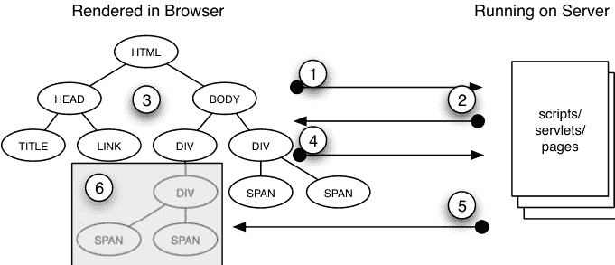
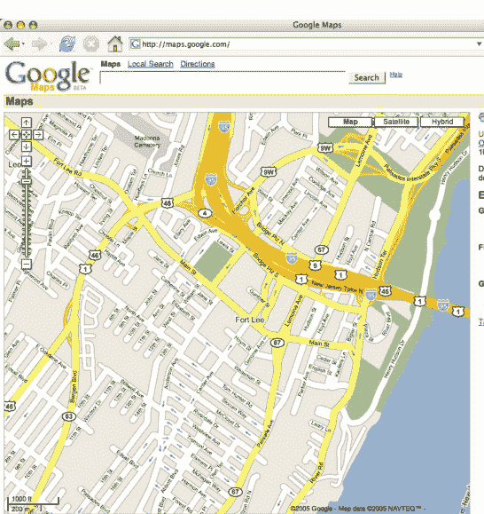
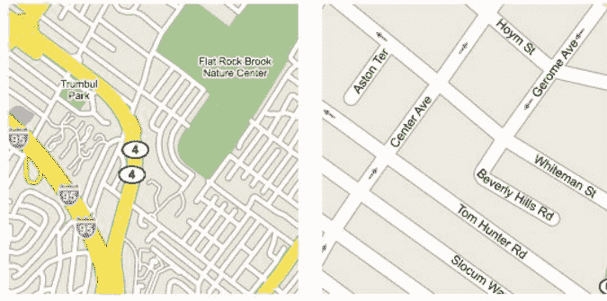
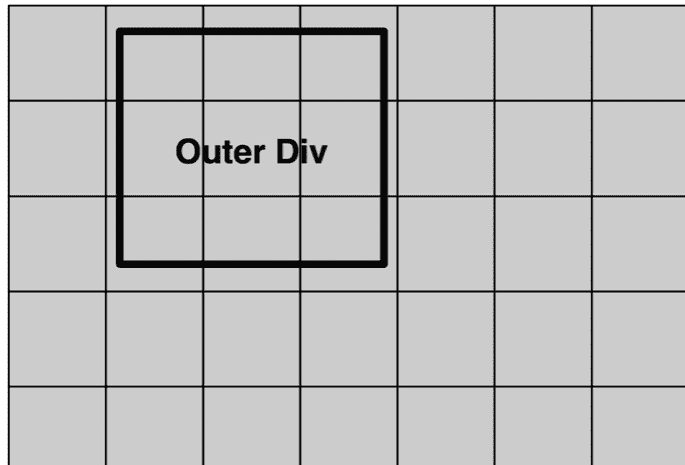
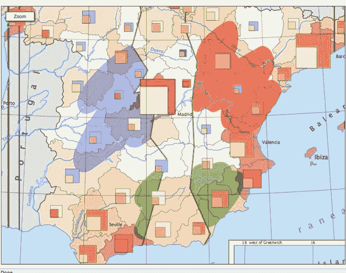
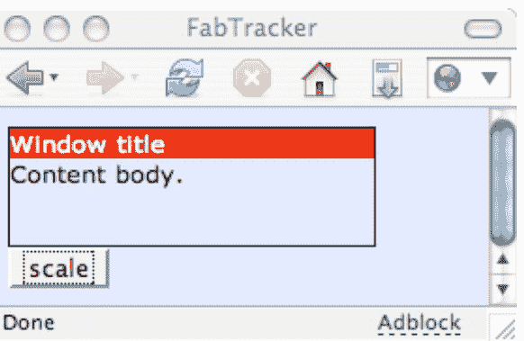
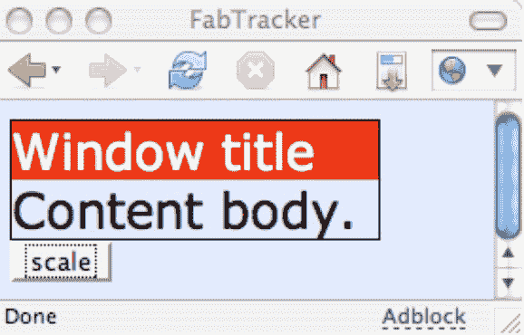
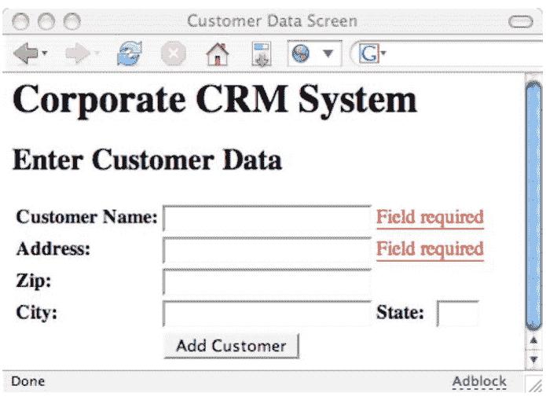

# 实战 Ajax：Web 2.0 入门指南，实用主义书架


你正在阅读的这本书仍在开发中。作为一项实验，我们比通常情况要早地发布了这个版本。这样，你就能在最终版发布几个月之前获得这些内容，而我们也能获得反馈来让这本书变得更好。这种理念是多方共赢！

请注意。这本书尚未经过全面的技术编辑，因此它将包含错误。它没有经过校对，所以会满斥拼写错误。而且由于我们没有在排版上花费任何精力，所以你会发现糟糕的分页、过长的行宽、错误的连字符以及其他你本不应该在成品书中看到的各种陋东西。如果你用这本书来尝试创建一个酷炫的应用程序，结果却由于某种原因变成了一个形状奇特的农用具，我们不承担任何责任。尽管如此，我们仍然认为你会喜欢它的！

在整个过程中，你可以从 http://books.pragprog.com/titles/ajax/reorder 下载更新后的 PDF。当书籍最终准备就同时，你将从同一个地址获取最终版本（以及后续更新）。在此期间，我们非常感谢你通过 http://books.pragprog.com/titles/ajax/errata 向我们提供反馈。

感谢你参与这次实验。

- Dave Thomas

```
```

# 第一章

## 使用 Ajax 构建丰富的 Internet 应用程序 (Building Rich Internet Applications with Ajax)

这是一本关于开发高效 Web 应用程序的书。我们不会回避这个问题。在所有其他内容之外，这本书是关于 XHTML、JavaScript、CSS 以及已经存在了近十年的标准的。我们不仅承认这一事实，而且拥抱它。仅仅因为这些标准存在了一段时间，并不意味着我们无法利用它们创造出新鲜而有趣的东西。技术就像果冻一样，需要时间来固化出令人美味且满意的东西。

### 三幕剧的故事

这将由一个完全出乎意料的实体提供。以下是关于一个开发团队、那次火花，以及它如何改变我们处理 Web 软件的方式。

#### 1.1 三幕剧的故事

Hector 是一家 Web 应用开发商店的项目经理。他拥有丰富的 Perl CGI、ASP、Servlet 和 JSP 开发经验，Hector 算是个见多识广的人。在过去的一年里，他的团队一直在为一家在全球范围内设有办公室的大型财富500 强公司构建一个 CRM 应用程序。该应用程序曾是一个绿屏大型机程序；而现在公司希望利用互联网的巨大覆盖范围，将应用程序部署到每个办公室。

Hector 和他的团队将精力集中在应用程序的服务器端。他们一直使用 Java 社区的现代 MVC 框架之一来实现业务逻辑；使用高性能持久化框架来访问数据库；使用基于消息的基础设施来连接其他系统。

##### 昨天

在客户端，Hector 和他的团队已经成为 CSS 的大师。页面的外观随他们随心意欲；当客户想要圆角时，他们就能得到圆角。悬停颜色？那轻而易举。多种配色方案？没问题。事实上，Hector 和他的团队很久以前就达到了一个不再真正担心用户界面的程度。要知道，Web 是单向的：它本质上是分发静态文档。当用户想要更多数据时，他们必须经历整个界面的刷新。从效率的角度来看这并不最优，但 Web 就是这样工作的，用户也已经学会了忍受。

然后，在几周前的某时候，Hector 的客户来参加了会议。这位客户通常是一个非常有礼貌、随和的人。他理解 Web，也理解为了获得互联网的覆盖范围而必须接受的限制。事实上，Hector 从未见过他真正发火。直到这次会议。

他一进门，团队就知道事情不妙。他带着笔记本电脑，而他以前从不带电脑。当他冲进房间时，团队成员环顾桌子：我们到底干了什么什么？客户坐在了桌旁。

##### 今天

自从那次会议以后，Hector 和他的团队一直像火如荼一样地重新思考用户界面。Hector 出去了解这里发生了什么，Google 是如何可能完全忽略常识并做出这种事情的。他偶然读到 Jesse Garrett 的的一描述这种称为 Ajax 的东西。从那以后他一直在钻研，学习他能学会关于这种制作互联网应用的新方法的一切。

团队正在重新实现 UI。他们正在使用 JavaScript 和 HTML5 技术来提供更动态的体验。最重要的是，他们开始利用现代浏览器中可用的一个有用对象，即使用 `XMLHttpRequest`（简称 XHR）。这个方便的小家伙让 Hector 和他的团队能够从服务器请求并接收新数据，而无需重新加载页面上的所有内容。

换句话说，Hector 牵头了从 Web 1.0 到 Web 2.0 的转变。他的客户又开心了。

##### 明天

Hector 的下一步将是什么？他的团队正在学习大量的 JavaScript，以及比他们以前学过的多得 CSS。团队对结果非常兴奋：用户体验就像任何其他应用程序一样，现在团队不需要像管理应用程序本身那样管理安装程序了。但他们意识到这一切也有负面影响。

现在，他们正在编写大量的 代码。事实证明，所有的页面操作和 XHR 访问都需要大量真实的、实实在在地的代码。尽管 JavaScript 看起来很像 Java，但他们发现它实际上是完全不同的野兽。现在他们有两个代码库需要管理、测试和维护。

所以 Hector 必须找到解决这些问题的方法。他将会看到大多数 Web 应用开发框架正在完全将 Ajax 工具整合到它们自己的套件中。很快，Hector 和他的团队将利用 Tapestry 组件、Spring 标签库、ASP.NET Web 助手和 PHP 库来利用 Ajax，而无需引入第二工作模式。Ajax 开发的未来是完全的、隐形的集成。这正是 Hector 所需的。

### 1.2 Google Maps：缺失的火花

Google Maps (http://maps.google.com) 真正点燃了 Ajax 之火。而 Google 只是做这件事最出乎意料的候选人。想想是什么让 Google 最初就一夜成功：最好的搜索结果和世界上最极简的 UI。它是一个白页面，中间有一个文本框和一个按钮。没有比这更极简的。如果 Google 有配乐，那将是 Philip Glass 写的。

当很明显 Google 将进入在线地图分页领域时，我们预期会有类似的东西。一种更直接、更侵入性的查看地图的方法。这正是我们得到的；我们没有得到的正是我们预期的。Google 通过巧妙地使用 XHR 回调，提供了第一个页内滚动的地图。如果你想看下一格地图面板，Google 就会去获取并将旧的面板滑出视野。没有了杂乱的页面刷新；没有重新加载大量未改变的文本。特别是，不需要等待大量广告刷新。只有一个地图，以地图应该有的方式工作。

然后我们点击大头针并得到了信息气泡。里面有实时文本。还有一个投影影。它是一个白页面，中间有一个文本框和一个按钮。没有比这更极简的了。如果 Google 有配乐，那将是 Philip Glass 写的。

（注：原文此后存在大量重复文本，翻译已按格式要求对应处理）

### 1.3 什么是 Ajax？

'Ajax' 的名称代表异步 JavaScript 和 XML（Asynchronous JavaScript and XML）。它是允许 Web 页面在不重新加载整个页的情况下异步更新的技术set。这提供了更有交互性和响应性的用户体验。

- 异步 JavaScript

- 基于 JavaScript 的 DOM 操作

- 基于 URL 的触发

- 数据缓存

- XML 格式

- JSON 格式

- HTML/CSS

- 纯文本

- 其他数据格式

（注：原文此处后存在大量重复文本，翻译已按格式要求对应处理）

#### Ajax: 架构

Ajax 令人兴奋的演进在于你如何构建应用程序。让我们先看看传统的 Web：

- 为应用程序的每个事件定义页面：查看项目、购买项目、结算等。

- 每个事件或操作都向浏览器返回一个完整的页面。

- 该页面渲染给用户。

这在现在看来很自然。在 Web 创业初期这是合理的，因为当时的 Web 并不是关于应用程序的。Web 最初更像是一个文档库；一个你可以简单链接文档的世界。它是关于文档和共享，而不是任何意义上的交互。

Ajax 开启了一种新的架构。这种架构的重要部分是：

- 小型服务器端事件：现在 Web 应用程组件可以向服务器发送小型请请求，获取信息，并通过更改 DOM 来完善所看到的页面。无需刷新刷新。

- 异步：向服务器发布的请求不会阻塞浏览器。用户可以继续使用应用程序的其他部分，UI 可以更新以提示用户正在进行请求。

- 基于任何：我们可以根据用户的几乎任何行为与服务器进行通信。现代浏览器捕获的大多数与操作系统相同的用户事件：鼠标点击、鼠标事件、按键等。任何用户事件都可以触发异步请求。

#### 抽象 XMLHttpRequest 的复杂性

正是由于这些原因，Ajax 更重要的定义是...



图 1.1: Ajax 周期

- 1. 用户对给定 URL 发起初始请求

- 2. 服务器返回原始 HTML 页面

- 3. 浏览器将页面渲染为内存中的 DOM 树

- 4. 用户活动导致对另一个 URL 发起后续请求，同时保持现有 DOM 树不受影响

- 5. 浏览器将数据返回给现有页面内部的回调函数

- 6. 浏览器解析结果并用新数据更新内存中的 DOM，随后反映在用户界面（页面被重绘，但没有被“刷新”）

这听起来很棒，不是吗？但是，随着这种变化，我们必须小心。网页最伟大的特点之一是任何人都可以使用它。保持语义化有助于这一点的实现。如果我们做得过度，可能会开始用 UI 抽象让用户感到困惑。这是 Flash UI 的一个常见投诉，用户必须面对新的符号、隐喻以及为了获得有用结果所需的操作。易用性是一个重要课题，我们将在第 115 页的第 7 章 Ajax UI 第二部分中深入探讨。

### 1.4 现在何往何方？

本书的其余部分将向你介绍 Ajax 运动的广度。我们将介绍应用程序转换为这种新风格的过程，并深入研究 Ajax 背后的支撑技术。我们将向你介绍常用的工具集和框架，它们让看似复杂的特效变得像单行代码一样简单。你将看到你喜欢的开发平台正在做哪些工作来利用并整合这种新的开发风格。

最重要的是，我们将大量讨论如何有效地、甚至是务实地使用 Ajax。因为比火车离开车站时被留在站外更糟糕的事情是上了错误的火车。我们希望这本书能成为你进入这个全新且快速演变的领域的引导指南。我们想帮助你发现 Ajax 如何帮助甚至是否能帮助到你的项目。我们并不试图向你出售任何东西（除了这本书）。但我们相信 Ajax 代表了一项重大事件，我们希望能在那里帮助你充分利用它。

# 第 2 章

## Ajax 实战

在上一章中，Hector 和他的团队对 Web 应用程序的可能性进行了一次发现之旅。他们了解到 Ajax 能够将传统的网页转换为动态 Web 界面。这一章将关于揭开面纱，向你展示 Ajax 究竟是如何工作的。为了做到，我们将在你面前将一个传统的网页转换为 Ajax 应用程序。

### 2.1 Web 应用 Ajax 化

让我们考虑朋友 Hector 的情况，他是上一章中的项目经理。Hector 在几个月前发布了应用程序的第一版本。当查看用户反馈时，他发现一些用户对客户输入界面表示沮丧。

下一页的图 2.1 是该页面当前版本的截图。

那么这个界面的问题在哪里呢？事实证明，Hector 应用程序的用户习惯它所取代的“绿屏”应用程序的行为。在旧应用程序中，所有用户都必须输入客户的邮编，“城市”和“州”字段会自动填充正确的值；而 Hector 新 Web 应用程序的用户则感到沮丧，因为他们现在必须手动输入这些数据。

#### 企业 CRM 系统

输入客户数据

| 客户名称: | |

| :--- | :--- |

| 地址: | |

| 城市: | |

| 州: | |

| 邮编: | |

添加客户

完成

图 2.1: Hector 的问题输入界面

> 掌握 HTML 吗？

> 你知道的，在 Web 发明多年后，我们还有这么多人仍在手动编写 HTML，这真是一场悲剧。然而，我们确实在这里。了解 HTML 的工作原理对于理解 Ajax 至关重要。我们假设你对 HTML 有坚实的理解，而不是在书中重点关注它。

### 2.2 Ajax 救场

通过 Ajax 技术，Hector 能够忠实地重现旧绿屏应用程序提供的数据自动填充功能。让我们看看如何将此功能添加到 Hector 的应用程序中。

#### CRM 界面 Ajax 化

首先，让我们看看 CRM 界面的源代码。

```html
<html>
<head>
  <title>客户数据界面</title>
</head>
<body>
  <h1>企业 CRM 系统</h1>
  <h2>输入客户数据</h2>
  <table>
    <tr>
      <th>客户名称</th>
      <td><input type="text" name="name"/></td>
    </tr>
    <tr>
      <th>地址:</th>
      <td><input type="text" name="address"/></td>
    </tr>
    <tr>
      <th>城市:</th>
      <td><input type="text" name="city"/></td>
    </tr>
    <tr>
      <th>州:</th>
      <td><input type="text" name="state"/></td>
    </tr>
    <tr>
      <th>邮编:</th>
      <td><input type="text" name="zip"/></td>
    </tr>
    <tr>
      <th></th>
      <td><input type="submit" value="添加客户"/></td>
    </tr>
  </table>
</body>
</html>
```

我们希望将数据发送到现有页面内部的回调函数，随后反映在用户界面（页面被重绘，但没有被“刷新”）。

#### 准备 HTML

第一步是将 HTML 与邮编字段连接起来。我们目前使用的语法是特定浏览器的。提供此功能的微软 Internet Explorer 使用 ActiveX 组件来完成相同的任务。创建它需要不同的语法，我们将在书中后面介绍。

Ajax 的关键是一个名为 XMLHttpRequest 的 JavaScript 对象，它可以发送 HTTP 请求、接收响应并解析它们。目前看起来如下：

```javascript
<script type="text/javascript">
  var xhr;
  function getData(zipCode) {
    xhr = new XMLHttpRequest();
    xhr.open("GET", "/getCityFromZip?" + zipCode);
```

#### 与服务器通信

现在我们已经演示了如何向服务器发送请请求，我们需要添加一些代码来处理服务器返回的响应。我们将通过创建一个 `processZipData()` 函数来实现这一点。

### AJAX 来救援 14

```javascript
var data = xhr.responseText;
var cityState = data.split(',');
var cityState = cityState[0];
document.getElementById("state").value = cityState[1];
```

该函数的前几行比较琐碎；我们获取从服务器返回的数据——格式为“城市,州”的城市和州，并将该字符串拆成一个包含两个元素的字符串数组，这样我们就可以单独访问城市和州的值。

第 4 行和第 5 行演示了我们之前是如何为城市（City）和州（State）输入元素赋予 `id` 属性的。网络浏览器将其显示的每个网页都建模为一个 XML 文档（无论该页面的 HTML 标记有多么混乱）。在 JavaScript 代码中，我们可以使用 `document` 变量访问此 XML 文档。`document` 有一个实用的 `getElementById()` 函数，可以根据 `id` 属性返回任何 XML 元素的引用。一旦我们获取了元素的引用，就可以对其进行操作。在这种情况下，我们将元素的 `value` 属性设置为服务器返回的城市和州的值。

### 将一切整合在一起

我们创建了两个 JavaScript 函数：向服务器发送请求的 `getZipData()` 以及处理响应的 `processZipData()`。然而，我们还没有将它们连接起来。按照目前的代码，`processZipData` 永远不会被调用。

你可能认为我们应该像下面示例的第 6 行那样调用 `processZipData()`。

```javascript
function getZipData(zipCode) {
  var xhr = new XMLHttpRequest();
  xhr.open("GET", "/getCityFromZip.request?" + zipCode);
  xhr.send(null);
  processZipData();
}
```

遗憾的是，这行不通。Ajax 中的 "A" 代表 *asynchronous*（异步），而异步行为恰好我们在这里看到的现象。

事实证明，当我们调用第 5 行的函数时，调用会立即返回，而 `XMLHttpRequest` 将在单独线程上发送请求并接收响应。因此，如果我们尝试在下一行处理来自服务器的响应，是无法做到的——因为我们还没有收到响应。

报告错误

### AJAX 来救援

解决方案是注册一个回调处理器——当 `XMLHttpRequest` 收到服务器响应时将被调用的函数。下面示例中的第 3 行演示了如何将 `processData` 注册为回调处理器：

```javascript
function getZipData(zipCode) {
  var xhr = new XMLHttpRequest();
  xhr.onreadystatechange=processData;
  xhr.open("GET", "/getCityFromZip.request?" + zipCode);
  xhr.send(null);
}
```

通过简单将函数名传递给 `onreadystatechange` 方法，我们几乎准备就绪了。为什么方法名为 `onreadystatechange()` 而不是 `onreceived()` 呢？事实是 XMLHttpRequest 在发送请求和接收响应时会多次回调函数，每次都表示它已经取得了进展。我们只对整个过程结束后解析数据感兴趣，因此在 `processZipData()` 中尝试获取响应数据之前，我们需要检查 `XMLHttpRequest` 的状态：

```javascript
function processZipData() {
  if (xhr.readyState == 4) {
    var data = xhr.responseText;
    var cityState = data.split(',');
    document.getElementById("city").value = cityState[0];
    document.getElementById("state").value = cityState[1];
  }
}
```

`XMLHttpRequest` 提供了一个 `readyState` 属性，指示其当前状态：状态为“4”表示响应已接收。

### 大局

就是这些，我们完成了。让我们看看整个网页源码，看看这些部分是如何组合的：

```html
<html>
<head>
  <title>Customer Data Screen</title>
  <script type="text/javascript">
  var xhr;
  function getZipData(zipCode) {
    var xhr = new XMLHttpRequest();
    xhr.onreadystatechange=processZipData;
    xhr.open("GET", "/getCityFromZip.request?" + zipCode);
    xhr.send(null);
},
```

### readyState

`readyState` 属性有五个可能的值：

- 0: (未初始化) `send()` 方法尚未被调用。

- 1: (加载中) `send()` 方法已调用，请求进行中。

- 2: (已加载) `send()` 方法已完成，接收了整个响应。

- 3: (交互中) 正在解析响应。

- 4: (已完成) 响应已解析完成，可以使用。

```javascript
function processZipData() {
    if (xhr.readyState == 4) {
        var data = xhr.responseText.split(',');
        var cityState = data.split(',');
        document.getElementById("city").value = cityState[0];
        document.getElementById("state").value = cityState[1];
    }
}
</script></head>
<body>
<h1>Corporate CRM System</h1>
<h2>Enter Customer Data</h2>
<table>
    <tr>
        <th>Customer Name:</th>
        <td><input type="text" name="name"></td>
    </tr>
    <tr>
        <th>Address:</th>
        <td><input type="text" name="address"></td>
    </tr>
    <tr>
        <th>Zip:</th>
        <td><input type="text" onblur="getZipData(this.value)" name="zip"></td>
    </tr>
    <tr>
        <th>City:</th>
        <td><input type="text" id="city"></td>
    </tr>
    <tr>
        <th>State:</th>
        <td><input type="text" id="state"></td>
    </tr>
    <tr>
        <th></th>
        <td><input type="submit" value="Add"></td>
    </tr>
</table>
</body>
</html>
```

## 同步 Ajax？

我们之前稍微误导了你。事实证明，你并不非异步使用 XML-HttpRequest。当你调用 `open` 函数时，可以传递第三个参数 `false`；XMLHttpRequest 将在不启动后台线程的情况下发送请求——从而允许你以同步的方式对其操作，例如：

```
xhr.open("GET", "myURL", false);
xhr.send(null);
processZipData();
```

这看起来比所有异步回调的胡七八糟简单得多；为什么不一直这样使用 XMLHttpRequest 呢？

事实证明，当你以这种方式使用 XMLHttpRequest 时，浏览器界面在请求期间将处于非响应状态。如果请求只需要几毫秒，那么这真的不是大问题。然而，当连接到网绿时，人们会对延迟有所假设；如果请求需要一或两秒，用户一定会注意到。如果需要五或十秒，用户肯定会变得非常恼躁，并可能会关闭浏览器。

简而言之，你可能永远不要使用同步 Ajax（呃，语法）。

## 网络延迟

在使用 XMLHttpRequest 的同步版本时，你最担心的问题之一就是延迟。你必须担心响应从服务器到达所需的时间，在此期间浏览器会被阻塞，用户只能坐着等待。

不那么明显但同样重要的是，延迟对异步请求可能产生的影响。例如，一个异步 Ajax 请求本应导致几个字段被自动填充。如果后台请求返回时间太长，用户可能会开始手动填充这些字段，误认为发生了某种错误。当结果从服务器传回时，页面应该怎么做？是覆盖用户提供的值，还是丢弃服务器返回的值？如果必须丢弃服务器的值，应该静默丢弃还是带有警告丢弃？

你在应用程序中使用何种风格的网络其实并不重要。网络速度在用户界面（UI）上始终是一个问题，而当代码考虑了可能出现的延迟时，对你的用户是有益的。

## 2.4 结语

就这样，拥有了新 Ajax 版本的客户界面，Hector 准备好通过提供他们要求的丰富交互来满足用户了。诚然，外面有一些极其华丽的 Ajax 网站，但你在这一章中看到的正是所有 Ajax 技术的基础：使用 JavaScript 动态从服务器请求数据，并对页面进行 DOM 操作以用新数据动态更新它。

随着本书的推进，我们将在此基础之上，向你展示如何创建更高级的效果和功能，并使用各种编程语言中的 JavaScript 辅助库和复杂的工具包更简单地实现它们。

# 第 3 章

## Ajax 解析

正如我们在之前的章节中讨论过的，Ajax 指的是使用 JavaScript（具体说是 `XMLHttpRequest` 对象）异步请求数据，然后用请求的数据动态更新 Web 页面的技术。我们在上一章中通过重构 Hector 的 CRM 应用程序获取邮政编码对应的城市/州值，演示了这种技术。

在本章中，我们将为你提供一项基础技术的快速课程，你将掌揚这些技术，以便在自己的应用程序中实现各种形状和大小的 Ajax 效果。我们在本章涵盖了基础技术，之后可能会利用具有更高层次抽象的框架。在未来的章节中，我们将讨论第三方框架如何实现复杂的效果。

在接下来的章节中，我们将帮助你建立 JavaScript 的理解基础，这将帮助你理解本书剩余部分的技巧内容。我们的方法是假设你具备一定的编程经验。事实上，我们赌你已经在你选择的语言中成为胜任的程序员了。

本章的议程是：

- 客户端 JavaScript 复习

- 操作网页

- 发送和检索数据

- 调试技术

### 3.1 客户端 JavaScript 复习

你讨厌编写 JavaScript 吗？你认为 JavaScript 代码天生就很丑看吗？你觉得任何非显易复杂的 JavaScript 代码库都是维护的噩梦吗？你并不孤单。JavaScript 被许多 Web 开发者广泛讨厌和恐惧，特别是那些具有 Java 和 C# 等静态类型语言背景的开发者。

为什么有这么人讨厌 JavaScript？我们认为 JavaScript 糟糕的声誉并不完全归于 JavaScript 本身的语法或能力。事实上，事实是，现代 JavaScript 实际上是一种非常先进的编程语言。它支持延续（continuations）、闭包、面向切编程、即时修改以及 Python、Ruby 和 Lisp 等语言中的许多其他特性。我们认为，它的糟糕声誉源于在早期 Web 应用中被误用，将业务逻辑堆进视图层。这一章，以及本书，是关于如何将 JavaScript 用于其天然用途：创建丰富的用户界面。

#### JavaScript 基础

根据你的背景，你可能会发现 JavaScript 中的变量令人惊讶。具体来说，你不需要声明它们或定义它们的类型。相反，你只需要引用它们即可，如下所示：

```
myVariable = "我是谁？谁创造了我？"
```

在这个示例中，变量 `myVariable` 立即为我们自动创建出来。这种灵活的创建变量的方式很酷，但有点让人困惑。考虑下一个示例：

```
myVariable = 10
myOtherVariable = 20
mySumTotal = myVariable + myOtherVariable
myVariable = 5
myOtherVariable = 10
mySumTotal = myVariable + myOtherVariable
```

你认为示例结束时 `mySumTotal` 的值是多少？如果你猜是 30，那你就错了；它实际上是 25。你看，`myOtherVariable` 被拼写错了。在 Java 或 C# 等语言中，这会产生某种错误。在 JavaScript 中这完全不是错误——我们只是临时创建了一个名为 `myOtherVariable` 的新变量。幸运的是，如果你引用未定义变量的值，JavaScript 会考虑。如果错误发生在第 3 行或第 6 行，例如 `mySumTotal = myArray + myVariable`，就会抛出异常。

#### JavaScript、布尔值和你

说到布尔值，JavaScript 也可以将数字和字符串转换为布尔值：任何非空字符串和非零数字都求值为 `true`。

出于这个原因，我们认为在声明变量时使用可选的 `var` 关键字是一种良好的风格：这可以显式地表明变量是有意声明的，还是可能的类型。使用 `var` 示例所示：

```
var myArray = 10
var myOtherVariable = 20
mySumTotal = myArray + myOtherVariable
myVariable = 5
myOther = 10
mySumTotal = myArray + myOtherVariable
```

JavaScript 支持四种基本值类型：对象、数字、字符串和布尔（还有其他，但现在重要）。与其他大多数语言不同，JavaScript 变量声明不声明它们存储的数据类型。相反，类型根据赋值变量的内容以及变量使用的表达式类型自动确定。此外，JavaScript 变量根据需要自动更改类型。考虑以下示例：

```
myVariable = "我是谁？谁创造了我？" // 字符串
myVariable = 42 // 现在是数字
myVariable = 42 + "答案" // 字符串 ("42答案")
myVariable = true // 布尔值
```

#### 函数

从表面上看，JavaScript 中的函数工作方式与其他语言非常相似。它们使用 `function()` 关键字声明，可以接受零个或多个参数，并且可以返回数值：

```
function addNumbers(one, two) {
  return one + two;
}
```

#### 未定义 (Undefined)

`undefined` 是 JavaScript 中的一种一等类型。最常见的情况下，它是 JavaScript 为已声明但从未赋值的变量提供的默认值。某些 JavaScript 实现也将其用于从未声明的变量的值，尽管这并不常见，因为大多数 JavaScript 解释器都允许内联变量声明。

需要注意的是，它不仅仅是一个值。尽管它有字符串的表示形式（'undefined'），但它实际上是一个一等类型。这意味着当将 `typeof()` 运算符作用于具有该值的变量时，它将返回 `undefined`。

Java/C# 开发者可能会发现，没有任何返回类型是不返回值的，而仅仅在某处使用 `return` 关键字。创建一个在路径分支并在其中一条路径上返回值、而在另一条路径上不返回值的函数是完全合法的。赋值了非返回函数结果的变量将包含特殊的 JavaScript 值 `undefined`。

考虑接下来的这段代码片段：

```javascript
function myFunction(a) {
  return "Hello";
}
function myFunction() { // <label=code.js.function/>
  return "World";
}
var myResult = myFunction("aValue"); // <label=code.js.return/>
```

你认为这一行 `myResult` 的值是什么？如果你使用的是支持方法重载的语言，你可能会期望值是 Hello。事实上，它不是。JavaScript 不支持重载；也就是说，它不会根据函数的名称和参数来匹配函数调用和函数定义；仅根据名称。

因此，在运行时给定名称只能有一个函数。如果定义了两个或多个同名的函数，将调用最后一个被 JavaScript 处理的版本。在我们的示例中，那是最后在该行定义的那一个。

由于函数的参数在定义函数时不起任何作用，因此它们的存在完全是可选的。事实上，甚至有一种方法可以在不声明参数的情况下引用调用的参数——我们稍后会回到这一点。

#### 函数类型 (The Function Type)

早些时候我们讨论了 JavaScript 中的四种值类型（对象、数字、字符串和布尔），并暗示了还有更多类型。事实上，函数本身就是 JavaScript 中的一种类型。事实上，一旦你使用之前看到的传统语法定义了函数，就会存在一个引用该函数的变量；该变量的名称与函数本身相同。

考虑下一个示例：

```javascript
function myFunction() {
  // 想象一下这个函数执行了某些操作
}
alert(typeof myFunction)
```

如果你在浏览器中执行这段代码，JavaScript 内置的 `alert` 将弹出一个对话框，显示 `myFunction` 变量的类型：对话框的内容将是 "function"。

JavaScript 的这种特性——将函数作为类型——会导致一些有趣的行为。考虑以下内容：

```javascript
function myFunction() {
  // 我们创建了一个变量 myFunction
  return "Hello";             // 类型为 "function"
}
var myFunction = 10;          // 我们现在将 myFunction 赋值为数字
var myResult = myFunction(); // 错误 -- 我们不能调用一个数字
```

哎！在许多语言中，这样的代码可以正常工作；函数和变量是完全不同的实体，它们的名称不会冲突。在 JavaScript 中，因为函数也是变量，这样的代码是无意义的。

除了我们目前为止使用的传统定义语法外，还有另一种定义函数的方法：

```javascript
var a = 10;
var b = 12;
var myFunction = function() {
  return a + b;
}
var result = myFunction(); // result 是 22
```

在这个示例中，我们创建了一个名为 `myFunction()` 的新函数。酷的一点是，该函数能够访问其闭包块的状态。我们可以从函数内部引用变量 `a` 和 `b`。这种特征通常被称为闭包（closure），它是一个非常强大的特性。通常，当作用域结束时，作用域中的值就会丢失。闭包保留了对闭包块状态的访问；当使用时，该状态对闭包仍然可用。

#### JavaScript 事件：绑定到网页 (JavaScript Events: Binding to the Web Page)

到为止，我们考虑的 JavaScript 内容没有任何是特定于网页浏览器的。事实上，许多人在浏览器之外使用 JavaScript。然而，从这里开始，我们将开始考虑现代网页浏览器托管的 JavaScript 环境特有的属性。

第一个考虑点是网页如何与 JavaScript 交互。如果你以前写过 JavaScript，你可能知道网页中的绝大多数 JavaScript 必须包含在 `<script>` 标签内。按照惯例，这通常包含在网页的 `<head>` 部分，如下：

```html
<html>
<head>
  <script type="text/javascript">
    /* 此处编写 javascript 代码 */
  </script>
</head>
<body>
  // 网页内容
</body>
</html>
```

实际上，你可以在网页的任何地方包含 `<script>` 元素；它们的内容将按照从上到下的顺序执行。然而，将它们包含在 `<head>` 的任何地方通常被认为是不规范的。

#### 定义事件 (Defining Events)

从网页启动 JavaScript 代码的最方法是使用 HTML 事件。这些事件为网页提供了钩子，当用户以某些方式与网页交互时，执行任意的 JavaScript 代码。例如，在上一章中，你看到了在 `<input>` 标签上注册的 `onload` 事件示例：

```html
<input onblur="getData(this.value)" type="text"/>
```

#### 网页中的 JavaScript (JavaScript in the Web Page)

到为止，我们考虑的 JavaScript 内容没有任何是特定于网页浏览器的。事实上，许多人在浏览器之外使用 JavaScript。然而，从这里开始，我们将开始考虑现代网页浏览器托管的 JavaScript 环境特有的属性。第一个考虑点是网页如何与 JavaScript 交互。如果你以前写过 JavaScript，你可能知道网页中的绝大多数 JavaScript 必须包含在 `<script>` 标签内。按照惯例，这通常包含在网页的 `<head>` 部分，如下：

```html
<html>
<head>
  <script type="text/javascript">
    /* 此处编写 javascript 代码 */
  </script>
</head>
<body>
  // 网页内容
</body>
</html>
```

实际上，你可以在网页的任何地方包含 `<script>` 元素；它们的内容将按照从上到下的顺序执行。然而，将它们包含在 `<head>` 的任何地方通常被认为是不规范的。

#### 定义事件 (Defining Events)

从网页启动 JavaScript 代码的最常见方法是使用 HTML 事件。这些事件为网页提供了钩子，当用户以某些方式与网页交互时，执行任意的 JavaScript 代码。例如，在上一章中，你看到了在 `<input>` 标签上注册的 `onload` 事件：

```html
<input onblur="getData(this.value)" type="text"/>
```

网页中的 JavaScript (JavaScript in the Web Page)

到为止，我们考虑的 JavaScript 内容没有任何是特定于网页浏览器的。事实上，许多人在浏览器之外使用 JavaScript。然而，从这里开始，我们将开始考虑现代网页浏览器托管的 JavaScript 环境特有的属性。第一个考虑点是网页如何与 JavaScript 交互。如果你以前写过 JavaScript，你可能知道网页中的绝大多数 JavaScript 必须包含在 `<script>` 标签内。按照惯例，这通常包含在网页的 `<head>` 部分，如下：

```html
<html>
<head>
  <script type="text/javascript">
    /* 此处编写 javascript 代码 */
  </script>
</head>
<body>
  // 网页内容
</body>
</html>
```

实际上，你可以在网页的任何地方包含 `<script>` 元素；它们的内容将按照从上到下的顺序执行。然而，将它们包含在 `<head>` 的任何地方通常被认为是不规范的。

网页中的 JavaScript (JavaScript in the Web Page)

到为止，我们考虑的 JavaScript 内容没有任何是特定于网页浏览器的。事实上，许多人在浏览器之外使用 JavaScript。然而，从这里开始，我们将开始考虑现代网页浏览器托管的 JavaScript 环境特有的属性。第一个考虑点是网页如何与 JavaScript 交互。如果你以前写过 JavaScript，你可能知道网页中的绝大多数 JavaScript 必须包含在 `<script>` 标签内。按照惯例，这通常包含在网页的 `<head>` 部分，如下：

```html
<html>
<head>
  <script type="text/javascript">
    /* 此处编写 javascript 代码 */
  </script>
</head>
<body>
  // 网页内容
</body>
</html>
```

实际上，你可以在网页的任何地方包含 `<script>` 元素；它们的内容将按照从上到下的顺序执行。然而，将它们包含在 `<head>` 的任何地方通常被认为是不规范的。

网页中的 JavaScript (JavaScript in the Web Page)

到为止，我们考虑的 JavaScript 内容没有任何是特定于网页浏览器的。事实上，许多人在浏览器之外使用 JavaScript。然而，从这里开始，我们将开始考虑现代网页浏览器托管的 JavaScript 环境特有的属性。第一个考虑点是网页如何与 JavaScript 交互。如果你以前写过 JavaScript，你可能知道网页中的绝大多数 JavaScript 必须包含在 `<script>` 标签内。按照惯例，这通常包含在网页的 `<head>` 部分，如下：

```html
<html>
<head>
  <script type="text/javascript">
    /* 此处编写 javascript 代码 */
  </script>
</head>
<body>
  // 网页内容
</body>
</html>
```

实际上，你可以在网页的任何地方包含 `<script>` 元素；它们的内容将按照从上到下的顺序执行。然而，将它们包含在 `<head>` 的任何地方通常被认为是不规范的。

#### 客户端 JavaScript 回顾 (A REVIEW OF CLIENT-SIDE JavaScript)

#### 在 HTML 之外定义事件 (Defining Events Outside of HTML)

到为止，我们展示了 JavaScript 事件函数可以通过 HTML 属性连接到节点。这是一种常见的做法，尽管有一类程序员（我们称之为“纯洁主义者”）对这种用法表示不满。尽管 JavaScript 被嵌入在页面中，许多开发者喜将 JavaScript 和 HTML 视为独立的产物。具体来说，网页设计师会希望处理 HTML 和样式，而程序员则会希望关注脚本编写。将 JavaScript 直接嵌入到 HTML 中是太过了了。

主要的替代方案是使用 JavaScript 属性。一旦你获取了 HTML 文档某个节点的引用，它就会将其事件暴露为一系列属性。函数可以直接附加到这些属性上。以下：

```html
<div id="mydiv" onclick="myfunction()">
```

在功能上等于：

```html
<div id="mydiv"/>
<script type="text/javascript">
  document.getElementById('mydiv').onclick = myfunc;
</script>
```

这种技术的价值在于设计师可以担心 HTML，且只关心 HTML。程序员可以透明地挂钩事件。然而，缺点是，引用事件的脚本必须在它们引用的 HTML 之后解析。否则，无法通过 `getElementById()` 找到事件，结果就是没有任何事件被处理。有一个相对新的名为 Behavior (http://bennolan.com/behaviour/) 的库，它通过允许将行为分配给 CSS 类来帮助程序员，增加了一层间接性。

现代浏览器支持一种新的绑定方式。新的 `addEventListener()` 函数接收要处理的事件名称（去掉 "on" 的部分）、函数指针以及一个称为捕获模式的布尔值。新的 `addEventListener()` 方法的妙之处在于，它可以为同一个事件连接多个处理程序，创建一个处理程序链。使用直接属性访问，任何对属性的后续赋值都会覆盖上一次赋值。在使用 `addEventListener()` 之前，请确保你的浏览器支持它。最后，Windows 上的 IE5+、Firefox 1.0+ 和 Safari 1.2+ 均已支持，但 Mac 版 IE 不支持。

> ¹http://www.quirksmode.org

### 3.2 操作网页

到目前为止，我们已经涵盖了 JavaScript 的基础知识，并讨论了如何让网页响应用户事件调用 JavaScript 函数。这涵盖了创建 Ajax 应用程序所需要知识的三分之一。下一个大重点是知道如何通过 JavaScript 实际更改网页内容。

#### 内存背后的 XML

现代浏览器会将你访问的每个网页以 XML 文档的形式在内存中存储一份副本，无论你访问的是现代的 XHTML 站点还是旧的 HTML 2.0 时代的站点。（当网页格式不符合规范时，浏览器将遵循一种内部算法将 HTML 提升为 XML。）这种对网页的内存表示可以通过 JavaScript 代码访问，从而程序化地确定关于页面的各种信息。

更重要的是，XML 文档是可以修改的，而且修改会通过浏览器对该页面的渲染立即反映。因此，为了实现动画、动态修改和其他效果，人们只需要修改网页底层的 XML 文档。我们现在来考虑如何进行此类修改。

#### 修改 XML：DOM API

主流浏览器都实现了相同的 API 来向 JavaScript 代码暴露 XML 文档；它被称为 DOM API。DOM 是文档对象模型（Document Object Model）的缩写，它将 XML 元素、属性和其他组件表示为内存中的对象。DOM API 将内存中的 XML 文档模型化为一个 Document 对象。

你可以通过引用名为 `document` 的变量来获取表示当前网页的 Document 对象引用。从这个实例中，你可以获取元素到网页中的单个 XML 元素，这些元素被建模为 Element 对象。你也可以通过 Element 对象修改 XML 元素的属性。

是时候看个例子了。接下来的代码片段包含一个简单的网页，它会在点击按钮时被修改：

```javascript
<head>
  <script type="text/javascript">
    function modifyPage() {
      var htmlElement = document.documentElement
      var children = htmlElement.childNodes
      var bodyElement
      for (var i = 0; i < children.length; i++) {
        if (children[i].nodeName == "BODY") {
          bodyElement = children[i]
          break;
        }
      }
      children = bodyElement.childNodes
      var divElement
      for (var i = 0; i < children.length; i++) {
        if (children[i].nodeName == "DIV") {
          divElement = children[i]
          break;
        }
      }
      divElement.replaceChild(document.createTextNodeNode("Goodbye, world!"),
      divElement.childNodes[0]);
    }
  </script>
  <body>
    <div>Hello, world.</div>
    <button onclick="myPage()">Click Me</button>
  </body>
</</html>
```

如你所见，DOM API 使用起来非常简单且令人愉悦。实际上，不，并非如此。DOM API 实际上非常晦涩。如果你以前从未用过 DOM API，你可能期望它能以一种直观且简单的方式对 XML 进行建模。例如，你可能期望能够获取网页根元素（`<html>` 元素）的引用，并从那里编写类似下面的代码：

```javascript
htmlElement.getElement("BODY");
```

运气没那么。你会发现，DOM API 将所有不同类型的内容（文本、属性、注释和处理指令）建模为节点，而且莫名的是，API 并没有提供一种方法让你仅从父元素中获取元素子。正如你自己所看到的，以 XML 的方式遍历网页是极其痛苦的。

此外，情况变得更糟了。我们之前解释过浏览器会对所有网页进行规范化处理——即它们以标准方式将所有 HTML 转换为 XML。在这个过程中，某些元素会被添加。例如，考虑 HTML 表格的情况：

<table>

  <tr>

    <td>A table</td>

  </tr>

</table>

#### 操作网页

当浏览器将此 HTML 转换为 XML 时，它会自动添加一个 `<body>` 元素作为 `<table>` 元素的子元素。当浏览器解析 HTML 时，你的 HTML 会发生意料之外的变化；出于这个原因，你应该避免使用 DOM 字面地扭曲你的页面，因为元素可能并不在你预期的位置。

#### DOM 快捷径

幸运的是，DOM API 包含了几个快捷径。Document 对象有一个 `getElementsByTagName()` 方法，这在我们的例子中可以大上用场。考虑这个替代的 JavaScript 函数：

```javascript
function modifyPage() {
  var divElements = document.getElementsByTagName("DIV");
  var divElement = divElements[0];
  divElement.replaceChild(document.createTextNode("Goodbye, world!"), divElement.childNodes[0]);
}
```

这就好接受多了。但我们仍然面临脆弱的顺序问题。我们假设我们感兴趣的 `<div>` 元素始终相对于其他 `<div>` 元素出现在相同的位置。在我们这个简单的例子中，这是一个安全的假设，但在现实世界中它完全不可行。

我们真正需要一种方便引用网页中特特定元素的方法。幸运的是，确实有这样简单方便的机制。如果你给元素赋予一个 `id` 属性，你就可以使用 Document 对象上的特殊函数 `getElementById()` 来获取该元素。考虑这个之前示例的进一步修订版本：

```html
<html>
<head>
<script type="text/javascript">
  function modifyPage() {
    var divElement = document.getElementById("toReplace")
    divElement.replaceChild(document.createTextNode("Goodbye, world!"), divElement.childNodes[0]);
  }
</script>
<body>
  <div id="toReplace">Hello, world.</div>
  <button onclick="myPage()">Click Me</button>
</body>
</html>
```

如你所见，DOM API 使用起来简单且令人愉悦。实际上，不，并非如此。DOM API 实际上非常晦涩。如果你以前从未用过 DOM API，你可能期望它能以一种直观且简单的方式对 XML 进行建模。例如，你可能期望能够获取网页根元素（`<html>` 元素）的引用，并从那里编写类似下面的代码：

```javascript
htmlElement.getElement("BODY");
```

运气没那么。你会发现，DOM API 将所有不同类型的内容（文本、属性、注释和处理指令）建模为节点，而且莫名的是，API 并没有提供一种方法让你仅从父元素中获取元素子。正如你自己所看到的，以 XML 的方式遍历网页是极其痛苦的。

此外，情况变得更糟了。我们之前解释过浏览器会对所有网页进行规范化处理——即它们以标准方式将所有 HTML 转换为 XML。在这个过程中，某些元素会被添加。例如，考虑 HTML 表格的情况：

<table>

  <tr>

    <td>A table</td>

  </tr>

</table>

##网页

当浏览器将此 HTML 转换为 XML 时，它会自动添加一个 `<body>` 元素作为 `<table>` 元素的子元素。当浏览器解析 HTML 时，你的 HTML 会发生意料之外的变化；出于这个原因，你应该避免使用 DOM 字面地扭曲你的页面，因为元素可能并不在你预期的位置。

#### DOM 快捷径

幸运的是，DOM API 包含了几个快捷径。Document 对象有一个 `getElementsByTagName()` 方法，这在我们的例子中可以大上用场。考虑这个替代的 JavaScript 函数：

```javascript
function modifyPage() {
  var divElements = document.getElementsByTagName("DIV");
  var divElement = divElements[0];
  divElement.replaceChild(document.createTextNode("Goodbye, world!"), divElement.childNodes[0]);
}
```

这就好接受多了。但我们仍然面临脆弱的顺序问题。我们假设我们感兴趣的 `<div>` 元素始终相对于其他 `<div>` 元素出现在相同的位置。在我们简单的例子中，这是一个安全的假设，但在现实世界中它完全不可行。

我们真正需要一种方便引用网页中特定元素的方法。幸运的是，确实有这样简单方便的机制。如果你给元素赋予一个 `id` 属性，你就可以使用 Document 对象上的特殊函数 `getElementById()` 来获取该元素。考虑这个之前示例的进一步修订版本：

```html
<html>
<head>
<script type="text/javascript">
  function modifyPage() {
    var divElement = document.getElementById("toReplace")
    divElement.replaceChild(document.createTextNode("Goodbye, world!"), divElement.childNodes[0]);
  }
</script>
<body>
  <div id="toReplace">Hello, world.</div>
  <button onclick="myPage()">Click Me</button>
</body>
</html>
```

#### 操作网页

当浏览器将此 HTML 转换为 XML 时，它会自动添加一个 `<body>` 元素作为 `<table>` 元素的子元素。当浏览器解析 HTML 时，你的 HTML 会发生意料之外的变化；出于这个原因，你应该避免使用 DOM 字面地扭曲你的页面，因为元素可能并不在你预期的位置。

#### 内部与外部

我们刚刚演示的 `innerHTML()` 属性非常有用，但它有一段悠久的历史。它是作为 Internet Explorer 的有扩展引入的；其他浏览器决定支持它，因为它证明是很有用的。然而，有两个相关的属性：`innerText()` 和 `outerHTML()`。

`innerText()` 实现的功能与 `innerHTML()` 几乎相同。被引用节点的内部表示被传入方法的文本所替换。然而，与 `innerHTML()` 不同，新文本不会被解析为 XML。相反，它作为节点的文本子元素直接被渲染。这实际上比将文本解析为 XML 性能高得多，对于仅仅添加数据而不是替换元素来说是更优的。

`outer()` 是另一个物。`innerHTML()` 会断开目标节点的所有现有子元解析新文本并将新节点作为目标节点的子元素（本质上是替换目标节点开始和结束标签之间的所有内容），而 `outerHTML()` 则替换目标节点本身。所有现有的节点都作为破坏目标节点的副作用而丢失。节点将被由解析方法输入时创建的任何新节点所替换。

#### 属性

到目前为止，我们讨论了元素。属性呢？就像元素一样，DOM 也提供了一种操作属性的通用方法。一旦你获取了元素的引用，就可以使用 `getAttribute()` 和 `setAttribute()` 来访问并更改它们，例如所示：

```javascript
var div = document.getElementById("someDiv")
div.setAttribute("style", "background: red") // 让 div 变成红色
```

这种后一种方法在编写作为外壳的网页时实际上有用得多。渲染组件的服务器端代码可以返回完整实体（顶层节点及其子元素），它可以放置页面的任何地方。使用 `innerHTML()`，包含页面对组件的布局具有完全控制权，可以使用专门设计的容器节点作为目标。服务器端只输出内容：如果包含页面将它们放在错误类型的节点中，或者放在文档的根部，渲染很可能是错误的。

使用 `outerHTML()`，然而，服务器目标渲染包含节点及其内容，确保无论包含页面将结果放在哪里，它都将按照设计完整包含。一个真正的组件，而不仅仅是组件内容。这听起来是一个极好的事情，事实也如此。除了它仍然是一个专有扩展，例如 Firefox 尚未采纳它，也没有公开的计划这样做。

回想一下我们在上一章中为 Hector 增强 CRM 应用程序。具体来说，让我们回顾一下驱动该应用程序的 JavaScript 代码段：

```javascript
function processZipData() {
  if (xhr.responseText == 4) {
    var data = xhr.responseText;
    var cityState = data.split(',');
    document.getElementById("city").value = cityState[0];
    document.getElementById("state").value = cityState[1];
  }
}
```

看看第 5 行和第 6 行。那个 `.value` 部分是什么意思？它实际的操作是更改输入元素的 `value` 属性。考虑到我们几段话之前讨论的内容，我们本应该使用 `setAttribute('value', 'city')` 来实现这一点。这个 `value` 属性到底是怎么回事？

事实证明，DOM API 还定义了一个标准，将 HTML 语法中的特定属性直接映射到浏览器使用的扩展版 DOM API 中。通过使用这些特殊扩展，元素本身可以通过修改对象的属性来设置属性的值。因此，当 `getElementById('city')` 返回一个输入元素时，我们可以通过设置对象上的 `value` 属性来更改其 `value` 属性。非常巧妙！

### 3.3 获取数据

我们已经讨论了 JavaScript，以及如何使用 DOM API 操控网页，现在只缺少一个解释如何获取数据的关键元素。数据获取的核心是我们在上一章中引入的 `XMLHttpRequest` 对象（简称 XHR）。在本节中，我们将讨论更多关于 XHR 的细节。

#### XMLHttpRequest

在上一章中，我们已经了了如何创建 XHR 实例并使用它获取数据的基础知识。让我们在另一个示例背景下再次简要回顾一下。下面的代码列表展示了简单的网页如何从服务器获取消息并将其显示出来。

```html
<html
<head>
  <script type="text/javascript">
    var xhr;

    function modifyPage() {
      try {
        xhr = new XMLHttpRequest("Msxml2.XMLHttpRequest");
      } catch (e) {
        try {
          xhr = new XMLHttpRequest("Microsoft.XMLHttpRequest");
        } catch (E) {
          xhr = false;
        }
      }
      if (!xhr && typeof XMLHttpRequest != 'undefined') {
        xhr = new XMLHttpRequest();
      }
      xhr.open("GET", "/message");
      xhr.onreadystatechange=function() {
        if (xhr.readyState != 4) return;
        document.getElementById("message").innerHTML = xhr.responseText;
      }
      xhr.send(null);
    }
  </script>
</head>
<body>
  <div id="message"><button onclick="modifyPage()">Click Me</button></div>
</body>
</html>
```

此 HTML 将渲染一个非常简单的网页，向用户展示一个按钮。一旦点击，页面将在按钮上方的显示对服务器查询的结果。第 21 行显示请求的 URL 为 '/message'；你可以使用任何支持 Web 的语言来实现此 URL。一个 Java Servlet 的实现看起来如下：

```java
import javax.servlet.*;
import javax.servlet.http.*;
import java.io.IOException;
import java.util.Date;
public class MessageServlet extends HttpServlet {
  protected void doGet(HttpServletRequest request,
      HttpServletResponse response)
      throws ServletException, IOException {
    response.getWriter().println("Hello world, the current time is " + new Date());
  }
}
```

但实际上，你也可以将消息 URL 实现为包含纯文本或 HTML 代码段的平面文件：这并不重要。XHR像浏览器一样请求 URL，并返回结果，就像你在浏览器地址栏中输入该 URL 一样。

#### XHR 详情

让我们讨论一下到为止尚未涵盖的 XHR 其他一些功能。

#### 状态

`onreadystatechange` 属性是 XHR 的关键特性。它允许你注册一个异步回调处理程序，当 XHR 在服务器进行请求/响应通信期间状态改变时，该处理器会被调用。在上一章中，我们查看了 `readyState` 属性的五种可能状态。通常来说，重要的状态是 4（完成）。其他四种状态都是不同程度的“未完成”。

#### 头部

除了暴露其当前状态的一些粒度信息外，XHR 还允许你修改或添加请求中的 HTTP Header，并查看响应中的头部。这是通过 `setRequestHeader()`、`getResponseHeader()` 和 `getAllResponseHeaders()` 函数实现的。在这个示例中，我们伪造浏览器来发送 XHR：

```javascript
xhr.setRequestHeader("User-Agent", "My Custom Browser");
```

#### 响应数据

在示例中，我们使用了 `responseText` 属性从服务器获取响应体。另一个属性是 `responseXML()`，它将服务器的响应作为 DOM 实例返回。如果你想从服务器向网页发送结构化数据，这会非常有用；你可以使用 DOM API 像处理 XML 一样遍历数据，并根据这些数据更新网页。

### 3.4 总结

本章深入探讨了 Ajax 的基础。你已经近距离地接触了 JavaScript 语言和 DOM 模型。虽然仅使用在这里看到的这些结构来编写应用程序是可能的，但程序员通常倾向于……

## 真正的火箭科学

好吧，好吧，我们承认——创建一个像 Google Maps 这样的东西并不容易。背后的地理编码功能（将地址映射到地图上的位置）、将地图特征与卫星图像进行归一化到令人惊叹的程度（使其能够相互叠加并看起来相当准确），以及从 A 点到 B 点的路线规划，这些都是极其非凡的。

然而，我们认为，Google Maps 特别具有创新性或令人印象深刻的并不是它的地理编码功能。MapQuest 和其他软件已经做了这类工作多年了。不，Google Maps 令人印象深刻的是地理编码引擎之上的地图界面。而我们觉得容易的是这个界面，而不是外壳下的地理编码。

正如我们的好朋友 Glenn Vanderbilt 所说：“在技术上这很容易，但这个界面的构思才是真正神奇的部分，仅仅是有这个想法并意识到它是可以实现的。一旦你看到某些事情是可能的，很多事情就变得简单了。” 我们得到的教训是：Google Maps 表明，当你构思出下一个伟大的 UI 创意后，你可以放心，实现它的技术解决方案可能并没有那么令畏。

## 地图

如你所知，地图的工作原理是允许你通过鼠标拖动地图本身来交互式移动地图。我们已经在浏览器中看到了多年的鼠标拖拽功能，但令人印象深刻的是，滚动的地图尺寸巨大，并且具有不同的缩放级别等。他们是如何做到的？

当然，浏览器永远无法一次性将这样的地图放入内存中。例如，一张全球范围的街道级地图大约有一百万像素平方。显示这张地图需要多少内存？为了方便讨论，让我们假设地图仅以 256 种颜色显示，这意味着每个像素仅消耗内存中的一个字节。这样的地图将需要 1,000,000,000,000 字节内存，或者大约一千 GB 的内存 RAM。因此，仅仅显示一个 `` 元素无法



### 图 4.1: Google Maps

起作用。

Google 工程师们为了解决我们桌面级 PC 有限的内存问题，将地图分成了各种瓦片（tiles）。这些瓦片连续排列以形成一张连贯的图像。下一页图 4.2 显示了这些瓦片的示例。虽然这些瓦片的大小发生了变化，但目前的尺寸是 250 像素平方。

所有的瓦片都排列在单个 HTML div 元素中，而这个 div 元素又包含在另一个 div 中；我们将这两个 div 分别称为内层 div 和外层 div。

我们刚刚提到，浏览器无法将整个地图放入内存中。当然，将单张地图划分为任意数量的瓦片并一次性显示所有瓦片，消耗的内存将与整个图像一样多。为了补偿内存限制，Google Maps 对瓦片网格进行了虚拟化

### 不止一百万像素

我们在“地图”章节中说，一张全球街道级地图大约有一百万平方像素。实际上，那个数字被极大地低估了。在 Google 的最高放大倍数下，每平方英里消耗约 7,700,000 个像素。估计地球包含 200,000,000 平方英里，但只有 30% 是陆地，所以让我们数字减少到 60,000,000 平方英里。

将像素数量乘以地球的平方英里数量，得到了一个惊人的数字——4.62 亿个像素，这在 1670 万色（任何现代家用电脑的色彩深度）下，将消耗至少是该字节三倍的内存。当然，大多数图像查看程序都有某种分页内存子系统，每次只查看图像的一部分，但你明白我的意思……



图 4.2: Google Maps 瓦片

在内存中并只显示用户可见的瓦片集，此外加上视图区域外的几个额外瓦片以保持滚动平滑。

如果这整套网格虚拟化组合听起来有点复杂，别担心，它非常直观，尽管它是 UI 中最复杂的部分。

### 缩放级别

Google Maps 的另一个关键功能是放大和缩小能力，可以增大或减小地图尺寸，让你在瞬间看到整个世界，下一刻看到你的街道。这实际上是所有实现的功能中最简单的一个。更改缩放级别会改变内存中瓦片网格的大小，以及所请求的瓦片图像的 URL。

例如，屏幕上一个瓦片的 URL 是 `http://mt.google.com/mt?v=`。通过将最后一个参数 "zoom=3" 的值改为另一个值（例如 "zoom=1"），你可以获取不同缩放级别的瓦片。在实践中，这并不简单，因为网格坐标随每个缩放级别发生巨大变化，并且它们通常会失效。

他们是如何让缩放始终悬停在地图上的？

### 大头针和对话框

Google Maps 的另一个巧妙功能是点击后出现的大头针和对话框。下一页的图 4.3 显示了截图。我们将使用 PNG 图像，因为它们支持 Alpha 透明通道。PNG 的优点之一是它可以缩放为任意大小，因此我们理论上可以为地图创建一个极其巨大的图像。然而，创建真正巨大的图像有点棘手，因为由于内存限制，我们必须渲染 SVG 图像的部分，并在这些部分上生成瓦片，并有一个某种方案将一切统一起来。为了保持本章简单，我们将直接将地图限制在宽 2000 像素、高 1400 像素

高度上。为了实现缩放功能，我们还将生成一张较小的图像，代表缩小显示模式下的地图视图。

以下代码片段展示了如何将西班牙地图转换为 2000x1400 像素的 JPG 文件和 1500x1050 像素的 JPG 文件：

```java
package com.ajaxian.maps;
import org.apache.batik.apps.rasterizer.DestinationType;
import org.apache.batik.apps.rasterizer.SVGConverter;
import java.io.File;
public class SVGSlicer {
    private static final String BASE_DIR = "resources/";
    public static void main(String[] args) throws Exception {
        SVGConverter converter = new SVGConverter();
        // 像素：高度自动计算
        converter.setWidth(2000);
        converter.setSources(new String[] { BASE_DIR + "svg/mapSpain.svg" });
        converter.setDestination(new File(BASE_DIR + "tiles/mapSpain.jpg"));
        converter.setDestinationType(DestinationType.JPEG);
        converter.setDst(new File(BASE_DIR + "tiles/mapSpain-smaller.jpg"));
        converter.execute();
    }
}
```

要编译代码，您需要将 Batik JAR 包放入类路径中，并将源代码放置在以下目录结构中：com/ajaxian/maps。下一页的图 4.4 显示了地图 JPG 文件应该是什么样子。您也可以将 BASE_DIR 变量的值替换为任何对您最方便的值。

### 步骤 2：创建切片

现在我们有了两个不同缩放级别的地图，需要将其切分为切片。利用许多编程语言中提供的优秀图像处理库，这非常简单。我们在这里演示如何实现这一点：

```java
package com.ajaxian.maps;
import org.apache.batik.apps.rasterizer.DestinationType;
import org.apache.batik.apps.rasterizer.SVGConverter;
import javax.imageio.ImageIO;
import java.io.File;
import java.awt.*;
import java.awt.image.BufferedImage;
public class ImageTiler {
    private static final String BASE_DIR = "resources/";
    private static final int TILE_WIDTH = 100;
    private static final int TILE_HEIGHT = 100; 
```

### 1970 - 1990

### 西班牙 - 人口

人口密度

省份级每公里小时

| | |

|---|---|

| < 25 | |

| 25 - 50 | |

| 50 - 75 | |

| > 75 | |

人口绝对值

每每平方公里居住人数

| | |

|---|---|

| < 1,600 | |

| 1,600 - 3,200 | |

| 3,200 - 6,400 | |

| > 6,400 | |

百分比指标

最小变化率

最大变化率

| | |

|---|---|

| < 50% | |

| 50% - 100% | |

| 100% - 150% | |

| > 150% | |

人口变化

自 1970 年以来省份变化百分比

| | |

|---|---|

| < 115% | |

| 115% - 130% | |

| 130% - 150% | |

| > 150% | |

自 1970 年以来首府的变化百分比

| | |

|---|---|

| < 115% | |

| 115% - 130% | |

| 130% - 150% | |

| > 150% | |

最小：98.5

最大：213.8

来源：西班牙国家统计局


图 4.4：Batik 的西班牙地图

```java
public static void main(String[] args) throws Exception {
    // 创建切片
    String[][] sources = { "tiles/mapSpan.jpg", "0", "1" };
    for (int i = 0; i < sources.length; i++) {
        BufferedImage bi = ImageIO.read(new File(BASE_DIR + sources[i]));
        int columns = bi.getWidth() / TILE_WIDTH;
        int rows = bi.getHeight() / TILE_HEIGHT;
        for (int x = 0; x < columns; x++) {
            for (int y = 0; y < rows; y++) {
                BufferedImage bufferedImage = new BufferedImage(TILE_WIDTH, TILE_HEIGHT, bi.getType());
                Graphics2D graphics2D = bufferedImage.getGraphics();
                graphics2D.drawImage(bi, 0, 0, TILE_WIDTH, TILE_HEIGHT, x * TILE_WIDTH, y * TILE_HEIGHT, null);
                ImageIO.write(bufferedImage, "JPG", new File(BASE_DIR + "tiles/" + "x" + x + "_y" + y + ".jpg"));
            }
        }
    }
```

为了增加趣味性，我们将切片尺寸做得比 Google 地图小一点：100 像素方形。我们选择 xy 作为切片的命名约定，零替换为 x 和 y 坐标（基于 0）以及缩放级别（两个地图中较大的那个）。

### 步骤 3：创建内层 Div

现在我们有了图像切片，可以开始构建 UI 了。我们将从一个简单的网页开始：

```html
<head>
  <title>Ajaxian Maps</title>
  <style type="text/css">
  h1 {
    font: 20pt sans-serif;
  }
  outerDiv {
    height: 600px;
    width: 800px;
    border: 1px solid black;
    position: relative;
    overflow: hidden;
  }
</style>
</head>
<body>
  <p>
    <h1>Ajaxian Maps</h1>
  </p>
  <div id="outerDiv"><!--div id="step3.outer.div"/> -->
  </div>
</body>
```

该页面的截图如图 4.5 所示。目前非常简单。让我们进入核心部分。div 将成为我们所说的 outer div。我们先给它一个带有内容的内层 div。

```html
<head>
  <title>Ajaxian Maps</title>
  <style type="text/css">
  h1 {
    font: 20pt sans-serif;
  }
  outerDiv {
    height: 600px;
    width: 800px;
    border: 1px solid black;
    position: relative;
  }
  #innerDiv {
    position: relative;
    left: 0px;
    top: 0px;
    overflow: hidden;
  }
</style>
</head>
<body>
  <p>
    <h1>Ajaxian Maps</h1>
  </p>
  <div id="outerDiv">
    <div id="innerDiv">
      The rain in Spain falls mainly in the plains.
    </div>
  </div>
</body>
</html>
```


图 4.5：起步


### 创建 AJAXIAN MAPS

现在我们需要让 inner div 足够大以包含所有的图像切片。我们可以直接给 inner div 设置一个任意尺寸，如 `<div style="width:2000px; height:1400px">`，但我们将通过 JavaScript 实现。为什么？因为稍后我们将实现更改缩放级别的功能，到时候我们需要更改 inner div 的尺寸，所以这样开始也可以。我们将使用 `onload` 处理程序在页面加载时初始化 inner div 的尺寸。查看代码：

```html
<head>
  <title>Ajaxian Maps</title>
  <style type="text/css">
  h1 {
    font: 20pt sans-serif;
  }
  outerDiv {
    height: 600px;
    width: 800px;
    border: 1px solid black;
    position: relative;
    overflow: hidden;
  }
  #innerDiv {
    position: relative;
    left: 0px;
    top: 0px;
  }
</style>
  <script type="text/javascript">
  function init() {
    setInnerDivSize('2000px', '1400px');
  }
  function setInnerDivSize(width, height) {
    var innerDiv = document.getElementById("innerDiv")
    innerDiv.style.width = width
    innerDiv.style.height = height
  }
  </script>
</head>
<body onload="init()">
  <p>
    <h1>Ajaxian Maps</h1>
  </p>
  <div id="outerDiv">
    <div id="innerDiv">
      The rain in Spain falls mainly in the plains.
    </div>
  </div>
</body>
</html>
```

好了，现在我们有了一个足够大的 inner div 来显示两个地图中最大的那个切片。现在我们需要添加拖拽功能。

### 步骤 4：拖拽地图

我们将拖拽实现为三个不同的鼠标事件监听。当用户在地图区域按下鼠标按钮时，我们将使用监听来指示拖拽操作已开始。现在，如果用户移动鼠标，我们将使用监听让 inner div 随着用户的鼠标移动，以创建拖拽效果。最后，我们将使用一个监听在释放鼠标按钮时关闭拖拽操作。以下代码演示了我们如何实现这些监听：

```javascript
// 用于移动 map div
var dragging = false;
var top;
var left;
var dragStartTop;
function init() {
  // 让 inner div 足够大以显示地图
  setInnerDivSize('2000px', '1400px');
  // 将鼠标监听绑定到拖拽
  var outerDiv = document.getElementById("outerDiv");
  outerDiv.onmousedown = startMove;
  outerDiv.onmousemove = processMove;
  outerDiv.onmouseup = stopMove;
  // 在 IE 中启用拖拽
  outerDiv.ondragstart = function() { return false; }
}
function startMove(event) {
  // 针对 IE
  if (!event) event = window.event;
  dragStartLeft = event.clientX;
  dragStartTop = event.clientY;
  var innerDiv = document.getElementById("innerDiv");
  innerDiv.style.cursor = "moz-grab";
  top = stripPx(innerDiv.style.top);
  left = stripPx(innerDiv.style.left);
  dragging = true;
  return false;
}
function processMove(event) {
  if (!event) event = window.event; // 针对 IE
  var innerDiv = document.getElementById("innerDiv");
  if (dragging) {
    innerDiv.style.top = parseFloat(top) + (event.clientY - dragStartTop);
    innerDiv.style.left = parseFloat(left) + (event.clientX - dragStartLeft);
  }
}
function stopMove() {
  var innerDiv = document.getElementById("innerDiv");
  innerDiv.style.cursor = "";
  dragging = false;
}
```

```javascript
function stripPx(value) {
  if (value == "") return 0;
  return parseFloat(value.substring(0, value.length - 2));
}
```

如果你现在运行这段代码，你现在就可以拖动那个内部的 `<div>` 了。

### 第 5 步：显示地图瓦片

接下来我们需要向内部 `div` 填充地图瓦片。我们的方法将非常简单。滚动地图效果是通过在外层 `div` 内部移动内部 `div` 实现的；因此，我们需要显示的瓦片，是通过确定内部 `div` 相对于外层 `div` 的当前位置，然后计算内部 `div` 可见部分包含哪些瓦片，最后将它们添加到内部 `div` 中。

事实证明，实现这种行为并不非常困难。我们将创建一个函数 `checkTiles()` 来完成所有这些工作，并在 `processMove()` 函数内部调用它。当用户拖动地图时会调用 `processMove()`，因此通过调用它，我们就能在地图移动时加载瓦片。下面的代码段显示了我们如何将这些元素添加到 JavaScript 代码中：目前，`checkTiles()` 只是用注释占位了：

```javascript
function processMove(event) {
  if (!event) event = window.event; // 为了 IE
  var innerDiv = document.getElementById("innerDiv");
  if (dragging) {
    innerDiv.style.top = parseFloat(top) + (event.clientY - dragStartTop);
    innerDiv.style.left = parseFloat(left) + (event.clientX - dragStartLeft);
  }
  checkTiles();
}
```

```javascript
function checkTiles() {
  // 检查哪些瓦片在内部 div 中可见
  // 将每个瓦片添加到内部 div 中，首先检查
  // 它是否已经过添加
}
```

现在，让我们来实现我们之前占位的 `checkTiles()` 函数。

#### 计算可见瓦片

计算用户在内部 `<div>` 中可见的瓦片集合是非常直观的。为了理解它是如何工作的，视觉化这个内部 `div` 将会有帮助。



图 4.6：瓦片网格

将内部 div 想象成网格，其中每个网格单元都是我们将加载的瓦片的占位符。4.6 说明了这一概念。

由于我们无法预先加载网格中的所有单元，我们需要计算这些网格单元中哪些是可见的，并加载为了填充这些单元所需的瓦片。如图 4.6 所示，这是通过计算在外层 `div` 大小创建的视口内哪些网格单元可见来实现的。在图中，我们看到三行九个单元可见。请注意，那些部分可见的单元仍然被视为可见。

让我们看看如何实现我们刚刚描述的所有行为。为了简单起见，我们将所有计算特定区域内可见瓦片的代码封装在一个方法中，我们将其命名为 `getVisibleTiles()`。

`getVisibleTiles()` 需要首先确定的是内部 `div` 相对于外层 `div` 的位置。这非常容易：

```javascript
function getVisibleTiles() {
  var innerDiv = document.getElementById("innerDiv");
  var mapX = stripPx(innerDiv.style.left);
  var mapY = stripPx(innerDiv.style.top);
}
```

之前显示的 `stripPx()` 函数将 `innerDiv.style.left` 返回的字符串值（例如 `100px`）转换为数值（例如 100）。现在，我们可以将这些位置除以瓦片的大小，以计算瓦片的行和列。这只需要两行代码：

```javascript
var startX = Math.abs(Math.floor(mapX / tileSize) - 1);
var startY = Math.abs(Math.floor(mapY / tileSize) - 1);
```

注意，我们还没有定义 `tileSize` 变量；我们将在全局（在 JavaScript 代码顶部）定义它，并在几段之后后显示整个页面时看到它。（或者，你可以通过访问 http://www.ajaxian.com/pragajax/code/maps/XXX.html 查看它）。

`Math.floor()` 的调用会将商舍整为整数，丢弃余数（1.4 将向下取整为 1）。这会导致部分瓦片的显示。`Math.abs()` 将负值转换为正数，在我们的案例中这是必要的，因为内部 `div` 的位置相对于外层 `div` 几乎总是负值，而瓦片的行/列始终是正数。最后，我们从结果中减 1，使我们的地图加载的瓦片更容易接触以获得更流畅的效果。

最后一部分计算是确定视口中可见的行和列数：

```javascript
var width = Math.ceil(viewportWidth / tileSize) + 1;
var height = Math.ceil(viewportHeight / tileSize) + 1;
```

与 `tileSize()` 类似，我们将 `viewportWidth` 和 `viewportHeight` 都声明为全局变量稍后显示。我们使用 `Math.ceil()`（无论余数如何，它都会向上取整），以确保如果列或行的任何部分可见，我们都会显示它。

现在我们必须计算所有立即可见的瓦片，加上为了使滚动效果平滑的边缘。我们现在需要计算加载的所有瓦片。为了构建此数组，我们将编写两个嵌套循环，对应当前可见的每一列和每一行：

```javascript
var visibleArray = [];
var counter = 0;
for (var x = 0; x < startX; x++) {
  for (var y = 0; y < startY; y++) {
    visibleArray[counter++] = [x, y];
  }
}
return visibleArray;
```

#### 显示可见瓦片

我们现在编写了 `checkTiles()` 函数的一部分。现在，让我们实现另一部分。以下是针对：

```javascript
function checkTiles() {
  // 检查哪些瓦片在内部 div 中可见
  // 将每个瓦片添加到内部 div 中，首先检查
  // 它是否已经过添加
  var innerDiv = document.getElementById("innerDiv");
  var tiles = getVisibleTiles();
  for (var i = 0; i < tiles.length; i++) {
    var tileArray = tiles[i];
    var tileName = "x" + tileArray[0] + "y" + tileArray[1] + "z0";
    if (!tilesMap[tileName]) {
      var img = document.createElement("img");
      img.src = "resources/tiles/" + tileName + ".jpg";
      img.style.position = "absolute";
      img.style.left = (tileArray[0] * tileSize) + "px";
      img.style.top = (tileArray[1] * tileSize) + "px";
      img.setAttribute("id", tileName);
      innerDiv.appendChild(img);
      tilesMap[tileName] = true;
    }
  }
}
```

我们从第 8 行开始创建一个空 map（在 JavaScript 意义上；包含键值映射的哈希表）。我们将为每个可见图像向此 map 添加一个条目；我们稍后会讨论为什么要这样做。

在第 9 行，我们遍历从 `getVisibleTiles()` 返回的数组中的每个元素。对于每个元素，我们构建将加载的图像文件名。（如果你记得我们在第 2 步中选择的命名规范是 xOyZ，其中数字被替换为瓦片在瓦片网格中的索引。）

### 创建 AJAXIAN 地图

图像瓦片。如果你已经安装了 Java 并执行了步骤 1 和步骤 2 中的代码来创建了自己的图像瓦片，那太棒了！请在第 16 行引用它们，并将 URI 设置为你放置它们的地方。如果没有，你可以在 http://www.ajaxian.com/pragajax/code/maps/tiles/x0y0z0.jpg 在线查看我们的瓦片，其中将 x0y0z0 替换为你想要加载的瓦片名称。

你现在可以在浏览器中查看此网页，并享受西班牙的滚动地图！我们已经在 http://www.ajaxian.com/pragajax/code/spain.html 在线放置了一个副本。以下是我们目前为止编写的代码：

```html
<html
<head>
  <title>Ajaxian Maps</title>
  <style type="text/css">
  body {
    font: 20pt sans-serif;
  }
  #outerDiv {
    height: 600px;
    width: 800px;
    border: 1px solid black;
    position: relative;
    overflow: hidden;
  }
  #innerDiv {
    position: relative;
    left: 0px;
    top: 0px;
  }
</style>
<script type="text/javascript">
  // constants
  var viewportWidth = 800;
  var viewportHeight = 600;
  var tileSize = 100;
  // used to control moving the map div
  var dragging = false;
  var top;
  var left;
  var dragStartTop;
  var dragStartLeft;
  function init() {
    // make inner div big enough to display the map
    setInnerDivSize('2000px', '1400px');
    // wire up the mouse listeners to do dragging
    var outerDiv = document.getElementById("outerDiv");
    outerDiv.onmousedown = startMove;
    outerDiv.onmousemove = processMove;
    outerDiv.onmouseup = stopMove;
    // necessary to enable dragging on IE
    outerDiv.ondragstart = function() { return false }
    checkTiles();
  }
  function startMove(event) {
    // necessary for IE
    if (!event) event = window.event;
    dragStartLeft = event.clientX;
    dragStartTop = event.clientY;
    innerDiv = document.getElementById("innerDiv");
    innerDiv.style.cursor = "grab";
    top = stripPx(innerDiv.style.top);
    left = stripPx(innerDiv.style.left);
    dragging = true;
    return false;
  }
  function processMove(event) {
    if (!event) event = window.event; // for IE
    innerDiv = document.getElementById("innerDiv");
    if (dragging) {
      innerDiv.style.top = parseFloat(top) + (event.clientY - dragStartTop);
      innerDiv.style.left = parseFloat(left) + (event.clientX - dragStartTop);
    }
  }
  checkTiles();
  function checkTiles() {
  // check which tiles are visible in the inner div
  visibleTiles = getVisibleTiles();
  // add each tile to the inner div, checking to see
  // if it has already been added
  innerDiv = document.getElementById("innerDiv");
  var visibleMap = {};
  for (i = 0; i < visibleTiles.length; i++) {
    var tileArray = visibleTiles[i];
    var tileSize = "x" + tileArray[0] + "y" + tileArray[1] + "z0";
    visibleMap[tileSize] = true;
    var img = document.getElementById(tileSize);
    if (!img) {
      img = document.createElement("img");
      img.src = "resources/tiles/" + tileSize + ".jpg";
      img.style.position = "absolute";
      img.style.top = (tileArray[0] + tileSize) + "px";
      img.setAttribute("id", tileSize);
      innerDiv.appendChild(img);
    }
  }
  function getVisibleTiles() {
  innerDiv = document.getElementById("innerDiv");
  var mapX = stripPx(innerDiv.style.left);
  var mapY = stripPx(innerDiv.style.top);
  var startX = Math.abs(Math.floor(mapX / tileSize)) - 1;
  var startY = Math.abs(Math.floor(mapY / tileSize)) - 1;
  var tilesX = Math.ceil(viewportWidth / tileSize) + 1;
  var tilesY = Math.ceil(viewportHeight / tileSize) + 1;
  var visibleTileArray = [];
  var counter = 0;
  for (x = startX; x < tilesX; x++) {
    for (y = startY; y < tilesY; y++) {
      visibleTileArray[counter++] = [x, y];
    }
  }
  return visibleTileArray;
  }
  function stopMove() {
  var innerDiv = document.getElementById("innerDiv");
  innerDiv.style.cursor = "";
  dragging = false;
  }
  function stripPx(value) {
    if (value == "") return 0;
    return parseFloat(value.substring(0, value.length - 2));
  }
  function setInnerDivSize(width, height) {
    var innerDiv = document.getElementById("innerDiv");
    innerDiv.style.width = width;
    innerDiv.style.height = height;
  }
</script>
<body onload="init()">
<p>
  <h1>Ajaxian Maps</h1>
</p>
<div id="outerDiv">
  <div id="innerDiv">
    The rain in Spain falls mainly in the plains.
  </div>
</body></html>
```

### 清理未使用的瓦片

我们已经实现了滚动功能，但有一个明显的低效之处：我们按需向 inner div 中添加瓦片，但从不移除可见的瓦片。坦率地说，我们已经为此做了一些准备工作。如果你记得的话，我们在 `checkTiles()` 函数中创建了一个名为 `visibleMap` 的 JavaScript 映射，但从未对其做过任何操作。现在我们要这样做。

在将图像瓦片添加到 inner div 后，我们将选择 inner div 中所有的 `img` 元素，并对于每个 `img` 元素，检查其 id 是否存在 `visibleMap` 变量中。如果是，说明它是当前可见的瓦片，应该留在 inner div 中。如果不是，说明它不再可见，可以移除。以下是实现此功能的 `checkTiles()` 中的额外代码：

```javascript

function checkTiles() {

  // 检查 inner div 中哪些瓦片是可见的

  var visibleTiles = getVisibleTiles();

  // 将每个瓦片添加到 inner div，检查

  // 它是否已经添加

  var innerDiv = document.getElementById("innerDiv");

  var visibleMap = {};

  for (var i = 0; i < visibleTiles.length; i++) {

    var tileArray = visibleTiles[i];

    var tileName = "x" + tileArray[0] + "y" + tileArray[1] + "z0";

    visibleMap[tileName] = true;

    if (!img) {

      img = document.createElement("img");

      img.src = "tiles/" + tileName + ".jpg";

      img.style.position = "absolute";

      img.style.left = (tileArray[0] * tileSize) + "px";

      img.style.top = (tileArray[1] * tileSize) + "px";

      img.setAttribute("id", tileName);

      innerDiv.appendChild(img);

    }

  }

  var imgs = innerDiv.getElementsByTagName("img");

  for (var i = 0; i < imgs.length; i++) {

    var id = imgs[i].getAttribute("id");

    if (!visibleMap[id]) {

      innerDiv.removeChild(imgs[i]);

      i--; // 补偿动态节点列表

    }

  }

}

```

啊，好多了。下一页的图 4.7 显示了它应该有的样子。

### 步骤 6：缩放

缩放非常简单；困难的部分是让缩放组件浮在地图上。首先，我们需要创建某种可以让用户点击以缩放的图像。在 Google Maps 中，它是一个滑动条；对于我们，我们将创建一个可以在缩放级别之间切换的简单图像。你可以使用任何你喜欢的图像；我们创建了一个简单的，可以在 http://www.ajaxian.com/pragajax/code/ 获取。

为了让图像浮在地图上方，我们必须正确设置 inner div 的 `z-index`。浏览器软件会将元素堆叠在一起；`z-index` CSS 属性用于确定堆叠发生的方式。值越小，元素在层中的位置就越低。我们希望将缩放组件放在瓦片图像上方。

现在，让我们添加缩放组件。我们将将其封装在一个 `div` 中，并放置在 outer div 内部，作为 inner div 的同级元素，并适当设置 `z-index` 属性：


我们的代码需要进行一些微小的更改。首先，我们需要创建某种全局状态来跟踪地图的当前缩放级别。其次，我们需要在代码中所有相关的地方引用此状态（实际上只有一处）。

让我们从全局状态开始。我们将创建一个变量来跟踪当前的缩放级别，顺便添加一个常量（形式为二维数组），用于声明内部 `div` 的不同尺寸：

```

var zoom = 0;

var zoomSizes = [ [ "2000px", "1400px" ], [ "1500px", "1050px" ];

```

现在，为了代码的整洁，我们将 `init` 方法的第一行从这个：

```

setInnerDivSize('2000px', '1400px');

```

改为这个：

```

setInnerDivSize(zoomSizes[0], zoomSizes[1]);

```

我们只有一个另一个地方需要接入缩放支持：我们的 `checkTiles()` 函数，它为瓦片创建 `img` 元素并为它们分配 URL。我们需要更改这段硬编码的缩放级别代码：

```

var tileName = "x" + tileArray[0] + "y" + tileArray[1] + "z0";

```

改为这个：

```

var tileName = "x" + tileArray[0] + "y" + tileArray[1] + "z";

```

剩下的就是实现 `toggleDiv()` 函数，我们已经在这里完成了：

```

function toggleDiv() {

  zoom = (zoom == 0) ? 1 : 0;

  var innerDiv = document.getElementById("innerDiv");

  var imgs = innerDiv.getElementsByTagName("img");

  while (imgs.length > 0) innerDiv.removeChild(imgs[0]);

  setInnerDivSize(zoomSizes[0], zoomSizes[1]);

  checkTiles();

}

```

并没有什么复杂的：在 0 和 1 之间切换 `zoom` 变量的值，从内部 `div` 删除所有 `` 元素，根据缩放级别更改内部 `div` 的尺寸，最后调用 `checkTiles()` 以使用新缩放级别的瓦片重新构建地图。



### 图 4.9: 缩小后的 Ajaxian 地图

现在，我们的地图应用程序中有了缩放功能！酷酷。图 [4.9] 显示了缩放功能的运行，我们的地图缩小到了较小的尺寸。

### 第 7 步：大钉和对话框

最后一个功能：添加带透明度的大钉，点击时会显示一个带有带透明度的对话框。这里最困难的部分实际上是创建图像。我们创建了两张图片用于这些目的，它们分别位于 http://www.ajaxian.com/pragajax/code/ama 和 http://www.ajaxian.com/pragajax/code/maps/images/dialog.png。

我们不会实现带有搜索功能的服务器后端，所以就像缩放功能我们实现了一个切换功能一样，我们也将为大钉实现一个切换功能。切换按钮的图形可以在 http://www.ajaxian.com/pragajox/code/amaps/images/pushpintoggle 获取。

我们将通过添加一个新的 `div` 将大钉放在缩放切换器的右侧：

```html

<body onload="init()">

  <p>

    <h1>Ajaxian Maps</h1>

  </p>

  <div id="outerDiv" style="position: absolute; top: 10px; left: 10px; z-index:1">

    

  </div>

  <div style="position: absolute; top: 10px; left: 87px; z-index:1">

    

  </div>

  <div id="innerDiv" style="z-index:0">

    The Rain in Spain falls mainly in the plains.

  </div>

</</body>

```

现在我们需要实现 `togglePushPin()`，坦率地说，这轻而易举。我们只需向内部 `div` 添加添加一个 `z-index` 为 1 的绝对定位图像，为它添加一个 `onclick` 处理器，并在处理程序中在大钉上方的绝对位置显示警报：

```

function togglePushPin() {

  var pin = document.getElementById("pushPin");

  if (pin) {

    pin.parentNode.removeChild(pin);

    var dialog = document.getElementById("pinDialog");

    dialog.parentNode.removeChild(dialog);

  }

  var innerDiv = document.getElementById("innerDiv");

  var image = document.createElement("image");

  image.src="resources/image.png";

  image.style.position = "absolute";

  image.style.left = (zoom == 0) ? "850px" : "630px";

  image.style.top = (zoom == 0) ? "570px" : "420px";

  image.style.zindex = 1;

  image.setAttribute("id", "pushPin");

  innerDiv.appendChild(image);

  var dialog = document.createElement("div");

  dialog.style.position = "absolute";

  dialog.style.left = (stripPx(image.style.left) - 90) + "px";

  dialog.style.top = (stripPx(image.style.top) - 210) + "px";

  dialog.style.width = "309px";

  dialog.style.height = "220px";

  dialog.style.background = "uri(dialog.png)";

  dialog.style.zindex = 2;

  dialog.setAttribute("id", "pinDialog");

  dialog.innerHTML = "<table height=80% width=100%>" +

  "<tr align=\"center\">The capital of Spain/Madrid</td></tr></table>";

  innerDiv.appendChild(dialog);

}

```

这种新行为有一个小问题。你还记得 `checkTiles()` 中的删除代码吗？

```

imgs = innerDiv.getElementsByTagName("img");

for (var i = 0; i < imgs.length; i++) {

  var id = imgs[i].getAttribute("id");

  if (id != "pushPin") {

    innerDiv.removeChild(imgs[i]);

  }

}

```

（注：提供的 OCR 包含大量的重复内容和损坏文本，已清理以遵循代码逻辑。）


```javascript

pinImage.parentNode.removeChild(pinImage);

var dialog = document.getElementById("pinDialog");

dialog.parentNode.removeChild(dialog);

return;

```

var innerDiv = document.getElementById("innerDiv");
pinImage = document.createElement("div");
pinImage.style.position = "absolute";
pinImage.style.left = (zoom == 0) ? "850px" : "630px";
pinImage.style.top = (zoom == 0) ? "570px" : "420px";
pinImage.style.width = "37px";
pinImage.style.height = "34px";
pinImage.setAttribute("id", "pushPin");
innerDiv.appendChild(pinImage);
new OpacityObject("pushPin", "resources/images/pin").setBackground();
```

var dialog = document.createElement("div");

dialog.style.position = "absolute";

dialog.style.left = (pinImage.style.left - 90) + "px";

dialog.style.top = (pinImage.style.top - 210) + "px";

dialog.style.width = "309px";

dialog.style.height = "229px";

dialog.style.zIndex = 2;

dialog.setAttribute("id", "pinDialog");

dialog.innerHTML = "<table border=80% width=100%>" +

  "<tr><td align='center'>The capital of Spain</td></tr></table>";

innerDiv.appendChild(dialog);

new OpacityObject("pinDialog", "resources/images/dialog").setBackground();

```

现在最后，我们完成了。到目前为止，我们的代码非常干净，几乎没有使用“跨浏览器”的性科技。遗憾的是，它不得不针对 IE 进行一些改动，唯一的安慰是 IE 7 原生支持 PNG 来处理这些内容，而这可能是并不必要的。

为了方便审查，让我们来看整个页面：

```html

<html

<head>

  <title>Ajaxial Maps</title>

  <style type="text/css">

h1 {

  font: 20pt sans-serif;

}

#outerDiv {

  height: 600px;

  width: 800px;

  border: 1px solid black;

  position: relative;

  overflow: hidden;

}

#innerDiv {

  position: relative;

  left: 0px;

  top: 0px;

```

#toggleZoomDiv {
    position: absolute;
    top: 10px;
    left: 10px;
    z-index: 1;
    width: 72px;
    height: 30px;
}
#togglePushPinDiv {
    position: absolute;
    top: 10px;
    left: 87px;
    z-index: 1;
    width: 72px;
    height: 30px;
}
</style>
<script language="javascript" src="resources/js/browserdetect_lite.js">
</script>
<script language="javascript" src="resources/js/opacity.js" type="text/javascript">
</script>
<script type="text/javascript">
// constants
var viewportWidth = 800;
var viewportHeight = 600;
var tileSize = 100;
var zoom = 0;
var zoomSizes = ["2000px", "1400px"], ["1500px", "1050px"]];
// used to control moving the map div
var dragging = false;
var top;
var left;
var dragStartTop;
var dragStartLeft;

function init() {
  // make inner div big enough to display the map
  setInnerSize(zoomSizes[zoom[0]], zoomSizes[zoom[1]]);
  // use up the mouse listeners to dragging
  var outerDiv = document.getElementById("outerDiv");
  outterDiv.onmousedown = startMove;
  outDiv.onmousemove = processMove;
  outDiv.onmouseup = stopMove;
  // necessary to enable dragging ON IE
  outterDiv.ondragstart = function () { return false; }
  // fix the toggle divs to be transparent in IE
  var newOpacityObject("toggleZoomDiv", "resources/images/zoom").setBackgroundColor();
  var newOpacityObject("togglePushin", "resources/images/images/pushpin").setBackgroundColor();
  checkTiles();
}

function startMove(event) {
  // necessary for IE
  if (!event) event = window.event;
  dragStartLeft = event.clientX;
  dragStartTop = event.clientY;
  var innerDiv = document.getElementById("innerDiv");
  innerDiv.style.cursor = "-grab";
  top = stripPx(innerDiv.style.top);
  left = stripPx(innerDiv.style.left);
  dragging = true;
  return false;
}

function processMove(event) {
  if (!event) event = window.event; // for IE
  var innerDiv = document.getElementById("innerDiv");
  if (dragging) {
    innerDiv.style.top = stripPx(innerDiv.style.top) - (event.clientY - dragStartTop) + "px";
    innerDiv.style.left = stripPx(innerDiv.style.left) - (event.clientX - dragStartLeft) + "px";
  }
}

function checkTiles() {
  // Logic for checking and adding tiles based on viewport
  // [Remaining logic fragmented in source]
}
```

```html
<div id="togglePushPinDiv" onclick="togglePushPin()">
</div
<div id="innerDiv" style="z-index: 0">
  The rain in Spain falls mainly in the plains.
</div>
</body>
</html>
```

## 4.4 Conclusion

The AJAX Maps code we showed you in this chapter is little changed from our initial, seat-of-the-pants version coded in two hours. We spent another two hours polishing things up, fixing a few bugs, and introducing compatibility changes for Internet Explorer 6.0 (which required two minor transparency issues we just finished discussing).

Imagine how far you could take this code if you had two or three full-time developers working on it for a few months! Certainly, all of the remaining interface features in Google Maps would be easily accommodated in that time period.

Feel free to use the code from this chapter to implement your own Google Maps interface for your own projects, which can ultimately be generalized to a solution for any time you need to display a larger image that you could possibly fit into memory, and enable annotations to appear on top of that image.

And the next time someone tells you Ajax is hard? Tell them you know better.

## Chapter 5

## Ajax Frameworks

Up until now, we've looked at Ajax either at an abstract architectural level, or from down in the tunnels underneath the structure. The DOM API and JavaScript's sometimes tortured interactions with it form the basis of all other Ajaxian techniques. Though it is vital to understand these things when you run into trouble, it is also likely that you've been left scratching your head from time to time. Maybe you wondered who decided to use magic numbers for all the ready values. Or why the industry standard way to create an XHR instance is in a try/catch block that will encounter an exception ~70% of the time. In fact, if you are anything like us, it probably occurred to you that you could write a fairly simple wrapper around this stuff to make it more usable in production code. These wrappers are fairly common; the internet is littered with their corpses.

A few library wrappers have survived and flourished to become full-fledged toolkits. They provide us with better leverage for using Ajaxian techniques to make real applications. In this chapter, we will take a look at several of these frameworks at our disposal, and will rewrite Hector's CRM application using the most mature and popular versions.

### 5.1 Frameworks, Toolkits, and Libraries

As Ajax has taken off, we have been inundated with projects claiming to have Ajax support. Since the term itself has such broad meaning in the popular consciousness, though, it is often hard to know exactly what this means. Does the site perform asynchronous callbacks to the server? Does it re-render fresh data in-page? Or does it just manipulate the properties of existing DOM nodes?

Figure 5.1: Layers of Ajax Frameworks

Figure 5.1 clarifies the distinct layers of Ajax proper.

#### Remoting Toolkit

The lowest level of Ajax helpers is a remoting toolkit. If you were to create your own toolkit, this would probably be where you started out: wrapping XMLHttpRequest with your own API to make life easier. A really good remoting toolkit should be to do much more than simply hide our ugly try/catch XHR instantiation. What would happen if your Ajax page is loaded by a browser that does not support XMLHttpRequest? It ought to find a way, if possible, to provide all (or at least some) of its functionality by other means. For example, some remoting toolkits will use a hidden iframe to fake XHR support to the page.

Figure 5.1 lists a handful of such frameworks, and shows what each attempts to provide to developers. The Dojo Toolkit, JSON-RPC, and Prototype are pure JavaScript frameworks that are agnostic about the world of the server side (although Prototype was built with Ruby in mind).

#### iframes

Prior to the broad adoption of the XMLHttpRequest object, many web applications were using a hidden iframe to accomplish in-page round trips back to the server. An iframe is just like a normal HTML frame (a container that can be targeted at a URL and render the results) except that it is embedded in another page. These applications simply created an iframe of 0px, which caused it to refresh again a given URL in order to pull more data back from the server.

While the technique is valid, and worked for many, there were two inherent problems. The first is, if you wanted asynchronous requests, you had to use iframes. The second is that it was difficult to manage the state-state of the page. The third is that it was very hard to handle errors gracefully.

#### Toolkit Resources

- Dojo

- Prototype

- DWR

- Backbase

- SmartClient

- Ajax.NET

- SAJAX

- JSON-RPC

#### UI Components

Toolkits such as Dojo give us widgets like trees, tabbed panes or menus. These are self-contained.

#### Web Application Toolkit

Toolkits such as SmartClient aim to give an application that looks and feels the same as a native application on Windows or Mac. The result is still very HTML.

#### Markup Based

Backbase allows you to add rich components through a markup-API. Your traditional HTML becomes something like:

```html
<cmp bbase="true" style="display:none" xmlns="http://www.backbase.com/site/nav">
  <s:event b:on="construct" b:action="show">
    <!-- everything that is never shown - here -->
    <div style="display:none;">
      <s:include burl="/chrome/bb3/skin.xml">
      <s:include burl="/data/navigation.xml">
      <s:include burl="/data/forms.xml">
      <!-- listeners for non-BDOC documents... -->
      <div id="form">
        <s:event b:on="show-page" b:action="select" b:target="id('formBuffer')" />
      </div>
    </</div>
    <s:event b:on="nav-show-page" b:action="select" b:target="id('shop_main')" />
  </div>
  <!-- Contains references to protected buffers -->
  <!-- Trigger 'command' event to issue butterirty on them all -->
  <div id="clear_protected_trigger">
    <s:event b:on="command">
      <s:task b:action="command" b:event="command" b:target="*" b:test=" />
    </s:event>
  </div>
  <!-- Include shop -->
  <s:include burl="/shop/shopIndex.html?cmd=index" />
</cmp>
```

Such a framework could potentially enable a new generation of visual development tools. Part of the problem with such tools is the conflict between markup and code. Traditional JavaScript-based pages have caused problems for such tools because it is difficult to provide visual representations of code changes. An all-markup framework, on the other hand, would provide the right abstractions for these kinds of development environments. See, for example, the markup-based components in ASP.NET, Tapestry and Java Server Faces.

[/content]

---

**译文：**

[content]

## 4.4 结论

在本章中展示的 AJAX Maps 代码与我们最初在两个小时内编写的草草率之版本相比并没有太大变化。我们又花了两个小时时间来完善细节、修复了几个 bug，并为 Internet Explorer 6.0 引入了兼容性更改（这涉及到我们刚刚讨论过的两个微小的透明度问题）。

想象一下，如果你有两三名全职开发者投入其中几个月，这段代码可以被提升到什么种程度！无疑，Google Maps 中剩余的所有界面功能都能在那段时间内被轻松实现。

请自由使用本章的代码为你自己的项目实现自定义 Google Maps 界面，这最终可以泛化为一种解决方案，适用于任何你需要显示内存可以容纳的更大图像的场景，并允许注释显示在图像上方。

当下次有人再告诉你 Ajax 很难时？告诉他们你比他们懂。

# 第 5 章

## Ajax 框架

到目前为止，我们要么从抽象的架构层面来看 Ajax，要么从结构下方的隧道内部来看它。DOM API 和 JavaScript 与其之间有时痛苦的交互构成了所有其他 Ajax 技巧的基础。虽然在遇到问题时理解这些内容至关重要，但你可能经常会感到困惑。也许你曾想过，是谁决定对所有就绪值使用魔术数字的？或者为什么行业标准的创建 XHR 实例的方法放在一个 `try/catch` 块中，而这个块在约 70% 的时间内会遇到异常。事实上，如果你和我们一样，你可能想过可以为这些东西写一个相当简单的包装器（wrapper），以便它们在生产代码中更易用。这些包装器非常常见；网上到处都是它们的遗骸。

少数库包装器幸存并繁荣发展，变成了全功能的工具包。它们为我们提供了更好的杠杆，来利用 Ajax 技术创建真实的应用程序。在本章中，我们将查看我们可以使用的几个此类框架，并使用最成熟、最流行的版本重写 Hector 的 CRM 应用。

### 5.1 框架、工具包和库

随着 Ajax 的兴起，我们被大量声称支持 Ajax 的项目。然而，由于该术语本身在大脑中具有如此广泛的含义，往往很难确切知道这意味着什么。该网站是否对服务器执行异步回调？它是否在页面内重新渲染新鲜数据？还是说它仅仅是操纵现有 DOM 节点的属性？

图 5.1：Ajax 框架的层级

图 5.1 阐明了 Ajax 本身的不同层。

### 远程工具包

Ajax 辅助工具的最低级是远程工具包。在 XMLHttpRequest 对象广泛采用之前，许多 Web 应用使用隐藏的 `iframe` 来完成与服务器的页面往返。`iframe` 就像普通的 HTML 框架（一个可以指向 URL 并渲染结果的容器），不同的是它嵌入另一个页面中。这些应用程序只是创建一个 0px 的 `iframe`，这导致它再次刷新给定的 URL，以便从服务器拉回更多数据。

虽然这种技术是有效的且适用于许多人，但存在两个固有问题。第一个是，如果你想要异步请求，就必须使用 `iframe`。第二个是很难管理页面的状态。第三个是很难优雅地处理错误。

### 工具包资源

- Dojo

- Prototype

- DWR

- Backbase

- SmartClient

- Ajax.NET

- SAJAX

- JSON-RPC

### UI 组件

如 Dojo 之类的工具包为我们提供了树形、标签页或菜单等组件。这些是自包含的。

### Web 应用工具包

如 SmartClient 之类的工具包旨在让应用程序看起来和感觉与 Windows 或 Mac 上的原生应用程序相同。结果仍然是 HTML。

### 基于标记的

Backbase 允许你通过标记 API 添加丰富的组件。你传统的 HTML 变成类似下面的内容：

```html
<cmp bbase="true" style="display:none" xmlns="http://www.backbase.com/site/nav">
  <s:event b:on="construct" b:action="show">
    <!-- 永远不显示 - 这里 -->
    <div style="display:none;">
      <s:include burl="/chrome/bb3/skin.xml">
      <s:include burl="/data/navigation.xml">
      <s:include burl="/data/forms.xml">
      <!-- 非 BDOC 文档的监听器... -->
      <div id="form">
        <s:event b:on="show-page" b:action="select" b:target="id('formBuffer')" />
      </div>
    </</div>
    <s:event b:on="nav-show-page" b:action="select" b:target="id('shop_main')" />
  </div>
  <!-- 包含保护缓冲区的引用 -->
  <!-- 触发 'command' 事件对它们执行 butterirty -->
  <div id="clear_protected_trigger">
    <s:event b:on="command">
      <s:task b:action="command" b:event="command" b:target="*" b:test=" />
    </s:event>
  </div>
  <!-- 包含商店 -->
  <s:include burl="/shop/shopIndex.html?cmd=index" />
</cmp>
```

这样的框架可能开启新一代的视觉化开发工具。此类工具的问题之一是标记与代码之间的冲突。传统的基于 JavaScript 的页面给此类工具带来了麻烦，因为很难为代码更改提供视觉表示。相反，全标记的框架将为这些开发环境提供正确的抽象。例如，ASP.NET、Tapestry 和 Java Server Faces 中基于标记的组件。

### 简单的 JavaScript 驱动效果

在第 6 章“Ajax UI，第一部分”（第 89 页）和第 7 章“Ajax UI，第二部分”（第 115 页）中，我们将查看几个使用纯 JavaScript 和 HTML 创建极其复杂的 UI 效果的框架。这些框架在强大的 JavaScript 之上提供了高层抽象，使得在你的应用程序中实现这些效果变得简单。结果通常是完全跨浏览器兼容的，并且在旧版浏览器中会优雅地降级为静态 HTML。

### Ajax 风格 Web 框架

塔顶是那些感知 Ajax 的 Web 框架。这是一个不断增长的群体，涵盖了所有平台。主要的参与者均有代表：Java、.NET、Ruby、PHP、Python、Perl 等。

再次，各种框架为你在 Ajax 风格的世界中如何进行工作提供了不同的模型。

### 代码生成

Ruby on Rails 社区对 Ajax 的投入程度比任何人都高。他们提供了高层的 Ruby 辅助函数，用于生成基于 Prototype 的 JavaScript 代码。WebWork2 在 Java 平台上做了同样的事情，它利用 Dojo Toolkit 作为基础 JavaScript 框架。许多其他框架也在效仿，从 Spring 到 CherryPy 再到 PHP。

### 基于组件

在 Ajax 出现之前，ASP.NET 就已经有了 Ajax 风格的组件。其他框架如 Java 平台 JavaScript Faces 和 Tapestry 也加入了 ASP.NET 的行列，让你可以使用可能使用了 Ajax 技术的组件。在这个世界中，你将 DataTableComponent 拖到你的设计器视图，并开始调整该组件的属性表。在这里，你可能会看到一个自动更新的复选框。只需勾选该框即可以 Ajax 模式引入此组件，剩下的顺理成章了。

### 5.2 使用 Dojo Toolkit 进行远程调用

现在我们检查了可用辅助工具包的现状，并将 Hector 的 CRM 应用迁移到其中几个工具包中，看看它们是如何工作的。Hector 的 CRM 系统在使用上一章的低级 `XMLHttpRequest` 示例时运行良好，但我们希望向上栈移动，利用远程调用工具包来抽象浏览器兼容性问题，并为控制远程调用提供更多选项。

我们将首先将应用程序迁移到 Dojo Toolkit，¹解释在此过程中拥有的各种选择，最后讨论更高级的功能。

#### 什么是 Dojo Toolkit？

Dojo 是一个浏览器工具包。它是一个开源项目（引用其营销文案），旨在让你能够轻松在页面以及任何支持 JavaScript 的其他环境中构建动态能力。Dojo 提供了组件，让你的网站更具易用性、响应性和功能性。通过 Dojo，你可以轻松地构建降级用户界面、快速原型交互式小部件、制作过渡动画并简单地构建基于 Ajax 的请求。

它是一个功能齐全的工具包，包含许多包，包括：

- dojo.io: 我们在本章中查看的核心包，让 Ajax 请求变得简单。

- dojo.event: 支持浏览器兼容的事件系统。

- dojo.lang: 支持混入（mixins）和对象扩展。

- dojo.graphics: 支持华丽的 HTML 效果（例如 fadein/Out, slideTo/By, explode, implode 等）。

- dojo.dnd: 支持拖放和放放。

- dojo.animation: 创建动画效果。

- dojo.hostenv: 支持 JavaScript 包（考虑使用 imports/includes 而不是必须创建 script src...）”

#### 将 CRM 迁移到 dojo.io.bind()

本章完全关于远程调用层，在 Dojo 中，这意味着 `dojo.io` 包。我们将从 CRM 应用中断的地方继续，用原始的 `XMLHttpRequest` 对象替换为对 `dojo.io.bind()` 的调用

> ¹http://dojotool.org

#### autocomplete="off"

作为清理工作的一部分，我们在城市和州输入值上添加了 HTML 属性 `autocomplete="off"`。这阻止了浏览器尝试进行自己的自动完成，当值通过 Ajax 返回进行设置时，这种完成会产生干扰。

#### 清理 JavaScript

在进入 Dojo 之前，我们应该清理 JavaScript，并封装在表单中分配城市和州以及发布错误的操作。到为止，这些操作都隐藏在 `XMLHttpRequest` 使用的回调函数中。

首先，我们创建一个分配城市和州的函数：

```javascript
function assignCityAndState(data) {
    var cityState = data.id.split(',');
    document.getElementById("city").value = cityState[0];
    document.getElementById("state").value = cityState[1];
    document.getElementById("zipError").innerHTML = "";
}
```

然后我们有一个简单的错误分配程序：

```javascript
function assignError(error) {
    document.getElementById("zipError").innerHTML = "Error: " + error;
}
```

有了这种简单的抽象，我们将能够使用远程解决方案并重用这些函数。

#### 迁移到 dojo.io.bind()

现在我们进入 Dojo IO 包，特别是封装了远程调用的 `dojo.io.bind()` 函数。你对远程调用需要的所有操作都可以通过简单的函数完成。`dojo.io.bind()` 接收一个哈希（hash）作为输入，使用这些值初始化底层 XHR 对象并向其他 JavaScript 函数注册回调。

首先，我们必须通过在 HTML 元素中包含正确的 JavaScript 来引入 Dojo：

```html
<script language="JavaScript" type="text/javascript" src="../scripts/dojo/dojo.js"></script>
```

让我们看看现在为邮编数据执行 Ajax 请求的代码：

```javascript
function getZipData(zipCode) {
    dojo.io.bind({
        url: url + "?zip=" + zipCode,
        load: function(type, data){
            assignCityState(data);
        },
        error: function(type, error){
            assignError(error);
        },
        mimetype: "text/plain"
    });
}
```

*(注：根据第 87-88 页的 OCR 文本，`getZipData` 的代码块被重构以符合逻辑和 Dojo 模式)。*

#### 让 dojo.io.bind() 使用 JavaScript

现在我们得到了 Dojo IO 包，特别是一个封装了远程调用的 `dojo.io.bind()` 函数。这比 API 要优雅得多，而且我们很快就会看到它的特性。

#### 通用处理 (Generic Handle)

与其分离加载和错误处理器，理论上你可以使用一个名为 `handle` 的单一处理器。这时你会使用参数，并可能对其进行检查，如下：

```javascript
handle: function(type, data, evt){
  if (type == "load") {
    assignCityState(data);
  } else if (type == "error") {
    assignError(error);
  } else {
    // 处理其他类型！
  }
}
```

还需要解析什么？例如，与其返回 'Madison,WI'，服务可以返回：

```javascript
document.getElementById('city').value = 'Boulder';
document.getElementById('state').value = 'CO';
```

在 Dojo 中进行这种更改是非常而易举的，我们将进一步简化代码。我们可以去掉 `assignCityState()` 调用本身，也不需要 `load(id)` 函数，因为当服务器告诉我们 MIME 类型为 `text/javascript` 时，Dojo 会自动从服务器加载 JavaScript 结果。

```javascript
function getZipData(zipCode) {
  dojo.io.bind({
    url: url + "zip=" + zipCode + "&type=eval",
    error: function(type, error){assignError(error); },
    mimetype: "text/javascript"
  });
}
```

#### dojo.io.bind() 的高级特性

希望到此你已经看到，当有 Dojo 提供的漂亮、简洁、简单的界面时，使用低级 API 意义不大。事实证明 `dojo.io.bind()` 可以为你做更多事情。例如，它能够进行浏览器检测，并确保找到...

## 传输强制

有时候，我们并不想要优雅、透明的故障转移。如果出于某种原因，我们必须强制只使用特定类型的回传传输机制，我们可以在 `dojo.io.bind()` 调用中传入我们的规则。如果我们想强制使用特定的传输端口，可以通过在传入的 hash 中设置：

```
transport: 'XMLHttpRequestTransport'
```

为你的浏览器选择正确的 `XMLHttpRequest` 对象。如果找不到，它可以回退到使用 `iframes` 来完成任务。这一切对开发者来说都是透明的。

## 提交表单

Dojo 可以可以替你异步提交表单，也可以访问 URL。提交表单时，你所做的只是告诉 Dojo 你在 HTML 中的表单元素：

```javascript
dojo.io.bind({
  url: "http://your.formsub.url",
  load: function(type, obj) { /* 使用响应 */ },
  formNode: document.getElementById('yourForm')
})
```

就这些了。

## 对浏览器后退/前进按钮的支持

这个功能是一个亮点。使用 XMLHttpRequest 与 iframe 相比，其问题之一是：iframe 事件会被放入浏览器历史记录中，而 XHR 事件不会。如果用户点击了某个导致 Ajax 请求并改变页面的内容，然后他们点击后退按钮并认为这会带他们回到请求之前的状态，就会就会问题。相反，他们会被带到 Ajax 代码之前的页面（那可能已经离开了你的网站！）。

Dojo 允许你挂钩浏览器按钮，在用户点击后退或前进时，传入你想要执行的工作。在我们的 CRM 示例中，你可以保存当前的城市和州信息，并在用户点击“后退”时在表中清除它们。然后，如果用户点击“前进”，你可以将其重新设置到表单中，而无需返回服务器。

```javascript
backButton: function() {
  saveCityState();
  cleanCityState();
}
forwardButton: function() {
  setupState();
}
```

Dojo 是如何做到的？Firefox 和 IE 是否提供了什么良好的 API 供你挂钩？没有。具体的实现取决于浏览器，但从高层来说，Dojo 创建了一个隐藏的 iframe，让它向前进两个请务，然后再向后一个。现在，它已准备好听你差遣。如果你点击后退，`onload` 事件将调用你的 `backButton` 回调。前进按钮也是如此。

## 书签可用性

Ajax 的另一个 UI 问题是确保书签模式仍然有效。我们都见过某些 Ajax 应用只是单页，因此你无法书签任何内容（Google 的 Gmail 有时就是这样）。

Dojo 为你提供了一个简单的钩子来更改 URL，从而可能允许对 Ajax 世界中发生的事件进行书签。

要开启此功能，你必须在调用 `dojo.io.bind()` 时设置 `changeURL` 参数。你可以设置为：

- *true*: 将 URL 的内容更改为 http://yoursite.com/yoururl.html#12345678，其中 hash 之后的内容是一个戳。

```javascript
dojo.io.bind(
  url: "http://your.sub.url",
  load: function(type, obj) { /* 使用响应 */ },
  changeURL: true
)
```

- *yourvalue*: 选定的字符串将被添加到 URL 中。如果你设置


```javascript
dojo.io.bind(
  url: "http://your.sub.url",
  load: function(type, obj) { /* 使用响应 */ },
  changeURL: "ajaxian"
)
```

URL 将更改为 http://yoursite.com/yoururl.html#ajaxian

## 杂项选项：method, content, postContent, sync 和 cache

你可以向 `dojo.io.bind()` 传递其他（很少被提到的）选项。

- method: 你可以设置请求时使用的 HTTP 方法（例如，'get' 或 'post'）。

- content 和 postContent: 你可以将此选项理解为你希望以 hash 形式发送到服务器的请求参数。

`content: { key1: 'value1', key2: 'value2' }`

只有在方法为 POST 时才会发送 postContent，这允许你在 POST 请求中选择性地发送某些值。

- sync: 默认情况下，你的请求是异步的（这是好事），但你可以设置 `sync: true` 来改变这一点。

- useCache: Dojo 可以使用你可以利用的缓存来绕过服务器访问。要开启它，你必须设置 `useCache: true`。

### 5.3 使用 Prototype 库进行远程调用

随着流行的 Ruby on Rails Web 框架的兴起，Prototype 进入了舞台。Prototype 库是另一个开源 JavaScript 工具包，它为 XHR 和一些基础 UI 效果提供了直接的封装。在这里，我们将使用 Horton 的斧头来远程调用能力，以便与 Dojo 进行对比。

#### 迁移到 Prototype

由于你已经看过迁移到远程框架的内容，这部分看起来可能很相似。首先，我们需要让浏览器加载 Prototype 库：

```html
<script language="JavaScript" type="text/javascript" src="../scripts/prototype/prototype-1.3.1"></script>
```

#### Ajax.Request()

Prototype 中等于 `dojo.io.bind()` 有 `Ajax.Request()`。它的工作方式与 dojo 类似，通过对象本身传递我们想要执行的工作。区别是微妙的。首先，你将 URL 作为第一个参数传递，而不是放在对象中。你还需要同步或异步请求之间进行选择。99% 的情况下你会想要使用异步，因为你不想在请求发生时冻结浏览器。

#### 将返回值评估为 JavaScript

如果你希望使用服务器返回 JavaScript 供你运行的模型，可以通过自己在 Success 回调中执行 `eval()` 来实现这一点。

```javascript
function getZipData(zipCode) {
    new Ajax.Request(url, {
        asynchronous: true,
        method: "get",
        parameters: "zip=" + zipCode + "&type=eval",
        onSuccess: function(request) {
            eval(request.responseText);
        }
    });
}
```

#### 向客户端返回 HTML

Ruby on Rails 倾向于使用从服务器返回 HTML并通过 `innerHTML` 属性将该 HTML 放入 DOM 的技术。由于 Prototype 是 Rails 很好的伙伴，它在 JavaScript 侧让这变得非常简单。技巧在于，你需要确保想要更改的内容已经赋予了 `id` 属性。然后，我们可以使用一个更新器发送 XHR 请求，获取输出并将其写入元素：

| <tr id="rewrite">

| <th>City</th><td><input id="city" type="city"></td> |

| <th>State</th><td><input id="state" type="text" size='3' maxlength='2'></td> |

</tr> |

然后，我们通过连接 `Ajax.Updater` 为 id=`rewrite` 的元素关联一个更新器。

```javascript
function getZipData(zipCode) {
  new Ajax.Updater(rewrite, url, {
    asynchronous: true,
    method: "get",
    parameters: "zip" + zipCode + "&type=html",
    onFailure: function(request) {
      assignError(request.responseText);
    }
  });
}
```

# 第 6 章

## Ajax UI，第一部分

在过去的几个章节中，我们向你详述了 Ajax 是什么、不是什么，以及它从何而来。到目前，你已经了解了“异步”和“xml”部分。在接下来的两个章节中，我们将向你介绍该框架的“JavaScript”和华丽的 UI 部分。你将看到 CRM 应用成长为一个功能完备的富客户端，并学习一些用于 UI Ajax 化的新兴标准模式。也许最重要的一点是，我们将带你了解一个关于过犹其实的警示故事，并让你学会何时适时收手。

### 6.1 用于 UI 的 Ajax 和 JavaScript

动态 HTML。这些词在你的脑海中回旋，让你联起了 Nirvana、Lewinski 和 Razorfish。DHTML。大多数读者可能在想，Ajax 到底有什么是 HTML 没有具备的？事实证明，答案相当复杂。但它始于成熟度。

当我们在 90 年代开发 DHTML 应用时，浏览器仍在如何渲染标签的最佳方式上争论不休。甚至如此，直到 90 年代晚期，我们连 `<div>` 标签都没有。层叠样式表（CSS）才刚刚问世，语言尚未稳定。DOM 和 CSS 语言存在特定浏览器的扩展，而浏览器甚至无法被信任能够以一致的方式正确地渲染它们自己的扩展。

快回到 2005 年。浏览器在渲�标签的最佳方式上仍然存在分歧，仍然有特定浏览器的扩展需要担心。但在中间的几年里，现代浏览器之间的共性极巨大的增长，留下了更广阔的共同基础。必须针对特定浏览器渲染简单 CSS 样式的时代已经过去了。我们拥有更广泛的受认可的 UI 技术，这些技术可以在任何地方运行。现在，这种消除了对大量特定浏览器的 JavaScript 和 CSS 需求的共同基础，使得富客户端应用的开发变得更加简单直接且易于实现。

此外，当我们那时开发 DHTML 应用时，并没有通用 `XMLHttpRequest` 支持的红利。IE4 将其作为 ActiveX 组件内置其中，但这几乎不能被认为是通用的。Justin 记得在 1999 年告诉那些艰难的 Windows Web 开发者这件事，并收到了许多异异的目光，因此即使对于那些可以使用该功能的开发者来说，它也没有被广泛使用。如果没有一个返回服务器的异步嵌入式通道，DHTML 应用仅仅是弹出窗口和闪烁。它们本身对可用性的改进微乎其微，而且如果我们想让它们与服务器通信，最终得跳过许多重重障碍。

想想那些无处不在的 DHTML 组件，例如树形导航。编写基于 DHTML 的树非常简单。我们涉及几个 CSS 样式，只需一些点击处理程序并祈祷好运，但这并不费力。作为回报，我们得到了可折叠、可展开的树形导航。我们没有得到的（除非投入无尽的精力）是一种从服务器更新树的版本而无需重新加载整个树的方法。因此，我们最终把树放在一个框架（frame）中，让它孤单存在，并在应用需要时对其进行全量刷新。这导致了痛苦的 JavaScript 代码和不那么理想的用户体验。

我们甚至发明了 `iframe` 来允许我们执行后台线程操作。正如我们之前所看到的，`iframe` 是一种方便的、非标准的方式，可以向服务器发送二次请求。JavaScript 可以修改 `src=` 属性来发送新请求。初看之下，这似乎提供了一切。但深入研究，你会发现许多问题。`iframe` 没有提供一种优雅的方法来检查请请求状态；一旦触发，`iframe` 要么渲染其结果，要么不渲染。其次，`iframe` 会自动渲染从服务器发送的响应。如果响应不是 HTML，则必须以 DOM 风格导航 `iframe` 以检索结果。所有这些虽然是有效的，但很难高效地实现，而且绝不优雅。

对 UI 局部进行细粒度控制的能力，只有当我们对从服务器获取的数据也进行类似的细粒度控制时，这种能力才变得深远。当用户鼠标悬停在 `<div>` 标签上时使其背景色变化是很；而当用户向文本框输入内容时自动更新文本框才是真正的可用性提升。控制后者 UI 的代码并不比前者困难；让它变得特殊的是访问服务器以获取更多信息的异步旅程。

#### Ajax 鼓励面向对象（OO）优于 DOM

从 HTML 到 Ajax 最大的变化在于我们对浏览器中 JavaScript 的思考方式。在旧旧的 HTML 中，我们编写 JavaScript 来操作 DOM；我们将 DOM 视为一个巨大的愚笨实体库，每个实体都应用了一组样式。我们用噩梦般的样式代码遍历 DOM：

```
element.parent.sibling.child
```

当我们到达那里时，我们设置文本属性被解释为渲染引擎的变化。我们将常用代码写成一系列函数，缺乏组织类或约定。这些内容看起来都不像我们编写的服务器端代码；它在任何方面都不现代。JavaScript 是我们“真实工作”的附属品，而且显而易见。

Ajax 努力将浏览器中的 JavaScript 视为它可以成为的一等编程环境。我们不再编写过程程序，而是编写类库来封装我们的行为。不再将 DOM 视为愚笨元素的集合，而是将其视为类型的层次级结构。不再将它们视为要单独构造、解析和修改的对象的属性。我们编写现代的 OO 代码，配备了错误处理、实例方法、静态方法和类型层次结构。

尽管如此，我们使用比服务器端语言更具表达力的语言来编写这些现代 OO 代码。通过 JavaScript，我们可以在不修改代码的情况下扩展类型。如果我们想向对象对象添加功能，可以声明一个新函数并提供它。该函数拥有访问数据的权限，并可以被 JavaScript 中的任何其他类型调用。换句话说，在不需要额外反射语法的情况下进行元编程。

我们说 Ajax 鼓励这种编程风格。然而，Ajax 本身并没有强制要求这一点。你可以乐意编写旧的、面向 DOM 的 JavaScript 代码并实现效果。但是，围绕 Ajax 生成的所有框架都在追求更现代的面向对象的编程风格。它们提供了常用的 API 和类型以修改 DOM 中的元素样式和行为。它们提供了更好的导航 DOM 方法。通常，这些框架通过面向对象的库和元编程来实现这些目标。例如，Scriptous 库向 DOM 根对象添加了一个新方法 `getClassName()`。通过将此方法注入现有类，我们得到了更方便的导航 DOM 方法。

#### 通用 UI 框架

随着 Ajax 的出现，JavaScript 库爆炸式增长，以帮助用户更好地利用技术变革。这些库并没有让用户在沙漠中寻找路径，缩短了 Ajax 的学习和采用曲线。我们在上一个章节已经详细讨论过它们；在那里，我们关注库封装 JavaScript 长期特性的努力。在这里，我们将发现它们对我们的 UI 代码的作用。

第一个领域是 DOM 导航。DOM 模型是一个难以处理的野兽；尽管导航 XML 信息似乎是一个高度标准的操作，但在不同浏览器和版本之间，导航命令及其结果之间可能存在有趣的差异。尽管如此，导航 DOM 需要对整个页面有过度的熟悉。在 DOM 树中闲忙，使用父级引用和子级集合经常会导致错误的元素，或者根本找不到元素。

主要的 UI 框架找到了方法帮助你解决这个问题。除了标准的 `getElementById()` 方法外，这些框架还允许通过类、样式、标�以及各种其他选项来发现元素。它们提供了修改元素和

名称互换使用，因此你可以将其中任何一个传递给函数并获得正确的结果。大多数情况下，它们为繁琐的导航命令提供了快捷方式，且通常具有更具预测性的结果。

影响 DOM 节点的样式和外观是一项痛苦的任务，涉及到基于字符串的 CSS 样式、元素属性调节，以及为了让元素按照你想要的方式运行而进行的各种尝试。你是要增加大小吗：用像素还是百分比？在页面上移动元素的最佳方法是什么？答案总是是各种笨拙技术的混合体，感觉更像是在猜想，而不是稳固的编程。

良好的 AJAX 库消除了操作元素样式时的猜测和痛苦。你不需要猜测为了实现所需的行为需要修改哪些属性的组合，某些典型且标准的效果会通过单一的方法调用被创建并提供给你。用户可以修改这些效果的默认行为，或者以独特的方式将它们组合，以实现定制化的结果。

在本章中，我们将检查今天广泛使用的三个主要框架：由 Sam Stephenson 开发的 **Prototype**、由 Thomas Fuchs 开发的 **Script.aculo.us**，以及由 Dojo Foundation 开发的 **Dojo**。还有其他值得关注的库，例如源自 Sabre Airline Solutions 开发的 **Rico** (http://openrico.org/rico/home.page)。我们确信，从现在到你阅读这段文字时，会有更多框架出现，所以请保持关注。

记得之前 ?? ?? 中的图吗？那一章查看了处于底层的框架，移除了工具包。本章向图表移动了一层，检查直接处理 UI 问题的工具包。事实证明，两者有大量的重叠。

#### Prototype

Prototype 库构建在基础 JavaScript 库（特别是 Scriptaculous）之上，这里提供了许多功能。Prototype 是一个相对简单的 JavaScript 文件；截至版本 1.4.0_pre2，它只有 1041 行代码，但它在处理浏览器中的 UI 问题方面发挥了巨大的威力。我们在早期的章节中已经涵盖了 Prototype 在远程调用方面的作用。现在我们将检查它是如何替换标准的 DOM 和 CSS 惯用法来操作 UI 元素的。

#### 普通类型的扩展

Prototype 向其词汇表中添加了一系列实用的实用方法，要么通过提供全局可用的函数，或者在某些情况下扩展 JavaScript 或 DOM 中的现有类型。由于 JavaScript 类型可以在运行时扩展而无需修改原始源代码（动态语言的定义），因此这执行起来相对简单。结果是 Prototype 可以为常见功能提供极其实用的快捷方式，但以最自然的方式呈现：即作为我们期望出现此类特征的类型的属性和方法。

在 Ajax 库出现之前，DHTML 应用中最常见的两行 JavaScript 代码是：

```javascript
var myElem = document.getElementById('some_element');
var myValue = document.getElementById('some_other_element').value;
```

虽然这并不特别突出，但它很难阅读，并且甚至可以让最简单的函数也难以扫描和理解。请记住，带宽（即使在今天）也是一种昂贵的资源。因此，我向你介绍目前的 JavaScript 压缩器，你可以通过它们消除脚本中的所有空白以加快下载。鉴于上述代码无处不在且经常重复，寻找一种最小化这些语句的表面积的方法是有意义的。Prototype 将它们替换为以下几行：

```javascript
var myElem = $('some_element');
var myValue = $F('some_other_element');
```

更好的是，$F 可以接受任意数量的 ID 并返回一个匹配这些元素的 Array。

```javascript
var elems = $('element_one', 'element_two', 'element_three');
for(var i=0;i<elems.length;i++) {
  elems[i].value = 'changed';
}
```

这种技术有一个主要的陷阱，Prototype 并不会检查你传递的 ID 在文档内是否有效。在上面的情况下，如果没有 id 为 `element_two` 的元素，调用仍然返回一个长度为 3 的数组。然而，第二个元素是 `null` 而不是 DOM 节点的引用。此外请记住，$F() 只对输入元素有效。如果你正在寻找任意 DOM 节点包含的文本，$F() 是没用的。

#### innerHTML 的局限性

根据 IE 的文档，`innerHTML` 属性对于以下包含标签是只读的：COL, COL-GROUP, FRAMSET, HTML, STYLE, TABLE, TBODY, TFOOT, HEAD, TITLE, TR。这意味着你不能使用 `innerHTML` 属性来设置表格行的内容。这在所有浏览器中都能正常工作，但对于跨浏览器效果来说可能是严重的限制。

Prototype 还扩展了 document 对象，包含了一个新的 `getClassName()` 方法。你传入 CSS 类的字符串名称，该函数将收集 DOM 中所有包含该类的元素。无论该名称是元素列表中的第一个还是唯一的项，Prototype 都能找到它。

```html
<div id="one" class="class1">
<div id="two" class="class2">
<div id="three" class="class1">
<div id="four" class="class1 class2">
<script type="text/javascript">
var classOn = document.getElementsByClassName('class1').length; // 3
var classTwos = document.getElementsByClassName('class2').length; // 2
var classThrees = document.getElementsByClassName('class3').length; // 0
</script>
```

尽管此此方法只接受单个类名。如果你正在寻找实现列表之一的元素，由你来完成任何类型的并集。

一旦你能够成功从 DOM 中检索节点，下一步就是操作它们。最常见的操作之一就是通过重置其 `innerHTML` 属性的值来更改节点的内容。`innerHTML` 只是属性内容的字符串表示。如果你用格式化适当的 HTML 填充它，浏览器将将其渲染出来。当你检索时，你可能希望保持原始格式的标签结构。其他时候，你可能实际上想将标签作为字符串显示，而不是被渲染为 HTML。Prototype 扩展了 JavaScript String 类并带有新方法。`escapeHTML()` 返回 `innerHTML`，但会对任何 HTML 标签进行转义，以便它们可以作为文本显示。`unescapeHTML()` 执行相反的操作。这在 HTML 页面内显示 HTML 源码非常有用。

## 用于 UI 的 AJAX 和 JavaScript

最后一种情况是你想完全消除标签。想象一个包含参考文献条目的 `div`，其渲染使得书名带有下划线，作者姓名加粗。你想将其作为数据检索；任何嵌入的样式标记（或 `<b>` 标签）都是多余的。String 现在有了一个 `strip-tags()` 方法，它可以从输出中消除角括号（及其内容）。除此之外保留空白，允许将 HTML 视为原始数据。

#### Element

Prototype 引入了一个新类 Element，用于控制 DOM 节点的某些基本样式属性。Element 是一个静态类，即你无需创建它的实例即可访问其功能。它的各种方法都接受元素 ID 或元素本身作为参数并对其执行某些操作。

我们花费大量时间隐藏和显示 DOM 树的节点。例如，错误信息在验证失败之前是不可见的，或者折叠节点。网页的大部分动态特性封装在数据块的神秘出现和消失中。实现该点的标准 JavaScript 策略使用 `element.display` 属性。

```html
<div id="hideOrShow">
  你可以开启我。
</div>
<input type="button" value="Toggle" onclick="toggle('hideOrShow'); />
```

```javascript
<script type="javascript/javascript">
function toggle(elemName) {
  var elem = document.getElementById(elemName);
  if(elem.style.display=='none') elem.style.display = '';
  else elem.style.display = 'none';
}
</script>
```

Element 提供了 `toggle` 命令完成了相同的事情，但额外的好处是可以向单个调用传递任意数量的元素名称（或元素）。Toggle 会遍历所有参数，轮流切换每个参数的状态。这为切换元素的可见性提供了一种方便的方法。

```html
<div id="up">
  Up
</</div>
<div id="down" style="display:none">
  Down
</div>
```

```html
<input type="button" value="Toggle"
onclick="Element.toggle('up', 'down');"/>
```

为了万无一失，我们并不总是想进行切换。Element 还暴露了其他方法，每个方法都可以接受任意数量的元素作为参数，并确保每个元素的 `display` 属性都被正确设置。有时，仅仅切换是不够的。将元素的 `display` 属性设置为 'none' 会让页面的其余布局看起来就像该元素在 DOM 中不存在一样样。然而，只要元素本身存在，其包含的表单元素（例如）仍然会被提交到 action 中，就好像它们是可见的一样。对于遍历 DOM 元素或操作页面布局的脚本也是如此。

与其仅仅将 `div` 的 `display` 属性设置为 'none'，我们不如将 `div` 从 DOM 树中完全移除。通常情况下，这意味着导航到 `div` 的父节点并从父节点的子列表中移除该 `div`。DOM 专门为此目的指定了一个 `removeChild` 方法。该节点将从树中移除，整个树将重新渲染，以防止该区块影响流布局。此外，包含它的元素将不再感知该节点的存在，脚本也将无法发现它。这是不可逆的，除非你已经在另一个变量中缓存了该节点的副本，并在稍后手动将其添加回来。Prototype 将 `removeChild()` 功能暴露为了一个名为 `Element.remove()` 的函数。

#### 插入数据

显示和隐藏数据固很好，但它意味着我们有一个专门的专用容器用于显示那部分数据。例如，显示错误消息通常意味着我们有一个隐藏的 `div` 或 `span` 准备好接收数据，然后将其显示给用户。然而，通常我们想要的是向现有元素中添加更多数据。最常见的情况是，我们想向已经可见的列表添加新项。实现此点的标准 HTML 方法是创建一个新版本的列表项（其中包含添加的内容），然后用新版本替换列表的内容。使用 Ajax，这意味着你需要调用一个服务器端方法，该方法，该方法会返回一个追加了任何新项的列表。虽然这种方法有效，但它可能会运行得非常缓慢，而且如果生成列表内容的代码涉及数据库，则可能至少需要与数据存储进行一次往返以重新填充列表。

Prototype 引入了 `Insertion` 类。`Insertion` 允许我们在不替换列表现有内容的情况下，向现有容器添加信息。`Insertion.Top()` 将新数据插入到容器的开头，而 `Insertion.Bottom()` 将其插入到末尾。这意味着你可以轻松地向列表追加单行，而无需重新渲染整个列表。

```html
<ul id="mylist">
  <li>one</li>
  <li>two</li>
  <li>three</li>
</ul>
<input type="text" id="newval"/>
<input type="button"
  onclick="new Insertion.Bottom('mylist');
    <li>${(newval)}</li>";/>
```

请记住，你拥有想要渲染的完整值。在示例中，我们认为输入字段的文本值追加到列表底部。我们必须将其封装在 `<li></li>` 标签中，以便将其渲染为列表项；如果没有这些标签，新值将仅仅作为文本粘贴在列表中，渲染时将不带符号，且以内联文本的形式显示。

Prototype 实际上更进了一步，它还允许你在容器周囚添加文本。总而言之，`Insertion` 为你的新数据提供了四种位置：`Before()`、`Bottom()` 和 `After()`。下一页的图 6.1 展示了它们所在的位置。

这非常强大，因为你可以修改页面中没有 ID（或可能根本没有 ID）的页面部分。Prototype 包含了几种方法来理解元素在渲染页面上的当前位置。具体而言，它们允许你发现元素在滚动页面上的相对位置，包括该元素是否位于当前可见区域。如果不是，你可以获取从可见区域到元素的滚动偏移量（水平或垂直）。大多数开发者不会直接使用这些功能，而是使用构建在这些功能之上的框架来提供更高级的功能。

#### 效果

该库分为五个核心效果以及构建在其之上的一系列组合效果。核心效果是：Opacity（透明度）、Highlight（高亮）、MoveBy（移动）、Scale（缩放）和Parallel（并行）。每个效果代表了随时间变化的两个状态之间的过渡。效果具有起点、终点持续时间的默认值。这些默认值可以覆盖以实现完全自定的效果。各种效果各有不同的所需参数（例如，MoveBy() 需要 x 和 delta），并且每个效果都可以接受任何标准选项。启动效果的通用语法为：

```javascript
new Effect.EffectName(element, required-params, {options});
```

效果都是异步的，这意味着如果你同时启动多个效果，它们将同时渲染。无论效果针对的是不同的元素还是针对同一个元素，情况都是如此。快速操作的用户不会对浏览器锁定感到惊讶，因为你的 `<div>` 会变成黄色并放大到原来的两倍，而且你可以根据需要淡出列表中许多已删除的项目。

本节将探讨利用库中核心效果的所有可能方法。在第 7 章“Ajax UI，第二部分”第 115 页，我们将展示如何有效地使用它们来提高用户界面的可用性。尽管这些效果很酷，但这类效果可能会被过度使用并变成另一个 `<blink>` 标签，因此知道为什么要使用它们与知道如何使用同样重要。

你可以传递给效果的标准选项有：

- duration: 过渡所需的秒数（默认值 1.0）

- fps: 目标每秒帧率（默认 25）

- transition: 决定如何从起点移动到终点的算法。这些表示为一系列本质上是枚举的常量。可以是：

  - sinusoidal（正弦波）：开始缓慢，在中间达到峰值，在移出时减速

  - linear（线性）：从起点到终点匀速移动

  - reverse（反转）：匀速移动，但是从终点到起点

  - wobble（摇动）：在过渡期间反向几次方向

- flicker（闪烁）：过渡期间跳转到随机值

- pulse（脉冲）：从起点到终点，再回到起点，再回到终点，重复 5 次

- from: 过渡的起点，范围在 0.0 到 1.0 之间（默认 0.0）。见后文解释。

- to: 过渡的终点，范围在 0.0 到 1.0 之间（默认 1.0）

- sync: 是否自动渲染新帧（默认 true）

将 `from` 和 `to` 视为百分比。如果你使用 MoveBy() 效果将元素向右移动 50px 并向下移动 50px，那么起点 (0.0) 代表原始位置，终点 (1.0) 代表原始位置两个方向各加50px。然而如果你使用以下方式启动效果：

```javascript
new Effect.MoveBy('movable_element', 50, 50, 0.0, {from: 0.5});
```

那么实际终点将是原始位置两个方向各加 25px，`sync` 选项要求过渡在中间结束。过渡点仅决定使用何种算法从 `from:` 值进度到 `to:` 选项值。例如，`flicker` 使用以下算法：

```javascript
return ((Math.cos(Math.PI)/4) + 0.75) + Math.random(0.25));
```

效果允许你将回调绑定到过渡周期中的各个阶段。回调也是异步的。唯一的例外是通过 alert 或 confirm 弹出对话框会让效果继续，但在用户使用对话框之前，其效果将是不可见的。这意味着当对话框关闭时，无论过渡处于什么状态，它都会突然出现。如果在用户关闭对话框时效果的持续时间已经过去，效果将已经完成，用户永远无法体验到你的 Ajax 魅力。

#### 透明度（Opacity）

Opacity() 效果非常直观。你可以在 100% 透明度到 0% 透明度之间进行过渡。百分比透明度没有特定的参数，你只需要使用 `from` 和 `to` 选项，使用 1.0 作为 100% 透明，0.0 作为 0% 透明即可。如果你将元素设为 0 透明（也称为 100% 透明），你并没有像我们之前通过 `Element.hide()` 解释的那样隐藏元素——它只是不可见了。使用 `Prototype Element.show()` 方法不会让元素重新出现：要实现这一点，你需要将透明度重新调整为 0% 以上。同样，0% 透明的元素在 DOM 布局中仍然占据空间。

要让一个元素在两秒内静静地消失，你可以使用：

```javascript
new Effect.Opacity('some_element',
  { duration: 2.0, from: 1.0, to: 0.0 });
```

如果你想要元素像灯泡一样熄灭（闪烁后最终熄灭），你会使用：

```javascript
new Effect.Opacity('some_element',
  { duration: 2.0,
  from: 1.0, to: 0.0,
  transition: Effect.Transitions.flicker); });
```

如果只是为了让元素淡入淡出几次以引起注意，你可以让它闪烁：

```javascript
new Effect.Opacity('some_element',
  { duration: 1.0,
  from: 1.0, to: 0.0,
  transition: Effect.Transitions.pulse);
```

#### 移动（Movement）

Effect.MoveBy() 为重新定位元素提供了简单的控制。Effect.MoveBy() 的妙之处在于它不需要元素已经关联了任何特定的样式。无论它是内联元素还是块元素，无论它是绝对定位还是相对定位，都可以通过相同的 Effect.MoveBy() 调用进行移动。你甚至可以将元素移动到文档的右边缘或底部边缘，导致页面本身产生滚动条以适应新位置。当然，将其移动到顶部或左侧边界之外会使其离开视线，而不影响页面的整体位置或大小。

Effect.MoveBy() 除了元素名称和选项外，两个两个指定的强制性参数。它们是计算新位置的 X 和 Y 偏移量。偏移遵循简单的几何逻辑：正 X 表示向右移动，负 X 表示向左移动。正 Y 表示向下，负 Y 表示向上。因此，在将元素向右移动 20 像素的同时提高 100 像素，你可以执行：

```javascript
new Effect.MoveBy('some_element', -100, 20);
```

让元素在原地抖动以引起注意，但让它回到起点：

```javascript
new Effect.MoveBy('some_element',
  0, -100,
  { duration: 2.0,
    transition: Effect.Transitions.pulse});
```

需要注意的是：在 Script.js 网站的文档中，从 1.0 版本开始，调用的 API 描述有误。函数本身按 Y, X 的顺序接收偏移量，但文档将它们列为 X, Y。

#### 大小与缩放（Size and Scale）

Effect.Scale() 方法允许你影响元素的整体尺寸。尺寸调整可能是复杂的；当元素是其他元容器时，你必须知道是否想让内容随容器一起缩放。如果对象要增长，新尺寸应该是锚定在元素的左上角，还是在它的中心？如果元素具有只有在滚动到它们时才可见的部分怎么办？如果有必要，你可以在调用的 `(options)` 部分使用六个特定的缩放选项：

- scaleX: 元素是否应该水平缩放（默认 true）

- scaleY: 元素是否应该垂直缩放（默认 true）

- scaleContent: 决定元素的内容是否随容器本身一起缩放（默认 true）

- scaleFromCenter: 在扩展四个角角时保持物体中心固定（默认 false）

- scaleMode: 值为 'box' 表示仅缩放页面上实际上无需滚动即可可见的元素部分，而 'content' 意味着所有部分（默认 'box'）

- scaleFrom: 从实际尺寸的起始百分比开始缩放（默认 100%）

#### 图 6.2: 缩放前的元素

如果你希望容器内的所有内容也随之缩放，缩放容器元素将非常复杂。图形子元素会自动随容器缩放，`<>` 标签除外。`<>` 标签必须通过直接在标签上应用 `Scale` 效果来独立缩放。对于文本内容，HTML 页面中的字体大小必须以 em 单位指定，以便缩放生效。遗憾的是，在大多数浏览器中，em 并不是文本的默认尺寸单位，除非你显式地为你的工作应用将其设置为 em 单位的样式，否则 `Effect.Scale()` 将忽略文本并围绕其缩放容器的其余部分。

图 6.2 显示了一个原始状态下包含一个嵌套 `<div>` 和一些文本的 `<div>`。

```html
<div id="window" style="border: solid 1px black;">
<div id="windowbar" style="background-color: red; color: white;">
Window title
Content body.
</</div></div>>
```

如果你对此元素运行简单的缩放，容器元素将缩放，但文本不会。此调用将元素的大小扩大一倍，如下一页图 6.3 所示。

```javascript
new Effect.Scale('window', 200);
```

#### 用于 UI 的 AJAX 和 JAVASCRIPT 107



图 6.3: 简单缩放后的元素

为了让文本随图形一起缩放，我们需要对原始元素应用样式，将文本设置为 em 单位。遗憾的是，em 单位并不是任何浏览器的标准。如果你不使用基于 em 单位的样式来专门指定文本大小，缩放后的元素默认将看起来非常难看。

```html
<div id="window" style="border: solid 1px black; font-size:1.0em;">
<div id="windowbar" style="background-color: red; color: white;">
Window title
</div>
Content body.
</div>
```

应用与之前相同的缩放，我们现在将获得如下一页图 6.4 所示的结果。

#### 高亮

该效果由备受推崇的黄色渐变技术（或更广为人知的 YFT）普及，它通过通过两种颜色之间的光谱，将元素的背景颜色从起始颜色过渡到结束颜色。原始的 YFT 将背景颜色重置为黄黄色，然后淡入为白色。该效果将读者的注意力引到发生变化的元素，但在过渡完成后会将页面恢复到原始状态。



图 6.4: 缩放文本

要启用此功能，`Effect.Highlight()` 有三个特定于效果的选项可以使用：

- startcolor（起始颜色）：立即将元素的背景颜色变为效果的起始颜色

- endcolor（结束颜色）：要过渡的目标结束颜色

- restorecolor（恢复颜色）：过渡完成后将背景颜色设置为此颜色

动画在 `startcolor` 和 `endcolor` 之间过渡，然后将元素设置为 `restorecolor`。这三个颜色选项仅接受字符串形式的十六进制颜色值。十六进制值可以可选以 '#' 开头。你不能使用标准的颜色描述符（如 'red' 和 'khaki'）或短十六进制值（如 'f00'）。例如：

```javascript
// 简单的黄色渐变技术
new Effect.Highlight('some_element');
// 从红色渐变为蓝色，再回到白色
new Effect.Highlight({
  startcolor: '#ff0000',
  endcolor: '#0000ff',
  restorecolor: '#ffffff'
});
```

#### 并行效果

这四个核心效果本身都非常强大。由于它们是异步的，你可以同时应用多个效果以获得组合效果。你不需要自己连接组合效果，Script.aculo.us 提供了 `Parallel()` 效果来处理这些。你不需要向 `Effect.Parallel()` 提供单个元素，而是提供任何其他 `Effects`。它们并不非都要指向同一个元素。`Effect.Parallel()` 会同时停止所有子效果。例如，你可以使用 `Effect.Parallel` 将黄色渐变技术和脉动的 `Scale` 效果结合起来吸引注意力。

```javascript
new Effect.Highlight('window', { sync: true });
new Effect.Scale('window', 200,
  sync: true,
  transition: Effect.Transitions.pulse
},
duration: 2.0);
```

#### 组合效果

幸运的是，Script.aculo.us 已经使用 `Effect.Parallel` 和四个核心效果提供了多种组合效果。这再次证明了你可以从简单的构建模块构建出巨大的复杂性，可用效果的范围令人印象。。这些效果并不比使用核心效果更复杂。以下是版本 1.0 中可用的组合效果列表。

- Effect.Appear()：将元素的透明度设置为 0，淡入到 100，并确保可见

- Effect.Fade()：将元素的透明度设置为 100，淡出到 0

- Effect.Puff()：结合 `Scale` 和 `Opacity`，将元素缩放至 200% 的同时淡出

- Effect.BlindUp()：将元素的透明度设置为 0，淡入到 100，并确保可见

- Effect.BlindDown()：将元素的透明度设置为 100，淡出到 0

- Effect.SwitchOff()：结合 `Scale` 和 `Opacity`，将元素缩放至 200% 的同时淡出

- Effect.SlideUp()：将元素的透明度设置为 0，淡入到 100，并确保可见

- Effect.SlideDown()：将元素的透明度设置为 100，淡出到 0

- Effect.DropOut()：结合 `Scale` 和 `Opacity`，将元素缩放至 200% 的同时淡出

- Effect.GrowUp()：将元素的透明度设置为 0，淡入到 100，并确保可见

- Effect.GrowDown()：将元素的透明度设置为 100，淡出到 0

- Effect.Squish()：结合 `Scale` 和 `Opacity`，将元素缩放至 200% 的同时淡出

- Effect.Pulsate()：将元素的透明度设置为 0，淡入到 100，并确保可见

- Effect.Shake()：将元素的透明度设置为 100，淡出到 0

- Effect.Fold()：结合 `Scale` 和 `Opacity`，将元素缩放至 200% 的同时淡出

- Effect.Blick()：将元素的透明度设置为 0，淡入到 100，并确保可见

- Effect.Flick()：将元素的透明度设置为 100，淡出到 0

- Effect.Fading()：结合 `Scale` 和 `Opacity`，将元素缩放至 200% 的同时淡出

#### 高级技术

Script.aculo.us 还提供了更高级的技术，例如拖放（Drag and Drop）。我们将在下一章检查这些。

#### Dojo

Dojo 与 Prototype.aculo.us 是完全不同的。那些库较小，而 Dojo 是一个构建应用程序的整个平台。包含了 XHR 支持、组件、日志模块、数学模块等更多。正如我们在上一章中演示的，

我们不会再次涵盖这些内容。相反，我们将向你介绍 Dojo 中的动画（Animations），并看看它们是如何使用的

#### 动画

Dojo 动画是一个定义两个状态之间过渡的对象。状态可以是任何内容：透明度、位置、颜色。动画并不关心状态，只关心属性。当你创建一个动画时，你需要提供四个参数：

- curve：返回 0 到 1 之间值的算法的表示。类似于 Script.aculo.us，此值将作为当前状态的系数，用于创建帧。

- duration：动画持续的毫秒数。

- acceleration：动画是加速还是减速（在编写时尚未实现）。

- repeat：动画重复的次数（-1 表示无限循环）。

曲线只是一个暴露 `getValue(n)` 方法的对象，其中 n 是 0 到 1 之间的数字。返回值是一个数字数组，可以计算当前状态。例如，你可以创建一个线性曲线，从 [0,0] 移动到 [100,100]，在笛卡尔平面上创建一个 45 度角。或者，你可以创建一个弧形曲线，从 [255,0] 移动到 [0,255]，从而提供从红色到蓝色的过渡。Dojo 的 Wiki 提供了曲线实现的示例，表示线性过渡值。

```javascript
function Line(start, end) {
  this.start = start;
  this.end = end;
  this.dimensions = start.length;
  //寻找 n 维直线上点的简单函数
  this.getValue = function(n) {
    var retVal = new Array(this.dimensions);
    for(var i=0; i<this.dimensions; i++)
      retVal[i] = ((this.end[i] - this.start[i]) * n) + this.start[i];
    return retVal;
  }
}
```

报告错误

```javascript
return this;
```

Dojo 在 `dojo.math.curves` 模块中提供了多个预实现的曲线。它们从上面所示的简单曲线（Simple Curve）到贝塞尔曲线、圆、弧线等。该 API 足够简单，可以允许你添加自己的实现。只需确保你还记得初中几何几何的知识即可。你只需要提供一个数字数组，曲线就会在数组的每个元素上进行实现，返回值为修改后值的数组。

为了让动画用例能够过渡，你必须将每个动画连接到你想要动画的元素属性上。Dojo 的事件库为我们提供了这种能力。要创建 `FadeOut` 动画，我们可以使用以下代码：

```javascript
function fadeOut(nodename){
  var node = document.getElementById(nodename);
  var animation = new dojo.animation.Animation (
    new dojo.math.curves.Lin([100],[0]), // // 从 100% 到 0 的线性渐进
    // 2 秒
    // 未实现，但必须提供
    dojo.connect(animation, "Animate", function(e) {
      node.style.opacity = e.x;
    })
  );
  animation.play();
}
```

我们在动画创建后手动启动动画。然后，随着动画通过曲线进行进展并获取值，这些值会被发送到事件监听器。在这种情况下，`onAnimate` 会在动画的每一帧中被调用，它接收一个特殊的事件参数，提供有关动画状态的信息，包括当前值、完成百分比、设计的结束时间等。在我们用于 `onAnimate` 的匿名监听器内部，我们获取从 100 到 0 线性渐进的当前值，并将其作为节点 `style.opacity` 属性的值。这导致元素在两秒内淡出，正如我们在创建动画时设置的持续参数。

#### 效果 (Effects)

Dojo 使用这个动画系统来构建它的特效库。创建一个效果是在调用 `dojo.graphics.htmlEffects` 模块中适当方法的练习。每个方法都返回一个 `Animation` 对象的引用；因此，你可以附加任何事件监听器或修改动画的属性以适应你的特定需求。例如，要创建一个 `fadeOut` 动画，你可以使用：

```javascript
var node = document.getElementById('some_element');
var fader = dojo.graphics.htmlEffects.fadeOut(node, 2000);
fader.play();
```

如果你想让元素在完全淡出后从页面移除，可以使用可选的第三个参数包含 `onEnd` 事件的回调函数。

```javascript
var fader = dojo.graphics.htmlEffects.fadeOut(
  node,
  2000,
  function(e) {node.style.display = 'none'};)
);
```

Dojo 目前提供的效果有：

- fadeOut(): 将元素的透明度从 100 淡出到 0

- fadeIn(): 将元素的透明度从 0 淡入到 100

- fadeHide(): 类似于 fadeOut，但在结束时将元素的 `display` 属性设置为 'none'

- fadeShow(): 类似于 fadeIn，但首先保证该项目正处于显示状态

- slideTo(): 将元素移动到屏幕上的给定位置

- slideBy(): 将元素在屏幕上移动一定距离

- colorFadeIn(): 使用提供的颜色作为起点，淡入到元素的原始背景颜色。这种效果也被称为 highlight（官方别名即为该）

- colorFadeOut(): 从元素的原始背景颜色淡出到提供的颜色

- wipeIn(): 将元素的高度设置为 0，然后将其增长到原始大 size

- wipeOut(): 将元素的高度设为原始大小，然后收缩到 0

- explode(): 将节点从一个移动到另一个节点，扩展节点尺寸直到匹配目标节点

- explodeFromBox(): 接收一组四个起始坐标和一个结束节点，节点从起始坐标增长到结束节点位置

- implode(): 接收一个“从”节点和一个“到”节点，收缩“从”节点以填充“到”节点

- implodeToBox(): 接收一个“从”节点和一组目标坐标，将节点收缩为坐标所指定的形状

### 6.2 结论

在本章中，我们向你展示了三个不同的 Ajax 库的基本 UI 元素。虽然 Script.aculo.us 和 Dojo 似乎提供了许多重叠的效果，但正如你所见，这两个库的使用风格截然不同。你最终为自己的项目选择哪一个取决于品味和需求；Dojo 在功能方面比 Script.aculo.us 提供的得多，如果你需要这些功能，那么使用 Dojo 的效果也是有意义的。然而，如果你对这些高级功能不感兴趣，只需要效果，那么 Script.aculo.us 是一个轻量得多的替代方案。从带宽和学习成本的角度来看，它的开销更低。

在下一章中，我们将使用这些库来重新实现具有酷炫 UI 特性的 CRM 应用程序。我们将展示服务端验证、通知技术、进度指示器等内容。此外，我们还将讨论在 Ajax 中**不应该**做的事情。外面有一些大反模式（anti-patterns）等着你；我们将提醒如何保持应用程序的整洁。

# 第 7 章

## Ajax UI，第二部分

在上一章中，我们从一些可用的库开始。我们的意图是为你提供一组基础工具，以决定如何（以及何时）继续。本章将介绍一些反模式，我们将讨论在 Ajax 中**不应该**做的事情。Ajax 允许我们结合这两种技术以获得更好的可用性。客户端验证的问题是验证规则本身必须移植到浏览器。这意味着你可以执行正则表达式匹配、必填字段检查，甚至小规模的数据比较（例如，州缩写是否为标准的 50 个字母缩写之一）。然而，你无法针对数据库或任何服务端存储的数据来验证输入。通过 Ajax，我们既获得了客户端验证的益处（无需刷新页面的即时反馈），又获得了服务端验证的力量（针对服务端数据的对比）。

### 7.1 用法

#### 服务端验证 (Server-side Validation)

Web 应用程序面临各种。随着时间的推移，我们学会了必须考虑区分：服务端与客户端。或者我们曾是这样认为的。客户端验证对我们的用户很有用，因为他们可以获得关于输入正确性的反馈，无需等待整个页面刷新。然而，客户端验证对应用程序开发者来说大部分用，因为用户可以很容易绕过客户端 JavaScript。因此，服务端验证是强制性的。

这意味着我们可以像以前在肥客户端应用程序中那样创建具有完整验证的 Web 应用程序。我们可以使用完整的规则引擎来验证单个数据字段。但请记住，我们仍然需要在最终提交时对数据进行验证，因为作为标准，必须从上到下进行检查。所以，这种模式赋予了我们更强大的客户端可用性，但并没有解决根本的安全问题。

我们将使用新的 Ajax 模式来修改早期章节中的 CRM 应用程序。对于这个验证示例，我们必须从准备 UI 本身开始。这里是用于渲染客户名称和地址输入字段的原始 HTML：

```html
<tr>
  <td>客户名称：</td>
  <td><input type="text" name="name"></td>
</tr>
<tr>
  <td>地址：</td>
  <td><input type="text" name="address"></td>
</tr>
```

它包含了每个数据值的标签和一个输入字段。它没有在验证失败时提供任何合理的位置来放置错误消息。错误消息应该方便地位于它们所描述的输入字段旁边，因此我们直接在...旁边添加一个新的 `<span>` 元素

#### 验证错误消息

除了在关联的字段旁边显示错误消息外，包含一个通用的消息区域来提供所有错误消息的摘要也是常见的（我们甚至可以说，是合适的）。是否添加这样一个区域将留给读者作为练习。

输入 `<span>` 将被标记一个特定的 CSS 类，以便我们控制它们的外观（在这种情况下，我们将把文本设为红色）。此外，我们将更新输入字段以具有唯一的 ID，我们可以在运行时使用它来提取值，而新的 `<span>` 也拥有 ID，这样我们就可以在验证后用新的 `innerHTML` 填充它们。

其次，我们需要将验证代码挂钩到输入字段的事件上。此目的的标准事件是 `onblur` 事件。每当用户通过点击其他地方或触碰其他区域而离开该字段时，该事件就会触发。我们将从 `onblur` 事件调用一个 JavaScript 方法来执行验证。该方法命名为 `validateField()`，我们稍后会详细讨论。现在请注意，该函数接受四个参数：

- id：正在被验证的输入字段的 ID

- required：该字段是否为必填字段

- validation：要在数据上执行的验证规则

- update：用于显示错误消息的字段 ID

新版本的 UI 元素如下：

```html
<tr>
  <th>客户姓名：</th>
  <td>
    <input type="text" id="name" name="name" onblur="validateField('name', 'required', 'name', 'nameError')">
  </td>
  <td colspan="2">
    <span style="border-bottom: solid 1px red; color: red;" id="nameError"></span>
  </td>
</tr>
<tr
  <th>地址：</th>
  <td>
    <input type="text" id="address" name="address" onblur="validateField('address', 'required', 'addressError')">
  </td>
  <td colspan="2">
    <span style="border-bottom: solid 1px red; color: red;" id="addressError"></span>
  </td>
</tr>
```

第三，我们需要编写一个调用异步请请求的方法，传入足够的信息来验证字段，然后如果有错误消息，则更新命名的显示元素。我们的 `validateField()` 方法首先构造参数列表，使用 Prototype 库的 `Ajax.Uploader` 将其附加到验证 URL 上，以过滤并填充字段生成的任何错误消息。

```javascript
function validateField(fieldname, required, validation, update) {
  var params = "type=" + validation +
               "&required=" + required +
               "&value=" + $F(fieldname);
  
  new Ajax.Uploader(update, validationUrl, {
    async: true,
    method: "get",
    parameters: params
  });
}
```

最后，我们需要创建一个基于服务器的验证引擎。你可以调用任何需要的标准平台验证引擎：Struts 验证、dynamic-validation、Spring 的 Validator、ASP.NET 验证规则、规则引擎，随你所愿。在这里，我们编写了一个自定义 Servlet，它接收字段的值和要调用的规则（是否必填，以及特定规则），并返回一个空字符串（表示成功）或错误消息（表示失败）。如果要向公众发布，我们很乐意添加 i18n 和 SQL 注入保护。以下是该 servlet 的完整代码：

```java
package ajaxian.book.crm.servlet;

import java.servlet.http.HttpServlet;
import java.servlet.http.HttpServletRequest;
import java.servlet.http.HttpServletResponse;
import java.servlet.ServletConfig;
import java.io.PrintWriter;
import java.io.IOException;

public class ValidationServlet extends HttpServlet {
  public void doGet(HttpServletRequest request,
                     HttpServletResponse response)
      throws IOException {
```


#### 企业级 CRM 系统

#### 输入客户数据

客户姓名：

地址：

邮编：

城市：

州：

图 7.1：等待输入的表单

```java
response.setContentType("text/html");
Writer out = response.getWriter();
System.out.println(request);
String required = request.getParameter("required");
String type = request.getParameter("type");
String value = request.getParameter("value");
String message = "";
if(message.equals("required")) message += validateRequired(value);
out.println(message);

private String validateRequired(String input) {
    if (null==input || 0==input.length()) return "Field required";
    return "";
}
```

当用户首次看到页面时（如图 7.1 所示），它看起来像任何标准的 HTML 表单，等待输入。

当用户通过 Tab 键遍历字段时，留下了违反规则的数据。



图 7.2：显示错误的表单

#### 请求通知

如图 7.2 所示，异步请求在不刷新页的情况下给用户提供即时反馈。我们刚刚创建的服务器端验证运行良好。用户付出了很少代价就获得了很不错的体验。标准解决方案是在结果出现的地方内联显示一个指示请求正在进行的动画图形。如果图形立即弹出，用户会立刻知道正在发生什么以及该看哪里。可以通过嵌入到多个容器中同时显示多个图形。

首先，我们将向页面添加一些 `<span>` 来承载进度指示器。在这种情况下，图像是一个名为 `progress.gif` 的动画 GIF，它只是一个旋转的轮子。我们将它们添加在输入字段和关联错误消息容器之间；这样会将通知 GIF 放在错误出现的位置。我们将直接对图像建立硬链接，而不是使用 JavaScript 动态加载，尽管两种方法都可以接受。浏览器将原生尝试对第一个容器进行缓存，后续所有容器将使用缓存的 GIF，从而防止必要的服务器往返。我们只需将图像放置在样式设为 `none` 的 `<span>` 中。当我们通知用户时，切换该 `<span>`。当请求完成后，我们再次切换它。

```html
<tr>
  <th>客户姓名：</th>
  <td>
    <input type="text" id="name" name="name" onblur="validateField('name', 'required', 'name', 'nameError')">
    <span id="nameProgress" style="display:none;"></span>
  </td>
</tr>
```

#### 企业级 CRM 系统

#### 输入客户数据

| 客户名称： | 必填字段 |

|---|---|

| 地址： | |

| 邮政编码： | 州： |

| 城市： | |

添加客户

完成 | 广告拦截器

图 7.3：表单处理验证请求

```html
<td colspan="2">
<span style="border-bottom: solid 1px red; color: red; id="nameError">
</span>
</td>
</tr>
<tr>
<td th:Address><td>
<input type="text" id="address" name="address" onblur="validateField('address', 'required', 'addressError')">
<span id="addressProgress" style="display:none;">
</span>
</td>
<td colspan="2">
<span style="border-bottom: solid 1px red; color: red; id="addressError">
</span>
</td>
</tr>
```

其次，我们需要更新生成请求的代码。在上一个示例中，我们使用 Prototype 库的 `Ajax.Updater` 对象来执行往返操作。我们在这里扩展该示例。选项 `collect-`

#### 标准用法

包含了四个事件钩子：onLoading、onLoaded、oninteractive 和 onComplete，每个对应于 `readyState` 的四个值之一。Prototype 简单地实现了 `onreadyStatechange` 钩子，然后发布与这些值对应的特定事件。我们将捕获 `onLoading` 和 `onComplete` 事件，以便在开始时显示图像，并在接收响应后将其隐藏。这两个事件的值需要是函数调用。我们不会简单地调用 `Element.show()` 和 `Element.hide()`，而是将它们封装在匿名函数中。如果不这样做，`onload` 调用将永远不会完成，验证结果永远无法接收，`onComplete` 永远不会调用，而那个旋转的小轮将是页面上唯一的内容。

文件 7

```javascript
function validateField(fieldname, required, validation, update) {
  var params = "type=" + validation +
    "&required=" + required +
    "&value=" + $$(fieldname);
  new Ajax.update(update, validationUrl, {
    asynchronous: true,
    method: "get",
    parameters: params,
    onLoading: function(request) {Element.show(fieldname + ' Progress');},
    onComplete: function(request) {Element.hide(fieldname + ' Progress');}
  });
}
```

#### 更新通知

网页浏览者在很大程度上被训练认为加载到页面上的东西是静态的。他们理解，为了更新页面内容，必须重新加载页面。这一规则唯一的认知例外是动画。网页浏览群体理解某些图形不是静态的，而是实际上是动画循环。然而，这些预计会随着时间的推移重复同一组信息，并且它们从任何以数据为中心的意义上来说并不是真正的“动态”的。

Ajax 的核心在于打破这种特定的预期。事实上，这正是 Ajax 的核心：摆脱静态交互的束缚。但它从字面上违背了大多数用户对 Web 如何工作的理解的基础。这意味着我们必须花费特殊精力，确保在我们打破这种惯例时，用户不会错过它。

这种模式的源头是著名的“黄色渐变技术”（Yellow Fade Technique，简称 YFT）。YFT 显然是由 37signals 团队创建（或至少是这样）的，它是一个简单的技巧。只需选择一种颜色（经典上且以其命名的黄色），将元素的背景颜色重置为这种新颜色，然后缓慢地过渡回原始颜色。其效果是

#### 报告错误

就像用荧光笔突出页面的某个区域以吸引用户的注意力，但让这种侵入性效果消失，以免影响页面的整体视觉感受。

为了做到这一点，你可能会编写一些操作元素 `background-color` 的代码。你可能想要捕获原始背景颜色，以便在效果结束时将元素恢复原始状态。你不得不面对这样一个事实：大多数浏览器内部以十六进制表示法（#ffffff）存储颜色，如果你倾向于使用 rgb，那么你必须自己进行转换。同样，你必须想出某种策略，让每种颜色（红、绿、蓝）从原始值移动到目标值，以获得平滑的过渡。

幸运的是，已经有人为你做了这些。之前，我们使用 Prototype 库进行服务器端验证和进度通知。现在我们将引入 Script.aculo.us 层。我们将修改示例应用程序，使用 YFT 在城市和州字段的内容更新时提醒你。

首先，我们完全不需要更改 HTML。我们已经有一个具有唯一 ID 的容器元素，可以用于高亮效果。它是包含城市和州字段的 `tr`。它的 ID 是 `rewrite`。

```html
<tr id="rewrite">
  <th>城市：</th>
  <td>
    <input id="city" type="text" name="city"/>
  </td>
  <th>州：</th>
  <td>
    <input id="state" type="text" name="state" size="3" maxlength="2"/>
  </td>
</tr>
```

第二部分是更新 `getZipData()` 函数，以便在数据加载时触发该效果。记住，XHR（异步 HTTP 请求）具有 `onreadystatechange` 特性，用于在请求状态发生变化时通知你的代码。在这种情况下，Prototype 为我们提供了另一个选项。我们使用两个新事件 `onSuccess` 和 `onFailure`，这样我们就可以编写感知错误的异步方法。我们当前版本的 `getZipData()` 已经利用 `onFailure` 在请求失败时提醒用户：

```javascript
http://script.aculo.us/
```

```javascript
function getData(zipCode) {
  new Ajax.Updater("rewrite", url, {
    asynchronous: true,
    method: 'get',
    parameters: "zipCode=" + zipCode + "&type=html",
    onFailure: function(request) {
      assignError(request.responseText);
    }
  });
}
```

当请求失败时，调用 `assignError()` 函数来显示消息。我们现在将为 `onSuccess` 方法添加一个处理器来执行 YFT。我们使用 `onSuccess` 而不是 `onComplete`，因为 `onComplete` 无论响应内容如何都会触发。这将导致即使在数据没有更新的情况下高亮城市和州。相反，我们使用 `onSuccess`，只有当返回的数据最终进入显示字段时，它才会触发。

```javascript
function getData(zipCode) {
  new Ajax.update(zip, {
 {
    ::,

:::get


:CodeCode::
:


    
: function functionrequest) {
    

(request.request);
    }
  }
}
```

该处理器的效果是当请求成功时，高亮城市和州。变为黄色，并在一秒内淡出回白色。你可以通过以下调用来实现：

```javascript
new Effect.Highlight('rewrite', {
  startcolor: '#92A4E2',
  duration: 3,
  transition: linear }
```

你还可以选择结束颜色

#### 自动更新

传统客户端与轻量客户端的区别之一在于能够对用户的操作做出反应。例如，许多本地应用程序可以对用户的输入做出反应，并对单词进行智能预测。Google 再次证明了这种功能可以在 Web 上完成。Scriptacular 提供了一个极其易用的版本称为 AutoCompleter。它监听输入字段并将参数发送到注册节点。结果在另一个容器中渲染，允许用户从结果中选择。整个效果只需要添加一个容器、一行 JavaScript 和少量 CSS。

让我们从一个实现自动补全功能的 Servlet 开始吧。任何合理的生产级版本都会使用数据库，并使用 SQL "SELECT x WHERE zip LIKE y%" 表示来检索值。为了保持简单，Servlet 将仅维护一个字符串数组进行比较。以下是 Servlet 的代码：

```java
package ajaxian.book.crm.servlet;
import javax.servlet.http.HttpServlet;
import javax.servlet.http.HttpServletRequest;
import javax.servlet.http.HttpServletResponse;
import javax.servlet.http.ServletConfig;
import java.io.PrintWriter;
import java.io.IOException;
import java.util.Iterator;
import java.util.ArrayList;

public class AutoCompleterServlet extends HttpServlet {
    public void doPost(HttpServletRequest request, HttpServletResponse response)
    throws IOException {
        System.out.println(request);
        String[] zip = new String[] {
            "10010", "11025", "22707", "31000", "32230", "34434",
            "45555", "46666", "46785", "46699", "49999", "53711", "53703" };
        ArrayList results = new ArrayList();
    }
}
```

#### 一标准用法

```
String val = request.getParameter("zip");
for(int i=0;i<zip.length;i++) {
    if(zip[i].startsWith(val)) results.add(zip[i]);
}
String message = "<ul>";
Iterator iter = results.iterator();
while(iter.hasNext()) {
    message += "<li>" + (String)iter.next() + "</li>";
}
message += "</ul>";
response.setContentType("text/html");
PrintWriter out = response.getWriter();
out.println(message);
}
```

接下来，我们需要创建一个 `Ajax.AutoCompleter` 和一个容器 `<div>` 来容纳我们从服务器获取的结果。UI 的完整更新所示：

```html
<tr>
<th name="zip">:</th>
<td autocomplete="off" onblur="getZipData(this.value)" type="text" name="zip">
<div class="auto-complete" id="zip_values"></div></td>
<script type="text/javascript">new Ajax.AutoCompleter('zip', 'zip_values', '/ajaxian-book-cm/autoComplete', {});</script>
<td id="zipError" style="color: red"></td>
</tr>
```

首先，我们必须对输入字段本身进行细小的更改。我们添加了 `autocomplete="off"` 属性，这防止了浏览器尝试填充值。这会抢先我们的 JavaScript 版本并使整个练习失去意义，因此我们将禁用它。接下来，我们需要添加一个容器来存放结果；那就是名为 "zip_values" 的 `<div>`。最后，我们添加一个 `<script>` 块来调用 `Ajax.AutoCompleter`。第一个参数是需要自动补全的输入字段的 id，第二个是显示结果的容器 id，第三个是发送请求的服务器端点，最后一个参数是选项集合。

在我们的情况下，我们没有使用任何可选参数，因为默认值对于此目的已经足够良好了。然而，你用来自定义 AutoCompleter 行为的选项有：

- `paramName`：发送到服务器的值使用的名称（默认为目标输入字段的名称）

- `frequency`：检查输入字段变化并发送请请求的频率（默认为 0.4 秒）

- `minChars`：在发送第一个请求之前用户必须输入的字符数（默认为 1）

- `afterUpdateElement`：对于返回并设置到目标容器中的值的回调钩子

Scriptacious 还提供了另一个对象 `AutoCompleter.Local`，它使用缓存的值列表而不是与服务器进行往返。这会提高速度，但以数据过时为代价。

为了完成这个示例，我们只需要让结果看起来更美观。在没有任何样式帮助的情况下，结果将显示在一个透明的 `<div>` 中，表现为一系列列表项目，且没有键盘导航。用鼠标点击其中一个将是从列表中选择条目的唯一方法。我们正在使用 Scriptacious 提供的样式来使我们的列表项可导航且美观，如下所示：

```css
<style>
div.auto_complete {
    width: 350px;
    background: #fff;
}
div.auto_complete ul {
    border:1px solid #888;
    margin:0;
    padding:0;
    width:100%;
    list-style-type:none;
}
div.auto_complete ul li {
    margin:0;
    padding:3px;
}
div.auto_complete ul li.selected {
    background-color: #fbf;
}
div.auto_complete ul strong.highlight {
    color: #f00;
    margin:0;
    padding:0;
}
</style>
```

最终结果在下一页的图 7.4 中所示。注意效果就像一个下拉框。`<div>` 有一个窄边框，当各个项目在没有列表符号的情况下显示时，随着你上下方向键切换列表，项目会以（在此例中）浅黄色高亮。在项目高亮时按下回车键，或用鼠标点击其中一个，会将该值设置到输入字段中。

## 并非一切顺风如意……

客户数据屏幕

#### 企业 CRM 系统

#### 输入客户数据

客户名称：

地址：

邮政编码：

城市：

图 7.4：自动补全功能演示

### 7.2 并非一切顺风如意……

Ajax 是极佳的。它为 Web 向用户开发和交付应用程序开启了全新的方式。在很大程度上，它将使用 Web 应用的体验从“阅读”转变为“交互”。

其目录与文章的链接以 Ajax 方式运行。点击文章标题会将目录替换为文章正文。在文章中向前和向后导航也同样通过 Ajax 实现。当用户现在点击提供的“下一页”（Next）和“上一页”（Previous）按钮时，新页面会被加载到同一个 `<div>` 中。如果用户现在点击后退按钮会发生什么？他们不会回到目录；而是回到他们在进入这个报纸网站之前所过的任何网站。这是因为目录被强制放入了同一个页面上下文中，而你消除了用户在主题切换（目录 → 文章）时的历史记录，而这种切换通常是他们你为他们保留的。

很难确定 Ajax 破坏这一规则的确切点。但在你操作之后，发现它其实非常容易。只需多运行几次你的应用程序。每当你发现自己因为无法撤销操作而感到恼恼时，你可能发现了这种模式的实例。

## 书签让 Web 变得强大

书签是后退按钮的亲表兄弟。它是用户控制的、浏览行为的元历史。现在书签索引页（欢迎页）没有像过去那样有用了。有了 Google 作为我们共享的书签，大多数人不再懒得去书签索引页了。只需运行 Google，输入页面名称，然后点击生成的链接（甚至是点击“手气一向”按钮，尽管我们几乎从不这样做）。相反，我们使用书签进行深层链接（deep linking）。这意味着在你开始与应用程序或网站交互后的某个时间点，捕获其状态。可能是 Amazon 上的搜索结果，或者是你在金融机构的当前持仓报告，或者是《纽约时报》上的某篇特定文章。

深层链接意味着用户有暂停并返回你的应用程序的能力。如果状态被维护（cookie、长期会话、后端存储等等），并且用户可以指定在应用程序流的哪个位置恢复工作，那么他们就不会受制于你的时间表。我们经常发现自己正在某个应用程序上做某事，但被迫去接电话或赶着开会。我们希望在以后某个时间可以从离开的地方继续。

所以我们把页面存为书签。如果我们回来并打开书签，结果却回到了索引页，我们会感到不悦。

当用户到达一个 Ajax 化的页面时，地址栏中显示的 URL 是他们为了到达那里而输入或点击的任何内容。向浏览器添加书签时，它会制作地址栏中当前地址的副本。如果页面允许用户经过了成百上千次的交互，那么地址栏中的 URL 与初始请求时完全相同。导航到书签的用户将始终回到页面的原始状态；基于 Ajax 的更改将被长期遗忘。


再次，我们面临着应用程序的一个主要主题区域与焦点微小转移之间的区别。用户会接受对其书签能力的某些限制；例如，大多数人并不期望能在电子商务网站的结账向导中途书签一个页面。显然，用户必须学会区分静态页面与无法快照的状态化过程之间的区别。开发者现在必须得出同样的感悟：哪些切换可以封装在一个不可存书签的进程中，而哪些切换需要页面跳转以允许“暂停并恢复”的行为？

## GET 用于获取，POST 用于执行

在 HTTP 世界中，浏览器使用（通常是）GET 或 POST 请求与服务器通信。每当你点击超链接时，就会生成一个 GET 请求；其意图是获取（gets）页面。当你点击 HTML 表单上的提交按钮时，会发送 POST 请求。它将该表单的数据提交（posts）回应用程序进行处理。

2005 年，创建 Basecamp（以及 Ruby on Rails）的团队了解到 GET 是用于获取东西，POST 是用于做事情。HTTP 规范在这个话题上非常明确。GET 用于检索数据。POST 用于与服务器进行交互，这种交互可能会改变服务器状态。当你违背规范的建议时，坏事就会发生——而且往往真的会发生。他们与这一问题的公开博斗为我们其他人提供了一个了戒训：如果这类问题会影响到最优秀、最聪明的人，那么我们在开发应用程序时就需要格外小心，以避免类似的问题。

Basecamp 的问题在于，当时使用 Rails 将链接传回服务器的默认方法是 GET。无论该链接在做什么：重定向到新页面、读取记录、删除记录。然后，Google 发布了 Google Accelerator。Google Accelerator 安装在你的浏览器中，并通过 Google 的服务器重定向请求。如果 Google 已经缓存了页面版本，你将获得该缓存版本，从而加快你的访问速度。如果页面没有缓存，则请求将正常转发。Google Accelerator 会遍历返回页面上的所有链接，并缓存它及其所有子页面。

对于一个所有控件都作为简单 GET 方法链接提供的应用程序，Google Accelerator 变成了想象中最高效的破坏力量。把它想象成 Web 应用的终结者。它是一心一地的：向页面上的每个链接发射火力。它是高效的。而且在你的应用死亡之前，它绝对不会停止。

37signals 直到数据开始出现在 Basecamp 数据库中才意识到出了问题。随着用户开始报告他们的数据神秘丢失，团队发现 Google Accelerator 正在预取删除链接。（注：此处原文似乎存在大量重复的占位符错误，翻译已根据语意精简处理）。

## 这并不全是鲜花与浪漫…… 136

这种技术就足够了。但有时，你必须做得更多。也许是更改光标，也许是显示一个进度条。无论具体技术是什么，你都应该提供一种机制来警告你的用户：点击该链接、按下该按钮或进行任何操作，现在都已发送了请求，浏览器正在等待响应。

## 不要重复轮子

我们已经习惯了某些 UI 规范。现代操作系统及其窗口工具包为我们提供了某些抽象，这些抽象已经根于我们的意识中。例如，我们知道窗口是什么样子的。即使是我的父母，看到屏幕上出现一个带有外边框、顶部有标题、左上角或右上角有一些按钮的框时，也知道那个东西可以在屏幕上移动，并且可以关闭。我们知道按钮长什么样，以及恰当的操作是点击一下来按下。我们受过训练，窗口顶部边缘的文本可能意味着菜单，而且当我们把鼠标悬停在上面或点击它们时，它们可能会弹出一个小的子菜单。我实际上和我的家人做过这个实验。他们是 Microsoft Windows 用户。如果我让他们坐到 Mac 面前，尽管实际的图形外观完全不同，他们仍然知道如何操作。他们不知道 Dock 是做什么的，但共同的抽象是显而易见的。同样，当他们坐在 Linux 上的 Gnome 或 KDE 桌面时，一切都非常直观。

网页教了我们一些额外的标准。现在，我们同意顶部或左侧边缘的文本可能是菜单，而将鼠标悬停在菜单上比点击它来显示子菜单更好。我们知道带下划线且通常是蓝色的文字——超链接将带我们进入新页面。文字旁边的方框是复选框，可以单独勾选或取消勾选；而灰色圆圈是单选按钮，点击其中一个会影响其他的。当光标变成一只小手手时，意味着我们悬停的任何东西上都是可以点击的。

这些规范实现了通用的计算体验。它们是让用户无需在每次遇到新应用程序时都去“读说明书”（RTFM）的关键。它们让我们能够浏览网页，而网页实际上是由十亿只猴子设计的十亿个应用程序的积累。如果没有这些规范，每一个新网页都将是一种新的认知体验；我们必须花一天时间阅读帮助文档才能查看鹰的分数。网页将变得毫无用处。

所以，不要自以为认为自己比集体更聪明。作为程序员和设计师，我们经常会陷入某种傲慢中，认为“我可以比最低公约数做得更好”。问题在于将“公约”误认为是“最低公约”。仅仅因为大家都这么做，并不意味着它是坏的。这种逻辑对我这个老古板来说是违背的，我对 The Cure 和 Metallica 的痴迷源于一种信念：Phil Collins 绝不可能好，因为有这么多人在听他的音乐。

例如，Ajax 让我们以正确的方式创建门户网站。（关于门户的进一步处理，请参见第 ?? 页 ??。）基本上，门户是一个在单个页面上显示多个内容区域的网站。可以是本地天气、当前登录该站的最后五封邮件、RSS 馈等。每个内容区域都是自包含的，可以单独添加和删除，通常可以完全最小化，并拖动和重新定位。这让起了我们刚刚思考的内容……嗯，是什么来着……噢，窗口！门户中的内容区域就像窗口！我们目前有一套窗口设计规范，让用户知道如何操作它。这意味着一个优秀的门户网站看起来应该像下一页的图 7.5。

单个小部件是可以关闭和最小化的，发现它们是可拖动的，我们完全不会感到惊讶。诱惑是强化这一切——带有显性标题栏的圆角窗口，左下角点击即可关闭窗口的点。虽然我们是前卫设计的粉丝，但我们更喜欢在界面上斗争以弄清楚它是如何工作的。我们不那么喜欢被界面惊喜。坚持那些有效的方法。

同样，基于页面的非标准交互向服务器发起异步调用，会让你的用户感到不知所措。将鼠标悬停在屏幕顶部明显的菜单上并导致菜单弹出是可以的，即使这涉及到（快速的）往返。在段落中的随机单词上移动鼠标时弹出菜单将令人惊恐。用户点击按钮时导致数据刷新是符合预期的。在用户点击铹接时导致数据刷新可能会令人惊讶。老天爷，在开始抖动、吹气和挤压元素之前，请务必仔细思考。

# 结论 138

| 符号 | 最近 | % | 跌 |

| --- | --- | --- | --- |

| SP500 | 44 | +40% | 32 |

| ABCD | 228 | -11% | 54 |

| TRLY | 766 | -20% | 56 |

| HYTC | 23 | +18% | 51 |

| DSA | 312 | -17% | 23 |

| MSFT | 454 | -26% | 46 |


## 7.3 结论

在本章中，我们讨论了一些模式，并展示了如何使用 Ajax 使应用程序具有响应性。在所有情况下，我们都证明了虽然处理 Ajax 的有很多，但目标是提供良好的用户体验。我们希望这些服务器端章节为你提供了所需的介绍，以评估你当前平台的方法，以及你可能不熟悉的其他框架是如何处理相同问题的。如果你想了解更多关于对比网页开发的知识，我们建议参考 XXX。

稍后在 ?? 的第 ?? 页，我们将查看 ASP.NET 中的 Ajax 支持。

## 辅助标签（Helper Tags）

集成 Ajax 的另一种方法是使用自定义标签库。像 AjaxAnywhere¹ 和 Ruby on Rails 这样的工具使用自定�标签库（或类似的结构）作为 HTML 嵌入服务器功能的替代品。这些标签库（有时被称为辅助标签）由相应框架的模板引擎解析，然后由引擎根据自定义标签的属性生成客户端产物。

结果是一个看起来像 HTML 的页面，但其实际内容是在解析时决定的。标签为将我们的服务器端代码集成到客户端模板提供了一层抽象。这是一种非常强大的能力，因为它允许开发者专注于单个产物（模板），而不是在模板和备用代码文件之间来回跳转。

我们将在 ?? 的第 ?? 页查看 Ruby on Rails 的 Ajax 集成。

## 类似 ORB 的远程调用（ORB-like Remoting）

我们与服务器框架集成 Ajax 的最后一类是使用类似 ORB 的远程调用将客户端 JavaScript 连接到现有的服务器端功能。使用 JSON-RPC、DWR（用于 Java）、Ajax.NET 或任何 PHP 框架等工具，开发者可以为浏览器编写 JavaScript 代码，似乎可以直接访问服务器端域。这些框架的效果是，你的域代码现在可以在客户端层中复用，为两端提供了一个无缝的对象模型。

我们将在 ?? 的第 ?? 页讨论 PHP 及其 Ajax 集成时，审视类似 ORB 的远程调用。首先，我们将查看所有 PHP/Ajax 集成项目的鼻祖 Sajax。接下来，我们将将其与一个较新的成员 Najax 进行比较。

> http://www.ajaxian.com/archives/2005/09/ajaxanywhere_aj.html

# 第 9 章

## 与 PHP 使用 Ajax

PHP 是许多 Web 开发者的真实选择。它是免费且开源的，这意味着它被广泛采用。对于那些使用它的人来说，他们发现这是一个非常实用的选择，拥有一个活跃的用户和开发者社区。事实上，这个社区非常强大，以至于该框架的可用扩展库非常庞大。如果你发现自己想要某个 PHP 核心中没有的功能，请确保在跑去自己实现它之前，先在 Google 上搜索一下。很有可能 PHP 社区中的某人已经完成了这项工作。

在 Ajax 和 PHP 的结合中也是如此。目前有几个基于 PHP 的框架，其质量和功能丰富程度各异。事实上，第一批 PHP 框架在“Ajax”一词诞生后的几天内就出现了。在本章中，我们将查看这些框架中最流行的，并再次重写 Hector 的 CRM 应用程序。我们将专注于应用程序的服务器端。服务器端框架集成意味着我们可以利用服务器上现有的抽象来实现一组明确的客户端功能。我们之前讨论过的 JavaScript 框架（Dojo、script.aculo.us 等）目前会被暂时搁置（对于 Dojo，我们将看看服务器端能为我们提供什么）。

### 9.1 PHP 框架

回到 ?? 的第 ?? 页，我们讨论过 Ajax 支持已经在 JavaScript 框架中心位置得到了发布。这些框架都是为在客户端运行而编写的，在这种情况下意味着在浏览器内运行。服务器端开发框架面临着与客户端框架相同的创新压力。

长期以来，我们的服务器端框架一直支持客户端技术。从从像 JSP、ASP 和 RHTML 这种基于模板的视图渲染技术，到具有自渲染能力的服务器端对象（如 ASP.NET）以及 JS 组件，这些框架使用各种方法来影响客户端视图。现在，它们正在增加为客户端生成 JavaScript 的能力，以创建 Ajax 效果，有时用于连接到服务器实体进行数据传输。Ajax 集成支持有三大类：视觉化工具支持、标签库和类似 ORB 的远程调用。

### 9.2 使用 Sajaj

让我们回到 Hector 和他的 CRM 应用程序。他决定将他的团队迁移到一个开源平台，即 PHP。他相信团队通过使用集成的 Ajax 框架将获得更大的杠杆作用。这意味着团队可以在不离开 PHP 范围的情况下添加这些新效果和回调。我们首先将应用程序迁移到 Sajax¹。

#### 什么是 Sajax？

Sajax 是最早的可用 Ajax Web 框架之一，最初为 PHP 编写。它是一个开源项目，允许你将 Web UI 绑定到服务器端函数。它通过导出客户端 JavaScript 函数来实现这一点，这些函数调用 Sajax 桥接到实际执行的服务器端代码，并将所有内容封装在 XHR 请求中。

Sajax 是一个类似 ORB 的远程层，这意味着我们首先可以编写需要的服务器端函数（包括与数据库以及返回正确的数据），然后将我们的 HTML UI 直接绑定到这些函数上。将找不到任何 XMLHttpRequest 对象，你甚至可能会对我们运行的某些 JavaScript 调用感到惊讶，因为我们从 PHP 代码本身中看不到它们。

开发社区对于这种对象远程调用策略存在一些分歧。一些开发者非常热衷

> ¹http://www.modernmethod.com/sajax/

#### Sajax 语言支持

Sajax 起于对 PHP 和 Coldfusion 的支持，现在也支持：

- ASP

- Coldfusion

- Perl

- PHP

- Python

- Ruby

如果你没有看到你喜欢的语言，可能 Sajax 很快就会支持它。

使用 Web (XML) 服务作为应用层之间通信的主要通道。根据你交流对象的不同，这可能意味着从 REST-ful、松耦合的基于 HTTP 的 XML 架构，一直到 WSDL、SOAP 和 WS.* 的实现。它们的共同点是背离了对象（和方法）导向，转向了消息传输和面向服务的架构。

另一方面，对象代理（Object brokers）完全是为了在不破坏对象开发人员心理模型的情况下，启用远程通信。你可以将客户端方法绑定到服务器端对象，就好像它们在物理上位于在一起一样，产生一种没有网络调用和往返分隔不同实体的错觉。虽然这是一个强大的抽象，但它仍然只是抽象。事实上，其中确实涉及网络往返，如果你查看发送的消息，它们与通过面向服务的框架发送的消息惊人地相似。

Sajax 选择通过对象代理暴露其功能，因此对跨物理应用层的开发者的标准体验赋予了更高的价值。这在开发时可能提供更高的效率，但可能以牺牲运行时效率为代价。这是因为任何隐藏了架构底层远程特性的抽象都存在导致开发者忘记远程调用成本的风险。在使用此类框架时，开发者有责任记住远程调用的成本并据此进行编程。

#### MySQLi 和 PEAR DB 接口

服务代码使用原始的 mysql 库。如果你运行较新版本的 PHP，可以使用 mysqli 和 PEARDB 等库。

- mysqli 提供了更多功能，例如支持预语句和其他性能相关的改进。

- PEARDB 是一个类似 DBI/JDBC 的数据库抽象层。它允许你在不同的数据库之间移动。

#### 构建后端函数

让我们为邮政编码城市服务器创建 PHP 后端函数。我们将构建 get_city_state() 函数，它将使用 MySQL 数据库根据给邮政编码返回城市和州。我们将此功能放在 PHP 文件 zipService.sajax.php 中，并从面向 Web 的 PHP 代码中包含它。

我们将从最小的事开始。我们定义了一些常量来存储数据库本身的信息：

```
define(DB_HOST, 'localhost');
define(DB_USER, 'crmuser');
define(DB_PASS, 'crmpasswd');
define(DB_NAME, 'crm');
```

然后我们创建 `get_city_state()` 方法：

```php
function get_city_state($zip) {
    if (!mysql_connect(DB_HOST, DB_USER, DB_PASS)) {
        bail("Could not connect to MySQL");
    }
    if (!mysql_select_db(DB_NAME)) {
        bail("Could not use the '" . DB_NAME . " database in MySQL");
    }
    $q = sprintf("SELECT city, state FROM zips WHERE zip = '%s",
        mysql_real_escape_string($zip));
    $r = mysql_query($q);
    $row = mysql_fetch_assoc($r);
    if ($row['city'] && $row['state']) {
        $return_string = $row['city'] . "," . $row['state'];
    } else {
        $return_string = "Could not find a city or state for this zip code";
    }
    mysql_free_result($r);
    return $return_string;
}
```

这里的代码相当多，但对 PHP 开发者来说很熟悉。我们首先使用 `mysql_connect()` 和 `mysql_select_db()` 连接 MySQL。然后我们使用 `sprintf` 构建查询字符串，并通过 `mysql_real_escape_string()` 对输入进行转义。我们对输入字符串进行转义，以防止跨站脚本和 SQL 注入攻击。² 最后，我们使用 `mysql_query()` 和 `mysql_fetch_assoc()` 从数据库中获取一行数据。

完成所有这些操作后，我们要么返回匹配的城市和州，要么返回一个错误消息。作为优秀的开发者，我们在返回结果之前没有忘记使用 `mysql_free_result()` 释放资源。这确保了结果所占用的任何内存被及时释放。对于你看到的这个脚本，我们不一定需要调用它，但为了清晰起见，我们包含了该调用。

你可能已经注意到了辅助函数 `bail()`，当发生严重的系统问题（例如数据库宕机）时，它向浏览器返回错误。这是将 Ajax 直接集成到服务器端实现框架的有用之处之一。当服务器执行异步回调期间发生故障时，拥有一个内置的通道来将错误信息传回浏览器是有帮助的。

²关于此类攻击的更多信息，请参阅 XXX 和 XXX。

```php
function bail($message) {
    header('Content-Type: text/html; charset=utf-8');
    echo "<html><head><title>Zip Error</title></head><body><h2>$message</h2>" . mysql_error();
}
}
```

#### 迁移到 Sajaj

我们的后端代码已经编写完成，现在转向客户端浏览器视图。我们将创建一个创建显示 HTML 的 PHP 文件，并将我们的服务器函数作为 JavaScript 方法导出到浏览器。在 `figure_ed_screen_sajx.php` 中，我们包含了主要的 Sajaj PHP 模块（"Sajax.php"）以及我们之前创建的 Zip 服务代码（"ZipService.sajx.php"）。此外，我们必须初始化 Sajaj 并选择我们想要从客户端调用的函数。我们通过 `sajax_export("get_city_state")` “导出”该方法。

```php
require_once("sajax/php/Sajax.php");
require_once("zipService.sajx.php");
sajax_init();
//$sajax_export_debug_mode = 1;
sajax_export("get_city_state");
sajax_handle_client_request();
```

`sajax_handle_client_request()` 是什么作用的？那是魔法发生的地方。如果我们退后一步，考虑运行时实际上发生了什么，就会发现要让此起作用，必须满足三个条件：

- 必须有某些东西生成客户端 Ajax 调用

- 必须有某些东西在服务器上监听生成方法的回调

- 监听器必须根据来自客户端的回调调用原始服务器端方法（带参数），并返回结果

这就是 `sajax_handle_client_request()` 的工作。虽然这是不需要更改的标准模板代码，你不需要编写它，但理解这里发生了什么是非常重要的。这对于调试目的以及为了恰当地使用框架都是如此。首先，该方法从特定的请求参数中提取服务器端函数和参数。它利用这些参数来动态调用服务器端函数。请注意，对于 GET 请请求，该方法会确保（尽可能）防止客户端缓存结果，而对于 POST 请求，

它没有同时这样做。这是因为 HTTP 规范指出 POST 响应默认是不可缓存的，因此在 GET 版本中没有指定各种无缓存标头。

```php
function sajax_handle_client_request() {
    global $ajax_export_list;
    $mode = "";
    if (!empty($_GET['rs'])) {
        $mode = "get";
    }
    if (!empty($_POST['rs'])) {
        $mode = "post";
    }
    if (empty($mode)) {
        return;
    }
    if ($mode == "get") {
        // 在头部中破坏缓存
        header("Expires: Mon, 26 July 1997 05:00:00 GMT"; " . gmdate("D, d M Y:i:s G"));
        header("Cache-Control: no-cache, no-store, must-revalidate");
        header("Pragma: no-cache");
        header("Expires: 0");
        header("Last-Modified: " . gmdate("D, d M Y:i:s G"));
        $func_name = $_GET['rs'];
        if (!empty($_GET['ajargs'])) {
            $args = $_GET['ajargs'];
        } else {
            $args = [];
        }
    } else {
        $func_name = $_POST['rs'];
        if (!empty($_POST['ajargs'])) {
            $args = $_POST['ajargs'];
        } else {
            $args = [];
        }
    }
    if (!in_array($func_name, $ajax_export_list)) {
        echo "$func_name not callable";
    } else {
        $result = call_user_func_array($func_name, $args);
        echo $result;
    }
}
```

#### Sajax 也可以这样工作

在此时，Sajax 也可以与这段代码配合。让它运行的一种简单方法是创建一个包装函数，并像这样使用它：

```php
function get_city_state($zip) {
    return ZipService::get_city_state($zip);
}
```

不过很快我们将为 XOAD 修改更多类结构，它将不再适用于 Sajax。

#### 从过程化到面向对象 (OO)

XOAD 与 Sajax 相似之处在于，它也使用基于 AJAX 的远程调用模型，你可以将 JavaScript 层绑定到服务器端代码。你可能会认为我们能够直接使用已经为 Sajax 创建的 Zip Service。但事实并非如此，因为 XOAD 重视类和面向对象编程（OO）。我们不会只导出方法，而是提供 XOAD 对象和类。这意味着我们需要将 Zip Service 改为一个类。

#### 修改后端

我们可以用一种稍微巧妙的方式来实现。我们将 `get_city_state()` 函数和 `bool()` 提取出来，使它们成为 zip service 类中的静态方法。我们将代码封装在 `class ZipService { ... }` 中，通过在定义之前添加 `static` 关键字来使函数变为静态（因此变为 `static function get_city_state($zip) {...}`）。

XOAD 在后端需要做的修改是向类添加元数据，用于描述什么应该被导出。这些元数据通过 zip service 的简单实例方法添加：

```php
function naxajGetMeta() {
    NAJAX_Client::mapMethods($this, array('get_city_state'));
    NAJAX_Client::publicMethods($this, array('get_city_state'));
}
```

对于导出内容，你有一些选择。在示例中，我们提供了想要导出的方法映射，并将访问分配给公共方法。你可以通过 `XOAD_Client::privateMethods()` 访问私有方法，并通过 `XOAD_Client::privateVariables()` 和 `XOAD_Client::publicVariables()` 直接访问变量。任何面向对象纯主义者都会告诉你，这样做违反了封装原则：主要是，私有成员和数据字段应该只允许定义类或特定的受信任的实体访问。因此，在使用这些方法时要小心，并确保你获取的是实际所需的功能。

#### 回到前端

我们像处理 Sajax 一样从客户端开始。我们加载所有需要的内容，并定义所有 XOAD 的基础目录。在这种情况下，我们使用一个名为 'najax' 的子目录。

```php
define('NAJAX_BASE', 'najax');
require_once('/najax/najax.php');
require_once('/zipService.najax.php');
NAJAX_Server::allowClasses('ZipService');
if (NAJAX_Server::runServer()) {
    exit;
}
```

我们还将注册想要远程调用的类。这在技术上并不是必须，但被认为是一种礼貌的做法。XOAD 保留了两个充满类的哈希表，一个用于允许类，另一个用于拒绝类。在拒绝类上调用方法会导致错误；对允许或未分配方法的调用将继续。然而，为了符合建议的用法，我们将通过 `XOAD_Server::allowClasses()` 注册 ZipServer 类。

XOAD 设置 XHR 请求返回到同一个 PHP 服务器，这意味着我们的 PHP 页面以两种模式被访问：一种是显示页面，另一种是访问回调函数。`XOAD_Server::runServer()` 中的检查是为了处理 XHR 请求；如果请求不是 XHR 回调，它会立即返回 `false`。否则，该方法将根据请请求参数触发绑定的服务器方法并返回结果。

我们再次快速完成了 PHP 头部代码，进入了 HTML 本身。我们需要包含所有的 XOAD 辅助 JavaScript 代码，这是在 HTML `head` 元素的顶部完成的：

```php
<?= NAJAX_Utilities::header('najax') ?>
```

#### XOAD 序列化器

此时，XOAD 使用一个序列化对象以便在两个世界之间转换。我们在 PHP 5.1 上运行时发现了一个问题，并且不得不更改 `Serializer.class.php`，使函数 `serialize(&var)` 变为 `serialize($var)`。PHP 5 对处理引用传递语义有不同的规则（即我们删除了符号 `&`）。我们收到的错误是：

```
PHP Fatal error: Only variables can be passed by reference in /path/to/najax/classes/Seria
```

我们提到过 XOAD 的核心是类和对象，而不仅仅是函数。要注册一个类并在 JavaScript 中访问它，你只需要另一个助手：

```javascript
var obj = NAJAX_Client::register(new ZipService());
```

我们正在从服务器注册一个匿名对象，但你也可以像内联列表一样注册匿名项目。你只需执行如下操作：

```javascript
var arr = XOAD_Client::register(1, "bob", array("nested"));
```

为了处理发生的错误，你遵循一种命名约定，该约定允许你对调用的每个方法拥有处理器。在 `obj.on(Name of method)Error()` 格式中，方法的第一个字符是：

```javascript
obj.on(Name of method)Error(), function() {
    // ...
```

```php
<?= NAJAX_Utilities::header('najax') ?>
```

```javascript
obj.on(Name of method)Error(), function() {
    // ...
```

*(注：原文后续部分存在大量重复和 OCR 错误，译文已根据核心逻辑进行了清理)*

AJAX 或 XPath，也可以通过 JavaScript 直接操作 DOM 来实现更复杂的客户端行为。
