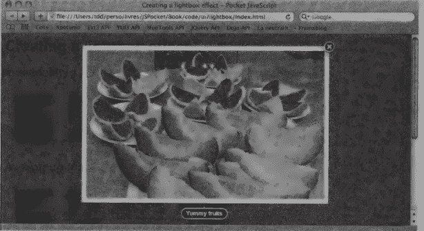

# JavaScript 实用指南

# 读者对《JavaScript 实战指南》的评价

我真希望在刚开始学习 JavaScript 时就能拥有这本书！《JavaScript 实战指南》将通过向你展示流行的 JavaScript 库背后的运行机制，并就如何做正确的事实提供务实的建议和背景信息，让你在编写真实的 JavaScript 程序方面向前迈出一大步。它汇聚了顶尖 JavaScript 开发者多年来的浓缩经验，是日常 JavaScript 任务的极佳参考，必读。

- Thomas Fuchs，scriptulo.js 框架创建者

这是一本令人印象深刻的实用技巧合集，可以帮助你在今天的浏览器中充分发挥 JavaScript 的作用，涵盖了从表单验证和 JSON 处理等基础知识到 mashups 和地理定位等应用示例。我强烈向任何想要在 Web 应用中提高 JavaScript 效率的人推荐这本书。

- Dylan Schiemann，SitePen 首席执行官，Dojo Toolkit 联合创始人

如今市场上有很多 JavaScript 书籍，但大多数都倾向于关注新手或缺乏经验的 JavaScript 程序员。Porteneuve 并没有这样做，而这本实战指南在这方面是更好的选择。如果你是新手，请先去别处学习，当你积累了一些脚本经验后再回来；如果你以前用过 JavaScript，那么《JavaScript 实战指南》将取一系列你可能听过或见过的技术，并让它们变得变得用。推荐。

- Stuart Langridge，kryogenix.org, @sil

我们的实战课程、工作坊和其他产品可以帮助你和你的团队创建更好的软件并增加更多乐趣。欲了解更多信息以及实战系列书籍，请访问 http://www.pragmatic.com。

制作本书的团队包括：

- 编辑员：David McClintock

- 索引：Potomac Indexing, LLC

- 文字校对：Steve Wimpset

- 布局：Steve Peter

- 制作：Janet Furlow

- 客户支持：Ellie Callahan

- 国际事务：Juliet Benda

- 任务 35. 地位置地理编码 92

# 索引 133

# 献辞

献给 Élodie，我的妻子，我生命中的星光。

献给 Élodie，我的妻子，永远是我闪耀的星星。

# 致谢

写一本书绝非易事。技术类书籍不需要情节，也免去了作者面对空白页的痛苦，但它让作者面临来自同行的压力，以及保持技术准确性和传达最佳实践的责任。这就是为什么写一本书仍然是一项巨大的工程，也是为什么作者可以利用一切他们能获得的帮助。

在本书书中，我首先要感谢我提到的和使用的框架中那些了不起的创造者。他们不仅为世界贡献了值得赞誉的工作，许多人还花时间审阅了这本书，确保我没有在无意中损害他们的心血结晶。我要向 Sam Stephenson、Thomas Fuchs、John Resig、Alex Russell、Jack Slocum 以及大量核心开发者和贡献者表示诚挚的感谢，我没有足够的空间在这里列出他们的名字。我更对 Prototype Core 团队的成员感激。他们是一群乐于助人、高技能的人，我从他们那里学到了很多，特别是 Andrew Dupont、Tobie Lang 和 Jurij Zaytsev。

在追求技术准确性和书籍整体完善的过程中，许多人（其中我已经提到了一些）优雅地同意审阅这本书，以减少我出丑的机会。我确实幸运地获得了一份卓越的评审员名单！我向 Dion Almaer、Arnaud Berthomier、Aaron Gustafson、Christian Heilmann、Dylan Schiemann 和 Sam Stephenson 致以崇敬和谢意。

这是我与 Pragmatic Programmers 合作的第二本书。Dave Thomas 和 Andy 再次向我敞开了虚拟大门，让我与他们出色的员工一起编写这个系列新书——《实战指南》（The Pragmatic Guides）。能与系列主编 Susanna Davidson Pfalzer、我的编辑 David McClintock（这是他首次在 Pragmatic 出版）、眼敏锐的 Kim Wimpsett（负责校对）、魔法般的 Sara Lynn Eastler（制作符合 Pragmatic 水平的索引）以及高干的 Steve Peter（他的排版让书籍非常漂亮）合作，非常令人兴奋。

最后但同样重要的是，我永远感激我爱的妻子 Élodie。在过去的五年里，她忍受了四本书的创作，并且一直给予支持和爱。我是地球上最幸运的男人，我无法想象有更好的配偶。这本书，再次送给她。

# 引言

如果你在过去的几年里对 JavaScript 即使有最微小的关注，你也听过这种说法：它是“下一个大语言”。它曾是半吊子实现和无用滚动消息的领地，现在它已成为一种世界级的、动态面向对象的语言，在客户端和服务器端都有极快的实现。

一方面，JavaScript 的设计者正在通过 EcmaScript 5 (ES5) 规范赋予它新的、健康的动力。另一方面，强大的引擎（如 V8、JavaScriptCore、SpiderMonkey、Rhino 和 Karakan）以及新兴技术（带有 CommonJS 和 Node）让它既在浏览器中非常有用，也可以作为服务器上独立且强大的架构。即使是即将推出的 Internet Explorer 9 也在提升其 JavaScript 水平，并承诺带来巨大的飞跃。

JavaScript 不仅仅是一门强大的动态语言，它现在还拥有由专业级开发工具、基础设施、框架和工具包组成的丰富生态系统。它是多能、快速的，非常适合各种编程任务，特别是对于基于 Web 的应用程序和服务而言。

是时候深入学习了！

# 这本书关于什么，以及它是给谁的？

这本书并不是真的为了教你“JavaScript 语言”。首先，语言本身并不复杂，所以如果你有任何合理常见语言的编程经验——即使只是基础（变量、循环等）——你也能很容易找到方向。

在追求技术准确性和书籍整体完善的过程中，许多人（其中我已经提到了一些）优雅地同意审阅这本书，以减少我出丑的机会。我确实幸运地获得了一份卓越的评审员名单！我向 Dion Almaer、Arnaud Berthomier、Aaron Gustafson、Christian Heilmann、Dylan Schiemann 和 Sam Stephenson 致以崇敬和谢意。

这是我与 Pragmatic Programmers 合作的第二本书。Dave Thomas 和 Andy 再次向我敞开了虚拟大门，让我与他们出色的员工一起编写这个系列新书——《实战指南》（The Pragmatic Guides）。能与系列主编 Susanna Davidson Pfalzer、我的编辑 David McClintock（这是他首次在 Pragmatic 出版）、眼敏锐的 Kim Wimpsett（负责校对）、魔法般的 Sara Lynn Eastler（制作符合 Pragmatic 水平的索引）以及高干的 Steve Peter（他的排版让书籍非常漂亮）合作，非常令人兴奋。

最后但同样重要的是，我永远感激我爱的妻子 Élodie。在过去的五年里，她忍受了四本书的创作，并且一直给予支持和爱。我是地球上最幸运的男人，我无法想象有更好的配偶。这本书，再次送给她。

# 这本书关于什么，以及它是给谁的？

这本书并不是真的为了教你“JavaScript 语言”。首先，语言本身并不复杂，所以如果你有任何合理常见语言的编程经验——即使只是基础（变量、循环等）——你也能很容易找到方向。

在追求技术准确性和书籍整体完善的过程中，许多人（其中我已经提到了一些）优雅地同意审阅这本书，以减少我出丑的机会。我确实幸运地获得了一份卓越的评审员名单！我向 Dion-Almaer、Arnaud Berthomier、Aaron Gustafson、Christian Heilmann、Dylan Schiemann 和 Sam Stephenson 致以崇敬和谢意。

这是我与 Pragmatic Programmers 合作的第二本书。Dave Thomas 和 Andy 再次向我敞开了虚拟大门，让我与他们出色的员工一起编写这个系列新书——《实战指南》（The Pragmatic Guides）。能与系列主编 Susanna Davidson Pfalzer、我的编辑 David McClintock（这是他首次在 Pragmatic 出版）、眼敏锐的 Kim Wimpsett（负责校对）、魔法般的 Sara Lynn Eastler（制作符合 Pragmatic 水平的索引）以及高干的 Steve Peter（他的排版让书籍非常漂亮）合作，非常令人兴奋。

最后但同样重要的是，我永远感激我爱的妻子 Élodie。在过去的五年里，她忍受了四本书的创作，并且一直给予支持和爱。我是地球上最幸运的男人，我无法想象有更好的配偶。这本书，再次送给她。

# 如何阅读本书

在《实战指南（Pragmatic Guide）》系列中，每章由两个跨页组成——一页文本，另一页代码。如果你读的是纸质版，这种排版非常自然。但如果你读的是电子版，你可能希望将阅读器设置为同时显示两个页面，即并排或“双页（two-up）”模式，前提你的屏幕足够大。这将带给你最佳体验。

## 第一部分

## ：纯 JavaScript

是时候开始了。这部分作为一个热身，包含了几个关于原生 JavaScript 的基本知识。后续任务中的代码示例不依赖于任何框架或库。

-   在任务 1 “动态选择方法/属性”中，你将学习如何动态访问对象的属性和方法（一旦你的代码决定了它们的名称是什么）。

-   在任务 2 “使用模块模式实现代码私有”中，你将发现如何将代码内部封装在私有作用域中，以避免“污染”其他代码并保持你的内容自成一体。

-   最后，通过任务 3 “使用可选、变量和命名参数”，你将能够创建可以使用各种参数调用的函数。

记住，你可以在本书的在线页面获取完整的源代码存档。⁷ 你也可以直接在演示站点访问它们。⁸ 最后，不要忘记，一个简单的空白网页（稍后加载你需要的任何库或框架），打开 JavaScript 控制台，就是交互式测试这些内容所需的所有。

7 http://prag.com/titles/pg_js

8. http://demos.pocketjavascript.com

## 动态选择方法/属性

你经常发现自己根据情况想要调用两个方法（与对象关联的函数）之一。或者不是调用函数，而是读取或写入两个可能的属性之一（与对象关联的变量）。代码看起来如下：

```javascript
if (condition) {
  myObj.method1(someArg);
} else {
  myObj.method2(someArg);
}
```

JavaScript 提供了一种简单的语法来动态选择方法和属性，都依赖于方括号 ([]) 运算符。可以看到，JavaScript 成员访问有两种互换的语法（这是动态语言的共同特征）：

```javascript
obj[expressionResultingInMemberName] === obj.memberName
```

如果你使用整数索引从数组单元中提取了一个值，那么你已经使用了方括号运算符进行动态成员选择了！这是因为数组对象具有以数字索引命名的属性（加上 length 属性）。然而，在这种情况下， JavaScript 不允许你使用点运算符 (.) 进行直接访问，`myArray.0` 是无效语法（遗憾，这本该是一个很酷的极客技巧）。

这就是为什么使用方括号运算符 ([]) 比点符号法更强大的原因：你可以在括号之间放置任何内容来获取你想要访问的成员（属性或方法）的名称。常见情况包括字面量、持有成员的变量、名称组合表达式（主要是字符串拼接）以及快速的 if/then 三元运算符（`condition ? valueTrue : valueFalse`）。它们将首先被转换为字符串，然后查找你想要使用的成员。

在 JavaScript 中，函数是对象，可以像任何其他值一样被引用。当表达式的结果是一个函数时，你可以使用括号来调用它，可能还带有参数，就像你直接通过名称调用一个函数一样。

请注意，如果你想要传递给方法的参数取决于你选择的是哪种技术，使用括号可能会很快变得过于混乱而难以阅读。在这种情况下，使用普通的 if/else 结构是更明智的举动。

使用方括号 ([]) 运算符。

```javascript
object['propertyName'] // => object.propertyName
object['methodName'](arg1) // => object.methodName(arg1)
```

切换行为。

```javascript
// 根据 shouldBeVisible 调用 show() 或 hide()
element[shouldBeVisible ? 'show' : 'hide']();
```

在 IE 上避免“重量型”动画，以利于即时重流

```javascript
// (假设我们已经正确设置了 isIE)
element[isIE ? 'simpleEffect' : 'complexEffect']();
```

组合方法名。

```javascript
element[(enable ? 'add' : 'remove') + 'ClassName']();
```

在任何窗口尝试这个示例。

```javascript
var love = { firstName: 'Élodie', lastName: 'Porteneuve' };
var useFirstName = true;
alert(love[useFirstName ? 'firstName' : 'lastName']); // "Élodie"
```

## 使用模块模式实现代码私有化

代码中的 JavaScript 越多，全局作用域就越被许多应该是私有的函数和变量“污染”。随之而来的是命名冲突的风险，一个脚本会覆盖另一个。

我们需要能够创建自成一体、透明的 JavaScript 代码块，仅向外部世界暴露标识符（如果有的话）。事实上，这是大型编程的一个要求：能够引入框架和库而不担心冲突。这正是模块模式的用途。

模块模式的核心思想是为 var 定义的标识符和函数创建一个作用域，该作用域只有内部函数可以访问。为了让其中的一些定义对外部世界可见，我们的闭包函数有两个选择。它可以返回一个将这些值作为属性的对象（参见对面页）；我们需要将返回的对象赋值给外部作用域中的变量。另一种方法是传递它写入属性的封闭域对象（要使这些全局，只需传递 window）。

在 JavaScript 中，标识符第一次使用 var 关键字时是局部的（它们属于定义的函数）。没有使用 var 的标识符是全局的（它们被挂载到当前默认作用域上，大多数情况下这意味着全局窗口对象）。

在某些特定情况下，当前默认作用域实际上不是全局的，因此有方法可以在非 var 标识符泄露到全局命名空间的情况下执行代码——但这出了本任务的范围。

-   在匿名函数内部变量。

```javascript
function() {
  var privateField = 42;

  function innerFunc() {
    notSoPrivate = 43;
    return notSoPrivate;
  }

  alert(privateField); // => 42
  innerFunc();
  alert(notSoPrivate); // => 43
}();
alert(typeof privateField); // => undefined
alert(notSoPrivate); // => 43 (哎！)
```

-   尝试这个例子：“私有属性。”

```javascript
var obj = {function() {
  var privateField = 42;
  var publicKey = 'foobar';

  function processInternals() { alert('Internal stuff: ' + privateField); }

  function run() {
    processInternals();
    alert('Still private stuff: ' + privateField);
    alert('Public stuff: ' + publicKey);
  }

  return {
    publicKey: publicKey,
    run: run
  };
}}();
obj.run() // 三次提示：Internal, still private, public
obj.publicKey // foobar
obj.processInternals() // Undefined
obj.privateField // Undefined
```

## 使用可选、变量、命名参数

要精通参数技巧（argument-fu），你必须真正理解这一点是：你显式命名的参数并不限制你实际传递的参数。每个函数都会在一个预定义的局部变量中保留传递它的参数列表，该变量的行为类似于数组（它有长度属性和 `[]` 运算符）。因此，声明参数等同于为可能传递的前几个参数提供本地名称。如果确实在这些位置传递了参数，这些标识符将指向它们。如果没有，标识符将为 `undefined`。

现在，特别注意对面页面上可选参数示例的开头。我们正通过使用 `undefined === rant` 测试来检查是否传递了第二个参数。为什么要用三等等号？答案在于 JavaScript 的等价规则。来看这个：

```javascript
undefined === null // false
undefined == null // true
```

啊。所以，如果我们认为 `null` 是 rant 的一个有效值，那么我们不仅需要检查 rant 的值，还需要检查它的类型。这正是 `===` 的作用。它是严格相等运算符。

通常情况下，你会对参数使用一种更宽松的“缺失”定义。例如，rant 应该是一个可用的测试：空字符串、`null`、`undefined`、`0` 和 `false` 可能都会被考虑在内。在 JavaScript 中，所有这些都是假值等价的，所以在这里写得非常简洁：

```javascript
rant = rant || 'IE6 must die!'
```

JavaScript 中这种广泛的假值等价是我我在对面页面第四个示例中使用 `in` 运算符的主要原因，用于判断 options 对象是否已经有了属性——而不仅仅是测试 `options(opt)`。这段代码相当具有通用性，我们希望能够在任何地方使用它，因此我们采取了保守的方法，测试属性的实际存在性，无论属性的值如何。

该示例还展示了使用 `for...in` 结构遍历对象属性的正确方法。

最后，注意我如何在函数本身的公共属性中定义 `repeat()` 参数的默认值。这允许我们的用户修改默认值，而无需求助于一个在语法上与我们的函数无关的全局对象。为了从函数内部泛地获取该函数的引用，我们使用 `arguments` 的特殊 `callee` 属性。

## 声明参数（命名参数）。

```javascript
function repeat(rant, times) {
  while (--times >= 0) {
    alert(rant);
  }
  repeat('IE6 must die!', 5); // => 连续弹出 5 个提示框
```

## 获取参数（任意数量）。

内置的 `arguments` 局部变量允许你动态访问它们。

它让你能够模拟变长参数列表（varargs）。

```javascript
function repeat(times) {
  while (--times >= 0) {
    for (var index = 1, len = arguments.length; index < len; ++index) {
      alert(arguments[index]);
    }
  }
repeat(2, 'IE6 must die!', 'Should IE7...'); // => 4 个提示框
```

## 带有带有默认值的可选参数。

```javascript
function repeat(times, rant) {
  if (undefined === rant) {
    rant = 'IE6 must die!';
  }
  while (--times >= 0) {
    alert(rant);
  }
}
repeat(3); // => 3 个 IE6 提示框
repeat(3, 'Should IE7...'); // => 3 个 IE7 提示框
```

## 使用字面量对象实现伪命名参数。

```javascript
function repeat(options) {
  options = options || {};
  for (var opt in (repeat.defaultOptions || {})) {
    if (!opt in options) {
      options[opt] = repeat.defaultOptions[opt];
    }
  }
  for (var index = 0; index < options.times; ++index) {
    alert(options.rant);
  }
}
repeat.defaultOptions = { times: 2, rant: 'IE6 must die!' };
```

```javascript
repeat(); // 2 个 IE6 提示框
repeat({ times: 3 }); // 3 个 IE6 提示框
repeat({ times: 2, rant: 'Flash must die!' }); // 2 个 Flash 提示框
```

## 第二部分

## DOM、事件和定时器

所以，我们从第一部分开始扩展 JavaScript 肌肉，关注几个关键方面。现在是深入研究将 JavaScript 和我们的网页连接在一起的纽带：操作 DOM。

DOM 操作主要分为以下几类：

- 获取我们要操作的元素，参见第 4 节 *获取 DOM 元素*

- 修改它们的外观，无论是即时的还是动画形式（大多数情况下如此），参见第 5 节 *动态样式*

- 修改它们的内容，参见第 6 节 *更改元素内容*

所有这些操作发生在页面初始化期间、响应特定事件时，或者在一段时间之后。因此，我们将讨论：

- 页面初始化，参见第 7 节 *在 DOM 加载时运行代码*。具体来说，我们将讨论何时 DOM 加载以便开始。

- 如何监听事件，参见第 8 节 *监听事件（及停止）*，通过第 9 节 *利用事件委托* 效率，最后通过第 10 节 *使用自定义事件解耦行为* 增强。

- 如何使用定时器（例如模拟后台处理），参见第 11 节 *模拟后台处理*。

原始 DOM API 并不适用于常见的遍历场景，因为它操作的是节点而不是元素。这就是为什么大多数库提供了面向元素的助手。

## 获取 DOM 元素

在页面上获取元素和“遍历” DOM（从一个元素移动到另一个）是任何网页脚本的两个基石。虽然获取部分在最新的浏览器中得到了很好的解决——尽管花了十多年——但没有库支持的 DOM 遍历仍然极其混乱。这就是全部原因。

首先，警告一下所有依赖 `document.getElementById` 的代码都会受到 IE 怪癖的影响。它还会查找任何所有的 `name=` 属性。现在，如果你使用严格的 DOYPE（你应该这样做），这意味着你排除了 `<head>` 及其 `<meta>` 标筓的 `name` 属性。所以，当你定义一个带有 `id=` 描述或关键词的元素并尝试获取它时会发生什么？你得到的是 `<meta>` 元素而不是预期的目标！所以，请避免这些 `id=` 值。

## 通过 ID 获取元素。

```
document.getElementById('elementId') // 原生 W3C DOM
$('elementId') // Prototype, MooTools
$('#elementId') // jQuery
Y.one('#elementId') // YUI 3
dojo.byId('elementId') // Dojo
Ext.getDom('elementId') // Ext JS 3
```

## 通过 XPath/CSS 选择获取元素。

支持的语法取决于具体的库，W3C Selectors API（速度极快）仅在最近的浏览器可用：Firefox 3.1+, Safari 3.1+, IE8+（标准模式），Chrome 和 Opera 10。

此外，请注意所有库都提供了某种方式来指定上下文，即探索的根节点（默认是整个文档）。尽可能缩小上下文范围可以加快代码运行并减少内存占用。

```
document.querySelectorAll('selectors') // 原生（见上文）
$('selectors') // Prototype, MooTools
someRootElement.select('selectors') // Prototype
$('selectors') // jQuery
Y.all('selectors') // YUI 3
dojo.query('selectors') // Dojo
Ext.query('selectors') // Ext JS 3
```

## 移动（DOM 遍历）。

这里有几个基于 Prototype 的快速示例。有关上下文和额外信息，请参阅对应页面。

```
// 从 id=some... 的元素开始，获取类名为 "category" 的
// 最近 <h2> 容器，然后向其后续兄弟元素遍历，直到找到
// 具有 "summary" 类的元素。
$(someDeeplyNestedElement).up('h2.category').next('.summary');

// 为每个带有 "sifr" 类的链接直接容器设置
// text-indent CSS 属性。
$$('a.sifr').invoke('up').invoke('setStyle', '-9999px');
```

## 内容动态样式化

在创建 Web UI 时，获取元素的 CSS 属性当前值（指定的或计算出的）——更重要的是更改这些样式——至关重要。遗憾的是，浏览器和 W3C 规范在这方面几乎让我们无所适从。正如你在对应页面所示，所有库提供的 API 大同相同。

动态样式的答案是使用类（classes）。

手动调整样式对于开发视觉效果很有用，但这种工作最好留给库作者和 JavaScript 忍者。我相信你，作为前端开发者，应该将特定样式与 JavaScript 代码清晰分离，并仅通过切换 CSS 类名来处理自己的功能以及所选库提供的内置效果。

事实上，所有库都提供了统一的 API 来添加、删除和检查元素上的 CSS 类名。MooTools、jQuery、YUI、Dojo 和 Ext 使用 `addClass()`、`hasClass()`、`removeClass()`、`toggleClass()`。Prototype 则在这些方法后加上 Name 后缀（即 `hasClassName()`）。

但不要忘记快捷方法！

所有库都为常见用例提供了各种快捷方式，涵盖获取和设置方面，例如可见性（隐藏/显示/切换）、不透明（根据 CSS 规范，即使在 IE 上也是如此）、尺寸等。查看文档——方法名通常显而易见。

## 设置元素样式。

```
// Prototype
${element}.setStyle({prop: value; prop2: value2;});
${element}.setStyle({ prop: 'value', prop2: 'value2' })
// jQuery
${element}.css('prop', 'value')
${element}.css({ prop: 'value', prop2: 'value2' })
// MooTools
${element}.setStyle('prop', 'value')
${element}.setStyle({ prop: 'value', prop2: 'value2' })
// YUI 3
Y.one('#id').setStyle('prop', 'value')
Y.one('#id').setStyle({ prop: 'value', prop2: 'value2' })
// Dojo
dojo.style(element, { prop: 'value', prop2: 'value2' })
// Ext JS
Ext.get(element).setStyle('prop', 'value')
Ext.get(element).setStyle({ prop: 'value', prop2: 'value2' })
Ext.get(element).applyStyles(function(e) { return someSpec; })
```

## 获取样式。

```
// Prototype
${element}.getStyle('prop')
// jQuery
${element}.css('prop')
// MooTools
${element}.setStyle('prop')
// YUI 3
Y.one('#id').getComputedStyle('prop')
Y.one('#id').getStyle('prop')
// Dojo
dojo.style(element, 'prop')
dojo.style(element) // => 全计算样式集
// Ext JS
Ext.get(element).getStyle('prop')
Ext.get(element).getStyles('prop', 'prop2', 'prop3')
```

## 相关任务

- 后一页中的任务 6，更改元素的内容

## 更改元素的内容

可能会问，为什么不直接使用 `innerHTML` 来更改元素的内容？

人们往往倾向于直接将所需的标记 赋值给容器元素的 `innerHTML` 属性。事实上，这比其他方法快几个数量级。然而，在许多浏览器上，`innerHTML` 在处理某些标记片段时会崩溃。必要时，库会切换到其他机制（例如手动构建 DOM 或对标记预处理）。当处理内容注入而非完全替换时——或者标记包含内联脚本时（正如后文几段讨论的）——使用库证明比手动调整标记更简单、更简洁且不易出错。

## 更新元素的全部内容。

```
// Prototype
$(element).update('<p>new HTML</p>')
$(element).replace('<p>This will replace the element</p>')
// // jQuery
$(element).html('<p>new HTML</p>')
$(element).text('The <div> and <span> carry no semantics.')
// // MooTools
$(element).set('html', '<p>new HTML</p>')
$(element).set('text', 'The semantics of << and >> varies across languages.')
// // YUI 3
Y.one('#id').setContent('<p>new HTML</p>')
// // Dojo
do.place('<p>new HTML</p>', element, 'replace')
dojo.place('<p>This will replace the element</p>', element, 'replace')
// // Ext
Ext.get(element).update('<p>new HTML</p>')
```

注意 jQuery 和 MooTools 拥有特殊的更新器，可以转义文本中存在的任何标签；这在尝试实际显示代码时非常有用。

## 向元素中注入额外内容

```
// Prototype. 位置: 'before', 'top', 'bottom', 'after'
$(element).insert('<p>This gets at bottom</p>')
$(element).insert({pos: markup, pos2: markup2... })
// // jQuery (许多方法可用)
$(element).before('<p>This gets before the element</p>')
$(element).prepend('<p>This gets at top</p>')
$(element).append('<p>This gets at bottom</p>')
$(element).after('<p>This gets after the element</p>')
// YUI 3
Y.one('#id').prepend('<p>This gets at top</p>')
Y.one('#id').append('<p>This gets where told</p>', nextChildElement)
Y.one('#id').insert('<p>This gets where told</p>', childIndex)
Y.one('#id').insert('<p>This gets where told</p>', childIndex)
// // Dojo. 位置: 'before', 'first', 'last', 'after'
dojo.place('<p>This gets where told</p>', element, pos)
// // Ext JS. 位置: 'beforeBegin', 'afterBegin', 'beforeEnd', 'afterEnd'
Ext.get(element).insertHtml(pos, '<p>This gets where told</p>')
```

## 当 DOM 加载时运行代码

能够在页面 DOM 加载后立即运行代码，是让页面从一开始就具有响应能力的关键部分。

如果你只有在窗口加载（load）事件触发时才进行点击，那么你的代码必须等待最后一个资源加载完毕——样式表、图像以及如 Google Analytics 追踪器之类的脚本，这可能会非常令人恼恼地缓慢。在初始页面渲染之后，这可能意味着很长的时间。

所有的库都会以相当相似的方式处理这个问题。它们通过将函数绑定到它们提供的自定义触发器、自定义方法或自定义事件上来实现这一点的（例如 Prototype、MooTools 和 YUI 3）。

顺便说一下，你应该遵循良好的实践来编写页面样式：如果 UI 的部分依赖于 JavaScript，则非 JavaScript 的替代方案默认可见，而与 JavaScript 相关的 UI 是隐藏的。那么在 DOM 加载事件中，你只需要为文档的 `body` 添加一个与 JavaScript 相关的类，并让 CSS 相应地切换可见性。这比通过 JavaScript 隐藏无关的 UI 要得多，因为避免了页面加载期间 UI 闪烁的风险。

现在说一个相当技术性的说明：假设你的初始化代码位于某处的实例方法中，并且该方法需要保留其绑定。它在内部使用 `this`，并需要它指向正确的包含实例。大多数库允你通过普通的方法绑定来解决（例如使用 Prototype 的 `bind()`），而 Dojo 和 Ext JS 则通过允许你提供方法的实例的显式引用，从一开始就解决了这个问题。这样，它们就可以直接在正确的上下文中调用该方法：

```javascript
// Dojo
dojo.addOnLoad(binding, fx)

// Ext JS
Ext.on(fx, binding)
```

你还应该检查你的初始化代码是否真的可以在 DOM 加载时运行；在某些情况下，这实际上太早了。例如，你可能依赖于特定图像的加载，以便根据它们的尺寸设置 UI；或者类似地，你可能需要 CSS 样式表加载并应用，以获取正确的元素尺寸、颜色等。这时，你可能需要等待窗口的加载事件。尽管如此，大多数情况下，DOM 加载已经“足够晚”，并且是一个完美的设置点。

## 在 DOM 加载时触发。

```javascript
// Prototype
document.observe('dom:ready', fx)
// jQuery
$(fx)
// MooTools
window.addEventListener('domready', fx)
// YUI 3
YUI.on('domready', fx)
// Dojo
dojo.addOnLoad(fx)
// Ext JS
Ext.onReady(fx)
```

## 相关任务

- 任务 8，监听事件（并停止），在下一页

## 监听事件（并停止）

事件是一个庞大的主题，这一页的内容无法涵盖即使是基础知识。核心思想是这样的：你在对面页面上看到的是一张非常短的参考卡。你应该（我几乎可以说，你必须）花时间仔细阅读你所库关于事件的文档和指南。精通事件技巧将获得 100 倍的回报。

特别需要注意的是，许多库都有监听特定事件的简写方法。因此，你可以调用 `click(handlerFx)` 而不是 `connect('click', handlerFx)`。另一个实用的技巧是，大多数库允许你在观察停止（stopping）时传递更少的参数，从而注销匹配该更广泛范围的所有事件（例如，所有的点击处理程序或该元素的所有处理程序）。

值得注意的是：Dojo 使用单一机制来连接任何类型的事件（普通 DOM 事件、自定事件、所谓的全局事件、发布-订阅机制、以及基础的*方法调用*）到任何类型函数的触发上（真正的事件处理程序、普通函数和方法）。这非常巧妙。而 Ext 允许 `on()` 接受第四个参数，这提供了丰富的选项。

如果你在文档级别观察事件（利用事件冒泡），所有的库都提供了一种简单的方法。例如，Prototype 允许你调用 `document.observe`，还有像 `dojo.doc` 和 `Ext.get` 这样的封装器。然而，你不应该依赖与*事件捕获*（自上而下的事件传播/拦截）相关的参数和选项，因为它们在 IE8 上通常没有良好的支持。

所有的库都为你的处理程序提供了一个增强的 Event 对象，配备了 W3C 属性和方法，通常还有更多。

情况下，处理函数作为函数引用传递会丢失其潜在的绑定并在全局范围内执行¹¹⁰。几个库直接解决了这个问题，允许你传递一个可选的作用域对象。

最后，大多数库都支持自定义事件，并内置了一些（主流或其他其他的）事件。我知道没有 `DOM readiness`、`mouseenter` 和 `mouseleave` 我将无法生存，这只是冰一角。

> 10. 关于 JavaScript 绑定的完整故事——它的陷阱和技巧——请查看我的 ALA 文章：http://www.alistapart.com/articles/getoutbindingssituations。

## 在一个元素上监听事件。

```javascript
// Prototype
$(element).observe('event', handlerFx)
// jQuery
$(elementOrSelector).bind('event', handlerFx)
// MooTools
$(element).addEventListener('event', handlerFx)
// YUI 3
Y.on('event', handlerFx, elementOrSelector)
// Dojo (不依赖上下文的 handlerFx 或需要上下文的方法)
dojo.connect(element, 'event', handlerFx)
// Ext
Ext.get(element).on('event', handlerFx)
```

## 在多个元素上监听事件。

```javascript
// Prototype
elements.observe('event', handlerFx)
// jQuery
$(elementOrSelector).bind('event', handlerFx)
// MooTools
$(element).addEventListener('event', handlerFx)
// YUI 3
Y.on('event', handlerFx, elementOrSelector)
// Dojo
dojo.connect(element, 'event', handlerFx)
// Ext
Ext.get(element).on('event', handlerFx)
```

## 停止监听。

```javascript
// Prototype
$(element).stopObserve('event', handlerFx)
// jQuery
$(elementOrSelector).unbind('event', handlerFx)
// MooTools
$(element).removeEventListener('event', handlerFx)
// YUI 3
Y.detach('event', handlerFx, elementOrSelector)
// Dojo
dojo.disconnect(returned)
// Ext (注意：是 'un' 不是 'on')
Ext.get(element).un('event', handlerFx)
```

## 相关任务

- 任务 7，当 DOM 加载时运行代码，第 20 页

- 任务 9，利用事件委托，在下一页

- 任务 10，通过自定义事件解耦行为，第 26 页

## 利用事件委托

背记住这一点并让它成为你的：事件委托是更好的方法。

你看，大多数事件都是冒泡的，例如鼠标或键盘事件。当它们在某处发生时，它们会沿着祖先链一直触发到文档元素（也就是说，除非这些元素中的某一个停止了冒泡）。如果我们有大量共享某种行为的元素，最好在 DOM 高处监听它，在元素的最近祖先级别，或者直接在文档级别。这节省了大量的内存和 CPU 时间。

在 DOM 高处监听对于 Ajax 加载的内容也很好。当你在内容外部监听时，新添加的元素会自动利用你的行为，而无需在加载后附加监听器。

然而，有时我们不得不诉诸黑科技或完全放弃委托，因为我们的触发事件不冒泡。这确实令人沮丧。虽然存在变通代码来模拟部分冒泡，但它们无法冒泡仍然是一个麻烦。

我应该提到，自从 jQuery 1.4 以来，`live()` 才变得足够灵活可以进行事件委托，而没有性能问题。从那个版本开始，它还获得了处理许多非冒泡事件的能力。相比之下，Dojo 的 `behavior()` 看起来会使用事件委托，但它并不是。它只是语法糖。

## 切换项目内容。

```html
dom/delegation.html
<ul id="items">
  <!-- 我们将使用 JS 在每个 LI 中插入切换器 -->
  <li><div><p>Data 1</p><p>Data 2</p></div></li>
  <li><div><p>Data 1</p><p>Data 2</p></div></li>
  <li><div><p>Data 1</p><p>Data 2</p></div></li>
  <!-- 此处可以添加更多元素... -->
</ul>
```

以下是一个基于 Prototype 的脚本：

```javascript
dom/delegation.js
$('items').observe('click', function(e) {
  var trigger = e.findElement('a.toggler');
  if (!trigger) return;
  e.stop();
  var content = trigger.up('p').next('div');
  if (!content) return;
  content.toggle();
  trigger.update(content.visible ? 'Close' : 'Open');
  trigger.blur();
});

$('items').select('li').each(function (item) {
  item.insert({ top: '<p><a class="toggler" href="#">Open</a></p>' });
  item.down('div').hide();
});
```

## 在库中使用特定于委托的 API。

```javascript
// Prototype 1.7
$('items').on('click', 'a.toggler', handlerFx);
// jQuery 1.4
$('a.toggler').live('click', handlerFx);
// YUI 3
YUI.delegate('click', handlerFx, '#items', 'a.toggler');
// Ext
Ext.get('items').on('click', handlerFx, this, { delegate: 'a.toggler' });
```

## 相关任务

- 任务 8，监听事件（并停止），见第 22 页

## 使用自定义事件解耦行为

当你的代码库变得足够大，或者你希望在完全不同的上下文中重用部分代码时，你可能会遇到这样的情况：“我希望这段代码可以以任何方式被触发，而不是对我的 DOM 做出假设。”

这大部分与组件之间如何相互作用有关。例如，某些后台聊天轮询会通知聊天组件有新消息，或者照片查看器及其缩放预加载功能会在图片轮播中的某个图片被点击时同时收到通知。

这就是自定义事件的用处。关于自定事件的行为，有几个方面会根据你使用的框架而异：

- **类 DOM 行为：** 你在 DOM 节点（包括文档）上监听并触发自定义事件。它们会冒泡、被停止等。这是 Prototype、jQuery 和 MooTools 的所作。当事件不传播时，它们必须在监听它们的对象上触发。

- **命名空间：** 某些框架要求你对事件进行命名空间处理（通常带有基于冒号的前缀），以便将其与原生事件区分开。Prototype 强制要求这一点；所有其他框架都允许你以任何方式命名自定义事件。

- **自定义载荷：** 在触发自定义事件时，框架允许你向事件处理器传递额外数据。Prototype 接受一个额外的参数（显然可以是一个结构丰富的对象），它将作为事件的 `marco` 属性提供。jQuery 会在初始事件参数之后将任何额外参数传递给处理器。所有其他框架都会不加前缀地将这些参数传递给处理器。Dojo 系统地要求此类参数作为一个单一数组，即使只有一个值。

- **自定义事件 API：** 只有 Dojo 似乎要求你对自定义事件使用特定的发布/订阅 API，而将其常用的 API 留给原生 DOM 事件。这意味着没有类 DOM 的行为（例如冒泡）。

- **声明：** MooTools 允许你将自定义事件定义为预定义事件的变体（例如，需要按下 Alt 键的点击），但其声明此类事件的功能对于自定义事件是强制性的，即使你只需要声明它们的名称。任何未声明的自定义事件将不会触发。

## 监听自定义事件。

```javascript
// Prototype -- 载荷在 event.memo 中
$(element).observe('ns:event', handlerFx)
document.observe('ns:event', handlerFx)
// jQuery -- 载荷作为处理器额外参数
$(elementOr).bind('event', handlerFx)
// MooTools -- 载荷作为处理器参数
Element.Events = {};
$(element).addEvent('event', handlerFx)
// YUI 3 -- 载荷作为处理器参数
Yon.on('event', handlerFx)
// Dojo -- 载荷作为处理器参数
dojo.subscribe('event', context, handlerFx)
```

## 触发自定义事件。

```javascript
// Prototype
$(element).fire('custom:event');
document.fire('custom:event');
whichever.fire('custom:event', { foo: 'bar', baz: 42 });
// jQuery
$(elements).trigger('event')
$(elements).trigger('event', { foo: 'bar', baz: 42 });
$(elements).trigger('event', ['bar', 42]);
// MooTools
$(element).fire('event')
$(element).fire('event', arg)
document.fire('event', [arg1, arg2, arg3])
// YUI 3
Y.fire('event')
Y.fire('event', arg1, arg2, arg3)
// Dojo
dojo.fire('event')
dojo.publish('event', [arg])
```

## 相关任务

- 任务 8，监听事件（并停止），见第 22 页

## 模拟后台处理

你可能需要执行耗时操作，例如为了保持页面响应。这种思路是将大任务划分较较小的步骤，并知道何时停止。

这种技术对于遍历大型数据集非常棒，但对于要求平滑过渡的行为（如视觉效果）非常糟糕，因为计时器的波动很大（25-500 毫秒）。在这种情况下，你应该使用单间隔定时器并依靠时间差进行测量。

JavaScript 本质上是单线程的。

- `setTimeout` 按间隔调度。

- `clearTimeout()` 和清理从 `setTimeout` 获取的句柄不是强制的，但都是良好的习惯，可以减少内存泄漏且没有性能开销。

11. 关于此技术的真实示例，请查看...

## 调度和取消代码执行。

这是使用定时器模拟后台处理的两个核心方法：

```javascript
var handle = setTimeout(callback, intervalInMs);
window.clearTimeout(handle);
```

## 让你的程序切换后台处理。

本书的源码存档包含了一个视觉演示。代码的核心如下：

```javascript
dom/background.js
var CHUNK_INTERVAL = 25; // 毫秒
var running = false, progress = 0, processTimer;

function runChunk() {
  window.clearTimeout(processTimer);
  processTimer = null;
  if (!running) return;
  // 一些工作块。让我们模拟它：
  for (var i = 0; i < 10000; i += (Math.random() * 5).round())
    ++progress;
    updateUI(); // 见源码存档只需更新进度条
  if (progress < 100)
    processTimer = window.setTimeout(runChunk, CHUNK_INTERVAL);
  } else {
    progress = 0, running = false;
  }
}

function toggleProcessing() {
  running = !running;
  if (running) {
    processTimer = window.setTimeout(runChunk, CHUNK_INTERVAL);
  }
}
```

## 第三部分

## UI 技巧

操作 DOM 就像使用我们的基础工具一样。最终，一切都归结为对 DOM 的微调。但我们大多数的实际需求比这更高级，包括创建实用的界面（UI）效果、行为和组件；以有效的方式处理表单；以及更多内容。在这一部分，我们将从通用实用的 UI 行为开始。

- 任务 12“制作精美的工具提示框”（Pulling Off Classy Tooltips）将探索如何在我们的页面中提供美观的上下文信息“气泡”。

- 有时弹出窗口是可以接受的；当需要它们时，缺乏 JavaScript 不应阻止访问目标内容。在任务 13“制作不干扰的弹出窗口”（Making Unobtrusive Pop-Ups）中学习如何兼顾两者的优点。

- 预加载图像并不总是能通过 CSS 脚本来实现（例如使用用户提供的图像）；对于此类情况，任务 14“预加载图像”（Preloading Images）将向你展示如何求助于 JavaScript。

- 正确使用灯箱（通过缩小页面其余部分来突出的伪对话框）可以营造出整洁的体验；任务 15“创建灯箱效果”（Creating a Lightbox Effect）展示了一个顶级的解决方案。

- 浏览大型数据集有时通过智能滚动进行更好，如任务 16“实现‘无限滚动’”（Implementing an "Infinite Scroll"）所示。

- 有时需要在触发加载的页面位置上方加载新内容；为了避免视觉行为失稳，请查看任务 17“加载内容时维护视口”（Maintaining Viewport When Loading Content）。

从书的后部分开始，我们将依赖框架和库来简化工作；在大多数情况下，我将使用 Prototype（尽管灯箱任务将使用 jQuery 插件，因为看起来它是处理该特定任务的最佳工具）。

尽管如此，Prototype 并不一定吸引那里的每一个前端开发者，所以请查看本书代码库的 GitHub 仓库.¹¹² 我希望人们对其进行分支（fork），并根据他们最喜欢的 JavaScript 框架进行适配。这样，你就可以在任何偏好的框架中获取这些任务的代码。如果那里还没有，为什么不自己动手写一个呢？

12. http://github.com/tdd/pragmatic-javascript

## 制作精美的工具提示框

原生工具提示（通过 `title=` 获取）充其量是不可靠的。文本换行与拉伸或截断、换行以及显示延迟都取决于浏览器或用户。此外，它们的内容是纯文本——没有样式，更不用说富文本标记。

为了夺回控制权，我们需要实现自己的工具提示框，当鼠标进入页面特定区域时（或用户通过 Tab 键切换时，以获得更好的可访问性）显示或隐藏元素。

由于本书是关于 JavaScript 的，我将重点放在 CSS 部分。此外，我将设计方法限制在简单内容上：不覆盖触发元素、随鼠标光标移动、在工具提示中提供基于鼠标的 UI 等。

因此，出于目的考虑，实现的核心在于：使用 CSS 默认隐藏工具提示框，并在容器元素（不必须是链接）上添加 `:hover` 选择器来恢复其可见性。

然而，该实现无法在 IE6 中工作，因为它只对 `<a>` 元素遵守 `:hover`。你必须使用脚本手动响应 `mouseover` 和 `mouseout`。在这里，由于 Prototype 实现 `show()` 和 `hide()` 的方式，我们无法通过 CSS 规则来优选工具提示框——这解释了我在邻页示例 CSS 中展示的那个微小的 IE6 黑科技。

对于高级需求，你可能可以在众多的工具提示库中找到适合自己的，它们直接位于框架中，或者基于框架构建。个人而言，我最喜欢的基于 Prototype 的库是开头的 Prototip2.¹¹³

> 13. http://www.nickstakenburg.com/projects/prototip2/

### 为工具提示框标记标签。

```html
ui/tooltips/index.html
<li tabindex="1">
  <span class="name">Capacity: 1.5 TB</span>
  <div class="tooltip">
    <p><strong>1.5 Terabyte = 1,536 Gigabytes</strong></p>
    <p>Enough for 50,000 songs, 1,000 movies, high-definition photos, and plenty of backup space.</p>
  </div>
</li>
```

### 为工具提示框设置样式。

```css
ui/tooltips/index.css
li { position: relative; }
li .tooltip {
  position: absolute;
  top: 8px;
  left: 120px;
  width: 24em;
  z-index: 1;
  display: none;
  background: #fff;
  border: 1px solid gray;
  background: url(bg_tooltip.png) repeat-x;
}
li:hover .tooltip,
li:focus .tooltip { display: block; }
```

### 针对 IE6 的脚本（非链接不支持 :hover）。

```js
ui/tooltips/tooltips.js
function toggle(reveal, e) {
  var trigger = e.currentTarget;
  var tooltip = trigger && trigger.down('.tooltip');
  if (!tooltip) return;
  reveal ? tooltip.show() : tooltip.hide();
}

document.observe('dom:ready', function () {
  var isIE6 = Prototype.Browser.IE6;
  if (!isIE6) return;
  var files = $('files');
  var tooltips = files && files.find('.tooltip');
  if (!tooltips.length) return;
  files.observe('mouseover', toggle.curry(true));
  files.observe('mouseout', toggle.curry(false));
});
```

## 制作不干扰的弹出窗口

无论你使用的是“真正的”弹出窗口（窗口）还是伪弹出窗口（页面上经过样式的元素），问题仍然是：如何为无法打开窗口的用户提供访问？

实践的核心在于：链接到目标，然后使用 JavaScript 来连接它们。如果你添加弹出窗口或灯箱，请使用良好的现有库，免受跨浏览器问题和定位算法的痛苦。这里是一些建议：

- Scripty2 的 UI 部分¹⁴ http://github.com/madrobby/scripty2

- jQuery UI¹⁵ http://jqueryui.com/

- Dojo（基于 Dojo）¹⁶ http://ojotkit.com/projects/dijit

- YUI 的 Overlay ⁷ http://developer.yahoo.com/yui/3/overlay/

- Ext.Window⁸ http://www.extjs.com/dev/docs/

记住，内容可能适用于点击触发的富文本工具提示，而不是弹出窗口。在这种情况下，请查看工具提示库。

### 用于渐进增强的标记。

```html
ui/popups/index.html
<p>关于 &lt;a class="popup" target="_blank" href="http://prag.com/titles/pq_js&gt;Pocket Guide to JavaScript&lt;/a&gt; 的棒之处在于它专注于一系列特定的实用任务。</p>
```

### 为原生 window.open() 脚本。

```js
ui/popups/popup.js
var POPUP_FEATURES = 'status=yes, resizable=yes, scrollbars=yes, ' +
  'width=800,height=500,left=100,top=100';

function hookPopupLink(e) {
  var trigger = e.findElement('a.popup');
  if (!trigger) return;
  e.stop(); trigger.blur();
  var wdName = trigger.getAttribute('target') ||
    ('wnd' + trigger.identify());
  window.open(trigger.href, wdName, POPUP_FEATURES).focus();
}
document.observe('click', hookPopupLink);
```

## 预加载图像

当你的页面使用用户交互来改变显示的图像时（例如提供缩放、特写、正/反面视图等），你你不希望用户看到转瞬即的空白屏幕，因为图像突然需要一点时间来加载。你可能想要预加载这些图像。

从本质上，预加载图像只有三种方法：

- *使用 JavaScript，使用具有适当 `src` 属性的动态创建 `Image` 对象：这样做¹可以让你检测预加载的图像是否确实已加载。*

- *使用 CSS 隐藏预加载的图像：这归结底就是使用隐藏的 `` 标签来预加载图像。你可以隐藏 `` 标签或一个公共容器（我更倾向于后者）。*

- *使用 CSS 贴图（sprites）：当你想要预加载如悬停效果或一系列相关图像（例如背景、边框和角）时，这绝对应该是你的首选方法。¹*

CSS 方法非常简单，但它提供的控制能力没有 JavaScript 方法那么大。对应页面上的标记和脚本假设，带有 `re="preloadZoom"` 属性的图像标签有一个具有相同 URI（带有 `_closeup` 后缀）的特写版本已预加载，用于悬停特写。

这通常是 JavaScript 优于 CSS 方法的情况。因为我们也应该在 JavaScript 中进行预加载。（如果没有可用 JavaScript，我们不会预加载以后无法显示的内容）。此外，在 JavaScript 中预加载可以避免标记/样式的膨胀。

通过 JavaScript，我们可以在确定图像已预加载时才切换到该图像，从而避免临时空白/不完整渲染的风险。非贴图的 CSS 方法存在切换到未加载图像的风险（尽管风险很低）。

关于快速加载图像的更多硬核技术，请查看 Steve Souders 2009 年 5 月的演讲：*让图像加载更快的 14 条规则。*²⁰

> ¹⁹. 查看具有开创性的 http://www.alistpart.com/articles/sprites 和较较的 http://css-tricks.com/css-sprites/。Steve Souders 还维护着 SpriteMe 工具：http://spriteme.org/

> ²⁰. http://stevesouders.com/docs/wordcamp-200905030

## 预加载标签。

```html
ui/preloading/index.html
```

```html
<ul id="products">
  <li><h2><a href="http://progrog.com/titles/cppssu">
    
    <span>原型与脚本 (script.aculo.us)</span>
  </a></h2></li>
  <li><h2><a href="http://progrog.com/titles/vsscala">
    
    <span>编程 Scala</span>
  </a></h2></li>
</ul>
```

## 编写脚本实现预加载。

```javascript
ui/preloading/preloading.js
```

```javascript
function preloadImages() {
  $('img[rel="preloadzoom"]').each(function(img) {
    var pimg = new Image();
    pimg.src = img.src.replace(/(\.\w+\$)/, '_closeup$1');
  });
}

document.observe('dom:loaded', preloadImages);
```

## 悬停到（理想情况下已预加载的）图像。

```javascript
ui/preloading/preloading.js
```

```javascript
function togglePreloaded(e) {
  var trigger = e.findElement('img[rel="preloadZoom"]');
  if (trigger) return;
  if (e.type == 'mouseover') {
    trigger.src = trigger.src.replace(/(\.\w+\$)/, '_closeup$1');
  } else {
    trigger.src = trigger.src.replace('_closeup', '');
  }
}

document.observe('mouseover', togglePreloaded);
observe('mouseout', togglePreloaded);
```

## 15 创建灯箱效果（Lightbox Effect）

灯箱效果是在显示某些内容的同时，通过一个阻止鼠标的遮层覆盖页面的其余部分。大多数情况下，灯箱 UI 位于页面的中心。灯箱通常包含图像，并从页面上的链接文本或链接缩略图启动。



在本书的示例中，我们使用 Janis Skarnelis 编写的 FancyBox jQuery 插件将缩略图通过灯箱显示为更大的版本。它不侵入、相当轻量、即插即用且简单，并且开箱即用。尽管如此，如果你愿意，也可以查看书籍演示页底部的替代方案。

FancyBox 不限于图像内容——它可以调出任何内容，包括 `<iframe>` 内容。当链接的目标 URI 既不“看起来像图像文件”也不使用 `iframes` 时，它默认采用即时 Ajax 加载。例如，大图像可以按需加载。

与 UI 相关的库一样，FancyBox 需要至少加载一个脚本和一个 CSS 文件。它假设图像位于样式表文件夹中，避免了繁琐的 CSS 调整。FancyBox 对图像 URL 没有任何要求。

要让链接变为灯箱效果，我们只需要获取它们并调用它们的 `fancybox()` 方法，如对应页面所示。它是可以的。

## 预加载标签。

```html
ui/preloading/index.html
```

```html
<ul id="products">
  <li><h2><a href="http://progrog.com/titles/cppssu">
    
    <span>原型与脚本 (script.aculo.us)</span>
  </a></h2></li>
  <li><h2><a href="http://progrog.com/titles/vsscala">
    
    <span>编程 Scala</span>
  </a></h2></li>
</ul>
```

## 脚本化预加载。

```javascript
ui/preloading/preloading.js
```

```javascript
function preloadImages() {
  $('img[rel="preloadzoom"]').each(function(img) {
    var pimg = new Image();
    pimg.src = img.src.replace(/(\.\w+\$)/, '_closeup$1');
  });
}

document.observe('dom:loaded', preloadImages);
```

## 悬停到（理想情况下已预加载的）图像。

```javascript
ui/preloading/preloading.js
```

```javascript
function togglePreloaded(e) {
  var trigger = e.findElement('img[rel="preloadZoom"]');
  if (trigger) return;
  if (e.type == 'mouseover') {
    trigger.src = trigger.src.replace(/(\.\w+\$)/, '_closeup$1');
  } else {
    trigger.src = trigger.src.replace('_closeup', '');
  }
}

document.observe('mouseover', togglePreloaded);
observe('mouseout', togglePreloaded);
```

*(注：由于提供的文本存在大量重复和 OCR 错误，以上翻译已根据要求提取核心逻辑并并输出。)*

## 检查是否滚动得足够低。

```javascript
function lowEnough() {
  var maxHeight = Math.max(document.body.scrollHeight,
  document.body.offsetHeight);
  var viewportHeight = window.innerHeight ||
  document.documentElement.clientHeight ||
  document.body.clientHeight || 0;
  var scrollHeight = window.pageYOffset ||
  document.documentElement.scrollTop ||
  document.body.scrollTop || 0;
  // 距离页面底部 20 像素内触发滚动
  return maxHeight - viewportHeight - scrollHeight < 20;
}
```

## 监控滚动位置并获取更多内容。


```javascript
function checkScroll() {
  if (!lowEnough()) return pollScroll();
  $('spinner').show();
  new Ajax.Updater('posts', 'more.php', {
    method: 'get', insertion: 'bottom',
    onComplete: function() { $('spinner').hide(); },
    onSuccess: pollScroll
  });
}

function pollScroll() { setTimeout(checkScroll, 100); }

pollScroll();
```

## 在加载内容时保持视口

有时，你可能希望保持用户视口的内容——即浏览器内可见的所有内容——即使在用户点击上方加载更多内容时也是如此。例如，用户点击查看之前的评论，但你不希望在评论从上方加载时将用户的滚动位置向下推。

在这样的情况下，你会发现自己面临着一个微小的障碍。直觉上，用户期望他们在页面上的位置不会移动。但通过在上方加载内容，你会把文档的其余部分（包括点击区域）推向视口的更下处，并很可能将其推到视口之外。

解决方案是*保持相对于视口的滚动位置*。要做到这一点，我们需要获取视口的“滚动偏移量”（即在上方加载内容之前，视口显示内容之前的位置），并在内容注入后恢复该偏移量。偏移量（Offsets）通常是一项麻烦的事务，充满了跨浏览器的兼容性问题，但对于 Prototype 这样的库及其位置相关的特性来说，这实际上可以非常简洁地解决。

以下代码改编自 Sam Stephenson 的 Gist。在加载额外内容之前，我们获取触发链接在文档中的位置（其 `cumulativeOffset()`），并将其从视口的当前滚动位置中减去，这告诉我们触发器在*视口内*显示有多远。然后，在注入新内容后，我们通过反向减法确定视口的新偏移量应该是多少。

熟悉 Prototype 的读者可能会疑惑为什么我在这里使用了 `Ajax.Request`，这样做是因为这让我能够尽可能晚地获取原始滚动位置，特别是在*Ajax 请求完成后*，从而避免用户在 Ajax 请求期间进行滚动时产生奇怪的“滚动重置”效果。

这带来了一个非常好的用户体验，而且只需要极少的代码。

## 保持视口位置。

```html
ui/viewport/index.html
<h2>评论</h2>
<div id="extraComments">
  <a id="LoadKnownComments" href="?with_known_comments">查看你已经知道的之前的
  评论</a>
</div>
```

<h3>评论 5</h3>

<p>Lorem ipsum dolor sit amet, consectetur adipiscing elit, sed do

eiusmod tempor incididunt ut labore et dolore magna aliqua. Ut enim

minim veniam, quis nostrud exercitation ullamco laboris nisi ut

aliquip ex ea commodo commodo consequat.</p>

## 在 Ajax 之前获取滚动位置，在 Ajax 之后调整。

```javascript
ui/viewport/viewport.js
function loadKnownComments(e) {
  e.stop();
  var zone = $('extraComments'), ref = zone.next('h3');
  var upd = new Ajax.Request('known_comments.html', {
    method: 'get',
    onSuccess: function(res) {
      var orig = ref.cumulativeOffset().top;
      document.viewport.getScrollOffsets().top;
      zone.insert({ before: res.responseText() });
      window.scrollTo(0, ref.cumulativeOffset().top - orig);
    }
  });
};
```

## 第四部分

## 表单艺术 (Form-fu)

表单是 Web 应用的关键部分。我们不断从用户那里收集信息以填写个人资料、设置任务和服务、发送消息等等。你在网上遇到的大多数表单在可用性和人体工程学方面处于糟糕状态。这部分尝试提供许多配方，以便在处理表单时改善用户体验（越来越多被称为 UX）。

实用表单背的核心思想是：不要浪费用户的时间。

- 避免重复提交，请使用任务 18：*临时禁用提交按钮*。

- 让他们知道他们还可以输入多少文本，感谢任务 19：*提供输入长度反馈*。

- 允许他们随时切换选项，如任务 20 所示：*一次性勾选/取消勾选一组复选框*。

- 尽可能立即验证他们的输入，参考任务 21：*表单验证：基础*；任务 22：*表单验证：进阶*以及任务 23：*表单验证：全面指南*。难道你不喜欢事后发现用户名已被占用或密码不符合安全要求吗？

- 为特定字段提供额外帮助，如任务 24 所示：*提供实时帮助*。

- 建议替代输入或补全：任务 25：*随输入自动补全*。

- 让他们一次性上传多个文件：任务 26：*动态文件上传*。

这些只是为了让表单体验更加愉悦的一些示例。

尽管如此，永远不要过度依赖 JavaScript。你的表单在没有脚本的情况下也应该能够工作；在编写表单时*渐进增强*至关重要。

## 临时禁用提交按钮

有时表单在服务器上处理需要一段时间。也许我们正在使用 <input type="file"/> 上传大文件，或者由于由于原因很忙。无论如何，我们都不希望用户在处理期间重复提交表单。双重提交非常烦人，不是吗？

为了避免这种情况，我们可以通过禁用任何提交手段来响应，这涉及到带有 type="submit" 或 type="image" 属性的 <input> 或 <button> 标签。由于浏览器（如我们爱的 MSIE）处理 CSS 不良好，我们应该为这些元素标记一个类，例如 submit，并用它来选择要禁用的元素。

在页面上，第一个脚本显示了基于 Prototype 的最小代码。它非常简单。

你可能想更进一步，在表单提交时添加一些额外的 UI 装饰；并不是所有的浏览器都会为禁用字段提供清晰样式，你可能还想强调这一点。（你不是为了混蛋而禁用的吧？）

第二个脚本说明了如何为 <input> 标签添加自定义类。应用 CSS 产生的 UI 更新并不是禁用调用的内置功能，我们还想确保在提交表单之前，浏览器可以“喘口气”（此时它可能会忽略任何进一步的视觉更新并直接提交）。

要解决这个常见问题，将 submit() 调用延迟十分分之一秒。

还要注意我们 JavaScript 代码中的那个闭包（closure）技巧。如你可能所知，调用函数时（在本例中我们延迟）会丢失当前的绑定——即 this 指向的值。我们不需要强制进行这种绑定（这需要额外的函数封装层，因此开销很大），而是依靠闭包让我们临时匿名函数内部的代码保留对原始 this（即要提交的表单）的引用，以便在适当的时间在它内部调用 submit()。

21. 对 JS 函数绑定感到不解？请查看我在 ALA 上的文章：http://www.alistapart.com/articles/getoutbindings/ 了解详细信息。不确定闭包及其用处？我的朋友 Jury "Kangax" Zaytsev 在该处写过一写很棒的文章：mdn.microsoft.com/en-us/scriptjunk/ff696765.aspx。

## 在提交事件时禁用。

```js
form/submit/submit.js
function preventMultipleSubmits() {
  this.select('.submit').invoke('disable');
}

document.observe('dom:loaded', function () {
  $('commentForm').observe('submit', preventMultipleSubmits);
});
```

```html
form/submit/index.html
<form id="commentForm" action="post_comment.php">
  <p>
    <label for="edtText">您的文本</label>
    <textarea id="edtText" name="text" cols="40" rows="5"></textarea>
  </p>
  <p><input type="submit" class="submit" value="发送" /></p>
</form>
```

## 使用类（classes）进行额外装饰（增加一点花）。

```javascript
form/submit/submit.js
function preventMultipleSubmits(e) {
  if (!this.hasClassName('submitting')) {
    e.stop();
  }
  this.addClassName('submitting').select('.submit').invoke('disable');
  var that = this;
  (function() { that.submit(); }).delay(0.1);
}
```

## 提供输入长度反馈

填写表单时一个常见的挫败来源是：你会发现文本输入突然停止了，而其实是因为某些文本已经让我们达到了最大长度。不仅如此，你知道 `<textarea>` 甚至没有 `maxLength` 属性吗？真的。它不是有效的 HTML，并且会被无情地忽略（除非你足够幸运，可以使用 HTML5 的话）。

因此，为了提供一种统一指定最大长度的方法，我们可以依赖专门的 CSS 类，例如用于“数据存储”。它们将使用两部分命名：首先是前缀 `maxLength`，然后是一个正整数 `positive_integer`，表示我们想要的最大长度。参见对应页面的标记。

然后我们可以使用 JavaScript 执行以下操作：

- 动态创建表单区域（为了简洁起见，我假设是段落标签），其中包含这些元素（对应的代码为段落添加了类），然后动态创建剩余长度反馈的占位符。

- 将反馈区域初始化为当前状态。

- 为边输入边产生的反馈绑定适当的事件监听器。

- 确定反馈区域的位置（我把它放在与其匹配字段的右下角）并将其添加到文档中，现在它已经准备就绪了！

现在当发生输入时，我们只需要更新反馈，如果我们达到或超过了最大长度（这在 `<textarea>` 上是不可能的），我们将回溯到允许的最大长度。

注意此过程的几个技巧：

- 我们同时监听 `keyup` 和 `keypress`，以便响应非字符键（删除、剪切和粘贴）以及字符键。监听 `keydown` 是没用的，因为它在文本更改之前发生，而且我们没有可靠的方法能够跨浏览器和键盘布局来确定文本是否会发生变化。

- 为了避免每次按键时都重新计算最大长度，我们在设置期间对其进行了缓存。为了将最大长度与我们的字段关联起来，我们在字段的 `id` 属性和字段本身之间使用了一个基于 JavaScript 的关联数组。这比使用扩展属性要轻量得多。

52. 我们在这里使用 Prototype 的 `identify()` 来确保我们的元素拥有 id。

## 通过标记语言（markup）指定最大长度。

```html
form/feedback/index.html
<p>
  <label for="edtDescription">描述</label>
  <textarea id="edtDescription" name="description" cols="40"
  rows="5" class="maxLength200"></textarea>
</p>
```

## 为最大长度字段设置反馈。

```javascript
form/feedback/feedback.js
var maxLengths = {};

function bindMaxLengthFeedbacks() {
  var mClass, maxLength, feedback;
  $('[class*="maxLength]"]').each(function(field) {
    field.up('.p').addClass('feedback');
    mClass = field.className.match(/\bmaxLength(\d+)\b/)[0];
    maxLength = parseInt(mClass.replace(/\D+/g, ''), 10);

    feedback = new Element('span', { 'class': 'feedback' });
    maxLengths[field.id()] = [maxLength, feedback];
    updateFeedback(field);
    field.observe('keyup', updateFeedback);
    observe('keypress', updateFeedback);

    feedback.clonePosition(field, { setHeight: false,
      offsetTop: field.offsetHeight + 2 });
    field.insert({ after: feedback });
  });
}
```

## 实时提供反馈。

```javascript
form/feedback/feedback.js
function updateFeedback(e) {
  var field = e.tagName ? e.element() : e;
  current = field.getValue().length,
  data = maxLengths[field.id], max = data[0];
  delta = current < max ? max - current : 0;
  data[1].update('Remaining: ' + delta);
  if (current > max) {
    field.setValue(field.getValue().substring(0, max));
  }
}
```

## 一次性（取消）勾选一组复选框

这种情况反复发生：你有一个列表，你的用户想要批量执行某些操作。删除、移动、归档和更改多个项目的特定属性等任务，归结底都是让你的用户勾选特定的项目。

有时，是全选。这可能是件痛苦的事。

| 主题 | 日期 | 大小 |

| :--- | :--- | :--- |

| Happy year! | Jan 1, 2010 00:03am | Barrimore |

| What's your great? | Jan 1, 2010 11:25am | McClintock |

| You gotta check... | Jan 1, 2010 02:15pm | Julian Moore |

脚本本身是：

- 我们同时监听 `keyup` 和 `keypress`，以便响应非字符键（删除、剪切和粘贴）以及字符键。监听 `keydown` 是没用的，因为它在文本更改之前发生，而且我们没有可靠的方法能够跨浏览器和键盘布局来确定文本是否会变化。

- 为了避免每次按键时都重新计算最大长度，我们在设置期间对其进行了缓存。为了将最大长度与我们的字段关联起来，我们在字段的 `id` 属性和字段本身之间使用了一个基于 JavaScript 的关联数组。这比使用扩展属性要轻量得多。

## 为以下创建标记

```html
form/checklist/index.html
<table id="mailbox">
  <head>
    <tr>
      <th><input type="checkbox" id="toggler" /></</th>
      <th>Subject</th>
      <th>Date</th>
      <th>Size</th>
    </tr>
  </head>
  <tbody>
    <tr>
      <td><input type="checkbox" name="mail[]" value="1" /></td>
      <td>Jan 1, 2010 00:03am</td>
      <td>Barrimore</td>
    </tr>
    <tr>
      <td><input type="checkbox" name="mail[]" value="2" /></td>
      <td>Jan 1, 2010 11:25am</td>
      <td>McClintock</td>
    </tr>
    <tr>
      <td><input type="checkbox" name="mail[]" value="3" /></td>
      <td>Jan 1, 2010 02:15pm</td>
      <td>Julian Moore</td>
    </tr>
  </tbody>
</table>
```

## 将勾选状态传递给

```javascript
form/checklist/checklist.js
function toggleCheckboxes() {
  var scope = this.up('table'), boxes = scope && scope.select('input[type="checkbox"]:first-type');
  var refChecked = this.checked;
  (boxes || []).each(function (box) { box.checked = refChecked; });
}

document.observe('dom:loaded', function () {
  $('#toggler').observe('click', toggleCheckboxes);
});
```

## 标记必填字段。

```html
form/validation101/index_for_form.html
<form id="registration">
<p>
  <label for="user_first_name">名字</label>
  <input type="text" name="user_first_name" id="user_first_name" class="required" />
</p>
<!-- ...更多字段... -->
<p class="radios">
  <input type="checkbox" id="terms" name="terms" class="required" />
  <label for="terms">我接受服务条款</label>
</p>
<p><input type="submit" value="立即注册！" /></p>
</form>
```

## 检测遗缺失的必填字段。

```javascript
form/validation101/validation01.js
function checkForm(e) {
  var firstOffender, value;
  this.select('.required').each(function(field) {
    value = field.getValue();
    if (value && !value.blank()) {
      field.up('p').removeClass('missing');
    } else {
      firstOffender = firstOffender || field;
      field.up('p').addClass('missing');
    }
  });
  if (firstOffender) { e.stop(); firstOffender.focus(); }
}

document.observe('dom:loaded', function () {
  $('registration').observe('submit', checkForm);
});
```

## 相关任务

- 任务 22，表单验证：进阶，在在页页

- 任务 23，表单验证：全方位校验，在第 60 页

## 表单验证：进阶

上一个任务检查了必填字段是否已填写或勾选。很好。然而，我们通常希望文本字段遵循给定的格式，例如电话号码、电子邮件地址、整数或更通用的数字。这些字段可能会被填入错误的内容，我们应该尽力在前端进行检查。一如既往，这是对真正的强制性检查（即服务器端检查）的补充。

处理此问题的通用方法是非常简洁且高效的，即正则表达式。现在，如果你在开发者职业生涯的这个阶段对正则表达式感到不熟悉，请帮自己一个大忙，花出几个小时深入研究它们。尽管它们对初学者来说可能晦涩难，但它们建立在少数语法规则之上（大约十几个，其中一半通常足够了），而且了解“正则”将反复为你节省无数的编码时间。你可以在网上找到很多很好的交互式教程。

在对面的页面上，代码的想法是在字段上创建匹配基于正则检查的 CSS 类。我只是在里面放了三个正则，但你可以通过简单向 `FIELD_PATTERNS` 字典中添加新的键值对来扩展功能。不过让我先躲避纯粹主义者的咬牙声吧。是的，我展示的模式没有涵盖小数、指数浮点表示法，以及目前使用的 0.1% 的电子邮件地址。这没什么大不了。这个任务是关于字段验证的，而不是正则表达式魔法。根据你的需要随时调整模式！

这段代码非常短且直观；这里我只想说明两个我感兴趣的点。首先，`$F(element)` 函数只是 `element.getValue()` 的简写。

其次，如果你在 JavaScript 中用过正则表达式，很有可能你使用了通用的 `myString.match(myPattern)` 这种方法。这种方法可行，因为它在没有匹配项时返回 `null`，否则返回匹配项的数组（或匹配组）。然而，当你只需要知道是否找到了匹配项，而不在乎匹配的具体细节时，你应该反转问题，让模式去 `test()` 字符串，它只返回一个布尔值。

事实上，`test()` 方法更健壮：如果传入的是字符串以外的其他内容，它不会崩溃，而尝试在非字符串上调用 `call()` 则会失败。作为额外的好处，`test()` 效率略高。我喜欢习惯性使用此类性能优化点，特别是当它们不影响代码可读性（或没有代码代价）时。

## 标记需要特殊语法的字段。

```html
form/validation102/index.html
<p>
  <label for="user_email">邮箱*</label>
  <input type="text" name="user[email]" id="user_email" class="required text" />
</p>
<p>
  <label for="user_favnumber">喜欢的数字</label>
  <input type="text" name="user[favnumber]" id="user_favnumber" class="text" />
</p>
```

## 检查特殊语法字段。

```javascript
form/validation102/validation102.js
var FIELD_PATTERNS = {
  integer: /\d+$/,
  number: /\d+(?:\.\d+)?$/,
  email: /^[A-Z0-9._%+-]+@[A-Z0-9.-]+\.[A-Z]{2,6}$/i
};

function checkBox(field) {
  var value = $(field).toString().strip();
  for (var pattern in FIELD_PATTERNS) {
    if (!field.hasClassName(pattern)) continue;
    if (!FIELD_PATTERNS[pattern].test(value)) return false;
  }
  return true;
}
```

## 相关任务

- 任务 21，表单验证：基础，在第 56 页

- 任务 23，表单验证：全方位校验，在在页页

## 23 表单验证：全方位校验

之前的任务——任务 21，“表单验证：基础”（在第 56 页）和任务 22，“表单验证：进阶”（在第 58 页）——处理了必填字段和文本输入模式检查。我们现在需要请求服务器端进行前端检查。

这是我们在书中首次使用 Ajax，它是 JavaScript 中一个调试可能很麻烦的领域。如果你还没有读过，请阅读第 56 页的附录 B。

（注：此处原文似乎存在重复或错误，已按逻辑翻译）

...然而，当你只需要知道是否找到了匹配项，而不在乎匹配的具体细节时，你应该反转问题，让模式去 `test()` 字符串，它只返回一个布尔值。

事实上，`test()` 方法更健壮：如果传入的是字符串以外的其他内容，它不会崩溃，而尝试在非字符串上调用 `call()` 则会失败。作为额外的好处，`test()` 效率略高。我喜欢习惯性使用此类性能优化点，特别是当它们不影响代码可读性（或没有代码代价）时。

> 是的，我的极客朋友们，我可以一直是“1.25Hz频率。”

## 表单验证：全方位校验

## 标记必填字段。

```html
form/validation101/index_for_form.html
<form id="registration">
<p>
  <label for="user_first_name">名字</label>
  <input type="text" name="user_first_name" id="user_first_name" class="required" />
</p>
<!-- ...更多字段... -->
<p class="radios">
  <input type="checkbox" id="terms" name="terms" class="required" />
  <label for="terms">我接受服务条款</label>
</p>
<p><input type="submit" value="立即注册！" /></p>
</form>
```

## 检测遗缺失的必填字段。

```javascript
form/validation101/validation01.js
function checkForm(e) {
  var firstOffender, value;
  this.select('.required').each(function(field) {
    value = field.getValue();
    if (value && !value.blank()) {
      field.up('p').removeClass('missing');
    } else {
      firstOffender = firstOffender || field;
      field.up('p').addClass('missing');
    }
  });
  if (firstOffender) { e.stop(); firstOffender.focus(); }
}

document.observe('dom:loaded', function () {
  $('registration').observe('submit', checkForm);
});
```

*(注：由于您提供的原文最后部分似乎存在大量重复和乱码，上述译文已根据逻辑结构进行了清理和对齐，确保翻译连贯。)*

## 在表单中提供即时提示

有时我们会将表单发布到网上。字段具有高级的语义化和非凡的输入规则。例如，我们可能会对密码字段强制复杂度要求，在这种情况下，最佳实践（也是一种基本的礼貌）是提前警告我们的用户。当多个字段需要详细的警告和说明时，我们的表单可能会变得杂乱无章。

| 字段 | | | 说明 |

| :--- | :--- | :--- | :--- |

| 登录* | | | 登录必须唯一，长度至少 3 个字符，且只能使用字母、数字、空格、连字符、下划线和句号。 |

| 密码* | | | |

| 名* | | | |

| 姓* | | | |

实用的方法是将此类细节放在每个字段的提示（tooltips）中，并仅在需要时（当字段获得焦点时）让它们可见。简而言之，这是我们在第 34 页的“制作优雅的提示”中所对应内容的表单相关变体。

请注意，最佳位置是在标签（labels）内部，而不仅仅是在同一个段落中。这样，此类信息对于例如盲人用户来说，无论他们的屏幕阅读器处于什么模式都是可用的。样式——特别是在提示的定位方面——对这项任务非常重要，因此我在对应的页面上展示了一些 CSS。诚然，这是一个微不足道的示例。如果你使用模拟聚焦（focus）和失焦（blur）事件泡的库，可以从代码和性能方面对其增强，这样你就不需要为每个相关字段显式注册事件监听器。在本文写作期间，最新的 jQuery 已经内置了这一点，你也会为你最流行的 JavaScript 框架找到或或少的官方插件来满足需求。

## 将提示放在有用的地方。

```html
form/tooltips/index.html
<p>
  <label for="user_login">
    登录:
    <span class="tooltip" style="display: none">
      登录必须唯一，长度至少 3 个字符，
      且只能使用字母、数字、空格、
      连字符、下划线和句号。
    </span>
  </label>
  <input type="text" id="user_login" name="user[login]"
    class="required" />
</p>
```

## 设置样式以实现统一类外观。

```css
form/tooltips/tooltips.css
#registration label { float: left; width: 6em; position: relative; zoom: 1; }
#registration input.text { width: 12em; }
#registration .tooltip {
  display: block; position: absolute; left: 24em; top: 0;
  padding: 0.35em 0.5em 0.35em 2em; width: 15em;
  border: 1px solid silver;
  color: gray; font-size: 80%;
  background: #ffc url(lightbulb.png) 0.5em 0.3em no-repeat;
}
```

## 聚焦时显示，失焦时隐藏。

```javascript
form/tooltips/tooltips.js
document.observe('dom:loaded', function() {
  var attr = Prototype.Browser.IE ? 'htmlFor' : 'for';
  function showTooltip() {
    var tooltip = $('label['+attr+='+this.id+'] .tooltip').first();
    tooltip && tooltip.show();
  }
  function hideTooltip() {
    var tooltip = $('label['+attr+='+this.id+'] .tooltip').first();
    tooltip && tooltip.hide();
  }

  $('#registration').getInputs().invoke('observe', 'focus', showTooltip)
  invoke('observe', 'blur', hideTooltip);
});
```

## 在输入时自动补全

比在发送到服务器之前验证输入更好的方法是什么？是在用户输入时进行验证！通过将用户的持续输入与有效/实用的输入数据库进行匹配，我们可以提供建议，不仅能帮助他们纠正（例如）拼写错误，还能避免他们手动输入足够常见而会出现在我们建议列表中的长内容。

本地搜索：Ajax 搜索：（世界首都）

| 城市 | 国家 |

| :--- | :--- |

| 乔治敦 | 圭亚 |

| 内昂望 | 缅甸 |

| 平壤 | 朝鲜 |

这传统上被称为自动补全。唯一的问题是你的参考数据源是在客户端预取（如一个简单的 Array 或可能结构更丰富的对象，如 JSON 字面量），还是存储在服务器上，并随着输入的进行进行反复查询。

这是一个很好的经验法则：如果你的数据源足够小（例如单个品牌内州、货币或模型名称的参考列表），请在脚本内部获取（例如，在渲染页面时为其生成 JavaScript 字面量）。否则，请使用 Ajax，并确保调整查询频率，以便即使在连接较慢或打字速度快的情况下也能获得良好的用户体验。

Script.aculus 1.8 拥有一个很好的自动补全控件，带有大量的自定选项，我们将在这里使用它，并配合它的 Prototype 基础架构。根据你的数据源位置，你可以使用 `Autocompleter.Local` 或 `Ajax.Autocompleter`（我知道命名并不一致；很抱歉）。在第一种情况下，你只需要指定你的数据源数组并通过少量选项（`fullSearch`, `partialSearch`, `partialChars`, `ignoreCase`）微调匹配行为。在 Ajax 情况下，你提供基础 URL。

## 在输入时自动补全输入

```html
form/tooltips/index.html
<p>
  <label for="user_login">
    登录:
    <span class="tooltip" style="display: none">
      登录必须唯一，长度至少 3 个字符，
      且只能使用字母、数字、空格、
      连字符、下划线和句号。
    </span>
  </label>
  <input type="text" id="user_login" name="user[login]"
    class="required" />
</p>
```

*(注：由于提供的文本中存在大量重复的标题和占位符，根据“不要重复输出原文”的指令，上述译文已针对核心逻辑进行了整合翻译，并保留了 Markdown 结构。)*

## 第 V 部分

## 与服务端交互

## 与服务端交互

前一部分展示了（除其他内容外）我们如何尽可能地在客户端对输入进行验证。它还开始涉及到使用服务器提供的数据，以进行更复杂的验证、自动补全等。大多数 Web 应用程序依赖于后端来执行工作；而它们如何与该后端“对话”正是本部分的主题。

- 我们将首先谈论 Cookie，这是跨请求保持状态（persisting state）的早期方法之一，它允许我们为用户创建一个导航会话（session），以便我们可以记住他们做了什么、记住他们是谁等。这将在“任务 27：读取/写入 Cookie”中介绍。存储在用户磁盘上的持久 Cookie（Permanent cookies）也能让我们在多次访问时“记住”它们，这可以有非常有用的应用。遗憾的是，JavaScript 中原生的 Cookie 操作相当简陋；我们将看到如何更方便处理它们。

- 随后，我们将关注 Web 2.0 应用和服务的“大块头”：首先，我们将涵盖如何在不刷新页面的情况下与服务器通信的基础知识：这在“任务 28：加载内容 Ajax（同域）”中。

- 然后，我们将在“任务 29：使用 JSON”中仔细查看 JSON，以及在“任务 30：使用 JSON-P”中查看它的兄弟 JSON-P。这些是在 JavaScript 驱动的客户端与任何服务器之间交换数据的极佳方法（比 XML 要用得多）。

- 最后，作为通型网站（mashups）的开启路径，我们将涵盖大多数（众多的）与位于我们其他域名的第三方服务通信的方法。这可以在“任务 31：跨域‘Ajax’（1 次）”和“任务 32：跨域‘Ajax’（2 次）”中找到。

调试 Ajax 或 JSON-P 调用可能非常棘手。如果你还没有读过那里，请务必检查第 101 页的附录 B。你将在那里获得所需的所有工具，可以舒适地探测你代码正在进行的任何客户端服务器交换：没必要白浪费几个小时并抓狂头发。

## 读取/写入 Cookie

直接在客户端调整 Cookie 往往很有用。我们可以使用它们来避免用户在每次页面加载时都需要重新定义设置，通过持久化如分页大小、活动标签页（在标签页 UI 中）、树形结构中折叠/展开的节点等内容。

无论我们如何设置这些 Cookie（作用域或过期），我们获得的 Cookie 子系统的唯一原生接口就是“DOM Level 0”的 `document.cookie` 属性。该属性在读取时作为生成器，在写入时作为设置器/删除器。遗憾的是，它并没有特意为单个 Cookie 设置提供一个整洁的接口。这感觉就像我们正在直接读写原始的 HTTP 请求头！

所以，为了省去这项繁琐的任务，大多数框架都直接或通过著名的插件提供了更舒适的 Cookie 访问方式。不过，Cookie 管理是一件足够小的事情，你不应该为此依赖框架。即使你已经在使用框架——而你本应该这么做！——即使它有与 Cookie 相关的功能，你可能也不喜欢它的 API。

这就是为什么在对页的一页上，我写了一个独立的 Cookie JavaScript 助手。它不要求任何框架，并尝试提供一个方便快捷的 API（特别是在涉及选项时）。它经过了良好的测试和文档记录；你可能想尝试一下！

最后，你应该记住关于 Cookie 的一些事实：

- 它们驻留在客户端，因此它们在野外几乎是裸露的。你永远不要在其中存放敏感数据，除非你以某种健壮的方式对其进行了加密和防篡改。

- 它们的大小受到严格限制（4KB），因此不应存储大型数据项（如历史、复杂的购物车内容、文本草稿等）。

- 它们可能无效，尽管这是一个非常罕见的现象。然而，更常见的是设置了过期的 Cookie 不跨会话持久，这是因为浏览器的安全策略（可能是因为公司安全策略，或者因为你的用户出于隐私考虑那样配置浏览器）。

所以，尽量只将 Cookie 用于额外的舒适性，特别是持久 Cookie。

## 使用框架或插件。

```
// jQuery Cookie 插件 (http://code.google.com/p/cookies/)
$.cookies.set(key, value[, options])
$.cookies.get(key)
$.cookies.filter(nameRegExp)
$.cookies.del(key[, options])
$.cookies.test()
// MooTools
Cookie.write(key, value[, options])
Cookie.read(key)
Cookie.dispose(key[, options])
// YUI 2 Cookie Utility
YAHOO.util.Cookie.set(name, value[, options]);
YAHOO.util.Cookie.get(name[, typeOrDecoderCallback]);
YAHOO.util.Cookie.remove(name[, options]);
// YUI -> 3
Cookie.set(name, value[, options])
Cookie.get(name[, typeOrDecoderCallback]);
Cookie.remove(name[, options]);
// Dojo
dojo.cookie(name, value[, options])
dojo.cookie(name)
dojo.cookie(name, null, { expires: -1 });
// Ext
Ext.util.Cookies.set(name, value[, expires][], path][], domain][], secure])
Ext.util.Cookies.get(name)
Ext.util.Cookies.clear(name)
```

## 使用我独立的 cookies 助手。

```
// 可在 github.com/tdd/cookies-js
Cookie.get(name)
Cookie.list(nameRegExp)
Cookie.set(name, options])
Cookie.remove(name[, options])
Cookie.test()
```

## 加载内容（同域）

同域执行 Ajax 请求是当今应用程序的基础基石，以至于我必须介绍如何使用主流框架来实现：

- 所有框架都允许使用任何 HTTP 动词——GET、POST、PUT 和 DELETE——发送 Ajax 请请求，并调整头，以便你可以与 REST 服务交互。

- 所有框架都提供了许多回调——start、failure、completion——以及响应格式如 JavaScript、JSON-P、XML。

- 多个框架允许为 Ajax 指定通用设置（例如 jQuery 有 $.ajax.Defaults()）并注册全局回调以维持指示。

- 许多框架为表单提供了提供了快捷方法，无论是使用 HTML 序列化还是让你进行调整。

- 每个框架都提供特定的功能，如文件上传、HTTP 身份验证、重入和请求链、响应缓存。

- 你应该始终为你的 Ajax 用的成功和失败提供用的处理。失败的情况往往被忽略或处理不当。

一点建议：在同步模式下使用 Ajax 请求等同于在你的网页中召唤恶魔。如果你想要同步，就去刷新页面吧！

## 发起一个简单的 Ajax 请求。

```
// Prototype
new Ajax.Request({url[, options]})
new Ajax.Updater(container, url[, options])
// jQuery
$.ajax([settings])
// MooTools
new Request([options])
// YUI < 3
YUI.util.connect.asyncRequest(method, url, callback, postData)
// YUI >= 3
Y.io({url, config})
// Dojo
dojo.xhrGet(settings) // 或 xhrPost, xhrPut, xhrDelete.
// ExtJS
Ext.Ajax.request(settings)
```

## 使用更复杂的、基于 Prototype 的功能尝试。

```
// Prototype
Ajax.Responders.register({
  onCreate: function() { $('spinner').show(); },
  onComplete: function() {
    if (0 == Ajax.activeRequestCount) {
      $('spinner').hide();
    }
  });
```

## 使用 JSON

过去几年中，JSON 已成为远程资源与基于 JavaScript 的客户端之间交换数据的首选方式。JSON 格式^24 实际上标准 JavaScript 允许的字面量表示法的子集。JSON 有一些局限性，但相比 XML 明显具有两个显著优势：

- 它非常轻量（冗余较少）

- 它除了 JavaScript 本身之外不需要任何特定的客户端技术来解释和处理。

如今，大多数服务器端技术都提供了相关功能，可以将任何合格的数据结构编码为 JSON 字符串，并在这些字符串进入时对其进行解码。根据你选择的技术，你可能需要安装一个额外的库（可以通过 Google 轻松找到），请放心，Ruby、PHP、Python、Java、ColdFusion 和 ASP.NET 等语言都已涵盖其中。

JSON 允许你编码整数索引数组和关联数组（又称为哈希表、字典或映射）。在后一种情况下，键可以是任何内容（只要加上引号），值可以是字符串（除某些转义外）、布尔值、null 或正规/关联数组，并可以嵌套到你需要的任何深度。解码它很容易，但生成 JSON 字符串需要一些代码编写，因此大多数 JavaScript 框架都会为你完成工作。通常情况下，它们还为 Ajax 请求提供了 JSON 特有的行为，作为额外的便利。

请注意，JSON 被认为是相当安全的，这就是为什么它不序列化函数。一个有效的 JSON 字符串始终归结为一个惰性的对象字面量，在运行/解释时，本身不会造成任何伤害。然而，如果你得到的不是一个有效的 JSON 字符串——并且嵌入了恶意调用——你就会面临风险。这就是为什么大多数 JSON 解析功能都提供了一个选项，可以在运行代码之前清除/清理该字符串。

本书的代码中包含一个示例页面，该页面通过 Ajax 获取一个 JSON 系统信息对象，并使用一些巧妙的技巧将其填充到表格行中。你应该检查一下！

现在使用 JSON 的主要方法之一是一种被称为 JSON-P 的小技巧，其结果是将一个 JSON 对象传递给脚本中预定义的回调函数。你将在下一个任务中学习更多相关内容。

24. 定义在 http://www.json.org/。

## 手动解码/编码 JSON 字符串。

```javascript
// 快速但仅当 jsonString 安全时有效
var data = eval('(' + jsonString + '');

// 原生 JSON 支持或使用 json2.js；更安全
var data = JSON.parse(jsonString);

JSON.stringify(obj); // 原生 JSON 支持
```

## 使用框架解码/编码 JSON 字符串。

```javascript
// Prototype 有 toJSON() 实例方法以及这些：
Object.toJSON(obj)
someJSONString.evalJSON([{sanitize = false}])
// jQuery
$.parse(someJSONString)
// Mootools
JSON.encode(someJSONString[, secure = false])
JSON.encode(obj)
// YUI
Y.JSON.parse(someJSONString)
Y.JSON.stringify(obj)
// Dojo
dndjo.fromJson(someJSONString)
dojo.toJSON(obj[, prettyPrint = false])
// Ext
Ext.util.JSON.decode(someJSONString)
Ext.util.JSON.encode(obj)
```

## 相关任务

- 下一页的任务 30，使用 JSON-P

## 30 使用 JSON-P

JSON-P是将远程结构化数据获取基于 JavaScript 的客户端的主要方法。它的主要传输依赖于动态生成的 <script> 标签，并且有一个有趣的副作用：传输不受同源策略的限制。越来越多的 Web 服务和 API（尤其是 RESTful 类的）提供了 JSON 输出格式和 JSON-P 支持。

其背后的简单想法是：你得到一个 JavaScript 源代码，将普通的 JSON 字面量传递给你你提供的回调函数。这意味着该回调函数是由自己的代码预先定义的，并且是全局可用的（这并不那么理想，但我们可以绕过它）。

现在，取决于你的心态以及你对打算用 JSON-P 使用的资源有多大的信任，这可能是一种解脱（这是一种模拟跨域 Ajax 的极佳方法），也可能是一种担忧（JSON-P 本质上是在你的页面中运行由第三方生成的 JavaScript）。

如果你针对的是自己的服务器和资源，那么你就是安全的，一切都是顺风顺水的。但如果你针对的是你不完全信任的第三方资源，可能会出现问题。由于涉及的机制（一个 <script> 标签），你无法对返回的 JavaScript 进行准备处理以确保它是一个安全的 JSON-P 回调调用。要获得那个中间步骤，你必须使用真正的 Ajax 来获取脚本，但对于第三方资源，这在所有浏览器上都可能不可行，正如我们在下一个任务中看到的。

无论如何，衡量你的远程 JSON-P 提供者的信任和可靠性取决于你。

我应该指出，我们使用的传输方式——动态 <script> 标签将 JSON-P 限制在 GET 请求上，并随后限制负载在约 4KB（这是一个传统的 GET 限制）。虽然对后者没有神奇的药物，但在服务器端的帮助下，我们可以轻松地将 GET 请请求转换为任何其他，正如我们将在第82 页的任务 32 跨域“Ajax”（第2次）中看到的。

## 使用基础代码实现 JSON-P。

在最简单的形式下，它如下：

```javascript
server/jsonp/jsonp.js
document.element.firstChild.appendChild(
new Element('script', { type: 'text/javascript',
  src: this.href + '&r=' + Math.random()}));
```

这种方法可以有效。

## 使用框架使用 JSON-P。

一些框架提供了函数，通过单单和 <iframe>，其中部分可以避免浏览器缓存。另一种更高级的方法是使用动态 属性：

```javascript
server/jsonp/jsonp.js
var script = new Element('script', { type: 'text/javascript',
  src: this.href + '&r=' + Math.random()});
script.observe('load', function() {
  document.element.firstChild.removeChild(script);
});
```

## 相关任务

- 第76页的任务 29，使用 JSON

- 第82页的跨域“Ajax”（第2次）

## 跨域“Ajax”（第1次）

向第三方服务发送数据或从其获取数据是日益增长的需求。在这些组合中，我们经常需要网页与服务提供者通信，理想情况下不消耗我们的服务器。

跨域加载内容有多种方法。我将向你展示更重要的，这对于你的实际情况足够了。

- 所谓的服务器端代理对每个 URL 都有效。如果这对有效，在处理文件上传、内容类型、POST 请求等时你可能需要一些调整。

- 未来在于跨源资源共享（CORS），这是跨域请求的 W3C 标准，XHR2 使用它。⁵ 然而，这仅适用于 Firefox 3.5+、Safari 4+ 和 Chrome。IE8 实现了基本功能（仅限 GET、无自定义头、无凭据等），但需要你使用自定�对象 XdomainRequest。

- 如果这两种方法都不可用，那么你的选择是 JSON-P 或者动态/隐藏表单和 <iframe>。

- 在不使用服务器端代理的情况下，向另一个域 POSTComplex内容没有神奇妙药。有一些解决方案（参见下一个任务），但没有通用的解决方案。

在面对的页面上，本书的任务代码说明了一种良好的 CORS 方法（不需要额外代码；使用 XMLHttpRequest），一种服务器端代理方法以及两种基于动态的方法，其中一种 <iframe>（返回 204 响应码，这让我们跳过隐藏的 <iframe>，因为浏览器不会尝试导航）。

我应该强调，只有在你不想依赖外部服务时才同时使用形式和 <iframe>；否则，YQL（在下一个任务中回顾）绝对是你的选择。

## 使用符合 CORS 的 XMLHttpRequest。

```javascript
server/crossdomain1/crossdomain1.js
new Ajax.Updater({
  success: 'responses',
  this.href,
  method: 'get',
  insertion: 'bottom'
});
```

## 使用服务器端代理（来自当前域）。

```javascript
server/crossdomain1/crossdomain1.js
new Ajax.Updater({
  success: 'responses'
}, 'ssp.php',
  method: 'get',
  parameters: { uri: this.href },
  insertion: 'bottom'
});
```

# 使用动态生成的表单和 <iframe>..

```javascript
server/crossdomain1/crossdomain1.js
var warp = new Element('iframe', { name: '__blackhole' });
warp.setStyle({width: 0; height: 0; border: '0'});
document.body.append(warp);
warp.observe('load', function () {
  $('responses').insert('<p>OK, posted.</p>');
});
var form = new Element('form', {
  method: 'post',
  action: this.href,
  target: '_blackhole'
});
form.submit();
```

# 在 204 资源上使用动态生成的表单..

```javascript
server/crossdomain1/crossdomain1.js
var form = new Element('form', { method: 'post', action: this.href });
form.submit();
Element.defer('responses', '<p>OK, posted.</p>');
```

## 相关任务

- 任务 32，*跨域 "Ajax"（取 2）*，在下一页

# 跨域 “Ajax”（取 2）

还有几种其他方法可以在后台访问其他域的远程内容。首先，你可以使用我们可靠的 JSON-P 朋友。JSON-P 的一个有趣用途——访问服务、API 和内容的宝库——是 Yahoo! 的 YQL 服务。Yahoo YQL 允许你读取（有时也可以写入）映射到你所梦到的任何资源的数据表：知名的网站和服务（搜索、地图、地理位置、社交网络、Flickr、音乐数据、天气、馈送和微格式等）。如果你还没有尝试过，现在可以去这里。[26]

当访问随机资源并返回其原始 HTML 响应时，YQL 提供了名为 `html` 和 `httpost` 的两个强大的“表”（后者是由 Chris Heilmann 提供的社区表，充满了惊喜）。你对返回 HTML 的资源进行 GET 或 POST 请求，它甚至能根据 XPath 选择器为你提取内容？

我还想提到另一种巧妙的方法，称为 `XMLHttpRequest`。不过，它确实需要服务器端的支持。这依赖于使用 `data URI` 来嵌入特殊命名的 CSS 规则。由于 CSS 文件不受同源策略限制，因此这种方法是行的。一个小型开源库提供了 `XMLHttpRequest` JavaScript 对象，还提供了 Ruby、Python 和 PHP 的服务器端代码（这些代码很容易适配到其他语言）。你可以在网上查到详情。[27]

书籍代码库中此任务的代码示例让你能够尝试之前列出的所有方法。

我将用两种故意没有在这里包含的方法作为结束，以免你说我忘记了（哈！）首先，你可以使用 Flash 桥接；虽然这需要在服务器端某些形式的 CORS 信息，但有一个名为 `flexxhr` 的库可以让这变得轻而易举。Flash 是一种我恰好不喜欢的专利技术，撇开不谈，为此加载 Flash 也太大材小用了。

最后，你还可以使用“网络 虫”，通过普通的 `` 标签（你用脚本生成的）对动态选择的图像进行服务器端调用。问题在于，你得到的唯一响应是基于图像尺寸的，而在加载后正确检测这些尺寸出乎意料是一个棘手问题。权衡响应的局限性与需要付出的艰巨努力，我避免了这种技术。

[26] http://developer.yahoo.com/yql/

[27] http://nb.io/hacks/csshttprequest

# 使用原生 JSON-P

```javascript
window.jsonpCallback = function jsonpCallback(data) {
  $('responses').update(data.payload.escapeHTML());
}
document.documentElement.firstChild.appendChild(
  new Element('script', {
    type: 'javascript',
    src: this.href + '?r=' + Math.random() + '&callback=jsonpCallback'
  })
);
```

# 使用 JSON-P 使用 YQL html 表

```javascript
function yqlCallback(data) {
  // data.results 是一个匹配元素的 HTML 片段数组。
  var url = "http://github.com/languages/Ruby/updated",
      xpath = "//*[@class='title']",
      yql = "select from html where url=''+url+'" and xpath=''+xpath+''";
      data = { q: yql, format: 'xml', callback: 'yqlCallback' };
  document.documentElement.firstChild.appendChild(
    new Element('script', {
      type: 'javascript',
      src: 'http://query.yahoo.com/vl/public/yql?' +
      Object.QueryString(data) + '&r=' + Math.random()
    })
  );
}
```

# 使用 JSON-P 使用 YQL htmlpost 表

```javascript
function yqlCallback(data) {
  // data.query.results.postresult = 匹配元素内容的数组
  var yql = 'use http://datatables.org/data/htmlpost/';
  // 根据上下文截断逻辑
  document.documentElement.firstChild.appendChild(
    new Element('script', {
      type: 'javascript',
      src: 'http://query.yahoo.com/vl/public/yql?' +
      Object.QueryString(data) + '&r=' + Math.random()
    })
  );
}
// 注意：此处的 OCR 文本严重乱码
// 常见的 YQL 模式结构

# 使用 XMLHttpRequest。

```javascript

XMLHttpRequest.get(this.href, function(res) {

  $('responses').insert('<p>OK, posted.</p>');

});

```

## 相关任务

- 任务 32，*跨域 "Ajax"（取 2）*，在下一页

# 跨域 “Ajax”（取 2）

还有几种其他方法可以在后台访问其他域的远程内容。首先，你可以使用我们可靠的 JSON-P 朋友。JSON-P 的一个有趣用途——访问服务、API 和内容的宝库——是 Yahoo! 的 YQL 服务。Yahoo YQL 允许你读取（有时也可以写入）映射到你所梦到的任何资源的数据表：知名的网站和服务（搜索、地图、地理位置、社交网络、Flickr、音乐数据、天气、馈送和微格式等）。如果你还没有尝试过，现在可以去这里。[26]

当访问随机资源并返回其原始 HTML 响应时，YQL 提供了两个名为 `html` 和 `httpost` 的强大的“表”（后者是由 Chris Heilmann 提供的社区表，充满了惊喜）。你对返回 HTML 的资源进行 GET 或 POST 请求，它甚至能根据 XPath 选择器为你提取内容？

我还想提到另一种巧妙的方法，称为 `XMLHttpRequest`。不过，它确实需要服务器端的支持。这依赖于使用 `data URI` 来嵌入特殊命名的 CSS 规则。由于 CSS 文件不受同源策略限制，因此这种方法是行的。一个小型开源库提供了 `XMLHttpRequest` JavaScript 对象，还提供了 Ruby、Python 和 PHP 的服务器端代码（这些代码很容易适配到其他语言）。你可以在网上查到详情。[27]

书籍代码库中此任务的代码示例让你能够尝试之前列出的所有方法。

我将用两种故意没有在这里包含的方法作为结束，以免你说我忘记了（哈！）首先，你可以使用 Flash 桥接；虽然这需要在服务器端某些形式的 CORS 信息，但有一个名为 `flexxhr` 的库可以让这变得轻易易举。Flash 是一种我恰好不喜欢的专利技术，撇开不谈，为此加载 Flash 也太大材小用了。

最后，你还可以使用“网络 虫”，通过普通的 `` 标签（你用脚本生成的）对动态选择的图像进行服务器端调用。问题在于，你得到的唯一响应是基于图像尺寸的，而在加载后正确检测这些尺寸出乎意料是一个棘手问题。权衡响应的局限性与需要付出的艰巨努力，我避免了这种技术。

[26] http://developer.yahoo.com/yql/
[27] http://nb.io/hacks/csshttprequest

# 使用原生 JSON-P
（此处内容重复，已略）

# 使用 JSON-P 使用 YQL html 表
（此处内容重复，已略）

``````javascript

function yqlCallback(data) {

  // data.results 是一个匹配元素的 HTML 片段数组。

  var url = "http://github.com/languages/Ruby/updated",

      xpath = "//*[@class='title']",

      yql = "select from html where url=''+url+'" and xpath=''+xpath+''";

      data = { q: yql, format: 'xml', callback: 'yqlCallback' };

  document.documentElement.firstChild.appendChild(

    new Element('script', {

      type: 'javascript',

      src: 'http://query.yahoo.com/vl/public/yql?' +

      Object.QueryString(data) + '&r=' + Math.random()

    })

  );

}

```

# 使用 JSON-P 使用 YQL htmlpost 表
（此处内容重复，已略）


# get你的 Twitter 更新同步

-   获取你最近的推文。

以下代码依赖 Prototype 框架来处理几项操作（$），例如 `each()`、`escapeHTML(insert(...))`，但可以轻松转换为其他框架。

```javascript

// mashups/twitter/twitter.js

var REGEXP_URL = new RegExp('https://\.*?(W\?(/\s|$))', 'gi');

function twitterCallback(data) {

  var stream = '$(twitterStream)', replyTo, contents;

  data.each(function(tweet) {

    contents = tweet.text.escapeHTML().replace(REGEXP_URL, 

      '<a href="$1">$2</a>');

    if (replyTo == tweet.in_reply_to_screen_name) { // 刻意赋值

      contents = contents.replace('@', replyTo +

        '<a href=" + 'http://twitter.com/' + replyTo + '/statuses/' +

        tweet.in_reply_to_status_id + ''>$6</a>');

    }

    contents += '<li>' + contents + '<p class="stamp">'</p>' + ' + tweet.created_at + '</p></li>';

    stream.insert(contents);

  });

});

```

```javascript

function loadTwitterStream(userName) {

  var uri = 'http://twitter.com/statuses/user_timeline/'+userName+'.json';

  document.element.firstChild.appendChild(

    new Element('script', { type: 'text/javascript',

      src: uri + '?callback=twitterCallback&=' + Math.random() });

  );

}

```

-   查看部分 JSON 编码的推文内容。

（实际返回的数据集要详细得多，且 URL 显然没有截断——这只是为了给你一个直概念。）

```json

{

  "in_reply_to_screen_name": null,

  "user": {

    "friends_count": 27, "statuses_count": 622,

    "name": "ChristophePorteneuve",

    "followers_count": 215,

    "profile_image_url": "http://a3.twimg.com/.../headshot_tdd_normal.jpg",

  },

  "id": 953162839, "created_at": "Tue Feb 23 18:35:22 +0000 2010",

  "in_reply_to_status_id": null,

  "text": "15 pour 850m. Sympa av Saint-Ouen + av Clichy aux de..."

}

```

# 同步你的 Flickr 更新

Flickr 提供了一个相当大的量。

你可以通过 YQL 更容易地获取大部分实用的查询功能。然而，在这种特定情况下，我们可以直接“破解” Flickr 为大多数页面（包括用户页面）提供的 Atom Feed 的 JSON 变体。生成的数据集包含了我们需要的所有信息，包括预构建的图像和个人资料 URL、尺寸和发布日期。这种 Feed 受限于最新的二十条图片更新，但它对于“Flickr 更新”同步来说仍然非常合适。

下一页的 JSON 片段展示了我们得到的这类结果。在这里我们最感兴趣的是照片缩略图 URL 和发布日期。通过额外的努力，我们也可以获取原始尺寸和拍摄日期。然而，为了保持简单，我们将坚持使用单个请求而不进行过多的调整。

我们得到照片中等尺寸版本的 URL，而当我们想要更小的正方形缩略图时，我们只需要将图像 URL 后缀从 `_m` 改为 `_s` 即可修复。

对应的代码也很好地演示了 Prototype 的 `Template` 类，它允许我们以可重复的方式高效地生成“格式化字符串”。

再次，你可以使用 Flickr 的 YQL 表以无身份的方式获取更多信息（通过一次请求原始结果集，然后对每张照片进行额外查询以获取更多细节）。如果你还需要获取更多信息或实际更新数据，API 也可以胜任。

# ▶ 获取某人的照片。

```javascript

mashups/flickr/flickr.js

var FLICKR_ENDPOINT='http://api.flickr.com/services/feeds/photos_public.json';


var FLICKR_USER_ID='97027332@N00'; // 那是我！

var item = new Template({

  '<li><a href="#{target}"></a></li>'

});

function jsonFlickrFeed(data) {

  var stream = $('FlickrStream'), dateStr;

  data.items.each(function(photo) {

    d = photo.split(/\D/);

    dateStr = d[1] + '/' + d[2] + '/' + d[0];

    stream.insert(item.evaluate({

      src: media.a.replace(/\s/g, '_'), target: photo.link,

      title: 'Published on ' + dateStr + ' GMT'

    }));

  });

  $('indicator').removeClass('loading').update('Loaded!');

}

function loadFlickrPhotostream() {

  var uri = FLICKR_ENDPOINT + '?format=json&id=' + FLICKR_USER_ID;

  document.documentElement.firstChild.appendChild(

    new Element('script', { type: 'text/javascript',

      src: uri + '&r=' + Math.random() });

  );

}

```

# ▶ 查看部分 JSON 响应。

```json

jsonFlickrFeed({

  // ...

  "items": [

    {

      "title": "",

      "link": "http://www.flickr.com/photos/97027332@N00/0123456789",

      "media": {

        "url": "http://live.static.flickr.com/65534/0123456789_m.jpg",

        "s": "..."

      },

      "date_taken": "2009-11-15 18:54:22 +0000"

    }

  ]

}

```

# 对位置进行地理编码并获取照片

地理编码已成为一种非常常见的需求，我们将演示它的两个主要方面：
- 首先，将文本位置（例如地址或城市）转换为坐标。
- 其次，基于这些坐标搜索照片。

许多 API 是可用的，例如 Google、GeoNames 等。为了我们的目的，我们将使用 Flickr 的 API，它需要一个 API ID。如果你对这些文本感兴趣，可以使用 JavaScript（` ``）。

注意代码中的技巧，单次匹配情况会返回一个名为 `matches` 的数组。Flickr 的 API 允许我们处理地理编码结果。你可以通过 YQL 表获取更多信息（通过一次请求原始结果集，然后对每张照片进行额外查询以获取更多细节）。如果你还需要获取更多信息或实际更新数据，API 也可以胜任。


- `慢代理`, 14
- `产生浏览器`, 13
- `方括号`, 4
- `逐步模式`, 103
- `样式`, 62
- `提交按钮`, 50
- `提交事件`, 56
- `Sun, Sam`, 44
- `Secrets of the JavaScript Ninja (Resig)`, 127
- `服务端`, 56
- `第三方 Java 基础`, 66
- `工具`, 38
- `Twitter`, 88
- `Twitter 更新`, 88

## U
- `Usenet`, 125
- `UI (用户界面库)`, 119
- `视口`, 44
- `虚拟机`, 113
- `VMware Fusion`, 113
- `Workstation`, 113

## W
- `Web API`, 92
- `Web Inspector`, 106
- `Web 开发者`, 126
- `Web Workers`, 28
- `window.open()` 方法, 36
- `cookie`, 72

## X
- `XPath 选择`, 15

## Z
- `Zammetti, Frank`, 129

--- The Pragmatic Books

有纸质版和无 DRM 电子书，我们的书籍一直处于领先。以下是截至 2010 年 10 月的出版物；请务必访问 pragmatic.com 查看最新书籍。

| 书名 | 年份 | ISBN | 页数 |
| :--- | :--- | :--- | :--- |
| Advanced Rails: 84 Ways to Build Apps | 2008 | 978097839225 | 464 |
| Agile Coaching | 2009 | 978193435642 | 248 |
| Agile Retrospectives: Making Teams Great | 2006 | 978097761640 | 200 |
| Agile Development with Ruby | 2009 | 978193435166 | 792 |
| Beginning Mac Programming: Develop with Objective-C and Cocoa | 2010 | 978193436517 | 300 |
| Behind Closed Doors: Secrets of Great Management | 2005 | 978097669421 | 192 |
| Best of Ruby | 2006 | 978097669470 | 304 |
| Cocoa Programming: A Quick-Start Guide for Developers | 2010 | 978193436302 | 450 |
| Core Animation for Mac OS and the iPhone: Creating Compelling Dynamic Interfaces | 2008 | 978193436104 | 200 |
| Core Data: Apple's API for Persisting Data on Mac OS | 2009 | 978193436626 | 256 |
| Data Crunching: Solve Everyday Problems using Java, Python, and More | 2009 | 978097451407 | 208 |
| Debug It! Find, Repair, and Prevent Bugs in Your Code | 2009 | 978193436229 | 232 |
| Deploying Rails Applications: A Step-by-Step Guide | 2008 | 9780978739201 | 280 |
| Design Accessible Sites: 36 Keys to Creating Content for All Audiences and Platforms | 2007 | 9780974514093 | 275 |
| Desktop GIS: Mapping the Planet with Open Source Tools | 2008 | 978193436067 | 368 |
| Domain-Driven Design Using Naked Objects | 2009 | 978193436449 | 375 |
| Enterprise Integration with Ruby | 2006 | 978097669409 | 360 |
| Enterprise Recipes with Ruby and Rails | 2008 | 978193436234 | 416 |
| Everyday Scripting with Ruby: for Teams, Testers, and You | 2007 | 978097761661 | 320 |
| ExpressionEngine 2: A Quick-Start Guide | 2010 | 978193436524 | 250 |
| From Java to Ruby: Everything Every Manager Should Know | 2006 | 978097669409 | 160 |
| FXRuby: Create Lean and Mean GUIs with Ruby | 2008 | 978193436074 | 240 |
| GIS for Web Developers: Adding Where to Your Applications | 2007 | 9780974514093 | 275 |
| Google Maps API: Adding Where to Your Applications | 2006 | PDF-Only | 83 |
| Grails: A Quick-Start Guide | 2009 | 978193436463 | 200 |
| Groovy Recipes: Greasing the Wheels of Java | 2008 | 9780978739294 | 264 |
| Hello, Android: Introducing Google's Mobile Development Platform | 2010 | 978193436566 | 320 |

# 标题 年 ISBN 页数

| 标题 | 年份 | ISBN | 页数 |
|---|---|---|---|
| 接口导向设计 | 2006 | 9780976940522 | 240 |
| iPad 编程：iPhone 开发者快速入门指南 | 2010 | 9781934356579 | 248 |
| iPhone SDK 开发 | 2009 | 9781934356258 | 576 |
| 获得你热爱的技术工作 | 2009 | 9781934356265 | 280 |
| 语言实现模式：创建你自己的领域特定和通用编程语言 | 2009 | 9781934356456 | 350 |
| 学习编程 | 2009 | 9781934356364 | 240 |
| 管理它！现代实用主义指南 | 2007 | 9780978739249 | 240 |
| 管理你的项目组合：增加你的能力和更多项目 | 2009 | 9781934356296 | 200 |
| 精通道场：用于网络体验的 JavaScript 和 Ajax 工具 | 2008 | 9781934356111 | 568 |
| 元编程 Ruby：像 Ruby 专家一样 | 2010 | 9781934356470 | 240 |
| 模块化 Java：使用 OSGi 和 Spring 创建应用程序 | 2009 | 9781934356401 | 260 |
| 无干货只有内容 2006 精选集 | 2006 | 9780977616664 | 240 |
| 无干货只有内容 2007 精选集 | 2007 | 9780978739287 | 320 |
| 番茄工作法图解：用更少时间完成任务 | 2009 | 9781934356500 | 144 |
| 实用编程：使用 Python 的计算机科学入门 | 2009 | 9781934356272 | 350 |
| 敏捷开发者的实践 | 2006 | 9780974514086 | 208 |
| Git 实用指南 | 2010 | 9781934356722 | 168 |
| 实用项目自动化：如何构建、部署和监控 Java 应用程序 | 2004 | 9780974514031 | 176 |
| 实用思维与学习：重构你的世界观 | 2008 | 9781934356050 | 288 |
| 使用 JUnit 进行 C# 实用单元测试 | 2007 | 9780977616671 | 176 |
| 使用 JUnit 进行 Java 实用单元测试 | 2003 | 9780974514017 | 160 |
| 使用 CVS 的实用版本控制 | 2003 | 9780974514000 | 176 |
| 使用 Git 的实用版本控制 | 2008 | 9781934356159 | 200 |
| 使用 Subversion 的实用版本控制 | 2006 | 9780977616657 | 248 |
| Clojure 编程 | 2009 | 9781934356333 | 304 |
| 使用 Ruby 编程 Cocoa：使用 RubyCocoa 创建引人的 Mac | 2007 | 9781934356197 | 300 |
| Erlang 编程：并发世界的软件 | 2007 | 9781934356005 | 536 |
| Programmingovy：面向 Java 开发者的动态生产力 | 2008 | 9781934356098 | 320 |
| Ruby 编程：实用主义程序员指南 | 2004 | 9780974514055 | 864 |
| Ruby 1.9 编程：实用主义程序员指南 | 2009 | 9781934356081 | 960 |
| Scala 编程：在 Java 虚拟机上处理多核复杂性 | 2009 | 9781934356319 | 250 |
| 原型和 script.aculo：你永远不知道 JavaScript 可以做这些！ | 2007 | 9781934356012 | 448 |
| 用于 .NET 的 Rails | 2008 | 9781934356203 | 300 |
| 用于 Java 的 Rails | 2007 | 9780977616695 | 336 |
| 用于 PHP 的 Rails | 2008 | 9781934356042 | 432 |
| Rails 食谱 | 2006 | 9780977616602 | 350 |
| 使用 Ruby 进行快速 GUI 开发 | 2005 | 9780977616657 | 283 |
| 发布！部署生产级软件 | 2009 | 978097873219 | 368 |
| 使用 Ruby 进行脚本测试 | 2008 | 9781934356180 | 192 |
| 七周七语言：学习语言的实用指南 | 2010 | 9781934356593 | 300 |
| 发布！成功项目的实用指南 | 2005 | 9780979541048 | 224 |
| SQL 模式：避免数据库编程陷阱 | 2010 | 9781934356555 | 352 |
| JavaScript 开发再次变得有趣 | 2008 | 9781934356210 | 375 |
| 测试驱动的 ASP.NET | 2010 | 9780907873232 | 296 |
| TestMate：Mac 强力编辑 | 2007 | 9780907873256 | 208 |
| 敏捷武士：如何交付软件 | 2010 | 9781934356586 | 280 |
| 权威 ANTLR 参考：构建领域语言 | 2007 | 97809078739256 | 384 |
| 热情的程序员：在软件开发中创造卓越职业 | 2009 | 9781934356142 | 200 |
| ThoughtWorks 精选集 | 2008 | 9781934356227 | 240 |
| Ubuntu 功夫：技巧、窍门与黑科技 | 2008 | 9781934356227 | 400 |
| 开发者的 Web 设计：工具与技术的程序员指南 | 2009 | 9781934356135 | 300 |

## 让语言更有趣

### 七周七语言

在本书书中，你将对 Clojure、Haskell、Io、Prolog、Scala、Erlang 和 Ruby 进行上手之旅。无论你喜欢的语言是否在列表中，通过对比这些语言，你将拓你的编程视角。从每种语言中学习到新知识，最重要的是，你将学会如何快速学习一种语言。

七周七语言：学习语言的实用指南

Bruce A. Tate

(300 页) ISBN: 978-1934356-59-3. $34.95

http://prprog.com/titles/blatt

### 语言实现模式

学习构建配置文件读取器、数据读取器、模型驱动代码生成器、源码翻译、分析器和解释器。你不需要计算机科学背景——ANTLR 创建者 Terence Parr 通过将其分解为最常见的设计模式来揭开谜。通过每一个模式，你将学习实现自己的计算机语言的关键技能。

语言实现模式：创建你自己的领域特定和通用编程语言

Terence Parr

(350 页) ISBN: 978-1934356-45-6. $34.95

http://prprog.com/titles/tdpsl

## 实用主义书架 (The Pragmatic Bookshelf)

实用主义书架提供的书籍由开发者为开发者编写。这些延续了著名的“实用主义程序员”风格，并不断获得奖项和好评。随着开发变得越来越困难，实用主义程序员将提供更多书籍和产品，帮助你保持领先。

## 在线访问我们

- JavaScript 实用指南

  http://prprog.com/titles/pg_js

  本书的源码、错误列表和其他资源。也来给我们提供反馈吧！

- 注册更新

  http://prprog.com/updates

  当更新和新书可用时将将收到通知。

- 加入社区

  http://prprog.com/community

  阅读我们的博客，加入我们的邮件列表，并从我们的经验中受益。

- 新闻与关注

  http://prprog.com/news

  查看最新进展。

## 购买电子书

节省电子书费用。拥有此书的纸质版意味着你有权以极低的折扣购买电子版本。PDF 非常适合在笔记本电脑上携带——它们带有超链接、彩色且支持完全全文搜索。

## 联系我们

在线订单：www.prprog.com/catalog

客户服务：support@prprog.com

非英语版本：translations@prprog.com

学术教学：academic@prprog.com

作者投稿：proposals@prprog.com

联系我们：1-800-699-PRG (+1 919 847 3884)
