# JavaScript 高级指南

## 引言

我写这本书是为了那些已经熟悉了 JavaScript 语言并希望将其知识水平提升到新层次、成为专业 JavaScript 开发开发者们。在我看来，现代 JavaScript 开发包含三个方面：编码、能力和工具。因为我相信这些主题是交织在一起的，因此我没有将书籍分为三个独立的章节，而是让这些线索贯穿于每一个章节中。我的使命是帮助你创建出最高质量、最可维护、可扩展且高效的代码，充分利用 JavaScript 对象、关于上下文、作用域、原型和继承的知识，以及主流浏览器中已经发布的语言更新。你还将学习设计模式、如何为你的项目团队编写最佳代码注释，以及如何使用这种语言来满足你所有的需求。

你将发现你以前可能并不熟悉的语言能力，包括用于在浏览器中绘制和构建游戏的原生 API、允许无需插件的视频聊天，以及其他专门为移动设备开发的功能。

开发者比以往任何时候都更利用工具和自动化来帮助他们的开发工作流，并提高生成代码的质量。在书中，你将发现如何检查代码质量、如何进行日常工作流以及如何将代码打包发布给公众，最后，如何使用主流浏览器内置的开发者工具来帮助在代码运行时对其进行调试和性能分析。

读完本书后，你应该具备成为一名专业 JavaScript 开发者的知识和经验，能够构建出高质量、可维护、可扩展且高效的应用。

让我们开始吧！

# 第一章 面向对象的 JavaScript

## 面向对象的 JavaScript

如果你开发网站有一段时间了，你可能听过其他程序员断言 JavaScript 不是一种面向对象的编程语言，并且经常在同一句话中顺带贬低这种语言。作为 JavaScript 开发者，我们有责任相互教育并教育任何唱反对者关于 JavaScript 语言，因为它确实是一门面向对象的语言，而且是一门强大的语言。

事实上，当其他程序员否定 JavaScript 时，他们通常是因为它没有遵循如 C++、Java、PHP 和 Objective-C 等经典语言的所有结构和约定而轻视它。这并不一定是一件坏事，因为如果编写得恰当，JavaScript 实际上提供了更大的灵活性。在本章中，我将解释如何使用这些特性，以及一些语言内置特性。注意：JavaScript 是一种定义并创造的语言。

### JavaScript 中的对象

JavaScript 中的对象是一个独立的实体，分别由一个或多个变量和函数组成。对象用于将相关的概念或功能组合在一起，使代码更易理解。

#### 自定义对象

在 JavaScript 中创建供用对象的最简单方法是在定义变量时使用字面量表示法（literal notation），用大括号表示。一旦创建，我们就可以通过点符号法来读取和写入属性。

#### 列表 1-1：使用字面量表示法创建对象

```javascript
var house = {
  rooms: 7,
  sharedEntrance: false,
  lock: function() {},
  unlock: function() {}
};
```

```javascript
// 读取两个属性的值

alert(house.rooms); // 7

alert(house.sharedEntrance); // false

// 执行对象的 'lock' 方法

house.lock();

// 更新 'rooms' 属性的值

house.rooms = 8;

// 添加一个全新的属性

house.floors = 2;

// 再次读取 'rooms' 属性

alert(house.rooms); // 8
```

让我们想象代表另一种类型的物业——公寓。它与房屋相似，但通常房间较少，分布在单层上，可能有一个共享的街道入口。让我们在一个新变量中以对象的形式表示：

```javascript
var apartment = {
  floors: 1,
  rooms: 4,
  sharedEntrance: true,
  lock: function() {},
  unlock: function() {}
};
```

### 类

类是创建共享一组属性和方法的对象的模板或蓝图。Java 和 Objective-C 等编程语言允许开发者通过专门为此目的设计的关键字和结构来定义类。在 JavaScript 中，定义一个简单的函数就会创建与类相似的行为。它与任何其他函数的不同之处不在于如何定义它，而在于如何从它创建对象。

注意：JavaScript 语言中一直有一个名为 `class` 的保留字，这意味着你不能用这个名称来创建自己的变量。它在语言中从未被实际用于任何地方；该名称仅仅是为了以后使用而预留的。看来这个关键字可能会在即将发布的语言版本（即目前正在草拟的 ECMAScript 6）中最终获得一些用途。

让我们创建一个构造函数，将其用作房屋和公寓对象的蓝图。我们稍后会添加属性和方法。

```javascript
function Accommodation() {};
```

这看起来与我们在 JavaScript 中创建的任何其他函数没有区别。使用此作为模板创建对象，允许使用 `new` 关键字后跟该函数的执行。

```javascript
var house = new Accommodation();
var apartment = new Accommodation();
```

使用 `new` 关键字创建的任何对象都被称为该函数所表示结构的对象实例，本质上，它是作为此模板或蓝图的实例创建的。通过这种方式创建的每个对象实例都与从同一模板创建的其他对象没有连接；它们被视为完全独立的变量，共享相同的蓝图结构。尽管模板结构类似于经典编程语言中的类（class），但严格来说并非如此。

我们将在本章稍后的部分详细查看构造函数。

### 检测对象的构造函数

任何以此方式从模板创建的对象字面量都有一个额外属性，称为 `constructor`，它指向用于创建它的 JavaScript 构造函数。掌握了这些知识后，你可以通过直接比较构造属性与构造函数，来检查应用程序中使用的任何对象字面量是否匹配你的构造函数之一。

```javascript
house.constructor === Accommodation; // true
apartment.constructor === Accommodation; // true
```

你可以使用 `instanceof` 关键字进行类似的比较，该关键字会将对象字面量与用于创建它的构造函数进行比较。

```javascript
house instanceof Accommodation; // true
apartment instanceof Accommodation; // true
```

事实上，由于 `constructor` 属性直接映射到用于创建实例的函数，理论上你可以直接使用该属性配合 `new` 关键字创建新实例。这是一种不常见的用法，但了解它很有趣。

```javascript
var apartment = new house.constructor();
apartment instanceof Accommodation; // true
```

## 分配属性和使用原型

由于我们用一个空函数定义了“类”，它并不包含我们想要作为每个对象实例模板的任何属性和方法。向“类”分配属性和方法有两种方法：通过它的原型（prototype）和它的作用域（scope）。让我们依次查看每一个。

JavaScript 中创建的每个函数和每个构造函数都有一个 `prototype` 属性。这是一个对象，包含了与 `new` 关键字从该“类”创建的任何对象实例相关的属性和方法。我们可以在这个原型对象上使用点符号为所有对象实例添加我们自己的属性和方法。我们指定的每个属性都会赋予一个默认值，以确保没有值未定义。列表 1-2 显示了如何使用 `prototype` 关键字定义我们模板（或“类”）的属性和方法。

#### 列表 1-2：使用原型关键字和点符号为构造函数分配属性和方法

```javascript
// 定义一个名为 Accommodation 的构造函数
function Accommodation() {

// 为我们的“类”蓝图分配属性
Accommodation.prototype.floors = 0;
Accommodation.prototype.rooms = 0;
Accommodation.prototype.sharedEntrance = false;

// 为我们的“类”蓝图分配方法
Accommodation.prototype.lock = function () {};
Accommodation.prototype.unlock = function() {};

// 从我们的 Accommodation“类”创建对象实例
var house = new Accommodation();
var apartment = new Accommodation();

// 从对象实例读取属性
alert(house.floors); // 0
alert(house.sharedEntrance); // false

// 向对象实例写入属性以设置正确的值
house.floors = 2;
accommodation.sharedEntrance = true;

// 在对象实例上执行方法
house.lock();
apartment.lock();
```

> 因为原型是与我们用作“类”的函数关联的对象属性，所以我们也可以使用对象字面量法而不是点符号。列表 1-3 显示了我们将如何这样做。

#### 列表 1-3：使用对象字面量为构造函数分配属性和方法

```javascript
// 定义一个名为 Accommodation 的构造函数
function Accommodation() {
```

```javascript
// 使用对象字面量为我们的“类”蓝图分配属性和方法
Accommodation.prototype = {
floors: 0,
rooms: 0,
sharedEntrance: false,
lock: function() {},
unlock: function() {}
};
```

```javascript
// 从我们的 Accommodation“类”创建对象实例
var house = new Accommodation();
var apartment = new Accommodation();
```

```javascript
// 从对象实例读取属性
alert(house.floors); // 0
alert(house.sharedEntrance); // false
```

```javascript
// 向对象实例写入属性以设置正确的值
house.floors = 2;
accommodation.sharedEntrance = true;
```

```javascript
// 在对象实例上执行方法
house.unlock();
apartment.lock();
```

`prototype` 关键字的一个强大功能是，你即使在对象创建后也可以向其添加属性和方法，这些新属性将自动添加到所有对象实例（包括之前创建的和之后创建的），如列表 1-4 所示。

#### 列表 1-4：为已有的对象实例动态添加属性和方法

```javascript
// 定义一个名为 Accommodation 的构造函数
function Accommodation() {
```

```javascript
// 使用对象字面量为我们的“类”蓝图分配属性和方法
Accommodation.prototype = {
floors: 0,
rooms: 0,
sharedEntrance: false,
lock: function() {},
unlock: function() {}
};
```

```javascript
// 创建一个对象实例
var house = new Accommodation();
```

```javascript
// 为“类”的原型动态添加一个新方法
Accommodation.prototype.alarm = function() {};
```

```javascript
// 现有的对象实例自动获得了新方法
house.alarm();
```

## 使用作用域分配属性和方法

在函数内部定义的任何变量或函数的作用域都是该函数，这意味着它们无法在外部被访问——该函数充当在其内部声明的变量的沙箱环境或闭包。这对于开发者来说是极棒的，因为这意味着在一个函数内部声明的变量不会影响另一个函数中的变量；相同的变量名甚至可以在不同的函数中使用而不会产生冲突。

在任何函数之外（直接在 JavaScript 或 HTML 文件中）声明变量或函数会将该变量或函数放在全局作用域，这意味着它可以在代码的任何地方使用，即使在另一个函数内部。事实上，由于作用域，任何类型的嵌套函数都可以访问在其父函数中定义的变量。这一原理在列表 1-5 中所示。

#### 列表 1-5：变量作用域

```javascript
// 在函数外部定义的变量是全局作用域，可以在任何地方访问

varLibrary = {
  myName: "Dennis"
};

function doSomething() {
  // 在函数内部定义的变量在函数外部不可访问
  var innerVariable = 123;

  // 全局变量在函数内部可以访问
  myLibrary.myName = "Hello";

  function doSomethingElse() {
    // 在外层作用域中定义的变量是可以访问的
    innerVariable = 1234;
  }

  doSomethingElse();
}

alert(innerVariable); // 1234

doSomething();

// 该属性在 doSomething 函数内被覆盖
alert(myLibrary.myName); // "Hello"

// 从外部访问在函数内部声明的变量会导致错误
alert(innerVariable); // ERROR!
```

## 上下文与关键字

JavaScript 保留关键字 `this` 用于表示函数的上下文（context），在大多数情况下，它代表函数执行时封装该函数的对象。当在对象外部使用时，它是全局 `window` 对象。在对象的方法中使用它时，它指向周围的对象，在本例中为 `house` 对象。其优妙之处在于，通过引用此关键字而不是对象的变量名，你可以随时更改变量名，而不会影响其包含的方法的行为。因为该关键字与函数内部周围的对象变成了同义词，所以你可以像使用对象一样在关键字本身上使用点表示法。列表 1-6 中的代码演示了上下文和 `this` 关键字。

#### 列表 1-6：在关键字上使用点表示法

```javascript
// 在任何函数外部，'this' 代表全局 'window' 对象
alert(this === window); // true

// 因为 doSomething 是在对象外部被调用的，该关键字采用了
// 浏览器中的全局 JavaScript window 对象。
function doSomething() {
  alert(this === window); // true
}

doSomething();

var house = {
  floors: 2,
  islocked: false,
  lock: function() {
    alert(this === house); // true，因为 this 关键字代表包含此方法的对象
  }

  // 我们可以将 'this' 等同于 'house' 对象，包括点表示法
  this.islocked = true;
};

house.lock();

alert(house.islocked); // true
```

对象内部的嵌套函数获取的是全局 `window` 对象而不是周围的对象，这可能不是你预期的行为，并且会让很多人困惑。通过创建一个变量来存储 `this` 关键字在包含周围对象时点的值，可以解决这个问题，然后使用该变量来代替周围的对象名。许多开发者选择使用一个命名的变量来存储对象的引用，列表 1-7 所示。

#### 列表 1-7：将 this 关键字的值存入变量

```javascript
var apartment = {
  islocked: false,
  lock: function() {
    var that = this;

    // 设置 islocked 属性
    this.islocked = true;
  }
};

function doSomething() {
  alert(this === apartment); // false
  alert(this === window); // true
  alert(that === apartment); // true

  // 覆盖对象的 locked 属性，
  // 通过存储的变量进行访问
  that.isLocked = false;

  doSomething();
}

apartment.lock();

alert(apartment.isLocked); // false
```

当与 `new` 关键字配合使用时，它会产生不同的值。在这种情况下，它指向从构造函数创建的对象实例。因此，我们可以利用这种行为为所有对象实例的构造函数上设置属性和方法，而不是使用 `prototype` 关键字，如列表 1-8 所示。

#### 列表 1-8：在构造函数内部使用关键字


```javascript
// 定义一个新的构造函数来表示一种住宿类型
function Accommodation() {
  // 'this' 关键字指向从此“类”创建的单个对象实例
  this.floors = 0;
  this.rooms = 0;
  this.sharedEntrance = false;
  this.isLocked = false;
  this.lock = function() {
    // 在函数内部使用 this 指向它周围的对象，在这种情况下
    // 它指向的是对象实例，因为它是调用方法的对象
    this.isLocked = true;
    this.unlock = function() {
      this.isLocked = false;
    }
  };
}

// 从构造函数创建对象实例
var house = new Accommodation();
var apartment = new Accommodation();

// 像往一样对这些对象实例读写属性并执行方法
alert(house.floors); // 0
house.floors = 2;
apartment.lock();
```

大多数 JavaScript 开发者通过`prototype`关键字和`this`关键字的组合为他们的对象实例声明属性，使用前者用于方法，使用后者用于属性。每当从构造函数创建一个新的对象实例时，构造函数就会执行一次。使用这种组合方法是为了避免在每次实例化对象时都嵌套执行初始化方法的代码。通过在`prototype`关键字上定义方法，它们只被定义一次，并供从该构造函数创建的每个对象使用，从而提高了创建的效率。分配给`prototype`的方法可以引用`this`来获取实例化对象的引用，如列表 1-9 所示。

#### 列表 1-9. 结合使用 this 和 prototype 关键字创建高效构造函数

```javascript
// 创建一个构造函数来表示住宿类型
function Accommodation() {

  // 使用 this 关键字在实例化的对象上设置属性
  this.floors = 0;
  this.islocked = false;
}

// 使用 prototype 关键字为实例化对象定义方法
Accommodation.prototype.lock = function() {

  // 方法可以引用 this 关键字来访问在构造函数
  // 中创建的属性
  this.islocked = true;
};

Accommodation.prototype.unlock = function() {
  this.islocked = false;
};

// 实例化 Accommodation 类型的对象
var house = new Accommodation();

// 执行 'lock' 方法
house.lock();

// 检查 'islocked' 属性是否按预期设置
alert(house.islocked); // true
```

开发者倾向于使用构造函数设置属性的另一个原因是它允许根据值初始化某些属性；我个人倾向于使用`this`关键字处理我希望初始化的属性，而使用`prototype`处理不需要在创建时初始化的属性，如列表 1-10 所示。

## 第一章 面向对象的 JavaScript

#### 列表 1-0. 在构造函数内部使用关键字初始化属性

```javascript
// 定义一个带有三个参数的构造函数
function Accommodation(floors, rooms, sharedEntrance) {
  // 使用 this 关键字在实例化的对象上设置属性
  this.floors = floors || 0;
  this.rooms = rooms || 0;
  this.sharedEntrance = sharedEntrance || false;
}

// 不需要实例化时值的属性应该使用 prototype 设置
Accommodation.prototype.isLocked = false;

Accommodation.prototype.lock = function() {
  this.isLocked = true;
};

Accommodation.prototype.unlock = function() {
  this.isLocked = false;
};

// 从“类”实例化对象，传入可能值中的两个
// 进行初始化。
var house = new Accommodation(2, 7);

alert(house.floors); // 2
alert(house.rooms); // 7

// 没有向构造函数传递 sharedEntrance 的值，因此它的值默认为 false
alert(house.sharedEntrance); // false
```

随着你的“类”不断增长，你可能会需要向构造函数传递多个参数来设置属性的初始值。虽然对于较少的输入逐列出参数是可行的，但当参数超过三个或四个时就会变得冗长且混乱。坦率地说，有一种对象字面量形式的解决方案。通过向构造函数传递单个参数，该参数是一个包含所有要设置初始值的对象字面量，我们不仅消除了多个函数参数的混乱，还提高了代码的可读性，因为对象字面量描述的是键值对，而不是未命函数输入。这是我倾向的向任何需要两个或三个以上传递参数的方法；你可以在列表 1-11 中看到这种操作。

#### 列表 1-11. 使用对象字面量初始化构造函数

```javascript
function Accommodation(defaults) {
  // 如果没有传递参数，默认为空对象字面量
  defaults = defaults || {};
}
```

```javascript
// 如果 defaults 对象包含具名属性，则将对象实例中
// 同名的属性设置为提供的值，否则退而使用默认值
this.floors = defaults.floors || 0;
this.rooms = defaults.rooms || 0;
this.sharedEntrance = defaults.sharedEntrance || false;
}
```

Accommodation.prototype.locked = false;

```javascript
Accommodation.prototype.lock = function() {
  this.islocked = true;
};
```

```javascript
Accommodation.prototype.unlock = function() {
  this.islocked = false;
};
```

```javascript
// 从 Accommodation "类" 实例化两个对象，通过对象字面量
// 传递具名参数
var house = new Accommodation({
  floors: 2,
  rooms: 7
});
```

```javascript
var apartment = new Accommodation({
  floors: 1,
  rooms: 4,
  sharedEntrance: true
});
```

### 方法链式调用

我们定义了被对象实例采纳的方法，这些方法的执行方式与普通函数相同，在方法名后跟着大括号和小括号。要在我们的对象实例上连续执行多个方法，我们目前需要在新的一行中顺序执行每个方法，并且每次指定对象字面量的名称。

```javascript
house.lock();
house.alarm();
house.unlock();
```

通过对每个方法进行微小的更改，我们可以允许方法链式调用，这意味着一个方法调用可以直接紧接另一个方法调用。如果你使用过 jQuery 库（http://bit.ly/jquerycom），你可能已经见过类似的行为，因为它允许这种类型的方法链式调用。

```javascript
house.lock().alarm().unlock();
```

我们通过简单在“类”中每个方法的末尾通过`this`关键字返回对象实例的引用来实现这一点，如列表 1-12 所示，这返回了可以立即再次使用的对象实例。

#### 列表 1-12. 使用关键字进行链式方法调用

### 继承

经典编程语言的一个关键方面是能够创建新类，这些类从与其具有相似逻辑连接的父类继承、扩展属性和方法。这些被称为子类（subclasses）。JavaScript 中可以实现某种形式的继承，尽管其方式与经典语言并不完全相同。在这里，它被称为原型继承，并利用了 JavaScript 对象的所谓原型链，如列表 1-13 所示。

#### 列表 1-13. 使用原型继承创建子类

```javascript
// 定义一个具有两个方法的“类”
function Accommodation() {

Accommodation.prototype.lock = function() {};
Accommodation.prototype.unlock = function() {};

// 为将成为子类的对象定义一个构造函数
function House(defaults) {
  defaults = defaults || {};

// 为此“类”的所有实例将 floors 属性初始化为 '2'
  this.floors = 2;

// 如果在对象字面量向此构造函数传递了 'rooms' 属性，则使用其
// 值，否则默认为 7 间房间
this.rooms = defaults.rooms || 7;

// 将 Accommodation "类" 的实例映射到 House "类" 的原型上。
// 这使用 'new' 关键字执行 Accommodation 的构造函数，
// 创建并返回一个包含其所有属性和方法的对象。此对象被传递到
// House "类" 的原型中，使该“类”继承 Accommodation 的所有内容
House.prototype = new Accommodation();
// 对象的 'constructor' 属性指向创建它的构造函数。
// 然而，通过将 Accommodation 的所有内容映射到 House，我们也复制了
// 'constructor' 值，我们现在需要将其重置为新的子类实例。
// 如果我们漏掉这一步，从 House "类" 创建的对象字面量将报告它们
// 是从 Accommodation "类" 创建的。
House.prototype.constructor = House;

// 创建一个 House 的实例，继承 Accommodation 的属性和方法，还有
var myHouse = new House();

// 为 'rooms' 传递一个值以便在对象实例化时设置该值
myNeighborsHouse = new House({
  rooms: 8
});

alert(myHouse.rooms); // 7 (在 House 构造函数中设置的默认值)
alert(myNeighborsHouse.rooms); // 8

// 在 Accommodation 上设置的方法对从 House 创建的对象也可用
myHouse.lock();
myNeighborsHouse.unlock();

// 多亏于修复了 'constructor'，从 House 创建的对象报告了事实
alert(myHouse.constructor === House); // true
alert(myNeighborsHouse.constructor === House); // true

// 多亏于修复了 'constructor'，从 House 创建的对象报告了事实
alert(myHouse instanceof House); // true
alert(myNeighborsHouse instanceof House); // true

// 多亏于修复了 'constructor'，从 House 创建的对象报告了事实
alert(myHouse instanceof Accommodation); // true
alert(myNeighborsHouse instanceof Accommodation); // true

```

```javascript
Accommodation.prototype.deactivateAlarm = function() {
  this.isAlarmed = false;
  alert('Alarm deactivated');
};
```

```javascript
// 为 House 定义一个子类
function House() {
```

```javascript
// 继承 Accommodation
House.prototype = new Accommodation();
```

```javascript
// 为 House "class" 重新定义 'lock' 方法 - 称为多态
House.prototype.lock = function() {
```

```javascript
// 执行父类 Accommodation "class" 的 'lock' 方法。我们可以直接
// 通过 "class" 定义的原型属性来访问它。我们可以使用函数的
// 'call' 方法将我们的上下文传递给函数，确保 'lock' 方法
// 方法内对 'this' 的任何引用都指向 House 的当前对象实例
Accommodation.prototype.lock.call(this);
```

```javascript
alert(this.locked); // true，说明上述对 lock 方法的调用成功了
```

```javascript
// 调用继承自 Accommodation 的 alarm 方法
this.alarm();
```

```javascript
// 以同样的方式重新定义 'unlock' 方法
House.prototype.unlock = function() {
  Accommodation.prototype.unlock.call(this);
  this.deactivateAlarm();
};
```

观察我们如何通过简单地引用父类 "class" 定义的原型属性，在新方法中引用我们正在进行多态的原始方法。由于该方法包含了对其上下文的引用，因此此方法需要确保它引用的是从该子类创建对象的上下文。我们通过执行调用的方法来实现，该方法在 JavaScript 的任何函数中都是可用的，用于将上下文从一个函数应用到另一个函数。

#### JavaScript 函数的应用和类方法

我们查看了上下文（context）；JavaScript 中的关键字`this`指向环绕当前方法的对象，在面向对象编程中，它指向来自某个“类”的特定对象实例。如果你从不是你当前上下文的其他对象调用方法，则该方法中的任何引用将指向周围的对象，而不是你正在执行代码的那个——你将跳转到不同的上下文。在从其他对象调用方法时，我们需要维护原始上下文。JavaScript 提供了任何函数可用的两种相似方法来实现这一点——`apply`和`call`。

我们使用`call`方法是为了在子类中作为父类“类”的视图来访问多态对象的上下文。在这种情况下，我们将从子类创建对象的上下文直接传递到在父类原型上调用的方法中。该方法的任何使用都指向对象实例，因此如果你需要向函数传递参数，你

## 第 1 章 面向对象的 JavaScript

在上下文之后传递这些参数。`call`和`apply`之间的区别在于，使用`apply`时，参数应该包含在一个数组参数中，而使用`call`时，参数应该顺序列出，并用逗号分隔，如列表 1-15 所示。

**列表 1-15.** 函数上的 apply 和 call 方法

```javascript
// 定义一个简单的“类”
function Accommodation() {
  this.isAlarmed = false;
}

// 创建一个其函数可以与代码中的对象结合使用的对象
// - 亦称为“混入”(mixin)
var AlarmSystem = {
  arm: function(message) {
    this.isAlarmed = true;
    alert(message);
  },
  disarm: function(message) {
    this.isAlarmed = false;
    alert(message);
  }
};

var myHouse = new Accommodation();
```

```javascript
// 使用 'call' 将对象实例上下文传入 'arm' 函数。
AlarmSystem.arm.call(myHouse, "Alarm activated");
```

```javascript
// 'arm' 函数的 'this' 值是对象实例，因此 'isAlarmed' 属性
// 发生了变化
alert(myHouse.isAlarmed); // true
```

```javascript
// 使用 'apply' 可以实现相同的效果，此时参数是数组
AlarmSystem.disarm.apply(myHouse, ["Alarm deactivated"]);
alert(myHouse.isAlarmed); // false
```

#### 参数对象

当函数执行时，它包含了传递给函数的所有参数的数组。在 JavaScript 中，还有一个保留关键字`arguments`，它存在于函数内部并像数组一样可以被遍历。

想象你有一个函数想要相加所有的数字。由于你不需要指定参数的精确数量，你可以依赖于`arguments`伪数组，如列表 1-16 所示。

#### 列表 1-16. 参数对象


```javascript
// 创建一个相加传递给它的参数 ('arguments') 的函数
var add = function() {
  // 创建一个变量来存储累加和
  var total = 0;

  // arguments 伪数组包含了传入的参数
  // 遍历每个索引并将它们相加
  for (var index = 0, length = arguments.length; index < length; index++) {
    total = total + arguments[index];
  }

  return total;
};

// 使用不同的参数测试函数
console.log(add(1, 2)); // 3
console.log(add(1, 2, 3, 4)); // 10
```

#### 属性访问

在我们的示例中，我们创建了“类”模板，将属性和方法绑定到构造函数的原型或对象实例的作用范围内。通过这些方式创建的每个属性和方法都是公共的，对于从“类”创建的所有对象实例以及可以访问该实例的其他代码部分都是可见的。

然而，某些情况下你可能限制某些属性和方法的暴露。许多编程语言提供了限制属性和方法访问的功能，将其定义为公共、私有或保护。私有变量或函数是在类定义外部无法读取或写入的，除非通过包装方法。此类包装器通常使用 getter（`get`）和 setter（`set`），它们允许对象实例获取或设置其值。通过只创建 getter 函数，你使只读属性变得可用；然而，我们可以通过更改声明“类”的方式来减少对公共方法的访问。

在构造函数内部声明变量可以确保变量仅作用于该函数——任何随后放置的方法都无法访问它，因为该方法将有自己的作用域。为了允许通过公共方法访问私有变量，我们需要创建一个涵盖两者的新作用域。我们通过创建一个自执行函数（称为闭包）来实现这一点，该闭包完全包含了“类”的定义、其私有变量及其原型方法。

一个良好的习惯（尽管 JavaScript 语言并不要求）是在任何私有变量或函数名称前加上下划线（`_`），以指示它是私有的。这可以帮助你以及项目的其他开发人员理解每个“类”开发者的意图。

#### 列表 1-18. 公有的、私有的和保护的属性方法

```javascript
// 将我们的“类”定义代码封装在一个自执行函数中，该函数返回该“类”
// 并将其放入变量中，供代码的其余部分使用。
var Accommodation = (function() {
```

```javascript
// 为我们的“类”创建构造函数。由于我们在一个新函数内部，
// 我们拥有了新的作用域，因此可以使用与返回的“类”变量
// 相同的名称，以便在代码的其余部分使用。
function Accommodation() {
```

```javascript
// 在这里定义的任何变量都被视为“私有”的，它们在这个作用域外是不可用的
// 我们可以通过在名称名前缀加下划线来表示它。
var _islocked = false,
_isAlarmed = false,
_alarmMessage = "Alarm activated!";
```

```javascript
// 仅在此作用域内定义的任何函数（而不是在构造函数的原型上）
// 也被认为是“私有”的
function alarm() {
  _isAlarmed = true;
  alert(_alarmMessage);
}
```

```javascript
function disableAlarm() {
  _isAlarmed = false;
}
```

```javascript
// 放置在原型上的任何方法将是“公有”的，一旦稍后在闭包中返回“类”，
// 就可以作用域外访问
Accommodation.prototype.lock = function() {
  _islocked = true;
  alarm();
}
```

```javascript
Accommodation.prototype.unlock = function() {
  _islocked = false;
  disableAlarm();
}
```

```javascript
// 创建一个“getter”函数以允许对私有变量 '_islocked' 的值进行
// 公有只读访问——实际上使得该变量变为“保护的”
Accommodation.prototype.getIsLocked = function() {
  return _islocked;
}
```

```javascript
// 创建一个“setter”函数以允许对私有变量 '_alarmMessage' 进行
// 公有只写访问——实际上使得它变为“保护的”
Accommodation.prototype.setAlarmMessage = function(message) {
  _alarmMessage = message;
}
```

```javascript
// 返回我们在此作用域中创建的“类”，使其对周围的作用域
// 从而代码的其余部分可用。只有公有属性和方法是可
return Accommodation;
```

```javascript
// 创建一个对象实例
var house = new Accommodation();

house.lock(); // 弹出 "Alarm activated"
alarm(); // 错误！'_alarm' 函数从未公开，因此无法由
// 从该“类”创建的任何对象实例直接访问

alert(house.lock()); // undefined（'_islocked' 是私有的，无法在闭包
// 外访问

house.getIsLocked(); // true（返回 '_islocked' 变量的值，但不允许
// 访问它，所以它是只读值）

house.setAlarmMessage("The alarm is now activated!");
house.lock(); // 弹出 "The alarm is now activated"
```

作为一个一般规则，除非你特别需要将它们公开，否则应将所有变量和函数声明为私有。即使如此，也要考虑使用 getter/setter 方法来访问变量，以限制他人对你的“类”的操作仅限于严格要求的范围内，这将减少你代码中出现错误的概率。

### 简化继承

我们可以通过定义一个基础“类”来简化对象的创建和继承，所有“类”都可以从该类创建。通过为这个“类”提供一个继承自身的方法，并通过属性允许子类访问父类，我们使创建和使用子类的任务变得简单得多。我们还可以将在原型上设置方法的代码封装在单个对象字面量中，甚至将构造函数包含在字面量中，使“类”的创建变得轻而易举。学习列表 1-19 中的代码，并随时将其用于你自己的项目以简化“类”的创建。

#### 列表 1-19. 用于简化“类”创建的基础“类”

```javascript
// 定义一个名为 Class 的对象，其具有一个创建“类”的 create() 方法
// 使用闭包来维护内部函数而不向其公开。
var Class = (function() {
```

```javascript
// create() 方法在调用时会在对象上定义并返回一个新的“类”，
// 该对象代表其原型的公有属性和方法。名为
// initialize() 的方法将作为构造函数执行。如果传递了可选的
// 'parentPrototype' 属性（代表父“类”），它将创建
// 新类作为该类的子类。
function create(classDefinition, parentPrototype) {
```

```javascript
// 定义新“类”的构造函数，使用 'classDefinition'
// 对象字面量中的 initialize() 方法（如果存在）
var _NewClass = function() {
    if (this.initialize && typeof this.initialize === 'function') {
        this.initialize.apply(this, arguments);
    }
},
_name;

// 如果传递了 'parentPrototype' 对象（当从其他
// “类”继承时），则从父类继承一切到此子类
if (parentPrototype) {
    _NewClass.prototype = new parentPrototype.constructor();
}

for (_name in parentPrototype) {
    if (parentPrototype.hasOwnProperty(_name)) {
        _NewClass.prototype[_name] = parentPrototype[_name];
    }
}

// 定义一个函数来创建闭包并返回一个函数以替换传入的
// 函数
function polymorph(classDefinition, parentPrototype) {
    var output = function() {
        if (this.initialize && typeof this.initialize === 'function') {
            this.initialize.apply(this, arguments);
        }
    };

    if (parentPrototype) {
        output.prototype = new parentPrototype.constructor();
    }

    for (_name in parentPrototype) {
        if (parentPrototype.hasOwnProperty(_name)) {
            output.prototype[_name] = parentPrototype[_name];
        }
    }

    return output;
}
```

以下是 JavaScript 中所有有效的变量和函数名示例：

```javascript
var a;
function A() {};
var a1;
function _() {};
var a_;
function $() {};
var $_;
```

除了这些固定规则外，作为开发者，我们希望在工作和维护代码时确保它是可读且易于理解的，因此我们使用了许多开发者和编程语言通用的命名约定。通过遵守这些变量命名规则，你将理解变量在代码中是如何使用的，也能更好地理解他人编写的代码。

#### 规则 1：使用描述性名称

这条规则是我选择首先要强调的最重要的规则。变量名用于表示存储在其中的数据；选择一个最能描述其用途的名称将有助于提高代码的可读性，从而使其更易于理解，如下例：

```javascript
var greeting = "Hello, world";
```

#### 规则 2：以小写字母开头

使用小写字母作为变量名的开头，并尽可能变量名的其余部分也使用小写。这样做可以避免与 JavaScript 的内置类型和对象混淆，因为它们都以大写字母开头，例如：`String`、`Object`、`Math`。例如：

```javascript
var age = 35;
```

我在编码中对这条规则有一些特定的例外。首先，在使用 jQuery 时，我倾向于将定位到的 DOM 元素存储在变量中，以避免在代码的其他部分重新查找它们。在这种情况下，我在这些变量名前面加上 `$`，以区分 DOM 节点和代码中的其他变量。`$` 字符之后的变量名其余部分遵循与其他变量变量相同的规则，例如：

```javascript
var $body = $(document.body);
```

第二个异常是命名要在代码中用作构造函数使用的函数。我们稍后会详细讨论构造函数，但本质上，JavaScript 中的内置类型都是构造函数，例如 `String`、`Number`、`Boolean` 等。这些本质上是任何预期与 `new` 关键字一起使用的函数。它们应该以大写字母开头命名，如下所示：

```javascript
function myFunction() {};
var myTypeInstance = new MyType();
```

第三个异常（如前所述）是在构造函数内部命名设计为私有的变量和函数；用下划线 `_` 字符作为名称前缀，将它们与意图公开的成员区分开。

```javascript
function MyType() {
  var _myPrivateVariable;
}
var myInstance = new MyType();
```

#### 规则 3：使用驼峰法表示单词划分

规则 1 指导使用描述性名称，但如果我们只使用小写字母，当遇到单词边界时，我们创建的变量名将难以阅读，例如：

```javascript
var myemailaddress = "den.odell@me.com";
```

在变量名中除了第一个单词外，每个单词的首字母使用大写字母，这使得名称变得容易得多，如下所示。

```javascript
var myEmailAddress = "den.odell@me.com";
```

#### 规则 4：使用全大写字母表示全局常量

这条规则涉及所谓的“魔数”（magic numbers），它们通常用于计算。这些是在处理日期和时间或基于真实世界常数（如周率 Pi）进行计算时使用的零散数字。许多开发者在需要的地方直接使用这些数字，这虽然可行，但往往会导致混淆。请看下面的示例，它展示了这一点。

```javascript
var today = new Date(),
MILLISECS_IN_1_SEC = 1000,
SECS_IN_1_MIN = 60,
MINS_IN_1_HOUR = 60,
HOURS_IN_1_DAY = 24,
todayInDays = today * MILLISECS_IN_1_SEC * SECS_IN_1_MIN * MINS_IN_1_HOUR * HOURS_IN_1_DAY;
```

如果不仔细检查，快速扫一眼代码示例会发现一系列用途不明的数字。通过创建变量并为其中每个数字命名，代码变得更易于理解。我们使用全大写字母表示这些是数值，也是常量——尽管使用下划线 `_` 字符进行单词划分是许多其他编程语言的特性，但在 JavaScript 中并不支持——正如这里提供的更新示例所示：

诚然，这产生了更多的代码，但我认为为了换取它提供的可读性，这种权是值得的。每个声明的常量都可以在代码中复用，使计算更易理解。

#### 规则 5：在每个函数块的顶部用一条语句将变量声明分组

JavaScript 允许使用 `var` 关键字同时声明多个变量，通过用逗号 `,` 分隔每个变量声明来实现。在使用变量之前确保它们已声明是明智的，以避免在运行代码时出错。因此，我建议在任何函数块或 JavaScript 脚本的顶部声明所有变量，并将它们合并为一条语句。注意，你不需要为稍后会初始化的变量进行赋值，只需预先声明所有。用逗号和换行分隔每个变量，并使每个变量名的起始位置与前一个对齐，以确保可读性，如下例：

```javascript
var myString = "Hello, world",
allStringTags = /<script>(.*?)<\script>/g,
tagContents = "&1",
outputString;

outputString = myString.replace(allStringTags);
```

##### 变量与函数的提升（Hoisting）

在 JavaScript 中，变量的作用域取决于定义它们的块。但是对于 `var`，变量是函数作用域的。这意味着如果在 `if` 块或 `for` 循环内部声明变量，它在整个函数范围内都是的。

```javascript
function myFunction() {
  var counter, index;
  if (true) {
    var counter = 1;
  }
  console.log(counter); // 1

  for (var i = 0; i < 5; i++) {
    index = i;
  }
  console.log(index); // 4
}
```

##### 代码块

在许多其他语言中，变量的作用域是定义它们所在的块。在现代 JavaScript 中，`let` 和 `const` 提供了块作用域。

```javascript
function blockExample() {
  if (true) {
    let x = 10;
  }
  // console.log(x); // ReferenceError: x is not defined
}
```

**列表 1-22.** 在函数开头定义该函数内部使用的变量

```javascript
function myFunction() {

  // 所有变量都在函数顶部定义，以避免受提升的影响
  var counter, index, myArray, myArrayLength;
  myArray = ['January', 'February', 'March', 'April', 'May'];
  myArrayLength = myArray.length;

  // 循环定义中的第一个语句（通常用于初始化变量）
  // 可以跳过，我们已经将所有变量声明移动到了函数顶部

  for (index = 0; index < myArrayLength; index++) {

    counter = index + 1;

  }

  // 变量的值应该如预期所示

  alert(counter); // 5

  alert(index); // 5

  alert(myArrayLength); // 5

}

// 执行函数

myFunction();
```


# 第 1 章 面向对象的 JavaScript

这种情况同样适用于函数，得益于“提升”（hoisting），函数名称在当前作用域内的任何地方都可用，甚至在定义之前即可，如列表 1-23 所示。

**列表 1-23。** 函数的提升

```javascript
function myFunction() {
  // 由于 JavaScript 中的“提升”，在函数定义之前执行函数是可能的

  doSomething(); // 执行了下面的函数

  function doSomething() {
    alert("Doing something");
  }

  myFunction();
}
```

## ECMAScript 5

1996 年，当时任 way Netscape 公司的 JavaScript 创造者 Brendan Eich 将他的语言提交给标准机构 Ecma 进行审查和标准化，随后在 1997 年发布了该语言的第一个正式版本，即 ECMAScript。JavaScript 并不是 ECMAScript 的唯一实现；多年来，Adobe 一直在他们的 Flash 和 Flex 产品中使用一种名为 ActionScript 的变体。

在 1999 年（他们发布了该语言第三版本）后的几年里，Ecma International 对 ActionScript 做的工作非常少，在此期间语言本身没有发生变化，这很大程度上是因为对语言复杂性的分歧；计划中的第四版因此被取消了。这种情况在 2009 年底发生了变化，该机构公布了语言的第五版本（尽管第四版被取消了，但他们需要与内部编号保持一致）。目前计划了第六版，尽管在编写时尚不知道发布日期。

浏览器制造商已转向更具定期的发布计划。尽管 ECMAScript 5 (ECMA-262) 仅发布两年，但浏览器对其的支持出奇地好，在每种主流浏览器厂商产品的最新版本中都得到了支持。你可以访问 `http://bit.ly/ecma_compat` 查看对功能的最新支持。

我将在本节中重点介绍该规范的几个主要特性作为预热，但我鼓励你通过 ECMAScript 官方网站（`http://bit.ly/ecma_5`）阅读更详尽的内容。

### JSON 数据格式解析

大多数专业 JavaScript 开发者以前都遇到过 JSON 格式的数据。这些数据以字符串形式存储或存在文本文件中，其格式与对象字面量非常相似，如下所示的 JSON 格式数据结构：

```json
{
  "success": false,
  "error_message": "向此 Web 服务传递了错误的参数。"
}
```

将此类字符串转换为 JavaScript 对象字面量以便在函数内部，将涉及下载并包含 Doug Crockford 位于 `http://bit.ly/crock_json` 的 JSON 解析库 `json.js`。然而，ECMAScript 5 将此库直接嵌入到 JavaScript 语言中，使得以下函数可以将 JSON 数据转换为对象反之亦然：

```javascript
JSON.parse(stringOfData); // 返回一个对象字面量
JSON.stringify(objectLiteral); // 返回一个 JSON 格式数据的字符串
```

### 严格模式（Strict Mode）

ECMAScript 5 允许通过在文件或函数内部放置以下字符串，将函数或整个 JavaScript 文件置新的严格编码模式。

```javascript
"use strict";
```

函数内部或包含该字符串的任何代码将受到更严格规则的约束，这有助于避免潜在的错误和陷阱。现在，如果你尝试使用未定义的变量，JavaScript 在执行严格模式下的代码时将抛出错误。如果你使用包含两个同名属性的对象字面量，严格模式也会报错（这通常会难住我），此外，如果你尝试对变量或函数使用 `delete` 关键字，而不是在关键字预期的对象属性上使用，也会报错。严格模式还禁止使用 `eval()` 执行字符串 JavaScript 代码，因为这些可能带来安全隐患，并让你对代码的控制权脱离你自己编写的内容。

通过简单的字符串强制执行严格模式的妙之处在于，旧版浏览器在遇到代码中相同的语句时不会出错；它们会将其作为字符串执行，由于没有被赋值给变量值，因此实际上忽略了它。比较列表 1-24 中的两个函数，一个是普通模式，另一个是严格模式。我已经在我的所有代码中开启了这种新的严格模式，以确保我的代码质量足够高，并向你推荐它。

**列表 1-24。** ECMAScript 5 严格模式演示

```javascript
// 定义一个函数
function myFunction() {
  // 使用之前未定义的变量将隐式地创建为全局变量
  counter = 1;

  // 使用 eval() 执行 JavaScript 代码字符串不会抛出错误
  eval("alert(counter)");

  // delete 关键字用于从对象中删除属性和方法，
  // 在变量上调用它不会抛出错误
  delete counter;

  // 执行函数
  myFunction();
}

// 重新定义相同的函数使用 ECMAScript 5
function myFunction() {
  // 严格模式
  "use strict";

  // 使用之前未定义的变量将隐式地创建为全局变量
  counter = 1;

  // 使用 eval() 执行 JavaScript 代码字符串不会抛出错误
  eval("alert(counter)");

  // delete 关键字用于从对象中删除属性和方法，
  // 在变量上调用它不会抛出错误
  delete counter;

  // 执行函数
  myFunction();
}
```

### 函数绑定（Function binding）

我们已经看过了所有函数可用的 `apply` 和 `call` 方法。我们也看过了 `bind` 方法，它是 ECMAScript 5 的新增内容。`bind` 方法允许创建一个新函数，在调用时 `this` 将被设置为特定的值。

### 数组方法（Array Methods）

大多数 JavaScript 开发者每天都使用数组进行循环、排序和组织数据。ECMAScript 5 为开发者的工具箱提供了一些处理结构所需的新方法。

首先，最重要的是能够轻松判断一个变量是否包含数组数据。这听起来很奇怪，为了检测变量是否包含数组数据而将其转换为对象类型并读取其值——疯了！在 ECMAScript 5 中，要检测变量是否包含数组数据只需调用 `isArray` 方法，如列表 1-26 所示。

**列表 1-26。** ECMAScript 5 `isArray` 方法

```javascript
var months = ["January", "February", "March", "April", "May"];

items = {
  "0": "January",
  "1": "February",
  "2": "March",
  "3": "April",
  "4": "May"
};

alert(Array.isArray(months)); // true
alert(Array.isArray(items)); // false
```

目前遍历数组需要创建 `for` 循环并通过某种类型的计数器。ECMAScript 5 引入了一个新的 `forEach` 方法允许更简单的循环：提供一个方法函数并在数组的每个项上执行该函数，传入当前的迭代值、索引，最后是数组的引用，如列表 1-27 所示。

**列表 1-27。** ECMAScript 5 `forEach` 方法

```javascript
var months = [
  "January",
  "February",
  "March",
  "April",
  "May",
  "July",
  "August",
  "September",
  "October",
  "November",
  "December"
];

// foreach 方法允许你遍历数组中的每个项，每次执行一次函数
months.forEach(function(value, index, fullArray) {
  alert(value + " is number " + index + " of " + fullArray.length);
});
```

如果你曾经需要确定数组中的每个元素是否符合某个特定条件（由函数定义），那么你等 ECMAScript 5 的新方法等太久了。一个类似的方法在数组中至少有一个项匹配给定条件时会返回真。`every` 和 `some` 方法与 `forEach` 方法接收相同的参数，如列表 1-28 所示。

#### 列表 1-28。ECMAScript 5 的 every 和 some 方法

```javascript
var months = [
  "January",
  "February",
  "March",
  "April",
  "May",
  "June",
  "July",
  "August",
  "September",
  "October",
  "November",
  "December"
];

// every 方法遍历数组中的每一个项，并将其与条件
// 进行比较。如果数组中的每个项都使条件返回真，则
// every 方法将返回真，否则返回假。
everyItemContainsR = months.every(function(value, index, fullArray) {
  // 返回一个真或假的布尔值，表示当前迭代是否
  // 匹配你的条件，在本例中，即该值是否包含
  // 字母 'r'
  return value.indexOf("r") >= 0;
});
```

```javascript
// some 方法遍历数组中的每一个项，并将其与条件
// 进行比较。如果数组中的任何一个项使条件返回真，则
// some 方法将返回真，否则返回假。
someItemContainsR = months.some(function(value, index, fullArray) {
  return value.indexOf("r") >= 0;
});
```

```javascript
// 并不是每一个项都包含字母 'r'
alert(everyItemContainsR); // false
```

```javascript
// 但某些项包含包含！
alert(someItemContainsR); // true
```

`map` 方法允许你从一个现有数组创建一个新数组，在形成新数组时，为每个项执行一次函数，如列表 1-29 所示。

#### 列表 1-29。ECMAScript 5 `map` 方法

```javascript
var daysOfWeek = ["Monday", "Tuesday", "Wednesday"];

// map 方法允许你创建一个新数组，通过遍历一个现有的
// 数组，并为每个项执行一个函数以确定新数组中的元素
daysFirstLetters = daysOfWeek.map(function(value, index, fullArray) {
  return value + " starts with " + value.charAt(0);
});
```

```javascript
alert(daysFirstLetters.join(", ")); // "Monday starts with T,
// Wednesday starts with W"
```

ECMAScript 5 的 `filter` 数组会创建一个新数组，类似于 `map`，但只有符合特定条件的项才允许进入新数组，如列表 1-30 所示。

#### 列表 1-30。ECMAScript 5 `filter` 方法

```javascript
var months = ["January", "February", "March", "April", "May"];
```

```javascript
// filter 方法从原始数组创建一个精简后的数组，只允许
// 符合条件的项进入新数组
monthsContainingR = months.filter(function(value, index, fullArray) {
  // 返回一个真或假的布尔值，表示当前数组项是否应该
  // 位于你的过滤后的数组中，即它的值是否包含字母 'r'
  return value.indexOf("r") >= 0;
});

// 唯一一个不包含字母 'r' 的月份是 'May'
alert(monthsContainingR.join(", ")); // January, February, March, April,
```

## 对象方法

ECMAScript 5 为原生对象类型引入了大量扩展，为 JavaScript 带来了在许多其他编程语言中具备的能力。首先，如果使用严格模式，它通过新的 `Object.preventExtensions` 方法和关联的 `Object.isExtensible` 方法引入了锁定对象的能力，使得在代码的某个点之后无法添加额外的属性或方法，该方法允许你检测对象是否可以被添加，如列表 1-31 所示。

### 列表 1-31。ECMAScript 5 对象方法

```javascript
// 定义一个带有两个属性的简单对象
var personalDetails = {
  name: "Den Odell",
  email: "den.odell@me.com"
};
```

```javascript
alert(Object.isExtensible(personalDetails)); // true，默认所有对象都可以扩展
```

```javascript
// 防止向 'personalDetails' 对象添加内容
Object.preventExtensions(personalDetails);
```

```javascript
alert(Object.isExtensible(personalDetails)); // false，因为对象现在被锁定
```

```javascript
// 尝试向 'personalDetails' 对象添加新属性
personalDetails.age = 35; // 如果使用 'strict' 模式将抛出异常，因为对象已被锁定
```

如果你希望锁定对象以便甚至其现有的属性无法被修改，你可以通过 ECMAScript 5 新的 `Object.freeze` 方法实现这一功能，如列表 1-32 所示。

### 列表 1-32。ECMAScript 5 `Object.freeze` 方法

```javascript
// 定义一个带有两个属性的简单对象
var personalDetails = {
  name: "Den Odell",
  email: "den.odell@me.com"
};
```

```javascript
// 锁定对象，即使是现有的属性无法被操作
Object.freeze(personalDetails);
```

```javascript
alert(Object.isFrozen(personalDetails)); // true
```

```javascript
personalDetails.name = "John Odell"; // 如果开启严格模式将抛出错误

// 一旦冻结无法更改
```

对象的每个属性有一组选项，决定了它们在代码的其他部分如何被使用，称为属性描述符（property descriptor），表示为具有四个属性的字面量对象。要读取属性的描述符，请使用新的 `Object.getDescriptor` 方法，如列表 1-33 所示。所有属性描述符如下：

### 列表 1-33。ECMAScript 5 `getOwnPropertyDescriptor` 方法

```javascript
// 定义一个带有两个属性的简单对象
var personalDetails = {
  name: "Den Odell",
  email: "den.odell@me.com"
};
```

（注：原文文本似乎在这里中断了，但根据上下文）

使用 ECMAScript 5，你可以在创建属性的同时定义它们的描述符，如列表 1-34 所示。

### 列表 1-34。ECMAScript 5 属性定义

```javascript
// 定义一个带有两个属性的简单对象
var personalDetails = {
  name: "Den Odell",
  email: "den.odell@me.com"
};
```

```javascript
// 为对象定义一个新属性
Object.defineProperty(personalDetails, "age", {
  value: 35,
  writable: false,
  enumerable: true,
  configurable: true
});
```

如果你需要生成对象使用的属性名数组，ECMAScript 5 通过其新的 `keys` 方法提供支持，如列表 1-35 所示。

### 列表 1-35。ECMAScript 5 `Object.keys` 方法

```javascript
// 定义一个带有两个属性的简单对象
var personalDetails = {
  name: "Den Odell",
  email: "den.odell@me.com"
};

keys = Object.keys(personalDetails);
```

```javascript
alert(keys.join(", ")); // "name, email"
```


一种从现有对象的属性创建新对象的强大方法由 ECMAScript 5 的`Object.create`方法提供。该方法的一种可能用途是复制对象，如列表 1-36 所示。

#### 列表 1-36. ECMAScript 5 Object create 方法

```javascript
// 定义一个带有两个属性的简单对象
var personalDetails = {
  firstName: "Den",
  lastName: "Odell"
};
```

```javascript
// 创建该对象的副本
fathersDetails = Object.create(personalDetails);
```

```javascript
// 自定义复制的对象
fathersDetails.firstName = "John";
```

```javascript
// 通过原始对象设置的属性仍然有效
alert(fathersDetails.lastName); // "Odell"
```

## 总结

在本章中，我们涵盖了面向对象的 JavaScript 编程基础知识，包括对象、“类”、继承以及在其他经典编程语言中常见的编程特性。我分享了我在变量和函数命名规范方面的经验，以及我发现最好的方法。最后，我们以对 ECMAScript 5 的介绍结束，这是目前浏览器制造商快速支持的最新 JavaScript 版本。

在下一章中，我们将研究如何通过以一致且可读的方式记录代码来更好地帮助你自己和其他开发者，使代码更容易被理解和处理。

# 第二章

## 编写 JavaScript 文档

在上一章中，我们查看了面向对象的 JavaScript 编码规范。编写 OO（对象）代码并建立规范的目的是确保代码对于开发者来说是易读且易的。浏览器中的 JavaScript 引擎并不关心你的代码写得有多整洁，或者它是否符合逻辑——你只需要按照给给出的一套规则操作即可。对你来说，理解你编写的代码以及如何对其工作更为重要，因为这简化了维护代码库的任务。可维护性意味着任何规模的团队都可以在同一组文件上进行操作，并对如何添加、修改和删除代码部分有共同的理解，从而获得一致的结果。除了代码本身易于理解之外，你还会发现自己需要添加注释或较大块的文档，以向其他开发者（包括在将来你不记得自己的初衷时的你自己）解释特定函数执行了什么任务。

有两类人从良好的文档中获益，这取决于你代码的预期受众。第一类是你和你项目的合作者。良好的文档能让每个人意识到你的代码在做什么、如何做以及为什么要这样做，减少后期引入混淆和错误的概率。

第二类是与你的项目无关的其他开发者。如果你的项目暴露了公共函数作为某种 API（应用程序接口），那么你就需要确保你的文档是最新的、可读的且易理解的，最好带有示例以帮助其他开发者理解。想象一下，如果 jQuery 的文档很糟糕，它就不会像现在这样被采用。详尽的文档是让你的代码被更广泛开发者群体采用的关键。

文档可以有许多形式，从代码文件中的几行注释到专门描述代码库的整个网站；每种形式都适用于不同的场景。本章将主要关注使用在 JavaScript 代码注释中的特殊格式标签的结构化文档形式，我们将使用这种策略来生成一个完全运行的文档网站，而无需编写单行 HTML 或 CSS。

### 内联注释与块注释

有时代码本身并不能准确解释正在发生什么，你无法避免地需要给代码添加注释以使其更易于理解。作为一般原则，包含注释会更好，让代码自己“说话”。如果你可以通过为变量命名来避免添加注释，请那样做。如果你需要添加注释来为你的代码增加价值，可以使用内联注释，它设计用于 JavaScript 代码的单行：

```javascript
// JavaScript 因为行首开头的双斜杠将此行识别为注释
```

或者使用块注释，它设计用于跨越多行代码：

```javascript
/*
* JavaScript 因为开头的斜杠/星号组合以及结尾的星号/斜杠组合
* 将此识别为块注释。许多开发者选择在
* 每行注释文本的开头开始并应用空格，使得每个
* 星号与上一行的星号对齐。
*/
```

### 结构化 JavaScript 文档

我们本可以创建一个独立的文档文件，包含描述我们代码的用法说明和示例；然而，我们必须确保在代码本身发生变化时，该文件也能保持更新，这可能非常耗时，而且很可能做不到，导致它看起来与它所描述的代码不同步。

在我看来，创建文档最好的方法是将用法说明和示例添加到代码文件中的块注释中，就存放在代码所在的地方。这样，对于正在编写文档的开发者来说，她会发现现在需要加快速度，从而让文档保持更新有更好的机会。

因此，我们有了一种策略来强制确保文档的相关性，但如果它紧贴源代码，而你又只想读文档本身，那么读起来并不容易。因此，我们需要一种方法从源代码中提取文档，将其转换为更易展示的形式——理想情况下，这仅仅是运行一个程序来为我们完成，因为我们想自己执行提取——我们可能没有耐心这样做！

目前，有几个程序可以从源代码文件中提取特殊格式的文档，并以简单的网页形式、易于使用的格式呈现出来。这些程序包括 JSDoc(http://bit.ly/jsdoc_3)、dox(http://bit.ly/d_o_x) 和 YUIDoc(http://bit.ly/yui_doc)。行业倾向似乎是在于后者，我们将在本章的剩余部分使用它来生成我们的文档。

### YUIDoc 文档格式

YUIDoc 除了你亲自编写的周围格式化注释外，不处理或理解任何代码。根据我使用其他文档处理器的经验，某些自动处理器会漏掉我理解代码的一些重要因素，但它们并不。你被迫添加额外的文档来覆盖它的自动处理器。我的倾向是让文档只理解我告诉它的内容，这样我可以在文档中清晰明确地说明我的代码，而不会让任何无关信息进入我的文档。

YUIDoc 只读取文件中的块注释，然后忽略所有不以注释`/**`开头的内容，如下所示。你可以选择地在注释的每行开头添加额外的星号（*）字符，以表示每行都是注释的一部分并进行对齐。像 Sublime Text (http://bit.ly/sublime_text) 等代码编辑器会自动为你完成这一点：

```javascript
/**
* 这将被 YUIDoc 读取
 */
```

```javascript
/**
* 这不会
 */
```

***
* 这种也不会
/*

现在我们知道如何让 YUIDoc 读取注释块了，我们需要知道在里面放入什么 YUIDoc 可以理解的格式。YUIDoc 支持 @-标签，这些小标签以`@`字符开头，后面跟着其他名称和信息。YUIDoc 在其词汇中有两组标签：主标签和次要标签。每个描述代码的注释块必须包含（且仅包含）一个主标签，然后根据需要包含多个次要标签。

与其列出每个标签及其定义，让我们来看一些现实用例，并看看哪些标签适用于哪些情况。

### 文档“类”、构造函数、属性和方法

我们在第一章中仔细查看了面向对象的 JavaScript 编码，涵盖了“类”的创建以及将方法和属性与它们关联。让我们从该章中取一个示例，并用 YUIDoc 格式为其添加基础文档注释。

**列表 2-1.** 使用列表 1-19 中的`Class.create`方法定义的简单 JavaScript “类”，带有一个名为`initialize`的构造函数、两个公共属性`isLocked`和`isAlarmed`以及两个公共方法`lock`和`unlock`，需要文档。

```javascript
var Accommodation = Class.create({
  isislocked: true,
  isAlarmed: true,
  lock: function() {
    this.islocked = true;
  },
  unlock: function() {
    this.islocked = false;
  },
  initialize: function() {
    this.unlock();
  }
});
```

我们在顶部开始文档，使用 YUIDoc 的`@class`标签来标记“类”。该标签之前是类的定义，之后是类的名称。我们包含类名称，因为 YUIDoc 的解析器只读取这些格式化注释，不会执行或解析你的代码中的变量名。首先，我们描述“类”，留一个空行，然后放置 YUIDoc 标签。

```javascript
/**
* 定义住宿类型的“类”
*
* @class Accommodation
* @constructor
*/
```

## 第 2 章 | JAVASCRIPT 文档

我们通过对要定义的“类”进行简单的文本描述开始编写格式化内容。其长度可以根据需要任意长短，必要时可以跨多行。然后，我们每一行都以 YIDoc 标签开头，第一个是`@class`，后跟该“类”的公共变量名，然后另起一行添加`@constructor`标签，该标签用于标识可以创建对象的变量。我相信 YIDoc 的优妙之处在于，它并不尝试通过变量和函数来解析你的文档。在这种情况下，尽管我们使用`Class.create`创建了构造函数和“类”，而不是定义静态函数，但由于我们使用了正确的`@tags`来描述它，YIDoc 依然能正常工作。其他的文档引擎可能会对这种声明“类”的方法感到困惑，并可能完全无法返回我们所需的文档。

你的代码中可能有一个“类”，其目的不是每次都使用`new`关键字实例化，而是在定义后实例化，并且代码的其他部分应该使用该单一实例。这被称为单例（singleton）或静态“类”，在文档中，你可以通过在“类”定义中使用`@static`代替`@constructor`标签来表示，如列表 2-2 所示。

**列表 2-2.** 记录静态“类”

```javascript
/**
* 一个包含读写浏览器 cookie 方法的静态“类”
* @class Cookies
* @static
 */
// 一个自实例“类”，因为它被称为单例或静态“类”
var Cookies = (function() {
  // 此处是获取和设置 cookie 值的属性和方法..
});
```

记录属性的模式与“类”本身从模式类似；我们在代码中为要记录的属性上方立即创建格式化注释。

```javascript
/**
* 表示住宿当前是否处于锁定状态
* @property {Boolean} islocked
 */
```

在属性定义后，我们使用`@property`标签通过名称向 YIDoc 定义该属性。请注意，我们可以在`@tag`和属性名之间的花括号内声明类型。这对于其他开发者了解属性的正确值类型非常有用，记住在文档中加入这一点尤为重要。特别是当你使用 JavaScript 提供的任何默认类型时（如`Boolean`、`String`、`Number`、`Array`、`Date`、`Function`），以及你在代码中创建的任何自定义“类”类型。

记录的方法与属性非常相似，我们预计使用`@method`标签且不需要指定数据类型，因为方法始终是`Function`类型。

```javascript
/**
* 解锁住宿
* @method unlock
 */
```

列表 2-3 显示了列表 2-1 中 Accommodation“类”的完整文档化版本。

## **列表 2-3.** 一个简单的、全文档记录的 JavaScript“类”

```javascript
/**
 * 一个定义住宿类型的“类”
 * @class Accommodation
 * @constructor
 */
var Accommodation = Class.create({
  /**
   * 表示住宿当前是否处于锁定状态
   * @property {Boolean} isLocked
   */
  isLocked: true,
  /**
   * 表示住宿当前是否处于警报状态——小偷小心！
   * @property {Boolean} isAlarmed
   */
  isAlarmed: true,
  /**
   * 锁定住宿
   * @method lock
   */
  lock: function() {
    this.locked = true;
  },
  /**
   * 解锁住宿
   * @method unlock
   */
  unlock: function() {
    this.locked = false;
  }
});
```

## 第 2 章 JAVASCRIPT 文档记录

```javascript
/**
* 在创建此“类”的对象实例时自动执行。
* 解锁住宿。
* @method initialize
 */
initialize: function() {
  this.unlock();
});
```

### 指定方法的输入参数和返回值

列表 2-3 中开发的方法不包含输入或输出，因此记录它们只需描述函数的作用即可简单。为了给方法标记上其输入和输出的描述（这对于让其他开发者理解如何使用你的方法至关重要），我们可以在之前看到的`@method`标签上添加`@param`和`@return`标签。看下面这个方法，我们将将其添加到列表 2-1 的 Accommodation“类”中。

```javascript
alarm: function(message) {
  this.isAlarmed = true;
  alert("Alarm is now activated. " + message);
  return this.isAlarmed;
}
```

我们将为此方法添加文档，详细说明该方法的功能以及它的输入和输出，每个项目单独占一行。

```javascript
/**
* 激活住宿的警报并显示相应的消息
* @method alarm
* @param {String} message 警报激活后显示的消息
* @return {Boolean} 指定的警报当前状态
 */
```

注意，`@param`与`@property`类似，都需要指定输入参数的类型；但与`@property`不同，参数的描述应紧跟在名称之后。`@return`标签要求我们在花括号内指定返回值的类型，随后是该值所代表含义的描述。

你可能按照第 1 章的建议，编写代码将其中一个方法的输入组合到一个对象字面量中。

```javascript
/**
* 激活住宿的警报并显示相应的消息
* @method alarm
* @param {String} message 警报激活后显示的消息
* @return {Boolean} 指定的警报当前状态
 */
```

```javascript
/**
 * 激活警报
 * @method _alarm
 * @private
 */
function _alarm() {
  _isAlarm = true;
  alert(_alarmMessage);
}
```

```javascript
/**
 * 禁用警报
 * @method _disableAlarm
 * @private
 */
function disableAlarm() {
  _isAlarm = false;
}
```

```javascript
/**
 * 锁定住宿
 * @method lock
 */
Accommodation.prototype.lock = function() {
  _islocked = true;
  _alarm();
}
```

```javascript
/**
 * 解锁住宿
 * @method unlock
 */
Accommodation.prototype.unlock = function() {
  _islocked = false;
  _disableAlarm();
}
```

```javascript
/**
 * 返回住宿的当前锁定状态
 * @method getIsLocked
 * @return {Boolean} 表示锁定状态，'true' 表示住宿已锁定
 */
```

## 第二章：JavaScript 文档

```javascript
Accommodation.prototype.getIsLocked = function() {
  return _isLocked;
};
```

```javascript
/**
 * 设置在住宿锁定时显示的新警报消息
 *
 * @method setAlarmMessage
 * @param {String} 新的警报消息文本
 */
```

```javascript
Accommodation.prototype.setAlarmMessage = function(message) {
  _alarmMessage = message;
};

return Accommodation;
());
```

### 文档化继承的“类”

通过第一章的内容，我们已经知道如何在代码中展示继承，但我们需要在文档中同样表示父类和子类之间的关系。我们可以使用 YUIDoc 的`@extends`标签来指示哪个“类”是当前文档化“类”的父类：

```javascript
/**
 * 定义一个代表房屋的“类”
 * @class House
 * @constructor
 * @extends Accommodation
 */
```

```javascript
function House() {}
House.prototype = new Accommodation();
```

```javascript
/**
 * 锁定房屋并激活警报
 *
 * @method lock
 */
```

```javascript
House.prototype.lock = function() {
  Accommodation.prototype.lock.call(this);
  this.alarm();
};
```


## 文档化链式方法

你的文档可以使用`@chainable`标签进行标记，以表示代码中的某些方法可以链式调用。正如我们在第一章中看到的，这只需涉及在方法末尾返回方法调用的上下文（context），以便同一个方法可以被立即调用：

```javascript
/**
 * 锁定房屋并激活警报
 * @method lock
 * @chainable
 */
House.prototype.lock = function() {
  Accommodation.prototype.lock.call(this);
  this.alarm();
  return this;
};
```

## 文档化相关“类”的组

你的代码文件可能包含多个“类”，它们都共享相似的组合或具有相互相关的含义。在许多情况下，这种分组将自然地形成一组从单个父“类”继承而来的“类”集合。你可以通过`@module`标签和分组名称向 YUIDoc 表明这种分组，在你的代码库中至少应该存在一个这样的分组，即使该分组只包含一个“类”。

```javascript
/**
 * 与住宿相关的“类”组
 * @module Accommodation-related
 */
```

如果你希望进一步细化你的分组，可以使用`@module`标签配合`@submodule`来表示代码中“类”的某个子组。

```javascript
/**
 * 房屋特定的“类”
 * @module Accommodation-related
 * @submodule House-specific
 */
```

## 文档化事件

如果你正在编写在代码中触发自定义事件的代码，并配有在这些事件触发时调用的监听器函数，你应该使用`@event`标签按名称对事件进行文档记录，并使用`@param`标签描述传递给任何监听该事件触发的函数的参数：

```javascript
/**
 * 当住宿触发警报时触发
 * @event accommodationAlarmed 住宿触发警报时显示的消息
 * @param {String} message
 */
```

## 第二章：JavaScript 文档

### 文档化代码示例

有时，文本的文档无法替代代码示例。这就是为什么 YUIDoc 能够使用`@example`标签将文档注释中的代码标记为后续代码的示例用例。你可以指定任意数量的示例，并用另一个`@example`标签将它们隔开。由于某些原因，在本章稍后讨论 Markdown 格式时，你会变得更清楚：代码示例应该通过四个空格或一个制表符来标识。

```javascript
/**
 * 设置在住宿锁定时显示的警报消息
 * @method setAlarmMessage
 * @example
 * var accommodation = new Accommodation();
 * myAccommodation.setAlarmMessage("我的警报已开启 - 小偷们小心！");
 * myAccommodation.alarm(); // 弹出 我的警报已开启 - 小偷们小心！
 * @example
 * var accommodation = new Accommodation();
 * myAccommodation.setAlarmMessage(
 */
```

### 其他 YUIDoc 文档标签

在本章中，我们涵盖了你在现实生活中 90% 情况下可能需要的文档标签。然而，随着你越来越熟悉为自己的代码编写文档，你可能需要对在本章解释过的代码方面进行记录。要查看 YUIDoc 可用标签完整列表，请访问文档。

### 表现力格式化 – Markdown

与其编写 HTML 标签，Markdown 提供了一种更简单的文本格式化方式。这使得它更容易阅读和编写，尤其是在处理大型文档时。

以下是一些常见的 Markdown 元素：

- 一级标题：`# Heading`
- 二级标题：`## Heading`
- 三级标题：`### Heading`
- 粗体：`**bold**`
- 斜体：`*italic*`
- 列表：
  - 项目 1
  - 项目 2
- 代码：
  - 内联代码：`` `inline code` ``
  - 代码块：
    ```javascript
    console.log("hello world");
    ```
- 链接：`[链接文本](https://example.com)`
- 图片：``
- 表格：
  | Header 1 | Header 2 |
  | --- | --- |
  | Cell 1 | Cell 2 |

## 第二章 文档化 JavaScript

十年前，一支精锐部队因军事法庭判处的一项他们并未犯下的罪名而被关入监狱。这些人很快地从一个高安保的关禁场所逃往了洛杉矶的地下世界。

你可能认为，要在 HTML 输出中创建一个换行而不是段落分隔，只需在你的 Markdown 文件中包含单个换行即可，但事实并非如此。Markdown 中单独的单个换行会将输出文本合并为单个段落。

环球八十日，我们将在彩虹尽头发现一罐金子。时间——我们将与时间抗争，乘着风的白色翅膀飞翔。

这里的示例在处理后会产生以下 HTML 输出。

```html
<p>80 days around the world, we'll find a pot of gold just sitting where the rainbow's ending. Time-we'll fight against the time, and we'll fly on the white wings of the wind.</p>
```

要在输出中生成 HTML 换行符`<br />`，你必须在 Markdown 换行之前加上两个或多个空格。这将位于行末，在阅读输入文件时视觉上不可见。

80 days around the world, we'll find a pot of gold just sitting where the rainbow's ending. Time-we'll fight against the time, and we'll fly on the white wings of the wind.

此处示例第一行末尾的符号表示使用空格字符，这样你就不会使用`_`字符本身。处理此 Markdown 输入会产生以下 HTML 输出。

```html
<p>80 days around the world, we'll find a pot of gold just sitting where the rainbow's ending.<br />Time-we'll fight against the time, and we'll fly on the white wings of the wind.</p>
```

#### 创建列表

有序列表和无序列表都可以通过 Markdown 表示，并解释为正确的 HTML 标签。无序列表（或项目符号列表）可以使用星号（`*`）、连字符（`-`）或加号（`+`）作为项目符号，每个符号后紧跟一个或多个空格或制表符，这意味着它非常灵活，你可以使用任何你觉得自然的方式。

```markdown
* Monkey
* Donkey
* Wonky
```

```markdown
- Monkey
- Wonky
- Donkey
```

```markdown
+ Donkey
+ Monkey
+ Wonky
```

所示示例在处理后会产生以下 HTML 输出。请观察，尽管原始 Markdown 列表中使用了不同的符号，但每个列表的 HTML 是完全相同的。

```html
<ul>
  <li>Monkey</li>
  <li>Donkey</li>
  <li>Wonky</li>
</ul>
```

```html
<ul>
  <li>Monkey</li>
  <li>Wonky</li>
  <li>Donkey</li>
</ul>
```

```html
<ul>
  <li>Donkey</li>
  <li>Monkey</li>
  <li>Wonky</li>
</ul>
```

有序列表可以通过在每行开头使用一个数字、随后紧跟一个句点（`.`），然后跟上一个或多个空格来生成。Markdown 文件中使用的实际数字并不重要；它们将被处理为一个从数字 1 开始的有序列表。这对于编写 Markdown 文本的人实际上有利，因为他们只需要将所有数字设置为同一个数字，这意味着当他们向列表中添加额外项目时，不需要重新排列数字。

```markdown
1. Monkey
2. Donkey
3. Wonky
```

```markdown
1. Monkey
1. Wonky
1. Donkey
```

```markdown
1. Donkey
2. Monkey
3. Wonky
```

示例在处理后会产生以下 HTML 输出。请观察，尽管原始 Markdown 列表中使用了不同的数字，但每个列表的 HTML 是完全相同的。

```html
<ol>
  <li>Monkey</li>
  <li>Donkey</li>
  <li>Wonky</li>
</ol>
```

```html
<ol>
  <li>Monkey</li>
  <li>Wonky</li>
  <li>Donkey</li>
</ol>
```

```html
<ol>
  <li>Donkey</li>
  <li>Monkey</li>
  <li>Wonky</li>
</ol>
```

并不是所有的列表像我们目前看到的示例那样是平面的；你可能希望嵌套列表来创建层级结构。幸运的是，可以通过 Markdown 通过将子列表项缩进四个空格或一个制表符来实现。

```markdown
* Monkey
  * Wonky
* Donkey
```

```markdown
1. Monkey
   1. Wonky
2. Donkey
```

示例中的代码在处理后会生成以下 HTML 输出。注意列表项的嵌套。

```html
<ul>
  <li>Monkey
    <ul>
      <li>Wonky</li>
    </ul>
  </li>
  <li>Donkey</li>
</ul>
```

```html
<ol>
  <li>Monkey
    <ul>
      <li>Wonky</li>
    </ul>
  </li>
  <li>Donkey</li>
</ol>
```

只需通过在列表项目之间添加换行符即可在列表项文本周围放置段落。通过将每个额外的段落缩进四个空格或一个制表符，你可以在每个列表项目中包含多个段落文本。

```markdown
* Monkey

  猴子是一种灵长类动物。

* Donkey

  驴或非洲野驴（Equus african asinus）是家马的一员。
```

此示例在处理后会生成以下 HTML 输出。

```html
<ul>
  <li>Monkey
    <p>猴子是一种灵长类动物。</p>
  </li>
  <li>Donkey
    <p>驴或非洲野驴（Equus african asinus）是家马的一种员。</p>
  </li>
</ul>
```

#### 强调文本

使用 Markdown，可以通过将星号（`*`）或下划线（`_`）字符放在句子周围来强调文本。

```markdown
Donkeys are *not* monkeys.
Donkeys are _not_ monkeys.
```

示例在处理后会产生以下 HTML 输出。注意使用的斜体文本。

```html
<p>Donkeys are <em>not</em> monkeys.<br />
Donkeys are <em>not</em> monkeys.</p>
```

你可以通过双倍星号或下划线添加额外的强调。

```markdown
Donkeys are **really** monkeys.
Donkeys are __really__ monkeys.
```

此示例在处理后会产生以下 HTML 输出。注意加粗文本。

```html
<p>Donkeys are <strong>really</strong> monkeys.<br />
Donkeys are <strong>really</strong> monkeys.</p>
```

#### 显示代码

在 Markdown 格式有两种方式用反引号（`` ` ``）标记代码：内联方法和块方法。前者由反引号（`` ` ``）表示，适用于将一小部分代码作为行的一部分包含起来。后者用于显示一行或多行代码，只需将每行缩进四个空格或一个制表符即可。这就是为什么当我们使用`@example`标签时，代码会列在其旁边。

Simply install Grunt by `npm install grunt` at the command line.

```html
<!doctype html>
<html>
<head></head>
</html>
```

示例在处理后会产生以下输出。注意任何 HTML 标签的字符已替换为实体，以便以文本形式显示而不是尝试解析这些标签。

```html
<p>Simply install Grunt by <code>npm install grunt</code> at the command line.</p>
```

```html
<pre><code>&lt;doctype html&gt;&lt;html&gt;&lt;head&gt;&lt;/head&gt;&lt;/html&gt;</code></pre>
```

#### 添加引用

要在自己的段落中引用引用，只需在文本前加上右角括号，后跟一个或多个空格或制表符。可以通过包含空引用行来分隔每个段落，从而在块引用中嵌套多个段落。

```markdown
> 小亨利有一天来到花园学习。他坐在树荫如画的地方，能闻到他自己种的花朵香气。

> 有时，他在听鸟鸣或观察金金香和郁合时会忘记自己的课，但他很快就会想起自己的课程并开始努力学习。
```

此示例在处理为 HTML 后会产生以下输出。

```html
<blockquote>
  <p>小亨利有一天来到花园学习。他坐在树荫如画的地方，能闻到他自己种的花朵香气。</p>
  <p>有时，他在听鸟鸣或观察金金香和郁合时会忘记自己的课，但他很快就会想起自己的课程并开始努力学习。</p>
</blockquote>
```


### 链接到 URL

链接到 URL 仅需将其包含在你的 Markdown 格式内容中即可。可以直接写入 URL，也可以将其封装在角括号 `<` 和 `>` 中。允许使用绝对 URL 和相对 URL。

更多信息，请访问 [http://www.google.com](http://www.google.com) 或 <http://www.bing.com>

此示例产生以下处理后的 HTML 输出。

更多信息，请查看 `<a href="http://www.google.com">http://www.google.com</a>` 或 `<a href="http://www.bing.com">http://www.bing.com</a>`

大多数情况下，你会希望将特定文本链接到 URL。这通过将要链接的文本封装在方括号 `[` 和 `]` 中，然后紧随其后的标准括号内包含链接 URL 来实现。

一个流行的搜索引擎是 [Google](http://www.google.com)

此示例产生以下 HTML 输出：`<a href="http://www.google.com">Google</a>`。

最后，Markdown 支持使用引用链接，这是一种贯穿文档的链接列表。这允许作者将所有链接移动到文档的另一个位置（完全位于末尾），使文档的其他部分更易读。每个链接都被分配一个引用名称或放在方括号内，通过冒号（`:`）或一个或多个空格或字符与 URL 隔开。在剩下的 Markdown 内容中，可以使用相同的名称或方括号来引用该链接。引用名称本身不区分大小写。

流行的搜索引擎包括 [Google][1]、[Bing][2] 和 [Yahoo][yahoo]，但今天最流行的是 [Google][1]。

- [1]: [http://www.google.com](http://www.google.com)
- [2]: [http://www.bing.com](http://www.bing.com)
- [yahoo]: [http://www.yahoo.com](http://www.yahoo.com)

处理后产生以下 HTML。注意引用列表不会显示在输出中。

流行的搜索引擎包括 `<a href="http://www.google.com">Google</a>`、`<a href="http://www.bing.com">Bing</a>`，以及 `<a href="http://www.yahoo.com">Yahoo</a>`，但今天最流行的是 `<a href="http://www.google.com">Google</a>`。

如果你希望在 HTML 输出的链接中添加 `title` 属性，可以在链接 URL 后使用引号向 Markdown 内容提供该属性。这同时适用于内联链接和引用链接。

今天最流行的搜索引擎是 [Google](http://www.google.com "Visit Google")，其次是 [Bing][1] 和 [Yahoo][2]。

- [1]: [http://www.bing.com](http://www.bing.com) "Visit Bing"
- [2]: [http://www.yahoo.com](http://www.yahoo.com) "Visit Yahoo"

# 第 2 章 记录 JAVASCRIPT

所示示例处理后产生以下 HTML 输出。

今天最流行的搜索引擎是 `<a href="http://www.google.com" title="Visit Google">Google</a>`，其次是 `<a href="http://www.bing.com" title="Visit Bing">Bing</a>` 和 `<a href="http://www.yahoo.com" title="Yahoo">Yahoo</a>`。

### 插入图片

为标记内容添加图片的语法与已有的链接语法非常相似。主要区别在于它由前置感叹号（`!`）表示，且没有额外的空格或制表符。其后是一个放在方括号内的名称，它将在生成的 HTML 输出中提供一个包含该文本的 `alt` 属性。图片 URL 本身放在括号内，在 URL 上使用引号提供可选的标题，在处理后将为生成的 HTML 输出添加一个 `title` 属性。

- ``
- `` "Image from homepages.com"
- ``
- `![Main Image][1]`

`[logo]: /path/to/logo.png`
`[1]: /path/to/main.jpg` "The Main Page Image"

所示示例处理后产生以下 HTML 输出。

```


```

### 创建水平分割线

为了划分你 Markdown 内容中的章节，你可以插入一个水平分割线。在 Markdown 中，可以通过使用三个或多个星号（`*`）、连字符（`-`）或下划线（`_`）独占一行来实现。与其他 Markdown 规则不同，你可以在这些字符之间空格而不影响输出，但你不能在同一行内混合三种类型的字符。

***
* * *
---
___

所示的每个示例处理后产生完全相同的 HTML 输出，如下所示。

```
<hr />
```

### 使用反斜杠插入保留字符

你可能已经注意到某些字符在 Markdown 中有特定的含义并会被转换为 HTML。如果你想在 Markdown 中使用这些字符之一而不被转换，Markdown 提供了一种实现该操作的方法——只需在会被替换的字符前插入一个反斜杠（`\`）字符即可。这适用于以下字符：

- `\` 反斜杠
- `*` 星号
- `_` 下划线
- `{}` 花括号
- `[]` 方括号
- `()` 圆括号
- `#` 号
- `-` 减号
- `.` 点

### 至于其他情况，这里有 HTML

你已经看到某些字符在 Markdown 中有特定的含义并转换为 HTML。如果你需要在 Markdown 中使用这些字符之一而不被转换，Markdown 提供了一种实现该操作的方法——只需在会被替换的字符前插入一个反斜杠（`\`）字符即可。这适用于以下字符：

- `\` 反斜杠
- `*` 星号
- `_` 下划线
- `{}` 花括号
- `[]` 方括号
- `()` 圆括号
- `#` 号
- `-` 减号
- `.` 点

如果你需要表示某些 Markdown 规则不支持的内容，Markdown 支持添加 HTML 标签。注意，这意味着 HTML 块内的任何 Markdown 格式内容将被忽略。

Markdown 不支持表格，但 *HTML* 支持！

```
<table>
<tr>
  <td>Hello</td>
  <td>World</td>
</tr>
</table>
```

现在我们又回到了 _Markdown_ 世界！

上面的示例处理后产生以下 HTML 输出。

```
<p>Markdown 不支持表格，但 <em>HTML</em> 支持！</p>
```

```
<table>
<tr>
  <td>Hello</td>
  <td>World</td>
</tr>
</table>
```

# 使用 YUIDoc 创建文档网站

现在我们已经为代码编写了一些文档，现在是将它们以易于使用的格式呈现出来。这个 YUIDoc 是一个为 Node.js 设计的应用程序，这是一个完全在 JavaScript 中运行的框架。

我们需要下载 YUIDoc 包本身。在命令行中执行以下命令，这将自动安装 YUIDoc 工具并使其可以在任何文件夹中运行：

```
npm -g install yuidoc
```

对于 Mac 或其他基于 Unix 的系统，你可能需要执行命令以允许代码以足够的权限进行系统级安装。

现在我们安装了 YUIDoc，让我们运行它。使用命令行导航到包含记录的 JavaScript 代码的文件夹，并运行以下命令（不要留最后的句号）：

```
yuidoc
```

执行时，YUIDoc 将遍历当前文件夹及任何子文件夹中的所有 JavaScript 文件，并从每个文件中提取结构。它不会尝试执行你的任何代码，只是将每个文件作为纯文本进行读取，寻找其特定的标记和特殊格式的起始注释块字符。它获取从你的文档中收集的信息并生成 JSON 格式的应用程序，以及一个使用默认模板样式生成的完整可点击 HTML 站点。

如果你希望 YUIDoc 仅链接当前文件夹而不包含子文件夹，请向命令提供 `-n` 参数。

```
yuidoc -n .
```

```
/**
* 一个定义住宿类型的“类”
* @class Accommodation
* @constructor
* @example
* var myAccommodation = new Accommodation();
 */

var Accommodation = Class.create((function() {

  /**
   * 表示住宿当前是否处于被锁定状态
   * @property {Boolean} _islocked
   * @protected
   */

  var _islocked = true,
  publicPropertiesAndMethods = {

    /**
     * 锁定住宿
     * @method lock
     * @example
     * var myAccommodation = new Accommodation();
     * myAccommodation.lock();
     */
    lock: function() {
      _islocked = true;
    },

    /**
     * 解锁住宿
     * @method unlock
     * @example
     * var myAccommodation = new Accommodation();
     * myAccommodation.unlock();
     */
    unlock: function() {
      _islocked = false;
    },

    /**
     * 确定住宿当前是否被锁定
     * @method getIsLocked
     * @return (Boolean) 表示锁定状态的值——'true' 表示已锁定
     * @example
     * var myAccommodation = new Accommodation();
     * myAccommodation.getIsLocked(); // false
     * @example
     * var myAccommodation = new Accommodation();
     * myAccommodation.lock();
     * myAccommodation.getIsLocked(); // true
     */
    getIsLocked: function() {
      return _islocked;
    },

    /**
     * 在创建此“类”的实例实例时自动执行
     * 解锁住宿。
     * @method initialize
     */
    initialize: function() {
      this.unlock();
    }
  };

  return publicPropertiesAndMethods;
}));
```

```
/**
* 代表房子的“类”，一种特定类型的住宿
* @class House
* @constructor
* @extends Accommodation
* @example
* var myHouse = new House();
 */

var House = Accommodation.extend({

  /**
   * 表示房屋是否开启了报警器–'true' 表示已报警
   * @property {Boolean} isAlarmed
   */
  isAlarmed: false,

  /**
   * 激活房屋报警器
   *
   * @method alarm
   */
  alarm: function() {
    this.isAlarmed = true;
    alert("Alarm activated!");
  }
});
```

在命令行中进入保存代码的文件夹，并执行 YUIDoc 为此代码列表生成文档网站：

```
yuidoc -n .
```

这将在当前文件夹内创建一个名为 `out` 的子文件夹，并其中填充代表你的文档的 HTML 和 CSS。在网页浏览器中打开名为 `index.html` 的文件查看生成的网站。这将显示一个与图 2-1 所示类似的页面。

## JAVASCRIPT 文档

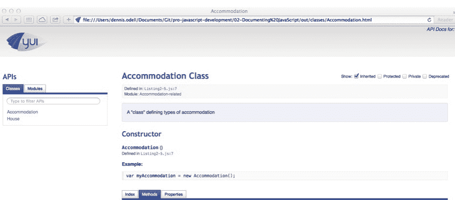

### Accommodation 类

定义在 `Listing-5.js:7`
模块：Accommodation-related

一个定义住宿类型的“类”

### 构造函数

`Accommodation` 0
定义在 `Listing-5.js:7`

示例：

```
var Accommodation = new Accommodation();
```

### 方法

`getLocked()` Boolean
定义在 `Listing-5.js:54`

确定该类当前是否被锁定

返回：

表示锁定状态的值 - 'true' 表示已锁定

示例：

```
var Accommodation = new Accommodation();

myAccommodation.getLocked(); // false

var Accommodation = new Accommodation();

myAccommodation.lock();

myAccommodation.getLocked(); // true
```

**图 2-1.** YUIDoc 根据你文档记录的 JavaScript 代码和模块自动生成一个完整的 HTML 站点

页面左侧的两个标签页允许你在“类”列表和模块列表之间跳转，我们记录了两个“类”和一个模块。点击模块名称可以在中间页面查看该模块的描述，并列出分组在模块中的所有“类”。点击此处或左侧侧边栏中的“类”名称，将会在页面中心区域显示该“类”的完整文档。

“类”文档显示了该类、构造函数以及我们在文档中声明的示例，并带有语法高亮。三个标签页允许你查看所有方法和属性的索引列表，或者查看该“类”方法或属性的详细列表。点击方法或代理名称将带你进入相应的标签页，并将页面滚动到其定义和文档处。我们类的所有文档都在这里，格式易于阅读。

默认情况下，生成的站点仅显示公共属性和方法。要显示或隐藏私有属性和方法，请切换右上角的复选框。在查看 `House` 子类的文档时，你可以使用页面右上角的继承复选框，在显示此“类”可用的所有方法和属性与仅显示在视图本身上定义的属性之间切换。这是一种检查继承“类”特定文档或仅查看该“类”独特的方法和属性的有用方法。

### 进一步使用 YUIDoc

YUIDoc 支持各种自定义，从设置页面左上角的标志到完全预主题以为你的文档提供完全不同的外观。要了解更多关于自定义 YUIDoc 的信息，请通过 http://bit.ly/yui_doc 访问项目文档页面。作为一个良好的替代方案，自定义 YUIDoc，请通过 http://bit.ly/yui_doc 访问项目文档页面。

## 第 3 章 编写高质量的 JAVASCRIPT

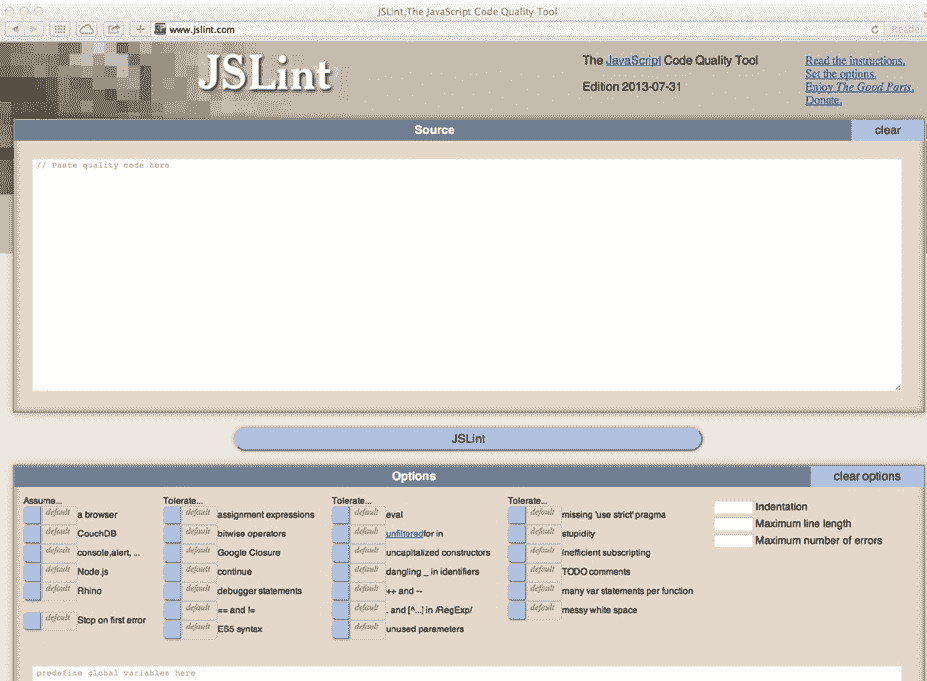

图 3-1. JSLint 首页。将你的 JavaScript 代码粘贴到框中以检查其质量。

很有可能，如果你尝试在 JSLint 中分析你的某些代码，你会发现自己因为编写了质量低劣的代码而受到指责。事实上，使用列表 2-5 中的代码，在检查的 29 行 JavaScript 代码中总共发现了 16 处错误。项目主页显示 JSLint “会伤你的心”，在这一说法开始引起共鸣之前，它并没有对你的代码质量做过过多的尝试。

仔细观察图 3-2 所示的错误列表，可以发现很多事实：`function` 关键字与随后的左括号字符之间没有空格字符。个人而言，我倾向于在使用 `function` 关键字后不留任何空格；但这是该工具创建者 Douglas Crockford 编写代码的方式。因此，该特定规则是默认开启的。我们很快会查看如何更改这些规则以满足这一特定约束。

# 第 3 章 编写高质量的 JAVASCRIPT

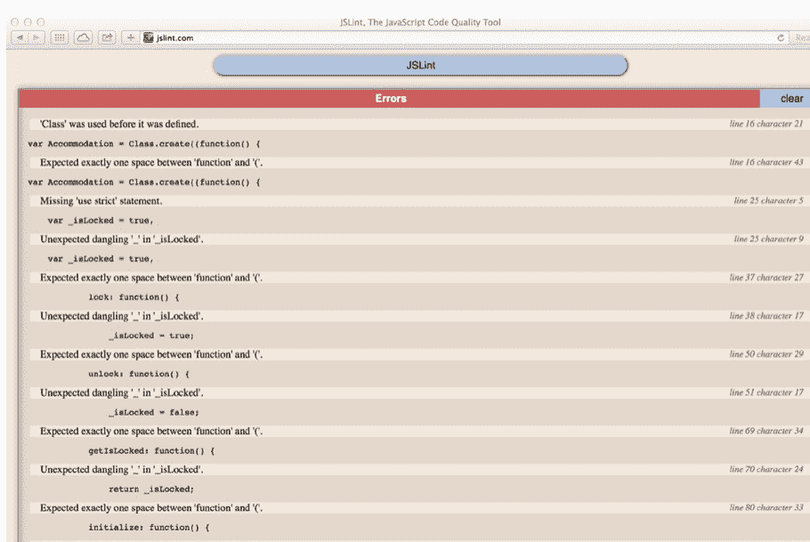

```
'Class' was used before it was defined.

var Accommodation = Class.create(function() {

    Expected exactly one space between 'function' and '''.

var Accommodation = Class.create(function() {

    'use strict' statement.
```


`var _islocked = true;`

`Unexpected default set of 'in _islocked'.`

`var _islocked = true;`

`Expected exactly one space between 'function' and '\''.`

```
lock:function() {

    Unexpected default 'in _islocked'.

    _islocked = true;

    Expected exactly one space between 'function' and '\''.

}
```

```
unlock:function() {

    Unexpected default 'in _islocked'.

    _islocked = false;

    Expected exactly one space between 'function' and '\''.

}
```

```
getislocked:function() {

    return _islocked;

}
```

`Expected exactly one space between 'function' and '\''.`

```
initialize:function() {

    Expected exactly one space between 'function' and '\''.
```

在 JSLint 中运行列表 2-4 的代码的结果并不让人阅读愉快。

其他错误还包括：我们在使用之前未定义 `Class` 对象；缺少 `"use strict"` 语句以强制执行首选的 ECMAScript 模式；我们在变量名开头使用了下划线字符；以及在定义 `alert()` 方法之前就调用了它。后者看起来可能很奇怪，因为在任何浏览器中 `alert` 都是存在的。它被标记出来的事实意味着它不是官方 JavaScript 规范的一部分；JSLint 倾向于你的代码不包含浏览器特定的 JavaScript，以便允许开发者显示弹出消息时，在任何支持该语言的环境中都不会出现任何错误。

除了 JSLint 网站上的错误列表外，还有一个名为“Options（选项）”的部分，它包含一组复选框，允许你的代码覆盖默认规则集。将 `console`、`alert`、`...`、`dangling in identifiers` 和 `messy space` 选项设置为 `white`（白色），然后再次运行 JSLint 工具；你应该发现现在显示的错误列表。滚动到页面最底部，你会发现一个“JSLint Directive（JSLint 指令）”部分，其中包含一段特殊格式的 JavaScript 代码。你可以通过在文件顶部放置这些指令之一，在你的代码中按文件设置不同的规则集。指令以 `/*jslint` 开始，随后是跟在在通过 JSLint 运行时应用到该文件的选项列表，接着是一个 `true` 或 `false` 值，分别表示该选项应被启用还是禁用；多个选项之间用逗号分隔。对于我们选择的选项，我们得到了以下指令：

```
/*jslint define: true, nomen: true, white: true */
```

# 第 3 章 编写高质量的 JAVASCRIPT

我们可以将此指令复制到文件的顶部，无论 ESLint 页面上的其他设置如何，这些将是适用于所加载文件的选项。关于可以应用的完整选项列表及其背后的目的和原理，请通过 http://bit.ly/jslint_opts 浏览在线文档。

有了这些选项，我们仍然需要处理剩下的两种错误类型。第一是缺少 `Class` 对象的定义，在这种情况下，它将存在于单独的文件。我们可以使用特殊格式的注释告诉 ESLint 从其他地方声明的全局变量，我们提供变量名称以及一个 `true` 或 `false` 值，分别表示该变量是赋值给此文件还是仅从此文件读取。对于我们的 `Class` 对象，该指令看起来如下：

```
*Global Class: false *
```

将此现有的指令添加到我们的代码顶部，可以在再次执行 ESLint 时从错误列表中移除该错误。这留下了未强制执行 ECMAScript 5 严格模式的问题。这是我们应该在代码中解决的问题，通过启用严格模式来减少我们的代码运行时发生错误的可能性。生成的 JavaScript 代码使得其使用非常值得，它提高了生成的 JavaScript 代码的质量，让我们对其充满信心。

# 第 3 章 编写高质量的 JAVASCRIPT

为了让 JSHint 知道我们对声明了一个未在同一个文件中使用的变量这一事实表示认可，并且我们在代码中使用了 `alert` 方法，我们可以在文件顶部放置一个特殊格式的注释，类似于 JSLint 的方式，以便在它的分析中设置选项：

```
/*jshint devel:true, unused:false */
```

完整的选项列表（有非常多）可以通过在线文档网站获取：http://bit.ly/jshint-opts。

为了让 JSHint 知道我们有一个在其他地方声明的全局类变量 `Class`，我们可以使用与 JSLint 相同的注释：

```
/*global Class */
```

将如列表 3-1 所示的适当 `"use strict"` 命令与这些位于文件顶部的特殊格式注释相结合，可以让代码通过 JSHint 的静态代码分析。你可以像使用 JSLint 一样在命令行中使用 JSHint，只需确保已安装 Node.js 并在命令提示符中执行以下命令：

```
npm install jshint -g
```

你可以像使用 JSLint 一样从任何文件夹运行 JSHint：

```
jshint *.js
```

除了命令行工具外，JSHint 背后的工具还有许多其他使用方法，包括用于常用文本编辑器和 IDE（如 Sublime Text 和 Visual Studio）的插件，以便在输入代码时提供实时代码检查。完整的插件列表可以通过他们的在线网站获取：http://bit.ly/jshint-install。

## Google 编译器与检查器 (Linter)

Google 在 2009 年底开源了他们自己在内部用于 JavaScript 开发的许多工具，统称为 Closure Tools。这些工具包括一个名为 `Closure Library` 的 JavaScript 库、一个名为 `Closure Templates` 的 JavaScript 模板解决方案，以及一个完整的优化和代码检查工具 `Closure Compiler`。2010 年，他们添加了第四个：`Closure Linter`，它用于根据一组样式规则验证 JavaScript 代码。我们将在后面的章节中介绍前两个。但我们对后两个感兴趣。

`Closure Compiler` 的主要目标是使代码压缩并使其运行得更快。它解析并移除未使用的代码，并重命名变量以减小生成代码的大小。它是优化 JavaScript 文件大小最好的工具之一，这意味着它可以在用户的浏览器中下载并执行。由于它的解析能力，它还可以识别 JavaScript 中的语法错误以及潜在的危险操作，这使其作为一种静态代码分析工具非常有用。

要使用 `Closure Compiler` 优化你的代码，可以通过 http://bit.ly/closure_compile 将代码复制并粘贴到在线表单中并点击 Compile 按钮。优化后的代码将出现在 Page Compiled 标签页的右侧。通过分析发现的任何 JavaScript 语法错误或潜在危害将分别列在 `Errors` 和 `Warnings` 标签中，供你处理。如果你愿意，该工具可以使用 Java 在命令行中运行（安装说明请在线查看），还可以通过基于 REST 的 Web Service API 集成到你自己的系统中（使用说明请在线查看 http://bit.ly/closure_api）。

# 第 3 章 编写高质量的 JAVASCRIPT

`Closure Linter` 的主要目标是分析并对比根据 Google JavaScript 样式指南编写的代码，最新版本可以在 http://bit.ly/google-style 获取。它在报告发现的问题同时，还包含一个在可能的情况下自动修复其发现的问题的工具。它被 Google 内部使用，以确保 Gmail、Drive 以及其他产品的代码符合一组编码规则。

要使用 `Closure Linter` 根据 Google JavaScript 样式指南检查你的代码，你必须首先下载并安装应用框架 Python 到：http://bit.ly/dl_py。Mac 和 Linux 用户可能已经作为操作系统的一部分安装了它。Windows 用户也需要在 http://bit.ly/py_easy 安装 Python 的包管理器 Package。一旦安装完成，执行以下命令将 `Closure Linter` 安装到你的机器上。注意，Mac 和 Linux 用户可能必须在命令前加上 `sudo` 以授予安装管理员权限：

```
easy_install http://closure-linter.googlecode.com/files/closure_linter-latest.tar.gz
```

要在目录中的所有 JavaScript 文件上运行，以报告你对 Google 样式指南的遵循情况，请在命令提示符执行以下操作：

```
gjslint *.js
```

如果你只想检查单个文件，可以将 `*.js` 替换为特定的文件名。该工具会在命令行窗口列出它发现的问题。如果你随后尝试自动修复这些问题，执行以下命令用修复后的覆盖覆盖文件：

```
fixjsstyle *.js
```

通过简单地在文件目录上运行此检查器，你可以以极少的精力更新代码以符合 Google 样式指南。如果你想了解更多关于该工具的信息，请访问在线文档网站 http://bit.ly/linter-howto。

## 选择静态分析工具

我们已经查看了几个常用的 JavaScript 静态分析工具，取决于你具体想要检查的工具。通过选择本章涵盖的工具，你能够确保语法错误和常见的编程错误被捕获，提高你的代码质量。

## JavaScript 中的单元测试

尽管你可以自己编写测试来测试自己的代码，但利用他人在领域的成果并建立一个单元测试框架来测试你的代码会更好。在编写时有几个框架可用，包括 QUnit (http://bit.ly/q_test)、Mocha (http://bit.ly/mocha-test) 和 Jasmine (http://bit.ly/jas_test)。每个工具的工作原理相似，由一个包含框架代码的 JavaScript 库文件组成，该文件设计用于一个 HTML 页面，其中要测试的 JavaScript 代码文件以及针对该代码的单元测试文件。测试在浏览器中打开页面时会自动运行，显示详细结果，包括测试通过和失败。由于框架之间相似，我将带你学习使用 Jasmine 框架为你的代码编写单元测试，这是我的个人选择。

### 使用 Jasmine 进行 JavaScript 单元测试

Jasmine 单元测试框架允许你为单个函数或方法分组一系列单独测试；组与组可以组合在一起，以便对相关的代码进行测试。组被称为 suites（套装），单个测试被称为 specs（规格）。代码库中的每个文件通常应该有一个对应的测试套件文件，并分组在独立的文件夹中，我通常这样做。

> **提示** 尝试将你的测试规格命名为与其关联的代码文件相同，并添加 `-spec`。例如，代码文件 `add.js` 可能有一个对应的测试套件文件 `add-spec.js`。

## 第3章 编写高质量的 JavaScript

#### introduction-1.3.1.js

#### Jasmine

Jasmine 是一个用于 JavaScript 测试的行为驱动开发（BDD）框架。它不依赖于任何其他 JavaScript 框架。它不需要 DOM，并且具有简洁、易懂的语法，让你能够轻松编写测试。
本指南介绍了如何运行 Jasmine 1.3.1 修订版 13546913。

#### Suites（测试套件）：描述你的测试

一个测试套件始于对全局 Jasmine 套件的调用，并带有两个参数：一个字符串和一个函数。字符串是套件的名称或标题：即被测试的内容。函数是实现该套件的代码块。

#### Specs（测试用例）

用例通过调用 Jasmine 函数 `it` 来定义。

期望值（Expectation）是一个可以为真也可以为假的断言。所有期望值都为真的用例是通过的用例。包含一个或多个评估为假的期望值的用例是失败的用例。

#### 它仅仅是函数

由于 `describe` 和 `it` 是块，它们可以包含实现测试所需的任何可执行代码。JavaScript 变量可以在 `describe` 中定义如下所示：

```javascript
describe("A suite", function() {

  it("passes with an expectation", function() {

    expect(true).toBe(true);

  });

});
```

```javascript
describe("A suite is just a function", function() {

  var a;

  it("is so a spec", function() {

    a = true;

  });

});
```

图 3-3。Jasmine 单元测试框架主页包含详尽的文档。

一个简单的测试文件可能如列表 3-3 所示，它对在列表 3-2 中定义的 `add()` 函数执行了两个独立的测试。

列表 3-3. "add function", function()

```javascript
describe("add function", function() {

  it("Adds 1 + 2 + 3 together correctly", function() {

    var output = add(1, 2, 3);

    expect(output).toEqual(6);

  });

});

it("Adds negative numbers together correctly", function() {

  var output = add(-1, -2, -3);

  expect(output).toEqual(-6);

});
```

列表 3-3 中的代码使用 Jasmine 的 `describe()` 函数对 `add()` 函数的单元测试进行分组，用 "Add function" 描述该组中的测试，并将单元测试封装在一个单个匿名函数中。每个单元都使用 Jasmine 的 `it` 方法定义，其描述的字符串在以单词 "it" 开头时读起来非常通顺，其中包含对 `add()` 函数的单次调用，并使用 Jasmine 的 `expect()` 函数检查其返回值。然后通过调用 `toBe()` 函数进行断言，该函数是匹配器（matcher）的一个示例；Jasmine 函数会检测并检查测试的输出是否与预期结果匹配。我们在列表 3-4 中使用的匹配器 `toBe()` 用于检查函数的结果是否与我们为该测试顺序所设定的特定已知值完全匹配。

为了运行测试以测试我们的函数，我们需要在执行测试之前准备一个页面来加载框架、源文件和测试用例。通过 http://bit.ly/js_dl 下载 Jasmine 的最新版本，你可以获得示例本身、一个名为 `SpecRunner.html` 的 HTML 文件和一个测试运行器（spec runner），其中包含了一些示例源文件和测试。通过将示例源文件测试替换为我们自己的，我们可以如列表 3-4 所示更新 HTML 页面以加载我们的文件。假设你已将源文件命名为 `add.js` 并使用 `spec add-spec.js`，这些文件也包含在文件夹中作为测试运行器本身。

列表 3-4. Jasmine 测试运行器 HTML 文件，配置为加载并运行我们的单元测试。

```html
<!DOCTYPE HTML PUBLIC "//W3C//HTML 4.0 Transitional//EN"

"http://www.w3.org/TR/html4/loose.dtd">

<html

<head>

<title>Jasmine Spec Runner</title>

<link rel="shortcut icon" type="image/png" href="lib/jasmine-1.3.1/jasmine_favicon.png">

<link rel="stylesheet" type="text/css" href="lib/jasmine-1.3.1/jasmine.css">

<script type="text/javascript" src="lib/jasmine-1.3.1/jasmine.js"></script>

<script type="text/javascript" src="lib/jasmine-1.3.1/jasmine-html.js"></script>

<script type="text/javascript" src="add-spec.js"></script>

<script type="text/javascript" src="add-spec.js"></script>

<script type="text/javascript">

function() {

  var jasmineEnv = jasmine.getEnv();

  jasmineEnv.updateInterval = 1000;

  var htmlReporter = new jasmine.HtmlReporter();

  jasmineEnv.addReporter(htmlReporter);
```


## 第3章 编写高质量的 JavaScript

#### introduction-1.3.1.js

#### Jasmine

Jasmine 是一个用于 JavaScript 测试的行为驱动开发框架。它不依赖于任何其他 JavaScript 框架。它不需要 DOM，并且具有简洁、易懂的语法，让你能够轻松编写测试。

本指南介绍了如何运行 Jasmine 1.3.1 修订版 13546913。

## 测试套件（Suites）：描述你的测试

一个测试套件始于对全局 Jasmine 套件的调用，并带有两个参数：一个字符串和一个函数。字符串是套件的名称或标题：即被测试的内容。函数是实现该套件的代码块。

### 测试用例（Specs）

用例通过调用 Jasmine 函数 `it` 来定义。

期望值（Expectation）是一个可以为真也可以为假的断言。所有期望值都为真的用例是通过的用例。包含一个或多个评估为假的期望值的用例是失败的用例。

### 它仅仅是函数

由于 `describe` 和 `it` 是块，它们可以包含实现测试所需的任何可执行代码。JavaScript 变量可以在 `describe` 中定义如下所示：

```javascript
describe("A suite", function() {
  it("passes with an expectation", function() {
    expect(true).toBe(true);
  });
});
```

```javascript
describe("A suite is just a function", function() {
  var a;
  it("is so a spec", function() {
    a = true;
  });
});
```

图 3-3。Jasmine 单元测试框架主页包含详尽的文档。

一个简单的测试文件可能如列表 3-3 所示，它对在列表 3-2 中定义的 `add()` 函数执行了两个独立的测试。

列表 3-3. "add function", function()

```javascript
describe("add function", function() {
  it("Adds 1 + 2 + 3 together correctly", function() {
    var output = add(1, 2, 3);
    expect(output).toEqual(6);
  });
});

it("Adds negative numbers together correctly", function() {
  var output = add(-1, -2, -3);
  expect(output).toEqual(-6);
});
```

列表 3-3 中的代码使用 Jasmine 的 `describe()` 函数对 `add()` 函数的单元测试进行分组，用 "Add function" 描述该组中的测试，并将单元测试封装在一个单个匿名函数中。每个单元都使用 Jasmine 的 `it` 方法定义，其描述的字符串在以单词 "it" 开头时读起来非常通顺，其中包含对 `add()` 函数的单次调用，并使用 Jasmine 的 `expect()` 函数检查其返回值。然后通过调用 `toBe()` 函数进行断言，该函数是匹配器（matcher）的一个示例；Jasmine 函数会检测并检查测试的输出是否与预期结果匹配。我们在列表 3-4 中使用的匹配器 `toBe()` 用于检查函数的结果是否与我们为该测试顺序所设定的特定已知值完全匹配。

为了运行测试以测试我们的函数，我们需要在执行测试之前准备一个页面来加载框架、源文件和测试用例。通过 http://bit.ly/js_dl 下载 Jasmine 的最新版本，你可以获得示例本身、一个名为 `SpecRunner.html` 的 HTML 文件和一个测试运行器，其中包含了一些示例源文件和测试。通过将示例源文件测试替换为我们自己的，我们可以如列表 3-4 所示更新 HTML 页面以加载我们的文件。假设你已将源文件命名为 `add.js` 并使用 `spec add-spec.js`，这些文件也包含在文件夹中作为测试运行器本身。

列表 3-4. Jasmine 测试运行器 HTML 文件，配置为加载并运行我们的单元测试。

```html
<!DOCTYPE HTML PUBLIC "//W3C//HTML 4.0 Transitional//EN"
"http://www.w3.org/TR/html4/loose.dtd">
<html>
<head>
<title>Jasmine Spec Runner</title>
<link rel="shortcut icon" type="image/png" href="lib/jasmine-1.3.1/jasmine_favicon.png">
<link rel="stylesheet" type="text/css" href="lib/jasmine-1.3.1/jasmine.css">
<script type="text/javascript" src="lib/jasmine-1.3.1/jasmine.js"></script>
<script type="text/javascript" src="lib/jasmine-1.3.1/jasmine-html.js"></script>

<script type="text/javascript" src="add-spec.js"></script>
<script type="text/javascript" src="add-spec.js"></script>

<script type="text/javascript">
function() {
  var jasmineEnv = jasmine.getEnv();
  jasmineEnv.updateInterval = 1000;

  var htmlReporter = new jasmine.HtmlReporter();

  jasmineEnv.addReporter(htmlReporter);

  jasmineEnv.specFilter = function(spec) {
    return htmlReporter.specFilter(spec);
  };

  var currentWindowOnLoad = window.onload;

  window.onload = function() {
    if (currentWindowOnLoad) {
      currentWindowOnLoad();
    }
  }
</script>

<script type="text/javascript">
  execJasmine();

  function execJasmine() {
    jasmineEnv.execute();
  }
})();
</script>
</head>
<body>
</html>
```

在浏览器中加载此 HTML 页面将自动执行单元测试，并在屏幕上显示结果，指示通过或失败。运行列表 3-4 中测试运行器的输出将在屏幕上显示，指示通过或失败。


```javascript
if (currentWindowOnLoad) {
  currentWindowOnLoad();
}
}
</script>
```

```javascript
execJasmine();

function execJasmine() {
  jasmineEnv.execute();
}
})();
</script>
</head>
<body>
</html>
```

在浏览器中加载此 HTML 页面将自动执行单元测试，并在屏幕上显示结果，指示通过或失败。运行列表 3-4 中测试运行器的输出将在屏幕上显示，指示通过或失败。

### 其他匹配器（Matchers）

我们目前为止编写的单元测试是基于一组给定的输入产生精确的数值输出。对于这些测试，我们使用了 Jasmine 匹配器 `toBe()`。它非常像一个函数，你在测试时可能需要执行其他、更特定类型的比较。在这种情况下，Jasmine 为你提供了许多其他匹配器。

要确定函数的返回值是否与特定用例相反，你可以将 `not` 属性与另一个匹配器结合，如下所示：

```javascript
expect(output).not.toEqual(6);
```

要将函数的结果与正则表达式进行比较，使用 `toMatch()` 匹配器。如果输出在运行时可能不一致，这非常有用：

```javascript
expect(output).toMatch(/[a-s]+/);
expect(output).not.toMatch(/[t-z]+/);
```

如果你想比较真值（truthy）、假值（falsy）或 `null` 值，可以使用 `toBe()`、`toBeTruthy()` 或 `toBeFalsy()` 匹配器：

```javascript
expect(output).toBe(true);
expect(output).not.toBe(null);
expect(output).toBeTruthy();
expect(output).not.toBeNull();
expect(output).toBeFalsy();
```

如果你需要确定单元测试值是否具有 `undefined` 值，使用 `toBeDefined()` 匹配器：

```javascript
expect(output).toBeDefined();
expect(output).not.toBeDefined();
```

如果你需要确定函数的数组包含或不包含特定值，使用 `toContain()` 匹配器：

```javascript
expect(output).toContain("Monday");
expect(output).not.toContain("Sunday");
```

当测试包含相同输入并不总是产生相同输出的数学运算时，可以使用 `toBeGreaterThan()` 或 `toBeLessThan()` 匹配器：

```javascript
expect(output).toBeGreaterThan(2);
expect(output).not.toBeLessThan(3);
```

数学匹配器 `toBeCloseTo()` 允许你确定函数的浮点输出（带有小数位数）是否接近某个数字，将其作为第二个参数传递给匹配器：

```javascript
expect(3.1415).toBeCloseTo(3.14, 2); // true
expect(3.1415).toBeCloseTo(3, 0); // true
```

如果你的函数在输入参数无效时抛出错误，你可以使用 `toThrow()` 匹配器在单元测试中检查：

```javascript
expect(output).toThrow();
expect(output).not.toThrow();
```

最后，如果 Jasmine 的核心匹配器无法满足你的需求，你可以编写自定义匹配器函数。关于这些匹配器的文档可以通过 http://bit.ly/new_matchers 获取。从这些示例中你应该注意到，Jasmine 的核心匹配器的命名方式使得语句像英语一样易读。这意味着通过少量的练习，为你的代码编写单元测试变得简单，并且你会发现你的代码编写到了最高质量，在运行时不太会导致错误。

### Jasmine 的其他功能

在本章中，我们查看了使用 Jasmine 的基础知识、单元测试以及在函数上运行并检查它们的输出与给定的输入是否匹配。Jasmine 能够的内容比我们涵盖的多得多，包括在每个测试后运行设置（setup）和清理（tear-down）代码的能力、使用 JavaScript 定时对异步操作的支持、从其他位置 mock 对象的能力等等。鼓励你自己进行实验和研究，可以使用此优秀单元测试框架的完整文档：http://bit.ly/jas_test。

### 处理运行时错误

到目前为止，我们已经看到了如何使用静态分析和单元测试来提高代码质量，以及对代码在运行时不会产生错误的信心。有时，当代码在运行时会出现单元测试未预料到的错误。以前，如果发生这种情况，你需要添加一个新的单元测试来覆盖该情况，但对于尝试使用你页面的用户来说这并没有帮助。JavaScript 允许我们在错误发生在运行时捕获它们，允许我们以这种方式处理它们，确保你的代码不会因此崩溃。你可以捕获并绕过潜在错误，确保对代码有更大的信心，在运行时不会产生意外错误，避免挫败，并意味着你的代码质量可以达到非常高的水平。

### JavaScript 原生错误类型

JavaScript 代码中可能发生六种类型的错误：语法错误、类型错误、范围错误、`eval` 错误、引用错误（reference errors）和 URI 错误。

当 JavaScript 代码无法正确解析时，会发生语法错误，可能是由于对语言规则的误用或代码错误部分发现了杂散字符，这意味着对浏览器来说不再具有意义：

```javascript
var PI; // 抛出语法错误，因为 JavaScript 期望在 = 和 ; 之间有一个值
```

当操作中使用的值不是该操作预期的类型（例如 `String`、`Number`、`Boolean`）时，或者对错误类型的值使用方法时，会发生类型错误。在许多情况下，这是因为使用的值意外为 `null` 或具有 `undefined` 值：

```javascript
var PI = 3.1415;
PI.concat(9); // 抛出 JavaScript 类型错误 – concat 方法仅适用于字符串
```

# 第三章 编写高质量的 JavaScript

范围错误（range error）发生于 JavaScript 的核心函数之一期望提供某个范围内的数字，而你提供了一个超出该范围的数字时。例如，当在数字上使用 `toFixed()` 方法时，如果作为函数参数提供的位数在 0 到 20（包含边界）范围之外，则会抛出范围错误：

```javascript
var PI = 3.14159;
PI.toFixed(21); // 抛出范围错误
```

当你以不当方式调用 `eval` 方法，通过 `new` 关键字实例化或将其赋值为变量时，会发生错误。大多数浏览器会对前者抛出类型错误，而后者将其作为变量。你应该在所有情况下避免使用 `eval()`，因为它对你的代码存在安全风险：

```javascript
new eval(); // 应该抛出 JavaScript 类型错误
eval = "3.1415"; // 应该抛出错误，但允许运行
```

引用错误（reference error）发生在你尝试访问未声明变量的数据时。确保你要在作用域内使用的变量在顶部声明：

```javascript
alert(PI); // 因为 PI 未定义而抛出错误
```

URI 错误发生在向 JavaScript 函数提供畸形的 URI 时：`decodeURI()`、`encodeURI()`、`decodeURIComponent()`、`encodeURIComponent()`、`escape()` 和 `unescape()`：

```javascript
decodeURIComponent("%%"); // 抛出 JavaScript 错误 - 参数无效
```

### 使用 try-catch 语句封装可能出错的代码

如果你怀疑某行 JavaScript 代码在执行时可能会抛出原生错误类型，你应该将其封装在 `try` 块中，这将捕获错误，防止其阻止其余代码的运行。如果你在 `try` 块中有多个语句且其中某一个发生了错误，抛出错误的后续语句将不会执行。控制权将传递到关联的 `catch` 块，该块必须立即处理，从那里你可以选择如何优雅地处理错误。`catch` 块接收一个包含发生错误详细信息的参数，包括其类型；这允许你在该块中处理不同类型的错误。

一旦 `catch` 块执行完毕，控制流将进入 `try-catch` 语句之外的代码。

#### 列表 3-7 一个 try-catch 块

```javascript
var PI = 3.1415926535897323846264383279502884197,
  decimalPlaces = Math.floor(Math.random() * 40), // 1 到 40 之间的随机数
  shortPI;
```

```javascript
// 将你认为可能错误的代码封装在 try-catch 语句中
try {
  shortPI = PI.toFixed(decimalPlaces); // 如果 decimalPlaces > 20 则抛出范围错误
} catch (error) {
  // 当 try 块发生错误时才会执行此块，如上方
  alert("发生了错误！");
}
```

虽然 `catch` 块只有在 `try` 块中发生错误时才会执行，但你可以在语句中添加一个可选的 `finally` 块，以便在无论是否发生错误时执行代码。这种情况很少使用，因为 `try-catch` 语句紧后的代码无论是否发生错误都会执行，但你可能会发现使用 `finally` 在整个 `try-catch-finally` 语句中对相关代码是有用的。

#### 列表 3-8. try-catch-finally 块

```javascript
var PI = 3.1415926535897932384626433832790288491,
  decimalPlaces = Math.floor(Math.random() * 40) + 1;

try {
  shortPI = PI.toFixed(decimalPlaces);
} catch (error) {
  decimalPlaces = 20;
  shortPI = PI.toFixed(decimalPlaces);
} finally {
  alert("The value of PI is " + decimalPlaces + " decimal places is " + newPI);
}
```

> 注意：`try` 块可以在不包含 `catch` 块的情况下使用，但前提是包含 `finally` 块。在这种情况下，错误会在浏览器抛出异常之前执行 `finally` 块，允许你在错误抛出之前处理代码中的任何收尾工作。

#### 检测抛出的错误类型

传递给 `catch` 块的参数是一个“类”或类型的对象实例，与 JavaScript 语言的六种原生错误类型相关；这些之前描述的六种错误类型分别名为 `SyntaxError`、`TypeError`、`RangeError`、`EvalError`、`ReferenceError` 和 `URIError`。这些错误都继承自 JavaScript 的基础错误类型。在 `catch` 块中，你可以使用我们在第 1 章介绍过的 `instanceof` 关键字来判断发生的错误类型。

#### 列表 3-9. 在 catch 块中检测捕获的错误类型

```javascript
try {
  // 可能会可能抛出错误的代码
} catch (error) {
  if (error instanceof SyntaxError) {
    // 抛出了语法错误
  } else if (error instanceof TypeError) {
    // 抛出了类型错误
  } else if (error instanceof RangeError) {
    // 抛出了范围错误
  } else if (error instanceof EvalError) {
    // 抛出了 eval 错误
  } else if (error instanceof ReferenceError) {
    // 抛出了引用错误
  } else if (error instanceof URIError) {
    // 抛出了 URI 错误
  }
}
```

该对象包含一个名为 `message` 的属性，其中包含了对发生错误的文本描述。根据你所使用的浏览器，该对象还可能包含错误发生行号等信息，尽管这是对语言的非标准扩展。明智的做法是避免读取特定浏览器的属性，而是依靠该对象来决定在 `catch` 块中采取何种操作。

#### 创建自定义错误类型

如果你的项目中发生了特定类型的错误，你可能希望用你自己的自定义代码来处理它，而不是重复基于六种原生错误类型的代码。通常，创建一个自定义错误类型仅像在 JavaScript 中创建一个新的“类”一样简单。

- **列表 3-10.** 使用列表 3-19 中的 `Class.create()` 创建自定义错误

```javascript
var ElementNotFoundError = Class.create({
  id: "",
  message: "The element could not be found by the given ID",
  initialize: function(id) {
    this.id = id;
  }
});
```

如果你想执行此操作以便浏览器将其识别为错误，请使用 `throw` 关键字配合你自定义错误类型“类”的实例：

```javascript
throw new ElementNotFoundError("header");
```

你可以在 `catch` 块中抛出任何值，从简单的字符串到对象字面量，再到完整的对象实例；你将能够访问被抛出的数据，这取决于你的项目在错误发生时需要多少数据。我个人更倾向于创建一个自定义的错误“类”，因为我可以检测它的类型并存储可能需要的任何属性，以便在错误发生时帮助我调试。

让我们来看一个自定义错误处理的真实示例，如列表 3-11 所示。

- **列表 3-11.** 定义和抛出自定义 JavaScript 错误

```javascript
var ElementNotFoundError = Class.create({
  id: "",
  message: "The element could not be found by the given ID",
  initialize: function(id) {
    this.id = id;
  }
});

function findElement(id) {
  var elem = document.getElementById(id);

  if (!elem) {
    throw new ElementNotFoundError(id);
  }

  return elem;
}

try {
  findElement("header");
} catch (error) {
  if (error instanceof ElementNotFoundError) {
    alert("Sorry, the 'header' element was not found");
  }
}
```

**提示** 创建你自己的、所有自定义错误类型都继承自的基础错误“类”。你可以使用该基础“类”通过 Ajax 将系统中发生的错误详情发送到服务器的日志中，从而让你能够主动跟踪并修复代码中的 Bug，提高其代码质量。

通过使用静态分析和单元测试，你可以限制代码在嵌入网页时可能发生的运行时错误数量。

## 列表 3-13. 用于 Istanbul 调整 Jasmine 单元测试的 Gruntfile.js

```javascript
module.exports = function(grunt) {
  grunt.initConfig({
    jasmine: {
      src: ["src/*.js"],
      options: {
        specs: ["spec*.js"],
        template: require("grunt-template-jasmine-istanbul"),
        templateOptions: {
          coverage: "reports/coverage.json",
          report: [
            {
              type: "lcov",
              options: {
                dir: "reports"
              }
            },
            {
              type: "text-summary"
            }
          ]
        }
      }
    }
  });

  grunt.loadNpmTasks("grunt-contrib-jasmine");
  grunt.loadNpmTasks("grunt-template-jasmine-istanbul");
  grunt.registerTask("default", ["jasmine-coverage"]);
};
```


最后一步是在命令行中运行 `Grunt`，这将触发 `Gruntfile.js` 中列出的任务执行，将待测试的原始函数封装在 `Istanbul` 的插桩代码中，并通过通过 `PhantomJS`（一种基于 `WebKit` 的无界面且可通过 `JavaScript API Node` 访问的无头浏览器）在命令行中运行 `Jasmine` 单元测试。通过 `http://phantomjs.org` 了解更多关于 `PhantomJS` 的信息。

```
grunt default
```

运行后，你应该会注意到生成了一个新的 `reports` 文件夹，其中包含 `HTML` 文件和其他文件。在浏览器中打开此 `HTML` 文件将显示代码覆盖率结果（如图 3-6 所示），以 `LCOV` 格式显示运行单元测试。页面顶部显示的结果表明运行单元测试期间，你的原始函数中有多少行被执行。点击文件名将显示你的原始代码列表，突出显示在运行所有单元测试时哪些行被执行了，哪些没有。

## 第 3 章 编写高质量的 JAVASCRIPT

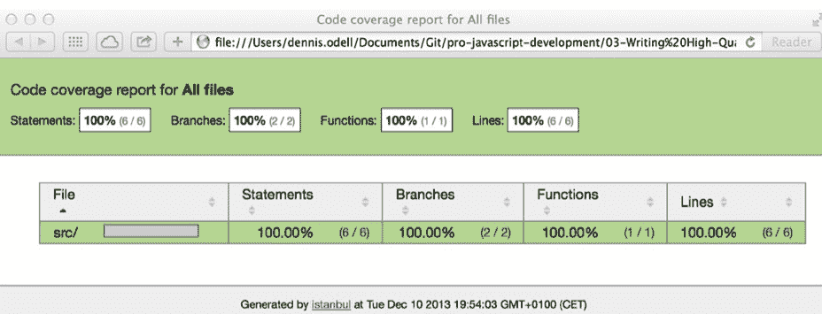

| 文件 | 语句 | 分支 | 函数 | 行数 |
| --- | --- | --- | --- | --- |
| `src/` | 100.00% (6 / 6) | 100.00% (2 / 2) | 100.00% (1 / 1) | 100.00% (6 / 6) |

**图 3-6.** 运行 `Istanbul` 代码覆盖率结果，采用 `LCOV` 格式

这为你提供了代码的质量评分以及你对代码的信心。如果你的单元测试覆盖了每一行代码，那么你可以更确定你的代码在应用程序中运行时符合预期；如果测试覆盖的行数较少，则不然。然后你可以利用 `Istanbul` 报告中的信息来改进和增加单元测试，以便在再次运行 `Istanbul` 时获得更高的覆盖率分。

### 衡量代码复杂度

任何经验丰富的专业 `JavaScript` 开发者都会告诉你，代码越复杂，确保其质量就越困难。复杂的代码更难编写单元测试，更难维护，并且在出现问题时更难调试。你可以通过降低复杂性来提高 `JavaScript` 代码的质量。使用设计模式，将代码从几行拆分为更小的块。较小的函数更易测试、更容易重用，并且由于它们被赋予了名称，使得你的代码更易于阅读，从而易于维护。你还应该尝试通过查看代码中的分支（如 `if/else` 和 `switch` 语句）来降低复杂度，如果这些分支可以通过将代码简化为函数来减少，等等。

`Jarred Overton` 的 `Plato` 工具 (`http://bit.ly/plato_tool`) 可以运行你的 `JavaScript` 代码并生成报告，突出显示代码中被认为复杂的函数，这些代码将更易测试和维护，增加你对它们的信心。然后你可以改进这些函数，使其在应用程序中执行得更好，从而提高应用程序代码的质量。生成的报告非常有创意，我发现它们有助于激励代码质量改进的过程。

## 第 3 章 编写高质量的 JAVASCRIPT

该工具对你的整个代码文件生成报告，还对其中包含的单个函数生成报告。这是一种静态代码分析，代码本身不运行，只是被观察。报告包含若干项指标：

- 代码行：函数中的行数越多，表示复杂度越高；
- 可维护性评分（满分 100 分）：指示你的代码估计可维护性如何——数字越高，`Plato` 认为你的代码越好。通过 `http://bit.ly/maintain_score` 了解更多关于此可维护性评分的信息；
- 估计错误数量：基于 `Maurice Halstead` 在 1977 年引入的指标，当时软件开发可以确立为一门经验科学。这并不是通过运行代码得出的实际计数值，而是基于代码复杂性的估计。通过 `http://bit.ly/halstead_complex` 了解更多关于如何计算此值；
- 难度：基于 `Halstead` 写的公式，衡量代码编写和理解的困难程度。分数越低，被认为编写和理解的难度越小；
- 圈复杂度：衡量被测量函数内部代码分支、循环和对其他函数调用次数的指标，分数越低表示复杂度越高；
- 发现的 `JSHint` 静态代码分析错误数量；以及
- 每项指标的历史结果，显示随时间变化的质量。

要安装该工具，你需要 `Node.js` 及其工具。参见本章之前的安装说明。`Mac` 和 `Linux` 用户可能需要在命令前加上 `sudo`：

```
npm install -g plato
```

运行该工具时，导航到你想运行的代码文件夹并执行：

```
plato -d src
```

你会发现一个生成的 `HTML` 文件，它是自动创建的。图 3-7 显示了该报告的顶部，指示了你的代码进度。

## 第 3 章 编写高质量的 JAVASCRIPT

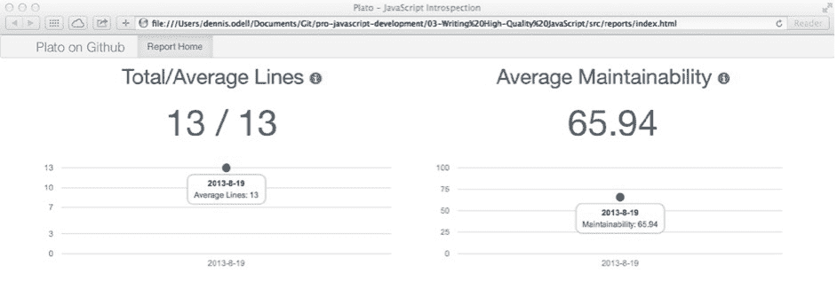

#### 总计/平均可维护性

13 / 13 65.94


#### 可维护性

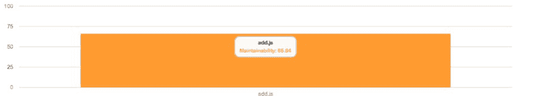

#### 代码行


**图 3-7.** 由 `Plato` 生成的 `JavaScript` 复杂度报告

## 第 3 章 编写高质量的 JAVASCRIPT


#### `Plato` 上的 `Github`

#### 报告主页

#### 难度

#### 估计错误

15.00

0.06

#### 函数权重

#### 按复杂度

#### 按 `SLOC`

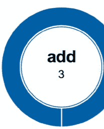

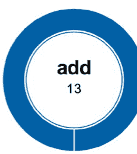

```javascript
var add = function() {
  var total = 0;
  var index = 0;
  var length = arguments.length;

  for (index = 0; index < length; index++) {
    if (typeof arguments[index] == "number") {
      total = total + arguments[index];
    }
  }

  return total;
};
```

**图 3-8.** 针对单个文件的 `JavaScript` 复杂度报告

`Plato` 是一个衡量 `JavaScript` 代码质量的优秀工具，我建议你在自己的项目中深入研究。

总结

本章的目的是帮助你编写高质量的 `JavaScript` 代码，并向你展示如何对页面中执行的代码充满信心。我们查看了静态代码分析工具、单元测试、运行时错误捕获和处理，以及如何衡量代码质量，旨在减少错误并提升应用程序终端用户的体验。

在下一章节章中，我们将探讨如何通过编码技巧、技术、最佳实践以及现代 `API` 的使用来提高 `JavaScript` 应用程序的性能。

# 第 4 章

## 提升 JavaScript 性能

在本章中，我们将介绍通过编码技巧、技术、最佳实践和现代 `API` 来提高 `JavaScript` 应用程序的性能。我对性能的观点是全局的，这意味着我会考虑整个应用程序的生命周期。这意味着，我不再仅仅关注执行的代码行数，而是意识到通过更快、更高效的 `JavaScript` 文件加载，以及更高效的调用、选择器，甚至是 `CSS` 和 `HTML` 优化，可以提升程序的感知性能。在本章中，我们将专门关注如何对 `JavaScript` 代码和文件进行处理，以提高网站和应用程序的性能。如果你想了解更多关于提高页面渲染性能的知识，可以查看 `Addy Osmani` 关于该主题的优秀案例研究《60 帧内消失》（`Gone In 60 Frames Per Second`），地址为：`http://bit.ly/gone_60`。

### 改进加载时间

在开始任何改进应用程序性能的 `JavaScript` 代码之前，我们需要查看浏览器首次接触你的 `JavaScript` 代码的情况，即通过 `HTML` `<script>` 标签的引用进行加载。在此阶段所做的任何更改将确保你的代码快速高效地加载，这意味着你的代码更早地准备好执行，并提高应用程序的感知响应能力。

### HTML 标签顺序至关重要

当浏览器遇到 `<script>` 标签时，大多数情况下它会停止渲染页面，直到成功读取并解析该脚本的内容，这是以防该脚本中包含 `document.write()` 方法调用，这可能会导致此时页面的渲染发生变化。出于这个原因，请将 `HTML` 中尽可能所有的 `<script>` 标签都放在 `</body>` 标签之前。这将确保整个页面在你的脚本加载和解析之前完成渲染，从而提高页面的感知性能。

## 对你的 JavaScript 文件进行 GZip 编码传输

一个简单的服务器设置就可以确保你的 `JavaScript` 代码文件以及 `HTML`、`CSS` 和任何其他文本文件都能以最高效的方式发送到浏览器。这是通过在发送之前对数据进行压缩（或“压缩”），并在到达浏览器时进行解压缩（或“解压缩”），从而减少跨网络传输的数据量，使数据更快到达你的浏览器。这种设置被称为 `gzip` 编码，几乎可以在任何 `Web` 服务器上启用，只要你对服务器设置有控制权：

- 对于托管在 `Apache Web` 服务器上的网站，请安装并配置 `mod_deflate` 模块（`http://httpd.apache.org/docs/2.2/mod_deflate.html`）以启用 `gzip` 压缩。
- 对于托管在 `Microsoft IIS 7` 上的站点，使用 `IIS` 管理程序并选择“功能”（`Features`）视图。打开“压缩”选项并勾选启用静态和动态内容类型的 `gzip` 压缩。静态内容是指每次都产生输出的内容（例如 `CSS` 或扁的 `HTML` 文件），而动态内容使用服务器端代码产生不同的输出。
- 对于托管在 `Node.js` 上并使用 `Express` 框架（`http://expressjs.com`）的站点，只需在应用程序代码中尽早使用 `Express` 对象的 `compress()` 方法即可。所有的响应都将进行 `gzip` 编码。

`gzip` 编码过程是随每次请求实时进行的，这会消耗服务器额外的资源和 `CPU` 时间。如果你担心这一点，可以提前压缩你的 `JavaScript` 和其他文本文件。只需确保在提供这些压缩文件时带有额外的 `HTTP` 标头 `Content-Encoding: gzip`，你就可以在不增加服务器负担的情况下获得性能提升。

### 压缩化、混淆与编译

`JavaScript` 文件越小，它通过网络下载的速度就越快，浏览器读取和解析的速度也越快。我们需要尽一切努力确保代码尽可能小，我们通过三个过程实现这一目标：压缩化（`Minification`）、混淆（`Obfuscation`）和编译（`Compilation`）。

压缩化是从你的 `JavaScript` 中删除所有空白字符和换行符，以确保文件大小尽可能小，同时仍然包含开发者编写的完全相同的代码语句。因为 `JavaScript` 的执行基于基本的关键字和语句，而不是字符包含的空白，因此我们可以安全地删除它们以减小文件大小。

混淆是一种高级的代码优化形式，它查看变量和函数名，并确定哪些是全局可用的，哪些是限制特定范围的。任何全局和函数名保持不变，但限制范围的名称会被重命名为更短的形式，显著减少它们在代码文件中占的空间。通过确保在正确的位置以正确的方式替换名称，代码将继续像混淆之前一样运行。代码中的全局变量和函数越少（这是一种良好的做法，因为减少了你的代码与其他代码之间干扰的概率），混淆后的代码就可以越小。

编译是一个更高级的过程，它研究你的整个代码，并尝试减少和合并具有相同行为的代码语句。虽然执行这种特定类型优化的工具较少，但与压缩化和混淆相结合时，它是产生最小文件大小最有效的方法。

让我们以列表 4-1 中的函数为例，分别尝试使用压缩化、混淆和编译来缩小其大小。该代码列表权重为 205 字节，我们需要知道这个数值以便发现我们生成的文件缩小了多少。

#### 列表 4-1. 需要压缩化、混淆和编译的函数

```javascript
var add = function() {
  var total = 0,
  index = 0,
  length = arguments.length;

  for (; index < length; index++) {
    total = total + arguments[index];
  }

  return total;
};
```

# 第 4 章 | 提升 JavaScript 性能

从 `http://nodejs.org` 在你的计算机上安装 `Node.js` 后，在命令行中执行以下命令来安装 `JSMin`，以便在计算机上的任何文件夹中使用它。`Mac` 和 `Linux` 用户可能需要在命令前加上 `sudo` 以获得足够的权限执行命令：

```
npm install -g jsmin
```

压缩文件非常简单，只需通过命令行工具的 `-o` 选项指定输出文件名，后跟要压缩的行即可，如下所示：

```
jsmin -o Listing 4-1.min js Listing 4-1.js
```

通过 `JSMin` 运行列表 4-1 中的代码，将生成列表 4-2 所示的代码，其大小为 136 字节，文件大小缩小了 33.6%。

**列表 4-2.** 使用 `JSMin` 压缩后的列表 4-1 代码

```javascript
var add=function(){var total=0,index=0,length=arguments.length;for(index<length;index++)
{total+=arguments[index]};

return total};
```

## 使用 UglifyJS 进行代码混淆

几年后出现的比 `JSMin` 更高级的工具是 `UglifyJS`，其主位于 `http://bit.ly/uglifyjs`，可以在图 4-2 中看到。它可以作为独立工具下载，目前是第二个版本，它可以压缩并混淆你的 `JavaScript` 代码以减小文件大小。它可以直接从项目主页运行，也可以通过 `Node.js` 使用命令行工具运行。安装 `Uglify js` 后，在命令行中执行以下操作以安装 `UglifyJS`，以便在计算机上的任何文件夹中使用。`Mac` 和 `Linux` 用户应该知道像常对全局应用于系统的操作那样，在这些命令前加上 `sudo`：

```
npm install uglify-js -g
```

#### UglifyJS JavaScript 压缩

### UglifyJS JavaScript 压缩版本 2.3.6

使用下面的表单或 `HTTP API` 来压缩 `JavaScript` 代码。

脚本 `URL`: [+] 

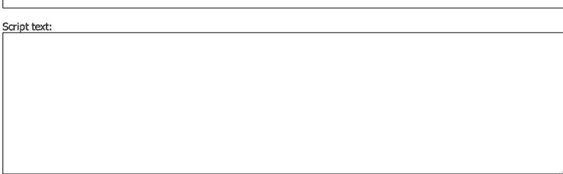

你也可以将文件拖到文本区域中以添加它们。或者，在此处选择一个或多个文件来添加它们。如果顺序很重要，请逐个添加文件。未选择文件

- - 允许非 `ASCII` 输出
- 显示下载为

**图 4-2.** 代码可以直接从 `UglifyJS` 主页进行混淆

通过 `UglifyJS` 运行列表 4-1 中的代码，将产生下文列表 4-3 所示的代码，其大小为 88 字节，减少了 57%。

**列表 4-3.** 使用 `UglifyJS` 混淆后的列表 4-1 代码

```javascript
var add=function()({var r=0,n=arguments.length;a>n;n++)r+=arguments[n]

return r
```


## 使用 Google Closure Compiler 进行代码编译

我们在第 3 章中查看了 Google 的 Closure Compiler，将其作为检查代码错误的工具，但它的主要目的是压缩、混淆并将你的代码编译成比原始小得多的文件。在我看来，这是目前适用于 JavaScript 最有效的压缩工具。

要使用 Closure Compiler 优化你的代码，可以将你的代码复制并粘贴到 `http://bit.ly/closure_compile` 的在线表单中（如图 4-3 所示），并点击 `Compile` 按钮。优化后的代码将出现在页面右侧的 `Compiled Code` 标签页中。框上方会有一个链接，允许你直接将编译后的代码下载为文件。如果你喜欢独立运行编译器而不是通过浏览器，可以使用 Node.js 的包在命令行上运行该工具。

## Closure Compiler

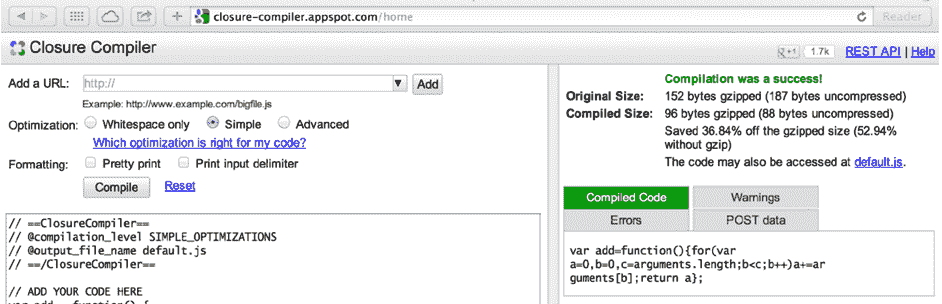

**图 4-3.** JavaScript 代码可以通过 Google Closure Compiler 在线服务进行编译

通过 Google Closure Compiler 运行列表 4-1 中的代码将产生列表 4-4 所示的代码，其大小为 89 字节，减少了 57%，结果比通过 JSMin 压缩实现的任何结果都更好，并且与通过 UglifyJS 混淆获得的结果几乎相同。

**列表 4-4.** 使用 Google Closure Compiler 编译后的列表 4-1 `var add=function(){for(var a=0,b=0,c=arguments.length;b<c;b++)a=arguments[b];return a};`

对于较大的代码块，这种方法可以产生甚至优于 UglifyJS 的改进。这是因为合并和混淆工具（Google Closure Compiler）实际上在运行和研究代码，不断寻找保持完全相同的最佳最终代码。这与压缩和混淆不同，后者使用静态分析，即不运行代码，仅进行观察。在大多数情况下，Google Closure Compiler 产生最好的结果和最小的输出文件大小，我建议在你的应用程序中使用它来显著减小 JavaScript 字体的大小，使其加载更快，并为终端用户带来更好的体验。

## 避免全局变量以获得更好的压缩

为了获得更好的压缩——避免全局变量（此处省略重复内容以符合翻译逻辑）。一种避免创建全局变量的良好技术是将你的代码或代码部分封装在匿名自执行函数中，这将创建一个新的作用域，而实际上需要全局的变量可以显式地列在函数外部

```javascript
// 定义一个全局变量
var myGlobalVariable;

// 创建一个自执行的匿名（未命名）函数来包裹你的代码
function() {
  // 你原本是全局的代码在这里位于新的作用域内
  var myVariable = "Local";

  // 将全局变量赋值为字符串
  myGlobalVariable = "Global"

// 括号对立即执行该函数
});
```

## 按需懒加载 JavaScript 文件

当正常加载 JavaScript 文件时（通过在 HTML 文件中使用文件引用），浏览器会阻塞页面其余部分的下载和解析，直到脚本下载并执行完毕。这并不是理想的，特别是当有大量代码需要下载时。有一种方法可以使用 JavaScript 本身来克服这种性能瓶颈，但你必须谨慎。

```javascript
if (scriptTag.readyState === 4) {
  onLoad();
}

document.body.appendChild(scriptTag);
```

列举 4-6 中的 `Load` 方法可以在代码的任何地方使用，如下所示：

```javascript
// 加载 my-script.js，完成后输出 "script loaded and available"
loadScript("my-script.js", function() {
  alert("script loaded and available!");
});

// 加载 my-script.js，它是它是自包含的，一旦加载，不需要额外代码即可执行
// 因此，不传递第二个参数
loadScript("my-script.js");
```

我们将在第 6 章中进一步探讨这一主题，届时我将介绍 `Require` 库，该库允许对 JavaScript 文件进行懒加载，并使用标准化的格式简单地管理代码依赖。

## 优化文档操作

大多数网站和应用程序性能缓慢的根本原因是通过 JavaScript 低效地访问 HTML 页面元素。由于任何浏览器中的 JavaScript 引擎都与其渲染引擎相互独立，通过 JavaScript 获取页面元素的引用涉及到从一个引擎到另一个引擎的跳转，而浏览器在两者之间充当中间介。为了提高性能，我们需要减少这种跳转发生的次数。在本节中，我概述了一些技术，以帮助避免 JavaScript 不必要的访问 HTML 页面元素。

## 减少对页面元素的访问

减少对页面元素的访问相当简单，因为你在 JavaScript 中拥有了页面元素的引用，只需将该引用存储在变量中并在整个代码中使用该变量，而不是返回页面再次相同的引用，如列举 4-7 所示。

**列举 4-7.** 在变量中存储 DOM 元素引用供以后访问

```javascript
var header = document.getElementById("header");
nav = document.getElementById("nav");
header.className += " " + nav.className;
```

如果你需要访问位于同一个父元素内的多个页面元素，只需获取父元素的引用，并使用 JavaScript 在该引用中定位子元素，这样通过一次访问父元素的单一请求，所有子元素都会从页面跨越，如列举 4-8 所示。避免仅获取整个页引用并将其视为整个页面 DOM 树的内存占用的诱惑；JavaScript 定位树深处你想要访问的元素时花费的额外时间实际上会对你的应用程序产生负面性能影响。

**列举 4-8.** 通过对单个元素的 id("wrapper") 引用访问子 DOM 元素

```javascript
var wrapper = document.getElementById("wrapper");
header = wrapper.getElementsByTagName("header")[0];
nav = wrapper.getElementsByTagName("nav")[0];
header.className += " " + nav.className;
```

如果你需要动态创建并向页面添加 DOM 元素，请在将新元素添加到页面之前应用所有属性并设置所有必要的属性，如列举 4-9 所示。这样一来，浏览器就不需要一直访问活跃的 HTML 页面来做出更改。

**列举 4-9.** 在添加到活动页面之前对新元素进行 DOM 更改

```javascript
var list = document.createElement("ul");
listitem = document.createElement("li");

// 先在 JavaScript 中执行可能的 DOM 操作
listitem.innerHTML = "I am a list item";
list.appendChild(listitem);

// 最后，在显示前不再需要修改它时，将元素添加到页面
document.body.appendChild(list);
```

## 尽可能使用现有元素

动态创建 DOM 元素是网站和应用程序中非常常见的需求，但每次当你使用标准的 `document.createElement()` 方法创建元素并以类似于另一个现有元素的方式配置它时，你都要付出性能代价。为了提高性能，请复制现有元素而不是从头创建新元素。如果你正在复制具有相似属性的多个元素，请创建一个实例，并使用 DOM 的 `cloneNode()` 方法来复制元素及其属性。

**列举 4-10.** 复制现有元素以提高性能

```javascript
var list1 = document.createElement("ul");
list2,
listitem1 = document.createElement("li"),
listitem2,
listitem3,
listitem1.className = "list-item";
listitem1.innerHTML = "I am a list item";

// cloneNode 方法高效地复制元素。将可选参数
// 设置为 'true' 会复制任何子元素和属性。留此属性
// 只复制单个元素本身
listitem2 = listitem1.cloneNode(true);
listitem3 = listitem1.cloneNode(true);
```

# 第 4 章  JAVASCRIPT 性能

```javascript
// 将三个列表项添加到无序列表元素中
list1.appendChild(listItem1);
list1.appendChild(listItem2);
list1.appendChild(listItem3);
```

```javascript
// 复制整个无序列表
list2 = list1.cloneNode(true);
```

```javascript
// 将两个相同的无序列表元素添加到活动页面
document.body.appendChild(list1)
document.body.appendChild(list2);
```

## 利用离线 DOM

与其始终访问活动页面来创建和管理 JavaScript，DOM 规范中经常被忽视的一个方面是文档片段（document fragment）或离线 DOM，这是一种用于创建和操作小型元素树结构的轻量级 DOM，以便稍后添加到活动页面，如列举 4-11 所示。使用这种技术操作元素比使用活跃 DOM 具有更好的性能。

**列举 4-11.** 利用离线 DOM

```javascript
// 创建文档片段
var fragment = document.createDocumentFragment();

// 将元素添加到片段
var li = document.createElement("li");
li.textContent = "Offline list item";
fragment.appendChild(li);

// 将片段一次性添加到页面
document.body.appendChild(fragment);
```

## 使用 CSS 操控样式而非 JavaScript

可以使用 CSS 来处理视觉变化，而不会触发 JavaScript 相关的布局计算。例如，切换类名（class）通常比直接修改内联样式更高效。这允许浏览器渲染引擎更有效地优化更改。

## 第 4 章 提升 JavaScript 性能

在提高应用程序中元素的性能时，我们可以利用事件冒泡（bubble）的优势。这意味着我们只需要一个单一事件处理器，通过将该处理器应用于用户操作的父元素上，就可以处理多个元素上的事件。你可以根据事件发生时元素的属性来分配要执行的操作，如列表 4-15 所示，其中单个事件处理器处理委托逻辑，并成为根据元素属性和页面事件分发操作的块逻辑。假设此代码列表运行在 HTML 页面的上下文中，其部分包含以下内容：

```html
<ul id="list">
  <li class="list-item"><a href="/" class="list-item">首页</a></li>li>>
  <li class="list-item"><a href="/news" class="list-item">新闻</a></li>li>>
  <li class="list-item"><a href="/events" class="list-item">事件</a></li>li>>
</ul>
```

**列表 4-15.** 列表上的事件委托

```javascript
// 获取包裹所有我们想要分配事件处理器的链接元素的引用
var list = document.getElementById("list");

// 定义当链接或链接内的元素被触发时执行的函数
function onClick(evt) {
  // 获取事件 'target' 属性中实际点击的元素的引用
  var clickedElem = evt.target,
  tagNameSought = "A";

  // 检查点击的元素是否为我们要寻找的类型，在此情况下
  // 检查它是否是 <a> 标签
  if (clickedElem && clickedElem.tagName === tagNameSought) {
    // 如果是，获取链接的 'href' 值并在新窗口中打开
    window.open(clickedElem.href);
  }
}
```

```javascript
// 将事件处理器分配给列表项，即包裹所有链接的父元素。
// 添加一个事件处理器比为每个单独的链接分配事件处理器要快。
// 第三个参数设置为 'false'，表示事件应该在事件生命周期的冒泡阶段
// 处理，从发生事件元素开始，向上经过树结构直到列表本身。
list.addEventListener("click", onClick, false);
```

通过利用委托（delegates），你可以确保在页面加载时，只有少数事件需要绑定到页面元素上，从而减少 DOM 访问并提高性能。这有助于实现减少用户与页面交互之前所需的总目标。

## 使用帧（Framing）处理高频事件

某些事件的触发非常快且连续不断发生，例如当页面正在调整大小时的浏览器 `resize` 事件，当鼠标或触摸在滚动时活跃的 `mousemove` 和 `touchmove` 事件，或者当页面正在滚动时的 `scroll` 事件；这些事件发生的频率可能每几毫秒一次。将事件处理器直接连接到这些事件上可能会执行大量代码或计算密集型操作，从而导致性能问题。如果事件处理器在另一个事件触发时执行，函数将会堆叠；只有当第一个事件的代码执行完成后，第二个事件的代码才能执行。如果许多事件连续发生，浏览器将表现出在所承受的负载下非常吃力，导致用户界面的更新延迟，从而导致无响应的、糟糕的用户体验。

对于这类高频事件类型，请调整你的代码，使事件处理器只执行将事件的当前值保存到变量中的操作。这意味着对于每个 `mousemove`、`touchmove`、`resize` 或 `scroll` 事件，事件处理器简单地将鼠标位置、触摸位置、浏览器宽度和高度以及滚动位置存储在变量中。这不会引起性能问题。将你的计算密集型代码移动到一个以较低频率或间隔触发的单独函数中，运行你的代码并使用存储在变量中的值，而不是直接从事件中获取。这种被称为“事件帧（event framing）”的原理在示例中所示。

```javascript
// 返回新保存的值，即函数执行的结果
return fn.storage[propertyName];
}
};
```

列表 4-20 显示了如何将来自列表 4-19 的 `memoize()` 函数应用到我们来自列表 4-17 的原始 `Factorial()` 函数中。

# 列表 4-20. 对函数应用通用的记忆化

```javascript
function factorial(num) {
  var result = 1,
  index = 1;
  for (; index <= num; index++) {
    result *= index;
  }
  return result;
}
```

```javascript
// 为函数添加通用的记忆化能力
var FactorialMemoized = memoize(getFactorial);
```

```javascript
// 示例用法
alert(getFactorialMemoized(50)); // 执行整个函数
alert(getFactorialMemoized(50)); // 返回存储的值。避免全函数执行，
// 提高性能
```

将记忆化（memoization）实践应用于你自己的根据输入返回特定输出的 JavaScript 函数中，你会发现应用程序的性能有了显著提高，特别是对于计算密集型函数。

## 使用正则表达式进行更快的字符串处理

正则表达式提供了一种有用、强大且高效的方法来进行字符串定位、操作和模式匹配——这比任何其他方法都快，这解释了为什么许多编程语言的开发者自 1960 年首次在软件产品中使用以来一直在使用它们。

在 JavaScript 中，正则表达式可以通过两种不同的方式定义：使用对象构造函数或通过字面量表达式，如列表 4-21 所示。

# 列表 4-21. 在 JavaScript 中定义正则表达式

```javascript
// 通过 JavaScript 的 RegExp 构造函数定义正则表达式，其中表达式
// 作为字符串作为第一个参数，任何修饰符作为字符串作为
// 第二个参数
var caps1 = new RegExp("[A-Z]", "g");
```

```javascript
// 定义正则表达式字面量，其中表达式由斜杠 (/) 分隔
// 任何修饰符紧随其后
var caps2 = /[A-Z]/g;
```


`RegExp` 构造函数接收一个字符串并将其转换为正则表达式，而字面量形式无需任何额外处理即可使用；这是创建正则表达式最快的方法。除非你绝对需要动态生成正则表达式，否则应避免使用`RegExp`。

正则表达式语法涉及特殊字符和字符序列来传达含义并描述应如何处理表达式。表 4-1 总结了正则表达式中特殊字符的一些用途。

## 表 4-1. 正则表达式中使用的字符

| 字符 | 描述 |
| --- | --- |
| `[exp]` | 方括号 (`[]`) 包围一组字符序列，正则表达式匹配括号内的任何字符。例如，`[ABC]` 匹配 A、B 或 C 中的任意字符。 |
| `^exp` | 在方括号内放置`^`字符将匹配括号内列出之外的任何字符。例如，`[^ABC]` 匹配 A、B 或 C 以外的任何字符。 |
| `[exp1-exp2]` | 使用`-`字符表示表达式应匹配从第一个到最后一个字符序列。例如，`[A-Z]` 匹配从 A 到 Z 的任何字符，`[0-9]` 匹配 0 到 9 之间的任何数字。 |
| `(exp)` | 使用标准括号包围一组字符序列，表达式应按指定的顺序匹配精确的字符序列。例如，`(great)` 仅匹配精确的字符序列。 |
| `(exp1|exp2)` | 在括号内使用管道符号`|`表示正则表达式应匹配提供的表达式之一。例如，`(great|escape)` 匹配字符序列`great`或字符序列`escape`。 |
| `exp+` | 在表达式后使用`+`字符仅当表达式包含一次或多次时才匹配。例如，`A+` 仅当 A 出现一次或多次时匹配。 |
| `exp*` | 在表达式后使用`*`字符表示表达式出现零或多次时匹配，意味着它可能出现也可能不存在，这对于匹配表达式的可选部分有用。例如，`A*` 匹配 A 出现零或多次。 |
| `exp?` | 在表达式后使用`?`表示表达式出现零或一次时匹配。例如，`A?` 仅当 A 出现零或一次时匹配，而不是多次。 |
| `\s` | 匹配空白字符，即空格、制表符、回车、换行符、制表符或分页符。例如，`\sB` 在表达式包含 A 后面跟一个空白字符，然后是 B 字符时匹配。 |
| `\S` | 匹配空白字符以外的所有字符。 |
| `\d` | 匹配数字，0 到 9。 |
| `\D` | 匹配数字以外的所有字符。 |
| `\w` | 匹配单词字符，即字母。 |
| `\W` | 匹配所有不是单词字符的内容。 |

正则表达式修饰符是定义如何使用表达式的选项。有三个可能的值可以单独使用应用于单个选项，或一起应用于多个选项，如表 4-2 所示。

## 表 4-2. 正则表达式修饰符

| 修饰符 | 描述 |
| --- | --- |
| `g` | 全局应用正则表达式 |
| `i` | 使匹配忽略大小写 |
| `m` | 启用多行模式 |

### 更高效地使用数组

处理大型数据数组可能会降低你的代码速度，因为你可能需要创建、访问、排序或遍历数组，而这通常涉及访问或操作数组中的每个单独元素。因此，数组越大，运行速度就越慢，你越应该重视确保代码具有最高的效率。不过，处理大型数据数组有一些技巧和窍门，我将在本节中进行解释。

#### 快速创建数组

JavaScript 中有两种创建数组的方法，如下所示。JavaScript 创建并初始化数组最快的方法是后者，因为前者需要额外多执行一个步骤来获取`Array`类型的构造函数并对`new`关键字执行：

```javascript
var myArray = new Array();

var myArray = [];
```

### 快速循环数组

大多数 JavaScript 代码都充斥着循环。通常你需要处理数组或遍历对象字面量，以对其中存储的数据进行计算或操作。在 JavaScript 中，遍历数据是一项众闻的缓慢任务，特别是在较旧的浏览器中。列表 4-24 中的代码展示了一个典型的 JavaScript`for`循环，以及一个简单但效率极高的相同循环版本。

**列表 4-24.** 两种类型的循环，一种比另一种更高效

```javascript
var myArray = [10, 20, 30, 40, 50, 60, 70, 80, 90, 100];

// 常见的循环类型
for (var index = 0; index < myArray.length; index++) {
  // 在循环的每次迭代中，必须重新计算 myArray.length 的值
  // 以确保它自上一次迭代以来没有发生变化
  // - 这是慢的
}

// 相同但速度更快的循环版本
for (var index = 0, length = myArray.length; index < length; index++) {
  // myArray.length 的值计算一次并存储在变量中。
  // 每次迭代都从变量中读取该值，而不是重新计算
  // - 快得多！
}
```

你有两个 JavaScript 命令可以管理循环：

- `break` 停止当前循环退出，继续执行其后的代码。
- `continue` 停止循环的当前迭代并移动到下一次迭代。

如果你找到了正在寻找的值，可以使用这些命令有效地停止循环迭代；或者如果某些代码块与循环的当前迭代无关，可以跳过它们。列表 4-25 中的代码展示了这两个命令的示例。

**列表 4-25.** 使用`break`和`continue`命令减少循环的迭代次数

```javascript
var myArray = [10, 20, 30, 40, 50, 60, 70, 80, 90, 100];

for (var index = 0, length = myArray.length; index < length; index++) {
  if (myArray[index] < 50) {
    // 忽略数组中低于 50 的任何值
    // 立即继续下次迭代，忽略循环内的任何其他代码
    continue;
  }

  if (myArray[index] == 90) {
    // 忽略数组中大于 90 的任何值
    // break 停止循环迭代，忽略任何其他代码
    // 循环将不会执行其他迭代
    break;
  }
}
```

遍历大量数据最快的方法被称为“反向 while 循环”（reverse-while）。在这种技术中，我们使用`while`循环代替`for`循环，并从数组的最后一个元素开始每次迭代递减计数直到第一个元素。这种方法比之前提到的`for`循环更快，因为在循环的每次迭代中，JavaScript 引擎必须运行比较（例如`index < length`）以知道何时停止。在`while`循环的情况下，当传递给`while`的参数为假值时，循环将停止运行，这在值为 0 时发生。因此，我们递减到 0（数组的第一个索引），因为它不需要执行更复杂的比较，这种循环是最快的。列表 4-26 展示了反向 while 循环。

**列表 4-26.** 反向 while 循环

```javascript
var daysOfWeek = ["Monday", "Tuesday", "Wednesday", "Thursday", "Friday", "Saturday", "Sunday"];

var len = daysOfWeek.length;

// 循环的起始索引是数组的末尾
index = len;

daysOfWeekReverse = [];

// 在每次循环中，在 while 循环参数中比较之后递减索引。
// 当索引为 0 时，while 循环将停止执行。
while(index--) {
  daysOfWeekReverse.push(daysOfWeek[index]);
}

// 由于在 while 循环中的递减，在代码结束时，index 的值将
// 为 -1
alert(index); // -1
```

我觉得应该强调的是，尽管这是最快的方法，对于大型数组来说，我们讨论的是快了几分之一秒的问题，因此请将其视为一种教育知识，而不是纯粹的编码技巧。

### 避免在循环内部创建函数

在追求数组处理效率的途中，你应该警惕在循环内部创建函数的陷阱。每当创建一个函数时，都会为它分配内存。如果你在循环内部定义函数，它将在每次迭代时被重新创建，这会导致显著的性能开销和内存压力。通常情况下，在循环外部定义函数并在内部调用更好。

**列表 4-30.** 配置 worker 以监听从 worker 线程发送的消息

```javascript
//Create the worker thread
var workerThread = new Worker("filename.js");

// 开始监听来自线程中代码发送的消息
workerThread.addEventListener("message", function(e) {
  // 传递给事件处理器的对象的 data 属性中
  // 包含了被发送的消息
  alert(e.data);
});

// 在 worker 线程中运行代码
workerThread.postMessage("");
```

在 worker 线程文件内部，可以使用`self.addEventListener`监听接收的消息，并可以使用`self.postMessage`向调用脚本发送消息，从而完成两个脚本之间的通信循环。

如果 worker 已完成工作并需要关闭，既可以在浏览器端完成，也可以在 worker 内部完成。调用 worker 对象的`terminate()`方法将立即停止 worker 的执行，无论它此时处于什么状态，都会被立即终止。在 worker 线程内部，调用`self.close()`方法将停止 worker 的运行并将其终止，同时向浏览器脚本发送关闭消息。

### 使用 Web Worker 处理图像数据

让我们使用 web worker 来处理密集的图像操作，这种操作会阻塞标准浏览器脚本的界面。我们将从页面图像获取原始原始数据，处理像素以创建相同图像的变体，并在完成后替换原始图像。

为了从页面上的图像中提取原始像素数据，我们需要将该图像绘制在 HTML5`<canvas>`元素中。在页面上绘制像素数据可以使用 JavaScript 动态创建元素。然后我们可以获取这些原始像素数据并使用 web worker 进行处理，以避免在处理时锁定页面。该 worker 将创建一个新的图像数据集，将其绘制到`<canvas>`元素上，用处理后的新图像替换原始图像，并将该元素添加到页面。我们将在第 8 章中详细介绍 HTML5`<canvas>`元素，届时我将解释如何使用这个强大又简单的浏览器扩展来构建简单的游戏。

**列表 4-31.** 使用 web worker 进行图像处理

```html
<!doctype html>
<html>
<head>
  <meta charset="utf-8">
  <title>Listing 4-31</title>
</head>
<body>
  
  <script src="Listing4-32.js"></script>
</body>
</html>
```

列表 4-31 显示了一个简单的 HTML 页面，包含一个 id 为`image`的图像，以便 JavaScript 轻松定位 DOM 元素。页面随后加载下方列表 4-32 中包含的 JavaScript 代码。

**列表 4-32.** 用于启动图像处理的 JavaScript 文件

```javascript
// 在 JavaScript 中动态创建一个 <canvas> 元素并获取其引用
// 2d 绘图上下文
var canvas = document.createElement("canvas");
var context = canvas.getContext("2d");

// 获取页面上图像的引用
var img = document.getElementById("image");

// 定义处理图像数据的函数
function processImage() {
  // 存储图像宽度和高度以避免每次查找
  var imgWidth = img.width;
  var imgHeight = img.height;

  // 定义一个新的 web worker，使用 'Listing4-33.js' 文件中的代码
  var workerThread = new Worker("Listing4-33.js");

  // 设置 <canvas> 元素的尺寸以匹配图像
  canvas.width = imgWidth;
  canvas.height = imgHeight;

  // 将图像绘制到画布上，从左上角开始
  context.drawImage(img, 0, 0, imgWidth, imgHeight);

  // 定义从 web worker 接收到消息后执行的代码
  // 在图像数据处理完成后触发
  workerThread.addEventListener("message", function(e) {
    // 从事件的 data 属性获取消息发送的图像数据
    var imgData = e.data;

    // 将新的像素数据推送到画布，从左上角开始
    context.putImageData(imgData, 0, 0);

    // 现在将生成的 <canvas> 元素添加到页面。通过在添加之前
    // 执行所有必要操作，我们避免了浏览器重绘画布元素，
    // 因为我们是在添加后替换了其上显示的图像
    document.body.appendChild(canvas);
  }, false);

  // 启动 web worker，发送画布上显示的原始图像数据
  workerThread.postMessage(context.getImageData(0,0, imgWidth, imgHeight));
}

// 图像加载完成后执行 processImage 函数
img.addEventListener("load", processImage, false);
```

列表 4-32 中的代码获取页面上图像的引用，一旦加载完成，将检测其宽度和高度以创建一个尺寸相似的`<canvas>`。提取原始图像像素数据并使用 4-33 代码创建一个 worker 对象。通过 worker 线程的`postMessage()`方法将像素数据发送到 worker，由其处理数据。一旦处理完成，worker 调用`postMessage()`方法将数据返回给浏览器脚本，后者将其绘制到画布上。

**列表 4-33.** 用于处理图像的 web worker

```javascript
// 监听来自浏览器脚本的消息
self.addEventListener("message", function(e) {
  // 从浏览器脚本获取像素数据
  var imgData = e.data;

  // 处理像素数据（占位逻辑）
  // 在实际应用中，你将在这里执行复杂的图像操作

  // 将处理后的像素数据返回给浏览器脚本
  self.postMessage(imgData);
});
```


// 在图像数据处理完成后触发

`workerThread.addEventListener("message", function(e) {`

// 从事件的 `data` 属性获取消息发送的图像数据

`var imgData = e.data;`

// 将新的像素数据推送到画布，从左上角开始

`context.putImageData(imgData, 0, 0);`

// 现在将生成的 `<canvas>` 元素添加到页面。通过在添加之前
// 执行所有必要操作，我们避免了浏览器重绘画布元素，
// 因为我们是在添加后替换了其上显示的图像

`document.body.appendChild(canvas);`

`}, false);`

// 启动 `web worker`，发送画布上显示的原始图像数据

`workerThread.postMessage(context.getImageData(0,0, imgWidth, imgHeight));`

`}`

// 图像加载完成后执行 `processImage` 函数

`img.addEventListener("load", processImage, false);`

## 第 5 章
## 设计模式：创建型

在本章及接下来的三个章节中，我将解释大型 JavaScript 应用的设计模式原理和代码架构模式。这些模式将让你的代码保持合理的组织并易于理解，使得维护和扩展代码的工作变得简单得多。通过实现在这些章节中找到的一种或多种模式和技术，你会发现你的许多代码文件乍一看看起来与其他文件非常相似，这为在同一项目上协作的许多开发者带来了即刻的熟悉感。事实上，如果你选择在多个项目中采用这些技术中的任何一种，你可能会发现相同的模式和架构习惯在全范围内都有效，这使得让新开发者快速上手不同的项目变得更加容易，并将这些人员抽出来，专注于编写优秀的代码。

使用设计模式的秘诀在于将它们视为你编程工具箱中的工具，每种工具都有特定的用途。首先要熟悉可用的模式以及何时使用每种模式，这些章节将帮助你做到，而在将它们应用到代码之前——使用错误的工具会导致头疼和浪费时间。除非你是一个成熟且经验丰富的开发者，否则你在编写应用程序代码时，可能不需要进一步重构，直到你成功在代码库中找到某种结构并对代码顺序熟悉。这个过程通常被称为重构，而在此时，你将考虑将特定的设计模式或架构重构应用到你的代码中，以简化未来的开发。对于任何坚持要从特定模式开始新项目的人，或坚持在开始时使用特定创建框架的人来说，除非他们是经验丰富的专业人士，否则这等同于在确定工具所需解决的问题之前就寻找一个新的、闪闪的工具。

每一章都涵盖了你应该熟悉的设计模式和架构模式。学习每个模式并理解它是如何工作的，然后随着时间的推移，你将开始在你的代码中识别出需要应用特定模式来提高代码的可维护性（在某些情况下是提高效率）。

## 什么是设计模式？

设计模式是经过测试的编程和结构化代码的方法，它们通过清晰性易于理解、易于维护和易于扩展；为开发者消除了不必要的复杂性，并将大型代码库的不同部分解耦。这些就是你在编程代码中正在使用的模式。设计模式最早出现在由 Erich Gamma、Richard Helm、Ralph Johnson 和 John Vlissides（合称为“四人帮”）编写的名为《设计模式：面向对象软件的基础要素》的书中，出版于 1994 年。它们的示例是用 C++ 和 Smalltalk 编程语言编写的，但大多数模式的原理适用于任何语言，包括 JavaScript。作者涵盖了二十三种不同的设计模式，分为三个不同的类别：创建型、结构型和行为型。在本章和随后的章节中，我们将涵盖最适用于 JavaScript 编程的模式，跳过无关的，并包括原书中缺失但同样适用于 JavaScript 的一些现代模式。许多关于设计模式的教程反复使用相同的示例，我为这里介绍的每个模式都创建了原始示例，这些示例通常比你可能发现其他示例更好地解决现实世界的编码问题。

## 创建型设计模式

创建型设计模式描述了一个“类”或方法，它可以为你创建对象，而不是由你自己创建。这种抽象层让你和你的代码在决定哪种对象或类型对象最符合特定情况和需求具有更大的灵活性。在这里我将向你介绍五种可能在代码中非常有用的创建模式，并为每种模式提供示例。

## 工厂模式

工厂设计模式允许你在不指定用于创建对象的“类”的情况下来创建对象。当我们在之前的章节中涵盖了“类”时，我们使用了 JavaScript 关键字来直接创建特定“类”或子类的实例；通过工厂模式，对象的创建过程被抽象化，允许将相对复杂的对象创建过程管理在不需要关键字的简单接口之后。这种抽象意味着底层的“类”类型和创建它们的方法可以在任何时间被完全替换，而不会更改其他开发人员用于创建“类”的接口——如果你知道可能需要进行许多更改，但不想在大量代码文件中重写你的“类”实例化代码，这将会是理想的。

列表 5-1 显示了工厂模式的示例，根据工厂方法的输入参数基于多个不同“类”实例化对象。

**列表 5-1.** 工厂将根据最合适的“类”为我们创建字段对象

```javascript
// 工厂将根据输入为我们使用最合适的
// “类”来创建字段对象
var FormFactory = {

  // makeField 方法接收两个选项：
  // type，定义要创建的表单对象类型，例如 text、email、
  // 或 button
  // displayText，定义表单字段的占位符文本，或者
  // 按钮上的文本，取决于类型
  makeField: function(options) {
    var options = options || {}; 
    type = options.type || "text",
    displayText = options.displayText || "",
    field;

    // 根据提供的类型使用最合适的
    // “类”创建实例
    switch (type) {
      case "text":
        field = new TextField(displayText);
        break;
      case "email":
        field = new EmailField(displayText);
        break;
      case "button":
        field = new ButtonField(displayText);
        break;
    }
  }
};
```

```javascript
// 如果不确定，使用 TextField “类”
default:
    field = new TextField(displayText);
    break;
  }
  return field;
}
```

```javascript
// 定义使用的 TextField “类”
function TextField(displayText) {
    this.displayText = displayText;
}
```

```javascript
// 定义使用的 EmailField “类”
function EmailField(displayText) {
    this.displayText = displayText;
}
```

```javascript
// 定义使用的 ButtonField “类”
function ButtonField(displayText) {
    this.displayText = displayText;
}
```

**列表 5-2.** 工厂模式的用法

```javascript
// 使用工厂创建一个输入表单字段、电子邮件表单字段和一个提交按钮。
// 注意我们不需要知道底层的“类”或它们的特定输入
// 来创建表单字段 - 工厂抽象了这一点
var textField = FormFactory.field({
    type: "text",
    displayText: "输入您的地址"
}),
emailField = FormFactory.field({
    type: "email",
    displayText: "输入您的电子邮件地址"
}),
buttonField = FormFactory.field({
    type: "button",
    displayText: "提交"
});

// 等待浏览器“加载”事件触发，然后将新创建的对象代表的 DOM 元素
// 添加到页面
window.addEventListener("load", function() {
    var bodyElement = document.body;
    // 使用对象的 getElement 方法获取其 DOM 元素的引用
    // 添加到页面
    bodyElement.appendChild(textField.getElement());
    bodyElement.appendChild(emailField.getElement());
    bodyElement.appendChild(buttonField.getElement());
}, false);
```

当你想通过对创建那些对象的操作进行更复杂的处理来简化整个代码中特定对象的创建时，工厂模式是最佳选择。要在线了解更多关于工厂模式的信息，请查看以下资源：

- “JavaScript Design Patterns: Factory” Joseph Zimmerman 发表于 Adobe Developer Connection: (via `http://bit.ly/factory-pattern`)
- “Factory Constructor Pattern” Ilya Kanon 发表于 The JavaScript Tutorial: (via `http://bit.ly/factory-pattern`)

## 抽象工厂模式

抽象工厂将我们刚刚看到的工厂模式进一步了一了一，允许根据共同的用途或主题一起创建多个工厂，如果应用程序需要，创建了一个额外的抽象层。列表 5-3 中的代码演示了这种模式，通过扩展列表 5-1 中的示例，将两个工厂视为新工厂类型的实例，从而使它们共享相似的行为。

#### 列表 5-3. 抽象工厂模式

```javascript
// 定义一个基础工厂“类”用于创建表单字段，其他更专门的
// 表单创建工厂“类”将继承自此类。
function FormFieldFactory()
```

```javascript
// 定义一个支持的字段类型列表，应用于所有继承的表单字段
// 工厂类
this.availableTypes = {
  TEXT: "text",
  EMAIL: "email",
  BUTTON: "button"
};
```

```javascript
// 定义一个 makefield() 方法，该方法将被子类通过多态进行重写
// 因此，此方法不应直接从此父“类”中调用，
// 如果调用了，我们将抛出错误
makefield: function() {
  throw new Error("This method should not be called directly.");
}
```

```javascript
// 定义一个继承自基础工厂的工厂“类”，用于创建 HTML5 表单字段。
// 可以在以下 URL 了解更多关于 HTML4 中这些表单字段的差异：
// http://bit.ly/html5_webforms
function HtmlFormFieldFactory() {
  HtmlFormField.prototype = new FormFieldFactory();
}
```

```javascript
// 使用此工厂特定的代码重写 makefield() 方法
HtmlFormFieldFactory.prototype.makefield = function(options) {
  var options = options || {};
  type = options.type || this.availableTypes.TEXT,
  displayText = options.displayText || "",
  field;

  // 根据提供的选项选择最合适的字段类型
  switch (type) {
    case this.availableTypes.TEXT:
      field = new HtmlTextField(displayText);
      break;
    case this.availableTypes.EMAIL:
      field = new HtmlEmailField(displayText);
      break;
    case this.availableTypes.BUTTON:
      field = new Button(displayText);
      break;
    default:
      throw new Error("Invalid field type specified: " + type);
  }
  return field;
}
```

```javascript
// 定义另一个同样继承自同一个基础工厂的工厂“类”，用于创建
// 旧式的 HTML4 表单字段
function Html4FormFieldFactory() {}
Html4FormFieldFactory.prototype = new FormFieldFactory();

// 使用此工厂特定的代码重写 makeField(d) 方法
Html4FormFieldFactory.prototype.makeField = function(options) {
  var options = options || {};
  type = options.type || this.availableTypes.TEXT,
  displayText = options.displayText || "",
  field;

  switch (type) {
    case this.availableTypes.TEXT:
    case this.availableTypes.EMAIL:
      field = new HtmlTextField(displayText);
      break;
    case this.availableTypes.BUTTON:
      field = new ButtonField(displayText);
      break;
    default:
      throw new Error("Invalid field type specified: " + type);
  }
  return field;
};

// 定义用于创建 HTML5 和 HTML4 表单元素的表单字段
function HtmlTextField(displayText) {
  this.displayText = displayText || "";
}
HtmlTextField.prototype.getElement = function() {
  var textField = document.createElement("input");
  textField.setAttribute("type", "text");
  textField.setAttribute("placeholder", this.displayText);
  return textField;
};

// 由于 HTML4 不支持 placeholder 属性，我们将改为创建并返回一个
// <div> 元素，其中包含文本字段和一个关联的包含
// 占位符文本的 <label> 元素
function HtmlTextField(displayText) {
  this.displayText = displayText || "";
}
HtmlTextField.prototype.getElement = function() {
  var wrapper = document.createElement("div");
  textField = document.createElement("input");
  textFieldId = "text-field-" + Math.floor(Math.random() * 999),
  label = document.createElement("label");
  labelText = document.createTextNodeNode(this.displayText);

  textField.setAttribute("type", "text");
  textField.setAttribute("id", textFieldId);
  // 使用 label 的 'for' 属性和 input 的 'id' 将 <label> 与 <input> 关联
  label.setAttribute("for", textFieldId);
  label.appendChild(labelText);
  wrapper.appendChild(textField);
  wrapper.appendChild(label);
  return wrapper;
};

function Html5EmailField(displayText) {
  this.displayText = displayText;
}
```


```javascript
Html5EmailField.prototype.getElement = function() {
  var emailField = document.createElement("input");
  emailField.setAttribute("type", "email");
  emailField.setAttribute("placeholder", this.displayText);
  return emailField;
};
```

我们定义的表单元素对于 HTML5 和 HTML4 表单类型是完全相同的；因此不需要两个独立的“类”。如果将来我们创建了不同的 HTML5 版本，我们只需更新相关的工厂“类”以进行更改，我们在完整应用程序中的其他代码将相应地调整。

```javascript
function ButtonField(displayText) {
  this.displayText = displayText;
}

ButtonField.prototype.getElement = function() {
  var button = document.createElement("button");
  button.setAttribute("type", "submit");
  button.innerHTML = this.displayText;
  return button;
};
```

我们像列表 5-4 所示，使用列表 5-3 中的抽象工厂，根据代码运行环境中浏览器支持的情况来产生正确类型的表单字段。

#### 列表 5-4. 抽象工厂的用法

```javascript
// 我们使用列表 5-3 中的抽象工厂，如列表 5-4 所示，根据
// 代码运行环境中浏览器的支持情况产生正确
// 的表单字段。

var supportsHtml5 = (function() {
  // 如果浏览器支持 HTML5，我们使用 HtmlFormFieldFactory；否则，
  // 我们使用 Html4FormFieldFactory。

  var factory = supportsHtml5 ? new HtmlFormFieldFactory() : new Html4FormFieldFactory();
  var form = document.createElement("form");

  // 使用工厂创建一些字段
  form.appendChild(factory.makefield({type: "text", displayText: "Username"}));
  form.appendChild(factory.makefield({type: "email", displayText: "Email Address" }));
  form.appendChild(factory.makefield({type: "button", displayText: "Submit"}));

  return form;
})();
```

## 构建器模式（Builder Pattern）

与我们目前看到的工厂和抽象工厂模式一样，构建器模式抽象了对象的创建。在这种模式中，我们只提供对象的内容和类型，而使用哪个“类”的过程由构建器抽象。我们通过将创建过程分为较小的步骤来有效地构造对象，最后调用一个操作来构建结果对象。构建器可能包含大量的代码，其目的是让开发者的对象创建变得轻松。

构建器模式在列表 5-5 中演示，它定义了一个用于创建任何数量、类型、任何顺序和任何时间的表单的构建器；`<form>` 元素在所有字段添加完成后，通过 `getForm()` 方法创建并返回。

### 列表 5-5

```javascript
// 定义一个构建器“类”，用于根据开发者的需求
// 构建简单的表单。开发者将实例化构建器并在
// 应用程序过程中需要添加字段，最后调用方法
// 返回一个包含所有字段的 <form> 元素。

function FormBuilder() {
  FormBuilder.prototype = {
    // 用于存储创建的字段的属性
    fields: [],

    // 定义向实例添加字段的方法
    addField(type, displayText) {
      var field;

      // 使用提供的表单字段类型和显示文本实例化相关的
      // 表单字段“类”
      switch (type) {
        case "text":
          field = new TextField(displayText);
          break;

        case "email":
          field = new EmailField(displayText);
          break;

        case "button":
          field = new ButtonField(displayText);
          break;

        default:
          throw new Error("Invalid field type specified: " + type);
      }

      // 将创建的字段对象添加到存储数组
      this.fields.push(field);
    },

    // 定义返回结果 <form> 元素的方法，包含
    // 使用 addField 方法添加的字段
    getForm: function() {
      var form = document.createElement("form");

      for (var i = 0; i < this.fields.length; i++) {
        form.appendChild(this.fields[i].getElement());
      }

      return form;
    }
  };
}
```

```javascript
// 创建一个新的 <form> 元素
var form = document.createElement("form");

index = 0,
numFields = this.fields.length,
field;
```

```javascript
// 遍历 fields 属性中的每个字段，从每个字段获取 DOM 元素
// 并将其添加到 <form> 元素

for (: index < numFields; index++) {
  field = this.fields[index];
  form.appendChild(field.getChild());
}
```

```javascript
// 返回填充好的 <form> 元素
return form;
}
```

```javascript
// 定义底层表单字段“类”，如列表 5-1 所示
function TextField(displayText) {
  this.displayText = displayText || "";
}
```

```javascript
TextField.prototype.getElement = function() {
  var textfield = document.createElement("input");
  textfield.setAttribute("type", "text");
  textfield.setAttribute("placeholder", this.displayText);
  return textfield;
}
}
```

```javascript
function EmailField(displayText) {
  this.displayText = displayText || "";
}

EmailField.prototype.getElement = function() {
  var emailField = document.createElement("input");
  emailField.setAttribute("type", "email");
  emailField.setAttribute("placeholder", this.displayText);
  return emailField;
}
}
```

```javascript
function ButtonField(displayText) {
  this.displayText = displayText || "";
}

ButtonField.prototype.getElement = function() {
  var button = document.createElement("button");
  button.setAttribute("type", "submit");
  button.innerHTML = this.displayText;
  return button;
}
}
```

列表 5-5 中的构建器可以像列表 5-6 所示在应用程序中使用，向表单中添加多个字段而无需直接实例化任何表单或字段“类”，也不需要手动创建任何 DOM 元素。最终对象通过 `getForm()` 方法进行“构建”，并将其返回给调用代码使用。

#### 列表 5-6. 构建器模式的用法

```javascript
// 实例化表单构建器
var formBuilder = new formBuilder();
var form;
```

```javascript
// 在应用程序所需的任何顺序和时间添加字段 - 只需要类型和
// 内容，实际对象的创建在构建器中被抽象了

formBuilder.addField("text", "Enter the first line of your address");
formBuilder.addField("email", "Enter your email address");
formBuilder.addField("button", "Submit");
```

```javascript
// 当需要最终表单时，调用构建器的 getForm 方法返回一个包含
// 所有字段的 <form> 元素

form = formBuilder.getForm();
```

```javascript
window.addEventListener("load", function() {
  document.body.appendChild(form);
}, false);
```

当你需要通过一系列较小的步骤在代码中创建一个大型对象，并根据应用程序的要求在特定点返回创建的对象时，构建器模式最为适用。要在网上阅读更多关于构建器模式的细节，请查看以下资源：

- Wikipedia 上的“Builder Pattern”：http://bit.ly/builder_wiki
- Pat Kua 编写的“A Builder Pattern Implementation in JavaScript”（通过 http://bit.ly/builder_pattern）
- Sergey Mozgovoy 编写的“GoF Design Patterns And JavaScript: The Builder Pattern”（通过 http://bit.ly/gof_builder）

## 原型模式

原型模式通过使用原型继承克隆现有对象来创建新对象。在读完第 1 章后，你将对此熟悉，因为原型继承是 JavaScript 使用的继承类型，并且可以使用现有对象的 `prototype` 属性来强制执行（正如我们在 JavaScript 中创建“类”时所示），或者通过使用 ECMAScript 5 的 `Object.create()` 方法（后者是首选方法，但仍需要更好的浏览器支持才能完全使用）。列表 5-7 显示了使用这些技术中第一种原型模式，而列表 5-8 展示了使用后者的模式。

## 列表 5-7. 使用 `prototype` 关键字的原型模式

```javascript
var textField,
    emailField;

// 定义一个用于创建 <input> 表单元素的 Field“类”
function Field(type, displayText) {
  this.type = type || "";
  this.displayText = displayText || "";
}

// 使用 prototype 属性添加原型模式，其中定义的这些方法将
// 应用于从此“类”实例化的任何对象
Field.prototype = {
  getElement: function() {
    var field = document.createElement("input");
    field.setAttribute("type", this.type);
    field.setAttribute("placeholder", this.displayText);
    return field;
  }
};

// 创建两个对象实例，它们都从原型接收了 getElement 方法
textField = new Field("text", "Enter the first line of your address");
emailField = new Field("email", "Enter your email address");

// 加载后将这些对象中存储的元素添加到当前页面
window.addEventListener("load", function () {
  var bodyElement = document.body;
  bodyElement.appendChild(textField.getElement());
  bodyElement.appendChild(emailField.getElement());
},
false);
```

#### 列表 5-8. 使用 ECMAScript 5 的原型模式

```javascript
// 定义一个带有 type 和 displayText 属性的基础对象，以及一个 getElement() 方法
// 该方法创建一个 HTML <input> 元素，并使用这两个属性的值进行配置

var field = {
  type: "",
  displayText: "",

  getElement: function() {
    var field = document.createElement("input");
    field.setAttribute("type", this.type);
    field.setAttribute("placeholder", this.displayText);
    return field;
  }
};
```

#### 列表 5-10. 使用自执行函数的单例模式

```javascript
// 定义一个包含 cookie 相关方法的单例。初始化代码通过
// 自执行闭包实现，这允许代码在创建时执行，
// 之后不会对应用程序的其他部分公开。

var cookie = (function() {
  // Cookies 存储在 document.cookie 字符串中，用分号分隔
  var allCookies = document.cookie.split("");
  var cookies = {};
  var cookiesIndex = 0;
  var cookiesLength = allCookies.length;
  var cookie;

  // 遍历所有 cookies，使用 cookie 名称作为属性名，
  // 将它们添加到 "cookies" 对象中
  for (; cookiesIndex < cookiesLength; cookiesIndex++) {
    cookie = allCookies[cookiesIndex].split("=");
    cookies[unescape(cookie[0])] = unescape(cookie[1]);
  }

  // 返回的方法将使得在此 cookie 列表顶部定义的
  // 全局 "cookie" 变量可用
  return {
    // 创建一个通过名称获取 cookie 值的函数
    get: function(name) {
      return cookies[name] || "";
    },

    // 创建一个添加新话 cookie 的函数
    set: function(name, value) {
      // 将新 cookie 添加到 "cookies" 对象以及 document.cookie 字符串中
      cookies[name] = value;
      document.cookie = escape(name) + "=" + escape(value);
    }
  };
}());

// 使用 "cookie" 单例暴露的 "set" 方法设置 cookie
cookie.set("userId", "1234567890");

// 检查 cookie 是否设置正确
alert(cookie.get("userId")); // 1234567890
```


许多开发者使用单例模式将相关代码封装并分组到层次化结构中，并使用命名空间（namespaces），这在 Java 等其他编程语言中也很流行。通过将所有内容保持在单个全局变量中，你可以减少与应用程序中使用的任何第三方代码冲突的风险。查看列表 5-11，它展示了一个基本的命名空间结构，将相关代码保留在命名部分中，以减少开发者的困惑并简化维护和开发，使代码更易阅读和理解。

## 列表 5-11. 使用单例模式进行命名空间管理

```javascript
// 使用对象字面量创建一个分组属性和方法的层次结构，
// 称为“命名空间”

var myProject = {
  data: {
    // 每个嵌套属性代表命名空间层次结构中新的、更深层级
    ajax: {
      // 创建一个发送 Ajax GET 请求的方法
      get: function(url, callback) {
        var xhr = new XMLHttpRequest(),
            STATE_LOADED = 4,
            STATUS_OK = 200;

        xhr.onreadystatechange = function() {
          if (xhr.readyState != STATE_LOADED) {
            return;
          }

          if (xhr.status === STATUS_OK) {
            callback(xhr.responseText);
          }
        };

        xhr.open("GET", url);
        xhr.send();
      }
    }
  }
};

// 创建后使用点符号法添加到命名空间中
myProject.data.cookies = {
  // 创建一个通过名称读取 cookie 值的方法
  get: function(name) {
    var output = "",
        escapedName = escape(name);

    var start = 0;

    start = document.cookie.indexOf(escapedName + "+=", start);
    var end = document.cookie.indexOf("=", start);

    end = end == -1 ? (document.cookie.length - 1) : end;

    if (start > 0) {
      output = document.cookie.substring(start + escapedName.length + 1, end);
    }

    return unescape(output);
  },

  // 创建一个设置 cookie 名称/值对的方法
  set: function(name, value) {
    document.cookie = escape(name) + "=" + escape(value);
  }
};

// 使用点符号法直接通过“命名空间”层次结构执行方法
myProject.data.ajax.get("/", function(response) {
  alert("收到的以下响应: " + response);
});

// 注意使用层次结构如何使最终的方法调用变得更加清晰
myProject.data.cookies.set("userId", "1234567890");
myProject.data.cookies.set("name", "Den Odell");

// 读取之前设置的 cookie 值
alert(myProject.data.cookies.get("userId")); // 1234567890
alert(myProject.data.cookies.get("name")); // Den Odell
```

当你需要在整个代码中使用对象的单个实例，或者需要对代码进行命名空间处理，将其划分为在单个全局对象下具有层次结构的嵌套部分时，单例模式是最佳选择。如要在在线上详细阅读单例模式，请查看以下资源：

- JavaScript Design Patterns: Singleton 由 Joseph Zimmermann 写于 Adobe Developer Connection（通过 `http://bit.ly/singleton_pattern`）
- Essential JavaScript Namespacing Patterns 由 Addy Osmani 编写（通过 `http://bit.ly/namespacing`）

## 总结

在本章中，我介绍了设计模式的概念并展示了如何使用它们。[文本继续...]

# 第 6 章：设计模式：结构型

当你需要连接不兼容的接口时，适配器模式非常有用。列表 6-1 中的示例展示了如何在代码中使用此模式。当你需要将一个接口映射到另一个接口时，也可以使用结构型设计模式。

## 第 6 章 设计模式：结构型模式

```javascript
requestObj.open("POST", url);

requestObj.send(data);

}
};
```

```javascript
// 这些新的 get() 和 post(user) 方法可以如下所示调用：

myProject.data.ajax.get("/user/12345", function(response) {
  alert("收到重构后的 HTTP GET 响应。用户数据: " + response);
});
```

```javascript
myProject.data.ajax.post("/user/12345", "company-AKQA&name=Den%20dell", function(response) {
  alert("收到重构后的 HTTP POST 响应。用户数据: " + response);
});
```

```javascript
// 为了避免重写代码其余部分每个对 http.makeRequest() 方法的调用
// 你可以创建一个适配器（adapter），将旧接口映射到新方法。适配器
// 需要采取与其旨在替换的原始方法相同的参数，
// 并在内部调用新方法

function httpToAjaxAdapter(type, url, callback) {
  if (type.toLowerCase() === "get") {
    myProject.data.ajax.get(url, callback);
  } else if (type.toLowerCase() === "post") {
    myProject.data.ajax.post(url, callback);
  }
}
```

最后，应用适配器来替换原始方法。它将会将接口映射到新接口，而无需同时重写你的其余代码。

```javascript
http.makeRequest = httpToAjaxAdapter;
```

```javascript
// 以原始方法相同的方式使用新代码 - 在内部它将调用
// 新代码，但在外部它看起来与旧的 makeRequest() 方法相同

http.makeRequest("get", "/user/12345", function(response) {
  alert("收到适配器 GET 响应。用户数据: " + response);
});
```

```javascript
http.makeRequest("post", "/user/12345", function(response) {
  alert("收到适配器 HTTP POST 响应。用户数据: " + response);
}, "company-AKQA&name=Den%20dell");
```

当你需要连接原本无法协作的代码时，适配器模式是最佳选择，例如，当外部 API 已更新时——创建一个适配器将新方法映射到旧方法，而无需更改依赖于这些方法的其余代码。

想在在线上阅读更多关于适配器模式的知识，请参考以下资源：

- Joseph Zimmerman 在 Adobe Developer Connection 上的“JavaScript Design Patterns: Adapter”（JavaScript 设计模式：适配，`http://bit.ly/adapter_pattern`）
- Wikipedia 上的“Adapter Design Pattern”（适配器设计模式，`http://bit.ly/adapter_wiki`）

## 组合模式（The Composite Pattern）

组合模式为一个或多个对象创建一个接口，而终端用户不需要知道他们正在处理多少个对象。当你想要简化访问函数的其他方式时，它就会派上用场；无论向同一个方法传递单个对象还是对象数组，都没有区别。列表 6-2 显示了组合模式的一个简单示例，允许用户向一个或多个 DOM 节点添加类名，而无需知道他们是否需要向方法传递单个或多个 DOM 节点。

列表 6-2. 组合模式

```javascript
// 定义一个单例，其中包含获取页面元素引用以及向这些元素
// 添加类名的方法

var elements = {
  // 定义一个通过标签名获取 DOM 元素的方法。如果找到一个元素，则
  // 作为单个节点返回；如果找到多个元素，则返回这些
  // 找到元素的数组

  get: function(tag) {
    var elems = document.getElementsByTagName(tag),
        elemsIndex = 0,
        elemsLength = elems.length,
        output = [];

    // 将找到的元素结构转换为标准数组
    for (; elemsIndex < elemsLength; elemsIndex++) {
      output.push(elems[elemsIndex]);
    }

    // 如果找到一个元素，返回该单个元素，否则返回
    // 元素的数组

    return output.length === 1 ? output[0] : output;
  },

  // 定义一个组合方法，向一个或多个元素添加类名，无论
  // 执行时传递了多少个元素

  addclass: function(elems, newClassName) {
    var elemIndex = 0,
        elemLength = elems.length,
        elem;

    // 确定传递的元素是数组还是单个对象
    if (Object.prototype.toString.call(elems) === "[object Object]") {
      // 如果是数组，则遍历每个元素并为每个添加类名
      for (; elemIndex < elemLength; elemIndex++) {
        var elem = elems[elemIndex];

        elem.className += (elem.className === "" ? " " : " ") + newClassName;
      }
    } else {
      // 如果传递了单个元素，则为其添加类名值
      elems.className += (elems.className == "" ? " " : " ") + newClassName;
    }
  }
};

// 使用 elements.get() 方法定位当前页面上的 <body> 元素，
// 可能有多个 <a> 元素

var bodies = elements.get("body"),
    links = elements.get("a");
```

## 装饰器模式（The Decorator Pattern）

装饰器模式作为一种扩展和自定义对象方法的方法，而无需可能变得难以管理的子类。这是通过将对象封装在另一个实现原始相同公共方法的对象来实现的。

列表 6-3. 装饰器模式

```javascript
var FormField = function(type, displayText) {
  this.type = type || "text";
  this.displayText = displayText || "";
};

FormField.prototype = {
  createElement: function () {
    this.element = document.createElement("input");
    this.element.setAttribute("type", this.type);
    this.element.setAttribute("placeholder", this.displayText);

    return this.element;
  },

  isValid: function () {
    return this.element.value !== "";
  }
};
```

```javascript
var FormFieldDecorator = function(formField) {
  this.formField = formField;
};

FormFieldDecorator.prototype = {
  createElement: function() {
    return this.formField.createElement();
  },

  isValid: function() {
    return this.formField.isValid();
  }
};
```

```javascript
var MaxFieldDecorator = function(formField, maxLength) {
  FormFieldDecorator.call(this, formField);
  this.maxLength = maxLength || 100;
};

MaxFieldDecorator.prototype = new FormFieldDecorator();

MaxFieldDecorator.prototype.createElement = function() {
  var element = this.formField.createElement();

  element.setAttribute("max", this.maxLength);

  return element;
};
```

```javascript
var AutocompleteDecorator = function(formField, autocomplete) {
  FormFieldDecorator.call(this, formField);
  this.autocomplete = autocomplete || "on";
};

AutocompleteDecorator.prototype = new FormFieldDecorator();

AutocompleteDecorator.prototype.createElement = function() {
  var element = this.formField.createElement();

  element.setAttribute("autocomplete", this.autocomplete);

  return element;
};
```

列表 6-4. 装饰器模式的使用

```javascript
// 创建一个空的 <form> 标签和一个新的 FormField 对象来表示
// 一个 <input type="search"> 字段

var form = document.createElement("form");

formField = new FormField("search", "Enter your search term");
```

```javascript
// 使用我们的装饰器扩展 formField 对象，为生成的表单字段添加
// maxLength 和 autocomplete 属性。注意我们是如何逐个将表单字段
// 扩展到装饰器，从而进一步扩展了它。

formField = new MaxFieldDecorator(formField, 255);
formField = new AutocompleteDecorator(formField, "off");
```

```javascript
// 创建 HTML 表单字段元素并将其添加到 <form> 元素中

form.append(formField.createElement());

// 为 <form> 标签的 submit 事件添加事件处理器，以防止表单提交

form.addEventListener("submit", function(e) {
  // 停止表单提交
  e.preventDefault();

  // 测试我们的表单字段是否有效，即它是否包含值
  if (formField.isValid()) {
    // 如果有效，则继续提交表单
    form.submit();
  } else {
    // 如果无效，则提示用户出现了错误，他们需要修正
```


```javascript
alert("Please correct the issues in the form field."); // 请纠正表单字段中的问题。

}

}, false);
```

```javascript
// 在页面加载后，将 <form> 字段添加到当前页面
window.addEventListener("load", function() {
  document.body.appendChild(form);
}, false);
```

当需要快速简单地扩展已创建的对象实例的行为，而又无需通过创建一系列继承自子类时，装饰器模式最为适用。若想在线上阅读更多关于装饰器模式的内容，请参考以下资源：

- "Exploring The Decorator Pattern In JavaScript"，作者 Addy Osmani（通过 `http://bit.ly/decorator-pattern`）
- "Decorator Pattern In JavaScript"，作者 Stoyan Stefanov 对比 Dr. Dobbs（通过 `http://bit.ly/decorator_js`）

## 外观模式（The Façade Pattern）

外观模式非常常见：它是通过编写单个函数来简化对更大且可能更复杂的函数或多个访问。可以认为，任何简单调用另一个函数的函数都是这种模式的示例，但我认为将其思考为简化本可能需要多个步骤的操作，或者为更庞大的系统提供单一访问点，从而让其他开发者更容易访问该系统会更好。列表 6-5 中的代码演示了一个简单的外观模式，它为简化跨浏览器 Ajax 调用提供了封装。

### 列表 6-5. 外观模式

```javascript
// 定义一个作为外观的函数，以简化并方便跨浏览器 Ajax 调用，

// 支持一直到 Internet Explorer 5 的所有浏览器

function ajaxCall(type, url, callback, data) {

  // 获取与当前浏览器相关的 Ajax 连接对象的引用

  var xhr = (function() {

    try {

      // 所有现代浏览器使用的标准方法

      return new XMLHttpRequest();

    } catch (e) {

      // 旧版本的 Internet Explorer 利用安装在用户机器上的 ActiveX 对象

      try {

        return new ActiveXObject("Msxml2.XMLHTTP.6.0");

      } catch (e) {

        try {

          return new ActiveXObject("Msxml2.XMLHTTP.3.0");

        } catch (e) {

          try {

            return new ActiveXObject("Microsoft.XMLHTTP");

          } catch (e) {}

        }

      }

      // 如果找不到相关的 Ajax 连接对象，则抛出错误

      throw new Error("Ajax not supported in this browser.");

    }

  })(), STATE_LOADED = 4,

  STATUS_OK = 200);

  // 当从服务器收到成功响应后执行回调方法

  xhr.onreadystatechange = function() {

    if (xhr.readyState === STATE_LOADED) {

      return;

    }

    if (xhr.status === STATUS_OK) {

      callback(xhr.responseText);

    }

  };

  // 使用浏览器的 Ajax 连接对象对给 URL 执行相关调用

  xhr.open(type.toUpperCase(), url);

  xhr.send(data);

}
```

列表 6-5 中的外观模式可以像列表 6-6 所示用于你的代码中，隐藏跨浏览器 Ajax 操作背后的复杂性。

### 列表 6-6. 外观模式的应用

```javascript
// 使用 ajaxCall() 外观函数可以如下实现跨浏览器 Ajax

ajaxCall("get", "/user/12345", function(response) {

  alert("HTTP GET received. New user: " + response);

});

ajaxCall("post", "/user/12345", function(response) {

  alert("HTTP POST received. New user: " + response);

}, "company=AKQA&name=DenS5200ll1");
```

当你希望通过单个函数提供对系列函数或方法调用的访问，以简化你的代码库，使其更易维护且利于未来发展时，外观模式最为适用。若想了解更多关于外观模式的内容，请查看以下资源：

- "JavaScript Design Patterns: Façade"，作者 Joseph Zimmerman 在 Adobe Developer Connection（通过 `http://bit.ly/facade-pattern`）
- "The Façade Pattern"，作者 Carl Danvely（通过 `http://bit.ly/facade_js`）

## 享量模式（The Flyweight Pattern）

享量模式是一种优化模式；它对于创建大量相似对象且会消耗大量内存的代码非常有用。它用少数共享对象取代这些大量的相似对象，使代码更轻量、性能更高；因此得有了这个名字，它源于拳击界，指那些最轻量级级的选手，他们是最被需要的。列表 6-7 展示了一个享量模式旨在解决的问题示例：对象的低效存储。

### 列表 6-7. 低效的对象实例

```javascript
// 创建一个“类”来存储数据

function Employee(data) {

  // 员工 ID

  this.employeeId = data.employeeId;

  // 员工的 sid

  this.sid = data.sid;

  // 员工姓名

  this.name = data.name;

  // 员工的职业

  this.occupation = data.occupation;

  // 员工所属的公司

  this.companyName = data.companyName;

  // 员工的国家

  this.country = data.country;
}

// 获取员工姓名的方法

Employee.prototype.getName = function() {

  return this.name;
};

// 获取员工职业的方法

Employee.prototype.getOccupation = function() {

  return this.occupation;
};

// 获取员工公司的方法

Employee.prototype.getCompany = function() {

  return this.companyName;
};

// 获取员工国家的方法

Employee.prototype.getCountry = function() {

  return this.country;
};
```

// 享权重模式的第二阶段是确保任何代表唯一
// 外部数据的对象只被创建一次并存储以供未来使用。这是通过
// 为每个新的外部数据“类”利用工厂模式来实现的，从而抽象
// 对象的创建，这样如果发现之前存在的对象，
// 则返回该对象而不是创建一个新实例

```javascript
var personFactory = function() {

  // 创建一个变量，通过 ssID 存储所有 People“类”的实例

  var people = {};

  personCount = 0;

  return {

    // 提供一个方法，如果根据数据输入提供的给定的 ssID

    // 尚不存在该实例，则创建一个 People“类”的实例。

    // 返回该对象而不是创建一个新对象

    createPerson: function(data) {

      var person = people[data.ssID];

      var newPerson;

      // 如果本地数据存储中存在给定 ssID 的人员，则返回该

      // 对象实例，否则使用提供的数据创建一个新实例

      if (person) {

        return person;

      } else {

        newPerson = new Person(data);

        people[newPerson.ssID] = newPerson;

        personCount++;

        return newPerson;

      }

    },

    // 提供一个方法告诉我们创建了多少个 Person 对象

    getPersonCount: function() {

      return personCount;

    }

  });

};

// 为 Company 对象创建一个类似的工厂，通过名称存储公司数据

var companyFactory = (function() {

  var companies = {};

  companyCount = 0;

  return {

    createCompany: function(data) {

      var company = companies[data.name];

      var newCompany;

      if (company) {

        return company;

      } else {

        newCompany = new Company(data);

        companies[newCompany.name] = newCompany;

        companyCount++;

        return newCompany;

      }

    },

    getCompanyCount: function() {

      return companyCount;

    }

  }

})();

// 享量权重模式的第三阶段是允许以与 Listing 6-7 类似的方式创建

// 对象，以对最终用户透明的方式，以最高效的方式处理所有数据存储

// 创建一个带有方法的对象来存储员工数据，并通过他们的 employeeId

// 从每个对象返回数据。这简化了用户的代码，因为他们不需要

// 直接访问底层对象上的方法，他们只需要与此处理器交互

var employee = (function() {

  // 为所有创建的员工对象创建一个数据存储

  var employees = {},
      employeeCount = 0;

  // 提供一个方法将员工添加到数据存储中，将提供的数据

  // 传递给 Person 和 Company 工厂并存储结果对象，该对象

  // 由 employeeId、职业、person 对象引用和公司对象

  // 引用组成本地数据存储

  add: function(data) {

    // 根据情况创建或定位与提供数据对应的

    // 或 Company 对象

    var person = personFactory.createPerson({

      ssid: data.ssid,

      name: data.name

    });

    var company = companyFactory.createCompany({

      name: data.companyName,

      address: data.companyAddress,

      country: data.companyCountry

    });

    // 在本地数据存储中存储一个新对象，包含 employeeId、

    // 职业以及对他们工作的公司和他们

    // 唯一个人数据的引用，包括姓名和社会安全号码

    employees[data.employeeId] = {

      employeeId: data.employeeId,

      occupation: data.occupation,

      person: person,

      company: company

    };

    employeeCount++;

  },

  // 提供一个方法通过 employeeId 返回员工的姓名——

  // 数据从关联的 Person 对象中查找

  getName: function(employeeId) {

    return employees[employeeId].person.name;

  },

  // 提供一个方法通过 employeeId 返回员工的职业

  getOccupation: function(employeeId) {

    return employees[employeeId].occupation;

  },

  // 提供一个方法通过 employeeId 返回员工所在公司的地址

  // 数据从关联的 Company 对象中查找

  getCountry: function(employeeId) {

    var company = employees[employeeId].company;

    return [company.name, company.address, company.country].join(", ");

  },

  // 提供一个实用方法告知创建了多少员工

  getTotalCount: function() {

    return employeeCount;

  }

});

;
```

Listing 6-8 中的享量权重代码随后可以像 Listing 6-9 所示那样，它复制了 Listing 6-7 的行为。应用于享量权重模式的原始耗内存对象中重复数据越多的，共享的对象就越多，进一步减少应用程序的内存占用，证明了这种设计模式的用处。

### Listing 6-9. 使用中的享量权重模式

```javascript
// 创建四个员工对象 - 注意两个共享相同的公司信息，两个

// 共享相同的 sId 和姓名。在幕后，Listing 6-8 中的享量权重模式

// 确保重复的人员和公司数据以最高效的方式存储。
```

# 第 6 章 设计模式：结构型

享量权重模式最适用于你有大量具有相似属性值对的对象，这些属性值对可以拆分成较小的对象，并在它们之间通过引用共享，以减轻代码的内存占用。要在在线上阅读更多关于享量模式的信息，请查看以下资源：

- 使用享量模式管理应用资源，Edd Osmani MSD 杂志（`http://bit.ly/flyweight-pattern`）
- “享量权重模式”，Gaurpreet Singh（`http://bit.ly/flyweight_js`）

## 混合模式（Mixin Pattern）

混合模式通过快速方便地将一组方法和属性从一个对象应用到另一个，或者应用到类的原型上，使得所有实例都能访问这些属性和方法，从而避免了大量的子类和继承链。虽然听起来像是“退步”，特别是对于从传统面向对象背景接触 JavaScript 的开发者来说，这种模式实际上直接利用了 JavaScript 语言及其对原型的使用，而不是其他语言的严格继承，只要使用谨慎，就可以简化开发和代码维护。Listing 6-10 中的代码展示了如何使用混合简单快速地将常用方法应用于多个对象。

### Listing 6-10. 混合模式

```javascript
// 定义一个启用调试日志的混合，可应用于任何对象或“类”

var loggingMixin = {

  // 定义用于存储日志的数组

  logs: [],

  // 定义一个将消息存储在日志的方法

  log: function(message) {

    this.logs.push(message);

  },

  // 定义一个读取存储日志的方法

  readlog:function() {

    return this.logs.join("\n");

  }

}

var element,

header,

textField,

emailField;

// 用于将一个对象的方法和属性应用到另一个对象的函数，我们将它用于

// 将混合应用到其他对象

function extendObj(obj1, obj2) {

    var obj2Key;

}
```

```javascript
for (objKey in obj2) {

  if (obj2.hasOwn(objKey)) {

    obj1[objKey] = obj2[objKey];

  }

}

return obj1;
```


// 定义一个我们将应用 mixin 的单例，尽管没有它该元素也能正常工作
```
element = {
  allElements: [],

  create: function(type) {
    var elem = document.createElement(type);
    this.allElements.push(elem);

    // 使用 mixin 方法 log()，在调用之前确保它存在。
    // 如果没有应用，该方法仍然可以正常工作
    if (typeof this.log === "function") {
      this.log("Created an element of type: " + type);
    }

    return elem;
  },

  getAllElements: function() {
    return this.allElements;
  };
};
```

// 定义一个简单的“类”，向其应用 mixin
```
Field(type, displayText) {
  this.type = type || "";
  this.displayText = displayText || "";

  // 在执行前确保 mixin 方法 log() 
  if (typeof this.log === "function") {
    this.log("Created an instance of Field");
  }
}

Field.prototype = {
  getElement: function() {
    var field = document.createElement("input");
    field.setAttribute("type", this.type);
    field.setAttribute("placeholder", this.displayText);

    if (typeof this.log === "function") {
      this.log("Created a DOM element with placeholder text: " + this.displayText);
    }

    return field;
  }
};
```

// 通过本质上从 mixin 复制方法属性，直接将 mixin 应用到 `element` 对象
```
element = extendObj(element, loggingMixin);
```

// 将 mixin 应用到 `Field`“类”的原型上，使其方法对每个对象实例原型可用
```
Field.prototype = extendObj(Field.prototype, loggingMixin);
```

// 使用 `element.create(method)` 创建一个新的 DOM 元素
```
header = element.create("header");
```

// 创建两个对象实例，它们都从原型接收 `getElement` 方法
```
textField = new Field("text", "Enter the first line of your address");
mailField = new Field("email", "Enter your email address");
```

// 将存储在这些对象中的元素添加到当前页面
```
document.body.appendChild(textField.getElement());
document.body.appendChild(mailField.getElement());
```

// 输出通过 mixin 存储的日志
```
alert(loggingMixin.log());
```

// 输出如下 - 所有每次使用 mixin 的日志是如何被存储在一起的：
```
/*
Created an element of type: header
Created an instance of Field
Created an instance of Field
Created a DOM element with placeholder text: Enter the first line of your address
Created a DOM element with placeholder text: Enter your email address
*/
```

如果你学习列表 6-10，你可能会注意到一些意料之外的情况：尽管独立地向单例和“类”应用了 mixin，但所有的日志数据都存储在一起。在包含该方法的任何对象上调用 `readLog()` 方法都会输出结果。这是因为 `extendObj()` 函数将对象属性从一个对象复制到另一个对象，就像示例中的日志一样（记住在 JavaScript 中数组是对象的数组，它们是通过引用复制的，而不是实际副本）。每当任何对象访问此属性时，都会使用同一个属性，即来自 `loggingMixin` 对象的原始属性。在这个示例中，我们希望看到所有日志在一起，所以这是很有用的；但是当你自己在自己的代码中使用这种模式时，这可能不是你想要。你可能希望创建复制属性的独立副本，可以将 `extendObj()` 函数更新为列表 6-11 所示。

## 列表 6-11. 更新后的 `extendObj()` 函数，用于复制属性而非引用复制

```javascript
// 更新 extendObj() 以复制基于对象的属性，而不是通过引用指向它们
function extendObj(obj1, obj2) {
  var obj2Key,
      value;
  for (obj2Key in obj2) {
    if (obj2.hasOwnProperty(obj2Key)) {
      value = obj2[obj2Key];
      // 如果复制的值是数组，则使用 slice() 方法复制该数组的副本
      if (Object.prototype.toString.apply(value) === "[object Array]") {
        obj1[obj2Key] = value.slice();
      }
      // 否则，如果复制的值是对象而不是数组，则通过递归调用此函数
      // 复制该对象的副本
      else if (typeof obj2[obj2Key] === "object") {
        obj1[obj2Key] = extendObj({}, value);
      }
      // 否则，照常复制值
      else
        obj1[obj2Key] = value;
    }
  }
  return obj1;
}
```

当你想要快速从一个对象直接将一组属性和方法应用到另一个对象，或者应用到一个“类”中供其所有实例使用，而无需诉助于原本很复杂的子类化和继承时，Mixin 模式的效果是最好的。

## 第 6 章 设计模式：结构型

```javascript
set: function(name, value) {
  cookies[name] = value;
  document.cookie = escape(name) + "=" + escape(value);
}
```

// 在函数执行时传入任何依赖项
```
(document);
```

在通过单例对象结构进行命名空间的大代码库中，模块模式的使用方式与我们看到的略有不同；在这种情况下，我们传入一个依赖项并在函数闭包结束时返回它，使用该模块为单例添加新的属性和方法。列表 6-13 显示了模块模式在扩展命名空间中的应用，这是它最常见的用途之一。

## 列表 6-13. 使用模块模式扩展命名空间

```javascript
// 定义一个我们将其中填充代码模块的命名空间
var myData = {};
```

```javascript
// Ajax 模块，通过扩展添加到 myData 命名空间中
// 命名空间作为参数传入，一旦用新方法进行了扩展，
// 最后返回，用扩展后的新命名空间覆盖原始命名空间
myData = (function(myNamespace, undefined) {
```

```javascript
// 向命名空间添加一个 'ajax' 对象并填充相关方法
myNamespace.ajax = {
  get: function(url, callback) {
    var xhr = new XMLHttpRequest(),
    LOADED_STATUS = 4,
    OK_STATUS = 200;

    xhr.onreadystatechange = function() {
      if (xhr.readyState !== LOADED_STATE) {
        return;
      }

      if (xhr.status === OK_STATUS) {
        callback(xhr.responseText);
      }
    };

    xhr.open("GET", url);
    xhr.send();
  }
}
```

```javascript
// 将扩展后的新命名空间返回给 myData 变量
return myNamespace;
```

// 我们可以使用下面的防御机制，如果 `myData` 命名空间对象不存在，则回退到空对象。当你的模块在大命名空间中拆分成多个文件，且你不确定传入的命名空间是否在其他地方已初始化时，这种机制非常有用。
```
}(myData || {}));
```

## 第 6 章 | 设计模式：结构型

```javascript
// Cookies 模块，通过扩展添加到 myData 命名空间中
// 与之前一样，命名空间被传入、扩展，然后返回，覆盖原始的
// 命名空间对象。此时，myData 命名空间包含了 Ajax 模块代码
myData = (function(myNamespace, undefined) {
```

```javascript
// 向 myNamespace 添加一个 'cookies' 属性并填充相关方法
myNamespace.cookies = {
  get: function(name) {
    var output = "",
    escapedName = escape(name);
    start = document.cookie.indexOf(escapedName + "=\=");
    end = document.cookie.indexOf(";", start);
    end = end === -1 ? (document.cookie.length - 1) : end;

    if (start > 0) {
      output = document.cookie.substring(start + escapedName.length + 1, end);
    }

    return unescape(output);
  },
  set: function(name, value) {
    document.cookie = escape(name) + "=" + escape(value);
  }
};
```

```javascript
return myNamespace;
(myData || {}));
```

```javascript
// 直接通过 myData 命名空间对象执行方法，该对象现在包含了 Ajax
// 和 Cookies 模块
myData.ajax.get("/user/12345", function(response) {
  alert("HTTP GET response received. " + response);
});

myData.cookies.set("company", "AKQA");
myData.cookies.set("name", "Den Odell");
```

```
alert(myData.get("company")); // AKQA
alert(myData.get("name")); // Den Odell
```

当你需要将代码库拆分为更小、易于管理且自包含的部分时，模块模式是最佳选择，每个部分都有明确的依赖关系和定义良好的良好的用途。由于它们的沙箱性质，它们的自执行函数是通过混淆和编译来减小文件体积的理想领域，我们在第 4 章中讨论过这些主题。在第 9 章中，我们将介绍另一种使用异步模块定义 (AMD) API 定义和加载模块到你的 JavaScript 代码中的替代方法，但如果你想了解更多关于模块模式的知识，请查看以下资源：

- "JavaScript Module Pattern: In-Depth" 作者为 Ben Cherry，通过：http://bit.ly/module-pattern
- "JavaScript Design Patterns—The Revealing Module Pattern" 作者为 Raymond Camden (通过 http://bit.ly/revealing-module)

### 代理模式

*代理*（proxy）模式是一种定义代理、代身对象或方法的模式，用于替换或扩展现有的对象或方法，以提高其性能或添加额外功能，而不影响已使用该对象或方法的其他代码部分。我和许多专业 JavaScript 开发者使用这种模式的最常用方法是包装一个现有的方法或函数，而不更改方法或名称，如列表 6-14 所示。

#### 列表 6-14. 代理模式

```javascript
// 为了对列表 6-13 中的 myData.cookies.get() 方法进行代理，我们首先将当前
// 方法存储在变量中
var proxiedGet = myData.cookies.get;

// 使用一个代理原始方法的新函数覆盖该方法
myData.cookies.get = function() {
  var value = proxiedGet.apply(this, arguments);
  // 对值进行某些操作
  return value.toUpperCase();
}
```

代理模式的一种变体被称为虚拟代理（virtual proxy），它可以通过延迟对象实例化，从而延迟构造函数的执行来提高性能，如列表 6-15 所示。

```javascript
// 定义一个用于构建简单表单字段的“类”
function FormField(type, displayText) {
  this.type = type || "text";
  this.displayText = displayText || "";

  // 创建并初始化表单字段 元素
  this.element = document.createElement("input");
  this.element.setAttribute("type", this.type);
  this.element.setAttribute("placeholder", this.displayText);
}

// 为实例定义方法
FormField.prototype = {
  getElement: function() {
    return this.element;
  },
  isValid: function() {
    return this.element.value !== "";
  }
};

// 现在用代理替换 FormField“类”，它实现了相同的方法，
// 但在这些方法被调用时才调用构造函数，从而节省资源
// 并提高性能。可选地，使用模块模式练习代理“类”的作用域，
// 传入原始的 FormField“类”并返回其代理版本
FormField = (function(FormField) {
```

```javascript
// 定义一个代理构造函数，类似于原始的 FormField“类”
function FormFieldProxy(type, displayText) {
  this.type = type;
  this.displayText = displayText;
}

FormFieldProxy.prototype = {
  // 定义一个属性来存储实例化后原始“类”的对象实例
  FormField: null,

  // 一个新的 'initialize' 方法，其任务是在 FormField 不存在时
  // 创建对象实例并执行原始“类”的构造函数
  initialize: function() {
    if (!this.formField) {
      this.formField = new FormField(this.type, this.displayText);
    }
  },

  // 代理原始方法，使用新方法调用 initialize() 方法，
  // 在这些方法之一被调用时实例化 FormField“类”
  getElement: function() {
    this.initialize();
    return this.formField.getElement();
  },
  isValid: function() {
    this.initialize();
    return this.formField.isValid();
  }
};

// 返回代理“类”以替换原始类
return FormFieldProxy;
}(FormField));
```


```javascript
// 创建对象实例，两者实际上都将调用代理而不是原始的
// "类"，这意味着 DOM 元素在此阶段不会被创建，从而节省内存
// 并提高性能
var textField = new FormField("text", "输入您的地址的第一行");
emailField = new FormField("email", "输入您的电子邮件地址");
```

```javascript
// 在加载时将存储在此对象中的元素添加到当前页面 - 此时
// getElement() 方法将反过来调用 initialize()，从而创建一个原始
// "类"的实例并执行其构造函数，该函数执行了实际的 DOM 元素
// 创建。这确保了 DOM 元素所使用的内存只在需要它的精确时刻
// 被占用
window.addEventListener(
```

```javascript
// 执行代理的另一个方法，此时原始"类"的对象实例将
// 不会被创建，而是将使用存储的实例
alert(emailField.isValid()); // false
```

你可以通过延迟或分组调用（例如 Ajax 请求或其他网络相关的调用，这些调用可能会在同一时间周围多次触发）来扩展代理模式，以提高性能并减少内存。

当你需要覆盖对象或“类”上特定方法的行为，或者以某种方式改进现有“类”的性能，使其在调用其某个方法之前不会被实际安装时，代理模式是最好的。要在在线上阅读更多关于代理模式的内容，请参考以下资源：

- Using jQuery 上的“Proxy Pattern In JavaScript”（`http://bit.ly/proxy-pattern`）
- Joseph Zimmerman 在 Adobe Developer Connection 上的“JavaScript Design Patterns: Proxy”（`http://bit.ly/proxy_js`）

## 总结

在本章中，我们查看了结构性设计模式，你可以在可以在适宜的地方使用这些模式来结构化大型 JavaScript 应用并提高它们的性能。这些工具是你 JavaScript 开发“瑞士军刀”中的工具，但就像所有工具一样，你需要知道何时以及何处使用它们。记住那句老话：“手里有锤子，看什么都像钉子。”请熟悉本章中的模式及其用例，并确保在代码中识别出需要设计模式之前不要使用它。在接下来的章节中，我们将查看许多行为设计模式，这些模式可以用于简化 JavaScript 应用代码库中不同对象之间的通信。

# 第 7 章

## 设计模式：行为型

在本章中，我们将继续研究设计模式，重点关注行为设计模式。我们在第 5 章中看到的创建型设计模式侧重于对象的创建，我们在上一章看到的结构型设计模式侧重于对象的结构，而行为设计模式侧重于辅助代码库中多个对象之间的通信。其目的是让人更容易理解代码如何作为一个整体协同工作，而不仅仅关注单个对象的构建和结构。让我们一起看看八种你在代码中可能实用的行为设计模式，并附带示例。

### 责任链模式

当基于相同“类”的多个对象中的任何一个可以处理请求或方法调用时，就会使用责任链模式。请求被发送给一个对象，如果它不是处理请求的最合适对象，就会将其传递给另一个对象处理。因此，它会持续传递，直到某个对象处理请求并通过对象链将操作结果传回原始请求或方法调用。链中的每个对象都知道另一个对象，即链中的下一个对象，如果自己无法履行请求，则由该对象处理。该模式最适用于形成某种层次级的对象（如列表 7-1 所示），即你不希望向代码的其他部分暴露其实现细节。

**列表 7-1.** 责任链模式

```javascript
// 定义一个表示系统中不同级别日志的对象 - info、warn 和 error -
// 每个级别表示比上一个更严重的问题
var LogLevel = {
    INFO: 'INFO',
    WARN: 'WARN',
    ERROR: 'ERROR'
},
log;

// 定义一个“类”来为不同的日志级别创建格式适当的日志消息
function LogFormatter(logLevel) {
    this.logLevel = logLevel;
}
LogFormatter.prototype = {
    // 定义一个属性来存储责任链中此对象实例的继任者
    nextChain: null,

    // 定义一个方法设置责任链中的继任者
    setNextChain: function(next) {
      this.nextInChain = next;
    },

    // 定义一个方法根据当前的日志级别创建格式适当的日志消息
    createLogMessage: function(message, logLevel) {
      var returnValue;

      // 如果分配给当前对象实例的日志级别与传入的相同，
      // 则格式化日志消息
      if (this.logLevel === logLevel) {
        // 根据日志级别相应地格式化日志消息
        if (logLevel === logLevel.ERROR) {
          returnValue = logLevel + ": " + message.toUpperCase();
        } else if (logLevel === logLevel.WARN) {
          returnValue = logLevel + ": " + message;
        } else {
          returnValue = message;
        }

      // 如果分配给当前对象实例的日志级别与传入的不匹配，
      // 则将消息传递给责任链中的当前对象
      } else if (this.nextInChain) {
        returnValue = this.nextInChain.createLogMessage(message, logLevel);
      }

      return returnValue;
    }
};

// 定义一个我们可以用于输出日志的单例
log = (function() {
  // 定义一个存储日志的数组
  var logs = [];

  // 创建表示三个级别的对象实例 - info、warn 和 error
  var infoLogger = new LogFormatter(LogLevel.INFO);
  var warnLogger = new LogFormatter(LogLevel.WARN);
  var errorLogger = new LogFormatter(LogLevel.ERROR);

  // 将 error 日志级别设置为链中的第一个最高级别
  var logger = errorLogger;

  // 层次结构中 error 之后的下一个应该是 warn
  errorLogger.setNextChain(warnLogger);

  // 中 warn 之后的下一个应该是 info
  warnLogger.setNextChain(infoLogger);

  return {
    // 定义一个读取存储日志的方法
    getLogs: function() {
      return logs.join("\n");
    },
    // 定义一个根据此日志级别相应格式化消息的方法
    message: function(message, logLevel) {
      // 调用层次结构中第一个对象实例的 createLogMessage 方法，
      // 如果它不处理指定的日志级别，则会反向继续向
      // 责任链向下传递
      var logMessage = logger.createLogMessage(message, logLevel);
      // 将格式化后的日志消息添加到存储数组
      logs.push(logMessage);
    }
  };
})();

// 执行 'log' 单例的方法，传递消息和日志级别。
// 责任链中的第一个对象处理 'error' 日志级别，因此消息
// 不会向下传递责任链，而是由 errorLogger 对象返回
log.message("Something very bad happened", logLevel.ERROR);

// 由于 errorLogger 对象只被指示处理具有 'error' 日志级别的消息，
// 此消息通过责任链从 errorLogger 对象 传递到
// warnLogger 对象
log.message("Something bad happened", logLevel.WARN);

// 此消息通过 errorLogger 对象传递到 warnLogger 对象，然后
// 传递到 infoLogger 对象，后者是处理 'info' 类型日志消息的对象
log.message("Something happened", logLevel.INFO);
```

## 第 7 章：行为模式

```javascript
// 输出存储的日志
alert(log.getLogs());
```

> // 输出以下内容：

```text
ERROR: SOMETHING VERY BAD HAPPENED WAR: Something bad happened

Something happened
```

当你有一组层次结构的对象，并且希望这些对象能够访问你的代码而不暴露这种结构时，使用责任链模式是。要了解更多关于责任链模式的信息，请参考以下资源：

- Joseph Zimmermann 编写的《JavaScript Design Patterns: Chain Of Responsibility》（通过 `http://bit.ly/chain_pattern`）
- 基百科上的“Chain Of Responsibility Pattern”（通过 `http://bit.ly/chain_wiki`）

### 命令模式

命令模式用于在调用代码和对象的特定方法之间提供一个抽象层，它通过确保所有调用都通过该对象上的单一公共方法（通常命名为 `run()`` 或 `execute()`）进行。使用这种模式，可以在不将调用方法名及其参数作为参数传递给单个 `execute()` 方法的情况下，改变底层代码和 API 的能力。

列表 7-2.

```javascript
(function() {
  var cookie = {
    var allCookies = document.cookie.split(";"),
    cookies = {},
    cookIndex = 0,
    cookLength = allCookies.length,
    cookie;

    for ( ; cookiesIndex < cookiesLength; cookiesIndex++) {
      cookie = allCookies[cookiesIndex].split("");
      cookies[unescape(cookie[0])] = unescape(cookie[1]);
    }

    return {
      get: function(name) {
        return cookies[name] || "";
      },

      set: function(name, value) {
        cookies[name] = value;
        document.cookie = escape(name) + "=" + escape(value);
      },

      remove: function(name) {
        // 通过从 cookies 对象中删除条目并将其过期日期
        // 设置过去来移除 cookie
        delete cookies[name];
        document.cookie = escape(name) + "; expires=Thu, 01 Jan 1970 00:00:00 GMT;";
      },

      // 提供一个 execute() 方法，用于抽象对其他方法的调用，
      // 这样在未来可以根据需要更改其他方法，而不影响
      // 提供给代码其他部分的 API - 只要这个 execute() 继续存在即可
      execute: function(command, params) {
        // 命令参数包含要执行的方法名，因此检查该
        // 方法是否存在以及是否为函数
        if (this.hasOwnProperty(command) && typeof this[command] === "function") {
          // 如果方法存在且可以执行，则执行它，并传递
          // 提供的 params
          return this[command].apply(this, params);
        }
      }
    };
  };

  // 使用 execute() 方法设置 cookie，用以间接调用 cookie 单例的 set() 方法
  // 并提供传递给该方法的参数
  cookie.execute("set", ["name", "Den Odell"]);

  // 使用 execute() 配合 "get" 方法检查 cookie 是否设置正确
  alert(cookie.execute("get", ["name"])); // Den Odell
})();
```

在需要“撤销”功能的应用程序上下文中使用 `execute()` 时，也可以使用命令模式，例如在文字处理应用程序的上下文中，执行的语句在未来的某个点可能需要被撤销。在这种情况下，命令通过一个命令执行对象传递，该对象使用这种抽象来存储用于反转传递给方法的相应函数，如列表 7-3 所示，它展示了一个简单的命令执行对象以及基于列表 7-2 代码的 cookie 示例。

列表 7-3. 支持 Web 应用中多级撤销的命令执行对象

```javascript
// 创建一个单例以允许执行其他方法，并提供
// “撤销”这些方法操作的能力
var command = (function() {
  // 创建一个数组按顺序存储“撤销”命令，也称为“栈”
  var undoStack = [];

  return {
    // 定义一个方法来执行提供的函数参数，同时存储第二个函数
    // 参数以便稍后执行，以“撤销”第一个函数的操作
    execute: function(command, undoCommand) {
      if (command && typeof command === "function") {
        // 如果第一个参数是函数，则执行它，并将第二个
        // 参数添加到栈中，以防在未来的某个点需要撤销命令
        command();
        undoStack.push(undoCommand);
      }
    },

    // 定义一个方法来使用“撤销”命令栈反转最后执行的命令
    undo: function() {
      // 从栈中弹出并存储最后一个命令，这将是最近
      // 添加到栈中的那个。这将从栈中移除命令，缩小
      // 数组的大小
      var undoCommand = undoStack.pop();
      if (undoCommand && typeof undoCommand === "function") {
        // 检查命令是否为有效函数，然后执行它以有效地
        // “撤销”上一个命令
        undoCommand();
      }
    }
  };
})();

// 将每个可以被“撤销”的功能封装在 command.execute()
// 方法调用中，将要立即执行的命令作为第一个参数，并将
// 稍后执行的函数
```

### 迭代器模式

迭代器模式顾如其名，提供了一种在不需要了解底层结构的情况下遍历集合的方法。以下是一个遍历数组或对象的通用迭代器类示例：


## 迭代器模式

列表 7-4 中的代码展示了如何创建一个通用的迭代器“类”，用于遍历存储的数据。

```javascript
function Iterator(data) {
  var key;

  // 将提供的数据存储在 'data' 属性中
  this.data = data || {};
  this.index = 0;
  this.keys = [];

  // 存储一个指示显示提供的数据是否为数组
  this.isArray = Object.prototype.toString.call(data) === "[object Array]";

  if (this.isArray) {
    // 如果提供的是数组，存储其长度以便快速访问
    this.length = data.length;
  } else {
    // 如果是对象，将每个属性名存储在数组中
    for (key in data) {
      if (data.hasOwnProperty(key)) {
        this.keys.push(key);
      }
    }
    // 属性名数组的长度就是遍历数据的长度，
    // 因此将其存储
    this.length = this.keys.length;
  }

  // 定义一个方法重置索引，有效地将迭代器回到数据开头
  Iterator.prototype.rewind = function() {
    this.index = 0;
  };

  // 定义一个方法返回迭代器当前索引位置的值
  Iterator.prototype.current = function() {
    return this.isArray ? this.data[this.index] : this.data[this.keys[this.index]];
  };

  // 定义一个方法返回迭代器当前索引位置的值，
  // 然后将索引指针移动到下一个数据项
  Iterator.prototype.next = function() {
    var value = this.current();
    this.index = this.index + 1;
    return value;
  };

  // 定义一个方法指示索引位置是否位于数据的末尾
  Iterator.prototype.hasNext = function() {
    return this.index < this.length;
  };

  // 定义一个方法将迭代器的索引重置为数据开头并返回
  // 第一个项
  Iterator.prototype.first = function() {
    this.rewind();
    return this.current();
  };
}
```

```javascript
// 定义一个方法来迭代（或循环）数据的每个项，每次执行一次
// 回调函数，并将当前数据作为第一个参数传递给
// 函数
Iterator.prototype.type = function(callback) {
  callback = typeof callback === "function" ? callback : function() {};

  // 使用循环进行迭代，从数据的开始处开始（通过
  // rewind(method)实现），并循环直到没有更多数据可以迭代为止（由
  // hasNext(method)指示）
  for (this.rewind(); this.hasNext(); ) {
    // 每次通过循环时执行回调函数，传入当前的
    // 数据项值，并使用 next() 方法增加循环索引
    callback(this.next());
  }
}
```

列表 7-4 中的代码可以如列表 7-5 所示的方式使用，该示例演示了使用通用迭代器“类”对存储的数据进行迭代循环的不同方法。

### 列表 7-5. 迭代器模式的用法

定义一个对象和一个数组，我们可以使用它们来迭代：

```javascript
var user = {
  name: "Den Odell",
  occupation: "Head of Web Development",
  company: "AKQA",
};
daysOfWeek = ["Monday", "Tuesday", "Wednesday", "Thursday", "Friday", "Saturday", "Sunday"];
```

```javascript
// 使用这两个不同类型的数据创建迭代器“类”的实例
userIterator = new Iterator(user);
daysOfWeekIterator = new Iterator(daysOfWeek);
```

```javascript
// 创建三个数组用于存储输入的输出，以便以后显示
output1 = [];
output2 = [];
output3 = [];
```

```javascript
// 迭代器已准备就绪，让我们用 for 循环来迭代存储的数据
// 注意我们不需要为 for 循环提供第一个参数，因为数据已经
// 重置并初始化到它的起始位置，而且我们不需要最后一个参数，
// 因为 for 循环体内的 next() 方法调用已经为我们完成了索引
// 位置的推进
for (; userIterator.hasNext(); ) {
  output1.push(userIterator.next());
}

// 由于我们迭代的是一个对象，结果数据由存储在对象
// 属性中的值
alert(output1.join(", ")); // Den Odell, Head of Web Development, AKQA
```

## 第 7 章 ■ 设计模式：行为模式

```javascript
// 在再次迭代相同数据之前，必须将其索引重置到开头
userIterator.rewind();
```

```javascript
// 使用 while 循环迭代对象属性，它会继续执行，直到
// 迭代器没有更多数据项
while (userIterator.hasNext()) {
    output2.push(userIterator.next());
}
```

`alert(output2.join(", "));` // Den Odell, Head of Web Development, AKQA

```javascript
// 使用迭代器内置的 each() 方法迭代数组数据 - 使用这种
// 方法方法不需要手动操作索引位置，只需传递
daysOfWeekIterator.each(function(item) {
    output3.push(item);
});
```

`alert(output3.join(", "));` // Monday, Tuesday, Wednesday, Thursday, Friday, Saturday, Sunday

当你需要为代码的其他部分提供一种标准方法来遍历你的复杂结构，同时又不暴露内部存储或表示的数据时，迭代器模式是最佳选择。要了解更多关于迭代器模式的信息，请查看以下资源：

- DoFactory 上的“JavaScript Iterator Pattern”（http://bit.ly/iterator_pattern)
- Wikipedia 上的“Iterator Pattern”（http://bit.ly/iterator_wiki)

### 观察者模式

观察者模式用于由许多独立代码模块组成的大代码库，这些模块相互依赖或相互通信。在这种情况下，从一个模块到其他模块的硬编码引用会导致紧耦合，为了让整个系统正常运行，必须显式地知道系统的每一个其他模块。大型代码库中的模块应该是松耦合的。模块之间不会显式引用其他模块；相反，在整个代码中触发并监听系统性事件，就像标准 DOM 事件处理的自定义版本。

例如，如果一个模块负责通过 Ajax 进行所有的客户端服务器通信，而另一个模块负责在传输到服务器之前渲染和验证表单，那么在表单成功提交和验证后，代码库可以触发一个“表单提交”事件并带上表单数据，通信模块将监听该事件。随后通信模块执行将数据发送到服务器并接收响应的任务，然后触发一个“收到响应”事件，表单模块可以据此渲染显示表单已成功提交的消息，而两个模块都不需要相互感知——每个模块感知到的仅是一组全局配置的事件，系统中的任何模块都可以订阅这些事件。

实现观察者模式的系统为系统基类提供了三个全局方法：`publish()`，通过传递任何可选数据来触发事件；`subscribe()`，允许模块在特定命名事件被触发时分配一个要执行的函数；以及 `unsubscribe()`，取消分配该函数，使其在事件触发时不再被执行。列表 7-6 展示了一个可以使用的简单对象...

### 列表 7-6. 观察者模式

```javascript
// 定义一个包含全局 publish(), subscribe() 和 unsubscribe() 方法的对象
// 实现观察者模式

var observer = (function() {
  var events = {};

  return {
    // 定义 publish() 方法，通过传递任何可选数据触发事件
    publish: function(eventName, data) {
      if (events[eventName]) {
        events[eventName].forEach(function(callback) {
          callback.apply(null, data);
        });
      }
    },
    // 定义 subscribe() 方法，允许模块在特定命名事件
    // 被触发时分配一个要执行的函数
    subscribe: function(eventName, callback) {
      if (!events[eventName]) {
        events[eventName] = [];
      }
      events[eventName].push(callback);
    },
    // 定义 unsubscribe() 方法，取消分配函数，使其
    // 在事件触发时不再被执行
    unsubscribe: function(eventName, callback) {
      if (events[eventName]) {
        var index = events[eventName].indexOf(callback);
        if (index > -1) {
          events[eventName].splice(index, 1);
        }
      }
    }
  };
})();
```

### 列表 7-7. 观察者模式的用法

```javascript
// 定义一个 Ajax 通信模块，依赖于 observer 对象
// 列表 7-6

(function(observer) {
  // 定义一个执行 Ajax POST 函数，基于提供的 URL、
  // 表单编码数据字符串，以及在从服务器收到
  // 响应后执行的回调函数
  function ajaxPost(url, data, callback) {
    var xhr = new XMLHttpRequest(),
        STATE_LOADED = 4,
        STATUS_OK = 200;

    xhr.onreadystatechange = function() {
      if (xhr.readyState == STATE_LOADED) {
        return;
      }
      if (xhr.status === STATUS_OK) {
        callback(xhr.responseText);
      }
    };

    xhr.open("POST", url);
    xhr.send(data);
  }

  // 使用示例：
  var form = document.getElementById("my-form");
  form.addEventListener("submit", function(e) {
    e.preventDefault();
    var formData = new FormData(form);
    var data = new URLSearchParams(formData).toString();
    
    observer.publish("form-submitted", [data]);
    ajaxPost("/api/submit", data, function(response) {
      observer.publish("response-received", [response]);
    });
  });

  observer.subscribe("form-submitted", function(data) {
    console.log("Form submitted with:", data);
  });
})(observer);
```


```javascript
// 在从服务器成功接收响应后，执行提供的回调函数一次
callback(xhr.responseText);
}
xhr.open("POST", url);

// 告知服务器我们将发送表单编码数据，其中名称和值
// 用等号 (=) 字符分隔，名称/值对之间用////符号 (&) 字符分隔
xhr.setRequestHeader("Content-type", "application/x-www-form-urlencoded");

// 将数据 POST 到服务器
xhr.send(data);

// 订阅全局自定义的 "form-submit" 事件，并当该事件由
// 代码库中的另一个模块触发时，使用提供的 URL 和数据向服务器
// 发起 AJAX POST 请求。完成后触发 "ajax-response" 事件，并将
// 来自 Ajax 调用的服务器响应传入其中。
observer.subscribe("form-submit", function(url, formData) {
  ajaxPost(url, formData, response);
});

// 触发 "ajax-response" 事件，传递 AJAX POST 期间
// 从服务器返回的数据
observer.publish("ajax-response", response);

// 定义一个模块，用于处理页面上简单表单的提交，该表单仅包含// ID 为 "my-form" 的文本字段。注意，代码列表中的两个模块均// 没有互相引用，它们只引用 observer 对象，该对象处理
// 系统中模块之间所有的通信。每个模块被认为是“松耦合”的，
// 因为它对任何其他模块都没有硬编码依赖
function(observer) {
  // 获取当前 HTML 页面上 ID 为 "my-form" 的表单的引用
  var form = document.getElementById("my-form");

  // 从表单获取 "action" 属性值，这将是我们执行
// Ajax POST 时的 URL
  var action = form.action;
  var data = [];

  // 获取表单内所有 <input> 字段的引用
  var fields = form.getElementsByTagName("input");
  var index = 0;
  var length = fields.length;

  // 创建一个 HTML <p> 标签，用于在表单提交完成后作为感谢消息
  var thankYouMessage = document.createElement("p");

  // 定义一个执行表单提交的函数，该函数使用观察者模式
  // 通过 Ajax 提交表单字段数据
  function onSubmit(e) {
    // 防止提交事件的默认行为，这意味着普通的页面内 HTML 表单
    // 提交不会发生
    e.preventDefault();

    // 遍历页面上所有的 <input> 标签，创建一个包含表单中
    // 输入数据的名称/值对对的数组
    for (; index < length; index++) {
      var field = fields[index];
      data.push(escape(field.name) + "=" + escape(field.value));
    }

    // 在 observer 对象上触发 "form-submit" 事件，传递用于
    // Ajax POST 的 URL 和要发送的数据。Ajax 通信模块
    // 正在监听此事件并将处理与提交到
    // 服务器相关的所有事务。
    observer.publish("form-submit", action, data.join("&"));
  }

  // 将 onSubmit() 函数绑定到表单的 "submit" 事件
  form.addEventListener("submit", onSubmit, false);

  // 订阅全局自定义的 "ajax-response" 事件，并使用服务器的响应数据
// 配合事件在页面表单旁填充一个显示的感谢消息
  observer.subscribe("ajax-response", function(response) {
    thankYouMessage.innerHTML = "感谢您的表单提交。<br>服务器的响应是：" + response;
    form.parentNode.appendChild(thankYouMessage);
  });
}
}(observer);
```

观察者模式允许你移除代码中模块之间的硬编码引用，转而使用一个维护的系统级事件列表。随着你代码的增长和模块数量的增加，请考虑这种模式来简化你的代码并将模块相互解耦。请注意，如果其中一个模块中发生错误且没有触发应该触发的事件，那么该错误的来源可能不会显而易见，并且需要额外的调试。建议在开发期间向 `observer` 对象中添加自己的调试日志，以便你能够轻松跟踪代码中的事件。

观察者模式在用于松耦合模块以减少“面条代码”（spaghetti code）时效果最好。要了解更多关于这种流行模式的信息，请查看以下资源：

- *JavaScript Design Patterns: Observer，由 Joseph Zimmerman 在 Adobe Developer Connection 上发布（通过 http://bit.ly/observer-pattern）*

- *JavaScript Design Patterns: Observer，由 Rob Dodson 发布（通过 http://bit.ly/observer_js）*

### 中者模式

中者模式是观察者模式的一种变体，在一个关键点上有所不同。观察者模式定义了一个全局对象来在整个系统中发布和订阅事件，而中者模式则为特定目的定义了本地化对象，每个对象都具有相同的 `publish()`, `subscribe()` 和 `unsubscribe()` 方法。随着你的代码库变得越来越大，观察者模式证明会产生大量难以管理的事件，因此可以使用中者模式将这一事件列表拆分为更小的分组。与其说观察者模式是一个全局单例对象，不如说中者模式是通过使用“类”来实现的，以便根据需要创建许多对象实例来支持代码的功能。列表 7-8 显示了在你的代码中使用“类”来实现中者模式的用法。

### 列表 7-8：中者模式

```javascript
// 定义一个包含 publish(), subscribe(), 和 unsubscribe() 方法的“类”以实现
// 中者模式
function Mediator() {
  this.events = {};
}

Mediator.prototype.subscribe = function(eventName, callback) {
  if (!this.events.hasOwnProperty(eventName)) {
    this.events[eventName] = [];
  }
  this.events[eventName].push(callback);
}

Mediator.prototype.unsubscribe = function(eventName, callback) {
  var index = 0;
  if (this.events.hasOwnProperty(eventName)) {
    var length = this.events[eventName].length;
    for (index < length; index++) {
      if (this.events[eventName][index] === callback) {
        this.events[eventName].splice(index, 1);
        break;
      }
    }
  }
}

Mediator.prototype.publish = function(eventName) {
  var data = Array.prototype.slice.call(arguments, 1);
  var index = 0;
  if (this.events.hasOwnProperty(eventName)) {
    var length = this.events[eventName].length;
    for (index < length; index++) {
      this.events[eventName][index].apply(this, data);
    }
  }
};
```

### 列表 7-9：中者模式的用法

```javascript
// 为代码库定义两个中者，一个用于功能代码，
// 另一个用于启用日志功能。
// FormsMediator 将具有两个事件："form-submit" 和 "ajax-response"，而
// loggingMediator 将具有三个事件："log", "retrieve-log" 和 "log-retrieved"。
// 注意我们如何使用中者模式为不同的功能离事件
var formsMediator = new Mediator();
var loggingMediator = new Mediator();

// 定义一个 Ajax 通信模块，当 formsMediator 内部触发
// "form-submit" 事件时向服务器 POST 某些提供的数据
(function(formsMediator) {
  function ajaxPost(url, data, callback) {
    var xhr = new XMLHttpRequest();
    var STATE_LOADED = 4,
    STATUS_OK = 200;

    xhr.onreadystatechange = function() {
      if (xhr.readyState == STATE_LOADED) {
        if (xhr.status === STATUS_OK) {
          callback(xhr.responseText);
        }
      }
    }

    xhr.open("POST", url);
    xhr.setRequestHeader("Content-type", "application/x-www-form-urlencoded");
    xhr.send(data);
  }

  formsMediator.subscribe("form-submit", function(url, data) {
    ajaxPost(url, data, function(response) {
      loggingMediator.publish("log", response);
    });
  });
})(formsMediator);
```

```javascript
formsMediator.subscribe("form-submit", function(url, formData) {
  ajaxPost(url, formData, function(response) {
    formsMediator.publish("ajax-response", response);
  });
});(formsMediator));
```

```javascript
// 定义一个模块用于处理页面上包含文本字段的简单表单提交
// 仅限 ID 为 "my-form"。当表单提交时，formsMediator 内部会触发
//  "form-submit" 事件
function(formsMediator) {
  var form = document.getElementById("my-form");
  action = form.action;
  data = [];
  fields = form.getElementsByTagName("input");
  index = 0;
  length = fields.length;
  var field;

  var thankYouMessage = document.createElement("p");

function onSubmit(e) {
  e.preventDefault();

  for (; index < length; index++) {
    field = fields[index];
    data.push(escape(field.name) + "+=" + escape(field.value));
  }
}

formsMediator.publish("form-submit", action, data.join("&"));

form.addEventListener("submit", onSubmit, false);

formsMediator.subscribe("ajax-response", function(response) {
  thankYouMessage.innerHTML = "Thank you for your form submission. The server responded with: " + response;
  form.parentNode.appendChild(thankYouMessage);
});(formsMediator));
```

```javascript
// 定义一个模块在系统内部记录日志，以帮助调试可能
// 问题。使用 loggingMediator 将代码库中的日志功能
// 与使用 formsMediator 处理表单提交的功能隔离开来
function(loggingMediator) {
```

```javascript
// 创建一个数组来存储日志
var logs = [];
```

# 第 7 章 | 设计模式：行为模式

// 当 `loggingMediator` 上触发 "log" 事件时，向 `logs` 中添加一个对象，

// 包含提供的消息以及接收该消息的日期/时间

`loggingMediator.subscribe("log", function(message) {`

  `logs.push({`

    `message: message,`

    `date: new Date()`

  `});`

`});`

// 当 `loggingMediator` 上触发 "retrieve-log" 事件时，触发

// "log-retrieved" 事件，并传递存储日志的当前状态

`loggingMediator.subscribe("retrieve-log", function() {`

  `loggingMediator.publish("log-retrieved", logs);`

`});`

`(loggingMediator);`

// 定义一个模块，允许 `loggingMediator` 中存储的日志显示在屏幕上
`(function(loggingMediator) {`
// 创建一个按钮，点击时将显示日志的当前状态
`var button = document.createElement("button");`

`button.innerHTML = "Show logs";`

`button.addEventListener("click", function() {`
  // 在 `loggingMediator` 内部触发 "retrieve-log" 事件。这会触发
  // "log-retrieved" 事件，传递日志的当前状态
  `loggingMediator.publish("retrieve-log");`
`}, false);`

// 当发生 "log-retrieved" 事件时，在屏幕上显示日志
`loggingMediator.subscribe("log-retrieved", function(logs) {`
  `var index = 0,`
      `length = logs.length,`
      `ulTag = document.createElement("ul"),`
      `liTag = document.createElement("li"),`
      `listItem;`

  // 遍历日志列表中的每个日志，渲染存储在 `<li>` 标签中的 
  // 日期/时间和消息
  `for (: index = 0; index < length; index++) {`
    `listItem = liTag.cloneNode(false);`
    `listItem.innerHTML = logs[index].date.toISOString() + ": " + logs[index].message;`
    `ulTag.appendChild(listItem);`
  `}`

  // 将包含代表日志数据的 `<li>` 标签的 `<ul>` 标签添加到
  // 页面底部
  `document.body.appendChild(ulTag);`
`});`

// 将按钮添加到页面底部
`document.body.appendChild(button);`
`})(loggingMediator));`

// 定义一个模块，记录 `formsMediator` 内部发生的事件。这是示例中

// 唯一使用多个 mediator 的模块

`(function(formsMediator, loggingMediator) {`

  // 使用 `loggingMediator` 的 "log" 事件记录 `formsMediator` 触发

  // "form-submit" 时的 URL


```javascript
formsMediator.subscribe("form-submit", function(url) {
  loggingMediator.publish("log", "Form submitted to " + url);
});

// 当 formsMediator 触发 "ajax-response" 事件时，记录来自服务器的响应
formsMediator.subscribe("ajax-response", function(response) {
  loggingMediator.publish("log", "The server responded to Ajax call: " + response);
});
```

随着代码的增长，你可能会发现从观察者模式转向中者模式是明智的，以便将系统事件分组以便于管理。要了解更多关于中者模式的信息，请查看以下资源：

- Stone 写的 JavaScript Design Patterns: Mediator（http://bit.ly/mediator-pattern）
- Ozzy 写的 Large-Scale JavaScript Architecture: Mediator（http://bit.ly/mediator-js）

### 备忘模式（Memento Pattern）

备忘模式以静态格式定义对象的存储，以便在代码执行的以后时间进行恢复；你可以随时获取对象的快照。示例 7-10 显示了一个简单的“类”，它可以通过将对象存储为 JSON 字符串来这种这种备忘模式，并提供存储和恢复原始对象的方法。

## 示例 7-10. 备忘模式

```javascript
// 定义一个简单的“类”来实现备忘模式。它可以提供
// 保存和恢复内存中对象快照的能力。

// 某些旧浏览器（例如 Internet Explorer 7）原生不支持
// JSON.stringify() 和 JSON.parse() 方法。对于这些浏览器，你应该包含 Crockford 的 https://github.com/douglascroford/json2 库

function Memento() {
  // 在内存中定义一个对象来存储其他对象的快照
  this.storage = {};
}

// 定义一个方法保存指定键下任何对象的状态
Memento.prototype.saveState = function(key, obj) {
  // 将提供的对象转换为 JSON 格式的字符串
  this.storage[key] = JSON.stringify(obj);
};

// 定义一个方法恢复并返回指定键下任何对象的状态
Memento.prototype.restoreState = function(key) {
  var output = {};

  // 如果提供的键存在，则加载存储在那里的对象
  if (this.storage.hasOwnProperty(key)) {
    output = this.storage[key];

    // 将存储的值从 JSON 字符串转换为真正的对象
    output = JSON.parse(output);
  }

  return output;
};
```

## 示例 7-11. 备忘模式的用法

```javascript
// 定义一个备忘实例，允许我们保存和恢复对象的状态
var memento = new Memento();

// 定义一个我们希望能够保存和恢复的对象
user = {
  name: "Odell",
  age: 35
};

// 使用备忘模式保存用户对象的当前状态
memento.saveState("user", user);

// 直接从备忘的存储中读取证明状态是 JSON 格式
alert(memento.storage["user"]); // {"name":"Odell","age":35}

// 现在按意愿更改用户对象中的值
user.name = "John Smith";
user.age = 21;

// 输出用户对象的当前状态
alert(JSON.stringify(user)); // {"name":"John Smith","age":21}
```

```javascript
// 每当你想恢复用户对象的最后保存状态时，只需调用
// 备忘的 restoreState() 方法
user = memento.restoreState("user");

// 输出用户对象的新值，它已恢复到最后保存的状态
alert(JSON.stringify(user)); // {"name":"Odell","age":35}
```

备忘模式用于在应用程序执行的特定点存储和恢复对象的快照。要在在线上阅读更多关于备忘模式的信息，请参考以下资源：

- DoFactory 上的 "JavaScript Memento Design Pattern"（http://bit.ly/mediator-pattern）
- Wikipedia 上的 "Memento Pattern"（http://bit.ly/mediemento_wiki）

### Promise 模式（Promises Pattern）

在处理异步函数时，通常人们会向此类函数传递一个回调函数。该函数在完成工作后会执行该回调函数。这是它的工作原理，但缺点是它可能会创建难以阅读且更加模糊的代码——你必须知道调用的函数是异步的，并且传递给它的函数是内部的回调。如果你希望在等待多个异步函数完成完成后再执行回调，这使得生成的代码更加模糊且难以追踪。

Promise 模式是一种 20 世纪 70 年代的设计，但在 CommonJS 组（http://bit.ly/common_js）对 JavaScript 的中使用它，它定义了从异步调用返回 Promise 的方式，然后可以链式调用另一个。这种方式的好处是确保了回调在异步调用完成后完全分离。这提高了代码的清晰度，使 JavaScript 更加易读。

Promise 是一个包含 `then()` 方法的对象实例，该方法在异步函数完成执行后执行。考虑一个需要回调函数的简单 Ajax 调用，其执行如下：

```javascript
ajaxGet("/my-url", function(response) {
  // 对 response 进行某些操作
});
```

使用 Promise，相同的 Ajax 调用生成的 JavaScript 如下：

```javascript
ajaxGet("/my-url").then(function(response) {
  // 对 response 进行某些操作
});
```

## 第 7 章 设计模式：行为模式

使用 promises（承诺）模式，这段代码被简化为更易理解的形式，并避免了多层嵌套代码——这种嵌套在链式异步调用中会变得越来越极端：

```javascript
ajaxGet("my-url").then(ajaxGet("/my-other-url")).then(function() {
  // 执行某些操作
});
```

在 JavaScript 中，尝试在多个同时进行的异步调用后执行单个回调时，情况会变得更加复杂。使用 promises 模式，你只需将一个 promises 数组传递给它的 `all()` 方法，它将同时执行每一个，并返回单一 promise。当数组中的每个数据都有其对应的 promise 时，该 promise 将变为完成，所示：

```javascript
Promise.all([ajaxGet("my-url"), ajaxGet("/my-other-url")]).then(function() {
  // 对调用返回的数据进行某些操作
});
```

列表 7-12 展示了一个表示 JavaScript 中 promises 的“类”。我在 http://bit.ly/js_promises 管理了该代码的独立版本，你可以自由在项目中使用它。

#### 列表 7-12. promises 模式

```javascript
// 定义一个表示 promise 的“类”，允许编写可读且易于理解的代码
// 以支持异步方法及其回调。从此“类”创建的实例遵循
// http://github.com/promisesaplus.com 详细说明的 Promises/A 规范，
// 并通过 https://github.com/promisesaplus/promises-tests 上的所有单元测试，
// 这些测试证明了该规范的符合性。
var Promise = (function() {
  // 定义 promise 可能处于的三种状态 - "pending" 默认值，
  // 意味着它尚未解析，“fulfilled" 意味着 promise 已成功解析，
  // 以及 "rejected" 意味着 promise 失败并发生了错误
  var state = {
    PENDING: "pending",
    FULFILLED: "fulfilled",
    REJECTED: "rejected"
  };

  // 定义表示 promise 的“类”。如果在实例化时传入了异步函数，
  // 它将立即执行
  function Promise(asyncFunction) {
    var that = this;

    // 定义一个属性来表示 promise 的当前状态，默认设置为 "pending"
    this.state = state.PENDING;

    // 定义一个属性用于存储回调函数列表，以便在异步
    // 方法执行完毕后调用这些回调
    this.callbacks = [];

    // 定义一个属性来存储由此 promise 表示的异步方法
    // 所返回的值
    this.value = null;

    // 定义一个属性来存储执行异步方法时产生的
    // 任何错误的详细信息
    this.error = null;

    // 定义两个将传递给此 promise 所表示的异步函数的
    // 函数。如果异步函数执行成功，将执行第一个；
    // 如果它以某种方式失败了，将执行第二个
    function success() {
      // 执行此 promise 的 resolve() 方法，这将确保任何
      // 链接到此 promise 的函数在 fact 异步方法
      // 执行成功后，在此处被执行
      that.resolve(that.value);
    }

    function failure(reason) {
      // 执行此 promise 的 reject() 方法，这将执行任何
      // 关联的回调函数用于显示或处理错误。任何后续
      // 链在此之上的 promise 将不会执行。
      that.reject(reason);
    }

    // 如果在实例化时向此 promise 传递了异步函数，它
    // 将立即执行，上面定义的 success() 和 failure() 函数
    // 将函数参数传入。异步函数必须确保它
    // 根据尝试执行的行为结果，执行这两个
    // 函数中最合适的一个。
    if (typeof asyncFunction === "function") {
      asyncFunction(success, failure);
    }

    // 定义 then() 方法，这是 Promises/A+ 规范的核心，允许
    // 将回调函数与异步函数执行的结果关联起来，取决于
    // 该函数是否成功完成了其任务。它允许
    // promise 之间进行链式调用，以便在当前 promise
    // 成功完成时可以执行后续的异步函数
    Promise.prototype.then = function(onFulfilled, onRejected) {
      // 创建一个新的 promise（并在方法结束时返回它），以
      // 允许对 then 进行链式调用
      var promise = new Promise();

      // 定义一个回调对象存储在此 promise 中，并将
      // promise 实例与其关联，以作为任何回调方法的上下文
      var callback = {
        promise: promise
      };

      // 如果提供了一个函数在异步函数动作成功完成后执行，
      // 将该函数存储在回调对象中，并连同其新创建的 promise 作为上下文
      if (typeof onFulfilled === "function") {
        callback.fulfill = onFulfilled;
      }

      // 如果提供了一个函数在异步函数动作未成功完成后执行，
      // 将该函数存储在回调对象中，并连同新的上下文 promise
      if (typeof onRejected === "function") {
        callback.reject = onRejected;
      }

      // 将回调对象添加到回调列表中
      this.callbacks.push(callback);

      // 尝试执行回调
      this.executeCallbacks();

      // 返回新创建的 promise
      return promise;
    };

    // 定义一个方法执行与 promise 关联的所有回调
    Promise.prototype.executeCallbacks = function() {
      var that = this,
        value,
        callback;

      // 只有当 promise 处于等待状态时才执行回调
      if (this.state === state.PENDING) {
        // Promises/A 规范规定回调函数应该是
        // 异步执行的，离开 then 调用的流，这确保了
        // 在回调运行之前整个链已就绪。
        // 使用延迟为 0 毫秒的 setTimeout 给 JavaScript 引擎一个短暂的时间
        setTimeout(function() {
          // 遍历与此 promise 关联的所有回调并逐一
          // 执行，如果 promise 已完成（通过异步函数
          // 执行成功），选择回调的 fulfill 方法；如果在
          // 执行期间返回错误则选择 reject 方法
          while (that.callbacks.length) {
            callback = that.callbacks.shift();

            // 将回调执行封装在 try/catch 块中，以防
            // 抛出异常。我们不希望 promise 链在
            // 发生异常时停止执行，而是希望拒绝 promise，允许
            // 调用代码自行处理错误
            try {
              // 根据 promise 的状态执行相应的回调方法。
              // 如果没有关联回调方法，则回退到 executeCallbacks
              // 方法顶部的默认 fulfill() 和 reject() 函数
              if (this.state === state.FULFILLED) {
                value = (callback.fulfill || fulfill)(that.value);
              } else {
                value = (callback.reject || reject)(that.error);
              }

              // 将执行回调函数的结果传递给
              // resolve() 方法，这将标记 promise 为完成
              // 或继续后续执行链式的 then 调用
              callback.promise.resolve(value);
            } catch (reason) {
              // 如果回调抛出异常
              callback.promise.reject(reason);
            }
          }
        }, 0);
      }

      // 定义两个默认函数，当执行失败时调用
      function fulfill(value) {
        return value;
      }

      function reject(reason) {
        throw reason;
      }
    };
  }
})();
```

# 第 7 章：设计模式：行为模式


```javascript
// fulfill() 方法将把此 promise 标记为已完成，前提是它之前没有
// 被标记为完成或拒绝。任何相关的回调将在
// 此处执行
Promise.prototype.fulfill = function(value) {

  // 只有当 promise 还处于 pending 状态时，才将其转换为 fulfilled
  // 状态，并且在执行时向此方法传递了值
  if (this.state === state.PENDING && arguments.length) {
    this.state = state.FULFILLED;
    this.value = value;

    this.executeCallbacks();
  }
}

// reject() 方法将把此 promise 标记为已拒绝，前提是它之前没有
// 被标记为完成或拒绝。任何相关的回调将在
// 此处执行
Promise.prototype.reject = function(reason) {

  // 只有当 promise 还处于 pending 状态时，才将其转换为 rejected
  // 状态，并且在执行时向此方法传递了值
  if (this.state === state.PENDING && arguments.length) {
    this.state = state.REJECTED;
    this.error = reason;

    this.executeCallbacks();
  }
}

// resolve() 方法获取 promise 的 fulfill() 回调成功调用时的
// 返回值，并且如果它是 then() 方法调用链中的最后一个 promise，
// 则使用它来完成该 promise。如果它不是最后一个 promise，它将
// 继续向下链式传递，递归地完成和拒绝
// 链接的 promise
Promise.prototype.resolve = function(value) {
  var promise = this;

  // 检测从 fulfill() 回调方法返回的值。如果
  // 它是链中的最后一个 promise，那么这应该是异步函数
  // 本身执行的结果。如果此 promise 还有其他链式 promise
  // 那么传递给此方法的值将包含另一个 promise，再次递归
  // 调用 resolve() 方法
  valueIsPromise = promise === value;
  valueIsAPromise = value && value.constructor === Promise;

  // "thenable" 这一术语指的是一个看起来像 promise 的对象，
  // 它包含自己的 then() 方法，但并不是这个 Promise
  // "类"的实例 - 这对于连接由 Promises/A 规范的其他
  // 实现的 promise 很有用
  valueIsThenable = value && (typeof value === "object" || typeof value === "function"),
  isExecuted = false,
  then;

// 如果传递给此方法的值代表此处表示的同一个
// promise，则拒绝此 promise - 否则我们可能会陷入死循环
if (isValueThisPromise) {

  // Promises/A 规范规定此 promise 应该与传递给
  // 方法的 promise 相同，然后应该向 reject() 方法传递 TypeError
  // 从而有效停止链中后续 promise 的执行
  promise.reject(new TypeError());
}
// 如果传递给 resolve() 方法的值是此 Promise
// "类"的另一个实例，则根据提供的 promise 的状态，
// 完成或拒绝当前的 promise
else if (isValueAPPromise) {

  // 如果传入此错误的 promise 已经完成或或
  // 拒绝，则传递此 promise 中包含的值或错误，它将被解析解析
  if (value.state === state.FULFILLED) {
    promise.fulfill(value.value);
  } else if (value.state === state.REJECTED) {
    promise.reject(value.error);
  }
  // 如果传递给此方法的 promise 还没有完成或拒绝，
  // 执行其 then() 方法，以确保当前的 promise 在该
  // promise 完成其异步函数的执行后，
  // 被解析或拒绝
  else {
    value.then(function(value) {
      promise.resolve(value);
    }, function(reason) {
      promise.reject(reason);
    });
  }
}

// 如果传递给 resolve() 方法的值不是此 Promise
// "类"的实例，但类似于一个 promise（即它是一个包含
// 自己的 then() 方法的对象），则执行其 then() 方法，根据此
// promise 的状态来完成或拒绝当前的 promise。这在尝试
// 将使用相同规范的其他实现创建的 promise
// 连接到此地时非常有用
else if (isValueThenable) {

  // 将执行封装在 try/catch 块中，以防另一个 promise 实现
  // 的底层代码抛出错误
  try {
    then = value.then;

    // 如果存储在 value 变量中的对象包含 then() 方法，
    // 执行它以确保当前的 promise 被完成或拒绝，
    // 该 promise 也是
    if (typeof then === "function") {
      then.call(value, function(successValue) {
        if (!isExecuted) {
          isExecuted = true;
          promise.resolve(successValue);
        }
      }, function(reason) {
        if (!isExecuted) {
          isExecuted = true;
          promise.reject(reason);
        }
      });
    } else {
      promise.fulfill(value);
    }
  } catch (reason) {
    if (!isExecuted) {
      isExecuted = true;
      promise.reject(reason);
    }
  }
}
// 如果传递给 resolve() 方法的值不是 promise，则完成
// 当前 promise
else {
  promise.fulfill(value);
}

// 添加一个方法 Promise.all()，它不是规范的一部分
// 但是 ECMAScript 6 的一部分，返回一个在所有 promise
// 完成后将被完成的单一 promise
Promise.all = function(promises) {
  return new Promise(function(fulfill, reject) {
    var index = 0,
        promiseCount = promises.length,
        results = [],
        resultsCount = 0;

    // 每当提供的 promise 完成时，执行 onSuccess()
    // 函数，将结果值添加到数组对应的位置
    function onSuccess(result, index) {
      results[index] = result;
      resultsCount++;
    }

    // 如果我们收集了所有 promise 的结果，则完成
    // 当前 promise，传递结果数组
    if (resultsCount === promiseCount) {
      fulfill(results);
    }

    // 如果提供的 promise 有任何被拒绝，则拒绝当前的 promise
    function onError(error) {
      reject(error);
    }

    // 解析 promise，如果完成则执行 onSuccess()，否则执行 onError()
    function resolvePromise(index, promise) {
      promise.then(function(value) {
        onSuccess(value, index);
      }, onError);
    }

    // 遍历所有此方法的 promise，依次解析每个
    for (; index < promiseCount; index++) {
      promise = promises[index];
      resolvePromise(index, promise);
    }
  });
};
```

**列表 7-13.** promises 模式的使用

```javascript
// 定义一个变量在稍后的代码中用计数器
var millisecondCount = 0;

// 定义一个方法通过给定 URL 的 GET 请求获取数据。返回一个 promise
// 给回调函数可以钩到它的 then() 方法中。
function ajaxGet(url) {
  // 返回一个新的 promise，用执行 Ajax 的异步函数对其初始化
  // 当 promise 执行该函数时，它将传入两个函数参数，
  // 第一个在异步请求成功时由我们的代码调用，并且
  // 当异步请求在执行过程中发生错误时，应该调用第二个回调。
  return new Promise(function(fulfill, reject) {
    var xhr = new XMLHttpRequest(),
    STATE_LOADED = 4,
    STATUS_OK = 200;

    xhr.onreadystatechange = function() {
      if (xhr.readyState == STATE_LOADED) {
        return;
      }

      // 如果 Ajax GET 请求成功返回数据，执行 fulfill 方法
      if (xhr.status == STATUS_OK) {
        fulfill(xhr.responseText);
      }

      // 如果 Ajax 请求未成功返回数据，执行 reject 方法
      else {
        reject("For the URL " + url + " ", the server responded with: " + xhr.status);
      }
    };

    // 执行 Ajax GET 请求
    xhr.open("GET", url);
    xhr.send();
  });
}
```

```javascript
// 定义一个方法，在等待指定的毫秒数后继续。
// 返回一个 promise。
function wait(milliseconds) {
  return new Promise(function(fulfill, reject) {
    // 如果提供的 milliseconds 值是一个大于 0 的数字，则调用
    // setTimeout 方法等待相应的毫秒数后执行 fulfill
    // 方法
    if (typeof milliseconds === "number" && milliseconds > 0) {
      setTimeout(function() {
        fulfill(milliseconds);
      }, milliseconds);
    }
    // 如果提供的 milliseconds 值不是数字或小于或等于 0，
    // 则立即拒绝该 promise
    else {
      reject("Not an acceptable value for milliseconds: " + milliseconds);
    }
  });
}
```

```javascript
// 定义两个函数，分别在特定的 promise 成功完成（fulfilled）或拒绝（rejected）时使用。
function onSuccess(milliseconds) {
  alert(milliseconds + " ms passed");
}
```

```javascript
function onError(error) {
  alert(error);
}
```

```javascript
// 示例 1：成功

// 使用一个我们知道会导致执行成功的值执行 wait() 函数，并展示

// 传递给 then 方法的两个函数中的第一个是如何执行的

wait(500).then(onSuccess, onError); // 0.5 秒后，输出："500ms passed"

// 示例 2：错误

// 使用一个我们知道会导致执行错误的值执行 wait() 函数。因为这个

// 它会立即拒绝，所以会在示例 1 的结果出来之前向用户弹出警告

wait(0).then(onSuccess, onError); // "Not an acceptable value provided for milliseconds: 0"

// 示例 3：链式调用。

// 多个 promise 可以使用 then() 方法链式调用，这允许在

// 上一个异步函数的执行结果已知后按顺序执行任务。

// 这极大地简化了如果不使用 promise 所必须的

// 回调嵌套。

wait(1000)

.then(function(milliseconds) {

  // 延迟 1 秒后，根据传入函数参数的毫秒数

  //（在此例中为 1000）增加计数器的值

  millisecondCount += milliseconds;

  // 在此函数中返回一个 promise 意味着该 promise

  // 所指示的操作将在上一个操作完成后执行

  return wait(1600);

})

.then(function(milliseconds) {

  // 到此时，已经经过了 2600 毫秒，该值存储在我们的计数

  // 变量中

  millisecondCount += milliseconds;

  // 返回另一个 promise，表示在执行后续 then() 语句中

  // 指定函数之前，应该再进行 400 毫秒的延迟

  return wait(400);

})

  // 将刚刚过去的 400 毫秒增加计数器，使其总数变为 300

  millisecondCount += milliseconds;

  // 最后，输出计数器的组合值，它表示自此链中第一个操作

  // 开始以来所经过的毫秒数

  alert(millisecondCount + "ms passed"); // 3 秒后，输出："3000ms passed"

});
```

# 第 7 章 ■ 设计模式：行为模式

```javascript
// 示例 4：多个 Promise

// 不同的 promise 可以链式连接，正如本示例所示，通过 URL

// /page1.html 获取页面（假设在服务器上存在），等待 3 秒后

// 再通过 URL /page2.html 获取另一个页面（同样假设存在）。
ajaxGet('/page1.html')
.then(function() {
  return wait(3000);
})
.then(function() {
  return ajaxGet('/page2.html');
})
.then(function() {
  // 只有当 /page1.html 和 /page2.html 都存在且可以访问时，
  // 才会触发此警告
  alert('/page1.html and /page2.html received, with a 3s gap between requests');
});
```

```javascript
// 示例 5：并发 Promise

// Promise.all() 方法接受一个 promise 数组，它们将被同时解析，

// 将结果作为数组传递给其 (then) 方法的成功函数。

// 同时获取 /page1.html 和 /page2.html，当它们都完成后，执行

// 回调函数并将两个文件的内容作为数组参数传入

// 此函数中，其顺序与 promise 数组的顺序相同。如果发生

// 任何错误，回调函数将
Promise.all([ajaxGet('/page1.html'), ajaxGet('/page2.html')])
.then(function(files) {
  alert(files[0] + " and " + files[1]);
});
```

## 策略模式

策略模式适用于那些拥有大量的条件语句、`if...else` 或 `switch` 行为可以拆分为独立对象的情况。策略对象可以提高代码质量，也更容易维护。

列表 7-14 展示了应用策略模式的示例。

```javascript
// 定义一个表示 HTML 表单字段的“类”
function FormField(type, displayText){
```


```javascript
this.type = type || "text";

this.displayText = displayText || "";

// 创建一个新的 <input> 标签，将其类型设置为实例化时提供的值

this.element = document.createElement("input");

this.element.setAttribute("type", this.type);

// 创建一个新的 <label> 标签，将其文本设置为实例化时提供的值

this.label = document.createElement("label");

this.label.innerHTML = this.displayText;

// 将 <label> 和 <input> 标签添加到当前页面

document.body.appendChild(this.label);

document.body.appendChild(this.element);

}

// 为每个表单实例赋予三个方法

FormField.prototype = {

  // 返回表单字段存储的当前值

  getValue: function() {

    return this.element.value;

  },

  // 为表单字段设置新值

  setValue: function(value) {

    this.element.value = value;

  },

  // 根据表单字段的值是否有效返回 true / false

  isValid: function() {

    var isValid = false,

    value;

    // 如果是 <input type="text">，如果其值不为空字符串，则认为是有效的

    if (this.type === "text") {

      isValid = this.getValue() !== "";

    }

    // 如果是 <input type="email"> 字段，如果其值不为空字符串、

    // 包含 "@" 字符且在 "@" 之后包含 "." 字符，则是有效的

    } else if (this.type === "email") {

      value = this.getValue();

      isValid = value !== "" && value.indexOf("@") > 0 && value.indexOf(".") > value.indexOf("@") > 0;

    }

    return isValid;

  }

};
```

## 第 7 章 设计模式：行为模式

```javascript
// 如果这是一个 <input> 字段，如果它的值是数字，则被认为是有效的

else if (this.type === "number") {

    value = this.getValue();

    isValid = !isNaN(parseInt(value, 10));
```

```javascript
// 这部分可能会写很长，因为 HTML5 中有 24 种可能的 <input> 类型。

// 寻找任何方法来简化它，以便于以后扩展和查找 - 这就是

// 策略模式发挥作用的地方，如列表 7-14 所示。

} else {

    // 等

}

return isValid;

}
```

列表 7-15 中的代码展示了我们如何通过应用策略模式，将列表 7-14 中的代码重构为更高效、更易管理的结构。

### 列表 7-15. 策略模式

```javascript
// 定义一个代表 HTML 页面中表单字段的“类”。注意在实例化时向第三参数

// 了一个新对象，其中包含一个策略对象。该对象包含了针对

// 我们正在创建的特定表单字段类型的 isValid() 方法的具体实现

// - 例如，一个“text”字段，所以我们创建了一个 isValid() 方法来检查

// 存储的值是否不是空字符串，我们创建了一个包含该方法的对象

// 并在实例化时通过策略对象传递它。

function FormField(type, displayText, strategy){

    this.type = type || "text";

    this.displayText = displayText || "";

    this.element = document.createElement("input");

    this.element.setAttribute("type", this.type);

    this.label = document.createElement("label");

    this.label.innerHTML = this.displayText;

    // 检查传递的策略对象是否包含要使用的 isValid() 方法，

    // 如果包含，则存储策略对象以便在执行此对象的 isValid() 方法

    // 时使用。如果没有提供策略对象，则使用默认值。

    if (strategy && typeof strategy.isValid === "function") {

        this.strategy = strategy;

    } else {

        this.strategy = {

            isValid: function() {

                return false;

            }

        }

    }

    document.body.appendChild(this.label);

    document.body.appendChild(this.element);

}

FormField.prototype = {

  getValue: function() {

    return this.element.value;

  },

  setValue: function(value) {

    this.element.value = value;

  },

  // 替换之前的 isValid() 方法，该方法仅调用策略对象

  // 提供的 isValid() 方法 - 不再有复杂的 if..else 语句，使得

  // 此“类”的代码更小且更易于管理

  isValid: function() {

    return this.strategy.isValid(this);

  }

};

// 为三种不同类型的表单字段定义三个策略对象，用于在 Field

// “类”实例化时使用。在这里为 isValid() 方法提供了具体实现，

// 但我们也可以扩展这些方法以包含更多方法和/或属性以

// 满足我们的需求。在这种情况下，我们会创建一个“类”并创建

// 这些对象作为“类”的实例。在这里我们使用简单对象，所以

// 保持代码简短直接会更明智。

var textFieldStrategy = {

  // 针对 <input type="text"> 字段验证的特定功能

  isValid: function() {

    return this.getValue() != "";

  }

},

mailFieldStrategy = {

  // 针对 <input type="email"> 字段验证的特定功能

  isValid: function() {

    var value = this.getValue();

    return value != "" && value.indexOf("@") > 0 && value.indexOf(".") > 0;

  }

},

numberFieldStrategy = {

  // 针对 <input type="number"> 字段验证的特定功能

  isValid: function() {

    var value = this.getValue();

    return !isNaN(parseInt(value, 10));

  }

};
```

列表 7-15 中的代码可以像列表 7-16 所示那样。

### 列表 7-16. 策略模式的应用

```javascript
// 为我们的 HTML 页面创建三个表单字段，每个类型不同。我们传入

// 类型、关联的 <label> 标签的文本以及与该字段关联的策略对象，

// 为字段值验证提供所需的行为。

var textField = new TextFormField("text", "First Name", textFieldStrategy);

emailField = new TextFormField("email", "Email", emailFieldStrategy);

numberField = new TextFormField("number", "Age", numberFieldStrategy);

// 设置每个已知通过验证的字段的值

textField.setValue("Den Odell");

emailField.setValue("dendell@email.com");

numberField.setValue(35);

// 检查字段中的值是否正确验证

alert(textField.isValid()); // true

alert(emailField.isValid()); // true

alert(numberField.isValid()); // true

// 将字段中的值更改为无法通过验证的值

textField.setValue("");

emailField.setValue("dendell");

numberField.setValue("Den Odell");

// 确保 isValid() 方法工作正常，反映了新的字段值

alert(textField.isValid()); // false

alert(emailField.isValid()); // false

alert(numberField.isValid()); // false
```

## 第 8 章 设计模式：体系结构

### 设计模式：架构模式

我们之前看过的所有创建、结构和行为设计模式都可以组合在一起形成架构模式，以解决大型代码中的问题。在本章中，我们将查看三种常见的架构模式，并提供相应的示例。

### 模型-视图-控制器（MVC）模式

模型-视图-控制器（MVC）模式允许将 JavaScript 应用程序的代码分为三个不同的部分：处理数据的模型、处理显示的视图，以及处理任何逻辑的控制器（这种）。这种关注点的分离使得代码更容易理解和处理，并允许在同一项目的多个开发者分配任务。

MVC 架构模式实际上是我们在第 6 章和第 7 章中看到的三个设计模式的组合：观察者、组合和策略。当模型中的数据发生变化时，使用观察者模式触发事件，传递更新的数据供系统其他部分使用。同样，视图使用该模式监听模型的更改并用新数据更新用户界面。我们只能直接从模型读取数据，而不是操作它；那是控制器的作用。视图还可以包含子元素，以处理大型 UI 的复用部分，并使用组合模式确保控制器不需要感知它访问的视图细节。最后，控制器使用策略模式将特定的视图应用于自身，例如，确保控制器提供有一个相似的方法`render()`，该方法接收来自模型的数据并将视图放在屏幕上，将其与系统部分广播的事件连接起来。

列表 8-1 展示了我们如何创建一个“类”来处理在采用 MVC 模式的简单系统中模型数据的表示。

### 列表 8-1. 模型

```javascript
// 模型代表系统中的数据。在这个系统中，我们希望管理屏幕上的

// 地址列表，允许从显示的的列表中添加和删除地址。

// 因此，这里的模型代表存储的电子邮件地址本身。当地址

// 被添加或删除时，模型使用列表 8-6 中的观察者模式

// 方法广播这一事实。
```

## 第 8 章 设计模式：体系结构

```javascript
// 将 Model 定义为一个“类”，以便在需要时可以创建多个对象实例

function EmailModel(data) {
```

```javascript
// 为电子邮件地址创建一个存储数组，如果没有提供地址，

// 则默认为空数组

this.emailAddresses = data || [];

}
```

```javascript
EmailModel.prototype = {
```

```javascript
// 定义一个方法，向存储的地址列表中添加新的电子邮件地址

add: function(email) {

// 将新邮箱添加到数组的开头

this.emailAddresses.unshift(email);

// 向系统广播事件，表示已添加了新的电子邮件地址，

// 并将该新邮箱传递给任何监听此

// 事件的代码模块

observer.publish("model.email-address.added", email);

},

// 定义一个方法，从存储的地址列表中移除电子邮件地址

remove: function(email) {

var index = 0;

var length = this.emailAddresses.length;

// 遍历存储的地址列表，查找提供的电子邮件地址

for (; index < length; index++) {

  if (this.emailAddresses[index] === email) {

    // 一旦找到电子邮件地址，将其从存储的电子邮件地址列表中移除

    this.emailAddresses.splice(index, 1);

    // 向系统广播事件，表示已从存储的地址列表中移除了

    // 电子邮件地址，传递被移除的电子邮件地址

    observer.publish("model.email-address.removed", email);

    // 跳出 for 循环，这样在找到目标后就不会

    // 浪费处理器周期

    break;

  }
},

// 定义一个方法返回整个存储的电子邮件地址列表

getAll: function() {

  return this.emailAddresses;

}

};
```

列表 8-2 中的代码展示了我们如何为用户界面定义视图（View）。它将由一个包含两个子视图的面板组成：一个包含用于添加新电子邮件地址的简单输入表单，另一个显示存储的电子邮件地址列表，且每个条目旁边都有一个“移除”按钮，允许用户从列表中删除单个电子邮件地址。图 8-1 所示截图显示了我们正在构建的视图示例。

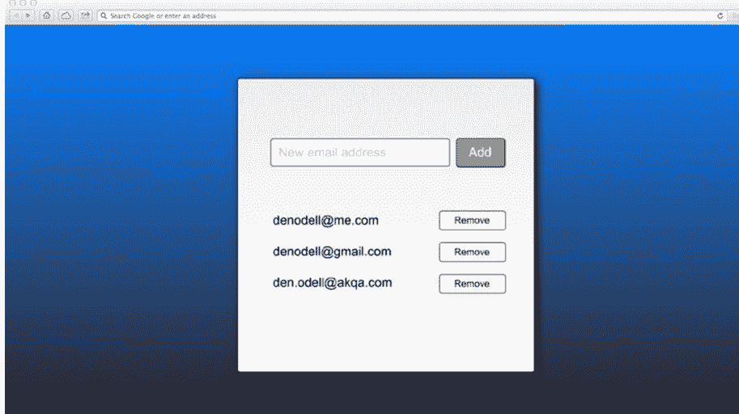

**图 8-1.** 使用 MVC 体系结构构建的电子邮件地址管理系统

**列表 8-2.** 视图

```javascript
// 我们将构建一个包含两个部分的页面：一个文本输入字段和关联按钮，用于向我们的存储地址列表添加新电子邮件地址；

// 以及一个显示存储的电子邮件地址的列表，每个条目旁边都有一个“移除”按钮，允许我们从存储地址列表中移除电子邮件地址。

// 我们还将定义一个通用的视图，作为多个子视图的容器，

// 我们将在列表 8-3 中使用它作为连接两个视图的方式。

// 结合列表 8-1 中的 Model，我们将利用列表 7-6 中的观察者模式方法。

// 定义一个视图，表示一个用于向显示的列表中添加新电子邮件地址的简单表单。

// 我们将其定义为“类”，以便在用户界面中根据需要创建并显示

// 许多该表单实例

function EmailFormView() {

  // 创建新的 DOM 元素来表示我们正在创建的表单（你可能希望直接在页面

  // 中存储所需的 HTML 标签，而不是在这里创建）

  this.form = document.createElement("form");

  this.input = document.createElement("input");

  this.button = document.createElement("button");

  // 确保我们正在创建一个带有适当占位符文本的 <input type="text"> 字段

  this.input.setAttribute("type", "text");

  this.input.setAttribute("placeholder", "New email address");

  // 确保我们正在创建一个 <button type="submit">Add</button> 标签

  this.button.setAttribute("type", "submit");

  this.button.innerHTML = "Add";

}

EmailFormView.prototype = {

  // 所有视图都应该有一个 render() 方法，该方法由控制器

  // 在实例化后调用，通常也会传递来自 Model 的数据，

  // 但在此特定情况下，我们不需要那些数据

  render: function() {

    // 将 <input> 和 <button> 标签嵌套在 <form> 标签内

    this.form.append(this.input);

    this.form.append(this.button);

    // 将 <form> 添加到当前 HTML 页面的末尾

    document.body.appendChild(this.form);

    // 将任何事件连接到此视图中的 DOM 元素

    this.bindEvents();

  },
```


```javascript
// 定义一个方法将此视图连接到全局事件
bindEvents: function() {
  var that = this;

  // 当此视图表示的表单提交时，发布一个全局事件，
  // 表示已通过 UI 添加了新的电子邮件地址，传递此新邮箱邮箱值
  this.form.addEventListener("submit", function(event) {
    // (根据上下文的提交实现细节)
  });
}
};

// 注意：EmailListView 的剩余逻辑是根据后期 OCR 片段提供的模式
// 部分重构的，以完成结构。
function EmailListView() {
  this.list = document.createElement("ul");
  this.listItem = document.createElement("li");
  this.listItemText = document.createElement("span");
  this.listItemButton = document.createElement("button");
  this.listItemButton.innerHTML = "Remove";
}

EmailListView.prototype = {
  render: function(modelData) {
    var index = 0;
    var length = modelData.length;

    for (; index < length; index++) {
      var email = modelData[index];
      this.list.appendChild(this.createListItem(email));
    }

    document.body.appendChild(this.list);
  },

  createListItem: function(email) {
    var listItem = this.listItem.cloneNode(false);
    var listItemText = this.listItemText.cloneNode(false);
    var listItemButton = this.listItemButton.cloneNode(true);

    listItem.setAttribute("data-email", email);
    listItemButton.setAttribute("data-email", email);
    listItemText.innerHTML = email;
    listItem.appendChild(listItemText).appendChild(listItemButton);

    return listItem;
  },

  bindEvents: function() {
    var that = this;

    this.list.addEventListener("click", function(evt) {
      if (evt.target && evt.target.tagName === "BUTTON") {
        observer.publish("view.email-view.remove", evt.target.getAttribute("data-email"));
      }
    }, false);
  }
};
```

# 第 8 章 | 设计模式：架构模式

```javascript
// 监听 Model 触发的事件，表示某个电子邮件地址已被移除，
// 执行 removeEmail() 方法
observer.subscribe("model.email-address.removed", function(email) {
  this.removeEmail(email);
});
```

定义一个方法，当电子邮件地址被添加到 Model 时调用，该方法将向此 View 所表示的列表顶部插入一个新列表项。

```javascript
addEmail:function(email) {
  this.list.insertBefore(email, this.list.firstChild);
};
```

定义一个方法，当电子邮件地址从 Model 中移除时调用，该方法将从此 View 所表示的列表中移除相关的列表项。

```javascript
removeEmail:function(email) {
  var listitems = this.list.getElementsByTagName("li");

  index = 0;
  length = listitems.length;

  // 遍历所有列表项，找到代表所提供的电子邮件地址的项，
  // 并在找到后将其移除
  for (; index < length; index++) {
    if (listitems[index].getAttribute("data-email") === email) {
      this.list.removeChild(listitems[index]);

      // 一旦移除了电子邮件地址，停止循环执行
      break;
    }
  }
};
```

定义一个可以包含子 View 的通用 View。当其 `render()` 方法被调用时，依次调用其子 View 的 `render()` 方法，传递实例化时提供的任何 Model 数据。

```javascript
function EmailView(views) {
  this.views = views || [];
}

EmailView.prototype = {
```

// 所有 View 都需要一个 render() 方法 - 在此通用 View 中，它只需执行其每个子 View 的 render() 方法

```javascript
render: function(modelData) {
  var index = 0;
  length = this.views.length;

  // 遍历子视图，执行它们的 render() 方法，传递实例化时
  // 提供的任何 Model 数据
  for (; index < length; index++) {
    this.views[index].render(modelData);
  }
}
```

在 Model 中进行的更改可以通过观察者模式立即反映在 View 中。然而，在 View 中进行的更改不会立即传递给 Model；它们将由 Controller 处理，如列表 8-3 所示。

### 列表 8-3. Controller

```javascript
// Controller 连接 Model 和 View，定义系统的逻辑。
// 在能够实现类似系统行为的同时，提供备用的 Model 和 View，
// 只要 Model 提供了 add(), remove() 和 getAll() 方法来访问其数据，
// View 提供了 render() 方法 - 这是策略模式的体现。我们还将
// 使用列表 7-6 中的观察者模式方法。

// 定义一个“类”来表示 Controller，用于连接电子邮件系统中的 Model 和 View。
// Controller 在 Model 和 View 之后实例化，并将对象实例
// 作为输入提供
function ViewController(model, view) {
  // 存储提供的 Model 和 View 对象
  this.model = model;
  this.view = view;
}
```

```javascript
EmailController.prototype = {
  // 定义一个方法用于初始化系统，它从 Model 的
  // getAll() 方法获取数据，并通过执行该 View 的
  // render() 方法将其传递给关联的 View
  initialize: function() {
    // 从关联的 Model 中获取电子邮件地址列表
    var modelData = this.model.getAll();

    // 将数据传递给关联 View 的 render() 方法
    this.view.render(modelData);

    // 将 Controller 逻辑连接到全局事件
    this.bindEvents();
  },

  // 定义一个将 Controller 逻辑连接到全局事件的方法
  bindEvents: function() {
    var that = this;

    // 当 View 表示通过用户界面添加了新的电子邮件地址时，
    // 调用 addEmail() 方法
    observer.subscribe("view.email-view.add", function(email) {
      that.addEmail(email);
    });

    // 当 View 表示通过用户界面移除了电子邮件地址时，
    // 调用 removeEmail() 方法
    observer.subscribe("view.email-view.remove", function(email) {
      that.removeEmail(email);
    });
  },

  // 定义一个向 Model 添加电子邮件地址的方法，当通过
  // 用户视图界面添加了电子邮件地址时调用该方法
  addEmail:function(email) {
    // 直接调用 Model 的 add() 方法，传递通过 View
    // 添加的电子邮件地址。Model 将广播一个表示新电子邮件地址
    // 已添加的事件，View 将直接对此事件做出响应，更新 UI
    this.model.add(email);
  },

  // 定义一个从 Model 移除电子邮件地址的方法，当通过
  // 用户视图界面移除了电子邮件地址时调用该方法
  removeEmail:function(email) {
    // 直接调用 Model 的 remove() 方法，传递通过 View
    // 添加的电子邮件地址。Model 将广播一个表示电子邮件地址
    // 已移除的事件，View 将直接对此事件做出响应，更新 UI
    this.model.remove(email);
  }
}
```

### 列表 8-4

View 展示了我们如何根据 MVC 模式，使用 8-1 到 8-3 中的“类”来构建图 8-1 所示的简单页面。

```javascript
// 创建 Model 实例，并填充几个电子邮件地址以
// 开始使用
var emailModel = new EmailModel([
  "denodel@mail.com",
  "denodel@gmail.com",
  "denodel@qa.com"
]);

// 创建表单 View 和列表 View “类”的实例
emailFormView = new EmailView(),
emailListView = new EmailListView();

// 将表单和列表 View 合并为单个 View 的子视图
emailView = new EmailView([emailFormView, emailListView]);

// 创建系统 Controller 实例，将其传递给 Model 和
// View 使用。注意 Controller 不需要感知
// 多个实例，就像我们在这里做的那样
emailController = new ViewController(emailModel, emailView);

// 最后，初始化 Controller，它从 Model 获取数据并将其
// 传递给 View 的 render() 方法，反之又将用户界面
// 与全局事件连接起来，将整个应用程序整合在一起
emailController.initialize();
```

当用户使用 `<input>` 字段输入新的电子邮件地址并提交表单时，新电子邮件将出现在列表顶部（消息从系统中的 View 传递到 Controller，再到 Model，然后 Model 广播事件，更新 View）。当用户点击任何电子邮件地址旁边的 Remove 按钮时，该地址将从显示中以及 Model 的底层数据存储中移除。

MVC 模式在较大的应用程序中非常有用，这些程序包含一组需要在用户界面中显示、交互和使用的数据，而不会使基础代码过于复杂。代码被分为：负责存储和处理数据的、负责显示数据的、以及负责业务逻辑和数据与显示之间连接的。要了解更多关于 MVC 模式的信息，请参考以下在线资源：

- Alex Netkachov 的《Model-View-Controller (MVC) With JavaScript》（通过 `bit.ly/mvc_pattern`）
- 维基百科上的“Model-View-Controller”（通过 `http://bit.ly/mvc_wiki`）

## 模型-视图-演示器（MVP）模式

模型-视图-演示器（MVP）架构模式是 MVC 模式的派生，它试图明确模型（Model）、视图（View）以及连接它们的代码之间的边界（在 MVC 中，这是控制器 Controller；在 MVP 中它被称为演示器 Presenter）。它基于底层的设计模式，但在 MVC 模式中，View 可以根据 Model 的更改直接进行更新；而在 MVP 中，Model 和 View 之间的所有通信都通过 Presenter 层进行，但这里有一个重要的区别：MVP 模式中的 View 不应该包含事件处理代码——这些代码应该传递给 Presenter，这意味着 View 只负责渲染用户界面，而 Presenter 负责处理事件。

让我们以图 8-1 显示的示例地址列表为例，我们之前使用 MVC 模式构建了它，现在用 MVP 模式来重新构建它。我们将保持列表 8-1 中的 Model 不变，但需要构建一个新的 View 并用 Presenter 替换 Controller。列表 8-5 中的代码展示了如何编写 Presenter；它与列表 8-3 中的 Controller 有相似之处，但请注意这里处理 Model 和 View 之间所有通信的方式，，拆分在 Presenter 和 View 之间。

### 列表 8-5. 示例地址列表实现

```javascript
// "class" 的创建方式与 MVC 模式中的 Controller 相同。
// 使用列表 7-6 中的观察者模式。
function EmailPresenter(model, view) {
  this.model = model;
  this.view = view;
}

EmailPresenter.prototype = {
  // initialize() 方法与 MVC 模式中的 Controller 相同
  initialize: function() {
    var modelData = this.model.getAll();
    this.view.render(modelData);
    this.bindEvents();
  },

  // 区别在于 bindEvents() 方法，其中我们通过 View 连接从 Model 触发的事件
  // 反之亦然——Model 不再能在没有干预的情况下直接更新
  // View。这明确了 Model 和 View 之间的区别，
  // 使更加分离，并让开发者在连接数据与用户界面出现问题时
  // 更清楚该去哪里查找。
  bindEvents: function() {
    var that = this;

    // 当 View 触发 "add" 事件时，执行 Model 的 add() 方法
    observer.subscribe("view.email-view.add", function(email) {
      that.model.add(email);
    });

    // 当 View 触发 "remove" 事件时，执行 Model 的 remove() 方法
    observer.subscribe("view.email-view.remove", function(email) {
      that.model.remove(email);
    });
  }
}
```

```javascript
// 当 Model 触发 "added" 事件时，执行 View 的 addEmail() 方法
observer.subscribe("model.email-address.added", function(email) {
  // 告诉 View 邮箱已更改。我们需要确保
  // 在实例化时传递给 Presenter 的任何 View 都有此方法，
  // 包括包含子视图的通用 View
  that.view.addEmail(email);
});

// 当 Model 触发 "removed" 事件时，执行 View 的 removeEmail() 方法
observer.subscribe("model.email-address.removed", function(email) {
  that.view.removeEmail(email);
});
```


现在 View 会比之前更短，因为正如列表 8-6 所示，我们将其部分事件处理代码提取到了 Presenter 中。在每个 View（包括包含子视图的通用 View）上增加了`addEmail()`和`removeEmail()`方法。

## 列表 8-6. MVP 模式的视图

```javascript
// 定义 EmailFormView "class" 构造函数以初始化 View 的 DOM 元素。
// 使用列表 7-6 中的观察者模式
function EmailFormView() {
  this.form = document.createElement("form");
  this.input = document.createElement("input");
  this.button = document.createElement("button");
  this.input.setAttribute("type", "text");
  this.input.setAttribute("placeholder", "New email address");
  this.button.setAttribute("type", "submit");
  this.button.innerHTML = "Add";
}
```

```javascript
EmailFormView.prototype = {
  // render() 方法与 MVC 模式中相同
  render: function() {
    this.form.appendChild(this.input);
    this.form.appendChild(this.button);
    document.body.appendChild(this.form);
    this.bindEvents();
  }
};
```

注意`bindEvents()`方法与 MVC 模式中的不同——我们不再订阅从 Model 广播的事件，我们只触发基于 View 的事件，并且：

```javascript
// Presenter 处理 Model 和 View 之间的通信
bindEvents = function() {
  var that = this;

  this.form.addEventListener("submit", function(evt) {
    evt.preventDefault();
    observer.publish("view.email-view.add", that.input.value);
  }, false);
};

// 我们为每个 View 提供一个 addEmail() 方法，Presenter 在 Model
// 明明添加了新邮箱地址时调用它
addEmail: function() {
  this.input.value = "";
},

// 我们为每个 View 提供一个 removeEmail() 方法，Presenter 在 Model
// 明明删除了新邮箱地址时调用它
removeEmail: function() {
  // 移除邮箱的实现
}
```

此 MVP 应用可以通过组合列表 7-6 中的代码（观察者模式）与列表 8-1（我们原始 MVC 应用中的共享 Model）、8-5、8-6 和 8-7 中的代码，按顺序在任何简单 HTML 页面的上下文中运行。例如：

```html
<!DOCTYPE html>
<html>
<head>
  <title>MVP Example</title>
</head>
<body>
  <script src="Listing7-6.js"></script>
  <script src="Listing8-1.js"></script>
  <script src="Listing8-5.js"></script>
  <script src="Listing8-6.js"></script>
  <script src="Listing8-7.js"></script>
</body>
</html>
```

Model-View-Presenter（模型-视图-演示器）相比 Model-View-Controller（模型-视图-控制器）模式提供了更明确的分离，这在代码库变得越来越大时非常有用。它被视为一种分层结构，这种分层被当作一种简化 MVC 模式的手段，因为在大型应用程序中，跟踪事件变得越来越困难。要进一步阅读 Model-View-Presenter 模式，请参考以下资源：

- Roy Peled 编写的《An MVP Guide To JavaScript》（通过`http://bit.ly/mvp_pattern`）
- Wikipedia 上的 Model-View-Presenter（通过`http://bit.ly/mvp_wiki`）

### Model-View-ViewModel（MVVM）模式

Model-View-ViewModel（MVVM）模式是 MVC 模式更后期的衍生模式，与 MVP 模式一样，旨在防止 View 直接通信。它不是使用 Presenter（演示器），而是通过 ViewModel 将两者分离，ViewModel 履行类似的角色，但包含了原本 View 中存在的所有代码。因此，可以通过替换选择器和（或通过 HTML 数据属性绑定到）View 来替换它。，这种分离是如此清晰，以至于 View 实际上是作为一个静态 HTML 文件呈现的，可以使用对这些数据属性中包含的 ViewModel 的绑定直接构建界面。

让我们回到列表 8-1 显示的相同电子邮件应用程序示例，但我们将创建一个新的 View，并用 ViewModel 替换之前的 Controller 或 Presenter。对它应用 MVVM 模式。列表 8-8 中的代码显示了一个 HTML 页面，相关标签上具有特定的数据属性，这些属性指示 ViewModel 根据其内部业务逻辑对该 View 执行什么操作。

## 列表 8-8. 定义为简单 HTML 页面的 View

```html
<!--
  View 现在是一个简单的 HTML 文档 - 它可以通过 JavaScript 中的 DOM 元素创建，
  但不再需要是这样。View 通过某些 HTML 标签上的 HTML5 数据
  属性与 ViewModel 连接，这些属性根据需要绑定到 ViewModel 中的特定行为。
-->
<!DOCTYPE html>
<html>...
</html>
```

# 第 8 章 设计模式：架构型

```html
<html>
<head>
  <meta charset="utf-8">
  <title>Model-View-ViewModel (MVVM) Example</title>
</head>
<body>
  <!--
    <form> 标签有一个特定的 HTML5 数据属性，指示了当表单被提交时，
    它应该被绑定到 ViewModel 中的 addEmail() 方法。
  -->
  <form data-submit="addEmail">
    <input type="text" placeholder="New email address">
    <button type="submit">Add</button>
  </form>

  <!--
    <ul> 列表有一个特定的 HTML5 数据属性，指示内部的标签应该针对存储的 Model Data 中的每个项目进行循环。因此，如果 Model 包含三个电子邮件地址，将生成并渲染三个 <li> 标签，以替换现有的单个模板化 <li> 标签。
  -->
  <ul data-loop>
    <li>
      <!--
        我们将使用 data-text 属性来指示 ViewModel 在我们遍历存储的 Model Data 时，
        将标签内容替换为我们在循环遍历时所代表的单个电子邮件地址。
      -->
      <span data-text></span>

      <!--
        我们使用 data-click 属性，就像我们之前在 <form> 标签上使用 data-submit 一样，即在点击按钮时执行由 ViewModel 暴露的特定方法。
      -->
      <button data-click="removeEmail">Remove</button>
    </li>
  </ul>

  <!--
    将来我们将在此页面的末尾添加 <script> 标签，以加载观察者模式、ViewModel 和初始化代码。
  -->
</body>
</html>
```

我选择了一个`data-loop`属性来表示在在下方显示的`<li>`标签会为 Model 中存储的每个电子邮件地址重复。特定标签上的`data-text`属性表示其内容应被电子邮件地址本身替换。`data-submit`属性连同其值作为方法名，指示应与该元素连接提交事件处理程序，在事件发生时执行存储在 ViewModel 中的给定方法名。`data-click`属性的值同样代表来自 ViewModel 的一个方法名，当用户点击元素时执行。

# 第 8 章 —— 设计模式：架构型

这些属性名称是任意选择的；除了我定义的含义外，它们在 HTML 或 JavaScript 中没有特定含义。注意文件末尾的注释，我们将在此代码列表的末尾添加`<script>`标签来加载和初始化代码，我们将在加载 ViewModel 和初始化代码后添加它。

列表 8-9 中的代码显示了用于将列表 8-10 中的 View 绑定相关数据和行为的特定 ViewModel，以表示应用程序。

#### 列表 8-9. ViewModel

```javascript
// 定义方法来初始化 Model 和 View
// 之间的连接
function viewModel(model, view) {
  // 存储 model
  this.model = model;

  // 存储 view
  this.view = view;

  // 定义方法
  // 以供 View 属性调用
  this.methods = {
    // addEmail() 方法将提供的电子邮件地址
    // 添加到 Model
    addEmail: function(email) {
      this.model.add(email);
    },

    // removeEmail() 方法从 Model 中移除
    // 提供的电子邮件地址
    removeEmail: function(email) {
      this.model.remove(email);
    }
  };

  // 定义方法来配置
  // <form data-submit>
  this.bindForm = function() {
    var that = this;

    // 定位 [data-submit] 元素
    var form = this.view.querySelectorAll("[data-submit]")[0];

    // 获取存储在 data-submit 中的方法名
    var formSubmitMethod = form.getAttribute("data-submit");

    // 创建事件监听器，在 <form>
    // 提交时执行该方法
    form.addEventListener("submit", function(evt) {
      // 确保默认 <form> 标签行为不运行，且页面不刷新
      evt.preventDefault();

      // 获取 <form> 内部 <input> 字段中的电子邮件地址
      var email = form.getElementsByTagName("input")[0].value;

      // 在 ViewModel 的 "methods" 属性中找到该
      // 方法并执行它，传入 <form> 中输入的电子邮件地址
      if (that.methods[formSubmitMethod] && typeof that.methods[formSubmitMethod] === "function") {
        that.methods[formSubmitMethod](email);
      }
    });
  };

  // 将 View 连接到
  // <form data-submit>
  this.bindForm();

  // 将 View 连接到
  // <ul data-loop>
  this.bindList();

  // 将 Model 广播的事件
  // 连接到 View
  this.bindEvents();
};

// 定义一个方法，从存储在 Model 中的数据中构建电子邮件地址列表
// 该方法稍将连接到 Model 触发的事件，以便在 Model 数据
// 每次更改时重新创建列表
viewModel.prototype.bindList = function() {
  // 从 Model 获取最新数据
  var data = this.model.getAll();
  var index = 0,
    length = data.length,
    that = this;
};
```

```javascript
// 定义一个函数，根据给定的电子邮件地址创建一个事件处理函数，
// 当点击包含该属性的 <button> 标签时，它将执行存储在 "data-click"
// HTML5 数据属性中的方法名，并传递电子邮件地址
function function(event) {
```

```javascript
// 定位存储在 HTML5 "data-click" 属性中的方法名
var methodName = evt.target.getAttribute("data-click");
```

```javascript
// 在 ViewModel 的 "methods" 属性中定位方法并执行它，
// 传入提供的电子邮件地址
if (that.methods[methodName] && typeof that.methods[methodName] === "function") {
  that.methods[methodName](email);
}
```

```javascript
// 清空 <ul data-loop> 元素的内容，移除其中之前之前创建的所有 <li>
// 元素
this.listElement.innerHTML = "";
```

```javascript
// 遍历 <span data-text> 元素并根据我们之前存储的 View 原始状态的
// 结构创建 <li> 标签来填充它
// for (var index = 0; index < length; index++) {
  email = data[index];
```

```javascript
// 创建一个作为存储标签克隆的新 <li> 标签
newListItem = this.listElement.clone(true);
```

```javascript
// 定位 <span data-text> 元素并为其填充电子邮件地址
newListItem.querySelectorAll("[data-text]")[0].innerHTML = email;
```

```javascript
// 定位 <button data-click> 元素并执行 makeClickFunction() 函数，
// 为本次循环中的特定电子邮件地址创建一个特定的事件处理程序
newListItem.querySelectorAll("[data-click]")[0].addEventListener(
  "click",
  makeClickFunction(email, false)
);
```

```javascript
// 将填充好的 <li> 标签附加到 View 中的 <ul data-loop> 元素
this.listElement.appendChild(newListItem);
```

```javascript
// 定义一个方法来清除 <input> 字段中输入的电子邮件地址
EmailViewModel.prototype.clearInput = function() {
  var textField = this.view.querySelectorAll("[input[type=text]")[0];
  textField.value = "";
```

```javascript
// bindEvents() 方法将 Model 广播的事件连接到 View
EmailViewModel.prototype.bindEvents = function() {
  var that = this;
```

```javascript
// 定义每当 Model 中的数据更新时执行的函数
function update() {}
```

```javascript
// 从头重新创建电子邮件地址列表
that.bindList();
```

```javascript
// 清除 <input> 字段中输入的任何文本
that.clearInputField();
```


将 `updateView()` 函数连接到 `Model` 触发的两个事件：

```javascript
observer.subscribe("model.email-address.added", updateView);
observer.subscribe("model.email-address.removed", updateView);
```

最后，我们可以从列表 8-1 获取 `Model`，从列表 8-8 获取纯 HTML `View`，并从列表 8-9 获取 `ViewModel`，并使用列表 8-10 中的代码来初始化应用程序。要运行代码，在列表 8-8 的 `View` 中添加 `<script>` 标签，这位于文件末尾处，以使用列表 7-6 中的观察者模式加载这些代码列表。例如：

```html
<script src="Listing7-6.js"></script>
<script src="Listing8-1.js"></script>
<script src="Listing8-9.js"></script>
<script src="Listing8-10.js"></script>
```

由于我们把这些 `<script>` 引用添加到 `View` HTML 页面中，我们能够仅通过 `document.body` 属性获取页面 DOM 表示的引用，如列表 8-10 所示，它初始化了应用程序。

**列表 8-10. 使用 MVVM 模式**

```javascript
// 使用列表 8-1 中的 EmailModel
var emailModel = new EmailModel(
  "denodel@me.com",
  "denodel@gmail.com",
  "denodel@akqa.com"
);

// 现在我们的 View 是一个 HTML 文档，我们可以获取整个页面的引用并使用它
emailView = document.body;

// 创建 ViewModel 的实例，就像我们在 MVC 和 MVP 模式中分别创建 Controller 或 Presenter 一样。
// 传入 Model 数据和 View（HTML 文档）。
emailViewModel = new EmailViewModel(emailModel, emailView);

emailViewModel.initialize();
```

显而易见，`Model-View-ViewModel` 模式的优势在于，与 `Model-View-Presenter` 和 `Model-View-Controller` 相比，`View` 可以采取更简单的形式，应用程序中的 `View` 越多，这种模式就越有用。`View` 与连接到 `Model` 的代码之间更清晰的分离意味着不同的开发者可以独立地在不同层工作，在适当阶段合并他们的工作，而与彼此代码冲突的风险更小。在编写本文时，MVVM 正在成为专业 JavaScript 开发者最常用的架构模式。

要了解更多关于 `Model-View-ViewModel` 模式，请查看以下资源：

- Add Osmani 编写的 'Understanding JavaScript Developers'（通过 `http://bit.ly/mvm_pattern`）

- Wikipedia 上的 'Model-View-Model'（通过 `http://bit.ly/mvm_pattern`）

## 架构框架

有许多预构建的 `Model-View-Controller` (MVC)、`Model-View-Presenter` (MVP) 和 `Model-View-Model` (MVVM) 库可在 Web 中实现。如果你正在寻找可以采用的框架，请查看以下流行方案：

| 框架 | 模式 | 备注 | 链接 |
| :--- | :--- | :--- | :--- |
| Maria | MVC | 基于 1970 年代的原始 MVC 框架，这是最正宗的。 | `http://bit.ly/maria` |
| SpineJS | MVC | Spine 努力拥有最多的文档。 | `http://bit.ly/spinejs` |
| EmberJS | MVC | Ember 依赖配置来简化开发并让开发者上手。 | `http://bit.ly/ember_js` |
| Backbone | MVP | Backbone 是一个带有 API 的框架，允许任何类型的应用程序发展。 | `http://bit.ly/backbone_mv` |
| AgilityJS | MVP | Agility 以最轻级的 MVVM 自豪，压缩后仅 4KB。 | `http://bit.ly/agilityjs` |
| Knockout | MVVM | Knockout 旨在支持 MVVM 模式及其对 HTML 用户界面的绑定。它支持从旧版本的 Internet Explorer，并且有庞大的社区支持。 | `http://bit.ly/knockout_mv` |
| AngularJS | MVVM | Google 开发的 Angular 迅速成为最流行的架构框架，支持连接用户界面到底层数据的 MVVM 原则。但后续版本仅支持版本 9 及以上。 | `http://bit.ly/angular_js` |

## 总结

在本章中，我们查看了用于更好地构建和维护 JavaScript 应用程序的三种主要架构模式，标志着设计模式部分的结束。这些是你 JavaScript 开发“瑞士军刀”中的工具，但像工具一样，你需要知道何时以及如何最好地使用它们。熟悉本章中的模式，并确保在意识到代码中存在需求之前不要使用模式。这是一个非常重要的建议，因为许多人会犯一个错误：在大型预存框架之上构建他们的小型应用程序，例如，而没有意识到通过编写自己所需的确切代码可以节省大量的开发时间和页面加载时间。不要掉入这个陷阱——从你应用程序所需的确切代码开始，只有在你意识到需要时才应用设计模式，而不是反之亦然。

在下一章中，我们将查看第 6 章介绍过的模块设计模式的现代改进，允许在大型 JavaScript 应用程序需要的确切位点异步加载模块，以及它们任何所需的依赖项。

---

# 第 9 章

## 管理代码文件依赖

随着时间的推移，我们正越走越远，进入 JavaScript 密集型网站和应用的崭新世界。通过使用如 jQuery 类的代码库、`AngularJS(http://angularjs.org)`、`Backbone (http://backbone.org)` 或 `Ember(http://ember.com)` 等框架，以及许多其他高质量的可重用插件，我们可以简化 JavaScript 开发的核心方面，从而让我们能够按需构建出既功能强大又易于使用的丰富体验。

我们在解决方案中添加的每一个额外的 JavaScript 都会引入额外层次的复杂性，特别是我们如何管理它与代码库中其他 JavaScript 文件之间的关系。我们可能会在一个文件中编写一些代码，使用另一个文件中的 jQuery 插件与页面进行交互，而该插件又依赖于 jQuery 在另一个文件中存在并加载。随着解决方案规模的扩大，文件之间可能的连接数量也随之增加。我们认为，任何 JavaScript 文件如果需要另一个文件才能运行，它对该文件就有依赖。

大多数情况下，我们以线性且手动的方式管理依赖关系。在 HTML 文件的末尾，`</body>` 标签之前，我们按顺序列出 JavaScript 文件，从最通用的库和框架文件开始，一直到最特定于应用程序的文件，确保每个文件都列在在其依赖项之后，以防止在访问尚未加载的其它脚本文件中定义的变量时发生错误。随着解决方案中文件数量的增加，这种依赖管理方法变得越来越难以维护，特别是当你希望在不进行任何代码重构的情况下移除它时。

## 使用 RequireJS 管理代码文件依赖

对于较大的网站和应用，我们显然需要比这更健壮的方法来管理依赖关系。在本章中，我将解释如何使用 RequireJS 管理你的代码依赖。RequireJS 是解决此问题的 JavaScript 模块加载器，它的优势是按需异步加载脚本，我们在第 4 章中提到过这种技术是提高网站性能的手段。

RequireJS 基于异步模块定义 (AMD) API(`http://bit.ly/amd_api`)，这是一种跨语言的定义代码块及其依赖的统一方式，并在业界获得了广泛关注，已应用于 BBC、Hallmark、Etsy 和 Instagram 等网站。

为了演示如何在应用中引入 RequireJS，让我们从列表 9-1 所示的简单 index HTML 页面开始，它包含一个基本的表单，提交后会将电子邮件地址发送到另一个“感谢”页面（如列表 9-2 所示）。列表 9-3 显示了应用于此演示页的 CSS 样式，将其存储在 `main.css` 文件中。我们正在使用 Google Fonts(`http://bit.ly/g-fonts`) 中的字体 Lobster 和 Abel。

### 列表 9-1. 主演示页的 HTML 代码，包含一个用于向邮件列表添加电子邮件的表单

```html
<!doctype html>
<html>
<head>
  <meta charset="utf-8">
  <title>Mailing list</title>
  <link href="http://fonts.googleapis.com/css?family=Lobster|Abel" rel="stylesheet" type="text/css">
  <link rel="stylesheet" href="Listing9-3.css">
</head>
<body>
  <form action="Listing9-2.html" method="post">
    <h1>Join our mailing list</h1>
    <label for="email">Enter your email address</label>
    <input type="text" name="email" id="email" placeholder="me@mysite.com">
    <input type="submit" value="Sign up">
  </form>
</body>
</html>
```

### 列表 9-2. 电子邮件地址提交后引导用户跳转的 HTML 感谢页面

```html
<!doctype html>
<html>
<head>
  <meta charset="utf-8">
  <title>Thank you</title>
  <link href="http://fonts.googleapis.com/css?family=Lobster|Abel" rel="stylesheet" type="text/css">
  <link rel="stylesheet" href="Listing9-3.css">
</head>
<body>
  <div class="card">
    <h1>Thank you</h1>
    <p>Thank you for joining our mailing list.</p>
  </div>
</body>
</html>
```

### 列表 9-3. 应用于列表 9-1 和列表 9-2 中 HTML 页面的 CSS 样式规则

```css
html,
body {
  height: 100%;
}
body {
  font-size: 62.5%;
  margin: 0;
  background: #32534d;
  background-image: -webkit-gradient(linear, 0% 0% 100%, #1a82f7, #f2277);
  background-image: -webkit-gradient(top, #1a82f7, #f2277);
  background-image: -moz-linear-gradient(top, #1a82f7, #f2277);
  background-image: -ms-linear-gradient(top, #1a82f7, #f2277);
  background-image: -o-linear-gradient(top, #1a82f7, #f2277);
}

body,
input {
  font-family: "Lobster", sans-serif;
}

h1 {
  font-size: 4.4em;
  letter-spacing: -1px;
  padding-bottom: 0.25em;
}

form,
.card {
  position: absolute;
  top: 100px;
  bottom: 100px;
  min-height: 250px;
  left: 50%;
  margin-left: -280px;
  width: 400px;
  padding: 20px 80px;
  border: 2px solid #333;
  border-radius: 5px;
  box-shadow: 5px 15px #000;
  background: #fff;
  background-image: -webkit-gradient(linear, 0% 0% 100%, #eee, #fff);
  background-image: -webkit-gradient(top, #eee, #fff);
  background-image: -moz-linear-gradient(top, #eee, #fff);
  background-image: -ms-linear-gradient(top, #eee, #fff);
  background-image: -o-linear-gradient(top, #eee, #fff);
}

label,
input,
p {
  display: block;
  font-size: 1.8em;
  width: 100%;
}

label,
input[type="email"],
p {
  font-family: "Abel", sans-serif;
}

input {
  margin-bottom: 1em;
  border: 1px solid #42261;
  border-radius: 5px;
  padding: 0.25em;
}

input[type="submit"] {
  background: #dda;
  color: #000;
  font-weight: bold;
  width: 13%;
  font-size: 3em;
  margin: 0;
  box-shadow: 1px 2px #000;
}

.error {
  border: 1px solid #f99;
  background: #fff5f5;
}
```

运行目前的代码将产生图 1 所示的布局。

图 1. 我们正在构建的最终页面代表一个邮件订阅，只有当提供的电子邮件格式有效时才会提交。

在编写任何 JavaScript 代码之前，我们将从项目首页 `http://bit.ly/require-dl` 下载 RequireJS。该库的当前版本为 2.1.9，它支持从 Internet Explorer 6、Firefox 2、Safari 3.2、Chrome 3 到 Opera 10 的所有主流网络浏览器。

现在，当我们将 RequireJS 添加到页面时，我们需要检查应用程序所需的 RequireJS 文件并将它们组织到相应的文件夹结构中。我们将从主脚本开始，使用 jQuery 监听 HTML 表单的提交事件并在此时执行表单验证，如果没有错误则允许表单继续提交。因此，除了 RequireJS 库外，我们还有三个 JavaScript 文件，如表 9-1 所示。

**表 9-1. 项目使用的 JavaScript 文件**

| 文件名 | 说明 |
| --- | --- |
| `jquery-1.10.2.js` | 编写时的 jQuery 库版本，用于访问和操作页面上的 DOM 元素 |
| `validation-plugin.js` | 作为 jQuery 插件的表单验证脚本 |
| `main.js` | 主脚本文件 |

让我们按照图 9-3 所示的项目文件夹结构将这些文件与 RequireJS 排在一起，第三方脚本和插件分组在名为 `scripts` 的子文件夹中。

图 9-3. 我们的 RequireJS 文件夹结构

| 名称 | 修改日期 | 大小 | 类型 |
| --- | --- | --- | --- |
| `index.html` | | 575 bytes | HTML 文档 |
| `scripts` | | 114 KB | 文件夹 |
| `lib` | | 93 KB | 文件夹 |
| `jquery-1.10.2.min.js` | | 93 KB | JavaScript |
| `validation-plugin.js` | | 0 bytes | JavaScript |
| `main.js` | | 0 bytes | JavaScript |
| `require.js` | | 15 KB | JavaScript |
| `styles` | | 2 KB | 文件夹 |
| `main.css` | | 2 KB | CSS |
| `thank-you.html` | | 387 bytes | HTML |

### 加载并初始化 RequireJS

让我们利用机会，通过在 9-1 HTML 页面的末尾、`</body>` 标签结束之前添加 `<script>` 标签，在 HTML 页面上加载并设置 RequireJS，指向库文件的位置。虽然我们此之后添加多个包含剩余代码的 `<script>` 标签，但我们可以依靠 RequireJS 的异步加载功能。通过向我们的 `<script>` 标签添加一个 `data-main` 属性，我们可以指定项目主应用程序脚本的位置。当 RequireJS 初始化时，它将自动并异步加载该属性中引用的任何文件。我们只需要在每个页面上有一个 `<script>` 标签：

```html
<script src="scripts/require.js" data-main="scripts/main"></script>
```


注意，在我们的`data-main`属性中，引用任何 RequireJS 文件时完全可以省略`.js`扩展名，因为它默认如此。

可重用的代码块称为模块，具有特定的目的或行为，使用 RequireJS 的内置`define()`函数进行定义。它遵循此处所示的模式，带有三个输入参数，用于命名模块、依赖并控制模块本身：

```
define(
  moduleName, // 可选，如果不存在该参数则默认为文件名
  dependencies, // 可选，列出此文件依赖的数组
  function(parameters) {
    // 在依赖项加载后执行的函数
    // parameters 包含依赖项的值
  }
);
```

# 第 9 章 管理代码依赖


## REQUIREJS

### 使用 Barlesque：RequireJS

跳转至章节：

- 前提条件
- 默认映射
- 定义自定义模块

### 开箱即用

在 RequireJS 中使用 jQuery

加载自定义模块

本教程涵盖了使用 Barlesque 自带的 require 时的基础操作。它旨在适用于使用 Barlesque 的开发者。

#### 前提条件

RequireJS 默认即可用。

#### 开箱即用获得的内容

Barlesque 中的 RequireJS 包含了默认文件夹中的`.js`文件以及其他模块，包括 jQuery。此外，有三个对象在全局作用域内可用：

- `require()` - 全局作用域函数，用于加载必要的模块并作为参数传递给回调函数，该回调函数提供了作用域
- `define()` - 全局作用域函数，用于定义
- `- - -` - 全局作用域对象，包含默认可用模块 set 的键值对。

#### 默认映射

传递给 requireJS 的`barlesqueConfig`对象将包含一个指向可能需要的标准 RequireJS 模块名称的映射。该映射的一结构如下：

```
requiremap = {
```

> 图 9 - BCC 是 RequireJS 的一个封装，它有自己的文档供开发者在编写 JavaScript 时参考

在单元格中定义`define()`只需要存在于要执行代码中的包含的模块。通常，我们会为代码库中的每个模块创建一个单独的文件，默认情况下，RequireJS 会通过其文件名识别模块名称。如果您的模块依赖于其他模块才能正常运行（例如，jQuery 插件需要 jQuery），您应该在包含模块代码的函数参数之前，将这些依赖项列在数组中传递给`define()`。我们使用此数组来确认依赖项相对于 RequireJS 文件本身位置的名称。在项目中，如果认为想将 jQuery 库列为另一个模块的依赖项，我们会将其包含在依赖项数组中，如列表 9-4 所示。

#### 列表 9-4 定义带有依赖的模块

```
define(["lib/jquery-1.10.2"], function($) {
  // 一旦 jquery 加载，此处执行模块代码。jQuery 库
  // 通过函数的第一个参数体现，此处命名为 $
});
```

回想我们不需要指定`.js`文件扩展名，因此在数组参数中列出依赖项时省略了它。顺便提一下，使用`define()`函数注册模块的 jQuery 代码应该出现在页面上，因此我们不需要编写任何特殊代码来将 jQuery 库用于我们与 RequireJS 使用的格式中。其他库在与 RequireJS 一使用之前可能需要一些初始设置。在这种情况下，请阅读有关缓存的文档部分：http://bit.ly/require_shim。

依赖代码文件提供的任何返回值都通过模块函数的输入参数传递，如列表 9-4 所示。只有这些通过此函数的参数才可以在模块内使用，以便与其依赖项进行适当的封装。这在性能上也有好处，因为对于 JavaScript 来说，访问函数的局部作用域变量比访问周围作用域解析变量名和值要快。我们现在有一种方法将我们的模块代码与它所依赖的代码之间的关系代码化，这种关系告诉 jQuery 在执行该函数之前加载我们模块所需的所有代码。

#### 使用别名代替模块名称

jQuery 开发团队有一个习惯，即将其库文件命名为其代表的发布版本号；这里我们使用的是 1.10.2。如果在多个文件中多次引用 jQuery 作为依赖项，那么当我们日后想更新某个站点使用的 jQuery 版本时，就会为自己制造一个维护问题。我们必须修改所有以 jQuery 为依赖项的文件，以匹配包含更新后版本号的新文件名。遗憾的是，JS 允许我们通过为某些模块定义别名来绕过这个问题；我们能够创建一个单一模块别名并映射到我们的带版本文件名，这样我们就可以在直接使用名称的地方使用它。这在 RequireJS 配置对象中设置。让我们用列表 9-5 所示的代码开始我们的主应用程序文件 (`main.js`)，创建此映射到 jQuery 的模块别名映射函数

### 列表 9-5. 创建映射到 jQuery 别名的主应用程序脚本文件

```
requirejs.config({
  paths: {
    "jquery": "lib/jquery-1.10.2"
  }
});
```

现在我们可以在我们的依赖项数组或模块中使用模块名而不是文件名，这将映射到指定版本的 jQuery。

#### 内容分发网络与回退

许多开发者从网络上的许多全球内容分发网络 (CDN) 之一引用 jQuery 或其他流行库的副本。在适当条件下，这减少了下载文件所需的时间，并增加了用户机器上可能已经缓存该文件的概率（如果他们访问过另一个从相同 CDN 加载相同版本 jQuery 的网站）。Require 允许您通过在依赖项数组中使用其 URL 从其他领域加载模块，但我们可以使用早期配置 jQuery 的相同配置设置来简化我们对外部依赖项的管理。我们将用一个新片段替换最后一段，以从 Google 的 CDN 配置 jQuery，同时在外部加载失败时允许它回退到本地版本的文件。我们可以在此处显示：

#### 列表 9-6. 一个具有可能位置的模块

```
requirejs.config({
  paths: {
    "jquery": [
      "https://ajax.googleapis.com/ajax/libs/jquery/1.10.2/jquery.min",
      "lib/jquery.10.2"
    ]
  }
});
```

创建模块

建立了依赖项，现在该考虑应用程序内部的文件是如何相互依赖的。我们已经确定主应用程序脚本依赖 jQuery，以便设置表单处理程序和用于验证脚本。由于验证脚本将作为 jQuery 插件构建，它也依赖于 jQuery。我们可能用表 9-2 所示的表格描述依赖项。9-2

| 脚本文件 | 依赖项 |
| --- | --- |
| jQuery | 无依赖 |
| 验证插件 | 仅 jQuery |
| 主应用程序脚本 | jQuery 和验证插件 |

现在我们可以在`validation-plugin.js`文件中编写验证插件的代码，指定 jQuery 为其唯一依赖项。模块检查给定字段的值是否符合典型的电子邮件格式，如果是有效的电子邮件地址则返回 true，否则返回 false，如列表 9-7 所示。

#### 列表 9-7. 作为 jQuery 验证插件的 Require 模块

```
define(["jquery"], function() {
  $.fn.isValid = function() {
    var isValid = true;
    // 正则表达式匹配一个多个非空白字符
    // 跟着 @ 符号，跟着多个非空白字符，
    // 跟着一个点 (.) 字符，最后跟着多个非空白
    // 空格字符
    var regEx = /\S+@S+\.\S+/;

    this.each(function() {
      if (!regEx.test(this.value)) {
        isValid = false;
      }
    });

    return isValid;
  };
});
```

我们在调用`define()`函数时省略了可选的模块名称，因此该模块将根据相对于 RequireJS 位置的文件名进行注册。可以通过模块名`lib/validation-plugin`在其他依赖项中引用。

在我们的`main.js`文件配置代码下方，我们需要声明绑定到 HTML 表单提交（submit）事件的代码，如列表 9-8 所示，使用我们新的 jQuery 插件脚本进行验证，并在电子邮件地址有效时允许表单提交。

**列表 9-8。** 为我们的项目主应用程序脚本添加的内容，用于将页面连接到我们的模块

```javascript
require(["jquery", "lib/validation-plugin"], function() {
  var form = $("#form");
  $email = $("#email");

  form.on("submit", function(e) {
    e.preventDefault();
    if ($email.isValidEmail()) {
      $form.get(0).submit();
    } else {
      $email.addClass("error").focus();
    }
  });

  form.on("keyup", function() {
    $email.removeClass("error");
  });
});
```

当列表 9-8 中的代码在列表 9-1 语言页面的浏览器上下文中执行时，将首先加载 jQuery 库，然后是加载我们的验证插件模块。你可能记得，当我们定义验证模块时，指定了它对 jQuery 有依赖。RequireJS 的功能之一是，如果它作为一个已经引用的依赖项出现，它将使用内存中存储的值而不是重新下载，这使我们能够正确地定义文件依赖关系，而不影响下载的数据量。

一旦加载了依赖项，函数就会执行，任何返回值都将作为参数传递。由于我们将验证器定义为 jQuery 插件，因此我们没有指定返回值；它将像其他插件一样被赋值给 jQuery 变量。

### 按需加载额外的脚本

我们可以扩展代码，以利用 RequireJS 可以在应用程序中所需的确切时间点按需加载 JavaScript 依赖项的特性。与其加载验证插件，不如我们只需要在用户提交表单时才需要该插件加载并供使用。将此脚本外离可以减少页面初始请求请求时下载的数据量和执行的代码量，从而提高页面加载性能，转变为更高效的“按需加载脚本”模型。

RequireJS 允许我们通过在想要下载额外依赖项的地方调用`require()`函数来实现这一点。我们可以重写主应用程序脚本，移除初始页面加载时对验证插件的依赖，并在用户尝试提交表单的时间点将其添加到页面中。如果用户提交了表单，则此文件永远不会被加载。我在列表 9-9 的更新主应用程序脚本中高亮了对`require()`函数的调用。

**列表 9-9。** 更新的主应用程序脚本，在需要时按需加载验证插件

```javascript
require(["jquery"], function() {
  var form = $("#form");
  $email = $("#email");

  $form.on("submit", function() {
    e.preventDefault();
    require(["lib/validation-plugin"], function () {
      if ($email.isValidEmail()) {
        $form.get(0).submit();
      } else {
        $email.addClass("error");
      }
    });
  });

  $email.on("keyup", function() {
    $email.removeClass("error");
  });
});
```

当用户使用此更新后的脚本尝试提交表单时，验证插件已经加载并尝试验证。如果用户动态执行验证，验证插件将被加载，这样就不会被重复下载。图 9-5 显示了页面加载脚本的瀑布图。第二条垂直线表示页面已完全加载，而右侧的小点表示验证脚本加载的时间，即用户进行交互的点，从而减少了页面就绪之前加载的数据量。

| 开发者工具 - file://Users/dennis.odell/Documents/Git/pro-javascript-development/06-Managin... | | | | | | | | | | | |
| --- | --- | --- | --- | --- | --- | --- | --- | --- | --- | --- |
| 元素路径 | Met. | Status Type Initiator | Size Time Timeline | | | | | | | |
| :--- | :--- | :--- | :--- | :--- | :--- | :--- | :--- | :--- | :--- | :--- |
| JS | require.js /Users/dennis.odell. | GET Succ. | text... | index.html Parser | 0 B | 2 ms | | | 1.00s | 1.50s | 2.00s |
| JS | main.js /Users/dennis.odell. | GET Succ. | text... | require:js Script | 0 B | 1 ms | | | | |
| JS | jquery.min.js ajax.googleleapis.com | 200 OK | | require:js Script | 0 B | 115 ... | 90.9 KB | 30 ms | | | | |
| JS | validation-plugin.js /Users/dennis.odell. | GET Succ. | text... | require.js Script | 0 B | 1 ms | 612 B | 1 ms | | | |

图 9-5. 要求

当然，表单提交可能在文件加载之前不会发生，因此如果插件脚本是一个后加载的文件，可能会对页面的感知响应速度产生影响。你应该在用户聚焦表单中的文本字段时下载验证插件来抵消这种影响。这应该为浏览器提供足够的时间下载插件文件，以便在用户尝试提交表单时它已准备就绪。

### RequireJS 代码优化器

如果你正在构建应用程序并为部署打包代码，可以利用 RequireJS 优化器，它是设计为从命令行运行的。它会研究应用程序列出的依赖项，并使用 UglifyJS 将它们合并为一个文件，从而减少 HTTP 请求并提升用户体验。

如果你想了解更多关于 RequireJS 优化工具的信息，请查看 http://requirejs.org 的文档。

### RequireJS 附加插件

RequireJS 通过插件扩展其自身的功能，你可以将这些插件与 RequireJS 一起放在脚本文件夹中。表格 9-3 显示我遇到的一些优秀插件，你可能希望在应用程序中使用它们。

| 插件 | 描述 |
| :--- | :--- |
| i18n - James Burke | 应用程序文本本地化插件。通过创建命名为 ISO locale 的并其中包含与该语言和国家相关的文本字符串的对象，你可以配置 RequireJS 只加载用户当前查看的站点版本相关的文件。访问地址：http://bit.ly/req_i18n |
| Text - James Burke | 允许将任何文本文件作为依赖加载（默认仅加载脚本文件）。任何模块名称前带有`text!`的依赖项将使用 XMLHttpRequest (XHR) 加载，并解析为代表文件完整内容的字符串到模块。这对于从外部加载固定的 HTML 标记并在模块中进行渲染或处理非常有用。访问地址：http://bit.ly/req_text |
| Font - Miller Medeiros | 允许通过指定所需的`font!`字符串使用 Google 的 WebFont API 加载字体。访问地址：http://bit.ly/req_font |
| Handlebars - Alex Secton | 在模块中加载 handlebars.js 模板作为依赖的插件。模板参数返回一个函数，你可以将其传递给数据，而数据也会作为依赖项加载。执行该函数的结果是 HTML 字符串，你需要将其注入到页面中。访问地址：http://handlebars.com 了解更多关于 Handlebars 模板库的信息。访问地址：http://bit.ly/req_handle |
| Cache - Jens Arps | 默认，JS 将模块存储在内存中，如果发生页面刷新，将重新加载模块。使用此插件后，加载的模块将存储在浏览器的 localStorage 中，并在后续页面刷新时从那里加载，以减少页面刷新时产生的 HTTP 请求。访问地址：http://bit.ly/req-cache |

如果你发现某些功能缺失或不符合标准（或者你纯粹是想尝试一下冒险），你可以使用 RequireJS 插件 API 编写自己的插件，详情请参阅 http://bit.ly/req_plugin。

## RequireJS 的替代方案

虽然 RequireJS 是浏览器中管理代码依赖最常用的库，但它并不是唯一的选择。每种替代方案都基于 AMD 规范，因此表 9-4 所示的替代方案工作方式相似，略有不同，它们可以相互替代。

**表 9-4**。基于浏览器的模块加载器

| 库 | URL |
| --- | --- |
| BDLoad | http://bdframework.org/BdLoad/ |
| Cajon | https://github.com/requirejs/cajon |
| CurlJS | https://github.com/cujojs/curl |
| LoaderJS | https://github.com/pinf/loader-js |


| RequireJS | http://requirejs.org |

| UMD | https://github.com/umdjs/umd |

| Yabble | https://github.com/jbrantly/yabble |

## 总结

在本章中，我带你学习了如何构建一个简单的页面，使用`RequireJS`来简化代码文件依赖的管理，并实现脚本文件的延迟加载，直到需要时才加载。这种方法不仅让代码随着增长更容易管理，还允许你通过仅在需要的准确时刻加载所需的代码来提高应用程序的性能。

`RequireJS`的功能远超本章所涵盖的内容。我鼓励你仔细阅读该库主页上的文档：如何学习使用许多配置选项、如何为模块提供别名、如何直接从 JSONP Web 服务加载和存储数据，以及如何加载和管理多个版本的模块（以及许多其他功能）。

这种代码依赖管理和脚本加载的方法，是当今不断增长的 JavaScript 密集型网站和应用程序代码库的行业最佳实践。我全心鼓励你学习更多这种方法，并将其应用于你自己的网站中，从中获益。

在下一章中，我们将介绍与移动设备相关的 JavaScript 开发，包括如何以最小的内存占用充分利用代码的技术，以及学习如何处理来自市场上许多智能手机和平板设备上传感器的输入。

## 第 10 章 移动 JavaScript 开发

在近年来的技术进步中，很少有技术的范围和影响能像移动手机和平板电脑革命那样。行业趋势显示，台式电脑的销量正在下降，而移动设备的普及正在以极速增长。对于许多人来说，在小屏幕设备访问 Web 的频率比在桌面机上更高。我们需要确保跟上这种变化，调整我们的设备和应用程序以适应用户的需求，许多用户对通过手指访问的万维网已经非常熟悉。

在本章中，我们将学习移动设备 Web 开发的限制以及如何克服它们、如何通过 JavaScript 访问设备内置传感器的数据、如何处理网络问题和不良连接，以及如何调整你的 JavaScript 以适应采用响应式设计（Responsive Design）原则和技术的网站。

### 移动 Web 开发的限制

由于设备比桌面电脑小得多，因此很难相信移动设备的设计和构造中做出了一些妥协。其中一些妥协与设备内部的技术有关，另一些则是设备与最近的手机基站或 WiFi 网络之间传输数据时所用网络的连锁效应。理解这些限制允许我们调整 Web 和应用程序开发，以将其影响降至最低，并为终端用户提供最佳体验。

#### 电池寿命

在编写时，大多数手机在正常条件下能为所有提供一到两天的电池寿命。性能密集型应用和网站消耗的电量会超过设备空闲时的标准功耗。

我们需要控制网站和应用程序中的代码，使其对电池寿命的影响降最低。这涉及到尽可能频繁更新显示区域，并使用尽可能少的 JavaScript 来提供所需的用户体验。在必要时避免使用 JavaScript 执行动画和过渡，而代之使用 CSS3 过渡（`http://bit.ly/css_trans`）和动画（`http://bit.ly/css_anim`），这些的 CPU 效率高得多，可以节省电池。如果你打算访问地理位置或方向等移动传感器，请仅偶尔访问这些值，且仅在实际需要的持续时间内访问，并在代码不再需要访问数据时断开事件监听器。使用第 4 章讨论的事件帧（event framing）原则，在传感器数据频繁变化时执行更少代码。

#### 网络带宽速度与延迟

你可能对移动网络运营商宣传的速度并不总是符合现实感到意外。事实是，移动设备上的连接速度受到多种因素的限制，包括你连接的手机基站的距离、连接同一基站的人数，以及天气和周围建筑密度等环境因素。在 4G/LTE 移动网络中，速度问题变得不那么尖锐，因为数据传输率很高；然而，影响设备感知速度的另一个因素是 HTTP 数据包从设备传输到服务器并返回的时间。WiFi 和有线网络上的延迟较低，使得客户端-服务器通信非常敏捷且响应良好；然而在移动网络上，延迟要大得多。

### 操作系统的响应能力

我们网站和应用程序的用户期望应用程序具有某种程度的响应能力。轶事表明，如果用户在 300 毫秒内没有收到操作的反馈，他们会感到明显的卡顿并产生负面印象。因此，用户与页面的任何交互在规定时间内产生某些可见的反应至关重要。如果他们点击了触发 Ajax 的按钮，但由于延迟或连接速度，该调用在`300ms`内没有产生响应，你可以在页面上显示一个指示器，显示正在进行后台操作。这可以是一个旋转轮指示器，但许多开发者和设计师选择使用新一代的指示器，例如 Tim Holman 在 `http://bit.ly/loaders_and_spinners` 收集并策划的那些。

更糟糕的是，大多数移动设备上的点击事件处理程序在用户手指离开屏幕`300ms`之后才会被触发。这种延迟是因为设备在在触发另一个操作（如缩放）之前，需要确认用户是否意图在屏幕上双击；有了延迟，每个操作都可能被解释为单击。为了在用户点击屏幕后手指离开的瞬间触发操作，请将你的代码连接到`touchend`事件而不是`click`事件，尽管这意味着对于意图双击该元素的用户来说会有所影响。

## 使用 JavaScript 访问移动设备传感器

正如我们依赖传感器来提供环境数据一样，智能手机和平板设备也使用其自然感官——触摸、地理定位、方向和方位来提供交互，并为游戏以及周围现实环境中的用户量身定制应用程序。添加外部配件可以为移动设备提供更多感官——用于健康的扩展模块，例如测量血糖（`http://bit.ly/bg_module`）或跟踪血压（`http://bit.ly/blood_pressure`）；用于健身的扩展模块，例如心率监测器（`http://bit.ly/hr_monitor`）和鞋内传感器（`http://bit.ly/nike_ipod`）；以及用于小型企业的扩展模块，例如接受付款的信用卡读卡器（`http://bit.ly/cc_readers`）。

开发者有三种方式可以访问设备传感器报告的数据：

- 使用他们希望支持的每个平台的原生操作系统应用程序接口（API）（例如 Google Android、Apple iOS、Microsoft Windows Phone）。

- 使用如 PhoneGap（`http://phonegap.com`）之类的框架，它允许开发者使用 HTML5 编写自己的代码，并使用原生 API 重新编译为每个操作系统和设备的应用程序。

- 使用标准的 Web API 访问传感器数据（API 详情见 `http://bit.ly/3alQVOx`，这些 API 适用于在 iOS Mobile Safari、Android Chrome、Windows IE、Opera Mobile 和 Firefox 等浏览器中使用 JavaScript 的设备）。

这种基于 Web 的方法的优势是它简化了每次更新应用或发布错误修复时都要通过应用商店审核流程的要求。用户不需要手动更新应用（可以自动完成），而且它仍然允许构建功能强大且漂亮的应用程序。这种方法最能吸引我，我将在本节中详细介绍。

我将逐一讨论每个传感器，并描述如何通过 JavaScript 访问其数据，提供真实世界的示例，并提供一些获得最佳结果的用户体验建议。参考移动 HTML5 兼容表（`http://mobile5.org`）获取有关哪些浏览器和设备目前支持访问传感器数据的完整细节。

### 访问定位传感器

地理定位传感器是移动地图应用的核心动力，它可以确定用户在地球上的位置，帮助规划前往不同目的地的路线。该传感器结合了方法，可能包括 WiFi 定位（更多信息请访问 `http://bit.ly/wifi_positioning`）、GSM 基站三角测量（更多信息请访问 `http://bit.ly/mobile_tracking`）和 GPS 卫星定位（更多信息请访问 `http://bit.ly/gps_triangulate`），以检索用户位置的经纬度。为了保护用户隐私，网站或应用程序必须请求权限（如 W3C 指南 `http://bit.ly/W3C-guidelines` 所示）以访问位置。

#### 定位相关的延伸阅读

如果你想阅读更多关于 W3C Geolocation API 的内容，以下链接将帮助你深入研究这一迷人的传感器。

- Mozilla 开发者网络（Mozilla Developer Network）上的“Using Geolocation”（通过 `http://bit.ly/using_geo`）

- Jef Claes 编写的“Exception Handling with the Geolocation API”（通过 `http://bit.ly/geo_exception`）

- Michael Mahemoff 在 HTML5 Rocks 上的“A Simple Trip Meter Using the Geolocation API”（通过 `http://bit.ly/trip_meter`）

### 访问触摸传感器

触摸屏允许用户以一种小而自然的方式控制移动设备的界面。屏幕下的触摸传感器可以检测一个或多个手指的接触，并跟踪它们在屏幕上的移动。在 JavaScript 中，这种移动会触发`touchend`，你可以在 W3C 网站 `http://bit.ly/w3c_touch_event` 上了解更多信息。

在 JavaScript 中使用 W3C Touch Events API（`http://bit.ly/w3c_touevents`）访问触摸传感器的数据。这使得能够通过图片轮播和幻灯片增强网站和应用，允许人们使用手指画画（如 Artistic Abode 通过 `http://bit.ly/abode_touch` 展示的，如图 10-2 所示），或者通过手指翻转卡片寻找配对来测试记忆，例如位于在线 `http://bit.ly/mem_vitamins` 上的 MemoryVitamins。


**图 10-2.** 使用 Artistic Abode 的 Web 应用程序在触摸屏上用手指绘制的图片。

每当用户触摸、移动或从屏幕上移开手指时，浏览器中都会触发触摸事件：当手指放在屏幕上时，触发`touchstart`事件；当该手指移动时，触发`touchmove`事件；最后当手指从屏幕上移除时，触发`touchend`事件。可以为这些每个事件分配事件处理程序，以为我们的 Web 应用创建所需的行为。除了提供当前触摸点的位置外，传感器还可以通过事件处理程序告诉我们触摸了哪个元素，并提供所有与此特定元素接触屏幕的其他触摸列表，以及自上次触摸事件以来发生更改的触摸。

某些触摸操作会触发移动设备操作系统内部的行为：例如，将手指按在图像上会触发上下文菜单出现，或者两个手指在页面上移动可能会触发页面缩放。如果你在为触摸传感器编写代码，可以在事件处理程序函数中使用触摸事件触发时传递给事件处理程序的对象的`preventDefault()`方法来覆盖此 OS 行为。

列表 10-3 显示了如何使用`touches` API 随时显示屏幕上的当前触摸次数，并在手指或多个手指从屏幕上移除时更新。它假设运行在 HTML 页面的上下文中，它在其中添加了一个`<p>`元素来显示屏幕触摸次数。

#### 列表 10-3：从触摸传感器访问数据

```javascript
// 在页面上创建一个 <p> 元素以输出屏幕上当前的触摸次数
var touchCountElem = document.createElement("p");

// 定义一个在屏幕上发生触摸事件时执行的事件处理程序
function handleTouchEvent(event) {

  // 获取当前屏幕上所有触摸的列表
  var allTouches = event.touches,
      touchesLength = allTouches.length;

  // 当用户在屏幕上触摸并按住手指时
  // 防止默认浏览器动作发生
  if (event.type === "touchstart") {
    event.preventDefault();
  }

  // 将当前的触摸次数写入页面
  touchCountElem.innerHTML = "There are currently " + touchesLength + " touches on the screen.";
}
```

```javascript
// 将输出的 <p> 元素添加到当前页面
document.body.appendChild(touchCountElem);
```

```javascript
// 分配事件处理程序，当手指触摸 (touchstart) 或从
// 屏幕移除 (touchend) 时执行
window.addEventListener("touchstart", handleTouchEvent, false);
window.addEventListener("touchend", handleTouchEvent, false);
```

苹果 iOS（Apple iOS devices）支持一组更高级的与手势相关的 JavaScript 事件。这些事件在用户在屏幕上用两个手指滑动或旋转时触发，并回报告手指移动的距离。然而，这些是特定于设备的，如果你想在不同设备上注册这些不同的事件，你可能会发现 JavaScript 库 Hammer.js（`http://bit.ly/hammer-js`）非常有用，它允许你在网站和应用程序中跨设备轻松利用触摸手势。

#### 触摸传感器的延伸阅读

如果你想了解更多关于 W3C touch events API，可能会发现以下链接：

- Boris Smus 在 HTML5 Rocks 上的“Developing for Multi-Touch Web Browsers”（`http://bit.ly/multitouch_dev`）

- Mozilla 开发者网络上的“Touch Events”（`http://bit.ly/touchevents`）

- Apple Safari Web 内容指南中的“Handling Gesture Events”（`http://bit.ly/handling_events`）

### 访问方向和朝向传感器

方向传感器（orientation sensor）建立设备的持握方式；它还可以检测设备在三个不同旋转轴上的定位，如图 10-3 所示（假设设备具有内部陀螺仪）。某些设备（如苹果设备）包含磁力计来确定方向。


**图 10-3.** 绕 x、y、z 轴旋转。来源：apple.com

通过了解设备方向（`http://bit.ly/screen-orientation`），我们可以调整功能，例如将菜单重新定位到内容区域上方或侧边。列表 10-4 中的示例显示了如何向`<body>`标签添加类。

#### 列表 10-4：根据方向更改 HTML 页面的类

```javascript
// 定义一个方向变化时执行的事件处理程序函数
function orientationChange() {

  // 如果方向为 0 或 180 度，则设备处于竖屏
  var portrait = window.orientation % 180 === 0;

  // 根据方向为 <body> 添加类
  document.body.className += portrait ? " portrait" : " landscape";
}

// 当浏览器告诉我们方向已更改时执行
window.addEventListener("orientationchange", orientationChange, false);

// 在页面加载时执行相同的函数以设置初始类
orientationChange();
```

如果你希望在设备重定向时更改页面样式，请考虑使用媒体查询（使用 `http://bit.ly/css_mq` 实现此功能而不是 JavaScript）。访问内置游戏 API 允许我们创建如 Jenkins（`http://bit.ly/jenga_game`）或 Marble Madness（`http://bit.ly/marble_madness`）等游戏的移动版本，以测试用户的感官和神经。当旋转带有陀螺仪的移动设备时，浏览器会根据 W3C DeviceOrientation API 触发重定向事件，以度为单位。


# 网络连接失败与离线状态

在移动设备上浏览网页的一个广为人知的问题是网络连接断开，特别是当用户处于移动中时，例如在火车上或汽车后座上。当点击链接打开新页面时，显然网络已经断开，因为他们会看到移动设备熟悉的屏幕。图 10-5 显示了此类屏幕在 Apple iOS 7 外观。

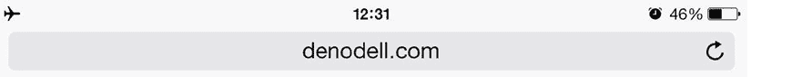

Safari 无法打开页面，因为您的 iPhone 未连接互联网。

**图 10-5.** 移动设备上的网络中断为浏览网页的用户带来了不便体验。

如果我们正在构建一个由 JavaScript 驱动的 Web 应用（在单页体验中消除了硬跳转），当网络连接断开时，用户不会看到这样的屏幕。这时我们需要开发者在应用程序中自行处理这种情况，例如在屏幕上提示用户网络连接已断开，或者将 HTTP 调用存储在缓冲区中，直到网络连接恢复。

# 检测在线和离线状态

列表 10-9 中的代码展示了如何在 JavaScript 代码执行的任何点，使用浏览器的 `navigator.onLine` 属性检测网络连接是否断开。

**列表 10-9.** 在 JavaScript 代码执行期间特定点检测网络连接中断

```
var isOnline = navigator.onLine;

if (isOnline) {
  // 运行依赖于网络访问的代码，例如向服务器执行 Ajax 调用
} else {
  alert("网络已离线。请稍后重试。");
}
```

列表 10-9 中的代码适用于封装任何网络连接代码，例如使用 `XMLHttpRequest` 的 Ajax 调用，或者动态创建引用外部文件资源的 `<script>`、`` 或 `<link>` DOM 元素。然而，你可能想向用户展示网络是否已连接的指示。与其通过拉取（pull）`navigator.onLine` 的状态，我们可以利用两个在网络断开和恢复时触发的 JavaScript 事件，分别命名为 `offline` 和 `online`。然后你可以将代码挂载到这些事件上，在网络状态更改时更新页面，如列表 10-10 所示。

# 列表 10-10. 在 JavaScript 应用中的任何点检测网络连接的变化

```
// 定义一个在网络断开时执行的函数
function goneOffline() {
  alert("无网络连接");
}
```

```
// 定义一个在网络恢复时执行的函数
function backOnline() {
  alert("网络连接已恢复");
}
```

```
// 将这些函数连接到相关的 JavaScript 事件，这些事件分别在
// 网络离线和恢复在线时触发
window.addEventListener("offline", goneOffline, false);
window.addEventListener("online", backOnline, false);
```

列表 10-11 展示了我们如何在一个代码例中结合两种形式的网络连接中断检测方式：在网络离线时存储 Ajax 调用，并在网络连接恢复时立即执行这些调用。

# 列表 10-11. 网络宕机时堆栈 Ajax 调用，恢复时释放

```
// 定义一个变量来存储 Ajax 用的堆栈，如果它们因为
// 网络断开而无法立即执行
var stack = [];
```

```javascript
// 定义执行 Ajax 用的函数
function ajax(url, callback) {
  // XMLHttpRequest 类允许在浏览器中发起 Ajax 请求
  var xhr = new XMLHttpRequest(),
    LOADED_STATE = 4,
    OK_STATUS = 200;
```

```javascript
// 如果浏览器离线，将函数参数（url 和回调）
// 放入堆栈以便稍后发送
if (!navigator.onLine) {
  stack.push(arguments);
} else {
```

```javascript
// 如果浏览器在线，发起 Ajax 调用
xhr.onreadystatechange = function() {
```

```javascript
// ReadyState 为 4 表示服务器响应完成
if (xhr.readyState != LOADED_STATE) {
  return;
}

// 如果服务器响应 HTTP 200 状态消息 "OK"
// 则执行回调函数
if (xhr.status == OK_STATUS) {
  callback(xhr.responseText);
}

// 触发 Ajax HTTP GET 操作
xhr.open("GET", url);
xhr.send();
}

// 定义一个遍历未发送的 Ajax 调用堆栈的函数，依次发送每个调用
function clearStack() {
```

```javascript
// 遍历堆栈中的项，直到堆栈长度为 0（假值）
while (stack.length) {
  // 使用堆栈中的数据发起 Ajax 调用。shift() 方法从数组
  // 中取出第一个元素并返回，从而修改原数组
  ajax.apply(ajax, stack.shift());
}
}

// 确保在网络恢复后立即执行 clearStack 函数
window.addEventListener("online", clearStack, false);
```

你可以在代码中使用 `ajax()` 方法发起 Ajax 调用，如下。列表 10-11 中的代码将处理是立即发起网络调用还是等待直到网络返回。

```javascript
ajax("my-service-url", function(data) {
  alert("收到以下内容：" + JSON.stringify(data));
}
```

# 使用 Web Storage API 持久化数据（在浏览器关闭后）

你可以在你的代码中使用 `ajax()` 方法发起 Ajax 调用，如下所示。列表 10-11 中的代码将处理是立即发起网络调用还是等待直到网络返回。

```javascript
ajax("my-service-url", function(data) {
  alert("收到以下内容：" + JSON.stringify(data));
}
```


列表 10-9 中的代码适用于封装任何网络连接代码，例如使用 `XMLHttpRequest` 的 Ajax 调用，或者动态创建引用外部文件资源的 `<script>`、`` 或 `<link>` DOM 元素。然而，你可能想向用户展示网络是否已连接的指示。与其通过拉取（pull）`navigator.onLine` 的状态，我们可以利用两个在网络断开和恢复时触发的 JavaScript 事件，分别命名为 `offline` 和 `online`。然后你可以将代码挂载到这些事件上，在网络状态更改时更新页面，如列表 10-10 所示。

## 列表 10-10. 在 JavaScript 应用中的任何点检测网络连接的变化

```javascript
// 定义一个在网络断开时执行的函数
function goneOffline() {
  alert("无网络连接");
}
```

```javascript
// 定义一个在网络恢复时执行的函数
function backOnline() {
  alert("网络连接已恢复");
}
```

```javascript
// 将这些函数连接到相关的 JavaScript 事件，这些事件分别在
// 网络离线和恢复在线时触发
window.addEventListener("offline", goneOffline, false);
window.addEventListener("online", backOnline, false);
```

列表 10-11 展示了我们如何在一个代码例中结合两种形式的网络连接中断检测方式：在网络离线时存储 Ajax 调用，并在网络连接恢复时立即执行这些调用。

## 列表 10-11. 网络宕机时堆栈 Ajax 调用，恢复时释放

```javascript
// 定义一个变量来存储 Ajax 用的堆栈，如果它们因为
// 网络断开而无法立即执行
var stack = [];
```

```javascript
// 定义执行 Ajax 用的函数
function ajax(url, callback) {
  // XMLHttpRequest 类允许在浏览器中发起 Ajax 请求
  var xhr = new XMLHttpRequest(),
    LOADED_STATE = 4,
    OK_STATUS = 200;

  // 如果浏览器离线，将函数参数（url 和回调）
  // 放入堆栈以便稍后发送
  if (!navigator.onLine) {
    stack.push(arguments);
  } else {
    // 如果浏览器在线，发起 Ajax 调用
    xhr.onreadystatechange = function() {
      // ReadyState 为 4 表示服务器响应完成
      if (xhr.readyState != LOADED_STATE) {
        return;
      }
      // 如果服务器响应 HTTP 200 状态消息 "OK"
      // 则执行回调函数
      if (xhr.status == OK_STATUS) {
        callback(xhr.responseText);
      }
    };
    // 触发 Ajax HTTP GET 操作
    xhr.open("GET", url);
    xhr.send();
  }
}

// 定义一个遍历未发送的 Ajax 调用堆栈的函数，依次发送每个调用
function clearStack() {
  // 遍历堆栈中的项，直到堆栈长度为 0（假值）
  while (stack.length) {
    // 使用堆栈中的数据发起 Ajax 调用。shift() 方法从数组
    // 中取出第一个元素并返回，从而修改原数组
    ajax.apply(ajax, stack.shift());
  }
}

// 确保在网络恢复后立即执行 clearStack 函数
window.addEventListener("online", clearStack, false);
```

你可以在代码中使用 `ajax()` 方法发起 Ajax 调用，如下所示。列表 10-11 中的代码将处理是立即发起网络调用还是等待直到网络返回。

```javascript
ajax("my-service-url", function(data) {
  alert("收到以下内容：" + JSON.stringify(data));
});
```

## 第 10 章 移动端 JavaScript 开发

```javascript
if (confirm("你希望我们忘记你最喜爱的浏览器吗？")) {
  // delete 关键字允许从 localStorage 中删除一个属性
  delete localStorage["favoriteBrowser"];
}
```

我们可以将 Web Storage API 应用到列表 10-11 中编写的代码中，在网络断开时对 Ajax 调用进行堆叠，在用户关闭浏览器时持久化该堆栈，并在用户重新打开浏览器且连接恢复时执行这些调用，如列表 10-14 所示。

## 列表 10-14. 在网络掉线时堆叠 Ajax 调用，并在浏览器关闭后将其持久化

```javascript
localStorage["stack"] = localStorage["stack"] || [];

function ajax(url, callback) {
  var xhr = new XMLHttpRequest(),
    LOADED_STATE = 4,
    OK_STATUS = 200;

  if (!navigator.onLine) {
    // localStorage 中的数据是以字符串形式存储的，因此为了存储复杂的数据结构，
    // 如数组或对象，我们需要先将它们转换为 JSON 格式的字符串
    localStorage["stack"].push(JSON.stringify(arguments));
  } else {
    xhr.onreadystatechange = function() {
      if (xhr.readyState != LOADED_STATE) {
        return;
      }

      if (xhr.status === OK_STATUS) {
        callback(xhr.responseText);
      }
    };

    xhr.open("GET", url);
    xhr.send();
  }
}

function clearStack() {
  if (navigator.onLine) {
    while (localStorage["stack"].length) {
      // 从 localStorage 中读取 JSON 格式的字符串数据后，需要将其
      // 转换回复杂数据格式，供 ajax() 函数使用
      ajax.apply(ajax, JSON.parse(localStorage["stack"].shift()));
    }
  }
}

// 在页面加载时检查是否有任何之前堆叠的现在可以发送的 Ajax 调用
window.addEventListener("load", clearStack, false);
window.addEventListener("online", clearStack, false);
```

在你开始使用此 API 在本地存储数兆字节的数据之前，值得考虑浏览器对可存储数据的限制。每个域名最多可以在本地存储 5MB 的数据。虽然这在许多浏览器中是可以更改的设置，但它是默认值，且无法通过 JavaScript 更改。如果你尝试使用 `localStorage` 写入超过 5MB 的数据，将抛出错误，并在你删除之前存储的数据之前不允许你保存额外数据。如果你希望清除通过这种方式存储在本地的内容，可以使用 `localStorage.clear()` 方法，这将释放你应用程序可用的所有空间，恢复到 5MB 的默认数据存储。

若要深入了解 Web Storage API，请阅读 Mozilla 开发者网络（MDN）上的“DOM 存储指南”，地址为：http://bit.ly/dom_storage。

### HTML5 应用程序缓存

我们用于处理离线状态的最后可用技术是 HTML5 应用程序缓存（Application Cache）。通过使用特殊格式的文件（即清单文件，manifest file），你可以列出应用程序中的文件，将其下载并存储在本地设备的缓存中，允许这些文件立即从缓存而非网络加载。每当你访问一次网站或应用程序后，即使在连接离线状态时，你也可以再次访问同一个网站。这不仅对移动设备或网络连接不佳的设备有益，桌面设备也能体验到这种好处，这意味着网站在缓存中将即时加载。

清单文件是一个简单的文本文件，包含具有 `.app` 扩展名的指令，尽管这不属于任何规范的一部分。更重要的是，缓存文件必须以 `text/cache-manifest` 的 MIME 类型提供服务，因为大多数 Web 服务器需要为该文件添加特定的规则。

清单文件必须通过 `manifest` 属性从 HTML 文件中引用：

```html
<html manifest="manifest.appcache">
```

清单文件本身看起来像标准的文本文件，其第一行必须是 `CACHE` 以便正确识别。在这种简单用法下，随后是每行一个文件的列表，将对相同页面进行缓存。如果清单文件中的任何文件不存在或返回了 HTTP 错误（状态码 404 或 500），清单文件将被视为无效且不会使用此方法缓存。当下次加载页面时，浏览器会将清单文件视为从未见过并尝试下载所有引用资源。

如果浏览器检测到清单文件自上次缓存以来已更新，它将返回服务器下载引用的文件进行更改——除非存在 `If-Modified` HTTP 请求头，这意味着只有自上次缓存以来已更新的文件会被更新到缓存中。一个很好的技巧是在清单文件的行开头包含一个以 `#` 字符开头的注释，该行引用了文件的版本号或日期选项。当你更新引用的文件时，更新清单文件中的版本号，以便浏览器检测到更改并开始更新。如果清单文件没有变化，浏览器将继续提供文件的缓存版本，直到用户手动删除缓存。当请求这种方式缓存的页面时，浏览器会在下载更新资源之前先加载页面的缓存版本。

## 列表 10-15. 一个简单的缓存文件

```text
CACHE MANIFEST
# Version 1.0.1 - 2013-01-02
CACHE:
/library/styles/main.css
/library/scripts/lib/jquery.js
/library/scripts/main.js
/images/background.jpg
/images/logo.png
```

## 列表 10-16. 一个更高级的缓存清单文件，使用了可选的 CACHE; NETWORK; 和 FALLBACK

```text
CACHE MANIFEST
# Version 1.0.1 - 2013-10-02

CACHE:
/library/styles/main.css
/library/scripts/lib/jquery.js
/library/scripts/main.js
/images/background.jpg
/images/logo.png

NETWORK:
/api/

FALLBACK:
/images/network-status-online.png /images/network-status-offline.png
```

## 用于响应式设计的 JavaScript

响应式 Web 设计（Responsive Web Design）是一项新兴技术，通过允许界面适应其所查看的设备特性，来设计和构建网站及应用程序。屏幕较小的设备（如智能手机）将显示合适尺寸和比例的用户界面，较大的设备也是如此。媒体查询（Media Queries）允许根据当前设备的特性（如屏幕宽度等）对页面元素应用不同的样式规则。

在许多情况下，使用此技术对网站进行的视觉更改可能需要伴随界面行为的变化。例如，导航菜单在较大的设备上可能会完全显示，在较小的设备上可能会隐藏，并带有一个切换按钮来触发菜单的显示；该切换按钮的行为仅适用于小屏幕视图。

通过使用浏览器的 `window.matchMedia()` 方法，根据当前激活的 CSS3 媒体查询执行不同的 JavaScript 代码，该方法通过将媒体查询或部分查询与当前显示进行比较。它会返回一个 `MediaQueryList` 对象，其中包含一个 `matches` 属性，如果媒体查询此时处于激活状态，该属性将设置为 `true`。

如果所应用的媒体查询发生了变化，你需要在浏览器的每个调整大小事件（resize event）中重新检查 `matches` 属性的状态，尽管在大多数情况下，这只需要简单地挂钩浏览器窗口的调整大小事件即可。

## 列表 10-17. 基于 CSS3 媒体查询执行 JavaScript

```javascript
// 为不同的 CSS3 媒体查询规则创建 MediaQueryList 对象
var landscapeMQL = window.matchMedia("orientation: landscape");
var smallScreenMQL = window.matchMedia("max-width: 480px");

function checkMediaQueries() {
  // 如果浏览器现在处于横屏模式，则执行特定代码
  if (landscapeMQL.matches) {
    alert("浏览器现在处于横屏模式");
  }

  // 如果浏览器窗口宽度为 480px 或窄，则执行特定代码
  if (smallScreenMQL.matches) {
    alert("您的浏览器窗口宽度为 480px 或窄");
  }
}

// 在页面加载以及屏幕调整大小或方向改变时执行该函数
window.addEventListener("load", checkMediaQueries, false);
window.addEventListener("resize", checkMediaQueries, false);
```

在 Mozilla 开发者网络（MDN）上阅读更多关于 `matchMedia` 方法的介绍：http://bit.ly/matchmedia。


## 总结

在本章中，我们考虑了 Web，特别是 JavaScript 将其应用于用户在移动设备、智能手机或平板设备上浏览的场景。我们了解了在内存、带宽、延迟和速度方面需要考虑的限制，以及如何最好地应对这些限制。我们查看了如何直接从设备板载传感器访问数据，允许应用程序对位置、运动、方向等做出反应。我们还研究了网络连接断开时会发生什么，以及尽管如此如何提供平滑的用户体验（即在网络恢复后尽快处理网络操作）。最后，我们学习了如何根据响应式网站在浏览器中应用的 CSS3 媒体查询执行特定的 JavaScript 代码。

面向移动的开发是一个日益增长的领域，随着每年新设备的发布和操作系统的更新，我们可以通过开放、标准的 W3C API 直接通过 JavaScript 访问越来越多的设备功能。请确保你定期关注最新进展，以免在这一技术进步飞速的世界中被抛弃。

在下一章中，我们将查看如何使用 HTML5 Canvas 绘图 API 为桌面和移动端构建在线游戏，而无需依赖于 Adobe Flash 等任何第三方插件。

## 第 11 章：使用 Canvas API 构建游戏

近年来网页浏览器最令人兴奋的新功能之一是在 HTML 中引入了 `<canvas>` 标签及其相关的 JavaScript API。单独在 HTML 文档中，它无任何用处。然而，将其与 JavaScript 的力量结合，你就在页面上拥有了一个空白的绘图区域，你可以随心所欲地添加形状、图像和文本。`<canvas>` 元素的内容是用绘图表面上的像素数据表示，而不是文档中的单个 DOM 元素；如果你在现有形状上用像素绘制，文档中不会记录屏幕上发生的这一操作。结合一些行为逻辑，我们就可以使用 `<canvas>` 元素在一段时间内在画布上进行细微变化的构建和重绘，从而在元素内部产生动画和运动的印象。通过将此动画连接到触摸屏、鼠标或键盘上的控制器，我们允许用户操纵发生的一切，从而构建运行在浏览器中的游戏。在本章中，我们将查看 Canvas JavaScript API 中的基本绘图操作，然后详细介绍如何使用它来构建游戏，包括构建经典街机游戏《Frogger》的可运行版本。

### Canvas 中的基本绘图操作

画布表面上的所有绘制都仅通过 JavaScript 完成，并且所有画布默认都是空白的。在绘制之前，我们需要获取画布元素的二维绘图上下文引用（drawing context），它返回一个我们想要在上面绘制的表面的引用——通过为不同需求创建额外的上下文，可以开发画布规范，例如，通过 WebGL 规范（`http://webgl.org`），现在画布中实现三维图形是可行的。获取绘图上下文引用的方法与执行画布 DOM 的 `getContext()` 方法一样简单，并且可以执行多种方法在画布上绘制形状并添加文本，如列表 11-1 所示。

#### 列表 11-1：Canvas 中的基本绘图操作

```javascript
// 创建一个新的 <canvas> 元素
var canvas = document.createElement("canvas");

// 获取画布绘图上下文的引用
context = canvas.getContext("2d");

// 设置画布的尺寸
canvas.width = 200;
canvas.height = 200;

// 默认情况下，画布是空的，但如果我们需要清空内容，可以执行此函数
function emptyCanvas() {
  // 清除左上角到 200x200 的画布内容
  context.clearRect(0, 0, 200, 200);
}

// 建立了绘图上下文，我们现在可以在空白画布上执行任何绘图命令
// 例如，如果我们想在画布左上角画一个圆，可以执行以下函数
function drawCircle() {
  // 首先，我们告诉绘图上下文正在创建一个路径——本质上是点与点之间的连线
  context.beginPath();

  // context 的 arc() 方法告诉路径采用弧形。方法的前两个参数分别
  // 表示弧在 x 轴和 y 轴上的起始位置（像素）。第三个参数表示弧的大小（像素），
  // 最后两个参数表示弧的起始和结束（弧度）。
  // 为了画一个圆，起始角度始终为 0，结束角度始终为 PI 值的两倍，
  // 这表示弧度上的 360 度。
  context.arc(100, 100, 100, 0, 2 * Math.PI);

  // 默认情况下此路径是不可见的，但 stroke() 方法确保沿路径绘制
  // 可视的线条，使其轮廓可见。我们也可以使用
  // fill() 方法用固定颜色填充圆。
  context.stroke();
}

// 将绘图上下文的位置移动到位置（距离画布左边缘 50px）
//（距离顶部边缘 40px）
context.moveTo(50, 40);

// 标记一条从上下文当前位置到 150px x 160px 的直线，
// 但并未实际在画布上绘制线条
context.lineTo(150, 160);

// 应用“墨水”到画布以填充标记出的线条
context.stroke();
```

```javascript
// 定义一个函数，使用绘图上下文的
// fillRect() 方法在画布上绘制一个红色正形，在执行操作前先设置绘制颜色
function drawSquare() {
```

```javascript
// 设置下一次绘制操作的填充样式。#FF000 是代表红色的十六进制值。
context.fillStyle = "#FF000";
```

```javascript
// 在 20px x 20px 的位置绘制一个 100px 的红色正形
context.fillRect(20, 20, 100, 100);
```

```javascript
}
// 我们甚至可以像此函数所示，使用 fillText() 和 strokeText() 绘图
// 上下文方法在画布上添加文本
function writeText() {
```

```javascript
// 首先为用于绘制到画布上的文本设置字体样式
context.font = "30px Arial";
```

```javascript
// 在 0px x 0px 的位置在画布上写入一些文本
context.fillStyle = "#000";
context.fillText("Filled Text", 0, 30);
```

```javascript
// 在现有文本下方 0px x 40px 的位置在画布上写入轮廓文本
context.strokeText("Outlined Text", 0, 70);
}
```

```javascript
// 执行定义的绘制函数，将它们的形状和文本添加到画布上
emptyCanvas();
drawCircle();
drawLine();
drawSquare();
writeText();
```

```javascript
// 页面加载后，将新的 <canvas> DOM 元素添加到当前 HTML 页面的末尾
window.addEventListener("load", function() {
  document.body.appendChild(canvas);
}, false);
```

在网页环境中执行列表 11-1 中的代码，将导致图 11-1 所示的图像以 `<canvas>` 元素的形式添加到页面中。


图 11-1。Canvas 中的基本绘图操作

要查看有关 Canvas API 中可用绘图方法的详细概述，请查看位于 Mozilla 开发者网络上的“Canvas 教程”，网址为 `http://bit.ly/canvas_tutorial`。

### 高密度 Canvas 元素

移动和桌面设备屏幕技术的最新进展为此类设备带来了高定义图形，这有时被称为视网膜图形（retina graphics），因为单个像素边界在肉眼看来无法与视网膜区分。默认情况下，canvas 元素在更高分辨率的屏幕上似乎不会显示高定义图形，且基于画布的图形在这些屏幕上通常会出现像素化或模糊。通常我们有技术可以帮助我们绕过这一限制，创建高分辨率的画布。

为了确保您的画布在显示的设备屏幕上渲染正确数量的像素，我们可以利用浏览器窗口 `window` 对象上的 `devicePixelRatio` 属性。该属性存储的值表示相对于当前屏幕支持的显示的分放因子，例如，标准屏幕为 1，视网膜显示为 2。我们使用此值来缩放画布元素的宽度和高度以便显示；从而以设备的正确尺寸进行渲染。Paul Weiss 在 HTML5 Rocks 上通过 `http://bit.ly/hidpi_canvas` 编写了一些关于如何实现此点的文档，值得仔细阅读；然而，如果你确定正在绘制的图形不是特别密集的计算操作，你可以设置画布的大小以较大的尺寸绘制所有内容（即不使用缩放因子），只需使用 CSS 将画布元素的宽度和高度缩放回 HTML 页面内所需的显示尺寸即可。这通过在较小的空间内渲染更多像素，使得在画布上看到更高分辨率的图形。如果你的最终用户没有高定义屏幕，渲染未显示的额外像素就会浪费资源，这就是为什么这种技术只应该用于低密度的操作，以防影响浏览器性能。

### 使用 Canvas 构建游戏

Canvas API 的常见用途是构建运行在浏览器中的游戏，以前仅限于为 Adobe Flash 播放器编写的专有代码领域。由于该 API 支持各种设备（包括桌面和移动），使用 Canvas API 编写的游戏也可以在浏览器中移动运行。许多游戏由类似的过程和结构组成，包括：

- 游戏板或世界，定义了游戏内动作的限制。
- 绘制并动画玩家控制，以及游戏板上出现的任何敌人或障碍，并跟踪每个游戏板上的位置。
- 使用按键、点击、触摸、移动和其他输入设备等输入机制控制玩家在游戏板上的移动。
- 维护更新的分数、高分，并跟踪玩家剩余生命次数和/或玩家完成关卡所需的剩余量。
- 检测游戏板上一个或多个玩家或障碍物相互碰撞，以及处理玩家失去生命或完成关卡或游戏的情况。

让我们详细查看如何代码化这些结构，使其能够协同工作并使用 Canvas API 形成一个游戏。

### 在画布上绘制图像

大多数游戏都涉及图像在屏幕上的移动——玩家角色很少是圆形或正方形等简单形状，将游戏图形设计为图像并在游戏中使用可能是简单的。需要直接从文件将图像绘制到画布上，这可以使用画布上下文的 `draw()` 方法完成，向其传递 `` 元素的引用以及在画布上绘制图像的位置，如列表 11-2 所示。

```javascript
// 创建一个新的 <canvas> 元素
var canvas = document.createElement("canvas");

// 获取画布的绘图上下文
context = canvas.getContext("2d");

// 创建一个绘制到画布上的  元素
img = document.createElement("img");

// 在图像加载后执行函数
img.addEventListener("load", function() {
  // 在 0px x 0px 的位置在画布上绘制图像
  context.drawImage(img, 0, 0);
}, false);

// 为图像分配 "src" 属性
img.src = "filename.png";
```

#### 列表 11-2：在画布上绘制图像（示例）

```javascript
// 页面加载后，将新的 <canvas> 元素添加到当前 HTML 页面的末尾
window.addEventListener("load", function() {
  document.body.appendChild(canvas);
}, false);
```

### 使用精灵图避免多个图像文件

避免网页上共同使用小型图像文件的常用技术是将这些图像合并成精灵图（sprite map），即包含每个图像的大图。这通过减少浏览器和服务器需要完成的 HTTP 请求来提高性能。在标准网页中，可以通过 CSS `background-position` 结合 `width` 和 `height` 属性从图中提取单个图像。在画布上显示图像的情况下，`drawImage()` 方法参数的变体允许我们从精灵图文件中提取图像的部分，如列表 11-3 所示。

```javascript
// 创建一个新的 <canvas> 元素
var canvas = document.createElement("canvas");

// 获取 2D 上下文
context = canvas.getContext("2d");

// 创建一个  元素
img = document.createElement("img");

// 在图像加载后执行函数
img.addEventListener("load", function() {
  var individualImagePositionTop = 200,
  individualImagePositionLeft = 150,
  individualImageWidth = 300,
  individualImageHeight = 40,
  displayPositionTop = 100,
  displayPositionLeft = 100,
  displayWidth = 150,
  displayHeight = 40;

  // 将位于 200px x 150px 位置且尺寸为 300px x
  // 40px 的单个图像绘制到 100px x 100px 的 <canvas> 元素上，以原始尺寸的一半渲染，
  // 为 150px x 40px
  context.drawImage(img, individualImagePositionTop, individualImagePositionLeft,
  individualImageWidth, individualImageHeight, displayPositionTop, displayPositionLeft,
  displayWidth, displayHeight);
}, false);

// 分配 "src" 属性
img.src = "sprite-map.png";
```

#### 列表 11-3：从精灵图到画布上绘制单个图像（示例）

### Canvas 中的动画

动画是任何游戏的基础性方面。为了让 Canvas API 成为构建游戏的良好平台，它需要支持更新在其中绘制的像素的位置和外观的能力。由于 canvas 的内容仅被表示为固定空间中的像素，我们无办法在定位单个图像、形状或 canvas 的其他部分，并在不影响 canvas 中其他内容的情况下对其进行更新。

为了营造动画的幻觉，我们需要足够频繁地重新渲染 canvas 的内容，使人眼不会将变化识别为平滑动画以外的其他东西。然后，canvas 的每个绘制部分都会在固定时间后清除 canvas 并重新绘制，并在必要时将元素移动到新位置。通过每秒重绘几次，我们创建了动画的幻觉。

列表 11-4 显示了一个圆穿过 `<canvas>` 元素的简单动画，该动画通过每 50 毫秒重绘一次 canvas 并在每次更新新位置来实现的。

#### 列表 11-4：Canvas 中的简单动画

```javascript
var canvas = document.createElement("canvas")
context = canvas.getContext("2d");

// 定义要绘制到 canvas 上的圆的位置、大小和属性
leftPosition = 0,
topPosition = 100,
radius = 100,
startDegree = 0,
endDegree = 2 * Math.PI; // 弧度为 360 度

// 定义一个定期执行的函数，用于更新圆的位置并
// 在新位置重绘
function animate() {
  // 更新圆应该在屏幕上绘制的位置
  leftPosition++;

  // 清空 canvas 的内容
  context.clearRect(0, 0, canvas.width, canvas.height);

  // 在新位置在 canvas 上绘制圆
  context.beginPath();
  context.arc(leftPosition, topPosition, radius, startDegree, endDegree);
  context.stroke();
}

// 每 50 毫秒执行一次 animate() 函数，每次在更新的
// 位置重绘圆
setInterval(animate, 50);

// 加载后将 <canvas> 元素添加到页面中
window.addEventListener("load", function() {
  document.body.appendChild(canvas);
}, false);
```

### 游戏控制

所有游戏都会对其运行设备的某种形式的输入做出反应——否则它们将非常无聊。大多数情况下，这涉及一个主角，尝试使用某种灵活性来确保该角色达到特定目标，避开网页上的敌人和障碍。在桌面电脑上，通过按下键盘上的特定键或通过移动或点击鼠标来控制角色的位置。在移动设备上，可以通过触摸灵敏屏幕或以某种方式旋转设备来控制角色。因为基于 canvas 的游戏在两类设备上都运行，所以你应该确保你创建的任何游戏都可以通过任何类型设备上的输入类型进行控制。

列表 11-5 显示了如何捕获屏幕上的特定按键或点击，以控制基于 canvas 的游戏中的玩家。

#### 列表 11-5：捕捉输入以控制游戏中的角色


```javascript
var canvas = document.createElement("canvas");

// 定义一个函数在`<canvas>`中移动玩家的角色
function move(direction) {
  // 在此处插入代码以更新 canvas 上字符的位置
}

// 当玩家按下键盘上的方向键时，在相应的方向移动玩家的角色
window.addEventListener("keydown", function(event) {
  // 定义方向键的键码
  var LEFT_ARROW = 37,
    UP_ARROW = 38,
    RIGHT_ARROW = 39,
    DOWN_ARROW = 40;

  // 执行`move()`函数，根据按下的方向键传递正确的方向
  if (event.keyCode === LEFT_ARROW) {
    move("left");
  } else if (event.keyCode === RIGHT_ARROW) {
    move("right");
  } else if (event.keyCode === UP_ARROW) {
    move("up");
  } else if (event.keyCode === DOWN_ARROW) {
    move("down");
  }
}, false);

// 当玩家在触摸灵敏屏幕上的`<canvas>`某些位置点击时，
// 根据屏幕点击的位置按相应的方向移动玩家的角色
canvas.addEventListener("touchstart", function(event) {
  // 获取相对于距离`<canvas>`左上角位置的屏幕触摸位置（像素）引用
  var touchLeft = event.targetTouches[0].clientX,
    touchTop = event.targetTouches[0].clientY;

  // 执行`move()`函数，根据传递到`<canvas>`元素的位置传递正确的方向
  if (touchLeft < (canvas.width / 8)) {
    move("left");
  } else if (touchLeft < (3 * canvas.width / 8)) {
    move("right");
  } else if (touchTop < (canvas.height / 8)) {
    move("up");
  } else if (touchTop > (3 * canvas.height / 8)) {
    move("down");
  }
}, false);

// 加载后将`<canvas>`元素添加到页面中
window.addEventListener("load", function() {
  document.body.appendChild(canvas);
});
```

### 碰撞检测

到为止我们已经学习了如何绘制、动画以及控制游戏中的位置——剩下的是处理碰撞。游戏循环是一个根据固定时间调用的函数，它本质上是游戏的核心——它更新 canvas 内的位置，并处理碰撞。尽管玩家的输入可能在任何时间发生，以便在新的位置绘制角色。

确保游戏循环以固定频率运行的一种技术是使用浏览器的`setInterval()`函数，如列表 11-7 所示。

**列表 11-7. 使用`setInterval()`固定运行游戏循环**

```javascript
// 定义一个函数作为游戏循环
function gameLoop() {
  // 更新 canvas 内的位置，处理碰撞并以新位置绘制字符
}
```

```javascript
// 每 50 毫秒执行一次`gameloop`函数，导致每秒 20
// 帧率 (=1000/50)
setInterval(gameLoop, 50);
```

使用`setInterval()`函数运行游戏循环的问题是，如果浏览器在下次初始化之前没有完成游戏循环函数的执行，代码就会堆积并导致浏览器出现卡死或停顿——这并不好。幸运的是，浏览器制造商已经解决了这个问题，因此不再要求你的代码无论对影响如何都运行，而是由浏览器告诉你它可以处理更多命令。这是通过在`window`上调用`requestAnimationFrame()`实现的，向其传递一个函数并在下一个机会执行。为了确保按照固定的帧率执行命令，我们给了浏览器更多的控制权，允许如列表 11-8 所示产生更平滑的动画。由于规范确定之前的跨浏览器命名差异，我们需要一个简单的填充程序以确保跨浏览器操作，如列表 11-8 开头所示，它展示了一个示例。

**列表 11-8. 简单碰撞检测**

```javascript
// requestAnimationFrame 的简单填充程序
if (!window.requestAnimationFrame) {
  window.requestAnimationFrame = function(callback) {
    setTimeout(callback, 16);
  };
}

// 使用 requestAnimationFrame 的游戏循环
function gameLoop() {
  // 更新 canvas 内的位置，处理碰撞并在新位置绘制字符
  requestAnimationFrame(gameLoop);
}

// 启动循环
requestAnimationFrame(gameLoop);
```

# 列表 11-8. 使用`requestAnimationFrame`运行游戏循环

```javascript
// 为现代浏览器的 requestAnimationFrame() 方法创建一个简单的跨浏览器 polyfill
// 以启用平滑、节能的动画。感谢 Paul Irish，源自：
// http://bit.ly/req_anim_frame
window.requestAnimationFrame = (function() {
  return window.requestAnimationFrame || window.webkitrequestAnimationFrame ||
  window.mozrequestAnimationFrame || function(callback) {
    window.setTimeout(callback, 1000 / 60);
  };
})();
```

// 在本地变量中存储开始的游戏循环的引用——将其初始化

// 为当前时间

```javascript
var lastGameLoopRan = (new Date()).getTime();
```

// 定义我们游戏循环的刷新率，以便在我们的 canvas 中重新渲染。

// 20 毫秒的刷新率意味着每秒 50 帧（= 1000 / 20）

```javascript
refreshRate = 20;
```

```javascript
// 定义一个作为游戏循环的函数
function gameLoop() {
  // 获取当前时间，并据此推断它与上一次
  // 游戏循环运行之间差
  var currentTime = (new Date()).getTime();
  timeDifference = currentTime - lastGameLoopRan;

  // 当浏览器下一个动画帧准备可用时，再次执行此函数——
  // 保持游戏循环，但限制在浏览器的性能和约束范围内，
  // 这对玩家来说是最好的
  window.requestAnimationFrame(gameLoop);

  // 如果`gameLoop()`函数的当前执行时间与其上一次
  // 执行之间的时间差大于或等于定义的刷新率，则
  // 执行典型的游戏循环操作
  if (timeDifference > refreshRate) {
    // 更新角色位置，检查碰撞并在新位置绘制角色

    // 更新游戏循环运行的最后时间，以便下一次执行发生在
    // 正确的时间
    lastGameLoopRan = currentTime;
  }
}

// 启动游戏循环的第一次运行
gameLoop();
```

### 分层 Canvas 以提高性能

`<canvas>`元素上的每个绘制操作都需要一定的时间来执行。如果你有一个有很多角色的复杂游戏，并且多次进行这种操作，你就会意识到每一次绘制操作对性能都至关重要，因此，应尽可能避免重新绘制游戏的某些部分。例如，对于某些具有静态背景的游戏，创建两个`<canvas>`元素会更有意义：一个用于绘制背景，另一个用于定期更新角色的移动和动画。然后可以使用 CSS 将两个元素堆叠在一起，将包含移动的元素放置在包含背景的元素上方，后者只需要绘制一次且永远不需要更新。

# 在 Canvas 中构建“Frogger”（青蛙过河）游戏

让我们使用 Canvas API 将所学知识付诸实践。我们将构建一个基于 1981 年经典街机游戏[Frogger](http://bit.ly/frogger_game)的简单游戏，展示如何最好地绘制和制作角色动画、处理来自游戏控制器的输入、处理游戏中两个或多个角色之间的碰撞检测，以及如何调节帧率以保持玩家保持最佳性能。

如果你不熟悉，该游戏的目的是引导一只青蛙从屏幕底部移动到顶部，首先是引导角色穿过一条繁忙的道路而不撞到任何交通工具，然后利用浮动的木头和偶尔浮出水面的乌龟背部穿过河流，同时避开水中的危险，最后将我们的英雄送到屏幕顶部五个目标站之一，此时屏幕底部会再次创建一只新青蛙。一旦角色进入每个目标站一次，游戏即胜利。作为游戏的控制者，用户必须确保青蛙不会被车辆撞到、不会被带到屏幕边缘、在乌龟潜入水时站在它背上，并且角色在允许时间内到达其中一个目标站。如果角色发生意外，将失去一条生命，直到生命无无尽且游戏被认为结束。

Frogger 中的典型关卡如图 11-2 所示。

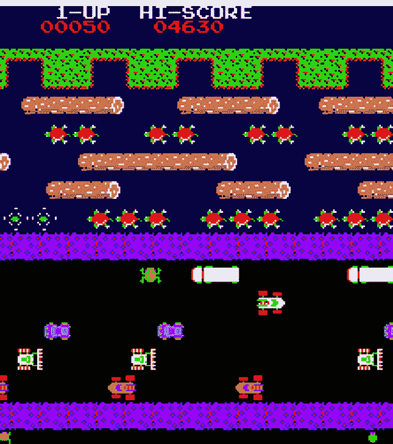

让我们从创建一个基础 HTML 页面来放置我们的游戏开始，如列表 11-9 所示。我们在`<head>`中使用特殊格式的`<meta>`标签固定移动设备的视口宽度。我们还需要名为“Arcade Classic”的自定义字体（可以从 http://bit.ly/arcade_font 下载），用于在 canvas 中显示分数和其他文本，因此我们也加载了它。然后我们创建两个`<canvas>`元素，一个用于容纳背景，另一个用于动画前景，并定义 CSS 将两个 canvas 堆叠在一起，确保它们以实际 canvas 尺寸的一半大小显示，以便支持高清显示。

**列表 11-9：用于在 Canvas 中放置 Frogger 游戏的 HTML 页面**

```html
<!DOCTYPE html>
<html>html
<head>
  <title>Frogger In Canvas</title>
  <meta charset="utf-8">
  <meta name="viewport" content="width=480,initial-scale=1.0">
```

# 第 11 章 使用 CANVAS API 构建游戏

```css
<style>
  @font-face {
    font-family: 'Arcade Classic';
    src: url('http://bit.ly/arcade_font');
  }
  .canvas {
    position: absolute;
    top: 0;
    left: 0;
    border: 2px solid #000;
    width: 480px;
    height: 640px;
  }
</style>
</head>
<body>
<canvas id="background"></canvas>
<canvas id="foreground"></canvas>
<!-- 在此处加载脚本 -->
</body>
</html>
```

HTML 准备好后，我们开始编写 JavaScript。列表 11-10 显示了如何通过创建一个命名空间来启动我们的游戏。

```javascript
var Frogger = (function() {
  var canvas = document.getElementById("canvas");
  var drawingSurface = canvas.getContext("2d");

  var backgroundCanvas = document.getElementById("background");
  var backgroundDrawingSurface = backgroundCanvas.getContext("2d");

  var lastGameLoopRan = (new Date()).getTime();
  var refreshRate = 20;

  var direction = {
    UP: "up",
    DOWN: "down",
    LEFT: "left",
    RIGHT: "right"
  };

  // 定义观察模式方法`subscribe()`和`publish()`以允许
  // 无紧耦合模块的应用通信。
  // 关于此设计模式的更多信息请参见第 7 章
  var events = {};

  return {
    subscribe: function(eventName, callback) {
      if (!events.hasOwnProperty(eventName)) {
        events[eventName] = [];
      }
      events[eventName].push(callback);
    },
    publish: function(eventName) {
      var data = Array.prototype.slice.call(arguments, 1),
        index = 0,
        length = 0;

      if (events.hasOwnProperty(eventName)) {
        length = events[eventName].length;

        for (; index < length; index++) {
          events[eventName][index].apply(this, data);
        }
      }
    }
  };
})();
```

# 第11 章 | 使用 Canvas API 构建游戏

```javascript
}
}
;));
```

```javascript
// 定义一个方法来判断游戏板上的两个障碍物在水平轴上
// 是否相交。通过传入两个对象（每个对象都包含`'left'`
// 和`'right'`属性，用于标识每个障碍物在游戏板上以像素为单位
// 的左侧和右侧的位置），我们来确定它们是否相交 - 如果它们
// 相交，并且它们在游戏板上处于同一行，则可以被视为
// 这两个障碍物之间的碰撞
intersects: function(position, position2) {
  var doesIntersect = false;

  if ((position.left > position2.left && position.left < position2.right) ||
      (position.right > position2.left && position.right < position2.right)) {
    doesIntersect = true;
  }
  return doesIntersect;
}
}
());
```

需要根据列表 11-9 中 HTML 页面中的`<script>`标签按顺序引用的每个代码列表，以查看最终结果。现在，让我们创建核心游戏逻辑，包括游戏状态、游戏循环、分数处理，以及建立玩家剩余生命和完成关卡的时间，如列表 11-11 所示。

# 列表 11-11. Frogger 的核心游戏逻辑

```javascript
// 为现代浏览器的 requestAnimationFrame() 方法创建一个简单的跨浏览器填充
// 程序，以实现平滑、低功耗动画。感谢 Paul Irish，通过：
// http://bit.ly/req_anim_frame
window.requestAnimationFrame = (function() {
  return window.requestAnimationFrame = window.webkitrequestAnimationFrame ||
    function(callback) {
      window.setTimeout(callback, 1000);
    };
})();
```


```javascript
// 定义游戏逻辑模块，该模块负责跟踪游戏状态、玩家得分、
// 剩余生命次数、处理玩家角色与其他
// 障碍物之间的碰撞，并确保在正确的时刻将游戏图形绘制到 <canvas> 上。
// 此模块包含了游戏玩法背后的大脑，并通过观察者模式指令其他代码模块执行繁重工作。
(function(Frogger) {

// 定义一个变量来存储当前玩家的得分
var _score = 0;

// 定义并初始化一个变量来存储游戏中达到的最高分
var _highScore = 1000;

// 定义玩家在游戏结束前剩余的生命数
var _lives = 5;

// 定义玩家将角色带到目标所需的毫秒数（60秒）。
// 如果他们花费时间过长，他们将失去一次生命
var _timeTotal = 60000;

// 定义一个变量来存储玩家到达目标的剩余时间
var _timeRemaining = _timeTotal;

// 定义 <canvas> 元素上图形的刷新率（每 33 1/3 毫秒绘制一次（
// 每秒 30 帧）。尝试频繁重绘可能会导致浏览器变慢，因此请仔细选择此值，
// 以在流畅的动画和流畅的游戏之间保持良好的平衡
var _refreshRate = 33.333;

// 定义一个变量来存储玩家角色到达目标的次数
var _timesAtGoal = 0;

// 定义一个变量指示玩家角色需要到达目标才能获胜的次数
var _maxTimesAtGoal = 5;

// 定义一个布尔变量指示玩家移动是否被冻结
var _isPlayerFrozen = false;

// 定义一个变量来存储游戏循环上次运行的时间——这有助于保持
// 动画以定义的刷新率平滑
var _lastTimeGameLoopRan = (new Date()).getTime();

// 定义一个调用函数，用于倒计时玩家到达目标的剩余时间，而不丢失生命
function countDown() {
  if (_timeRemaining > 0) {
    // 此函数的调用频率由 _refreshRate 变量决定，
    // 因此我们减少了剩余的毫秒数
    _timeRemaining -= _refreshRate;

    // 发布剩余时间已更改的事实，传递新的剩余时间的百分比——
    // 这将帮助我们在游戏板上显示剩余时间
    Frogger.observer.publish("time-remaining-change", _timeRemaining / _timeTotal);
  } else {
    // 如果剩余时间到达零，我们将扣除玩家剩余生命之一
    loseLife();
  }
}

// 定义一个在玩家生命耗尽且游戏结束时调用的函数
function gameOver() {
  // 由于他们不再在游戏中，暂停玩家的移动
  freezePlayer();

  // 通知此应用程序中的其他代码模块游戏结束
  Frogger.observer.publish("game-over");
}

// 定义一个在玩家到达目标时调用的函数
function gameWon() {
  // 通知其他代码模块已获胜
  Frogger.observer.publish("game-won");
}

function loseLife() {
  // 减少玩家拥有的生命数
  _lives--;

  // 暂停玩家的移动
  freezePlayer();

  // 通知其他代码模块玩家失去了一个生命
  Frogger.observer.publish("player-life");

  if (_lives === 0) {
    // 游戏结束
    gameOver();
  } else {
    // 如果还有剩余生命，则在 2000 毫秒后重置玩家和障碍物
    setTimeout(reset, 2000);
  }
}

function freezePlayer() {
  // 将设为冻结
  _isPlayerFrozen = true;

  // 通知其他代码模块玩家已冻结
  Frogger.observer.publish("player-freeze");
}

function unfreezePlayer() {
  // 将设为自由
  _isPlayerFrozen = false;

  // 通知其他代码模块玩家已解冻
  Frogger.observer.publish("player-unfreeze");
}

function increaseScore(increaseBy) {
  // 根据提供的数量增加分数
  _score += increaseBy || 0;

  // 如果玩家得分超过最高分，则更新最高分
  if (_score > _highScore) {
    _highScore = _score;
  }

  // 通知其他代码模块分数已更改
  Frogger.observer.publish("score-change", _score);
}

function playerAtGoal() {
  // 玩家到达目标的总次数
  _timesAtGoal++;

  // 临时冻结玩家
  freezePlayer();

  if (_timesAtGoal < _maxTimesAtGoal) {
    // 玩家必须进入目标 5 次，则在 2000 毫秒后重置玩家和障碍物
    setTimeout(reset, 2000);
  } else {
    // 如果玩家到达目标 5 次，游戏获胜！
    gameWon();
  }
}

function reset() {
  // 将剩余时间重置为初始值
  _timeRemaining = _timeTotal

  // 如果玩家被冻结，则将其释放
  unfreezePlayer();

  // 通知其他代码模块重置到初始状态
  Frogger.observer.publish("reset");
}

function gameLoop() {
  // 计算自上次调用游戏循环以来经过的毫秒数
  var currentTime = (new Date()).getTime();
  var timeDifference = currentTime - _lastGameLoopRan;

  // 在下次动画准备好使用时再次调用此函数
  window.requestAnimationFrame(gameLoop);

  // 如果毫秒数超过定义的刷新率，则在游戏板上更新位置、
  // 绘制障碍物并检查碰撞
  if (timeDifference >= _refreshRate) {
    // 游戏循环逻辑在这里
  }
}
```

```javascript
// 清除 <canvas> 元素的绘制表面——擦除游戏板上的所有内容，
// 这样我们可以在新位置重新绘制玩家角色和障碍物
Frogger.drawingSurface.clearRect(0, 0, Frogger.drawingSurfaceWidth, Frogger.
drawingSurfaceHeight);
```

```javascript
if (!isPlayerFrozen) {
    // 只要玩家角色没有被冻结在原地，就确保计时器倒计时，
    // 给玩家施加及时到达目标的压力
    countDown();

    // 通知其他代码模块检查玩家是否与游戏板上的障碍物碰撞
    Frogger.observer.publish("check-collisions");
}
```

```javascript
// 现在在空白画布上绘制游戏板和位于各自位置的障碍物
Frogger.observer.publish("render-base-layer");
```

```javascript
// 在绘制游戏板和障碍物之后，我们绘制玩家角色，
// 以便它始终位于 <canvas> 绘制表面的任何其他内容之上
Frogger.observer.publish("render-character");
```

```javascript
// 存储当前时间以便后续比较，以保持帧率流畅
// lastTimeGameLoopRan = currentTime;
```

```javascript
// 定义一个函数来启动应用程序并运行游戏循环，
// 该循环会渲染每一帧游戏图形，并检查玩家角色
// 与游戏板上任何障碍物之间的碰撞
function start() {
```

```javascript
// 通知其他代码模块游戏高分的初始状态
Frogger.observer.publish("high-score-change", _highScore);
```

```javascript
// 启动运行游戏循环
gameLoop();
```

```javascript
// 在 "game-load" 事件触发后，执行 start() 函数来启动游戏循环。
// 我们将在配置好游戏的其他代码模块后触发此事件
Frogger.observer.subscribe("game-load", start);
```

```javascript
// 当另一个代码模块通知我们玩家已到达终点时，
// 执行 playerAtGoal() 函数
Frogger.observer.subscribe("player-at-goal", playerAtGoal);
```

# 第 11 章 使用 CANVAS API 构建游戏

```javascript
// 当我们被告知玩家移动了角色时，
// 执行 playerMoved() 函数
Frogger.observer.subscribe("player-moved", playerMoved);
```

```javascript
// 当我们从另一个代码库收到玩家角色与游戏板上的
// 障碍物碰撞的消息时，执行 loseLife() 函数
Frogger.observer.subscribe("collision", loseLife);
```

```javascript
// 将全局 Frogger 变量传递到模块中以便在本地访问，
// 提高性能并使其依赖关系更加清晰
{Frogger};
```

现在，让我们创建一些精灵图（sprite）基础代码，用于从大型精灵图中创建我们主角色的以及游戏板上障碍物的图像和动画，该精灵图如图 11-3 所示。你应该能够看到每个图像在较大的精灵图中的边界在哪里。

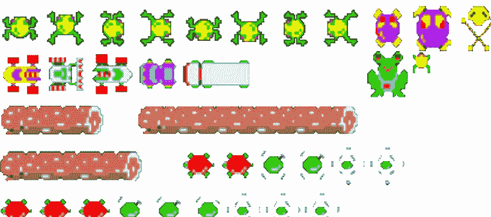

图 11-3. 包含支持我们游戏所需的所有图像的单文件精灵图集

你可以通过 http://bit.ly/frogger 下载这张精灵图，用于本章中的代码列表。用于从此精灵图中创建单个图像和动画的代码如列表 11-12 所示。

## 11-12. 从精灵图中创建图像和动画的基础代码

```javascript
// 定义一个用于在游戏板上放置图像的“类”。所有单个图像都存储在一个名为精灵图集（Sprite Map）的大型图像文件中。
// 通过知道要显示的图像在该精灵文件中的位置，以及它的宽度和高度，
// 我们可以提取出单个图像进行显示。通过只加载单个图像文件，我们提高了游戏的加载性能
Frogger.ImageSprite = function(startPositionLeft, startPositionTop) {
```

```javascript
// 每个实例在游戏板上都有一个起始位置，以便在需要时将其重置为初始位置
this.startLeft = startPositionLeft || 0;
this.startTop = startPositionTop || 0;
```

```javascript
// 初始化对象属性以存储此图像的任何动画
this.animations = {};

// 将此图像设置为其初始状态以显示
this.reset();

// 定义一个“类”来为 ImageSprite 实例分配动画，
// 以便游戏板上的任何图像看起来像在运动。
// 动画是一系列在一段时间内显示的图像，产生运动的错觉
Frogger.Animation = function(options) {
  options = options || {};

  // 存储动画序列中图像移动的速率，单位为毫秒
  // 默认速率为 150 毫秒
  this.rate = options.rate || 150;

  // 存储一个布尔值，指示此动画是循环还是播放一次
  this.loop = options.loop || false;

  // 存储提供的相对于精灵图图像左侧的像素位置
  this.spriteleft = options.spriteleft || 0;

  // 存储动画序列，该序列指示精灵文件内位置的倍数
  this.sequence = options.sequence || [];
};

// 定义由每个实例继承的属性
Frogger.Animation.prototype = {
  // 定义当前帧索引
  frame: 0,

  // 定义动画是否正在播放
  playing: false,

  // 定义用于启动和停止的计时器
  timer: null,
};
```

# 第 11 章 使用 CANVAS API 构建游戏

```javascript
// 定义一个函数来播放动画——本质上是在计时器上增加索引
play:function() {
  var that = this;

  // 如果动画当前没有播放，将其重置为初始状态
  if (!this.playing) {
    this.reset();
    this.playing = true;
  }

  // 在实例化时按速率在计时器上增加动画的当前帧索引，
  // 存储计时器的引用以便以后停止
  this.timer = setInterval(function() {
    that.incrementFrame();
  }, this.rate);
},

// 定义一个函数将动画序列的当前帧索引回到起点
reset:function() {
  this.frame = 0;
},

// 定义一个函数增加动画序列的当前帧索引
incrementFrame:function() {

  // 只有在动画应该播放时才增加当前帧索引
  if (this.playing) {

    // 增加动画序列的当前帧索引
    this.frame++;

    // 当我们到达动画序列的末尾时，如果没有打算循环，
    // 则停止动画，否则将当前帧索引重置到起点
    if (this.frame === this.sequence.length - 1) {
      if (!this.loop) {
        this.stop();
      } else {
        this.reset();
      }
    }
  }
},

// 定义一个停止动画的函数
stop:function() {
  clearInterval(this.timer);
  this.playing = false;
}
```

```javascript
// 定义一个函数，返回此动画第一帧精灵图集（sprite map）左侧边缘的像素值。
// 该函数通常与动画序列的当前值以及图像宽度配合使用，
// 决定在 <canvas> 元素中显示哪张图像
getspriteleft: function() {
  return this.spriteleft;
}
```

```javascript
// 定义一个函数来停止计时器增加当前帧索引，并停止动画播放
stop: function() {
  // 终止计时器
  clearInterval(this.timer);

  // 表示动画不再播放
  this.playing = false;
}
```


```javascript
// 定义并初始化属性和方法，供 Frogger.ImageSprite “类” 的每个
// 实例继承，以便从更大的精灵图集中提取单个图像
// 并将其绘制到 <canvas> 元素上
Frogger.ImageSprite.prototype = {
  // 定义属性以存储图像在游戏板上相对于
  // 顶部和左侧边缘的当前位置（像素）
  top: 0,
  left: 0,

  // 定义属性以存储图像在游戏板上相对于
  // 顶部和左侧边缘的初始位置（像素），以便在后续
  // 需要时可以将图像恢复到初始位置
  startleft: 0,
  startTop: 0,

  // 定义一个属性，包含指向新  标签的引用，该标签
  // 保存单个大型精灵图。由于这是一个对象，它将在所有
  // Frogger.ImageSprite “类” 的实例之间共享，节省内存
  sprite: (function() {
    var img = document.createElement("img");
    img.src = "spritesemap.png";
    return img;
  }),

  // 定义属性以确定大型精灵图文件中
  // 单个图像的默认宽度和高度（像素）
  width: 80,
  height: 80,

  // 定义属性表示单个图像在大型精灵图中的
  // 顶部和左侧位置（像素）。结合宽度和高度
  // 属性，我们能够从精灵集中提取出单个图像
  // 并在 <canvas> 元素中显示
  spriteTop: 0,
  spriteleft: 0,

  // 默认声明任何动画
  animations: null,

  // 定义一个属性指示当前播放的动画名称，如果有
  currentAnimation: "",

  // 定义一个属性指示此对象实例代表的
  // 单个图像当前是否被隐藏
  isHidden: false,

  // 定义一个函数将图像重置为初始位置，并重置
  // 该图像的任何关联动画
  reset: function() {
    // 在实例化时将图像在游戏板上的顶部和左
    // 位置重置为初始位置
    this.left = this.startleft;
    this.top = this.startTop;

    // 将任何关联动画重置为初始状态
    this.resetAnimation();

    // 声明图像不再隐藏
    this.isHidden = false;
  },

  // 定义一个函数将一个或多个动画与此图像关联——数据
  // 以对象字面量的形式传入，每个键代表动画的名称
  registerAnimation: function(animations) {
    var key, animation;
    // 遍历提供的字面量数据，指示要
    // 注册的动画
    for (key in animations) {
      animation = animations[key];
      // 为提供的数据对象中的每个项创建 Frogger.Animation
      // 类的实例。每个项的数据在实例化时传递给
      // 该“类”，以定义其动画序列、动画速率和其他
      // 初始属性
      this.animations[key] = new Frogger.Animation(animation);
    }
  },

  // 定义一个函数将任何正在播放的动画重置为初始状态
  resetAnimation: function() {
    if (this.animations[this.currentAnimation]) {
      // 如果正在播放动画，则调用其 reset() 方法
      // 恢复到初始状态
      this.animations[this.currentAnimation].reset();
    }
    // 重置后，不应有正在播放的动画
    this.currentAnimation = "";
  },

  // 定义一个函数通过名称播放特定的动画序列。名称必须
  // 与之前提供给 registerAnimation() 方法的名称对应
  playAnimation: function(name) {
    // 将当前动画设置为提供的名称
    this.currentAnimation = name;
    if (this.animations[this.currentAnimation]) {
      // 如果通过提供的名称找到动画，则调用其 play() 方法
      // 使用其内部计时器开始增加其当前帧索引
      this.animations[this.currentAnimation].play();
    }
  },

  // 定义一个函数，在提供的左侧和顶部位置（像素）
  // 在 <canvas> 元素上绘制单个图像。如果正在播放动画，
  // 确保根据该动画当前的序列值显示正确的图像
  renderAt: function(left, top) {
    // 查找当前正在播放的动画（如果有的话）
    var animation = this.animations[this.currentAnimation];

    // 如果正在播放动画，获取相对于精灵图
    // 左侧边缘的像素偏移量。如果没有动画播放，
    // 则偏移量为 0。
    var sequenceValue = animation ? animation.getValue() : 0;

    // 如果正在播放动画，获取大型精灵图内
    // 单个图像的顶部和左侧位置
    var spriteLeft = animation ? animation.getSpriteLeft() : 0;

    // 计算 spriteleft
    var spriteleft = this.spriteleft + spriteLeft + (this.width * sequenceValue);

    // 如果图像未被隐藏，则从精灵集中提取
    // 单个图像并在提供的顶部和左侧位置（像素）
    // 绘制到画布
    if (!this.isHidden) {
      Frogger.drawingSurface.drawImage(this.sprite, spriteleft, this.spriteTop, this.width,
        this.height, top, this.width, this.height);
    }
  },

  // 定义一个函数设置存储的左侧和顶部偏移（像素），
  // 指示在游戏板上显示图像。这些值
  // 用于 renderAt() 方法在相应位置绘制图像
  moveTo: function(left, top) {
    this.left = left || 0;
    // 由于此游戏中的大多数图像是左右移动，而不是上下，
    // 我们让顶部偏移量成为可选的
    if (typeof top == "undefined") {
      this.top = top || 0;
    }
  },

  // 定义一个函数返回从大型精灵图中提取的
  // 单个图像的宽度
  getWidth: function() {
    return this.width;
  },

  // 定义一个函数返回图像的左侧和右侧位置（像素），
  // 我们稍后可以使用它与游戏板上的其他障碍
  // 进行碰撞检测
  getPosition: function() {
    return {
      left: this.left,
      // 右位置定义为左位置加上
      // 单个图像的宽度
      right: this.left + this.width
    };
  },

  // 定义一个函数从游戏板上隐藏此图像，实质上
  // 是 renderAt() 方法中停止将图像绘制到 <canvas>
  hide: function() {
    this.isHidden = true;
  }
};
```

现在，让我们创建一个代码模块来定义游戏板的限制和参数，包括角色允许移动的边界，如列表 11-13 所示。游戏板本质上是一个网格，其中障碍物固定在特定的垂直网格位置，且仅在水平方向移动——玩家角色是这一规则的例外，它可以在游戏板上上下跳，每次移动一个网格位置。

## 列表 11-13：编写游戏板参数

```javascript
// 定义一个代码模块来定义游戏板本身的参数，网格内的
// 行和列数，以及它们在像素中的相对位置，
// 以及玩家角色可以移动的边界
(function(Frogger) {
  n // 定义游戏板上每个正子的宽度和高度，单位为像素。
  // 游戏板分为若干行，每行都有不同的障碍物，以及玩家
  // 可以移动的列
  var _grid = {
    width: 80,
    height: 80
  };
```

```javascript
// 定义游戏板的行数。前两行包含分数，
// 下两行包含玩家试图到达的基地。之后
// 有五行水域障碍物，然后到达一个“安全”行，
// 玩家角色可以在那里没有障碍物的情况下避难。之后是
// 五行陆地障碍物，然后是“安全”行，这是玩家
// 角色开始游戏的地方。最后一行包含剩余时间和
// 行数，行位置的行数被称为剩余
// 命数的网格。总共有 17 行，但由于我们从位置 0 开始
// 计数，因此使用之前定义的网格
// 方，总行数为 16
  _numRows = 16,
```

```javascript
// 根据之前定义的游戏板，从左到右定义游戏板的
// 列数。总列数为 12，但由于我们
// 将位置 0 视为一列，我们将数量表示为 11
  _numColumns = 11,
```

```javascript
// 定义玩家角色在游戏板上移动的限制（单位为像素），
// 返回角色可以放置的最左、最右、最上和最下位置。
// 这是为了确保玩家无法将其角色
// 移动到游戏板上显示分数、剩余时间的区域如下：
  _characterBounds = {
    left: 0,
    right: _numColumns * _grid.width,
    top: 2 * _grid.height,
    bottom: (_numRows - 2) * _grid.height
  };
```

## 第 11 章：使用 Canvas API 构建游戏

```javascript
// 定义一个数组，包含 17 行中每一行的像素位置，
// 从游戏板最左侧边缘开始测量——每一行本质上都是
// 网格宽度的倍数。这允许通过行号轻松访问
// 像素位置。
rows = (function() {
  var output = [];
  index = 0,
  length = _numRows;

  for (; index < length; index++) {
    output.push(index * _grid.width);
  }

  return output;
}());
```

```javascript
// 定义一个数组，包含 12 列中每一列的像素位置，
// 从游戏板最顶部边缘开始测量——每一列本质上都是
// 网格高度的倍数。这允许通过列号轻松访问
// 像素位置。
columns = (function() {
  var output = [];
  index = 0,
  length = _numColumns;

  for (; index < length; index++) {
    output.push(index * _grid.height);
  }

  return output;
}());
```

```javascript
// 监听“game-load”事件，该事件在我们所有代码模块
// 配置完成后将触发一次
Frogger.observer.subscribe("game-load", function() {

  // 发布“game-board-initialize”事件，传递有关
  // 游戏板的所有相关信息，以便其他代码模块确保它们
  // 将图像绘制在板的正确位置，并允许角色仅在
  // 此代码模块定义的某些限制之间移动
  Frogger.observer.publish("game-board-initialize", {

    // 传递游戏板包含的行数和列数
    numRows: _numRows,
    numColumns: _numColumns,

    // 传递代表板上每行每列像素位置的数组，
    // 以简化在 <canvas> 元素上的正确位置绘制图像
    rows: _rows,
    columns: _columns,

    // 传递板上每个网格正子的宽度和高度
    grid: {
      width: _grid.width,
      height: _grid.height,
    }

    // 传递包含左、右、上、下位置的对象，
    // 玩家角色在游戏板上允许移动的像素值
    characterBounds: _characterBounds
  });
```

```javascript
// 使用之前定义的 Arcade Classic 字体，并在给定的绘制位置
// 周围居中绘制黄色文本（十六进制值 #FF0）
Frogger.drawingSurface.font = font;
Frogger.drawingSurface.textAlign = "end";
Frogger.drawingSurface.fillStyle = "#FF0";
```

```javascript
// 将文本与 <canvas> 右对齐，并位于游戏板
// 右下角
Frogger.drawingSurface.filltext("TIME", Frogger.drawingSurfaceWidth
```

```javascript
function render() {
  renderScore();
  renderTimeLabel();
}
```

```javascript
// 只有在游戏实际结束时才渲染“GAME OVER”文本
if (_gameOver) {
  renderGameOver();
}
```

```javascript
// 只有当玩家赢得游戏时才渲染“YOU WIN!”
if (_gameWon) {
  renderGameWon();
}
```

```javascript
// 当游戏逻辑发布声明玩家已赢得游戏的消息时，
// 设置本地变量以指示这一点，这样在游戏循环的随后的任何
// 执行中，“YOU WIN!”文本将会被绘制到 <canvas> 上
Frogger.observer.subscribe("game-won", function() {
  _gameWon = true;
});
```

```javascript
// 当游戏逻辑模块发布指示游戏已失败的消息时，
// 用本地变量反映这一事实，以便“GAME OVER”文本在
// 游戏循环的下一个周期被写入 <canvas> 元素中
Frogger.observer.subscribe("game-over", function() {
  _gameOver = true;
});
```

```javascript
// 如果游戏逻辑强制发生游戏状态重置，则重置指示游戏状态的本地变量
Frogger.observer.subscribe("reset", function() {
  _gameOver = false;
  _gameWon = false;
});
```

```javascript
// 当玩家分数在游戏过程中发生变化时，更新本地分数。
// 更新后的分数将随后写入 <canvas> 上...
```

## 第 11 章：使用 Canvas API 构建游戏

```javascript
// 游戏循环的下一个周期
Frogger.observer.subscribe("score-change", function(newScore){
  score = newScore;
});
```

```javascript
// 当游戏最高分在游戏过程中变化时，更新本地高分变量。
// 更新后的高分将在游戏循环的下一个周期内绘制到 <canvas> 上
Frogger.observer.subscribe("high-score", function(newHighScore){
  highScore = newHighScore;
});
```

```javascript
// 订阅由上一个代码模块触发的“game-board-initialize”事件，
// 将游戏板属性和设置存储在本地变量中
Frogger.observer.subscribe("game-board-initialize", function(gameBoard) {
  gameBoard = gameBoard;
}
```

```javascript
// 开始监听游戏循环内部触发的“render-base-layer”事件，
// 并在发生时调用 render() 函数，在游戏循环的每个周期中
// 的适当位置将文本绘制到画板上
Frogger.observer.subscribe("render-base-layer", render);
});
```

```javascript
{Frogger});
```

是时候将我们的背景图像添加到背景画布了，我们将在列表 11-15 中完成，并渲染玩家剩余的生命数以及玩家到达目标前的剩余时间。由于背景是静态的，我们只在游戏开始时绘制它，之后无需再次触摸或移动它。我们将使用通过`http://bit.ly/frogger-gameboard`显示的游戏板。


## 列表 11-15：定义一个代码模块来绘制带有剩余生命数的游戏背景以及剩余时间

```javascript
// 定义一个代码模块将游戏背景绘制到 <canvas>
// 元素上。我们只在图像变为静态且不会改变时绘制它——相反，
// 所有可以绘制到主 <canvas> 元素上的图形元素。
(function(Frogger) {
```

```javascript
// 为了在 <canvas> 上绘制图像，我们需要先创建一个新的 <> 元素
// 来包含图像
var background = document.createElement("img");
```

```javascript
// 一旦图像加载完成，将图像绘制到 <canvas> 元素的
// 绘制表面，从左上角开始并覆盖 drawingSurface 的完整宽度和高度
background.addEventListener("load", function() {
  Frogger.backgroundDrawingSurface.drawImage(background, 0, 0, Frogger.drawingSurfaceWidth,
  false);
});
```

```javascript
// 设置  的“src”属性会导致它立即加载，这就是为什么
// 需要先配置我们的“load”事件处理程序。我们加载
// 名为“gameboard.gif”的文件，它包含了游戏板的背景。这
```

```javascript
// 它将只被绘制一次，因为我们现在并不在游戏循环内部。
// 将背景分离到单独的元素中，避免了每次游戏循环执行
// 时都重新绘制背景，因为它是静态的。
// background.src = "gameboard.gif";
}(Frogger));
```

```javascript
// 定义一个代码模块来显示玩家剩余的生命数，以及在自动
// 失去生命之前剩余的时间，在...
(function(Frogger) {
```

```javascript
// 一旦图像加载完成，将图像绘制到 <canvas> 元素的
// 绘制表面，从左上角开始并覆盖 drawingSurface 的完整宽度和高度
```

```javascript
// 当游戏最高分在游戏过程中变化时，更新本地高分变量。
// 更新后的高分将在游戏循环的下一个周期内绘制到 <canvas> 上
```

```javascript
// 一旦“ score the the the the 


 the the top
Frogger.ImageSprite.call(left, top);
}
```

```javascript
// 从 Frogger.ImageSprite 继承属性和方法
Life.prototype = new Frogger.ImageSprite();
```

```javascript
// 设置剩余生命的尺寸和位置
Life.prototype.spriteLeft = 720;
Life.prototype.spriteTop = 80;
Life.prototype.width = 40;
Life.prototype.height = 40;
```

```javascript
// 定义在游戏板初始化时执行的函数
function initialize(gameBoard) {
```

```javascript
// 将游戏板属性和设置存储在本地变量中
_gameBoard = gameBoard;
```

```javascript
// 将 lifePosition 设置为适当的位置
lifePositionTop = (_gameBoard.numRows - 1) * _gameBoard.height;
```

```javascript
// 为玩家定义五个生命，_lives 数组
_lives = [
newLife(0, lifePositionTop),
newLife(1 * life.prototype.width, lifePositionTop),
newLife(2 * life.prototype.width, lifePositionTop),
newLife(3 * life.prototype.width, lifePositionTop),
newLife(4 * life.prototype.width, lifePositionTop)
];
```

```javascript
// 监听游戏循环内触发的 render-base-layer 事件
Frogger.observer.subscribe("render-base-layer", render);
```

```javascript
// 定义一个在游戏板上渲染剩余生命的函数
function renderlives() {
```

```javascript
var index = 0,
length = _lives.length,
life;
// 遍历存储在 _lives 数组中的剩余生命
for (; index < length; index++) {
  life = _lives[index];
renderAt(life.left, life.top);
}
}
```

```javascript
// 定义一个函数，将剩余时间作为绿色矩形沿
// 游戏板的边缘绘制
function renderTimeRemaining() {
```

```javascript
// 定义矩形的宽度
var rectangleWidth = _timeRemainingPercentage * _gameBoard.rows[10];
```

## 第 11 章 | 使用 Canvas API 构建游戏

```javascript
// 定义矩形的高度，它将始终是游戏板上一个网格正方形的一半
rectangleHeight = _gameBoard.grid.height / 2,
```

```javascript
// 定义左侧边缘（单位为像素），即矩形从 <canvas>
// 开始绘制的位置。由于倒计时看起来是从左到右减少的，
// 这将是剩余时间百分比的反，
// 乘以矩形的完整宽度
rectangleLeft = (1 - _timeRemainingAsPercentage) * _gameBoard.rows[10],
```

```javascript
// 定义顶边缘（单位为像素），即矩形在 <canvas>
// 元素上开始绘制的位置。这将是游戏板的底部，
// 所以我们需要从游戏板本身的高度减去矩形所需的高度
rectangleTop = Frogger.drawingSurfaceHeight - rectangleHeight;
```

```javascript
// 设置绘制颜色为绿色（十六进制颜色 #0F0）
Frogger.drawingSurface.fillStyle = "#0F0",
```

```javascript
// 在给定的位置在游戏板上绘制矩形
Frogger.drawingSurface.fillRect(rectangleLeft, rectangleTop, rectangleWidth,
Height);
```

```javascript
// 定义一个函数在游戏板上绘制剩余生命值和剩余时间
// 该函数在游戏循环内部触发 "render-base-layer" 事件时执行
function render() {
  renderLives();
  renderTimeRemaining();
}
```

```javascript
// 当游戏逻辑模块通知玩家失去了一个生命值时，我们从
// _lives 数组中移除最后一项，这将移除画布左下角
// 最右侧的生命值图像，以指示剩余生命值的正确数量
Frogger.observer.subscribe("player-lost-life", function() {
  lives.pop();
});
```

```javascript
// 当游戏逻辑模块通知玩家到达目标的剩余时间发生
// 变化时，将返回的新值存储为百分比
Frogger.observer.subscribe("time-remaining-change", function(newTimeRemainingPercentage) {
  _timeRemainingAsPercentage = newTimeRemainingPercentage;
});
```

```javascript
// 当游戏板初始化其属性和设置时，执行
// initialize() 函数
Frogger.observer.subscribe("game-board-initialize", initialize);
}(Frogger));
```

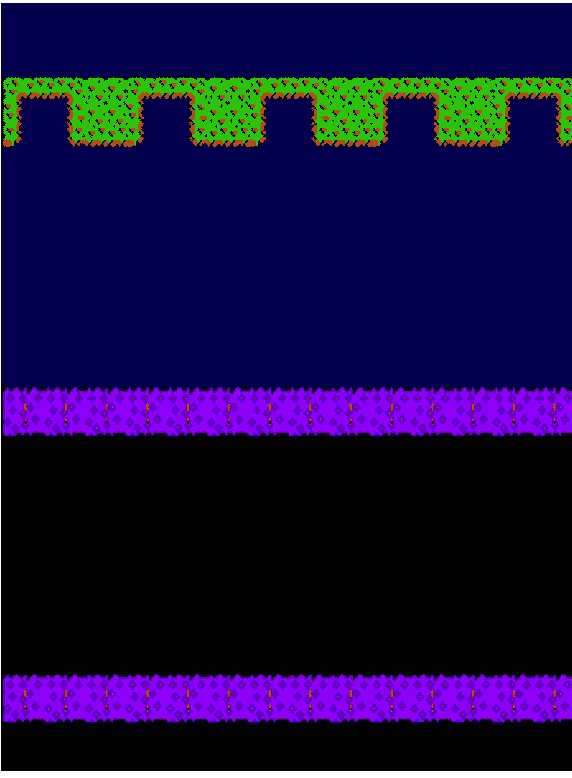

**图 11-4。** 游戏板背景图像，包含一个图像文件中的所有静态元素

在背景可见且我们已经准备好从精灵图（sprite map）中提取单个图像的代码后，现在是时候为我们的游戏板定义障碍物了，包括车辆、木头、乌龟以及玩家试图到达的目标，以及每个物体显示的图像和动画。这些在列表 11-16 中合并显示。

## 列表 11-16：为游戏板上的障碍物和目标创建图像和动画

```javascript
// 定义一个命名空间来存储放在游戏板上的单个障碍物和图像，
// 作为“类”代表来自精灵图中每个物体的单独图像
Frogger.Image = (function(Frogger) {
  // 定义一个赛车障碍，其在 x 轴上的起始位置可以在
  // 实例化时设置
  function RaceCar(left) {
    Frogger.ImageSprite.call(this, left);
  }
```

```javascript
// 赛车定义为在精灵图中相对于精灵图文件
// 左侧和顶部边缘的 0px 和 80px 处的找到图像
RaceCar.prototype = new Frogger.ImageSprite();
RaceCar.prototype.constructor = RaceCar;
RaceCar.prototype.spriteLeft = 0;
RaceCar.prototype.spriteTop = 80;
```

```javascript
// 定义一个推土机障碍物
function Bulldozer(left) {
  Frogger.ImageSprite.call(this, left);
}
```

```javascript
// 推土机是精灵图中位于 80px 比 80px 处的图像
Bulldozer.prototype = new Frogger.ImageSprite();
Bulldozer.prototype.constructor = Bulldozer;
Bulldozer.prototype.spriteLeft = 80;
Bulldozer.prototype.spriteTop = 80;
```

```javascript
// 定义一个涡轮赛车障碍物
function TurboRaceCar(left) {
  Frogger.ImageSprite.call(this, left);
}
```

```javascript
// 涡轮赛车是精灵图中位于 160px 比 80px 处的图像
TurboRaceCar.prototype = new Frogger.ImageSprite();
TurboRaceCar.prototype.constructor = TurboRaceCar;
TurboRaceCar.prototype.spriteLeft = 160;
TurboRaceCar.prototype.spriteTop = 80;
```

```javascript
// 定义一个公路汽车障碍物
function RoadCar(left) {
  Frogger.ImageSprite.call(this, left);
}
```

```javascript
// 公路汽车是精灵图中位于 240px 比 80px 处的图像
RoadCar.prototype = new Frogger.ImageSprite();
RoadCar.prototype.constructor = RoadCar;
RoadCar.prototype.spriteLeft = 240;
RoadCar.prototype.spriteTop = 80;
```

```javascript
// 定义一辆卡车
function Truck(left) {
  Frogger.ImageSprite.call(this, left);
}
```

```javascript
// 卡车是精灵图中位于 320px 比 80px 处的图像，
// 宽度为 122px
Truck.prototype = new Frogger.ImageSprite();
Truck.prototype.constructor = Truck;
Truck.prototype.spriteLeft = 320;
Truck.prototype.spriteTop = 80;
Truck.prototype.width = 122;
```

```javascript
// 定义一条短木头
function ShortLog(left) {
  Frogger.ImageSprite.call(this);
}
```

```javascript
// 短木头是精灵图中位于 0px 比 160px 处的图像，
// 宽度为 190px
ShortLog.prototype = new Frogger.ImageSprite();
ShortLog.prototype.constructor = ShortLog;
ShortLog.prototype.spriteLeft = 0;
ShortLog.prototype.spriteTop = 160;
ShortLog.prototype.width = 190;
```

```javascript
// 定义一条中等木头
function MediumLog(left) {
  Frogger.ImageSprite.call(this);
}
```

```javascript
// 中等木头是精灵图中位于 0px 比 240px 处的图像，
// 宽度为 254px
MediumLog.prototype = new Frogger.ImageSprite();
MediumLog.prototype.constructor = MediumLog;
MediumLog.prototype.spriteLeft = 0;
MediumLog.prototype.spriteTop = 240;
MediumLog.prototype.width = 254;
```

```javascript
// 定义一条长木头
function longLog(left) {
  Frogger.ImageSprite.call(this);
}
```

```javascript
// 长木头是精灵图中位于 240px 比 160px 处的图像，
// 宽度为 392px
LongLog.prototype = new Frogger.ImageSprite();
LongLog.prototype.constructor = LongLog;
LongLog.prototype.spriteLeft = 240;
LongLog.prototype.spriteTop = 160;
LongLog.prototype.width = 392;
```

```javascript
// 定义乌龟障碍物。游戏板上有两种乌龟障碍物，
// 一个代表两只乌龟，一个代表三只乌龟。
// 这两种乌龟障碍都有一些在这个“类”中定义的
// 共享行为，作为两个障碍物的基类。
function Turtle(left) {
  Frogger.ImageSprite.call(this);
}
```

```javascript
Turtle.prototype = new Frogger.ImageSprite();
Turtle.prototype.constructor = Turtle;

// 乌龟会动画并偶尔潜入水中。我们需要
// 知道乌龟是否在水中，这样如果玩家的角色位于
// 乌龟上方，他们就会失去生命值。这以后将通过
// 碰撞检测处理，但我们只需要创建一个方法
// 告诉我们乌龟是否在水中
Turtle.prototype.isUnderwater = function() {
  var isUnderwater = false;
```

```javascript
// 获取潜水和浮出的当前动画引用
animation = this.animations[this.currentAnimation];

// 当乌龟显示精灵图中动画序列中最远的
// 图像时，它被认为在水中。这是通过使用 JavaScript
// Math.max() 方法获取动画帧序列中最大的数字表示的。
// 如果当前动画序列值与精灵图中这个远程图像匹配，乌龟就在水中。
if (animation.getSequenceValue() === Math.max.apply(Math, animation.sequence)) {
  isUnderwater = true;
}

return isUnderwater;
};
```

```javascript
// 定义一个代表两只乌龟的障碍物
function TwoTurtles(left) {
  Turtle.call(this, left);
}
```

```javascript
// 继承自之前定义的 Turtle 基“类”
TwoTurtles.prototype = new Turtle();
```


`TwoTurtles.prototype.constructor = TwoTurtles;`

```javascript
// 两只乌龟是精灵图中位于 320px 比 240px 处的图像，
// 宽度为 130px
TwoTurtles.prototype.spriteLeft = 320;
TwoTurtles.prototype.spriteTop = 240;
TwoTurtles.prototype.width = 130;
```

```javascript
// 重写 reset() 方法以定义并自动播放乌龟
// 潜水和浮出的动画
TwoTurtles.prototype.reset = function() {
  Turtle.prototype.reset.call(this);

  // 注册潜水和浮出动画，它以 200 毫秒的帧率
  // 播放序列中的每一帧，并在到达序列末尾时循环。
  // 序列中的数字代表单个图像宽度的偏移
  // 倍，用于从中抓取动画图像——本质上是
  // 在精灵图中的若干并排图像之间切换，
  // 以产生运动的幻觉
  this.registerAnimation({
    sequence: [0, 1, 2, 3, 3, 2, 1, 0, 0, 0, 0, 0, 0, 0, 0, 0, 0, 0],
    loop: true,
    rate: 200
  });
};
```

# 第 11 章 使用 Canvas API 构建游戏

```javascript
// 立即播放动画
this.playAnimation("diveAndSurface");
```

```javascript
// 定义一个代表三只乌龟的障碍物
function ThreeTurtles(left) {
  Turtle.call(this, left);
}
```

```javascript
// 继承自之前定义的 Turtle 基础“类”
nTurtles.prototype = new Turtle();
ThreeTurtles.prototype.constructor = ThreeTurtles;
```

```javascript
// 三只乌龟组是精灵图中位置 0px 到 320px 处的图像，
// 宽度为 200px
ThreeTurtles.prototype.spriteLeft = 0;
ThreeTurtles.prototype.spriteTop = 320;
ThreeTurtles.prototype.width = 200;
```

```javascript
// 像之前一样注册潜水和浮出动画，与两只乌龟相比，
// 帧更多且动画速率更慢
ThreeTurtles.prototype.reset = function() {
  Turtle.prototype.reset.call(this);
};
```

```javascript
this.registerAnimation({
  "diveAndSurface": {
    sequence: [0, 1, 2, 3, 3, 3, 2, 1, 0, 0, 0, 0, 0, 0, 0, 0, 0, 0, 0, 0],
    loop: true,
    rate: 300
  }
});

this.playAnimation("diveAndSurface");
```

```javascript
// 定义一个“类”，代表当玩家角色到达终点时显示的的青蛙图像
function GoalFrog(left) {
  Frog.ImageSprite.call(this, left);
}
```

```javascript
// 目标青蛙是精灵图中位置 640px 到 80px 处的图像
GoalFrog.prototype = new Frog.ImageSprite();
GoalFrog.prototype.constructor = GoalFrog;
GoalFrog.prototype.spriteLeft = 640;
GoalFrog.prototype.spriteTop = 80;
```

```javascript
// 重写 moveTo 方法，使得该图像在放置到游戏板后
// 无法从当前位置移动
GoalFrog.prototype.moveTo = function() {};
```

```javascript
// 定义一个“类”，代表玩家将从起始位置
// 往游戏板远端试图到达的目标
function Goal(left) {
  Frogger.ImageSprite.call(this, left);
}
```

```javascript
// 由于目标是作为背景 <canvas> 的一部分绘制在游戏板上的，
// 我们不需要再次绘制它，因此我们将图像位置指定为
// 精灵图中的透明区域，实际上没有向画布上绘制任何实际内容。
// 然而，我们仍然可以利用 ImageSprite“类”的其他功能，
// 为了简化后的碰撞检测，它会告诉我们玩家角色何时到达了目标
Goal.prototype = new Frogger.ImageSprite();
Goal.prototype.constructor = Goal;
Goal.prototype.spriteLeft = 800;
Goal.prototype.spriteTop = 320;
```

```javascript
// 重写 moveTo() 方法，使得目标一旦放置在游戏板上，
// 就无法从当前位置移动
Goal.prototype.moveTo = function() {};
```

```javascript
// 为此“类”添加一个自定义属性，用于表示目标实例是否被
// 玩家角色到达
Goal.prototype.isMet = false;
```

```javascript
// 将此模块中定义的“类”暴露给 Frogger.Image 命名空间下的更广泛代码库
return {
  RaceCar: RaceCar,
  Bulldozer: Bulldozer,
  RoadCar: RoadCar,
  TurboRaceCar: TurboRaceCar,
  Truck: Truck,
  ShortLog: ShortLog,
  MediumLog: MediumLog,
  LongLog: LongLog,
  TwoTurtles: TwoTurtles,
  ThreeTurtles: ThreeTurtles,
  GoalFrog: GoalFrog,
  Goal: Goal
};
Frogger));
```

障碍物定义完成后，是时候定义代码、图像和动画来表示玩家角色及其在游戏板上的类青蛙移动了，这如列表 11-17 所示。

# 列表 11-17. 玩家角色

```javascript
// 定义一个代码模块来表示游戏板上的玩家角色，
// 并根据当前游戏状态处理其移动和行为
Frogger.Character = (function(Frogger) {

  // 定义变量存储代表玩家角色的图像
  var _character,

  // 定义变量存储游戏板的属性和设置
  _gameBoard = {};

  // 定义变量表示玩家角色在游戏板上的起始行
  _startRow = 14,

  // 定义变量表示玩家角色在游戏板上的起始列 -
  // 基本上是居中的
  _startColumn = 6,

  // 定义变量存储玩家角色当前到达的行
  _currentRow = _startRow,

  // 定义布尔变量表示玩家角色当前是否处于
  // 冻结状态，发生在玩家失去生命或到达目标时
  _isFrozen = false;

  // 定义一个“类”来表示玩家青蛙角色，继承自
  // Frogger.addSprite 类。实例化时传入的 left 和 top
  // 值反映了玩家角色相对于游戏板
  // 左上角的像素位置
  function Character(left, top) {
    Frogger.addSprite.call(this, left, top);

    // 当玩家失去生命或向四个方向
    //（上、下、左、右）移动时注册五个动画
    this.registerAnimation({
      // 当玩家失去生命时，在精灵图中左侧 640px
      // 处的三个图像之间切换，速率为 300 毫秒
      // 最后停留在图像
      "lose-life": {
        spriteLeft: 640,
        sequence: [0, 1, 2],
        rate: 300
      },
      // 当玩家角色向上移动时，在左侧 0px
      // 处的图像之间切换
      "move-up": {
        spriteLeft: 0,
        sequence: [0, 1, 2],
        rate: 300
      },
      // 当玩家角色向右移动时，在左侧 160px
      // 处的图像之间切换
      "move-right": {
        spriteLeft: 160,
        sequence: [0, 1, 2],
        rate: 300
      },
      // 当玩家角色向下移动时，在左侧 320px
      // 处的图像之间切换
      "move-down": {
        spriteLeft: 320,
        sequence: [0, 1, 2],
        rate: 300
      },
      // 当玩家角色向左移动时，在左侧 480px
      // 处的图像之间切换
      "move-left": {
        spriteLeft: 480,
        sequence: [0, 1, 2],
        rate: 300
      }
    });

    // ... (其余实现)
  }
```

```javascript
// 名为 "move-right" 的动画，使其看起来角色正在移动
this.playAnimation("move-right");
```

```javascript
// 定义一个函数，返回玩家角色的当前位置，
// 单位为距离游戏板顶部的像素值
function getTop() {
  // 根据角色当前所在的行，从游戏板属性中查找
  // 顶部的位置（像素单位）
  return _gameBoard.rows[_currentRow];
}
```

```javascript
// 定义一个函数，从显示中隐藏玩家角色
function hide() {
  // 在代表玩家角色的 Character "class" 实例上调用 hide() 方法
  _character.hide();
}
```

```javascript
// 定义一个函数，让玩家角色在四个可能的方向之一移动
// - 上、下、左或右
function move(characterDirection) {
  // 只有当玩家角色不被认为冻结在原地时才移动
  if (!isFrozen) {
    // 根据角色要移动的方向，在 Character 实例上调用相应的方法
    if (characterDirection === Frogger.direction.LEFT) {
      _character.moveLeft();
    } else if (characterDirection === Frogger.direction.RIGHT) {
      _character.moveRight();
    } else if (characterDirection === Frogger.direction.UP) {
      _character.moveUp();
    } else if (characterDirection === Frogger.direction.DOWN) {
      _character.moveDown();
    }
  }
  // 向其他代码模块发布事件，指示玩家的位置已被玩家移动
  Frogger.observer.publish("player-moved");
}
```

```javascript
// 定义一个函数，在屏幕上渲染玩家角色
function render() {
  // 调用 Character 实例的 renderAt() 方法，并传递其当前的
  // 左侧和顶部位置
  _character.renderAt(_character, _character.top);
}
```

```javascript
// 定义一个函数，当玩家失去生命时执行，播放
// 相应的动画
function loseLife() {
  _character.playAnimation("lose-life");
}
```

```javascript
// 定义一个函数，将玩家角色移动到距离游戏板左边缘
// 给定的像素位置 - 当角色坐在移动物体上时，
// 用于保持角色与该物体对齐
function setPosition(left) {
  // 确保角色不会超出游戏板中定义的
  // 边界
  if (left > _gameBoard.characterBounds.right) {
    left = _gameBoard.characterBounds.right;
  } else if (left < _gameBoard.characterBounds.left) {
    left = _gameBoard.characterBounds.left;
  }

  // 将角色的位置从游戏板左边缘移动到匹配
  // 给定的位置
  _character.moveTo(left);
}
```

```javascript
// 定义一个函数，重置玩家角色在游戏板上的位置
function reset() {
  _character.reset();
  // 重置表示角色当前所在行的局部变量
  currentRow = _startRow;
}
```

```javascript
// 定义一个函数，返回角色在游戏板上的当前位置
function getPosition() {
  return _character.getPosition();
}
```

```javascript
// 定义一个函数将局部变量 _isFrozen 设置为 true，指示
// 玩家角色在游戏板上的位置应该冻结在原地
function freeze() {
  _isFrozen = true;
}
```

```javascript
// 定义一个函数将局部变量 _isFrozen 设置为 false，指示
// 玩家角色可以在游戏板上自由移动
function unfreeze() {
  _isFrozen = false;
}
```

```javascript
// 定义一个函数，在游戏板初始化后执行，传递
// 来自游戏代码模块的属性和设置
function initialize(gameBoard) {
  _gameBoard = gameBoard;
  // 初始化一个 Character "class" 实例来代表玩家
  // 的角色，设置它在游戏板上的起始位置
  _character = new Character(_gameBoard.columns[startColumn], _gameBoard.rows[startRow]);

  // 确保当游戏循环触发 "render-character"
  // 事件时执行局部的 render() 函数，以便在屏幕上
  // 绘制玩家角色
  Frogger.observer.subscribe("render-character", render);

  // 当游戏逻辑通知我们玩家失去生命时，执行
  // loseLife() 来播放相应的动画
  Frogger.observer.subscribe("player-lost-life", loselife);

  // 当游戏逻辑通知我们玩家位置需要重置时，执行
  // reset() 函数
  Frogger.observer.subscribe("reset", reset);

  // 当玩家到达目标时，临时从屏幕上隐藏玩家
  Frogger.observer.subscribe("player-at-goal", hide);

  // 当游戏逻辑告诉我们玩家角色必须留在游戏板的
  // 原地时，我们设置相应的局部变量来反映这一点
  Frogger.observer.subscribe("player-freeze", freeze);

  // 当游戏逻辑告诉我们玩家角色可以再次在游戏板
  // 上自由移动时，我们设置相应的局部变量来反映这一点
  Frogger.observer.subscribe("player-unfreeze", unfreeze);

  // 当游戏板初始化其属性和设置时，执行
  // initialize() 函数
  Frogger.observer.subscribe("game-board-initialize", initialize);
}
```


```javascript
// 当按下键盘上的方向键时，在游戏板相应的方向
// 上移动玩家角色
window.addEventListener("keydown", function(event) {
  // 定义方向键的键码
  var LEFT_ARROW = 37,
      UP_ARROW = 38,
      RIGHT_ARROW = 39,
      DOWN_ARROW = 40;

  // 根据按下的键执行 move() 函数，传递正确的方向
  // 忽略其他键
  if (event.keyCode === LEFT_ARROW) {
    move(Frogger.direction.LEFT);
  } else if (event.keyCode === RIGHT_ARROW) {
    move(Frogger.direction.RIGHT);
  } else if (event.keyCode === UP_ARROW) {
    move(Frogger.direction.UP);
  } else if (event.keyCode === DOWN_ARROW) {
    move(Frogger.direction.DOWN);
  }
}, false);
```

```javascript
// 当玩家在触摸屏游戏板的某些位置点击时，
// 根据触摸的位置在游戏板相应的方向移动
// 玩家角色。这对于使用物理键盘移动字符的用户有用。
window.addEventListener("touchstart", function(event) {
  // 获取被触摸元素在屏幕上相对于
  // 左上角的位置引用（像素单位）
  touchLeft = event.targetTouches[0].clientX;
  touchTop = event.targetTouches[0].clientY;

  // 根据点击的游戏板位置执行 move() 函数，传递
  // 正确的方向
  if (touchLeft < Frogger.drawingSurfaceWidth / 8) {
    move(Frogger.direction.LEFT);
  } else if (touchLeft < (3 * Frogger.drawingSurfaceWidth / 8)) {
    move(Frogger.direction.RIGHT);
  } else if (touchTop < Frogger.drawingSurfaceHeight / 8) {
    move(Frogger.direction.UP);
  } else if (touchTop > (3 * Frogger.drawingSurfaceHeight / 8)) {
    move(Frogger.direction.DOWN);
  }
}, false);
```

```javascript
// 暴露局部的 getTop(), getPosition() 和 setPosition() 方法，
// 以便其他代码模块可以使用
return {
  getTop: getTop,
  getPosition: getPosition,
  setPosition: setPosition
};
(Frogger);
```

观察图 11-2 中的游戏板可以发现，相似的对象都包含在游戏板的同一行上，所有的车辆、所有的乌龟、所有的木板和所有目标共同定义了游戏板上“行”的行为，如列表 11-18 所示。它包含该行中障碍物的引用，以及该行所有障碍遵循的移动速度和方向。

## 列表 11-18：创建一个可以在特定方向以速度共同移动的障碍“行”

```javascript
// 定义一个代码模块来定义游戏板上存在的障碍行，
// 代表道路类型的行（存放车辆）、包含木板障碍的
// 水行、包含乌龟的水行，以及包含玩家角色目标要到达
// 以获胜的位置的目标行
Frogger.row = (function() {
  // 将“行”定义为“class”，包含游戏板上
  // 不同类型行所需的共享代码
  function Row(options) {
    options = options || {};
    // 定义该行上障碍移动的方向，默认为向左移动
    this.direction = options.direction || Frogger.direction.LEFT;
    // 定义放置在该行上并移动的障碍集
    this.obstacles = options.obstacles || [];

    // 定义该行在游戏板上的顶部位置（像素单位）
    this.top = options.top || 0;
    // 定义该行障碍在给定方向上移动的速度，
    // 它是游戏循环中设置的渲染速率的系数
    this.speed = options.speed || 1;
  }

  Row.prototype = {
    // 定义一个方法，在当前行的正确位置渲染
    // 每个障碍
    render: function() {
      var index = 0,
          length = this.obstacles.length,
          left,
          obstaclesItem;

      // 遍历该行中的每个障碍
      for (; index < length; index++) {
        obstaclesItem = this.obstacles[index];
        // 根据当前位置以及移动的方向和速度，
        // 更新障碍的左侧位置（像素单位）
        left = obstaclesItem.getPosition().left + ((this.direction === Frogger.direction.RIGHT ? 1 : -1) * this.speed);

        // 调整左侧位置，使得障碍掉出了游戏板的一个边缘，
        // 它看起来就像是从另一个边缘返回的
        if (left < obstaclesItem.getWidth()) {
          left = Frogger.drawingSurface;
        }
      }
    }
  };
});
```

```javascript
} else if (left <= Frogger.drawingsSurfaceWidth) {
  left = -obstaclesItem.getWidth();
}

// 移动障碍物并在更新后的位置在游戏板上绘制
obstaclesItem.moveTo(left);
obstaclesItem.renderAt(left, this.top);
}

// 定义一个方法返回此行的顶部位置（单位：像素）
getTop: function() {
  return this.top;
},

// 定义一个方法来检测玩家角色当前是否与该行上的障碍物发生碰撞
isCollision: function(characterPosition) {
  var index = 0,
  length = this.obstacles.length,
  obstaclesItem,
  isCollision = false;

  // 遍历这一行中的每一个障碍物
  for (; index < length; index++) {
    obstaclesItem = this.obstacles[index];

    // 如果玩家角色碰到了当前障碍物，则发生了碰撞，
    // 我们将此事实返回给调用代码
    if (Frogger.intersects(obstaclesItem.getPosition(), characterPosition)) {
      isCollision = true;
    }
  }

  return isCollision;
},

// 定义一个方法将这一行的障碍物重置为默认状态和
// 在游戏板上的位置
reset: function() {
  var index = 0,
  length = this.obstacles.length;

  // 遍历这一行内的每一个障碍物，并依次调用它们的 reset() 方法
  for (; index < length; index++) {
    this.obstacles[index].reset();
  }
};
```

# 第 11 章｜使用 CANVAS API 构建游戏

```javascript
// 定义一个新的代表道路类型行的“类”，包含车辆障碍物，
// 它继承自我们的基类 Row“类”
function Row(options) {
  Row.call(this, options);
}
```

```javascript
Row.prototype = new Row();
Row.prototype.constructor = Road;
```

```javascript
// 定义一个新的代表包含水面浮木行的“类”，
// 它继承自我们的基类 Row“类”
function Log(options) {
  Row.call(this, options);
}
```

```javascript
Log.prototype = new Row();
Log.prototype.constructor = Log;
```

```javascript
// 覆盖 isCollision 方法，反转其行为。
// 如果玩家角色碰到了浮木，则是安全的；但如果它碰到了
// 障碍物本身下方的水，则应被视为碰撞
Log.prototype.isCollision = function(characterPosition) {
  // 返回与正常调用 isCollision() 方法返回的相反的布尔状态
  return !Row.prototype.isCollision.call(this, characterPosition);
}

// 覆盖 render 方法，以便当玩家角色落在浮木上时，
// 它会随浮木一起传输/移动
Row.prototype.render = function() {
  // 如果玩家角色位于此处，则根据玩家落点浮木的
  // 方向和运动速度更新其位置
  if (Frogger.Character.getTop() === this.getTop()) {
    Frogger.Character.setPosition(Frogger.Character.getPosition().left +
    ((this.direction === Frogger.direction.RIGHT ? 1 : -1) * this.speed));
  }
  // 调用继承的 render(render) 在此新位置绘制浮木
  Row.prototype.render.call(this);
}

// 定义一个新的代表包含在水中游泳的乌龟行的“类”，
// 它继承自我们的浮木“类”，因为它们有相似之处
function Turtle(options) {
  Log.call(this, options);
}
```

```javascript
Turtle.prototype = new Log();
Turtle.prototype.constructor = Turtle;
```

```javascript
// 覆盖 isCollision() 方法，使其行为与浮木
// “类”中的方法相同，除非乌龟障碍物潜入水下的情况，
// 在这种情况下，如果玩家角色位于这一行，则始终被视为碰撞
Turtle.prototype.isCollision = function(characterPosition) {
  var isCollision = Log.prototype.isCollision.call(this, characterPosition);
  return this.obstacles[0].isUnderwater() || isCollision;
};

// 定义一个新的代表玩家角色为了赢得游戏而追求的
// 目标，它继承自我们的基类 Row“类”
function Goal(options) {
  // 放置在此行内的目标永远不会移动，因此我们强制设置速度
  options.speed = 0;

  Row.call(this, options);
}

Goal.prototype = new Row();
Goal.prototype.constructor = Goal;
```


```javascript
// 覆盖 isCollision() 方法以检测玩家角色是否到达
// 此行中存储的某一个可用目标
Goal.prototype.isCollision = function(characterPosition) {
  var index = 0;
  length = this.obstacles.length;
  obstaclesItem,
  isCollision = true;

  // 遍历这一行中的目标，找出玩家是否到达了
  // 其中任何一个
  for (; index < length; index++) {
    obstaclesItem = this.obstacles[index];
    // 如果此目标之前未被触发，且玩家角色位于
    // 目标上方，触发“player-at-goal”事件，以便游戏
    // 模块注册目标已到达
    if (!obstaclesItem.isMet && Frogger.intersects(obstaclesItem.getPosition(), characterPosition)) {
      this.obstacles[index].isMet = true;
      Frogger.observer.publish("player-at-goal");
      isCollision = false;
      // 将目标图像添加到行中，以便用户
      // 他们到达了该目标
      this.obstacles.push(new Frogger.Image.Frog(obstaclesItem.getPosition()));
    }
  }
  return isCollision;
}
```

返回代码的其他部分使用的“类”：

```javascript
return {
  Road: Road,
  Log: Log,
  Turtle: Turtle,
  Goal: Goal
};
```

有了基础“行”和障碍物类型，现在是创建行的实际实例并将它们放置在游戏板上的时候，我们在列表 11-19 中完成。

### 列表 11-19 定义行和障碍物，并将它们放置在游戏板上

```javascript
// 定义一个向游戏板添加行的模块，以便玩家
// 避开它们，或者从游戏板底部移动到顶部，
// 通过到达五个目标来赢得游戏，而不是丢失
// 所有生命或超时
function(Frogger) {
  // 定义存储游戏板上填充行的变量以及
  // 游戏本身的设置
  var rows = [],
  gameBoard = {};

  // 定义一个游戏板初始化时调用的函数，
  // 放置我们的行和障碍物
  function initialize(gameBoard) {
    gameBoard = gameBoard;
    // 向游戏板添加障碍物
    rows = [
      // 添加游戏板上的第 3 行（行从索引 0 开始），
      // 根据游戏板的设计包含五个目标
      new Frogger.Row.Goal({
        top: gameBoard.rows[2],
        obstacles: [
          new Frogger.Image.Goal(33, 111),
          new Frogger.Image.Goal(237, 315),
          new Frogger.Image.Goal(441, 519),
          new Frogger.Image.Goal(645, 723),
          new Frogger.Image.Goal(849, 927)
        ]
      }),
      // 每调用一次游戏循环以 5 像素的速度在
      // <canvas> 内渲染这一行
      new Frogger.Row.Log({
        top: gameBoard.rows[3],
        direction: Frogger.direction.RIGHT,
        speed: 5,
        // 向游戏板均匀地添加三个中等大小的日志
        obstacles: [
          new Frogger.Image.MediumLog(gameBoard.columns[1]),
          new Frogger.Image.MediumLog(gameBoard.columns[6]),
          new Frogger.Image.MediumLog(gameBoard.columns[10])
        ]
      }), // 在游戏板的第 5 行添加成两一组的乌龟
      // 向左（默认方向）每回合游戏循环以 6 像素的速度移动
      new Frogger.Row.Turtle({
        top: gameBoard.rows[4],
        speed: 6,
        // 跨越游戏板宽度添加四个障碍物
        obstacles: [
          new Frogger.Image.TwoTurtles(gameBoard.columns[0]),
          new Frogger.Image.TwoTurtles(gameBoard.columns[3]),
          new Frogger.Image.TwoTurtles(gameBoard.columns[6]),
          new Frogger.Image.TwoTurtles(gameBoard.columns[9])
        ]
      }), // 在游戏板的第 6 行添加一行长日志，
      // 每调用一次游戏循环以 7 像素的速度向右移动
      new Frogger.Row.Log({
        top: gameBoard.rows[5],
        direction: Frogger.direction.RIGHT,
        speed: 7,
        // 此行添加两个长日志障碍物
        obstacles: [
          new Frogger.Image.LongLog(gameBoard.columns[1]),
          new Frogger.Image.LongLog(gameBoard.columns[10])
        ]
      }), // 在游戏板的第 7 行添加一行短日志，
      // 每调用一次游戏循环以 3 像素的速度向右移动
      new Frogger.Row.Log({
        top: gameBoard.rows[6],
        direction: Frogger.direction.RIGHT,
        speed: 3,
        // 此行添加三个短日志
        obstacles: [
          new Frogger.Image.ShortLog(gameBoard.columns[1]),
          new Frogger.Image.ShortLog(gameBoard.columns[6]),
          new Frogger.Image.ShortLog(gameBoard.columns[10])
        ]
      }), // 在游戏板的第 8 行添加成三一组的乌龟，
      // 每调用一次游戏循环以 5 像素的速度向左移动
      new Frogger.Row.Turtle({
        top: gameBoard.rows[7],
        speed: 5,
        obstacles: [
          new Frogger.Image.ThreeTurtles(gameBoard.columns[0]),
          new Frogger.Image.ThreeTurtles(gameBoard.columns[3]),
          new Frogger.Image.ThreeTurtles(gameBoard.columns[7]),
          new Frogger.Image.ThreeTurtles(gameBoard.columns[10])
        ]
      })
    ];
  }
}
```

```javascript
// Add a set of truck-style vehicle obstacles to the 10th row of the game
// board (the 9th row is considered a "safe" row that contains no obstacles)
new Frogger.Row({
  top: gameBoard.rows[9],
  speed: 3,
  obstacles: [new Frogger.Image.Truck(gameBoard.columns[1]), new Frogger.Image.Truck(gameBoard.columns[7])]
});
```

```javascript
// Add a set of turbo race car obstacles to the 11th row of the game board,
// moving right at a fast rate
new Frogger.Row({
  top: gameBoard.rows[10],
  direction: Frogger.direction.RIGHT,
  speed: 12,
  obstacles: [new Frogger.Image.TurboRaceCar(gameBoard.columns[1]), new Frogger.Image.TurboRaceCar(gameBoard.columns[7])]
});
```

```javascript
// Add a set of simple road car obstacles to the 12th row of the game board
new Frogger.Row({
  top: gameBoard.rows[11],
  speed: 4,
  obstacles: [new Frogger.Image.RoadCar(gameBoard.columns[1]), new Frogger.Image.RoadCar(gameBoard.columns[7])]
});
```

```javascript
// Add a set of bulldozer-style obstacles to the 13th row of the game board
new Frogger.Row({
  top: gameBoard.rows[12],
  direction: Frogger.direction.RIGHT,
  speed: 3,
  obstacles: [new Frogger.Image.Bulldozer(gameBoard.columns[1]), new Frogger.Image.Bulldozer(gameBoard.columns[7])]
});
```

```javascript
// Add a set of race car obstacles to the 14th row of the game board, which is
// one row above where the player's character's starting position is
new Frogger.Row({
  top: gameBoard.rows[13],
  speed: 4,
  obstacles: [new Frogger.Image.RaceCar(gameBoard.columns[2]), new Frogger.Image.RaceCar(gameBoard.columns[6])]
});
```

使用初始化的行和障碍物，将本地`render()`函数连接到游戏循环中触发的`render-base-layer`事件，以便将这些障碍物绘制到游戏板上。

`Frogger.observer.subscribe("render-base-layer", render);`

# 第 11 章 使用 CANVAS API 构建游戏

```javascript
// Define a function to render each of the defined rows of obstacles onto the game board
function render() {
  var row,
    index = 0,
    length = _rows.length;

  // Loop through each row calling its render() method, which in turn calls the
  // render() method of each of the obstacles stored within it
  for (; index < length; index++) {
    row = _rows[index];
    row.render();
  }
}

// Define a function to detect whether a collision has occurred between the player's
// character and within each row
function isCollision() {
  var collided = false,
    row,
    index = 0,
    length = _rows.length;

  // Loop through each row calling its isCollision() method, which determines
  // whether the obstacles on that row come into contact with the player's
  // character on the game board
  for (; index < length; index++) {
    row = _rows[index];

    if (Frogger.Character.getTop() === row.getTop()) {
      collided = row.isCollision(Frogger.Character.getPosition());
      if (collided) {
        break;
      }
    }
  }

  // If a collision has occurred, trigger the "collision" event which the game logic
  // module uses to cause the player to lose a life
  if (collided) {
    Frogger.observer.publish("collision");
  }

  return collided;
}

// Define a function to reset each of the rows to reset to their initial state
function reset() {
  var row;

  // Loop through each row calling its reset() method, which in turn calls the
  // reset() method of each of the obstacles within that row
  for (var index = 0, length = _rows.length; index < length; index++) {
    var row = _rows[index];
    row.reset();
  }
}

// When the game logic wishes the game board to reset, call the local reset() function
Frogger.observer.subscribe("reset", reset);

// When the game loop wishes to check for collisions, call the local isCollision()
// function, which will fire a "collision" event if a collision occurs
Frogger.observer.subscribe("check-collisions", isCollision);

// When the game board has initialized its properties and settings, call the local
// initialize() function to place the rows and obstacles onto the game board
Frogger.observer.subscribe("game-board-initialize", initialize);
```

所有组件现在已就绪，我们只需要通过触发游戏事件来启动游戏，该事件会启动游戏循环，将所有内容绘制到屏幕上，并检查玩家角色与障碍之间的碰撞。绘制 11-20。使用键盘上的按键或触摸触摸屏来移动玩家角色向上、向下。


```javascript
// With the rows and obstacles initialized, connect the local render() function to
// the "render-base-layer" event fired from within the game loop to draw those
// obstacles onto the game board

Frogger.observer.subscribe("render-base-layer", render);
```


```
// With the rows and obstacles initialized, connect the local render() function to
// the "render-base-layer" event fired from within the game loop to draw those
// obstacles onto the game board

Frogger.observer.subscribe("render-base-layer", render);
```

```
// With the rows and obstacles initialized, connect the local render() function to
// the "render-base-layer" event fired from within the game loop to draw those
// obstacles onto the game board

Frogger.observer.subscribe("render-base-layer", render);
```

All of the pieces are now in place and we can simply start the game by triggering the `game-event`, which starts the game loop, drawing everything to the screen and checking for collisions between the player's character and the obstacles. By drawing 11-20. Use the keys on your keyboard, or tap on your touchscreen, to move the player character up, down.

```
// With the rows and obstacles initialized, connect the local render() function to
// the "render-base-layer" event fired from within the game loop to draw those
// obstacles onto the game board

Frogger.observer.subscribe("render-base-layer", render);
```

All of the pieces are now in place and we can simply start the game by triggering the `game-event`, which starts the game loop, drawing everything to the screen and checking for collisions between the player's character and the obstacles. By drawing 11-20. Use the keys on your keyboard, or tap on your touchscreen, to move the player character up, down.

All of the pieces are now in place and we can simply start the game by triggering the `game-event`, which starts the game loop, drawing everything to the screen and checking for collisions between the player's character and the obstacles. By drawing 11-20. Use the keys on your keyboard, or tap on your touchscreen, to move the player character up, down.

All of the pieces are now in place and we can simply start the game by triggering the `game-event`, which starts the game loop, drawing everything to the screen and checking for collisions between the player's character and the obstacles. By drawing 11-20. Use the keys on your keyboard, or tap on your touchscreen, to move the player character up, down.

All of the pieces are now in place and we can simply start the game by triggering the `game-event`, which starts the game loop, drawing everything to the screen and checking for collisions between the player's character and the obstacles. By drawing 11-20. Use the keys on your keyboard, or tap on your touchscreen, to move the player character up, down.

All of the pieces are now in place and we can simply start the game by triggering the `game-event`, which starts the game loop, drawing everything to the screen and checking for collisions between the player's character and the obstacles. By drawing 11-20. Use the keys on your keyboard, or tap on your touchscreen, to move the player character up, down.

All of the pieces are now in place and we can simply start the game by triggering the `game-event`, which starts the game loop, drawing everything to the screen and checking for collisions between the player's character and the obstacles. By drawing 11-20. Use the keys on your keyboard, or tap on your touchscreen, to move the player character up, down.

All of the pieces are now in place and we can simply start the game by triggering the `game-event`, which starts the game loop, drawing everything to the screen and checking for collisions between the player's character and the obstacles. By drawing 11-20. Use the keys on your keyboard, or tap on your touchscreen, to move the player character up, down.

All of the pieces are now in place and we can simply start the game by triggering the `game-event`, which starts the game loop, drawing everything to the screen and checking for collisions between the player's character and the obstacles. By drawing 11-20. Use the keys on your keyboard, or tap on your touchscreen, to move the player character up, down.

All of the pieces are now in place and we can simply start the game by triggering the `game-event`, which starts the game loop, drawing everything to the screen and checking for collisions between the player's character and the obstacles. By drawing 11-20. Use the keys on your keyboard, or tap on your touchscreen, to move the player character up, down.

All of the pieces are now in place and we can simply start the game by triggering the `game-event`, which starts the game loop, drawing everything to the screen and checking for collisions between the player's character and the obstacles. By drawing 11-20. Use the keys on your keyboard, or tap on your touchscreen, to move the player character up, down.

All of the pieces are now in place and we can simply start the game by triggering the `game-event`, which starts the game loop, drawing everything to the screen and checking for collisions between the player's character and the obstacles. By drawing 11-20. Use the keys on your keyboard, or tap on your touchscreen, to move the player character up, down.

All of the pieces are now in place and we can simply start the game by triggering the `game-event`, which starts the game loop, drawing everything to the screen and checking for collisions between the player's character and the obstacles. By drawing 11-20. Use the keys on your keyboard, or tap on your touchscreen, to move the player character up, down.

All of the pieces are now in place and we can simply start the game by triggering the `game-event`, which starts the game loop, drawing everything to the screen and checking for collisions between the player's character and the obstacles. By drawing 11-20. Use the keys on your keyboard, or tap on your touchscreen, to move the player character up, down.

All of the pieces are now in place and we can simply start the game by triggering the `game-event`, which starts the game loop, drawing everything to the screen and checking for collisions between the player's character and the obstacles. By drawing 11-20. Use the keys on your keyboard, or tap on your touchscreen, to move the player character up, down.

All of the pieces are now in place and we can simply start the game by triggering the `game-event`, which starts the game loop, drawing everything to the screen and checking for collisions between the player's character and the obstacles. By drawing 11-20. Use the keys on your keyboard, or tap on your touchscreen, to move the player character up, down.

All of the pieces are now in place and we can simply start the game by triggering the `game-event`, which starts the game loop, drawing everything to the screen and checking for collisions between the player's character and the obstacles. By drawing 11-20. Use the keys on your keyboard, or tap on your touchscreen, to move the player character up, down.


`player's character` and the obstacles. By drawing 11-20. Use the keys on your keyboard, or tap on your touchscreen, to move the player character up, down.

```
// With the rows and obstacles initialized, connect the local render() function to
// the "render-base-layer" event fired from within the game loop to draw those
// obstacles onto the game board
Frogger.observer.subscribe("render-base-layer", render);
```

// (Note: The OCR contains repetitive text blocks)

All of the pieces are now in place and we can simply start the game by triggering the `game` event, which starts the game loop, drawing everything to the screen and checking for collisions between `player's character` and the obstacles. By drawing 11-20. Use the keys on your keyboard, or tap on your touchscreen, to move the player character up, down.

// (Note: The OCR contains repetitive text blocks)

All of the pieces are now in place and we can simply start the game by triggering the `game` event, which starts the game loop, drawing everything to the screen and checking for collisions between `player's character` and the obstacles. By drawing 11-20. Use the keys on your keyboard, or tap on your touchscreen, to move the player character up, down.

// (Note: The OCR contains repetitive text blocks)

All of the pieces are now in place and we can simply start the game by triggering the `game` event, which starts the game loop, drawing everything to the screen and checking for collisions between `player's character` and the obstacles. By drawing 11-20. Use the keys on your keyboard, or tap on your touchscreen, to move the player character up, down.

// (Note: The OCR contains repetitive text blocks)

All of the pieces are now in place and we can simply start the game by triggering the `game` event, which starts the game loop, drawing everything to the screen and checking for collisions between `player's character` and the obstacles. By drawing 11-20. Use the keys on your keyboard, or tap on your touchscreen, to move the player character up, down.

// (Note: The OCR contains repetitive text blocks)

All of the pieces are now in place and we can simply start the game by triggering the `game` event, which starts the game loop, drawing everything to the screen and checking for collisions between `player's character` and the obstacles. By drawing 11-20. Use the keys on your keyboard, or tap on your touchscreen, to move the player character up, down.

// (Note: The OCR contains repetitive text blocks)

All of the pieces are now in place and we can simply start the game by triggering the `game` event, which starts the game loop, drawing everything to the screen and checking for collisions between `player's character` and the obstacles. By drawing 11-20. Use the keys on your keyboard, or tap on your touchscreen, to move the player character up, down.

// (Note: The OCR contains repetitive text blocks)

All of the pieces are now in place and we can simply start the game by triggering the `game` event, which starts the game loop, drawing everything to the screen and checking for collisions between `player's character` and the obstacles. By drawing 11-20. Use the keys on your keyboard, or tap on your touchscreen, to move the player character up, down.

// (Note: The OCR contains repetitive text blocks)

All of the pieces are now in place and we can simply start the game by triggering the `game` event, which starts the game loop, drawing everything to the screen and checking for collisions between `player's character` and the obstacles. By drawing 11-20. Use the keys on your keyboard, or tap on your touchscreen, to move the player character up, down.

// (Note: The OCR contains repetitive text blocks)

All of the pieces are now in place and we can simply start the game by triggering the `game` event, which starts the game loop, drawing everything to the screen and checking for collisions between `player's character` and the obstacles. By drawing 11-20. Use the keys on your keyboard, or tap on your touchscreen, to move the player character up, down.

// (Note: The OCR contains repetitive text blocks)

All of the pieces are now in place and we can simply start the game by triggering the `game` event, which starts the game loop, drawing everything to the screen and checking for collisions between `player's character` and the obstacles. By drawing 11-20. Use the keys on your keyboard, or tap on your touchscreen, to move the player character up, down.

// (Note: The OCR contains repetitive text blocks)

All of the pieces are now in place and we can simply start the game by triggering the `game` event, which starts the game loop, drawing everything to the screen and checking for collisions between `player's character` and the obstacles. By drawing 11-20. Use the keys on your keyboard, or tap on your touchscreen, to move the player character up, down.

// (Note: The OCR contains repetitive text blocks)

All of the pieces are now in place and we can simply start the game by triggering the `game` event, which starts the game loop, drawing everything to the screen and checking for collisions between `player's character` and the obstacles. By drawing 11-20. Use the keys on your keyboard, or tap on your touchscreen, to move the player character up, down.

// (Note: The OCR contains repetitive text blocks)

All of the pieces are now in place and we can simply start the game by triggering the `game` event, which starts the game loop, drawing everything to the screen and checking for collisions between `player's character` and the obstacles. By drawing 11-20. Use the keys on your keyboard, or tap on your touchscreen, to move the player character up, down.

// (Note: The OCR contains repetitive text blocks)

All of the pieces are now in place and we can simply start the game by triggering the `game` event, which starts the game loop, drawing everything to the screen and checking for collisions between `player's character` and the obstacles. By drawing 11-20. Use the keys on your keyboard, or tap on your touchscreen, to move the player character up, down.

// (Note: The OCR contains repetitive text blocks)

All of the pieces are now in place and we can simply start the game by triggering the `game` event, which starts the game loop, drawing everything to the screen and checking for collisions between `player's character` and the obstacles. By drawing 11-20. Use the keys on your keyboard, or tap on your touchscreen, to move the player character up, down.

// (Note: The OCR contains repetitive text blocks)

All of the pieces are now in place and we can simply start the game by triggering the `game` event, which starts the game loop, drawing everything to the screen and checking for collisions between `player's character` and the obstacles. By drawing 11-20. Use the keys on your keyboard, or tap on your touchscreen, to move the player character up, down.

// (Note: The OCR contains repetitive text blocks)

All of the pieces are now in place and we can simply start the game by triggering the `game` event, which starts the game loop, drawing everything to the screen and checking for collisions between `player's character` and the obstacles. By drawing 11-20. Use the keys on your keyboard, or tap on your touchscreen, to move the player character up, down.

// (Note: The OCR contains repetitive text blocks)

All of the pieces are now in place and we can simply start the game by triggering the `game` event, which starts the game loop, drawing everything to the screen and checking for collisions between `player's character` and the obstacles. By drawing 11-20. Use the keys on your keyboard, or tap on your touchscreen, to move the player character up, down.

// (Note: The OCR contains repetitive text blocks)

All of the pieces are now in place and we can simply start the game by triggering the `game` event, which starts the game loop, drawing everything to the screen and checking for collisions between `player's character` and the obstacles. By drawing 11-20. Use the keys on your keyboard, or tap on your touchscreen, to move the player character up, down.

// (Note: The OCR contains repetitive text blocks)

All of the pieces are now in place and we can simply start the game by triggering the `game` event, which starts the game loop, drawing everything to the screen and checking for collisions between `player's character` and the obstacles. By drawing 11-20. Use the keys on your keyboard, or tap on your touchscreen, to move the player character up, down.

// (Note: The OCR contains repetitive text blocks)

All of the pieces are now in place and we can simply start the game by triggering the `game` event, which starts the game loop, drawing everything to the screen and checking for collisions between `player's character` and the obstacles. By drawing 11-20. Use the keys on your keyboard, or tap on your touchscreen, to move the player character up, down.

// (Note: The OCR contains repetitive text blocks)

All of the pieces are now in place and we can simply start the game by triggering the `game` event, which starts the game loop, drawing everything to the screen and checking for collisions between `player's character` and the obstacles. By drawing 11-20. Use the keys on your keyboard, or tap on your touchscreen, to move the player character up, down.

// (Note: The OCR contains repetitive text blocks)

All of the pieces are now in place and we can simply start the game by triggering the `game` event, which starts the game loop, drawing everything to the screen and checking for collisions between `player's character` and the obstacles. By drawing 11-20. Use the keys on your keyboard, or tap on your touchscreen, to move the player character up, down.


All of the pieces are now in place, and we can simply start the game by triggering the game event, which starts the game loop, draws everything to the screen, and checks for collisions between the player's character and the obstacles. By drawing 11–20, use the keys on your keyboard, or tap on your touchscreen, to move the player character up and down.

## 访问摄像头和麦克风

如果我们想使用 WebRTC 规范创建一个视频聊天应用程序，我们需要确定如何访问来自摄像头和麦克风的数据。JavaScript API 方法 `navigator.getUserMedia()` 是实现此点的关键。

我们通过传递三个参数来调用它：

1. 一个详细说明我们想要访问的媒体类型的对象（目前只有音频和视频两个可选选项）。
2. 一个在与摄像头或麦克风连接成功建立时执行的回调函数。
3. 一个在与摄像头或麦克风连接未成功时执行的回调函数。

在执行此方法时，浏览器会提示用户应用程序想要访问其摄像头或麦克风，并提供允许或拒绝访问的选项，如图 12-1 所示。如果他们拒绝访问，用户将没有可以连接的摄像头或麦克风，此时将执行第二个回调函数，指示无法访问媒体；否则，执行第一个函数。

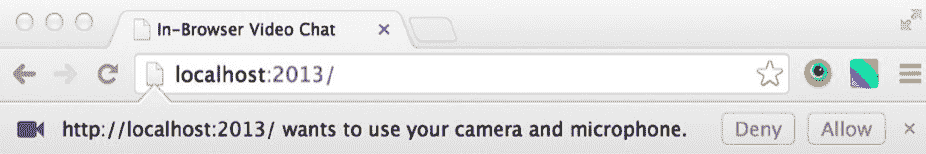

**图 12-1.** 在我们访问之前，用户必须允许或拒绝对其摄像头和麦克风的访问。

`getUserMedia()` 方法是一种编写类型，在某些浏览器中通过带前缀名称访问，但在所有浏览器中具有相同的输入参数序列。我们可以写一个小的补丁（polyfill），以便在所有支持的浏览器中启用此 API 的访问，这样我们就可以通过代码使用 `getUserMedia()` 方法访问它。列表 12-1 中的代码显示了一个简单的补丁，允许在所有支持的 Web 浏览器中通过相同的方法调用访问摄像头和麦克风。

**列表 12-1.** `getUserMedia()` API 的简单补丁

```javascript
// expose the browser-specific versions of the getUserMedia() method through the standard
// method name. If the name is already supported in the browser (as it is in Opera),
// use that, otherwise fall back to Mozilla's, Google's or Microsoft's implementations as
// appropriate for the current browser
navigator.getUserMedia = navigator.getUserMedia || navigator.mozGetUserMedia ||
navigator.webkitgetUserMedia = navigator.webkitGetUserMedia || navigator.msGetUserMedia;
```

出于安全考虑，WebRTC 只有在使用 Web 服务器访问时才能工作，而不是直接从浏览器加载的本地文件中运行代码。有许多方法可以在本地启动 Web 服务器来运行本章中的代码列表，尽管最简单的是下载并运行 Apache Web 服务器。如果你觉得更有趣，可以跳到第 14 章，我将在那里解释如何使用 Node.js 应用程序平台创建并运行本地 Web 服务器。

我们可以使用列表 12-1 中的补丁来让 `getUserMedia()` 方法尝试访问用户的摄像头和麦克风，如列表 12-2 所示。

### 列表 12-2. 访问摄像头和麦克风

```javascript
// 定义一个函数，如果能够成功访问用户的摄像头和
// 麦克风时则执行
function onSuccess() {
    alert("Successful connection made to access webcam and microphone");
}

// 定义一个函数，如果我们无法访问用户的摄像头和麦克风时执行
// 无论是因为用户拒绝了访问还是由于技术错误
function onError() {
    throw new Error("There has been problem accessing the webcam and microphone");
}

// 使用列表 12-1 中的补丁，我们知道如果方法存在，
// 则 getUserMedia 方法是被支持的
if (navigator.getUserMedia()) {
    // 我们现在可以执行 getUserMedia() 方法，传递一个对象告诉浏览器
    // 我们想要访问的媒体的类型（"video" 用于摄像头，"audio" 用于
    // 麦克风）。我们传递了 onSuccess() 和 onError() 函数的引用，
    // 这些函数将根据用户是否授予我们请求的媒体类型来执行
    navigator.getUserMedia({
        video: true,
        audio: true,
    }, onSuccess, onError);
} else {
    // 如果用户的浏览器不支持 getUserMedia() 方法，则抛出错误
    throw new Error("Sorry, getUserMedia() is not supported in your browser");
}
```

在运行列表 12-2 中的代码时，如果你发现自己没有被提示访问摄像头和麦克风，请检查你是在托管在 Web 服务器上的 HTML 页面上下文中运行代码的，以便允许你通过网络连接进行连接。对于使用 `file:///` 协议浏览 URL 的 Firefox 浏览器，你将需要通过 `http://` 上的 Web 服务器运行它。

浏览器将通过 Chrome 和 Opera 中浏览器标签页显示的页面名称旁边的红色圆圈图标，在视觉上指示它当前正在录制你的音频或视频；而 Firefox 则在地址栏显示绿色摄像头图标来指示这一点。

现在我们能够访问用户的摄像头和麦克风了，我们需要对它们返回的数据进行一些处理。`getUserMedia()` 方法触发的 `onSuccess()` 回调方法传递了一个参数，代表设备提供的原始数据流，供你的应用程序使用。

我们可以获取此流并直接传递到页面上 `<video>` 元素的输入中，允许用户将其摄像头和麦克风的数据回传给他们。列表 12-3 中的代码显示了如何使用浏览器的 `window.URL.createObjectURL()` 实现这一点，它创建了一个特定的本地 URL，可以按这种方式访问多媒体流提供的数据。

### 列表 12-3. 将摄像头和麦克风回传给用户

```javascript
// 使用列表 12-1 中的补丁，让 getUserMedia() 方法尝试访问
// 用户摄像头和麦克风，如列表 12-2 所示
// 定义一个函数，如果能够成功访问用户的摄像头和
// 麦克风时执行
function onSuccess() {
    alert("Successful connection made to access webcam and microphone");
}

// 定义一个函数，如果我们无法访问用户的摄像头和麦克风
// 无论是因为用户拒绝了访问还是由于技术错误
function onError() {
    throw new Error("There has been problem accessing the webcam and microphone");
}

// 使用列表 12-1 中的补丁，我们知道如果方法存在，
// 则 getUserMedia 方法是被支持的
if (navigator.getUserMedia()) {
    // 我们现在可以执行 getUserMedia() 方法，传递一个对象告诉浏览器
    // 我们想要访问的媒体的类型（"video" 用于摄像头，"audio" 用于
    // 麦克风）。我们传递了 onSuccess() 和 onError() 函数的引用，
    // 这些函数将根据用户是否授予我们请求的媒体类型来执行
    navigator.getUserMedia({
        video: true,
        audio: true,
    }, onSuccess, onError);
} else {
    // 如果用户的浏览器不支持 getUserMedia() 方法，则抛出错误
    throw new Error("Sorry, getUserMedia() is not supported in your browser");
}
```

在运行列表 12-2 中的代码时，如果你发现自己没有被提示访问摄像头和麦克风，请检查你是在托管在 Web 服务器上的 HTML 页面上下文中运行代码的，以便允许你通过网络连接进行连接。对于使用 `file:///` 协议浏览 URL 的 Firefox 浏览器，你将需要通过 `http://` 上的 Web 服务器运行它。

浏览器将通过 Chrome 和 Opera 中浏览器标签页显示的页面名称旁边的红色圆圈图标，在视觉上指示它当前正在录制你的音频或视频；而 Firefox 则在地址栏显示绿色摄像头图标来指示这一点。

现在我们能够访问用户的摄像头和麦克风了，我们需要对它们返回的数据进行一些处理。`getUserMedia()` 方法触发的 `onSuccess()` 回调方法传递了一个参数，代表设备提供的原始数据流，供你的应用程序使用。我们可以获取此流并直接传递到页面上 `<video>` 元素的输入中，允许用户将其摄像头和麦克风的数据回传给他们。列表 12-3 中的代码显示了如何使用浏览器的 `window.URL.createObjectURL()` 实现这一点，它创建了一个特定的本地 URL，可以按这种方式访问多媒体流提供的数据。

# 第 12 章 使用 WebRTC 进行视频聊天

包含与 `RTCPeerConnection` 类建立点对点连接的 ICE 服务器详情的示例对象可能如下所示：

```javascript
iceServers: [{
  // Mozilla 的公共 STUN 服务器
  url: "stun:23.21.150.121"
},
{
  // Google 的公共 STUN 服务器
  url: "stun.l.viagenie.com:19302"
},
{
  // 在 http://numb.viagenie.ca 创建您的 TURN 服务器——不要忘记
  // 对用户名中的任何扩展字符进行转义，例如 @ 字符变为 %40
  url: "turn:numb.viagenie.com",
  username: "denodell%40mail.com",
  credential: "password"
}]
```

现在，如果你仔细阅读，你可能已经注意到关于设置我们点对点连接的一个困惑之处：如果我们在不知道要连接到谁的情况下，我们如何通过中间节点在两个对等点之间建立连接呢？

答案是，当然，这把我们引向理解如何设置视频通话的下一个部分——信令通道。


我们需要做的是提供一种机制，在通话设置之前和期间在连接双方之间发送消息。每个部分都需要监听消息……尽管这样做效率很低，因为双方都必须频繁地询问中间服务器对方是否发送了任何消息——而在大多数情况下，答案是“否”。更好的解决方案是使用`EventSource` API（更多信息请参阅 http://bit.ly/eventsource_basic）或`WebSocket`（参阅 http://bit.ly/websocket_basic），它允许服务器向连接的客户端“推送”消息，并在需要传输消息时进行，从而产生一个更高效的实时数据系统。后一种方法的好处是，它在所有支持 WebRTC 的浏览器中都受到支持，因此不需要为此进行补丁（polyfills）或变通处理。

## 为 Signore 使用 Firebase 服务

与其使用自己的服务器来支持 WebSocket 连接，我们可以利用现有的云端解决方案来代表我们在连接双方之间存储和传输数据。其中一种解决方案是 Firebase（可在 http://firebase.com 获取，如图 12-2 所示），它提供了一个简单的在线数据库和一个用于通过 WebSocket 在 Web 上访问数据的 JavaScript API（如果运行它的浏览器不支持 WebSocket，它实际上会回退到其他解决方案）。它的免费基础方案足以满足我们作为连接和配置视频聊天客户端的信令服务的需求。

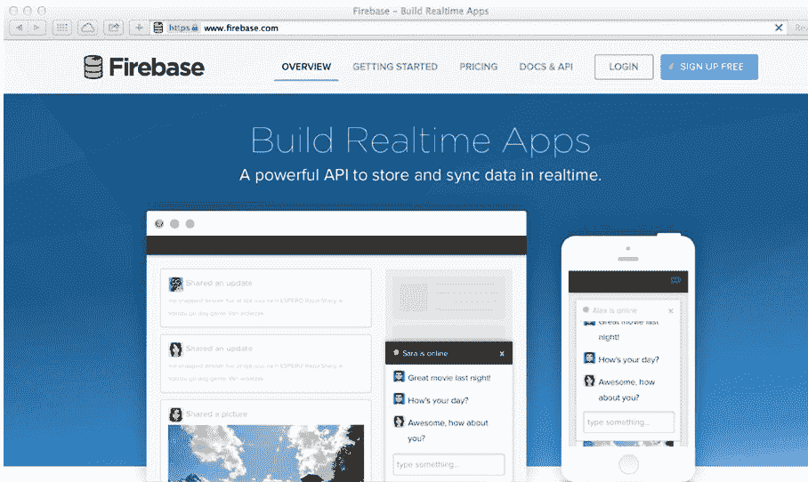

### 构建实时应用

用于实时存储和同步数据的强大 API。

### 实时应用平台

**图 12-2.** Firebase 了一个了一个非常适合设备间实时通信的数据访问 API。

访问 Firebase 网站并注册一个免费账户。你将通过电子邮件收到新创建的数据库的访问详情。每个数据库都有其唯一的 URL 以及在你的页面上使用的`<script>`标签详情，用于加载使用你的存储的 Firebase API。无论创建的 URL 如何，`<script>`标签始终是相同的：

```html
<script src="https://cdn.firebase.com/v0/firebase.js"></script>
```

对于使用给定名称`https://glaring-fire-9593.firebaseio.com/`创建的 URL，可以使用以下 JavaScript 代码来建立与云的连接并在数据库中保存数据：

```javascript
var dataRef = new Firebase("https://glaring-fire-9593.firebaseio.com/");
dataRef.set("I am now writing data to Firebase!");
```

Firebase 中的数据以伪 JSON 格式的嵌套对象形式存储，这对你来说应该非常熟悉。可以使用 Firebase API 的`set()`方法向数据库添加数据，我们能够使用 API 的`on('child')`方法检测任何连接客户端何时添加了数据。这意味着在我们的视频聊天中，一旦双方通过 ICE 框架建立了连接，双方就可以相互通知，当双方都从对方那里接收所需信息后，视频通话即可开始。

现在，我们将我们的视频聊天客户端托管在任何人都可以访问的公共 Web 服务器上，我们需要限制对一个可以相互聊天的人数，否则我们可能会面临两个完全陌生的用户仅仅因为他们是连接到服务器的首批用户而建立通话的风险——我们不是在 ways构建 Chat Roulette！我们需要一种方法让特定用户能够相互连接，其中一种简单的技术是允许连接的用户创建“房间”，并允许客户端具有创建或加入这些聊天室之一的能力。当两个用户加入一个房间时，我们可以将信令限制为该房间内的用户，这样只有指定的双方会相互通信。我们还将允许视频聊天的第一方，即*发起者*（initiator），为他们的房间命名。他们可以告诉他们的通话伙伴，他们在访问聊天网页时将指定的该房间名称。然后，我们将双方之间发送和接收的*提议*（offer）和*响应*（answer）消息与聊天室名称对应，以及直接连接双方的 ICE 详情对应，这样我们可以直接连接多个双方。

```json
{
  "rooms": {
    "room-name": {
      "offer": "...",
      "answer": "...",
      "ice": "..."
    }
  }
}
```

后一种方法的好处是，它在所有支持 WebRTC 的浏览器中都受到支持，因此不需要为此进行补丁（polyfills）或变通处理。

## 构建视频客户端

一旦运行了 Web 服务器（无论是在本地还是使用托管解决方案），你将创建一个 HTML 页面，并在其中展示视频和音频。我们首先通过 http 或 https 协议设置 Web 服务器。这是因为`getUserMedia()` API 仅在安全源的上下文中有效。

```html
<!-- 加载 VideoChat "class" 定义 -->
<script src="Listing12-5.js"></script>
```

```html
<!-- 加载用于实例化 VideoChat "class" 并将其连接到此页面的代码 -->
<script src="Listing12-6.js"></script>
```

```html
<body>
</body></html>
```

列表 12-5 中的代码展示了如何创建 VideoChat "class"，该类创建了必要的代码来处理本地浏览器与远程之间的通信，并在两者之间流传输视频和音频。

# 列表 12-5. 一个支持浏览器内视频聊的 VideoChat "class"

```javascript
// 定义一个可以用于在浏览器中创建点对点视频聊的“class”。
// 我们依赖于 Firebase，其客户端 API 脚本应该在此脚本执行
// 之前在浏览器中加载
var VideoChat = (function(Firebase) {
```

```javascript
// 对所需的浏览器功能进行填充（Polyfill），以支持视频聊天，因为某些
// 功能仍带有前缀的方法和“class”名称
// PeerConnection "class" 允许在运行在当前设备上的当前网页
// 与运行在另一个设备上的相同网页之间配置点对点连接，
// 允许将数据流从一个传递到另一个，从而能够构建
// 视频聊天应用程序
var PeerConnection = window.mozRTCPeerConnection // window.webkitRTCConnection,
```

```javascript
// RTCSDescription "class" 与 RTPConnection 配合工作
// 使用会话描述协议 (SDP) 初始化点对数据流
SessionDescription = window.mozRTCSessionDescription // window.RTCSessionDescription,
// IceCandidate "class" 允许创建点对“候选者”（candidates）的实例
// - 候选者直接向我们的通话伙伴提供连接详情，
// 允许两个浏览器进行聊天
IceCandidate = window.mozRTCIceCandidate // window.RTCIceCandidate,
```

```javascript
// 定义通话中的两种参与者类型：发起通话的人和
// 响应通话的人
_participantType = {
  INITIATOR: "initiator",
  RESPONDER: "responder",
},
```

```javascript
// 定义一个包含设置的对象，我们将使用它创建 PeerConnection
// 对象，允许聊天中的两个参与者在互联网上
// 定位对方的 IP 地址
peerConnectionSettings = {
```

```javascript
// 定义 ICE 服务器集，以尝试定位参与聊天的
// 每个设备的 IP 地址。为了获得最佳成功率，
// 我们至少包含一个支持两种不同
// 协议（STUN 和 TURN）的服务器，它提供了这种 IP 查找机制
server:
IceServers: [{
```

# 第 12 章节 使用 WEBRTC 进行视频聊天

```javascript
// Mozilla 的公共 STUN 服务器
url: "stun:23.21.150.121"
```

```javascript
// Google 的公共 STUN 服务器
url: "stun:stun.google.com:19302"
```

```javascript
// 在 http://numb.viagenie.ca 创建你自己的 TURN 服务器
url: "numb.viagenie.ca"
username: "denodell%40gmail.com"
credential: "password"
],
```

```javascript
// 为了不同浏览器厂商代码之间的互操作性，
// 将此 TLS/SRTP 属性设置为 "true"，因为它在 Firefox 中默认是 "true"
options: {
optional: [{
DtlsrtpKeyAgreement: true
]}
};
```

```javascript
// 填充 getUserMedia() 方法，它允许我们访问由用户
// 摄像头和/或麦克风提供流
navigator.getUserMedia = navigator.getUserMedia || navigator.moz.getUserMedia ||
navigator.webkitGetUserMedia = navigator.getUserMedia;

// 如果当前浏览器不支持视频聊天所需的“class”和方法，
// 则抛出错误 - 在创建时，Google Chrome、Mozilla Firefox 和
// Opera 是唯一支持支持视频聊天所需特征的浏览器
if(!navigator.getUserMedia && window.RTCPeerConnection) {
  throw new Error("您的浏览器不支持视频聊天");
}
```

```javascript
// 定义一个通用的错误处理函数，该函数将在浏览器中抛出错误
function onError(error) {
  throw new Error(error);
}
```

```javascript
// 定义 VideoChat "class" 用于在网页上创建新的视频聊天
function VideoChat(options) {
  options = options || {};
```

```javascript
// 允许传递两个回调函数：localStream() 和 remoteStream()。
// 前者在连接到本地摄像头和麦克风建立连接后执行，
// 后者在连接到远程用户的摄像头和麦克风建立连接后执行。
// 传递一个流 URL，可在 HTML 页面内的 <video> 标签中显示流的内容
if (typeof options.localStream === "function") {
  this.localStream = options.localStream;
}
```

```javascript
if (typeof options.onRemoteStream === "function") {
  this.onRemoteStream = options.onRemoteStream;
}
```

```javascript
// 使用提供的 URL 初始化 Firebase 数据存储
this.initializedDatabase(options.firebaseUrl || "");
```

```javascript
// 设置两个设备之间流传输视频和音频的点对点连接
this.setupPeerConnection();
```

```javascript
VideoChat.prototype = {
  // 定义聊天中的当前参与者类型，发起者
  // 发起通话
  participantType: _participantType.INITIATOR,
```

```javascript
  // 定义聊天中的远程参与者类型，响应者
  // 响应通话
  participantType: _participantType.RESPONDER,
```

```javascript
  // 创建一个稍后存储聊天名称的属性
  chatRoomName: "",
```

```javascript
  // 用于加载和保存数据的属性
  database: null,
```

```javascript
  // 定义在本地流启动时调用的方法
  localStream: function() {
  }
```

```javascript
  // 定义在远程流连接时调用的方法
  onRemoteStream: function() {
  }
```

```javascript
  // 定义初始化 Firebase 数据库的方法
  initializeDatabase: function(firebaseUrl) {
    // 连接到我们的 Firebase 数据库
    var firebase = new Firebase(firebaseUrl);
    // 定义持有连接的对象
    this.database = firebase.child("chatRooms");
  }
```

```javascript
  // 定义将指定的键值对保存到 Firebase 方法
  saveData: function(chatRoomName, name, value) {
    if (this.database) {
      this.database.child(chatRoomName).set(value);
    }
  }
```

```javascript
  // 定义通过名称从 Firebase 加载存储的数据，
  // 在找到数据时执行回调函数
  Data: function(chatRoomName, name, callback) {
    if (this.database) {
      // 异步请求数据
      this.database.child(chatRoomName).child(name).on("value", function(data) {
        // 提取值
        var value = data.val();
        // 如果为此方法回调函数，则执行它
        // 以及找到的值
        if (value && typeof callback === "function") {
          callback(value);
        }
      });
    }
  }
```

```javascript
  // 定义在两个设备之间建立点对点连接并在两者之间传输数据的方法
  setupPeerConnection:function() {
    var that = this;
    // 使用定义的 STUN 和 TURN 服务器创建 PeerConnection 实例，
    // 以跨防火墙和 NAT 建立点对点连接
    this.peerConnection = new PeerConnection(peerConnectionSettings.server,
    peerConnectionSettings.options);

    // 当远程流被添加到点对点连接时，获取流的 URL
    // 并将其传递给 onRemoteStream() 方法，以便在页面内的 <video> 标签中
    // 处理远程视频和音频
    this.peerConnection.onnaddstream = function(event) {
      // 获取代表流对象的 URL
      var streamURL = window.URL.createObjectURL(event.stream);
      // 将此 URL 传递给实例化 VideoChat 实例时的
      // onRemoteStream() 方法
      that.onRemoteStream(streamURL);
    };

    // 定义一个当 ICE 框架找到允许点对点数据连接的合适的
    // 候选者时执行的函数
    this.peerConnection.onicecandidate = function(event) {
      if (event.candidate) {
```

```javascript
        // Google Chrome 经常找到多个候选者，因此我们通过在找到候选者后
        // 移除事件处理程序，确保我们只获取它提供的第一个候选者
        // that.peerConnection.oncecandidate = null;
        // 读取远程端的 ICE 候选者连接详情
        // that.loadData(that.chatRoomName, "candidate": " + that.remoteParticipantType, function(candidate) {
          // 将远程端的 ICE 候选者连接到此连接中，从而建立点对点连接
          that.peerConnection.addIceCandidate(
              IceCandidate(JSON.parse(candidate))
          );
          // 保存我们的 ICE 候选者详情以供远程端连接
          that.saveData(that.chatRoomName, "candidate": " + that.participantType, JSON.stringify(event.candidate));
      };
    }
  }
};
```


```javascript
// 定义一个方法来获取本地设备的摄像头和麦克风流，并处理本地设备与远程设备之间的握手，以建立视频通话
call: function() {
    var that = this;

    // 设置我们点对点聊天连接的约束。我们希望能够支持音频和视频，因此我们设置了相应的属性
    _constraints = {
        mandatory: {
            OfferToReceiveAudio: true,
            OfferToReceiveVideo: true
        }
    };

    // 获取本地设备的摄像头和麦克风流 - 提示用户授权使用这些设备
    navigator.getUserMedia({
        video: true,
        audio: true,
    }, function(stream) {
        // 将本地视频和音频数据流添加到点连接中，使得到同一点对点连接的远程端可以使用
        that.peerConnection.addStream(stream);

        // 执行 onLoadStream() 方法，传递本地流的 URL，
        // 允许摄像头和麦克风数据在当前 HTML 页面的 <video> 标签中显示给本地用户
        that.onLocalStream(window.URL.createObjectURL(stream));

        // 如果我们是通话的发起者，我们为任何已连接的对端创建报价以加入我们的视频通话
        if (that.participantType == _participantType.INITIATOR) {
            // 在此聊天室中创建一个视频通话报价（offer），并等待任何已连接对端的回答
            that.peerConnection.createOffer(function(offer) {
                // 将生成的本地报价存储在点连接对象中
                that.peerConnection.setLocalDescription(offer);

                // 保存报价详情以供连接的对端访问
                that.saveData(that.chatRoomName, "offer", JSON.stringify(offer));
            });

            // 如果连接的对端对我们的报价回复了“回答”（answer），
            // 将他们的详情存储在点连接对象中，开启之间的通信通道
            that.loadData(that.chatRoomName, "answer", function(answer) {
                that.peerConnection.setRemoteDescription(
                    new SessionDescription(JSON.parse(answer))
                );
            });
        }

        // 如果我们是加入现有通话的人，我们对报价进行回答，以建立点对点连接
        else {
            // 加载对方提供的报价 - 等待报价提供（如果并非立即存在）
            that.loadData(that.chatRoomName, "offer", function(offer) {
                // 使用提供的数据存储远程端的报价详情
                that.peerConnection.setRemoteDescription(
                    new SessionDescription(JSON.parse(offer))
                );

                // 对报价生成一个“回答”（answer），启用视频通话所需的两个点对点连接
                that.peerConnection.createAnswer(function(answer) {
                    // 将生成的回答存储为本地连接详情
                    that.peerConnection.setLocalDescription(answer);

                    // 保存回答详情，使其对发起方可用，开启两者之间的通信通道
                    that.saveData(that.chatRoomName, "answer", JSON.stringify(answer));
                });
            });
        }
    }, onError, _constraints);
}

// 定义一个发起视频聊天通话的方法，返回生成的聊天室名称，该名称可以提供给远程用户进行连接
startCall: function() {
    // 生成一个用零填充的 3 位数字
    var randomNumber = Math.round(Math.random() * 999);

    if (randomNumber < 10) {
        randomNumber = "0" + randomNumber;
    } else if (randomNumber < 100) {
        randomNumber = "0" + randomNumber;
    }

    // 根据生成的随机数创建一个简单的聊天室名称
    this.chatRoomName = "room-" + randomNumber;

    // 执行 call() 方法，使用此聊天室名称开始传输和接收视频和音频
    this.call();

    // 返回生成的聊天室名称，以便提供给远程端进行连接
    return this.chatRoomName;
}

// 定义一个使用特定房间名称加入现有视频通话的方法
joinCall(chatRoomName) {
    // 存储提供的聊天室名称
    this.chatRoomName = chatRoomName;

    // 如果我们是加入现有通话的人，我们必须是响应者
    // 而不是发起者，因此相应地更新属性
    this.participantType = _participantType.RESPONDER;
    this.remoteParticipantType = _participantType.INITIATOR;

    // 执行 call() 方法，使用此聊天室名称开始传输和接收视频和音频
    this.call();

    // 返回聊天室名称，以便提供给远程端进行连接
    return this.chatRoomName;
}
```

# 第 13 章 使用客户端模板

基于 JavaScript 的单页 Web 应用程序（SPA）允许页面部分根据服务器端的数据更新或用户操作进行动态更新。这为用户提供了曾仅适用于原生桌面和移动应用的体验，并且避免了通过完整刷新整个页面来更新页面某个部分或向当前页面添加新用户界面组件的需求。在本章中，我们将探讨在更新当前页的同时，如何保持待显示数据与呈现数据的 DOM 结构之间清晰的分离。

## 动态更新页面内容

我们知道，为了通过 JavaScript 在页面上更新或创建 HTML 内容，我们需要使用文档对象模型（DOM）来修改属性和元素树，以实现所需的内容更改。这对于简单且小型页面有效，但扩展性较差，因为每个元素都需要大量的 JavaScript 代码，并且需要通过复杂且耗时的查找来确定位要更新的精确元素。如果 HTML 页面结构在 JavaScript 代码未感知的情况下发生了更新，我们还面临无法找到需要更新的元素的风险。

与其逐个节点地操作 DOM 节点，不如使用元素的 `innerHTML` 来操作大块 HTML，从而像处理普通文本字符串一样动态访问并更新该元素内部的 HTML。这种方法的唯一问题是，当复杂的 HTML 结构被表示为字符串时，插入动态字符串和其他数据的代码非常难以理解，导致维护和开发变得困难，而这是专业 JavaScript 开发者不惜一切避免的。列表 13-1 展示了此类示例，即在将添加到页面之前，在长长的 HTML 字符串中插入文本。

**列表 13-1** 将 JavaScript 数据与 HTML 字符串结合

```javascript
var firstName = "Den",
    lastName = "Odell",
    company = "AKQA",
    city = "London",
    email = "denodell@me.com",
    divElem = document.createElement("div");
```

```javascript
// 将数据和字符串应用到 HTML 结构会导致代码变得复杂且难以维护
divElem.innerHTML =
```

```javascript
// 页面加载后，将新的 <div> 添加到当前 HTML 页面的末尾
window.addEventListener("load", function() {
  document.body.appendChild(divElement);
}, false);
```

尽管这种方法存在复杂性，但确实需要将 JavaScript 数据（这些数据可能或可能通过 Ajax 加载）与 HTML 字符串结合，以便在页面上动态显示。在本章中，我们将涵盖解决此问题的可行方案，重点关注客户端 HTML 模板解决方案，以便在更新页面的同时，将我们呈现的数据与用于标记它的 HTML 分离开。作为专业的 JavaScript 开发者，这种考虑非常重要，因为随着应用程序的增长，它具有良好的扩展性，并且能尽可能减少我们和其他项目团队成员的困惑。

## 通过 Ajax 动态加载 HTML

动态更新页面内容最简单的方法是在服务器端将数据与 HTML 代码结合，通过 Ajax 将结合后的 HTML 代码作为字符串返回，我们可以将其放在页面上，替换现有元素的内容。当然，这并没有解决问题，因为我们只是将问题从客户端转移到了服务器端，那里仍然需要一个合适的解决方案。有很多服务器端模板解决方案，例如：

- Smarty（用于 PHP，`http://bit.ly/smarty_template`）
- Liquid（用于 Ruby，`http://bit.ly/liquid_template`）
- Apache Velocity（用于 Java，`http://bit.ly/velocity_template`）
- Spark（用于 ASPNET，`http://bit.ly/spark_template`）

我们可能需要指定一个服务器提供的服务 URL，将其作为 HTML 字符串返回，以便在设置 `innerHTML` 属性时直接放入页面上的某个元素中。

明显的优势是它在 `body` 中运行的 JavaScript 代码非常少。我们需要一个简单的函数从服务器加载所需的 HTML 并将其放在指定的元素中。列表 13-2 展示了此类请求 HTML 字符串并将其追加到当前页面的函数示例。

- 列表 13-2：通过 Ajax 动态加载 HTML 并用响应填充当前页面

```javascript
// 定义一个方法，从特定 URL 加载 HTML 字符串并将其放在当前页面给定的元素中
function loadHtmlAndReplace(url
```

```javascript
// 执行 Ajax 请求获取给定的 URL 并用响应填充指定的元素
var xhr = new XMLHttpRequest();

LOADED_STATUS = 4,
OK_STATUS = 200;

xhr.onreadystatechange = function() {
  if (xhr.readyState !== LOADED_STATUS) {
    return;
  }

  if (xhr.status === OK_STATUS) {
    // 用返回的 HTML 填充指定的元素
    element.innerHTML = xhr.responseText;
  }
};
```

```javascript
xhr.open("GET", url);
xhr.send();
```

```javascript
// 从两个特定 URL 加载 HTML 并用返回的标记填充指定的元素
loadHTMLAndReplace("/ajax/ticket-form.html", document.getElementById("ticket-form"));
loadHTMLAndReplace("/ajax/business-card.html", document.getElementById("business-card"));
```

这种技术的缺点是，在响应数据变化而需要频繁更新时，会从服务器下载大量冗余信息（这些数据是冗余的，因为它反映了已更新的数据，而周围的标记保持不变），而我们真正想要显示的是数据。

## 客户端模板

模板仅仅是一个包含占位符标记的字符串，数据应被替换。通过将此模板与存储在 JavaScript 对象中的值结合，我们生成了一个 HTML 字符串。

### 模板

```html
<p><a href="mailto:{{email}}">{{firstName}} {{lastName}}</a><br>Company: {{company}}</p>
<p>City: {{city}}</p>
```

### 数据

```json
{
  "firstName": "Den",
  "lastName": "Odell",
  "email": "denodell@me.com",
  "company": "AKQA",
  "city": "London"
}
```

```javascript
// 定义一个简单的函数，将 JavaScript 对象的数据应用到 HTML 模板中，
// 以字符串形式表示
function applyDataTemplate(templateString, dataObject) {
  var key,
      value,
      regex;

  // 遍历提供的数据对象中的每个属性名，将所有被 {{ }}
  // 包围的实例替换为数据对象中的值
  for (key in dataObject) {
    regex = new RegExp(\{\{" + key + " \}", "g");
    value = dataObject[key];

    // 执行替换
    templateString = templateString.replace(regex, value);
  }

  // 返回替换后的新 HTML 字符串
  return templateString;
}

// 输出:
// <p><a href="mailto:denodell@me.com">Den Odell</a><br>Company: AKQA</p>
// <p>City: London</p>
alert(applyDataTemplate(template, me));

// 输出:
// <p><a href="mailto:bill@microsoft.com">Bill Gates</a><br>Company: Microsoft</p>
// <p>City: Seattle</p>
alert(applyDataTemplate(template, bill));
```


此函数适用于简单的模板和 JavaScript 数据；然而，如果需要对数据数组或对象进行迭代，或者根据某些属性的值添加显示或隐藏不同部分的逻辑，那么这种解决方案就力不从心了，并且需要扩展以支持这些功能。在这种情况下，最好将预处理工作交给成熟的第三方源 JavaScript 客户端模板库来完成。

## 使用 Mustache.js 进行客户端模板渲染

`Mustache` 是一种由 `Chris Nash` 在 2009 年开发的无逻辑模板语言，它在大多数编程语言中都有实现；`Mustache.js` 是它的 `JavaScript` 的实现版本。它最初源于 `Google Templates`（也称为 `templates`）。"无逻辑"一词是指模板结构中不包含 `if`、`else` 或 `for` 循环；然而，它包含通用的结构标签，这些标签允许根据所引用的 `JavaScript` 数据（称为数据哈希，`data hash`）中存储的类型类型来执行这种行为。`Mustache` 使用双大括号 `{{ }}` 作为标记，从右侧看，它们看起来像小胡子。你可以通过 `http://bit.ly/mustache_github` 从其 `Github` 页面下载 `Mustache.js`。该库在压缩并打包后权重仅为 `1.8KB`。

让我们开始学习 `Mustache.js`，使用它对初始示例进行模板处理，以渲染出列表 13-3 中相同的 `HTML` 输出。我们将将其分为两个代码列表：一个 `HTML` 页面，包含在特殊配置的 `<script>` 标签内编写的模板本身并引用了 `Mustache.js` 库；另一个 `JavaScript` 文件（其内容在列表 13-5 中），包含要应用到模板的数据，并调用 `Mustache.js` 来渲染由该模板生成的 `HTML`。

### 列表 13-4 包含用于 Mustache.js 的客户端模板的 HTML 页面

```html
<!doctype html>
<html>
<head>
  <meta charset="utf-8">
  <title>Mustache.js 示例</title>
</head>
<body>
<h1>Mustache.js 示例</h1>
<!-- 定义我们希望将数据应用到的模板。"type" 属性
需要是任何非标准的 MIME 类型，以便元素的内容
被解释为纯文本而不是被执行 -->
<script id="template" type="x-tmpl-mustache">
<p>
  Name: <a href="mailto:{{email}}">{{firstName}} {{lastName}}</a><br>
  Company: {{company}}
</p>
<p>
  City: {{city}}
</p>
</script>
<!-- 加载 Mustache.js 库 -->
<script src="lib/mustache.min.js"></script>
<!-- 执行我们的脚本将模板与数据结合 -->
<script src="listing13-5.js"></script>
</body>
</html>
```

列表 13-4 中包含模板的 `<script>` 标签赋予了一个 `type` 属性，浏览器不会将其识别为标准的 `MIME` 类型。这将导致浏览器将其内容视为纯文本，而不是要执行的内容，且不会将标签的内容写入页面。然后可以通过 `JavaScript` 通过其 `id` 属性值定位元素并获取其 `innerHTML` 内容来引用该标签的内容。列表 13-4 所示的 `HTML` 页面引用了列表 13-5 中的 `JavaScript` 代码（如下所示），在浏览器中运行时将产生 13-1 所示的结果。注意用于根据两个输入参数生成输出字符串的 `Mustache.render()` 方法：即模板字符串和 `JavaScript` 数据对象。

### 列表 13-5 使用 Mustache.js 将数据与模板结合

```javascript
// 从我们的 HTML 页面查找并存储对 <script id="template"> 元素的引用
var templateElement = document.getElementById("template");
// 从模板元素内部提取模板作为字符串
template = templateElement.innerHTML;
// 创建两个元素来存储模板与数据
//结合后生成的 HTML
meElement = document.createElement("div");
billElement = document.createElement("div");
// 定义两个包含应用到存储模板的数据的对象
meData = {
  firstName: "Den",
  lastName: "Odell",
  email: "denodell@me.com",
  company: "AKQA",
  city: "London"
};
billData = {
  firstName: "Bill",
  lastName: "Gates",
  email: "bill@microsoft.com",
  company: "Microsoft",
  city: "Seattle"
};
// 使用 Mustache.render 方法生成输出字符串并存储
meElement.innerHTML = Mustache.render(template, meData);
billElement.innerHTML = Mustache.render(template, billData);
// 将元素添加到主体
document.body.appendChild(meElement);
document.body.appendChild(billElement);
```

## 变量

`Mustache` 模板格式允许将双括号 `{{ }}` 包围的文本替换为同名的关联数据属性，正如我们在模板 13-4 中看到的。在 `Mustache` 的术语中，双括号内的名称被称为变量或键。

所有变量都被替换为 `HTML` 转义后的字符串，这意味着放入变量的数据字符串中的 `HTML` 将被渲染为文本，而不是解释为 `HTML` 元素。如果你希望文本被解释为 `HTML`，你应该用三大括号 `{{{}}}` 包围键名，如下。如果你需要渲染 `JavaScript` 对象属性的值，可以使用标准的点表示法来导航对象层次。

**模板：**

```text
{{name}}
{{name}}
From {{address.country}}
```

**数据哈希：**

```json
{
  name: "Den <strong>0dell",
  address: {
    country: "UK"
  }
}
```

**输出：**

```text
Den &lt;strong&gt;0dell&lt;#x2F;strong&gt;
Den &lt;0dell&gt;
From UK
```

当模板中命名的键在提供的数据哈希对象不存在时，空字符串将替换标签。这与我们在列表 13-3 中的原始语义模板示例不同，如果关联数据值不存在，该示例会在输出中保持标签完好。

## 部分

`Mustache` 模板中的部分由起始和结束标签包围一个块。在这些标签之间的模板块内容将根据关联数据键中存储的类型类型，在生成的输出中重复一次或多次。标签中的键名以井号（`#`）字符开头表示部分的开始，以斜杠（`/`）字符开头表示部分的结束，例如 `{{section}}{{/section}}`。有四种部分——条件、迭代器、函数和反转，它们的声明方式相似，但根据传递给它们的数据类型执行不同的功能。

### 条件区块

如果所引用的标签数据值为布尔类型 `true`，则显示区块的内容；如果为 `false`，则不显示该区块。对于假值（例如空字符串或空数组）也是如此——在这些情况下将不会显示该区块。这种行为允许我们执行等同于条件 `if` 语句的操作，如下所示。只有当 `isAvailable` 数据属性值为真时，输出中才会包含字符串 `YES`。

**模板：**

```text
Available:
{{isAvailable}}
YES
{{/Available}}
```

**数据哈希：**

```text
{
  isAvailable: true
}
```

**输出：**

```text
Available: YES
```

### 迭代器区块

如果区块标签引用的数据属性格式是包含一个或多个项目的数组列表，则开始和结束标签之间的内容将为列表中的每个项目重复一次，每个单独项目的数据每次迭代都会传递到区块中。这使我们具备了等同于迭代数据循环（等同于 `JavaScript` 的 `for` 循环）的能力，如下所示：

**模板：**

```text
<h1>People</h1>
{{#people}}
  <p>Name: {{name}}</p>
{{/people}}
```

**数据哈希：**

```text
{
  people: [
    {name: "Den Odell",},
    {name: "Bill Gates"}
  ]
}
```

**输出：**

```text
<h1>People</h1>
<p>Name: Den Odell</p>
<p>Name: Bill Gates</p>
```

### 函数区块

如果区块标签引用的数据是一个函数，那么事情就开始变得非常有趣了。`Mustache.js` 会立即执行该函数并返回一个函数，每当函数名称被区块标签引用时都会执行一次，并传入两个参数：作为字符串的模板区块的字面文本内容（在进行任何模板替换之前），以及一个指向 `Mustache.js` 内部 `render()` 方法的直接引用，允许在应用数据输出其内容之前对第一个参数中的值进行某种处理。这使得根据输入数据创建过滤器、缓存或执行其他基于字符串的模板操作成为可能。此处的示例所示：

**模板：**

```text
{{strongLastword}}
My name is {{name}}
{{strongLastword}}
```

**数据哈希：**

```text
{
  name: "Den Odell",
  strongLastWord: function() {
    return function(text, render) {
      // 使用提供的 Mustache.js render() 函数将数据应用到
      // 提供的模板文本
      var renderedText = render(text),
      // 将生成的文本拆分为单词数组
      wordArray = renderedText.split(" "),
      wordLength = wordArray.length,
      // 从数组中提取最后一个单词
      finalWord = wordArray[wordLength - 1];
      // 将单词数组中的最后一项替换为包裹在
      // HTML <strong> 标签中的最后一个单词
      wordArray[wordLength - 1] = "<strong>" + finalWord + "</strong>";
      // 将单词数组合并为字符串并返回
      return wordArray.join("");
    }
  }
}
```

**输出：**

```text
My name is Den <strong>odell</strong>
```

### 反转区块

当你开始认真使用 `Mustache` 模板时，你会发现需要根据反转条件显示文本或 `HTML` 块。如果数据值代表真值或包含要迭代的项目，你希望显示一个区块。如果值为假值或不包含任何要迭代的项目，你希望显示另一个区块。

反转区块允许这种行为，并通过在标签键名前使用脱字符字符 (`^`) 代替井号字符 (`#`) 来表示，如下所示：

**模板：**

```text
Available:
{{#Available}}
YES
{{/Available}}
{{^Available}}
NO
{{/Available}}
```

```text
{{#people}}
<p>Name: {{name}}</p>
{{/people}}
{{^people}}
<p>No names found</p>
{{/people}}
```

**数据哈希：**

```text
{
isAvailable: false,
people: []
}
```

**输出：**

```text
Available: NO
<p>No names found</p>
```

### 注释

如果你希望在 `Mustache` 模板中包含不输出到结果字符串的开发说明或注释，只需创建一个以叹号 (`!`) 开头并以双括号结尾的标签，如下：

**模板：**

```text
<h1>People</h1>
{{! 此区块将包含名称列表}}
```

```text
{{^people}}
<p>No names found</p>
{{/people}}
```

**数据哈希：**

```text
{
people: []
}
```

**输出：**

```text
<h1>People</h1>
<p>No names found</p>
```

### 部分模板

`Mustache` 支持跨多个 `<script>` 标签甚至单独文件分离模板，并在运行时将它们合并以产生最终结果。这允许为多个模板单独创建和存储可重用的片段。在较大的模板中使用代码片段被称为部分模板或简单的 `partial`。

部分通过标准标签内的给定名称引用，名称前带有大于号 (`>`) 表示它是一个部分模板。想象一个 `HTML` 页面

（注：由于原始文本存在大量重复内容，翻译已涵盖核心逻辑提供完整性。）

## 第 13 章 ■ 使用客户端模板

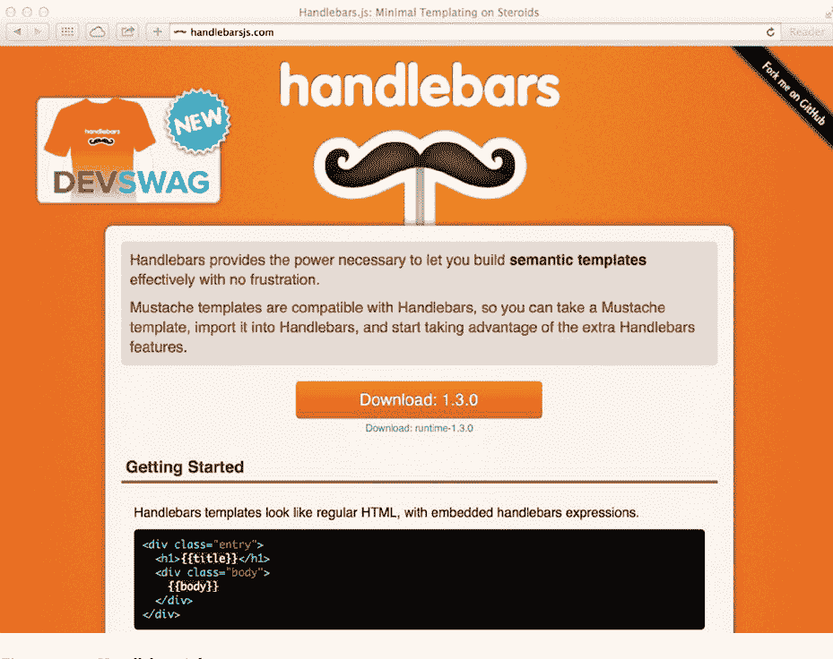

### 入门

`Handlebars` 模板看起来像普通的 `HTML`，其中嵌入了 `Handlebars` 表达式。

```html
<div class="entry">
  <h1>{{title}}</h1>
  <div class="body">
    {{body}}
  </div>
</div>
```

**图 13-2.** 首页中的 Handlebars.js

`Handlebars` 的使用方式类似于 `Mustache`，该库在 `HTML` 页面内部被引用，模板使用 `JavaScript` 数据哈希（`data hash`）进行编译，以生成插入当前页面的所需的输出字符串。模板可以存储页面文件的 `<script>` 标签中（正如我们在 `Mustache` 中看到的那样），也可以通过 `Ajax` 加载到单独的文件。同样，数据对象也可以直接存储在 `JavaScript` 文件中，或通过 `Ajax` 加载。

该库的全局 `Handlebars` 对象包含了辅助渲染模板的方法；`Handlebars` 的 `compile()` 方法接收模板字符串作为参数并返回一个函数。然后可以执行该函数，并传入数据哈希对象来渲染模板，它将返回将两者结合后的结果字符串，供页面使用。列表 13-7 显示了与基本页内模板和本地 `JavaScript` 数据配合使用的 `compile` 方法的简单示例。

### 列表 13-7. 包含简单 Handlebars 模板的 HTML 页面

```html
<!doctype html>
<html>
<head>
  <meta charset="utf-8">
  <title>Handlebars.js Example</title>
</head>
<body>
<h1>Handlebars.js Example</h1>
<div id="result">{{result}}</div>
<!-- 定义我们希望将数据应用到其中的模板。"type" 属性
需要是任何非标准的 MIME 类型，以便该元素的内容
被解释为纯文本而不是被执行 -->
<script id="template" type="x-tmpl-handlebars">
<p>
Name: <a href="mailto:{{email}}">{{firstName}} {{lastName}}</a><br>
Company: {{company}}
</p>
<p>
City: {{city}}
</p>
</script>
<!-- 加载 Handlebars.js 库 -->
<script src="lib/handlebars.min.js"></script>
<!-- 执行我们的脚本将模板与数据结合。为了简洁起见，
在此包含，生产环境中请移动到外部 JavaScript 文件 -->
<script>
// 获取页面上模板元素和结果元素的引用
var templateElem = document.getElementById("template"),
resultElem = document.getElementById("result");
// 从模板元素中获取 Handlebars 模板的字符串表示
template = templateElem.innerHTML;
// 定义应用到模板的数据对象
data = {
  firstName: "Den",
  lastName: "Odell",
  email: "denodel@me.com",
  company: "AKQA",
  city: "London"
},
// compile() 方法返回一个函数，可以将数据对象传递给该函数
// 以产生所需的输出字符串
compiledTemplate = Handlebars.compile(template);
// 将数据与编译后的模板函数结合，并将结果添加到页面
resultElem.innerHTML = compiledTemplate(data);
</script>
</body>
</html>
```

现在，让我们一起一起一下 `Handlebars` 模板和 `Handlebars.js` 库的一些功能，包括部分模板（`partials`）、辅助器（`helpers`）以及为了提高性能的模板预编译。

### 部分模板 (Partials)


Handlebars 模板中的部分模板与 Mustache 模板中的部分模板看起来相同，但两者的区别在于向库提供渲染部分模板的方式。`Handlebars.registerPartial()` 方法允许通过两个参数将部分注册到 Handlebars 中：部分模板的名称和该部分模板的字符串表示。这必须在渲染的模板引用该部分模板之前调用。可以通过多次调用`registerPartial()`方法注册多个部分模板。与 Mustache.js 一样，在渲染主模板之前，必须注册所有部分模板。

## 辅助器（Helpers）

Handlebars 用其功能丰富的处理器（即辅助器）扩展了 Mustache 区块（sections）的概念。这些辅助器允许你使用具有清晰名称的辅助器使用数据列表或执行条件表达式。由于辅助器名称清晰，这使得模板更易于阅读和理解——特别是当你的模板变得复杂并与 Mustache 有显著差异时。

在 Mustache 中，在不知道传递给模板的数据类型的情况下，你无法确定哪个字符串被用作条件块、迭代或其他；在这里，差异通过辅助器的名称变得清晰。有几个内置辅助器，Handlebars 在标签内提供以`#`字符为缀的名称，并跟着应用到辅助器的数据键名。

在本节中，我们将查看一些常用的辅助器，并解释如何轻松地为你的特定模板需求创建自定义辅助器。

## `with`辅助器

该辅助器允许你为它包围的模板块应用不同的数据上下文。这为避免重复使用点符号（dot notation）来导航到特定的数据属性层级提供了一种替代方案。要从区块内部返回父级上下文，可以在变量名之前使用`../`令牌。这里显示了一个辅助器的简单示例，它可以让一切变得清晰。

模板：

```html
<h1>{{name}}</h1>
{{with address}}
<p>{{city}}, {{state}}</p>
{{/with}}
```

数据哈希：

```json
{
  "name": "John",
  "address": {
    "city": "New York",
    "state": "NY"
  }
}
```

## `each`辅助器

`each`辅助器允许你对列表或对象进行迭代。在迭代数组时，会提供索引（index）；在迭代对象时，会提供键和值。你还可以使用`{{else}}`块处理列表为空的情况。

模板：

```html
<ul>
{{each items}}
  <li>{{index}}: {{this}}</li>
{{else}}
  <li>未找到项目。</li>
{{/each}}
</ul>
```

数据哈希：

```json
{
  "items": ["Apple", "Banana"]
}
```

## `if`和`unless`辅助器

模板区块可以根据数据的值条件显示。`if`在值为真（truthy）时显示关联区块，而`unless`辅助器仅在数据为假（falsy）时显示区块。在任何情况下，都可以添加可选的`{{else}}`部分。

模板：

```html
{{if isLoggedIn}}
  <p>欢迎回来，{{username}}!</p>
{{else}}
  <p>请登录。</p>
{{/if}}

{{unless isAdmin}}
  <p>你有查看权限。</p>
{{/unless}}
```

## `log`辅助器

如果你为模板提供了一个大型的多级数据对象，那么在整个模板中使用多个辅助器时，有时很难确定数据层级中的位置。Handlebars 提供了一个调试辅助器，允许你查看数据对象的状态。

## 自定义辅助器（Custom Helpers）

除了内置辅助器外，Handlebars 还提供了创建自定义辅助器的功能，以便你为模板提供所需的精确功能。这些功能可以工作在区块级别，对模板部分执行操作，也可以工作在单个项目级别，例如对显示的特定数据进行格式化。

可以使用`Handlebars.registerHelper()`方法创建辅助器，传递两个参数：辅助器的唯一名称，以及在渲染模板时遇到该辅助器时执行的函数。该函数将对传递给它的数据执行所需的行为。

**列表 13-8。** 自定义 Handlebars 辅助器示例：

```javascript
// registerHelper() 方法接受两个参数 - 辅助器在模板中的名称，以及每当在模板中遇到该辅助器时都会执行的函数。函数始终接收至少一个参数，一个对象，其中包含 fn() 方法，其操作与 Helpers 自身的渲染能力相同。该方法接收数据对象并返回块辅助器模板与该数据结合后的字符串
Handlebars.registerHelper("doNothing", function(options) {
  return options.fn();
});
```

```javascript
// 要在块内的模板中使用当前的数据上下文，只需使用
// 'this' 关键字
return options.fn(this);
));
```

```javascript
// 如果需要，可以向辅助函数传递参数，这些参数在双括号内紧随
// 函数名称之后列出。这些参数将作为独立的输入参数
// 在函数内部可用。最后一个参数始终是 options 对象，与之前一样。
Handlebars.registerHelper("ifTrue", function(conditional, options) {
  return conditional ? options.fn(this) : options.inverse(this);
});
```

```javascript
// 如果需要向辅助函数传递两个或多个参数，可以使用命名参数（named parameters）。在调用辅助函数时，它们以键值对的形式在模板中列出，
// 并且在 options.hash 属性中以标准的 JavaScript 对象
// 的形式可用，准备好传递给 options.fn 方法并渲染
// 内部的数据。
Handlebars.registerHelper("data", function(options) {
```

```javascript
// options.hash 属性包含一个 JavaScript 对象，代表在模板中
// 提供的键值对。我们没有传递
// 数据上下文值 'this'，而是在这里将提供的数据对象传递给
// 辅助函数内部模板部分
return options.fn(options.hash);
});
```

```javascript
// 创建一个简单的内联辅助函数，将简单的 URL 转换为 HTML 链接。
// 内联辅助函数在模板中使用不需要以井号 (#) 字符开头。
Handlebars.registerHelper("link", function(url) {
```

```javascript
// SafeString() 方法在模板中渲染时保持 HTML 内容的完整性
return new Handlebars.SafeString("<a href=" + url + ">" + url + "</a>");
});
```

列表 13-B 中提供的自定义辅助函数可以像下面的示例一样使用：

```handlebars
基础模板：
{{#doNothing}}
<h1>Dictionary</h1>
{{/doNothing}}
```

```handlebars
{{#ifTrue isApiAvailable}}
<p>An API is available</p>
{{/ifTrue}}
```

```handlebars
{{#ifTrue words}}
<p>We have preloaded words</p>
{{else}}
<p>We have no preloaded words</p>
{{/ifTrue}}
```

## 第 13 章 使用客户端模板

```html
<dl>
{{#data term="vastitude" definition="vastness; immensity"
url="http://dictionary.com/browse/vastitude"}}
{{definition}}
{{{/data}}}

{{#data term="achromatic" definition="colorless; without coloring matter"
url="http://dictionary.com/browse/achromatic"
{{definition}}
{{{/data}}}
</dl>
```

部分模板“definition”：

```html
<dt>{{term}} {{link url}}</dt>
<dd>{{definition}}</dd>
```

数据哈希（Data hash）：

```json
{
  "isApiAvailable": true,
  "words": []
}
```

输出：

```html
<h1>Dictionary</h1>
<p>An API is available</p>
<p>We have no preloaded words</p>
```

```html
<dl>
<dt>vastitude <a href="http://dictionary.com/browse/vastitude">http://dictionary.com/browse/vastitude</a></dt>
<dd>vastness; immensity</dd>
<dt>achromatic <a href="http://dictionary.com/browse/achromatic">http://dictionary.com/browse/achromatic</a></dt>
<dd>colorless; without coloring matter</dd>
</dl>
```

## 为了获得最佳的预编译模板

正如我们所见，`Handlebars.js`的`compile()`方法接收一个模板字符串并转换为函数，然后可以执行该函数，并将数据传递给模板。结果是用于在页面上显示的最终标记字符串。

如果你的模板在应用程序运行期间不会更改，你可以利用 Handlebars.js 的预编译功能，该功能允许你提前执行这种从模板到函数的转换，为你的应用程序交付一个较小的 JavaScript 文件，其中包含可以对其应用数据的模板函数。这些文件要小得多，因为它们利用了许多原本在运行时才能实现的优化方案，而且它们只需要在你的 HTML 中运行一个自定义的 Handlebars.js 运行时。

这个特殊版本的运行时删除了通过预编译过程变得冗余的函数。可以从首页`http://handlebars.com`下载运行时，在压缩化并使用 gzip 压缩后，重量最多为 2.3 KB。它的大小与 Mustache 库相当，但包含了 Handlebars 的额外优势和简单性，因此它是在代码中使用模板而不牺牲大小（因此不牺牲下载速度）的极佳解决方案。

如果你正在寻找本章提到的库的 gzip 压缩版本，请访问`http://cdn.com`查找内容分发网络（CDN）托管的目标文件。

预编译步骤需要在模板在页面上使用之前完成，我们可以利用 Handlebars 命令行工具来执行此操作。该工具运行在 Node.js 应用程序框架上，我们将在下一章详细介绍。现在，你可以通过从`http://bit.ly/node_js`下载并按照说明安装该框架。

Node 包管理器（NPM）工具会同时安装，并允许在框架内轻松安装应用程序，包括 Handlebars.js 预编译器。Mac 和 Linux 用户可能需要在命令前加`sudo`以获取所需的权限。

```bash
npm install -g handlebars@1.3.0
```

我们明确说明了与 Handlebars.js 首页下载的库版本匹配的模板版本号。如果两个版本不匹配，我们就无法保证任何预编译模板的正确性。

导航到包含你的模板文件的目录并执行以下命令来预编译模板，将`templatefile`替换为文件名：

```bash
handlebars templatefile.handlebars
```

你会发现生成的预编译模板函数是直接输出到命令行，而不是写入文件。要将模板保存到新文件中，请在命令行上添加`--output`选项，并指定一个带有`.js`扩展名的文件。

如果我们还添加`--min`选项，生成的 JavaScript 文件将经过压缩处理，为我们节省优化任务。因此，最终命令如下，将`templatefile`替换为要预编译的模板名称，将`templatefile.js`替换为预编译的 JavaScript 文件名：

```bash
handlebars templatefile.handlebars --output templatefile.js --min
```

让我们创建一个示例来展示如何使用预编译模板。考虑所示的模板文件，并像接下来的示例所示使用它：

```handlebars
基础模板：
{{#doNothing}}
<h1>Dictionary</h1>
{{/doNothing}}
```

```handlebars
{{#ifTrue isApiAvailable}}
<p>An API is available</p>
{{/ifTrue}}
```

```handlebars
{{#ifTrue words}}
<p>We have preloaded words</p>
{{else}}
<p>We have no preloaded words</p>
{{/ifTrue}}
```

```javascript
// 模板是一个函数，应该向其传递数据以在模板内进行渲染。
// 结果是两者的组合，格式为字符串（String）。
result = template({
  words: [
    {
      term: "vastitude",
      url: "http://dictionary.com/browse/vastitude",
      definition: "vastness; immensity"
    },
    {
      term: "achromic",
      url: "http://dictionary.com/browse/achromic",
      definition: "colorless; without coloring matter"
    }
  ]
});
```

```javascript
// 将生成的字符串写入当前页面中 <div id="result">
// 元素内。产生的结果如下：
<dl>
<dt>vastitude
<a href="http://dictionary.com/browse/vastitude">http://dictionary.com/browse/vastitude</a>
</dt>
<dd>vastness; immensity</dd>
<dt>achromic
<a href="http://dictionary.com/browse/achromic">http://dictionary.com/browse/achromic</a>
</dt>
<dd>colorless; without coloring matter</dd>
</dl>
document.getElementById("result").innerHTML = result;
</script>
<body>
</html>
```

运行列表 13-11 中的代码将产生图 13-3 所示的结果。

## Handlebars.js 示例

`vastitude http://dictionary.com/browse/vastitude vastness; immensity`


`achromic` http://dictionary.com/browse/achromic 无色的；不含色素的

**图 13-3.** 运行列表 13-9 中的代码将数据与预编译模板结合后生成的页面

`Handlebars` 比 `Mustache` 提供了更具描述性的模板语言，并允许通过其自定义辅助函数（helpers）进行扩展。为了解决处理此类模板所需的额外库体积问题，它对模板进行预编译，以便与自定义版本的库配合使用以提高性能，并保持与微小的 `Mustache.js` 库相似的数据占用大小。正因为这些原因，`Handlebars` 在大型应用程序中被广泛使用。

## 备选客户端模板库

我们详细查看了 `Mustache` 和 `Handlebars` 模板，包括我在内，我们认为它们是可用最流行且支持最好的 JavaScript 模板解决方案。然而，这些并不是你唯一的可用选项，包括嵌入 JavaScript (EJS) 和 `Underscore.js` 在内的库也提供了类似的模板功能，我将在本节中进行解释。

## 使用嵌入 JavaScript (EJS) 进行客户端建模

嵌入 JavaScript (EJS) 是一种开源的 JavaScript 模板语言，适用于那些最熟悉 JavaScript 语言并倾向于以熟悉的代码友好的方式编码模板逻辑的人士。它使用相同的 JavaScript `if` 语句、`for` 循环和数组从输入数据输出所需的文本字符串。EJS 库可以从首页 http://bit.ly/ejs-template 下载，在压缩并使用 gzip 压缩后仅重 2.4 KB。该库具有广泛的浏览器支持，一直追溯到 Firefox 1.5 和 Internet Explorer 6。

在 EJS 模板中，要执行的代码包含在以 `<%%` 开始并在 `%>` 结束的部分（这是 Ruby 语言开发者用于模板的样式），要输出的变量被封装在 `<%= %>` 中——注意额外的等号 (`=`) 符号。

EJS 支持添加辅助函数来简化许多类型输出的创建，例如 HTML 链接，可以使用命令 `<link_to("link text", "url") %>` 来创建输出：`<a href="url">link text</a>`。可用辅助函数的完整列表可以在 EJS Wiki 网站 http://bit.ly/ejs-wiki 上。

这里显示了一个简单的 EJS 示例：

```html
Template:
<h1><%= title %</h1></h1>
<dl>
  <% for (var index = 0; index < words.length; index++) { %>
    <dt><%= link_to(words[index].term, words[index].url) %></dt>
    <dd><%= words[index].definition %></dd>
  <% %>

  <% if (!words) { %>
    <p>No words supplied</p>
  <% %>
</dl>
```

```json
Data Hash:
{
  title: "EJS Example",
  words: [
    {
      term: "vastitude",
      url: "http://dictionary.com/browse/vastitude",
      definition: "vastness; immensity"
    },
    {
      term: "achromic",
      url: "http://dictionary.com/browse/achromic",
      definition: "colorless; without coloring matter"
    }
  ]
}
```

```html
<h1>EJS Example</h1>
<dl>
  <dt><a href="http://dictionary.com/browse/vastitude">vastitude</a></a>></dt>
  <dd>vastness; immensity</dd>
  <dt><a href="http://dictionary.com/browse/achromic">achromic</a></a>></dt>
  <dd>colorless; without coloring matter</dd>
</dl>
```

EJS 相比 `Mustache` 和 `Handlebars` 的一个优势是，不需要特殊的代码即可将远程 JSON 数据应用到存储在另一个远程文件模板中，而在 `Mustache.js` 和 `Handlebars` 中需要额外的 Ajax。EJS“类”通常通过向外部模板文件传递 URL 来进行异步加载，然后执行其 `render()` 或 `update()` 方法，取决于应用于模板的数据是否已经存在并加载到 JavaScript 中，在这种情况下，`render()` 方法传递数据对象。

```javascript
new EJS({url: "/template.ejs"}).render(dataObject);
new EJS({url: "/template.ejs"}).update("pageElementId", "datafile.json");
```

如果你倾向于使用与你在 JavaScript 文件中熟悉的类似的模板，EJS 可能是你的最佳解决方案。

## Underscore.js

`Underscore.js` 是一个 JavaScript 库，包含了许多用于处理代码中数据集合、数组、对象和函数的函数，以及一组工具函数，其中一个专门针对基础模板。该库可以从其首页 http://underscorelist.org 下载，在压缩并使用 gzip 压缩后仅 3 KB。该库具有广泛的浏览器支持，一直追溯到 Firefox 1.5 和 Internet Explorer 6。

在 `Underscore` 模板中，要执行的代码包含在以 `<%` 开始并在 `%>` 结束的部分（这是 Ruby 语言开发者用于模板的样式），要输出的变量被封装在 `<%= %>` 中。

EJS 支持添加辅助函数来简化许多类型输出的创建，例如 HTML 链接，可以使用命令 `<link_to("link text", "url") %>` 来创建输出：`<a href="url">link text</a>`。可用辅助函数的完整列表可以在 EJS Wiki 网站 http://bit.ly/ejs-wiki 上。

这里显示了一个简单的 EJS 示例：

```html
Template:
<h1><%= title %></h1>
<dl>
  <% for (var index = 0; index < words.length; index++) { %>
    <dt><%= link_to(words[index].term, words[index].url) %></dt>
    <dd><%= words[index].definition %></dd>
  <% %>

  <% if (!words) { %>
    <p>No words supplied</p>
  <% %>
</dl>
```

## 总结

在本章中，我涵盖了客户端模板化，这是构建具有动态更新页面内容的大型 Web 应用程序的解决方案。它将特殊标记的模板与 JavaScript 数据结合，生成 HTML 并包含在当前页面中。我介绍了流行的 `Mustache` 和 `Handlebars` 模板语言及其相关的 JavaScript 库，以及一些替代方案，如嵌入 JavaScript (EJS) 和 `Underscore.js`。

在下一章中，我将介绍 `Node.js`，这是一种为 JavaScript 语言构建的应用程序框架，它让专业的 JavaScript 开发者有机会编写服务端代码和服务器软件，以支持他们的 Web 应用程序，从而将整个开发栈纳入 JavaScript 开发者的范畴。

# 第 14 章

## Node.js 应用程序平台

在本章中，我们将有意识地离开运行在浏览器中的客户端 JavaScript，转而走向服务端领域，仔细研究一个由 JavaScript 开发者设计的名为 `Node.js` 的应用程序平台。

- JavaScript 在服务器端有一段历史。JavaScript 在产品中的首次实际上并不是在 Web 浏览器中；它是在 1994 年发布的 Netscape Enterprise Server 中，当时被作为为 HTTP 应用编写服务端行为的语言。

`Node.js` 由其者 Ryan Dahl 在 2011 年首次发布，这是他愿景的结晶——构建一个允许他人构建轻量级、可扩展的命令行或网络应用程序的应用程序平台。它使用了 Google V8 JavaScript 引擎（http://bit.ly/google-v8），这是 Google Chrome 浏览器内部的一个虚拟机，用于解析和执行 JavaScript。在浏览器中，应用程序是围绕异步事件模型构建的，这意味着代码应该运行高效，并且对专业的 JavaScript 开发者来说看起来很。`Node.js` 对开发者的很大吸引力在于它是为了在 Microsoft Windows、Mac OS X、Linux 和 SunOS 操作系统上运行而构建的，使其无需任何开发步骤即可运行的命令行程序的理想平台。`Node.js` 项目的原始目标之一是允许开发者轻松构建支持服务端能力的应用程序，其底层大量关注的是它的异步 I/O（输入/输出）系统，与某些其他应用程序平台不同，它不会在等待数据读取或写入时阻塞主应用程序进程。这使其成为处理大量并发连接以及运行服务端代码以支持并发 Web 浏览器中的应用程序或网站的完美人选。要了解更多关于让 `Node.js` 成为现在的技术的原因，请查看项目网站上的以下页面：http://bit.ly/about-node。

### 安装 Node.js

可以通过从项目首页 http://nodejs.org 下载包来安装 `Node.js`，如图 14-1 所示。按照指令安装 `node` 系统本身（编写本文时版本为 v0.10.29）以及 Node 包管理器工具 (`npm`)，我们将在本章稍些时候详细查看 `npm`。

# 第 14 章 NODE.JS 应用程序平台

`Node.js` 是一个构建在 Chrome JavaScript 运行时之上的平台，用于轻松构建快速、可扩展的网络应用程序。`Node.js` 使用事件驱动、非阻塞 I/O 模型，使其变得轻量且高效，非常适合运行在分布式设备上的数据密集型实时应用程序。

当前版本：v0.10.28

| 安装 | 下载 | API 文档 |

| :--- | :--- | :--- |

| 道路上的 NODE.JS | 生产环境 Node 落地 | 获取灵感并参与，了解更多 |

| 示例：Web 服务器 | 特色介绍 | |

图 14-1。`Node.js` 首页

现在 `node` 命令行工具已在你的机器上全局安装，你可以导航到任何包含适用于 `Node.js` 的 JavaScript 文件的文件夹，并通过执行以下命令来运行它，将 `filename.js` 替换为要运行的 JavaScript文件名：

```
filename.js
```

### Node.js 应用程序

让我们通过创建一个基础示例来演示平台的功能和特性，从而熟悉编写 `Node.js` 应用程序。首先，让我们写一个最简单的 `Node.js` 应用程序，一个在命令行窗口中显示 Hello, World 的程序。代码只有一行，如列表 14-1 所示。

代码列表 14-1。Hello World Node.js 应用程序

```
console.log("Hello, World");
```

将此内容保存为文件 `Listing14-1.js` 并在命令行中使用以下命令执行它：

```
node Listing14-1.js
```

从命令行运行此新应用程序将产生如图 14-2 所示的输出。应用程序停止运行并将控制权交回命令行，以便执行你想的下一个命令。

```
dennis.odell — bash — 69x6
denodel6udkq112:~ dennis.odell$ node Listing14-1.js
Hello, World
dodel6udkq112:~ dennis.odell$ []
```

**图 14-2.** 运行 Hello World 应用程序

### 控制台 (Console)

`Node.js` 原生的 `console` 对象包含了向命令行输出不同类型消息的方法，`log()` 方法是这些方法中最基础的——传递给它的任何字符串、数字、数组或基础对象在运行时都将写入命令行。了解更多关于 `console` 方法的信息。

如果你编写一个命令行应用程序，可以使用 `process.argv` 数组，它包含前两个参数是 `node` 和文件名。14-2 中的代码显示了一个简单的应用程序。

**列表 14-2.** 访问参数

```javascript
var index = 2;
var length = process.argv.length;

for (var i = index; i < length; i++) {
  console.log(process.argv[i]);
}
```

在命令行执行以下命令将产生图 14-3 所示的结果。

```
node Listing14-2.js
```

```
denodel6udkq112:~ dennis.odell$ node Listing14-2.js
2
denodel6udkq112:~ dennis.odell$ 
```

**图 14-3.** 将命令行参数返回给用户

有关 `process.argv` 的更多信息，请查看在线 API 文档。

### 加载模块

在第9 章中，异步模块定义 (AMD) 和 JavaScript 库允许使用名为 `require()` 的全局方法清晰地加载文件依赖。`Node.js` 原生支持 AMD 和 `require()` 方法，这是处理依赖的首选方式。

为了保持 `Node.js` 环境轻量，许多无意义的行为包默认不会加载，必须专门列出依赖。你只需在应用程序代码中列出所需的依赖，即可确保加载的代码是你需要的，从而保持性能最优。

### http 模块

`Node.js` 通常用作网络环境，更特别是作为 Web 服务器，其简洁、简单的方法非常合适。你显式地包含行为，减少了其他服务器产品中常见的臃肿。`Node.js` `http` 依赖包含了启动 Web 服务器所需的方法。列表 14-3 显示了其实际应用，在指定的端口创建一个 Web 服务器，当通过 浏览器访问时，将 Hello, World 作为 HTML 写入请求者的浏览器。

**列表 14-3.** 一个简单的 Node.js Web 服务器

```javascript
// 定义 Node.js "http" 模块的依赖，该模块包含了允许
// 创建简单 HTTP Web 服务器的方法
var http = require("http");

// 定义一个变量表示我们的 HTTP 服务器
// 定义一个常量表示 OK 响应的 HTTP 状态码
HTTP_OK = 200;

// 定义监听请求的端口号
PORT = 8000;

// 调用 http.createServer() 方法启动 Web 服务器，根据收到的请求
// 为调用 HTTP 应用程序（通常是浏览器）定义响应
var server = http.createServer(function(request, response) {
  response.writeHead(HTTP_OK, { "Content-Type": "text/html" });
  response.write("<h1>Hello, World</h1>");
  response.end();
});

server.listen(PORT);
```


```javascript
// we ignore the request received (which would contain the URL requested and any data sent
// with the request, for example cookie or POST data) and simply respond with a single chunk
// of HTML to read for any request received (try different URLs to prove this).
// The callback function passed to the method will be executed once for each request received
// at the time it is received, asynchronously.
server = http.createServer(function(request, response) {

  // Send a HTTP header to requesting browser to indicate a successful HTTP response
  // and defining the response body data will be sent as HTML text
  response.writeHead(HTTP_OK,
    "Content-Type: text/html"
  );

  // Send the HTML response
  response.write("<h1>Hello, World</h1>\n");

  // Close the connection - without this, the HTTP server will expect to continue to send
  // more data to the browser, the connection to the server would be kept open unnecessarily,
  // wasting resources and potentially preventing others from connecting to that same
  // server, depending on demand. The end() method tells the connection that we're done
  // by sending our response data. If we knew we were only sending one string of data and
  // then the connection, we could actually add string to the connection.end())
  // method, which would call the write() method for us internally in that case
  response.end();
});
```

最后一步是告诉我们的新 Web 服务器开始在特定的套接字端口上监听请求。默认主机名将是`http://localhost`或`http://127.0.0.1`，因为我们正在开发机器上本地运行该应用程序。`listen(method)`与许多其他方法的不同之处在于它会保持 Node.js 应用程序运行——如果不这样做，我们将无法继续监听请求。你可以手动在命令行（Microsoft Windows）或 Command-X（Mac OS X）上停止应用程序，这将停止 Web 服务器从该端口的监听：

```javascript
server.listen(PORT);
```

向控制台输出一条消息，用以说明 Web 服务器是如何运行的，以及他们需要浏览哪个地址来查看定义的响应：

```javascript
console.log("Now trying http://127.0.0.1: " + PORT);
```

将代码保存为名为`Listing14-3.js`的文件，并在命令行上执行该代码以启动简单的 Web 服务器。

`Listing14-3.js`

执行时，`Listing14-3`中的代码将在图 14-4 所示的命令行中产生响应。在浏览器中访问 URL `http://127.0.0.1:8000` 时，它将输出图 14-5 所示的响应。注意，你可以在该主机末尾添加任何额外的路径或查询字符串值，服务器每次都会响应完全相同的 HTML。在本章的稍后部分，我们将查看所有的 Web 框架，它们将提供更简单的方法来创建能够适当运行不同路径和查询字符串的 Web 服务器。要了解更多关于`http`方法的信息，请通过`http://bit.ly/nodejs_http`访问特定的 Node.js API 文档。

# 第 14 章 NODE.JS 应用程序平台

```text
denodel6udkq1l2:~ dennis.odell$ node Listing14-3.js

Now try browsing http://127.0.0.1:8000
```

**图 14-4.** 启动一个简单的 Node.js Web 服务器


**图 14-5.** 在浏览器中访问简单 Web 服务器的 URL 输出 HTML 的 `"Hello, World"`

我们现在已经看到了如何创建一个在命令行上运行的简单应用程序，以及另一个通过 HTTP 打开已连接 Web 浏览器通信通道的应用程序，这是任何 Web 服务器的基础，也是我们希望的任何服务器端代码的基础。要了解更多关于可用的其他低级模块，请访问`http://bit.ly/nodejs_apidocs`上的完整 API 文档站点。

## Node.js 软件包

Node.js 附带了 Node 包管理器（`npm`），这是一个独立的命令行应用程序，它允许将名为`packages`（包）的第三方模块直接在命令行中作为应用程序加载和使用，或者在你的 Node.js 应用程序中作为代码依赖项使用以添加额外功能。可以在网上`http://npmjs.org`找到可用软件包的目录，如图 14-6 所示，你可以在那里搜索感兴趣的包或包类型。

## Node 包模块

包总数：74 432

- 过去一天下载 11 979 122 次
- 过去一周下载 66 949 782 次
- 过去一个月下载 278 620 121 次

欢迎补丁！

任何包都可以通过`npm install`安装。

使用`npm publish`将你的程序添加到此索引。

### 最近更新

### 最受依赖

- 1m generator-ms
- 2m rims
- 5m ft-server
- 5m gulp-fsch
- 9m guidebook
- 11m uupaa.spec.js
- 13m inrite-creator
- 15m stormkeeper
- 15m stormkeeper

- 1m generator-ms
- 2m rims
- 5m ft-server
- 5m gulp-fsch
- 9m guidebook
- 11m uupaa.spec.js
- 13m inrite-creator
- 15m stormkeeper
- 15m stormkeeper

- 1m generator-ms
- 2m rims
- 5m ft-server
- 5m gulp-fsch
- 9m guidebook
- 11m uupaa.spec.js
- 13m inrite-creator
- 15m stormkeeper
- 15m stormkeeper

- 1m generator-ms
- 2m rims
- 5m ft-server
- 5m gulp-fsch
- 9m guidebook
- 11m uupaa.spec.js
- 13m inrite-creator
- 15m stormkeeper
- 15m stormkeeper

在`http://npmjs.org`从`npm`安装包。

命令行`npm`工具能够根据对几个问题的回答代你创建一个`package.json`文件。要在当前目录中创建该文件，只需在命令行上执行以下命令：

```bash
npm init
```

Listing 14-4 显示了`package.json`文件的示例，包含了一些常用属性。请注意，在任何应用程序中使用之前，应该删除 JSON 格式中的注释。

#### 列表 14-4. 用于 npm 的 example.json 文件

```json
{
  // "name" 值是必填的，且必须符合 URL 规范，不能包含任何空格
  // 并且应该是小写
  "name": "my-test-project",

  // "version" 值是必填的，必须符合语义化版本格式
  "version": "0.0.1",

  // 项目的可选友好描述，用于在用户搜索 npm 时时提供帮助
  "description": "This is my test project",

  // 指向项目在线主页的指针 - 许多使用此字段指向
  // GitHub（或类似的托管服务）代码仓库路径
  "homepage": "https://github.com/denodell/my-test-project",

  // 代码仓库的详细信息，如果其他开发者想要为项目贡献代码，可能会发现这些有用
  "repository": {
    // 仓库类型，例如 "git"（用于 Git）或 "svn"（用于 Subversion）
    "type": "git",

    // 仓库本身的 URL，设计用于软件直接使用，而不应该是
    // 项目主页的链接
    "url": "https://github.com/denodell/my-test-project.git"
  },

  // 项目作者的详细信息，如果只有一个。对于多个作者，此
  // 名称应更改为 "contributors"，且其值将是处理过该项目的姓名和
  // 电子邮件数组
  "author": {
    "name": "Den Odell",
    "email": "denodell@me.com"
  },

  // 运行此文件描述的项目所需的包依赖列表。每个项都
  // 以其在 npm 目录中的名称列出，以及所需依赖的版本号。
  // 通过指定版本，我们可以确保依赖包未来的破坏性更新
  // 不会影响我们的包
  "dependencies": {
    // 通过使用其完整版本号来指定项目所需的依赖项
    // 精确版本
    "async": "0.9.0",

    // 大于或等于特定发布的版本可以使用 >== 指定
    "request": ">=2.36.0"
  },

  // 接近发布版本的合理版本可以使用波浪号 (~) 指定。
  // 在这里，这意味着 1.6.0 到任何未来发布之间的任何版本，
  // 但不包含下一个主版本（即在此例中为 1.7.0）
  // "~": "~1.6.0",

  // Git URL 用于替代版本号，以引用存储在 npm 目录之外
  // 处的依赖项。当安装此包时，将下载仓库的最新内容
  // "promise-the-earth": "git+ssh://github.com/denollise/promise-the-earth.git"

  // 为想要为此项目贡献代码的开发者提供的所有包依赖列表
  // 此列表通常包括开发工具、代码质量检查
  // 和单元测试运行器
  "devDependencies": {
    "yuidocjs": "0.3.50"
  }
}
```

# 第 14 章 NODE.JS 应用程序平台

关于`package.json`文件的更多信息，以及要阅读`dependencies`和`devDependencies`部分的不同设置，请参阅`http://bit.ly/package_json`上的在线文档。

如果你在机器上有一个包含`package.json`文件的本地项目，你可以在命令行中导航到该文件夹并执行以下命令来安装该项目及其所有依赖项：

```bash
npm install
```

这与我们之前看到的命令行为相同，即通过省略包名，`npm`工具仍然会查找它运行所在的本地文件夹，以发现项目的设置和依赖项。

如果你想向你的项目添加依赖项，并在你的`package.json`文件中自动添加对它的引用，可以通过在通常的安装命令中添加`--save`选项来实现，这将引用添加到包文件的依赖（`dependencies`）部分，并同时将其下载到包中，例如：

```bash
npm install yuidocjs --save
```

相反地，如果想将依赖项保存到`devDependencies`部分，请使用`--save-dev`选项：

```bash
npm install jshint --save-dev
```

如果你写了一个项目，并希望将其发布到 npm 以供其他人作为项目的依赖项使用，你只需要在包含`package.json`文件的项目目录中运行以下命令，将其推送到目录中，以便任何其他开发者都可以使用：

```bash
npm publish
```

一旦你拥有了`package.json`文件，并在项目运行之前使用`npm install`下载了所有项目依赖项，你就可以使用`require()`方法从你的 Node.js 应用程序访问这些依赖项。假设你有一个`package.json`文件，包含以下依赖部分，它引用了 npm 目录中的它和`picture-tube`包：

```json
"dependencies": {
  "request": "~2.3.0",
  "picture-tube": "~0.0.4"
}
```

这些包随后可以通过`require()`在你的应用程序 JavaScript 文件中引用为依赖项，如列表 14-5 所示。

# 列表 14-5. 在 Node.js 中引用依赖包

```javascript
// 引用 "request" 包的依赖项
var request = require('request');

// 引用 "picture-tube" 的依赖项
var pictureTube = require('picture-tube');

// 使用 URL 获取数据
var imageUrl = "https://upload.wikimedia.org/wikipedia/commons/87/Google_chrome_icon.png";

// 将输出管道到标准输出
request(imageUrl).pipe(process.stdout);
```

这些包随后可以通过`require()`在你的应用程序 JavaScript 文件中引用为依赖项，如列表 14-5 所示。

一旦你拥有了`package.json`文件，并在项目运行之前使用`npm install`下载了所有项目依赖项，你就可以使用`require()`方法从你的 Node.js 应用程序访问这些依赖项。假设你有一个`package.json`文件，包含以下依赖部分，它引用了 npm 目录中的它和`picture-tube`包：

```json
"dependencies": {
  "request": "~2.3.0",
  "picture-tube": "~0.0.4"
}
```

#### 跨文件拆分 Node.js 应用程序

到目前为止，我们涵盖的应用程序类型都是简单的，并且除了它们之外都包含在一个文件中。然而，Node.js 确实支持将较大的应用程序拆分成多个文件，这些文件可以使用`require()`方法相互引用。假设我们有一个主应用程序文件名为`app.js`，以及位于同一文件夹内的另一个文件名为`utility.js`，我们在该文件中存储了许多供应用程序使用的工具方法。我们可以通过以下`require()`方法从主应用程序中引用工具文件。注意，为了指示文件而非通过 npm 加载的外部依赖项，请使用文件夹名加上文件名（文件夹名`./`表示当前目录）。我们可以省略`.js`文件扩展名，因为系统会假设它：

```javascript
var utility = require("./utility");
```

在这些工具方法之前，我们需要指定`utility.js`文件中的哪些方法是公开可用的，因此可以在文件外部使用。要做到这一点，请使用 Node.js `module.exports`属性（该属性对每个文件都是局部的），并设置我们希望从文件外部公开的方法和属性。我们可以在列表 14-6 中看到`utility.js`文件的简单实现。

#### 列表 14-6. 在 Node.js 应用中导出属性和方法供其他文件使用

```javascript
// 定义一个函数，将字符串转换为驼峰命名法，其中每个
// 单词的首字母大写
function camelCase(inputString) {
  return inputString.replace(/[a-z]/g, function(firstLetter) {
    return firstLetter.toUpperCase();
  });
}
```

```javascript
// 定义一个函数，将字符串从驼峰命名法转换为连字符形式，
// 变为小写，并将空格替换为连字符
function toHyphens(inputString) {
  return inputString.replace(/\s+([A-Z])/g, '-$1').toLowerCase();
}
```

```javascript
// 导出两个公共方法到引用文件：camelCase() 它内部引用了
// 同名的函数，以及 toHyphens() 它执行相同的操作
```


`module.exports = { camelCase: camelCase, toHyphens: toHyphens };`

从列表 14-6 导出的方法（代表我们的`utility.js`）可以如列表 14-7 所示在我们的主文件中使用。观察如何通过将 JSON 文件名传递给`require()`，将 JSON 格式的文件直接作为 Javascript 对象导入到 Node.js 应用。

#### 列表 14-7. 在 Node.js 应用中使用来自单独文件的导出方法

```javascript
// 使用 utility.js 引用我们导出的方法
var utility = require("./Utility");

// 加载我们的 comment-package.json 文件（参见列表 14-4）
var pkg = require("./package.json");

// 使用工具方法 camelCase() 将 package.json 描述中的文本转换为驼峰格式
var camelCaseDescription = utility.camelCase(pkg.description);

// 使用工具方法 toHyphens() 将驼峰命法的描述转换为
// 小写连字符格式
var hyphensDescription = utility.toHyphens(camelCaseDescription);

// 以不同的形式向命令行输出包的描述
console.log(camelCaseDescription); // 输出: "This Is My Test Project"
console.log(hyphensDescription); // 输出: "this-is-my-test-project"
```

我们可以使用`module.exports`导出任何类型的标准 JavaScript 数据，包括函数、对象、字符串、数字、日期和数组，这些数据可以在引用文件中直接使用。要了解更多关于 Node.js 模块的信息，请通过 http://bit.ly/nodejs_modules 查看在线文档。

# 用于 Web 应用的 Node.js 框架

现在我们已经了解了使用 JavaScript 编写 Node.js 应用的基础，让我们来看一些旨在帮助可扩展 Web 应用服务器端的框架。请务必阅读文档，以确保根据自己的项目需求使用了正确的框架。

### Express

最流行的 Node.js 框架之一是 Express，它简化了设置 Web 服务器的过程，使其能够使用任何 HTTP 方法（例如 GET 或 POST）响应请求。每个 URL 的预期行为可以用 JavaScript 编码，可能只是简单地响应 HTML 页面，或者处理提交的表单数据。I-4 中的代码展示了一个使用 Express 框架的简单 Web 服务器，演示了如何响应各种 URL 的 HTTP GET 和 POST 方法。利用 Seneca Labs 的 Connect 中间件，该工具专为 Node.js 服务器框架设计，用于添加对常用访问数据的支持、解码 HTTP POST 数据以及 Gzip 压缩。要了解更多关于 Connect 中间件的信息，请查看 http://bit.ly/nodejs-connect 的在线文档。

#### 列表 14-8. 使用 Express 框架的简单 Node.js Web 服务器

```javascript
// 通过 "express" 引用 Express 框架
var express = require("express");
var bodyParser = require("body-parser");
var app = express();

// 使用 body-parser 解析 POST 请求体
app.use(bodyParser.urlencoded());

// 处理根 URL 的 GET 请求
app.get("/", function(req, res) {
  res.send("<h1>Hello world</h1>");
});

// 处理 /email URL 的 GET 请求
app.get("/email", function(req, res) {
  res.send(`
    <form method="post" action="/email">
      <label for="email">Email address:</label>
      <input type="email" id="email" name="email" value="" />
      <input type="submit" />
    </form>
  `);
});

// 处理 /email URL 的 POST 请求
app.post("/email", function(req, res) {
  var email = req.body.email || "";
  res.send("<h1>" + email + "</h1>");
});

// 在端口 3000 上启动服务器
var PORT = 3000;
app.listen(PORT, function() {
  console.log("Now browsing http://127.0.0.1:" + PORT);
});
```

## 第 14 章 Node.js 应用程序平台

列表 14 中的代码展示了如何使用 Node.js 的 Express 框架用不到 20 行代码编写一个能够提供静态文件、响应对不同 URL 的 HTTP GET 和 POST 请求的 Web 服务器。在我们作为 Node.js 应用程序运行之前，我们需要创建`package.json`文件并安装依赖项。在包含此代码的文件夹命令行运行`npm init`来创建一个基础的`package.json`文件。接下来，使用以下命令安装依赖，这会将依赖版本保存到`package.json`文件中：

```
npm install express --save
npm install connect --save
```

现在，我们在命令行中使用以下命令运行我们的应用程序（假设你已将代码保存为名为`Listing14-8.js`的文件）：

```
node listing14-8.js
```

要了解更多关于 Express 框架的所有高级功能，请查看在线 API 文档：http://bit.ly/nodejs_express_api。

--- 

### Socket.IO

尽管 Express 框架非常适合编写可扩展的 Web 应用，但有时你会发现自己想要编写实时应用程序，在这种应用中，服务器上或浏览器内更新的数据需要立即从另一个位置发送并响应，例如聊天消息应用、在线白板或协作体验。虽然 Ajax 是这类应用的一个相当可以的解决方案，但它只适用于定期轮询数据；服务器无法在数据数据产生的准确时刻通知浏览器有新数据。Socket.IO 是一个 Web 框架（http://bit.ly/socket-api），它在后台使用了多种解决方案，包括 Webs API（支持 Internet Explorer 10 及更高版本），以提供浏览器和服务器之间的实时通信。

让我们构建一个简单的应用程序来演示 Socket.IO 框架。我们将创建一个带有单个文本字段的 HTML 页面用于输入消息，提交时，它会将消息发送到服务器并将消息添加到页面上显示，同时附带当前时间。服务器将响应一个新消息，将收到的消息封装在一个对象中并发送回浏览器。浏览器将显示带有当前时间的收到的消息，这应该显示服务器的实时响应小于一秒。生成的应用程序如图 14-9 所示，该图显示了对表单提交的“Hello World”消息的响应。注意每条消息旁边的时间，它显示消息发送到服务器并再次接收响应的时间不到一秒。

### Socket.IO 示例

### 从浏览器发送的消息

`Thu, 29 May 2014 07:40:44 GMT - {"sent":"Hello, world"}`

### 从服务器接收的消息

`Thu, 29 May 2014 07:40:39 GMT - "Ready and waiting for messages"`

`Thu, 29 May 2014 07:40:44 GMT - {"received":{"sent":"Hello, world"}}`

**图 14-9.** 一个简单的 Socket.IO 应用程序，用于与服务器实时通信简单消息。

列表 14-9 中的代码展示了 Node.js 服务器应用程序，它将初始化 websocket 连接，监听来自浏览器客户端发送的消息，并立即用新消息进行响应。

**列表 14-9.** 用于与浏览器实时通信简单消息的 Socket.IO 

```javascript
// 通过 "express" npm 包依赖项引用 Express 框架。确保
// 你有一个引用此依赖的 package.json 文件
var express = require("express")

// 初始化框架，通过 app 变量可以使用其方法
var app = express()

// 定义对 Node.js "http" 模块的依赖 - 用于与
// Socket.IO 框架配合使用
var http = require("http")

// 创建一个简单的 Web 服务器，通过将 app 变量传递给
// http.createServer 方法确保 Express 框架处理所有请求
var server = http.createServer(app)

// 通过 "socket.io" npm 包依赖项引用 Socket.IO 框架。
// 确保此依赖项列在你的 package.json 文件中
var socketIo = require("socket.io")

// 将 Socket.IO 框架连接到 Web 服务器以复用它的连接
var io = socketIo.listen(server);

// 定义一个监听请求的端口号
var PORT = 4000;

// 通过我们的 Web 服务器使用当前目录的内容可用，以便我们可以
// 提供 HTML 文件
app.use("/", express.static(__dirname));

// 在执行回调函数之前等待 Socket.IO 连接到浏览器建立，
// 传入 socket 连接的引用
io.on("connection", function(socket) {
  // 使用 socket 连接的 emit() 方法发送消息，将某些数据传递给
  // 任何监听 socket 发出的 "new-data-on-server" 事件的连接浏览器
  socket.emit("new-data-on-server", "Ready and waiting for messages");

  // 当从客户端接收消息 "new-data-on-client" 时，执行
  // 回调函数，传递随消息传递的数据
  socket.on("new-data-on-client", function(data) {
    // 立即将封装在名为 "received" 对象中的
    // 收到的消息广播到 "new-data-on-server" 事件。
    socket.emit("new-data-on-server", {
      received: data
    });
  });
});

// 开始监听 Web 请求
server.listen(PORT);
console.log("Server running on http://127.0.0.1:" + PORT);
```

# 第 14 章 Node.JS 应用程序平台

列表 14-11. 连接 HTML 页面到 Socket.io Web 服务器以通信并显示消息

```javascript
// 此脚本依赖于 Socket.IO 框架提供的 "socket.io/socket.io.js" 脚本
// 当从 Web 服务器引用它时，该脚本会暴露全局变量 "io"

// 建立到服务器的 websocket 连接以启用发送和接收消息
var socket = io();

// 从页面中获取表单元素和文本字段元素的引用
formElem = document.getElementById("send-message-form"),
messageFormFieldElem = document.getElementById("message-field"),

// 获取页面上 <div> 标签的引用，我们将其中填充发送到服务器的以及从服务器接收的消息
messagesSentElem = document.getElementById("messages-sent"),
messagesReceivedElem = document.getElementById("messages-received");

// 监听通过 websocket 连接从服务器发送的 "new-data-on-server" 事件。
// 回调方法将在接收到消息时立即执行，并传递伴随事件发送的消息。我们可以将此消息附加到
// 当前页面中 <div id="messages-received"> 元素内
socket.on("new-data-on-server", function(data) {

  // 创建一个新的段落元素
  var paragraphElem = document.createElement("p");

  // 使用当前时间和接收到的消息填充新的 <p> 标签 - 使用
  // JSON.stringify(data) 将消息从当前类型转换为字符串以便显示
  paragraphElem.innerHTML = new Date().toUTCString() + " - " + JSON.stringify(data);

  // 将消息添加到页面上的 <div id="messages-received"> 元素中
  messagesReceivedElem.appendChild(paragraphElem);
});

// 将表单处理器连接到 <form> 元素的 "submit" 事件，以便将
// 表单字段编写的消息发送到服务器
formElem.addEventListener("submit", function(e) {

  // 定义一个变量用于存储表单提交时发送到服务器的消息
  // 使用表单字段中存储的值填充它
  var message = {
    sent: messageFormFieldElem.value
  },

  // 创建一个新的段落元素
  paragraphElem = document.createElement("p");

  // 防止发生 <form> 元素的默认提交行为，为了避免页面刷新
  // 我们手动将消息数据发送到服务器
  e.preventDefault();

  // 使用事件名称 "new-data-on-client" 发送 websocket 广播事件以将消息发送到服务器
  // 服务器随后可以根据其意愿对此类型的消息做出反应
  socket.emit("new-data-on-client", message);

  // 使用当前时间和发送消息的成本填充 <p> 标签
  // JSON.stringify() 将消息从其当前对象类型转换为字符串以便
  paragraphElem.innerHTML = new Date().toUTCString() + " - " + JSON.stringify(message);

  // 将消息添加到页面上的 <div id="messages-sent"> 元素中
  messagesSentElem.appendChild(paragraphElem);

  // 清空表单字段以便发送新消息
  messageFormFieldElem.value = "";
}, false);
```

运行列表 19-4 到 14-11 中的代码将产生所示结果，即发发在一个窗口中接收到的消息与彼此之间是分开的。这对于我们在这里介绍的应用程序来说是理想的；然而，对于其他类型的应用程序，这不是所需的行为，例如聊天应用程序或其他需要连接用户之间协作的应用程序。

从 Socket.IO 服务器发送的消息的限制封装在`socket.emit()`方法中，该方法在列表 14-9 的服务器应用程序中使用。与此，消息局限于任何单个浏览器-服务器连接。然而，如果你希望传输一条消息以便让任何连接的浏览器（包括发送者）接收，你可以使用`io.emit()`方法，其用法相同：

```javascript
io.emit("new-data-on-server", "Message Text");
```

如果你想向所有连接的浏览器发送消息但排除特定的某一个（例如发送消息的那个一个），可以使用`socket.broadcast.emit()`方法，该方法会将消息发送给除该 socket 代表之外的所有 socket：

```javascript
socket.broadcast.emit("new-data-on-server", "Message Text");
```

通过结合每种类型的方法创建 Socket.IO 应用程序，你能够用简洁的代码创建实时多播连接应用程序。要了解更多关于 Socket.IO 以及如何使用此框架构建特定类型的应用程序，请查看在线文档 http://bit.ly/sockdoc。

### Node.js 托管


我们已经看到如何从本地机器设置并运行`Node.js`服务器，但在现实世界中，我们无法从本地机器托管应用程序。我们需要一种能够在云端运行应用程序的在线托管解决方案。`Node.js`应用程序平台支持背后的公司在`http://bit.ly/node_hosting`管理一份最新的已知托管提供商列表，当你把应用程序编写好并准备就绪时，这是一个很好的初始参考点。许多支持直接从`Git`仓库检查代码部署，并且许多提供免费的基础托管包。一旦你准备好与世界分享你的应用程序，这是一个值得检查的资源。

## 总结

在本章中，我们涵盖了一系列旨在辅助专业`JavaScript`开发人员的工具——简化新开发者的入门、提高代码质量并减小代码体积。从第 2 章的自动文档生成和第 3 章的代码质量工具，到第 4 章的压缩化和混淆工具，所有这些都是为了确保我们的代码是尽可能好的。在本章中，我们查看如何将所有这些工具与任务运行器结合，从而自动化典型的开发并生成用于发布的生产就绪版本。

## 第 15 章 构建工具与自动化

其他语言的程序员熟悉在想要发布代码时运行某种构建过程；以及编译代码、单元测试以及对代码库去重。如果你是从其他编程语言转向`JavaScript`，你可能遇到过一些流行的命令行任务运行器，包括`Ant`（`http://bit.ly/ant-build`）、`Gradle`（`http://bit.ly/gradle-build`）、`Rake`（`http://bit.ly/rake-build`）、`Make`（`http://bit.ly/make-build`）和`Maven`（`http://bit.ly/maven-build`）。对于基于`JavaScript`的项目，拥有一个命令行运行器是有意义的

## 第 15 章 构建工具与自动化

它可以原生执行基于`JavaScript`的任务，让开发者能够根据特定需求轻松编写和调整自己的任务。它还允许项目中的任何`JavaScript`文件被原生地处理和执行，从而能够轻松运行性能分析和代码检查。通过在`Node.js`应用平台上构建这样一个系统，我们还获得了跨平台兼容性的优势。

### Grunt——JavaScript 任务运行器

在本文编写时，专业`JavaScript`开发者最常用的工具是`Grunt`（`http://grunt.com`），你可能记得在第 3 章中简要提到过。`Grunt`是一个自动化任务运行器，用`JavaScript`编写并通过`Node.js`运行。它可以通过许多插件进行设置，并配置在需要时单独运行或按定义的顺序运行，以帮助自动化你的`JavaScript`工作流——检查代码质量、合并文件、压缩文件，并本质上生成你最乐意发布到公共最终`JavaScript`代码。通过自动化任务序列，你可以确保步骤不会被遗漏，并且任务始终按正确的顺序运行，从而实现一致的开发流和构建过程。

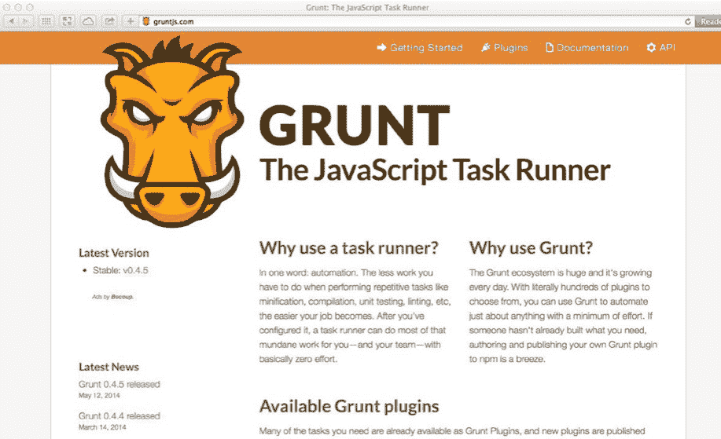

图 15-1.`Grunt`首页提供了丰富的资源来帮助你完成启动任务

在本文编写时，`Grunt`拥有三个千多个插件任务，列在`http://bit.ly/grunt-plugins`，供你的任务序列使用，涵盖了你可能想要执行的最流行的任务。

### 安装 Grunt

在我们开始使用`Grunt`之前，我们需要安装`Grunt`命令行界面（CLI）工具，该工具可以通过`http://bit.ly/grunt-cli`获取，它提供了在机器上所有文件夹全局访问`Grunt`命令行工具的能力。`Grunt`CLI 工具允许你在不同的项目文件夹中运行不同版本的`Grunt`任务运行器，如果你在机器上安装了多个项目，这将是一个极好的消息。

要安装`Grunt`CLI 工具，请在机器上任何文件夹的命令行提示符执行以下命令（`Mac`和`Linux`用户可能需要以超级用户身份使用`sudo`此命令）：

```bash
npm install -g grunt-cli
```

`Grunt`CLI 工具、`Grunt`任务运行器以及它的每个插件任务都是`Node.js`包，托管在 NPM 目录中。要为你的项目下载`Grunt`任务运行器，请在项目目录内执行以下命令（如果此文件夹中还没有`package.json`文件，请运行`npm init`来设置一个新的）：

```bash
npm install --save-dev
```

注意使用`--save-dev`命令行参数，它会自动在`package.json`文件的`dev`部分保存对下载的`Grunt`包特定版本的引用。这专门用于定义`Grunt`是一个用于开发的工具，而不是运行项目本身所需的包。同样地，我们安装的所有其他任务都必须放置在`devDependencies`部分中。例如，要为`Grunt`安装`JSHint`插件以对你的`JavaScript`文件进行静态分析，请在命令行上执行以下操作。关于该插件（名为`grunt-contrib-jshint`（`http://bit.ly/grunt-jshint`））的更多细节，插件名称中的`contrib`部分表示它是由与`Grunt`任务运行器相同团队开发的`Grunt`官方插件：

```bash
npm install grunt-contrib-jshint --save-dev
```

## 配置 Grunt 任务

在你的项目文件夹中安装了`Grunt`及其关联的`JSHint`插件后，下一步是配置`Grunt`以你选定的设置执行你的插件。`Grunt`通过一个配置文件进行配置，称为`Gruntfile`，它必须命名为`Gruntfile.js`并且应该存在于项目的根目录下，与你的`package.json`文件位于相同位置。

`Gruntfile`是一个标准的`JavaScript`文件，将通过`Node.js`框架通过`Grunt`工具运行，我们希望在文件外部访问的每个模块以及引入`Grunt`的地方，必须设置为`Gruntfile`的`module.exports`属性。

`Gruntfile.js`文件应该用一个包装函数初始化，通过`grunt`参数访问`Grunt`API，然后通过`module.exports`属性公开访问。随后，我们所有的配置设置都将存在于该函数的：

```javascript
module.exports = function(grunt) {
  // 配置写在这里。'grunt' 函数参数包含了 Grunt API 方法。
};
```

下一步是使用 API 的`loadNpmTasks()`方法加载我们希望`Grunt`能够运行的每个插件包。以下行代码应该为每个插件重复一次，在相关位置替换插件名：

```javascript
grunt.loadNpmTasks("grunt-contrib-jshint");
```

我们现在可以使用`Grunt`API 的`initConfig()`方法来配置我们的设置。我们向此传递一个`JavaScript`对象，其中一个属性包含应用该任务的设置。对于`JSHint`插件任务，使用的属性名是`jshint`——这是我们希望在你引用的任何插件文档中详细说明的精确名称。`JSHint`插件详细说明了可以应用于此任务的设置，包括一个用于引用应用任务文件的`src`属性，以及用于指定覆盖默认设置的规则的`options`属性。`JSHint`规则选项的完整列表可以在网上查看`http://bit.ly/jshint_opts`。如果我们想对项目中的所有`JavaScript`文件运行`jshint`……

## 列表 15-1. 一个基础 Gruntfile

```javascript
module.exports = function(grunt) {
  // 指定包装函数，该函数将把 Grunt API 作为参数传递，
  // 通过将其应用于 module.exports 属性，该函数在文件外部
  // 可访问，就像其他 Node.js 模块一样

  // 加载我们之前通过 npm 安装的插件任务
  grunt.loadNpmTasks("grunt-contrib-jshint");

  // 配置之前加载的 JSHint 任务，带有应用于所列文件的选项
  grunt.initConfig({
    jshint: {
      options: {
        strict: true
      },
      // 使用 ** 和 * 通配符值确保 scripts/ 文件夹
      // 以及任何子文件夹中的所有 .js 文件都被加载供 JSHint 使用
      src: ["Gruntfile.js", "scripts/**/*.js"]
    }
  });

  // 注册任务别名。"default" 任务名称确保只需在
  // 命令行上执行 "grunt" 命令即可加载列出的任务
  grunt.registerTask("default", ["jshint"]);
};
```

## 第 15 章 构建工具与自动化

15-构建工具与自动化 — bash — 78x13
den-macbook-pro:15-Build Tools And Automation dennis.odell$ grunt
Running "jshint:src" (jshint) task

```

Gruntfile.js

2 | grunt.loadNpmTasks("grunt-contrib-jshint");

   ^ Missing "use strict" statement.

>> 1 error in 2 files

Warning: Task "jshint:src" failed. Use --force to continue.

Aborted due to warnings.

den-macbook-pro:15-Build Tools And Automation dennis.odell$ []

```

**图 15-2.** 在`Gruntfile`函数顶部添加"use strict"语句并重新运行`Grunt`，会产生如图 15-3 所示的响应，表明`JSHint`任务现在已成功，`Grunt`默认别名已无错误完成。

15-构建工具与自动化 — bash — 78×29
den-macbook-pro:15-Build Tools And Automation dennis.odell$ grunt
Running "jshint:src" (jshint) task
>> 2 files lint free.

Done, without errors.
den-macbook-pro:15-Build Tools And Automation dennis.odell$ []

**图 15-3.** `Grunt`的命令行输出，表明所有任务均已成功完成

## 扩展的 Grunt 配置

`Grunt`支持的功能比我们目前涵盖的更多，包括支持导入 JSON 数据文件、针对不同需求的多任务替代配置设置，以及在没有合适的现有解决方案时编写自定义插件的能力。可以在`http://bit.ly/grunt-plugins`找到插件目录。

## JSON 文件导入

`Grunt`API 包含系列用于处理外部文件读取、写入和复制的方法。其中最常用的是`file.readJSON()`方法，它允许将存储在外部 JSON 格式文件中的数据加载到`Gruntfile`中，使其数据成为标准的`JavaScript`对象以便用于任务配置。通常，会导入`package.json`文件中存储的属性，以便访问名称、版本、描述以及存储在其中的任何属性等详细信息。

注意：`Grunt`API 中的配套方法`file.readYAML()`允许将 YAML 格式的数据文件读取到`Grunt`配置文件中。YAML 格式的设计比 JSON 更具可读性，更适合数据文件需要人类而非机器编辑的情况。要了解更多关于此数据格式的信息，请访问项目主页`http://yaml.org`。

所示，将`package.json`文件的内容加载到`Gruntfile`中，并将返回值设置为`initConfig()`使用的配置对象中的`pkg`属性：

```javascript
grunt.initConfig({
  pkg: grunt.file.readJSON("package.json")
});
```

然后可以从`pkg`对象属性（或配置对象中的任何其他属性）读取值，字符串值由模板分隔符`<%= %>`包围。例如，要从`package.json`文件中读取`name`和`version`属性并在`JSHint`任务中使用它们，我们如下所示引用它们：

```javascript
grunt.initConfig({
  pkg: grunt.file.readJSON("package.json"),
  jshint: {
    options: {
      strict: true,
    src: ["Gruntfile.js", "<%= pkg.name %>-%<%= pkg.version %>..js"]
  }
});
```

假设我们的`package.json`文件包含以下属性，例如：

```json
{
  "name": "my-project",
  "version": "0.0.1"
}
```

我们的`JSHint`配置将实际上在其`src`配置属性中解析为以下数组值：

```javascript
src: ["Gruntfile.js", "my-project-0.0.1.js"]
```

模板字符串中的值在`Grunt`运行之前会被替换为指定的值，就像这些值被硬编码在文件中一样。我们可以在多个地方引用它们，并且只需对`package.json`文件中的属性进行简单更改，我们的`Gruntfile`中任何需要的任务配置就会进行所有必要的更改，而无需我们付出额外努力。

#### 多任务（Multi-Tasks）与目标（Targets）

`Grunt`支持将每个任务配置拆分为若干个独立的配置，从而允许不同的任务选项以适应不同的场景，例如对不同的文件应用不同的设置。此功能被称为多任务（`multitask`），通过在`Gruntfile`部分添加额外的对象属性名来实现。这些多任务对象中的每一个被称为目标（`target`），不同的目标可以逐个运行`Grunt`，也可以按照定义的顺序一起运行所有目标。

列表 15-2 中的代码显示了一个为`JSHint`多任务配置了两个目标的`Gruntfile`，分别命名为`grunt`和`project`。`grunt.options`属性中的设置将适用于所有目标，但可以在每个目标的单独配置属性内放置额外的`options`对象来按目标进行覆盖。

列表 15-2. 指定了`JSHint`多任务的多个目标的`Gruntfile.exports`

```javascript
module.exports = function(grunt) {
  // 启用严格模式
  "use strict"

  grunt.loadNpmTasks("grunt-contrib-jshint");

  grunt.initConfig({
    // 从另一个文件加载外部数据用于任务配置
    pkg: grunt.file.readJSON("package.json"),

    jshint: {
      // 应用一组适用于所有目标的 JSHint 选项
      options: {
        strict: true
      },

      // 定义一个具有适用于所有目标的设置的目标
      grunt: {
        src: ["Gruntfile.js"]
      },

      // 定义第二个目标，命名为 "project"
      project: {
        options: {
          trailing: true
        },

        // 使用来自 package.json 文件的设置
        src: ["Gruntfile.js", "<%= pkg.name %>-%<%= pkg.version %>..js"]
      }
    }
  });

  grunt.registerTask("default", ["jshint"]);
};
```


针对所示的 `Gruntfile` 运行 `Grunt` 会产生如图 15-4 所示的输出，依次执行每个单独的目标。


**图 15-4.** 运行两个目标的 Grunt

可以在别名任务内或直接在命令行上执行特定目标，通过指定任务名称后跟冒号（`:`）和目标名称。例如，要在命令行上运行 `JSHint` 任务的 `project` 目标，请执行以下命令，它将产生如图 15-5 所示的输出：

```bash
grunt jshint:project
```


**图 15-5.** 执行多任务的单一目标

随着 `Gruntfile` 的增大，多任务变得更加强大且有用，允许将任务拆分为更具体的目标。

## 编写自己的 Grunt 插件

在开发 `Grunt` 的过程中，你可能会发现你需要的每个插件在目录中并不。如果是这样，你会很高兴可以使用 `JavaScript` 编写你自己的自定义插件来满足特定需求。查看在线文档 <http://bit.ly/grunt-write-plugin> 以了解如何编写你自己的 `Grunt` 插件。

除了本节中涵盖的功能外，`Grunt` 还提供了许多其他用于任务配置的选项。要了解更多 `Grunt` 提供的额外功能以及示例，请查看项目网站上的 `Grunt` 任务文档页面 <http://bit.ly/grunt-tasks>。

`Gulp.js` 系统构建在 `Node.js` 之上，其执行任务的能力与 `Grunt` 相似，尽管两者有三处明显的区别。

首先，它利用了 `Node.js` 的流（streams）功能，这允许一个任务的输出直接馈给或管道（pipe）到另一个任务的输入，而无需将临时文件写入磁盘的中间步骤；这使得任务运行更加高效，并且在大多数情况下速度更快。

其次，它摒弃了单一的大型配置，转而采用基于代码的、链式调用的方法，将相关配置传递给代表每个任务的方法。

第三，`Gulp.js` 任务被刻意设计得非常精简——即只做一件事并把它做好——意味着我们避免了执行多个动作的任务，转而倾向于连接多个较小的任务，让上一个任务的输出馈给下一个任务。

## 安装 Gulp.js

若要在系统中的任何文件夹中为所有项目安装 `Gulp.js`，请在命令行中执行以下命令（Mac 和 Linux 用户可能需要在命令前加 `sudo`）：

```bash
npm install -g gulp
```

接下来，将 `gulp` 包安装到你的项目文件夹中，并将其保存到 `package.json` 文件的 `devDependencies` 部分——如果你还没有 `package.json` 文件，请先执行 `npm init` 来初始化它：

```bash
npm install gulp --save-dev
```

与 `Grunt` 一样，插件也是通过 `npm` 工具安装的。对于 `Gulp.js` 的 `JSHint` 任务，我们需要在命令行中执行以下命令来安装 `gulp-jshint` 任务，将其引用保存到 `package.json` 文件的 `devDependencies` 部分：

```bash
npm install gulp-jshint --save-dev
```

该任务的文档可以在此处找到：<http://bit.ly/gulp-jshint>。

## 配置 Gulp.js

与 `Grunt` 类似，它也需要一个 `JavaScript` 配置文件来设置任务及其执行顺序。该文件被称为 `gulpfile`，且必须命名为 `gulpfile.js`。

不同于像 `Grunt` 那样仅仅创建一个 `Node.js` 模块，该配置文件的结构本身就是一个 `Node.js` 应用程序。要设置该文件，我们需要引入 `"gulp"` 包并调用从其暴露的方法，这些方法代表了 `Gulp.js API`。

插件是 `Node.js` 模块，暴露了代表其功能的方法，因此它们不会像你在 `Grunt` 中那样直接定义任务名称。要定义一个任务，必须传递一个新任务的唯一名称以及一个执行 `Gulp.js API` 中 `task()` 方法的函数，调用插件的方法并返回输出。

`gulpfile` 的基本结构如下：

```javascript
var gulp = require("gulp");

gulp.task("default", function() {

  // 任务在这里被调用，输出被返回给调用函数

});
```

`Gulp API` 包含了我们在 `gulpfile` 任务中使用的方法：`src()` 允许我们定义应用于 `dest()` 的文件列表；`dest()` 允许我们将 `gulp` 处理的输出写入文件系统；以及 `pipe()`，它将一个 `gulp` 方法的输出传递给下一个。每个方法都设计为可以链式调用，从而使任务由一系列相似的组成组成。

列表 15-3 显示了一个定义默认任务（default task）的示例 `gulpfile`，它加载一组文件，然后将这些文件传递给 `JSHint` 插件以对文件运行静态代码分析。结果被传递给报告函数（reporter function），该函数会在命令行窗口中显示代码分析的结果——这正是 `Gulp` 同样易配置的任务类型。与 `Grunt` 一样，可以定义别名任务（包括默认任务），将其他任务分组为应顺序执行的系列。

**列表 15-3.** 示例 `gulpfile`

```javascript
// 引入 gulp 包和 JSHint 包

var gulp = require("gulp");

jshint = require("jshint");

// 定义一个 Gulp 任务，命名为 "jshint" - 然后我们可以可以直接通过名称执行它，
// 或者通过别名名称将其与其他任务关联，以便按顺序执行

gulp.task("jshint", function () {

  // 将操作结果返回给调用函数

  // 定位此任务要使用的文件 -- 这里，是该 gulpfile 本身以及 scripts/
  // 文件夹及其子文件夹中的任何 .js 文件

  return gulp.src("gulpfile.js", "scripts/**/*.js");

  // 将这些文件管道到 "jshint" 插件，指定应用的选项 -- 这里，我们
  // 确保在选文件中强制严格模式。这运行了 JSHint 但

  .pipe(jshint({

  strict: true

  }));

  // 最后，将 JSHint 的输出管道到报告器以便在命令行中显示。

  // 通过将 JSHint 分为执行静态代码分析的部分和显示结果的部分，
  // 我们能够创建更具功能的任务，这些任务可以获取 JSHint 的直接结果
  // 并以我们希望的任何其他方式使用它们。这正是 Gulp.js 具有如此高配置性的原因。

  .pipe(jshint.reporter("default"));

});

// 定义一个默认任务 - 命名为 "default" 确保它可以在无需从
// 命令行传递特定任务名称的情况下执行

gulp.task("default", ["jshint"]);
```

## 运行 Gulp.js

通过命令行执行列表 15-3 中的代码运行 `Gulp.js` 任务，该代码应先保存到名为 `gulpfile.js` 的文件中：

```bash
gulp
```

由于没有提供任务名称，默认任务将被执行，产生图 15-7 所示的结果。

**图 15.** 来自 `gulpfile.js` 的命令行输出

## 扩展 Gulp.js 配置

与 `Grunt` 一样，需要一个 `JavaScript` 配置文件来设置任务及其顺序。该文件被称为 `gulpfile`，且必须命名为 `gulpfile.js`。不同于像 `Grunt` 那样，该配置结构实际上就是一个 `Node.js` 应用程序。要设置文件，我们需要引入 `"gulp"` 包并调用其暴露的方法，这些方法代表了 `Gulp.js API`。

插件是 `Node.js` 模块，暴露了代表其功能的方法，因此它们不会像你在 `Grunt` 中那样直接定义任务名称。要定义任务，必须传递一个新任务的唯一名称以及一个执行 `Gulp.js API` 中 `task()` 方法的函数，调用插件的方法并返回输出。

`gulpfile` 的基本结构如下：

```javascript
var gulp = require("gulp");

gulp.task("default", function() {

  // 任务在这里被调用，输出被返回给调用函数

});
```

`Gulp API` 包含了我们在 `gulpfile` 任务中使用的方法：`src()` 允许我们定义应用于 `dest()` 的文件列表；`dest()` 允许我们将 `gulp` 处理的输出写入文件系统；以及 `pipe()`，它将一个 `gulp` 方法的输出传递给下一个。每个方法都设计为可以链式调用，从而使任务由一系列相似的函数组成。

列表 15-3 显示了一个定义默认任务的示例 `gulpfile`，它加载一组文件，然后将这些文件传递给 `JSHint` 插件以对文件运行静态代码分析。结果被传递给报告函数，该函数会在命令行窗口中显示代码分析的结果——这正是 `Gulp` 同样易配置的任务。与 `Grunt` 一样，可以定义别名任务（包括默认任务），将其他任务分组为应顺序执行的系列。

**列表 15-3.** 示例 `gulpfile`

```javascript
// 引入 gulp 包和 JSHint 包

var gulp = require("gulp");

jshint = require("jshint");

// 定义一个 Gulp 任务，命名为 "jshint" - 然后我们可以可以直接通过名称执行它，
// 或者通过别名名称将其与其他任务关联，以便按顺序执行

gulp.task("jshint", function () {

  // 将操作结果返回给调用函数

  // 定位此任务要使用的文件 -- 这里，是该 gulpfile 本身以及 scripts/
  // 文件夹及其子文件夹中的任何 .js 文件

  return gulp.src("gulpfile.js", "scripts/**/*.js");

  // 将这些文件管道到 "jshint" 插件，指定应用的选项 -- 这里，我们
  // 确保在选文件中强制严格模式。这运行了 JSHint 但

  .pipe(jshint({

  strict: true

  }));

  // 最后，将 JSHint 的输出管道到报告器以便在命令行中显示。

  // 通过将 JSHint 分为执行静态代码分析的部分和显示结果的部分，
  // 我们能够创建更具功能的任务，这些任务可以获取 JSHint 的直接结果
  // 并以我们希望的任何其他方式使用它们。这正是 Gulp.js 具有如此高配置性的原因。

  .pipe(jshint.reporter("default"));

});

// 定义一个默认任务 - 命名为 "default" 确保它可以在无需从
// 命令行传递特定任务名称的情况下执行

gulp.task("default", ["jshint"]);
```

## 运行 Gulp.js

通过命令行执行列表 15-3 中的代码运行 `Gulp.js` 任务，该代码应先保存到名为 `gulpfile.js` 的文件中：

```bash
gulp
```

由于没有提供任务名称，默认任务将被执行，产生图 15-7 所示的结果。

**图 15.** 来自 `gulpfile.js` 的命令行输出

## 扩展 Gulp.js 配置

与 `Grunt` 一样，需要一个 `JavaScript` 配置文件来设置任务及其顺序。该文件被称为 `gulpfile`，且必须命名为 `gulpfile.js`。不同于像 `Grunt` 那样仅仅创建一个 `Node.js` 模块，该配置结构本身就是一个 `Node.js` 应用程序。要设置文件，我们需要引入 `"gulp"` 包并调用其暴露的方法，这些方法代表了 `Gulp.js API`。

插件是 `Node.js` 模块，暴露了代表其功能的方法，因此它们不会像你在 `Grunt` 中那样直接定义任务名称。要定义任务，必须传递一个新任务的唯一名称以及一个执行 `Gulp.js API` 中 `task()` 方法的函数，调用插件的方法并返回输出。

`gulpfile` 的基本结构如下：

```javascript
var gulp = require("gulp");

gulp.task("default", function() {

  // 任务在这里被调用，输出被返回给调用函数

});
```

`Gulp API` 包含了我们在 `gulpfile` 任务中使用的方法：`src()` 允许我们定义应用于 `dest()` 的文件列表；`dest()` 允许我们将 `gulp` 处理的输出写入文件系统；以及 `pipe()`，它将一个 `gulp` 方法的输出传递给下一个。每个方法都设计为可以链式调用，从而使任务由一系列相似的函数组成。

列表 15-3 显示了一个定义默认任务的示例 `gulpfile`，它加载一组文件，然后将这些文件传递给 `JSHint` 插件以对文件运行静态代码分析。结果被传递给报告函数，该函数会在命令行窗口中显示代码分析的结果——这正是 `Gulp` 同样易配置的任务。与 `Grunt` 一样，可以定义别名任务（包括默认任务），将其他任务分组为应顺序执行的系列。

**列表 15-3.** 示例 `gulpfile`

```javascript
// 引入 gulp 包和 JSHint 包

var gulp = require("gulp");

jshint = require("jshint");

// 定义一个 Gulp 任务，命名为 "jshint" - 然后我们可以可以直接通过名称执行它，
// 或者通过别名名称将其与其他任务关联，以便按顺序执行

gulp.task("jshint", function () {

  // 将操作结果返回给调用函数

  // 定位此任务要使用的文件 -- 这里，是该 gulpfile 本身以及 scripts/
  // 文件夹及其子文件夹中的任何 .js 文件

  return gulp.src("gulpfile.js", "scripts/**/*.js");

  // 将这些文件管道到 "jshint" 插件，指定应用的选项 -- 这里，我们
  // 确保在选文件中强制严格模式。这运行了 JSHint 但

  .pipe(jshint({

  strict: true

  }));

  // 最后，将 JSHint 的输出管道到报告器以便在命令行中显示。

  // 通过将 JSHint 分为执行静态代码分析的部分和显示结果的部分，
  // 我们能够创建更具功能的任务，这些任务可以获取 JSHint 的直接结果
  // 并以我们希望的任何其他方式使用它们。这正是 Gulp.js 具有如此高配置性的原因。

  .pipe(jshint.reporter("default"));

});

// 定义一个默认任务 - 命名为 "default" 确保它可以在无需从
// 命令行传递特定任务名称的情况下执行

gulp.task("default", ["jshint"]);
```

#### 列表 15-4. 用于开发工作流的 Gruntfile

```javascript
module.exports = function(grunt) {

  "use strict";

}
```

```javascript
// 定义我们应用程序中想要运行任务的 JavaScript 文件位置 -
// 与同此 Gruntfile 一起，使用通配符 (* 和 **) 的值意味着
// 我们直接代表了 scripts/ 文件夹内的 .js 文件，以及
// 文件夹层级结构中该目录下下一层的文件

var scripts = ["Gruntfile.js", "**/**/*.js"];
```

```javascript
// 加载之前通过 npm 安装的 JShint、Connect 和 Watch 插件

grunt.loadNpmTasks("grunt-contrib-jshint");

grunt.loadNpmTasks("grunt-contrib-connect");

grunt.loadNpmTasks("grunt-contrib-watch");
```

```javascript
// 配置 Grunt 的 JShint、Connect 和 Watch 任务

grunt.initConfig({

  // 配置 JShint 任务以对我们的文件执行静态代码分析

  jshint: {

    // scripts/ 文件夹，并在所有文件中强制执行严格模式

    options: {

      strict: true

    },

    src: scriptFiles

  },

  // 配置 Connect 任务在 http://localhost:3000 启动 Web 服务器 -
  // 默认情况下，它将指向项目文件夹根目录的文件，因此
  // 根目录下名为 index.html 的文件将在浏览器显示此 URL 时显示。
  // 通过启用 "liveeload" 属性，服务器将向你的 HTML 页面
  // 注入 Live Reload 脚本的引用 - 与另一个在特定情况下
  // 触发 Live Reload 的任务配合使用

  connect: {

    server: {

      port: 3000,

      livereload: true

    }

  },

  // 配置 Watch 任务观察 scripts/ 文件夹中任何 JavaScript 文件的更改
  // 并在这些文件更改时触发 JShint 任务，确保
  // 在整个开发过程中保持高代码质量标准。启用
  // "liveeload" 选项可确保运行中的 Web 页面的任何 Live Reload 脚本
  // 一旦 JShint 任务运行时就会被注意到，导致其自动重新加载，
  // 从而为我们节省手动刷新页面的任务。此选项与
  // Connect 任务配合工作

  watch: {

    scripts: {

      files: scriptFiles,


```javascript
tasks: ["jshint"],

options: {
  livereload: true
}

}

// 可以在此处添加不同文件类型的额外目标，例如 CSS 或 HTML
// 文件，以便在这些文件类型更改时触发特定任务

};

// 配置默认 Grunt 任务以按顺序运行 JShint, Connect 和 Watch 任务。
// Watch 插件将继续监控更改，并结合 LiveReload 能力，
// 确保托管在我们新服务器上的网站在我们更改项目中的
// JavaScript 文件时自动保持更新 - 甚至不需要在浏览器中按刷新

grunt.registerTask("default", "jshint", "connect", "watch");
```

运行列表 15-4 中的代码，将其保存为名为`grunt.js`的文件，将对`scripts/`文件夹中的 JavaScript 文件执行 JSHint，然后会在`http://localhost:3000`打开一个服务器，指向你项目中的 JavaScript 文件。Grunt 进程将保持在命令行窗口中活动，因为它会监控更改；当检测到更改时，它将对更新后的文件重新运行 JSHint，重新加载查看`index.html`页面的任何浏览器窗口或网络应用程序中的任何其他 HTML 页面。如果你想停止 Grunt 进程，请使用 Ctrl+C（Windows、Linux）或 Cmd+C（Mac）快捷键终止命令。

# 使用 Gulp.js 改进你的开发工作流

我们可以通过 Gulp.js 利用 JSHint 和 Connect 实现这种自动化开发工作流。没有像 Grunt 那样有独立的 Watch 插件，文件更改功能通过其`watch()`方法直接构建在 Gulp.js API 中。该方法不支持直接 Live Reload，我们可以配置一个自定义 Watch 任务，通过调用 Gulp 进程的`reload()`方法来执行此方法，这将产生所需的结果。

首先在项目目录中安装 Gulp.js 和两个需要的插件（如果文件夹中不存在`package.json`文件，请使用`npm init`进行设置）：

```bash
npm install gulp --save-dev
npm install gulp-jshint --save-dev
npm install gulp-connect --save-dev
```

列表 15-5 中的代码显示了一个`gulpfile`，它可以通过启动 Web 服务器、在每次 JavaScript 文件更改时使用 JSHint 运行静态代码分析，并自动刷新连接到该服务器的打开浏览器窗口来改进你的开发工作流。遵循行内注释了解每个任务是如何配置的。

# 列表 15-5. 用于改进开发工作流的 Gulpfile

```javascript
// 加载 Gulp 包以及用于 Gulp 的 JShint 和 Connect 插件，所有插件
// 之前已通过 npm 安装

var gulp = require("gulp");
var jshint = require("gulp-jshint");
var connect = require("gulp-connect");
```

```javascript
// 定义我们应用程序中想要运行任务的 JavaScript 文件位置 -
// gulpfile 以及 scripts/ 文件夹及其子目录内的任何 js 文件

var scriptFiles = ["gulpfile.js", "scripts/**/*.js"];
```

首先将 Grunt 和所需的插件安装到你的项目目录（如果此文件夹不存在`package.json`文件，请使用`npm init`进行设置）：

```bash
npm install grunt --save-dev
npm install grunt-contrib-jshint --save-dev
npm install grunt-contrib-connect --save-dev
npm install grunt-contrib-watch --save-dev
npm install grunt-contrib-clean --save-dev
npm install grunt-contrib-copy --save-dev
npm install grunt-contrib-jasmine --save-dev
npm install grunt-template-jasmine-istanbul --save-dev
npm install grunt-contrib-concat --save-dev
npm install grunt-contrib-uglify --save-dev
npm install grunt-contrib-yuidoc --save-dev
```

列表 15-6 中的代码显示了一个完整的 Gruntfile，它除了可以改进你的开发工作流外，还可以用于生成存储在`src/scripts/`中的生产就绪版 JavaScript 代码。请遵循行内注释了解是如何配置每个任务的。

# 列表 15-6. 带有独立开发和构建任务的 Gruntfile

```javascript
module.exports = function(grunt) {

  // "use strict";

  // 定义变量来表示任务配置所需的文件夹和文件位置
  // - 避免重复编写
  // "src/" 文件夹包含了我们在开发期间处理的代码，包括
  // "scripts/" 和 "tests/" 文件夹，它们包含了你的 JavaScript 代码和测试规范

  var srcFolder = "src";
  var scriptsFolder = srcFolder + "scripts/";
  var scriptFiles = scriptsFolder + "/*.js";
  var unitFolder = srcFolder + "tests/";
  var unitTestFiles = unitFolder + "/*.js";

  // "dist/" 文件夹将在运行此 Gruntfile 时自动生成，
  // 并填充我们应用程序的发布版本文件

  var outputFolder = "dist";
  outputFolder = outputFolder + "scripts/";

  // 定义单个脚本文件的名称和位置，所有其他文件将合并
  // 该文件中，成为我们应用程序的主文件

  var outputScriptFile = outputFolder + "main.js";

  // 定义我们单个应用程序脚本的压缩版本的名称和位置

  var outputScriptMinified = outputFolder + "main.min.js";

  // 定义生成的 Istanbul 报告和 YUIDoc 文档文件的输出文件夹

  var outputReportFolder = outputFolder + "report";
  var outputDocsFolder = outputFolder + "docs";
```

```javascript
// 加载 JSHint, Connect 和 Watch 任务，它们将用于本地开发
grunt.loadNpmTasks('grunt-contrib-jshint');
grunt.loadNpmTasks('grunt-contrib-connect');
grunt.loadNpmTasks('grunt-contrib-watch');
```

```javascript
// 加载 Clean, Copy, Jasmine, Concat, Uglify 和 YUIDoc 任务，它们将
// 与 JSHint（之前加载的）一起使用，形成我们的发布构建，为所有
// 文件准备发布
grunt.loadNpmTasks('grunt-contrib-clean');
grunt.loadNpmTasks('grunt-contrib-copy');
grunt.loadNpmTasks('grunt-contrib-jasmine');
grunt.loadNpmTasks('grunt-contrib-concat');
grunt.loadNpmTasks('grunt-contrib-uglify');
grunt.loadNpmTasks('grunt-contrib-yuidoc');
```

```javascript
// 为所有任务配置 Grunt
grunt.initConfig({
```

```javascript
// 将从 package.json 文件读取的属性加载到属性中供任务
// 配置使用
pkg: grunt.file.readJSON("package.json"),
```

```javascript
// 如列表 15-4 中配置 JSHint
jshint: {
  options: {
    strict: true
  },
  src: scriptFiles
}
```

```javascript
// 如列表 15-4 中配置 Connect
connect: {
  server: {
    options: {
      port: 3000,
      livereload: true,
      // 现在我们正在 "src/" 文件夹中工作，使用此位置作为
      // 查找托管在此 Web 服务器上的文件的位置
      base: srcFolder
    }
  }
}
```

```javascript
// 如列表 15-4 中配置 Watch
watch: {
  scripts: {
    files: ["jshint"],
    tasks: ["jshint"],
    options: {
      livereload: true
    }
  }
}
```

```javascript
// 可能是最简单的配置的 Grunt 插件，Clean 任务清空给定文件夹的
// 内容 - 在这里我们希望每次在重新生成
// 我们的生产就绪文件时确保 "dist/" 文件夹是空的
clean: [outputFolder],
```

```javascript
// 我们将使用 Copy 从 "src/" 文件夹复制不需要额外
// 处理的静态文件，将它们放入 "dist/" 文件夹中。在这种情况下，我们复制
// 了除了 "scripts/" 和 "tests/" 文件夹内容以外的所有内容
copy: {
  all: [{
    // 在文件夹或文件名之前使用感叹号 (!)
    // 会导致其从文件列表中被排除。我们希望复制
    // "src/" 内的所有文件，但排除 "scripts/" 和 "tests/" 文件夹中的文件
    folders: srcFolder,
    src: ["***", "!scripts/**", "!tests/**"],
    output: outputFolder,
  }, {
    // "expand" 属性确保在文件复制过去时
    // 原始文件夹结构保持完好
    expand: true
  }]
}
```

```javascript
// 配置 Jasmine 与 Istanbul 一起运行，以确保单元测试通过并
// 生成代码覆盖率报告，该报告放置在 "dist/report"
// 文件夹中供审查。我们在列表 15-3 中首次看到此任务。
jasmine: {
  coverage: {
    src: scriptFiles,
    options: {
      // 指向单元测试文件的位置
      specs: unitTestFiles,
      // 为 Jasmine 任务导入 Istanbul 模板
      template: require("grunt-template-jasmine-istanbul"),
      // 配置 Istanbul 代码覆盖率报告
      // 输出文件夹和文件
      options: {
        coverage: outputReportFolder + "coverage.json",
        report: outputReportFolder
      }
    }
  }
}
```

```javascript
// Concat 任务将位于
// "src/scripts/" 文件夹中的所有 JavaScript 文件合并为单个文件
// 我们将其称为 "main.js"。我们可以
// 然后跨 JavaScript 文件分离我们的开发，并在此阶段
// 合并它们，以避免需要过多的 HTTP 请求来加载我们的脚本
concat: {
  scripts: {
    src: scriptFiles,
    dest: outputScriptFile
  }
}
```

```javascript
// Uglify 任务将压缩我们单个应用程序脚本的压缩版本
// 允许我们在每个文件顶部添加注释
uglify: {
  // 允许在文件顶部添加注释
  options: {
    banner: "/** <%= title %> - <%= version %>\n"
  },
  scripts: {
    // 允许我们将合并的 JavaScript 文件
    // 压缩我们单个应用程序脚本的压缩版本
    files: (function() {
      var files = {};
      files[outputScriptMinified] = outputScriptFile;
      return files;
    })()
  }
}
```

```javascript
// YUIDoc 任务将生成独立的站点，根据
// 格式化代码的注释
yuidoc: {
  docs: {
    // 让 YUIDoc 包含名称和版本
    // 直接来自项目 package.json
    name: "< title %>",
    version: "< version %>",

    // 告诉 YUIDoc 在哪里查找 JavaScript 文件，以及
    // 放置生成的站点
    options: {
      paths: srcFolder,
      outdir: outputDocsFolder
    }
  }
}};

// 定义默认任务，用于本地开发
grunt.registerTask("default", ["jshint", "connect", "watch"]);

// 定义一个新的 "build" 任务，清空 "dist/" 文件夹，复制文件，
// 运行 JSHint 和 Jasmine 以检查质量，通过 Istanbul 生成
// 代码覆盖率报告，合并 JavaScript 文件为单个文件，
// 压缩文件内容，最后根据原始 JavaScript
// 文件中的注释生成文档站点
grunt.registerTask("build", ["clean", "copy", "jshint", "jasmine", "concat", "uglify", "yuidoc"]);
```

# 第 15 章 构建工具与自动化

首先将 Gulp.js 和所需的插件安装到你的项目目录中（如果文件夹中不存在`package.json`文件，请使用`npm init`进行设置）：

```bash
npm install gulp --save-dev
npm install gulp-jint --save-dev
npm install gulp-connect --save-dev
npm install gulp-clean --save-dev
npm install gulp-jasmine --save-dev
npm install gulp-istanbul --save-dev
npm install gulp-concat --save-dev
npm install gulp-uglify --save-dev
npm install gulp-yuidoc --save-dev
npm install gulp-rename --save-dev
npm install gulp-header --save-dev
```

列表 15-7 中的代码显示了一个完整的`gulpfile.js`，它除了可以改进你的开发工作流外，还可以用于生成存储在`src/scripts/`文件夹中的适用于生产环境的 JavaScript 代码。请遵循行内注释了解每个任务是如何配置的。

# 列表 15-7 包含分离开发和构建任务的 Gulp.js 包


```
// 加载 Gulp.js 包
var gulp = require('gulp');

// 加载 JSHint、Connect、Clean、Jasmine、Istanbul、Concat、Uglify、YUiDoc、Rename 和
// Header 插件任务
jshint = require('gulp-jshint'),
connect = require('gulp-connect'),
clean = require('gulp-clean'),
jasmine = require('gulp-jasmine'),
istanbul = require('gulp-istanbul'),
concat = require('gulp-concat'),
uglify = require('gulp-uglify'),
yuidoc = require('gulp-yuidoc'),
rename = require('gulp-rename'),

// Header 向文件顶部添加指定的文本字符串，适用于在文件开头添加
// 动态注释
header = require('gulp-header'),

// 将属性从 package.json 文件加载到变量中供任务
// 配置使用
pkg = require('./package.json'),

// 定义表示任务配置所需的文件夹和文件位置的变量，避免重复
// "src/" 文件夹包含我们在开发期间将要处理的代码，包括
// "scripts/" 和 "tests/" 文件夹，分别包含 JavaScript 代码和 Jasmine 测试规范
// 脚本
srcFolder = "src/",
scriptFolder = srcFolder + "scripts/",
scriptFiles = scriptFolder + "**/*.js",
unitTestFolder = srcFolder + "/tests/",
unitTestFiles = unitTestFolder + "**/*.js",

// "dist/" 文件夹将在运行此 Gruntfile 时自动生成，并
// 填充我们应用程序文件的发布版本
outputFolder = "dist/",
outputScriptFolder = outputFolder + "/scripts/",

// 定义单个脚本文件的名称和位置，所有其他文件将合并到此处，
// 生成我们应用程序的主 JavaScript 脚本文件
outcriptFileName = "main.js",
outcriptFile = outputScriptFolder + outputScriptFileName,

// 定义应用于单个应用程序脚本压缩版本的后缀
outcriptFileMinifiedSuffix = ".min",

// 定义为生成的 Istanbul 报告和 YUIDoc 文档文件输出文件夹
outputReportFolder = outputFolder + "report/",
outputDocsFolder = outputFolder + "docs/",

// 如列表 15-5 所示配置 Connect
gulp.task("connect", function() {
  "use strict";

  connect.server({
    port: 3000,
    livereload: true
  });
});

// 如列表 15-5 所示配置 JSHint
gulp.task("jshint", function() {
  "use strict";

  return gulp.src(scriptFiles)
    .pipe(jshint({
      strict: true
    }))
    .pipe(jshint.reporter("default"))
    .pipe(connect.reload());
});

// 如列表 15-5 所示配置 Watch 任务
gulp.task("watch", function() {
  "use strict";

  gulp.watch(scriptFiles, ["jshint"]);
});

// 定义 Clean 任务，在我们每次准备
// 生产就绪发布代码时清空 "dist/" 输出文件夹的内容
gulp.task("clean", function() {
  "use strict";

  return gulp.src(outputFolder, {
    // 在 gulp.src() 中将 "read" 选项设置为 false 会导致 Gulp.js 忽略
    // 输入文件的内容，从而使任务更快
    read: false
  })
  // 将输出文件夹通过 clean() 任务方法传递，从文件
  // 系统中删除
  .pipe(clean));
});

// 定义 Copy 任务，将我们希望与发布代码绑定的静态文件
// 复制到我们的输出 "dist/" 文件夹
gulp.task("copy", function() {
  "use strict";

  // 复制 "src/" 内的所有文件，但 "scripts/" 和 "tests/" 文件夹除外，到
  // "dist/" 输出文件夹。不需要特殊的插件来执行文件
  // 复制，它通过 Gulp.js 的 API 方法 src() 和 dest() 直接处理
  return gulp.src("*", "!scripts/**", "!tests/**", {
    cwd: srcFolder
  })
  .pipe(gulp.dest(outputFolder));
});

// 定义一个通过 Jasmine 执行单元测试并通过 Istanbul 生成代码
// 覆盖率的任务。为了避免运行两个任务（这实际上会导致单元测试
// 运行两次），我们将两个任务合并为一个
gulp.task("jasmine-istanbul", function() {
  "use strict";

  // 将文件从 "src/scripts/" 目录管道到 Istanbul，通过 Istanbul
  // 生成代码覆盖率
  // 略（此处代码与后文翻译逻辑一致，保持结构不变）
  // ...
});
```

Grunt 和 Gulp.js 都能很好地执行这些自动化任务，尽管 Gulp.js 在速度上更具优势，而 Grunt 则拥有最佳的插件支持。你应该根据这些特点以及你的项目需求来选择合适的工具。

# 第 15 章 构建工具与自动化

## 管理第三方库和框架

随着应用程序的增长，你可能会发现代码依赖于许多第三方库、框架和插件脚本，你需要在项目本地存储并管理这些内容。其中某些脚本将与你引用的其他特定版本配合使用，确保安装了每个库的正确版本可能是一项维护工作。受 Node.js JSON 文件方法的启发，涌现了许多前端包管理器工具，它们允许在配置文件中定义第三方库和框架及其确切版本。然后，包管理器可以根据配置在你的项目内安装这些库，而这一过程可以通过 Grunt 和 Gulp 实现自动化，这意味着你不需要手动将每个第三方依赖安装到你的项目源码版本控制中。

最常见的前端包管理器之一是由 Twitter 开发的 [Bower](http://bower.io)。通过其类似于 NPM 目录的包目录，开发者可以为他们的项目访问超过十五个 JavaScript 库和框架，包括 jQuery、RequireJS、AngularJS、Backbone 以及许多其他流行的脚本和插件。与 Grunt 和 Gulp.js 一样，它是构建在 Node.js 之上的，因此安装该工具需要在命令行中执行以下命令（Mac 和 Linux 用户可能需要在命令前加上 `sudo`）：

```bash
npm install -g bower
```

类似于 Node.js 中常用于管理包和特定依赖版本的 `.json` 文件，`bower.json` 文件配合 Bower 管理器使用，它包含了通用的项目详情以及前端库和框架依赖的列表。除了主项目依赖外，还可以指定仅用于开发的依赖项，这些依赖定义了仅开发时需要且不应出现在代码生产版本中的库，例如调试脚本和单元测试框架。

使用 Bower 安装包与使用 npm 工具安装包非常相似——在 <http://bower.io/search/> 在线目录中提供包名，并带有 `--save` 选项将包添加到 `bower.json` 文件的 `dependencies` 部分，以及一个 `--save-dev` 选项允许将包添加到文件的 `devDependencies` 部分，表示该包不应是主应用程序的一部分，而仅在开发时需要。因此，要安装 jQuery 包，请执行：

```bash
bower install jquery --dev
```

所有包默认安装在 `bower_components/` 文件夹中，这应该确保它不会被提交到你的源码版本控制系统中，因为定义的特定依赖版本应该通过 Bower 在每位开发者的机器上动态安装。你的代码随后可以在应用程序中引用此目录下的文件。

列表 15-8 显示了一个 `bower.json` 示例，它为 JavaScript 应用定义了三个第三方依赖——jQuery、AngularJS 和 RequireJS，以及仅供开发使用的 Firebase Lite（<http://bit.ly/firebug-lite>）脚本。

**列表 15-8。** `bower.json` 示例

```json
{
  "name": "my-project",
  "version": "0.0.1",
  "dependencies": {
    "jquery": "~2.1.1",
    "angular": "~1.2.17",
    "requirejs": "~2.1.14"
  },
  "devDependencies": {
    "firebug-lite": "~1.5.1"
  }
}
```

一旦你有了 `bower.json` 文件，为新开发者安装所有包只需在命令行中执行以下命令，这将在项目文件夹中安装所有定义的包：

```bash
bower install
```

通过使用 `grunt-bowercopy`（<http://bit.ly/grunt-bowercopy>）和 `gulp-bower`（<http://bit.ly/gulp-bower>）插件，可以使用 Grunt 或 Gulp 自动化依赖的安装。这些插件会在本地 Bower 文件中安装所有定义的包，然后将文件从本地 `bower_components` 复制到指定的输出目录，正如上一节中保存的 `dist/` 文件夹结构所示。

Bower 以及同类管理器——npm（<http://npmjs.io>）、component（<http://component.io>）和 Jam（<http://jams.org>），它们都以类似的方式配置和运行——允许对你前端应用程序中特定版本的第三方依赖进行简单有效的管理，确保错误发生概率降低，并为你的项目安装所需的确切依赖项。

## 项目设置与脚架生成

启动和设置新项目的过程是非常耗时的，涉及许多关于最佳文件夹和文件结构、最合适的框架以及自动化和依赖管理最佳方法的决策。本着让开发者有更多时间专注于开发的精神，Google 的团队创建了一个名为 Yeoman（<http://yeoman.io>）的自动化工具，用于设置新项目、配置文件夹结构、创建初始文件以及安装和配置工具，让开发者能够最快地开始。

Yeoman 整合了用于任务运行的 Grunt、用于包管理的 Bower，以及 `yo`（这是连接 Bower 和 Bower 工具并带有正确配置的核心），它会代表你创建默认文件夹和文件。由于不同类型的项目需要不同的配置、结构和文件，被称为 *generators*（生成器）的 Yeoman 插件提供了设置所需的特定设置。

`yo` 是一个 Node.js 工具，可以通过执行以下命令进行安装（Mac 和 Linux 用户可能需要在命令前加上 `sudo`）：

```bash
npm install -g yo
```

接下来，你需要选择一个生成器作为新项目的基础。一个专门为 AngularJS、Backbone 和其他框架定制的二十个官方生成器目录可以在 <http://bit.ly/yeoman-official> 找到，而数百个非官方生成器列表可以通过 <http://bit.ly/yeoman-community> 获取。如果你刚开始使用 Yeoman 并需要使用 HTML5 Boilerplate（<http://html5plate.com>）、jQuery、Modernizr（<http://modernizr.com>）和 Bootstrap（<http://getbootstrap.com>）生成一个简单的网站，推荐使用 `generator-webapp` 插件（<http://bit.ly/yeoman-webapp>）。要在机器任何位置使用此生成器，只需在命令行中执行以下命令：

```bash
npm install -g generator-webapp
```

要使用生成器设置新项目，创建一个文件夹并进入该文件夹，然后执行 `yo` 并传递生成器的名称（始终是名称中连字符（`-`）后的部分）。例如，使用 `generator-webapp` 生成器初始化新项目，在新文件夹内执行以下命令：

执行此命令将产生图 15-9 所示的响应，显示介绍图形，并询问用户想要安装的哪些额外库，该回答将决定在生成的结构中创建哪些文件夹和文件，以及如何设置配置文件。回答问题后将触发项目文件的安装和配置。在命令行中选择默认选项后生成的文件夹和文件结构如图 15-10 所示。

```bash
new — dennis.odell yo webapp
```


开箱即用包含了 HTML5 Boilerplate、jQuery 以及一个用于构建应用的 `Gruntfile.js`。
(?) 你还想要什么？（按 `<space>` 选择）

- Bootstrap
- Sass
- Modernizr

图 15-9. 在命令行中运行 Yeoman，帮助为新项目奠定基础

# 第 15 章 构建工具与自动化

| 名称 | 修改日期 | 大小 | 类型 |
|---|---|---|---|
| app | 12:41 | 50 KB | 文件夹 |
| 404.html | 09/04/2014 10:59 | 4 KB | HTML 文档 |
| favicon.ico | 09/04/2014 10:59 | 4 KB | Windows 图标图像 |
| images | 今天 12:39 | 0字节 | 文件夹 |
| index.html | 今天 12:39 | 4 KB | HTML 文档 |
| robots.txt | 09/04/2014 10:59 | 32 bytes | 纯文本文档 |
| scripts | 今天 12:39 | 30 bytes | 文件夹 |
| styles | 今天 12:39 | 2 KB | 文件夹 |
| bower_components | 今天 12:41 | 1.6 MB | 文件夹 |
| bootstrap | 今天 12:39 | 754 KB | 文件夹 |
| jquery | 今天 12:39 | 862 KB | 文件夹 |
| bower.json | 09/04/2014 10:59 | 140 bytes | JSON |
| Gruntfile.js | 今天 12:39 | 11 KB | JavaScript |
| node_modules | 今天 12:41 | 51 MB | 文件夹 |
| package.json | 今天 12:39 | 884 bytes | 文件夹 |
| test | 今天 12:41 | 322 KB | 文件夹 |
| bower_components | 今天 12:39 | 314 KB | 文件夹 |
| bower.json | 13/12/2013 23:38 | 134 bytes | JSON |
| index.html | 13/12/2013 23:38 | 726 bytes | HTML 文档 |
| spec | 今天 12:39 | 282 bytes | 文件夹 |

图 15-10. Yeoman 为你的新项目生成文件夹和文件

Yeoman 允许开发者使用预构建的生成器（generators），这些生成器会询问开发者关于如何设置项目，从而使用最佳模板、文件和配置初始化新项目。可以通过遵循 `http://bit.ly/yeoman-create` 中的说明，围绕特定的项目需求构建自定义生成器。利用 Yeoman 可以大幅缩短设置新项目所需的时间，并从预安装的 Grunt 和 Bower 中简化你的开发工作流，专注于编写最出色的代码。

## 总结

在本章中，我们研究了 JavaScript 构建工具以及重复性、耗时任务的自动化，以改进你的开发工作流并确保你发布给公众的代码质量。我们看到 Web 包管理器可以为你的项目代码更好地定义第三方前端依赖，以及如何为你的项目文件创建初始设置，为进一步开发奠坚实基础。专业的 JavaScript 开发者使用构建工具花更多时间在编写和改进代码上，减少对工作流和管理发布流程的担忧。尝试我在本章中介绍的工具，找到最适合你特定项目需求的工具和插件，并在日常工作中从中受益。

在下一章中，我们将查看现代 Web 浏览器内置的开发工具，这些工具可以帮助你在真实环境运行时调试和性能分析你的 JavaScript 代码。

# 第 16 章

## 浏览器开发者工具

在整本书中，我解释了专业的 JavaScript 开发者如何使用高级编码技术、利用语言和浏览器能力，并将工具应用于他们的工作和代码中，以产生高质量、可维护的 JavaScript，造福应用程序终端用户和其他协作者的利益。Web 的主要前沿是浏览器，它是全球范围内运行我们应用程序的平台。虽然我们可以对代码运行许多工具来详细检查其质量，但在 Web 浏览器中运行代码是不可替代的，这不仅是为了确保它运行正确，还为了使用所有主流浏览器内置的一套开发者工具在浏览器环境中衡量和调试代码，或者观察代码执行时底层发生了什么。我们可以使用这些工具的数据来改进代码，为你的 JavaScript 进行最后的润色，确保它为我们的终端用户高效运行。我将带你浏览浏览器开发者工具，它们将帮助确保你的代码高效且准确。

最早的开发者工具之一是 Firebug，它是 2006 年发布的 Firefox 浏览器扩展，允许开发者针对当前运行的 Web 页面执行任务，包括在当前页面状态的实时文档中操作 DOM 元素和属性、观察应用于任何元素的 CSS 样式、监控渲染当前页面产生的所有网络请求，以及一个用于针对内存中的页面执行命令的偏好设置开发者控制台。由于其易用性和强大准确的工具包，它迅速被全球的专业开发者采用，确保了 Firefox 成为当时开发者的选择。

自 2006 年以来，每个主要的浏览器制造商都在其产品中包含了自己的开发者工具，其中许多功能经过改进或源自 Firebug，如今的 Web 浏览器正就哪种是最佳内置工具包产生争议。在本章中，我将向你介绍每个主流浏览器中提供的开发者工具，它们共享的功能将对你有帮助。

### 定位开发者工具

最新版本的 Internet Explorer、Google Chrome、Safari 和 Opera 都有开发者工具：

- 在 Internet Explorer 中，使用 `F12`。
- 在 Chrome 中，使用 `F12` 或 `Ctrl+Shift+I`。
- 在 Safari 中，使用 `Command+Option+I`。
- 在 Opera 中，使用 `Ctrl+Shift+I`。

## JavaScript 控制台

浏览器开发者工具中 JavaScript 主要标签页被称为控制台（console）。这允许你不仅可以针对控制台执行 JavaScript 命令，还可以使用开发者工具提供的 `console` 对象进行调试。我们在第 14 章中见过这个相同的对象，当时它被用于向 Node.js 命令行输出消息。

### 向控制台输出消息

如果你希望输出变量的值，或向控制台写入消息以帮助调试 JavaScript 代码中的问题，请使用 `console.log()` 方法而不是标准的浏览器 `alert()`。你可以根据需要向控制台写入设计信息；你甚至可以向此方法传递多个参数以便在同一行并行输出。传递给函数的任何变量将根据其值类型以适当的方式显示，包括对象将以带有可点击句柄的形式显示，允许你导航到其内部属性和方法的内容，函数将以字符串形式显示，以便你查看代码窗口的内容。列表 16-1 显示了 `console.log()` 方法的一些用途，图 16-2 显示了当控制台位于浏览器页面上下文时，Chrome 开发者控制台中的输出。

**列表 16-1.** 在 JavaScript 开发者工具控制台中输出值和变量

```javascript
console.log("代码执行于此处:");

console.log("<body> 元素:", document.body);

console.log("<body> 元素的类名:", document.body.className);

console.log("window 对象:", window);
```

**图 16-2.** 在页面运行列表 16-1 的控制台输出

## 第 16 章 浏览器开发者工具

你可以使用控制台的四种变体方法将控制台消息和变量值标记为不同的类型。`log()` 方法：

- `console.info()`，表示该消息仅供信息参考用
- `console.debug()`，表示该消息旨在帮助调试错误
- `console.warn()`，表示代码中可能发生了问题，该消息指示了该潜在问题的详细信息
- `console.error()`，表示已发生错误，且随后的消息包含该错误的详细信息

每种方法在开发者控制台中都以不同的方式高亮显示，并可以使用控制台窗口顶部的控件进行过滤或隐藏，这取决于显示它们时所使用的不同方法。

如果你希望使用自己的颜色方案来高亮控制台消息，可以作为 `console.log()` 方法第二个参数提供 CSS 信息，前提是你在第一个参数的字符串消息中必须以 `%c` 代码序列开头。

代码列表 16-2 显示了可以作为消息应用于控制台窗口的不同分类级别，代码列表 16-3 显示了当列表 16-2 中的代码在网页上下文中执行时，Chrome 开发者工具控制台中的输出。注意不同类别的消息如何以识别它们的方式显示。

**列表 16-2.** 向 JavaScript 工具控制台输出不同的分类级别和样式

```javascript
console.info("info"); Code executed at this point;

console.debug("debug"); The <body> element; body.body;

console.warn("<body> element class name: name;", body.body.className);

console.error("error"); The Window object; window;

console.log("%clog(top): This is a custom-styled message", "font-weight: bold; background: black; color: white");
```

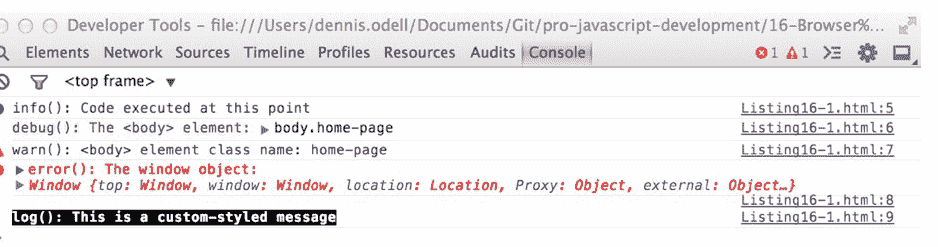

**列表 16-3.** 在网页中运行列表 16-2 时 Chrome 中的控制台窗口输出

控制台对象的 `info()`、`debug()`、`warn()` 和 `error()` 方法对于在开发期间需要大量调试的大型应用程序非常有用，以便在发布给公众之前识别并修复潜在问题。你应该根据需要尽可能地使用它们以确保你的代码运行正常，利用控制台窗口的消息过滤能力，随时标记你需要的任何类型的消息。

## 使用控制台进行性能测量

控制台对象包含两个方法：`time()` 和 `timeEnd()`，用于处理时间性能，我们可以使用它们来创建一种基础的代码性能测量。执行 `console.time()` 并传递一个唯一标识符字符串作为参数，会在浏览器中启动一个带有该标识符的计时器。使用不同的标识符调用相同的方法可以启动多个计时器而互不干扰。要停止计时器，执行 `console.timeEnd()` 并传递与启动要停止的计时器相同的标识符值。开始和结束之间的毫秒数将使用该计时器的标识符名称写入 JavaScript 控制台。对你的代码段运行基础性能测量，这可以帮助你确定代码中的性能瓶颈，并重写代码以简化任何较慢的操作。

列表 16-3 中的代码演示了控制台对象 `time()` 和 `timeEnd()` 方法的使用。

**列表 16-3.** 使用 JavaScript 开发者控制台测量一段代码的时间

```javascript
function counter(length) {

  var output = 0;

  index = 0;

  console.time("Loop timer " + length);

  for (; index < length; index++) {

    output = output + index;

  }

  console.timeEnd("Loop timer " + length);

}

counter(100000);

counter(100000);

counter(1000000);
```

在浏览器网页上下文中运行列表 16-3 中的代码会产生图 16-4 所示的 JavaScript 控制台输出。观察每次 `time()` 和 `timeEnd()` 方法调用之间的持续时间，它们与每次 `counter()` 方法调用相关的唯一标识符名称一起写入控制台。我们将在本章中进一步查看 JavaScript 性能分析。

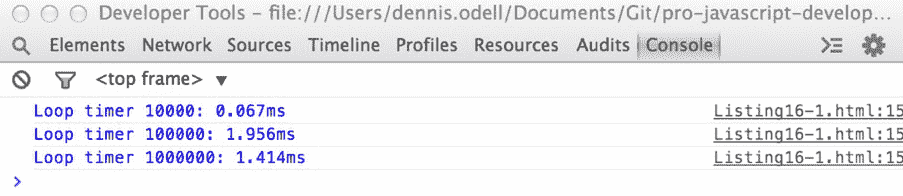

**图 16-4.** 在网页上下文中运行列表 16-3 的控制台输出

## 发布前移除对控制台对象的引用

在发布你的公共代码之前，确保从你的 JavaScript 文件中移除对控制台对象的引用，因为它只存在于完全安装并启用了开发者工具的浏览器中，而我们的许多用户情况并非如此。如果你使用自动化构建过程，可以使用 `grunt-strip` 插件 (`http://bit.ly/grunt-strip`) 来完成此操作。对于 Gulp 任务运行器，你需要 `gulp-strip-debugging` 软件包 (`http://bit.ly/gulp-strip`) 来在之前移除该对象的这些调用。

JavaScript 控制台是开发者在代码运行时输出消息、检查变量状态以及确定哪些控制台分支正在执行以及操作完成所需时间非常有用的工具。了解更多关于 JavaScript 控制台的信息，请查看 Tree Blog 上 Matt West 写的文章《Mastering The Developer Console》，地址为 `http://bit.ly/js-console`。

## 调试 JavaScript 代码

除了 JavaScript 控制台，开发者工具还允许观察和调试代码、单步执行以及在任何点恢复执行。压缩代码对于开发者来说并不是问题，因为他们有方法可以将其转换为未压缩版本。

## 处理压缩后的代码

虽然 JavaScript 控制台非常适合在开发期间跟踪和调试代码，但有时我们需要调试从非本地开发服务器运行的经过压缩的代码。坦率地说，在浏览器工具中处理压缩文件有两种选择：格式化打印和源映射。

### 格式化打印

在浏览器工具中处理压缩代码的第一种选择是格式化打印，其中压缩过程中从文件中删除的空格被添加回文件中，通过遵循制表符和空格模式添加到函数、对象和其他代码块，以尝试使压缩代码变得易读。

在 Firefox 开发者工具中启用格式化打印非常简单，只需选择调试器选项卡以显示当前网页加载的 JavaScript 文件。从左侧面板选择一个压缩文件，然后点击底部工具栏上标记为 `{}` 的图标，观察文件如何获得适当的间距以便于阅读。如果变量经过了混淆、替换或变短，名称仍将以混淆格式显示，这将使调试变得困难；但是，格式化打印可以帮助你识别原始文件的结构，以便对其进行调试。

Script 扩展通过顶部工具栏显示的缩进按钮支持格式化打印，此选项无论原始文件是否经过压缩，都会显示文件的格式化版本。

在 Safari 的开发者工具中，选择“源”选项卡，从左侧面板找到一个压缩的 JavaScript 文件，并点击顶部工具栏中的 `{}` 按钮以显示要格式化打印的文本。同样，对于共享底层代码的 Chrome 和 Opera 开发者工具，选择“源”选项卡并识别压缩文件；点击文件下方的 `{}` 按钮将进行格式化打印。

在 Internet Explorer 中，打开“工具”并选择“调试器”选项卡，找到压缩文件，并点击顶部工具栏上的 `{}` 按钮以格式化打印文件内容。

格式化输出（Pretty-printing）是一种在浏览器开发者工具中查看压缩文件（minified files）非常快速且简单的方法，尽管对于更复杂的调试，访问混淆变量和函数的原始名称以及源映射（source maps）是更优的选择。

### 源映射

在浏览器开发者工具中处理压缩代码的第二种方法称为源映射（source maps），在这种情况下，压缩文件中包含一个指向同一份完整、未压缩版本 JavaScript 代码的引用，即使原始代码跨越多个文件。源映射使用 `.map` 扩展名，并采用 JSON 结构来描述原始文件与压缩文件之间的映射关系，包括它们的变量和函数名（如果这些名称在压缩过程中被混淆了）。

将压缩文件链接到关联的源映射文件非常简单，只需在 JavaScript 文件末尾添加一条特殊格式的注释，引用源映射的位置即可。例如，要将压缩文件 `scripts.min.js` 连接到名为 `scripts/scripts.js.map` 的 JSON 格式源映射文件，请在压缩文件的末尾添加以下注释：

```javascript
// sourceMappingURL=/scripts/js.map
```


或者，如果你可以访问 Web 服务器，可以在压缩文件的响应中添加 HTTP 头部，尽管许多人选择使用特殊格式的注释，因为它更简单：

`X-SourceMap: /scripts/js.map`

在压缩 JavaScript 文件的同时生成源映射文件。第 4 章介绍的 `UglifyJS` (http://bit.ly/uglify_js) 和 `Google Closure Compiler` (http://bit.ly/closure_compile—使用 `create_source_map` 选项）都有自动生成源映射文件的能力，并在压缩文件的底部包含特殊格式的注释。

在 `Chrome` 开发者工具中，你拥有识别源映射的能力。点击工具栏中的设置菜单，并在“常规”（General）选项部分选择“启用源映射”（Enable Source Maps）。其他浏览器的开发者工具将禁用此功能。在 Chrome 开发者工具中选择“源代码”（Sources），可以显示加载到当前网页的文件的层级视图。链接到源映射数据结构的文件将显示在这里，就像它们是通过 `HTML` 的直接链接加载的一样。

同样，在 `Firefox` 开发者工具中，选择“调试器”（Debugger）标签页会在左侧提供 `JavaScript` 源文件列表。此列表中包含了链接到任何源映射的每个文件的完整、未压缩版本。在编写时，`Firefox` 不支持源映射，因此你应该依靠内置的 `Firefox` 开发者工具来利用此功能。

`Safari` 开发者工具会将带有关联源映射的压缩文件作为“资源”（Resources）标签页中加载文件层级的一个额外项。通过源映射链接的文件将显示在层级结构的压缩文件名称下方，如图 16-5 所示，图中有一个名为 `.js` 的压缩文件，它链接到了多个原始未压缩文件。

## 第 16 章 浏览器开发者工具

Web 检查 - dev.devfont.com

`Internet Explorer` 开发者工具允许你通过“调试器”（Debugger）标签页访问源映射。当 `JavaScript` 文件引用源映射时，文件内容上方工具栏会出现一个额外按钮，点击后会在主面板中加载并显示该文件的未压缩版本，替换压缩文件。

## 暂停和观察 JavaScript 代码

浏览器开发者工具提供了功能，用于观察你的 `JavaScript` 代码在浏览器中的运行情况，甚至允许逐行执行每行代码，并在每行执行时观察变量值的变化。

要停止 `JavaScript` 代码执行，请使用后文概述的两种技术。一旦页面加载或刷新且代码行重新加载，页面将暂停，并让你从这一刻起控制 `JavaScript` 代码。

插入断点的第一种技术是添加一行代码来强制执行在代码的该点暂停。执行此操作，请在你的 `JavaScript` 文件中添加你希望执行暂停的点：

```javascript
debugger;
```


执行时，开发者工具将在此处暂停，让你控制执行流，并允许你在执行执行的该特定时刻观察任何全局或局部变量的值。但是，请确保在代码发布之前删除对此命令的任何引用，因为像`console`对象一样，这是仅供开发者工具使用的自定义 JavaScript 命令。

插入断点的第二种技术是简单地点击你希望的行号。代码行旁边将出现一个标记，指示已设置断点，再次点击即可将其移除。刷新页面将保留所有断点，且代码在到达第一个断点时将暂停，等待你的下一次操作。

一旦设置，大多数浏览器开发者工具都允许你右键点击断点并编辑适用于它的条件，这允许你指定应用程序在触发特定断点之前应所处的状态。如果你希望在循环内部放置断点，但想让断点在达到该循环的特定迭代时停止执行，这种方法就特别有用。

当在断点处暂停时，你可以通过将鼠标悬停在断点周围或任何变量名上来检查变量的值（遗憾的是，Firefox 开发者工具不支持此功能，请使用 Firefox 以利用此功能）。提示工具将显示高亮区域的值，并允许你展开属性内的值。你也可以打开 JavaScript 控制台并使用数据输入字段执行额外代码，或查询函数内的所有变量。

无论使用哪种开发者工具，当在右侧的断点面板暂停时，都会显示执行栈的详情，包括进入当前函数的函数名，以及全局和局部变量的当前值。例如，在函数内部暂停时，你可以看到函数内部声明的所有变量，以及执行时赋值给函数的参数。这为你你——开发者提供了应用程序变量状态的直目视图，允许你确定它们是否符合预期，从而进行进一步调试。

暂停后，你会注意到 JavaScript 代码旁边的工具栏中有一个可用的“继续”（continue）按钮，类似于视频播放按钮。按下此按钮后，代码将恢复执行直到到达下一个断点。还要注意继续按钮旁有三个单步（step）按钮，允许你在无需设置另一个断点的情况下逐个执行操作，允许你检查变量以及 JavaScript 解释器在应用程序中所走的路径，而无需预知它将执行什么。这些单步按钮之一将执行文件中的下一语句，而不执行它遇到的任何调用函数。如果你更感兴趣的是调用函数的返回值，而不是进入函数并再次在函数的第一条语句暂停，那么这非常有用。最后一个按钮允许你执行当前正在执行函数的剩余部分，并在该函数调用后的下一语句再次暂停。

# 第 16 章 浏览器开发者工具

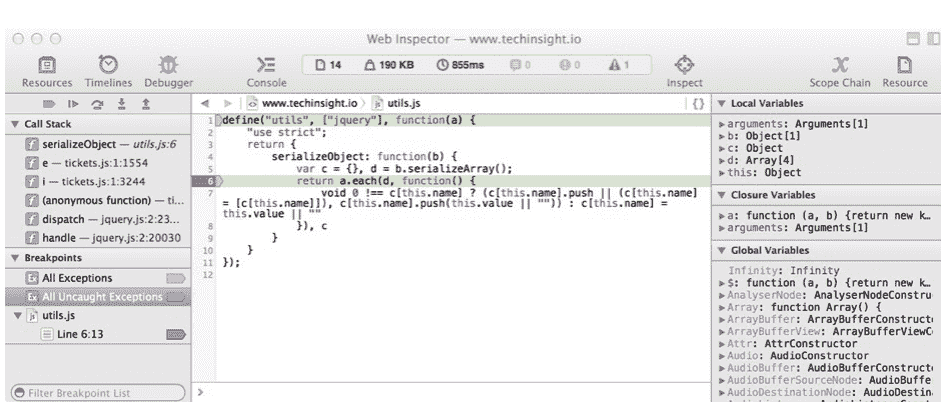

图 16-6. 使用断点暂停代码执行，以观察局部变量中的值

## JavaScript 代码性能分析

浏览器开发者工具允许你分析 Web 应用程序的内存使用情况，以及单个 JavaScript 函数的运行时性能。通过这些数据，你可以更新代码以使其对用户来说更高效，消除内存泄漏并释放任何潜在的瓶颈。

## 定位内存泄漏

当你在函数内部创建并初始化变量时，这些值会根据其类型和值在浏览器中消耗特定的内存。由于作用域限制，这些变量会在内部被标记为删除。浏览器中的*垃圾回收器*（garbage collector）会处理这些变量，以及它认为不再需要的其他变量（它们在当前上下文中没有其他对象的活动引用），从而释放它们的内存。内存泄漏的发生是：随着时间的推移，某些不再需要的变量没有被处理，这意味着内存缓慢泄漏，进程被迫增长。基于 JavaScript 的应用程序中内存泄漏有几个主要原因。

首先，内存泄漏可能通过使用`console`对象向开发者工具中的 JavaScript 控制台记录对象的值而发生。这会保持对内存中“存活”对象的引用，即使代码可能已不再需要访问它。这可能会在开发过程中导致内存泄漏，而这些泄漏在最终产品中不会出现——除非这些日志调用已被移除，因此请注意这一点。

其次，函数闭包中留下的引用是应用程序内存泄漏的另一个常见来源。如果事件处理程序持有代码中某处对象的引用，即使该对象在某个时间点后不再需要或被移除，闭包也可能被扩展，因此只要该事件仍然激活，该对象就会保留在内存中。请确保在 DOM 元素上使用`removeEventListener()`，以确保移除不再需要的对象的引用并释放其内存。

最后，内存泄漏可能是由于两个或多个对象之间存储的引用导致的，导致尽管应用程序不再需要其中一个对象，该对象的分配内存仍保留。这听起来可能违背直觉，但通常减少内存泄漏概率的最佳方法是将其他对象引用的数据作为拷贝存储在单独的局部变量中。

Chrome、Opera 和 Internet Explorer 11 中的开发者工具具备分析 JavaScript 代码在 Web 应用程序上下文中运行时的内存使用情况的功能。

## Chrome 和 Opera 中的内存分析

要查看 JavaScript 在 Chrome 浏览器中消耗了多少内存，请通过窗口/任务管理器菜单打开任务管理器窗口。右键点击标签页标题，并在标签页内选择显示 JavaScript 内存。你将看到你的 Web 应用程序的 JavaScript 部分消耗了多少内存。如果你有多个标签页，还将看到这些应用程序的内存消耗，允许你与其他 Web 应用程序进行比较。

如果你想在任何时候观察应用程序的内存，可以使用 Chrome 或 Opera 开发者工具中 Profiles 标签页下的堆快照（Heap Snapshot）功能。要获取按对象的内存即时快照，选择 Heap Snapshot 单选按钮并点击 Start 按钮。拍摄的快照将显示在左面板中，你可以选择显示由构造函数或函数创建的对象，使用它实例化每一个对象。你就可以找到哪些对象消耗的内存超出预期，并让你修复这些对象中可能存在的特定问题。

如果你想比较特定时间范围内 Web 应用程序的整个内存使用情况，在开发者工具的 Profiles 标签页中选择 Record Allocation（记录分配）并点击 Start 按钮。开发者工具顶部会出现一个指示器，表示正在记录内存。准备好后点击此指示器停止记录。从开始记录点到停止点之间的内存使用情况将在开发者工具主面板的图表中绘制，其中峰值表示内存使用的变化。图表下方是该期间内存使用情况发生变化的对象列表。图表上方的范围选择器允许你将内存使用过滤到某个范围，帮助你精确关注是哪个对象引起了内存的大幅变化，以便你查找改进应用程序中过度内存使用的方法。

浏览器开发者工具中的 Timeline 标签页显示了内存时间轴（Memory timeline）工具。要运行内存时间轴检查，只需在刷新页面开始测量时保持选中 Timeline 标签页。将会出现图表，显示运行的页面到到达页面加载事件为止消耗的内存。图表下方显示内存使用情况，并带有事件类型、文件名以及影响内存使用的操作行号等详情。使用图表上方滑块选择时间范围，允许你将记录列表过滤到特定范围内的记录——你可能会注意到内存使用出现峰值但随后没有被释放——这将有助于调试哪些操作在应用程序初始化和运行时消耗了内存。图 16-7 显示了内存时间轴工具的运行情况，包括随时间变化的内存使用图表、更改为内存分配的事件列表，以及活动 DOM 节点和事件监听器的计数器，这些通常是 Web 应用程序内存泄漏的根源。

Developer Tools - http://www.akqa.com/services/

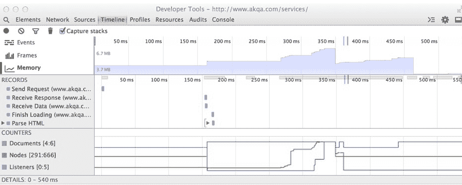

图 16-7 显示了内存时间轴工具的运行情况，包括随时间变化的内存使用图表、更改为内存分配的事件列表、以及活动 DOM 节点和事件监听器的计数器，这些通常是 Web 应用程序内存泄漏的根源。

Developer Tools - http://www.akqa.com/services/


图 16-7 显示了内存时间轴工具的运行情况，包括随时间变化的内存使用图表、更改为内存分配的事件列表、以及活动 DOM 节点和事件监听器的计数器，这些通常是 Web 应用程序内存泄漏的根源。

Developer Tools - http://www.akqa.com/services/

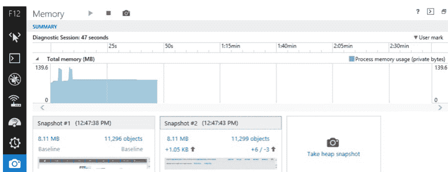

图 18. IE11 中的 Memory 标签页提供了调查内存的简单 UI

## 第 16 章 浏览器开发者工具

Safari 开发者工具在其 Timelines（时间线）选项卡中有一个类似的功能。左侧面板中 Profiles（分析文件）旁边的按钮允许通过在弹出框中选择 Start JavaScript Profile（启动 JavaScript 分析文件）选项来启动和停止 JavaScript。侧边栏中显示的时间单位之间有一个 “” 按钮，可以生成函数列表以及每个函数耗时的时间，这与 Chrome 的开发者工具相似，尽管缺少了图表功能。要了解更多关于 Safari 性能分析能力的详细信息，请查看在线资源 http://bit.ly/safari-profile。

Firefox 浏览器开发者工具以非常相似的方式包含了相同的性能分析功能。在开发者工具中选择 Profiles，并点击左侧面板顶部的图标开始性能分析，再次点击以收集数据。主面板中显示了执行时长内的分级函数调用的视觉效果，并配有一张显示性能峰值和谷值的图表，如图 16-9 所示。在图表中选择一个区域允许你过滤函数列表，仅显示在所选时间范围内发生的函数，从而让你识别出哪些函数可能导致问题并需要修复。要了解更多关于 Firefox 开发者工具 JavaScript 性能分析的能力，请查看 http://bit.ly/firefox-profile。请注意，Firefox 并没有内置类似的用于此功能的工具，其内置的开发者工具

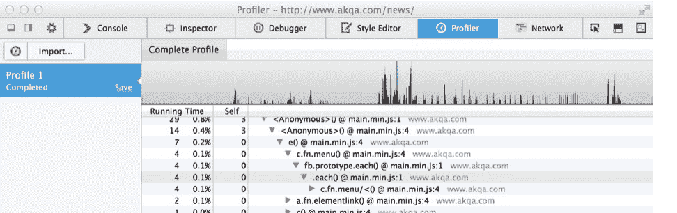

图 16-9。Firefox 工具中的 Profiler 允许你下钻以定位性能问题的函数

Internet Explorer 11 开发者工具具有与其 Profiler 类似的性能分析能力。要开始分析 JavaScript，点击顶部工具栏中的绿色按钮，然后点击被替换的红色停止按钮以收集数据 [注：原文为“it is replaced with to collecting data”]。主面板中显示已执行的函数列表，并可以在 Functions（函数）和 Call tree（调用树）之间进行切换，前者显示每个被调用函数的扁平视图，其中执行时间最长的位于工具顶部；后者显示调用的分级视图，基于哪些函数调用了所有其他函数。Safari 开发者工具没有可以按时间过滤的数据图表；然而，列表包含了足够调试性能问题的信息，因为它指向了执行时间最长的文件和函数数量，准确地告诉你应该关注哪里调试。要了解更多关于 IE11 的 JavaScript 性能分析能力，请查看 http://bit.ly/ie-profile。

通过使用浏览器开发者工具的性能分析功能，你可以深入运行代码以发现哪些函数的执行时间最长，允许你检查代码并尝试寻找更高效的方法来执行相同的操作并相同的结果。

## 总结

在本章中，我们学习了如何在真实的、运行的应用程序环境中使用浏览器内置的开发者工具来调试和监控我们的 JavaScript 代码，利用这些工具提供的数据来改进代码以造福用户，使其更具性能、更节省内存，并且更不容易发生运行时错误。要进一步了解更多关于浏览器开发者工具的功能（包括哪些工具包含哪些功能），请查看 Andi Smith 出色的在线资源“Dev Tool Secrets”，地址为 http://devtoolscrecrets.com。

在整本书的学习过程中，我解释了专业的 JavaScript 开发人员如何使用高级编码技术、利用语言和浏览器的能力，并将工具应用到他们的工作流和代码中，以便为应用程序的终端用户和其他协作工作的开发者生成高质量、可维护的 JavaScript 代码。我相信你已经掌握了许多可以应用到自己项目中的想法、技术和技能，让你获得更多经验和信心，成为一名专业的 JavaScript 开发人员脱颖而出。感谢阅读，编码愉快！

## 索引

A
- 抽象工厂模式 (Abstract factory pattern), 122–126
- 适配器模式 (Adapter pattern), 137–139
- Apply 和 call 方法, 15–16
- 架构模式 (Architectural patterns)
    - MVC (参见 Model-View-Controller (MVC))
    - MVP (参见 Model-View-Presenter (MVP) pattern))
    - MVVM (参见 Model-View-ViewModel (MVVM pattern))
- 数组 (Arrays)
    - 创建 (creation), 110
    - 循环中的函数 (functions within loops), 112
    - 循环 (looping), 110–111

B
- 行为设计模式 (Behavioral design patterns)
    - 责任链 (chain of responsibility), 163–166
    - 描述 (description), 163
    - 迭代器 (interator), 169–172
    - 中介者 (mediator), 177–181
    - 备忘录 (memento), 181–183
    - 观察者 (observer), 172–176
    - 承诺 (promises), 183–187
    - 策略 (strategy), 194–198
- 浏览器开发者工具 (Browser developer tools)
    - DOM, 424
    - Internet Explorer 和 Chrome, 423
    - JavaScript (参见 JavaScript)
    - Mozilla Firefox 浏览器, 423
    - Safari 浏览器, 424
- 自动化自动化与工具 (Build automation and tools)
    - 基准测试 (benchmark), 391
    - bowerson, 419
    - 代码质量 (code quality), 391
    - 开发工作流 (development workflow), 391
    - 动态网页 (dynamic web page), 404
    - 前端包管理器 (front-end package manager), 419
    - grunter-bwcery, 420
    - Gruntfile.js, 406
    - NPM 目录, 400–403, 406
    - index.html 页面, 406
    - JavaScript 任务运行 (JavaScript), 271
    - Node.js 平台, 392
    - 生产就绪代码 (production-ready code), 419
    - 重复任务 (repetitive tasks), 404
    - 脚架搭建 (scaffolding), 420
    - 任务运行 (task runner), 391
    - 时间耗时的 (time-consuming), 404
    - Web 应用程序 (web applications), 424
    - Web 服务器 (web server), 428
C
- Canvas API
    - 基础操作 (basic operations), 261–262
    - 阻塞 (Blocking game), 264
    - 游戏动画 (game animation), 267
    - 碰撞检测 (collision detection), 269–270
    - 绘制 (draw()), 265–266
    - 游戏控制 (game control), 268–272
    - 游戏循环 (game loop), 271
    - 高定义 (high-definition), requestAnimationFrame(), 271
    - 三维图形 (three-dimensional graphics), 264
    - 二维图形 (two-dimensional graphics), 261
- 责任链 (Chain of responsibility), 163–166
- 客户端模板 (Client-side templates), 357–360
- 条件语句 (conditional statements), 349
- 组合模式 (Composite pattern), 140–141
- 内容交付网络 (Content delivery networks (CDN)), 230
- 代码依赖 (Code file)
    - 替代方案 (alternatives), 235
    - 定义 (definition), 23
    - 文件夹结构 (folder structure), 228
    - 首页 (homepage), 227
    - HTML 代码 (HTML code), 224
    - 库 (library), 223
    - 邮件订阅表单 (newsletter sign-up form), 226
    - 插件 (plugins), 234
    - 脚本加载 (scripts loading), 223
- 代码质量测量 (Code quality measurement)
    - 使用 (code usage), 83
    - 复杂代码 (complex code), 86
    - Grunt 命令行界面 (Grunt command interface), 84
    - Gruntfile.js, 85
    - Istanbul, 84
    - LCOV, 85–86
    - Mac 和 Linux 用户 (Mac and Linux users), 87
    - 指标 (metrics), 87
    - NPM, 84
    - Plato 工具 (Plato tool), 86
    - 运行中的工具 (running tools), 83
- 编码规范与命名 (Coding conventions and naming)
    - 驼峰命名法 (camel-case word divisions), 225
    - 描述 (description), 23
- 调试运行中的 JavaScript (Debugging running, JavaScript)
    - 断点 (breakpoint), 430
    - Chrome 开发者工具 (Chrome developer tools), 429
    - console 对象 (console object), 430
    - 继续 (continue), 431
    - Firefox 开发者工具 (Firefox developer tools), 429
    - Internet Explorer 开发者工具 (Internet Explorer developer tools), 430
    - JSON 格式 (JSON format), 429
    - 左侧面板 (left-hand panel), 431
    - 局部变量 (local variables), 432
    - 格式化打印 (pretty printing), 428–429
    - Safari 开发者工具 (Safari developer tools), 429
    - 源码映射 (source maps), 429
    - 未压缩代码 (unminified code), 428
    - Web 服务器 (web server), 428
- 装饰器模式 (Decorator pattern), 141–143
- 创建性设计模式 (Creative design patterns)
    - 抽象工厂模式 (abstract factory), 122–126
    - 建造者模式 (builder), 127–129
    - 描述 (description), 119
    - 工厂模式 (factory), 120–131
    - 原型模式 (prototype), 129–131
    - 单例模式 (singleton), 132–135
- 命令行接口工具 (Command line interface (CLI) tool), 393
- 命令模式 (Command pattern), 166–169
- 构造函数 (Constructor function)
    - 初始化属性 (initializing properties), 10
    - 字面量对象 (literal object), 10–11
    - this 关键字 (this keyword), 8
    - 将值存入变量 (storing value into variable), 77

- JavaScript 应用, 58
- JSON 格式文件, 58
- node, 58
- NPM, 58
- 包, 58
- 格式 (JSDoc)
- 文档对象模型 (DOM), 341
- DOM. 查看对象模型 (DOM)

- Node js require(), 403
- 包, 401
- 功能, 401
- task() 方法, 401
- strict 语句, 403

# E

### ECMAScript 5
- 数组方法
  - 描述, 31
  - Each 方法, 31
  - every 和 some 方法, 32
  - filter 方法, 33
  - map 方法, 32
- 属性绑定, 30

## JSON 解析, 28
- 对象方法
  - 描述, 33
  - create 方法, 35–36
  - freeze 方法, 34
  - ObjectOwnPropertyDescriptor, 34
  - key 方法, 35
  - 属性定义, 34–35
- 严格模式, 28–30

## EJS. 查看嵌入 JavaScript (EJS)
## 嵌入 JavaScript (EJS)
- JavaScript 模板语言, 364
- Mustache 和 Handlebars.js, 365
- render(), 365
- Ruby 语言, 364
- update() 方法, 366

## 封装, 14

# H

## Handlebars.js
- Handlebars.compile() 方法, 354
- HTML, 355
- JavaScript 哈希, 354
- Mustache 格式, 353

## 高质量 JavaScript
- 代码测量
  (查看测量)
- 运行时错误, 79
- 静态分析 (查看静态分析)
- 单元框架
  -- 输入组合, 72
  - Jasmine 项目, 72–75, 77–79
  - 浏览器, 65

## HTML. 查看 标记语言 (HTML)
## HTML5 缓存, 256–257
### http 模块
- API 文档, 374
- 服务器, 372
- Web 服务器框架, 373

## 标记语言 (HTML)
- Ajax, 342
- 服务端, 342
- 优化的信息, 343

# F

## 外外观模式, 144–145
## 工厂模式, 120–122
## 享重量模式, 145–148–151
## Frogger 游戏, Canvas API
  - 经典, 273
  - 核心逻辑, 276–278
  - HTML 页面, 273
  - 属性和方法, 274–276
  - 目的, 272

# I

## ICE 框架. 查看 交互式连接 (ICE)
## 交互式连接 (ICE)
- ICE 框架, 325
-  Iterator 方法, 169–172

# J, K, L

## Jasmine 单元测试框架
- add(function), 73
- expect(function), 74
- 详细文档, 73
- HTML, 75
- 非数字输入, 75
- spec 运行器, 74–76
- 字符串拼接, 76
- 测试套件, 72
- toEqual(function), 74
- 单元测试框架, 78

# G

## Gulpjs
- gulpfile.js, 401
- gulp-jshint, 401
- Node.js, 401

# INDEX

## JavaScript
- 瓶颈, 435
- Chrome 和 Opera 开发者工具, 435
- 代码引用, 428
- console.debug(), 426
- console.error(), 426
- console.info(), 426
- console.log(), 425
- console.timeEnd(), 427
- console.warn(), 426
- 调试运行 (作为 JavaScript: 调试运行), 436
- Firefox 开发者, 436
- Google Chrome, 426
- 内存, 432
- Node.js 应用, 425
- 测量, 427

## JavaScript 应用
- 数组 (作为 Arrays)
- 文档对象操作
  - CSS 样式, 100–101
  - 元素加载, 99–100
  - 最小访问, 98–99
  - 离线 DOM, 100
- DOM 事件性能
  - 事件委托, 101–102
  - 触发, 103
  - 网站和应用, 101
- 函数性能
  -返回值, 104
  - 通用修改, 106
  - 记忆化技术, 105
- 页面加载时间
  - 编译, 92
  - 全局变量, 96–97
  - Google Closure Compiler,
    - 用于代码编译, 95–96
  - GZip 内联交付, 91
  - HTML 标签顺序很重要, 93–94
  - JSMin 用于代码压缩, 92
  - 懒加载 JavaScript 文件, 97–98
  - 压缩, 92
  - 混淆, 92
  - UglifyJS 代码混淆, 94–95
- 测量, 117–118
- 正则表达式
  - 字符, 107
  - 字符序列, 109
  - 定义, 108
  - 修饰符, 108
  - RegExp 构造函数, 107
  - string replace() 方法, 108
- string replace() 方法调用, 109
- String 类型方法, 108
- Web workers, 开销密集型
  - 配置, 114
- 图像处理, 114–117
- terminate method(), 114
- 用户界面, 113
- W3C 标准版本, 113
- JavaScript 字面量 (查看架构模式)
- JavaScript 检查 (Json)
  - alert 方法, 67
  - 语言, 65
  - 类对象, 68
  - 计算机, 65
  - 指令, 67
  - 键, 66
  - NPM 工具, 69
  - 运行代码, 67
  - JavaScript 任务运行器, API, 394
  - CLI 工具, 393
  - 命令行, 395
  - file.read() 方法, 396
  - file.read() 方法, 397
  - Gruntfile, 393
  - initConfig() 方法, 394, 397
  - eslint, 394, 398
  - loadAsync() 方法, 394
  - module-exports, 393
  - Node.js 包, 393
  - 插件目录, 400
  - registerTask() 方法, 394
  - 静态分析, 394
  - 模板字符串, 397
  - strict 语句, 396
  - 资源财富, 392
  - ESLint, 69

## Markdown
- 反斜杠, 57
- 换行, 49
- 代码显示, 54
- 分组, 49
- 强调文本, 53
- 水平规则, 56
- 图像插入, 56
- 列表创建, 50
- 链接到 URL, 55
- 引号, 54
- JSDoc 作者, 58
- 介者模式, 177–181
- 备忘录模式, 181–183
- 内存泄漏, JavaScript
  - 垃圾回收, 432
  - 快照, 333
  - 性能分析, 333
  - removeEventListener() 方法, 332
  - 时间线, 333–334
  - Web 应用, 332
  - Mixin 模式, 152–155
- 移动 JavaScript
  - 事件框架, 250
  - 内置, 240
  - 地理位置, 240–243
  - 任务, 249
  - 运动, 248
  - 取向和方向, 245–248
  - 触摸, 243–245
- 移动 Web 开发
  - 电池寿命, 237
  - 网络带宽和延迟, 238
  - 板载内存, 238
  - 操作系统响应性, 239
- 网络 故障
  - 离线状态, 252–253
  - HTML5 缓存, 256–257
  - 不便体验, 251
  - Web Storage API, 254–256
- 响应式 Web 设计, 258
- 模型-视图-控制器 (MVC)
  - 数据结构, 199
  - 地址生成, 199–201
  - JavaScript 应用, 199
  - 视图接口, 201–205
- 模型-视图-演示者 (MVP)
  - 地址列表应用, 209–213
  - 观察者模式, 214
- 模型-视图-视图模型 (MVVM)
  - 属性, 215
  - 系统, 216–218
  - 内部业务逻辑, 214
  - 观察者模式, 219–220
- 模块模式, 155–158
- Mustache.js
  - 数据, 345
  - Google 模板, 345
  - Mustache.render() 方法, 346
  - script 标签, 345

## 网络地址转换 (NAT), 321
## Node.js 应用平台
  - API 文档, 371
  - 命令行应用, 369
  - 命令行参数, 371
  - developDependencies, 378
  - Hello World, 370
  - 托管解决方案, 389
  - http 模块, 372–374
  - JavaScript, 369
  - 加载模块, 372
  - log() 方法, 371
  - module-exports 属性, 380
  - npm, 369–375
  - package.json, 376, 378
  - 包, 374
  - process.array 方法, 379–380
  - require() 方法, 382–384
  - Web 应用, 386
  - yuididoc 应用, 376
- Node 包管理器 (NPM), 58, 69
- NPM. 查看 包管理器 (NPM)

## 面对象 JavaScript
- apply 和 call 方法, 15–16
- 参数对象, 16–18
- 赋值属性和方法
  - 原型, 4, 6
  - Base“创建者”, 22–23
  - 链式方法, 11–12
  - 类, 2
  - 编码和命名
    (查看编码和命名)
  - 上下文和 this 关键字
    (查看上下文和 this)
  - 自定义对象, 1–2
- ECMAScript 5 (查看 ECMAScript 5)
  - 封装, 14
  - 继承, 12–14
- 面对象 JavaScript（续）
  - 属性和方法, 18–20
  - 公有、私有保护, 20–22
  - 简化, 24
- 单例模式, 40, 132–134
- 会话描述协议 (SDP), 325
- 网络地址转换工具 (TURN), 325
- Socket.IO
  - HTML, 388
  - HTTP 方法, 384
  - JavaScript 库, 387
- 运行时错误
  - 代码质量, 79
  - 自定义错误, 82–83
  - 错误类型, 81
  - 错误, 80
  - 错误, 80
  - 错误, 80
  - 语法错误, 79
  - 错误, 80
  - 包裹代码, 80–81
- STUN. 查看 网络地址转换工具 (TURN)
- 使用 NAT 的中继技术 (TURN), 325
- TURN. 查看 NAT 的中继技术 (TURN)

# W, X

Web 应用程序

- API 文档，384
- express 框架, 382
- package.json 文件, 384
- 摄像头和麦克风
- 浏览器窗口 URL, createObjectURL(method, 323-324)
- 回调函数, 322
- getUserMethod(访问摄像头和麦克风的方法, 323)
- onSuccess() 回调方法, 323
- 填充方案 (polyfills), 222
- Web 实时通信 (WebRTC) API 规范, 321
- 视频聊天控制, 328-335
- 视频聊天 Web 应用程序，325-328
- 摄像头和麦克风, 322-324
- WebRTC。参见 Web 实时通信 (WebRTC) API

“类”、构造函数、属性和方法

- 适配 (Accommodation), 39
- 文档完善的 JavaScript“类”，41
- 属性文档, 40
- 公有变量名, 40
- 单例模式, 40
- 静态“类”文档, 40
- 代码示例, 48
- 代码编辑器, 38
- 常量值，包含它的属性, 73
- 事件, 47
- 相关“类”, 47
- 继承的“类”, 46
- 输入参数和方法返回值
- 点符号表示法, 42
- 输入和输出, 42
- 可选方法输入参数, 43
- 私有、保护和公有方法及属性, 44

# Y, Z

YUID 文档格式

- 块注释, 38
- 链式方法, 47

标签, 39, 48

# 专业 JavaScript 开发

编码、能力与工具

Den Odell

# 专业 JavaScript 开发：编码、能力与工具 (Pro JavaScript Development: Coding, Capabilities, and Tooling)

版权所有 © 2014 由 Den Odell

本作品受版权法保护。出版者保留材料全部或部分的所有权利，特别是翻译、重印、插图重用、朗读、广播、微型胶片或任何其他物理方式复制，以及信息存储和检索的传输、电子适配、计算机软件或通过现在或以后开发的数字方法进行权利。上述法律保留的豁免目的是在计算机系统上终止并执行，仅供作品购买者专享使用。本出版物或其部分的复制仅在出版者所在地当前版本的版权法规定允许，且必须始终获得 Springer 的许可。使用许可可以通过版权结清中心的 RightsLink 获取。违反此类规定将根据相应的版权法承担追究的责任。

ISBN-13 (平装本): 978-1-4302-6268-8

ISBN-13 (电子版): 978-1-4302-6268-5

书中可能出现商标名称、标志和图像。我们并未在出现商标名称、标志或图像时使用商标符号，而是以编辑的方式使用这些名称、标志和图像，并为了商标所有者的利益，无侵犯商标的意图。

书中对贸易名称、商标、服务标记和类似术语的使用（即使未被标识为此类），也不应视为对其是否具有专有权的意见表达。

虽然书中的建议和信息在出版时被认为是真实准确的，但作者、编辑或出版者对可能出现的错误或遗漏不承担任何法律责任。出版者对本文包含的内容不提供任何明或暗示保证。

出版者：Heinz Weinheimer
主编：Louise Corrigan
技术评审：mxCell 和 John Inglis
编辑委员会：Steve Anglin, Mark Beckner, Ewan Buckingham, Gary Cornell, Louise Corrigan, Jim DeWolf
Jonathan Gennick, Jonathan Sachs, Robert Huckinson, Michelle Lowe, James Markham
Matthew Moodie, Jill Olson, Jeffrey Pepper, Douglas Pound, Ben Renow-Clare, Dominic Shakespeare
Gwenen Sparing, Matt Wade, Steve Weiss
特编辑：Christine Rockets
校对：Laura Laurie
制作：SPI Global
索引编制：SPI Global
封面设计：Anna Ishchenko

由 Springer Science+ Business Media 向全球书市分销。223 Spring Street, 6th Floor, New York, NY 10013. 1-800-5-SPRINGER，传真 (201) 邮件订单-ny@springer-sbm.com，或访问 www.apress.com。Press Media, LLC 是一家加州 LLC，其唯一成员（所有者）是 Springer Science + Business Media Finance Inc（SSBM Finance Inc 是一家特拉华州公司）。

有关翻译的信息，请邮件至 rights@apress.com 或访问 www.apress.com。

Apress 及 ED 系列书籍可以为了学术、企业或促销目的进行批量购买。大多数书籍也提供 eBook 版本和许可。欲需更多信息，请参考我们的特别销售–eBook 许可网页：www.apress.com/bulk-sales。

本文引用的任何源代码或补充材料读者均可在 www.apress.com 获取。有关如何找到您手中书籍的源代码的详细信息，请访问 www.apress.com/source-code/。

本书献给我的妻子 Maria

# 目录

- 关于作者 ..................................................... xv
- 关于技术评审员 ...................................... xvii
- 致谢 ...................................................... xix
- 引言 ................................................................ xxi
## 第 1 章：面向对象的 JavaScript............................................... 1
- JavaScript 中的对象............................................................... 1
- 自定义对象............................................................................... 1
- 类............................................................................... 1
- 编码规范与命名..................................................................... 23
- 规则 1：使用描述性名称........................................................................... 24
- 规则 2：以小写字母开头.......................................................... 24
- 规则 3：使用驼峰法表示词组.................................................................. 25
- 规则 4：使用全大写字母表示常量...................................................... 25
- 规则 5：在函数顶部将变量声明在一起.................................................. 26
- ECMAScript 5........................................................................................... 28
- JSON 数据格式..................................................................................... 28
- 严格模式......................................................................................... 29
- 函数绑定............................................................................................... 30
- 数组方法............................................................................................... 31
- 对象方法...................................................................................... 33
- 本章小.......................................................................................... 36
## 第 2 章：JavaScript 文档.................................................. 37
- 行内注释与块注释..................................................................... 37
- 结构化 JavaScript 文档................................................................ 38
- YUIDoc 文档格式.................................................................. 38
- “类”、构造函数、属性和方法的文档.................................. 39
- 事件文档......................................................................................... 47
- 代码示例文档......................................................................... 48
- 其他 YUIDoc 文档标签................................................................ 48
## 表现性文档格式 – Markdown.................................................. 48
- 在标题下分组内容......................................................................... 49
- 换行与创建段落.................................................. 49
- 创建列表............................................................................................... 50
- 强调文本........................................................................................... 53
- 显示代码............................................................................................... 54
- 添加引用........................................................................................ 54
- 链接到 URL............................................................................................... 55
- 插入图像........................................................................................... 56
- 创建水平线........................................................................................... 56
- 使用反斜杠插入保留字符.................................................................. 57
- 对于其他一切，都有 HTML.......................................................................... 57
## 使用 YUIDoc 创建文档网站............................................................... 58
- 进一步探索........................................................................................... 63
- 本章小.......................................................................................................... 63
## 第 3 章：编写高质量的 JavaScript............................................................... 65
- 执行静态代码分析..................................................................... 65
- JSLint.................................................................................................. 65
- JSHint.................................................................................................. 69
- Google Closure 编译器和检查器..................................................................... 70
- 选择静态代码分析工具..................................................................... 71

# JavaScript 中的单元测试......................................................................................... 71
- JavaScript 单元测试框架............................................................................... 72
- 使用 Jasmine 进行 JavaScript 单元测试.......................................................... 72

# 处理运行时错误 ................................................................................................... 79
- JavaScript 的原生错误类型..................................................................................... 79
- 将可能出错的代码封装在 try-catch 语句中...................................................... 80
- 检测抛出的错误类型....................................................................................... 81
- 创建自定义错误类型................................................................................................ 82

# 衡量代码质量 ................................................................................................ 83
- 单元测试代码覆盖率..................................................................................... 83
- 衡量代码复杂度.................................................................................. 86

# 总结 ............................................................................................................ 89

# 第4 章：提升 JavaScript 性能 .......................................................... 91

# 优化页面加载时间 ................................................................................ 91
- HTML 标签顺序很重要....................................................................................... 91
- 使用 GZip 编码传输你的 JavaScript 文件.................................................. 91
- 压缩化、混淆与编译...................................................................... 92
- 按需懒加载 JavaScript 文件..................................................... 97

# 优化文档对象操作 ........................................................... 98
- 减少对页面元素的访问..................................................................... 98
- 尽可能关闭现有元素...................................................................... 99
- 利用离线 DOM（Offline DOM）。......................................................... 100
- 使用 CSS 进行页面样式分页而非 JavaScript.............................. 100

# 提高 DOM 事件性能 ................................................................ 101
- 将事件委托给父元素.................................................. 101
- 使用帧（Framing）处理高频触发事件............................................... 103

# 提高函数性能 ............................................................ 104
- 使用记忆化（Memoization）存储之前的函数返回值.............................. 104
- 使用正则表达式进行更快的字符串处理 ................................ 106
- 更快的数组使用方法 ...................................................................... 110
- 快速创建数组 ........................................................................ 110
- 快速数组循环 ....................................................................... 110
- 将密集型任务卸载到 Web Workers ...................................... 113
- 使用 Web Worker 处理图像数据......................................................... 114
- 基础性能测量 ........................................................ 117
- 总结 ...................................................................................... 118

# 第5 章：设计模式：创建型............................................... 119
- 什么是设计模式？......................................................................... 119
- 创建型设计模式............................................................................ 120
- 工厂模式（Factory Pattern） ............................................................. 120
- 抽象工厂模式（Abstract Factory Pattern） ................................................ 122
- 建造者模式（Builder Pattern） ................................................................ 127
- 原型模式（Prototype Pattern） ............................................................ 129
- 单例模式（Singleton Pattern） ....................................................... 132
- 总结 ...................................................................... 135

# 第6 章：设计模式：结构型........................................... 137
- 适配器模式（Adapter Pattern） ....................................................... 137
- 组合模式（Composite Pattern） ................................................................ 140
- 装饰器模式（Decorator Pattern） ................................................................ 141
- 外观模式（Façade Pattern） ................................................ 143
- 享重量模式（Flyweight Pattern） ................................................ 145
- 混入模式（Mixin Pattern） ................................................ 152
- 模块模式（Module Pattern） ............................................ 155
- 代理模式（Proxy Pattern） ................................................................ 159
- 总结 ...................................................................... 161

# 第7 章：设计模式：行为型................................................................................ 163
- 责任链模式（Chain of Responsibility Pattern）...................................................................... 163
- 命令模式（Command Pattern）.............................................................................................................. 166
- 迭代器模式（Iterator Pattern）............................................................................................ 169
- 观察者模式（Observer Pattern）....................................................................................... 172
- 中介者模式（Mediator Pattern）......................................................................................... 177
- 备忘模式（Memento Pattern）....................................................................................... 181
- Promise 模式（Promises Pattern）...................................................................................... 183
- 策略模式（Strategy Pattern）...................................................................................... 194
- 总结............................................................................................................................... 198

# 第8 章：设计模式：架构型................................................................................ 199
- 模型-视图-控制器（MVC）模式......................................................................... 199
- 模型-视图-演示者（MVP）模式......................................................................................... 209
- 模型-视图-视图模型（MVVM）模式....................................................................................... 214
- 架构模式框架............................................................................................... 220
- 总结............................................................................................................................... 221

# 第9 章：管理代码文件依赖................................................................ 223
- 使用 RequireJS 管理代码文件依赖...................................................... 223
- 加载和初始化 RequireJS............................................................... 228
- 使用别名定义模块名...................................................................................... 230
- 内容分发网络（CDN）与回退机制...................................................... 230
- 创建模块............................................................................................... 231
- 按需加载额外脚本..................................................... 232
- RequireJS 代码优化工具........................................................................... 234
- RequireJS 的额外插件......................................................................................... 234
- RequireJS 的替代方案...................................................................... 235
- 总结............................................................................................................................... 235

## 第 10 章：移动 JavaScript 开发 ................................................................237

### 移动 Web 开发的限制......................................................................................237
### 电池寿命 .................................................................................................................237
### 网络带宽速度与延迟 ................................................................238
### 机载内存大小 ......................................................................................238
### 操作系统响应能力 ................................................................239
### 使用 JavaScript 访问移动设备传感器.......................................................239
### 访问地理传感器 ........................................................................240
### 访问触摸传感器 ..........................................................................................243
### 访问方向和方位传感器 ........................................245
### 访问运动传感器 ..........................................................................................248
### 缺失的传感器 ................................................................................................249
### 传感器数据的事件帧 .......................................................................250
### 进一步利用传感器数据 ................................................................................250
### 网络连接失败与离线状态 ........................................251
### 检测在线和离线状态 ........................................................251
### 使用 Web Storage API 持久化数据 ................................................253
### HTML5 应用程序缓存 ................................................................256
### 用于响应式设计的 JavaScript ........................................................258
### 总结 ................................................................................................259

## 第 11 章：使用 Canvas API 构建游戏 ................................261

### Canvas 中的基础绘制操作 ........................................261
### 高定义 Canvas 元素 ................................................264
### 使用 Canvas 构建游戏 ........................................265
### 在 Canvas 上绘制图像 ................................................265
### Canvas 中的动画 ............................................................267
### 游戏控制 .......................................................................268
### 碰撞检测 ............................................................269
### 游戏循环 .......................................................................270
### 分层 Canvas 以提高性能 ................................272
### 在 Canvas 中构建“青蛙过河”游戏 ................................................................................ 272
### 总结 ........................................................................................................... 319

## 第 12 章：使用 WebRTC 进行视频聊天................................................................ 321

### WebRTC 规范............................................................................................... 321
### 访问摄像头和麦克风 ................................................................ 322
### 创建简单的视频聊天 Web 应用程序...................................................... 325
### 连接与信令............................................................................... 325
### 构建视频聊天客户端 ........................................................................ 328
### 总结 ........................................................................... 339

## 第 13 章：使用客户端模板...................................................... 341

### 动态更新页面内容 ................................................................ 341
### 通过 Ajax 动态加载 HTML....................................................... 342
### 客户端模板化 ....................................................................... 343
### 不使用库的客户端模板化 ............................................ 344
### 使用 Mustache.js 的客户端模板化 ............................................ 345
### 使用 Handlebars.js 的客户端模板化.................................................. 353
### 其他可选客户端模板化库 ....................................... 364
### 考虑渐进式增强............................................................... 367
### 总结 ........................................................................... 368

## 第 14 章：Node.js 应用程序平台......................................... 369

### 安装 Node.js.......................................................................................... 369
### 编写 Node.js 应用程序......................................................................... 370
### 控制台 ...................................................................... 371
### 加载模块 ............................................................................ 372
### Node.js 包 ............................................................................ 374
### 跨文件拆分 Node.js 应用程序.............................. 380
### Web 应用程序 Node.js 框架............................................... 382
### Express ........................................................................................ 382
### Socket.IO ................................................................................ 384
### Node.js 托管 ................................................................................................ 389
### 总结 ................................................................................................................ 390

## 第 15 章：构建工具与自动化 ........................................................ 391

### 构建工具 .......................................................................................................... 391
### Grunt—JavaScript 任务运行器 .............................................. 392
### Gulp.js—流式构建系统 ............................................................ 400
### 使用构建工具自动化常用任务 ............................................ 404
### 管理第三方库和框架 ....................................... 419
### 项目设置与脚架搭建 ................................................ 420
### 总结 ................................................................................................................ 422

## 第 16 章：浏览器开发者工具 ................................................. 423

### 寻找隐藏的浏览器开发者工具 ........................................ 423
### JavaScript 控制台 ....................................................................... 425
### 向控制台窗口输出消息 ........................................ 425
### 使用控制台进行性能测量 ................................ 427
### 发布移除对 Console 对象的引用 ................ 428
### 调试正在运行的 JavaScript 代码 ....................................... 428
### 处理压缩代码 ........................................................ 428
### 暂停并观察运行中的 JavaScript 代码 ................ 430
### 分析 JavaScript 代码 ................................... 432
### 定位内存泄漏 ............................................ 432
### 识别性能瓶颈 ........................................ 435
### 总结 ................................................................................................ 437
### 索引 ................................................................................................ 439

# 关于作者


**Den Odell** 是创意与创新机构 AKQA 的 Web 开发主管。凭借对用户界面开发的技能和热情，他为 Nike、Audi 和百事（Heineken）等客户开发并上线了许多互联网上最令人印象深刻的网站和应用程序。他利用自己的职位培训其他 Web 开发人员，教授他们构建可扩展、高效、响应式且美丽的网站和应用的艺术。

Den 还是一位热心的作家和公共演讲者，他曾为多家技术杂志撰写过大量文章，并为 Apress 出过书，还在世界各地的会议和聚会活动进行演讲。

在空余时间，Den 迷于数字摄影，并对音乐充满热爱，这使他在世界各地的举办夜店活动并担任 DJ。

# 关于技术审查员


Zach Inglis 在过去的十三年里一直是 Web 设计师与开发的复合型人才。凭借对创作的热爱，他喜欢为各种新兴及知名公司工作。当不在 Superhero Studios (superhero-studios.com) 从事职业时，他会组织 HybridConf(hybridconf.net)，这是一个致力于弥合设计师与开发人员之间差距的会议。


Ben Howle 是一位自由职业开发者，从事 Node.js、JavaScript 以及整个前端技术栈。最近，他对 iOS 及其带来的新机会感到越来越兴奋。

# 致谢

我想感谢我的妻子 Maria，在我撰写这本书期间，在那些似乎无止尽的分离夜晚和周末里，她一直支持着我。非常感谢你的鼓励和爱，这让我保持动力直到项目完成。你是最美丽、最奇妙、最聪明的人。我深爱着。

感谢 Apress 的整个团队：Louise Corrigan 洞发现了我想法中的潜力；Christine Ricketts 协调并确保了一切按计划进行；Ben 和 Zach 提供了宝贵的反馈；还有 Laura、Anna 以及团队的其他成员，将我的素材转化成了你面前的质量产品。感谢 AKQA 的整个团队——特别是 Ben Jones 的领导力，以及 Web 开发团队，他们是我职业生涯中遇到过最聪明的一群工程师。你们太棒了！

最后，我想感谢亲爱的读者，花时间阅读这些文字、研究代码，并通俗地投入这本书。我希望你能从书中获得某些收获，帮助你和我一起，为世界构建一个更好的 Web。
