# AngularJS 高级指南

## 引言

对于 JavaScript 开发者来说，这是一个令人兴奋的时代。服务器端 JavaScript 开源社区的迅速崛起（截至 2014 年 10 月，`NodeJS` 包管理器上已有 100,000 个包——是 2013 年 12 月的两倍）、`AngularJS` 等下一代客户端框架的流行，以及越来越多基于全栈 JavaScript 构建 Web 工具的企业，使得 JavaScript 技能的需求量非常大。现代化工具允许你使用单一语言构建基于浏览器的客户端、高并发服务器，甚至是混合原生移动应用。`AngularJS` 正在迅速成为领先的下一代客户端框架，使个人、小团队和大型公司能够构建并测试功能极其复杂的浏览器应用程序。

## 什么是 ANGULARJS？

在快速发展的 JavaScript 社区中，`AngularJS` 在 2012 年 6 月发布 1.0 版本时脱颖而出。尽管是一个相对新的框架，但其强大的功能和用于构建应用程序的优雅工具使其成为许多开发者首选的前端框架。`AngularJS` 最初由 Google 的工程师 Misko Hevery 开发，他发现现有的工具（如 `jQuery`）很难构建需要显示大量数据的浏览器用户界面（UI）。Google 现在有一个专门的团队负责开发和维护 `AngularJS` 以及相关工具。`AngularJS` 还驱动着一些活跃的 Google 应用，从 DoubleClick 数字营销平台到 PlayStation 3 上的 YouTube 应用等。`AngularJS` 的人气正在迅速增长：截至 2014 年 10 月，它支持了 Quantcast 前 1 万个网站中的 143 个，并正迅速超越其最接近的竞争对手 `KnockoutJS`、`ReactJS` 和 `EmberJS`。

是什么让 `AngularJS` 如此特别？借用 `https://angularjs.org/` 网站的一句特别精辟的描述，`AngularJS` 能够让你“少写代码，早点去喝啤酒”。`AngularJS` 的核心是一个被称为“双向数据绑定”的概念，它允许你将超文本标记语言（HTML）和级联样式表（CSS）绑定到 JavaScript 变量的状态上。只要变量发生，`AngularJS` 就会更新引用该 JavaScript 变量的所有 HTML 和 CSS。例如，在以下代码中：

```
<div ng-show="shouldShow">Hello</div>
```

如果 `shouldShow` 变量更改为 `false`，`AngularJS` 会自动为你隐藏 `div` 元素。`shouldShow` 变量并没有什么特殊之处：`AngularJS` 不需要你将变量封装在特殊类型中；`shouldShow` 变量可以是一个普通的 JavaScript 布尔值。

虽然双向数据绑定是 `AngularJS` 如此好用的基础，但它只是冰山一角。`AngularJS` 提供了一个优雅的框架来组织你的客户端 JavaScript，从而最大地提高重用性和可测试性。此外，`AngularJS` 还拥有一套丰富的测试工具，如 `Karma`、`protractor` 和 `ngScenario`（见第 9 章），这些工具针对 `AngularJS` 的使用进行了优化。`AngularJS` 对可测试结构和丰富测试工具的关注，使其成为任务关键型客户端 JavaScript 的自然选择。它不仅能让你快速编写复杂的应用程序，还提供了工具和结构，使测试应用程序变得简单。事实上，Google 的 DoubleClick 团队将 `AngularJS` 的“完整测试方案”作为其将其数字营销平台迁移到 `AngularJS` 的六大原因之一。以下是让 `AngularJS` 特别的一些概念的简要概述。

### 双向数据绑定

在许多旧的客户端 JavaScript 库中（如 `jQuery` 和 `Backbone`），你会被自己操作文档对象模型（DOM）。换句话说，如果你想更改 `div` 元素的 HTML 内容，你需要编写命令式的 JavaScript。例如：

```
$('div').html('Hello, world!');
```

`AngularJS` 反转了这一范式，使你的 HTML 成为数据显示方式的定义源。双向数据绑定的主要目的是将 HTML 或 CSS 属性（例如 `div` 元素的 HTML 内容或背景颜色）绑定到 JavaScript 变量的值。当 JavaScript 变量的值发生时，HTML 或 CSS 属性就会更新以匹配。反之亦然：如果用户在 `input` 字段中输入内容，绑定的 JavaScript 变量的值就会更新以匹配用户输入的内容。例如，以下 HTML 会向输入框中输入的任何名字问候。你可以在本章的示例代码文件 `data_binding.html` 中找到这个示例：只需右键点击该文件并在浏览器中打开它——不需要 Web 服务器或其他依赖项！

```
<input type="text" ng-model="user" placeholder="Your Name">
<h3>Hello, {{user}}!</h3>
```

不需要任何 JavaScript！`ngModel` 指令和 `{{}}` 简写语法完成了所有工作。在这个简单的示例中，使用 `AngularJS` 的收益有限，但正如你在第 1 章构建实际应用程序时将看到的，数据绑定极大地简化了你的 JavaScript。感谢数据绑定，将 800 行 `jQuery` 乱码简化为 40 行整洁且独立 DOM 的 `AngularJS` 代码并不罕见。

### DOM 中的作用

DOM 域是 `AngularJS` 的另一个强大功能。正如你可能猜的那样，数据绑定并没有免费午餐；代码复杂度必须在某个地方。然而，`AngularJS` 允许你在 DOM 中创建与 JavaScript 等编程语言中的作用类似的域。这允许你将 HTML 和 JavaScript 拆分为独立且可重用的部分。例如，这是之前的问候示例，但使用了两个独立的域：一个用于英语问候，另一个用于西班牙语：

```
<div ng-controller="HelloController">
  <input type="text" ng-model="user" placeholder="Your Name">
  <h3>Hello, {{user}}!</h3>
</div>
<hr>
<div ng-controller="HelloController">
  <input type="text" ng-model="user" placeholder="Su Nombre">
  <h3>Hola, {{user}}!</h3>
</div>

<script type="text/javascript"
        src="angular.js">
</script>
<script type="text/javascript">
  function HelloController($scope) {}
</script>
```

`ngController` 指令是创建新域的一种方式，允许你为两个不同的目的重用相同的代码。第 4 章包含了对双向数据绑定的彻底概述，以及对内部实现细节的讨论。

### 指令

指令是将 HTML 和 JavaScript 功能组合成一个易于重用的包的强力工具。`AngularJS` 拥有许多内置指令，如你之前看到的 `ngController` 和 `ngModel` 指令，它们使你能够从 HTML 访问复杂的 JavaScript 功能。你也可以编写自己的自定义指令。特别是，`AngularJS` 允许你将 HTML 与指令关联，因此你可以将指令作为重用 HTML 的方式以及将某些行为绑定到双向数据绑定中的方法。编写自定义指令超出了本介绍的范围，但第 5 章包含了对该主题的深入讨论。

### 模板

在双向数据绑的基础上，`AngularJS` 允许你根据 JavaScript 变量的状态切换整个页面部分。`ngInclude` 指令允许你根据 JavaScript 状态条件地包含模板（注入了 `AngularJS` 的 HTML 片段）。以下示例展示了一个带有 `div` 的页面，其根据 `myTemplate` 变量的值包含不同的 HTML。你可以在本章示例代码的 `templates.html` 中找到此示例：

```
<div ng-controller="TemplateController">
  <div ng-include="myTemplate">
  </div>
  <br>
  <a  ng-click="myTemplate = 'template1';"
      style="cursor: pointer"
      ng-class="{selected: myTemplate === 'template1' }">
    Display Template 1
  </a>
  <a  ng-click="myTemplate = 'template2';"
      style="cursor: pointer"
      ng-class="{selected: myTemplate === 'template2' }">
    Display Template 2
  </a>
</div>

<script type="text/javascript"
        src="angular.js">
</script>
<script type="text/javascript">
  function TemplateController($scope) {
    $scope.myTemplate = 'template1';
  }
</script>
<script type="text/ng-template" id="template1">
  <h1>This is Template 1</h1>
</script>
<script type="text/ng-template" id="template2">
  <h1>This is Template 2</h1>
</script>
```

第 6 章包含了对 `AngularJS` 模板的深入讨论，包括如何使用它们来构建单页应用程序。

### 测试与工作流

提供一个用于编写可进行单元测试代码的框架从第一次发布起就是 `AngularJS` 的核心目标之一。`AngularJS` 包含一个优雅且复杂的依赖注入器，所有的 `AngularJS` 组件（控制器、指令、服务和过滤器）都是使用依赖注入器构建的。这确保了你的代码依赖可以根据需要轻松地进行桩（stub）。此外，`AngularJS` 团队开发了许多强大的测试工具，例如 `Karma` 运行器以及 `protractor` 和 `ngScenario` 集成测试框架。这些工具将以前只有大公司才可行的多浏览器测试基础设施带到了个人开发者手中。

此外，`AngularJS` 的架构和测试工具与各种开源 JavaScript 构建和工作流工具（如 `Gulp` 和 `Grunt`）良好地交互。通过这些工具，你可以无缝地执行测试，将代码覆盖和代码检查等工具集成到测试执行中，甚至从零开始构建完全全新的应用程序。核心 `AngularJS` 只是一个库，但围绕它的测试和工作流工具使得整个 `AngularJS` 生态系统成为构建浏览器客户端的创新新范式。第 9 章包含了对 `AngularJS` 测试生态系统的更详细讨论，以及你可以用于 `AngularJS` 应用程序的不同类型测试策略。

## 何时不该使用 ANGULARJS

与其他任何库一样，`AngularJS` 非常适用于某些应用程序，对于另一些应用程序来说并不理想。在下一节中，你将学习几个 `AngularJS` 非常适合的用例。在本节中，你将学习几个 `AngularJS` 不太理想的用例，并了解 `AngularJS` 的一些局限性。

### 需要支持旧版本 Internet Explorer 的应用程序

`AngularJS` 的一个对某些用户可能重要的局限性是它不支持旧版本的 Internet Explorer。`AngularJS` 1.0.x 支持 Internet Explorer 6 和 7，但你将在本书中学习的版本 `AngularJS` 1.2.x 仅支持 Internet Explorer 8 及更高版本。此外，`AngularJS` 目前实验版本 1.3.x 完全取消了对 Internet Explorer 8 的支持。（它们仅支持 Internet Explorer 9 及更高版本）。如果你的应用程序需要支持 Internet Explorer 7，那么使用 `AngularJS` 可能不是正确的选择。

### 无需 JavaScript 服务器 I/O 的应用程序

`AngularJS` 是一个极其丰富且强大的库，狂热的用户往往倾向于将它用于每一个应用程序。然而，在许多情况下，使用 `AngularJS` 是多此一举并增加了不必要的复杂性。例如，如果你需要在一个页面上添加一个按钮，当用户点击时显示或隐藏一个 `div` 元素，除非你需要将 `div` 的状态持久化到页面的 URL 或服务器中，否则使用 `AngularJS` 无法为你提供帮助。同样，选择用 `AngularJS` 编写你的博客通常是一个糟糕的决定。博客通常显示交互性有限的简单数据，因此 `AngularJS` 往往没有必要的。此外，博客需要与搜索引擎良好集成。如果你用 `AngularJS` 写博客，你将需要做一些额外工作（见第 6 章），以确保搜索引擎爬虫能够有效抓取你的博客，因为搜索引擎爬虫不执行 JavaScript。

## 何时使用 ANGULARJS

现在你已经了解了 `AngularJS` 的几个局限性，你将学习几个 `AngularJS` 真正大放异彩的用例。

### 内部数据密集型应用程序

对于需要在浏览器 UI 中显示复杂数据的应用程序（例如持续集成框架或产品仪表盘），`AngularJS` 是一个极其强大的工具。为这些应用程序开发 UI 的大部分挑战在于编写命令式 JavaScript 以便每次数据更改时正确渲染数据。双向数据绑定让你无需编写这些“胶水代码”，从而产生更精简、更易读的 JavaScript。正如你将在第 1 章编写股票市场仪表盘时看到的，双向数据绑定和指令使得优雅地结构化需要显示大量数据的应用程序变得简单。

### 移动网站

`AngularJS` 对大多数常见的移动浏览器（Android、Chrome Mobile、iOS Safari）有广泛支持。此外，正如你将在第 6 章看到的，`AngularJS` 具有强大的动画支持，且单页应用允许你利用浏览器缓存来最小化你的带宽消耗。这使得你能够构建快速且有效模拟原生应用的移动 Web 应用。此外，像 `Ionic`（第 10 章）这样的框架允许你使用 `AngularJS` 构建混合移动应用程序——即用 JavaScript 编写但通过 Android 和 iPhone 应用商店分发的应用程序。

### 构建原型

书中多次出现的一个主题是：双向数据绑定可以在前端 JavaScript 工程师与用户界面/用户体验（UI/UX）设计之间创建有效的分离。双向数据绑定使前端 JavaScript 工程师能够暴露应用程序编程接口（`API`），UI/UX 设计师可以在 HTML 中访问该接口，从而让前端工程师和设计师能够在他们偏好的环境中工作，而互不干扰。这对于快速构建原型浏览器 UI 特别有用，因为你可以此有效地并行任务任务并让你的团队运行得更顺畅。此外，`AngularJS` 丰富的测试生态系统允许你确保稳健的测试覆盖，从而确保你的原型在演示时没有任何明显的 Bug。

## 如何使用本书

现在你已经了解了为什么 `AngularJS` 是一个如此受欢迎的库，接下来是对本书内容的简要概述，以及它将如何引导你从编写初级水平的 `AngularJS` 变为编写专业级 `AngularJS`。

你可以将这本书看作学习 `AngularJS` 的“自选冒险之旅”。如果你是 `AngularJS` 初学者，按顺序阅读这本书将获益匪浅，因为这些章节为从零开始 `AngularJS` 提供了一个逻辑顺序。然而，这些章节及其示例在设计上大部分情况下是相互独立的。如果你熟悉 `AngularJS` 并希望扩展某个特定领域的知识（例如使用测试框架，第 9 章），你只需跳转到相应的章节并跳过中间章节。某些示例代码在章节间是的，但每个章节在假设你从未见过该代码的情况下来解释每部分示例代码。此外，某些章节引用了其他章节的信息，但它们总是提供相关概念的简要概述。无论你是刚开始学习 `AngularJS` 还是寻找特定主题的高级用户，本书都允许你直接跳到有用信息。（但是，如果你是 `AngularJS` 初学者，在跳过其他章节之前应阅读第 1 章。）以下是各章节简要亮点：

### 第 1 章：构建简单的 AngularJS 应用

本章面向 `AngularJS` 新手。你将使用 `AngularJS` 从零构建一个股票市场仪表盘应用程序，并对后续章节的主题进行高级概述。

### 第 2 章：智能工作流与构建工具

在本章中，你将学习用于搭建新 `AngularJS` 应用、自动化工作流以及包含外部依赖的开源工具。重点介绍了流行的脚手架工具 `Yeoman`，它允许你快速启动 `AngularJS` 应用并为你的工作流提供强大的工具。

### 第 3 章：架构

本章提供了 `AngularJS` 组件结构的实践概述，包括如何在服务、控制器和指令之间传递数据。此外，本章还探讨了不同规模应用程序的目录结构最佳实践。最后，本章涵盖了两种流行的文件依赖管理工具：`RequireJS` 和 `Browserify`。

### 第 4 章：数据绑定


尽管 `AngularJS` 数据绑定优雅且直观，但中级 `AngularJS` 开发者通常需要深入理解数据绑定是如何实现的。本章探讨了 AngularJS 作用域结构以及 `$digest` 循环的实现细节，以便你避免常见的数据绑定陷阱。本章还包含了过滤器概述，包括用例和常见错误。

### 第 5 章：指令

本章前半部分提供了编写自定义 `AngularJS` 指令的基础知识，并探索了指令的各种用例。后半部分侧重于使用 `transclusion` 等工具设计更高级指令。

### 第 6 章：模板、定位与路由

本章的主要目的是概述如何在 AngularJS 中编写单页应用（SPA），单页应用允许用户在不刷新页面的情况下在多个“视图”之间切换。为了给创建单页应用做铺垫，本章详细介绍了 AngularJS 模板、模板缓存以及 `$location` 服务。本章还概述了在 AngularJS 中使用 CSS3 动画，并提供了一个如何使用 Prerender 使单页应用更符合搜索引擎优化的示例。

### 第 7 章：服务、工厂与提供者

本章详细描述了在 AngularJS 中创建服务的不同方法。你还将学习服务在“底层”是如何运行运行的，以及如何利用服务的内部实现。

### 第 8 章：与服务器的通信

在本章中，你将使用基本服务和拦截器来创建一个登录系统。此外，你还学习了如何使用 StrongLoop 的 Loopback API 引导一个简单的后端，并将 Facebook 登录集成到你的客户端 AngularJS 应用程序和 Loopback API 中。

### 第 9 章：AngularJS 应用的测试与调试

本章详细概述了如何使用流行的开源测试运行器 Karma 为你的 AngularJS 应用结构化单元测试和 DOM 集成测试（也称为 `halfway tests`）。本章还讨论了开源行为驱动开发（BDD）测试框架 Mocha 和 Jasmine，并解释了如何在 SauceLabs 的浏览器云中运行你的测试。

### 第 10 章：进阶

本章简要概述了几个流行的开源模块，这些模块能够让 AngularJS 实现一些意想不到的功能。特别是，你将学习如何通过使用 `Angular-UI` `Bootstrap` 集成 Twitter Bootstrap 组件，如何使用 AngularJS 和 `Ionic` 框架构建混合移动应用，以及如何将两个流行的开源 JavaScript 模块 `Moment` 和 `Mongoose` 集成到 AngularJS 中。你还学习了如何将 ECMAScript `6` 生成器与 AngularJS 的 `$http` 服务配合。

## 如何使用本书示例代码

书中的每一章都有自己的示例代码，可以在 [`http://www.wrox.com/go/proangularjs`](http://www.wrox.com/go/proangularjs) 的“代码下载”（Code Downloads）部分获取。每章的开头都会提醒你访问该 URL 下载示例代码，因此不必担心书签此页面。虽然每章在文中适当的地方包含代码，但最好的方法是下载每章的示例代码并亲自尝试这些示例。

本书的示例代码设计为尽可能减少外部依赖。每章的开头都解释了运行其示例代码所需的任何特殊依赖项。对于书中的许多示例，你只需要一个现代浏览器。（这些示例主要使用 Google Chrome `37` 和 Mozilla Firefox `32` 开发，但 Internet Explorer `9` 和 Safari `6` 也应该足够。）这些示例以 `.html` 文件的形式存在，你可以右键点击文件并选择使用 `file://` 协议在浏览器中打开文件。例如，要查看本章示例代码中的 `data_binding.html` 示例，如果本章示例代码位于 `/Users/user/Chapter 0` 目录，你可以导航到 `file:///Users/user/Chapter%200/data_binding.html`。你可以放心地假设除非另有说明，否则你可以在浏览器中打开本书示例代码中的任何 HTML 文件，而无需额外设置。

本书的示例代码不需要特殊的集成开发环境（IDE）。像 `vim` 和 `SublimeText` 这样的文本编辑器就足够尝试示例代码。如果你愿意，可以使用 `WebStorm` 等 IDE，但对于本书的示例代码，使用 IDE 的益处有限。

书中涵盖的许多概念需要 Web 服务器才能正常运行。为了使此过程尽可能轻量，本书利用 `NodeJS` 和 NodeJS 包管理器 `npm` 来启动 Web 服务器。此外，你在书中学习的许多工具（如 `Grunt`、`Prerender` 和 `Yeoman`）最易通过 `npm` 安装。要安装 NodeJS，你应该访问 [`http://nodejs.org/download`](http://nodejs.org/download) 并按照你平台的说明进行操作。NodeJS 很容易安装并支持几乎所有常见的桌面操作系统（包括 Windows）；此外，`npm` 随 NodeJS 自动包含。然而，书中大多数需要 NodeJS 的示例假设你正在使用 `bash`。Linux 和 OSX 用户可以使用默认终端。在 Windows 上，如果你想原样运行命令行指令，应该使用 `git bash` [`http://msysgit.github.io`](http://msysgit.github.io），这是一个适用于 Windows 的 bash 终端。（记住，NodeJS 官方不支持 Cygwin，因此不建议使用 Cygwin。）每章都解释了如何安装额外的依赖项，并在必要时提醒你安装 NodeJS。

## 约定

为了帮助你充分利用文本并跟踪进展，本书使用了若干约定。

关于文中的样式：

*   文中的 URL 如下所示：[`https://angularjs.org/#!`](https://angularjs.org/#!)。

*   代码显示如下：

```
代码示例使用等宽字体（monofont）。
粗体用于强调在当前语境下特别重要的代码，或显示与之前代码片段的差异。
```

## 错误勘正

我们已尽力确保文本或代码中没有错误。然而，没有人是完美的，错误在所难免。如果你在 Wrox 的任何书中发现错误（例如拼写错误或代码错误），请提供你的反馈。通过提交错误，你可以节省其他读者的数小时时间，同时也帮助提供更高质量的信息。

要找到本书的错误页面，请访问 [`http://www.wrox.com/WileyCDA/`](http://www.wrox.com/WileyCDA/) 并使用搜索框或标题列表找到它。然后在搜索结果页面点击 Errata 链接。在该页面上，你可以看到提交并由 Wrox 编辑发布的所有错误。

如果你在错误页面上没有发现你的错误，请点击 Errata Form 链接并填写表单提交你发现的错误。信息经过检查后，如果合适，将发布在书籍的错误页面并在后续版本中进行修正。

## P2P.WROX.COM

对于作者和同行讨论，请加入 [`http://p2p.wrox.com`](http://p2p.wrox.com) P2P 论坛。论坛是一个基于 Web 的系统，供你发布与 Wrox 书籍相关技术的消息，并与其他读者和技术用户互动。论坛提供了订阅功能，当论坛发布新帖子时通过邮件通知你。Wrox 的作者、编辑、其他行业专家以及你的读者都在这些论坛中。

在 [`http://p2p.wrox.com`](http://p2p.wrox.com)，你会发现许多论坛，它们不仅能在你阅读本书时提供帮助，也能帮助你开发自己的应用。要加入论坛，请遵循以下步骤：

1. 访问 [`http://p2p.wrox.com`](http://p2p.wrox.com) 并点击 Register（注册）链接。

2. 阅读条款并点击 Agree（同意）。

3. 填写加入所需的强制信息以及你想提供的任何可选信息，并点击 Submit（提交）。

4. 你将收到一封电子邮件，其中说明如何验证账户并完成加入流程。

一旦加入，你就可以发布新消息并响应其他用户发布的消息。你可以随时在网页上阅读消息。如果你希望通过电子邮件接收来自特定论坛的新消息，可以点击论坛列表中论坛名称旁边的“订阅此论坛”（Subscribe to this Forum）图标。

关于如何使用 Wrox P2P 的更多信息，请务必阅读 P2P FAQ，以获取有关论坛软件工作原理的问题解答以及许多针对 P2P 和 Wrox 书的常见问题。要阅读 FAQ，请点击任何 P2P 页面上的 FAQ 链接。

# 构建简单的 AngularJS 应用

## 在章中你将学习到：

*   从零创建一个新的 AngularJS 应用

*   创建自定义控制器（controllers）、指令（directives）和服务器（services）

*   与外部 API 服务器进行通信

*   使用 HTML5 `LocalStorage` 在客户端存储数据

*   使用 `ngAnimate` 创建简单的动画

*   使用 GitHub Pages 对你的应用进行分发和部署

### 本章 WROX.COM 代码下载

你可以在 `http://www.wrox.com/go/proangularjs` 的“下载代码”（Download Code）选项卡中找到本章的代码下载。为了更加清晰，代码下载包含了一个对应应用构建指南中每个步骤的独立目录。位于配套代码根目录下的 `README.md` 文件包含了有关如何为指南中的每个步骤正确利用代码的额外信息。倾向于使用 GitHub 的用户可以通过访问 `http://github.com/diegonetto/stock-dog` 找到该应用的仓库，该仓库包含指南每个步骤的 Git 标签和详细文档。

## 你正在构建的内容

学习 AngularJS 的最佳方法是直接进入一个真实的实践应用，该应用利用了框架几乎所有的关键组件。在本章中，你将构建 StockDog，这是一个实时股票自列表监控和管理应用。对于不熟悉的人来说，这里的自列表只是为了分析目的而对所需的股票所的任意分组。将利用 Yahoo Finance API（应用程序接口）从客户端内部获取实时股票报价信息。该应用不包含动态后端，因此所有信息将直接从 Yahoo Finance API 获取，或者在公司股票代码的情况下，包含在静态 JSON（JavaScript 对象表示）文件中。在本章结束时，应用程序的用户将能够执行以下操作：

*   创建带有描述的自定义自列表

*   从 NYSE、NASDAQ 和 AMEX 交易所添加股票

*   实时监控股价变化

*   使用图表将自列表组合性能可视化

StockDog 将由两个视图组成，可以通过应用程序的导航栏访问。仪表板视图（dashboard view）将作为 StockDog 的落地页，允许用户创建新的自列表并实时监控组合性能。此视图显示的四个关键性能指标是：总市值（Total Market Value）、当日总涨跌（Total Day Change）、按自列表划分的市值（饼图）以及按自列表划分的当日涨跌（柱状图）。一个包含三个自列表的示例仪表板视图如图 1.1 所示。

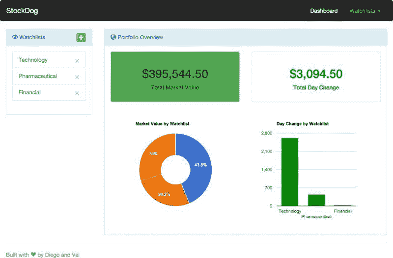

图 1.1

在 StockDog 中创建的每个自列表都有自己的自列表视图，其中包含一个股票价格信息的交互式表格以及有助于监控权益仓的几个基础计算。在这里，应用程序的用户可以向选定的自列表中添加新股票，在市场交易时间内实时监控股价变化，并对持有的股数进行行内编辑。跟踪七只股票的示例自列表视图如图 1.2 所示。

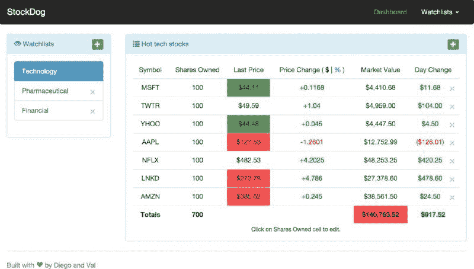

图 1.2

构建此应用的过程将通过一系列 12 个步骤进行描述。每一步都将专注于开发 StockDog 的一个关键功能，并在过程中引入 AngularJS 组件，因为它们是满足应用定义的需求所需的。在开始构建 StockDog 之前，建立关于你将学习的内容的高层概述是重要的。

## 你将学习到

本章包含的逐步指南将超出基础 AngularJS 使用。通过使用此框架的主要构建模块实现实用的真实示例，你将接触到 AngularJS 提供的大多数组件，这些组件将在随后的章节中进行详细扩展。记住这一点很重要，因为 StockDog 需要的某些功能将利用框架的高级概念。在这些情况下，将省略底层 AngularJS 机制如何运作的特定细节，但始终会提供高层解释，以便你理解该组件在实现当前功能的语境下是如何被使用的。在本章结束时，你将学会如何执行以下操作：

*   结构化多视图单页应用

*   创建指令、控制器和服务

*   配置 `$routeProvider` 以处理视图之间的路由

*   安装额外的的前端模块

*   处理动态表单验证

*   促进 AngularJS 组件之间的通信

*   在服务内部利用 HTML5 `LocalStorage`

*   使用 `$http` 与外部服务器通信

*   利用 `$animate` 服务进行级联样式表（CSS）动画

*   为生产环境构建应用资产

*   将构建的应用部署到 GitHub Pages

现在已经讨论了 StockDog 的范围和高层概述，你应该有足够的背景和上下文来开始构建应用了。对于那些立即查看 StockDog 运行演示的用户，可以在 [`http://stockdog.io`](http://stockdog.io) 找到完成的应用。

## 第 1 步：使用 YEOMAN 为项目搭建脚手架

从零开始创建一个全新的 Web 应用可能会很麻烦，因为这通常涉及手动下载和配置几个库和框架、创建智能目录结构并手动接线你的初始应用架构。然而，随着前端工具程序的重大进展，这不再需要是一个这样枯燥的过程了。在整个指南中，你将利用多种工具来自动化开发工作流的各个方面，但关于这些工具如何工作的详细解释将留到第 2 章“智能工作流和构建工具”中讨论。在开始为项目搭建脚手架之前，你需要验证已作为开发环境的一部分安装了以下前提条件：

*   **Node.js**—[`http://nodejs.org/`](http://nodejs.org/)

*   **Git**—[`http://git-scm.com/downloads`](http://git-scm.com/downloads)

本章中使用的所有工具都是使用 Node.js 构建的，并可以使用 Node.js 安装中包含的命令行工具 npm 从 Node 软件包 (NPM) 注册表进行安装。其中一个工具需要 Git，因此在继续之前，请确保你已经在系统中正确配置了 Git 及其和 Node.js。

### 安装 Yeoman

Yeoman 是一个开源工具，拥有一个名为生成器（generators）的插件生态系统，可以使用最佳实践来脚搭建新项目。它由一个健壮且具有特定偏好的客户端技术栈组成，能够促进高效的工作流，结合两个额外的实用工具，它可以帮助你作为开发者保持高效产出。以下是 Yeoman 用于完成此任务的各个工具：

*   `Grunt`——一个 JavaScript 任务运行器，帮助自动化构建和测试应用程序的重复性任务。

*   `Bower`——一个依赖管理工具，让你无再需要手动下载和管理前端脚本。

你可以在第 2 章“智能工作流与构建工具”中找到关于 Yeoman、其推荐的工作流以及相关工具的深入讨论。现在，你只需要在命令行中运行以下命令来安装 `Grunt`、`Bower` 和 AngularJS 生成器：

```
npm install –g grunt-cli
npm install –g bower
npm install –g generator-angular@0.9.8
```

## 为你的项目搭建脚架

在机器上安装好所有先决工具后，你已经准备好开始为你的项目搭建脚架。幸运的是，Yeoman 让这个过程变得快速且无痛苦。继续创建一个名为 `StockDog` 的新目录，然后使用你选择的命令行程序进入该目录。在新建创建的项目目录内，从命令行运行以下命令：

```
yo angular StockDog
```

这会启动 AngularJS Yeoman 生成器，它会就你如何设置应用程序向你提问几个问题。第一个提示询问你是否想配合 Compass 使用 Sass。虽然这两者都是管理样式表的极其有工具，但它们的用法超出了本章的范围，因此请通过输入 `n` 并按回车键回答“否”：

```
[?] Would you like to use Sass (with Compass)? (Y/n)
```

下一个提示询问你是否想包含 Bootstrap（由 Twitter 创建的前端框架）。`StockDog` 大量使用了 Bootstrap 提供的超文本标记语言 (HTML) 和 CSS 资源，因此你需要将其作为应用程序的一部分包含进来。由于此提示的默认响应为是（由大写的 `Y` 表示），只需按回车键即可在包含 Bootstrap 的情况下继续：

```
[?] Would you like to include Bootstrap? (Y/n)
```

最后一个提示询问你想要在应用程序中包含哪些可选的 AngularJS 模块。虽然对于这个特定项目你不一定需要图 1.3 列出的所有模块，但建议你仍然包含它们。你可以通过访问 [`https://docs.angularjs.org/api`](https://docs.angularjs.org/api) 并向下滚动查看每个模块提供的服务和服务指令。只需按回车键继续使用所有默认模块，让 Yeoman 开始为你的项目搭建脚架，如图 1.3 所示。

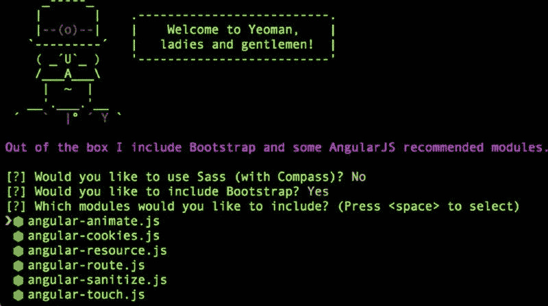

Figure 1.3

在最后一个提示上按下回车并等待 Yeoman 完成所有相关的脚架任务（这需要几秒钟）后，`StockDog` 的基础就可以准备好进行了。在接下来的部分，你将仔细查看 Yeoman 在脚架过程中配置的目录结构的重要部分和工作流任务。

## 探索应用程序

现在项目设置已完成，花几分钟探索一下 AngularJS Yeoman 生成器为你提供了什么。你的项目目录结构如下：

*   `StockDog/`

*   `├── .bowerrc`

*   `├── .editorconfig`


### 第 1 步：项目结构概览

初看之下，这个目录结构可能看起来让人眼花缭乱，但 Yeoman 创建的许多生成文件是为了强制执行最佳实践，在本章的剩余部分可以完全忽略它们。你将要关注的文件和目录已经**加粗**以示强调，所以现在你只需要注意这些。

以下是 Yeoman 为你生成的项目目录结构：

```
├── .gitattributes
├── .jshintrc
├── .travis.yml
├── bower.json
├── package.json
├── Gruntfile.js
├── app/
│   ├── 404.html
│   ├── favicon.ico
│   ├── robots.txt
│   ├── index.html
│   ├── images/
│   ├── styles/
│   │   └── main.css
│   ├── views/
│   │   ├── main.html
│   │   └── about.html
│   ├── scripts/
│   │   ├── app.js
│   │   └── controllers/
│   │       ├── main.js
│   │       └── about.js
├── node_modules/
├── bower_components/
└── test/
```

正如你可能猜到的，你的应用程序的大部分包含在`app/`目录中。在这里你可以找到主`index.html`文件，它是整个应用程序的入口点，以及`styles/`、`views/`和`scripts/`目录，它们分别包含 CSS、HTML 和 JavaScript 文件。`Gruntfile.js`也特别值得关注，因为它配置了在脚架过程中支持你的工作流任务。

启动你选择的命令行程序并运行以下命令：

```bash
grunt serve
```

这会启动由 Yeoman 在脚架过程中配置的本地开发服务器，并在浏览器中打开新标签页当前应用程序。此时，你的浏览器应该指向[`http://localhost:9000/#`](http://localhost:9000/#/)并显示与图 1.4 相同的页面。

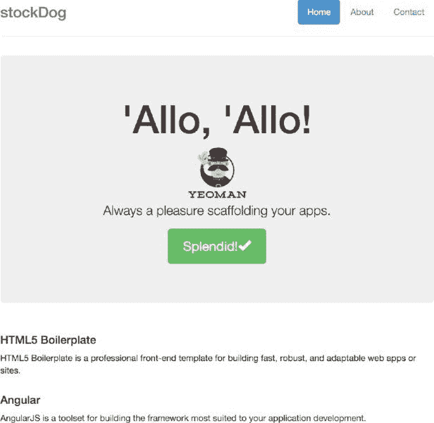

Figure 1.4

恭喜！你已成功完成项目搭建，准备好构建`StockDog`应用程序的第一个组件。在开发过程中，请保持运行`grunt serve`命令的终端开启，因为它负责提供应用程序资源。在进入下一节之前，花一分钟修改`app/views/main.html`文件，删除其所有内容。保存修改后，你会注意到浏览器标签已根据更改进行刷新，在这种情况下应该为空视图。Yeoman 在配置`Gruntfile.js`时设置了这些自动化魔法，这些任务会监控应用程序文件的修改并相应刷新浏览器。这项功能在你开始构建`StockDog`应用程序组件时将证明非常有帮助。

### 清理

到目前为止，你已经学习了如何使用 Yeoman 从零搭建新项目，探索了生成的项目结构，并领略了提供的工作流如何帮助你保持开发效率。在进入指南的下一步之前，你需要完成的最后一件事是删除`StockDog`不需要的几个生成文件并清理相关的引用。请在你的项目中找到并删除以下文件：

```
app/views/main.html
app/views/about.html
app/scripts/controllers/main.js
app/scripts/controllers/about.js
```

接下来，通过打开`app/scripts/app.js`文件并删除两个`when()`配置来移除 Yeoman 创建的路由。你可以通过删除以下代码行来实现这一点：

```javascript
.when('/', {
  templateUrl: 'views/main.html',
  controller: 'MainCtrl'
})
.when('/about', {
  templateUrl: 'views/about.html',
  controller: 'AboutCtrl'
})
```

最后，从`app/index.html`文件中删除对之前删除的`main.js`和`about.js`控制器脚本的引用。

```
<script src="scripts/controllers/main.js"></script>
<script src="scripts/controllers/about.js"></script>
```

完成这些对骨架应用的修改后，你现在已经准备好构建 StockDog 的股票列表（Watchlist）组件了。要获取指南此步骤的完整代码，请参考本章节配套代码中的`step-1`目录，或查看 GitHub 仓库中对应的标签。

### 第 2 步：创建股票列表

在本节中，你将实现股票列表，这是 StockDog 的第一个主要组件。如前提到的，股票列表只是为了分析目的而对所需的股票进行的任意分组。你应用程序的用户将通过填写模态窗口中的小型表单在 StockDog 中创建新的股票列表，表单会提示他们输入名称和简要描述以识别该列表。注册到应用程序的所有股票列表数据都使用 HTML5 `LocalStorage`存储在浏览器客户端。最后，股票列表将以名称的形式在用户界面内的一个小面板中显示。在对组件所需功能有了宏观理解后，你现在将学习如何使用 AngularJS 实现股票列表。

#### 应用程序模块

所有 AngularJS 应用程序的主入口点是顶层应用模块（app module）。那么模块到底是什么？正如官方文档提到的，你可以将模块认为是应用程序不同部分的容器。虽然大多数应用程序都有一个主方法来实例化并组装各种组件，但 AngularJS 模块以声明的方式指定了你的组件应该如何被引导（bootstrapped）。这种方法的优点之一是，模块可以按任何顺序异步加载，并且增强了代码的可读性和重用性。主应用模块通过调用`.module()`函数定义，该函数接受一个名称和一个依赖数组，位于`app/scripts/app.js`文件中。请注意模块名称，在本例中它应该是`stockDogApp`，因为你稍后将要引用它。对于过去用过 RequireJS 的人来说，这种声明模块依赖的方法应该看起来很熟悉。

##### 安装模块依赖

目前，你的应用程序依赖的模块应该是`ngAnimate`、`ngCookies`、`ngResource`、`ngRoute`、`ngSanitize`和`ngTouch`，这些都是 Yeoman 根据你对初始脚手架过程中第三个提示的响应安装的。在本节稍后的部分，你将使用由 AngularStrap 暴露的`$modal`服务，这是一个第三方模块，包含了针对 Bootstrap 框架提供的各种组件的原生 AngularJS 绑定。你可以通过访问位于`http://mgcrea.github.io/angular-strap/`的文档站点了解更多关于 AngularStrap 的信息。由于 Yeoman 设置的工作流使用 Bower 管理前端脚本，安装 AngularStrap 只需要在命令行中运行以下命令：

```
bower install angular-strap#v2.1.0 –save
```

这将下载 AngularStrap 库并将其作为依赖保存在你的`bower.json`文件中。如果你一直运行着使用`grunt serve`启动的应用程序服务器，Grunt 将检测到`bower.json`的修改并自动更新你的`index.html`文件，以引用 AngularStrap 提供的 CSS 和 JavaScript 文件。对于一个简单的单行命令来说这不错！现在剩下的就是将名为`mgcrea.ngStrap`的 AngularStrap 模块作为依赖添加到你的`stockDogApp`模块依赖数组中，如列表 1-1 所示。

##### 引导应用程序

现在你已经了解了如何定义应用模块并注册依赖，引导 StockDog 的下一步也是最后一步是在 HTML 内部引用`stockDogApp`模块。方便的是，Yeoman 已经为你做好了。查看你的`app/index.html`文件；在第 19 行，你应该看到以下代码：

```
<body ng-app="stockDogApp">
```

附加到页面`<body>`标签上的`ng-app`属性是一个 AngularJS 指令，它标记该 HTML 元素应被视为应用程序的根。指令将在稍后定义，但目前的重点是，为了引导你的 AngularJS 模块，必须在应用程序的 HTML 中添加`ng-app`属性。同样值得提到，由于`ng-app`是一个元素属性，你可以自由移动它，并决定是整个 HTML 页面还是部分内容被视为 Angular 应用程序。完成使用`stockDogApp`模块引导你的应用程序后，你现在将接触 AngularJS 服务，这是框架的另一个关键组件。

#### 股票列表服务

根据 AngularJS 文档的定义，服务（services）是通过依赖注入组装的可替换对象。服务提供了一种跨应用程序组织和共享封装代码的极佳方法。值得注意的是，AngularJS 服务是懒实例化的单例，这意味着它们只有在应用程序组件依赖它们时才会被实例化，并且每个依赖组件都接收到由服务工厂生成的单个实例引用。为了构建 StockDog 的股票列表功能，你将创建一个自定义服务，处理读写股票列表模型到 HTML5 `LocalStorage`。要开始操作，请从命令行运行以下命令：

```
yo angular:service Watchlist-Service
```

这使用了 AngularJS Yeoman 生成器封装的子生成器（subgenerator），在新建创建的`watchlist-service.js`文件中脚手架化出一个骨架服务，该文件位于`app/scripts/services`目录内。此外，Yeoman 添加了对该创建脚本的引用，通过在`app/index.html`底部添加以下代码行可以此这一点：

```
<script src="scripts/services/watchlist-service.js"></script>
```

现在你已经快速为新服务接好了入口点，你需要安装 Lodash，这是一个为 JavaScript 提供函数式编程辅助的工具库，将在本章剩余部分中使用。使用 Bower 安装 Lodash，在命令行运行以下命令：

```
bower install lodash –save
```

Lodash 最初是`Underscore.js`项目的一个分支，但此后已进化为一个高度可配置且高性能的库，提供了大量辅助方法。使用了 Lodash 方法的`WatchlistService`实现如列表 1-2 所示。

你应该首先注意到在`stockDogApp`模块上调用了`.service()`方法，这会将服务注册到顶层 AngularJS 应用程序中。这允许你在组件实现函数通过注入`WatchlistService`在其他地方引用它。`loadModel()`辅助`[1]`请求存储在浏览器`LocalStorage`中的数据，使用`StockDog`命名空间的键以避免潜在冲突。从`localStorage`获取的`watchlists`值是一个数组，而`nextId`只是一个用于唯一标识每个列表的整数。三元运算符确保了这两个变量的初始值被正确设置和解析。`saveModel()`辅助`[2]`只需要将`watchlists`数组字符串化后持久化到`localStorage`。另一个内部辅助函数`findById() [3]`使用 Lodash 在上述数组中根据给定 ID 查找列表。

在解决了这些内部辅助函数之后，你现在应该注意到，剩余的函数是通过使用关键字`this`直接附加到服务实例上的。虽然使用`this`可能会出错且并不总是最佳方法，但在这种情况下它是可以的，因为 Angular 通过对提供给`.service()`的函数调用`new`来实例化单例。服务`.query()`函数`[4]`在未指定`listId`的情况下会返回模型中的所有待办列表。`.save()`函数`[5]`在委托给`saveModel()`辅助函数之前，会增加`nextId`并并将新的待办列表推送到`watchlists`数组中。最后，`.remove()`使用 Lodash 方法完成完全相反的操作`[6]`。为了完成此服务，使用`loadModel()`辅助函数初始化了一个本地`Model`变量。到此为止，你的`WatchlistService`已经准备好从 AngularJS 指令内部进行连接，你将在接下来的章节中创建该指令。

### Watchlist-Panel 指令

到这里，你可能已经听过 AngularJS 指令，以及如果使用得当，它们会有多大的威力。那么，指令究竟是什么呢？根据官方文档的定义，指令是文档对象模型（DOM）元素上的标记（例如属性、元素名、注释或 CSS 类），它们告诉 AngularJS 的 HTML 编译器（`$compile`）为 DOM 元素及其子元素附加特定的行为，甚至对其进行转换。你将在第 5 章“指令”中深入研究指令的工作原理。现在，你只需要知道，你不仅可以创建自己的自定义指令，AngularJS 还带了一套现成的内置指令，如`ng-app`、`ng-view`和`ng-repeat`，它们都以`ng`为前缀。对于`StockDog`应用，你所有的自定义指令都以`stk`为前缀，以便于识别。你可以使用 Yeoman 的指令子生成器通过在命令行运行以下命令来脚搭建并连接一个骨架指令：

```
yo angular:directive stk-Watchlist-Panel
```

这会在`app/scripts/directives`目录下创建`stk-watchlist-panel.js`文件，并自动在你的`index.html`文件中添加对新脚本的引用。该指令的实现显示在列表 1-3 中。

`.directive()`方法处理`stkWatchlistPanel`指令在`stockDogApp`模块中的注册`[1]`。此示例说明了 Angular 依赖注入机制的使用，它只需为指令的实现函数指定参数即可。注意，之前创建的`WatchlistService`已作为依赖项注入，连同`$location`和`$modal`服务一起，因为完成指令的实现需要这些服务。实现函数本身返回一个包含配置选项和`link()`函数的对象。在该函数内部是初始化指令作用域变量`[2]`的地方，其中包括使用 AngularStrap 的`$modal`服务创建一个模态框。调用`WatchlistService`的`.query()`方法将服务的模型绑定到指令的作用域上`[3]`。然后将处理函数附加到`$scope`上，并提供显示模态框的功能`[4]`、从模态框字段创建新待办列表的功能`[5]`以及删除待办列表的功能`[6]`。这些处理函数的实现是简单直观的，并使用了已注入的服务。

`stkWatchlistPanel`指令的配置选项通过`restrict: 'E'`限制其作为元素使用，并对其作用域进行隔离，以便附加到`$scope`变量上的任何内容仅在该指令的范围内可用。`templateUrl`选项可以引用 Angular 加载并渲染到 DOM 中的文件。对于此应用，你将模板存储在`app/views/templates`目录下，所以现在就创建它吧。此指令需要的`watchlist-panel.html`模板显示在列表 1-4 中。

`watchlist-panel.html`模板大量使用了 Bootstrap 框架提供的类和图标来创建一个简单而精美的界面。内置的 AngularJS `ng-click`指令用于在点击加号按钮时调用`showModal()`处理函数`[1]`。`ng-if`指令根据表达式的求值结果条件地插入或移除 DOM 元素，在这种情况下，当`watchlists`数组为空时显示说明文本`[2]`。为了遍历`watchlists`数组，使用了`ng-repeat`配合`track by $index`语法，这样即使数组中包含相同的对象，Angular 也不会报错`[3]`。值得提到的是，由于`ng-repeat`附加到 HTML `<a>`标签上，为数组中的每个对象都会创建一个唯一的链接。用于引用当前列表名称的双层大括号`{{ }}`被称为绑定（binding），而`list.name`本身被称为表达式（expression）。绑定告诉 Angular 它应该求值表达式并将结果插入到 DOM 中以替换绑定。每当表达式求值结果更改时，绑定会导致高效的持续更新。最后，`deleteList()`处理函数通过另一个按钮连接到界面上，再次使用`ng-click`指令连接`[4]`。

#### 基础表单验证

完成`stkWatchlistPanel`指令实现的最后一步是构建允许用户创建新待办列表的表单。如果你还记得，在指令的`link()`函数内部，`addListModal`变量是使用 AngularStrap 模块暴露的`$modal`服务初始化的。`$modal`服务接受`template`选项，在模态框内渲染所需的 HTML。在`app/views/templates/`目录下创建一个名为`addlist-modal.html`的新文件。该模板的实现显示在列表 1-5 中。


你从这个模板中注意到，它不仅引用了附加到`stkWatchlistPanel`指令作用域的处理函数，还利用了`$modal`服务暴露的`$hide()`方法`[1]`。因为需要输入收集创建新待办列表的信息，所以使用了HTML`<form>`标签`[2]`。特别注意`name="listForm"`属性，因为你通过它引用表单以检查其有效性。两个`<input>`标签通过`ng-model`指令扩展，将相应的输入值绑定到指令`link()`函数初始化的`$scope.watchlist`变量`[3]` &[4]`。HTML的`required`属性也用于这两个输入，因为你希望在创建新待办列表之前确保用户指定名称和描述。最后，当点击创建按钮时，将调用指令的`createList()`处理函数，但前提是表单有效。内置的`ng-disabled`指令根据求值`!listForm.$valid`表达式的结果来禁用或启用按钮。

## 使用指令

现在你已经完成了`stkWatchlistPanel`指令及其相关模板的创建，你会发现在HTML中引用它是多么简单。打开`app/index.html`文件，在带有`footer`类的`<div>`标签之前插入以下代码：

```html
<stk-watchlist-panel></stk-watchlist-panel>
```

此时，你可能在疑惑为什么这个指令用作HTML元素标签而不是属性。如果你还记得，`stkWatchlistPanel`指令在创建时，其`restrict`配置属性被设置为`E`，这意味着该指令被用作HTML元素使用。最初看起来也可能很奇怪，尽管指令是使用`camelCase`（驼峰命名法）注册的，但在HTML内部使用的是`spinal-case`（短横线命名法）进行引用。这是因为HTML对大小写不敏感，所以Angular使用此约定来规范化你的指令名称。在保存对`index.html`文件的上述修改后，Grunt会自动触发浏览器刷新；你的应用程序应该与图1.5所示的完全相同。

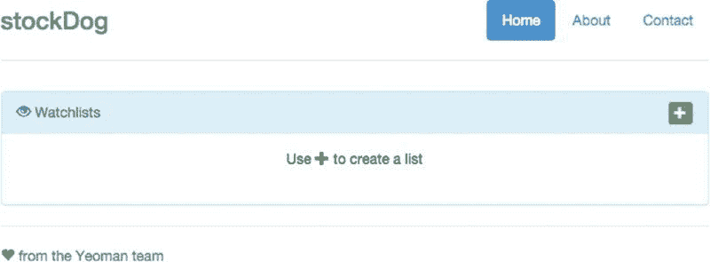

图 1.5

点击收藏列表面板内的绿色加号按钮应该启动包含收藏列表创建表单的Bootstrap模态框，如图1.6所示。

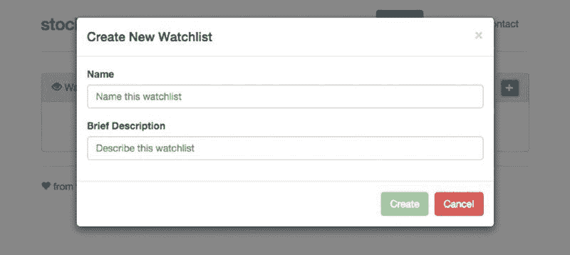

图 1.6

恭喜！你已经成功实现了StockDog应用程序的收藏列表功能。通过这一过程，你学习了如何创建一个使用HTML5 LocalStorage的AngularJS服务，以及创建一个操纵DOM并连接多个服务的指令。花几分钟欣赏一下你至今的成果：创建几个收藏列表，刷新浏览器以确认它们确实已持久化到LocalStorage中，然后从收藏列表面板删除它们，以确保一切运行都符合预期。如果你在这一步的任何时候遇到困扰，请花时间参考本章配套代码中的`step-2`目录，或查看GitHub仓库中相应的标签来检查完成的代码。

## 第 3 步：配置客户端路由

客户端路由是任何单页应用程序的关键组成部分。幸运的是，AngularJS将URL映射到各种前端视图的任务变得异常简单。在当前状态下，StockDog除了`index.html`文件外，不包含额外的HTML视图，该文件包含一个使用`stk-watchlist-panel`指令的嵌入收藏列表面板。在本节中，你将看到路由机制如何将AngularJS控制器和HTML模板结合起来，为`StockDog`应用程序的两个视图提供支持。

### Angular ngRoute

在构建StockDog应用程序的过程中，Yeoman询问你是否想要安装任何辅助的AngularJS模块。其中之一就是`angular-route`，它暴露了`ngRoute`模块，该模块可以列为你应用程序的依赖。你可以通过查看`app/scripts/app.js`文件并在主`stockDogApp`模块定义的依赖数组中找到`ngRoute`的引用，验证该模块是否已为StockDog正确安装，如下所示：

```
angular
  .module('stockDogApp', [
    'ngAnimate',
    'ngCookies',
    'ngResource',
    'ngRoute',    // 将 angular-route 作为依赖
    'ngSanitize',
    'ngTouch',
    'mgcrea.ngStrap'
  ])
```

`ngRoute`模块暴露了`$route`服务并可以使用相关的`$routeProvider`进行配置，这允许你声明应用程序的路由如何映射到视图模板和控制器。提供者（Providers）是创建服务实例并暴露配置API的对象，这些API用于控制服务的运行时行为。你将在第七章"服务、工厂和提供者"中了解更多关于提供者的知识，但现在要明确的是可以使用`$routeProvider`来定义应用程序路由并实现深度链接（deep linking），这允许你利用浏览器的历史导航和应用程序内的书签位置。

### 添加新路由

向应用程序添加新路由的过程由四个不同的步骤组成：

1. 定义一个新的控制器。

2. 创建一个HTML视图模板。

3. 调用`$routeProvider.when(path, route)`方法。

4. 如果新控制器位于单独的JavaScript文件，则在`index.html`中包含`<script>`标签引用。

只有当你的项目架构镜像了StockDog应用程序（即每个新的AngularJS组件都位于自己的JavaScript文件中）时才需要第四步。尽管这四个步骤本身足够简单，但在处理具有许多路由、视图和控制器的大型应用程序时，可能会变成一个繁琐的过程。幸运的是，AngularJS的Yeoman生成器包含一个子生成器，可以用于完全自动化这四个步骤的过程。请在终端中运行以下命令，为StockDog应用程序的仪表板和收藏列表视图生成AngularJS控制器、HTML模板和`$routeProvider`配置：

```
yo angular:route dashboard
yo angular:route watchlist –--uri=watchlist/:listId
```

通过这两个简单的命令，你指示Yeoman在`app/scripts/controllers/`目录下创建`dashboard.js`和`watchlist.js`文件。这些文件分别定义了`DashboardCtrl`和`WatchlistCtrl`，以及`app/views/`目录下的`dashboard.html`和`watchlist.html`视图。由于Yeoman为路由控制器创建了两个新的JavaScript文件，它还顺便在你的`index.html`文件底部插入了两个所需的`<script>`标签引用。你可能注意到第二个命令带有`uri`标志调用了子生成器。这指示Yeoman在配置`$routeProvider`时使用显式定义的路径，这在一种情况下是必要的，因为在StockDog中创建的每个收藏列表将根据`listId`生成有其唯一的视图。查看`app/scripts/app.js`，你应该能看到Yeoman建立的以下`$routeProvider.when()`配置：

```
.when('/dashboard', {
  templateUrl: 'views/dashboard.html',
  controller: 'DashboardCtrl'
})
.when('/watchlist/:listId', {
  templateUrl: 'views/watchlist.html',
  controller: 'WatchlistCtrl'
})
```

在继续进入下一节之前，花一点时间更新此文件底部`$routeProvider.otherwise()`函数中使用的路径。`redirectTo`属性目前指向`'/'`，但在这种情况下你可能希望将其修改为指向`'/dashboard'`，因为那是StockDog应用程序的主页。

### 使用路由

在完成添加客户端路由以及连接仪表板和收藏列表框架视图的所有步骤后，你现在可以开始使用配置好的路由链接`StockDog`内的页面了。打开渲染收藏列表面板指令的`stkwatchlistpanel.js`文件，并将AngularJS`$routeParams`服务与当前的`$location`、`$modal`和`WatchlistService`依赖一起注入。`.directive()`调用现在应该这样：

```
.directive('stkWatchlistPanel',
  function ($location, $modal, $routeParams, WatchlistService) {
```

接下来，你将添加一个新的`$scope`变量来跟踪当前显示的收藏列表，以及一个`gotoList()`函数将用户发送到指定的收藏列表视图。你可以通过向指令实现中添加以下代码来实现这一点：

```
$scope.currentList = $routeParams.listId;
$scope.gotoList = function (listId) {
  $location.path('watchlist/' + listId);
};
```

再次，使用`$location`服务将用户路由到所需的监视列表视图，该视图包含`listId`。此时，你可能会问自己传递给`gotoList()`函数的`listId`是从哪里来的。如果你还记得，当你第一次创建`watchlist-panel.html`模板视图时，你使用了内置的`ng-repeat`指令来遍历从`WatchlistService`获取的所有监视列表。为了将此函数连接到指令的模板中，你需要在`<a>`标签上添加`ng-click`指令，它包含对`gotoList()`函数的调用，每当DOM元素被点击时就会评估一次。由于`stkWatchlistPanel`同时用于主仪表板和单个监视列表视图，你应该在同一个元素上添加一个`ng-class`指令，用于将Bootstrap的`active`类添加到用户当前查看的列表`<a>`标签上。位于`/app/view/templates/`目录下的`watchlist-panel.html`文件的修改如下：

```
<a class="list-group-item"
  ng-class="{ active: currentList == list.id }"
  ng-repeat="list in watchlists track by $index"
  ng-click="gotoList(list.id)">
```

注意，附加到`$scope`的新定义变量`currentList`用于评估元素上是否应该存在`active`类。在下一节中，你将为仪表板和监视列表视图搭建基础结构。因为`<stk-watchlist-panel>`元素在两个视图的范围内都会使用，请花时间从`index.html`文件删除当前的引用。

### 模板视图

此时，你可能会好奇AngularJS如何知道加载`$routeProvider`的`template`选项指定的`dashboard.html`和`watchlist.html`视图。此功能背后的关键组件是`ngView`指令，它在你最初使用Yeoman脚手项目时已包含在`index.html`中。该指令需要安装`ngRoute`模块才能运行，并将由`$route`服务定义的视图模板插入到布局模板中（在本例中为`index.html`文件）。需要注意的是，路由模板会被插入到`<ng-view>`元素所在的精确DOM位置。

目前，StockDog应用程序没有任何实用的功能，因此请修改你生成的`dashboard.html`和`watchlist.html`文件，使其类似于列表1-6和列表1-7所示的内容。

`dashboard.html`和`watchlist.html`模板都使用Bootstrap的网格系统创建两个不同的列，`<stk-watchlist-panel>`被包含在每个视图的左列。现在这两个文件的修改已完成，请通过访问[`http://localhost:9000/#/dashboard`](http://localhost:9000/#/dashboard)在浏览器中进入Dashboard视图。为了测试，请花时间向面板添加一个新的监视列表，然后点击新创建的列表项。你添加的`ngClick`指令应该评估`stkWatchlistPanel`指令的`gotoList()`函数，这将导致你的应用程序路由到该监视列表的唯一命名视图。你现在应该会在浏览器地址栏中看到类似[`http://localhost:9000/#/watchlist/1`](http://localhost:9000/#/watchlist/1)的内容。按下浏览器后退按钮将带回到主Dashboard视图。

恭喜！你成功实现了StockDog应用程序两个视图的客户端路由。通过这一过程，你看到了如何使用`ngRoute`模块在AngularJS应用程序中实现深度链接，并学习了如何使用`ngView`指令加载路由模板。如果你在这一步骤的任何时候遇到困难，请参考本章配套代码中的`step-3`目录来检查完成的代码，或者查看GitHub仓库中相应的标签。

## 第 4 步：创建导航栏

完成客户端路由后，你现在可以花一点时间使用原生Bootstrap组件来美化StockDog应用程序的导航栏。目前，你的应用程序导航栏尚未根据Yeoman生成器初始生成的内容进行修改。在本节中，你把此默认导航栏替换为更流畅且允许在StockDog应用程序两个主视图之间进行适当导航的栏。

### 更新 HTML

首先，你需要从当前的`app/index.html`文件中删除几行代码。打开该文件，从删除位于第19行左右的包含起始标签`<body ng-app="stockDogApp">`的行开始，一直到第61行左右包含`<!–– build:js(.) scripts/vendor.js ––>`的HTML注释之前停止。如果你一直在按照示例代码操作，你应该已经从该文件中删除了约42行。

现在你已经从应用程序的`index.html`文件删除了必要的行，请插入下所示标记以替换刚才删除的行：


<!–– [1] Load MainCtrl ––>
<body ng-app="stockDogApp" ng-controller="MainCtrl">
  <nav class="navbar navbar-inverse" role="navigation">
    <div class="container-fluid">
      <div class="navbar-header">
        <button type="button" class="navbar-toggle" data-toggle="collapse" data-target="#main-nav">
          <span class="icon-bar"></span>
          <span class="icon-bar"></span>
          <span class="icon-bar"></span>
        </button>
        <a class="navbar-brand" href="/">Stock Dog</a>
      </div>

      <!–– Collect the nav links and other content for toggling ––>
      <div class="collapse navbar-collapse" id="main-nav">
        <ul class="nav navbar-right">
          <!–– [2] Add active class to necessary item ––>
          <li ng-class="{active: activeView == 'dashboard'}">
            <a href="/">Dashboard</a>
          </li>
          <li ng-class="{active: activeView == 'watchlist'}" class="dropdown">
            <a class="dropdown-toggle" data-toggle="dropdown">
              Watchlists <b class="caret"></b>
            </a>
            <ul class="dropdown-menu">
              <li ng-if="!watchlists.length" class="dropdown-header">No lists found</li>
              <!–– [3] Create a unique link for each watchlist ––>
              <li ng-repeat="list in watchlists track by $index">
                <a href="/#/watchlist/{{list.id}}">{{list.name}}</a>
              </li>
            </ul>
          </li>
        </ul>
      </div>
    </div>
  </nav>

  <!–– Main container ––>
  <div class="container-fluid" id="main">
    <div ng-view=""></div>

    <div class="footer">
      <p>Built with <span class="glyphicon glyphicon-heart"></span></p>
    </div>
  </div>
</body>

在这段 HTML 代码中，你应该注意到的第一个区别是在`<body>`标签上使用了`ng-controller`指令`[1]`。在上一节中，你发现了如何使用`ngRoute`模块来加载特定路由所需的控制器和视图。但在这种情况下，你希望强制 AngularJS 加载`MainCtrl`控制器，因为它将用于处理无论当前评估路由如何都适用于你的应用程序的逻辑。这种方法演示了将全局范围逻辑封装到单个控制器中的简单方法。

## 第 5 步：添加股票

StockDog 需要实现的下一个主要功能是能够将股票添加到列表中。

### 创建 CompanyService

第一个任务是创建一个新服务。请注意，`$resource`服务负责获取`companies`文件。

```bash
yo angular:service CompanyService
```

### 创建 AddStock 模态框（Modal）

完成`CompanyService`后，是时候创建一个新视图作为模态框，允许用户将股票添加到当前选中的监望列表。请在`app/views/templates/`目录下创建一个名为`addstock-modal.html`的新文件。你可以在列表 1-10 中看到此视图的实现。

这看起来与之前为 StockDog 添加监望列表的模态框相似。第一个输入`[1]`使用了 AngularStrap 项目的`bs-typeahead`指令，该指令利用原生的`ng-options`指令为自动补全机制的运行提供的数据。`ng-options`指令接受多种语法形式。在这种情况下，你强制它使用`companies`作用域变量中每个公司对象的`label`属性。第二个输入`[2]`则允许用户指定特定股票的持有股数。

### 更新 WatchlistService

在继续开发`WatchlistCtrl`和相关的监望列表视图之前，你需要对现有的`WatchlistService`进行一些修改。为了抽象监望列表与其关联股票之间的各种计算和交互，你将创建两个独立的对象作为所需行为的模型。在位于`app/scripts/services/`目录下的`watchlist-service.js`文件的实现函数顶部，添加以下代码以创建一个带有`save()`函数的`StockModel`对象：

```javascript
 // 使用额外的辅助函数扩展 Stocks 
    var StockModel = {
      save: function () {
        var watchlist = findById(this.listId);
        watchlist.recalculate();
        saveModel();
      }
    };
```

由于自选列表由许多股票组成，你还需要创建一个包含`addStock()`、`removeStock()`和`recalculate()`函数的`WatchlistModel`，如下所示：

```javascript
 // 使用额外的辅助函数增强自选列表
    var WatchlistModel = {
      addStock: function (stock) {
        var existingStock = _.find(this.stocks, function (s) {
          return s.company.symbol === stock.company.symbol;
        });
        if (existingStock) {
          existingStock.shares += stock.shares;
        } else {
          _.extend(stock, StockModel);
          this.stocks.push(stock);
        }
        this.recalculate();
        saveModel();
      },
      removeStock: function (stock) {
        _.remove(this.stocks, function (s) {
          return s.company.symbol === stock.company.symbol;
        });
        this.recalculate();
        saveModel();
      },
      recalculate: function () {
        var calcs = _.reduce(this.stocks, function (calcs, stock) {
          calcs.shares += stock.shares;
          calcs.marketValue += stock.marketValue;
          calcs.dayChange += stock.dayChange;
          return calcs;
        }, { shares: 0, marketValue: 0, dayChange: 0 });

        this.shares = calcs.shares;
        this.marketValue = calcs.marketValue;
        this.dayChange = calcs.dayChange;
      }
    };
```

最后，需要修改从`LocalStorage`序列化和反序列化的方法，因为你需要扩展之前创建的两个模型，以在内存中创建应用程序所需的数据结构。将现有的`loadModel()`和`this.save()`函数修改为如下所示：

```javascript
 // 辅助函数：从 localStorage 加载自选列表
    var loadModel = function () {
      var model = {
        watchlists: localStorage['StockDog.watchlists'] ?
          JSON.parse(localStorage['StockDog.watchlists']) : [],
        nextId: localStorage['StockDog.nextId'] ?
          parseInt(localStorage['StockDog.nextId']) : 0
      };
      _.each(model.watchlists, function (watchlist) {
        _.extend(watchlist, WatchlistModel);
        _.each(watchlist.stocks, function (stock) {
          _.extend(stock, StockModel);
        });
      });
      return model;
    };

    // 保存新的自选列表到 watchlists 模型
    this.save = function (watchlist) {
      watchlist.id = Model.nextId++;
      watchlist.stocks = [];
      _.extend(watchlist, WatchlistModel);
      Model.watchlists.push(watchlist);
      saveModel();
    };
```

### 实现 WatchlistCtrl

接下来，你将修改当前的`WatchlistCtrl`，它仍然是 Yeoman 在脚手架生成过程中创建的空框架。打开位于`/app/scripts/controllers/`目录下的`watchlist.js`文件，并将其修改为如列表 1-11 所示。

你会注意到`$routeParams`、`$modal`、`WatchlistService`和`CompanyService`都被作为依赖注入。`CompanyService`的`query()`函数（由前所述通过使用`$resource`服务返回的对象提供）被调用以填充`companies`作用域变量，该变量稍后将在自选列表视图中使用。其余代码非常直观，使用`WatchlistService`初始化`watchlist`作用域变量，该变量反过来用于通过路由参数`[1]`传递的`listId`获取当前自选列表变量。接下来，模态框本身实例化，并对`[2] showStockModal()`和`[3] addStock()`函数进行了定义。

### 修改 Watchlist View

由于对自选列表的保存和加载方式进行了修改，在继续更新自选列表视图标记之前，请花时间从应用程序中删除所有当前的自选列表。完成后，修改现有的`/app/views/watchlist.html`文件，包含一个显示股票列表的 Bootstrap 面板。目前，该文件应该只包含一个由两列组成的行，其中左列由`stk-watchlist-panel`指令组成。修改该文件的右列，以匹配列表 1-12 所示的 HTML 标记。

到此时，你应该已经能熟练使用`ng-click`、`ng-hide`和`ng-repeat`指令了，后者目前仅简单用于显示股票的公司股票代码。这将在稍后构建股票表格指令时再次涉及。

此时，你应该能够通过点击面板中的绿色加号按钮向选定的自选列表添加新股票。

## 第 6 步：与 YAHOO FINANCE 集成

现在你的 StockDog 应用程序已经能够管理自选列表和股票，是时候开始从外部服务（在本例中为雅财经）获取报价信息了。在本节中，你将创建一个 AngularJS 服务，负责发送 HTTP 请求并更新驱动应用程序的内存结构。

### 创建 QuoteService

为了将 HTTP 请求和响应解析封装到可重用的组件中，你将创建一个新服务。在终端中运行以下命令让 Yeoman 生成`QuoteService`：

```bash
yo angular:service Quote-Service
```

正如本章多次所示，这会在你的`/app/scripts/services`目录下的新创建`quote-service.js`文件中创建一个名为`QuoteService`的 AngularJS 服务骨架实现。你可以在列表 1-13 中看到`QuoteService`的完整实现。

由于`QuoteService`负责与雅财经 API 通信，你会注意到`$http`服务被作为依赖注入。同样注入的`$interval`服务是 Angular 对`window.setInterval`的封装。在内部，该服务跟踪一个需要检索报价数据的股票数组。`update()`函数`[1]`处理将雅财经的响应解析为所需的股票模型属性。此代码还包含用于添加、删除和清除内部跟踪数组的辅助函数`[2]`。最后，`fetch()`函数`[3]`在调用`$http`服务发起异步请求之前生成相应的雅财经查询 URL。雅财经的响应随后传递给`update()`函数进行如前所述的处理。

### 从控制台调用服务

由于你新创建的`QuoteService`目前尚未在 StockDog 应用程序的任何地方注入和使用，快速检查此服务的最简单方法是在浏览器开发者工具的控制台中输入几行代码。现在打开控制台并将以下行直接粘贴到浏览器控制台中：

```javascript
Quote = angular.element(document.body).injector().get('QuoteService')
Watchlist = angular.element(document.body).injector().get('WatchlistService')
Quote.register(Watchlist.query()[0].stocks[0])
```

这获取了`QuoteService`和`WatchlistService`的引用，然后调用`QuoteService`的`register()`函数，传入第一个可用股票列表中的第一只股票。（请确保你已经创建了至少一个股票列表并添加了至少一只股票。）在五秒内，你应该能看到一个包含单个对象的数组。检查该对象将让你看到 Yahoo Finance API 为该特定股票提供的所有数据，类似于图 1.9。

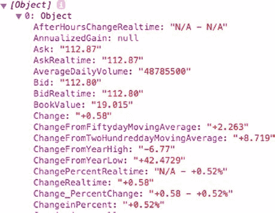

`图 1.9`

现在你已经完成了`QuoteService`的创建并验证了它成功从 Yahoo Finance API 获取数据，你可以准备进入下一节，并在股票列表视图的表格中显示这些数据了。如果你的应用程序运行不正常，请参考本章节配套代码中的`step-6`目录，或者查看 GitHub 仓库中相应的标签。

## 步骤 7：创建股票表格

在本节中，你将接触到更复杂的 AngularJS 指令用法。具体来说，在构建用于显示股票性能信息的表格时，你将看到指令如何在它们之间通信数据。

### 创建 StkStockTable 指令

开始之前，你将为股票表格创建一个新指令。正如你已经多次看到的那样，你可以通过在命令行运行以下命令来使用 AngularJS Yeoman 生成器来实现这一点：

```bash
yo angular:directive stk-Stock-Table
```


这会在`app/scripts/directives`内部创建一个`stk-stock-table.js`文件，并在`index.html`中链接该新的 JavaScript 文件。`stkStockTable`指令的实现如列表 1-14 所示。

你应该注意到的第一点是，该指令包含一个用于`scope`属性的对象`[1]`。通过这种方式隔离指令的作用域（scope），你可以绑定指令 DOM 元素的一个属性。你将在第 4 章“数据绑定”中更详细地探索这一点，但现在请记住，当你使用`stkStockTable`指令时，你必须包含一个名为`watchlist`的属性，并为其分配一个要评估的表达式。此示例中另一个值得注意的是，该指令包含一个`controller`属性`[2]`。从更通用的意义上说，这是你为其他指令暴露用于通信的 API 方法。因为在`controller`属性的实现内部，`addRow()`和`removeRow()`函数都附加到`this`对象上，它们将可供外部使用。这里的概念是`stkStockTable`指令在内部跟踪表格中的所有行。这允许它在需要时修改行，例如在本例中，用于切换每行作用域的`showPercent`属性。最后，该指令还包含了`link`属性`[3]`，这对于 DOM 操作来说是典型的，在这种情况下，它仅初始化了`showPercent`作用域变量，并通过顶层指令作用域暴露了`removeStock()`函数。

### 创建 StkStockRow 指令

现在主`stkStockTable`指令已经创建，是时候创建一个为每个表格行重复的指令了。在命令行运行以下命令创建一个新的`stkStockRow`指令：

```
yo angular:directive stk-Stock-Row
```

这会在`app/scripts/directives`目录下创建一个`stk-stock-row.js`文件，并包含`stkStockRow`指令的骨架。该指令的实现如列表 1-15 所示。

对于此指令，只有`$timeout`和`QuoteService`被注入为依赖项。此外，你可能已经注意到`restrict`属性`[1]`被设置为`A`，这意味着`stkStockRow`旨在用作 DOM 元素的属性，而不是像之前创建指令那样作为 DOM 元素本身。你还应该注意`require`属性的使用。这就是你告诉指令它一个特定的控制器，在这种情况下，该控制器定义在`stkStockTable`指令内部。`^`前缀指示此指令在其父级作用域上搜索控制器，这正是你在这种情况下希望它执行的操作。所需的控制器随后将通过`link`函数的最后一个参数可用，如`[2]`所示。由于每行都有自己的工具提示标记，因此此指令是放置工具提示初始化代码`[3]`的绝佳位置。代码的其他部分负责使用`stkStockTable`指令的`addRow()`函数`[4]`为每行注册`$scope`，在创建时向`QuoteService`注册该行的股票`[5]`，并在行被销毁时注销它`[6]`，同时如果当前创建的行是表格中的最后一行，则立即触发`QuoteService.fetch()`调用`[7]`。最后，使用`$watch()`监控股票数量的变化，以便进行相应的计算`[8]`。

### 创建股票表格模板

当`stkStockTable`和`stkStockRow`指令都完成后，接下来的工作是为股票表格创建一个新的 HTML 模板视图。进入你的`app/views/templates/`目录创建一个名为`stock-table.html`的新文件，并使其看起来像列表 1-16 所示的标记。

尽管`stock-table.html`的标记并不复杂，但有几点值得指出。首先，在`thead`内部，你应该注意到两个带有`ng-click`指令的`span`，它们为`showPercent`作用域变量赋值`[1]`。这是使用这种形式表达式的第一个例子，它是完成简单任务的有效方法，在本例中是切换布尔值。你还应该注意使用`ng-show`，只有当当前股票列表中多于一只股票时才显示表格页脚`[2]`，因为它包含了计算出的总计。最后，虽然此视图模板是`stkStockTable`的，但在底层它使用`ng-repeat`来创建包含`stkStockRow`指令的`tr`元素`[3]`。你可能需要使用`$compile`服务手动编译子指令模板。

### 更新股票列表视图

完成这一步的唯一任务是通过在 StockDog 的股票列表视图包含它来调用`stkStockTable`指令。打开项目的`app/views/watchlist.html`文件并找到包含`ng-repeat`指令的`<p>`标签。你不再仅仅显示股票的公司代码，而是想要渲染整个交互式表格。用以下代码替换整整行来完成此任务：

```
<stk-stock-table ng-show="stocks.length" watchlist="watchlist">
```

既然 StockDog 现在已经有了一个可以显示自选列表中各种股票信息的实用表格，下一步是让该应用程序更具交互性，允许用户编辑每只股票的持有股数。由于数据是以表格形式显示的，编辑值的常用范式是进行内联修改，就像电子表格一样。在本节中，你将看到如何创建一个指令（directive），该指令可以与 HTML5 的`contenteditable`属性结合使用来实现这一功能。

### 创建 contenteditable 指令

由于这个新指令将扩展`contenteditable`属性的功能，它必须使用相同的名称。请在终端中运行以下命令，使用 Yeoman 骨架一个新的 AngularJS 指令：

```
yo angular:directive contenteditable
```

这会在你的`app/scripts/directives/`目录下创建一个命名为`contenteditable.js`的新文件。`contenteditable`指令被限制为一个属性，并对用户输入的数据进行清理和验证。你可以在列表 1-17 中找到此新指令的完整实现。

与`stkStockRow`指令一样，`require`属性再次被用于获取外部指令控制器的句柄。在这种情况下，要求`ngModel` `[1]`是因为你想利用 Angular 的双向数据绑定，根据用户的修改来触发表格其余部分的更新。接下来，实现了`ngModelCtrl.$render()`函数，该函数用于告知`ngModel`指令视图应如何更新。在这里使用了严格上下文转义（Strict Contextual Escaping）服务`$sce`，它是唯一的注入依赖，用于在更新视图的 HTML`[2]`之前对用户输入进行清理。然后定义了一个`read()`函数，它检查元素的当前 HTML 值，如果其`type`属性设置为`number`，则使用正则表达式`[3]`测试该值是否为数字。在这种情况下，你的`contenteditable`指令仅用于“持有股数”（Shares Owned）单元格，因此仅支持数字类型，但你可以轻松地扩展此功能以支持其他输入类型和格式。如果当前值不是数字，将调用`ngModelCtrl.$render()`函数，用之前的值更新视图。然而，如果用户确实输入了有效数字，指令会调用`ngModelCtrl.$setViewValue()`，该方法会处理使用新值调用`$render()`并启动`ngModel $parsers`流水线。定义了一个自定义解析器`[4]`来支持数字输入类型。它将`$viewValue`解析为数字，以便`ngModel`可以更新`$modelValue`，然后可以正确用于重新计算股票表格的值。最后，使用`$element.on()`函数监听`blur`、`keyup`和`change`事件，以便在每次修改后调用`read()` `[5]`。

### 更新 StkStockTable 模板

剩下的就是更新位于`app/views/templates`目录下的`stock-table.html`文件，以利用这个新创建的`contenteditable`指令。找到包含`<td>{{stock.shares}}</td>`的行并完全替换为以下内容：

```
<td contenteditable type="number" ng-model="stock.shares"></td>
```

注意`type`属性设置为`number`，并使用`ng-model`绑定到行股票对象的股数值。由于用户可能并不直看出你可以对“持有股数”单元格进行内联编辑，请在你的`stock-table.html`文件底部添加以下行：

```
<div class="small text-center">点击持有股数单元格进行编辑。</div>
```

完成这两个快速修改后，花点时间测试一下内联编辑功能，示例可以在图 1.11 查看。尝试在行的“持有股数”单元格中输入数字以外的任何字符，值将立即重置。然而，在每次产生有效数字成功修改后，整个股票表格都会实时重新计算。如果你的应用程序运行不正常，请参考本章配套代码中的`step-8`目录，或者查看 GitHub 仓库相应的标签。

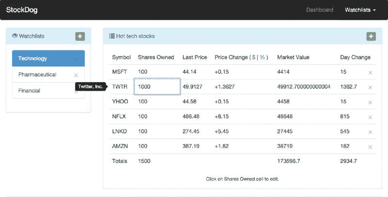

图 1.11

## 第 9 步：货币格式

此时，StockDog 的自选列表视图已完全可用。可以创建自选列表，并使用股票表格添加、删除和编辑股票，但数据的显示方式并不理想。在本节中，你将使用 Angular 内置的`currency`过滤器对显示的数字进行格式化，并创建一个新指令，根据数字反映的正负变化改变其颜色。

### 创建 StkSignColor 指令

首要任务是创建一个新的`stkSignColor`指令，你可以将其应用到现有元素上，将它们的显示颜色修改为红色或绿色。在终端中运行以下命令来骨架此指令：

```
yo angular:directive stk-Sign-Color
```

这会在你的`app/scripts/directives/`目录下创建一个命名为`stk-sign-color.js`的新文件。你可以在列表 1-18 中看到`stkSignColor`指令的完整实现。你可能首先注意到，与其使用`$scope.$watch()`，而是使用了`attrs.$observe()`来监听表达式的更改`[1]`。由于`$observe()`是`$attrs`对象的函数，它只能用于观察属性的值，这在情况下恰好是你所需要的。该指令的其他部分非常简单，因为它需要做的只是根据表达式的新值是正是负来更新`$element`的`style.color`属性`[2]`。

### 更新 StockTable 模板

向你的`stock-table.html`模板添加`stkSignColor`指令外，你还需要使用 Angular 内置的`currency`过滤器。虽然对 Angular 过滤器的深入讨论超出了本章的范围，但你继续操作需要知道的所有信息就是：过滤器用于对表达式的值进行格式化以便显示。过滤器可以用视图模板、控制器和服务，并且创建你自己的自定义过滤器非常简单。你可以使用此语法在视图模板的表达式上应用过滤器：`{{ expression | filter }}`。要了解更多关于内置过滤器的信息，请访问位于[`https://docs.angularjs.org/api/ng/filter`](https://docs.angularjs.org/api/ng/filter)的官方文档。在本节中你将使用`currency`过滤器，并带有默认参数。`currency`过滤器的完整语法如下：

```
{{ currency_expression | currency : symbol : fractionSize}}
```

由于`symbol`认为`$`且`fractionSize`认为当前区域的最大小数，使用`currency`过滤器几乎是轻而易举的。为`watchlist.marketValue`、`watchlist.dayChange`、`stock.lastPrice`、`stock.marketValue`和`stock.dayChange`表达式绑定添加`| currency`。然后你需要为你你想上色的每个`<td>`元素添加`stk-sign-color`属性，绑定到一个需要监听更改的值。在这种情况下，你想给底部的`watchlist.dayChange`单元格上色，以及表格中的价格变化和日内变化列。以下是将`stk-sign-color`指令应用于页脚`watchlist.dayChange`行的示例：

```
<td stk-sign-color="{{watchlist.dayChange}}">
  {{watchlist.dayChange | currency}}
</td>
```

将`stk-sign-color`指令应用到剩余两个单元格的任务将留给读者（你）来自行练习。一旦货币过滤器和`stk-sign-color`指令正确就位，你的应用程序看起来应该像图 1.12 所示。如果你发现在如何在标记语言的正确位置应用指令和`currency`过滤器时遇到困难，请参考本章配带代码中的`step-9`目录，或者查看 GitHub 仓库中相应的标签。


图 1.12

## 第 10 步：价格变化的动画

在本节中，你将学习如何使用 Angular 的`ngAnimate`模块对 StockDog 的自股列表视图执行动画的基础知识。为了向用户直观展示特定股票的价格走势——即价值发生了正变化还是负变化——将在整个单元格上执行红色或绿色的交叉融合（crossfade）。虽然使用 Angular 创建 JavaScript 和 CSS3 动画的完整讨论不在本章的范围内，但你可以通过访问官方文档获取更多信息：[`https://docs.angularjs.org/api/ngAnimate`](https://docs.angularjs.org/api/ngAnimate)。

### 创建 StkSignFade 指令

由于预期的结果是对整个表格单元格进行交叉融合，你需要创建另一个将作为属性使用的指令，以便它可以被放置到现有的元素上。开始之前，请在终端中运行以下命令：

```
yo angular:directive stk-Sign-Fade
```

这将在你的`app/scripts/directives/`目录中创建一个新的`stk-sign-fade.js`文件。与你在上一节中创建的`stkSignColor`指令一样，这个指令将非常短且直观。你可以在列表 1-19 中找到`stkSignFade`指令的完整实现。

注入到此指令中的唯一依赖是`$animate`服务，该服务由`ngAnimate`模块提供。正如你在`stkSignColor`指令中所看到的样，`$attrs.$observe()`用于监听赋值给`stkSignFade`的表达式的变化`[1]`。保留了一个对`oldVal`的本地引用，以便在后续变化中，可以与`newVal`进行比较并计算出适当的方向类`[2]`。在本例中，使用`$animate`服务来从指令元素中添加、然后快速移除`change-up`或`change-down` CSS 类。`$animate`服务接收元素、类名和回调函数作为参数，用于在执行添加动画后移除该类。在尝试在`stock-table.html`文件中使用此指令之前，你必须使用 Angular 要求的语法创建一些 CSS 类。将以下代码行添加到你的`app/styles/main.css`文件的顶部。这里还包含了其他用于修饰股票表格显示的样式：

```
/* 股票表格样式 */
.table {
  text-align: center;
  margin-bottom: 5px;
}
tfoot {
  font-weight: bold;
}
a {
  cursor: pointer;
}
span[disabled="disabled"] a {
  text-decoration: none;
  color: black;
}
span[disabled="disabled"] {
  pointer-events: none;
}

/* ngAnimate 动画样式 */
.change-up-add {
  transition: background-color linear 1.5s;
  background-color: green;
}
.change-up-add.change-up-add-active {
  background-color: white;
}
.change-down-add {
  transition: background-color linear 1.5s;
  background-color: red;
}
.change-down-add.change-down-add-active {
  background-color: white;
}
```

Angular 期望你为每个所需的动画类定义`*-add`和`*-add-active`类。在先前的示例中，`change-up-add`被立即应用，将背景设置为绿色。然后，在动画期间应用`change-up-add-active`类。在这种情况下，它通过 1.5 秒的 CSS 过渡将背景颜色设置为白色，最终创造出从绿色到白色的交叉融合效果。同样的方法也用于`change-down-add`，它用红色显示负向价格走势。

### 更新 StockTable 模板


现在你已经完成了 `stkSignFade` 指令并创建了 `ngAnimate` 模块预期的 CSS 类，是时候修改你的 `stock-table.html` 视图模板了。找到两个显示 `watchlist.marketValue` 和 `stock.lastPrice` 的 `<td>` 元素行，并分别为它们添加 `stk-sign-fade="{{watchlist.marketValue}}"` 和 `stk-sign-fade="{{stock.lastPrice}}"` 指令。

恭喜！你已经完全完成了 StockDog 的自股列表视图！查看图 1.13。如果你发现自己在让动画正常运行方面遇到困难，请参考本章配带代码中的 `step-10` 目录，或者查看 GitHub 仓库中相应的标签。


图 1.13

## 第 11 步：创建仪表盘

StockDog 应用中最后一个待实现的特性是仪表盘视图。该视图聚合了所有自股列表的性能指标，并在四个独特的面板中报告分析结果。这些性能指标是总市值、总日涨、按自股列表划分市值以及按自股列表划分日涨。由于没有交互图表的仪表盘是不完整的，你将利用 Google Charts 库来渲染两个图表。

### 更新 Dashboard 控制

要在你的 AngularJS 应用中使用 Google Charts 库，你需要通过指令封装并暴露其功能。为了简单起见，你将使用一个已经完成工作的库，其文档可以在此处找到：[`https://github.com/bouil/angular-google-chart`](https://github.com/bouil/angular-google-chart)。开始使用 `angular-google-chart` 库之前，请在终端中运行以下命令使用 Bower 安装它：

```bash
bower install angular-google-chart –save
```

这将下载并安装库。它还将作为项目依赖列在你的 `bower.json` 文件中。完成后，你需要通过更新 `stockDogApp` 模块依赖在你的 AngularJS 应用中注册此库。你可以通过在 `app/scripts/app.js` 文件的依赖数组末尾添加 `googlechart` 来实现，方法就像在本章之前第 2 步列表 1-1 中注册 AngularStrap 库一样。完成后，打开位于 `app/scripts/controllers/` 目录下的 `dashboard.js` 文件，并将其内容替换为列表 1-20 所示的最终实现。

为了该 `DashboardCtrl` 的实现，`WatchlistService` 和 `QuoteService` 都被作为依赖注入。接下来，进行了一些初始化，使用 `WatchlistService` 填充 `$scope.watchlists` 变量，同时定义了图表样式和格式选项 `[1]`。随后创建了一个 `updateCharts()` 函数 `[2]`，它设置了 `donutChart`（环形图）和一个 `columnChart`（柱状图）。这些对象所需的属性和可用配置选项由 Google Chart 库定义，可以在此处找到 [`https://developers.google.com/chart/`](https://developers.google.com/chart/)。该函数还会处理遍历 StockDog 跟踪的每个自列表，并将适当的数据添加到相应的图表对象上 `[3]`，然后将两个图表结构附加到控制器的 `$scope` 上。接着定义了一个 `reset()` 函数 `[4]`，用于清除控制器的状态。该函数在为每个现有列表注册每只股票之前 `[5]`，会先从 `QuoteService` 中清除所有跟踪的股票。然后它注销所有现有的 `$watch` 监听器（其引用存储在本地数组中），最后在每个列表的 `marketValue` `[6]` 上创建新的 `$watch` 目标。这被用于调用 `recalculate()` 函数 `[7]`，该函数在每个列表的计算值发生变化时，负责计算新的聚合市值和日内变动指标。

每当调用 `recalculate()` 时，都会调用 `updateCharts()`，以便 Google Chart 库使用最新数据重绘现有的图表。最后，在 `watchlists.length` 属性上设置了一个 `$watch` 目标，这样当创建或删除列表时，就可以触发 `reset()` 函数来恰当地重建整个控制器的状态 `[8]`。值得提到的是，使用 `watchlists.length` 表达式而不是整个 `watchlists` 对象，是因为深度监听大型数据结构会严重降低应用程序的性能。

### 更新仪表板视图

既然 `DashboardCtrl` 的实现已经完成，接下来的工作是更新 StockDog 的仪表板视图，以渲染创建的新数据和图表对象。目前，`app/views/dashboard.html` 文件仅包含对 `stkWatchlistPanel` 指令的引用和一个空的投资组合概览（Portfolio Overview）面板。你可以在列表 1-21 显示的完整仪表板视图中找到此面板缺失的标记。

`panel-body` 内部的新标记首先包含了一些实用的文本，引导首次打开 StockDog 且尚未创建任何列表的新用户 `[1]`。你还应该注意到，顶行的两列都包含对 `stkSignFade` `[2]` 和 `stkSignColor` `[3]` 指令的引用，但这些指令被应用了一个包装元素——在本例中，是 Bootstrap 的 wells 容器。最后，由之前安装的 `angular-google-chart` 库暴露的 `googleChart` 指令被用于底行的两列，其中在 `DashboardCtrl` 中创建的图表对象被用作每个元素 `chart` 属性的值 `[4]`。为了完善完成仪表板视图，你唯一需要做的额外修改是在你的 `app/styles/main.css` 文件的顶部添加以下 CSS：

```css
/* Dashboard View 样式 */
.well {
  background-color: white;
  text-align: center;
}
```

恭喜！如果你成功完成了这整个章节，那么你终于完成了整个 StockDog 应用程序的构建！请查看图 1.14。花点时间欣赏你的辛劳，并通过创建几个新列表、添加新股票以及从仪表板视图监控你的投资组合性能来玩玩这个应用程序。对于完整的应用程序源码，请参阅本章节辅助代码中的 `step-11` 目录，或者查看 GitHub 仓库对应的标签。

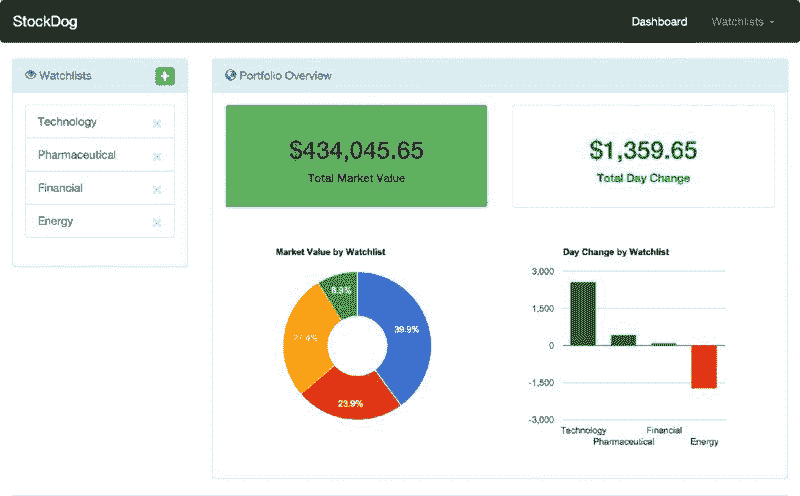

**图 1.14**

## 生产部署

现在你已经完成了 Stock 的构建，是时候大显身手，并在部署到互联网之前对可分发的应用程序进行打包了，以便全球世界的用户能够更好地管理他们的股票投资组合。虽然对生产部署及所有相关细节的深入讨论超出了本节的范围，但有一些简单的任务可以完成，以让你的应用程序为大众做好准备。

由于你的应用程序是使用 AngularJS Yeoman 生成器开发的，你的项目已经包含了一个复杂的构建系统。你将在第 3 章“架构”中学习更多关于该系统如何工作的知识，但现在，只需从终端运行以下命令来执行构建系统：

```bash
grunt build
```

这会将合并、混淆并压缩 StockDog 的所有源文件，并在项目的根文件夹中创建一个新的 `dist/` 目录，其中包含优化后的资源。`dist/` 目录包含了用户运行应用程序所需的所有内容，因此部署只需将此文件夹上传到你选择的托管服务即可。然而，为了本节的目的，你把 StockDog 部署到 GitHub Pages，这是一个为基于 GitHub 项目提供的免费托管服务。如果你还没有将项目上传到 GitHub，请花几分钟完成上传，如果需要帮助，请参考 [`https://help.github.com/articles/adding-an-existing-project-to-github-using-the-command-line/`](https://help.github.com/articles/adding-an-existing-project-to-github-using-the-command-line/)。

在本章的学习中，你通过构建 StockDog 接触了 AngularJS 的真实世界应用，该应用程序利用了框架几乎的所有核心组件。从使用 Yeoman AngularJS 生成器搭建项目脚架，到使用 GitHub Pages 部署你的应用程序，这份循序渐变的指南应该带给你信心和即时满足感，激发你对这个优雅框架进行更深入的探索。在此过程中，你学习了如何构建多视图单页应用；创建了多个控制器、指令（directives）和服务（services）；安装了额外的前端模块；处理了动态表单验证；与外部 API 通信；并通过简单的动画让你的应用程序运行起来。在本书接下来的章节中，你将详细探索 AngularJS 框架各种组件的功能，并接触到各种工具、服务和技术，它们可用于创建健壮、可靠且易于维护的专业级项目。

# 2 智能工作流与构建工具

## 你在本章将学到什么：

- 使用 Bower 管理前端依赖
- 使用 Grunt/Gulp 自动化开发任务
- 使用 Yeoman 搭建新项目架构
- 使用工作流最佳实践提高生产力

### 本章 WROX.COM 代码下载

你可以在“Download Code”选项卡中找到本章的 WROX.COM 代码下载地址：`http://www.wrox.com/go/proangularjs`。

## 工具能我做什么什么？

两个词：优化和自动化。因为时间是生产力的关键因素，自动化重复任务可以帮助你作为开发者保持高效工作。在本章中，你将学习一些开源工具，它们可以提高你开发、调试、测试和分发应用程序的速度。通过将“不要重复自己”（DRY）理念扩展到你的工作流流程中，你可以投入更多精力专注于你热爱的事情上：构建优雅、严密的代码。在发现如何智能地应用现代技术来增强你的工作流之后，你将建立起坚实的基础，用于构建一个允许你深入探索 AngularJS 的示例应用程序。

## 什么是 BOWER？

Bower 由 Twitter 创建，是一个“Web 端的包管理器”，为前端包管理问题提供了一个优雅且不带主观偏见的解决方案。Bower 作为 Node.js 命令行工具分发，它通过提供与包无关的机制来搜索、安装和更新你的第三方资产，帮助你管理前端 JavaScript 依赖项。

### 开始使用 Bower

Bower 的管理功能基于 Git 运行（从 1.3.X 版本开始支持 SVN），用于获取和安装包，因此确保你的系统中已安装了它。Mac 用户电脑上应该有了 Git。对于 Windows 用户，建议下载 Git Bash（`http://git-scm.com/downloads`）。

要开始使用 Bower，请使用 Node.js 自带的包管理器（`npm`）工具全局安装它。打开你选择的终端应用程序并运行此命令：

```bash
npm install –g bower
```

这使得你可以通过命令行使用 `bower` 工具。你可以继续运行 `bower help` 查看支持的命令列表，然后再仔细查看如何使用其中一些命令来管理你的前端依赖项。

### 搜索包

Bower 维护着包含大量 JavaScript 库的注册表，可以通过 `bower search [<package>]` 命令或访问 `http://bower.io/search/` 轻松搜索。在命令行运行以下命令：

```bash
bower search angular
```

这会列出所有通过 Bower 可用的 AngularJS 库。由于任何人都可以创建并向注册表发布新包，你很可以使用 Bower 管理绝大多数甚至所有的第三方依赖项。

### 安装包

使用 Bower 安装包就像运行 `bower install <package>` 一样简单。因为 Bower 的目标是与包无关，`<package>` 可以映射到已注册的 Bower 包名称、公共或私有的 Git 或 Subversion 仓库、本地目录，甚至是指向文件的统一资源定位符（URL）。要查看支持的 `<package>` 变体的完整列表，请访问 `http://bower.io/`。现在通过一个示例开始：创建一个新目录，然后运行以下命令安装最新稳定版本的 AngularJS：

```bash
bower install angular
```

注意，Bower 创建了一个名为 `bower_components` 的本地目录，并在其中下载并安装了 AngularJS 库。在继续这个应用程序之前，你将查看如何通过跟踪版本来锁定依赖项。

### 依赖项的版本

为了更好地跟踪第三方依赖项，你可以创建一个 `bower.json` 文件，其中包含所需库的名称和版本。它的原理与 Node 的 `package.json` 文件以及 Ruby 的 `Gemfile` 非常相似。由于 Bower 使用 Node.js 语义化系统（`http://semver.org`），你可以按照位于 `https://github.com/npm/node-semver` 的文档网站的描述，在指定项目依赖时创建复杂的范围。Bower 附带了一个交互式命令，包含生成默认文件的提示。只需在项目的根目录下运行以下命令即可：

```bash
bower init
```

现在你已经有了一个基础的 `bower.json` 文件，你可以将 AngularJS 作为依赖项添加，并使用单个命令用最新版本（`--force-latest`, `-F`）更新你的文件（`--save`, `-S`）：

```bash
bower install -SF angular
```

如果不希望将第三方库提交到版本控制，你的版本控制系统可以跟踪此文件，只需运行 `bower install` 即可安装所有列出的依赖项。虽然这取决于个人喜好，但建议遵循 Bower 主页上的最佳实践建议：“如果你不是编写供他人使用的包（例如你正在构建 Web 应用），你应该始终将安装的包提交到源码。”

## 什么是 GRUNT？

Grunt 是一个任务运行器，有助于自动化代码检查、编译、压缩、测试、文档和部署等重复工作。它是 Rake、Cake、Make 和 Ant 的 JavaScript 替代方案。Grunt 作为 Node.js 命令行工具打包，并受到活跃插件生态系统的支持，它可以通过自动化大部分枯燥工作来增强你的工作流，让你专注于构建应用程序。

### 开始使用 Grunt

开始使用 Grunt 自动化你的工作流的第一步是在你的机器上全局安装命令行工具。为了让 `grunt` 工具可用，请从命令行运行：

```bash
npm install –g grunt-cli
```

接下来，你需要一些示例文件进行实验。使用你喜欢的编辑器创建列表 2-1 所示的 `index.html`。为了让应用程序资产集中在一个位置，请将它们放入名为 `app/` 的新目录中。

为了让你的示例更有趣，创建下方 2-2 所示的 Less 样式表，尽管你完全也可以选择使用 Sass（另一种层叠样式表预处理器）。

最后，你需要创建一个像列表 2-3 所示的基础 AngularJS 应用程序，带有一个控制器，以便在 `index.html` 页面上显示本章涵盖的工具列表。

你为项目需要做的最后一件事是创建一个 `package.json` 文件，该文件可以存储你的开发依赖项列表。你可以在项目根目录下运行以下命令，通过交互方式完成此操作：

```bash
npm init
```

只需按照提示操作，你就会获得一个基础的包文件。现在你已经有了一些基础资源，可以准备安装一些插件并开始构建你的第一个 `Gruntfile.js` 来增强你的开发工作流了。

### 安装插件

在目前的配置下，每当修改文件时，你都必须手动将 Less 文件编译为 `main.css` 并在浏览器中重新打开 `index.html`。对于像这样简单的应用程序来说，这看起来似乎不是什么很糟糕的任务，但随着其复杂性的增加，这种手动工作将很快变得枯燥乏味。为了自动化整个过程，你需要使用几个插件。在命令行中运行以下命令，将插件作为开发依赖项安装到项目中：

```bash
npm install --save-dev grunt
npm install --save-dev load-grunt-tasks
npm install --save-dev grunt-contrib-connect
npm install --save-dev grunt-contrib-jshint
npm install --save-dev grunt-contrib-less
npm install --save-dev grunt-contrib-watch
```

如果你查看你的 `package.json` 文件，它现在应该包含 `devDependencies` 属性下的所有已安装的 Grunt 插件。

## 目录结构

在创建第一个 Gruntfile 之前，花一分钟查看你当前的目录结构，确保没有缺少任何应用程序文件、Grunt 插件和 Bower 依赖项。如果你一直在跟着操作，你的文件系统结构应该如下：

```text
root-folder/
├── package.json
├── bower.json
├── .bowerrc
├── app/
│   ├── index.html
│   ├── main.less
│   ├── app.js
│   └── bower_components/
│       └── angular/
└── node_modules/
    ├── grunt/
    ├── grunt-contrib-connect/
    ├── grunt-contrib-jshint/
    ├── grunt-contrib-less/
    ├── grunt-contrib-watch/
    └── load-grunt-tasks/
```


你刚刚安装的 Grunt 插件位于`node_modules/`文件夹中。你使用`.bowerrc`文件配置 Bower，以便将 Angular.js 模块资源安装在你的`app/`目录下。如果你的目录结构不完全匹配，请花点时间回顾“Grunt 入门”部分。在配置第一个 Gruntfile 时，你将使用上述详细的目录结构。

## Gruntfile

`Gruntfile.js`文件应该位于项目的根目录，与`package.json`文件处于同一级，并应该与其他源代码一起提交。你可以通过从列表 2-4 中的简单骨架开始从头创建一个 Gruntfile，来观察它的各个组件。

Gruntfile 的四个主要部分在列表 2-4 内部已通过注释进行了标记。你所有的 Grunt 代码必须存在于`[1]`，即包装函数内部。项目和任务配置属性都传递给`[2]`，即`grunt.initConfig()`方法。要配置由安装的插件提供的任务，你必须显式地要求 Grunt 加载每个插件`[3]`。最后，你可以注册自定义任务`[4]`，这些任务可以运行一组预定义的任务组合。当你从命令行运行`grunt`时，会执行默认任务。

## 配置任务和目标

现在你已经有了一个骨架 Gruntfile 并理解了它的基本结构，可以开始配置 Grunt 任务和目标（targets）。每当运行任务时，Grunt 会在同名属性下查找其配置。任务可以有多个目标，每个目标都有自己的配置选项。在本节中，你将配置由之前安装的四个特定插件提供的任务，检查它们如何结合起来实现简单工作流的自动化。

#### Connect 任务

作为开发依赖项安装的`grunt-contrib-connect`插件暴露了`connect`任务，你可以在 Gruntfile 中配置它。该插件允许你作为工作流的一部分启动轻量级 Node.js 服务器，用于处理应用程序资源的提供。通过在`grunt.initConfig`方法内部添加以下内容修改你的 Gruntfile：

```
// 从 'grunt-contrib-connect' 配置 'connect' 任务
connect: {
  //[1] 任务选项，覆盖内置默认值
  options: {
    port: 9000,
    open: true,
    livereload: 35729,
    hostname: 'localhost'
  },
  //[2] 任意命名的目标
  development: {
    // 目标选项，覆盖任务选项
    options: {
      middleware: function(connect) {
        return [
          connect.static('app')
        ];
      }
    }
  }
}
```

配置 Grunt 插件只需向传递给`grunt.initConfig()`的 JavaScript 对象中添加一个与插件名称匹配的新属性即可。在每个任务配置内部，你可以指定一个覆盖内置默认值的新目标`[1]`。由于你的应用程序文件位于`app/`，你需要告诉你的`development`目标`[2]`提供静态资源。你通过将`options`对象的`middleware`属性设置为返回`connect.static('app')`调用来实现这一点。

现在你已经完成了对`connect`任务和`development`目标的配置，你可以启动本地开发服务器并在浏览器中打开`http://localhost:9000/`应用程序。

从命令行执行 Grunt 任务的语法遵循此处所示的`taskName:targetName:args`模式。你可以指定多个参数，但必须用冒号分隔。为了让 connect 服务器无限运行，你可以向`connect`任务传递`keepalive`参数。有关完整的配置选项和参数列表，请访问文档站点 https://github.com/gruntjs/grunt-contrib-connect。

#### Less 任务

现在你已经为静态资源准备了轻量级 Web 服务器，来看看如何为 Less 文件设置编译任务。如果你一直在跟着操作，你应该注意到你唯一的样式定义在`main.less`中。但由于`index.html`引用了尚未存在的`main.css`，因此没有样式应用到你的应用程序上。通常，你需要安装 Less 命令行编译器并在每次修改时调用它，如下所示：

```
npm install -g less
lessc app/main.less > app/main.css
```

然而，你之前安装的`grunt-contrib-less`插件暴露了一个`less`任务，允许你配置并自动化编译过程。通过在`connect`任务配置之后添加以下行修改你的 Gruntfile：

```
// 从 'grunt-contrib-less' 配置 'less' 任务
less: {
  development: {
    files: {
      'app/main.css': 'app/main.less'
    }
  }
}
```

在这里，你可以在`less`任务的`development`目标的`files`属性中指定将`main.less`转换成`main.css`。要触发此任务，请按照之前描述的模式并在命令行中运行以下命令：

```
grunt less
```

这应该会在你的`app/`目录下创建一个`main.css`文件。虽然你现在有了一个配置妥的 Less 编译任务，但每次修改`main.less`文件时，你仍然需要运行`grunt less`。在接下来的章节中，你将学习如何使用`grunt-contrib-watch`插件来自动化此任务。有关`less`任务可用配置选项的完整列表，请访问插件文档页[`https://github.com/gruntjs/grunt-contrib-less`](https://github.com/gruntjs/grunt-contrib-less)。

## JSHint 任务

JSHint 是一个开源的静态代码分析工具，它可以检测你的 JavaScript 代码中的错误和潜在问题，并帮助执行编码规范。这种静态分析过程通常被称为`linting`（代码检查），应该被视为任何工作流和构建系统中不可或缺的一部分。你安装的`grunt-contrib-jshint`插件暴露了一个可配置的`jshint`任务，它可以作为你 Grunt 工作流系统的一部分进行自动化。请通过在 Gruntfile 中的 less 任务之后添加以下代码，查看如何检查你的 JavaScript 文件：

```
// 从 'grunt-contrib-jshint' 配置 'jshint' 任务
jshint: {
  options: {
    jshintrc: '.jshintrc'
  },
  all: [
    'Gruntfile.js',
    'app/*.js'
  ]
}
```

在这里，你通过一个任务级选项配置了`jshint`任务来查找`.jshintrc`文件，这允许你自定义 JSHint，并配置了一个名为`all`的目标，在其中指定你想要检查的 JavaScript 文件。除了显式引用每个文件外，还支持正则表达式。列表 2-5 显示了一个包含常用偏好的`.jshintrc`文件示例，这可以作为一个非常有用的起点。要查看所有支持的配置选项的详细列表及其文档，请访问[`http://www.jshint.com/docs/options/`](http://www.jshint.com/docs/options/)。

现在你已经使用`.jshintrc`文件配置了项目的代码检查设置，请触发 Grunt`jshint`任务并查看输出：

```
$ grunt jshint
Running "jshint:all" (jshint) task

   Gruntfile.js
      5 |  grunt.initConfig({
           ^ Missing "use strict" statement.
   app/app.js
      3 |angular.module('Workflow', [])
         ^ 'angular' is not defined.

>> 2 errors in 2 files
Warning: Task "jshint:all" failed. Use --force to continue.

Aborted due to warnings.
```

在这里你可以看到 JSHint 在你的两个 JavaScript 文件中都报告了错误。第一个错误可以通过在 Gruntfile 顶部添加`'use strict';`来轻松修复。要修复第二个错误，请更新你的`.jshintrc`文件以包含配置选项`"predef": ["angular"]`，以便 JSHint 将`angular`识别为全局定义变量。从命令行重新运行`jshint`任务，以验证你的两个 JavaScript 文件都通过检查。有关`jshint`任务可用配置选项的完整列表，请访问插件文档页[`https://github.com/gruntjs/grunt-contrib-jshint`](https://github.com/gruntjs/grunt-contrib-jshint)。

## Watch 任务

`grunt-contrib-watch`插件暴露了一个`watch`任务，可以轻松配置为当被监听的文件模式被添加、更改或删除时运行预定义的任务。这允许你自动化执行其他任务，并为作为工作流一部分设置 livereload 集成提供了最后一步（这在配置`connect`任务时最初讨论过）。通过在 Gruntfile 中的`jshint`任务之后添加以下代码，将你到为止创建的所有任务整合在一起：

```
// 从 'grunt-contrib-watch' 配置 'watch' 任务
watch: {
  options: {
    livereload: '<%= connect.options.livereload %>',
  },
  js: {
    files: ['app/*.js'],
    tasks: ['jshint']
  },
  styles: {
    files: ['app/*.less'],
    tasks: ['less']
  },
  html: {
    files: ['app/*.html']
  }
}
```

注意，在这里你使用了任务级`option`属性，以便所有后续配置的目标都启用了 livereload。然后你为每组想要监听修改的文件集创建一个新目标。在`js`和`styles`目标内部，你指定了两个选项：文件模式数组以及当被监听的文件被修改时要执行的任务数组。`html`目标没有指定任何要运行的任务，因为目前在你的工作流，除了提供服务之外，你还没有对超文本标记语言（HTML）文件进行任何操作。从命令行运行`grunt watch`然后修改 JavaScript 或 Less 文件，现在应该会自动分别触发`jshint`和`less`任务。有关`watch`任务可用配置选项的完整列表，请访问插件文档页[`https://github.com/gruntjs/grunt-contrib-watch`](https://github.com/gruntjs/grunt-contrib-watch)。

## 任务

虽然单独运行 watch 任务很有帮助，但为了完成简单工作流的设置，你需要运行`connect`服务器，以便 livereload 能够正常工作。要实现这一点，你必须通过调用`grunt.registerTask()`函数向 Grunt 注册一个新的别名任务。该方法接受`taskName`和`taskList`作为参数，其中`taskList`必须是一个要运行的任务的数组。将 Gruntfile 底部注册的默认任务修改如下：

```
// Default Task
grunt.registerTask('default', ['connect:development', 'watch']);
```

在你使用 Ctrl+C 结束之前运行的`watch`任务后，在命令行中运行以下命令来启动`default`任务：

```
grunt
```

这应该启动 connect 服务器并在新的浏览器标签页中打开你的应用程序实例。继续通过在`<body>`标签之后添加`<p>Hello Grunt</p>`来修改`index.html`文件。在文件保存后，Grunt 应该能检测到此更改并通知 livereload 服务器发送消息请求客户端重新加载此文件。搞定！不需要在每次修改后都点击浏览器中的刷新按钮。尝试将`main.less`文件中`<h1>`元素的颜色从`SteelBlue`改为`Red`。观察 Grunt 将其编译为`main.css`文件并让 livereload 自动更新你的 DOM。最后，在`app.js`内部的`$scope.tools`数组中添加`'Gulp'`，观察 Grunt 使用 JSHint 检查它并更新你的浏览器标签页。

### 创建自定义任务

你已经看到了如何使用一些插件提供的简单配置选项，这些插件可以轻松用于自动化常见的工作流任务。然而，如果你想创建一个不依赖于现有插件的自定义任务，你可以自由这样做，因为 Grunt 是使用 Node.js 运行的。你可以轻松将你编写的任何 JavaScript 代码插入到当前的工作流中，如下所示展示了 Grunt 提供的有助于创建自定义任务的一些有用机制：

```javascript
// Custom task
grunt.registerTask('myTask', 'My custom task', function(one, two) {
  // 强制任务在异步模式运行并保存句柄用于回调
  var done = this.async();

  setTimeout(function() {
    // [1] 访问任务名称和参数
    grunt.log.writeln(this.name, one, two);

    // [2] 如果属性不存在则失败
    grunt.config.requires('connect.options.livereload');

    // [3] 访问配置属性
    grunt.log.writeln('The livereload port is '
      + grunt.config('connect.options.livereload'));

    // 异步成功
    done();

    // [4] 运行其他任务
    grunt.task.run('default');
  }.bind(this), 1000);
});
```

此示例在`Grunt`中注册了一个名为`myTask`的任务，它接受两个参数并包含一个自定义描述。为了演示在异步模式下运行的任务，调用了`this.async()`，并在`setTimeout()`调用内部执行其余代码，通过调用`done()`实现异步成功。在这里，使用了辅助函数来访问任务名称和参数`[1]`，在特定配置属性不存在时失败`[2]`，并访问之前定义的`Grunt`配置选项`[3]`。指示自定义任务运行其他工作流任务也是可能的，如`[4]`所示。你可以像本章前面提到的那样使用冒号分隔的参数来调用此自定义任务。该任务的调用和输出所示：

```
$ grunt myTask:Hello:World
Running "myTask:Hello:World" (myTask) task
myTask Hello World
The livereload port is 35729

Running "connect:development" (connect) task
Started connect web server on http://localhost:9000

Running "watch" task
Waiting...
```

现在你已经了解了如何注册自定义任务并利用一些内置辅助函数，你通过`Grunt`所能实现的唯一限制将取决于`JavaScript`中可以编写的内容，所以在这里是无所可能的！列表 2-6 显示了完整的`Gruntfile`，它自动化了在本节中配置的所有工作流任务，以及之前描述的自定义任务。在下一节中，你使用`Gulp.js`创建一个类似的工作流，这是另一个流行的开源`JavaScript`构建系统，设计具有不同的哲学原则。

# 什么是 GULP？

`Gulp`是另一个流行的工作流自动化工具，它提供了一个使用`Node.js`流的流式构建系统，并采用“代码优于配置”。这种方法通过消除对大型配置文件的需求，简化了复杂任务的管理。与`Grunt`类似，`Gulp`提供了一个命令行工具，用于运行由不断发展的插件社区创建的任务，以及使用`JavaScript`开发的自定义任务。

### 开始使用 Gulp

要开始尝试`Gulp`及其优雅简单的应用程序编程接口 (API)，你需要做的第一件事是在你的机器上全局安装该命令行工具。为了能够访问`gulp`工具，请从命令行运行以下命令：

```bash
npm install –g gulp
```

### 安装插件

在本节中，你将使用`Gulp`的插件生态系统创建与本章早期使用`Grunt`构建的相同工作流。使用的是`Gulp`。现在你已经全局安装了`Gulp`，请通过在命令行运行以下命令来安装完成此任务所需的插件和模块：


```bash
npm install --save-dev gulp
npm install --save-dev gulp-load-plugins
npm install --save-dev gulp-livereload
npm install --save-dev gulp-less
npm install --save-dev gulp-jshint
npm install --save-dev jshint-stylish
npm install --save-dev opn
npm install --save-dev connect
npm install --save-dev connect-livereload
```

通过打开你的`package.json`文件并检查`devDependencies`属性，验证前面的代码列出的插件是否已作为开发依赖添加。成功安装所有所需的插件后，下一步是创建你的第一个`Gulpfile`。

### Gulpfile

`Gulpfile.js`文件类似于你在本章早期创建的`Gruntfile.js`，它属于你的项目根目录，与`package.json`文件处于同一级目录。它应该与你的其他源代码一起提交。列表 2-7 包含一个骨架`Gulpfile.js`，你将在接下来的章节中通过配置各种任务在此基础上构建。

如列表所示，骨架`Gulpfile`由`[1]`要求`Gulp`库、`[2]`加载`package.json`文件列出的所有插件以及`[3]`注册特定任务组成。与`Grunt`一样，当你从命令行运行`gulp`时，将执行`default` `Gulp`任务。由于`Gulp`推崇约定优于配置的原则，你会发现没有相当于`Grunt`中`initConfig()`的`Gulp`版本。现在你已经看到了`Gulpfile`的三个主要部分，可以直接开始编写你的第一个`Gulp`任务了。

### 创建任务

`Gulp`任务的结构遵循`gulp.task(name, deps, fn)`形式，由一个名称、可选依赖和一个执行所需操作的函数组成。名称用于从命令行直接调用任务，可选依赖数组可以包含在函数运行之前应该执行的任务名称。在本节中，你将利用安装的每个 Gulp 插件创建一个用于资源、编译样式表和检查 JavaScript 文件的自动化工作流。

#### Connect 任务

你可能注意到并不是安装的所有模块都是 Gulp 插件。因为`Gulp`采用更具编程性的方式来自动化工作流，因此直接使用 Node.js 模块通常非常简单。你即将实现的`connect`任务正是如此。通过在加载 Gulp 插件后添加以下代码来修改`Gulpfile`：

```javascript
// 用于启动 Web 服务器的 'connect' 任务
gulp.task('connect', function () {
  var connect = require('connect');
  var app = connect()
    .use(require('connect-livereload')({ port: 35729 }))
    .use(connect.static('app'))
    .use(connect.directory('app'));

  require('http').createServer(app)
    .listen(9000)
    .on('listening', function () {
      console.log('Started connect web server on http://localhost:9000');
    });
});
```

当你使用`Grunt`配置此任务时，`grunt-contrib-connect`插件底层使用了`connect`和`connect-livereload` Node.js 模块并相应暴露了配置选项。遵循`Gulp`约定优于配置的哲学，上述代码与这两个模块交互以实现所需的功能。通过`.use()`函数实例化了一个带有三个中间件插件的新 Connect 服务器。这些处理程序在输出请求中注入 livereload 代码段、提供静态资源并使目录本身可浏览。完成`connect`任务实现后，请从命令行运行以下命令：

```bash
gulp connect
```

打开浏览器打开`http://localhost:9000/`应该显示在本章早期创建的应用程序。尽管这个简单的 Connect 实例应该满足你大部分的工作流自动化需求，但你可以通过访问文档站点`http://www.senchalabs.org/connect/`找到所有绑定的 Connect 中间件插件的完整列表。

#### Less 任务

接下来是创建`less`任务，它允许 Gulp 将你的 Less 文件编译为 CSS。由于你应该已经安装了`gulp-less`插件，`less`任务的实际实现将非常简单。在你的 Gulpfile 中实现`connect`任务之后，添加以下代码：

```
// 'less' task for compiling styles
gulp.task('less', function () {
  return gulp.src('app/*.less')
    .pipe($.less({ paths: 'app' }))
    .pipe(gulp.dest('app'));
});
```

该任务执行的第一件事是调用`gulp.src()`，它接受一个通配符（glob）并返回一个文件结构流，该流可以被传递给其他插件。`Globbing`（通配）是一个允许使用 Shell 模式和正则表达式来匹配文件的概念。随后调用 Node.js 的`Stream.pipe()`函数将文件流重定向到`gulp-less`插件（该插件位于变量`$`命名空间下），并指定所需的`app/`目录作为路径。此时，输出流包含了编译后的 CSS，然后调用接受路径的`gulp.dest()`将该流写入文件。当你使用`gulp.dest()`时，不存在的文件夹会自动创建。由于`gulp-less`插件维护了文件夹结构并处理输出文件的重命名，指定的路径被用作目录。通过命令行运行以下命令来执行完成的`less`任务：

```
gulp less
```

这会将你`app/`目录下的任何 Less 文件编译为各自相应的 CSS。值得注意的是，由于`Less`既是一个 Node.js 模块也是一个命令行工具，它暴露了一个 API 可以在代码中进行程序化使用。这意味着你的 Gulp `less`任务技术上可以直接使用该模块实现，但`gulp-less`插件已经为你承担了大部分工作，这使得入门门槛变得更简单。你可以通过访问插件文档页面[`https://github.com/plus3network/gulp-less`](https://github.com/plus3network/gulp-less)获取`gulp-less`可用性的完整列表。

## JSHint 任务

由于对 JavaScript 文件进行 linting（代码检查）是任何严肃前端构建系统的重要部分，你将使用早些安装的`gulp-jshint`插件来为你的 Gulp 工作流添加此功能。请在 Gulpfile 中`less`任务之后添加以下代码，来实现`jshint`任务：

```
// 'jshint' task for linting JS files
gulp.task('jshint', function () {
  return gulp.src('app/*.js')
    .pipe($.jshint())
    .pipe($.jshint.reporter(require('jshint-stylish')));
});
```

在这里，`app/*.js`通配符模式被传递给`gulp.src()`，这样你 app/ 目录下的所有 JavaScript 文件都会被读取，并表示为一个流，该流可以传递给`gulp-jshint`插件（通过`$.jshint()`访问）。注意，这里不需要将输出写入磁盘，因此在这种情况下使用`gulp.dest()`是没有必要的。值得一提的是，由于此任务实现函数返回一个 Node.js 流，Gulp 会异步地检查你的 JavaScript 文件。在命令行中运行以下命令来执行完成的`jshint`任务：

```
gulp jshint
```

此时，lint 过程的输出应该不显示任何错误。为了演示 lint 错误，请从你的`app/app.js`文件中删除`'use strict';`行并重新运行`jshint`任务。你应该注意到输出的格式与调用`grunt jshint`时不同。这是因为 JSHint 被配置为使用在本节早些安装的`jshint-stylish`报告器，而不是内置的默认报告器。将注册报告器的代码行替换为以下内容：

```
.pipe($.jshint.reporter('default'));
```

重新运行 Gulp `jshint`任务现在应该产生不同的结果。如你所见，JSHint 报告器改变了错误的格式化方式。在这种情况下，`jshint-stylish`报告器将错误消息分为多行，并对部分内容着色以便于阅读。你可以在[`http://jshint.com/docs/reporters/`](http://jshint.com/docs/reporters/)找到创建适合个人需求的自定义报告器的信息。在继续实现`watch`任务之前，请务必相应地还原对`app/app.js`文件和`jshint`任务的更改。要查看`gulp-jshint`插件所有支持调用的详细列表，请访问[`https://github.com/spenceralger/gulp-jshint`](https://github.com/spenceralger/gulp-jshint)。

## Watch 任务

在 Grunt 中你必须安装并配置`grunt-contrib-watch`插件，而 Gulp 通过`gulp.watch()`函数直接在其 API 中内置了文件监听功能。要使用 watch 功能自动执行之前定义的任务，你需要在 Gulpfile 中在`jshint`任务之后添加以下行代码：

```
// 'watch' task for responding to file modifications
gulp.task('watch', function () {
  // 在默认端口 35729 上启动一个 livereload 服务器
  $.livereload.listen();

  // 监听变化并通知 LR 服务器
  gulp.watch([
    'app/*.html',
    'app/*.css',
    'app/*.js'
  ]).on('change', function (file) {
    $.livereload.changed(file.path);
  });

  // 在指定文件变化时运行 gulp 任务
  gulp.watch('app/*.js', ['jshint']);
  gulp.watch('app/*.less', ['less']);
});
```

`watch`任务执行的第一件事是使用之前安装的`gulp-livereload`插件在默认端口上启动 livereload 服务器。之后，调用了`gulp.watch()`并传入一个需要监控修改的文件通配符模式数组。由于`gulp.watch()`返回一个触发`change`事件的 Node.js `EventEmitter`，因此链式调用了`EventEmitter.on()`函数，以便通知 livereload 服务器随后的文件修改。这是通过带有修改文件的路径调用插件的`changed()`函数实现的。此时，`watch`任务已设置好用于监控 HTML、CSS 和 JavaScript 文件的变化，并能够与 livereload 服务器通信，以便更新可以自动传播到所有连接的浏览器。然而，为了利用之前定义的`jshint`和`less`任务，还需要额外调用两次`gulp.watch()`，指示 Gulp 在 JavaScript 和 Less 文件变化时运行这些任务。在命令行运行`gulp watch`然后修改 JavaScript 或 Less 文件，现在应该会自动触发`jshint`和`less`任务。要获取可用 Gulp API 函数的完整列表，请访问文档页面[`https://github.com/gulpjs/gulp/blob/master/API.md`](https://github.com/gulpjs/gulp/blob/master/API.md)。

## 默认任务

正如你之前在本章中设置的 Grunt 工作流一样，你需要配置默认 Gulp 任务以运行`connect`和`watch`任务，以实现更自动化的解决方案。为了实现这一点，请将 Gulpfile 底部的`default`任务修改为如下所示的代码：

```
// Default task - 通过 'gulp' 运行
gulp.task('default', ['connect', 'watch'], function () {
  require('opn')('http://localhost:9000');
});
```

注意，此`gulp.task()`调用使用了一个可选的任务依赖数组，这些任务会在任务实现函数运行之前执行并完成。在`connect`和`watch`任务执行后，将使用之前安装的`opn`库在默认浏览器中打开此示例应用程序。在 Grunt 的情况下，此功能是由`grunt-contrib-connect`插件的可配置选项处理的。如果你之前运行过`gulp watch`，请在启动`default`任务之前确保它已终止，并在命令行运行以下命令：

```
gulp
```

与 Grunt 一样，这将启动连接服务器，启动文件监听功能，并在新的浏览器标签页中打开应用程序的实例。要验证你的 Gulp 工作流是否按预期运行，请对`app/`目录下的`index.html`、`app.js`和`main.less`文件进行一些修改。Gulp 现在应该会对你的 JavaScript 文件进行 lint 检查，将你的 Less 文件编译为 CSS，并带有 livereload 功能地提供你所有的应用程序资源。在继续后续章节之前，请撤销对这些文件的更改。

### 参数与异步行为

Grunt 部分的最后一个示例涵盖了如何创建一个接受参数并利用一些内置辅助函数的自定义任务。由于在 Gulp 的情况下，整个`Gulpfile`均由自定义任务组成，因此在本节中，你将使用两个用于辅助解析命令行选项和方便异步编程的库来重新创建`myTask`。通过在命令行中运行以下命令安装所需的模块：

```
npm install --save-dev nopt
npm install --save-dev q
```

`nopt`模块是一个维护良好的参数解析库，而`q`模块是一个在 JavaScript 中创建和组合异步 promise（承诺）的工具。另外两个流行的选项解析库是`minimist`和`yargs`。`async`模块也值得一提，因为它是 NPM 注册表中依赖程度最高的 Node 模块之一，并为处理异步 JavaScript 简单且强大的实用函数。要查看如何在 Gulp 任务上下文中使用这些库，请在`Gulpfile`顶部其他`require`语句下方添加`var nopt = require('nopt');`，然后在文件末尾添加以下代码：

```
// [1] 设置命令行参数的解析
var knownOpts = {
  'one': String,
  'two': String
};
var shorthands = {
  'o': ['--one', 'Hello'],
  't': ['--two', 'World']
};
var options = nopt(knownOpts, shorthands);

// 自定义任务
gulp.task('myTask', function () {
  var deferred = Q.defer();

  setTimeout(function() {
    // [2] 如果命令行参数不存在则失败
    if (!options.one || !options.two) {
      deferred.reject('Error: Please specify the --one and --two flags.');
    } else {
      // [3] 访问命令行参数
      console.log(options.one + ' ' + options.two);

      // [4] 异步成功
      deferred.resolve();
    }
  }, 1000);

  return deferred.promise;
});
```

在实现`myTask`之前，`nopt`模块被配置为显式解析两个命令行选项及其相关的快捷标志`[1]`。快捷定义可以为每个选项标志指定默认值，本例正是如此。在任务实现函数内部，创建了一个新的`deferred`对象，如果不存在所需的命令行标志，则调用其`.reject()`函数并传入错误消息`[2]`。运行`gulp mytask`将导致错误并引起 Gulp 在终端中显示此失败消息。命令行选项在被`nopt`解析后作为对象属性可用，并可以如`[3]`所示访问。最后，如果调用了 deferred 对象的`.resolve()`函数，`myTask`将异步成功`[4]`。从命令行运行以下任何命令都会导致该任务的有效执行：


```bash
myTask --one Hello --two World
gulp myTask –o --two Gulp
gulp myTask -ot
```

由于 Gulp 任务不直接接受命令行参数作为函数参数，你现在应该已经习惯使用解析库来根据需要增强你的任务。到此时，你已经完成了使用 Gulp 重新创建最初使用 Grunt 引入的工作流。列表 2-8 显示了提供相同功能的 `Gulpfile`。在下一节中，你将找到关于利用 `Make` 命令行工具自动化常见相关任务的简要讨论。

## Gulp、Grunt 和 Make

正如你所见，Grunt 和 Gulp 是高级且强大的工作流自动化工具。尽管它们在 JavaScript 开源社区非常流行，但令人惊讶，许多流行的模块使用一个来自 1970 年代的自动化工具：`Make`。如果你有 C 语言编程经验，你可能用过 `Make` 来自动化编译过程。本节将探索如何使用 `Make` 在开发 JavaScript 项目时实现自动化。它还讨论了在何时使用一个工具优于另一个。

### 使用 Make 进行自动化

Make 在编译 C 代码方面有许多高级功能，但在 JavaScript 社区中，`Make` 主要用于创建常用脚本的别名。此外，`Make` 允许你为常用程序定义变量，从而创建更具可读性的命令。Make 通常预装在类 Unix 系统（包括 macOS）。在继续之前，通过在终端运行 `make` 命令来验证你已安装 `Make`。你应该得到类似下面的输出：

```text
make: *** No targets specified and no makefile found.  Stop.
```

与 Grunt 和 Gulp 一样，你为 `Make` 定义的规则在一个名为 `Makefile` 的文件中，该文件应该位于项目的根目录下。当你运行 `make` 命令时，它尝试解析当前工作目录下的 `Makefile`。列表 2-9 包含一个处理编译你的 Less 资源的简单 `Makefile`。

为了使此示例生效，你需要在项目中可用 Less 编译器，可以通过运行 `npm install less` 实现。现在你可以通过运行以下命令来编译你的 Less 资源：

```bash
make less
```

此 `Makefile` 定义了一个新规则 `less`，因此 `make` 命令知道要运行相应的脚本。此外，Make 可以展开宏；例如，之前所示的 `$(LESSC)` 是一个宏，在 Make 执行相应的脚本之前，它会被展开为 `node_modules/less/bin/less`。这消除了通过 `npm install less -g` 全局安装 NPM 模块的需求，这在某些开发环境配置中可能是优势的。

那么，你什么时候应该使用 Make 而不是 Gulp 或 Grunt 呢？通用原则是让你和你的团队保持事物尽可能简单。如果唯一的需求是能够运行测试套件或通过一个易于输入的命令来压缩 JavaScript 文件，那么 Make 就足够了，并且可以提供比 Gulp 或 Grunt 更简单的替代方案。取决于你对 shell 脚本的熟悉程度、你的构建过程是否依赖于许多现有的 shell 脚本，以及你的开发环境，Make 都是一个极佳的选择。然而，一旦你需要更高级的功能（例如监听文件或条件逻辑），`Grunt` 或 `Gulp` 可能会更适合你。

## 何时使用 Grunt

由于 `Grunt` 具有高度的可配置性，很有可能在工作流自动化和构建系统方面，社区已经针对你可能想要完成的大多数任务创建了插件。这意味着通过为每个已安装的插件配置任务和目标，就可以在几乎完全不需要编码的情况下创建一个复杂的 `Gruntfile`。这非常适合包含设计者的团队，他们希望将 Less/Sass 编译和实时重载功能作为工作流的一部分，但并不一定精通 JavaScript 编程。对于倾向于使用配置而非使用 Node.js 流进行编程，且不希望处理 shell 脚本的设计师和开发者，应该选择使用 `Grunt` 来满足他们的工作流需求。

## 何时使用 Gulp

通过采用“约定优于配置”的哲学，`Gulp` 非常适合熟悉使用异步 Node.js 流的资深开发者和程序员。尽管开源社区不断扩展插件选择，但 `Gulp` 让编写直接利用底层插件库的任务变得同样简单，从而减少了你工作流和构建系统的依赖数量。这加上 `Gulp` 对 Node.js 流的使用，可以帮助你的构建系统保持快速、轻量且易于管理。需要复杂的工作流自动化工具且采用了“约定优于配置”哲学的开发者，应该选择使用 `Gulp` 而不是 `Grunt` 和 `Make`。

到目前为止，你已经学习了如何使用 `Grunt` 和 `Gulp` 自动化相同的工作流，并发现了在 JavaScript 环境下针对 shell 密集型项目或自动化需求较简单的项目如何使用 `Make`。剩下的是关于显式构建系统自动化的讨论。在下一节中，你将基于对 `Grunt` 和 `Gulp` 的知识，探索一种新工具，该工具可以搭建出复杂的构建流水线任务，支持合并、压缩、混淆和测试框架的执行。

## 什么是 Yeoman？

Yeoman 是一个开源脚手架工具，可以帮助你通过合理的默认启动新项目，强制最佳实践并利用帮助你在开发现代 Web 应用程序时保持高效的工具。Yeoman 通过支持生成器（generators）生态系统来实现这一点，生成器是用 `yo` 命令运行的插件，用于搭建完整的项目或实用的部分。对于熟悉 Ruby on Rails 开发的人来说，这个过程类似于 `rails generate` 命令。使用 Yeoman 命令行工具生成的项目由一个强大且有主张的客户端栈支持，该栈由工具和框架组成，可以帮助你快速构建美美的 Web 应用程序。

推广的“Yeoman 工作流”基于多个开源社区的成功和教训，因此你可以放心你的开发栈尽可能智能。Yeoman 工作流由脚手架工具（`yo`）、构建工具（`grunt` 和 `gulp`）以及包管理器（`bower` 和 `npm`）组成。Yeoman 利用这些工具消除了手动设置新项目带来的烦恼，通过让你能够开箱即用构建应用程序，从而提高了你的开发效率和满意度。

### 开始使用 Yeoman

要开始使用 Yeoman 脚手架项目，必须先安装一个生成器。在本章中，你将探索由 Yeoman 团队维护的官方 AngularJS 生成器，但官方和社区维护的生成器列表位于 `http://yeoman.io/generators/`。要开始使用此生成器，只需从命令行运行以下命令：

```bash
npm install –g generator-angular@0.9.8
```

### 脚手架新项目

对于所有 Yeoman 生成器，项目脚手架过程都很简单。只需创建一个新目录，使用命令行进入该目录，然后为所需的生成器运行相应的 `yo` 命令。通常，这是紧跟在 `generator-` 前缀后的生成器名称。因为在本章中你安装了 AngularJS 生成器，以下命令启动了新项目的脚手架过程：

```bash
yo angular
```

此时，大多数生成器会显示几个提示，允许你配置 Yeoman 如何脚手架你的新项目。与 `generator-angular` 类似，前几个提示会询问你是否想要包含 Sass、Twitter 的 Bootstrap 框架以及一些常用的 AngularJS 模块。为了本节的内容，请在每个提示处按回车键，以便 Yeoman 可以完成生成必要的文件并安装所需的依赖项以支持推广的工作流。由于 AngularJS 生成器使用 `Grunt` 来自动化所有工作流和构建系统任务，下一节将简要讨论你新生成的 `Gruntfile.js` 中每个插件和相关任务。

### 探索插件和任务

如前所述，Yeoman 通过为你设置一个有主张的工作流来推广最佳实践，这可以提高开发者的效率和满意度。推广的工作流通过细致地配置构建系统工具之一（`Grunt` 或 `Gulp`），并配备一组处理自动化本地开发、测试和生产打包的任务来实现可能。随着时间的推移，生成的工作流任务背后的观点可能会发生。然而，本节的目标是帮助你熟悉 Yeoman 团队提出的各种观点，以便你为自己决定什么最符合你对任何给定项目的未来需求。让接下来描述的插件作为利用智能工作流构建现代 Web 应用程序时，可以完成的任务类型的示例。

#### load-grunt-tasks

正如在本章早前的 `Grunt` 部分中提到的，该插件负责加载此工作流所需的各种插件所暴露的所有 `Grunt` 任务，这些任务位于你 `package.json` 文件的 `devDependencies` 对象中。引用出现在第 13 行，你可以在 `https://github.com/sindresorhus/load-grunt-tasks` 查看此插件的文档。

#### time-grunt

`time-grunt` 插件不暴露任务，而是使用整洁的布局在命令行上显示所有 `Grunt` 任务的执行耗时间。这在调试配置不当的任务或尝试优化构建系统的某些区域时特别有用。你可以在 `https://github.com/sindresorhus/time-grunt` 查看此插件的文档。

#### grunt-newer

此插件通常与需要 `src` 和 `dest` 配置属性的文件操作任务配合使用。它暴露了一个较新的任务，该任务不需要特殊配置，但可以作为前缀添加到其他任务的调用中，以减少构建系统执行的文件操作次数。例如，你可以像这样配合 JSHint 检查器一起使用此插件：`newer:jshint:all`。当此任务首次运行时，会对所有源文件进行检查（lint），但此之后，只有被修改的文件会通过检查器。你可以在 [`https://github.com/tschaub/grunt-newer`](https://github.com/tschaub/grunt-newer) 找到该插件的完整文档。

#### grunt-contrib-watch

此插件暴露了 `watch` 任务，它在运行所需任务之前监控指定文件的修改。其配置已经在之前讨论过，这次唯一的不同是增加了几个新目标：`bower`、`jsTest`、`compass` 和 `gruntfile`。这些新目标分别处理前端依赖的重新连线、重新运行单元测试、将 Sass 编译为 CSS 以及重启构建系统。欲了解更多信息，请访问 [`https://github.com/gruntjs/grunt-contrib-watch`](https://github.com/gruntjs/grunt-contrib-watch)。

#### grunt-contrib-connect

在之前的章节中也讨论过，此插件暴露了 `connect` 任务，它会启动一个超文本传输协议（HTTP）服务器用于提供本地资源。该 `Gruntfile.js` 的任务配置包含了额外的目标，用于提供单元测试（`test`）和预览生产环境构建的资源（`dist`）。该插件由 Grunt 核心团队维护，完整文档位于 [`https://github.com/gruntjs/grunt-contrib-connect`](https://github.com/gruntjs/grunt-contrib-connect)。

#### grunt-contrib-jshint

正如本章前面配置的那样，此插件暴露了 `jshint` 任务，用于通过 JSHint 检查工具运行 JavaScript 文件。这次，任务配置包含一个额外的目标，专门用于检查相关的 JavaScript 单元测试文件。关于 `grunt-contrib-jshint` 插件的更多文档，请访问 [`https://github.com/gruntjs/grunt-contrib-jshint`](https://github.com/gruntjs/grunt-contrib-jshint)。

#### grunt-contrib-clean

此插件暴露了 `clean` 任务，对于删除不需要的文件和目录非常有用。如果你查看该任务的配置，你会发现它被设置为移除 `.tmp/` 和 `dist/` 目录。Yeoman 使用 `.tmp/` 目录存储需要被多个任务处理的文件（例如用于混淆和合并），并将你打包的应用程序构建到 `dist/` 目录。由于这两个目录都是自动生成的，最佳实践建议在构建之间留有一种方法来清理它们。欲了解更多信息，请访问 [`https://github.com/gruntjs/grunt-contrib-clean`](https://github.com/gruntjs/grunt-contrib-clean)。

#### grunt-autoprefixer

Autoprefixer 是一个独立的工具，它可以解析 CSS 并使用 Can I Use（[`caniuse.com/`](http://caniuse.com/)）数据库添加带有前缀的 CSS 属性。此插件暴露了 `autoprefixer` Grunt 任务，允许你为项目配置 autoprefixer 的工作方式。在默认情况下，Yeoman 将任务级选项对象的 `browsers` 属性设置为 `last 1 version`。如果你的项目需要支持旧版浏览器，请务必修改此设置。关于 `grunt-autoprefixer` 插件所有可用选项的详细说明记录 [`https://github.com/nDmitry/grunt-autoprefixer`](https://github.com/nDmitry/grunt-autoprefixer)。

#### grunt-wiredep

Wiredep 是一个独立的工具，用于将依赖项连接到你的源代码中。此插件暴露了 `wiredep` Grunt 任务，允许你将 Bower 包作为你 Grunt 工作流的一部分直接注入到你的源代码中。Yeoman 已经配置了该任务，使其查看你的主 `index.html` 文件，wiredep 会解析该文件中的注释以告诉它在何处注入。幸运的是，Yeoman 已经添加了必要的注释。对于 JavaScript 依赖，使用 `bower:js`，而 CSS 依赖可以使用 `bower:css` 注入。这两个注释块必须用 `endbower` 注释关闭，并且这些注释块之间不应插入任何内容，因为 wiredep 会根据你的 `bower.json` 文件中定义的依赖项覆盖这些部分。欲查看支持的选项完整列表，请访问 [`https://github.com/stephenplusplus/grunt-wiredep`](https://github.com/stephenplusplus/grunt-wiredep)。

#### grunt-contrib-compass

此插件暴露了 `compass` Grunt 任务，配置将独立工具 Compass 集成到你工作流中的方式。Compass 是一个开源框架，可以将你的 Sass 文件编译为 CSS。此插件要求你的机器上安装了 Ruby、Sass 和 Compass 才能运行。Yeoman 已经设置了 `compass` 任务，在指定的应用程序根目录下的 `styles/` 目录查找 Sass 文件。如果你想更改此行为，只需修改该任务相应的配置选项即可。欲查看深入文档，请访问插件仓库：[`https://github.com/gruntjs/grunt-contrib-compass`](https://github.com/gruntjs/grunt-contrib-compass)。

#### grunt-filerev

此插件暴露了 `filerev` 任务，它提供了通过文件哈希支持静态资源修订的配置选项作为工作流的一部分。在应用程序部署到生产环境时，这是一个良好的实践，因为你可以更好地控制资产的缓存方式。当生成新的构建时，你优化的应用程序文件将带有不同的哈希后缀，从而使你的缓存策略生效。默认情况下，Yeoman 配置了该任务来修订所有的脚本、样式、图像和字体。欲了解更多信息，请访问 [`https://github.com/yeoman/grunt-filerev`](https://github.com/yeoman/grunt-filerev)。

#### grunt-usemin

此插件将一组 HTML 文件（或任何模板/视图）中未优化的脚本、样式表和其他资源的引用替换为优化版本。为了实现这一点，`useminPrepare` 和 `usemin` 任务暴露在 `Gruntfile.js` 中进行配置。记得 `filerev` 任务创建了资产的修订副本吗？`grunt-usemin` 插件允许你添加配置块（类似于 wiredep 使用的块），以便你可以指定源代码中如何替换修订和优化的资产版本。如果你查看你的 `index.html` 文件，你应该会注意到 wiredep 使用的 `bower:js` 块被包裹在一个包含 `build:js(.) scripts/vendor.js` 的注释中。这指示 usemin 从此注释块内的任何 JavaScript 文件（在此例中为你的 Bower 依赖）创建一个单一的 `vendor.js` 文件，由 `endbuild` 注释关闭。你可以在 `index.html` 底部看到类似的 usemin 注释块；它用于编译一个包含你应用程序所有自定义 JavaScript 文件的单一 `scripts.js` 文件。

`useminPrepare` 任务会更新 Grunt 配置，以便对封装在相应注释构建块中的文件应用转换流。默认情况下，`usemin` 会分别配置 `concat` 和 `uglify` 任务，这两个任务分别由 `grunt-contrib-concat` 和 `grunt-contrib-uglify` 插件提供。这两个任务负责根据 `usemin` 构建块定义合并所有的 JavaScript 文件，并通过运行 UglifyJS 来对结果进行混淆。Yeoman 已经预先添加了来自 `grunt-contrib-cssmin` 插件的 `cssmin` 任务作为转换流的一部分，用于处理 CSS 文件的压缩。


`usemin`任务会将所有块替换为单行“摘要”（summary）行，指向由转换流创建的文件。然后，它会查找资源的引用并将其替换为由`filerev`任务创建的修订版本（revved versions）。使用`grunt-usemin`插件的结果是，你的工作流现在增强了对源文件进行合并、混淆、最小化和版本控制的能力。值得提到的是，如果需要，你可以手动配置`concat`、`uglify`和`cssmin`任务。该插件通过根据`index.html`文件内部的注释构建块为你配置这些任务，从而让你更容易管理转换流。欲需了解更多信息（包括额外转换流的示例），请访问插件文档：[`https://github.com/yeoman/grunt-usemin`](https://github.com/yeoman/grunt-usemin)。

#### grunt-contrib-imagemin

此插件暴露了`imagemin`任务，允许你使用`gifsicle`（针对 GIFs）、`jpegtran`（针对 JPEGs）、`optipng`（针对 PNGs）和`svgo`（针对 SVGs）图像优化器压缩应用程序的图像。这些优化器已与插件捆在一起，因此你不需要担心在机器上安装它们。Yeoman 配置了`imagemin`任务来查找应用程序根目录下的`images/`目录中的图像，但你可以根据需要进行修改。要查看此插件可用的压缩选项完整列表，请访问文档[`https://github.com/gruntjs/grunt-contrib-imagemin`](https://github.com/gruntjs/grunt-contrib-imagemin)。

#### grunt-svgmin

虽然你技术上可以使用`grunt-contrib-imagemin`插件压缩 SVGs，但 Yeoman 默认也包含了`grunt-svgmin`插件，它通过暴露的`svgmin` Grunt 任务在可缩矢量图形（SVG）压缩过程中提供更精细的控制。该插件也使用了`svgo`优化器，在处理更复杂的 SVG 图像时很有帮助。你可以在[`https://github.com/sindresorhus/grunt-svgmin`](https://github.com/sindresorhus/grunt-svgmin)找到所有可用压缩选项列表。

#### grunt-contrib-htmlmin

此插件使用`html-minifier`开源工具（一个高度可配置、经过良好测试的基于 JavaScript 的最小化器）来压缩你的 HTML 文件。可以通过 Grunt 使用暴露的`htmlmin`任务对该最小化器进行配置，Yeoman 已经为你设置了该任务并启用了一些默认选项（`collapseWhitespace`、`removeOptionalTags`等）。欲需了解更多关于如何通过 Grunt 向捆绑的`html-minifier`传递配置选项，请查看位于[`https://github.com/gruntjs/grunt-contrib-htmlmin`](https://github.com/gruntjs/grunt-contrib-htmlmin)的文档。

#### grunt-ng-annotate

此插件基于`ng-annotate`命令行工具，它能够添加、删除和重新构建 AngularJS 依赖注入注解。默认情况下，`ngAnnotate`任务尝试通过自动使用依赖注入的“长形式”（long form），使你的 AngularJS 代码对最小化是安全的。如果这是你第一次遇到 AngularJS 注释，这里是你的代码在没有注解时的典型外观示例：

```
angular.module("MyApp").controller("MyCtrl", function($scope, $timeout) {
});
```

由于 AngularJS 处理依赖注入的方式，在不破坏应用程序的情况下，无法对上述代码进行安全的最小化。相反，必须使用以下“长形式”，以确保你的应用程序在经过最小化过程后仍能正常运行：

```
angular.module("MyApp").controller("MyCtrl", ["$scope", "$timeout",
function($scope, $timeout) {
}]);
```

虽然你确实手动使用这种长形式，但随着代码库的增长，强制执行它会变得繁琐且容易出错。Yeoman 通过自动使用`grunt-ng-annotate`插件在运行代码通过`uglify`任务（由`usemin`配置）之前将其转换为这种形式，为你节省了这些烦恼，从而确保你的应用程序在为生产环境压缩时不损坏。你可以在[`https://github.com/mzgol/grunt-ng-annotate`](https://github.com/mzgol/grunt-ng-annotate)找到该任务的更多信息和使用示例。

#### grunt-google-cdn

此插件暴露了`cdnify`任务，允许你将本地 JavaScript 引用替换为托管在 Google 内容交付网络（CDN）上的资源。根据你的生产环境，允许 Google 服务器交付你的一些供应商 JavaScript 文件（例如 AngularJS 库本身），可能对于降低服务器交付应用程序所需的带宽是有益的。如果这听起来不是你生产环境所需要的，你可以按照“修改”部分描述的那样轻松删除此任务。欲需更多信息，请访问插件[`https://github.com/btford/grunt-cdn`](https://github.com/btford/grunt-cdn)。

#### grunt-contrib-copy

此插件暴露了可配置的`copy`任务，允许从你的 Grunt 工作流中轻松复制文件和文件夹。在这种情况下，Yeoman 配置了该任务将生产所需的资源复制到`dist/`目录，并将样式自动处理后复制到`.tmp/`目录。你可以在[`https://github.com/gruntjs/grunt-contrib-copy`](https://github.com/gruntjs/grunt-contrib-copy)找到更多关于该任务的信息。

#### grunt-concurrent

此插件暴露了`concurrent`任务，主要用于构建优化。并发运行 Coffee 和 Sass 等任务可以显著缩短构建时间。Yeoman 正是这样使用该任务的，并在构建生产应用程序时并发运行图像优化。如果你需要同时运行`nodemon`和`watch`等多个阻塞任务，`concurrent`任务也非常有用。欲需更多信息，请访问[`https://github.com/sindresorhus/grunt-concurrent`](https://github.com/sindresorhus/grunt-concurrent)。

#### grunt-karma

AngularJS Yeoman 生成器使用`generator-karma`生成器在你的`test/`目录中搭建出一个`karma.conf.js`文件。对于不熟悉的人来说，Karma 是由 AngularJS 团队创建的开源 JavaScript 测试运行器。默认情况下，该生成器允许你传统地使用`node_modules/karma/bin/`目录内的二进制文件运行 Karma 测试，但如果你想通过 Grunt 调用你的测试框架，必须通过运行以下命令安装`grunt-karma`插件：

```
npm install --save-dev grunt-karma
```

这将允许你正确调用后续章节中描述的测试应用程序的别名任务。关于`grunt-karma`插件的更多信息，请访问位于[`https://github.com/karma-runner/grunt-karma`](https://github.com/karma-runner/grunt-karma)的官方文档。

### 别名任务与工作流

虽然你可以直接从命令行运行前面提到的每个暴露的插件任务，但 Yeoman 推崇的工作流真正脱颖之处在于那些将一切整合在一起的别名任务（alias tasks）。四个主要的工作流任务位于生成的`Gruntfile.js`底部，并在接下来进行了描述。

## serve

`grunt serve`任务的功能与你在本章稍早创建的任务类似。运行此任务会清理任何临时文件，连接你的 Bower 依赖，运行 Sass 编译器，对你的 CSS 进行自动前缀处理，启动 livereload 服务器，最后监控应用程序文件的修改。然而，与你之前创建的版本的一个主要区别是，Yeoman 设置此任务以接受一个额外的参数。如果你运行`grunt serve:dist`，Grunt 会先为你的应用程序构建生产版本，然后启动一个指向[`dist/`](http://dist/)目录的 connect 服务器，以便你可以预览压缩后的应用程序。

## test

`grunt test`命令是一个别名，它在调用以`singleRun`模式运行测试框架的`karma`任务之前，会启动一个指向单元测试文件的 connect 服务器。由于 Yeoman 创建的`package.json`文件将`scripts`对象中的`test`属性设置为运行`grunt test`，你也可以通过在命令行运行`npm test`来调用整个测试框架。值得提到的是，生成的`test/karma.conf.js`文件初始配置为使用 PhantomJS（一种无头 WebKit 浏览器）运行你的测试框架。如需配置 Karma 的帮助，请访问文档页面[`http://karma-runner.github.io/0.8/config/configuration-file.html`](http://karma-runner.github.io/0.8/config/configuration-file.html)。

## build

Yeoman 配置的`grunt build`别名任务负责压缩你的 AngularJS 应用程序并将其为生产环境做好准备。该任务从清理临时文件开始，然后连接你的 Bower 依赖，准备 usemin，并发运行 Sass 和图像优化器，对你的 CSS 进行自动前缀处理，合并你的 JavaScript，将应用程序资源复制到`dist/`，将脚本引用替换为 CDN 版本，压缩你的 CSS，压缩你的脚本，对资源进行版本修订，最后压缩 HTML。尽管在此过程中调用了许多任务，但`grunt build`任务的最终输出是一个独立的`dist/`目录，它可以部署到你选择的服务器上并为生产环境就绪。

## default

在本章前面提到，当从命令行运行`grunt`而不指定任务参数时，会触发默认别名任务。在这种情况下，Yeoman 设置的默认任务是在测试和构建应用程序生产版本之前对你的 JavaScript 文件进行 lint。你可以轻松地修改此命令以适应你的特定需求，但在修改`build`任务时要小心，因为任务调用的顺序非常重要。

## Modifications

Yeoman 生成的工作流设计为兼具模块化和可扩展性。虽然生成器具有特定的偏好（opinionated），但包含或排除哪些任务的决定完全由你决定。如果你想从工作流中移除某个任务，只需从配置的`Gruntfile.js`（或`Gulpfile.js`）中删除它并从项目中卸载相关的插件。例如，如果你想移除由`grunt-google-cdn`插件暴露的`cdnify`任务，请从命令行运行命令从项目中卸载它：

```
npm uninstall grunt-google-cdn --save-dev
```

这将从`node_modules/`文件夹中移除该插件并更新你的`package.json`，使该插件不再作为开发依赖出现。从工作流中移除任务时，请特别注意任务依赖关系。如果删除的任务在其他任务的配置块内部被引用，任务运行器将在执行期间抛出错误。为了避免工作流错误，请确保在脚手架完成后移除所有对决定删除的任务引用。

## Subgenerators

某些 Yeoman 生成器还带有一个或多个子生成器（subgenerators），你可以在创建后使用它们来搭建项目的有用部分。例如，你安装的 AngularJS 生成器附带额外的子生成器，可以通过以下方式调用：

- `controller`—`yo angular:controller user`
- `directive`—`yo angular:directive myDirective`
- `filter`—`yo angular:filter myFilter`
- `route`—`yo angular:route myroute`
- `service`—`yo angular:service myService`
- `decorator`—`yo angular:decorator serviceName`
- `view`—`yo angular:view user`

这些子生成器通过创建新文件（或更新现有文件）、创建相应的单元测试骨架（如果适用）以及将生成的文件连接到`index.html`，为你的应用程序搭建新的 AngularJS 组件。这意味着当你的工作流系统运行时，调用上述命令之一将触发预期的监听目标（watch targets），允许你无缝地向应用程序添加新组件，而不会减慢你的工作流。有关官方 AngularJS 生成器及其附带的子生成器的更多信息，请访问位于[`https://github.com/yeoman/generator-angular`](https://github.com/yeoman/generator-angular)的官方文档页面。

## Popular Generators

本节的目的是在开发 AngularJS 应用程序时探索 Yeoman 推崇的工作流和自动化构建系统。因此，关注官方的 Yeoman 生成器是有意义的，但其他流行的 AngularJS 生成器也值得简要提及。

### angular-fullstack

此 Yeoman 生成器是官方 AngularJS 生成器的分支，因此包含了所有相同的功能。然而，它修改了你脚手架应用程序的目录结构，使其包含一个 Express 服务器。对于对实验 MongoDB、Express、Angular 和 Node（MEAN）栈感兴趣的人来说，这个生成器是一个极佳的起点。请从命令行运行以下命令安装它：

```
npm install -g generator-angular-fullstack
```

创建一个新项目目录，进入该目录并运行`yo angular-fullstack`来创建一个新应用程序。更多信息，请访问[`https://github.com/DaftMonk/generator-angular-fullstack`](https://github.com/DaftMonk/generator-angular-fullstack)。

### jhipster

对于使用 Java 编写后端服务但希望利用许多用于创建漂亮前端应用程序的开源工具的全栈开发者来说，这个 Yeoman 生成器值得关注。它可以快速创建一个基于 Spring Boot（[`http://projects.spring.io/spring-boot/`](http://projects.spring.io/spring-boot/)）的项目，并整合 AngularJS 单页应用以及推崇的 Yeoman 工作流。请从命令行运行以下命令安装它：

```
npm install -g generator-jhipster
```

创建一个新项目目录，进入该目录并运行`yo jhipster`来创建一个新应用程序。更多信息，请访问[`http://jhipster.github.io/`](http://jhipster.github.io/)。

### ionic

此 Yeoman 生成器帮助前端开发者使用 IonicFramework（一个使用 HTML5 开发移动应用的漂亮开源框架）构建混合移动应用程序。除了包含在本章讨论的推崇的 Yeoman 工作流外，它还通过智能使用 Cordova 钩子，规定了管理基于 Cordova 项目的最佳实践。请从命令行运行以下命令安装它：

```
npm install -g generator-ionic
```

创建一个新的项目目录，进入该目录并运行`yo ionic`来创建一个新应用程序。有关更多信息，请访问[`https://github.com/diegonetto/generator-ionic`](https://github.com/diegonetto/generator-ionic)。

# 结

在本章中，你学习了如何使用 Bower 管理前端依赖项，如何使用 Grunt 和 Gulp 自动化开发任务，如何使用 Yeoman 为新项目搭建脚手架，以及如何通过遵循一些工作流最佳实践来提高开发期间的效率和满意度。无论你以后在未来的 AngularJS 项目中是否选择使用这些工具和实践，你已经接触了现代前端应用开发工具的现状。在启动新项目时，为任务选择合适的工具可能是一项艰难的决策，但通过本章的示例，显而易见，对琐碎、重复的任务进行优化和自动化，可以帮助你在不断变化的前端 Web 应用开发世界中保持高效。

# 3 架构

## 本章你将学到什么：

- AngularJS 组件之间的通信
- 使用 AngularJS 构建无限滚动结构
- 使用 AngularJS 模块运行 A/B 测试
- 根据项目规模组织应用程序文件
- 使用模块加载器组织应用程序
- 用户身份验证结构的最佳实践

### 本章 WROX.COM 代码下载

你可以在[`http://www.wrox.com/go/proangularjs`](http://www.wrox.com/go/proangularjs)的“Download Code”标签页中找到本章的 wrox.com 代码下载。

## 为什么架构如此重要？


可读性和可维护性是处理任何项目时的两个基本要求。尝试为一个组织混乱且架构糟糕的应用贡献代码可能会极其令人沮丧，并严重影响开发效率。在前期花一点时间考虑应用程序的文件和 JavaScript 模块将如何组织，可以以后节省时间和金钱，特别是对于有许多贡献者的大型项目。在本章中，你将学习组织 AngularJS 提供的许多组件的各种技术，并使用社区加强的最佳实践和约定。你将接触到在 AngularJS 组件之间有效通信数据的各种技术，以便在设计下一个应用程序的架构时做出明智的决策。

本章分为五个部分。在第一部分中，你将获得 AngularJS 代码主要组件的概述：控制器（controllers）、服务（services）和指令（directives）。第二部分讨论了 AngularJS 模块以及你在之前的章节中可能看到的神秘`angular.module()`调用的原因。在第三部分中，你将学习安排 AngularJS 文件的若干种不同范式。第四部分涵盖了两个用于聚合和加载各种 AngularJS 组件的流行开源工具：RequireJS 和 Browserify。第五也是最后一部分将所有这些组件结合在一起，并在创建通用用户身份验证机制的背景下讨论了前四个部分的概念。

## 控制器、服务和指令

你编写的大部分 AngularJS 代码包含在三个组件之一：控制器、服务或指令。这些每个组件都有其独特的属性。有效的 AngularJS 代码利用了这些组件之间的差异。在本节中，你将获得这些组件之间差异以及它们如何相互配合的高层级概述。此外，你将学到如何在不同组件之间共享数据。

从高层次来说，这三个组件的关系如下：服务负责从远程服务器获取并存储数据。控制器构建在服务之上，为 AngularJS 的作用域层次结构提供数据和功能。指令构建在控制器和服务之上，直接与文档对象模型（DOM）元素进行交互。

### 控制器

`Controllers` 是 AngularJS 中负责将 JavaScript 数据和函数暴露给你的超文本标记语言（HTML）的组件。通常，控制器是通过使用`ng-controller`指令从你的 HTML 实例化的：

```
<div ng-controller="MyController"></div>
```

控制器使用 AngularJS 的依赖注入器实例化，该工具会检查控制器的参数并根据需要构建它们。由于服务已注册在依赖注入器中，因此控制器可以使用任何数量的服务。然而，控制器`没有`注册在依赖注入器中，因此控制器和服务不能将控制器列为依赖项。例如，你可以创建一个名为`myService`的服务，然后将其列为`MyController`控制器的依赖项：

```
var m = angular.module('myModule');

m.factory('myService', function() {
  return { answer: 42 };
});

m.controller('MyController', function(myService) {
  // Utilize myService
});
```

但是，你不能创建另一个将`MyController`列为依赖项的控制器或服务：

```
var m = angular.module('myModule');

m.controller('MyController', function() {
});

m.factory('myService2', function(MyController) {
  // Error: MyController not registered with
  // dependency injector
});

m.controller('MyOtherController', function(MyController) {
  // Error: MyController not registered with
  // dependency injector
});
```

控制器相对于服务还有两个值得注意的独特属性。首先，`ng-controller`指令的每个实例都会创建一个控制器的新实例（即调用控制器函数）。这与服务形成了鲜明对比；服务最多实例化一次，且该实例在所有依赖该服务的控制器、服务和指令之间共享。

其次，除了通过 AngularJS 依赖注入器注册的服务外，控制器还可以将称为`locals`（局部变量）的对象作为依赖项。`local`是为特定实例通过依赖注入器注册的特定上下文对象。`local`最常见的例子是`$scope`对象，几乎每个控制器都利用它来完成向 HTML 暴露 JavaScript 函数的核心目的。对于控制器而言，将`local`列为依赖项与将服务列为依赖项没有区别：

```
m.controller('MyController', function($scope) {
  $scope.data = { answer: 42 };
});
```

然而，服务`不能`将`local`列为依赖项。以下代码将导致错误：

```
m.factory('myService', function($scope) {
  // Error: $scope not registered with
  // dependency injector
});
```

这就是为什么控制器是 AngularJS 将 JavaScript 数据和函数暴露给 HTML 的主要工具：控制器可以访问`$scope`，而服务不能。然而，没有什么能阻止控制器将服务列为依赖项并将该服务添加到其作用域中：

```
m.factory('myService', function() {
  return { answer: 42 };
});

m.controller('MyController', function($scope, myService) {
  // Enable accessing myService from the scope
  $scope.myService = myService;
});
```

现在你已经理解了控制器的基本用途和独特属性，你将学习如何在控制器之间共享数据。这项任务是 AngularJS 初学者的一个常见困惑来源，也是 Stack Overflow 等问答论坛上的常见讨论话题。AngularJS 提供了多种方法进行控制器间的通信。本节涵盖了其中三种方法：作用域继承、通过`$scope`广播事件以及服务。

### 作用域继承

你学习的第一种控制器间通信方法利用了 AngularJS 嵌套作用域的能力。第 4 章“数据绑定”将更详细地介绍作用域和作用域继承。然而，就本节而言，只需要知道`ng-controller`指令的每个实例创建一个新的作用域，而嵌套的`ng-controller`指令实例会创建嵌套的作用域：

```
<div ng-controller="MyController"
      ng-init="answer = 42;">
  <h1>This is the parent scope</h1>
  <div ng-controller="MyController">
    <h2>This scope inherits from the parent scope</h2>
    This prints '42': {{ answer }}
  </div>
</div>
```

这意味着子作用域（child scopes）可以访问在在它的每个祖先作用域中声明的变量和函数。这在之前所示的 HTML 中是成立的，在控制器（controllers）中也是如此。例如，使用以下 HTML：

```
<div ng-controller="Controller1">
  <div ng-controller="Controller2">
    This prints '42': {{ answer }}
  </div>
</div>
```

你实际上可以访问`Controller2`控制器中的`$scope.answer`变量：

```
m.controller('Controller1', function($scope) {
  $scope.answer = 42;
});

m.controller('Controller2', function($scope) {
  // 如果 $scope 是 Controller1 所操作的作用域
  // 的后代，则打印 '42'
  console.log($scope.answer);
});
```

这看起来可能很微不足，但你成功地在两个完全独立的控制器之间共享了数据。然而，这种方法存在局限性：现在`Controller2`对`Controller1`有隐式依赖。具体来说，现在`Controller2`需要格外小心在有或没有`Controller1`的情况下表现正常，或者你需要格外确保永远不在没有`Controller1`的情况下使用`Controller2`。此外，你可以想象更复杂的例子，其中`Controller1`从远程服务器加载`answer`变量：如何将可能发生的任何错误通信给`Controller2`？这种做法很容易导致多 Bug 脆弱的代码。虽然作用域继承方法对于简单的用例是合理的，但对于共享从服务器加载的数据，它通常不是正确的选择。坦率地说，后续的方法允许你以一种干净的方式通信错误以及数据。

### 事件传输

AngularJS 作用域包含通用的事件发射器（event emitter）设计模式的实现。这种设计模式允许对象`$emit()`命名事件，这些事件会触发使用`$on()`函数注册的监听函数。例如：

```
$scope.$on('error', function(error) {
  console.log('An error occurred: ' + error);
});

$scope.$emit('error', 'Could not connect to server');
```

在在上一个示例中，代码发射了一个`error`事件，该事件随后触发了通过`.$on('error')`调用注册的处理器。事件发射器范式的威力在于，对于给定的事件可以有任意数量的监听器，而且这些监听器可以注册在任何可以访问`$scope`变量的函数中。换句话说，`$emit()`调用与监听器是完全解耦的。注册到`error`事件的监听器可能是 0 个、1 个或多个，但这并不会影响`$emit()`调用的语法。

AngularJS 作用域在传统的事件发射器设计模式之上又增加了两层间接。首先，`$emit()`调用会在作用域层次结构向上泡，因此在祖先作用域上通过`$on()`注册的监听器将被触发表。例如，使用以下 HTML：

```
<div ng-controller="Controller1">
  <div ng-controller="Controller2">
  </div>
</div>
```

`Controller2`能够`$emit()`事件并触发在`Controller1`作用域上注册的监听器：

```
<div ng-controller="Controller1">
  <div ng-controller="Controller2">
  </div>
</div>

m.controller('Controller1', function($scope) {
  // 当 Controller2 的作用域是 $scope 的子级时
  // 这将捕获 Controller2 作用域发射的 'ping' 事件
  $scope.$on('ping', function() {
    console.log('pong');
  });
});

m.controller('Controller2', function($scope) {
  $scope.$emit('ping');
});
```

此外，作用域还有一个`$broadcast()`函数，它的行为与`$emit()`函数非常相似，区别在于事件传播到后代作用域而不是祖先作用域。换句话说，使用`$broadcast()`函数，`Controller1`可以触发在`Controller2`作用域上注册的监听器，而`$emit()`函数则向相反的方向传播事件。例如：

```
m.controller('Controller1', function($scope) {
  $scope.$broadcast('ping');
});

m.controller('Controller2', function($scope) {
  // 当 Controller1 的作用域是 $scope 的祖先时
  // 这将捕获 Controller1 作用域广播的 'ping' 事件
  $scope.$on('ping', function() {
    console.log('pong');
  });
});
```

事件发射器的技术细节相对直观，但如何有效地使用它们是一个更微妙的挑战。事件发射器是一个强大的工具，因为它们在函数调用之上增加了一层间接；发射事件的代码并不知道哪些函数被注册为监听器。然而，这使得极度依赖事件发射器的代码难以理解，因此事件发射器应谨慎使用。但在控制器之间传输数据的情况下，它们是极的工具。

一个证明事件发射器是正确工具的例子是处理无限滚动（infinite scrolling），这种用户体验（UX）设计模式是指滚动到页面底部会加载更多数据。开源社区中有许多处理无限滚动的指令，但将指令用于无限滚动是方圆入圆。无限滚动是由页面全局事件触发的（用户滚动到页面底部或调整窗口大小）。因此，启用无限滚动的指令并不直接与其附加的 DOM 元素交互。无限滚动最好被实现为页面根作用域（由`$rootScope`服务表示）上的事件，并通过`$broadcast()`函数向下传播到后代作用域。这是一个使用事件发射器实现无限滚动的示例：

```
app.run(function($rootScope) {
        var lastCheck = 0;
        var INTERVAL_TO_CHECK = 500; // 每半秒检查一次

        var check = function() {
          if (Date.now() - lastCheck < INTERVAL_TO_CHECK) {
            return;
          }

          lastCheck = Date.now();

          if ($(window).scrollTop() >=
              $(document).height() - $(window).height() - 50) {
            $rootScope.$broadcast('SCROLL_TO_BOTTOM');
          }
        }

        setTimeout(function() {
          check();
        }, 0);
        $(window).on('scroll', check);
        $(window).on('resize', check);
      });
```

上述模块每当用户接近页面底部时，就会广播一个名为`SCROLL_TO_BOTTOM`的事件。事件发射器方法在这里非常合用，因为`SCROLL_TO_BOTTOM`事件有多种可能的原因，并且多个控制器可能都想在事件发射时执行某些操作。这种事件与事件监听器之间的多对多关系正是事件发射器范式的异彩之处。此外，这种方法将触发事件的逻辑与事件处理器解耦了，因此你可以将检测`SCROLL_TO_BOTTOM`事件条件的复杂性封装在`$on()`调用之后。这对于测试非常方便，因为你的测试代码不需要在真实的浏览器中运行即可触发`SCROLL_TO_BOTTOM`事件。

你可以在本章示例代码中的`infinite_scroll_emitter.html`文件中找到此无限滚动代码的示例。以下是一个利用无限滚动事件的控制器：

```javascript
app.controller('InfiniteScrollController', function($scope) {
        $scope.images = [];
        var CYCLE_IMAGES = [
          // ...
        ];

        $scope.$on('SCROLL_TO_BOTTOM', function() {
          for (var i = 0; i < 3; ++i) {
            $scope.images.push({
              url: CYCLE_IMAGES[$scope.images.length % CYCLE_IMAGES.length]
            });
          }
          $scope.$apply();
        });
      });
```

每当控制器接收到`SCROLL_TO_BOTTOM`事件时，就会向`$scope.images`添加几张图片。你现在可以使用以下 HTML 在`infinite_scroll_emitter.html`文件中利用这段无限滚动代码：

```html
<div ng-controller="InfiniteScrollController">
      <div ng-repeat="image in images">
        
      </div>
    </div>
```


如你所见，`SCROLL_TO_BOTTOM` 事件抽象了计算用户是否滚动到页面底部的复杂性。这使得你的 AngularJS 控制器可以在控制器与无限滚动触发器之间通过抽象层来定义无限滚动行为。因此，事件发射器范式允许你在控制器之间或在运行块（run blocks）与控制器之间传输数据。然而，尽管事件发射器范式对于无限滚动效果良好，但对于所有希望在控制器之间传输数据的情况，它并不好用。主要的困难在于确定应该由哪个控制器负责生成事件。对于某些常见用例（例如从服务器加载数据），并不一定清楚哪个控制器应该负责查询服务器并生成事件。在涉及从服务器加载数据的用例中，通常你学习的下一种范式是最佳选择。

## ModelService 范式

事件发射器范式在控制器之间传输用户交互结果方面表现良好。然而，控制器也经常需要共享从服务器加载的数据。例如，页面上的多个控制器通常需要访问当前登录的用户，而这些数据需要从服务器加载。服务是暴露从服务器加载数据的完美工具，因为服务是单例的——从某种意义上说，一个服务最多被实例化一次，该实例在所有依赖于该服务的控制器和服务之间共享。请注意，这里的单例概念与通用的单例设计模式略有不同。服务仍然通过 AngularJS 依赖注入器访问，而不是通过全局状态。你将在第 7 章中学习更多关于服务以及服务作为单例的概念。然而，对于本节而言，只需要理解所有控制器共享同一个服务的实例就足够。

接下来的示例演示了如何使用 `userService` 来封装当前登录用户的异步加载。为了避免设置服务器，你使用 `$timeout` 调用代替真实的 `$http` 调用，以模拟真实的超文本传输协议（HTTP）请求。如果你使用 `$http` 服务代替 `$timeout`，则服务的实现将发生细微变化，但控制器代码或 HTML 将不会发生任何变化。以下是示例代码，你可以在本章示例代码的 `user_service.html` 文件中找到它：

```html
<div ng-controller="FirstController">
  <h1>{{user.name}}</h1>
</div>
<div ng-controller="SecondController">
  <input type="text" ng-model="user.name">
</div>

<script type="text/javascript" src="angular.js">
</script>
<script type="text/javascript">
  var app = angular.module('app', []);

  app.factory('userService', function($timeout) {
    var user = {};
    $timeout(function() {
      user.name = 'Username';
    }, 500);

    return user;
  });

  app.controller('FirstController', function($scope, userService) {
    $scope.user = userService;
  });

  app.controller('SecondController', function($scope, userService) {
    $scope.user = userService;
  });
</script>
```

上述示例中有两个关键概念。首先，在 `FirstController` 和 `SecondController` 之间再次共享一个 `userService`。因此，当 `SecondController` 的作用域内修改字段时，`FirstController` 作用域中的标题会反映更新更改，尽管这两个作用域是完全独立的。其次，`userService` 中的异步代码触发了 `FirstController` 和 `SecondController` 作用域的变化。在底层，`$timeout` 服务（以及 `$http` 服务也是如此）调用页面根作用域的 `$apply()`，这就是为什么 `userService` 在加载用户数据时不需要发射事件。这允许你只需编写利用 `userService` 的控制器，就像 `userService` 是同步拉取数据一样。这两个概念结合在一起使得服务成为抽象异步 HTTP 调用结果的理想工具。在下一节中，你将学习一些更高级的技术，在不同服务之间以及服务与控制器之间传输数据。

## 服务

服务是由 AngularJS 的依赖注入器在作用域层级之外连接在一起的对象。控制器通常列出多个服务作为依赖项，但服务不能列出控制器作为依赖项。正如上一节提到的，服务是单例，每个服务只被实例化一次。这使得服务成为存储从服务器加载或持久化到服务器的数据的理想工具。

在上一节中，你学习了不同控制器之间通信的方法。最后一种方法依赖于服务是单例的事实。服务之间的通信与控制器之间的通信有本质区别，因为服务无法访问作用域，而且你的 HTML 在没有控制器帮助的情况下无法实例化服务。然而，有几种方便的方法可以让服务之间相互通信。

### 服务依赖其他服务

服务之间通信最基本的工具是一个服务可以将其他服务列为依赖项。这种方法固然简单，但它确实说明了关于服务和作用域的一个关键点。为了演示这个关键点，假设你有一个名为 `profileService` 的服务，它依赖于 `userService`。假设 `profileService` 的主要目的是提供一个 API，允许控制器修改 `userService` 提供的数据并将更改保存到服务器。以下是本章示例代码中 `profile_service.html` 文件的内容：

```html
<div ng-controller="ProfileController">
  <input type="text" ng-model="profile.user.name">
  <h2 ng-show="!profile.isValid()">
    Username required
  </h2>
</div>

<script type="text/javascript" src="angular.js">
</script>
<script type="text/javascript">
  var app = angular.module('app', []);

  app.factory('userService', function($timeout) {
    var user = {};
    $timeout(function() {
      user.name = 'Username';
    }, 500);

    return user;
  });

  app.factory('profileService', function(userService) {
    var ret = {
      user: userService,
      isValid: function() {
        return ret.user && ret.user.name;
      }
    };

    return ret;
  });

  app.controller('ProfileController', function($scope, profileService) {
    $scope.profile = profileService;
  });
</script>
```

尽管 `profileService` 函数没有代码来处理底层 `userService` 中数据的更改，这段代码仍然根据 `isValid()` 函数的返回值正确更新了 `Username required` 错误消息的可见性。尽管服务位于作用域层级之外，但它们仍然可以使用像 `$timeout` 和 `$http` 这样的服务触发对页面根作用域（由 `$rootScope` 服务表示）的更新。因此，你可以在其他服务之上构建服务，而无需让这些服务产生任何交互，因为 AngularJS 的作用域层级可以在控制器中将这一切联系起来。第 4 章将介绍更多关于 AngularJS 作用域的细节。

在下一节中，你将学习如何在大服务中使用事件发射器（event emitters）。虽然 AngularJS 作用域层级可以处理服务更改需要传播到控制器的情况，但对于将服务的更改传播到另一个服务，这并不一定是正确的选择。如 `profileService` 示例所示，你通常可以不在服务之间传播更改，而是依赖作用域层级将一切联系在一起。然而，正如你接下来将看到的，有时让服务传输事件以实现真正的服务间通信是有帮助的。

## event-emitter

你在“控制器间通信”节中学习的作用域事件发射器模式不仅限于 AngularJS 作用域。事件发射器在 JavaScript 社区随处可见，因为它们是将数据从一个对象传播到另一个对象的优雅且轻量的方法。特别是 NodeJS 的核心包含一个健壮的事件发射器框架，NodeJS 社区将其为了独立的 `event-emitter` 模块。还有许多其他 JavaScript 模块提供事件发射器功能，但 `event-emitter` 模块仅包含一个健壮的事件发射器，不包含其他内容。因此，`event-emitter` 模块对于减少代码膨胀和教学目的都是有用的。

`event-emitter` 模块的工作与你在上一节使用的作用域事件发射器类似。有三个主要区别。首先，`event-emitter` 模块独立于作用域，因此适用于无法访问作用域的服务。其次，你交互的函数命名为 `.on()` 和 `.emit()`。这些对应于 AngularJS 作用域上的 `.$on()` 和 `.$emit()`。第三，没有对应 `$broadcast()` 的函数，因为 `event-emitter` 模块不支持发射器之间的事件传播。虽然缺乏事件传播似乎是一种限制，但由于服务的单例性质，该模块实际上非常适合服务。

受益于事件发射器的服务的一个很好的例子是你之前看到的 `userService` 示例。当 `userService` 实例化时，它需要执行异步 HTTP 请求以从服务器加载当前登录用户的数据。此外，如果你的页面预计是长寿的（例如，单页应用或实时仪表板），你可能希望每小时从服务器重新请求数据，以防用户会话超时。更复杂的是，许多服务控制器都依赖 `userService`，而底层的 HTTP 请求可能会失败。`userService` 如何异步将新数据（以及任何错误）传播给依赖它的服务？事件发射器为这个设计挑战提供了一个优雅的解决方案。

你可以在本章示例代码文件 `user_service_emitter.html` 中找到以下示例。为了方便起见，`event-emitter` 模块已作为 `event-emitter.js` 与本章的示例代码打包，并包含在 `user_service_emitter.html` 中：

```javascript
<script type="text/javascript" src="angular.js">
</script>
<script type="text/javascript" src="event-emitter.js">
</script>
<script type="text/javascript">
  var app = angular.module('app', []);

  app.factory('userService', function($timeout, $window) {
    var emitter = $window.emitter();

    var user = {};
    $timeout(function() {
      // 模拟 HTTP 错误
      user.emit('error', 'Could not connect to server');
    }, 2000);

    ['on', 'once', 'emit'].forEach(function(fn) {
      user[fn] = function() {
        emitter[fn].apply(emitter, arguments);
      };
    });

    return user;
  });

  app.factory('profileService', function(userService) {
    var ret = {
      user: userService,
      isValid: function() {
        return ret.user && ret.user.name;
      }
    };

    userService.on('error', function(error) {
      ret.error = 'This is a sample error message ' +
        'that would tell the user that you can\'t ' +
        'connect to the server';
    });

    return ret;
  });

  app.controller('ProfileController', function($scope, profileService) {
    $scope.profile = profileService;
  });
</script>
```

在前面的代码中，`userService` 发射一个 `error` 事件，`profileService` 监听该事件并用它显示消息。再次，此事件并不一定需要传播到控制器，因为 `$timeout` 通知作用域层级发生了变化。然而，事件发射器使 `profileService` 能够感知到 `userService` 中的错误并进行适当处理。因此，如果你需要在两个服务之间进行通信，事件发射器通常是最佳选择。

## 指令

`指令`（directive）是关于 DOM 如何与 JavaScript 变量交互的规则。换句话说，指令是 AngularJS 对 DOM 交互的抽象。例如，`ngClick` 指令定义了一条规则：“当点击此元素时，评估此代码段。”你将在第 5 章中学到更多关于指令的内容，但对于本节而言，只需将指令视为 DOM 交互的规则即可。

在本节早期，你已经学到，由于作用域继承（scope inheritance），控制器可以访问在其祖先作用域中定义的变量。这意味着只要另一个控制器绑定到第一个控制器的祖先作用域，该控制器就可以访问其内部状态。遗憾的是，作用域继承方法具有局限性，因为没有好的方法可以强制一个控制器只能定义在另一个控制器的后代作用域中。相反，指令（Directives）拥有一种机制，可以确保指令的作用域始终是另一个指令作用域的后代。

你在第 1 章“构建一个简单的 AngularJS 应用”中看到的 StockDog 应用包含了此功能的一个示例。StockDog 应用包含两个指令——`stockTable` 和 `stockRow`——它们旨在共同使用。具体来说，一个 `stockTable` 包含了多个 `stockRow` 指令的实例。以下是 `stockRow` 指令的定义：

```javascript
angular.module('stockDogApp')
  .directive('stockTable', function () {
    return {
      templateUrl: 'views/templates/stock-table.html',
      restrict: 'E',
      scope: {
        watchlist: '='
      },
      controller: function ($scope) {
        // ...
      }
    }
  });
```

`stockTable` 指令的控制器在其控制器中暴露了一些功能。为了确保 `stockRow` 指令仅在 `stockTable` 指令内部声明，你可以像这里使用 `require` 指令选项：

```javascript
angular.module('stockDogApp')
  .directive('stockRow', function ($timeout, QuoteService) {
    return {
      restrict: 'A',
      require: '^stockTable',
      scope: {
        stock: '=',
        isLast: '='
      },
      link: function ($scope, $element, $attrs, stockTableCtrl) {
        // ...
      }
    };
  });
```

`require` 指令选项强制要求 `stockRow` 指令的作用域必须是 `stockTable` 指令作用域的后代。此外，你可以作为 `link` 函数的第四参数访问已实例化的 `stockTable` 指令控制器。（第 5 章将详细介绍 `link` 函数）。如果你有两个需要一起使用的指令，`require` 指令选项是完成该任务的正确工具。

## 总结


在本节中，你学习了指令、服务和控制器之间的概念差异，以及你如何在不同组件之间共享状态。每个组件都有使其独特适用于某些任务的属性：服务用于从服务器加载数据和将数据持久化到服务器，控制器用于向指令暴露 API，而指令用于管理 DOM 交互。在下一节中，你将学习模块（modules），这是 AngularJS 的高层组织工具，用于将相关组件封装成一个单一的可重用组。

## 使用模块组织你的代码

你可能已经注意到，书中的所有示例代码都包含了对`angular.module()`函数的调用。模块是 AngularJS 最高级别的组织单元。模块本质上是一个从字符串到控制器、服务、过滤器和指令集合的映射。由于模块提供了如此高层次的抽象，小的 AngularJS 代码库通常只使用一个模块。然而，随着你的代码库的增长和成熟，你可能会发现自己需要将代码拆分为单独的模块以优化可读性和重用性。

模块最强大的特性是它们可以将其他模块列为依赖项，这允许你在你的模块中包含来自另一个模块的组件。例如：

```javascript
// 'MyModule' 依赖于 'OtherModule'，因此包含了
// 定义在 'OtherModule' 中的所有服务、指令、控制器和
// 其他组件。
var myModule = angular.module('MyModule', ['OtherModule']);
```

警告一下：你可能期望 AngularJS 为你处理`OtherModule`的内容。事实并非如此。除非你包含了调用`angular.module()`函数创建`OtherModule`的 JavaScript 代码，否则上述代码无法工作。

将模块列为其他模块的依赖项的能力允许你轻松替换 AngularJS 代码的大部分，而无需从代码库中删除文件。这对于测试、尝试新功能以及 UX 测试（例如 A/B 测试）非常有用。为了提供一个如何利用模块的具体的示例，你必须使用 AngularJS 模块为页面的注册流程开发一个简单的 A/B 测试。

有很多流行的 A/B 测试框架，例如 Optimizely，但它们主要设计用于与静态网站配合，而不是基于 AJAX 的丰富内容。此外，这些 A/B 测试框架未能利用 AngularJS 模块（模块允许你轻松替换大部分功能）。在本示例中，你将使用一个对开发者友好的分析框架 KeenIO，它提供了一个 REST API 用于发送任意的 JSON 对象并查询结果。KeenIO 需要在`keen.io`注册账户以获取 API 密钥。KeenIO 每月最多 50,000 次请求免费，这对于本示例章节的目的已经足够了。此外，如果你认为其他工具更符合你的需求，可以在示例中将 KeenIO 替换为你选择的分析框架。本节主要关注使用模块运行 A/B 测试所需的概念。与 KeenIO 的集成是极小的。大多数其他分析框架应该能够提供类似的功能，但 KeenIO 使用是因为其慷慨的免费额度和简单的数据模型。

将 KeenIO 与 AngularJS 集成非常简单。KeenIO 有针对浏览器端 JavaScript 的软件开发包（SDK），你可以像这里使用`script`标签将其包含：

```html
<script src="https://d26b39fwzu5fz.cloudfront.net/3.1.0/keen.min.js"
        type="text/javascript">
</script>
```

一旦你包含了 KeenIO 的 SDK，你应该在页面的全局作用域中创建一个 KeenIO 客户端：

```javascript
var keenClient = new Keen({
  projectId: '<Your KeenIO project ID>',
  writeKey: '<Your KeenIO write key>'
});
```

不要忘记将`projectId`和`writeKey`字段分别设置为你项目的 KeenIO 项目 ID 和写入密钥。一旦你设置了`keenClient`变量，就可以开始构建用于你 A/B 测试的 AngularJS 代码了。

使用 AngularJS 模块进行 A/B 测试非常容易，因为你可以轻松地用一个模块替换另一个，只要它们提供了兼容的控制器、指令和服务。在这个 A/B 测试示例中（此示例的完整源代码可以在本章示例代码的`a_b_test_example.html`文件找到），你创建了四个模块。其中两个模块是简单注册流程略有不同的实现，其中一个将在页面加载时被随机选择。

你写的第一个模块非常简单。它定义了一个单一值，代表存储结果的 KeenIO 集合名称。KeenIO 集合只是相关事件的逻辑存储单元。换句话说，如果你运行其他 A/B 测试，你会希望将结果放在单独的集合中，以便区分不同测试的数据。以下是定义你使用的 KeenIO 集合名称的模块源代码：

```javascript
var abTest = angular.module('abTestRegistration', []);
abTest.value('abTestCollection', 'registration_AB_test_20141112');
```

在前面的代码中，你定义了一个名为`abTestCollection`的服务，它仅仅是一个代表集合名称的字符串。设置该模块是为了让你正在测试的两个注册变体可以使用同一个集合。以下是作为你 A/B 测试主体的两个注册变体：`registrationA`和`registrationB`：

```javascript
var registrationModuleA = angular.module('registrationA',
  ['abTestRegistration']);

registrationModuleA.controller('RegistrationController',
  function($scope, $window, $timeout, abTestCollection) {
    keenClient.addEvent(abTestCollection, {
      type: 'view',
      variant: 'A'
    });

    $scope.useTemplate = '/registration/a';

    $scope.submit = function() {
      $timeout(function() {
        $scope.registered = true;
        keenClient.addEvent(abTestCollection, {
          type: 'registered',
          variant: 'A'
        });
      }, 1000);
    };
  });

var registrationModuleB = angular.module('registrationB',
  ['abTestRegistration']);

registrationModuleB.controller('RegistrationController',
  function($scope, $window, $timeout, abTestCollection) {
    keenClient.addEvent(abTestCollection, {
      type: 'view',
      variant: 'B'
    });
    $scope.useTemplate = '/registration/b';

    $scope.submit = function() {
      $scope.inProgress = true;
      $timeout(function() {
        $scope.inProgress = false;
        $scope.registered = true;
        keenClient.addEvent(abTestCollection, {
          type: 'registered',
          variant: 'B'
        });
      }, 1000);
    };
  });
```

`registrationA`和`registrationB`模块都定义了同一个控制器：`RegistrationController`。每个模块的控制器都会跟踪两个不同的事件：控制器加载时触发的`view`事件，以及用户成功注册时触发的`registered`事件。然而，每个模块的`RegistrationController`版本略有不同。这里有三个关键区别：首先，当`registrationA`向 KeenIO 发送事件时，它将`variant`字段设置为`'A'`，而`registrationB`模块将其设置为`'B'`。这使你能够在分析实验结果时，能够分类哪些事件发生在哪个变体上。其次，`registrationB`模块将`inProgress`变量设置为`true`。这代表了 A/B 测试所衡量的 UX 变更之一。具体而言，`registrationB`模块显示了一个`loading`消息，向用户传达页面成功处理了用户的注册请求。该 UX 实验旨在确定该网站是否可以通过减少在注册过程中离开页面的用户（这些用户离开是因为他们认为页面坏了）来提高其注册率。

最后，`registrationA`模块将`useTemplate`变量设置为`'/registration/a'`，而`registrationB`模块将其设置为`'/registration/b'`。如果不查看此处对应的页面 HTML 代码，其原因可能不会而易见：

```html
<body>
  <div ng-controller="RegistrationController" ng-include="useTemplate">
  </div>
</body>
```

`ngInclude`指令在第 6 章“模板、位置与路由”中会进行更详细的介绍，它会将之前显示的`div`元素包含名为`'/registration/a'`或`'/registration/b'`（取决于显示哪种变体）的模板 HTML。如你所见，AngularJS 的模板功能是另一个 A/B 测试的实用工具：你可以根据正在显示的变体条件地显示不同的 HTML 片段，而无需更改任何代码。以下是代表 A/B 测试中两个变体的模板：

```html
<script type="text-ng-template" id="/registration/a">
  <h1>Registration Variant A</h1>
  <h3>Please Enter Your Email:</h3>
  <input type="text" ng-model="email">
  <br>
  <input type="button" ng-click="submit()" value="Submit">
  <h4 ng-show="registered">
    Thanks for Registering!
  </h4>
</script>

<script type="text-ng-template" id="/registration/b">
  <h1>Registration Variant B</h1>h1>
  <input type="text" ng-model="email" placeholder="Email">
  <br>
  <input type="button" ng-click="submit()" value="Register">
  <h4 ng-show="inProgress">
    Registering...
  </h4>
  <h4 ng-show="registered">
    Thanks for Registering!
  </h4>
</script>
```

一旦你有了前面的模板，你只需要通过第四个模块将一切整合起来，该模块随机选择`registrationA`或`registrationB`模块。下面的代码根据`Math.random()`函数的输出选择其中一个变体：

```javascript
var myModule = angular.module('myApp',
  [(Math.random() >= 0.5 ? 'registrationB' : 'registrationA')]);
```

现在当你打开`a_b_test_example.html`文件时，你应该看到变体 A 或变体 B。然后你可以尝试注册几次，并使用 KeenIO 的 API 查询你的 A/B 测试结果。例如，为了查询有多少用户使用了变体 A，你可以在浏览器中访问以下统一资源定位符（URL）：

```text
https://api.keen.io/3.0/projects/<project_id>/queries/
count?event_collection=registration_AB_test_20141112&api_key=
<your_api_key>&filters=<your_filters>
```

你需要在 URL 中包含项目 ID、API 密钥以及经过 URI 编码的过滤器。具体来说，对于变体 A 注册的用户，你的过滤器应该是以下 JSON 的 URI 编码版本：

```json
[
  {
    "property_name": "type",
    "operator": "eq",
    "property_value": "registered"
  },
  {
    "property_name": "variant",
    "operator": "eq",
    "property_value": "a"
  }
]
```

通常情况下，在 Google 之外没有（也不建议）遵循这些命名规范。在实践中，AngularJS 控制通常通常帕斯卡命名法（Pascal case），例如`FooBarController`，而服务通常使用驼峰命名法（camel case），例如`fooBarService`。指令（Directive）必须使用驼峰命名法（例如`fooBarDirective`），因为 AngularJS 会将驼峰指令名称转换为连字符形式（hyphen case，例如`foo-bar-directive`）以便在 HTML 中使用。因此，使用连字符分隔的文件名仅仅会在变量名称与其定义的文件之间增加一层额外的间接层。你可以选择遵循连字符分隔的文件名约定，因为它是一种被广泛接受的语言无关的做法。然而，你也可以选择让文件名与组件名称尽可能匹配。例如，如果`FooController`有其独立的文件，那么该文件应该命名为`FooController.js`。同样，`FooController`的单元测试应该放在命名为`FooController.test.js`的文件中。这两种约定都是合理的。本节中使用了这两种方法。但最重要的是选择一种方法并在整个应用程序中保持一致。

然而，正如你在本节中看到的，你并不一定需要为每个组件准备一个单独的文件。大型应用通常认为必须为每个组件准备一个单独的文件；在单个文件中包含几个数百行代码的控制器是非常糟糕的组织方式。但如果你正在开发一个原型，且你的控制器只有 5–10 行代码，那么定义单独的文件会减慢你的速度。作为一个通用的经验，你认为非平凡的组件应该拥有自己的文件。例如，控制器通常会有它们自己的文件，但即使是大型应用，通常也会为常见的单行过滤器保留一个单一文件。在本节中，你将学习针对不同项目规模（小型、中型和大型）的目录结构指南，从而获得一个允许代码库优雅增长的框架。

### 小型项目

小型应用、原型和启动项目的一种可能的目录结构方法是为控制器、服务和指令各准备一个文件（目录）。一个很好的例子是 Ionic 框架的“tabs”启动项目（Ionic 是一种用于开发混合移动应用的工具，你将在第 10 章“进阶”中学习它），可以在`https://github.com/driftyco/ionic-starter-tabs`获取。该项目将其 AngularJS 文件存储在`js`目录中，包含一个单一的`app.js`文件，其中包含了模块定义和应用级配置逻辑，包括任何单页应用路由。控制器文件`controllers.js`和服务文件`services.js`包含它们自己的模块定义，`app.js`文件将它们组装成单个模块供 HTML 使用。AngularJS 文件隔离在`js`目录中，将顶层目录留给 HTML 和留的目录。

为了方便起见，本章的示例代码有一个`small_project`目录，其中包含一个按照这些指南结构的项目。从代码角度来看，该项目是微不足道的，但它作为此类项目如何结构的具体示例。该项目包含一个`js`目录，其中包含`app.js`、`services.js`、`controllers.js`和`directives.js`。`app.js`文件负责引导应用程序：


```
angular.
  module('foo', ['foo.controllers', 'foo.services', 'foo.directives']).
  config(function($rootScopeProvider) {
    // 配置逻辑写在这里
  });
```

`services.js`、`controllers.js` 和 `directives.js` 的每一个文件都包含一个单独模块：分别是 `foo.services`、`foo.controllers` 和 `foo.directives`。每个文件负责定义其所属类的每个组件；例如，`controllers.js` 定义了此应用所有的控制器：

```
angular.
  module('foo.controllers', []).
  controller('FooController', function($scope) {
    // 使用 $scope
  });
```

这种项目结构适用于小型项目，例如 Ionic 框架启动项目，它旨在作为构建更复杂应用的起点。因为 AngularJS 在底层执行了大量工作，你可以构建轻松适应此项目结构的原型，甚至是生产级应用，而不会违反你之前学到的经验法则。然而，生产项目通常会很快超出这种项目结构，因为控制器和服务的复杂性会迅速增长。起初看似微不足道的控制器和服务，通常会开始包含额外的业务逻辑。当你的项目开始进入组件大到无法放入单个文件且不不影响可读性的阶段时，你将希望考虑将代码拆分为更接近你接下来将学习的“中型项目”指南的范式。

# 中型项目

中型项目可以通过为控制器、指令和服务分别设置单独的目录来构建。每个控制器、指令和服务随后可以有自己的独立文件，或者让几个小组件共享一个文件。此类项目的很好的例子是你在第 1 章中看到的 Stock Dog 应用，可以在 `github.com/diegonetto/stock-dog` 获取。此外，本章的示例代码包含一个 `medium_project` 目录，其中有一个使用该范式构建的骨架项目。再次，此应用在 `js/app.js` 文件中引导：

```
angular.
  module('foo', ['foo.controllers', 'foo.services', 'foo.directives']).
  config(function($rootScopeProvider) {
    // 配置逻辑写在这里
  });
```

该应用现在为 `foo.controllers` 和 `foo.directives` 模块包含了单独的目录，但 `foo.services` 模块仍然定义在单一文件中。也就是说，`services.js` 与上一个示例相同：

```
angular.
  module('foo.services', []).
  factory('fooService', function() {
    // 空服务
    return {};
  });
```

然而，指令和控制器现在有了它们自己的目录。`controllers/module.js` 文件负责声明 `foo.controllers` 模块：

```
angular.module('foo.controllers', []);
```

`controllers` 目录还包含一个定义 `FooController` 的文件 `controllers/FooController.js`：

```
angular.
  module('foo.controllers').
  controller('FooController', function($scope) {
    // 使用 $scope
  });
```

最后，在 `js/app.js` 中声明的 `foo` 模块被用于 `index.html` 文件以引导网页加载：

```html
<html ng-app="foo">
  <head>
    <title></title>
  </head>

  <body>
    <div ng-controller="FooController">
    </div>

    <script type="text/javascript" src="../angular.js"></script>
    <script type="text/javascript" src="js/controllers/module.js"></script>
    <script type="text/javascript" src="js/controllers/FooController.js"></script>
    <script type="text/javascript" src="js/services.js"></script>
    <script type="text/javascript" src="js/directives/module.js"></script>
    <script type="text/javascript" src="js/directives/fooDirective.js"></script>
    <script type="text/javascript" src="js/app.js"></script>
  </body>
</html>
```

这种范式是小型项目目录结构的自然扩展。该应用程序对服务使用单个文件，但为控制器（controllers）和指令（directives）建立了目录，这说明了一个关键点：当你的小型应用开始变得过大，不再适用于小型项目范式时，你可以轻松地开始将组件分离到新目录下的单独文件中。例如，如果你有两个已经变得相当复杂的控制器，可以创建一个 `controllers` 目录，并为每个控制器创建一个单独的文件，而无需更改目录结构的其他部分。

中型项目范式对于许多应用都是足够的。然而，成熟的应用程序也会超出这种范式的范围：你可能有太多的控制器，无法合理地放在一个文件夹中，因此希望进一步分离你的项目，以保持项目各个各个组件的可维护性。如果你的项目达到了这一阶段，你应该考虑采用与接下来要学习的“大型项目”指南类似的范式来拆分你的代码。

# 大型项目

大型项目通过按功能分组 AngularJS 组件来获益。例如，如果你有一个大型 AngularJS 应用，你可能希望有一个名为 `registration` 的独立目录（或功能组），其中包含 `controllers`、`services` 和 `directives` 目录，这些目录包含了应用注册流程中特有的组件。这些独立目录中的每一个都应该是相互独立的；例如，`registration` 目录中的控制器不应该依赖于 `dashboard` 目录中的服务。多个功能组之间的公共组件可以位于 `shared` 目录。根据你的需求，每个功能组可以包含其控制器、指令和服务的单个文件或一个目录。换句话说，每个功能组的组织方式就像它是一个独立的项目一样，除了对 `shared` 模块可能存在依赖外。为了提供一个更具体的例子，本章示例代码包含一个名为 `large_project` 的目录，演示了这种目录结构范式。

在 `large_project` 目录中有两个功能组：`js/dashboard` 和 `js/registration`。此外，还有一个包含常用过滤器和服务的 `js/shared` 目录。`dashboard` 组包含一个模块定义和一个定义了所有控制器的单独文件：

```
angular.module('foo.dashboard',
  ['foo.dashboard.controllers', 'foo.shared']);
```

`registration` 组稍微复杂一些，包含一个控制器目录以及一个包含所有指令的文件。这里是 `foo.registration` 的模块定义：

```
angular.module(
  'foo.registration',
  [
    'foo.registration.directives',
    'foo.registration.controllers',
    'foo.shared'
  ]);
```

与“中型项目”指南一样，这种目录结构范式是从小型项目的目录结构指南有机生长出来的。要开始从“中型项目”过渡到“大型项目”，你可以为功能组创建一个目录，并将该功能组的所有控制器、指令和服务移动到此目录。此外，你可能还需要创建 `shared` 目录，以便存储该功能组的任何服务以及仍然按照“中型项目”指南安排的代码。这样做是为了让功能组不必依赖于仍然按照“中型项目”指南安排的模块，否则将违反功能组之间应该相互独立的规则。

现在你已经学习了将 AngularJS 代码组织到文件的几种不同方法，接下来你将学习两种解决模块加载问题的开源工具。例如，在“大型项目”范式中，`index.html` 文件是非常复杂的，因为我们需要使用经过仔细排序的 `script` 标签列表来加载项目所有的 JavaScript 文件：

```html
<html ng-app="foo">
  <head>
    <title></title>
  </head>

  <body>
    <div ng-controller="FooController">
    </div

    <script type="text/javascript" src="../angular.js">
    </script>
    <script type="text/javascript" src="js/shared/filters.js">
    </script>
    <script type="text/javascript" src="js/shared/services.js">
    </script>
    <script type="text/javascript" src="js/shared/module.js">
    </script>
    <script type="text/javascript" src="js/registration/controllers/module.js">
    </script>
    <script type="text/javascript"
            src="js/registration/controllers/FooController.js">
    </script>
    <script type="text/javascript" src="js/registration/directives.js">
    </script>
    <script type="text/javascript" src="js/registration/module.js">
    </script>
    <script type="text/javascript" src="js/dashboard/controllers.js">
    </script>
    <script type="text/javascript" src="js/dashboard/module.js">
    </script>
    <script type="text/javascript" src="js/app.js">
    </script>
  </body>
</html>
```

随着应用程序中文件数量的增加，你在 HTML 中包含的 `script` 标签数量也随之增加。对于小型项目来说这不是什么问题，但当你开始使用“大型项目”目录结构时，JavaScript 文件需要按照特定顺序使用 `script` 标签包含的事实让你的 HTML 变得非常繁琐。在较大的应用程序中，如果忘记 `script` 标签的顺序或忘记包含某个特定文件，很容易引入难以追踪的错误。在 C 或 Python 等编程语言中，每个代码文件负责声明其依赖项，而编译器（C 的情况）或语言运行时（Python 的情况）负责为该文件提供这些依赖项。几个开源工具允许你在 JavaScript 中利用这种范式，这样你就不需要使用 `script` 标签显式列出你的文件。虽然通过 `script` 标签显式列出每个文件来构建大型 AngularJS 应用无疑是可能的（AngularJS 工程师 Brian Ford 曾著名地写道，他“[没有]看到过任何 RequireJS 在实践中有益的实例”），但你可能会使用模块加载器更方便，这些工具可以解析你在 JavaScript 中声明的依赖项，这样你就不需要依赖 `script` 标签了。

RequireJS 是一个用于异步加载 JavaScript 文件的框架。与其在 HTML 中使用 `script` 标签显式列出所有文件，不如让每个 JavaScript 文件列出它所依赖的 JavaScript 文件。RequireJS 然后通过加载所有文件的依赖项，最后加载实际文件来解析这些依赖关系。此外，JavaScript 文件是`异步`加载的——也就是说，浏览器在等待 RequireJS 加载 JavaScript 文件时会开始渲染页面。这对于性能是非常理想的，因为异步加载允许浏览器在等待 JavaScript 时执行有用工作，而不是被阻塞。

在接下来的示例中，你将使用 RequireJS 来构建上一节“目录结构”中的 `small_project` 目录。此示例演示了在 AngularJS 中使用 RequireJS 的高级原理。你可以在本章示例代码的 `small_project_require` 目录下找到此示例。`small_project_require` 目录与你之前过的 `small_project` 几乎相同，但有三个显著变化。首先，`js` 目录现在包含一个名为 `require.js` 的文件，意料不用，该文件就是定义 RequireJS API 的文件。其次，为了说明如何在 RequireJS 中处理嵌套依赖，`foo.controllers` 模块现在依赖于 `foo.services` 模块，而 `FooController` 现在依赖于 `fooService`。`foo.controllers` 模块的新代码位于 `small_project_require/js/controllers.js` 文件中如下：

```
require(
  ['js/services.js'],
  function() {
    angular.
      module('foo.controllers', ['foo.services']).
      controller('FooController', function(fooService) {
        // Use fooService
      });
  });
```

RequireJS 的语法非常直观。`require()` 函数接受两个参数：文件列表和一个函数。RequireJS 在执行函数之前，会恰好加载并执行列出的文件一次；因此，在前面的代码中，`foo.controllers` 可以依赖于 `foo.services`，而无需担心 HTML 中 `script` 标签的顺序。

配置 RequireJS 同样直观。要初始化 RequireJS，你只需要给它提供一个模块名称到 URL 的映射，以便 RequireJS 知道该去哪里查找文件。在 `small_project_require` 项目中，这个映射是一个简单的恒等映射（identity map）。例如，`'js/services.js'` 映射到 `'js/services.js'`。在从远程服务器加载 JavaScript 的应用程序中，你可能想要创建一个非平凡的映射，但对于此示例，恒等映射就足够。以下是新的 `app.js` 文件，它现在负责引导 RequireJS 以及主 AngularJS 模块：

```
var paths = [
  'js/controllers.js',
  'js/services.js',
  'js/directives.js'
];

var requireConfigPaths = {};
for (var i = 0; i < paths.length; ++i) {
  requireConfigPaths[paths[i]] = paths[i];
}

require.config({
  paths: requireConfigPaths
});

require(
  paths,
  function() {
    angular.
      module(
        'foo',
        [
          'foo.controllers',
          'foo.services',
          'foo.directives'
        ]).
      config(function($rootScopeProvider) {
        // Configuration logic goes here
      });

    angular.bootstrap(document, ['foo']);
  });
```

与前面的示例一样，引导 RequireJS 需要调用 `require.config()` 函数，并传入一个包含路径映射的配置对象。然后你可以调用 `require()` 来加载声明 AngularJS 模块 `foo` 需要的所有文件。

你可能好奇前面代码中调用 `angular.bootstrap()` 的原因。集成 AngularJS 和 RequireJS 有一个困难：由于 JavaScript 文件是异步加载的，你无法使用熟悉的 `ng-app` 语法来初始化应用程序。当 AngularJS 尝试加载 `ng-app` 指令中指定的模块时，RequireJS 可能还没有加载该模块。幸运的是，`ng-app` 指令是 `angular.bootstrap()` 函数的一个简单封装，所以当 RequireJS 完成文件加载后，只需调用 `angular.bootstrap()` 函数即可初始化你的应用程序。


现在你已经将 RequireJS 集成到 AngularJS 代码中，`small_project_require/index.html` 文件就可以非常简洁了。再次注意，接后的 `html` 标签没有 `ng-app` 指令，因为你需要在 RequireJS 完成文件加载后，使用 `angular.bootstrap()` 函数手动初始化你的应用程序：

```html
<html>
  <head>
    <title></title>
  </head>

  <<body>
    <div ng-controller="FooController">
    </>

    <script type="text/javascript" src="../angular.js">
    </script>
    <script data-main="js/app.js" src="js/require.js">
    </script>
  </body>
</</html>
```

注意，在前面的代码中，你只使用了两个 `script` 标签。你可以通过使用 RequireJS 加载 AngularJS 来进一步减少到一个 `script` 标签。随着你的项目增长到使用“中型项目”目录结构指南甚至“大型项目”目录结构指南，你仍然需要两个 `script` 标签。相反，你将在每个显式列出其依赖项的文件中调用`require()`。

### Browserify

如果你熟悉服务器端 JavaScript，可能会在模块加载器列表中看到 Browserify 而感到惊讶。Browserify 的设计并不是像 RequireJS 那种意义上的模块加载器，但作为其主要目的（将 NodeJS 风格的 JavaScript 编译为浏览器友好的形式）的副作用，它为浏览器端模块加载提供了有效的解决方案。

NodeJS 是一个流行的服务器端 JavaScript 运行时，具有许多优雅特性，包括文件级作用域和一个用于导入外部依赖的全局函数`require()`。在本节中，你将学习 NodeJS `require()` 函数的基础知识，以及你如何利用 Browserify 在你的 AngularJS 中利用 NodeJS 更具结构化的依赖管理方法。

注意，为了本节的需要，你需要安装 NodeJS。如果你还没有安装，请访问[`http://www.nodejs.org/downloads`](http://www.nodejs.org/downloads)并按照你选择的平台的说明进行操作。

虽然 NodeJS 实现了 JavaScript 语言标准，但 NodeJS 的运行时与浏览器的运行时在本质上是不同的。特别是你在浏览器端 JavaScript 中可能见过的全局对象`document`和`window`在 NodeJS 运行时中并不存在。

此外，NodeJS 强制执行文件级作用域：默认情况下，在文件顶层作用域用`var`声明的变量在其他文件中是不可见的。例如，如果你有两个 JavaScript 文件`foo.js`和`bar.js`，且`foo.js`包含以下代码：

```javascript
var x = 1;
```

如果`bar.js`通过`require()`函数引入了`foo.js`，那么`bar.js`将无法访问变量`x`的值：

```javascript
require('./foo.js');

console.log(x); // undefined
```

要从 NodeJS 文件中导出函数和对象，你需要显式地将它们挂载到`module.exports`（或其简写`exports`）对象上。例如，如果`foo.js`包含以下代码：

```javascript
exports.x = 1;
```

那么`bar.js`就可以像这样访问变量`x`的值：

```javascript
var foo = require('./foo.js');

console.log(foo.x); // 1
```

在上述示例中，关于`require()`函数有两个需要注意的细节。首先，`require()`的返回值是被引用文件的`module.exports`对象。其次，传递给`require()`函数的路径必须相对于调用该函数的文件（仅当路径不在你很快就会学到的`node_modules`目录时）。换句话说，如果另一个目录中的第三个文件对`bar.js`调用`require()`，`bar.js`仍然可以成功调用`require('./foo.js')`。

NodeJS 还允许你在`node_modules`目录中包含外部依赖并在无需相对路径的情况下`require()`。具体来说，如果你在一个文件中调用`require('foo')`，且该目录下没有名为`foo`或`foo.js`的文件或目录，NodeJS 会向上遍历目录树寻找名为`node_modules`的目录。

如果 NodeJS 找到了`node_modules`目录，它会在该目录中查找名为`foo`的文件或目录。如果你习惯于文件包含必须相对于项目根目录的编程语言，这种方法可能看起来很繁琐。然而，NodeJS 的方法有其优点。例如，NodeJS 代码的目录结构通常更容易进行重构，因为单个目录并不一定需要感知自己在目录结构中的位置。

现在你已经理解了`require()`函数的高层概念，你将开始编写一些 NodeJS 风格的 AngularJS 代码，并使用 Browserify 将这些代码编译为浏览器友好的格式。

你可以通过进入本章示例代码的根目录并运行`npm install`命令来安装 Browserify。请注意，为了执行此操作，你需要安装 NodeJS 和 npm。如果你尚未安装，请从[`http://nodejs.org/download`](http://nodejs.org/download)安装 NodeJS。

运行`npm install`命令会将 Browserify 下载到本章示例代码根目录下的`node_modules/browserify`目录。你可以在 NodeJS 本身中使用 Browserify，但开始使用 Browserify 最简单的方法是将其作为命令行工具。

例如，考虑在本章示例代码中找到两个简单的 NodeJS 文件：`browserify_module.js`和`browserify_controller.js`。首先，是`browserify_controller.js`：

```javascript
module.exports = function($scope) {
  $scope.answer = 42;
};
```

这里是`browserify_module.js`：

```javascript
if (typeof window !== 'undefined' && window.angular) {
  var myModule = angular.module('MyModule', []);
  myModule.controller('BrowserifyController',
    require('./browserify_controller.js'));
}
```

自然，由于这段代码使用了`require()`和`module.exports`，它无法在浏览器中运行。这就是 Browserify 命令行工具大显身场的地方。

从前面的文件生成一个名为`browserify_output.js`的浏览器友好文件，你可以运行以下命令：

```bash
./node_modules/browserify/bin/cmd.js \
  -o ./browserify_output.js ./browserify_module.js
```

为了方便起见，本章示例代码中的`Makefile`为上述命令提供了方便的简写：`make browserify`。

一旦运行此命令，你应该会在示例代码目录中得到一个名为`browserify_output.js`的文件，其内容看起来如下：

```javascript
(function e(t,n,r){/*...*/({1:[function(require,module,exports){
module.exports = function($scope) {
  $scope.answer = 42;
};

},{}],2:[function(require,module,exports){
if (typeof window !== 'undefined' && window.angular) {
  var myModule = angular.module('MyModule', []);
  myModule.controller('BrowserifyController',
    require('./browserify_controller.js'));
}

},},{"browserify_controller.js":1}]},{},[2]);
```

`browserify_output.js`文件看起来有点难以读，但它是可以在浏览器中运行的有效 JavaScript。例如，考虑本章示例代码中的`browserify_example.html`文件：

```html
<body>
  <div ng-controller="BrowserifyController">
    <h1>The answer is {{answer}}</h1>
  </div

  <script type="text/javascript" src="angular.js"></script>
  <script type="text/javascript" src="browserify_output.js"></script>
</body>
```

在前面的代码中，你可以利用你在`browserify_controller.js`中声明并在`browserify_module.js`中包含在`MyModule`中的`BrowserifyController`。

一旦编译了`browserify_output.js`文件，你就可以使用通过 NodeJS 的`require()`函数声明的组件和模块，就像你编写传统的浏览器端 JavaScript 一样。

以 NodeJS 风格编写浏览器端 JavaScript 的关键优势在于，NodeJS 的`require()`函数可以起到类似于 RequireJS 的作用。具体来说，`require()`函数允许你从 JavaScript 引入外部 JavaScript 文件，而不是依赖`script`标签。

使用 Browserify 的另一个主要优势可以使用 NodeJS 包管理器`npm`。如果你的服务器端代码也是用`NodeJS`写的，那么你可以在整个代码库中只使用一个包管理器。

即使你的服务器端代码不是用`NodeJS`写的，`npm`通常也比`Bower`等客户端 JavaScript 包管理器更优雅且易于使用。此外，截至 2014 年，`npm`中央仓库已提供了超过 100,000 个包，使其成为全球最大的包生态系统。

通过 Browserify，你可以在浏览器端的 JavaScript 中利用这些包。例如，在本章稍早之前，你使用了一个名为`event-emitter`的模块在服务之间广播事件。实际上，这个模块最初是为`NodeJS`编写的，并通过`npm`分发的。你在本章中使用的`event-emitter.js`文件是使用 Browserify 编译的，以便你可以在浏览器端的 JavaScript 中访问它。

现在你已经理解了 Browserify 在为浏览器编译`NodeJS`模块的作用，你将看到如何在经 Browserify 编译的 AngularJS 应用中使用`event-emitter`模块。

在本章的示例代码中，你会看到`event-emitter`模块被列为`package.json`文件中的依赖项：

```json
"dependencies": {
  "browserify": "6.3.2",
  "event-emitter": "0.3.1"
}
```

`package.json`文件是`npm`在运行`npm install`时查找要安装的依赖的地方。当你运行`npm install`时，你会发现`npm`在`node_modules`目录下了一个`event-emitter`目录。

你可以使用`require()`将`event-emitter`模块包含在你的 AngularJS 中：

```javascript
var emitter = require('event-emitter');

if (typeof window !== 'undefined' && window.angular) {
  var myModule = angular.module('MyModule', []);
  myModule.controller('BrowserifyController',
    function($scope) {
      $scope.emitter = emitter();

      $scope.numPings = 0;
      $scope.emitter.on('ping', function() {
        ++$scope.numPings;
      });
    });
}
```

然后你可以使用 Browserify 命令行工具将此文件编译为名为`browserify_emitter_output.js`的单一浏览器友好文件：

```bash
./node_modules/browserify/bin/cmd.js -o ./browserify_emitter_output.js \
  ./browserify_emitter_module.js
```

一旦编译了`browserify_emitter_output.js`文件，你就可以使用`script`标签包含它，并利用你附加到`BrowserifyController`作用域的事件器：

```html
<body>
  <div ng-controller="BrowserifyController">
    <h1 ng-click="emitter.emit('ping')">
      You've Clicked This {{numPings}} Times
    </</h1>
  </</div>

  <script type="text/javascript" src="angular.js"></script>
  <script type="text/javascript" src="browserify_emitter_output.js">
  </script>
</body>
```

如你所示，Browserify 允许你在 AngularJS 应用中利用`NodeJS`的`require()`函数和丰富的 npm 生态系统。

Browserify 在模块加载问题上与 RequireJS 是完全不同的解决方案。Browserify 是一个纯编译时工具，因此它可能会加载不必要的模块，但它确实将你所有的依赖项加载到一个文件中。取决于你的用例，这可能是一个优势。

使用 Browserify 的另一个困难是，除非 AngularJS 应用通过 Browserify 编译，否则无法在浏览器中运行，这使得调试变得更加困难。这些困难是否会被 Browserify 的显著优势所抵消，取决于开发团队的技能以及你的服务器代码是否是用`NodeJS`编写的。

## 构建用户认证的最佳实践

本节结合了你在本章中学到的概念，并将其提炼为构建 AngularJS 登录/注销功能的一些最佳实践。

每个应用程序都是不同的，但几乎每个应用程序都有某种用户认证的概念。本节将用户认证作为一个案例研究，展示如何使用模块、服务、控制器和指令来组织你的代码。

### 服务：从服务器加载数据并将数据存储到服务器

由于服务最多实例化一次，因此服务是加载当前登录用户信息的理想选择。这意味着服务在实例化时可以查询服务器获取数据，并且任何控制器或服务都可以使用这些数据，而无需再次查询服务器。

为了利用这一点，你将实现一个名为`userService`的服务，它将负责定期向服务器询问用户信息。为了避免创建 REST API 的开销，你将使用`$timeout`来模拟异步 HTTP 调用。

以下是使用`$timeout`的`userService`实现。你可以在`authentication_example.html`中找到这段代码：

```javascript
app.factory('userService', function($timeout) {
  var user = {
    loggedIn: false
  };

  user.loadFromServer = function() {
    $timeout(function() {
      user.loggedIn = true;
      user.name = 'Username';
    }, 500);
  };

  user.login = function(username, password) {
    $timeout(function() {
      user.loggedIn = true;
      user.name = username;
    }, 500);
  };

  user.logout = function() {
    user.loggedIn = false;
    user.name = undefined;
  };

  user.loadFromServer();
  return user;
});
```


上述`userService`实现实现了围绕用户认证的核心功能：登录、注销和加载当前用户信息。由于`userService`只实例化一次，`loadFromServer()`在服务实例化时调用一次，而`logout()`会清除所有控制器、服务和指令的数据。

### 控制器：向 HTML 暴露 API

通常，你想创建一个附加到页面`body`标签或全包含`div`标签的顶层控制器，以暴露`userService`从服务器加载的数据，以及`logout()`和`login()`函数。这使得你的 HTML 可以访问这些功能，而无需让每个控制器都依赖`userService`。这个`userService`的实现是暴露在顶层`AppController`中的绝佳候选，因为它在 HTML 中的访问频率比在控制器中高。换句话说，其他控制器通常不会调用`logout()`函数。相反，`logout()`函数可能会通过`ngClick`等指令调用。以下是顶层`AppController`的实现：

```
app.controller('AppController', function($scope, userService) {
    $scope.user = userService;
});
```

该控制器在整个页面 HTML 中暴露`userService`功能。再次记住，控制器的核心目的是将 JavaScript 数据和函数暴露给指令，以便指令可以将 DOM 交互绑定到此 API 并创建用户体验。以下是使用内置指令利用`AppController`提供的 API 的基本示例：

```
<body ng-controller="AppController">
    <div ng-show="user.loggedIn">
        <h1>{{user.name}}</h1>
        <input type="button" ng-click="user.logout()" value="Log Out">
    </div>
    <div ng-show="!user.loggedIn">
        <input type="button" ng-click="user.login('Username')" value="Log In">
    </div>
</body>
```

### 指令：与 DOM 交互

你将在第 5 章中更详细地学习编写自定义指令。然而，为了构建身份验证系统，你将主要关注使用指令来创建可重用的 HTML 组件。可重用的 HTML 组件只是指令更广泛的用途的一个小子集：即将 DOM 交互与控制器提供的 API 绑定起来。接下来，你将使用指令构建一个可重用的`login`指令，你可以在整个应用程序中使用它：

```
app.directive('login', function() {
    return {
        restrict: 'E',
        scope: true,
        template: 'Username: <input type="text" ng-model="username">' +
            '<br>' +
            'Password: <input type="password" ng-model="password">' +
            '<br>' +
            '<input type="button" ng-click="login()" value="Log In">',
        controller: function($scope, userService) {
            $scope.login = function() {
                userService.login($scope.username, $scope.password);
            };
        }
    }
});
```

然后，你可以像这里那样在 HTML 中利用`login`指令：

```
<div ng-show="user.loggedIn">
    <h1>{{user.name}}</h1>
    <input type="button" ng-click="user.logout()" value="Log Out">
</div>
<div ng-show="!user.loggedIn">
    <login></login>
</div
```

使用指令构建可重用组件是一个重要的最佳实践，也是指令最常见的用例之一。

## 总结

在本章中，你学习了组织 AngularJS 代码和构建应用程序的最佳实践。特别是，你发现了服务（services）、控制器（controllers）和指令（directives）之间的区别，以及每个组件独特适合的用例。你阅读了如何使用模块（modules）将组件组织成相关的组，以及如何使用模块设置 A/B 测试。你学习了适用于各种规模项目的目录结构范式。最后，你阅读了两种模块加载器，某些 AngularJS 应用使用它们来使包含 JavaScript 依赖项的过程变得不容易出错。

# 4 数据绑定

## 你在这一章将学到：

- 如何创建和使用数据绑定
- 数据绑定的性能最佳实践
- 如何将过滤器集成到数据绑定

### 本章的 WROX.COM 代码下载

你可以在`http://www.wrox.com/go/proangularjs`的 Download Code 标签页中找到本章的代码下载。

## 什么是数据绑定？

数据绑定是所有 AngularJS 功能的核心特性。在第 2 章“智能工作流和构建系统”中，你看到了使用`{{ }}`符号的一些基础数据绑定。

从高层次来说，`data binding`是将两个 JavaScript 值绑定在一起的能力。当第一个变量变化时，第二个变量将更新以反映第一个变量的变化。数据绑定最常见的用例是将你的用户界面（UI，通常称为`view`）与一组与 UI 无关的值（通常称为你的`model`）绑定。你的模型将由简单的字符串、数字和其他原始 JavaScript 类型组成。通过数据绑定，你的视图定义了如何渲染模型。

数据绑定允许你通过指令直接从超文本标记语言（HTML）将视图绑定到模型，你将在第 5 章中学习更多内容。为了更好地理解数据绑定的威力，你将查看一个简单的案例：页面根据用户在文本框中输入的名称向用户显示“Hello”。以下是在`jQuery`（一个流行的轻量级 JavaScript 库）中实现这一点的示例：

```
<input type="text" id="username">
<div>
    Hello,
    <span id="display_username">
    </span>
</div>

<script type="application/javascript">
    $(document).ready(function() {
        $('#username').on('keyup', function() {
            $('#display_username').html($('#username').val());
        });
    });
</script>
```

如果你有 UI 开发经验，这可能看起来很熟悉。为特定 UI 元素上的特定事件分配事件处理器是大多数常用 UI 工具包的标准范式，无论是 Android、iOS、Swing 还是`jQuery`。然而，AngularJS 数据绑定反转了这种范式，让你能够以声明式方式在 HTML 中定义这些处理器：

```
<div ng-controller="HelloController">
    <input type="text" id="username" ng-model="username">
    <div>
        Hello,
        <span id="display_username">
            {{ username }}
        </span>
    </div>
</div>

<script type="text/javascript">
    function HelloController($scope) {
        $scope.username = "";
    }
</script>
```

前面的`username`变量周围的`{{ }}`符号是单向绑定的示例。该符号是以下内容的简写：

```
<span id="display_username" ng-bind="username"></span>
```

`ngBind`属性是一个指令，告诉 AngularJS 该 span 与`username`变量有单向绑定。换句话说，`ngBind`告诉 AngularJS 每当`username`的值变化时，span 的内容就会更新以反映`username`的新值。AngularJS 的数据绑定会为你处理这些记账工作；你只需要确保`username`有正确的值即可。

`ngModel`属性是一个指令，它在输入字段和变量`username`之间创建双向绑定。换句话说，当输入字段的值因为用户输入而变化时，`username`的值也会反映输入字段的变化。此外，当`username`变量的值变化时，输入字段的值也会以反映`username`的新值。你可以在下面的示例中亲自尝试，我们在之前的示例中添加了一个按钮来清除`username`变量：

```
<div ng-controller="HelloController">
    <input type="text" id="username" ng-model="username">
    <button ng-click="clear()">
        Clear Username
    </button>
    <div>
        Hello,
        <span id="display_username">
            {{ username }}
        </span>
    </div>
</div>

<script type="text/javascript">
    function HelloController($scope) {
        $scope.username = "";
        $scope.clear = function() {
            $scope.username = "";
        };
    }
</script>
```

如果你留心，你会发现在前面的代码中使用了一种新类型的指令：`ngClick`。你可以使用`onClick`属性在 HTML 中嵌入 JavaScript 点击处理器，那么为什么还需要一个特殊的指令呢？这个问题的完整答案需要深入研究指令的内部，你将在第 5 章“指令”中详细探索。然而，从高层次来说，你应该使用`ngClick`而不是`onClick`来附加点击处理器，因为`ngClick`关联到了 AngularJS 的两个强大且积分的部分：scope 和`$digest`循环。这两个概念在接下来的几节中将被详细探讨。

在之前的两个示例中，你看到`ngClick`与数据绑定的交互方式与`ngBind`非常不同。通常情况下，根据与数据绑定的交互方式，指令分为三类：1) 仅通过单向绑定处理数据的指令，例如`ngBind`；2) 封装了像`ngClick`这样的事件处理器的指令；以及 3) 进行双向数据绑定的指令，例如`ngModel`。从高层次来说，这些类型的指令区别在于它们如何与作用域中的 JavaScript 数据进行交互。第一类指令被称为`仅渲染指令 (render-only directive)`。这种类型的指令指定了数据如何渲染的规则，但不会修改数据。第二类指令是`事件处理器包装器 (event handler wrapper)`。这种类型的指令不渲染数据，但它们可能会修改数据。第三类也是最后一类指令是`双向指令 (two-way directives)`，既渲染又修改数据。请注意，这些定义实际上并不是 AngularJS 代码库的一部分。在这里提出它们仅仅是作为一种将指令分类为更容易理解的区块的工具。

| 指令分类 | 是否渲染数据？ | 是否修改数据？ | 此类中的内置指令示例 |
| --- | --- | --- | --- |
| 仅渲染 | 是 | 否 | `ngBind`, `ngBindHtml`, `ngRepeat`, `ngShow`, `ngHide` |
| 事件处理器包装器 | 否 | 可能 | `ngClick`, `ngMouseenter`, `ngDblclick` |
| 双向 | 是 | 是 | `ngModel` |

希望你对为什么数据绑定如此神奇有了更好的理解。在真正深入研究数据绑定的工作原理以及如何有效地使用它之前，你会先后退一步，学习数据绑定的优势是什么。

## 数据绑定能为你做什么

与直接使用事件处理器相比，数据绑定有三个主要优势。首先，你的模型和控制器逻辑完全独立于 UI。在之前的代码中，你可以添加另一个与变量`username`绑定的 UI 元素，或者可以创建另一个显示`username`是否已定义的元素，而无需更改控制器代码。你的控制器代码可以加载数据并为 HTML 提供一个应用程序接口 (API) 用于数据处理，并处理数据的加载和保存，而关于 UI 中数据呈现方式的所有决定都可以在你的 HTML 和层级样式表 (CSS) 中完成。

AngularJS 提供的视图和控制器之间的清晰分离在单人项目中是有价值的，但等你看到它在跨学科团队设置中能为你做什么吧。在一个产品团队中，你可能至少有一人专注于用户界面/用户体验 (UI/UX)。换句话说，你可能有一位或多位负责从服务器将数据（也称为`model`）获取到浏览器的开发者，以及一位或多位负责这些数据如何呈现给用户的设计师。

如果没有 AngularJS，模型和视图之间的胶水是一个灰色地带。在实践中，这往往变成了开发者和设计师互相冲突的地方。一个经典的噩梦场景是：设计师遍历并调整了所有的 CSS 类，但胶水代码通常需要更新，以确保它创建具有正确 CSS 类的元素。即使有像 BackboneJS 这样强大的 MVC 框架，分离代码和设计几乎是不可能的。在某个时刻，你必须让设计师调整 JavaScript，或者让开发者来决定数据如何渲染。

有了数据绑定，你的设计大师就不需要编写 JavaScript，你的开发者也不需要调整 HTML。相反，在一个理想的世界里，这两者通过一个定义良好的 API 进行交互：开发者编写 JavaScript 函数并在控制器中暴露变量，而设计师在他们的 HTML 中使用像`ngClick`等指令与之连接。

此外，数据绑定允许你使用像 HTML 这样的声明式语言编写更多代码，而在像 JavaScript 这样的命令式语言中编写更少代码。通常来说，`命令式 (imperative)` 涉及为计算机提供如何执行任务的精确指令。相比之下，`声明式 (declarative)` 允许你指定希望发生什么，同时允许计算机优化执行方式的细节。或者换句话说，在命令式语言中你处理的是动词，而在声明式语言（如 HTML）中，你只写名词。命令式和声明式编程的精确技术定义更为复杂且存在争议，但足以说明，声明式编程语法让数据可视化渲染等高级概念变得简单得多。

声明式语言往往更简洁，并且更有于 UI/UX 开发，因为从根本上说，UI 是由具有潜在关联的对象构建的。这意味着你不需要编写代码来显式地构建 UI 对象，只需要定义你希望对象如何结构化并让浏览器处理渲染细节即可。想象一下，如果你必须使用 jQuery 构建整个页面的结构，将会是多么混乱！使用过 Java Swing 包的开发者会记得在 Java 代码内部构建完整的框架和按钮结构的挫败感——难怪 Swing UI 以外观糟糕而臭名昭著！

通过 AngularJS 数据绑定，你的 HTML 不仅定义了 UI 结构，还定义了你的 UX 结构。因为 UX（关于用户可以采取的具体动作的决定）定义在你的 HTML 中，因此不需要杂乱的事件处理器绑定代码，这些代码过于冗长并污染了全局作用域。

最后，AngularJS 作用域为组织代码提供了一个整洁的框架。`ng-controller`指令每次都会创建一个`HelloController`的新实例，因此你的 UI 可以在不同的地方复用控制器无需修改 JavaScript。例如，你可能希望`HelloController`用不同的语言欢迎不同的用户。


```html
<div ng-controller="HelloController">
    English:
    <input type="text" ng-model="username">
    <div ng-click="clear()">
        Clear Username
    </div>

    <div>
        Hello,
        <span>
            {{ username }}
        </span>
    </div>
</div>

<br>
<br>

<div ng-controller="HelloController">
    Spanish:
    <input type="text" ng-model="username">
    <div ng-click="clear()">
        Clear Username
    </div>

    <div>
        Hola,
        <span>
            {{ username }}
        </span>
    </div>
</div>

<script type="text/javascript">
    function HelloController($scope) {
        $scope.username = "";

        $scope.clear = function() {
            $scope.username = "";
        };
    }
</script>
```

当你运行上述代码时，你会发现两个 `username` 变量是相互独立的。你可以在第一个中输入 `Jack`，在另一个中输入 `Juan`，相应的 `div` 元素将显示 `Hello, Jack` 和 `Hola, Juan`。这是 AngularJS 每次使用 `ng-controller` 指令都会创建一个新作用域的结果。每个附加 `HelloController` 的 `div` 元素都有它们自己的 `HelloController` 实例，因此也有它们自己的 `username` 变量。

AngularJS 的一个极其强大的特性是将作用域（scopes）引入文档对象模型（DOM）。`scope` 是 AngularJS 表达式的执行上下文。`expression`（表达式）是一个包含 JavaScript 代码的字符串，旨在由 AngularJS 求。例如，`ngClick` 和 `ngModel` 属性的值，以及 `{{ }}` 符号的内容都是表达式。在底层，AngularJS 解析这些表达式并针对关联的 `scope` 对其进行评估。需要记住的一个关键点是，表达式与控制器中的代码非常不同：AngularJS 以自己的方式处理表达式的解析和评估，而控制器代码直接在浏览器中运行。在表达式中有效的代码在控制器中可能无效，反之亦然。

在上一节中，你看到 `ng-controller` 指令创建一个新的作用域，绑定到指令上的表达式可以访问。与 JavaScript 类似，作用域在使代码更模块化、更易重用方面起着不可价值的作用。例如，你看到通过作用域的力量，你在同一个页面上有独立的 `HelloController` 实例。此外，嵌套在 `ng-controller` 指令下的 `ngClick`、`ngModel` 和 `ngBind` 表达式都可以访问到正确的实例。

大多数其他 JavaScript 库仅对 `onClick` 等内置 HTML 事件处理程序提供薄壳封装。这些程序有一个致命缺陷：在 HTML 事件处理程序中调用的函数必须从页面的全局作用域（通常称为 `window`）可见。对全局状态的依赖使得你的代码更难管理。例如，你可能使用 `onClick` 和全局状态编写了 `HelloController` 示例。如果你想添加另一种语言（例如法语），你必须向 `window` 添加一个独立的 `HelloController` 实例。你必须确保这个新实例不会覆盖其他元素依赖的任何全局状态。此外，你必须让 DOM 知道要访问哪个 `HelloController` 实例，这对于一个简单任务来说工作量太大了。

然而，由于 DOM 中有了作用域，使用内置 HTML 事件处理程序就变得可行得多。你可能已经注意到传递给器的器的参数是 `$scope`，它对应于 `ng-controller` 指令创建的作用域。然后你可以使用控制器的变量和函数来扩展此作用域。注意，这些函数仅从 `$scope` 及其子级访问。AngularJS 为每个页面创建一个根作用域（root scope），所有通过 `ng-controller` 或其他指令创建的作用域都是根作用域的子级。直接处理根作用域的情况并不多，但以防你需要，请记住你可以通过控制器中的依赖注入通过 `$rootScope` 访问根作用域。

### 作用域继承

AngularJS 中的 DOM 作用域的行为非常像 JavaScript 语言本身的作用域。在 JavaScript 中，像 `for` 和 `if` 这样的类关键字函数会创建 `child scopes`，允许你使用 `var` 关键字定义该作用域的局部变量。

意料之中，AngularJS 的对等物 `ngRepeat` 和 `ngIf` 在 DOM 中创建作用域。作用域使用基于原型的继承从父作用域，并在 `$parent` 字段中保留指向父作用域的指针，因此作用域可以访问父作用域的变量。在 DOM 中，你可以访问完整的作用域链：

```html
<div ng-controller="LanguagesController">
    <div ng-repeat="language in languages" ng-controller="HelloController">
        {{ language.name }}:
        <input type="text" id="username" ng-model="username">
        <div>
            {{ greet(language, username) }}
        </div>
    </div>
</div>

<script type="text/javascript">
    function LanguagesController($scope) {
        $scope.languages = [
            { name : "English", greeting : "Hello, " },
            { name : "Spanish", greeting : "Hola, "}
        ];

        $scope.greet = function(language, name) {
            return language.greeting + " " + name;
        };
    }

    function HelloController($scope) {
        $scope.username = "";
    }
</script>
```

作用域是强大的工具，如果你从蜘蛛侠身上学到了任何什么，，那就是“能力越大，责任越大”。在 AngularJS 中，最常见的“自讨苦吃”的方式之一是忘记了：虽然你可以从父作用域中读取变量，但 AngularJS 不允许你为父作用域赋值。这个错误最容易通过一个看起来完全无害的例子来说明。也许你可能想将上一个示例中的英语和西班牙语 `username` 输入绑定到单个变量上。你可能尝试像这样将 `username` 变量移动到 `LanguagesController` 中：

```html
<div ng-controller="LanguagesController">
    <div ng-repeat="language in languages" ng-controller="HelloController">
        {{ language.name }}:
        <input type="text" id="username" ng-model="username">
        <div>
            {{ greet(language, username) }}
        </div>
    </div>
</div>

<script type="text/javascript">
    function LanguagesController($scope) {
        $scope.languages = [
            { name : "English", greeting : "Hello, " },
            { name : "Spanish", greeting : "Hola, "}
        ];

        $scope.greet = function(language, name) {
            return language.greeting + " " + name;
        };

        $scope.username = "Juan";
    }

    function HelloController($scope) {
    }
</script>
```

然而，当你尝试运行这段代码时，你会发现当你在英语输入中输入 John 时，西班牙语输入不会改变。让你感到惊讶的是，两个输入最初都会显示 Juan。这里出了什么问题？嗯，尽管 `ngModel` 可以从其父作用域读取 `username` 的值，但它只能赋值给其当前的作用域。因此，当你更改英语输入时，`ngModel` 指令会在其 `HelloController` 副本定义的作用域内创建一个新的 `username` 变量！

要解决这个问题，可以使用 `ngChange` 指令并利用可以从父作用域调用函数的这一事实。`ngChange` 指令每次在对应输入变化时都会评估绑定的表达式，因此你可以用它在每次用户名更改时调用 `LanguagesController` 上的函数：

```html
<div ng-controller="LanguagesController">
    <div ng-repeat="language in languages" ng-controller="HelloController">
        {{ language.name }}:
        <input type="text"
               ng-model="username"
               ng-change="updateUsername(username)">
        <div>
            {{ greet(language, username) }}
        </div>
    </div>
</div>

<script type="text/javascript">
    function LanguagesController($scope) {
        $scope.languages = [
            { name : "English", greeting : "Hello, " },
            { name : "Spanish", greeting : "Hola, "}
        ];

        $scope.greet = function(language, name) {
            return language.greeting + " " + name;
        };

        $scope.username = "Juan";

        $scope.updateUsername = function(username) {
            $scope.username = username;
        }
    }

    function HelloController($scope) {
    }
</script>
```

AngularJS 还允许你禁用作用域继承。作用域可以被标记为隔离作用域（isolate scope），这意味着它不继承自父作用域。当你第 5 章深入学习指令时，将学更多关于隔离作用域的知识。

在使用作用域（scopes）时，另一种常见的“自作自足”方式是忘记全局 `window` 对象上的函数无法在 AngularJS 表达式内部访问。例如，`encodeURIComponent` 函数用于对字符串进行转义以便 URL。几乎每个与服务器通信的 JavaScript 程序都会使用 `encodeURIComponent`。该函数挂载在 `window` 上，可以通过 `window.encodeURIComponent` 访问。为了说明这一点，这里有一个几乎每个人在开始学习 AngularJS 时都会犯的常见错误：

```html
{{ encodeURIComponent(username) }}
```

当你尝试这样做时，你会发现 AngularJS 的错误处理程序被触发了，并且 UI 中的 `span` 是空的。这是因为表达式被严格限制在当前作用域及其祖先作用域的变量中：不允许全局状态或函数。事实上，AngularJS 在其在线文档中描述自己对“全局状态有致命的过敏”。这是一个 Bug 还是一个特性由你自行决定。无论如何，从表达式访问 `window` 的限制自 AngularJS 第一次公发布以来就存在了，并且短期内不太可能发生变化。

然而，`encodeURIComponent` 函数在控制器（controller）内部是可以访问的。如果你还记得表达式中的代码与控制器代码之间的区别（后者由 AngularJS 解析和评估，而浏览器的解释器直接评估前者），那么这不应该让你感到意外。因为代码直接运行在浏览器上，所以控制器可以访问 `window` 对象。将 `encodeURIComponent` 函数引入表达式的一种方法是在控制器中将该函数挂载到 `scope` 上：

```javascript
$scope.encodeURIComponent = window.encodeURIComponent;
```

但是，如果你发现自己在编写的每一个控制器时都要将 `encodeURIComponent` 挂载到 `scope` 上，这种方法会让你感到沮丧。别担心；有一种良好的 AngularJS 方式可以从表达式内部访问 `encodeURIComponent`。你将在本章的最后一节“过滤器与数据绑定陷阱（Filters and Data-Binding Gotchas）”中探索这一解决方案。

除了存储数据外，`scope` 还有三个对数据绑定工作方式至关重要的重要函数。请记笔记；你将在书中反复看到这些函数。这些函数被称为 `$watch`、`$apply` 和 `$digest`。

#### `$watch`

`$watch` 成了双向数据绑定的一侧：它允许你设置一个回调函数，每当给定表达式的值发生变化时调用该函数。回调函数通常被称为“观察器（watcher）”。`$watch` 的简单用法是每当用户更改姓名时更新 `firstName` 和 `lastName` 变量：

```javascript
$scope.$watch('name', function(value) {
  var firstSpace = (value || "").indexOf(' ');
  if (firstSpace == -1) {
    $scope.firstName = value;
    $scope.lastName = "";
  } else {
    $scope.firstName = value.substr(0, firstSpace);
    $scope.lastName = value.substr(firstSpace + 1);
  }
});
```

在内部，`$watch` 是一个简单的函数。每个 `scope` 维护一个观察器列表，称为 `$scope.$$watchers`。`$watch` 只是添加了一个新的观察器，其中包含一些内部记录，以跟踪表达式的最后计算值。

#### `$apply`

`$apply` 构成了双向数据绑定的另一部分：它通知 AngularJS 有某些变化，并且 `$watch` 表达式的值应该重新计算。你通常不需要自己调用 `$apply`，因为 AngularJS 的内置指令（如 `ngClick`）和服务（如 `$timeout`）会为你调用 `$apply`。

你最可能在自定义事件处理程序的上下文中遇到 `$apply`。当事件发生时（例如用户点击按钮或一个挂起的 HTTP 请求完成时），AngularJS 需要被通知模型可能发生了变化。`ngClick` 和 `ngDblclick` 等指令由于由于原因调用了 `$apply`。


另一个例子是，如果你自己实现对 AngularJS `$http` 服务的简单替换。在对 `scope` 进行所需的任何更改后，你会使用 `$apply` 来确保 AngularJS 知道模型可能发生了变化。例如，可能你想使用 jQuery 的 `$.get` 函数而不是 AngularJS 的 `$http` 服务来向 OpenWeatherMap API 请求纽约的当前天气：

```html
<div ng-controller="HttpController">
    <input type="submit" value="Stuck? Click!">
</div>
<script type="text/javascript">
    function HttpController($scope) {
        var weatherUrl = "http://api.openweathermap.org/data/2.5/weather?q=NewYork,NY";

        $scope.getWeather = function() {
            $.get(weatherUrl, function(data) {
                $scope.weather = data;
                $scope.$apply();
            });
        }

        setTimeout(function() {
            $scope.getWeather();
        }, 0);
    }
</script>
```

#### `$digest`

`$digest` 是将 `$watch` 和 `$apply` 连接在一起的魔法胶水。它的内部机制值得更详细的讨论。

从高层次来说，`$digest` 评估 `scope` 及其子级中所有的 `$watch` 表达式，并对任何变化的观察器触发回调。这个过程看起来可能很简单，但存在一个微妙的困难：观察器可能会改变 `scope`，这意味着可能有其他观察器需要被通知。因此，`$digest` 在循环中运行，概念上类似于下面的伪代码：

```javascript
var dirty = true;
var iterations = 0;
while (dirty && iterations++ < TIMES_TO_LOOP) {
  dirty = false;
  for (var i = 0; i < scope.watchers.length(); ++i) {
    var currentValue = scope.watchers[i].get();
    if (currentValue != scope.watchers[i].oldValue) {
      dirty = true;
      scope.watchers[i].callback(currentValue, scope.watchers[i].oldValue);
      scope.watchers[i].oldValue = currentValue;
    }
  }
}
```

一个重要的说明：`TIMES_TO_LOOP` 限制是为了防止 AngularJS 在 `$digest` 中陷入死循环。如果你的代码每次迭代都将 `dirty` 标记为 `true`，此循环将无限运行并完全冻结浏览器。目前，AngularJS 将 `TIMES_TO_LOOP`（Angular 简称为 `TTL`）设置为 10。如果循环执行超过 `TTL` 次，AngularJS 会抛出 `10 $digest iterations reached. Aborting!` 错误。这似乎是一个很小的限制，但在实践中，除非有死循环，否则看到超过 3 或 4 次 `$digest` 迭代是非常罕见的。

如果你由于某些原因需要更改 `TTL` 值，AngularJS 允许你通过 `$rootScope` 服务和 `digestTtl` 函数按模块更改此值。例如，若要将 `TTL` 设置为 15，你可以在声明顶级应用模块时使用以下代码：

```javascript
var app = angular.module('MyApp', [], function($rootScopeProvider) {
    $rootScopeProvider.digestTtl(15);
});
```

你可能认为 AngularJS 使用 `$digest` 的 `dirty checking`（脏检查）方法与在 DOM 上绑定事件处理程序相比效率低得离谱。实际上，脏检查通常足够高效，而且在正确性和可预测性方面的优势在大多数情况下超过了对性能的影响。在本节中，你将学习如何减少这种性能影响，并确保你的应用程序对用户来说非常敏捷。

首先，在深入研究脏检查的性能原理之前，请记住斯坦福大学传奇计算机科学教授唐纳德·高德（Donald Knuth）的格言：“过早优化是万恶之源根源（《带有 Go 语句的结构化编程》，ACM 杂志，1974）。”在开始优化性能之前，你应该首先确保你的应用程序运行如其描述的那样。

当你开始考虑性能时，你不应该问如何让你的应用变快；而应该问如何让你的应用快到足以满足其功能需求。到底，如果你从未向用户发布过可以运行的应用程序版本，那么这个半成品原型有多高效都无关。AngularJS 的初衷正是为了解决能够快速方便地构建出一个复杂且易于测试的浏览器客户端的问题。许多开发者发现 AngularJS 和原生 jQuery 代码之间的基准测试对比是没有意义的，因为他们无法在合理的时间内用 jQuery 重现现有的 AngularJS 功能。

接下来，在考虑 AngularJS 性能时，有两个重要的准则需要记住。

首先，AngularJS 团队正式建议每个页面上的 `watcher`（监听器）少于 2,000 个。在设计应用程序时考虑 2,000 个 `watcher` 指南，并记住 UI 中的几乎每个指令（`directive`）至少都会创建一个 `watcher`。记住 `$digest` 循环会检查每一个 `watcher`，如果你正在监听许多复杂变量，这个循环可能会变成瓶颈。

第二个重要的准则是，AngularJS 的性能问题几乎总是源于没有智能地使用 `ngRepeat`。你可能猜到，在没有某种循环构造的情况下页面上创建 2,000 个指令几乎是不可能的。`ngRepeat` 指令提供了在循环中创建指令的循环构造。因此，`ngRepeat` 指令可以创建额外的 `watcher`：如果你在 `ngRepeat` 内部有一个表达式，那么你就为数组中的每个元素创建了一个额外的 `watcher`！此外，`ngRepeat` 通常监听一个数组，对于非常大的数组来说这是一个开销很大的比较。

### 出错误的 `ngRepeat`

你将创建一个简单的基准测试来演示当压力 `ngRepeat` 时会发生什么。以下代码会在浏览器中创建 10,000 个 `div` 元素，显示数字 0–9999。jQuery 代码如下：

```javascript
<script src="https://code.jquery.com/jquery-1.10.2.min.js">
</script>
<script type="application/javascript">
    $(document).ready(function() {
        var arrayPusher = {};

        arrayPusher.value = [];
        arrayPusher.get = function() {
            return arrayPusher.value;
        };
        arrayPusher.set = function(v) {
            var start = Date.now();
            arrayPusher.value = [];
            $('#container').empty();

            for (var i = 0; i < v.length; ++i) {
                arrayPusher.value.push(v[i]);
                $('#container').append('<div>' + v[i] + '</div>');
            }

            console.log("Time in MS: " + (Date.now() - start));
        };

        var arr = [];
        for (var i = 0; i < 10000; ++i) {
            arr.push(i);
        }

        arrayPusher.set(arr);
    });
</script>
```

实现此操作的 AngularJS 代码要简单得多。调用 `setTimeout` 的目的是确保你没有在另一个 `$digest` 循环中调用 `$digest`。AngularJS 在控制器初始化完成后会执行 `$digest`。`setTimeout` 调用确保了在发生 `$digest` 调用时，只有数组本身的 `watcher` 是脏的：

```javascript
<script type="application/javascript">
    function ArrayPushController($scope) {
        $scope.arr = [];

        $scope.push = function(v) {
            setTimeout(function() {
                var start = Date.now();
                $scope.arr = v;
                $scope.$digest();
                console.log("Time in MS: " + (Date.now() - start));
            }, 500);
        };

        $scope.newArr = [];
        for (var i = 0; i < 10000; ++i) {
            $scope.newArr.push(i);
        }
    }
</script>
<div ng-controller="ArrayPushController" ng-init="push(newArr)">
    <div ng-repeat="x in arr">
        {{ x }}
    </div>
</div>
```

当你运行上述代码时，你的控制台会告诉你 AngularJS 代码要慢得多。在 Google Chrome 中，你可能会看到 AngularJS 代码花费了大约 1500 毫秒，而 jQuery 代码花费了大约 500 毫秒。记住，这些数字来自一个 N=1 的实验，仅用于说明相对性能。

首先，想想 AngularJS 示例中有多少个 `scope`（作用域）和多少个 `watcher`。你可能认为唯一的 `watcher` 是由 `ngRepeat` 对 `arr` 的值创建的。然而，页面实际上还有 10,000 个其他 `watcher`。`ngRepeat` 指令为数组中的每个元素创建一个新的 `scope`，因此由前面的 `ngController` 指令定义的 `scope` 有一个 `watcher` 和 10,000 个子 `scope`，每个 `scope` 都有自己的单个 `watcher`。

这在 AngularJS 中是如何执行的？`$digest` 循环执行了两次。第一次迭代是开销最大的，因为 AngularJS 在那里创建了 10,000 个 `scope`，然后在每个 `scope` 上对 `x` 的值附加了 `watcher`。第二次迭代的发生是因为最后一次更改了每个子 `scope` 内部 `x` 的值。如果将这两者拆分，第一个循环占了 1500 毫秒中的大约 1300 毫秒，第二次占了 200 毫秒。

你如何提高这种性能？在大型列表上加速 AngularJS 的常用模式是消除子 `scope` 上 10,000 个 `watcher`。从高层次来说，`ngBind` 的工作原理是通过为 `{{ }}` 中的内容分配一个 `watcher`，并告诉浏览器在每次 `watcher` 触发时更改 DOM 元素的内容。因此，每当 `arr` 的内容变化时，AngularJS 都需要两次 `$digest` 迭代。还需要创建和销毁这些单 `watcher` 的 `scope`。

避免创建这些 `watcher` 可以节省多少开销？对这个问题的更彻底的回答需要深入研究指令的工作原理；你将在第 5 章探索答案。同时，你可以通过一个简单的实验，将上述代码中的 `{{ x }}` 表达式替换为静态值，例如：

```html
<div ng-controller="ArrayPushController" ng-init="push(newArr)">
    <div ng-repeat="x in arr">
        1
    </div>
</div>
```

结果是非常显著的。AngularJS 执行上述代码大约花费 800 毫秒，并且只执行了一次 `$digest` 循环！

一次性绑定方法对于双向数据绑定功能来说似乎是一个很大的劣势。然而，这种方法在实践中效果良好。如果你的应用程序在非常长的列表上执行 `ngRepeat`，应用程序的这部分可能是给用户提供项目列表，并允许点击其中一项查看更多详情。这种模式通常被称为 `主详情设计模式`（master-detail design pattern），即项目的主列表，点击其中一项会弹出详细视图。

主-详情模式（master-detail pattern）通常在主列表中显示静态信息。假设你的应用程序是一个即将举行的活动列表：你不希望浏览活动的人能够更改任何特定活动的标题！在这种情况下，对事件标题设置监听器（`watcher`）是浪费的，因为用户本就不应该能够修改标题。

## 过滤器与数据绑定的坑（Gotchas）

过滤器（Filters）是一个被低估的 AngularJS 特性，它与数据绑定和表达式密切相关。过滤器是可链的函数，可以从任何 AngularJS 表达式访问。它们通常用于在数据渲染之前的最后数据后处理。过滤器以单向方式与数据绑定结合，因此你可以对 `ngBind` 和 `ngClick` 等指令使用过滤器，但不能用于 `ngModel` 这样的指令。你可能在本章的介绍中记得，指令分为三类；只有前两类指令可以使用过滤器。需要记住的一个重要点是，过滤器不会改变 JavaScript 变量的底层值。

过滤器使用 `|` 符号调用，额外的参数通过过滤器名称后的 `:` 符号分隔。过滤器的一个简单示例是内置的 `limitTo` 过滤器，它接收一个字符串并返回一个被限制为特定字符数的字符串：

```
{{ '123456789' | limitTo:9 }} => "123456789"
{{ '123456789' | limitTo:4 }} => "1234"
```

过滤器有三种常见的用例。接下来你将通过示例学习每一个用例。每个示例还说明了人们在通用数据绑定和特别是过滤器中经常犯的错误，所以希望在这节之后，你将真正成为数据绑定的专家。

### 用例 1：将对象转换为字符串的规则

在构建 UI 时，你不可避免地发现自己正在将对象转换为字符串。例如，也许你有一个包含名和姓的用户对象。你可能会发现自己这样写用户姓名：

```
{{ user.name.first }} {{ user.name.last }}
```

作为一次性操作，这种方法很好。但是，当这种模式在多个地方出现时，你就开始违反了一项关键编程原则：不要重复自己（don’t repeat yourself），通常缩为 `DRY`。当你的代码中充斥着这些语句，但后来你决定其实只想要姓氏的最后一个字母时，会发生什么？或者，如果你决定必须将名字的总长度限制在 40 个字符以内？查找并替换的方法可行，但这是错误的方法，因为它们既混乱又容易出错。

顺便说一下，你可以给 `user.name` 对象挂载一个名为 `user.name.toString()` 的函数来处理将对象转换为字符串。你们中来自 `Java` 或 `C++` 等面向对象语言的人可能认为这在 JavaScript 中是正确的方法。虽然这种方法在 JavaScript 中确实可行，但在使用 AngularJS 进行 Web 开发的范围内，通常没有意义。因为 JavaScript 不是强类型的，严格的面向对象方法带来的类型检查优势在 JavaScript 中无法实现。此外，由于 JSON API 通常是深度嵌套的，在 JavaScript 中尝试严格的面向对象编程（简称 `OOP`）会导致大量像这样的重复代码：

```javascript
var group = new Group(jsonData.group);
for (var i = 0; i < group.members.length; ++i) {
    group.members[i] = new User(group.members[i]);
}
```

这样的代码未能利用 JavaScript 功能性特性带来的简洁表达力。虽然这种方法确实有效，但考虑到语言的特性集，它并不是最优的。

过滤器提供了一种方法，可以将字符串转换功能暴露给 AngularJS 表达式，并保留了 AngularJS 著名的易于单元测试的结构。这里有一个处理你用户名用例的简单过滤器：


```
angular.
    module('filters').
    filter('displayName', function() {
        return function(name) {
            return name.first + " " + name.last;
        }
    });
```

意料不到的是，过滤器挂载到给定名称的 AngularJS 模块上，然后你可以通过表达式访问该过滤器。例如，要使用此过滤器，你可以这样做：

```
{{ user.name | displayName }}
```

| `MMMM` | 完整月份名称，一月–十二月 | `{{"2009–02–03" &#124; date:"MMMM yy"}} => "February 09"` |
| `MMM` | 月份缩写，Jan–Dec | `{{"2009–02–03" &#124; date:"MMM yyyy"}} => "Feb 2009"` |
| `MM` | 补零数字月份，01–12 | `{{"2009–02–03" &#124; date:"MM/yyyy"}} => "02/2009"` |
| `M` | 不补零数字月份，1–12 | `{{"2009–02–03" &#124; date:"M/yyyy"}} => "2/2009"` |
| `dd` | 补零的日期，01–31 | `{{"2009–02–03" &#124; date:"MMM dd"}} => "Feb 03"` |
| `d` | 不补零的日期，1–31 | `{{"2009–02–03" &#124; date:"MMM d"}} => "Feb 3"` |
| `EEEE` | 星期几，周日–周六 | `{{"2009–02–03" &#124; date:"EEEE, MMM d"}} => "Tuesday, Feb 3"` |
| `EEE` | 星期缩写，Sun–Sat | `{{"2009–02–03" &#124; date:"EEE, MMM d"}} => "Tue, Feb 3"` |
| `HH` | 小时（24 小时制），补零，00–23 | `{{"2009–02–03T08:00:00" &#124; date:"HH"}} => "08"` |
| `H` | 小时（24 小时制），不补零，0–23 | `{{"2009–02–03T08:00:00" &#124; date:"H"}} => "8"` |
| `hh` | 小时（12 小时制），补零，01–12 | `{{"2009–02–03T14:00:00" &#124; date:"hh"}} => "02"` |
| `h` | 小时（12 小时制），不补零，1–12 | `{{"2009–02–03T14:00:00" &#124; date:"h"}} => "2"` |
| `mm` | 分钟，补零，00–59 | `{{"2009–02–03T14:00:00" &#124; date:"h:mm"}} => "2:00"` |
| `m` | 分钟，不补零，0–59 | `{{"2009–02–03T14:00:00" &#124; date:"h:m"}} => "2:0"` |
| `ss` | 秒，补零，00–59 | `{{"2009–02–03T14:00:59" &#124; date:"h:mm:ss"}} => "2:00:59"` |
| `s` | 秒，不补零，0–59 | `{{"2009–02–03T14:00:09" &#124; date:"m:s"}} => "0:9"` |
| `a` | 上午/下午 | `{{"2009–02–03T14:00:00" &#124; date:"h:mm a"}} => "2:00 pm"` |

`date` 过滤器除了提供了许多自定义日期格式的选项外，还为常见的日期格式提供了一些实用的快捷方式。这里列出了最常用的几种方式。

| 快捷方式 | 格式等效值 | 示例 |
| --- | --- | --- |
| `medium` | `MMM d, y h:mm:ss a` | `{{"2009–02–03T14:00:09" &#124; date:"medium"}} => "Feb 3, 2009 2:00:09 pm"` |
| `short` | `M/d/yy h:mm a` | `{{"2009–02–03T14:00:09" &#124; date:"short"}} => "2/3/09 2:00 pm"` |
| `fullDate` | `EEEE, MMMM d, y` | `{{"2009–02–03T14:00:09" &#124; date:"fullDate"}} => "Tuesday, February 3, 2009"` |
| `mediumTime` | `h:mm:ss a` | `{{"2009–02–03T14:00:09" &#124; date:"mediumTime"}} => "2:00:09 pm"` |

### 陷阱

AngularJS 的 `ngBind` 指令是常见的 `{{ }}` 简写表达式的基础，它会对表达式输出中的 HTML 进行转义。这对你意味着什么呢？嗯，使用过滤器格式化字符串的一个应用是将文本“链接化”（linkifying），例如将文本中所有的 `http://angularjs.com` 实例转换为使用 `a` 标签的链接。当你运行以下代码时，你会发现并没有得到链接，而是得到了带有转义后 HTML 标签的文本：

```html
<div>
    <h1>Using ngBind</h1>
    <span ng-bind="'Go to http://google.com to search' | linkify"></span>
</div>

<script type="text/javascript">
    module.filter('linkify', function() {
        return function(str) {
            return str.replace(/(http:\/\S+)/ig, function(match) {
                return "<a href='" + match + "'>" + match + "</a>";
            });
        };
    });
</script>
```

解决这个办法非常简单。有一个名为 `ngHtml` 的独立指令，它的行为与 `ngBind` 几乎完全相同，不同之处在于它不会对安全的 HTML 标签进行转义。换句话说，`ngHtml` 不会转义像 `a` 或 `div` 这样的标签，但它会转义像 `script` 和 `style` 这样危险的标签。1.2.0 之前的旧版 AngularJS 没有 `ngHtml`。但是，那些版本拥有 `ngHtmlUnsafe` 指令，它不进行任何转义。除非你确定没有恶意用户向 `ngHtmlUnsafe` 表达式中 `inject` 脚本标签，否则你不应该使用 `ngHtmlUnsafe`。

### 用例 2：全局函数的封装

还记得由于挂载到全局 `window` 对象上的函数（如 `encodeURIComponent`）默认无法从 AngularJS 表达式访问的困难吗？过滤器是让此类函数在表达式中可访问的首选解决方案。例如，这是一个封装了 `encodeURIComponent` 函数的过滤器：

```javascript
module.filter('encodeUri', function() {
    return function(x) {
        return encodeURIComponent(x);
    };
});
```

恭喜！你现在可以在模块中使用 `encodeURIComponent` 表达式了！关键区别在于，你现在可以在你的模块中使用 `encodeURIComponent` 表达式了！

```
<div ng-controller="RequestsController">
    <div ng-repeat="request in requests">
        <a ng-href="{{request.done | conditional:'/history':'/request'}}">
            {{ request.done | conditional:'Done':'In Progress' }}
        </a>
    </div>
</div>

<script type="text/javascript">
    function RequestsController($scope) {
        $scope.requests = [];
        for (var i = 0; i < 50; ++i) {
            $scope.requests.push({ done : (i % 3 == 0) });
        }
    }

    module.filter('conditional', function() {
        return function(b, t, f) {
            return b ? t : f;
        };
    });
</script>
```

上述代码现在每隔第三行就节包含一个指向 `/history` 的链接，其他行则指向 `/request`。当然，这些 URL 指向的是不存在的页面，但无论如何，`conditional` 过滤器在生成动态 URL 方面的用应该是显而易见的。

## 使用用例 3：操作数组

正如你从名称中猜的那样，过滤器用于过滤、排序和操作数组。AngularJS 有两个专门操作数组的过滤器：命名非常令人困惑的 `filter` 过滤器（用于搜索数组）以及 `orderBy` 过滤器（用于排序数组）。`limitTo` 过滤器既可以作用于数组也可以作用于字符串，它会操作数组以符合最大长度。过滤器是可以链链的，并且可以在 `ngRepeat` 指令中使用，因此你可能会看到这三个过滤器被配合使用。

可能你有一个请求列表，每个请求都有三个字段：一个完成标记（`done`）、一个名称以及该请求待处理的时间。如果你想显示 10 个尚未完成的最长待处理请求，你可以像 `ngRepeat` 指令结合使用 `filter`、`orderBy` 和 `limitTo` 过滤器，如下所示：

```
<div ng-controller="RequestsController">
        <div ng-repeat="request in requests |
            filter:{'done':false} | orderBy:'-time' |
            limitTo:10">
            {{ request.name }}
        </div>
    </div>

    <script type="text/javascript">
        function RequestsController($scope) {
            $scope.requests = [];
            for (var i = 0; i < 50; ++i) {
                $scope.requests.push({
                    done : (i % 3 == 0),
                    name : "" + i,
                    time : (i - 25) * (i - 25)
                });
            }
        }
    </script>
```

在前面的代码中，`filter` 过滤器的第二个参数指定 `filter` 仅返回未完成的请求。`orderBy` 的第二个参数 `–time` 指定请求应该按 `time` 字段降序排序——即 `time` 的最大值排在前面。最后，`limitTo` 的参数告诉 AngularJS 最多显示 10 个结果。

另一个你可以通过过滤器解决的有趣数组相关问题是部分硬编码数组的顺序。也许你正在编写购物车应用程序的结账部分。结账页面有一个下拉列表，让用户选择她想要将商品运到哪个国家。由于你的大多数客户都在美国，你希望在下拉列表中首先列出美国，但希望列表其余部分按字母顺序排列。你将编写一个过滤器，将 `USA` 放在列表的首位。这通常不是一项特别困难的任务，但过滤器提供了一个框架，以一种优雅且易于重用的方式编写这段代码，让你不必沉溺在各种小补丁中：

```
 <div ng-controller="CountriesController">
        <select ng-model="country"
               ng-options="country.name for country in countries |
                   orderBy:'name' | hardcodeFirst:'name':'USA'">
        </select>
        <br>
        {{ country.name }}
    </div>

    <script type="text/javascript">
        function CountriesController($scope) {
            $scope.countries = [
                { name : "Germany" },
                { name : "Australia" },
                { name : "Norway" },
                { name : "USA" },
                { name : "Sweden" },
                { name : "Austria" }
            ];
        }

        module.filter('hardcodeFirst', function() {
            return function(arr, field, val) {
                var first = null;
                for (var i = 0; i < arr.length; ++i) {
                    if (arr[i][field] == val) {
                        first = i;
                        break;
                    }
                }
                if (!first) {
                    return arr;
                }
                var firstEl = arr[first];
                arr.splice(first, 0);
                arr.unshift(firstEl);
                return arr;
            };
        });
    </script>
```

`hardcodeFirst` 过滤器有点复杂，但它的结果非常简单：它找到数组中 `field` 值等于 `val` 的第一个元素，将该值从数组中删除并插入到数组的开头。你可以看到这个过滤器是非常通用的，而过滤器的框架提供了一种优雅的方法，可以在任何需要的地方重用这段代码。

### 陷阱

回想一下，`$digest` 循环只要表达式结果不同就会持续进行，这是由 `angular.equals` 函数定义的。编写一个触发无限 `$digest` 循环的简单表达式并不困难。然而，过滤器配合 `ngRepeat` 指令让这种行为变得容易得多。例如，也许你上一个例子中的国家列表是一个字符串数组。为了将这个字符串数组转换为带有 `name` 属性的对象数组，你可能会认为可以使用过滤器：


```html
<div ng-controller="CountriesController">
    <div ng-repeat="country in countries | lift:'name'">
        {{ country.name }}
    </div>
</div>

<script type="text/javascript">
    function CountriesController($scope) {
        $scope.countries = [
            "Germany",
            "Australia",
            "Norway",
            "USA",
            "Sweden",
            "Austria"
        ];
    }

    module.filter('lift', function() {
        return function(arr, field) {
            var ret = [];
            for (var i = 0; i < arr.length; ++i) {
                var newEl = {};
                newEl[field] = arr[i];
                ret.push(newEl);
            }

            return ret;
        }
    });
</script>
```

但如果你运行它，会在控制台输出中得到无限的 `$digest` 循环！怎么回事？嗯，肮脏（双关）的秘密是，AngularJS 并不总是使用 `angular.equals` 来检查相等性。作用域有一个替代的 `$watchCollection` 函数，它只进行浅相等检查。也就是说，如果 `$watchCollection` 发现两个数组长度不同，或者数组中的一个元素使用 `===` 运算符不相等，就会判定它们是不同的。注意，在 JavaScript 中，`===` 运算符只有在所比较的对象具有相同的内存地址时才会返回 `true`。`$watchCollection` 函数在实践中很少使用，你在 AngularJS 内部之外很难看到它。

然而，为了性能出一个有点争议的决定，`ngRepeat` 使用 `$watchCollection` 函数来监控 `in` 右侧的值。因为 `lift` 过滤器每次都会创建一个新对象的数组，`$watchCollection` 认为每次都得到了一个不同的数组！

`$watchCollection` 和 `$watch` 之间的区别是一个微妙的陷阱。避免陷入这一陷阱的最佳方法是在你的过滤器（filters）中创建新对象，特别是当你打算使用该过滤器来处理一个将被 `ngRepeat` 遍历的数组时。如果你发现自己需要执行与 `lift` 过滤器类似的操作，你不应该依赖过滤器。你应该在控制器（controller）代码或单独的服务（service）中执行此操作。

## 本章总结

在本章中，你学习了数据绑定的“如何做”和“为什么”。你探索了数据绑定的内部机制以及 AngularJS `$digest` 循环的实现细节，包括优化此循环的最佳实践。在学习 `$digest` 循环的内部原理时，你看到了几个常见的的陷阱以及避免它们的方法。现在，如果你遇到 `10 $digest iterations reached.Aborting!` 错误消息，你将更清楚地知道发生了什么问题。此外，你还学习了 AngularJS 数据绑定如何让你在前端 JavaScript 和 UI/UX 决策之间实现更整洁的分离，从而实现更有效的团队协作。

# 5 指令 (Directives)

## 你将在本章学到的内容：

*   什么是指令以及它们为什么如此强大

*   基础指令的三大类

*   指令对象和指令组合（composition）

*   通过指令进行作用域（Scope）操作

*   如何使用转译（transclude）和编译（compile）

### 本章的 WROX.COM 代码下载

你可以在 `Download Code` 标签页通过 `http://www.wrox.com/go/proangularjs` 找到本章的 wrox.com 代码下载。

## 什么是指令？

你可能已经注意到，“指令”（directive）一词被用来描述 AngularJS 特有的 HTML 属性，例如 `ngClick` 和 `ngBind`。指令对于数据绑定的实际工作方式至关重要：作用允许你使用 `$watch` 监听变量变化，并通过 `$apply` 触发 digest 循环，但你如何使用这些函数来更新你的用户界面（UI）呢？指令正是为了这一目的提供了一种抽象。

你已经见过的内置指令（如 `ngClick`）只是冰山一角。在本章中，你不仅将深入研究内置指令运行的内部原理，还将学习编写自己的复杂的指令。

### 理解指令

从根本上说，指令是一条定义 UI 如何与数据绑定交互的规则。换句话说，指令定义了关联元素与其相应作用域（scope）如何交互。你将通过编写一个简单的指令来尝试这一点：你对内置 `ngClick` 指令的自己的实现。从根本上说，`ngClick` 指令需要在每当元素被点击时，在文档对象模型（DOM）属性中提供的 JavaScript 代码作用于关联元素的作用域。尽管这看起来可能很复杂，但 AngularJS 会替你跟踪元素属于哪个作用域，而且在作用域上执行代码是非常简单的。你只需要在元素和作用域之间提供胶水即可。

数据绑定与指令交互背的核心思想是：你的超文本标记语言（HTML）应该定义你的用户界面/用户体验（UI/UX）决策，而你的 JavaScript 应该为你的 HTML 提供应用程序接口（API）。换句话说，你的控制器应该通过向作用域附加函数和变量来提供 API，而你的 HTML 定义了如何使用该 API 创建页的用户体验。这种思想与许多其他框架中编写 JavaScript 的方式相比是一个重大的范式转变，在那些框架中，HTML 提供基本结构，而 JavaScript 负责修改它。这种区别的另一个特征是：在 AngularJS 中，你的 HTML 是 JavaScript 的客户端，而在 jQuery 中，你的 JavaScript 是 HTML 的客户端。

除了你已经过的 `filter`、`controller` 和 `service` 函数外，AngularJS 模块（module）还有一个 `directive` 函数，允许你将指令附加到模块上。你可以通过几种不同的方式使用此函数，但最简单的方法是传递驼峰命名（camel case）的指令名称以及一个返回链接函数（link function）的工厂函数。工厂函数（即返回 link 函数的函数）与依赖注入绑定，并允许你在指令中使用 `$filter` 等服务。link 函数会在你附加指令的每个元素上被调用。该函数接收 DOM 元素、其关联的作用域以及元素属性的映射。以下是创建 `myNgClick` 指令的实际代码：

```javascript
var module = angular.
    module('MyApp', []);

module.directive('myNgClick', function() {
    return function(scope, element, attributes) {
        element.click(function() {
            scope.$eval(attributes.myNgClick);
            scope.$apply();
        });
    };
});
```

注意，在 HTML 中，你使用指令名称的连字符版本访问此指令，在这种情况下是 `my-ng-click`。例如：

```html
<div my-ng-click="counter = counter + 1">
    Increment Counter
</div>
```

AngularJS 在内部会将 `my-ng-click`（连字符）转换为 `myNgClick`（驼峰命名），以便在 JavaScript 代码中使用提高可读性。通常，驼峰命名被认为是 JavaScript 变量命名的正确规范。然而，层样式表（CSS）和 HTML 通常使用连字符分隔的名称；AngularJS 为你完成了这种转换，以便你可以在适当的语文中使用适当的命名规范。

恭喜！你基本上实现了 AngularJS 1.0.8 中存在的 `ngClick`！说真的，这正是 AngularJS 代码库中的完全代码：

```javascript
forEach(
    'click dblclick mousedown mouseup mouseover mouseout mousemove mouseenter mouseleave submit'.split(' '),
    function(name) {
        var directiveName = directiveNormalize('ng-' + name);
        ngEventDirectives[directiveName] = ['$parse', function($parse) {
            return function(scope, element, attr) {
                var fn = $parse(attr[directiveName]);
                element.bind(lowercase(name), function(event) {
                    scope.$apply(function() {
                        fn(scope, { $event: event });
                    });
                });
            };
        }];
    }
);
```

现在你已经迈向成为指令专家的第一步。在下一节中，你将迈向指令的精通。

### 指令的 80/20 理解

指令的功能非常丰富，在学习它们时很容易陷入牛角尖。然而，我发现指令遵循帕累托分布：你用 AngularJS 编写的大多数指令只使用一小部分功能和设计模式。第四章中定义的这三类指令每种都对应一个简单的设计模式。掌握这些设计模式将为你编写大多数指令奠定坚实的基础。

这三类指令是：

*   **仅渲染指令 (Render-only directives)** —— 这些指令从作用域渲染数据，但不修改数据。

*   **事件处理器封装 (Event handler wrappers)** —— 这些指令封装事件处理程序以与数据绑定交互，例如 `ngClick`。这些指令不渲染数据。

*   **双向指令 (Two-way directives)** —— 这些指令既渲染又修改数据。

注意，这些指令类别实际上并不是 AngularJS 代码库的一部分，这些也不是面向对象编程意义上的“类”。你*不需要*声明一个仅渲染指令类型的新对象。这些类别仅仅是将指令主题拆分为更易于管理的区块的有用方法。

既然你已经了解了三类简单指令（directive），现在你将学习编写这每一类指令的设计模式。这些类看起来可能很有限，但它们涵盖了广泛的不同用场景。为了说明这一点，你将构建一个由来自不同类别的自定义指令组成的图像轮播图（carousel）。`carousel` 是一种常见的 UI 元素，用于在幻灯片中循环一组图像。

## 编写你自己的仅渲染型指令（Render-Only Directive）

你将编写的第一种指令是仅渲染型指令（render-only directive）。这些指令遵循一种简单的设计模式：它们监听一个变量并更新 DOM 元素以反映变量的变化。这种设计模式非常灵活，许多内置指令（如 `ngBind` 和 `ngClass`）都使用了这种模式。

在本节中，你编写的仅渲染型指令将是你轮播图的基础：一个 `myBackgroundImage` 指令，它将 HTML `div` 元素的背景图像绑定到作用域中的变量上。该指令监听提供的表达式，并更新相关的 HTML `div` 元素的 `background-image` CSS 属性。话话直说，以下是你的 `myBackgroundImage` 指令的写法：

```javascript
var module = angular.
    module('MyApp', []);

module.directive('myBackgroundImage', function() {
    return function(scope, element, attributes) {
        scope.$watch(attributes.myBackgroundImage, function(newVal, oldVal) {
            element.css('background-image', 'url(' + newVal + ')');
        });
    };
});
```

这个简单的七行指令初看起来可能没什么了，但由于有了数据绑定，它非常强大。通过数据绑定，此指令允许你将 JavaScript 变量绑定到任何元素的背景图像上。这对于构建轮播图非常重要，因为轮播图必须循环显示图像集。该指令最基本的用法是显示一张静态图像——在这种情况下是 Google 标志：

```html
<body ng-init="image = 'http://upload.wikimedia.org/wikipedia/commons/a/aa/Logo_Google_2013_Official.svg';">
    <div style="height: 180px; width: 840px; border: 1px solid red" my-background-image="image">
    </div>
</body>
```

此外，监听和更新模式（即将作用域用于监听一个变量并在值变化时更新 CSS 属性）是你在编写指令时会经常看到的。仅渲染型指令本质上是根据这种模式定义的。仅渲染型指令的一个经典例子是 `ngBind`，它更广为人知的是 `{{ }}` 简写背后的指令。以下是 AngularJS 1.0.8 对 `ngBind` 的定义。你会发现该指令依赖于你编写 `myBackgroundImage` 指令时使用的相同的监听和更新模式。

```javascript
var ngBindDirective = ngDirective(function(scope, element, attr) {
    element.addClass('ng-binding').data('$binding', attr.ngBind);
    scope.$watch(attr.ngBind, function ngBindWatchAction(value) {
        element.text(value == undefined ? '' : value);
    });
});
```

除了 `ngClass` 和 `ngBind` 等内置指令外，你还可以使用这种简单的设计模式编写出各种各样的强大指令。常见的用例从平庸的任务开始（例如实现一个在旧版本 Internet Explorer 中渲染输入字段占位符的指令），到华丽的功能（例如一个在 Google 地图上显示项目列表的指令）。

AngularJS 在数据绑定和指令方面背后做了很多“魔术操作”。为了揭示指令的工作原理，请看如何使用 jQuery 实现 `myBackgroundImage` 指令，jQuery 是一个流行的轻量级 JavaScript 库，它不包含任何类似于 AngularJS 数据绑定的功能。虽然下面的示例不支持数据绑定，但它确实提供了关于 AngularJS 如何处理指令的高级概述。与以下代码类似，AngularJS 会在每个带有指令名称（连字符形式）的元素上运行 `link` 函数：

```html
<!DOCTYPE html>
<html>
<head>
    <title>jQuery 指令</title>
    <script src="https://ajax.googleapis.com/ajax/libs/jquery/1.10.2/jquery.min.js">
    </script>
    <script type="application/javascript">
        var image = 'http://upload.wikimedia.org/wikipedia/commons/c/ca/AngularJS_logo.svg';

        $(document).ready(function() {
            $('div[my-background-image]').each(function(i, el) {
                $(el).css({
                    'background-image': 'url(' + eval($(el).attr('my-background-image')) + ')',
                });
            });
        });
    </script>
</head>

<body>
    <div my-background-image="image" style="width: 700px; height: 180px"></div>
</body>

</html>
```


相比之前的 jQuery 指令模式，AngularJS 指令有两个主要优势。首先，`myBackgroundImage` 指令包含了数据绑定。一旦你定义了 `link` 函数，你的 JavaScript 代码就不再需要直接修改元素；你只需要为变量分配一个新的图像 URL，所有监听该变量的元素会自动更新背景图像。

其次，指令天生是绑定到全局作用域的。换句话说，为了让指令正常工作，事件处理程序中的变量必须在 JavaScript 作用域中可见。换句话说，除非更改指令代码，否则变量必须在全局作用域中。污染全局作用域是一个短视的决定，会防止代码复用并应该被避免。坦率地说，AngularJS 创建了独立于 JavaScript 作用域的 HTML 作用域结构，因此没有需要全局作用域。

恭喜！你已经编写了第一个仅渲染型指令，并体验了指令如何让编写变得更容易。接下来，你将深入编写事件处理指令，并详细探讨 AngularJS 作用域的概念。

## 编写你自己的事件处理指令（Event Handler Directive）

在高级层面，事件处理指令通过调用 `$apply` 函数让 DOM 事件绑定到数据绑定上。这听起来应该熟悉，因为这正是你在本节中编写第一个指令的方式：`myNgClick` 指令。回想 `myNgClick` 指令的定义：

```javascript
module.directive('myNgClick', function() {
    return function(scope, element, attributes) {
        element.click(function() {
            scope.$eval(attributes.myNgClick);
            scope.$apply();
        });
    };
});
```

```javascript
module.directive('myNgClick', function() {
    return function(scope, element, attributes) {
        element.click(function() {
            scope.$eval(attributes.myNgClick);
            console.log('Counter is ' + scope.counter);
        });
    };
});
```

在你的控制台中，你会发现 `counter` 变量正在不断增加，但本该显示计数器的 `div` 将将永远停留在 0！

现在你已经理解了编写事件处理器指令的基础知识，接下你将编写一组更有趣的事件处理器指令。具体来说，你将编写两个对于 AngularJS 移动开发不可或缺的指令：`ngSwipeLeft` 和 `ngSwipeRight`。这些指令配合 `myBackgroundImage`，可以让你创建一个基础的、支持滑动的轮播图。

为了计算什么构了一个滑动操作，你将使用一个流行的 JavaScript 多触控事件库，名为 `HammerJS`。在实践中，你经常会看到事件处理器指令将现有的事件生成库绑定到数据绑定中。同样，在这个示例中，你将编写指令将 `HammerJS` 的滑动事件生成器绑定到数据绑定中。以下是你组合在一起创建一个轮播图的三个指令，它们利用了仅渲染设计和事件处理器设计模式：

```javascript
module.directive('myBackgroundImage', function() {
    return function(scope, element, attributes) {
        scope.$watch(attributes.myBackgroundImage, function(newVal, oldVal) {
            element.css('background-image', 'url(' + newVal + ')');
        });
    };
});

module.directive('ngSwipeLeft', function() {
    return function(scope, element, attributes) {
        Hammer(element).on('swipeleft', function() {
            scope.$eval(attributes.ngSwipeLeft);
            scope.$apply();
        });
    };
});

module.directive('ngSwipeRight', function() {
    return function(scope, element, attributes) {
        Hammer(element).on('swiperight', function() {
            scope.$eval(attributes.ngSwipeRight);
            scope.$apply();
        });
    };
});
```

新的 `ngSwipeLeft` 和 `ngSwipeRight` 指令是教科书式的事件处理器指令。尽管 HammerJS 事件处理程序有特定的语法，但这些指令本质上与 `myNgClick` 指令是相同的。事件处理器设计模式是非常灵活的，你可以编写出无数指令，它们只需要对设计模式进行微小的改动。你可能使用这种设计模式编写的其他指令还包括：带有自定义验证的提交按钮指令、围绕 Google Places 自动补全的指令封装器，以及一个当用户接近字符限制时为输入框提供橙色边框的指令。

为了将这些指令组合在一起并提供数据，你需要创建一个控制器，它来定义轮播图中的图片列表，以及发送给 `ngSwipeLeft` 和 `ngSwipeRight` 的辅助函数。控制器看起来如下：

```javascript
function CarouselController($scope) {
    $scope.images = [
        "http://upload.wikimedia.org/wikipedia/commons/c/ca/AngularJS_logo.svg",
        "http://upload.wikimedia.org/wikipedia/commons/a/aa/" +                  "Logo_Google_2013_Official.svg",
        "http://upload.wikimedia.org/wikipedia/en/9/9e/JQuery_logo.svg"
    ];

    $scope.currentIndex = 0;

    $scope.next = function() {
        $scope.currentIndex =
            ($scope.currentIndex + 1) % $scope.images.length;
    };

    $scope.previous = function() {
        $scope.currentIndex = $scope.currentIndex == 0 ?
            $scope.images.length - 1 :
            $scope.currentIndex - 1;
    };
}
```

`next` 和 `previous` 函数是分别由 `ngSwipeLeft` 和 `ngSwipeRight` 调用的便利函数。现在你已经创建了 `CarouselController`，创建一个循环播放 AngularJS Logo、Google Logo 和 jQuery Logo 的支持滑动轮播图的 HTML 就简单了。注意，你可以在桌面浏览器上通过点击并快速向左或向右拖动来触发左滑和右滑事件：

```html
<body ng-controller="CarouselController">
    <div    my-background-image="images[currentIndex]"
            ng-swipe-left="next()"
            ng-swipe-right="previous()"
            style="height: 120px; width: 600px; border: 1px solid red">
    </div>
    <h1>Image index: {{currentIndex}}</h1>
</body>
```

回将作用域和控制器视为 HTML API 的思想。这三个指令使用 `CarouselController` 附加到其相应作用域的变量和函数来定义具体的用户体验。如果你的设计师决定用户只允许向左滑动，那么更改将局限于 HTML。一个更现实的例子是添加按钮来循环左右切换。这不需要对控制器的 API 进行更改——只需要对你在 HTML 中定义的 UI/UX 决策进行微小的补充：

```html
<body ng-controller="CarouselController">
    <div    my-background-image="images[currentIndex]"
            ng-swipe-left="next()"
            ng-swipe-right="previous()"
            style="height: 120px; width: 600px; border: 1px solid red">
    </div>
    <h2 ng-click="previous()">Previous</h2>
    <h2 ng-click="next()">Next</h2>
    <h1>Image index: {{currentIndex}}</h1>
</body>
```

这种范式创建了一种强大的解耦效应，这在团队环境中是不可或缺的。Web 开发中常见的冲突点是多个开发者在不同的上下文中处理相同的代码。例如，当你正在重构与服务器 REST API 的交互时，你的设计师正尝试为一个新按钮添加功能。在旧的 JavaScript 范式中，这些代码最可能位于同一个 JavaScript 文件，这意味着两个开发者正在修改同一段代码。AngularJS 数据绑定和将作用域视为 HTML API 的思想通过在开发者和设计师之间创建清晰且定义良好的关注点分离，帮助消除这一冲突点。

现在你已经探索了基础事件处理器指令的细节和应用，你将查看最后一种基础指令设计模式。最后一个设计模式是前两个的结合，有助于管理给定变量的状态。

### 编写你自己的双向指令

你在本节中将学习的第三个也是最后一个的设计模式是双向指令。这种设计模式结合了仅渲染设计模式和事件处理器设计模式，以创建一个控制变量状态的指令。具体来说，你将实现一个切换按钮指令，用于启用和禁用每 2 秒自动循环一次图片的功能。

这个切换按钮指令应该既准确反映底层 JavaScript 变量的状态，又能在点击按钮时切换 JavaScript 变量的状态。前者需要仅渲染指令，后者需要事件处理器指令。话不多说，下面是结合了两种指令设计模式的代码，以及修改后的 `CarouselController`：

```javascript
module.directive('toggleButton', function() {
    return function(scope, element, attributes) {
        // 并更新
        scope.$watch(attributes.toggleButton, function(v) {
            element.val(!v ? 'Disable' : 'Enable');
        });

        // 事件处理器
        element.click(function() {
            scope[attributes.toggleButton] =
                !scope[attributes.toggleButton];
            scope.$apply();
        });
    };
});

function CarouselController($scope) {
    $scope.images = [
        "http://upload.wikimedia.org/wikipedia/commons/c/ca/AngularJS_logo.svg",
        "http://upload.wikimedia.org/wikipedia/commons/a/aa/" +                  "Logo_Google_2013_Official.svg",
        "http://upload.wikimedia.org/wikipedia/en/9/9e/JQuery_logo.svg"
    ];

    $scope.currentIndex = 0;

    $scope.next = function() {
        $scope.currentIndex =
            ($scope.currentIndex + 1) % $scope.images.length;
    };

    $scope.previous = function() {
        $scope.currentIndex = $scope.currentIndex == 0 ?
            $scope.images.length - 1 :
            $scope.currentIndex - 1;
    };

    $scope.disabled = false;

    setInterval(function() {
        if ($scope.disabled) {
            return;
        }
        $scope.next();
        $scope.$apply();
    }, 2000);
}
```

随后，你可以像这样在 HTML 中访问 `toggleButton` 指令：

```html
<input type="button" toggle-button="disabled">
```

通过使用仅渲染指令和事件处理器指令的简单组合，你还可以构建出其他几个有用的指令。例如，你可以构建一个 YouTube 风格的评分指令，允许用户点击第三颗星星来给某项给出三星评价。许多 AngularJS 项目选择实现自己的日期选择器指令，这是该设计模式的另一个教科书级应用。

你可能已经猜到，将 `toggleButton` 指令拆分为两个独立的指令是非常简单的。事实上，你可以使用内置的 `ngBind` 和 `ngClick` 指令来实现相同的功能：

```html
<input  type="button"
        ng-click="disabled = !disabled;"
        value="{{ { true : 'Enable', false : 'Disable' }[disabled] }}">
```

那么哪种方法是正确的呢？两种方法都可行，但正确的选择取决于你的用例。AngularJS 能够以多种方式轻松在其他指令之上构建指令，你将在下一节中详细探索这些内容。然而，正如软件开发中常见的情况一样，重用性和定制性之间存在权衡。

在 `toggleButton` 的两种不同实现中，后者（使用内置指令 `ngBind` 和 `ngClick`）易于修改该单个 `toggleButton` 的行为，但重用它需要复制/粘贴一些复杂的代码。而前者（使用一个集成的 `toggleButton` 指令）易于重用，但很难更改单个 `toggleButton` 的行为。通常来说，当 `toggleButton` 功能将在代码库的多个部分使用时，集成指令通常是正确的选择。然而，当你需要更高程度的定制化时，分离指令的方法通常更有优势。正如你将在后续章节中看到的，指令让你对在多大程度上将指令组合在一起提供了显著的控制。

## 越简单设计模式


现在你已经学习了三个最基本的指令设计模式，你已经掌握了俗语所说的那`20%`的功能，从而可以获得指令`80%`的收益。当然，这些数字并不精确，但你到目前所学的设计模式将允许你编写出一些复杂的指令，并对开源社区中许多指令的实现有基本的了解。然而，你到目前所看到的只是开始。在下一节中，你将学习`AngularJS`提供的用于代码代码以及通过其他指令组合构建指令的高级功能。

## 深入理解指令

如果你以前见过指令，你可能见过它们是使用不同的语法实现的，该语法会返回一个`link`函数。事实上，到目前为止你只用工厂函数来返回单个函数，但它现在可以返回一个丰富的配置对象，允许你调整更多的底层参数。你在上一节中使用的`link`函数可以通过配置对象中的`link`设置来设置。例如，这里是使用配置对象语法的`myBackgroundImage`指令：

```javascript
module.directive('myBackgroundImage', function() {
    return {
        link: function(scope, element, attributes) {
            scope.$watch(attributes.myBackgroundImage, function(newVal) {
                element.css('background-image', 'url(' + newVal + ')');
            });
        }
    };
});
```

在配置对象中还可以调整哪些选项？在接下来的几个章节中，你将在实践中看到更多配置对象的设置。特别是在下一节中，你将在将上一节构建的轮播图组合成单个指令的背景下，探索三个常见的指令设置——`template`、`templateURL`和`controller`。

### 使用模板组合指令

指令有一些强大的组合功能：将控制器和`HTML`模板（模板中可能包含其他指令）与指令关联的能力。默认情况下，`AngularJS`将模板的内容作为与指令关联元素的元素插入。它还会挂载一个控制器。核心思想是允许以一种不依赖于底层指令实现细节的方式，将一个指令结构组合成一个指令。在本节中，你通过将`myBackgroundImage`、`ngSwipeLeft`、`ngSwipeRight`和`toggleButton`指令组合成单一的`imageCarousel`指令来探索这一想法。以下是`imageCarousel`指令的实现：

```javascript
module.directive('imageCarousel', function() {
    return {
        template:
           '<div  my-background-image="images[currentIndex]"' +
           '      ng-swipe-left="next()"' +
           '      ng-swipe-right="previous()"' +
           '      style="height: 120px; width: 600px; border: 1px solid red">' +
           '</div>' +
           '<input type="button" toggle-button="disabled">' +
           '<h1>Image index: {{currentIndex}}</h1>',
        controller : CarouselController,
        link : function(scope, element, attributes) {
            scope.$watch(attributes.imageCarousel, function(v) {
                scope.images = v;
            });
        }
    }
});
```

除了在带有指令属性的元素上运行`link`函数外，该指令还会将`template`设置指定的`HTML`作为每个带有指令属性的元素的元素元素。此外，该指令会在模板`HTML`所在的`scope`上运行`CarouselController`。在下一节中，你将了解到指令可以创建自己的`scope`，因此模板`HTML`可能位于子`scope`中。然而，在这种情况下，`CarouselController`运行在指令所在的`scope`上。

注意`imageCarousel`指令的链接函数使用了`watch`和`update render-only`设计模式。然而，在简单的链接函数之下，模板有一套以不同方式与`images`变量交互的指令生态。通过作用域（`scopes`）的魔法，这些指令可以访问`images`变量，而该变量又绑定到与指令相关的元素的`imageCarousel`属性值上。例如，你可以通过编写一个简单的控制器来定义在轮图中的图片并使用此指令：

```javascript
function BodyController($scope) {
    $scope.defaultImages = [
        ANGULARJS_LOGO_URL,
        GOOGLE_LOGO_URL,
        JQUERY_LOGO_URL
    ];
}
```

有了这个控制器后，你可以使用以下简单的`HTML`来设置`imageCarousel`指令：

```html
<body ng-controller="BodyController">
    <div image-carousel="defaultImages"></div>
</body>
```

作为`template`设置的替代方案，你还可以使用`templateURL`。`templateURL`设置告诉`AngularJS`向指定的`templateURL`发送`HTTP GET`请求，并使用服务器响应的内容作为指令的`template`。在实践中，使用`templateURL`通常更受欢迎，因为关注点分离更清晰且模板更容易复用；然而，这存在性能开销。`templateURL`的性能开销由于`AngularJS`只向`templateURL`发送一次请求，即使多个指令使用相同的`templateURL`。但是，由于`template`不产生任何`HTTP`请求，因此它的性能开销更小。

现在你已经将`imageCarousel`指令封装成了一个孤立指令。这种强大的代码复用模式使得指令在设计师中非常流行，因为它提供了一种组织复杂`UI`结构的高级方法。就像开发者编写函数来抽象实现细节一样，设计师可以使用指令来构建更易复用和理解的高级组件。例如，作为开发者，你可能更倾向于有一个名为`readFile`的单一函数，而不是编写代码直接操作硬盘。设计师也可以获得类似的益处，他们只需要说“这个`div`应该具备标准的轮图功能”，而不是每次都从`div`元素和事件处理器开始构建结构。

目前实现的`imageCarousel`指令有两个弱点。第一个是`AngularJS`的一个遗憾局限性：无法在不修改指令代码的情况下更改指令的模板。如果你的指令是项目内部使用的，这个局限性并不显著；但如果你正在像`AngularUI`团队那样维护一个开源`AngularJS`轮图，这就是一个严重的问题。在`AngularUI`的案例中，无法自定义模板将导致`AngularUI`模块的用户无法不更改代码的情况下调整`AngularUI`轮图的外观效果。这就是为什么从`0.10`版本开始，`AngularUI`发布了两个不同的文件：一个为每个指令指定了模板，另一个则对任何指令都没有指定模板。

第二个弱点在你尝试使用两个带有不同图片集的两个指令时会变得更加明显：

```html
<body ng-controller="BodyController">
    <div image-carousel="defaultImages"></div>
    <div image-carousel="otherImages"></div>
</body>
```

两个轮图都显示`Google Logo`。这是怎么？问题在于`imageCarousel`指令没有自己的作用域，所以第二个`imageCarousel`指令覆盖了第一个`images`变量。幸运的是，`AngularJS`为指令作用域提供了一些深度功能，你将在下一节中探索这些功能。

### 为指令创建独立的作用域

正如你在上一节中看到的，指令可以管理它们自己的内部状态。但是，为了有效这样做，这种指令需要自己的作用域来为其内部状态提供封装。幸运的是，`AngularJS`在指令对象中提供了几个强大的设置，用于为你的指令创建新的作用域。

你的指令对象可以指定`scope`设置，该设置可以通过三种方式之一使用：

* `{ scope: true }`为指令的每个实例创建一个新的作用域。

* `{ scope: {} }`为指令的每个实例创建一个新的`isolate`（隔离型）作用域。

* `{ scope: false }`是默认值。在此设置下，不会为指令创建作用域。

第三种方法正是你到目前为止使用指令的方法。然而，正如你所看到的，当同一作用域中的多个轮图互相覆盖内部状态时，复杂的指令通常需要有自己的作用域。前两种方法提供了两种不同的机制来为你的指令提供独立的作用域。第一种和第二种方法往往是困惑的来源。区别在于第二种方案为指令的每个实例创建一个`isolate`作用域。记住隔离作用域不从其父作用域，因此隔离作用域中的指令`template`无法访问指令作用域之外的任何变量。虽然第二种方法听起来很限制，但它有许多需要仔细讨论的强大功能。首先，你可以使用第二种方法为`imageCarousel`指令的内部状态启用正确的封装。

#### 使用`scope`设置的第一种方法

使用`scope`设置的第一种方法代码如下：

```javascript
module.directive('imageCarousel', function() {
    return {
        template:
           '<div  my-background-image="images[currentIndex]"' +
           '      ng-swipe-left="next()"' +
           '      ng-swipe-right="previous()"' +
           '      style="height: 120px; width: 600px; border: 1px solid red">' +
           '</div>' +
           '<input type="button toggle-button="disabled">' +
           '<h1>Image index: {{currentIndex}}</h1>',
        controller : CarouselController,
        scope : true,
        link : function(scope, attributes) {
            scope.$parent.$watch(attributes.imageCarousel, function(v) {
                scope.images = v;
            });
        }
    }
});
```

此`imageCarousel`指令的实现与原始实现有两个关键区别。最明显的区别是使用使用了`scope`设置为指令的每个实例创建了新的作用域。第二个区别是此新实现在父作用域上调用了`$watch`——即使用`scope.$parent.$watch()`而不是`scope.$watch()`。这种更改的原因是微妙的，你可能不会注意到，因为代码使用`scope.$watch()`仍然可以工作。

问题在于`$watch()`函数通过名称监听给定作用域中的给定值。因此，如果`attributes.imageCarousel`恰好指定了指令作用域中存在的变量名，则指令将不会监听正确的变量。例如，如果`attributes.imageCarousel`的值为`images`，那么`scope.$watch()`将监听指令作用域的`images`变量。使用`scope.$parent.$watch()`可以解决这一特定问题，确保你的指令不会遮蔽客户端代码的变量。

通常，指令作者选择使用第二种方式使用`scope`设置。正如你将看到的，隔离作用域的主要优势之一是它们消除了变量遮蔽的可能性。

#### 使用`scope`设置的第二种方法

请记得使用`scope`设置的第二种方法——即指定一个`JavaScript`对象（可能是空的，即`{ }`），会为指令创建一个没有父级作用域的新作用域。因此，上一节中的`scope.$parent.$watch()`模式将无法工作，因为指令的作用域位于页面作用域层级之外。如果你担心这意味着你的指令将无法访问页面作用域中的变量，请不要担心——`AngularJS`提供了一种优雅的方法将外部变量拉入隔离作用域（`isolate scope`）中。以下是这种工作方式的示例：

```javascript
module.directive('imageCarousel', function() {
    return {
        template:
           '<div  my-background-image="images[currentIndex]"' +
           '      ng-swipe-left="next()"' +
           '      ng-swipe-right="previous()"' +
           '      style="height: 120px; width: 600px; border: 1px solid red">' +
           '</div>' +
           '<input type="button" toggle-button="disabled">' +
           '<h1>Image index: {{currentIndex}}</h1>',
        controller : CarouselController,
        scope : {
            images : '=imageCarousel'
        }
    }
});
```

`scope`设置中的`=imageCarousel`语法是你上一节中执行的`scope.$parent.$watch()`调便捷快捷方式。在`scope`设置中，`=`告诉`AngularJS` `images`变量应该绑定到`imageCarousel`属性指定的变量，前提是`imageCarousel`属性应该在指令的父级作用域中求值。你将在`AngularJS`指令代码中大量看到这种快捷方式，因此请确保记住它的语义。特别要记住的是，在`scope`设置中，对象的键（`keys`）是作用域中的变量，而对象的值（`values`）指的是作用域变量应该绑定的`HTML`属性。

但这种快捷方式不是违背了隔离作用域的意义吗？实际上，如果你想要一个严格的隔离作用域（即隔离作用域与页面作用域结构之间没有数据绑定），你可以在`scope`设置中使用空对象`{ }`。然而，严格隔离作用域的用例相当有限，因为这种指令必须是完全自给自足的。这类指令通常被称为组件（`components`），将在本章稍后部分进行讨论。

隔离作用域的`=`快捷方式主要有两个核心功能。首先，编写`=imageCarousel`比写出完整的`scope.$parent.$watch()`调用要简洁得多。其次，作用域被标记为隔离这一事实确保了指令的模板不会在`scope`设置中显式指定的变量之外，访问指令之外的任何变量。这使得你的指令更容易于理解和使用，因为客户端可以保证你的指令只通过`scope`设置与外部世界交互。隔离作用域还充当了防止低级错误的预防措施。例如，试着找出以下代码中的`bug`：


```javascript
module.directive('imageCarousel', function() {
    return {
        template:
            '<div my-background-image="defaultImages[currentIndex]"' +
            '      ng-swipe-left="next()"' +
            '      ng-swipe-right="previous()"' +
            '      style="height: 120px; width: 600px; border: 1px solid red">' +
            '</div>' +
            '<input type="button" toggle-button="disabled">' +
            '<h1>Image index: {{currentIndex}}</h1>',
        controller: CarouselController,
        scope: true,
        link: function(scope, element, attributes) {
            scope.$parent.$watch(attributes.imageCarousel, function(v) {
                scope.images = v;
            });
        }
    }
});
```

模板中的 `myBackgroundImage` 指令使用了定义在父级作用域中的 `defaultImages` 变量。这种方法在某些情况下可能有效，但依赖父级作用域中是否存在变量是编写指令的糟糕做法。记住，指令旨在为你的 JavaScript 提供 HTML 内的 API，而不同的控制器定义不同的 API。一个依赖于父级作用域变量的指令实际上使该指令的 API 依赖于另一个独立的 API，导致客户端必须负责那个独立的 API。换句话说，指令之所以优越，是因为它们允许你在 HTML 之围定义抽象，防止你在每次想用轮播图时都重写同样的 15 行代码。不要让你指令的客户端在想要了解如何使用你的指令时，不得不阅读那些 HTML。

你对隔离作用域指令的深入研究，如果不讨论 AngularJS 为 `scope` 设置提供的其他快捷方式：`@` 和 `&`，将是不完整的。当你刚开始学习 AngularJS 时，这三个快捷方式的区别通常是困惑的来源。首先，注意 `=` 是双向数据绑定的快捷方式。在`=imageCarousel`实现中，如果你修改了指令作用域中的 `images` 变量，这将影响 `images` 变量所绑定的父级作用域中的变量。

此外，`=` 快捷方式将 `images` 变量的值绑定到另一个变量。这种行为虽然简洁，但它不允许你将 `images` 变量绑定到 AngularJS 表达式的值。属性中使用表达式的一个简单但常见的用例是作为 `imageCarousel` 指令的标题。假设你想让指令的用户为他们的轮播图指定自定义标题。当你决定让用户能够在标题中使用表达式时，这个简单的任务变得复杂得多。例如，你想将以下表达式的值作为轮播图的标题：

```html
There are {{defaultImages.length}} images
```

`@` 快捷方式用于对属性表达式提供单向渲染绑定。换句话说，`@` 快捷方式允许 `imageCarousel` 指令的用户通过在他们的 HTML 中添加 `carouselTitle` 属性，将轮播图的标题绑定到上述表达式。以下是支持标题的 `imageCarousel` 指令的代码样式：

```javascript
module.directive('imageCarousel', function() {
    return {
        template:
            '<h1>Title: {{carouselTitle}}</h1>' +
            '<div my-background-image="images[currentIndex]"' +
            '      ng-swipe-left="next()"' +
            '      ng-swipe-right="previous()"' +
            '      style="height: 120px; width: 600px; border: 1px solid red">' +
            '</div>' +
            '<input type="button" toggle-button="disabled">',
        controller: CarouselController,
        scope: {
            images: '=imageCarousel',
            carouselTitle: '@'
        }
    }
});
```

使用此指令，你指令的用户可以将轮播图的标题绑定到他们选择的表达式上。例如：

```html
<div image-carousel="defaultImages"
     carousel-title="There are {{defaultImages.length}} images">
</div>
<div image-carousel="otherImages"
     carousel-title="I have {{otherImages.length}} images">
</div>
```

注意，由于 `carouselTitle` 是指令作用域中的一个变量，没有任何可以阻止你对其进行赋值并覆盖用户的表达式。然而，由于 `@` 快捷方式只提供单向绑定，你在指令作用域内对 `carouselTitle` 进行任何更改都不会影响指令作用域之外的变量。

最后一个快捷方式 `&` 本质上是 `@` 快捷方式的反向操作。从高层次来说，`&` 快捷方式将函数变量附加到作用域，对指令父级作用域中对应属性的值执行 `$eval`。如果你没有使用隔离作用域，`&` 快捷方式的等价实现可以在指令的 `link` 函数中使用以下代码实现：

```javascript
scope.onChange = function() {
    scope.$parent.$eval(attributes.onChange);
    scope.$parent.$apply();
};
```

`&` 快捷方式通常用于提供一个接口，将自定义事件从隔离作用域传递出来。你可以使用 `&` 快捷方式让 `imageCarousel` 指令的客户端指定渲染自定义事件处理程序。具体来说，你可以允许 `imageCarousel` 指令在指令控制器每次调用 `next()` 和 `previous()` 时，评估 `onChange` 属性的内容。在这种情况下，`onChange` 属性会增加计数器，用于跟踪轮播更改图像的总次数。以下是新的 `imageCarousel` 代码样式：

```javascript
module.directive('imageCarousel', function() {
    return {
        template:
            '<h1>Title: {{carouselTitle}}</h1>' +
            '<div my-background-image="images[currentIndex]" +' +
            '      ng-swipe-left="next()"' +
            '      ng-swipe-right="previous()"' +
            '      style="height: 120px; width: 600px; border: 1px solid red">' +
            '</div>' +
            '<input type="button" toggle-button="disabled">',
        controller: CarouselController,
        scope: {
            images: '=imageCarousel',
            carouselTitle: '@',
            onChange: '&'
        }
    }
});
```

现在作用域中有一个 `onChange` 函数，作为对 `onChange` 属性执行 `$eval` 的封装。注意，就像设置 `carouselTitle` 一样，隔离的 `&` 值等同于 `&onChange`。`CarouselController` 现在可以在其 `next()` 和 `previous()` 函数中调用此函数。以下是新的 `CarouselController` 的实现样式：

```javascript
function CarouselController($scope) {
    $scope.currentIndex = 0;

    $scope.next = function() {
        var old = $scope.currentIndex;
        $scope.currentIndex =
            ($scope.currentIndex + 1) % $scope.images.length;
        if ($scope.currentIndex != old) {
            $scope.onChange();
        }
    };

    $scope.previous = function() {
        var old = $scope.currentIndex;
        $scope.currentIndex = $scope.currentIndex == 0 ?
            $scope.images.length - 1 :
            $scope.currentIndex - 1;
        if ($scope.currentIndex != old) {
            $scope.onChange();
        }
    };

    $scope.disabled = false;

    setInterval(function() {
        if ($scope.disabled) {
            return;
        }
        $scope.next();
        $scope.$apply();
    }, 2000);
}
```

在 HTML 中设置 `onChange` 评估的表达式是简单的。记住，`onChange` 中的表达式是相对于指令的父级作用域评估的。为了说明这一点，请查看集成了 `onChange` 的 `imageCarousel` HTML：

```html
<body ng-controller="BodyController" ng-init="count = 0;">
    <h1>Image has changed {{count}} times</h1>
    <div image-carousel="defaultImages"
         carousel-title="There are {{defaultImages.length}} images"
         on-change="count = count + 1">
    </div>
    <div image-carousel="otherImages"
         carousel-title="I have {{otherImages.length}} images"
         on-change="count = count + 1">
    </div>
</body>
```

注意 `count` 变量在页面根作用域中，但它是在隔离作用域内部修改的。这种新功能允许你为指令定义许多复杂的 HTML 内钩子。最后，你将看到作用域设置是如何与指令作为声明式 UI/UX API 这一核心主题联系起来的。

再次回想指令作为一种从 HTML 确定高层 UI/UX 决策的 JavaScript API。`=`、`@` 和 `&` 快捷方式允许你通过声明式地添加额外参数来扩展此 JavaScript API。就像 Web 开发人员查看 REST API 并寻找实现所需功能的参数一样，设计师可以轻松地检查作用域变量列表，从而在不深入底层代码的情况下了解他们可以在指令上调整哪些参数。此外，由于在 AngularJS 中，HTML 是你所有 UI/UX 决策的唯一真源，这些选项是在 HTML 中调整的，而不是 JavaScript 配置对象中。

### restrict 和 replace 设置

你将在许多指令库中频繁看到 `restrict` 和 `replace` 设置。这些设置主要作为语法糖使用，使使用指令的 HTML 更加美观。尽管这些设置在指令功能上没有增加太多东西，但你不应该低估某些优雅语法糖的益处。

许多指令（如 `imageCarousel` 指令）感觉上应该是 DOM 元素。创建一个带有 `imageCarousel` 属性的 `div` 并没有错，但如果你可以跳过 `div` 直接在 HTML 中创建一个 `imageCarousel` 标签，不是很酷吗？事实证明，自定义 HTML 标签只是 `restrict` 和 `replace` 设置允许你访问的酷功能之一。

到目前为止，指令完全通过 HTML 属性定义。事实上，AngularJS 支持在 HTML 中使用指令的四种方式：

*   **通过属性**——`<div image-carousel='images'></div>`

*   **通过 CSS 类**——`<div class="image-carousel: images;"></div>`

*   **通过注释**——`<!–– directive: image-carousel images ––>`

*   **通过元素**——`<image-carousel></image-carousel>`

你可以使用 `restrict` 设置指定你的指令支持这些哪种用法。`restrict` 设置接收一个字符串，列出指令允许的四种用法。四种用法中的每种都由单个字符表示：当且仅当用法的字符在 `restrict` 字符串中时，允许该用法。对应的字符如下：

*   **通过属性**——`'A'`

*   **通过 CSS 类**——`'C'`

*   **通过注释**——`'M'`

*   **通过元素**——`'E'`

例如，这里是使用 `restrict: 'E'` 设置的 `imageCarousel` 指令：

```javascript
module.directive('imageCarousel', function() {
    return {
        restrict: 'E',
        template:
            '<div my-background-image="images[currentIndex]"' +
            '      ng-swipe-left="next()"' +
            '      ng-swipe-right="previous()"' +
            '      style="height: 120px; width: 600px; border: 1px solid red">' +
            '</div>' +
            '<input type="button" toggle-button="disabled">',
        controller: CarouselController,
        scope: {
            images: '=imageCarousel',
            carouselTitle: '@',
            onChange: '&'
        }
    }
});
```


```javascript
module.directive('imageCarousel', function() {
    return {
        restrict: 'E',
        template:
            '<h1>Title: {{carouselTitle}}</h1>' +
            '<div  my-background-image="images[currentIndex]"' +
            '      ng-swipe-left="next()"' +
            '      ng-swipe-right="previous()"' +
            '      style="height: 120px; width: 600px; border: 1px solid red">' +
            '</div>' +
            '<input type="button" toggle-button="disabled">',
        controller: CarouselController,
        scope: {
            images: '=',
            carouselTitle: '@',
            onChange: '&'
        }
    }
});
```

请注意，`scope` 的 `images` 变量现在绑定到了元素的 `images` 属性，而不是像以前那样绑定到 `imageCarousel` 属性。通常情况下，指令不会同时支持 `restrict` 的 `E` 和 `A` 值。这是因为在 `A` 的情况下，指令本身是一个带有关联值的属性；而在 `E` 的情况下，指令本身没有关联字符串，因为指令是一个 HTML 标签而不是属性。协调这种差异通常得不偿失，因此你可能只会使用其中一种。

以下是使用启用了 HTML 标签支持的 `imageCarousel` 指令时，你关联的 HTML 看起来如下：

```html
<body ng-controller="BodyController" ng-init="count = 0;">
    <h1>Image has changed {{count}} times</h1>
    <image-carousel images="defaultImages"
                    carousel-title="There are {{defaultImages.length}} images"
                    on-change="count = count + 1">
    </image-carousel>
    <image-carousel images="otherImages"
                    carousel-title="I have {{otherImages.length}} images"
                    on-change="count = count + 1">
    </image-carousel>
</body
```

尽管没有额外的功能，这个新的 `imageCarousel` 指令在语法上更加优雅。一个值得注意的限制是：`E` 样式的指令在 Internet Explorer 8 及更早版本中无法直接工作。有一个名为“HTML5 Shiv”的 MIT 许可 JavaScript 库，你需要包含它（本章示例代码中已打包副本），以便在旧版本的 Internet Explorer 中使用 `E` 样式指令。

如果你查看页面加载后的 DOM 状态，你会发现 `imageCarousel` 标签留在 DOM 中，作为模板中 HTML 的父元素。以下是 `imageCarousel` 情况下的 DOM 状态：

```html
<image-carousel     images="defaultImages"
                    carousel-title="There are 3 images"
                    on-change="count = count + 1"
                    class="ng-isolate-scope ng-scope">
    <h1 class="ng-binding">
        Title: There are 3 images
    </h1>
    <div    my-background-image="images[currentIndex]"
            ng-swipe-left="next()"
            ng-swipe-right="previous()"
            style="height: 120px; width: 600px; border: 1px solid red;                    background-image: url(. . .);">
    </div>
    <input type="button" toggle-button="disabled" value="Disable">
</image-carousel>
```

对于大多数指令，这种行为已经足够了。然而，如果你强烈不喜欢 `imageCarousel` 标签出现在 DOM 中，那么 `replace` 设置就适合你。`replace` 设置是一个布尔值（默认认为 `false`），它决定了模板是作为 DOM 元素的子插入，还是完全替换 DOM 元素。以下是如何在 `imageCarousel` 指令中使用 `replace` 设置：

```javascript
module.directive('imageCarousel', function() {
    return {
        restrict: 'E',
        replace: true,
        template:
            '<div>' +
            '   <h1>Title: {{carouselTitle}}</h1>' +
            '   <div    my-background-image="images[currentIndex]"' +
            '           ng-swipe-left="next()"' +
            '           ng-swipe-right="previous()"' +
            '           style="height: 120px; width: 600px; '+ +
            '                  border: 1px solid red">' +
            '   </div>' +
            '   <input type="button" toggle-button="disabled">' +
            '</div>',
        controller: CarouselController,
        scope: {
            images: '=',
            carouselTitle: '@',
            onChange: '&'
        }
    }
});
```

与之前的实现相比，`replace: true` 的实现有两个关键区别。第一个是显而易见的 `replace: true` 设置。第二个是 HTML 模板现在包含了一个 `div` 标签，它包裹了 `h1`、`div` 和 `input` 标签。当你查看此新指令的 DOM 状态时，新 `div` 标签的原因就变得显目易见了：

```html
<div    images="defaultImages"
        carousel-title="There are 3 images"
        on-change="count = count + 1">
    <h1 class="ng-binding">
        Title: There are 3 images
    </h1>
    <div    my-background-image="images[currentIndex]"
            ng-swipe-left="next()"
            ng-swipe-right="previous()"
            style="height: 120px; width: 600px; border: 1px solid red;                    background-image: url(. . .);">
    </div>
    <input type="button" toggle-button="disabled" value="Disable">
</div
```

`replace: true` 设置会将 `image-carousel` 标签替换为 HTML 模板中的根元素——在这种情况下是顶部的 `div` 标签。注意，模板中恰好有一个根元素；否则 AngularJS 会抛出错误：`Template must have one root element`。

### 继续后续

现在你已经学习了如何利用指令对象的基本设置，你已经足够的知识来理解你看到的大多数开源指令。此外，你还构建了一个相当灵活的图片轮播。在本章的最后一节，你将深入研究指令对象两个两个复杂的设置：`compile` 和 `transclude`。你不会经常看到这些设置，但在某些用例中它们是不可缺的。在下一节中，你将通过探索 `ngRepeat` 指令的内部并为你的 `imageCarousel` 指令添加关键功能，深入研究这些设置的工作原理。

## 在运行时更改指令模板

你可能在上一章的指令中注意到一个限制，即 HTML 模板是静态的。这意味着当前的 `imageCarousel` 指令注定始终有一个标题。然而，通过使用高级 `compile` 和 `transclude` 设置，你可以允许你的 `imageCarousel` 指令客户端以复杂的方式修改模板。正如你在探索 `ngRepeat` 的简化实现时看到的，这些设置与 `ngRepeat` 指令的工作方式密切相关。

### 包含（Transclusion）

根据维基百科，*包含*是通过引用将一个文档包含另一个文档中。该术语由 Ted Nelson 创建，他更为人所知的身份是*超文本*（hypertext，即 HTTP 和 HTML 中的“HT”）的发明。根据这一定义，AngularJS 指令的 `transclude` 设置及其对应的 `ngTransclude` 指令用于在指令的 HTML 模板内部引用外部 HTML 代码。换句话说，包含允许你对指令模板进行参数化，让你能够根据需要修改模板中的某些 HTML。

与 `scope` 设置类似，`transclude` 设置可以接受三个不同值之一。`transclude` 设置默认为 `false`，但你可以将其设置为 `true` 或字符串 `'element'`。如果“嵌套（transclusion）”这个概念听起来有点绕脑，别担心；一旦你上手操作一个直观的例子，它其实非常简单。

### 使用 `transclude: true` 设置

这是一个关于 `transclude: true` 如何实际运作的示例示例。首先，这是一个用于引入指定名称人物的简单指令：

```javascript
module.directive('ngGreeting', function() {
    return {
        restrict: 'E',
        transclude: true,
        template:
            'Hi, my name is ' +
            '<span ng-transclude></span>',
    };
});
```

注意，模板 HTML 中有一个带有 `ng-transclude` 属性的元素。`ng-transclude` 属性意味着 `span` 的内容将被原始 HTML 元素的内容所替换。以下是 `ngGreeting` 指令在 HTML 中的用法：

```html
<ng-greeting>
    Val
</ng-greeting>
<br>
<br>
<ng-greeting>
    <b>Val </b>
</ng-greeting>
```

当 AngularJS 完成后，查看 DOM 的状态时，真正的魔法发生了：

```html
<ng-greeting>
    Hi, my name is
    <span ng-transclude="">
        <span class="ng-scope">
            Val
        </span>
    </span>
</ng-greeting>
<br>
<br>
<ng-greeting>
    Hi, my name is
    <span ng-transclude="">
        <b class="ng-scope">
            Val
        </b>
    </span>
</ng-greeting>
```

恭喜！你现在有了一个带有参数化模板的指令！AngularJS 将你放入指令元素的任何 HTML 提取到指令的模板中。

然而，配合隔离作用域（isolate scopes）是如何工作的呢？如果 `ngGreeting` 有一个隔离作用域，是否意味着嵌套到 `ngGreeting` 指令中的 HTML 只能访问隔离作用域中的变量？以下是带有隔离作用域的 `ngGreeting` 指令：

```javascript
module.directive('ngGreeting', function() {
    return {
        restrict: 'E',
        transclude: true,
        scope: {},
        template:
            'Hi, my name is ' +
            '<span ng-transclude></span>',
    };
});
```

现在尝试使用包含对隔离作用域外变量绑定的嵌套 HTML 使用该指令：

```html
<body ng-init="myName = 'Val';">
    <ng-greeting>
        {{ myName }}
    </ng-greeting>
</body>
```

浏览器完成渲染后，它在 DOM 中是什么样子？事实证明 AngularJS 采取了正确的做法：尽管 HTML 被嵌套到了隔离作用域中，它仍然允许嵌套的 HTML 访问 `myName` 变量！

```html
<body ng-init="myName = 'Val';">
    <ng-greeting class="ng-isolate-scope ng-scope">
        Hi, my name is
        <span ng-transclude="">
            <span class="ng-scope ng-binding">
                Val
            </span>
        </span>
    </ng-greeting>
</body>
```

考虑到隔离作用域的性质，这似乎是一个奇怪的决定。事实上，嵌套的 HTML 并不是在隔离作用域中评估的；而是在隔离作用域的父级中评估的！为了说明这一点，尝试向隔离作用域添加一个变量：

```javascript
module.directive('ngGreeting', function() {
    return {
        restrict: 'E',
        transclude: true,
        scope: {},
        template:
            'Hi, my name is ' +
            '<span ng-transclude></span>',
        link: function(scope) {
            scope.lastName = 'Karpov';
        }
    };
});
```

现在，尝试从嵌套的 HTML 访问此作用域变量：


进入`/path/to/xxx`目录，找到`xxx.json`。

在表达式`cvar = avar + bvar`中，加法运算符（`+`）将`avar`与`bvar`相加，得到它们的和`cvar`

在`List.of(arg0, arg1, arg2)`中，`List`接口的工厂方法`of()`接受一系列的元素，返回包含它们的只读列表。

之后我们这样调用`cmd`命令：`cmd arg0 arg1 arg2`。

```
if (condVar > someVal) {console.log("xxx")}
```

---

```
<body ng-init="myName = 'Val';">
    <ng-greeting>
        {{ myName }} {{ lastName }}
    </ng-greeting>
</body>
```

`lastName`变量在嵌套 HTML 中将是`undefined`，因此输出仍然是“Hi, my name is Val.”。这是因为嵌套的 HTML 评估方式就像该指令没有任何作用域一样。这个决定使得编写指令变得更加简单，因为你可以编写嵌套 HTML，而无需担心指令是否有隔离作用域，或者说是否有任何作用域。

## 使用`transclude: 'element'`设置

`transclude: 'element'`设置的工作原理与`transclude: true`几乎相同，但有两个细微的差别。首先，使用`transclude: 'element'`设置时，你负责在`compile`设置中修改 DOM（你将在下一节中探索），除非你指定了`replace: true`。这是初次使用`transclude: 'element'`设置时的一个常见陷阱：如果你没有设置`compile`或`replace`，你的指令将完全不会显示！

此外，`transclude: 'element'`设置修改 DOM 的方式类似于`replace: true`。以下是使用`transclude: 'element'`设置的`ngGreeting`指令：

```
module.directive('ngGreeting', function() {
    return {
        restrict: 'E',
        transclude: 'element',
        replace: true,
        scope: {},
        template:
            '<div><h1 ng-transclude></h1></div>',
        link: function(scope) {
            scope.lastName = 'Karpov';
        }
    };
});
```

使用以下 HTML：

```
<ng-greeting>
    Hi, my name is {{ myName }}
</ng-greeting>
```

浏览器完成渲染后生成的 DOM 状态如下：

```
<body ng-init="myName = 'Val';">
    <div>
        <h1 ng-transclude="">
            <ng-greeting class="ng-isolate-scope ng-scope ng-binding">
                Hi, my name is Val
            </ng-greeting>
        </h1>
    </div>
</body>
```

如果你设置的是`transclude: true`，那么`ng-greeting`标签将不会在那里。相反，AngularJS 会插入一个`span`标签。当你想要将整个声明指令的元素引入模板并避免将内容封装在`span`标签中时，这种行为非常有帮助。这为你指令的用户提供了对模板内 HTML 更精细粒度的控制。

现在你已经学习了嵌套是如何工作的，是时候通过学习`compile`设置来完成你的指令教育了。

## `compile`设置，或`compile`与`link`

`compile`函数及其与`link`函数之间的关系是 AngularJS 初学者常见的困惑来源。对于你将编写的大多数指令，`compile`是多余的。使用`compile`函数有两个主要原因。第一个是为了对于进行大量 DOM 操作的指令进行优化——最明显的例子是`ngRepeat`以及类似的创建多个 DOM 元素的指令。第二个原因是`compile`函数可以修改指令的模板。然而，第二个原因具有一定的局限性，因为`compile`函数在指令的作用域创建之前运行。因此，`compile`函数无法访问指令的作用域，所以它无法评估属性。

那么`compile`函数实际上有什么用呢？在本节中，你将通过构建内置`ngRepeat`指令的自定义简化版本，来探索`compile`函数的优点和局限性。

你简化的`ngRepeat`指令`ngRepeatOnce`实现了一种常见的 AngularJS 性能优化：减少页面上重量型监听器（watchers）的数量。回想起在第 4 章“数据绑定”中，你已经看到在大型数组上使用`ngRepeat`指令会导致页面变得缓慢，因为每次`$apply`调用都必须遍历整个数组。你的`ngRepeatOnce`指令通过不再对底层数组调用`$watch`来改进这一问题。该指令在用户从底层数组添加或删除元素时不会更新，但它确实允许你处理比`ngRepeat`更大的数组。虽然在添加或删除元素时无法更新是一个限制，但在许多情况下，这种功能是不需要的。

一个需要记住的关键点是：你不应该依赖在指令对象中同时设置`compile`和`link`函数。`compile`函数预期返回`link`函数。如果你覆盖了默认的`compile`设置，则`link`设置将被忽略，除非你从`link`设置中显式地返回该函数。正如你在`ngRepeatOnce`指令中看到的，你并不非要设置`link`函数；你可以让`compile`函数返回一个匿名的`link`函数。你的`ngRepeatOnce`指令看起来如下所示：

```javascript
module.directive('ngRepeatOnce', function() {
    return {
        restrict: 'A',
        transclude: 'element',
        compile: function(originalEl, attributes, transcludeFn) {
            return function(scope, element, attributes) {
                var loop = attributes.ngRepeatOnce.split(' in ');

                for (var i = 0; i < loop.length; i++) {
                    var loopName = loop[i];
                    var arr = scope.$eval(loopName);

                    transcludeFn(function(clone) {
                        originalEl.parent().append(clone);
                    });
                }
            }
        }
    }
});
```

这段代码初看起来可能有些令人畏惧，但一旦你一步步观察它，就会非常简单。首先，你使用`split(' in ')`从属性中解析变量名。接下来，你遍历数组并使用`transcludeFn`将元素附加到 DOM 中。

如果你完成了这一章，恭喜你！你实现了一个单页应用。得益于`compile`函数，你可以创建新元素。事实上，如果没有`compile`函数，编写单页应用将变得极其困难。使用`$location`服务，你可以保存页面状态。在许多情况下，`ngRepeat`功能并不是必须的。

在许多情况下，`ngRepeatOnce`指令允许你处理比`ngRepeat`更大的数组。虽然在添加或删除元素时无法更新是一个限制，但在许多情况下，这种功能是不需要的。

此外，像`scope`这样的工具允许你对 HTML 和数据绑定进行推理。

## 结论

# 6 模板、位置与路由

## 本章你将学到

*   使用`ngInclude`进行模板化

*   模板化的性能影响

*   使用`$location`保存页面状态

*   使用`ngView`在不同视图之间进行路由

*   使用`ngView`构建单页应用

*   单页应用的搜索引擎集成

*   视图之间过渡的动画

### 本章的 WROX.COM 代码下载

你可以在[`http://www.wrox.com/go/proangularjs`](http://www.wrox.com/go/proangularjs)的“Download Code”选项页中找到本章的代码下载。

为了完全理解 AngularJS 中的单页应用是如何运行的，你需要理解模板化、位置和路由的工作原理。本章分为三个部分——每部分对应这三个构建块之一。模板化和位置部分大部分是独立的，因此如果你想学习模板化而不想学习`$location`服务（反之亦然），请随时跳转到你需要的章节。然而，第三部分关于使用 AngularJS 路由框架构建单页应用的内容，要求你熟悉前两部分的信息。

在本章中，你将构建一个示例单页应用——一个书籍目录。该应用使用了*主-详情设计模式*（master-detail design pattern），这意味着将有两个视图：一个显示书籍主列表的视图，另一个显示单本书详细信息的视图。在 AngularJS 中，*template*（模板）和 *view*（视图）这两个术语通常可以互换，尽管 *view* 一词通常用于描述绑定到`ngView`指令的模板，你将在第三部分中学习到它。

本章使用一个 NodeJS 超文本传输协议（HTTP）服务器来提供 HTML 内容。之所以需要 HTTP 服务器，是因为 AngularJS 使用 JavaScript HTTP 请求来加载模板，如果你只是在浏览器中通过`file:///`打开 HTML 文件，这些请求将无法正常工作。如果你还没有安装 NodeJS，请访问[`http://www.nodejs.org`](http://www.nodejs.org)并按照你选择的平台的说明进行操作。在安装 NodeJS 并在本章示例代码的根目录下运行`npm install`后，你应该可以通过运行`node server.js`在 8080 端口启动一个 HTTP 服务器。该服务器简单地通过 HTTP 提供静态文件，因此你可以通过导航到[`http://localhost:8080/angular.js`](http://localhost:8080/angular.js)在浏览器中查看`angular.js`文件。

然而，书籍目录应用程序将不会从服务器加载数据。你将使用包含在`$books`服务中的硬编码书籍列表（参见示例代码中的`books.js`）。以下是你的`$books`服务样式。它将主要作为服务器的存根（stub），允许你加载书籍列表并加载特定的书籍：

```
var booksService = function() {
  var books = [
    {
      _id: 1,
      title: "Les Miserables",
      author: "Victor Hugo",
      image: "//upload.wikimedia.org/wikipedia/commons/6/6c/Jean_Valjean.JPG",
      preview: "In 1815, M. Charles-Francois-Bienvenu Myriel was Bishop..."
    },
    {
      _id: 2,
      title: "The Book of Five Rings",
      author: "Musashi Miyamoto",
      image: "//upload.wikimedia.org/wikipedia/commons/2/20/Musashi_ts_pic.jpg",
      preview: "I have been many years training in the Way of strategy..."
    },
    {
      _id: 3,
      title: "Moby Dick",
      author: "Herman Melville",
      image:  "//upload.wikimedia.org/wikipedia/commons/3/36/" +
              "Moby-Dick_FE_title_page.jpg",
      preview: "Call me Ishmael. Some years ago—never mind how long precisely..."
    },
    {
      _id: 4,
      title: "The Hour of the Dragon",
      author: "Robert E. Howard",
      image: "//upload.wikimedia.org/wikipedia/en/6/60/Conan_the_Conqueror.jpg",
      preview: "The long tapers flickered, sending the black shadows..."
    },
    {
      _id: 5,
      title: "The Brothers Karamazov",
      author: "Fyodor Dostoyevsky",
      image:  "//upload.wikimedia.org/wikipedia/commons/2/2d/" +
              "Dostoevsky-Brothers_Karamazov.jpg",
      preview: "Alexey Fyodorovitch Karamazov was the third son..."
    }
  ];

  return {
    getAll: function() {
      return books;
    },
    getById: function(id) {
      for (var i = 0; i < books.length; ++i) {
        if (books[i]._id === id) {
          return books[i];
        }
      }
      return null;
    }
  };
};
```

为了本章的目的，你将使用之前所示的双函数接口：使用`getAll()`加载所有五本书，使用`getById(id)`根据其标识符`_id`获取特定书籍。每本书除了标识符外，还包含四个属性：`title`（书名）、`author`（作者）、`image`（图像）以及包含书籍前几段内容的`preview`（预览）。现在是时候使用这个新服务编写你的第一个模板了。

## 第一部分：模板

Web 开发中一个常见的困难是重用 HTML。你可能拥有某些出现在多个页面 HTML 组件。过去，Web 开发者使用服务器端模板工具在将页面发送到客户端之前将 HTML 片段包含在页面中。AngularJS 模板将把外部 HTML 引入页的概念带到了客户端。虽然 AngularJS 模板在功能上与 Jade 和 eRuby 等服务器端模板工具相似，但 AngularJS 模板提供了额外的功能和性能优势。

客户端 HTML 模板相比于服务器端模板，最重要的优势是可以在不重新加载页面的情况下更换当前页面 HTML 的大部分部分。这让你对用户体验（UX）有了更细粒度的控制，从而获得了让用户体验更流畅的机会。例如，当用户点击链接时，你可以显示一个巧妙的加载屏幕，而不是让用户在请求的页面加载时等待一个没有任何信息的空白屏幕。

通过使用客户端模板，你将为你的书籍目录 SPA 实现主视图（master view），即列出所有书籍的视图。虽然你可以不使用模板来实现主视图，正如你将看到的，模板对数据渲染方式提供了更广泛的控制。

### 使用`ngInclude`进行模板化

`ngInclude`指令是利用客户端模板最简单的方法。该指令允许你将关联的文档对象模型（DOM）元素的内部 HTML 替换为给定模板的 HTML。正如你在本节稍后看到的，`ngInclude`最大的优势之一是被渲染的模板与双向数据绑定，因此你可以轻松地为不同的数据渲染不同的模板。这里有一个使用`ngInclude`指令配合`ngRepeat`渲染书籍列表的简单示例，在两个不同的模板之间交替。你可以在示例代码的`part__i__ng_include.html`文件中找到页面：


# ngInclude 指令与模板缓存

与前面的示例一样，`ngInclude` 指令接收一个表达式作为参数，AngularJS 计算该表达式以获取模板的统一资源定位符（URL）。在那个示例中，每本书都被赋予了一个 `templateUrl` 属性，`ngInclude` 指令随后对其计算以确定加载哪个模板。模板是懒性（lazy-loaded）加载的——也就是说，`ngInclude` 指令在被要求之前不会加载模板。此外，`ngInclude` 指令通过 URL 缓存模板，因此给定的模板只会从服务器加载一次。

为了正确使用 `ngInclude` 指令，有几个重要的细节需要记住。首先，因为 `ngInclude` 指令的模板缓存只是一个普通的 JavaScript 对象（POJO），该缓存会在页面重新加载时被销毁。在 SPA 的情况下，此缓存可以持续很长时间，因此你可能需要手动刷新缓存。（你将在稍后的“`$templateCache` 服务”章节中学习如何清除模板缓存）。如果你在标准页面使用模板，则每次刷新页面都必须重新加载模板。但是由于模板是通过 HTTP 请求加载的，你可以利用浏览器来缓存 HTTP 响应。

其次，模板缓存对于所有 `ngInclude` 指令实例来说是全局的。换句话说，如果两个完全独立的 `ngInclude` 指令实例被要求渲染 `foo.template.html`，则向服务器发送一次请求，且两个 `ngInclude` 指令实例都会接收相同的数据。

现在问题是，这些 `.template.html` 文件长什么样？模板文件包含标准的 AngularJS 注入 HTML，并且模板会被原封不动地包含在任何使用 `ngInclude` 指令包含它的元素中。以下是第一个模板 `master_img_left.template.html` 的样子：

```
<div class="book-preview">
  <div class="book-preview-image">
    
  </div>
  <div class="book-preview-text">
    <h3>
      {{ book.title }}
    </h3>
    <h4>
      By {{ book.author }}
    </h4>
    <em>
      {{ book.preview | limitTo:140 }}
    </em>
  </div>
  <div style="clear: both">
  </div>
</div>
```

如你所见，`master_img_left.template.html` 文件包含了相当标准的注入了 AngularJS（AngularJS-infused）的 HTML。你可能在好奇在前述表达式中的 `book` 变量指的是什么。此模板中的 `book` 变量是在于 `part_i_ng_include.html` 文件中的 `ngRepeat` 中定义的 `book` 变量。虽然包含使用外部变量的模板的能力非常强大，但请务必小心！没有什么能阻止你将一个没有 `book` 变量的作用域，或者一个包含 `book` 变量但没有图片的作用域中包含 `master_img_left.template.html` 模板。确保你的模板尽可能少地使用外部变量，以最大限度地提高其重用性，并降低理解它们的门槛。

`part_i_ng_include.html` 文件中还有另一个模板：`master_img_right.template.html` 模板。以下是该模板的内容：

```
<div class="book-preview">
  <div class="book-preview-text">
    <h3>
      {{ book.title }}
    </h3>
    <h4>
      By {{ book.author }}
    </h4>
    <em>
      {{ book.preview | limitTo:140 }}
    </em>
  </div>
  <div class="book-preview-image">
    
  </div>
  <div style="clear: both">
  </div>
</div>
```

此模板与 `master_img_left.template.html` 模板的区别在于书籍图像位于标题的右侧，而不是左侧。在 AngularJS 中有许多其他方法可以实现这种效果；但这些方法通常涉及在 HTML 中包含条件逻辑。AngularJS 初学者经常发现能够在 HTML 中包含逻辑这一概念非常令人兴奋，以至于用力过度，将他们的 HTML 变成了面条条代码。模板是一种工具，当注入了 AngularJS 的 HTML 复杂性变得失控时，可以对其进行修剪：如果你有一个 `div` 拥有十个子元素，且这些子元素同时具有 `ngClass` 和 `ngIf`，那么你可能应该将这种复杂性抽象到两个或多个模板之后。

## `ngInclude` 与性能

AngularJS 的客户端模板功能与传统的服务器端模板相比提供了两项性能优势。首先，HTML 模板只需要加载一次。因此，如果你的页面上有大量重复的 HTML，你可以使用模板来加载重复的 HTML 块，从而节省稀缺带宽。第二个优势更为微妙。因为模板是懒加载（lazy-loaded）的，或者说在 `ngInclude` 指令需要它之前不会加载，因此你的模板 HTML 加载被推迟到主页面加载完成之后。这种 HTML 的懒加载对于显示由 `$http` 调用加载的内容的模板特别有用，因为在 `$http` 调用返回之前，根本没有数据可以显示。

当然，在性能方面，懒加载是一把双刃剑。在某些情况下，懒加载带给你巨大的益处。然而，一个说明懒加载性能不佳的经典案例是 Facebook 风格的通知窗口。在 Facebook 上，每当用户访问主页时，他们可以点击按钮查看他们最近的通知。在 AngularJS 中实现此类组件的一种方法是为每种类型的通知创建一个单独的模板。（例如你可能想以不同的方式渲染照片通知和某人在你留言板上的评论）。此外，你可能希望在用户点击“显示通知”按钮时，通过 HTTP 请求从服务器加载通知。这意味着在最坏的情况下，你必须执行六次 HTTP 请求来加载五个通知：一个用于加载通知数据，五个用于加载不同的模板。换句话说，使用这种朴素的方法，通知显示的速度会比我们预期的要慢。幸运的是，如果你遇到类似的情况，不必把 `ngInclude` 扔出窗外。在下一节中，你将学习另一种加载模板的方法，它可以缓解这种困难。

为了说明懒加载是如何工作的，请在加载 `http://localhost:8080/part_i_ng_include.html` 时，查看 Chrome 开发者工具中的 Network（网络）标签页。时间线显示模板在页面 HTML 加载完成后加载，然后是模板中包含的图片。

## 使用 `script` 标签包含模板

`ngInclude` 指令懒加载模板的能力非常强大，但并不适用于所有的应用程序。当懒加载不是正确选择时，AngularJS 允许你将模板嵌入到 `script` 标签中。这使你能够避免通过 HTTP 请求加载特定模板，但它要求你将模板嵌入到页面本身。以下是使用 `script` 标签加载模板的实际操作方法：

```
<div ng-controller="BooksController">
  <div ng-repeat="book in books"
        ng-include="book.templateUrl">
  </div>
</div>

<script type="text/javascript" src="angular.js"></script>
<script type="text/javascript" src="books.js"></script>
<script type="text/javascript">
  var booksModule = angular.module('books', []);

  booksModule.factory('$scope', function ($scope) {
    $scope.books = [];

    for (var i = 0; i < 5; ++i) {
      $scope.books.push({
        templateUrl: i % 2 === 0 ?
          'master_img_left.template.html' :
          'master_img_right.template.html'
      });
    }

    return $scope;
  });
</script>

<script type="text/ng-template" id="master_img_left.template.html">
  <div class="book-preview">
    <div class="book-preview-image">
      
    </div>
    <div class="book-preview-text">
      <h3>
        {{ book.title }}
      </h3>
      <h4>
        By {{ book.author }}
      </h4>
      <em>
        {{ book.preview | limitTo:140 }}
      </em>
    </div>
    <div style="clear: both">
    </div>
  </div>
</script>

<script type="text/ng-template" id="master_img_right.template.html">
  <div class="book-preview">
    <div class="book-preview-text">
      <h3>
        {{ book.title }}
      </h3>
      <h4>
        By {{ book.author }}
      </h4>
      <em>
        {{ book.preview | limitTo:140 }}
      </em>
    </div>
    <div class="book-preview-image">
      
    </div>
    <div style="clear: both">
    </div>
  </div>
</script>
```

在上述示例中，`master_img_left.template.html` 和 `master_img_right.template.html` 文件都是作为页面 HTML 的一部分加载的。如果你查看 Chrome 开发者工具的 Network 标签页，你会发现 `ngInclude` 指令没有为加载任何一个模板文件发起 HTTP 请求。这是因为 `$templateCache` 服务（你将在下一节中学习）会找到所有 `type=text/ng-template` 的 `script` 标签并存储其内容。每个模板随后都会与它的 `id` 属性关联（该 `id` 与你懒加载模板时模板 URL 起了相同的作用），`ngInclude` 随后可以引用它。

你会发现实际的 HTML 结构并没有改变。模板的大优势之一是更清晰的关注点分离（separation of concerns）。无论页面结构还是模板本身，都不需要根据你加载模板的方式发生变化。这非常方便，因为正如你在下一节中将看到的，还有许多其他方法可以将模板加载到模板缓存中。

## `$templateCache` 服务

在关于 `ngInclude` 的这一节中，你已经听了很多关于 AngularJS 模板缓存的内容。在实践中，除了意识到它的存在外，你通常很少需要与模板缓存进行交互，但你可能会发现自己需要清除缓存或手动向其中添加模板。出于这个原因，AngularJS 以 `$templateCache` 服务的形式提供了模板缓存的接口。`$templateCache` 服务可以通过标准的依赖注入器可用，因此你可以在任何指令、控制器或服务中使用它。

`$templateCache` 服务最常见的用例是在页面加载完成后通过 HTTP 请求加载模板。回一下，你目前为止用于加载模板的两种方法是：在第一次使用时通过 HTTP 请求懒懒加载模板，以及在 HTML 的 `script` 标签中包含模板。通过 `$templateCache` 服务，你不再局限于这两种方法；事实上，你可以对何时加载哪些模板进行精粒度的控制。这是一个简单的示例，它在控制器初始化时使用 `$http` 和 `$templateCache` 服务加载 `master_img_left.template.html` 和 `master_img_right.template.html` 模板。这种方法在性能方面可以兼顾两者的优点：你可以将模板加载推到主页面渲染完成之后，但在用户能够切换视图之前，模板可能已经加载完成。这段代码可以在本章的示例代码 `part_i_template_cache.html` 中找到：

```
<div ng-controller="BooksController">
  <div ng-repeat="book in books"
        ng-include="book.templateUrl">
  </div>
</div>

<script type="text/javascript" src="angular.js"></script>
<script type="text/javascript" src="books.js"></script>
<script type="text/javascript">
  var booksModule = angular.module('booksModule', []);

  booksModule.factory('$books', booksService);

  function BooksController($scope, $books, $templateCache, $http) {
    var templates = [
      'master_img_left.template.html',
      'master_img_right.template.html'
    ];

    $scope.loadBooks = function() {
      $scope.books = $books.getAll();

      for (var i = 0; i < $scope.books.length; ++i) {
        $scope.books[i].templateUrl = templates[i % 2];
      }
    };

    var done = 0;

    angular.forEach(templates, function(templateUrl) {
      $http.get(templateUrl).success(function(data) {
        $templateCache.put(templateUrl, data);

        if (++done === templates.length) {
          $scope.loadBooks();
        }
      });
    });
  }
</script>
```


`$templateCache.put` 函数允许你将模板插入缓存中。`$templateCache` 还暴露了 `get` 函数，允许你获取模板，以及 `removeAll` 函数，用于从缓存中移除模板。`$templateCache` 服务没有清除整个缓存的函数，但你可以为每个模板调用 `removeAll`。关于 `ngInclude` 有一个需要记住的重要细节：如果模板已经在缓存中，它将不会重新加载。

### 下一步：模板与数据绑定

你可能已经注意到 `ngInclude` 指令会评估要渲染哪个模板。事实上，`ngInclude` 与双向数据绑定相绑定。你可以在本章的示例代码中找到这种运作的示例：

```
<div ng-controller="BooksController">
  <select ng-model="currentOption"
          ng-options="key for (key, value) in options"
          ng-change="currentOption()">
  </select>
  <div ng-repeat="book in books"
       ng-include="book.templateUrl">
  </div>
</div>
<script type="text/javascript" src="angular.js"></script>
<script type="text/javascript" src="books.js"></script>
<script type="text/javascript">
  var booksModule = angular.module('booksModule', []);
  booksModule.factory('$books', booksService);

  function BooksController($scope, $books) {
    $scope.books = $books.getAll();
    $scope.setAlternatingTemplates = function() {
      for (var i = 0; i < $scope.books.length; ++i) {
        $scope.books[i].templateUrl = (i % 2 === 0 ?
          'master_img_left.template.html' :
          'master_img_right.template.html');
      }
    };
    $scope.setAllLeft = function() {
      for (var i = 0; i < $scope.books.length; ++i) {
        $scope.books[i].templateUrl = 'master_img_left.template.html';
      }
    };
    $scope.setAllRight = function() {
      for (var i = 0; i < $scope.books.length; ++i) {
        $scope.books[i].templateUrl = 'master_img_right.template.html';
      }
    };
    $scope.options = {
      'Alternating': $scope.setAlternatingTemplates,
      'All Left': $scope.setAllLeft,
      'All Right': $scope.setAllRight
    };
    $scope.currentOption = $scope.options['Alternating'];
    $scope.setAlternatingTemplates();
  }
</script>
```

此页面有一个下拉列表，允许你设置是仅使用 `master_img_left.template.html` 模板、仅使用 `master_img_right.template.html` 模板，还是在两者之间交替渲染书籍。由于 AngularJS 的数据绑定，你除了设置每本书的 `templateUrl` 属性外，不需要再做任何额外的工作；`ngInclude` 指令会处理剩下的工作。

根据用户行为动态更改模板的最常见应用是单页应用（SPA），在这种情况下，页面的整个内容是一个可以切换的单个模板。方便的是，这正是你本章第三部分将要学习的内容。然而，在深入学习路由和 SPA 之前，你需要先学习如何在 URL 中跟踪用户正处于哪个视图。URL 之所以如此方便，部分原因在于你可以复制/粘贴（或书签）给定的 URL 稍后返回该页面。遗憾的是，当你让用户停留在同一个页面上并只切换 AngularJS 模板时，URL 会保持不变，用户无法通过粘贴 URL 来返回他们之前的位置！在下一节中，你将学习使用 `$location` 服务来缓解这一困难，你在第三部分中使用的 AngularJS 路由代码正是利用了该服务。`$location` 服务提供了一种简洁的方法，可以在不触发页面刷新的情况下在 URL 中跟踪 JavaScript 状态。

## 第二部分：`$location` 服务

就像 AngularJS 的模板框架允许你轻松转换大块 HTML 一样，`$location` 服务提供了一个方便的接口，可以在不刷新页面的情况下读取和修改当前 URL。在 JavaScript 中修改当前 URL 的最常见原因是`深度链接`（deep linking）：将页面状态（例如复选框的状态或窗口当前的滚动位置）编码到 URL 中。正如你可能猜到的，深度链接对于 SPA 来说极其重要。然而，由于对于 URL 的哪些部分可以在不刷新页的情况下更改有严格规定，`$location` 服务有几个你需要注意的陷阱（gotchas）。

### URL 中包含什么？

URL 是一个你可以输入到浏览器中以加载特定文件的字符串。一个常见的例子是 `http://www.google.com`，它解析为 Google 主页的 HTML。不过，URL 可能比这个简单的例子要复杂得多，为了本节而言，你需要熟悉 URL 的不同组件。

一个比前面那个平庸例子稍微有趣一点的 URL 看起来更像这样：`http://www.google.com/foo?bar=baz#qux`。你需要熟悉的 URL 的三个部分是 `path`（路径）`/foo`；`query string`（查询字符串）`?bar=baz`；`hash`（哈希）`#qux`。路径和查询字符串向服务器传递你寻找的精确资源。在现代浏览器中，更改路径或查询字符串会触发页面刷新。然而，浏览器不会将哈希部分发送到服务器；因此，你可以修改哈希组件而不会触发页面刷新。哈希部分通常用于深度链接功能。

浏览器通常将第一个 `?` 视为查询字符串的开始，将第一个 `#` 视为哈希部分的开始。这意味着哈希部分可以包含应用程序所需的任何内容。特别是，正如你本节稍后看到的，AngularJS 的 `$location` 服务提供了一个接口，让你构建看起来所示的 URL：`http://www.google.com/#/foo?bar=baz`。注意 `/foo?bar=baz` 在哈希部分！

### 介绍 `$location`

`$location` 服务是 AngularJS 操作 URL 哈希部分的首选方法。特别是，`$location` 服务暴露了四个重要的函数：`url()`、`path()`、`search()` 和 `hash()`。正如你将看到的，考虑到既有的 URL 命名法，这些函数的命名方式有些令人困惑。例如，`path()` 函数并没有修改实际的 URL 路径部分。

`$location` 服务的设计考虑了 SPA 的路由，因此这些函数被设计为在 URL 的哈希部分上操作。例如，`$location.path('foo')` 将用户导航到 `/#/foo`（注意 `#` 表示哈希部分的开始）而不是 `/foo`，并且不会导致页面刷新。换句话说，`$location` 服务与 URL 哈希部分中定义的伪 URL 交互。

例如，假设你的用户位于 URL `http://google.com/foo?bar=baz#qux`。如果你在用户处于此 URL 时执行以下函数，浏览器地址栏将显示如下内容：

```javascript
// Before: http://google.com/foo?bar=baz#qux
$location.url('/path/to?query=1');
// After: http://google.com/foo?bar=baz#/path/to?query=1

// Before: http://google.com/foo?bar=baz#qux
$location.path('/path/to');
// After: http://google.com/foo?bar=baz#/path/to

// Before: http://google.com/foo?bar=baz#qux
$location.search('query', '1');
// After: http://google.com/foo?bar=baz#/qux?query=1

// Before: http://google.com/foo?bar=baz#qux
$location.hash('fi');
// After: http://google.com/foo?bar=baz#/qux#fi
```

你可以看到，`$location` 服务充分利用了哈希部分可以是任何字符串这一事实，并在哈希部分提供了一个易于操作的伪 URL。为了本章，为了避免与地址栏中的实际 URL 混淆，哈希部分将称为 *hash-URL*（哈希 URL）。hash-URL 的各个部分将通过其函数名称引用。例如，hash-URL 的搜索部分将称为 `$location.search`，以避免地址栏搜索部分与 hash-URL 搜索部分之间产生混淆。

关于与 `$location` 服务关联的四个函数的一个重要细节：它们既是获取器（getters）也是设置器（setters）。不带参数调用 `url()`、`path()` 或 `hash()` 函数将分别返回 hash-URL、伪路径或伪哈希的当前值。同样，不带参数调用 `search()` 函数将返回 hash-URL 搜索部分的 JavaScript 对象表示。例如：

```javascript
// URL: http://google.com/foo?bar=baz#qux
$location.url(); // => '/qux'

// URL: http://google.com/foo?bar=baz#qux
$location.path(); // => '/'

// URL: http://google.com/#/foo/bar?baz=qux
$location.search(); // => '{ "baz": "qux" }

// URL: http://google.com/#/foo/bar#baz
$location.hash(); // => 'baz'
```

### 使用 `$location` 跟踪页面状态

修改 URL 哈希部分的最常见用例是允许用户保存某些页内状态，例如 JavaScript 变量或用户的滚动位置。`$location` 服务允许你对 URL 哈希部分进行更多操作。在本节中，你使用 `$location` 服务允许用户高亮书籍预览中的文本，并在页面 URL 中跟踪他们高亮的内容。这使得你的用户可以书签精彩片段或在社交媒体上分享强大的格言。

在本节中，你将为书籍目录 SPA 编写详情视图——即显示单本书籍详细信息的视图。为了简单起见并避免必须使用客户端路由，此页面硬编码了要显示的书籍，在这种情况下是维克多·雨果的小说*悲惨世界*（Les Miserables）。更有趣的是，该页面允许用户点击来高亮书籍预览中的某些文本，并将高亮位置存储在页面的 URL 中。例如，你的用户在阅读预览时，可能被雨果的格言所触动：“对人的言论在他们生命中（尤其是他们的命运中）所占的，往往与他们的行为同等重要。”当用户选择文本时，后续代码将高亮给定文本并将页面 URL 更改为[`part_ii_highlight.html#?highlight=that%2520which%2520is%2520said...`](http://part_ii_highlight.html#?highlight=that%2520which%2520is%2520said...)。你可以在本章的示例代码中找到此代码，文件名为 `part_ii_highlight.html`：

```html
<div ng-controller="BookDetailController">
  <div style="float:left; width: 300px; margin: 25px">
    
  </div>
  <div style="float: left; width: 600px;">
    <h1>
      {{ book.title }}
    </h1>
    <h3>
      By: {{ book.author }}
    </h3>
    <p ng-click="getSelection()"
       ng-bind-html-unsafe="book.preview | highlight:selectedText">
    </p>
  </div>
  <div style="clear: both"></div>
</div>
<script type="text/javascript" src="angular.js"></script>
<script type="text/javascript" src="books.js"></script>
<script type="text/javascript">
  var booksModule = angular.module('booksModule', []);
  booksModule.factory('$books', booksService);

  function BookDetailController($scope, $books, $location) {
    $scope.book = $books.getById(1); // Les Miserables
    $scope.selectedText = $location.search()['highlight'] ?
      decodeURIComponent($location.search()['highlight']) :
      null;
    $scope.getSelection = function() {
      var selected = window.getSelection().toString();
      $location.search('highlight', encodeURIComponent(selected));
      $scope.selectedText = selected;
    };
  }

  booksModule.filter('highlight', function() {
    return function(input, highlight) {
      if (!highlight) {
        return input;
      }
      return input.replace(highlight,
        '<span class="highlight">' + highlight + '</span>');
    }
  });

  booksModule.directive('ngBindHtmlUnsafe', function() {
    return function(scope, element, attrs) {
      scope.$watch(attrs.ngBindHtmlUnsafe, function(v) {
        element.html(v);
      });
    }
  });
</script>
<style rel="stylesheet">
  .highlight {
    background-color: yellow;
  }
</style>
```


前面的代码说明了与`$location`服务交互的基本设计模式。通常，当使用`$location`服务在 URL 中跟踪 JavaScript 状态时，你会在页面加载后立即从 URL 加载数据（即控制器初始化时）。在示例中，`$scope.selectedText = $location.search()['highlight']`这一行就代表了这一步。该设计模式的第二部分是每当变量变化时更新 URL，以便 URL 与 JavaScript 状态保持同步。在示例中，这一步由`$location.search('highlight', encodeURIComponent(selected));`这一行表示。

通常，对于存储 JavaScript 数据，`$location.search`函数是正确的方法，因为它赋予了你修改命名属性的能力。例如，在之前的代码中，你只存储了一个`highlight`属性。添加其他属性来存储其他 JavaScript 状态是非常简单的。然而，`$location.url`、`$location.hash`和`$location.path`只允许你直接修改单个字符串，因此如果你将`selectedText`变量存储在这些部分之一中，当你需要向 URL 添加额外的 JavaScript 状态时，将会面临一个棘手的工程问题。

再次值得注意的是，`$location.search`函数并没有改变 URL 的实际查询部分（search 部分是经常用来指代 URL 查询部分的术语）；它修改的是 hash 伪 URL 中的查询部分。由于这一点，使用`$location.search`函数对 URL 进行的更改不会干扰与的交互；但是，任何解析查询字符串的非 AngularJS 函数都看不到这些更改。

### 下一步：路由与 SPA

在整个第二部分中，你主要以极小的粒度使用`$location`服务，通过`$location.search`函数来跟踪页面状态。你还没有真正使用过`url()`、`path()`或`hash()`函数。这有一个充分的原因：`$location.search`函数特别适合存储通用状态，因为它提供了操作键值对的能力。而`url()`、`path()`或`hash()`函数则操作的是 URL 的整个部分。这些函数的设计意图不同：它们为 SPA 提供一个类 URL 的接口。尽管如此，理解这些函数是理解客户端路由和 SPA 如何工作原理的关键，所以请在第三部分中记住这一点。

### 第三部分：路由

现在，你已经学习了模板如何工作以及如何使用`$location`服务来操作 hash 伪 URL 的基础，你将学习如何结合这两个概念，为你的书籍目录实现客户端路由。

从高层次来说，Web 开发中的“路由”是指将 URL 的路径部分映射到处理器。在 AngularJS 中，路由由 hash 伪 URL 的路径部分定义。AngularJS 拥有一个名为`$routeProvider`的提供者，它允许你声明式地定义从 hash 路径到处理器的映射。在 AngularJS 中，路由处理器通常是一个对象，定义了模板的 URL 和模板的控制器。

AngularJS 的路由框架没有包含在核心`angular.js`文件中；它被封装在一个名为`angular-routes.js`的独立文件中。你可以从 http://code.angularjs.org 下载你偏好版本的 AngularJS 的`angular-routes.js`文件。为了方便起见，对应 AngularJS 1.2.16 版本的`angular-routes.js`文件已与本章的示例代码打包在一起。该文件包含一个名为`ngRoute`的模块，其中包含了构建 SPA 所需的所有和服务指令。

在底层，`ngRoute`模块管理着`$location`服务与渲染视图之间的交互——也就是说，当`$location.path()`具有特定值时，`ngRoute`模块会渲染你为该特定值指定的模板。这一功能构成了你基础 SPA 的核心。AngularJS 中 SPA 的核心思想是，你的链接修改 URL 的 hash 部分，而不是链接到新页面。然后`ngRoute`模块处理与`$location`服务的交互，并确保根据`$location.path()`的值渲染正确的视图。

SPA 范式提供了许多优势。除了能让你对用户体验（UX）进行更细粒度的控制外，SPA 还提供了客户端与服务器之间、数据与显示之间的整洁分离。SPA 后端的服务器不需要处理模板化和路由；它只需要提供一个`REST API`和代表`AngularJS`模板的静态 HTML 文件。因此，客户端的 JavaScript 和 HTML 能够完全负责数据的显示方式，而服务器可以专注于提供一个用于操作数据的 API。此外，由于`AngularJS`模板是静态 HTML，它们可以被浏览器缓存，从而减少带宽占用并提高性能。在构建 SPA 时，你可以更详细地探索这些优势。

SPA 最主要的局限性是搜索引擎优化（SEO）。像 Google 这样的搜索引擎使用称为`crawlers`（爬虫）的程序来探索你的网站并向搜索引擎报告有关页面的信息。然而，这些`crawlers`设计仅用于分析静态 HTML；它们实际上不会执行 JavaScript。这意味着你的 SPA 将无法被 Google 爬取！幸运的是，有处理这一局限性的工具，你将在本章末尾学习它们。

### 使用 ngRoute 模块

通过示例学习`ngRoute`模块的基础知识最为容易。使用`ngRoute`模块，你将构建一个包含两个视图的图书目录 SPA：主视图（master view）和详情视图（detail view）。方便的是，这两个视图与你在第一部分编写的主视图以及第二部分编写的详情视图完全相同。以下代码代表了 SPA 的完整 JavaScript，可以在在本章的示例代码中通过`part_iii.html`找到。这些代码的大部分在第一部分和第二部分看起来很熟悉，但请仔细注意这三个新的`AngularJS`组件是如何使用的：`ngView`指令、`$routeProvider`者以及`$routeParams`服务。

```
<div ng-view="true">

    </div>

    <script type="text/javascript" src="angular.js"></script>

    <script type="text/javascript" src="angular-route.js"></script>

    <script type="text/javascript" src="books.js"></script>

    <script type="text/javascript">

      var booksModule = angular.module('booksModule', ['ngRoute']);

      booksModule.factory('$books', booksService);

      booksModule.config(function($routeProvider) {

        $routeProvider.

          when('/', {

            templateUrl: 'part_iii_master.template.html',

            controller: BooksController

          }).

          when('/book/:id', {

            templateUrl: 'part_iii_detail.template.html',

            controller: BookDetailController,

            reloadOnSearch: false

          });

      });

      function BooksController($scope, $books) {

        $scope.books = $books.getAll();

        for (var i = 0; i < $scope.books.length; ++i) {

          $scope.books[i].templateUrl = (i % 2 === 0 ?

            'master_img_left.template.html' :

            'master_img_right.template.html');

        }

      }

      function BookDetailController($scope, $books, $location,

        $routeParams) {

        $scope.book = $books.getById(parseInt($routeParams.id, 10));

        $scope.selectedText = $location.search()['highlight'] ?

          decodeURIComponent($location.search()['highlight']) :

          null;

        $scope.getSelection = function() {

          var selected = window.getSelection().toString();

          if (selected) {

            $location.search('highlight', encodeURIComponent(selected));

          }

          $scope.selectedText = selected;

        };

      }

    </script>
```

这里没有多少新代码，但少量的新代码却承担了大量工作。第一个组件——`ngView`指令执行了一个相对简单的任务：通知`ngRoute`哪个`div`包含当前路由的模板。`ngView`指令本身并不复杂。在`AngularJS`中，你通常会创建一个带有`ngView`指令的`div`，然后再也不触碰它。当你学习第三部分最后一节的动画时，会再次简单提到`ngView`指令。然而，现在你将深入研究上述代码中另外两个新组件的细节：`$routeProvider` Provider 和`$routeParams`服务。

### $routeProvider Provider

上一个节引入了一个新的 Provider`$routeProvider`，它值得更详细地探索。该组件是配置客户端路由的标准工具，因此你几乎可以在每个`AngularJS` SPA 中看到它。`$routeProvider` Provider 必须在配置块中配置——即在传递给模块`config()`函数的函数中。你可以使用链式的`when()`函数来配置`$routeProvider` Provider，该函数创建路由与处理器对象之间的映射。回想`part_iii.html`中`$routeProvider`使用的使用：

```
booksModule.config(function($routeProvider) {

        $routeProvider.

          when('/', {

            templateUrl: 'part_iii_master.template.html',

            controller: BooksController

          }).

          when('/book/:id', {

            templateUrl: 'part_iii_detail.template.html',

            controller: BookDetailController,

            reloadOnSearch: false

          });

      });
```

处理器对象有几个可配置的参数，但你经常看到的是`template`、`templateUrl`和`controller`。如果你学习过第五章“指令（Directives）”，这些参数看起来很熟悉，因为它们的行为与相应的指令设置相同。`template`参数允许你内联模板。`templateUrl`参数允许你指定`ngRoute`模块通过其模板缓存渲染哪个模板，就像你在第一部分使用的`ngInclude`指令一样。

`controller`参数告诉`ngRoute`模块用特定的控制器封装给定的模板。关于`controller`参数的一个在前述示例中没有强调的重要细节是：`controller`参数既可以接受字符串也可以接受函数。在`part_iii.html`中，`controller`参数始终被设置为函数变量——即`BooksController`或`BookDetailController`。然而，如果你使用`module.controller()`语法声明控制器，你可以在`controller`参数中通过其名称来引用控制器。例如，如果你是这样声明`BookDetailController`的：

```
booksModule.controller('DetailController', function($scope, $books,

        $location, $routeParams) {

        $scope.book = $books.getById(parseInt($routeParams.id, 10));

        $scope.selectedText = $location.search()['highlight'] ?

          decodeURIComponent($location.search()['highlight']) :

          null;

        $scope.getSelection = function() {

          var selected = window.getSelection().toString();

          if (selected) {

            $location.search('highlight', encodeURIComponent(selected));

          }

          $scope.selectedText = selected;

        };

      });
```

那么你就可以这样声明你的路由配置：

```
booksModule.config(function($routeProvider) {

        $routeProvider.

          when('/', {

            templateUrl: 'part_iii_master.template.html',

            controller: BooksController

          }).

          when('/book/:id', {

            templateUrl: 'part_iii_detail.template.html',

            controller: 'DetailController',

            reloadOnSearch: false

          });

      });
```


在前面的示例中，传递给`controller`参数的字符串必须与控制器的名称匹配——即你传递给`module.controller()`的第一个参数。

在`part_iii.html`中使用`$routeProvider`的另一个重要概念是路由参数（route parameters）。`ngRoute`模块允许路由字符串包含由`:`符号标识的可参数化组件。一个典型的用法是使用`/book/:id`路由：如果用户导航到`#/book/3`、`#/book/42`或`#/book/foo`，将使用`/book/:id`路由的处理器。然而，该处理器可以访问 URL 中由`:id`标识的部分所对应的任何（字符串）值。在之前的示例中，处理器将拥有一个`id`参数（通常使用你将在下一节中学习的`$routeParams`服务），该参数将分别等于`'3'`、`'42'`或`'foo'`。如果你熟悉如 Ruby on Rails 或 Express 等 MVC 框架中的路由，那么 AngularJS 中的路由参数本质上与它们是相同的。

### `$routeParams`服务

`$routeParams`服务提供了一个 POJO（纯 JavaScript 对象），其中包含了当前路由的路由参数和`$location.search`值。在发生冲突的情况下，例如，如果用户在`part_iii.html`中导航到`#/book/foo?id=bar`，路由参数将优先于`$location.search`值。也就是说，在`#/book/foo?id=bar`示例中，`$routeParams.id`等于`'foo'`而不是`'bar'`。

### 在你的 SPA 中导航

你可能注意到你还没有看到过主模板`part_iii.master.html`和详情模板`part_iii.detail.html`的源代码。这是因为它们与第一部分代码（`part_i.include.html`）和第二部分代码（`part_ii.highlight.html`）中的 HTML 代码几乎相同。为了完整性，这里是`part_iii.master.html`：

```html
<div ng-repeat="book in books"
     ng-include="book.templateUrl">
</div>
```

使用`ngInclude`包含的模板与你在第一部分看到的`master_img.template.left.html`和`master_img.template.right.html`模板本质相同。以下是稍微修改过的`master_img.template.left.html`模板：

```html
<div class="book-preview">
  <div class="book-preview-image">
    
  </div>

  <div class="book-preview-text">
    <h3>
      <a ng-href="#/book/{{book._id}}">
        {{ book.title }}
      </a>
    </h3>

    <h4>
      By {{ book.author }}
    </h4>

    <em>
      {{ book.preview | limitTo:140 }}
    </em>
  </div>

  <div style="clear: both"></div>
</div>
```

以及`part_iii.detail.html`：

```html
<h3 style="cursor: pointer">
  <a ng-href="#/">
    Back to Master List
  </a>
</h3>

<div style="float:left; width: 300px; margin: 25px">
  
</div>

<div style="float: left; width: 600px;">
  <h1>
    {{ book.title }}
  </h1>

  <h3>
    By: {{ book.author }}
  </h3>

  <p ng-click="getSelection()" ng-bind-html="book.preview | highlight:selectedText"></p>
</div>

<div style="clear: both"></div>
```

如你所见，`master_img.template.left.html`模板和`part_iii.detail.html`模板经过修改，包含了一些方便浏览的链接。然而，这些链接使用了`ngHref`指令，并且仅修改 URL 的哈希部分。例如，注意在`part_iii.detail.html`模板中，返回主视图的链接将用户导航到`#/`而不是`/`。为了与`ngRoute`模块正确集成，你用`a`标签链接的 URL 必须以`#/`开头。

正如你可能知道的，AngularJS 可以正确评估`a`标签中`href`属性的表达式。`ngHref`指令对于让 AngularJS 评估表达式并不是严格必要的，但它相比于`a`标签有两个优势。首先，如果你的表达式断了，`ngHref`指令不会更改`href`属性，因此如果你的表达式中存在 bug，你的用户就不会被重定向到一个垃圾 URL。第二个原因是防止搜索引擎爬虫爬取 AngularJS 链接。典型的搜索引擎爬虫不评估 JavaScript。它们只是解析页面的 HTML，并找到所有`href`属性链接到何处，在 AngularJS 的语境下，这可能是一个包含许多被`{{}}`包裹的变量名的 URL。幸运的是，有工具可以允许搜索引擎爬取你的网站。你将在接几节中学习其中一种工具。

### 搜索引擎与 SPA

搜索引擎爬虫实际上不会运行你页面的 JavaScript，所以如果你正在构建一个 SPA，你就面临着一个潜在问题：Google 无法爬取你的网站。当然，这可能是一个优势。例如，如果你的应用程序是公司内部使用的，或者在显示任何有意义的功能之前需要你登录，那么你可能并不希望搜索引擎爬取你的网站。然而，如果你想编写一个面向外部的 SPA，并且在 Google 搜索结果顶端出现这对你的业务计划至关重要，不要担心；你将在本节中学习一种策略，以确保你的 SPA 对搜索引擎友好。

首先，提个警告：在本节中，你将进行一些服务器端的工作。如果没有一个运行良好的 Web 服务器，根本没有办法与典型的搜索引擎爬虫进行正确的接口，因此你必须在 NodeJS 中编写大约六行服务器端 JavaScript。如果你希望将 AngularJS 与不同的服务器框架集成，不要担心；你可以调整在本节中学习的方法，以适用于 Ruby on Rails、PHP 的 Zend 框架、Nginx 以及其他大多数现有 Web 服务器工具。

此外，本节要求你编写的代码非常少（几行服务器端 JavaScript、一行 HTML 和两行 AngularJS JavaScript），但这些代码将非常紧凑，并在底层执行许多复杂操作。具体来说，在本书的其他其他章节中，你只编写了客户端 JavaScript，而在本节中，工作的核心将是在你的机器上设置两个服务器。然而，不要被吓到；只要你熟悉 Linux 风格的终端，你就能设置一个爬虫友好的 SPA。

### 在服务器上设置 Prerender

你在本节中学习的方法依赖于名为 Prerender 的服务（`http://www.prerender.io`）。从整体上看，Prerender 使用 PhantomJS（带有 JavaScript API 的无头浏览器）爬取你的网站。由于 PhantomJS 是一个完整的浏览器，它运行 AngularJS 应用的方式与 Google Chrome 基本相同。当爬虫识别出页面为 SPA 时，它会向服务器请求该页面的爬虫友好预渲染版本——即 SPA 的纯 HTML 版本。Prerender 为许多服务器框架提供了插件和指南（你可以在 Prerender 网站`http://www.prerender.io`上找到这些指南），但在本章，你将使用它的 NodeJS 插件。

Prerender 设置由两个组件组成。第一个组件是一个独立的 NodeJS 服务器，它作为 PhantomJS 的薄封装：本质上，你可以向此 PhantomJS 服务器发送一个 HTTP 请求，在路径部分包含一个 URL，服务器将返回渲染页面的静态 HTML 版本。该服务器在 NodeJS 包管理器`npm`上可用，包名为`prerender`。要看到此服务器的运行，请导航到包含本章示例代码的目录，并运行`npm install`。然后通过运行`node ./node_modules/prerender/server.js`启动 PhantomJS 服务器。最后，打开浏览器并导航到`http://localhost:3000/http://www.google.com`。你应该看到熟悉的 Google 首页。在终端中，你应该看到大约下面的输出：

```text
2014-08-21T18:53:52.265Z getting google.com
2014-08-21T18:53:52.339Z got 200 in 74ms for google.com
```

预渲染的 Google 首页与你在浏览器中看到的实际 Google 首页之间有一个关键区别：预渲染版本没有 JavaScript，也没有`script`标签。它仅仅是页面完成加载（包括所有 JavaScript）后页面 HTML 状态的快照。

第二个组件是用于你所选 Web 服务器的`middleware`（在本章中，是一个基于 NodeJS 的 Web 服务器），它会拦截搜索引擎爬虫的请求，并将这些请求发送到`PhantomJS`服务器。该组件特定于你的 Web 服务器，但 Prerender 提供了指南，如何将此组件集成到常见的 Web 服务器工具中，如`Nginx`、Apache 和 Ruby on Rails，你可以在指南可以在[`http://www.prerender.io`](http://www.prerender.io)查看。NodeJS 的 Prerender 中间件可以在`npm`上通过`prerender-node`获取。你可以通过在包含本章示例代码的目录运行`npm install`来安装此包。遗憾的是，`prerender-node`中间件目前仅兼容`Express` Web 框架，而它目前是 NodeJS 社区中最流行的 Web 服务器框架。`Express 4.8.5`已作为依赖包含在本章示例代码的`package.json`中，所以如果你还没有运行`npm install`，请运行它以安装两个 Prerender 组件和`Express`。以下是你将用来提供本节中 HTML 页面的 Web 服务器：

```javascript
var express = require('express');
var prerender = require('prerender-node');
var app = express();

app.use(prerender);
app.use(express.static('./'));
app.listen(8080);

console.log('Listening on port 8080');
```

如果你对`Express`不熟悉，不用担心；你真正只需要理解的是，上述代码在端口 8080 创建了一个 Web 服务器，并带有两个中间件函数：Prerender 中间件，以及一个从当前目录返回静态文件的静态中间件（也就是说，它对[`http://localhost:8080/foo.html`](http://localhost:8080/foo.html)响应以[`foo.html`](http://./foo.html)的内容）。尝试使用`node server_prerender.js`启动此服务器并导航到[`http://localhost:8080/part_iii_seo.html`](http://localhost:8080/part_iii_seo.html)。此页面是`part_iii.html`的搜索引擎友好版本，因此，它有一些微小的补充。要理解为什么`part_iii_seo.html`特别，你需要了解 Google 爬虫是如何处理依赖大量 AJAX 的页面的。

### Google AJAX 爬虫规范

Google AJAX 爬虫规范定义了搜索引擎爬虫应该如何处理如`AngularJS` SPA 这样依赖 JavaScript 的页面。你可以在[`http://developers.google.com/webmasters/ajax-crawling/docs/specification`](http://developers.google.com/webmasters/ajax-crawling/docs/specification)阅读完整规范以加深，但对于`AngularJS` SPA 而言，以下简要总结就足够了。

AJAX 爬虫规范的存在是为了帮助爬虫识别依赖 JavaScript 的页面，并考虑到在 SPA 中没有页面刷新的事实。本质上，当爬虫发现一个`href`以`#!`开头的`a`标签时（规范将其称为`pretty URL`，即美化 URL），它假设该链接将导致 JavaScript 转换页面。注意，pretty URL 必须以`#!`开头，以便爬虫能够区分指示客户端路由的链接与仅用于保存用户滚动位置的链接。随后，爬虫会将该 pretty URL 转换为所谓的`ugly URL`（丑 URL），它将`#!`替换为`?_escaped_fragment=`。例如，在你的书籍目录 SPA 中，爬虫将看到一个类似于[`part_iii_seo.html#!/book/5`](http://part_iii_seo.html#!/book/5)的 pretty URL，并尝试爬取对应的 ugly URL [`part_iii_seo.html?_escaped_fragment_=/book/5`](http://part_iii_seo.html?_escaped_fragment_=/book/5)。因为这种转换将 URL 的哈希部分放入查询部分，你的 Web 服务器实际上会接收到客户端路由。

你可能会想，既然你的 Web 服务器在`_escaped_fragment_`查询参数中接收到了客户端路由，你的服务器应该如何处理它。答案是，你已经完成了所有必要的工作！Prerender 中间件通过拦截任何带有`_escaped_fragment_`查询参数的请求并将其发送到`PhantomJS`服务器来处理这种情况。`PhantomJS`服务器将你的 SPA 作为静态 HTML 返回，你的 Web 服务器发送这些静态 HTML。

### 为搜索引擎配置 AngularJS

现在你已经创建了服务器，你需要对你的 AngularJS 进行一些调整。首先，你需要在`head`中添加一行代码：

```html
<head>
  <title>Part III: SEO</title>
  <meta name="fragment" content="!">
</head>
```

这行代码使搜索引擎识别此页面为 SPA。如果爬虫无法识别此页面为 SPA，它就不知道添加`_escaped_fragment_`查询参数；因此，爬虫只会看到一个空页面。

记得`AngularJS`默认使用`#`而不是`#!`。坦率地说，`AngularJS`让这变得简单：

```javascript
booksModule.config(function($routeProvider, $locationProvider) {
  $routeProvider
    .when('/', {
      templateUrl: 'part_iii_master.html',
      controller: BooksController
    })
    .when('/book/:id', {
      templateUrl: 'part_iii_detail.html',
      controller: BookDetailController,
      reloadOnSearch: false
    });

  $locationProvider.html5(false);
  $locationProvider.hashPrefix('!');
});
```


`hashPrefix()` 函数允许你设置任何字符串并放置在客户端路由的 `#` 和 `/` 之间。这真的只有一个用例：为了集成搜索引擎而插入 `!`。`html5()` 函数强制 `AngularJS` 使用其旧版 URL 配置，这对于在非 HTML5 浏览器中使客户端路由工作是必要的。

## 搜索引擎集成实战

恭喜你！你已经完成了让你的 SPA 可被爬取的所有工作。最后一步是将所有内容整合在一起，并以爬虫的方式查看你的 SPA。打开两个终端并导航到本章的示例代码目录。`Makefile` 包含两个命令：`make phantomjs-server` 启动 PhantomJS 服务器，`make seo-web-server` 启动启用了 Prerender 的 Web 服务器。在第一个终端窗口运行 `make phantomjs-server`，在第二个窗口运行 `make seo-web-server`。现在你应该可以在浏览器中打开 [`http://localhost:8080/part_iii_seo.html?_escaped_fragment_=/`](http://localhost:8080/part_iii_seo.html?_escaped_fragment_=/) 并看到书籍目录的静态 HTML 版本！

尝试点击《悲惨世界》的标题。浏览器地址栏中的路径应该变为 `/part_iii_seo.html?_escaped_fragment_=/#!/book/1`。配置良好的爬虫会将将其替换为 `/part_iii_seo.html?_escaped_fragment_=/book/1`。尝试导航到该 URL，你应该能看到《悲惨世界》的预渲染详情视图！

AngularJS 1.1.5 引入了一个令人兴奋的功能：能够使用 CSS3 动画来实现视图之间的过渡！过渡可以通过动作演示页面间的跳转，让你的 UI 变得更加直观。例如，许多使用主/详情设计模式的移动应用程序会从右侧滑入详情视图，然后向右侧滑出。这与常见的移动浏览器习惯非常契合，即在页面上向左滑动可以有效触发“返回”按钮。AngularJS 动画让你轻松地将此功能集成到你的 SPA 中。

与 `ngRoute` 模块类似，AngularJS 的动画支持位于独立的 `ngAnimate` 模块中。要使用此模块，你应该从 [`http://code.angularjs.org`](http://code.angularjs.org) 下载与你所需的 AngularJS 核心版本对应的 `angular-animate.js`。为了方便起见，对应 AngularJS 1.2.16 版本的 `angular-animate.js` 已包含在本章的示例代码中。一旦你使用 `script` 标签包含了 `angular-animate.js`，你还需要添加对 `ngAnimate` 模块的依赖：

```
var booksModule = angular.module('booksModule',
    ['ngRoute', 'ngAnimate']);
```

为了有效使用 `ngAnimate` 模块，你需要理解 CSS3 `@keyframes` 规则的基础。`@keyframes` 规则是 CSS3 动画的主要构建模块：它允许你定义从一组 CSS 值到另一组值的过渡。例如，这里是 `@keyframes` 规则的一个用法示例，你将在本节中使用它来让视图从右侧逐渐移动到屏幕：

```
@keyframes slideInRight {
  from  { transform:translateX(100%); }
  to    { transform: translateX(0); }
}
```

`@keyframes` 规则的最基本用法是通过 `from` 和 `to` 关键字分别指示动画的起始状态和结束状态。在动画开始时，浏览器应用与 `from` 关键字对应的 CSS 样式，并向与 `to` 关键字对应的样式进行线性过渡。在前面的案例中，当动画开始时，关联元素会被平移到屏幕的最右侧，结束时则回到正常位置。然而，`@keyframes` 规则仅在高级层定义了动画。要为你的 SPA 添加具体的动画，你需要使用 CSS3 `animation` 规则。

CSS3 `animation` 规则允许你将实际动画（即由 `@keyframes` 规则定义的动画）附加到 CSS 选择器上。这里在本节中将使用的 `ng-enter` CSS 类示例，它允许你使用 `slideInRight @keyframes` 规则：

```
.ng-enter {
  animation:slideInRight 0.25s both linear;
}
```

任何具有此 `ng-enter` CSS 类的元素在创建时（或当被 JavaScript 标记为 `ng-enter` CSS 类时）都会执行动画。之前，你指定了动画的四个属性。第一个参数 `animation-name` 属性设置为 `slideInRight`，即要使用的 `@keyframes` 规则名称。第二个参数 `animation-duration` 属性设置为 `0.25s`，意味着动画应该在 0.25 秒内完成。第三个参数 `animation-fill-mode` 属性设置为 `both`，意味着在动画开始前应用关键帧的 `from` CSS 样式，并在动画结束后保留关键帧的 `to` CSS 样式。最后，第四个参数 `animation-timing-function` 属性设置为 `linear`，意味着元素应以恒速滑入。

注意，目前 `ng-enter` 这个名字还没有特殊之处。你可以为它命名任何名称并看到相同的效果，但一旦你开始使用 `ngAnimate` 模块，`ng-enter` 名称的意义就会变得清晰。

## `ngAnimate` 模块的实战

现在你已经基本掌握了 CSS3 `@keyframes` 和 `animation` 规则的工作原理，已经准备好为你的书籍目录 SPA 添加一些基础动画了。你将在主视图和详情视图之间创建几个基础过渡。具体来说，当用户点击主视图上的某本书时，主视图向左滑出，详情视图从右侧滑入。相反，当用户点击详情视图上的返回链接时，详情视图向右侧滑出，主视图从左侧滑入。整体效果是详情视图位于主视图的“右侧”。你可以在本章示例代码的 `part__iii__animations.html` 中看到此示例的运行。

为了实现这种效果，你需要四个不同的动画。主视图需要能够从左侧滑入和向左侧滑出，详情视图需要能够从右侧滑入和向右侧滑出。因此，你需要四个 `@keyframes` 规则：

```
@keyframes slideOutRight {
  to    { transform: translateX(100%); }
}
@-moz-keyframes slideOutRight {
  to    { -moz-transform: translateX(100%); }
}
@-webkit-keyframes slideOutRight {
  to    { -webkit-transform: translateX(100%); }
}
@keyframes slideOutLeft {
  to    { transform: translateX(-100%); }
}
@-moz-keyframes slideOutLeft {
  to    { -moz-transform: translateX(-100%); }
}
@-webkit-keyframes slideOutLeft {
  to    { -webkit-transform: translateX(-100%); }
}
@keyframes slideInRight {
  from  { transform: translateX(100%); }
  to    { transform: translateX(0); }
}
@-moz-keyframes slideInRight {
  from  { -moz-transform: translateX(100%); }
  to    { -moz-transform: translateX(0); }
}
@-webkit-keyframes slideInRight {
  from  { -webkit-transform: translateX(100%); }
  to    { -webkit-transform: translateX(0); }
}
@keyframes slideInLeft {
  from  { transform: translateX(-100%); }
  to    { transform: translateX(0); }
}
@-moz-keyframes slideInLeft {
  from  { -moz-transform: translateX(-100%); }
  to    { -moz-transform: translateX(0); }
}
@-webkit-keyframes slideInLeft {
  from  { -webkit-transform: translateX(-100%); }
  to    { -webkit-transform: translateX(0); }
}
```

遗憾的是，`-moz-keyframes` 和 `-webkit-keyframes` 规则是必要的，因为在当前的 Chrome 和旧版本的 Firefox 中不支持普通的 `@keyframes`。同样，你需要在实际的 CSS 类中添加 `-webkit-animation` 和 `-moz-animation`：

```
.master-view.ng-enter {
  z-index: 1;
  -webkit-animation:slideInLeft 0.25s both linear;
  -moz-animation:slideInLeft 0.25s both linear;
  animation:slideInLeft 0.25s both linear;
}
.master-view.ng-leave {
  -webkit-animation:slideOutLeft 0.25s both linear;
  -moz-animation:slideOutLeft 0.25s both linear;
  animation:slideOutLeft 0.25s both linear;
}
.detail-view.ng-enter {
  z-index: 1;
  -webkit-animation:slideInRight 0.25s both linear;
  -moz-animation:slideInRight 0.25s both linear;
  animation:slideInRight 0.25s both linear;
}
.detail-view.ng-leave {
  -webkit-animation:slideOutRight 0.25s both linear;
  -moz-animation:slideOutRight 0.25s both linear;
  animation:slideOutRight 0.25s both linear;
}
```

注意，前面的 CSS 规则针对了多个类。也就是说，`.detail-view.ng-leave` 规则仅应用于同时具有 `detail-view` 类和 `ng-leave` 类的元素。针对 `detail-view` 类的理由是为了为详情视图指定一个与主视图不同的动画。你可以像这样为你的视图挂载 CSS 类：

```html
<div  ng-view="true"
      class="{{pageClass}}"
      style="position: absolute"
      autoscroll="true">
</div>
```

随后，你可以为每个视图的器中的 `pageClass` 变量赋值。例如，你可以在主视图（master view）控制器中执行以下操作：

```
function BooksController($scope, $books) {
  $scope.pageClass = 'master-view';
  // ... rest of code
}
```

现在，更棘手的问题是，为什么要使用 `ng-enter` 和 `ng-leave` 类呢？`ngAnimate` 模块会将这些类分别地添加到正在创建或销毁的元素上。在单页应用（SPA）视图的特殊情况下，当一个视图即将切换出时，`ngAnimate` 模块会添加 `ng-leave` 类，并等待动画完成后再销毁元素。当一个视图即将切换入时，`ngAnimate` 模块会添加 `ng-enter` 类，等待动画完成，然后移除 `ng-enter` 类。

这就是你为 SPA 添加动画所需的所有工作！一旦你包含了 `ngAnimate` 模块，绝大部分工作都简化为了创建 CSS 类。当你搞定了 CSS 类后，只要你的动画设计得当，就可以让你的应用程序 UI 变得更加直观。

## 结论

恭喜！你刚刚构建了你的第一个 AngularJS SPA，具备了搜索引擎兼容性和动画效果。SPA 是一种强大的范式，让开发者对页面用户体验（UX）有更细粒度的控制，并且通过模板和数据的更清晰分离可能获得更好的性能。然而，SPA 并不是每个应用的合适选择。对于像博客这样依赖搜索引擎的简单网站，如果一个简单的静态 HTML 站点就足够了，那么 SPA 可能就大材小用了。但是，在学习 SPA 的过程中，你还学习了 AngularJS 模板和 `$location` 服务，这些工具可以为传统的多页应用注入强大的功能。因此，即使你决定 SPA 并不是你应用程序的正确选择，你仍然可以从模板和 `$location` 服务中获益。

# 7：服务、工厂和提供者

## 本章你将学到

- 依赖注入的基础和优势
- 推断的、注解的和内联函数注解
- 将你的服务连接到依赖注入器
- 创建服务的三种方式
- 服务的常见用例
- 使用提供者（Providers）配置 AngularJS

## 本章 WROX.COM 代码下载

你可以在 [`http://www.wrox.com/go/proangularjs`](http://www.wrox.com/go/proangularjs) 的“Download Code”选项卡中找到本章的 wrox.com 代码下载。

AngularJS 大约等分为库和框架。除了为你提供复杂的工具外，它还提供了一个组织代码的结构。特别是，AngularJS 的依赖注入为编写高度重用、高度模块化且易于单元测试的代码提供了一个框架。如果你以前写过 AngularJS 控制器，你就已经用过依赖注入了。例如，在下一个示例中，`$scope` 和 `$http` 是依赖注入器传递给 `MyController` 函数的服务：

```
function MyController($scope, $http) {
  // Code here
}
```


你可能认为理所当然，AngularJS 执行了某种“魔法”将正确的参数传递给`MyController`，以便你访问正确的`$scope`并使用`$http`发起 HTTP 请求。这种特殊的魔法被称为依赖注入，而`$scope`和`$http`就是服务。服务是某种通过名称唯一标识的 JavaScript 变量，依赖注入器知道这些变量。工厂（Factories）和提供者（Providers）是你将在本章中学习的构建服务的两种方式。

## 依赖注入简述

依赖注入是由 Martin Fowler 在 2004 年首次提出的设计模式，用于管理 Java 中的复杂性。尽管它起源于 Java 社区，但依赖注入已扩展到 JavaScript 等脚本语言。特别是 Google 对依赖注入的内部强调，使其从起初就成为 AngularJS 的核心功能。

Google 风格依赖注入的通用思想是：业务逻辑和依赖构造绝不应该出现在同一块代码中。或者，用更具体的话说，`if`关键字和`new`关键字不应该出现在同一个函数中，创建纯数据对象除外。尽管这一原则存在争议，但它是 AngularJS 工作机制中不可或缺的一部分。为了充分利用 AngularJS，你应该理解这一原则背后的逻辑。

通常，大型 JavaScript 代码库会将代码拆分成较小的、易于管理的函数和对象。然而，随着代码库的增长，管理这些函数和对象之间的交互变得非常困难。例如，在 AngularJS 1.2.16 中，常用的`$http`服务依赖于其他六个服务，大多数 AngularJS 开发者并没有直接使用过它们。让事情变得更加复杂的是，其中某些服务还有自己的依赖。依赖注入的主要目的是以方便的方式将构造`$http`服务及其依赖项的过程封装起来。这样，最终用户就不需要担心`$http`服务是如何构造的内部细节，而负责`$http`服务实现的人也不需要担心底层依赖是如何构造的。

当然，使用依赖注入还有另一种方法：单例设计模式。你不需要在函数参数中显式声明依赖，而是依赖全局状态，并创建一个附加到全局`window`对象上的`$http`服务实例。这可能看起来像是一个很有吸引力的方法，因为构建一个单一的全局`$http`对象似乎解决了抽象`$http`对象依赖的问题。然而，AngularJS 使用这种公认为更复杂的依赖注入模式并非出于死板的受虐癖：使用依赖注入具有巨大的优势。

与所有依赖全局状态的方法一样，单例模式难以进行单元测试，并且在根据环境适应的能力上存在固有局限。单例模式难以进行单元测试的原因非常直接：为了在某项测试中存根（stub）`$http`对象，你必须修改全局状态，从而影响所有测试。这给开发者增加了清理工作的额外负担，并可能在你的测试中引入难以诊断的失败。当你考虑最常见的 AngularJS 服务：`$scope`服务时，单例模式无法适应不同上下文的局限性就变得显而易见。虽然将`$http`服务视为单例通常是足够的，但`$scope`服务为每个控制器提供了不同的范围对象。这是因为 AngularJS 依赖注入器可以检查 AngularJS 的内部状态和你的应用配置，根据上下文提供正确的范围对象，而单例需要一个单独的间接层来确保获取了正确的范围。

### $injector 服务

有趣的是，依赖注入器本身也可以作为一个服务可用。`$injector`服务提供了对 AngularJS 自己用于创建控制器、服务和指令的依赖注入对象的访问。`$injector`服务在生产代码中并不常用（尽管你将在本章稍些时候看到一个用例），但它是探索依赖注入某些细微特征的方便学习工具。

你可能注意到，为了告诉依赖注入器你想要`$http`服务，你将其作为函数参数放入：

```
function MyController($http) {
  // Code here
}
```

在底层，AngularJS 的`$controller`服务使用`$injector`服务的`invoke()`函数来创建此控制器。`invoke()`函数负责处理需要传递给`MyController`函数的参数，并执行该函数。例如，你可以使用以下代码运行`MyController`函数：

```
$injector.invoke(MyController);
```

或者，你也可以直接内联`$injector`服务应该执行的函数：

```
$injector.invoke(function($http) {
  // 在此处使用 $http
});
```

在之前的代码段中，`$http`是注册在依赖注入器中的服务。然而，你会注意到在代码中，无处不在的`$scope`参数缺失了。这是因为`$scope`不是一个服务；它是一个局部变量（local）。由于某些原因（在你开始编写自己的服务时会学到），AngularJS 使用`$scope`的方式与服务是不兼容的。为了让其能够工作，`invoke()`函数实际上接收三个参数。第二个是上下文（你可以忽略它），第三个是局部变量映射（map）。要正确注入`$scope`变量，你可以像下面这样操作。再次记住，这只是为了解释`$scope`变量来源的学术练习。你可能永远不会实际应用程序中使用这段代码：

```
$injector.invoke(
  function($scope, $http) {
    // 在此处使用 $scope, $http
  },
  null,
  { $scope: {} });
```

`$injector`服务相当简单，但这些示例忽略了一个重要点：AngularJS 是如何知道应该向`MyController`函数传递哪些参数的？在之前的示例中，你只是简单地假设 AngularJS 可以根据参数名推断出应该传递哪些和服务局部变量。事实证明，有多种方法可以告诉依赖注入器向你的控制器或服务传递哪些服务。

## 函数注解 (Function Annotations)

在 AngularJS 的上下文中，函数注解是你告诉依赖注入器应该将哪些服务注入到函数的方法。前一种方法被称为**推断函数注解**（inferred function annotation），因为依赖注入器从函数参数推断出服务。AngularJS 通过调用`toString()`函数来实现此点：在 JavaScript 中，对函数调用`toString()`会返回一个包含完整函数定义的字符串，包括参数名。与其他函数注解策略相比，推断函数注解更加直观，也更常用。

然而，推断函数注解策略的局限性在于处理 JavaScript 压缩器时。由于浏览器端的 JavaScript 通常通过互联网传输，开发者经常被要求保持较小的 JavaScript 文件大小，以提高页面加载速度。压缩器会执行删除不必要的空格等操作，将可读的 JavaScript 转换为针对文件大小优化的形式。激进的压缩器会利用一种名为**混淆**（mangling）的技术，它可以缩短常用的使用的变量名。例如，如果你的代码频繁使用名为`$$__superInternalCache`的变量，带有混淆功能的压缩器可能会将该变量替换为更短的内容，如`a`。

如果你使用推断函数注解，混淆变量名的压缩器可能会让你遇到困扰，因为压缩器可能会将你的`$scope`参数重命名为其他内容，例如`b`。此时依赖注入器将寻找名为`b`的服务而不是`$scope`。大多数 AngularJS 开发者使用**内联函数注解**来确保即使在混淆变量名后，依赖注入器也知道使用哪些服务：

```
myModule.controller('MyController',
  ['$scope', '$http', function($scope, $http) {
    // 代码
  }]);
```

上述方法之所以有效，是因为压缩器永远不会混淆字符串内部的内容——想象一下一个混淆错误消息文本的压缩器！通过使用`$injector`服务（即依赖注入器服务）进行插图，内联函数注解的细节会更加清晰：

```
$injector.invoke(['$scope', '$http', function(s, h) {
  // 代码
}]);
```

内联函数注解通过向`$injector.invoke()`函数传递一个数组来表示。当`$injector.invoke()`函数接收到一个数组时，它假设数组的最后一个元素是要待执行的函数，而该之前的每一个元素都代表应该传递给函数的参数。与推断函数注解不同，内联函数注解完全不依赖函数的参数名（甚至不依赖参数的个数），这就是为什么之前的函数可以使用`s`和`h`代替`$scope`和`$http`。

第三种也是最老的函数注解策略被称为 **`$inject`注解**。AngularJS 的老手们可能记得，这是 AngularJS 0.9.x 中唯一的函数注解策略。与推断策略类似，你将函数传递给`$injector.invoke`（或`module.controller`或`module.service`），但要给它这样一个`$inject`属性：

```
function MyController(s, h) {}
MyController.$inject = ['$scope', '$http'];
$injector.invoke(MyController);
myModule.controller('MyController', MyController);
```

当你将函数传递给`$injector.invoke`时，AngularJS 会首先检查是否存在`$inject`属性。如果不存在，依赖注入器将回退到推断函数注解。这种`$inject`注解策略通常不被使用，因为需要额外的一行来声明`$inject`属性，因此更加冗长。然而，像内联函数注解一样，它确实支持会混淆变量名的压缩器。

关于函数注解的内容就到此。总结一下，有三种策略：推断、内联和`$inject`。推断是最简单且最常用的，但它与混淆变量名的压缩器配合不佳。内联和`$inject`允许你在使用混淆变量名的压缩器的情况下依赖注入。它们本质上是可以互换的，但内联函数注解在 AngularJS 社区中流行得多。

## 构建你自己的服务

现在你已经对 AngularJS 依赖注入的工作原理有了基本了解，是时候编写一些真实的服务了。在本节中，你将使用雅虎财经应用程序编程接口（API）构建一个简单的股票市场仪表板。你可能会发现这段代码与其他章节中使用的 Stock-Dog 相似。然而，本节扩展了 Stock-Dog 的代码，以演示创建服务的不同方式，所以如果你已经深入研究过 Stock-Dog 的代码，你将占得先机。本节介绍的代码在本章的示例代码中提供。（它独立于 Stock-Dog 代码库）。你可以简单地通过`file:///`在浏览器中打开单个文件来运行示例代码。查看本章中的超文本标记语言（HTML）页面不需要服务器。然而，其中一个示例使用了简单的 NodeJS Web 服务器（参见本章示例代码中的`provider_backend.js`），所以如果你还没有安装 NodeJS，应该去 nodejs.org 并按照你所选平台的安装说明进行操作。

AngularJS 模块对象有五个用于向依赖注入器声明服务的函数。常用的三个是本章标题提到的`service()`、`factory()`和`provider()`函数。在本节中，你将首先学习`service()`和`factory()`函数，它们是定义自定义服务的最常用方法。然后你将学习`provider()`函数，它允许你以更复杂的方式配置服务。最后，你将稍要了解`constant()`和`value()`函数，它们并不经常使用，但在某些情况下非常有用。

### factory() 函数

你将学习的第一个函数是`factory()`函数。这是 AngularJS 中创建服务最简单、最常见的方法，你几乎会在每个 AngularJS 代码库中看到它。从根本上说，`factory`是一个依赖注入器（dependency injector）用于创建服务实例的函数。在语法上，`factory`看起来如下所示：

```
myModule.factory('$myService', function() {
  var myService = {};
  // Construct myService
  return myService;
});
```

因此，`factory()`函数允许你告诉依赖注入器使用给定的函数来构建你的任意`$myService`服务。所给函数的返回值会被注入到任何列出`$myService`为依赖的函数中。例如：

```
myModule.factory('$myService', function() {
  var myService = {
    foo: "bar"
  };
  return myService;
});

myModule.controller('MyController', function($myService) {
  console.log(myService.foo); // Prints "bar"
});
```

工厂可以通过依赖注入获取参数，因此你可以在自己的服务中复用像`$http`（甚至是你自己的自定义服务）这样的服务。许多 AngularJS 代码库喜欢将服务作为特定`$http`调用的封装，这样它们就不需要在不同的控制器中复用相同的逻辑。事实上，你为股票市场仪表板编写的工厂恰恰就是为了这一点。只需注意不要在你的依赖图中引入循环：如果服务`A`从依赖注入器请求服务`B`，而服务`B`又从依赖注入器请求服务`A`，AngularJS 将抛出一个错误。

这是一个构建一个具有实际用途服务的示例。构建股票市场仪表板的任务看起来可能艰巨，但优秀的程序员总是会记住那句中国谚语：“千里行于足下”。在此，你的第一个服务是构建此类仪表板的最简单工作单元：你的服务加载当前的 Google 股票价格（Google 的股票代码为`GOOG`）。你可以在本章的示例代码`factory.html`中找到这段代码。再次，本章没有服务器组件，你可以直接在浏览器中打开此文件，或使用你喜欢的 Web 服务器：

```
<div ng-controller="MyController">
  <h1>Google Stock Price: {{price.quotes[0].Ask}}</h1>
</div>

<script type="text/javascript" src="angular.js"></script>
<script type="text/javascript">
  var chapter7Module = angular.module('chapter7Module', []);

  chapter7Module.factory('$googleStock', function($http) {
    var BASE = 'http://query.yahooapis.com/v1/public/yql'
    var query = encodeURIComponent (  'select * from yahoo.finance.quotes where symbol in (\'GOOG\')');
    var url = BASE + '?' + 'q=' + query +   '&format=json&diagnostics=true&env=http://datatables.org/alltables.env';
    var service = {};

    service.get = function() {
      $http.jsonp(url + '&callback=JSON_CALLBACK').
        success(function(data) {
          if (data.query.count) {
            var quotes = data.query.count > 1 ? data.query.results.quote : [data.query.results.quote];
            service.quotes = quotes;
          }
        }).
        error(function(data) {
          console.log(data);
        });
    };

    service.get();
    return service;
  });

  function MyController($scope, $googleStock) {
    $scope.price = $googleStock;
  }
</script>
```


前面的`$googleStock`服务是工厂如何被使用的一个典型示例：工厂创建一个普通对象，用一些属性和函数对其进行“装饰”，然后返回该对象。（在 JavaScript 术语中，装饰一个对象意味着添加属性和方法以使对象匹配某些接口。）此外，你经常会看到自定义服务作为`$http`调用或多个紧密相关的`$http`调用的封装。

关于服务有一个微妙但至关重要的事实，使其成为封装`$http`调用的不可或缺：服务总是单例的（尽管这个术语并不意味着它们使用了依赖全局状态的单例设计模式！），这里的意义是，只有一个服务实例在所有使用它的控制器和服务之间共享。换句话说，如果同一页面上的另一个控制器依赖于`$googleStock`服务，那么该服务只会执行一次对 Yahoo Finance API 的初始`$http`调用。这对于你的应用程序性能至关重要，因为通常 AngularJS 应用中最大的瓶颈是`$http`调用，所以你不希望产生不必要的服务器往返次数。然而，这也是为什么`$scope`不是一个服务的原因：`$scope`在每个控制器中需要是不同的，因此拥有`$scope`服务是没有意义的。

你将看到的封装`$http`调用的常用模式通过前面的`$googleStock`服务及其`get()`函数得到了演示。在这种情况下，只有一个`$http`调用，其唯一职责是一次性从 API 加载所有数据。这些数据可以隐藏在函数后面，或者像前面的例子那样，暴露为服务的简单属性。在这种情况下，`$googleStock`服务从 Yahoo Finance API 加载报价列表并暴露为`quotes`属性。AngularJS 的数据绑定（见第 4 章）足够智能，知道`$http`调用何时返回以及`quotes`属性何时更新。

这种设计模式具有固有的权衡：应该由服务本身处理重新加载数据，还是应该将该任务委托给控制器？通常，使用这种设计模式的服务会有一个初始调用来加载数据。某些服务使用`$interval`服务定期刷新数据，甚至使用 web sockets 实时更新数据。然而，其他服务可能会选择允许控制器处理数据刷新，也许每当用户点击按钮时。这两种方法都是常见的，取决于情况，任何一种都可以是。在服务中处理刷新提供了一个方便的抽象层，并消除了不同控制器之间产生意外冗余请求的可能性。然而，你可能需要不同的控制器需要不同的刷新规则，或者你可能需要将数据刷新调用到用户界面（UI），在这种情况下，将责任委托给控制器可能是正确的选择。

## service() 函数

重名相同的`service()`函数是创建服务的另一种方便方法。正如你所看到的，`service()`函数提供了与`factory()`函数本质上相同的功能，只是有几点学术上的区别。与`$inject`函数注解策略一样，`service()`函数是 AngularJS 实验性 0.9 版本的一个遗留。`factory()`函数在更优雅、更现代的接口中提供了等效的功能，但你仍然会看到`service()`函数被使用。

`service()`函数和`factory()`函数之间的区别在于，`factory()`函数要求你在代码中构建一个对象并返回它，而传递给`service()`函数的函数是使用 JavaScript 的`new`运算符执行的。换句话说，使用`service()`函数时，你不需要显式地构建并返回新对象；你只需要将属性附加到`this`上。这是使用`service()`函数在真实 JavaScript 中的外观所示：

```
myModule.service('$myService', function() {

  this.foo = "bar";

});

myModule.controller('MyController', function($myService) {

  console.log(myService.foo); // Prints "bar"

});
```

如你所见，`service()`函数大致等同于`factory()`函数。事实上，你可以将上一节中用于`factory()`的函数传递给`service()`函数，并获得相同的结果。`service()`函数通常更加简洁。然而，在 JavaScript 中，`this`关键字非常令人困惑且难以正确使用，许多开发者出于原则考虑避免使用它。如果你打算使用`service()`函数，在嵌套函数中使用`this`关键字时要务必小心。在本节的示例代码中，你将看到降低使用`this`关键字风险的多种方法中的一种。

在本节中，你将利用`service()`函数通过另一种常见的服务设计模式，创建一个比之前版本稍微复杂的股票市场仪表板。该服务解决的问题是处理用户有一长长股票列表需要价格的情况。事实上，你假设该列表非常长，一次性从 Yahoo Finance API 加载所有价格太慢了。为了方便起见，假设以下 11 种科技股列表足够长：

```javascript
var stocks = [

          'GOOG', // Google

          'AAPL', // Apple

          'MSFT', // Microsoft

          'YHOO', // Yahoo

          'FB',   // Facebook

          'AMZN', // Amazon

          'EBAY', // Ebay

          'ADBE', // Adobe

          'CSCO', // Cisco

          'QCOM', // Qualcomm

          'INTC'  // Intel

        ];
```

你不再像在上一节那样暴露一个加载整个列表并存储最后结果的函数，而是暴露一个加载更多股票价格的函数，并存储目前加载的所有价格。用户随后有一个方便的“加载更多”（Load More）按钮来服务器请求更多数据。你可以在本章的示例代码`service.html`中找到这段代码：

```html
<div ng-controller="MyController">

      <h1 ng-repeat="quote in stocks.quotes">

        {{quote.Symbol}}: {{quote.Ask}}

      </h1>

      <span style="background-color: green" ng-click="stocks.getMore()">

        Load More

      </div>

    </div>

    <script type="text/javascript" src="angular.js"></script>

    <script type="text/javascript">

      var chapter7Module = angular.module('chapter7Module', []);

      chapter7Module.service('$stocks', function($http) {

        var BASE = 'http://query.yahooapis.com/v1/public/yql'

        var _this = this;

        var stocks = [...];

        var load = function(stocks) {

          var query = encodeURIComponent (  'select * from yahoo.finance.quotes where symbol in (\'' + stocks.join(',') + '\')');

          var url = BASE + '?' + 'q=' + query +   '&format=json&diagnostics=true&env=http://datatables.org/alltables.env';

          $http.jsonp(url + '&callback=JSON_CALLBACK').

            success(function(data) {

              if (data.query.count) {

                var quotes = data.query.count > 1 ? data.query.results.quote : [data.query.results.quote];

                _this.quotes = _this.quotes.concat(quotes);

              }

            }).

            error(function(data) {

              console.log(data);

            });

        };

        this.quotes = [];

        this.getMore = function() {

          load(stocks.slice(this.quotes.length, this.quotes.length + 5));

        };

        this.getMore();

      });

      function MyController($scope, $stocks) {

        $scope.stocks = $stocks;

      }

    </script>
```

前面的`getMore()`函数绑定到“加载更多”按钮上，允许用户从 Yahoo Finance API 请求下五只科技股票的价格。这种设计模式看起来与上一节中的模式没有太大区别（在上一节中你只是一次性加载所有数据），但它足够常见且具有足够的差异，值得专门讨论。经常使用的“主-详情”设计（即你有一个列出项目的主视图，以及用于显示特定项目详细信息的详情视图）通常会从使用这种模式批量加载元素中获益，特别是当主列表很长时。这样，你就不会产生一次性加载所有股票的巨大额外开销。

另一个值得注意的重要细节是`_this`变量，它被赋值为等于`this`。如果你是一个丰富的 JavaScript 开发者，你可能以前见过类似的东西，但对于初学者来说，其原理可能并不清晰。简单的答案是，在 JavaScript 中，`this`是一个特殊的变量，它并不一定遵循 JavaScript 变量所属的作用域层次。注意早之前的`load()`辅助函数是使用`var`关键字声明的。由于该函数的声明方式，在`load()`辅助函数体内，`this`指向全局`window`对象而不是服务对象。更让人混乱的是，这种行为依赖于环境；如果你在 NodeJS 中运行测试，在`load()`辅助函数体内，`this`指的是 NodeJS 的`global`对象。然而，如果你将`load()`辅助函数附加到服务——即`this.load = function() {}`——那么`this`在函数体内将指向该服务。换句话说，JavaScript 的`this`关键字异常地复杂，即使是经验丰富的 JavaScript 开发者也会在上面出错。

规避 JavaScript 函数上下文特殊性的最常用方法之一是将`this`取别为`_this`，这样你就可以像使用具有词法作用域的常规 JavaScript 对象一样使用它。然而，这（这里是双关）是`factory()`通常优于`service()`的主要原因之一。在 JavaScript 中，构建一个空对象并为其装饰各种函数和属性，通常比折腾`this`关键字更容易编写和理解。

关于`factory()`函数和`service()`函数之间的关系，还有另一个值得注意的重要细节。任何你使用`factory()`函数注册的服务都可以使用`service()`函数注册而无需任何更改。然而，相反的情况绝对*不是*成立的：使用`service()`函数注册的服务在用`factory()`函数注册时很可能无法正常工作。这是由于 JavaScript 无数奇怪特性之一引起的：JavaScript 构造函数可以返回一个值，如果该值是一个对象或数组，那么`new`运算符生成的对象将是该返回值。以下是 JavaScript 构造函数处理返回值的奇异行为总结：

```javascript
var Constructor1 = function() {

  this.value = "From Constructor";

  return { value: "From Return Value" };

};

console.log((new Constructor1()).value); // "From Return Value"

var Constructor2 = function() {

  this.value = "From Constructor";

  return;

};

console.log((new Constructor2()).value); // "From Constructor"

var Constructor3 = function() {

  this.value = "From Constructor";

  return 42;

};

console.log((new Constructor3()).value); // "From Constructor"

var Constructor4 = function() {

  this.value = "From Constructor";

  return [];

};

console.log((new Constructor4()).value); // undefined
```

现在你已经学习了如何使用相互通用的`factory()`和`service()`函数构建基础服务，你将学习如何使用提供者（providers）来构建可配置的服务。`factory()`和`service()`函数每次都以相同的方式创建服务，但提供者实际上允许切换依赖注入器用于构造给定函数的工厂函数。在下一节中，你将学习提供者是如何工作原理以及它们为什么有用。

## Providers（供应商）

`provider()`函数是创建服务最有表现力的方式，相应的，也是最复杂的方式。在高级层次，`provider()`函数允许你根据全局范围配置决定注册哪个服务。事实上，在底层，你刚刚学习的`factory()`和`service()`函数是实现在`provider()`函数之上的语法糖。对于大多数情况，`provider()`函数都是多此一举的，你通常在构建整个 AngularJS 应用时并不需要创建任何 provider。然而，正如你将在本节中看到的，providers 对于测试和调试极其有用。此外，即使你不需要编写自己的 providers，许多内置服务也通过 providers 暴露了配置选项。在本节中，你将为你的股票市场仪表板创建一个自己的 provider。在写完自己的 provider 之后，你将使用内置的`$httpProvider`和`$interpolateProvider` providers 来微调一些核心 AngularJS 特性。

到为止，你已经了解到 providers 允许你根据全局范围配置构建不同的服务。但这些全局配置是从哪里来的呢？为了回答这个问题，你需要学习 AngularJS 模块的`config()`函数。你以前可能使用过此函数来配置你的单页应用路由（参见第 9 章，“测试和调试 AngularJS 应用”）或设置`$digest`循环执行的最大次数（参见第 4 章，“数据绑定”）。这些只是`config()`函数能做的事情的两个例子。`config()`函数的主要目的是配置应用程序的 providers，以便应用程序使用正确的服务。`config()`函数的内容通常被称为配置块（configuration block）。AngularJS 在任何控制器、服务或指令实例化之前，按顺序运行你的配置块。在语法上，一个配置块看起来如下：

```
var app = angular.module('myApp', []);

app.config(function($httpProvider) {

  // 在这里使用 $httpProvider

});
```

请注意，配置块是唯一你可以可以通过依赖注入访问 providers 而不是服务本身的地方。例如，你不能在控制器中访问`$httpProvider`：

```
app.controller('MyController', function($httpProvider) {

  // 错误！$httpProvider 无法注入到控制器中。Angular 会

  // 提示找不到 $httpProviderProvider

});
```

此外，你只能在配置块中访问 providers，而不能在具体的服务中访问。例如，你不能在配置块中访问`$http`：

```
app.config(function($http) {

  // 错误！AngularJS 会说找不到名为

  // $http 的 provider

});
```


前面的代码大致涵盖了你开发自己的 providers 所需了解关于配置块的知识。尽管它们看起来可能令人畏畏，但配置块实际上只是与 providers 交互的简单工具。现在你已经理解了配置块是如何工作的，你将通过编写一个配置块来学习 providers。

providers 的常见应用是能够切换参数，例如服务器统一资源定位符（URL），而无需修改你的业务逻辑。这对于开发和测试环境特别有用。特别是，providers 允许你的生产环境 JavaScript 与生产服务器通信，而测试环境 JavaScript 与测试服务器通信，而无需修改你的业务逻辑。作为这一特定应用的示例，你将制作 `$googleStock` 服务使用的 API 端点。为了看到其效果，这里是来自 `provider.html` 的代码，它将是你的“生产”应用：

```
<body>
  <div ng-controller="MyController">
    <h1>Google Stock Price: {{price.quotes[0].Ask}}</h1>
  </div>
  <script type="text/javascript" src="angular.js"></script>
  <script type="text/javascript" src="provider.js"></script>
</body>
```

而你的“开发”应用 `provider_dev.html` 将略有不同。请注意，为了让 `provider_dev.html` 正常工作，你需要通过运行 `node provider_backend.js` 来启动本章示例代码提供的 stub Yahoo Finance 后端，命名为 `provider_backend.js`。这个后端服务器模拟 Yahoo Finance API 的输出格式，但每次返回的股票价格都是 42：

```
<html ng-app="chapter7Module">
  <head>
    <title></title>
  </head>
  <body>
    <div ng-controller="MyController">
      <h1>Google Stock Price: {{price.quotes[0].Ask}}</h1>
    </div>
    <script type="text/javascript" src="angular.js"></script>
    <script type="text/javascript" src="provider.js"></script>
    <script type="text/javascript">
      chapter7Module.config(function($googleStockProvider) {
        $googleStockProvider.setEndpoint('http://localhost:8080/?');
      });
    </script>
  </body>
</html>
```

事实上，开发环境是完全相同的，只有一个配置块不同，在该配置块中你告诉 provider 使用运行在本地机器 8080 端口的虚假后端。这种设置有助于在互联网连接不稳定的地方进行开发工作，或者在你编写不依赖于 Yahoo Finance API 的测试。

现在你已经看到了你想要提供的接口是什么样的，现在是时候查看如何实现这个简单的 provider 了。此代码可以在本章示例代码中找到，文件名为 `provider.js`：

```
var chapter7Module = angular.module('chapter7Module', []);

chapter7Module.provider('$googleStock', function() {
  var endpoint = 'http://query.yahooapis.com/v1/public/yql';
  var query = encodeURIComponent('select * from yahoo.finance.quotes where symbol in ("GOOG")');
  var url = endpoint + '?' + query + '&format=json&diagnostics=true&env=http://datatables.org/all';

  this.setEndpoint = function(u) {
    url = u;
  };

  this.$get = function($http) {
    var service = {};

    service.get = function() {
      $http.jsonp(url + '&callback=JSON_CALLBACK').
        success(function(data) {
          if (data.query.count) {
            var quotes = data.query.count > 1 ?
              data.query.results.quote :
              [data.query.results.quote];
            service.quotes = quotes;
          }
        }).
        error(function(data) {
          console.log(data);
        });
    };

    service.get();
    return service;
  };
});

function MyController($scope, $googleStock) {
  $scope.price = $googleStock;
}
```

如所示，`provider()` 函数的工作原理类似于 `service()` 函数的封装。传递给 `provider()` 函数的实际函数是通过 `new` 关键字调用的，因此你可以使用 `this` 关键字附加属性。每个 provider 必须定义一个 `$get` 函数，AngularJS 使用它来构建实际的服务。

在构建服务时，`$get` 函数使用 `new` 运算符执行，因此你可以使用 `service()` 函数语义或 `factory()` 函数语义（装饰 `this` 与创建对象、装饰它并返回它）。

provider（提供者）的一个特别有趣的应用是，由于 JavaScript 允许你覆盖对象的属性，你可以在配置块中覆盖 provider 的整个 `$get` 函数。这让你能够在配置块中完全替换任何服务，无论是你自定义的服务还是内置服务。例如，假设你不希望有一个这个股票仪表板的版本完全不依赖网络输入/输出（I/O），而是显示一个固定价格。你可以编写一个配置块来覆盖 `$googleStock` 服务的 `$get` 函数：

```
<body>
  <div ng-controller="MyController">
    <h1>Google Stock Price: {{price.quotes[0].Ask}}</h1>
  </div>
  <script type="text/javascript" src="angular.js"></script>
  <script type="text/javascript" src="provider.js"></script>
  <script type="text/javascript">
    chapter7Module.config(function($googleStockProvider) {
      $googleStockProvider.$get = function() {
        return { quotes: [{ Ask: 100 }] };
      };
    });
  </script>
</body>
```

在这里，在配置阶段，你已经覆盖了整个 `$googleStock` 服务，使其简单返回一个硬编码的对象。你同样可以轻松替换 `$http` 服务或 `$compile` 服务，尽管不建议这样做，因为 AngularJS 内部也使用了这些内置服务。

到为止，你已经学习了操作 provider 的基础知识。Provider 是在服务之上的一个层，允许你在配置块中定义一个用于配置你服务的 API。虽然技术细节非常直观，但服务和 provider 有许多用例。在下一节中，你将探索服务和 provider 的一对用例，并学习它们对应的设计模式。

## 服务的常见用例

在本章到为止，你已经学习了创建服务和 provider 的技术细节，但你仅接触了服务在真实应用开发背景下提供的益处的表面。在本节中，你将进一步构建你的股票仪表板，并在这个过程中学习如何正确使用服务。

AngularJS 初学者经常问的问题是一个如何在同一页面的两个控制器之间共享数据？当你的应用程序变得足够复杂，在同一个视图中有多个不相关的控制器时，你仍然希望在控制器之间共享某些信息，例如“当前登录的用户是谁？”。某些开发者通过在每个页面上放置一个顶级控制器来缓解这种困难，该控制器负责加载公共数据并将其附加到页面的根作用域（root scope）。这似乎很方便，但这种方法将依赖管理放入了 HTML 模板中（因为你所有的控制器都依赖于顶级控制器）。这对于可读性是非常糟糕的，而且未能利用 AngularJS 的依赖注入。这就是为什么通常情况下，服务是控制器之间共享状态的首选方法。

服务对于控制器之间共享状态如此卓越的最重要原因是，正如你在本章前面看到的，服务是单例（singletons）。在 AngularJS 的上下文中，单例意味着在你的应用程序生命周期内的任何时候，服务最多只有一个实例。（再次，不要将此术语与常见的依赖全局状态的单例模式混淆。）例如，假设你的一个控制器使用了 `$http` 服务并在 `$http` 对象上设置了一个属性，可能是 `$http.foo = 5`。在你执行此操作后，其他使用 `$http` 服务的控制器和服务都能看到 `$http.foo` 等于 5，因为 `$http` 在每个控制器和服务中都是同一个对象。

在考虑 `$http` 服务时，这些优势可能看起来并不明显；然而，考虑另一个替代示例：跟踪当前登录用户的 `$user` 服务。假设该服务的目的是从 API 端点加载当前登录的用户，然后允许该用户更改她的头像。此外，假设你有两个完全独立的控制器——一个帮助显示页面的导航栏，另一个允许用户更改她的头像。这两个控制器都依赖于 `$user` 服务。由于 `$user` 服务是单例，因此将只有一个 `$http` 请求来加载登录用户的数据，并且当其中一个控制器修改了用户的头像时，另一个控制器的 `$user` 服务会反映这一变化。在接下来的节中，你将应用这个思想为你的股票仪表板构建一个最小的 `$user` 服务。你可以在本章示例代码的 `stock_dashboard.html` 文件中找到本节的所有代码。

### 构建 $user 服务

在本章到为止，你只显示了硬编码股票列表的价格——要么只是 Google 股票价格，要么是 11 家科技公司股票的数组。在本节中，你扩展了此功能，允许单个用户指定他感兴趣的要的股票列表。具体来说，你的 `$user` 服务暴露了一个股票符号数组，你的 `$stockPrices` 服务使用该数组来确定应该向雅虎财经 API 请求哪些股票的价格。在本节中，你没有创建服务器组件来存储和加载当前登录的用户，因为设置服务器和数据库会给这个示例增加大量的复杂性，从而削弱了它作为学习练习的用。因此，`$user` 服务上的 `save()` 和 `load()` 函数是存根（stubs），但其设计模式与你拥有真实服务器相同。以下是你的 `$user` 服务的样子：

```
chapter7Module.factory('$user', function() {
  var user = {
    data: {
      stocks: ['GOOG', 'YHOO']
    }
  };

  user.load = function() {
    // 服务器调用存根
  };

  user.save = function(callback) {
    // 服务器调用存根
  };

  user.load();
  return user;
});
```

该服务使用了 `factory()` 函数，默认情况下，用户关注的是 Google 和雅虎的股价。此外，当 `$user` 服务创建时，它会自动从服务器加载当前登录的用户。在这种情况下，此操作是一个存根，但将其转换为服务器调用是简单的。只有一个控制器直接与此服务交互：一个允许用户向其观察列表添加新股票的控制器：

```
function ModifyListController($scope, $user, $stockPrices) {
  $scope.addToStockList = function(stock) {
    $user.data.stocks.push(stock);
    $user.save();
    $stockPrices.load();
  }
}
```

该控制器为你的 HTML 模板提供了向观察列表添加新股票、保存用户信息并重新加载所有股价以便用户获取最新快照界面。使用 `ModifyListController` 的 HTML 模板可能如下：

```
<div ng-controller="ModifyListController">
  <h1>添加新股票：</h1>
  <input type="text" ng-model="newStock">
  <input type="submit"
         ng-click="addToStockList(newStock); newStock = '';">
</div>
```

这个特定的示例有一个简单的输入字段和一个提交按钮，调用 `addToStockList` 函数并清空输入字段。这三个代码示例构成了你股票仪表板中服务的一半。另一半（主要基于 `$stockPrices` 服务）负责实际加载和显示股价。这部分代码是下一节的主题。

### 构建 $stockPrices 服务

`stockPrices` 服务加载并显示 `$user` 服务自选列表中的股票价格。再次，服务是单例的，因此 `$stockPrices` 服务与控制器拥有相同的 `$user` 对象。`$stockPrices` 服务看起来与之前章节中的 `$googleStock` 服务相似，但它从 `$user` 服务的自选列表中获取符号列表。以下是来自 `stock_dashboard.html` 的 `$stockPrices` 服务：

```
chapter7Module.factory('$stockPrices', function($http, $user, $interval) {
  var service = {
    quotes: []
  };

  var BASE = 'http://query.yahooapis.com/v1/public/yql';

  service.loading = false;

  service.load = function() {
    service.loading = true;

    var query = encodeURIComponent('select * from yahoo.finance.quotes where '+'  symbol in (\'' + $user.data.stocks.join(',') + '\')');
    var url = BASE + '?' + 'q=' + query +             '&format=json&diagnostics=true&env=http://datatables.org/alltables.env';

    $http.jsonp(url + '&callback=JSON_CALLBACK').
      success(function(data) {
        service.loading = false;
        if (data.query.count) {
          var quotes = data.query.count > 1 ?
            data.query.results.quote :
            [data.query.results.quote];
          service.quotes = quotes;
        }
      }).
      error(function(data) {
        console.log(data);
      });
  };

  service.load();
  $interval(service.load, 5000);
```


```javascript
return service;
```

该服务有一个 `load()` 函数，用于从 Yahoo Finance API 加载完整的股票价格列表。与许多异步 I/O 服务一样，`load()` 函数在等待 HTTP 请求返回时会将 `loading` 标记设置为 `true`，这样 UI 就可以向用户显示加载指示器。此外，此服务还使用了 `$interval` 服务，你可能以前见过它。`$interval` 服务是 JavaScript `setInterval()` 函数的便利封装，用于调度按特定间隔重复执行的函数。`$interval` 服务将 `setInterval()` 函数集成到数据绑定中，因此你不需要在传递给 `$interval` 服务的函数中调用 `$scope.$apply()`。在 `$stockPrices` 服务中，你调用了 `$interval` 服务来调度 `service.load` 函数每 5000 毫秒（5 秒）执行一次。

现在你已经有了 `$stockPrices` 服务来加载用户自选列表中的股票价格，是时候将此服务接入 UI 了。为了做到，你需要一个简单的控制器：

```javascript
function DisplayPricesController($scope, $stockPrices) {
  $scope.stockPrices = $stockPrices;
}
```

利用此控制器的 HTML 看起来与之前的章节非常熟悉。唯一的区别是此 HTML 使用了一个简单的加载指示器，在有待处理的 HTTP 请求时通知用户：

```html
<div ng-controller="DisplayPricesController">
  <h1>My Stock Prices</h1>

  <em ng-show="stockPrices.loading">
    Loading...
  </em>

  <div ng-repeat="quote in stockPrices.quotes">
    {{quote.Symbol}}: {{quote.Ask}}
  </div>
</div>
```

注意，`DisplayPricesController` 和 HTML 模板都没有对 `$user` 服务的依赖。良好的服务会在其他服务之上构建抽象层。Angular 代码设计不当的迹象之一是控制器和服务的具有很长的依赖列表，因为每个依赖项都会让你的控制器或服务变得更加复杂。理想情况下，你的控制器和服务的依赖项不应超过五个，如果你有一个有超过 10 个依赖项的控制器，你应该强烈考虑将该控制器拆分为更易于管理的块。服务为这种操作提供了一个很好的框架：因为它们与依赖注入绑定，所以你可以创建将复杂功能部分从控制器中隔离出来的服务。在股票市场仪表板示例中，你可以轻松地将 `DisplayPricesController` 和 `ModifyStockListController` 的功能合并到一个控制器中。然而，将它们分开会使它们更简单且易于管理。如果你的控制器出现了代码过于膨胀的情况，你应该将它们拆分成多个控制器和服务。

现在你已经学习了服务在构建真实应用背景下的一些用例，你已经拥有了编写自己的基础服务所需的所有信息。在本章的剩余部分，你将转换方向，发现如何使用 AngularJS 内置的提供者来配置你的应用程序。这些内置提供者允许你以许多出人意料的方式微调 AngularJS 的核心功能。

## 利用内置提供者

在关于提供者（providers）的章节中，你学习了提供者允许你为不同的应用程序和不同的环境配置服务。AngularJS 内置的提供者提供了一些有限但非常有用的配置选项，允许你微调 AngularJS 核心功能的工作方式。在本节中，你将学习使用内置提供者和配置块可以完成的三个巧妙的小技巧。首先，你将学习如何更改插值分隔符（即你用于连接数据绑定的 `{{ }}` 符号）。其次，你学习了一个保护你的用户免受恶意链接影响的工具。最后，你将学习了另一种使用自定义函数和值来扩展 AngularJS 表达式语言的方法。

### 自定义插值分隔符

在某些情况下，默认的 `{{ }}` 插值分隔符可能会产生局限。例如，Go 编程语言的服务器端模板包也使用 `{{ }}` 来分隔模板代码，且该选项是不可配置的。坦率地说，你可以在配置块中使用 `$interpolationProvider` 提供者轻松地修改 AngularJS 的分隔符。以下是如何使用方括号（即 `[[ ]]`）作为插值分隔符：

```javascript
var myModule = angular.module('myModule', []);

myModule.config(function($interpolationProvider) {
  // 使用 [[ ]] 分隔 AngularJS 绑定，因为使用
  // {{ }} 会混淆 Go
  $interpolationProvider.startSymbol('[[');
  $interpolationProvider.endSymbol(']]');
});
```

现在你可以使用方括号作为插值分隔符来编写 HTML 模板了。例如，这是本章示例代码中的 `custom_delimiters.html` 文件：

```html
<div ng-controller="MyController">
  <<h1>
    This app uses
    <em>[[delimiter]]</em>
    as interpolation delimiters
  </h1>
</</div>

<script type="text/javascript" src="angular.js"></script>
<script type="text/javascript">
  var myModule = angular.module('myModule', []);

  myModule.config(function($interpolationProvider) {
    $interpolationProvider.startSymbol('[[);
    $interpolationProvider.endSymbol(']]');
  });

  function MyController($scope) {
    $scope.delimiter = 'square braces';
  }
</script>
```

`startSymbol` 和 `endSymbol` 函数允许你设置任何你想要的自定义分隔符。例如，AngularJS 的文档在它的示例代码中使用 `//` 作为起始和结束分隔符。然而，有几个很好的理由说明为什么大多数应用程序不会设置自定义分隔符。首先，大多数 AngularJS 开发者习惯于使用 `{{ }}`。即使这只是一个微小的调整，但在你所有的 HTML 模板中都要进行这种微小调整，这会为你高效处理代码库增加额外的障碍。其次，大括号相比方括号或斜杠有一个巨大的优势：在 URL 中明确是不允许使用大括号的（至少根据 URL 的技术规范 RFC 3986 是这样说明的）。换句话说，`google.com/[[]].html` 在技术上是一个有效的 URL，但 `google.com/{{}}.html` 则。因此，当使用大括号时，你不必担心静态 URL 会意外误导 AngularJS 的插值器。

简而言之，设置自定义插值分隔符时要小心。默认分隔符对于大多数应用程序来说都是正确的选择。但对于像与 Go 语言的服务器端模板库一起使用 AngularJS 这样的情况，自定义分隔符是不可或缺的。

### 使用 `$compileProvider` 配置链接白名单

AngularJS 的数据绑定非常强大，但其表达式的本质也带来了安全影响。AngularJS 设计上默认会避免常见的漏洞，但如果不小心，很容易覆盖默认设置，并在无意中让你的用户暴露于恶意 JavaScript 之下。例如，考虑以下看似无害的 HTML：

```html
<a ng-href="{{goodLink}}">This is a link!</a>
```

对于未经训练的眼睛来说，这看起来可能是安全的，但当你看到这样的代码时，脑子里应该响起警报声。`goodLink` 变量可以将毫无防备的用户重定向到任何 URL。如果一个恶意用户可以设置 `goodLink` 变量的值，他们就可以通过将 `goodLink` 变量设置为如下内容，让你的页面执行任意 JavaScript：

```javascript
hackerLink = 'javascript:window.alert(\'You just got hacked!\')';
```

这是 Web 开发者所说的跨站脚本漏洞（简称 XSS）的经典示例。默认情况下，AngularJS 通过不允许 URL 以 `javascript:` 开头来保护你免受此类侵害。具体来说，`$compileProvider` 拥有一个用于白名单化绝对 URL 的正则表达式：任何匹配白名单正则表达式的 URL 都被认为是安全的；任何不匹配的 URL 都会加上 `unsafe?` 前缀，这样点击它就不会不会重定向用户或执行任何 JavaScript。请记住，AngularJS 在检查 URL 是否匹配白名单正则表达式之前，会将 URL 转换为绝对 URL（即从 `/path` 转换为 `protocol://domain/path`），因此你的白名单正则表达式应该假设这是一个绝对 URL。

你可以使用 `$compileProvider` 的 `aHrefSanitizationWhitelist()` 函数来获取或设置白名单正则表达式。本章示例代码 `xss_vulnerable.html` 文件中的代码演示了将白名单正则表达式设置为接受任何字符串时发生的情况：

```html
<div ng-controller="MyController">
  <a ng-href="{{goodLink}}">Google!</a>

  <hr>

  <a ng-href="{{okLink}}">Not Google</a>

  <hr>

  <a ng-href="{{hackerLink}}">XSS Link</a>
</div

<script type="text/javascript" src="angular.js"></script>
<script type="text/javascript">
  var myModule = angular.module('myModule', []);

  myModule.config(function($compileProvider) {
    $compileProvider.aHrefSanitizationWhitelist(/.*/);
  });

  function MyController($scope, $http) {
    $scope.goodLink = 'http://www.google.com';
    $scope.okLink = 'http://www.notgoogle.com';
    $scope.hackerLink = 'javascript:window.alert(\'You just got hacked!\')';
  }
</script>
```

尝试点击 XSS 链接，你会看到一个弹窗跳出来。自然，你不希望恶意用户在你的用户的浏览器中运行任意 JavaScript。默认情况下，AngularJS 1.2.16 使用以下正则表达式对 URL 进行白名单处理：

```javascript
/^\s*(https?|ftp|mailto|tel|file):/
```

这个正则表达式在防止像之前的 XSS 示例那样的利用方面起不错的作用。特别是，AngularJS 黑名单了任何以 `javascript:` 开头的 URL，这是 XSS 漏洞最常见的来源。当你从浏览器中打开本章示例代码中的 `xss_default.html` 文件时，你会发现前两个链接在白名单中，而第三个链接（XSS 链接）被带有 `unsafe:` 前缀。

```html
<body>
  <div ng-controller="MyController">
    <a ng-href="{{goodLink}}">Google!</a>

    <hr>

    <a ng-href="{{okLink}}">Not Google</a>

    <hr>

    <a ng-href="{{hackerLink}}">XSS Link</a>
  </div

  <script type="text/javascript" src="angular.js"></script>
  <script type="text/javascript">
    var myModule = angular.module('myModule', []);

    myModule.config(function($compileProvider) {
      // 使用默认的 a[href] 白名单
    });

    function MyController($scope, $http) {
      $scope.goodLink = 'http://www.google.com';
      $scope.okLink = 'http://www.notgoogle.com';
      $scope.hackerLink = 'javascript:window.alert(\'You just got hacked!\')';
    }
  </script>
</body>
```

现在你已经成功地让应用程序中的链接无法链接到 google.com 以外的任何地方。正如你看到的，提供者（providers）允许你进行一些实用的高级配置。默认设置对于大多数应用程序已经足够，但你可能会发现自己需要设置自定义分隔符或禁用某些 URL。配置块和提供者允许你按应用程序进行这些配置更改。

### 使用 `$rootScopeProvider` 配置全局表达式属性

AngularJS 最常见的困惑来源之一是表达式无法访问全局作用范围内的函数和属性，例如 `encodeURIComponent`。在第 4 章“数据绑定”和第 5 章“指令”中，你已经学到表达式是通过 `ngClick` 等指令放入模板的 JavaScript 代码。你可能已经注意到在模板中使用以下代码将无法不起作用，因为 AngularJS 认为 `encodeURIComponent` 是未定义的：

```javascript
{{ encodeURIComponent('A, B, & C') }}
```

在第 4 章中，你学习了通过编写一个过滤器来封装 `encodeURIComponent` 函数并改进这个问题。然而，还有一种更巧妙的方法，可以通过 provider 和配置块将 `encodeURIComponent` 以及你可能需要的任何其他值或函数暴露到所有模板中。

AngularJS 有一个名为 `$rootScope` 的服务。正如你可能猜到的，该服务让你访问页面作用域树中的根作用域——即所有其他作用域的祖先。特别是附加到 `$rootScope` 上的属性在页面每个作用域中都可用。方便的是，AngularJS 有一个相应的 `$rootScopeProvider`，你可以在配置块中访问它。

然而，这里你会遇到一个小困难：在 AngularJS 1.2.16 中，`$rootScopeProvider` 没有暴露任何配置 API。换句话说，没有官方说明的方法来配置 `$rootScopeProvider`。幸运的是，正如在本章早些部分学到的，你始终可以覆盖 `$rootScopeProvider.$get` 函数，从而返回自己的服务。虽然这种方法看起来可能很原始（hacky）且难以维护，但 AngularJS 的依赖注入器以及 JavaScript 中函数是一等成员的特性，使得你无需重复实现 `$rootScopeProvider.$get` 的实际代码即可做到：

```html
<body>
  <div ng-controller="MyController">
    {{ encodeURIComponent(stringToEncode) }}
  </div

  <script type="text/javascript" src="angular.js"></script>
  <script type="text/javascript">
    var chapter7Module = angular.module('chapter7Module', []);

    chapter7Module.config(function($rootScopeProvider) {
      var oldGet = $rootScopeProvider.$get;

      $rootScopeProvider.$get = function($injector) {
        var rootScope = $injector.invoke(oldGet);

        rootScope.encodeURIComponent = encodeURIComponent;
        rootScope.stringToEncode = 'A, B, & C';

        return rootScope;
      };
    });
  </script>
```


进入`/path/to/xxx`目录，找到`xxx.json`。

在表达式`cvar = avar + bvar`中，加法运算符（`+`）将`avar`与`bvar`相加，得到它们的和`cvar`。

在`List.of(arg0, arg1, arg2)`中，`List`接口的工厂方法`of()`接受一系列的元素，返回包含它们的只读列表。

之后我们这样调用`cmd`命令：`cmd arg0 arg1 arg2`。

```
if (condVar > someVal) {console.log("xxx")}
```

---

```
function MyController($scope) {

}

</script>

</body
```

上述代码的基本思想是`oldGet`变量指向原始`$rootScopeProvider.$get`函数的指针。一旦你有了这个指针，就可以覆盖`$rootScopeProvider.$get`属性，使用依赖注入器调用原始的`$get`函数，并向服务附加一些额外属性。这允许你能够在配置块中以你选择任何方式扩展 AngularJS 表达式。

## 结论

在本章中，你学习了 AngularJS 依赖注入器、向依赖注入器注册服务的种方法，以及使用 provider 配置 AngularJS 的一些方便技巧。服务为将复杂代码拆分为更小、更易管理的单元提供了一个方便的框架。特别是由于依赖注入器确保了任何服务最多只有一个实例，因此服务作为通过 HTTP 请求从远程服务器加载数据的封装器非常有用。

Provider 是构建在服务之上的一个层，提供了一个使用`config()`函数配置服务的 API。它们用于暴露某些选项，例如服务应该从哪个服务器加载数据。此外，内置 provider 允许你配置核心 AngularJS 服务。

现在你已经阅读了服务创建及其用途的基础知识，已经准备好探索几乎任何 AngularJS 应用的内部结构。服务在几乎任何 AngularJS 应用中都被广泛使用。如果你发现一个没有使用服务的应用，很可能通过添加几个设计良好的服务可以大大简化它。

# 8 - 服务器通信

### 你将在本章中学到的内容：

* 什么是 Promise（承诺）以及它们为什么有用
* 如何使用`$http`发起 AJAX 调用
* 使用 HTTP 拦截器进行错误处理
* 如何使用`$resource`消费 API
* 使用 StrongLoop LoopBack 的 RESTful API 最佳实践
* 将 AngularJS 与 websocket 集成
* 使用 Firebase 的实时聊天示例

### 本章的 WROX.COM 代码下载

你可以在 Download Code 选项卡中通过 [`http://www.wrox.com/go/proangularjs`](http://www.wrox.com/go/proangularjs) 找到本章的 wrox.com 代码下载。

## 我为什么要学习？

大多数现代 Web 应用都需要与服务器通信。无论是从公共 REST 应用程序接口（API）加载数据，还是将数据发送到服务器进行存储，服务器通信都是应用获取和持久化数据的方式。在本章中，你将发现 AngularJS 从 API 加载数据的机制。你将接触 RESTful API 的基本最佳实践，并使用 StrongLoop 的 LoopBack 框架生成简单的 NodeJS 后端 API 服务器。你还学习了 AngularJS 超文本传输协议（HTTP）拦截器，这是一种处理错误的强大抽象。最后，你将发现两种使用 AngularJS 构建实时应用的机制：websocket 和 Google 的 Firebase 框架。

本章的示例代码使用 NodeJS 作为你的 HTTP 请求和 websocket 的后端。如果你尚未安装 NodeJS，请访问 [`nodejs.org/download`](http://nodejs.org/download) 并按照你所选操作系统的安装说明进行操作。当你使用 LoopBack 生成 REST API 时，只需要编写极少服务器端 JavaScript。但在其他章节中，你不需要编写服务器端 JavaScript。

## Promise 简介

`promise`（承诺）是一个代表未来某点将计算的值的对象。换句话说，promise 是一种用于处理异步操作的面向对象的结构。JavaScript HTTP 请求是异步的，这意味着发起 HTTP 请求的代码将继续执行，而无需等待服务器响应。Promise 为处理异步函数提供了一种优于回调或事件触发器的方便替代方案。

Promise 的核心特性是`then()`函数。该函数在最流行的 JavaScript Promise 库中是通用的。它接受两个函数参数：`onFulfilled` 和 `onRejected`。这两个参数都是可选的：如果`onFulfilled`或`onRejected`不是 JavaScript 函数，则会被忽略。这两个函数是 promise 允许的唯一状态转换的处理器。Promise 可以处于三种状态之一：等待中（pending）、已完成（fulfilled）或已拒绝（rejected）。Promise 起于等待中状态，然后可以转换到完成或拒绝状态。一旦 promise 完成或拒绝，它就不能再改变状态。以下是 promise 的基本语法的示例：

```
var promise = new Promise();

promise.then(function(v) {

  console.log(v); // 打印 "Hello, world"

});

promise.fulfill('Hello, world');
```

`then()`函数返回一个新的 promise，它封装了原始的 promise 以及你传递给`then()`的`onFulfilled`函数。特别是，你的`onFulfilled`函数可以返回一个 promise，允许你链式调用异步操作。例如，以下代码将在 1 秒后打印“hello, world”（全小写）：

```
var promise = new Promise();

promise.
  then(function(v) {

    var newPromise = new Promise();

    setTimeout(function() {

      newPromise.fulfill(v.toLowerCase());

    }, 1000);

    return newPromise;

  }).
  then(function(v) {

    console.log(v);

  });

promise.fulfill('Hello, world');
```

注意，第一个`then()`调用返回一个 promise。Promise 足够智能，知道如果`then()`返回一个 promise，库应该等待返回的 promise 完成后，再将值传递给`then()`链。

Promises 是 AngularJS 中与 HTTP 请求交互不可或缺的工具。既然你已经了解了 promises 的基本概念，你将学习 AngularJS 中 HTTP 请求是如何工作的。

## 用于 HTTP 请求的服务

如前所述，HTTP 代表超文本传输协议（Hypertext Transfer Protocol）。你可能在网页地址中识别过这个缩写，例如 [`http://google.com`](http://google.com)。HTTP 是 Web 浏览器（如 Google Chrome）与服务器通信的最常用机制。例如，每当你访问 [`http://google.com`](http://google.com) 时，你的浏览器都会向 Google 服务器发送一个 HTTP 请求，并接收一个包含 Google 落地页 HTML 的响应。一个 HTTP 响应可以包含几乎任何类型的内容：HTML、图像，甚至是 JavaScript 对象表示法（JSON）。

HTTP 请求的内容受一套复杂的标准规范。但对于本章而言，你主要关注与 HTTP 请求相关的四部分数据。第一部分数据是`resource`（资源），它通常是统一资源定位符（URL）中域名名之后的部分。例如，当你将浏览器导航到 [`http://google.com/maps`](http://google.com/maps) 时，向 Google 发出的 HTTP 请求将资源指定为 `/maps`。第二部分数据是`method`（方法，有时称为`verb`），它必须是`GET`、`HEAD`、`POST`、`PUT`、`DELETE`、`TRACE`、`OPTIONS`、`CONNECT`或`PATCH`之一。方法区分了你可能对给定资源执行的不同操作。例如，`POST`方法通常意味着你想创建请求的资源。

第三部分信息是`headers`（头部）。HTTP 请求头是一组键值对，帮助服务器解释请求。你需要哪些特定的 HTTP 头取决于你正在通信的服务器。最后，HTTP 请求包含一个`body`（正文），它可以包含请求的额外数据。例如，当使用`POST`方法时，消息体通常描述你想要创建的资源。你在本章中创建的 HTTP 请求将在消息体中发送 JSON。

服务器通过 HTTP 响应响应 HTTP 请求。响应包含了两项对本章重要的信息。第一个是`status code`（状态码），它描述了服务器如何处理该请求。单个状态码的具体语义是一个深奥的话题，对于理解 AngularJS 中的服务器通信并非关重要。对于本章而言，只需要知道 HTTP 状态码由三个数字组成，且第一个数字表示响应的高级语义。以 2 开头的状态码（如 200）表示成功。以 3 开头的状态码（如 307）表示请求的资源已移动。以 4 开头的状态码（如 404）表示请求无效。以 5 开头的状态码（如 500）表示服务器发生错误。因为状态码必须是三位数，这些状态码类别通常用起始数字加上“xx”来简写。例如，以 2 开头的状态码通常简写为“2xx 状态码”。

第二个重要信息是响应正文（response body），它和请求体一样，包含了额外数据。在本章中，响应正文只包含 JSON。

浏览器允许 JavaScript 创建并执行新的 HTTP 请求（你将在本节中学习某些局限性）。AngularJS 有两个封装了原生浏览器`XMLHttpRequest`类的服务：`$http`和`$resource`。`$http`服务相对较低，它在 HTTP 调用周围暴露了一个请求和响应的抽象。`$resource`服务层级更高，提供了一个对象级别的抽象——即从服务器加载和保存对象，而不是直接发送请求。两者都通过 HTTP 与服务器交互。在接下来的两个章节中，你将学习`$http`和`$resource`之间的区别以及如何有效地使用它们。

注意，本节的示例利用 NodeJS HTTP 服务器为你的浏览器的 HTTP 请求提供响应。要运行本节示例代码中的示例，首先在本章示例代码的根目录下运行`npm install`。然后运行`node server.js`在 8080 端口启动 HTTP 服务器。一旦启动了 HTTP 服务器，你就可以导航到 [`http://localhost:8080/interceptor_example_1.html`](http://localhost:8080/interceptor_example_1.html) 来访问`interceptor_example_1.html`。

### $http

`$http`服务是 AngularJS 对原生浏览器 HTTP 请求的低级封装。在本节中，你将探索如何利用`$http`服务创建 HTTP 请求，以及如何使用 HTTP 拦截器（interceptors）配置`$http`服务。

`$http`服务的语义非常直观：`$http`服务暴露了多个向服务器发送 HTTP 请求的函数。这些函数返回一个对服务器 HTTP 响应的 promise 封装，你用它来捕获服务器返回的数据。Promises 是与`$http`服务交互的首选机制，这就是为什么 promises 足够重要到拥有自己的独立章节。

与书中的许多概念一样，学习`$http` promises 最简单的方法是看几个基础示例。通常，你通过调用它的其中一个 HTTP 方法快捷方式来与`$http`服务交互。`$http`服务拥有对应于`GET`、`HEAD`、`POST`、`PUT`、`DELETE`或`PATCH` HTTP 方法的方法，这些方法会使用给定方法创建一个新请求。（还有一个用于 JSONP 的辅助函数，你稍后会学习。）例如，要为资源 `/maps` 创建一个使用`GET`方法的新 HTTP 请求，你将使用以下代码：

```
$http.get('/maps');
```

`get()`函数返回一个 AngularJS HTTP promise，允许你捕获来自服务器的最终响应以及可能发生的任何错误。你可以像这里所示为 HTTP promise 挂载处理器：

```javascript
$http.get('maps').
  success(function(data, status, headers, config) {

    // data: 解析后的响应体数据

    // status: 响应状态码

    // headers: 作为 JavaScript 映射的 HTTP 响应头

    // config: AngularJS http 请求配置对象

  }).
  error(function(data, status, headers, config) {

    // 参数语义与之前相同

  });
```

正如你可能猜到的那样，当 HTTP 请求成功时，AngularJS 会执行之前传递给`success()`的函数（即服务器响应了 2xx 状态码，如 200）。当 HTTP 响应指示失败（即状态码以 4 或 5 开头，如 404）时，AngularJS 执行传递给`error()`的函数。浏览器通常会跟随重定向响应（3xx 状态码的响应，如 307），因此你的 AngularJS HTTP 处理器不应看到 HTTP 3xx 状态码。

由于 JavaScript 对函数接收的参数数量是灵活的，因此你可以在成功和错误处理程序中省略最后几个参数。例如，只接收一个`data`参数的成功和错误处理器是常见的：

```
$http.get('maps').
  success(function(data) {

    // Use data

  }).
  error(function(data) {

    // Use data

  });
```

对于不熟悉 JavaScript 的开发者来说，这可能看起来是异端邪说，但你可以用任何数量的参数调用任何 JavaScript 函数。尽管 AngularJS 向你的处理器传递了所有四个参数，但你的处理器可以是接收单个参数的函数。

### 设置 HTTP 请求体

通常情况下，HTTP`GET`请求不设置请求体。但在 RESTful 范式中，`POST`请求用于创建新资源。描述`POST`请求想要创建的资源的首选机制是在请求体中使用 JSON。`$http`服务让设置请求体变得简单。假设你想使用 JSON 数据`{ name: 'AngularJS' }`向服务器发送一个`POST`请求。你可以像所示所示发送请求：

```
var body = { name: 'AngularJS' };

$http.post('/test', body).

  success(function(data) {

    // Handle response in the same way as get

  });
```

注意，你必须将 JavaScript 对象作为第二个参数传递给`$http.post()`函数，而不是 JSON 字符串。`$http`服务会为你将对象转换为字符串。

### JSONP 和跨站脚本攻击 (XSS)

浏览器 HTTP 请求的一个令新 Web 开发者惊讶的重要限制是：你不能向不同的域发送 HTTP 请求。例如，如果你的 JavaScript 执行在 [`foo.com`](http://foo.com) 域名的页面上，你只能向 [`foo.com`](http://foo.com) 域的 URL 发 HTTP 请求。例如，你可以使用`$http`服务请求 [`foo.com/resource1`](http://foo.com/resource1) 或 [`subdomain1.foo.com/resource2`](http://subdomain1.foo.com/resource2)。这是现代浏览器内置的安全限制。

然而，在 JavaScript 中有一种有限的方法可以跨域请求。JSONP（或称“带填充的 JSON”）利用了可以使用 HTML`script`标签从远程域加载数据的特性。从根本上说，JSONP 在页面中插入一个`script`标签，服务器返回包含响应数据的 JavaScript 代码。AngularJS 的`$http.jsonp()`函数抽象了实现 JSONP 的客户端代码。只要远程服务器支持 JSONP，你就可以像使用其他`$http`辅助函数一样，使用`$http.jsonp()`向远程服务器发送 HTTP 请求。例如，第 7 章“服务、工厂和提供者”中的示例代码使用 JSONP 从雅虎财经 API 加载数据，该 API 在远程域：

```
$http.jsonp('http://query.yahooapis.com/v1/public/yql').

  success(function(data) {

  }).

  error(function(data) {

  });
```

注意，远程服务器*必须*配置为支持 JSONP。并不是所有的 REST API 都支持 JSONP；上述示例之所以有效是因为雅虎财经 API 配置为支持 JSONP。

### HTTP 配置对象

到本章为止，你已经使用了`$http`服务的辅助函数，如`get()`和`post()`。然而，`$http`服务暴露了一组更通用的可配置参数。特别是，你可以使用这些配置对象来设置如 HTTP 请求头、请求体以及是否使用 AngularJS 的请求缓存等参数。事实上，`$http`服务本身就是一个接收单个参数的函数：请求配置对象。例如，以下代码中的两个 HTTP 调用是等效的：

```
// Using the .get() helper...

$http.get('/test').


```javascript
$http({ method: 'GET', url: '/test' }).
  success(function(data) {});
```

上面的代码与向`$http()`函数传递配置选项`method: 'GET'`的效果相同：

```javascript
$http({ method: 'GET', url: '/test' }).
  success(function(data) {});
```

`$http`服务支持许多配置选项。下面列出了最常用的选项：

- `method`—作为字符串形式的 HTTP 方法，可以是`GET`、`POST`、`PUT`、`DELETE`、`HEAD`或`JSONP`。
- `url`—字符串形式的绝对 URL 或资源。例如，`'/test'`。
- `params`—一个 JavaScript 对象或字符串，表示查询参数，将以统一资源标识符（URI）编码的形式附加到 URL 末尾。例如，`{ a: 1, b: 2 }`会作为`?a=1&b=2`附加到 URL 末尾。
- `data`—作为 JavaScript 对象形式的请求体。
- `headers`—表示 HTTP 请求头映射的 JavaScript 对象。例如，传递`{ a: 1, b: 2 }`会创建一个包含两个头（`a`和`b`）的 HTTP 请求，其值分别为 1 和 2。AngularJS 会忽略值为`null`或`undefined`的属性。
- `timeout`—在触发错误处理器之前等待响应的毫秒数。与其指定具体的毫秒数，你也可以将此属性设置为一个 promise。当 promise 处于完成状态时，除非已经收到响应，否则请求将超时。

除了直接向`$http()`函数传递配置外，你还可以在`$http`服务的辅助函数中设置配置选项。`$http.get()`函数接收第二个参数：配置对象。例如，你可以如下所示设置`GET`请求的查询参数和请求头信息：

```javascript
// GET /test?q=AngularJS, with "user" header set
// to "mobile"

$http.get('/test',
  {
    params: { q: 'AngularJS' },
    headers: { user: 'mobile' }
  });
```

`$http.post()`和`$http.put()`函数将配置对象作为第三个参数位于请求体之后：

```javascript
// POST /test?q=AngularJS, with "user" header set
// to "mobile", and "{ 'data': 'sample'}" as the body

$http.post('/test',
  {
    data: 'sample'
  },
  {
    params: { q: 'AngularJS' },
    headers: { user: 'mobile' }
  });
```

### 设置默认 HTTP 请求头

虽然在本章的示例中你不会依赖自定义 HTTP 头，但许多项目依赖头来处理身份验证等场景。如果你的项目需要发送自定义头，你应该了解 AngularJS 提供了几种机制来自动为 HTTP 请求附加头。具体来说，在 AngularJS 中有四种方法可以为 HTTP 请求添加头。

首先，你可以使用`$http`服务为单个 HTTP 请求设置头。这是设置 HTTP 请求头最细的方法：

```javascript
$http.get('/maps',
  { headers: { myHeaderKey: 'myHeaderValue' } });
```

`$http`服务还有一个`defaults.headers`对象，定义了添加到**所有** HTTP 请求中的头。通常，你在`run()`块中与该对象交互。例如：

```javascript
var myModule = angular.module('myModule');

myModule.run(function($http) {
  $http.defaults.headers.common.myCustomHeader =
    'myCustomHeaderValue';
});
```

这种方法为所有方法的 HTTP 请求设置`myCustomHeader`头。然而，`defaults.headers`对象还有许多其他属性。例如，你可以操作`defaults.headers.get`对象，仅为方法为`GET`的 HTTP 请求设置默认头：

```javascript
var myModule = angular.module('myModule');

myModule.run(function($http) {
  $http.defaults.headers.get.myCustomHeader =
    'myCustomHeaderValue';
});
```

你可以用于设置默认 HTTP 头的第三种机制是使用`$httpProvider`提供程序。如果你想了解更多关于服务（services）和提供程序（providers）之间的区别，第 7 章包含了对该主题的深入讨论。然而，对于本节而言，只需要知道可以在`config()`函数中访问`$httpProvider`提供程序即可。否则，其语义与在`$http`服务上设置`defaults.headers`对象相同。例如，要使用`$httpProvider`为所有方法为`POST`的 HTTP 请求设置`myCustomHeader`头，你可以使用以下代码：

```javascript
var myModule = angular.module('myModule');

myModule.config(function($httpProvider) {
  $httpProvider.defaults.headers.post.myCustomHeader =
    'myCustomHeaderValue';
});
```

将头附加到 HTTP 请求的第四种方法涉及 AngularJS 在执行 HTTP 请求和响应之前对它们运行函数的能力。此功能通过 HTTP `interceptors`（拦截器）暴露出来，它允许你在配置时定义特定于应用程序的转换。拦截器是下一节的主题。

### 使用 HTTP 拦截器

拦截器是 AngularJS 定义处理 HTTP 请求的应用程序级规则的最灵活的方法。这种定义听起来可能很模糊，因此请考虑以下任务：假设你想将 HTTP 响应状态附加到每个 HTTP 响应体中，以便更方便地将响应状态关联到你的 HTML 中。你可以轻松地在每个 HTTP 处理器中附加状态，如下代码所示：

```javascript
$http.get('/sample.json').
  success(function(data, status) {
    data.status = status;

    // Use data
  }).
  error(function(data, status) {
    data.status = status;

    // Use data
  });
```

然而，你必须记住在每个 HTTP 处理器中放入`data.status = status;`这一行，这样做是重复且容易出错的。拦截器允许你为应用程序定义一条通用规则，自动为你附加 HTTP 状态。你可以在本章示例代码的`interceptor_example_1.html`文件中找到以下代码。不要忘记在浏览器打开此文件之前，需要通过运行`node server.js`来启动 HTTP 服务器，地址为`http://localhost:8080/interceptor_example_1.html`：

```html
<script type="text/javascript">
  var m = angular.module('myApp', []);

  m.config(function($httpProvider) {
    $httpProvider.interceptors.push(function() {
      return {
        response: function(response) {
          response.data.status = response.status;
          return response;
        }
      };
    });
  });

  m.controller('httpController', function($scope, $http) {
    $http.get('/sample.json').success(function(data) {
      console.log(JSON.stringify(data));
    });
  });
</script>
```

如前面的代码所示，HTTP 拦截器被定义为`$httpProvider`上的一个数组。由于提供程序只能在`config()`函数中访问，因此拦截器必须在`config()`函数中定义。拦截器本身是一个 JavaScript 对象，包含一个（可选的）函数`response`，用于定义该拦截器如何转换响应。该函数接受一个参数：一个`response`对象，它包含了与响应相关的所有信息，包括正文、状态和头。以下是`interceptor_example_1.html`示例中 HTTP 请求生成的`response`对象：

```json
{
  "data": {
    "success": true
  },
  "status": 200,
  "config": {
    "method": "GET",
    "transformRequest": [
      null
    ],
    "transformResponse": [
      null
    ],
    "url": "/sample.json",
    "headers": {
      "Accept": "application/json, text/plain, */*"
    }
  },
  "statusText": "OK"
}
```

前面的高亮片段显示了正文、状态和头的定义。通过`response.data`访问正文，通过`response.status`访问状态，通过`response.config.headers`访问头。

注意，`response`函数**必须**返回修改后的响应；它为拦截器提供了额外的灵活性。换句话说，`response`函数可以返回全新的 HTTP 响应。事实上，AngularJS 支持`response`函数返回一个承诺（promise），这意味着你的拦截器甚至可以发出额外的 HTTP 请求并利用这些响应。不过，不要在拦截器中过度调用 HTTP 请求：你可能会很容易陷入无限循环，因为拦截器是在**所有** HTTP 请求上执行的。

#### 请求拦截器

拦截器既可以转换 HTTP 请求，也可以转换响应。你的拦截器可以定义一个`request`函数，该函数将 HTTP 请求配置作为参数。与`response`函数一样，`request`函数必须返回修改后的 HTTP 请求。

请求拦截器的常见用例是为每个请求设置 HTTP `authorization`头。换句话说，你可以使用拦截器为每个请求附加凭据（尽管你实际上是否需要这样做取决于你的服务器）。这个用例突出了拦截器的另一个重要特性：它们与依赖注入紧密结合，因此你的拦截器可以访问你的服务。这非常优雅，因为正如第 3 章解释的那样，跟踪当前登录的用户最佳方法是使用服务。以下示例代码（可以在`interceptor_example_2.html`中找到）定义了一个存根的`userService`，你的请求拦截器使用它获取凭据：

```javascript
var m = angular.module('myApp', []);

m.factory('userService', function() {
  return {
    getAuthorization: function() {
      return 'This is a fake authorization';
    }
  };
});

m.config(function($httpProvider) {
  $httpProvider.interceptors.push(function(userService) {
    return {
      request: function(request) {
        request.headers.authorization =
          userService.getAuthorization();
        return request;
      },

      response: function(response) {
        response.data.status = response.status;
        return response;
      }
    };
  });
});
```

你之前定义的拦截器从依赖注入器接收`userService`并使用它来生成凭据。随后拦截器将这些凭据附加到请求的`authorization`头中。得益于依赖注入的优雅性，即使 HTTP 请求现在与`userService`交互，`interceptor_example_1.html`示例中的`httpController`代码仍然保持不变：

```javascript
m.controller('httpController', function($scope, $http) {
  $http.get('/sample.json').success(function(data) {
    console.log(JSON.stringify(data));
    $scope.data = data;
  });
});
```

添加 HTTP 请求头是 HTTP 请求拦截器最常见的用例。然而，你的拦截器可以修改请求的方法、正文甚至其资源。以下是传递给`interceptor_example_2.html`示例中`request`函数的请求参数：

```json
{
  "method": "GET",
  "transformRequest": [
    null
  ],
  "transformResponse": [
    null
  ],
  "url": "/sample.json",
  "headers": {
    "Accept": "application/json, text/plain, */*"
  }
}
```

之前显示的`method`、`url`和`headers`属性对应于请求的方法、资源和头。请求的正文（如果有）包含在`data`属性中，你可以通过`request.data`访问。然而，`GET`请求（以及`HEAD`请求）通常没有主体，因此在前面的示例中`data`属性是未定义的。

##### 错误拦截器

你也可以使用拦截器（interceptors）来捕捉 HTTP 错误。你的拦截器可以指定`requestError`和`responseError`函数，这些函数会在被调用时分别处理请求错误和响应错误。`requestError`和`responseError`函数与 promises 交互，而不是直接与请求和响应交互。然而，这些函数利用 AngularJS 的`$q`服务，该服务是流行的 NodeJS promises 库 Q 的移植。`$q`服务的语法更符合 Promises/A+规范，因此如果发现语法与`$http`服务生成的 promises 不同，请不要感到意外。

由于`requestError`和`responseError`函数可以返回 promises，你可以尝试通过额外的异步调用从错误中恢复。例如，本章使用的示例是从会话超时中恢复。假设你的用户开启了一个浏览器标签页好几天，导致他的会话已过期。当用户下一次尝试保存数据时，服务器提示用户未登录。许多 JavaScript 应用要么静默失败，要么回退到重定向用户。然而，通过拦截器的功能，你的应用可以更优雅地处理这种情况。

要使用错误拦截器来优雅地处理会话超时，你的`userService`需要定义一个异步函数来提示用户登录。Promises 并不一定需要封装异步 HTTP 调用。你可以使用 promises 来封装任何异步行为——甚至是等待用户输入密码。在这个示例中，你将`userService`绑定到一个简单的密码提示中。你可以在本章示例代码的`interceptor_example_3.html`文件找到这个示例：

```javascript
var m = angular.module('myApp', []);

m.factory('userService', function($q, $rootScope) {
  var password = '';

  var service = {
    getAuthorization: function() {
      return password;
    },

    authenticate: function() {
      var promise = $q.defer();
```


`$rootScope.promptForPassword = true;`

`$rootScope.submitPassword = function(pwd)` {

`$rootScope.promptForPassword = false;`

`password = pwd;`

`promise.resolve(pwd);`

};

`return promise.promise;`

}

};

`return service;`

});

```

前面的代码定义了一个简单的异步密码提示。一旦任何 AngularJS 代码调用 `userService.authenticate()`，提示就会显示。`authenticate()` 函数返回一个 promise，当 HTML 调用 `submitPassword()` 函数时，该 promise 会被解析。以下是与 `authenticate()` 函数对应的 HTML：

```
<div ng-if="promptForPassword">

<hr>

<h2>Please Enter the Password</h2>

<form ng-submit="submitPassword(password)">

<input type="text" ng-model="password">

<input type="submit" value="Submit">

</form>

</div>
```

为了说明 HTTP 错误状态，你用作 HTTP 服务器的 `server.js` 文件定义了一个 `POST /save` 路由。如果 HTTP `authorization` 请求头不等于字符串 `"Taco"`，该路由将返回 HTTP 401 状态（未授权）。以下是修改后的向 `/save` 资源发送 HTTP `POST` 请求的 `httpController` 代码：

```
m.controller('httpController', function($scope, $http) {

$http.post('/save').success(function(data) {

console.log(JSON.stringify(data));

$scope.data = data;

});

});
```

当然，你需要定义一个拦截器来设置 `authorization` 请求头。坦率地说，你在“请求拦截器”小节中定义的请求拦截器足够通用，因此对 `userService` 的修改已经足够了。将所有代码整合在一起并在 HTTP 401 时提示用户输入密码的是所示的 `responseError` 拦截器：

```
m.config(function($httpProvider) {

$httpProvider.interceptors.push(function($q, $injector, userService) {

return {

request: function(request) {

request.headers.authorization =

userService.getAuthorization();

return request;

},

response: function(response) {

response.data.status = response.status;

return response;

},

responseError: function(rejection) {

if (rejection.status === 401) { // Unauthorized

console.log('Rejected because unauthorized with password ' +

userService.getAuthorization());

return userService.authenticate().then(function() {

return $injector.get('$http')(rejection.config);

});

}

return $q.reject(rejection);

}

}

});

});
```

如你所见，拦截器利用 `$q` 服务与 `rejection` 对象交互并返回正确的 promise。如果服务器返回的*不是* HTTP 401 错误，错误拦截器将忽略该错误。注意，你仍然需要执行 `return $q.reject(rejection);` 代码，以告诉 AngularJS 给定的错误拦截器未执行操作。

当服务器返回 HTTP 401 时，情况变得更有趣。在这种情况下，拦截器激活密码提示等待用户输入密码。拦截器返回了一个全新的 promise：由 `userService.authenticate()` 返回的那个。

注意，你通常会使用模态框（JavaScript 弹出窗口）来提示用户登录。你将在第 10 章“进阶”中详细学习的 Angular-UI Bootstrap modals 是集成到拦截器 API 的极佳选择。要将 Angular-UI Bootstrap `$modal` 服务集成到你的拦截器中，你只需要了解它的众多功能中的两个。首先，`$modal` 服务有一个 `.open()` 函数，它接受一个配置对象，你可以在其中指定 `template` 和 `controller`。其次，来自 `$modal.open()` 的返回值有一个 `result` 属性，它是对用户关闭模态框的 promise 封装。下面的示例代码演示了如何利用 `$modal` 服务的 promise 返回值来集成 HTTP 拦截器。你可以在本章示例代码的 `interceptor_example_modal.html` 文件找到此示例：

```
m.factory('userService', function($q, $injector) {

var password = '';

var service = {

getAuthorization: function() {

return password;

},

authenticate: function() {

var $modal = $injector.get('$modal');

var modal = $modal.open({

template: '<div style="padding: 15px">' +

'  <input type="password" ng-model="pwd">' +

'  <button ng-click="submit(pwd)">' +

'    Submit' +

'  </button>' +

'</div>',

controller: function($scope, $modalInstance) {

$scope.submit = function(pwd) {

$modalInstance.close(pwd);

};

}

});

return modal.result.then(function(pwd) {

password = pwd;

});

}

};

return service;

});
```

错误拦截器返回一个执行两个操作的 promise。首先，它调用 `userService.authenticate()` 并等待用户输入密码。然后，一旦用户输入了密码，拦截器就会使用 `rejection.config` 对象“重试”原始的 HTTP 请求。只要用户继续输入错误的密码，服务器就会继续返回 HTTP 401 错误，而请求拦截器会继续保存原始的 HTTP 请求，直到你的用户输入正确的密码。这意味着你的用户无需离开页面重新输入密码，因此在会话超时时不会丢失数据。这与将用户重定向到登录页面并清除其表单数据相比，这无疑是一个巨大的改进！

## `$resource` 服务

`$resource` 服务是基于 `$http` 的高层抽象，它允许你对从服务器加载的对象的抽象层进行操作，而不是在单个 HTTP 请求和响应的层级进行操作。`$resource` 服务允许你为 REST API 创建一个方便的封装器，使你能够在不直接创建 HTTP 请求的情况下执行 CRUD 操作。换句话说，你不需要创建一个 JSON 对象然后创建一个方法为 `POST` 的 HTTP 请求来将对象持久化到服务器，而是使用 `$resource` 服务创建一个带有 `save()` 函数的对象，该函数会为你创建正确的 HTTP `POST` 请求。

`$resource` 服务本身是一个创建这些 REST API 封装对象的函数。`$resource` 服务默认使用严格的 REST 规范，但你可以扩展它以适应几乎任何 RESTful API。许多 API 使用 RESTful 规范但并未定义完整的 REST API。例如，Twitter API v1.1（你将在本节中使用的那个）并没有一个允许你更新推文的路由。此外，删除推文需要 `POST` 请求而不是 `DELETE` 请求。除了构建 REST API 的脚架外，`$resource` 服务还允许你在像 Twitter 这样不规范的 API 之上创建一个抽象层。

`$resource` 函数具有以下签名。注意方括号表示参数是可选的，可以省略：

```
$resource(url, [paramDefaults], [actions], options);
```

此函数返回一个 *resource* 对象，该对象有一组称为 *actions* 的函数。每个 action 对应于不同类型的 HTTP 请求。换句话说，你通过指定 HTTP 配置（`$http()` 函数的参数）来定义一个 action。让 actions 如此强大的关键特征是它们的 HTTP 配置是*参数化的*。例如，下面的 `tweetService` 暴露了一个名为 `load()` 的函数，它可以从服务器加载指定的推文。以下代码可用在本章示例代码的 `resource_basic.html` 文件：

```
var m = angular.module('myApp', ['ngResource']);

m.service('tweetService', function($resource) {

return $resource('/tweets/:id',

{},

{

load: { method: 'GET' }

});

});

m.controller('tweetController', function(tweetService) {

// 这执行了一个 HTTP 请求：GET /tweets/123

var tweet = tweetService.load({ id: '123' }, function() {

console.log(JSON.stringify(tweet));

});

});
```

前面的 `tweetService.load()` 函数实际上创建了一个指向 `/tweets/123` 的 `GET` 请求。`$resource` 服务允许你在 URL 中指定*路由参数*（`/tweets/:id` 中的 `:id` 就是一个路由参数）。如果你使用过 Ruby on Rails 和 Express 等服务器端框架，或者读过第 6 章“模板、位置与路由”，那么 `$resource` 服务的路由参数概念应该让你感到熟悉。`$resource` 服务会在 URL 中搜索路由参数，然后从你传递给 action 函数的对象中提取相应的值。

除了 URL 中的路由参数外，你还有两种方法可以对请求进行参数化。`$resource` 服务允许你定义如何创建查询参数和路由参数默认值的规则。

你可以定义 `$resource` 服务调用的函数来设置查询参数和 URL 参数默认值：

```
m.service('tweetService', function($resource) {

var count = 0;

return $resource('/tweets/:id',

{

id: function() {

return ++count;

}

},

{

send: {

method: 'POST',

url: '/tweets/:id/send',

params: {

counter: function() {

return count;

}

}

}

});

});

m.controller('tweetController', function(tweetService) {

// 这执行了一个 HTTP 请求：POST /tweets/1/send?counter=1

var tweet = tweetService.send(function() {

console.log(JSON.stringify(tweet));

});

});
```

为了尽量减少样板代码，`$resource` 服务定义了五个默认 action。你定义的每个资源都免费获得以下 action。这些 action 对应于严格 REST API 中的 CRUD 操作：

```
{ 'get':    {method:'GET'},

'save':   {method:'POST'},

'query':  {method:'GET', isArray:true},

'remove': {method:'DELETE'},

'delete': {method:'DELETE'} };
```

`$resource` 服务有两个细微之处，默认 action 恰好说明了这些。首先，`query` action 的配置有一个神秘的 `isArray` 选项。该选项意味着你预期服务器的响应是一个数组，因此 `query()` 函数返回的对象将是一个空数组。当它收到来自服务器的 HTTP 响应时，`$resource` 服务会将该数组复制到它返回的数组中。你通常不需要使用 `isArray` 选项，因为许多 API 返回的是包含数组的对象，而不是完整的数组。

其次，`$resource` 服务返回的对象不仅仅是一组静态的 action。资源在语义上类似于 Java 等编程语言中的类：它们拥有静态方法（由你到目前为止使用的 action 函数表示），但它们也可以被实例化。此外，实例化的资源具有实例函数，作为某些 action 函数的辅助工具。特别是 `save()`、`remove()` 和 `delete()` 函数（以及任何其他方法*不是* `GET` 的 action）被暴露为资源实例上的辅助方法。例如，在下面的示例中，推文资源实例有一个 `$send()` 函数，它可以自动执行一个将推文对象作为 JSON 放在请求体中的 `POST` 请求。你可以在本章示例代码的 `resource_instance.html` 文件中找到以下代码：

```
var m = angular.module('myApp', ['ngResource']);

m.service('tweetService', function($resource) {

return $resource('/tweets/:id',

{},

{

load: { method: 'GET' },

send: {

method: 'POST',

url: '/tweets/:id/send'

}

});

});

m.controller('tweetController', function(tweetService) {


```javascript
// 这执行了一个 HTTP 请求：GET /tweets/123

var tweet = tweetService.load({ id: '123' }, function() {

  console.log(JSON.stringify(tweet));

  // 这执行了一个 HTTP 请求：POST /tweets/123/send

  tweet.$send({ id: tweet.id });

});
```

在本节中，你将为 Twitter REST API 的部分编写一个资源包装器。具体来说，你将针对五个常用的 Twitter API 端点编写包装器，这些端点大致对应于推文的 CRUD 操作。端点如下：

- `GET statuses/retweets/:id`
- `GET statuses/show/:id`
- `POST statuses/destroy/:id`
- `POST statuses/update/:id`
- `POST statuses/retweet/:id`

构建这个资源包装器可以让你对 `$resource` 服务有更深入的理解。为了简单起见（由于 Twitter REST API 不支持 JSONP），本章示例代码的 NodeJS 服务器包含了这些端点的简单服务端实现。

要构建一个使用此 API 的资源，首先你需要了解每个 API 端点的功能。这些端点并没有遵循严格的 REST 标准（例如，为了删除推文，实际上必须执行 `POST` 请求）。因此，你需要额外做工作来使 `$resource` 服务与此 API 交互：

- `GET statuses/retweets/:id` 端点返回推文数组。
- `GET statuses/show/:id` 端点加载单条推文。
- `POST statuses/destroy/:id` 端点删除单条推文。
- `POST statuses/update/:id` 端点更新单条推文。
- `POST statuses/retweet/:id` 端点创建一个新的转推。

这五个方法的资源包装器如下。你可以在本章示例代码的 `resource_twitter.html` 文件找到此代码：

```javascript
m.service('tweetService', function($resource) {
  return $resource('/statuses/',
    {},
    {
      retweets: {
        method: 'GET',
        url: '/statuses/retweets/:id',
        isArray: true
      },
      show: {
        method: 'GET',
        url: '/statuses/show/:id'
      },
      destroy: {
        method: 'POST',
        url: '/statuses/destroy/:id',
        params: {
          id: '@id'
        }
      },
      update: {
        method: 'POST',
        url: '/statuses/update/:id',
        params: {
          id: '@id'
        }
      },
      retweet: {
        method: 'POST',
        url: '/statuses/retweet/:id',
        params: {
          id: '@id'
        }
      }
    });
});
```

前面的代码包含一个新功能：`@id` 语法。该语法指示 `$resource` 服务将 `id` 路由参数设置为请求体中 `id` 属性的值。例如，`tweetService.retweet({ id: '123' })` 将向 `/statuses/retweet/123` 发起一个 `POST` 请求，并在体中包含 `{ id: '123' }`。你现在可以创建一个用于加载推文及其转推的控制器：

```javascript
m.controller('tweetController', function($scope, tweetService) {
  $scope.load = function() {
    $scope.tweet = tweetService.show({ id: '123456' }, function() {
    });
  };

  $scope.loadRetweets = function() {
    $scope.retweets = tweetService.retweets({ id: '123456' },
      function() {});
  };
});
```

你可能已经注意到前面的控制器没有暴露 `destroy()`、`update()` 和 `retweet()` 函数的包装器。虽然你可以直接使用这些函数，但 `$resource` 服务暴露了实例辅助函数，你在“`$resource` 服务”章节中简要读过这些内容。一旦你有了一个 `tweet` 实例（例如从 `tweetService.show()` 返回的实例），就可以使用该实例的 `$destroy()`、`$update()` 和 `$retweet()` 辅助函数。调用 `tweet.$destroy()` 等同于调用 `tweetService.destroy(tweet)`。例如，你可以使用 `tweetController` 暴露的 API 来实现如下所示的“转推”按钮：

```html
<button ng-click="tweet.$retweet()">
  Retweet
</button>
```

`tweet.$retweet()` 调用将转换为对 `/statuses/retweet/123456` 的 `POST` 请求，并在体中包含推文实例的 JSON 表示。

恭喜！你已成功实现了一个围绕真实 API 部分的资源包装器！现在你已经看到了 `$resource` 服务如何轻松地使用 API，你将简要查看一个与 `$resource` 服务集成的脚手架工具：StrongLoop 的 LoopBack。LoopBack 是一个用于生成 REST API 的高级工具。它会自动为你生成一个 NodeJS 服务器，并提供一个问答界面来生成 REST API 端点。正如你在下一节中看到的，LoopBack 甚至可以生成可以使用其创建的 REST API 端点的 AngularJS 资源。

## 使用 StrongLoop LoopBack 搭建 REST API

到本章为止，你已经学习了 AngularJS 中 HTTP 请求的基本概念。然而，你目前的代码一直与简单的服务器后端进行交互。这是因为创建自己的 REST API 是一项更复杂的任务，专注于构建 REST API 会分散对 AngularJS HTTP 基础知识的注意力。但是，为了真正看到这些基础知识的应用，你将使用 StrongLoop 的 LoopBack 框架快速搭建一个基于 NodeJS 的 REST API。如果你还没有安装 NodeJS，请访问 `www.nodejs.org/download` 并按照你所选系统的说明进行操作。

LoopBack 是一个自动为你生成 REST API 的 NodeJS 工具。换句话说，LoopBack 生成 NodeJS 代码，利用了流行的 NodeJS Web 框架 Express，并提供了一个简单的命令行接口来向你的 REST API 添加模型（model）。`model` 是表示数据模式的对象。例如，用户模型将是一个指定存储关于用户哪些数据的对象，例如指定用户应该有一个表示其电子邮件地址的字符串。LoopBack 创建 API 端点，即 HTTP 资源的通用类，你可以使用它们对模型实例执行 CRUD 操作。模型是你在上一节中使用 `$resource` 服务构建的资源在服务器端的等价。

模型与数据库中表或集合的概念密切相关。事实上，LoopBack 框架的一个关键优势是可以选择四种不同的数据库之一来持久化模型实例：MongoDB、Oracle、MySQL 或 Microsoft SQL Server。你可以根据模型选择数据库，例如，可以将用户存储在 MongoDB 中而将财务交易存储在 MySQL 中。你也可以选择仅将模型实例存储在内存中。在本章中，你将仅使用内存存储选项，因为安装和设置数据库对于此示例是不必要的开销。但是，如果你已经在机器上运行了 MongoDB 实例，你将能够将 REST API 连接到你的 MongoDB 实例以持久化数据。在实践中，你通常希望将模型实例存储在数据库中，但内存存储对于教学目的已经足够。

### 使用 LoopBack 构建简单的 API

在本节中，你将使用 LoopBack 为存储咖啡馆搭建一个真实的 REST API。你将使用 LoopBack 创建一个服务端模型，然后使用 LoopBack 的 AngularJS SDK 构建相应的 AngularJS `$resource`。最后，你创建一个简单的 HTML 页面，利用 LoopBack AngularJS SDK 为你生成的 `$resource`。

要安装 StrongLoop LoopBack，你需要在本章示例代码的 `loopback-coffee` 目录下运行 `npm install`。这会在 `node_modules/strongloop/bin` 目录下安装各种 LoopBack 命令行工具。在本节中，你将 LoopBack 视为实现目的的手段，因此你将只在高级层面学习 LoopBack。你可以在 [`http://loopback.io`](http://loopback.io) 了解更多关于 LoopBack 的细节。在本章中，你使用的是 LoopBack 框架的 2.10.2 版本。

## 创建应用程序

你用于 LoopBack 生成 REST API 的主要命令行工具是 `slc` 命令。要开始创建 REST API 的过程，请在本章示例代码的根目录下运行 `./node_modules/strongloop/bin/slc loopback` 命令。你应该看到以下提示，它将允许你通过回答几个简单的问题来搭建 Web 服务器。将你的应用程序命名为 `loopback-coffee`：

```
[?] What's the name of your application? loopback-coffee
[?] Enter name of the directory to contain the project: loopback-coffee
```

通过这一个命令，你刚刚创建了一个简单的 REST API。你的 REST API 还没有模型，但如果你运行 `./node_modules/strongloop/bin/slc run` 命令并在浏览器中导航到 [`http://localhost:3000`](http://localhost:3000)，你应该看到显示服务器运行多长时间的 JSON 数据，如下输出所示：

```
{"started":"2015-01-02T22:56:29.454Z","uptime":4.47}
```

## 创建 LoopBack 模型

你可以运行 `./node_modules/strongloop/bin/slc loopback:model` 命令来创建一个新模型。LoopBack 会询问你几个问题来构建模型。将你的模型命名为 `CoffeeShop`（复数 `CoffeeShops`）。在本节中，你的模型将包含两个属性——`name` 和 `address`，都是字符串：

```
? Enter the model name: CoffeeShop
? Select the data-source to attach CoffeeShop to: db (memory)
? Select model's base class: PersistedModel
? Expose CoffeeShop via the REST API? Yes
? Custom plural form (used to build REST URL): CoffeeShops

让我们现在来添加一些 CoffeeShop 属性吧。
完成后输入一个空属性名。

? Property name: name
   invoke   loopback:property
? Property type: string
? Required? Yes

让我们现在再添加另一个 CoffeeShop 属性。
完成后输入一个空属性名。

? Property name: address
   invoke   loopback:property
? Property type: string
? Required? Yes

让我们现在再添加另一个 CoffeeShop 属性。
完成后输入一个空属性名。

? Property name:
```

这就是你创建 `CoffeeShop` 模型及其相应的 REST API 所需完成的工作。运行 `./node_modules/strongloop/bin/slc run` 命令启动你的服务器，并在浏览器中导航到 [`http://localhost:3000/api/CoffeeShops`](http://localhost:3000/api/CoffeeShops)。因为你还没有添加任何咖啡店，你应该看到一个空的 JSON 数组。

## API 探测器

LoopBack 默认暴露了一个名为 API Explorer 的强大文档和配置工具。将浏览器导航到 [`http://localhost:3000/explorer`](http://localhost:3000/explorer)，你应该就能看到服务器中定义的模型列表。你应该能看到两个：`LoopBack` 默认生成的 `Users` 模型，以及你在上一节中创建的 `CoffeeShops` 模型。当你点击 `CoffeeShops` 模型时，你应该看到你的新 REST API 支持的所有操作列表。例如，你可以对 `/api/CoffeeShops` 发送 `POST` 请求来创建一个 `CoffeeShop` 实例，或者对 `/api/CoffeeShops` 发送 `GET` 请求来获取所有咖啡店的列表。

## 使用 Loopback AngularJS SDK 生成资源

现在你已经为咖啡店创建了 REST API，你可能好奇 AngularJS 何时会出现。LoopBack 构建 REST API 的优势之一是 `lb-ng` 可执行文件，它可以为你的模型生成 AngularJS 服务。换句话说，`lb-ng` 可执行文件会自动为你的 API 完成你在节中对 Twitter API 所做的操作。

要运行 `lb-ng` 可执行文件，首先在 `client` 目录下创建一个 `js` 目录。然后运行以下命令：

```
./node_modules/strongloop/node_modules/loopback-sdk-angular-cli/bin/lb-ng \
  ./server/server.js client/js/services.js
```

搞定！打开 `client/js/services.js` 文件并搜索"CoffeeShop"。你会发现 LoopBack 根据 `$resource` 服务为你构建了一个文档完良好的 `CoffeeShop` 服务。不要担心 `services.js` 文件有超过 1,600 行代码的事实；LoopBack 生成了大量的注释。`CoffeeShop` 服务看起来有很多代码，但代码中约 90% 都是注释。以下是不带注释并经过可读性格式化的 `CoffeeShop` 服务：

```
module.factory(
  "CoffeeShop",
  ['LoopBackResource', 'LoopBackAuth', '$injector',
  function(Resource, LoopBackAuth, $injector) {
    var R = Resource(
      urlBase + "/CoffeeShops/:id",
      { 'id': '@id' },
      {
        "create": {
          url: urlBase + "/CoffeeShops",
          method: "POST"
        },
        "upsert": {
          url: urlBase + "/CoffeeShops",
          method: "PUT"
        },
        "exists": {
          url: urlBase + "/CoffeeShops/:id/exists",
          method: "GET"
        },
        "findById": {
          url: urlBase + "/CoffeeShops/:id",
          method: "GET"
        },
```


```javascript
"find": {
  isArray: true,
  url: urlBase + "/CoffeeShops",
  method: "GET"
},

"findOne": {
  url: urlBase + "/CoffeeShops/findOne",
  method: "GET"
},

"updateAll": {
  url: urlBase + "/CoffeeShops/update",
  method: "POST"
},

"deleteById": {
  url: urlBase + "/CoffeeShops/:id",
  method: "DELETE"
},

"count": {
  url: urlBase + "/CoffeeShops/count",
  method: "GET"
},

"prototype$updateAttributes": {
  url: urlBase + "/CoffeeShops/:id",
  method: "PUT"
}
}
);

R["updateOrCreate"] = R["upsert"];
R["update"] = R["updateAll"];
R["destroyById"] = R["deleteById"];
R["removeById"] = R["deleteById"];

R.modelName = "CoffeeShop";

return R;
}]);
```

前面的 `Resource` 服务是对 `$resource` 服务的 LoopBack 特有封装。语法是相同的。现在你已经运行了 `lb-ng` 命令，可以使用此 `services.js` 文件来消费你自定义的 REST API。

要使用 `services.js` 文件，你需要将四个文件拷贝到你的 `loopback-coffee` 应用中。首先，本章示例代码的根目录包含一个 `middleware.json` 文件。从你的 `loopback-coffee` 目录运行以下命令将该文件拷贝到正确位置：

```bash
cp ../middleware.json server/middleware.json
```

LoopBack 的中间配置是一个复杂的课题。在本节中，只需知道本章的 `middleware.json` 文件配置了你的 LoopBack 服务器从 `client` 目录提供静态文件即可。换句话说，导航到 [`http://localhost:3000/js/services.js`](http://localhost:3000/js/services.js) 会产生 `client/js/services.js` 文件的内容，该文件恰好包含你的 `CoffeeShop` 资源。

一旦拷贝了 `middleware.json` 文件，你还需要将 `angular.js`、`angular-resource.js` 和 `loopback_coffee.html` 文件拷贝到你的 `loopback-coffee` 应用中。`angular.js` 和 `angular-resource.js` 分别包含 AngularJS 核心和 `ngResource` 模块。`loopback_coffee.html` 文件包含了页面的实际 HTML。从你的 `loopback-coffee` 目录运行以下命令拷贝这些文件：

```bash
cp ../angular* client/js/
cp ../loopback_coffee.html client/
```

现在你已经准备好查看 `CoffeeShop` 资源的运行情况。使用 `./node_modules/strongloop/bin/slc run` 命令启动你的 LoopBack 服务器，并在浏览器中访问 [`http://localhost:3000/loopback_coffee.html`](http://localhost:3000/loopback_coffee.html)。你应该能看到创建一个新咖啡店的提示，以及你已经保存的所有咖啡店列表。

`loopback_coffee.html` 文件包含一个控制器 `TestController`，它使用了 `CoffeeShop` 资源：

```javascript
angular.module('myApp', ['lbServices']);

function TestController($scope, CoffeeShop) {
  $scope.newShop = new CoffeeShop();
  $scope.allShops = CoffeeShop.find();
  $scope.CoffeeShop = CoffeeShop;

  $scope.reset = function() {
    $scope.newShop = new CoffeeShop();
  };
}
```

通过 `TestController` 暴露的 API，你可以创建一个 HTML 页面，列出所有咖啡店并允许你保存新的咖啡店。以下是来自 `loopback_coffee.html` 文件的 HTML：

```html
<div ng-controller="TestController">
  <h1>Create New Shop</h1>

  <input type="text" ng-model="newShop.name" placeholder="name">

  <br>

  <input
    type="text"
    ng-model="newShop.address"
    placeholder="address"
  >

  <br>

  <button ng-click="allShops.push(newShop); newShop.$create(); reset();">
    Save
  </button>

  <hr>

  <h1>Existing Shops</h1>

  <button ng-click="allShops = CoffeeShop.find()">
    Reload
  </button>

  <ul>
    <li ng-repeat="shop in allShops">
      {{shop.name}} ({{shop.address}})
    </li>
  </ul>
</div>
```

上一个示例使用了来自 `CoffeeShop` 资源的两个动作。首先，`find()` 函数通过对 `/api/CoffeeShops` 路由发送 `GET` 请求来返回所有咖啡店的列表。以下是来自 `services.js` 文件的 `find()` 动作定义：

```javascript
"find": {
  isArray: true,
  url: urlBase + "/CoffeeShops",
  method: "GET"
}
```

第二个动作由 `$create()` 函数表示。该函数是围绕 `create` 动作的实例助手。`create` 动作向 `/api/CoffeeShops` 发送 `POST` 请求以创建一个新的 `CoffeeShop` 实例。以下是来自 `services.js` 文件的 `create` 动作定义：

```javascript
"create": {
  url: urlBase + "/CoffeeShops",
  method: "POST"
}
```

通过这两个基础动作，你为你的 REST API 创建了一个 HTML 包装器。感谢 StrongLoop 的 LoopBack，你只需要运行几个命令并生成一个 51 行的 HTML 文件即可创建一个简单的 REST API 及其相应的客户端代码。

恭喜！到目前为止，你学习了如何使用 `$http` 和 `$resource` 服务，并使用后者构建了两个 REST API 客户端。但你只使用了 HTTP 与服务器通信。尽管 HTTP 是目前最常用的服务器通信机制，但它具有固有的局限性。HTTP 限制了服务器只能响应请求：它的设计并不是允许服务器向客户端“推送”更新。这就是为什么对于基于浏览器的实时聊天等应用，web sockets 变得越来越流行。下一节将为你介绍 web sockets 并展示如何在 AngularJS 中使用它们。

## 在 AngularJS 中使用 WebSocket

在本章到目前，你已经熟悉了 HTTP。然而，HTTP 并不适用于所有的用例。WebSocket 标准比僵板的请求/响应 HTTP 模型更灵活，允许服务器在无需等待请求的情况下向客户端发送更新。这对于“实时”应用特别有用。

`实时` 一词通常定义模糊，请考虑这个例子。假设你打开了两个浏览器窗口指向上一节“使用 LoopBack 构建简单 API”中的 `loopback-coffee` 应用。如果你在一个窗口中添加了一家咖啡店，除非你点击 Reload 按钮触发另一个 HTTP 请求，否则它不会出现在另一个窗口中。在真正的实时 Web 应用中，服务器将向客户端推送更新，另一个浏览器窗口将立即更新。

目前 JavaScript 中使用 web sockets 最常用的库是 SocketIO。SocketIO 实际上是 web sockets 之上的一个层，允许你通过 web sockets 发送和接收事件。SocketIO 利用了渗透许多 JavaScript 项目的 `事件触发器设计模式`（event emitter design pattern）。

在事件触发器设计模式中，你可以为事件注册回调函数，并且可以发射事件。假设你发射了一个名为 `connected` 的事件。事件触发器会调用任何注册了监听 `connected` 事件的回调函数。当你发射事件时，还可以给该事件附加数据。事件触发器设计模式的一个常见应用是错误处理，如下伪代码所示：

```javascript
var emitter = new eventEmitter();

// 注册回调以监听名为 'error' 的事件
emitter.on('error', function(message) {
  console.log(message); // 输出 'woops!'
});

// 射带有数据 'woops!' 的名为 'error' 事件
emitter.emit('error', 'woops!');
```

事件触发器通常只在程序内部工作。然而，SocketIO 在 web sockets 上提供了一个事件触发器接口，因此服务器可以向浏览器 `emit()` 事件。

在本节中，你将使用 AngularJS 和 SocketIO 构建一个简单的实时聊天应用程序。要运行本节的示例代码，你只需要本章到为止所有示例都使用的 `server.js` 脚本。当你运行 `node server.js` 时，你实际上在 8081 端口启动了一个 SocketIO 服务器，并在 8080 端口启动了一个静态 Web 服务器。在本章中，你将使用 SocketIO 1.3.3。

除了服务器组件，你还需要 SocketIO 客户端 JavaScript 文件。为了方便起见，SocketIO 客户端 1.3.3 版本已在本章示例代码的 `socket.io.js` 文件中。

使用 SocketIO 客户端与标准的事件触发器设计模式语法相同。SocketIO 客户端在全局窗口对象上附加了一个名为 `io()` 的函数。`io()` 函数接收一个参数（要连接的 URL），并返回一个事件触发器。

该事件触发器有几个内置事件。最重要的内置事件是 `connect` 和 `disconnect`，它们分别在连接和断开连接时发射。此外，客户端可以使用 `emit()` 函数向服务器发射任意事件。

如果前面的描述不清楚，不要担心；通过示例很容易学习 SocketIO。以下是章节示例代码中 `socketio_chat.html` 文件的 JavaScript 代码。这是使用 SocketIO 创建实时聊天应用程序所需的全部 JavaScript：

```html
<script
  type="text/javascript"
  src="angular.js">
</script>

<script
  type="text/javascript"
  src="socket.io.js">
</script>

<script type="text/javascript">
  angular.module('myApp', []);

  function TestController($scope, $window) {
    $scope.messages = [];
    $scope.name = 'TestConnection';
    $scope.message = 'Test message';

    var socket = $window.io('http://localhost:8081');

    $scope.connected = false;

    socket.on('connect', function() {
      $scope.connected = true;
      $scope.apply();
    });

    socket.on('disconnect', function() {
      $scope.connected = false;
      $scope.apply();
    });

    socket.on('message', function(message) {
      $scope.messages.push(message);
      $scope.apply();
    });

    $scope.sendMessage = function() {
      socket.emit('message', {
        name: $scope.name,
        message: $scope.message
      });

      $scope.message = '';
    };
  }
</script>
```


上述代码中最重要的部分是`on('message')`事件处理器和`sendMessage()`函数。`on('message')`处理器每当 SocketIO 客户端从服务器接收到名为`message`的事件时，就会被调用。该处理器负责汇总从服务器接收到的所有消息。由于 SocketIO 事件不是 AngularJS 的一部分，你需要调用`$scope.$apply()`来通知 AngularJS 作用域（scope）的数据已经发生变化。（关于为什么需要它的更多信息，请参阅第 4 章“数据绑定”。）

上一个示例的另一个重要部分是`sendMessage()`函数。该函数向服务器发送一个“message”事件。本章的 SocketIO 服务器配置为在所有连接的套接字上重新抛出所有“message”事件。因此，当你调用`sendMessage()`函数时，SocketIO 将“message”事件推送到每个连接的客户端。

要查看此实时聊天示例的运行效果，请打开浏览器并导航到[`http://localhost:8080/socketio_chat.html`](http://localhost:8080/socketio_chat.html)。打开第二个浏览器窗口并导航到相同的 URL。你会发现，当你在一个浏览器窗口中点击“发送消息”时，另一个浏览器窗口会自动更新！

现在你已经看到了 SocketIO 的运行机制，你将使用 Firebase（另一种实时 Web 开发工具）创建一个类似的聊天应用程序。Firebase 让开发实时应用变得比 SocketIO 更加简洁。

## 在 ANGULARJS 中使用 FIREBASE

Firebase 是一个用于开发实时 Web 应用程序的托管解决方案。Firebase 还通过 AngularFire 连接器与 AngularJS 紧密集成。由于这些功能，Firebase 允许你以极小的精力构建 AngularJS 应用：无需设置服务器，也不需要担心调用`$scope.$apply()`。你确实需要注册一个账户，但于本文编写时，Firebase 提供了慷慨的免费层级，足以满足本章的示例。注册账户，创建一个新应用，并记住你的 Firebase 数据 URL。你的 Firebase 数据 URL 格式应为[`<name>.firebaseio.com`](http://%3Cname%3E.firebaseio.com)。

要使用 Firebase，你同时需要 Firebase 客户端和 AngularFire 连接器，后者为你提供了针对 Firebase 客户端的 AngularJS 绑定。为了方便起见，本章的示例代码包含了版本 2.0.4 的 Firebase 客户端（`firebase.js`文件）和版本 0.9.2 的 AngularFire（`angularfire.js`文件）。正如你所看到的，一旦包含了这些文件，将数据持久化到服务器就是轻而易举的。

首先，使用`script`标签引入 AngularJS 和两个 Firebase 文件：

```javascript
<script type="text/javascript"
        src="angular.js">
</script>
<script type="text/javascript"
        src="firebase.js">
</script>
<script type="text/javascript"
        src="angularfire.js">
</script>
```

接下来，创建一个名为`FirebaseController`的控制器，它提供的 API 与 SocketIO 部分的控制器完全相同。AngularFire 消除了监听事件的需求，为你处理了`$scope.$apply()`的调用，甚至还为你将数据持久化到服务器。以下是来自`firebase_chat.html`文件的 JavaScript 代码，它包含了使用 AngularFire 创建实时聊天应用程序的所有必要代码：

```javascript
angular.module('myApp', ['firebase']);
function FirebaseController($scope, $window, $firebase) {
  $scope.messages = [];
  $scope.name = 'TestConnection';
  $scope.message = 'Test message';
  var firebase = new $window.Firebase(
    'https://<name>.firebaseio.com/'); // 此处为 Firebase Data URL
  var sync = $firebase(firebase);
  $scope.messages = sync.$asArray();
  $scope.sendMessage = function() {
    $firebase.push({
      name: $scope.name,
      message: $scope.message
    });
    $scope.message = '';
  };
}
```


关于 AngularJS 的一个鲜为人知的事实是，它的原始作者 Misko Hevery 在首次编写 `<angular/>`（当时是这样命名的）时是 Google 的一名测试工程师。他作为测试工程师的角色包括教育 Google 工程师如何利用诸如依赖注入等实践，来编写易于单元测试的模块化代码。意料之中，AngularJS 的设计初衷就是从第一天起就让编写可单元测试的代码变得简单。这就是为什么 AngularJS 被称为一个 `framework`（框架）而非仅仅是 `library`（库）：`Controllers`、`services` 和 `directives` 为代码应该如何编写提供了一种特定的结构建议。而像 `jQuery` 这样的库仅提供辅助函数，允许你以任何喜欢的方式编写代码。

理解 AngularJS 测试哲学的第一步是理解什么是单元测试。`unit test`（单元测试）这个术语经常被软件工程师悲性地误用；如果你已经熟悉另一种定义，请记住在 AngularJS 的语境下，该术语具有不同的含义。`unit test` 用于验证单个代码块在`独立于所有其他代码块`的情况下执行正确。特别地，单元测试不应该发送任何网络请求或读取任何文件，因为输入/输出（`I/O`）很慢，会增加设置开销，并增加了一个 `I/O` 成功的额外隐含假设。尽管 `I/O` 不可能失败，但它导致测试失败的可能性比内存操作高出几个数量级。

理想的单元测试当且仅当对被测试模块工作方式的假设不再有效时才会失败。因此，一套大量的单元测试可以通过简单地识别何时发生了破坏向兼容性的更改，从而使得对模块的工作变得更加容易。此外，在日常开发实践中关注单元测试会鼓励开发健壮的模块化代码，因为编写单元测试需要对特定模块、`class` 或 `function` 中固有的假设进行批判性思考。正如 Misko Hevery 经常说过的，如果你的代码难以进行单元测试，那么它就没有达到应有的水平。最后，单元测试不应该需要网络或文件 `I/O`，因此它们运行速度极快——每秒可以执行数千次测试——并提供了一种验证基本功能的快速手段。

这里有一个难以进行适当单元测试的 AngularJS 代码示例：

```javascript
function MyController($scope) {

  var xhr = new XMLHttpRequest();

  xhr.open('GET', '/api/v1/me');

  xhr.send();

  xhr.onreadystatechange = function() {

    if (xhr.readyState === 4) { // 4 表示收到响应

      $scope.data = xhr.responseText;

    }

  };

  $scope.computeResultsFromData = function() {

    // 在这里对 $scope.data 进行一些操作

  };

}
```

上面的代码足够简单，但仔细检查后发现它包含了大量的假设负担，使其难以测试。注意，要测试 `computeResultsFromData` 函数，你首先需要执行 `XMLHttpRequest` 代码，这会向服务器发送请求。换句话说，这段代码需要一个带有 `/api/v1/me` 路由的服务器，而这可能很难设置。此外，这为你的测试引入了网络延迟（以及网络失败的风险），使得你的测试变得缓慢且不可靠。当然，上面的代码并不代表 AngularJS 中使用 HTTP 请求的典型方式。在 AngularJS 中，通常会这样实现：

```javascript
function MyController($scope, $http) {

  $http.get('/api/v1/me').success(function(data) {

    $scope.data = data;

  });

  $scope.computeResultsFromData = function() {

    // 在这里对 $scope.data 进行一些操作

  };

}
```

这种实现不仅更加简洁，还具有一个关键优势：`$http` 被作为参数传递给 `MyController`，而在第一个示例中，`MyController` 对 `XMLHttpRequest` 类有硬编码依赖。在第二种实现中，`$http` 可以很容易被 mock（模拟）——即为了测试目的替换为具有相同接口的适当对象。根据测试需求，你可以轻松将 `$http.get()` 替换为返回硬编码结果的函数、一个断言其参数正确的函数，甚至是一个在不修改代码的情况下向测试服务器执行跨站 HTTP 请求的函数。在单元测试的上下文中，你的 `$http.get()` 函数应该被替换为轻量级并在内存中运行的内容，这样你的测试执行速度快，且没有因网络 `I/O` 问题导致失败的风险。

## 测试金字塔

虽然单元测试是确保代码质量和提供代码正确性快速测试不可或缺的工具，但在测试方面，它们并不是全部。你的单个模块可能按照预期运行，但模块之间的交互可能仍是不正确的。在单元测试覆盖率高的代码中，错误通常发生在模块之间的交互中，而不是模块本身。测试金字塔的核心思想是创建一个测试光谱，范围从最轻量、简单的单元测试到 `end-to-end tests`（端到端测试），后者通过与终端用户相同的代码路径与你的应用程序交互。端到端测试和单元测试之间的空间被称为 `integration tests`（集成测试）。请参阅 图 9.1。由于单元测试运行极快但涵盖的功能点小，你拥有的单元测试应该远多于端到端测试，从而形成金字塔的底部。端到端测试通常笨重且缓慢，但每个测试都覆盖了代码库的大部分。你的端到端测试应该远少于单元测试。端到端测试形成了金字塔的顶部。将测试金字塔比作 USDA 食品金字塔，单元测试就像西兰花：你可能不喜欢写它们，但如果你想让代码库茁壮成长，就应该写它们。


**图 9.1**

通过 mock 模块，你可以根据需要编写高低级的集成测试。在本章中，你编写的集成测试看起来像端到端测试，但会使用 mock 后端 stub `$http` 服务。也就是说，这些集成测试通过与 HTML 元素交互与 AngularJS 代码交互，但服务器端代码被内存 stub。这使得你能够专注于测试 AngularJS 应用程序，而无需测试服务器。真正的端到端测试与这些集成测试相似，但不会 stub 服务器。

特别是，图 9.2 显示了单元测试、文档对象模型（DOM）集成测试和端到端测试如何与 AngularJS 架构关联。


**图 9.2**

Mocha 是 NodeJS 和 AngularJS 社区中流行的测试框架，由多产的 NodeJS 社区贡献者 TJ Holowaychuk 编写（他也编写了你将在本节稍后部分使用的 `debug` 模块）。Mocha 非常灵活，并受到广泛测试工具的支持。Jasmine 是另一个在 AngularJS 社区中非常流行的测试框架，但 Mocha 在 AngularJS 社区中流行之外，已成为 NodeJS 社区的标准。此外，Mocha 和 Jasmine 的语法几乎不可区分；两者之间的区别大多是细微的。最显著的区别在于，Jasmine 提供了内置的断言框架，而 Mocha 没有。

要开始使用 Mocha，请使用 `npm` 安装它：

```
npm install mocha -g
```

Mocha 深受行为驱动开发（BDD）实践的启发，因此 Mocha 中的测试结构与你可能熟悉的 JUnit、PyUnit 或类似框架中常见的带有 `setUp()` 和 `tearDown()` 结构的 `testCase` 略有不同。Mocha 的测试结构本质上更具函数化；测试是通过 `describe()` 和 `it()` 函数构建的。`it()` 函数有效地描述了单个测试用例。`describe()` 函数封装了一个测试套件。在 `describe()` 函数内部，你可以定义 `beforeEach()` 和 `afterEach()` 函数，它们分别在套件中的每个测试之前和每个测试之后执行。

如果这还不清楚，不要担心。一旦看到示例，Mocha 的测试结构就很容易理解了。假设你有一个简单的控制器，它包含验证和保存询问用户名称和电子邮件地址表单的功能：

```javascript
function MyFormController($scope, $http) {

    $scope.userData = {};

    $scope.errorMessages = [];

    $scope.saveForm = function() {

        $scope.saving = true;

        $http.

            put('/api/submit', $scope.userData).

            success(function(data) {

                $scope.saving = false;

                $scope.success = true;

            }).

            error(function(err) {

                $scope.saving = false;

                $scope.error = err;

            });

    };

    $scope.validateForm = function() {

        var validationFunctions = [

            {

                fn: function() {

                    return !!$scope.userData.name

                },

                message: 'Name required'

            },

            {

                fn: function() {

                    return !!$scope.userData.email

                },

                message: 'Email required'

            }

        ];

        $scope.errorMessages = [];

        for (var i = 0; i < validationFunctions.length; ++i) {

            if (!validationFunctions[i].fn()) {

                $scope.errorMessages.push(validationFunctions[i].message);

            }

        }

        return $scope.errorMessages;

    };

}

if (typeof module !== 'undefined') {

    module.exports = MyFormController;

}
```

`MyFormController` 中对 `typeof module` 的检查是为了让 `MyFormController` 在 NodeJS 中能够从 `my_form_controller.js` 外部可见。NodeJS 的 JavaScript 运行时具有文件级作用域，并要求将变量附加到文件的 `module` 对象上才能在文件外部可见。如果你选择在 NodeJS 中测试你的 AngularJS 控制器，你应该使用 Browserify 之类的模块构建代码，或者使用之前所示的 `typeof module` 检查。

话不多说，这里是对应的 `validateForm()` 函数的两个对应单元测试示例：

```javascript
var MyFormController = require('./my_form_controller.js');

var assert = require('assert');

describe('MyFormController', function() {

    describe('validateForm', function() {

        var $scope;

        beforeEach(function() {

            $scope = {};

            MyFormController($scope, null);

        });

        it('should succeed if user entered name and email', function() {

            $scope.userData.name = 'Victor Hugo';

            $scope.userData.email = 'les@miserabl.es';

            $scope.validateForm();

            assert.equal(0, $scope.errorMessages.length);

        });

        it('should fail with no email', function() {

            $scope.userData.name = 'Victor Hugo';

            $scope.userData.email = '';

            $scope.validateForm();

            assert.equal(1, $scope.errorMessages.length);

            assert.equal('Email required', $scope.errorMessages[0]);

        });

    });

});
```

当你从命令行运行 `mocha my_form_controller.test.js` 执行上述测试时，你应该会获得 Mocha 默认报告格式的结果，即点：

```
..

  2 passing (4ms)
```

注意，`MyFormController` 代码技术上完全不依赖 AngularJS。这些是严格的单元测试；`my_form_controller.test.js` 中的代码没有模拟依赖，且不需要访问 DOM。

`my_form_controller.test.js` 代码展示了 `describe/it` 语法的活性。你可以嵌套调用 `describe()` 以在测试套件之间提供细粒度的分离，同时复用来自高级 `describe()` 用的变量。即使 `describe()` 调用内部只有 `describe()` 调用，你仍然可以使用 `beforeEach()` 来运行适用于每个嵌套测试套件的通用设置。你还可以在同一级混合调用 `describe()` 和 `it()`。`describe()` 和 `it()` 调用按顺序执行，但所有 `it()` 调用都会在同级的 `describe()` 调用之前执行。

为了测试你对 Mocha 执行顺序的理解，请想想如果要在 Mocha 中运行以下代码，输出将会是什么：

```javascript
describe('', function() {

    console.log('Top level describe');

    beforeEach(function() {

        console.log('Top level beforeEach');

    });

    afterEach(function() {

        console.log('Top level afterEach');

    });

    describe('', function() {

        // 第一个 describe 有两个 it() 调用

        beforeEach(function() {

            console.log('2nd level beforeEach from first describe');

        });

        afterEach(function() {

            console.log('2nd level afterEach from first describe');

        });

        it('', function() {

            console.log('test1');

        });

        it('', function() {

            console.log('test2');

        });

    });

    describe('', function() {

        // 第二个 describe 有一个 it 调用

        beforeEach(function() {

            console.log('2nd level beforeEach from second describe');

        });

        afterEach(function() {

            console.log('2nd level afterEach from second describe');

        });

        it('', function() {

            console.log('test3');

        });

    });

    it('', function() {
```


`console.log('test4');`

});

});

```

因为 `it()` 调用在同级的 `describe()` 调用之前执行，输出如下：

```

Top level beforeEach

Test4

Top level afterEach

Top level beforeEach

2nd level beforeEach from first describe

test1

2nd level afterEach from first describe

Top level afterEach

Top level beforeEach

2nd level beforeEach from first describe

test2

2nd level afterEach from first describe

Top level afterEach

Top level beforeEach

2nd level beforeEach from second describe

test3

2nd level afterEach from second describe

Top level afterEach

```

到此，你对 Mocha 测试框架基础的探索此结束。在 NodeJS 中执行测试是从命令行验证单个模块正确性的快速方法。下一步是针对实际浏览器运行你的单元测试。

## 使用 Karma 在浏览器中进行单元测试

使用 NodeJS 在命令行执行 Mocha 单元测试非常简单，但存在一些显著的局限性。如果你的用户仅使用 Google Chrome 浏览器浏览，那么在 NodeJS 中运行测试可能足够了。然而，不同浏览器执行 JavaScript 的方式之间存在大量的细微差异，因此在真实浏览器中运行单元测试具有明显的优势。幸运的是，有一个名为 Karma 的强大工具，它可以允许你启动浏览器、利用它们进行测试，并在命令行中查看结果。在本节中，你将使用 Karma 来能够直接从命令行在 Google Chrome 中运行测试。

使用 `npm` 最容易安装和配置 Karma。Karma 被组织为一个轻量级的核心，周围围绕着巨大的插件联盟，因此如果你看到一个包含大量以 `karma-` 开头的依赖的 `package.json` 文件，不要惊讶。你可以像通常一样使用 `npm install karma -g` 全局安装 Karma。然而，在实际项目中这不是良好的做法，因为无法利用简单运行 `npm install` 来安装项目的所有依赖项的能力。再次，一个理想的 JavaScript 项目只需要一个命令即可安装所有依赖项。为了让你的简单 Karma 测试实现这一目标，请将 Karma 依赖项放入 `package.json` 文件中：

```json
{
  "name": "chapter-9",
  "version": "0.0.0",
  "description": "",
  "main": "index.js",
  "scripts": {
    "test": "make test"
  },
  "dependencies": {
    "mocha": "1.20.1",
    "karma": "0.12.16",
    "karma-chai": "0.1.0",
    "karma-mocha": "0.1.4",
    "karma-chrome-launcher": "0.1.4"
  },
  "author": "Valeri Karpov",
  "license": "ISC"
}
```

注意，即使是在这种只有一个简单测试文件和一个浏览器的简单情况下，你也必须安装三个 Karma 插件。`karma` 包代表 Karma 的轻量级核心。`karma-mocha` 包使 Karma 能够与 Mocha 集成，而 `karma-chai` 为你的 Mocha 测试提供了断言框架。最后，`karma-chrome-launcher` 允许 Karma 启动并插桩真实的 Google Chrome 浏览器。运行 `npm install` 后，运行 `./node_modules/karma/bin/karma --version` 以验证是否了正确版本的 Karma。

告诉 Karma 如何运行你测试的方法是通过配置文件。Karma 默认在你的当前目录下查找 `karma.conf.js` 文件。虽然你可以手动创建 Karma 配置文件，但你通常会使用 Karma 方便的 `init` 辅助工具来设置配置的基础。在你的 shell 中运行以下命令来初始化配置文件：

```bash
./node_modules/karma/bin/karma init
```

Karma 随后会问你几个问题。在你的情况下，选择 Mocha 作为你的测试框架，并将 Chrome 作为你想要启动的唯一浏览器。完成后，你的当前目录应该包含一个类似这样的 `karma.conf.js` 文件：

```javascript
module.exports = function(config) {
  config.set({
    // 用于解析所有模式的基础路径（例如：文件、排除项）
    basePath: '',
    // 使用的框架
    // 可用框架：https://npmjs.org/browse/keyword/karma-adapter
    frameworks: ['mocha', 'chai'],
    // 在浏览器中加载的文件列表/模式
    files: [
      './my_form_controller.js',
      './my_form_controller.test.js'
    ],
    // 排除的文件列表
    exclude: [
    ],
    preprocessors: {},
    reporters: ['progress'],
    // 网络服务器端口
    port: 9876,
    // 在输出（报告器和日志）中的颜色
    colors: true,
    logLevel: config.LOG_INFO,
    // 启用/禁用文件文件并在任何文件更改时执行测试
    autoWatch: true,
    // 启动这些浏览器
    // 可用的浏览器启动器：https://npmjs.org/browse/keyword/karma-launcher
    browsers: ['Chrome'],
    // 持续集成模式
    // 如果为 true，Karma 会捕捉浏览器、运行测试并退出
    singleRun: false
  });
};
```

此配置几乎就足够在 Chrome 中正确运行你的 `my_form_controller.test.js` 测试了。你还需要对 `my_form_controller.test.js` 文件本身进行进一步的更改。Karma 按原样在浏览器中加载指定的文件，因此你的 `my_form_controller.test.js` 文件需要确保在浏览器中运行时不要调用 `require()`。`require()` 函数是 NodeJS 特有的，当 Karma 尝试在 Chrome 中运行你的测试时它将不存在。

以下是 `my_form_controller.test.js` 文件修改后的头部代码：

```javascript
if (typeof require !== 'undefined') {
  MyFormController = require('./my_form_controller.js');
  assert = require('assert');
}
```

现在，你应该可以通过运行 `./node_modules/karma/bin/karma start` 来启动 Karma。Karma 会启动你本地的 Google Chrome，执行你的测试，并在命令行中提供结果。

如果你打算在项目中使用 Karma，你应该使用类似于 Grunt、Gulp 或 Make（见第 2 章）的自动化工具来简化你的测试工作流，同时避免你每次都必须输入 `./node_modules/karma/bin/karma`。例如，这里有一个你可以添加到 `Makefile` 中的简单规则，以便你能够使用更简洁的 `make karma` 命令启动 Karma：

```make
karma:
    ./node_modules/karma/bin/karma start
```

## 使用 Sauce 在云端进行浏览器测试

上一节描述的 Karma 测试设置在实践中很少使用。虽然它看起来简单，但你目前的 Karma 设置受限于你需要在每台开发机上安装所有想要测试的浏览器这一事实。在大多数情况下，你可能希望能够在多个版本的 Microsoft Internet Explorer 和无数移动浏览器上测试你的应用程序。在开发机上配置这些浏览器的环境是非常麻烦的。坦率地说，这个问题有一个云解决方案：Sauce，[`https://saucelabs.com`](https://saucelabs.com），提供了配置真实浏览器执行测试的能力。此外，Sauce 为 Karma 提供了良好的支持。你不需要为 Sauce 使用 Karma，但为了本节的目的，你定义了一个新的 Karma 配置，在 Sauce 中配置浏览器。

首先，访问 [`https://saucelabs.com`](https://saucelabs.com) 并注册账户。Sauce 提供付费服务，但有一个提供有限测试时间的免费层级。免费层对于本章的目的足够了。注册后，记住你的用户名并找到你的 Sauce 应用程序接口（API）密钥。你需要这两项。首先，这里是 `karma-sauce.conf.js` 的内容，它是 Karma 和 Sauce 的配置文件：

```javascript
module.exports = function(config) {
  var customLaunchers = {
    sl_firefox: {
      base: 'SauceLabs',
      browserName: 'firefox',
      version: '27'
    },
    sl_safari: {
      base: 'SauceLabs',
      browserName: 'safari',
      platform: 'OS X 10.6',
      version: '5'
    },
    sl_ie_9: {
      base: 'SauceLabs',
      browserName: 'internet explorer',
      platform: 'Windows 7',
      version: '9'
    }
  };
  config.set({
    // base path that will be used to resolve all patterns (eg. files, exclude)
    basePath: '',
    // frameworks to use
    // available frameworks: https://npmjs.org/browse/keyword/karma-adapter
    frameworks: ['mocha', 'chai'],
    // list of files / patterns to load in the browser
    files: [
      './my_form_controller.js',
      './my_form_controller.test.js'
    ],
    exclude: [],
    preprocessors: {},
    reporters: ['dots', 'saucelabs'],
    // web server port
    port: 9876,
    // enable / disable colors in the output (reporters and logs)
    colors: true,
    logLevel: config.LOG_INFO,
    // enable / disable watching file and executing tests whenever any file changes
    autoWatch: true,
    // use these custom launchers for starting browsers on Sauce
    customLaunchers: customLaunchers,
    // start these browsers
    // available browser launchers: https://npmjs.org/browse/keyword/karma-launcher
    browsers: Object.keys(customLaunchers),
    // Continuous Integration mode
    // if true, Karma captures browsers, runs the tests and exits
    singleRun: true,
    sauceLabs: {
      testName: 'Web App Unit Tests'
    },
  });
};
```

上述代码中高亮的更改使 Karma 能够连接到 Sauce 并配置所需的浏览器。`customLaunchers` 对象定义了你希望 Sauce 提供的操作系统（OS）和浏览器配置列表。在这种情况下，你在 Linux 上启动了 Firefox 27，在 Mac OSX 10.6 Snow Leopard 上启动了 Safari 6，在 Microsoft Windows 7 上启动了 Internet Explorer 9。由于 Karma 默认持续运行并监听文件变化，因此测试需要 `singleRun` 才能正常终止。最后，`sauceLabs.testName` 字段允许你为测试指定一个人类可读的标识符，以便你能在 Sauce 的资源仪表板中找到测试运行的日志。

要使用 Sauce 配置运行 Karma，你还需要进行另外两处细微的更改。首先，你需要修改 `Makefile` 以运行此新的 Karma 配置。Karma 可执行文件会将第二个命令行参数视为它应该使用的配置文件，因此，运行 `karma start karma-sauce.conf.js` 会告诉 Karma 使用这个新的配置文件。你应该在 `Makefile` 中创建一个新规则，以使用新配置运行 Karma：

```make
karma-sauce:
    ./node_modules/karma/bin/karma start karma-sauce.conf.js
```

除了新的 make `karma-sauce` 规则外，你还需要提供你的 Sauce 用户名和 API key。默认情况下，`karma-sauce` 会查找名为 `SAUCE_USERNAME` 和 `SAUCE_ACCESS_KEY` 的环境变量，以确定应该使用哪些凭据。如果你没有使用环境变量的经验，不必担心；设置这些变量有两种非常简单的方法。

设置环境变量的第一种方法是使用 `env` 命令。`env` 命令创建一个临时环境变量，它只在当前 shell 命令生存期间存在。例如，运行 `env SAUCE_USERNAME=vkarpov15 make karma-sauce` 会将 `SAUCE_USERNAME` 变量正确暴露给 `make karma-sauce` 命令。但如果你再次运行 `make karma-sauce`，除非再次在命令前加上 `env SAUCE_USERNAME=vkarpov15`，否则 `SAUCE_USERNAME` 变量不会被设置。

每次都使用 `env` 命令可能会重复，因此你可能会选择 `export` 命令。运行 `export SAUCE_USERNAME=vkarpov15` 会设置 `SAUCE_USERNAME` 环境变量，直到你关闭终端窗口。然后你可以在没有额外配置的情况下运行 `make karma-sauce`。

为了突出 Sauce 的有效性，你运行了专门设计在 Safari 5 和 Internet Explorer 9 上以不同方式失败的测试：

```javascript
describe('Tests that fail on different browsers', function() {
    describe('Safari 5 disallows non-UTC designators for ISO dates', function() {
        assert.ok(new Date('2007-04-05T14:30:00').toString() != 'Invalid Date');
    });
    describe('IE9 outputs weird date string format', function() {
        // IE9 输出一个看起来像 'Thu Apr 5 14:30:00 UTC 2007' 的日期
        var d = new Date('2007-04-05T14:30:00').toString();
        assert.ok(d.indexOf('Thu Apr 05 2007') != -1);
    });
});
```


现在，当你运行`make karma-sauce`时，你应该会看到与以下输出类似的内容。测试将在 Firefox 27 上成功，在 Safari 5 和 Internet Explorer 9 上失败：

```
INFO [launcher.sauce]: firefox 27 session at https://saucelabs.com/tests/...

INFO [Firefox 27.0.0 (Linux)]: Connected on socket iDn0_bZOOKuYNovd-DoC...

..

Firefox 27.0.0 (Linux): Executed 2 of 2 SUCCESS (0.251 secs / 0.001 secs)

INFO [launcher.sauce]: safari 5 (OS X 10.6) session at ...

INFO [launcher.sauce]: internet explorer 9 (Windows 7) session at ...

INFO [Safari 5.1.9 (Mac OS 10.6)]: Connected on socket UfV5Z01UhDSkIj-DoD...

Safari 5.1.9 (Mac OS 10.6) ERROR

  AssertionError: expected false to be truthy

  at /Users/vkarpov/Desktop/Wiley/Chapter 9/node_modules/chai.js:925

Safari 5.1.9 (Mac OS 10.6) ERROR

  AssertionError: expected false to be truthy

  at /Users/vkarpov/Desktop/Wiley/Chapter 9/node_modules/chai.js:925

Safari 5.1.9 (Mac OS 10.6): Executed 0 of 0 ERROR (0.686 secs / 0 secs)

INFO [launcher.sauce]: internet explorer 9 (Windows 7)]: Connected on socket dxAxFkbwzDSkIj-DoE...

IE 9.0.0 (Windows 7) ERROR

  AssertionError: expected false to be truthy

  at /Users/vkarpov/Desktop/Wiley/Chapter 9/node_modules/chai.js:921

IE 9.0.0 (Windows 7) ERROR

  AssertionError: expected false to be truthy

  at /Users/vkarpov/Desktop/Wiley/Chapter 9/node_modules/chai.js:921

IE 9.0.0 (Windows 7): Executed 0 of 0 ERROR (1.678 secs / 0 secs)

INFO [launcher.sauce]: Shutting down Sauce Connect

make: *** [karma-sauce] Error 1
```

从高层次来说，`Karma` 在 `Sauce` 中配置所需的浏览器，并引导 `Sauce` 指向 `Karma` 在你本地机器上启动的轻级 Web 服务器。当 `Sauce` 加载页面时，`Karma` 会捕获该浏览器，使 `Karma` 能够在该浏览器上运行测试。遗憾的副作用是 `Karma` 在尝试捕获浏览器时可能会超时，特别是当你的本地机器网络连接缓慢时。

### 评估单元测试方案

本节中的三种单元测试方法——`NodeJS`、`Karma` 以及带有 `Sauce` 的 `Karma`——都有各自的权衡。在 `NodeJS` 上使用 `Mocha` 运行测试易于设置、可靠且快速，但它没有考虑到不同的 JavaScript 执行引擎。在 `Karma` 中针对本地浏览器运行测试是快速且可靠的，并且确实允许你测试多个 JavaScript 引擎，但它需要在本地机器上安装每个想要测试的浏览器。在 `Sauce` 云端通过 `Karma` 运行测试速度慢且不可靠，但它允许你无需在本地安装额外浏览器即可测试多个 JavaScript 引擎。

哪种方法最适合你，取决于你特定应用程序的需求。然而，在纯单元测试领域，特定浏览器的 bug 变得越来越少。特定浏览器的 bug 通常发生在针对实际 DOM 进行测试时。在单元测试级别，大多数特定浏览器的 bug 发生在 JavaScript 的`Date`对象上，但这些困难可以通过`moment`这样的库得到缓解。通常情况下，`NodeJS`对于严格的单元测试已经足够了。然而，正如你下一节中看到的，`Karma`和`Sauce`对于运行 DOM 集成测试也极其有用。

## DOM 集成测试

单元测试非常强大，是在破坏生产环境之前捕获 bug 的极佳工具。然而，单元测试无法捕捉所有可能出现的问题。即使你的代码具有良好的单元测试覆盖率，模块之间或模块与 DOM 之间的集成也可能损坏。幸运的是，`AngularJS`提供了两个不同的强大工具集来运行与 DOM 整合的测试：`ng-scenario`和`protractor`。

第一个工具`ng-scenario`通过接管`iframe`元素来运行测试。由于`iframe`方案固有的局限性，`AngularJS`团队已将其弃用，转而使用第二个工具`protractor`。具体来说，作为一种安全措施，几乎每个现代浏览器中的 JavaScript 代码都不允许访问`iframe`元素的内部，如果其当前 URL 位于不同的域。这意味着你的测试代码必须在与被测代码相同的域上运行，当你想要对分阶段服务器进行自动化测试时，这是一个巨大的局限性。然而，`ng-scenario`也有它的优势：它更容易设置，操作起来也不那么繁琐。

另一方面，`protractor`基于 Google 的`Selenium`。它在`AngularJS`之上提供了一个强大的层，允许你编写像用户一样与浏览器交互的测试。在节节中，你将学习如何使用`$httpBackend`来模拟 HTTP 请求。

### `$httpBackend` 指南

学习使用`$httpBackend`相当直观。回想上一节中的`MyFormController`，它会验证用户输入的用户名和电子邮件。`$http`服务允许你模拟服务器响应而不需要真实的后端，而且`protractor`不受`iframe`限制的影响。

在下一节中，你将看到一个如何使用这些工具的示例：

```javascript
function MyFormController($scope, $http) {

    $scope.userData = {};

    $scope.errorMessages = [];

    $scope.saveForm = function() {

        $scope.saving = true;

        $http.

            put('/api/submit', $scope.userData).

            success(function(data) {

                $scope.saving = false;

                $scope.success = true;

            }).

            error(function(err) {

                $scope.saving = false;

                $scope.error = err;

            });

    };

    $scope.validateForm = function() {

        var validationFunctions = [

            {

                fn: function() {

                    return !!$scope.userData.name

                },

                message: 'Name required'

            },

            {

                fn: function() {

                    return !!$scope.userData.email

                },

                message: 'Email required'

            }

        ];

        $scope.errorMessages = [];

        for (var i = 0; i < validationFunctions.length; ++i) {

            if (!validationFunctions[i].fn()) {

                $scope.errorMessages.push(validationFunctions[i].message);

            }

        }

        return $scope.errorMessages;

    };

}
```

注意，为了在测试中使用`$httpBackend`，你需要对你的 `Karma` 配置文件进行细小的修改，以包含 `AngularJS` 和`ngMock`模块。这是因为`ngMock`模块依赖于全局`window`对象上存在`AngularJS`。

```javascript
 // 载在浏览器中加载的文件列表/模式

files: [

  './angular.js',

  './angular-mocks.js',

  './my_form_controller.js',

  './my_form_controller.test.js',

  './my_form_controller.http_backend.test.js'

],
```

新添加的`my_form_controller.http_backend.test.js`文件包含一个使用`$httpBackend`测试`saveForm`函数的简单单元测试：

```
describe('MyFormController', function() {

    describe('saveForm', function() {

        var $httpBackend, $rootScope, createController;

        beforeEach(inject(function($injector) {

            // set up the mock http service responses

            $httpBackend = $injector.get('$httpBackend');

            // get hold of a scope (i.e., the root scope)

            $rootScope = $injector.get('$rootScope');

            // the $controller service is used to create instances of controllers

            var $controller = $injector.get('$controller');

            createController = function() {

                return $controller('MyFormController', {

                    '$scope' : $rootScope

                });

            };

        }));

        it('should handle a successful server request', function() {

            createController();

            $httpBackend.when('PUT', '/api/submit').respond(200, {});

            $rootScope.saveForm();

            assert.ok($rootScope.saving);

            $httpBackend.flush();

            assert.ok(!$rootScope.saving);

            assert.ok($rootScope.success);

        });

        it('should handle server-side error', function() {

            createController();

            $httpBackend.when('PUT', '/api/submit').respond(

                500,

                { error: 'Oops' });

            $rootScope.saveForm();

            assert.ok($rootScope.saving);

            $httpBackend.flush();

            assert.ok(!$rootScope.saving);

            assert.ok(!$rootScope.success);

            assert.equal('Oops', $rootScope.error.error);

        });

    });

});
```

在前面的代码中，`$httpBackend`提供了一种配置存根（stubbed）`$http`对象的方法，该对象通过 `AngularJS` 的`inject`函数传递给控制器。你可能以前从未见过`inject`函数，因为它在测试代码和 `AngularJS` 核心代码之外很少被使用。`inject`函数手动执行 `AngularJS` 基于名称的依赖注入。在这种情况下，它手动执行了`MyFormController`函数，并将`$scope`设置为`$rootScope`变量，同时使用由`$httpBackend`配置的存根`$http`。请注意，你不需要修改`$http`本身；修改`$httpBackend`就足够了。

`$httpBackend`上的`when`函数允许你指定使用`$http`调用服务器的结果。`when`函数使用了为了可读性而设计的流式语法，如下所示：

```
$httpBackend.when('PUT', '/api/submit').respond(200, {});
```

这告诉`$httpBackend`，当被测试代码对`/api/submit`路由执行 HTTP `PUT`请求时，结果将具有 HTTP 状态码`200`（意味着请求成功）且正文为空。如果被测试代码发送了`$httpBackend`未通过`when`函数配置处理的 HTTP 请求，`$httpBackend`将抛出错误并导致你的测试失败。

关于`$httpBackend`还有一个重要的细节：它是异步运行的，因此你需要调用`flush`函数来向你代码中的 HTTP 请求发送响应。这对于测试中间状态非常有用，例如测试在调用`validateForm`之后但在 HTTP 响应返回之前`saving`变量是否为`true`。这种异步行为对于测试长时间运行的也很有用，例如如果你想测试 HTTP 请求的超时。但是，请注意`flush`函数不接受参数，因此无法刷新特定的请求。`flush`函数会导致*所有*待处理 HTTP 请求接收到它们的结果。

现在你已经理解了`$httpBackend`的工作原理，准备好使用`$httpBackend`配合`protractor`和`ng-scenario`编写复杂的 DOM 集成测试了。再次回想在 `AngularJS` 架构下 DOM 集成测试的样貌。DOM 集成测试将与带有存根服务器的页面 DOM 元素交互，本质上是带有伪后端的端到端测试。

### 你将测试的页面

在接下来的两个部分中，你将为一个使用`MyFormController`代码的 HTML 页面编写一组 DOM 集成测试。首先，查看将测试的 HTML 页面`my_form.html`。这个页面可能不是最复杂的 `AngularJS` 页面，但为该页面编写测试展示了测试复杂应用所需的 `Basic` 原理：

```html
<body ng-controller="MyFormController">
        <h1>This is a Form</h1>
        <hr>
        <h2>Name</h2>
        <input  type="text"
                ng-model="userData.name">
        <h2>Email</2>
        <input  type="text"
                ng-model="userData.email">
        <hr>
        <input  type="submit"
                value="Save"
```


```html
ng-click="validateForm().length === 0 && saveForm()">

<h2 ng-show="saving">Saving...</h2>

<h2 ng-show="success">Saved!</h2>

<div ng-show="errorMessages.length > 0">

  <h3>Errors occurred:</h3>

  <div ng-repeat="message in errorMessages">

    {{ message }}

  </div>

</div>

</body>
```

此外，使用 `ng-scenario` 和 `protractor` 运行测试需要一个 Web 服务器。使用 NodeJS 设置 Web 服务器有许多方法，但为了本章，你使用 `node-static`：

```javascript
var static = require('node-static');

var fileServer = new static.Server('./');

require('http').createServer(function (request, response) {
  fileServer.serve(request, response);
}).listen(8080);
```

现在，运行 `node server.js` 会在 8080 端口启动一个提供本章内容的 Web 服务器。启动服务器后，在浏览器中导航到 `http://localhost:8080/my_form.html` 查看该页面。

### 使用 ng-scenario 进行 DOM 集成测试

`ng-scenario` 框架是一个简单的 E2E 和集成测试工具。它通过控制 `iframe` 元素并提供 API，以便你可以操作 `iframe` 元素。AngularJS 团队目前认为 `ng-scenario` 已经过时，转而推荐 `protractor`；然而，取决于你的用例，它可能比 `protractor` 更适合你。在接下来的两个部分中，你将探索这两个框架之间的权衡，从 `ng-scenario` 开始。

虽然你不一定非要在 `ng-scenario` 中使用 Karma，但 Karma 通过处理浏览器和在命令行提供输出，使得使用 `ng-scenario` 变得更容易。类似于 Mocha 和 Chai，`ng-scenario` 作为一个 Karma 框架通过 `npm` 可用。你可以在 `package.json` 中将 `karma-ng-scenario` 作为依赖并运行 `npm install`：

```json
"dependencies": {
  "mocha": "1.20.1",
  "karma": "0.12.16",
  "karma-chai": "0.1.0",
  "karma-mocha": "0.1.4",
  "karma-ng-scenario": "0.1.0",
  "karma-chrome-launcher": "0.1.4",
  "karma-sauce-launcher": "0.2.8"
},
```

现在你已经安装了 `ng-scenario`，将创建另一个 Karma 配置文件。以下是 `karma-ng-scenario.conf.js`。此 Karma 配置只需要加载一个文件 `my_form_controller.ng-scenario.test.js`，即浏览器应该运行的测试套件。它还需要包含 `ng-scenario` 框架并建立一个代理（proxy）。代理告诉 Karma 本地 Web 服务器所在的位置，因此当你告诉 `ng-scenario` 导航到 `my_form.html` 时，Karma 知道这意味着 `http://localhost:8080/my_form.html`。此外，`ng-scenario` 自带了一套断言框架，与 Chai 相比，在 `ng-scenario` 中用起来容易得多，因此你不会包含 Chai 框架：

```javascript
module.exports = function(config) {
  config.set({
    basePath: '',

    // frameworks to use
    // available frameworks: https://npmjs.org/browse/keyword/karma-adapter
    frameworks: ['ng-scenario', 'mocha'],

    // list of files / patterns to load in the browser
    files: [
      './my_form_controller.ng-scenario.test.js',
    ],

    reporters: ['progress'],

    proxies: {
      '/': 'http://localhost:8080'
    },

    // web server port
    port: 8080,

    runnerPort: 9100,

    // enable / disable colors in the output (reporters and logs)
    colors: true,

    logLevel: config.LOG_DEBUG,

    // enable / disable watching file and executing tests whenever any file changes
    autoWatch: false,

    // start these browsers
    // available browser launchers: https://npmjs.org/browse/keyword/karma-launcher
    browsers: ['Chrome'],

    // Continuous Integration mode
    // if true, Karma captures browsers, runs the tests, and exits
    singleRun: true
  });
};
```

你仅在 `Chrome` 上运行这些集成测试并启用了 `single-run mode`，因此 `Karma` 在测试运行后会退出。使用 `single-run mode` 的原因是集成测试通常比单元测试慢得多，因此在实践中，你通常不希望在每次保存文件后都运行它们。除了此配置文件外，请向你的 `Makefile` 中添加另一个规则：

```bash
karma-ng-scenario:
    ./node_modules/karma/bin/karma start karma-ng-scenario.conf.js
```

遗憾的是，`$httpBackend` 有两个重大的局限性。首先，出于测试目的，`$httpBackend` 必须定义在被测试的代码中，而不是测试代码中。其次，`$httpBackend` 在私有数组中存储 `when` 条件，因此一旦设置了 `when` 条件，就无法更改它。这些确实是重大的局限性，但正如你所看到的，有一些合理的变通方法可以让 `$httpBackend` 正常工作。

以下是 `my_form.html` 的头部代码，包含了 `$httpBackend`。注意代码将 `$httpBackend` 挂载到了全局 `window` 对象上。当你真正编写测试代码时，做出这一决定的原因就会显而易见。

```html
<script type="text/javascript" src="/angular.js"></script>
<script type="text/javascript" src="/angular-mocks.js"></script>
<script type="text/javascript">
  var app = angular.module('domTest', ['ngMockE2E']);

  app.config(function($provide) {
    $provide.decorator(
      '$httpBackend',
      angular.mock.e2e.$httpBackendDecorator
    );
  });

  // define the fake back end
  app.run(function($httpBackend, $window) {
    $window.$httpBackend = $httpBackend;
  });
</script>
<script type="text/javascript" src="/my_form_controller.js"></script>
```

现在你需要编写 `my_form_controller.ng-scenario.test.js`。你将测试三个场景。首先，你测试如果用户正确输入信息，他们会看到确认信息。其次，你测试当用户未输入信息时，他们会看到错误消息。第三，你测试当服务器出现错误时，会显示相应的错误消息。以下是 `ng-scenario` 中的这三个测试：

```javascript
describe('MyForm', function() {
  it('should submit successfully', function() {
    browser().navigateTo('/my_form.html');

    httpBackend(200, {});

    input('userData.name').enter('Victor Hugo');
    input('userData.email').enter('les@miserabl.es');

    element('input[type=submit]').click();

    expect(element('#saved').css('display')).not().toBe('none');
    expect(element('#saving').css('display')).toBe('none');
    expect(element('#errors').css('display')).toBe('none');
  });

  it('should show errors properly', function() {
    browser().navigateTo('/my_form.html');

    httpBackend(200, {});

    element('input[type=submit]').click();

    expect(element('#saved').css('display')).toBe('none');
    expect(element('#saving').css('display')).toBe('none');
    expect(element('#errors').css('display')).not().toBe('none');

    expect(repeater('.error-message').count()).toBe(2);

    expect(element('.error-message:nth-of-type(1)').html())
      .toContain('Name required');

    expect(element('.error-message:nth-of-type(2)').html())
      .toContain('Email required');
  });

  it('should handle server errors', function() {
    browser().navigateTo('/my_form.html');

    httpBackend(500, { error: 'Internal Server Error' });

    input('userData.name').enter('Victor Hugo');
    input('userData.email').enter('les@miserabl.es');

    element('input[type=submit]').click();

    expect(element('#saved').css('display')).toBe('none');
    expect(element('#server-error').css('display')).not().toBe('none');

    expect(element('#server-error').html())
      .toContain('Server Error: Internal Server Error');
  });
});

angular.scenario.dsl('httpBackend', function() {
  return function(code, response) {
    return this.addFutureAction(
      'tweaking $httpBackend',
      function(window, document, done) {
        window.$httpBackend
          .when('PUT', '/api/submit')
          .respond(code, response);

        done();
      }
    );
  };
});
```

请特别注意前面的 DSL 代码。DSL 代表*领域特定语言*（domain-specific language）。在 `ng-scenario` 的情况下，DSL 允许你定义操作在被测试页面的 `window` 和 `document` 上的函数。由于 `my_form.html` 将 `$httpBackend` 暴露为 `window` 对象的属性，DSL 使得测试代码能够为 `$httpBackend` 设置适当的行为。

你可能会奇怪为什么这些测试使用 `expect` 函数进行断言，而不是 `assert.equal`。这是因为对 `ng-scenario` 的 `element.css` 函数的调用（例如 `element('#saved').css('display')`）返回的是一个未来（future），而不是实际字符串。换句话说，`element.css` 的返回值是对异步操作的封装对象，而断言应该在异步操作完成后完成。`expect` 函数封装了所有的异步行为，让你能够像编写同步代码一样编写测试代码。

`browser`、`input` 和 `element` 函数都由 `ng-scenario` 提供。事实上，`ng-scenario` 提供了一套丰富的浏览器交互工具。你可以在 `code.angularjs.org/1.2.16/docs/guide/e2e-testing` 查看完整列表。然而，`browser`、`input` 和 `element` 函数是最常用的。

`browser` 函数主要用于 `navigateTo` 函数，你在之前的代码中使用它告诉浏览器在每个测试开始时加载 `my_form.html`。`input` 函数暴露了一个名为 `enter` 的函数，它会设置字符串输入的值并调用测试页面中的 `scope.$apply`。`element` 函数允许你使用 jQuery 的子集来查询和修改测试页面中的元素。例如，`element('#saved').css('display')` 函数调用返回一个未来，代表 ID 为 `saved` 的 DOM 元素的层样式表（CSS）`display` 属性的值。

现在你已经看了测试代码，是时候实际运行测试了。使用 `node server.js` 启动 Web 服务器，并在另一个终端窗口运行 `make karma-ng-scenario`。你应该会看到类似这样的输出：

```text
Chrome 35.0.1916 (Mac OS X 10.9.2): Executed 0 of 3 SUCCESS (0 secs / 0 secs)

DEBUG [proxy]: proxying request - /my_form.html to localhost:8080

DEBUG [proxy]: proxying request - /angular.js to localhost:8080

DEBUG [proxy]: proxying request - /angular-mocks.js to localhost:8080

Chrome 35.0.1916 (Mac OS X 10.9.2): Executed 2 of 3 SUCCESS (0 secs / 0.434 secs)

Chrome 35.0.1916 (Mac OS X 10.9.2): Executed 3 of 3 SUCCESS (0 secs / 0.564 secs)
```


Chrome 35.0.1916 (Mac OS X 10.9.2): Executed 3 of 3 SUCCESS (0.596 secs / 0.564 secs)

`DEBUG [karma]`: Run complete, exitting.

`DEBUG [launcher]`: Disconnecting all browsers

`DEBUG [launcher]`: Process Chrome exited with code 0

`DEBUG [temp-dir]`: Cleaning temp dir `/var/folders/7h/...`

使用 `Karma` 进行 `ng-scenario` 集成测试的强大之处在于可以轻松与 `Sauce` 集成。回想一下你已经使用过 `Sauce` 在云端配置浏览器来运行单元测试。你对 `ng-scenario` 测试也可以做同样的事情！`Karma` 甚至可以处理隧道的设置，以便 `Sauce` 浏览器能够与你的本地服务器通信。你不需要修改在 `my_form.ng-scenario.test.js` 中定义的集成测试。你只需要创建一个新的 `Karma` 配置文件：`karma-ng-scenario-sauce.conf.js`：

```javascript
module.exports = function(config) {

  var customLaunchers = {

    sl_firefox: {

      base: 'SauceLabs',

      browserName: 'firefox',

      version: '27'

    },

    sl_safari: {

      base: 'SauceLabs',

      browserName: 'safari',

      platform: 'OS X 10.6',

      version: '5'

    },

    sl_ie_9: {

      base: 'SauceLabs',

      browserName: 'internet explorer',

      platform: 'Windows 7',

      version: '9'

    }

  };

  config.set({

    basePath: '',

    frameworks: ['ng-scenario', 'mocha'],

    // 需要在浏览器中加载的文件/模式列表

    files: [

      './my_form_controller.ng-scenario.test.js',

    ],

    reporters: ['dots', 'saucelabs'],

    proxies : {

      '/': 'http://localhost:8080'

    },

    // web 服务器端口

    port: 8080,

    runnerPort: 9100,

    // 启用/禁用输出中的颜色（报告器和日志）

    colors: true,

    logLevel: config.LOG_DEBUG,

    autoWatch: false,

    customLaunchers: customLaunchers,

    browsers: Object.keys(customLaunchers),

    singleRun: true,

    sauceLabs: {

      testName: 'Web App Integration Tests - ' + (new Date()).toString()

    },

  });

};
```

恭喜！你已经成功使用 `Karma` 和 `ng-scenario` 在 Internet Explorer 9、Safari 5 和 Firefox 上运行了 DOM 集成测试。正如你所看到的，`ng-scenario` 既强大又简单，而且只需要极少的设置。此外，通过 `Karma` 的隧道功能，在外部浏览器上运行测试（例如在 `Sauce` 中）是可能的。

然而，`ng-scenario` 使用 `iframe` 的方法有两个重大的局限性。首先，用户不会在 `iframe` 中运行你的页面，因此你的测试不会完全镜像用户的环境。其次，你需要在运行服务器的同一台机器上运行 `ng-scenario` 测试。这对于开发工作来说不是一个重大的限制，但如果要在测试通过 `Heroku` 部署的远程预发布服务器、测试你没有 `SSH` 访问权限的服务器，或者测试你无法在其启动浏览器的服务器呢？使用 `ng-scenario` 和 `Sauce` 实现一个全面的测试策略是完全可能的，但这些局限性在某些组织中可能是致命的。正如你将在下一节看到的，`protractor` 缺乏这些局限性。

## 使用 Protractor 进行 DOM 集成测试

`protractor` 为 DOM 集成和 E2E 测试提供了 `ng-scenario` 的替代方案。与 `ng-scenario` 不同，`protractor` 有它自己的配置方法，并且不应与 `Karma` 使用。`protractor` 允许你将测试与服务器分离，因此你可以从本地机器上的脚本测试预发布服务器，甚至可能测试你的生产服务器。`protractor` 也专门使用 `Jasmine` 测试框架，但 `Jasmine` 和 `Mocha` 几乎是可以互换的，所以你不应该能感觉到区别。

与本章中的其他模块一样，`protractor` 可以通过 `npm` 获取。你应该在 `package.json` 中将 `protractor` 添加为依赖并运行 `npm install`。此外，使用 `protractor` 运行测试需要运行 Web 服务器，因此你还需要本章较之前“使用 ng-scenario 进行 DOM 集成测试”节引入的 `node-static` 模块。

```json
"dependencies": {

    "mocha": "1.20.1",

    "karma": "0.12.16",

    "karma-chai": "0.1.0",

    "karma-mocha": "0.1.4",

    "karma-ng-scenario": "0.1.0",

    "karma-chrome-launcher": "0.1.4",

    "karma-sauce-launcher": "0.2.8",

    "node-static": "0.7.3",

    "protractor": "0.24.2"

  },
```

`protractor` 依赖于开源 Selenium 项目的 `WebDriverJS` 工具。`WebDriverJS`无法通过 `npm` 获取，但 `protractor` 自带了一个工具来安装和管理 `WebDriverJS`。首先，要安装 `WebDriverJS`，请运行以下：

```bash
./node_modules/protractor/bin/webdriver-manager update
```

一旦完成安装，运行以下命令启动 `WebDriverJS`：

```bash
./node_modules/protractor/bin/webdriver-manager start
```

由于 `protractor` 基于 Selenium 且与页面测试分离，它缺乏你在“使用 ng-scenario 进行 DOM 集成测试”节中看到的 DSL 功能。因此，你需要提供自己的方式来配置模拟后端。最简单的方法是创建一个页面 `my_form.protractor.html`，根据查询参数配置该后端。页面上的 `$httpBackend` 配置看起来如下：

```javascript
var parseQueryString = function(queryString) {

    var params = {};

    var pairs = queryString.split("&");

    for (var i = 0; i < pairs.length; ++i) {

        var pair = pairs[i].split('=');

        params[pair[0]] = decodeURIComponent(pair[1]);

    }

    return params;

};

var app = angular.module('domTest', ['ngMock']);

app.config(function($provide) {

    $provide.decorator('$httpBackend',

        angular.mock.$httpBackendDecorator);

});

// 定义伪后端

app.run(function($httpBackend, $window) {

    if ($window.location.href.indexOf('?') != -1) {

        var index = $window.location.href.indexOf('?');

        var queryParams =

          parseQueryString($window.location.href.substr(index + 1));

        var code = parseInt(queryParams.code || '200', 10);

        var result = JSON.parse(queryParams.response || '{}');

        $httpBackend.when('PUT', '/api/submit').respond(code, result);

        return;

    }

    $httpBackend.when('PUT', '/api/submit').respond(200, {});

});
```

这段额外的代码允许你使用统一资源定位符 (URL) 配置模拟后端。例如，通过导航到 `my_form.protractor.html?code=500`，`httpBackend` 会对 `/api/submit` 的 PUT 请求返回 HTTP 500。有了这些新代码，你可以编写第一个 protractor 测试。

下面的测试涵盖了与 ng-scenario 测试相同的三个情况。如果你记得那个节，这些测试应该很熟悉。第一种情况是，如果用户输入有效信息且服务器响应 HTTP `200`，用户将看到确认消息。第二种情况是，如果用户输入无效信息，他们将看到错误消息。第三种情况是，如果用户输入有效信息但服务器出现错误，用户将看到告知他们服务器错误的消息。以下是这些测试在 protractor 中的写法：

```javascript
describe('MyForm', function() {

    var ptor;

    beforeEach(function() {

        browser.get('http://localhost:8081/my_form.protractor.html');

        ptor = protractor.getInstance();

    });

    it('should submit successfully', function() {

        element(by.model('userData.name')).sendKeys('Victor Hugo');

        element(by.model('userData.email')).sendKeys('les@miserabl.es');

        element(by.css('input[type=submit]')).click();

        expect(element(by.css('#saved')).

            getCssValue('display')).

                toBe('block');

        expect(element(by.css('#saving')).

            getCssValue('display')).

                toBe('none');

        expect(element(by.css('#errors')).

            getCssValue('display')).

                toBe('none');

    });

    it('should show errors properly', function() {

        element(by.css('input[type=submit]')).click();

        expect(element(by.css('#saved')).

            getCssValue('display')).

                toBe('none');

        expect(element(by.css('#saving')).

            getCssValue('display')).

                toBe('none');

        expect(element(by.css('#errors')).

            getCssValue('display')).

                toBe('block');

        expect(element.all(by.css('.error-message')).

            count()).toBe(2);

        expect(element(by.css('.error-message:nth-of-type(1)')).

            getText()).

                toContain('Name required');

        expect(element(by.css('.error-message:nth-of-type(2)')).

            getText()).

                toContain('Email required');

    });

    it('should handle server errors', function() {

        var response =

            '%7B%20"error"%3A%20\"Internal%20Server%20Error"%20%7D';

        var url = 'http://localhost:8081/my_form.protractor.html?' +

            'code=500&' +

            'response=' + response;

        browser.get(url);

        element(by.model('userData.name')).sendKeys('Victor Hugo');

        element(by.model('userData.email')).sendKeys('les@miserabl.es');

        element(by.css('input[type=submit]')).click();

        expect(element(by.css('#saved')).

            getCssValue('display')).

                toBe('none');

        expect(element(by.css('#server-error')).

            getCssValue('display')).

                toBe('block');

        expect(element(by.css('#server-error')).

            getText()).

                toContain('Server Error: Internal Server Error');

    });

});
```

与 `ng-scenario` 类似，`protractor` 的语法设计非常具有可读性。遗憾的是，`protractor` 的语法要臃肿且冗。之前的高亮代码显示了几乎出现在每个 `protractor` 测试中的几种常见模式。以下是对这些模式的详细解释：

```javascript
// 将带有 ngModel='userData.name' 的输入字段的值

// 设置为 'Victor Hugo'

element(by.model('userData.name')).sendKeys('Victor Hugo');

// 断言匹配 CSS 选择器 '#saved' 的元素

// 其显示 CSS 属性被设置为 'block'

expect(element(by.css('#saved')).

    getCssValue('display')).

        toBe('block');

// 点击匹配 CSS 选择器

// 'input[type=submit]' 的元素

element(by.css('input[type=submit]')).click();

// 断言页面上有两个匹配

// CSS 选择器 '.error-message' 的元素

expect(element.all(by.css('.error-message')).


`count()).toBe(2);`

```javascript
// 断言类名为 'error-message' 的第一个 div 
// 元素的文本包含 'Name required'
expect(element(by.css('.error-message:nth-of-type(1)')).
    getText()).
        toContain('Name required');
```

由于 `protractor` 不使用 `Karma`，你需要使用 `protractor` 专有的配置格式。以下是 `protractor_conf.js` 的代码：

```javascript
exports.config = {
  seleniumAddress: 'http://localhost:4444/wd/hub',
  // 传递给 webdriver 实例的属性
  capabilities: {
    'browserName': 'chrome'
  },
  // specs 模式相对于调用 protractor 时
  // 的当前工作目录
  specs: ['my_form_controller.protractor.test.js'],
  // 传递给 Jasmine-node 的选项
  jasmineNodeOpts: {
    showColors: true,
    defaultTimeoutInterval: 30000
  }
};
```

如你所示，`protractor` 的配置通常非常直观。一个值得注意的细节是 `seleniumAddress` 变量，它是你的 Selenium 服务器的统一资源标识符 (URI)。你运行的 `webdriver-manager start` 命令在默认端口 `4444` 上启动了一个 Selenium 服务器。`protractor` 需要能够连接到这个 Selenium 服务器才能运行。

另一个值得注意的细节是，`protractor` 配置文件一次只能启动一个浏览器，在 `capabilities.browserName` 字段中指定。提到多个浏览器，你也可以将 `protractor` 与 `Sauce` 集成。然而，使用 `protractor` 在你的本地服务器上运行测试需要设置自己的隧道功能，或者为你的本地服务器配置域名。与 `Karma` 不同，`protractor` 不会自动为你完成建立隧道。为此，这里有一个标准的 `protractor` 示例，可用于 `angularjs.org_protractor.js`，它测试了 `angularjs.org` 首页：

```javascript
describe('angularjs homepage', function() {
    it('should greet the named user', function() {
        browser.get('http://www.angularjs.org');
        element(by.model('yourName')).sendKeys('Professional AngularJS');
        var greeting = element(by.binding('yourName'));
        expect(greeting.getText()).toEqual('Hello Professional AngularJS!');
    });
});
```

你可以稍微修改你的 `protractor` 配置，使其看起来像 `angularjs.org_protractor.js` 文件：

```javascript
// 一个示例配置文件
exports.config = {
  //seleniumAddress: 'http://localhost:4444/wd/hub',
  // 传递给 webdriver 实例的属性
  capabilities: {
    'browserName': 'chrome'
  },
  sauceUser: 'SAUCE USERNAME HERE',
  sauceKey: 'SAUCE API KEY HERE',
  // specs 模式相对于调用 protractor 时
  // 的当前工作目录
  specs: ['angularjs.org_protractor.js'],
  // 传递给 Jasmine-node 的选项
  jasmineNodeOpts: {
    showColors: true,
    defaultTimeoutInterval: 30000
  }
};
```

注意你删除了 `seleniumAddress` 字段，取而指定了 `sauceUser` 和 `sauceKey`。`protractor` 内置了对 `Sauce` 的支持，当指定了 `sauceUser` 和 `sauceKey` 而没有 `seleniumAddress` 时，它知道连接到 `Sauce`。

### 评估 ng-scenario 和 Protractor

现在你已经为 `ng-scenario` 和 `protractor` 编写了基础测试，你应该了解这两个系统的权衡。`protractor` 是测试远程服务器的强大工具，特别是对于端端测试，但它并没有让在本地服务器上运行 DOM 集成测试变得容易。相反，`ng-scenario` 能够轻松在本地服务器运行测试，允许使用 DSL 函数操作页面，提供了更优雅简洁的语法，并接入了丰富的 `Karma` 插件社区。

虽然 `ng-scenario` 可能更适合大多数应用程序，但 `protractor` 具有某些显著优势，特别是在你想要测试和基准真实服务器时。然而，这些优势是以操作更困难且不够优雅为代价的。另一方面，`ng-scenario` 填充了另一个空白：在你的本地机器上进行测试，而无需担心部署到真实服务器。总的来说，`ng-scenario` 本身及其工具比 `protractor` 更成熟，提供的功能也更多。在当前将测试责任更多地转向个人开发者的范式下，`ng-scenario` 在测试 AngularJS 应用中继续发挥着重要作用。`Protractor` 可能是 AngularJS 测试的未来，但 `ng-scenario` 是现在，良好的 AngularJS 开发者应该同时熟悉两者。

## 调试 AngularJS 应用

AngularJS 的构建基于一种哲学：自动化测试应该在用户有机会遇到 bug 之前捕捉它们。然而，终端用户在发现代码中的 bug 方面异常出色，无论是无意还是有意的。不可避免地，每个项目都有 bug。坦率地说，JavaScript 有极其多样的调试工具。在本节中，你将探索使用 `debug` 模块和 Chrome 开发者工具来调试应用程序。

### debug 模块

尽管 JavaScript 调试器并不缺，但 JavaScript 也有一个调试日志模块，它是如此强大且优雅，以至于值得专门设立一个章节。通过打印语句（print statements）进行调试是有争议的。一些开发者认为这是坏习惯，而另一些人多年没有用过打印语句以外的调试工具。本节对该主题保持中立，并为这两种方法提供了工具。毕竟，正如传奇计算机科学家 Brian Kernighan 所所说：“最有效的调试工具仍然是仔细的思考，加上审慎放置的打印语句。”（UNIX for Beginners, Brian Kernighan, Bell Laboratories, 1978）当你调试旧版浏览器中的问题时，这种方法特别适用，因为这些浏览器可能不允许你插入断点或使用其它常用的调试工具。

`debug` 模块可以通过 `npm` 获取。虽然该模块本身是为 NodeJS 构建的，但 `debug` 模块也包含一个 `dist/debug.js` 文件，它是浏览器友好的。遗憾的是，这个文件没有随 `npm` 模块一起打包，所以你必须直接从 GitHub 仓库 `github.com/visionmedia/debug` 下载。为了方便起见，本章的示例代码包含了 v1.0.2 版本的 `debug.js`，可以通过 `script` 标签包含浏览器中。

`debug` 模块暴露了一个函数，在浏览器中全局可用 `debug()`，它可以为提供的命名空间（namespace）生成调试日志器。`namespace` 是该调试日志器的唯一标识字符串。通常，你的命名空间是你想要调试的 AngularJS 控制器、服务或指令的。这里有一个如何使用 `debug` 模块处理 `MyFormController` 的示例。你可以在示例代码中找到此代码 `my_form_controller.debug.js`：

```javascript
function MyFormController($scope, $http, $window) {
    if ($window.query && $window.query.debug) {
        debug.enable('MyFormController');
    } else {
        debug.disable('MyFormController');
    }
    var d = debug('MyFormController');
    d('loaded');
    $scope.userData = {};
    $scope.errorMessages = [];
    $scope.saveForm = function() {
        $scope.saving = true;
        d('saving form...');
        $http.
            put('/api/submit', $scope.userData).
            success(function(data) {
                d('save form success');
                $scope.saving = false;
                $scope.success = true;
            }).
            error(function(err) {
                d('save form failed: ' + err);
                $scope.saving = false;
                $scope.error = err;
            });
    };
};
```

如果你在设置 `query.debug` 后运行上述代码——即通过导航到 `/my_form.debug.html?debug=true`——你会在控制台中看到类似下面的输出：

```
MyFormController loaded +0ms
MyFormController saving form... +4s
MyFormController save form success +22ms
```

每行输出首先是命名空间，然后是日志消息，最后是自所有命名空间上一条日志消息流逝的时间。最后部分对于寻找缓慢的 HTTP 请求特别有用。此外，流逝的时间输出可以帮助你识别哪些 `$apply` 调用是缓慢的，这是调试 AngularJS 性能问题的第一步。

记得 `$http` 服务方便地将你的成功和失败处理程序封装在对 `scope.$apply` 函数的调用中。该函数执行一个可能缓慢的循环，评估任何注册的表达式以查看它们是否发生了变化。一个常见的问题是给定的 `$apply` 调用花费多久。因为 `$apply` 调用在你的 `$http` 成功处理程序之后以阻塞方式执行，你可以将调试调用封装在 `setTimeout` 函数中，以便它在 `$apply` 完成后立即执行：

```javascript
$scope.saveForm = function() {
    $scope.saving = true;
    d('saving form...');
    $http.
        put('/api/submit', $scope.userData).
        success(function(data) {
            d('save form success');
            $scope.saving = false;
            $scope.success = true;
            setTimeout(function() {
                d('save form $scope.$apply() done');
            }, 0);
        }).
        error(function(err) {
            d('save form failed: ' + err);
            $scope.saving = false;
            $scope.error = err;
        });
};
```

你控制台中的输出应该像这样：

```
MyFormController saving form... +5s
MyFormController save form success +29ms
MyFormController save form $scope.$apply() done +2ms
```

关于 `debug` 的另一个值得注意的重要细节是，你可以启用或禁用单个调试日志器。`debug.disable(namespace)` 函数向调试日志器绑定了一个空操作。请记住，你需要在实例化调试日志器之前执行此操作，因为调试日志器是否实际输出内容是在实例化时确定的。

总的来说，`debug` 模块提供了一套简单且优雅的功能，可以让你洞察应用程序正在做什么。虽然它没有全功能调试器强大，但它让你能够在缺乏复杂开发工具的旧浏览器中进行调试。但在 Google Chrome 等浏览器中，你可以访问一些极其强大的开发者工具，让你能够更轻松地进行调试。

### 使用 Chrome DevTools 调试

Google Chrome 的开发者工具为调试和分析你的代码执行情况提供了丰富的工具集。除了检查 DOM 状态和读取控制台输出外，Chrome 还允许你执行更复杂的调试操作，例如断点。

#### 启动开发者工具

如果你尚未安装 Google Chrome，可以从 `https://google.com/chrome` 安装它。即使你更倾向于使用其他浏览器进行日常浏览，Chrome 内置的开发者工具对于开发 AngularJS 应用也是必不可缺的。一旦启动了 Chrome，可以通过以下四种方式访问开发者工具（简称 `DevTools`）：

1. 打开 Chrome 菜单（浏览器右上角的图标表示），并点击“工具 ➪ 开发者工具”。
2. 在页面任意位置点击右键并点击“检查”。这会打开 DevTools 中的 Elements 标签页，允许你检查 DOM 的当前状态。
3. 快捷键 `Ctrl+Shift+I`（Mac 上为 `Cmd+Opt+I`）打开 DevTools 的 Elements 标签页。
4. `Ctrl+Shift+J` 快捷键（Mac 上为 `Cmd+Opt+J`）会打开开发者工具的控制台（Console）标签，它可以显示控制台日志输出。

一旦启动开发者工具，你会在屏幕底部看到一个包含九个标签的面板：元素（Elements）、资源（Resources）、网络（Network）、源代码（Sources）、时间（Timeline）、性能（Profiles）、存储（Storage）、审计（Audits）和控制台（Console）。每个标签都有一套不同的功能，适用于不同的任务。

### 检查 DOM 状态

开发者工具中最常见的任务是检查 DOM 的当前状态，例如 `div` 元素拥有哪些类。例如，在 Chrome 中导航到 `/my_form.debug.html` 页面，右键点击页面顶部的 `h1` 元素，并点击“检查”（Inspect Element）。你应该看到一个类似于图 9.4 的窗口。


图 9.4

右侧的样式（Styles）面板允许你查看和编辑与选中元素相关的样式。尝试点击样式面板中的 `element.style` 文字并输入 `color:red`。`h1` 元素应该变成红色。此外，当你鼠标悬停在 `color:red` 文字上时，你会看到旁边有一个复选框。如果你取消勾选复选框，`h1` 元素将变回黑色。

### 使用控制台标签

控制台（Console）标签显示 `console.log` 和 `console.profile` 等函数的输出。然而，除了这项简单任务外，控制台标签还暴露了一个读取-评估-打印循环（通常缩写为 `REPL`），允许你针对页面执行任意 JavaScript 代码。例如，打开控制台标签，点击那里的 `>`，输入 `alert(window.location.href)`。你应该看到一个显示当前 URL 的警报窗口。

请记住，控制台标签的 REPL 在全局作用域内评估 JavaScript 代码，而不是任何 AngularJS 作用域。如果你想执行在 AngularJS 控制器上定义的函数，你需要通过将其附加到 `$window` 对象来暴露它们。例如，如果你在本章的示例代码中打开 `my_form.html` 页面，你会看到该页面将 `$httpBackend` 附加到全局窗口对象。你可以在控制台标签 REPL 中输入以下代码来手动配置页面的 `$httpBackend`：

```javascript
$httpBackend.when('PUT', '/api/submit').respond(200, {});
```


### 在源代码标签中设置断点

打开`my_form.html`页面并导航到开发者工具中的源代码（Sources）标签。使用`Ctrl+O`（Mac 上为`Cmd+O`）快捷键在源代码标签中打开文件，并打开`my_form_controller.js`文件。现在你应该能在源代码标签中看到`my_form_controller.js`的源代码。在`$scope.saving = true;`行左侧的第 6 行立即点击。在下拉菜单中点击“设置断点”（Set Breakpoint）选项。

现在输入名称和电子邮件地址，并点击保存（Save）按钮。你会看到屏幕上弹出一个“调试器已暂停”（Paused in Debugger）的覆盖层，并在源代码右侧出现一个新面板，如图 9.5 所示。

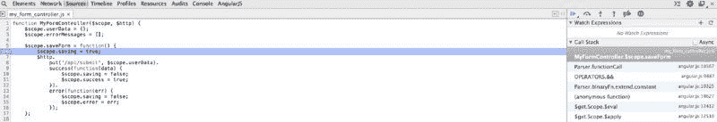

图 9.5

右侧的面板包含当前作用域内 JavaScript 变量的当前状态。特别是在“作用域变量（Scope Variables）➪ 闭包（Closure）”下，你可以看到`$scope`变量的当前状态，包括`userData`值。参见图 9.6。

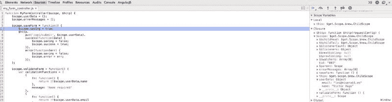

图 9.6

### 调试网络性能

网络（Network）标签提供了服务器交互的简单时间可视化：向服务器发送了哪些请求以及这些请求花费了多久。在`my_form.html`页面上打开网络标签，你应该看到类似于图 9.7 的内容。

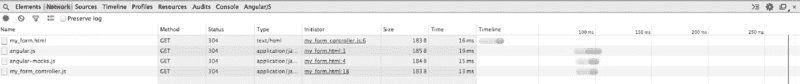

图 9.7

网络标签显示有四个服务器请求：一个针对`my_form.html`，三个针对 JavaScript 文件。所有请求都花费了约 10 毫秒，但 JavaScript 文件是在`my_form.html`文件本身约 80 毫秒后并行请求的。右侧的红蓝线表示两个重要事件发生的时间：红线表示`load`事件触发的时间——即页面所有资源完全加载的时间；蓝线表示`DOMContentLoaded`事件触发的时间——即 HTML 文档完全加载并解析的时间。

网络标签还可以显示来自服务器的 HTTP 响应内容。这对于二分调试非常有用：通常，调试 AngularJS 问题的第一步是确定服务器是否发送了正确的响应，这样你可以判断问题是在客户端还是服务器端。尝试点击名称（Name）列中的`my_form_controller.js`字符串。网络标签现在显示 HTTP 请求和 HTTP 响应的详细细分。参见图 9.8。

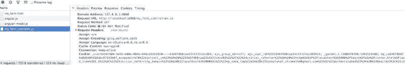

图 9.8

此面板显示 AngularJS 为`localhost:8080/my_form_controller.js`发送了一个 HTTP `GET`请求，并收到了 HTTP `304`（未修改）响应。响应（Response）标签显示了响应的实际内容。

## 总结

在本章中，你学习了如何设置复杂的浏览器测试工具并调试客户端 JavaScript。AngularJS 的设计初衷是为了让测试变得简单，并提供了一系列工具，帮助你在 bug 影响生产环境之前确保你的应用程序运行正常。尽管 AngularJS 的构建侧重于基础单元测试，但`Karma`、`ng-scenario`和`protractor`等工具允许你能够在实时浏览器中（无论是本地还是针对 Sauce 的浏览器配置服务）对你的应用程序进行端到端测试。如果你需要调试问题，还有优雅的开源 JavaScript 工具以及 Chrome 复杂的开发者工具可以帮助你深入了解代码为何异常运行。

# 10

## 下一步

### 本章你将学到：

*   使用流行的框架扩展 AngularJS
*   使用 Angular-UI Bootstrap 模块
*   使用 Ionic 构建混合移动应用
*   使用 MomentJS 处理日期
*   使用 MongooseJS 初始化和验证数据
*   使用 AngularJS 和 ECMAScript 6 (Harmony)

### 本章的 WROX.COM 代码下载

你可以在下载代码（Download Code）标签页通过[`http://www.wrox.com/go/proangularjs`](http://www.wrox.com/go/proangularjs)找到本章的 wrox.com 代码下载。如果你已经读完了这本书，恭喜你！之前的章节包含了你使用 AngularJS 核心构建和测试复杂应用程序所需的所有信息。然而，由于 AngularJS 是开源的，有无数扩展、插件和框架可以让你为 AngularJS 添加强大的功能。此外，JavaScript 本身拥有一个极其活跃的开源社区，有许多模块可以让你编写 AngularJS 变得更加简单。在本章中，你将扩展核心 AngularJS，学习如何使用两个 AngularJS 扩展（Angular-UI 的 Bootstrap 项目和 Ionic 框架）以及如何将两个流行的 JavaScript 模块（Moment 和 Mongoose）与 AngularJS 集成。

此外，JavaScript 本身是一种快速演变的语言。ECMAScript 是 JavaScript 的语言标准，其最新版本 ECMAScript 5 (ES5) 引入了一些令人兴奋的功能。此外，一些浏览器已经支持了提议中的 ECMAScript 6 (ES6) 标准中的某些功能。在本章后半部分，你将学习 ES5 访问器如何与 AngularJS 集成，以及如何使用 ES6 的`yield`关键字配合`$http`服务。

Bootstrap ([`http://www.getbootstrap.com`](http://www.getbootstrap.com)) 是一个由 Twitter 开发的流行的开源级样式表（CSS）框架，并附带了一个 JavaScript 库。它提供了多种功能，包括一个灵活的 12 列网格布局，可以优雅地适应小屏幕（即移动设备）。其 JavaScript 组件包含了模态框（modals）、下拉菜单和工具提示，但 Bootstrap 的 JavaScript 旨在与类 jQuery 风格的 JavaScript 配合工作。虽然 AngularJS 可以执行 jQuery 代码，但这无法充分利用数据绑定和指令等功能。幸运的是，Angular-UI 团队创建了自己的模块`Angular-UI Bootstrap`，它包含了将 Bootstrap 组件集成到 AngularJS 数据绑定中的指令和服务。

为了方便起见，本章的示例代码除了 AngularJS 1.2.16 之外，包含了使用 Angular-UI Bootstrap 所需的四个文件。`bootstrap.css`和`bootstrap.js`文件包含了 Twitter Bootstrap 的 3.2.0 未压缩版本。Bootstrap 的 JavaScript 依赖于`jQuery`，因此包含了`jQuery` 1.11.2。此外，`ui-bootstrap-tpls-0.11.2.js`文件包含了版本 0.11.2 的 Angular-UI Bootstrap。

## 模态框 (Modals)

Angular-UI Bootstrap 最常用的用例之一是创建支持 AngularJS 的模态框。通常内置的 JavaScript `alert()`和`confirm()`对话框显得突兀且不专业。Bootstrap 的模态框更加优雅且可定制。在本节中，你将学习如何使用 Angular-UI Bootstrap 的`$modal`服务创建高度自定义的模态框：一个请求用户确认操作的对话框，另一个请求用户输入的对话框。本节的示例代码包含在`bootstrap_modal.html`文件中。

`$modal`服务有一个函数`open(options)`，根据`options`对象的配置打开模态框。`options`对象有很多选项可以调整；但大多数情况下有三个是必须的。令人惊讶的是，`modal`服务允许你指定`template`或`templateURL`选项，告诉 Angular-UI Bootstrap 渲染哪个模板（记住模板是包含 AngularJS 的 HTML 字符串）。此外，`$modal`服务允许你指定`scope`选项，以定义模态框模板的作用域。请注意，`$modal`服务总是为其模板创建一个新的作用域。默认情况下，该作用域的父级是由`$rootScope`服务表示的页面根作用域。但通常你希望`$modal`服务创建一个父级为当前控制器作用域的作用域。这使得你的模态框与控制器中定义的方法无缝衔接。

配置`$modal`服务的基本选项，这里是请求用户确认操作的简单模态框的实现：

```javascript
 // 需要依赖 'ui.bootstrap' 模块以使用 Angular-UI Bootstrap
var app = angular.module('myApp', ['ui.bootstrap']);

var confirmationTemplate =
    "<h3>" +
    "  你想了解关于" +
    "Angular-UI Bootstrap 模态框吗?" +
    "</h3>" +
    "<hr>" +
    "<button class='btn' type='submit' ng-click='confirm(true)'>" +
    "  是" +
    "</button>" +
    "<button class='btn' type='submit' ng-click='confirm(false)'>" +
    "  否" +
    "</button>";

app.controller('MyController', function($scope, $modal) {
    $scope.confirmed;
    $scope.modal;
    $scope.confirm = function(confirmed) {
        $scope.confirmed = confirmed;
        $scope.modal.close();
    };
    $scope.showConfirmation = function() {
        $scope.modal = $modal.
            open({
                scope: $scope,
                template: confirmationTemplate
            });
    };
});
```

上述控制器通过控制器的`$scope`暴露了两个函数：使用`$modal`服务打开模板为`confirmationTemplate`字符串的模态框的`showConfirmation()`函数，以及模板用来返回结果并关闭模态框的`confirm()`函数。再次，`confirmationTemplate`模板在控制器作用域中执行。该控制器对应的 HTML 如下：

```html
<div ng-controller="MyController">
    <button type="submit"
            class="btn"
            ng-click="showConfirmation()">
        显示确认模态框
    </button>
    <h2 ng-if="confirmed === true">
        已确认
    </h2>
    <h2 ng-if="confirmed === false">
        已拒绝
    </h2>
</div>
```

你通常会显式设置模态框的`scope`选项，而不是使用默认的`$rootScope`，以便模态模板访问控制器`$scope`中定义的函数。之前的代码依赖于模态模板可以调用附加到控制器`$scope`的`confirm()`函数，并将用户的选择传回控制器。此外，由于`$modal`服务创建了自己的作用域，你可以修改模态模板中的变量和函数而不会污染控制器的`$scope`。此外，你可以使用`$modal.open()`的`controller`选项为模态框附加控制器。`controller`选项允许你编写拥有内部状态的复杂模块。例如，这里是一个请求用户从下拉列表中选择喜爱的章节的模态框实现：

```javascript
$scope.favoriteChapter;
$scope.showSelectModal = function() {
    $scope.modal = $modal.
        open({
            scope: $scope,
            template: selectModalTemplate,
            controller: 'SelectModalController'
        });
};
$scope.setFavoriteChapter = function(chapter) {
    $scope.favoriteChapter = chapter;
};
```

注意，此模态框使用了你刚刚学习的`controller`选项。前面提到的`SelectModalController`控制器的实现如下：

```javascript
app.controller('SelectModalController',
    function($scope, $modalInstance) {
        $scope.options = [];
        $scope.selectedOption;
        for (var i = 1; i <= 10; ++i) {
            $scope.options.push('Chapter ' + i);
        }
        $scope.select = function() {
            $scope.setFavoriteChapter($scope.selectedOption);
            $modalInstance.close();
        };
    });
```

注意，`SelectModalController`控制器使用通过依赖注入传递的新本地变量：`$modalInstance`对象。记住，本地变量是在给定上下文中注册到依赖注入器的额外对象（最常见的例子是`$scope`）。与`$scope`类似，无法注册依赖`$modalInstance`的服务。此外，如果你在`ngController`指令之外或调用`$modal`时使用依赖`$modalInstance`的控制器，AngularJS 会抛出错误。例如，以下 HTML 会导致`Unknown provider`错误：

```html
<div ng-controller="SelectModalController"></div>
```

`$modalInstance`局部变量暴露了一个方便的应用程序接口 (API)，用于操作模态框。在`SelectModalController`中，你使用了它的`close()`函数在用户选择他们喜欢的章节后关闭模态框。还有一个`dismiss()`函数，它的行为与`close()`函数几乎相同。唯一的区别在于，从语义上讲，调用`dismiss()`被解释为模态框在用户没有执行必要操作的情况下被关闭。特别是，`$modalInstance`对象还有一个`result`属性，它是一个`promise`，在模态框关闭时被完成（fulfilled），在模态框被驳回时被拒绝（rejected）。（记住，`promise`是一个在异步请求之上提供语法糖的对象。）不过，在这个示例中你将不会使用`promise`，因此对于`SelectModalController`而言，`close()`函数和`dismiss()`函数是可以互换的。

### 作用域通信
`SelectModalController`中还有一个值得注意的细节：`SelectModalController`可以调用`setFavoriteChapter()`函数，而该函数实际上定义在它的父作用域上。你可能还记得第 4 章“数据绑定”中提到作用域会从其父作用域继承；因此，你可以从任何`MyController`作用域的后代作用域调用`setFavoriteChapter()`函数。这种作用域间的通信正是你在调用`$modal.open()`时通常指定`scope`参数的原因。如果不指定，模态框的模板和控制器将无法访问定义在`MyController`作用域上的属性，因此模态框无法与控制器进行有效通信。

现在你已经研究了模态框控制器的细节，你将在模态框模板中使用该控制器的函数。此模态框的模板`selectModalTemplate`如下：


```javascript
var selectModalTemplate =
    "<h2>What's your favorite chapter?</h2>" +
    "<select ng-model='selectedOption'" +
    "        ng-options='x for x in options'>" +
    "</select>" +
    "<hr>" +
    "<button class='btn' ng-click='select()'>" +
    "  Submit" +
    "</button>";
```

`selectModalTemplate` 模板仅与 `SelectModalController` 中定义的属性直接交互——即 `options`、`selectedOption` 和 `select()` 函数。通常，为了最大化可重用性，你希望减少模态框对其父作用域的依赖。在实践中，你通常会在单个控制器中使用特定的模态框，但你可能希望多个控制器使用具有相同模板、相同控制器或两者相同的模态框。然而，你可能更重用模板而不是控制器，而且 AngularJS 并没有模板继承的概念。因此，为了可重用性，确保你的模态框模板不与其父作用域交互通常是一个好主意。

### 日期选择器

AngularJS 核心缺少的一个常见用例是让用户选择日期。AngularJS 确实可以很好地对接 HTML5 的“date”输入字段（类似于熟悉的“text”输入字段），但该 HTML5 元素的跨浏览器支持性较差。事实上，截至 2014 年，没有任何版本的 Internet Explorer、Firefox 或 Safari 支持 HTML5 “date”输入字段。幸运的是，Angular-UI Bootstrap 提供了一个简洁且简单的 `datepicker` 指令，你可以将其插入应用程序中。在本节中，示例代码位于 `bootstrap_datepicker.html` 文件中。假设你有以下控制器：

```javascript
app.controller('MyController', function($scope) {
    $scope.date = new Date();
});
```

插入 Angular-UI Bootstrap 的 `datepicker` 指令以允许用户选择日期只需一行代码：

```html
<datepicker ng-model="date"></datepicker>
```

然而，`datepicker` 指令默认会显示一个大日历，它在向用户传达当前选中日期方面表现并不理想。（它会高亮当前选中的日期，但仅当你处于正确的月份时如此）。如果你想模拟 HTML5 的 `<input type="date">` 元素——即在文本框中显示当前选中的日期，仅在用户点击输入字段时显示日历——你可以使用相关的 `datepicker-popup` 指令。该指令允许你在用户点击输入字段时，在弹出层中显示相当于 `datepicker` 指令的日历：

```html
<input type="text"
       class="form-control"
       datepicker-popup="yyyy/MM/dd"
       ng-disabled="isOpen"
       ng-model="date"
       is-open="isOpen"
       ng-click="isOpen = true" />
```

`datepicker-popup` 指令属性接收一个格式字符串。该字符串代表传递给 AngularJS 的 `date` 过滤器的格式，用于决定日期在输入字段中的渲染方式。在这个示例中，对于 2011 年 6 月 1 日，日期在输入字段中渲染为“2011/06/01”。

注意，`datepicker` 弹出层的打开/关闭状态由 `isOpen` 变量控制。每当用户点击输入字段时，`isOpen` 变量会被设置为 `true`。`datepicker` 弹出层对于何时关闭有一些合理的默认规则，例如每当用户点击弹出层以外的地方，或者每当用户实际选择了日期时。在前面的示例中，输入字段被配置为当 `datepicker` 弹出层打开时切换为“禁用（disabled）”。这是一个用户体验 (UX) 决策，以确保最终用户无法实际上在输入字段中输入。默认情况下，当弹出层打开时，用户实际上允许在输入字段中输入，这可能导致不可预测的行为。

### 时间选择器

`datepicker` 指令允许你仅修改日期。`datepicker` 指令的自然互补是一个允许用户修改时间的指令，这样你就可以询问用户某个事件何时发生。坦率地说，Angular-UI Bootstrap 有一个对应的 `timepicker` 指令，其工作方式与 `datepicker` 指令类似。你可以同时使用这两个指令：

```html
<div ng-controller="MyDateController">
    <h2>Date</h2>

    <div style="width: 300px">
        <input type="text"
               class="form-control"
               datepicker-popup="yyyy/MM/dd"
               ng-disabled="isOpen"
               ng-model="date"
               is-open="isOpen"
               ng-click="isOpen = true" />
    </div>

    <h2>Time</h2>

    <timepicker ng-model="date"></timepicker>

    <hr>

    <h2>
        Currently Selected Date: {{date | date:'medium'}}
    </h2>
</div>
```

`timepicker` 指令与双向数据绑定无缝衔接，因此你只需指定 `ngModel` 并让指令处理所有的用户交互。`timepicker` 指令还有一些高级的用户输入机制。例如，用户可以使用鼠标滚轮来增加或减少当前的小时和分钟。虽然鼠标滚轮集成通常是正确的选择，但你可以使用 `mousewheel` 属性将其禁用。禁用鼠标滚轮集成的代码如下：

```html
<timepicker ng-model="date" mousewheel="false"></timepicker>
```

在使用 `datepicker` 和 `timepicker` 指令时，你可能已经注意到无法通过提供的配置选项来修改指令的用户界面（UI）。也就是说，你无法用你自己的模板替换默认的 `timepicker` 指令模板。遗憾的是，这是 AngularJS 模板工作机制的一个局限性：一旦 AngularJS 获取了指令的模板，就没有办法更改它。（也就是说，AngularJS 只会调用一次指令函数）。幸运的是，Angular-UI Bootstrap 允许你覆盖特定指令所使用的模板（它会覆盖该指令所有实例所使用的模板）。在本节中，你将为上一节中学习的 `timepicker` 指令构建你自己的模板。

覆盖内置 Angular-UI Bootstrap 指令模板最简单的方法是使用 AngularJS 的 `script` 指令。（AngularJS 会检查页面上的 `script` 标签以查找模板）。要将 `timepicker` 指令模板替换为一个仅显示某些文本的简单模板，请使用以下代码：

```html
<script id="template/timepicker/timepicker.html"
        type="text/ng-template">
    <h2>
        ==> I am a timepicker!
    </h2>
</script>
```

上述代码告诉 AngularJS 的模板缓存，不应该为 `template/timepicker/timepicker.html` 模板发送 HTTP 请求；相反，它应该使用 `script` 标签的内容。如果你想了解更多关于 AngularJS 模板缓存的信息，第 7 章“模板、位置和路由”包含了更深入的信息。不过，对于本节而言，只需模板缓存通过 ID（通常是统一资源标识符或 URL）存储模板，并且你可以使用 `<script type="text/ng-template">` 来覆盖模板缓存中的项。`timepicker` 指令使用了 `template/timepicker/timepicker.html` 模板，因此你可以用 `script` 标签覆盖它。

到目前为止，你所做的是将 `timepicker` 指令替换为了“Hello, world”模板。为了让你的自定义模板变得有用，你需要检查并理解默认 `timepicker` 指令模板的工作原理。这就是为什么在大多数情况下，你应该直接使用默认的 Angular-UI Bootstrap 模板。要编写自定义指令模板，你需要对 `timepicker` 指令的工作原理有更深入的理解。也就是说，你需要知道调用哪些函数以及将输入字段绑定到哪些作用域变量，以便创建一个正常运行的时间选择器。在许多情况下，这仅仅是不必要的工作。然而，`timepicker` 指令是一个常见的候选；默认的 `timepicker` 指令 UI 对于许多应用程序来说并不是很好的选择。

以下是来自 `ui-bootstrap-tpls-0.11.2.js` 文件的默认 `timepicker` 指令模板，为了可读性进行了重新格式化：

```html
<table>
    <tbody>
        <tr class="text-center">
            <td>
                <a ng-click="incrementHours()"
                   class="btn btn-link">
                    <span class="glyphicon glyphicon-chevron-up"></span>
                </a>
            </td>
            <td></td>
            <td>
                <a ng-click="incrementMinutes()"
                   class="btn btn-link">
                    <span class="glyphicon glyphicon-chevron-up"></span>
                </a>
            </td>
            <td ng-show="showMeridian"></td>
        </tr>

        <tr>
            <td style="width:50px;"
                class="form-group"
                ng-class="{'has-error': invalidHours}">
                <input type="text"
                       ng-model="hours"
                       ng-change="updateHours()"
                       class="form-control text-center"
                       ng-mousewheel="incrementHours()"
                       ng-readonly="readonlyInput"
                       maxlength="2">
            </td>
            <td>:</td>
            <td style="width:50px;"
                class="form-group"
                ng-class="{'has-error': invalidMinutes}">
                <input type="text"
                       ng-model="minutes"
                       ng-change="updateMinutes()"
                       class="form-control text-center"
                       ng-readonly="readonlyInput"
                       maxlength="2">
            </td>
            <td ng-show="showMeridian">
                <button type="button"
                        class="btn btn-default text-center"
                        ng-click="toggleMeridian()">
                    {{meridian}}
                </button>
            </td>
        </tr>

        <tr class="text-center">
            <td>
                <a ng-click="decrementHours()"
                   class="btn btn-link">
                    <span class="glyphicon glyphicon-chevron-down"></span>
                </a>
            </td>
            <td></td>
            <td>
                <a ng-click="decrementMinutes()"
                   class="btn btn-link">
                    <span class="glyphicon glyphicon-chevron-down"></span>
                </a>
            </td>
            <td ng-show="showMeridian"></td>
        </tr>
    </tbody>
</table>
```

在上述 `timepicker` 指令模板代码中，高亮部分显示了如何使用 `timepicker` 指令控制器的“API”来操作当前时间的示例。具体而言，`timepicker` 指令控制器暴露了 `hours` 变量和 `minutes` 变量，这些变量负责维护 `timepicker` 指令的内部状态。为了确保这些变量的变化得到妥善处理，有相应的 `updateHours()` 和 `updateMinutes()` 函数，你在更改这些变量后需要调用。此外，还有辅助函数 `incrementHours()`、`incrementMinutes()`、`decrementHours()` 和 `decrementMinutes()`，它们会为你调用相应的更新函数。掌握了这些内部 `timepicker` 指令控制器 API 的知识后，为 `timepicker` 指令创建一个基于下拉列表的模板是非常简单的。这里有一个将默认 `timepicker` 指令模板替换为单个下拉框的模板：

```html
<script id="template/timepicker/timepicker.html"
        type="text/ng-template">
    <div ng-init="showMeridian = false;">
        <select ng-model="myTime"
                ng-change="hours = myTime.hours; updateHours();
                  minutes = myTime.minutes; updateMinutes()">
```


```html
ng-options="t.value as t.display for t in 0 | timepickerOptions"
```

上述代码虽然简洁，但代码中有三个细微的细节值得进一步研究。

首先，`ngInit` 代码确保 `timepicker` 指令处于 24 小时模式。否则，你将必须同时操作小时和 AM/PM 设置，这在这种情况下会使指令变得比没时更复杂。

其次，由于 `timepicker` 指令控制器内部的一个特性，`ngChange` 中的操作顺序非常重要：你需要在更改 `hours` 变量并调用 `updateHours()` 之后更改 `minutes` 变量；否则时间不会正确更新。这是你通过仔细检查 Angular-UI Bootstrap 的代码或通过尝试才能发现的。

最后，你可能已经注意到了 `ngOptions` 指令中的 `timepickerOptions` 过滤器。由于 `timepicker` 指令处于隔离作用域（isolate scope）中，过滤器是绕过作用域层次并将数据插入 `timepicker` 指令作用域的最佳方法。过滤器的实现如下：

```javascript
app.filter('timepickerOptions', function() {
  var timepickerOptions = [];

  for (var h = 0; h < 24; ++h) {
    timepickerOptions.push({
      display: h + ':' + '00',
      value: {
        hours: h,
        minutes: 0
      }
    });

    timepickerOptions.push({
      display: h + ':' + '30',
      value: {
        hours: h,
        minutes: 30
      }
    });
  }

  return function() {
    return timepickerOptions;
  };
});
```

如所示，此过滤器返回一个静态数组，无论传入什么参数。这种做法的唯一目的是绕过 `timepicker` 指令的隔离作用域；即使向根作用域添加变量，也无法在隔离作用域中访问。幸运的是，过滤器提供了一种在不直接修改指令控制器代码的情况下绕过作用域层次的方法。

现在你已经学习了如何使用 Angular-UI Bootstrap 使用自定义 Bootstrap 风格组件的基础知识，是时候研究另一个令人兴奋的 AngularJS 扩展了。

## 使用 Ionic 框架构建混合移动应用

你可能听过 `Cordova` 和 `PhoneGap`，它们是构建“混合型”移动应用的工具——即用 JavaScript 编写并在浏览器中运行，但仍通过 Android 和 iPhone 应用商店分发的应用。这些工具非常有用，因为你可以用一种语言编写一个应用并分发到多个应用商店，而无需维护一个用 Java 编写的独立 Android 应用和一个用 Objective-C 编写的 iPhone 应用。

然而，与移动开发者通常使用的复杂的集成开发环境（IDE）和内置 UI 组件（用于 Android 的 Eclipse 和用于 iPhone 的 Xcode）相比，它们显得比较单陋。构建在 `Cordova` 之上的 `Ionic` 框架包含了一个用于管理应用开发的复杂命令行界面（CLI）、美观的 Bootstrap 风格 UI 组件，最重要的是与 AngularJS 的集成。

使用 `Ionic` 框架，你可以利用在本书中学到的概念来构建移动应用，然后通过你选择的应用商店进行分发。在本节中，你将编写一个简单的 `Ionic` 框架应用，并整体概述 `Ionic` 框架的工作原理。

### 设置 Ionic、Cordova 和 Android SDK

`Cordova` 和 `Ionic` 最容易安装的方式是通过 NodeJS 包管理器 `npm`。如果你尚未安装 NodeJS，请访问 `http://nodejs.org` 并按照指示在您选择的平台上安装 NodeJS。

一旦安装了 `npm`，你可以使用以下命令同时安装 `Cordova` 和 `Ionic`：

```bash
npm install cordova ionic -g
```

注意，`Cordova` 需要全局安装；`Ionic` 则要求 `Cordova` 位于系统的 `PATH` 中。

出于本节的需要，你将设置 `Ionic` 框架来构建一个 Android 应用。由于 `Ionic` 框架依赖 Android 和 iOS 模拟器来运行，你需要安装 Android SDK 或 iOS SDK。

然而，安装 iOS SDK 是一个非常麻烦的过程，需要注册账户并经过重重法律手续。此外，它仅限于 OSX。开始使用 Android SDK 的过程要简单得多，可以在 Windows、Linux 或 OSX 上完成。如果你可以选择使用的操作系统，可能在类 Ubuntu 的 Linux 上设置 Android SDK 是简单的。

请访问 `http://developer.android.com/sdk/index.html` 并按照适用于你平台的说明进行操作。你还需要安装 Java JDK（`http://www.oracle.com/technetwork/java/javase/downloads/index.html`）和 Ant 构建系统（`http://ant.apache.org`）。请注意：Android SDK 是一个庞大的软件，下载可能需要很长时间。

一旦安装了 Java、Ant 和 Android SDK，从命令行运行 `android` 命令来启动 Android SDK Manager。从那里开始，勾选安装 Android 4.4.2（API Level 19）并点击 Install Packages 以获取一个合理的 Android 版本。

接下来，你需要创建一个 Android 虚拟设备，即 AVD。要使用新安装的 Android 4.4.2 创建 AVD，请运行：

```bash
android create avd -n android4 -t 1 –abi default/armeabi-v7a
```

现在你已经设置好了 Android，可以创建你的第一个 `Ionic` 应用并在 Android 模拟器中运行它了：

```bash
ionic start myApp tabs
cd myApp
ionic platform add android
ionic build android
ionic emulate android
```

这会在 `myApp` 目录中创建一个新的 `Ionic` 应用，配置其运行在 Android 模拟器上，并启动 Android 模拟器以便你可以查看应用。该应用是从 Ionic 的“tabs”启动应用创建的。

### 在你的 Ionic 应用中使用 AngularJS

Ionic 之所以如此有趣，因为它允许你使用在本书中学到的相同 AngularJS 原来编写移动应用。如果你仔细查看在上一节创建的 `myApp` 目录中的代码，你会发现一些基础的 AngularJS 控制器和服务。

`myApp/www/index.html` 文件包含了你在上一节中看到的 Android 应用的基础超文本标记语言（HTML）。具体而言，页面中包含了以下 JavaScript 文件：

```html
<!-- ionic/angularjs js -->
<script src="lib/ionic/js/ionic.bundle.js"></script>

<!-- cordova 脚本（在开发期间将产生 404） -->
<script src="cordova.js"></script>

<!-- 你的应用 js -->
<script src="js/app.js"></script>
<script src="js/controllers.js"></script>
<script src="js/services.js"></script>
```

`ionic.bundle.js` 文件包含了核心的 `angular.js` 文件以及如 `angular-animate.js` 等各种模块。`js/app.js` 文件包含了模块定义和客户端路由设置。`js/controllers.js` 文件和 `js/services.js` 文件包含了与客户端路由对应的控制器和服务。

由于这是一个示例应用，控制器和服务都是占位符，并不复杂。该应用最复杂的部分在 `js/app.js` 文件中。

你可能注意到 `js/app.js` 文件使用了 Angular-UI Router 模块进行客户端路由，而不是 `ngRoute` 模块。具体来说，这里是定义路由的代码：

```javascript
config(function($stateProvider, $urlRouterProvider) {
  // Ionic 使用 AngularUI Router，它使用了状态（states）的概念
  // 更多信息请访问：https://github.com/angular-ui/ui-router
  // 设置应用可能处于各种状态
  // 每个状态的控制器可以在 controllers.js 中找到

  $stateProvider

    // 为 tabs 指令设置一个抽象状态
    .state('tab', {
      url: "/tab",
      abstract: true,
      templateUrl: "templates/tabs.html"
    })

    // 每个标签页都有自己的导航历史栈：
    .state('tab.dash', {
      url: '/dash',
      views: {
        'tab-dash': {
          templateUrl: 'templates/tab-dash.html',
          controller: 'DashCtrl'
        }
      }
    });
});
```

Angular-UI Router 模块本质上是 `ngRoute` 模块的更高级版本。然而，Angular-UI Router 并不使用“路由（routes）”，而是使用“状态（states）”，它们与路由类似，但允许你处理更复杂的导航。

例如，在 `myApp` 标签页应用程序中，如果你处于“朋友”详情视图，切换到仪表板标签页，然后再切换回朋友标签页，会发生什么？使用 `ngRoute` 模块时，当你更改路由时所有状态都会被销毁，因此当你导航回朋友标签页时，看到的是朋友主列表，而不是你之前查看的特定朋友。

在移动端，这不一定是一个好的用户体验（UX）决策。Angular-UI Router 提供了一个框架，让你根据应用程序的需求显示朋友主列表或保留用户正在查看的特定朋友。（`myApp` 标签页应用程序默认会将你带回到之前正在查看的特定朋友。）

然而，Angular-UI Router 的整体结构与 `ngRoute` 模块相当相似：你将 URL 映射到模板和控制器对。

关于 Ionic 框架的另一个需要记住的重要细节是，你所有的 `$http` 请求都是跨源的，因为 Ionic 框架是通过启动浏览器并使用 `file://` 导航到你的 HTML 内容来运行的。

例如，如果你在 `myApp` 程序的仪表板标签页记录 `$window.location.href`，你会看到 `file:///android_asset/www/index.html`。因此，你需要确保在 AngularJS 代码中进行的任何 `$http` 请求都具有完全限定 URL，包括域名。

你还需要确保你向请求的任何服务器都配置为接受跨源资源共享（CORS）请求。CORS 请求是来自不同域的 HTTP 请求。

现在你已经了解了为 Ionic 框架编写 AngularJS 与为标准桌面浏览器环境编写 AngularJS 的一些关键区别，是时候让 `myApp` 应用程序做些有用的事情了。

具体来说，你将调整第 7 章中的 Google 股票报价服务并将其插入仪表板视图，以便你的应用程序能够显示当前的 Google 股票价格。以下是 `$googleStock` 服务的实现代码：

```javascript
factory('$googleStock', function($http) {
  var BASE = 'http://query.yahooapis.com/v1/public/yql';

  var query = encodeURIComponent('select * from yahoo.finance.quotes ' +
    'where symbol in (\'GOOG\')');
  var url = BASE + '?' + 'q=' + query + '&format=json&diagnostics=true&' +
    'env=http://datatables.org/alltables.env';

  var service = {};

  service.get = function() {
    $http.jsonp(url + '&callback=JSON_CALLBACK')
      .success(function(data) {
        if (data.query.count) {
          var quotes = data.query.count > 1
            ? data.query.results.quote
            : [data.query.results.quote];

          service.quotes = quotes;
        }
      })
      .error(function(data) {
        console.log(data);
      });
  };

  service.get();
  return service;
});
```

你可以将此服务添加到 `myApp/www/js/services.js` 文件中。要完成将此服务插入 `myApp` 应用程序的操作，你应该在 `myApp/www/js/controllers.js` 文件中的 `DashCtrl` 中添加此服务：

```javascript
.controller('DashCtrl', function($scope, $googleStock) {
  $scope.googleStock = $googleStock;
});
```

你还应该将其添加到实际的仪表板模板，位于 `myApp/www/templates/tab-dash.html` 文件中：

```html
<ion-view title="Dashboard">
  <ion-content class="padding">
    <h1>Dash</h1>
    <h3>Current Google Stock Price: {{googleStock.quotes[0].Ask}}</h3>
  </ion-content>
</ion-view>
```

现在运行 `ionic emulate android` 命令，你应该能在仪表板上看到当前的 Google 股票价格。

### Yeoman 工作流与生产构建

同样值得注意的是，由于 Ionic 框架应用程序使用前端技术构建，它们的开发过程可以受益于本书早期描述的相同工作流自动化工具。

具体来说，通过使用 `generator-ionic` Yeoman 插件，Yeoman 推广的工作流也可辅助 Ionic 应用的开发和生产压缩。要开始使用 Ionic Yeoman 生成器，请从命令行运行以下命令：

```bash
npm install -g generator-ionic
mkdir myApp && cd myApp
yo ionic
```

在新创建的目录中运行 `yo ionic` 命令后，你将看到一组与之前在第 1 章“构建简单的 AngularJS”中最初搭建 StockDog 应用时看到的类似的提示。

然而，这一次你有权从流行的 Cordova 插件列表中选择进行安装，并直接从命令行选择一个启动模板，以帮助为你的应用程序构建一个智能基础。

Grunt 支持由此 Yeoman 生成器创建的工作流，因此你可以通过更改相关的 `Gruntfile.js` 实现任何修改。以下是开箱即用的可用命令：

- `grunt serve[:compress]`
- `grunt platform:add:<platform>`
- `grunt plugin:add:<plugin>`
- `grunt [emulate|run]:<target>`
- `grunt compress`
- `grunt build:<platform>`


这些命令中的一些在底层使用了官方的`ionic-cli`，因此使用`generator-ionic`创建的项目与`ionic`工具配合良好。运行`grunt serve`会在浏览器中启动你的应用程序进行本地开发，而`grunt emulate:android --livereload`则将在内置实时重载支持的模拟器中启动你的应用程序。这特别有用，因为测试与 Cordova 插件集成的唯一方法是在设备上运行程序，但为了简单的前端更改而不断重建和模拟可能会非常令人沮丧。需要注意的是，虽然`dist/`目录曾用于构建 StockDog 的压缩资产，但此生成器使用`grunt compress`命令将你的应用程序编译到`www/`目录。这是因为 Cordova 从该位置读取并将你的 AngularJS 应用程序封装为原生应用。你可以在[`https://github.com/diegonetto/generator-ionic`](https://github.com/diegonetto/generator-ionic)找到有关 Ionic Yeoman 生成器的更多信息。

### 图标、启动页和 Cordova Hooks

在与 Cordova 和 Ionic 框架工作时，一个常见问题是设置应用程序的图标和启动页。正确配置应用图标和启动页以配合 Cordova 可能会非常麻烦，因此生成器预先包含了一个`after_prepare` Cordova hook，它用于管理将相应的资源文件复制到当前平台目标内的正确位置。要开始，你必须先通过`grunt platform:add:android`添加平台。一旦有了平台，封装好的`icons_and_splashscreens.js`钩会将 Cordova 生成的所有占位图标和启动页复制到项目内部新创建的顶级`resources/`目录中。只需用自己的资源替换这些文件（但保持文件名和目录结构），并让钩的魔力自动管理将它们复制到每个 Cordova 平台的相应位置，而不会中断你现有的工作流。要了解更多关于 hook 的信息，请查看 Ionic 框架项目`hooks/`目录下的`README.md`文件。

关于 Ionic 框架的内容就到这里。Ionic 框架是一个非常深入的话题，本节仅提供了 Ionic 框架工作原理的简要高层概述。Ionic 框架官方网站[`http://ionicframework.com`](http://ionicframework.com)包含了更复杂的教程和文档。

## 与 ANGULARJS 集成开源 JAVASCRIPT

JavaScript 最强大的功能之一就是其充满活力的开源社区。NodeJS 的包管理器`npm`目前是世界上规模最大的包生态系统，截至 2014 年 10 月已有约 100,000 个包。而这只是 JavaScript 包管理器中的一个。还有许多其他包管理器，如`NuGet`和`Bower`，某些 JavaScript 包甚至直接以纯 JavaScript 文件的形式提供。如果你发现在 JavaScript 中某些事情很难实现，通常会有一个开源模块可以为你解决该问题。在本节中，你将学习如何将 AngularJS 与两个常用的包——`Moment`和`Mongoose`集成，这两个包解决了 JavaScript 的两个弱点：日期处理和 Schema 验证。

### 使用 Moment 处理日期和时区

你可能已经注意到，JavaScript 原生的`Date`对象与 Python 等语言相比，有些繁琐且功能缺失。事实上，原生的 JavaScript 日期具有一些重大的局限性：它们的浏览器兼容性差、日期算术受限，并且不支持时区。原生 JavaScript 日期默认指定浏览器的本地时间，但它们提供了一些方便的方法来修改协调世界时（UTC）的日期。虽然这对于许多用例已经足够，但你可能会发现自己需要更复杂的方式来操作日期，包括在不同的时区显示日期。Moment ([www.momentjs.com](http://www.momentjs.com)) 是 JavaScript 最流行的开源日期辅助模块。Moment 及其扩展`moment-timezone`具有一些极其复杂的日期处理功能，这对于编写感知时区的 AngularJS 应用是必不可少的。

为了方便起见，本章的示例代码中包含了`moment.js`和`moment-timezone.js`文件。Moment 暴露了一个单一函数`moment()`，你用它来实例化一个 Moment 对象，通常称为`moment`。本章示例代码中的`moment_examples.html`文件包含了几个在 AngularJS 之外使用 Moment 操作日期的常见示例：

```
 <script type="text/javascript" src="moment.js">
    </script>
    <script type="text/javascript" src="moment-timezone.js">
    </script>
    <script type="text/javascript">
      // 表示当前日期的 Moment
      moment();

      // Moment 也可以接受 JavaScript 日期对象作为参数
      moment(new Date());

      // 或 UNIX 时间戳
      moment((new Date()).getTime());

      // 浏览器时区下的 2011 年 6 月 1 日 GMT 午夜
      moment('2011-06-01T00:00:00.000Z');

      // UTC 下的 2011 年 6 月 1 日 GMT 午夜
      moment('2011-06-01T00:00:00.000Z').utc();

      // 格式：表示浏览器时区 2011 年 6 月 1 日 12:00am GMT 的字符串。
      // 例如，如果你在纽约运行此处，它将打印 'May 31, 2011 8:00pm'
      moment('2011-06-01T:00:00:00.000Z').
        format('MMMM D, YYYY h:ma');

      // 格式：打印 'June 1, 2011 12:00am'，因为 UTC
      moment('2011-06-01T00:00:00.000Z').
        utc().
        format('MMMM D, YYYY h:mma');

      // 在 2011-06-01 增加 42 天（2011-07-13）
      moment('2011-06-01T00:00:00.000Z').
        utc().
        add(42, 'days').
        format('MMMM D, YYYY h:mma');

      // 洛杉矶时间的 2011 年 6 月 1 日 12:00am GMT（2011 年 5 月 31 日 5:00pm）
      moment('2011-06-01T00:00:00.000Z').
        tz('America/Los_Angeles').
        format('MMMM D, YYYY h:mma');

      // 表示该时刻的普通 JavaScript 日期对象
      moment('2011-06-01T00:00:00.000Z').toDate();

      // 当前 UNIX 时间戳（自 1970 年 1 月 1 日 12:00am UTC 以来的毫秒）
      moment().unix();
    </script>
```

除了提供日期算术、格式化和复杂的时区支持（需要`moment-timezone.js`文件）外，Moment 还支持流式链语法，允许你以简洁的方式编写复杂的日期操作。本质上，Moment 完成了所有 JavaScript 日期处理不佳的工作。然而，Moment 与原生 JavaScript 日期的兼容性并不完美，特别是与 AngularJS 的`date`过滤器。

为了学习如何集成 AngularJS 和 Moment，你将使用 Moment 的时区功能来显示国际活动列表。例如，假设你的应用程序显示一份欧洲音乐会列表。如果你天真地使用原生 JavaScript 日期，巴黎显示为晚上 8:00 p.m. 的日期在东京将显示为凌晨 5:00 a.m.，在纽约将显示为下午 3:00 p.m.。在远远时区浏览你应用的用户将很难确定音乐会的实际时间。在这种情况下，最合理的方法是在活动发生地的时区显示音乐会的时间，这样你的用户无论是在巴黎、东京还是纽约，都会看到“巴黎时间 8:00 p.m.”。

集成 Moment 和 AngularJS 的主要问题在于，默认情况下无法在 AngularJS 表达式中访问`moment()`函数（例如在`ngBind`属性的右侧）。这意味着你要么需要在控制器或服务中对 JavaScript 数据中的每个日期都调用一次`moment()`函数，要么你需要让`moment()`函数在 AngularJS 表达式中变得可访问。前者比较简单，因为这样你就可以直接在表达式中简单地使用 Moment 的链式语法了。然而，这样做通常是不切行的，因为每当你加载数据的 API 发生变化时，你都必须更改控制器和 HTML。此外，由于`moment()`函数可以正确解析各种输入，包括 UNIX 时间戳、JavaScript 日期和国际标准组织（ISO）日期字符串，因此直接将服务器数据转换为 moment 往往非常方便。

将`moment()`函数集成到 AngularJS 表达式中的一种常用方法是使用过滤器（filter）：

```
app.filter('formatTz', function() {
    return function(input, timezone, format) {
        return moment(input).tz(timezone).format(format);
    };
});
```

使用`formatTz`过滤器，你可以利用标准过滤器语法和 Moment 的格式化库来格式化日期。例如，参考以下音乐会示例列表：

```
app.controller('ConcertsController', function($scope) {
        $scope.concerts = [
            {
                // GMT +1
                when: '2014-06-01T20:00:00.000Z',
                where: 'Europe/London'
            },
            {
                // GMT +2
                when: '2014-06-04T16:00:00.000Z',
                where: 'Europe/Oslo'
            },
            {
                // GMT +4
                when: '2014-06-22T19:00:00.000Z',
                where: 'Europe/Moscow'
            }
        ];
});
```

在 HTML 中，你可以使用`formatTz`过滤器渲染此列表：

```
<div ng-controller="ConcertsController">
    <div ng-repeat="concert in concerts">
        Concert #{{$index + 1}}:
        {{concert.when | formatTz:concert.where:'MMMM D, YYYY h:mma'}}
    </div>
</div>
```

这将为你提供预期的输出：

```
Concert #1: June 1, 2014 9:00pm
Concert #2: June 4, 2014 6:00pm
Concert #3: June 22, 2014 11:00pm
```

另一种允许你使用 Moment 链式语法的替代方法是使用在第 7 章中引入的覆盖`$rootScopeProvider.$get`技巧。这会将`moment()`函数放置在页面的根作用域（root scope）中，从而使得页面上的任何（非隔离）作用域都可以访问它。以下是在配置阶段将`moment()`函数添加到页面根作用域的 JavaScript 实现。你可以在本章示例代码中的`moment_provider.html`文件中找到此代码段：

```javascript
 app.config(function($rootScopeProvider) {
            var oldGet = $rootScopeProvider.$get;
            $rootScopeProvider.$get = function($injector) {
                var rootScope = $injector.invoke(oldGet);

                rootScope.moment = window.moment;

                return rootScope;
            };
        });
```

这段 JavaScript 代码确保页面的根作用域（root scope）始终包含`moment()`函数。如果你对更多关于 providers 以及上述代码工作原理感兴趣，第 7 章包含了对 providers 更详细的讨论。在有了之前的配置块后，你可以在 AngularJS 表达式中使用`moment()`函数：

```
 <div ng-controller="ConcertsController">
        <div ng-repeat="concert in concerts">
            Concert #{{$index + 1}}:
            {{moment(concert.when).
                tz(concert.where).
                format('MMMM D, YYYY h:mma')}}
        </div>
    </div>
```

这两种方法——使用过滤器和将`moment()`函数附加到根作用域——都有显著的权衡。如果你将`moment()`函数附加到根作用域，则你无法在隔离作用域（isolate scopes）中访问它，这限制了你使用指令的能力。相反，过滤器的语法是有限的：如果你想进行日期算术，必须编写一个单独的过滤器。另一种缓解了这两个困难（但在语法上有些不优雅）的方法是使用一个仅返回 moment 的过滤器：

```javascript
 app.filter('moment', function() {
            return function(input) {
                return moment(input);
            };
        });
```

然后你可以使用此过滤器来构造一个 moment，即使在隔离作用域中也是：

```
 <div ng-controller="ConcertsController">
        <div ng-repeat="concert in concerts">
            Concert #{{$index + 1}}:
            {{(concert.when | moment).
                tz(concert.where).
                format('MMMM D, YYYY h:mma')}}
        </div>
    </div>
```

这种方法还消除了`formatTz`过滤器固有的局限：你可以使用 moment 的链式语法来利用日期算术等功能，而不仅仅是简单的格式化日期。然而，这种方法的缺点是它为你的模板增加了复杂性。虽然你可以使用括号在过滤器的结果上链接额外的操作，但它会让你的代码可读性降低，更难以理解。不过，所有三种方法都产生相同的输出，因此选择哪种方法适合你的开发实践取决于你个人。

## 使用 Mongoose 进行 Schema 验证与深度对象

Mongoose 是一个用于`NodeJS`和`MongoDB`的流行对象-文档映射器（ODM）。尽管它主要是一个服务器端 JavaScript 模块，但它目前实验性的 3.9 版本包含了在浏览器中运行 Mongoose schema 验证和安全导航工具的能力。AngularJS 的表单验证代码非常强大，但也有局限性，因为验证规则是在 HTML 中指定的。这意味着你必须在两种不同的语言中维护两套完全不同的验证规则：一套在服务器上，一套在客户端。如果你的服务器使用`NodeJS`和`MongoDB`，Mongoose 允许你将同一个 schema 用于服务端验证以及客户端表单验证。即使你没有在服务器端使用`NodeJS`或`MongoDB`，Mongoose 的 schema 验证工具和其他对象工具也是强大且可扩展的。


为了方便起见，本章的示例代码在`mongoose.js`文件中包含了 Mongoose 客户端模块（版本 3.9.3）。Mongoose 通过 NodeJS 包管理器`npm`分发。如果你通过`npm`安装了`mongoose`，可以在`node_modules/mongoose/bin/mongoose.js`找到`mongoose.js`文件。此外，如果你使用`Browserify`编译你的客户端 JavaScript，可以使用`require('mongoose')`引入 Mongoose 的客户端模块。

Mongoose 的客户端模块包含了你将主要交互的两种数据类型：schemas 和文档（documents）。`document`是一个包含数据的可能的嵌套对象。`schema`是一组关于文档应该拥有哪些字段、字段应该包含什么类型以及每个字段的自定义验证规则的集合。一个文档仅有一个用于验证的 schema。以下是在浏览器中使用 Mongoose 进行 schema 验证和安全导航的几个示例。你可以在本章示例代码的`mongoose_examples.html`文件找到这些示例：

```html
<script type="text/javascript" src="mongoose.js">
</script>
<script type="text/javascript">
  // 创建一个新的 Mongoose schema
  var schema = new mongoose.Schema({
    name: {
      first: String,
      last: String
    },
    email: {
      type: String,
      // E-mail 需要匹配给定的正则表达式
      match: /.+@.+\..+/,
      // 必须指定 E-mail
      required: true
    },
    favoriteColor: {
      type: String,
      // 颜色需要是枚举
      // 值之一
      enum: ['Red', 'Green', 'Blue']
    },
    age: {
      type: Number,
      // 年龄必须至少为 21
      min: 21
    }
  });

  // 使用 schema 创建一个新的空文档
  var doc1 = new mongoose.Document({}, schema);

  doc1.validate(function(err) {
    // 'ValidatorError: Path 'email is required''
    console.log(err.errors['email']);
  });

  doc1.name = {
    first: 'James',
    last: 'Madison'
  };

  // 'James Madison'
  console.log(doc1.fullName);

  doc1.fullName = 'Thomas Jefferson';
  // 'Thomas'
  console.log(doc1.name.first);

  var doc2 = new mongoose.Document({}, schema);
  doc2.email = 'a@b.c';
  doc2.age = 20;
  doc2.validate(function(err) {
    // 'ValidatorError: Path 'age' (20) 小于最小
    // 允许值 (21)'
    console.log(err.errors['age']);
  });

  // 安全导航
  console.log(doc2.name.first); // Undefined
</script>
```

最后一个示例展示了 Mongoose 的安全导航。在实际上，`doc2.name`是未定义的，因此尝试访问`doc2.name.first`通常会触发可怕的`TypeError: cannot read property 'name' of undefined` JavaScript 错误。然而，Mongoose 在底层做了一些工作，以确保如果其中一个父对象为 null 或 undefined，你将返回 undefined。

此外，schema 可以定义虚拟属性（virtuals），这些是从其他属性计算得的伪属性。你可以使用点符号语法访问它们，甚至可以为修改虚拟属性设置规则。例如，你可以为名和姓存储单独变量，并为用户的全名设置一个虚拟属性。当你设置用户的全名时，可以配置该虚拟属性为你设置用户的名和姓。以下是 Mongoose 虚拟属性的运行示例，你可以在本章示例代码的`mongoose_examples_virtuals.html`文件中找到：

```javascript
<script type="text/javascript">
  // 创建一个新的 Mongoose 模式
  var schema = new mongoose.Schema({
    name: {
      first: String,
      last: String
    },
    email: {
      type: String,
      // E-mail 需要匹配给定的正则表达式
      match: /.+@.+\..+/,
      // E-mail 必须指定
      required: true
    },
    favoriteColor: {
      type: String,
      // 喜好颜色需要是枚举值之一
      enum: ['Red', 'Green', 'Blue']
    },
    age: {
      type: Number,
      // 年龄至少为 21 岁
      min: 21
    }
  });

  // 'fullName' 是一个虚拟属性 (virtual)：由其他属性组成的
  // 伪属性。当你给 'fullName' 赋值时，
  // 它将其拆分并设置 name.first 和 name.last
  schema.
    virtual('fullName').
    get(function() {
      return this.name.first + ' ' + this.name.last;
    }).
    set(function(v) {
      var s = v.split(' ');
      this.set('name.first', s[0]);
      this.set('name.last', s[1]);
    });

  // 使用 schema 创建一个新的空文档
  var doc1 = new mongoose.Document({}, schema);

  doc1.name = {
    first: 'James',
    last: 'Madison'
  };

  // 'James Madison'
  console.log(doc1.fullName);

  doc1.fullName = 'Thomas Jefferson';
  // 'Thomas'
  console.log(doc1.name.first);
</script>
```

如你所见，当你设置`fullName`属性时，Mongoose 会应用虚拟属性的`setter`函数并相应地更新`name.first`和`name.last`属性。当然，你不需要定义`.set()`函数，这使得`fullName`属性变成只读的。在实践中，你看到的只读虚拟属性会比读写虚拟属性更常见，因为读取一个与底层数据保持同步的计算属性值是非常实用的。

Mongoose 依赖于 ECMAScript 5（最新接受的 JavaScript 语言标准）原生的`defineProperty()`函数来实现安全导航和创建虚拟属性。具体而言，`defineProperty()`函数允许你在对象上定义可配置的属性。通常情况下，JavaScript 不允许你将属性设置为只读、使其对`Object.keys()`函数不可见，或者为它们定义自定义的 getter 和 setter。`defineProperty()`函数允许你对给定的属性调整所有参数，这使得安全导航和虚拟属性等语法糖成为可能。然而，缺点是 Mongoose 仅适用于支持 ECMAScript 5 的浏览器。这意味着 Mongoose 特别地*不支持* Internet Explorer 8 或 Safari 4。

现在你已经了解了如何使用 Mongoose 的浏览器组件，你将学习如何将 Mongoose 与 AngularJS 集成。AngularJS 接口与使用`defineProperty()`函数创建的属性无缝衔接，因此你应该能够在 AngularJS 指令内部读取和操作 Mongoose 文档属性（至少在支持 ES5 的浏览器中）。考虑到这一点，你可以使用 Mongoose 浏览器组件来实现复杂的验证功能，正是这种功能使其成为许多 NodeJS 服务器中不可或缺的一部分。你可以在本章示例代码的`mongoose_validation.html`文件中找到以下示例。首先，你需要在`script`标签中包含`angular.js`和`mongoose.js`并定义你的 schema。代码中使用的 schema 与之前示例中的类似，但更适用于实际的 HTML 表单。它包含了四个字段：`name.first`和`name.last`字段、必须包含*Holy Grail*单词的`quest`字符串，以及必须是“Red”、“Green”或“Blue”的`favoriteColor`字符串。

```html
<script type="text/javascript" src="mongoose.js">
</script>
<script type="text/javascript"
        src="angular.js">
</script>
<script type="text/javascript">
  var schema = new mongoose.Schema({
    name: {
      first: { type: String, default: '' },
      last: { type: String, default: '' }
    },
    quest: {
      type: String,
      match: /Holy Grail/i,
      required: true
    },
    favoriteColor: {
      type: String,
      enum: ['Red', 'Green', 'Blue'],
      required: true
    }
  });

  schema.
    virtual('fullName').
    get(function() {
      return this.name.first +
        (this.name.last ? ' ' + this.name.last : '');
    }).
    set(function(v) {
      var sp = v.indexOf(' ');
      if (sp === -1) {
        this.name.first = v;
        this.name.last = '';
      } else {
        this.name.first = v.substring(0, sp);
        this.name.last = v.substring(sp + 1);
      }
    });

  var app = angular.module('myApp', []);

  app.controller('MyController', function($scope) {
    $scope.doc = new mongoose.Document({}, schema);
    $scope.validating = false;
    $scope.err;
    $scope.validate = function() {
      $scope.validating = true;
      $scope.doc.validate(function(err) {
        $scope.validating = false;
        $scope.err = err;
        $scope.$apply();
      });
    };
  });
</script>
```

注意`fullName`虚拟属性的实现发生了变化。你之前在示例中看到的简单实现是标准的 Mongoose 演示，但当它接入`ngModel`指令时，表现并不理想。具体来说，当你想要将一个 Mongoose 虚拟属性接入到`ngModel`指令时，你通常需要平滑地处理边缘情况，例如输入字段为空或用户只输入了名字的情况。这是因为 AngularJS 会在用户打字时调用 setter 来更新值，然后调用 getter 获取已写入的值。你需要确保你的虚拟属性在常见的边缘情况下返回与用户输入相同的值；否则，输入的值可能会在用户打字时发生变化。

此外，请注意，Mongoose 的浏览器组件仅在 3.9.3 版本中包含了一个异步的`validate()`函数。如果你想在验证逻辑中使用 HTTP 调用或其他异步操作，那么这将是有优势的，但它增加了一个额外的限制：你必须在`validate()`函数的回调函数中调用`$scope.$apply()`。否则，AngularJS 不知道作用域中发生了变化。

现在你已经查看了`mongoose_validation.html`文件的 JavaScript，这里是 HTML 模板：

```html
<body ng-controller="MyController">
  <h1>My Form</h1>
  <form ng-submit="validate()">
    <h3>What is your name?</h3>
    <input type="text" ng-model="doc.fullName" placeholder="Full Name">
    <div>
      <em>First: {{doc.name.first}}</em>
    </div>
    <div>
      <em>Last: {{doc.name.last}}</em>
    </div>
    <h3>What is your quest?</h3>
    <input type="text" ng-model="doc.quest">
    <h3>What is your favorite color?</h3>
    <input type="text" ng-model="doc.favoriteColor">
    <hr>
    <input type="submit" value="Validate">
    <br><br>
    <div ng-show="!validating && !!err">
      <div ng-repeat="(key, err) in err.errors">
        <b>Error validating path {{key}}::</b>
        {{err.message}}
      </div>
    </div>
    <div ng-show="!validation && !err">
      <h2>No Errors</h2>
    </div>
  </form>
</body>
```

关于上述代码，有几个值得注意的重要细节。首先，你可以将 Mongoose 值甚至虚拟属性（virtuals）放入`ngModel`指令中。再次强调，当将读写型虚拟属性放入`ngModel`指令时，你希望确保虚拟属性的获取器（getter）始终返回上一次设置器（setter）调用设置的值。虚拟属性对这种行为没有通用的保证，因此由你来确保在用户打字时值不会发生意外变化。


另一个需要注意的重要细节是，`validate()` 函数仅在表单提交时才被调用。AngularJS 的核心验证指令（如 `ngRequired`）在每次输入模型更改时都会运行验证，这并不是所有应用程序的正确选择。Mongoose 的 `validate()` 函数对何时验证哪些字段提供了更细粒度的控制。例如，你可以为 `favoriteColor` 路径添加 `ngChange` 验证。此代码在本章的示例代码的 `mongoose_validation_fine.html` 文件中进行了演示。首先，你需要在 schema 路径上使用 `doValidate()` 函数对单个路径进行潜在的异步验证：

```
$scope.validatePath = function(path) {
  $scope.validating = true;
  var schemaPath = $scope.doc.schema.path(path);
  schemaPath.doValidate($scope.doc.get(path), function(err) {
    $scope.validating = false;
    if (err) {
      if (!$scope.err) {
        $scope.err = { errors: {} };
      }
      $scope.err.errors[path] = err;
    } else {
      if ($scope.err && $scope.err.errors[path]) {
        delete $scope.err.errors[path];
      }
    }
  });
};
```

有了这个函数后，你可以透明地告诉 Mongoose 在输入字段变化时仅验证 `favoriteColor` 路径：

```
<h3>你最喜欢的颜色是什么？</h3>
<input type="text"
       ng-model="doc.favoriteColor"
       ng-change="validatePath('favoriteColor')">
```

最后，注意在这两个示例中都没有使用 AngularJS 的验证指令（如 `ngRequired`）。Mongoose 旨在作为 AngularJS 表单验证指令的替代品，而不是它们的补充。AngularJS 的表单验证指令嵌入在文档对象模型（DOM）中，因此测试更加复杂，并且取决于你的代码库，维护可能更加困难。然而，使用哪种取决于个人喜好和应用程序的需求。对于简单的表单和原型设计，AngularJS 的表单验证非常有用。但是，Mongoose 的表单验证具有显著优势：它提供了 AngularJS 表单验证所缺的复杂功能，独立于 DOM（因此更易测试和重用），并且如果你使用 NodeJS 和 MongoDB，它可以在你的服务器上重用。

## ANGULARJS 与 ECMASCRIPT 6

在编写本文时，JavaScript 语言标准的下一个版本 ECMAScript 6 仍在开发中。然而，越来越多的开发者已开始利用 ECMAScript 6 定义的强大语言特性。尽管 ECMAScript 6 尚未定稿，但 Chrome 和 Firefox 提供了对某些 ES6 特性的支持，因此你可以在 AngularJS 中利用它们进行实验性开发和研究。但是，在生产级 AngularJS 应用中使用 ES6 不是一个好主意，因为在编写本文时，没有任何正式发布的 Internet Explorer 或 Safari 版本支持你将在本节中学习的任何主题。因此，为了本节的目的，你必须使用 Google Chrome（版本 37 或更高）或 Mozilla Firefox（版本 31 或更高）来查看示例代码。你还需要在 Chrome 中启用 ES6 支持。（Firefox 默认已启用。）要在 Google Chrome 38 上执行此操作，请将浏览器导航到 `chrome://flags/`，找到并启用 `Enable Experimental JavaScript` 标志，然后重启 Chrome。

### 使用 yield 进行异步调用

ES6 的一个让 NodeJS 社区风靡的兴奋特性是生成器函数（generator functions）和 `yield` 关键字。JavaScript 的生成器与 Python 的非常相似，所以如果你有 Python 经验，ES6 生成器看起来应该很熟悉。然而在 JavaScript 中，`yield` 关键字在管理异步函数调用方面具有异常优雅的功能。

丰富的 JavaScript 工程师可能听过“回调地狱”（callback hell）这个术语，用来描述回调中嵌套回调再嵌套回调的代码。在 AngularJS 中，当你发现有一个 HTTP 调用必须使用其他 HTTP 调用的结果时，你可能经历过这种痛苦。通过回调组织这些代码会导致代码混乱。生成器为这种方法提供了替代方案，你将在本节中学习到。

你可以在 `http_yield.html` 文件中找到本节的示例代码。该文件包含一个名为 `co` 的开源模块，它为运行生成器函数提供了便利封装。

你会如何使用 `yield` 关键字从 Yahoo Finance API 加载 Google 股票价格？以下是实现代码：

```
function convertToAPlusPromise($q, promise) {
  var deferred = $q.defer();
  promise.
    success(function(data) {
      deferred.resolve(data);
    }).
    error(function(err) {
      deferred.reject(err);
    });

  return deferred.promise;
}

function MyController($scope, $http, $q) {
  var BASE = 'http://query.yahooapis.com/v1/public/yql';
  var query = 'select * from yahoo.finance.quotes ' +
    'where symbol in (\'GOOG\')';
  var url = BASE + '?' +
    'q=' + encodeURIComponent(query) +
    '&format=json&diagnostics=true' +
    '&env=http://datatables.org/alltables.env' +
    '&callback=JSON_CALLBACK';

  co(function*() { // * 不是笔误，标记此函数为生成器
    var result;
    try {
      result = yield convertToAPlusPromise($q, $http.jsonp(url));
      $scope.result = result;
    } catch(e) {
      console.log('Error occurred: ' + e);
    }
  })();
```

关于上述代码，有两个需要注意的重要细节。首先，`yield` 关键字作用于 promise。`promise` 是一个为异步操作提供语法糖的对象。特别是，`yield` 关键字期望一个符合 Promises/A+ 标准的 promise，但遗憾的是，这与 `$http` 服务返回的 promise 是完全不兼容的。幸运的是，AngularJS 核心包含了一个流行的 promises 库“Q”的轻量级分支作为 `$q` 服务，它确实符合 Promises/A+ 标准。之前显示的 `convertToAPlusPromise()` 函数将 `$http` 服务返回的 promise 转换为 `$q` 服务返回的 promise——即可以与 `yield` 关键字配合使用的 promise。

其次，之前的代码中没有回调。`yield` 关键字足够智能，当异步调用完成时，会将上述 `promise.resolve()` 调用返回的值写入结果变量。通过 `co` 库，你可以以类似于同步的方式执行 JavaScript 根本上异步的 HTTP 调用。

但当发生错误时会怎样，例如如果 Yahoo Finance API 宕机了？这就是 `try/catch` 块的作用！当 `yield` 关键字对应的 promise 被 `rejected` 时（Promises/A+ 标准中 promise 抛出错误的术语），它会抛出一个错误。这意味着你可以使用简洁的 `try/catch` 语法来捕获 HTTP 错误，而不需要指定错误处理函数。

## 结论

在本章中，你探索了 AngularJS 之外的几个项目，这些项目让你能够以新的方式使用 AngularJS。特别是，你学习了可以使用 `Ionic` 框架使用 AngularJS 构建原生移动应用，利用 `MomentJS` 处理复杂的日期功能，以及集成 `MongooseJS` 进行模式驱动的表单验证。还有许多其他 JavaScript 模块可以用来扩展 AngularJS：你可以在 [`www.npmjs.org`](http://www.npmjs.org) 或 [`www.bower.io/search`](http://www.bower.io/search) 上搜索“AngularJS”来查找更多。

# 附录

## 资源

许多网站可以帮助你学习更多 AngularJS 的知识并与社区联系。AngularJS 的流行激发了大量的在线内容，从简单的博客文章到复杂的录屏教程，这些可以为大多数 AngularJS 问题和问题提供见解。此外，几个 JavaScript 模块仓库允许你查找并安装 AngularJS 扩展：

- `AngularJS` ([`http://www.angularjs.org`](http://www.angularjs.org))—AngularJS 官方网站提供下载、教程、论坛、开发者指南、应用程序接口 (API) 参考等许多内容。这是获取 AngularJS 基础信息并与大社区联系的理想场所。

- `Egghead.io` ([`http://egghead.io`](http://egghead.io))—Egghead.io 是目前 AngularJS 录屏教程的首选来源。这些教程是短视频（通常约为 5 分钟），通过展示开发者在集成开发环境 (IDE) 中编写代码来演示 AngularJS 概念。Egghead.io 教程非常适合快速解决你对 AngularJS 功能的特定疑问。

- `Bower` ([`http://bower.io`](http://bower.io))—Bower 是一个为客户端 JavaScript 和层级样式表 (CSS) 构建的包管理器。Bower 托管许多 AngularJS 包，[`bower.io`](http://bower.io) 网站拥有方便的搜索引擎，你可以从中找到特定的 AngularJS 扩展。

- `npm` ([`http://www.npmjs.org`](http://www.npmjs.org))—npm 最初是作为 `NodeJS` 的包管理器，但得益于 `Browserify` 等模块（有关 `Browserify` 的更多信息请参见第 3 章“架构”），`npm` 现在也是一个流行的客户端模块仓库。

- `Thinkster` ([`http://www.thinkster.io`](http://www.thinkster.io))—与 Egghead.io 类似，Thinkster 提供录屏教程。然而，Thinkster 教程通常组织为完整的课程而非短独立视频，并且更多关注全栈开发而非孤立的 AngularJS。如果你对学习如何结合 `Django`、`Ruby on Rails`、`Ionic` 或作为 `MEAN` 栈的一部分使用 AngularJS，`Thinkster` 是一个极佳的资源。

- `AngularJS-Learning` ([`http://github.com/jmcunningham/AngularJS-Learning`](http://github.com/jmcunningham/AngularJS-Learning))—最受欢迎的社区维护 AngularJS 内容列表包含了许多高质量 AngularJS 文章、示例应用和学习资源的链接。

- `angular/angular.js` ([`http://github.com/angular/angular.js`](http://github.com/angular/angular.js))—AngularJS 官方代码库包含一个报告问题的机制，并允许你通过 GitHub 的 Pull Requests（拉请求）功能为 AngularJS 核心做出贡献。

- `AngularJS Code` ([`http://code.angularjs.org`](http://code.angularjs.org))—此页面包含所有版本 AngularJS 的下载链接，包括 `angular-sanitize` 等非核心模块。如果你习惯于研究 AngularJS 核心代码或只想下载特定模块，这里是寻找你所需文件的理想位置。

## 专业级 AngularJS

出版商：

John Wiley & Sons, Inc.

10475 Crosspoint Boulevard

Indianapolis, IN 46256

[`www.wiley.com`](http://www.wiley.com)

版权所有 © 2015 John Wiley & Sons, Inc., Indianapolis, Indiana

加拿大同步出版

ISBN: 978-1-118-83207-3

ISBN: 978-1-118-83209-7 (ebk)

ISBN: 978-1-118-83208-0 (ebk)

除非根据 1976 年美国版权法第 107 节或第 108 节的规定，否则在没有出版商书面许可或向版权许可中心（222 Rosewood Drive, Danvers, MA 01923, (978) 750-8400，传真 (978) 646-8600）支付适当单份费用授权的情况下，本出版物的任何部分不得复制、存储在检索系统中或以任何形式或任何方式（电子、机械、复印、录制、扫描或其他）传输。向出版商申请许可应致：许可部门，John Wiley & Sons, Inc., 111 River Street, Hoboken, NJ 07030, (201) 748-6011，传真 (201) 748-6008，或访问在线 [`http://www.wiley.com/go/permissions`](http://www.wiley.com/go/permissions)。

**责任限制/免责声明：** 出版商和作者对本书内容的准确性或完整性不作任何陈述或保证，并特别放弃所有保证，包括但不限于对特定用途的适用性的保证。销售或促销材料不得创建或扩展任何保证。书中包含的建议和策略可能不适用于每种情况。本书的销售基于以下共识：出版商并不提供法律、会计或其他专业服务。如果需要专业协助，应寻求能力的专业人士的服务。出版商和作者均不对由此产生的损害承担责任。书中引用的机构或网站仅作为引用和/或潜在的进一步信息来源，并不意味着作者或出版商认可该机构或网站可能提供的信息或其可能做出的建议。此外，读者应注意，书中列出的互联网网站在本书编写时与读者阅读时之间可能发生了变化或消失。

有关我们其他产品和服务的通用信息，请联系我们的美国境内客户服务部门：(877) 762-2974；美国境外请拨 (317) 572-3993 或传真至 (317) 572-4002。

Wiley 以多种印刷和电子格式出版，并提供按需打印。本书标准印刷版中包含的某些材料可能未包含在电子书或按需打印版中。如果本书提到的 CD 或 DVD 等媒体未包含在所购买的版本中，您可以在 [`http://booksupport.wiley.com`](http://booksupport.wiley.com) 下载这些材料。有关 Wiley 产品的更多信息，请访问 [`www.wiley.com`](http://www.wiley.com)。

**美国国会图书馆号：** 2014951014

**商标：** Wiley、Wiley 标志、Wrox、Wrox 标志、Programmer to Programmer 以及相关的贸易装均为 John Wiley & Sons, Inc. 及其/或关联公司在美国和其他国家的商标或注册商标，未经书面许可不得使用。所有其他商标均为其各自所有者的财产。John Wiley & Sons, Inc. 与书中提到的任何产品或供应商均无关联。

*献给我的父亲老 Valeri Karpov，他教导我永远满足于“足够”。*

——VALERI KARPOV

*献给我的母亲 Liliana，她教我如何通过像过过最后一天一样生活来寻找幸福。*

——DIEGO NETTO

# 关于作者


`VALERI KARPOV` 是 MongoDB 的一名 NodeJS 工程师，负责维护流行的 Mongoose ODM 以及许多其他 MongoDB 相关的 NodeJS 模块。此外，他还是 BookaLokal 的驻留黑客（Hacker in Residence）、StrongLoop 的博客作者，以及 MEAN 栈命名的由来。自 2010 年 `AngularJS` v0.9.4 版本以来，他一直在运行生产环境中的 AngularJS 应用。最近，他使用 `AngularJS` 构建了 BookaLokal 的移动网站，以及一个用于 MongoDB 内部持续集成框架的 Web 客户端。

`DIEGO NETTO` 是一位软件顾问和开源倡导者。他兼任着全栈工程师和创业者的多重角色。作为一家位于洛杉矶和达拉斯的开发店的所有者，Diego 为初创公司和企业级公司创建 Web 和移动端应用。作为 `IonicFramework` 的 Yeoman 生成器的维护者，他最近使用 `AngularJS` 和 `IonicFramework` 为 [`www.aboatapp.com`](http://www.aboatapp.com) 构建了 Prop 移动端应用，并正在使用 `Famo.us/Angular` 为 [`www.modelrevolt.com`](http://www.modelrevolt.com) 构建移动端应用。

## 关于技术编辑

`STÉPHANE BÉGAUDEAU` 毕业于南特科学与技术学院，目前在法国的 Obeo 担任 Web 技术专家和 Eclipse 建模顾问。他曾为 Eclipse 基金会的多个开源项目做出贡献，并且 `Acceleo` 的领导。他还参与了 `Dart Designer` 的工作，这是一个针对 Dart 编程语言的开源工具。

## 致谢

### 项目编辑

Kelly Talbot

### 技术编辑

Stéphane Bégaudeau

### 制作编辑

Christine O'Connor

### 文字编辑

Karen Gill

### 内容开发与组装经理

Mary Beth Wakefield

### 营销总监

David Mayhew

### 营销经理

Carrie Sherrill

### 专业技术与策略总监

Barry Pruett

### 业务经理

Amy Knies

### 副出版

Jim Minatel

### 项目协调员（封面）

Brent Savage

### 校对

Nancy Carrasco

### 索引员

Johnna VanHoose Dinse

### 封面设计

Wiley

### 封面图片

iStock.com/Manuel Faba Ortega

## 谢辞

苏格拉底曾写道：“教育不是灌输，而是点燃火焰。”正因如此，我感谢我的老师和导师，让编程成为了我终生的热情，而不仅仅是一份职业。特别感谢普林斯顿大学的 `Kernighan` 教授和 `Tarjan` 教授；以及伯根学院的 `Nevard` 博士、`Sankaran` 博士、`Scarpone` 先生和 `Nodarse` 先生。此外，感谢 `Misko Hevery`，我在 Google 实习期间的导师以及 `AngularJS` 的原始作者，他在 12 周内教给我的软件工程知识，比我直到那个夏天之前所学到的还要多。

——VALERI KARPOV

引用成功企业家 FELIX DENNIS 的话：“任何不忙于学习的人都在忙于死亡。”这是一个明智的提醒，特别是在不断演变的软件工程领域，为了保持相关性并维持成功，我们必须致力于终身追求知识。我想感谢弗吉尼亚理工大学的 `Tatar` 教授和 `Ribbens` 教授让我领悟到了这一点。我还要感谢 `Addy Osmani` 帮助我发现智能工具的重要性，并启发我为开源社区做出贡献。特别感谢我的朋友和合著者 `Valeri Karpov`，让我如此早的阶段就参与了 `AngularJS`。

——DIEGO NETTO


## WILEY 用户许可协议

请访问 [`www.wiley.com/go/eula`](http://www.wiley.com/go/eula) 获取 Wiley 的电子书 EULA。
