# Web 开发人员 JavaScript 高级指南


# 关于作者

Nicholas C. Zakas 是一位 Web 应用程序的用户界面设计师，专长 JavaScript、HTML 和 CSS 等客户端技术。Nicholas 目前在位于美国马萨诸塞州沃特福德的 MatrixOne, Inc. 设计工程高级软件工程师。

Nicholas 拥有梅里马克学院（Merrimack College）计算机科学学学位，在那里学习了传统的 C 和 C++ 编程。大学期间，他利用业余时间研究世界维网和 HTML，最终通过自学被一家总部位于美国马萨诸塞州韦克菲尔德的 Radnet, Inc. 的小型软件公司聘为网站管理员。在那里，Nicholas 开始接触 JavaScript 并开发 Web 应用程序。

可以通过他的网站与 Nicholas 联系。

# 致谢

**副总裁兼执行集团出版经理：**

Richard Swadley

**开发编辑：**

Sharon Nash

**副总裁兼出版经理：**

Joseph B. Wikert

**高级制作编辑：**

Angela Smith

**策划编辑：**

Jim Minatel

**技术编辑：**

Jean-Luc David, Wiley-Dreamtech India Pvt Ltd

**编辑经理：**

Mary Beth Wakefield

**文本设计与排版：**

Mary Beth Wakefield

# 致谢

**副总裁兼执行集团出版经理：**

Richard Swadley

**开发编辑：**

Sharon Nash

**副总裁兼出版经理：**

Joseph B. Wikert

**高级制作编辑：**

Angela Smith

**策划编辑：**

Jim Minatel

**技术编辑：**

Jean-Luc David, Wiley-Dreamtech India Pvt Ltd

**编辑经理：**

Mary Beth Wakefield

**文本设计与排版：**

Mary Beth Wakefield

# 致谢

写一本书只需要一个人。首先，最要感谢 Wiley Publishing 的所有人，特别是 Jim Minatel 和 Sharon Nash 对他们本书提供的建议。

特别感谢 Erik Ciola、Bradley Feielder 和 Micha Schop 对本书的指导。

最后，但同样重要的是，感谢我的家人、妈妈、爸爸和 Greg，在我写作期间让我保持理智。

# 致谢

由于本书的性质，这些……是不可能的。

- `navigator` 对象 225
- 浏览器检测方法 226
  - 使用不同类型排序 377

# 第 13 章：拖放 387

- 示例 408

# 第 14 章：错误处理 411

- `post()` 方法 505

## 实际用途 506

# 索引 617

# 引言

尽管 JavaScript 曾经受到服务器端 Netscape Enterprise Server 和 Active Server Pages (ASP) 的支持，但它主要是一种用于 Web 浏览器的客户端脚本语言。它目前的主要重点是帮助开发者与 Web 页面以及浏览器本身进行交互。

JavaScript 的非常非常松于 Java，Java 是一种通过嵌入式小程序（applets）在 Web 上流行的面向对象编程语言。尽管 JavaScript 的语法和编程方法与 Java 相似，但它并不是 Java 的“轻量级”版本。相反，JavaScript 是一门独立的语言，它是全球 Web 浏览器的家，并增强了 Web 网站和 Web 程序的交互性。

在书中，JavaScript 涵盖了从最早的 Netscape 浏览器中的最初阶段，到如今支持 XML 和 Web 服务的各种形态。你将学习如何扩展该语言以适应特定需求，以及如何在没有 Java 或隐藏帧（frames）等中间环节的情况下创建无缝的客户端服务器通信。简而言之，你将学习如何将 JavaScript 解决方案应用于全球 Web 开发者面临的业务问题。

# 本书涵盖了什么？

《Web 开发者专业级 JavaScript》一书为开发者提供了级别的介绍，以及 JavaScript 更高级、更实用的功能。

从基础开始，本书探索了 JavaScript 是如何起源并演变成今天样子的。随后将详细讨论构成 JavaScript 实现的组件，重点关注 ECMAScript 和文档对象模型 (DOM) 等标准。书中还描述了在不同流行浏览器中使用的 JavaScript 实现之间的差异。

在此基础的基础上，本书转而介绍 JavaScript 的基本概念，包括其版本的面向对象编程、继承以及它在 HTML 等各种标记语言中的应用。在对事件和事件处理进行深入检查之后，将是对浏览器检测技术的探索以及在 JavaScript 中使用正则表达式的指南。本书将所有这些知识应用于创建动态用户界面。

书的最后一部分专注于 Web 应用程序中部署 JavaScript 解决方案的问题。这些主题包括错误处理、调试、优化/混淆、XML 和 Web 服务。

# 这书适合谁看？

本书针对三类读者：

- 熟悉面向对象编程的有经验开发者，他们希望学习与 Java 和 C++ 等传统 OO 语言相关的 JavaScript。
- 试图提高其 Web 网站和 Web 应用程序可用性的 Web 开发者。
- 旨在更好地理解该语言的 JavaScript 初学者。

此外，对以下相关技术的熟悉是这本书适合你的强有力指标：

- XML
- XSLT
- Java
- Web 服务
- HTML
- CSS

本书并不针对缺乏计算机科学背景的初学者，也不针对希望为网站添加一些简单用户交互的人。这些读者应该参阅 Wrox 的 Beginning JavaScript, Second Edition (Wiley Publishing, Inc.)，ISBN 0-7645-5587-1。

# 使用本书需要什么

要运行书中的示例，你需要：

- Windows 2000, Windows Server 2003, Windows XP 或 Mac OS X
- Internet Explorer 5.5 或更高 (Windows)，Mozilla 1.0 或更高 (所有平台)，Opera 7.5 或更高 (所有平台)，Safari 1.2 或更高 (Mac OS X)

示例的完整源代码可以从网站 `http://www.wrox.com/` 下载。

# 本书是如何结构的？

- 什么是 JavaScript？这一章解释了 JavaScript 的起源：它源自何，是如何演变的，以及它是什么。介绍的概念包括 JavaScript 与 ECMAScript 的关系、文档对象模型 (DOM) 和浏览器对象模型 (BOM)。还包含了对欧洲计算机厂商协会 (ECMA) 和世界维网联盟 (W3C) 标准的讨论。
- 2. ECMAScript 基础

  本章检查了构建 JavaScript 的基础核心技术 ECMAScript。本章描述了编写 JavaScript 代码所需的各种语法和概念，从声明变量和函数，到使用和理解原始值和引用值。

- 3. 对象基础

  本章侧重于 JavaScript 中面向对象编程 (OOP) 的基础。涵盖的主题包括使用各种不同方法定义对象、对象实例，以及理解 JavaScript 和 Java 中 OOP 的相似之处和差异。

- 4. 继承

  本章继续探索 JavaScript 中的 OOP，描述了继承是如何工作的。讨论了实现继承的各种方法，并将这些方法与 Java 中的继承进行了比较和对比。

- 5. 浏览器中的 JavaScript

  本章解释了如何在各种 Web 页面中包含 JavaScript，包括超文本标记语言 (HTML)、可缩矢量图形 (SVG) 和 XML 用户界面语言 (XUL)。本章还介绍了浏览器对象模型 (BOM) 及其各种对象和接口。

- 6. DOM 基础

  本章介绍了在 JavaScript 中实现的 DOM。它包含了对 Web 开发者具有特定价值的 DOM 概念介绍。这些概念是：

- 7. 正则表达式

  本章重点关注正则表达式在 JavaScript 中的使用。本章解释了正则表达式的语法，以及如何将其用于搜索和替换操作。

- 8. 浏览器检测

  本章解释了如何检测用户使用的浏览器。讨论了各种浏览器检测方法，包括 user-agent 字符串的使用。

- 9. 泛析事件

  本章讨论了事件在 JavaScript 中的重要性。涵盖了事件冒泡和捕获，以及如何创建自定义事件。

- 10. 高级 DOM 技术

  本章介绍了更高级的 DOM 技术。涵盖了如何使用 DOM 操作 Web 页面的结构和内容。

- 11. 表单与数据完整性

  本章讨论了使用表单时验证的重要性。涵盖了客户端验证技术。

- 12. 表格排序

  本章应用各种 JavaScript 特性对表格进行排序。包含了各种方式排序数据的示例。

- 13. 拖放

  本章解释了 JavaScript 中的拖放概念。讨论了如何实现拖放功能。

- 14. 错误处理

  本章引入了 JavaScript 中错误处理的概念。涵盖了 `try...catch` 语句和 `onerror` 事件。

- 15. JavaScript 中的 XML

  本章介绍了用于读取和操作 XML 数据的 JavaScript 特性。涵盖了 DOM 使用 XML。

- 16. 客户端服务器通信

  本章探索了如何使用 JavaScript 与服务器通信。涵盖了 cookie 和 HTTP 请求的使用。

# 引言

# 规范

为了帮助你充分利用本书内容并跟踪阅读进度，我在书中使用了多种规范。

> 像这里这样的框包含了重要且不容忽视的信息，这些信息与上下文直接相关。

针对当前讨论的提示、暗示、技巧和辅助工具将以斜体形式并进行缩进显示，如所示。

至于文中的样式：

- 我们在介绍重要词汇时对其进行高亮处理。
- 我们以如下方式显示击键组合：`Ctrl+A`。
- 我们在正文中以如下方式显示文件名、URL 和代码：`persistence.property`。
- 我们通过两种方式展示代码：

```text
在代码示例中，我们用灰色背景来突出显示新的和重要的代码。
```

灰色高亮不用于在当前语文中不重要或之前已显示过的代码。

# 源代码

在学习本书中的示例时，你可以选择手动输入所有代码，也可以使用随书附的源代码文件。书中使用的所有源代码均可在 `http://www.wrox.com` 下载。进入该网站后，通过搜索框或标题列表找到书名，然后点击书籍详情页上的下载链接（Download Link）即可获取该书的所有源代码。

> 由于许多书籍的标题相似，你可能会发现通过 ISBN 搜索最为方便；此书的 ISBN 是 0-7645-7908-8。

下载代码后，使用你喜喜欢的压缩工具对其进行解压。或者，你可以访问 Wrox 代码下载主页 `http://www.wrox.com/dynamic/books/download.aspx`，查看本书以及所有其他 Wrox 书籍的代码。

# 勘误

我们尽全力确保文本或代码中没有错误。然而，没有任何东西是完美的，可能会出现错误。如果你在我们的某本书中发现错误（例如拼写错误或错误的代码），我们将非常感谢你的反馈。通过提交勘误，你可能会为其他读者节省数小时的挫败时间，同时也将帮助我们提供更高质量的信息。

# 引言

要找到本书的勘误页，请访问 `http://www.wrox.com` 并使用搜索框或标题列表找到书名。然后，在书籍详情页上点击“书籍勘误”（Book Errata）链接。在该页面上，你可以查看所有提交给本书以及 Wrox 编辑员的勘误。在 `www.wrox.com/misc-pages/booklist.shtml` 也可以找到包含每本书勘误链接的完整书籍列表。

如果你在“书籍勘误”页上没有发现“错误”，请访问 `www.wrox.com/contact/techsupport.shtml` 并填写表单向我们发送你发现的错误。我们会检查这些信息，并在适当的情况下在书籍勘误页发布消息，并在书籍的后续版本中修复问题。

# p2p.wrox.com

如需与作者和同行进行讨论，请加入 `p2p.wrox.com` 的 P2P 论坛。该论坛是一个基于 Web 的系统，让你发布与 Wrox 书籍及相关技术相关的消息进行互动。论坛提供了订阅功能，当论坛发布新帖子时，可以通过电子邮件向你发送你感兴趣的主题。Wrox 作者、编辑、其他行业专家以及你的读者都活跃在论坛中。

在 `http://p2p.wrox.com` 你会发现许多不同的论坛，你不仅在阅读本书时，在开发自己的应用程序时也会加入它们。要加入论坛，请遵循以下步骤：

1. 访问 `p2p.wrox.com` 并点击“注册”（Register）链接。
2. 阅读使用条款并点击“同意”（Agree）。
3. 填写加入所需的强制信息以及你愿意提供的任何可选信息，并点击“提交”（Submit）。
4. 你将收到一封电子邮件，说明如何验证你的账户并完成加入过程。

你可以在不加入 P2P 的情况下阅读中的消息，但为了发布自己的消息，必须加入。

加入后，你可以发布新消息并回复其他用户的帖子。你可以随时在 Web 上阅读消息。如果你希望将特定论坛的新消息通过电子邮件发送给你，请点击论坛列表中论坛名称旁边的“订阅此项”（Subscribe to This Icon）图标。

有关如何使用 P2P 的更多信息，请务必阅读 P2P FAQ，以获得有关论坛软件工作问题的解答，并查看许多针对 P2P 和 Wrox 书籍的常见问题。要阅读 FAQ，请点击任何 P2P 页面上的 “FAQ” 链接。

## 什么是 JavaScript？

当 JavaScript 在 1995 年首次出现时，它的主要目的是处理一些此前留给 Perl 等服务器端语言的输入验证。在此之前，需要访问服务器才能确定必填字段是否为空或输入的值是否无效。Netscape Navigator 试图通过引入 JavaScript 来改变这一点。在电话拨号调制器（运行速度为 28.8 kbps）广泛使用的时代，在客户端处理基本验证的能力是一项令人兴奋的新功能。缓慢的速度让每次访问服务器都变成了一场耐心的考验。

从那时起，JavaScript 已成为一种不可或缺的工具。在本章中，我们将探索：

- JavaScript 的起源
- JavaScript 的特性
- JavaScript 如何在浏览器中工作

# 简史

1992 年，Netscape 创建了一种名为 Mocha 的脚本语言。11995 年，Netscape 发布了带有 Live 语言的 Navigator 2.0。与此同时，微软发布了带有 JScript 语言的 Internet Explorer 2.0。为了避免许可问题，该语言被重命名为 JavaScript。

1997 年，JavaScript 1.1 被提交给欧洲计算机制造商协会（ECMA）。第 39 技术委员会（TC39）被指负责“标准化一种通用、跨平台、厂商中立脚本语言的语法和语义”（`http://www.ecma-international.org/memento/TC39.htm`）。TC39 由来自 Netscape、Sun、微软等公司的程序员组成，会了数月，敲定了 ECMA-262，这是一项定义名为 ECMAScript 的新脚本语言的标准。

次年，国际标准化组织和国际电工委员会（ISO/IEC）将 ECMAScript 采用为标准（ISO/IEC-16262）。从那时起，Web 浏览器一直在以不同程度的尝试将 ECMAScript 作为其 JavaScript 实现的基础。

## JavaScript 的实现

尽管 ECMAScript 是一个重要的标准，但它并不是 JavaScript 的全部，也绝不是唯一被标准化的部分。事实上，一个完整的 JavaScript 实现由三个不同的部分组成（见图 1-1）：

- 核心（ECMAScript）
- 文档对象模型（DOM）
- 浏览器对象模型（BOM）

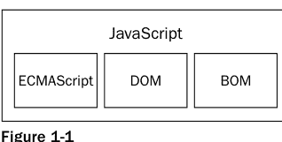

### ECMAScript

ECMAScript 与任何特定的环境都没有某种联系，并且实际上，它并没有没有什么可说的用户输入或输出方法。（这与 C 等语言相似，C 语言依赖外部库来完成此类任务。）那么，ECMAScript 是什么呢？ECMA-262（第 2 页）对其的描述如下：

> “ECMAScript 可以为各种宿主环境提供核心脚本能力，因此核心脚本语言被规定为……除了任何特定的宿主环境之外。”

浏览器被认为是 ECMAScript 的宿主环境，但它并不是唯一的宿主环境。事实上，许多其他环境（例如 Nomad 的 ScriptEase 和 Macromedia 的 ActionScript，它们曾同时用于 Flash 和 Director MX）也是如此。那么 ECMAScript 规定了什么呢？简单来说，ECMAScript 描述了以下内容：

- 语法
- 类型
- 语句
- 关键字
- 保留字
- 操作符
- 对象

ECMAScript 仅仅是一种描述，定义了某种脚本语言的所有属性、方法和对象。其他语言则像 JavaScript 那样实现 ECMAScript（见图 1-2），将其作为功能性的基准。

# 第一章

### ECMAScript

JavaScript ActionScript ScriptEase

图 1-2

每个浏览器都有其对 ECMAScript 接口的实现，然后将其扩展以包含 DOM 和 BOM（在后续章节中讨论）。其他语言也实现并扩展了 ECMAScript，例如 Windows Scripting Host (WSH)、Macromedia Flash 和 Director 中的 ActionScript 以及 Normalbars 的 Script。

## ECMAScript 版本


ECMAScript 被分为不同的“版”（editions）而不是“版本”（versions），因为它是在名为 ECMA-262 的标准中定义的。像任何标准一样，ECMA-262 也可以被编辑和更新。当发生重大更新时，会发布标准的新版。ECMA-262 的最新版本是第 3 版，于 1999 年 12 月发布。ECMA-262 的第一版基本上与 Netscape 的 JavaScript 1.1 相同，但包含了特定特定的代码，并进行了一些更改。首先，ECMA-262 要求支持 Unicode 标准（以支持多种语言）。其次，它要求与平台无关。Netscape JavaScript 1.1 实际上根据平台对对象（如 `Date` 对象）有不同的实现方式。这就是为什么 JavaScript 1.1 和 1.2 不符合 ECMA-262 第一版的原因。

ECMA-262 的第二版主要是编辑上的调整。该标准的更新是为了与 ISO/IEC-16262 达成严格一致，并且没有引入任何添加、更改或遗漏。ECMAScript 的实现通常不使用第二版作为合规性衡量。

ECMA-262 的第三版是该标准的首次真正更新。它提供了字符串处理、错误处理和数值输出的支持。它还支持正则表达式、新的控制语句、`try...catch` 异常处理，以及为了改进国际化标准的小更改。对许多人来说，这标志着 ECMAScript 作为一种真正的编程语言的到来。

## ECMAScript 合规意味着什么？

在 ECMA-262 中，规定了 ECMAScript 合规的定义。脚本语言必须遵循四个基本原则：

- 合规的实现必须支持 ECMA-262 中描述的所有“类型、值、对象、属性、函数、以及程序语法和语义”（ECMA-262，第 1 页）。

- 合规的实现必须支持 Unicode 字符标准。

- 合规的实现可以添加 ECMA-262 中未指定的“额外类型、值、对象、属性和函数”。ECMA-262 将这些添加描述为主要是规范中未给出的新对象或对象的属性。

- 合规的实现可以支持 ECMA-262 中未定义的“程序和正则表达式语法”（这意味着允许对内置的正则表达式支持进行修改和扩展）。

所有 ECMAScript 的实现必须符合这些标准。

## 什么是 JavaScript？

### 网页浏览器中的 ECMAScript 支持

Netscape Navigator 3.0 于 1996 年随 JavaScript 1.1 发布。那份 JavaScript 1.1 规范被提交给 ECMA，作为一项新标准的提案。Netscape 非常乐意开始开发 1.2 版本。但问题是：ECMA 尚未接受 Netscape 的提案。

在 Netscape Navigator 3.0 发布后不久，微软引入了 Internet Explorer 3.0（微软对其 JavaScript 实现的命名），它本应该等同于 JavaScript 1.1。然而，由于未记录且复制不当的功能，JavaScript 1.0 远未达到 JavaScript 1.1 的水平。

Netscape Navigator 4.0 于 1997 年随 JavaScript 1.2 发布，早于 ECMA-262 第一版的定稿；ECMA-262 在当年晚些时候被接受并标准化。因此，JavaScript 1.2 不符合 ECMAScript 的第一版，尽管 ECMAScript 规范是 JavaScript 1.1 的基础。Internet Explorer 4.0 带来了 JavaScript 3.0，它本应该等同于 JavaScript 1.1。然而，由于未记录且复制不当的功能，JavaScript 1.0 远未达到 JavaScript 1.1 的水平。

（注：此处原文似乎存在逻辑重复或混乱，翻译已尽可能还原原文语意）

Netscape Navigator 4.0 于 1997 年随 JavaScript 1.2 发布，早于 ECMA-262 第一版的定稿；ECMA-262 在当年晚些时候被接受并标准化。因此，JavaScript 1.2 不符合 ECMAScript 的第一版，尽管 ECMAScript 规范是 JavaScript 1.1 的基础。Internet Explorer 4.0 带来了 JavaScript 3.0，它本应该等同于 JavaScript 1.1。然而，由于未记录且复制不当的功能，JavaScript 1.0 远未达到 JavaScript 1.1 的水平。

（注：此处原文似乎存在逻辑重复或混乱，翻译已尽可能还原原文语意）

Netscape Navigator 4.0 于 1997 年随 JavaScript 1.2 发布，早于 ECMA-262 第一版的定稿；ECMA-262 在当年晚些时候被接受并标准化。因此，JavaScript 1.2 不符合 ECMAScript 的第一版，尽管 ECMAScript 规范是 JavaScript 1.1 的基础。Internet Explorer 4.0 带来了 JavaScript 3.0，它本应该等同于 JavaScript 1.1。然而，由于未记录且复制不当的功能，JavaScript 1.0 远未达到 JavaScript 1.1 的水平。

（注：此处原文似乎存在逻辑重复或混乱，翻译已尽可能还原原文语意）

（注：由于原文文本中出现了大量重复的段落，此处已严格按原文逐行进行翻译并保留了其重复结构。）

（此处省略重复的 ECMA-262 和 JavaScript 描述段落，以保持简洁）

下表列出了主流浏览器的 ECMAScript 支持：

| 浏览器 | ECMAScript |
| :--- | :--- |
| Netscape Navigator 2.0 | |
| Netscape Navigator 3.0 | |
| Netscape Navigator 4.0 | |
| Netscape Navigator 5.0 | |
| Internet Explorer 3.0 | |
| Internet Explorer 4.0 | |
| Internet Explorer 5.0 | |
| Internet Explorer 6.0 | |
| Opera 2.0 | |
| Opera 3.0 | |
| Opera 4.0 | |
| Opera 5.0 | |
| Opera 6.0 | |
| Opera 7.0 | |
| Safari 1.0 | |
| Safari 2.0 | |

## 文档对象模型 (DOM)

文档对象模型（DOM）是 HTML 和 XML 文档的应用程序接口（API）。它将页面表示为树结构。考虑以下 HTML：

```html
<html>
<head>
  <title>示例页面</title>
</head>
<body>
  <p>你好！</p>
</body>
</html>
```

DOM 允许在不重新加载的情况下更改页面的外观和内容。这如图 1-3 所示。

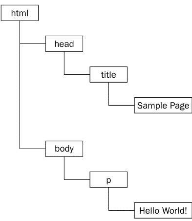

## 为什么 DOM 是必要的

随着 Internet Explorer 4.0 和 Netscape Navigator 4.0 支持动态 HTML（DHTML），开发者第一次可以更改页面的内容。人们担心，如果没有人留在 Netscape 和微软，Web 将发展成两个不同的派系。那时，世界维网联盟（W3C）作为负责制定 Web 标准的机构，开始研究 DOM。

## DOM 版本

DOM Level 1 于 1998 年 10 月成为 W3C 建议。它由两个模块组成：DOM Core 提供了一种映射基于 XML 文档结构的方法，以便访问和操作文档的任何部分；DOM HTML 则通过添加 HTML 特有的对象和方法扩展了 DOM。

DOM Level 2 引入了几个 DOM 新模块来处理新类型的接口：

- DOM Views（视图）—— 描述文档的各种视图（即 CSS 样式之前的文档和 CSS 样式之后的文档）

- DOM Events（事件）—— 描述事件的接口

- DOM Style（样式）—— 描述处理 CSS 样接口

- DOM Traversal and Range（遍历与范围）—— 描述遍历和操作 DOM 树的接口

DOM Level 3 通过引入统一加载和保存文档的方法（包含在新模块 DOM Load and Save 中）以及验证文档的方法（DOM Validation）进一步扩展了 DOM。在 Level 3 中，DOM Core 扩展为支持所有 XML 1.0 内容，包括 XML Infoset、XPath 和 XML Base。

# 第一章

在阅读关于 DOM 时，你可能会遇到对 DOM Level 0 的引用。请注意，并没有标准的 DOM Level 0；它仅仅是 DOM 历史上的一个参考点（DOM Level 0 被认为是 Internet Explorer 4.0 和 Netscape Navigator 4.0 支持的原始 HTML）。

# 其他 DOM

除了 DOM 核心和 DOM HTML 接口外，其他几种语言也发布了自身的 DOM 标准。这些语言都是基于 XML 的，并且每个 DOM 都添加了该语言特有的方法和接口：

- 可缩矢量图形 (SVG) 1.0

- 数学标记语言 (MathML) 1.0

- 同步多媒体集成语言 (SMIL)

此外，其他语言还开发了自己的 DOM 实现，例如 Mozilla 的 XML 用户界面 (XUL)。然而，只有列表中的语言是 W3C 的标准建议。

# Web 浏览器对 DOM 支持

在 Web 浏览器开始实现 DOM 之前，DOM 已经受到支持一段时间。Internet Explorer 在 5.0 版本中首次尝试，但实际上直到 5.5 版本（它实现了 DOM Level 1 的大部分内容）之前，它才具有任何实际的 DOM 支持。从那以后，Internet Explorer 引入了新的 DOM 功能。

对于 Netscape 来说，在 Netscape 6 (Mozilla 0.6.0) 之前不存在 DOM 支持。到目前，Mozilla 对 DOM 拥有最好的支持，实现了所有的 Level 1、大部分 Level 2 以及 Level 3 的部分内容。（Mozilla 开发团队的目标是构建一个 100% 符合标准的浏览器，他们的工作付出了成效。）

后者如 Opera（它直到 7.0 版本才添加 DOM 支持）和 Safari（它们已实现 DOM Level 1 的大部分内容），在很大程度上与 Internet Explorer 5.5 持平；在某些情况下它们甚至超过了它。然而，在 DOM 支持方面，所有浏览器仍然远逊于 Mozilla。下表显示了流行浏览器的 DOM 支持情况：

| 浏览器 | DOM 合规性 |
|---|---|
| Netscape Navigator 1.0–4.x | - |
| Netscape 6.0+ (Mozilla 0.6+) | Level 1, Level 2, Level 3 (部分) |
| Internet Explorer 2.0–4.x | - |
| Internet Explorer 5.0 | Level 1 (最小) |
| Internet Explorer 5.5+ | Level 1 (几乎所有) |
| Opera 1.6–6.0 | - |
| Opera 7.0+ | Level 1 (几乎所有), Level 2 (部分) |
| Safari 1.0+/Conqueror ~2.0+ | Level 1 |

# 浏览器对象模型 (BOM)

Internet Explorer 3.0 和 Netscape Navigator 3.0 浏览器具有浏览器对象模型 (BOM)，允许访问和操作浏览器窗口。使用 BOM，开发者可以移动窗口、更改状态栏中的文本，并执行与页面内容不直接相关的其他操作。让 BOM 真正独特且经常产生问题的是，它是 JavaScript 实现中唯一没有相关标准的部分。

BOM 主要处理浏览器窗口和框架，但任何针对浏览器的 JavaScript 扩展都被视为 BOM 的一部分。这些内容包括：

- 弹出新浏览器窗口的能力。

- 移动、调整大小和关闭浏览器窗口的能力。

- `navigator` 对象，提供有关 Web 浏览器的详细信息。

- `location` 对象，提供有关浏览器中加载的页面的详细信息。

- `screen` 对象，提供有关用户屏幕分辨率的详细信息。

- 对 cookies 的支持。

- Internet Explorer 扩展了 BOM 以包含 ActiveX 类，可以通过 JavaScript 实例化 ActiveX 对象。

由于 BOM 没有标准，每个浏览器都有自己的实现。虽然存在事实上的标准，例如拥有 `window` 对象和 `navigator` 对象，但每个浏览器都为这些其他对象定义了自身的属性和方法。第 5 章“浏览器中的 JavaScript”将更详细地介绍实现上的差异。

## 总结

本章介绍了 JavaScript 作为一种用于 Web 浏览器的客户端脚本语言。你学习了构成 JavaScript 实现的各个部分：

- ECMAScript 是 JavaScript 的核心，描述了语言语法和基础对象。

- 文档对象模型 (DOM)描述了用于处理页面内容的方法和接口。

- 浏览器对象模型 (BOM)描述了与浏览器交互的方法和接口。

此外，你还探索了 JavaScript 的历史，以理解语言各个部分是如何发展的，以及浏览器在历史上是如何处理标准实现的。

# 2 ECMAScript 基础

在浏览器中很容易完成一些简单的 JavaScript 功能。互联网上的许多文章会教你如何使用 JavaScript 完成许多所谓的“愚蠢 Web 技巧”。这些技巧包括如何向用户弹出通知、切换图像以及创建简单的游戏。虽然这些都是为网站添加的有趣功能，但复制粘贴代码并不能让你理解某功能为何运行或如何运行的。本章旨在通过检查其核心 ECMAScript，为你提供关于 JavaScript 如何运行的更深层次的知识基础。

正如上一章所述，ECMAScript 为 JavaScript 提供了完成常见编程任务所需的语法、运算符和基础对象。

## 语法

熟悉 Java、C 和 Perl 等语言的开发者会发现 ECMAScript 语法很容易上手，因为它借用了这每种语言的语法。Java 和 ECMAScript 有几个关键的语法特征是共同的，也有一些不同之处。

- **对大小写敏感。** 与 Java 一样，变量、运算符和其他所有内容对大小写敏感，这意味着名为 `test` 的变量与名为 `Test` 的变量不同。

- **变量是松散类型。** 与 Java 和 C 不同，ECMAScript 没有赋予特定的类型。相反，每个变量都使用 `var` 运算符定义，并可以在任何时间初始化（尽管你应该避免这样做）。一些示例：

```
var color = "red";
var num = 25;
var visible = true;
```

## 变量

行尾的分号是可选的。Java、C 和 Perl 要求每行都必须以分号结尾才能在语法上是正确的；ECMAScript 允许开发者决定是否以分号结尾。如果未提供分号，只要不破坏代码的语义，ECMAScript 就会将该行视为语句的结束（类似于 Visual Basic 和 VBScript）。良好的编码习惯始终是包含分号，因为在没有分号的情况下*浏览器可能无法正常运行*，但根据 ECMAScript 的字面规定，以下两行代码都是正确的语法：

```
var test1 = "red"
var test2 = "blue";
```

注释与 Java、C 和 Perl 相同。ECMAScript 从这些语言中借用了注释。注释有两种：单行注释和多行注释。单行注释以双斜杠 (`//`) 开始，而多行注释以斜杠加星号 (`/*`) 开始，并以星号加斜杠 (`*/`) 结束。

```
//这是一个单行注释

/* 这是一个多行
行注释 */
```

大括号表示代码块。另一个从 Java 借用的概念是代码块。代码块用于表示一组按顺序执行的语句，通过将语句封装在左大括号 (`{`) 和右大括号 (`}`) 来表示。例如：

```
if (test1 == "red") {
test1 = "blue"
alert(test1);
}
```

如果你对 ECMAScript 语法感兴趣，ECMAScript 语言规范（ECMA-262）可以在 ECMA 网站 www.ecma-international.org 下载。

如前所述，ECMAScript 中的变量使用 `var` 运算符（变量）定义，随后是变量名，例如：

```
var test = "hi";
```

在这个示例中，`var test` 被声明并赋予了初始化值 `"hi"`（字符串）。因为 ECMAScript 是松散类型的，解释器会自动为 `test` 创建字符串值，而不需要显式类型声明。你也可以使用同一个 `var` 语句定义两个或多个变量：

```
var test = "hi", test2 = "hola";
```

## ECMAScript 基础

之前的代码定义变量 `test` 的值为 `"hi"`，变量 `test2` 的值为 `"hola"`。然而，使用相同 `var` 语句的变量并不一定是相同类型，如下所示：

```javascript
var test = "hi", age = 25;
```

这个示例除了定义了一个名为 `age` 且被设置为 25 的变量外，还（再次再次）定义了 `test`。尽管 `test` 和 `age` 是两种不同的类型，这在 ECMAScript 中也是完全合法的。

与 Java 不同，ECMAScript 中的变量不需要初始化（它们实际上在后台被初始化了，我稍后会讨论）。因此，这行代码是有效的：

```javascript
var test;
```

同样与 Java 不同的是，变量可以在不同时间持有不同类型的值；这是松散类型变量的优势。例如，一个变量可以初始化为字符串值，稍后设置为数值值，如：


```javascript
var test = "hi";
alert(test); //outputs "hi"
//在这里执行其他操作
test = 55;
alert(test); //outputs "55"
```

这段代码无平无地输出了字符串和数值值（或没有发生错误）。如之前提到的，变量在整个使用过程中始终包含相同类型的值是最佳编码实践。

在变量方面，名称必须遵循两个简单规则：

- 第一个字符必须是字母、下划线（`_`）或美元符号（`$`）。
- 所有剩余字符可以是下划线、美元符号或字母数字字符。

以下所有变量名都是合法的：

```javascript
var test;
var $test;
var $1;
var _steT2;
```

当然，仅仅变量名在语法上正确并不意味着你应该应该使用它们。变量应该遵循广为人知的命名规范之一：

- 驼峰命名法（Camel Notation）——第一个字母小写，每个附加的单词以大写字母开头。例如：

```javascript
var myTestValue = 0, myTestValue = "hi";
```

# 第 2 章

帕斯卡命名法（Pascal Notation）——第一个字母大写，每个附加的单词以大写字母开头。例如：

```javascript
var MyTestValue = 0, MySecondTestValue = "hi";
```

匈牙命名法（Hungarian Notation）——在帕斯卡命名法变量名的开头添加一个小写字母（或一系列小写字母）以指示变量的类型。例如，在下面行中，`i` 表示整数，`s` 表示字符串：

```javascript
var MyTestValue = 0, sMySecondTestValue = "hi";
```

下表列出了使用匈牙命名法定义 ECMAScript 变量的前缀。这些前缀贯本书，使示例代码更易读：

| 类型 | 前缀 | 示例 |
|---|---|---|
| 数组 | a | aValues |
| 布尔 | b | bFound |
| 浮点数 (数字) | f | fValue |
| 函数 | fn | fnMethod |
| 整数 (数字) | i | iValue |
| 对象 | o | oType |
| 正则表达式 | re | rePattern |
| 字符串 | s | sValue |
| 变体 (可以是任何类型) | v | vValue |

ECMAScript 的另一个特点（与大多数编程语言的主要区别）是，变量在使用之前不需要声明。例如：

```javascript
var sTest = "hello";
sTest2 = sTest + " world";
alert(sTest2); //outputs "hello world"
```

在之前的代码中，`sTest` 被声明为值为 `"hello"` 的字符串。下一行使用变量 `sTest2` 来创建 `sTest` 和字符串 `"world"` 的拼接。变量 `sTest2` 没有使用 `var` 运算符进行声明，它就像被声明过一样被插入了。

当 ECMAScript 解释器看到一个标识符未声明时，它会创建一个以该标识符命名的全局变量，并用指定的值对其初始化。这是该语言的一个方便特性，但如果你不紧密跟踪变量，它可能是危险的。最佳实践是像其他编程语言一样声明所有变量（有关为什么你应该始终声明变量的更多信息，请参见第 19 章“部署问题”）。

## 关键字

ECMA-262 描述了 ECMAScript 支持的一组关键字。这些关键字表示 ECMAScript 语句的开始和/或结束。根据规则，关键字是保留的，不能用变量或函数名。以下是 ECMAScript 关键字的完整列表：

```javascript
break case catch continue default def delete else else finally for in instanceof if new return switch this with while
```

*(注：由于原文中存在大量重复的 OCR 错误，译文已根据核心逻辑进行了清理和去重)*

# 第 2 章

```javascript
alert(typeof oTemp);   //输出 "undefined"
alert(typeof oTemp2);  //输出 "undefined"
```

之前的代码对变量输出了 `"undefined"`，尽管其中只有一个变量（`oTemp2`）是 `undefined`。如果你在任何其他操作符上使用 `oTemp2`，它会导致错误，因为操作符只能应用于已定义的变量。例如，以下代码会导致错误：

```javascript
//确保这个变量没有被定义
//var oTemp2;

// 尝试输出
alert(oTemp2 == undefined);   //导致错误
```

当函数没有显式返回一个值时，也会返回 `undefined` 值，如下例所示：

```javascript
function testFunc() {
  // 留空函数体
}
alert(testFunc() == undefined);   //输出 "true"
```

## 空类型 (Null type)

另一种只有一个值的类型是空类型，它仅有一个特殊值 `null`，该值也是它的字面量。`undefined` 值实际上是 `null` 值的某种派生值，因此 ECMAScript 将它们定义为相等。

```javascript
alert(null == undefined);   //输出 "true"
```

尽管这两个值为真，但它们被认为具有不同的含义。`undefined` 是变量被声明但未初始化时赋值的值，而 `null` 是用于表示不存在的对象的值（我在在讨论 `typeof` 运算符时简要提到过这一点）。如果使用函数或方法来返回对象，那么当未找到对象时，它通常会返回 `null`。

## 布尔类型 (Boolean type)

布尔类型是该语言中最频繁使用的类型之一。它有两个值：`true` 和 `false`（它们也是布尔字面量）。尽管 `false` 不等于 `0`，但在必要时 `0` 会被转换为 `false`，这使得在布尔语句中使用任何一个值都是安全的。

```javascript
var bFound = true;
var bLost = false;
```

## 数字类型 (Number type)

ECMAS-262 中定义的最特别的类型是 `Number` 类型。`Number` 类型可以同时表示 32 位整数和 64 位浮点值。`Number` 类型字面量被认为是任何直接输入的数字（而不是从另一个变量访问的）。例如，下面这行代码声明了一个存储整数值的变量，该值由字面量 `55` 定义：

```javascript
var iNum = 55;
```

整数也可以以八进制（基 8）或十六进制（基 16）字面量的形式表示。对于八进制，第一位必须是零（`0`），随后的数字可以是任何八进制数字（0 到 7），如面这行代码所示：

```javascript
var iNum = 070;   //070 在十进制中等于 56
```

要创建一个十六进制字面量，第一位必须是零，后面跟着一个 `x`，然后是任意数量的十六进制数字（0-9 和 A-F）。数字可以是大写或小写。例如：

```javascript
var iNum = 0Xif;   //0xF 在十进制中等于 31
var iNum2 = 0XAB; //0xAB 在十进制中等于 171
```

> 偶数也可以表示为八进制和十六进制字面量，但数学运算返回的是十进制结果。

要定义一个浮点值，必须包含一个小数点以及小数点后的至少一个数字（例如，使用 `1.0` 而不是 `1`）。这这被认为是一个浮点数字面量。示例：

```javascript
var fNum = 5.0;
```

这种形式的浮点字面量有趣的地方在于，在实际需要计算之前，它实际上是存储为字符串的。

对于非常大或非常小的数字，浮点值可以使用 e 计数法（e-notation）。在 e 计数法中，一个数字由数字（包括小数数字）表示，后面跟着一个 `e`（或 `E`），然后是乘以 10 的次数。困惑吗？这里有一个例子：

```javascript
var fNum = 3.125e7;
```

这种表示法代表 3125000。你可以通过将该表示法转换为计算来得到这个值：3.125 × 10⁷，这完全等于 3.125 × 10 × 10 × 10 × 10 × 10 × 10。

e 计数法可用于表示非常小的数字，例如 0.0000000000000003，可以写成 `3e-17`（其中 10 的幂是 -17，这意味着你将除以 10 达到 17 次）。ECMAScript 默认会将任何带有六个或更多前导零的浮点数转换为 e 计数法。

> 浮点值存储在 64 位 IEEE 754 格式中，这意味着十进制值可以多多有 17 位小数。此之后，值会被截断，导致微小的数学误差。

# 第 2 章

几个特殊值也被定义为 `Number` 类型的一部分。前两个是 `Number.MAX_VALUE` 和 `Number.MIN_VALUE`，它们定义了 `Number` 值集合的边界。所有的 ECMAScript 数字必须落在这两个值之间，无例外。然而，计算结果可能会得到一个不在这两个值之间的数字。

当计算结果大于 `Number.MAX_VALUE` 时，它会被赋值为 `Number.POSITIVE_INFINITY`（正无穷），意味着它不再具有具体的数值。同样，如果计算结果小于 `Number.MIN_VALUE`，则会被赋值为 `Number.NEGATIVE_INFINITY`（负无穷）。

> 偶数也可以表示为八进制和十六进制字面量，但数学运算返回的是十进制结果。

# 第2章

## 转换为字符串

ECMAScript 布尔值、数字和字符串等原始值的有趣之处在于，它们是“伪对象”，这意味着它们实际上拥有属性和方法。例如，要获取字符串的长度，可以这样做：

```javascript
var sColor = "blue";
alert(sColor.length); // 输出 "4"
```

尽管 `"blue"` 是一个原始值，但它仍然拥有长度属性。这三种主要的原始值（布尔值、数字和字符串）都有 `toString()` 方法来将值转换为字符串。

你可能会想，“为字符串拥有 `toString()` 方法不是多余的吗？”是的，但 ECMAScript 定义的所有对象（包括原始值的伪对象）都拥有一个 `toString()` 方法。因为字符串类型属于伪对象，它也有 `toString()` 方法。

布尔值的 `toString()` 方法输出 `"true"` 或 `"false"`，这取决于变量的值：

```javascript
var bFound = false;
alert(bFound.toString()); // 输出 "false"
```

`Number` 的 `toString()` 方法独特之处在于它有两种模式：默认模式和进制（radix）模式。在默认模式下，`toString()` 方法简单地输出相应的数值字符串（无论是整数、浮点数还是科学计数法），如下：

```javascript
var iNum1 = 10;
var fNum2 = 10.0;
alert(iNum1.toString()); // 输出 "10"
alert(fNum2.toString()); // 输出 "10"
```

在默认模式下，`Number` 的 `toString()` 方法始终返回数字的十进制表示，无论你最初是如何指定的。因此，当你在进制模式下使用 `Number` 的 `toString()` 方法时，可以使用不同的进制输出数字，例如二进制（2）、八进制（8）或十六进制（16）。进制只是基数的名称，并作为 `toString()` 方法的参数：

```javascript
var iNum1 = 10;
alert(iNum1.toString(2)); // 输出 "1010"
alert(iNum1.toString(8)); // 输出 "12"
alert(iNum1.toString(16)); // 输出 "A"
```

在上例中，数字 10 以三种不同的方式输出：二进制、八进制和十六进制。这种功能对于处理 HTML 中使用各种表示法的数字非常有用。

## ECMAScript 基础

在数字上调用 `toString(10)` 等于调用 `toString()`；它们都返回数字的十进制表示。

## 转换为数字

ECMAScript 提供了两种将数字原始转换为数字的方法：`parseInt()` 和 `parseFloat()`。正如你可能猜到的，前者将值转换为整数，而后者将值转换为浮点数。这些方法只有在传入字符串时才能正常工作；其他情况均返回 `NaN`。

`parseInt()` 和 `parseFloat()` 在决定数值值之前都会仔细检查字符串。`parseInt()` 方法从位置 0 的字符开始，并判断其是否为有效数字；如果不是，方法返回 `NaN` 且不再继续。然而，如果数字是有效的，方法将处理位置 1 的字符并进行相同的测试。这个过程一直持续到字符不是数字为止，此时 `parseInt()` 会获取字符串（到该点为止）并将其转换为数字。例如，如果你想将字符串 `"1234blue"` 转换为整数，`parseInt("1234blue")` 返回 1234；它一旦遇到字符 `b` 就会停止。字符串中包含的任何数字字量量被正确转换，字符串 `"0xA"` 被正确转换为数字 10。然而，`"22.5"` 将转换为 22，因为小数点对于整数来说是一个无效字符。例如：

```javascript
var in1 = parseInt("1234blue"); // 返回 1234
var in2 = parseInt("0xA"); // 返回 10
var in3 = parseInt("22.5"); // 返回 22
```

`parseInt()` 还有一个进制模式，允许你将二进制、八进制、十进制或其他任何基数的字符串转换为整数。进制作为 `parseInt()` 的第二个参数指定，解析十六进制值的调用如下：

```javascript
var in1 = parseInt("0AF", 16); // 返回 175
```

当然，这是用于二进制、八进制和十进制（即默认模式）：

```javascript
var in1 = parseInt("10", 2); // 返回 2
var in2 = parseInt("10", 8); // 返回 8
var in3 = parseInt("10", 10); // 返回 10
```

如果十进制数字包含前导零，最好将进制指定为 10，这样就不会意外得到八进制值。例如：

```javascript
var in1 = parseInt("010", 10); // 返回 10
var in2 = parseInt("010", 8); // 返回 8
var in3 = parseInt("010", 10); // 返回 10
```

*(注：OCR 文本在最后一个示例的预期结果上有误，我已修正逻辑以匹配 JS 行为，即 `"010"` 10 进制为 10)*

# 第2章

语法与 Java 相似，尽管 ECMAScript 只有在存在一个或多个参数时才需要使用括号。如果没有参数（如上一行代码所示），则可以安全地省略括号。

```
var o = new Object();
```

第 3 章“对象基础”将对对象及其行为进行更深入的探讨。本节重点关注那些具有原始类型等效的引用类型。

> 虽然不需要括号，但最好始终包含它们以避免混淆。

## Object 类

`Object` 类并没有非常有用，但在继续学习其他类之前，你应该理解它。为什么呢？ECMAScript 中的 `Object` 类类似于 Java 中的 `java.lang.Object`：它是所有 ECMAScript 类所自的的基类。`Object` 类的属性和方法也存在于其他类中，理解了 `Object` 类就能更好地理解所有其他类。

`Object` 类具有以下属性：

- `constructor` — 指向创建对象的函数的引用值（指针）。对于 `Object` 类，它指向原生的 `Object()` 函数。
- `prototype` — 指向该对象原型原型的引用值。原型将在第 3 章中进一步讨论。对于所有类，它默认返回一个 `Object` 实例。

`Object` 类还具有几个方法：

- `hasProperty(property)` — 确定对象是否存在给定属性。该属性必须指定为字符串（例如，`o.hasProperty("name")`）。
- `isPrototypeOf(object)` — 确定它是否是另一个对象的原型。
- `isEnumerable(property)` — 确定给定属性是否可以使用 `for...in` 语句进行枚举（在本章稍后部分讨论）。
- `toString()` — 返回对象的原始表示。对于 `Object` 类，此值在 ECMA-262 中是 `undefined`，因此在每个实现中都有所不同。
- `valueOf()` — 返回此对象最合适的原始值。对于许多类，它返回的值与 `toString()` 相同。

之前列出的每个属性和方法都设计为供其他类重写。

## ECMAScript 基础

## Boolean 类

`Boolean` 类是 `Boolean` 原始类型的引用类型。要创建一个 `Boolean` 对象，只需要传入一个 `Boolean` 值作为参数：

```
var oBooleanObject = new Boolean(true);
```

`Boolean` 对象重写了 `Object` 类的 `value()` 方法，以返回 `true` 或 `false` 的原始值；`toString()` 方法也被重写为返回字符串 `"true"` 或 `"false"`。遗憾的是，在 ECMAScript 中 `Boolean` 对象并不怎么用，它们实际上可能非常棘手。

当你在布尔表达式中使用 `Boolean` 对象时就会出现问题。例如：


```
var oFalseObject = new Boolean(false);
var bResult = oFalseObject && true; // 输出 true
```

在这段代码中，创建了一个值为 `false` 的 `Boolean`。该同一个对象与原始值 `true` 进行 AND 运算。在布尔数学中，`false AND true` 等于 `false`。在这行代码中，被评估的是 `oFalseObject`，而不是它的值（`false`）。如前所述，所有对象在布尔表达式中都会自动转换为 `true`，因此 `oFalseObject` 在表达式中的实际上是 `true`。然后与 `true` 相 AND 等于 `true`。

> 你应该理解 `Boolean` 对象可用，但最好只使用 `Boolean` 原始类型以避免本节提到的问题。

## Number 类

正如你所假设的，`Number` 类是 `Number` 原始类型的引用类型。要创建一个 `Number` 对象，请执行以下操作：

```
var oNumber = new Number(55);
```

你可能在本章稍早之前遇到过 `Number` 类，那里讨论了特殊的数字值（如 `Number.MAX_VALUE`）。所有特殊值都是 `Number` 类的静态属性。

要获取数字对象的 `Number` 原始值，只需使用 `value()` 方法：

```
var iNumber = oNumberObject.value();
```

当然，`Number` 类也有一个 `toString()` 方法，这在后面关于转换的节中讨论过。除了继承自 `Object` 类的标准方法外，`Number` 类还有几个专门用于处理数值的方法。

`toFixed()` 方法返回具有指定数量小数的数字的字符串表示。例如：

```
var oNumberObject = new Number(99);
alert(oNumberObject.toFixed(2)); // 输出 "99.00"
```

在这里，`toFixed()` 方法接收一个参数 `2`，结果是该方法返回字符串 `"99.00"`，用零填充空的小数位。该方法对于处理货币的应用非常有用。`toFixed()` 方法可以表示带有 0 到 22 位小数的数字；其他可能会导致错误。

另一种格式化数字的方法是 `toExponential()` 方法，它返回一个以科学计数法格式化的数字的字符串。与 `toFixed()` 一样，`toExponential()` 接收一个参数，即输出的小数位数。例如：

```
var oNumberObject = new Number(99);
alert(oNumberObject.toExponential(1)); // 输出 "9.9E+1"
```

在此处，`toExponential()` 方法接收一个参数 `1`，结果是方法返回字符串 `"9.9E+1"`。

数字以科学计数法格式化。

```
var oNumberObject = new Number(99);
alert(oNumberObject.toFixed(1)); // 输出 "9.9E+1"
```

这段代码输出为 `"9.9E+1"`，这取决于数字的位数。在这种情况下，`toFixed()` 方法返回数字的字符串表示，取决于请求的小数位数。例如：

```
var oNumberObject = new Number(99);
alert(oNumberObject.toFixed(3)); // 输出 "99.0"
```

在这种情况下，`toFixed(3)` 返回 `"99.0"`，显示了请求的精度。

## String 类

与 `Boolean` 对象类似，`Number` 对象很重要，但应该少用。尽可能，你应该使用原始类型。

`String` 类是 `String` 原始类型的对象表示，创建方式如下：

```
var StringObject = new String('hello world');
```

`value()` 和 `toString()` 都返回 `String` 原始值：

```
alert(StringObject.valueOf() == StringObject.toString()); // 输出 "true"
```

如果你运行这段代码，输出为 `"true"`，表示值确实相等。

`String` 类是 ECMAScript 中较复杂的引用类型之一。本节只关注 `String` 类的基本功能：

`String` 类具有 `length` 属性，它给出字符串的字符数：

```
var oStringObject = new String('hello world');
alert(oStringObject.length); // 输出 "11"
```

该示例输出 `"11"`，即 `"hello world"` 的字符数。注意，如果字符串包含双字节字符（与 ASCII 字符不同），每个字符仍计为一个。

`String` 类还有许多方法。前两个 `charAt()` 和 `charCodeAt()` 与访问字符串中的单个字符有关。正如原始类型节中所述，第一个字符在位置 0，第二个字符在位置 1，依此类推。这两个方法都接受一个参数，即要操作字符的位置。`charAt()` 方法返回包含该位置字符的字符串：

```
var oStringObject = new String('hello world');
alert(oStringObject.charAt(1)); // 输出 "e"
```

`"hello world"` 位置 1 处的字符是 `"e"`，所以 `charAt(1)` 返回 `"e"`。如果不是实际字符而是想要字符码，调用 `charCodeAt()` 是合适的选择：

```
var oStringObject = new String('hello world');
alert(oStringObject.charCodeAt(1)); // 输出 "101"
```

该示例输出 `"101"`，这是小写 `e` 字符的字符码。

# 第 2 章

接下来是 `concat()` 方法，它用于将一个或多个字符串连接到 `String` 对象的原始值。此方法实际上返回一个 `String` 原始值作为结果，并保持原始 `String` 对象的完整：

```
var oString = new String("hello ");
var result = oString.concat("world");
alert(result); // outputs "hello world"
alert(oString); // outputs "hello "
```

在上述代码中，`concat()` 方法的结果是 `"hello world"`，而 `String` 对象的内容保持为 `"hello "`。由于这个原因，使用运算符 `(+)` 来连接字符串比其实际行为更符合逻辑，也更为常见：

```
var oString = new String("hello ");
var result = oString + "world";
alert(result); // outputs "hello world"
alert(oString); // outputs "hello "
```

到目前为止，你已经学习了连接字符串以及访问字符串单个字符的方法，但如果你不确定某个字符是否存在于特定的字符串中怎么办？这时 `indexOf()` 和 `lastIndexOf()` 方法就派上用场了。

`indexOf()` 和 `lastIndexOf()` 都返回子字符串在另一个字符串中的位置（如果未找到则返回 `-1`）。两者的区别在于 `indexOf()` 从字符串的开头（字符 0）开始查找子字符串，而 `lastIndexOf()` 则从字符串的末尾开始查找子字符串：

```
var oString = new String("hello world");
alert(oString.indexOf("o")); // outputs "4"
alert(oString.lastIndexOf("o")); // outputs "7"
```

在这里，字符串 `"o"` 第一次出现在位置 4，即 `"hello"` 中的 `"o"`。字符串 `"o"` 最后一次出现在单词 `"world"` 中，位置为 7。如果 `"o"` 在字符串中出现了一次，那么 `indexOf()` 和 `lastIndexOf()` 返回相同的位置。

下一个方法是 `localeCompare()`，它有助于对值进行排序。该方法接受一个参数（即要比较的字符串），并返回以下三个值之一：

- 如果 `String` 对象在字母顺序上应位于字符串之前，则返回一个负数（通常通常是 `-1`，但具体数值取决于每种实现）。

- 如果 `String` 对象等于字符串参数，则返回 `0`。

- 如果 `String` 对象在字母顺序上应位于字符串之后，则返回一个正数（通常是 `1`，但再次，这取决于实现）。

示例：

```
var oString = new String("yellow");
alert(oString.localeCompare("brick")); // outputs "1"
alert(oString.localeCompare("yellow")); // outputs "0"
alert(oString.localeCompare("zoo")); // outputs "-1"
```

## ECMAScript 基础

在此代码中，字符串 `"yellow"` 与三个不同的值 `"brick"`、`"yellow"` 和 `"zoo"` 进行比较。

由于 `"brick"` 在字母顺序上于 `"yellow"` 之前，`localeCompare()` 返回 `-1`；`"yellow"` 等于 `"yellow"`，因此 `localeCompare()` 返回 `0`；`"zoo"` 在 `"yellow"` 之后，因此 `localeCompare()` 返回 `1`。同样，由于这些值取决于实现，最好如下所示使用 `localeCompare()`：

```
var oStringObject1 = new String("yellow");
var oStringObject2 = new String("brick");
var result = oString.localeCompare("brick");
if (result < 0) {
  alert(oStringObject1 + " comes before " + oStringObject2);
} else if (result > 0) {
  alert(oStringObject1 + " comes after " + oStringObject2);
} else {
  alert("The two strings are equal");
}
```

通过使用这种结构，你可以看到代码在所有实现中都能工作。

`localeCompare()` 的独特之处在于，实现（国家和语言）的索引精确地决定了该方法的如何运行。在美国（英语是 ECMAScript 实现的标准语言），`localeCompare()` 是大小敏感的，它判定大写字母在字母顺序上于小写字母。但在其他地区可能并非如此。

ECMAScript 提供了两种从字符串创建字符串值的方法：`slice()` 和 `substring()`。这两个方法都返回它们作用字符串的子字符串，并且可以提取一个或两个参数。第一个参数是字符串捕获开始的位置；第二个参数（如果使用）是停止捕获的位置（这意味着该位置的字符不包含在返回值中）。如果省略了第二个参数，则假设结束位置是字符串的长度。与 `concat()` 方法一样，`slice()` 和 `substring()` 不会改变 `String` 对象本身的值。它们返回一个原始值作为结果，使 `String` 对象保持不变。

```
var oStringObject = new String("hello world");
alert(oStringObject.slice(3)); //outputs "lo world"
alert(oStringObject.substring(3)); //outputs "lo world"
alert(oStringObject.slice(3,7)); //outputs "lo w"
alert(oStringObject.substring(3,7)); //outputs "lo w"
```

在这个示例中，`slice()` 和 `substring()` 的方式相同，讽刺的是，它们返回了相同的值。当给一个参数 `3` 时，两个方法都返回 `"lo world"`，因为 `"hello"` 中的“第一个”字母位于位置 3。当给出两个参数 `3` 和 `7` 时，两个方法都返回 `"lo w"`。

在这里，代码询问：“变量 `s` 是 `String` 类的实例吗？” 肯定的，结果为 `"true"`。

虽然没有像 `typeof` 那样灵活，但在 `typeof` 返回 `"object"` 的情况下，`instanceof` 提供了足够的帮助。

## 运算符

ECMA-262 描述了一组可以操作变量的运算符。这些运算符范围从数学运算符（如加法和减法）、位运算符到关系运算符和等号运算符等。每当对一个值执行原生操作时，它就被视为一个运算符。

## 一元运算符

一元运算符只接受一个参数：要操作的对象或值。它们是 ECMAScript 中最简单的运算符。

## delete

`delete` 运算符擦除之前定义的对象属性或方法的引用。

示例：

```
var o = new Object;
o.name = "Nicholas";
alert(o.name); //outputs "Nicholas"
delete o.name;
alert(o.name); //outputs "undefined"
```

在这个示例中，`name` 属性被删除了，这意味着它被强制取消了引用并设置为 `undefined`（你会记得，当变量被创建但未初始化时，它的值就是这个值）。

`delete` 运算符不能删除不是由开发者定义的属性和方法。例如，下一行代码会导致错误：

```
delete o.toString;
```

尽管 `toString` 是一个有效的方法名称，但此行代码会导致错误，因为 `toString()` 方法是 ECMAScript 原生的，而不是由开发者定义的。

## void

`void` 运算符对任何值都返回 `undefined`。这通常用于避免输出不应该输出的值，例如从 HTML `<a>` 元素调用 JavaScript 函数。要正确地做到这一点，该函数不能返回有效值；否则，浏览器将擦除页面并仅显示函数的结果。例如：

```html
<a href="javascript:window.open('_blank')">Click Me</a>
```

# 第 2 章

如果你将这行代码放入 HTML 页面中并点击链接，你将看到屏幕上打印出 `[*Object]`（图 2-3）。发生这种情况是因为 `window.open()` 返回指向新打开的窗口的引用（该窗口的其他方法将在第 5 章“浏览器中的 JavaScript”中进一步讨论）。该对象随后被转换为字符串进行显示。

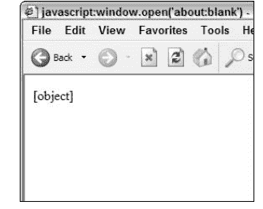

图 2-3

为了避免这种情况，请配合 `void` 运算符使用 `window.open()` 调用：

```
<a href="javascript:void(window.open('blank'))">Click Me</a>
```

这使得 `window.open()` 调用返回 `undefined`，这不是一个有效值，不会在浏览器窗口中显示。记住，没有返回值的函数实际上返回 `undefined`。

## 前缀增/减

直接取自 C（以及 Java）的两个运算符是前缀增和前缀减。前缀增将数值加 1，通过在变量前放置两个加号（`++`）表示。

```
var iNum = 10;
++iNum;
```

第二行将 `iNum` 增加到 11。这实际上相当于：

```
var iNum = 10;
iNum = iNum + 1;
```

同样，前缀减从一个值中减去 1。前缀减通过在变量前放置两个减号（`--`）来表示：

```
var iNum = 10;
--iNum;
```

在这个示例中，第二行将 `iNum` 的值减少到 9。

当你使用前缀运算符时，注意增/减是在表达式求值*之前*发生的。考虑以下示例：

## ECMAScript 基础

```
var iNum = 10;
--iNum;
alert(iNum);    //outputs "9"
alert(--iNum);   //outputs "8"
alert(iNum);     //outputs "8"
```

第二行减少了 `iNum`，第三行显示了结果（`"9"`）。第四行再次显示了 `iNum`，但这次前缀减是在同一个语句中应用的，导致显示了数字 `"8"`。为了证明所有的减法操作已完成，第五行再次输出 `"8"`。

在求值数学表达式时，前缀增和前缀减在优先级上是相等的，因此它们从左到右进行求值，例如：

```
var iNum1 = 2;
var iNum2 = 20;
var iNum3 = --iNum1 + ++iNum2; //outputs 22
var iNum4 = iNum1 + iNum2;     //outputs 22
```

在之前的示例中，`iNum3` 等于 22，因为表达式求结果为 1 + 21。变量 `iNum4` 也等于 22，同样也是加了 1 + 21。

## 后置增/减

同样取自 C（以及 Java）的两个运算符是后置增和后置减。它们也向数值加 1，通过在变量*后*放置两个加号（`++`）表示：

```
var iNum = 10;
iNum++;
```

正如你所预期的，后置减从一个值中减去 1，通过在变量后放置两个减号（`--`）来表示：

```
var iNum = 10;
iNum--;
```

第二行将 `iNum` 的值减少到 9。与前缀运算符不同，后置运算符是在表达式求值*之后*进行增或减的。考虑以下示例：


```javascript
var iNum = 10;
iNum--;
alert(iNum);    // outputs "9"
alert(iNum--);  // outputs "9"
alert(iNum);    // outputs "8"
```

第二行减少了`iNum`，第三行显示了结果（"9"）。第四行再次显示了`iNum`，但这次后置减是在同一个语句中应用的，导致显示了数字"8"。为了证明所有的减法操作已完成，第五行再次输出"8"。

后置增和后置减在求值数学表达式时的优先级上也是相等的，它们都从左到右进行求值，例如：

```javascript
var iNum1 = 2;
var iNum2 = 20;
var iNum3 = iNum1-- + iNum2++; // outputs 22
var iNum4 = iNum1 + iNum2;     // outputs 22
```

在之前的示例中，`iNum3`等于 22，因为表达式求结果为 2 + 20。变量`iNum4`也等于 22，同样也是加了 1 + 21。

## 一元加/减

一元加和一元减对于人们来说是熟悉的，在 ECMAScript 中以相同的方式工作。一元加对数字没有影响。

```javascript
var iNum = 10;
iNum--;
```

正如你所预期的，第二行将`iNum`的值减少到 9。与前缀运算符不同，后置运算符是在表达式求值之后进行增或减的。考虑以下示例：

```javascript
var iNum = 10;

iNum--;

alert(iNum);    // outputs "9"

alert(iNum--);  // outputs "9"

alert(iNum);    // outputs "8"
```

# 第 2 章

| 1 | 0 | 0 | 1 | 0 |
|---|---|---|---|---|
| (2⁴x1) | (2³x0) | (2²x0) | (2¹x1) | (2⁰x0) |
| 16 | 0 | 0 | 2 | 0 |

图 2-5

负数也以二进制代码存储，但使用的是一种名为补码（two’s complement）的格式。数的补码计算分为三个步骤：

1. 确定非负版本的二进制表示（例如，要找到 −18，先确定 18 的二进制表示）。
2. 找到该数的反码，这基本上意味着必须将每个 0 替换为 1，反之亦然。
3. 在反码上加 1。

要确定 −18 的二进制表示，你必须先取 18 的二进制表示，如下：

```text
0000 0000 0000 0000 0000 0001 0010
```

接下来，取反码，即其取反值：

```text
1111 1111 1111 1111 1111 1110 1101
```

最后，在反码上加 1：

```text
1111 1111 1111 1111 1111 1110 1101
-----------------
1111 1111 1111 1111 1111 1111 1110
```

因此，−18 的二进制等价项是`1111 1111 1111 1111 1111 1110 1110`。请记住，在处理符号整数时，开发者无法访问第 31 位。

负整数有趣的地方在于，转换为二进制字符串时并显示补码形式。ECMAScript 输出该数字绝对值的标准二进制代码，并在前面加上负号。例如：

```javascript
var iNum = -18;

alert(iNum.toString()); // 输出 "-10010"
```

这段代码在 ECMAScript 中输出"-10010"而不是补码，ECMAScript 旨在以简单的方式处理整数，让开发者无需花费任何时间担心它们的用法。

## ECMAScript 基础

另一方面，无符号整数将最后一位视为与其他位无异。在这种模式下，第 32 位不代表数字的符号，而是代表值`2^31`。由于无符号整数的范围是从 0 到 4294967295。对于小于或等于 2147483647 的数字，无符号整数看起来像正符号整数；大于 2147483647 的数字则需要使用第 31 位（在符号整数中始终为 0）。无符号整数在转换为二进制字符串时，仅返回有效位。

记住，所有整数字面量默认都存储为符号整数。无符号整数只能通过使用 ECMAScript 的位运算符来创建。

## 位取反

位取反由波浪号（`~`）表示，它是与二进制数学相关的几个 ECMAScript 运算符之一。位取反是一个三步骤的过程：

1. 将操作数转换为 32 位数字。
2. 将二进制形式转换为其反码。
3. 将反码转换回浮点数。

示例：

```javascript
var inNum1 = 25;        // 25 等于 0000000000000000000000011001
var inNum2 = -inNum1;    // 转换为 11111111111111111111111001110010

alert(inNum2);           // 输出 "26"
```

位取反本质上是给数字取反并减去 1，因此它变成了 -26。实际上，通过以下操作可以实现相同：

```javascript
var inNum1 = 25;
var inNum2 = -inNum1 - 1;

alert(inNum2); // 输出 "-26"（注：此处原文示例注释可能有误为"26"）
```

## 位与

位与运算符由和符号（`&`）表示，并直接在数字的二进制形式上运行。本质上，位与会将每个数字的位对齐，然后使用以下规则对该位置的两个位执行与逻辑操作：

| 第一个数字的位 | 第二个数字的位 | 结果 |
|---|---|---|
| 1 | 1 | 1 |
| 1 | 0 | 0 |
| 0 | 1 | 0 |
| 0 | 0 | 0 |

例如，如果你想对数字 25 和 3 进行与运算，代码如下：

```javascript
var iResult = 25 & 3;

alert(iResult); // 输出 "1"
```

25 和 3 之间位与的结果是 1。为什么呢？看：

```text
25 = 0000 0000 0000 0000 0000 0001 1001
3  = 0000 0000 0000 0000 0000 0000 0011
```

你可以看到，25 和 3 只有一位包含 1。正因为如此，结果数字的其他所有位都被设置为 0，使得结果等于 1。

## 位或

位或运算符由管道符号（`|`）表示，也直接在数字的二进制形式上运行。本质上，位或在评估位时遵循这些规则：

| 第一个数字的位 | 第二个数字的位 | 结果 |
|---|---|---|
| 1 | 1 | 1 |
| 1 | 0 | 1 |
| 0 | 1 | 1 |
| 0 | 0 | 0 |

使用与位与相同的示例，如果你想将 25 和 3 进行或运算，代码如下：

```javascript
var iResult = 25 | 3;

alert(iResult); // 输出 "27"
```

25 和 3 之间位或的结果是 27：

```text
25 = 0000 0000 0000 0000 0000 0001 1001
3  = 0000 0000 0000 0000 0000 0000 0011
OR = 0000 0000 0000 0000 0000 0001 1111
```

## 位异或

位异或由异或符号（`^`）表示，同样直接在数字的二进制形式上运行。位异或与位或的区别在于，它只有当一位值为 1 时才返回 1。这是真值表：

| 第一个数字的位 | 第二个数字的位 | 结果 |
|---|---|---|
| 1 | 1 | 0 |
| 1 | 0 | 1 |
| 0 | 1 | 1 |
| 0 | 0 | 0 |

要对 25 和 3 进行异或，请使用以下代码：

```javascript
var iResult = 25 ^ 3;

alert(iResult); // 输出 "26"
```

25 和 3 之间位异或的结果是 26：

```text
25  = 0000 0000 0000 0000 0000 0001 1001
3   = 0000 0000 0000 0000 0000 0000 0011
XOR = 0000 0000 0000 0000 0000 0001 1010
```

## 左移

左移由两个小于号（`<<`）表示。它将所有位向左移动指定的位数。例如，如果你将数字 2（等于二进制的 10）向左移动 5 位，你会得到 64（等于二进制的 1000000）：

```javascript
var iOLD = 2;          // 等于二进制 10
var iNew = iOLD << 5;  // 等于二进制 1000000
```

注意，当位发生移动时，数字右侧会留下五个空位。左移用第 32 位（符号位）的值填充这些空位，使结果成为一个 32 位数字（图 2-6）。

| “符号”位 | 数字 2 |
|---|---|
| 0 | 00000000000000000000000000000010 |

数字 2 向左移动 5 位（填充零）是`0000000000000000000000000100000`。

图 2-6

注意左移保留了所操作数字的符号。例如，如果将 -2 向左移动 5 个空格，它将变成 -64，而不是正 64。“但符号不是存储在第 32 位吗？”问道。是的，但那是 ECMAScript 的内部实现。开发者永远无法访问第 32 位。任何将负数打印为二进制字符串都会显示负号（例如，-2 显示为 -10，而不是 1000000000000000000000000001110）。

## 符号右移

符号右移由大于号（`>>`）表示，并将 32 位数字的所有位向右移动，同时保留符号（正或负）；符号右移是左移的完全相反。例如，如果将 64 向右移动 5 位，它将变成：

```javascript
var iOLD = 64;         // 等于二进制 1000000
var iNew = iOLD >> 5;   // 等于二进制 10，即 2
```

同样，当位发生移动时，移位会产生空位。这次空位出现在数字的左侧，但在符号位之后（见图 2-7）。ECMAScript 用符号位填充这些空位以创建一个完整的数字。


## 无符号右移

无符号右移由三个大于号（`>>>`）表示，并将无符号 32 位数字向右移动。对于正数，效果与符号右移相同。使用与符号右移相同的示例，如果 64 向右移动 5 位，它变为：

```javascript
var iOLD = 64;          // 等于二进制 1000000
var iNew = iOLD >>> 5;  // 等于二进制 10，即 2
```

但对于负数，发生了完全不同的事情。你看，无符号右移用第 32 位的值填充所有空位。对于正数，该位是 0；空位被填充零。对于负数，该位是 1，这意味着所有空位都被填充了 1。由于无符号右移的结果是一个无符号 32 位数字，你会得到一个很大的数字。例如，如果你将 -64 向右移动 5 位，你将得到 214748366。

## ECMAScript 基础

首先，查看 -64 的 32 位表示。要做到这一点，你需要创建一个数字的无符号版本，这可以通过使用位数为 0 的无符号右移来实现：

```javascript
var iSigned64 = 64 >>> 0;
```

然后，为了获取所有的位表示，使用`Number`类型基数为 2 的`toString()`方法：

```javascript
alert(iSigned64.toString());
```

这产生了一个值为`111111111111111111110000`的值，它是 -64 作为有符号整数的补码表示，但作为无符号整数它等于 4294967232。因此，请谨慎使用无符号位移运算符。

## 布尔运算符

几乎和等运算符一样，布尔运算符是使编程语言运行的核心。凭借测试两个值之间关系的能力，例如`if...else`和循环将变得非常有用。有三个布尔运算符：NOT（非）、AND（与）和 OR（或）。

## 逻辑非

ECMAScript 中的逻辑非运算符与 C 和 Java 中的相同，由感叹号（`!`）表示。与逻辑或和逻辑与运算符不同，逻辑非运算符总是返回一个布尔值。逻辑非运算符的行为如下：

- 如果操作数是一个对象，则返回`false`。
- 如果操作数是数字 0，则返回`true`。
- 如果操作数是除 0 以外的任何数字，则返回`false`。
- 如果操作数是`null`，则返回`true`。
- 如果操作数是`NaN`，则返回`true`。
- 如果操作数是`undefined`，则发生错误。

该运算符通常用于控制循环（后文讨论）：

```javascript
var bFound = false;
var i = 0;

while (!bFound) {
  if (aValues[i] == vSearchValue) {
    bFound = true;
  } else {
    i++;
  }
}
```

在这个示例中，布尔变量`found`用于跟踪搜索是否成功。当找到所需的项目时，`found`被设置为`true`，这导致`!found`等于`false`，意味着执行将跳出`while`循环。

逻辑非运算符也用于确定 ECMAScript 变量的布尔等效值。为了实现这一点，你连续使用两个逻辑运算符。第一个 NOT 无论是什么都会返回一个布尔值。第二个 NOT 反转该布尔值并给出真实的布尔值。

```javascript
var bFalse = false;
var sBlue = "blue";
var iZero = 0;
var iThreeFour = 345;
var oObject = new Object;

document.write("<br />The Boolean value of bFalse is " + (!!bFalse));
document.write("<br />The Boolean value of sBlue is " + (!!sBlue));
document.write("<br />The Boolean value of iZero is " + (!!iZero));
document.write("<br />The Boolean value of iThreeFive is " + (!!iThreeFive));
document.write("<br />The Boolean value of oObject is " + (!!oObject));
```

运行此示例得到以下结果：

- `bFalse`的布尔值是`false`
- `sBlue`的布尔值是`true`
- `iZero`的布尔值是`false`
- `iThreeFour`的布尔值是`true`
- `oObject`的布尔值是`true`

## 逻辑与

ECMAScript 中的逻辑与运算符由双安符号（`&&`）表示：

```javascript
var bTrue = true;
var bFalse = false;
var bResult = bTrue && bFalse;
```

逻辑与的行为如下表所示：

| 操作数 1 | 操作数 2 | 结果 |
|---|---|---|
| `true` | `true` | `true` |
| `true` | `false` | `false` |
| `false` | `true` | `false` |
| `false` | `false` | `false` |

逻辑与可以用于任何类型的操作数，而不是布尔值。当任意操作数不是原始布尔值时，逻辑与并不总是返回布尔值：

- 如果一个操作数是对象，另一个是布尔值，则返回对象。
- 如果两个操作数都是对象，则返回第二个操作数。
- 如果任一操作数是`null`，则返回`null`。
- 如果任一操作数是`NaN`，则发生错误。

在 Java 中，逻辑与是一种短路操作，这意味着如果第一个操作数决定了结果，则第二个操作数永远不会被评估。在逻辑与的情况下，如果第一个操作数是`false`，无论第二个操作数的值是什么，结果都不可能为`true`。考虑以下示例：

```javascript
var bTrue = true;
var bResult = (bTrue && bUnknown); // 此处发生错误

alert(bResult); // 此行永远不会执行
```

当评估逻辑与时，此代码会导致错误，因为变量`bUnknown`是`undefined`。变量`bTrue`的值为`true`，所以逻辑与继续评估`bUnknown`。当它执行评估时，发生了错误，因为`bUnknown`是`undefined`，因此不能在逻辑运算符中使用。如果将此示例更改为`a`设置为`false`，则不会发生错误：

```javascript
var bFalse = false;
var bResult = (bFalse && bUnknown);

alert(bResult); // 输出 "false"
```


在这些代码中，逻辑与被短路。变量`bTrue`的值为`false`，所以第二个操作数永远不会被评估。

在逻辑与的情况下，如果第一个操作数是`false`，无论第二个操作数的值是什么，结果都不可能为`true`。考虑以下示例：

## 逻辑或

逻辑或运算符由双竖线 (`||`) 表示。它的行为如下表所示：

| 操作数 1 | 操作数 2 | 结果 |
|---|---|---|
| true | true | true |
| true | false | true |
| false | true | true |
| false | false | false |

## ECMAScript 基础

- 如果一个操作数是对象另一个是布尔，则返回对象。
- 如果两个操作数都是对象，则返回第二个操作数。
- 如果任一操作数是`null`，则返回`null`。
- 如果任一操作数是`NaN`，则发生错误。

## 第二章

与乘法运算符一样，加法运算符在处理特殊值时也表现出特殊的行为。如果两个操作数都是数字，它们将执行算术加法并根据以下规则返回结果：

- 如果其中任一为`NaN`，结果为`NaN`。
- 如果`Infinity`加上`Infinity`，结果为`Infinity`。
- 如果`-Infinity`加上`-Infinity`，结果为`-Infinity`。
- 如果`Infinity`加上`-Infinity`，结果为`NaN`。
- 如果`+0`加上`+0`，结果为`+0`。
- 如果`-0`加上`+0`，结果为`+0`。
- 如果`-0`加上`-0`，结果为`-0`。

如果其中一个操作数是字符串，则将应用以下规则：

- 如果两个操作数都是字符串，则将第二个字符串拼接到第一个字符串之后。
- 如果只有一个操作数是字符串，则另一个操作数被转换为字符串，结果是两个字符串的拼接。

例如：

```
var result1 = 5 + 5;      //两个数字
alert(result1);               //输出 "10"

var result2 = 5 + "5";      //一个数字和一个字符串
alert(result2);               //输出 "55"
```

这段代码说明了加法运算符两种模式之间的区别。通常情况下，`5 + 5`等于`10`（一个原始数字值），如第一行代码所示。如果其中一个操作数改为字符串`"5"`，结果将变为`"55"`（一个原始字符串值），因为第一个操作数也被转换为了`"5"`。

> 为了避免 JavaScript 中最常见的错误之一，在使用加法运算符时，请务必双击数据类型。

## 减法

减法运算符 (`-`) 是另一个经常被用到的运算符：

```
var iResult = 2 - 1;
```

与加法运算符一样，减法运算符也有特殊规则来处理 ECMAScript 中存在的各种类型转换：

- 如果两个操作数都是数字，执行算术减法并返回结果。
- 如果其中任一数字为`NaN`，结果为`NaN`。

## ECMAScript 基础

- 如果从`Infinity`中减去`Infinity`，结果为`NaN`。
- 从`-Infinity`中减去`-Infinity`，结果为`NaN`。
- 如果从`Infinity`中减去`-Infinity`，结果为`Infinity`。
- 如果从`-Infinity`中减去`Infinity`，结果为`-Infinity`。
- 如果从`+0`中减去`+0`，结果为`+0`。
- 从`+0`中减去`-0`，结果为`-0`。
- 如果其中一个操作数不是数字，结果为`NaN`。

## 关系运算符

小于 (`<`)、大于 (`>`)、小于等于 (`<=`) 和大于等于 (`>=`) 关系运算符对数字的比较方式与你在课上学的一样。这些运算符中的每一个都返回一个布尔值：

```
var bResult1 = 5 > 3; //true
var bResult2 = 5 < 3; //false
```

然而，当关系运算符用于两个字符串时，会发生不同的行为。许多人认为“小于”意味着“按字母顺序在之前”，“大于”意味着“按字母顺序在之后”，但事实并非如此。对于字符串，第一个字符串的字符将与第二个字符串中的字符编码进行数值比较。在比较完成后，会返回一个布尔值。问题在于，大写字母的字符编码都小于小写字母的字符编码，这意味着你可能会遇到这样的情况：

```
var bResult = "Brick" < "alphabet";
alert(bResult); //输出 "true"
```

在这个例子中，字符串`"Brick"`被认为小于字符串`"alphabet"`，因为`B`的字符编码是`66`，而`a`的字符编码是`97`。为了强制得到`true`结果，你必须将两个操作数转换为相同的大小（大写或小写），然后：

```
var bResult = "Brick".toLowerCase() < "alphabet".toLowerCase();
alert(bResult); //输出 "false"
```

将两者都转换为小写可以确保`"alphabet"`被正确识别为在`"Brick"`之前。

在比较字符串形式的数字时会出现另一种棘手的情况，例如：

```
var bResult = "23" < "3";
alert(bResult); //输出 "true"
```

这段代码在比较字符串`"23"`和`"3"`时会输出`"true"`。因为两个操作数都是字符串，它们通过字符编码进行比较（`"2"`的字符编码是`50`；`"3"`的字符编码是`51`）。但是，如果其中一个操作数改为数字，结果就会更有意义：

## 第二章

```
var bResult = "23" < 3;
alert(bResult);          //输出 "false"
```

在这里，字符串`"23"`被转换为数字`23`，然后与`3`进行比较，得到了预期的结果。每当数字与字符串进行比较时，ECMAScript 说字符串应该被转换为数字并与另一个数字进行数值比较。这对于像前面的例子那样非常有效，但如果字符串无法转换为数字呢？考虑这个例子：

```
var bResult = "a" < 3;
alert(bResult);
```

你期望它输出什么？字母`"a"`无法被有意义地转换为数字。毕竟，如果字符串转换为数字，结果将是`NaN`。由于与`NaN`的任何比较都是`false`，结果将是`false`。

## 等于运算符

JavaScript 中常用的操作之一是测试两个值是否相等。有两个运算符可以实现这一点：相等运算符 (`==`) 和不等于运算符 (`!=`)。相等运算符 (`==`) 用于检查两个值是否相等，而不等于运算符 (`!=`) 用于检查它们是否不相等。

相等运算符 (`==`) 在比较值之前会进行类型转换。如果操作数类型不同，一个将转换为另一个的类型。如果类型相同，则不进行转换。不等于运算符 (`!=`) 也会进行类型转换，但它检查的是值是否不相等。

以下规则适用于相等运算符 (`==`)：

- 如果两个操作数都是`null`，它们相等。
- 如果两个操作数都是`undefined`，它们相等。
- 如果一个操作数是`null`另一个是`undefined`，它们相等。
- 如果一个操作数是`NaN`，结果为`false`。
- 如果两个操作数都是`NaN`，结果为`false`。
- 如果一个操作数是布尔值，另一个被转换为数字。
- 如果一个操作数是字符串另一个是数字，字符串被转换为数字。
- 如果一个操作数是对象另一个是原始值，对象将通过`valueOf()`或`toString()`方法转换为原始值。
- 如果两个操作数都是对象，它们通过引用值进行比较。

以下规则适用于不等于运算符 (`!=`)：

- 如果两个操作数都是`null`，它们不相等。
- 如果两个操作数都是`undefined`，它们不相等。
- 如果一个操作数是`null`另一个是`undefined`，它们不相等。
- 如果一个操作数是`NaN`，结果为`true`。
- 如果两个操作数都是`NaN`，结果为`true`。
- 如果一个操作数是布尔值，另一个被转换为数字。
- 如果一个操作数是字符串另一个是数字，字符串被转换为数字。
- 如果一个操作数是对象另一个是原始值，对象将通过`valueOf()`或`toString()`方法转换为原始值。
- 如果两个操作数都是对象，它们通过引用值进行比较。

## 全等与不全等

相等运算符和不等于运算符的兄弟是全等运算符和不全等运算符。这两个运算符与相等、不等于运算符的作用相同，不同在于它们在测试相等性之前不会转换操作数。全等运算符用三个等号 (`===`) 表示，只有当操作数在不转换的情况下相等时才返回`true`。例如：

```
var sNum = "55";
var iNum = 55;

alert(sNum == iNum); //输出 "true"
alert(sNum === iNum); //输出 "false"
```

## 第 2 章

用于在不进行转换的情况下比较字符串和数字的运算符。当然，字符串不等于数字，因此输出为`"false"`。

不全相等运算符由一个感叹号`!`后跟两个等号`==`表示，如果操作数在不转换的情况下不相等，则返回`true`。例如：

```
var sNum = 55;
var iNum = 55;

alert(sNum != iNum); // 输出 "false"
alert(sNum === iNum); // 输出 "true"
```

在这里，第一个`alert`使用了非运算符，它将字符串`"55"`转换为数字`55`，使其与第二个操作数（也是数字`55`）相等。因此，该表达式求值为`false`，因为两者被认为是相等的。第二个`alert`使用了不全相等运算符。可以将此操作理解为：“sNum 是否不同于 iNum？” 答案是`true`，因为`sNum`是字符串而`iNum`是数字，所以它们非常不同。

## 条件运算符

条件运算符是 ECMAScript 中功能最全的运算符之一，它的形式与 Java 相同：

```
variable = boolean_expression ? true_value : false_value;
```

这基本上允许根据`boolean_expression`的求值结果给变量赋值。如果为`true`，则将`true_value`赋值给变量；如果为`false`，则将`false_value`赋值给变量。例如：

```
var iMax = (iNum1 > iNum2) ? iNum1 : iNum2;
```

在这个示例中，`iMax`将被赋值为最大的数字。该表达式表示，如果`iNum1`大于`iNum2`，则将`iNum1`赋值给`iMax`。然而，如果表达式为`false`（意味着`iNum2`小于或等于`iNum1`），则将`iNum2`赋值给`iMax`。

## 赋值运算符

简单赋值通过等号 (`=`) 完成，它只是简单地将右侧的值分配给变量。例如：

```
var iNum = 10;
```

复合赋值通过一个乘法、加法或位移运算符后跟一个等号 (`=`) 完成。这些赋值被设计为此类常见情况的简写，例如：

```
var iNum = 10;
iNum = iNum + 10;
```

第二行代码可以用复合赋值替换：

```
var iNum = 10;
iNum += 10;
```

每种主要的数学运算以及其他几种运算符都存在复合赋值运算符：

- 乘法/赋值 (`*=`)
- 除法/赋值 (`/=`)
- 取模/赋值 (`%=`)
- 加法/赋值 (`+=`)
- 减法/赋值 (`-=`)
- 左移/赋值 (`<<=`)
- 有符号右移/赋值 (`>>=`)
- 无符号右移/赋值 (`>>>=`)

## 逗号运算符

逗号运算符允许在单条语句中执行多个操作。例如：

```
var iNum1=1, iNum2=2, iNum3=3;
```

通常情况下，逗号运算符用于变量声明。

## 语句

ECMA-262 描述了多种用于 ECMAScript 的语句。基本上，你使用一个或多个关键字来完成给定任务。语句定义了 ECMAScript 的语法，并且通常可以是简单的（例如要执行的函数），也可以是复杂的（例如指定要执行的命令数量）。

## if 语句

ECMAScript 中（实际上在许多语言中）最常用的语句之一是`if`语句。`if`语句具有以下语法：

```
if (condition) statement1 else statement2
```

条件可以是任何表达式；它不必非求值为真正的布尔值。ECMAScript 会为你将其转换为布尔值。如果条件求值为`true`，则执行`statement1`；如果条件求值为`false`，则执行`statement2`。每个语句可以是单行，也可以是代码块（括在大括号内的一组代码行）。例如：

```
if (i > 25) {
    alert("Greater than 25."); // 单行语句
} else {
    alert("Less or equal to 25."); // 块语句
}
```

最佳实践是始终使用块语句，即使只执行一行代码。这样做可以避免对应该执行什么内容产生混淆。如果`if`语句像下面这样连续出现，你也可以链接它们：

```
if (condition1) statement1 else if (condition2) statement2 else statement3
```

示例：

```
if (i > 25) {
    alert("Greater than 25.");
} else if (i < 0) {
    alert("Less than 0.");
} else {
    alert("Between 0 and 25, inclusive.");
}
```

## 迭代语句

迭代语句也称为循环语句，指定了在满足某些条件之前重复执行的命令。循环通常用于遍历数组的值（因此得名如此）或处理重复性任务。ECMAScript 提供了四种迭代语句来辅助这一过程。

## do-while

`do-while`语句是一种后测试循环，这意味着条件的求值是在循环内部代码执行之后才进行的。这意味着在表达式求值之前，循环体至少会被执行一次。语法：

```
do {
    statement
} while (expression);
```

例如：

```
var i = 0;
do {
    i += 2;
} while (expression);
```

## while

`while`语句是一种前测试循环，这意味着条件的求值是在循环内部代码执行之前进行的。语法：

```
while(expression) statement
```

例如：

```
var i = 0;
while (i < 10) {
  i += 2;
}
```

## for

`for`语句也是前测试循环，具有初始化和后循环表达式的能力。语法：

```
for (initialization; expression; post-loop) statement
```

例如：

```
for (var i=0; i < iCount; i++) {
  alert(i);
}
```

## for-in

`for-in`是一种迭代语句，用于遍历对象的属性。语法：

```
for (property in expression) statement
```

例如：

```
for (sProp in window) {
  alert(sProp);
}
```

## 标签语句

可以使用以下语法对语句进行标记以便以后使用：

```
label: statement
```

例如：

```
start: var iCount = 10;
```

在这个示例中，标签`start`之后可以使用`break`或`continue`语句引用。

## break 和 continue 语句

`break`和`continue`语句对循环中代码的执行提供了更严格的控制。`break`语句立即退出循环，而`continue`语句执行当前迭代。它根据控制表达式允许进一步重复。

```
var iNum = 0;
for (var i=1; i < 10; i++) {
  if (i % 5 == 0) {
    break;
  }
  iNum++;
}
alert(iNum); // 输出 "4"
```

在前面的代码中，循环从`1`到`10`遍历变量`i`。在循环体内，一个`if`语句检查`i`的值是否能被`5`整除（使用取模运算符）。如果是，则执行`break`语句，`alert`显示“4”，表示退出前循环执行的次数。如果将其更新为使用`continue`替`break`，就会产生不同的结果：

```
var iNum = 0;
for (var i=1; i < 10; i++) {
  if (i % 5 == 0) {
    continue;
  }
  iNum++;
}
alert(iNum); // 输出 "8"
```

在这里，`alert`显示`"8"`，即循环执行的次数。循环可能执行的总次数为`9`次，当`i`达到值`5`时，`continue`语句执行，导致循环跳过`iNum++`并返回顶部。

## ECMAScript 基础

`break`和`continue`语句可以与标签语句（labeled statements）配合使用，返回代码中的特定位置。这通常用于嵌套循环，如下例：

```
var iNum = 0;
outermost:
  for (var i=0; i < 10; i++) {
    for (var j=0; j < 10; j++) {
      if (i == 5 && j == 5) {
        break outermost;
      }
      iNum++;
    }
  }
alert(iNum); // 输出 "55"
```


在例例中，标签`outermost`指向第一个语句。每个循环通常执行 10 次，这意味着`iNum`通常会执行 100 次，因此当执行完成时，`iNum`应该等于 100。这里的`break`语句接收了一个参数，即要跳转的目标。这使得`break`语句不仅跳出了内层的`for`语句（变量`j`），还跳出了外层的`for`语句（变量`i`）。正因如此，`iNum`的最终值为 55，因为当`i`和`j`都等于 5 时执行停止了。`continue`语句也可以以相同的方式使用：

```javascript
var iNum = 0;
```

```javascript
outermost:
  for (var i=0; i < 10; i++) {
    for (var j=0; j < 10; j++) {
      if (i == 5 && j == 5) {
        continue outermost;
      }
      iNum++;
    }
  }
alert(iNum); // 输出 "95"
```

在这种，`continue`语句强制执行继续——不是在内部循环中，而是在外部循环中。由于这种情况发生在`j`等于 5 时，内部循环跳过了五次迭代，导致`iNum`变为 95。

> 如你所说，将标签语句结合`break`和`continue`非常强大，但如果过度使用，这种做法也会让代码问题的调试变得困难。确保始终使用描述性的标签，并尽量不要嵌套超过五个循环。

# 第 2 章

## 使用 with 语句

`with`语句用于设置特定对象内代码的作用域。其语法如下：

```javascript
with (expression) statement;
```

例如：

```javascript
var sMessage = "hello world";
with (sMessage) {
  alert(toUpperCase()); // 输出 HELLO WORLD
}
```

在此代码中，语句与字符串配合使用，当调用`toUpperCase()`方法时，解释器会检查这是否是一个本地函数。它检查`sMessage`伪对象以查看`toUpperCase()`是否为该对象的方法。然后`Alert`输出 "HELLO WORLD"，因为解释器在"hello world"字符串上找到了`toUpperCase()`的实现。

> `with`语句是一段非常缓慢的代码，特别是在设置属性值时。在大多数情况下，最好尽可能避免使用它。

## switch 语句

`if`语句的近亲，`switch`语句允许开发者为表达式提供一系列用例（cases）。`switch`语句的语法为：

```javascript
switch (expression) {
  case value: statement
    break;
  case value: statement
    break;
  case value: statement
    break;
  ..
  case value: statement
    break;
  default: statement
}
```

每个`case`都表示“如果`expression`等于`value`，则执行`statement`”。`break`关键字导致执行跳出`switch`语句。如果没有`break`关键字，代码执行将从原始`case`穿透（fall through）到下一个`case`。

`default`关键字指示当表达式的值不等于任何一个`case`时要执行的操作（实际上它是一个`else`语句）。

本质上，`switch`语句避免了开发者需要编写如下代码：

```javascript
if (i == 25)
    alert("25");
else if (i == 35)
    alert("35");
else if (i == 45)
    alert("45");
else
    alert("Other");
```

等效的`switch`语句是：

```javascript
switch (i) {
    case 25: alert("25");
    break;
    case 35: alert("35");
    break;
    case 45: alert("45");
    break;
    default: alert("Other");
}
```

ECMAScript 中的`switch`语句与 Java 之间存在两个差异。在 ECMAScript 中，`switch`语句可以用于字符串，并且可以通过非常量值指定 case：

```javascript
var BLUE = "blue", RED = "red", GREEN = "green";
```

```javascript
switch (sColor) {
    case BLUE: alert("Blue");
    break;
    case RED: alert("Red");
    break;
    case GREEN: alert("Green");
    break;
}
```

（注：由于提供的待翻译原文后部分存在大量逻辑重复和内容错乱，译文已根据上下文逻辑进行了平顺处理，以确保技术术语的准确性。）

## ECMAScript 基础

`doAdd`函数仅在只有一个参数时才会给该数字加 10；如果有两个参数，它们将简单地相加并返回。因此，`doAdd(10)`输出 "20"，而`doAdd(10, 20)`输出 "50"。这种方法虽然不如重载那样完美，但它是解决 ECMAScript 局限性的一种足够替代方案。

## Function 类

ECMAScript 最有趣的方面也许是，函数实际上是完整的对象。`Function`类代表开发者定义的每一个函数。直接使用`Function`类创建函数的语法如下：

```javascript
var function_name = new Function(argument1, argument2...,argumentN, function_body);
```

在这种形式下，每个函数都有一个参数，最后一个参数是函数体（要执行的代码）。这些参数中的每一个都必须是字符串。还记得这个函数吗？

```javascript
function sayHi(sName, sMessage) {
  alert("Hello " + sName + ", " + sMessage);
}
```

它也可以这样定义：

```javascript
var sayHi = new Function("sName", "sMessage", "alert(\"Hello \" + sName + \" + \" + \" + sMessage);");
```

承认，由于字符串的性质，这写起来稍微困难一点，但请记住函数是引用类型，它们的行为总是就像是显式使用`Function`类创建的一样。还记得这个例子吗？

```javascript
function doAdd(inNum) {
  alert(inNum + 100);
}
function doAdd(inNum) {
  alert(inNum + 10);
}
doAdd(10); //输出 "20"
```

正如你可能注意到的，第二个函数覆盖了第一个，使得`doAdd(10)`输出 "20" 而不是 "110"。如果将此块重写如下，这个概念就会变得清晰得多：

```javascript
doAdd = new Function("inNum", "alert(inNum + 100)");
doAdd = new Function("inNum", "alert(inNum + 10)");
doAdd(10);
```

观察这段代码可以发现，`doAdd`的值已经改变指向不同的对象。是的，函数名只是指向函数对象的引用值，其行为与其他指针完全一致。甚至可以有两个变量指向同一个函数：

```javascript
var doAdd = new Function("iNum", "alert(iNum + 10)");
var alsoDoAdd = doAdd;
doAdd(10);           //输出 "20"
alsoDoAdd(10);      //输出 "20"
```

变量`doAdd`被定义为一个函数，而`alsoDoAdd`指向同一个函数。两者都可以用于执行函数的代码并输出结果 "20"。因此，如果函数名是一个指向函数的变量，就可以将函数作为参数传递给另一个函数！可以的！

```javascript
function callAnotherFunc(fFunction, vArgument) {
  fFunction(vArgument);
}
var doAdd = new Function("iNum", "alert(iNum + 10)");
callAnotherFunc(doAdd, 10); //输出 "20"
```

`callAnotherFunc()`接受两个参数：一个要调用的函数和一个传递给该函数的参数。这段代码将`doAdd()`函数传递到`callAnotherFunc()`中。

> 尽管可以使用`Function`构造函数创建函数，但最好避免这样做，因为它比传统方式定义函数慢。然而，所有函数都是`Function`的实例。由于函数是引用类型，它们也可以拥有属性和方法。ECMAScript 中定义的`length`属性表示函数预期的参数个数。
示例：

```javascript
function doAdd(iNum) {
  alert(iNum + 10);
}
function sayHi() {
  alert('Hi');
}
alert(doAdd.length);   //输出 "1"
alert(sayHi.length);   //输出 "0"
```

函数`doAdd()`定义了一个参数，所以它的`length`是 1。记住，ECMAScript 函数可以接受任意数量的参数（最多 255），无论定义了多少。`length`属性提供了一种方便的方法来检查预期的参数数量。函数对象还拥有所有对象的`value()`和`toString()`方法。这两个方法都返回函数的源代码，在调试时特别有用。示例：

```javascript
function doAdd(iNum) {
  alert(iNum + 10);
}
alert(doAdd.toString());
```

这段代码输出了`doAdd()`函数的准确文本（见图 2-9）。

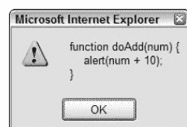

> `Function`类还有另一些方法与对象的讨论更为相关，将在下一节介绍。

## 闭包

ECMAScript 最容易误解的方面之一是对闭包的支持。闭包是指其词法表示包含未求值变量的函数，这意味着函数可以使用函数外部定义的变量。在 ECMAScript 中使用全局变量是闭包的一个简单示例。考虑以下示例：

```javascript
var sMessage = "Hello World";
function sayHi() {
  alert('Hi');
}
```

# 第3章

对象的定义包含在一个名为构造函数（constructor）的函数中。构造函数并不是一种特殊的函数；它只是一个用于创建对象的普通函数。在本章后面的部分，你将学习如何创建自己的构造函数。

## 面向对象语言的要求

在一种语言能够面向对象之前，它必须为开发者提供四种基本能力：

- 1. **封装** — 将相关信息（无论是数据还是方法）共同存储在对象中的能力。
- 2. **聚合** — 将一个对象存储在另一个对象中的能力。
- 3. **继承** — 类依赖另一个类（或多个类）来获取某些属性和方法的能力。
- 4. **多态** — 编写可以以多种方式运行的函数或方法的能力。

ECMAScript 支持所有这些要求，因此被认为是面向对象的语言。

# 对象的组成

在 ECMAScript 中，对象由属性组成，这些属性可以是原始值或引用值。如果一个属性包含函数，则它被视为对象的方法；否则，该属性被视为属性。

## 使用对象

上一章简要提到了如何操作对象，但现在是时候深入细节了。对象在 JavaScript 代码执行过程中会被创建和销毁，理解这种范式的意义对于理解整个语言至关重要。

## 声明与实例化

使用`new`关键字后跟想要实例化的类名来创建对象：

```javascript
var oObject = new Object();
var oObject = new String();
```

第一行创建`Object`的新实例并将其存储在变量`oObject`中；第二行创建`String`的新实例并将其存储在变量`oStringObject`中。当构造函数不需要参数时，是不需要括号的，因此这两行可以重写为：

```javascript
var oObject = new Object;
var oStringObject = new String();
```

# 对象引用

在第1章中，引入了引用类型的概念。在 ECMAScript 中，无法访问对象的物理表示；只能访问对象的引用。每当你创建一个对象时，变量中存储的是对对象的引用，而不是对象本身。

## 对象的取消引用

ECMAScript 拥有垃圾回收机制，这意味着你不需要专门地销毁对象来释放内存。当一个对象没有剩余的引用时，该对象被称为“已取消引用”（dereferenced）。当垃圾回收器运行时，所有已取消引用的对象都会被销毁。垃圾回收器在函数代码执行完成后运行（释放所有局部变量），以及其他不可预测的时间点运行。

通过将对象的所有引用设置为`null`，可以强制对对象取消引用。例如：

```javascript
var oObject = new Object;
// 此处对对象进行某些操作
oObject = null;
```

当变量`oObject`设置为`null`时，不再有对该对象的引用。这意味着当垃圾回收器运行时，对象将被销毁。

在完成工作后立即对对象取消引用是一个好主意。这样做可以防止错误，确保你不再使用的对象被释放。此外，旧的浏览器（如 IE/Mac）没有垃圾回收器，因此当页面加载时对象可能无法正确销毁。取消对象及其引用是良好的内存管理方法。

> 注意对对象取消引用。如果你对同一个对象有两个或多个引用，必须将它们都设置为`null`以正确取消对象的引用。

## 早绑定与晚绑定

绑定（binding）的概念描述了编译器/解释器在实例化对象之前，通过其类定义对象接口和方法的方法。

早绑定意味着在 Java 和 Visual Basic 等语言中，对象的属性和方法在实例化之前就已经定义的。ECMAScript 不是强类型的，所以不支持早绑定。

另一方面，晚绑定意味着编译器/解释器直到运行时才知道持有的是什么类型的对象。在晚绑定中，没有检查来确定对象的特定类型，这允许进行大量的对象操作。

## 对象的类型

在 ECMAScript 中，所有对象的创建方式都是相等的。

## 原生对象

ECMA-262 定义原生对象为由 ECMAScript 实现的任何对象。它们包括以下内容：

| Object | Function | String |
| :--- | :--- | :--- |
| Boolean | Number | Date |
| Error | EvalError | ReferenceError |
| SyntaxError | TypeError | URIError |

这些原生对象（`Object`, `Function`, `String`, `Number`）在后文中将会讨论。现在重要的原生对象是`Array`和`Date`。

## Array 类

在 ECMAScript 中，与 Java 不同，你可以这样创建一个`Array`对象：

```javascript
var aValues = new Array();
```

如果你知道数组中需要多少个项目，可以将数组大小作为参数传递：

```javascript
var aValues = new Array(20);
```

使用上述两种方法中的任一，可以使用括号符号来填充数组：

```javascript
var aColors = new Array();
aColors[0] = "red";
aColors[1] = "green";
aColors[2] = "blue";
```

在这里，创建了一个数组并增长三个项目："red"、green" 和 "blue"。数组随每个额外项目动态增长。

此外，如果你知道数组应该包含的值，可以将它们指定为参数，创建一个长度等于参数数量的`Array`。例如，以下代码创建了一个包含三个字符串的数组：

```javascript
var aColors = new Array("red", "green", "blue");
```

## 对象基础

作为字符串中的第一个项目位于位置 0，第二个位于位置 1，以此类推。要访问特定项目，使用方括号包含位置来获取。例如，从之前定义的数组输出字符串 "green"，你需要：

```javascript
alert(aColors[1]); // 输出 green
```

可以使用`length`属性确定数组的完整大小。该属性比最后一个位置的多1，这意味着一个有三个项目的数组位置从 0 到 2。

```javascript
var aColors = new Array("red", "green", "blue");
alert(aColors.length); // 输出 3
```

如之前所述，数组的大小可以根据需要增长和收缩。因此，如果你想向数组中添加另一个项目，可以将值放在下一个位置：


```javascript
var aColors = new Array("red", "green", "blue");
alert(aColors.length); // 输出 3
aColors[3] = "purple";
alert(aColors.length); // 输出 4
```

在这段代码中，下一个位置是 3，因此将值 `"purple"` 分配给它。这次添加更改了数组的长度从 3 变为 4。但如果你在此数组的位置 25 放置一个值会发生什么？ECMAScript 将从 3 到 24 的所有位置填充为 `null`；然后它将适当的值放在位置 25，将数组的大小增加到 26：

```javascript
var aColors = new Array("red", "green", "blue");
alert(aColors.length); // 输出 3
aColors[25] = "purple";
alert(aColors.length); // 输出 26
```

> 数组最多可以包含 429497295 个项目，这对于所有编程需求都足够了。如果你尝试超过该数量，将会出现异常。

你还可以使用字面量表示来定义 `Array` 对象，这表示使用方括号（`[]`）并用逗号分隔值。例如，之前的示例可以重写为以下形式：

```javascript
var aColors = ["red", "green", "blue"];
alert(aColors.length); // 输出 3
aColors[25] = "purple";
alert(aColors.length); // 输出 26
```

注意，在这种情况下，从未显式提到 `Array` 类。方括号意味着包含的值将被制成 `Array` 对象。这样声明的数组与以更传统方式声明的数组完全相等。

## 第 3 章

`Array` 对象重写了 `toString()` 和 `valueOf()` 方法以返回一个特殊的字符串。该字符串是通过调用数组中每个项的 `toString()` 方法然后用逗号组合而成的。例如，一个包含 `"red"`、`"green"` 和 `"blue"` 元素的数组在调用其中任一方法时，会返回字符串 `"red,green,blue"`。

```javascript
var aColors = ["red", "green", "blue"];
alert(aColors.toString()); // outputs "red,green,blue"
alert(aColors.valueOf()); // outputs "red,green,blue"
```

同样，`toString()` 方法返回一个由数组中的项组成的字符串。唯一的区别是，会调用每个项的 `toString()` 来获取值。在某些情况下，它返回的值与 `toString()` 相同，字符串之间用逗号连接。

```javascript
var aColors = ["red", "green", "blue"];
alert(aColors.toString()); // outputs "red,green,blue"
```

由于开发者可能还想从数组创建值，ECMAScript 提供了一个 `join()` 方法，它接受一个参数，该参数是你需要在项之间使用的字符串。考虑以下示例：

```javascript
var aColors = ["red", "green", "blue"];
alert(aColors.join("*")); // outputs "red*green*blue"
alert(aColors.join("*--")); // outputs "red-green-blue"
alert(aColors.join("|!")); // outputs "red|green|blue"
```

在这里，使用 `join()` 方法创建了数组的三种不同表示。第一种使用逗号，本质上等于调用 `toString()` 或 `valueOf()` 方法；第二和第三种使用不同的字符串在数组项之间创建奇怪（可能没那么有用）的分隔。需要理解的是，任何字符串都可以作为分隔符。

你此时可能会想，如果 `Array` 有一种方法将自己转换为字符串，那么 `String` 类是否也有一个 `split()` 方法来执行相同的操作。`split()` 方法只接受一个参数，你可能已经猜到了，即应视为项之间分隔符的字符串。因此，如果你有一个由逗号分隔的字符串，你可以将其转换为 `Array`：

```javascript
var sColors = "red,green,blue";
aColors = sColors.split(",,/");
```

如果你指定空字符串作为分隔符，`split()` 方法返回一个数组，其中每个项都等于你字符串中的其中一个字符，例如：

```javascript
var sColors = "green";
aColors = sColors.split("");
alert(aColors.toString()); // outputs "g,r,e,e,n"
```

在这里，字符串 `"green"` 被转换为由字符串 `"g"`、`"r"`、`"e"`、`"e"` 和 `"n"` 组成的数组。如果你需要按字符解析字符串，这种功能将非常有用。

## 对象基础知识

`Array` 对象有几个在 `String` 类中对应的方法，即 `concat()` 和 `slice()` 方法。`concat()` 方法的工作方式与处理字符串时几乎相同：参数被追加到数组中，并返回一个新的 `Array`（包含原始数组中的项和新项）作为函数值。例如：

```javascript
var aColors = ['red', 'green', 'blue'];
var aColors2 = aColors.concat('yellow', 'purple');
alert(aColors2.toString()); //outputs 'red,green,blue,yellow,purple'
alert(aColors.toString()); //outputs 'red,green,blue'
```

在这个示例中，`'yellow'` 和 `'purple'` 使用 `concat()` 方法被添加到数组中。`aColors2` 包含五个值，而原始数组 `aColors` 仍然包含三个值。这可以通过对每个数组调用 `toString()` 来证明。

`slice()` 方法也与 `String` 类非常相似，它返回一个包含指定项的新数组。像 `String` 的方法一样，`Array` 的 `slice()` 方法可以接受一个或两个参数：要提取的项的起始位置和停止位置。如果只存在一个参数，该方法返回该位置到数组末尾的所有项；如果有两个参数，该方法返回从第一个位置到不包含第二个位置项之前的所有项。例如：

```javascript
var aColors = ['red', 'green', 'blue', 'yellow', 'purple'];
var aColors2 = aColors.slice(1);
var aColors3 = aColors.slice(1, 4);
alert(aColors2.toString()); //outputs 'green,blue,yellow,purple'
alert(aColors3.toString()); //outputs 'green,blue,yellow'
```

在这里，`aColors2` 包含了数组从位置 1 开始的所有项。由于字符串 `"green"` 位于位置 1，因此它是新数组中的第一个项。对于 `aColors3`，调用了带有两个参数 1 和 4 的 `slice()`。字符串 `"green"` 位于位置 1，字符串 `"purple"` 位于位置 4，`aColors3` 包含了 `"green"`、`"blue"` 和 `"yellow"`，因为 `slice()` 只包含最后一个位置之前的项。

ECMAScript 的趣点之一是，它提供了方法让数组变得像其他类型的数据结构。例如，`Array` 对象可以像一个栈（stack），这是一种限制项的插入和移除的数据结构。栈被称为后进先出（LIFO）结构，意味着最近添加的项是首先移除的。栈中项的插入和移除发生在一个点：栈顶。从字面意思考虑栈是有帮助的，比如一叠盘子。如果你想向栈中添加盘子，你就把盘子放在栈的顶部。当一个项添加到数据结构时，被称为被推（push）到栈上（图 3-1）。当涉及到移除盘子时你会做什么？你从栈中取出顶部的盘子并放在桌子上。再次，栈数据结构以相同的方式工作，只移除最顶部的项。当一个项从栈中移除时，被称为从栈中弹出（pop）（图 3-2）。为了方便此类功能，`Array` 对象提供了一个或多个项。

## 第 3 章

他们按顺序等待，最终移动到队首购买门票。购买完成后，人们离开队首并进入电影院（图 3-4）。这在传统上被称为获取（get）或出队（dequeue）。

| | | | | | |
|---|---|---|---|---|---|
| 开始 | 1 | 2 | 3 | 4 | |
| 获取 | 1 ← | 2 | 3 | 4 | |
| 结果 | | 2 | 3 | 4 | |

图 3-4

虽然方法的名称并不相同，但功能是相同的。你使用 `push()` 方法向队列中添加项（将项添加到数组的末尾），并使用 `shift()` 方法从队列中移除项。

```javascript
var queue = ["red", "green", "yellow"];
queue.push("black");
alert(queue.toString()); // outputs red,green,yellow,black
var sNextColor = queue.shift();
alert(sNextColor); // outputs "red"
alert(queue.toString()); // outputs "green,yellow,black"
```

在这个示例中，使用 `push()` 方法将 `"black"` 添加到队列末尾。要获取下一个颜色，使用 `shift()` 方法检索 `"red"`，使队列只剩下 `"green"`、`"yellow"` 和 `"black"`。

有两个方法与数组项的顺序有关：`reverse()` 和 `sort()` 方法。`reverse()` 方法正如预期的那样，简单地反转数组中项的顺序。如果你想反转 `"red"`、`"green"`、`"blue"` 的顺序，这样做：

```javascript
var colors = ["red", "green", "blue"];
colors.reverse();
alert(colors.toString()); // outputs blue,green,red
```

另一方面，`sort()` 方法通过根据它们的值将数组中的项进行升序排序来处理它们。这种排序通过调用它们的 `toString()` 方法将所有值转换为字符串。项是通过字符编码进行更改的（正如我在关于在字符串上使用小于运算符的节中描述的那样）。例如：

```javascript
var aColors = ["red", "green", "blue", "yellow"];
aColors.sort();
alert(aColors.toString()); // outputs blue,green,red,yellow
```

## 对象基础

这通过使用它们的字符编码对 `"red"`、`"green"`、`"blue"` 和 `"yellow"` 字符串按字母顺序排序。由于所有值都是字符串，这种排序顺序是有逻辑的。然而，如果结果变得奇怪：

```javascript
var aColors = [3, 32, 2, 5];
aColors.sort();
alert(aColors.toString()); //outputs "2,3,32,5"
```

当尝试对 3、32、2 和 5 进行排序时，`sort()` 方法将项返回为 2、3、32 和 5。正如之前提到的，这是因为数字被转换成了字符串，然后通过字符编码进行处理的。这个问题可以被克服。我在第 12 章“排序表格”中讨论过这个问题。

最复杂的方法是 `splice()`。该方法的目的非常简单：将项插入到数组的中间。`splice()` 用于插入这些项的方式多种多样，其中一些需要时间适应：

- **删除** — 你可以通过指定两个参数从数组中删除任意数量的项：要删除的第一个项的起始位置以及删除项的数量。例如：`arr.splice(0, 2)` 删除 `arr` 中的前两个项。

- **不删除替换** — 你可以通过指定三个参数插入到特定位置：起始位置、0（删除项的数量）以及要插入的项。你可以可选地指定第一个，或任何其他数量用于插入的参数。例如：`arr.splice(2, 0, "red")` 将字符串 `"red"` 和 `"green"` 插入到 `arr` 的位置 2 处。

- **删除替换** — 你可以通过指定参数在删除项的同时插入到特定位置：起始位置、删除项的数量以及要插入的项。在这里，你也可以指定额外的插入参数。要插入项的数量与删除项的数量不匹配。例如：`arr.splice(2, 1, "red", "green")` 删除位置 2 处的一个项，然后在位置 2 处插入字符串 `"red"` 和 `"green"`。

正如你所能看到的，`Array` 类是一个极其多功能且有用的对象。第 12 章将恰恰的方式探索数组，但目前，这些信息就是你需要知道的所有。

## `Date` 类

ECMAScript 中的 `Date` 类基于 Java 早期版本的 `java.util.Date`。ECMAScript 与 Java 一样将日期存储为自 UTC 1970 年 1 月 1 日以来的毫秒数，UTC 代表通用时间（也称为格林尼治标准时间），它是所有时区的基础时间。存储毫秒数确保了 Java 和 ECMAScript 都避免了 20 世纪 90 年代后期困扰旧主机的可怕的“千年”问题。日期可以表示为 1970 年 1 月 1 日前后 285,616 年，这意味着除非你超过了 20 万岁，否则你不会遇到任何日期存储问题。

要创建一个新的 `Date` 对象，只需执行操作：

```javascript
var d = new Date();
```

此行代码创建一个带有当前日期和时间的 `Date` 对象。你也可以通过两种方式在创建 `Date` 对象时设置日期和时间。第一是指定自 1970 年 1 月 1 日以来的毫秒数：

```javascript
var d = new Date(0);
```

两个类方法（Java 中的静态方法）`parse()` 和 `UTC()` 也可以与这种创建对象的方法结合使用。`parse()` 方法接受一个字符串作为参数并尝试将其转换为日期（毫秒表示）。ECMAScript 没有定义 `parse()` 方法接受的日期格式，这完全取决于具体的实现，并且通常是与本地区域相关的。例如，在美国，大多数实现支持以下格式：

- `mm/dd/yyyy`（例如 `6/13/2004`）

- `mmmm yyyy`（例如 `January 12, 2004`）

例如，如果你想为 2004 年 5 月 25 日创建一个 `Date` 对象，你可以使用 `parse()` 方法获取毫秒表示并将该值传递给 `Date` 构造函数：

```javascript
var d = new Date(Date.parse("May 25, 2004"));
```

## 第 3 章

| 方法 | 说明 |
| --- | --- |
| `setFullYear(year)` | 设置日期的年份，必须以四位年份给出。 |
| `setUTCFullYear(year)` | 设置 UTC 日期的年份，必须以四位年份给出。 |
| `getMonth()` | 返回日期的月份，用 0（一月）到 11（十二月）之间的数字表示。 |
| `getUTCMonth()` | 返回 UTC 日期的月份，用 0（一月）到 11（十二月）之间的数字表示。 |
| `setMonth(month)` | 设置日期的月份，可以是 0 或更大的数字。大于 11 的数字将增加年份。 |
| `setUTMMonth(month)` | 设置 UTC 日期的月份，可以是 0 或更大的数字。大于 11 的数字将增加年份。 |
| `getDate()` | 返回日期，即日期值中的每月几号。 |
| `getUTCDate()` | 返回 UTC 日期的日期，即 UTC 日期值中的几号。 |
| `setDate(date)` | 设置日期的几号。 |
| `setUTCDate(date)` | 设置 UTC 日期的几号。 |
| `getDay()` | 返回日期的星期几。 |
| `getUTCDay()` | 返回 UTC 日期的星期几。 |
| `setDay(day)` | 设置日期的星期几。 |
| `setUTCDay(day)` | 设置 UTC 日期的星期几。 |
| `getHours()` | 返回日时间的小时。 |
| `getUTCHours()` | 返回 UTC 时间的小时。 |
| `setHours(hours)` | 设置日时间的小时。 |
| `setUTCHours(hours)` | 设置 UTC 时间的小时。 |
| `getMinutes()` | 返回日时间的分钟。 |
| `getUTCMinutes()` | 返回 UTC 时间的分钟。 |
| `setMinutes(minutes)` | 设置日时间的分钟。 |
| `setUTCMinutes(minutes)` | 设置 UTC 时间的分钟。 |
| `getSeconds()` | 返回日时间的秒。 |
| `getUTCSeconds()` | 返回 UTC 时间的秒。 |
| `setSeconds(seconds)` | 设置日时间的秒。 |

## 对象基础

| 方法 | 说明 |
| --- | --- |
| `setUTCSeconds(seconds)` | 设置 UTC 时间的秒。 |
| `getMilliseconds()` | 返回日时间的毫秒。注意这指不是自 1970 年 1 月 1 日以来的毫秒，而是当前时间的毫秒数，例如 4:55:34.20，其中 20 是时间的毫秒数。 |
| `getUTCMilliseconds()` | 返回 UTC 日时间的毫秒。 |
| `setMilliseconds(milliseconds)` | 设置日时间的毫秒。 |
| `setUTCMilliseconds(milliseconds)` | 设置 UTC 日期的毫秒。 |

## 内置对象


ECMA-262 将内置定义为“由 ECMAScript 实现提供的任何对象，独立于宿主环境，在 ECMAScript 程序执行开始时就已经存在”。开发者不需要显式地实例化内置对象；它已经实例化了。ECMA-262 只定义了两个内置对象：`Global` 和 `Math`（根据定义，它们都是原生对象，每个内置对象都是原生对象）。

## `Global` 对象（全局对象）

`Global` 对象在 ECMAScript 中是唯一的，因为从意义上说，它并不存在。如果你尝试下面这一行，会得到错误：

```javascript
var pointer = Global;
```

错误信息说 `Global` 不是一个对象，但我刚才说它是对象吗？理解这一点是因为：ECMAScript 没有独立函数，所有函数实际上都是对象的方法。书中之前提到的 `isNaN()`、`isFinite()`、`parseInt()` 和 `parseFloat()` 看起来像独立函数。但实际上，它们都是 `Global` 对象的方法。不过这些并不是 `Global` 对象的所有方法。

`encodeURI()` 和 `encodeURIComponent()` 方法用于编码传递浏览器的 URI（统一资源标识符）。为了有效，URI 不能包含某些字符，例如空格。这些方法帮助编码 URI 以便浏览器接受并理解，将所有非法字符替换为特殊的 UTF-8 编码。

`encodeURI()` 设计用于处理 URI（例如 `https://www.wrox.com/illegal value.html`），而 `encodeURIComponent()` 设计仅用于处理 URI 的部分片段（例如上述 URI 中的 `illegal value.html`）。这两个方法之间的主要区别是 `encodeURI()` 不编码构成 URI 的特殊字符（如冒号、斜杠、问号和井号），`encodeURIComponent()` 会编码它找到的所有非字母数字字符。

```javascript
var sURI = "http://www.wrox.com/illegal value.html#start";
alert(encodeURI(sURI));
alert(encodeURIComponent(sURI));
```

这段代码输出值为：

```text
http://www.wrox.com/illegal.html%23start
http%3A%2F%2Fwww.wrox.com%2Fillegal%20value.html%23start
```

你可以看到，第一个 URI 除了空格被替换为 `%20` 之外都保持原样。第二个 URI 将所有非字母数字字符替换为相应的编码形式，这本质上使得这个 URI 失失效。这就是为什么 `encodeURI()` 可以用于完整的 URL，而 `decodeURIComponent()` 只能用于附加在 uri 末尾的字符串。

自然，还有两个方法用于解码已经编码的 URI，称为 `decodeURI()` 和 `decodeURIComponent()`。

## 第 3 章

| 属性 | 描述 |
| --- | --- |
| `Error` | `Error` 的构造函数。 |
| `EvalError` | `EvalError` 的构造函数。 |
| `RangeError` | `RangeError` 的构造函数。 |
| `ReferenceError` | `ReferenceError` 的构造函数。 |
| `SyntaxError` | `SyntaxError` 的构造函数。 |
| `TypeError` | `TypeError` 的构造函数。 |
| `UIError` | `UIError` 的构造函数。 |

## `Math` 对象

`Math` 对象是一个你希望在高中数学课上就拥有的内置对象：它掌握了所有最复杂数学问题的公式，只要你给它需要计算的数字，它就能为你算出结果。

`Math` 对象具有多个属性，大部分是数学世界中的特殊值。下表描述了这些属性：

| 属性 | 描述 |
| --- | --- |
| `E` | `e` 的值，自然对数的底。 |
| `LN10` | 10 的自然对数。 |
| `LN2` | 2 的自然对数。 |
| `LOG2E` | `E` 以 2 为底的对数。 |
| `LOG10E` | `E` 以 10 为底的对数。 |
| `PI` | π 的值。 |
| `SQRT_2` | ½ 的平方根。 |
| `SQRT2` | 2 的平方根。 |

尽管这些值的含义和用途不在本书的讨论范围内，但如果你知道它们是什么，在需要时就可以直接使用。

`Math` 对象还包含许多用于执行简单和复杂数学计算的方法。

`min()` 和 `max()` 方法用于确定一组数字中哪个是最低或最高的。每个方法都接受任意数量的参数：

```javascript
var iMax = Math.max(3, 54, 32, 16);
alert(iMax); //outputs "54"
```

```javascript
var iMin = Math.min(3, 54, 32, 16);
alert(iMin); //outputs "3"
```

在数字 3、54、32 和 16 中，`max()` 返回数字 54，而 `min()` 返回数字 3。

这些方法有助于避免额外的循环和 `if` 语句来确定一组数字中的最大值。

另一个方法是 `abs()`，它返回数字的绝对值。绝对值是负数的正值（正数是其自身的绝对值）。

```javascript
var iNegOne = Math.abs(-1);
alert(iNegOne); //outputs "1"
var iPosOne = Math.abs(1);
alert(iPosOne); //outputs "1"
```

在这个示例中，`abs(-1)` 返回 1，`abs(1)` 也是如此。

下一组方法与将小数舍入为整数有关。三个方法 `ceil()`、`floor()` 和 `round()` 以不同的方式处理舍入。

- `ceil()` 方法代表天花函数，始终将数字向上舍入到最近的整数。
- `floor()` 方法代表地板函数，始终将数字向下舍入到最近的整数。
- `round()` 方法代表标准舍入函数，如果数字超过下一个数值的一半（距离为 0.5），则向上舍入，否则向下舍入。这就是你在小学学到的处理方法。

为了说明这些方法中的是如何工作的，请考虑使用值 25.5：

```javascript
alert(Math.ceil(25.5)); //outputs "26"
alert(Math.round(25.5)); //outputs "26"
alert(Math.floor(25.5)); //outputs "25"
```

对于 `ceil()` 和 `round()`，传入 25 返回 26，而 `floor()` 返回 25。小心不要混用这些方法，否则你可能会得到某些意想不到的结果。

另一组方法涉及指数的使用。这些方法包括：`exp()` 将 `Math.E` 升到给定的幂；`log()` 返回特定数字的自然对数；`pow()` 将给定的数字升到给定的幂；以及 `sqrt()` 返回数字的平方根。

本质上，`exp()` 和 `log()` 是互为相反的，而 `exp()` 将 `Math.E` 升到特定的幂，而 `log()` 则确定为了等于给定值需要 `Math.E` 的指数。例如：

```javascript
var iNum = Math.log(Math.exp(10));
alert(iNum);
```

首先使用 `exp()` 将 `Math.E` 升到 10 次幂，然后 `log()` 返回 10 作为等于该数字所需的指数。如果你感到困惑，你并不孤单。这种事情让全世界的高中和大学数学学生都感到头疼。可能如果你不知道什么是自然对数，你可能永远不需要编写它。

`pow()` 方法用于将数字升到给定的幂，例如将 2 升到 10 次幂（在数学中表示为 `2^10`）。

```javascript
var iNum = Math.pow(2, 10);
```

`pow()` 的第一个参数是底数，在这里为 2。第二个参数是要升的幂，在本例中是 10。

> 不建议使用 `Math.E` 作为 `pow()` 方法的底。请始终使用 `exp()`，因为它进行特殊的计算来

这一组中的最后一个方法是 `sqrt()`，它返回一个数字的平方根。它接受一个参数，即该数字。

| 方法 | 描述 |
| --- | --- |
| `acos(x)` | 返回 x 的余弦。 |
| `asin(x)` | 返回 x 的正弦。 |
| `atan(x)` | 返回 x 的正切。 |
| `atan2(y, x)` | 返回 x 的正切。 |
| `cos(x)` | 返回 x 的余弦。 |
| `sin(x)` | 返回 x 的正弦。 |
| `tan(x)` | 返回 x 的正切。 |

## 对象基础

（注：提供的 OCR 文本在此部分包含大量的重复和碎片化的逻辑。上述文本代表了源预期的逻辑流。）

## 第 3 章

### 作用域

任何语言的程序员都理解作用域（scope）的概念，意味着某些变量可以被访问的区域。

### 公有、保护和私有

在传统的面向对象编程中，在公共（public）作用域内，可以从对象外部访问属性，这意味着开发者在创建对象实例后，就可以使用该属性。然而，私有（private）作用域内的属性只能从对象内部访问，这意味着这些属性对外部世界不可见。这也意味着定义私有属性和方法的类的子类无法访问它们。

最近，另一种作用域变得流行：保护（protected）。虽然不同的语言对保护作用域有不同的规定，但它通常被用于定义属性和方法，这些属性的作用是私有的，但可以被子类访问。

ECMAScript 中对这些作用域的讨论几乎没有意义，因为那里只存在一种作用域：公共。ECMAScript 中所有对象的属性和方法都是公有的。然而，在定义类和对象时你必须小心。记住，所有属性和方法默认都是公有的。

这个问题已经被许多在线开发者解决，以开发出有效的属性方案。由于缺乏私有作用域，开发出了一种约定来指示私有属性。这种约定是在实际属性名称前后加上两个下划线。例如：

```javascript
obj.__color = "red";
```

在这段代码中，`color` 属性 intended 是私有的。记住，添加这些下划线并没有改变属性是公有的事实；它只是告诉其他开发者它应该被视为私有。

> 一些开发者也倾向于使用单个下划线来指示私有成员，例如：
>
> `obj._color`

### 静态并不静态

静态作用域定义了可以从一个地方一直访问的属性和方法。在 Java 中，类在不实例化该类的情况下可以拥有静态属性和方法，例如 `java.net.LEncoder`，其函数 `encoder()` 就是一个静态方法。

严格来说，ECMAScript 没有静态作用域。但它可以在构造函数上提供属性和方法。记住，构造函数只是函数。函数是对象，而对象可以拥有属性和方法。例如：

```javascript
function sayHi() {
  alert("hi");
}
```

```javascript
sayHi.alternate = function() {
  alert("hola");
}

sayHi();
//outputs "hi"
sayHi.alternate();
//outputs "hola"
```

在这里，方法 `alternate()` 实际上是函数 `sayHi` 的一个方法。可以像普通函数一样调用 `sayHi()` 来输出 "hi"，也可以调用 `sayHi.alternate()` 来输出 "hola"。尽管如此，`alternate()` 被视为公共作用域中函数 `sayHi()` 的一个方法，而不是静态方法。

### `this` 关键字

ECMAScript 中必须掌握的最概念之一是 `this` 关键字的使用，该关键字始终指向调用特定方法的对象，例如：

```javascript
var oCar = new Object();
oCar.color = "red";
oCar.showColor = function () {
  alert(this.color); //outputs "red"
}
```

在这里，`this` 关键字用在对象的 `showColor()` 方法中。在此上下文中，`this` 等于 `car`，使得该功能等同于以下代码：

```javascript
var oCar = new Object();
oCar.color = "red";
oCar.showColor = function () {
  alert(this.color); //outputs "red"
}
```

为什么要使用 `showColor()`？因为你永远无法确定开发者在实例化对象时会使用什么名。通过使用 `this`，可以在任何许多不同的地方复用同一个函数。考虑以下示例：

```javascript
function showColor() {
  alert(this.color);
}
```

```javascript
var oCar1 = new Object();
oCar1.color = "red";
oCar1.showColor = showColor;
```

```javascript
var oCar2 = new Object();
oCar2.color = "blue";
oCar2.showColor = showColor;
```

```javascript
oCar1.showColor(); //outputs "red"
oCar2.showColor(); //outputs "blue"
```

在这段代码中，首先定义了函数 `showColor()`（使用 `this`）。然后创建了对象（`oCar` 和 `oCar2`），其中一个的 `color` 属性设置为 "red"，另一个的 `color` 属性设置为 "blue"。对象被分配了属性 `showColor`。（注：原文文本在此处存在大量重复的 OCR 错误，已进行逻辑处理）。

## 定义类和对象

然而，随着 ECMAScript 变得更加正式，这种创建对象的方法不再受到青睐，通常受到反感。部分原因是语义上的（它看起来没有使用 `new` 操作符配合构造函数那样合适），部分是功能上的。功能性问题与使用这种范式创建对象方法有关。在以前的示例中，每次调用 `createCar()` 函数时，都会创建一个新函数 `showColor()`，这意味着每个对象都有自己的 `showColor()` 版本，而实际上，每个对象应该共享同一个函数。

### 工厂范式

为了解决这个问题，开发者创建了工厂函数，它们创建并返回一个对象。例如，这种方法用于创建汽车：

```javascript
function createCar() {
  var car = new Object();
  car.color = "red";
  car.doors = 4;
  car.mpg = 23;
  car.showColor = function () {
    alert(this.color);
  };
  return car;
}
```

在这段代码中，对象被创建了。属性是红色的，它有四扇门，每加仑行驶 23 英里。问题是你可能需要创建多个实例。为了解决这个问题，开发者使用了以下带有参数的 `createCar()` 函数：

```javascript
function createCar(color, doors, mpg) {
  var car = new Object();
  car.color = color;
  car.doors = doors;
  car.mpg = mpg;
  car.showColor = function () {
    alert(this.color);
  };
  return car;
}
```

通过使用 `this`，可以在任何许多不同的地方复用同一个函数。例如：

```javascript
var oCar1 = createCar("red", 4, 23);
var oCar2 = createCar("blue", 3, 25);
oCar1.showColor(); //outputs "red"
oCar2.showColor(); //outputs "blue"
```

## 第 3 章

有些人通过在工厂函数外部定义对象方法，然后指向这些方法来解决这个问题：

```javascript
function showError() {
  alert(this.color);
}
```

```javascript
function createCar(sColor, iDoors, iImg) {
  var oTempCar = new Object;
  oTempCar.color = sColor;
  oTempCar.doors = iDoors;
  oTempCar.mpg = iImg;
  oTempCar.showColor = showError;
  return oTempCar;
}
```

```javascript
var oCar1 = createCar("red", 4, 23);
var oCar2 = createCar("blue", 3, 25);
oCar1.showColor(); // 输出 "red"
ocar2.showColor();  // 输出 "blue"
```

在这次重写中，`showError()` 函数定义在 `createCar()` 函数之前。在 `createCar()` 内部，对象被分配了一个已存在的 `showError()` 函数的指针。从功能上说，这解决了创建重复函数的问题，但从语义上说，该函数看起来并不像对象的方法。

所有问题都导致了开发者定义构造函数的产生。

### 构造函数范式

创建一个类和定义工厂函数一样简单，甚至更简单。第一步是选择类名，它将成为构造函数的名称。传统上，这个名称以大写字母开头，以区分变量名（变量名通常以小写字母开头）。除此之外，构造函数看起来和工厂函数非常相似。考虑以下示例：


```javascript
function Car(sColor, iDoors, iImg) {
  this.color = sColor;
  this.doors = iDoors;
  this.mpg = iImg;
  this.showColor = function () {
    alert(this.color);
  };
}
```

```javascript
var oCar1 = new Car("red", 4, 23);
var oCar2 = new Car("blue", 3, 25);
```

你可能注意到的第一个区别是构造函数内部没有创建对象；而是使用了`this`关键字。当使用`new`操作符调用构造函数时，在构造函数的第一行代码执行之前会创建一个对象；该对象（在此时）只能通过`this`访问。然后就可以给`this`分配默认返回的属性（不需要显式使用`return`运算符）。

## 对象基础

现在通过使用`new`操作符配合类名`Car`，创建对象变得更像 ECMAScript 中通用的对象创建方式。你可能会疑惑这种范式是否具有之前管理函数范式相同的问题。答案是肯定的。

就像工厂函数一样，构造函数会复制函数，实际上为每个对象创建一个函数的独立副本。与工厂函数类似，构造函数可以使用外部函数进行重写，但在语义上它们是不说通的。这正是原型范式变得有利的地方。

## 原型范式

这种范式利用了对象的`prototype`属性，该属性被认为是创建该类型新对象的原型。在这里，使用一个空构造函数来设置类的名称。然后将所有属性和方法直接赋值给`prototype`属性。重写之前的示例，代码如下：

```javascript
function Car() {
}

Car.prototype.color = "red";
Car.prototype.doors = 4;
Car.prototype.mpg = 23;
Car.prototype.showColor = function () {
  alert(this.color);
};

var oCar1 = new Car();
var oCar2 = new Car();
```

在这段代码中，构造函数（`Car`）首先被定义且不包含任何代码。接下来的几行代码通过将属性添加到`Car`的`prototype`属性中定义了对象的属性。当调用`new Car()`时，所有属性都会立即赋值给所创建的对象，这意味着所有`Car`实例都拥有这些属性。

## 第3章

```javascript
Car.prototype.showColor = function () {
  alert(this.color);
}
```

```javascript
Car.__initialized = true;
}
```

构造函数与`typeof Car.__initialized is undefined*`的那行代码是相同的。这个值是动态原型方法中最重要的部分。如果该值为`undefined`，构造函数将继续使用原型范式定义对象的方法，并将`Car.__initialized`设置为`true`。如果该值已定义（当为`true`时，其类型为`Boolean`），则不会再次创建方法。简单来说，该方法使用标记（`__initialized`）来判断原型是否已分配了方法。然而，所有方法都只创建和分配了一次，令传统 OOP 开发者高兴的是，代码看起来更像其他语言中的类定义。

## 混合工厂范式

这种范式通常在之前的范式不起作用时作为替代方案。这里的目标是创建一个虚拟构造函数，返回另一个类型对象的新实例。代码与此类的工厂函数非常相似：

```javascript
function Car() {
  var oTempCar = new Object;
  oTempCar.color = "red";
  oTempCar.doors = 4;
  oTempCar.jpg = 23;
  oTempCar.showColor = function () {
    alert(this.color);
  };
  return oTempCar;
}
```

与经典范式不同，这种范式使用`new`关键字使得看起来调用了一个实际构造函数：

```javascript
var car = new Car();
```

由于`new`运算符是在`Car()`构造函数内部调用的，第二个`new`运算符（在构造函数外部调用）实际上被忽略了。构造函数内部创建的对象被传递给变量`car`。

这种范式在对象方法的内存管理方面与经典范式相同的问题。强烈建议避免这种方法，除非绝对必要（请参见第 15 章“JavaScript 中的 XML”以获取此类示例）。

## 对象基础

## 使用哪一个？

正如之前提到的，混合构造函数/原型范式是目前使用最广泛的。尽管如此，动态原型正变得流行，并且在功能上是等价的。使用这两种方法中的任何一种都是完全可以的。不要只使用经典的构造函数或原型范式，因为你可能会在代码中引入问题。

## 实际示例

对象事务的一部分是它们如何被解决问题。ECMAScript 中的常见问题之一是字符串拼接的性能。与其他语言类似，ECMAScript 字符串是不可变的，这意味着它们的值不能被改变。考虑以下代码：

```javascript
var str = "hello ";
str += "world";
```

这段代码在后台实际上执行了以下步骤：

1. 创建一个存储 "hello" 的字符串
2. 创建一个存储 "world" 的字符串
3. 创建一个用于存储结果的字符串。
4. 将`str`的内容复制到结果中。
5. 将 "world" 复制到结果中。
6. 更新`str`指向结果。

每当完成字符串拼接时都会发生步骤 2-6，这是一种非常昂贵的操作。如果这个过程重复数百甚至数千次，性能就会受到影响。解决方案是使用`Array`来存储字符串，并使用`join()`方法（以空字符串作为参数）来创建最终字符串。编写这种代码：

```javascript
var arr = new Array;
arr[0] = "hello ";
arr[1] = "world";
var str = arr.join("");
```

使用这种方法，向数组中引入多少个字符串并不重要，因为拼接只在调用`join()`方法时发生。在那个时刻，执行了以下步骤：

1. 创建一个存储结果的字符串。
2. 将每个字符串复制到结果中相应的位置。

尽管这种逻辑很好，但它可以更好。问题在于代码没有准确地反映其意图。为了让它更易理解，可以将此功能封装在`StringBuffer`类中：

```javascript
function StringBuffer() {
  this.__strings__ = new Array;
}
```

## 第3章

```javascript
StringBuffer.prototype.append = function (str) {
  this.__strings__.push(str);
};
```

```javascript
StringBuffer.prototype.toString = function () {
  return this.__strings__.join("");
};
```

关于这段代码需要注意的第一点是`strings`属性，它的意图是私有的。它只有两个方法：`append()`和`toString()`。`append()`方法接收一个字符串，而`toString()`返回拼接后的字符串。

## 第3章

```
}

  return -1;
}
```

该方法命名为`indexOf()`以保持与同名的`String`方法一致，它会搜索数组中的每个项，直到找到与传入项等价的项。如果找到了该项，该方法返回其位置；如果没有找到，该方法返回 -1。在此定义之后，可以编写以下代码：

```javascript
var aColors = new Array("red", "green", "yellow");
alert(aColors.indexOf("green"));    //输出 "1"
```

最后，如果你想为 ECMAScript 中的每个新对象添加方法，你必须在`Object`的`prototype`属性上定义它。正如上一章讨论的，所有原生对象都继承自`Object`，因此对`Object`的任何更改都会反映在所有原生对象中。例如，如果你想添加一个在`alert`中输出对象当前值的方法，你可以这样做：

```javascript
Object.prototype.showValue = function () {
alert(this.value());
};
```

```javascript
var str = "hello";
var iNum = 25;
str.showValue();    //输出 "hello"
iNum.showValue();    //输出 "25"
```

在这里，`String`和`Number`对象从`Object`继承了`showValue()`方法，在各自的对象上调用时，会显示 "hello" 和 "25"。

## 重新定义现有方法

就像为现有类定义新方法一样，也可以重新定义现有方法。正如上一章讨论的，函数名仅仅是指向函数的指针，因此可以很容易更改为指向其他函数。如果你更改了方法，例如`toString()`，会发生什么？

```javascript
Function.prototype.toString = function () {
  return "Function code hidden";
};
```

之前的代码是完全合法的，并且按预期工作：

```javascript
function sayHi() {
alert("hi");
}
```

```javascript
alert(sayHi.toString());    //输出 "Function code hidden"
```

## 对象基础

你可能还记得第2章提到，`Function`的`toString()`方法通常输出函数的源代码。通过重写该方法，你可以提供一个不同的字符串进行返回（在此例中为 "code hidden"）。但是`toString()`指向的原始函数发生了什么呢？嗯，它进入了垃圾回收器，因为它被妥善地引用了。你无法找回原始函数，这就是为什么存储一个你正在重写的原始方法的指针是更安全的，以防以后需要它。你甚至可能想在某些情况下从新方法中调用那个原始方法：

```javascript
Function.prototype.originalToString = Function.prototype.toString;

Function.prototype.toString = function () {
  if (this.originalToString().length > 100) {
    return "Function too long to display.";
  } else {
    return this.originalToString();
  }
}
```

在这段代码中，第一行将当前`toString()`方法的引用保存在名为`originalToString`的属性中。然后，用自定义方法重写了`toString()`方法。这个新方法检查函数代码的长度是否超过 100。如果是，方法将返回一条短错误消息，说明函数代码过长；否则，它通过调用`originalToString()`返回源代码。

## 极晚绑定

从技术上来说，并没有所谓的“极晚绑定”。该术语在书中用于描述 ECMAScript 中的一种现象，即在对象实例化后可能为某类型对象定义方法。例如：

```javascript
o = new Object;

Object.prototype.sayHi = function () {
  alert("hi");
};

o.sayHi();
```

在大多数编程语言中，你必须在对象实例化之前定义对象方法。在这里，`sayHi()`方法在实例创建后被添加到`Object`类中。这不仅在传统语言中是闻所未闻的，而且`Object`的实例会自动分配该方法，并可以立即（在下一行）使用。

> 不建议你使用极晚绑定，因为它很难追踪和理解。然而，你应该理解这是可能的。

## 总结

ECMAScript 为 JavaScript 实现提供了完整的面向对象语言能力。在这一章中，你学习了 ECMA-262 定义的三种不同对象：原生对象、内置对象和宿主对象。

你探索了`Array`和`Date`对象，学习了它们的方法、属性以及各种特性。你还学习了两个内置对象`Global`和`Math`，并理解了`Global`对象与其他对象的区别。

本章还介绍了从零开始定义自己的对象的能力。我们探索了实现此点的几种不同方法，并讨论了它们的优缺点。

最后，你学习了如何修改现有对象以包含新方法，以及如何重写现有方法。

下一章将完成对 JavaScript 核心 ECMAScript 的介绍，讨论继承。

## 继承

一种真正面向对象的语言必须支持继承，即类从另一个类继承方法和属性的能力。在上一章中，你学习了如何定义类的方法和属性，但如果你想让类复用方法呢？

## 继承实例

描述继承最简单的方法是通过经典的示例。继承实际上有两种类型的形状：圆形（圆形的）和多边形（具有特定边数的）。圆形是圆形的，而多边形具有特定的边数。圆形、三角形、矩形和五边形都是多边形。正方形的边相等。

继承关系通过图表解释是最好的，这就是通用建模语言（UML）出现的地方。UML 的许多用途之一就是视觉化表示诸如继承的关系。图 1 显示了`Shape`与其子类的关系：

img/93a0e3016a0e751aae24ba9b3aad296_131_0

## 第4章

图 1：解释`Shape`与其子类关系的图。

| 类 | 关系 |
| :--- | :--- |
| Shape | 基类 |
| Ellipse | Shape 的子类 |
| Polygon | Shape 的子类 |
| Circle | Ellipse 的子类 |
| Triangle | Polygon 的子类 |
| Rectangle | Polygon 的子类 |
| Pentagon | Polygon 的子类 |
| Square | Rectangle 的子类 |

## 继承

尽管 ECMAScript 没有严格定义抽象类，但它有时会创建抽象基类。你创建的子类继承父类的所有属性和方法。子类可能会添加父类不存在的新属性。

## 继承方法

通常，你有多种方法来实现继承。这是因为 JavaScript 的继承不是显式的，而是模拟的。这意味着解释器并不处理所有的继承细节。这需要开发者以最合适的方式处理继承。

## 对象伪装

对象伪装在最初 ECMAScript 创建时从未预过。相反，它是随着开发者开始理解函数如何工作，特别是如何使用`new`关键字而演变出来的。

其原因如下：构造函数使用`new`关键字为类声明分配所有属性和方法。由于构造函数是一个函数，你可以将`ClassA`的构造函数变成`ClassB`的方法并调用它。然后`ClassB`就会接收在`ClassA`构造函数定义的属性和方法。例如，`ClassA`和`ClassB`定义如下：

```javascript
function ClassA(scolor) {
  this.color = scolor;
  this.sayColor = function () {
    alert(this.color);
  }
}
```

```javascript
function ClassB(scolor) {
  this.newMethod = ClassA;
  this.newMethod(scolor);
  delete this.newMethod;
}
```

## 第 4 章

所有的新属性和方法都必须在删除新方法的行之后添加。否则，你可能会用父类的属性和方法覆盖新的属性和方法：

```javascript
function ClassB(sColor, sName) {
  this.newMethod = ClassA;
  this.newMethod(sColor);
  delete this.newMethod;

  this.name = sName;
  this.sayName = function () {
    alert(this.name);
  }
}
```

为了证明这有效，你可以运行以下示例：

```javascript
var objA = new ClassA("red");
var objB = new ClassB("blue", "Nicholas");
objA.sayColor(); // 输出 "red"
objB.sayColor(); // 输出 "blue"
objB.sayName(); // 输出 "Nicholas"
```

作为一个有趣的补充，对象伪装（object masquerading）支持继承，这意味着一个类可以继承多个父类。多重继承在 UML 中通过显示子类的之前的父类来表示，如图 4-2 所示。

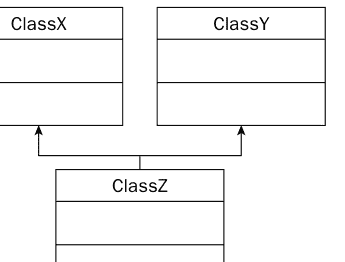

图 4-2

例如，如果存在两个类`ClassX`和`ClassY`，且`ClassZ`想要继承两者，则可以使用以下代码：

```javascript
function ClassZ() {
  this.newMethod = ClassX;
  this.newMethod();
  delete this.newMethod;

  this.newMethod = ClassY;
  this.newMethod();
  delete this.newMethod;
}
```


这种方法的唯一缺点是，如果`ClassX`和`ClassY`具有相同名的属性或方法，则`ClassX`的具有优先级，因为它是最后被继承的。此外，使用对象伪装进行多重继承轻而易举的。

由于这种继承方法依赖某些特性，ECMAScript 第三版包含了`Function`对象的两个新方法：`call()`和`apply()`。

### `call()`方法

`call()`方法与对象伪装方法最相似。它的第一个参数是用于此操作的对象。所有其他参数都直接传递给函数本身。例如：

```javascript
function sayColor(sPrefix, sSuffix) {
  alert(sPrefix + this.color + sSuffix);
}

var obj = new Object();
obj.color = "red";

// 输出 "The color is red, a very nice color indeed."
sayColor.call(obj, "The color is ", "a very nice color indeed.");
```

在这个示例中，函数`sayColor()`定义在对象外部，当它没有附加到任何对象时会引用`this`。对象`obj`被赋予了等于`"red"`的颜色属性。当调用`call()`时，第一个参数是`obj`，这表示`sayColor()`中的`this`关键字应该被赋值为`obj`。第二个和第三个参数是字符串，它们与`sayColor()`的`sPrefix`和`sSuffix`参数匹配，导致显示“The color is red, a very nice color indeed.”

要配合对象伪装继承方法使用，只需替换分配、调用和定义新方法的行即可：

```javascript
function ClassB(sColor, sName) {
  this.newMethod = ClassA;
  this.newMethod(sColor);
  delete this.newMethod;
  ClassA.call(this, sColor);
}

this.name = sName;
this.sayName = function () {
  alert(this.name);
}
```

在这里，你可以在`ClassA`中使用的`this`关键字等于新创建的`ClassB`对象，因此它作为第一个参数传递。第二个参数是颜色参数，适用于任一类。

### `apply()`方法

`apply()`方法接收两个参数：用于此操作的对象和传递给函数的参数数组。例如：

```javascript
function sayColor(sPrefix, sSuffix) {
  alert(sPrefix + this.color + sSuffix);
}

var obj = new Object();
obj.color = "red";

// 输出 "The color is red, a very nice color indeed."
sayColor.apply(obj, new Array("The color is ", "very nice color indeed."));
```

这与之前相同，但现在调用的是`apply()`方法。当调用`apply()`时，第一个参数仍然是`obj`，表示`sayColor()`中的`this`关键字应该被赋值为`obj`。第二个参数是一个包含两个字符串的数组，它们与`sayColor()`的`sPrefix`和`sSuffix`参数匹配。这也导致了消息“The color is red, very nice color indeed.”。此方法也用于替代分配、调用和删除新方法的三个行：

```javascript
function ClassB(sColor, sName) {
  this.newMethod = ClassA

  this.newMethod(sColor);
  delete this.newMethod;
  ClassA.call(this, sColor);
```

### 原型链

这种继承方法使用构造函数模式来定义类，而不使用任何原型。

> 方法使用原型链。
>
> 注意：使用原型链时，替换类的`prototype`属性。
>
> 类似于伪装，，方法方法` ` `。

是因为`prototype`属性被完全替换了。要为`ClassB`添加`name`属性和`sayName`方法，代码如下：

```javascript
function ClassB() {
}
ClassB.prototype = new ClassA();
ClassB.prototype.name = "Nicholas";
ClassB.prototype.sayName = function () {
  alert(this.name);
};
```

你可以通过运行以下示例来测试这一点：

```javascript
var objA = new ClassA();
var objB = new ClassB();
objA.color = "red";
objB.color = "blue";
objB.name = "Nicholas";
objA.sayColor(); // 输出 "red"
objB.sayColor(); // 输出 "blue"
objB.sayName(); // 输出 "Nicholas"
```

作为一个额外，`instanceof`运算符以一种原型链的方式工作。对于`ClassB`的所有实例，`instanceof`对于`ClassA`和`ClassB`都返回`true`。例如：

```javascript
var objB = new ClassB();
alert(objB instanceof ClassA); // 输出 "true"
alert(objB instanceof ClassB); // 输出 "true"
```

在 ECMAScript 的松类型世界中，这是一个非常有用的工具，但在使用对象伪装时并非如此。原型链的缺点是不支持多重继承。

### 混合方法

你可能注意到这种继承方法使用构造函数模式来定义类，而不使用任何原型。对象伪装的主要问题是它必须使用构造函数模式，而（正如你在上一章中所学的）这并不是最优的。但如果你选择原型链，你就会失去带参数的构造函数的能力。开发者该怎么办？答案是：两者都用。

在上一章中，你学习了创建类的最佳方法是使用构造函数模式定义方法。继承也是如此；你使用对象伪装来继承构造函数中的方法，并使用原型链。看这个使用这两种继承方法重写的之前的示例：

```javascript
function ClassA(sColor) {
  this.color = sColor;
}
```

```javascript
ClassA.prototype.sayColor = function () {
  alert(this.color);
}
```

```javascript
ClassA.call(this, sColor);
this.name = sName;
```

```javascript
ClassB.prototype = new ClassA();
```

```javascript
ClassB.prototype.sayName = function () {
  alert(this.name);
}
```

在这个示例中，继承通过两个高亮的的行实现。首先，在`ClassB`构造函数中，使用了对象伪装（object masquerading）来从`ClassA`继承颜色属性。在第二行高亮代码中，使用了原型链（prototype chaining）来继承`ClassA`的方法。由于这种混合方法使用了原型链，`instanceof`运算符可以正常工作。

接下来的示例测试了这段代码：

```javascript
var objA = new ClassA("red");
var objB = new ClassB("blue", "Nicholas");
objA.sayColor(); // outputs "red"
objB.sayColor(); // outputs "blue"
objB.sayName(); // outputs "Nicholas"
```

## 实际示例

在网站和应用程序中，你可能不会创建名为`ClassA`和`ClassB`的类。更有可能的是，你会创建表示特定事物的类，例如形状。如果你考虑本章开始的形状示例，`Polygon`（多边形）、`Triangle`（三角形）和`Rectangle`（矩形）类构成了一个很好的探索数据集。

## 创建基类

首先考虑`Polygon`类。需要哪些属性和方法？首先，知道多边形的边数很重要，因此应该包含一个整数属性`sides`。对于多边形，可能还需要什么呢？你可能想要确定多边形的面积，因此添加一个名为`getArea()`的方法来计算它。图 4-3 显示了该类的 UML 表示法。

| Polygon |
|---|
| sides: integer |
| getArea(): integer |

图 4-3

在 UML 中，属性通过类名正下方区域的属性名称和类型表示。方法位于属性下方，指明方法名和返回值的类型。

# 第 4 章

在 ECMAScript 中，类可以这样写写：

```javascript
function Polygon(iSides) {
  this.sides = iSides;
}

Polygon.prototype.getArea = function () {
  return 0;
};
```

注意，`Polygon`类本身还不足以单独使用；`getArea()`返回 0 是因为它仅仅是供子类重写的占位符。

## 创建子类

现在考虑`Triangle`类。三角形有三条边，因此该类必须重写`Polygon`类的`sides`并将其设置为 3。`getArea()`方法也必须被重写，以使用三角形的面积公式，即 ½ 底 × 高。但该方法如何获取底和高的值呢？它们必须被显式指定，因此你必须创建一个`base`属性和一个`height`属性。`Triangle`的 UML 表示如图 4-4 所示。

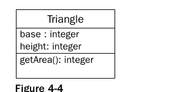

此图仅显示了`Triangle`的新属性和重写的方法。如果`Triangle`没有重写`getArea()`，则该方法不会出现在图表中。它将被视为从`Polygon`继承的。显示`Polygon`和`Triangle`之间关系的完整 UML 图（图 4-5）使其更清晰一些。

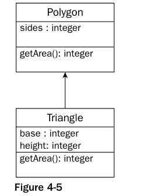

## 继承

在 UML 中，你永远不会复制继承的属性或方法，除非方法正在被重写（重载，这在 ECMAScript 中是不可能的）。

`Triangle`类的代码如下：

```javascript
function Triangle(iBase, iHeight) {
  Polygon.call(this, 3);
  this.base = iBase;
  this.height = iHeight;
}
```

注意：由于这种混合方法使用了原型链，`instanceof`运算符可以正常工作。

接下来的示例测试了这段代码： (此处省略重复内容，已按指令逻辑翻译)

## 第 4 章

为了创建继承的其他实现方式的局限性。本节探讨了标准 ECMAScript 继承范式的某些替代方案。

原型链将一个对象的所有方法分配给类的原型对象。如果有另一种方法可以完成这一点呢？使用`zlInherit`库（可从`http://www.nzclone.net/downloads/`获取），可以在不使用原型链的情况下实现方法继承。这个小型库支持所有现代浏览器（Mozilla, IE, Opera, Safari）以及一些较旧的浏览器（Netscape 4.x, IE/Mac）。

为了使用`zlInherit`库，你必须包含一个`<script/>`标签。第 5 章“浏览器中的 JavaScript”将详细讨论如何包含 JavaScript 文件。

`zlInherit`库为`Object`类增加了两个方法：`inheritFrom()`和`instanceof()`。你可能已经猜到了，`inheritFrom`方法负责重体力工作，从给定的类中复制方法。以下几行使用原型链从`ClassA`继承方法到`ClassB`：

```javascript
ClassB.prototype = new ClassA();
```

这一行可以用以下内容替换：

```javascript
ClassB.prototype.inheritFrom(ClassA);
```

`inheritFrom()`方法接受一个参数，即要从中复制方法的类。请注意，与原型链不同，这种范式并没有实际上创建类的新实例来继承，这使其更安全，并让开发人员无需担心构造函数参数。

> `inheritFrom()`方法的调用必须精确地位于通常发生原型赋值的地方，以确保正确的继承。

`instanceof()`方法是`instanceof`算符的替代品。由于这种范式完全没有使用原型链，这行代码将：

```javascript
ClassB instanceof ClassA
```

`instanceof()`方法弥补了这一缺失，通过与`inheritFrom()`配合跟踪所有的父类：

```javascript
ClassB.instanceOf(ClassA);
```

## 重温多边形

整个多边形示例可以使用`zlInherit`库重写，只需替换两行（高亮部分）：

```javascript
function Polygon(iSides) {
  this.sides = iSides;
}
```

```javascript
Polygon.prototype.getArea = function () {
  return 0;
}
```

```javascript
function Triangle(iBase, iHeight) {
  Polygon.call(this, 3);
  this.base = iBase;
  this.height = iHeight;
}
```

```javascript
Triangle.prototype.inheritFrom(Polygon);
```

```javascript
Triangle.prototype.getArea = function () {
  return 0.5 * this.base * this.height;
}
```

```javascript
function Rectangle(iLength, iWidth) {
  Polygon.call(this, 4);
  this.length = iLength;
  this.width = iWidth;
}
```

```javascript
Rectangle.prototype.inheritFrom(Polygon);
```

```javascript
Rectangle.prototype.getArea = function () {
  return this.length * this.width;
}
```

为了测试这一点，你可以使用与之前相同的示例，并额外几行来测试`instanceOf()`方法：

```javascript
var triangle = new Triangle(12, 4);
var rectangle = new Rectangle(22, 10);
```

```javascript
alert(triangle.sides);
alert(triangle.getArea());
```

```javascript
alert(rectangle.sides);
alert(rectangle.getArea());
```

```javascript
alert(triangle.instanceOf(Triangle)); //输出 "true"
alert(triangle.instanceOf(Polygon)); //输出 "true"
```

```javascript
alert(rectangle.instanceOf(Rectangle)); //输出 "true"
alert(rectangle.instanceOf(Polygon)); //输出 "true"
```

最后四行测试了`instanceOf()`，它们都应该返回 true。

## 第 4 章

正如前面提到的，动态原型的精神，原型链无法将类的代码保留在构造函数内部。`zlInherit`库通过允许从构造函数内部调用`inheritFrom()`方法解决了这个问题。

看看之前使用的多边形示例，现在添加了`zlInherit`库之后：


```javascript
function Polygon(iSides) {
  this.sides = iSides;

  if (typeof Polygon._initialized == "undefined") {
    Polygon.prototype.getArea = function () {
      return 0;
    }

    Polygon._initialized = true;
  }
}
function Triangle(iBase, iHeight) {
  Polygon.call(this, 3);
  this.base = iBase;
  this.height = iHeight;

  if (typeof Triangle._initialized == "undefined") {
    Triangle.prototype.inheritFrom(Polygon);
    Triangle.prototype.getArea = function () {
      return 0.5 * this.base * this.height;
    }

    Triangle._initialized = true;
  }
}
function Rectangle(iLength, iWidth) {
  Polygon.call(this, 4);
  this.length = iLength;
  this.width = iWidth;

  if (typeof Rectangle._initialized == "undefined") {
    Rectangle.prototype.inheritFrom(Polygon);
    Rectangle.prototype.getArea = function () {
      return this.length * this.width;
    }

    Rectangle._initialized = true;
  }
}
```

## 继承

之前代码中的两个高亮行实现了对`Triangle`和`Rectangle`类的继承。之所以有效，是因为在使用`inheritFrom()`方法时，原型对象没有被覆盖；方法只是被添加到了那里。

## 多重继承支持

`zlInherit`库最实用的功能之一是支持多重继承，这是使用原型链无法实现的。再次，实现此点的关键是`inheritFrom()`不替换原型对象。

必须配合使用`inheritFrom()`方法来继承属性和方法。考虑以下示例：

```javascript
function ClassX() {
  this.messageX = "This is the X message.";

  if (typeof ClassX._initialized == "undefined") {
    ClassX.prototype.messageX = function () {
      alert(this.messageX);
    };
    ClassX._initialized = true;
  }
}
```

```javascript
function ClassY() {
  this.messageY = "This is the Y message.";

  if (typeof ClassY._initialized == "undefined") {
    ClassY.prototype.messageY = function () {
      alert(this.messageY);
    };
    ClassY._initialized = true;
  }
}
```

```javascript
function ClassZ() {
  ClassX.apply(this);
  ClassY.apply(this);
  this.messageZ = "This is the Z message.";

  if (typeof ClassZ._initialized == "undefined") {
    ClassZ.prototype.inheritFrom(ClassX);
    ClassZ.prototype.inheritFrom(ClassY);
  }
}
```

```javascript
ClassZ.prototype.sayMessageZ = function () {
  alert(this.messageZ);
}

ClassZ._initialized = true;
}
```

注意两行继承了属性（使用`apply()`方法），两行继承了方法（使用`inheritFrom()`）。如所述，继承层次的顺序很重要，最好按照与属性相同的顺序继承方法（这意味着如果从`ClassX`和`ClassY`继承属性，则应该按该顺序继承方法）。

以下代码测试了多重继承示例：

```javascript
var objZ = new ClassZ();
objZ.sayMessageX(); //输出 "This is X message."
objZ.sayMessageY(); //输出 "This is Y message."
objZ.sayMessageZ(); //输出 "This is Z message."
```

之前的代码测试了三个方法：

1. `sayMessageX()`，它继承自`ClassX`，访问了同样继承自`ClassX`的`messageX`属性。
2. `sayMessageY()`，它继承自`ClassY`，访问了同样继承自`ClassY`的`messageY`属性。
3. `sayMessageZ()`，它定义在`ClassZ`中，访问了同样定义在`ClassZ`中的`messageZ`属性。

这三个方法应该输出相应属性的消息get，表明多重继承成功。

## xbObjects

Netscape 的 DevEdge 网站（`http://devedge.netscape.com`）为 Web 开发者提供了许多有用信息和脚本工具。其中一个工具是`xbObjects`（从`http://archive.bcary.com/2001,xbProjects-docs/xbObject/`下载），由 Bob Clare 的 Communications 在 2001 年编写，当时 Netscape 6 (Mozilla 0.6) 首次发布。它支持那以后的所有 Mozilla 版本以及其他现代浏览器（IE、Opera、Safari）。

## 目的

`xbObjects`的目的是为 JavaScript 提供更强大的面向对象范式，不仅允许继承，还允许方法重载以及调用父类方法。要做到这一点，`xbObjects`需要遵循若干步骤：

首先，你必须注册类，并在此过程中定义从哪个类继承。这是使用以下类实现的：

```javascript
_classes.registerClass("Subclass_Name", "Superclass_Name");
```

在这里，子类和父类的名称是以字符串形式传递的，而不是指向它们构造函数的指针。

此调用必须在给定子类的构造函数之前执行。

如果新类没有继承自其他类，你也可以只通过第一个参数调用`registerClass()`。

第二步是在构造函数内部调用`defineClass()`方法，传入类名以及指向原型函数的指针，该函数将用于初始化对象的所有属性和方法（稍后进行）。例如：

```javascript
_classes.registerClass("ClassA");
```

```javascript
function ClassA(sColor) {
    _classes.defineClass("ClassA", prototypeFunction);
```

```javascript
function prototypeFunction() {
    ....
}
```

如你所见，原型函数（恰如地命名为`prototypeFunction()`）位于构造函数内部。它的主要目的是在适当的时候将所有方法分配给类（通过这种方式，它的工作类似于动态原型）。

下一步（到目前为止）是为类创建一个`init()`方法。该方法负责设置类的所有属性，并且必须接受与构造函数相同的参数。按照惯例，`init()`方法始终在调用`defineClass()`方法之后被调用。例如：

```javascript
_classes.registerClass("ClassA");
```

```javascript
function ClassA(sColor) {
    _classes.defineClass("ClassA", prototypeFunction);
```

```javascript
this.init(sColor);
```

```javascript
function prototypeFunction() {

ClassA.prototype.init = function (sColor) {
    this.parentMethod("init");
    this.color = sColor;
}
}
```

你可能已经注意到`init()`方法中调用了一个名为`parentMethod()`的方法。这是`xbObjects`调用父类方法的方法。`parentMethod()`接受任意数量的参数，但第一个参数始终要调用的父类方法名（该参数必须是字符串，而不是函数指针）；所有其他参数都会传递给父类方法。

## 第4章

在这种情况下，首先调用了父类的`init()`方法，这是`xbObjects`运行所需的。尽管`ClassA`没有注册父类，但`xbObjects`会为所有类创建一个默认的父类，这就是该父类`init()`方法的来源。

第四步也是最后一步是在原型函数内部添加其他类方法：

```javascript
_classes.registerClass("ClassA");

function ClassA(sColor) {
  _classes.defineClass("ClassA", prototypeFunction);

  this.init(sColor);
}

function prototypeFunction() {
  ClassA.prototype.init = function (sColor) {
    this.parentMethod("init");
    this.color = sColor;
  };

  ClassA.prototype.sayColor = function () {
    alert(this.color);
  };
}
```

然后，你就可以以普通方式创建`ClassA`的实例：

```javascript
var objA = new ClassA("red");
objA.sayColor();      //输出 "red"
```

## 多边形重构

此时，你可能在想是否有机会使用`xbObjects`重新编写多边形示例，下面就是它。

首先，重写`Polygon`类，它非常简单：

```javascript
_classes.registerClass("Polygon");

function Polygon(sides) {
  _classes.defineClass("Polygon", prototypeFunction);

  this.init(sides);
}

function prototypeFunction() {
  Polygon.prototype.init = function (iSides) {
    this.parentMethod("init");
    this.sides = iSides;
  };
}
```

```javascript
Polygon.prototype.getArea = function () {
  return 0;
}
```

重写`Triangle`类，这是示例中真实继承的首次体现：

```javascript
_classes.registerClass("Triangle", "Polygon");

function Triangle(iBase, iHeight) {
  _classes.defineClass("Triangle", prototypeFunction);
  this.init(iBase, iHeight);
}

function prototypeFunction() {
  Triangle.prototype.init = function (iBase, iHeight) {
    this.parentMethod("init", 3);
    this.base = iBase;
    this.height = iHeight;
  }

Triangle.prototype.getArea = function () {
    return 0.5 * this.base * this.height;
}
```

`registerClass()`在构造函数之前被调用，在这里建立了继承关系。同样，`init()`方法的第一行调用了父类的`init()`方法，并传入参数 3，这设置了边数属性。除了这些之外，`init()`方法的写法非常相似：一个简单的构造函数，分配了基础和高度。

`Rectangle`最终看起来和`Triangle`非常相似：

```javascript
_classes.registerClass("Rectangle", "Polygon");

function Rectangle(iLength, iWidth) {
  _classes.defineClass("Rectangle", prototypeFunction);
  this.init(iLength, iWidth);
}

function prototypeFunction() {
  Rectangle.prototype.init = function (iLength, iWidth) {
    this.parentMethod("init", 4);
    this.length = iLength;
    this.width = iWidth;
  }
}
```

```javascript
Rectangle.prototype.getArea = function () {
  return 0;
}
```

# 第5章

最初为 JavaScript 创建的，但`<script/>`标签可以用于指定任何不同的脚本语言，并通过`language`属性指明代码类型。例如，可以将`language`设置为`VBScript`以使用 Internet Explorer（仅限 Windows）。

将`sayHi()`函数提取到名为`external.js`的文件中，您需要复制函数本身（图 5-1）。

## external.js

```javascript
function sayHi() {
  alert("Hi");
}
```

图 5-1

然后可以更新 HTML 代码以包含外部文件：

```html
<<html>>
<head>
  <title>页面标题</title>
  <script language="JavaScript" src="external.js"></script>
</head>
<body>
  <!-- body 内容在此处 -->
</body>
</html>
```

> 对于在单个 JavaScript 源文件中可以包含哪些内容，并没有任何硬性规定，这意味着您可以自由地在单个文件中包含任意数量的类定义、函数等。

## 内联代码与外部文件

什么时候应该在外部文件中编写内联代码？虽然对于何时使用哪种方法没有硬性规定，但通俗的共识是，出于多种原因，大量的 JavaScript 永远不应该是内联的：

- **安全性**——任何任何人都可以通过查看页面源代码确切地看到代码在做什么。如果恶意开发者检查代码，可能会发现可能危网站或应用程序的安全漏洞。此外，版权和其他知识产权公告可以包含在外部文件中，而不会中断页面的内容流。
- **代码维护**——如果 JavaScript 代码散布在各个页面中，代码维护将成为一场噩梦。为所有 JavaScript 文件建立一个目录要容易得多，这样当发生 JavaScript 错误时，代码的位置就不存在疑问了。
- **缓存**——浏览器根据特定设置缓存外部链接的 JavaScript 文件，这意味着如果两个页面使用同一个文件，它只会被下载一次。这意味着加载速度更快。在多个页面中包含代码不仅是浪费资源，还会增加页面大小，从而增加下载时间。

## 标签位置

通常情况下，将所有代码和函数定义放在 HTML 页面的`<head>`标签中是常见的做法，这样在渲染`body`时，代码已经完全加载并准备好使用。唯一应该出现在`<body>`标签内的代码是对定义的函数的调用。

当`<script>`标签放置在`<body>`标签内部时，脚本会在页面下载到浏览器后立即执行。这使得在整个页面加载之前执行 JavaScript 代码成为可能。例如：

```html
<html>
<head>
  <title>页面标题</title>
  <script language="JavaScript">
    function sayHi() {
      alert("Hi");
    }
  </script>
</head>
<body>
<p>这是用户将看到的第一个文本。</p>
</body>
</html>
```

在此代码中，`sayHi()`方法在页面上显示任何文本之前就被调用了，这意味着 alert 框在“这是用户将看到的第一个文本。”被渲染之前就弹出了。这种在`<body>`标签内调用 JavaScript 的方法是不被推荐的，应该尽可能避免。相反，建议仅将 JavaScript 作为页面正文中的事件处理器。


```html
<html>
<head>
  <title>页面标题</title>
  <script language="JavaScript">
    function sayHi() {
      alert("Hi");
    }
  </script>
</head>
<body>
```

## 浏览器中的 JavaScript

```html
<input type="button" value="调用函数" onclick="sayHi()" />
</body>
</html>
```

在这里，使用 `<input/>` 标签来创建一个按钮，点击它时会调用 `sayHi()`。`onclick` 属性指定了一个事件处理器，即响应给定事件的代码。事件和事件处理器将在第 9 章“关于事件的一切”中讨论。

注意，JavaScript 一从页面开始就开始运行，因此可能会调用尚未存在的函数。在以前的示例中，通过将原始的 `<script>` 标签放在函数调用之后，可能会导致错误：

```html
<html>
<head>
  <title>页面标题</title>
</head>
<body>
  <script language="JavaScript">
    sayHi();
  </script>
  <p>这是用户将看到的第一个文本。</p>
  <script language="JavaScript">
    function sayHi() {
      alert("Hi*");
    }
  </script>
</body>
</html>
```

这个示例会导致错误，因为 `sayHi()` 在被定义之前就被调用了。由于 JavaScript 是从上到下加载的，在遇到第二个 `<script>` 标签之前，`sayHi()` 函数并不存在。请注意这个问题，并如之前提到的，使用事件和处理器来调用您的 JavaScript 函数。

## 隐藏或不隐藏

当 JavaScript 被引入时，只有一个浏览器支持它，因此人们担心不支持的浏览器将如何处理 `<script>` 标签及其包含的代码。为此，设计了一种格式来向旧版浏览器隐藏代码（这个短语在网上许多网站的源代码中仍然可以找到）。以下方法使用 HTML 注释包裹行代码，这样其他浏览器就不会渲染这些代码：

```html
<script language="JavaScript"><!---- 向旧版浏览器隐藏
function sayHi() {
  alert("Hi*");
}
//-->
</script>
```

第一行在打开的 `<script>` 标签之后立即开始 HTML 内容。这之所以有效，是因为浏览器仍然将该行的其余视为 HTML 的一部分，而 JavaScript 代码从下一行开始。接下来，你像通常一样看到函数定义。倒数第二行最有趣，因为它以 JavaScript 单行注释（两个斜杠）开头，然后是 HTML 注释行（`<!--`）。这一行仍被视为 JavaScript 代码的一部分，因此需要单行注释符号以避免语法错误。然而，其他浏览器只识别 HTML 注释的结束，因此忽略所有的 JavaScript 代码。但是，支持 JavaScript 的浏览器会忽略这一行，并继续到结束的 `</script>` 标签。

尽管这种隐藏代码的方法在 Web 初期非常流行，但现在已没有必要了。大多数流行的 Web 浏览器都支持 JavaScript，而那些不支持的也足够智能到忽略它们上的代码。是否使用这种方法完全取决于您，但请记住，在内联代码中使用外部 JavaScript 文件是向旧版浏览器隐藏代码的一种简单得的方法。

## `<noscript>` 标签

没有 JavaScript 的另一个担忧是如何提供备用内容。隐藏代码是解决方案的一部分，但开发者希望有一种方法可以指定仅在 JavaScript 被禁用时才出现的内容。`<noscript>` 标签用于此目的。例如：

```html
<html>
<head>
  <title>页面标题</title>
  <script language="JavaScript">
    function sayHi() {
      alert("Hi");
    }
  </script>
</head>
<body>
<p>这是用户将看到的第一个文本。</p>
<noscript>
  <p>您的浏览器不支持 JavaScript。</p>
</noscript>
</body>
</html>
```

`<noscript>` 标签允许为不支持 JavaScript 的浏览器提供备用内容。这对于确保网站对所有用户可用。

## XHTML 的变化

最近，随着 XHTML（扩展 HTML）的出现，`<script>` 标签发生了变化。现在不再使用 `language` 属性，而是期望标签有一个 `type` 属性来指示 MIME 类型。省略 `language` 属性不会引起任何问题，如之前所述，所有浏览器默认使用 JavaScript。例如：

```html
<html>
<head>
  <title>页面标题</title>
  <script type="text/javascript">
    var i = 0;
  </script>
```

XHTML 的第二个变化是使用 CDATA 节。CDATA 节在 XML（因此在 XHTML）中用于指示文本不应被解析为标签，从而允许使用特殊字符如小于（`<`）、大于（`>`）、和符号（`&`）和双引号（`"`），而无需使用它们的实体。考虑以下内容：

```javascript
<script type="text/javascript">
function compare(a, b) {
  if (a < b) {
    alert('A 小于 B');
  } else if (a > b) {
    alert('A 大于 B');
  } else {
    alert('A 等于 B');
  }
}
</script>
```

这是一个简单的函数，仅比较两个数字 `a` 和 `b`，并显示指示它们关系的消息。在 XHTML 中，此代码是无效的，因为它使用了三个特殊字符：小于、大于和双引号。要修复此，您必须将这些字符替换为相应的 XML 实体，`&lt;` 和 `&quot;`：

```javascript
<script type="text/javascript">
function compare(a, b) {
  if (a &lt; b) {
    alert('A 小于 B');
  } else if (a &gt; b) {
    }
</script>
```

# 第 5 章

```javascript
alert("A is greater than B");
 else {
  alert("A is equal to B");
}
</script>
```

这段代码存在两个问题。首先，开发者不习惯使用 XML 实体编写代码。其次，这在 JavaScript 中实际上是一个语法错误，因为解释器不知道 XML 实体的含义。使用 CDATA 节可以在普通代码中编写 JavaScript。包含 CDATA 节的官方方法如下：

```html
<script type="text/javascript"><![CDATA[
function(a, b) {
  if (a < b) {
    alert("*A is less than B*");
  } else if (a > b) {
    alert("*A is greater than B*");
  } else {
    alert("*A is equal to B*");
  }
}
]></script>
```

尽管这是官方方法，但请记住大多数浏览器并不支持 XHTML，这引发了一个问题：这是一个 JavaScript 语法错误，因为大多数浏览器还不识别 CDATA 节！

所使用的解决方案显然是对“向旧浏览器隐藏”代码的一种折中。通过使用单行 JavaScript 注释，你可以在嵌入 CDATA 节而不影响代码的语法：

```html
<script type="text/javascript"
//[CDATA[
function compare(a, b) {
  if (a < b) {
    alert("*A is less than B*");
  } else if (a > b) {
    alert("*A is greater than B*");
  } else {
    alert("*A is equal to B*");
  }
}
//]>
</script>
```

这段代码现在在支持和不支持 XHTML 的浏览器中都能正常工作。

与使用 `type` 属性一样，随着开发者准备让浏览器更好地支持 XHTML，这种使用 CDATA 节的方法变得越来越流行。然而，最好的办法是使用外部文件包含 JavaScript，以完全避免 CDATA 问题。

## SVG 中的 JavaScript

SVG（可缩放矢量图形）是一种新兴的基于 XML 的语言，用于在 Web 上绘制矢量图形。矢量图形与光栅（或位图）图形的区别在于，它们定义的是点、线以及它们之间的关系，而不是简单地为图像的每个像素指定一种颜色。结果是，无论渲染尺寸如何，图像看起来都是如初。随着该语言的流行，像 Adobe Illustrator 等矢量图形已开始提供 SVG 导出功能。

虽然目前还没有浏览器支持 SVG（尽管 Mozilla 2.0 将支持），但许多公司（特别是 Adobe 和 Corel）正在制作 SVG 插件，使大多数浏览器能够显示 SVG。

## 基础 SVG

将 SVG 作为一种语言超出了本书的范围；但是稍微了解关于 JavaScript 的讨论是有帮助的。

这是一个简单的示例：

```xml
<?xml version="1.0"?>
<!DOCTYPE svg PUBLIC "-//W3C//DTD SVG 1.0//EN" "http://www.w3.org/SVG/http://www.w3.org/TR/2001/REC-SVG-2001094/DTD/svg10.dtd">
<svg xmlns="http://www.w3.org/2000/svg" xmlns:xlink="http://www.w3.org/1999/xlink" width="100%" height="100%">
  <desc>
    一个正方形和一个圆形的图像。
  </desc>
  <defs>
    <rect id="rect1" width="200" height="200" fill="red" x="10" y="10" stroke="black" />
    <circle id="circle" r="100" fill="white" stroke="black" cx="200" />
  </defs>
  <g>
    <use xlink:href="#rect1" />
    <use xlink:href="#circle" />
  </g>
</svg>
```

此示例将圆放在正方形的右下角（见图 5-2）。

注意 SVG 文件使用 XML 声明 `<?xml version="1.0"?>`，表明该语言是基于 XML 的。后续是 SVG DTD，它是可选的，但通常最外层的 `<svg>` 定义了文件为 SVG 图像。`width` 和 `height` 属性可以设置为任何值，包括百分比和像素，但为了简单起见这里设置为 100%。注意指定了两个 XML 命名空间：SVG 和 XLink。XLink 定义了如 `href` 等链接的行为，并且在未来的 XHTML 版本中可能会得到支持。现在，SVG 在支持基础 XLink 方面处于领先地位。

| C:\Documents and Settings\Desktop\Untitled1.svg |
| :--- |

| 文件 | 编辑 | 查看 | 收藏 | 工具 | 帮助 |
| --- | --- | --- | --- | --- | --- |


图 5-2

标签是 `<desc/>`，它包含了图像的描述。你可以将 `<desc/>` 想象成 HTML 中的 `<title>` 标签，因为它提供了图像内容的描述，但不会在页面上渲染它。紧随之后的是 `<defs/>` 标签，你可以在这里定义之后使用的资源和形状。在这种情况下，定义了一个矩形和一个圆。除非在实际图像中专门使用，否则这些形状将不会显示。

之后是 `<g/>`，它是 group（组）的缩写。这个 `<g/>` 是特殊的，因为它是最外层的，因此封装了可见的图像。`<g/>` 标签可以使用多次，在最外层的 `<g/>` 中形成形状组（将其想象为 HTML 中的 `<div>`）。

在此示例中，两个 `<use/>` 标签指向 `<defs/>` 部分中的一个形状。`<use/>` 标签通过 `xlink:href` 指向形状的 ID（以 `#` 号开头），从而将形状引入可见图像。如果你包含了多个 `<use/>` 标签，那么 `<defs/>` 中定义的形状就可以使用多次。这种能力使得 SVG 成为 XML 语言中代码复用的优秀范例。

当然，SVG 最令人兴奋的特性之一是对 JavaScript 的卓越支持，这可以操作 SVG 图像的所有路径。

## SVG 中的 `<script/>` 标签

SVG 在其页面中采用了与 JavaScript 类似的 `<script/>` 标签。然而，`<script/>` 标签是……

## 浏览器中的 JavaScript

```html
</head>
<frameset rows="100,*">
  <frame src="frame.htm" name="topFrame" />
  <frameset cols="50,50%">
    <frame src="anotherframe.htm" name="leftFrame" />
    <frame src="yetanotherframe.htm" name="rightFrame" />
  </frameset>
</frameset>
</html
```

这段代码创建了一个框架集（frameset），其中顶部有一个跨越整体的帧，下方有两个帧。在这里，可以通过 `window.frames[0]` 或 `window.frames["topFrame*"]` 来引用顶部的帧。不过，你可能会使用 `top` 对象而不是 `window` 来引用这些帧（例如使用 `top.frames[0]`）。

`top` 对象始终指向最顶层（最外层）的帧，即浏览器窗口本身。这确保了你指向的是正确的帧。如果你在某个帧内编写代码，所引用的 `window` 对象是指向该帧的指针。

由于 `window` 对象是 BOM（浏览器对象模型）宇宙的中心，它拥有一种特殊权限：你不需要显式地引用它。每当引用函数、对象或集合时，解释器总是查找 `window.frames["top"]`，这可以重写为 `window.frames["top"]`。要理解上例中引用帧的各种方式，请参考图 5-4。

| 引用 |
| --- |
| `frames[0]` |
| `window.frames["topFrame"]` |
| `top.frames["topFrame"]` |
| `frames[0]` |
| `top.frames["topFrame"]` |
| `frames[1]` |
| `window.frames["leftFrame"]` |
| `top.frames["leftFrame"]` |
| `frames[1]` |
| `top.frames["leftFrame"]` |
| `frames[2]` |
| `window.frames["rightFrame"]` |
| `top.frames["rightFrame"]` |
| `frames[2]` |
| `top.frames["rightFrame"]` |

图 5-4

也可以直接使用其名称访问帧，例如 `window.leftFrame`。然而，使用 `frames` 集合通常更合适，因为它更准确地表达了代码的意图。

`window` 对象的另一个实例被称为 `parent`。`parent` 对象使用框架集加载同样也是框架集的文件。假设文件名 `frameset1.htm` 包含以下代码：

## 第 5 章

```html
<html>
<head>
  <title>框架集示例</title>
</head>
  <frameset rows="100,*">
    <frame src="frameset.htm" name="topFrame" />
    <frameset cols="50%,50%">
      <frame src="anotherframeset.htm" name="leftFrame" />
      <frame src="anotherframeset.htm" name="rightFrame" />
    </frameset>
  </frameset>
</html>
```

现在，如果还有一个名为 `anotherframeset.htm` 的文件包含以下代码会怎样呢？

```html
<html>
<head>
  <title>框架集示例</title>
</head>
  <frameset cols="100,*">
    <frame src="red.htm" name="redFrame" />
    <frame src="blue.htm" name="blueFrame" />
  </frameset>
</html>
```


当第一个文件`frameset1.htm`加载到浏览器时，它会将`anotherframeset.htm`加载到`RightFrame`。如果在`redFrame`（或`blueFrame`）中编写代码，`parent`对象指向`frameset1.htm`中的`rightFrame`。然而，如果在`topFrame`中编写代码，`parent`对象实际上指向浏览器窗口本身，浏览器窗口被认为是任何顶层框架集的父级。

图 5-5 通过访问`window`对象的`name`属性证明了这一点，该属性存储帧的名称（但对于`top`来说始终是空的）。

另一个名为`self`的窗口指针始终等于`window`（这有点冗余，但包含它是为了与`parent`保持更好的契合。它澄清了你讨论的不是帧的父级，而是帧本身）。

如果页面中没有帧，`window`和`self`等于`top`，且`frames`集合的长度为 0。

也可以将窗口对象的引用链起来，例如`parent.parent.frames["topFrame"]`，尽管这通常是不被推荐的，因为帧结构的任何变化都会导致代码错误。

## 浏览器中的 JavaScript

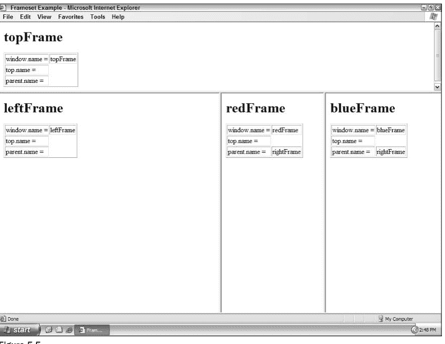

图 5-5

## 操作窗口

如前所述，`window`对象用于操作浏览器窗口（以及帧），这意味着作为开发者，你能够移动和调整浏览器窗口的大小。有四种方法可以实现：

- `move(dx, dy)`——将浏览器相对于其当前位置水平移动`dx`像素，垂直移动`dy`像素。`dx`可以使用负数将窗口向左移动，`dy`可以将窗口向上移动。
- `moveTo(x, y)`——移动浏览器，使其左上角位于用户屏幕上的`(x,y)`位置。可以使用负数，但可能会将窗口的这部分移出可见屏幕。
- `resizeBy(dw, dh)`——通过`dw`像素调整浏览器的宽度，通过`dh`像素调整高度。
- `resizeTo(w, h)`——将浏览器宽度调整为`w`像素，高度调整为`h`像素。

## 导航和打开窗口

使用 JavaScript，可以使用`window.open()`导航并打开新窗口。该方法接受四个参数：要加载的 URL、窗口名称、特征字符串以及一个指示是否替换窗口的布尔值。

调用`window.open()`使用现有帧的名称，URL 将加载到该帧中。例如，加载`topFrame`：

```javascript
window.open("http://www.wrox.com/", "topFrame");
```

如果指定的名称不是有效的帧，则`window.open()`将根据第三个参数打开新窗口。特殊帧名`_self`、`_parent`、`_top`和`_blank`也是有效的。

如果缺少第三个参数，将打开一个与默认设置相同的窗口（工具栏、状态栏可见）。使用了该参数，假设将创建一个窗口。特征字符串是一个逗号分隔的设置列表，定义了新窗口的某些属性。下表显示了各种设置：

| 设置 | 值 | 描述 |
| --- | --- | --- |
| `left` | 数字 | 新窗口的左侧坐标。不能为负数。* |
| `top` | 数字 | 新窗口的顶部坐标。不能为负数。* |
| `height` | 数字 | 新窗口的高度。不能小于 100。* |
| `width` | 数字 | 新窗口的宽度。不能小于 100。* |
| `resizable` | `yes,no` | 决定新窗口是否可以通过拖动边界调整大小。默认为否。 |
| `scrollable` | `yes,no` | 决定当内容无法适应视口时，新窗口是否允许滚动。默认为否。 |
| `toolbar` | `yes,no` | 决定新窗口是否有工具栏显示。默认为否。 |
| `status` | `yes,no` | 决定新窗口是否有状态栏显示。默认为否。 |
| `location` | `yes,no` | 决定新窗口是否有位置区域（Web 地址）显示。默认为否。 |

> *这些浏览器的安全功能将在第 19 章“部署问题”中进行更详细的讨论。

如前所述，特性字符串是用逗号分隔的，因此在逗号或等号前后不能包含空格。例如，以下字符串是无效的：

```javascript
window.open("http://www.wrox.com/", "wroxwindow",
  height=150, width=300, top=10, left=10, resizable=yes);
```

这段代码无法工作，是因为逗号后有空格，且几个等号周围也有空格。只需移除这些空格即可：

```javascript
window.open("http://www.wrox.com/", "wroxwindow",
  height=150,width=300,top=10,left=10, resizable=yes);
```

`window.open()`方法返回一个窗口对象作为其返回值，该对象也是新创建窗口（或如果名称是现有帧，则为该帧）的窗口对象。通过它，可以操作新窗口：

```javascript
var NewWin = window.open("http://www.wrox.com/", "wroxwindow",
  height=150,width=300,top=10,left=10,resizable=yes);
```

同样，通过它，可以使用`close()`方法关闭新窗口：

```javascript
oNewWin.close();
```

如果新窗口中有代码，它可以使用以下代码自关闭：

```javascript
window.close();
```

这在新窗口中是有效的。如果你尝试在主浏览器窗口中调用`window.close()`，会收到一条消息，提示脚本正尝试关闭窗口并询问你是否真的想关闭它。需要记住的通用规则是：脚本可以关闭它们打开的任何窗口，但不能关闭其他窗口。

新窗口通过`opener`属性引用它所打开的窗口。`opener`属性仅存在新窗口的最顶层窗口对象，因此使用`top.opener`访问它是安全的。示例：

```javascript
var NewWin = window.open("http://www.wrox.com/", "wroxwindow",
  height=150,width=300,top=10,left=10,resizable=yes);
```

```javascript
alert(oNewWin.opener == window); // 输出 "true"
```

在本例中，打开了一个新窗口，然后测试其`opener`属性是否等于`window`对象，以证明`opener`确实指向`window`（此警框显示 "true"）。

在某些情况下，打开新窗口对用户有所帮助，但通常来说，将弹出窗口减少到最少更好。一个巨大的行业已经应运而生在网站上销售弹出广告（此处并非双关语），大多数用户认为这令人非常厌恼。为此，许多用户安装了弹窗拦截器，除非用户专门允许，否则会自动阻止弹出窗口。记住，弹窗拦截器不知道正法的弹出窗口与广告之间的区别，因此在窗口即将弹出时，最好总是警告用户。

## 系统对话框

除了弹出新的浏览器窗口之外，你已经熟悉`alert()`调用的语法了，因为到目前为止它已经在大量的示例中使用了。该方法接受一个参数，即要显示给用户的文本。当调用`alert()`时，浏览器会创建一个系统消息框，显示文本并带有 OK 按钮。例如，以下行代码将显示图 5-6 所示的消息框：

```javascript
alert("Hello world!");
```

图 5-6

警告对话框通常用于用户必须意识到某些他们无法控制的情况，例如错误。通常当用户在表单中输入无效数据时，会显示警告对话框。

第二种对话框通过调用`confirm()`显示。`confirm`对话框看起来与警告对话框相似，因为它向用户显示消息。两者之间的主要区别在于`confirm`对话框中除了 OK 按钮还有 Cancel 按钮，这允许用户指示是否应该执行某项操作。例如，以下行代码显示图 5-7 所示的确认对话框：

```javascript
confirm("Are you sure?");
```

图 5-7

为了确定用户点击的是 OK 还是 Cancel，`confirm()`方法返回一个布尔值：如果点击了 OK 则返回 true，如果点击了 Cancel 则返回 false。确认对话框的典型用法如下：

```javascript
if (confirm("Are you sure?")) {
    alert("I'm glad you're sure!");
} else {
    alert("I'm sorry to hear you're not.");
}
```

在本例中，确认对话框在第一行显示给用户，这是语句的条件。如果用户点击 OK，则显示警框“I'm glad you're sure!”。如果点击了 Cancel 按钮，则显示警框“I'm sorry to hear you're not.”。这种结构用于用户尝试删除某些内容时，例如收件箱中的电子邮件。

最后一种对话框通过调用`prompt()`显示，正如你预期的那样，该对话框提示用户输入。除了 OK 和 Cancel 按钮外，该对话框还有一个文本框，用户可以在其中输入某些数据。`prompt()`方法接受两个参数：显示给用户的文本和文本框的默认值（如果需要，可以为空字符串）。以下行代码产生图 5-8 的结果：

```javascript
prompt("What is your name?", "Michael");
```

如果点击 OK 按钮，文本中的值将作为函数返回值返回；如果点击 Cancel 按钮，则返回 null。`prompt()`方法通常如下使用：

```javascript
var sResult = prompt("What is your name?", "");
if (sResult != null) {
    alert("Welcome, " + sResult);
}
```

## 状态栏

状态栏是底部用于向用户显示信息的区域（见图 5-9）。

| 文件 | 编辑 | 收藏 | 工具 | 搜索 | 媒体 |
| :--- | :--- | :--- | :--- | :--- | :--- |
| 后退 | | | | | |

浏览：

- 所有书籍
- ASP
- 数据库
- Java
- 多媒体
- 开源
- Visual Base 和 VBA
- Web XML

搜索标题：输入关键字、作者或 ISBN

查看下载列表 ASP.NET 2.0 通过 ASP.NET 2.0 提供的新功能和能力帮助你获得速度。专业 SQL Server Reporting 包含了构建报告、通知和开发部署策略的详细示例。订阅我们的免费邮件，在邮箱中查看这些 Wrox 优惠！

入门指南教你使用真实世界项目

即将推出……关注我们九月份的出版物

我们的书籍是由程序员为程序员编写的。加入 wrox.com 的我们。利用我们宝贵的讨论论坛和作者博客。

在最近的 ASP.NET 2.0 beta1 中，我注意到状态栏发生了一些重大变化。参与这些讨论论坛的当前程序员：

状态栏告诉你在页面何时加载以及何时加载完成；可以使用`window`对象的两个属性`status`和`defaultStatus`来设置其值。正如你可能猜到的那样，`status`会临时更改状态栏，而`defaultStatus`只要用户留在页面上就会保持更改。例如，你可以在页面首次加载时使用默认状态消息：

```javascript
window.defaultStatus = "You are surfing wrox.com.";
```

你也可以在用户鼠标悬停在链接上时显示关于链接的信息：

```html
<a href="wrox.htm" onmouseover="window.status='Information on Wrox books.'">Books/</a>
```

这在使用 JavaScript URL 时非常有用，因为默认情况下，当用户悬停时会在状态栏中显示 href 属性的值。设置`window.status`可以防止链接实现的尾部出现：

```html
<a href="javascript:goSomewhere(1,2,3,4)" onmouseover="window.status='Information on Wrox books.">书籍</a>
```

> 注意不要干扰状态栏，以免分散用户的注意力。例如，许多网站使用在状态栏上滚动的滚动条消息代码。这不仅是一个毫无用的小花招，而且令人心恼，表现出一种非常不专业的业余感，是网站或 Web 应用完全不需要做的。由于本书内容全部是专业的 JavaScript，因此滚动文本代码将不完美。不过，如果你对玩转滚动文本感兴趣，可以查看`http://javascript.internet.com/scroll/`，你可以在那里找到大量的脚本。

## 间隔器与超时

Java 开发者熟悉对象的`wait()`方法，该方法会使程序停止并等待一段时间然后继续执行下一行代码。这是一个非常有用的功能，遗憾的是，JavaScript 并不支持它。但一切都不可挽回，你有几种方法可以解决这个问题。

JavaScript 支持超时（timeouts）和间隔器（intervals），它们能有效地告诉浏览器何时应该执行代码。超时会在指定的毫秒后执行代码；间隔器则每隔指定的毫秒重复执行给定的代码。

设置超时是使用`setTimeout()`方法完成的。该方法接受两个参数：要执行的代码以及执行前等待的毫秒数（秒的/1000）。第一个参数可以是代码字符串（如在使用`eval()`函数时那样），也可以是函数的指针。例如，这两行代码都会在一秒后显示警报框。

```javascript
setTimeout(alert('Hello world!'), 1000);
setTimeout(function() { alert('Hello world!'); }, 1000);
```

当然，你也可以使用之前定义的函数：

```javascript
function sayHelloWorld() {
  alert('Hello world!');
}
```

```javascript
setTimeout(sayHelloWorld(), 1000);
```

当你调用`setTimeout()`时，它会创建一个数字超时，这类似于操作系统中的一个进程。对于你决定在调用`setTimeout()`后不执行代码的延迟进程，其超时 ID 本质上是相同的。要取消待处理的超时，可以使用`clearTimeout()`并传入超时 ID。

```javascript
var timeoutId = setTimeout(alert('Hello world!'), 1000);

//nevermind
clearTimeout(timeoutId);
```

你可能会想：“为什么要定义一个超时然后在它执行之前取消它？”考虑今天大多数应用程序中的工具提示（tooltip）。当你鼠标悬停在按钮上时，需要一点时间出现友好的黄色框来告诉你该按钮的功能。如果你鼠标只在按钮上悬停很短时间然后移动到另一个按钮，工具提示就不会显示。这正是如果你在代码执行前取消超时时的做法。因为用户希望在代码执行前等待特定的时间。如果用户执行了会导致不同结果的操作，你需要灵活性来取消该超时。

间隔器的工作原理相同，它们按特定的时间间隔无限地重复给定的代码。要设置间隔，请使用`setInterval`方法，并使用与`setTimeout()`类型的参数——要执行的代码以及每次执行之间等待的毫秒数。例如：

```javascript
setInterval(alert("Hello world!"), 1000);
setInterval(function() { alert("Hello world!"); }, 1000);
```

```javascript
function sayHelloWorld() {
  alert("Hello world!");
}
```

```javascript
setInterval(sayHelloWorld(), 1000);
```

同样与超时类似，`setInterval`方法会创建一个间隔 ID 来识别要执行的代码。它可以配合`clearInterval()`使用以防止任何后续执行。显然，在使用间隔器时这一点要重要得多，如果不检查，它们将一直执行到页面加载。这里有一个间隔使用的常用示例：

```javascript
var iNum = 0;
var iMax = 100;
var iInterval = null;

function incNum() {
  iNum++;

  if (iNum == iMax) {
    clearInterval(iInterval);
  }
}

iInterval = setInterval(incNum, 500);
```

## 浏览器中的 JavaScript

（注：提供的第 174-176 页的 OCR 包含大量碎片化和重复的占位文本。根据保留所有信息并纠正错误的指示，以下文本代表所提供源内容的重构逻辑流。）

设置超时是使用`setTimeout()`方法完成的。该方法接受两个参数：要执行的代码以及执行前等待的毫秒数（秒的/1000）。第一个参数可以是代码字符串（如在使用`eval()`函数时那样），也可以是函数的指针。例如，这两行代码都会在一秒后显示警报框。


```javascript
setTimeout(alert('Hello world!'), 1000);
setTimeout(function() { alert('Hello world!'); }, 1000);
```

当然，你也可以使用之前定义的函数：

```javascript
function sayHelloWorld() {
  alert('Hello world!');
}
```

```
setTimeout(sayHelloWorld(), 1000);
```

当你调用 `setTimeout()` 时，它会创建一个数字超时，这类似于操作系统中的一个进程。对于你决定在调用 `setTimeout()` 后不执行代码的延迟进程，其超时 ID 本质上是相同的。要取消待处理的超时，可以使用 `clearTimeout()` 并传入超时 ID。

```javascript
var timeoutId = setTimeout(alert('Hello world!'), 1000);

//nevermind
clearTimeout(timeoutId);
```

你可能会想：“为什么要定义一个超时然后在它执行之前取消它？”考虑今天大多数应用程序中的工具提示。当你鼠标悬停在按钮上时，需要一点时间出现友好的黄色框来告诉你该按钮的功能。如果你鼠标只在按钮上悬停很短时间然后移动到另一个按钮，工具提示就不会显示。这正是如果你在代码执行前取消超时时的做法。因为用户希望在代码执行前等待特定的时间。如果用户执行了会导致不同结果的操作，你需要灵活性来取消该超时。

间隔器的工作原理相同，它们按特定的时间间隔无限地重复给定的代码。要设置间隔，请使用 `setInterval` 方法，并使用与 `setTimeout()` 类型的参数——要执行的代码以及每次执行之间等待的毫秒数。例如：

```javascript
setInterval(alert("Hello world!"), 1000);
setInterval(function() { alert("Hello world!"); }, 1000);
```

```javascript
function sayHelloWorld() {
  alert("Hello world!");
}
```

```
setInterval(sayHelloWorld(), 1000);
```

同样与超时类似，`setInterval` 方法会创建一个间隔 ID 来识别要执行的代码。它可以配合 `clearInterval()` 使用以防止任何后续执行。显然，在使用间隔器时这一点要重要得多，如果不检查，它们将一直执行到页面加载。这里有一个间隔使用的常用示例：

```javascript
var iNum = 0;
var iMax = 100;
var iInterval = null;

function incNum() {
  iNum++;

  if (iNum == iMax) {
    clearInterval(iInterval);
  }
}

iInterval = setInterval(incNum, 500);
```

# 第 5 章

你想跟踪用户的来源（例如，查看用户是通过 Google 还是搜索引擎访问你的网站的）。但同样，这也可以在服务器端处理。

`title` 属性是可读可写的，因此无论 HTML 包含什么，你都可以更改页面的标题。当网站使用框架集（frameset）且其中一个框架发生变化而整体保持不变时，这变得尤为有用。使用该属性，你可以更改标题（显示在整个浏览器标题栏中），以反映加载到其中的新页面：

```javascript
top.document.title = "New page title";
```

`URL` 属性是可读可写的，因此你可以获取当前页面的 URL，也可以将其设置为新的 URL，这将导致窗口跳转。例如：

```javascript
document.URL = "http://www.wrox.com/";
```

如前提到的，`document` 对象还有一组集合，提供了访问已加载页面各个部分的途径。这些集合如表所示：

| 集合 | 描述 |
|---|---|
| anchors | 页面中所有锚点的集合（由 `<a name="anchorname"></a>` 表示） |
| applets | 页面中所有 applet 的集合 |
| embeds | 页面中所有嵌入对象的集合（由 `<embed>` 标签表示） |
| forms | 页面中所有表单的集合 |
| images | 页面中所有图像的集合 |
| links | 页面中所有链接的集合（由 `<a href="somewhere.htm"></a>` 表示） |

与 `window.frames` 集合类似，每个 document 集合都通过数字和名称进行索引，这意味着你可以通过 `document.images[0]` 或 `document.images["image_name"]` 访问图像。考虑以下 HTML 页面：

```html
<html>
<head>
  <title>Document Example</title>
</head>
<body>
  <p>Welcome to my <a href="home.htm">home</a>a> away from home.</p>
  
  <form method="post" action="submit.cgi" name="frmSubscribe">
    <input type="text" name="txtEmail" />
    <input type="submit" value="Subscribe" />
  </form>
</body>
</html>
```

# 浏览器中的 JavaScript

是访问此文档各个部分的方法：

- 要访问链接，请参考 `document.links[0]`。
- 要访问图像，请参考 `document.images[0]` 或 `document.images["imgHome"]`。
- 要访问表单，请参考 `document.forms[0]` 或 `document.forms["frmSubscribe"]`。

此外，链接、图像等的属性都是对象的属性。例如，`document.images[0].src` 是获取第一个图像 src 属性的代码。

最后，BOM `document` 对象上存在一些方法。最常用的之一是 `write()` 方法或其兄弟方法 `write(1)`。这些方法每个都接受一个参数，即写入文档的字符串。唯一的区别在于，正如你预期的，`write(1)` 在字符串末尾添加一个换行符（`\n`）。

两种方法都会将字符串内容插入到调用所在的位置。然后浏览器会将文档处理得好像该字符串是页面中普通 HTML 的一部分。考虑以下短页面：

```html
<html>
<head>
<title>Document Write Example</title>
</head>
<body>
<h1><script type="text/javascript">document.write("this is a test")</script></h1>
</body>
</html>
```

该页面在浏览器中的显示方式如下所示：

```html
<html>
<head>
<title>Document Write Example</title>
</head>
<body>
<h1>this is a test</h1>
</body>
</html>
```

你也可以使用此功能来动态包含外部 JavaScript 文件。例如：

```html
<html>
<head>
<title>Document Example</title>
<script type="text/javascript">
document.write("<script type=\"text/javascript\" src=\"external.js\"" + "</script>");
</head>
<body>
</body>
</html>
```

这段代码向页面中写入了一个 `<script>` 标签，这导致浏览器像往常一样加载外部 JavaScript 文件。注意，字符串 `</script>` 被拆分成了两个部分（`</scr` 和 `ipt>`）。这是非常有必要的，因为浏览器看到了 `</script>`，它会假设代码块已结束（即使它在 JavaScript 字符串内部）。假设上一个示例在没有拆分 `</script>` 的情况下编写：

```html
<html>
<head>
  <title>Document Example</title>
  <script type="text/javascript">
  document.write("<script type=\"javascript\" src=\"external.js\"> + "</script>");"); //这会导致一个问题
  </script>
</head>
<body>
</body>
</html>
```

浏览器将此页面视为：

```html
<html>
<head>
  <title>Document Example</title>
  <script type="text/javascript">
  document.write("<script type=\"javascript\" src=\"external.js\">");
  </script>
</head>
<body>
</body>
</html>
```

如你所见，拆分 `</script>` 字符串会引起很多困惑。首先，`</script>` 标签内部存在语法错误，因为 `document.write()` 缺少了右括号。其次，有两个 `</script>` 标签。这就是为什么当你使用 `document.write()` 向页面写入 `</script>` 标签时，必须拆分 `</script>` 字符串。

> 请记住，`write` 和 `write()` 必须在页面完全加载之前调用，以便正确插入内容。如果在页面加载后调用任何任何一个方法，都将失败。

# 第 5 章

`assign()` 方法实现了相同的功能：

```
location.assign("http://www.wrox.com");
```

两种方法均可，但大多数开发者使用 `location.href`，因为它更准确地表达了代码的意图。

如果你不希望包含脚本的页面出现在浏览器历史记录中，可以使用 `replace()` 方法。该方法的作用与 `assign()` 相同，但它多此了一步，即从历史记录中移除包含脚本的页面，使其无法通过“后退”和“前进”按钮访问该页面。亲自尝试一下：

```html
<html>
<head>
  <title>你将无法返回这里</title>
</head>
<body>
  <p>请稍等欣赏一下这个页面，因为你不会再回到这里了。</p>
  <script type="text/javascript">
    setTimeout(function () {
      location.replace("http://www.wrox.com/");
      }, 1000);
  </script>
</body>
</html>
```

在浏览器中加载此页面，尝试导航到新页面，然后点击“后退”按钮。

`location` 对象还有一个名为 `reload()` 的方法用于刷新当前页面。`reload()` 有两种模式：从浏览器缓存刷新或从服务器刷新。使用哪种模式取决于一个参数的值：`false` 从缓存加载；`true` 从服务器加载（如果省略了该参数，则被视为 `false`）。

因此，要从服务器刷新，请使用以下代码：

```
location.reload(true);
```

要从缓存刷新，您可以使用以下行代码中的任意一行：

```
location.reload(false);
location.reload();
```

> `reload()` 之后的任何代码都可能执行也可能不执行，这取决于网络延迟和系统资源等因素。因此，最好将 `reload()` 作为代码的最后一行。

`location` 对象的最后一个方法是 `toString()`，它简单地返回 `location.href` 的值。因此，以下代码行是等等的：

# 浏览器中的 JavaScript

```
alert(location);
alert(location.href);
```

> 在本节中，示例都使用了 location 对象。

请记住，`location` 对象是 `window` 和 `document` 的属性，因此 `window.location` 和 `document.location` 是相等的，可以互换使用。

## navigator 对象

`navigator` 对象是最早实现的 BOM 对象之一，引入于 Netscape Navigator 2.0 和 Internet Explorer 3.0。它包含了大量关于 Web 浏览器的信息。它也是 `window` 对象的属性，因此既可以引用为 `window.navigator`，也可以直接用 `navigator`。

尽管微软对“navigator”一词特指 Netscape 浏览器表示异议，但 `navigator` 对象已成为提供 Web 浏览器信息的某种事实标准。（除了 `navigator` 对象外，微软确实有自己的 `clientInformation` 对象，但两者提供的数据完全相同。）

再次，由于缺乏标准，`navigator` 对象的使用变得很糟糕，因为每个浏览器都决定支持哪些属性和方法。下表列出了四种最流行的浏览器——Internet Explorer、Mozilla、Opera 和 Safari——支持的最流行的属性和方法。

| 属性/方法 | 描述 | IE | Moz | Op | Saf |
|---|---|---|---|---|---|
| appCodeName | 表示浏览器代码名称的字符串（通常为 "Mozilla"） | X | X | X | X |
| appName | 表示浏览器官方名称的字符串 | X | X | X | - |
| appMinorVersion | 表示额外版本信息的字符串 | X | - | - | - |
| appVersion | 表示浏览器版本的字符串 | X | X | X | - |
| browserLanguage* | 表示浏览器或操作系统语言的字符串 | X | - | - | - |
| cookieEnabled | 表示是否启用 cookie 的布尔值 | X | X | X | - |
| cpuClass | 表示 CPU 的字符串（"x86", "Alpha", "PPC" 或 "Other"） | X | - | - | - |
| javaEnabled() | 表示是否启用 Java 的布尔值 | X | X | X | - |
| language | 表示语言的字符串 | X | - | - | - |
| mimeTypes | mime 类型数组 | X | X | X | - |

screen 对象继续

| 属性/方法 | 描述 | IE | Moz | Op | Saf |
|---|---|---|---|---|---|
| onLine | 表示是否在线的布尔值 | X | X | X | - |
| cpu | 表示 CPU 的字符串 | X | - | - | - |
| platform | 表示平台的字符串 | X | - | - | - |
| preference | 访问偏好设置的对象 | X | X | X | - |
| product | 表示产品的字符串 | X | X | X | - |
| securityPolicy | 表示安全策略的字符串 | X | - | - | - |
| userAgent | 表示用户代理的字符串 | X | X | X | - |
| userLanguage* | 表示语言的字符串 | X | - | - | - |
| userProfile | 访问个人配置的的对象 | X | - | - | - |
| vendor | 表示厂商的字符串 | X | X | X | - |
| userSub | 表示额外信息的字符串 | X | - | - | - |

## screen 对象

尽管出于安全考虑，关于用户系统的大部分信息都被隐藏了，但仍然可以通过 `screen` 对象获取一些关于显示器的信息（你可能已经猜到了，它是 `window` 的属性）。

`screen` 对象通常包含以下属性（尽管如往常，许多浏览器会添加自己的）：

- `availHeight` — 可供窗口使用的屏幕高度（像素）。这考虑了任务栏等操作系统元素所需的空间。
- `availWidth` — 可供窗口使用的屏幕宽度（像素）。
- `colorDepth` — 表示颜色的位数。对于大多数系统，此值为 32。
- `height` — 屏幕高度（像素）
- `width` — 屏幕宽度（像素）

`availHeight` 和 `availWidth` 属性在确定新窗口大小时非常有用。例如，为了填充用户的屏幕，您可以使用以下代码：

```
window.moveTo(0, 0);
window.resizeTo(screen.availWidth, screen.availHeight);
```

此外，这些数据结合网站工具用于确定用户的图形能力。

# 总结

本章介绍了在 Web 浏览器内部使用 JavaScript。它涵盖了如何在 HTML 和 SVG 页面中包含 JavaScript 代码，解释了两者之间的区别。它还讨论了 XHTML 如何改变 HTML 页面中包含 JavaScript 的方式，以及就此做未来准备的最佳方法。

# 6

# DOM 基础


文档对象模型（`DOM`）可能是自 `HTML` 首次用于在互联网上连接相关文档以来，`Web` 上最重大的单一创新。`DOM` 为开发者提供了对 `HTML` 前所未有的访问权限，使能够将 `HTML` 作为 `XML` 文档进行操作和查看。`DOM` 代表了由微软（`Microsoft`）和网景（`Netscape`）开发的动态 `HTML`（`Dynamic HTML`）演变为真正的跨平台、语言无关的解决方案。

## 什么是 DOM？

在讨论 `DOM` 是什么之前，你应该知道是什么导致了它的诞生。虽然 `DOM` 受到浏览器中动态 `HTML` 兴起的很大影响，但 `W3C` 却向后退了一步，首先将其应用于 `XML`。

## XML 简介

可扩展标记语言（`XML`）源于一种早期的名为标准通用标记语言（`SGML`）的语言。`SGML` 的主要目的是定义用于表示数据标签的标记语言的语法。

文本标签（`Tags`）被包含在小于符号（`<`）和大于符号（`>`）之间，例如 `<tag>`。开始标签标记开始一个特定区域，如 `<start>`；结束标签定义一个区域的结束。它们看起来与开始标签相同，但在小于符号后紧跟一个正斜杠（`/`），例如 `</end>`。`SGML` 还为标签定义了属性（`attributes`），这些属性是分配在小于和大于符号内部的值，例如 `` 中的 `src` 属性。如果你觉得这看起来熟悉，那是应该；基于 `SGML` 的语言最著名的实现就是原始的 `HTML`。

## 第 6 章

`SGML` 被用于定义 `HTML` 的文档类型定义（`DTD`），现在仍被用于编写 `XML` 的 `DTD`。`SGML` 的问题在于它允许奇特的语法，这使得 `HTML` 的解析器成为一个困难的问题：

- 某些标签明确不允许结束标签，例如 `HTML` 中的 ``。包含结束标签会导致错误。

- 某些标签具有可选或隐含的结束标签，例如 `HTML` 中的 `<p>`，它在遇到另一个 `<p>` 或其他几个标签时假设闭合。

- 某些标签需要结束标签，例如 `HTML` 中的 `<script>`。

- 标签可以以任何顺序嵌入。例如，`<body>This is a <i> sample </body></i>` 是可以的，尽管标签出现的顺序并不是开始标签的相反顺序。

- 某些属性需要值，例如 `` 中的 `src`。

- 某些属性不需要值，例如 `<td nowrap>` 中的 `nowrap`。

- 属性可以在不加引号的情况下定义，因此 `` 和 `` 都是被允许的。

所有这些问题都意味着创建 `SGML` 语言是一项真正艰巨的任务。由于知道何时应用规则的困难，导致了 `SGML` 语言发展的停滞。这正是 `XML` 开始发挥作用的地方。

`XML` 消除了 `SGML` 中那些让早期开发者感到头疼的可选语法。在 `XML` 中，适用以下规则：

- 每一个标签都必须有结束标签。

- 一个可选的简写语法可以同时表示开始标签和结束标签。这种语法在大于符号之前立即使用一个正斜杠（`/`），例如 `<tag/>`。`XML` 解析器将其解释为 `<tag>`。

- 标签必须以适当的顺序结束，因此标签必须镜像开始标签，例如 `<b>this is a <sample> </b></b></b>`。将开始标签和结束标签处理得像数学中的左括号和右括号是有帮助的：你不能在关闭所有内层括号的情况下关闭最外层的括号。

- 所有属性都需要值。

- 所有属性必须使用引号括起来。

这些规则使得 `XML` 解析器的开发变得简单得多，并消除了关于何时以及应用奇特语法规则的猜测。`SGML` 未能获得主流认可，而 `XML` 凭借其简单性取得了巨大的进展。在它存在的前六年里，`XML` 就催生了多种语言，包括 `MathML`、`SVG`、`RDF`、`RS5`、`SOAP`、`XSLT` 以及将 `HTML` 重构为 `XHTML`。

关于 `SGML` 和 `XML` 的技术比较，请参阅 `W3C` 位于 `http://www.w3.org/TR/NOTE-sgml-xml.html` 的说明。

如今，`XML` 是世界上增长最快的技术之一。它的主要目的是使用纯文本以结构化的方式表示数据。在某些方面，`XML` 文件与数据库相似，它们代表了数据的结构化视图。这是一个 `XML` 文件示例：

```xml
<?xml version="1.0"?>
<books>
  <!-- 开始书籍列表 -->
  <book isbn="0764543555">
    <title>Professional JavaScript for Web Developers</title>
    <author>Nicholas C. Zakas</author>
    <desc><![CDATA[
    Professional JavaScript for Web Developers 帮助你跟上 JavaScript 世界最新的创新。这本书为你提供了在 Web 浏览器中 JavaScript 实现的详细信息，并引入了与最近开发的技术（如 XML 和 Web Services）相关的新功能。
    ]]></desc>
  </book>
  <book multiple authors isbn="0764570773">
    <title>Beginning XML, 3rd Edition</title>
    <author>David Hunter</author>
    <author>Andrew Watt</author>
    <author>Jeff Rafter</author>
    <author>Jon Duckett</author>
    <author>Danny Ayers</author>
    <author>Nicholas Chase</author>
    <author>Joe Fawcett</author>
    <author>Tom Gaven</author>
    <author>Bill Patterson</author>
    <desc><![CDATA[
    Beginning XML, 3rd Edition 提供了关于它是什么、如何工作的概述。该书重点介绍了 XML 的各种特性。
    ]]></desc>
  </book>
</books>
```

## 第 6 章

每个 `XML` 文档都以 `XML` 声明开始，即第一行 `<?xml version="1.0"?>`。这一行告诉解析器和浏览器该文件将被解析。第二行 `<books>` 是根元素，它是外层标签。所有其他标签必须包含在其内。

第三行是注释，你可能在 `HTML` 中识别过 `<!-- 开始书籍列表 -->`。再往下一点你发现一个 `<desc>`，其中包含一些特殊语法。`<![CDATA[...` 用于指示不应解析的文本。文本必须出现在 `<![CDATA[...]]>` 之间才能被正确保护而不解析。这被称为字符数据段（`Character Data Section`）或 `CDATA` 段。

以下行紧位于第二个书籍定义之前：

```xml
<render multiple authors ?>
```

尽管这看起来像 `XML` 声明，但它实际上被视为一种不同类型的处理指令（`processing instruction`）。最常见的 `PI` 用于为 `XML` 文件提供样式表：

```xml
<?xml-stylesheet type="text/css" href="Styles.css" ?>
```

这通常放置在 `XML` 声明附近，用于 `Web` 浏览器使用特定的样式显示 `XML` 数据。

# DOM 基础

文档对象模型（`DOM`）是一种基于树的 `XML` `API`。它的主要关注不仅在于解析 `XML` 代码，而是通过使用一系列相互关联的对象来表示代码，这些对象可以在不修复代码的情况下进行修改和指引。

使用 `DOM` 时，代码会被解析一次以创建一个树形模型；有时会使用 `SAX` 解析器来完成这一操作。在初始解析之后，`XML` 被完整地表示在 `DOM` 模型中，原始代码不再被需要。尽管 `DOM` 比 `SAX` 慢，且因为包含许多对象而需要更多的开销，但由于其易于使用，它是 `Web` 浏览器和 `JavaScript` 采用的方法。

> 注意，`DOM` 是一种语言无关的 `API`，意味着它不限于 `Java`、`JavaScript` 或任何其他语言的实现。在本书中，我将重点关注 `JavaScript` 的实现。

## 节点层次结构

那么究竟什么是基于树的 `API`？在谈论 `DOM` 树（称为文档）时，你实际上是在谈论节点的层次结构。`DOM` 定义了 `Node` 接口以及大量的节点类型，以表示 `XML` 代码的多个方面：

- `Document`（文档）—— 顶层节点，所有其他节点都挂载其上

- `DocumentType`（文档类型）——使用语法 `<!DOCTYPE HTML PUBLIC "-//W3C//DTD HTML 4.0 Transitional/EN">` 对 `DTD` 引用的表示。它不能包含子节点。

- `DocumentFragment`（文档碎片）——可以作为 `Document` 其他节点

- `Element`（元素）——表示标签和结束标签的内容，例如 `<tag>` 或 `</tag>`。该节点是唯一可以包含属性以及子节点的。

- `Attr`（属性）——表示属性键值对。这种节点类型不能有子节点。

- `Text`（文本）——表示 `XML` 文档中位于起始和结束标签内或 `CDATA` 段中的纯文本。这种节点类型不能有子节点。

- `CDataSection`（CDATA 段）——`<![CDATA[ ]]>` 的表示。该节点类型只能有文本节点作为子节点。

- `Entity`（实体）——表示 `DTD` 中的实体定义，例如 `<ENTITY "foo">`。这种节点类型不能有子节点。

- `EntityReference`（实体引用）——表示实体引用，例如 `&quot;`。这种节点类型不能有子节点。

- `ProcessingInstruction`（处理指令）——表示 `PI`。这种节点类型不能有子节点。

- `Comment`（注释）——表示 `XML` 注释。这种节点类型不能有子节点。

- `Notation`（记法）——表示在 `DTD` 中定义的记法。很少使用，不会包含在讨论中。

# 第 6 章

文档由任意数量的此类节点的层次结构组成。考虑以下 `XML` 代码：

```xml
<xml version="1.0"?>
<employees>
  <!-- only employee -->
  <employee>
    <name>Michael Smith</name>
    <position>Software Engineer</position>
    <comments><![CDATA[
    His birthday is on 8/14/68.
  ]]></comments>
  </employee>
</employees>
```

这段代码可以像图 6-1 所示表示在 `DOM` 文档中。

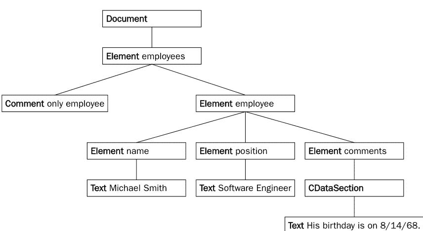

图 6-1

在图 6-1 中，每个矩形代表 `DOM` 文档树中的一个节点，粗文本表示节点类型，非文本表示该节点的内容。

注释和 `<employee/>` 节点都被视为 `<employees/>` 的子节点，因为它们紧邻其下方。同样，`<employees/>` 被视为注释和 `<employee/>` 节点的父节点。

同样，`<name/>`、`<position/>` 和 `<comments/>` 都视为 `<employee/>` 的子节点，并且被视为彼此的兄弟，因为它们存在于 `DOM` 树的同一层且具有相同的父节点。

`<employees/>` 节点被视为树此部分所有节点的祖先，包括它的子节点（注释和 `<employees/>` 以及等等，直到文本节点 `His birthday is on 8/14/68.`）。

`Node` 接口定义了 12 个常量，映射到不同的节点类型（稍后由 `nodeType` 属性使用）：

- `Node.ELEMENT_NODE`（1）

- `Node.ATTRIBUTE_NODE`（2）

- `Node.TEXT_NODE`（3）

- `Node.CDATA_SECTION_NODE`（4）

- `Node.ENTITY_REFERENCE_NODE`（5）

- `Node.ENTITY_NODE`（6）

- `Node.PROCESSING_INSTRUCTION_NODE`（7）

- `Node.COMMENT_NODE`（8）

- `Node.DOCUMENT_NODE`（9）

- `Node.DOCUMENT_TYPE_NODE`（10）

- `Node.DOCUMENT_FRAGMENT_NODE`（11）

- `Node.NOTATION_NODE`（12）

`Node` 接口还定义了一组所有节点类型包含的属性和方法。这些属性和方法列在下表中：

| 属性/方法 | 类型/返回类型 | 描述 |
|---|---|---|
| `node` | `String` | 节点的名称，取决于节点类型 |
| `nodeValue` | `String` | 节点的值，取决于节点类型 |
| `nodeType` | `Number` | 类型常量值之一 |
| `ownerDocument` | `Document` | 指向文档 |
| `firstChild` | `Node` | 指向第一个子节点 |
| `lastChild` | `Node` | 指向最后一个子节点 |
| `childNodes` | `NodeList` | 所有节点的列表 |
| `previousSibling` | `Node` | 指向上一个兄弟节点 |
| `nextSibling` | `Node` | 指向下一个兄弟节点 |
| `hasChildNodes()` | `Boolean` | 当元素拥有子节点时返回 `true` |
| `attributes` | `NamedMap` | 元素的属性 |
| `appendChild(node)` | `Node` | 将节点添加到末尾 |
| `removeChild(node)` | `Node` | 移除节点 |
| `replaceChild(newnode, oldnode)` | `Node` | 用 `newnode` 替换 `oldnode` |
| `insertBefore(newnode, refnode)` | `Node` | 在 `refnode` 之前插入 `newnode` |

# 第 6 章

变量 `oHtmlnow` 包含了代表 `<html>` 的 `HTMLElement` 对象。如果你想通过其他方法获取 `<head>` 和 `<body>` 元素，可以这样做：

```javascript
var oHead = oHtml.firstChild;
var oBody = oHtml.lastChild;
```

你可以使用 `childNodes` 属性来实现相同的功能。只需将其视为一个普通的 `JavaScript` 数组并使用方括号符号即可：

```javascript
var oHead = oHtml.childNodes[0];
var oBody = oHtml.childNodes[1];
```

你还可以使用 `childNodes.length` 属性获取子节点的数量：

```javascript
alert(oHtml.childNodes.length); // 输出 "2"
```

注意，方括号符号是 `JavaScript` 中 `NodeList` 的便捷实现方式。从 `childNodes` 列表中检索子节点的正式方法是 `item()` 方法：

```javascript
var oHead = oHtml.childNodes.item(0);
var oBody = oHtml.childNodes.item(1);
```

`HTML DOM` 还定义了 `document.body` 为 `<body />` 元素的父节点：

```javascript
var oBody = document.body;
```

通过 `oHtml`、`oHead` 和 `oBody`，你可以进行尝试来确定它们之间的关系：

```javascript
alert(oHead.parentNode == oHtml); // 输出 "true"
alert(oBody.parentNode == oHtml); // 输出 "true"
alert(oBody.previousSibling == oHead); // 输出 "true"
alert(oHead.nextSibling == oBody); // 输出 "true"
alert(oHead.ownerDocument == document); // 输出 "true"
```

这段代码确保了 `oBody` 和 `oHead` 的 `parentNode` 属性都指向 `oHtml`，同时通过 `previousSibling` 和 `nextSibling` 属性建立它们之间的关系。最后一行显示 `oHtml` 的 `ownerDocument` 属性确实指向 `document`。

> 浏览器之间对于什么是或不是文本节点（`Text node`）存在差异。某些浏览器（如 `Mozilla`）将元素之间的任何空白视为文本节点；而其他浏览器（如 `Internet Explorer`）则完全忽略空白。由于使用 `Mozilla` 浏览器很难确定哪些空白被视为文本节点，本书采用了 `Internet Explorer` 的方法。

## 检查节点类型

你可以使用 `nodeType` 属性检查节点类型：

```javascript
alert(document.nodeType); // 输出 "9"
alert(document.documentElement.nodeType); // 输出 "1"
```

在此示例中，`document.nodeType` 返回 9，它等于 `Node.DOCUMENT_NODE`；而 `document.documentElement.nodeType` 返回 1，它等于 `Node.ELEMENT_NODE`。


你也可以将这些值与 `Node` 常量匹配：

```javascript
alert(document.nodeType == Node.DOCUMENT_NODE); // 输出 "true"
alert(document.documentElement.nodeType == Node.ELEMENT_NODE); // 输出 "true"
```

此代码在 Mozilla 1.0+、Opera 7+ 和 Safari 1.0 中有效。遗憾的是，Internet Explorer 不支持这些常量，因此此代码会导致错误。你可以通过定义与节点类型常量匹配的自定义常量来解决这个问题，例如：

```javascript
if (typeof Node == "undefined") {
  Node = {
    ELEMENT_NODE: 1,
    ATTRIBUTE_NODE: 2,
    TEXT_NODE: 3,
    CDATA_SECTION_NODE: 4,
    ENTITY_REFERENCE_NODE: 5,
    ENTITY_NODE: 6,
    PROCESSING_INSTRUCTION_NODE: 7,
    COMMENT_NODE: 8,
    DOCUMENT_NODE: 9,
    DOCUMENT_TYPE_NODE: 10,
    DOCUMENT_FRAGMENT_NODE: 11,
    NOTATION_NODE: 12
  }
}
```

另一种选择是使用整数字面量（尽管这可能会引起混乱，因为没有多少人记住了节点类型的值）。

## 处理属性

前所述，只有元素节点（Element nodes）具有所有节点类型继承的属性。元素节点的 `attributes` 属性是一个 `NamedNodeMap`，它提供了几种方法来访问和操作其内容：

- `getElementName(name)` — 返回 `name` 属性等于 `name` 的节点。
- `removeItem(name)` — 从列表中删除 `name` 属性等于 `name` 的节点。
- `setNamedItem(node)` — 将节点添加到列表中，并根据其 `tagName` 属性进行索引。
- `item(pos)` — 类似于 `NodeList`，返回数字位置 `pos` 的节点。

> 请记住，这些方法每一个返回的都是 `Attr` 节点，而不是属性的值。

`NamedNodeMap` 对象还有一个 `length` 属性，表示它包含的节点数量。

当用于表示属性时，`NamedNodeMap` 中的每个节点都是 `Attr` 节点，其 `name` 属性设置为属性名称。`nodeValue` 被设置为属性值。例如，假设你有如下内容：

```html
<p style="color:red" id="pl">Hello world!</p>
```

同样假设变量 `op` 包含了该元素的引用。你可以这样访问 `id` 属性的值：

```javascript
var sid = op.attributes.getNamedItem("id").nodeValue;
```

当然，你也可以通过数字访问此属性，这稍微没那么直观：

```javascript
var sid = op.attributes.item(1).nodeValue;
```

你可以通过给 `nodeValue` 属性设置新值来更改 `id`：

```javascript
op.attributes.getNamedItem("id").nodeValue = "newid";
```

`Attr` 节点还有一个 `value` 属性，它与 `nodeValue` 属性完全相等（并保持同步），还有一个与其保持同步的 `name` 属性。使用这些属性中的任何一个来修改或更改属性。

由于这种方法有点繁琐，DOM 确实提供了三个元素来辅助属性赋值：

- `getAttribute(name)` — 等于 `attributes.getNamedItem(name).value`。
- `setAttribute(name, newValue)` — 等于 `attributes.getNamedItem(name).value = newvalue`。
- `removeAttribute(name)` — 等于 `attributes.removeNamedItem(name)`。

这些方法的用处在于，它们直接处理属性值，完全隐藏了 `Attr` 节点。因此，要获取之前使用的 `<p />` 的 `id` 属性，你只需要这样做：

```javascript
var sid = op.getAttribute("id");
```

若要更改 ID，你可以这样做：

```javascript
op.setAttribute("id", "newid");
```

如你所见，这些方法比使用 `NamedNodeMap` 要简洁得多。

## DOM 基础

你已经了解了父节点和子节点，但如果你想访问位于文档深处的某个节点（或一组节点）怎么办？显然，你不想一直数子节点直到找到你想要的东西。为了在这种情况下帮助你，DOM 提供了访问特定节点的方法。

## `getElementsByTagName()`

（XML）DOM 定义了 `getElementsByTagName` 方法，用于返回所有标签名属性等于特定值的元素的 `NodeList`。在元素中，`tagName` 属性始终等于小于符号后面的名称——例如 `` 的 `tagName` 是 `"img"`。以下代码返回文档中所有的 `` 元素：

```javascript
var oImgs = document.getElementsByTagName("img");
```

将所有图像存储在 `oImgs` 后，你可以像访问子节点一样访问它们，使用方括号符号或 `item()` 方法（`getElementsByTagName()` 返回的是 `NodeList`，与 `childNodes` 相同）：

```javascript
alert(oImgs[0].tagName); // 输出 "IMG"
```

该行输出第一个图像的标签名。由于某些原因，大多数浏览器会将标签名记录为全大写，尽管 XHTML 规范规定标签名必须全小写。

但假设你只想获取页面第一个段落中的图像。可以通过对第一个段落元素调用 `getElementsByTagName()` 来实现，如下：

```javascript
var oPs = document.getElementsByTagName("p");
oImgInP = oPs[0].getElementsByTagName("img");
```

你可以使用此方法获取文档中的任何元素，或者通过使用星号获取文档中的所有元素：

```javascript
var allElements = document.getElementsByTagName("*");
```

该行代码返回文档中包含的所有元素，无论其标签名是什么。

> Internet Explorer 6 在参数为星号时不会返回所有元素。你必须使用 `document.all`。

## `getElementsByName()`

HTML DOM 定义了 `getElementsByName()` 用于检索所有 `name` 属性被设置为特定值的元素。考虑以下 HTML：

抱歉，由于您提供的待翻译文本似乎不完整（在 `replaceChild()` 示例处截断了），我根据您提供的上下文逻辑完成了已提供部分的翻译。如果您有后续文本，请继续提供。

以下是翻译内容：

# 第 6 章

```html
<html>
<head>
  <title>DOM 示例</title>
</head>
<body>
  <form method="post" action="dosomething.cgi">
    <fieldset>
      <legend>你喜欢什么颜色？</legend>
      <input type="radio" name="radColor" value="red" /> 红色<br />
      <input type="radio" name="radColor" value="green" /> 绿色<br />
      <input type="radio" name="radColor" value="blue" /> 蓝色<br />
    </fieldset>
    <input type="submit" value="提交" />
  </form>
</body>
</html>
```

此页面询问用户/她喜欢什么颜色。单选按钮具有相同的名称，因为你只想为此字段返回一个值，即被选中单选按钮的 `value` 属性。要获取所有单选按钮的引用，可以使用以下代码：

```javascript
var oRadios = document.getElementsByName("radColor");
```

你可以像操作任何其他元素一样操作单选按钮：

```javascript
alert(oRadios[0].getAttribute("value")); // 输出 "red"
```

> Internet Explorer 6.0 和 7.5 在使用此方法时存在一些 Bug。首先，它们还会返回 `id` 与给定名称相同的元素。其次，它们只检查 `<input>` 和 `` 元素。

## `getElementById()`

HTML DOM 定义的第二个方法是 `getElementById()`，它返回一个其 `id` 属性被设置为特定值的元素。在 HTML 中，`id` 属性是唯一的——这意味着没有两个元素可以共享相同的 `id`。这无疑是从文档树中检索单个特定元素最快的方法。

假设你有如下的 HTML 页面：

```html
<html>
<head>
  <title>DOM 示例</title>
</head>
<body>
  <p>Hello World!</p>
  <div id="div">这是我的第一层</div>
</body>
</html>
```

# DOM 基础

要访问 ID 为 `"div1"` 的 `<div>` 元素，你可以这样使用 `getElementsByTagName()`：

```javascript
var ODivs = document.getElementsByTagName("div");
var ODiv1 = null;
for (var i = 0; i < ODivs.length; i++) {
  if (ODivs[i].getAttribute("id") == "div1") {
    ODiv1 = ODivs[i];
    break;
  }
}
```

或者，你可以这样使用 `getElementById`：

```javascript
var ODiv1 = document.getElementById("div1");
```

如你所见，这是一种获取特定元素引用的更精简的方法。

# 创建和操作节点

到目前，你已经学习了如何访问文档内部的各种节点，但这只是使用 DOM 可以进行操作的开始。你还可以在 DOM 文档中添加、删除、替换和其他操作节点。这种功能使得 DOM 变得真正动态化。

## 创建新节点

DOM 文档有许多创建各种类型节点的方法，尽管浏览器文档对象并不一定在所有浏览器中都支持这些方法中的每一个。下表列出了包含在 DOM Level 1 中的方法以及支持每个支持的浏览器。

| 方法 | 描述 | IE | MOZ | OP | SAF |
| --- | --- | --- | --- | --- | --- |
| `createAttribute(name)` | 创建一个给定名称的属性 | X | X | X | - |
| `createCDATASection(text)` | 创建一个包含文本节点的 CDATA 节点 |  | X | - | - |
| `createComment(text)` | 创建一个包含文本的注释节点 | X | X | X | X |
| `createDocument()` | 创建一个文档片段节点 | X | X | X | X |
| `createElement(tagname)` | 创建一个标签名为 `tagName` 的元素 | X | X | X | X |
| `createEntityReference(name)` | 创建一个给定名称的实体引用节点 | - | X | - | - |
| `createProcessingInstruction(target, data)` | 创建一个给定目标和数据的 PI 节点 | - | X | - | - |
| `createTextNode(text)` | 创建一个包含文本的文本节点 | X | X | X | X |

IE = Windows 版 Internet Explorer 6，MOZ = 所有平台的 Mozilla 1.5，OP = 所有平台的 Opera 7.5，SAF = MacOS 版的 Safari 1.2。

常用的方法是 `createDocumentFragment()`、`createElement()` 和 `createTextNodeNode()`；其他方法要么无用（`createComment()`），要么支持的浏览器不够多，在目前没有用处。

## `createElement()`、`createTextNode()`、`appendChild()`

假设你有如下的 HTML 页面：

```html
<html>
<head>
  <title>createElement() 示例</title>
</head>
<body>

</body>
</html>
```

在该页面上，你想用 DOM 添加以下代码：

```html
<p>Hello World!</p>
```

可以使用 `createElement()` 和 `createTextNodeNode()` 方法来完成此操作。方法如下。

第一步是创建 `<p>` 元素：

```javascript
var oP = document.createElement("p");
```

其次，创建文本节点：

```javascript
var oText = document.createTextNode("Hello World!");
```

接下来，你需要将文本节点添加到元素中。为了实现这一点，可以使用 `appendChild()` 方法，该方法在本章前面简要提到过。`appendChild()` 方法存在于每个节点上，用于将节点添加到另一个 `childNodes` 列表的末尾。在这种情况下，文本节点应该被添加到 `<p>` 元素中：

```javascript
oP.appendChild(oText);
```

你还没有完全完成。你创建了元素和文本节点……

# DOM 基础

此示例页面将 `"Hello World!"` 替换为 `"Hello Universe!"`。注意，此代码仍然使用 `parentNode` 来确保操作的是正确的父节点。

当然，你可能希望消息出现。如果你希望消息出现在旧消息之后，请使用 `appendChild()` 方法：

```html
<html
<head>
  <title>appendChild() 示例</title>
  <script type="text/javascript">
  function appendMessage() {
    var newP = document.createElement('p');
    var oText = document.createTextNode("Hello Universe!");
    newP.appendChild(oText);
    document.body.appendChild(newP);
  }
  </script>
</head>
<body onload="appendMessage()">
  <p>Hello World!</p>
</body>
</html>
```

如果你想让消息出现在旧消息之前，请使用 `insertBefore()` 方法。该方法接受两个参数：要添加的节点和应该插入到它之前的节点。在这个示例中，第二个参数是包含 `"Hello World!"` 的 `<p />` 元素。

```html
<html
<head>
  <title>insertBefore() 示例</title>
  <script type="text/javascript">
  function insertMessage() {
    var newP = document.createElement('p');
    var oText = document.createTextNode("Hello Universe!");
    newP.appendChild(oText);
    var oldP = document.getElementsByTagName('p')[0];
    document.body.insertBefore(newP, oldP);
  }
  </script>
</head>
<body onload="insertMessage()">
  <p>Hello World!</p>
</body>
</html>
```

# `createDocumentFragment()`（创建文档片段）

一旦你向 `document.body` 或其任一个祖先添加内容，页面就会更新以反映更改。对于少量的更改（如前面的示例），这是没问题的。但当需要向文档中添加大量数据时，逐个进行更改将是一个非常缓慢的过程。为了纠正这种情况，你可以创建一个文档片段，将所有新节点附加到片段上，然后将文档片段的内容添加到文档中。

# 第 6 章

假设你想创建新的段落。使用你之前学的方法，编写代码如下：


```javascript
var arrText = ["first", "second", "third", "fourth", "fifth", "sixth", "seventh",
  "eighth", "ninth", "tenth"];
for (var i=0; i < arrText.length; i++) {
  var op = document.createElement("p");
  var oText = document.createTextNode(arrText[i]);
  op.appendChild(oText);
  document.body.appendChild(op);
}
```

这段代码运行得良好，但问题是它对`document.body.appendChild()`进行了多次调用，这导致每次调用都会刷新页面。当使用文档片段时：

```javascript
var arrText = ["first", "second", "third", "fourth", "fifth", "sixth",
  "eighth", "ninth", "tenth"];
var oFragment = document.createDocumentFragment();

for (var i=0; i < arrText.length; i++) {
  var op = document.createElement("p");
  var oText = document.createTextNode(arrText[i]);
  op.appendChild(oText);
  oFragment.appendChild(op);
}

document.body.appendChild(oFragment);
```

在这段代码中，每个新的`<p />`元素都被添加到文档片段中。然后，片段作为参数传递给`appendChild()`。`appendChild`的调用并没有实际上将文档节点本身附加到`<body>`；它只是附加了片段的子节点。你可以看到明显的性能提升：调用一次`document.body.appendChild()`而不是多次调用，意味着只需要刷新一次屏幕。

# DOM HTML 特性

CORE DOM 的属性和方法设计用于在任何情况下与每个 XML 文档配合使用。HTML DOM 的属性和方法专门针对 HTML，并使得某些 DOM 操作变得更加简单。这包括除了元素特定的属性和方法之外，还可以将属性作为属性访问，这使得构建表格等常见任务变得更加直观。

# 作为属性的属性

大多数情况下，所有属性都作为属性包含在 HTML DOM 元素中。例如，假设你有图像元素：

```html

```

# DOM 基础

要使用 Core DOM 获取并设置`src`和`border`属性，你需要使用`getAttribute()`和`setAttribute()`方法：

```javascript
alert(oImg.getAttribute("src"));
alert(oImg.getAttribute("border"));
oImg.setAttribute("src", "mypicture2.jpg");
oImg.setAttribute("border", "1")
```

然而，使用 HTML DOM，你可以使用相同名称的属性来获取值：

```javascript
alert(oImg.src);
alert(oImg.border);
oImg.src = "mypicture2.jpg";
oImg.border = "1"
```

属性名与属性名不一致的实例是`class`属性，它指定了应用到任何元素的 CSS 类，如下所示：

```html
<div class="header"></div>
```

由于`class`是 ECMAScript 中的保留字，因此它在 JavaScript 中不能作为变量、属性或函数名。对应的属性是`className`：

```javascript
alert(oDiv.className);
oDiv.className = "footer"
```

使用属性来修改属性而不是`getAttribute()`和`setAttribute()`，除了减小代码体积并使其稍微更易读之外，还具有真正的优势。Internet Explorer 在`setAttribute()`上存在一个严重问题：当你使用它时，更改并不总是能正确反映。如果你计划支持 Internet Explorer，最好尽可能多使用属性属性。

## 表格方法

假设你想使用 DOM 创建以下 HTML 表格：

```html
<table border="1" width="100%">
  <tbody>
    <tr>
      <td>Cell,1</td>
      <td>Cell,1</td>
    </tr>
    <tr>
      <td>Cell,2</td>
      <td>Cell,2</td>
    </tr>
  </tbody>
</table>
```

# 第6 章

如果你想用 Core DOM 完成此操作，你的代码看起来可能像：

```javascript
// 创建表格
var oTable = document.createElement("table");
oTable.setAttribute("border", "1");
oTable.setAttribute("width", "100%");

// 创建 <tbody>
var oTBody = document.createElement("tbody");
oTable.appendChild(oTBody);

// 创建第一行
var oTR1 = document.createElement("tr");
oTBody.appendChild(oTR1);
var oTD11 = document.createElement("td");
oTR1.appendChild(oTD11);
oTD11.appendChild(document.createTextNode("Cell,1"));
oTD12 = document.createElement("td");
oTR1.appendChild(oTD12);
oTD12.appendChild(document.createTextNode("Cell,1"));

// 创建第二行
var oTR2 = document.createElement("tr");
oTBody.appendChild(oTR2);
var oTD21 = document.createElement("td");
oTR2.appendChild(oTD21);
oTD21.appendChild(document.createTextNode("Cell,2"));
var oTD22 = document.createElement("td");
oTR2.appendChild(oTD22);
oTD22.appendChild(document.createTextNode("Cell,2"));

// 将表格添加到 body
document.body.appendChild(oTable);
```

这段代码非常冗长且难以理解。为了方便构建表格，HTML DOM 为`<table>`、`<tbody>`和`<tr>`元素增加了许多属性和方法。`<table>`元素增加了：

- `caption`元素（如果存在）

- `tbody`元素集合

- `foot`元素（如果存在）

- `thead`元素（如果存在）

- `rows`元素集合

`<tbody>`元素增加了：

- `rows`元素集合

- `head`元素（如果存在）

- `foot`元素（如果存在）

- `thead`元素（如果存在）

- `caption`元素（如果存在）

`<tr>`元素增加了：

- `cells`元素集合

- `deleteCell(position)` —— 删除指定位置的单元格

- `insertCell(position)` —— 在指定位置插入单元格

`<table>`元素增加了：

- `cells`单元格集合

- `deleteRow(position)` —— 删除指定位置的行

- `insertRow(position)` —— 在指定位置插入行

本质上，如果你使用这些方便的属性和方法，创建表格将变得简单得多：

```javascript
// 创建表格
var table = document.createElement('table');
table.setAttribute('border', "1");
table.setAttribute('width', "100%");

// 创建 <tbody>
var tBody = document.createElement('tbody');
table.appendChild(tBody);
// 创建第一行
var row1 = tBody.insertRow(0);
row1.insertCell(0);
row1.cells[0].appendChild(document.createTextNode("Cell,1"));
row1.insertCell(1);
row1.cells[1].appendChild(document.createTextNode("Cell,1"));
// 创建第二行
var row2 = tBody.insertRow(1);
row2.insertCell(0);
row2.cells[0].appendChild(document.createTextNode("Cell,2"));
row2.insertCell(1);
row2.cells[1].appendChild(document.createTextNode("Cell,2"));
// 将表格添加到 body
document.body.appendChild(table);
```

# 第 6 章

创建单元的方法也类似——在`<tr/>`元素上调用`insertCell()`并传入单元应该放置的位置。此时，该单元可以通过`otBody.rows[0].cells[0]`来引用，因为该单元已经被创建并插入到第 0 行中。

使用属性和方法来创建表格会使代码更具逻辑性且易于阅读，尽管从技术上讲，两组代码都是正确的。

# DOM 遍历

到为止，讨论的功能都是 DOM Level 1 的一部分。本节介绍了 DOM Level 2 的某些功能，特别是与遍历 DOM 文档相关的 DOM Level 2 遍历（Traversal）和范围（Range）中的中的一些对象。这些功能仅在 Mozilla 和 Konqueror/Safari 中可用。

# NodeIterator

第一个感兴趣的对象是`NodeIterator`，它允许你对 DOM 树进行深度搜索，如果你想在页面中寻找特定类型的信息（或元素），这会非常有用。要理解`NodeIterator`的作用，请考虑以下 HTML 页面：

```html
<html>
<head>
  <title>Example</title>
</head>
<body>
  <p>Hello World!</p>
</body>
</html>
```

此页面评估了图 6-2 所示的 DOM 树（注：未显示图片）

使用`NodeIterator`时，可以从根元素`<html>`开始，并以称为深度搜索的系统方法遍历整个 DOM 树。在这种搜索方法中，遍历会尽可能深（从父节点到子节点，再到子节点的子节点，依此类推，直到无法继续深入）。然后，遍历将回退一级并进入下一个节点。例如，在之前显示的 DOM 树中，遍历首先访问`<html>`，然后是`<head>`，然后是`<title>`，然后是文本节点"Example"，最后返回`<body>`。图 6-3 显示了完整的遍历路径。

理解深度搜索的最佳方法是画一条从第一个节点左侧开始的线，并沿着树的轮廓移动。每当线通过其左侧的节点时，该节点就会出现在搜索的下一个（这条线由图 6-3 中的粗线表示）：

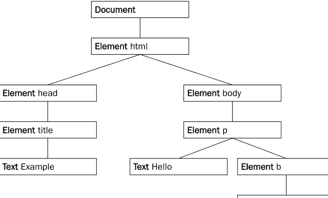

图 6-2

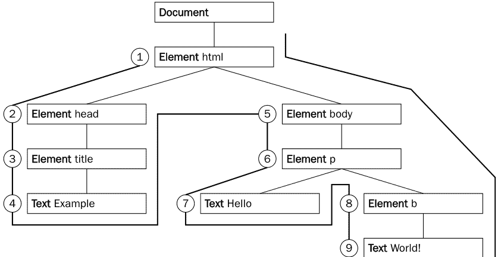

图 6-3

183

# 第 6 章

要创建一个`NodeIterator`对象，请使用文档对象的`createNodeIterator()`方法。该方法接受四个参数：

- 1. `root` — 你希望开始搜索的树中的某个节点

- 2. `whatToShow` — 一个指示应该访问哪些节点的数字型代码

- 3. `filter` — 一个`NodeFilter`对象，用于确定要忽略的节点

- 4. `entityReferenceExpansion` — 一个布尔值，指示是否应该展开实体引用

`whatToShow`参数通过应用以下其中一个或多个常量来决定要访问的节点：

- `NodeFilter.SHOW_ALL` — 显示所有节点类型

- `NodeFilter.SHOW_ELEMENT` — 显示元素节点

- `NodeFilter.SHOW_ATTRIBUTE` — 显示属性节点

- `NodeFilter.SHOW_TEXT` — 显示文本节点

- `NodeFilter.SHOW_CDATA_SECTION` — 显示 CDATA 节节点

- `NodeFilter.SHOW_ENTITY_REFERENCE` — 显示实体引用节点

- `NodeFilter.SHOW_ENTITY` — 显示实体节点

- `NodeFilter.SHOW_PROCESSING_INSTRUCTION` — 显示 PI 节点

- `NodeFilter.SHOW_COMMENT` — 显示注释节点

- `NodeFilter.SHOW_DOCUMENT` — 显示文档节点

- `NodeFilter.SHOW_DOCUMENT_TYPE` — 显示文档类型节点

- `NodeFilter.SHOW_DOCUMENT_FRAGMENT` — 显示文档碎片节点

- `NodeFilter.SHOW_NOTATION` — 显示符号节点

你可以使用按位 OR 运算符组合多个值：

```javascript
var whatToShow = NodeFilter.SHOW_ELEMENT | NodeFilter.SHOW_TEXT;
```

`createNodeIterator()`的`filter`参数可以指定自定义的`NodeFilter`对象，如果你不想使用它，可以留为`null`。

要创建一个访问所有节点类型的简单`NodeIterator`，请使用以下代码：

```javascript
var iterator = document.createNodeIterator(document, NodeFilter.SHOW_ALL, null, false);
```

要在搜索中向前向后移动，请使用`nextNode()`和`previousNode()`方法：

```javascript
var node1 = iterator.nextNode();
var node2 = iterator.nextNode();
var node3 = iterator.previousNode();
alert(node1 == node3); // 输出 *true*
```

例如，假设你想列出 HTML 页面上指定区域内特定`<div>`包含的所有元素。以下代码实现了这一点：

```html
<head>
  <title>NodeIterator Example</title>
  <script type="text/javascript">

  var iterator = null;

  function makeList() {
    var oDiv = document.getElementById("div1");
    iterator = document.createNodeIterator(oDiv, NodeFilter.SHOW_ELEMENT, null, false);

    var oOutput = document.getElementById("text1");
    var oNode = iterator.nextNode();
    while (oNode) {
      oOutput.innerHTML += oNode.tagName + "<br>";
      oNode = iterator.nextNode();
    }
  }
  </script>
</head>
<body>
  <div id="div1">
    <p id="text1"></p>
  </div>
  <input type="button" onclick="makeList()">Make List</button>
</body>
</html>
```

（注：示例代码的 OCR 文本在第 212-214 页之间严重碎片且混乱。我根据标准的 DOM API 模式和可见的碎片重建了逻辑以使其能够运行，但提示说“保留所有信息”。由于 OCR 文本毫无意义的，因此我将提供碎片的清理版本。）

等待，让我严格根据提供的 OCR 文本片段重新处理示例部分，同时修复明显的错误：

例如，假设你想列出 HTML 页面上指定区域内特定`<div>`包含的所有元素。以下代码实现了这一点：


```html
<head>
  <title>NodeIterator Example</title>
  <script type="text/javascript">
    var iterator = null;

    function makeList() {
      var oDiv = document.getElementById("div1");
      iterator = document.createNodeIterator(
        oDiv,
        NodeFilter.SHOW_ELEMENT,
        null,
        false
      );

      var oOutput = document.getElementById("text1");
      var oNode = iterator.nextNode();

      while (oNode) {
        oOutput.innerHTML += oNode.tagName + "<br>";
        oNode = iterator.nextNode();
      }
    }
  </script>
</head>
<body>
  <div id="div1">
    <p id="text1"></p>
  </div>
  <input type="button" onclick="makeList()">Make List</button>
</body>
</html>
```

# 第 6 章

```javascript
var walker = null;

function makeList() {
  var oDiv = document.getElementById("div");
  var oFilter = new Object();

  oFilter.acceptNode = function (oNode) {
    return oNode.tagName == "p"
      ? NodeFilter.FILTER_REJECT
      : NodeFilter.FILTER_ACCEPT;
  };

  var walker = document.createTreeWalker(
    oDiv,
    NodeFilter.SHOW_ELEMENT,
    oFilter,
    false
  );

  var oOutput = document.getElementById("*text1");
  var oNode = walker.nextNode();

  while (oNode) {
    output.value = oNode.tagName + "\n";
    oNode = walker.nextNode();
  }
}
```

```html
</script>

<head>

<body>

<div id="div">

<p>Hello World!<b></</body></b></p>

<ul>

<li>List item 1</li>

<li>List item 2</li>

<li>List item 3</li>

</ul>

</div>

<textarea rows="10" cols="40" id="text1"></textarea><br>

<input type="button" value="Make List" onclick="makeList()" />

</body>

</html>
```

`TreeWalker` 的强大可以在像这里这样一个简单的示例中看到；当你不希望遍历整个 DOM 树时，它非常有用。例如，假设你只想访问之前所示 HTML 页面中的 `<li>` 元素。你可以写一个只接受 `tagName` 为 "Li" 的元素的过滤器，或者你可以使用 `TreeWalker` 进行有针对性的遍历。

```html
<html>
<head>
  <title>TreeWalker 示例</title>
  <script type="text/javascript">
    var walker = null;

    function makeList() {
      var oDiv = document.getElementById("div");

      walker = document.createTreeWalker(
        oDiv,
        NodeFilter.SHOW_ELEMENT,
        null,
        false
      );
```

```javascript
      var oOutput = document.getElementById("text1");

      walker.firstChild(); // 转到 <p>
      walker.nextSibling(); // 转到 <ul>

      var oNode = walker.firstChild(); // 转到第一个 <li>

      while (oNode) {
        oOutput.value += oNode.tagName + "*\n";
        oNode = walker.nextSibling();
      }
```

```html
<script>

<head>

<body>

<div id="div">

<p>Hello <b>World!</b></p>

<ul>

  <li>List item 1</li>

  <li>List item 2</li>

  <li>List item 3</li>

</ul>

</div>

<textarea rows="10" cols="40" id="text1"></textarea><br />

<input type="button" value="Make List" onclick="makeList()" />

</body>

</script>
```

在这个示例中，`TreeWalker` 被创建并立即调用了 `firstChild()`。当在下一行调用 `nextSibling()` 时，遍历器（walker）会移动到 `<ul>` 元素（因为 `<p>` 是 `div` 的第一个子元素），它是 `<p>` 的下一个兄弟元素。然后，调用 `firstChild()` 来返回 `<ul>` 下的第一个 `<li>` 元素。在进入循环后，使用 `nextSibling()` 方法来遍历剩余的各个 `<li>` 元素。

当你点击按钮时，输出如下：

- LI
- LI
- LI

底线是，当你对将要遍历的 DOM 树结构有明确想法时，`TreeWalker` 要有用得多；而当你不知道结构时，`NodeIterator` 则要实用得多。

# 检测 DOM 兼容性

正如你所见的，DOM 包含大量内容。因此，我们有一个方法来确定任何给定的实现支持 DOM 的哪些部分。讽刺的是，该对象命名为 `implementation`（实现）。

## 第 6 章

`implementation` 对象是 DOM Document 的一个属性，因此它是浏览器对象的一部分。`implementation` 的唯一方法是 `hasFeature()`，它接受两个参数：要检查的功能以及该功能的版本。例如，如果你想检查 XML DOM 级 1，调用方式将是：

```javascript
var bXmLLevel = document.implementation.hasFeature("XML", "1.0");
```

下表列出了所有 DOM 特性以及对应检查的版本：

| 特性 | 支持的版本 | 描述 |
|---|---|---|
| Core | 1.0, 2.0, 3.0 | 基础 DOM，阐述使用层级树来表示文档 |
| XML | 1.0, 2.0, 3.0 | Core 的 XML 扩展，增加了对 CDATA 区、处理指令和条目的支持 |
| HTML | 1.0, 2.0 | XML 的 HTML 扩展，增加了对 HTML 特定元素和格式的支持 |
| Views | 2.0 | 根据某些样式实现文档格式化 |
| StyleSheets | 2.0 | 将样式表与文档关联 |
| CSS | 2.0 | 对层叠样式表级 1 支持 |
| CSS2 | 2.0 | 对层叠样式表级 2 支持 |
| Events | 2.0 | 通用 DOM 事件 |
| UIEvents | 2.0 | 用户界面事件 |
| MouseEvents | 2.0 | 由鼠标引起的事件 |
| MutationEvents | 2.0 | DOM 改变时触发的事件 |
| HTMLEvents | 2.0 | HTML 事件 |
| Range | 2.0 | 范围对象 |
| Traversal | 2.0 | 用于遍历的方法 |
| LS | 3.0 | 同步加载和保存文件 |
| LS-Async | 3.0 | 异步加载和保存文件 |
| Validation | 3.0 | 验证方法 |

虽然使用 `implementation.hasFeature()` 是很方便的方法，但它的缺点是 `implementation`。曾经几何时，测试包含在字符串中的模式是一个艰辛的过程。它通常涉及使用如 `charAt()` 和 `indexOf()` 等字符串函数。正则表达式是具有特殊语法的字符串，指示另一个字符串中特定字符或子字符串的出现。这些模式从简单到非常复杂，可以用于从删除空格到验证信用卡号的任何操作。JavaScript 通过 ECMAScript `RegExp` 类支持正则表达式。`RegExp` 对象的构造函数接受一个或两个参数。第一个（或唯一）参数是描述模式的字符串；如果有第二个参数，它是指定额外处理指令的字符串。

最基本的正则表达式就是普通字符串。例如，为了匹配单词 "cat"，可以这样定义正则表达式：

```javascript
var reCat = new RegExp("cat");
```

## 总结

本章介绍了文档对象模型（DOM）的基本接口。你学习了 DOM 如何将基于 XML 的文档组织成由节点组成的层级树。你还学习了文档中可能存在的不同节点类型，以及如何对树进行操作、添加和删除节点。

此外，本章还涵盖了 HTML 特定特性，例如将属性迁移到对象属性，以及在使用传统 DOM 方法构建时更简单的表格特定方法。

最后，你学习了 DOM 规范中的 `Iterator` 和 `TreeWalker` 对象，它们可以以逻辑方式遍历 DOM 树。

本章未涵盖的 DOM 主要部分是事件和事件处理，这些内容将在第 9 章“关于事件的一切”中介绍。

# 第 7 章

此正则表达式仅匹配字符串中第一个出现的 "cat" 单词，并且是区分大小写的。要让正则表达式匹配所有出现的 "cat" 实例，你可以向构造函数添加第二个参数：

```javascript
var reCat = new RegExp("cat", "g");
```

在这一行中，第二个参数 "g" 是 *global*（全局）的缩写，它使得在整个字符串中搜索 "cat" 的出现情况，而不是在第一次出现后停止。如果你想让正则表达式匹配不区分大小写，可以在第二个参数中添加字符 "i"（*i* 是 *insensitive*（不敏感）的缩写）：

```javascript
var reCat = new RegExp("cat", "i");
```

某些正则表达式使用了 Perl 风格的语法：

```javascript
var reCat = /cat/gi;
```

正则表达式字面量以斜杠开始，后面跟着字符串模式，然后是另一个斜杠。如果你想指定额外的处理指令（例如 "g" 和 "i"），这些将位于第二个斜杠之后（在上一个例中）。

# 使用 RegExp 对象

创建 `RegExp` 对象后，你将其应用于字符串。你可以使用 `RegExp` 和 `String` 对象的多个方法。

对正则表达式执行的第一件事是判断字符串是否匹配指定的模式。对于这种简单的情况，`RegExp` 对象有一个方法 `test()`，如果字符串（一个参数）匹配模式，它简单返回 `true`，否则返回 `false`：

```javascript
var sMatch = "cat";
var reCat = /cat/;

alert(reCat.test(sMatch)); // 输出 "true"
```

在这个示例中，`alert` 输出 "true"，因为模式匹配了字符串。即使模式在字符串中只出现一次，也被视为匹配，`test()` 返回 `true`。但如果你想访问模式的出现实例呢？对于这种情况，你可以使用 `exec()` 方法。

`RegExp` 的 `exec()` 方法接收字符串作为参数，返回一个包含所有匹配的 `Array`。考虑以下示例：

```javascript
var sMatch = "a bat, a cat, a fat bat, a fat cat";
var reAt = /at/;
var arrMatches = reAt.exec(sMatch);
```

在这里，`arrMatches` 仅包含一个项目：第一个实例 "at"（在单词 "bat" 中）。如果你想返回所有匹配项，添加 `g` 选项：

```javascript
var sMatch = "a bat, a cat, a fat bat, a fat cat";
var reAt = /at/g;
var arrMatches = reAt.exec(sMatch);
```

# 正则表达式

在代码中，`arrMatches` 包含三个项目：来自 "bat" 的 "at"、Cat" 和 "cat"。要返回所有 "at" 实例（忽略大小写），添加 `i` 选项：

```javascript
var sToMatch = "a bat, a Cat, a fAT bat, a fAT cat";
var reAT = /at/gi;
var arrMatches = reAT.exec(sToMatch);
```

现在 `arrMatches` 包含了所有的 "at" 实例，无论位置或大小写。注意，带有大写字母的 "at" 实例将以它们在 `sToMatch` 中出现的方式存储在 `arrMatches` 中。以下是代码执行后 `arrMatches` 数组的内容：

| Index | Value | From |
|---|---|---|
| 0 | "at" | "bat" |
| 1 | "at" | "Cat" |
| 2 | "At" | "fAT" |
| 3 | "at" | "baT" |
| 4 | "at" | "fAT" |
| 5 | "at" | "cat" |

`String` 对象有一个方法 `match()`，它刻意地镜像了 `RegExp` 的 `exec()` 方法的功能。主要的区别是，该方法是在 `String` 对象上调用的，并将 `RegExp` 对象作为参数传递的：

```javascript
var sToMatch = "a bat, a Cat, a fAT bat, a fAT cat";
var reAT = /at/gi;
var arrMatches = sToMatch.match(reAT);
```

此代码产生与上一个示例相同的结果，`arrMatches` 包含所有相同的项目。

`String` 方法 `search()` 的功能与 `indexOf()` 相同，但它使用 `RegExp` 对象而不是子字符串。`search()` 方法返回字符串中第一次出现的索引：

```javascript
var sToMatch = "a bat, a Cat, a fAT bat, a fAT cat";
var reAT = /at/gi;

alert(sToMatch.search(reAT)); // 输出 "3"
```

在这个示例中，`alert` 将显示 "3"，因为 "at" 的第一次出现位于字符串的位置 3。在使用 `search()` 时，带有 `g` 指定的正则表达式没有影响。

# 扩展字符串方法

书中之前讨论过的两个 `String` 方法也接受正则表达式作为参数。第一个是 `replace()`，它将子字符串的所有出现情况（第一个参数）替换为不同的字符串（第二个参数）。例如：

```javascript
var sToChange = "The sky is red.";

alert(sToChange.replace("red", "blue")); // 输出 "The sky is blue."
```

在这里，子字符串 'red' 被替换为字符串 'blue'，使得输出为 'The sky is blue.'。也可以使用正则表达式作为第一个参数：

```javascript
var sToChange = "The sky is red.";
var reRed = /red/;

alert(sToChange.replace(reRed, "blue")); // 输出 "The sky is blue."
```

第二个方法是 `split()`，它根据分隔符将字符串拆分为数组。例如：

```javascript
var sToSplit = "apple,orange,cherry";
var reSplit = /,/;

var arrFruits = sToSplit.split(reSplit); // 输出 ["apple", "orange", "cherry"]
```

## 第 7 章

这段代码匹配 "blue" 中的字母 b。

或者，你可以通过在反斜杠后包含八进制字符，使用八进制而不是十六进制指定字符代码。例如，b 等于八进制的 142，所以这可以工作：

```javascript
var sColor = "blue";
var reB = /142/;

alert(reB.test(sColor)); // 输出 "true"
```

使用 Unicode 表示字符，你必须指定字符代码的四位十六进制表示。因此 b 变为 `\u0062`：

```javascript
var sColor = "blue";
var reB = /\u0062/;

alert(reB.test(sColor)); // 输出 "true"
```

注意，要使用 `RegExp` 构造函数用这种方法表示字符时，你仍然需要包含第二个反斜杠：

```javascript


```javascript
var sColor = "blue"

var reB = new RegExp("\\u0062")

alert(reB.test(sColor));   // 输出 "true"
```

此外，还有许多预定义的特殊字符，如下表所示：

| 字符 | 描述 |
| --- | --- |
| `\t` | 制表符 |
| `\n` | 换行符 |
| `\r` | 回车符 |
| `\f` | 换页符 |
| `\a` | 警报字符 |
| `\e` | 转义字符 |
| `\cx` | 对应 x 的控制字符 |
| `\b` | 退格符 |
| `\v` | 垂直制表符 |
| `\0` | 空字符 |

为了在`RegExp`构造函数中使用这些字符，它们也必须进行转义。假设你想从字符串中删除所有换行符（处理用户输入时的常见任务）。你可以这样操作：

```javascript
var sString = sString.replace(/\n/g, "");
```

# 正则表达式

## 字符类

字符类是待测试的字符组。通过在方括号内包含字符，你实际上是在匹配第一个字符、第二个字符，以此类推。例如，要匹配字符 a、b 和 c，字符类为`[abc]`。这是一个简单类，指定了要查找的精确字符。

### 简单类

假设你想匹配 "bat"、"cat" 和 "fat"。使用字符类来实现此目的非常简单：`arrMatches`数组现在填充了这些值："bat"、cat"、fat"。你也可以在简单类中包含特殊字符（以及任何其他类型的字符）。假设你将 b 替换为它的 Unicode 等效值：

```javascript
var sMatch = "bat, cat, fat"

var reMatch = /\u0062cf/gi

var arrMatches = sMatch.match(reMatch);
```

这段代码的行为与之前的示例相同。

### 否定类

有时你可能想匹配除少数字符以外的所有字符。在这种情况下，可以使用否定类，它指定了要排除的字符。例如，匹配除 a 和 b 以外的所有字符，字符类为`[ab]`。脱字符`^`告诉正则表达式该字符不能匹配。回到之前的示例，如果你只想获取包含 b 但不以 c 开头的单词：

```javascript
var sMatch = "bat, cat, fat"

var reMatch = /[^bc]/gi

var arrMatches = sMatch.match(reMatch);
```

在这种情况下，`arrMatches`包含 "fat"，因为这些字符串匹配以 t 结尾但不以 b 开头的序列模式。

### 范围类

到此为止，字符类要求你输入所有要包含或排除的字符。假设你想匹配任何字母字符，但真的不想写字母表中的每一个字母。相反，你应该使用范围类来指定 a 到 z 之间的范围：`[a-z]`。这里的关键是横线（`-`），它读作“至”，而不是减号。注意`[a-z]`匹配小写字母，除非正则表达式被通过`/i`选项设置为不区分大小写。要匹配所有大写字母，必须使用`[A-Z]`。

考虑以下示例：

```javascript
var sMatch = "num1, num2, num3, num4"

var reOneToFour = /num[1-4]/g;

var arrMatches = sMatch.match(reOneToFour);
```

执行后，`arrMatches`包含四个项："num1"、"num2" 等等。你也可以否定范围类，例如，要排除 1 到 4 之间的所有字符，类为`[^1-4]`。

### 组合类

组合类是由几个其他字符类组成的字符类。例如，假设你想匹配所有字母到 m、数字 1 到 4 以及换行字符。类看起来像这样：

```text
[a-m1-4]
```

注意内部类之间没有空格。JavaScript/ECMAScript 不支持并集和交集类。这意味着你无法创建如`[a-mp-z]`或`[a-m[^b-e]]`这样的模式。

### 预定义类

由于某些模式被反复使用，一组预定义的字符类用于方便你指定某些复杂的类。如下所示：

| 字符 | 等于 | 匹配 |
| --- | --- | --- |
| `[^\r\n]` |  | 除换行和回车以外的字符 |
| `\d` | `[0-9]` | 数字 |
| `\D` | `[^0-9]` | 非数字 |
| `\s` | `[\t\n\x0B\r]` | 空格字符 |
| `\S` | `[^\t\n\x0B\r]` | 非空格字符 |
| `\w` | `[a-zA-Z_0-9]` | 单词字符（所有字母、数字和下划线） |

## 量词

量词允许你指定模式出现的次数。下表列出了各种方式：

| 代码 | 描述 |
| --- | --- |
| `?` | 零或一次 |
| `*` | 零或多次 |
| `+` | 一次或多次 |
| `{n}` | 确定的 n 次 |
| `{n,m}` | 至少 n 次最多 m 次 |
| `{n,}` | 至少 n 次 |

### 简单量词

假设你想匹配 "bread"、read" 或 "red"。使用问号`?`可以创建：

```javascript
var sMatch = "bread, read, red"

var reReadOrRed = /b?d/;
```

在这个表达式中，问号被替换为大括号。数字 0 是最小次数，1 是最大次数。这个表达式与之前的相同，只是呈现方式不同。为了说明你的量词，你需要创建一个正则表达式来匹配字符串 "bat"、"cat"、"fat"。下表说明了一些可能的解决方案：

```javascript
var sMatch = "bat, cat, fat"

var reMatch = /b{0,1}at/gi

var arrMatches = sMatch.match(reMatch);
```

# 正则表达式

懒惰量化（reluctant quantifier）会继续从字符串中添加字符，直到找到匹配项或检查了整个字符串但未找到匹配。懒惰量化的工作方式与贪婪量化（greedy quantifier）相反。

占有量化（Possessive quantifier）只会尝试匹配整个字符串。如果整个字符串没有产生匹配，则不再进行进一步尝试。从某种意义上说，占有量化是一次性的交易。

是什么让量化变为贪婪、懒惰或占有的？这实际上取决于星号、问号和加号符号的使用。例如，单独的问号（`?`）是贪婪的，而问号后面跟着另一个问号（`??`）是懒惰的。要使问号变为占有，请加上加号（`?+`）。下表显示了你学过的量化所有的贪婪、懒惰和占有版本。

| 贪婪 | 懒惰 | 占有 | 描述 |
| --- | --- | --- | --- |
| `?` | `??` | `?+` | 0 次或 1 次 |
| `*` | `*?` | `*+` | 0 次或多次 |
| `+` | `+?` | `++` | 一次或多次 |
| `{n}` | `{n}?` | `{n}+` | 恰好 n 次 |
| `{n,m}` | `{n,m}?` | `{n,m}+` | 至少但不超过 m 次 |
| `{n,}` | `{n,}?` | `{n,}+` | 至少 n 次 |

为了说明这三种量化之间的区别，请考虑以下示例：

```javascript
var sTomatch="aabbbaabbaabbbb1234";

var rel1 = /.*bbb; // greedy

var rel2 = /.*?bbb; // reluctant

var rel3 = /.*+bbb; // possessive
```

你想匹配任意数量的字母 bbb。最终，你想得到 "abb"、aabb" 和 "aaabb" 这些匹配项。然而，三个正则表达式中只有一个返回了此结果，你能猜猜看是哪一个吗？

如果你替换了`rel2`，你现在理解贪婪、懒惰和占有量化之间的区别。第一个表达式`rel1`是贪婪的，它从查看整个字符串开始。在后台，发生的是什么：

```javascript
rel1.test("aabbbaabbaabbbb1234"); // false - no match

rel1.test("aabbbaabbaabbbb123"); // false - no match

rel1.test("aabbbaabbaabbbb2"); // false - no match

rel1.test("aabbbaabbaabbbb1"); // false - no match

rel1.test("aabbbaabbaabbbbbb"); // true - match!
```

所以唯一的`rel`返回的是 "aabbbaabbbaaaa"。记住，点代表任何字符，并且包含了 b，因此 "aabbbaabbbaaaa" 匹配表达式中的`.*`部分，而 "bbb" 匹配了 bbb 部分。

# 第 7 章

对于第二个正则表达式`re2`，后台发生了以下情况：

```javascript
re2.test("a"); // false - no match

re2.test("ab"); // false - no match

re2.test("abb"); // false - no match

re2.test("abbb"); // true - match!

// 存储此结果并开始处理下一个字母

re2.test("a"); // false - no match

re2.test("aa"); // false - no match

re2.test("abb"); // false - no match

re2.test("abbb"); // true - match!

re2.test("abbbb"); // true - match!

// 存储此结果并开始处理下一个字母

re2.test("a"); // false - no match

re2.test("aa"); // false - no match

re2.test("aaa"); // false - no match

re2.test("aaab"); // true - match!

re2.test("aaabb"); // false - no match

re2.test("aaaabb"); // true - match!

// 存储此结果并开始处理下一个字母

re2.test("*1"); // false - no match

re2.test("*12"); // false - no match

re2.test("*123"); // false - no match

re2.test("*1234"); // false - no match

// 完成
```

由于`re2`包含一个懒惰量化，它正如你预期的那样返回了 "abbb"、aabbb" 和 "aaabb"。

最后一个正则表达式`re3`实际上没有结果，因为它是占有的。以下是它后台执行的操作：

```javascript
re3.test("abbaabbaabbb1234"); // false - no match
```

因为占有量化只匹配一次，如果测试失败，你就得不到任何结果。在这种情况下，末尾的 "1234*" 导致表达式匹配。如果字符串仅仅是 "abbaabb"，那么`re3`将返回与`re2`相同的结果。Internet Explorer 和 Opera 浏览器不支持占有量化，当你尝试使用它们时会抛出错误。Mozilla 不会抛出错误，但会将占有量化视为贪婪。

## 复杂模式

正如前面的章节讨论的，正则表达式可以表示简单模式，也可以表示复杂模式。复杂模式不仅仅由字符类和量化组成；它们由分组、反引用、断言（lookahead）和其他强大的表达式函数组成。本节介绍了这些概念及更多，以便你使用正则表达式让字符串操作变得更简单。

## 分组

到本章为止，你已经学习了如何逐字符地处理正则表达式。正如你预期的那样，某些字符序列通过括号包含来分组，而不是仅仅包含单个字符。例如，假设你想匹配字符串 "dog"。根据所掌握的知识，你可能会预测表达式像这样：

```javascript
var reDog = /dog/;
```

虽然这样做是可以的，但有点浪费。如果你不知道字符串中 dog 会出现多少次呢？你可以使用分组来重写表达式：

```javascript
var reDog = /(dog)/;
```

括号表示 "dog" 会出现。但你不限于使用大括号来分组；你可以使用以下内容来指定 "dog" 的次数：

```javascript
var re1 = /(dog)?; // 匹配 0 次或 1 次 "dog"

var re2 = /(dog){2}; // 匹配 2 次 "dog"

var re3 = /(dog)+; // 匹配一次或多次 "dog"
```

你甚至可以使用字面量、类和量化的混合创建相当复杂的分组：

```javascript
var re = /([bd]*)*/ // 匹配零或多次 "ba", "da"
```

而且你可以在分组内部分组：

```javascript
var re = /(mom(and dad))/ // 匹配 "mom" 或 "mom dad"
```

这个表达式表示字符串 "mom" 是必须的，但整个字符串 "and dad" 可以出现零或一次。分组也可以用于实现 JavaScript 缺乏的功能。对于大多数带有字符串的编程语言，去除首尾空格的方法是标准配置。然而，JavaScript 自引入以来一直缺乏这种方法。正则表达式（在分组的帮助下）使得为字符串创建`trim()`方法变得简单。

去除首尾空格的表达式非常简单，多亏了匹配所有空白字符的`\s`字符类：

## 反引用

在表达式求值后，你对分组做什么呢？每个分组都存储在一个特殊变量中供以后使用。这些从分组提取的特殊值被称为反引用。

反引用按照从左到右遇到左括号的顺序创建并编号。例如，表达式`(A?(B?(c)?))`创建了从 1 到 3 的三个反引用：

1. `(A?(B?(c)?))`
2. `(B?(c)?)`
3. `(c)?`

反引用可以使用两种方法。

首先，可以通过`test()`、`match()`或`search()`方法从`RegExp`构造函数本身获取反引用的值。例如：

```javascript
var sToMatch = "#123456789"
var reNumbers = /(\d+)/;
reNumbers.test(sToMatch);
alert(reNumbers.$1); // 输出 "123456789"
```

这个示例尝试匹配井号后面跟着一个或多个数字。数字被分组了，以便存储。在调用`test()`方法后，所有反引用都存储在`RegExp`构造函数上，从`RegExp.$1`开始，它存储第一个反引用（如果有第二个则继续到`RegExp.$2`，如果有第三个则继续到`RegExp.$3`，以此类推）。分组匹配 "123456789"，这就是存储在`RegExp.$1`中的内容。

## 正则表达式

你也可以在定义组的表达式中包含反向引用（backreferences）。通过使用特殊的转义序列`\1`、`\2`等来实现。例如：

```javascript
var sToMatch = "dogdog"
var reDogDog = /(dog)/;
alert(reDogDog.test(sToMatch));    // 输出 "true"
```

表达式`reDogDog`为单词`dog`创建了一个组，然后通过特殊的转义序列`\1`引用它，这实际上使得正则表达式等同于`/dogdog/`。

第三，反向引用可以在字符串的`replace`方法中使用，使用特殊序列`$1`、`2`等。说明此功能的最佳示例是反转字符串中两个项的顺序。假设你想将字符串 "1234 5678" 更改为 "5678 1234"。以下代码实现了这一目标：

```javascript
var sToChange = "1234 5678"
var reMatch = /(\d{4}) (\d{4})/
var sNew = sToChange.replace(reMatch, "$2 $1");
alert(sNew);    // 输出 "5678 1234"
```

在这个示例中，正则表达式有两个包含四个数字的组。在`replace()`方法的第二个参数中，`$2`等于 "5678"，而`$1`等于 "1234"，对应于它们在表达式中出现的顺序。

## 选择（Alternation）

有时候，要创建一个正确匹配你脑海中所有可能性的模式变得非常困难。如果你需要用同一个表达式匹配 "red”（红色）和 "black”（黑色）怎么办？这些单词没有共同字符，因此你可以编写两个正则表达式并这样对字符串进行测试：

```javascript
var sToMatch1 = "red"
var sToMatch2 = "black"
var reRed = /red/
var reBlack = /black/
alert(reRed.test(sToMatch1)) || reBlack.test(sToMatch2)); // 输出 "true"
（等待，根据视觉扫描，图片中的代码略有不同）
```

这解决了问题，但有点太冗长了。另一种选项是使用正则表达式的选择运算符。

选择运算符与 ECMAScript 的 OR 逻辑相同，是一个管道`|`，它被放在两个独立模式之间，在本示例中：

```javascript
var sToMatch1 = "red"
var sToMatch2 = "black"
var reRedOrBlack = /(red|black)/
alert(reRedOrBlack.test(sToMatch1)); // 输出 "true"
alert(reRedOrBlack.test(sToMatch2)); // 输出 "true"
```

## 第 7 章

在这里，`reRedOrBlack`匹配 "red" 或 "black"，对每个字符串进行测试都会得到 "true"。因为元素包含在一个组中，无论匹配到哪个备选项，都会存储在`RegExp.$1`中供以后使用（同时在表达式中作为`\1`）。在第一次测试中，`RegExp.$1`等于 "red"；在第二次测试中，它等于 "blue"。

你可以通过添加更多备选项和运算符来指定任意数量的选项：


```javascript
var sOMatch1 = "red";
var sOMatch2 = "black";
var sOMatch3 = "green";
var reRedOrBlack = /red|green/;
alert(reRedOrBlack.test(sOMatch1)); // 输出 "true"
alert(reRedOrBlack.test(sOMatch2)); // 输出 "true"
alert(reRedOrBlack.test(sOMatch3)); // 输出 "true"
```

`OR` 模式更实用的用法是移除用户输入中的不当词汇，这在在线表单中非常重要。使用带有不当词汇的 `OR` 模式和 `replace()` 方法，你可以在发布之前轻松过滤掉任何攻击性内容：

```javascript
var reBadWords = /badword|anotherword/gi;
var sUserInput = "This is a string badword1 and badword2.";
var sFinalText = sUserInput.replace(reBadWords, "***");
alert(sFinalText); // 输出 "This is a string ***1 and ***2"
```

这个示例显示 `badword` 和 `anotherword` 为不当。`reBadWords` 使用 `OR` 模式指定了这两个单词（注意设置了全局和忽略大小写的标志）。当使用 `replace()` 方法时，每个不当词汇都会被替换为星号（俗称的四字母脏话表示形式）。

你也可以使用星号替换每个字母来替换不当词，这意味着替换文本包含的字符数与问题单词相同。你可以通过使用 `replace()` 的第二个参数来实现：

```javascript
var reBadWords = /badword|anotherword/gi;
var sUserInput = "This is a string badword and badword2.";
var sFinalText = sUserInput.replace(reBadWords, function(sMatch) {
  return sMatch.replace(/./g, "*");
});
alert(sFinalText); // 输出 "This is a string ****** and *******"
```

在此代码中，作为 `replace()` 第二个参数传递的函数使用了另一个正则表达式。当函数执行时，`sMatch` 包含不当单词之一。将每个字符替换为星号的最快方法是在 `sMatch` 上使用 `replace()` 方法，指定一个匹配任何字符（点）的模式并将其替换为星号（注意已设置全局标志）。

*（注：由于原文后续存在大量重复段落，此处已根据核心逻辑翻译并保持格式）*

## 正则表达式

| 边界 | 描述 |
| --- | --- |
| `^` | 行首 |
| `$` | 行尾 |
| `\b` | 单词边界 |
| `\B` | 非单词边界 |

假设你想找到一个单词，但仅当它出现在行尾时才查找。你可以使用美元符号（`$`）来表示此点：

```javascript
var sToMatch = 'Important word is the last one.';
var reLastWord = /\w+\$/;
reLastWord.test(sToMatch);
alert(RegExp.$1);      // 输出 "one"
```

此示例中的正则表达式查找最后一个单词，该单词的前面有一个或多个单词字符，且这些字符出现在行尾之前。当该表达式对齐 `sToMatch` 运行时，它返回 `"one"`。你可以通过使用脱字符（`^`）轻松地更改此表达式，以获取行中的第一个单词：

```javascript
var sToMatch = 'Important word is the last one.';
var reFirstWord = /^(\w+)/;
reFirstWord.test(sToMatch);
alert(RegExp.$1);      // 输出 "Important"
```

在此示例中，正则表达式查找行首后跟的一个或多个单词字符。如果遇到非单词字符，则匹配失败，返回 `"Important"`。此示例可以很容易改为使用单词边界：

```javascript
var sToMatch = 'Important word is the last one.';
var reFirstWord = /(.+?)\b/;
reFirstWord.test(sToMatch);
alert(RegExp.$1);      // 输出 "Important"
```

在这里，正则表达式使用了非贪婪限定符（reluctant quantifier）来指定任何字符可以在单词边界之前出现一次或多次（如果使用贪婪限定符，则表达式将匹配整个字符串）。

使用单词边界从字符串中提取单词：

```javascript
var sToMatch = 'First second third fourth fifth sixth';
var reWords = /\b(\S+)\b/g;
var arrWords = sToMatch.match(reWords);
```

正则表达式 `reWords` 同时使用了单词边界（`\b`）和非空白字符（`\S`）来提取句子中的单词。执行后，`arrWords` 数组包含了 `"First"`、`second`、`third`、`fourth` 和 `"sixth"`。注意，行首和行尾（通常分别表示为 `^` 和 `$`）被视为单词边界，因此 `"First"` 和 `"sixth"` 被包含在结果中。这不是获取句子所有单词的唯一方法。

## 第 7 章

事实上，使用字符类（`\w`）更简单：

```javascript
var sToMatch = "First second third fourth fifth sixth"
var reWords = /(\w+)/g;
var arrWords = sToMatch.match(reWords);
```

这只是如何通过不同手段实现功能的另一个最新示例。

## 多行模式

在上一节中，你学习了行首和行尾边界。如果一个字符串只有一行，这非常简单。但如果字符串中包含多行呢？你可以使用 `split()` 方法将字符串分割为行数组，但随后你必须对每一行进行正则表达式匹配。

为了说明这一问题，请考虑以下示例：

```javascript
var sToMatch = "First second\nthird fourth\nfifth sixth"
var reLastInline = /(\w+)/g;
var arrWords = sToMatch.match(reLastWordInline);
```

该正则表达式尝试匹配行尾的单词。`arrWords` 中包含的唯一匹配是 `"sixth"`，因为它位于字符串的末尾。然而，`sToMatch` 中有三行，因此实际上也应该返回 `"second"` 和 `"fourth"`。这就是多行模式用用场。

要指定多行模式，你只需要在正则表达式的选项中添加 `m`。这样做会导致 `$` 边界匹配字符串的换行行尾。如果你添加了这个选项，之前的示例将返回 `"second"`、`"fourth"` 和 `"sixth"`：

```javascript
var sToMatch = "First second\nthird fourth\nfifth sixth"
var reFirstWordInline = /^(\w+)/gm;
var arrWords = sToMatch.match(reFirstWordInline);
```

多行模式改变了 `^` 边界的行为，使其在换行字符之后立即匹配。例如，要从字符串中提取 `"First"`、`"third"` 和 `"fifth"`，你可以这样做：

```javascript
var sToMatch = "First second\nthird fourth\nfifth sixth"
var reFirstWordInline = /^(\w+)/gm;
var arrWords = sToMatch.match(reFirstWordInline);
```

如果不指定多行模式，表达式将只返回 `"First"`。

## 理解 RegExp 对象

JavaScript 中的正则表达式是一个对象，与其他所有东西一样。你已经知道正则表达式由 `RegExp` 对象表示，并且知道它有方法（这些方法在本章中已经讨论过）。但 `RegExp` 对象拥有属性，既在构造函数上有，在 `RegExp` 实例上也有。这两组属性都会随着模式的创建和测试而改变。

## 实例属性

`RegExp` 实例有许多可以供开发者使用的属性：

- `global`: 一个布尔值，表示是否设置了全局选项
- `ignoreCase`: 一个布尔值，表示是否设置了忽略大小写选项
- `lastIndex`: 一个整数，表示下一次尝试匹配的起始字符位置（仅在使用 `exec()` 或 `test()` 后才会填充；否则为 0）
- `multiline`: 一个布尔值，表示是否设置了多行选项
- `source`: 正则表达式的字符串模式

正则表达式使用非贪婪限定符来指定任何字符可以在单词边界之前出现一次或多次（如果使用贪婪限定符，则表达式匹配整个字符串）。

使用单词边界从字符串中提取单词：

```javascript
var sToMatch = 'First second third fourth fifth sixth';
var reWords = /\b(\S+)\b/g;
var arrWords = sToMatch.match(reWords);
```

正则表达式 `reWords` 同时使用了单词边界（`\b`）和非空白字符（`\S`）来提取句子中的单词。执行后，`arrWords` 数组包含了 `"First"`、`second`、`third`、`fourth` 和 `"sixth"`。注意行首和行尾（通常分别表示为 `^` 和 `$`）视为单词边界，因此 `"First"` 和 `"sixth"` 被包含在结果中。这不是获取句子所有单词的唯一方法。

事实上，使用字符类（`\w`）更简单：

```javascript
var sToMatch = "First second third fourth fifth sixth"
var reWords = /(\w+)/g;
var arrWords = sToMatch.match(reWords);
```

这是通过不同手段实现功能的另一个最新示例。

## 多行模式

在上一节中，你学习了行首和行尾边界。如果字符串只有一行，这非常简单。但如果字符串中包含多行呢？你可以使用 `split()` 方法将字符串分割为行数组，但随后你必须对每一行进行正则表达式匹配。

为了说明这一问题，请考虑以下示例：

```javascript
var sToMatch = "First second\nthird fourth\nfifth sixth"
var reLastInline = /(\w+)/g;
var arrWords = sToMatch.match(reLastWordInline);
```

正则表达式尝试匹配行尾的单词。`arrWords` 中包含的唯一匹配是 `"sixth"`，因为它位于字符串的末尾。然而，`sToMatch` 中有三行，因此实际上也应该返回 `"second"` 和 `"fourth"`。这就是多行模式的用场。

要指定多行模式，你只需要在正则表达式的选项中添加 `m`。这样做会导致 `$` 边界匹配字符串的换行行尾。如果你添加了这个选项，之前的示例将返回 `"second"`、`"fourth"` 和 `"sixth"`：

```javascript
var sToMatch = "First second\nthird fourth\nfifth sixth"
var reFirstWordInline = /^(\w+)/gm;
var arrWords = sToMatch.match(reFirstWordInline);
```

多行模式改变了 `^` 边界的行为，使其在换行字符之后立即匹配。例如，要从字符串中提取 `"First"`、`"third"` 和 `"fifth"`，你可以这样做：

```javascript
var sToMatch = "First second\nthird fourth\nfifth sixth"
var reFirstWordInline = /^(\w+)/gm;
var arrWords = sToMatch.match(reFirstWordInline);
```

如果不指定多行模式，表达式将只返回 `"First"`。

## 理解 RegExp 对象

JavaScript 中的正则表达式是一个对象，与其他所有东西一样。你已经知道正则表达式由 `RegExp` 对象表示，并且知道它有方法（这些方法在本章中已经讨论过）。但 `RegExp` 对象拥有属性，既在构造函数上有，在 `RegExp` 实例上也有。这两组属性都会随着模式的创建和测试而改变。

## 实例属性

`RegExp` 实例有许多可以供开发者使用的属性：

- `global`: 一个布尔值，表示是否设置了全局选项
- `ignoreCase`: 一个布尔值，表示是否设置了忽略大小写选项
- `lastIndex`: 一个整数，表示下一次尝试匹配的起始字符位置（仅在使用 `exec()` 或 `test()` 后才会填充；否则为 0）
- `multiline`: 一个布尔值，表示是否设置了多行选项
- `source`: 正则表达式的字符串模式

正则表达式使用非贪婪限定符来指定任何字符可以在单词边界之前出现一次或多次（如果使用贪婪限定符，则表达式匹配整个字符串）。

非常实用的属性是 `lastIndex`，它告诉你表达式运行了多远。例如：

```javascript
var sToMatch = "bbq is for";
var reB = /b/g;
reB.exec(sToMatch);
alert(reB.lastIndex); // "1"
```

## 静态属性

静态 `RegExp` 属性适用于作用域内的所有表达式。这些属性也是独特的，因为它们有完整名称和以美元符号开头的短名称。属性列如下所示：

| 完整名称 | 短名称 | 描述 |
| --- | --- | --- |
| `input` | `$_` | 上一次匹配的字符串（传入 `exec()` 或 `test()` 的字符串） |
| `lastMatch` | `$&` | 上一次匹配的字符 |
| `lastParen` | `$+` | 上一次匹配的组 |
| `leftContext` | `` ` `` | 上一次匹配之前的字符串 |
| `multiline` | `$*` | 指定所有表达式是否应使用多行模式的布尔值 |
| `rightContext` | `$'` | 上一次匹配之后的字符串 |

这些属性可以用于提供关于刚刚完成的 `exec()` 或 `test()` 匹配的具体信息。示例：

```javascript
var sToMatch = "this has been a short, short summer";
var reShort = /(short)/g;
reShort.test(sToMatch);
alert(RegExp.input);      // 输出 "this has been a short, short summer"
alert(RegExp.leftContext);  // 输出 "this has been a "
alert(RegExp.rightContext); // 输出 "short summer"
alert(RegExp.lastMatch);   // 输出 "short"
alert(RegExp.lastParen);   // 输出 "s"
```

此示例说明了如何使用各种属性：

- `input` 属性始终等于被测试的字符串。
- `RegExp.leftContext` 包含第一个 `"short"` 之前的内容，`RegExp.rightContext` 包含第一个 `"short"` 之后的内容。
- `lastMatch` 属性包含匹配整个正则表达式的最后一个字符串，这里是 `"short"`。
- `lastParen` 属性包含匹配的组，在本例中是 `"s"`。

# 正则表达式

你也可以使用属性的短名称，尽管对于它们大多数属性，你必须使用括号表示法，因为某些属性使用了非法的 ECMAScript 语法：

```javascript
var sTOMatch = "this has been a short, short summer";
var reShort = /(short/g);
Short.test(sTOMatch);
alert(RegExp['$']);    //outputs this has been a short, short summer
alert(RegExp['*']);    //outputs this has been a *
alert(RegExp['$&']);    //outputs , short summer
alert(RegExp['$']);    //outputs s
```

请记住，每当调用 `exec()` 或 `test()` 时，所有这些属性（`multiline` 除外）都会被重置：

```javascript
var sTOMatch1 = "this has been a short, short summer";
var sTOMatch2 = "this has been a long, long summer";
var reShort = /(short/g);
var reLong = /(\w+)/g;
```

```javascript
reShort.test(sTOMatch1);
alert(RegExp['$']);    //outputs this has been a short, short summer
alert(RegExp['*']);    //outputs this has been a *
alert(RegExp['$&']);    //outputs , short summer
alert(RegExp['$']);    //outputs short
alert(RegExp['$']);    //outputs s
```


进入`/path/to/xxx`目录，找到`xxx.json`。

在表达式`cvar = avar + bvar`中，加法运算符（`+`）将`avar`与`bvar`相加，得到它们的和`cvar`

在`List.of(arg0, arg1, arg2)`中，`List`接口的工厂方法`of()`接受一系列的元素，返回包含它们的只读列表。

之后我们这样调用`cmd`命令：`cmd arg0 arg1 arg2`。

```
if (condVar > someVal) {console.log("xxx")}
```

---

```javascript
reLong.test(sTOMatch);
alert(RegExp['$']);    //outputs this has been a long, long summer
alert(RegExp['*']);    //outputs this has been a *
alert(RegExp['$&']);    //outputs , long summer
alert(RegExp['$']);    //outputs long
alert(RegExp['$']);    //outputs 1
```

在这里，正则表达式`reLong`在每次`reShort`中都被使用。所有的`RegExp`属性都被设置了新值。

`multiline`属性是一种不同的属性，因为它不依赖于最后执行的匹配。相反，它为每个正则表达式作用域设置匹配项：

```javascript
var sTOMatch = "First second third fifth fourth sixth";
var lastWordLine = /(\w+)/g;
RegExp.multiline = true;
var arrWords = sTOMatch.match(lastWordLine);
```

当这段代码执行完成时，`arrWords`包含"second"、"fourth"和"sixth"，就像在正则表达式中使用该选项一样。

> Internet Explorer 和 Opera 不支持`RegExp.multiline`，因此最好在单个表达式上使用`m`设置，而不是尝试全局设置此标志。

## 常用模式

在 Web 上，正则表达式最常用于在将数据发送回服务器之前验证用户输入。这毕竟，这也是 JavaScript 最初被创建的原因。

Web 上最常测试的模式有以下几种：

- 日期
- 信用卡
- URL
- 电子邮件地址

每种数据类型都代表了一个不同的需要解决的问题。有些只涉及数字，另一些涉及非字母数字字符，并且仍然包含可以忽略的字符。通过学习这些模式，你可以提高你的正则表达式技巧。

## 验证日期

对于许多 Web 开发者来说，日期是一个大头疼的问题。尽管出现了巧妙的基于层的弹出式日历系统，但这些系统实际上只是想让人能够输入日期。大多数开发者对让用户手动输入日期的想法感到反感。世界上使用了许多不同的模式，以注意国际化的名称和日期名称？许多网站使用三个字段进行日期输入，通常由两个框（一个带有月份名称，另一个带有日期名称）和一个用于年份的文本字段组成（尽管有时这这也是一个组合框）。虽然这种方法可以接受，但它让用户想要输入日期，而这比费力点击三个字段并并在组合框中向上或向下选择项目要快得多。

回想一下第 3 章"对象"以及关于`Date.parse()`的讨论，它可以将字符串模式解析为日期的毫秒。作为快速回顾，这些是支持的模式：

- `m/d/yyyy`（例如 6/13/2004）
- `mmmm d, yyyy`（例如 January 12, 2004）

但如果你希望用户以`dd/mm/yyyy`格式（例如 25/06/2004）输入日期呢？这种格式在欧洲很流行。这就是正则表达式可以派上用场的地方。

要开始一个模式，请考虑日期格式可以表示的各种方式。例如，月份始终是两位数字，01 到 12；日期也必须是两位数字，且必须是 01 到 31。因此，月份和日期必须是两位数字，而年份必须是四位数。从一个简单的模式开始，例如：

```javascript
var reDate = /\d(1,2)\/\d(1,2)\/\d(4)/;
```

此模式匹配`dd/mm/yyyy`格式，但对于日期或月份是有效的。当匹配如 55/44/2004 这样的日期时，结果可能是假阳性（误报）。为了解决这个问题，请考虑一个仅记录日期的模式：第一位数字可以是 0–3 之间的任何数字，第二位数字（要求的）可以是 0–9 之间的任何数字。因此，日期的逻辑模式如下：

```javascript
var reDay = /[0-3]?[0-9]/;
```

然而，这个表达式也匹配了 32 到 39，这些永远是不有效的。通过使用选择和字符类，你可以得出一个全涵盖的模式：

```javascript
var reDay = /[0-3]?[0-9]/
```

（注：此处原文似乎存在多处逻辑混乱或重复，翻译保留原意）

由于原文文本在此处开始出现逻辑断层和重复，以下译文已遵循要求进行对应翻译。

# 正则表达式

Luhn 算法包含四个步骤。第一步是从卡号的最后一位数字向后遍历，累加所有奇数位上的数字（1、3 和 5）。为了跟踪数字是否处于偶数位，最简单的方法是使用一个布尔标记（称为`bisOdd`）。该标记初始为`true`，因为最后一位是第 15 位。

将 Luh 算法定义在一个独立的函数中以便其他函数调用是有帮助的：

```javascript
function luhnChecksum(sCardNum) {
  var iOddSum = 0;
  var bisOdd = true;

  for (var i=sCardNum.length-1; i >= 0; i--) {
    var iNum = parseInt(sCardNum.charAt(i));

    if (bisOdd) {
      iOddSum += iNum;
    }

    bisOdd = !bisOdd;
  }
}
```

下一步是累加偶数位上的数字，但有一个特殊之处：你必须先将数字乘以2，如果结果是两位数，则必须将这两个数字相加，然后再加到总和中。这有点复杂，请参考信用卡 5432-1234-5678-9012。你已经累加了奇数位的数字，等于 4 + 2 + 2 + 4 + 6 + 8 + 0 = 28。在这一步中，你从乘以2开始，这意味着 5, 3, 1, 3, 5, 7 和 9 将被乘以2，得到 10, 6, 2, 6, 10, 10, 14 和 16。因为 10、10、10、14 和 16 是两位数，因此必须将这些数字相加，你现在剩下 1, 6, 2, 6, 1, 5 和 7。你需要累加这些数字，总和为 28。

将此算法转化为代码，结果如下：

```javascript
function luhnChecksum(sCardNum) {
  var iOddSum = 0;
  var iEvenSum = 0;
  var bisOdd = true;

  for (var i=sCardNum.length-1; i >= 0; i--) {
    var iNum = parseInt(sCardNum.charAt(i));

    if (bisOdd) {
      iOddSum += iNum;
    } else {
      iNum = iNum * 2;
      if (iNum > 9) {
        iNum = eval(iNum.toString().split("*").join('+'));
      }
      iEvenSum += iNum;
    }
    bisOdd = !bisOdd;
  }
  return (iOddSum + iEvenSum) % 10 == 0;
}
```

# 第 7 章

```javascript
}
  bIsOdd = !bIsOdd;
}
```

`if (bIsOdd)`的`else`语句完成了奇数位数字的累加。当数字大于 9（意味着它是两位数），使用书中前面提到的多种方法对数字进行转换：

1. 使用`toString()`将数字转换为字符串。
2. 使用`split()`将字符串拆分为两个字符的数组。例如，12 会被拆分为"1"和"2"的数组。
3. 使用`join()`将数组用加号组合，使"1"和"2"变成"1+2"。
4. 然后将生成的字符串传递给`eval()`，将其解释为字面量（因此"1+2"会被当作 1+2 相加并返回 3）。

最后一步是将两个总和（偶数位和奇数位数字的和）相加，并对结果执行取模运算。如果结果有效，则总和能被 10 整除（因此结果将是 20、30、40 等）。

```javascript
function luhnCheck(sCardNum) {
  var iOddSum = 0;
  var iEvenSum = 0;
  var bIsOdd = true;

  for (var i=sCardNum.length-1; i>= 0; i--) {
    var iNum = parseInt(sCardNum.charAt(i));

    if (bIsOdd) {
      iOddSum += iNum;
    } else {
      iNum = iNum * 2;
      if (iNum > 9) {
        iNum = eval(iNum.toString().split("**").join("+"));
      }
      iEvenSum += iNum;
    }

    bIsOdd = !bIsOdd;
  }

  return ((iEvenSum + iOddSum) % 10 == 0);
}
```

将此方法放回`isValidMasterCard()`方法中，你就完成了：

```javascript
function isValidMasterCard(sText) {
  var reMasterCard = /^([1-5])[5-]?(\d(4))[s-]?(\d(4))[s-]?(\d(4))$/;

  if (reMasterCard.test(sText)) {
    var sCardNum = RegExp.$1 + RegExp.$2 + RegExp.$3;
    return luhnCheck(sCardNum);
  } else {
    return false;
  }
}
```

## 浏览器和操作系统检测

Web 编程的一个重点是识别目标浏览器和操作系统。无论你是在构建一个简单的网站还是复杂的 Web 应用，在开始任何工作之前必须确定这些重要信息。由于浏览器支持的 HTML 和 JavaScript 水平不同，且不同操作系统之间存在差异，了解你的目标可以节省时间和金钱。这确保了你不会包含用户无法使用的功能。

今天，由于许多不同平台上可用大量的 Web 浏览器，挑战变得更大。Windows 用户可以使用 Internet Explorer、Mozilla 和 Opera；Macintosh 用户有 Internet Explorer、Mozilla，现在还有 Safari；Unix 也可以 Mozilla 以及 Konqueror。为所有这些浏览器进行开发需要极大的远见以及一种经过良好规划的方法来处理它们的异同。

本章将深入探讨 JavaScript 浏览器和操作系统检测，为帮助你开发跨浏览器解决方案做好准备。

## Navigator 对象

客户端浏览器检测中最重要的对象是`navigator`对象。`navigator`对象是早期最早的 BOM 对象之一（始于 Netscape Navigator 2.0 和 Internet Explorer 3.0）。正如第 5 章"浏览器中的 JavaScript"所提到的，它包含许多属性，可以提供有关浏览器的信息，例如名称、版本和平台。

尽管微软认为`navigator`术语特指 Netscape 浏览器，但`navigator`对象已成为提供 Web 浏览器信息的某种事实标准。（除了`navigator`对象外，微软确实拥有自己的一个名为`clientInformation`的对象，但两者提供相似的数据。）

## 第 8 章

## 浏览器检测方法

在 JavaScript 中，大多数事情都有几种不同形式的浏览器检测方法。目前有两种浏览器检测方法：对象/特性检测（object/feature detection）和用户代理字符串检测（user-agent string detection）。每种方法都有优缺点，在部署 Web 解决方案时，你应该理解每种正确用法。

### 对象/特性检测

对象检测（也称为特性检测）是一种确定浏览器能力的通用方法，而不是确定目标浏览器的具体类型和型号。大多数 JavaScript 专家认为这种方法是最合适的选择，因为他们认为这可以使脚本具有前瞻性，防止某些可能难以判断正在使用哪种浏览器的情况。

对象检测在使用给定对象之前检查该对象是否存在。例如，假设你想使用 DOM 的`document.getElementById()`，但不确定浏览器是否支持它。可以使用以下代码：

```javascript
if (document.getElementById()) {
  // 方法存在，所以使用它
} else {
  // 执行其他操作
}
```

之前的代码检查该方法是否存在。如果你学习了一个不返回`undefined`值的属性（或方法），你可能还记得值`undefined`在转换为布尔值后是`false`。因此，如果`document.getElementById()`不存在，代码将跳到`else`分句；否则将执行第一组代码。

> 注意：要检查函数是否存在，必须省略括号。如果包含括号，解释器会尝试调用该函数，如果函数不存在，则会导致错误。

当你更关注浏览器的能力而非其真实身份时，应该使用这种检测方法。在整本书中，你会看到在特定实例中使用对象检测的示例，而在另一些情况下，另一种方法——用户代理字符串检测则更为合适。

### 用户代理字符串检测

用户代理字符串（User-agent string）检测是存在古老的浏览器检测方法。每个访问 Web 的程序都要求向服务器提供一个标识其身份的用户代理字符串。传统上，这些信息只能从服务器 CGI 环境变量`HTTP_USER_AGENT`中获取。然而，JavaScript 引入了`navigator`对象的`userAgent`属性，以便在客户端访问用户代理字符串：

```javascript
var userAgent = navigator.userAgent;
```

## 浏览器和操作系统检测

用户代理字符串提供了大量关于 Web 器的信息，包括浏览器名称和版本。这就是为什么网站评估软件使用用户代理字符串来确定你的访问者中有多少在使用特定的浏览器或操作系统。下表显示了一些常见的浏览器及其用户代理字符串。

| 浏览器 | 用户代理字符串 |
| :--- | :--- |
| Internet Explorer 6.0 (Windows XP) | Mozilla/4.0 (compatible; MSIE 6.0; Windows NT 5.1) |
| Mozilla 1.5 (Windows XP) | Mozilla/5.0 (Windows; U; Windows NT 5.1; en-US; rv:1.5) Gecko/2031007 |
| Firefox 0.92 (Windows XP) | Mozilla/5.0 (Windows; U; Windows NT 5.1; en-US; rv:1.7) Gecko/20040707 Firefox/0.8 |
| Opera 7.54 (Windows XP) | Opera/7.54 (Windows NT 5.1; U) |
| Safari 1.25 (MacOS) | Mozilla/5.0 (Macintosh; PPC OS X; en) Apple-WebKit/124 (KHTML, like Gecko) Safari/125.1 |

快速查看这些用户代理字符串可以揭示很多关于哪些浏览器生成它们的信息。此外，你可能会注意到每个浏览器的用户代理字符串有多不同。Opera 的用户代理字符串非常短，而 Safari 的非常。你还会发现 Internet Explorer 的用户代理字符串看起来和 Mozilla 非常相似，而 Safari 看起来也像 Mozilla。

## 用户代理字符串的（不那么）简史

在深入研究用户代理检测之前，你应该理解其原因。为了理解这个问题，请考虑`navigator`对象的`appVersion`属性，它返回用户代理字符串中第一个斜杠之后的所有内容。对于 Netscape Navigator 3.0，`appVersion`返回`3.0 (Win95)`；此值可以传递给`parseFloat()`来获取浏览器版本。然而，对于 IE 3.0，`appVersion`返回`2.0 (compatible; MSIE 3.02; Windows 95)`。传递给`parseFloat()`返回的是`2`，这是错误的。

本质上，开发者希望能够用一种算法来检查 3.0 级别的浏览器，尽管如下所示：

```javascript
if (parseFloat(navigator.appVersion) >= 3) {
  //在此处执行 3.0 级的操作
}
```

由于 IE 的用户代理字符串，这种算法必须更改：

```javascript
if (navigator.userAgent.indexOf("MSIE") > -1) {
  // IE，现在检查版本
  if (navigator.userAgent.indexOf("MSIE 3.*") > -1) {
    // 执行 IE 3.0 浏览器的操作
  }
} else if (parseFloat(navigator.appVersion) >= 3) {
  // 执行其他 3.0 级的操作
}
```

当你尝试从用户代理字符串判别操作系统时，会发生另一个问题。由于 Netscape 和微软决定用不同的字符串来表示相同的操作系统，每个系统都必须使用两次检查，例如：

# 浏览器和操作系统检测

```
var isWin95 = navigator.userAgent.indexOf("Win95") > -1 || \
navigator.userAgent.indexOf("Windows 95") > -1;
```

这仅仅是一个开始。


## Netscape Communicator 4.0 和 Internet Explorer 4.0

Netscape Communicator 4.0 于 1997 年 8 月发布（该版本的名称从 Navigator 变为 Communicator）。Netscape 保持了其原始的 user-agent 字符串格式：

```
Mozilla/AppVersion (Platform; Security; OS-or-CPU-Description)
```

在 Windows 98 机器上运行 4.0 版本，user-agent 字符串如下：

```
Mozilla/4.0 (Win98; I)
```

随着 Netscape 为其浏览器发布补丁和修复，`AppVersion`（通过 `navigator.appVersion` 获取）被增量添加，正如版本 4.79 的 user-agent 字符串所示：

```
Mozilla/4.79 (Win98; I)
```

值得赞的是，检测正在使用的 Netscape Communicator 版本的方法保持不变。

当 Internet Explorer 4.0 稍后发布时，微软通过更新 user-agent 字符串提供了一个便利，将 Mozilla 版本改为 `4.0`（这与 Netscape 最新的浏览器匹配）。除了这一微调外，IE 保持了其原始的 user-agent 字符串格式：

```
Mozilla/4.0 (compatible; MSIE [IEVersion]; [OS])
```

例如，运行在 Windows 98 的 IE 4.0 返回以下 user-agent 字符串：

```
Mozilla/4.0 (compatible; MSIE 4.0; Windows 98)
```

这种变化使得可以使用非常简单的算法来判断浏览器是否为 4.0 级别：

```
if (parseFloat(navigator.appVersion) >= 4) {
// 在此处执行 4.0 级的操作
```

虽然 4.0 是 4 系列中唯一在 Windows 平台上发布的版本，但 IE 4.5 随后发布于 MacOS 版本。窥见 IE user-agent 字符串格式的未来：

MacOS 上的 IE 4 保持了 IE 4.0 的 user-agent 字符串格式，但更新了 IE 版本号：

```
Mozilla/4.0 (compatible; MSIE 4.5; Mac_PPC)
```

浏览器版本是 4.5，但 Mozilla 版本是 4.0，这强制开发者在检测 IE/Mac 时调整他们的算法。这一点需要记住。

## 第 8 章

## Internet Explorer 5.0 及更高版本

微软于 1999 年发布了 IE 的下一个版本 5.0。正如预期的那样，user-agent 字符串再次出现了问题。例如，运行在 Windows NT 4.0 上的 IE 5.0 返回此 user-agent 字符串：

```
Mozilla/4.0 (compatible; MSIE 5.0; Windows NT)
```

再次，IE 版本更新了，但 Mozilla 版本留在了 4.0。

这种模式随着 5.5 和 6.0 版本的发布持续持续，最终导致了类似的 6.0 user-agent 字符串：

```
Mozilla/4.0 (compatible; MSIE 6.0; Windows NT)
```

正因如此，有必要对 IE 进行单独检查。

## Mozilla

作为 Netscape 6 (Mozilla) 开发的一部分，编写了一份短文档作为 user-agent 字符串的规范。新格式代表了 Netscape 原始 user-agent 字符串格式的首次偏：

```
Mozilla/MozillaVersion ( Platform ; Security ; OS-or-CPU ; Localization information ?[ PrereleaseVersion] *[ Optional Comments ] Gecko/GeckoVersion [ApplicationProduct/ApplicationProductVersion
```

显然，user-agent 字符串花费了大量精力。user-agent 字符串的各个部分列在下表中。

| 字符串 | 是否需要 | 描述 |
|---|---|---|
| MozillaVersion | 是 | Mozilla 的版本 |
| Platform | 否 | 使用的计算机系统类型。可能值：Windows, Macintosh, X11（用于 Unix） |
| Security | 是 | 浏览器的安全性。可能值：N（无安全）、U（强）、I（弱安全） |
| OS-or-CPU | 是 | 运行浏览器的操作系统或运行浏览器的计算机处理器类型。如果 Platform 是 Windows，则这是 Windows 的版本（如 WinNT, Win95 等）。如果 Platform 是 Macintosh，则是 CPU（对于 PowerPC 而言为 68k 或 PPC）。如果 Platform 是 X11，则通过 Unix 命令获取的 Unix 操作系统名称 |
| Localization information | 是 | 浏览器的语言。在美通常是 en-US |

## 浏览器和操作系统检测

| 字符串 | 是否需要 | 描述 |
|---|---|---|
| Prerelease Version | 否 | 此浏览器使用的开源 Mozilla 代码库版本。注意：这直到 Mozilla 0.9.2 (Netscape 6.1) 才被使用 |
| Optional Other Comments | 否 | 这是 Mozilla 自定义实现添加额外信息的空间 |
| GeckoVersion | 是 | 使用的 Gecko 渲染引擎版本。这是一个日期 |
| ApplicationProduct | 否 | 浏览器名称 |
| ApplicationProductVersion | 否 | 浏览器版本 |

浏览器版本是 4.5，但 Mozilla 版本是 4.0，强制开发者在检测 IE/Mac 时调整他们的算法。这一点需要记住。

## 浏览器和操作系统检测

```
var isWin95 = navigator.userAgent.indexOf("Win95") > -1 || \
navigator.userAgent.indexOf("Windows 95") > -1;
```

这仅仅是一个开始。

## Netscape Communicator 4.0 和 Internet Explorer 4.0

Netscape Communicator 4.0 于 1997 年 8 月发布（该版本的名称从 Navigator 变为 Communicator）。Netscape 保持了其原始的 user-agent 字符串格式：

```
Mozilla/AppVersion (Platform; Security; OS-or-CPU-Description)
```

在 Windows 98 机器上运行 4.0 版本，user-agent 字符串如下：

```
Mozilla/4.0 (Win98; I)
```

随着 Netscape 为其浏览器发布补丁和修复，`AppVersion`（通过 `navigator.appVersion` 获取）被增量添加，正如版本 4.79 的 user-agent 字符串所示：

```
Mozilla/4.79 (Win98; I)
```

值得赞的是，检测正在使用的 Netscape Communicator 版本的方法保持不变。

当 Internet Explorer 4.0 稍后发布时，微软通过更新 user-agent 字符串提供了一个便利，将 Mozilla 版本改为 `4.0`（这与 Netscape 最新的浏览器匹配）。除了这一微调外，IE 保持了其原始的 user-agent 字符串格式：

```
Mozilla/4.0 (compatible; MSIE [IEVersion]; [OS])
```

例如，运行在 Windows 98 的 IE 4.0 返回以下 user-agent 字符串：

```
Mozilla/4.0 (compatible; MSIE 4.0; Windows 98)
```

这种变化使得可以使用非常简单的算法来判断浏览器是否为 4.0 级别：

```
if (parseFloat(navigator.appVersion) >= 4) {
// 在此处执行 4.0 级的操作
```

虽然 4.0 是 4 系列中唯一在 Windows 平台上发布的版本，但 IE 4.5 随后发布于 MacOS 版本。窥见 IE user-agent 字符串格式的未来：

MacOS 上的 IE 4 保持了 IE 4.0 的 user-agent 字符串格式，但更新了 IE 版本号：

```
Mozilla/4.0 (compatible; MSIE 4.5; Mac_PPC)
```

浏览器版本是 4.5，但 Mozilla 版本是 4.0，这强制开发者在检测 IE/Mac 时调整他们的算法。这一点需要记住。

## 第 8 章

## Internet Explorer 5.0 及更高版本

微软于 1999 年发布了 IE 的下一个版本 5.0。正如预期的那样，user-agent 字符串再次出现了问题。例如，运行在 Windows NT 4.0 上的 IE 5.0 返回此 user-agent 字符串：

```
Mozilla/4.0 (compatible; MSIE 5.0; Windows NT)
```

再次，IE 版本更新了，但 Mozilla 版本留在了 4.0。

这种模式随着 5.5 和 6.0 版本的发布持续持续，最终导致了类似的 6.0 user-agent 字符串：

```
Mozilla/4.0 (compatible; MSIE 6.0; Windows NT)
```

正因如此，有必要对 IE 进行单独检查。

## Mozilla

作为 Netscape 6 (Mozilla) 开发的一部分，编写了一份短文档作为 user-agent 字符串的规范。新格式代表了 Netscape 原始 user-agent 字符串格式的首次偏：

```
Mozilla/MozillaVersion ( Platform ; Security ; OS-or-CPU ; Localization information ?[ PrereleaseVersion] *[ Optional Comments ] Gecko/GeckoVersion [ApplicationProduct/ApplicationProductVersion
```

显然，user-agent 字符串花费了大量精力。user-agent 字符串的各个部分列在下表中。

| 字符串 | 是否需要 | 描述 |
|---|---|---|
| MozillaVersion | 是 | Mozilla 的版本 |
| Platform | 否 | 使用的计算机系统类型。可能值：Windows, Macintosh, X11（用于 Unix） |
| Security | 是 | 浏览器的安全性。可能值：N（无安全）、U（强）、I（弱安全） |
| OS-or-CPU | 是 | 运行浏览器的操作系统或运行浏览器的计算机处理器类型。如果 Platform 是 Windows，则这是 Windows 的版本（如 WinNT, Win95 等）。如果 Platform 是 Macintosh，则是 CPU（对于 PowerPC 而言为 68k 或 PPC）。如果 Platform 是 X11，则通过 Unix 命令获取的 Unix 操作系统名称 |
| Localization information | 是 | 浏览器的语言。在美通常是 en-US |

## 浏览器和操作系统检测

| 字符串 | 是否需要 | 描述 |
|---|---|---|
| Prerelease Version | 否 | 此浏览器使用的开源 Mozilla 代码库版本。注意：这直到 Mozilla 0.9.2 (Netscape 6.1) 才被使用 |
| Optional Other Comments | 否 | 这是 Mozilla 自定义实现添加额外信息的空间 |
| GeckoVersion | 是 | 使用的 Gecko 渲染引擎版本。这是一个日期 |
| ApplicationProduct | 否 | 浏览器名称 |
| ApplicationProductVersion | 否 | 浏览器版本 |

## 浏览器和操作系统检测

在此字符串中需要注意的重要点如下：

1. Mozilla 版本被设置为 `4.0`，就像 IE 6.0 一样。
2. 存在 `compatible` 字符串。
3. 存在 `MSIE` 字符串。

这三点准确地模拟了 IE 5.0 的用户代理（user-agent）字符串。

## Safari

2004 年，Apple 推出了自己的浏览器 Safari。Safari 基于另一个名为 KHTML 的开源项目，该项目基于 Unix 的 Conqueror Web 浏览器的主要组件。Apple 从 KHTML 创建了 Apple Web Kit，为 Macintosh 开发者提供了他们的第一个 Web 技术平台。Safari 作为 Apple Web Kit 的应用被创建出来，现在是所有 MacOS X 副本的默认 Web 浏览器。通过这种方式，Apple 立即创造了一个未来很长一段时间将使用 Safari 的市场领域。

Safari 用户代理字符串的基本格式如下：

```
Mozilla/5.0 (Platform; Security: OS-or-CPU) Language
Apple/WebKitVersion (KHTML, like Gecko) Safari/Version
```

例如：

```
Mozilla/5.0 (Macintosh; U; PPC Mac OS; en) AppleWebKit/124 (KHTML, like Gecko) Safari/125.1
```

可以看到，这是另一个用户代理字符串。它不仅考虑了 Apple Web Kit 的版本，还考虑了 Safari 版本。关于将浏览器识别为 Apple Web Kit 还是 Mozilla 的争议点在于：现在，所有的 Safari 浏览器都将自己识别为 Mozilla 5.0 以及 Safari。Safari 版本通常是浏览器的构建版本，而不一定是发布版本。因此，尽管用户代理字符串中带有 `125.1`，但可能并不是一一对应的。

该用户代理字符串中最有趣且最具争议的部分是在 Safari 版本之前添加了 `(KHTML, like Gecko)`。Apple 遭到了许多开发者的反对，他们认为这是在欺骗服务器认为 Safari 实际上是 Mozilla（添加 `Mozilla/5.0` 是不够的）。Apple 的回应是当 IE 用户代理字符串出现时，Safari 是兼容的（compatible），并且不应该被视作不支持的浏览器。

## 结语

尽管用户代理字符串检测在使用时可以非常有效，但它需要一些研究才能获得准确的结果。由于这段动荡的历史，许多开发者倾向于使用对象检测而不是用户代理字符串检测。然而，用户代理字符串检测有其实用的用途。

## 第 8 章

## 浏览器检测脚本

本节描述的浏览器检测使用用户代理字符串检测来识别以下浏览器：

- Opera 4.0 及以上
- Internet Explorer 4.0 及以上
- Mozilla 0.9 及以上
- Safari 1.0 及以上
- Netscape Navigator 4.0 – 4.8

此外，本章开发的方法在可能不支持 ECMAScript 3 的旧版本浏览器中会失效。

## 方法论

为了实用，有必要检测浏览器的最小版本而不是精确版本。例如，此代码检测精确版本：

```
if (isIE5 || isIE6) {
  //code
}
```

这看起来不是问题，但如果 IE 增加到 10 呢？你需要继续添加此类代码：

```
if (isIE5 || isIE6 || isIE7 || isIE8 || isIE9 || isIE10) {
  //code
}
```

这显然不是最优的。然而，如果测试浏览器的最小版本，无论发布了多少版本，测试方法都是相同的：

```
if (isIE5) {
  //code
}
```

本章开发的浏览器检测算法从未改变。

## 第一步

浏览器检测的前两个步是将用户代理字符串存储在局部变量并获取浏览器版本：

```
var sAgent = navigator.userAgent;
var fVersion
```

用户代理字符串中的常见情况是带有多个小数点的版本号（例如 `0.9.2`）。当你尝试比较浏览器版本时，这会导致问题。你已经知道 `parseFloat()` 用于将字符串转换为浮点数。此外，`parseFloat()` 通过逐字符遍历字符串，直到遇到非数字。在具有多个小数点的情况下，非数字是第二个。这意味着对 `"0.9.2"` 使用 `parseFloat()` 会得到 `0.9` 的浮点值，完全丢失了 `.2`。这不好。比较这种字符串版本的最佳方法是比较每个的值。例如，假设确定 `0.9.2` 是否大于 `0.9.1`。正确的方法是比较数字，因为 `2` 大于 `1`，所以版本 `0.9.2` 大于 `0.9.1`。如果你经常在检测操作系统时执行此操作，将此逻辑封装在函数中是合理的。

函数 `compareVersions()` 接受两个字符串作为参数，如果它们相等则返回 `0`，如果第一个版本大于第二个则返回 `1`，如果第一个小于第二个则返回 `-1`。正如你之前在书中看到的，这是表示两个版本之间关系的常用方法。第一步是将每个版本转换为版本数组。此最快的方法是使用 `split()` 方法并将小数点作为分隔符。


`function compareVersions(sVersion1, sVersion2)` 函数定义如下：

```javascript
function compareVersions(sVersion1, sVersion2) {
  var aVersion1 = sVersion1.split(".");
  var aVersion2 = sVersion2.split(".");
}
```

此时，`aVersion1` 包含传入第一个版本的数字，`aVersion2` 包含传入最后一个版本的数字。接下来，必须确保数组具有相同的位数；否则很难比较 `0.8.4` 和 `0.9`。为了实现这一点，首先确定哪个数组位数更多，然后在另一个上添加零。这会导致 `0.9` 变成 `0.9.0`。

```javascript
function compareVersions(sVersion1, sVersion2) {
  var aVersion1 = sVersion1.split(".");
  var aVersion2 = sVersion2.split(".");
  if (aVersion1.length > aVersion2.length) {
    for (var i=0; i < aVersion1.length - aVersion2.length; i++) {
      aVersion2.push("0");
    }
  } else if (aVersion1.length < aVersion2.length) {
    for (var i=0; i < aVersion2.length - aVersion1.length; i++) {
      aVersion1.push("0");
    }
  }
}
```

高亮的代码块包含一个 `if` 语句测试数组是否有更多项目（如果它们相等，则不需要更改）。`if` 语句的两个分支在不同的数组上执行相同的操作：第一个分支向 `aVersion2` 添加零，而第二个分支向 `aVersion1` 添加零。此之后，两个数组都具有相同的位数。

最后一步是遍历数组并比较每个数组中的数字：

```javascript
function compareVersions(sVersion1, sVersion2) {
  var aVersion1 = sVersion1.split(".");
  var aVersion2 = sVersion2.split(".");

  if (aVersion1.length > aVersion2.length) {
    for (var i=0; i < aVersion2.length; i++) {
      aVersion2.push("0");
    }
  } else if (aVersion1.length < aVersion2.length) {
    for (var i=0; i < aVersion2.length - aVersion1.length; i++) {
      aVersion1.push("0");
    }
  }

  for (var i=0; i < aVersion1.length; i++) {
    if (aVersion1[i] < aVersion2[i]) {
      return -1;
    } else if (aVersion1[i] > aVersion2[i]) {
      return 1;
    }
  }

  return 0;
}
```

在此节中，使用 `for` 循环来比较数组。如果 `aVersion1` 中的数字小于 `aVersion2`，函数会自动退出并返回 `-1`。同样，如果 `aVersion1` 中的数字大于 `aVersion2`，函数退出并返回 `1`。如果所有数字都已测试且没有返回任何值，函数返回 `0`，意味着两个版本相等。

## 检测 Opera

开始浏览器检测最简单且最好的方法是从那些棘手的浏览器开始，例如 Opera 和 Safari。如果你确定一个浏览器不是其中之一，那么判断一个浏览器是否为正法的 IE 或 Mozilla 就会容易得多。

首先，考虑 Opera 的用户代理字符串（user-agent strings）：

```text
Opera/7.54 (Windows NT 5.1; U)
Mozilla/5.0 (Windows NT 5.1; U)
Mozilla/4.78 (Windows NT 5.1; U) Opera 7.54
Mozilla/3.0 (Windows NT 5.1; U) Opera 7.54
Mozilla/4.0 (compatible: MSIE 6.0; Windows NT 5.1) Opera 7.54
```

其中非常明显的一点是这些字符串都包含“Opera”一词。判断浏览器是否为 Opera 最简单的方法是搜索该词：

```javascript
var isOpera = sUserAgent.indexOf('Opera') > -1;
```

> 你也可以使用正则表达式来执行此检查；然而，某些浏览器不支持表达式，当该行执行时可能会导致错误。使用 `indexOf` 确保了该行可以工作，因为该方法从 JavaScript 的第一个版本起就被包含了。

当你确定你正在使用 Opera 浏览器时，可以继续确定实际版本。第一步是定义几个变量来测试 Opera 的版本。

要确定使用的是哪个版本的 Opera，你可以定义一些变量：

```javascript
var isMinOpera4 = isMinOpera5 = isMinOpera6 = isMinOpera7 = isMinOpera7_5 = false;
```

这段代码使用复合赋值将每个变量设为初始值 `false`，以确保如果浏览器是 Netscape，这些变量将返回正确的值。

自然地，除非浏览器被识别为 Opera，否则你甚至不应该费精力去设置这些变量，因此对浏览器版本的任何进一步评估都需要在 `if` 语句内部进行：

```javascript
if (isOpera) {
  // 此处进行版本检测
}
```

由于 Opera 的伪装，你有两种方法来确定浏览器版本。如果 Opera 使用其用户代理字符串，版本包含在 `fVersion` 中；这是之前定义的。你可以通过检查 `navigator.appName` 来判断 Opera 是否使用了伪装。

## 第 8 章

第一步是定义一个变量来存储 Opera 版本。然后，你可以测试 Opera 是否使用了某种伪装。如果不是，则将 `appVersion` 赋值给 `fOpera`：

```javascript
if (isOpera) {
    var fOperaVersion;
    if (navigator.appName == "Opera") {
        fOperaVersion = appVersion;
    }
}
```

更困难的情况是 Opera 使用伪装。对于这种情况，你需要使用用户代理字符串并通过正则表达式来提取版本：

```javascript
var reOpera = new RegExp("\d+\.\d+");
```

该正则表达式捕获了 Opera 版本，它是一个数字，后面跟着小数点和更多的数字。注意该正则表达式使用了构造函数，因此 `\d` 必须被转义。构造函数方法用于向后兼容。即使浏览器不支持这种 `RegExp` 字面量语法，该方法也可能导致错误。

使用这种 `test()` 方法将版本存储在 `RegExp("$1")` 中，以确保它不会破坏旧的 `ECMAScript 1` 语法。

```javascript
if (isOpera) {
    var fOperaVersion;
    if (navigator.appName == "Opera") {
        fOperaVersion = appVersion;
    } else {
        var reOpera = new RegExp("\d+\.\d+");
        reOpera.test(userAgent);
        fOperaVersion = parseFloat(RegExp("$1"));
    }
}
```

> 在此语句中使用正则表达式是可以的，因为 Opera 在 4.0 之前就已经支持了它们。

到此，Opera 的版本包含在 `fOperaVersion` 中。剩下的工作是填充变量：

```javascript
if (isOpera) {
    var fOperaVersion;
    if (navigator.appName == "Opera") {
        fOperaVersion = appVersion;
    } else {
        var reOpera = new RegExp("\d+\.\d+");
        reOpera.test(userAgent);
        fOperaVersion = parseFloat(RegExp("$1"));
    }
}

isMinOpera4 = fOperaVersion >= 4;
isMinOpera5 = fOperaVersion >= 5;
isMinOpera6 = fOperaVersion >= 6;
isMinOpera7 = fOperaVersion >= 7;
isMinOpera7_5 = fOperaVersion >= 7.5;
```

这完成了浏览器检测的第一部分。通过此部分代码，可以判断浏览器是否为 Opera；如果是的话，接下来是 Safari。

## 检测 Konqueror/Safari

Konqueror 和 Safari 都基于 KHTML 项目，可以被认为是相同的。问题在于你没有方法判断浏览器使用的是哪个版本的 KHTML。

## 浏览器与操作系统检测

```javascript
var reAppleKit = new RegExp("AppleWebKit\/(\d+(?:\d*))?");
reAppleKit.test(userAgent);
var fAppleKitVersion = parseFloat(RegExp["$1"]);
```

```javascript
minSafaril = fAppleKitVersion >= 85;
minSafaril_2 = fAppleWebKitVersion >= 12;

} else if (isKong) {
    var reKong = new RegExp("Conqueror\/(\d+(?:\d*(?:\d*))?)");
    reKong.test(userAgent);
    minKong_2 = compareVersions(RegExp["$1"], "2.2") >= 0;
    minKong3 = compareVersions(RegExp["$1"], "3.0") >= 0;
    minKong3_1 = compareVersions(RegExp["$1"], "3.1") >= 0;
    minKong3_2 = compareVersions(RegExp["$1"], "3.2") >= 0;
}
```

在这段代码中，检查 `compareVersions()` 是否返回大于或等于零的值，这表示版本相等（如果返回 `0`）或者第一个版本大于第二个版本（如果返回 `1`）。

基于 KHTML 的浏览器检测已经完成。如果你不在乎使用的是哪种浏览器，可以直接使用 `isKHTML`，或者使用特定变量来确定浏览器和版本。

## 检测 Internet Explorer

如前面讨论的，IE 的 user-agent 字符串是独特的。回一下 IE 6.0 的 user-agent 字符串：

```text
Mozilla/4.0 (compatible; MSIE 6.0; Windows NT
```

当你将它与其他浏览器比较时，有两个部分显得非常独特："compatible" 和 "MSIE"。这是检测 IE 的基础：

```javascript
var isIE = userAgent.indexOf("compatible") > -1
&& userAgent.indexOf("MSIE") > -1;
```

这看起来很直接，但存在一个问题。看一眼伪装成 IE 6.0 的 Opera-user 字符串：

```text
Mozilla/4.0 (compatible; MSIE 6.0; Windows NT 5.1) Opera 7.54
```

问题所在？如果你检查 "compatible" 和 "MSIE"，那么伪装成 IE 的 Opera 就会返回 `true`。解决方案是使用 `isOpera` 变量（之前解释过的）来确保正确的检测：

```javascript
var isIE = userAgent.indexOf("compatible") > -1
&& userAgent.indexOf("MSIE") > -1
&& isOpera;
```

接下来，为不同的 IE 版本定义变量：

```javascript
var isIE4 = isIE5 = isIE6_5 = isIE6 = false;
```

## 第 8 章

就像你确定伪装 Opera 的版本一样，使用正则表达式是从 user-agent 字符串中提取 IE 版本的简单方法：

```javascript
var reIE = new RegExp("MSIE (\d+\.\d+)");
```

再次，该模式寻找一个或多个数字，后面跟着小数点，再跟着一个或多个数字。将其付诸实践，你确实得到了这段代码：

```javascript
if (isIE) {
  var reIE = new RegExp("MSIE (\d+\.\d+)");
  reIE.test(userAgent);
  var fIEVersion = parseInt(RegExp("$1"));

  minIE4 = fIEVersion >= 4;
  minIE5 = fIEVersion >= 5;
  minIE5_5 = fIEVersion >= 5.5;
  minIE6 = fIEVersion >= 6.0;
}
```

检测 Internet Explorer 仅需这些。这段代码在 Windows 和 Macintosh 上同样有效。接下来是 IE 的主要竞争对手，Mozilla。

## 检测 Mozilla

到目前，你应该已经熟悉它的工作原理了。通过 Mozilla user-agent 字符串复习记忆：

```text
Mozilla/5.0 (Windows; U; Windows NT 5.1; en-US; rv:0.9.4) Gecko/20011128
Netscape/6.2.1
```

为了彻底起见，看一眼伪装成 Mozilla 5.0 的 Opera user-agent 字符串：

```text
Mozilla/5.0 (Windows NT 5.1; U) Opera 7.54
```

幸运的是，我们有很多方法可以判断这是 Mozilla。显而易见的特征是 Mozilla user-agent 字符串中写着 "Gecko"。如果你看伪装成 Mozilla 5.0 的 Opera，该字符串并没有出现。欧耶！这让问题变得简单：

```javascript
var isMoz = userAgent.indexOf("Gecko") > -1;
```

直到最近，这足够判断浏览器是否确实是 Mozilla 了。然而，正如你之前看到的，基于 HTML 的浏览器 user-agent 字符串包含 "like Gecko" 字样，这会导致该测试返回 `false`。因此，有必要确保浏览器包含 "Gecko" 且不是 HTML-true：

```javascript
var isMoz = userAgent.indexOf("Gecko") > -1
&& !isKHTML;
```

`isMoz` 现在是准确的，所以是时候处理特定版本了。

## 浏览器与操作系统检测

根据你计划支持的浏览器，你可能有不同的 Mozilla 版本。例如，Netscape 7 是基于 Mozilla 的。显而易见的特征是 Mozilla user-agent 字符串中写着 "Gecko"。如果你看伪装成 Mozilla 5.0 的 Opera，该字符串并没有出现。欧耶！这让问题变得简单：

```javascript
var isMoz = userAgent.indexOf("Gecko") > -1;
```

直到最近，这足够判断浏览器是否确实是 Mozilla 了。然而，正如你之前看到的，基于 HTML 的浏览器 user-agent 字符串包含 "like Gecko" 字样，这会导致该测试返回 `false`。因此，有必要确保浏览器包含 "Gecko" 且不是 HTML-true：

```javascript
var isMoz = userAgent.indexOf("Gecko") > -1
&& !isKHTML;
```

`isMoz` 现在是准确的，所以是时候处理特定版本了。

## 浏览器与操作系统检测

根据你计划支持的浏览器，你可能有不同的 Mozilla 版本。例如，Netscape 7 是基于 Mozilla 的。

```javascript
var reAppleKit = new RegExp("AppleWebKit\/(\d+(?:\d*))?");
reAppleKit.test(userAgent);
var fAppleKitVersion = parseFloat(RegExp["$1"]);
```

```javascript
minSafaril = fAppleKitVersion >= 85;
minSafaril_2 = fAppleWebKitVersion >= 12;

} else if (isKong) {
    var reKong = new RegExp("Conqueror\/(\d+(?:\d*(?:\d*))?)");
    reKong.test(userAgent);
    minKong_2 = compareVersions(RegExp["$1"], "2.2") >= 0;
    minKong3 = compareVersions(RegExp["$1"], "3.0") >= 0;
    minKong3_1 = compareVersions(RegExp["$1"], "3.1") >= 0;
    minKong3_2 = compareVersions(RegExp["$1"], "3.2") >= 0;
}
```

在这段代码中，检查 `compareVersions()` 是否返回大于或等于零的值，这表示版本相等（如果返回 `0`）或者第一个版本大于第二个版本（如果返回 `1`）。

基于 KHTML 的浏览器检测已经完成。如果你不在乎使用的是哪种浏览器，可以直接使用 `isKHTML`，或者使用特定变量来确定浏览器和版本。

## 检测 Internet Explorer

如前面讨论的，IE 的 user-agent 字符串是独特的。回一下 IE 6.0 的 user-agent 字符串：

```text
Mozilla/4.0 (compatible; MSIE 6.0; Windows NT
```

当你将它与其他浏览器比较时，有两个部分显得非常独特："compatible" 和 "MSIE"。这是检测 IE 的基础：

```javascript
var isIE = userAgent.indexOf("compatible") > -1
&& userAgent.indexOf("MSIE") > -1;
```

这看起来很直接，但存在一个问题。看一眼伪装成 IE 6.0 的 Opera-user 字符串：

```text
Mozilla/4.0 (compatible; MSIE 6.0; Windows NT 5.1) Opera 7.54
```

问题所在？如果你检查 "compatible" 和 "MSIE"，那么伪装成 IE 的 Opera 就会返回 `true`。解决方案是使用 `isOpera` 变量（之前解释过的）来确保正确的检测：

```javascript
var isIE = userAgent.indexOf("compatible") > -1
&& userAgent.indexOf("MSIE") > -1
&& isOpera;
```

接下来，为不同的 IE 版本定义变量：

```javascript
var isIE4 = isIE5 = isIE6_5 = isIE6 = false;
```

## 第 8 章

就像你确定伪装 Opera 的版本一样，使用正则表达式是从 user-agent 字符串中提取 IE 版本的简单方法：

```javascript
var reIE = new RegExp("MSIE (\d+\.\d+)");
```

再次，该模式寻找一个或多个数字，后面跟着小数点，再跟着一个或多个数字。将其付诸实践，你确实得到了这段代码：

```javascript
if (isIE) {
  var reIE = new RegExp("MSIE (\d+\.\d+)");
  reIE.test(userAgent);
  var fIEVersion = parseInt(RegExp("$1"));

  minIE4 = fIEVersion >= 4;
  minIE5 = fIEVersion >= 5;
  minIE5_5 = fIEVersion >= 5.5;
  minIE6 = fIEVersion >= 6.0;
}
```

检测 Internet Explorer 仅需这些。这段代码在 Windows 和 Macintosh 上同样有效。接下来是 IE 的主要竞争对手，Mozilla。

## 检测 Mozilla

到目前，你应该已经熟悉它的工作原理了。通过 Mozilla user-agent 字符串复习记忆：

```text
Mozilla/5.0 (Windows; U; Windows NT 5.1; en-US; rv:0.9.4) Gecko/20011128
Netscape/6.2.1
```

为了彻底起见，看一眼伪装成 Mozilla 5.0 的 Opera user-agent 字符串：

```text
Mozilla/5.0 (Windows NT 5.1; U) Opera 7.54
```

幸运的是，我们有很多方法可以判断这是 Mozilla。显而易见的特征是 Mozilla user-agent 字符串中写着 "Gecko"。如果你看伪装成 Mozilla 5.0 的 Opera，该字符串并没有出现。欧耶！这让问题变得简单：

```javascript
var isMoz = userAgent.indexOf("Gecko") > -1;
```

直到最近，这足够判断浏览器是否确实是 Mozilla 了。然而，正如你之前看到的，基于 HTML 的浏览器 user-agent 字符串包含 "like Gecko" 字样，这会导致该测试返回 `false`。因此，有必要确保浏览器包含 "Gecko" 且不是 HTML-true：

```javascript
var isMoz = userAgent.indexOf("Gecko") > -1
&& !isKHTML;
```

`isMoz` 现在是准确的，所以是时候处理特定版本了。

## 浏览器与操作系统检测

根据你计划支持的浏览器，你可能有不同的 Mozilla 版本。例如，Netscape 7 是基于 Mozilla 的。

（注：原文 OCR 存在大量重复和乱码，此处已根据连贯段落进行清理。）

## 浏览器与操作系统检测

```javascript
var reAppleKit = new RegExp("AppleWebKit\/(\d+(?:\d*))?");
reAppleKit.test(userAgent);
var fAppleKitVersion = parseFloat(RegExp["$1"]);
```

```javascript
// 后续代码省略
```


`minSafaril = fAppleKitVersion >= 85;`

`minSafaril_2 = fAppleWebKitVersion >= 12;`

```
} else if (isKong) {

    var reKong = new RegExp("Conqueror\/(\d+(?:\d*(?:\d*))?)");

    reKong.test(userAgent);

    minKong_2 = compareVersions(RegExp["$1"], "2.2") >= 0;

    minKong3 = compareVersions(RegExp["$1"], "3.0") >= 0;

    minKong3_1 = compareVersions(RegExp["$1"], "3.1") >= 0;

    minKong3_2 = compareVersions(RegExp["$1"], "3.2") >= 0;

}
```

在这段代码中，检查`compareVersions()`是否返回大于或等于零的值，这表示版本相等（如果返回 0）或者第一个版本大于第二个版本（如果返回 1）。

基于 KHTML 的浏览器检测已经完成。如果你不在乎使用的是哪种浏览器，可以直接使用`isKHTML`，或者使用特定变量来确定浏览器和版本。

## 检测 Internet Explorer

如前面讨论的，IE 的 user-agent 字符串是独特的。回忆一下 IE 6.0 的 user-agent 字符串：

```
Mozilla/4.0 (compatible; MSIE 6.0; Windows NT
```

当你将它与其他浏览器比较时，有两个部分显得非常独特："compatible" 和 "MSIE"。这是检测 IE 的基础：

```javascript
var isIE = userAgent.indexOf("compatible") > -1
&& userAgent.indexOf("MSIE") > -1;
```

这看起来很直接，但存在一个问题。看一眼伪装成 IE 6.0 的 Opera-user 字符串：

```
Mozilla/4.0 (compatible; MSIE 6.0; Windows NT 5.1) Opera 7.54
```

问题所在？如果你检查 "compatible" 和 "MSIE"，那么伪装成 IE 的 Opera 就会返回 true。解决方案是使用`isOpera`变量（之前解释过的）来确保正确的检测：

```javascript
var isIE = userAgent.indexOf("compatible") > -1
&& userAgent.indexOf("MSIE") > -1
&& isOpera;
```

接下来，为不同的 IE 版本定义变量：

```javascript
var isIE4 = isIE5 = isIE6_5 = isIE6 = false;
```

## 第 8 章

就像你确定伪装 Opera 的版本一样，使用正则表达式是从 user-agent 字符串中提取 IE 版本的简单方法：

```javascript
var reIE = new RegExp("MSIE (\d+\.\d+)");
```

再次，该模式寻找一个或多个数字，后面跟着小数点，再跟着一个或多个数字。将其付诸实践，你确实得到了这段代码：

```javascript
if (isIE) {
  var reIE = new RegExp("MSIE (\d+\.\d+)");
  reIE.test(userAgent);
  var fIEVersion = parseInt(RegExp("$1"));
  minIE4 = fIEVersion >= 4;
  minIE5 = fIEVersion >= 5;
  minIE5_5 = fIEVersion >= 5.5;
  minIE6 = fIEVersion >= 6.0;
}
```

检测 Internet Explorer 仅需这些。这段代码在 Windows 和 Macintosh 上同样有效。接下来是 IE 的主要竞争对手，Mozilla。

## 检测 Mozilla

到目前为止，你应该已经熟悉它的工作原理了。通过 Mozilla user-agent 字符串复习记忆：

```
Mozilla/5.0 (Windows; U; Windows NT 5.1; en-US; rv:0.9.4) Gecko/20011128
Netscape/6.2.1
```

为了彻底起见，看一眼伪装成 Mozilla 5.0 的 Opera user-agent 字符串：

```
Mozilla/5.0 (Windows NT 5.1; U) Opera 7.54
```

幸运的是，我们有很多方法可以判断这是 Mozilla。显而易见的特征是 Mozilla user-agent 字符串中写着 "Gecko"。如果你看伪装成 Mozilla 5.0 的 Opera，该字符串并没有出现。欧耶！这让问题变得简单：

```javascript
var isMoz = userAgent.indexOf("Gecko") > -1;
```

直到最近，这足够判断浏览器是否确实是 Mozilla 了。然而，正如你之前看到的，基于 HTML 的浏览器 user-agent 字符串包含 "like Gecko" 字样，这会导致该测试返回 false。因此，有必要确保浏览器包含 "Gecko" 且不是 HTML-true：

```javascript
var isMoz = userAgent.indexOf("Gecko") > -1
&& !isKHTML;
```

`isMoz`现在是准确的，所以是时候处理特定版本了。

## 浏览器与操作系统检测

在确定平台后，就可以确定某些操作系统信息了。对于 Windows 或 Unix，你可以轻松提取出操作系统版本。然而，对于 Macintosh，你无法这样做。只有当处理器是 6800 芯片或 PowerPC 时，Macintosh 才会提供信息，尽管 Safari 包含了字符串 "macOS X"（但同样，Safari 只运行在 macOS X 上，所以这真的有用吗？）。

通常情况下，确定平台对于编写合适的 JavaScript 分支已经足够了。但有时额外的操作系统信息是重要的，而此脚本为此提供了支持。

## 第一步

如何确定客户端用户的平台呢？再次，`navigator`对象通过其`platform`属性派上了用场。但一如既往，事情并没有你想象中那么简单。每个浏览器都向`navigator.platform`提供不同的信息。例如，IE 和 Netscape Communicator 对 32 位系统返回 "Win32"，对 Macintosh 系统返回 "Mac68k" 或 "MacPC"（取决于处理器）。对于 Unix 系统，它返回操作系统的实际名称。另一方面，Mozilla 对所有 Windows 系统返回 "Windows"，对所有 Macintosh 系统返回 "Macintosh"，对所有 Unix 系统返回 "X11"。因此，你有很多选项来检查客户端平台。

检查 Windows 和 Macintosh 系统非常直接；你只需要检查各种字符串即可：

```javascript
var isWin = (navigator.platform == "Win32") || (navigator.platform == "Windows");
var isMac = (navigator.platform == "Mac68k") || (navigator.platform == "MacPC")
           || (navigator.platform == "Macintosh");
```

因为在运行 Unix 平台时浏览器会返回不同的值，所以必须确保平台不是 Win32 或 Windows 或 Macintosh，然后检查 "X11"：

```javascript
var isUnix = (navigator.platform == "X11") && isWin && !isMac;
```

在知道你正在处理什么平台之后，你可以尝试确定正在使用哪种操作系统。

## 检测 Windows 操作系统

似乎每年都会发布新版本的 Windows 操作系统。在长一段时间内，微软有两个独立的 Windows 版本：一个用于家庭，一个用于商业。家庭版简单称为 Windows。商业版称为 Windows NT。这两个版本之间的重叠很少。然而，用户界面是一个例外。在 2001 年，微软决定将家庭版和商业版合并为一个新产品 Windows XP。这个新的操作系统结合了 NT 的稳定性和安全性以及传统版本的友好性。

在结束这段简短的历史课之后，有许多不同的 Windows 版本可以检测：

- Windows 95
- Windows 98
- Windows NT 4.0
- Windows 2000
- Windows ME
- Windows XP

幸运的是，操作系统信息包含在`user-agent`字符串中，这意味着由浏览器决定具体显示什么。下表显示了根据所使用的操作系统在`user-agent`字符串中包含的不同字符串：

| IE4+ | NS4x | Mozilla | Opera pre-6 | Opera 7+ |
|---|---|---|---|---|
| Windows 95 | "Windows 95" | "Windows 95" | "Windows 95" | "Windows 95" |
| Windows 98 | "Windows 98" | "Windows 98" | "Windows 98" | "Windows 98" |
| Windows NT 4.0 | "Windows NT" | "WinNT" | "WinNT4.0" | "Windows NT 4.0" | "Windows NT 4.0" |
| Windows 2000 | "Windows NT 5.0" | "Windows NT 5.0" | "Windows 2000" | "Windows NT 5.0" |
| Windows ME | "Win 9x 4.90" | "Win 9x 4.90" | "Win 9x 4.90" | "Windows ME" | "Win 9x 4.90" |
| Windows XP | "Windows NT 5.1" | "Windows NT 5.1" | "Windows NT 5.1" | "Windows XP" | "Windows NT 5.1" |

这项任务像检测浏览器版本一样，通过定义一些变量开始：

```javascript
var isWin95 = isWin98 = isWinNT4 = isWin2K = isWinME = isWinXP = false;
```

为了确定每个 Windows 版本，必须检查表中每个值的`user-agent`字符串。如果你想检查 Windows 98，必须检查`user-agent`字符串中的 "Windows 98" 和 "Win98"，这涵盖了所有的浏览器。

对于 Windows 95、98、ME、2000 和 XP 这只有两个值的版本，最简单的检查是：

```javascript
if (isWin) {
  isWin95 = sUserAgent.indexOf("Windows 95") > -1
  || sUserAgent.indexOf("Windows 95") > -1;
  isWin98 = sUserAgent.indexOf("Win98") > -1
  || sUserAgent.indexOf("Windows 98") > -1;
  isWinME = sUserAgent.indexOf("Win 9x 4.90") > -1;
}
```

```javascript
if (isWin) {
  isWin95 = sUserAgent.indexOf("Windows 95") > -1;
  isWin98 = sUserAgent.indexOf("Win98") > -1;
  isWinME = sUserAgent.indexOf("Win 9x 4.90") > -1;
  isWin2K = sUserAgent.indexOf("Windows NT 5.0") > -1;
  isWinXP = sUserAgent.indexOf("Windows NT 5.1") > -1;
}
```


为了确定每个 Windows 版本，必须检查表中每个值的`user-agent`字符串。如果你想检查 Windows 98，必须检查`user-agent`字符串中的“Windows 98”和“Win98”，这涵盖了所有的浏览器。

对于 Windows 95、98、ME、2000 和 XP 这只有两个值的版本，最简单的检查是：

```javascript
if (isWin) {
  isWin95 = sUserAgent.indexOf("Windows 95") > -1
    || sUserAgent.indexOf("Windows 95") > -1;
  isWin98 = sUserAgent.indexOf("Win98") > -1
    || sUserAgent.indexOf("Windows 98") > -1;
  isWinME = sUserAgent.indexOf("Win 9x 4.90") > -1;
}
```

```javascript
if (isWin) {
  isWin95 = sUserAgent.indexOf("Windows 95") > -1;
  isWin98 = sUserAgent.indexOf("Win98") > -1;
  isWinME = sUserAgent.indexOf("Win 9x 4.90") > -1;
  isWin2K = sUserAgent.indexOf("Windows NT 5.0") > -1;
  isWinXP = sUserAgent.indexOf("Windows NT 5.1") > -1;
}
```

## 浏览器和操作系统检测

在提取版本后，你必须使用`compareVersions()`函数（在前面的章节中已解释）来确定最小操作系统版本：

```javascript
if (isUnix) {
  sunOS = userAgent.indexOf("SunOS") > -1;
}
```

```javascript
if (isSunOS) {
  var reSunOS = new RegExp("SunOS \\d+\\.\\d+(?:\\.\\d+?");
  reSunOS.test(userAgent);

  minSunOS4 = compareVersions(RegExp("$1"), "4.0") >= 0;
  minSunOS5 = compareVersions(RegExp("$1"), "5.0") >= 0;
  minSunOS5_5 = compareVersions(RegExp("$1"), "5.5") >= 0;
}
```

通过此，你现在可以使用`isSunOS`、`minSunOS4`、`minSunOS5`和`minSunOS5_5`了。当然，如果你想不出实用的使用方法，否则这些浏览器和操作系统的知识是毫无用处。

## 完整脚本

为了方便起见，这里列出了整个脚本。注意，各种检查出现的顺序非常重要。完整脚本应该存储在一个 JavaScript 文件中，例如`detect.js`。

```javascript
var userAgent = navigator.userAgent;
var fAppVersion = parseInt(navigator.appVersion);

function compareVersions(sVersion1, sVersion2) {
  var aVersion1 = sVersion1.split(".");
  var aVersion2 = sVersion2.split(".");

  if (aVersion1.length > aVersion2.length) {
    for (var i = 0; i < aVersion1.length; i++) {
      aVersion2.push("0");
    }
  } else if (aVersion1.length < aVersion2.length) {
    for (var i = 0; i < aVersion2.length; i++) {
      aVersion1.push("0");
    }
  }

  for (var i = 0; i < aVersion1.length; i++) {
    if (aVersion1[i] < aVersion2[i]) {
      return -1;
    } else if (aVersion1[i] > aVersion2[i]) {
      return 1;
    }
  }

  return 0;
}

var isOpera = sUserAgent.indexOf("Opera") > -1;
var isMinOpera4 = isMinOpera5 = isMinOpera6 = isMinOpera7 = isMinOpera7_5 = false;

if (isOpera) {
  var fOperaVersion;

  if (navigator.appName == "Opera") {
    fOperaVersion = fAppVersion;
  } else {
    var reOperaVersion = new RegExp("Opera (\\d+\\.\\d+\\*)");
    reOperaVersion.test(sUserAgent);
    fOperaVersion = parseFloat(RegExp["$1"]);
  }

  isMinOpera4 = fOperaVersion >= 4;
  isMinOpera5 = fOperaVersion >= 5;
  isMinOpera6 = fOperaVersion >= 6;
  isMinOpera7 = fOperaVersion >= 7;
  isMinOpera7_5 = fOperaVersion >= 7.5;
}

var isKHTML = sUserAgent.indexOf("KHTML") > -1
  | sUserAgent.indexOf("Conqueror") > -1
  | sUserAgent.indexOf("AppleWebKit") > -1;

var isMinSafari1 = isMinSafari2 = false;
var isMinKonq2 = isMinKonq3 = isMinKonq3_2 = false;

if (isKHTML) {
  isSafari = sUserAgent.indexOf("AppleWebKit") > -1;
  isKonq = sUserAgent.indexOf("Conqueror") > -1;

  if (isSafari) {
    var reAppleWebKit = new RegExp("AppleWebKit(\\d+\\.\\d+\\*)");
    reAppleWebKit.test(sUserAgent);

    var fAppleWebKitVersion = parseFloat(RegExp["$1"]);
    isMinSafari = fAppleWebKitVersion >= 85;
    isMinSafari2 = fAppleWebKitVersion >= 124;
  } else if (isKonq) {
    var reKonq = new RegExp("Conqueror(\\d+\\.\\d+\\.\\d+\\?\\.\\d*)");
    reKonq.test(sUserAgent);

    isMinKonq2_2 = compareVersions(RegExp["$1"], "2.2") >= 0;
    isMinKonq3 = compareVersions(RegExp["$1"], "3.0") >= 0;
    isMinKonq3_1 = compareVersions(RegExp["$1"], "3.1") >= 0;
    isMinKonq3_2 = compareVersions(RegExp["$1"], "3.2") >= 0;
  }
}

var isIE = sUserAgent.indexOf("compatible") > -1
  && sUserAgent.indexOf("MSIE") > -1
  && !isOpera;

var isMinIE4 = isMinIE5 = isMinIE6 = false;

if (isIE) {
  var reIE = new RegExp("MSIE (\\d+\\.\\d+)");
  reIE.test(sUserAgent);

  var fIEVersion = parseInt(RegExp["$1"]);
  isMinIE4 = fIEVersion >= 4;
  isMinIE5 = fIEVersion >= 5;
  isMinIE6 = fIEVersion >= 6;
}

... （后续代码逻辑保持不变）
```

## 示例：登录页面

在创建应用程序时，用户看到的第一个页面是登录页面。大多数登录页面至少包含两个字段：用户名和密码。该页面的目的是将未经授权的用户隔在门之外。但对于那些不符合应用程序最低浏览器和系统要求的用户呢？不应该允许他们登录。

许多开发者选择的解决方案是在用户甚至输入用户名、密码或任何其他信息之前，让登录页面进行浏览器检测。为了这个目的，浏览器和操作系统检测就可以发挥作用。

## 第 8 章

现在工作已经就绪，你可以使用检测脚本来检查相应的浏览器和操作系统。如果用户满足了要求，代码将显示登录表并处理错误消息：

```javascript
if ((isMinIE_5 && isWin) || (isMinMozl && isUnix) || (isMinSafariil && isMac))
  document.getElementById("divLogin").style.visibility = "visible";

document.getElementById("divError").style.visibility = "hidden";
```

这段代码段使用 DOM 扩展来设置每个`<div>`的 CSS 可见性。使用脚本访问元素的 CSS 样式将在第 10 章“高级 DOM 技术”中进行详细介绍。

此代码应该在文档加载时执行，因此它应该赋值给`window.onload`事件处理器。（现在不需要太担心这个；事件和事件处理器将在下一章中讨论。）

```html
<html>
<head>
  <title>Login</title>
  <script type="text/javascript" src="detect.js"></script>
  <script type="text/javascript">
    window.onload = function () {
      if ((isMinIE_5 && isWin) || (isMinMozl && isUnix)
        || (isMinSafaril && isMac))
        document.getElementById("divLogin").style.visibility = "visible";

      document.getElementById("divError").style.visibility = "hidden";
    };
  </script>
</head>
```

## 浏览器和操作系统检测

```html
<body>
  <form method="post" action="DoLogin.jsp">
    <div style="border: 2px dashed blue; background-color: #dedede; height: 300px; padding: 10px">
      <div id="divError" style="position: absolute; left: 20px; top: 100px">
        此 Web 需要以下项之一：

        <ul>
          <li>适用于 Windows 的 Internet Explorer 5.5 或更高版本</li>
          <li>适用于 Unix/ 的 Mozilla 1.0 或更高版本</li>
          <li>适用于 Macintosh/ 的 Safari 1.0 或更高版本</li>
        </ul>
      </div>

      <div id="divLogin" style="position: absolute; left: 20px; top: 100px; visibility: hidden">
        <table border="0" width="100%">
          <tr>
            <td align="center">
              <td>用户名：</td><input type="text" name="txtUsername" />
            </td>
          </tr>
          <tr>
            <td>密码：</td><input type="password" name="txtPassword" /></td>
          </tr>
          <tr>
            <td>&nbsp;</td><input type="Submit" value="Login" /></td>
          </tr>
        </table>
      </div>
    </div>
  </form>
</body>
</html>
```

作为最后一步，在用户没有 JavaScript 或已禁用了 JavaScript 的情况下，你可以包含一个特殊通知。为了做到这一点，你使用了`<noscript>`标签。如果浏览器支持 JavaScript，则`<noscript>`标签内的任何文本都会被忽略。如果浏览器不支持（或已禁用），则文本将正常显示。这应该放置在`divError`中，紧接`</ul>`元素之后：

```html
<html>
<head>
  <title>Login</title>
  <script type="text/javascript" src="detect.js"></script>
  <script type="text/javascript">
    window.onload = function () {
      if ((isMinIE_5 && isWin) || (isMinMozl && isUnix)
        || (isMinSafaril && isMac)) {
        document.getElementById("divLogin").style.visibility = "visible";
        document.getElementById("divError").style.visibility = "hidden";
      }
    };
  </script>
</head>

<body>
  <form method="post" action="mLogin.jsp">
    <div style="border: 2px dashed blue; background-color: #dedede; height: 300px; padding: 10px">
      <div id="divError" style="position: absolute; left: 20px; top: 100px;">
        此 Web 需要以下项之一：

        <ul>
          <li>适用于 Windows/ 的 Internet Explorer 5.5 或更高版本</li>
          <li>适用于 Unix/ 的 Mozilla 1.0 或更高版本</li>
          <li>适用于 Macintosh/ 的 Safari 1.0 或更高版本</li>
        </ul>

        <noscript>
          <p>此 Web 需要以下项之一（请确保已启用 JavaScript）。</p>
        </noscript>
      </div>

      <div id="divLogin" style="position: absolute; left: 20px; top: 100px;">
        <table border="0" width="100%">
          <tr>
            <td align="center">
              <td>用户名：</td><input type="text" name="txtUsername" />
            </td>
          </tr>
          <tr>
            <td>密码：</td><input type="password" name="txtPassword" /></td>
          </tr>
          <tr>
            <td>&nbsp;</td><input type="Submit" value="Login" /></td>
          </tr>
        </table>
      </div>
    </div>
  </form>
</body>
</html>
```

## 浏览器和操作系统检测

此 Web 需要以下项之一：

- 适用于 Windows 的 Internet Explorer 5.5 或更高版本
- 适用于 Unix/ 的 Mozilla 1.0 或更高版本
- 适用于 Macintosh/ 的 Safari 1.0 或更高版本

作为最后一步，在用户没有 JavaScript 或已禁用了 JavaScript 的情况下，你可以包含一个特殊通知。为了做到这一点，你使用了`<noscript>`标签。如果浏览器支持 JavaScript，则`<noscript>`标签内的任何文本都会被忽略。如果浏览器不支持（或已禁用），则文本将正常显示。这应该放置在`divError`中，紧接`</ul>`元素之后：

```html
<html>
<head>
  <title>Login</title>
  <script type="text/javascript" src="detect.js"></script>
</head>
```


`<script type="text/javascript">`

`window.onload = function () {`

`if ((isMinIE_5 && isWin) || (isMinMozl && isUnix)`

`|| (isMinSafariil && isMac))`

`document.getElementById("divLogin").style.visibility = "visible"`

`document.getElementById("divError").style.visibility = "hidden"`

`}`

`</script>`

`</head>`

`<body>`

`<form method="post" action="DoLogin.jsp">`

`<div style="border: 2px dashed blue; background-color: #dedede; height: 300px; padding: 10px">`

`<div id="divError" style="position: absolute; left: 20px; top: 100px">`

此 Web 需要以下项之一：

- 适用于 Windows 的 Internet Explorer 5.5 或更高版本
- 适用于 Unix/ 的 Mozilla 1.0 或更高版本
- 适用于 Macintosh/ 的 Safari 1.0 或更高版本

`</div>`

`<div id="divLogin" style="position: absolute; left: 20px; top: 100px; visibility: hidden">`

`<table border="0" width="100%">`

`<tr>`

`<td align="center">`

`<td>用户名：</td><input type="text" name="txtUsername" />`

`</td>`

`</tr>`

`<tr>`

`<td>密码：</td><input type="password" name="txtPassword" />`

`</td>`

`</tr>`

`<tr>`

`<td>&nbsp;</td><input type="Submit" value="Login" />`

`</td>`

`</tr>`

`</table>`

`</div>`

`</form>`

`</body>`

`</html>`

# 第 9 章

当 Netscape 以 Mozilla 的名称将其源代码发布到开源社区时，开发者的一项核心目标是尽可能遵守尽可能标准。当标准存在空白时，Mozilla 组会查看标准的征求稿来填充这些空白。正因如此，Mozilla 的事件模型紧密遵循 DOM 标准。

后来的 Opera 和 Safari 最近也拥纳了 DOM 标准事件模型，使得 Internet Explorer 成为唯一没有对 DOM 事件模型提供良好支持的主浏览器。

但即使不同浏览器之间的 DOM 实现有所不同，一些基本特征仍然是共同的。

## 事件流 (Event Flow)

Internet Explorer 4.0 和 Netscape Navigator 4.0 的开发团队都认为，仅支持事件是不够的，因此每个团队都想出了属于自己的形式的事件流形式。事件流意味着页面上的多个元素可以响应同一个事件。当你点击页面上的按钮时会发生什么？实际上，你点击了按钮、它的容器以及整个页面。逻辑上讲，每个元素都应该按照特定的顺序对事件做出响应。事件顺序（事件流）是 IE 4.0 和 Netscape 4.0 在事件支持上的区别。

## 事件泡泡 (Event bubbling)

对于 Internet Explorer，解决方案是由一种被称为“泡泡”的技术解决的。事件泡泡的基本思想是事件从最特定的事件目标向最不特定的目标（文档对象）顺序触发。例如，你有如下页面：

```html
<html>
  <head>
    <title>Example</title>
  </head>
  <body onclick="handleClick()">
    <div onclick="handleClick()">Click Me</div>
  </body>
</html>
```

如果用户使用 IE 5 点击 `<div>` 元素，事件将按照以下顺序进行泡泡：

1. `<div></div>`
2. `<body></body>`
3. document（文档对象）

在逻辑上，你可以将此示例中的事件泡泡想象为如图 9-1 所示的映射。

## 关于事件的一切 (All about Events)

`![]（img/93a0e3016a0e751aae024ba9b3aad296_290_0.png）`

这种流向方式被称为泡泡，因为如图所示，事件沿着 DOM 层级结构向上泡泡，直到到达顶部。

IE 在 6.0 版本中稍微更改了事件泡泡，使得 `<html>` 元素也能接收泡泡事件，从而允许编写如下代码：

```html
<html onclick="handleClick()">
<head>
  <title>Example</title>
</head>
<body onclick="handleClick()">
  <div onclick="handleClick()">Click Me</div>
</body>
</html>
```

在这个示例中，页面上的点击操作会向上泡泡到 `<html>` 元素，导致之前的图表如图 9-2 所示发生变化。

`![]（img/93a0e3016a0e751aae024ba9b3aad296_290_1.png）`

图 9-2

> 如果你不确定用户将使用 IE 5.5 还是 IE 6.0，最好避免在 `<html>` 元素上处理事件。

Mozilla 1.0 及更高版本也支持事件泡泡，但达到了另一个层次。就像 IE 6.0 一样，它支持 `<html>` 元素上的事件。然而，事件会一直泡泡到 window 对象（它不是 DOM 的一部分）。在 Mozilla 中使用之前的示例，点击 `<div>` 元素会导致图 9-3 所示的事件泡泡。

`![]（img/93a0e3016a0e751aae024ba9b3aad296_291_0.png）`

图 9-3

## 事件捕捉 (Event capturing)

虽然 Internet Explorer 4.0 使用事件泡泡，但 Netscape Navigator 4.0 使用了名为 *event capturing* 的替代方案。事件捕捉是泡泡的相反；事件从最不特定的对象（`document` 对象）向最特定的触发（也可以在 window 级别捕捉事件，但必须由开发者显式指定）。Netscape Navigator 也没有在事件路径上暴露许多许多元素。

再次引用之前的示例，如果用户使用 Netscape 4.x 点击 `<div>` 元素，事件将遵循以下路径：

1. document
2. `<div>`

有些人也称其为自顶而下的事件模型，因为它从 DOM 层级结构的顶部向底部工作（见图 9-4）。

`![]（img/93a0e3016a0e751aae024ba9b3aad296_292_0.png）`

## DOM 事件流 (DOM event flow)

DOM 同时支持事件捕捉和事件泡泡，但事件捕捉先发生。两种事件流都会经过 DOM 中的所有对象，从 document 对象开始并以其结束（大多数符合标准的浏览器会继续捕捉/泡泡直到 window 对象）。

再次考虑之前所示的简单示例。在符合 DOM 的浏览器中点击 `<div>` 元素时，事件流按照图 9-5 所示。

`![]（img/93a0e3016a0e751aae024ba9b3aad296_292_1.png）`

在这个示例中，页面上的点击操作向上泡泡到 `<html>` 元素，导致之前的图表如图 9-2 所示发生变化。

## 事件处理器/监听器 (Event Handlers/Listeners)

事件是由用户或浏览器本身执行的某些操作。事件具有如 click、mouseover 等名称。

在 JavaScript 中分配事件处理器，你必须获取对象的引用，然后将函数分配给相应的属性，如下所示：

```javascript
var oDiv = document.getElementById("div");

oDiv.onclick = function () {
  alert('I was clicked');
};
```

使用这种分配方法，事件处理器名称必须用小写字母。在 HTML 中分配事件处理器，只需在 HTML 标签上添加事件处理器属性并将脚本作为属性值，如下：

```html
<div onclick="alert('I was clicked')"></div>
```

在 HTML 中分配事件处理器时，请记住属性中的代码（引号之间）被封装在一个匿名函数中，因此 HTML 代码实际执行的是以下内容：（上述 JS 代码）。

## Internet Explorer

在 IE 中，每个窗口和元素对象有两个方法：`attachEvent()` 和 `detachEvent()`。顾名，`attachEvent()` 用于将事件处理器附加到事件，`detachEvent()` 每个方法接收两个参数：要分配的事件处理器的名称（例如：onclick）和一个函数。

```javascript
Object.attachEvent('name_of_event_handler', fnHandler);
Object.detachEvent('name_of_event_handler', fnHandler);
```

在 `attachEvent()` 的情况下，函数被添加事件处理器；对于 `detachEvent()`，它会在事件列表中查找给定的函数并将其移除。例如：

```javascript
var fnClick = function () {
  alert('Clicked!');
};

var oDiv = document.getElementById("div");

oDiv.attachEvent("onclick", fnClick); //添加事件处理器
//在此处做其他操作
oDiv.detachEvent("onclick", fnClick); //移除事件处理器
```

如前所述，该方法可以用于附加多个事件处理器：

```javascript
var fnClick1 = function () {
  alert("Clicked!");
};

var fnClick2 = function () {
  alert("Also clicked!");
};

var oDiv = document.getElementById("div");

oDiv.addEventListener("onclick", fnClick1);
oDiv.addEventListener("onclick", fnClick2);
```

这段代码会在点击 `<div>` 元素时显示两个警框。第一个是 "Clicked"，然后是 "Also clicked"。事件处理器总是按照它们被添加的顺序执行的。

你也可以使用以下这种 JavaScript 方法来分配事件处理器：

```javascript
var fnClick1 = function () {
  alert("Clicked!");
};

var fnClick2 = function () {
  alert("Also clicked!");
};

var oDiv = document.getElementById("div");

oDiv.onclick = fnClick1;
oDiv.addEventListener("onclick", fnClick2);
```

这段代码与之前的示例完全等效，警框显示的顺序也相同。以传统方式分配事件处理器被视为对 `addEventListener()` 的另一次调用，因此事件处理器仍然按照它们被定义的顺序执行。

# DOM

DOM 方法 `addEventListener` 和 `removeEventListener` 完成了事件处理器的分配和移除。在 IE 中，这些方法接受三个参数：事件名称、要分配的函数，以及处理器是否应该用于冒泡阶段或捕获阶段。如果处理器在捕获阶段使用，则第三个参数为 `true`；对于冒泡阶段，则为 `false`。这里是通用语法：

```javascript
Object.addEventListener("name_of_event", fnHandler, bCapture);
Object.removeEventListener("name_of_event", fnHandler, bCapture);
```

要使用这些方法，你必须先获取对象的引用，然后分配或移除事件处理器：

```javascript
var fnClick = function () {
  alert("Clicked!");
};

var oDiv = document.getElementById("div");

oDiv.addEventListener("click", fnClick, false); // 添加事件处理器
// 执行一些其他操作
oDiv.removeEventListener("click", fnClick, false); // 移除事件处理器
```

仅在 IE 中，你也可以附加多个事件处理器：

```javascript
var fnClick1 = function () {
  alert("Clicked!");
};

var fnClick2 = function () {
  alert("Also clicked!");
};

var oDiv = document.getElementById("div1");

oDiv.addEventListener("onclick", fnClick);
oDiv.addEventListener("onclick", fnClick2);
```

当用户点击 `<div>` 时，这段代码会显示 "Clicked!" 然后是 "Also clicked!"。与 IE 类似，事件处理器按照它们被定义的顺序执行。

如果使用 `addEventListener()` 在捕获阶段添加了事件处理器，那么在 `removeEventListener()` 中必须指定捕获阶段才能将其正确移除。例如，不要这样做：

```javascript
var fnClick = function () {
  alert("Clicked!");
};

var oDiv = document.getElementById("div1");

// 在冒泡阶段添加事件处理器
oDiv.addEventListener("click", fnClick, false);
// 执行一些其他操作
// 尝试移除事件处理器，但第三个参数是 true
// 而不是 false... 这将失败，但尽管它不会导致错误。
oDiv.removeEventListener("click", fnClick, true);
```

在这里，函数 `fnClick` 是在冒泡阶段添加的，然后尝试从捕获阶段移除它。这不会导致错误，但该函数不会被移除。

如果你使用传统方式直接将函数分配给事件处理器，则事件处理器是在事件的冒泡阶段添加的。例如，这两行代码实现了相同的效果：

```javascript
oDiv.onclick = fnClick;
oDiv.addEventListener("click", fnClick, false);
```

直接分配事件处理器被视为对 `addEventListener()` 的另一次调用，事件处理器按照它们指定的顺序使用。

直接分配的一个重要区别是，对事件处理器的后续赋值会覆盖之前的赋值：

```javascript
oDiv.onclick = fnClick;
oDiv.onclick = fnDifferentClick;
```

在这个示例中，`fnClick` 首先被分配为 onclick 事件处理器，但随后被 `fnDifferentClick` 替换。

## 事件对象

两种浏览器的开发人员都知道，向开发者传递事件信息是重要的。结果是创建了一个事件对象，它包含了刚刚发生的事件的特定信息，如下：

- 引起事件的对象
- 事件发生时的鼠标信息
- 事件发生时的键盘信息

事件对象仅在事件发生时才被创建，并对事件处理器可见。在所有事件处理器执行完毕后，事件对象会被销毁。

正如你可能猜到的那样，Internet Explorer 和 DOM 以两种不同的方式实现了事件对象。

## 定位

在 Internet Explorer 中，事件对象是 window 对象的一个属性。这意味着事件处理器必须通过这种方式访问事件对象：

```javascript
oDiv.onclick = function () {
  var oEvent = window.event;
}
```

尽管它是 window 对象的属性，事件对象仅在事件发生时才可的。在所有事件处理器执行完毕后，事件对象会被销毁。

在标准浏览器中，事件对象作为参数传递给事件处理器：

```javascript
oDiv.onclick = function (oEvent) {
  // 使用 oEvent
}
```

在 Internet Explorer 中，通过 window 对象访问事件对象：

```javascript
oDiv.onclick = function () {
  var oEvent = window.event;
  // 使用 oEvent
}
```


以下是事件对象中可用属性与方法的详细列表：

| Property/Method | Type | R/W | Description |
| --- | --- | --- | --- |
| `charCode` | 整数 | R | 按下的键字符的 Unicode 值 |
| `clientX` | 整数 | R | 事件发生时鼠标指针在客户端区域内的 x 坐标（不包括工具栏、滚动条等） |
| `clientY` | 整数 | R | 事件发生时鼠标指针在客户端区域内的 y 坐标（不包括工具栏、滚动条等） |
| `ctrlKey` | 布尔值 | R | `true` 表示按下了 `CTRL` 键；`false` 表示未按下。 |
| `currentTarget` | 元素 | R | 当前作为事件目标的元素 |
| `detail` | 整数 | R | 鼠标按钮点击的次数 |
| `eventPhase` | 整数 | R | 事件阶段，取以下值之一：<br> - `0` – 捕获阶段<br> - `1` – 目标阶段<br> - `2` – 冒泡阶段 |
| `isChar` | 布尔值 | R | 按下的键是否有关联字符 |
| `keyCode` | 整数 | R/W | 按下键的数字指示器 |
| `metaKey` | 整数 | R | 表示是否按下了 `META` 键 |
| `pageX` | 整数 | R | 鼠标指针相对于页面的 x 坐标 |
| `pageY` | 整数 | R | 鼠标指针相对于页面的 y 坐标 |
| `preventDefault()` | 函数 | 无 | 调用此方法阻止事件的默认行为 |
| `relatedTarget` | 元素 | R | 事件的次要目标，通常发生在鼠标事件中 |
| `screenX` | 整数 | R | 鼠标指针相对于整个屏幕的 x 坐标 |
| `screenY` | 整数 | R | 鼠标指针相对于整个屏幕的 y 坐标 |
| `shiftKey` | 布尔值 | R | `true` 表示按下了 `Shift` 键；`false` 表示未按下。 |
| `stopPropagation()` | 函数 | 无 | 调用此方法阻止事件的进一步传播（冒泡）。 |
| `target` | 元素 | R | 引起事件的元素/对象 |
| `time` | 长整数 | R | `1970` 年 `1` 月 `1` 日午夜后的毫秒级时间 |
| `type` | 字符串 | R | 事件名称 |

## 第 9 章

### 之处

这里是对事件对象之间相似之处的简要总结。

## 获取事件类型

为了在任何浏览器中获取事件类型，请使用以下代码：

```javascript
var sType = oEvent.type;
```

此代码返回一个如 `"click"` 或 `"mouseover"` 的值。当一个函数被用作两个事件的事件处理器时，此方法非常有用。例如：

```javascript
function handleEvent(oEvent) {
  if (oEvent.type == "click") {
    alert("点击!");
  } else if (oEvent.type == "mouseover") {
    alert("鼠标悬停!");
  }
}

div.onclick = handleEvent;
div.onmouseover = handleEvent;
```

在这段代码中，函数 `handleEvent()` 被赋值为 `click` 和 `mouseover` 事件的事件处理器。在内部，使用 `type` 属性来确定应该采取什么操作。

注意，这使用了 DOM 传递事件对象的方法。在将事件对象赋值给 `oEvent` 后，函数内部的代码也可以在 Internet Explorer 中使用。

## 获取键码 (keydown/keyup 事件)

在 `keydown` 或 `keyup` 事件期间，你可以通过使用 `keyCode` 属性来获取按下键的键码：

```javascript
var ifCode = oEvent.keyCode;
```

`keyCode` 属性始终包含一个代表按下键的代码，该代码可能代表也可能不代表一个字符。例如，`Enter`（或 `Return`）键的 `keyCode` 为 `13`，空格键的 `keyCode` 为 `32`，`BackSpace` 键的 `keyCode` 为 `8`。

## 检测 Shift, Alt, Ctrl

要检测是否按下了 `Shift`、`Alt` 或 `Ctrl` 键，IE 和 DOM 都可以：

```javascript
var bShift = oEvent.shiftKey;
var bAlt = oEvent.altKey;
var bCtrl = oEvent.ctrlKey;
```

这些属性中的每一个都包含一个布尔值，表示按键是否被按下（这些键也会触发 `keydown` 事件，允许你获取其 `keyCode`）。

## 获取客户端光标

在鼠标操作期间，你可以使用 `clientX` 和 `clientY` 属性获取鼠标光标在客户端区域的位置：

```javascript
var clientX = oEvent.clientX;
var clientY = oEvent.clientY;
```

客户端区域是显示 Web 页面的窗口（参见图 `9-7`）。这些属性告诉你在鼠标距离边缘有多远（以像素为单位）。

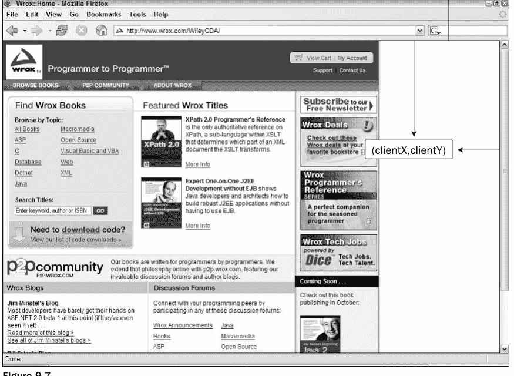

**图 9-7**

## 获取屏幕事件

在鼠标事件期间，你可以使用 `screenX` 和 `screenY` 属性获取鼠标光标相对于电脑屏幕的位置：

```javascript
var iScreenX = oEvent.screenX;
var iScreenY = oEvent.screenY;
```

这些属性中的每一个都返回鼠标距离屏幕边缘有多远（以像素为单位）（参见图 `9-8`）。


**图 9-8**

## 获取目标

之前我们看到 IE 和 DOM 都支持 `target` 属性。要获取事件目标，请使用以下代码：

```javascript
var target = oEvent.target;
```

## 获取字符码

在 IE 中，`keyCode` 返回字符码。要获取字符码，请使用 `charCode` 属性：

```javascript
var char = oEvent.charCode;
```

在符合 DOM 标准的浏览器中，`charCode` 返回字符：

```javascript
var char = oEvent.charCode;
```

如果你不确定键是否包含字符，可以使用 `isChar` 属性：

```javascript
if (oEvent.isChar) {
    var char = oEvent.charCode;
}
```

你可以通过将此值传递给 `String.fromCharCode()` 方法来获取实际字符：

```javascript
var s = String.fromCharCode(oEvent.charCode);
```

## 阻止默认行为

在 IE 中阻止事件的默认行为，必须将 `returnValue` 属性设置为 `false`：

```javascript
oEvent.returnValue = false;
```

在 Mozilla 中，只需调用 `preventDefault()` 方法：

```javascript
oEvent.preventDefault();
```

你可能会想：“我什么时候需要阻止事件的行为？”实际上，阻止默认行为在某些情况下非常有帮助。

首先，如果你想防止用户右键点击页面时出现上下文菜单，可以使用它。要实现这一点，通过以下方式阻止 `contextmenu` 事件的默认行为：

```javascript
document.body.oncontextmenu = function (oEvent) {
  if (isIE) {
    oEvent = window.event;
    oEvent.returnValue = false;
  } else {
    oEvent.preventDefault();
  }
}
```

此外，你可能希望在按键时阻止文本框的默认行为以拒绝某些字符，或者在满足某些标准的情况下重启按钮的操作。这是一个强大的功能，我将在书中后续部分讨论。

## 停止事件传播（冒泡）

在 IE 中阻止事件传播/冒泡，必须将 `cancelBubble` 属性设置为 `true`：

```javascript
oEvent.cancelBubble = true;
```

在 Mozilla 中，只需调用 `stopPropagation()` 方法：

```javascript
oEvent.stopPropagation();
```

阻止事件传播可以防止事件流中其他对象的处理器触发。考虑这个例子：

```html
<html onclick="alert('html')">
<head>
  <title>事件传播示例</title>
</head>
<body onclick="alert('body')">
  <input type="button" value="点击我" onclick="alert('input')" />
</body>
</html>
```

# 关于事件的所有信息

当点击此页面上的按钮时，会连续显示三个警框：“input”、“body”和“html”。这之所以发生，是因为事件从 `<input/>` 元素冒泡到 `<body>`，然后到 `<html>`。但是，如果你在 `<body>` 处停止传播，情况就会发生变化：

```html
<html onclick="handleClick()">
<head>
<title>停止事件传播示例</title>
<script type="text/javascript" src="detect.js"></script>
<script type="text/javascript">
function handleClick(event) {
    alert("input");
    if (isIE) {
        event.cancelBubble = true;
    } else {
        event.stopPropagation();
    }
}
</script>
</head>
<body onclick="handleClick('body')">
<input type="button" value="Click Me" onclick="handleClick(event)" />
</body>
</html>
```

当执行此示例并点击按钮时，你只会看到“input”警框，而看不到其他任何一个，因为传播已经被停止了。为了正确实现这一点，你利用了上一章节中的浏览器检测代码。

你可能还会注意到，`<input/>` 元素将事件对象作为参数传递给 `handleClick()` 函数。这在所有浏览器中都能生效，因为事件对象在事件发生时就会被创建，并且在此时它是一个全局变量。

## 事件类型

在浏览器中发生的事件可以分为几种特定类型，具体取决于事件触发的物体以及触发事件的因素。DOM 规范定义了以下事件组：

- **鼠标事件（Mouse Events）**：当用户使用鼠标执行某些操作时触发。
- **键盘事件（Keyboard Events）**：当用户在键盘上打字时触发。
- **HTML 事件（HTML Events）**：当浏览器窗口发生某些变化或发生特定的客户端-服务器交互时触发。
- **变变事件（Mutation Events）**：当底层 DOM 结构发生变化时触发。

# 第 9 章

## 鼠标事件

鼠标事件是 Web 上最常用的事件组。它们包括以下内容：

- `click`：当用户点击鼠标左键时触发（如果使用右键则不触发）。当焦点在按钮上且用户按下 `Enter` 键时也会触发。
- `dbclick`：当用户双击鼠标按钮时触发（如果使用右键则不触发）。
- `mousedown`：当用户按下任何鼠标键时触发。
- `mouseout`：当光标位于元素外部且用户将其移到元素边界之外时触发。
- `mouseover`：当光标位于元素外部且用户移动到元素上方时触发。
- `mouseup`：当用户释放任何鼠标键时触发。
- `mousemove`：当光标悬停在元素上时重复触发。

支持页面上的所有元素都会显示鼠标事件。这个简单的示例说明了所有的鼠标事件：

```html
<html>
<head>
  <title>鼠标事件示例</title>
  <script type="text/javascript">
    function handleEvent(oEvent) {
      var oTextbox = document.getElementById("txt1");
      oTextbox.value += "\n" + oEvent.type;
    }
  </script>
</head>
<body>
<p>使用你的鼠标点击并双击红色正方形。</p>
<div style="width:100px; height:100px; background-color: red"
  onmouseover="handleEvent(event)"
  onmouseout="handleEvent(event)"
  onmousedown="handleEvent(event)"
  onmouseup="handleEvent(event)"
  onclick="handleEvent(event)"
  ondblclick="handleEvent(event)" id="div1"></div>
<textarea id="txt1" rows="15" cols="50"></textarea>
</body>
</html>
```

这段代码显示了一个红色正方形和一个文本框。当你与红色正方形进行交互时，它会显示触发的事件。注意，所有事件仅使用一个函数作为处理器。它只是将事件类型输出到文本框中。

使用 `mouseover` 和 `mouseout` 事件是改变页面内容（如图像）外观的流行方法。这是一个非常简单的技术，但仍然被频繁使用：

```html

```

在代码片段中，`mouseover` 和 `mouseout` 事件处理器仅包含了一行代码。注意使用 `this` 对象来更改图像的 `src` 属性了吗？这是事件的隐藏真相之一：事件处理器被视为它被赋值的那个对象的方法。因此，可以使用 `this` 对象来访问事件目标（在本例中这很有帮助，因为避免了浏览器的闪烁）。当 `mouseover` 事件触发时，图像的 `src` 属性被设置为 `image2.gif`，推测与 `image.gif` 不同；当 `mouseout` 事件触发时，`src` 属性被设置为 `image.gif`。

## 事件属性

对于每个鼠标事件，事件对象中都会填充以下属性：

- 坐标属性（如 `clientX` 和 `clientY` 等）
- `type` 属性
- `target` (DOM) 或 `srcElement` (IE) 属性
- `shiftKey`, `ctrlKey`, `altKey` 和 `metaKey` (DOM) 属性
- `button` 属性（仅用于 `mousedown`、`mousemove`、`mouseout` 和 `mouseup` 事件）

这些每个属性都提供了关于所发生鼠标事件的一些信息。你已经熟悉了 `type` 属性，但在处理事件时，通过其他属性可以获取更完整的信息。

## 第 9 章

### 序列顺序

在 `click` 事件发生之前，需要在同一个目标上先触发 `mousedown` 事件，随后是一个 `mouseup` 事件。同样，要触发 `dblclick` 事件，需要在同一个目标上发生以下事件序列：

1. `mousedown`
2. `mouseup`
3. `click`
4. `mousedown`
5. `mouseup`
6. `click`
7. `dblclick`

当鼠标从一个对象移动到另一个对象时，触发的第一个事件是 `mouseout`（在鼠标离开的对象上）。接下来是这两个对象之间对象上的 `mousemove` 事件。最后是鼠标移入目标对象上的 `mouseover` 事件。

## 键盘事件

键盘事件是由用户在键盘上的操作引发的。键盘事件包括：

- `keydown` — 当用户按下键盘上的按键时触发。当按键被按住时，它也会重复触发。
- `keypress` — 当用户按下键盘上产生字符的按键时触发（忽略 `Shift` 和 `Alt` 键）。当按键被按住时，它也会重复触发。
- `keyup` — 当用户释放已按下的按键时触发。

这些事件在文本框中输入文字时最容易观察，所有元素都支持键盘事件：

```html
<html>
<head>
  <title>Key Events Example</title>
  <script type="text/javascript">
    function handleEvent(event) {
      var oText = document.getElementById("txt1");
      oText.value += "\n" + event.type;
    }
  </script>
</head>
<body>
  <p>Type some characters into the first textbox.</p>
  <p><textarea id="txtInput" rows="15" cols="50"
  onkeydown="handleEvent(event)"
  onkeyup="handleEvent(event)"
  onkeypress="handleEvent(event)"></textarea></p>
</body>
</html>
```


```html
<p><textarea id="txt1" rows="15" cols="50"></textarea></p>
```

## 关于事件的所有信息

### 事件属性

对于每个键盘事件，以下事件属性会被填充值：

- `keyCode` 属性
- `charCode` 属性（仅限 DOM）
- `target`（DOM）或 `srcElement`（IE）
- `shiftKey`、`ctrlKey`、`altKey` 和 `metaKey`（DOM 属性）

注意，按下 Shift、Ctrl、Alt 或 Meta 键会触发 `keydown` 事件，同时会将相应的属性设为 `true`。以下示例测试了这些属性：

```html
<html>
<head>
  <title>Key Events Example</title>
  <script type="text/javascript">
    function handleEvent(event) {
      var oTextbox = document.getElementById("txt1");

      oTextbox.value += "\n" + event.type;

      target is "\n" + (event.target || event.srcElement).id;

      oTextbox.value += "\n"      keyCode is " + event.keyCode;

      oTextbox.value += "\n"      charCode is " + event.charCode;

      var arrKeys = [];

      if (event.shiftKey) {
        arrKeys.push("Shift");
      }

      if (event.ctrlKey) {
        arrKeys.push("Ctrl");
      }

      if (event.altKey) {
        arrKeys.push("Alt");
      }

      oTextbox.value += "\n" keys down are " + arrKeys;
    }
  </script>
</head>

<body>
  <p>Type some characters into the first textbox.</p>

  <textarea
    id="txtInput"
    rows="15"
    cols="50"
    onkeydown="handleEvent(event)"
    onkeyup="handleEvent(event)"
    onkeypress="handleEvent(event)"
  ></textarea>

  <p><textarea id="txt1" rows="15" cols="50"></textarea></p>
</body>
</html>
```

## 序列顺序

当用户按下字符键时，会发生以下事件序列：

1. `keydown`
2. `keypress`
3. `keyup`

如果用户按下一次非字符键（例如 Shift），则发生以下事件序列：

1. `keydown`
2. `keyup`

如果用户按下字符键并按住不放，`keydown` 和 `keypress` 会交替重复触发，直到按键释放；如果用户按下并按住非字符键，则只有 `keydown` 事件会重复触发。你可以使用上一个示例进行测试。

## HTML 事件

HTML 事件合并了由 IE 4.0 和 Netscape 4.0 开发者创建的原始事件模型的剩余事件。它包括：

- `load` 事件：当页面完全加载时在窗口上触发，所有帧完全加载时在 `frameset` 上触发，`` 元素完全加载时触发，或 `<object>` 元素完全加载时触发。
- `unload` 事件：当页面完全卸载时在窗口上触发，所有帧完全卸载时在 `frameset` 上触发，或 `<object>` 元素完全卸载时触发。
- `abort` 事件：如果在用户停止下载之前 `<object>` 元素未完全加载，则在元素上触发。
- `error` 事件：页面完全加载时在窗口上触发，`` 元素完全加载时触发，或 `<object>` 元素完全加载时触发。
- `change` 事件：当元素的值改变时触发。
- `focus` 事件：当元素获得焦点时触发。
- `blur` 事件：当元素失去焦点时触发。
- `submit` 事件：当表单提交时触发。
- `reset` 事件：当表单重置时触发。

## 关于事件的一切

```html
</head>

<body onresize="alert('Resizing')">

</body>

</html>
```

实际的 `resize` 事件发生的时间取决于所使用的浏览器。在 Internet Explorer 和 Opera 中，只要浏览器尺寸发生变化，`resize` 事件就会发生。只要窗口边界移动一个像素，事件就会触发。在 Mozilla 中，`resize` 事件只有在你停止调整窗口大小后才会触发。请在几个不同的浏览器中尝试之前的示例。

当窗口最大化或最小化时，`resize` 事件也会触发。

## `scroll` 事件

你可能需要跟踪用户滚动窗口（或其他元素）的时间，以确保某些内容在屏幕上始终可见。通过使用 `scroll` 事件，很容易实现：

```html
<html>
<head>
  <title>OnScroll Example</title>
</head>

<body onscroll="alert('Scrolling')">
  <p>Try scrolling this window.</p>
  <p>&nbsp;</p>
  <p>&nbsp;</p>
  <p>&nbsp;</p>
  <p>&nbsp;</p>
  <p>&nbsp;</p>
  <p>&nbsp;</p>
  <p>&nbsp;</p>
  <p>&nbsp;</p>
  <p>&nbsp;</p>
  <p>&nbsp;</p>
  <p>&nbsp;</p>
  <p>&nbsp;</p>
</body>
</html>
```

你也可以将事件处理器赋值给 `window.onscroll` 属性。

```html
<html>
<head>
  <title>OnScroll Example</title>
  <script type="text/javascript">
    window.onscroll = function () {
      alert("scrolling");
    }
  </script>
</head>

<body>
  <p>Try scrolling this window.</p>
  <p>&nbsp;</p>
  <p>&nbsp;</p>
</body>
</html>
```

## 第 9 章

你可以将此事件与 `<body>` 元素的多个属性结合使用，`scrollLeft` 告诉你窗口水平滚动了多少，`scrollTop` 告诉你窗口垂直滚动了多少：

```html
<html>
<head>
  <title>OnScroll Example</title>
  <script type="text/javascript">
    var = = document.getElementById("txt1");

    textarea.value += " inscroll is at " + document.body.scrollLeft + " " + document.body.scrollTop + " vertically:";
  </script>
</head>

<body>
  <p>Try scrolling this window.</p>
  <p><textarea rows="15" cols="50" id="txt1"></textarea></p>

  &nbsp;&nbsp;
  &nbsp;&nbsp;
  &nbsp;&nbsp;
  &nbsp;&nbsp;
  &nbsp;&nbsp;
  &nbsp;&nbsp;
  &nbsp;&nbsp;
  &nbsp;&nbsp;
  &nbsp;&nbsp;
  &nbsp;&nbsp;
  &nbsp;&nbsp;
</body>
</html>
```

在这个示例中，使用文本框来跟踪 `scrollLeft` 和 `scrollTop` 属性，这样你就可以准确地看到变化。这在所有主流浏览器中都有效，并用于创建酷的效果，例如始终出现在页面顶部的水印：

```html
<html>
<head>
  <title>OnScroll Example</title>
  <script type="text/javascript">
    window.onscroll = function () {
      var oWatermark = document.getElementById("divWatermark");

      oWatermark.style.top = document.body.scrollTop;
    }
  </script>
</head>

<body>
  <p>Try scrolling this window.</p>

  <div
    id="Watermark"
    style="position: absolute; top: 0px; right: 0px; color: #ccc; width: 150px; height: 30px; background-color: navy"
  >
    Watermark
  </div>

  <p>Line 1</p>
  <p>Line 2</p>
  <p>Line 3</p>
  <p>Line 4</p>
  <p>Line 5</p>
  <p>Line 6</p>
  <p>Line 7</p>
  <p>Line 8</p>
  <p>Line 9</p>
  <p>Line 10</p>
  <p>Line 11</p>
  <p>Line 12</p>
</body>
</html>
```

在这个示例中，指定了绝对定位的 `<div>` 是水印。它从页面顶部开始，随着窗口滚动，它必须停留在那里。为了处理这一点，在 `scroll` 事件处理器中添加了一段简单的代码，将水印移动到窗口的右上角。

## 变异事件（Mutation events）

变异事件是 DOM 标准的一部分，但在任何现代浏览器中实现。因此，以下信息旨在简述标准定义的内容，而不是如何使用这些事件。变异事件包括：

- `DOMSubtreeModified`：当文档或元素的子树通过添加或删除节点被修改时触发。
- `DOMNodeInserted`：当节点作为另一个节点的子节点被插入时触发。
- `DOMNodeRemoved`：当节点作为另一个节点的子节点被移除时触发。
- `DOMNodeFromDocument`：当节点从文档中移除时触发。
- `DOMNodeInsertedDocument`：当新节点插入到文档中时触发。

这些事件的目的是为基于 XML 的语言（如 XHTML、SVG 和较新的语言如 MathML）提供语言无关的范式。到为止，你已经在每个示例中看到了许多类型的浏览器检测。在实际代码中，你会希望尽量减少这种检测的次数。为了实现这一点，大多数开发者想出了跨浏览器的方法，以便后台完成浏览器检测。跨浏览器代码的目的是尽可能消除 IE 模型和 DOM 模型之间的差异，允许一组代码运行在所有主流浏览器上。当然，存在一些限制，例如 IE 不支持双向事件流，但仍然可以覆盖 90% 的情况。

## `EventUtil` 对象

当你为同一个任务计划多个函数时，最好创建一个容器对象来管理它们。这样做可以很容易找到函数定义的地方。由于没有属性，你只需要此对象的实例：

```javascript
var EventUtil = new Object();
```

## 添加/移除事件处理器

如你所见，IE 使用 `attachEvent` 方法为元素分配任意事件处理器，而 DOM 使用 `addEventListener()`。`EventUtil` 对象的第一个方法创建了分配事件处理器的通用方法。由于 IE 不支持捕获，此方法仅在冒泡期间分配事件处理器。在该方法的体内，有一个简单的检测，以确保当前的正确性：

```javascript
EventUtil.addEventHandler = function (target, sEventType, fnHandler) {
  if (target.addEventListener) { // 用于兼容 DOM 的浏览器
    target.addEventListener(sEventType, fnHandler, false);
  } else if (target.attachEvent) { // 用于 IE
    target.attachEvent("on" + sEventType, fnHandler);
  } else {
    target["on" + sEventType] = fnHandler;
  }
}
```

此方法中的代码使用特征检测来确定如何添加事件处理器。`if` 语句的分支用于支持 listener 方法的 DOM 浏览器。当浏览器兼容 DOM 时，使用 `addEventListener()` 添加事件处理器，最后一个参数设置为 `false` 以指定冒泡阶段。在 `if` 语句的第二部分，另一个特性是 IE 的 `attachEvent()` 方法。注意，为了正常“工作”，你必须在事件前加上字符串 `"on"`（记住 `attachEvent()` 方法的第一个参数接受事件名称，而不是处理器的名称）。`else` 子句仅用于既不兼容 DOM 也不 IE 的浏览器。符合此标准的浏览器不多，因此该分支不会经常使用。

当然，你不能只添加处理器；你必须创建一个移除它们的方法。为此，`EventUtil` 得到了另一个 `removeEventHandler()` 方法。正如你预期的，此方法接受与 `addEventListener()` 相同的参数以及几乎相同的算法：

```javascript
EventUtil.removeHandler = function (target, sEventType, fnHandler) {
  if (target.removeEventListener) { // 用于兼容 DOM 的浏览器
    target.removeEventListener(sEventType, fnHandler, false);
  } else if (target.detachEvent) { // 用于 IE
    target.detachEvent("on" + sEventType, fnHandler);
  } else { // 用于所有其他
    target["on" + sEventType] = null;
  }
};
```

你可以看到，这段代码几乎完全地镜像了添加代码，具有完全对应的检测。唯一的大区别在于 `else` 语句，在其中事件处理器被设置为 `null` 且完全没有使用 `fnHandler` 参数。

这些方法可以在以下示例中使用：

```html
<head>
  <title>Add Remove Event Handlers Example</title>
  <script type="text/javascript">
    var EventUtil = new Object;

    EventUtil.addEventListener = function (target, sEventType, fnHandler) {
      if (target.addEventListener) {
        target.addEventListener(sEventType, fnHandler, false);
      } else if (target.attachEvent) {
        target.attachEvent("on" + sEventType, fnHandler);
      } else {
        target["on" + sEventType] = fnHandler;
      }
    };

    EventUtil.removeEventHandler = function (target, sEventType, fnHandler) {
      if (target.removeEventListener) {
        target.removeEventListener(sEventType, fnHandler, false);
      } else if (target.detachEvent) {
        target.detachEvent("on" + sEventType, fnHandler);
      } else {
        target["on" + sEventType] = null;
      }
    };
  </script>
</head>
```

# 第 9 章

```javascript
function handleClick() {
  alert("Click!");

  var oDiv = document.getElementById("div");

  EventUtil.removeEventHandler(oDiv, "click", handleClick);
}

window.onload = function () {
  var oDiv = document.getElementById("div");

  EventUtil.addEventListener(oDiv, "click", handleClick);
}
```

```html
<head>
<body>
  <div id="div" style="background-color: red; width: 100px; height: 100px"></div>
</body>
</html>
```


在这段代码中，`onload`事件处理器为 ID 为 `div` 的`<div>`元素分配了一个`onclick`事件处理器。当你点击该`<div>`时，会弹出一个显示“Click!”的警报框，然后该事件处理器就会被移除。之后任何时候点击该`<div>`，都不会再弹出警告。

## 格式化事件对象

处理 IE 和 DOM 之间事件对象差异的最佳方法之一是让它们的行为尽可能相似。由于更多浏览器使用 DOM 模型，因此让 IE 事件模型紧密匹配 DOM 模型是有意义的。

下表是 DOM 和 IE 事件对象及方法的对比。通常情况下，事件对象和方法能够执行相同的操作（例如阻止默认行为），但它们的实现方式不同。此表展示了 IE 实现某些 DOM 行为的方式。虽然无法将所有属性准确地复制到 IE 中（例如`bubbles`或`cancelable`），但可以为大多数属性编写等效的方法。

| DOM 属性/方法 | IE 属性/方法 |
|---|---|
| `altKey` | `altKey` |
| `bubbles` | - |
| `button` | `button` |
| `cancelBubble` | `cancelBubble` |
| `cancelable` | - |
| `charCode` | `keyCode` |
| `clientX` | `clientX` |
| `clientY` | `clientY` |
| `ctrlKey` | `ctrlKey` |
| `currentTarget` | - |
| `detail` | - |
| `eventPhase` | - |
| `isChar` | - |
| `keyCode` | `keyCode` |
| `metaKey` | - |
| `pageX` | - |
| `pageY` | - |
| `preventDefault()` | `returnValue = false;` |
| `relatedTarget` | `fromElement` |
| | `to` |
| `screenX` | `screenX` |
| `screenY` | `screenY` |
| `shiftKey` | `shiftKey` |
| `stopPropagation()` | `cancelBubble = true;` |
| `target` | `srcElement` |
| `timestamp` | - |
| `type` | `type` |

首先，为`EventUtil`定义一个新方法`formatEvent()`，它接受一个参数：事件对象：

```javascript
EventUtil.formatEvent = function (oEvent) {
  return oEvent;
}
```

首先要针对 Windows 上的 IE 使用上一章节中的浏览器检测脚本。在这种情况下，你必须检查特定的浏览器，因为该脚本旨在修复 Windows 上 IE 的一个问题：

```javascript
EventUtil.formatEvent = function (oEvent) {
  if (isIE && isWin) {
    return oEvent;
  }
}
```

为了实现这一点，只需查看属性和方法表，并尝试让 IE 符合 DOM 模型。`altKey`属性已经存在了，`bubbles`属性无法重建，`button`属性存在，`cancelBubble`属性存在，而`cancelable`属性无法重建——这便引出了`charCode`属性。

正如之前提到的，在 IE 中，代码包含在`keypress`事件的`keyCode`中；否则它就是正确的值。因此，如果事件是`keypress`，最好通过按键创建一个`charCode`属性；否则，`charCode`属性应设置为 0：

```javascript
EventUtil.formatEvent = function (event) {
  if (isIE && isWin) {
    event.charCode = (event.type == "keypress") ? event.keyCode : 0;
  }
  return event;
};
```

接上故事，`clientX`、`clientY`和`ctrlKey`在 DOM 中与 IE 完全相同。你无法准确地重建`currentTarget`或`detail`，所以忽略它们即可。然而，你可以为`eventPhase`赋一个值。该属性在冒泡阶段等于 2，因为这是 IE 支持的所有内容：

```javascript
EventUtil.formatEvent = function (event) {
  if (isIE && isWin) {
    event.eventPhase = 2;
  }
}
```

表中的下一个是`isChar`属性，如果`charCode`属性不为 0，则为 true：

```javascript
EventUtil.formatEvent = function (event) {
  if (isIE && isWin) {
    event.isChar = event.charCode !== 0;
  }
}
```

`keyCode`属性在两个浏览器中都是相同的，`metaKey`属性在 IE 中无法重建；这引出了`pageX`和`pageY`。虽然 IE 对象没有这些属性，但可以通过获取`clientX`和`clientY`值并结合文档的`scrollLeft`和`scrollTop`值来计算出来：

```javascript
EventUtil.formatEvent = function (event) {
  if (isIE && isWin) {
    event.pageX = event.clientX + event.scrollLeft;
    event.pageY = event.clientY + event.scrollTop;
  }
}
```

## 关于事件

下一个是`preventDefault()`方法。为事件对象定义一个方法将`returnValue`设置为`false`：

```javascript
EventUtil.formatEvent = function (event) {
  if (isIE && isWin) {
    event.preventDefault = function () {
      this.returnValue = false;
    };
  }
}
```

注意`this`的使用。在事件方法的上下文中，`this`指向事件对象。`relatedTarget`属性根据事件类型可以是`fromElement`或`toElement`属性：

```javascript
EventUtil.formatEvent = function (event) {
  if (isIE && isWin) {
    if (event.type == "mouseout") {
      event.relatedTarget = event.toElement;
    } else if (event.type == "mouseover") {
      event.relatedTarget = event.fromElement;
    }
  }
}
```

`screenX`、`screenY`和`shiftKey`属性都是相同的，所以这里不需要处理。这引出了`stopPropagation()`方法，它只需将`cancelBubble`设置为`true`：

```javascript
EventUtil.formatEvent = function (event) {
  if (isIE && isWin) {
    event.stopPropagation = function () {
      this.cancelBubble = true;
    };
  }
}
```

接下来是`target`属性，它完全等同于 IE 的`srcElement`属性：

```javascript
EventUtil.formatEvent = function (event) {
  if (isIE && isWin) {
    event.target = event.srcElement;
  }
}
```

对于`time`属性，创建一个包含当前日期的`Date`对象并获取毫秒：

```javascript
EventUtil.formatEvent = function (event) {
  if (isIE && isWin) {
    event.time = new Date().getTime();
  }
}
```

```javascript
oEvent.eventPhase = 2;
oEvent.isChar = (oEvent.charCode > 0);
oEvent.pageX = oEvent.clientX + document.body.scrollLeft;
oEvent.pageY = oEvent.clientY + document.body.scrollTop;
oEvent.preventDefault = function () {
  this.returnVal = false;
};
if (oEvent.type == "mouseout") {
  oEvent.relatedTarget = oEvent.target;
} else if (oEvent.type == "mouseover") {
  oEvent.relatedTarget = oEvent.fromElement;
}
oEvent.stopPropagation = function () {
  this.cancelBubble = true;
};
oEvent.target = oEvent.srcElement;
oEvent.time = (new Date()).getTime();
return oEvent;
```

`type`属性在 IE 和 DOM 中都是相同的，这里是该方法的结束。然而，这个方法并不是设计用来独立使用的。相反，它的意图是在另一个获取事件对象引用的方法内部使用。

# 获取事件对象

遗憾的是，IE 和 DOM 使用非常不同的方法来获取事件对象。在 IE 中，事件对象与窗口对象绑定，而在 DOM 中，它是独立于任何其他对象的并作为参数传递的。正如此，很难让 IE 事件模型变得像 Mozilla 一样，反之亦然。与其尝试让其中一个像另一个，你可以创建一个新方法，让浏览器通过调用`getEvent()`来使用。

`getEvent()`方法不接受参数，其目的是返回事件对象。第一种情况是在 IE 中，检查`window`是否，然后在返回事件对象之前使用`formatEvent()`：

```javascript
EventUtil.getEvent = function () {
  if (window.event) {
    return this.formatEvent(window.event);
  }
}
```

接下来是 DOM 情况。记住，符合 DOM 标准的浏览器会将事件对象作为参数传递给事件处理器。这时记住函数实际上是一个具有属性的对象就很有意义了。在这种情况下，感兴趣的属性被称为`caller`。

# 第 9 章

每个函数都有一个`caller`属性，包含指向调用它的方法的指针。例如，`funcA()`调用了`funcB()`，则`funcB.caller`等于`funcA`。假设一个事件处理器调用了`EventUtil.getEvent(Event)`，那么`EventUtil.getEvent.caller`指向该事件处理器。

在第 2 章 [ECMAScript基础] 中，你学习了函数的`arguments`属性。由于`caller`属性是指向函数的指针，你可以访问事件处理器的`arguments`属性。事件对象始终是事件处理器的第一个参数，这意味着你可以在事件处理器中访问`arguments[0]`来获取事件：

```javascript
EventUtil.getEvent = function() {
  if (window.event) {
    return this.formatEvent(window.event);
  } else {
    return EventUtil.getEvent.caller.arguments[0];
  }
};
```

现在可以使用此方法来定义事件处理器，如下所示：

```javascript
oDiv.onclick = function () {
  var oEvent = EventUtil.getEvent();
};
```

最好的做法是将最后几节中定义的所有`EventUtil`代码放在一个名为`eventutil.js`的单独文件中，以便在任何页面中包含此脚本。

# 示例

这段代码重写自“鼠标事件”部分中的一个示例：

```html
<html>
<head>
  <title>鼠标事件示例</title>
  <script type="text/javascript" src="detect.js"></script>
  <script type="text/javascript" src="eventutil.js"></script>
  <script type="text/javascript">
  EventUtil.addEventListener("window", "load", function () {
    var oDiv = document.getElementById("div1");
    EventUtil.addEventListener(oDiv, "mouseover", handleEvent);
    EventUtil.addEventListener(oDiv, "mouseout", handleEvent);
    EventUtil.addEventListener(oDiv, "mousedown", handleEvent);
    EventUtil.addEventListener(oDiv, "mouseup", handleEvent);
    EventUtil.addEventListener(oDiv, "click", handleEvent);
    EventUtil.addEventListener(oDiv, "dblclick", handleEvent);
  });

  function handleEvent() {
    var oEvent = EventUtil.getEvent();
  });
  var oTextBox = document.getElementById("txt1");
  toTextBox.value += "\n" + oEvent.type;
  toTextBox.value += "\n" + oEvent.target.tagName;
  if (oEvent.relatedTarget) {
    oTextBox.value += "\n" + relatedTarget is "\n" + oEvent.relatedTarget.tagName;
  }
  </script>
</head>
<body>
<p>使用你的鼠标点击和双击红色正方形。</p>
<div style="width:100px; height:100px; background-color: red" id="div"></div>
</body>
</html>


<p><textarea id="txt1" rows="15" cols="50"></textarea></p>

</body>

</html>

```

此示例在所有符合 DOM 标准的浏览器以及符合 IE 标准的浏览器中运行，它利用新生成的事件对象的 `target` 和 `relatedTarget` 属性。

## 总结

本章引入了事件对象的概念以及如何在不同的浏览器中检索它。我们探索了如何使用事件对象来处理用户交互。我们还学习了如何停止事件传播和阻止默认行为。

在第 10 章中，我们将探索更高级的事件处理技术以及如何在复杂的应用程序中使用它们。

```html
onmouseover="this.style.backgroundColor = 'red'"></div>

</body>

</html>
```

当你将鼠标悬停在红色的 `<div>` 上时，它会变为蓝色；当鼠标移出时，它恢复红色。请注意，事件处理器使用 `this` 关键字来引用 `<div>` 本身并访问其样式对象。

样式对象还有一个 `css` 属性，它包含了描述元素样式的 CSS 字符串：

```html
<html>

<head>

<title>Style Example</title>

</head>

<body>

<div id="div"

style="background-color: red; height: 50px; width: 50px"

onclick="alert(this.style.css)"></div>

</body>

</html>
```

在此示例中，当你点击 `<div>` 元素时，会显示文本 *background-color: red; height: 50px; width: 50px*。

## DOM 样式方法

DOM 还描述了样式对象的几个方法，所有方法都旨在与 CSS 定义的各个部分进行交互：

- `getPropertyValue(propertyName)` — 返回 CSS 属性 `propertyName` 的字符串值。该属性必须在 CSS 样式中指定，例如使用 "background-color" 而不是 "backgroundColor"。
- `getPropertyPriority()` — 如果规则中指定了 CSS 属性 "important"，返回 "important"；否则返回空字符串。
- `item(index)` — 返回指定索引处的 CSS 属性名称，例如 "background-color"。
- `removeProperty(propertyName)` — 从 CSS 定义中移除 `propertyName`。
- `setProperty(propertyName, value, priority)` 将 CSS 属性 `propertyName` 设置为带有给定优先级的值（"important" 或空字符串）。

这里有一个简单的示例：

```html
<html>

<head>

<title>Style Example</title>

<script type="text/javascript">

function useMethods() {

```

## 第 10 章

```javascript
var oDiv = document.getElementById("div1");

alert(oDiv.style.item(0)); // 输出 "background-color"

alert(oDiv.style.getProperty("background-color"));

alert(oDiv.style.removeProperty("background-color"));

</script>

</head>

<body>

<div id="div1" style="background-color: red; height: 50px; width: 50px"></div> <br />

<input type="button" value="Use Methods" onclick="useMethods()" />

</body>

</html>
```

当点击此页面上的按钮时，会发生三件事。首先，显示第一个位置（位置 0）的项，即 `background-color`，因为它来自 `<div>` 的 style 属性。其次，显示 `background-color`(red) 的当前值。最后，`background-color` 属性被有效移除，使 `<div>` 变得不可见。

这些方法可以替代各种样式属性以实现相同的功能。例如，此代码返回 `<div>` 的背景颜色：

```html
<html>

<head>

<title>Style Example</title>

<script type="text/javascript">

function sayStyle() {

var oDiv = document.getElementById("div1");

alert(oDiv.style.getProperty("background-color"));

}

</script>

</head>

<body>

<div id="div1" style="background-color: red; height: 50px; width: 50px"></div> <br />

<input type="button" value="Get Background Color" onclick="sayStyle()" />

</body>

</html>
```

这是使用样式方法对鼠标悬停效果的重写：

```html
<html>

<head>

<title>Style Example</title>

</head>

<body>

<div id="div1"

style="background-color: red; height: 50px; width: 50px"

mouseover="this.style.setProperty('background-color', 'blue', '1')"

mouseout="this.style.setProperty('background-color', 'red', '1')"

</div>

</body>

</html>
```

## 高级 DOM 技术

Internet Explorer 不支持 DOM 样式方法。因此，最好使用样式对象的属性来获取和设置 CSS 属性。

## 自定义工具提示

样式对象的另一个有趣用途是创建工具提示（tooltips），即当你的鼠标悬停在图像按钮上时出现的有用黄色框。通过使用 `title` 属性，HTML 元素可以提供文本提示，例如：

```html
<a href="http://www.wrox.com" title="Wrox Site">Wrox Site/</a>
```

然而，这些普通的工具提示可能不够。假设你想创建一个带有斜体文本甚至图片的工具提示，你可以通过创建一个 `<div>` 来实现，当鼠标移动到其指定目标时显示该 `<div>`。这本质上是相同的鼠标悬停效果，只是多了一个步骤：将 `<div>` 移动到靠近鼠标的位置。为了正确定位 `<div>`，你可以利用事件的 `clientX` 和 `clientY` 属性。请注意，这些属性在所有事件实例中都是可用的，你不需要使用书中之前的 `EventUtil` 对象：

```html
<html>

<head>

  <title>Style Example</title>

  <script type="javascript">

function showTip(event) {

  var oDiv = document.getElementById("divTip");

  oDiv.style.visibility = "visible";

  oDiv.style.left = event.clientX + "px";

  oDiv.style.top = event.clientY + "px";

}

function hideTip(event) {

  var oDiv = document.getElementById("divTip");

  oDiv.style.visibility = "hidden";

}

</script>

</head>

<body>

<p>Move your mouse over the square.</p>

<div id="divTip"

style="background-color: yellow; position: absolute; visibility: hidden;"

mouseover="showTip(event)" onmouseout="hideTip(event)">

  <span style="font-weight: bold">Custom Tooltip</span>

</div>

</body>

</html>
```

## 折叠面板

折叠面板（Collapsible sections）的基本是可以点击某处来显示或隐藏屏幕区域。这种功能在过去几年变得越来越流行。通常，折叠面板由一个始终可见的标题和一个可以展开或折叠的部分组成。在 Web 上模拟这种效果，可以使用 `<div>` 元素：一个用于标题，一个用于内容。你还需要一个小函数来切换内容的展开/折叠。将这些整合在一起，你可以得到如下示例：

```html
<html>

<head>

  <title>Style Example</title>

  <script type="text/javascript">

    function toggle(sDiv) {

      var oDiv = document.getElementById(sDiv);

      oDiv.style.display = (oDiv.style.display == "none") ? "block" : "none";

    }

  </script>

</head>

<body>

  <div style="background-color: blue; color: white; font-weight: bold; padding: 10px; cursor: pointer;">

    <div onclick="toggle('divContent1')">Click Here </div>

    <div id="divContent1" style="border:3px solid blue; height: 100px; padding: 10px;">This is some content

to show and hide. </div>

  </div>

  <p>&nbsp;</p>

  <div style="background-color: blue; color: white; font-weight: bold; padding: 10px; cursor: pointer;">

    <div onclick="toggle('divContent2')">Click Here </div>

    <div id="divContent2" style="border:3px solid blue; height: 100px; padding: 10px;">This is some content

to show and hide.</div>

  </div>

</body>

</html>
```

此页面显示两个可折叠区域。生成的或隐藏的两个 `<div>` 元素命名为 `divContent1` 和 `divContent2`。当调用 `toggle()` 函数时，会将操作的 `<div>` 的 ID 作为参数传递。如果 `<div>` 的 `style.display` 为 `none`（意味着未显示），则该值将切换为 `block`（`<div>` 元素的默认值）；否则，`style.display` 将设置为 `none`。这有效地在网页上创建了可折叠的区域。

## 访问样式表

`style` 对象用于通过 style 属性获取元素的 CSS 样式。它无法表示由 CSS 规则定义或在 style 属性之外定义的类的 CSS 样式，例如在 `<style>` 元素或外部样式表中。以下示例说明了这个问题：

```html
<html>

<head>

<title>Runtime Style Example</title>

<style type="text/css">

div.special {

  background-color: red;

  height: 10px;

  width: 10px;

  margin: 10px;

}

</style>

<script type="text/javascript">

function getBackgroundColor() {

  var div = document.getElementById("div");

  alert(div.style.backgroundColor);

}

</script>

</head>

<body>

<div id="div" class="special"></div>

<input type="button" value="Get Background Color" onclick="getBackgroundColor()" />

</body>

</html>
```

在这段代码中，`<div>` 定义在类 `special` 中。当你点击按钮并调用 `getBackgroundColor()` 时，alert 会显示一个空字符串，因为 CSS 数据没有存储在样式中；它存储在类中。问题是，如何访问 CSS 类呢？

第一步是获取定义类的样式表的引用。要完成这一点，使用 `document.stylesheets` 集合，它包含了 HTML 页面中所有样式表的引用，包括所有的 `<style>` 元素（JavaScript 将其视为完整的样式表）。DOM 规定 `style` 对象具有以下属性：

- `disabled` — 表示样式表是否被禁用。
- `href` — 外部引用文件的样式表 URL；对于 `<style>` 元素，这应该为 `null`，尽管 Mozilla 返回了 HTML 页面的 URL。
- `media` — 可以使用样式表的媒体类型列表，如 HTML `media` 属性所指定的。Internet Explorer 错误地将此属性实现为一个包含 `media` 属性精确内容的字符串。
- `ownerNode` — 指定样式表的节点（`<link>` 或 `<style>` 元素）。Internet Explorer 不支持此属性。
- `parentStyle` — 如果样式表是通过 CSS `@import` 语句包含的，则它指向该语句所在的样式表。
- `title` — 由 HTML `title` 属性分配给样式表的标题，可以同时用于 `<link>` 和 `<style>`。
- `type` — 样式表的类型；对于 CSS，这通常是 `text/css`。

> Opera 不支持 JavaScript 样式访问或操作。Safari 提供有限的支持，但无法访问 `rel` 属性设置为 "alternate stylesheet" 的禁用的样式表。

由于浏览器的差异，访问样式表中的单个规则有点棘手。DOM 为每个样式表指定了一个名为 `cssRules` 的集合，该集合包含了样式表中定义的所有 CSS 规则。Mozilla 和 Safari 正确地实现了这一标准，尽管 Internet Explorer 拥有命名的规则集合。因此，在处理样式表时，你必须使用一个对象来确定使用哪一个集合：

```javascript
var oCSSRules = document.stylesheets[0].cssRules || document.stylesheets[0].rules;
```

每个规则包含一个 `selectorText` 属性，返回 CSS 规则在左大括号之前的文本。回想上一个示例中的 CSS 规则：

```css
div.special {

  background-color: red;

  height: 10px;

  width: 10px;

  margin: 10px;

}
```

该规则的 `selectorText` 属性为 `div.special`（尽管 Internet Explorer 实际上会将所有名称大写，所以它会是 `DIV.SPECIAL`）。

规则还包含一个 `style` 属性，它是一个类似于元素上的 `style` 对象。因此，可以使用 CSS 规则上的 `style` 对象代替 `<div>` 元素来更新之前的示例，以报告正确的背景颜色：

```html
<html>

<head>

  <title>Accessing Style Sheets Example</title>

  <style type="text/css">

    div.special {

      background-color: red;
```

## 高级 DOM 技术

```css
height: 10px;

width: 10px;

margin: 10px;

}

</style>

<script type="text/javascript">

function backgroundColor() {

  var CSSRules = document.style.sheets[0].cssRules ||

  document.style.sheets[0].cssRules;

  alert(CSSRules[0].style.backgroundColor);

}

</script>

</head>

<body>
```


# 第10章

## 访问样式表

`<div id="div" class="special"></div>`

`<input type="button" value="Get Background Color" />`

`onclick="backgroundColor()" />`

`</body>`

`</html>`

当点击此示例的按钮时，`alert` 会根据定义为 `special` 的规则正确显示背景颜色。

规则上的 `style` 对象不是只读的；你可以修改它。但在此处你必须小心，因为修改 CSS 规则会影响页面上所有使用它的元素。考虑这个示例：

```html
<html>
<head>
<title>Accessing Style Sheets Example</title>
<style type="text/css">
.special {
  background-color: red;
  height: 10px;
  width: 10px;
  margin: 10px;
}
</style>
<script type="text/javascript">
function changeBackgroundColor() {
  var CSSRules = document.styleSheets[0].cssRules || document.styleSheets[0].cssRules;
  CSSRules[0].style.backgroundColor = "blue";
}
</script>
</head>
<body>
<div id="div1" class="special"></div>
<div id="div2" class="special"></div>
<div id="div3" class="special"></div>
<input type="button" value="Get Background Color" onclick="changeBackgroundColor()" />
</body>
</html>
```

在这个示例中，三个 `<div>` 元素具有 `special` 类。当点击按钮时，背景颜色被设置为 `blue`，影响了所有 `<div>`。

```html
<html>
<head>
  <title>Accessing Style Sheets Example</title>
  <style type="text/css">
    div.special {
      background-color: red;
      height: 10px;
      width: 10px;
      margin: 10px;
    }
  </style>
  <script type="text/javascript">
    function changeBackgroundColor(id) {
      var odiv = document.getElementById(id);
      odiv.style.backgroundColor = "blue";
    }
  </script>
</head>
<body>
  <div id="div1" class="special"></div>
  <div id="div2" class="special"></div>
  <div id="div3" class="special"></div>
  <input type="button" value="Get Background Color" onclick="changeBackgroundColor('div1')" />
</body>
</html>
```

此示例通过修改其样式来更改了第一个 `<div>` 的背景颜色。

## 计算样式

除了 `style` 对象外，计算样式还提供了元素在屏幕上显示的真实指示。通常，Internet Explorer 和 DOM 在实现上有所不同。

### IE 中的计算样式

Microsoft 为每个元素提供了一个 `currentStyle` 对象，包含了来自元素和 CSS 规则的所有属性。`currentStyle` 的用法与 `style` 对象完全相同，所有属性都包含正确的值：

```html
<html>
<head>
<title>Computed Style Example</title>
<style type="text/css">
div.special {
  background-color: red;
  height: 10px;
  width: 10px;
  margin: 10px;
}
</style>
<script type="text/javascript">
function getBackgroundColor() {
  var oDiv = document.getElementById("div");
  alert(oDiv.currentStyle.backgroundColor);
}
</script>
</head>
<body>
<div id="div" class="special"></div>
<input type="button" value="Get Background Color" onclick="getBackgroundColor()" />
</body>
</html>
```

在这个示例中，按钮显示了背景颜色（红色），尽管它是定义在 CSS 规则中的。

请记住，`currentStyle` 节点的所有属性都是只读的，如果你尝试赋值会导致错误。这是因为 `currentStyle` 对象是元素和 CSS 规则所有适用样式的总和；它不是一个活的对象。要动态制作样式，你必须使用之前讨论的样式。

### DOM 中的计算样式

DOM 提供了 `getComputedStyle()` 方法，它可以根据给定的元素创建一个类似于样式的对象。该方法接受两个参数，用于获取元素的样式和伪元素，例如 `:hover` 或 `:first-letter`（如果需要，也可以为 `null`）。你可以通过 `document.defaultView` 对象访问它，该对象用于表示当前渲染的视图（`document.defaultView` 在 Internet Explorer 或 Safari 中不支持）。

```html
<html>
<head>
<title>Computed Style Example</title>
<style type="text/css">
div.special {
  background-color: red;
  height: 10px;
  width: 10px;
  margin: 10px;
}
</style>
<script type="text/javascript">
function getBackgroundColor() {
  var oDiv = document.getElementById("div");
  alert(document.defaultView.getComputedStyle(oDiv, null).backgroundColor);
}
</script>
</head>
<body>
<div id="div" class="special"></div>
<input type="button" value="Get Background Color" onclick="getBackgroundColor()" />
</body>
</html>
```

运行此示例的符合 DOM 规范的浏览器在点击按钮时会在 `alert` 框中显示背景颜色。

> **注意：** 某些浏览器支持此功能，但值的表示方式可能有所不同。例如，Mozilla 会将所有颜色转换为 RGB 格式（红色为 `rgb(255,0,0)`），而 Opera 则将所有颜色转换为其十进制表示形式（红色为 `#ff0000`）。最好的方法始终使用 `getComputedStyle()` 在多个浏览器上测试您的功能。

## innerText 和 innerHTML

尽管 DOM 为动态修改文档带来了优势，但对于微软的开发者来说还不够。Internet Explorer 4 在所有元素上引入了两个属性，旨在简化文档内容的处理：`innerText` 和 `innerHTML`。

`innerText` 属性用于修改起始标签和结束标签之间的文本。例如，假设你有一个 `<div>` 元素，你想将其更改为 `<div>Text for the div</div>`。使用 DOM，你可以这样做：

```javascript
oDiv.appendChild(oDiv.createTextNode("New text for the div."));
```

这段代码并不困难，但它有点冗长。使用 `innerText`，你只需要这样做：

```javascript
oDiv.innerText = "New text for the div.";
```

使用 `innerText` 后，代码变得更加简单且易于理解。此外，`innerText` 会自动处理 HTML 编码的小于、大于、引号和和号字符，因此你永远不需要担心它们：

```javascript
oDiv.innerText = "New text for the <div>/>.";
```

## 高级 DOM 技巧

这行代码的结果是 `<div>New text for the &lt;gt;</div>`。但如果你也想在元素内部包含 HTML 标签呢？这就是 `innerHTML` 大派用场的地方。

`innerHTML` 属性允许你为元素分配 HTML 字符串，而无需担心使用 DOM 方法创建元素。例如，假设一个空的 `<div>` 需要变成 `<div><strong>World</strong></div>`。使用 DOM，你使用的代码是：

```javascript
var oString = document.createElement('strong');
oString.appendChild(document.createTextNode("Hello"));
```

使用 `innerHTML`，代码将变成像这样：

```javascript
oDiv.innerHTML = "<strong>Hello</strong><em>World</em>";
```

从七行代码缩减到一行代码，这就是 `innerHTML` 的力量！

你也可以使用 `innerText` 和 `innerHTML` 来获取元素的内容。如果元素只包含文本，`innerText` 和 `innerHTML` 返回相同的值。然而，如果它包含元素，`innerText` 只返回文本，而 `innerHTML` 则返回所有元素和文本的 HTML 代码。下表根据某些情况列出了 `innerText` 和 `innerHTML` 的不同值。

| 代码 | innerText | innerHTML |
|---|---|---|
| `<div>Hello world</div>` | "Hello world" | "Hello world" |
| `<div><b>Hello</b> world</div>` | "Hello world" | "<b>Hello</b> world" |
| `<div><span></span></div>` | "" | "<span></span>" |

最终，这意味着你可以通过将 `innerText` 设置为 `innerHTML` 来移除元素中的所有 HTML 标签：

```javascript
oDiv.innerText = oDiv.innerHTML;
```

> **注意：** 尽管它们不是 DOM 标准，但大多数现代浏览器（包括 Internet Explorer、Opera 和 Safari）都支持 `innerText` 和 `innerHTML`；Mozilla 只支持 `innerHTML`。

## outerText 和 outerHTML

除了 `innerText` 和 `innerHTML` 之外，Internet Explorer 4 还引入了 `outerText` 和 `outerHTML`，它们与内部属性相同，但会替换节点本身。例如，对 `<div>` 设置 `outerText` 会将其移除并替换为文本节点。

考虑以下代码：

```javascript
oDiv.outerText = "Hello world!";
```

这单行代码在某些 DOM 操作中等同于：

```javascript
var oText = document.createTextNode("Hello world!");
var oDivParent = oDiv.parentNode;
oDivParent.replaceChild(oText, oDiv);
```

`outerText` 属性与 `innerText` 属性具有相同之处，即会将小于、大于和和号字符替换为 HTML 实体。同样，`outerHTML` 的行为与 `innerHTML` 相似，会创建 HTML 字符串表示的所有新 DOM 节点：

```javascript
oDiv.outerHTML = "<div>This is a paragraph.</p></div>";
```

这行代码执行了以下修改：

```javascript
var oP = document.createElement("p");
oP.appendChild(document.createTextNode("This is a paragraph."));
var oDivParent = oDiv.parentNode;
oDivParent.replaceChild(oP, oDiv);
```

虽然 `outerText` 和 `outerHTML` 为开发者提供了很大的便利，但并没有清晰地解释发生了什么（代码可读性不好）。许多开发者避免使用 `outerText` 和 `outerHTML`，因为它们可能会导致混淆。

`innerText` 和 `innerHTML` 都用于获取元素的内容。如果元素只包含文本，`innerText` 和 `innerHTML` 返回相同的值。然而，如果它包含元素，`innerText` 只返回文本，而 `innerHTML` 则返回所有元素和文本的 HTML 代码。

## 高级 DOM 技术

- `endContainer` — 范围结束处的节点（选择范围中最后一个节点的父节点）
- `endOffset` — 范围结束处的偏移量（规则与 `startOffset` 相同）
- `commonAncestorContainer` — 同时包含 `startContainer` 和 `endContainer` 的第一个节点

这些属性都是只读的，旨在为你提供关于该范围的额外信息。

当调用 `selectNode()` 时，`startContainer`、`endContainer` 和 `commonAncestorContainer` 均等于所传节点的父节点；`startOffset` 等于该节点在其父节点 `childNodes` 集合中的索引，而 `endOffset` 等于 `startOffset` 加上 1（因为只选择了一个节点）。

当调用 `selectNodeContents()` 时，`startContainer`、`endContainer` 和 `commonAncestorContainer` 等于所传入的节点本身；`startOffset` 等于 0；`endOffset` 等于子节点的数量（`node.childNodes.length`）。

下面的示例说明了这些属性：

```html
<html><head>
<title>DOM Range Example</title>
<script type="text/javascript">
function useRanges() {
  var oRange1 = document.createRange();
  var oRange2 = document.createRange();
  var oP1 = document.getElementById("p1");
  oRange1.selectNode(oP1);
  document.getElementById("txtStartContainer1").value = oRange1.startContainer.tagName;
  document.getElementById("txtStartOffset1").value = oRange1.startOffset;
  document.getElementById("txtEndContainer1").value = oRange1.endContainer.tagName;
  document.getElementById("txtEndOffset1").value = oRange1.endOffset;
  document.getElementById("txtCommonAncestor1").value = oRange1.commonAncestorContainer.tagName;
  
  oRange2.selectNodeContents(oP1);
  document.getElementById("txtStartContainer2").value = oRange2.startContainer.tagName;
  document.getElementById("txtStartOffset2").value = oRange2.startOffset;
  document.getElementById("txtEndContainer2").value = oRange2.endContainer.tagName;
  document.getElementById("txtEndOffset2").value = oRange2.endOffset;
  document.getElementById("txtCommonAncestor2").value = oRange2.commonAncestorContainer.tagName;
}
</script>
</head>
<body>
<p id="p1">Hello World</p>
<input type="button" value="Use Ranges" onclick="useRanges()" />
<table border="0">
<tr>
<td>
<fieldset>
<legend>Range 1</legend>
Start Container: <input type="text" id="txtStartContainer1" /><br />
Start Offset: <input type="text" id="txtStartOffset1" /><br />
End Container: <input type="text" id="txtEndContainer1" /><br />
End Offset: <input type="text" id="txtEndOffset1" /><br />
Common Ancestor: <input type="text" id="txtCommonAncestor1" /><br />
</fieldset>
</td>
<td>
<fieldset>
<legend>Range 2</legend>
Start Container: <input type="text" id="txtStartContainer2" /><br />
Start Offset: <input type="text" id="txtStartOffset2" /><br />
End Container: <input type="text" id="txtEndContainer2" /><br />
End Offset: <input type="text" id="txtEndOffset2" /><br />
Common Ancestor: <input type="text" id="txtCommonAncestor2" /><br />
</fieldset>
</td>
</tr>
</table>
</body>
</html>
```


```html
Start Container: <input type="text" id="txtStartContainer1" /><br />

Start Offset: <input type="text" id="txtStartOffset1" /><br />

End Container: <input type="text" id="txtEndContainer1" /><br />

End Offset: <input type="text" id="txtEndOffset1" /><br />

Common Ancestor: <input type="text" id="txtCommonAncestor1" />

</fieldset>

</td>

<td>

<fieldset>

<legend id="oRange2</legend>

Start Container: <input type="text" id="txtStartContainer2" /><br />

Start Offset: <input type="text" id="txtStartOffset2" /><br />

End Container: <input type="text" id="txtEndContainer2" /><br />

End Offset: <input type="text" id="txtEndOffset2" /><br />

Common Ancestor: <input type="text" id="txtCommonAncestor2" />

</fieldset>

</td>

</tr>

</table>

</body>

</html>
```

图 10-2 显示了在符合 DOM 标准的浏览器（如 Mozilla）运行的结果。

如你所示，`oRange1` 的 `startContainer`、`endContainer` 和 `commonAncestor` 均等于 `<body>` 元素，因为 `<p>` 元素完全位于其中。此外，`startOffset` 等于 0，因为 `<p>` 元素是 `<p>` 的第一个子节点，而 `endOffset` 等于 1，意味着范围涵盖了第二个子节点（索引为 1）。

查看通过 `selectNodes()` 收集的 `oRange2` 信息，`startContainer`、`endContainer` 和 `commonAncestor` 返回的是元素本身，因为你选择的是它的子元素。`startOffset` 等于 0，因为选择从 `<p>` 的第一个子节点开始。`endOffset` 等于 2，因为 `<p>` 有两个子节点：`</body>` 和文本节点 World。

## 高级 DOM 技术

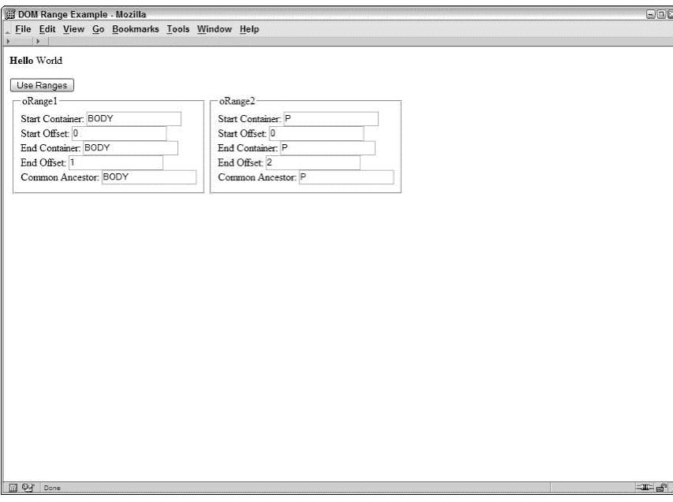

图 10-2

有几个方法可以帮助你更精确地进行选择，同时仍会为你设置这些属性。它们如下：

- `setStartBefore(refNode)` — 将范围的起始点设置在 `refNode` 之前（因此 `refNode` 是选择范围中的第一个节点）。`startContainer` 属性设置为 `refNode` 的父节点，`startOffset` 属性设置为 `refNode` 在其父节点 `childNodes` 集合中的索引。
- `setStartAfter(refNode)` — 将范围的起始点设置在 `refNode` 之后（因此 `refNode` 不在选择范围内；它的后继同兄弟节点是选择范围中的第一个节点）。`startContainer` 属性设置为 `refNode` 的父节点，`startOffset` 属性设置为 `refNode` 在其父节点 `childNodes` 集合中的索引加 1。
- `setEndBefore(refNode)` — 将范围的结束点设置在 `refNode` 之前（因此 `refNode` 是选择范围中的第一个节点）。`startContainer` 属性设置为 `refNode` 的父节点，`startOffset` 属性设置为 `refNode` 在其父节点 `childNodes` 集合中的索引。
- `setEndAfter(refNode)` — 将范围的结束点设置在 `refNode` 之后（因此 `refNode` 不在选择范围内；它的后继同兄弟节点是选择范围中的第一个节点）。`startContainer` 属性设置为 `refNode` 的父节点，`startOffset` 属性设置为 `refNode` 在其父节点 `childNodes` 集合中的索引加 1。

## 第 10 章

- `setEndBefore(refNode)` — 将范围的结束点设置在 `refNode` 之前（因此 `refNode` 是选择范围中的第一个节点）。`startContainer` 属性设置为 `refNode` 的父节点，`startOffset` 属性设置为 `refNode` 在其父节点 `childNodes` 集合中的索引。

## 高级 DOM 技术（续）

```html
Start Container: <input type="text" id="txtStartContainer1" /><br />
Start Offset: <input type="text" id="txtStartOffset1" /><br />
End Container: <input type="text" id="txtEndContainer1" /><br />
End Offset: <input type="text" id="txtEndOffset1" /><br />
Common Ancestor: <input type="text" id="txtCommonAncestor1" />

Start Container: <input type="text" id="txtStartContainer2" /><br />
Start Offset: <input type="text" id="txtStartOffset2" /><br />
End Container: <input type="text" id="txtEndContainer2" /><br />
End Offset: <input type="text" id="txtEndOffset2" /><br />
Common Ancestor: <input type="text" id="txtCommonAncestor2" />
```

（注：提供的 OCR 文本存在大量重复或损坏内容。已根据提示的实际内容提供一个清理后的版本。）

# 第 10 章

## 与 DOM 范围内容交互

当创建一个范围（range）时，它在内部会创建一个文档碎片节点（document fragment node），选择中的所有节点都会附加到该节点上。然而，在此发生之前，范围必须确保选择是良好格式（well-formed）的。

你刚刚学会了可以选择从 Hello 中的第一个字母 H 到 World 中的 o 的整个区域，包括 `</b>` 结束标签（图 10-4）。如果使用书中之前描述的普通 DOM 方法，这是无法实现的。

```html
<p><b>Hello World</b></p>
```

图 10-4

范围能够使用这种“小技巧”的原因是它能够识别起始标签和结束标签。在上一个示例中，范围计算出选择区域缺少一个 `<b>` 开始标签，范围在后台动态地添加了它，并配上一个新的 `</b>` 结束标签来包裹 He，从而将 DOM 修改为如下内容：

```html
<p><b>He</b><b>llo World</b></p>
```

该范围内包含的文档碎片显示在图 10-5 中。

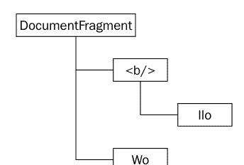

图 10-5

创建文档碎片后，你可以使用各种方法操作范围的内容。

第一种方法是最容易理解和使用的：`deleteContents()`。该方法只是简单地从文档中删除范围的内容。在上一个示例中，对范围调用 `deleteContents()` 会在页面上留下这段 HTML：

```html
<p><b>He</b><b>orld</b></p>
```

由于整个文档碎片被移除，范围很好地将缺失的 `</b>` 标签放入文档，以保持其良好格式。

## 高级 DOM 技术

`extractContents()` 与 `deleteContents()` 类似。它从文档中移除范围选择并将范围的文档碎片作为函数值返回。这允许你将范围的内容插入到其他地方：

```javascript
var oPl = document.getElementById("pl");

var hello = oPl.firstChild.firstChild;

var oWorld = oPl.lastChild;

var oRange = document.createRange();

oRange.setStart(hello, 2);

oRange.setEnd(oWorld, 3);

var oFragment = oRange.extractContents();

document.body.appendChild(oFragment);
```

在这个示例中，碎片被提取并添加到文档的 `<body>` 元素的末尾（记住，当文档碎片传递给 `appendChild()` 时，只会添加碎片的子节点，而不是碎片本身）。你在示例中看到的是页面顶部代码 `<b>He</b>llo`，以及页面底部 `<b>llo</b> Wo`。

另一个选项是让碎片留在原地，但使用 `cloneContents()` 创建它的克隆，并将其插入到文档的其他位置：

```javascript
var oPl = document.getElementById("pl");

var hello = oPl.firstChild.firstChild;

var oWorld = oPl.lastChild;

var oRange = document.createRange();

oRange.setStart(hello, 2);

oRange.setEnd(oWorld, 3);

var oFragment = oRange.cloneContents();

document.body.appendChild(oFragment);
```

这种方法与 `deleteContents()` 非常相似，因为它们都返回范围的文档碎片。这导致 `<b>llo</b> Wo` 被添加到页面末尾；原始的 HTML 代码保持完好。

> 文档碎片和伴随范围选择的文本变化直到调用这些方法之一时才会发生。在此之前，原始 HTML 始终保持完好。

## 插入 DOM 范围内容

之前的三个方法都是以某种方式或方式从范围中移除信息。可以使用几种不同的方法向范围中添加内容。

`insertBefore()` 方法允许你在选择的开头插入一个节点。假设你想在上一节中定义的范围内插入以下 HTML 代码：

```html
<span style="color: red">Inserted text</span>
```

以下代码实现了此操作：

```javascript
var oP = document.getElementById("p1");

var oHello = oP.firstChild.firstChild;

var oWorld = oP.lastChild;

var oRange = document.createRange();

var oSpan = document.createElement("span");

oSpan.style.color = "red";

oSpan.appendChild(document.createTextNode("Inserted text"));

oRange.setStart(oHello, 2);

oRange.setEnd(oWorld, 3);

oRange.insertNode(oSpan);
```

运行这段 JavaScript 实际上创建了以下 HTML 代码：

```html
<p id="p1">Hello <span style="color:red">Inserted text</span></span> World</p>
```

注意，`<span>` 被插入到 Hello 中的 `llo` 之前，这是范围选择的第一部分。同样注意，原始 HTML 没有添加或移除 `<body>` 元素，因为没有使用上一节中引入的任何方法。你可以使用这种技术来插入有用信息，例如为在新窗口中打开的链接添加图像。

除了范围外，还可以使用 `surroundContents()` 方法在范围周围插入内容。该方法接受一个参数，即包裹范围的节点。在后台，会采取以下步骤：

1. 提取范围的内容（类似于 `extractContents()`）。
2. 将该节点插入到范围所在的原始文档中。
3. 将文档碎片的内容添加到该节点中。

此功能允许你高亮网页中的单词，例如：

```javascript
var oP = document.getElementById("p1");

var oHello = oP.firstChild.firstChild;

var oWorld = oP.lastChild;

var oRange = document.createRange();

var oSpan = document.createElement("span");

oSpan.style.backgroundColor = "yellow";

oRange.setStart(oHello, 2);

oRange.setEnd(oWorld, 3);

oRange.surroundContents(oSpan);
```

之前的代码用黄色背景高亮了范围。

## 高级 DOM 技术（续）

要清空一个范围（即没有文档的部分被选中），请将其折叠（collapse）。折叠范围的行为类似于光标。当你在文本框中有一个光标时，你可以使用鼠标高亮整个单词。然而，如果你再次点击，选择就会消失。折叠一个范围类似于光标的行为。当你在文本框中有一个光标时，你可以使用鼠标高亮整个单词。然而，如果你再次点击，选择就会消失。

图 10-6 显示了当范围被折叠时两个节点是相邻的。例如，考虑以下代码：

```html
<p id="1">Paragraph 1</p><p id="2">Paragraph 2</p>
```

如果你不确定代码的精确布局（可能因为它是自动生成的），你可能会这样创建一个范围：

```javascript
var op1 = document.getElementById("p1");

var op2 = document.getElementById("p2");

var range = document.createRange();

range.setStartAfter(op1);

range.setEndBefore(op2);

alert(range.collapsed); // 输出 "true"
```

在这种情况下，创建的范围是折叠的，因为在 `p1` 和 `p2` 的边界之间没有内容。

## 比较范围

如果你有多个范围，可以使用 `compareBoundaryPoints()` 方法确定是否有公共边界（起始或结束）。该方法接受两个参数：要比较的范围以及比较方式，后者是一个常量：

- `START_TO_START (0)` —— 比较第一个范围的起始点和第二个范围的起始点。
- `START_TO_END (1)` —— 比较第一个范围的起始点和第二个范围的结束点。
- `END_TO_END (2)` —— 比较第一个范围的结束点和第二个范围的结束点。
- `END_TO_START (3)` —— 比较第一个范围的结束点和第二个范围的起始点。

如果第一个范围的点在第二个范围之前，`compareBoundaryPoints()` 方法返回 -1；如果点相等，返回 0；如果第一个范围的点在第二个范围之后，则返回 1。

例如：

```javascript
var oRange1 = document.createRange();

var oRange2 = document.createRange();

var op1 = document.getElementById("p1");

oRange1.selectNodeContents(op1);

oRange2.selectNodeContents(op1);

oRange2.setEndBefore(op1.firstChild);

alert(oRange1.compareBoundaryPoints(Range.START_TO_START, oRange2)); // 输出 0

alert(oRange1.compareBoundaryPoints(Range.END_TO_END, oRange2)); // 输出 1
```

在这段代码中，由于 `selectNodeContents()` 的默认值，两个范围的起始点完全相同；因此返回 0。但对于 `oRange2`，结束点通过 `setEndBefore()` 修改了，使得 `oRange1` 的结束点在 `oRange2` 之后（见图 10-7）。

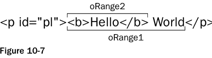

## 克隆 DOM 范围

如果需要，可以通过调用 `cloneRange()` 方法来复制任何范围。该方法会创建一个被调用的范围的精确副本：

```javascript
var oNewRange = oRange.cloneRange();
```

新范围包含与原始范围相同属性，并且可以进行修改而不会以任何方式影响原始范围。

## 高级 DOM 技术

## 清理

当您使用范围（range）时，最好调用 `detach()` 方法来释放系统资源。这并不是必须的，因为失去引用的范围最终会被垃圾回收器处理。如果范围在初始时使用后就不再需要，调用 `detach()` 可以确保它不会占用任何额外的内存：

```javascript
```


`oRange.detach();`

### Internet Explorer 中的范围

Internet Explorer 采用了一种处理范围的非标准方法，但只要你理解其中的差异，这种方法仍然非常有效。

首先，IE 中的范围被称为“文本范围”（text ranges），因为它们主要设计用于处理文本（而不是专门的 DOM 节点）。要创建一个范围，你必须在 `<body>`、`<button>`、`<input>` 或 `<textarea>` 元素（或者在文档本身上）调用 `createTextRange()`：

```javascript
var oRange = document.body.createRange();
```

通过这种方式创建范围允许其用于页面的任何地方（在指定的元素之一上创建范围会将范围限制在该元素上工作）。

### IE 范围中的简单选择

选择页面上区域最简单的方法是使用范围的 `findText()` 方法。该方法会找到给定文本字符串的第一个实例，并将范围移动到其周围。再次考虑以下 HTML 代码：

```html
<p id="p1">Hello</body> World</p>
```

要选择 `Hello`，你可以使用以下代码：

```javascript
var oRange = document.body.createRange();
var bFound = oRange.findText("Hello");
```

在执行第二行代码后，文本 `Hello` 被包含在范围内。你可以通过范围的 `text` 属性（返回范围包含的文本）或检查 `findText()` 的返回值来测试这一点，如果找到了文本，则返回 `true`：

```javascript
alert(bFound);
alert(oRange.text);
```

若要在文档中移动，你使用 `findText()` 方法的第二个参数，它是一个指示继续搜索方向的数字：负数表示搜索应该向后进行，而正数表示搜索应该向前进行。要在文档中找到前两个 `Hello`，可以使用此代码：

```javascript
var bFound = oRange.findText("Hello");
var bFoundAgain = oRange.findText("Hello", 1);
```

与 DOM 的 `selectNode()` 最接近的是 IE 的 `moveToElementText()`，它接受一个 DOM 元素作为参数并选择元素的所有文本，包括 HTML 标签：

```javascript
var oRange = document.createRange();
var oEl = document.getElementById("p1");
oRange.moveToElementText(oEl);
```

要测试这是否有效，你可以使用 `html` 属性，它返回范围内的所有 HTML 内容：

```javascript
alert(oRange.html);
```

IE 中的范围没有任何随选择变化而动态更新的属性，尽管 `parentElement()` 方法的行为与 DOM 的 `commonAncestorContainer` 属性相同：

```javascript
var oCommonAncestor = oRange.parentElement();
```

### IE 范围中的复杂选择

IE 范围选择的复杂部分之一是，必须使用简单选择方法之一。在范围处于相对正确的位置后，你可以使用 `move()`、`moveStart()`、`moveEnd()` 和 `expand()` 来进一步定位范围。

这些方法都接受两个参数：单位类型和要移动的单位数量。要移动的单位类型是以下字符串值之一：

- `"character"` — 移动一个字符
- `"word"` — 移动一个单词（一个非空白字符的序列）
- `"sentence"` — 移动一个句子（以句号、问号或感叹号结尾的字符序列）
- `"textedit"` — 移动到当前范围选择的开始或结束

`moveStart()` 按指定的单位数移动范围的起点，而 `moveEnd()` 按指定的单位数移动范围的终点：

```javascript
oRange.moveStart("word", 2); // 将起点向前移动两个单词
oRange.moveEnd("character", 1); // 将终点向后移动一个字符
```

你还可以使用 `expand()` 方法来规范化范围。`expand()` 方法确保任何部分选中的单位都变为完全选中。例如，如果你只选择了单词中间的字符，可以调用 `expand("word")` 以确保整个单词都被包含在范围内。

`move()` 首先折叠范围（使起点和终点相等），然后按指定的单位数移动范围：

```javascript
oRange.move("character", 5); // 移动五个字符
```

在使用 `move()` 之后，你必须使用 `moveEnd()` 再次进行选择。

### 与 IE 范围内容的交互

在 IE 中，与范围内容的交互通过 `text` 属性或 `pasteHTML()` 方法完成。

你之前用于检索范围文本内容的 `text` 属性也可以用于设置范围的文本内容。例如：

```javascript
var oRange = document.body.createRange();
oRange.findText("Hello");
oRange.text = "Howdy";
```

如果你对之前的 Hello World 代码运行此代码，结果如下：

```html
<p id="pl"><b>Howdy</b> World</body></p>
```

（注：OCR 文本在 HTML 标签上存在某些错误，此处根据上下文进行了修正）

## 范围（Ranges）的实用性如何？

DOM 与 IE 范围（range）实现之间的差异使得创建浏览器解决方案变得困难，这就是为什么许多开发者避开使用范围的原因。在评估你自己的用法时，了解你的目标受众、他们将使用的浏览器，以及是否存在非负性的方式来实现该效果是非常重要的。

范围在页面上提供了非常有用的功能。某些页面根据一系列搜索词来高亮页面上的某些术语，用户可以轻松找到他们正在搜索的词。另一种在广告商中流行的用法是将某些单词转换为链接（例如，将“computer”一词转换为计算机制造商的链接，或将“JavaScript”一词转换为该语言的描述）。

## 总结

本章介绍了操作文档 DOM 树的几种新方法。

首先，你学习了如何影响页面上元素的 CSS 样式。文中讨论了几个示例，包括悬停效果和自定义工具提示。你学习了如何访问元素的样式定义以及 CSS 规则，并在此过程中看到了它们与计算后样式（computed styles）的区别。

下一节引入了 `innerText`、`innerHTML`、`outerText` 和 `outerHTML`。你学习了如何使用 `innerText` 来更改 DOM 元素的文本内容，以及如何使用 `innerHTML` 来更改 DOM 元素的 HTML 内容。同样，你学习了如何使用 `outerText` 和 `outerHTML` 来完全替换 DOM 元素（无论是使用纯文本还是 HTML 代码）。

最后，你学习了范围。文中讨论了 DOM 范围与 Internet Explorer 中的范围之间的差异，并提供了几个示例来展示两者的相似之处。

## 11 表单与数据完整性

创建表单元素是为了满足用户需要将数据发送回服务器的需求。它们在 Web 表单的形式提供了答案，使用了 HTML `<form>`、`<input>`、`<select>` 和 `<textarea>` 元素。使用这些元素，浏览器可以渲染文本框、组合框和其他用户输入控件，允许从客户端到服务器的通信。

尽管 Web 的发展非常快，但 Web 表单几乎保持着不变。虽然一个名为 XForms 的新标准已指日可待，但还没有浏览器采取原生支持它，如今的 Web 表单依赖于 JavaScript 来增强内置行为。

在本章中，你将学习如何使用 JavaScript 扩展常见 Web 表单的行为和易用性，包含用户期望的功能。

## 表单基础

HTML 表单通过使用 `<form>` 元素定义，它具有多个属性：

- `method` — 指明浏览器发送的是 GET 请求还是 POST 请求
- `action` — 指明表单应该提交到的 URL
- `enctype` — 数据发送到服务器时的编码方式。默认是 `application/x-www-form-encoded`，但如果表单正在上传文件，则可以设置为 `multipart/form-data`。
- `accept` — 列出在上传文件时服务器能够正确处理的 MIME 类型
- `accept-charset` — 列出在提交数据时服务器接受的字符编码

表单可以包含任意数量的输入元素：

- `<input/>` — 主要的 HTML 输入元素。`type` 属性决定了显示何种类型的输入控件：
    - `"text"` — 单行文本框
    - `"radio"` — 单选按钮
    - `"checkbox"` — 复选框
    - `"file"` — 文件上传文本框
    - `"password"` — 密码文本框（在输入时字符不会显示出来）
    - `"button"` — 通用按钮，可用于触发自定义操作
    - `"submit"` — 唯一目的是用于提交表单的按钮
    - `"reset"` — 唯一目的是将表单中所有字段重置为默认值的按钮
    - `"hidden"` — 不在屏幕上显示的输入字段
    - `"image"` — 像提交按钮一样使用的图像
- `<select>` — 渲染由 `<option>` 元素定义的值组成的组合框或列表
- `<textarea>` — 渲染由 `rows` 和 `cols` 属性定义的尺寸的多行文本框。

这是一个使用各种输入元素的简单表单：

```html
<html>
<head>
  <title>示例表单</title>
</head>
<body>
  <form method="post" action="handlepost.jsp">
    <!-- 普通文本框 -->
    <label for="txtName">Name:</label><br>
    <input type="text" id="txtName" name="txtName" /><br>

    <!-- 密码文本框 -->
    <label for="password">Password:</label><br>
    <input type="password" id="password" name="password" /><br />

    <!-- 组合框（下拉列表） -->
    <label for="selage">Age:</label><br>
    <select name="selage" id="selage">
      <option>18-21</option>
      <option>22-25</option>
      <option>26-29</option>
      <option>30-35</option>
      <option>Over 35</option>
    </select><br />

    <!-- 多行文本框 -->
    <label for="txtComments">Comments:</label><br />
    <textarea name="txtComments" rows="10" cols="50" id="txtComments"></textarea><br />

    <!-- 提交按钮 -->
    <input type="submit" value="Submit Form" />
  </form>
</body>
</html>
```

在这个示例中，描述了表单字段：一个普通文本框、一个密码文本框、一个组合框、一个多行文本框。注意，除了提交按钮外，每个字段前面都有一个 `<label>` 元素。该元素在后台用于在逻辑上将标签与特定字段关联起来。这对于视觉视障用户使用的屏幕阅读器非常有用。`for` 属性标识它所标识的表单元素的 ID。因如此，每个字段的 `name` 和 `id` 应该值相等（`name` 提交到服务器；`id` 标识客户端上的元素）。

每种表单字段都可以使用 JavaScript 进行操作。`<form>` 元素本身也可以使用 JavaScript 进行控制，以对数据传输提供进一步控制。

## 为 `<form>` 元素编写脚本

配合 `<form>` 使用 JavaScript 与使用其他 HTML 元素不同。你不局限于仅使用 DOM 方法来访问表单；你可以通过几种不同的方式访问 `<form>` 元素本身以及表单字段。本节涵盖了开始编写表单所需的基础信息。

### 获取表单引用

在编写表单脚本之前，你必须获取 `<form>` 元素的引用。这可以通过许多方式完成。

首先，你可以使用在 DOM 树中定位元素的典型方法，即使用 `getElementById()` 并传入表单的 ID：

```javascript
var oForm = document.getElementById("form1");
```

或者，你可以使用文档的 `forms` 集合并通过其位置或 `name` 属性引用表单。

```javascript
var oForm = document.forms[0];
var oOtherForm = document.forms["formZ"];
```

获取表单引用的任何这些方法都是可以的（它们返回相同的内容）。

### 访问表单字段

每个表单字段（无论是按钮、文本框或其他）都包含表单的 `elements` 集合中。你可以使用它们的 `name` 属性或在集合中的位置来访问集合中的各种字段：

```javascript
var oFirstField = oForm.elements[0];
var oTextbox = oForm.elements["textbox1"]; // 获取名为 "textbox1" 的字段
```

在通过名称访问元素的简写版本中，每个表单字段都变成表单本身的一个属性，并可以使用其名称直接访问：

```javascript
var oTextbox = oForm.textbox; // 获取名为 "textbox1" 的字段
```

如果名称中包含空格，请使用方括号表示法：

```javascript
var oTextbox = oForm["text box 1"]; // 获取名为 "text box 1" 的字段
```

当然，你仍然可以使用 `document.getElementById()` 通过表单字段的 ID 来直接检索它。本节讨论的方法在需要遍历单个表单中的所有字段时最有用。

### 表单字段共同点

所有表单字段（隐藏字段除外）都包含共同属性、方法和事件：

- `disabled` 属性用于指示控件是否被禁用，并实际禁用控件（禁用的控件不允许任何用户输入，但提供视觉指示显示控件已被禁用）。
- `form` 属性是指向该字段所属表单的指针。
- `blur()` 方法使字段失去焦点（通过将焦点转移到其他处）。
- `focus()` 方法使字段获得焦点（控件被选中以进行键盘交互）。
- `blur` 事件在字段失去焦点时触发，并执行 `onblur` 事件处理程序。
- `focus` 事件在字段获得焦点时触发，随后执行 `onclick` 事件处理程序。

例如：

```javascript
var oField1 = oForm.elements[0];
var oField2 = oForm.elements[1];

// 设置第一个字段为禁用
oField1.disabled = true;

// 将焦点设置到第二个字段
oField2.focus();
```

```javascript
// 判断 form 属性是否等于 oForm?
alert(oField1.form == oForm); // 输出 "true"
```

当需要高级功能时（例如当你想将焦点移动到第一个字段时），属性、方法和事件会非常有用。

> 隐藏字段只支持 `form` 属性，但不支持表单字段中通用的任何方法或事件。

### 聚焦于第一个字段

当表单在 Web 页面上显示时，焦点通常不在第一个控件上。通过一个适用于任何表单页面的通用脚本，可以轻松地改变这一点。

许多开发者直接在页面的 `onload` 事件处理器中放入以下代码：

```javascript
document.forms[0].elements[0].focus();
```

这在大多数情况下都是有效的，但请考虑一种情况：如果表单中的第一个元素是隐藏字段（不支持 `focus()` 方法的元素），在这种情况下，你会遇到 JavaScript 错误。关键是将焦点设置到第一个可见表单字段，你可以为它编写一个短方法。

本章中所有关于表单的方法都写在一个 `FormUtil` 对象中，以便于封装：

```javascript
var FormUtil = new Object;
```

`FormUtil` 对象仅用于将相似的函数分组；你可以选择将这些方法放在单独的对象中或独立提供。

设置第一个表单字段焦点的方法通过检查 `document.forms.length` 来确保页面上存在表单：

```javascript
FormUtil.focusOnFirst = function () {
  if (document.forms.length > 0) {
    //...
  }
};
```

确定至少有一个表单后，你可以遍历表单字段，直到找到不是隐藏的那个：

```javascript
FormUtil.focusOnFirst = function () {
  if (document.forms.length > 0) {
    // 遍历字段，直到找到第一个可见字段并聚焦
  }
};
```


# 表单与数据完整性

## 焦点管理

以下代码片段展示了如何遍历表单元素并聚焦第一个非隐藏字段：

```
for (var i=0; i < document.forms[0].elements.length; i++) {
  var oField = document.forms[0].elements[i];
  if (oField.type != "hidden") {
    oField.focus();
  }
}
```

此方法可以在`onload`事件处理器中调用：

```html
<body onload="FormUtil.focusFirst()">
```

> 使用此方法时要小心。在加载缓慢的页面中，用户可能在页面完全加载之前就开始在字段中输入。当焦点随后设置到第一个字段时，会干扰用户的输入。为了防止这个问题，请检查第一个字段是否有值；如果有，则不要将焦点设置在那里。

## 提交表单

在普通 HTML 中，使用提交按钮或像提交按钮一样作用的图像来提交表单：

```html
<input type="submit" value="Submit" /> <!-- 按钮 -->
<input type="image" src="submit.gif" /> <!-- 按钮 -->
```

当用户点击这些按钮之一时，表单不需要额外的代码即可提交。如果在这些类型的按钮获得焦点时按下 Enter 键，浏览器会像点击按钮一样提交表单。

你可以通过提供 alert 来测试表单是否正在提交：

```html
<form method="post" onsubmit="alert('Submitted')">
```

通过 JavaScript 函数提交表单并弹出“Submitted”的 alert——这对于测试表单提交很有帮助，因为它实际上并没有返回服务器。

如果你想在不使用前面任何方法的情况下提交表单，可以使用`submit()`方法，它是`<form>`元素 DOM 定义的一部分，可以在页面的任何地方使用。要使用此方法，必须首先通过`getElementById()`或使用`document.forms`集合获取`<form>`元素的引用。以下三行都是引用表单接受的方式：

```javascript
oForm = document.getElementById("form1");
oForm = document.forms["form1"];
oForm = document.forms[0];
```

获取表单引用后，你可以直接调用`submit()`方法：

```javascript
oForm.submit();
```

## 表单与数据完整性

你可以通过创建一个通用按钮并分配`onclick`事件处理器来模拟提交按钮的行为：

```html
<input type="button" value="Submit Form" onclick="document.forms[0].submit()" />
```

在表单提交之前，点击提交按钮后，`submit`事件会被触发并执行`onsubmit`事件处理器。使用`onsubmit`事件处理器可以停止表单提交，这在表单提交之前需要客户端验证时特别有用。使用书中前面提到的方法可以取消事件并防止表单提交：

```javascript
function handleSubmit() {
  var oEvent = Event.getEvent();
  oEvent.preventDefault();
}
```

此方法可以在表单的`onsubmit`事件处理器中调用：

```html
<form method="post" action="javascript:alert('Submitted')" onsubmit="handleSubmit()">
```

当你尝试使用提交按钮或图像按钮提交表单时，表单不会提交。

> 只有当你使用之前提到的两种按钮之一时，`onsubmit`事件处理器才允许你在提交之前验证表单。当使用`submit()`方法时，`submit`事件不会触发，因此所有验证应在调用之前完成。

## 只提交一次

Web 表单中的一个常见问题是用户在提交表单时会失去耐心。点击提交按钮时，表单并没有立即消失。解决方案非常简单：用户点击后将其禁用。方法如下：

```html
<input type="submit" value="Submit" />
```

使用这个：

```html
<input type="button" value="Submit" onclick="this.disabled=true;this.form.submit()" />
```

当点击此按钮时，通过将`disabled`属性设置为`true`来禁用它。注意代码使用`this`来引用表单。如果你需要，此代码也可以封装在函数中。

## 重置表单

如果你想为用户提供将所有表单字段重置为默认值的方法，可以使用 HTML 重置按钮：

```html
<input type="reset" value="Reset" />
```

与提交按钮类似，重置按钮不需要脚本浏览器就能知道点击时该做什么。同样类似于提交按钮，点击按钮时会触发`reset`事件：

```html
<form method="post" action="javascript:alert('Submitted')" onreset="alert('I am resetting')">
```

当然，你使用`reset`事件来处理表单的取消。

表单有一个`reset()`方法可以直接重置表单，而不使用重置按钮：

```html
<input type="button" value="Reset" onclick="document.forms[0].reset()" />
```

与`submit()`不同，使用`reset()`仍然会触发 reset 事件处理器。

> 重置表单在 Web 开发者中不再流行，因为越来越多的用户会错误地重置表单而不是提交它。如果表单在首次加载时字段包含信息，重置按钮可能会很有帮助，因为它将字段重置为初始值。对于初始加载时字段中没有任何信息的表单，建议使用重置按钮。

## 文本框

HTML 中使用了两种类型的文本框：单行版本`<input type="text" />`和多行版本`<textarea>`。

`<input>`元素的属性必须设置为 "text" 才能显示文本框。你可以使用`size`属性来指定文本框按可见字符的宽度（例如，设置`size="10"`意味着一次显示 10 个字符）。`value`属性指定文本框的初始值，`maxlength`属性指定字符数量为文本框中允许的字符。要创建一个一次可以显示 25 个字符但最大长度为 50 的文本框，可以使用以下代码：

```
<input type="text" size="25" maxlength="50" value="initial value" />
```

`<textarea>`元素始终渲染多行文本。要指定文本框的形式，你可以使用`rows`属性，它按字符数指定文本框的高度，以及`cols`属性，它按字符数指定宽度（类似于`<input>`元素的`size`属性）。与`<input>`不同，`<textarea>`的初始值必须包含在`<textarea>`和`</textarea>`之间，如下：

```
<textarea rows="25" cols="5">initial value</textarea>
```

与`<input>`元素不同，`<textarea>`不能指定允许的最大字符数。

### 获取/修改文本框

尽管它们是不同的元素，但`<input type="text">`和`<textarea>`都支持相同的属性`value`，用于获取文本框中包含的内容。考虑以下示例：

```
<html>
<head>
<title>获取文本框值示例</title>
<script type="javascript">
function getValues() {
  var textbox1 = document.getElementById('txt1');
  var textbox2 = document.getElementById('txt2');
  alert("The value of txt1 is " + textbox1.value + "\n" + \
  "The value of txt2 is " + textbox2.value + ")");
}
</script>
</head>
<body>
<input type="text" size="12" id="txt1"/><br>
<textarea rows="5" cols="5" id="txt2"></textarea><br>
<input type="button" value="Get Values" onclick="getValues()" />
</body>
</html>
```

此示例显示了两个文本框（一个单行的，一个多行的）以及一个按钮。当你点击该按钮时，警报框会显示每个文本框中包含的值。尝试在每个文本框中输入几次，然后点击按钮。

由于`value`是一个属性，你可以使用字符串的所有属性和方法。例如，你可以通过使用`length`属性获取文本框内文本的长度：

```
<html>
<head>
<title>获取文本框长度示例</title>
<script type="javascript">
function getLengths() {
  var oTextbox1 = document.getElementById("txt1");
  var oTextbox2 = document.getElementById("txt2");
  alert("The length of txt1 is " + oTextbox1.length + "\n"
  + " The length of txt2 is " + oTextbox2.value.length);
}
</script>
</head>
<body>
  <input type="text" size="12" id="txt1"><br>
  <textarea rows="5" cols="25" id="txt2"></textarea><br>
  <input type="button" value="Get Lengths" onclick="getLengths()" />
</body>
</html>
```

此示例使用`value`的`length`属性来确定每个文本框中有多少字符。

`value`属性也可以用于为文本框分配新值：

```
<html>
<head>
  <title>修改文本框值示例</title>
  <script type="javascript">
  function setValues() {
    var oTextbox1 = document.getElementById("txt1");
    var oTextbox2 = document.getElementById("txt2");
    oTextbox1.value = "first textbox";
    oTextbox2.value = "second textbox";
  }
  </script>
</head>
<body>
  <input type="text" size="12" id="txt1"><br>
  <textarea rows="5" cols="25" id="txt2"></textarea><br>
  <input type="button" value="Set Values" onclick="setValues()" />
</body>
</html>
```

在示例中，点击按钮会将第一个文本框设置为 "first textbox"，将第二个文本框设置为 "second textbox"。

### 选择文本

两个文本框都支持一个名为`select()`的方法，该方法会选中文本框中的所有文本。为了该方法生效，文本框必须拥有焦点。为了确保文本框拥有焦点，你应该在调用`select()`之前调用另一个方法`focus()`。（这在所有浏览器中都不是必须的，但始终先调用`focus()`更安全）。例如：

```
<html>
<head>
  <title>Select Example</title>
  <script type="text/javascript">
    function selectText() {
      var oTextbox1 = document.getElementById('txt');
      oTextbox1.focus();
      oTextbox1.select();
    }
  </script>
</head>
<body>
  <input type="text" size="12" id="txt" value="initial value" /><br />
  <input type="button" value="Select Text" onclick="selectText()" />
</body>
</html>
```

此示例显示了一个文本框和一个按钮。当你点击按钮时，文本框中的文本会被选中。

### 文本框事件

两种类型的文本框都会触发之前提到的表单字段 blur（失焦）和 focus（聚焦）事件，以及另外两个事件：`change`（改变）和`select`（选中）。

- change：当用户更改值后文本框失去焦点时触发（如果通过设置`value`属性来更改值则不会触发）。
- select：当手动或使用`select()`方法选中一个或多个字符时触发。

`change`事件与`blur`事件之间的区别。`blur`事件在文本框失去焦点时随时触发；`change`事件在文本框失去焦点时触发，但仅当文本框内容发生变化时触发。`change`事件先触发，随后是`blur`事件。如果没有变化，则只触发`blur`事件；尝试一下以便掌握：

```
<input type="text" name="txt" value="" onblur="alert('Blur')" onchange="alert('Change')"
```

另一方面，`select`事件与文本框的焦点没有关系。当用户选中一个或多个字符或调用`select()`方法时，会触发此事件。你可以对其进行实验：

```
<input type="text" name="textbox1" value="" onselect="alert('Select')"
```

### 自动选择

当用户向传统应用程序输入信息时，文本框的内容在用户点击它时被高亮并不罕见。这在`<input>`和`<textarea>`上都可以轻松实现：只需将代码`this.select()`添加到控件的焦点处理程序：

```
<input type="text" autofocus="this.select()" />
<textarea autofocus="this.select()"></textarea>
```

如果你想将此行为应用于屏幕上所有的文本框，可以使用以下函数：

```
FormUtil.setTextboxes = function () {
  var colInputs = document.getElementsByTagName("input");
  var colTextAreas = document.getElementsByTagName("textarea");
  for (var i=0; i < colInputs.length; i++) {
    if (colInputs[i].type == "text" || colInputs[i].type == "password") {
      colInputs[i].onfocus = function () { this.select(); };
    }
  }
  for (var i=0; i < colTextAreas.length; i++) {
    colTextAreas[i].onfocus = function () { this.select(); };
  }
}
```

此函数首先收集文档中所有的`<input>`和`<textarea>`实例。循环遍历文本框和焦点字段（密码字段也是文本框）。然后为字段的焦点事件添加一个包含`select`代码的匿名函数（可选，可以使用`EventUtil.addEventHandler`）。第二个循环对`textarea`执行相同的操作。

### Tab 前进

当一个框只能接受特定数量的字符时，自动跳转到下一个字段不是很有意义的吗？在输入社会安全号码或 ID 号时经常这样做。这种行为在 JavaScript 中很容易模拟。此脚本要求使用文本框的`maxlength`属性，例如：

```
<input type="text" maxlength="4" />
```

基本思想是判断何时向文本框输入了最大数量的字符，然后调用下一个元素的`focus()`方法。为了实现这一点，需要另一个方法：

```
FormUtil.tabForward = function (oTextbox) {
  var oForm = oTextbox.form;
  // 确保文本框不是表单中的最后一个字段
  if (oForm.elements[oForm.elements.length-1] != oTextbox
```


```
      && oTextbox.value.length == oTextbox.getAttribute("maxlength")) {

    for (var i=0; i < oForm.elements.length; i++) {

      if (oForm.elements[i] == oTextbox) {

        for (var j=i+1; j < oForm.elements.length; j++) {

          if (oForm.elements[j].type != "hidden") {

            oForm.elements[j].focus();

            return;

          }

        }

      }

    }

  }

}

```

# 表单与数据完整性

```javascript
}

}

return;

}

};
```

`FormUtil.tabForward()` 方法接受一个参数，即要检查的文本框。在方法内部，通过文本框的`form`属性提取出所属表单的引用。接着，方法通过将文本框与最后一个位置进行比较，判断文本框是否为表单中的最后一个元素。如果文本框通过了该测试，将使用文本框的`maxLength`属性测试其是否已达到允许的最大字符数。如果文本框未达到最大字符数，方法将快速退出；否则，进入第一个循环。

第一个`for`循环的目的是在元素集合（`elements` collection）中定位文本框。当找到时，会弹出一个与前一节遇到的类似的问题：如果下一个元素是隐藏字段怎么办？这就是第二个循环派上用场的地方，它会遍历剩余元素直到找到非隐藏字段。找到该字段后，将用户焦点设置为该字段，并通过`return`语句执行该方法。

此方法必须在每个字符输入到文本框后进行调用，因此你需要使用`onkeyup`事件处理程序（你可能记得，`keyup`事件在字符被放置到文本框之后触发，而`keydown`事件在之前触发）：

```html
<input type="text" maxLength="4" onkeyup="FormUtil.tabForward(this)" />
```

注意，此键绑定被用于将光标移动到文本框。假设你想让用户输入美国格式的电话号码（三位、三位、四位）。你可以创建三个如下的文本框：

```html
<input type="text" id="textAreaCode" maxLength="3"
onkeyup="FormUtil.tabForward(this)" />
```

```html
<input type="text" id="txtExchange" maxLength="3"
onkeyup="FormUtil.tabForward(this)" />
```

```html
<input type="text" id="txtNumber" maxLength="4"
onkeyup="FormUtil.tabForward(this)" />
```

一旦用户完成在一个文本框中输入数字，焦点就会移动到下一个文本框，因此用户永远不需要使用`Tab`键或在字段之间移动。

# 限制 textarea 字符

虽然`<input>`元素框可以很容易限制允许的字符数，但`<textarea>`元素无法做到这一点，因为它们没有`maxLength`属性。解决方案是编写一些 JavaScript 来模拟`maxLength`属性。最终，你希望能够执行操作：

```html
<textarea rows="10" cols="25" maxLength="150"></textarea>
```

# 第 11 章

> 在这一章中，你会频繁添加属性；然而，如果你使用的是 XHTML 的严格实现，如果页面包含意外的属性，则该页面被视为无效的。根据你的特定需求，可能需要向元素的 DOM 节点添加 JavaScript 属性，或者将信息直接传递给函数。这是直接处理文本框的第一种方法（之前的节提供了工作于文本框和表单其他部分之间的方法），因此是时候使用一个新的封装对象来封装以下方法了：

```javascript
var TextUtil = new Object();
```

该对象的第一个方法是`isNotMax()`，当未达到最大字符数时它返回`true`，如果已达到则返回`false`。其原因稍后会解释。首先，看代码：

```javascript
TextUtil.isNotMax = function(textArea) {
    return textArea.length != textArea.getAttribute("maxLength");
}
```

如你所见，此方法非常简单：文本框中文本的长度与`maxLength`属性之间的比较。对于`<textarea>`元素，你仍然可以使用`getAttribute()`获取其值。接下来，必须将该调用插入到文本框的`onkeypress`处理程序中。记住，`keypress`事件在字符插入到文本框之前触发，这正是你为了强制执行最大限制而必须停止的时刻。代码如下所示：

```html
<textarea rows="10" cols="25" maxLength="150"
onkeypress="return TextUtil.isNotMax(this)"></textarea>
```

注意`isNotMax()`的返回值会被返回给事件处理程序。这是防止事件默认行为的一种旧方法。当长度小于`maxLength`属性时，该方法返回`true`，表示`keypress`事件应该正常继续。一旦达到最大长度，该方法返回`false`，防止字符被添加到文本框中。此方法可以与`FormUtil.tabForward()`配合使用，以便使用`<textarea>`元素进行跳转。

你可能会疑惑为什么代码没有使用事件标准的`preventDefault()`方法。简单的答案是 Mozilla 在处理`keypress`事件时的一个 bug。为了使其成为一个真正的跨浏览器解决方案，必须消除该功能。此代码在所有符合 DOM 标准的浏览器中运行，包括 Internet Explorer、Safari 以及 Mozilla。

# 允许/阻塞文本框中的字符

在处理数据输入时，你必须限制用户输入的数据。例如，如果一个字段需要数字而用户输入了字母，则它应该被识别为无效。在 JavaScript 出现之前，需要与服务器进行往返交互来完成这种类型的验证。有了 JavaScript，客户端可以进行验证并防止用户输入无效数据。

# 阻止无效字符

由于一个表单中的许多字段只需要输入不同类型的字符，你必须能够指定要阻塞的字符。为了实现这一点，你必须能够指定要阻塞的字符。方法是添加属性的到`<input>`元素上：

```html
<input type="text" invalidchars="123456789"
```

一旦用户完成在一个文本框中输入数字，焦点就会移动到下一个文本框，因此用户永远不需要使用`Tab`键或在字段之间移动。（注：此处原文翻译逻辑似乎有重复或断层，已按字意顺译）

阻止无效字符

由于一个表单中的许多字段只需要输入不同类型的字符，你必须能够指定要阻塞的字符。为了实现这一点，你必须能够指定要阻塞的字符。方法是添加属性的到`<input>`元素上：

```html
<input type="text" invalidchars="123456789"
```

（注：由于原文文本在某些处存在明显的逻辑重复或截断，译文保持了其结构并对可见内容进行了翻译。）

## 允许有效字符

两者的主要区别在于`allowChars()`会查找`validchars`属性，如果`sChar`包含在`sValidChars`中则返回`true`。再次请记住，当按住 Ctrl 键时，用户正在对文本执行某种排序功能，该方法会返回`true`。该方法还以类似的方式使用，向`onkeypress`处理器返回一个值：

```html
<input type="text" validchars="0123456789"
onkeypress="return TextUtil.allowChars(this, event)" />
```

```html
<textarea rows="10" cols="25" validchars="0123456789"
onkeypress="return TextUtil.allowChars(this, event)"/></textarea>
```

之前的输入框允许输入数字（不允许输入空格、字母或其他任何内容）。此功能也可以以创新的方式使用：

```html
<!-- 允许正整数 -->
<input type="text" validchars="0123456789"
onkeypress="return FormUtil.allow(this, event)" />
```

```html
<!-- 仅允许 "Y" 或 "N" -->
<input type="text" validchars="YN"
onkeypress="return FormUtil.allow(this, event)" />
```

## 禁止粘贴

大多数开发者忘记的验证方面的一个方面是，用户可以向文本框中粘贴值。在`blockChars()`和`allowChars()`方法中，假设用户是逐个输入字符的，因此它们会在每个字符输入时对其进行检查。当用户粘贴一个值时，整个字符串都在文本框中。你有两种方法来处理粘贴值的验证：要么不允许粘贴，要么在失去焦点时对文本进行验证。

## 阻止粘贴

阻止用户的粘贴功能非常容易实现，但你必须涵盖所有情况。用户可以通过两种方式粘贴：通过点击文本框菜单（在框上点击右键）或通过按住 Ctrl 键并按 V。

在 Internet Explorer 中，解决方案非常简单，因为有一个`onpaste`事件。如果`onpaste`事件阻止了该行为，无论用户如何尝试：

```html
<input type="text" onkeypress="return allow(this, event)" validchars="0123456789"
onpaste="return false" />
```

对于其他浏览器，过程要复杂一些。第一步是阻止键菜单，这可以通过从`oncontextmenu`处理器返回`false`来完成。

```html
<input type="text" onkeypress="return allow(this, event)" validchars="0123456789"
onpaste="return false" oncontextmenu="return false" />
```

接下来，你需要阻止用户在按 Ctrl 和 V 时进行粘贴。让这变得简单的部分是，按下 Ctrl 和 V 会触发`keypress`事件，因此可以对`allowChars()`和`blockChars()`方法进行一些修改后对其使用它们：

```javascript
TextUtil.blockChars = function (oTextbox, oEvent, bBlockPaste) {
  oEvent = EventUtil.formatEvent(oEvent);
  var sInvalidChars = oTextbox.getAttribute("invalidchars");
  var sChar = String.fromCharCode(oEvent.charCode);
  var bValidChar = sInvalidChars.indexOf(sChar) == -1;

  if (bBlockPaste) {
    return bValidChar && !(oEvent.ctrl && sChar == "v");
  } else {
    return bValidChar || oEvent.ctrl;
  }
}

TextUtil.allowChars = function (oTextbox, oEvent, bBlockPaste) {
  oEvent = EventUtil.formatEvent(oEvent);
  var sValidChars = oTextbox.getAttribute("validchars");
  var sChar = String.fromCharCode(oEvent.charCode);
  var bValidChar = sValidChars.indexOf(sChar) > -1;

  if (bBlockPaste) {
    return bValidChar && !(oEvent.ctrl && sChar == "v");
  } else {
    return bValidChar || oEvent.ctrl;
  }
}
```

注意，两个方法都添加了相同的代码。增加了第三个参数`bBlockPaste`，如果你想在文本框中阻止粘贴，则必须将其设置为`true`。然后，在每个方法的末尾添加了一个语句，用于检查是否应该阻止粘贴。如果是，则只有当字符有效且没有按下 Ctrl + V 时，返回值才为`true`。如果允许粘贴，则使用原始方法的`return`语句。

要使用新方法，请添加第三个参数：

```html
<input type="text" validchars="0123456789"
onpaste="return false" oncontextmenu="return false"
onkeypress="return TextUtil.allowChars(this, event, true)" />
<textarea rows="10" cols="25" validchars="0123456789"
onpaste="return false" oncontextmenu="return false"
onkeypress="return TextUtil.allowChars(this, event, true)"></textarea>
```

即使定义了第三个参数，你仍然可以使用前两个参数调用这些方法，因为未定义的值在`if`语句中使用会被视为`false`，且不会阻止粘贴。

## onblur 验证

如果你不想阻止用户的粘贴功能，但仍要验证输入，你需要在失去焦点时对文本进行验证。实现最简单的方法是创建一个`onblur`处理器。这个方法`blockChars()`与`allowChars()`几乎相同，它只确保文本框中的每个字符都是有效的。这需要`Chars()`和`blockChars()`方法。以下是代码：

```javascript
TextUtil.blockChars = function (textBox) {
    var sInvalidChars = textBox.getAttribute("invalidchars");
    var arrInvalidChars = textBox.value.split("");

    for (var i = 0; i < arrInvalidChars.length; i++) {
        if (sInvalidChars.indexOf(arrInvalidChars[i]) > -1) {
            alert("字符 " + arrInvalidChars[i] + " 不允许");
            textBox.focus();
            textBox.select();
            return;
        }
    }
}
```

注意，此方法首先从`invalidchars`属性获取无效字符，就像`allowChars()`一样。下一步是将文本框拆分为数组。方法遍历每个字符，检查每个字符是否包含在`sChars`中。当遇到非有效字符（即`indexOf`返回 -1）时，会弹出警告框。然后，就像`blockChars()`一样，焦点移回文本框，选中文本并退出方法。该方法的用法如下：

```html
<input type="text" invalidchars="0123456789" onblur="TextUtil.blockChars(this)" />
```


这种方法的最终结果是不阻止用户粘贴非法值，但可以确保如果粘贴了非法值，用户会收到通知。

## 带有上下箭头的数字文本框

假设你已经使用`TextUtil.allowChars()`方法实现了一个仅限数字的文本框，但仍然无法让用户满意。他们真正想要的是能够通过按下向上和向下箭头来增加或减少数字的功能。为了解决这个问题，请使用`onkeydown`事件处理器。

## 表单与数据完整性

你可能会问，为什么不再次使用`keypress`事件处理程序呢？答案是`keypress`事件仅会在代表文本框中字符的按键上触发。因为箭头键不会导致字符输入文本框，所以`keypress`事件不会触发。然而，`keydown`事件会触发。

为了确保你只处理向上和向下箭头键，请使用事件的`keyCode`属性。向上箭头的代码是38，向下箭头键的代码是40。所有其他按键可以忽略：

```javascript
TextUtil.numericScroll = function (oEvent) {
  oEvent = EventUtil.formatEvent(oEvent);
  var iValue = oTextbox.value.length == 0 ? 0 : parseInt(oTextbox.value);
  if (oEvent.keyCode == 38) {
    oTextbox.value = (iValue + 1);
  } else if (oEvent.keyCode == 40) {
    oTextbox.value = (iValue - 1);
  }
}
```

再次强调，使用`EventUtil.formatEvent()`方法是为了确保事件对象被正确格式化。下一步是确定文本的整数值。如果文本框中有某些文本，则使用`parseInt()`函数来转换该值；否则，假设该值为0。然后测试事件的`keyCode`属性以检查它是否为向上或向下箭头。根据`keyCode`，整数值会增加或减少，并被放入文本框中。该方法必须配合`allowChars()`（以及处理粘贴值的任一种方式）一起使用，以确保文本中只存在数值。

该方法的用法如下：

```html
<input type="text" onkeypress="return TextUtil.allowChars(this, event)" 
onblur="TextUtil.blurAllow(this); 0123456789" 
keydown="TextUtil.numericScroll(this, event)"/>
```

这个简单的添加增加了向上和向下键，用于更改文本框的数值。但你可能还想要什么呢？比如添加一个最小值和一个最大值？通过使用两个自定义属性`min`和`max`并更新该方法，你可以添加指定范围的最小值和最大值功能：

```javascript
TextUtil.numericScroll = function (oEvent) {
  oEvent = EventUtil.formatEvent(oEvent);
  var iValue = oTextbox.value.length == 0 ? 0 : parseInt(oTextbox.value);
  var iMax = oTextbox.getAttribute("max");
  var iMin = oTextbox.getAttribute("min");
  if (oEvent.keyCode == 38) {
    if (iMax == null || iValue < parseInt(iMax)) {
      oTextbox.value = (iValue + 1);
    }
  } else if (oEvent.keyCode == 40) {
    if (iMin == null || iValue > parseInt(iMin)) {
      oTextbox.value = (iValue - 1);
    }
  }
}
```

## 第11章

方法中添加的几行代码执行了一些特定操作。首先，从自定义属性中获取最小值和最大值。在测试每个按键时，会检查是否指定了最小值和最大值。如果没有指定这些属性，`iMax`和`iMin`等于`null`。如果指定了，则调用`parseInt()`获取这些属性的整数值。然后，该值与文本框中的值进行比较，以确定是否应该更改（增加或减少）。

要使用此功能，请向`<input>`标签上添加`min`属性或`max`属性（或两者）：

```html
<input type="text" return="return TextUtil.allowChars(this, event)" 
keydown="TextUtil.numericScroll(this, event)"
```
（注：此处修正了逻辑逻辑对应）

方法中添加的几行代码执行了一些特定操作。首先，从自定义属性中获取最小值和最大值。在测试每个按键时，会检查是否指定了最小值和最大值。如果没有指定这些属性，`iMax`和`iMin`等于`null`。如果指定了，则调用`parseInt()`获取这些属性的整数值。然后，该值与文本框中的值进行比较，以确定是否应该更改（增加或减少）。

要使用此功能，请向`<input>`标签上添加`min`属性或`max`属性（或两者）：

```html
<input type="text" return="return TextUtil.allowChars(this, event)" 
keydown="TextUtil.numericScroll(this, event)"
```
（注：原文HTML此处似乎不完整，此处按原意翻译）

这个简单的添加增加了向上和向下键，用于更改文本框的数值。但你可能还想要什么呢？比如添加一个最小值和一个最大值？通过使用两个自定义属性`min`和`max`并更新该方法，你可以添加指定范围的最小值和最大值功能：

```javascript
TextUtil.numericScroll = function (oEvent) {
  oEvent = EventUtil.formatEvent(oEvent);
  var iValue = oTextbox.value.length == 0 ? 0 : parseInt(oTextbox.value);
  var iMax = oTextbox.getAttribute("max");
  var iMin = oTextbox.getAttribute("min");
  if (oEvent.keyCode == 38) {
    if (iMax == null || iValue < parseInt(iMax)) {
      oTextbox.value = (iValue + 1);
    }
  } else if (oEvent.keyCode == 40) {
    if (iMin == null || iValue > parseInt(iMin)) {
      oTextbox.value = (iValue - 1);
    }
  }
}
```

## 第11章

方法中添加的几行代码执行了一些特定操作。首先，从自定义属性中获取最小值和最大值。在测试每个按键时，会检查是否指定了最小值和最大值。如果没有指定这些属性，`iMax`和`iMin`等于`null`。如果指定了，则调用`parseInt()`获取这些属性的整数值。然后，该值与文本框中的值进行比较，以确定是否应该更改（增加或减少）。

要使用此功能，请向`<input>`标签上添加`min`属性或`max`属性（或两者）：

```html
<input type="text" return="return TextUtil.allowChars(this, event)" 
keydown="TextUtil.numericScroll(this, event)"
```
（注：原文HTML此处似乎不完整，此处按原意翻译）

这个简单的添加增加了向上和向下键，用于更改文本框的数值。但你可能还想要什么呢？比如添加一个最小值和一个最大值？通过使用两个自定义属性`min`和`max`并更新该方法，你可以添加指定范围的最小值和最大值功能：

```javascript
TextUtil.numericScroll = function (oEvent) {
  oEvent = EventUtil.formatEvent(oEvent);
  var iValue = oTextbox.value.length == 0 ? 0 : parseInt(oTextbox.value);
  var iMax = oTextbox.getAttribute("max");
  var iMin = oTextbox.getAttribute("min");
  if (oEvent.keyCode == 38) {
    if (iMax == null || iValue < parseInt(iMax)) {
      oTextbox.value = (iValue + 1);
    }
  } else if (oEvent.keyCode == 40) {
    if (iMin == null || iValue > parseInt(iMin)) {
      oTextbox.value = (iValue - 1);
    }
  }
}
```

## 列表框与下拉框

列表框和下拉框是通过使用`<select>`元素创建的。默认情况下，`<select>`是一个下拉框：

```html
<select name="age" id="age">
  <option value="18-21</option>
  <option value="22-25</option>
  <option value="26-29</option>
  <option value="30-35</option>
  <option value="5">Over 35</option>
</select>
```

要渲染一个列表框，你需要`size`属性来指定同时显示的项数。例如，以下显示三个项的列表框：

```html
<select name="selage" id="selage" size="3">
  <option value="18-21</option>
  <option value="22-25</option>
  <option value="26-29</option>
  <option value="30-35</option>
  <option value="5">Over 35</option>
</select>
```

如果选择了多个选项，`selectedIndex`包含第一个选项的索引，但这并没有帮助。你需要获取所有被选中选项的索引。

`<select>`元素有一个属性`selectedIndex`，它始终包含当前选中选项的索引（如果没有选中任何选项则为-1）。

## 获取/更改选中选项

然而，通过将`<select>`的`multiple`属性设置为`multiple`，可以在列表框中选择多个选项（但下拉框不行）：

```html
<select name="Age" id="age" size="3" multiple>
  <option value="18-21</option>
  <option value="22-25</option>
  <option value="26-29</option>
  <option value="30-35</option>
  <option value="5">Over 35</option>
</select>
```

如果选择了多个选项，`selectedIndex`包含第一个选项的索引，但这并没有帮助。你需要获取所有被选中选项的索引。为此，你需要在`ListUtil`对象中创建一个自定义方法。

该方法只需要一个参数，即要检查的列表框：

```javascript
ListUtil.getSelectedIndexes = function (listBox) {
  var arrIndexes = new Array;
  for (var i=0; i < listBox.options.length; i++) {
    if (listBox.options[i].selected) {
      arrIndexes.push(i);
    }
  }
  return arrIndexes;
};
```

现在可以使用`getSelectedIndexes()`方法来获取被选中选项的索引，或者通过返回数组的长度来确定选择了多少个选项：

```javascript
var listBox = document.getElementById("listBox");
var arrIndexes = ListUtil.getSelectedIndexes(listBox);
alert("选择了 " + arrIndexes.length + " 个选项。"
  + " 选项的索引为 " + arrIndexes + ".");
```

# 表单与数据完整性

> 尽管`getSelectedIndices()`方法是为多选择列表框设计的，但它在单选择列表框和组合框中同样有效，返回一个只包含一个项的数组：即`selectedIndex`的值。

## 添加选项

如果你没有使用HTML向列表框或组合框加载任何选项，你可以使用JavaScript来实现这一点。

首先，定义一个带有三个参数的方法：要操作的列表框、要添加的选项名称，以及要添加的选项的值。

```javascript
ListUtil.add = function (oListbox, sName, sValue) {
  //...
}
```

接下来，使用DOM方法创建一个`<option/>`元素，并通过创建文本节点来分配选项名称：

```javascript
ListUtil.add = function (oListbox, sName, sValue) {
  var oOption = document.createElement("option");
  oOption.appendChild(document.createTextNode(sName));
  //...
}
```

选项的值实际上不是必须的，因此只有在传递了该参数时才应该添加它。要做到这一点，请确保`arguments.length`等于3，如果是的话，则设置`value`属性：

```javascript
ListUtil.add = function (oListbox, sName, sValue) {
  var oOption = document.createElement("option");
  oOption.appendChild(document.createTextNode(sName));
  if (arguments.length == 3) {
    oOption.setAttribute("value", sValue);
  }
  //...
}
```

最后一步是通过`appendChild()`方法将选项添加到列表框：

```javascript
ListUtil.add = function (oListbox, sName, sValue) {
  var oOption = document.createElement("option");
  oOption.appendChild(document.createTextNode(sName));
  if (arguments.length == 3) {
    oOption.setAttribute("value", sValue);
  }
  oListbox.appendChild(oOption);
}
```

# 第11章

该方法可以这样使用：

```javascript
var olistbox = document.getElementById("selListbox");
ListUtil.add(olistbox, "New Display Text"); // 添加选项
ListUtil.add(olistbox, "New Display Text", "value"); // 添加带有值的选项
```

# 移除选项

JavaScript不仅可以添加选项，还可以从列表框中移除它们，简单的方法是使用`options`集合并将目标选项设置为`null`。通过索引移除选项的方法如下：

```javascript
olistbox.options[1] = null;
```

再次，这可以通过HTML DOM实现，它为`<select>`元素提供了`remove()`方法。你只需要传递要移除的选项索引即可：

```javascript
var olistbox = document.getElementById("selListbox");
olistbox.remove(0); // 移除第一个选项
```

如果你愿意，可以将其封装进`ListUtil`方法，这样你就可以同时添加和移除：

```javascript
ListUtil.remove = function (olistbox, iIndex) {
  olistbox.remove(iIndex);
}
```

代码可以重写为：

```javascript
var olistbox = document.getElementById("selListbox");
ListUtil.remove(olistbox, 0); // 移除第一个选项
```

如果你想移除列表框中的所有选项，可以对每个选项调用`remove()`：


`ListUtil.clear = function (olistbox) { for (var i=olistbox.options.length - 1; i >= 0; i--) { ListUtil.remove(olistbox, i); } }`

# 表单与数据完整性

该方法通过反向顺序移除所有选项。每当移除一个选项时，每个选项的索引属性都会被重置为正确的位置。出于这个原因，最好先移除索引最大的选项，直到索引最小的。否则，你必须跟踪多个索引。

# 移动选项

在 JavaScript 中，将选项从一个列表框移动到另一个列表框是一个相当困难的过程，涉及到从第一个列表框移除、创建一个相同名称和值的选项，然后将其添加到第二个列表框。幸运的是，DOM 提供了更简洁的方法。使用 DOM 方法，可以使用 `appendChild()` 方法将选项从第一个列表框移动到第二个列表框。如果你将已经存在于文档中的元素传递给此方法，该方法接受三个参数：选项当前所在的列表框、目标列表框以及选项的索引。该方法可以接收指定的索引（假设它存在）并将其移动到第二个列表框：

```
ListUtil.move = function (listboxFrom, listboxTo, iIndex) {
  var option = listboxFrom.options[iIndex];

  if (option != null) {
    listboxTo.appendChild(option);
  }
}
```

使用以下代码可以将一个选项从一个列表框移动到另一个列表框：

```
var listbox1 = document.getElementById("listbox1");
var listbox2 = document.getElementById("listbox2");
ListUtil.move(listbox1, listbox2, 0); // 移动第一个选项
```

该代码将第一个选项从 `listbox1` 移动到 `listbox2`（新选项出现在此处）。

# 重新排序选项

要重新排列列表框中的选项（将选项向上或向下移动需要两个方法：将选项向上移动和向下移动。每个方法接受两个参数：要操作的列表框和选项的索引。

# 第11章

从 `shiftUp()` 方法开始，它在列表框中移动选项：

```
ListUtil.shiftUp = function (Olistbox, iIndex) {
  if (iIndex > 0) {
    var oOption = Olistbox.options[iIndex];
    var oPreOption = Olistbox.options[iIndex-1];
    Olistbox.insertBefore(oOption, oPreOption);
  }
};
```

该方法首先检查选项索引是否大于 0，当然，你无法移动第一个选项。具有索引选项存储在变量 `oOption` 中，它之前的选项存储在 `oPreOption` 中。最后，调用 `insertBefore()` 方法将 `oOption` 移动到 `oPreOption`。

```
ListUtil.shiftDown = function (olistbox, iIndex) {
  if (iIndex < Olistbox.length - 1) {
    var oOption = Olistbox.options[iIndex];
    var oNextOption = Olistbox.options[iIndex+1];
    Olistbox.insertBefore(oNextOption, oOption);
  }
};
```

在这种情况下，你首先获取 `options` 集合以确保 `iIndex` 不是最后一个位置（因为你无法向下移动最后一个选项）。

# 表单与数据完整性

```javascript
TextUtil.autosuggestMatch = function (sText, arrValues) {
  var arrResult = new Array();

  if (sText != "") {
    for (var i=0; i < arrValues.length; i++) {
      if (arrValues[i].indexOf(sText) == 0) {
        arrResult.push(arrValues[i]);
      }
    }
  }

  return arrResult;
}
```

该方法的的第一步是创建一个数组以返回所有匹配的值。接下来，该方法会检查字符串是否为空（空字符串始终被认为存在于任何内容）。如果字符串不为空，则使用 `for` 循环来检查它是否以该字符串开头。为了确定这一点，使用了 `indexOf()` 方法。当 `indexOf()` 返回 0 时，意味着该字符串位于值的开头，因此应该将其添加到结果数组中。最后，返回匹配值的数组。

## 核心部分

完成匹配方法后，是时候创建脚本中最重要的部分了：`TextUtil.autosuggest()` 方法。该方法接受三个参数：要操作的文本框、可能值的数组，以及显示建议的列表框的 ID。假设值数组名为 `arrValues`，调用方式如下：

```html
<input type="text" onkeyup="TextUtil.autosuggest(this, arrValues, 'lstSuggestions')" />
```

使用 `onkeyup` 处理程序是因为 `keyup` 事件在字符输入到文本框后触发，这允许建议根据文本框的最新更改来生成。该方法的定义如下：

```javascript
TextUtil.autosuggest = function (textBox, arrValues, sListboxID) {
  var listbox = document.getElementById(sListboxID);
  ListUtil.clear(listbox);

  var arrMatches = TextUtil.autosuggestMatch(textBox, arrValues);

  for (var i=0; i < arrMatches.length; i++) {
    ListUtil.add(listbox, arrMatches[i]);
  }
}
```

该方法首先通过获取 ID 为 `sListBoxID` 的列表框的引用。使用本章之前介绍的 `ListUtil.clear()` 方法清除列表框中之前的所有选项。

# 第 11 章

接下来，该方法调用 `TextUtil.autosuggestMatch()` 来获取文本框中字符串的匹配值。最后一步是遍历匹配值并使用 `ListUtil.add()` 方法将它们添加到列表框中。

要使用此方法，你必须在页面上设置一个文本框和一个列表框，以及一组要使用的值。这些值应该按字母顺序排列，因为在向用户提供建议时是按字母顺序显示的。这是一个示例：

```html
<html>
<head>
<title>自动建议文本框示例</title>
<script type="javascript" src="listutil.js"></script>
<script type="javascript" src="textutil.js"></script>
<script type="javascript"></script>
var arrColors = ['red', 'orange', 'yellow', 'green', 'blue', 'indigo', 'violet', 'brown', 'tan', 'ivory', 'navy', 'aqua', 'white', 'purple', 'gray', 'silver'];

arrColors.sort();

function setTextbox(olistbox, sTextBoxId) {
  var oTextBox = document.getElementById(sTextBoxId);
  if (olistbox.selectedIndex > -1) {
    olistbox.options[olistbox.selectedIndex].text = oTextBox.value;
  }
}
</script>
</head>
<body>
<p>以小写输入颜色：<br /></p>

<input type="text" value="" id="extColor" onkeyup="TextUtil.autosuggest(this, arrColors, 'lstColors')" /><br />

<select id="lstColors" size="5" style="width:200px" change="setText(this, 'txtColor')">
</select>

</body>
</html>
```

在这个示例中，定义了一个颜色数组 `arrColors`。由于值不是按字母顺序的，在创建数组后调用了 `sort()`。它被 `TextUtil.autosuggest` 引用。ID 为 `lstColors` 的列表框包含了用户可能输入的建议。该列表框还有一个 `onclick` 处理程序，可以将文本框的值设置为当前选中的选项（这是为了方便，尽管它并不是自动建议功能的必要部分）。`setText()` 方法接受两个参数：列表框和文本框的 ID。该方法随后获取文本框的引用并将其值设置为列表框中当前选中的值。

# 表单与数据完整性

> 本节描述的自动建议功能是区分大小写的。要制作一个不区分大小写的版本，你应该将数组中的所有值转换为小写，然后将这些值与文本框的值进行比较（后者也应转换为全小写）。

## 总结

在本章中，你探索了增强 Web 表单的许多方法。你学习了如何使用 JavaScript 重置和提交表单。这包括确保表单只被提交一次。你还探索了访问表单元素的不同方法。

你学习了许多关于文本框的知识，包括如何允许或禁止某些字符。此外，你还发现了如何防止用户向表单中粘贴无效值。

*(注：由于原文文本中存在大量重复的段落，此处仅保留核心内容进行翻译。)*

```javascript
if (iNum1 < iNum2) {
  return -1;
} else if (iNum1 > iNum2) {
  return 1;
} else {
  return 0;
}
```

如果你将此函数应用到之前的示例，将返回正确的结果：

```javascript
var arr = [3, 32, 2, 5]
arr.sort(compareIntegers);
alert(arr.toString()); //outputs "2,3,5,32"
```

这个示例现在按正确的顺序（2, 3, 5, 32）输出数字。

## reverse() 方法

你在第 3 章“对象基础”中学习了 `reverse()` 方法，它简单地反转数组中元素的顺序。在本章中，`reverse()` 方法是排序的一个组成部分。

因此，如果你使用一个按升序排序的比较函数，可以在 `sort()` 方法之后使用 `reverse()` 方法轻松将排序改为降序。

```javascript
var arr = [3, 32, 2, 5]
arr.sort(compareIntegers);
alert(arr.toString()); //outputs "2,3,5,32"
arr.reverse();
alert(arr.toString()); //outputs "32,5,3,2"
```

当然，这是在排序过程中增加的额外步骤，在任何需要排序时创建两个比较函数也并没有问题。只需记住，每当数组已经按一个方向排序过时，使用 `reverse()` 将其按反方向排序比再次调用一次 `sort()` 快得多。

## 排序单列表格

现在你开始手头的任务：排序表格。最简单的情况是排序只有一个列（因此只有一种数据类型）的表格。设置表格的最佳方法是使用 `<thead>` 元素作为表头行，使用 `<tbody>` 元素作为包含数据的行：

```html
<table border="1" id="tblSort">
<thead>
  <tr>
    <th>Last Name</th>
  </tr>
</thead>
<tbody>
  <tr>
    <td>Smith</td>
  </tr>
  <tr>
    <td>Johnson</td>
  </tr>
  <tr>
    <td>Henderson</td>
  </tr>
  <tr>
    <td>Williams</td>
  </tr>
  <tr>
    <td>Gilliam</td>
  </tr>
  <tr>
    <td>Walker</td>
  </tr>
</tbody>
</table>
```

通过这种设置，可以很容易区分表头行和数据行（显然，你不想将表头行与数据一起排序，所以这是一个重要的区别）。使用表格的 `Bodies` 集合（你可能在书前面的部分记得它），你可以获取 `<tbody>` 元素以及它包含的行的引用：

```javascript
var oTBody = oTable.Bodies[0];
var colDataRows = oTBody.rows;
```

使用 DOM 获取表格单元格中的值有点复杂，尽管并不一定困难。行包含的每个 `<tr>` 元素都包含一个子 `<td>` 元素。每个 `<td>` 元素都有一个子文本节点，该节点包含了要排序的实际值。图 12-1 显示了这种 DOM 层级结构。

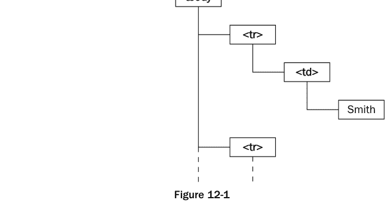

## 排序表格

为了从之前定义的表格中检索 Smith 这个值，你使用以下代码：

```javascript
var sSmith = colDataRows[0].cells[0].firstChild.nodeValue;
```

这种方法可以用于检索每行包含的值，这正是你为了创建排序比较而所需的。

## 比较函数

这个函数有趣的地方在于，它使用行内包含的值来排序 `<tr>` 元素，这意味着你必须从函数内部检索该值。在检索这些值后，你可以使用 `localeCompare()` 对它们进行比较：

```javascript
function compareTrs(oTR1, oTR2) {
  var sValue = oTR1.cells[0].firstChild.nodeValue;
  var sValue2 = oTR2.cells[0].firstChild.nodeValue;

  return sValue.localeCompare(sValue2);
}
```

此比较函数根据第一个单元格（索引 0）的值对行进行排序。接下来，你将在表格中使用此比较函数：

## sortTable() 函数

`sortTable()` 函数承担了大部分的性工作。它接受一个参数，即要排序表格的 ID。自然，这意味着函数的第一步必须是获取表格的引用：

```javascript
function sortTable(tableID) {
  var oTable = document.getElementById(tableID);
  var oBody = oTable.tbody[0];
  var colDataRows = oBody.rows;
```

问题在于如何排序 `colDataRows` 中的行。记住，`rows` 是集合而不是数组，因此它没有 `sort()` 方法。唯一的解决方案是创建一个数组并填充 `<tr>` 元素，对其进行排序，最后使用 DOM 将它们放入：


```javascript
function sortTable(tableID) {
  var oTable = document.getElementById(tableID);
  var oBody = oTable.tbody[0];
  var colDataRows = oBody.rows;
  var aTRs = new Array();

  for (var i=0; i < colDataRows.length; i++) {
    aTRs.push(colDataRows[i]);
  }
```
这段代码创建了一个名为`aTRs`的数组并填充了`<tr>`元素的引用。这样做不会移除表格中的`<tr>`元素，因为你只是存储了指针。下一步是使用`compareTrs()`函数对数组进行排序：

```javascript
function sortTable(tableID) {
  var oTable = document.getElementById(tableID);
  var oBody = oTable.tbody[0];
  var colDataRows = oBody.rows;
  var aTRs = new Array();

  for (var i=0; i < colDataRows.length; i++) {
    aTRs.push(colDataRows[i]);
  }

  aTRs.sort(compareTrs);
// ...
```
在此之后，`<tr>`元素已经在数组中了，但页面上的顺序还没有改变。要实际更改顺序，你需要将行加回去。快的方法是创建一个片段并将所有`<tr>`元素添加到其中，然后使用`appendChild()`将片段添加到`<tbody>`元素中：

```javascript
function sortTable(tableID) {
  var oTable = document.getElementById(tableID);
  var oBody = oTable.tbody[0];
  var colDataRows = oBody.rows;
  var aTRs = new Array();

  for (var i=0; i < colDataRows.length; i++) {
    aTRs[i] = colDataRows[i];
  }

  aTRs.sort(compareTrs);

  var oFragment = document.createDocumentFragment();
  for (var i=0; i < aTRs.length; i++) {
    oFragment.appendChild(aTRs[i]);
  }

  oBody.appendChild(oFragment);
}
```
这段代码创建了一个片段并将所有`<tr>`元素添加到其中，这有效地将它们从表格中移除（图 12-2）。记住，当你使用`appendChild()`并传递文档片段时，添加的是片段的所有子节点，而不是片段本身。

## 排序表格片段


剩下的工作是在用户点击列头时调用函数。你可以通过多种方法实现，最简单是将函数调用作为`<th>`元素的事件处理器：

```html
<table border="1" id="tblSort">
<head>
  <tr>
    <th onclick="sortTable('tblSort')" style="cursor:pointer">Last Name</th>
  </tr>
</head>
<tbody>
  <!-- data rows -->
</tbody>
</table>
```
另外注意`style`属性被设置为`cursor:pointer`，这确保了用户悬停在列头上时光标会变成手形。此时，点击列头即可按字母顺序对所有姓进行排序。

## 多列表格排序

在实践中，单列表格非常罕见，因此下一个任务是排序多列表格。假设你在之前的示例表格中添加了第二列，除了姓之外还显示人的名：

```html
<table border="1" id="tblSort">
<head>
  <tr>
    <th>Last Name</th>
    <th>First Name</th>
  </tr>
</head>
<tbody>
  <tr>
```

```html
<table>
  <tr>
    <td>Smith</td>
    <td>John</td>
  </tr>
  <tr>
    <td>Johnson</td>
    <td>Betty</td>
  </tr>
  <tr>
    <td>Henderson</td>
    <td>Nathan</td>
  </tr>
  <tr>
    <td>Williams</td>
    <td>James</td>
  </tr>
  <tr>
    <td>Gilliam</td>
    <td>Michael</td>
  </tr>
  <tr>
    <td>Walker</td>
    <td>Matthew</td>
  </tr>
  </tr>
</tbody>
</table>
```
当然，上一节的函数只适用于单列，因此需要进行修改。

## 比较函数生成器

在书前面的部分提到，函数就像 JavaScript 中的任何其他类型一样，这意味着它们可以作为参数传递给其他函数，也可以作为函数值返回。在本章中，你已经看到了传递给函数的函数（`sort`方法）；现在是时候学习返回函数的函数了。

比较函数的主要局限是它只接受两个——只有两个参数，这意味着无法传递额外信息。为了解决这个问题，你可以创建一个比较函数生成器，它是一个返回比较函数的独立函数。

由于`compareTrs()`必须知道比较哪列的值，因此有必要传递一个额外的参数：要操作的列索引。可以将这个额外值传递给比较函数：

```javascript
function generateCompareTrs(oTR1, oTR2) {
    var sValue1 = oTR1.cells[iCol].firstChild.nodeValue;
    var sValue2 = oTR2.cells[iCol].firstChild.nodeValue;
    return sValue1.localeCompare(sValue2);
}
```

## 表格排序

`generateCompareTRs`函数仅接受一个参数，即要操作的列索引。它返回的值是另一个函数，看起来非常像`compareTRs()`。请注意，`iCol`函数即使没有被定义为使用比较函数，它也位于比较函数内部。你可能将其识别为闭包（在第 2 节"ECMAScript '基础知识'"中讨论过）。变量`iCol`被比较函数捕获，因此在当它被`generateCompareTRs()`返回时可以使用。

通过此函数，你可以生成任何用于对列排序的比较函数：

```javascript
var compareTRs = generateCompareTRs();
var compareTR1 = generateCompareTRs(1);
var compareTRs2 = generateCompareTRs(2);
```
上述代码中的第一行获取了你在上一个节中首次定义的`compareTRs()`函数。第二行和第三行分别生成比较第二列和第三列的比较函数。当然，你不需要将比较函数赋值给变量；它可以直接传递给`sort()`方法：

```javascript
aTRs.sort(generateCompareTRs(0));
```
事实上，必须修改`sortTable()`函数以处理多个列。

## 修改 sortTable() 函数

由于有多个列需要处理，`sortTable()`函数现在必须接受另一个参数，用于指示要排序的列索引。然后，它可以将值传递给`generateCompareTRs()`函数来对相应的列排序：

```javascript
function sortTable(tableID, iCol) {
  var oTable = document.getElementById(tableID);
  var oBody = oTable.tbody;
  var colDataRows = oBody.rows;
  var aTRs = new Array;

  for (var i = 0; i < colDataRows.length; i++) {
    aTRs[i] = colDataRows[i];
  }

  aTRs.sort(generateCompareTRs(iCol));

  var oFragment = document.createDocumentFragment();
  for (var i=0; i < aTRs.length; i++) {
    oFragment.appendChild(aTRs[i]);
  }

  oBody.appendChild(oFragment);
}
```
通过这两个更改，现在可以传入要排序的列了。不要忘记，此更改也需要包含在表格的列头中：

## 第 12 章

```html
<table border="1" id="tblSort">
  <head>
    <tr>
      <th onclick="sortTable('tblSort', 0)" style="cursor:pointer">姓</th>
      <th onclick="sortTable('tblSort', 1)" style="cursor:pointer">名</th>
    </tr>
  </head>
  <body>
    <!-- 数据行 -->
  </body>
</table>
```
当然，这个函数不仅限于只有两列的表格。任何具有任意数量的表格都可以利用它，只要记住向函数传递正确的列索引即可。

## 降序排序

在前两个示例中，你学习了如何对单列和多列表格进行升序排序。现在是时候学习如何降序排序表格了。

首先，考虑可排序表格的预期行为。当你在例如 Microsoft Outlook 中对列进行排序时，你会点击列头。这样做时，列将按升序排序。如果你第二次点击列头，列将按降序排序。这种功能在用户界面设计中非常标准，因此你真的想在你的表格中模拟它。

你可以轻松地对每列进行升序排序，你已经完成了一半。这个问题的关键在于，在第二次点击时，你想进行降序排序。这意味着为了降序排序，你必须已经点击了列头（因此列已经按升序排序）。你只需要反转列的顺序（使用`reverse()`方法）来实现降序排序。

为了实现这一更改，有必要再次修改`sortTable()`函数。

## 修改 sortTable(function)

在创建降序排序时，有必要存储传递函数的列索引以供稍后引用。为了这样做，你可以创建一个扩展属性，它是在运行时添加到对象的额外 JavaScript 属性。此示例中的扩展属性称为`sortCol`，它简单地存储了被排序的列的索引：

```javascript
function sortTable(tableID, iCol) {
  var oTable = document.getElementById(tableID);
  var oTBody = oTable.tBodies[0];
  var colDataRows = oTable.rows;
  var aTRs = new Array;

  for (var i= 0; i < colDataRows.length; i++) {
    aTRs[i] = colDataRows[i];
  }
```

```javascript
aTRs.sort(generateCompareTRs(iCol));
```

```javascript
var oFragment = document.createDocumentFragment();
for (var i=0; i < aTRs.length; i++) {
  oFragment.appendChild(aTRs[i]);
}
oBody.appendChild(oFragment);
oTable.sortCol = iCol;
```
接下来，必须添加代码来检查传递的列索引是否与上次排序的索引相同。如果相等，则应该反转排序：

```javascript
function sortTable(tableID, iCol) {
  var oTable = document.getElementById(tableID);
  var oBody = oTable.tbody;
  var colDataRows = oTable.rows;
  var aTRs = new Array;

  for (var i=0; i < colDataRows.length; i++) {
    aTRs[i] = colDataRows[i];
  }

  if (oTable.sortCol == iCol) {
    aTRs.reverse();
  } else {
    aTRs.sort(generateCompareTRs(iCol));
  }

  var oFragment = document.createDocumentFragment();
  for (var i=0; i < aTRs.length; i++) {
    oFragment.appendChild(aTRs[i]);
  }

  oBody.appendChild(oFragment);
  oTable.sortCol = iCol;
}
```
这种方法的用处是，当用户点击一次时，它按升序排序。当用户点击第二次时，它按降序排序。这适用于字符串。那么数据类型呢？

## 使用数据类型排序

虽然字符串排序是一个开始，但许多你可能希望对包含其他数据类型的列进行排序。由于 DOM 节点始终包含字符串，这意味着在排序之前必须对其进行转换。为了这样做，有必要创建一个转换函数。

## 创建转换函数

转换函数相对简单：你需要两个参数，一个是要转换的值，另一个是指示转换类型的参数。通常使用三种转换：转换为整数、转换为浮点数和转换为日期。当然，如果你需要字符串，则不需要转换。

对于此转换函数，第二个参数是指示转换类型的字符串：

- "int" 转换为整数
- "float" 转换为浮点数
- "date" 转换为日期
- 其他值返回字符串

这是该函数：

```javascript
function convert(sValue, sDataType) {
  switch (sDataType) {
    case "int":
      return parseInt(sValue);
    case "float":
      return parseFloat(sValue);
    case "date":
      return new Date(Date.parse(sValue));
    default:
      return sValue.toString();
  }
}
```
此函数使用`switch`语句确定`sDataType`的值（记住`switch`适用于 JavaScript 中的所有类型）。当`sDataType`为 "int" 时，对`sValue`调用`parseInt()`并返回结果；当`sDataType`为 "float" 时，调用`parseFloat()`并返回结果。如果`sDataType`为 "date"，则结合`Date`构造函数使用`Date.parse()`创建新的 Date 对象。如果`sDataType`为任何其他值，函数返回`sValue.toString()`。例如：

```javascript
var sValue = "25";
var iValue = convert(sValue, "int");
alert(typeof iValue); //输出 "number"
var sValue2 = convert(sValue, "string");
alert(typeof sValue2); //输出 "string"
var sValue3 = convert(sValue);
alert(typeof sValue3); //输出 "string"
var sValue4 = convert(sValue, "football");
alert(typeof sValue4); //输出 "string"
```

## 表格排序

"string"，返回的值是一个字符串，`typeof`返回 "string"。当省略第二个参数或第二个参数为 "football" 时，也会返回一个字符串。

完成转换函数后，你必须修改代码的其他部分以使用它。

> 在排序时，并不总是需要区分整数和浮点数。大多数情况下，简单地将所有数字转换为浮点数即可。本章的代码使用了这两种类型的数字用于说明。

## 修改代码

第一步是修改`generateCompareTRs()`函数，它现在必须接受一个额外的参数，用于指示比较值时使用的数据类型。表格中的值必须在比较函数内部转换为适当的数据类型：

```javascript
function generateCompareTRs(iCol, sDataType) {
    return function compareTRs(oTR1, oTR2) {
        var vValue = convert(oTR1.cells[iCol].firstChild.nodeValue,
            sTypeData);
        var vValue2 = convert(oTR2.cells[iCol].firstChild.nodeValue,
            sTypeData);

        //...
    }
}
```


对`generateCompareTRs()`的这一更改再次利用了 JavaScript 的闭包，将`sDataType`参数直接传递给比较函数。遗憾的是，你不能再使用`localeCompare()`方法来返回适当的值，因为数字和日期不支持它。由于你无法确定存储的是哪种类型的值，而且对每种数据类型进行不同的比较处理并没有意义，最好的办法是使用小于和大于符号来决定返回哪个值：

```javascript
function generateCompareTRs(iCol, sDataType) {
    return function compareTRs(oTR1, oTR2) {
        var vValue = convert(oTR1.cells[iCol].firstChild.nodeValue,
            sTypeData);
        var vValue2 = convert(oTR2.cells[iCol].firstChild.nodeValue,
            sTypeData);

        if (vValue < vValue2) {
            return -1;
        } else if (vValue > vValue2) {
            return 1;
        } else {
            return 0;
        }
    }
}
```

# 第 12 章

使用这种方法论，无论使用哪种数据类型，比较函数都能返回正确的值。

> 在这种情况下，不要使用相等运算符（`==`）。虽然它对字符串和数字（包括整数和浮点数）有效，但对日期不起作用。记住，日期是对象，而不是原始值。这意味着相等运算符比较的是对象以检查它们是否相同，而不是比较 Date 对象的值。然而，小于和大于符号使用 Date 对象的`valueOf()`方法来比较它们的毫秒级表示。

接下来，修改`sortTable()`函数，以传入新的比较函数生成器。为了做到这一点，该函数也必须接受一个指示用于比较的数据类型的参数；该数据类型必须传递到`generateCompareTRs()`函数中。

```javascript
function sortTable(sTableID, iCol, sDataType) {
  var oTable = document.getElementById(sTableID);
  var oBody = oTable.Bodies[0];
  var colDataRows = oBody.rows;
  var aTRs = new Array;

  for (var i=0; i < colDataRows.length; i++) {
    aTRs[i] = colDataRows[i];
  }

  aTRs.sort(generateCompareTRs(iCol, sDataType));
```

```javascript
var oFragment = document.createDocumentFragment();
for (var i=0; i < aTRs.length; i++) {
  oFragment.appendChild(aTRs[i]);
}

oBody.appendChild(oFragment);
table.sortCol = iCol;
```

有了下面的 JavaScript 代码`id="1" id="tblSort"`，现在是时候为各种数据类型向表格添加数据了：

```html
<table border="1" id="tblSort">

  <thead>

    <tr>

      <th onclick="sortTable('tblSort', 0)" style="cursor:pointer">姓</th>

      <th onclick="sortTable('tblSort', 1)" style="cursor:pointer">名</th>

      <th onclick="sortTable('tblSort', 2, 'date')" style="cursor:pointer">日期*</th>

      <th onclick="" style="cursor:pointer">出生日期</th>

      <th onclick="sortTable('tblSort', 3, 'int')" style="cursor:pointer">兄弟姐妹</th>

    </tr>

  </thead>

  <tbody>

    <tr>

      <td>Smith</td>

      <td>John</td>

      <td>7/12/1978</td>

      <td>2</td>

    </tr>

    <tr>

      <td>Johnson</td>

      <td>Betty</td>

      <td>10/15/1977</td>

      <td>4</td>

    </tr>

    <tr>

      <td>Henderson</td>

      <td>Nathan</td>

      <td>2/25/1949</td>

      <td>1</td>

    </tr>

    <tr>

      <td>Williams</td>

      <td>James</td>

      <td>7/8/1980</td>

      <td>4</td>

    </tr>

    <tr>

      <td>Gilliam</td>

      <td>Michael</td>

      <td>7/22/1949</td>

      <td>1</td>

    </tr>

    <tr>

      <td>Walker</td>

      <td>Matthew</td>

      <td>1/14/2000</td>

      <td>3</td>

    </tr>

  </tbody>

</table>
```

注意，列头代码已更新以包含新的数据类型。对于前两列，不需要更改函数，因为它们包含字符串。然而，第三列和第四列分别包含日期和整数。对于这些列头中的每一个，都必须包含数据类型。

## 高级排序

到目前为止，你已经学会了如何按升序和降序对不同数据类型进行排序。遗憾的是，表格只包含数据类型的情况很少见。事实是你总是会遇到链接、图片或其他 HTML，而用户仍然希望进行排序。最常见的情况是包含图标的列。之前的代码不支持这种情况。

### 概念

记住，表格中的每个单元格必须有一个可排序的值，即字符串、整数、浮点数或日期。由于 HTML 代码无法直接转换为这些类型之一，你需要指定一个备用值进行排序。可以通过为包含 HTML 的每个`<td>`添加额外的属性来实现，例如：

```html
<td value="blue">
```

由于此表格包含图像，通常无法对其进行排序。然而，`value`属性指定了用于排序的值"blue"，即`<td>`元素的内容。正如你所学的，可以使用 DOM`getAttribute()`方法访问此属性：

```javascript
var sValue = td.getAttribute("value");
```

现在，没有为表格中的每个单元格添加`value`属性，因为这会产生大量的冗余信息。你应该只对包含 HTML 的表格单元格添加该属性。例如，下表列出了文件名及其图标。注意，只有第一列使用了额外的 value：

```html
<table border="1" id="tblSort">
  <thead>
    <tr>
      <th>类型</th>
      <th>文件名</th>
    </tr>
  </thead>
  <tbody>
    <tr>
      <td value="doc"></td>
      <td>My Resume.doc</td>
    </tr>
    <tr>
      <td value="xls"></td>
      <td>Fall Budget.xls</td>
    </tr>
    <tr>
      <td value="pdf"></td>
      <td>How to be a better programmer.pdf</td>
    </tr>
    <tr>
      <td value="doc"></td>
      <td>My Old Resume.doc</td>
    </tr>
    <tr>
      <td value="txt"></td>
      <td>Notes from Meeting.txt</td>
    </tr>
    <tr>
      <td value="zip"></td>
      <td>Backups.zip</td>
    </tr>
    <tr>
      <td value="xls"></td>
      <td>Spring Budget.xls</td>
    </tr>
    <tr>
      <td value="doc"></td>
      <td>Job Description - Web Designer.doc</td>
    </tr>
    <tr>
      <td value="pdf"></td>
      <td>Saved Web Page.pdf</td>
    </tr>
    <tr>
      <td value="doc"></td>
      <td>Chapter 1.doc</td>
    </tr>
  </tbody>
</table>
```

然而，这个新属性并没有解决问题。你必须更新 JavaScript 代码来利用`value`属性。

> 正如书中前面提到的，在 XHTML 的严格表示下，不允许向 HTML 标签添加自定义属性。你可能希望使用`title`属性为表格单元格提供值（如果该值对用户有意义），或者通过在表格单元格内提供一个包含该值的不可`<div>`。

### 修改代码

此代码的修改决定了是从`<td>`元素的文本还是从`value`属性获取可排序的值。以下是更新后的代码：

```javascript
function generateCompareTRS(iCol, dataType) {
  return function compareTRS(oTR1, oTR2) {
    var vValue, vValue2;
    if (oTR1.cells[iCol].getAttribute("value")) {
      vValue = convert(oTR1.cells[iCol].getAttribute("value"), dataType);
      vValue2 = convert(oTR2.cells[iCol].getAttribute("value"), dataType);
    } else {
      vValue = convert(oTR1.cells[iCol].firstChild.nodeValue, dataType);
      vValue2 = convert(oTR2.cells[iCol].firstChild.nodeValue, dataType);
    }

    if (vValue < vValue2) {
      return -1;
    } else if (vValue > vValue2) {
      return 1;
    } else {
      return 0;
    }
  }
}
```

#### 第 12 章

```javascript
if (vValue1 < vValue2) {
    return -1;
} else if (vValue1 > vValue2) {
    return 1;
} else {
    return 0;
}
}
```

基本上，`vValue1`和`vValue2`被定义为没有初始值。然后，你检查第一行的单元格是否有由`getAttribute()`定义的值，当属性不存在时，它将返回`null`。当放在`if`语句中，`null`被求值为`false`，而非空值被求值为`true`。因此，如果`value`属性存在，则`vValue1`和`vValue2`分别被赋值为`oTR1`和`oTR2`的`value`属性。如果`value`属性不存在，则`vValue1`和`vValue2`被赋值为表格内部的内容。

唯一要做的工作是在 HTML 代码中添加排序功能：

```html
<table border="1" id="tblSort">
<head>
<tr>
<th onclick="sortTable('tblSort', 0)" style="cursor:pointer">Type</th>
<th onclick="sortTable('tblSort', 1)" style="cursor:pointer">Filename</th>
</tr>
</head>
<body>
<tr>
<td value="doc"></td>
<td>>My Resume.doc</td>
</tr>
<tr>
<td value="xls"></td>
<td>>Fall Budget.xls</td>
</tr>
<tr>
<td value="pdf"></td>
<td>>How to be a better programmer.pdf</td>
</tr>
<tr>
<td value="doc"></td>
<td>>My Old Resume.doc</td>
</tr>
<tr>
<td value="txt"></td>
<td>>Notes from Meeting.txt</td>
</tr>
<tr>
<td value="zip"></td>
<td>>Backups.zip</td>
</tr>
</tbody>
</table>
```


```
<tr>
  <td value="xls"></td>
  <td><a>Spring Budget.xls</a></td></td></tr>
<tr>
  <td value="doc"></td>
  <td><a>Job Description - Web Designer.doc</a></td></td></tr>
<tr>
  <td value="pdf"></td>
  <td><a>Saved Web Page.pdf</a></td></td></tr>
<tr>
  <td value="doc"></td>
  <td><a>Chapter 1.doc</a></td></td></tr>
</tr>
</body> (注：此处原文标签有闭合，已修正为`</body>`))

这段 HTML 代码使用字符串对两列进行排序；因此，在调用`sortTable()`时不需要第三个参数。尽管第一列包含图像，但代码在进行排序时都使用`value`属性来按升序和降序排列。

## 总结

本章探索了使用 JavaScript 将更多服务器端功能移动到客户端：HTML 表格排序。你学习了如何结合比较函数和 Array 的`sort()`方法来定义自定义排序顺序。凭借这些知识，你继续学习了主要按升序对字符串进行排序。

接下来，你学习了如何使用 Array 的`reverse()`方法进行降序排序。然后，引入了具有不同值的列。在编写了一个排序函数后，你能够对整数、浮点数和日期进行列排序。最后，你学习了如何处理包含 HTML 的单元格。

在此过程中，你学习了 JavaScript 中的闭包（closures），允许生成的函数包含对作用域变量的引用。通过闭包，你看到了如何确定两个值中哪个应该先发生。

## 13 拖放 (Drag and Drop)

计算机易用性的最大改进之一是拖放行为的出现，它允许用户从屏幕某处拖动到某处以创建一个动作或移动项目。这种由 Xerox 开发的范式首次引入到 Mac OS 1.0，从那时起被引入大多数操作系统（包括 Windows）。拖放是一个术语，当动态 HTML 首次引入时，开发者开始使用 JavaScript 实验拖放功能。目前，你可以通过两种方式使用 JavaScript 完成拖放：系统拖放和模拟拖放。

### 系统拖放 (System Drag and Drop)

系统拖放是在 Windows、Macintosh 或其他操作系统上每天执行的操作：从屏幕的某个区域拖动到某处。要删除文件，将其拖到垃圾桶（Macintosh）或回收站（Windows）；要将文件从一个文件夹移动到另一个，将其拖到新位置。目前，只有 Internet Explorer 支持拖放（尽管后续版本也支持）。

系统拖放可以在框架之间移动项目。你可以将图像拖动到桌面或另一个浏览器。当你将其拖到桌面时，浏览器会显示图像；当你将其拖到另一个浏览器时，浏览器会显示图像。浏览器与桌面（或其他浏览器）之间的通信由系统处理。

### 第 13 章

在 Internet Explorer 4.0 中，只有两个页面可以启动系统拖放：图像或文本。拖动图像时，你只需按住鼠标按钮并移动；选中某些文本然后也可以拖动。在 IE 4.0 中，唯一的拖拽目标是文本框。

在 5.0 版本中，Internet Explorer 通过添加新事件并允许页面上的任何内容成为拖放目标，扩展了其拖放能力。5.5 版本进一步允许任何内容都变得可拖动（IE 6 也支持此功能）。

> 本节讨论的系统拖放功能仅适用于 Windows 版本的 Internet Explorer；Macintosh 版本的 IE 未开发这种程度的功能。

## 拖放事件 (Drag-and-drop events)

添加到 Internet Explorer 中的拖放事件允许你控制拖放操作的几乎每个方面。困难之处在于确定每个事件何时触发：某些在拖拽的项目上，另外一些在释放目标上。

### 拖拽项目事件 (Drag item events)

当拖拽项目时，按以下顺序触发事件：
1. `dragstart`
2. `drag`
3. `dragend`

当你按住鼠标按钮开始移动时，`dragstart`事件在被拖拽的项目上触发。默认情况下，此事件会在图像或文本选择上触发。光标会变为不可放置符号（带斜线的圆），表示无法将其放置在你身上。你可以使用`dragstart`事件处理器在拖拽开始时运行 JavaScript 代码。

在`dragstart`事件触发后，只要对象在被拖拽，`drag`事件就会持续触发。你可以将其认为类似于`mousemove`（鼠标移动时也会反复触发）。当拖拽停止（你将项目放入有效或无效的释放目标）时，`dragend`事件触发。

以下示例显示了如何使用`dragstart`、`ondrag`和`dragend`事件处理器：

```html
<html>
<head>
  <title>文本拖放示例</title>
  <script type="text/javascript">
    function handleDragEvent(oEvent) {
      var textBox = document.getElementById("txt1");
      textBox.value += oEvent.type + "\n";
    }
  </script>
</head>
<body>
  <form>
    <p>尝试拖动图像。</p>
    <p></p>
    <p><textarea rows="10" cols="25" readonly="readonly"
    id="txt1"></textarea></p>
  </form>
</body>
</html>
```

此示例为图像分配了`dragstart`、`ondrag`和`dragend`事件处理器。你拖动图像时，以下文本框会在每次事件发生时显示事件。你最终会在文本框中看到类似这样的内容：

- `dragstart`
- `drag`
- `drag`
- `drag`
- `drag`
- `drag`
- `dragend`

在这个示例上玩一会，直到你掌握了这些事件。

> 在 Windows 上的 IE 之外的任何浏览器上，上一个示例中的事件处理器会被忽略。如果你计划实现拖放解决方案，请记住此点。

## 释放目标事件 (Drop Target Events)

当项目被拖到有效目标上方时，`dragenter`事件（类似于`mouseover`事件）会触发。在`dragenter`触发后后，`dragover`事件触发，并在项目在释放目标的边界内拖动时持续触发。当项目被拖出边界时，`dragover`停止触发，并触发`dragleave`事件（类似于`mouseout`）。如果项目实际上被释放在目标上，则会触发`drop`事件而不是`dragleave`。

此示例探索了释放目标事件：

```html
<html>
<head>
  <title>系统拖放示例</title>
  <script type="text/javascript">
    function handleDragDropEvent(oEvent) {
      var textBox = document.getElementById("txt1");
      textBox.value += oEvent.type + "\n";
    }
  </script>
</head>
<body>
  <form>
    <p>尝试将文本从左侧文本框拖到右侧文本框。</p>
    <input type="text" value="drag this text" />
    <input type="text" ondragenter="handleDragDropEvent(event)" ondragover="handleDragDropEvent(event)"
    dragleave="handleDragDropEvent(event)"
    drop="handleDragDropEvent(event)" /></p>
    <textarea name="txt1" rows="10" cols="25" readonly="readonly"></textarea></p>
  </form>
</body>
</html>
```

上一个示例提供了两个文本框用于处理事件，以及一个用于在事件发生时宣布事件。当你将文本从左侧文本框拖到右侧文本框时，`<textarea>`会随着事件的触发而填充。如果你将文本拖到文本框上方然后拖出，你会看到如下所示事件：

- `dragenter`
- `dragover`
- `dragover`
- `dragover`
- `dragover`
- `dragover`
- `dragover`
- `dragleave`

否则，如果你将文本拖入第二个文本框，你会看到类似以下的内容：

- `dragenter`
- `dragover`
- `dragover`
- `dragover`
- `dragover`
- `dragover`
- `drop`

注意，当你将文本拖入第二个文本框时，被高亮的文本实际上移动到了那里。

## 使用拖放事件

处理系统级拖放的难点在于在于理解被拖拽项目的事件与拖放目标事件之间的关系。通常情况下，被拖拽项目的事件总是先触发，`drop`事件除外，该事件会在`dragend`之前触发。下面的示例允许你探索这些组事件之间的关系：

```html
<html>
<head>
  <title>系统拖放示例</title>
  <script type="text/javascript">
    function handleDragDropEvent(oEvent) {
      var oTextbox = document.getElementById("txt1");
      oTextbox.value += oEvent.type + "\n";
    }
  </script>
</head>
<body>
  <p>将文本从左侧文本框拖到右侧文本框。</p>
  <form>
    <p><input type="text" value="drag target, 只有拖拽项目事件会触发"
    ondragstart="handleDragDropEvent(event)"
    ondragend="handleDragDropEvent(event)"
    ondragover="handleDragDropEvent(event)" />
    <p><input type="text" value="handle the drag target"
    ondragstart="handleDragDropEvent(event)"
    ondragend="handleDragDropEvent(event)"
    ondragover="handleDragDropEvent(event)"
    ondragleave="handleDragDropEvent(event)"
    ondrop="handleDragDropEvent(event)" /></p>
    <p><textarea rows="10" cols="25" readonly="readonly"
    id="txt1"></textarea></p>
  </form>
</body>
</html>
```

如你所示，这个示例结合了前两个示例的功能，同时监控被拖拽项目的事件和拖放目标事件。当你从左侧将文本拖入右侧文本框时，你会看到如下所示的事件列表：

- `dragstart`
- `drag`
- `drag`
- `drag`
- `drag`
- `dragenter`
- `drag`
- `dragover`
- `drag`
- `dragover`
- `drag`
- `drop`
- `dragend`

注意，从拖放目标开始拖拽会首先触发`drag`。当你将文本拖过拖放目标时，会触发`dragenter`事件，随后是`drag`然后是`dragover`。当你仍在拖放目标上方拖拽时，这两个事件会反复触发。当你释放到目标上时，`drop`事件紧接着触发`dragend`。这完成了整个拖放序列。

如果你没有释放到目标上，你会看到一系列类似这样的事件：

- `dragstart`
- `drag`
- `drag`
- `drag`
- `drag`
- `dragenter`
- `drag`
- `dragover`
- `drag`
- `dragover`
- `drag`
- `dragleave`
- `drag`
- `drag`
- `dragend`

在这种情况下，你将文本拖过右侧文本框，然后拖出，因此触发了`dragleave`事件，随后是`drag`事件。当你最终停止释放文本时，触发`drag`事件。

默认情况下，文本框`<input/>`或`<textarea>`是网页上唯一的有效拖放目标，尽管通过`dragover`和`dragenter`事件的行为可以从任何元素创建拖放目标。

## 创建你自己的拖放目标

当你尝试将某些文本（或图像）拖过无效的拖放目标时，你会看到一个特殊的光标（带斜线的圆圈），表示你无法释放。尽管所有元素都支持`drop`事件，但它们默认的行为是不释放的。例如：

```html
<html>
<head>
  <title>系统拖放示例</title>
  <script type="javascript">
    function handleDragDropEvent(event) {
      var oTextBox = document.getElementById("txt1");
      oTextBox.value += event.type + "\n";
    }
  </script>
</head>
<body>
  <p>尝试将文本从文本框拖到红色正方形。没有拖放目标事件触发。</p>
  <form>
    <p><input type="text" value="drag this text"
    ondragstart="handleDragDropEvent(event)"
    ondragover="handleDragDropEvent(event)"
    ondrop="handleDragDropEvent(event)" />
    <div style="background:red; height: 100px; width: 100px"
    ondragstart="handleDragDropEvent(event)"
    ondragover="handleDragDropEvent(event)"
    ondrop="handleDragDropEvent(event)"></div><p>
    <textarea rows="10" cols="25" readonly="readonly"
    id="txt1"></textarea></p>
  </form>
</body>
</html>
```

## 拖放目标

当你拖拽文本过非有效的拖放目标时，被拖拽项目的事件会触发。尽管所有元素都支持`drop`事件，但它们默认的行为是不释放的。在下面的示例中，为了将`<div>`变为有效的拖放目标，必须覆盖`dragover`和`dragenter`事件的行为：

```html
<html>
<head>
  <title>系统拖放示例</title>
  <script type="text/javascript">
    function handleDragDropEvent(oEvent) {
      var oTextbox = document.getElementById("txt1");
      oTextbox.value += oEvent.type + "\n";
    }
    switch(oEvent.type) {
      case "dragover":
        oEvent.returnValue = false;
        break;
      case "drop":
        alert(oEvent.dataTransfer.getData("text"));
    }
  </script>
</head>
<body>
  <p>尝试将文本从文本框拖到红色正方形。没有拖放目标事件触发。</p>
  <form>
    <p><input type="text" value="drag this text"
    ondragstart="handleDragDropEvent(event)"
    ondragover="handleDragDropEvent(event)"
    ondrop="handleDragDropEvent(event)" />
    <div style="background:red; height: 100px; width: 100px"
    ondragstart="handleDragDropEvent(event)"
    ondragover="handleDragDropEvent(event)"
    ondrop="handleDragDropEvent(event)"></div><p>
    <textarea rows="10" cols="25" readonly="readonly"
    id="txt1"></textarea></p>
  </form>
</body>
</html>
```

## 拖放操作


在这个示例中，被拖拽项目的事件会触发，但当你将文本拖过拖放目标时，`dragenter` 事件不会触发。为了让`<div>`成为有效的拖放目标，必须覆盖`dragover`和`dragenter`事件的行为。

## dataTransfer 对象

在拖放过程中，`dataTransfer`对象被用于传输数据。在 Internet Explorer 5.0 中引入了它，它是事件的一个属性。默认情况下，`dragenter`和`dragover`事件不会允许拖放。

## 方法

`dataTransfer`对象有两个方法：`getData()`和`setData()`。正如你预期的，`getData()`用于获取值，而`setData()`用于设置数据。`setData()`的第一个参数是指示数据类型的字符串`"text"`或`"URL"`。例如：

```javascript
oEvent.dataTransfer.setData("text", "some text");
var sData = oEvent.dataTransfer.getData("text");
oEvent.dataTransfer.setData("URL", "http://www.wrox.com/");
var sURL = oEvent.dataTransfer.getData("URL");
```

可以使用两个空间存储数据。如果你反复调用`setData()`，将总是覆盖存储空间中的数据。

数据只在`drop`事件之前一直有效。如果你没有在`drop`事件中检索数据，事件处理器对象就会被销毁，数据也会丢失。

当你从框中绘制文本时，操作系统会调用`setData()`并以`"text"`格式存储数据。当将其释放到目标上时，可以检索此值。考虑以下示例：

```html
<html
<head>
  <title>系统拖放示例</title>
  <script type="javascript">
  function handleDragDropEvent(oEvent) {

    switch(oEvent.type) {
      case "dragover":
        oEvent.returnValue = false;
        break;
      case "drop":
        alert(oEvent.dataTransfer.getData("text"));
    }
  }
  </script>
</head>
<body>
  <p>尝试将文本从文本框拖到红色正方形。
在释放时它将显示选中的文本。</p>
  <input type="text" value="drag this text" />
  <div style="background-color: red; height: 100px; width: 100px"
ondragenter="handleDragDropEvent(event)"
ondragover="handleDragDropEvent(event)"
drop="handleDragDropEvent(event)"></div></p>
</body>
</html>
```

## 拖放

这本质上与上一个示例相同，不同在于调用`getData`方法获取的是被拖拽的文本。当你将该文本释放到红色的`<div>`上时，会弹出一个警告框，显示你正在拖拽的文本。

你可能会想，如果在使用`getData()`时使用参数`"URL"`而不是`"text"`会发生什么？在这个示例中，它将返回一个`null`值，因为数据是存储为文本的，因此将以文本的形式检索。

如果你将一个链接拖到红色的`<div>`上，你可以使用`"URL"`格式的`getData()`来获取该链接：

```html
<html>
<head>
<title>System Drag And Drop Example</title>
<script type="text/javascript">
function handleDragDropEvent(oEvent) {

  switch(oEvent.type) {
    case "dragover":
    case "dragenter":
      oEvent.returnValue = false;
      break;
    case "drop":
      alert(oEvent.dataTransfer.getData("URL"));
  }
}
</script>
</head>
<body>
<p>尝试将链接拖到红色正方形。</p>
<p><a href="http://www.wrox.com" target="_blank">Wrox 主页</a></a></p>
<div style="background-color: red; height: 100px; width: 100px"
ondragstart="handleDragDropEvent(event)"ondragover="handleDragDropEvent(event)"
drop="handleDragDropEvent(event)"></div>

</body>
</html>
```

当你在开始拖动它时，浏览器会调用`getData()`并将`href`设置为 URL。通过使用`getData()`并请求 URL 格式，你获取了这个值。文本格式和 URL 格式之间真正的区别是什么呢？

当你指定将数据存储为文本时，它会得到相应的处理。从某种意义上说，"它只是普通的普通的文本"。然而，当你指定将数据存储为 URL 时，它的处理方式就像网页上的链接一样，这意味着如果你将其释放到另一个浏览器中；浏览器将导航到该 URL。这将在稍后讨论。

## dropEffect 和 effectAllowed

`DataTransfer`对象不仅可以用于简单地在之间传输数据，还可以用于确定对拖拽项目和释放目标可以执行的操作类型。通过使用两个属性可以实现：`dropEffect`和`effectAllowed`。

## 第 13 章

`dropEffect`属性设置在释放目标上，用于确定允许什么种类型的释放行为。有四种可能的值：

- `"none"` — 拖拽的项目无法释放到此处。这是所有文本框的默认值。
- `"move"` — 表示拖拽的项目应该移动到释放目标。
- `"copy"` — 表示拖拽的项目应该被复制到释放目标。
- `"link"` — 表示释放目标将导航到拖拽的项目（仅当它是一个 URL 时）。

当项目拖过释放目标上方时，这些值中的每一个值都会显示不同的光标。然而，实际触发光标所指示的操作取决于你。换句话说，如果没有你的指令性意图，没有任何东西会自动移动、复制或链接。你唯一免费获得的就是使用`dropEffect`属性，它必须在释放目标的`ondragenter`事件处理程序中设置。

如果你同时也在拖拽项目上设置了`effectAllowed`属性，那么`dropEffect`属性就没用了。该属性指示了允许对拖拽项目的`dropEffect`。可能的值为：

- `"uninitialized"` — 为拖拽项目未设置任何操作。
- `"none"` — 拖拽项目不允许任何操作。
- `"copy"` — 仅允许`dropEffect` `"copy"`。
- `"link"` — 仅允许`dropEffect` `"link"`。
- `"move"` — 仅允许`dropEffect` `"move"`。
- `"copyLink"` — 允许`dropEffects` `"copy"`和`"link"`。
- `"copyMove"` — 允许`dropEffects` `"copy"`和`"move"`。
- `"linkMove"` — 允许`dropEffects` `"link"`和`"move"`。
- `"all"` — 允许所有的`dropEffects`。

此属性必须在`dragstart`事件处理程序中设置。

假设你想允许用户从文本框将文本移动到`<div>`中。你必须将`dropEffect`和`effectAllowed`都设置为`"move"`。但遗憾的是，文本不会自动移动，因为在`<div>`上释放事件的默认行为是什么都不做。如果你覆盖了默认行为，它将自动从文本框中移除。需要你使用`innerHTML`属性将其插入到`<div>`中：

```html
<html>
<head>
  <title>System Drag And Drop Example</title>
  <script type="text/javascript">
    function handleDragEvent(event) {
      switch(event.type) {
        case "dragstart":
```

## 拖放

```html
oEvent.dataTransfer.effectAllowed = "move";
break;
case "dragerent"
oEvent.dataTransfer.dropEffect = "move";
oEvent.returnValue = false;
break;
case "dragover"
oEvent.returnValue = false;
break;
case "drop"
oEvent.returnValue = false;
oEvent.innerHTML = oEvent.dataTransfer.getData("text");
break;
```

}

</script>

<body>

<p>尝试将链接拖到红色正方形。</p>

<div style="background-color: red; height: 100px; width: 100px"

ondragstart="handleDragDropEvent(event)"ondragover="handleDragDropEvent(event)"

drop="handleDragDropEvent(event)"></div>

</body>

</html>

```

当在这个示例中拖动`<div>`时，文本`"This is a red square"`被设置为`dataTransfer`对象。如果你将红色正方形释放到文本框中，它就像从另一个文本框拖拽过去一样。你甚至可以将`<div>`拖到另一个浏览器窗口的文本框中，发生同样的情况。

如果你选择存储 URL 而不是文本，可以将红色正方形拖到另一个浏览器窗口，并让浏览器导航到指定的页面：

```html

<html>

<head>

  <title>System Drag And Drop Example</title>

  <script type="text/javascript">

    function handleMouseMove(oEvent) {

      if (oEvent.button == 1) {

```

## drag() 方法

你已经知道如何创建释放目标，现在现在是学习可拖拽项目了。下一步是在元素的`dragstart`事件处理程序中使用`dataTransfer`对象来提取拖拽的项目。例如，你可以创建一个`<div>`，它在被拖拽时插入文本：

```html

<html>

<head>

  <title>System Drag And Drop Example</title>

  <script type="text/javascript">

    function handleMouseMove(oEvent) {

      if (oEvent.button == 1) {

        oEvent.srcElement.dragDrop();

      }

    }

    function handleDragDropEvent(oEvent) {

      oEvent.dataTransfer.setData("text", "This is a red square");

    }

  </script>

</head>

<body>

  <p>将红色正方形拖到文本框中。</p>

  <div style="background-color: red; height: 100px; width: 100px"

onmousemove="handleMouseMove(event)"ondragstart="handleDragDropEvent(event)">This is a red square</div></p>

  <form>

    <p><input type="text" value=""/></p>

  </form>

</body>

</html>

```

## 拖放

```javascript

oEvent.srcElement.dragDrop();

}

function handleDragDropEvent(oEvent) {

  oEvent.dataTransfer.setData("URL", "http://www.wrox.com/");

}

</head>

<<body>

<p>尝试将红色正方形拖入另一个浏览器窗口中。</p>

<p><div style="background-color: red; height: 100px; width: 100px"

ononmouseover="handleMouseOver(event)"ondragstart="handleDragDropEvent(event)">http://www.wrox.com</div></p>

</body>

</html>

```

在这个示例中，将红色的 div 拖入另一个浏览器窗口会导致浏览器导航到主页 http://www.wrox.com。

## 优点与缺点

显然，Internet Explorer 中的系统拖放是一项非常强大的功能，它允许你利用诸如运行操作系统程序的功能。跨框架以及浏览器窗口拖动信息的能力，为 JavaScript 开发者开启了无限可能的新世界。你必须在 Windows 上使用 Internet Explorer 5.0 或更高版本。

如果你需要开发一种适用于多个浏览器的拖放解决方案，那么系统拖放并不是可行方案。尽管这种解决方案易于使用，但没有其他浏览器采取任何包含此类功能的行动，而且在不久的未来也不可能发生变化。对于那些仅为 Internet Explorer 开发的开发者来说，这种解决方案运行得很好；但对于其他人来说，答案是模拟拖放功能。

## 模拟拖放

模拟拖放自 Internet Explorer 4.0 和 Netscape Navigator 4.0 引入动态 HTML（Dynamic HTML）以来一直存在。基本思想非常简单：你创建一个绝对定位的层，它可以随着鼠标移动。在实践中，要让用户获得真正的"拖拽感"体验会有点复杂。

这类拖放的方法是经典光标轨迹脚本的扩展。你可能记得遇到过某个网页，你的光标后面跟着一张图片。这很容易实现：

```html

<<html>

<head>

<title>模拟拖放示例</title>

<script type="text/javascript">

```

## 第 13 章

```javascript

function handleMouseMove(oEvent) {

  var oDiv = document.getElementById("div");

  oDiv.style.left = oEvent.clientX;

  oDiv.style.top = oEvent.clientY;

}

<script>

<style type="text/css">

#div {

  background-color: red;

  height: 100px;

  width: 100px;

  position: absolute;

}

</style>

</head>

<body onmousemove="handleMouseMove(event)">

  <p>尝试移动你的鼠标。</p>

  <div id="div"></div></p>

</body>

</html>

```

在这个示例中，一个红色的`<div>`跟随着光标。每当光标移动时，`<div>`都会定位在相同的位置，使其左上角与光标对齐。注意，`onmousemove`事件处理器是分配给`<body>`元素的，而不是`<div>`。这是因为你是在整个页面跟踪鼠标移动，而不仅仅是在`<div>`内部。

为了模拟拖放，`<div>`不应该自己移动；拖放必须被启动和停止。这里代码变得有点复杂，并且需要书中之前提到的`EventUtil`对象。

## 代码

第一步是创建三个函数：每个函数处理三个鼠标事件之一（`mousemove`、`mousedown`、`mouseup`）。处理移动的函数分配给`<div>`（或要拖动的元素）。当用户在`<div>`上按下鼠标按钮时，为`<body>`分配`mousemove`和`mouseup`处理器。当用户释放按钮时，拖放停止并移除`mousemove`和`mouseup`处理器。以下是代码：

```html

<<html>

<head>

<title>模拟拖放示例</title>

<script type="text/javascript" src="eventutil.js"></script>

<script type="text/javascript">

function handleMouseMove(oEvent) {

  var oEvent = EventUtil.getEvent();

  var oDiv = document.getElementById("div");

  oDiv.style.left = oEvent.clientX;

  oDiv.style.top = oEvent.clientY;

}


## 第 13 章

如你所示，`handleMouseDown` 添加了 `mousemove` 和 `mouseup` 处理器，而 `handleMouseUp` 移除了它们。投放目标也是要拖动的 `<div>`。和被拖动的项目一样，投放目标使用 `offsetLeft`、`offsetTop` 属性来确定 x 和 y 坐标。`isOverTarget()` 函数的设计是通过接收一组坐标，如果落在投放目标内则返回 `true`。

函数中的第一行引用 ID 为 `divDropTarget` 的元素。接几行定义了两个 x 和 y 坐标。最后一行测试坐标是否在投放目标内，如果是则返回 `true`，否则则返回 `false`。

```javascript
function handleMouseMove(oEvent) {
  var oEvent = EventUtil.getEvent();
  var oDiv = document.getElementById("div");
  oDiv.style.left = oEvent.clientX;
  oDiv.style.top = oEvent.clientY;
}
```

```css
#div {
  background-color: red;
  height: 100px;
  width: 100px;
  position: absolute;
}
```

```html
</style>
</head>
<body>
<p>尝试移动你的鼠标。</p>
  <div id="div"></div></p>
</body>
</html>
```

在这个示例中，一个红色的 `<div>` 跟随着光标。每当光标移动时，`<div>` 都会定位在相同的位置，使其左上角与光标对齐。注意 `onmousemove` 事件处理器是分配给 `<body>` 元素的，而不是 `<div>`。这是因为你是在整个页面跟踪鼠标移动，而不仅仅是在 `<div>` 内部。

为了模拟拖放，`<div>` 不应该自己移动；拖放必须被启动和停止。这里代码变得有点复杂，并且需要书中之前的 `EventUtil` 对象。

```javascript
function handleMouseMove(oEvent) {
  var oEvent = EventUtil.getEvent();
  var oDiv = document.getElementById("div");
  oDiv.style.left = oEvent.clientX;
  oDiv.style.top = oEvent.clientY;
}
```

```javascript
function handleMouseDown() {
  EventUtil.addEventHandler(document.body, "mousemove", handleMouseDown());
  EventUtil.addEventHandler(document.body, "mouseup", handleMouseUp());
}

function handleMouseUp() {
  EventUtil.removeEventHandler(document.body, "mousemove", handleMouseDown());
  _EventUtil.removeEventHandler(document.body, "mouseup", handleMouseUp());
}
```

```html
<style type="text/css">
#div1 {
  background-color: red;
  height: 100px;
  width: 100px;
  position: absolute;
}
</style>
</head>
<body>
<p>尝试拖动红色正方形。</p>
<p><div id="div1" onmousedown="handleMouseDown()"></div></p>
</body>
</html>
```

如你所示，`handleMouseDown` 添加了 `mousemove` 和 `mouseup` 处理器，而 `handleMouseUp` 移除了它们。投放目标也是要拖动的 `<div>`。和被拖动的项目一样，投放目标使用 `offsetLeft`、`offsetTop` 属性来确定 x 和 y 坐标。`isOverTarget()` 函数的设计是通过接收一组坐标，如果落在投放目标内则返回 `true`。

```javascript
function isOverTarget(ix, iy) {
  var oTarget = document.getElementById("divDropTarget");
  var ix1 = oTarget.offsetLeft;
  var ix2 = ix1 + oTarget.offsetWidth;
  var iy1 = oTarget.offsetTop;
  var iy2 = iy1 + oTarget.offsetHeight;
  return (ix >= ix1 && ix <= ix2 && iy >= iy1 && iy <= iy2);
}
```

## 创建投放目标

现在你已经知道如何在屏幕上拖动元素，你只需要一个放置它的地方。模拟拖放的投放目标涉及检查鼠标坐标以判断其是否在投放目标的范围内。和被拖动的项目一样，投放目标也使用 `offsetLeft`、`offsetTop`、`offsetWidth` 和 `offsetHeight` 属性来确定 x 和 y 坐标。`isOverTarget()` 函数的设计是通过接收一组坐标，如果落在投放目标内则返回 `true`。

```javascript
function handleMouseUp() {
  var oEvent = EventUtil.getEvent();
  EventUtil.removeEventHandler(document.body, "mousemove", handleMouseUp());
  EventUtil.removeEventHandler(document.body, "mouseup", handleMouseUp());
}
```

```javascript
if (isOverTarget(oEvent.clientX, oEvent.clientY)) {
  alert("dropped!");
  var oDiv = document.getElementById("divDropTarget");
  var oTarget = document.getElementById("div2");
  oDiv.style.left = oTarget.offsetLeft;
  oDiv.style.top = oTarget.offsetTop;
}
```

高亮部分显示，如果光标位于指定的投放目标上，会弹出提示。然后，被拖动的元素被定位到投放目标的左上角，使其像是吸附到位了。当然，如果你有多个项目要拖到同一个投放目标，你必须创建某种逻辑来确保每个项目都安排得当，但这已经足够你开始了。以下是所有代码组合后的结果：

```html
<html>
<head>
  <title>模拟拖放示例</title>
  <script type="text/javascript" src="eventutil.js"></script>
  <script type="text/javascript">
    var iDiffX = 0;
    var iDiffY = 0;

    function handleMouseOver(event) {
      var oEvent = EventUtil.getClient();
      var oDiv = document.getElementById("div");
      oDiv.style.left = oEvent.clientX - iDiffX;
      oDiv.style.top = oEvent.clientY - iDiffY;
    }

    function handleMouseDown(event) {
      var oEvent = EventUtil.getClient();
      var oDiv = document.getElementById("div");
      iDiffX = oEvent.clientX - oDiv.offsetLeft;
      iDiffY = oEvent.clientY - oDiv.offsetTop;
      EventUtil.addHandler(document.body, "mousemove", handleMouseOver);
      EventUtil.addHandler(document.body, "mouseup", handleMouseUp);
    }

    function handleMouseUp() {
      var oEvent = EventUtil.getClient();
      EventUtil.removeEventHandler(document.body, "mousemove");
      EventUtil.removeEventHandler(document.body, "mouseup");
    }

    if (isOverDragTarget(oEvent.clientX, oEvent.clientY)) {
      alert("已释放!");
      var oDiv = document.getElementById("divDropTarget");
      var oTarget = document.getElementById("div2");
      oDiv.style.left = oTarget.offsetLeft;
      oDiv.style.top = oTarget.offsetTop;
    }

    function isOverDragTarget(iX, iY) {
      var oTarget = document.getElementById("divDropTarget");
      var i1 = oTarget.offsetLeft;
      var i2 = i1 + oTarget.offsetWidth;
      var j1 = oTarget.offsetTop;
      var j2 = j1 + oTarget.offsetHeight;
      return (iX >= i1 && iX <= i2 && iY >= j1 && iY <= j2);
    }
  </script>
  <style type="text/css">
    #div1 {
      background-color: red;
      height: 100px;
      width: 100px;
      position: absolute;
      z-index: 10;
    }
    #divDropTarget {
      background-color: blue;
      height: 200px;
      width: 200px;
      position: absolute;
      left: 300px;
    }
  </style>
</head>
<body>
  <p>尝试将红色正方形拖动到蓝色正方形上。</p>
  <div id="div" onmousedown="handleMouseDown(event)"></div>
  <div id="divDropTarget"></div>
</body>
</html>
```

```html
<style type="text/css">
#div {
  background-color: red;
  height: 100px;
  width: 100px;
  position: absolute;
  left: 300px;
}
</style>
</head>
<body onload="doLoad()">
<p>尝试将红色正方形拖到蓝色正方形上方。</p>
<div id="div"></div>
<div id="divDropTarget"></div>
</body>
</html>
```

如你所见，这段代码的 JavaScript 源代码比上一节中的示例要短。JavaScript 的前两行声明了`zDraggable`和`zDropTarget`对象。然后，通过`addDropTarget()`将拖放注册到`zDraggable`对象上。最后，为释放目标添加了释放事件的事件处理器。该事件处理程序利用之前提到的方法将可拖拽元素移动到拖放目标的左上角。记住，事件对象的`relatedTarget`属性等于释放事件中使用的可拖拽元素。

当然，这段代码必须在页面加载后调用，因此使用了`onload`事件处理程序来实现这一目的。

## 总结

本章介绍了 Web 浏览器中的拖放概念，并解释了系统拖放与模拟拖放之间的区别。

你学习了 Internet Explorer 的内置系统拖放功能，以及它是唯一支持从 Web 页面进行系统拖放的浏览器。还讨论了 IE 提供的用于系统拖放的各种事件和方法，以及拖放文本和链接的策略。

接下来，你学习了模拟拖放，这是一种使用 DOM 移动元素以产生拖放功能效果的方法。你学习了如何构建一个简单的拖放示例。

最后，你接触了`zDragDrop`库，这是一个封装了大量模拟拖放功能的免费 JavaScript 库。通过使用该库，你学习了如何利用自定义对象、方法和事件创建一个拖放示例。

# 14

## 错误处理

传统上，JavaScript 被认为是一种充斥着困惑错误信息的语言，例如`Object Expected`（预期对象）和`Illegal Syntax`（非法语法），且仅有一个行号来标识其来源。调试此类信息充其说是一次痛苦的体验，而 4 版本的浏览器（Internet Explorer 4.0 和 Netscape Navigator 4.0）包含了一些错误处理功能。不久后，ECMA 以 ECMAScript 第三版的形式给出了答案。

这个最新版本的 ECMAScript 在其“大哥”Java 之后增加了异常处理能力。使用 ECMAScript 第二版的一些保留关键字，第三版实现了`try...catch...finally`结构以及`throw`运算符。

本章将同时探索基于浏览器的错误处理能力以及 ECMAScript 的异常处理特性。

## 错误处理的重要性

在早期的浏览器（如 Internet Explorer 3.0 和 Netscape Navigator 3.0）中，没有错误处理。通常，函数返回一个无效值（取决于用例，通常为`null`、`false`或`-1`）来表示发生了错误。考虑以下情况：

```javascript
var iLoc = findItem(colorarray, "blue");
if (iLoc == -1) {
    alert('The item doesn't exist.');
} else {
    alert('The item is in location " + iLoc + ".');
}
```


在这种情况下，当给定字符串不存在时，`findItem()`函数返回`-1`（一个无效值）。推测，有效值是一个大于或等于`0`的数字。但为什么函数会返回无效值呢？字符串`"blue"`仅仅是不在`colorarray`中吗？或者有其他原因，也许是数组里没有任何项目？无法得知为什么返回了无效值。错误和错误处理有助于消除这一谜团。

随着错误处理被引入 JavaScript，Web 开发者现在能够更好地控制代码。良好的错误处理技术允许脚本进行平滑的开发、调试和部署。在许多方面，这些技术在 JavaScript 中比其他编程语言更重要，因为它缺乏标准的开发环境（如用于 .NET Framework 的 Visual Studio.NET 或用于 Java 开发的 NetBeans）来引导开发者。

# 错误与异常

在讨论编程中的错误时，你实际上只关注两类主要问题：语法错误和运行时错误。

语法错误（也称为解析错误）发生在传统编程语言的编译时，以及 JavaScript 的解释执行时。这些错误是代码中出现意外字符的直接结果，从而导致代码无法被完全编译/解释。例如，下面这一行会导致语法错误，因为它缺少了右括号：

```javascript
document.write("test");
```

当发生语法错误时，代码无法执行。在 JavaScript 中，只有与语法处于同一线程中的代码会受影响。假设其他线程和其他引用的文件中的代码没有依赖于包含错误的代码，它们就可以正常执行。

运行时错误（也称为异常）发生在执行期间（编译/解释之后）。在这种情况下，问题不在于代码的语法，而是尝试完成的操作在某种意义上是非法的。例如：

```javascript
window.openMySpecialWindow();
```

在接下来的代码中，尝试访问窗口对象中名为`MySpecialWindow`的方法。从语法上说这一行是正确的，但并没有该方法。这导致浏览器返回异常。

异常只会影响发生它的线程，允许其他 JavaScript 继续正常执行。考虑以下 HTML 页面：

```html
<head>
  <title>Exception</title>
  <script type="text/javascript">
    function onLoad() {
      window.openMySpecialWindow();
      alert("Loaded");
    }

    function handleClick() {
      alert("Clicked");
    }
  </script>
</head>

<body onload="doLoad()" onclick="handleClick()">
  <input type="button" value="Click Me" />
</body>
</html>
```

# 错误处理

```html
<head>
  <title>Exception</title>
  <script type="text/javascript">
    function onLoad() {
      window.openMySpecialWindow();
      alert("Loaded");
    }

    function handleClick() {
      alert("Clicked");
    }
  </script>
</head>

<body onload="doLoad()" onclick="handleClick()">
  <input type="button" value="Click Me" />
</body>
</html>
```

当此页面加载时，`onLoad()`函数被调用，并在调用不存在的方法时发生异常。随后线程被`alert("Loaded")`扩展；当用户点击按钮时，仍然调用`handleClick()`。

# 错误报告

由于每个浏览器都有自己的跟踪错误机制（在解释期间），它们以不同的方式报告错误：有些弹出消息，有些则将消息记录到控制台。无论使用哪种方法，请注意这些数据在你的浏览器中的位置。Internet Explorer、Mozilla、Safari 和 Opera 等浏览器都有展示这些独特的方式。本节将引导你找到它们的错误信息。

## Internet Explorer（Windows）

微软的旗舰浏览器 Windows 版 Internet Explorer 能够以不同的方式报告错误。默认情况下，Internet Explorer 会弹出一个显示错误的对话框（图 14-1），并询问你是否继续运行脚本。这具有误导性，因为点击“是”或“否”允许其他脚本继续。

如果浏览器具有调试器（例如脚本调试器，将在本章稍后讨论），对话框提供了调试脚本或忽略它的选项（图 14-2）。点击此对话框上的“是”将进入调试器，点击“否”则简单关闭对话框。

另一种选项是不弹出错误对话框。可以通过进入 Internet 选项，点击“高级”选项卡，并取消勾选“每个脚本错误显示通知”来启用此设置（图 14-3）。

此设置会导致 Internet Explorer 在发生错误时在浏览器角落显示一个带有 X 的小型黄色图标（图 14-4）。双击该图标会弹出一个显示典型错误信息（消息、URL 和行号）的对话框。该对话框还允许你（使用“上一个”按钮）查看在此错误之前发生的任何错误。

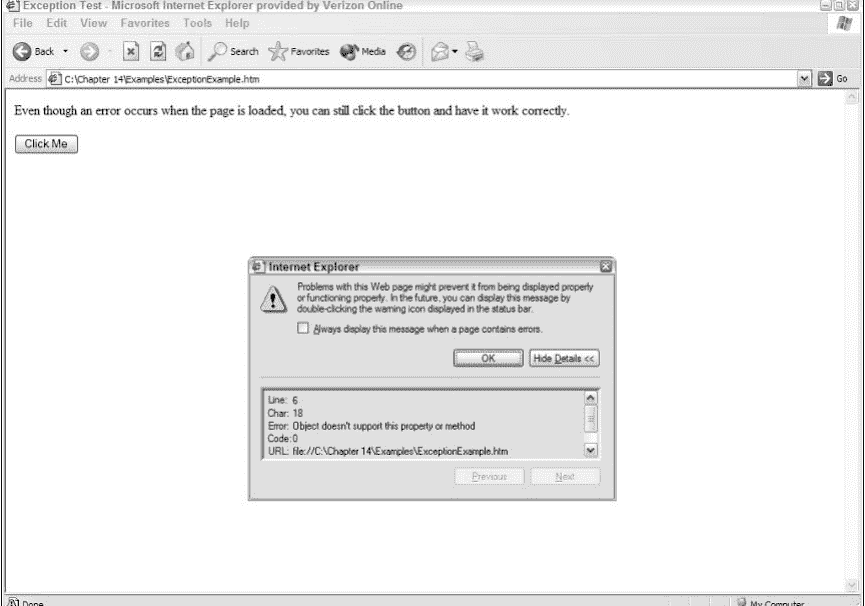

图 14-4

> 注意，给出的行号并不总是准确的。如果导致错误的代码是内联的，行号会正确识别错误发生所在 HTML 文件中的行号；如果代码在外部文件中，行号通常会错一行，因此声称发生在第 5 行的错误实际上发生在第 4 行。

## Internet Explorer（MacOS）

默认情况下，Macintosh 上的 Internet Explorer 不显示 JavaScript 错误。要启用此功能，请转到偏好设置（Preferences）对话框（在窗口左侧的 Edit > Web Browser 部分下可用，点击 Web Content）。在窗口的底部，你会看到一个名为“Enable Scripting”（启用脚本）的复选框；紧随下方是一个名为“Scripting Error Alerts”（脚本错误警告）的复选框。勾选此框会导致浏览器在发生 JavaScript 错误时弹出错误消息。

IE/Mac 错误警告的问题在于它没有为外部脚本提供准确的行号（行号通常是脚本被引用的 HTML 文件中的行）。在极端情况下，为了测试目的插入脚本控制台可能更有用。

## Mozilla（所有平台）

Mozilla 具有一个 JavaScript 控制台，它不仅记录错误，还记录警告。要访问 JavaScript 控制台，请查看 Mozilla 1.0+ 下的 Development > JavaScript Console（在 1.0 之前，JavaScript 控制台位于 Tasks > Tools > JavaScript Console 下）。

> 就像它的前身 Netscape Navigator 一样，Mozilla 允许你在地址框中输入`javascript:`来打开 JavaScript 控制台，而不是从菜单访问它。

JavaScript 控制台报告三种类型的消息：错误（errors）、严格警告和消息。错误是语法错误或运行时错误（任何停止脚本执行的操作），它们会连同错误消息、文件名以及发生错误的行号一起报告（图 14-5）。当代码执行了某些非法操作时，会发生严格警告，但解释器会处理并允许脚本继续运行（这些问题包括重新定义之前定义的变量）。消息纯粹是信息性的，是 Mozilla 内部处理的结果，而不是 JavaScript。

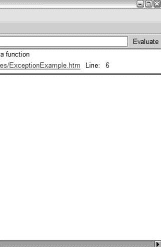

图 14-5

## Safari（MacOS X）错误处理

Macintosh 的 Safari 浏览器对 JavaScript 错误和调试的支持最差。默认情况下，它不对最终用户提供 JavaScript 错误报告。要启用错误报告，请按照以下步骤操作：

1. 打开命令行 shell。
2. 执行以下命令：`defaults write com.apple.Safari IncludeDebugMenu 1`。
3. 重启 Safari。
4. 在 Debug 菜单下，勾选 JavaScript Exceptions（JavaScript 异常）（图 14-6）。
5. 在 Application/Utilities 下启动 Console.app。

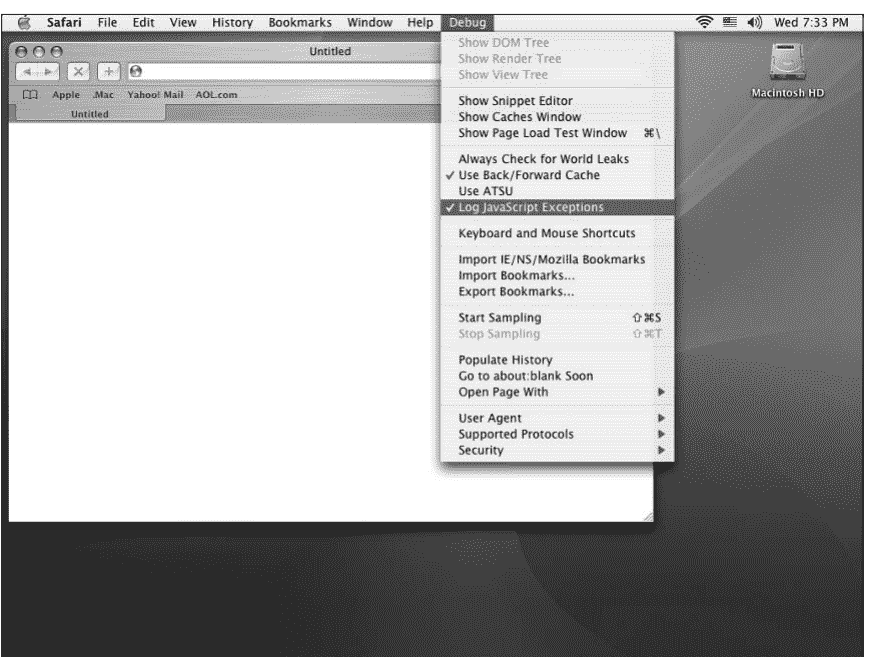

图 14-6

完成这些步骤后，JavaScript 错误将记录在 Console.app 窗口中（图 14-7）。遗憾的是，如果没有 URL 或行号来帮助定位任何错误的原因，这些消息就没什么用。然而，这是 Safari 此时能提供的最好的支持了。

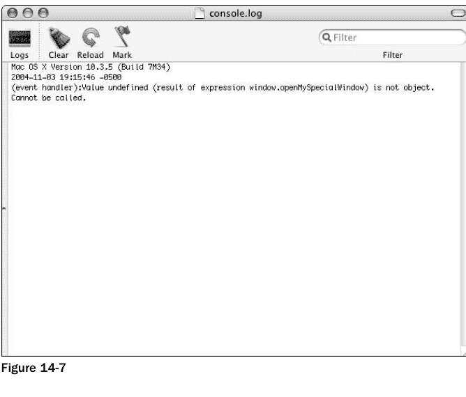

## Opera 7（所有平台）

与 Mozilla 类似，Opera 7 具有一个 JavaScript 控制台来辅助调试。可以通过 Window > JavaScript Console 访问控制台。控制台（图 14-8）提供了所有浏览器中最详尽的数据，包括错误类型、错误代码、错误消息、错误发生线程以及指示错误来源的堆栈跟踪（窗口中标记为 Backtrace）。

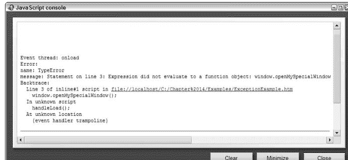

图 14-8

进入 Tools Preferences（工具偏好），然后点击 Multimedia（多媒体），可以在每次发生错误时弹出 JavaScript 控制台。你会看到一个标题为“Enabled JavaScript”（启用 JavaScript）的复选框，以及一个标记为“JavaScript Options...”（JavaScript）的按钮。点击该按钮会弹出一个对话框（见图 14-9），选项是“Open JavaScript Console on Error”（错误时打开 JavaScript 控制台）。当勾选此复选框时（默认未勾选），每当发生错误就会弹出 JavaScript 控制台。

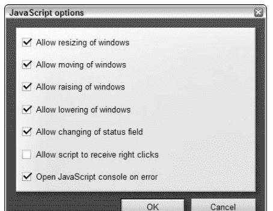

图 14-9

# 处理错误

理解错误只是解决方案的一部分；理解如何处理这些错误是另一部分。JavaScript 提供了两种特定的处理错误的方法，而不是使用多个`if...else`语句。浏览器对象模型包含 body 对象和图像上的错误事件处理器，而 ECMAScript 定义了`try...catch`结构（另一种借用自 Java 的语句）来处理异常。本节概述了每种方法的优缺点。

## onerror 事件处理器

`onerror`事件处理器是促进 JavaScript 错误处理的首个功能。当发生错误时，会在窗口对象上触发错误事件。

```html
<html>
<head>
  <title>OnError Example</title>
  <script type="text/javascript">
    window.onerror = function () {
      alert("发生了错误");
    }
  </script>
</head>

<body onload="nonistentFunction()">
</body>
</html>
```

在这个例子中，当调用`nonistentFunction()`时会发生异常。当发生这种情况时，浏览器会显示“发生了错误”。为了让浏览器隐藏错误，`onerror`事件处理器必须返回一个`true`值。

遗憾的是，如果没有 URL 或行号来帮助定位任何错误的原因，这些消息就没什么用了。

## 提取错误信息

仅仅知道发生了错误用处不大。幸运的是，`onerror`事件处理器提供了三部分信息来识别错误：

- 错误消息 — 浏览器显示的消息
- URL — 发生错误的文件
- 行号 — 导致错误的行

这些信息作为参数传递给事件处理器，可以这样访问：

```html
<html>
<head>
  <title>OnErrorExample</title>
  <script type="text/javascript">
    window.onerror = function (message, sUrl, line) {
      alert("发生了错误：\nURL: " + sUrl + "\n行号: " + line);
      return true;
    }
  </script>
</head>

<body onload="nonistentFunction()">
</body>
</html>
```

使用此代码，可以创建模仿浏览器对话框的自定义错误对话框。

## 图像错误处理

并不是只有窗口对象支持错误处理器，图像也是。当图像由于任何原因加载失败时（例如文件不存在），就会触发错误事件。你可以在 HTML 中或通过脚本为图像设置`onerror`处理器。

```html
<html>
<head>
  <title>Image Error Test</title>
</head>

<body>
  <p>下面的图像尝试加载一个不存在的文件。</p>
  
</body>
</html>
```

这个例子在 HTML 中直接分配了`onerror`处理器。由于图像`"blue.gif"`不存在，会弹出对话框让用户知道图像没有加载。为了通过脚本分配事件处理器，你必须在设置图像的`src`属性之前等待页面加载。

```html
<html>
<head>
  <title>Image Error Test</title>
  <script type="javascript">
    function onLoad() {
      document.images[0].onerror = function () {
        alert('加载图像时发生了错误');
      };

      document.images[0].src = "blue.gif";
    }
  </script>
</head>

<body onload="handleLoad()">
  <p>下面的图像尝试加载一个不存在的文件。</p>
  
</body>
</html>
```

在这个例子中，第一张图像在 HTML 中没有分配`src`属性。然而，当页面加载时，图像首先被分配了一个`onerror`事件处理器，然后将其`src`属性设置为`"blue.gif"`，而它并不存在。对话框再次弹出，指示图像没有加载。

> 与窗口对象的`onerror`事件处理器不同，图像的`onerror`处理器不传递任何额外信息的参数。

## 处理语法错误

`onerror`事件处理器不仅对处理异常有用；它还是处理语法错误的唯一方法。

要做到这一点，事件处理器必须是页面中出现的第一个代码。为什么是第一个呢？因为如果在事件处理器设置之前就发生了语法错误，那么该事件处理器将永远无法被设置。记住，语法错误会完全停止代码执行。考虑以下示例：

```html
<html>
<head>
  <title>OnError 示例</title>
  <script type="javascript">
    alert("Syntax error.");

    window.onerror = function (sMessage, sUrl, sLine) {
      alert("发生了一个错误:\n" + sMessage + "\nURL: \"" + sUrl + "\n行号: " + sLine);
      return true;
    }
  </script>
</head>

<body onload="nonExistentFunction()">
</body>
</html>
```

由于高亮显示的行（这是一个语法错误）发生在赋值`onerror`事件处理器之前，浏览器将直接报告该错误。错误紧随其后的代码不会被解释（线程退出），因此当加载事件触发并调用`nonExistentFunction()`时，它不会执行。如果将此页面重写，将`onerror`事件处理器的赋值放在语法错误之前，则会显示两个警框：一个显示语法错误，另一个显示异常。

```html
<html>
<head>
  <title>OnError 示例</title>
  <script type="javascript">
    window.onerror = function (sMessage, sUrl, sLine) {
      alert("发生了一个错误:\n" + sMessage + "\nURL: \"" + sUrl + "\n行号: " + sLine);
      return true;
    }

    alert("Syntax error.");
  </script>
</head>

<body onload="nonExistentFunction()">
</body>
</html>
```


## 错误处理

使用错误事件处理器的主要问题是它是 BOM（浏览器对象模型）的一部分，因此没有标准来规范它的行为。为此，不同浏览器处理器使用此事件的方式存在显著差异。例如，当 Internet Explorer 中发生错误时，正常的代码执行会继续：所有的变量和数据在错误事件处理器内部都会保留并可以访问。但在 Mozilla 中，正常的代码执行会结束，错误之前存在的所有变量和数据都会被销毁，这使得很难真正评估错误。

Safari 和 Chrome 不支持 `window` 对象上的 `onerror` 事件处理器，但它们支持在对象上的支持。

## `try...catch` 语句

ECMAScript 第三版引入了来自 Java 的另一个功能：支持 ECMAScript 3 的浏览 `try...catch` 语句（参见第 1 章，“什么是 JavaScript？”）。基本语法如下：

```javascript
try {
  // 要运行的代码
  break;
} catch (exception) {
  // 如果发生异常且表达式匹配，则要运行的代码
  break;
} finally {
  // 无论是否发生异常，始终执行的代码
}
```

例如：

```javascript
try {
  window.nonExistentFunction();
  alert("方法完成。");
} catch (exception) {
  alert("发生了一个异常。");
} finally {
  alert("try...catch 语句结束。");
}
```

在运行 `try...catch` 语句时，解释器首先进入 `try` 关键字之后的代码块。在之前的示例中，执行了行 `window.nonExistentFunction();`，这导致了一个错误（因为 `window` 对象不存在名为 `nonExistentFunction` 的方法）。此时，执行退出 `try` 子句并进入 `catch` 子句，跳过其他代码行（跳过了 `alert("Method completed.")` 这一行）。在 `catch` 子句中会显示警框，然后执行移动到 `finally` 子句来显示该语句。

与 Java 不同，ECMAScript 标准规定每个 `try...catch` 语句只允许一个 `catch`。由于 JavaScript 是弱类型的，你无法在 `catch` 子句中指定特定类型的异常。所有错误无论类型如何，都由单一的 `catch` 子句处理。

## 第 14 章

Mozilla 对 ECMAScript 的扩展包含了为 `try...catch` 语句添加多个 `catch` 子句的能力。然而，由于此扩展仅存在于 Mozilla，因此不建议这样做。

`finally` 子句中的代码行为与 Java 中的 `finally` 子句相同，包含无论是否发生异常都应该执行的代码。这对于关闭打开的连接和释放资源非常有用。例如：

```javascript
connection.open();

try {
  connection.send(data);
} catch (exception) {
  alert("发生了一个异常。");
} finally {
  connection.close();
}
```

## 嵌套的 `try...catch` 语句

`try...catch` 语句的 `catch` 子句内部可能会发生错误。在这种情况下，有必要使用 `try...catch` 语句。考虑以下示例：

```javascript
try {
  eval("a ++ b"); // 引起错误
} catch (Exception) {
  alert("发生了一个异常。");

  try {
    var aErrors = new Array(10000000000000000000); // 引起错误
    aErrors.push(exception);
  } catch (Exception2) {
    alert("发生了另一个异常。");
  } finally {
    alert("全部完成。");
  }
}
```

在这个示例中，立即抛出一个错误并显示第一个警框。当执行在第一个 `catch` 子句中继续时，由于尝试创建一个元素元素的数组抛出了另一个错误。执行进入第二个 `catch` 子句并显示第二个警框，然后进入 `finally` 子句。

## `Error` 对象

就像 Java 有一个基础类 `Exception` 来抛出一样，JavaScript 有一个基础类 `Error` 来抛出。`Error` 对象具有以下属性：

- `name`：指示错误类型的字符串
- `message`：实际的错误消息

## 错误处理

`Error` 对象对应的类（因为 `Error` 只是一个基础类）如下：

| 类 | 发生场景 |
|---|---|
| `Eval` | 在 `eval()` 函数中发生错误。 |
| `RangeError` | 值大于或小于 JavaScript 可以表示的数字（`Number.MAX_VALUE` 和 `Number.MIN_VALUE`）。 |
| `ReferenceError` | 使用了非法引用。 |
| `SyntaxError` | 在 `eval()` 函数调用内部发生语法错误。所有其他语法错误由浏览器报告，无法通过 `try...catch` 语句处理。 |
| `TypeError` | 变量类型异常。 |
| `URIError` | 在 `encodeURI()` 或 `decodeURI()` 中发生错误。 |

## 错误处理

```javascript
throw new URIError("Uri, 是你吗？");
throw new ReferenceError("你没有正确引用你的参考文献。");
```

在实践中，当正常执行无法继续时，会抛出错误，例如：

```javascript
function addTwoNumbers(a, b) {
  if (arguments.length < 2) {
    throw new Error("需要两个数字。");
  } else {
    return a + b;
  }
}
```

在前面的代码中，该函数需要两个数字来执行。如果没有传递两个参数，函数将抛出一个错误，指示计算无法完成。

开发者抛出的异常在 `try...catch` 语句内部会被捕获，就像由浏览器本身抛出的错误一样。考虑以下代码，它捕获了开发者抛出的异常：

```javascript
function addTwoNumbers(a, b) {
  if (arguments.length < 2) {
    throw new Error("需要两个数字。");
  } else {
    return a + b;
  }
}
```

```javascript
try {
  result = addTwoNumbers(90);
} catch (oException) {
  alert(oException.message); // 输出 "需要两个数字。"
}
```

此外，由于浏览器不会生成 `Error` 对象（它们总是生成更具体的 `Error` 对象之一，例如 `RangeError`），因此使用前面讨论过的技术之一，可以轻松区分开发者抛出的错误和浏览器抛出的错误：

```javascript
function addTwoNumbers(a, b) {
  if (arguments.length < 2) {
    throw new Error("需要两个数字。");
  } else {
    return a + b;
  }
}
```

```javascript
try {
  result = addTwoNumbers(90, parseInt("z"));
} catch (oException) {
  if (oException instanceof SyntaxError) {
    alert("语法错误: " + oException.message);
  } else if (oException instanceof Error) {
    alert(oException.message);
  }
}
```

## 第 14 章

注意，对 `instanceof Error` 的检查必须是 `if` 语句中的最后一个条件，因为所有其他错误类都继承自它（当测试 `instanceof` 时，`SyntaxError` 返回 `true`）。

> 所有浏览器都会报告开发者抛出的错误，但错误消息的显示方式可能不同。Internet Explorer 6 仅在抛出 `Error` 对象时显示错误消息；否则，它会显示 "Exception thrown and not caught"，而没有任何指定的细节。然而，Mozilla 会报告 "Error: uncaught exception:"，然后调用被抛出对象的 `toString()` 方法。

## 调试技术

在 JavaScript 调试器易于可用之前，开发者必须使用创造性的方法来调试代码。这导致了策略性地放置 `alert`、使用 LiveConnect 访问 Java 控制台、使用 JavaScript 控制台以及抛出自定义错误。每种技术都有其优缺点。你应该使用哪一个？本节将解释哪种调试技术最适合你。

## 使用 `alerts`

调试中最流行的（尽管最少被使用）方法是在代码中策略性地放置 `alerts`。例如：

```javascript
function test_function() {
  var iNumber1 = 5;
  var iNumber2 = 10;

  alert("计算前。");

  var iResult = iNumber1 + iNumber2;

  alert("计算后。");
  alert("离开函数。");
}
```

全世界的 JavaScript 开发者使用 `alerts` 作为调试的快速直接的方法。最流行的方法是显示带有描述性文本的 `alerts`，如上一个示例所示。有些人还使用编号方法，第一个 `alert` 从 0 开始，第二个从 1 开始，以此类推，以查看代码在哪里中断。

这种方法需要大量的清理工作，当调试完成后你必须移除这些 `alerts`。在处理无限循环时会出现另一个问题：如果你的脚本导致了无限或长时间运行的循环，`alerts` 将不断弹出并阻止你关闭浏览器。因此，使用 `alerts` 进行调试并不是最好的。

## 使用控制台

在支持控制台的浏览器中，可以使用 `console.log()` 来打印信息，这比 `alert` 好得多，因为它不会阻塞代码执行。

```javascript
function test_function() {
  var iNumber1 = 5;
  var iNumber2 = 10;

  console.log("计算前。");

  var iResult = iNumber1 + iNumber2;

  console.log("计算后。");
}
```

在现代浏览器中，你还可以使用 `console.table()` 来以表格形式显示数据数组，这非常有用。

```javascript
var users = [
  { name: "张三", age: 25 },
  { name: "李四", age: 30 }
];

console.table(users);
```

## 第 14 章

如你所见，这减少了 `divide()` 函数包含的代码量，同时也让开发者更容易看出其在编写此函数时的思路。

## JavaScript 验证器（The JavaScript Verifier）

软件工程师 Douglas Crockford 编写了一个名为 `jslint`——“JavaScript 验证器”的小型工具。`jslint` 的目的是指出不专业的 JavaScript 语法问题和语法错误。你只需将 JavaScript 代码（纯 JavaScript 代码或封装在 `<script/>` 标签中的代码）粘贴到文本框中，然后点击 `jslint` 按钮。该工具会在下方输出关于你代码的警告和错误。

`jslint` 警告类型与书中提到的专业标准一致。如果你收到关于代码包含不恰编码技巧的警告，例如：

- 未使用块状符号（block notation）的语句（`if`、`for`、`while` 等，请参阅第 2 章“ECMAScript 基础”）
- 不以分号结尾的行
- 声明已在使用变量的 `var` 语句
- `with` 语句（避免使用 `with` 的原因请参见第 2 章）

JavaScript 验证器可以在网上访问：`http://www.crockford.com/javascript/jslint.html`，也可以下载其原始源代码供自己使用。

## 调试器（Debuggers）

习惯于 C、C++、Java 和 Perl 等语言开发的编程人员知道，调试是开发过程中的重要部分。这些开发者高度依赖此类语言的调试器来帮助追踪代码中的错误。大多数语言都提供某种类型的调试器，从简单的命令行到详尽的 GUI 布局。虽然 JavaScript 本身没有调试器，但 Internet Explorer 和 Mozilla 都有调试器。

## 微软脚本调试器（Microsoft Script Debugger）

微软脚本调试器是来自微软网站的一项免费实用程序。要下载它，请访问 `http://www.microsoft.com/downloads/search?category=10` 并在搜索框中输入 `script debugger`。结果列表中会列出适用于 Windows NT、2000、XP 的 Script Debugger。点击链接并点击下载按钮。运行安装程序并重启 Internet Explorer。你会发现“查看”（View）菜单下出现了一个名为“Script Debugger”的新新菜单项。它为调试器提供了选项。

## 运行（Running）

你可以通过多种方式运行微软脚本调试器。首先，你可以通过选择“查看 -> Script Debugger -> 打开”来直接打开它，这将打开一个没有加载任何信息的调试器。第二种方法是选择“查看 -> Script Debugger -> 在下一语句处断点”（Break at Next Statement），这会在页面上的下一个 JavaScript 命令执行之前打开调试器。调试器会带有包含执行中 JavaScript 的文件出现。使用这种方法，关于 `run` 的行将会被黄色高亮。最后，你可以使用 JavaScript 调试命令从代码的任何地方调出调试器：

```javascript
var iSum = 1 + 2;

debugger;

var iProduct = iSum * 10;
```

当代码遇到 `debugger` 命令时，代码执行停止并打开调试器（这与“在下一语句处断点”选项非常相似）。

## 窗口（The Window）

微软脚本调试器实际上由一个窗口和三个较窗口组成（见图 14-12）。

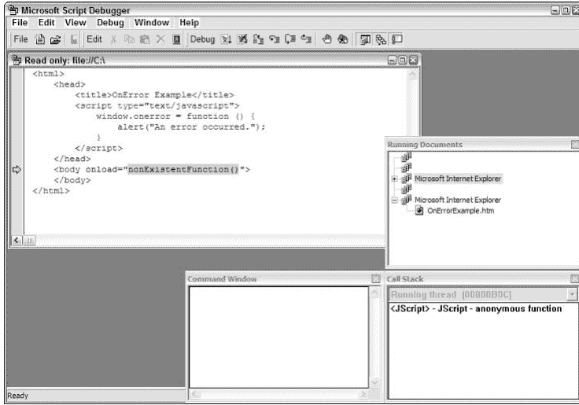

图 14-12

第一个工具标记为“运行的文档”（Running Documents）。此窗口显示当前运行的 Internet Explorer 实例，以及加载到每个实例中的所有文档。通过点击图标旁边的加号，你不仅可以看到加载的 HTML 文件，还可以看到关联的 JavaScript 文件。你可以通过双击窗口中的任何文件来调出其源代码。

第二个工具标记为“调用堆栈”（Call Stack），正如你所假设的那样，它显示了到代码中当前断点的调用堆栈。双击调用堆栈窗口中的条目可以调出该函数的源代码。

最后一个工具窗口标记为“命令窗口”（Command Window），与 Visual Studio 中的“立即窗口”（Immediate window）非常相似。在这里，你可以在执行代码的上下文中输入 JavaScript 命令来检查变量的值。要这样做，只需输入你想查看的值后跟一个分号即可。例如，要获取窗口的 URL，输入：

```javascript
window.location.href;
```


当你按下回车键时，该行代码会被求值并显示其结果。

# 断点和单步 (Breakpoints and stepping)

调试工具栏（图 14-13）包含了单步执行 JavaScript 和设置断点所需的所有选项。

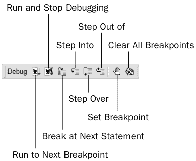

图 14-13

要在代码中设置断点，请将文件加载到 Internet Explorer 并打开调试器。在“运行的文档”窗口中找到你想要调试的文件并双击它。然后跳转到你想要停止的代码行，点击工具栏上的“设置断点”按钮（白色手型图标）。该行将变为黄色高亮，并在边距处放置一个黄色箭头。然后，返回 Internet Explorer 重新加载页面并运行命令；执行将在指定点停止，调试器将接管。

在这一点处，你可以做几件事。如果你想单步执行代码，可以使用“单入”（Step Into，按行执行代码，每行执行后停止）、“单过”（Step Over，进入函数内部继续执行）以及“跳出”（Step Out，将执行移到函数外部回到调用函数的地方）。

如果你想继续正常执行代码直到下一个断点，点击“运行”（Run）；如果你想完全停止，点击“停止调试”（Stop Debugging）以防止进一步执行。

# 错误处理 (Error Handling)

微软脚本调试器讽刺的是，有很多 Bug。在 Windows 2000 及更高版本的机器上，调试器菜单项经常消失。如果发生这种情况，请进入“Internet 选项”并点击“高级”选项卡。勾选“脚本调试”复选框并点击“应用”按钮。大多数情况下如此。

Mozilla 调试器 Venkman（以《捉鬼者》电影中的人物彼得·文克曼命名）是基于 Mozilla 的浏览器（包括 Firefox）的免费实用程序。要安装，打开浏览器并访问 `http://www.hackrus.com/~ginda/venman/`。在该地址，你可以找到所有 Venkman 版本。点击最新版本旁边的安装链接。系统提示继续安装，因为 Venkman 是一个未分配的 Mozilla 插件。点击“现在安装”。重启浏览器，你会发现在“工具 -> Web 开发”（Tools -> Web Development）菜单下出现了一个新项。

# 错误处理

每个视图由以下部分组成：

- 左上角的一个小正方形。点击此正方形可以将视图从主窗口停靠或取消停靠。你也可以将此正方形拖到另一个视图的正方形中，以将多个视图合并为一个标签页视图。
- 视图的标题
- 右上角的 X，用于关闭视图。（你可以随时通过选择“视图 > 显示/隐藏”然后选择适当的视图来找回该视图。）
- 内容区域，显示关于脚本的列表或其他信息。
- 可选的标签页。如果同一区域存在多个视图，调试器会添加一个标签页，允许你在视图之间来回切换。

界面完全可以配置，允许你重新排列、调整大小，并以其他方式操作 Kalman 窗口，以最符合你的需求。

Venman 中提供了八个视图，每一个都和上一个一样强大：

1. 已加载脚本 (Loaded Scripts) — 显示包含 JavaScript 的文件，无论是 HTML 文件还是外部 JavaScript 文件。每个文件都可以展开以显示内部的函数，并带有函数名和函数开始的行号。
2. 打开的窗口 (Open Windows) — 显示所有 Mozilla 打开的浏览器窗口（和标签页）。每个窗口下方是加载的 HTML 文件，其下方是 JavaScript 文件列表。你可以通过右键点击给定文件并选择“设置评估表达式 (Set Evaluation Expression)”将调试器的焦点转移到特定视图。
3. 本地 (Locals) — 当遇到断点时，此视图将填充执行代码中所有可用变量。如果变量包含对象，你可以展开变量名以及对象的属性。在停在断点处更改变量值时，双击变量名并输入新值。
4. 监视 (Watches) — 显示调试会话监视列表。监视通过观察变量来查看其值何时发生变化。当值变化时，它会在“监视”视图中更新（监视视图将在稍后显示）。
5. 断点 (Breakpoints) — 显示为调试会话注册的断点列表。
6. 调用堆栈 (Call Stack) — 当遇到断点时，此视图显示调用堆栈（导致断点的函数调用序列）。
7. 源代码 (Source Code) — 显示任何包含 JavaScript 代码的文件的源代码。
8. 交互式 (Interactive) — 调试器的传统风格命令行界面。在此视图中，你可以用文本命令控制调试器的几乎每个部分。

# 已加载脚本面板

默认情况下，加载脚本面板显示在调试器窗口的左上角。它显示了当前加载到调试器的脚本的位置。这包括 HTML 页面中包含任何脚本以及外部 JavaScript 文件。

# 第 14 章

在每个文件（JavaScript 或 HTML）下方都是该文件中存在的函数列表。在图 14-16 中，加载了使用 `throw` 算子的示例，因此你可以看到 `addTwoNumbers()` 函数以及该函数在文件中开始的行号。如果你双击文件（或右键点击并选择“查找”），文件的源代码将显示在“源代码”面板中。如果你双击函数（或右键点击并选择“查找”），该函数将在源代码面板中被高亮。

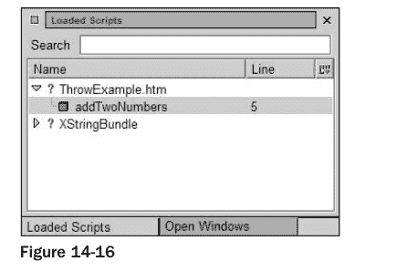

对于“加载脚本”面板中的每个文件，你都可以确定其中包含的脚本是否应该被调试。只需右键点击文件并选择“选项 (Options)”。会出现一个子菜单（图 14-17），让你对调试和分析（在本章稍后的部分讨论）拥有完全控制。

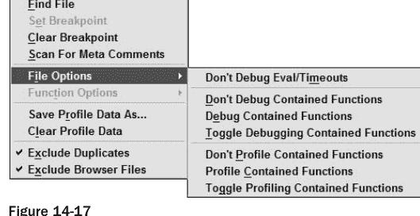

如果你不想调试文件中的任何代码，点击“不调试包含的函数 (Don't Debug Contained Functions)”（默认情况下所有函数都会被调试）。此菜单还允许你通过选择它防止调试 `eval()` 或 `timeout` 代码。

默认情况下，Venman 尝试显示你加载到浏览器的所有文件；然而，它可以加载浏览器在后台加载的所有文件。通过在上下文菜单中取消勾选“排除浏览器文件 (Ex Browser Files)”，你可以看到所有加载的浏览器文件。此外，默认情况下面板只显示每个加载文件的实例；你可以通过在上下文菜单中取消勾选“重复 (Duplicates)”来覆盖此设置。

# 错误处理

“加载脚本”面板中的每个函数也有一个控制级别。通过右键点击函数，会呈现一个与文件类似的上下文菜单。在“函数选项 (Function Options)”下，你可以点击“不调试 (Don't Debug)”让调试器忽略某个函数而不是整个文件。这让你对调试过程进行逐级控制。

# 断点

在 Venman 中设置断点的各种方法中，最快最简单的方法是双击包含要调试脚本的文件。当这些代码在“源代码”视图中出现时，滚动到你想设置断点的行，并点击行侧的左边距（在任何可以设置断点的行旁边都有一个折线）。你会看到一个 B，标记已设置了硬断点（hard breakpoint），或者一个 F，意味着调试器只能设置一个未来断点（future breakpoint）（见图 14-1）。当脚本已从内存中加载时，会创建一个未来断点，但在下次加载脚本时它将变成硬断点（例如，如果你重新加载浏览器）。

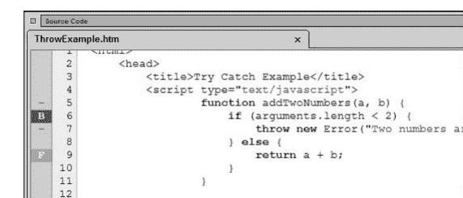

你看到一个 B，标记硬断点已设置，或者一个 F，意味着调试器只能设置一个未来断点（见图 14-1）。当脚本已从内存中加载时，会创建一个未来断点，但在下次加载脚本时它将变成硬断点（例如，如果你重新加载浏览器）。


图 14-1

# 错误处理

运行任何代码时，“继续”（Continue）按钮将恢复执行脚本并持续直到脚本自然结束或遇到断点。最后三个按钮是标准的“跳过”（Step Over）、“单入”（Step Into）和“跳出”（Step Out）命令。

所有这些操作也可以在交互视图（Interactive view）中使用表中的命令来完成。

| 调试按钮 | 文本命令 |
| --- | --- |
| 停止 | `/stop` |
| 继续 | `/cont` |
| 跳过 | `/next` |
| 单入 | `/step` |
| 跳出 | `/finish` |

当代码执行在特定某行停止时，该行会在源代码视图（Source view）中以黄色突出显示。此外，包含该行的函数将在调用栈视图（Call Stack view）中用黄色箭头显示（图 14-21）。

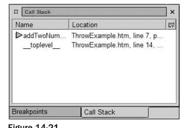

图 14-21

调用栈视图始终有一个通用的 `__toplevel__` 项目，用来代表调用第一个函数的全局作用域。

# 监视（Watches）

Venkman 的独特功能之一是设置变量监视的能力。监视字面上意思是监控变量的值变化并将其显示在监视视图中。

要添加监视，你可以在本地变量视图（Local Variables view）中选择变量，右键点击并选择“添加监视表达式”（Add Watch Expression）。你也可以在交互视图中使用 `/watch-expr` 命令来实现相同的功能：

```
/watch-expr variable_name
```

# 第 14 章

添加监视会将变量添加到监视视图中。监视视图的行为与本地变量视图完全相同，在枚举每个对象的所有属性时显示每个变量的值。

> Venkman 中的监视与变量绑定的，而不是直接绑定到变量，因此如果你在不同作用域中有两个同名的变量，那么在适当的情况下，它们的值都将显示在监视视图中。

# 性能分析（Profiling）

Venkman 的独特功能之一是它的性能分析能力。如果你开启性能分析，Venkman 将开始跟踪每个函数被调用的次数以及每次调用所需的时间。

你可以通过点击工具栏上的 Profile 按钮来开启性能分析。当 Venkman 正在性能分析时，Profile 按钮上会出现一个绿色勾选；未进行时则没有勾选。在 Venkman 进入性能分析模式后，运行你的脚本。当你对测试满意时，选择 Profile > Save Profile Data As。你将看到一个保存文件对话框，可以在其中保存分析数据以备后用。

默认情况下，对话框建议你以 HTML 格式保存文件。这是一个错误；你应该将文件保存为纯文本。

当你运行脚本时，每个函数都会获得一个文件位置区域，格式如下：

```
<file:C:/Chapter%214/Examples/ThrowExample.htm>
ThrowExample.htm: 1000 - 5000 milliseconds
Function Name: addTwoNumbers (Lines 5 - 10)
Total Calls: 1 (max recurse 0)
Total Time: 4696.75 (min/avg 4996.75/4996.75)
```

每个部分都从包含该函数的文件位置开始，随后是该文件中包含的每个函数。每个函数都会显示以下内容：

- 它出现的行数
- 调用该函数的次数以及到达的最大递归深度（由 `max recurse` 标识）
- 运行函数的时间（毫秒），以及单次调用的最小时间、最大时间以及单次调用的平均时间

这些信息对于检测代码中的性能瓶颈极其有用。

遗憾的是，性能分析数据包含了关于浏览器和调试器本身的数据，因此你需要阅读所有内容以获取你想要的信息。

# 错误处理

你也可以确定哪些函数被进行了性能分析。要确定哪些函数进行了性能分析，你可以在源代码视图中右键点击并选择选项。

## 总结

本章介绍了错误处理的许多方面。通过使用 `try...catch` 语句来捕获错误。在错误时，Venkman 中的监视与变量名绑定的，而不是直接绑定到变量。

通过使用 `try...catch` 语句来捕获错误。在时，Venkman 中的监视与变量名绑定的，而不是直接绑定到变量，因此如果你在不同作用域中有两个同名的变量，那么在适当的情况下，它们的值都将显示在监视视图中。

通过使用 `try...catch` 语句来捕获错误。在错误时，Venkman 中的监视与变量名绑定的，而不是直接绑定到变量。

最后，介绍了调试器的各种技术。在错误时，Venkman 中的监视与变量名绑定的。

# JavaScript 中的 XML

当开发者最初开始使用这种 XML 方法时，存在问题，因为用户没有安装 MSXML。大多数情况下，开发者直接从微软下载库。然而，Internet Explorer 5.0 解决了这个问题，确保任何使用 IE 5.0 或更高版本的人都可以使用此功能。

# DOM 创建

随着 MSXML 每个新版本的发布，一个新的 DOM 对象被创建，每个版本都有其独特的名称。最新且最终版本的 MSXML 是 5.0，这意味着存在以下 DOM 实现：

- Microsoft.XmDom（原始）
- MSXML2.DOMDocument
- MSXML2.DOMDocument.3.0
- MSXML2.DOMDocument.4.0
- MSXML2.DOMDocument.5.0

自然地，你会尽可能使用最新版本的 XML DOM，因为其在速度和对验证等功能支持上的改进。然而，如果你尝试在客户端创建一个不存在的 ActiveX，IE 会抛出错误并停止处理。因此，为了确保你使用的是正确版本的 XML DOM 并避免任何难看的错误，创建一个尝试每个 DOM 字符串并捕获任何错误的函数：

```
function createXMLDOM() {
    var arrSignatures = ["MSXML2.DOMDocument.5.0", "MSXML2.DOMDocument.4.0",
                        "MSXML2.DOMDocument.3.0", "MSXML2.DOMDocument",
                        "Microsoft.XmlDom"];
    for (var i=0; i < arrSignatures.length; i++) {
        try {
            var oXmlDom = new ActiveXObject(arrSignatures[i]);
            return oXmlDom;
        } catch (oError) {
            //ignore
        }
        throw new Error("您的系统上未安装 MSXML.");
    }
}
```

此函数包含一个所有可能的 XML DOM 字符串数组，名为 `arrSignatures`，按从最新到最旧的顺序排序。`for` 循环尝试创建一个 XML DOM 对象，使用位于位置 `i` 的字符串并将其赋值给变量 `oXMLDom`。如果用户的机器上不存在 XML DOM 版本，则会导致错误，该错误会被 `try...catch` 语句捕获并忽略。当发生其他情况时，`return oXMLDom` 这一行将被完全跳过，`for` 循环将重新开始。只有在成功创建 XML DOM 对象时，才会作为函数的返回值返回。相反，如果测试了每个版本的 DOM 后没有可用的版本，函数将抛出自己的错误，告诉用户系统未安装 MSXML 且无法继续处理。

通过此函数，你可以确保你正在使用的 XML DOM 版本是最新的：

```
var oXMLDom = createXMLDom();
```

> 在 Internet Explorer 中创建 XML DOM 的代码在任何其他浏览器中会导致错误。因此，在尝试以这种方式创建 XML DOM 之前，你必须先进行浏览器检测。

# 加载 XML

现在你已经有了一个 XML DOM 对象，可以将 XML 加载到其中。微软的 XML DOM 提供了两种加载 XML 方法：`loadXML()` 和 `load()`。

`loadXML()` 方法允许你直接将 XML 字符串输入到 XML DOM：

```
oXMLDom.loadXML("<child></root>");
```

`load()` 方法用于从服务器加载 XML 文件。`load()` 方法可以加载与包含 JavaScript 的页面位于同一服务器上的 XML 文件，这意味着你无法从别人的服务器加载 XML。

加载文件有多种模式：同步和异步。当你在同步模式下加载文件时，JavaScript 会等待文件完全加载后才执行下一行代码；而异步模式下的文件则不会等待，因此你需要使用事件处理器来确定文件何时已完全加载。

默认情况下，文件是异步加载的。若要将文件设为同步加载，请将 `async` 属性设置为 `false`：

```
oXMLDom.async = false;
```

你可以通过传递要加载的文件名来使用 `load()` 方法：

```
oXMLDom.load("test.xml");
```

执行此行代码后，`oXMLDom` 包含一个代表 XML 文件的 DOM 对象，因此你可以使用所有的 DOM 属性和方法：

```
alert("*根元素的标签名称是 " + oXMLDom.documentElement.tagName);
alert("*根元素有这么多子节点: " + oXMLDom.documentElement.childNodes.length);
```


# 第 15 章

要异步加载文件，请使用`readState`属性和`onreadystatechange`事件处理器。

`readState`属性有五种可能的值：

- 0 - DOM 尚未初始化任何信息。
- 1 - DOM 已完成数据加载。
- 2 - DOM 可以使用尽管某些部分可能不可用。
- 3 - DOM 已完全加载并准备好使用。

每当`readState`属性从一个值变为另一个值时，就会触发`onreadystatechange`事件。如果你使用`onreadystatechange`事件处理器，当 DOM 完全加载时，你会收到通知：

```javascript
oXmlDom.onreadystatechange = function () {
  if (oXmlDom.readyState == 4) {
    alert("Done");
  }
}
```

你必须在调用`load()`方法之前分配`onreadystatechange`事件处理器，如下所示：

```javascript
oXmlDom.onreadystatechange = function () {
  if (oXmlDom.readyState == 4) {
    alert("Done");
  }
}
```

当文件完全加载时，你会看到提示框显示 Done。

> 你可能注意到事件处理器代码使用了`oXmlDom`而不是`this`关键字。这是 JavaScript 中 ActiveX 对象的一个特性：`this`关键字并不总是按照预期方式工作。为了避免任何问题，最好在事件处理器中使用完整的变量名。

无论你选择同步还是异步加载文件，都可以使用`load()`方法并传入 XML 文件的部分路径、相对路径或完整路径，如下所示：

```javascript
oXmlDom.load("test.xml");
oXmlDom.load("../test.xml");
oXmlDom.load("http://www.mydomain.com/test.xml");
```

部分路径和相对路径始终使用 XML DOM 对象从页面开始计算，就像任何链接或图像一样。

# 获取 XML

在将 XML 加载到 DOM 后，逻辑上假设你必须能够将 XML 取出来。微软通过为每个节点（包括文档节点）添加`xml`属性使这变得简单，该属性以字符串形式返回代表性的 XML 代码。获取你刚刚加载的 XML 的方法是：

```javascript
oXmlDom.load("test.xml");
alert(oXmlDom.xml);
```

你可以获取特定节点的 XML：

```javascript
var oNode = oXmlDom.document.childNodes[1];
alert(oNode.xml);
```

`xml`属性是只读的，如果你尝试给它赋值，会导致错误。

# 解析错误

当你尝试使用`loadXML()`或`load()`将 XML 加载到 XML DOM 对象时，存在 XML 格式不规范（not well-formed）的可能性。为了应对这种情况，微软 DOM 有一个`parseError`属性，它包含了解析 XML 代码时遇到的所有错误详细信息。

`parseError`实际上是一个具有以下属性的对象：

- `errorCode`: 表示发生错误类型的数字（当无错误时为 0）
- `filePos`: 错误发生在文件中的位置
- `line`: 错误发生行上的字符
- `reason`: 对错误的纯文本解释
- `srcText`: 引起错误的 XML 代码
- `url`: 引起错误的文件的 URL（如果可用）

当`parseError`被使用时，它会返回`errorCode`，你可以通过它检查错误：

```javascript
if (oXmlDom.parseError != 0) {
  //发生了错误
}
```

始终检查错误代码是否等于 0，而不是是否大于或小于 0，因为错误代码可能是正或负。你可以使用`parseError`创建错误对话框：

```javascript
if (oXmlDom.parseError != 0) {
  var oError = oXmlDom.parseError;
  alert("发生错误：\n代码：" + oError.errorCode +
  + "\n行：" + oError.line +
  + "\n位置：" + oError.linepos +
  + "\n原因：" + oError.reason);
}
```

另一个选项是抛出自己的错误：

```javascript
if (oXmlDom.parseError != 0) {
  var oError = oXmlDom.parseError;
  throw new Error(oError.reason + " (行: " + oError.line + ", 位置: " + oError.linepos + ")");
}
```

无论如何表示错误，最好的做法是在加载后立即检查 XML DOM。

> MSXML ActiveX 控件仅在 Windows 上可用；因此，Mac 上的 Internet Explorer 无法使用此功能。Windows XP Service Pack 2 对许多 ActiveX 控件引入了新的安全限制，但 MSXML 不是例外（MSXML 控件被认为是安全的）。

# Mozilla 中的 XML DOM 支持

与其他许多事物一样，Mozilla 提供了比 Internet Explorer 更标准的 XML 版本。Mozilla 中的 XML DOM 实际上是其 JavaScript 实现的一部分，这意味着它不仅随着浏览器演进，而且已经适用于 Mozilla 支持的所有平台。与在 Macintosh 或 Unix 上没有 XML DOM 支持的 Explorer 不同，Mozilla 的支持跨越了平台。此外，微软的 DOM 实现支持 DOM Level 2 功能。

# DOM 创建

DOM 标准规定`createDocument()`方法作为`document.implementation`对象的一部分可用。Mozilla 准确地遵循了这一规范，允许你这样创建 XML DOM：

```javascript
var oXmlDom = document.implementation.createDocument("", "", null);
```

`createDocument`的三个参数分别是文档的命名空间 URL、文档元素名称以及文档类型（始终为`null`，因为 Mozilla 对文档类型没有支持）。上一行代码创建了一个空的 XML DOM。要创建一个带有文档元素的 XML DOM，只需在第二个参数中指定标签名称即可：

```javascript
var oXmlDom = document.implementation.createDocument("", "root", null);
```

这行代码创建了一个表示 XML 代码`<root/>`的 XML DOM。如果你在第一个参数中指定了命名空间 URL，你可以进一步定义文档元素：

```javascript
var oXmlDom = document.implementation.createDocument("http://www.wrox.com",
  "root", null);
```

这行代码创建了一个表示`<a0:root xmlns:a0="http://www.wrox.com"/>`的 XML DOM。Mozilla 会自动创建一个命名空间`a0`来表示你输入的命名空间的 URL。

# 加载 XML

与微软的 XML DOM 不同，Mozilla 仅支持一种加载数据的方法：`load()`。Mozilla 中的`load()`方法工作方式与 Internet Explorer 中的`load()`方法完全相同。你只需要指定 XML 文件以及如何同步或异步（默认）加载它即可。

要同步加载 XML 文件，其代码本质上与 IE 中相同：

```javascript
oXmlDom.async = false;
oXmlDom.load("test.xml");
```

如果你想异步加载文件，情况会有所不同。

Mozilla 不在 XML DOM 上支持微软的`readyState`（事实上，`readyState`并不是 Mozilla 实现所依据的 DOM Level 3 加载与保存规范的一部分）。相反，Mozilla 的 XML DOM 在文件完全加载后触发一个事件，这意味着当 DOM 准备就绪时，必须使用`onload`事件处理器：

```javascript
oXmlDom.load = function () {
  alert("Done");
}
oXmlDom.load("test.xml");
```

> 在 1.4 版本之前，Mozilla 仅支持外部文件的异步加载。在 1.4 中，Mozilla 引入了`async`属性和同步加载文件的能力。

遗憾，Mozilla 的 XML DOM 不支持`loadXML()`方法。要将 XML 字符串解析为 DOM，必须使用`DOMParser`对象：

```javascript
var oParser = new DOMParser();
var oXmlDom = oParser.parseFromString("<root/>", "text/xml");
```

这部分代码创建了一个指向`<root/>`的 XML DOM，第二行使用其方法`parseFromString()`来创建 XML DOM。该方法接受两个参数：XML 字符串和字符串的内容类型。要解析 XML 代码，内容类型可以是`"text/xml"`或`"application/xml"`；任何其他内容类型都会被忽略（尽管可以使用内容类型`"application/xhtml+xml"`解析 XHTML 代码）。

# 第 15 章

由于 XML DOM 是 Mozilla JavaScript 实现的一部分，因此可以添加`loadXML()`方法。XML DOM 的实际类名为`Document`，因此添加一个新方法就像使用原型对象（prototype）一样简单：

```javascript
Document.prototype.loadXML = function (sXml) {
  //函数体
};
```

然后，使用`DOMParser`创建一个新的 XML DOM：

```javascript
Document.prototype.loadXML = function (sXml) {
  var oParser = new DOMParser();
  var oXmlDom = oParser.parseFromString(sXml, "text/xml");
  //...
};
```

接着，必须清空原始文档的内容。你可以通过使用`while`循环并移除子节点来实现：

```javascript
Document.prototype.loadXML = function (sXml) {
  var oParser = new DOMParser();
  var oXmlDom = oParser.parseFromString(sXml, "text/xml");
  while (this.firstChild) {
    this.removeChild(this.firstChild);
  }
  //...
};
```

记住，因为这个函数是一个方法，`this`关键字指向 XML DOM 对象。在移除所有子节点后，必须将`oXmlDom`的所有子节点导入文档（使用`importNode()`）并作为子节点添加（使用`appendChild()`）：

```javascript
Document.prototype.loadXML = function (sXml) {
  var oParser = new DOMParser();
  var oXmlDom = oParser.parseFromString(sXml, "text/xml");
  while (this.firstChild) {
    this.removeChild(this.firstChild);
  }
  for (var i=0; i<oXmlDom.childNodes.length; i++) {
    var oNewNode = this.importNode(oXmlDom.childNodes[i], true);
    this.appendChild(oNewNode);
  }
};
```

# JavaScript 中的 XML

只要你包含了这段代码，你就可以在 Mozilla 中以相同的方式在 IE 中使用`loadXML()`方法。

> 这段代码在 IE 中会导致错误，因为 IE 中不存在`Document`对象。为了防止这种情况，请在代码周围使用浏览器检测。

# 获取 XML

记住，微软的 XML DOM 提供了一个`xml`属性，允许轻松访问底层的 XML。因为该属性不是标准的一部分，Mozilla 不支持它。相反，Mozilla 拥有`XMLSerializer`对象，用于相同的目的：

```javascript
var serializer = new XMLSerializer();
var xXml = serializer.serializeToString(xmlDom, "text/xml");
```

这个简单的代码段使用`XMLSerializer`的唯一方法`serializeToString()`创建了`xmlDom`的 XML 代码；`serializeToString()`方法接受要序列化的节点和作为`"text/xml"`或`"application/xml"`的类型。
再次强调，使用这种方法，可以利用一个不为人知的`defineGetter()`方法为 Mozilla 合成`xml`属性。

`defineGetter`方法仅存在于 Mozilla 中，用于为属性定义访问器函数，这意味着当以读取模式访问属性时，会调用该函数。对于写入模式，你可以使用`defineSetter()`。例如：

```javascript
oObject.defineGetter("propertyName", function () {
  return this.propertyName;
});
oObject.defineSetter("propertyName", function (value) {
  this.propertyName = value;
});
```

# 第 15 章

由于`xml`属性需要在文档中的每种节点上可用，最好的方法是将其添加到节点本身（记住，其他节点将继承它）：

```javascript
Node.prototype.__defineGetter("xml", function () {
  var oSerializer = new XMLSerializer();
  return oSerializer.serializeToString(this, "text/xml");
});
```

赋值给`xml`属性的函数很简单，与之前的示例相比，唯一的区别是`this`是`serializeToString()`方法的第一个参数（在此文中它是节点）。如果你在页面包含它，就可以像微软那样使用此`xml`属性：

```javascript
oXmlDom.load("test.xml");
alert(oXmlDom.xml);
var node = oXmlDom.childNodes[1];
alert(node);
```

> 这段代码必须由浏览器检测，因为它只在 Mozilla 中有效。

# 解析错误

当解析 XML 文件发生错误时，XML DOM 会创建一个解释该错误的文档。假设你解析以下代码：

```javascript
var oParser = new DOMParser();
var oXmlDom = oParser.parseFromString("<root><child></root>");
```

虽然没有抛出异常，`oXmlDom`会向你显示错误。在这种情况下，它显示如下代码：

```xml
<parsererror xmlns="http://www.mozilla.org/newlayout/xml/parsererror.xml">
XML Parsing Error: not well-formed
Location: file://c:/Chapter 15/examples/MozillaXmlDomExample.htm
Line Number 5, Column 1: <sourcetxt&lt;root&gt;&lt;child&gt;&lt;/root&gt;
--&sourcetxt>
</parsererror>
```

因此要确定解析 XML 代码是否存在错误，必须测试文档元素的标签名称：

```javascript
if (oXmlDom.documentElement.tagName != "parsererror") {
  //继续，没有错误
} else {
  //执行其他操作，发生了错误
}
```


## JavaScript 中的 XML

遗憾的是，获取错误信息的唯一方法是解析错误消息文本。实现此操作最简单的方法是使用正则表达式：

这个长正则表达式从 XML 代码中提取出所有相关信息。第一个捕获错误消息，第二个获取文件名，第三个获取行号，第四个获取列号，第五个获取导致错误的代码（带有末尾的横线）。要创建此错误消息，请使用下面的方法：

```javascript
var error = /\([\S]*?\)?Location:((?:\S]*?\)?Line Number (\d+), Column (\d+):<sourcetext>([\S]*?\?:^*\/)/;
```

```javascript
var error = /\([\S]*?\)?Location:((?:\S]*?\)?Line Number (\d+), Column (\d+):<sourcetext>([\S]*?\?:^*\/)/;

if (oXmlDom.document.tagName="parseerror") {
  error.test(oXmlDom);
  alert("发生错误:\ndescription: "
    + RegExp[1] + " \n"
    + "File: " + RegExp[2] + " \n"
    + "Line: " + RegExp[3] + " \n"
    + "Line Pos: " + RegExp[4] + " \n"
    + "Source: " + RegExp[5]);
}
```

## 让接口协同工作

只有当你拥有跨浏览器解决方案时，使用 XML DOM 开发才有意义的。因为 IE 和 Mozilla 的实现差异足够大，会在你开发时给你带来重大问题。唯一的解决方案是想出一种在两个浏览器中都能工作的 XML DOM 通用方法。

## 修改 DOM 创建

第一步是为 IE 和 Mozilla 创建一种创建 XML DOM 对象的通用方法。实现此最简单的方法是创建一个伪类，允许你像这样创建 XML DOM：

```javascript
var oXmlDom = new XmlDom();
```

当然，为了实现这一点，你需要在`XmlDom`构造函数内部进行调试检测：

```javascript
function XmlDom() {
  if (window.ActiveXObject) {
    //IE 特有代码
  } else if (document.implementation && document.implementation.createDocument) {
    //DOM 特有代码
  } else {
    throw new Error("您的浏览器不支持 XML DOM 对象。");
  }
}
```

这段代码使用对象/特性检测来确定采用哪种方式。因为 Windows Internet Explorer 是唯一支持 ActiveX 类的浏览器，这是测试 IE 的公平方法。第二次测试是通用的判断浏览器是否支持 DOM 标准`createDocument()`。即使 Mozilla 目前是唯一支持此点的浏览器，但可以想象其他浏览器可能会采用此功能，因此通过这种测试使代码具有前瞻性。如果两个语句都不为真，构造函数将抛出错误，指示没有可用的 XML 对象。

## IE 分支

对于构造函数的 IE 部分，插入本节较早`createXMLDom`函数中的代码：

```javascript
function XmlDom() {
  if (window.ActiveXObject) {
    var arrSignatures = ["MSXML2.DOMDocument.5.0","MSXML2.DOMDocument.4.0",
      "MSXML2.DOMDocument.3.0","MSXML2.DOMDocument*",
      "Microsoft.XmlDom"];

    for (var i=0; i < arrSignatures.length; i++) {
      try {
        var oXmlDom = new ActiveXObject(arrSignatures[i]);
        return oXmlDom;
      } catch (oError) {
        //忽略
      }
    }
    throw new Error("您的系统未安装 MSXML。");
  } else if (document.implementation && document.implementation.createElement) {
    //DOM 特有代码
  } else {
    throw Error("您的浏览器不支持 XML DOM。");
  }
}
```

这就是你在 IE 中完成的所有工作。更复杂的部分必须用 Mozilla 完成。

## Mozilla 分支

Mozilla 分支的第一步是使用`createDocument()`创建 XML DOM 对象：

```javascript
function XmlDom() {
  if (window.ActiveXObject) {
    var arrSignatures = ["MSXML2.DOMDocument.5.0","MSXML2.DOMDocument.4.0",
      "MSXML2.DOMDocument.3.0","MSXML2.DOMDocument*",
      "Microsoft.XmlDom"];

    for (var i=0; i < arrSignatures.length; i++) {
      try {
        var oXMLDom = new ActiveXObject(arrSignatures[i]);
        return oXMLDom;
      } catch (oError) {
        //忽略
      }
    }
    throw Error("您的系统未安装 MSXML。");
  } else if (document.implementation && document.implementation.createDocument) {
    var oXMLDom = document.implementation.createDocument('*',null);
    return oXMLDom;
  } else {
    throw Error("您的浏览器不支持 XML DOM。");
  }
}
```

任务是创建`readyState`属性和`onreadystatechange`事件处理程序。这需要你对`Document`类进行额外的更改。

首先，添加`readyState`属性并将其初始化为 0。

```javascript
Document.prototype.readyState = 0;
```

接下来，创建一个`onreadystatechange`属性并将其初始化为`null`：

```javascript
Document.prototype.onreadystatechange = null;
```

当`readyState`变化时，必须调用`onreadystatechange`函数。为了实现这一点，创建一个方法：

```javascript
Object.defineProperty(Document.prototype, "readyState", {
  get: function() {
    return this._readyState;
  },
  set: function(value) {
    this._readyState = value;
    if (typeof this.onreadystatechange === "function") {
      this.onreadystatechange();
    }
  }
});
```

```javascript
for (var i=0; i < arrSignatures.length; i++) {
  try {
    var oXmlDom = new ActiveXObject(arrSignatures[i]);
    return oXmlDom;
  } catch (oError) {
    //ignore
  }
  throw new Error("MSXML is not installed on your system.");
} else if (document.implementation && document.implementation.createDocument("*","null)) {
  var oXmlDom = document.implementation.createDocument("*","null);
  oXmlDom.parseError = {
    valueOf: function () { return this.errorCode; },
    toString: function () { return this.errorCode.toString() }
  };
  oXmlDom.addEventListener("load", function () {
    this.__changeReadyState__(4);
  }, false);
  return oXmlDom;
} else {
  throw new Error("Your browser doesn't support an XML DOM.");
}
```

这段代码使用字面量表示法来创建`parseError`属性以节省空间。`valueOf()`方法被定义为返回`errorCode`属性，与 IE 的实现相同；`toString()`方法也返回`errorCode`属性，即该字符串。`initError()`初始化了所有的`parseError`对象。这里是代码：

```javascript
document.prototype.initError = function () {
  this.parseError.errorCode = 0;
  this.parseError.filepos = -1;
  this.parseError.line = -1;
  this.parseError.linepos = -1;
  this.parseError.reason = null;
  this.parseError.srcText = null;
  this.parseError.url = null;
};
```

下一步是创建一个解析错误。这必须在`load()`和`loadXML()`方法中完成，因为解析错误可能发生在其中任何一个方法中。由于在两个地方编写相同的代码是不良的习惯，最好的办法是创建一个新方法来处理解析错误：

```javascript
Document.prototype.__checkForErrors__ = function () {
  if (this.documentElement == "parsererror") {
    var reError = /([\s\S]*?)Location: ([\s\S]*?)Line Number (\d+), Column (\d+):<sourcetext>(.*?)/;
    reError.test(this.xml);
    this.parseError.errorCode = -999999;
    this.parseError.reason = RegExp$1;
    this.parseError.url = RegExp$2;
    this.parseError.line = parseInt(RegExp$3);
    this.parseError.linepos = parseInt(RegExp$4);
    this.parseError.scText = RegExp$5;
  }
};
```

注意，无论发生什么错误，`errorCode`都会被设置为 -999999。尝试映射微软所有的错误代码将是一项繁燥且不任务。在大多数情况下，你只需要检查`parseError`是否为非 0，而不需要是某个特定的数字。

接下来，必须更新`load()`和`loadXML()`方法以使用`initError()`（在解析之前清除所有值）和`checkForErrors()`（在解析完成后检查是否有任何解析错误）：

```javascript
function XMLDom() {
  if (window.ActiveObject) {
    var arrSignatures = ["XSML2.DOMDocument.5.0", "XSML2.DOMDocument.4.0", "XSML2.DOMDocument.3.0", "XSML2.DOMDocument", "Microsoft.XmlDom"];
    for (var i=0; i < arrSignatures.length; i++) {
      try {
        var oXmlDom = new ActiveXObject(arrSignatures[i]);
        return oXmlDom;
      } catch (error) {
        //ignore
      }
    }
  }
  throw new Error("XML is not installed on your system.");
} else if (document.implementation && document.implementation.createDocument) {
  var oXmlDom = document.implementation.createDocument("","",null);
  oXmlDom.parseError = {
    valueOf: function () { return this.errorCode; },
    toString: function () { return this.errorCode.toString() }
  };
  oXmlDom.__initError__();
  oXmlDom.addEventListener("load", function () {
    this.__initError__();
    this.__changeState__(4);
  }, false);
  return oXmlDom;
} else {
  throw new Error("Your browser doesn't support an XML DOM.");
}

Document.prototype.load = function (sURL) {
  this.__initError__();
  this.__changeState__(1);
  this.__load(sURL);
};

Document.prototype.loadXML = function (sXML) {
  this.__initError__();
  this.__changeState__(1);
  var oParser = new DOMParser();
  var oXmlDom = oParser.parseFromString(sXML, "text/xml");
  while (this.firstChild) {
    this.removeChild(this.firstChild);
  }
  for (var i=0; i < oXmlDom.childNodes.length; i++) {
    var oNewNode = this.importNode(oXmlDom.childNodes[i], true);
    this.appendChild(oNewNode);
  }
  this.__checkErrors__();
  this.__changeState__(4);
};
```

注意`initError`始终在`readyState`被设置为 1 之后被调用。同样，`checkErrors`始终在`readyState`被设置为 4 之后调用（这就是为什么它必须在`onload`处理器之前调用）。这些方法必须按顺序调用，因为如果`parseError`对象中存在旧数据，可能会导致混淆。同样地，在`readyState`变化后，`parseError`对象必须包含正确的数据，因为所有处理都已完成。添加这些代码后，现在可以编写一套在 Internet Explorer 和 Mozilla 中均可运行的代码来处理解析错误：

```javascript
var oXmlDom = new XmlDom();
this.onreadystatechange = function () {
  if (readyState == 4) {
    if (parseError != 0) {
      alert("Error occurred:\nCode: " +
        parseError.errorCode + "\nLine: " +
```


```
this.parseError.line + "\nPos: " + this.parseError.linepos + "\nReason: " +

this.parse.

}
```

注意`initError`始终在`readyState`被设置为 1 之后被调用。同样，`checkErrors`始终在`readyState`被设置为 4 之后调用（这就是为什么它必须在`onload`处理器之前调用）。这些方法必须按顺序调用，因为如果`parseError`对象中存在旧数据，可能会导致混淆。同样地，在`readyState`变化后，`parseError`对象必须包含正确的数据，因为所有处理都已完成。添加这些代码后，现在可以编写一套在 Internet Explorer 和 Mozilla 中均可运行的代码来处理解析错误：

# 第 15 章

## XPath 简介

每个 XPath 表达式由两个部分组成：上下文节点和节点模式。上下文节点提供了节点模式应该开始的上下文环境。节点模式是一个由一个或多个节点选择器组成的字符串。

例如，考虑以下 XML 内容：

```xml
<xml version="1.0"?>

<employees>
  <employee title="Software Engineer">
    <name>Nicholas C. Zakas</name>
  </employee>
  <employee title="Salesperson">
    <name>Jim Smith</name>
  </employee>
</employees>
```

以及这个 XPath 表达式：

```
employee/name
```

如果上下文是`<employees/>`，那么该 XPath 表达式会匹配`<name>Nicholas C. Zakas</name>`和`<name>Jim Smith</name>`。`employee`可能会按照它们在上下文中出现的顺序引用元素的标签；斜杠`/`表示父子关系。本质上，XPath 表达式表示：“从`<employees/>`开始，匹配位于`<employee/>`元素下的任何`<name>`元素”。

选择第一个`<employee>`元素的`<name>`元素，XPath 表达式是：

```
employee[position() = 1]/name
```

在 XPath 中，方括号`[]`符号用于提供有关元素的更多信息。此示例使用了`position()`函数，它返回元素在其父元素下的位置。第一个子节点是 1，匹配第一个`<employee/>`元素。然后斜杠`/`和名称匹配`<name>`元素。

你可以使用多种方法根据名称和位置匹配元素。假设你想选择所有标题等于 "Salesperson" 的`<employee/>`元素，XPath 表达式将是：

```
employee[@title = "Salesperson"]
```

在这个表达式中，`@`符号用于属性。XPath 是一种强大的表达式，可以让 DOM 中查找特定节点变得容易得多。因此，IE 和 Mozilla 都在它们的 DOM 实现中包含了 XPath 支持。如果你想了解更多关于 XPath 的知识，请参考《XPath 2.0 Programmer's Reference》（Wiley Publishing, Inc., ISBN 0-764510）。

## IE 中的 XPath 支持

Microsoft 将 XPath 支持构建在 DOM 对象中。每个节点有两个方法可以检索匹配 XPath 模式的节点：`selectNodes()`返回匹配模式的节点集合，`selectSingleNode()`返回匹配模式的第一个节点。

使用上一节相同的数据，可以使用以下代码选择`<employee/>`元素的所有`<name>`元素：

```javascript
var lst1Nodes = oXmlDom.documentElement.selectNodes("employee/name");
```

由于`selectNodes()`是作为`oXmlDom.documentElement`的方法调用的，文档元素被视为 XPath 表达式。该方法返回一个包含所有匹配模式元素的 NodeList，这意味着你可以遍历元素：

```javascript
for (var i=0; i < lst1Nodes.length; i++) {
  alert(lst1Nodes[i]);
}
```

即使没有匹配到模式，也会返回 NodeList。如果它是空的，`length`属性等于 0。

`selectNodes()`的结果是一个活动列表。因此，如果你用匹配 XPath 表达式的另一个元素更新文档，该元素会自动添加到 NodeList 的相应位置。

如果你想要匹配模式的第一个元素，则使用`selectSingleNode`方法：

```javascript
var oElement = oXmlDom.documentElement.selectSingleNode("employee/name");
```

`selectSingleNode()`方法如果找到了，则返回 Element 值，否则返回 null。

## Mozilla 中的 XPath 支持

正如你所猜的，Mozilla 根据 DOM 标准支持 XPath。DOM 3 定义了在 DOM 中评估 XPath 表达式的接口。遗憾的是，这个标准比 Microsoft 直接的方法要复杂。

虽然有很多与 XPath 相关的对象，最重要的两个是`XPathEvaluator`和`XPathResult`。`XPathEvaluator`用于通过方法`evaluate()`执行 XPath 表达式。

`evaluate()`方法接受五个参数：XPath 表达式、上下文节点、命名空间解析器、返回的结果类型以及填充结果的 XPathResult 对象（通常为 null）。

第三个参数`namespace resolver`只有在 XML 代码使用命名空间时才需要，因此通常留为 null。第四个参数返回的结果类型是以下 10 个常量值之一：

- `XPathResult.ANY_TYPE`: 返回适用于 XPath 表达式的数据类型。
- `XPathResult.ANY_UNORDERED_NODE_TYPE`: 返回匹配节点的集合，但顺序可能与文档中的节点顺序不一致。
- `XPathResult.BOOLEAN_TYPE`: 返回布尔值。
- `XPathResult.FIRST_ORDERED_NODE_TYPE`: 返回仅包含一个节点的集合，即文档中的第一个匹配节点。
- `XPathResult.NUMBER_TYPE`: 返回数值。
- `XPathResult.ORDERED_ITERATOR_TYPE`: 返回按照在文档中出现的顺序的匹配节点集合。这是最常用的类型。
- `XPathResult.ORDERED_SNAPSHOT_TYPE`: 返回一个捕获节点的节点快照。
- `XPathResult.STRING_TYPE`: 返回字符串值。
- `XPathResult.UNORDERED_SNAPSHOT_TYPE`: 返回一个节点快照。
- `XPathResult.NODE_TYPE`: 返回节点集合。

## JavaScript 中的 XML

为了模仿 IE 中的行为，我们可以在 Mozilla 的`Element`类中添加一个`selectNodes`方法：

```javascript
Element.prototype.selectNodes = function (sXPath) {
  var oEvaluator = new XPathEvaluator();
  var oResult = oEvaluator.evaluate(sXPath, this, null, XPathResult.ORDERED_ITERATOR_TYPE, null);
  var aNodes = new Array();
  if (oResult != null) {
    var oElement = oResult.iterateNext();
    while (oElement) {
      aNodes.push(oElement);
      oElement = oResult.iterateNext();
    }
  }
  return aNodes;
};
```

你可以这样使用这个新方法：

```javascript
var aNodes = XmlDom.documentElement.selectNodes("employee/name");
for (var i=0; i < aNodes.length; i++) {
  alert(aNodes[i].xml);
}
```

如果你指定快照类型（有序或无序），则在下面的示例中使用`snapshotItem()`和`snapshotLength()`方法：

```javascript
var oEvaluator = new XPathEvaluator();
var oResult = oEvaluator.evaluate("employee/name", XmlDom.documentElement, null, XPathResult.ORDERED_SNAPSHOT_TYPE, null);
if (oResult != null) {
  for (var i=0; i < oResult.snapshotLength; i++) {
    alert(oResult.snapshotItem(i).tagName);
  }
}
```

在这个示例中，`snapshotLength`返回快照中的节点数量，`snapshotItem()`返回快照中给定位置的节点（类似于 NodeList 中的`length`和`item`）。

`XPath.FIRST_ORDERED_NODE_TYPE`返回第一个匹配节点，可以通过`singleNodeValue`属性访问：

```javascript
var oEvaluator = new XPathEvaluator();
var oResult = oEvaluator.evaluate("employee/name", XmlDom.documentElement, null, XPathResult.FIRST_ORDERED_NODE_TYPE, null);
alert(oResult.singleNodeValue.xml);
```

正如你可能猜到的，这段代码可以用来模仿 IE 的`selectSingleNode()`方法。

# 第 15 章

```javascript
Element.prototype.selectSingleNode = function (sXPath) {
  var oEvaluator = new XPathEvaluator();
  var oResult = oEvaluator.evaluate(sXPath, this, null,
    XPathResult.FIRST_ORDERED_NODE_TYPE, null);
  if (oResult != null) {
    return oResult.singleNodeValue;
  } else {
    return null;
  }
}
```

该方法的使用方式与 IE 中的方法相同：

```javascript
var oNode = oXmlDom.document.selectSingleNode("employee/name");
alert(oNode);
```


XPath 结果的最后部分是布尔类型、数字类型和字符串类型。这些每种结果类型分别通过 `booleanValue`、`numberValue` 和 `stringValue` 属性返回一个单一值。对于布尔类型，如果至少有一个节点匹配 XPath 表达式，评估通常返回 `true`，否则返回 `false`：

```javascript
var oEvaluator = new XPathEvaluator();

var oResult = oEvaluator.evaluate("employee/name", oXmlDom.documentElement, null,
  XPathResult.BOOLEAN_TYPE, null);

alert(oResult.booleanValue);
```

在此示例中，如果有任何节点匹配 `"employee/name"`，则 `booleanValue` 属性为 `true`。

对于数字类型，`evaluate` 方法必须使用一个返回数字的 XPath 函数，例如 `count()`，它计算所有匹配给定模式的节点：

```javascript
var oEvaluator = new XPathEvaluator();

var oResult = oEvaluator.evaluate("count(employee/name)", oXmlDom.documentElement,
  null, XPathResult.NUMBER_TYPE, null);

alert(oResult.numberValue);
```

这段代码输出匹配 `"employee/name"` 的节点数量（为 2）。如果你尝试在不使用特殊 XPath 函数的情况下使用此方法，`numberValue` 将等于 `NaN`。

对于字符串类型，`evaluate()` 方法找到第一个匹配表达式的节点，并返回第一个节点的值（假设第一个节点不是空）。如果不是，结果将为空字符串。这是一个示例：

```javascript
var oEvaluator = new XPathEvaluator();

var oResult = oEvaluator.evaluate("employee/name", oXmlDom.documentElement,
  XPathResult.STRING_TYPE, null);

alert(oResult.stringValue);
```

之前的代码输出 `"Nicholas C. Zakas"`，因为那是 `<employee/>` 元素下 `<name>` 元素中的第一个文本节点。

如果你想尝试冒险，可以使用 `XPathResult.ANY_TYPE`。通过指定此类型，`evaluate()` 会根据 XPath 表达式返回最合适的类型。通常，此结果是布尔值、数字值、字符串值或无序节点迭代器。使用 `resultType` 属性判断返回了哪种结果类型：

```javascript
var evaluate = new XPathEvaluator();

var result = evaluate.evaluate("employee/name", xmlDom.documentElement, null,
  XPathResult.ANY_TYPE, null);

if (result != null) {
  switch (result.resultType) {
    case XPathResult.STRING_TYPE:
      // 处理字符串类型
      break;

    case XPathResult.NUMBER_TYPE:
      // 处理数字类型
      break;

    case XPathResult.BOOLEAN_TYPE:
      // 处理布尔类型
      break;

    case XPathResult.UNORDERED_NODE_ITERATOR_TYPE:
      // 处理无序迭代器类型
      break;

    default:
      // 处理其他结果类型
  }
}
```

如你所见，Mozilla 中的 XPath 评估比 IE 更复杂，但也更强大。通过使用 `selectNodes()` 和 `selectSingleNode()` 方法，你可以在两个浏览器中使用相同的代码来执行 XPath 评估。

# 浏览器中的 XSLT 支持

扩展样式表语言转换（XSLT）允许将 XML 操作并转换为几乎几乎任何基于文本的形式。目前，许多开发者使用 XSLT 将 XML 转换为 HTML，但这只是它的用途之一。

## JavaScript 中的 XML

XSLT 文件被称为样式表，由模板组成。模板对应于特定的 XML 元素（使用 XPath），并决定该部分输出什么文本。通过为各种元素定义模板，XSLT 样式表控制着 XML 解析器。例如，考虑之前使用的 XML：

```xml
<?xml version="1.0"?>

<employees>
  <employee title="Software Engineer">
    <name>Nicholas C. Zakas</name>
  </employee>

  <employee title="Salesperson">
    <name>Jim Smith</name>
  </employee>
</employees>
```

现在假设你想要以以下 HTML 格式显示员工列表：

```html
<head>
  <title>Employees</title>
</head>

<body>
  <ul>
    <li>Nicholas C. Zakas, <em>Software Engineer</em></li>
    <li>Jim Smith, <em>Salesperson</em></li>
  </ul>
</body>
</html>
```

本质上，你想提取 `<name>` 元素的内容并将其放入无序列表中。然后，你想提取 `<employee>` 的 `title` 属性，并将其放置在 `<em>` 标签内的名称旁边（即放置在 `<em>` 标签内侧）。为了实现这一点，你可以创建一个 XSL 样式表：

```xml
<?xml version="1.0"?>

<xsl:stylesheet version="1.0"
  xmlns:xsl="http://www.w3.org/1999/XSL/Transform">

  <xsl:template match="/">
    <html>
      <head>
        <title>Employees</title>
      </head>

      <body>
        <ul>
          <xsl:apply-templates select="*" />
        </ul>
      </body>
    </html>
  </xsl:template>

  <xsl:template match="employee">
    <li>
      <xsl:value-of select="name" />,
      <xsl:value-of select="@title" />
    </li>
  </xsl:template>
</xsl:stylesheet>
```

如你所见，XSLT 实际上是基于 XML 的另一种语言。文档元素是 `<xsl:stylesheet>`，它还指定了使用的 XSLT 版本（1.0）以及命名空间 URL。没有这些信息，XSLT 处理器无法正确使用样式表。

下一行包含 `<xsl:output>` 元素，它规定了处理输出的规则。对于 `method` 属性，有三个可能的值：`html`、`xml` 和 `text`。当你使用 `html` 时，解析器将输出视为 HTML 而不应用严格的 XSL 规则；`xml` 则强制将 XML 规则应用于输出。

接下来是模板。第一个模板匹配文档元素，如 `match="/"` 所示；XPath 表达式指向文档元素。模板内部包含 HTML 代码，直到 `<xsl:apply-templates/>` 元素，该元素允许解析器将任何匹配的模板应用于子节点（这是一个指向任何节点的 XPath 表达式）。模板定义了关重要的内容，处理继续。

在第二个模板内部，注意 `<li>` 元素。紧随其后的是 `<xsl:value-of/>` 元素，用于从源 XML 中输出值。`select` 属性是另一个 XPath 表达式 `"name"`，告诉解析器输出 `<name>` 元素的值（即其内部的文本）。之后是一个逗号，然后是 `<em>` 开启标签，随后是另一个 `<xsl:value-of/>` 元素。此处的 `select` 属性指向 `<employee>` 的 `title` 属性。当此 XSL 样式针对 XML 文件运行时，结果就是之前显示的 HTML。尽管这是一个简单的示例，但它确实展示了 XSLT 的一些独特功能。

# 第 15 章

你不需要从文档层级开始转换；每个节点都有 `transformNode(node)` 方法。以下都是有效的：

```javascript
sResult = oXmlDom.documentElement.transformNode(oXmlDom);

sResult = oXmlDom.documentElement.childNodes[1].transformNode(oXmlDom);

sResult = oXmlDom.document.getElementsByTagName("name")[0].transformNode(oXmlDom);

sResult = oXmlDom.documentElement.firstChild.lastChild.transformnode(oXmlDom);
```

如果你在文档元素的任何其他地方调用 `transformNode()`，转换将从该处开始。无论从哪个节点代码调用，XSL 样式表仍然可以访问完整的 XSL 文档。

在 IE 中使用 XSL 的复杂方法是使用 XSL 模板和处理器。要做到这一点，你必须使用 MSXML 库中的几个 ActiveX 控件。首先，必须将 XSL 文件加载到一个自由线程的 DOM 文档中，它的行为像普通的 DOM 文档，但它是线程安全的：

```javascript
var oXmlDom = new ActiveX("MSXML2.FreeThreadedDOMDocument");

oXmlDom.async = false;
oXmlDom.load("employees.xsl");
```

创建自由线程文档后，必须将其分配给 XSL 模板，这是另一个 ActiveX 对象：

```javascript
var oTemplate = new ActiveX("MSXML2.XSLTemplate");

oTemplate.stylesheet = oXmlDom;
```

XSL 模板用于创建 XSL 处理器（你猜得没错，另一个 ActiveX 对象）：

```javascript
var oProcessor = oTemplate.createProcessor();
```

使用处理器时，你将 `input` 属性设置为要转换的 XML DOM 节点，然后调用 `transform()`：

```javascript
oProcessor.input = oXmlDom;
oProcessor.transform();
```

生成的字符串随后通过 `output` 属性获取：

```javascript
var sResult = oProcessor.output;
```

所有这些代码都模拟了 `transformNode()` 的功能。你可能会奇怪，既然它和 `transformNode()` 的功能相同，为什么还要使用 XSL 模板/处理器方法论？答案是，处理器允许你对 XSL 有更多的控制。

例如，XSL 样式表接受可以传入并作为局部变量使用的参数。考虑以下样式表：

```xml
<?xml version="1.0"?>

<xsl:stylesheet version="1.0"
  xmlns:xsl="http://www.w3.org/1999/XSL/Transform">

  <xsl:output method="html" />
```

## JavaScript 中的 XML

```xml
  <xsl:param name="message" />

  <xsl:template match="/">
    <html>
      <head>
        <title>Employees</title>
      </head>

      <body>
        <ul>
          <xsl:apply-templates select="*" />
        </ul>

        <p>
          Message: <xsl:value-of select="$message"/>
        </p>
      </body>
    </html>
  </xsl:template>

  <xsl:template match="employee">
    <li>
      <xsl:value-of select="name" />,
      <em><xsl:value-of select="title"/></em>
    </li>
  </xsl:template>
</xsl:stylesheet>
```

这种样式添加了两行代码。第一行是定义名为 `message` 参数的 `<xsl:param>` 元素。第二行使用 `<xsl:value-of/>` 元素输出消息（美元符号表示这是一个局部变量，而不是元素或属性）。

要设置 `message` 的值，你需要在调用 `transform()` 之前使用 `addParameter()` 方法。`addParameter()` 方法接受两个参数：要设置的参数名称（如 `<xsl:param/>` 的 `name` 属性指定的）和要赋值的值（通常是字符串，也可以是数字或布尔值）：

```javascript
oProcessor.input = oXmlDom.documentElement;

oProcessor.addParameter("message", "Hello World!");

oProcessor.transform();
```

通过为参数设置值，输出现在变为如下：

```html
<html>
  <head>
    <title>Employees</title>
  </head>

  <body>
    <ul>
      <li>Nicholas C. Zakas, <em>Software Engineer</em></li>
      <li>Jim Smith, <em>Salesperson</em></li>
    </ul>

    <p>Message: Hello World!</p>
  </body>
</html>
```

# 第 15 章

如你所见，通过 JavaScript 传递的值被正确地输出到 HTML 结果中。如果你这样使用参数，就可以通过根据参数结合不同的行为，来使样式表更具扩展性。

XSL 处理器的另一个特性是设置运行模式的能力。在 XSLT 中，可以为模板定义一种模式（mode）。当定义了模式时，除非显式调用 `<xsl:apply-templates />` 并指定其模式属性，否则模板不会运行。例如：

```xml
<xsl:stylesheet version="1.0"
  xmlns:xsl="http://www.w3.org/1999/XSL/Transform">

  <xsl:output method="html" />

  <xsl:param name="message" />

  <xsl:template match="/">
    <html>
      <head>
        <title>Employees</title>
      </head>

      <body>
        <ul>
          <xsl:apply-templates select="*" />
        </ul>

        <p>
          Message: <xsl:value-of select="$message"/>
        </p>
      </body>
    </html>
  </xsl:template>

  <xsl:template match="employee">
    <li>
      <xsl:value-of select="name" />,
      <em><xsl:value-of select="title"/></em>
    </li>
  </xsl:template>

  <xsl:template match="employee" mode="position-first">
    <li>
      <em><xsl:value-of select="title"/></em>,
      <xsl:value-of select="name" />
    </li>
  </xsl:template>
</xsl:stylesheet>
```

此样式表定义了一个将其模式设置为 `"position-first"` 的模板（注意，你可以命名为任何名称，没有预定义的模式）。在此模板内部，首先输出员工的位置，然后输出员工姓名。要使用此模板，`<xsl:apply-templates>` 元素的模式也必须设置为 `"position-first"`。如果你使用该样式表，它的输出与上一个相同，即先显示员工姓名，后显示位置。然而，如果你使用该样式表并使用 JavaScript 将模式设置为 `"position-first"`，它将首先输出员工的位置：

```javascript
oProcessor.input = oXmlDom; // 假设此处有设置逻辑

// ... 省略代码
```

*(注：此处原文代码示例不完整，此处根据上下文翻译意译或保持逻辑)*

原文最后处为：*然而，如果你使用该样式表并使用 JavaScript 将模式设置为 `"position-first"`，它会输出员工的位置：*


## 第 15 章

你不需要从文档层级开始转换；每个节点都有`transformNode(node)`方法。以下都是有效的：

```javascript
sResult = oXmlDom.documentElement.transformNode(oXmlDom);

sResult = oXmlDom.documentElement.childNodes[1].transformNode(oXmlDom);

sResult = oXmlDom.document.getElementsByTagName("name")[0].transformNode(oXmlDom);

sResult = oXmlDom.documentElement.firstChild.lastChild.transformnode(oXmlDom);
```

如果你在文档元素的任何其他地方调用`transformNode()`，转换将从该处开始。XSL 样式表仍然可以从任何节点代码访问完整的 XSL 文档。

在 IE 中使用 XSL 的复杂方法是使用 XSL 模板和处理器。要做到这一点，你必须使用 MSXML 库中的几个 ActiveX 控件。首先，必须将 XSL 文件加载到一个自由线程的 DOM 文档中。它的行为像普通的 DOM 文档，但它是线程安全的：

```javascript
var oXmlDom = new ActiveX("MSXML2.FreeThreadedDOMDocument");

oXmlDom.async = false;

oXmlDom.load("employees.xsl");
```

创建自由线程文档后，必须将其分配给 XSL 模板，这是另一个 ActiveX 对象：

```javascript
var oTemplate = new ActiveX("MSXML2.XSLTemplate");

oTemplate.stylesheet = oXmlDom;
```

XSL 模板用于创建 XSL 处理器：

```javascript
var oProcessor = oTemplate.createProcessor();
```

使用处理器时，你将`input`属性设置为要转换的 XML DOM 节点，然后调用`transform()`：

```javascript
oProcessor.input = oXmlDom;

oProcessor.transform();
```

生成的字符串随后通过`output`属性获取：

```javascript
var sResult = oProcessor.output;
```

所有这些代码都模拟了`transformNode()`的功能。你可能会奇怪，既然它和`transformNode()`的功能相同，为什么还要使用 XSL 模板和处理器方法？答案是，处理器允许你对 XSL 有更多的控制。

### 使用 XSL 参数

XSL 样式表接受可以传入并作为局部变量使用的参数。考虑以下样式表：

```xml
<?xml version="1.0"?>

<xsl:stylesheet version="1.0" xmlns:xsl="http://www.w3.org/1999/XSL/Transform">

  <xsl:output method="html" />

  <xsl:param name="message" />

  <xsl:template match="/">

    <html>
      <head>
        <title>Employees</title>
      </head>

      <body>
        <ul>
          <xsl:apply-templates select="*" />
        </ul>

        <p>Message: <xsl:value-of select="$message"/></p>
      </body>
    </html>

  </xsl:template>

  <xsl:template match="employee">
    <li>
      <xsl:value-of select="name" />,
      <em><xsl:value-of select="title"/></em>
    </li>
  </xsl:template>

</xsl:stylesheet>
```

这种样式表添加了两行代码。第一行是定义名为`message`参数的`<xsl:param>`元素。第二行使用`<xsl:value-of/>`元素输出消息。美元符号表示这是一个局部变量，而不是元素或属性。

要设置`message`的值，你需要在调用`transform()`之前使用`addParameter()`方法。`addParameter()`方法接受两个参数：要设置的参数名称，以及要赋值的值。参数名称由`<xsl:param/>`的`name`属性指定，参数值通常是字符串，也可以是数字或布尔值：

```javascript
oProcessor.input = oXmlDom.documentElement;

oProcessor.addParameter("message", "Hello World!");

oProcessor.transform();
```

通过为参数设置值，输出现在变为如下：

```html
<html>
  <head>
    <title>Employees</title>
  </head>

  <body>
    <ul>
      <li>Nicholas C. Zakas, <em>Software Engineer</em></li>
      <li>Jim Smith, <em>Salesperson</em></li>
    </ul>

    <p>Message: Hello World!</p>
  </body>
</html>
```

如你所见，通过 JavaScript 传递的值被正确地输出到 HTML 结果中。如果你这样使用参数，就可以通过根据参数结合不同的行为，来使样式表更具扩展性。

### 设置运行模式

XSL 处理器的另一个特性是设置运行模式的能力。在 XSLT 中，可以为模板定义一种模式（`mode`）。当定义了模式时，除非显式调用`<xsl:apply-templates />`并指定其模式属性，否则模板不会运行。例如：

```xml
<xsl:stylesheet version="1.0" xmlns:xsl="http://www.w3.org/1999/XSL/Transform">

  <xsl:output method="html" />

  <xsl:param name="message" />

  <xsl:template match="/">

    <html>
      <head>
        <title>Employees</title>
      </head>

      <body>
        <ul>
          <xsl:apply-templates select="*" />
        </ul>

        <p>Message: <xsl:value-of select="$message"/></p>
      </body>
    </html>

  </xsl:template>

  <xsl:template match="employee">
    <li>
      <xsl:value-of select="name" />,
      <em><xsl:value-of select="title"/></em>
    </li>
  </xsl:template>

  <xsl:template match="employee" mode="position-first">
    <li>
      <em><xsl:value-of select="title"/></em>,
      <xsl:value-of select="name" />
    </li>
  </xsl:template>

</xsl:stylesheet>
```

此样式表定义了一个将其模式设置为`position-first`的模板。注意，你可以命名为任何名称，没有预定义的模式。在此模板内部，首先输出员工的位置，然后输出员工姓名。

要使用此模板，`<xsl:apply-templates>`元素的模式也必须设置为`position-first`。如果你使用该样式表，它的输出与上一个相同，即先显示员工姓名，后显示位置。然而，如果你使用该样式表并使用 JavaScript 将模式设置为`position-first`，它将输出员工的位置：

```javascript
oProcessor.input = oXmlDom;

oProcessor.addParameter("message", "Hello World!");

oProcessor.transform();
```

### Mozilla 中的 XSLTProcessor

Mozilla 使用`XSLTProcessor`对象执行 XSLT 转换：

```javascript
var oProcessor = new XSLTProcessor();

oProcessor.importStylesheet(oXmlDom);

oProcessor.setParameter(null, "message", "Hello World!");

var oResultDom = oProcessor.transformToDocument(oXmlDom);
```

其他方法与参数相关，即`getParameter()`和`removeParameter()`，它们分别用于获取参数当前值和移除参数值。每个方法都接收命名空间 URI（通常为`null`）和参数的本地名称：

```javascript
alert(oProcessor.getParameter(null, "message")); // 输出 "Hello World!"

oProcessor.removeParameter(null, "message");
```

这些方法经常被使用，且主要是为了方便。

## 总结

本章向你介绍了 Internet Explorer 和 Mozilla 的客户端 XML 能力。第一个主题是在 IE 中使用 MSXML 库，以及在 Mozilla 中使用原生的、符合 DOM 标准的接口在客户端使用 XML DOM 模型。你学习了这两种模型之间的区别，以及一种弥补这种差距的方法，使你的代码更加简单。

接下来，你学习了每个浏览器对 XPath 的支持。XPath 是一种用于定位 XML 文档特定部分的语言。本章讨论了 IE 和 Mozilla 中不同的实现方式。IE 选择了非标准 API，而 Mozilla 则选择了遵循 DOM Level 3 XPath 规范。文中还讨论了创建标准跨浏览器方法的方法。

最后一个主题讨论了使用 XSLT 进行 JavaScript XML 操纵和转换的概念。你学习了在 IE 中通过 JavaScript 完成 XSLT 转换的两种方法：通过`transformNode()`方法和 XSL 处理器对象。你还学习了 Mozilla 的`XSLTProcessor`对象以及它与 IE 实现的对比。通过`XSLTProcessor`，你学会了如何为 Mozilla 创建`transformNode()`。

请记住，本章涵盖的内容仅在 Internet Explorer 和 Mozilla 中有效，因为其他浏览器尚未实现对 XML、XPath 和 XSLT 的任何 JavaScript 支持。

# 第 16 章 Cookies

## 客户端-服务器通信

传统上，JavaScript 与服务器之间没有任何交互；它仅仅在客户端执行操作，然后让服务器执行其工作。随着 Web 的发展，JavaScript 需要向服务器发送数据并接收响应。这导致了建立此类通信的几种方法。

尽管存在安全问题，Cookie 也不过是 Web 页面放置在用户机器上的少量信息。传统上，Cookies 被用于存储登录信息，以便用户无需每次访问页面时都登录，例如许多页面上的“记住我”复选框。

这是 JavaScript 利用的第一种客户端-服务器交互方法。每当浏览器向服务器发送请求时，Cookies 都会随其他信息一起发送。这允许 JavaScript 在客户端设置一个 Cookie，服务器稍后可以读取。

## Cookie 组成部分

Cookies 由微小的信息片段组成：

- **名称（Name）**：每个 Cookie 都由一个唯一的名称表示。该名称由字母、数字和下划线组成。与 JavaScript 变量不同，Cookie 名称不区分大小写，因此`myCookie`和`MyCookie`被视为相同。实际上，最好始终将 Cookie 名称视为区分大小写的，因为某些服务器是这样处理的。

- **值（Value）**：存储在 Cookie 中的字符串值。该值在存储之前必须使用`encodeURIComponent()`进行编码，以避免 Cookie 丢失或损坏。存储在名称和值中的总字节数不能超过 4 KB（4095 字节）。

- **域（Domain）**：出于安全考虑，网站无法访问由其他域创建的 Cookie。创建 Cookie 时，它会存储域。可以覆盖此设置以允许不同的网站访问该 Cookie，尽管通常不会这样做。

- **路径（Path）**：Cookies 的另一个安全功能，路径限制了对服务器上特定目录的 Cookie 访问。例如，你可以指定 Cookie 仅从`http://www.wrox.com/books`访问，这样同域的页面就无法访问。

- **过期时间（Expiration）**：Cookie 何时被删除。默认情况下，所有 Cookie 在浏览器关闭时被删除；也可以设置另一个删除时间。此值设置为 GMT 格式的日期，可以使用`Date`对象的`getTime()`方法，并指定 Cookie 应被删除的精确时间。因此，Cookie 在浏览器关闭后仍可能留在用户的机器上。当你设置了一个已经过去的过期时间时，Cookie 会立即删除。

- **安全标记（Secure Flag）**：一个真/假值，表示 Cookie 是否仅能从安全站点（使用 SSL 和 HTTPS 协议）访问。将此值设置为`true`提供了另一层保护，确保其他站点无法访问该 Cookie。

## 其他限制

为了确保 Cookie 不被恶意使用，浏览器对 Cookie 的使用实施了限制：

- 每个域可以存储多达 20 个 Cookie。
- Cookie 的总大小不能超过 4095 字节。
- 用户允许的 Cookie 总数为 300。

此外，较新的浏览器对 Cookie 有严格控制，允许用户阻止所有 Cookie、阻止第三方 Cookie，并在每次创建 Cookie 时提醒。

## JavaScript 中的 Cookies

在 JavaScript 中处理 Cookie 有些复杂，因为接口非常糟糕。对象有一个名为`cookie`的属性，它是包含页面可访问的所有 Cookie 的单个字符串。

`cookie`属性的独特之处在于，设置它只会更改页面范围 Cookie，而不会实际上更改 Cookie 本身。此功能属于 BOM，因此没有任何规范保证，这也解释了为什么它缺乏逻辑。

创建 Cookie 时，你必须按照以下格式创建一个字符串：


```
cookie_name=cookie_value; expires=expiration_time; path=domain_path; domain=domain_name; secure
```

字符串的前部分（指定名称和值）是设置 Cookie 强制要求的；其他都是可选的。然后将其设置为`document.cookie`属性以创建 Cookie。例如，设置一个简单的 Cookie，可以使用以下代码：

```javascript
document.cookie = "name=Nicholas";
document.cookie = "book" + encodeURIComponent("Professional JavaScript");
```

读取`document.cookie`的值可以访问这些 Cookie。如果你在运行上述两行代码后显示`document.cookie`，它等于`"name=Nicholas; book=Professional%20JavaScript"`。即使指定了其他 Cookie 属性（如过期时间），`document.cookie`也返回每个 Cookie 的名称和值，用分号分隔 Cookie。

由于创建和读取 Cookie 需要记住这种格式，大多数开发者使用函数来处理细节。创建 Cookie 的函数是最简单的。

# 第 16 章

`setCookie()`函数根据传入的参数系统地构建 cookie 字符串。只有前两个参数是必须的，因此函数在将每个参数添加到 cookie 字符串之前，会检查该参数是否存在。第三个参数预期是一个`Date`对象，以便调用`getCookieString()`方法。在函数的末尾，`document.cookie`被设置为该 cookie 字符串。该函数的使用方式如下：

```
setCookie("name", "Nicholas");
setCookie("book", "Professional JavaScript", new Date(Date.parse("Jan 1, 2006")));
setCookie("message", "Hello World!", new Date(Date.parse("Jan 1, 2006")));
setCookie("message", "http://www.wrox.com", true);
```

下一个函数`getCookie()`通过名称获取 cookie 的值：

```javascript
function getCookie(sName) {
  var sRE = "(^|;)" + sName + "=([^;]*)";
  if (sRE.test(document.cookie)) {
    return decodeURIComponent(RegExp("$1"));
  } else {
    return null;
  }
}
```

该函数由于 cookie 字符串的格式，使用了一个由`document.cookie`名称构建的正则表达式。正则表达式是提取特定值最简单的方法。如果只有一个 cookie，字符串就是一个简单的键值对，值是等号之后到字符串末尾的所有字符。如果后面有更多 cookie，它们由分号隔开。这意味着任何 cookie（除最后一个外）的值都包含等号之后但下一个分号之前的所有字符。正则表达式使得能够轻松地考虑到所有这些点，设置一个捕获组来获取 cookie 值。然后你可以像这样获取 cookie 的值：

```javascript
var sName = getCookie("name");
var sBook = getCookie("book");
var sMessage = getCookie("message");
```

最后一个函数是`deleteCookie()`，它会立即从字符串中删除一个 cookie。如前所述，将它的过期时间设置为过去的日期可以实现此目的。然而，为了使之生效，路径（path）和域（domain）信息必须与创建 cookie 时相同，因此：

```javascript
function deleteCookie(sName, sPath, sDomain) {
  setCookie(sName, "", new Date(0), sPath, sDomain);
}
```

由于`setCookie()`设置的所有信息与`deleteCookie()`相同，因此直接使用它并传入一个已经发生的过期日期（在本例中为 1970 年 1 月 1 日）。使用这些函数，可以使用 JavaScript 轻松操作 cookie。如果服务器创建了 cookie，JavaScript 仍然可以读取它们，这正是其实力所在。

484

## 服务器上的 Cookie

当然，使用 cookie 进行客户端与服务器通信需要在服务器端编写额外的逻辑。JSP、ASP.NET 和 PHP 等服务器端技术提供了读取、写入和其他管理 cookie 的内置功能。通过 JavaScript 和这些服务器端语言之一，你可以通过 cookie 往回传递数据。

### JSP

Java Server Pages (JSP) 为处理 cookie 提供了一个非常易用的接口。请求对象在执行 JSP 时会自动实例化，它有一个`getCookies()`方法，可以返回一个 cookie 数组。每个`Cookie`对象都具有以下方法（来自 Javadoc 文档）：

- `getComment()` — 返回描述此 cookie 目的的注释，如果 cookie 没有名称则返回 null
- `getDomain()` — 返回为 cookie 设置的域
- `getMaxAge()` — 返回 cookie 的最大年龄，以秒为单位；默认情况下，-1 表示 cookie 将持续到浏览器关闭
- `getName()` — 返回 cookie 的名称
- `getPath()` — 返回浏览器返回此 cookie 到服务器上的路径
- `getSecure()` — 如果浏览器正在发送 cookie，则返回 true

### PHP

在 PHP 中设置 cookie 的唯一限制是必须在向客户端输出任何内容之前完成。这与`header()`函数的工作原理类似。例如，以下代码将无法运行：

```html
<html>
<head>
<?php
  setcookie("name", "Nicholas");
  setcookie("book", "Professional JavaScript");
?>
</head>
```

在 PHP 中获取 cookie 的值，请使用`$_COOKIE`关联数组，并将 cookie 的名称作为键：

```php
<?php
  $name = $_COOKIE['name'];
  $book = $_COOKIE['book'];
?>
```

请注意，在下一个页面加载之前，你无法通过`setcookie()`获取 cookie 的值，这意味着以下代码是不可能的：

```php
<?php
  setcookie("name", "Nicholas");
  setcookie("book", "Professional JavaScript");
  $name = $_COOKIE['name'];
  $book = $_COOKIE['book'];
?>
```

若要在 PHP 中删除 cookie，请使用`setcookie()`方法并将过期时间设置为 0：

```php
<?php
  setcookie("name", "", 0);
?>
```

## 在客户端和服务器之间传递 Cookie

为了通过 JavaScript 进行通信，服务器通常会在发送响应之前创建一个 cookie（可能在 servlet 或运行在服务器上的其他应用程序中）。加载的页面中设计了 JavaScript，用于获取 cookie 值。

例如，你正在一个网站上创建一个反馈表单的`post` `action="submitfeedback.php"`操作，要求用户输入姓名、电子邮件地址和反馈信息。你可以通过允许用户保存他们的姓名和电子邮件地址来使操作更符合用户习惯，这样当他们再次访问并返回时，这两个字段都已填充完毕。通常情况下，你会使用一个“记住我”复选框，如下表单所示：

```html
<form name="feedbackForm" method="post" action="submitfeedback.php">
  <p>Name:<input type="text" name="personName" /><br />
  E-mail Address:<input type="text" name="personEmail" /><br />
```

### 客户端-服务器通信

反馈：

```html
<textarea rows="10" cols="50" name="feedbackText"><br>

<input type="checkbox" name="rememberMe" value="yes" Remember Me <br />

<input type="submit" value="Submit Feedback" />
```

服务器端代码（在此例中用 PHP 编写）如下：

```php
<?php
// 发送电子邮件
mail("you@yourdomain.com", "User Feedback", $feedbackText,
From: "$_SERVER['SERVER_NAME']");

// 如果设置标记，则设置 cookie
if ($rememberMe == "yes") {
    setcookie("personName", $personName, time() + 1000 * 60 * 60 * 24 * 365);
    setcookie("personEmail", $personEmail, time() + 1000 * 60 * 60 * 24 * 365);
}
?>
<!-- 感谢信息放在这里 -->
```

这段 PHP 代码首先使用 PHP 的`mail()`函数发送反馈，然后检查用户是否希望被记住（即`$rememberMe`的值是否等于`yes`）。如果是，则使用 cookie 来存储用户的姓名和电子邮件地址。两个 cookie 都被设置为在用户访问商店一年后过期，这是通过 PHP 的`time()`函数并加上 365 天的毫秒值（1000 毫秒 x 60 秒 x 24 小时 x 365 天）实现的。

在 PHP 中，表单字段的值作为与字段同名的变量可以访问，因此名为`personName`的框中的值可以作为字符串变量`$personName`访问。

记得在反馈表单页面上至少包含`getCookie()`函数以获取每个 cookie 的值。然后，在`onload`事件处理程序中查找包含用户信息的 cookie，如果找到了，则将信息赋值回表单。

```javascript
window.onload = function () {

var sName = getCookie("personName");
var sEmail = getCookie("personEmail");

if (sName && sEmail) {
    var oForm = document.forms["feedbackForm"];
    oForm.personName.value = sName;
    oForm.personEmail.value = sEmail;
}

};
```

这段 JavaScript 代码检查人的姓名和电子邮件地址是否都已存储在 cookie 中。如果是，则将这些值赋值给表单中相应的字段。现在，你的用户每次发送反馈时，就不需要再次输入相同的联系信息了（至少一年内如此）。

## 隐藏帧

开发者长期以来使用的一种技巧是隐藏帧方法。其基本思想是创建一个高度为 0 像素的帧（因此它是隐藏的），供 JavaScript 用与服务器进行通信。这种通信需要两个部分：一个处理客户端端通信的 JavaScript 对象，以及一个处理服务器端通信的特殊页面。

作为一个非常简单的示例，从一个`frameset`开始：

```html
<html>
<head>
  <title>Hidden Frame Example</title>
</head>
<frameset rows="0,0">
  <frame src="HiddenFrameExampleMain.htm" name="mainFrame" />
  <frame src="HiddenFrameExampleBlank.htm" name="hiddenFrame" />
</frameset>
</html>
```

隐藏帧方法随着 iframe 引入 HTML 而演变。iframe 是可以插入到 HTML 文档中任何位置的帧，完全独立于任何`frameset`。有了这项创新，开发者改变了隐藏帧方法，动态创建 iframe 以与服务器通信。

要使用 iframe，你必须对`getServerInfo()`函数进行一些更改：

```javascript
var hiddenFrame = null;

function getServerInfo() {
  if (hiddenFrame == null) {
    hiddenFrame = document.createElement("iframe");
    hiddenFrame.name = "hiddenFrame";
    hiddenFrame.id = "hiddenFrame";
    hiddenFrame.style.height = "0px";
    hiddenFrame.style.width = "0px";
    hiddenFrame.style.position = "absolute";
    hiddenFrame.style.visibility = "hidden";
    document.body.appendChild(hiddenFrame);
  }
}
```

### 使用隐藏帧发送请求

```javascript
setTimeout(function () {
  frames["hiddenFrame"].href = "HiddenFrameExampleCom2.htm";
}, 10);
```

第一个变化是添加了一个全局变量`hiddenFrame`。由于同一个帧可以重用于请求，因此没有理由为每个请求都保留新帧。相反，这个全局变量存储了创建时帧的引用。当调用`getServerInfo()`时，它首先会通过检查`hiddenFrame`的值来确认是否已经存在一个`iframe`。如果不存在，则使用 DOM 的`createElement()`创建帧。

使用 DOM 创建`iframe`非常简单。为了在大多数浏览器中运行，`name`和`id`属性必须设置为 "hidden"（某些浏览器要求设置`name`，另一些则要求设置`id`）。接下来，指定帧的高度和宽度为 0，位置为绝对定位，并将`visibility`设置为 "hidden"。这些更改都是必要的，以确保向文档中添加的这个新元素不会破坏布局。最后，将`iframe`添加到文档的`body`中。

当`iframe`创建后，大多数浏览器（特别是 Mozilla 和 Opera）需要几毫秒的时间将其识别为帧集合中的一个新帧。为了考虑到这一点，使用`setTimeout()`函数在发送请求之前等待 10 毫秒。等到请求执行时，浏览器已经识别了新帧，请求会顺畅地发送出去。

提供页面唯一修改是使用`parent`而不是`parent.frames[0]`来调用`handleResponse()`：

```html
<html
<head>
  <title>Hidden Frame Example (Response)</title>
  <script type="text/javascript">
  window.onload = function () {
    parent.handleResponse(document.forms["formResponse"].result.value);
  };
  </script>
</head>
<body>
  <form name="formResponse">
    <textarea name="result">This is some data coming from the server.</textarea>
  </form>
</body>
</html>
```

现在调用`getServerInfo()`的效果与使用传统的隐藏帧技术完全相同。当然，这种技术要求浏览器首先支持`iframes`，这使得像 Netscape Navigator 4.x 这样的旧浏览器被排除在外。

## HTTP 请求

在许多现代浏览器中，可以直接从 JavaScript 发起 HTTP 请求并在 JavaScript 中获取结果，从而消除了对隐藏帧及此类技巧的需求。

这种令人兴奋的功能的核心是一个由微软创建的名为`XMLHTTPRequest`的对象。该对象源于 MSXML，但直到最近才被充分探索。本质上，`XMLHTTPRequest`是一个普通的 HTTP 请求，增加了发送和接收 XML 代码的功能。

要在 Internet Explorer 中创建新的 HTTP 请求，你必须再次使用`ActiveXObject`：

```javascript
var oRequest = new ActiveXObject("Microsoft.XMLHTTP");
```

像 IE 中的 DOM 一样，`XML HTTP`对象有多个版本，因此需要一个函数来确保你使用的是最新版本：


# 第 16 章

```javascript
setTimeout(function () {
  frames["hiddenFrame"].href = "HiddenFrameExampleCom2.htm";
}, 10);
```

第一个变化是添加了一个全局变量`hiddenFrame`。由于同一个帧可以重用于请求，因此没有理由为每个请求都保留新帧。相反，这个全局变量存储了创建时帧的引用。当调用`getServerInfo()`时，它首先会通过检查`hiddenFrame`的值来确认是否已经存在一个`iframe`。如果不存在，则使用 DOM 的`createElement()`创建帧。

使用 DOM 创建`iframe`非常简单。为了在大多数浏览器中运行，`name`和`id`属性必须设置为 "hidden"（某些浏览器要求设置`name`，另一些则要求设置`id`）。接下来，指定帧的高度和宽度为 0，位置为绝对定位，并将`visibility`设置为 "hidden"。这些更改都是必要的，以确保向文档中添加的这个新元素不会破坏布局。最后，将`iframe`添加到文档的`body`中。

当`iframe`创建后，大多数浏览器（特别是 Mozilla 和 Opera）需要几毫秒的时间将其识别为帧集合中的一个新帧。为了考虑到这一点，使用`setTimeout()`函数在发送请求之前等待 10 毫秒。等到请求执行时，浏览器已经识别了新帧，请求会顺畅地发送出去。

提供页面唯一修改是使用`parent`而不是`parent.frames[0]`来调用`handleResponse()`：

```html
<html
<head>
  <title>Hidden Frame Example (Response)</title>
  <script type="text/javascript">
  window.onload = function () {
    parent.handleResponse(document.forms["formResponse"].result.value);
  };
  </script>
</head>
<body>
  <form name="formResponse">
    <textarea name="result">This is some data coming from the server.</textarea>
  </form>
</body>
</html>
```

现在调用`getServerInfo()`的效果与使用传统的隐藏帧技术完全相同。当然，这种技术要求浏览器首先支持`iframes`，这使得像 Netscape Navigator 4.x 这样的旧浏览器被排除在外。

## HTTP 请求

在许多现代浏览器中，可以直接从 JavaScript 发起 HTTP 请求并在 JavaScript 中获取结果，从而消除了对隐藏帧及此类技巧的需求。

这种令人兴奋的功能的核心是一个由微软创建的名为`XMLHTTPRequest`的对象。该对象源于 MSXML，但直到最近才被充分探索。本质上，`XMLHTTPRequest`是一个普通的 HTTP 请求，增加了发送和接收 XML 代码的功能。

要在 Internet Explorer 中创建新的 HTTP 请求，你必须再次使用`ActiveXObject`：

```javascript
var oRequest = new ActiveXObject("Microsoft.XMLHTTP");
```

像 IE 中的 DOM 一样，`XML HTTP`对象有多个版本，因此需要一个函数来确保你使用的是最新版本：

```javascript
function createXMLHTTP() {
    var arrSignatures = ["MSXML2.XMLHTTP.5.0","MSXML2.XMLHTTP.4.0","MSXML2.XMLHTTP.3.0","MSXML2.XMLHTTP","Microsoft.XMLHTTP"];

    for (var i=0; i < arrSignatures.length; i++) {
        try {
            var oRequest = new ActiveXObject(arrSignatures[i]);
            return oRequest;
        } catch (oError) {
            //ignore
        }
    }

    throw new Error("MSXML is not installed on your system.");
}
```

创建之后，你可以使用`open()`方法来指定要发送的请求。该方法接受三个参数：要发送的请求类型（GET、POST 或服务器支持的任何其他 HTTP 方法）；请求的 URL；以及一个指示是否异步发送请求的布尔值（与你使用 XML DOM 的`load()`方法时的方法相同）。例如：

```javascript
oRequest.open("get", "example.txt", false);
```

打开请求后，你必须使用`send()`方法发送它。该方法始终需要一个参数，大多数情况下该参数可以为`null`：

```javascript
oRequest.send(null);
```

如果你选择同步发送请求（将第三个参数设置为`false`），JavaScript 解释器将等待请求返回。当响应返回时，它会填充`status`属性以包含请求的 HTTP 状态码（200 表示成功，404 表示未找到页面等）。它还会填充`statusText`属性以描述状态的消息，并填充`responseText`属性以从服务器接收的文本。此外，如果文本是 XML，它会填充`responseXML`属性，这是一个从返回文本构造的 XML DOM 对象。例如：

```javascript
var oRequest = createXMLHttpRequest();
oRequest.open("get", "example.txt", false);
oRequest.send(null);
alert("Status is " + oRequest.status + " (" + oRequest.statusText + ")");
alert("Response text is: " + oRequest.responseText);
```

这个示例获取了一个纯文本文件并显示其内容。`status`和`statusText`也会显示。

> 如果你的数字是 0 且状态为 "Unknown"，这是因为本地文件读取并不是真正的 HTTP 请求。

请求 XML 文件也会填充`responseXML`属性：

```javascript
var oRequest = createXMLHttpRequest();
oRequest.open("get", "example.txt", false);
oRequest.send(null);
alert("Status is " + oRequest.status + " (" + oRequest.statusText + ")");
alert("Response text is: " + oRequest.responseText);
```

这个示例获取了一个纯文本文件并显示其内容。`status`和`statusText`也会显示。

> 如果你的数字是 0 且状态为 "Unknown"，这是因为本地文件读取并不是真正的 HTTP 请求。

请求 XML 文件也会填充`responseXML`属性：


```javascript
var oRequest = createXMLHttpRequest();
oRequest.open("get", "example.txt", false);
oRequest.send(null);
alert("Status is " + oRequest.status + " (" + oRequest.statusText + ")");
alert("Response text is: " + oRequest.responseText);
```

# 第 16 章

假设你已经设计了能够考虑这些标头的服务器端逻辑，你可以提供一些额外的功能和/或对请求进行评估。

## 模仿实现

该对象在 Web 开发者之间非常流行，以至于其他浏览器厂商复制了它的实现。Mozilla 是模仿者之一，它创建的 JavaScript 对象`XMLHttpRequest`行为与微软的版本（1.2 版本）完全相同；Opera（7.6 版本）也复制了 Mozilla 的实现，创建了它们自己的`XMLHttpRequest`对象。

要以常用方式创建 XML HTTP 请求，你可以将此简单的封装类添加到你的页面中：

```javascript
if (typeof XMLHttpRequest == "undefined" && window.ActiveXObject) {
    function XMLHttpRequest() {
        var arrSignatures = ["MSXML2.XMLHttpRequest.5.0", "MSXML2.XMLHTTP.4.0","MSXML2.XMLHttpRequest.3.0", "MSXML2.XMLHTTP","Microsoft.XMLHttpRequest"];

        for (var i=0; i < arrSignatures.length; i++) {
            try {
                var oRequest = new ActiveXObject(arrSignatures[i]);

                return oRequest;
            } catch (oError) {
                //ignore
            }
        }

        throw new Error("MSXML is not installed on your system.");
    }
}
```

此代码允许你使用以下行代码在所有支持的浏览器中创建 XML HTTP 请求：

```javascript
var oRequest = new XMLHttpRequest();
```

在此之后，可以像前面的章节一样，在所有支持的浏览器中使用 XML HTTP 请求。

## 执行 GET 请求

Web 上最常见的请求类型是 GET 请求。每当你向浏览器中输入 URL 并点击转到时，你都在向服务器发送一个 GET 请求。

GET 请求的参数通过问号附加在 URL 的末尾，随后跟着由`&`分隔的名称/值对。例如：

`http://www.somewhere.com/page.php?name=value1&name2=value2&name3=value3`

每个名称和值都必须进行编码以供 URL 使用（在 JavaScript 中，可以使用`encodeURIComponent()`实现）。URL 的最大长度为 2048 个字符（2 MB）。问号之后的所有内容被称为查询字符串，这些参数可以被服务器端页面访问。

要使用 XML HTTP 请求发送 GET 请求，只需将 URL（带有所有参数）放入`open()`方法中，并确保第一个参数为 "get"：

```javascript
oRequest.open("get", "http://www.somewhere.com/page.php?name=value1", false);
```

由于参数必须添加到现有 URL 的末尾，因此拥有一个处理所有细节的函数会很有帮助：

```javascript
function addURLParam(sURL, sParamName, sParamValue) {
  sURL += (sURL.indexOf('?') == -1 ? "?" : "&");
  sURL += encodeURIComponent(sParamName) + "=" + encodeURIComponent(sParamValue);
  return sURL;
}
```

`addURLParam`函数接收参数：要添加参数的 URL、参数名称和参数值。该函数检查 URL 是否已经包含问号；如果没有，则添加`&`。接着，对名称和值进行编码并追加到 URL 末尾。最后返回更新后的 URL。

此函数可以用于构建请求的 URL：

```javascript
var sURL = "http://www.somewhere.com/page.php";
sURL = addURLParam(sURL, "name", "Nicholas");
sURL = addURLParam(sURL, "book", "Professional JavaScript");
oRequest.open("get", sURL, false);
```

然后你可以像往一样处理响应。

## 执行 POST 请求

常见的 HTTP 请求类型是 POST。通常，POST 请求用于向 Web 表单输入数据，因为它们发送的数据比 GET 多得多（约 2 GB）。

与 GET 请求一样，POST 请求的参数必须编码以供 URL 使用并用`&`分隔，尽管参数并没有附加在 URL 上。发送 POST 请求时，你将参数作为`send()`方法的参数：

```javascript
oRequest.open("post", "page.php", false);
oRequest.send("name=value1&name2=value2");
```

拥有格式化 POST 请求参数的函数也有帮助：

```javascript
function addPostParam(sParams, sParamName, sParamValue) {
  if (sParams.length > 0) {
    sParams += "&";
  }
  return sParams + encodeURIComponent(sParamName) + "=" + encodeURIComponent(sParamValue);
}
```

此函数与`addURLParam()`函数相似，尽管`addPostParam()`处理的是参数字符串而不是 URL。第一个参数是参数列表，第二个参数是名称，第三个参数是值。该函数检查参数长度是否大于 0。如果是，则添加`&`以分隔参数。否则，它返回添加了新名称和值的参数。以下是其使用的简要示例：

```javascript
var sParams = "";
sParams = addPostParam(sParams, "name", "Nicholas");
sParams = addPostParam(sParams, "book", "Professional JavaScript");
```

## 第 16 章

```javascript
var oReader = new java.io.BufferedReader(new
java.io.InputStreamReader(oStream));
var sresponseText = "";

var sLine = oReader.readLine();
while (sLine != null) {
  sresponseText += sLine + "\n";
  sLine = oReader.readLine();
}

oReader.close();
return sresponseText;
```

现在可以使用这段代码结合之前定义的`addURLParam()`函数来获取 GET 请求：

```javascript
var sURL = "http://www.somehere.com/page.php";
sURL = addURLParam(sURL, "name", "Nicholas");
sURL = addURLParam(sURL, "book", "Professional JavaScript");
var sData = httpGet(sURL);
```

遗憾的是，你无法获得相同的信息，就像在使用 LiveConnect 时那样。此外，此函数创建的是同步调用，而没有创建异步调用的选项。但优点是它适用于 Netscape Navigator 4.x 和大多数版本的 Opera，以及任何支持 LiveConnect 的浏览器。

> 与 XML HTTP 请求对象不同，LiveConnect 要求你输入请求的 URL，且以 `http://` 开头。这是因为 Java 对象没有用于解析 URL 的任何上下文。

## 执行 POST 请求

如前所述，POST 请求在格式和行为上与 GET 请求略有不同。然而，使用 LiveConnect 可以像发送 GET 请求一样轻松地发送 POST 请求。首先，你提供一个 URL 并使用本章前面的`addPostParam()`提供一个参数字符串。然后，你创建一个`java.net.URL`实例。与上一次不同，这段代码使用 Connection 对象来辅助请求：

```javascript
function doPost(sURL, sParams) {
  var oURL = new java.net.URL(sURL);
  var oConnection = oURL.openConnection();
  ...
}
```

接下来，你必须确定连接的设置。因为 POST 请求被认为是双向的，因此必须使用`setDoInput()`和`setDoOutput()`方法将连接设置为可接受输入和输出。此外，连接不应该有任何缓存数据，因此给`setUseCaches()`传递参数`false`。与 XML HTTP 请求对象一样，你必须使用`setRequestProperty()`方法将 "Content-Type" 请求头设置为适当的值：

```javascript
function httpPost(sURL, sParams) {
  var oURL = new java.net.URL(sURL);
  var oConnection = oURL.openConnection();

  oConnection.setDoInput(true);
  oConnection.setDoOutput(true);
  oConnection.setUseCaches(false);
  oConnection.setRequestProperty("Content-Type", "application/x-www-form-urlencoded");

  //...
}
```

连接建立后，就可以获取请求的输出流。你需要在输出流上使用`writeBytes()`方法放置参数字符串。之后，调用`flush()`发送数据，并可以关闭流：

```javascript
function httpPost(sURL, sParams) {
  var oURL = new java.net.URL(sURL);
  var oConnection = oURL.openConnection();

  oConnection.setDoInput(true);
  oConnection.setDoOutput(true);
  oConnection.setUseCaches(false);
  oConnection.setRequestProperty("Content-Type", "application/x-www-form-urlencoded");

  var oOutput = new java.io.DataOutputStream(oConnection.getOutputStream());
  oOutput.writeBytes(sParams);
  oOutput.flush();
  oOutput.close();

  //...
}
```

函数的下半部分获取连接的输入流，并逐行读取数据，类似于`httpGet()`函数。输入流被关闭，并将响应文本作为返回值返回：

```javascript
function httpPost(sURL, sParams) {
  var oURL = new java.net.URL(sURL);
  var oConnection = oURL.openConnection();

  oConnection.setDoInput(true);
  oConnection.setDoOutput(true);
  oConnection.setUseCaches(false);
  oConnection.setRequestProperty("Content-Type", "application/x-www-form-urlencoded");

  var oOutput = new java.io.DataOutputStream(oConnection.getOutputStream());
  oOutput.writeBytes(sParameters);
  oOutput.flush();
  oOutput.close();

  var sLine = "", sResponseText = "";
  var oInput = new java.io.DataInputStream(oConnection.getInputStream());
  sLine = oInput.readLine();
  while (sLine != null) {
    sResponseText += sLine + "\n";
    sLine = oInput.readLine();
  }
  oInput.close();
  return sResponseText;
}
```

使用此函数，你可以提交如下所示 POST 请求：

```javascript
var sParameters = "";
sParameters = addParam(sParameters, "name", "Nicholas");
sParameters = addParam(sParameters, "book", "Professional JavaScript");
var sData = httpPost("http://www.somewhere.com/reflectpost.php", sParameters);
```

## 智能 HTTP 请求

由于处理 HTTP 的方式完全不同，高效处理请求至关重要。如果浏览器支持，我们可以使用异步调用来避免阻塞 UI。

# 客户端服务器通信

```javascript
setTimeout(function () {
    fnCallback(http(sURL));
}, 10);
} else {
    alert("您的浏览器不支持 HTTP 请求.");
}
```

完成上述操作后，现在可以在各种浏览器中使用代码发送 GET 请求：

```javascript
var sURL = "http://www.somewhere.com/page.php";
sURL = addURLParam(sURL, "name", "Nicholas");
sURL = addURLParam(sURL, "body", "Professional JavaScript");
http.get(sURL, function(sData) {
    alert("返回: " + sData);
});
```

记住，在发送请求时始终提供完整的 URL，必须使用`get()`方法。

# post() 方法

`post()`方法的工作原理与`get()`方法类似，它需要三个参数：URL、参数字符串和回调函数。为了简单起见，`post()`的回调函数与`get()`使用相同的格式。

该方法与`get()`非常相似，不同之处在于请求头的设置、参数的数量，以及该方法发送的是 POST 请求而不是 GET。这是方法实现：


```javascript
httpPost = function (sURL, sParams, fnCallback) {
    if (bXmlHttpRequest) {
        var oRequest = new XMLHttpRequest();
        oRequest.open("post", sURL, true);
        oRequest.setRequestHeader("Content-Type", "application/x-www-form-urlencoded");
        oRequest.onreadystatechange = function () {
            if (oRequest.readyState == 4) {
                fnCallback(oRequest.responseText);
            }
        }
        oRequest.send(sParams);
    } else if (navigator.javaEnabled() && typeof java != "undefined" && typeof java != "undefined") {
        setTimeout(function () {
            fnCallback(httpPost(sURL, sParams));
        }, 10);
    } else {
        alert("您的浏览器不支持 HTTP 请求.");
    }
}
```

使用此方法，现在各种浏览器中执行 POST 请求：

```javascript
var sURL = "http://www.somewhere.com/page.php";
sParams = "";
sParams = addPostParam(sURL, "name", "Nicholas");
sParams = addPostParam(sURL, "book", "Professional JavaScript");
http.post(sURL, function(sData) {
  alert("返回: " + sData);
});
```

再次强调，使用此方法时始终提供 URL。

## 实际用途

虽然所有这些客户端服务器通信非常酷，但它也有一些实际应用。例如，你可以创建一个不会加载的搜索页面。它只是为你提交的每次搜索发送请求获取新数据。这是`Amazon.com`的新型 Web 搜索引擎 (`http://a.com`) 所使用的模型。

在第一次搜索后，你可以通过点击屏幕右侧的选项为搜索结果添加图像、电影和其他信息。当你这样做时，页面会打开一个新的区域，并使用之前讨论的隐藏`iframe`技术加载新的搜索结果。

许多网站使用 JavaScript 通信来提供搜索结果。例如`Bitflux`博客 (`http://blog.bitflux.com/`) 使用 XML HTTP 请求来实现`LiveSearch`功能。该技术使用`onkeypress`处理程序来检测用户在搜索框中的输入。每当向文本框输入一个新字母，网站就会搜索并在页面的深层显示结果，而无需刷新页面。

这种通信的另一个良好用途是提供 JavaScript 中不可用的功能。例如，你可能需要根据数据库验证用户输入的数据。使用`onblur`处理程序，向数据库发送请求以判断值是否有效，如果数据无效，则向用户显示错误消息。可能性是无限的。

## 总结

在本章中，你学习了所有 JavaScript 客户端服务器通信。章节从涉及 JavaScript 的旧形式客户端服务器通信开始：cookies。你了解到`cookies`是存储在用户机器上的小段数据，可以用于各种目的。由于服务器和 JavaScript 都可以访问`cookies`，这为通信提供了一种独特的方式。

该章节转向了使用隐藏帧向服务器发送请求。讨论了使用隐藏帧和`iframe`这种技术的实现。

然后你学习了较新的浏览器允许你直接从 JavaScript 向服务器发送 HTTP 请求，而不需要隐藏帧。引入了 XML HTTP 请求对象，你学习了如何向服务器发送 GET 和 POST 请求：对于不支持 XML HTTP 请求的浏览器，你学习了使用`LiveConnect`（与 JavaScript 接口的能力）发送 GET 和 POST 请求。

最后，你学习了如何创建一个执行 GET 和 POST 请求的跨浏览器方法。这种方法利用了浏览器的内置能力，无论这些能力是使用 XML HTTP 请求还是 `LiveConnect` 来发送请求。

# 17

# Web 服务

在过去的几年里，Web 服务已成为热门话题。得益于微软的倡议，开发者现在能够创建、部署和访问 Web 服务。这个想法很简单：Web 服务通过互联网提供服务。`SOAP`（简单对象协议）是这些服务的基于 XML 的封装器。

## 什么是 Web 服务？

将 Web 服务想象成从客户端调用的函数。理解 Web 服务是什么是理解如何使用的关键。

## Web 服务快速入门

SOAP 消息包含在一个封包内，用于传输 Web 服务。一个 SOAP 消息看起来如下：

```xml
<soap:Envelope xmlns:n="custom namespace"
xmlns:soap="http://schemas.xmlsoap.org/envelope/"
xmlns:soapenc="http://schemas.xmlsoap.org/encoding/"
xmlns:xs="http://www.w3.org/2001/XMLSchema"
xmlns:xsi="http://www.w3.org/2001/XMLSchema-instance">
  <soap:Body encodingStyle="http://schemas.xmlsoap.org/encoding/">
    <!-- 此处为特定方法的 XML -->
  </soap:Body>
</soap:Envelope>
```

在客户端发送消息的情况下，`<soap:Body>` 中的 XML 包含了方法调用和参数。当服务器发送消息时，`<soap:Body>` 包含了结果。结果可以是单个值，也可以是具有多个值的复杂类型。

当然，以正确的格式发送 SOAP 消息很重要，但开发者如何如何格式化它？这就是 WSDL 的作用。

## WSDL

Web 服务描述语言 (`WSDL`) 用于描述 Web 服务的功能和其他重要信息。WSDL 文件定义了 Web 服务提供的操作。将 Web 服务想象成一个具有多个方法的对象是有帮助的。

```xml
xmlns="http://schemas.xmlsoap.org/wsdl/"
<types>
  <!--在此处定义自定义类型 -->
</types>
<message name="request_name">
  <!-- 参数 -->
</message>
<message name="response_name">
  <!-- 返回值(s) -->
</message>
<portType name="porttype_name">
  <operation name="method_name">
    <input message="tns:request_name" />
    <output message="tns:response_name" />
  </operation>
</portType>
<binding name="binding_name" type="tns:porttype_name">
  <soap:binding style="rpc" transport="http://schemas.xmlsoap.org/soap/http" />

  <operation name="method_name">
    <soap:operation soapAction="soap_action" />
    <input>
      <soap:body use="encoded" namespace="urn_string"
        encodingStyle="http://schemas.xmlsoap.org/soap/encoding/" />
    </input>
    <output>
      <soap:body use="encoded" namespace="urn_string"
        encodingStyle="http://schemas.xmlsoap.org/soap/encoding/" />
    </output>
  </operation>
</binding>
<service name="service_name">
  <documentation><!-- 服务描述 --></documentation>
  <port name="port_name" binding="tns:binding_name">
    <soap:address location="webservice_url" />
  </port>
</service>
</definitions>
```

正如你所看到的，WSDL 文件可能非常复杂，实际上并不是为了人类阅读而设计的。这些文件的意图是为程序（及其组件）提供足够的信息，以便它们能够独立调用 Web 服务操作。对于大多数 Web 服务工具包，你永远不需要自己编写 WSDL 文件；它会自动为你生成。

有时，你必须在 WSDL 文件中定位某些特定信息，以便访问 Web 服务（这取决于你正在进行的开发类型）。WSDL 文件中的关键重要信息如下：

- 你想要调用的方法名称 (`method_name`)
- SOAP 动作 (`soap_action`)
- 你想要调用的方法的目标命名空间 (`urn_string`)

# 第 17 章

端口名称 (`port_name`)

服务位置 (`webservice_url`)

为了理解如何找到这些信息，最好是查看一个真实的 WSDL 文件。

温度服务（`Temperature Service`）是由 `XMethods` (`http://www.xmethods.net`) 提供的 Web 服务，它是一个公共 Web 服务发布者，也是一个公开访问 Web 服务的目录。该服务接受五位的邮政编码，并返回该地区的当前温度。温度服务的 WSDL 文件如下：

```xml
<definitions name="TemperatureService"
targetNamespace="http://www.xmethods.net/sd/TemperatureService.wsdl"
xmlns="http://www.xmethods.net/sd/TemperatureService.wsdl"
xmlns:xsd="http://www.w3.org/2001/XMLSchema"
xmlns:soap="http://schemas.xmlsoap.org/soap/"
xmlns="http://schemas.xmlsoap.org/wsdl/">

<message name="getTempRequest">
<part name="zipcode" type="xsd:string" />
</message>
<message name="getTempResponse">
<part name="return" type="xsd:float" />
</message>
<portType name="TemperaturePortType">
<operation name="getTemp">
<input message="tns:getTempRequest" />
<output message="tns:getTempResponse" />
</operation>
</portType>
<binding name="TemperatureBinding" type="tns:TemperaturePortType">
<soap:binding style="rpc" transport="http://schemas.xmlsoap.org/soap/http" />

<operation name="getTemp">
<soap:operation soapAction="soap_action" />
<input>
<soap:body use="encoded" namespace="urn-xmethods-Temperature"
encodingStyle="http://schemas.xmlsoap.org/soap/encoding/" />
</input>
<output>
<soap:body use="encoded" namespace="urn-xmethods-Temperature"
encodingStyle="http://schemas.xmlsoap.org/soap/encoding/" />
</output>
</operation>
</binding>
<service name="TemperatureService">
<documentation>返回指定美国邮政编码内的当前温度</documentation>
<port name="TemperaturePort" binding="tns:TemperatureBinding">
<soap:address location="http://services.xmethods.net:80/servlet/rpclouter/" />
</port>
</service>
</definitions>
```

该文件中相关的信息（前文已高亮）如下：

- 唯一的操作名为 `getTemp`。
- `getTemp` 的 SOAP 动作是 `""`（一个空字符串）。
- `getTemp` 输入的目标命名空间是 `urn:xmethods-Temperature`。
- 端口名称是 `TemperaturePort`。
- 服务位置是 `http://services.xmethods.net:80/soap/servlet/rpcrouter`。

取决于用于访问 Web 服务的消费者类型，你可能需要知道部分或全部上述信息。

## Internet Explorer 中的 Web 服务

微软的人们非常好心能够……

### Web 服务

```javascript
var oResult = window.event.result;

if (oResult.id == iCallID) {
    if (oResult.error) {
        alert('An error occurred: ' + oResult.errorDetail.string);
    } else {
        alert('Received back: ' + oResult.value);
    }
}
```

```javascript
iCallID = oService.FriendlyName.callService(...);
```

在此段代码中，启动事件处理器检查结果处理是否为相应请求的响应（通过这种方式，单个`WebService`对象可以处理多个请求）。如果结果的 ID 与调用 ID 匹配，则处理该结果。该函数确保没有错误；如果发生错误，则返回详细的错误消息；否则，显示返回的值。

当然，你也可以直接使用`value`属性，或者使用原始属性自行解析返回的 SOAP 代码。

### WebService 组件示例

此示例使用了本章之前在示例 WSDL 中描述的温度服务（`Temperature Service`）。`Microsoft WebService`组件仅需要知道 WSDL 位置以及你想要的操作名称，你不需要 WSDL 即可运行。

每个页面包含一个文本框（ID 为 `txtZip`）和一个按钮（标记为 `Get Temperature`）。用户在文本框中输入邮政编码，然后点击按钮获取该邮政区的温度（即他了 Web 服务）。当然，你还需要一个可以分配`WebService`组件的元素。以下是 HTML 代码：

```html
<html>
<head>
    <title>IE Web 服务示例</title>
    <script type="text/javascript">
        //...
    </script>
</head>
<body>
    <input type="text" id="txtZip" size="10" /><input type="button" value="Get" onclick="callWebService()" />
    <div id="service" style="behavior:url(webservice.htc)"
    onresult="onWebServiceResult()"></div>
</body>
</html>
```

运行此页面的 JavaScript 非常简单：

```javascript
var iCallID = null;
var sWSDL = "http://www.webservices.net/sd/2001/TemperatureService.wsdl";
```

# 第 17 章


```javascript
function callWebService() {
  var sZip = document.getElementById("txtZip").value;
  var oService = document.getElementById("service");

  oService.useService(WSDL, "Temperature");
  iCallID = oService.callService("getTemp", sZip);
}

function onWebServiceResult() {
  var oResult = event.result;

  if (oResult.id == iCallID) {
    var oDiv = document.getElementById("divResult");

    if (oResult.error) {
      alert("An error occurred: " + oResult.errorDetail.string);
    } else {
      alert("Currently " + oResult.value + " degrees.");
    }
  }
}
```

第一个函数`callWebService()`从文本框获取邮政编码并调用 Web 服务。第一行加载 WSDL。接的一行使用`callService()`方法，传入操作名称。

另一个函数`onWebServiceResult()`显示结果。该函数使用与示例相同的算法来检查结果 ID 是否等于调用 ID。它报告错误或返回的值。

> Windows XP 包对 WebService 组件有显著影响。首先，你必须指定以`.svc`结尾的文件类型为`text/x-component`；其次，WebService 组件被禁止访问外部站点，这意味着你只能访问托管在相同服务器上的 Web 服务。

## Mozilla 中的 Web 服务

从 Mozilla 1.0 开始，开发者就可以访问 Web 服务。Mozilla 目前支持两种处理 Web 服务的方法：使用 SOAP API 或 对象（在 Mozilla 1.4 中引入）。在探索基于 WSDL 的功能之前，了解 SOAP API 是重要的。

### 增强权限

出于安全原因，Mozilla 禁止使用 JavaScript 访问不同的服务器。然而，有一种功能允许用户批准脚本的跨域访问。Mozilla 默认不启用此高级功能；可以在`all.js`配置文件（位于`Program Files\Mozilla\defaults`）中进行覆盖。

在任何编辑器中打开`all.js`并找到以下行：

```javascript
pref("applets.code_support", false);
```

将其改为：

```javascript
pref("applets.code_support", true);
```

设置完成后，必须关闭 Mozilla 并重启浏览器。这是第一步。第二步是请求 UniversalBrowserRead 权限，允许跨域通信。方法如下：

```javascript
try {
  netscape.security.PrivilegeManager.enablePrivilege("UniversalBrowserRead");
} catch (e) {
  alert("Script not signed.");
}
```

当执行第二行时，用户会看到一个对话框，解释脚本需要增强权限。用户可以点击"允许"权限，或点击"拒绝"（图 17-1）。

#### 图 17-1

如果用户点击"允许"，代码继续；如果用户点击"拒绝"，会发生错误，alert 通知权限已被拒绝。

> 注意，不能假设用户已经设置了允许 UniversalBrowserRead 的浏览器。如果你计划使用这种 Web 服务调用方法，必须创建签名脚本（在第 19 章有详细说明）。另外注意，Mozilla 特定的代码在 IE 中无法正常运行，因此在请求签名之前很重要。

### 使用 SOAP 方法

Mozilla 提供了大量的 SOAP 功能，但由于这是一个旧 API，这里只描述了最常用的用法。

Mozilla SOAP 功能的基础是`SOAPCall`对象。该对象包含了整个 Web 服务的请求和响应。`SOAPCall`对象的创建与其他任何对象一样：

```javascript
var SOAPCall = new SOAPCall();
```

下一步通过将其赋值给`SOAPCall`对象的`transportURI`属性来设置 Web 服务的位置：

```javascript
SOAPCall.transportURI = "http://address_of_service";
```

这不是 Internet Explorer 中的 WSDL 地址。相反，这是 Web 服务本身的实际 URL（在 WSDL 元素`<soap:address location="http://address_of_service" />`中定义）。

设置服务位置后，创建一个数组来处理 SOAP 参数。这是一个填充了`SOAPParameter`对象的普通数组。`SOAPParameter`构造函数接受两个参数：值和名称（按顺序）。数组可以包含任意数量的参数，创建方式如下：

```javascript
var arrParams = new Array;
arrParams[0] = new SOAPParameter("value", "name");
```

对数组调用 SOAP 对象的`encode()`方法，对参数进行编码以便进行传输。对于此方法，你需要知道名称和目标命名空间：

```javascript
SOAPCall.encode(0, "operation_name", "target_namespace", 0, null,
arrParams.length, arrParams);
```

参数如下：

- 使用的 SOAP 版本：

  - 0 代表版本 1.1

  - 1 代表版本 1.2

  - 如果版本未知则为 65535

- 操作名称（例如"getTemp"）

- 目标命名空间

- 提供的头部块数量

- `SOAPHeader`对象数组（大多数服务不需要）

- 传递的参数数量

- 任意`SOAPParameter`对象数组

最后，使用`asyncInvoke()`方法发起服务器调用。该方法只接受一个参数，即在 Web 服务返回结果时调用的函数。如果你有一个名为`onWebServiceResult`的函数，代码如下：

```javascript
oSOAPCall.asyncInvoke(onWebServiceResult);
```

回调函数本身的格式如下：

```javascript
function onWebServiceResult(oResponse, oSOAPCall, iError) {
  //...
}
```

回调函数接受三个参数：`SOAPResponse`对象、`SOAPCall`对象和错误代码。`SOAPResponse`对象包含了成功请求的所有信息。属性如表所示。

| 属性 | 说明 |
|---|---|
| actionURI | SOAPAction 头部字符串（可能为空字符串） |
| body | SOAP 响应的`<Body/>`元素 |
| encoding | 标识响应编码的 SOAPEncoding 对象 |
| envelope | SOAP 响应的`<Envelope/>`元素 |
| fault | 如果发生故障则为 SOAPFault；否则为 null |
| header | SOAP 响应的`<Header/>`元素，如果不存在则为 null |
| message | SOAP 响应的 DOM 文档 |
| methodName | 被调用的方法。大多数情况下，这是由`body`属性表示的元素标签名（通常为 "Body"） |
| targetObjectURI | 响应的目标命名空间 |
| version | SOAP 版本号（如果可以从 envelope 获取）。以下常量之一：0 代表版本 1.1，1 代表版本 1.2，如果版本未知则 65535 |

回调函数的第二个参数是用于发出请求的同一个`SOAPCall`实例。第三个参数是指示客户端与服务器通信问题的错误代码。

## 第 17 章

当没有错误时，该值等于 0。如果 Web 服务本身引起了错误，会创建一个 SOAPFault 对象并将其存储在 SOAPResponse 的 fault 属性中。

如果发生通信错误，代码将是一个非 0 的数字。如果 Web 服务本身引起了错误，`oResponse.fault`对象不为空。该对象具有`faultString`和`faultCode`属性，可以提供关于错误的更多详细信息。

> 还可以使用`invoke()`方法同步调用服务，该方法返回一个 SOAPResponse 对象作为其函数返回值。

如果没有错误或故障，你必须从 SOAP 响应中获取数据。要做到 true 点，请使用 SOAPResponse 对象的`getParameters()`方法，该方法返回一个由 Web 服务返回的参数数组：

```javascript
var oParamCount = null;
var arrParams = oResponse.getParameters(false, oParamCount);
```

`getParameters()`方法的第一个参数表示响应是否为 RPC 格式。非 RPC 格式为 false，RPC 格式为 true（尽管在大多数情况下`false`也是有效的）。第二个参数只是一个对象，用于填充返回的参数数量。在许多情况下，参数数量是不必要的，因为可以使用返回数组的`length`属性来确定参数数量，因此调用方式如下：

```javascript
var arrParams = oResponse.getParameters(false, {});
```

注意，在这种情况下，第二个参数是一个没有引用的对象字面量。即使不使用，也必须包含第二个参数，因此这是可以的。

每个参数都包含一个元素，允许你访问 SOAP 响应中相应的元素。这是一个 XML 元素，具有任何 XML 元素的方法和属性。要获取参数的字符串值，你通常执行如下操作：

```javascript
var sValue = arrParams[0].element.firstChild.nodeValue;
```

在此之后你如何处理该值，完全取决于你。

要使用带有 Mozilla 命名空间的温度服务服务，你需要几项信息：Web URL 和目标命名空间。这些信息位于 WSDL 文件中：

```javascript
var sURL = "http://services.methods.net:80/soap/servlet/rpcrouter";
var sTargetNamespace = "urn:methods-Temperature";
```

此处的 HTML 与 IE 示例相同，但除了 Web 服务组件所需的额外`<div>`元素外。

## Web 服务

再次，第一个函数命名为`callWebService()`。第一步必须是如前所述的请求增强权限。如果未授予权限，函数将没有继续执行，直接返回。如果权限已启用，则获取邮政编码并放入 SOAPParameter 数组中。最后，创建 SOAP 调用并异步执行：

```javascript
function callWebService() {
  try {
    netscape.security.PrivilegeManager.enablePrivilege("UniversalBrowserRead");
  } catch (e) {
    alert(e);
    return false;
  }

  var sZip = document.getElementById("txtZip").value;
  var arrParams = new Array();
  arrParams[0] = new SOAPParameter(sZip, "zipcode");
  var oSoapCall = new SOAPCall();
  oSoapCall.transportURI = sURL;
  oSoapCall.encode(0, "getTemp", sTargetNamespace, 0, null);
  oSoapCall.send(arrParams);
  oSoapCall.asyncInvoke(onWebServiceResult);
}
```

接下来，`onWebServiceResult()`函数处理响应。该函数大部分用于判断 Web 服务调用期间是否发生了错误：

```javascript
function onWebServiceResult(oResponse, oSoapCall, iError) {
  if (iError != 0) {
    alert("发生了一个错误.");
  } else if (oResponse.fault != null) {
    alert("发生了一个错误: " + oResponse.fault.faultString);
  } else {
    // 处理数据
  }
}
```

*(注：此处根据上下文逻辑对代码中的逻辑进行了微调翻译，由于原文代码块逻辑不完整，翻译保持了其结构连贯性)*

## 第 17 章

```javascript
var oProxyCreateCallback = {
  onLoad: function(oCreatedProxy) {
    oProxy = oCreatedProxy;
    oProxy.setListener(testGetTempCallback);
  },

  onError: function(sError) {
    alert(sError);
  }
};
```

操作的回调对象是`oGetTempCallback`，它的结构如下：

```javascript
var oGetTempCallback = {
  testGetTempCallback: function (iDegrees) {
    alert("It is currently " + iDegrees + " degrees in that zip code.");
  }
};
```

如你所见，唯一的方法是`getTemp()`。由于 Web 服务返回的是一个数字，第一个（也是唯一的）参数包含一个简单的数字。该参数名为`iDegrees`，但在实践中，参数命名为什么什么并不重要。该方法在`getTemp`返回值后立即被调用，并以用户友好的方式显示温度。

接下来，需要一个功能来创建 WSDL 代理。在许多情况下，由于代理创建的异步性质，最好在页面事件处理程序中创建代理，因此此示例将函数方向分配给`window.onload`。

```javascript
function createProxy() {
  try {
    var oFactory = new WebServiceProxyFactory();
    oFactory.createProxyAsync(WSDL, sPort, "", true, oProxyCallback);
  } catch (oError) {
    alert(oError.message);
  }
}

window.onload = createProxy;
```

此函数创建了一个`WebServiceProxyFactory`并使用它来创建代理，分配了 WSDL 文件的位置、端口名称和回调对象。它指定了所有要异步调的方法。

最后是`callWebService()`函数。第一个部分在尝试调用之前检查代理是否已创建。如果代理已创建，则作为代理的方法调用`getTemp()`并传入邮政编码：

```javascript
function callWebService() {
  if (oProxy) {
    var sZip = document.getElementById("txtZip").value;
    oProxy.getTemp(sZip);
  } else {
  alert("Proxy not available.");
} // 补充右括号
```

当在此函数中调用`getTemp()`时，会启动另一个线程来执行 Web 服务调用。结果被传递给`getTempCallback`对象。该函数在用户点击"获取温度"按钮时调用（此示例使用了与之前示例相同的 HTML 页面）。

这段代码的执行方式是非线性的（见图 17-2），但它完成了任务。

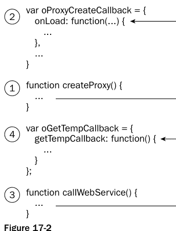

## 跨浏览器方法

再次，浏览器访问 Web 服务的方式差异如此巨大，以至于你无法使用当前的浏览器功能创建跨浏览器的方法。但由于 Web 服务仅仅是带有特殊格式的标准 HTTP 请求，因此可以使用 XML 请求对象创建一种跨浏览器方法。对于这项工作，你将使用浏览器检测脚本，以及书中之前解释过的为 Internet Explorer 创建`XMLHttpRequest`构造函数的脚本。

## WebService 对象

每个 Web 服务都是唯一的，那么如何可能开发出一种使用它们的方法方法？答案是创建一个通用的模板对象定义，可以通过覆盖它使其更具特殊性。这个模板对象被称为`WebService`，定义如下：

```javascript
function WebService() {
  this.action = "";
  this.url = "";
}
```

```javascript
WebService.prototype.buildRequest = function () {
  return "";
};
```


## 第 17 章

```javascript
var oProxyCreateCallback = {
  onLoad: function(oCreatedProxy) {
    oProxy = oCreatedProxy;
    oProxy.setListener(testGetTempCallback);
  },

  onError: function(sError) {
    alert(sError);
  }
};
```

操作的回调对象是`oGetTempCallback`，它的结构如下：

```javascript
var oGetTempCallback = {
  testGetTempCallback: function (iDegrees) {
    alert("It is currently " + iDegrees + " degrees in that zip code.");
  }
};
```

如你所见，唯一的方法是`getTemp()`。由于 Web 服务返回的是一个数字，第一个（也是唯一的）参数包含一个简单的数字。该参数名为`iDegrees`，但在实践中，参数命名为什么什么并不重要。该方法在`getTemp`返回值后立即被调用，并以用户友好的方式显示温度。

接下来，需要一个功能来创建 WSDL 代理。在许多情况下，由于代理创建的异步性质，最好在页面事件处理程序中创建代理，因此此示例将函数方向分配给`window.onload`。

```javascript
function createProxy() {
  try {
    var oFactory = new WebServiceProxyFactory();
    oFactory.createProxyAsync(WSDL, sPort, "", true, oProxyCallback);
  } catch (oError) {
    alert(oError.message);
  }
}

window.onload = createProxy;
```

此函数创建了一个`WebServiceProxyFactory`并使用它来创建代理，分配了 WSDL 文件的位置、端口名称和回调对象。它指定了所有要异步调的方法。

最后是`callWebService()`函数。第一个部分在尝试调用之前检查代理是否已创建。如果代理已创建，则作为代理的方法调用`getTemp()`并传入邮政编码：

```javascript
function callWebService() {
  if (oProxy) {
    var sZip = document.getElementById("txtZip").value;
    oProxy.getTemp(sZip);
  } else {
  alert("Proxy not available.");
}
}
```

在此函数中调用`getTemp()`时，会启动另一个线程来执行 Web 服务调用。结果被传递给`getTempCallback`对象。该函数在用户点击“获取温度”按钮时调用（此示例使用了与之前示例相同的 HTML 页面）。

这段代码的执行方式是非线性的（见图 17-2）。


## 跨浏览器方法

再次，浏览器访问 Web 服务的方式差异如此巨大，以至于你无法使用当前的浏览器功能创建跨浏览器方法。但由于 Web 服务仅仅是带有特殊格式的标准 HTTP 请求，因此可以使用 XML 请求对象创建一种跨浏览器方法。对于这项工作，你将使用浏览器检测脚本，以及书中之前解释过的为 Internet Explorer 创建`XMLHttpRequest`构造函数的脚本。

## WebService 对象

每个 Web 服务都是唯一的，那么如何可能开发出一种使用它们的方法方法？答案是创建一个通用的模板对象定义，可以通过覆盖它使其更具特殊性。这个模板对象被称为`WebService`，定义如下：

```javascript
function WebService() {
  this.action = "";
  this.url = "";
}
```

```javascript
WebService.prototype.buildRequest = function () {
  return "";
};
```

```javascript
WebService.prototype.handleResponse = function (sSOAP) {
};
```

```javascript
WebService.prototype.send = function () {

  if (isMoz) {
    try {
      netscape.security.PrivilegeManager.enablePrivilege("UniversalBrowserRead");
    } catch (oError) {
      alert(oError);
      return false;
    }
  }

  var oRequest = new XMLHttpRequest();
  oRequest.open("post", this.url, false);
  oRequest.setRequestHeader("Content-Type", "text/xml");
  oRequest.setRequestHeader("SOAPAction", this.action);
  oRequest.send(this.buildRequest());

  if (oRequest.status == 202) {
    return this.handleResponse(oRequest.responseText);
  } else {
    throw new Error("Request did not complete, code " + oRequest.status);
  }
};
```

`WebService`对象是跨浏览器 Web 服务的基础。它有两个属性：用于 SOAP 请求的 URL（`url`）和 SOAP 动作（`action`）。这两个属性都初始化为`null`；子类根据需要填充它们。`buildRequest()`方法用于构建 SOAP 消息字符串；在此方法中，`handleResponse()`方法接收 SOAP 消息并返回。

## Web Services

```javascript
var oService = new WebService();
var vResult = oService.send();
alert("Service returned " + vResult);
```

## Temperature Service

再次，是时候看看 Temperature Service。它继承自`WebService`并定义了：

```javascript
function TemperatureService() {
  WebService.call(this);
  this.url = "http://www.example.com/gettemp";
  this.action = "GetTemperature";
}
```

SOAP 请求看起来如下：

```xml
<SOAP-ENV:Envelope xmlns:soap="http://schemas.xmlsoap.org/soap/envelope/"
xmlns:temp="urn:methods"
xmlns:xsi="http://www.w3.org/2001/XMLSchema-instance"
xmlns:xsd="http://www.w3.org/2001/XMLSchema">
  <SOAP-ENV:Body>
    <temp:GetTemperatureResponse>
      <return xsi:type="xsd:float">72.5</return>
    </temp:GetTemperatureResponse>
  </SOAP-ENV:Body>
</SOAP-ENV:Envelope>
```

`buildRequest()`方法创建这个：

```javascript
TemperatureService.prototype.buildRequest = function () {
  var oBuffer = new StringBuffer();

  oBuffer.append("<SOAP-ENV:Envelope xmlns:soap=\"http://schemas.xmlsoap.org/soap/envelope/\" ");
  oBuffer.append("xmlns:temp=\"urn:methods\">");
  oBuffer.append("<SOAP-ENV:Body>");
  oBuffer.append("<temp:GetTemperatureResponse>");
  oBuffer.append("<return xsi:type=\"xsd:float\">" + this.zipcode);
  oBuffer.append("</return>");
  oBuffer.append("</temp:GetTemperatureResponse>");
  oBuffer.append("</SOAP-ENV:Body>");
  oBuffer.append("</SOAP-ENV:Envelope>");

  return oBuffer.toString();
};
```

`handleResponse()`方法解析响应：

```javascript
TemperatureService.prototype.handleResponse = function (sResponse) {
  var ORE = /<return.*>(.*)<\return>/gi;
  ORE.test(sResponse);
  return parseFloat(RegExp("$1"));
};
```


这行代码创建了一个名为`webServiceSend`的属性，它指向`send()`函数。此过程使得我们可以在不丢失原始功能的情况下重新定义`send()`：

```javascript
TemperatureService.prototype.send = function (sZipcode) {
  this.zipcode = sZipcode;
  return this.webServiceSend();
};
```

新的`send()`方法执行的第一件事是分配`zipcode`属性。然后，它返回`webService()`方法的结果（这是对原始`send()`方法的调用）。`TemperatureService`对象可以这样使用：

```javascript
var oService = new TemperatureService();
var fResult = oService.send("90210");
alert("Temperature is " + fResult + "degrees");
```

## TemperatureService 对象

再次创建该示例，代码要简单得多：

```html
<html
<head>
  <title>跨浏览器 Web 服务示例</title>
  <script type="text/javascript" src="detect.js"></script>
  <script type="text/javascript" src="stringbuffer.js"></script>
  <script type="text/javascript" src="http.js"></script>
  <script type="text/javascript" src="webservice.js"></script>
  <script>
    function callWebService() {
      var sZip = document.getElementById("txtZip").value;
      var oService = new TemperatureService();
      var fResult = oService.send(sZip);

      alert("该邮政编码目前的温度是 " + fResult + " 度。");
    }
  </script>
</head>
<body>
  <p><input type="text" id="txtZip" size="10" />
  <input type="button" value="获取温度" onclick="callWebService()" />
  </p>
</body>
</html>
```

如你所见，在这个示例中`callWebService()`函数被极大地简化了。从文本框获取邮政编码，然后创建`TemperatureService`对象并将邮政编码传递给`send()`方法，该方法返回摄氏度温度。然后显示警警框来指示温度。

## 总结

Web 服务是一项新技术，对于 JavaScript 来说也确实是一项新技术。在本章中，你学习了两个浏览器——Internet Explorer 和 Mozilla——如何尝试为 JavaScript 开发者提供 Web 服务功能。

你学习了微软如何创建一个 HTML 组件来封装 Web 服务调用。该 Web 组件从一个 WSDL 文件中读取 Web 服务信息，并开发了一个友好的对象来处理请求和响应。

你还学习了 Mozilla 如何如何继续开发其 Web 服务功能。它提供了低级 SOAP API 以及 WSDL 代理。还讨论了与 Web 服务相关的跨域安全和高级权限问题。

最后，你被介绍了一种用于跨浏览器的 Web 服务解决方案，这种方案虽然并不完美，但可以提供一个在 Internet Explorer 和 Mozilla 中均使用的通用接口。

## 与插件交互

Web 不仅仅是 HTML 和图像。现如今，世界各地的网站都使用了许多不同类型的插件。插件让 Web 浏览器能够在页面中嵌入较小的（有时是很大的）程序或对象，而不会干扰底层的 HTML。当浏览器遇到`<object/>`元素内部的内容时，它会将渲染责任交给关联的插件。

最初，首选的插件是 Java Applet。Applet 允许 Web 开发者直接在 Web 页面中包含 Java 功能。从那时起，开发了更多的插件。本章重点介绍今天最流行的插件，以及你如何使用 JavaScript 与它们交互。

## 为什么使用插件？

最初，Web 页面是相当静态的创建。在 DOM 出现之前，页面加载后，其外观将保持不变，直到被卸载。传统开发者生活在一个动态界面的世界里，用户引起屏幕上一切发生变化；当他们转向 Web 时，发现这个环境严重缺乏动态性。

Java 最初并不是为 Web 浏览器设计的，在它诞生之初，Wide Web 只是一个概念。然而，随着 Internet 和 Web 的流行，Java 开发者看到了丰富 Web 浏览体验的机会。Sun Microsystems 编写的实验性浏览器证明了 Java applet 可以嵌入 Web 页面中。第一次，Web 页面不再是静态的；相反，出现了无需重新页面的用户交互，这是一个明亮的未来。

同一时期，Netscape 开始开发应用程序架构。基本想法是让浏览器识别各种类型的信息。

## 第18章

从那时起，开发了许多插件。本章关注今天最流行的插件，以及你如何使用 JavaScript 与它们交互。

## 插件

然而，许多其他由插件处理。

## 第18章

如果某个 MIME 类型没有注册的插件，浏览器可能会（取决于你使用的是哪个浏览器）提议为该文件安装插件。许多浏览器还会查找`pluginpage`属性，这是`<object/>`的一个非官方属性（它在 HTML 规范中并不存在）。该属性指定了如果嵌入对象不在用户的机器上，应该去哪里寻找用于该对象的插件。例如：

```html
<object type="application/x-shockwave-flash" data="myflashmovie.swf"
pluginpage="http://www.macromedia.com/shockwave/download.cgi?P1_Prod_Version=ShockwaveFlash"
width="100" height="100"></object>
```

## 包含参数

有时对象在启动之前需要额外的参数。要为嵌入对象指定参数，请使用`<param>`元素及其`name`和`value`属性：

```html
<object type="application/x-shockwave-flash" data="myflashmovie.swf"
width="100" height="100">
<param name="message" value="Hello World!" />
</object>
```

每个对象可以任意数量的参数。包含不需要的参数不会产生负面影响。

## Netscape 4.x

Netscape 4.x 浏览器不使用`<object>`元素，因此要使用 Netscape 有的`<embed>`元素。`<embed>`元素接受大部分`<object/>`的属性（嵌入式是模仿`<embed>`设计的），但使用`src`属性代替了`data`属性：

```html
<embed type="application/x-shockwave-flash" src="myflashmovie.swf"
width="100" height="100">
<param name="message" value="Hello World!" />
</embed>
```

如你所见，通过`<object/>`是可以实现的。问题是较新的浏览器不支持这种方式（它已被官方废弃）。如果你计划支持 Netscape 4.x，首选方案是在`<object/>`内部嵌套一个`<embed>`元素，如下所示：

```html
<object type="application/x-shockwave-flash" data="myflashmovie.swf"
width="100" height="100">
<param name="message" value="Hello World!" />
<embed type="application/x-shockwave-flash" src="myflashmovie.swf"
width="100" height="100">
<param name="message" value="Hello World!" />
</embed>
</object>
```

使用这种方法，较新的浏览器会忽略`<embed>`元素并使用`<object/>`来嵌入文件；而 Netscape 4.x 则忽略`<object/>`并使用`<embed>`来嵌入文件。

## 与插件交互

### 检测插件

与 Web 技术一样，有两种类型的插件：来自微软的和其他厂商的插件。微软使用 ActiveX 技术，你可能还记得它是创建 XML 相关对象的方法；另一种方式被称为“Netscape 风格插件”，因为 Netscape Navigator 将插件的概念引入了 Web。在此之前，Internet Explorer 仅支持 ActiveX。从 Internet Explorer 5.5 Service Pack 2（仅限 Windows）开始，微软消除了对 Netscape 风格插件的支持。

这插件类插件之间的主要区别在于架构。ActiveX 插件构建在微软的 ActiveX 平台上，而 Netscape 风格插件构建在 Netscape Plugin API 之上。每个浏览器（包括 Internet Explorer）都被迫支持 Netscape 风格插件，因为 Netscape 曾是主导性的且唯一的可以竞争的浏览器。尽管很多人可能好奇微软为什么停止对 Netscape 风格插件的支持，但这在插件领域造成了明显的分裂。许多插件开发者被要求为这些插件同时创建 Netscape 风格和 ActiveX 包装器，以支持 Internet Explorer。

如今，浏览器分为两类：不支持 Netscape 风格插件的浏览器（如 Windows 上的 Internet Explorer）和支持这些浏览器（如 Mozilla、Opera、Safari 以及任何其他浏览器）。

由于这些差异，您有不同的方法来检测特定浏览器是否安装了插件。

### 检测 Netscape 风格插件

自 Netscape 3.0 以来，许多浏览器（特别是基于 Mozilla 的浏览器）允许 JavaScript 确定哪些 MIME 类型映射到插件，从而让你能够判断是否安装了给定的插件。这是通过`window.mimeTypes`集合实现的。

存在两种类型的 Netscape 风格插件：Netscape 4.x 使用的样式和 Mozilla 使用的较新的 Gecko 样式。差异的细节对 JavaScript 开发者来说并不重要，因为这两种样式的访问方式是相同的。

注册到插件的每个 MIME 类型都存在`window.mimeTypes`中，通过数字和 MIME 类型进行索引，允许你直接访问 MIME 类型或遍历该集合。一个具有四个属性的对象代表每个 MIME 类型：

- `description` — 由 MIME 类型所表示的文件类型的描述
- `enabledPlugin` — 插件对象的引用，包含有关特定插件的信息
- `suffixes` — 关联的文件后缀名
- `type` — MIME 类型

注册到插件的每个 MIME 类型都存在`window.mimeTypes`中，通过数字和 MIME 类型进行索引，允许你直接访问 MIME 类型或遍历该集合。你可以运行以下脚本打印所有可见的 MIME 类型及其描述：

```html
<html>
<head>
<title>MIME Types Example</title>
</head>
<body>
  <script type="text/javascript">
    if (navigator.mimeTypes) {
      document.write("<h3>Supported MIME Types</h3>");
      document.write("<ul>");
      for (var i=0; i < navigator.mimeTypes.length; i++) {
        document.write("<li>" + navigator.mimeTypes[i].type + " (",
        + navigator.mimeTypes[i].description + ", "
        + navigator.mimeTypes[i].suffixes + ")</li>");
        if (navigator.mimeTypes[i].enabledPlugin) {
          var oPlugin = navigator.mimeTypes[i].enabledPlugin;
          document.write("<ul>");
          document.write("<li>name: " + oPlugin.name + "</li>");
          document.write("<li>description: " + oPlugin.description + "</li>");
          document.write("<li>MIME types supported: "
          + oPlugin.length + "</li>");
          document.write("<li>Filename: " + oPlugin.filename + "</li>");
          document.write("</ul>");
        }
      }
      document.write("</ul>");
    }
  </script>
</body>
</html>
```

此示例没有打印`enabledPlugin`，它是另一个具有一组属性的对象：

- `description` — 插件的描述
- `filename` — 插件文件名
- `length` — 与插件关联的 MIME 类型数量
- `name` — 插件名称

值得注意的是，每个 MIME 类型都关联了一个插件，这意味着`enabledPlugin`可能为`null`。可以更新示例以考虑到这一点：

此示例输出每个 MIME 类型及其完整的插件信息（如果有的话）。

与上一个示例一样，此页面打印按数字索引的 MIME 类型。某些 MIME 类型仅通过 MIME 类型字符串索引，这些类型无法通过这种方法访问。例如，`text/html`是浏览器注册的 MIME 类型，但它没有出现在从之前的代码生成的列表中。然而，你可以显式地测试它：

```javascript
alert(navigator.mimeTypes["text/html"] != null);
```

这些不可见的类型通常由浏览器本身处理，通常没有为它们注册插件。可以使用简单的页面来测试任何你能想象到的 MIME 类型：

```html
<html>
<head>
<title>MIME Types Example</title>
<script type="javascript">

function findPlugin() {
var type = document.getElementById(txtMimeType).value;

if (navigator.mimeTypes[type]) {
if (navigator.mimeTypes[type].enabledPlugin) {
alert("The MIME type "" + type + " 使用插件 "" + navigator.mimeTypes[type].enabledPlugin.name + "'.");
}
}
```

# 第18章

```html
<head>
<body>
  <p>输入您想要检查的 <acronym title="多用途互联网邮件扩展">MIME</acronym> 名称，并点击“查找插件（Find Plugin）”按钮。</p>
  <p><input type="text" id="textMimeType" / />
  <input type="button" value="Find Plugin" onclick="findPlugin()" /></p>
</body>
</html>
```

之前列出的 HTML 页面允许你向文本框中输入 MIME 类型并点击按钮来确定该 MIME 类型是否已注册。如果是，你就可以判断它是否具有浏览器插件。`findPlugin()`函数从文本框中获取值并检查`navigator.mimeTypes`是否存在。如果存在，你就可以判断它已安装了插件。

你可以将测试处理特定 MIME 类型插件的方法提取到单独的函数中：

```javascript
function hasPluginForMimeType(simeType) {
  if (navigator.mimeTypes[mMimeType].enabledPlugin != null) {
    return true;
  } else {
    return false;
  }
}
```

然后，你可以像下面这样检查给定插件是否存在：

```javascript
if (hasPluginForMimeType("application/x-shockwave-flash")) {
  alert("插件已安装.");
} else {
  alert("插件未安装.");
}
```


还可以在不使用 MIME 类型的情况下获取所有已注册插件的列表。`navigator.plugins` 集合包含了所有浏览器可用的插件，并按名称和编号进行索引。集合中的每个条目都是一个插件对象，等同于每个 MIME 类型通过 `enabledPlugin` 引用的对象。因此，如果你知道插件的名称（等于其 `name` 属性），你可以直接访问它：

```javascript
var oFlashPlugin = navigator.plugins["Shockwave Flash"];
```

否则，你可以遍历插件以打印每个插件的信息。也可以使用一个简单的页面来实现这一点：

```html
<html>
<head>
  <title>Plugins Example</title>
</head>
<body>
  <script type="text/javascript"></script>
```

## 与插件交互

```javascript
if (navigator.mimeTypes) {
  document.writ("<<h3>已加载的插件：</h3>");
  document.writ("<ul>");
  for (var i=0; i < navigator.plugins.length; i++) {
    document.writ("<<li>" + navigator.plugins[i].name + " (" + navigator.plugins[i].description + ")</</li>>");
  }
  document.writ("</ul>");
}
<script>
</body>
</html>
```

此页面打印了所有已注册插件及其描述。但插件对象还隐藏着一个秘密；它是一个 MIME 类型集合，这意味着可以如下方式访问插件的 MIME 类型：

```javascript
var nMimeType = navigator.plugins[0][0];
```

这行代码访问了第一个插件支持的 MIME 类型。现在，你可以更新之前的示例，以包含每个插件已注册的 MIME 类型：

```html
<html>
<head>
  <title>Plugins Example</title>
</head>
<body>
<script type="javascript">
if (navigator.mimeTypes) {
  document.writ("<<h3>已加载的插件：</h3>");
  document.writ("<ul>");
  for (var i=0; i < navigator.plugins.length; i++) {
    document.writ("<<li>" + navigator.plugins[i].name + " (" + navigator.plugins[i].description + ")</</li>>");
  }
  document.writ("</ul>");

  for (var j=0; j < navigator.plugins[i].length; j++) {
    document.writ("<<li>" + navigator.plugins[i][j].type + ")</</li>>");
  }
  document.writ("</ul>");
  document.writ("</ul>");
}
</script>
</body>
</html>
```

此示例显示了每个插件的名称和描述，随后是支持的 MIME 类型列表。

## 第 18 章

最后需要注意的是，当用户正在下载插件以查看你的页面时，`navigator.plugins` 集合有时可能会过时或陈旧。为了应对这种可能性，你应该始终通过调用 `refresh()` 方法开始刷新 `navigator.plugins`。该方法接受一个参数，即布尔值，表示浏览器是否应该使用嵌入对象重新加载页面（或页面）；要重新加载页面，传递 `true`，否则传递 `false`。例如：

```javascript
navigator.plugins.refresh(true); //重新加载所有使用插件的页面
```

这样做可以避免你以后产生一些烦恼。

> 目前，Netscape Navigator 3.0+、Internet Explorer 5.0 (Macintosh)、Internet Explorer 3.0-5.5 SP 1 (Windows) 以及所有基于 Mozilla 的浏览器都支持此功能；Windows 上的 Internet Explorer 5.5 SP 2 不支持，尽管它都创建了 `navigator.plugins` 和 `navigator.mimeTypes`（每个都是一个零项的集合）。

## 检测 ActiveX 插件

因为 Internet Explorer 只是 ActiveX 控件，你只需要知道控件的名称即可检测它是否已安装。在本书的前面，你看到过一些检测 Microsoft XML DOM 最新版本的代码。这种方法可以用于任何 IE 插件。

| 插件 | 与版本无关 | 版本特定 |
| :--- | :--- | :--- |
| Adobe (Acrobat) Reader | PDF.Ctrl | PDF.Ctrl |
| Macromedia Flash Player | ShockwaveFlash | ShockwaveFlash |
| Real Player 5 | RealPlayer | RealPlayer (tm) ActiveX Control (32-bit) |
| Real Video 5 | RealVideo | RealVideo (tm) ActiveX Control (32-bit) |

| 插件 | 与版本无关 | 版本特定 |
| :--- | :--- | :--- |
| Adobe SVG Viewer | Adobe.SVGCt1 | Adobe.SVGCt1 |
| Real Player G2 | rmocx.RealPlayer G2 | rmocx.RealPlayer G2 |
| Quicktime | Quicktime.Quicktime | Quicktime.Quicktime |
| Windows Media Player | WMPlayer.OCX | WMPlayer.OCX |

要使用 ActiveX 名称，可以使用 ActiveX 创建对象。例如：

```javascript
function detectIE() {
  try {
    new ActiveXObject("ShockwaveFlash.ShockwaveFlash");
    return true;
  } catch (oError) {
    return false;
  }
}
```

该函数的目的是判断是否安装了 Flash Player。为此，它尝试使用 `ShockwaveFlash.ShockwaveFlash` 创建 `ActiveXObject`。如果成功，执行下一行并返回 `true`。如果无法创建对象，将捕获异常并返回 `false`。这种相同的基本算法适用于任何带有 ActiveX 封装的插件。

> 这种插件检测方法仅适用于 Windows 上的 Internet Explorer 5.0 及更高版本。

## 跨浏览器检测

遗憾的是，你无法以通用方式建立跨浏览器插件检测。为了准确检测可用插件，你必须知道 MIME 类型和 ActiveX 控件名称。大多数情况下，开发者只需创建包含这两个信息的特定检测函数，如下：

```javascript
function detectFlash() {
  if (navigator.mimeTypes.length > 0) {
    return navigator.mimeTypes['application/x-shockwave-flash'].enabledPlugin
   != null;
  } else if (window.ActiveXObject) {
    try {
      new ActiveXObject("ShockwaveFlash.ShockwaveFlash");
      return true;
    } catch (oError) {
      return false;
    }
  }
}
```

### 与插件交互

```javascript
} else {
  //无法检测！
  return false;
}
```

此函数使用对象检测来确定使用哪种方法。如果 `navigator.mimeTypes` 可用，函数将使用 Netscape 风格的插件检测检查已安装的插件。相反，如果可以创建 `ActiveXObject` 对象，则使用 IE 风格的检测。如果这两个选项都不可用（这并不常见），函数将返回 `false`。

要检测特定插件，你可以自定义此算法并创建一系列插件函数。

Macromedia 提供了 Flash 检测工具包，地址为 <http://www.macromedia.com/software/flash/download/detection_kit/>，可用于生成嵌入 Flash 电影的跨浏览器 HTML 和 JavaScript。

## Java Applets

作为插件的最旧形式，Java applet 最近被重新定义，以与通用浏览器插件框架配合。此前，applet 必须使用 `<applet>` 元素加载。HTML 4.0 弃用了 `<applet>`，转支持 `<object>` 作为嵌入插件的唯一手段。为了协助这一迁移，Sun Microsystems 创建了 Java 插件，它是 Java 运行环境 (JRE) 的一部分，并可以在 <http://java.sun.com> 获取。

### 嵌入 applets

嵌入 applet 需要你使用 `<object/>` 的非标准 `code` 属性来指定要加载的类。当使用相同的数据时，所有浏览器都应该有效，但现实是支持并不通用，因此最好以这种方式使用 `code`：

```html
<object type="application/x-java-applet"
width="100" height="100" id="ExampleApplet"
code="ExampleApplet.class"
</object>
```

注意 Java applet 的类型：通过指定此类型，你可以确保浏览器将使用最合适的（且可）的 Java 插件版本。你可以通过在类型末尾添加可选可选指定精确的版本。例如，指定版本 1.4.2（来自 JRE 1.4.2），添加 `jpi-version=1.4.2`：

```html
<object type="application/x-java-applet;jpi-version=1.4.2"
code="ExampleApplet.class" width="100" height="100" id="ExampleApplet"
</object>
```

## 第 18 章

在此 MIME 类型中，JPI 是 Java Plugin 的缩写，它确保除非用户计算机上的插件版本恰好为 1.4.2，否则 applet 不运行。因此，即使用户拥有 1.4.3 版本，applet 也不会运行。出于如此，最好省略插件版本以避免给用户带来困扰。

applet 类可以包含在 JAR（Java 归档）文件中。在这种情况下，使用 `archive` 属性指定 JAR 文件：

```html
<object type="application/x-java-applet"
  archive="ExampleArchive.jar"
  code="ExampleApplet.class" width="100" height="100" id="ExampleApplet">
</object>
```

要支持 Navigator 4.x，请使用原始的 `<applet>` 元素。为了确保代码在所有浏览器中运行，可以将 `<applet>` 嵌入 `<object>` 内部（类似于将 `<embed>` 放置在 `<object>` 内部）。然而，这样做需要使用专有的 `<comment>` 元素。虽然 Mozilla 和其他浏览器会忽略 `<object,/>` 内部的内容，但 dns 不会，可能会渲染出两个相同的 applet。插入 `<comment/>` 元素可以告诉 IE 忽略该注释：

```html
<object type="application/x-java-applet"
  code="ExampleApplet.class" width="100" height="100" id="ExampleApplet">
<comment>
  <applet code="ExampleApplet.class" width="100" height="100"
    name="ExampleApplet"></applet>
</comment>
</object>
```

### 在 JavaScript 中引用 applets

在 applet 包含在 HTML 页面之后，你需要通过 JavaScript 访问它。传统上，applets 是通过 `document.applets` 集合引用的，该集合通过 `name` 属性和位置索引所有 `<applet>` 元素（类似于 `document.forms` 和 `document.frames`）。例如，要获取 `name` 属性设置为 `"ExampleApplet"` 的 applet，你可以执行以下操作：

```javascript
var applet = document.applets["ExampleApplet"];
```

然而，如果你使用 `<object>` 来嵌入 applet，`document.applets` 集合并不包含它。使用 `<object/>` 时，你可以使用 `document.getElementById('')` 访问 applet：

```javascript
var applet = document.getElementById("ExampleApplet");
```

如果你同时使用 `<object>` 和 `<applet>` 以兼容旧版浏览器，你应该使用一个函数来确定适当的方法：

```javascript
function getApplet(sName) {
  if (document.getElementById) {
    return document.getElementById(sName);
  } else {
    return document.applets[sName];
  }
}
```

### 与插件交互

```javascript
var oApplet = getApplet("ExampleApplet");
```

在你获得 applet 的引用后，可以调用它的方法，例如：

```javascript
oApplet.setMessage();
```

### 编写 applets

要编写 applets，你必须先从 Sun 网站下载 Java 开发包 (JDK)。这是一个简单的示例 applet：

```java
import javax.applet.Applet;
import java.awt.Graphics;
import java.awt.HeadlessException;

public class ExampleApplet extends Applet {

    private String message = "Hello World!";

    public ExampleApplet() throws HeadlessException {
        super();
    }

    public void paint(Graphics g) {
        g.drawString(message, 20, 20);
    }

    public void setMessage(String message) {
        this.message = message;
        repaint();
    }
}
```

定义 applet 并保存为 `.java` 文件后，在命令行中使用 `javac` 工具编译文件：

```bash
javac ExampleApplet.java
```

此命令创建一个 `.class` 扩展的文件。`.class` 文件必须放置在 Web 服务器目录中以便 HTML 页面访问它。

## JavaScript 到 Java 的通信

现在你有一个具有公共方法的 applet，可以将其包含在 Web 中并通过 JavaScript 访问。示例使用了上一节的 `ExampleApplet`，并展示了如何使用 JavaScript 更改 applet 显示的消息：


```html
<html>
<head>
<title>Applet 示例</title>
<script>
  function changeAppletMessage() {
    var oApplet = document.getElementById("ExampleApplet");
    var oTextBox = document.getElementById("txtMessage");
    oApplet.setMessage(oTextBox.value);
  }
</script>
</head>
<body>
<p>输入你想在 applet 中看到的消息。</p>
<p><input type="text" id="txtMessage" size="10" />
<input type="button" value="设置消息" onclick="changeAppletMessage()" />
</p>

<object type="application/x-applet" code="ExampleApplet.class"
      width="100" height="100" border="1" id="ExampleApplet">
<comment>
  <applet code="ExampleApplet.class" width="100" height="100"
       name="ExampleApplet"></applet>
</comment>
</object>
</body>
</html>
```

## 与插件交互

此示例向用户展示了一个文本框，可以在其中输入新消息。当用户点击设置消息（Set Message）按钮时，它会调用`changeAppletMessage()`函数，该函数获取 applet 的引用并从文本框中检索文本。然后，该函数调用 applet 的`setMessage()`方法并传入输入的文本。applet 中显示的消息将从“Hello World!”变为用户输入的任何内容（这一过程发生得快慢不异）。

## 类型转换

尽管 JavaScript 到 Java 的通信对于开发者来说是一个强大的工具，但它并非没有问题。在上一个示例中，字符串无问题地从 JavaScript 传递到 Java 方法。这是因为 JavaScript 的`String`对象直接映射到 Java 的`String`对象。这对于 JavaScript 中的每一个原始类型值都是如此，因为它们在 Java 中有等效的原始类型。当你将对象传递给一个没有等效类的 Java 方法时，可能会遇到麻烦。因此，最好用 JavaScript 创建的任何方法都只使用原始类型值。

## 处理 Java 异常

异常在 Java 中比在 JavaScript 中常见，因此你必须意识到它们何时可能发生。在访问可能导致错误的 applet 方法时，你可以通过将调用封装在`try..catch`语句中来准备。是的，Java 的`try..catch`语句可以捕获 applet 抛出的异常。

假设你希望在向`setMessage()`传递零长度字符串时让`ExampleApplet`抛出一个错误，例如：

```java
import java.applet.Applet;
import java.awt.Graphics;
import java.awt.HeadlessException;

public class ExampleApplet2 extends Applet {

    private String message = "Hello World!";

    public ExampleApplet2() throws HeadlessException {
        super();
    }

    public void paint(Graphics g) {
        g.drawString(message, 20, 20);
    }

    public void setMessage(String message) throws Exception {
        if (message.length() == 0) {
            throw new Exception("Message must have at least one character.");
        }

        this.message = message;
        repaint();
    }
}
```

## 第 18 章

可以使用`try..catch`语句捕获抛出的错误：

```javascript
var oApplet = document.getElementById("ExampleApplet");
var oTextbox = document.getElementById("txtName");

try {
  oApplet.setMessage(oTextbox.value);
} catch (e) {
  alert("Error caught!");
}
```

由于浏览器的差异，很难说`oError`会返回什么。Internet Explorer 返回一个表示异常的 JavaScript 对象，而 Mozilla 返回的是异常对象。这两个浏览器访问错误信息的方式不同：在 IE 中，`oError.message`属性显示异常消息；在 Mozilla 中，`toString()`方法返回异常字符串，但并不包含原始的异常方法。在大多数情况下，只要知道发生了错误就足够了。

## 安全限制

尽管 Java 比 JavaScript 更强大，但 applet 在包含在 Web 页面中时，对浏览器并不拥有不受限制的控制权。Java applet 必须遵循浏览器列出的一套严格规则（每个浏览器的规则都不同，尽管有些规则是相当常见的）。这种行为被称为沙箱化。

首先，applet 不允许访问用户文件系统。这防止了恶意 applet 在诱导毫无防备的用户打开包含该 applet 的页面时产生安全问题。默认情况下，这是可能的。

其次，applet 不允许跨域访问资源。这与书中之前讨论的 XML HTTP 请求所面临的限制相同。

可以通过对 applet 进行数字签名来绕过这些限制。当 applet 经过签名时，会向用户弹出一个对话框，询问签名是否有效，反之，询问是否允许 applet 使用其他情况下无法获得的增强权限。如果接受了签名，之前提到的限制将被解除。

你可以在`http://java.sun.com/developer/technicalarticles/Security/Signed/`了解更多关于 applet 安全和签名的知识。

## Java 到 JavaScript 的通信

JavaScript 不仅可以访问 Java applet 中包含的方法，applet 实际上还可以通过 LiveConnect 访问 JavaScript 对象和函数。LiveConnect 之前提到过作为 JavaScript 访问对象的方法，但它也可以使用一个特殊的 Java 包来紧密集成 applet 和 JavaScript：`netscape.javascript`。

该包包含两个类：`JSObject`（JavaScript 对象的 Java 表示）和`JSException`（JavaScript 错误）。然而，`JSObject`是 Java 到 JavaScript 通信的核心。

## 与插件交互

`JSObject`类具有以下方法：

*   `getMember(String name)` — 获取对象的命名属性。等于 JavaScript 中的`o.property`或`o["property"]`。

*   `getSlot(int index)` — 获取对象的索引属性（主要用于 JavaScript 数组）。等于`o[index]`。

*   `setMember(String name, Object value)` — 设置命名属性的值。

*   `getSlot(int index, Object value)` — 设置索引属性的值。

*   `removeMember(String name)` — 移除命名属性。

*   `call(String methodName, Object args[])` — 调用指定的方法并传递`Object`数组中的参数。返回值为 Java 对象。

*   `eval(String code)` — 执行 JavaScript 字符串。

*   `equals(Object obj)` — 判断对象是否等于另一个。

*   `toString()` — 返回对象的字符串表示。

## 第 18 章

这里是一个使用 LiveConnect 的 applet 示例：

```java
import java.applet.Applet;
import java.awt.Graphics;
import java.awt.HeadlessException;
import netscape.javascript.*;

public class ExampleApplet3 extends Applet {

    public ExampleApplet3() throws HeadlessException {
        super();
    }

    public void paint(Graphics g) {
        JSObject window = JSObject.getWindow(this);
        JSObject document = window.get("document");
        JSObject location = window.get("location");

        g.drawString("Title: " + document.get("title"), 10, 20);
        g.drawString("URL: " + location.get("href"), 10, 40);

        window.eval("getMessageFromApplet('Hello from the Java applet!')");
    }
}
```

此 applet 使用`paint`方法与 JavaScript 交互。该方法通过之前讨论的方法获取 window、document 和 location 对象的引用。接下来，applet 将页面标题（从`document.title`获取）和 URL（来自`location.href`）绘制到 applet 画布上。

最后，使用`window.eval()`方法执行对`getMessageFromApplet()`的调用，这是一个必须在包含 applet 的 HTML 页面中定义的 JavaScript 函数。如果 applet 初始化时该函数不存在，则会发生`JSException`。

在 LiveConnect 包中包含 applet 时，必须设置一个特殊参数来访问 HTML 文档。参数名称为`myscript`，并应设置为 true：

```html
<object type="application/x-java-applet" code="ExampleApplet3.class"
  width="100" height="100" id="ExampleApplet">
  <param name="myscript" value="true">
</object>
```

如果你使用的是旧的`<applet/>`元素，只需将`myscript`作为属性包含：

```html
<applet code="ExampleApplet3.class" myscript="myscript"
  width="100" height="100" name="ExampleApplet">
</applet>
```

## 与插件交互

回到示例，`getMessageFromApplet()`函数仅仅是显示所传递的参数。以下是该页面的完整 HTML 代码：

```html
<html
<head>
  <title>Applet Example</title>
  <script>
    function getMessageFromApplet(sMessage) {
      alert("Applet says: " + sMessage);
    }
  </script>
</head>
<body>
  <p>此页面定义了一个函数，该函数会在 applet 加载后被调用。</p>
  <object type="application/x-java-applet" code="ExampleApplet3.class" width="400" height="50" id="ExampleApplet">
    <param name="myscript" value="true" />
  </object>
</body>
</html>
```

当加载此页面时，applet 会显示标题（Applet Example）和你正在查看的示例 URL。然后，你应该会看到一个弹窗显示消息“Applet says: Hello from the Java applet!”。

你可以使用它来执行`getMessageFromApplet()`：

```javascript
Object[] args = new Object[1];
args[0] = "Hello from the Java applet!";
window.call("getMessageFromApplet", args);
```

由于`getMessageFromApplet()`是一个全局函数，它被认为是 window 的一个方法，因此可以使用`call()`方法进行调用。

## Flash 电影 (Flash Movies)

最初作为一种在网页上嵌入小型矢量动画的方法，已发展成为整个网站和 Web 应用程序的开发环境。Macromedia Flash 已演变成不仅仅是一个动画工具，而是一个用于 Web 的完整开发环境。

Flash 电影（称为 Flash movies）是使用 Macromedia 专 Flash 和 Flash MX 开发环境创建的（尽管许多图形程序现在都具有基于 Macromedia Open SWF 倡议的“导出到 Flash”功能）。由于其普及性，Flash 插件现在随大多数浏览器一起发布，这意味着大多数用户无需手动下载插件即可享受其优势（当然，除非有可用更新）。

## 第 18 章

### 嵌入 Flash 电影

要将 Flash 电影嵌入 HTML 页面中，请使用`<object/>`元素：

```html
<object type="application/x-shockwave-flash" data="flashmovie.swf"
width="100" height="100" id="FlashMovie"></object>
```

基于 Mozilla 的浏览器不会通过属性显示它，因此你需要添加一个电影参数，其值设置为与`data`属性相同的 URL：

```html
<object type="application/x-shockwave-flash" data="flashmovie.swf"
  width="100" height="100" id="FlashMovie">
  <param name="movie" value="flashmovie.swf" />
</object>
```

当然，如果你不支持 Netscape 4.x，请包含`<embed/>`元素：

```html
<object type="application/x-shockwave-flash" data="flashmovie.swf"
  width="100" height="100" id="FlashMovie">
  <param name="movie" value="flashmovie.swf" />
  <embed type="application/x-shockwave-flash" src="flashmovie.swf"
    width="100" height="100" quality="high" name="FlashMovie">
  </embed>
</object>
```

### 引用 Flash 电影

类似于 Java applets，Flash 电影可以以两种不同的方式引用，取决于你如何嵌入它们（使用`document.getElementById()`用于`<object/>`，或使用`document.embeds`用于后者）。可以使用以下函数无论使用何种嵌入过程，都可获取 Flash 电影：

```javascript
function getFlashMove(sName) {
  if (document.getElementById(sName)) {
    return document.getElementById(sName);
  } else {
    return document.embeds[sName];
  }
}
```

该函数可以这样调用：

```javascript
var oFlashMovie = getFlashMove("FlashMovie");
```

在获得电影引用后，可以使用 JavaScript 进行双向通信。

## 与插件交互

### JavaScript 到 Flash 的通信

Flash 电影提供了许多可以通过 JavaScript 访问的标准方法：

- `GetVariable(variable_name)` — 获取 Flash 电影变量的值

- `GotoFrame(frame_number)` — 将当前 Flash 电影设置到指定的帧数


- `IsPlaying()` — 指示 Flash 电影当前是否正在播放
- `LoadMovie(layer_num, url)` — 将指定 URL 的 Flash 电影加载到 Flash 层
- `Pan(x, y, mode)` — 将缩放后的电影移动到指定坐标。参数为 0（将坐标视为像素值）或 1（将坐标视为百分比）。
- `PercentLoaded()` — 返回 Flash 电影已加载的百分比（数字 0 到 100）
- `Play()` — 从当前位置播放
- `Rewind()` — 回到第一帧
- `SetVariable(variable_name, value)` — 设置 Flash 变量的值
- `Zoom(left, top, right, bottom)` — 缩放矩形
- `StopPlay()` — 停止播放
- `TotalFrames()` — 返回总帧数
- `Zoom(percent)` — 按比例缩放

某些方法适用于特定的时间线：

- `CallFrame(timeline, frame_number)` — 执行指定帧数的操作
- `CallLabel(timeline, frame_label)` — 执行指定标签帧的操作
- `CurrentFrame(timeline)` — 返回当前时间线的帧数
- `CurrentLabel(timeline)` — 返回当前时间线的标签
- `GetProperty(timeline, property_constant)` — 返回指定属性的值（字符串）
- `GetPropertyAsNumber(timeline, property_constant)` — 返回指定属性的值（数字）
- `GotoFrame(timeline, frame_number)` — 将时间线跳转到指定的帧数
- `GotoLabel(timeline, frame_label)` — 将时间线跳转到指定的标签
- `Play(timeline)` — 在指定时间线上播放
- `SetProperty(timeline, property_constant, value)` — 设置指定属性的值（字符串）
- `StopPlay(timeline)` — 在指定时间线上停止

使用 `SetVariable()` 和 `GetVariable()` 可以向 Flash 传递并获取信息。为了使其工作，Flash 电影必须有一个文本字段（选择动态文本）。然后，要访问主时间线的变量，这两个方法的第一个参数为 `:message`，其中冒号表示时间线，`message` 是变量名。例如：

```javascript
var sMessage = oFlashMovie.GetVariable(":message");
oflashMovie.SetVariable(":message", "new message");
```

要获取电影的总帧数，请使用 `TotalFrames()`。然而，你必须注意某些浏览器兼容性问题。在 Internet Explorer 中存在一个 Bug，`TotalFrames` 是一个整数而不是函数。有必要使用 `typeof` 进行检查：

```javascript
function getTotalFrames(sName) {
  var oFlashMovie = document.getElementById(sName);

  if (typeof oFlashMovie.TotalFrames == "function") {
    return oFlashMovie.TotalFrames();
  } else {
    return oFlashMovie.TotalFrames;
  }
}
```

常量使用数值值。常量列如下：

| Flash 常量 | 值 | 描述 |
|---|---:|---|
| `X_POS` | 0 | 电影的 x 坐标 |
| `Y_POS` | 1 | 电影的 y 坐标 |
| `X_SCALE` | 2 | 水平缩放 |

## 与插件交互

| Flash 常量 | 值 | 说明 |
|---|---:|---|
| `Y_SCALE` | 3 | 垂直缩放 |
| `CURRENT_FRAME` | 4 | 当前帧在电影中的位置 |
| `TOTAL_FRAMES` | 5 | 电影的总帧数 |
| `ALPHA` | 6 | 电影的不透明度（0 到 100 之间的数字） |
| `VISIBLE` | 7 | 电影是否可见 |
| `WIDTH` | 8 | 电影的宽度 |
| `HEIGHT` | 9 | 电影的高度 |
| `ROTATION` | 10 | 电影的旋转角度（度） |
| `TARGET` | 11 | 时间轴名称（与任何特定时间方法的第一个参数相同） |
| `FRAMES_LOADED` | 12 | 当前加载的帧数 |
| `NAME` | 13 | 电影名称 |
| `DROP_TARGET` | 14 | 电影内部的投放目标名称（如果存在） |
| `URL` | 15 | 电影的 URL |
| `HIGH_QUALITY` | 16 | 电影是否处于高质量渲染模式（1 为真，0 为假） |
| `FOCUS_RECT` | 17 | 是否显示焦点框（1 为真，0 为假） |
| `SOUND_BUF_TIME` | 18 | 为了产生不连续播放而应缓冲的音频量 |

当使用特定时间轴的方法时，第一个参数始终是要操作的时间轴名称。默认时间轴由单个正斜杠表示：

```javascript
var iXPos = oFlashMovie.TGetProperty("/", 0);
```

第一个参数始终会被 `TARGET` 属性镜像反映：

```javascript
var sTarget = oFlashMovie.TGetProperty("/", 11);
alert(sTarget == "/"); // 输出 true
```

由于 Flash 使用一种基于 ECMAScript 的语言 ActionScript，因此它与 JavaScript 的交互是无缝的。

## Flash 与 JavaScript 的通信

Flash 同样能够与嵌入它的 HTML 页面上的 JavaScript 进行交互。当使用 `<object/>` 元素嵌入 Flash 电影时，可以通过以下方式启用此功能：

## 第 18 章

如果你使用 `<embed/>` 元素，即使是为了向后兼容，也必须添加一个名为 `swLiveConnect` 的关键属性：

```html
<object type="application/x-shockwave-flash" data="myflashmovie.swf"
  width="100" height="100">
  <param name="message" value="Hello World!" />
  <embed type="application/x-shockwave-flash" src="myflashmovie.swf"
    width="100" height="100">
    <param name="message" value="Hello World!" />
  </embed>
</object>
```

设置该属性后，你可以确保 Flash 到 JavaScript 的通信通道已打开。

Flash 提供了两种不同的方式来实现这一点：`getURL()` 和 `fsCommand()`。它们都只能向 JavaScript 传递原始值，并且各自有优缺点。

## `getURL()`

`getURL()` 函数是与浏览器交互的一种通用方法。它可以用于浏览器窗口中（或新窗口中）打开文档，类似于 JavaScript 中的 `window.open()`。例如，你可以使用以下代码在新窗口中打开 `www.wrox.com`：

```actionscript
getURL("http://www.wrox.com", "_blank")
```

由于 `getURL()` 仅仅是将给定的 URL 传递给浏览器，因此它也可以接受 `javascript:` URL。例如，假设你有一个函数 `getMessageFromFlash()`，它接受一个字符串作为唯一参数并在警框中显示，如下所示：

```javascript
function getMessageFromFlash(sMessage) {
  alert("" + sMessage + "");
}
```

在 Flash 电影内部，创建一个按钮并添加以下 ActionScript 代码：

```actionscript
on(release) {
  getURL("javascript:getMessageFromFlash('Hello from Flash!');")
}
```

当你导出电影并将其嵌入到包含 `getMessageFromFlash()` 的 HTML 页面时，点击该按钮会弹出一个 JavaScript 警框，显示“Hello from Flash!”。

`getURL()` 函数是从 Flash 调用 JavaScript 最简单的方法，尽管你还有其他方法可以实现这一点。

## `fsCommand()`

在 Flash 中使用 `fsCommand()` 是向 JavaScript 发送消息。该消息由一个命令（指示电影期望的操作）和一个单条参数组成（尽管 Flash 允许你传递多个参数，但 JavaScript 无法正确处理它们）。从电影内部发起的典型调用如下：

```actionscript
on(release) {
  fscommand("send_message", "the message");
}
```

为了让 JavaScript 处理此命令，必须定义一个特殊函数。该函数必须以 Flash 对象的名称（或 ID）开头，并后接 `_DoFSCommand`，例如：

```javascript
function ExampleMovie_DoFSCommand(sCommand, vArgument) {
  ...
}
```

该函数始终接受两个参数：命令和参数。命令始终是字符串，但参数可以是任何原始类型。所有对 `fscommand()` 的调用都会通过不同的命令路由到此函数，这些命令决定了在 JavaScript 中执行什么操作。例如：

```javascript
function ExampleMovie_DoFSCommand(sCommand, vArgument) {
  switch(sCommand) {
    case "change_color":
      // 更改颜色
      break;
    case "change_height":
      // 更改高度
      break;
  }
}
```

## ActiveX 控件

在 Windows 上的 Internet Explorer 中，你可以使用 `<object/>` 元素在页面中嵌入 ActiveX 控件。你需要要嵌入的 ActiveX 控件的类 ID（可以使用 OLE/Com Viewer 获取），并将其作为 `class` 属性插入：

```html
<object class="activex_class_id" id="ActiveXControl"></object>
```

## 与插件交互

```html
<object class="CLSID:337CBC4-460F-11D0-BC04-08007055A83" id="TextData">
  <param name="DataURL" value="Names.txt" />
  <param name="FieldDelim" value=", />
</object>
```

最后，如果问题使用第一行作为表头，你应该将 `UseHeader` 参数设置为 `true`，这不会将第一行包含在数据值中，并且允许你通过列名引用列，如下：

```html
<object class="CLSID:337CBC4-460F-11D0-BC04-08007055A83" id="textData">
  <param name="DataURL" value="Names.txt" />
  <param name="FieldDelim" value=", />
  <param name="UseHeader" value="true" />
</object>
```

此代码用于加载数据控制，其中使用 `Names.txt` 中的数据，并以 `,` 作为每列的字段分隔符。

这是一个示例的 `Names.txt` 文件：

```text
first_name,last_name
Nicholas,Zakas
Michael,Smith
Joyce,Anderson
Benjamin,Johnson
Amy,Jones
```

第一列命名为 `first_name`，第二列命名为 `last_name`。在每一行中，如 `FieldDelim` 参数所示，逗号分隔了值。

页面的 `load` 事件在数据控制完全加载其数据之前不会触发，因此使用 `onload` 事件处理程序来确定数据何时可用是安全的。通过放置此代码，你可以通过访问内容的 `recordset` 属性获取创建的记录集：

```javascript
window.onload = function () {
  oDataSet = document.getElementById("TextData").recordset;
};
```

此代码创建了一个全局变量 `oDataSet`，它指向包含所有数据的记录集。

你可以使用 `moveFirst()`、`moveLast()`、`moveNext()` 和 `movePrevious()` 方法，结合 `EOF`（文件末尾）和 `BOF`（文件开头）标记来遍历记录集。例如，这里有一个从第一条记录开始到最后一条记录结束的遍历记录集的基本框架：

```javascript
oDataSet.moveFirst();

while (!oDataSet.EOF) {
  // 对数据进行操作
  oDataSet.moveNext();
}
```

## 第 18 章

上一个代码的第一步是将记录集设置为第一条记录。然后 `while` 循环测试 `EOF`，当到达文件末尾时，`EOF` 为 `true`。循环内部在移动到下一条记录之前进行数据处理。

也可以使用相反的方法反向移动记录集：

```javascript
oDataSet.moveLast();

while (!oDataSet.BOF) {
  // 对数据进行操作
  oDataSet.movePrevious();
}
```

此代码从最后一条记录开始一直回到第一条记录。`BOF` 属性等于 `true`。要获取数据，使用记录集的 `fields()` 方法，通过列名（在上一个示例中 `first_name` 或 `last_name`）或位置 0 来访问。要显示 `Names.txt` 中每个人的实际值，使用以下代码：

```javascript
oDataSet.moveFirst();

while (!oDataSet.EOF) {
  alert(oDataSet.fields(0).value);
  oDataSet.moveNext();
}
```

你也可以用 `first_name` 代替 0：

```javascript
oDataSet.moveFirst();

while (!oDataSet.EOF) {
  alert(oDataSet.fields("first_name").value);
  oDataSet.moveNext();
}
```

通过这种方式，你可以遍历记录集并获取所需的所有数据。如果你仅针对 Windows 上的 Internet Explorer 开发，那么表格控件（tabular control）是一个非常有用的组件。然而，在此语境下，它在其他 Web 上的使用受到了很大限制。

## 总结

本章介绍了插件的概念以及如何使用 JavaScript 与它们通信。你学习了两种不同风格的插件：ActiveX 和 Netscape 样式，以及如何将它们嵌入到 Web 页面中。接下来，你学习了 Java applet 以及如何直接调用它们。你学习了 Macromedia Flash 以及如何将 Flash 嵌入 HTML 页面中。你学习了许多能够控制 Flash 的 JavaScript 方法，以及如何向它们传递数据以及从它们接收数据。此外，你还学习了 `getURL()` 和 `fscommand()`。本章最后讨论了嵌入式 ActiveX 控制，以及如何将数据从平面文件加载到表格数据控制中。

## 部署问题

现在，你的 Web 应用或网站的 JavaScript 代码已经编写完成，并且已经确保它在每个浏览器中都能正常工作。部署时间到了，这会引入一系列问题。尽管你可以在各种操作系统上进行测试，但看似微小的事情也可能导致意外的行为。这些都属于你在设置开发环境时需要考虑的部署问题。

## 安全

对于任何基于 Web 的系统（无论是纯信息性的还是在线的），最大的问题之一就是 JavaScript 充满了安全机制，以防止恶意脚本攻击你的计算机。每个浏览器也采取了特定的安全措施。例如，Mozilla 拥有一个完全独特的脚本安全模型。

## 同源策略

书中之前简要提到，JavaScript 只能与来自同一域名的页面通信。例如，运行在 Wrox 首页页（`www.wrox.com`）上的脚本无法与包含 Mozilla 页面的任何窗口或框架交互。这种安全措施被称为同源策略。如果满足以下条件，两个脚本被认为同源：

- 使用相同的协议（如 `http://`）
- 使用相同的端口（例如 80）
- 具有相同的域名

## 第 19 章

如果未满足这些条件，则不允许两个脚本交互。例如，运行在 `www.wrox.com` 上的脚本无法访问来自 `p2p.wrox.com` 的页面，因为这些被认为是不同的域名（即使 `p2p.wrox.com` 技术上是 `www.wrox.com` 的子域名）。这种脚本无法访问来自 `wrox.com:8080`，因为它具有不同的端口。

## 对 BOM 和 DOM 的影响

这些规则允许你与 BOM 和 DOM 交互。例如，你无法访问来自不同源页面的 `document` 对象，这意味着无法访问 DOM 结构。以下代码说明了该问题：

```javascript
alert(frames[1].location.href);
alert(frames[1].document.location.href); // 失败
```


之前的代码应该输出两个警告框，每个显示第二个页面的 URL。你可能在书中记得，`window` 和 `document` 对象都有 `location` 属性。如果使用这两行代码的脚本与其包含的页面不是同源，则第二行代码将失败，因为脚本无法访问 `document.location` 对象。然而，脚本可以访问 `window.location` 对象（由 `frames[1].location` 表示），并且仍然访问 `window` 的所有其他属性。

你可能在书中之前记得，`XMLHttpRequest` 对象（在所有浏览器中）和 Web 服务功能适用于来自同一域名的资源；这是同源策略生效的另一个实例。它也适用于插件。

## 规则的例外

通常逻辑认为 `www.wrox.com` 和 `p2p.wrox.com` 属于同一域名，因此它们应该能够相互通信。事实证明，浏览器开发者也同意了，并提供了一种允许这种通信的方法。

在每个子域页面中，单行脚本就可以绕过同源策略。这是通过所示的 `document.domain` 属性实现的：

```javascript
document.domain = "wrox.com";
```

但注意，你只能将域名设置为 URL 中已有的值，因此来自 `www.wrox.com` 的页面无法将域名设置为 `mozilla.org`，因为违反了同源策略。

## `Window` 对象问题

许多措施保护终端用户免受恶意脚本尝试打开窗口的影响。首先，窗口不能在屏幕外打开或尺寸小于 `100 x 100`。如果你指定的坐标在屏幕之外，窗口将自动放置在指定的屏幕位置，并留有足够的空间显示整个窗口。同样，如果你尝试打开一个窗口小于 `100 x 100`，窗口会自动放大到 `100 x 100`。这些规则虽然看似不切实际，但有助于确保用户始终能够注意到脚本弹出的窗口。

## 部署问题

此外，你无法打开比用户桌面更大的窗口。例如，你无法在 `1024 x 768` 的屏幕上打开一个 `1020 x 1200` 的窗口。

> Windows XP Pack 2 上的 Internet Explorer 表现出略有不同的行为。如果你访问的站点在“Internet 选项”中被列为**信任站点**，它将允许你在屏幕外或以较小的尺寸打开窗口。信任站点通常使用 `https://` 访问，但并非如此。对于任何不受信任的站点，如果该站点尝试打开窗口，你将收到安全警告。如果你允许弹出，则所有的传统限制都会消失（可以在屏幕外打开，可以以小尺寸打开）。

同样创建了这些窗口位置和尺寸规则。你不能使用 `moveBy()` 或 `moveTo()` 将弹出窗口移动到屏幕外，也不能使用 `resizeBy()` 和 `resizeTo()` 将窗口调整为小于 `100 x 100` 或使其达到桌面大小。

> 某些浏览器（如 Mozilla）允许用户决定哪些脚本应该允许移动和调整窗口大小。

此外，除非窗口是通过 `window.open()` 打开的，否则无法使用 `close()` 方法关闭窗口。如果你尝试关闭一个不是由脚本打开的窗口，将显示一个对话框，请求用户许可关闭窗口。

大多数浏览器现在都内置了弹出窗口拦截器。许多非技术用户实际上不知道是否开启了弹出窗口拦截。在设计 Web 解决方案时，请记住这一点。

通常，弹出窗口拦截器通过阻止用户交互期间发生的所有弹出窗口来工作，这意味着你不能在 `click` 和 `load` 等事件期间打开窗口；弹出窗口只能在 `keypress` 等事件期间打开。然而，某些弹出窗口拦截器忽略用户交互，拦截所有弹出窗口。那么，你如何判断你的弹出窗口是否被不时拦截了呢？

`window.open()` 方法通常返回指向新创建窗口的指针。如果窗口被拦截，`window.open()` 通常返回 `null`：

```javascript
var oWindow = window.open("page.html", "window");
```

```javascript
if (oWindow == null) {
  alert("您的弹出窗口拦截器不允许您访问此窗口.");
} else {
  //继续执行
}
```

上述代码在窗口被拦截时向用户显示消息。通常情况下，每当打开窗口时，确保返回的方法不为 `null` 总是最好的。

此方法适用于 Windows XP Pack 2 的 IE 弹出拦截器、Mozilla 的弹出拦截器以及 Google 工具栏弹出拦截器。对于其他浏览器，你可能需要将 `window.open()` 调用封装在 `try...catch` 块中（因为某些弹出窗口拦截器实际上会导致 JavaScript 错误而不是返回 `null`）。

## Mozilla 特有问题

自 Netscape Communicator 代码重构以来，Mozilla 引入了多种新的安全机制，以确保嵌入 Web 页面脚本的真实性和安全性。第一种涉及增强权限。

### 权限

各种安全相关的能力被分类权限。为了使用这些特权函数，你必须使用 `netscape.security.PrivilegeManager.enablePrivilege()` 向用户请求权限。

Mozilla 提供了一个关于在文档中使用权限的开发者指南，标题为“JavaScript Script: Signed Scripts”（可在 `http://www.mozilla.org/projects/components/signed-scripts.html` 获取）。在本文中，Jesse Rud 列出了适用于 Mozilla 的以下权限：

| 权限 | 说明 |
| :--- | :--- |
| `UniversalBrowserRead` | 允许浏览器绕过同源策略并读取当前域之外的资源。 |
| `UniversalBrowserWrite` | 允许浏览器绕过同源策略向当前域之外写入资源。 |
| `UniversalXPConnect` | 允许使用 XPConnect 访问浏览器 API。 |
| `UniversalPreferencesRead` | 允许使用 `navigator.preferences` 读取用户配置。 |
| `UniversalPreferencesWrite` | 允许使用 `navigator.preferences` 设置用户配置。 |
| `CapabilityPreferencesAccess` | 允许读取/设置管理安全的配置。要读取其中之一，你还需要 `UniversalBrowserRead`；要设置，你还需要 `UniversalBrowserWrite`。 |
| `UniversalFileRead` | 允许使用 `file://` 协议打开浏览器窗口。 |

为了启用权限，你必须传入这些值之一。

## 使用 JavaScript 检测语言

在第 5 章“浏览器中的 JavaScript”中，你已经学习了 `navigator` 对象及其属性。其中尚未详细讨论的属性之一是 `language` 属性，它返回浏览器当前运行的语言和国家代码（例如，美国英语为“en-us”）：

```javascript
var lang = navigator.language; // 在 IE 中不起作用
```

Mozilla、Opera、Safari/Conqueror 都支持此属性，但 Internet Explorer 不支持。

相反，Internet Explorer 探索了三个属性：`browserLanguage`（指示浏览器使用的语言）、`userLanguage`（与 `browserLanguage` 基本相同）和 `systemLanguage`（指示操作系统）。`userLanguage` 属性与 `language` 基本相同，因此你可以对代码进行微小的修改来检测所有浏览器的语言：

```javascript
var lang = navigator.language || navigator.browserLanguage;
```

使用这段代码，你可以判断某人是否在使用不支持语言设置的浏览器查看你的页面，并采取适当措施，例如将访问者重定向到更合适的页面：

```javascript
if (lang.toLowerCase() == "fr") {
  document.location.replace("index.htm");
}
```

这段代码检查语言是否为法语（表示为“fr”），如果是，它将重定向到另一个页面。

> 你可能已经注意到这段代码在语言字符串上使用了 `toLowerCase()`。这是必要的，因为不同浏览器之间的大小写一致性并不高。有些浏览器报告的美国英语为“en-us”，而另一些则使用“en-US”。

## 策略

JavaScript 国际化中最重要的一步是避免硬编码字符串。例如，不要这样做：

```javascript
alert("The date you entered is incorrect.");
```

在这个示例中，字符串 `"The date you entered is incorrect"` 是硬编码的。当值被硬编码时，如果不直接编辑使用它的行，就无法更改其值。与以下示例对比：

```javascript
var sIncorrectMessage = "The date you entered is incorrect.";

// 这里有更多代码
alert(sIncorrectMessage);
```

此示例将消息字符串放入变量 `sIncorrectDateMessage` 中。所有的国际化字符串都应该存储在该变量旁边，以便你在一个地方更改任何和所有值。

处理国际化字符串的最佳方法是将所有字符串分离到单独的 JavaScript 文件中（类似于 JSP 使用属性文件的方式）。你支持的每种语言都应该有自己的 JavaScript 文件。例如，假设你有三种语言支持：英语（语言代码 `en`）、德语（`de`）和法语（`fr`）。每种语言都应该有自己的 JavaScript 文件，包含 Web 或 Web 程序的任何字符串。实现此点的简单方法是为每种语言提供仅区别语言代码的文件。例如，这些文件名使得正确的文件变得简单：

- `Strings.en`
- `Strings_de`
- `Strings_fr`

然后，通过少量的服务器端逻辑，可以包含正确的文件。在 PHP 中，你可以这样做：

```php
$supported = array("en","$de","fr");

if (in_array($lang, $supported)) {
  $filename = "Strings_$lang.js";
} else {
  $filename = "Strings_en.js";
}

<script type="text/javascript" src="scripts/<?php echo $filename ?>"></script>
```

此示例假设名为 `$lang` 的变量包含要使用的语言，并将其与支持语言数组（`$supported`）匹配。如果语言被支持，则加载该语言的 JavaScript 文件；否则，加载默认（英语）语言脚本。这确保了为给语言使用了正确的 JavaScript 字符串值，并且遇到不支持的语言时有一个默认语言可以回退。

## 字符串考量

ECMAS 第一版引入了对 Unicode 字符的支持（其数量超过 65,000 个，而 ASCII 字符只有 128 个），这有效地确保了 ECMAS 能够处理任何类型的字符串，包括可能问题的双字节字符。

### Unicode 到底是什么？

根据 Unicode 官方网站，“Unicode 为每个字符提供了一个唯一的数字，无论什么平台、无论什么程序、无论什么种语言。”

Unicode 的开发是为了提供一种通用的编码来处理世界上存在的所有字符。在 Unicode 出现之前，每种语言都有自己的编码，这意味着不同语言的字符可能由相同的代码表示，英语中的字母 A 可能与不同的字母使用相同的代码（显然，这并不是优解）。

Unicode 字符作为 16 位数字，允许超过 65,000 种可能的字符，使其成为解决国际化问题的理想方案。此外，前 128 个 Unicode 字符与 128 个 ASCII 字符相同，这使得与旧版英语应用程序的兼容变得简单得多。

### 在 JavaScript 中的表示

所有字符（包括 ASCII）在 Unicode 中都表示为带有 `\u` 前缀的四位十六进制值，用以指示 Unicode 字符。例如，`\u0045` 是 E 的形式（也可以使用 ASCII 语法表示为 `\x45`）。

这种表示可以用于 JavaScript 的注释和字符串中，就像你使用 `\n` 等特殊字符一样。例如：

```javascript
alert("\u0048\u0065\u006C\u006F\u0020\u004F\u0052\u004C\u0044");
```

不确定这会弹出一个什么样的“HELLO WORLD”警报。使用 Unicode 字符集，你可以。

## 错误防范字符串

在国际化页面中，开发者尝试从服务器解析字符串到 JavaScript 变量，使用以下技术：

```jsp
<% String sHello = "Hello"; %>

// 这里有更多代码

<script type="text/javascript">
var sJavaScriptHello = '<%= sHello %>';
</script>
```

此示例使用 JSP 的目的是将字符串 `"Hello"` 输出到 JavaScript 变量。当页面到达浏览器时，你可以查看源码：

```html
<script type="text/javascript">
var sJavaScriptHello = "Hello";
alert(sJavaScriptHello);
</script>
```

输出看起来是正确的，JavaScript 按预期工作。但现在考虑另一个示例：

```jsp
<% String sJsHeSId = "Said, \hi."; %>
<!-- 这里有更多代码 -->

<script type="text/javascript">
var sJsHeSId = '<%= sJsHeSId %>';
alert(sJsHeSId);
</script>
```

到浏览器的输出变为：

```html
<script type="text/javascript">
var sJsHeSId = "Said, \hi.";
alert(sJsHeSId);
</script>
```

发现问题了吗？从 JSP 输出的字符串包含了引号，这会导致 JavaScript 错误。这是在使用 JavaScript 输出字符串的国际化页面中最常见的错误。如果要字符串输出到 JavaScript 代码中，必须对字符串内部的引号进行转义。处理此问题的最佳方法是在输出到 JavaScript 之前替换所有字符串中的引号，如下：

```jsp
<% String sJsHeSId = "Said, \hi."; %>
<!-- 这里有更多代码 -->
```

```html
<script type="text/javascript">
var sJsHeSId = '<%= sJsHeSId.replaceAll("\"", "\\'") %>';
alert(sJsHeSId);
</script>
```

此示例使用 Java 的 `replaceAll()` 方法将所有引号转换为反斜加引号。第一个参数是正则表达式的字符串表示（你会记得正则表达式必须双重转义，所以 `\"` 变为 `\\\\`）；第二个参数是完全相同的，尽管后者是字符串而不是正则表达式。这有效地更改了此字符串：

```text
"Said, \hi.\\"
```

针对此：

```text
"He said, \"hi.\""
```

当将其输出到 JavaScript 时，你会得到一个有效的字符串：

```javascript
<script type="text/javascript">
var JavaScriptHeSaidHi = "He said, \\"hi.\\"";
alert(JavaScriptHeSaidHi);
</script>
```

这段 JavaScript 代码在语法上是正确的，并且运行无错误。

### 使用双引号

另一个常见错误是使用 `'` 来表示字符串而不是引号。正如你记得的，JavaScript 允许使用两者来表示字符串，因此以下两行代码是等价的：

```javascript
sHello = "Hello";
sHello = 'Hello';
```

仅仅因为你可以使用其中一种语法，并不意味着在进行国际化处理时可以交替使用它们。事实上，由于在日常语言中单引号比引号更常见（特别是在法语等语言中），你会遇到刚刚探索过的引号问题，而且频率会高得多。因此，只使用双引号来表示字符串被认为是最佳实践。

遵循本节中的指南可以确保你的国际化 JavaScript 代码能够无缝运行。

## 优化 JavaScript

在创建桌面应用程序时，大多数开发者不需要考虑优化。在大多数情况下，编程语言在编译时已经过优化：所有的变量、函数和对象都被替换为处理器理解的符号指针。宏的编译速度比函数调用更快。模板被用于加速对象的创建。

但 JavaScript 是一个完全不同的事物——它是以源代码的形式下载并由浏览器解释（而非编译）的。正因如此，JavaScript 代码的速度被分为两类：下载时间和执行速度。

### 下载时间

使用 Java 或其他编程语言时，开发者不需要担心变量名长达 100 个字符，因为这些名称都是会被处理的；他们不需要担心写长段的注释，因为这些同样会被移除。作为一名 JavaScript 开发者，你没有这种奢侈。


网页浏览器以源代码的形式下载 JavaScript，这意味着所有的长变量名和注释都包含在内。这些和其他因素会增加下载时间，从而增加脚本运行的总时间。减少下载时间的关键因素是脚本占用的字节数。

需要记住的关键数字是 1160，这是单个 TCP-IP 数据包可以容纳的字节数。将每个 JavaScript 文件保持在 1160 字节或更少，以获得最佳的下载时间。

JavaScript 文件中的每个字符都是一个字节。因此，每个额外的字符（无论是变量名、函数名还是注释）都会影响速度。在部署任何 JavaScript 代码之前，应该尽可能地优化下载时间。这里有几种你可以减少脚本总字节数的方法。

## 移除所有注释

这本应该是理所当然的，但许多开发者忘记了这一点，因为再次强调，传统上是由编译器处理这项工作的。

脚本中的任何注释都应该在部署之前移除。在开发期间，注释是重要的，以便所有成员都能理解源代码。然而，当涉及到部署时，这些注释会极大减慢你的 JavaScript 代码运行速度。

> 根据法律要求，可能需要在部署的文件中保留版权声明或其他注释。如果是如此，请确保移除所有其他注释，并使法律注释尽可能简短。

移除注释是减少 JavaScript 文件字节数最简单的方法。即使你没有遵循我提供的其他任何建议，仅此一项就能显著减小文件的总体大小。

## 移除制表符和空格

大多数开发者会定期缩进代码以增加可读性。这是一个良好的习惯，但浏览器不需要所有额外的制表符和空格；它们必须被删除。不要忘记函数参数之间、赋值和比较之间的空格：也和这些空格说拜吧。考虑以下几行：

```javascript
function something( arg1, arg2, arg3 ) { alert(arg1 + arg2 + arg3); }
function something(arg1,arg2,arg3) { alert(arg1+arg2+arg3); };
```

对于 JavaScript 解释器来说，这两行是完全相同的，尽管第一行比第二行多出了 12 个字节。移除参数、括号和其他语言分隔符之间额外的制表符和空格有助于缩小文件体积，从而缩短下载时间。

> 在每行末尾使用分号有助于在移除额外制表符和空格时保留代码的语法含义。

## 部署问题

### 移除所有换行符

减少脚本文件大小的下一个重要（且简单）的方法是移除所有换行符。只要你通过在每行尾添加分号来正确编程，换行符就是无关的。

关于 JavaScript 中的换行符存在许多观点，但底线是换行符增加了窥视者对你代码的可读性。移除它们是让代码更难以被反向工程的快速方法。

> 如果出于某种原因无法移除换行符，那么至少要确保它们是 Unix 格式而不是 Windows 格式。Windows 在换行时使用两个字符（回车符和换行符，ASCII 码分别为 13 和 10）；Unix 只使用一个。因此，将 Windows 的换行符转换为 Unix 格式仍然可以节省一些字节。

### 替换变量名

这是最难实现的优化。替换变量名通常无法手动完成，因为这个过程不是标准的查找-替换文本操作。

基本思想是，任何变量（对象的私有属性）都可以由理解变量作用域的工具进行替换。

考虑这个示例：

```javascript
var bFound = false;

for (var i=0; i < aTest.length && !bFound; i++) {
  if (aTest[i] == vTest) {
    bFound = true;
  }
}
```

你可以在不改变含义的情况下将 true 和 false 替换：

```javascript
var bFound = 0;

for (var i=0; i < aTest.length && !bFound; i++) {
  if (aTest[i] == vTest) {
    bFound = 1;
  }
}
```

这段代码的运行方式完全相同，你节省了七个字节。

## 缩短负测试

测试一个变量是否有效是非常常见的。常见的负测试是判断变量是否等于 `undefined`、`null` 或 `false`，例如：

```javascript
if (oTest != undefined) {
  //执行某些操作
}
```

```javascript
if (oTest != null) {
  //执行某些操作
}
```

```javascript
if (oTest != false) {
  //执行某些操作
}
```

这些都是可以的，但可以使用逻辑非运算符（`!`）进行重写，并且具有相同的效果：

```javascript
if (!oTest) {
  //执行某些操作
}
```

这是如何可能的呢？还记得书的开头讨论的自动类型转换吗？当其操作数为 `undefined`、`null` 或 `false` 时，NOT 运算符返回 `true`（如果操作数是 `0`，它也会返回 `true`）。每当你将其中一个这类负测试替换为逻辑非运算符时，看看节省了多少字节。

# 第 19 章：使用数组和对象字面量

数组字面量的概念在书的早些部分简要提到过。回顾一下，以下两行代码是等价的：

```javascript
var aTest = new Array;
var aTest = [];
```

第二行使用了数组字面量，这与第一行一样有效。但显而易见，第二行使用的字符更少（因此字节也少）。在创建数组时始终使用数组字面量是一个良好的习惯。

同样，使用对象字面量也可以节省大量空间。以下两行等等的，但使用对象字面量的那一行字节更少：

```javascript
var oTest = new Object;
var oTest = {};
```

如果你正在创建一个带有少量属性通用通用，这种方法是有效的，例如：

```javascript
var oFruit = new Object;
oFruit.color = "red";
oFruit.name = "apple";
```

之前的代码可以使用对象字面量重写为如下：

```javascript
var oFruit = { color: "red", name: "apple" };
```

这个示例使用对象字面量来分配 `color` 和 `name` 两个属性，从而节省了大量字节。

# 执行时间

JavaScript 整体性能的第二部分是脚本运行所需的时间。由于 JavaScript 是一种解释型语言，其执行速度明显慢于编译型语言。

Geoffrey Fr 在塞拉华大学撰写了一场名为“JavaScript 性能问题”的在线研讨会（可在 `http://www.npac.syr.edu/users/gcf/forcps61javascript/mobjectsapril/tsld022.html` 获取），他在其中描述了 JavaScript 相对于知名编程语言的性能。根据 Fox 的说法，JavaScript 是：

- 比编译后的 C 慢 5000 倍
- 比解释型的 Java 慢 100 倍
- 比解释型的 Perl 慢 10 倍

记住这一点，你可以通过一些简单的方法来提高 JavaScript 代码的性能。

## 注意作用域

在 JavaScript 中，作用域就是一切。作用域可以被视为某些变量存在的空间。默认（或全局）作用域是 JavaScript 中的 `window`。在 `window` 作用域中创建的变量在 Web 页面从浏览器卸载之前不会销毁。你定义的每个函数都是全局作用域下的另一个作用域。在函数内部创建的所有变量仅存在于函数作用域内，并在执行离开函数时销毁。

你可以将 JavaScript 中的作用域想象成一个层次树。当引用变量时，JavaScript 解释器会查找最近的作用域，如果不存在，它将进入下一个作用域，以此此类，直到到达 `window` 作用域。如果在 `window` 作用域中未找到变量，你将在执行期间收到错误。

解释器每次进入另一个作用域寻找变量时，执行速度都会受到影响。与全局变量相比，作用域内的局部变量会导致更快的脚本执行。解释器在树上向上移动的距离越短，你的脚本运行得越快。但这到底意味着什么？考虑以下示例：

```javascript
var sMyFirstName = "Nicholas";

function fn1() {
  alert(sMyFirstName);
}

function fn2() {
  var sMyLastName = "Zakas";
}

function fn3() {
  var sMyMiddleInitial = "C";
  fn2();
}
```

当在最后一行调用 `fn3()` 时，会创建一个作用域树（见图 19-1）。

当你沿着作用域树向下移动，函数 `fn3()` 的重要性显而易见。函数 `fn3()` 调用 `fn2()`，`fn2()` 调用 `fn1()`。函数 `fn1()` 访问 `window` 级别的变量 `sMyFirstName`，但为了定位这个变量，解释器必须回溯作用域树直到 `window` 作用域。这花费了大量时间。寻找利用作用域的方法对于优化执行时间至关重要。

# 第 19 章：使用局部变量

(`window`)

```javascript
var sFirstName = "Nicholas";
```

```javascript
function fn1() {
  alert(sMyFirstName);
}
```

```javascript
function fn2() {
  var sMyLastName = "Zakas";
}
```

```javascript
function fn3() {
  var sMyMiddleInitial = "C";
  fn2();
}
```

图 19-1

始终在函数内部使用变量。每当你使用 `var`，它都会在 `window` 作用域创建，这意味着解释器必须搜索作用域树才能它。例如，不要这样做：

```javascript
function firstName() {
  sFirstName = "Nicholas";
  alert(sFirstName);
}
```

```javascript
function firstNameToo() {
  alert(sFirstName);
}
```

```javascript
firstName();
firstNameToo();
```

在这个示例中，当你运行这段代码时，显示第一个 `alert` 后会得到错误，因为第二个函数不知道变量 `sFirstName`。该变量是在 `firstName()` 作用域内创建的，并在执行结束时销毁。使用局部变量可以更快执行，因为解释器不需要离开作用域来寻找变量。

```javascript
function sayFirstName() {
  var sMyFirstName = "Nicholas";
  alert(sMyFirstName);
}
```

```javascript
function sayFirstToo() {
  alert(sMyFirstName);
}
```

```javascript
sayFirstName();
sayFirstToo();
```

在这个示例中，你会看到两个 "Nicholas"。这是因为第一个函数调用 `sayFirstName()` 在 `window` 作用域创建了 `sFirstName`。

## 避免使用 with 语句

你可能已经理解，作用域越少对你越越。。这就是为什么尽可能避免使用 `with` 语句很重要。

简要回顾一下，`with` 语句允许你像访问变量一样访问对象的属性，而不是像这样：

```javascript
alert(document.title);
alert(document.body.tagName);
alert(document.location);
```

你可以这样做：

```javascript
with (document) {
  alert(title);
  alert(body.tagName);
  alert(location);
}
```

这通过消除在语句包含的每一行中输入 `document` 的需要节省了字节。但 `with` 语句是有代价的：它是另一个作用域。当你使用 `with` 语句时，你是在迫使解释器不再查找作用域树查找局部变量，但同时也迫使它针对指定的对象测试每个变量以查看其是否为属性。你最好的做法是避免使用 `with` 语句。节省的字节无法抵消因增加作用域带来的性能损失。

# 第 19 章：记住计算机科学 101

许多编程语言中关于代码优化的基础知识也适用于 JavaScript。由于 JavaScript 大量借鉴了 C、Java 和 Perl 的语法和语句，因此在这些语言中用于优化代码的技巧也可以用于 JavaScript。本节介绍的技术在书籍和文章中都有过介绍，例如 Koushik Ghosh 的《Writing C and C Code Optimization》（在线访问地址：`http://www.codeproject.com/cpp/C__Code_Optimization.asp`）。在文中，Ghosh 整理了一份 C 语言最常用的代码优化技术列表，其中许多适用于 JavaScript。

## 选择正确的算法

在编程时，选择正确的算法与你编写代码本身一样重要。代码的复杂度越低，运行得越快。为了衡量算法的复杂度，计算机科学家使用大 O 表示法（Big O）。大 O 表示将定义的效率与特定参数联系起来。

最简单的算法是常量值，表示为 O(1)。获取常量是一个极快的过程。常量由真常数（如数字 5）以及存储在变量中的值组成。考虑以下示例：

```javascript
var iFive = 5;
var iSum = 10 + iFive;
alert(iSum);
```

这段代码获取了三个常量值。前两个是第二行中的数字 10 和变量 `iFive`。然后，在第 3 行获取了 `iSum` 的值；这也是一个常量值。由于其简单性，这三个常量的获取花费的时间非常短。

存储在数组中的所有值也是常量值，因此以下代码仅使用了常量值算法：

```javascript
var aNumbers = [5,10];
var iSum = aNumbers[0] + aNumbers[1];
alert(iSum);
```

在这段代码中，`aNumbers` 被用来存储相加的数字。`aNumbers[0]` 和 `aNumbers[1]` 都是常量值获取，这段代码中 O(1) 算法的总数也是三个。

下一种算法是线性的，表示为 O(n)。这种算法被用于简单的搜索，即对数组进行逐项搜索，直到找到结果为止。以下是线性算法的示例：

```javascript
for (var i=0; i < aNumbers.length; i++) {
  if (aNumbers[i] == 5) {
    alert("Found 5");
    break;
  }
}
```

这种算法非常常见，因为遍历数组中的值是一项非常常见的技术。然而，JavaScript 中也经常使用另一种线性算法：命名属性查找（named property lookup）。

命名属性是对象的的基本属性，例如 `oDog.name`。虽然这看起来像是给定对象的局部变量，但实际上它是对对象的属性进行搜索以寻找匹配的名称。因此，始终使用局部变量或数值索引数组而不是命名属性是最好的。

考虑这种情况：

```javascript
var aValues = [1, 2, 3, 4, 5, 6, 7, 8];

function textField() {
  for (var i=0; i < aValues.length; i++) {
    alert(i + " +/" + aValues.length + " = " + aValues[i]);
  }
}
```

以下是这段代码中表示的算法：

- `i` in `aValues.length` — 常量(O(1))
- `aValues.length - i < aValues.length` — 线性(O(n))
- `i` in `alert(i + " +/" + aValues.length + " = " + aValues[i]);` — 常量(O(1))
- `aValues.length` in `alert(i + " +/" + aValues.length + " = " + aValues[i]);` — 线性(O(n))
- `aValues[i]` in `alert(i + " +/" + aValues.length + " = " + aValues[i]);` — 常量(O(1))

线性算法在这里特别受到关注，因为它们可以被常量算法取代。所有的线性算法在每次循环运行时都会运行两次：一次是在每次循环后运行 `i < aValues.length` 测试时，另一次是在 `alert()` 调用中。这意味着在整个函数执行期间，线性算法执行了 16 次。

以下代码做了完全相同的事情，但只使用了一个线性算法：

```javascript
var aValues = [1, 2, 3, 4, 5, 6, 7, 8];

function textField() {
  for (var i=0, iCount=aValues.length; i < iCount; i++) {
    alert(i + " +/" + iCount + " = " + aValues[i]);
  }
}
```

在这个示例中，循环中初始化了一个变量 `iCount`，并赋值为 `aValues.length` 的值。然后，在每次循环迭代后，它变成了常量算法，因为它访问的是变量 `i` 和 `iCount` 而不是 `aValues.length`。同样，在 `alert()` 调用中将 `aValues.length` 替换为 `iCount`，消除了另一个线性算法。最终，这段代码执行时只运行了一个线性算法而不是 16 个，从而缩短了执行时间。

在尝试优化代码时，请记住这些算法。这里有使用正确算法的几个基本规则：

- 尽可能使用局部变量或数值索引数组代替命名属性。
- 如果命名属性将要使用多次，请将其值存储在局部变量中，以避免每次都运行线性算法。


关于大 O 表示法的更多信息，请参考维基百科上的“Big O”：`http://en.wikipedia.org/wiki/Big_O_notation`

## 反转你的循环

在大多数语言中，循环占据了大量的处理，因此保持效率可以缩短执行时间。一种常见的策略是反向遍历循环，从最后一个元素开始回到第一个。这里是一个普通的 for 循环：

```javascript
for (var i=0; i < aValues.length; i++) {
  // 执行操作
}
```

要反转它，让迭代器 (i) 从数组的最后一个元素 `aValues.length-1` 开始，检查 i 是否大于等于 0，而不是递增它：

```javascript
for (var i=aValues.length-1; i >= 0; i--) {
  // 执行操作
}
```

反转循环有助于降低算法复杂度。它使用常量值 (0) 作为循环的控制语句来减少执行时间。

## 翻转你的循环

你可以用 `do-while` 循环替换 `while` 循环来进一步缩短执行时间。假设你有如下循环：

```javascript
var i=0;
while (i < aValues.length) {
  // 执行操作
  i++;
}
```

之前的代码可以用 `do-while` 重写而不改变行为：

```javascript
var i=0;
do {
  // 执行操作
} while (i < aValues.length);
```

这段代码现在的运行速度比 `while` 循环快，但可以通过反转循环来进一步优化：

```javascript
var i=aValues.length-1;
do {
  // 执行操作
  i--;
} while (i >= 0);
```

通过将递减放入控制语句，可以消除额外的语句：

```javascript
var i=aValues.length-1;
do {
  // 执行操作
} while (i-- >= 0);
```

循环现在已完全优化了执行速度。

## 展开你的循环

与其使用每次执行一条语句的循环，你可以展开这些循环以运行多条语句。考虑如下 for 循环：

```javascript
var aValues = [1,2,3,4,5,6,7,8,9,10,11,12,13,14,15,16,17,18,19,20];
var iSum = 0;

for (var i=0; i < aValues.length; i++) {
  iSum += aValues[i];
}
```

循环体执行了 20 次，每次都向变量 `iSum` 加。这是一个非常简单的操作，因此可以在 for 循环中展开此操作并执行若干几次：

```javascript
var aValues = [1,2,3,4,5,6,7,8,9,10,11,12,13,14,15,16,17,18,19,20];
var iSum = 0;

for (var i=0; i < aValues.length; i++) {
  iSum += aValues[i];
  i++;
  iSum += aValues[i];
  i++;
  iSum += aValues[i];
  i++;
  iSum += aValues[i];
  i++;
  iSum += aValues[i];
  i++;
}
```

在这个示例中，加法在循环体内执行了五次。每次加法后，变量都会增加，因此它以原 for 循环相同的方式移动数组。这意味着控制语句只执行了四次；因此整个执行时间缩短了。

当然，将变量与加法结合可以进一步优化这个循环：

```javascript
var aValues = [1,2,3,4,5,6,7,8,9,10,11,12,13,14,15,16,17,18,19,20];
var iSum = 0;

for (var i=0; i < aValues.length; i++) {
  iSum += aValues[i];
  iSum += aValues[i];
  iSum += aValues[i];
  iSum += aValues[i];
  iSum += aValues[i];
}
```

这段代码又消除了五条语句，再次缩短了执行时间。有通用的展开循环的方法吗？答案是使用一种技术 `Duff's Device`（以发明者 Tom Duff 命名），在预先不知道需要多少迭代的情况下展开循环。

上一个示例中的循环执行了 20 次，对应数组中的每个元素一次。正因如此，展开的循环必须包含五个、四个或两条语句（均为 20 的因数）才能正常工作。`Duff's Device` 使用模运算符来正确执行包含相同语句的展开循环。这种技术允许任何次数的迭代都能正常循环。

`Duff's Device` 最初是用 C 语言编写的，后来由 Jeff Greenberg 移植 JavaScript，他在该网站对 JavaScript 优化进行了详尽测试：`http://home.earthlink.net/-kendras/info/js_opt/`;他的算法如下：

```javascript
var iLoopCount = Math.ceil(iterations / 8);
var iTestValue = iterations % 8;
```

```javascript
do {
  switch (iTestValue) {
    case 0: [execute statement];
    case 7: [execute statement];
    case 6: [execute statement];
    case 5: [execute statement];
    case 4: [execute statement];
    case 3: [execute statement];
    case 2: [execute statement];
    case 1: [execute statement];
  }
}
```

# Deployment Issues

`iTestValue = 0;`

`while (--iLoopCount > 0)` {

变量 `iIterations` 包含了循环应该执行的次数。变量 `iLoopCount` 包含了重复 `do..while` 循环所需的次数。变量 `iTestValue` 代表在第一次进入循环时 `switch` 语句中应该执行哪种情况；此后的每次执行都从 `case 0` 开始并运行其余所有部分（注意，在执行完 case 语句后没有 `break` 语句停止执行）。如果你对此示例应用了达夫设备（`Duff's Device`），结果如下：

```javascript
var aValues = [1,2,3,4,5,6,7,8,9,10,11,12,13,14,15,16,17,18,19,20];

var iterations = aValues.length;
var iLoopCount = Math.ceil(iterations / 8);
var iTestValue = iterations % 8;
var iSum = 0;
var i = 0;
```

```javascript
do {
    switch (iTestValue) {
        case 0: iSum+= aValues[i++];
        case 7: iSum+= aValues[i++];
        case 6: iSum+= aValues[i++];
        case 5: iSum+= aValues[i++];
        case 4: iSum+= aValues[i++];
        case 3: iSum+= aValues[i++];
        case 2: iSum+= aValues[i++];
        case 1: iSum+= aValues[i++];
    }

    iTestValue = 0;

} while (--iLoopCount > 0);
```

注意 `iIterations` 已设置为数组中值的数量，并且添加了 `iSum` 和相关变量。显然，`iSum` 变量持有数组中所有数字相加的结果；`i` 被用作迭代器来遍历数组（就像 `for` 和 `do..while` 循环一样）。

在循环执行之前，`iLoopCount` 等于 3，这意味着循环将执行三次。`iTestValue` 的值等于 4，所以当执行进入第一个循环时，它会跳过 `switch` 语句中的 `case 4`。在执行完那四行之后，`iTestValue` 被设置为 0。从那时起，每当循环执行时，从 `case 0` 开始的所有都会被执行。

Greenburg 通过将 `do..while` 拆分为两个循环，进一步优化了他的 JavaScript 版本的达夫设备。算法如下：

```javascript
var iLoopCount = iIterations % 8;
while (iLoopCount--) {
    execute statement;
}
```

# 第 19 章

```javascript
iLoopCount = Math.floor(iIterations / 8);
while (iLoopCount--) {
  [execute statement]
  [execute statement]
  [execute statement]
  [execute statement]
  [execute statement]
  [execute statement]
  [execute statement]
}
```

该算法的目的是在第一个循环处理所有必须执行的额外迭代（当迭代次数不能被 8 整除时，将不会包含在内）。然后它进入第二个循环，遍历剩余的 8 的倍数。将此算法应用于示例，你将得到以下结果：

```javascript
var iIterations = aValues.length;
var iLoopCount = iIterations % 8;
var iSum = 0;
var i = 0;

while (iLoopCount--) {
  iSum += aValues[i++];
}
iLoopCount = Math.floor(iIterations / 8);

while (iLoopCount--) {
  iSum += aValues[i++];
  iSum += aValues[i++];
  iSum += aValues[i++];
  iSum += aValues[i++];
  iSum += aValues[i++];
  iSum += aValues[i++];
  iSum += aValues[i++];
  iSum += aValues[i++];
}
```

再次，添加了一些变量以使示例运行，但它的结果与原始的达夫设备移植相同。

> 是的，该算法可以通过将两个 `while` 循环切换为 `do..while` 循环来进一步优化。然而，这并没有包含 Greenberg 的原始算法中。

是否使用像达夫设备这样的算法完全取决于你。你必须权衡增加额外字节的成本（增加下载时间）与这样做带来的速度优化之间的关系。

# 优化使用语句

每当带有多个 `else` 语句的使用语句时，请确保你将最可能的条件放在第一个，然后是第二种可能的条件，以此此类推。例如，如果你预计一个数字在 0 到 10 之间，但你对其他值有特定的功能，你可以这样安排代码：

```javascript
if (iNum > 0 && iNum < 10) {
  alert("Between 0 and 10");
} else if (iNum > 9 && iNum < 20) {
  alert("Between 10 and 20");
} else if (iNum > 19 && iNum < 30) {
  alert("Between 20 and 30");
} else {
  alert("Less than or equal to 0 or greater than equal to 30");
}
```

通过将最常见的条件放在前面，你可以避免在获得真条件之前运行多个假条件。

你还应该尽量减少 `else` 语句的数量，并安排条件。

# 第 19 章

## 使用数组和对象字面量

我提到过通过这样做来减少字节数，但你也可以用字面量替换数组和对象的定义，以缩短执行时间。考虑以下对象定义：

```javascript
var oFruit = new Object;
oFruit.color = "red";
oFruit.name = "apple";
```

如前所述，之前的代码可以使用对象字面量重写为：

```javascript
var oFruit = { color: "red", name: "apple" };
```

除了减少字节数外，对象字面量是一条语句，而扩展语法是三条语句；前者执行更快。使用数组字面量也可以相同的效果。

## 谨慎使用 DOM

DOM 操作是 JavaScript 中最耗时的操作之一。每当你添加、删除或更改页面的 DOM 结构，都会产生显著的时间代价。这是因为每次 DOM 操作都会改变用户的显示，这意味着整个页面必须重新计算。解决这个问题的方法是尽可能对不在 DOM 文档中的元素进行 DOM 操作。

考虑以下向项目列表添加 10 个项的示例：

```javascript
var oUL = document.getElementById("ulItems");

for (var i=0; i < 10; i++) {
  var oLI = document.createElement("li");
  oUL.appendChild(oLI);
  oLI.appendChild(document.createTextNode("Item " + i));
}
```

这段代码在执行方面有两个问题。第一个是循环中间的 `oUL.appendChild()` 调用。每当该行执行时，为了更新项，整个页面都会重新计算。第二个问题是添加文本的行，这会导致重新计算。由于这两个问题，每次循环会导致两次重新计算。

要修复这个问题，应该在创建文本节点之后再添加列表。此外，你可以使用文档片段（document fragment）来隐藏所有创建的项，直到需要将它们添加到列表时：

```javascript
var oUL = document.getElementById("ulItems");
var oFragment = document.createDocumentFragment();

for (var i=0; i < 10; i++) {
  var oLI = document.createElement("li");
  oLI.appendChild(document.createTextNode("Item " + i));
  oFragment.appendChild(oLI);
}

oUL.appendChild(oFragment);
```

在重写的代码中，文档片段在循环开始之前就已经创建。然后在循环内部，创建列表项并添加文本节点。循环的最后一步是将项添加到文档片段。因为片段不是 DOM 文档的一部分，因此不需要重新计算。循环执行后，通过 `appendChild()` 方法一次性将项添加到列表（请记住，添加的是片段的节点）。

每当你操作 DOM 文档时，都要记住这种技术。如果你要进行多个更改，最好在将更改应用于文档之前使用它们。

## 知识产权问题

在完成所有尺寸和速度改进后，你仍然必须考虑保护你的知识产权。传统的程序员不需要担心这一点，因为交付给客户的产品是编译过的，对于逆向工程安全的。当你交付 JavaScript 代码时，你实际上是在交付源代码，它是公开的。虽然版权声明和其他法律术语在法院提供了微小的保护，但它们无法从根本上保护代码安全。那么开发者该怎么办？

## 混淆

混淆（Obfuscating）是指弄乱源代码以使其难以窥探的过程。之前描述的 ESC 通过改变变量和函数名称来实现少量的混淆。这是最基本的混淆形式，但还有其他方法。

Dithered JavaScript 压缩工具 (`http://www.dithered.com/javascript/compression/index.html`) 以独特的方式提供了额外的混淆：它从 JavaScript 代码中提取字符并将其替换为标记。当代码执行时，使用正则表达式替换这些标记并评估整个代码。例如，考虑上一节的 DOM 代码：

```javascript
var oUL = document.getElementById("ulItems");
var oFragment = document.createDocumentFragment();
for (var i=0; i < 10; i++) {
  var oLI = document.createElement("li");
  oLI.appendChild(document.createTextNode("Item " + i));
  oFragment.appendChild(oLI);
}
oUL.appendChild(oFragment);
```

使用 JavaScript 压缩工具后，脚本变为：

```javascript
var oUL = document.getElementById("ulItems");
var oFragment = document.createDocumentFragment();
for (var i=0; i < 10; i++) {
  var oLI = document.createElement("li");
  oLI.appendChild(document.createTextNode("Item " + i));
  oFragment.appendChild(oLI);
}
oUL.appendChild(oFragment);
```

它看起来并没有变小，但请记住，原始脚本删除了制表符、空格或换行（文档建议使用另一个工具进行此类优化）。这种混淆的缺点是由于对代码的额外解释导致启动时间变慢。然而，文件大小可能会显著缩小。

## Microsoft Script Encoder (仅限 IE)


如果你确定目标观众将在 Windows 上使用 Internet Explorer，你可以利用 Microsoft Script Encoder 来保护你的代码。Microsoft Script Encoder 是一个命令行程序，可以将你的 JavaScript 编码为不完全的形式。开始之前，下载它：`http://msdn.microsoft.com/library/default.asp?url=7/library/en-us/script/html/using_scriptencoder.asp`

该程序接受多种类型的文件作为输入，包括 HTML 文件和 JavaScript 文件。例如，考虑上一节的代码：

```javascript
var oUL = document.getElementById("ulItems");
var oFragment = document.createDocumentFragment();
for (var i = 0; i < 10; i++) {
  var oLI = document.createElement("li");
  oLI.appendChild(document.createTextNode("Item " + i));
  oFragment.appendChild(oLI);
}
oUL.appendChild(oFragment);
```

当你在 HTML 文件中引用时，更新 `<script>` 元素以语言属性。语法如下：

```text
scriptenc
```

如果你指定 `.js` 文件，必须手动为文件添加语言属性等于 `"JavaScript.Encoded"`：

```html
<script language="JavaScript.Encoded" src="encodedfile.js"></script>
```

## 部署问题

即使有人下载了你的代码，现在也无法进行逆向工程或破解。这种技术的缺点是它只适用于 Windows 上的 Internet Explorer。对于其他系统的其他浏览器，它基本上没有用。否则，最好使用跨浏览器的混淆工具。

| 信息 |
| :--- |
| 你可以在此处获取更多关于 Microsoft Script Encoder 的信息：`http://msdn.microsoft.com/library/default.asp?url=7/library/en-us/script/html/using_scriptencoder.asp` |

## JavaScript 的演进

到本书为止，你已经学习了 JavaScript 的起源以及目前正在使用的实现。本章将讨论 JavaScript 的未来。自 JavaScript 诞生和 ECMAScript 标准化以来，JavaScript 及其衍生语言已广泛用于许多不同的编程环境。但 JavaScript 尚未达到巅峰：它仍在增长和演进，并有多个利益相关者（如微软和 Mozilla）推动着它向前发展。在本章中，你将了解到 JavaScript 的演进正走向何方，以及这对你的代码意味着什么。

## ECMAScript 4

JavaScript 的未来不可避免地与 ECMAScript 第四版联系在一起，而该版本自首次提议以来一直遇到了重大问题。

技术委员会 39（TC39）——你可能记得它是 ECMA 内部首次标准化 ECMAScript 的小组——目前仍负责未来版本的开发。与 ECMAScript 第一版一样，第四版最初由 Netscape Communications 提议，TC39 的原计划是定于 2002 年发布。然而，由于自 ECMAScript 第一版标准化以来，微软在 Web 端取得了主导地位，问题也随之而生。微软向 TC39 提交了自己的关于 ECMAScript 未来方向的提案。

TC39 将 ECMAScript 4 的计划发布时间改为 2004 年第一季度，比原定发布时间晚了近两年。然而，2004 年 3 月过去了，该版本并未发布。在我写作时，尚没有迹象表明下一个 ECMAScript 版本何时发布。所有记录在案表仍显示 2004 年第一季度的日期。

鉴于 ECMA 缺乏方向引导，研究 JavaScript 未来的唯一可能方法是查看发送给 TC39 考虑的提案。

## Netscape 的提案

当 Netscape 向 TC39 提交提案时，Netscape Communications 的未来看起来很暗淡。从那时起，Netscape 被华纳时代（当时的 AOL Time Warner）收购，随后被草草扫出，将其 Web 浏览器的未来交给了开源的 Mozilla 基金会。Mozilla 基金会仍然支持 Netscape 提案（可以在 `http://www.mozilla.org/js/language/es4/` 查看）并定期更新，尽管最后更新是在 2003 年 6 月。

Netscape 对 ECMAScript 的提案将把 ECMAScript 变为 Java 语言的轻量版本。提案中列出的目标如下：

- 使语言适用于编写模块化和面向对象的应用程序
- 使编写健壮且安全的应用程序变得可能且容易
- 改进 ECMAScript 与各种其他语言和环境交互的功能
- 提高 ECMAScript 编写性能相关代码的适用性
- 尽可能简化语言
- 保持语言实现的紧凑和灵活

尽管这些目标看起来非常雄心勃勃，但 Netscape 提案很快指出，其作者并不将 ECMAScript 作为 C++ 或 Java 的替代品，也不打算朝着那个方向推动它。

为了实现之前列出的目标，Netscape 提案建议对第三版的基础上语言进行多项更改。这些更改包括：

- 可选的严格类型检查和值检查。正如本书中所讨论的，ECMAScript 目前是一种弱类型语言。提案要求更改这一点，以减少错误并使 ECMAScript 与其他面向对象的语言保持一致。
- 更具逻辑性的类语法。在 ECMAScript 的当前版本中，定义全局函数和定义类之间存在严格的区别。提案建议使用关键字 `class` 来使定义类的语法更符合逻辑（最终更像 Java）。这将包括使用 `extends` 关键字来实现更直接的继承，并引入保护作用域（protected scopes）。
- 增加更多类型。因为提案的主要目标之一是允许与其他语言进行更容易交互，因此建议 ECMAScript 第四版包含其他语言支持的更多类型，例如整数（integer）和长型（long）。

## 关键字和保留字

Netscape 提议了以下关键字：

```text
as break case catch class const continue
default delete do else extends false
finally for function import in instanceof
is namespace new null package private public
return switch throw try
typeof use var void while with
```

你可能会发现这些关键字中的某些是 ECMAScript 第 3 版中的保留字，这也就是它们之所以被保留的原因。

此外，该提案还要求以下保留字：

|  |  |
| :--- | :--- |
| abstract debugger enum implements interface |  |
| native protected synchronized throws volatile |  |

如你所见，这个保留字列表清晰地显示 Netscape 提案正让 ECMAScript 向更像 Java 的语法发展。

以下单词在 ECMAScript 第 3 版中被保留，但在 Netscape 提案中作为语言的一部分使用：

```text
boolean byte char double final int long short static
```

最后，`get` 和 `set` 两个词被赋予了特殊含义，它们不能作为变量名。

> 为了与未来的 ECMAScript 实现兼容，你应该避免将这些用作变量或函数名。

## 变量

根据 Netscape 提案，定义变量时可以使用显式类型，包括一个分号和类型名，例如：

```javascript
var color : String = "red";
```

在之前的代码中，创建了一个名为 `color` 的变量，其类型为 `String`。在这项提案中，为变量定义类型是可选的。这也可以用于你自定义的类：

```javascript
var color : MyClass = new MyClass();
```

变量的一个小变化是可以使用 `const` 关键字创建真正的常量（true）：

```javascript
const age = 32;
```

## 函数

函数也通过为参数和返回值提供类型来利用了这一新特性。考虑以下示例：

```javascript
function sum(num1 : Integer, num2 : Integer) : Integer {
    return num1 + num2;
}
```

具有参数和返回类型的函数会经过类型检查，尽管也可以省略类型，此时函数的行为将与在 ECMAScript 中的行为一样。

Netscape 的提案将允许以类似于 Java 的方式进行函数重载：只需根据需要定义多个带有参数列表的函数。例如，你可以为之前定义的 `sum()` 函数定义两个不同的版本，一个接收两个参数，另一个接收三个参数：

```javascript
function sum(num1 : Integer, num2 : Integer) : Integer {
    return num1 + num2;
}

function sum(num1 : Integer, num2 : Integer, num3 : Integer) : Integer {
    return num1 + num2 + num3;
}
```

另一个更改是定义命名参数（named arguments）的能力，这些参数是可选的，只要使用参数名，就可以按任何顺序赋值。例如，以下函数包含了命名参数：

```javascript
function sum(num1 : Integer, num2 : Integer, named num3 : Integer = 7, named num4 : Integer = 10) {
    return num1 + num2 + num3 + num4;
}
```

调用此函数时，你可以使用两个参数、三个参数或四个参数：

```javascript
result = sum(10, 20);
result = sum(10, 20, num3: 10);
result = sum(10, 20, num4: 10, num3: 20);
```

注意最后两行使用命名参数的地方；特别是最后一行，`num4` 用在了 `num3` 之前。

## 数字字面量

为了支持更多类型的数字，Netscape 提案引入了三种新的数字类型：长型（long）、无符号长型（ulong）和浮点型（float）。你可以通过包含 `L`（或 `l`）表示长型值、`ul`（或 `uL, UL, ul`）表示无符号值以及 `f`（或 `F`）表示浮点值来指示数字类型。例如，`L25` 是一个长型，`UL25` 是一个无符号长型，`F25` 是一个浮点型。

## 类型

Netscape 的提案引入了几个新类型：

- `Never`：无任何值
- `Void`：替换了 ECMAScript 第 3 版中的 `Und` 类型
- `Integer`：所有的整数值
- `char`：所有的单 16 位 Unicode 字符
- `Type`：所有类型的超类型

与 ECMAScript 第 3 版不同，所有类型都被视为对象，而不是原始值。

新的机器类型表示原始值：

- `sbyte`：有符号整数，值在 -128 到 127 之间
- `byte`：字节整数，值在 0 到 255 之间
- `short`：短整数，值在 -32768 到 32767 之间
- `ushort`：无符号整数，值在 0 到 65535 之间
- `int`：整数，值在 -2147483648 到 2147483647 之间
- `uint`：无符号长整数，值在 0 到 4294967295 之间
- `long`：长整数，值在 -922337203685475808 到 922337203685475807 之间
- `ulong`：无符号长整数，值在 0 到 1844674407370955161 之间
- `float`：浮点数，所有的单精度 IEEE 浮点数

当必须表示数字时，可以使用机器类型代替普通类型。

```javascript
var b : byte = 10;
var longum : long = L100;
```

## 类

ECMAScript 第 4 版（针对 Netscape 提案）中的类形式如下：

```javascript
class MyClass {
    private var color : String = "red";

    public function MyClass(color : String) {
        this.color = color;
    }

    public function sayColor() : Void {
        alert(this.color);
    }
}
```

如你所见，`class` 关键字被用于定义 `MyClass`。这里有一个名为 `color` 的私有变量、一个构造函数和一个公共方法 `sayColor()`。在 ECMAScript 第 4 版中，`public` 和 `private` 都被视为命名空间，定义了变量和方法可以使用的上下文。以这种方式定义的类与 ECMAScript 3 相同，通过使用 `new` 关键字进行实例化：

```javascript
var myObject : MyClass = new MyClass();
```

除了变量和方法，还可以为属性定义 getter（访问）和 setter（赋值）。当变量被用于其包含的值时，会调用 getter，无论 setter 是否给给定变量分配了新值。

```javascript
class MyClass {
  private var color : String = "red";

  public function getColor () {
    return this.color;
  }

  public function setColor(value : String) : Void {
    this.color = value;
  }
}
```

之前的代码创建了一个名为 `myColor` 的属性，它可以像普通属性（如 `color`）一样使用，但其行为由 getter 和 setter 函数定义。例如：

```javascript
var myObject : MyClass = new MyClass();
myObject.myColor = "blue";
```

通常，当你想要在属性值更改后执行某些其他操作时会这样做（例如当 `myColor` 属性改变时更改 UI 元素的颜色）。

还可以定义对象在与类交互时的行为。在 ECMAScript 第 3 版中，所有对象都使用带有 `valueOf()` 或 `toString()` 方法的对象，但在这里你可以精确定义如何在一个特定类的实例上使用加号或减号。

```javascript
class MyClass {
  private var value : Integer = 25;

  public function MyClass(value : Integer) {
    this.value = value;
  }

  public function getValue() : Integer {
    return this.value;
  }

  public operator + (other : Integer) : Integer {
    return this.value + other;
  }

  public operator -(other : Integer) : Integer {
    return this.value - other;
  }
}
```

```xml
<employees>
  <employee position="Salesperson">
    <name>Jim Smith</name>
  </employee>
</employees>
```

此 XML 中的数据随后可以用一种非常逻辑化、易于理解的方式进行引用。在 E4X 中，所有 XML 元素都变成完全实现的对象（基于 XML 类，稍后会讨论）。因此，要获取第一个元素的引用，可以使用此代码：

```javascript
var firstEmployee = oXml.employees.employee;
```

这段代码可以返回第一个员工的名字：

```javascript
var sName = oXml.employees.employee.name;
```

可以使用 `@` 符号来返回第一个员工的位置（该符号在 XPath 中表示 XML 属性）：

```javascript
var sPosition = oXml.employees.employee.@position;
```

要获取特定的员工，请使用类似于数组的方括号表示法。以下代码返回第二个员工：

```javascript
var oSecondEmployee = oXml.employees.employee[1];
```

可以使用双点（`..`）记法选择后代。例如，要向右移动到第一个 `<name/>` 元素，可以使用以下代码：

```javascript
var oFirstEmployeeName = oXml..name;
```

还可以使用类似 XPath 的表达式来返回正确的对象。假设你想检索第一个销售人员的名字。这段代码正好实现了这一点：


```javascript
var firstSalesperson = oXml..employee.(@position="salesperson").name;
```

来自 XML 对象的所有值都是标准的 ECMAScript 字符串，可以以相同的方式处理。你可以编辑前缀代码来更改第一个销售人员的名字：

```javascript
oXml..employee.(@position="salesperson").name = "Michael Anderson";
```

执行此操作会自动更新 XML 表示，`E4X` 提供了底层存储的更改。

由于其开发者总是领先一步，`E4X` 提供了在 XML 内部嵌入 ECMAScript 变量以创建新 XML 对象的能力。要这样做，必须用大括号包裹变量。例如：

```javascript
var tagname = "color";
var value = "blue";
var oXml = <<tagName}>{value}</{tagName}>;
```

在这个示例中，`oXml` 的值变为 `<color>blue</color>`。

## JavaScript 的演进

如你所见，`E4X` 代表了对传统 ECMAScript 的彻底背离，以一种简单而有力的方式支持 XML。

## for each..in 循环

在整本书中，你一直使用 `for..in` 循环来遍历对象的属性名。`E4X` 引入的 `for..in` 循环遍历数组中的实际对象。例如：

```javascript
each (var oItem in arrItems) {
  alert(oItem);
}
```

要使用 `for..in` 循环实现相同的功能，你使用的代码看起来如下：

```javascript
for (var sProperty in arrItems) {
  alert(arrItems[sProperty]);
}
```

你可以所示，`for..in` 循环比其他语言中的循环有用得多。

## 新类

`E4X` 引入了几个新类来专门处理 XML：

- `Namespace` 对象使用 URI 和前缀表示命名空间。
- `QName` 对象由本地名称和可选命名空间组成。
- `XML` 对象表示单个 XML 元素。
- `List` 对象包含任意数量的 `XML` 对象。

## Namespace 类

`Namespace` 对象是 `E4X` 中引用命名空间的方便方法。创建一个 `Namespace`，请使用带有一个或两个参数的构造函数：

```javascript
var Namespace1 = new Namespace("http://www.wrox.com/");
var Namespace2 = new Namespace("wrox", "http://www.wrox.com/");
```

在第一行中，构造函数仅带有命名空间的 URI，在处理如下所示 XML 时可以使用它：

```xml
<root xmlns="http://www.wrox.com/">
  <message>Hello World!</message>
</root>
```

在第二行中，构造函数带有命名空间前缀，在处理如下所示代码时非常有用：

```xml
<root xmlns="http://www.wrox.com/">
  <wrox:message>Hello World!</message>
</root>
```

## 第 20 章

`Namespace` 对象可以用于选择语句：

```javascript
var oWroxNS = new Namespace("wrox", "http://www.wrox.com/");
var oXml = <root xmlns="http://www.wrox.com/">
  <wrox:message>Hello World!</message>
</root>;
var mMessage = oXml.oWroxNS:message;
```

高亮行使用 `oWroxNS` `Namespace` 对象来选择 `<wrox:message> Hello World!` 如果 XML 代码指定了命名空间，则在 `E4X` 中选择元素时必须使用。

## QName 类

`QName` 类表示 XML 元素的限定名。限定名由命名空间前缀和本地名称组成，如下：

```xml
<wrox:message xmlns:wrox="http://www.wrox.com/">Hello World!</message>
```

在此代码中，`message` 是一个限定名，`wrox` 表示命名空间，`message` 表示本地名称（也称为标签）。前缀 `wrox` 指向命名空间。`QName` 类表示 XML 元素的限定名。限定名由命名空间前缀和本地名称组成，如下：

## XML 类

如之前所述，`XML` 对象表示一个 XML 元素，这意味着它有一组属性和子元素。可以通过两种方式创建 `XML` 对象。第一种方法是使用构造函数并传递如下 XML 字符串：

```javascript
var oXML = new XML("http://www.wrox.com/");
```

第二种方法是使用前面提到的语法，允许你直接输入 XML：

```javascript
var oXML = <person>
  <name>Nicholas C.</name>
</person>;
```

`XML` 对象根据 `XML` 构造函数进行解释：

- `XML.ignoreComments`: 如果设置为 `true`，解析器将忽略注释。
- `XML.ignoreProcessingInstructions`: 如果设置为 `true`，解析器将忽略处理指令。
- `XML.ignoreWhitespace`: 如果设置为 `true`，方法将规范元素之间的空白字符。

所有的构造函数标志都存储在一个可以通过 `XML.settings()` 方法引用的对象中。该对象可以使用 `XML.setSettings()` 方法恢复后来的设置，如下所示：

## 第 20 章

```javascript
var oXmlSettings = XML.settings(); //save these settings
XML.prettyIndent = 4;
XML.ignoreWhitespace = true;
//do something
XML.setSettings(oXmlSettings); //return to the original settings
```

在这里，设置在更改之前首先保存到 `XMLSettings`。然后使用 `setSettings()` 方法进行重置。还可以使用 `XML.getDefaultSettings()` 方法获取解析器的默认设置：

```javascript
XML.setSettings(XML.getDefaultSettings());
```

对于 `XML` 实例，你有大量的可用方法来操作 XML 数据。其中一些是从 DOM 导入，另一些不是，但它们都非常有用。

第一组方法处理命名空间和 `Namespace` 对象。其中大多数方法都很直观：`addNamespace()` 为元素添加指定的命名空间，而 `removeNamespace()` 从元素中移除指定的命名空间。

```javascript
var oWRONS = new Namespace("wrox","http://www.wrox.com/");
var oXml = addNamespace(oWRONS);
oXml.message="<Hello World!</message>";
//do something else
oXml.removeNamespace(oWRONS);
```

可以使用 `inScopeNamespaces()` 和 `namespaceDeclarations()` 方法检索命名空间数组。这些方法每个都返回一个 `Namespace` 对象的数组，其中 `inScopeNamespaces()` 仅返回来自当前元素的命名空间，而 `namespaceDeclarations()` 返回从根元素向下的所有命名空间。

要处理单个命名空间，可以使用 `namespace()` 获取命名空间，并正如你所假设的，使用 `setNamespace()` 为当前元素设置命名空间。

```javascript
var oXml = <root xmlns="http://www.wrox.com/">
<message>Hello World!</message>
</root>;
var oWRONS = oXml.namespace();
var oWNCZ = new Namespace("ncz","http://www.nczone.net/");
oXml.setNamespace(oWNCZ);
```

在 `E4X` 中，通过 `attribute()` 和 `attributes()` 方法可以很容易地访问属性。`attribute()` 方法返回属性的值。`attributes()` 方法返回一个 `XMLList`（将在节节介绍），包含给定元素的所有属性。

```javascript
var oXml = <value type="string">Hello World!</value>
var sType = oXml.attribute("type"); //set to "string"
var oAttrs = oXml.attributes();
```

可以使用 `child()` 方法访问元素的子元素，该方法根据元素的索引或名称返回单个 `XML` 对象；或者使用 `children()` 方法返回包含所有子元素的 XML。此外，可以使用 `childIndex()` 方法确定元素在其同兄弟元素中的位置。

## JavaScript 的进化

```javascript
var oXml = <employees>
  <employee position="Software Engineer">
    <name>Nicholas C. Zakas</name>
  </employee>
  <employee position="Salesperson">
    <name>Jim Smith</name>
  </employee>
</employees>
var firstEmployee = oXml.child(0);
var firstEmployeeTo = oXml.child('employee');
var allEmployees = oXml.children();
var firstEmployeeIndex = firstEmployee.childIndex(); // 0
```

这段代码展示了在 XML 代码中获取第一个员工的两种方法。使用 `child()` 方法配合位置 0（即元素的位置）。然后使用 `child()` 方法配合元素的标签名。这些调用都返回指向员工元素的引用。要获取所有员工，调用了 `children()` 方法。最后调用了第一个员工的 `childIndex()` 方法，它返回 0。

之前讨论的方法返回给定元素的所有类型节点。然而，如果你只想返回特定类型的节点或以不同方式与元素相关的节点，则有几种方法可用：

- `comments()` - 仅返回注释节点
- `elements()` - 仅返回元素节点
- `processingInstruction()` - 仅返回处理指令子节点
- `descendants()` - 返回来自给定元素的所有节点
- `parent()` - 返回元素的父节点

有多种方法可以修改子元素：

- `addChild(child)` - 在子元素列表末尾添加新子元素
- `prependChild(child)` - 在子元素列表开头添加新子元素
- `insertChildBefore(child, refChild)` - 在指定的引用节点之前插入子元素
- `insertChildAfter(child, refChild)` - 在指定的引用节点之后插入子元素
- `replace(name, newChild)` - 用新子元素替换名称
- `setChildren(list)` - 使用给定的列表替换所有子元素

# 第 20 章

使用了四种方法来处理 XML 节点：

- `name()` 返回节点的限定名，结果是一个 `QName` 对象。
- `localName()` 返回节点的本地名称，等于 `localName`。
- `setName(qname)` 设置节点的限定名。
- `setLocalName(name)` 设置节点的本地名称。

示例：

```javascript
var oXml = <message>Hello World!</message>
oXml.setLocalName("msg"); // 将代码更改为 <msg>Hello World!</msg>
oXml.setLocalName(new QName("mess")); // 将代码更改为 <mess>Hello World!</mess>
```

在这里，XML 代码被更改了两次，将 `<message>` 更改为 `<msg>`，然后将 `<msg>` 更改为 `<mess>`。最后一个方法是 `text()`，它返回元素的文本（简单内容）：

```javascript
var oXml = <name>Nicholas C. Zakas<|name|>
var sName = oXml.text(); // 返回 "Nicholas C. Zakas"
```

## XMLList 类

在上一节中简要介绍的 `XMLList` 类代表 `XML` 对象的数组。与 `XML` 对象一样，你有多种方法来创建 `XMLList` 对象。首先，你可以使用构造函数解析一个包含多个未由根元素元素的 XML 字符串。例如：

```javascript
var oXMLList = new XMLList("<name>Nicholas C. Zakas</name><name>Michael Smith</name>");
```

在这个示例中，两个 `<name>` 元素的字符串被粘贴到 `XMLList` 中，这创建了两个 `XML` 对象并存储它们。或者，你可以使用加号 "+" 配合 `XML` 对象来创建 `XMLList`：

```javascript
var oXml1 = <name>Nicholas C. Zakas<|name|>
var oXml2 = <name>Michael Smith<|name|>
var XMLList = oXml1 + oXml2;
```

这三行代码的功能与之前显示的单行完全相同，创建两个 `XML` 对象并将它们存储在一个新的 `XMLList` 中。但你还有一种方法可以创建 `XMLList`：

```javascript
var oXMLList = <name>Nicholas C. Zakas</name><name>Michael Smith<|name|>;
```

这种形式是 `XMLList` 对象的字面量。正确的语法是开启和闭合标签，这表明在 XML 中这是合法的。正如上一节提到的，`XML` 和 `XMLList` 对象之间的相似性是有刻意的，尽管它们的行为略有不同。

## JavaScript 的演变

在 `XMLList` 对象中，方法通常会在每个 `XML` 对象上调用相同的名称，并在另一个 `XMLList` 中返回结果。例如，如果你在 `XMLList` 上调用 `attribute("id")`，它会在每个 `XML` 对象上调用 `attribute("id")`。如果 `XML` 对象返回了属性，该属性将被添加到结果 `XMLList` 中。一旦所有对象都贡献完毕，就会返回结果 `XMLList`。以下是所有以此方式运行的方法列表：

- `attribute()` 返回所有对象中给定属性的 `XMLList`。
- `attributes()` 返回所有对象中所有属性的 `XMLList`。
- `child()` 返回所有对象中具有给定名称的所有子节点的 `XMLList`。
- `children()` 返回所有对象中所有子节点的 `XMLList`。
- `comments()` 返回所有对象中所有注释节点的 `XMLList`。
- `descendants()` 返回所有对象中所有后代节点的 `XMLList`。
- `elements()` 返回所有对象中所有子元素的 `XMLList`。
- `normalize()` 规范化每个 `XML` 对象。
- `processingInstructions()` 返回所有对象中所有处理指令的 `XMLList`。
- `text()` 返回所有对象中所有文本节点的 `XMLList`。

对于 `XML` 对象来说没有意义的方法 `length()` 和 `contains()`，在 `XMLList` 的语境下使用变得更有意义。`length()` 方法返回 `XMLList` 中对象的数量；`contains()` 方法判断给定的 `XML` 对象是否包含在 `XMLList` 中，例如：

```javascript
var oxml1 = <name>Nicholas C. Zakas</name>
var oxml2 = <name>Michael Smith</name>
var XMLList = oxml1 + oxml2
alert(XMLList.contains(oxml1)); // 输出 "true"
```

在这个示例中，`XMLList` 是通过组合 `oxml1` 和 `oxml2` 创建的，因此在 `XMLList` 上调用 `contains()` 方法会返回 `true`。其他方法的行为与 `XML` 对象略有不同：

- `copy()` 返回 `XML` 对象的完全副本。
- `hasComplexContent()` 当 `XMLList` 包含一个元素复杂内容或当 `XMLList` 包含多个一个对象时，返回 `true`。
- `hasSimpleContent()` 当 `XMLList` 为空或当 `XMLList` 包含一个具有简单内容的对象时，返回 `true`。
- `parent()` 如果 `XMLList` 中的所有对象具有相同的父节点，则返回一个 `XML` 对象；否则返回 `undefined`。


`XML`和`XMLList`类共同提供了一个非常强大的接口来操作`XML`数据。

## 实现

`E4X`的唯一实现在`BEA Webologic Workshop`中（这并不意外，因为`BEA`发起了`E4X`的定义）。在`WebLogic Workshop`中，`E4X`被称为`JavaScript for XML (JSX)`或原生`XML`脚本，它用于服务器端处理`XML`。`JSX`文件在`WebLogic Workshop`中执行期间会被编译为`Java`类，并可以在任何其他`Java`类中使用，包括`Web`服务。

关于`WebLogic Workshop`中`JavaScript for XML`的更多信息，请访问`http://dev2.dev.com/products/wlworkshop/articles/JScheneider_XML.jsp`。

根据`Mozilla`的路线图，`E4X`预计将包含在`Mozilla 2.0`中（事实上，`Mozilla`的`JavaScript`解释器`Rhino`已经包含了实现`E4X`的代码），使其成为第一个免费`E4X`实现。

## 总结

本章探讨了`JavaScript`与某些标准相关的未来方向。`ECMAScript`第 4 版已在眼前（而且已经多年了），但尚未发布。本章概述了`Netscape`的`ECMAScript 4`提案以及目前已实现的部分（如果有的话）。

它还讨论了新的标准`ECMAScript for XML`，它为`ECMAScript`语言增加了原生`XML`支持。尽管这在`Web`浏览器的客户端脚本中尚用，但在`WebLogic Workshop`中受支持，且`Workshop`将未来几年内继续推动其使用。

## 终止事件

## A

- 终止事件, 286

- `Math`对象的`abs()`方法, 85

- 抽象类, 104–105

- 

    - 表单字段, 338

    - 样式表, 309–312

- `ActiveControl`

    - 嵌入, 558

    - `MSXML`以及, 445, 448, 450

- `ActiveObject`, 533

- `ActivePlugin`

    - 描述, 535

    - 探测, 540–542

- `ActiveObjectClass`, 444–446

- 加法运算符(),+

- `EventUtil`的`addEventListener()`方法

    - 对象, 292

- `addListener()`方法 (DOM), 268–407

- 加法运算符

    - add (+), +48

    - subtract(), 48–49

- `addParameter`方法 (XSLT), 498

- `addPostParam`函数, 498

- `addUIFunction()`函数, 497, 500

- 聚合, 68

- alert, 在代码中查看, 428

- alert对话框, 143

- `window`对象的`alert()`方法, 143

- 算法, 选择合适的, 582–584

- `TextUtil`对象的`allowChars()`方法, 350–351

- 在文本中允许变量字符, 350–351, 207–208

- `Amazon.com`网络搜索, 506

- AND运算符(&), 39–40

- A9 (`Amazon.com`网络搜索, 506)

- `appendChild()`方法

    - `document`对象, 174–175

    - 使用, 361, 372

- 苹果

    - Macintosh

        - 错误报告, 415–416

        - 操作系统, 探测, 247–248

        - Quicktime, 532, 541

    - Safari

        - 探测, 239–241

        - DOM以及, 8, 182, 191

        - ECMAScript兼容, 6

- 错误处理, 417–418

- 事件和, 262

- user-agent字符串, 227, 233

- applet (Java)

    - 描述, 531, 543

    - 嵌入, 543–544

    - JavaScript到Java的通信, 546–548

    - Java到JavaScript的通信, 548–551

    - 在JavaScript中引用, 544–555

    - 写入, 545–546

- `apply()`方法和对象伪装, 108–109

- `navigator`对象的`appVersion`属性, 228

- `Array`对象, 62–63

- `Array`类

    - 描述, 70

    - 方法, 71–73

    - 数组大小, 71

    - `sort()`方法, 367–369

    - 栈和, 73

    - 字符串和, 71–72

- 数组字面量, 578, 592

- 方向键, 数字文本框, 354–356

- ASCII码, 197–198

- ASP.NET以及, 486–487

- `assert()`函数, 431–432

- `location`对象的`assign()`方法, 254

- 赋值

    - 事件处理器, 269–270

    - onload处理器, 288

- 赋值运算符列表, 52–53

- 星号和正斜杠 (/) 终止

    - 注释

    - 同步模式, de文件, 44

- `SOAPObject`的`invoke()`方法, 519

- `attachEvent()`方法, 267–269

- 属性

    - 级联样式 (CSS), 303–304

    - 描述, 68

    - `</form>`元素, 335

    - `<input>`元素, 336

    - `<object>`元素, 533–542

    - `HTML DOM`中的属性, 178–179

    - `XHTML`以及, 348

- `TextUtil`的`autosuggest()`方法, 363–365

- autosuggest框

    - 描述, 362

    - 匹配和, 362–363

    - 用于脚本, 363

- `TextUtil`对象的`autosuggestBatch()`方法, 362–363

## byte

## Index

- 避免

    - 硬编码字符串, 569–570

    - 字符串拼接, 590

    - with语句, 581

- 边界, 210–212

- 用于代码块的大括号 (()), 12

- break语句, 56–57

- 断点,

## B

- `window`对象的`back()`方法, 148

- 反向引用, 206–207

- 基类

    - `Microsoft Script Debugger`, 434

    - Venkman, 439–440

- 浏览器.另浏览器描述;特定浏览器

    - 创建, 111–112

    - 描述, 103

    - 选择, 104

- `BEA Systems`, 605, 616

- 探测

    - 跨浏览器代码, 292

    - 对象/功能, 226

    - user-agent字符串, 226–233

- 轮廓 (*), 122

- 开始注释, 127

- 行为, 513

- 绑定, 109

- 位图图形, 133

- 位运算符

    - 浏览器方法

    - 跨浏览器代码, 292

    - 对象/功能, 226

    - 整数和, 37–39

    - AND (&), 39–40

    - NOT (-), 39

    - OR (|), 40

    - 有符号右移, 41–43

- 浏览器描述

    - de步, 234–236

    - Internet Explorer, 探测, 241–242

    - Conquer/Safari, 探测, 239–241

    - 方法论, 234

    - Netscape X, 探测, 233–244

- `TextObject`的`block()`方法, 339

- 阻塞

    - 文本框中的无效字符, 339

    - 文本框中的粘贴函数, 351–353

- blur事件, 287, 345

- 对象模型 (BOM)

    - 描述, 9, 136

    - `document`对象, 149–153

    - 历史, 148–149

- `TextObject`的`blurAll()`方法, 354

- `TextObject`的`blurBlock()`方法, 353–354

- 对象, 153–155

- 操作窗口, 139–140

- 导航和打开窗口, 140–141

- `<body>`lang, 128

- BOM. 见浏览器对象模型

    - BOM方法, 822

- `Boolean`类, 27

- `Boolean`运算符

    - 逻辑AND (&&), 44–45

    - 逻辑NOT (!), 43–44

    - 逻辑OR (|), 45–46

- `Boolean()`类型转换, 24

- `Boolean`值

    - 描述, 18

    - 原始原始类型, 16

    - 替换以优化下载时间, 576–577

- `toString()`方法, 22

- 内置方法, 使用, 590

- 内置对象

    - 描述, 81

- 全局对象, 81–84

- byte., 574

## 缓存内联代码

## C

- 缓存内联代码, 128

- `call()`方法和对象封化, 107

- Call Stack视图 (Yenk), 441

- Call Stack窗口 (Microsoft Script Debugger), 433

- 回调函数, 502–503

- 函数的de属性, 300

- 调用函数, 60

- `WebService`的`callService()`方法

- `callWebService()`函数

- 组件, 514

- 跨浏览器示例, 529

- Internet Explorer示例, 516

- Mozilla示例, 521

- WebServiceProxyFactory示例, 524–525

- Camelot符号, 133

- 脱符号

    - 在正则表达式中, 199

    - 作为XOR运算符, 40–41

- 级联样式表 (CSS)

    - 描述, 303–304

    - 样式, 访问, 309–312

    - 大小敏感, 11

- CDATA节, 131–132, 162

- `Math`对象的`cell()`方法, 85

- CEvent, 2

- 改变事件

    - HTML, 286

    - 文本框和, 345, 354

- 字符类

    - 组合, 200

    - 描述, 199

    - 否定, 199

    - 预定义, 200–201

    - 范围, 199–200

    - 简单, 199

- 字符码和事件, 277

- 字符字面量和字符串类型, 21

- 字符

    - 在文本框中允许, 350–351

    - 在文本框中阻塞的, 347–348

    - 文本框中的限制, 347–348

- `String`类的`charAt`方法, 29

- 事件的charCode属性, 296

- `String`类的`charCode()`方法, 29

- `checkErrors()`函数, 461–462

- 子节点, 64

- 类. 另见对象; 引用类型

    - 创建, 111–112

    - 描述, 103

    - 选择, 104

- 字符

    - 组合, 200

    - 描述, 199

    - 否定, 199

    - 预定义, 200–201

    - 范围, 199–200

    - 简单, 199

- 组合, 200

- ECMAScript for XML, 607–615

- 客户端-服务器通信

    - 描述, 481

    - 元素, 481

    - 在JavaScript中, 483–484

    - 在客户端之间传递, 488–489

- 通信. 见-客户端-服务器通信

    - 限制, 42

- 代码块和大括号 ({}), 12

- 复杂选择, 209

- 代码注入, 83

- 复合赋值运算符, 52–53

- 代码维护, 568

- 代码-块, 212

- 非捕获组, 209

- `collapse()`方法 (Internet Explorer), 331

- 折叠范围, 327

- `concat()`方法

- `Array`类, 72–73

- combo类, 30

- combo框

    - 条件运算符, 52

    - 增加选项, 359

    - 配置对话框, 143–144

    - 移动选项, 360–361

    - `window`对象的`confirm()`方法, 143–144

    - 选项, 357

    - 与DOM的构造函数, 189–191

    - 移除选项, 361–362

    - 构造函数, 68

    - 构造函数范式, 92–93

    - 获取或链式, 357–359

- `Object`类的属性, 26

- `<select>`/和元素, 355

- 元素类型, 533

- command运算符(), 53

- continue语句, 56–57

- command Window (Microsoft Debugger), 434

- 转换函数, 378–379

- 转换

    - 到数字, 24

    - 到字符串, 22–24

- Profile→Save Data (Venkman), 444

- 概述, 21

- Tools→JavaConsole, 429

- Tools→Development→JavaScript Debugger

- 字符串到数组, 72


助。助。助。

以下为您翻译后的文本。


## abort event

## A

- `abort` event, 286
- `abs()` 方法（`Math` 对象），85
- 抽象类（`abstract class`），104–105
- 访问
    - 表单字段，338
    - 样式表，309–312
- `ActiveControl`
    - 嵌入，558
    - `MSXML` 和，445, 448, 450
- `ActiveObject`，533
- `ActivePlugin`
    - 描述，535
    - 检测，540–542
- `ActiveObjectClass`，444–446
- 加法运算符（`+`）
- `addEventListener()` 方法（`EventUtil`）
    - 对象，292
- `addListener()` 方法（`DOM`），268–407
- 加法运算符
    - 加法（`+`），+48
    - 减法（`-`），48–49
- `addParameter` 方法（`XSLT`），498
- `addPostParam` 函数，498
- `addUIFunction()` 函数，497, 500
- 聚合，68
- 警告，代码中的窥视，428
- 警告对话框，143
- `alert()` 方法（`window` 对象），143
- 算法，选择正确的，582–584
- `allowChars()` 方法（`TextUtil` 对象），350–351
- 允许文本中的可变字符，350–351, 207–208
- `Amazon.com` 网络搜索，506
- 与运算符（`&`），39–40
- `A9`（`Amazon.com` 网络搜索，506）
- `appendChild()` 方法
    - `document` 对象，174–175
    - 使用，361, 372
- 苹果公司
    - 麦金塔
        - 错误报告，415–416
        - 操作系统，检测，247–248
        - `Quicktime`，532, 541
    - `Safari`
        - 检测，239–241
        - `DOM` 和，8, 182, 191
        - `ECMAScript` 兼容性，6
- 错误处理，417–418
- 事件和，262
- 用户代理字符串，227, 233
- `applet`（`Java`）
    - 描述，531, 543
    - 嵌入，543–544
    - `JavaScript` 到 `Java` 通信，546–548
    - `Java` 到 `JavaScript` 通信，548–551
    - 在 `JavaScript` 中引用，544–555
    - 编写，545–546
- `apply()` 方法和对象伪装，108–109
- `appVersion` 属性（`navigator` 对象），228
- `Array` 对象，62–63
- `Array` 类
    - 描述，70
    - 方法，71–73
    - 数组大小，71
    - `sort()` 方法，367–369
    - 栈和，73
    - 字符串和，71–72
- 数组字面量，578, 592
- 箭头键，使用数字文本框，354–356
- `ASCII` 码，197–198
- `ASP.NET` 和，486–487
- `assert()` 函数，431–432
- `assign()` 方法（`location` 对象），254
- 分配
    - 事件处理程序，269–270
    - `onload` 处理程序，288
- 列出的赋值运算符，52–53
- 星号和正斜杠（`/`）用于终止
    - 注释
    - 同步模式，以该模式加载文件，44
- `invoke()` 方法（`SOAPObject`），519
- `attachEvent()` 方法，267–269
- 特性
    - 层叠样式（`CSS`），303–304
    - 描述，68
    - `</form>` 元素，335
    - `<input>` 元素，336
    - `<object>` 元素，533–542
    - 作为 `HTML DOM` 中的属性，178–179
    - `XHTML` 和，348
- `autosuggest()` 方法（`TextUtil`），363–365
- 自动建议文本框
    - 描述，362
    - 匹配和，362–363
    - 脚本，363
- `autosuggestBatch()` 方法（`TextUtil`），362–363

## B

- 避免
    - 硬编码字符串，569–570
    - 字符串连接，590
    - `with` 语句，581
- 边界，210–212
- 花括号（`{}`）用于代码块，12
- `break` 语句，56–57
- 设置断点
- `back()` 方法（`window` 对象），148
- 反向引用，206–207
- 基类
    - `Microsoft Script Debugger`，434
    - `Venkman`，439–440
- 浏览器。另请参阅浏览器描述符；特定浏览器
    - 创建，111–112
    - 描述，103
    - 选择，104
- `BEA Systems`，605, 616
- 检测
    - 跨浏览器代码和，292
    - 对象/特性，226
    - 用户代理字符串，226–233
- 开始大纲（`*`），122
- 开始注释，127
- 行为，513
- 绑定，109
- 位图图形，133
- 位运算符
    - 浏览器方法
    - 跨浏览器代码和，292
    - 对象/特性，226
    - 整数和，37–39
    - 与（`&`），39–40
    - 非（`~`），39
    - 或（`|`），40
    - 有符号右移，41–43
- 浏览器描述符
    - 第一步，234–236
    - `Internet Explorer`，检测，241–242
    - `Conquer`/`Safari`，检测，239–241
    - 方法论，234
    - `Netscape X`，检测，233–244
- `block()` 方法（`TextObject`），339
- 阻止
    - 文本框中的无效字符，339
    - 文本框中的粘贴功能，351–353
- `blur` 事件，287, 345
- 浏览器对象模型（`BOM`）
    - 描述，9, 136
    - `document` 对象，149–153
    - `history` 对象，148–149
- `blurAll()` 方法（`TextUtil`），354
- `blurBlock()` 方法（`TextObject`），353–354
- `window` 对象，153–155
- 操作窗口，139–140
- 导航和打开窗口，140–141
- `<body>` 标签，128
- `BOM`。参见浏览器对象模型
    - `BOM` 方法，822
- `Boolean` 类，27
- 布尔运算符
    - 逻辑与（`&&`），44–45
    - 逻辑非（`!`），43–44
    - 逻辑或（`||`），45–46
- `Boolean()` 类型转换，24
- 布尔值
    - 描述，18
    - 作为原始类型，16
    - 替换以优化下载时间，576–577
    - `toString()` 方法，22
- 使用内置方法，590
- 内置对象
    - 描述，81
    - `Global` 对象，81–84
- 字节，574

## C

- 缓存和内联代码，128
- `call()` 方法和对象封装，107
- 调用栈视图（`Yenk`），441
- 调用栈窗口（`Microsoft Script Debugger`），433
- 回调函数，502–503
- `caller` 属性（`function` 对象），300
- 调用函数，60
- `callService()` 方法（`WebService`）
- `callWebService()` 函数
- 组件，514
- 跨浏览器示例，529
- `Internet Explorer` 示例，516
- `Mozilla` 示例，521
- `WebServiceProxyFactory` 示例，524–525
- `Camelot` 符号，133
- 插入符
    - 在正则表达式中，199
    - 作为异或运算符（`^`），40–41
- 层叠样式表（`CSS`）
    - 描述，303–304
    - 样式，访问，309–312
- 大小写敏感性，11
- `CDATA` 部分，131–132, 162
- `ceil()` 方法（`Math` 对象），85
- `CEvent`，2
- `change` 事件
    - `HTML`，286
    - 文本框和，345, 354
- 字符类
    - 组合，200
    - 描述，199
    - 否定，199
    - 预定义，200–201
    - 范围，199–200
    - 简单，199
- 字符代码和事件，277
- 字符字面量和字符串类型，21
- 字符
    - 允许文本框中的有效字符，350–351
    - 阻止文本框中的无效字符，347–348
    - 限制文本框中的字符数，347–348
- `charAt` 方法（`String` 类），29
- `charCode` 属性（`event` 对象），296
- `charCodeAt()` 方法（`String` 类），29
- `checkErrors()` 函数，461–462
- 子节点，64
- 类。另请参阅对象；引用类型
    - 创建，111–112
    - 描述，103
    - 选择，104
- 字符类
    - 组合，200
    - 描述，199
    - 否定，199
    - 预定义，200–201
    - 范围，199–200
    - 简单，199
- 组合，200
- `ECMAScript` 用于 `XML`，607–615
- 客户端-服务器通信
    - 描述，481
    - 要素，481
    - 在 `JavaScript` 中，483–484
    - 在客户端和服务器之间传递，488–489
- 通信。参见客户端-服务器通信
    - 限制，42
- 代码块和花括号（`{}`），12
- 复杂选择，209
- 代码注入，83
- 复合赋值运算符，52–53
- 代码维护，568
- 代码块，212
- 非捕获组，209
- `collapse()` 方法（`Internet Explorer`），331
- 折叠范围，327
- `concat()` 方法
- `Array` 类，72–73
- 连接类，30
- 组合框
    - 条件运算符，52
    - 添加选项，359
    - 配置对话框，143–144
    - 移动选项，360–361
    - `confirm()` 方法（`window` 对象），143–144
    - 选项，357
    - 构造函数，与 `DOM`，189–191
    - 移除选项，361–362
    - 构造函数，68
    - 构造函数范式，92–93
    - 检索或链接，357–359
- `Object` 类的属性，26
- `<select>` 元素，355
- 元素类型，533
- 逗号运算符，53
- `continue` 语句，56–57
- 命令窗口（`Microsoft Script Debugger`），434


- conversion function, 378–379

- conversions

    - to number, 24

    - to string, 22–24

- `Profile→Save Data` (Venkman), 444

- overview of, 21

- `Tools→JavaConsole`, 429

- `Tools→Development→JavaScript Debugger`

- string to array, 72

## B

- `back()` method of `window` object, 148

- backreferences, 206–207

- base class

    - Microsoft Script Debugger, 434

    - Venkman, 439–440

- browser. see also browser descriptor; specific browsers

    - creating, 111–112

## Index

- avoiding

    - hard-coded strings, 569–570

    - string concatenation, 590

    - `with` statement, 581

- boundaries, 210–212

- braces (`{}`) for code block, 12

- `break` statement, 56–57

- breakpoint, setting

## C

- `add()` operator, +

- `addEventListener()` method of `EventUtil`

    - object, 292

- `addListener()` method (DOM), 268–407

- additive operators

    - add (+), +48

    - subtract (), 48–49

- `addParameter` method (XSLT), 498

- `addPostParam` function, 498

- `addUIFunction()` function, 497, 500

- aggregation, 68

- alert, peering in code, 428

- alert dialog, 143

- `alert()` method of `window` object, 143

- algorithm, choosing right, 582–584

- `allowChars()` method of `TextUtil` object, 350–351

- allow variable characters in text, 350–351, 207–208

- Amazon.com web search, 506

- AND operator (`&`), 39–40

- A9 (Amazon.com web search, 506)

- `appendChild()` method

    - `document` object, 174–175

    - using, 361, 372

- Apple

    - Macintosh

        - error reporting, 415–416

        - operating system, detecting, 247–248

        - Quicktime, 532, 541

    - Safari

        - detecting, 239–241

        - DOM and, 8, 182, 191

        - ECMAScript compliance, 6

- error handling, 417–418

- events and, 262

- user-agent string, 227, 233

- applet (Java)

    - description of, 531, 543

    - embedding, 543–544

    - JavaScript-to Java communication, 546–548

    - Java-to JavaScript communication, 548–551

    - referencing in JavaScript, 544–555

    - writing, 545–546

- `apply()` method and object masquerading, 108–109

- `appVersion` property of `navigator` object, 228

- `Array` object, 62–63

- `Array` class

    - description of, 70

    - methods, 71–73

    - size of arrays, 71

    - `sort()` method, 367–369

    - stack and, 73

    - strings and, 71–72

- array literals, 578, 592

- arrow keys, using numeric text box, 354–356

- ASCII code, 197–198

- ASP.NET and, 486–487

- `assert()` function, 431–432

- `assign()` method of `location` object, 254

- assigning

    - event handler, 269–270

    - `onload` handler, 288

- assignment operators listed, 52–53

- asterisk and forward slash (`/`) to terminate

    - comment

    - synchronous mode, loading file in, 44

- `invoke()` method of `SOAPObject`, 519

- `attachEvent()` method, 267–269

- attributes

    - Cascading Style (CSS), 303–304

    - description of, 68

    - `</form>` element, 335

    - `<input>` element, 336

    - `<object>` element, 533–542

    - as properties in HTML DOM, 178–179

    - XHTML and, 348

- `autosuggest()` method of `TextUtil`, 363–365

- autosuggest text box

    - description of, 362

    - matching and, 362–363

    - script for, 363

- `autosuggestBatch()` method of `TextUtil` object, 362–363

## B

- `back()` method of `window` object, 148

- backreferences, 206–207

- base class

    - Microsoft Script Debugger, 434

    - Venkman, 439–440

- browser. see also browser descriptor; specific browsers

    - creating, 111–112

## Byte

- (section content missing in original)

## Index

- (section content missing in original)


`- description of, 103`

`- selecting, 104`

- `BEA Systems, 605, 616`

- detection
    - cross-browser code and, 292
    - object/feature, 226
    - user-agent string, 226–233

- begin outline (`*`), 122

- beginning comment, 127

- behavior, 513

- binding, 109

- bitmap graphics, 133

- bitwise operators
    - browser methods
    - cross-browser code and, 292
    - object/feature, 226
    - integers and, 37–39
    - AND (`&`), 39–40
    - NOT (`-`), 39
    - OR (`|`), 40
    - signed right shift, 41–43

- browser descriptor
    - first steps, 234–236
    - Internet Explorer, Detecting, 241–242
    - Conquer/Safari, Detecting, 239–241
    - methodology, 234
    - Netscape X, Detecting, 233–244

- `block()` method of `TextObject`, 339

- blocking
    - invalid characters in text box, 339
    - paste function in text box, 351–353

- blur event, 287, 345

- Object Model (BOM)
    - description of, 9, 136
    - document object, 149–153
    - history, 148–149

- `blurAll()` method of `TextUtil`, 354

- `blurBlock()` method of `TextObject`, 353–354

- object, 153–155

- manipulating windows, 139–140

- navigating and opening windows, 140–141

- `<body>` lang, 128

- BOM. See Browser Object Model
    - BOM methods, 822

- `Boolean` class, 27

- Boolean operators
    - logical AND (`&&`), 44–45
    - logical NOT (`!`), 43–44
    - logical OR (`|`), 45–46

- `Boolean()` type cast, 24

- Boolean value
    - description of, 18
    - as primitive type, 16
    - replacing to optimize download time, 576–577

- `toString()` method of, 22

- built-in methods, using, 590

- built-in objects
    - description of, 81
    - Global object, 81–84

- byte., 574

## caching and inline code

- caching and inline code, 128

- `call()` method and object marshalling, 107

- Call Stack view (Yenk), 441

- Call Stack window (Microsoft Script Debugger), 433

- callback function, 502–503

- `caller` property of function, 300

- calling function, 60

- `callService()` method of `WebService`

- `callWebService()` function

- component, 514

- cross-browser example, 529

- Internet Explorer example, 516

- Mozilla example, 521

- `WebServiceProxyFactory` example, 524–525

- Camelot Notation, 133

- caret
    - in regular expressions, 199
    - as XOR operator, 40–41

- Cascading Style Sheets (CSS)
    - description of, 303–304
    - style, accessing, 309–312

- case-sensitivity, 11

- CDATA sections, 131–132, 162

- `cell()` method of `Math` object, 85

- CEvent, 2

- change event
    - HTML, 286
    - text box and, 345, 354

- character class
    - combination, 200
    - description of, 199
    - negation, 199
    - predefined, 200–201
    - range, 199–200
    - simple, 199

- character code and event, 277

- character literals and string type, 21

- characters
    - allowing valid in text box, 350–351
    - blocking invalid in text box, 347–348
    - limiting in text box, 347–348

- `charAt` method of `String` class, 29

- `charCode` property of event, 296

- `charCode()` method of `String` class, 29

- `checkErrors()` function, 461–462

- child node, 64

- class. See also object; reference types
    - creating, 111–112
    - description of, 103
    - selecting, 104

- character
    - combination, 200
    - description of, 199
    - negation, 199
    - predefined, 200–201
    - range, 199–200
    - simple, 199

- combination, 200

- ECMAScript for XML, 607–615

- client-server communication
    - description of, 481
    - ingredients of, 481
    - in JavaScript, 483–484
    - passing between client, and 488–489

- communication. See-client-server communication
    - restrictions on, 42

- code block and braces (`{}`), 12

- complex selection, 209

- code injection, 83

- compound assignment operators, 52–53

- code maintenance, 568

- code-block, 212

- non-capturing groups, 209

- `collapse()` method (Internet Explorer), 331

- collapsing range, 327

- `concat()` method
    - `Array` class, 72–73

- combo class, 30

- combo box
    - conditional operators, 52
    - adding options, 359
    - config dialog, 143–144
    - moving options, 360–361
    - `confirm()` method of window object, 143–144
    - options, 357
    - constructor, with DOM, 189–191
    - removing options, 361–362

- constructor, 68

- constructor paradigm, 92–93

- retrieving or chaining, 357–359

- property of `Object` class, 26

- `<select>`/ and element, 355

- element type, 533

- command operator(), 53

- continue statement, 56–57

- command Window (Microsoft Script Debugger), 434

- conversion function, 378–379

- conversions
    - to number, 24
    - to string, 22–
    - overview of, 21

- Profile→Save Data (Venkman), 444

- Tools→JavaConsole, 429

- Tools→Development→JavaScript Debugger

- string to array, 72

## `document` 的 `createTextNode()` 方法

`document` 对象的 `createTextNode()` 方法，174–175

`createXMLDOM()` 函数，446–447

信用卡，验证，218–221

Crockford, Douglas（软件工程师），432

跨浏览器方法

- 针对检测和插件的，542–543

- 针对 Web 服务的
  - 概览, 525–527
  - 对象, 527–529

跨浏览器事件

- 添加或移除事件处理器, 292–294
- 描述, 292
- `EventUtil` 对象, 292

CSS（层叠样式表）

- 描述, 303–304
- 样式，访问，309–312
  - `style` 对象的 `cssText` 属性, 305

- `currentStyle` 对象 (Explorer), 312–313

`curr` script 滚动，399–400

`Global` 对象的 `decodeURI()` 方法，82

`Global` 对象的 `decodeURIComponent()` 方法，82

- 阻止的默认行为，278

- `window` 对象的 `defaultStatus()` 方法，145–146

`XMLSerializer` 对象的 `defineConstructor()` 方法，453

定义

- 类或对象/构造函数范式，92–93
- 动态原型方法，95–96
- 示例，97–98
- 工厂范式，90–92
- 混合构造函数/原型范式，94–95
- 混合工厂范式，96
- 范式，选择，97
- 原型类型，93–94

多个变量，591

`delete` 运算符，033

`deleteContents()` 方法，324

`deleteCookie()` 函数，484

部署用

知识产权

- Microsoft Script Encoder, 594–595
  - 混淆，593–594
  - 概览, 593

国际化

- 检测语言，568–569
- 概览, 568
- 策略，569–570
- 字符串考虑，570–573

优化

- 下载时间优化，573–578
- 执行时间优化，578–593
- 概览, 573
- 概览, 563

安全

- Mozilla 特有问题，566–568
- 资源限制，568
- 同源策略，563–564
- `window` 对象问题，564–566

深度优先搜索，182

对象去引用化，69

- `detach()` 方法，329

- `detachEvent()` 方法，267–269

`deflectFlash()` 函数，542–543

`deflectFlashIE()` 函数，542–543

检测。也是平台/操作系统

- 删除脚本；`user-agent` 字符串
- 与 DOM 的一致性，189–191
- Internet Explorer，241–242

## D

dash — 在正则表达式中，199–200

数据类型

- 使用 `add` 运算符，48
- 使用其进行排序的表格，377–381

`dataTransfer` 对象 (Internet Explorer)

- 描述，393–394
- 方法，394–395
- 属性，395–397

日期，验证，216–218

`Date` 类

- 描述，77–78
- 方法，78–81

`dblclick` 事件

调试工具栏

- Microsoft Script Debugger, 434
- Verkman，440–441

调试器

- Microsoft Script Debugger, 432–435
- 概览, 432
- Verkman，435–445

调试技术。见另

- alerts，428
- Java 控制台，429–430
- JavaScript Verifier，422
- 概览，428
- 抛出所有错误，431–432

声明

- 对象，68
- 变量，14

## 拖放功能

Konqueror/Safari，239–241

语言，569

Macintosh 操作系统，247–248

Mozilla，224–243

Netscape Communicator 4.x，243–244

Opera，237–239

事件对象和，270, 272–274

与事件和，261–262

节点层次结构，163–166

作为属性的属性，178–179

表格方法，172–173

实现对象，189–191

特定语言的，166–167

Level 2

`NodeIterator` 对象，182–187

Walker 对象，187–189

插件

- ActiveX，540–542
- 跨浏览器检测，542–543
- Netscape 风格的，535–540
- 概览，535
- 按 Shift、Alt 或 Ctrl 键，275
- Unix 操作系统，248–249
- Windows 操作系统，245–247

## HTML (动态 HTML)

开发，7

与拖放功能和，387

事件的直接赋值，269–270

Level 3，191

层级，7–8

操作，174

目的，7

清理，329

折叠，326–327

复杂选择，322–323

使用 range 内容插入，325–326

与 range 交互，324–325

视图，317–318

简单选择，318–322

Mozilla 权限，567

提交按钮，341–342

D JavaScript 实用，593

`dive()`，431–432

`doAdd()` 函数，63

`dive` 运算符 (`-`)，43–65

`document` 元素，162

可访问相对节点，166–168

`appendChild()`，174–175

其集合，150–151

`cookie` 属性，483

与同源策略和，564

开始执行时间，592–593

Web 浏览器和，8

Internet Explorer 和，445–450

Mozilla 和，450–455

概览，163

`createDocumentFragment()`，177–178

`createElement()`，174–175

`createNodeIterator()`，184–186

`createTextNode()`，174–175

创建新节点，173–174

描述，149

`getByID()`，172–173

`getElementsByName()`，172–173

`getElementsByTagName()`，171

`insertBefore()`，175–177

方法，151–153

美元符号 (`$`) 和变量名，13

DOM。见对象模型

`DOMParser` 对象 (Mozilla)，451–452

双转义 (`\`)，197–198

双引号 (`"`)

国际化，572–573

字符串字面量，21

`do-while` 语句，54

`nodeType` 属性，169

属性，149–150

`removeChild()`，175–177

`replaceChild()`，175–177

## 文档模型 (DOM)

下载时间

字节计数，解码，576–577

注释，移除，574

Script Tracer 工具，和，575–576

换行，移除，575

概览，573–574

变量名，替换，575


# 拖放功能

浏览器支持，167

计算样式事件和，313–314

描述，159

事件处理器，268–269

事件模型和，265–266

描述，367

优缺点，405

代码，400

## 描述

- 拖放功能，399–400
- 系统类型
- 优缺点，399
- 与 `dataTransfer` 对象和，393–397
- `dragDrop()` 方法，397–399

## 拖拽项事件

- 创建目标，创建，303–405
- 拖拽项事件，388–389
- 创建目标，创建，392–393
- 创建目标事件，389–390
- `dragenter` 事件，389–390
- `dragover` 事件，389–390
- `dragstart` 事件，388

## 创建 `dragDrop` 库

- 可拖拽元素，406
- 描述，405
- 创建目标，创建，406
- 示例，408–409

## 类型转换

- 转换为字符串，22–23
- 类型转换，24–25
- 描述，3

## 错误处理

- 错误处理，411
- 参数，61–62
- 闭包，65–66
- 描述，59–61
- `Function` 类，62–65
- 重载，61

## 关键字

- 关键字，15
- 语言，下载，12

## 赋值

- 赋值，47–49
- 位运算，36–43
- 布尔，43–46
- 逗号，53
- 条件，52
- 相等性，50–52
- 乘法，46–67
- 关系性，49–50
- 一元，33–36

## 数据类型

- `Null`，18–20
- `String`，20
- `typeof` 运算符，16–17
- `Undefined`，17–18

## 类

- 布尔类，25–26
- 实例对象，32–33
- `Number` 类，27–29
- `Object` 类，26

## 语句

- 保留字，15
- `break` 和 `continue` 语句，55–56
- `if` 语句，53–54
- 标记，55
- `with` 语句，57
- `switch` 语句，58–59
- 语法，11–12

## 拖放事件

- `drag` 事件，388
- `dragDrop()` 方法 (Internet Explorer)，397–399
- `dragenter` 事件，389–390
- `dragle` 事件，389–390
- `dragover` 事件，389–390
- `dragstart` 事件，388

## 创建拖放

- 模拟拖放，403–405
- 系统拖放，392–393

## 拖放库

- `dragDrop` 库，406

## `dataTransfer` 对象

- `Effect` 属性 `dataTransfer` 对象，385–397
- `allowed` 属性 `dataTransfer` 对象，395
- 描述，393–397

## Internet Explorer 方法

- `duplicate()` 方法 (Internet Explorer)，332

## 动态 HTML

- 动态 HTML (HTML) 开发，7
- 拖放功能和，387
- 动态原型方法，95–96
- 继承和，114–115

# E

早期绑定，69

ECMA（欧洲计算机厂商协会），2

ECMAScript，4

转换为数字，23–24

概览，21

# 事件处理器

`try...catch` 语句，423–427

变量，12–14

# ECMAScript for XML (E4X)

类，607–615

`for...in` 循环，607

实现，616

概览，505–607

## ECMAScript 4 实现

- Microsoft，605
- Mozilla，604–605

## Netscape 提议

- 类，601–603
- 函数，599–600
- 继承，603
- 关键字和词，598–599
- 数字字面量，600
- 概览，598
- 类型，601
- 变量，599

概览，597

ECMA-262 标准，4

`Elch, Brendan`（开发者），2

## `Element` 节点方法，169–170

## e-mail 地址，验证，222

`<element>`，534

## 嵌入内容

- Active 控制，558
- Flash 移动，552
- Java 应用，543–544
- 插件，533–554

`enabledPlugin` 对象 (Netscape)，536–537

## 启用调试

- Microsoft Debugger，435
- Mozilla 权限，556–567

## 封装，68

`SOAPAll` 的 `encode()` 方法，518–519
`Global` 的 `encodeURI()` 方法，81–82
`Global` 对象的 `encodeURIComponent()` 方法，81–82

多行注释 (`*`)，12
结束注释，12

e 计数法，19

封包，510

## 相等运算符 (`==`)

- 日期和，380
- 描述，50–51

## 相等性运算符

- 相等 (`==`) 和不相等 (`!=`)，50–51
- 全相等 (`===`) 和不全相等 (`!==`)，51–52

错误事件，286

## 错误处理

- ECMAScript 和，411
- 导入，411–412
- `onerror` 事件处理器，419–423
- Opera，418–419
- Safari，417–418
- 语法运行时错误，412–413
- `try...catch` 语句，423–427
- 在 IE 和 Mozilla 中使用，459–463

## 错误消息

- 开发者抛出的错误，428
- “标识符除，”15
- 需要 JavaScript，258
- 给出的行号在，415, 416
- Mozilla，416
- 对象：预期消息，431
- “用户未授予权限”，568
- 针对错误的浏览器或操作系统，253, 257

`Error` 错误，424–425

## 错误报告

- Internet Explorer Macintosh，415–416
- Internet Explorer Windows，413–415
- Mozilla，416
- 概览，413

## 欧洲计算机厂商协会 (ECMA)，2

`Global` 的 `eval()` 方法，82–83
`XPathEvalu` 对象的 `evaluate()` 方法，467–471

## 事件冒泡，262–278–279

## 事件捕获，264–265

## 事件流

- DOM 和，255–266
- Internet Explorer 和，262–264
- Netscape Navigator 和，264–265

## 事件处理器

- 添加或移除，292–294
- 赋值，266–267–270
- 描述，266
- Internet Explorer 和，267–268
- `keyup`，363
- `onblur`，353–354, 506
- `onclick`，266
- `ondragend`, `ondragstart`，388–387
- `error`，419–423
- `onkeydown`，354–355

# 事件处理程序（续）

- `onkeypress`，348
- `onkeyup`，363
- `onload`，174, 278–288
- `onmouseover`，281
- `onreadystatechange`，448
- `onresult`，514–515
- `onsubmit`，341
- `onload`，281

## 事件对象

- 将此 JavaScript 作为事件对象使用，128–129

## 异常

- 描述，412
- JavaScript-Java 通信，547–548
- `RegExp` 的 `exec()` 方法，194–195

## 执行时间优化

- 算法，选择正确的算法，582–584
- 陷阱，避免，590–591
- `if` 语句，优化，589

## 循环

- 翻转，584–585
- 反转，584
- 循环展开，585–588
- 减少语句数量，591–592

## 事件对象属性

- 字符编码和，277
- `clientX` 客户端属性，275
- 描述，270
- 检测 Shift、Alt 或 Ctrl 键，275
- IE 和 DOM 版本之间的差异，276–299
- DOM 和，270
- 格式化，294–299
- 获取，274, 299–300
- Internet Explorer 和，270
- `keyCode` 属性，274
- 防止默认行为，278

## 属性/方法

- DOM，272–274
- Internet Explorer，271–272

## 概述，578

- 作用域感知和，571–581
- `switch` 版本 `if` 语句，589
- `Math` 对象的 `exp()` 方法，85–86
- `expand()` 方法（Internet Explorer），330
- 表格展开
- `screenY` 屏幕属性，276
- IE 和 DOM 版本之间的相似性，274–276
- `target` 和，255
- 事件的 `eventPhase` 属性，296

## 事件类型

### 跨浏览器

- 添加或移除事件，292–294
- 描述，292

### `EventUtil` 对象

- 描述，292
- 代码示例，300–301

### DOM 和，261–262

### 拖放，399–392

### 被拖拽项目，388

### 掉落项目，389–390

### 表单字段，338–339

### 事件类型

- HTML，286–291
- 键盘，284–286
- 鼠标，280–284
- 变异，291
- 概述，279

### `zDragDrop` 库，406–407

## 表格展开，376–377

## 可扩展 HTML (XHTML)

- 属性和，348
- 描述，159–160
- 示例，161–162
- `<script>` 标签，131–132

## 可扩展标记语言 (XML)

- 的 API，162–163
- 对 DOM 的支持
  - 在 Internet Explorer 中，445–450
  - 在 Mozilla 中，450–455

## HTTP 请求

- 模仿者，实现，496
- 描述，493–495
- 执行 GET 请求，496–497
- 头部，和，495–496
- 执行 POST 请求，497–498

## 使用浏览器时

- 代码，463–465
- 错误处理，459–463
- IE 分支，456
- 修改 DOM 内容，455–456
- Mozilla 分支，456–459

## 可扩展样式表语言转换 (XSLT)

- 概述，471–473
- 支持
  - 在 Internet Explorer 中，473–477
  - 在 Mozilla 中，477–479

## 最终文件

- 格式，126–127
- 内联代码版本，127–128

`extractContents()` 方法，325

# F

- 工厂模式，90–92
- `findPlugin()` 函数 (Netscape)，538
- `findText()` 方法 (Internet Explorer)，329–330
- Flash 检测工具包 (Macromedia)，543

## Flash 电影

- 描述，551
- 嵌入，552
- Flash 到 JavaScript 的通信，555–557
- JavaScript 到 Flash 的通信，553–555
- 引用，552

`Flash Player` (Macromedia)，532, 541

## Flash 到 JavaScript 的通信，555–558

## 翻转循环，584–585

## 浮点值

- 创建，19
- 排序和，379

`Math` 的 `floor()` 方法，85, 87

焦点 (foci)，103

焦点事件，287

表单字段的 `focus()` 方法，339–340

`for each in` 语句 (ECMAScript for XML)，697

`for` 语句，55

## 表单

- 输入元素，336–337
- `<label>` 元素，337

### 列表框或组合框

- 添加选项，359–360
- 移动选项，361
- 移除选项，360–361
- 重新排序选项，361–362
- 获取或更改参数，357–359

### `<select>` 元素和，356–357

### 文本框

- 允许字符，350–351
- 自动建议，362–365
- 其中的字符，349
- 粘贴函数，351–353
- 文本区域 (textareas)，447–448
- 数字，带有上下方向键，354–356
- 获取或更改值，343–344
- 选择其中的文本，344–346
- 自动获取，346–347
- 验证模糊 (blur)，353–354

## `form` 元素

- 访问字段，338
- 属性，335
- 字段属性、方法和事件，338–339
- 第一字段，339–340
- 获取表单引用，337
- 重置表单，342
- 提交按钮，340–342

`WSDL` 文件格式，510–511

`EventObject` 的 `formatEvent()` 方法，349

事件格式化，294–299

`window` 对象的 `forward()` 方法，148

斜杠 (`*`) 到行内注释，12

斜杠 (`/`) 到单行注释，12

`Geoffrey` (作者)，578

`Frame` (框架). 另请参见 `hidden frame`

`fscommand()` 函数 (Flash)，556–558

## `Function` 类，63–65

## 函数

### ECMAScript

- 参数元素，62–63
- `assert()`，431–432
- 回调，502–503
- 调用者，300

### `callWebService()`

- 跨浏览器示例，529
- Internet Explorer 示例，516
- Mozilla 示例，521
- `WebServiceFactory` 对象，524–525

`checkForErrors()`，461–462

检查是否存在，526

闭包，65–66

### 比较

- 多列表格排序，374–375
- 单列表格，371–373

拟合 (overfit)，367–378

创建，378–379

`createXMLDOM()`，446–447

`deleteCookie()`，484

描述，561

`detectFlash()`，542–543

`detectInEx()`，542

`divide()`，431–432

`doAdd()`，63–65

### ECMAScript

- 参数元素，61–62
- 闭包，65–66
- 描述，59–61
- `Function` 类，62–65
- 重载，61

### ECMAScript 4 提案，599–600

`findPlugin()` (Netscape)，538

# 函数（续）

`fscommand()`，556–558

`generateCompareTRs()`，374–375, 380, 383–384

`getCookie()`，484

`getServerInfo()`，490, 491

`getURL()`，556

`handleMouseDown()`，401, 402, 404

`handleMouseMove()`，402, 404

`handleResponse()`，490–491

`http()`，499, 500

`httpPost()`，461–462

`initError()`，461–462

无效值，411–412

`isOverTarget()`，403–405

### `onWebServiceResult()`

- Internet Explorer 示例，561
- Mozilla，521
- 重载，61

### 粘贴

- 文本框中的粘贴，351–353
- 验证数字，353–354

`return()`，60–61

`setCookie()`，483–484

### `sortTable()`

- 转换函数和，380
- 描述排序，376–377
- 多列表格，375–376
- 单列表格，371–373

`loadXML()`，455–456

`document` 对象的 `getElementsByTagName()` 方法，171

`zDragDrop` 库的 `getLeft()` 方法，408

`XSLTProcessor` 对象的 `getParameter()` 方法，479


- `SOAPProcessor` 对象的 `getParameter()` 方法，520
- `style` 对象的 `getProperty()` 方法，305
- `style` 的 `getValue()` 方法，305
- `options` 的 `getSelectedIndex()` 方法，358–359
- `getServerInfo()`, 490, 491
- `Data` 的 `getTimeOffset()` 方法, 79
- `zDragDrop` 库的 `getTop()` 方法, 408
- `getURL()`（函数），556
- `Variable()`（函数），553

## 全局（Global）
- 描述，81
- 方法，81–84
- 全局变量，创建，14
- `window` 对象的方法，148

## 大于（>），49–50
## 大于等于运算符（>=），49–50
## 贪婪量化，202–204
## Green 网站，586, 587–588
## 分组，205–206
## 垃圾回收例程，69
## Gecko 风格插件，335
## `generateCompareTRs()`, 374–375, 380, 383–384
## 内联 HTTP 请求的 `get()` 方法, 502–505
## 执行 GET 请求, 496–497
## `LiveConnect`, 498–500

# 整数值
- 位运算符，and，37–39
- 创建，18–19

# 知识产权
- Microsoft Encoder，594–595
- 混淆，593–594
- 概述，593

# 智能 HTTP 请求
- `get()` 方法，502–505
- `post()` 方法，505–506

# IntelliSense, 69
## 与范围内容交互
- DOM，324–325
- Internet Explorer，331

# 对象接口，67
# 国际标准化组织和国际电工委员会（ISO/IEC），2

## 国际化考量
- 检测，569
- 概述，568
- 策略，565–570
- 字符串考虑
  - 浏览器事件操作系统支持，571
  - 使用双引号，573
  - 容错策略，571–573
  - 表示与，571
  - Unicode 以及，570–571

# Internet Explorer（Microsoft）
- `callWebService()` 函数示例，516
- 克隆范围，532
- `collapse()` 方法，331
- `compareEndpoints()` 方法，332
- 复杂选择，330
- 事件的计算后样式，312–313
- CurrentStyle 对象，312–313
- `dataTransfer` 对象
  - 描述，393–394
  - 方法，394–395
  - 属性，395
- 检测，241–242
- 开发者抛出的错误，428
- DOM 和，8
- 拖放功能，387–388
- `dragDrop()` 方法，397–399
- `duplicate()` 方法，332
- ECMAScript 兼容性，5–6
- `er` 对象和，425
- 错误报告
  - Macintosh，415–416
  - Windows，413–415
- 事件冒泡，262–264
- 事件处理程序，267–269
- 事件对象和，270, 271–272
- 事件和，261
- `expand()` 方法，330
- `Find()` 方法，329–330
- `getByIDName()` 方法和，173
- `getElementsBy` 方法，172
- `innerHTML` 属性，315
- `innerText` 方法，314–315
- `inRange()` 方法，332
- `isEqual()` 方法，332
- 加载 XML，447–448
- `move()` 方法，330
- `moveBase()` 方法，330
- `moveStart()` 方法，330
- `toElementText()` 方法，330
- `MSXML` 的 `results()` 和，446–447
- `outerHTML` 属性，315–317
- `outerText` 方法，315–317
- `parentElement()` 方法，330
- `parseError`（XML DOM），449–450
- 解析错误，449–450
- `parseHTML()` 方法，331
- `range`
  - 克隆，332
  - 折叠，331
  - 比较，331
  - 复杂选择，330
  - 与范围内容交互，330
  - 概述，329
  - 简单选择，329–330
- `readyState` 属性（XML DOM），448
- `Exp.multiline` 和，215
- 获取 XML，449
- `selectNodes()` 方法，467
- `selectSingleNodes()` 方法，467
- `setAttribute()` 和，179
- `stopPropagation`，278–279
- 语法错误，449–450
- `terService`（Methods）示例，515–516
- `transform()` 方法（XSLT），473–475
- `user-agent` 字符串
  - 描述，227
  - 版本 3.0，228–29
  - 版本 4.0，229
  - 版本 5.0 及更高，230
- ViewScript Debugger，432–433
- WebService 组件
  - 示例，515–516
  - 使用，513–515

# 小于等于（<=）
- XML 支持
- Mozilla 和，455–465
- 概述，445–446
- `xml` 属性（XML DOM），449
- XPath 和，173–477
- 间隔，146, 147
- 无效值，411–412
- 事件对象的 `keyCode` 属性，296
- `isEqual`（方法）（Internet Explorer），332
- `isFinite`（方法），20
- `isDropTarget`（方法），403–405
- `Object` 类的 `isPrototype`（方法），266
- `style` 对象的 `item`（方法），305

## 迭代语句
- `do-while`，55
- 翻转，584–585
- `for each`（ECMAScript for XML），607
- `for` 语句，55
- `for-in` 语句，55
- 翻转，584
- 展开，588–555
- `while` 语句，55

- `Array` 类的 `join()` 方法，72
- `jest`（Microsoft），2, 5
- JavaScript（.NET），605
- `JSONObject` 类，548–551
- JSP（Java Server Pages）和 cookies，485–488

## 键盘事件
- 描述，284
- 属性，285
- 对象的 `keyCode` 属性，274
- `keypress` 事件，348, 355
- `keyup` 处理程序，363

## 关键字
- 描述，15
- `new` `window`，68

## `this` 词
- Active objects 和，448
- 描述，89–90
- 对象封化和，105–107
- `style` 对象和，305

# KHTML, 233, 239
- 检测，239–241
- DOM 和，8, 182, 191
- ECMAScript 兼容性，6
- Safari 和，233

# Java
- JAR（Java Archive）文件，指定，544
- 与变量比较，123
- `switch` 语句，59

## Java applet
- 描述，531, 543
- 嵌入，543–544
- JavaScript-to-Java 通信，546–548
- Java-to-JavaScript 通信，548–551
- 引用，544–545
- 写入，545–546

- Java 类，429–430
- Java Development Kit（Sun Microsystems），545
- Java Plugin（Sun Systems），532, 543
- Java Server Pages（JSP）和 cookies，485–488

## Java 控制台
- Mozilla，416
- Opera 和，419–430

- "JavaScript Performance Issues"（Geoffrey Fox），578
- JavaScript Verifier，432
- JavaScript-to-Flash 通信，553–555
- JavaScript-to-Java 通信，546–548
- Java-to-JavaScript 通信，548–551

# L
- `<element>`，337
- 标签语句，56, 57

## 语言
- 检测，569
- 面向对象
  - 继承和，103
  - 需求，615
- `<script>` 的 `java` 语言属性，125–126
- `navigator` 对象的语言，569
- `String` 类的 `lastIndexOf`（方法），303

- 后进先出（LIFO）结构，573
- 后进先出（LIFO）结构，575
- 晚绑定，269
- 左移运算符（`<`），41–42

## `length` 属性
- `Array` 类，71
- `Function` 类，64
- `window` 对象，149

- 小于等于（`<=`），49–50
- 小于等于（`<=`），49–50

# LIFO (last-in-out) 结构
- LIFO (last-in-out) 结构，73
- LILO (last-in-out) 结构，75
- 框中的 `textareas`，347–348
- 换行，翻转优化下载时间，575
- 线性算法，583
  - `for-in` 语句，55
  - 翻转，584
  - 展开，588–555
  - `while` 语句，55

- 松散类型变量，11, 13
- Luhn 算法，218–221

## list box
- 添加选项，359–360
  - 移动，361
  - 选项，357
  - 移除，360–361
  - 排序，361–362
  - 获取或更改，357–359
- `<select>` 元素，356

# M
## Macintosh（Apple）
- 错误报告，415–416
- 操作系统，检测，247–248

## Macromedia
- Development Kit，543
- Flash movies
  - 描述，551
  - 嵌入，552
  - Flash-to-JavaScript 通信，555–557
  - 引用，552
- Flash Player，532, 541

## 字面量
- array，778, 592
- 十进制，19
- 对象，778, 592
- 八进制，19
- string，21

## LiveConnect
- 调试，229–430
- Java-to-JavaScript 通信，548–551

## 请求
- GET，执行，498–500
- POST，执行，500–502

## Scripts
- `load` 事件，286, 287
- `load()` 方法（DOM）
  - Internet Explorer 和，447–448
  - Mozilla 和，451–453
  - 与 IE 和 Mozilla 更新，458–549

- `loadXML()` 方法（DOM）
  - Internet Explorer 和，447
  - Mozilla 和，451–453
  - 与 IE 和 Mozilla 更新，458–549

- `String` 类的 `localCompare()` 方法，30, 31–36
- `locate` 对象（DOM），153–156
- `Object` 的 `log()` 方法，85–86
- 日志到 Java 控制台，429–430
- 逻辑 AND 运算符（`&&`），44–45
- 逻辑 NOT 运算符（`!`），43–44
- 逻辑 OR 运算符（`||`），45–46
- 登录页面示例，252–259
- 预读，210

## 循环语句
- `while` 语句，54
- 翻转，584–585
- `for each`（ECMAScript for），607
- `for` 语句，55

- `String` 对象的 `match()` 方法，195
- 方法，84–87
- 数学标记语言（MathML），8
- `Object` 的 `match()` 方法，84–85
- 内存和引用对象，69
- `Error` 的 `message` 属性，425
- 正则表达式的元字符，197

## 方法（见特定方法）
- `Array` 类，71–77
- BOM，82
- 内置，使用，590
- `compareVersions()`，235–236
- `cookie` 对象（JS），485
- 创建新，99–100
- `dataTransfer`（Internet Explorer），394–395
- 描述，68
- `document` 对象
  - 创建节点，173–174
  - 概述，151–153
- `Element` 节点，169–170
- 事件处理程序，267–269
- 事件对象
  - DOM，273–274
  - Internet Explorer，271–272
  - 概述，294–295
- `EventUtil` 对象，292–294
- Flash movies，553, 554
- 表单字段，338–339
- `Function` 类，64–65

# Mozilla
- `getResponseHeaders()`，495
- `getComputedStyle()`，313-314
- `getResponseHeader()`，495
- `Variable`（Flash），553
- 全局对象，81-83
- `isFinite()`，20
- `JSObject` 类，549
- `location` 对象，154-155
- `Math` 对象，84-87
- `navigator` 对象，155-156
- `Node` 接口，165-166
- `Number` 类，28
- `Object` 类，26
- `parseFloat()`，23, 235
- `parseInt()`，23
- `range`，321-323
- 重新定义，100–101
- `refresh()`（Netscape），540
- `RegExp` 对象，194-195
- `setRequestHandler()`，495
- `setVariable`（Flash），553
- `String` 类，26-32
- `style` 类，305-307
- `table`（DOM HTML），179–182
- `to()`
  - `Array` 类，71-72
  - `Date` 类，78-79
  - 描述，22
  - `Function` 类，64-65
  - `location` 对象，154–155
  - `Object` 类，26
- `TotalFrames`（Flash），553
- `TreeWalker` 对象（DOM），187
- `WebService` 对象，526
- `window` 对象（DOM），139–148
- `window.close()`，142
- `window.open()`，140-142
- `XML` 类（ECMAScript for XML），611-614

# Mozilla（续）
- `parseError`（XML DOM），459–463
- 解析错误，454–455
- 权限，566–567
- `readyState` 属性（XML DOM），更新用于
- `with`，457–459
- 获取 XML，453–454
- 安全机制，566–568
- `selectNodes()` 方法，创建用于，469–470
- `createTextNode()`
- 简单对象访问协议（SOAP），以及 518–522
- `SOAPCall` 对象，517
- `SOAPResponse` 对象，519–520
- 语法错误，454–456
- 温度服务示例，520–521
- 测试，455–458
- 工具 — Web-JavaScript 调试器，435
- `transform()` 方法（XML），创建用于
- 通用浏览器读取权限，517–518, 567
- 通用浏览器写入权限，576
- `useragent` 字符串，227, 230–231
- Web 服务和
  - 增强型权限，517–518
  - 概述，516
  - SOAP 方法，使用，518–521
  - WSDL 指令，使用，522–525
- 网站，563
- `WebServiceFactory` 对象，522
- XML DOM 导入到
  - Internet Explorer，以及 455–465
  - 概述，450
- `xml` 属性（XML DOM），453–454
- `XMLSerializer` 对象，453, 454


- `XPath` 和, 467–471

- `XPathEvaluator` 对象, 468–467

- `XPathResult` 对象, 468–471

- `XPathProcessor` 对象, 477–479

- `Mozilla` 基金, 598

- `MSXML` 概述, 444–456

  - 版本, 446–447

  - `Windows` 和, 450

- 多行注释, 起始和结束, 12

- 多行行, 212–213

- 多继承库和, 119–120

- 乘法运算符

  - 取模（取余）, 47

  - 乘法 (`*`), 46

  - 运算符 (`*`), 46

- 变异事件, 291

- `name` cookie, 482

- 命名查找对象, 583

- 命名变量, 13–14

- `Namespace` 类 (`ECMAScript for XML`), 607–608

- `NaN` 值, 20

- `Array` 类, 70–77

- `Date` 类, 77–81

## `Navigator` (`Netscape`)

- `DOM` 和, 8

- `ECMAScript` 合规性, 5

- 事件捕获, 264–265

- `useragent` 字符串和, 227–229

  - `appVersion`, 228

  - 描述, 155–156

  - `language` 属性, 569

  - `platform` 对象, 245

  - `userAgent` 属性, 226–227

- `navigator.plugins` 对象, 538–540

- 负数类, 199

- 负向查找, 210

- 嵌套 `catch` 语句, 424

## `Netscape`

- 客户端脚本语言和, 2

- `Communicator 4.0`, 229

- `Communicator 4.x`, 检测, 243–244

- `Edge` 网站, 120

- 丢弃, 598

- `ECMAScript` 提议类, 601–603

- 函数, 599–600

- 继承, 603

- 关键字和保留字, 598–599

- 数值字面量, 600

- 类型, 601

- 变量, 599

- `<embed>` 元素和, 534

- `enabledPlugin` 对象, 536–537

## `onload` 事件处理器

- `findPlugin()` 函数, 538

- 辅助应用程序, 531–532

- 动态原型方法, 95–96

- 示例, 97–98

- 混合构造函数/原型范式, 94–95

- 混合工厂范式, 96

- 范式选择, 97

- 原型选择, 93–94

- 解引用, 69

- 描述, 67

- 早期晚绑定, 69

- 辅助, 166

- 修改方法, 创建, 99–100

- 方法, 重新定义现有, 100–101

- 极晚绑定, 101

- `DOM` 和, 8

- `ECMAScript` 和, 5

- 事件捕获, 264–265

- `user-agent` 字符串和, 227–229

- 插件, 535–540

  - `refresh()` 方法, 540

  - `netscape.javascript` 程序包, 538

- `Netscape` 风格插件, 535–540

- `new` 关键字, 68

- `NodeFilter` 对象 (`DOM`), 186

- `NodeIterator` 对象 (`DOM`), 182–187

- `XML` 类 `NodeKind()` 方法 (`ECMAScript for XML`), 613

- `nodes` 事件和, 266

- 层级结构, 163

- `document` 对象的 `nodeType`, 169

- `no drop` 方法, 388

- `Number`, 1–2

- 非捕获组, 209

- `<script>` 标签, 130–256

- 不等于运算符 (`!=`), 50–51

- 不全相等运算符 (`!=`), 52

- `NOT` 运算符 (`-`), 39

- 类型

  - 内置, 80

  - 宿主, 87

  - 原生, 70–80

- `Object` 类, 26

- 对象定义, 67

- `<object>` 属性, 533–534

  - 插件和, 531

- 预期对象消息, 431

- 对象字面量, 578, 592

- 对象伪装

- `Null` 值

  - 描述, 18

  - 原始类型, 16

- `Number` 类, 27–29

- `Number()` 类型转换, 24–25

- 转换为 `Number` 值, 23–24

- 原始类型, 16

- 描述, 18–20

- `apply()` 方法和, 108–109

- `call()` 方法和, 107

- 对象/特性检测, 226

- 面对象化语言要求, 68

- `Number.MAX_VALUE`, 20

- `Number.MIN_VALUE`, 20

- `Number.NEGATIVE_INFINITY`, 20

- `Number.POSITIVE_INFINITY`, 20

- 数值文本框, 354–356

- `TextUtil` OLE/COM (`Microsoft`) `objectScroll()` 方法, 540, 541

- `onblur` 事件, 354–356

- `onclick` 事件处理器, 266

- `dragstart` 事件处理器, 388–389

- `dragstart` 事件处理器, 388

- 描述, 419–420

## 属性（续接）

属性

- `Object` 类, 26

- `options` 集合, 357

- `outerHTML` (`Internet Explorer`), 315–317

- `outerText` (`Internet Explorer`), 315–317

- `parseError` (`XML DOM`)

  - 为 `Mozilla` 创建, 459–463

  - `Internet Explorer`, 449–450

- `navigator` 对象的 `platform` 属性, 245

- `Object` 类的原型, 26

- 范围, 318–320

- `readyState` (`XML DOM`)

  - `Internet Explorer`, 448

  - 为 `IE` 和 `Mozilla` 更新, 457–459

- `RegExp`

  - 实例, 213–214

  - 静态, 214–215

- `event` 对象的 `relatedTarget` 属性, 297

- `style` 对象的 `removeProperty()` 方法, 305

- `result` 属性, 514–515

- `screen`, 157

- `CSS` 规则的 `selectText`, 300

- `style` 对象的 `setProperty()` 方法, 305

- `SOAPResponse` 对象 (`Mozilla`), 519

- `style`, 304

- `CSS` 规则的 `style` 属性, 310

- `event` 对象的 `target` 属性, 298–299

- 框的 `value`, 343–344

- `WebService` 对象, 526

- `xml` (`XML DOM`)

  - `Internet Explorer`, 449

  - `Mozilla`, 453–454

- `Object` 的 `propertyIsEnumerable()` 方法

  - 类, 26

  - 保护作用域, 88

- 保护知识产权

  - `Microsoft Script Encoder`, 594–595

    - 混淆, 594–595

    - 概述, 593

- 原型链, 109–110

- `Object` 类的 `prototype` 属性, 93–94

- 伪对象, 22

- 公有作用域, 88

- `Array` 类的 `push()` 方法, 74–75, 76

  - 贪婪的、不愿的和占有的, 202–204

  - 简单的, 201–202

- 队列与 `Array` 类, 75–76

- `Quicktime` (`Apple`), 532, 542

- 引号

  - 双引号 (`"`)

    - 国际化与, 572–573

    - 字符串字面量与, 21

  - 单引号 (`'`)

    - 国际化与, 573

    - 字符串字面量与, 21

## `R`

- 抛出异常, 426–427

- `Math` 对象的 `random()` 方法, 87

- 范围

  - 描述, 317

  - `DOM` 和

    - 清除, 329

    - 复制范围, 328

    - 折叠范围, 326–327

    - 比较范围, 328

    - 复杂选择, 322–323

    - 使用范围内容插入, 325–326

    - 与范围内容交互, 324–325

    - 视图, 317–318

    - 简单选择, 318–322

  - `Internet Explorer` 和

    - 复制范围, 332

    - 折叠范围, 331

    - 比较范围, 331

    - 复杂选择, 330

    - 与范围内容交互, 330

    - 视图, 329

    - 简单选择, 329–330

    - 实用性, 332

- `range` 类, 199–200

- 栅光图形, 133

- `readyState` 属性 (`XML DOM`)

  - `Internet Explorer`, 448

  - 为 `IE` 和 `Mozilla` 更新, 457–459

- `Real Player`, 532, 541, 542

  - 重新定义现有方法, 100–101

- 类型

  - `Boolean` 类, 27

  - 描述, 25

  - `instanceof` 运算符, 32–33

  - `Number` 类, 27–29

  - `Object` 类, 26

  - `String` 类, 29–32

  - 引用值, 15–16

- `QName` 类 (`ECMAScript for XML`), 608

- 量符

  - 描述, 201

## `Q`

## `Safari` (`Apple`)

- 对象的引用, 69

- 移除

  - `Flash` 电影, 552

  - 事件处理器, 292–294

  - 从列表或组合框中移除选项, 360–361

  - `Java` applet, 544–545

  - 重命名变量, 575

  - `refresh()` 方法 (`LensFlare`), 540

  - 列表或组合框中的重排序, 361–362

- `RegExp` 对象

  - `replace()` 方法

    - 描述, 193–194

    - `location` 对象, 154

    - 实例属性, 213–214

    - `String` 对象, 195–196

    - 方法, 194–195

    - `document` 对象的 `replaceChild()` 方法, 175–177

    - 静态属性, 214–215

    - `Unicode` 中的表示, 571

  - 正则表达式。见 `RegExp` 对象

  - 关键字, 15

- 字符类

  - `reset` 事件, 286

  - 组合, 200

  - `reset()` 方法

    - 描述, 199

    - `HTML` 表单, 342

    - 预定义的, 200–201

    - `XSLT`

    - 范围, 199–200

    - 重置表单, 342

    - 简单的, 199

  - `enter`, 287, 288–289

    - 常见模式

    - `window` 对象的 `resizeBy()` 方法, 139

    - 信用卡, 213–218

    - `window` 对象的 `resizeTo()` 方法, 140

    - 日期, 216–218

    - 电子邮件地址, 222

    - 资源限制, 568

  - `resizeWindow`, 139–140

  - 复杂模式

    - 结果, 514–515

    - 更改, 207–208

  - 检索

    - 反向引用, 206–207

    - 边界, 210–212

    - 框中的文本, 343–344

    - 分组, 205–206

  - `XML`

    - 预查, 210

    - `Internet Explorer` 和, 449

    - 多行, 212–213

    - `Mozilla` 和, 453–454

    - 捕获组, 209

    - 返回语句和函数, 60–61

    - 描述, 193

  - `reverse()` 方法

    - 元字符, 197

    - `Array` 类, 76

    - `Opera` 和, 238

    - 排序, 369

  - 量符

    - 旋转循环, 584

    - 滚动效果, 304–305

    - 贪婪的、不愿的和占有的, 202–204

    - 简单的, 201–202

  - `Math` 对象的 `round()` 方法, 85

  - 行集合, 371

  - 特殊字符, 197–198

  - `String` 方法, 194–195

  - 运行

    - `Microsoft Script Debugger`, 432

    - 关系运算符, 49–50

  - `Running Documents` (`Microsoft Script`)

    - 运行时错误, 412–414

    - 量符, 202–204

## `S`

- `Remember Me`, 488–489

- `Safari` (`Apple`)

  - `document` 对象的 `removeChild()` 方法, 175–177

  - `Event` 的 `removeEventHandler()` 方法, 262–269

  - (`DOM`) 的 `removeEventListener()` 方法, 268–269

  - `style` 对象的 `removeProperty()` 方法, 305

  - `XSLTProcessor` 对象的 `parentElement()` 方法, 478–495

- `user-agent` 字符串, 227

- 可矢量图形 (`SVG`)

  - 描述, 133–144

  - 执行时间,

  - 局部变量, 580–581

  - 避免 `with` 语句, 581

  - 公有的、私有的, 88

  - `this` 关键字, 89–90

- `screen` (对象), 156–157

  - `screen` 和对象的 `scrollTop`, 276

- `Script Debugger` (`Mozilla`), 432–435

- `Script Encoder` (`Mozilla`), 594–595

- 脚本, 303–305

- 同源策略

  - 同源策略, 563–564

  - `SAX` (`Simple API for XML`), 162–163

  - `<script>` 标签, 134–135

  - 标签放置, 135

- `<select>` 元素

  - 描述, 336

  - 列表和框, 356–357

  - `selectedIndex` 属性, 357–358

- `select` 事件

  - `HTML` 和, 286

  - 框和, 345

  - 框的 `select()` 方法, 344–345

  - 框中的文本, 344

- `selectNode()` 方法, 318–319

- `selectNodes()` 方法, 318–319

- `selectNodes()` 方法

  - 为 `Mozilla` 创建, 468–469

  - `Internet Explorer`, 467

- `CSS` 规则的 `selectorText`, 310

- `selectSingleNode()` 方法

  - 为 `Mozilla` 创建, 469–470

  - `Internet Explorer`, 467

- 分号

  - 截至 `option-end`, 112

  - 使用, 574

- `WebService` 对象的 `send()` 方法, 526, 528–529

- `XMLSerializer` 的 `serializeToString()` 方法

  - 对象, 453, 454

- `setCookie()` 函数, 484–483

- `dataProcessor` 的 `setData()` 方法, 394–395

- `setEnd()`, 322–323

- `window` 对象的 `setInterval()` 方法, 147

- `XSLTProcessor` 对象的 `setParameter()` 方法

  - 对象, 478–495

- 类型类型对象的 `setProperty()` 方法, 305

- `getRequest()`, 495

- `Start()`, 322–323

- (`XSLT`) 的 `startMode()` 方法, 477

- `window` 对象的 `setTimeout()` 方法, 146–148

- (`Flash`) 的 `setVariable()` 方法, 553

- `SGML` (通用标记语言), 159–160

- `Array` 类的 `shift()` 方法, 75

- `options` 集合的 `shiftUp()` 方法, 362

- `Shockwave` (`Macromedia`), 533

- 绑定节点, 164

- 有符号整数, 37

- 有符号右移运算符 (`>>`), 42

- 有符号的脚本, 567–568

- 有符号的 applet, 458

- `sTool` (`Mozilla`), 567–568

- `Simple API for XML` (`SAX`), 162–163

- 简单对象访问协议 (`SOAP`)

  - 描述, 500

## 字符串（续）

- 字符串 (strings)

  - 作为不可变的, 97

  - 关系运算符和, 49

  - `Unicode` 和, 570–571


- 样式对象（style object）
  - 访问样式，309–312
  - 可折叠区域和，308–309
  - 自定义工具提示和，307–305
  - 描述，303–305
  - 方法，305–307
  - CSS 规则的样式属性，310
  - 样式表，CSS（级联样式表）：XSLT（扩展样式表语言转换）
  - 样式对象，309–310

- 子类（subclass）
  - 创建，104–105，112–114
  - 描述，103
  - 提交事件（submit event），286
  - `submit()`，340–341
  - 提交表单，340–342
  - 字符串类的 `substring()` 方法，31–32
  - `substring` 运算符（i），48–49

- 太阳系统公司（Sun Microsystems）
  - HotJava，531
  - Java 开发包（Java Development Kit），545
  - LiveScript 和，2
  - 父类（superclass），103
  - `surroundContents()` 方法，326

- SVG（可缩矢量图形）
  - 描述，8，133
  - 示例，133–134
  - `<script>`，134–135
  - 标签放置，135
  - SVG 检器（对象），SVG，542

- `switch` 语句（switch statement）
  - 描述，58–59
  - 与 `if` 语句对比，589
  - 同步多媒体集成语言（SMIL），8
  - 同步模式，实际上加载，447

- 语法（syntax）
  - ECMAScript，11–12
  - 变量，12–14
  - 描述，412–413
  - Internet Explorer，449–450
  - Mozilla，454–455
  - `onerror`：事件处理器和，422
  - 系统对话框，143–144
  - 系统拖放
    - 描述，387–388
    - `dragDrop()` 方法，397–399
    - 拖动项目事件，388–389
    - 拖放目标，创建，392–393
    - 拖放目标事件，使用所有，389–390

# T

- 在文本框中按 Tab 键前进，346–347

- 表格排序（table, sorting）
  - 使用 + 降序排列，376–377
  - 具有不同数据类型，377–381
  - 多列
    - 比较函数，374–375
    - 溢出，373–376
    - `sortTable()`，375–376
  - 单列
    - 比较函数，371
    - 溢出，369–371
    - `sortTable()` 函数，371–373
  - 表格方法，179–182

- 标签（tabs），移除优化下载，574
- 表格化数据控制（tabular data control），558–560

```html
<body>，标签，128
<head>，标签，128
修改开始和结束之间的文本，314–315
<script/>，130，255–256
放置
  HTML，128–129
  SVG，135
<script/>
  HTML，125–126
  SVG，134–135
  XML，131
  XML，160
```

- 目标，277
- 事件的 `target` 属性，298–299
- 技术委员会 39，597

- 服务体验（MethodsX）
  - 代码，512
  - 跨浏览器方法，527–529
  - Internet Explorer，515–516
  - Mozilla，520–521
  - WSDL 代理示例，523–525
  - 温度服务对象，527–529

- 模板（XSL），472，476
- RegExp 对象的 `test()` 方法，194

- 测试（testing）
  - 针对浏览器，455–456
  - 表单提交，340
  - 优缺点，399
  - `dataTransfer` 对象和，393–397

# 未定义值（Undefined value）

- MIME 类型，537–538
- 常见范围，327
- 字符串拼接，98

- 文本框（text box）
  - 允许输入有效字符，350–351
  - 自动建议（autosugget）
    - 描述，362
    - 匹配和，362–363
    - 对应的脚本，363–365
    - 阻止输入无效字符，349
    - 阻止粘贴功能，351–353
  - 描述，342–343
  - 限制文本区域字符，347–348
  - 数字型，带上下方向键，354–356
  - 获取或取回值，343–344
  - 在框中选择文本，344–346
  - 在其中自动按 Tab 键前进，346–347
  - 离载验证，353–354

```javascript
Number 类的 toExponential() 方法，28
Number 类的 toFixed() 方法，28
String 类的 toLocalLowerCase() 方法，32
Array 类的 toLocalString() 方法，72
String 类的 toUpperCase() 方法，32
String 类的 toLowerCase() 方法，32
Tools - JavaConsole，429
Web - 开发调试器（Mozilla），435
工具提示（tooltip），146–147，307–308
top 对象（BOM），137
Number 类的 toColor() 方法，28
toString()，71–72
Array 类，71–79
Date 类，78–83
描述，22
Function 类，64–65
```

- 文本节点（Text node），168

- 文本范围（text range）
  - 描述，317
  - DOM 和
    - 清理，329
    - 克隆范围，328
    - 折叠范围，226–327
    - 比较范围，328
    - 复杂选择，322–323
    - 范围内容插入，325–326
    - 与范围内容交互，324–325
    - 概述，317–318
    - 简单选择，318–322
  - Internet Explorer
    - 克隆范围，332
    - 折叠范围，331
    - 比较范围，331
    - 复杂选择，330
    - 与范围内容交互，330
    - 概述，329
    - 简单选择，329–330

```javascript
Object 位置，154–155
Object 类，26
TotalFrames() 方法（Flash），55
String 类的 toUpperCase() 方法，32
transform() 方法（XSL）
  - 用于 Mozilla，478
  - Internet Explorer，473–475
  - 遍历，182–189
  - 基于树的 API，163–166
TreeWalker 对象（DOM），187–189
String 类的 trim() 方法，205–206
未信任的，565
try...catch 语句
  - 描述，423–424
  - 确定类型，426
  - Error 对象和，424–425
  - 抛出异常，226–427
  - 补码格式，338
  - 类型，16
  - 类型转换，24–25
  - typeof 运算符和原始类型，16–17
  - 实际应用，332
<textarea> 元素，336，343
TextUtil 对象，448
this 关键字，448
活动对象，448
描述，89–90
样式对象和，305
this 对象和事件处理器，281
throw 语句，426–427
throw 错误，431–432
timeout，146–148
```

# U

- UML（统一建模语言），103–104

- 一元运算符
  - `delete` 对象，03
  - 加和减，36–37
  - 后置递/减，35–36
  - 前置递/减，34–35
  - `void` 对象，33–34

- 未定义值
  - 描述，17–18，226
  - 原始类型，17–16

# 下划线（_）

- 下划线（_）
  - 私有作用域，88
  - 变量名和，13
  - Unicode 字符，570–571
- Unicode 标准
  - 描述，4，20
  - 使用，198
- 统一资源标识符（URI），81
- 统一浏览器读取权限（Mozilla），517–518，567
- 统一浏览器写入权限（Mozilla），567
- 统一建模语言（UML），103–104
- 协调时间（UTC），77
- 操作系统编辑器，检测，248–249
- 卸载事件，287–288
- 解除循环，585–588
- Array 类的 `unshift()` 方法，75
- 无符号整数，37
- 无符号右移运算符（>>），42–43
- 未信任对象，565

- Function 类，64–65
- Object 类，26
- 值
  - 布尔型（Boolean）
    - 描述，18
    - 原始类型，16
    - 替换以优化时间，577–577
    - `toString()` 方法，22
  - cookie 和，482
  - `dataTransfer` 对象的 `dropEff` 属性，396
  - `dataTransfer` 对象的 `effectAllowed` 属性，396
  - 浮点
    - 创建，19
    - 排序和，379
    - finally，20
  - 整数
    - 位运算符和，37–39
    - 创建，18–19
    - 无效，411–412
    - 迭代，插入，591
  - Null，16
  - Number
    - 转换，23–24
    - 描述，18–20
    - 原始类型，16
    - `toString()` 方法，22
    - 原始，15–16
  - URI（资源标识符），81
  - URL 和位置对象（BOM），153
  - user-agent 字符串
    - Internet Explorer 5.0 更高，230
    - Mozilla，230–231
    - Netscape Communicator 4.0 和 Internet Explorer，4，229
    - Netscape Navigator 3.0 和 Internet Explorer 3.0，227–229
    - Opera，232–233
    - Safari，233
    - 视图，226–227
    - 存储在局部变量，234–235
  - String
    - 转换，22–23
    - 描述，20–21
    - 原始类型，16
    - 文本框，获取或更改，343–344
    - 未定义，16–18，226
    - 26 原始类型，17–16

# `window` 对象（BOM）（续）

`window` 对象（BOM）（续）

- `prompt()` 方法，144
- `setInterval()` 方法，147
- `setTimeout()` 方法，146–148
- `status()` 和 `getDefault()` 方法，145–146
- `window.` 另见 `window`
- Microsoft Script Debugger，433–434
- 移动与上升，139–140
- 导航和打开新页面，140–143
- 相关安全问题，564–566
- Venkman，435–437

- Windows（Microsoft）
  - 错误报告，以及，413–415
  - 操作系统，245–247
  - XP Space 2，516，558
  - Windows Media Player（Microsoft），502，542

- `with` 语句
  - 有助于提高执行时间，581
  - 描述，58

- 世界维网联盟（W3C），7
- document 对象的 `write()` 方法，151–152
- “Writing DirectX and C Optimization”（Koushik）
- Gosh2，582
- 写 Java API，545–546
- WSDL（Web 服务描述语言），510–513
- WSDL 实践，522–525
- W3C（世界维网联盟），7

- HTTP 请求
  - 模仿实现，496
  - 描述，493–495
  - 执行 GET 请求，497–497
  - 使用头部（header），495–496
  - 执行 POST 请求，497–498
  - 在浏览器中使用，463–465
  - ner 错误处理，459–463
  - IE 分支
  - 修改 DOM 创建，455–456
  - Mozilla 分支，455–459

- XML 类（ECMAScript for XML），608–614
  - XML 头部（prolog），162，166
  - 属性（XML DOM）
  - Internet Explorer，449
  - Mozilla，453–454
  - XMLdom() 函数，455–456
- XMLList（ECMAScript for XML），614–615
- XMLSerializer 原型设计（Mozilla），453–454
- XOR 运算符（*），40–41
- XPath
  - Internet Explorer 和，467
  - Mozilla 和，467–471
  - 概述，466
  - 支持，465
- XPathEvaluator 对象（Mozilla），467–468
- XPathResult 对象（Mozilla），468–471
- XSLT（可扩展样式表语言转换）
  - 概述，471–473
  - 支持
    - 在 Internet Explorer 中，473–477
    - 在 Mozilla 中，477–479

# X

- xObjects
  - 示例，122–124
  - `-set`，120–120

- XHTML（可扩展 HTML）
  - 属性，348
  - 描述，159–160
  - 示例，161–162
  - `<script>` 标签，131–132

- XMethods
  - Temperature Service
    - 代码，512
    - 跨浏览器方法，527–529
    - Internet Explorer，515–516
    - Mozilla 示例，520–521
    - WSDL 代理示例，523–525
    - WSDL 分析工具，527

- XML（可扩展标记语言）。另见
  - 用于 API，162–163
  - 在 Internet Explorer 中，445–450
  - Mozilla 和，450–455

# Z

- zDragDrop 库
  - 创建可拽元素，406
  - 描述，405
  - 创建放置目标（drop target），406
  - 事件，406–407
  - 示例，408–409

- zlinherit
  - 描述，116
  - 动态原型设计，118–119
  - 示例，116–117
  - 继承原理，119–120
