# WebGL 高级编程指南

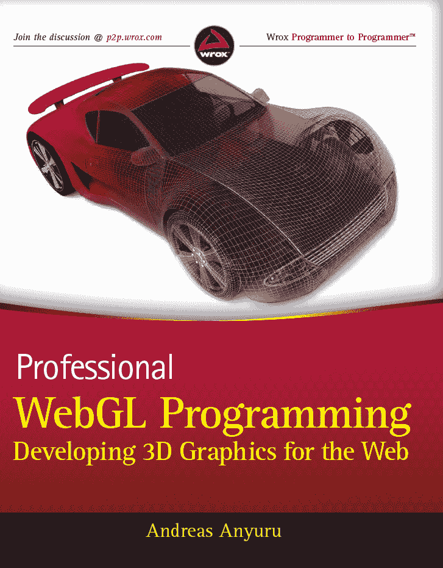

# 目录

- 第一章：引入 WEBGL
- WebGL 基础知识
- 为什么 WebGL 如此优异？
- 设计图形 API
- 图形硬件概述
- 理解 WebGL 图形渲染流水线
- WebGL 与其他图形技术的对比
- 3D 图形中的线性代数
- 本章总结
- 第二章：创建基础 WebGL 示例
- 绘制三角形
- 理解 WebGL 编码风格
- 调试你的 WebGL 应用
- 使用 DOM API 加载着色器
- 在稍高级的示例中进行整合
- 本章总结
- 第三章：绘制
- WebGL 绘制原图与绘制方法
- 类型数组 (Typed Arrays)
- 探索不同的绘制方式
- 交织顶点数据以提高性能
- 使用顶点数组或常量顶点数据
- 最后一个总结性示例
- 本章总结
- 第四章：紧凑的 JavaScript 库与变换
- 在 JavaScript 中处理矩阵和向量
- 使用变换
- 理解完整的变换流水线
- 变换的实践
- 理解变换顺序的重要性
- 完整示例：绘制多个变换后的对象
- 本章总结
- 第五章：纹理化
- 理解丢失的上下文 (Lost Context)
- 引入 2D 纹理和立方体贴纹理 (Cubemap)
- 加载你的纹理
- 定义你的纹理坐标
- 在着色器中使用纹理
- 处理纹理过滤
- 理解纹理坐标包裹 (Wrapping)
- 完整的纹理示例
- 使用图像作为纹理
- 理解同源策略与跨源资源共享 (CORS)
- 本章总结
- 第六章：动画与用户输入
- 场景动画
- 用户交互事件处理
- 应用你的新知识
- 本章总结
- 第七章：光照
- 理解光
- 使用本地光照模型
- 理解 Phong 反射模型
- 理解 WebGL 光照所需的 JavaScript 代码
- 使用不同的插值技术进行着色
- 理解必须归一化的向量
- 使用不同类型的光源
- 理解光的衰减
- 理解光照映射 (Light Mapping)
- 本章总结
- 第八章：WebGL 性能优化
- WebGL 底原理
- WebGL 性能优化
- 深入观察混合 (Blending)
- 进一步探索 WebGL
- 本章总结

# 引言

# 第一章 引入 WEBGL

## 本章内容

- WebGL 基础知识
- 为什么 WebGL 如此优异？
- 设计图形 API
- 图形硬件概述
- 理解 WebGL 图形渲染流水线
- WebGL 与其他图形技术的对比
- 3D 图形中的线性代数
- 本章总结

WebGL 是一种用于在浏览器中渲染 3D 图形的应用程序编程接口 (API)。它基于 `OpenGL ES 2.0`，并提供了类似的功能，通过 HTML5 `canvas` 元素实现。

WebGL 的引入是 HTML5 `canvas` 元素，Mozilla 的 Vukić 开始实验 3D 图形。Khronos 组织在 2009 年成立了一个新的 WebGL 工作组，成员包括浏览器厂商 Apple、Google、Mozilla 和 Opera。Khronos Group 是一个非营利行业联盟，负责开放标准和免版税 API。它于 2000 年 1 月成立，还控制并推动了许多技术，如用于嵌入式设备的 `OpenGL ES`、用于并行编程的 `OpenCL`、用于底层矢量图形加速的 `OpenVG` 以及用于多媒体组件的 `OpenMAX`。自 2006 年以来，Khronos 组织还管理了用于桌面端的 `OpenGL`。

WebGL 1.0 规范于 2011 年 3 月定稿，并在多个浏览器中实现了 WebGL，包括 Google Chrome、Mozilla Firefox 以及（写本文时的）Safari 和 Opera 的开发版本。


有关哪些浏览器版本支持 WebGL 的最新信息，请访问 [www.khronos.org/webgl/](http://www.khronos.org/webgl/)。

然而，坦率地说，与原生应用相比，Web 应用过去和现在仍然具有一些局限性。一个局限性是 Web 应用的用户界面没有原生应用程序丰富。随着 `HTML5 canvas` 标签的引入，这种情况发生了很大变化，它为 Web 应用创建非常先进的 2D 图形提供了可能。但最初的 `HTML5 canvas` 标签仅指定了不支持 3D 图形的 2D 上下文。

通过 `WebGL`，你可以在浏览器内部获得硬件加速的 3D 图形。你可以创建 3D 游戏或其他高级 3D 图形应用，同时拥有 Web 应用程序的所有优点。除了这些优点外，`WebGL` 还具有以下吸引人的特性：

- `WebGL` 是一个开放标准，任何人都可以实现或使用，而无需向任何人支付版税。
- `WebGL` 利用图形硬件加速渲染，这意味着它的速度非常快。
- `WebGL` 在支持它的浏览器中原生运行；不需要插件。
- 由于 `WebGL` 基于 `OpenGL ES 2.0`，对于许多之前有该 API 经验的开发者来说，甚至对于使用过带有着色器的桌面级 `OpenGL` 的开发者来说，学习起来非常容易。

`WebGL` 标准还为学生和其他人员学习和实验 3D 图形提供了一种极佳的方法。不需要像大多数其他 3D API 那样下载和设置工具链。要创建你的 `WebGL` 应用，只需要一个文本编辑器来编写代码，而查看你的作品，只需将文件加载到支持 `WebGL` 的浏览器中。

# 设计图形 API

设计图形 API 有两种根本上不同的方式：

- 使用立即模式 API（immediate-mode API）
- 使用保留模式 API（retained-mode API）

`WebGL` 是一个立即模式 API。

## 立即模式 API

对于立即模式 API，每一帧都需要重绘整个场景，无论其是否发生了变化。暴露 API 的图形库不保存任何待绘制场景的内部模型。相反，应用程序需要拥有自己的场景表示，并将其保留在内存中。这种设计为应用程序提供了很大的灵活性和控制。然而，它也需要应用程序承担更多工作，例如跟踪场景模型以及进行初始化和清理工作。图 1-1 显示了立即模式 API 工作原理的简化图。

FIGURE 1-1: 立即模式 API 工作原理的图

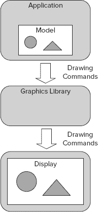

## 保留模式 API

暴露保留模式 API 的图形库包含一个内部模型或场景图，其中包含所有应该渲染的对象。当应用程序调用 API 时，更新的是内部模型，库随后可以决定何时完成向屏幕的实际绘制。这意味着使用 API 的应用程序不需要每帧都发布绘制命令来绘制整个场景。保留模式 API 在某些方面可能更容易使用，因为图形库为你完成了一些工作，所以你不需要在应用程序中完成它们。图 1-2 显示了保留模式 API 工作原理的图。保留模式 API 的示例是可缩矢量图形（`SVG`），它将在本章稍后进行要描述。

FIGURE 1-2: 保留模式 API 工作原理的图

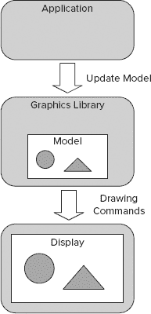

# 图形硬件概述

`WebGL` 是一个低级 API，由于它基于 `OpenGL ES 2.0`，因此它与实际图形硬件紧密结合。为了理解本书其余部分的概念，最好对图形硬件及其工作原理有一个基本的了解。你可能已经知道了其中大部分内容，但为了确保你掌握了必要的知识，本节提供了基础知识的简要概述。

图 1-3 显示了一个计算机系统的简化示例。应用程序（无论是在浏览器中执行的 `WebGL` 应用还是其他应用程序）在 `CPU` 上执行并使用内存（通常简单称为 `RAM`）。要显示 3D 图形，应用程序调用 API，该 API 而调用低级软件驱动程序，将图形数据通过总线发送到图形处理单元（`GPU`）。

FIGURE 1-3: 图形硬件与其他硬件关系的简化图

## GPU

`GPU` 是一个专用的图形渲染设备，专门设计用于生成应显示在屏幕上的图形。`GPU` 通常是高度并行的，并非常快速地处理图形数据。`GPU` 术语由 `NVIDIA` 在 1999 年发布世界上第一个 `GPU` —— `GeForce 256` 时首次创造并推广的。

`GPU` 通常实现为流水线，数据从流水线的一个阶段移动到下一个阶段。在本章稍后的部分中，你将学习 `WebGL` 图形流水线的不同步骤，它由概念性的流水线阶段组成，然后映射到 `GPU` 的物理流水线阶段。

## 帧缓冲区（Framebuffer）

当图形数据遍历整个 `GPU` 流水线后，最终会被写入 `framebuffer`。`framebuffer` 是包含显示器显示图像所需信息的内存。用于 `framebuffer` 的物理内存位于不同的位置。对于简单的图形系统，`framebuffer` 实际上分配在主内存中，但现代图形系统在 `GPU` 上或附近的独立芯片上分配 `framebuffer`。

`framebuffer` 通常由三个不同的缓冲区组成：

- 颜色缓冲区（Color buffer）
- 缓冲区（Z-buffer）
- 模板缓冲区（Stencil buffer）

### 颜色缓冲区

颜色缓冲区是一个矩形数组，包含屏幕上每个像素的 `RGB` 或 `RGBA` 格式颜色。颜色缓冲区为红色、绿色和蓝色分配了特定的位数。它还可能有一个 Alpha 通道，这意味着它为描述 `framebuffer` 中像素的透明度（或不透明度）分配了特定的位数。表示一个像素的总位数被称为 `framebuffer` 的颜色深。颜色深的示例：

- 每个像素 16 位
- 每个像素 24 位
- 每个像素 32 位

16 位像素的 `framebuffer` 通常用于较小的设备，例如一些简单的手机。当你拥有 16 位像素时，不同颜色之间的常见分配是：红色 5 位、绿色 6 位、蓝色 5 位，且在 `framebuffer` 中没有 Alpha 通道。这种格式通常被称为 `RGB565`。为绿色分配额外位的原因是人眼对绿光最敏感。为颜色分配 16 位总共有 `2¹⁶ = 65536` 种颜色。

同样，颜色深为每像素 24 位的 `framebuffer` 通常为红色分配 8 位、绿色 8 位、蓝色 8 位。这为你提供了超过 1600 万种颜色，且 `framebuffer` 中没有 Alpha 通道。

32 位像素的 `framebuffer` 通常具有与 24 位 `framebuffer` 相同的位分配——即红色 8 位、绿色 8 位和蓝色 8 位。此外，32 位 `framebuffer` 分配了 8 位用于 Alpha 通道。

在这里你需要注意的是，帧缓冲区（framebuffer）中的 alpha 通道并不常用。帧缓冲区中的 alpha 通道通常被称为目标 alpha 通道，它与代表输入像素透明度的源 alpha 通道不同。例如，被称为 alpha 混合（alpha blending）的过程可以用于创建透明对象的幻象，它需要源 alpha 通道，但不需要帧缓冲区中的 alpha 通道。


你将在第 8 章中学习更多关于 alpha 混合的知识。

## Z 缓冲区 (Z-Buffer)

颜色缓冲区通常包含 3D 场景观察者在特定时刻看到的对象的颜色。3D 场景中的某些对象可能会被其他对象隐藏，当渲染整个场景时，属于隐藏对象的像素不应出现在颜色缓冲区中。

通常，这在图形硬件中通过借助 `Z-buffer` 实现，它也被称为深度缓冲区（depth buffer）。`Z-buffer` 的元素数量与颜色缓冲区中的像素数量相同。在每个元素中，`Z-buffer` 存储了从观察者到最近图元单元的距离。


你将在本章稍后的“深度缓冲区测试”部分学习具体如何使用 `Z-buffer` 来处理场景中的深度。

## 模板缓冲区 (Stencil Buffer)

除了颜色缓冲区和 `Z-buffer`（它们是帧缓冲区中最常用的两个缓冲区）之外，现代图形硬件还包含一个模板缓冲区。模板缓冲区可以控制在颜色缓冲区的什么位置绘制内容。它的用途的一个实际示例是处理阴影。

## 纹理内存 (Texture Memory)

3D 图形中的一项重要操作是在表面上应用纹理。你可以将纹理化视为将图像“胶粘”到几何对象上的过程。这些被称为纹理的图像需要被存储，以便 GPU 快速高效地访问它们。通常 GPU 有有专门的纹理内存来存储这些纹理。


你将在第 5 章中学习更多关于纹理化的知识。

## 视频控制器

视频控制器（也称为视频生成器）以一定的速率逐行扫描缓冲区并更新显示。对于 LCD 显示器，整个显示通常每秒更新 60 次。这被称为 60 Hz 的刷新率。

# 理解 WebGL 图形流水线

使用 WebGL 的 Web 应用程序通常由在 Web 浏览器中执行的 HTML、CSS 和 JavaScript 文件组成。除了这些经典的 Web 应用内容外，WebGL 应用程序还包含其着色器（shaders）的源码以及某种表示其显示的 3D（或可能的 2D）模型的数据。

浏览器不需要插件即可执行 WebGL；该支持是内置在浏览器中的。是通过 JavaScript 调用 `WebGL API` 向 WebGL 流水线发送关于如何渲染 3D 模型的信息。这些信息不仅包括 WebGL 流水线中两个可编程阶段（顶点着色器和片元着色器）的源码，还包括关于要渲染的 3D 模型的信息。

在数据遍历整个 WebGL 流水线后，结果被写入到 WebGL 称为绘制缓冲区（drawing buffer）的内容中。你可以将绘制缓冲区视为 WebGL 的帧缓冲区。与帧缓冲区一样，它拥有颜色缓冲区、`Z-buffer` 和模板缓冲区。然而，绘制缓冲区中的结果在最终进入屏幕显示的物理帧缓冲区之前，会与 HTML 页面的其余部分进行合成。

在接下来的章节中，你将学习图 1-4 所示的 WebGL 流水线的不同阶段。如图所示，流水线中有几个阶段。对于 WebGL 程序员的你来说，最重要的阶段是顶点着色器（vertex shader）和片元着色器（fragment shader）。你将在接下来的章节中接触几个新术语。有些将在本章解释，而其他术语和概念的将在将在章节给出。下一节是对 WebGL 图形流水线的介绍，这意味着你不需要理解这里呈现的每一个细节。

图 1-4：WebGL 图形流水线概览

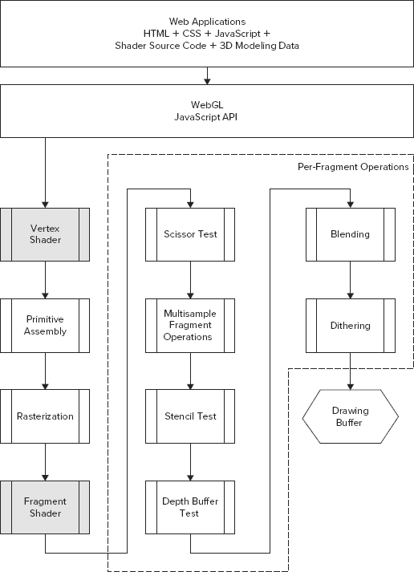

## 顶点着色器 (Vertex Shader)

为了获得真实的 3D 场景，仅仅在某些位置渲染对象是不够的。你还需要考虑当光源照射在对象上时它们看起来像什么样。用于确定光线对不同材料影响的通用术称为着色（shading）。

对于 WebGL，着色分两个阶段完成：

- 顶点着色器
- 片元着色器

第一阶段是顶点着色器。（片元着色器出现在流水线的后续，将在本章稍后的部分进行讨论。）顶点着色器的名称源于：几何形状的角或交点的 3D 点通常被称为顶点（复数形式 vertices）。顶点着色器是流水线中对顶点进行着色的阶段。图 1-5 显示了顶点着色器在 WebGL 图形流水线中的位置。

图 1-5：顶点着色器在 WebGL 图形流水线中的位置

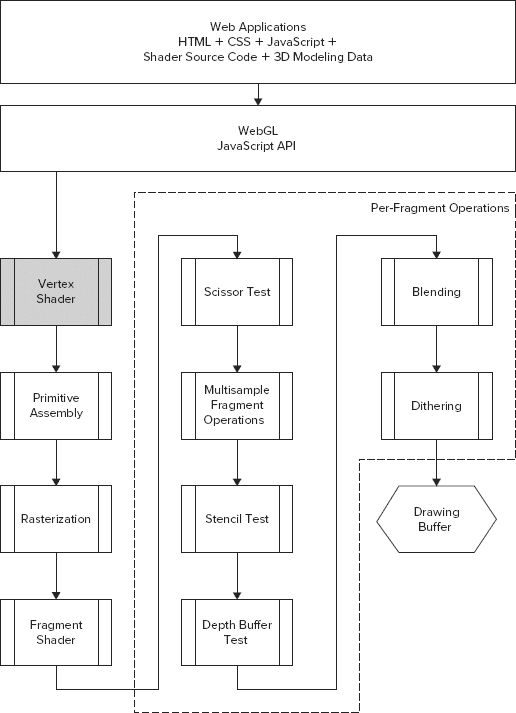

顶点着色器是 3D 建模数据（例如顶点）发送后首次到达的地方。由于顶点着色器是可编程的且其源码由你编写并发送，它可以以多种方式处理顶点。

在实际着色开始之前，它通常通过变换矩阵变换顶点。通过将对象的所有顶点乘以变换矩阵，对象可以放置在场景的特定位置。你将在本章稍后以及第 4 章中学习更多关于变换的知识，所以现在不理解这意味着什么请不要担心。

顶点着色器使用以下输入：

- 顶点着色器包含的实际源码。这些源码是用 OpenGL ES 着色语言（GLSL ES）编写的。


**属性（attributes）**，它们是包含每个顶点特定数据的用户定义变量。（还有一种叫做常量属性，如果你想为多个顶点指定相同的属性值可以使用它。）属性的示例包括顶点位置和顶点颜色。

**统一（uniforms）**，它们是对所有顶点都是相同的数据。统一的示例包括变换矩阵或光源的位置。（本章稍后提到的，你可以在 WebGL 绘制调用之间更改统一的值，因此只有在绘制调用期间统一需要是常量。）

顶点着色器的输出位于图 1-6 的底部，由用户定义的变变量（varying variables）和一些内置特殊变量组成。

**图 1-6：顶点着色器概览**

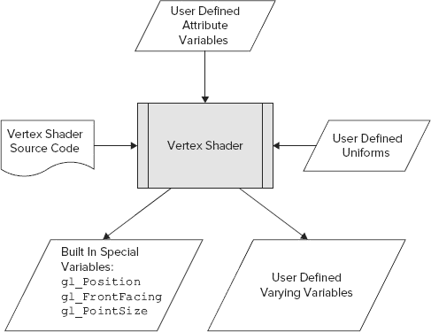

```gl
attribute vec3 aVertexPos;
attribute vec4 aVertexColor;

uniform mat4 uMVMatrix;
uniform mat4 uPMatrix;

varying vec4 vColor;

void main() {
    gl_Position = uPMatrix * uMVMatrix * vec4(aVertexPos, 1.0);

    vColor = aVertexColor;
}
```

如前所述，这段源代码是用 OpenGL ES 着色器语言（GLSL）编写的。如你所见，它的语法与 C 语言非常相似。虽然在支持的数据类型等方面存在一些差异，但如果你以前用过 C 语言编程，那么很多内容对你来说是非常熟悉的。尽管你现在不需要理解其工作原理的每一个细节，但以下片段提供了更深入的见解。

从代码顶部开始，前两行声明了两个属性变量（attribute）：

```gl
attribute vec3 aVertexPos;
attribute vec4 aVertexColor;
```

再次强调，属性是用户定义的变量，包含每个顶点的特定数据。属性变量的实际值是通过 WebGL JavaScript API 发送的。

第一个变量名为`aVertexPos`，是一个包含三个元素的向量。它包含了单个顶点的位置。第二个变量名为`aVertexColor`，是一个包含四个元素的向量。它包含了单个顶点的颜色。

接下来的两行源代码定义了两个`mat4`类型的统一变量（uniform）：

```gl
uniform mat4 uMVMatrix;
uniform mat4 uPMatrix;
```

`mat4`类型表示一个 4 × 4 的矩阵。此示例中的两个统一变量包含了应该应用于每个顶点的变换。与属性变量一样，统一变量也是通过 WebGL JavaScript API 设置的。区别在于，统一变量通常包含对所有顶点相同的数据。

最后一个声明是名为`vColor`的变体变量（varying）；它包含了顶点着色器的输出颜色：

```gl
varying vec4 vColor;
```

这个`varying`变量将输入到片段着色器中。

所有变量声明之后，是顶点着色器的入口：

```gl
void main() {
    gl_Position = uPMatrix * uMVMatrix * vec4(aVertexPos, 1.0);
```

无论是顶点着色器还是片段着色器，入口都是`main()`函数。`main()`函数中的第一条语句获取顶点位置`aVertexPos`并将其乘以两个变换矩阵以执行变换。结果被写入特殊的内置变量`gl_Position`中，该变量包含了顶点着色器处理后单个顶点的位置。顶点着色器做的最后一件事是获取包含颜色的属性（它是通过 WebGL JavaScript API 发送的），并将其写入变体变量`vColor`，以便片段着色器读取：

```gl
vColor = aVertexColor;
}
```

## 图元组装 (Primitive Assembly)

在顶点着色器之后的步骤——称为图元组装（参见图 1-7）——WebGL 流水线需要将着色的顶点组装成单独的几何图元，如三角形、线段或点精灵。然后对于每个三角形、线段或点精灵，WebGL 都需要判断该图元是否在当前屏幕可见的 3D 区域内。在最情况下，可见的 3D 区域称为视锥体（view frustum），它是一个带有矩形底部的截锥体。

**图 1-7：WebGL 图形流水线中图元组装阶段的位置**

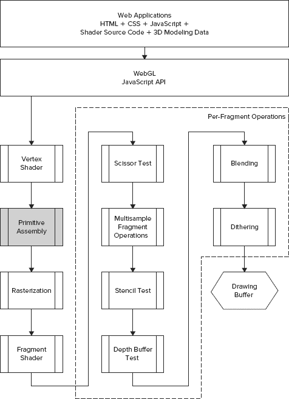

视锥体内部的图元被发送到流水线的下一步。视锥体外的图元会被完全移除，部分位于视锥体内的图元会被裁剪，使得位于视锥体之外的部分被移除。图 1-8 显示了一个视锥体的示例，其中包含视锥体内的立方体和一个视锥体外的圆柱体。构建立方体的图元被发送到流水线的下一个阶段，而构建圆柱体的图元会在此阶段被移除。

**图 1-8：带有视锥体内立方体和视锥体外圆柱体的视锥体**

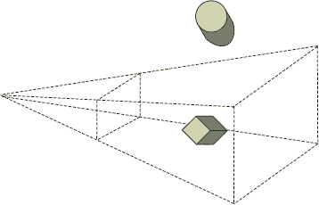

## 光栅化 (Rasterization)

流水线的下一步一步是将图元（线段、三角形和点精灵）转换为应该发送到片段着色器的片段（fragments）。你可以将片段理解为最终可以绘制在屏幕上的像素。这种到片段的转换发生在光栅化阶段（参见图 1-9）。

**图 1-9：WebGL 图形流水线中光栅化的位置**

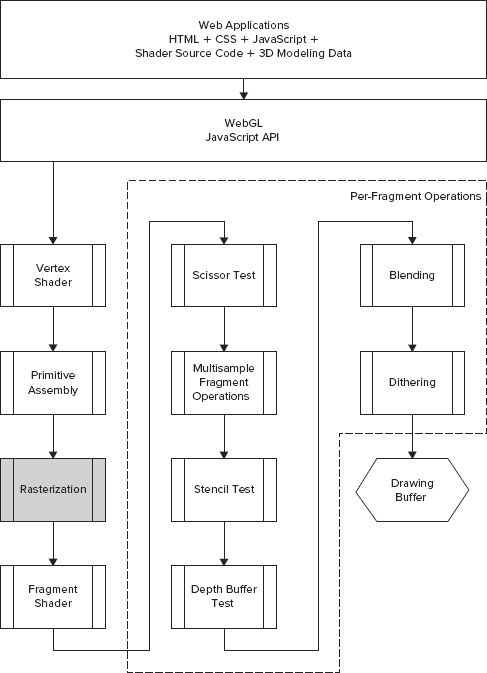

## 片段着色器 (Fragment Shader)

来自光栅化的片段被发送到流水线的第二个可编程阶段，即片段着色器（参见图 1-10）。如前所述，片段基本上对应于屏幕上的像素。然而，并不是所有的片段都会变成缓冲区中的像素，因为每个片段的操作（下文将描述）可能会在最后步骤丢弃某些片段。片段只有在最终写入缓冲区时才被称为像素。

**图 1-10：WebGL 图形流水线中片段着色器的位置**

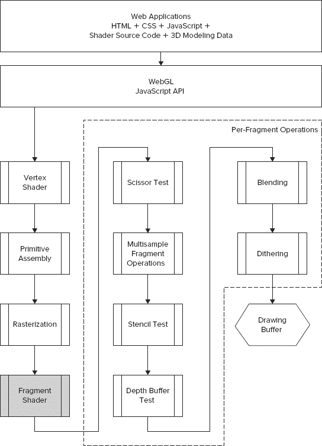

其他的 3D 渲染 API（例如微软的 Direct3D）中，片段着色器实际上被称为像素着色器。图 1-11 显示了片段着色器的输入和输出。

**图 1-11：片段着色器概览**

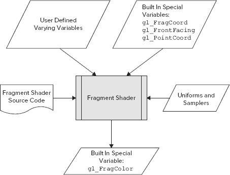

片段着色器的输入由以下部分组成：

- 片段着色器的源代码，用 OpenGL ES 着色语言编写
- 某些内置特殊变量（例如`gl_PointCoord`）
- 顶点着色器写入的变体变量
- 对所有片段都恒定的统一变量
- 用于纹理化的采样器（Samplers）

在讨论顶点着色器时提到，变体变量是从顶点着色器向片段着色器传递信息。然而，正如图 1-12 所示，片段的数量通常多于顶点。写入顶点着色器的变体变量在片段之间进行线性插值。当在片段着色器读取变体变量时，读取的是线性插值结果，它可能与顶点着器中写入的值不同。在后续章节中更多地处理着色器源码后，你会理解这一点。

**图 1-12：顶点与片段之间的关系**

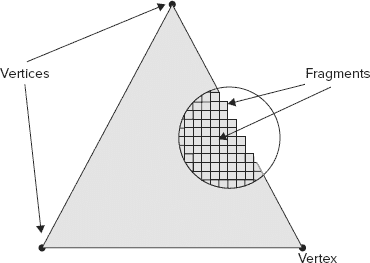

片段着色器的输出是特殊的内置变量`gl_FragColor`，片段着色器将其写入片段的颜色。以下代码片段显示了一个用 OpenGL ES 着色语言编写的简单片段着色器：

```glsl
precision mediump float;

varying vec4 vColor;
void main() {

    gl_FragColor = vColor;

}
```

这个片段着色器示例从一个精度限定符（precision qualifier）开始：

```glsl
precision mediump float;
```

这种理念是，精度限定符应该是给着色器编译器的提示，以便它知道对于变量或数据类型必须使用的最小精度。在所有片段着色器中，必须指定`float`数据类型的精度。

在精度限定符之后，片元色器声明了变体变量`vColor`。在`main()`函数中，变体变量`vColor`被写入到内置特殊变量`gl_FragColor`。再次注意，变体变量`vColor`中的值是从顶点着色器中写入该变体变量的值线性插值而来的。

## 每片元操作 (Per Fragment Operations)

在片元色器之后，每个片元被发送到流水线的下一个阶段，该阶段由每片元操作组成。顾名，此步骤实际上包含多个子步骤。片元色器输出的每个片元根据每片元操作中不同步骤的条件和结果，以不同的方式修改缓冲区中的像素。在图 1-13 中，每片元操作显示在图中右侧虚线内部。为了控制行为，你可以禁用和启用不同步骤中的功能。

**图 1-13: 每片元操作在 WebGL 图形流水线中的位置**

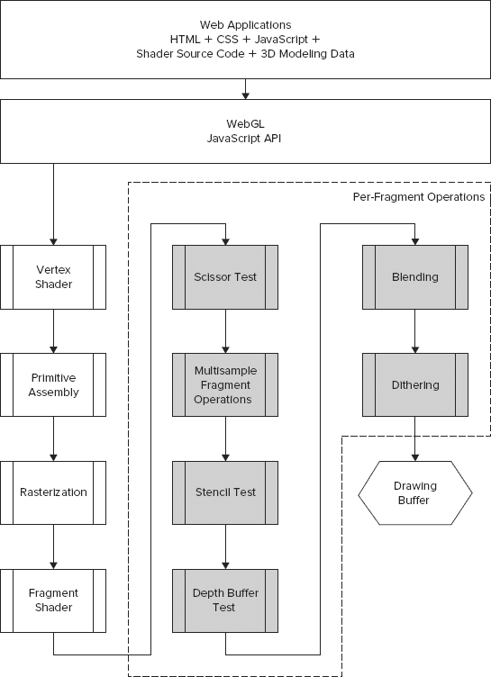

### 剪裁测试 (Scissor Test)

剪裁测试确定片元是否位于由左下坐标以及宽度和高度定义的剪裁矩形内。如果片元在剪裁矩形内部，则测试通过并将片元传递到下一阶段。如果片元在剪裁矩形外部，则片元被丢弃，永远不会到达缓冲区。

### 多采样片元操作 (Multisample Fragment Operations)

此步骤通过修改片元的 alpha 和覆盖值来执行抗锯齿。在计算机图形学中，抗锯齿是指改进多边形边缘外观的技术，使其看起来不是“锯齿状”的——而屏幕上变得平滑。

### 模板测试 (Stencil Test)

模板测试接收传入的片元对模板缓冲区进行测试，以决定是否应该丢弃该片元。例如，如果你在模板缓冲区中绘制一个星形，然后可以设置不同的操作符，以决定后续向颜色缓冲区绘制时应该影响星内部还是外部的像素。

### 深度缓冲区测试 (Depth Buffer Test)

深度缓冲区测试根据深度缓冲区（也称为 Z 缓冲区）中的值丢弃传入的片元。当在 2D 颜色缓冲区中渲染 3D 场景时，颜色缓冲区只能包含特定时刻观察者可见的场景对象的颜色。某些对象可能会被场景中的其他对象遮挡。深度缓冲区和深度缓冲区测试决定哪些像素应该在颜色缓冲区中显示。对于每个像素，深度缓冲区存储从观察者到当前最近的图形的距离。

对于传入的片元，该片元的 z 值与相同位置的深度缓冲区的值进行比较。如果传入片元的 z 值小于深度缓冲区中的 z 值，则新片元比之前颜色缓冲区中的像素更接近观察者，且传入的片元通过测试。如果传入片元的 z 值大于 Z 缓冲区中的值，则新片元被当前绘制缓冲区中的像素所遮挡，因此传入的片元被丢弃。

### 混合 (Blending)

下一步是混合。混合允许你将传入片元的颜色与颜色缓冲区中相应位置已有的片元颜色结合起来。当你创建透明对象时，混合非常有用。

### 抖动 (Dithering)

在写入绘制缓冲区之前的最后一步是抖动。颜色缓冲区具有有限数量的位位来表示每种颜色。抖动用于以这种方式排列颜色，从而产生一种拥有比实际可用颜色更多的幻觉。抖动对于可用颜色较少的颜色缓冲区最有用。

# 将 WebGL 与图形技术进行比较

为了让你对 WebGL 以及其他 3D 和 2D 图形技术有更广泛的理解，以下章节简要描述了一些与你最相关的技术，以及它们与 WebGL 的比较。

这种更广泛的理解并不是为了给你的朋友或雇主留下深刻印象；而是为了帮助你理解读到或听到关于这些技术的内容。它还将帮助你理解其他书籍中的哪些技术值得关注或阅读，以便将概念或想法转移到你的 WebGL 应用中。

## OpenGL

OpenGL 长期一直是桌面计算机上 3D 图形的两个主流 API 之一（另一个 API 是微软的 Direct3D，将在稍后的章节中描述）。OpenGL 是一个定义跨平台 3D 图形 API 的标准，适用于 Linux、几种发行类的 Unix 变体、Mac OS X 和 Microsoft Windows。

在许多方面，OpenGL 与 WebGL 非常相似，所以如果你有之前的 OpenGL 经验，那么学习 WebGL 将变得更容易。如果你有使用带有可编程着色器的 OpenGL 经验，情况尤其如此。如果你从未以任何形式使用过 OpenGL，不要担心。你当然会在书中学习如何使用 WebGL。

### OpenGL 的历史

在 20 世纪 90 年代初，Silicon Graphics, Inc (SGI) 是高端图形工作站的领先制造商。他们的工作站不仅仅是普通的通用计算机；它们拥有专门的硬件和软件来显示先进的 3D 图形。作为其解决方案的一部分，他们有一个名为`IRIS GL API`的 3D 图形 API。

随着时间的推移，尽管 SGI 努力保持向后兼容，`IRIS GL API`仍增加了更多功能。`IRIS GL API`变得越来越难以维护和越来越难用。SGI 可能也意识到拥有一个开放标准将使他们受益，这样程序员更容易创建与他们的硬件兼容的软件。毕竟，软件是销售电脑的重要部分。

SGI 淘汰了 IRIS，并从底层将 OpenGL 设计为一个“开放”且改进的 3D API。1992 年，OpenGL 规范 1.0 版本发布，并成立了独立联盟`OpenGL Architecture Board (ARB)`来管理 OpenGL 的未来。`OpenGL ARB`的创始成员是 SGI、数字设备公司 (DEC)、IBM、Intel 和微软。在多年后，更多的成员加入，`OpenGL ARB`定期会议以提议并批准规范更改，决定新版本并控制一致性测试。

即使是成功的企业也会经历衰落。2006 年，SGI 几近破产，OpenGL 标准的控制权从`OpenGL ARB`给了 Khronos Group。从那时起，Khronos Group 一直演进并推广 OpenGL。

### OpenGL 代码片段

自 1992 年第一个版本发布以来，OpenGL 增加了许多新功能。在开发 OpenGL 新版本时采用的通用策略是，它们都应该是向后兼容的。后来的版本包含了一些在规范中被标记为弃用的功能。在本节中，你可以看到一段用于在屏幕上渲染三角形的简短代码片段。

`glBegin()`和`glEnd()`的使用实际上是最新版本中被标记为弃用的功能的一部分，但它们仍被许多开发者使用，并存在于大量的 OpenGL 源代码和网络示例中。

```c
glClear( GL_COLOR_BUFFER_BIT ); // 清除颜色缓冲区
glBegin(GL_TRIANGLES); // 开始指定一个三角形
  glVertex3f( 0.0, 0.0, 0.0 );   // 指定第一个顶点的位置
  glVertex3f( 1.0, 1.0, 0.0 );   // 指定第二个顶点的位置
  glVertex3f( 0.5, 1.0, 0.0 );   // 指定第三个顶点的位置
glEnd();                                  // 三角形绘制结束
```

`glClear()`函数用于清空颜色缓冲区，使其不包含上一帧的垃圾数据或像素。然后使用`glBegin()`表明你将绘制一个三角形，顶点定义在`glBegin()`和`glEnd()`之间。调用`glVertex3f()`函数来指定三个顶点的位置，这些顶点的 z 值都被设置为零。

# 关于 OpenGL 需要记住的一些要点

以下是关于 OpenGL 的一些需要注意的事：

- `OpenGL`是一种用于桌面 3D 图形的开放标准。
- `OpenGL`规范现在由`Khronos Group`维护并进一步开发，该组织也维护 WebGL 规范。
- `OpenGL`主要是一个立即模式 API。
- 它的策略一直是保持新版本的向后兼容性，结果是通常有多种方法可以实现同一种功能。
- 带有可编程着色器的`OpenGL`与`WebGL`非常相似，当你熟悉`WebGL`时，应该能够将想法从`OpenGL`代码转移到`WebGL`中。
- `OpenGL`中的着色器可以使用名为`OpenGL 着色器语言` (`GLSL`) 的高级级语言进行编程。

# OpenGL ES 2.0

`OpenGL ES`（用于嵌入式系统的 OpenGL）是一种基于桌面`OpenGL`的 3D 图形 API。由于`WebGL`基于`OpenGL ES 2.0`，因此这是一个与`WebGL`最相似的 API。最大的区别可能是`WebGL`使用在 HTML 和 JavaScript 上下文中，而`OpenGL ES 2.0`通常在 C/C++、Objective C 或 Java 上下文中使用。但这些语言的工作方式也存在其他差异。例如，`Khronos Group`在创建 WebGL 规范时，决定移除一些`OpenGL ES 2.0`中可用的功能。

### OpenGL ES 2.0 的历史

`OpenGL ES`的第一个版本称为`OpenGL ES 1.0`，基于桌面`OpenGL 1.3`规范。`Khronos Group`使用`OpenGL 1.3`的功能作为基础，并移除了冗余或不适合嵌入式设备的功能。例如，桌面`OpenGL 1.3`规范包含了通过调用`glBegin`函数来指定要绘制的原图形的功能，然后调用例如`glVertex3f`来指定要绘制的原图形的顶点，最后调用`glEnd`（如你在前面的关于 OpenGL 节中的代码片段中所示）。这种功能在`OpenGL ES`中被移除了，因为可以使用所谓的“顶点数组”以更通用的方式实现相同的结果。

### OpenGL ES 2.0 代码片段

下面你将看到一段简短的`OpenGL ES 2.0`源代码。由于`OpenGL ES 2.0`是完全基于着色器的（与 WebGL 相同），即使是一个简单的示例，也需要大量的源代码。下面的片段包含了一些将作为在屏幕上绘制单个三角形的应用程序部分的源代码。


```glsl
GLfloat triangleVertices[] = {0.0f, 1.0f, 0.0f,
                               -1.0f, -1.0f, 0.0f,
                                1.0f, -1.0f, 0.0f};
```

```cpp
// 清除颜色缓冲区
glClear(GL_COLOR_BUFFER_BIT);
```

```cpp
// 指定包含链接着色器的程序对象
glUseProgram(programObject);
```

```cpp
// 将顶点数据加载到着色器
glVertexAttribPointer(0, 3, GL_FLOAT, GL_FALSE, 0, triangleVertices);
glEnableVertexAttribArray(0);
glDrawArrays(GL_TRIANGLES, 0, 3);
eglSwapBuffers(myEglDisplay, myEglSurface);
```

首先，你看到一个名为`triangleVertices`的向量，它指定了三角形的三个顶点。然后通过调用`glClear()`清空颜色缓冲区。这段短片段中没有显示顶点着色器和片段着色器是如何编译并链接到程序对象的。这些步骤必须在调用`glUseProgramObject()`之前发生，该调用指定了你想用于渲染的程序对象。程序对象包含了经过编译和链接的顶点着色器和片段着色器。

## 关于 OpenGL ES 2.0 需要记住的一些要点

以下是关于 OpenGL ES 2.0 的一些需要注意的事：

- `OpenGL ES 2.0`是一种用于手机等嵌入式设备的 3D 图形开放标准。

- `OpenGL ES 1.x`和`2.0`规范由`Khronos Group`创建，该组织推广这些规范。

- `OpenGL ES 2.0`是一个立即模式 API。

- `OpenGL ES 2.0`不与之前的版本向后兼容。这与桌面`OpenGL`使用的策略不同。

- `OpenGL ES 2.0`与`WebGL`非常相似，当你熟悉`WebGL`时，你可以将想法从`OpenGL`代码转移到`WebGL`。`OpenGL ES 2.0`的着色器语言对应于`WebGL`。

# Direct3D

`DirectX`是多媒体 API 的名称。`DirectX`的一个重要部分是`Direct3D`用于 3D 图形。`Direct3D`可用于许多语言，如 C++、`C#`和 Visual Basic .NET。在概念上，`Direct3D`与`OpenGL`、`WebGL`有相似之处。尽管`Direct3D`运行在 Windows 操作系统上，它在处理 3D 图形时，如果你有`Direct3D`的经验，你对图形流水线、Z 缓冲区、着色器和纹理等概念会有很好的理解。`D`在细节上与`WebGL`有所不同。

## Direct3D 的简要历史

`Direct3D`的一个重要里程碑是 8.0 版本引入了可编程着色器。当时着色器是用类汇编语言编写的。在`Direct3D 9.0`中发布了一种新的着色器编程语言，名为`高级着色器语言`（`HLSL`），它是与 NVIDIA 合作开发的。`HLSL`对应于`WebGL`和`OpenGL ES 2.0`中的`OpenGL 着色器语言`。

## Direct3D 代码片段

下面的代码展示了如何使用`Direct3D`渲染和显示场景。在执行此代码之前，你通常需要设置并初始化`Direct3D`并创建一个`Direct3D Device`。在此代码片段中，假设`Direct3D Device`的指针存储在全局变量`g_pd3dDevice`中。该指针用于访问 API 的函数。

代码首先通过调用`Clear()`来清除颜色缓冲区。此调用看起来比对应`OpenGL`、`OpenGL ES 2.0`或`WebGL`的调用要复杂一点，因为它有更多的参数。

前两个参数通常是`zero`和`NULL`。你可以使用它们来指定只清除视口的一部分。设置`zero`和`NULL`意味着你想清除整个颜色缓冲区。

第三个参数被设置为`D3DCLEAR_TARGET`，这意味着你正在清除颜色缓冲区。你也可以在此参数中指定标志位来清除 Z 缓冲区（Z-buffer）和模板缓冲区（stencil buffer）。

第四个参数指定了你想要将颜色缓冲区清除到的 RGBA 颜色。在这种情况下，颜色缓冲区被清除为不透明的黑色。

最后两个参数用于设置 Z 缓冲区和模板缓冲区应该清除到的值。由于第三个参数仅指定了你想清除颜色缓冲区，因此在这个示例中，最后两个参数的值并不重要。

在`Direct3D`中，你必须调用`BeginScene()`来指定你想开始绘制 3D 场景。调用`EndScene()`来指定你已完成绘制。在这两个调用之间，你指定了想要渲染的所有几何体。在之前的代码段中，没有包含渲染几何体的代码。

最后，你会调用`Present()`函数将刚刚渲染的后缓冲区显示在显示器上。

# 关于 Direct3D 需要记住的一些关键点

这里是关于`Direct3D`需要注意的重要事项：

- `Direct3D`是微软的 3D 图形专有标准。

- `Direct3D`仅适用于运行 Microsoft Windows 的设备。

- `Direct3D`使用与`OpenGL`、`OpenGL ES 2.0`和`WebGL`类似的图形流水线。

- `Direct3D`使用`HLSL`编写着色器的源码。该语言对应于桌面`OpenGL`的`GLSL`，以及`OpenGL ES 2.0`和`WebGL`的`OpenGL ES Shading Language`。

- `Direct3D`中的像素着色器（pixel shader）对应`OpenGL`、`OpenGL ES 2.0`或`WebGL`中的片段着色器（fragment shader）。

## HTML5 Canvas

HTML5 是超文本标记语言 HTML 的第五次迭代。HTML5 规范为你 Web 开发者包含了许多有趣的新功能。其中最有趣的功能之一就是 HTML5 canvas。

HTML5 canvas 是网页上的一个矩形区域，你可以使用 JavaScript 在其中绘制图形。在`WebGL`的背景下，HTML5 canvas 特别引有趣，因为它是 Vladimir Vukićević 在 Mozilla 进行的首次 WebGL 实验的基础。`WebGL`现在被设计为 HTML5 canvas 元素的渲染上下文。可以通过调用以下代码从 canvas 元素获取 HTML5 canvas 支持的原始 2D 渲染上下文（`CanvasRenderingContext2D`接口）：

```javascript
var context2D = canvas.getContext("2d");
```

可以通过相同的方式从 canvas 元素获取 WebGL 渲染上下文（`WebGLRenderingContext`接口），不是指定字符串`"2d"`，而是这样指定`"webgl"`：

```javascript
var contextWebGL = canvas.getContext("webgl");
```

按照上述方式获取渲染上下文后，你可以使用`context2D`调用原始 HTML5 canvas（`CanvasRenderingContext2D`）支持的方法。相反，你可以使用`contextWebGL`调用`WebGL`（`WebGLRenderingContext`）支持的方法。

### HTML5 Canvas 简史

Apple Mac OS X 操作系统包含一个名为`Dashboard`的应用程序。如果你是 Mac 用户，可能已经熟悉它。如果不是，`Dashboard`基本上是一个托管名为`widgets`的微型应用程序的程序。这些组件基于网页使用的相同技术，如 HTML、`CSS`和 JavaScript。

`Dashboard`和`Safari`浏览器都使用`WebKit`开源浏览器引擎来渲染 Web 内容，通过在 2004 年将`WebKit`中引入`canvas`标签，Apple 在这些应用程序中创建了绘制 2D 图形的全新方法。2005 年，它被`Mozilla Firefox`实现，2006 年被`Opera`实现。`canvas`标签被包含在 HTML5 规范中，2011 年，微软发布了`Internet Explorer 9`，这是第一个支持 canvas 的 Internet Explorer 版本。

### 一个 HTML5 Canvas 代码段

Listing 1-1 中的代码显示了如何使用`canvas`元素通过 JavaScript 绘制简单的 2D 图形。所有代码都嵌入在一个 HTML 文件中。如果你从列表的底部开始看，你会发现页面`<body>`开始标签和`</body>`结束标签之间的唯一元素是`<canvas>`元素。`<canvas>`定义了使用 JavaScript 调用 canvas API 绘制图形的渲染表面。你还可以看到`onload`事件处理器被定义在`<body>`标签上，并调用了 JavaScript 函数`draw()`。这意味着当文档完全加载时，浏览器会自动触发`onload`事件处理器并调用`draw()`函数。

LISTING 1-1: 一个 HTML5 canvas 标签的示例

```html
<!DOCTYPE HTML> 
<html lang="en">
<head>
  <script type="text/javascript">

    function draw() {

      var canvas = document.getElementById("canvas");

      if (canvas.getContext) {
        var context2D = canvas.getContext("2d");

        // Draw a red rectangle
        context2D.fillStyle = "rgb(255,0,0"
        context2D.fillRect(20,20, 80);

// ... (省略重复内容)

      }

    }
  </script>
</head>

<body onload="draw();">

   <canvas id="canvas" width="300" height="300">

     您的浏览器不支持 HTML5 canvas 元素。

   </canvas>

</body>
</html>
```

对于绘制的第一个矩形（红色的），使用了上面第一个项目符号下描述的`rgb()`方法来设置填充颜色。然后调用`fillRect()`方法来绘制实际的矩形并用当前的填充颜色进行填充。该方法接收矩形左上角的坐标，以及矩形的宽度和高度：

```javascript
fillRect(x, y, width, height)
```

以下是设置填充颜色并再次绘制第一个矩形的代码行：

```javascript
// 绘制一个红色矩形
        context2D.fillStyle = "rgb(255,0,0)";
        context2D.fillRect (20, 20, 80, 80);
```

在绘制第一个矩形后，用这段代码绘制了第二个绿色矩形：

```javascript
// 绘制一个 50%透明的绿色矩形
        context2D.fillStyle = "rgba(0, 255, 0, 0.5)";
        context2D.fillRect (70, 70, 80, 100);
```

第二个矩形使用`rgba()`方法将`fillStyle`设置为绿色且 50% 透明。由于两个矩形有部分重叠，你可以透过绿色矩形看到红色矩形。

第三个绘制的形状是一个圆。要画一个圆，你首先需要指定路径的起点。路径是一组共同指定的若干或多个绘制命令。在指定了所有绘制命令后，你可以选择是描边（stroke）路径还是填充（fill）路径。在这种情况下，当你只想画一个圆时，必须指定一个路径似乎很复杂，但如果你有一个更复杂的形状，你就会喜欢这种 API 的设计了。

你使用`beginPath()`方法指定路径的起点。然后你指定用来构建路径的绘制命令，最后用`closePath()`指定路径的结束。

在这种情况下，你唯一想要包含在路径中的命令是绘制圆的命令。然而，画布 API 并不包含用于绘制圆的显式方法。相反，可以使用一些方法来绘制弧（arc）。在示例中，使用了以下方法：

```javascript
arc(x, y, radius, startAngle, endAngle, anticlockwise)
```

`x`和`y`参数指定圆的中心。`radius`是绘制弧所在的圆的半径，`startAngle`和`endAngle`指定弧以弧度为起始和结束的位置。最后一个参数`anticlockwise`是一个布尔值，用于指定弧的方向。

如果你将上述源代码加载到浏览器中，你应该看到与图 1-14 所示相似的内容。

图 1-14: 使用 HTML5 canvas 绘制的简单图形

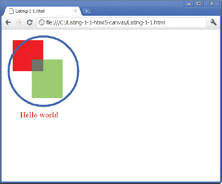

### 关于 HTML5 canvas 需要记住的一些关键点

以下是关于 HTML5 canvas 你应该记住的几件事：

* HTML5 canvas 规定了一种立即模式 API，用于在网页上绘制 2D 图形。

* WebGL 同样在 HTML5 canvas 上绘制，但它使用的是`WebGLRenderingContext`而不是原始的`CanvasRenderingContext2D`。

## 可缩矢量图形

可缩矢量图形（SVG）是一种用 XML 描述 2D 图形的语言。正如其名所示，它基于矢量图形，这意味着它使用点、线和曲线等几何原语，这些原语以数学表达式的形式存储。显示矢量图形的程序（例如浏览器）使用这些数学表达式来构建屏幕图像。通过这种方式，即使使用户放大图片，图像也能保持清晰。在这一章描述的图形标准中，SVG 与 WebGL 的关系最远。但你应该了解它，因为它是 Web 上常见的图形标准，也是保留模式（retained-mode）API 的示例。

### SVG 的简史

1998 年，微软、Macromedia 和其他一些公司将矢量标记语言（VML）作为建议标准提交给 W3C。同时，Adobe 和太阳创建了另一个名为精确图形标记语言（PGML）的提案。W3C 审查了这两项提案，取了部分 VML 和部分 PGML，创建了 SVG 1.0，并于 2001 年成为 W3C 推荐标准（Recommendation）。此后发布了 SVG 1.1 建议，目前还有一个仍处于工作草案（Working Draft）阶段的 SVG 1.2 建议。

除了这些"完整"的 SVG 规范外，还有一个 SVG 移动建议，它包含了两个针对手机的简化版配置。它们被称为 SVG Tiny 和 SVG Basic。SVG Tiny 目标是极简单的移动设备，而 SVG Basic 目标是更高级的移动设备。

### 一个 SVG 代码段

列表 1-2 显示了一个非常简单的 SVG 代码示例。该代码在屏幕上画了一个红色矩形、一个蓝色圆形和一个绿色三角形。

列表 1-2: 一个简单的 SVG 示例

```xml
<?xml version="1.0" standalone="no"?>
<!DOCTYPE svg PUBLIC "-//W3C//DTD SVG 1.1//EN" 
"http://www.w3.org/Graphics/SVG/1.1/DTD/svg.1">

<svg width="100%" height="100%" version="1.1"
xmlns="http://www.w3.org/2000/svg">

<rect x="50" y="30" width="300" height="100" fill="red" stroke-width="2" stroke="black" />

<circle cx="100" cy="200" r="40" fill="blue" stroke-width="2" stroke="black" />

<polygon points="200,200 300,200 250,100" fill="green" stroke-width="2" stroke="black" />

</svg>
```

三维意味着它有三个轴，通常称为`x`、`y`和`z`。正交（Orthonormal）意味着所有轴都与其他两个轴正交（垂直），且这些轴被归一化为单位长度。右手（Right-handed）指的是第三个轴（`z-axis`）的定向方式。如果`x-`和`y-`轴的位置使得它们相互垂直并交于原点，那么`z-`轴的定向有两种方案，使其同时对`x`和`y`垂直。取决于你选择哪种方案，坐标系被称为右手坐标系或左手坐标系。

记忆右手坐标系轴方向的一种方法如图 1-16 所示。你使用右手，依次将`x-`、`y-`和`z-`轴分配给大拇指、食指和中指。大拇指指示`x-axis`的方向，食指指示`y-axis`的方向，中指指示`z-axis`的方向。

图 1-16: 右手坐标系的视觉化方法

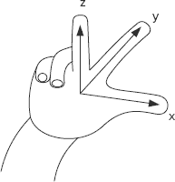

## 点或顶点 (Points or Vertices)

3D 坐标系中的点是一个可以用有序三元组`(vx, vy, vz)`定义的位置。该点的位置是从原点开始（即`(vx, vy, vz) = (0, 0, 0)`），然后沿着`x-axis`移动`vx`距离，接着沿着`y-axis`移动`vy`距离，最后沿着`z-axis`移动`vz`距离。


在数学上下文中，点是构建其他几何形状的最基本的构建单元。两个点定义了它们之间的直线，三个点定义了一个三角形，这三个点就是三角形的顶点。

当用点定义 3D 图形中的其他几何形状时，它们通常被称为顶点（vertices，单数为 vertex）。图 1-17 展示了定义三角形的三个顶点示例。这三个顶点的坐标分别为 `(1, 1, 0)`、`(3, 1, 0)` 和 `(2, 3, 0)`，它们绘制在一个 `z-axis` 未显示但垂直于纸面向外的坐标系中。在图中，这三个顶点都用一个小小的实心圆标记。这只是为了向你展示顶点在图的位置；如果你真的用 WebGL 绘制一个三角形，这些圆是不存在的。

图 1-17: 定义三角形的三个顶点

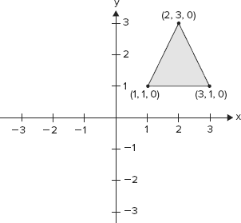

## 向量 (Vectors)

许多物理量（例如温度、质量或能量）与空间中的任何方向无关，完全由数值大小定义。这些物理量被称为标量（scalars）。其他物理量（如速度、加速度或力）则同时需要数值大小和空间方向才能完全确定。这些物理量被称为向量（vectors）。

向量 `v` 是两点之间的差。它没有位置，但既有方向也有长度。如图 1-18 左侧所示，向量可以用图形化地表示为连接起点和终点的箭头。

图 1-18: 左侧单个向量的图形化可视化。右侧是两个向量相加得到的新向量结果。

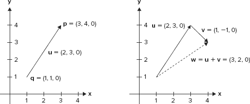

在 3D 中，向量可以用三个坐标 `(vx, vy, vz)` 表示。这个向量的方向和长度与从原点开始并于坐标为 `(vx, vy, vz)` 之点的向量相同。在图 1-18 的左侧，你看到一个向量 `u` 起于点 `p = (1, 1, 0)` 并止于点 `q = (3, 4, 0)`。你通过从终点 `q` 减去起点 `p` 来得到这个向量：

```
v = q – p = (3, 4, 0) – (1, 1, 0) = (2, 3, 0)
```

你可以将向量相加。如果两个向量相加，和是一个新向量，其中两个向量的不同分量已经相加。这意味着：

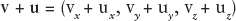

两个向量 `u` 和 `v` 的相加可以像图 1-18 右侧所示进行图形化可视化。绘制向量 `v` 的“尾部”连接向量 `u` 的“头部”。向量 `w = u + v` 从 `u` 的“尾部”指向 `v` 的“头部”。在这个示例中，你看到了两个向量在 3D 中是如何相加的（但此时 `z = 0`）。将 `u = (2, 3, 0)` 与 `v = (1, -1, 0)` 相加得到第三个向量 `w = (3, 2, 0)`。

向量也可以与标量（即一个数字）相乘。结果是一个新向量，其中向量的所有分量都乘以了该标量。这意味着对于向量 `u` 和标量 `k`，你有：

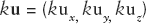

如果你将一个向量与标量 `k = -1` 相乘，你将得到一个长度相同的向量，但其方向与原始向量完全相反。对于 WebGL 来说，向量非常重要——例如用于指定光源的方向和视角的方向。向量使用的另一个例子是作为表面的法向量（normal vector）。法向量垂直于表面，而指定法向量是指定表面定向方式的一种方便方法。

如前所述，向量在基础科学中非常有用——例如表示速度。如果你计划编写一个基于 WebGL 的游戏，这会很有用。假设你正在编写一个 3D 游戏，你的飞船速度是每秒 20 米，方向向东，与地面平行。这可以用一个向量表示：

```
v = (20, 0, 0)
```

## 点积或标量积 (Points or Vertex)

在 3D 中，你有两种方式乘以两个向量：

*   点积 (Dot product) 或标量积

*   叉积 (Cross product)

在本节中你将学习点积，或称标量积。正如名称所示，这种乘法的结果是一个标量而不是向量。对于两个向量 `u` 和 `v`，点积可以通过以下方式定义：


这种定义基于两个向量的长度以及它们之间的夹角 `θ`，如图 1-19 所示。

```
u · v = |u||v|cosθ
```

你可以看到由于 `cos 90°` 为零，当两个向量之间的角为 `90°` 时点积为零。反之亦然——即如果你有两个向量且它们的点积为零，那么这两个向量是正交的。第 7 章将解释如何使用点积计算光线如何在表面反射。

图 1-19: 用于点积或标量积的几何图

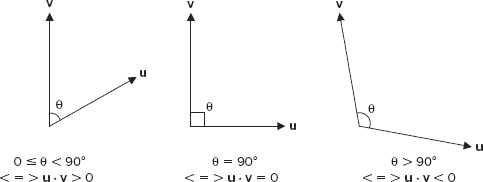

图 1-19 的左侧说明了两个向量之间的夹角小于 `90°` 的情况，此时点积结果为正。中间是角度恰好为 `90°`，点积为零。右侧是角度大于 `90°`，此时点积结果为负。

点积还有第二个代数定义：

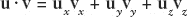

这种定义是等价的，但在不同情况下很有用。在本章后面的部分中，你将看到这种点积定义在定义矩阵乘法时很有用。

## 叉积 (Cross Product)

乘以两个向量的另一种方法被称为叉积。两个向量 `u` 和 `v` 的叉积表示为：

```
w = u × v
```

叉积有如下代数定义：

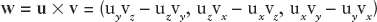

叉积的结果是一个新向量 `w`，具有以下属性：

*   `|w| = |u||v|sin θ`（其中 `θ` 是 `u` 和 `v` 之间的夹角）。

*   `w` 同时对 `u` 和 `v` 正交。

*   `w` 相对于 `u` 和 `v` 遵循右手系。

上述第一个点规定了新向量 `w` 的长度为 `u` 的长度乘以 `v` 的长度乘以 `sin θ`，其中 `θ` 是 `u` 和 `v` 之间的最小角。注意，根据第一个点也可以推导出：当且仅当 `u` 和 `v` 平行时，`u × v = 0`，因为 `sin 0° = 0`。

第二个和第三个点规定了新向量 `w` 的方向。从第三个点可以得出 `u` 和 `v` 的顺序是重要的。这意味着交叉积不满足交换律。相反，交叉积满足以下关系：

`u × v = –v × u`

`图 1-20` 显示了交叉积涉及的几何结构的插图。

图 1-20: 交叉积使用的几何结构

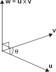

交叉积在 3D 图形中的一个重要用途是计算三角形等表面的法线。在第 7 章，你将学习在 WebGL 中进行光照计算时法线有多重要。

## 齐次坐标

正如本章前面描述的，你可以用三个坐标在 3D 中指定一个点或一个向量。然而，这可能会有些困惑，因为点和向量的指定方式相同。通过齐次坐标，引入了第四个坐标（称为 `w`）。对于向量，`w = 0`；如果 `w ≠ 0`，则该齐次坐标指定一个点。

你可以通过将所有坐标除以 `pw`，轻松地将齐次点 `(px, py, pz, pw)` 转换为由三个坐标表示的点。然后，3D 点由前三个坐标定义为 `(px, py, pz)`。如果你有一个用三个坐标表示的点，只需在第四个位置添加 `1`，即可得到齐次坐标中对应的点 `(px, py, pz, 1)`。

除了区分点和向量之外，引入齐次坐标还有另一个重要原因：如果你用四个齐次坐标表示一个点，就可以用 `4 × 4` 矩阵来表示变换（如平移、旋转、缩放和剪切）。你接下来将学习矩阵和变换。

## 矩阵

矩阵由若干行若干列数字组成。矩阵中的数字被称为矩阵的元素。一个具有 `m` 行 `n` 列的矩阵称为维度为 `m × n`。

WebGL 中最常用的矩阵有四行四列——即它们是像所示的 `4 × 4` 矩阵：

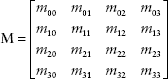

只有一列的矩阵（即大小为 `m × 1`）称为列向量。具有四个元素的列向量看起来如下：

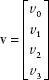

只有一行的矩阵（即大小为 `1 × n`）称为行向量。具有四个元素的行向量看起来如下：

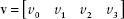

正如你很快就会学到的，列向量在 WebGL 中很常见。它们通常被用来表示顶点，并与 `4 × 4` 矩阵相乘，以对顶点进行某种变换。

### 矩阵的加法和减法

如果两个矩阵的维度相同，就可以对它们进行加法或减法运算。通过对元素进行逐分相加来加两个矩阵，这与加两个向量非常相似。用例子来理解是最简单的。如果你有两个矩阵 `A` 和 `B`，

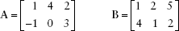

那么当将这两个矩阵相加时，你会得到所示的矩阵 `C`：

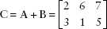

矩阵的减法定义与加法类似。使用上述相同的矩阵 `A` 和 `B`，你得到所示的矩阵 `D`：

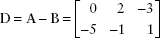

### 矩阵乘法

矩阵乘法是 3D 图形中一个非常重要的操作。即使你不需要像在本节中那样手动进行这种乘法，了解它是如何运作的也是好的。矩阵乘法的定义是：只有当矩阵 `A` 的列数等于矩阵 `B` 的行数时，两个矩阵才能相乘。如果矩阵 `A` 有 `m` 行 `p` 列（即格式为 `m × p`），而矩阵 `B` 有 `p` 行 `n` 列（即格式为 `p × n`），那么乘 `A` 和 `B` 的结果将创建一个具有 `m` 行 `n` 列的矩阵（即格式为 `m × n`）。你可以用符号方式写这一点：

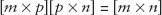

所以，如果你将格式为 `m × p` 的矩阵 `A` 与格式为 `p × n` 的矩阵 `B` 相乘，就会得到一个格式为 `m × n` 的新矩阵 `AB`。新矩阵 `AB` 在位置 `ij` 的元素是矩阵 `A` 的第 `i` 行与矩阵 `B` 的第 `j` 列的点积，即：

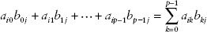

观察例子更容易理解它是如何工作的。假设你有两个矩阵 `M` 和 `N`，所示：

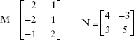

那么如果你乘以 `M` 和 `N`，将得到以下结果。

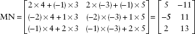

关于矩阵乘法需要提到的一点是矩阵的顺序非常重要。仅仅因为积 `MN` 有定义，并不意味着 `NM` 有定义，即使两个积都有定义，其结果通常也是不同的。所以通常：

`MN ≠ NM`

另一种表达方式是矩阵乘法不满足交换律。

### 单位矩阵和逆矩阵

对于标量，数字 `1` 具有这样一个属性：当任何其他数字 `x` 与之相同时，数字保持不变。如果 `x` 是一个数字，那么对于所有数字 `1 × x = x` 都是的。标量 `1` 的矩阵对应物是单位矩阵（unit matrix）。单位矩阵总是方阵——即它的行数和列数相同——并且在对角线上包含 1，其余部分全为 0。这里是 `4 × 4` 单位矩阵：

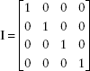

如果矩阵 `M` 乘以单位矩阵 `I`，结果始终是矩阵 `M`。这意味着以下等式成立：

`MI = IM = M`

现在你知道单位矩阵对应标量 `1`，你想找到一个对应的矩阵。对于除零的所有数字，都有一个逆元使得乘积为 `1`。例如，对于任何数字 `x`，都有另一个数字 `1/x`（也可以写成 `x⁻¹`），如果这些数字相乘，乘积为 `1`。同样，矩阵 `M` 的逆记作 `M⁻¹`，它具有这样一个属性：如果它与矩阵 `M` 相乘，结果是单位矩阵。这意味着以下等式成立：

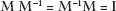

注意，只有方阵（列数等于行数）才有逆矩阵，但并不是所有方阵都有逆。

### 转置矩阵

矩阵 `M` 转置的定义是另一个矩阵，其中列变成了行，行变成了列。矩阵 `M` 的转置符号为 `MT`。矩阵的转置适用于任何格式的 `m × n`，但由于你在 WebGL 中经常使用 `4 × 4` 矩阵，你将把这样的矩阵作为示例。假设矩阵 `M` 的定义所示：

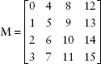

那么转置矩阵 `MT` 由下式给出：

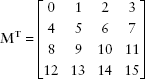

在通往屏幕的过程中，3D 模型会被转换到几个不同的坐标系或空间。变换（transform）是一种对点或向量等实体并以某种方式进行转换的操作。一种特殊的变换被称为**线性变换**（linear transform），它保持向量相加和标量乘法。因此，如果变换用 `f` 表示，且你有两个向量 `u` 和 `v`，只有当它满足以下两个条件时，该变换才是线性的：

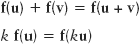

第一个条件也可以通过以下方式解释：如果你对两个向量应用变换，然后将变换后的向量相加，得到的结果应该与先将向量相加然后对和和应用变换的结果相同。

第二个条件可以这样解释：如果你对向量进行变换，然后将结果与标量 `k` 相乘，这得到的结果应该与先将向量乘以 `k` 然后对结果进行变换的结果相同。

线性变换的一个示例是：

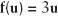

现在你来检查上述两个条件对于该变换是否成立。为了具体化，假设你有两个如下所示的向量（`p` 和 `q`）：

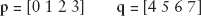

你从第一个条件开始，即如果你先将两个向量中的所有元素乘以 3，然后相加结果，得到的结果应该与先相加两个向量然后将结果乘以 3 的结果相同：

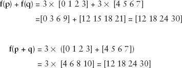

在两种情况下你都得到了相同的结果，因此第一个条件显然满足了。现在考虑第二个条件，即 `kf(u) = f(ku)`。为了具体化，使用 `k = 2` 和 `u = p = [0 1 2 3]`，如下：

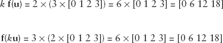

同样，第二个条件也满足了，变换 `f(u) = 3u` 显然是一个线性变换。

线性变换的示例包括缩放（scaling）、旋转（rotation）和剪切（shearing）。3D 中点或向量的线性变换可以用 3 × 3 矩阵表示。然而，除了线性变换之外，还有一种非常基础但重要的变换叫做**平移**（translation）。平移无法用 3 × 3 矩阵表示。

**仿射变换**（affine transform）是一种执行线性变换然后执行平移的变换。可以用 4 × 4 矩阵表示仿射变换。如果你对点或向量使用齐次坐标，就可以通过乘以 4 × 4 变换矩阵和包含点或向量的列向量来实现变换：

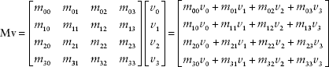

后续章节将描述四种类型的仿射变换。

### 平移

平移意味着你通过恒定的偏移移动每一个点。平移矩阵如下：

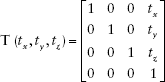

上述平移矩阵通过由向量 `(tx, ty, tz)` 表示的偏移来平移一个点。图 1-21 显示了三角形如何通过向量 `(tx, ty, tz) = (4, 5, 0)` 平平的示例。

图 1-21：三角形在 x 方向平移 4，在 y 方向平移 5

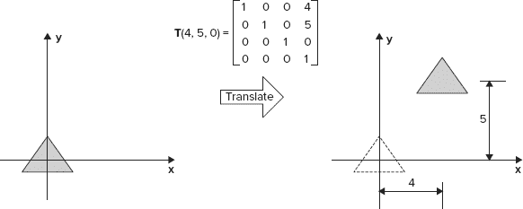

左侧显示了应用平移之前的三角形。右侧显示了三角形在 x 方向平移 4，在 y 方向平移 5。z 轴未显示，但它的方向垂直于纸面。

现在当你知道如何进行矩阵乘法时，你可以很容易看到上述引入的平移矩阵如何影响以齐次表示法的单点 `p`：

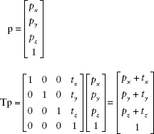

所以很清楚，乘法的结果是一个通过向量 `(tx, ty, tz)` 平移后的新点。

注意，由于向量没有位置，只有方向和大小，因此它不应该平移矩阵的影响。记住，齐次表示法下的向量其第四个分量设置为零。你现在可以验证向量 `v` 在乘以平移矩阵时是不受影响的：

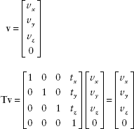

因此对于向量来说，与平移矩阵相乘的结果是相同的向量，没有任何任何修改，正如你预期的那样。

### 旋转

旋转矩阵绕通过原点的给定轴以给定角度旋转点或向量。常用的旋转矩阵是 `Rx`、`Ry` 和 `Rz`，分别用于绕 x 轴、y 轴和 z 轴旋转。这三个旋转矩阵在这里：

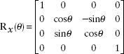

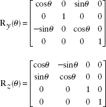

正旋转由右手定则给出，如图 1-22 所示。想象你用右手握住你想要旋转的轴，使大拇指指向轴的正方向。那么你的其他手指就指向相应的方向。

图 1-22：右手定则帮助记忆轴旋转的正方向

该图展示了绕 z 轴旋转，但该规则适用于任何轴。

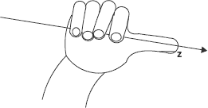

图 1-23 展示了一个绕 z 轴旋转 90° 的三角形。左侧显示了旋转之前的三角形。右侧显示了应用旋转矩阵 `Rz` 之后，绕垂直于纸面的 z 轴旋转 90° 后的三角形。


可以写出绕任意轴旋转的旋转矩阵，但我用这些细节来烦你。如果你感兴趣，可以查看线性代数书籍或在网上查找。

### 缩放

缩放用于放大或缩小对象。以下缩放矩阵在 x 方向以 `sx` 倍、在 y 方向以 `sy` 倍、在 z 方向以 `sz` 倍缩放对象：


如果 `sx = sy = sz`，则变换被称为**等比例缩放**（uniform scaling）。等比例缩放改变对象的大小，但不会改变对象的形状。图 1-24 显示了一个在 x 方向缩放 2 倍的正方形，而 y 方向和 z 方向保持不变。

图 1-24：在 x 方向缩放 2 倍


左侧是应用缩放之前的正方形。右侧是应用缩放矩阵 `S (2, 1, 1)` 之后的正方形。正方形现在被缩放成了一个矩形。

### 剪切

剪切是在 WebGL 和其他 3D 图形中很少使用的仿射变换。将其包含在书中目的是为了完整。然而，剪切变换在 WebGL 中可能有用的一个例子是你正在编写游戏并想要扭曲场景。

如果你从单位矩阵开始，并将左上角 3 × 3 区域中的一个零改为非零值，你就会获得一个切变矩阵。单位矩阵左上角 3 × 3 区域共有六个零可以被改为非零值。这意味着在 3D 中也存在六种可能的基础切变矩阵。切变矩阵有不同的命名方法，但一种常见的方法是将它们命名为 `Hxy(s)`、`Hxz(s)`、`Hyx(s)`、`Hyz(s)`、`Hzx(s)` 和 `Hzy(s)` 之类的名称。在这种情况下，第一个下标表示矩阵改变了哪个坐标，第二个下标表示哪个坐标执行了切变。切变矩阵 `Hxy(s)` 所示：


该切变矩阵会在 `y` 坐标变化时改变 `x` 坐标。当你用切变矩阵 `Hxy(s)` 与点 `p` 相乘时，切变矩阵如何影响该点变得更加清晰了：

从这个结果可以看出，发生的情况更加明显了。当 `y` 坐标增加时，`x` 坐标会向右切变。切变的示例请参见 图 1-25。


图 1-25: 切变示例


# 总结

在本章中，你对 WebGL 有了初步了解，学习了一些背景知识以及构成 WebGL 流水线的步骤。你还稍微学习了一些其他 2D 和 3D 图形技术，以及 WebGL 是与它们何关系的。

你还学习了一些基础线性代数，这对于深入理解 WebGL 或任何 3D 图形非常有用。尽管你可以在不理解 3D 图形细节的情况下创建许多基于 WebGL 的应用程序，如果你真正掌握了本节的大部分内容，将获得更深入的理解。遇到问题并需要调试应用程序时，这也会有用。

# 第 2 章

## 创建基础 WebGL 示例

### 本章包含什么？

* 创建一个基础但完整的 WebGL 应用程序
* 创建 WebGL 上下文
* 编写简单的顶点着色器和片段着色器并在应用程序中使用它们
* 通过 WebGL API 加载着色器源码
* 编译并链接你的着色器
* 将顶点数据加载到 WebGL 缓冲区并使用缓冲区绘制场景
* 调试和排除应用程序的故障
* 使用 DOM API 加载着色器

第一章是一个理论性很强的章节；在本章中，你将获得更多的实践知识。你将通过一个非常基础但完整的 WebGL 示例。你将从尽可能简单地创建示例开始。示例的所有部分都将被详细解释，以便你理解发生了什么。

为了让后续学习 WebGL 的旅程变得更容易，你将学习如何调试和排除应用程序故障。你将学到关于如何快速发现并纠正错误的实用技巧。最后，你将学习如何改进初始示例的某些部分。

# 绘制三角形

第一个示例将是 2D 的。尽管 WebGL 是一个主要设计用于绘制 3D 图形的 API，但也可以进行 2D 绘制。第一个基础示例涉及在黑色背景上画一个白色三角形，如图 2-1 所示。

图 2-1: 用 WebGL 绘制的三角形


在列表 2-1 中，你可以看到仅仅画一个三角形就有大量的源代码。原因之一是 WebGL 是完全基于着色器的。这意味着即使在屏幕上绘制最基础的对象，你也需要顶点着色器和片段着色器。

当你编写 WebGL 应用程序时，顶点着色器和片段着色器都是用源码编写的，这些源码需要在运行时编译并链接，才能被 GPU 作为着色器程序使用。这就是为什么即使是这个基础示例需要几个步骤的原因之一；设置基础 WebGL 应用程序所需的步骤列如下：

1. 编写一些包含 `<canvas>` 标签的基础 HTML 代码。`<canvas>` 标签为 WebGL 提供了绘制区域。然后你需要编写一些 JavaScript 代码来创建画布的引用，以便创建 `WebGLRenderingContext`。

2. 编写顶点着色器和片段着色器的源码。

3. 编写使用 WebGL API 创建顶点着色器和片段着色器着色器对象的源码。你需要将源码加载到着色器对象并编译着色器对象。

4. 创建程序对象并将编译后的着色器对象附加到程序对象。之后，你可以链接程序对象，然后告诉 WebGL 你想使用该程序对象进行渲染。

5. 设置 WebGL 缓冲区对象并将几何形状（在本例中为三角形）的顶点数据加载到缓冲区。

6. 告诉 WebGL 你将哪个缓冲区连接到着色器中的哪个属性，最后绘制你的几何形状（三角形）。

这些步骤已隐含包含在列表 2-1 中，你将在后续章节中带你学习源码的不同部分。

列表 2-1: 在黑色背景上绘制白色三角形的 WebGL 示例

```html
<!DOCTYPE HTML> 
<html lang="en"> 
<head>
<title>Listing 2-1, 第一个 WebGL Example</title>
<meta charset="utf-8"> 
<script type="text/javascript">
var gl;
var canvas;
var shaderProgram;
var vertexBuffer;

function createGLContext(canvas) {
  var names = ["webgl", "experimental-webgl"];
  var context = null;
  for (var i=0; i < names.length; i++) {
    try {
      context = canvas.getContext(names[i]);
    } catch(e) {}
    if (context) {
      break;
    }
  }
  if (context) {
    context.viewportWidth = canvas.width;
    context.viewportHeight = canvas.height;
  } else {
    alert("Failed to create WebGL context!");
  }
  return context;
}

function loadShader(type, shaderSource) {
  var shader = gl.createShader(type);
  gl.shaderSource(shader, shaderSource);
  gl.compileShader(shader);

  if (!gl.getShaderParameter(shader, gl.COMPILE_STATUS)) {
      alert("Error compiling shader" + gl.getShaderInfoLog(shader));
      gl.deleteShader(shader);   
      return null;
  }
  return shader;  
}

function setupShaders() {
  var vertexShaderSource = 
    "attribute vec3 aVertexPosition;                 \n" +
    "void main() {                                   \n" +
    "  gl_Position = vec4(aVertexPosition, 1.0);     \n" +
    "}                                               \n";           

   var fragmentShaderSource = 
     "precision mediump float;                    \n" +
     "void main() {                               \n" +
     "  gl_FragColor = vec4(1.0, 1.0, 1.0, 1.0);  \n" +
     "}                                           \n";

  var vertexShader = loadShader(gl.VERTEX_SHADER, vertexShaderSource);
  var fragmentShader = loadShader(gl.FRAGMENT_SHADER, fragmentShaderSource);

  shaderProgram = gl.createProgram();
  gl.attachShader(shaderProgram, vertexShader);
  gl.attachShader(shaderProgram, fragmentShader);
  gl.linkProgram(shaderProgram);

  if (!gl.getProgramParameter(shaderProgram, gl.LINK_STATUS)) {
    alert("Failed to setup shaders");
  }

  gl.useProgram(shaderProgram);

  shaderProgram.vertexPositionAttribute = 
  gl.getAttribLocation(shaderProgram, "aVertexPosition"); 
}

function setupBuffers() {
  vertexBuffer = gl.createBuffer();
  gl.bindBuffer(gl.ARRAY_BUFFER, vertexBuffer);
  var triangleVertices = [
         0.0,  0.5,  0.0,
        -0.5, -0.5,  0.0,
         0.5, -0.5,  0.0
  ];
  gl.bufferData(gl.ARRAY_BUFFER, new Float32Array(triangleVertices),
  gl.STATIC_DRAW);
  vertexBuffer.itemSize = 3;
  vertexBuffer.numberOfItems = 3;
}

function draw() {    
  gl.viewport(0, 0, gl.viewportWidth, gl.viewportHeight);
  gl.clear(gl.COLOR_BUFFER_BIT);

  gl.vertexAttribPointer(shaderProgram.vertexPositionAttribute, 
                         vertexBuffer.itemSize, gl.FLOAT, false, 0, 0);

  gl.enableVertexAttribArray(shaderProgram.vertexPositionAttribute);

  gl.drawArrays(gl.TRIANGLES, 0, vertexBuffer.numberOfItems);
}

function startup() {
  canvas = document.getElementById("myGLCanvas");
  gl = createGLContext(canvas);
  setupShaders(); 
  setupBuffers();
  gl.clearColor(0.0, 0.0, 0.0, 1.0);
  draw();  
}
</script>

</head>

<body onload="startup();">
  <canvas id="myGLCanvas" width="500" height="500"></canvas>
</body>

</html>
```

## 创建 WebGL 上下文

为了使这个示例尽可能简单，代码被嵌入在单个 HTML 文件中。在该文件中，几乎所有的代码都嵌入在 `<head>` 标签中。

如果你从 Listing 2-1 源代码的末尾开始，你会发现 `onload` 事件处理程序定义在 `<body>` 标签上，用如下调用 JavaScript 函数 `startup()`：

```html
<body onload="startup();">
  <canvas id="myGLCanvas" width="500" height="500"></canvas>
</body>

</html>
```

当用户进入网页且文档及所有外部内容都完全加载时，浏览器会触发 `onload` 事件。如果你将对 `startup()` 的调用放在 `onload` 事件处理程序中，你就知道文档已完全加载并达到了稳定状态。`startup()` 函数是进入你的 WebGL 应用程序的入口点。

在 `<body>` 内部，唯一可用的元素是 HTML5 `<canvas>` 标签。通过给 `<canvas>` 指定一个 ID，你可以在 JavaScript 中获取它并进行操作。WebGL 的渲染表面就是这个 `<canvas>` 标签。通过给 `<canvas>` 标签提供一个 ID，你可以在 JavaScript 中访问它。在 `<head>` 内部，为了让浏览器能够理解上下文名称，建议尝试两种上下文名称。`WebGLRenderingContext` 接口提供了完整的 WebGL API。在本书的所有源码示例中，`WebGLRenderingContext` 被赋值给命名为 `gl` 的变量。因此，当你看到以 `gl.someMethod()` 格式调用的方法时，意味着 `someMethod()` 是 `WebGLRenderingContext` 的简单来说，它是 WebGL API 的一部分。

当书中描述 WebGL API 的方法（或其他任何成员）时，通常会带有前缀 `gl`。例如，`gl.createShader()` 指 `WebGLRenderingContext` 中的 `createShader()` 方法。

## 初始化 WebGL

本书中的示例使用了一种简单的方法来测试是否可以创建 WebGL 上下文。尝试两个上下文名称：“webgl”和“experimental-webgl”。如果 `canvas.getContext()` 对任何一个名称都没有成功，则会显示 JavaScript 警告，通知用户无法创建 WebGL 上下文。

稍微复杂一点是区分由于浏览器不识别 WebGL 导致的失败以及以及因于其他原因的失败。你可以使用以下代码片段检查浏览器是否识别 WebGL：

```javascript
if (!window.WebGLRenderingContext) {

  // 浏览器不知道 WebGL 是什么。

  // 提供一个指向“http://get.webgl.org”的链接，用户
  //可以在那里获取有关升级浏览器的信息

}
```

如果浏览器识别 WebGL 但 `canvas.getContext()` 调用失败，你可以改为将用户引导至 [`get.webgl.org/troubleshooting`](http://get.webgl.org/troubleshooting)。将用户引导这些 Khronos URL 可以帮助他们获取关于哪些浏览器支持 WebGL 以及如何升级浏览器的最新信息。

如果你不想自己编写这段代码，有一个名为 `webgl-utils.js` 的小型 JavaScript 库，它可以帮助你完成这些初始化和检查，并在初始化过程中发生错误时将用户重定向到正确的 URL。你可以从 Khronos WebGL Wiki ([www.khronos.org/webgl/wiki](http://www.khronos.org/webgl/wiki)) 获取该库，尽管找到它的简单方法可能是在搜索引擎中搜索。

## 创建顶点着色器和片段着色器

所有的 WebGL 程序必须同时包含顶点着色器和片段着色器。`setupShaders()` 函数包含了两个字符串形式的顶点着色器和片段着色源代码。在这个初始示例中，两个着色器都保持尽可能简单。首先查看顶点着色器：

```
 var vertexShaderSource = 
    “attribute vec3 aVertexPosition;             \n” +
    “void main() {                               \n” +
    “  gl_Position = vec4(aVertexPosition, 1.0); \n” +
    “}                                           \n”;
```

源代码作为字符串赋值给 JavaScript 变量 `vertexShaderSource`。JavaScript 中的 `+` 运算符用于将源代码的每一行连接成一个字符串。这对于像现在这样的小型示例效果良好，但如果你有更大的着色器，有时在它们自己的 `<script>` 标签内从全局级别定义着色器，然后通过 DOM API 访问源代码会更方便。


在本章稍后的部分，你将学习如何将着色器源代码包含在 WebGL 应用中，然后通过 DOM API 访问它。目前，只需理解还有另一种略有不同的定义着色器源代码的方法就足够了。

顶点着色器的第一行定义了一个名为 `aVertexPosition` 的 `vec3` 类型变量，这意味着它是一个包含三个分量的向量。在类型之前，还指定该变量是一个属性（attribute）。属性是特殊的输入变量，用于从 WebGL API 向顶点着色器传递每个顶点的数据。

示例中的 `aVertexPosition` 属性用于传递 WebGL 绘制三角形时使用的每个顶点的位置。为了让顶点通过 API 并最终到达 `aVertexPosition` 属性，你还必须为顶点设置缓冲区（buffer）并将缓冲区连接到 `aVertexPosition` 属性。这两个步骤（你很快就会看到它们）发生在后续的 `setupBuffers()` 和 `draw()` 函数中。顶点着色器的下一行声明了一个 `main()` 函数，它是顶点着色器执行的入口点。`main()` 函数的体非常简单，只是将传入的顶点赋值给一个名为 `gl_Position` 的变量。所有的顶点着色器都必须给这个预定义的变量赋值。它包含了顶点着色器处理完顶点时的位置，并被传递到 WebGL 流水线中的下一个阶段。

由于 `gl_Position` 被定义为 `vec4` 类型——即它使用齐次坐标——因此会添加一个设为 1 的第四个分量，以便从 3D 点转换为齐次点。如果你忘记了什么是齐次坐标，可以回到第 1 章复习。

示例中的片段着色器也非常简单：


```
var fragmentShaderSource = 
    "precision mediump float;                    \n"+
    "void main() {                               \n"+
    "  gl_FragColor = vec4(1.0, 1.0, 1.0, 1.0);  \n"+
    "}                                           \n";
```

片段着色器也是一个通过 `+` 运算符连接的字符串。片段着色器的第一行使用了所谓的精度限定符（precision qualifier），声明片段着色器中浮点数使用的精度应该是中等精度（medium precision）。

与顶点着色器一样，`main` 函数定义了片段着色器的入口点。`main()` 函数体将一个代表白色的 `vec4` 写入内置变量 `gl_FragColor`。该变量被定义为一个四分量向量，包含了片段在片段着色器处理完成后时具有的 RGBA 格式输出颜色。

## 编译着色器

要创建一个可以上传到 GPU 并用于渲染的 WebGL 着色器，你首先需要创建一个着色器对象，将源代码加载到着色器中，然后编译并链接着色器。本节介绍了加载和编译源代码。下一节介绍链接。

自定义的辅助函数 `loadShader()` 可以创建顶点着色器或片段着色器，取决于发送给函数的参数。该函数被调用两次：一次将类型参数设置为 `gl.VERTEX_SHADER`，另一次将类型参数设置为 `gl.FRAGMENT_SHADER`。`loadShader()` 函数显示如下：

```
function loadShader(type, shaderSource) {
  var shader = gl.createShader(type);
  gl.shaderSource(shader, shaderSource);
  gl.compileShader(shader);

  if (!gl.getShaderParameter(shader, gl.COMPILE_STATUS)) {
      alert("Error compiling shader" + gl.getShaderInfoLog(shader));
      gl.deleteShader(shader);   
      return null;
  }
  return shader;  
}
```

首先，使用 `gl.createShader()` 方法创建一个着色器对象。该方法的参数是你想要创建的着色器类型，即 `gl.VERTEX_SHADER` 或 `gl.FRAGMENT_SHADER`。然后使用 `gl.shaderSource()` 将源代码加载到着色器对象中。该方法的第一个参数是着色器对象，第二个参数是源代码。

源代码加载后，通过调用 `gl.compileShader()` 方法编译着色器。编译完成后，使用 `gl.getShaderParameter()` 检查编译状态。如果发生编译错误，将通过 `alert` 通知用户并删除着色器对象。否则，返回编译好的着色器。

## 创建程序对象并链接着色器

`setupShaders()` 函数的第二部分创建一个程序对象，附加顶点着色器和片段着色器，并将它们链接到 WebGL 可以使用的着色器程序。再次是源码：

```
shaderProgram = gl.createProgram();
  gl.attachShader(shaderProgram, vertexShader);
  gl.attachShader(shaderProgram, fragmentShader);
  gl.linkProgram(shaderProgram);

  if (!gl.getProgramParameter(shaderProgram, gl.LINK_STATUS)) {
    alert("Failed to setup shaders");
  }

  gl.useProgram(shaderProgram);

  shaderProgram.vertexPositionAttribute = gl.getAttribLocation(shaderProgram, 
  "aVertexPosition"); 
}
```

使用 `gl.createProgram()` 方法创建程序对象。使用 `gl.attachShader()` 方法先后附加顶点着色器和片段着色器。之后，使用 `gl.linkProgram()` 方法进行链接。如果链接成功，你就获得了一个程序对象，并可以使用 `gl.useProgram()` 告诉 WebGL 使用该程序对象进行渲染。

链接完成后，WebGL 实现将顶点着色器中使用的属性绑定到通用属性索引（generic attribute index）。WebGL 实现具有固定数量的属性“槽”，通用属性索引用于标识其中一个“槽”。你需要知道顶点着色器中每个属性的通用属性索引，因为在绘制过程中，该索引用于连接包含顶点数据的缓冲区与顶点着色器中的正确属性。你有两种策略可以获取索引：

* 在链接之前，使用 `gl.bindAttribLocation()` 方法指定你想将属性绑定到哪个索引。由于你指定了索引，因此在绘制时可以使用相同的索引。

* 让 WebGL 决定它应该为特定属性使用哪个索引，并在链接完成后，使用 `gl.getAttribLocation()` 方法来查询某个属性使用了哪个通用属性索引。

此示例使用了第二种方法。在链接完成后，调用 `gl.getAttribLocation()` 方法来找到它绑定到属性 `aVertexPosition` 的索引。

该索引以新属性 `vertexPositionAttribute` 的形式被保存在 `shaderProgram` 对象中。在 JavaScript 中，对象基本上只是一个哈希表（hash map），只需通过给它赋值即可简单地创建对象的新属性。因此，对象 `shaderProgram` 并没有一个名为 `vertexPositionAttribute` 的预定义属性，但该属性是通过赋值被创建的。在随后的 `draw()` 函数中，保存在该属性中的索引将用于将包含顶点数据的缓冲区连接到顶点着色器中的 `aVertexPosition` 属性。


为从 WebGL API 返回的对象添加新属性（如本节所示）可能会很方便，你可能在网络上现有的 WebGL 代码中也会看到这种。但如果你需要创建更健壮的应用程序来处理 WebGL 中所谓的“上下文丢失（lost context）”，这并不是一个好的策略。你将在第 5 章中学习更多关于上下文丢失以及如何更改代码使其更健壮的知识。在此之前，示例设计不会考虑上下文丢失。

## 设置缓冲区 (Setting Up the Buffers)

在准备好着色器之后，下一步是设置包含顶点数据的缓冲区。在这个示例中，你只需要一个用于三角形顶点位的缓冲区。该缓冲区在名为 `setupBuffers()` 的函数中创建并设置。

```
function setupBuffers() {
  vertexBuffer = gl.createBuffer();
  gl.bindBuffer(gl.ARRAY_BUFFER, vertexBuffer);
  var triangleVertices = [
         0.0,  0.5,  0.0,
        -0.5, -0.5,  0.0,
         0.5, -0.5,  0.0
  ];
  gl.bufferData(gl.ARRAY_BUFFER, new Float32Array(triangleVertices),
  gl.STATIC_DRAW);
  vertexBuffer.itemSize = 3;
  vertexBuffer.numberOfItems = 3;
}
```

该函数首先通过调用 `gl.createBuffer()` 创建一个 `WebGLBuffer` 对象，并将其赋值给全局变量 `vertexBuffer`。然后，将创建的 `WebGLBuffer` 对象绑定为当前数组缓冲区对象。这告诉 WebGL 从现在起，你正在处理这个缓冲区对象。三角形的顶点指定在名为 `triangleVertices` 的 JavaScript 数组中。

在这个示例中，顶点着色器没有对顶点进行任何变换。正如你记忆的，它只是将传入的顶点赋值给内置的特殊变量 `gl_Position`，而没有进行任何矩阵乘法。

这意味着将使用 WebGL 默认的右手侧坐标系。默认坐标系的原点位于视口的中间，坐标为 (0, 0, 0)。x 轴水平并指向右侧，y 轴向上，z 轴从屏幕外向你伸出。所有三个轴都从 –1 延伸到 1。视口的左下角坐标为 x = −1 和 y = −1，视口的右上角坐标为 x = 1 和 y = 1。由于此示例绘制的是一个 2D 三角形，所有的 z 值都被设置为零，因此三角形将在 z = 0 的 xy 平面上绘制。

由于数组 `triangleVertices` 中指定的所有顶点的 x 和 y 坐标都在 –0.5 到 +0.5 之间，因此绘制的三角形顶点距离视口边缘有一定的距离。如果你将数组中的值从 –0.5 改为 –1.0，从 0.5 改为 1.0 然后重新加载页面，你将看到三角形的顶点现在位于视口的边缘。

接下来，根据包含顶点的 JavaScript 数组创建一个 `Float32Array` 对象。你将在第 3 章详细查看 `Float32Array`。现在，只需要理解它用于将顶点数据发送到 WebGL 即可。

调用 `gl.bufferData()` 将顶点数据写入当前绑定的 `WebGLBuffer` 对象。此调用告诉 WebGL 应该将哪些数据放在通过 `gl.createBuffer()` 创建的缓冲区对象中。

`setupBuffers()` 函数中完成的最后一件事是向 `vertexBuffer` 对象添加两个包含后续所需信息的属性。第一个是 `itemSize` 属性，它指定每个属性包含多少个分量。第二个是 `numberOfItems` 属性，它指定此缓冲区中存在的项目或顶点的数量。在绘制场景时需要这两个属性中的信息，因此尽管你从上一节的注释中了解到，当你以后需要处理上下文丢失时这不是最佳方法，但这些信息仍作为属性添加到 `vertexBuffer` 中，且位置靠近指定顶点数据的地方。这将使得在更新顶点数据结构时，更容易记得更新这两个属性。

## 绘制场景 (Drawing the Scene)

你终于到了应该绘制一切的阶段。你将绘制实际场景的代码放在一个简单名为 `draw()` 的函数中。

```
function draw(gl) {    
  gl.viewport(0, 0, gl.viewportWidth, gl.viewportHeight);
  gl.clear(gl.COLOR_BUFFER_BIT);

  gl.vertexAttribPointer(shaderProgram.vertexPositionAttribute,
                     vertexBuffer.itemSize, gl.FLOAT, false, 0, 0);

  gl.enableVertexAttribArray(shaderProgram.vertexPositionAttribute);

  gl.drawArrays(gl.TRIANGLES);
}
```

你在这个函数中做的第一件事是指定视口。视口定义了渲染结果位于绘制缓冲区的位置。当创建 WebGL 上下文时，视口初始化为原点在 (0, 0) 且宽度和高度等于画布宽度和高的矩形。这意味着在这个示例中调用 `gl.viewport()` 实际上并没有修改任何内容。尽管如此，在这里包含了它，因为它是一个常用的 WebGL 方法。

`gl.clear()` 方法配合参数 `gl.COLOR_BUFFER_BIT` 告诉 WebGL 使用之前通过 `gl.clearColor()` 指定颜色清除颜色缓冲区。此示例使用 `gl.clearColor()` 指定黑色为清除颜色。因此当调用 `gl.clear()` 时，颜色缓冲区将被清除为黑色。

在 `setupBuffers()` 函数中，已经创建了一个 `WebGLBuffer` 对象并通过 `bindBuffer()` 方法绑定到 `gl.ARRAY_BUFFER` 目标。顶点数据通过 `gl.bufferData()` 方法发送到了此绑定的缓冲区。但尚未告诉 WebGL 顶点着色器中的哪个属性应该从绑定的缓冲区对象获取输入。在这个示例中，只有一个缓冲区对象和一个顶点着色器属性，但通常会有多个缓冲区和属性，因此必须以某种方式将它们连接起来。

第三个参数指定顶点缓冲区对象中的值应被解释为浮点数。如果你发送的数据不是浮点数，则在使用顶点着色器之前，需要将数据转换为浮点数。第四个参数称为归一化标志（normalized flag），它决定了如何将非浮点数据转换为浮点数。在这个示例中，缓冲区中的值已经是浮点数，因此该参数将不会被使用。第五个参数称为 `stride`（跨距），指定为零意味着数据在内存中连续存储。第六个也是最后一个参数是缓冲区的偏移量（offset），由于数据从缓冲区的开始，因此该参数也被设置为零。

# 理解 WebGL 编码风格

如果你是一位经验程序员，你可能已经熟悉什么是编码风格指南。编码风格指南可以包含关于你应该如何命名变量和函数的指南、你应该如何缩进源代码、你的循环应该像什么样，以及你应该把大括号放在哪里。有时，还有关于你应该使用编程语言的哪些功能的指南。

其核心思想是，如果你（以及你的团队，如果有多个程序员的话）在编写的所有代码中保持一致并遵循相同的编码风格，代码将更容易阅读和维护。由于更容易阅读和维护，它也应该包含更少的错误。

本书并没有尝试遵循或强制执行完整的编码风格，但它尝试在命名规范上尽可能保持一致。然而，书中的代码示例的编写和组织方式反映了本书（以及读者）的需求。它们并不一定针对真实世界的应用进行了优化。

例如，书中的 JavaScript 源代码通常直接嵌入在 HTML 页面的 `<head>` 中，而不是使用通过以下代码包含的外部 JavaScript 文件：

```
<script="text/javascript" src="filename.js"></script>
```

将源代码包含在 HTML 页面中使其易于在书中展示，而且在打开网页后通过选择“查看源代码”命令，就可以简单地在浏览器中查看源代码。然而，如果你正在编写一个真实的应用程序，将 JavaScript 源代码写在外部文件中并将其包含在 HTML 文件中可能会更好。

本书中使用的简单命名规范如下：

* 通过调用 `canvas.getContext()` 获取的 `WebGLRenderingContext` 始终被放在一个名为 `gl` 的全局变量中。这意味着如果调用 `WebGLRenderingContext` 的 `drawArrays()` 方法，该调用看起来就像是 `gl.drawArrays()`。

* 通常情况下，JavaScript 代码和使用 OpenGL ES 着色语言编写的着色器源码中的变量和函数都使用驼峰命名法（`camelCase`）。这意味着名称以小写字母开头，名称中的每个新单词的首字母都大写。例如，在列表 2-1 中设置缓冲器的 JavaScript 函数命名为 `setupBuffers()`。你可以看到（例如通过 `gl.drawArrays()`），公共 WebGL API 的方法也遵循驼峰命名法。

* 着色器源码使用前缀"a"表示属性（attribute），"v"表示变体变量（varying），"u"表示统一变量（uniform）。这使得很容易识别出 `aVertexPosition` 是属性，`vColor` 是变体变量，而 `uMVMatrix` 是统一变量。

尽管现有的 WebGL 代码有许多不同的编码风格，但这些约定使得代码与许多现有代码相似。当你开始编写自己的代码时，当然可以遵循你（或你的团队）决定的任何风格。

# 调试你的 WebGL 应用程序

当你编写如 `C`、`C++` 或 `Java` 等传统的编译语言时，编译器会告诉你何时犯了错误，例如在语句末尾缺少分号或拼写错误的变量名。尽管今天大多数 JavaScript 实现在执行代码之前实际上会将 JavaScript 代码编译为原生机器码，但你作为终端用户，通常不会像使用传统编译器那样被告知 JavaScript 代码中的错误。

这意味着如果你编写了一段 HTML 和 JavaScript 代码并将其加载到浏览器中，即使是 JavaScript 代码中那些传统编译器通常能捕获并通知你的细微错误，也可能导致你的应用程序行为与预期不同。如果你尝试在编辑器中手动为列表 2-1 编写代码然后将其加载到浏览器中，就会有遇到这种问题的风险。

幸运的是，可以获得帮助。所有支持 WebGL 的浏览器都具有某种开发工具。如果你以前做过任何其他 Web 开发，你可能熟悉这些工具中的一个或多个。以下是一些流行工具的列表：

* Chrome Developer Tools — 内置于 Google Chrome

* Firebug — Mozilla Firefox 的扩展程序

* Web Inspector — 内置于 Safari

* Dragonfly — 内置于 Opera

本书主要使用 Chrome Developer Tools。你还将获得关于 Firebug 如何工作的简要概述。如果由于某种原因你更倾向于其他浏览器或开发工具，你应该能够在网络上找到它们的文档，然后轻松地遵循书中的大部分指令。

## 使用 Chrome Developer Tools

Chrome Developer Tools 是一项强大的 Web 开发功能，默认集成在 Google Chrome 浏览器中。它基于一个由 WebKit 开源社区开发的名为 Web Inspector 的工具。 Web Inspector 与 Safari 浏览器内置用于 Web 开发的工具是同一个。


当你将网页加载到 Chrome 浏览器时，可以通过多种方式启动 Chrome Developer Tools：

- 在浏览器窗口的右上角，你可以选择工具菜单，然后选择开发者工具。
- 在 Windows 和 Linux 上，可以使用快捷键 `Ctrl+Shift+I`。Mac 键盘上对应的快捷键是 `Command+Option+I`。
- 你可以在网页上右键点击元素，然后在弹出菜单中选择检查元素。

当你打开 Chrome Developer Tools 时，你会看到与图 2-2 类似的界面。

图 2-2: 当 Developer Tools 停靠在主窗口时的用户界面


在图 2-2 中，Chrome Developer Tools 窗口停靠在底部，你可以在背景中看到部分网页内容。在 Chrome Developer Tools 窗口顶部，你可以看到一个带有八个图标的工具栏。这些图标对应于 Chrome Developer Tools 的八个面板：

- Elements
- Resources
- Network
- Scripts
- Timeline
- Profiles
- Audits
- Console

通过点击图标，可以选择相应的面板。下面的部分包含不同面板及其提供的功能的简要描述。


本节对 Chrome Developer Tools 进行简要概述。此外，它重点介绍了 Chrome Developer Tools 在你开发和调试 WebGL 应用程序时如何有用。

在网络上，你会找到 Google 关于 Chrome Developer Tools 如何工作的优秀文档和视频。你应该阅读这些文档并观看一些视频。

## Elements 面板

元素（Elements）面板为你提供了网页所包含的 DOM 树的概览。你可以将其看作大多数浏览器提供的“查看源代码”（View Source Code）命令的一个功能更先进的替代方案。你可以在图 2-3 中看到元素面板在取消停靠状态下的外观。

图 2-3: Chrome 开发者工具的元素面板


如果你正在查看网页并想知道页面上某个元素的详情，可以右键点击该元素并选择“检查元素”（Inspect Element）。这将打开元素面板并高亮该元素。在图 2-3 中，被检查的元素被选中用于画布。在右侧的侧边栏中，你可以找到有关样式、指标、属性和事件监听器的信息。

WebGL 应用通常不会使用如此庞大且复杂的 DOM 树。很多功能将在 JavaScript 和着色器（shaders）中实现。当然，这也有例外，即使对于 DOM 树较小的 Web 应用，元素面板也是很有用的。

元素面板中一个非常有用的功能是能够实时更改 HTML、DOM 或 CSS。在第 8 章中，你将学习 WebGL 优化以及不同的更改如何影响你的 WebGL 应用的性能。通过元素面板，你可以实时更改 `<canvas>` 的宽度和高度，并查看这如何影响性能。该测试的结果可以迅速为你提供价值信息，让你知道你的 WebGL 应用中可能在哪里存在性能瓶颈。

## 资源面板（Resources Panel）

资源面板允许你查看 Web 应用包含的所有资源。你可以快速获取所有使用资源的概览，包括构成 Web 应用的 HTML、JavaScript、CSS 和图像文件。当你发现一个看起来非常棒的 WebGL 应用并想了解它是如何构建的时，这个面板非常有用。

资源面板可以让你快速了解应用程序的大小，以及它是否使用了任何 JavaScript 库。该面板也是搜索应用程序中所有可用资源的好方法。例如，如果你想知道应用程序是如何使用纹理的，可以在资源面板中搜索“texture”单词。当你得到结果时，可以按 Enter 键搜索该单词的下一次出现。

当你滚动左侧边栏中的资源并选择一个图像文件时，相应的图像会显示在面板的右部分。这可以帮你理解应用程序如何使用不同的纹理。在图 2-4 中，左侧边栏选择了一个作为纹理图像文件的资源。在右侧，你可以看到实际图像。这个特定示例来自 WebGL Demo“动态立方体映射”（Dynamic Cubemap）([`webglsamples.googlecode.com/hg/dynamic-cubemap/dynamic-cubemap.html`](http://webglsamples.googlecode.com/hg/dynamic-cubemap/dynamic-cubemap.html)，它是由 Google 的 Gregg Tavares 开发的。

图 2-4: Chrome 开发者工具的资源面板


## 网络面板（Network Panel）

网络面板（参见图 2-5）允许你调查哪些资源是通过网络下载的。该面板帮助你缩短 WebGL 应用的启动时间。例如，你可以更好地理解资源下载的顺序，以及你是否可以使资源的下载更加高效。

图 2-5: Chrome 开发者工具的网络面板


## 脚本面板（Scripts Panel）

脚本面板（参见图 2-6）为你的 JavaScript 代码提供了一个强大的调试器。你可以在代码中设置断点、单步执行、查看堆栈跟踪并检查变量的值。当你使用 Chrome 开发者工具开发和调试 WebGL 应用时，可能是你花费时间最多的面板之一。

图 2-6: Chrome 开发者工具的脚本面板


图 2-6 显示了执行在断点行停止时脚本面板的样式。在右侧，你可以看到调用栈。在右上角，你有按钮可以继续执行、单步跳过函数、单步进入函数、跳出函数以及禁用所有断点。

## 时间轴面板（Timeline Panel）

时间轴面板（参见图 2-7）为你提供了加载 Web 应用期间发生的不同事件的概览。当你专注于开发中的 WebGL 部分时，可能不会经常使用它。

图 2-7: Chrome 开发者工具的时间轴面板


## 分析面板（Profiles Panel）

通过分析面板，你可以对 CPU 和内存使用情况进行分析。如果你在 JavaScript 中执行大量的物理计算、许多矩阵乘法或任何在 CPU 上执行的的逻辑，并且你想找到哪些函数耗用了最多的时间，分析面板可以给你很大帮助。图 2-8 显示了录制分析后的样子。

图 2-8: Chrome 开发者工具的分析面板


## 审计面板（Audits Panel）

如果你想改进或优化你的 Web 应用但不确定如何做，审计面板可以帮助你。它会就你可以改进的地方提供提示，例如合并 JavaScript 文件或改进缓存。图 2-9 显示了启动审计前的审计面板。

图 2-9: Chrome 开发者工具的审计面板


## 控制台面板（Console Panel）

控制台面板的特殊之处它可以作为一个独立面板，但你也可以通过 Escape 键在任何其他面板中调出它。

在这里你会找到通过 `console.log()` 打印的日志。你还会收到 JavaScript 代码的语法错误和运行时错误。如果你开发了 WebGL 应用并将其加载到浏览器但运行结果异常，控制台是你应该检查的第一个面板之一。最初你可能主要使用控制台查看输出，但此面板还支持命令行 API，你可以在控制台中直接编写命令。如果你觉得这听起来趣，可以查看 Chrome 开发者工具的在线文档。

在图 2-10 中，第一行是用 JavaScript 代码通过 `console.log()` 写入的消息。第二行是 JavaScript 异常的结果，这是由于 JavaScript 尝试调用 `gl.drawArray()` 而不是 `gl.drawArrays()`。WebGL API 中没有名为 `gl.drawArray()` 的方法，所以你得到了显示在控制台面板中的异常。

图 2-10: Chrome 开发者工具的控制台面板


## 使用 Firebug

虽然书中的大多数示例都使用 Google Chrome 浏览器和 Chrome 开发者工具，但本书也简要描述了如何使用 Firefox 和 Firebug 调试你的 WebGL 应用。毕竟，Firebug 是一个比 Chrome 开发者工具更早的强大工具，它有许多忠实的用户。

Firebug 是 Firefox 的一个扩展，最初由 Joe Hewitt 开发，他也是 Firefox 的原始程序员之一。它基本上具备了与 Chrome 开发者工具（Chrome Developer Tools）相同的功能。由于 Firebug 是 Firefox 的一个扩展，你需要单独下载并安装它。你可以通过 URL [`getfirebug.com/`](http://getfirebug.com/) 轻松完成操作。

一旦安装了 Firebug，你可以通过几种不同的方式启动它：

- 使用 Firefox 菜单，选择工具 (Tools)  Firebug  打开 Firebug，如图 2-11 所示。
- 使用快捷键 `F12` 同时打开和关闭 Firebug。
- 在网页元素上点击鼠标右键并选择“检查元素”（Inspect Element）。

图 2-11: 安装 Firebug 后，你可以从 Firefox 的工具菜单打开它


打开 Firebug 时，你会发现它是以不同的面板组织的，其方式与 Chrome 开发者工具的界面类似。这是因为 Chrome 开发者工具的开发者受到了 Firebug 的启发，当他们开始开发 Chrome 开发者工具时，Firebug 已经存在并且是一个流行且经过验证的概念。这两个工具非常相似，这使得你作为开发者更容易在它们之间进行切换。图 2-12 显示了 Firebug 的脚本（Scripts）面板，它包含了与 Chrome 开发者工具中的脚本面板相似的功能。你可以在 JavaScript 代码中设置断点、进行单步执行、查看调用栈等。图 2-12 显示了当 JavaScript 的执行在断点处停止时该面板的样式。

图 2-12: Firebug 中的脚本面板


这里描述的最后一个 Firebug 面板是控制台（Console）面板，它再次与 Chrome 开发者工具中的控制台面板非常相似。图 2-13 显示了该面板；第一行显示来自 `console.log()` 的输出，第二行告知你 JavaScript 代码中存在运行时错误。你可以将此图与图 2-10 进行比较，后者为 Chrome 开发者工具显示了相应的信息。

图 2-13: Firebug 中的控制台面板


如果你学会使用 Chrome 开发者工具或 Firebug 调试你的 WebGL 应用，那么在两者之间切换将很容易。本书其余部分使用 Chrome 开发者工具，是因为必须选择其中一种工具，而 Chrome 浏览器默认包含了该开发者工具。

## WebGL 错误处理与错误代码

当 WebGL 检测到发生错误时，它会生成并记录错误代码。在记录错误后，在 WebGL 应用调用以下方法之前，将不会记录其他错误：

```
gl.getErrors()
```

该方法用于查询记录的错误。它返回当前的错误代码（错误代码列表请参见表 2-1），并将当前错误重置为 `gl.NO_ERROR`。此后，新的错误将被记录。

表 2-1

| WEBGL 错误代码 | 说明 |
| --- | --- |
| `gl.NO_ERROR` | 自上一次调用 `gl.getError()` 以来，没有记录新的错误。 |
| `gl.INVALID_ENUM` | 类型为 `GLenum` 的参数超出范围。例如，如果你调用 `gl.drawArrays()` 并发送了 `gl.COLOR_BUFFER_BIT` 作为第一个参数，而不是 `gl.TRIANGLES` 或该方法期望的其他有效枚举值之一。 |
| `gl.INVALID_VALUE` | 数值类型的参数超出范围。例如，如果你调用了 `gl.clear()` 并发送了 `gl.POINTS` 而不是 `gl.COLOR_BUFFER_BIT` 或该方法期望的其他有效值之一。 |
| `gl.INVALID_OPERATION` | 调用了当前 WebGL 状态下不允许的方法。当你在调用生成此错误的方法之前忘记调用正确的方法时，可能会发生此错误。例如，在没有先调用 `gl.bindbuffer()` 的情况下调用了 `gl.bufferData()`。 |
| `gl.OUT_OF_MEMORY` | 没有足够的内存执行特定方法。 |

在你的 WebGL 应用中使用可以使用 `gl.getError()` 有两种策略：

- 你可以始终在代码中包含 `gl.getError()`，作为编写防御性代码的一种。如果你获取了错误，则尝试优雅地处理它。但不建议这样做，因为调用 `gl.getError()` 可能会严重阻碍应用程序的性能。
- WebGL 中更常见的策略是仅出于调试目的使用 `gl.getError()`。你只在开发并尝试修复问题时将其包含在代码中。当你的代码就绪后，它不再包含任何对 `gl.getError()` 的调用。推荐这种第二种策略，特别是对于对性能很重要的代码。

图 2-14 显示了在使用调试库且故意移除 `gl.bindBuffer()` 调用以生成 WebGL 错误时 开发者工具的控制台（Console）面板。当没有调用 `gl.bindBuffer()` 时，一旦调用 `gl.bufferData()`，WebGL 会生成一个 `gl.INVALID_OPERATION`。由于调试库调用了 `gl.getError()`，它会清除记录的错误，执行将继续，但没有任何数据被加载到缓冲区。这意味着你会在控制台面板中看到另外两条与 `gl.INVALID_OPERATION` 相关的日志：一个是在调用 `gl.vertexAttribPointer()` 时，另一个是在调用 `gl.drawArrays()` 时。

图 2-14: 使用 `webgl-debug.js` 记录三个 WebGL 错误时 开发者工具的控制台面板


当你使用调试库时，控制台面板中每一行的右侧都会写入一个对应 WebGL 错误的行号。然而，这个行号并不是生成错误的方法被调用的行。相反，这个行号是 `webgl-debug.js` 中 `console.log()` 调用所在的行号。但是，如果你想知道导致错误的方法所在的代码行号，这很容易找到。打开脚本（Scripts）面板，并在库调用 `console.log()` 的行上设置一个断点。然后重新运行你的应用程序；当命中断点时，你可以通过查看脚本面板中的调用栈（call stack）轻松地看到哪个 WebGL 方法导致了错误。


注意，由于库 `webgl-debug.js` 使用了 `gl.getError()` 方法，这会对性能产生负面影响，因此你不应该在生产代码中使用 `webgl-debug.js`。

## WebGL Inspector

Chrome 开发者工具和 Firebug 是非常强大的工具，在你开发和调试 WebGL 应用时将提供巨大的帮助。然而，这些工具是通用的 Web 开发工具，并非专门为 WebGL 设计的。

专门为 WebGL 开发的一个非常有用的工具是 WebGL Inspector。这是一个 WebGL 调试器，提供的功能类似于 PIX 对 Direct3D 的支持以及 gDEBugger 对 OpenGL 的支持。WebGL Inspector 是开源的，最初由 Ben Vanik 编写并作为 Chrome 扩展可用。你可以从 [`benvanik.github.com/WebGL-Inspector/`](http://benvanik.github.com/WebGL-Inspector/) 下载它。

一旦安装了 WebGL Inspector 并浏览到包含 WebGL 内容的网页，Google Chrome 地址栏（有时称为 omnibox）的最右侧会显示一个带有“GL”字样的小红色图标。


在本节中，将使用由 Google 的 Gregg Tavares 创建的演示动态立方体映射（Dynamic Cubemap，[`webglsamples.googlecode.com/hg/dynamic-cubemap/dynamic-cubemap.html`](http://webglsamples.googlecode.com/hg/dynamic-cubemap/dynamic-cubemap.html)) 来说明 WebGL Inspector 是如何工作的。

如果你点击 GL 图标，网页右上角（就在 GL 图标下方）会出现两个名为 Capture（捕捉）和 UI 的按钮。如果你点击 UI 按钮，Google Chrome 底部将显示 WebGL Inspector 的完整界面。你将看到类似于 图 2-15 的内容。初始状态下 UI 不包含任何记录的信息。如果你再次点击 UI，完整 UI 将消失，屏幕上只留下 Capture 和 UI。

图 2-15: 在捕捉任何内容之前 WebGL Inspector 的用户界面


当你点击 Capture 时，你的 WebGL 应用的一帧会被记录。记录一帧后，你可以使用 WebGL Inspector 查看有关你所调试的 WebGL 应用的许多有趣信息。

WebGL Inspector 窗口顶部有六个工具栏项：

- Trace（追踪）
- Timeline（时间线）
- State（状态）
- Textures（纹理）


# WebGL Inspector 界面

WebGL Inspector 的用户界面包含两个主要部分：

*   Buffers（缓冲区）
*   Programs（程序）

每个工具栏项都对应点击它时显示的面板。通过这样，用户界面的组织方式类似于 Chrome 开发者工具和 Firebug。WebGL Inspector 包含许多实用的功能，学习该工具细节的最好方法就是亲自开始实验。在接下来的章节中，将描述一些选定的功能。


当你现在尝试使用 WebGL Inspector 时，工具提供的信息可能有些你无法理解。即使在后续章节中对 WebGL Inspector 的讨论也提到了一些你尚未学过的概念。

你将在书中学到更多关于 WebGL 的知识，你应该在阅读本书时使用 WebGL Inspector。这将有助于你对这个宝贵的工具有更深入的理解。

## Trace（追踪）面板

Trace 面板（参见 图 2-16）显示了在捕捉帧期间记录的所有 WebGL 调用。你可以逐步执行记录的命令。在 Trace 面板的右侧，你可以看到在逐步执行记录命令时 WebGL 场景是如何构建的。

图 2-16: WebGL Inspector 的 Trace 面板


要逐步执行记录的命令，可以使用 Trace 面板顶部的箭头按钮，也可以使用快捷键：

*   `F8`—单步向前
*   `F9`—播放整个场景
*   `F6`—向后退一步
*   `F7`—跳转到下一个绘制调用
*   `F10`—从开始重启

Trace 面板显示 WebGL 应用何时绑定特定缓冲区或加载着色程序。当你点击缓冲区或着色程序时，新面板会显示有关该项目的更多信息。

Trace 面板非常有用的功能是 WebGL Inspector 可以用黄色标记冗余调用。冗余调用是指没有改变状态的 WebGL API 调用。例如，如果你将一个变量设置为它已经具有的值，这就是一个冗余调用并在 Trace 面板中被高亮。当你需要优化 WebGL 应用的性能时，可以查看是否消除这些冗余调用。

## Timeline（时间线）面板

Timeline 面板向你显示有关 WebGL 应用的实时统计数据。图 2-17 显示了 Timeline 面板的样子。

图 2-17: WebGL Inspector 的 Timeline 面板


## State（状态）面板

State 面板显示了 WebGL 应用的状态快照。图 2-18 显示了 State 面板的样子。

图 2-18: WebGL Inspector 的 State 面板


## Textures（纹理）面板

Textures 面板（参见 图 2-19）向你展示了 WebGL 应用使用的纹理的许多价值信息。你可以看到纹理的图像，以及识别它们是 2D 纹理还是立方体纹理的信息。此面板还包括有关纹理包裹模式、纹理过滤以及从哪些 URL 加载纹理的信息。你将在第五章学习更多关于纹理的知识。

图 2-19: WebGL Inspector 的 Texture 面板


## Buffers（缓冲区）面板

Buffers（缓冲区）面板显示了 WebGL 应用中使用的不同缓冲区的信息。Buffers 面板的左侧显示了你的 WebGL 程序中使用的不同缓冲区，包括缓冲区内容和大小的信息，以及不同缓冲区所在的位置。Buffers 面板的右侧显示了所选缓冲区对应的几何形状。

在图 2-20 中，所选缓冲区的几何形状是一个球。你可以使用鼠标来旋转和缩放几何形状，这在你有更复杂的几何形状时非常有用。

图 2-20: WebGL Inspector 的 Buffers 面板


## Programs（程序）面板

Programs 面板提供了 WebGL 应用使用的所有着色器程序的信息。你可以看到程序使用了哪些统一变量（uniform）和属性（attribute），你还可以查看顶点着色器和片元着色器的源代码。图 2-21 显示了 Programs 面板的一部分。

图 2-21: WebGL Inspector 的 Programs 面板


# WebGL 故障排查

WebGL 应用可能会出现许多问题。为了能够快速、方便地排查并修复应用程序中的任何问题，了解这些问题将会有所帮助。以下是你可能遇到的各种错误分类列表：

*   JavaScript 语法错误——你写了拼写错误或类似的错误，导致 JavaScript 引擎不接受 JavaScript 源代码作为有效的 JavaScript。如果你的 JavaScript 中存在语法错误，你的应用程序将无法执行。
*   运行时错误——在执行开始之前，你犯了一个 JavaScript 引擎无法发现的错误。但当你执行 JavaScript 时，问题被发现并抛出了错误。这里有若干种不同的运行时错误。
*   着色器编译错误——你的顶点着色器或片元着色器源代码中存在问题，因此当你尝试用`gl.compileShader()`编译它时，编译会失败。
*   着色器程序链接错误——你在着色器中犯了错误，导致`gl.linkProgram()`调用失败。例如，如果你的片元着色器尝试使用顶点着色器中未定义的变变量（varying），就会发生这种情况。
*   WebGL 特有错误——当你调用某个 WebGL 方法时做了错误，导致 WebGL 生成了表 2-1 中列出的错误之一。你可以通过`gl.getError()`获取记录错误。
*   逻辑错误——你在 JavaScript 或 OpenGL ES 着色语言源代码中提交了逻辑错误。你的 WebGL 应用包含有效的源代码，但由于逻辑错误，它的行为并不符合预期。

现在你已经知道在将 WebGL 应用加载到浏览器时，会有很多不同的问题出现。你也理解了不同问题之间的区别。

## 故障排查清单

当你在浏览器中加载内容但没有看到预期结果时，该怎么办？以下是需要检查的列表：

1.  你的浏览器支持 WebGL 吗？这可能是一个幼稚的问题，但仍然有效。如果你使用的浏览器不支持 WebGL 或由于某些原因未启用 WebGL，调用`canvas.getContext()`将返回`null`。通常这对你来说非常明显，因为大多数使用 WebGL 的应用程序都会使用 JavaScript `alert()`或其他机制告知用户不支持 WebGL。
2.  检查 Chrome 开发者工具的 Console（控制台）面板查看 JavaScript 代码中是否有语法错误。
3.  检查 Chrome 开发者工具的 Console（控制台）面板查看 JavaScript 代码中是否有运行时错误。
4.  检查你的着色器是否存在编译错误或链接错误。通常代码会通过调用`gl.getShaderParameter()`和`gl.getProgramParameter()`来检查`gl.compileShader()`和`gl.linkProgram()`调用是否成功，如果编译或链接失败，将显示`alert()`或其他方式通知用户。
5.  检查任何 WebGL 调用是否失败并生成了可以通过`gl.getError()`获取的错误。如果你使用了诸如`webgl-debug.js`等通过`console.log()`记录这些错误的调试库，你可以在 Console 面板中看到这些错误。从修复第一个错误开始，因为其他错误可能是第一个错误的结果。
6.  检查你的 WebGL 虚拟相机是否指向正确的方向。WebGL 没有对相机的内置支持，但你将在第 4 章中学习如何通过变换来模拟相机。（在此处包含此信息是为了以便你在 WebGL 应用中模拟相机时可以参考此清单。）
7.  当你检查并纠正了上述所有点但应用程序仍然没有按你的预期运行运行时，可能是时候启动 Chrome 开发者工具的 Scripts（脚本）面板并调试代码了。有些问题你实际上通过查看代码就能发现，但它们可能很难找到，所以使用调试器有时更容易：
    *   检查你是否对读取或写入的对象属性名称写了拼写错误。例如，如果你为`WebGLBuffer`对象添加了新属性来存储缓冲区中的`itemSize`和`numberOfItems`。
    *   检查你是否正确拼写了`WebGLContext`的所有属性。这与上一点非常相似。例如，如果你在`drawArrays()`中错误地发送了`gl.TRIANGLE`而不是`gl.TRIANGLES`，JavaScript 不会警告你。当然，在 WebGL 开发过程中可能会遇到更多错误，但检查此清单有助于你更快地发现一些令人烦的问题。

# 使用 DOM API 加载你的着色器

在第一个 WebGL 示例列表 2-1 中，顶点着色器和片元着色器都作为字符串包含在 JavaScript 代码中，并使用 JavaScript 运算符如下连接：

```
var vertexShaderSource = 
    “attribute vec3 aVertexPosition;              \n” +
    “void main() {                                \n” +
    “  gl_Position = vec4(aVertexPosition, 1.0);  \n” +
    “}
```

在对列表 2-1 的讨论期间，提到另一种更方便的方法将着色器包含在 WebGL 应用中。以下是相同的顶点着色器源代码，但位于`<script>`标签内。这里没有使用 JavaScript + 运算符来连接字符串。

```html
<script id="shader-vs" type="x-shader/x-vertex">
  attribute vec3 aVertexPosition; 
  void main() {
    gl_Position = vec4(aVertexPosition, 1.0);
  }  
</script>
```

对于这样的小示例，你可能觉得两种方法之间没有太大；但当你有有很多源代码的大着色器时，使用第二种方法会让看起来更整洁，源代码也更易读。

此外，由于 WebGL 中的着色器是用 OpenGL ES 着色语言编写的，互联网和文献中有很多为 OpenGL ES 2.0 编写的着色器示例，你也可以用于 WebGL。还有一些着色器开发工具，例如 AMD 的`RenderMonkey`，它们可以输出 OpenGL ES 着色语言。通过第二种方法，你可以轻松地将这些着色器包含在 WebGL 应用的`<script>`标签之间。

记住的一点是，你在`<script>`标签之间编写着色器的源码并不是 JavaScript。由于这段源码是用 OpenGL ES 着色语言编写的，因此你不能在这些代码中使用 JavaScript 语法或 JavaScript 方法。

当你将着色器源码包含在`<script>`标签中而不是直接将其赋值给 JavaScript 变量时，你需要一种方法来获取并将其拼接成 JavaScript 字符串，然后通过 WebGL API 将其发送。许多现有的 WebGL 代码中使用的常用模式如下代码段所示。很难说这个想法最初源于哪里，但 Mozilla 早期的 WebGL 示例中包含了这种模式。


[`learningwebgl.com/cookbook/index.php/Loading_shaders_from_HTML_script_tags`](http://learningwebgl.com/cookbook/index.php/Loading_shaders_from_HTML_script_tags) 提供了上述源码的一个略有不同的版本，归归 Vladimir Vukićević 所有。

```javascript
function loadShaderFromDOM(id) {
  var shaderScript = document.getElementById(id);

  // 如果没有找到指定 id 的元素
  // 我们将提前退出 
  if (!shaderScript) {
    return null;
  }

  // 遍历找到的 DOM 元素的子节点，
  //并将着色器源码构建成字符串
  var shaderSource = "";
  var currentChild = shaderScript.firstChild;
  while (currentChild) {
    if (currentChild.nodeType == 3) { // 3 对应 TEXT_NODE
      shaderSource += currentChild.textContent;
    }
    currentChild = currentChild.nextSibling;
  }

  var shader;
  if (shaderScript.type == "x-shader/x-fragment") {
    shader = gl.createShader(gl.FRAGMENT_SHADER);
  } else if (shaderScript.type == "x-shader/x-vertex") {
    shader = gl.createShader(gl.VERTEX_SHADER);
  } else {
    return null;
  }

  gl.shaderSource(shader, shaderSource);
  gl.compileShader(shader);

  if (!gl.getShaderParameter(shader, gl.COMPILE_STATUS)) {
    alert(gl.getShaderInfoLog(shader));
    return null;
  } 
  return shader;
} 
```

函数`loadShaderFromDOM()`接收`id`属性作为参数。它使用这个`id`在 DOM 树中查找对应的元素。例如，如果你为你放置着色器源码的`<script>`标签设置 id 为`"shader-vs"`，那么你应该将`"shader-vs"`作为参数传递给`loadShaderFromDOM()`函数。

该函数使用 DOM API 根据你发送的`id`查找元素，然后遍历元素的所有子节点并构建包含源码的文本字符串。

最后，函数查看找到的元素的`type`属性，并根据此创建片段着色器或顶点着色器。它将源码加载到创建的着色器对象中并编译。如果编译成功，则将着色器对象返回给函数的调用者。

# 在稍高级的示例中进行整合

到目前为止，你已经了解了如何借助 DOM API 的`document.getElementById()`来加载着色器，并学习了如何调试和排查 WebGL 应用的问题。现在是时候看一个使用你新知识的完整示例了。

Listing 2-2 基于本章之前的 Listing 2-1。然而，它使用 DOM API 来加载包含在页面`<head>`中`<script>`标签内的顶点着色器和片段着色器。此外，此示例使用了本章之前描述过的`webgl-debug.js`调试库。

Listing 2-2: 一个通过 DOM API 加载着色器并包含调试库`webgl-debug.js`的完整示例

```html
<!DOCTYPE HTML> 
<html lang="en"> 
<head>
<title>Listing 2-2, Load Shaders From DOM</title>
<meta charset="utf-8"> 
<script id="shader-vs" type="x-shader/x-vertex">
  attribute vec3 aVertexPosition;

  void main() {
    gl_Position = vec4(aVertexPosition, 1.0); 
  }                
</script>

<script id="shader-fs" type="x-shader/x-fragment">
  precision mediump float;

  void main() {
    gl_FragColor = vec4(1.0, 1.0, 1.0, 1.0);    
  } 
</script>

<script src="webgl-debug.js"></script>
```

如果你理解了本章之前的几个章节，那么源代码应该非常熟悉且易于理解。如果你关注代码中高亮的部分，你会看到顶点着色器和片段着色器。在着色器正下方，调试库作为外部 JavaScript 文件被引入。`createGLContext()`函数与 Listing 2-1 保持不变。

下一个高亮部分包含了`loadShaderFromDOM()`函数，你现在也认识它了。在`setupShaders()`函数中，包含着色器源码的 JavaScript 字符串被删除了。相反，`setupShaders()`调用了`loadShaderFromDOM()`函数，一次用于顶点着色器，一次用于片元着色器。最后，如果你查看`startup()`函数，你会发现它将`createGLContext()`的调用封装在`WebGLDebugUtils.makeDebugContext()`方法中，以便使用调试库。

## 代码实验

如果你还没有开始修改代码并实验观察会发生什么，你现在应该开始这样做。修改代码将让你有更深的理解，并帮助你记住本章的概念。以下是一些修改代码的建议。如果你理解了本章的内容，就应该知道如何进行这些更改。

* 将三角形的颜色从白色改为红色。
* 将背景从黑色改为绿色。
* 修改三角形顶点的 z 坐标，使三角形从屏幕上消失。什么时候发生？
* 在不改变顶点数据的情况下，让三角形在屏幕上看起来更小。（提示：尝试 viewport。）


故意修改代码包含以下错误，并在 Chrome 开发者工具或 Firebug 中查看：

- JavaScript 语法错误
- JavaScript 运行时错误
- WebGL 错误 `gl.INVALID_OPERATION`

## 总结

在本章中，你查看了一个基础 WebGL 示例，涉及在屏幕上绘制一个 2D 三角形。你浏览了所有的源代码，并理解了创建 WebGL 应用所需的所有基本步骤。

你还学习了 WebGL 应用的基本调试和故障排除。你接触了 Chrome 开发者工具，并学习了它在处理 WebGL 工作时有多用。你还简要地看了 Firebug，并发现这两个工具在很多方面是非常相似的。此外，你还学习了 WebGL Inspector，以及这个工具在调试 WebGL 应用时有多有用。

最后，你学习了如何将顶点着色器和片段着色器包含在 `<script>` 元素中并在 DOM API 获取它们。使用这种技术，可以很容易复用为 OpenGL ES 2.0 编写或生成的着色器源码。

# 第 3 章

# 绘制

本章内容简介：

- 如何使用 WebGL 绘制三角形、线条和点精灵
- 学习不同的原始几何图元（primitives）
- 理解三角形绕向顺序的重要性
- 如何使用 WebGL 的绘制方法
- 学习什么是类型数组（typed arrays）以及它们如何在 WebGL 中被使用
- 你应该使用的绘制方法以及如何获得最佳性能
- 如何在同一个数组中交错不同类型的顶点数据

在第 2 章中，你学习了如何使用 WebGL 绘制单个三角形。你使用了 `gl.drawArrays()` 方法，并传入 `gl.TRIANGLES` 作为第一个参数，告诉 WebGL 你的顶点指定了一个三角形。正如你可以想象的，这不是在 WebGL 中绘制的唯一方法。本章将向你展示使用 WebGL 绘制某些内容时可用的不同选项。

由于绘制是基于你在 `WebGLBuffer` 对象中设置的顶点数据，当你设置和组织顶点数据时，你也将仔细观察你拥有的不同选项。本章将以一个使用你新知识的示例结束。

# WEBGL 绘制原始图元和绘制方法

`gl.drawArrays()` 方法是绘制原始图元的两种方法之一。另一种方法是 `gl.drawElements()`。在本章中，你将对这两种方法有更好的理解。但首先，你将仔细查看你的顶点可以指定的不同图元。后续章节描述的图元是你可以作为 `gl.drawArrays()` 或 `gl.drawElements()` 的第一个参数发送的内容。

## 原始图元 (Primitives)

你可以使用 WebGL 创建复杂的 3D 模型。然而，这些 3D 模型都必须使用以下三个基础几何图元构建：

- 三角形 (Triangles)
- 线条 (Lines)
- 点精灵 (Point sprites)

后续章节将提供关于这些图元的详细信息。

### 三角形

在第 1 章中，你学习了点是构建其他几何对象的最基本的构建块。从数学角度来看确实如此，但当你考虑 3D 图形硬件时，三角形才是最基本的构建块。3D 点当然很重要，因为你需要三个点（或顶点）来定义一个三角形。但今天大多数 3D 图形硬件都针对绘制三角形进行了高度优化。你可以与 WebGL 使用的不同三角形图元属于 `WebGLRenderingContext` 的：

- `gl.TRIANGLES`
- `gl.TRIANGLE_STRIP`
- `gl.TRIANGLE_FAN`

图 3-1 显示了不同图元的样式示例。这些三角形图元的细节将在后续章节中描述。

图 3-1: WebGL 中不同的三角形图元


#### 独立三角形 (Independent triangles)

`gl.TRIANGLES` 是最基本的三角形图元。如果你使用 `gl.drawArrays()`，你必须为每个三角形指定三个顶点，如果你想绘制多个三角形，它们是作为独立的绘制的（即一个三角形的顶点不会在另一个三角形中复用）。

在图 3-1](#Chapter03.html_figure3-1) 的顶部，顶点 (`V0`, `V1`, `V2`) 指定了第一个三角形，顶点 (`V3`, `V4`, `V5`) 指定了第二个三角形。你可以使用以下公式确定绘制三角形的数量：


其中 `count` 是在使用 `gl.drawArrays()` 时的顶点数量，或者在使用 `gl.drawElements()` 时的索引数量。

#### 三角形带 (Triangle strips)

对于许多几何对象，你需要绘制多个连接的三角形。`gl.TRIANGLE_STRIP` 绘制一个连接三角形的带。如果你有很多连接的三角形，使用三角形带代替独立三角形的优势是三角形带在三角形之间复用顶点。这允许你在构建几何模型的三角形时指定更少的顶点。顶点少意味着处理的数据少，意味着从内存传输到 GPU 的数据少。

在图 3-1](#Chapter03.html_figure3-1) 的左下角，带中的第一个三角形由顶点 (`V0`, `V1`, `V2`) 定义。下一个顶点 `V3` 与之前的两个顶点一起指定了第二个三角形。因此，第二个三角形是由 (`V2`, `V1`, `V3`) 指定的。注意这里顶点的顺序。对于三角形带（以及稍后将看到的三角形扇），用于构建第一个三角形的顺序必须适用于构成同一带的其他三角形。

由于第一个三角形的顶点是按逆时针顺序指定的，第二个、第三个和第四个三角形也必须遵循这一顺序。这意味着第二个三角形按顺序由 (`V2`, `V1`, `V3`) 指定，第三个三角形由 (`V2`, `V3`, `V4`) 指定，第四个三角形由 (`V4`, `V3`, `V5`) 指定。

所有的三角形带（triangle strips）都遵循这种模式。在第一个三角形之后，每个新顶点都会与之前的两个顶点创建一个新三角形。对于这个新三角形，增加了一个顶点并删除了一个顶点（与构建三角形带中上一个三角形的顶点相比）。每隔一个三角形，前两个顶点的顺序就会反转。

如果你将三角形和顶点放在表格中，有时更容易看出这种模式。表 3-1 显示了三角形带中三角形的顶点。在“Corner 3”列中，你可以很容易看到每个三角形都有一个新顶点。你还会看到，对于第 2 号三角形和第 4 号三角形，第一个和第二个角的顶点顺序是反转的——即对于第 2 号三角形，`V2` 在 `V1` 之前，对于第 4 号三角形，`V4` 在 `V3` 之前。

表 3-1: 三角形带的顶点模式


当你使用 `gl.TRIANGLE_STRIP` 和 `gl.drawArrays()` 时，实际绘制的三角形数量比你指定的顶点数量少两个。（如果你改用 `gl.drawElements()`，则绘制的三角形数量将比索引数量少两个。）你可以将其写成一个简单的公式：

绘制的三角形数量 = count − 2

其中 `count` 是你使用 `gl.drawArrays()` 时的顶点数量，或者是在使用 `gl.drawElements()` 时的索引数量。

### 三角形扇 (Triangle fans)

如果你想绘制多个连接的三角形，三角形带的替代方案是使用 `gl.TRIANGLE_FAN` 绘制三角形扇。

对于三角形扇，前三个顶点创建第一个三角形。第一个顶点也被用作扇形的原点，在第一个三角形之后，每个指定的每隔一个顶点都会与前一个顶点和原点形成一个新的三角形。

你可以在 图 3-1 的右下角看到，其中 `(V0, V1, V2)` 创建了第一个三角形。第二个三角形由 `(V0, V2, V3)` 创建，第三个三角形由 `(V0, V3, V4)` 创建，第四个三角形由 `(V0, V4, V5)` 创建。

与三角形带相同，三角形扇创建相同数量的三角形所需的比独立的三角形需要更少的顶点（或 `gl.drawElements()` 的索引）。使用 `gl.TRIANGLE_FAN` 时，绘制的三角形数量由以下公式给出：

绘制的三角形数量 = count − 2

其中 `count` 是你使用 `gl.drawArrays()` 时的顶点数量，或者是在使用 `gl.drawElements()` 时的索引数量。

### 线段 (Lines)

尽管 3D 图学主要关注绘制三角形，但有时能够绘制线条也会很方便。以下是你可以在 WebGL 中使用的线段图元：

- `gl.LINES`
- `gl.LINE_STRIP`
- `gl.LINE_LOOP`

图 3-2 显示了不同图元的示例。每个线条图元将在随后的章节中进行详细描述。

图 3-2: WebGL 中不同的线条图元


当你使用上一节讨论的三角形图元之一绘制三角形时，该三角形默认是填充的。如果由于某种原因，你想绘制一个不填充的几何形状（有时称为线线框模型），那么本节描述的其中一个线条图元可能是一个更好的选择。

#### 独立线段 (Independent lines)

与使用 `gl.drawArrays()` 绘制的独立三角形之间不重用任何顶点一样，独立线段之间也不重用任何顶点。你使用 `gl.LINES` 绘制独立线段。在图 3-2 的顶部，在 `(V0, V1)`、`(V2, V3)` 和 `(V4, V5)` 之间绘制了三条独立的线。

每条线将使用两个顶点，因此绘制的线条数量由此公式给出：


其中 `count` 是你使用 `gl.drawArrays()` 时的顶点数量，或者是在使用 `gl.drawElements()` 时的索引数量。

#### 线带 (Line strips)

如果你想绘制多个连接的线条，使得一条线的起点与另一条线的终点重合，你可以使用 `gl.LINE_STRIP` 绘制线带。在图 3-2 的左下角，在 `(V0, V1)`、`(V1, V2)`、`(V2, V3)`、`(V3, V4)` 和 `(V4, V5)` 之间绘制了一系列线带。绘制的线条数量由此公式给出：

绘制的线条数量 = count − 1

其中 `count` 是你使用 `gl.drawArrays()` 时的顶点数量，或者是在使用 `gl.drawElements()` 时的索引数量。

#### 线圈 (Line loops)

线圈使用 `gl.LINE_LOOP` 绘制，工作方式与线带非常相似。唯一的区别是线圈会从最后一个顶点到第一个顶点绘制一条线。在图 3-2 的右下角，在 `(V0, V1)`、`(V1, V2)`、`(V2, V3)`、`(V3, V4)`、`(V4, V5)` 和 `(V5, V0)` 之间绘制了线条。线圈绘制的线条数量与顶点数量的关系由以下公式给出：

绘制的线条 = count

其中 `count` 是你使用 `gl.drawArrays()` 时的顶点数量，或者是在使用 `gl.drawElements()` 时的索引数量。

#### 点 (Point Sprites)

WebGL 中你可以使用的最后一种图元是点，它通过指定 `gl.POINTS` 进行渲染。当你渲染点时，对于你指定的每个坐标都会渲染一个点。当你使用点时，你还应该在顶点着色器中设置点的大小。这是通过将像素大小写入内置特殊变量 `gl_PointSize` 实现的。

点的大小取决于硬件，写入 `gl_PointSize` 的值会被限制在支持范围内。支持的最大点至少至少为。在下面的顶点着色器示例中，点的大小被设置为 5 像素：

```
<script id="shader-vs" type="x-shader/x-vertex">
  attribute vec3 aVertexPos;

  void main() {
    gl_Position = vec4(aVertexPos, 1.0); 

    gl_PointSize = 5.0;
  }
</script>
```

点最常用于 WebGL 渲染粒子效果。粒子效果通常用于创建真实的自然现象。此类现象的例子包括爆炸、火、烟和尘土。从这些例子可以猜到，粒子效果经常用于 3D 图形游戏。本书不会介绍粒子效果，但如果你对此感兴趣，网络搜索将提供许多有趣的结果供你参考。

## 理解绕序的重要性

WebGL 中三角形的一个重要属性称为“绕序”（winding order）。三角形的绕序可以是逆时针（CCW）或顺时针（CW）。逆时针绕序是指顶点按逆时针顺序构建三角形，如图 3-3 左侧所示。顺时针绕序是指顶点按顺时针顺序构建三角形，如图 3-3 右侧所示。

图 3-3: 三角形的绕序是逆时针（CCW）或顺时针（CW）。


环绕顺序（winding order）非常重要，因为它被用于判断三角形是否面向观察者。面向观察者的三角形称为正面（front-facing），而不面向观察者的三角形称为背面（back-facing）。在很多情况下，WebGL 不需要对背面三角形进行光栅化。例如，如果你有一个观察者看不见物体背面的场景，你可以告诉 WebGL 剔除不可见的面。你可以通过调用以下三个方法轻松地实现这一点：

```
gl.frontFace(gl.CCW);
gl.enable(gl.CULL_FACE);
gl.cullFace(gl.BACK);
```

第一个方法告诉 WebGL 具有 `CCW` 环绕顺序的三角形是正面。如果你完全不调用 `gl.frontFace()`，这实际上就是所使用的默认值。第二个方法启用面部剔除。面部剔除默认是禁用的，因此你需要调用 `gl.enable(gl.CULL_FACE)` 来启用它。第三个方法告诉 WebGL 剔除背面三角形，如果你完全不调用 `gl.cullFace()`，这也是默认设置。

你可以以几种不同的方式使用这些方法。例如，你可以通过调用以下代码来告诉 WebGL 具有 `CW` 环绕顺序的三角形是正面：

```
gl.frontFace(gl.CW);
```

你也可以通过调用以下代码来指定你想要剔除正面三角形：

```
gl.cullFace(gl.FRONT);
```


如果你的场景由用户看不见背面的物体组成，那么开启背面剔除是一个好主意。这可以提高 WebGL 应用的性能，因为 GPU 无需对不可见的三角形进行光栅化。

## WebGL 的绘制方法

在 WebGL 中，有三种方法可以用来更新绘制缓冲区：

- `gl.drawArrays()`
- `gl.drawElements()`
- `gl.clear()`

然而，当你绘制几何图形时，必须使用前两种方法之一。第三种方法 `gl.clear()` 只能用于将所有像素设置为之前通过 `gl.clearColor()` 方法指定的颜色。你已经使用了 `gl.drawArrays()`，所以现在是时候更详细地查看它了。之后，你将学习 `gl.drawElements()`。

### gl.drawArrays() 方法

`gl.drawArrays()` 方法根据你作为方法第一个参数指定的图元，基于绑定到 `gl.ARRAY_BUFFER` 目标的已启用 `WebGLBuffer` 对象中的顶点数据进行绘图。

这意味着在调用 `gl.drawArrrays()` 之前，你必须执行以下操作：

- 使用 `gl.createBuffer()` 创建一个 `WebGLBuffer` 对象。
- 使用 `gl.bindBuffer()` 将 `WebGLBuffer` 对象绑定到目标 `gl.ARRAY_BUFFER`。
- 使用 `gl.bufferData()` 将顶点数据加载到缓冲区。
- 使用 `gl.enableVertexAttribArray()` 启用通用顶点属性数组。
- 通过调用 `gl.vertexAttribPointer()` 将顶点着色器中的属性与 `WebGLBuffer` 对象中的正确数据连接起来。

`gl.drawArrays()` 的原型如下：

```
void drawArrays(GLenum mode, GLint first, GLsizei count)
```

参数含义如下：

- `mode` 指定你想要渲染的图元。它可以包含以下值之一：
  - `gl.POINTS`
  - `gl.LINES`
  - `gl.LINE_LOOP`
  - `gl.LINE_STRIP`
  - `gl.TRIANGLES`
  - `gl.TRIANGLE_STRIP`
  - `gl.TRIANGLE_FAN`
- `first` 指定顶点数据数组中的哪个索引应该作为第一个索引。
- `count` 指定应该使用多少个顶点。

总结来说，该方法通过 `mode` 参数指定了应该绘制哪些图元。它使用 `count` 个连续的顶点，第一个顶点取自由 `first` 给出的索引。图 3-4 显示了 `gl.drawArrays()` 工作原理的原理图。

图 3-4: `gl.drawArrays()` 工作原理图


`gl.drawArrays()` 的设计方式使得要渲染的图元的顶点必须按正确的顺序排列。如果你没有任何共享顶点，该方法是简单且快速的。然而，如果你有一个物体是由代表物体表面的三角形网格组成的，每个顶点通常被网格中的多个三角形共享。在这种情况下，可能使用 `gl.drawElements()` 方法更好。

### gl.drawElements() 方法

你已经看到，如果你有很多共享顶点，与图元 `gl.TRIANGLES` 相比，`gl.TRIANGLE_STRIP` 和 `gl.TRIANGLE_FAN` 可以增加顶点的复用率。


`gl.drawElements()`方法有时被称为索引绘制，你可以将其视为进一步增加顶点复用率的方法。你之前看到`gl.drawArrays()`直接使用一个或多个数组缓冲区（绑定到目标`gl.ARRAY_BUFFER`的`WebGLBuffer`对象），其中包含正确顺序的顶点数据。`gl.drawElements()`方法也使用包含顶点数据的数组缓冲区，此外，它还使用元素数组缓冲区（绑定到`gl.ELEMENT_ARRAY_BUFFER`目标的`WebGLBuffer`）。该元素数组缓冲区包含索引。

这意味着顶点数据可以在数组缓冲区中处于任何顺序，因为是元素数组缓冲区中的索引决定了`gl.drawElements()`使用顶点的顺序。（不过，应尽可能按顺序读取。）图 3-5 显示了`gl.drawElements()`的工作原理。

图 3-5：`gl.drawElements()`工作原理图


在调用`gl.drawElements()`之前，你需要按照本章节之前列出的`gl.drawArrays()`步骤设置数组缓冲区。此外，你需要通过以下操作设置元素数组缓冲区：

- 使用`gl.createBuffer()`创建一个`WebGLBuffer`对象。
- 使用`gl.bindBuffer()`将`WebGLBuffer`对象绑定到目标`gl.ELEMENT_ARRAY_BUFFER`。
- 使用`gl.bufferData()`将决定顶点使用顺序的索引加载到缓冲区。

`gl.drawElements()`的原型如下：

```c
void drawElements(GLenum mode, GLsizei count, GLenum type, GLint offset)
```

参数描述如下：

- `mode`指定你想要渲染的图元。它可以包含与`gl.drawArrays()`相同的值：
  - `gl.POINTS`
  - `gl.LINES`
  - `gl.LINE_LOOP`
  - `gl.LINE_STRIP`
  - `gl.TRIANGLES`
  - `gl.TRIANGLE_STRIP`
  - `gl.TRIANGLE_FAN`
- `count`指定绑定到`gl.ELEMENT_ARRAY_BUFFER`目标的缓冲区中有多少个索引。
- `type`指定存储在绑定到`gl.ELEMENT_ARRAY_BUFFER`的缓冲区中的索引类型。你可以指定的类型有`gl.UNSIGNED_BYTE`或`gl.UNSIGNED_SHORT`。
- `offset`指定绑定到`gl.ELEMENT_ARRAY_BUFFER`的缓冲区中的偏移量。


通常情况下，为形状复用顶点是件好事。但你应该注意，仅仅因为你的模型具有相同顶点位置的三角形，你并不一定要共享其他顶点数据，如颜色和法线。

如果以立方体作为一个简单的例子，实际上只有 8 个唯一的顶点位置定义了立方体。但如果你想为立方体的每个面指定不同的颜色，并且使用`gl.TRIANGLE_STRIP`或`gl.TRIANGLE_FAN`，你需要为六个面中的每个面指定四个顶点。这意味着总共 24 个顶点。如果你使用`gl.TRIANGLES`，则每个面需要六个顶点，总计为 36 个顶点。

### 退化三角形（Degenerate Triangles）

从性能的角度来看，你应该始终尽可能减少对`gl.drawArrays()`或`gl.drawElements()`的调用。使用一个包含 200 个三角形的数组调用一次`gl.drawArrays()`或`gl.drawElements()`，比调用 100 次、每次绘制两个三角形更有效。

如果你使用的是独立的三角形（即原始图形类型`gl.TRIANGLES`），那么这很容易实现。然而，如果你使用的是`gl.TRIANGLE_STRIP`，当三角形带之间存在不连续性时，如何组合不同的带就不那么显而易见了。

创建这种带之间不连续性或跳跃的解决方案是插入额外的索引（或者如果你使用`gl.drawArrays()`则插入顶点），从而产生退化三角形。退化三角形至少有两个索引（或顶点）是相同的，因此三角形的面积为零。这些三角形可以被 GPU 轻松检测并销毁。


在`gl.drawElements()`和`gl.drawArrays()`中都可以使用退化三角形。然而，在`gl.drawArrays()`中使用退化三角形需要复制顶点数据。从内存和性能的角度来看，这比在元素数组缓冲区中复制索引的代价更高。

这是因为顶点数据占用的内存比元素索引多。此外，复制多个顶点是不良的，因为 GPU 中的变换后顶点缓存通常只能缓存带索引的顶点。这意味着复制的顶点每当出现在三角形带中时，都需要通过顶点着色器进行变换。

连接两个三角形带所需的额外索引数量取决于第一个带所使用的索引数量。这是因为三角形的绕行顺序（winding order）很重要。假设你想保持第一个带和第二个带的绕行顺序，有两种情况需要考虑：

- 第一个带包含偶数个三角形。为了连接第二个带，你需要添加两个额外的索引。
- 第一个带包含奇数个三角形。为了连接第二个带，并保持绕行顺序，你需要添加三个额外的索引。

第一个示例（即第一个带包含偶数个三角形）如图 3-6 所示。第一个带由两个三角形 `(V0, V1, V2)` 和 `(V2, V1, V3)` 组成，对应元素数组缓冲区中的索引 `(0, 1, 2, 3)`。第二个带由两个三角形 `(V4, V5, V6)` 和 `(V6, V5, V7)` 组成，对应元素数组缓冲区末尾的索引 `(4, 5, 6, 7)`。

图 3-6：当第一个带包含偶数个三角形时，使用退化三角形连接两个三角形带


为了连接两个三角形带并创建所需的退化三角形，在两个带之间添加两个额外的索引。这些添加的索引是索引 3 和索引 4。这里的规则是复制第一个带的最后一个索引和第二个带的第一个索引。

在图 3-6 的元素数组缓冲区下方，你可以看到索引如何在三角形带中被解释为三角形。每第二个三角形的括号后都有星号（`*`），表示该三角形是通过反转三元组中的前两个索引构建的。这与本章之前关于三角形带部分学到的完全相同。

首先，你有第一个三角形带的两个三角形，索引为 `(0, 1, 2)`和`(2, 1, 3)`；然后你有四个会被 GPU 丢弃的退化三角形；最后你有第二个带的两个三角形，索引为`(4, 5, 6)`和`(6, 5, 7)`。

图 3-7 显示了当第一个带包含奇数个三角形时的相应插图。在这个例子中，第一个带由三个三角形 `(V0, V1, V2)`、`(V2, V1, V3)`和`(V2, V3, V4)`组成，对应元素数组缓冲区中的索引`(0, 1, 2, 3, 4)`。第二个带再次由两个三角形 `(V5, V6, V7)`和`(V7, V6, V8)`组成，对应元素数组缓冲区末尾的索引`(5, 6, 7, 8)`。

图 3-7：当第一个带包含奇数个三角形时，使用退化三角形连接两个三角形带


为了连接两个三角形带并创建所需的退化三角形，在两个带之间添加三个额外的索引。这些添加的索引遵循复制第一个带的最后一个索引和第二个带的第一个索引的规则，同时保持三角形的绕行顺序。

调用此函数后，你将获得一个包含 8 字节的缓冲区（buffer）。然而，无法直接对缓冲区中的数据进行操作。要实现这一点，你需要一个`ArrayBuffer`的视图（view）。你可以为`ArrayBuffer`创建多种不同的视图，你之前见过的`Float32Array`就是其中一种视图。你可以使用以下代码从名为`buffer`的`ArrayBuffer`创建一个`Float32Array`：

```javascript
var viewFloat32 = new Float32Array(buffer);
```

如果需要，稍后可以为同一个缓冲区创建额外的视图。例如，你可以创建一个`Uint16Array`和一个`Uint8Array`作为同一个缓冲器的两个额外视图：

```javascript
var viewUint16 = new Uint16Array(buffer);
var viewUint8 = new Uint8Array(buffer);
```

在你创建了一个`ArrayBuffer`以及基于该缓冲器的一个`Float32Array`、一个`Uint16Array`和一个`Uint8Array`视图后，你就拥有了如图 3-8 所示的布局。你可以看到不同视图中的不同索引如何用于访问`ArrayBuffer`中的不同字节。例如，`viewFloat32[0]`指`ArrayBuffer`中的第 0 到 3 字节，并解释为 32 位浮点数；而`viewUint16[2]`指第 4 和 5 字节，并解释为 16 位无符号整数。

图 3-8：当你创建一个 8 字节的`ArrayBuffer`和三个不同的`ArrayBuffer`视图时的结构


## 支持的视图类型

你已经见过三类类型数组视图的示例。表 3-2 显示了支持的视图类型及其对应的字节大小。

表 3-2：不同类型的类型数组视图

| 视图类型 | 描述 | 元素大小（字节） |
| --- | --- | --- |
| `Uint8Array` | 8 位无符号整数 | 1 字节 |
| `Int8Array` | 8 位有符号整数 | 1 字节 |
| `Uint16Array` | 16 位无符号整数 | 2 字节 |
| `Int16Array` | 16 位有符号整数 | 2 字节 |
| `Uint32Array` | 32 位无符号整数 | 4 字节 |
| `Int32Array` | 32 位有符号整数 | 4 字节 |
| `Float32Array` | 32 位 IEEE 浮点数 | 4 字节 |
| `Float64Array` | 64 位 IEEE 浮点数 | 8 字节 |

所有视图类型具有相同的构造函数、属性、常量和方法。类型数组规范使用通用术语`TypedArray`来指代表 3-2 中列出的视图类型之一。

本节将使用`Float32Array`作为示例，但其他视图类型具有相同的成员。在解释缓冲区和视图的上一小节中，示例代码首先创建了一个缓冲区，然后显式地创建了视图。然而，如果你还记得通过 WebGL API 上传顶点时使用的代码，它看起来像这样：

```javascript
vertexBuffer = gl.createBuffer();
gl.bindBuffer(gl.ARRAY_BUFFER, vertexBuffer);
var triangleVertices = [
         0.0,  0.5,  0.0,
        -0.5, -0.5,  0.0,
         0.5, -0.5,  0.0
];
gl.bufferData(gl.ARRAY_BUFFER, new Float32Array(triangleVertices),
 gl.STATIC_DRAW);
```

此示例使用了`Float32Array`的构造函数，它接受 JavaScript 数组作为参数。

该构造函数创建了一个新的`ArrayBuffer`，具有足够的空间来存放 JavaScript 数组`triangleVertices`中的数据。但它同时也直接创建一个绑定到该缓冲区的`Float32Array`视图。`triangleVertices`中的顶点被上传到`ArrayBuffer`中。图 3-9 展示了使用之前显示的代码片段创建并发送到`gl.bufferData()`中的`Float32Array`及其相应`ArrayBuffer`的插图。

图 3-9：一个`Float32Array`及其相应的`ArrayBuffer`


# 探索不同的绘制方法

现在你已经学习了一些不同的原语（例如`gl.TRIANGLES`和`gl.TRIANGLE_STRIP`）以及两种方法`gl.drawArrays()`和`gl.drawElements()`，是时候对你在绘制几何图形时可以选择的方案进行比较了。


你用 WebGL 绘制的最常见的原语可能是三角形，你可以使用`gl.drawArrays()`或`gl.drawElements()`来绘制。通常，你可以使用`gl.TRIANGLES`或`gl.TRIANGLE_STRIP`。由于原语`gl.TRIANGLE_FAN`的指定方式，当你想要绘制通用的三角形网格时它的通用性较差，因此未包含在本次比较中。

假设你想绘制图 3-10 中由 50 个三角形组成的网格。这意味着什么？图 3-10: 由 50 个三角形组成的简单网格


在这种情况下也使用了`gl.drawArrays()`方法，因此这里不需要元素缓冲区（element array buffer）。然而，由于使用了原始图形`gl.TRIANGLE_STRIP`，与使用独立三角形相比，每个三角形所需的顶点数更少。回到本章较早之前关于三角形带（triangle strips）章节中给出的公式：

绘制的三角形数量 = `count` − 2

其中`count`是你在使用`gl.drawArrays()`时所拥有的顶点数量。这意味着绘制 50 个三角形所需的顶点数由以下公式给出：

所需的顶点数 = 绘制三角形的数量 + 2 = 50 + 2 = 52

因此，你可以使用一个包含 52 个顶点的数组缓冲区。然而，由于使用了原始图形`gl.TRIANGLE_STRIP`，在这种情况下你需要调用 5 次`gl.drawArrays()`才能绘制出三角形网格。从性能的角度来看，你通常希望`gl.drawArrays()`的调用次数越少越好。解决方案是使用退化三角形（degenerate triangles）。你需要在第 1、2、3 和 4 列的末尾进行跳跃。每次跳转需要两个额外的顶点，这意味着退化三角形需要 8 个额外的顶点。如果你将这 8 个顶点添加到之前计算的 52 个顶点中，你总共得到 60 个顶点。使用 60 个顶点，你可以使用原始图形`gl.TRIANGLE_STRIP`仅通过一次`gl.drawArrays()`调用即可绘制整个网格。

你可以使用以下公式计算这 60 个顶点所需的内存：


有 60 个顶点，乘以 3（因为你有 x、y 和 z 坐标），然后乘以 4，因为`Float32Array`的每个元素的大小为 4 字节。这得出的结果是 720 字节。如你所见，使用`gl.TRIANGLE_STRIP`而不是`gl.TRIANGLES`可以节省一些内存，即使对于像这样较小的网格也是如此。

以下是使用此选项绘制三角形的一些代码片段：

```javascript
function setupBuffers() {

  meshVertexPositionBuffer = gl.createBuffer();
  gl.bindBuffer(gl.ARRAY_BUFFER, meshVertexPositionBuffer);

  var meshVertexPositions = [
       1.0,  5.0,  0.0, //v0
       0.0,  5.0,  0.0, //v1
       1.0,  4.0,  0.0, //v2
       0.0,  4.0,  0.0, //v3
       1.0,  3.0,  0.0, //v4
       0.0,  3.0,  0.0, //v5
       1.0,  2.0,  0.0, //v6
       0.0,  2.0,  0.0, //v7
       1.0,  1.0,  0.0, //v8
       0.0,  1.0,  0.0, //v9
       1.0,  0.0,  0.0, //v10
       0.0,  0.0,  0.0, //v11

       // 下方的 2 个顶点创建跳跃
       // 从网格的第 1 列到第 2 列
       0.0,  0.0,  0.0, //v12, 退化
       2.0,  5.0,  0.0, //v13 退化

       2.0,  5.0,  0.0, //v14 
       1.0,  5.0,  0.0, //v15
       2.0,  4.0,  0.0, //v16

          ...

       4.0,  1.0,  0.0, //v58
       5.0,  0.0,  0.0, //v59
       4.0,  0.0,  0.0  //v60
  ];
  gl.bufferData(gl.ARRAY_BUFFER, new Float32Array(meshVertexPositions),
   gl.STATIC_DRAW);
  meshVertexPositionBuffer.itemSize = 3;
  meshVertexPositionBuffer.numberOfItems = 60;

  gl.enableVertexAttribArray(shaderProgram.vertexPositionAttribute);

}

...

function draw() {    
  ... 

  gl.bindBuffer(gl.ARRAY_BUFFER, meshVertexPositionBuffer);

  gl.vertexAttribPointer(shaderProgram.vertexPositionAttribute, 
       meshVertexPositionBuffer.itemSize, gl.FLOAT, false, 0, 0);

  gl.drawArrays(gl.TRIANGLE_STRIP, 0, meshVertexPositionBuffer.numberOfItems);

}
```

## `gl.drawElements()` 和 `gl.TRIANGLES`

当你使用`gl.drawElements()`时，你既需要一个包含顶点的数组缓冲区和一个包含索引的元素缓冲区（element buffer）。从数组缓冲区开始，网格实际上需要 36 个唯一位置。在数组缓冲区中存储这 36 个顶点所需的内存如下：


在此基础上，你应该加上元素缓冲区中索引所需的内存。由于使用了`gl.TRIANGLES`，每个三角形需要 3 个索引。这得到了：


在此基础上，你应该加上元素缓冲区中索引所需的内存。由于使用了`gl.TRIANGLES`，每个三角形需要 3 个索引。这得到了：


在此基础上，你应该加上元素缓冲区中索引所需的内存。由于使用了`gl.TRIANGLES`，每个三角形需要 3 个索引。这得到了：


通过将数组缓冲区的 432 字节加上元素缓冲区中的索引内存，你可以计算出总内存。以下代码显示了代码实现：

```javascript
function setupBuffers() {
  meshVertexPositionBuffer = gl.createBuffer();
  gl.bindBuffer(gl.ARRAY_BUFFER, meshVertexPositionBuffer);

  var meshVertexPositions = [
       1.0,  5.0,  0.0, //v0
       0.0,  5.0,  0.0, //v1
       1.0,  4.0,  0.0, //v2
       0.0,  4.0,  0.0, //v3
       1.0,  3.0,  0.0, //v4
       0.0,  3.0,  0.0, //v5
       1.0,  2.0,  0.0, //v6
       0.0,  2.0,  0.0, //v7
       1.0,  1.0,  0.0, //v8
       0.0,  1.0,  0.0, //v9
       1.0,  0.0,  0.0, //v10
       0.0,  0.0,  0.0, //v11

       // 下方的 2 个顶点创建跳跃
       // 从网格的第 1 列到第 2 列
       0.0,  0.0,  0.0, //v12, 退化
       2.0,  5.0,  0.0, //v13 退化

       2.0,  5.0,  0.0, //v14 
       1.0,  5.0,  0.0, //v15
       2.0,  4.0,  0.0, //v16

          ...

       4.0,  1.0,  0.0, //v58
       5.0,  0.0,  0.0, //v59
       4.0,  0.0,  0.0  //v60
  ];
  gl.bufferData(gl.ARRAY_BUFFER, new Float32Array(meshVertexPositions),
   gl.STATIC_DRAW);
  meshVertexPositionBuffer.itemSize = 3;
  meshVertexPositionBuffer.numberOfItems = 60;

  gl.enableVertexAttribArray(shaderProgram.vertexPositionAttribute);

  meshIndexBuffer = gl.createBuffer();
  gl.bindBuffer(gl.ELEMENT_BUFFER, meshIndexBuffer);

  var indices = new Uint16Array([
       0, 1, 2,
       1, 2, 3,
       2, 3, 4,
       3, 4, 5,
       4, 5, 6,
       5, 6, 7,
       6, 7, 8,
       7, 8, 9,
       8, 9, 10,
       9, 10, 11,

       // 退化三角形用于跳跃
       11, 12, 13,
       13, 13, 14,

       13, 14, 15,
       14, 15, 16,
       15, 16, 17,

          ...

       56, 57, 58,
       57, 58, 59,
       58, 59, 60
  ]);
  gl.bufferData(gl.ELEMENT_BUFFER, indices, gl.STATIC_DRAW);
  meshIndexBuffer.itemSize = 2;
  meshIndexBuffer.numberOfItems = 150;
}

function draw() {    
  ... 

  gl.bindBuffer(gl.ARRAY_BUFFER, meshVertexPositionBuffer);

  gl.vertexAttribPointer(shaderProgram.vertexPositionAttribute, 
       meshVertexPositionBuffer.itemSize, gl.FLOAT, false, 0, 0);

  gl.drawArrays(gl.TRIANGLE_STRIP, 0, meshVertexPositionBuffer.numberOfItems);

  gl.bindBuffer(gl.ELEMENT_BUFFER, meshIndexBuffer);
  gl.drawElements(gl.TRIANGLE_STRIP, meshIndexBuffer.numberOfItems, gl.UNSIGNED_SHORT, 0);
}
```

## `gl.drawElements()` 和 `gl.TRIANGLES`

当你在使用`gl.drawElements()`时，你既需要一个包含顶点的数组缓冲区和一个包含索引的元素缓冲区。从数组缓冲区开始，网格实际上需要 36 个唯一位置。在数组缓冲区中存储这 36 个顶点所需的内存如下：


在此基础上，你应该加上元素缓冲区中索引所需的内存。由于使用了`gl.TRIANGLES`，每个三角形需要 3 个索引。这得到了：


在此基础上，你应该加上元素缓冲区中索引所需的内存。由于使用了`gl.TRIANGLES`，每个三角形需要 3 个索引。这得到了：


在此基础上，你应该加上元素缓冲区中索引所需的内存。由于使用了`gl.TRIANGLES`，每个三角形需要 3 个索引。这得到了：


通过将数组缓冲区的 432 字节加上元素缓冲区中的索引内存，你可以计算出总内存。以下代码显示了代码实现：

```javascript
function setupBuffers() {
  meshVertexPositionBuffer = gl.createBuffer();
  gl.bindBuffer(gl.ARRAY_BUFFER, meshVertexPositionBuffer);

  var meshVertexPositions = [
       1.0,  5.0,  0.0, //v0
       0.0,  5.0,  0.0, //v1
       1.0,  4.0,  0.0, //v2
       0.0,  4.0,  0.0, //v3
       1.0,  3.0,  0.0, //v4
       0.0,  3.0,  0.0, //v5
       1.0,  2.0,  0.0, //v6
       0.0,  2.0,  0.0, //v7
       1.0,  1.0,  0.0, //v8
       0.0,  1.0,  0.0, //v9
       1.0,  0.0,  0.0, //v10
       0.0,  0.0,  0.0, //v11

       // 下方的 2 个顶点创建跳跃
       // 从网格的第 1 列到第 2 列
       0.0,  0.0,  0.0, //v12, 退化
       2.0,  5.0,  0.0, //v13 退化

       2.0,  5.0,  0.0, //v14 
       1.0,  5.0,  0.0, //v15
       2.0,  4.0,  0.0, //v16

          ...

       4.0,  1.0,  0.0, //v58
       5.0,  0.0,  0.0, //v59
       4.0,  0.0,  0.0  //v60
  ];
  gl.bufferData(gl.ARRAY_BUFFER, new Float32Array(meshVertexPositions),
   gl.STATIC_DRAW);
  meshVertexPositionBuffer.itemSize = 3;
  meshVertexPositionBuffer.numberOfItems = 60;

  gl.enableVertexAttribArray(shaderProgram.vertexPositionAttribute);

  meshIndexBuffer = gl.createBuffer();
  gl.bindBuffer(gl.ELEMENT_BUFFER, meshIndexBuffer);

  var indices = new Uint16Array([
       0, 1, 2,
       1, 2, 3,
       2, 3, 4,
       3, 4, 5,
       4, 5, 6,
       5, 6, 7,
       6, 7, 8,
       7, 8, 9,
       8, 9, 10,
       9, 10, 11,

       // 退化三角形用于跳跃
       11, 12, 13,
       13, 13, 14,

       13, 14, 15,
       14, 15, 16,
       15, 16, 17,

          ...

       56, 57, 58,
       57, 58, 59,
       58, 59, 60
  ]);
  gl.bufferData(gl.ELEMENT_BUFFER, indices, gl.STATIC_DRAW);
  meshIndexBuffer.itemSize = 2;
  meshIndexBuffer.numberOfItems = 150;
}

function draw() {    
  ... 

  gl.bindBuffer(gl.ARRAY_BUFFER, meshVertexPositionBuffer);

  gl.vertexAttribPointer(shaderProgram.vertexPositionAttribute, 
       meshVertexPositionBuffer.itemSize, gl.FLOAT, false, 0, 0);

  gl.drawArrays(gl.TRIANGLE_STRIP, 0, meshVertexPositionBuffer.numberOfItems);

  gl.bindBuffer(gl.ELEMENT_BUFFER, meshIndexBuffer);
  gl.drawElements(gl.TRIANGLE_STRIP, meshIndexBuffer.numberOfItems, gl.UNSIGNED_SHORT, 0);
}
```


## `gl.drawElements()` 和 `gl.TRIANGLE_STRIP`

当你在使用`gl.drawElements()`时，你既需要一个包含顶点的数组缓冲区和一个包含索引的元素缓冲区。数组缓冲区的内容与之前使用`gl.drawElements()`配合`gl.TRIANGLES`的示例完全相同。网格仍然有 36 个唯一顶点。每个顶点位置由 x、y 和 z 坐标指定，每个组件占用 4 字节。所需的内存如下：


差异在于元素缓冲区中的索引。在这里你再次使用了三角形数量与顶点数量之间的关系：

绘制的三角形数量 = count − 2

其中`count`是你在使用`gl.drawElements()`时所拥有的索引数量。这意味着绘制 50 个三角形所需的索引由以下公式给出：

所需的索引 = 绘制三角形的数量 + 2 = 50 + 2 = 52

但由于你希望通过一次`gl.drawElements()`调用，你使用了退化三角形，并且需要 8 个额外的索引来创建列之间的跳跃。这使得元素缓冲区中总共有 60 个索引。如果元素缓冲区由`Uint16Array`组成，这意味着元素缓冲区所需的内存如下：


这种情况下所需的总内存是数组缓冲区所需的 432 字节加上元素缓冲区所需的 120 字节，总计为 552 字节。

```javascript
function setupBuffers() {
  meshVertexPositionBuffer = gl.createBuffer();
  gl.bindBuffer(gl.ARRAY_BUFFER, meshVertexPositionBuffer);

  var meshVertexPositions = [
    1.0,  5.0,  0.0, //v0
    0.0,  5.0,  0.0, //v1
    1.0,  4.0,  0.0, //v2
    0.0,  4.0,  0.0, //v3
    1.0,  3.0,  0.0, //v4
    0.0,  3.0,  0.0, //v5
    1.0,  2.0,  0.0, //v6
    0.0,  2.0,  0.0, //v7
    1.0,  1.0,  0.0, //v8
    0.0,  1.0,  0.0, //v9
    1.0,  0.0,  0.0, //v10
    0.0,  0.0,  0.0, //v11
    // start of column 2
    2.0,  5.0,  0.0, //v12
    1.0,  5.0,  0.0, //v13
    2.0,  4.0,  0.0, //v14

    ...

    4.0,  1.0,  0.0, //v34
    5.0,  0.0,  0.0, //v35
    4.0,  0.0,  0.0  //v36
  ];

  gl.bufferData(gl.ARRAY_BUFFER, new Float32Array(meshVertexPositions), 
   gl.STATIC_DRAW);
  meshVertexPositionBuffer.itemSize = 3;
  meshVertexPositionBuffer.numberOfItems = 36;

  gl.enableVertexAttribArray(shaderProgram.vertexPositionAttribute);

  meshIndexBuffer = gl.createBuffer();
  gl.bindBuffer(gl.ELEMENT_ARRAY_BUFFER, meshIndexBuffer);

  var meshIndex = [
    0, 1,  2,
    3, 4,  5,
    6, 7,  8,
    9, 10, 11,
    11, 12,   // indices for degenerate triangles
    12, 13, 14,

    ...

    34, 35, 36  
  ];

  gl.bufferData(gl.ELEMENT_ARRAY_BUFFER, new Uint16Array(meshIndex), 
   gl.STATIC_DRAW);
  meshIndexBuffer.itemSize = 1;
  meshIndexBuffer.numberOfItems = 60;
}

...

function draw() {    

  ...

  gl.bindBuffer(gl.ARRAY_BUFFER, meshVertexPositionBuffer);

  gl.vertexAttribPointer(shaderProgram.vertexPositionAttribute, 
     meshVertexPositionBuffer.itemSize, gl.FLOAT, false, 0, 0); 

  gl.bindBuffer(gl.ELEMENT_ARRAY_BUFFER, meshIndexBuffer);

  gl.drawElements(gl.TRIANGLE_STRIP, 
                  meshIndexBuffer.numberOfItems, 
                  gl.UNSIGNED_SHORT, 0);
}
```

## 比较结论

现在你已经查看了所有四个选项，表 3-3 为你提供了之前章节结果的概述。你可以看到，当你有许多共享顶点时，使用`gl.drawElements()`方法配合`gl.TRIANGLE_STRIP`的组合相比`gl.drawArrays()`方法和原始图类型`gl.TRIANGLES`可以节省大量的内存。

表 3-3: 不同绘制选项的总结


你还应该记住，这只是一个包含 50 个三角形的小型网格，并且只考虑了顶点位置。由于只考虑了顶点位置，数组缓冲区中的每个元素的大小为 12 字节。如果你有一个更大的网格，并且顶点数据还包含法线和纹理坐标，那么使用`gl.drawElements()`和`gl.TRIANGLE_STRIP`能够节省的内存将会更多。

不消耗额外的内存是重要的，但从性能角度来看，这并不是唯一的重要因素。绘制三角形的顺序以及顶点数据的组织方式从性能角度来看也可能很重要。你将在下一节中学习原因。

## 变换前顶点缓存与变换后顶点缓存

正如第 1 章所述，你通过 WebGL API 发送的顶点需要通过顶点着色器进行变换，然后才能在 WebGL 流水中传递用于图装、光栅化、片元着色、逐片元操作，并成为绘制缓冲区中的像素。正如你所看到的，同一个顶点通常会被网格中的多个三角形使用。这意味着当你变换一次顶点后，对该顶点的所有后续变换在某种程度上都是冗余工作。

为了解决这个问题，现代 GPU 拥有一种通常被称为“变换后顶点缓存”（post-transform vertex cache）的缓存，它的存在是为了避免对同一个顶点多次执行顶点着色。

到目前为止，你所看到的大多数示例只包含了顶点位置作为顶点数据。然而，真实的 WebGL 应用程序顶点数据通常包含比顶点位置更多的数据。除了位置之外，常用的数据还包括顶点法线、顶点颜色和纹理坐标。

当你有多种类型的顶点数据时，这些数据主要可以通过以下两种方式进行结构化：

*   在`WebGLBuffer`对象中为每种类型的顶点数据存储一个独立的数组。这意味着你持有一个存储顶点位置的数组，另一个存储顶点法线的数组，以此此类推。这通常被称为**数组结构（structure of arrays）**。

*   在`WebGLBuffer`对象中于一个单一数组中存储所有顶点数据。这意味着你在同一个数组中交错存储不同类型的顶点数据。这通常被称为**结构体数组（array of structures）**。

在设置缓冲区和将数据加载到缓冲区时，第一种方案（数组结构）通常是最简单直观的替代方案。图 3-12 展示了当顶点数据由由 x、y、z 坐标表示的位置（全为浮点数）和 RGBA 格式的颜色（每个颜色组件均由一个无符号字节表示）组成时，数组结构替代方案的概述。

图 3-12: 非交错顶点数组（数组结构）工作概念原理图


使用结构体数组替代方案通常要求你在设置缓冲区和加载数据时多做一些工作。图 3-13 展示了位置数据和颜色数据是如何在同一个顶点数组中交错存储的。

图 3-13: 交错顶点数组（结构体数组）工作概念原理图


从性能角度来看，组织顶点数据的优方法是将数据作为结构体数组进行交错存储。这是因为你可以为顶点数据获得更好的内存局部性（memory locality）。当顶点着色器需要某个顶点的位置时，它几乎在同一时间还需要该顶点的法线和纹理坐标。通过将这些坐标在内存中紧邻放置，更有可能在其中一个被读入变换前顶点缓存时，其他坐标也被读入同一个块中，并在顶点着色器需要时在变换前顶点缓存中可用。

## 使用结构体数组

一旦你理解了结构体数组，使用它实际上并不困难。但第一次操作可能会有点棘手，因此本节提供了一个如何使用它的完整示例，以便你可以轻松地将其加载到浏览器中并进行尝试。

代码列表 3-1 中的几何形状保持得尽可能简单，以便你专注于交错顶点数组。当你将源代码加载到浏览器时，你会看到一个看起来与图 3-14 相似的彩色三角形。由于这本书不是全彩的，你无法看到颜色，因此你应该将源代码加载到浏览器中查看。

图 3-14: 当你向浏览器加载代码列表 3-1 的源代码时，你将看到一个彩色三角形。


你已经熟悉代码的大部分内容。你应该从第 2 章中记得当页面加载时 JavaScript 函数`startup()`是如何触发的。你还应该知道如何设置 WebGL 上下文以及如何加载、编译和链接你的着色器。

查看顶点着色器和片段着色器的源代码。当你尝试理解交错顶点数组时，这里有趣的是有两个属性变量（attribute），一个用于位置，一个用于颜色。这两个属性变量从包含交错顶点数据的单个顶点数组中获取输入。

### 为交错顶点数据设置缓冲区

现在，如果你继续查看代码列表 3-1 的下方，你会发现`setupBuffers()`函数，它是此示例中较有趣的部分之一。这是设置缓冲区并加载数据的地方。

首先，使用`gl.createBuffer()`创建`WebGLBuffer`对象并使用`gl.bindBuffer()`将其绑定。然后，在一个典型的 JavaScript 数组中指定顶点数据。这里的顶点数据已经是交错的了，所以它首先有三个位置元素 (x, y, z)，然后是四个颜色元素 (r, g, b, a)，然后又是三个位置元素，以此此类推。此示例首先在 JavaScript 数组中包含数据，这主要是为了让你在阅读代码时对顶点数据有一个更好的整体认识。然后读取 JavaScript 数组并将值加载到类型数组（typed array）中，因此这些顶点值也完全可以从外部文件或其他资源加载。

之前当你查看如何将顶点数据加载到`WebGLBuffer`对象时，你在创建类型数组时直接使用 JavaScript 数组作为输入。在这个示例中，交错的顶点数据是不同类型，因此现在稍微复杂一些。你现在准备的`WebGLBuffer`对象将具有图 3-15 所示的结构。

图 3-15: 代码列表 3-1 中使用的交错数组格式


首先三个位置元素 (x, y, z)，每个元素占用 4 字节。这意味着这三个元素总共占用 12 字节，这也就是从缓冲区开始到第一个颜色组件的偏移量。四个颜色组件 (r, g, b, a) 中的每个占用 1 字节。一个顶点的数据总大小由三个位置元素四个颜色组件组成，这在代码列表 3-1 中通过以下代码段计算：

```javascript
 计算一个顶点元素所需的字节数
 // 由 (x,y,z) + (r,g,b,a) 组成
  var vertexSizeInBytes = 3 * Float32Array.BYTES_PER_ELEMENT +
                               4 * Uint8Array.BYTES_PER_ELEMENT;

  var vertexSizeInFloats = vertexSizeInBytes / Float32Array.BYTES_PER_ELEMENT;
```

你可以很容易看到`vertexSizeInBytes`将是 16，`vertexSizeInFloats`将是四。在计算之后，会分配一个存储实际顶点数据的`ArrayBuffer`。为了访问位置元素，将`Float32Array`映射到`ArrayBuffer`；为了访问颜色元素，则映射一个`Uint8Array`。

```javascript
 // 分配缓冲区
  var buffer = new ArrayBuffer(nbrOfVertices * vertexSizeInBytes);

 // 将缓冲区映射到 Float32Array 视图以访问位置
  var positionView = new Float32Array(buffer);

 // 将同一个缓冲区映射到 Uint8Array 以访问颜色
  var colorView = new Uint8Array(buffer);
```

然后有一个循环，从 JavaScript 数组中读取值并填充`ArrayBuffer`。

```javascript
 // Populate the ArrayBuffer from the JavaScript Array
  var positionOffsetInFloats = 0;
  var colorOffsetInBytes = 12;
  var k = 0; // index to JavaScript Array
  for (var i = 0; i < nbrOfVertices; i++) {    
    positionView[positionOffsetInFloats] = triangleVertices[k];     // x
    positionView[1+positionOffsetInFloats] = triangleVertices[k+1]; // y
    positionView[2+positionOffsetInFloats] = triangleVertices[k+2]; // z
    colorView[colorOffsetInBytes] = triangleVertices[k+3];          // R
    colorView[1+colorOffsetInBytes] = triangleVertices[k+4];        // G
    colorView[2+colorOffsetInBytes] = triangleVertices[k+5];        // B
    colorView[3+colorOffsetInBytes] = triangleVertices[k+6];        // A

    positionOffsetInFloats +=vertexSizeInFloats;
    colorOffsetInBytes +=vertexSizeInBytes;    
    k +=7;
  }
```

变量`positionOffsetInFloats`是`Float32Array`中为每个顶点写入 x 坐标的位置。在循环的第一次迭代中，该值为 0，然后在循环的每次迭代中，它都会根据`vertexSizeInFloats`（值为 4）增加。变量`colorOffsetInBytes`是`Uint8Array`中红色颜色分量的位置。在循环的第一次迭代中，它被设置为 12，然后在循环的每次迭代中它都会根据`vertexSizeInBytes`（值为 16）增加。

### 基于交错顶点数据进行绘制

当你正确设置了用于交错数据的缓冲区后，你需要告诉 WebGL 它是如何设置的，然后根据这些数据进行绘制。

```javascript
 // 绑定包含位置和颜色的缓冲区
  gl.bindBuffer(gl.ARRAY_BUFFER, triangleVertexBuffer);

  // 描述位置数据在顶点数组中的组织方式
  gl.vertexAttribPointer(shaderProgram.vertexPositionAttribute, 
           triangleVertexBuffer.positionSize, gl.FLOAT, false, 16, 0);

  // 描述颜色在顶点数组中的组织方式
  gl.vertexAttribPointer(shaderProgram.vertexColorAttribute, 
      triangleVertexBuffer.colorSize, gl.UNSIGNED_BYTE, true, 16, 12);

  // 绘制三角形                               
  gl.drawArrays(gl.TRIANGLES, 0, triangleVertexBuffer.numberOfItems);
```

首先，绑定包含你的交错顶点数据的缓冲区。然后，对于顶点着色器中每个想要连接到绑定缓冲区中顶点数据的属性，你都需要调用一次`gl.vertexAttribPointer()`。上一个代码段中对该方法的第一次调用告诉 WebGL 位置数据在绑定的`WebGLBuffer`对象中的组织方式。参数的含义如下：

*   第一个参数告诉 WebGL 应该将绑定缓冲区作为输入的哪个通用属性索引。此处指定的索引对应于顶点着色器中的`aVertexPosition`属性。


- 第二个参数指定了用于位置的元素数量。位置由 x、y、z 组成，因此 `triangleVertexBuffer.positionSize` 被设置为 3，并且这个值是作为第二个参数发送的。
- 第三个参数设置为 `gl.FLOAT`，指定位置元素是浮点数。
- 第四个参数是 `normalize` 标志。它指定了如何处理非浮点类型的数据项。位置数据是浮点类型，所以该标志是否设置为 `false` 对于位置数据来说并不重要。
- 第五个参数是 `stride`（跨距）。`stride` 指定了相同类型的一个顶点元素开始到下一个相同顶点元素开始之间的字节数。正如你在图 3-15 中所示，在这个示例中跨距为 16 字节。在之前顶点数据未交错的示例中，跨距被设置为 0。
- 第六个参数是调用所指定的顶点数据类型第一个元素的偏移量。由于位置在颜色数据之前指定，因此位置的偏移量为 0。

当你理解了 `gl.vertexAttribPointer()` 的第一次调用后，第二次调用就很容易理解了。对于第二次调用，第三个参数设置为 `gl.UNSIGNED_BYTE`，因为每个颜色分量在 `ArrayBuffer` 中都只占一个字节。

第四个参数（`normalize` 标志）现在变得重要了，因为顶点数据是 `gl.UNSIGNED_BYTE` 而不是 `gl.FLOAT`。顶点着色器使用的所有顶点属性都是单精度浮点值。如果你发送其他类型的顶点数据，数据将在被顶点着色器使用之前转换为浮点数。`normalize` 标志指定了这种转换是如何进行的。

如本示例所示，将 `normalize` 标志设置为 `true` 的效果是将所有无符号值映射到 [0.0, 1.0] 范围，并将所有符号值映射到 [–1.0, 1.0] 范围。由于颜色顶点数据是以 `gl.UNSIGNED_BYTE` 提供的，它通过将所有颜色值除以 255 被映射到 [0.0, 1.0] 范围。

最后你应该注意，第二次调用 `gl.vertexAttribPointer()` 的最后一个参数（即第一个颜色分量的偏移量）被设置为 12，因为这是前面三个位置元素的大小。


在 WebGL 在线论坛上常见的错误是，学者在尝试对交错顶点数据使用 `gl.vertexAttribPointer()` 时，没有正确使用 `stride` 参数。他们没有给出正确的 `stride`（即相同类型的一个顶点元素开始到下一个相同类型顶点元素开始之间的字节数），而是将 `stride` 参数设置为一个顶点元素结束到下一个相同类型顶点元素开始之间的字节数。这种错误自然会导致问题。


**列表 3-1：交错顶点数组示例**

```html
<!DOCTYPE HTML> 
<html lang="en"> 
<head>
<title>列表 3-1，交织顶点数据</title>
<meta charset="utf-8"> 
<script id="shader-vs" type="x-shader/x-vertex">
  attribute vec3 aVertexPosition;
  attribute vec4 aVertexColor;
  varying vec4 vColor;

  void main() {
    vColor = aVertexColor;
    gl_Position = vec4(aVertexPosition, 1.0); 
  }                
</script>

<script id="shader-fs" type="x-shader/x-fragment">
  precision mediump float;

  varying vec4 vColor;
  void main() {
    gl_FragColor = vColor;   
  } 
</script>

<script src="webgl-debug.js"></script>

<script type="text/javascript">
var gl;
var canvas;
var shaderProgram;
var triangleVertexBuffer;

function createGLContext(canvas) {
  var names = ["webgl", "experimental-webgl"];
  var context = null;
  for (var i=0; i < names.length; i++) {
    try {
      context = canvas.getContext(names[i]);
    } catch(e) {}
    if (context) {
      break;
    }
  }
  if (context) {
    context.viewportWidth = canvas.width;
    context.viewportHeight = canvas.height;
  } else {
    alert("Failed to create WebGL context!");
  }
  return context;
}

function loadShaderFromDOM(id) {
  var shaderScript = document.getElementById(id);

  // 如果没有找到指定 ID 的元素
  // 我们将提前退出 
  if (!shaderScript) {
    return null;
  }

  // 遍历找到的 DOM 元素的子节点，
  // 并将色器源码构建成字符串
  var shaderSource = "";
  var currentChild = shaderScript.firstChild;
  while (currentChild) {
    if (currentChild.nodeType == 3) { // 3 对应文本节点节点 _NODE
      shaderSource += currentChild.textContent;
    }
    currentChild = currentChild.nextSibling;
  }

  var shader;
  if (shaderScript.type == "x-shader/x-fragment") {
    shader = gl.createShader(gl.FRAGMENT_SHADER);
  } else if (shaderScript.type == "x-shader/x-vertex") {
    shader = gl.createShader(gl.VERTEX_SHADER);
  } else {
    return null;
  }

  gl.shaderSource(shader, shaderSource);
  gl.compileShader(shader);

  if (!gl.getShaderParameter(shader, gl.COMPILE_STATUS)) {
    alert(gl.getShaderInfoLog(shader));
    return null;
  } 
  return shader;
}

function setupShaders() {
  vertexShader = loadShaderFromDOM("shader-vs");
  fragmentShader = loadShaderFromDOM("shader-fs");

  shaderProgram = gl.createProgram();
  gl.attachShader(shaderProgram, vertexShader);
  gl.attachShader(shaderProgram, fragmentShader);
  gl.linkProgram(shaderProgram);

  if (!gl.getProgramParameter(shaderProgram, gl.LINK_STATUS)) {
    alert("Failed to setup shaders");
  }

  gl.useProgram(shaderProgram);

  shaderProgram.vertexPositionAttribute = 
  gl.getAttribLocation(shaderProgram, "aVertexPosition"); 

  shaderProgram.vertexColorAttribute = 
  gl.getAttribLocation(shaderProgram, "aVertexColor");

  // 我们为位置和颜色属性启用顶点属性数组
  gl.enableVertexAttribArray(shaderProgram.vertexPositionAttribute);
  gl.enableVertexAttribArray(shaderProgram.vertexColorAttribute);
}

function setupBuffers() {

  triangleVertexBuffer = gl.createBuffer();
  gl.bindBuffer(gl.ARRAY_BUFFER, triangleVertexBuffer);
  var triangleVertices = [
      //( x     y     z )  (r     g    b    a )
      // --------------------------------------
        0.0,  0.5,  0.0,   255,   0,   0,  255, // V0
        0.5, -0.5,  0.0,     0, 250,   6,  255, // V1
       -0.5, -0.5,  0.0,     0,   0, 255,  255  // V2
  ];

  var nbrOfVertices = 3; 

  // 计算一个顶点元素所需的字节数
  // 该元素由 (x,y,z) + (r,g,b,a) 组成
  var vertexSizeInBytes = 3 * Float32Array.BYTES_PER_ELEMENT +
                               4 * Uint8Array.BYTES_PER_ELEMENT;

  var vertexSizeInFloats = vertexSizeInBytes / Float32Array.BYTES_PER_ELEMENT;

  // 分配缓冲区
  var buffer = new ArrayBuffer(nbrOfVertices * vertexSizeInBytes);

  // 将缓冲区映射到 Float32Array 以访问位置
  var positionView = new Float32Array(buffer);

  // 将同一个缓冲区映射到 Uint8Array 以颜色
  var colorView = new Uint8Array(buffer);

  // 从 JavaScript 填充数组
  var positionOffsetFloats = 0;
  var colorOffsetBytes = 12;
  var k = 0; // JavaScript 索引
  for (var i = 0; i < nbrOfVertices; i++) {
    positionView[positionOffsetFloats] = triangleVertices[k]; // x
    positionView[positionOffsetFloats+1] = triangleVertices[k+1]; // y
    positionView[positionOffsetFloats+2] = triangleVertices[k+2]; // z
    colorView[colorOffsetBytes] = triangleVertices[k+3]; // R
    colorView[colorOffsetBytes+1] = triangleVertices[k+4]; // G
    colorView[colorOffsetBytes+2] = triangleVertices[k+5]; // B
    colorView[colorOffsetBytes+3] = triangleVertices[k+6]; // A
    positionOffsetFloats += 3;
    colorOffsetBytes += 4;
    k += 8;
  }

  gl.bufferData(gl.ARRAY_BUFFER, buffer, gl.STATIC_DRAW);
}

function draw() {
  gl.viewport(0, 0, gl.viewportWidth, gl.viewportHeight);
  gl.clear(gl.COLOR_BUFFER_BIT);

  // 绑定包含位置和颜色的缓冲区
  gl.bindBuffer(gl.ARRAY_BUFFER, triangleVertexBuffer);

  // 描述位置是如何组织的
  gl.vertexAttribPointer(shaderProgram.vertexPositionAttribute, 3, gl.FLOAT, false, 16, 0);

  // 描述颜色是如何组织的
  gl.vertexAttribPointer(shaderProgram.vertexColorAttribute, 4, gl.UNSIGNED_BYTE, true, 16, 12);

  // 绘制三角形
  gl.drawArrays(gl.TRIANGLES, 0, 3);
}

function startup() {
  canvas = document.getElementById("myCanvas");
  gl = WebGLDebugUtils.makeDebugContext(createGLContext(canvas));
  setupShaders();
  setupBuffers();
  gl.clearColor(1.0, 1.0, 1.0, 1.0);
  draw();
}
</script>

</head>

<body onload="startup();">
  <canvas id="myCanvas" width="500" height="500"></canvas>
</body>
</html>
```

## 使用顶点数组或常量顶点数据

在到目前为止你看到的源码中，色器属性从 `WebGLBuffer` 对象中的顶点数组获取输入。顶点数组包含了每个顶点特定的数据。要让属性从顶点数组获取输入，通常需要执行以下操作：

- 使用 `gl.enableAttribArray()` 启用对应色器属性的通用属性索引。
- 创建 `WebGLBuffer` 对象，绑定它并将数据加载到缓冲区。
- 调用 `gl.vertexAttribPointer()` 将对应色器属性的通用属性索引连接到绑定的 `WebGLBuffer`。

然而，如果顶点数据对于整个图元是恒定的，你不需要将相同的数据复制到数组的每个位置。

相反，你可以禁用想要发送常量数据的色器属性对应的通用属性索引。你可以通过调用 `gl.disableAttribArray()` 方法来实现这一点。然后，你可以设置适用于所有顶点的数据。对于类型为 `vec4` 的属性，设置常量顶点数据需要调用以下方法：

```javascript
gl.vertexAttrib4f(index, r, g, b, a);
```

在此调用中，参数 `index` 是你想要设置顶点数据的通用属性索引，而参数 `r`、`g`、`b` 和 `a` 可以是你为所有顶点设置的颜色的四个分量。对应的方法可以设置三个、两个或一个浮点数：

```javascript
gl.vertexAttrib3f(index, x, y, z);
gl.vertexAttrib2f(index, x, y);
gl.vertexAttrib1f(index, x);
```

图 3-16 显示了 `gl.enableVertexAttribArray()` 和 `gl.disableVertexAttribArray()` 方法工作原理的概述。

**图 3-16：`gl.enableVertexAttribArray()` 和 `gl.disableVertexAttribArray()` 方法工作原理的概念图**


## 收尾工作的最后一个示例

现在你已经学习了许多关于如何在 WebGL 中绘图以及绘图的各种选项，你将查看最后一个示例，该示例使用了本章引入的一些新概念。列表 3-2 包含一个示例的源代码，该示例同时使用了 `gl.drawArrays()` 和 `gl.drawElements()`，并结合线和三角形图元来绘制一个六边形、一个独立的三角形和一个三角形带带。如果你将列表 3-2 中的源代码加载到浏览器中，你应该能看到类似于图 3-17 的内容。尽管你通过观察此图就能跟上讨论，但如果你能实际上将源代码加载到浏览器中看到颜色，可能会更有意义。

**图 3-17：与列表 3-2 对应的 WebGL 几何体**


你可以从查看着色器源代码开始，它是非常直观的。看到顶点着色器有两个属性变量，它们将从 WebGL API 获取输入。你稍后会在代码中看到 `aVertexPosition` 将从已绑定并启用的 `WebGLBuffer` 对象获取输入，而另一个属性 `aVertexColor` 的输入将在一个绑定的 `WebGLBuffer` 对象和通过 `gl.vertexAttrib4f()` 通过 WebGL API 发送的常数颜色之间交替。


`aVertexPosition` 被扩展为 `vec4` 齐次坐标，然后直接赋值给内置变量 `gl_Position` 而不进行任何变换。

片段着色器获取变动变量 `vColor` 并将其赋值给特殊的内置变量 `gl_FragColor`。值得再次提到，片段着色器中的变动变量 `vColor` 包含了从顶点着色器作为 `vColor` 发送的值的线性插值。这在示例中通过图 3-17 中右上角的独立三角形得到了说明。三角形的三个顶点的颜色分别为红色、绿色和蓝色。三个顶点之间的像素颜色是这三种颜色的线性插值。（为了对上色有更好的感受，请将源代码加载到浏览器中。）

如果你继续向下查看源码到 JavaScript 开始的地方，你可以看到一些全局变量：

```javascript
var gl;
var canvas;
var shaderProgram;
var hexagonVertexBuffer;
var triangleVertexBuffer;
var triangleVertexColorBuffer;
var stripVertexBuffer;
var stripElementBuffer;
```

在这里，最后五个变量将用于持有不同的 `WebGLBuffer` 对象。`hexagonVertexBuffer` 包含六边形的顶点位置。`triangleVertexBuffer` 包含独立三角形的顶点位置。`triangleVertexColorBuffer` 包含三角形的顶点颜色。`stripVertexBuffer` 包含三角形带的顶点位置。正如你所看到的，三角形带是使用 `gl.drawElements()` 通过索引绘制的，因此除了数组缓冲区外，还需要元素数组缓冲区 `stripElementBuffer`。

六边形和三角形带的颜色对于所有顶点都是常数，因此它们使用 `gl.vertexAttribf4()` 方法设置。因此，不需要包含这两个形状颜色的缓冲区。

如果你继续查看列表 3-2 代码中的后续部分，你会看到下一段高亮代码，它包含了刚刚讨论的缓冲区的创建和设置。图 3-18 显示了此示例中不同形状的顶点位置。

图 3-18: 裁剪坐标中的几何体位置，即变量 `gl_Position` 期望的坐标


注意，由于顶点着色器中没有进行变换，使用了 WebGL 的默认坐标系。这种默认坐标系通常被称为裁剪坐标系或裁剪空间。这些坐标被称为裁剪坐标，而这些坐标就是 `gl_Position` 期望的输入。在第 4 章中，你将学习更多不同坐标系以及如何使用变换在它们之间转换。

在裁剪坐标中，视口的左下角 `x = –1` 且 `y = –1`，视口的右上角 `x = 1` 且 `y = 1`。因此，为了让几何体出现在视口中，它的 `x` 和 `y` 坐标必须在这个范围内。由于示例中使用的形状仅为 2D，因此 `z` 坐标被设置为零。

创建和加载顶点的源代码现在对你来说应该是熟悉的。然而，你应该注意，由于顶点着色器中没有进行变换，使用了 WebGL 的默认坐标系。这种默认坐标系通常被称为裁剪坐标系或裁剪空间。这些坐标被称为裁剪坐标，而这些坐标就是 `gl_Position` 期望的输入。在第 4 章中，你将学习更多不同坐标系以及如何使用变换在它们之间转换。

在裁剪坐标中，视口的左下角 `x = –1` 且 `y = –1`，视口的右上角 `x = 1` 且 `y = 1`。因此，为了让几何体出现在视口中，它的 `x` 和 `y` 坐标必须在这个范围内。由于示例中使用的形状仅为 2D，因此 `z` 坐标被设置为零。

创建和加载顶点的源代码现在对你来说应该是熟悉的。然而，你应该注意，由于顶点着色器中没有进行变换，使用了 WebGL 的默认坐标系。这种默认坐标系通常被称为裁剪坐标系或裁剪空间。这些坐标被称为裁剪坐标，而这些坐标就是 `gl_Position` 期望的输入。在第 4 章中，你将学习更多不同坐标系以及如何使用变换在它们之间转换。

在裁剪坐标中，视口的左下角 `x = –1` 且 `y = –1`，视口的右上角 `x = 1` 且 `y = 1`。因此，为了让几何体出现在视口中，它的 `x` 和 `y` 坐标必须在这个范围内。由于示例中使用的形状仅为 2D，因此 `z` 坐标被设置为零。

创建和加载顶点的源代码现在对你来说应该是熟悉的。然而，你应该注意，由于顶点着色器中没有进行变换，使用了 WebGL 的默认坐标系。这种默认坐标系通常被称为裁剪坐标系或裁剪空间。这些坐标被称为裁剪坐标，而这些坐标就是 `gl_Position` 期望的输入。在第 4 章中，你将学习更多不同坐标系以及如何使用变换在它们之间转换。

在裁剪坐标中，视口的左下角 `x = –1` 且 `y = –1`，视口的右上角 `x = 1` 且 `y = 1`。因此，为了让几何体出现在视口中，它的 `x` 和 `y` 坐标必须在这个范围内。由于示例中使用的形状仅为 2D，因此 `z` 坐标被设置为零。

创建和加载顶点的源代码现在对你来说应该是熟悉的。然而，你应该注意，由于顶点着色器中没有进行变换，使用了 WebGL 的默认坐标系。这种默认坐标系通常被称为裁剪坐标系或裁剪空间。这些坐标被称为裁剪坐标，而这些坐标就是 `gl_Position` 期望的输入。在第 4 章中，你将学习更多不同坐标系以及如何使用变换在它们之间转换。

在裁剪坐标中，视口的左下角 `x = –1` 且 `y = –1`，视口的右上角 `x = 1` 且 `y = 1`。因此，为了让几何体出现在视口中，它的 `x` 和 `y` 坐标必须在这个范围内。由于示例中使用的形状仅为 2D，因此 `z` 坐标被设置为零。

创建和加载顶点的源代码现在对你来说应该是熟悉的。然而，你应该注意，由于顶点着色器中没有进行变换，使用了 WebGL 的默认坐标系。这种默认坐标系通常被称为裁剪坐标系或裁剪空间。这些坐标被称为裁剪坐标，而这些坐标就是 `gl_Position` 期望的输入。在第 4 章中，你将学习更多不同坐标系以及如何使用变换在它们之间转换。

在裁剪坐标中，视口的左下角 `x = –1` 且 `y = –1`，视口的右上角 `x = 1` 且 `y = 1`。因此，为了让几何体出现在视口中，它的 `x` 和 `y` 坐标必须在这个范围内。由于示例中使用的形状仅为 2D，因此 `z` 坐标被设置为零。

创建和加载顶点的源代码现在对你来说应该是熟悉的。然而，你应该注意，由于顶点着色器中没有进行变换，使用了 WebGL 的默认坐标系。这种默认坐标系通常被称为裁剪坐标系或裁剪空间。这些坐标被称为裁剪坐标，而这些坐标就是 `gl_Position` 期望的输入。在第 4 章中，你将学习更多不同坐标系以及如何使用变换在它们之间转换。

在裁剪坐标中，视口的左下角 `x = –1` 且 `y = –1`，视口的右上角 `x = 1` 且 `y = 1`。因此，为了让几何体出现在视口中，它的 `x` 和 `y` 坐标必须在这个范围内。由于示例中使用的形状仅为 2D，因此 `z` 坐标被设置为零。

创建和加载顶点的源代码现在对你来说应该是熟悉的。然而，你应该注意，由于顶点着色器中没有进行变换，使用了 WebGL 的默认坐标系。这种默认坐标系通常被称为裁剪坐标系或裁剪空间。这些坐标被称为裁剪坐标，而这些坐标就是 `gl_Position` 期望的输入。在第 4 章中，你将学习更多不同坐标系以及如何使用变换在它们之间转换。

在裁剪坐标中，视口的左下角 `x = –1` 且 `y = –1`，视口的右上角 `x = 1` 且 `y = 1`。因此，为了让几何体出现在视口中，它的 `x` 和 `y` 坐标必须在这个范围内。由于示例中使用的形状仅为 2D，因此 `z` 坐标被设置为零。

创建和加载顶点的源代码现在对你来说应该是熟悉的。然而，你应该注意，由于顶点着色器中没有进行变换，使用了 WebGL 的默认坐标系。这种默认坐标系通常被称为裁剪坐标系或裁剪空间。这些坐标被称为裁剪坐标，而这些坐标就是 `gl_Position` 期望的输入。在第 4 章中，你将学习更多不同坐标系以及如何使用变换在它们之间转换。

在裁剪坐标中，视口的左下角 `x = –1` 且 `y = –1`，视口的右上角 `x = 1` 且 `y = 1`。因此，为了让几何体出现在视口中，它的 `x` 和 `y` 坐标必须在这个范围内。由于示例中使用的形状仅为 2D，因此 `z` 坐标被设置为零。

创建和加载顶点的源代码现在对你来说应该是熟悉的。然而，你应该注意，由于顶点着色器中没有进行变换，使用了 WebGL 的默认坐标系。这种默认坐标系通常被称为裁剪坐标系或裁剪空间。这些坐标被称为裁剪坐标，而这些坐标就是 `gl_Position` 期望的输入。在第 4 章中，你将学习更多不同坐标系以及如何使用变换在它们之间转换。

在裁剪坐标中，视口的左下角 `x = –1` 且 `y = –1`，视口的右上角 `x = 1` 且 `y = 1`。因此，为了让几何体出现在视口中，它的 `x` 和 `y` 坐标必须在这个范围内。由于示例中使用的形状仅为 2D，因此 `z` 坐标被设置为零。

创建和加载顶点的源代码现在对你来说应该是熟悉的。然而，你应该注意，由于顶点着色器中没有进行变换，使用了 WebGL 的默认坐标系。这种默认坐标系通常被称为裁剪坐标系或裁剪空间。这些坐标被称为裁剪坐标，而这些坐标就是 `gl_Position` 期望的输入。在第 4 章中，你将学习更多不同坐标系以及如何使用变换在它们之间转换。

在裁剪坐标中，视口的左下角 `x = –1` 且 `y = –1`，视口的右上角 `x = 1` 且 `y = 1`。因此，为了让几何体出现在视口中，它的 `x` 和 `y` 坐标必须在这个范围内。由于示例中使用的形状仅为 2D，因此 `z` 坐标被设置为零。

创建和加载顶点的源代码现在对你来说应该是熟悉的。然而，你应该注意，由于顶点着色器中没有进行变换，使用了 WebGL 的默认坐标系。这种默认坐标系通常被称为裁剪坐标系或裁剪空间。这些坐标被称为裁剪坐标，而这些坐标就是 `gl_Position` 期望的输入。在第 4 章中，你将学习更多不同坐标系以及如何使用变换在它们之间转换。

在裁剪坐标中，视口的左下角 `x = –1` 且 `y = –1`，视口的右上角 `x = 1` 且 `y = 1`。因此，为了让几何体出现在视口中，它的 `x` 和 `y` 坐标必须在这个范围内。由于示例中使用的形状仅为 2D，因此 `z` 坐标被设置为零。

创建和加载顶点的源代码现在对你来说应该是熟悉的。然而，你应该注意，由于顶点着色器中没有进行变换，使用了 WebGL 的默认坐标系。这种默认坐标系通常被称为裁剪坐标系或裁剪空间。这些坐标被称为裁剪坐标，而这些坐标就是 `gl_Position` 期望的输入。在第 4 章中，你将学习更多不同坐标系以及如何使用变换在它们之间转换。

在裁剪坐标中，视口的左下角 `x = –1` 且 `y = –1`，视口的右上角 `x = 1` 且 `y = 1`。因此，为了让几何体出现在视口中，它的 `x` 和 `y` 坐标必须在这个范围内。由于示例中使用的形状仅为 2D，因此 `z` 坐标被设置为零。

创建和加载顶点的源代码现在对你来说应该是熟悉的。然而，你应该注意，由于顶点着色器中没有进行变换，使用了 WebGL 的默认坐标系。这种默认坐标系通常被称为裁剪坐标系或裁剪空间。这些坐标被称为裁剪坐标，而这些坐标就是 `gl_Position` 期望的输入。在第 4 章中，你将学习更多不同坐标系以及如何使用变换在它们之间转换。

在裁剪坐标中，视口的左下角 `x = –1` 且 `y = –1`，视口的右上角 `x = 1` 且 `y = 1`。因此，为了让几何体出现在视口中，它的 `x` 和 `y` 坐标必须在这个范围内。由于示例中使用的形状仅为 2D，因此 `z` 坐标被设置为零。

创建和加载顶点的源代码现在对你来说应该是熟悉的。然而，你应该注意，由于顶点着色器中没有进行变换，使用了 WebGL 的默认坐标系。这种默认坐标系通常被称为裁剪坐标系或裁剪空间。这些坐标被称为裁剪坐标，而这些坐标就是 `gl_Position` 期望的输入。在第 4 章中，你将学习更多不同坐标系以及如何使用变换在它们之间转换。

在裁剪坐标中，视口的左下角 `x = –1` 且 `y = –1`，视口的右上角 `x = 1` 且 `y = 1`。因此，为了让几何体出现在视口中，它的 `x` 和 `y` 坐标必须在这个范围内。由于示例中使用的形状仅为 2D，因此 `z` 坐标被设置为零。

创建和加载顶点的源代码现在对你来说应该是熟悉的。然而，你应该注意，由于顶点着色器中没有进行变换，使用了 WebGL 的默认坐标系。这种默认坐标系通常被称为裁剪坐标系或裁剪空间。这些坐标被称为裁剪坐标，而这些坐标就是 `gl_Position` 期望的输入。在第 4 章中，你将学习更多不同坐标系以及如何使用变换在它们之间转换。

在裁剪坐标中，视口的左下角 `x = –1` 且 `y = –1`，视口的右上角 `x = 1` 且 `y = 1`。因此，为了让几何体出现在视口中，它的 `x` 和 `y` 坐标必须在这个范围内。由于示例中使用的形状仅为 2D，因此 `z` 坐标被设置为零。

创建和加载顶点的源代码现在对你来说应该是熟悉的。然而，你应该注意，由于顶点着色器中没有进行变换，使用了 WebGL 的默认坐标系。这种默认坐标系通常被称为裁剪坐标系或裁剪空间。这些坐标被称为裁剪坐标，而这些坐标就是 `gl_Position` 期望的输入。在第 4 章中，你将学习更多不同坐标系以及如何使用变换在它们之间转换。

在裁剪坐标中，视口的左下角 `x = –1` 且 `y = –1`，视口的右上角 `x = 1` 且 `y = 1`。因此，为了让几何体出现在视口中，它的 `x` 和 `y` 坐标必须在这个范围内。由于示例中使用的形状仅为 2D，因此 `z` 坐标被设置为零。

创建和加载顶点的源代码现在对你来说应该是熟悉的。然而，你应该注意，由于顶点着色器中没有进行变换，使用了 WebGL 的默认坐标系。这种默认坐标系通常被称为裁剪坐标系或裁剪空间。这些坐标被称为裁剪坐标，而这些坐标就是 `gl_Position` 期望的输入。在第 4 章中，你将学习更多不同坐标系以及如何使用变换在它们之间转换。

在裁剪坐标中，视口的左下角 `x = –1` 且 `y = –1`，视口的右上角 `x = 1` 且 `y = 1`。因此，为了让几何体出现在视口中，它的 `x` 和 `y` 坐标必须在这个范围内。由于示例中使用的形状仅为 2D，因此 `z` 坐标被设置为零。

创建和加载顶点的源代码现在对你来说应该是熟悉的。然而，你应该注意，由于顶点着色器中没有进行变换，使用了 WebGL 的默认坐标系。这种默认坐标系通常被称为裁剪坐标系或裁剪空间。这些坐标被称为裁剪坐标，而这些坐标就是 `gl_Position` 期望的输入。在第 4 章中，你将学习更多不同坐标系以及如何使用变换在它们之间转换。

在裁剪坐标中，视口的左下角 `x = –1` 且 `y = –1`，视口的右上角 `x = 1` 且 `y = 1`。因此，为了让几何体出现在视口中，它的 `x` 和 `y` 坐标必须在这个范围内。由于示例中使用的形状仅为 2D，因此 `z` 坐标被设置为零。

创建和加载顶点的源代码现在对你来说应该是熟悉的。然而，你应该注意，由于顶点着色器中没有进行变换，使用了 WebGL 的默认坐标系。这种默认坐标系通常被称为裁剪坐标系或裁剪空间。这些坐标被称为裁剪坐标，而这些坐标就是 `gl_Position` 期望的输入。在第 4 章中，你将学习更多不同坐标系以及如何使用变换在它们之间转换。

在裁剪坐标中，视口的左下角 `x = –1` 且 `y = –1`，视口的右上角 `x = 1` 且 `y = 1`。因此，为了让几何体出现在视口中，它的 `x` 和 `y` 坐标必须在这个范围内。由于示例中使用的形状仅为 2D，因此 `z` 坐标被设置为零。

创建和加载顶点的源代码现在对你来说应该是熟悉的。然而，你应该注意，由于顶点着色器中没有进行变换，使用了 WebGL 的默认坐标系。这种默认坐标系通常被称为裁剪坐标系或裁剪空间。这些坐标被称为裁剪坐标，而这些坐标就是 `gl_Position` 期望的输入。在第 4 章中，你将学习更多不同坐标系以及如何使用变换在它们之间转换。

在裁剪坐标中，视口的左下角 `x = –1` 且 `y = –1`，视口的右上角 `x = 1` 且 `y = 1`。因此，为了让几何体出现在视口中，它的 `x` 和 `y` 坐标必须在这个范围内。由于示例中使用的形状仅为 2D，因此 `z` 坐标被设置为零。

创建和加载顶点的源代码现在对你来说应该是熟悉的。然而，你应该注意，由于顶点着色器中没有进行变换，使用了 WebGL 的默认坐标系。这种默认坐标系通常被称为裁剪坐标系或裁剪空间。这些坐标被称为裁剪坐标，而这些坐标就是 `gl_Position` 期望的输入。在第 4 章中，你将学习更多不同坐标系以及如何使用变换在它们之间转换。

在裁剪坐标中，视口的左下角 `x = –1` 且 `y = –1`，视口的右上角 `x = 1` 且 `y = 1`。因此，为了让几何体出现在视口中，它的 `x` 和 `y` 坐标必须在这个范围内。由于示例中使用的形状仅为 2D，因此 `z` 坐标被设置为零。

创建和加载顶点的源代码现在对你来说应该是熟悉的。然而，你应该注意，由于顶点着色器中没有进行变换，使用了 WebGL 的默认坐标系。这种默认坐标系通常被称为裁剪坐标系或裁剪空间。这些坐标被称为裁剪坐标，而这些坐标就是 `gl_Position` 期望的输入。在第 4 章中，你将学习更多不同坐标系以及如何使用变换在它们之间转换。

在裁剪坐标中，视口的左下角 `x = –1` 且 `y = –1`，视口的右上角 `x = 1` 且 `y = 1`。因此，为了让几何体出现在视口中，它的 `x` 和 `y` 坐标必须在这个范围内。由于示例中使用的形状仅为 2D，因此 `z` 坐标被设置为零。

创建和加载顶点的源代码现在对你来说应该是熟悉的。然而，你应该注意，由于顶点着色器中没有进行变换，使用了 WebGL 的默认坐标系。这种默认坐标系通常被称为裁剪坐标系或裁剪空间。这些坐标被称为裁剪坐标，而这些坐标就是 `gl_Position` 期望的输入。在第 4 章中，你将学习更多不同坐标系以及如何使用变换在它们之间转换。

在裁剪坐标中，视口的左下角 `x = –1` 且 `y = –1`，视口的右上角 `x = 1` 且 `y = 1`。因此，为了让几何体出现在视口中，它的 `x` 和 `y` 坐标必须在这个范围内。由于示例中使用的形状仅为 2D，因此 `z` 坐标被设置为零。

创建和加载顶点的源代码现在对你来说应该是熟悉的。然而，你应该注意，由于顶点着色器中没有进行变换，使用了 WebGL 的默认坐标系。这种默认坐标系通常被称为裁剪坐标系或裁剪空间。这些坐标被称为裁剪坐标，而这些坐标就是 `gl_Position` 期望的输入。在第 4 章中，你将学习更多不同坐标系以及如何使用变换在它们之间转换。

在裁剪坐标中，视口的左下角 `x = –1` 且 `y = –1`，视口的右上角 `x = 1` 且 `y = 1`。因此，为了让几何体出现在视口中，它的 `x` 和 `y` 坐标必须在这个范围内。由于示例中使用的形状仅为 2D，因此 `z` 坐标被设置为零。

创建和加载顶点的源代码现在对你来说应该是熟悉的。然而，你应该注意，由于顶点着色器中没有进行变换，使用了 WebGL 的默认坐标系。这种默认坐标系通常被称为裁剪坐标系或裁剪空间。这些坐标被称为裁剪坐标，而这些坐标就是 `gl_Position` 期望的输入。在第 4 章中，你将学习更多不同坐标系以及如何使用变换在它们之间转换。

在裁剪坐标中，视口的左下角 `x = –1` 且 `y = –1`，视口的右上角 `x = 1` 且 `y = 1`。因此，为了让几何体出现在视口中，它的 `x` 和 `y` 坐标必须在这个范围内。由于示例中使用的形状仅为 2D，因此 `z` 坐标被设置为零。

创建和加载顶点的源代码现在对你来说应该是熟悉的。然而，你应该注意，由于顶点着色器中没有进行变换，使用了 WebGL 的默认坐标系。这种默认坐标系通常被称为裁剪坐标系或裁剪空间。这些坐标被称为裁剪坐标，而这些坐标就是 `gl_Position` 期望的输入。在第 4 章中，你将学习更多不同坐标系以及如何使用变换在它们之间转换。

在裁剪坐标中，视口的左下角 `x = –1` 且 `y = –1`，视口的右上角 `x = 1` 且 `y = 1`。因此，为了让几何体出现在视口中，它的 `x` 和 `y` 坐标必须在这个范围内。由于示例中使用的形状仅为 2D，因此 `z` 坐标被设置为零。

创建和加载顶点的源代码现在对你来说应该是熟悉的。然而，你应该注意，由于顶点着色器中没有进行变换，使用了 WebGL 的默认坐标系。这种默认坐标系通常被称为裁剪坐标系或裁剪空间。这些坐标被称为裁剪坐标，而这些坐标就是 `gl_Position` 期望的输入。在第 4 章中，你将学习更多不同坐标系以及如何使用变换在它们之间转换。

在裁剪坐标中，视口的左下角 `x = –1` 且 `y = –1`，视口的右上角 `x = 1` 且 `y = 1`。因此，为了让几何体出现在视口中，它的 `x` 和 `y` 坐标必须在这个范围内。由于示例中使用的形状仅为 2D，因此 `z` 坐标被设置为零。

创建和加载顶点的源代码现在对你来说应该是熟悉的。然而，你应该注意，由于顶点着色器中没有进行变换，使用了 WebGL 的默认坐标系。这种默认坐标系通常被称为裁剪坐标系或裁剪空间。这些坐标被称为裁剪坐标，而这些坐标就是 `gl_Position` 期望的输入。在第 4 章中，你将学习更多不同坐标系以及如何使用变换在它们之间转换。

在裁剪坐标中，视口的左下角 `x = –1` 且 `y = –1`，视口的右上角 `x = 1` 且 `y = 1`。因此，为了让几何体出现在视口中，它的 `x` 和 `y` 坐标必须在这个范围内。由于示例中使用的形状仅为 2D，因此 `z` 坐标被设置为零。

创建和加载顶点的源代码现在对你来说应该是熟悉的。然而，你应该注意，由于顶点着色器中没有进行变换，使用了 WebGL 的默认坐标系。这种默认坐标系通常被称为裁剪坐标系或裁剪空间。这些坐标被称为裁剪坐标，而这些坐标就是 `gl_Position` 期望的输入。在第 4 章中，你将学习更多不同坐标系以及如何使用变换在它们之间转换。

在裁剪坐标中，视口的左下角 `x = –1` 且 `y = –1`，视口的右上角 `x = 1` 且 `y = 1`。因此，为了让几何体出现在视口中，它的 `x` 和 `y` 坐标必须在这个范围内。由于示例中使用的形状仅为 2D，因此 `z` 坐标被设置为零。

创建和加载顶点的源代码现在对你来说应该是熟悉的。然而，你应该注意，由于顶点着色器中没有进行变换，使用了 WebGL 的默认坐标系。这种默认坐标系通常被称为裁剪坐标系或裁剪空间。这些坐标被称为裁剪坐标，而这些坐标就是 `gl_Position` 期望的输入。在第 4 章中，你将学习更多不同坐标系以及如何使用变换在它们之间转换。

在裁剪坐标中，视口的左下角 `x = –1` 且 `y = –1`，视口的右上角 `x = 1` 且 `y = 1`。因此，为了让几何体出现在视口中，它的 `x` 和 `y` 坐标必须在这个范围内。由于示例中使用的形状仅为 2D，因此 `z` 坐标被设置为零。

创建和加载顶点的源代码现在对你来说应该是熟悉的。然而，你应该注意，由于顶点着色器中没有进行变换，使用了 WebGL 的默认坐标系。这种默认坐标系通常被称为裁剪坐标系或裁剪空间。这些坐标被称为裁剪坐标，而这些坐标就是 `gl_Position` 期望的输入。在第 4 章中，你将学习更多不同坐标系以及如何使用变换在它们之间转换。

在裁剪坐标中，视口的左下角 `x = –1` 且 `y = –1`，视口的右上角 `x = 1` 且 `y = 1`。因此，为了让几何体出现在视口中，它的 `x` 和 `y` 坐标必须在这个范围内。由于示例中使用的形状仅为 2D，因此 `z` 坐标被设置为零。

创建和加载顶点的源代码现在对你来说应该是熟悉的。然而，你应该注意，由于顶点着色器中没有进行变换，使用了 WebGL 的默认坐标系。这种默认坐标系通常被称为裁剪坐标系或裁剪空间。这些坐标被称为裁剪坐标，而这些坐标就是 `gl_Position` 期望的输入。在第 4 章中，你将学习更多不同坐标系以及如何使用变换在它们之间转换。

在裁剪坐标中，视口的左下角 `x = –1` 且 `y = –1`，视口的右上角 `x = 1` 且 `y = 1`。因此，为了让几何体出现在视口中，它的 `x` 和 `y` 坐标必须在这个范围内。由于示例中使用的形状仅为 2D，因此 `z` 坐标被设置为零。

创建和加载顶点的源代码现在对你来说应该是熟悉的。然而，你应该注意，由于顶点着色器中没有进行变换，使用了 WebGL 的默认坐标系。这种默认坐标系通常被称为裁剪坐标系或裁剪空间。这些坐标被称为裁剪坐标，而这些坐标就是 `gl_Position` 期望的输入。在第 4 章中，你将学习更多不同坐标系以及如何使用变换在它们之间转换。

在裁剪坐标中，视口的左下角 `x = –1` 且 `y = –1`，视口的右上角 `x = 1` 且 `y = 1`。因此，为了让几何体出现在视口中，它的 `x` 和 `y` 坐标必须在这个范围内。由于示例中使用的形状仅为 2D，因此 `z` 坐标被设置为零。

创建和加载顶点的源代码现在对你来说应该是熟悉的。然而，你应该注意，由于顶点着色器中没有进行变换，使用了 WebGL 的默认坐标系。这种默认坐标系通常被称为裁剪坐标系或裁剪空间。这些坐标被称为裁剪坐标，而这些坐标就是 `gl_Position` 期望的输入。在第 4 章中，你将学习更多不同坐标系以及如何使用变换在它们之间转换。

在裁剪坐标中，视口的左下角 `x = –1` 且 `y = –1`，视口的右上角 `x = 1` 且 `y = 1`。因此，为了让几何体出现在视口中，它的 `x` 和 `y` 坐标必须在这个范围内。由于示例中使用的形状仅为 2D，因此 `z` 坐标被设置为零。

创建和加载顶点的源代码现在对你来说应该是熟悉的。然而，你应该注意，由于顶点着色器中没有进行变换，使用了 WebGL 的默认坐标系。这种默认坐标系通常被称为裁剪坐标系或裁剪空间。这些坐标被称为裁剪坐标，而这些坐标就是 `gl_Position` 期望的输入。在第 4 章中，你将学习更多不同坐标系以及如何使用变换在它们之间转换。

在裁剪坐标中，视口的左下角 `x = –1` 且 `y = –1`，视口的右上角 `x = 1` 且 `y = 1`。因此，为了让几何体出现在视口中，它的 `x` 和 `y` 坐标必须在这个范围内。由于示例中使用的形状仅为 2D，因此 `z` 坐标被设置为零。

创建和加载顶点的源代码现在对你来说应该是熟悉的。然而，你应该注意，由于顶点着色器中没有进行变换，使用了 WebGL 的默认坐标系。这种默认坐标系通常被称为裁剪坐标系或裁剪空间。这些坐标被称为裁剪坐标，而这些坐标就是 `gl_Position` 期望的输入。在第 4 章中，你将学习更多不同坐标系以及如何使用变换在它们之间转换。

在裁剪坐标中，视口的左下角 `x = –1` 且 `y = –1`，视口的右上角 `x = 1` 且 `y = 1`。因此，为了让几何体出现在视口中，它的 `x` 和 `y` 坐标必须在这个范围内。由于示例中使用的形状仅为 2D，因此 `z` 坐标被设置为零。

创建和加载顶点的源代码现在对你来说应该是熟悉的。然而，你应该注意，由于顶点着色器中没有进行变换，使用了 WebGL 的默认坐标系。这种默认坐标系通常被称为裁剪坐标系或裁剪空间。这些坐标被称为裁剪坐标，而这些坐标就是 `gl_Position` 期望的输入。在第 4 章中，你将学习更多不同坐标系以及如何使用变换在它们之间转换。

在裁剪坐标中，视口的左下角 `x = –1` 且 `y = –1`，视口的右上角 `x = 1` 且 `y = 1`。因此，为了让几何体出现在视口中，它的 `x` 和 `y` 坐标必须在这个范围内。由于示例中使用的形状仅为 2D，因此 `z` 坐标被设置为零。

创建和加载顶点的源代码现在对你来说应该是熟悉的。然而，你应该注意，由于顶点着色器中没有进行变换，使用了 WebGL 的默认坐标系。这种默认坐标系通常被称为裁剪坐标系或裁剪空间。这些坐标被称为裁剪坐标，而这些坐标就是 `gl_Position` 期望的输入。在第 4 章中，你将学习更多不同坐标系以及如何使用变换在它们之间转换。

在裁剪坐标中，视口的左下角 `x = –1` 且 `y = –1`，视口的右上角 `x = 1` 且 `y = 1`。因此，为了让几何体出现在视口中，它的 `x` 和 `y` 坐标必须在这个范围内。由于示例中使用的形状仅为 2D，因此 `z` 坐标被设置为零。

创建和加载顶点的源代码现在对你来说应该是熟悉的。然而，你应该注意，由于顶点着色器中没有进行变换，使用了 WebGL 的默认坐标系。这种默认坐标系通常被称为裁剪坐标系或裁剪空间。这些坐标被称为裁剪坐标，而这些坐标就是 `gl_Position` 期望的输入。在第 4 章中，你将学习更多不同坐标系以及如何使用变换在它们之间转换。

在裁剪坐标中，视口的左下角 `x = –1` 且 `y = –1`，视口的右上角 `x = 1` 且 `y = 1`。因此，为了让几何体出现在视口中，它的 `x` 和 `y` 坐标必须在这个范围内。由于示例中使用的形状仅为 2D，因此 `z` 坐标被设置为零。

创建和加载顶点的源代码现在对你来说应该是熟悉的。然而，你应该注意，由于顶点着色器中没有进行变换，使用了 WebGL 的默认坐标系。这种默认坐标系通常被称为裁剪坐标系或裁剪空间。这些坐标被称为裁剪坐标，而这些坐标就是 `gl_Position` 期望的输入。在第 4 章中，你将学习更多不同坐标系以及如何使用变换在它们之间转换。

在裁剪坐标中，视口的左下角 `x = –1` 且 `y = –1`，视口的右上角 `x = 1` 且 `y = 1`。因此，为了让几何体出现在视口中，它的 `x` 和 `y` 坐标必须在这个范围内。由于示例中使用的形状仅为 2D，因此 `z` 坐标被设置为零。

创建和加载顶点的源代码现在对你来说应该是熟悉的。然而，你应该注意，由于顶点着色器中没有进行变换，使用了 WebGL 的默认坐标系。这种默认坐标系通常被称为裁剪坐标系或裁剪空间。这些坐标被称为裁剪坐标，而这些坐标就是 `gl_Position` 期望的输入。在第 4 章中，你将学习更多不同坐标系以及如何使用变换在它们之间转换。

在裁剪坐标中，视口的左下角 `x = –1` 且 `y = –1`，视口的右上角 `x = 1` 且 `y = 1`。因此，为了让几何体出现在视口中，它的 `x` 和 `y` 坐标必须在这个范围内。由于示例中使用的形状仅为 2D，因此 `z` 坐标被设置为零。

创建和加载顶点的源代码现在对你来说应该是熟悉的。然而，你应该注意，由于顶点着色器中没有进行变换，使用了 WebGL 的默认坐标系。这种默认坐标系通常被称为裁剪坐标系或裁剪空间。这些坐标被称为裁剪坐标，而这些坐标就是 `gl_Position` 期望的输入。在第 4 章中，你将学习更多不同坐标系以及如何使用变换在它们之间转换。

在裁剪坐标中，视口的左下角 `x = –1` 且 `y = –1`，视口的右上角 `x = 1` 且 `y = 1`。因此，为了让几何体出现在视口中，它的 `x` 和 `y` 坐标必须在这个范围内。由于示例中使用的形状仅为 2D，因此 `z` 坐标被设置为零。

创建和加载顶点的源代码现在对你来说应该是熟悉的。然而，你应该注意，由于顶点着色器中没有进行变换，使用了 WebGL 的默认坐标系。这种默认坐标系通常被称为裁剪坐标系或裁剪空间。这些坐标被称为裁剪坐标，而这些坐标就是 `gl_Position` 期望的输入。在第 4 章中，你将学习更多不同坐标系以及如何使用变换在它们之间转换。

在裁剪坐标中，视口的左下角 `x = –1` 且 `y = –1`，视口的右上角 `x = 1` 且 `y = 1`。因此，为了让几何体出现在视口中，它的 `x` 和 `y` 坐标必须在这个范围内。由于示例中使用的形状仅为 2D，因此 `z` 坐标被设置为零。

创建和加载顶点的源代码现在对你来说应该是熟悉的。然而，你应该注意，由于顶点着色器中没有进行变换，使用了 WebGL 的默认坐标系。这种默认坐标系通常被称为裁剪坐标系或裁剪空间。这些坐标被称为裁剪坐标，而这些坐标就是 `gl_Position` 期望的输入。在第 4 章中，你将学习更多不同坐标系以及如何使用变换在它们之间转换。

在裁剪坐标中，视口的左下角 `x = –1` 且 `y = –1`，视口的右上角 `x = 1` 且 `y = 1`。因此，为了让几何体出现在视口中，它的 `x` 和 `y` 坐标必须在这个范围内。由于示例中使用的形状仅为 2D，因此 `z` 坐标被设置为零。

创建和加载顶点的源代码现在对你来说应该是熟悉的。然而，你应该注意，由于顶点着色器中没有进行变换，使用了 WebGL 的默认坐标系。这种默认坐标系通常被称为裁剪坐标系或裁剪空间。这些坐标被称为裁剪坐标，而这些坐标就是 `gl_Position` 期望的输入。在第 4 章中，你将学习更多不同坐标系以及如何使用变换在它们之间转换。

在裁剪坐标中，视口的左下角 `x = –1` 且 `y = –1`，视口的右上角 `x = 1` 且 `y = 1`。因此，为了让几何体出现在视口中，它的 `x` 和 `y` 坐标必须在这个范围内。由于示例中使用的形状仅为 2D，因此 `z` 坐标被设置为零。

创建和加载顶点的源代码现在对你来说应该是熟悉的。然而，你应该注意，由于顶点着色器中没有进行变换，使用了 WebGL 的默认坐标系。这种默认坐标系通常被称为裁剪坐标系或裁剪空间。这些坐标被称为裁剪坐标，而这些坐标就是 `gl_Position` 期望的输入。在第 4 章中，你将学习更多不同坐标系以及如何使用变换在它们之间转换。

在裁剪坐标中，视口的左下角 `x = –1` 且 `y = –1`，视口的右上角 `x = 1` 且 `y = 1`。因此，为了让几何体出现在视口中，它的 `x` 和 `y` 坐标必须在这个范围内。由于示例中使用的形状仅为 2D，因此 `z` 坐标被设置为零。

创建和加载顶点的源代码现在对你来说应该是熟悉的。然而，你应该注意，由于顶点着色器中没有进行变换，使用了 WebGL 的默认坐标系。这种默认坐标系通常被称为裁剪坐标系或裁剪空间。这些坐标被称为裁剪坐标，而这些坐标就是 `gl_Position` 期望的输入。在第 4 章中，你将学习更多不同坐标系以及如何使用变换在它们之间转换。

在裁剪坐标中，视口的左下角 `x = –1` 且 `y = –1`，视口的右上角 `x = 1` 且 `y = 1`。因此，为了让几何体出现在视口中，它的 `x` 和 `y` 坐标必须在这个范围内。由于示例中使用的形状仅为 2D，因此 `z` 坐标被设置为零。

创建和加载顶点的源代码现在对你来说应该是熟悉的。然而，你应该注意，由于顶点着色器中没有进行变换，使用了 WebGL 的默认坐标系。这种默认坐标系通常被称为裁剪坐标系或裁剪空间。这些坐标被称为裁剪坐标，而这些坐标就是 `gl_Position` 期望的输入。在第 4 章中，你将学习更多不同坐标系以及如何使用变换在它们之间转换。

在裁剪坐标中，视口的左下角 `x = –1` 且 `y = –1`，视口的右上角 `x = 1` 且 `y = 1`。因此，为了让几何体出现在视口中，它的 `x` 和 `y` 坐标必须在这个范围内。由于示例中使用的形状仅为 2D，因此 `z` 坐标被设置为零。

创建和加载顶点的源代码现在对你来说应该是熟悉的。然而，你应该注意，由于顶点着色器中没有进行变换，使用了 WebGL 的默认坐标系。这种默认坐标系通常被称为裁剪坐标系或裁剪空间。这些坐标被称为裁剪坐标，而这些坐标就是 `gl_Position` 期望的输入。在第 4 章中，你将学习更多不同坐标系以及如何使用变换在它们之间转换。

在裁剪坐标中，视口的左下角 `x = –1` 且 `y = –1`，视口的右上角 `x = 1` 且 `y = 1`。因此，为了让几何体出现在视口中，它的 `x` 和 `y` 坐标必须在这个范围内。由于示例中使用的形状仅为 2D，因此 `z` 坐标被设置为零。

创建和加载顶点的源代码现在对你来说应该是熟悉的。然而，你应该注意，由于顶点着色器中没有进行变换，使用了 WebGL 的默认坐标系。这种默认坐标系通常被称为裁剪坐标系或裁剪空间。这些坐标被称为裁剪坐标，而这些坐标就是 `gl_Position` 期望的输入。在第 4 章中，你将学习更多不同坐标系以及如何使用变换在它们之间转换。

在裁剪坐标中，视口的左下角 `x = –1` 且 `y = –1`，视口的右上角 `x = 1` 且 `y = 1`。因此，为了让几何体出现在视口中，它的 `x` 和 `y` 坐标必须在这个范围内。由于示例中使用的形状仅为 2D，因此 `z` 坐标被设置为零。

创建和加载顶点的源代码现在对你来说应该是熟悉的。然而，你应该注意，由于顶点着色器中没有进行变换，使用了 WebGL 的默认坐标系。这种默认坐标系通常被称为裁剪坐标系或裁剪空间。这些坐标被称为裁剪坐标，而这些坐标就是 `gl_Position` 期望的输入。在第 4 章中，你将学习更多不同坐标系以及如何使用变换在它们之间转换。

在裁剪坐标中，视口的左下角 `x = –1` 且 `y = –1`，视口的右上角 `x = 1` 且 `y = 1`。因此，为了让几何体出现在视口中，它的 `x` 和 `y` 坐标必须在这个范围内。由于示例中使用的形状仅为 2D，因此 `z` 坐标被设置为零。

创建和加载顶点的源代码现在对你来说应该是熟悉的。然而，你应该注意，由于顶点着色器中没有进行变换，使用了 WebGL 的默认坐标系。这种默认坐标系通常被称为裁剪坐标系或裁剪空间。这些坐标被称为裁剪坐标，而这些坐标就是 `gl_Position` 期望的输入。在第 4 章中，你将学习更多不同坐标系以及如何使用变换在它们之间转换。

在裁剪坐标中，视口的左下角 `x = –1` 且 `y = –1`，视口的右上角 `x = 1` 且 `y = 1`。因此，为了让几何体出现在视口中，它的 `x` 和 `y` 坐标必须在这个范围内。由于示例中使用的形状仅为 2D，因此 `z` 坐标被设置为零。

创建和加载顶点的源代码现在对你来说应该是熟悉的。然而，你应该注意，由于顶点着色器中没有进行变换，使用了 WebGL 的默认坐标系。这种默认坐标系通常被称为裁剪坐标系或裁剪空间。这些坐标被称为裁剪坐标，而这些坐标就是 `gl_Position` 期望的输入。在第 4 章中，你将学习更多不同坐标系以及如何使用变换在它们之间转换。

在裁剪坐标中，视口的左下角 `x = –1` 且 `y = –1`，视口的右上角 `x = 1` 且 `y = 1`。因此，为了让几何体出现在视口中，它的 `x` 和 `y` 坐标必须在这个范围内。由于示例中使用的形状仅为 2D，因此 `z` 坐标被设置为零。

创建和加载顶点的源代码现在对你来说应该是熟悉的。然而，你应该注意，由于顶点着色器中没有进行变换，使用了 WebGL 的默认坐标系。这种默认坐标系通常被称为裁剪坐标系或裁剪空间。这些坐标被称为裁剪坐标，而这些坐标就是 `gl_Position` 期望的输入。在第 4 章中，你将学习更多不同坐标系以及如何使用变换在它们之间转换。

在裁剪坐标中，视口的左下角 `x = –1` 且 `y = –1`，视口的右上角 `x = 1` 且 `y = 1`。因此，为了让几何体出现在视口中，它的 `x` 和 `y` 坐标必须在这个范围内。由于示例中使用的形状仅为 2D，因此 `z` 坐标被设置为零。

创建和加载顶点的源代码现在对你来说应该是熟悉的。然而，你应该注意，由于顶点着色器中没有进行变换，使用了 WebGL 的默认坐标系。这种默认坐标系通常被称为裁剪坐标系或裁剪空间。这些坐标被称为裁剪坐标，而这些坐标就是 `gl_Position` 期望的输入。在第 4 章中，你将学习更多不同坐标系以及如何使用变换在它们之间转换。

在裁剪坐标中，视口的左下角 `x = –1` 且 `y = –1`，视口的右上角 `x = 1` 且 `y = 1`。因此，为了让几何体出现在视口中，它的 `x` 和 `y` 坐标必须在这个范围内。由于示例中使用的形状仅为 2D，因此 `z` 坐标被设置为零。

创建和加载顶点的源代码现在对你来说应该是熟悉的。然而，你应该注意，由于顶点着色器中没有进行变换，使用了 WebGL 的默认坐标系。这种默认坐标系通常被称为裁剪坐标系或裁剪空间。这些坐标被称为裁剪坐标，而这些坐标就是 `gl_Position` 期望的输入。在第 4 章中，你将学习更多不同坐标系以及如何使用变换在它们之间转换。

在裁剪坐标中，视口的左下角 `x = –1` 且 `y = –1`，视口的右上角 `x = 1` 且 `y = 1`。因此，为了让几何体出现在视口中，它的 `x` 和 `y` 坐标必须在这个范围内。由于示例中使用的形状仅为 2D，因此 `z` 坐标被设置为零。

创建和加载顶点的源代码现在对你来说应该是熟悉的。然而，你应该注意，由于顶点着色器中没有进行变换，使用了 WebGL 的默认坐标系。这种默认坐标系通常被称为裁剪坐标系或裁剪空间。这些坐标被称为裁剪坐标，而这些坐标就是 `gl_Position` 期望的输入。在第 4 章中，你将学习更多不同坐标系以及如何使用变换在它们之间转换。

在裁剪坐标中，视口的左下角 `x = –1` 且 `y = –1`，视口的右上角 `x = 1` 且 `y = 1`。因此，为了让几何体出现在视口中，它的 `x` 和 `y` 坐标必须在这个范围内。由于示例中使用的形状仅为 2D，因此 `z` 坐标被设置为零。

创建和加载顶点的源代码现在对你来说应该是熟悉的。然而，你应该注意，由于顶点着色器中没有进行变换，使用了 WebGL 的默认坐标系。这种默认坐标系通常被称为裁剪坐标系或裁剪空间。这些坐标被称为裁剪坐标，而这些坐标就是 `gl_Position` 期望的输入。在第 4 章中，你将学习更多不同坐标系以及如何使用变换在它们之间转换。

在裁剪坐标中，视口的左下角 `x = –1` 且 `y = –1`，视口的右上角 `x = 1` 且 `y = 1`。因此，为了让几何体出现在视口中，它的 `x` 和 `y` 坐标必须在这个范围内。由于示例中使用的形状仅为 2D，因此 `z` 坐标被设置为零。

创建和加载顶点的源代码现在对你来说应该是熟悉的。然而，你应该注意，由于顶点着色器中没有进行变换，使用了 WebGL 的默认坐标系。这种默认坐标系通常被称为裁剪坐标系或裁剪空间。这些坐标被称为裁剪坐标，而这些坐标就是 `gl_Position` 期望的输入。在第 4 章中，你将学习更多不同坐标系以及如何使用变换在它们之间转换。

在裁剪坐标中，视口的左下角 `x = –1` 且 `y = –1`，视口的右上角 `x = 1` 且 `y = 1`。因此，为了让几何体出现在视口中，它的 `x` 和 `y` 坐标必须在这个范围内。由于示例中使用的形状仅为 2D，因此 `z` 坐标被设置为零。

创建和加载顶点的源代码现在对你来说应该是熟悉的。然而，你应该注意，由于顶点着色器中没有进行变换，使用了 WebGL 的默认坐标系。这种默认坐标系通常被称为裁剪坐标系或裁剪空间。这些坐标被称为裁剪坐标，而这些坐标就是 `gl_Position` 期望的输入。在第 4 章中，你将学习更多不同坐标系以及如何使用变换在它们之间转换。

在裁剪坐标中，视口的左下角 `x = –1` 且 `y = –1`，视口的右上角 `x = 1` 且 `y = 1`。因此，为了让几何体出现在视口中，它的 `x` 和 `y` 坐标必须在这个范围内。由于示例中使用的形状仅为 2D，因此 `z` 坐标被设置为零。

创建和加载顶点的源代码现在对你来说应该是熟悉的。然而，你应该注意，由于顶点着色器中没有进行变换，使用了 WebGL 的默认坐标系。这种默认坐标系通常被称为裁剪坐标系或裁剪空间。这些坐标被称为裁剪坐标，而这些坐标就是 `gl_Position` 期望的输入。在第 4 章中，你将学习更多不同坐标系以及如何使用变换在它们之间转换。

在裁剪坐标中，视口的左下角 `x = –1` 且 `y = –1`，视口的右上角 `x = 1` 且 `y = 1`。因此，为了让几何体出现在视口中，它的 `x` 和 `y` 坐标必须在这个范围内。由于示例中使用的形状仅为 2D，因此 `z` 坐标被设置为零。

创建和加载顶点的源代码现在对你来说应该是熟悉的。然而，你应该注意，由于顶点着色器中没有进行变换，使用了 WebGL 的默认坐标系。这种默认坐标系通常被称为裁剪坐标系或裁剪空间。这些坐标被称为裁剪坐标，而这些坐标就是 `gl_Position` 期望的输入。在第 4 章中，你将学习更多不同坐标系以及如何使用变换在它们之间转换。

在裁剪坐标中，视口的左下角 `x = –1` 且 `y = –1`，视口的右上角 `x = 1` 且 `y = 1`。因此，为了让几何体出现在视口中，它的 `x` 和 `y` 坐标必须在这个范围内。由于示例中使用的形状仅为 2D，因此 `z` 坐标被设置为零。

创建和加载顶点的源代码现在对你来说应该是熟悉的。然而，你应该注意，由于顶点着色器中没有进行变换，使用了 WebGL 的默认坐标系。这种默认坐标系通常被称为裁剪坐标系或裁剪空间。这些坐标被称为裁剪坐标，而这些坐标就是 `gl_Position` 期望的输入。在第 4 章中，你将学习更多不同坐标系以及如何使用变换在它们之间转换。

在裁剪坐标中，视口的左下角 `x = –1` 且 `y = –1`，视口的右上角 `x = 1` 且 `y = 1`。因此，为了让几何体出现在视口中，它的 `x` 和 `y` 坐标必须在这个范围内。由于示例中使用的形状仅为 2D，因此 `z` 坐标被设置为零。

创建和加载顶点的源代码现在对你来说应该是熟悉的。然而，你应该注意，由于顶点着色器中没有进行变换，使用了 WebGL 的默认坐标系。这种默认坐标系通常被称为裁剪坐标系或裁剪空间。这些坐标被称为裁剪坐标，而这些坐标就是 `gl_Position` 期望的输入。在第 4 章中，你将学习更多不同坐标系以及如何使用变换在它们之间转换。

在裁剪坐标中，视口的左下角 `x = –1` 且 `y = –1`，视口的右上角 `x = 1` 且 `y = 1`。因此，为了让几何体出现在视口中，它的 `x` 和 `y` 坐标必须在这个范围内。由于示例中使用的形状仅为 2D，因此 `z` 坐标被设置为零。

创建和加载顶点的源代码现在对你来说应该是熟悉的。然而，你应该注意，由于顶点着色器中没有进行变换，使用了 WebGL 的默认坐标系。这种默认坐标系通常被称为裁剪坐标系或裁剪空间。这些坐标被称为裁剪坐标，而这些坐标就是 `gl_Position` 期望的输入。在第 4 章中，你将学习更多不同坐标系以及如何使用变换在它们之间转换。

在裁剪坐标中，视口的左下角 `x = –1` 且 `y = –1`，视口的右上角 `x = 1` 且 `y = 1`。因此，为了让几何体出现在视口中，它的 `x` 和 `y` 坐标必须在这个范围内。由于示例中使用的形状仅为 2D，因此 `z` 坐标被设置为零。

创建和加载顶点的源代码现在对你来说应该是熟悉的。然而，你应该注意，由于顶点着色器中没有进行变换，使用了 WebGL 的默认坐标系。这种默认坐标系通常被称为裁剪坐标系或裁剪空间。这些坐标被称为裁剪坐标，而这些坐标就是 `gl_Position` 期望的输入。在第 4 章中，你将学习更多不同坐标系以及如何使用变换在它们之间转换。

在裁剪坐标中，视口的左下角 `x = –1` 且 `y = –1`，视口的右上角 `x = 1` 且 `y = 1`。因此，为了让几何体出现在视口中，它的 `x` 和 `y` 坐标必须在这个范围内。由于示例中使用的形状仅为 2D，因此 `z` 坐标被设置为零。

创建和加载顶点的源代码现在对你来说应该是熟悉的。然而，你应该注意，由于顶点着色器中没有进行变换，使用了 WebGL 的默认坐标系。这种默认坐标系通常被称为裁剪坐标系或裁剪空间。这些坐标被称为裁剪坐标，而这些坐标就是 `gl_Position` 期望的输入。在第 4 章中，你将学习更多不同坐标系以及如何使用变换在它们之间转换。

在裁剪坐标中，视口的左下角 `x = –1` 且 `y = –1`，视口的右上角 `x = 1` 且 `y = 1`。因此，为了让几何体出现在视口中，它的 `x` 和 `y` 坐标必须在这个范围内。由于示例中使用的形状仅为 2D，因此 `z` 坐标被设置为零。

创建和加载顶点的源代码现在对你来说应该是熟悉的。然而，你应该注意，由于顶点着色器中没有进行变换，使用了 WebGL 的默认坐标系。这种默认坐标系通常被称为裁剪坐标系或裁剪空间。这些坐标被称为裁剪坐标，而这些坐标就是 `gl_Position` 期望的输入。在第 4 章中，你将学习更多不同坐标系以及如何使用变换在它们之间转换。

在裁剪坐标中，视口的左下角 `x = –1` 且 `y = –1`，视口的右上角 `x = 1` 且 `y = 1`。因此，为了让几何体出现在视口中，它的 `x` 和 `y` 坐标必须在这个范围内。由于示例中使用的形状仅为 2D，因此 `z` 坐标被设置为零。

创建和加载顶点的源代码现在对你来说应该是熟悉的。然而，你应该注意，由于顶点着色器中没有进行变换，使用了 WebGL 的默认坐标系。这种默认坐标系通常被称为裁剪坐标系或裁剪空间。这些坐标被称为裁剪坐标，而这些坐标就是 `gl_Position` 期望的输入。在第 4 章中，你将学习更多不同坐标系以及如何使用变换在它们之间转换。

在裁剪坐标中，视口的左下角 `x = –1` 且 `y = –1`，视口的右上角 `x = 1` 且 `y = 1`。因此，为了让几何体出现在视口中，它的 `x` 和 `y` 坐标必须在这个范围内。由于示例中使用的形状仅为 2D，因此 `z` 坐标被设置为零。

创建和加载顶点的源代码现在对你来说应该是熟悉的。然而，你应该注意，由于顶点着色器中没有进行变换，使用了 WebGL 的默认坐标系。这种默认坐标系通常被称为裁剪坐标系或裁剪空间。这些坐标被称为裁剪坐标，而这些坐标就是 `gl_Position` 期望的输入。在第 4 章中，你将学习更多不同坐标系以及如何使用变换在它们之间转换。

在裁剪坐标中，视口的左下角 `x = –1` 且 `y = –1`，视口的右上角 `x = 1` 且 `y = 1`。因此，为了让几何体出现在视口中，它的 `x` 和 `y` 坐标必须在这个范围内。由于示例中使用的形状仅为 2D，因此 `z` 坐标被设置为零。

现在，让我们继续本示例的剩余部分。图 3-16 显示了方法 `gl.enableVertexAttribArray()` 和 `gl.disableVertexAttribArray()` 工作原理的概述。

图 3-16: `gl.enableVertexAttribArray()` 和 `gl.disableVertexAttribArray()` 方法工作原理的概念图


# 收尾工作的最后一个示例

现在你已经学习了许多关于如何在 WebGL 中绘图以及绘图的各种选项，你将查看最后一个示例，该示例使用了本章引入的一些新概念。列表 3-2 包含一个示例的源代码，该示例同时使用了 `gl.drawArrays()` 和 `gl.drawElements()`，并结合线和三角形图元来绘制一个六边形、一个独立的三角形和一个三角形带。如果你将列表 3-2 中的源代码加载到浏览器中，你应该能看到类似于图 3-17 的内容。尽管你通过观察此图就能跟上讨论，但如果你能实际上将源代码加载到浏览器中看到颜色，可能会更有意义。

图 3-17: 与列表 3-2 对应的 WebGL 几何体


你可以从查看着色器源代码开始，它非常直观。看到顶点着色器有两个属性变量，它们将从 WebGL API 获取输入。你稍后会在代码中看到 `aVertexPosition` 将从已绑定并启用的 `WebGLBuffer` 对象获取输入，而另一个属性 `aVertexColor` 的输入将在一个绑定的 `WebGLBuffer` 对象和通过 `gl.vertexAttrib4f()` 通过 WebGL API 发送的常数颜色之间交替。

现在，让我们看看绘制过程的部分代码。下面的代码段绘制了独立三角形：

```cpp
 // 绘制独立三角形
  // 对于三角形，我们想要使用每个点的颜色，所以
  // 再次启用顶点颜色属性
  gl.enableVertexAttribArray(shaderProgram.vertexColorAttribute);

  gl.bindBuffer(gl.ARRAY_BUFFER, triangleVertexBuffer);
  gl.vertexAttribPointer(shaderProgram.vertexPositionAttribute, 
     triangleVertexBuffer.itemSize, gl.FLOAT, false, 0, 0);

  gl.bindBuffer(gl.ARRAY_BUFFER, triangleVertexColorBuffer);  
  gl.vertexAttribPointer(shaderProgram.vertexColorAttribute, 
     triangleVertexColorBuffer.itemSize, gl.FLOAT, false, 0, 0);

  gl.drawArrays(gl.TRIANGLES, 0, triangleVertexBuffer.numberOfItems);
```

关于这段代码段的一个有趣的点是，现在必须调用 `gl.enableVertexAttribArray()` 来启用顶点属性数组，因为三角形带的颜色是从顶点数组获取的，而不是来自常量顶点属性。

要绘制的下一个形状是三角形带（triangle strip）。


```cpp
// 绘制三角形带
// 我们禁用了顶点颜色属性的顶点数组
// 并再次使用常量颜色。
gl.disableVertexAttribArray(shaderProgram.vertexColorAttribute);
gl.bindBuffer(gl.ARRAY_BUFFER, stripVertexBuffer);
gl.vertexAttribPointer(shaderProgram.vertexPositionAttribute,
                       stripVertexBuffer.itemSize, gl.FLOAT, false, 0, 0);

gl.vertexAttrib4f(shaderProgram.vertexColorAttribute, 1.0, 1.0, 0.0, 1.0);
gl.bindBuffer(gl.ELEMENT_ARRAY_BUFFER, stripElementBuffer);

gl.drawElements(gl.TRIANGLE_STRIP, stripElementBuffer.numberOfItems,
                gl.UNSIGNED_SHORT, 0);
gl.vertexAttrib4f(shaderProgram.vertexColorAttribute, 0.0, 0.0, 0.0, 1.0);
```

这里顶点属性数组再次被禁用了。值得注意的是，由于使用了`gl.drawElements()`进行索引绘制，因此必须绑定数组缓冲区（array buffer）和元素数组缓冲区（element array buffer）。

最后，有两个调用用于绘制辅助线，这些线显示在三角形带的各个三角形之间：

```cpp
// 绘制辅助线以便更容易看到构成
// 三角带的三角形
gl.drawArrays(gl.LINE_STRIP, 0, 11);
gl.drawArrays(gl.LINE_STRIP, 11, 11);
```

第一次调用绘制了一个从顶点 0 开始的线带，总共使用了 11 个顶点。第二次调用绘制了一个从顶点 11 开始的带，总共使用了 11 个顶点。

Listing 3-2 的结尾包含了`startup()`函数，该函数除此之外之外，还包含了启用背面剔除（back-face culling）的三个调用：


```html
<!DOCTYPE HTML> 
<html lang="en"> 
<head>
<title>列表 3-2，线条、三角形与三角形带带</title>
<meta charset="utf-8"> 
<script id="shader-vs" type="x-shader/x-vertex">
  attribute vec3 aVertexPosition;
  attribute vec4 aVertexColor;
  varying vec4 vColor;

  void main() {
    vColor = aVertexColor;
    gl_Position = vec4(aVertexPosition, 1.0); 
  }                
</script>

<script id="shader-fs" type="x-shader/x-fragment">
  precision mediump float;

  varying vec4 vColor;
  void main() {
    gl_FragColor = vColor;   
  } 
</script>

<script src="webgl-debug.js"></script>

<script type="text/javascript">
var gl;
var canvas;
var shaderProgram;
var hexagonVertexBuffer;
var triangleVertexBuffer;
var triangleVertexColorBuffer;
var stripVertexBuffer;
var stripElementBuffer;

function createGLContext(canvas) {
  var names = ["webgl", "experimental-webgl"];
  var context = null;
  for (var i=0; i < names.length; i++) {
    try {
      context = canvas.getContext(names[i]);
    } catch(e) {}
    if (context) {
      break;
    }
  }
  if (context) {
    context.viewportWidth = canvas.width;
    context.viewportHeight = canvas.height;
  } else {
    alert("无法创建 WebGL 上文!");
  }
  return context;
}

function loadShaderFromDOM(id) {
  var shaderScript = document.getElementById(id);

  // 如果没有找到指定 ID 的元素
  // 我们将提前退出 
  if (!shaderScript) {
    return null;
  }

  // 遍历找到的 DOM 元素的子节点，
  // 并将着色器构建为字符串
  var shaderSource = "";
  var currentChild = shaderScript.firstChild;
  while (currentChild) {
    if (currentChild.nodeType == 3) { // 3 对应 TEXT_NODE
      shaderSource += currentChild.textContent;
    }
    currentChild = currentChild.nextSibling;
  }

  var shader;
  if (shaderScript.type == "x-shader/x-fragment") {
    shader = gl.createShader(gl.FRAGMENT_SHADER);
  } else if (shaderScript.type == "x-shader/x-vertex") {
    shader = gl.createShader(gl.VERTEX_SHADER);
  } else {
    return null;
  }

  gl.shaderSource(shader, shaderSource);
  gl.compileShader(shader);

  if (!gl.getShaderParameter(shader, gl.COMPILE_STATUS)) {
    alert(gl.getShaderInfoLog(shader));
    return null;
  } 
  return shader;
}

function setupShaders() {
  vertexShader = loadShaderFromDOM("shader-vs");
  fragmentShader = loadShaderFromDOM("shader-fs");

  shaderProgram = gl.createProgram();
  gl.attachShader(shaderProgram, vertexShader);
  gl.attachShader(shaderProgram, fragmentShader);
  gl.linkProgram(shaderProgram);

  if (!gl.getProgramParameter(shaderProgram, gl.LINK_STATUS)) {
    alert("设置着色器失败");
  }

  gl.useProgram(shaderProgram);

  shaderProgram.vertexPositionAttribute = gl.getAttribLocation(shaderProgram,
   "aVertexPosition"); 
  shaderProgram.vertexColorAttribute = gl.getAttribLocation(shaderProgram,
   "aVertexColor");

  gl.enableVertexAttribArray(shaderProgram.vertexPositionAttribute);
}

function setupBuffers() {
  hexagonVertexBuffer = gl.createBuffer();
  gl.bindBuffer(gl.ARRAY_BUFFER, hexagonVertexBuffer);
  var hexagonVertices = [
        -0.3,  0.6,  0.0, //v0
        -0.4,  0.8,  0.0, //v1
        -0.6,  0.8,  0.0, //v2
        -0.7,  0.6,  0.0, //v3
        -0.6,  0.4,  0.0, //v4
        -0.4,  0.4,  0.0, //v5
        -0.3,  0.6,  0.0, //v6
  ];

  gl.bufferData(gl.ARRAY_BUFFER, new Float32Array(hexagonVertices), 
   gl.STATIC_DRAW);
  hexagonVertexBuffer.itemSize = 3;
  hexagonVertexBuffer.numberOfItems = 7;

  triangleVertexBuffer = gl.createBuffer();
  gl.bindBuffer(gl.ARRAY_BUFFER, triangleVertexBuffer);
  var triangleVertices = [
        0.3,  0.4,  0.0, //v0
        0.7,  0.4,  0.0, //v1
        0.5,  0.8,  0.0, //v2,
  ];

  gl.bufferData(gl.ARRAY_BUFFER, new Float32Array(triangleVertices),
   gl.STATIC_DRAW);
  triangleVertexBuffer.itemSize = 3;
  triangleVertexBuffer.numberOfItems = 3;

  triangleVertexColorBuffer = gl.createBuffer();
  gl.bindBuffer(gl.ARRAY_BUFFER, triangleVertexColorBuffer);
  var colors = [
            1.0, 0.0, 0.0, 1.0, //v0
            0.0, 1.0, 0.0, 1.0, //v1
            0.0, 0.0, 1.0, 1.0, //v2
  ];
  gl.bufferData(gl.ARRAY_BUFFER, new Float32Array(colors), gl.STATIC_DRAW);
  triangleVertexColorBuffer.itemSize = 4;
  triangleVertexColorBuffer.numberOfItems = 3;

  stripVertexBuffer = gl.createBuffer();
  gl.bindBuffer(gl.ARRAY_BUFFER, stripVertexBuffer);
  var stripVertices = [
        -0.5,  0.2,  0.0, //v0
        -0.4,  0.0,  0.0, //v1
        -0.3,  0.2,  0.0, //v2
        -0.2,  0.0,  0.0, //v3
        -0.1,  0.2,  0.0, //v4
        0.0,  0.0,  0.0, //v5
        0.1,  0.2,  0.0, //v6
        0.2,  0.0,  0.0, //v7
        0.3,  0.2,  0.0, //v8
        0.4,  0.0,  0.0, //v9
        0.5,  0.2,  0.0, //v10
        -0.5, -0.3,  0.0, //v11
        -0.4, -0.5,  0.0, //v12
        -0.3, -0.3,  0.0, //v13
        -0.2, -0.5,  0.0, //v14
        -0.1, -0.3,  0.0, //v15
        0.0, -0.5,  0.0, //v16
        0.1, -0.3,  0.0, //v17
        0.2, -0.5,  0.0, //v18
        0.3, -0.3,  0.0, //v19
        0.4, -0.5,  0.0, //v20
        0.5, -0.3,  0.0 //v21
  ];

  gl.bufferData(gl.ARRAY_BUFFER, new Float32Array(stripVertices),
   gl.STATIC_DRAW);
  stripVertexBuffer.itemSize = 3;
  stripVertexBuffer.numberOfItems = 22;

  stripElementBuffer = gl.createBuffer();
  gl.bindBuffer(gl.ELEMENT_ARRAY_BUFFER, stripElementBuffer);
  var indices = [0, 1, 2, 3, 4, 5, 6, 7, 8, 9, 10, 11, 12, 13, 14, 15, 16, 17, 18, 19, 20, 21, 22, 23, 24];

  gl.bufferData(gl.ELEMENT_ARRAY_BUFFER, new Uint16Array(indices),
   gl.STATIC_DRAW);

  stripElementBuffer.numberOfItems = 25;
}

function draw() { 
  gl.viewport(0, 0, gl.viewportWidth, gl.viewportHeight);
  gl.clear(gl.COLOR_BUFFER_BIT);

  // 画六边形
  // 我们禁用顶点数组，因为我们要为六边形中的所有顶点
  // 使用固定颜色
  gl.disableVertexAttribArray(shaderProgram.vertexColorAttribute);
  gl.vertexAttrib4f(shaderProgram.vertexColorAttribute, 0.0, 0.0, 0.0, 1.0);

  gl.bindBuffer(gl.ARRAY_BUFFER, hexagonVertexBuffer);
  gl.vertexAttribPointer(shaderProgram.vertexPositionAttribute, 
                    hexagonVertexBuffer.itemSize, gl.FLOAT, false, 0, 0);

  gl.drawArrays(gl.LINE_STRIP, 0, hexagonVertexBuffer.numberOfItems);

  // 画独立的三角形
  // 对于三角形我们想要使用顶点颜色，
  // 所以重新启用顶点颜色数组
  gl.enableVertexAttribArray(shaderProgram.vertexColorAttribute);

  gl.bindBuffer(gl.ARRAY_BUFFER, triangleVertexBuffer);
  gl.vertexAttribPointer(shaderProgram.vertexPositionAttribute, 
                  triangleVertexBuffer.itemSize, gl.FLOAT, false, 0, 0);

  gl.bindBuffer(gl.ARRAY_BUFFER, triangleVertexColorBuffer);  
  gl.vertexAttribPointer(shaderProgram.vertexColorAttribute, 
                  triangleVertexColorBuffer.itemSize, gl.FLOAT, false, 0, 0);

  gl.drawElements(gl.TRIANGLES, 3, gl.UNSIGNED_SHORT, 0);
}

function startup() {
  canvas = document.getElementById("myGLCanvas");
  gl = createGLContext(canvas);

  if (gl) {
    setupShaders();
    setupBuffers();
    draw();
  }
}
</script>

<body onload="startup();">
  <canvas id="myGLCanvas" width="500" height="500"></canvas>
</body>

</body>
</html>
```

正如本示例中的代码所示，实际上没有任何面被剔除，因为所有三角形都具有逆时针绕序，且`gl.cullFace()`规定只剔除背向的三角形。然而，开启背面剔除（culling）可以确保你正确地包含了退化三角形的额外索引。请记住，取决于这些额外索引包含的方式，你可以更改第二个三角形带的绕序，从而导致它被剔除。


## LISTING 3-2: 绘制六边形、三角形和三角形带的示例

## 一些可以尝试的内容

现在你已经过过了所有的代码以及代码的描述，你应该尝试对其进行实验并做一些更改。尝试以下操作：

- 更改退化三角形的索引，使其仅使用两个额外索引`10`和`11`。你还必须更新`stripElementBuffer.numberOfItems`。观察下方的带带是如何消失的。原因是什么？

- 保留上面的更改（即只使用两个额外索引`10`和`11`来创建退化三角形），并将`gl.frontFace()`的参数从`gl.CCW`改为`gl.CW`。发生了什么？为什么？

- 移除启用剔除的行并看看发生了什么。

- 删除两个调用`gl.drawArrays()`来绘制三角形带中三角形之间辅助线的行，只需看看三角形带正常情况下是什么样的。

## 总结

在本章中，你学习了在 WebGL 中绘图时可用的各种选项。你学习了在使用两种绘制方法`gl.drawArrays()`和`gl.drawElements()`绘制时可以使用七种不同的图形：

- `gl.TRIANGLES`
- `gl.TRIANGLE_STRIP`
- `gl.TRIANGLE_FAN`
- `gl.LINES`
- `gl.LINE_STRIP`
- `gl.LINE_LOOP`
- `gl.POINTS`

你现在理解不同的三角形图形是使用 WebGL 进行绘图的最基本的构建块。你查看了如何利用三角形的绕序来确定三角形是否面向用户。你还学习了如何剔除不面向用户的三角形。

本章还让你了解了什么是类型数组（typed arrays）以及它们如何在 WebGL 中通过 WebGL API 发送顶点数据，然后进一步发送到 GPU。


最后，你应该已经具备了在未来的 `WebGL` 应用中选择何种图形和何种方法所需的基础知识。你学习了变换前顶点缓存（pre-transform vertex cache）和变换后顶点缓存（post-transform vertex cache）如何影响 `WebGL` 应用的性能。

# 第 4 章：紧凑 JavaScript 库与变换

## 本章内容

* 如何使用 `JavaScript` 库在 `JavaScript` 中处理向量和矩阵数学
* 如何使用变换在 `3D` 场景中定位并调整对象的方向
* 对 `WebGL` 重要的不同类型变换的概述
* 学习顶点在屏幕过程中经过的不同坐标系或空间
* 如何使用变换矩阵栈让不同的对象具有不同的变换
* 如何在 `WebGL` 中定位并调整虚拟摄像的方向

在第 1 章中，你学习了一些对 `WebGL` 很有用的基础线性代数，特别是你学习了某些重要变换背后的数学原理。在本章中，你将学习这些变换是如何在 `WebGL` 中使用的。首先，你将学习三个你可以使用的 `JavaScript` 库，用于处理 `JavaScript` 中的矩阵和向量数学；这些对于你的 `WebGL` 应用非常有用。

你还将学习顶点在通过 `WebGL` API 发送并遍历 `WebGL` 流水线到达显示器时经过的不同坐标系或空间。读完这个重要的章节后，你将理解如何在你的 `3D` 空间中定位并调整场景对象的方向。

# 在 JavaScript 中处理矩阵和向量

`JavaScript` 没有内置任何处理矩阵或向量的支持。与矩阵或向量最接近的 `JavaScript` 数据类型是内置的 `Array` 对象。你可以编写自己的功能来在 `JavaScript` 中处理矩阵和向量，也可以可以使用这些开源库之一。以下是你可以在网上找到的在 `WebGL` 应用中非常常用的三个库：

* `Sylvester`
* `WebGL-mjs`
* `glMatrix`

这三个库都相对较小，并且具有相似的功能。它们的另一个共同点是它们没有抽象化 `WebGL` API。还有几个较大的库是编写在 `WebGL` 之上的抽象层。本书将这些较大的库称为 `WebGL` 框架（frameworks）。

这些 `WebGL` 框架包含了各种功能，但这些框架通常提供一个隐藏了许多 `WebGL` 特定细节的 API。你已经学习过当你使用 `WebGL` 时，在实际绘制某些内容之前有许多细节需要处理。你需要创建一个着色器对象，将源代码加载到着色器对象中，编译着色器，链接着色器等等。这些任务通常由 `WebGL` 框架在内部处理；应用程序不需要担心所有这些细节。

尽管你可能在许多方面喜欢这种功能，但此时你想要学习关于 `WebGL` 的细节，因此最好使用其中一个较小的库，它们主要负责为你处理矩阵和向量数学，同时仍让你看到 `WebGL` API 的细节。

在开始学习这些库之前，有一个你应该注意的实际细节。绝大多数部署在 Web 服务器上并在应用程序中使用 `JavaScript` 库都以某种方式进行了压缩，以缩短下载时间。这通常包括删除 `JavaScript` 引擎执行所需的空白和注释。

有时 `JavaScript` 库以两个版本存在：

* 压缩版本，在你完成开发并发布到 Web 服务器时供应用程序使用。
* 未压缩版本，供你方便地阅读源码、调试应用程序并理解其工作原理。

有时包含未压缩版本的库文件其文件名会指示这一点。例如，`Sylvester` 的未压缩版本文件名为 `svester.src.js`，而 `svester.js` 文件包含库的压缩版本。但情况也可能相反，即压缩版本的文件名会指示它是压缩过的或最小化的。对于 `JavaScript` 库 `glMatrix`，压缩版本的文件名为 `glMatrix-min.js`，而未压缩版本简单地名为 `glMatrix.js`。

不过，你不需要对文件名考虑过多。如果你用文本编辑器打开文件，可以一眼看出哪个文件是压缩版本，哪个文件是未压缩版本。在本书的示例中，使用了库的未压缩版本，以便你更容易阅读源码和调试库。

现在是时候对这三个库分别进行概述了。你可以在你喜欢的搜索引擎中搜索找到这些库的最新源代码和文档。

## Sylvester

`Sylvester` 由 `James Coglan` 编写，是一个用于 `JavaScript` 的通用向量和矩阵数学库。它并不是专门为 `WebGL` 设计的，因此缺乏一些 `WebGL-mjs` 和 `glMatrix` 中具备的功能。相反，它更具通用性，可以处理任意大小的矩阵和向量。它包含了处理 `3D` 空间中直线和平面的功能，这是另外两个库不支持的。

现在你将更仔细地查看 `Sylvester` 的功能和符号。创建一个新向量，请使用以下函数：

```
Vector.create(elements)
```

这根据参数 `elements`（一个 `JavaScript` 数组）创建一个新向量。该函数也有一个短的别名：

```
$V(elements)
```

这意味着，如果你想创建一个包含三个元素 (3, 4 和 5) 的向量，你只需要写：

```
var v = Vector.create([3,4,5]);
```

或者使用更短的版本：

```
v = $V([3,4,5]);
```

如果你有两个向量，例如，你可以轻松地计算它们的和、点积或叉积：

```
var u = Vector.create([1,2,3]);
var v = Vector.create([4,5,6]);

var s = u.add(v);   // s = [5,7,9]
var d = u.dot(v);   // d = 1*4+2*5+3*6 = 32
var c = u.cross(v); // c = [-3,6,-3]
```

## 矩阵处理

现在你将查看处理矩阵的符号。你如下所示创建一个新矩阵：

```
Matrix.create(elements)
```

与 `Vector.create()` 类似，`Matrix.create()` 有一个别名：

```
$M(elements)
```

在这里，`elements` 应该是一个嵌套数组。正如你所看到的，这是 `Sylvester` 与另外两个库的区别之一，那两个库使用一维数组来填充矩阵。对于 `Sylvester`，顶层数组包含行，每行都是一个元素数组。因此，要创建一个 3 × 2 的矩阵，你可以编写如下代码：

```
var M = Matrix.create([[ 2, -1],   // 第一行
                       [-2,  1],   // 第二行
                       [-1,  2]]); // 第三行
```

或者使用更短的符号：

```
var M = $M([[ 2, -1],   // 第一行
            [-2,  1],   // 第二行
            [-1,  2]]); // 第三行
```

如果你有两个矩阵（`M` 和 `N`），你可以计算它们之间的积 `MN`：

```
var MN = M.multiply(N);
```

## 使用示例

`Listing 4-1` 显示了在嵌入 `JavaScript` 的 HTML 文件中使用 `Sylvester` `JavaScript` 库某些功能的完整代码。除了已经描述的方法外，此示例还使用了 `inspect()` 方法，该方法在 `Sylvester` 的向量和矩阵中均可用。它用于返回对象的字符串表示，在调试代码时非常有用。

 列表 4-1：使用 `Sylvester` `JavaScript` 库进行向量和矩阵数学计算

```
<!DOCTYPE HTML> 
<html lang=”en”> 
<head>
<title>Test of Sylvester JavaScript Library</title>
<meta charset=”utf-8”>
<script type=”text/javascript” src=”sylvester.src.js”></script> 
<script type=”text/javascript”>

function testSylvesterJsLibrary() {
  var u = Vector.create([1,2,3]);
  var v = Vector.create([4,5,6]);

  var s = u.add(v);
  alert(s.inspect());         // s = [5, 7, 9]

  var d = u.dot(v); // d = 1*4+2*5+3*6 = 32
  alert(d);         // will alert 32

  var c = u.cross(v);         
  alert(c.inspect()); // Will alert [-3, 6, -3] 

  var M = Matrix.create([[ 2, -1],   // first row
                         [-2,  1],   // second row
                         [-1,  2]]); // third row

  var N = Matrix.create([[4, -3],    // first row
                         [3,  5]]);  // second row

  var MN = M.multiply(N);
  alert(MN.inspect()); // will alert [ 5, -11]
                       //            [-5,  11]
                       //            [ 2,  13]

  var I = Matrix.I(4); // create identity matrix
  alert(I.inspect());  // will alert [1, 0, 0, 0]
                       //            [0, 1, 0, 0]
                       //            [0, 0, 1, 0]
                       //            [0, 0, 0, 1]

}

</script>
</head>
<body onload=”testSylvesterJsLibrary();”>
  Simple web page to test Sylvester JavaScript library. <br />
  The page shows a couple of alerts with the result 
  from vector and matrix maths. <br />
  You need to read the source code with view source or or similar
  to understand the results of the alerts.
</body>
</html
```

如果你使用 Chrome 开发者工具（或 `Firebug`）并在 `Listing 4-1` 中矩阵创建并初始化后设置断点，你可以看到 `Sylvester` 中的矩阵表示为嵌套的 `JavaScript` 数组，如 `Figure 4-1` 所示。

图 4-1：在 `Sylvester` 中，矩阵由嵌套数组表示


例如，如果你取 `Listing 4-1` 中的矩阵 `MN`，你可以看到由一个包含三个元素的外部数组组成，因为矩阵有三行。然后每行由一个包含两个元素的内部数组表示，因为该矩阵有两个列。


## WebGL-mjs 对

`WebGL-mjs` 主要为 `WebGL` 编写。与 `Sylvester` 相，`WebGL-mjs` 没有将向量和矩阵封装进 `JavaScript` 对象。相反，它提供一组函数对向量和矩阵进行操作，这些向量和矩阵在 `WebGL` 中实际上是以数组表示的。

使用函数创建一个带有三个元素 `x`、`y` 和 `z` 的新向量：

```
V3.$(x,y,z)
```

要创建一个分量 1、2 和 3 的新向量，你只需要写如下代码：

```
var u = V3.$(1,2,3);
```

在后续代码中，创建了两个向量，然后计算它们的和、点积和叉积：

```
var u = V3.$(1,2,3);
var v = V3.$(4,5,6);
var s = V3.add(u,v);   // s = [5,7,9]
var d = V3.dot(u,v);   // d = 1*4+2*5+3*6 = 32
var c = V3.cross(u,v); // c = [-3,6,-3]
```

使用函数创建一个 4 × 4 矩阵：

```
M4x4.$(m00, m01, m02, m03, // 第一列
       m04, m05, m06, m07, // 第二列
       m08, m09, m10, m11, // 第三列
       m12, m13, m14, m15) // 第四列
```

其中 `m00`..`m03` 是矩阵第一列的元素，`m04`..`m07` 是第二列的元素，依此类推。

当矩阵元素按列添加并存储时，通常被称为使用**列主序**（column-major order）矩阵。

请注意，这与线性代数中通常的矩阵写法不同。它也与使用嵌套数组创建矩阵的 `Sylvester` 所不同。

如果你有两个矩阵 `M` 和 `N`，你可以按照如下方式计算乘积 `MN`：

```
var MN = M4x4.mul(M,N);
```

列表 4-2 显示了一个完整的示例，该示例使用 `WebGL-mjs` 库来创建向量和矩阵，并基于它们进行了一些计算。正如你在这个示例以及这里展示的代码片段中所示，`WebGL-mjs` 的函数始终将它们操作的向量和矩阵作为参数传递。与 `Sylvester` 相比，这种表示法不那么面向对象。

列表 4-2: 使用 `WebGL-mjs` 向量矩阵运算

```
<!DOCTYPE html> 
<html lang="en"> 
<head>
<meta charset="utf-8">
<title>Test of WebGL-mjs JavaScript</title>
<script src="mjs.js"></script></script>
function convertToString(array) {
  var stringRep = '';
  for (var i=0; i<array.length; i++) {
    stringRep = stringRep + array[i]+ ';
  }
  return stringRep;
}

function testMjsLibrary() {
  var u = V3(1,2,3);
  var v = V3(4,5,6);

  var s = V3.add(u,v);
  alert(convertToString(s)); // 显示 5,7,9

  var d = V3.dot(u,v);
  alert(convertToString(d)); // 显示 32

  var c = V3.cross(u,v);
  alert(convertToString(c)); // 显示 -3,6

  var M = M4x4.identity();
  var I = M4x4.identity();
  var MI = M4x4.mul(M,I);
  alert(convertToString(MI)); // 显示 1,0,0,0,0,1,0,0,0,0,1,0,0,0,0,1

  var T = M4x4.makeTranslate(2,3,4);
  alert(convertToString(T)); // 显示 1,0,0,0,0,1,0,0,0,0,1,0,2,3,4
}
</script>                     
</head>

<body onload="testMjsLibrary();">
  测试 WebGL-mjs 库的简单网页。 <br />
  该页面显示了向量矩阵运算的一些 alert 结果。 <br />
  你需要查看源代码来理解 alert 的结果。
</body>
</html>
```

图 4-2 显示了在 Chrome 开发者工具中在创建并初始化矩阵后设置断点时的样子。你可以看到 `WebGL-mjs` 中的矩阵被表示为具有 0 到 15 个元素的 `Float32Array`。如果你查看列表 4-2 中表示矩阵 `T` 的 `Float32Array`，你可以看到索引为 13、14 和 15 的元素分别对应 x、y、z 方向的平移。

图 4-2: 在 `WebGL-mjs` 中，矩阵被表示为具有 16 个元素的 `Float32Array`


### 关于 WebGL-mjs 需要记忆的点：

* `WebGL-mjs` 专为 `WebGL` 设计，因此具有很好的功能，用于设置投影矩阵和视图变换。
* `WebGL-mjs` 没有使用面向对象的范式；相反，函数操作的向量或矩阵作为参数传递。
* `WebGL-mjs` 只能处理 4 × 4 维的矩阵和三个分量的向量。
* `WebGL-mjs` 中的矩阵被表示为具有 16 个元素的 `Float32Array`。

如果你有两个矩阵 `M` 和 `N` 并想要计算它们的乘积 `MN`，你可以调用：

```javascript
var MN = mat4.multiply(M,N);
```

请注意，由于此乘法操作没有指定可选的目标矩阵，结果也会被写入矩阵 `M` 中。


列表 4-3 显示了使用 `glMatrix` JavaScript 库的完整示例源代码。除了常用的向量和矩阵操作外，示例还使用了 `vec3.str()` 和 `mat4.str()` 函数将向量或矩阵转换为字符串。同样请注意列表 4-3 末尾是如何使用 `mat4.translate()` 函数的。它创建了一个平移矩阵，在 x 方向平移 2 个单位，y 方向平移 3 个单位，z 方向平移 4 个单位。对应平移的元素索引为 13、14 和 15。

列表 4-3: 使用 `glMatrix` JavaScript 库进行向量和矩阵数学

```javascript
<!DOCTYPE HTML> 
<html lang=”en” 
<head>
<title>Test of glMatrix JavaScript Library</title>
<script type=”text/javascript” src=”glMatrix.js”></script>
<script type=”text/javascript”>

function testglMatrixJsLibrary() {
  var u = vec3.create([1,2,3]);
  var v = vec3.create([4,5,6]);
  var r = vec3.create();
  var t = vec3.create([1,2,3]);

  // 在下面的加法中，可选的接收者 vec3 被指定为第三个参数
  // 这样前两个参数就不会被修改
  var s = vec3.add(u,v,r);  // s = r = [5,7,9] 如预期，u 未改变
  alert(vec3.str(s));       // 将弹出 [5,7,9]
  alert(vec3.str(r));       // 将弹出 [5,7,9]
  alert(vec3.str(u));       // 将弹出 [1,2,3]

  // 在下面的加法中，可选的接收者 vec3 未指定
  // 所以结果除了写入 s2 外，还会写入第一个参数 u
  var s2 = vec3.add(u,v)  // s2 = [5,7,9] 如预期，
                          // 但现在 u = [5,7,9]
  alert(vec3.str(s2));    // 将弹出 [5,7,9]
  alert(vec3.str(u));     // 将弹出 [5,7,9]

  var d = vec3.dot(t,v);  // d = 1*4+2*5+3*6 = 32
  alert(d);               // 将弹出 32

  var c = vec3.cross(t,v,r); // c = r = [-3,6,-3]
  alert(vec3.str(r));        // 将弹出 [-3,6,-3]

  var I = mat4.create([1,0,0,0,   // 第一列
                       0,1,0,0,   // 第二列
                       0,0,1,0,   // 第三列
                       0,0,0,1]); // 第四列

  var M = mat4.create([1,0,0,0,   // 第一列
                       0,1,0,0,   // 第二列
                       0,0,1,0,   // 第三列
                       2,3,4,1]); // 第四列

  var IM = mat4.create();
  mat4.multiply(I, M, IM);
  alert(mat4.str(IM));  // 将弹出 [1,0,0,0
                        //             0,1,0,0,
                        //             0,0,1,0,
                        //             2,3,4,1]
  var T = mat4.create();                  
  mat4.translate(I, [2,3,4],T);
  alert(mat4.str(T));   // 将弹出 [1,0,0,0
                        //             0,1,0,0,
                        //             0,0,1,0,
                        //             2,3,4,1] 
}

</script>
</head>
<body onload=“testglMatrixJsLibrary();“>  
  用于测试 glMatrix JavaScript 库的简单网页。 <br />
  该页面显示了几个带有向量和矩阵计算结果的警框。 <br />
  你需要通过“查看源代码”或类似方法来理解警框的结果。
</body>
</html>
```

图 4-3 显示了如果你在列表 4-3 中创建并初始化矩阵后设置断点时的样子。与 `WebGL-mjs` 类似，你可以看到 `glMatrix` 中的矩阵被表示为具有 16 个元素（从 0 到 15 编号）的 `Float32Array`。查看列表 4-3](#Chapter04.html_listing4-3)中表示矩阵 `T` 的 `Float32Array`。

在底层，这四种变换通常是通过在顶点色器中执行矩阵乘法来实现的。透视除法视口变换略有不同。这些都不是矩阵乘法，它们不是由顶点色器处理的，而是由 `WebGL` 流水线的图装配阶段（primitive assembly stage）处理的。（关于 `WebGL` 流水线图装配阶段的更多信息，请参考第 1 章。）

### 模型变换 (Model Transformation)

顶点通过 `WebGL` API 传入并存储在 `WebGLBuffer` 对象时的初始坐标被称为对象坐标。

模型变换用于在世界坐标系中确定模型的位置和方向。你在 3D 场景中使用的每个模型都可以有自己的模型变换。当所有模型都被变换到世界坐标系时，它们都存在于同一个坐标系中。模型变换通常由以下变换的组合组成：

* 平移（translation）
* 旋转（rotation）
* 缩放（scaling）

如果你查看 JavaScript 库 `glMatrix` 中的功能，这些变换对应于以下函数：

* `mat4.translate()`
* `mat4.rotate()`
* `mat4.scale()`

假设你正在使用 `WebGL` 编写一个需要飞船的 3D 游戏。你首先在对象坐标中为飞船建模。然后模型变换会将飞船平移到世界坐标系中的某个位置，将其旋转到正确的方向，然后可能将其缩放到适合你游戏的大小。

这里的好处是，单个 4×4 矩阵就可以存储所有的平移、旋转和缩放组合。这意味着要将你的对象的顶点从对象坐标变换到世界坐标，你只需要将顶点与这个 4×4 矩阵相乘。你可以在顶点色器中轻松地进行这种乘法。

### 视图变换 (View Transformation)

在 3D 场景中，`WebGL` 只渲染相机（也称为视图或观察者）看到的物体。视图变换用于确定虚拟相机的位置和方向。这里使用“虚拟”一词是因为 `WebGL` 并没有真正的显式方法来移动场景中的相机。相反，相机（在透视投影期间）始终位于原点并看向负 z 轴。你通过视图变换实际执行的操作是设置一个矩阵，该矩阵通过你想要移动相机的逆变换来变换你场景的顶点。当你阅读下一节时，你会更更好地理解这一点。

视图变换通常由以下变换的组合组成：

* 平移
* 旋转

正如你在上一节中看到的，这些变换可以通过 `glMatrix` 函数执行：

* `mat4.translate()`
* `mat4.rotate()`

在视图变换应用于顶点后，它们处于眼睛坐标系（eye coordinate system）中，坐标被称为眼睛坐标。


设置视图变换矩阵的一种策略是组合调用 `mat4.translate()` 和 `mat4.rotate()`。另一种通常更简单的策略是使用实用函数 `mat4.lookAt()`。该函数接收相机的位置、视线方向以及一个指定“上方向”的向量，并由此创建一个视图变换矩阵。你将在后面的几个示例中使用 `mat4.lookAt()`。

### 模型-视图变换 (Modelview Transformation)

从最终场景的呈现方式来说，模型变换和视图变换实际上是同一的。重要的是相机与场景中物体之间的关系。假设你有一个物体和一个相机都位于原点。相机看向负 z 轴。为了看到该物体，你有两个选择：

* 向后移动相机——由于相机默认看向负 z 轴，向后移动将涉及相机沿正 z 轴移动。
* 将物体向前移动到场景中——这意味着让物体沿负 z 轴移动。

这两个选项实际上是同一的，只是思考方式不同。你要么向一个方向移动相机，要么向相反方向移动所有物体。

假设你想让起初都位于原点的相机和物体之间保持 10 个单位的距离。那么，无论你从哪个角度考虑问题，结果都是你应该将对象的顶点乘以一个矩阵，该矩阵中 z 方向的平移元素为 –10。你可以像这样使用 `glMatrix` JavaScript 库设置此矩阵：

```
mat4.translate(modelViewMatrix, [0, 0, -10], modelViewMatrix);
```

“模型-视图变换”这一术语意味着模型变换和视图变换已合并为一个矩阵模型-视图矩阵（modelview matrix）。当你编写 `WebGL` 应用时，有时将视图变换和模型变换视为两个独立的变换是方便的，但它们仍然可以存储在合并的模型-视图矩阵中。当你将顶点与合并的模型-视图矩阵相乘时，意味着顶点直接从对象坐标转换为眼睛坐标。关于模型-视图变换如何从模型变换和视图变换构建而成的概述见图 4-4。

图 4-4：模型-视图变换是模型变换和视图变换的组合


由于向一个方向移动虚拟相机与向相反方向移动所有物体相同，因此 `OpenGL ES 1.x` 和桌面 `OpenGL` 的固定函数版本没有独立的模型矩阵和视图矩阵。相反，它们提供了合并的模型-视图矩阵。

`WebGL` 和 `OpenGL ES 2.0` 都是基于色器的，你决定拥有哪些矩阵以及如何在顶点色器中应用变换。然而，使用模型-视图矩阵通常也更方便。

### 投影变换 (Projection Transformation)

投影变换在模型变换之后应用。你使用它来确定你的 3D 场景如何投影到屏幕上。投影变换还决定了视体的样子。投影变换实际的作用是将你的视体并将其转换为一个沿三个轴范围从 –1 到 +1 的单位立方体。

`gl_Position` 是顶点色器的输出之一，它期望所有显示在屏幕上的顶点都在这个单位立方体内。为了处理位于立方体外的坐标，你需要在顶点色器中使用投影矩阵，并变换顶点的位置，使其在写入 `gl_Position` 之前位于立方体内。位于立方体外的顶点和图元将被裁剪。

在目前你看到的示例中，没有使用投影变换，因此你必须将形状放置在这个立方体内，它们才能在屏幕上可见。

3D 图形中常用的一种类比是将变换与使用相机拍摄照片进行比较。在这种情况下，模型变换对应于在场景中放置物体，视图变换对应于定位和指向相机，而投影变换对应于为相机选择镜头。相机的镜头会影响视野，并在某种程度上影响物体的外。

投影变换有两种类型：

* 正交投影（Orthographic projection）
* 透视投影（Perspective projection）

接下来的章节将描述这两种投影方式。

## 正交投影

正交投影有时被称为平行投影，这种投影的一个属性是：平行线在投影后仍然保持平行。这种投影最显著的特征可能是，它不会根据物体距离观察者的远近而影响物体的大小。所有物体在投影后都保持其相对大小。当你绘制一个应该看起来很真实的场景时，这通常不是你想要的，但它可以很有用，例如在 CAD（计算机辅助设计）应用或你想用 `WebGL` 绘制 2D 图形时。

正交投影可视区域是一个矩形框。所有在该形框内的图元都会被发送到 `WebGL` 流水线，而框外的图元会被裁剪。你可以使用 `glMatrix` 函数 `mat4.ortho()` 这样设置正交投影的投影矩阵：

```
mat4.ortho(left, right, bottom, top, near, far, projectionMatrix);
```

这创建了一个具有矩形可视区域的投影矩阵，如图 4-5 所示。框的左边界由参数 `left` 指定，右边界由 `right` 指定，下边界由 `bottom` 指定，上边界由 `top` 指定，近边界由 `near` 指定，远边界由 `far` 指定。观察者位于框前无限远的地方。创建的投影矩阵存储在最后一个参数 `projectionMatrix` 中。

图 4-5: 正交投影的可视区域


## 透视投影

当你使用透视投影时，距离相机远的物体看起来比距离相机近物体小。这种投影通常比正交投影带给你更真实的场景，因为它更接近人眼的工作方式。透视投影的可视区域是一个视棱体（截角金锥体）。

`glMatrix` 中有两个函数可以用来设置用于透视投影的矩阵：

* `mat4.perspective()`
* `mat4.frustum()`

第一个函数 `mat4.perspective()` 如下：

```
mat4.perspective(fovy, aspect, near, far, projectionMatrix)
```

在这里，`fovy` 指垂直场角，`aspect` 是长横比（即视口宽度/视口高度）。长横比用于决定水平场角。参数 `near` 是到视棱体近平面的距离，`far` 是到视棱体远平面的距离。该方法的的结果是一个投影矩阵，并写入到最后一个参数 `projectionMatrix` 中。

图 4-6 显示了透视投影的视棱体。图 4-6 的底部代表了一个只显示一侧的视棱体。在这里你可以看到垂直场角是如何定义的。

图 4-6: 透视投影的可视区域


你可以使用第二个函数 `mat4.frustum()` 如下创建一个透视投影矩阵：

```
mat4.frustum(left, right, bottom, top, near, far, projectionMatrix)
```

这些参数具有以下含义：

* `left` 设置近平面的左边界。
* `right` 设置近平面的右边界。
* `bottom` 设置近平面的下边界。
* `top` 设置近平面的上边界。
* `near` 设置近平面的位置。
* `far` 设置远平面的位置。
* `projectionMatrix` 设置目标——即创建的投影矩阵。

`mat4.frustum()` 函数比 `mat4.perspective()` 更通用，并且在 `glMatrix`（以及其他几个具有相应方法的库）中，`mat4.perspective()` 是通过 `mat4.frustum()` 实现的。


JavaScript 库 `glMatrix` 和 `WebGL-mjs` 中的许多函数并不是由这些库的创建者发明的。相反，这两个库都借用了例如 `OpenGL` 和 GLU（OpenGL 实用库）中的可用内容。GLU 是一个包含许多函数的库，设计用于通过提供额外的功能（如构建视图和投影矩阵）来补充桌面 `OpenGL`。

当然，`glMatrix` 和 `WebGL-mjs` 借用 `OpenGL` 和 GLU 是一好事。有很多书籍和文档描述了 `OpenGL` 和 GLU， 3D 图形论坛中的大多数开发者都熟悉这些库的函数，因此如果你需要帮助，很容易找到。`glMatrix` 函数及其在 `OpenGL` 和 GLU 中对应函数的示例如下：

* `glMatrix` 中的 `mat4.rotate()` 对应 `OpenGL` 中的 `glRotate()`。
* `glMatrix` 中的 `mat4.frustum()` 对应 `OpenGL` 中的 `glFrustum()`。
* `glMatrix` 中的 `mat4.perspective()` 对应 GLU 中的 `gluPerspective()`。
* `glMatrix` 中的 `mat4.lookAt()` 对应 GLU 中的 `gluLookAt()`。

### 透视除

当顶点着色器将坐标写入变量 `gl_Position` 时，是在裁剪坐标中进行的，这些仍然是四部分的齐次表示 (xc, yc, zc, wc)。在图元装配期间，顶点通过透视除法，将所有坐标除以 `wc` 以产生归一化设备坐标 (NDC)。

### 视口变换

像透视除一样，视口变换也不是通过矩阵法实现的。视口变换是在图元装配阶段为你执行的，但你可以通过调用以下方法来影响它的执行方式：

```
gl.viewPort(x, y, w, h);
gl.depthRange(n,f);
```

你之前见过过 `gl.viewPort()` 方法。它通过提供 `x`, `y` 视口的左下角坐标以及 `w`, `h` 视口的宽度和高度来指定视口。

`gl.depthRange()` 方法用于指定所需的深度范围。参数 `n` 是近平面，`f` 是远平面。`n` 和 `f` 都被限制在 [0.0, 1.0] 范围内。你不允许将 `n` 设置为大于 `f`，否则 `WebGL` 实现将产生 `gl.INVALID_OPERATION` 错误。

此外注意，如果你不调用此方法，默认情况下 `n` 为 0.0，而 `f` 为 1.0。

# 理解完整的变换流水线


现在你已经对模型变换、视点（`view`）变换、模型-视图变换和投影等重要概念有了基本的理解，是时候看看 WebGL 中完整的变换流水线长什么样了。图 4-7 显示了完整变换流水线的概览。

注意，如前所述，WebGL 完全基于着色器（`shader`）的，这意味着理论上，你可以在顶点着色器中使用任何任意变换矩阵。然而，通常使用一个模型视图矩阵（`modelview matrix`）和一个投影矩阵分开，如图 4-7 所示。

即使你能从前几个章节的文本中看出该流水线的大部分内容，本节也将为你提供一个完整的概述，以确保你理解它。

在图 4-7 的左侧，你的顶点以对象坐标存储在`WebGLBuffer`对象中。它们被顶点着色器读取，然后顶点着色器将顶点乘以模型视图矩阵。乘以模型视图矩阵后，顶点变为眼坐标（`eye coordinates`）。如果你在顶点着色器中进行光照计算，这些通常是在眼坐标下完成的。

顶点着色器随后将顶点乘以投影矩阵得到裁剪坐标（`clip coordinates`）。顶点着色器将顶点写入变量`gl_Position`，该变量接收裁剪坐标格式的顶点。

在顶点着色器将顶点写入`gl_Position`之后，它们将通过透视除法（`perspective division`），并将四个裁剪坐标（`xc`、`yc`、`zc`、`wc`）除以`wc`生成归一化设备坐标。最后，归一化设备坐标通过视口变换（`viewport transformation`）映射到实际的屏幕坐标。

## 变换的实践

希望你现在理解了不同变换的基础知识以及它们在 WebGL 中如何使用。你已经看到了 JavaScript 库`glMatrix`中的一些可以设置变换矩阵的函数，并且学习了完整变换流水线的结构。现在是时候更仔细地观察一些代码，从更实用的角度看看整个链条是如何运作的。其高层工作原理如下：

1. 你设置`WebGLBuffer`对象，其中包含场景中对象的对象坐标。
2. 在调用任何绘制方法之前，你创建模型视图矩阵和投影矩阵，通常通过调用 JavaScript 库提供的函数。
3. 在 JavaScript 代码中创建的变换矩阵需要上传到 GPU 中的顶点着色器中。你通常通过`gl.uniformMatrix4fv()`方法在顶点着色器中设置一个统一变量（`uniform`）来实现。
4. 你通过调用`gl.drawArrays()`或`gl.drawElements()`来绘制场景。
5. 现在，场景中的每个顶点都会执行顶点着色器。顶点着色器从包含对象坐标的`WebGLBuffer`对象中获取输入。它使用已上传变换矩阵的统一变量，通过执行矩阵乘法完成变换。

### 使用对象坐标设置缓冲区

在用顶点数据设置缓冲区之前，你需要对 WebGL 进行常规的设置和初始化，例如创建 WebGL 上下文、加载、编译和链接你的着色器。到目前你可能已经熟悉了这些步骤。当你进入设置`WebGLBuffer`对象的步骤时，唯一的新变化是，你不需要根据对象希望在最终场景中的放置位置来给它们分配顶点位置。

之前在你没有进行任何变换时，你的对象坐标需要等于你的裁剪坐标。这意味着`WebGLBuffer`对象中的坐标必须在立方体内部（范围从 `(–1, –1, –1)` 到 `(1, 1, 1)`），否则会被裁剪。此外，例如，如果你想让一个对象位于另一个对象的左侧，那么在分配加载到`WebGLBuffer`对象的顶点位置时，就必须已经考虑到这一点。

现在，当你利用变换时，你拥有了更大的灵活性，模型的对象坐标通常围绕原点中心，无论它们在最终场景中被放置在何处。以下代码片段只是常见的缓冲区设置，你应该很熟悉：

```javascript
function setupBuffers() {
  cubeVertexPositionBuffer = gl.createBuffer();
  gl.bindBuffer(gl.ARRAY_BUFFER, cubeVertexPositionBuffer);

  var cubeVertexPosition = [
       // Front face
       1.0,  1.0,  1.0, //v0
      -1.0,  1.0,  1.0, //v1
      -1.0, -1.0,  1.0, //v2
       1.0, -1.0,  1.0, //v3

       ...

      -1.0, -1.0, -1.0, //v22
      -1.0, -1.0,  1.0, //v23
  ];

  gl.bufferData(gl.ARRAY_BUFFER, new Float32Array(cubeVertexPosition),
                gl.STATIC_DRAW);
  cubeVertexPositionBuffer.itemSize = 3;
  cubeVertexPositionBuffer.numberOfItems = 24; 

  cubeVertexIndexBuffer = gl.createBuffer();
  gl.bindBuffer(gl.ELEMENT_ARRAY_BUFFER, cubeVertexIndexBuffer);
  var cubeVertexIndices = [
            0, 1, 2,      0, 2, 3,    // Front face

            ...

            20, 22, 21,   20, 23, 22  // Bottom face
        ];
  gl.bufferData(gl.ELEMENT_ARRAY_BUFFER, new Uint16Array(cubeVertexIndices), 
                gl.STATIC_DRAW);
  cubeVertexIndexBuffer.itemSize = 1;
  cubeVertexIndexBuffer.numberOfItems = 1;
}
```

### 使用 JavaScript 创建变换矩阵并将其上传到着色器

当你设置好缓冲区后，在调用`gl.drawArrays()`或`gl.drawElements()`之前，需要设置变换矩阵。第一步通常是创建模型视图矩阵和投影矩阵。以下代码片段展示了如何操作：

```javascript
modelViewMatrix = mat4.create();
projectionMatrix = mat4.create();

function draw() {

  ...

  mat4.perspective(60, gl.viewportWidth / gl.viewportHeight, 0.1, 100.0, projectionMatrix);
  mat4.identity(modelViewMatrix);
  mat4.lookAt([8, 5, 10],[0, 0, 0], [0, 1, 0], modelViewMatrix);

  mat4.translate(modelViewMatrix, [0.0, 3.0, 0.0], modelViewMatrix);
}
```

```javascript
function uploadModelViewMatrixToShader() {
  gl.uniformMatrix4fv(shaderProgram.uniformMVMatrix, false, modelViewMatrix);
}

function uploadProjectionMatrixToShader() {
  gl.uniformMatrix4fv(shaderProgram.uniformProjMatrix,
                      false, projectionMatrix);
}
```

`gl.uniformMatrix4fv()`的第一个参数指定了你想要加载数据到哪个统一变量（`uniform variable`）。第二个参数指定了你是否想要转置上传的列。在 WebGL 中，此参数必须设置为`false`。否则，将产生`gl.INVALID_VALUE`错误。


在 WebGL（以及 OpenGL ES 2.0）中，`gl.uniformMatrix*`方法的`transpose`参数（例如，本节中使用的`gl.uniformMatrix4fv()`）必须设置为`false`。该参数仍然包含在方法定义中的原因是为了保持与桌面版 OpenGL 规范相同的参数列表。请记住，WebGL 是基于 OpenGL ES 2.0 的，而 OpenGL ES 2.0 又是基于桌面版 OpenGL 2.0。

由于`glMatrix`将矩阵表示为具有 16 个值的列优先顺序的`Float32Array`，而 OpenGL ES 着色器语言中的`mat4`类型也以列优先顺序表示矩阵，这两种矩阵表示方式非常契合，你不应该尝试将`transpose`参数设置为`false`的任何值。最后一个参数是矩阵的实际数据。当你使用`glMatrix`创建并操作矩阵时，它由一个包含 16 个矩阵元素的`Float32Array`组成。

### 调用你的绘制方法

当你正确设置了变换矩阵并将它们上传到 GPU 中的顶点着色器时，你就可以调用`gl.drawArrays()`或`gl.drawElements()`来执行实际绘制。这一步对你来说应该是熟悉的，没什么新内容。

### 在顶点着色器中执行矩阵乘法

当你调用`gl.drawArrays()`或`gl.drawElements()`时，顶点着色器会针对绑定的`WebGLBuffer`对象中的顶点执行。在下面的代码段中，你看到一个顶点着色器，其中对象坐标系中的顶点位置位于属性`aVertexPosition`中。模型视图矩阵位于类型为`mat4`的统一变量`uMVMatrix`中，投影矩阵位于类型同样为`mat4`的统一变量`uPMatrix`中。你可以看到，通过先乘以模型视图矩阵再乘以投影矩阵，顶点是如何从对象坐标（在`aVertexPosition`中）转换到写入变量`gl_Position`的裁剪坐标的：

```c
<script id=”shader-vs” type=”x-shader/x-vertex”>
  attribute vec3 aVertexPosition;
  attribute vec4 aVertexColor;

  uniform mat4 uMVMatrix;
  uniform mat4 uPMatrix;

  varying vec4 vColor;

  void main() {
    gl_Position = uPMatrix * uMVMatrix * vec4(aVertexPosition, 1.0);

    vColor = aVertexColor;
  }           

</script>
```

## 了解变换顺序的重要性

当你在第 1 章中学习矩阵乘法时，你会发现矩阵相乘的顺序对结果至关重要。通常情况下，如果你有两个矩阵`M`和`N`，根据它们的相乘顺序你会得到不同的结果。也就是说，通常情况下：


你也知道在顶点着色器中执行的变换实际上是矩阵乘法。除了顶点着色器中的矩阵乘法外，你可能在将变换矩阵上传到着色器之前，在 JavaScript 中执行几次矩阵乘法。例如，如果你在 JavaScript 中通过多次变换（例如先执行变换后执行旋转）来设置模型视图矩阵，就是这种情况。

这意味着你执行变换的顺序非常重要。如果你考虑对于模型视图变换重要的平移和旋转，通常情况下，先平移后旋转的结果与反过来执行的结果是不同的。在执行系列变换时，有两种思考变换的方式：

- 使用全局的、固定的坐标系
- 使用移动的、局部坐标系

这仅仅是思考变换的两种不同方式。无论你使用哪种方式，结果都是相同的。在下一节中，你将学习在使用全局固定坐标系时如何思考变换。在随后的章节中，你将学习在使用移动局部坐标系时如何思考。

### 使用全局固定坐标系

全局固定坐标系指的是坐标系在执行不同变换时是固定不变且不移动的。这可能就是当你考虑坐标系时通常会预期的。要理解固定全局坐标系背后的逻辑，你可以查看在执行系列变换时矩阵乘法是如何完成的细节。

例如，假设你正在使用 JavaScript 库`glMatrix`，并使用函数`mat4.rotate()`执行旋转，使用`mat4.translate()`执行平移，代码段如下所示：

```javascript
mat4.identity(modelViewMatrix);    
mat4.rotate(modelViewMatrix, Math.PI/4, [0,0,1], modelViewMatrix);
mat4.translate(modelViewMatrix, [5,0,0], modelViewMatrix);
```

思考一下在这些函数调用后，模型视图矩阵（此处名为`modelViewMatrix`）包含了什么。在调用`mat4.identity()`后，模型视图矩阵是单位矩阵。在调用`mat4.rotate()`后，模型视图矩阵是后乘以旋转矩阵`R`，这意味着模型视图矩阵包含了`IR`。在调用`mat4.translate()`后，它又后乘以平移矩阵`T`，这意味着它包含了`IRT`。

当你通过这些`glMatrix`调用构建好模型视图矩阵后，将通过`gl.uniformMatrix4fv()`将其上传到 GPU 中的顶点着色器。在顶点着色器中，顶点将乘以这个模型视图矩阵，正如你之前看到的：

```c
<script id=”shader-vs” type=”x-shader/x-vertex”>
  attribute vec3 aVertexPosition;
  attribute vec4 aVertexColor;

  uniform mat4 uMVMatrix;
  uniform mat4 uPMatrix;

  varying vec4 vColor;

  void main() {
    gl_Position = uPMatrix * uMVMatrix * vec4(aVertexPosition, 1.0);

    vColor = aVertexColor;
  }           

</script>
```

这意味着，如果你假设顶点位置是一个向量`v`，你通过以下乘法将其从对象坐标转换为眼点坐标：

“眼点坐标” = `IRT`

你可以看到，顶点变换就像先乘以矩阵`T`，然后乘以`R`，最后乘以`I`。将其与此处再次所示在`glMatrix`库中调用函数的顺序进行对比：

```javascript
mat4.identity(modelViewMatrix);    
mat4.rotate(modelViewMatrix, Math.PI/4, [0,0,1], modelViewMatrix);
mat4.translate(modelViewMatrix, [5,0,0], modelViewMatrix);
```

你可以看到，顶点的变换顺序与你在代码中调用函数的顺序相反。图 4-8 显示了如果你在原点有一个立方体，然后调用`mat4.rotate()`，接着调用`mat4.translate()`（如前所述），情况是怎样的。左侧立方体位于原点。在图中中部，你可以看到立方体沿正 x 轴平移后的样子。最后右侧立方体绕 z 轴旋转了 `PI/4` 弧。最终结果是立方体位于 z=0 的平面上，处于正 x 轴和正 y 轴之间。

FIGURE 4-8: 在一个全局的固定坐标系中，平移发生在旋转之前，尽管在源代码中`mat4.rotate()`的调用在`mat4.translate()`之前。


如果你更改了`mat4.rotate()`和`mat4.translate()`的调用顺序，你将得到下面的代码段：

```javascript
mat4.identity(modelViewMatrix);   
mat4.translate(modelViewMatrix, [5,0,0], modelViewMatrix); 
mat4.rotate(modelViewMatrix, Math.PI/4, [0,0,1], modelViewMatrix);
```

这意味着你的顶点将与模型视图矩阵以 `ITR` 的顺序相乘（其中`I`是单位矩阵，`T`是平移矩阵，`R`是旋转矩阵）。这次，你通过以下公式得到眼睛坐标系下的顶点：

“眼睛坐标系中的顶点” = `ITRv`

正如你所看到的，这意味着旋转首先发生，然后是平移。图 4-9 显示了对于一个同样位于原点的立方体，这是怎样的。在左侧，你可以看到位于原点的立方体。在中间，图中显示了立方体绕 z 轴旋转`PI/4`弧后的样子。在右侧，立方体沿正 x 轴平移。最终结果是立方体位于正 x 轴上并旋转了`PI/4`弧度。

FIGURE 4-9: 在一个全局的固定坐标系中，旋转发生在平移之前，尽管在源代码中`mat4.translate()`的调用在`mat4.rotate()`之前。


当你使用全局的固定坐标系来思考变换时，一系列变换的执行顺序与它们在代码中的编写顺序相反。

### 使用移动的局部坐标系

在进行一系列变换时，与其考虑全局的固定坐标系，另一种方法是考虑一个与你变换的对象绑定的移动的局部坐标系。当你进行变换时，对象的局部坐标系会跟随对象移动。所有后续变换都是相对于这个局部坐标系进行的。如果你使用这种思考方式，变换发生的顺序与它们在代码中的编写顺序相同。让我们再次假设有下面的代码段：

```javascript
mat4.identity(modelViewMatrix);    
mat4.rotate(modelViewMatrix, Math.PI/4, [0,0,1], modelViewMatrix);
mat4.translate(modelViewMatrix, [5,0,0], modelViewMatrix);
```


`mat4.identity(modelViewMatrix);`  
`mat4.rotate(modelViewMatrix, Math.PI/4, [0,0,1], modelViewMatrix);`  
`mat4.translate(modelViewMatrix, [5,0,0], modelViewMatrix);`

那么你首先想象让对象及其局部坐标系绕 z 轴旋转 `PI/4` 弧度。之后，你沿 x 轴进行平移（该轴也经过了旋转，现在指向正 x 轴和 y 轴中间的 `PI/4` 弧度位置）。图 4-10 显示了你如何使用移动的局部坐标系来思考这些变换。

**FIGURE 4-10:** 在移动的局部坐标系中，旋转发生在平移之前，这与源代码中 `mat4.rotate()` 的调用在 `mat4.translate()` 之前相符。


正如之前解释过的，重要的是，无论你使用移动的局部坐标系还是全局的固定坐标系，你得到的结果都是相同的，源代码也是相同的。这些只是思考该问题的不同方式。

为了保持一致，你在这里可以看到，当 `mat4.translate()` 在 `mat4.rotate()` 之前且使用局部坐标系时，你应该如何思考。假设你有下面的代码段：

```
mat4.identity(modelViewMatrix);    
mat4.translate(modelViewMatrix, [5,0,0], modelViewMatrix);
mat4.rotate(modelViewMatrix, Math.PI/4, [0,0,1], modelViewMatrix);
```

接下来，想象你让对象及其局部坐标系沿 x 轴平移 5 个单位。之后，你绕原点进行旋转（原点也随之平移，并且仍然位于对象的中心）。图 4-11 显示了你如何使用移动的局部坐标系来思考这些变换。

**FIGURE 4-11:** 在移动的局部坐标系中，平移发生在旋转之前，这与源代码中 `mat4.translate()` 的调用在 `mat4.rotate()` 之前相符。


当你使用局部坐标系来思考变换时，一系列变换的执行顺序与它们在代码中的编写顺序相同。局部坐标系跟随变换的对象移动。

## 推入和弹出变换矩阵

假设你想通过使用一个缩放为五个立方体的立方体来画一张桌子（一个桌面立方体和四条桌腿）。你可以通过以下方式绘制这张桌子：从桌子的原点平移到你想放置桌面的位置，然后将立方体缩放为像桌面的立方体，最后绘制桌面。然后你平移到绘制第一条桌腿的位置，将立方体缩放为像桌腿的立方体，并绘制它，以此类推。图 4-12 显示了这样绘制的桌子的二维草图。

**FIGURE 4-12:** 从侧面看到的桌子图


从性能角度来看，你希望尽可能少地调用 `gl.drawArrays()` 和 `gl.drawElements()`。这意味着使用立方体画桌子可能不是最高的方法。然而，这种技术在本章中用于演示模型视图矩阵的推入（push）和弹出（pop）。

可以这样画桌子，但也会非常复杂。当你缩放桌面立方体后，到第一条桌腿的平移必须考虑到这种缩放。相反，当你拥有这样的复合对象时，通常需要分级变换，并在层次结构的任何地方保存变换状态的能力。

如果你继续这个示例并使用这种第二种策略，你从桌子的原点开始。在平移到桌面位置之前，保存当前的模型视图变换矩阵。然后你平移到你想放置桌面的位置，将立方体缩放为像桌面的立方体，并绘制它。

当你完成桌面绘制后，与其尝试直接从桌面位置平移到第一条桌腿的位置，不如先恢复你在桌面平移和缩放之前保存的模型视图变换矩阵。这意味着你回到了桌子的原点，且模型视图矩阵中没有缩放。

从这里开始，再次保存当前的模型视图矩阵，平移到第一条桌腿的位置，将立方体缩放为像桌腿的立方体并绘制它。当你完成第一条桌腿后，恢复保存的变换矩阵。然后你以同样的方式继续第二、第三和第四条桌腿。

当你有像下面这样的层级变换时，存储变换矩阵的一种方便方法是使用变换矩阵栈（stack）。当你想要存储一个变换矩阵时，将其复制并入栈顶；而当你想要恢复它时，将其从栈中弹出。图 4-13 显示了模型-视图矩阵栈的概念。这种变换矩阵栈的想法对于模型-视图矩阵最为有用，但在某些情况下，拥有投影矩阵栈也可能很有用。例如，如果你有一个同时使用透视投影和正交投影的 WebGL 应用，当你想要能够在透视投影和正交投影之间切换场景视图时，就会遇到这种情况。

**图 4-13:** 模型-视图矩阵栈


JavaScript 中的 `array` 类型包含 `push()` 和 `pop()` 方法，可以使用它们将数组当作栈来处理。基于 JavaScript 数组，可以通过下面的代码段轻松实现模型-视图矩阵栈：

```
modelViewMatrix = mat4.create(); 
modelViewMatrixStack = [];

function pushModelViewMatrix() {
  var copyToPush = mat4.create(modelViewMatrix);
  modelViewMatrixStack.push(copyToPush);
}

function popModelViewMatrix() {
  if (modelViewMatrixStack.length == 0) {
    throw "Error popModelViewMatrix() - Stack was empty "
  }
  modelViewMatrix = modelViewMatrixStack.pop();
}
```

在你的代码中，现在每当想要保存模型-视图矩阵时调用 `pushModelViewMatrix()`，然后在想要恢复它时调用 `popModelViewMatrix()`。

现在假设你有一个函数，可以在未变换状态下绘制一个顶点位于 (–1, –1, –1) 和 (1, 1, 1) 的立方体：

```
drawCube(r, g, b, a)
```

该函数在未变换时会绘制一个颜色为 `(r, g, b, a)` 且边长为 2 个的立方体。然而，它会考虑当前的模型-视图变换矩阵。要根据 `drawCube` 函数并使用如述的模型-视图矩阵栈来绘制图 4-12 所示的桌，你可以使用以下代码段：

```
function drawTable(){
  // 绘制桌面
  pushModelViewMatrix();
  mat4.translate(modelViewMatrix, [0.0, 1.0, 0.0], modelViewMatrix);
  mat4.scale(modelViewMatrix, [2.0, 0.1, 2.0], modelViewMatrix); 
  uploadModelViewMatrixToShader();
  // 绘制实际立方体（现在缩放为长方体），棕色
  drawCube(0.72, 0.53, 0.04, 1.0); // 参数设置棕色
  popModelViewMatrix();

  // 绘制桌腿
  for (var i=-1; i<=1; i+=2) {
    for (var j= -1; j<=1; j+=2) {
      pushModelViewMatrix(); 
      mat4.translate(modelViewMatrix, [i*1.9, -0.1, j*1.9], modelViewMatrix);
      mat4.scale(modelViewMatrix, [0.1, 1.0, 0.1], modelViewMatrix);
      uploadModelViewMatrixToShader();
      drawCube(0.72, 0.53, 0.04, 1.0); // 参数设置棕色
      popModelViewMatrix();
    }
  }  
}
```

在进入 `drawTable()` 函数后，你立即调用 `pushModelViewMatrix()` 保存当前的模型-视图矩阵。然后，你在 y 方向上平移 1.0 个单位，到达你想要的桌面的位置。你调用 `mat4.scale()` 将桌在 x 和 z 方向上缩放 2 倍，在 y 方向上缩放 0.1 倍。然后通过调用 `uploadModelViewMatrixToShader()` 将模型-视图矩阵上传到顶点着色器，并通过调用 `drawCube()` 函数绘制桌面。最后，你调用 `popModelViewMatrix()` 将模型-视图矩阵恢复到调用 `mat4.translate()` 和 `mat4.scale()` 之前的值。

当桌面绘制完成后，该函数通过循环四个位置来绘制四条桌腿，并将其缩放为 x 和 z 方向上 0.2 个单位、y 方向上 2 个单位的长方体。在绘制完每条桌腿后，通过从模型-视图矩阵栈来恢复模型-视图矩阵。


如果你正在渲染一个每个对象都有其独立变换的场景，可以使用模型-视图矩阵栈来实现。你将每个对象的变换和渲染封装在入栈和弹出模型-视图矩阵栈的调用中。

```
pushModelViewMatrix();
mat4.translate(modelViewMatrix, [xPos, yPos, zPos], 
   modelViewMatrix);
drawObject();
popModelViewMatrix();
```

# 完整示例：绘制多个变换

使用 WebGL 创建立方体并不困难。你只需像常一样设置顶点缓冲区即可。第一次这样做时，要正确处理所有三角形的绕向顺序（winding）可能会有点棘手。三角形的绕向顺序在第 3 章中讨论过，但当时你仅将其用于 2D 对象。在绘制 3D 对象时，你通常应该使用朝向三角形来绘制任何实心物体的外表面。

在下面的代码段中，你可以再次看到 `setupCubeBuffers()` 函数。此片段中的顶点对应于图 4-15 所示立方体的顶点。对象坐标系中的原点位于立方体的中心，如如下代码段所示，立方体的每个边长度均为 2 个单位。

**图 4-15：** 显示有一个背向三角形和一个朝向三角形的立方体


```
function setupCubeBuffers() {
  cubeVertexPositionBuffer = gl.createBuffer();
  gl.bindBuffer(gl.ARRAY_BUFFER, cubeVertexPositionBuffer);

  var cubeVertexPosition = [
       // Front face
       1.0,  1.0,  1.0, //v0
      -1.0,  1.0,  1.0, //v1
      -1.0, -1.0,  1.0, //v2
       1.0, -1.0,  1.0, //v3

       // Back face
       1.0,  1.0, -1.0, //v4
      -1.0,  1.0, -1.0, //v5
      -1.0, -1.0, -1.0, //v6
       1.0, -1.0, -1.0, //v7

       // Left face
      -1.0,  1.0,  1.0, //v8
      -1.0,  1.0, -1.0, //v9
      -1.0, -1.0, -1.0, //v10
      -1.0, -1.0,  1.0, //v11

       // Right face
       1.0,  1.0,  1.0, //12
       1.0, -1.0,  1.0, //13
       1.0, -1.0, -1.0, //14
       1.0,  1.0, -1.0, //15

        // Top face
        1.0,  1.0,  1.0, //v16
        1.0,  1.0, -1.0, //v17
       -1.0,  1.0, -1.0, //v18
       -1.0,  1.0,  1.0, //v19

        // Bottom face
        1.0, -1.0,  1.0, //v20
        1.0, -1.0, -1.0, //v21
       -1.0, -1.0, -1.0, //v22
       -1.0, -1.0,  1.0, //v23
  ];

  gl.bufferData(gl.ARRAY_BUFFER, new Float32Array(cubeVertexPosition),
                gl.STATIC_DRAW);
  cubeVertexPositionBuffer.itemSize = 3;
  cubeVertexPositionBuffer.numberOfItems = 24; 

  cubeVertexIndexBuffer = gl.createBuffer();
  gl.bindBuffer(gl.ELEMENT_ARRAY_BUFFER, cubeVertexIndexBuffer);
  var cubeVertexIndices = [
            0, 1, 2,      0, 2, 3,    // Front face
            4, 6, 5,      4, 7, 6,    // Back face
            8, 9, 10,     8, 10, 11,  // Left face
            12, 13, 14,   12, 14, 15, // Right face
            16, 17, 18,   16, 18, 19, // Top face
            20, 22, 21,   20, 23, 22  // Bottom face
        ];
  gl.bufferData(gl.ELEMENT_ARRAY_BUFFER, new Uint16Array(cubeVertexIndices), 
                gl.STATIC_DRAW);
  cubeVertexIndexBuffer.itemSize = 1;
  cubeVertexIndexBuffer.numberOfItems = 36;
}
```

如图 4-15 所示，立方体的每个角旁边都写了三个顶点。这三个顶点都对应于同一个位置。立方体实际上只有八个唯一的顶点位置，在这个示例中，整个立方体只有一种颜色且不需要法线（normals），因此八个顶点就足够了。但在更通用的情况下，如果你想为立方体的每个面设置不同的颜色或需要法线，你将为每个角准备三个顶点，因为每个角共享了立方体的三个不同的面。这个示例有 24 个顶点，所以。

通过纹理化，你可以使用一个粗糙的多边形来代表墙的几何结构。然后你将墙的彩色图像应用到这个粗糙的多边形上。只要观众离墙不要近，即使几何细节非常有限，也能获得真实的墙效果。

本章的大部分内容关于纹理，但你将首先学习另一个在此之前被忽视的重要主题：上下文丢失（lost context）的概念。上下文丢失会影响应用程序的稳定健壮性。

# 理解上下文丢失

GPU 是共享资源，可以被你的 WebGL 应用之外的多个客户端使用。WebGL 有“上下文丢失”的概念，这意味着如果 GPU 从你的应用程序中被移除，它就会丢失上下文。

WebGL 应用程序丢失上下文有几个原因；例如，绘制调用（draw call）执行时间过长，导致用户系统无响应或挂起。即使对于桌面 OpenGL 来说这也是潜在的问题，但由于 WebGL 运行的是非信任代码（通过顶点着色器和片段着色器对 GPU 拥有底层访问权限），WebGL 出现问题的风险比桌面 OpenGL 高。

某些操作系统和设备驱动程序的解决方案是：设备驱动检测到 GPU 变得无响应。在这种情况下，它会重置 GPU，然后通过发送 `webglcontextlost` 事件通知 WebGL 应用程序它已经丢失了上下文。

书中到目前为止的示例并未考虑到应用程序丢失上下文的情况。它们没有被设置为监听 `webglcontextlost` 事件，而且它们包含了一些如果你希望代码在应用程序丢失上下文时具有健壮性，则不建议使用的构造结构。

当上下文丢失时，会产生以下影响：

*   `gl.isContextLost()` 方法返回 `true`。
*   声明为 `void` 的 WebGL 方法立即返回。
*   可以返回 `null` 的 WebGL 方法返回 `null`。
*   `gl.getAttribLocation()` 方法返回 `-1`，而不是顶点着色器中属性的有效位置。
*   `gl.getError()` 方法在上下文丢失期间第一次调用时返回 `gl.CONTEXT_LOST_WEBGL`。此之后，在上下文恢复之前，它将返回 `gl.NO_ERROR`。
*   `gl.checkFramebufferStatus()` 方法返回 `gl.FRAMEBUFFER_UNSUPPORTED`。
*   所有以“is”为开头的 WebGL 方法（如 `isEnabled()`、`isProgram()` 等）都返回 `false`。

当你第一次读到这些时，听起来可能很复杂；如果你想正确处理上下文丢失，确实有一些新概念需要考虑。

## 理解处理上下文丢失所需的设置

当 WebGL 应用程序丢失上下文时，默认行为是它永远无法找回上下文。要继续使用 WebGL 应用程序，用户必须在浏览器中手动重新加载应用程序，并希望上下文现在可以再次使用。

你可以通过注册两个事件监听器来覆盖这一默认行为：一个用于在上下文丢失时通知你的应用程序，另一个用于在上下文恢复时通知你的应用程序。

要注册一个监听 `webglcontextlost` 事件的事件监听器，请使用以下代码：


```
canvas = document.getElementById("myGLCanvas");  
canvas.addEventListener('webglcontextlost', 
                         handleContextLost, false);
```

`addEventListener()` 方法的第一个参数是你想要注册事件监听器的事件名称。第二个参数是当事件发生时应该调用的监听器。第三个参数是一个 `Boolean` 值，用于指定事件处理器是否应该在事件传播的所谓“捕获阶段”（capturing phase）捕获事件。在这种情况下，你不需要在捕获阶段捕获任何事件，因此你应该对该参数使用 `false`。你将在第 6 章学习更多关于事件处理器和事件传播的知识，那时最后一个参数将变得清晰得多。

要注册一个在上下文再次恢复时可以调用的事件监听器，请使用以下代码：

```
canvas.addEventListener('webglcontextrestored', 
                           handleContextRestored, false);
```

当用于 `webglcontextlost` 事件的事件监听器被调用时，你需要阻止默认操作（即上下文将永远不再恢复）。你通过在事件上调用 `preventDefault()` 来实现，如下：

```
function handleContextLost(event) {
  event.preventDefault();

  cancelRequestAnimFrame(pwgl.requestId);

  ...

}
```

此外，你通常希望停止渲染循环。这在你听来可能很奇怪，因为到目前为止，书中所有的代码示例只执行了一次绘制方法。然而通常情况下，你会有一个包含可以移动对象的场景。在这种情况下，你的绘制程序（在目前为止示例中通常被命名为 `draw()`）必须被重复调用。你将在章的后面部分学习更多内容，但现在只需理解调用 `cancelRequestAnimFrame()` 会停止对 `draw()` 函数的调用即可。

当你的上下文可以恢复时，注册的事件监听器会被调用。当这种情况发生时，你为 WebGL 设置的状态将重置为默认状态。此外，你通过 WebGL 分配的所有资源都是无效的。

这意味着你必须重新设置所需的状态，并重新创建所需的纹理、缓冲区、着色器、程序和其他资源。这通常意味着你需要调用函数来执行与应用程序首次启动时相同的设置和初始化。当你上下文恢复时，通常做的最后件事是重新启动渲染循环。你通过调用 `requestAnimFrame()` 实现这一点。你可以在这里处理 `webglcontextrestored` 事件的完整函数示例：

```
function handleContextRestored(event) {
  setupShaders(); 
  setupBuffers();
  setupTextures();  
  gl.clearColor(0.0, 0.0, 0.0, 1.0);
  pwgl.requestId = requestAnimFrame(draw,canvas);
}
```

### 模拟上下文丢失事件

当 WebGLGL 中实现了处理 `webglcontextlost` 和 `webglcontextrestored` 事件的代码后，你应该测试这些代码以确保它们确实有效。在此阶段，一个非常有用的资源是你在第 2 章看过的调试库 `webgl-debug.js`，它被引入是将 WebGL 错误打印到 JavaScript 控制台。

当你处理上下文丢失时，可以使用 `webgl-debug.js` 库模拟 `webglcontextlost` 和 `webglcontextrestored` 事件。要使用该库，你首先需要像包含外部 JavaScript 一样在 WebGL 应用程序中引入 `webgl-debug.js` 文件：

```
<script src="webgl-debug.js"></script>
```

然后使用该库的简单方法是在你的设置和初始化代码中添加类似代码：

```
canvas = document.getElementById("myGLCanvas");
canvas = WebGLDebugUtils.makeLostContextSimulatingCanvas(canvas);

canvas.addEventListener('webglcontextlost', 
                         handleContextLost, false);

canvas.addEventListener('webglcontextrestored', 
                         handleContextRestored, false);

...

window.addEventListener('mousedown', function() {
  canvas.loseContext();
});
```

调用方法 `WebGLDebugUtils.makeLostContextSimulatingCanvas()` 会在你的原始画布上创建一个包装器，允许你模拟 `webglcontextlost` 和 `webglcontextrestored` 事件。然后，你只需要为这两个事件添加事件监听器，最后为 `mousedown` 事件添加一个事件监听器。在 `mousedown` 事件的事件处理器中，你调用方法 `canvas.loseContext()`（该方法是你创建的包装画布的一部分），它将执行 `webglcontextlost` 事件的模拟并触发它，以便你注册的事件处理器被调用。

如第 2 章提到的，你可以从 Khronos 仓库下载 `webgl-debug.js` 库：

[`cvs.khronos.org/svn/repos/registry/trunk/public/webgl/sdk/debug/webgl-debug.js`](https://cvs.khronos.org/svn/repos/registry/trunk/public/webgl/sdk/debug/webgl-debug.js)

`webgl-debug.js` 文件包含一些注释，进一步描述了你可以如何使用该库包含的不同功能。

## 处理上下文丢失时需要考虑的因素

书中的之前的示例结构并不是为了处理丢失的上下文。当然，建议在实际应用中处理这种情况。即使这种情况并不经常发生，你也应该构建你的代码以防万发生。

本节涵盖了在上下文丢失时，为了使程序更健壮，你应该考虑的因素。


Khronos WebGL wiki ([www.khronos.org/webgl/wiki/HandlingContextLost](http://www.khronos.org/webgl/wiki/HandlingContextLost)) 包含了关于上下文丢失的一些非常有用的信息和解释。这些信息最初由 Gregg Tavares 收集并解释的，他是为 WebGL 这项技术做出许多贡献的人之一。

### 不要向 WebGL 资源对象添加新属性

书中的初始示例经常向从 WebGL API 创建的不同 WebGL 资源对象添加新属性。例如，`itemSize` 和 `numberOfItems` 通常被添加到创建的 `WebGLBuffer` 对象中（如下代码段所示）：

```
floorVertexPositionBuffer = gl.createBuffer();
gl.bindBuffer(gl.ARRAY_BUFFER, floorVertexPositionBuffer);

var floorVertexPosition = [
    // Plane in y=0
     5.0,   0.0,  5.0,  //v0
     5.0,   0.0, -5.0,  //v1
    -5.0,   0.0, -5.0,  //v2
    -5.0,   0.0,  5.0]; //v3

gl.bufferData(gl.ARRAY_BUFFER, new Float32Array(floorVertexPosition),
              gl.STATIC_DRAW);

// 如果上下文丢失，下面两行是很糟糕的！
floorVertexPositionBuffer.itemSize = 3;
floorVertexPositionBuffer.numberOfItems = 4;
```

虽然这可能是一种组织代码的方便方法，你可能在许多真实的 WebGL 应用中看到类似的代码，但如果你的上下文丢失，这不是构建代码的好方法。如果你的上下文丢失，`gl.createBuffer()` 方法将返回 `null`，然后当你尝试向为空的 `floorVertexPositionBuffer` 添加 `itemSize` 和 `numberOfItems` 属性时，就会产生异常。同样地，你不应该向任何其他 WebGL 对象添加属性，例如纹理对象、着色器对象、程序对象等。

组织代码有很多其他方法。一种方法是将属性添加到另一个不是由 WebGL 创建的全局对象中。在片段中，使用了一个名为 `pwgl`（Professional WebGL 的缩写）的对象来存储相应的信息。

```
pwgl.floorVertexPositionBuffer = gl.createBuffer();
gl.bindBuffer(gl.ARRAY_BUFFER, pwgl.floorVertexPositionBuffer);

var floorVertexPosition = [
    // Plane in y=0
     5.0,   0.0,  5.0,  //v0
     5.0,   0.0, -5.0,  //v1
    -5.0,   0.0, -5.0,  //v2
    -5.0,   0.0,  5.0]; //v3

gl.bufferData(gl.ARRAY_BUFFER, new Float32Array(floorVertexPosition),
              gl.STATIC_DRAW);

pwgl.FLOOR_VERTEX_POS_BUF_ITEM_SIZE = 3;
pwgl.FLOOR_VERTEX_POS_BUF_NUM_ITEMS = 4;
```

### 在检查着色器编译时检查上下文丢失

当你通过 `gl.getShaderParameter()` 检查着色器是否编译成功时，也应该通过 `gl.isContextLost()` 检查你是否没有丢失上下文。这样做是为了防止在上下文丢失时显示编译失败的警报。

在检查编译状态时不检查上下文丢失的代码如下：

```
gl.shaderSource(shader, shaderSource);
gl.compileShader(shader);

if (!gl.getShaderParameter(shader, gl.COMPILE_STATUS)) {
  alert(gl.getShaderInfoLog(shader));
  return null;
}
```

通过添加对 `gl.isContextLost()` 的调用，你可以通过简单的更改获得更健壮的行为。如下所示：

```
gl.shaderSource(shader, shaderSource);
gl.compileShader(shader);

if (!gl.getShaderParameter(shader, gl.COMPILE_STATUS)) {
  if (!gl.isContextLost()) {
    alert(gl.getShaderInfoLog(shader));
    return null;
  }
}
```

# 引入 2D 纹理和立方体纹理

WebGL 中最常见的纹理形式被称为 2D 纹理。最基本的 2D 纹理形式使用单个图像，如之前的砖墙示例。尽管图像是最常用的，WebGL 也可以使用画布元素、视频元素、`ImageData` 对象或类型数组中的原始数据作为 2D 纹理的输入。

无论 2D 纹理的输入是什么，都需要一个 2D 纹理的坐标系，以便从纹理中采样纹素。纹素（texel）本质就是纹理的像素，但通常称为纹素以区别于屏幕上的像素。从纹理采样基本上意味着从纹理中获取纹素。

图 5-1 显示了 2D 纹理纹理坐标是如何定义的。纹理的左下角定义为原点，坐标为 (0.0, 0.0)。纹理的右上角始终为 (1.0, 1.0)，无论纹理是否为正方形。s 轴是水平的并指向右侧，t 轴是垂直的并指向上方。

除了通常的 2D 纹理外，WebGL 还支持一种名为立方体纹理（cube map textures）的功能。立方体纹理作为一个单个纹理对象处理，但它由六个正方形纹理组成，每个对应立方体的一个面。立方体纹理对于环境映射非常有用，这种技术可以在非常亮的物体上产生场景（或环境）的反射。

图 5-2 显示了一个使用立方体贴图（cube map）实现的环境映射示例。这是你在第 2 章学习 WebGL Inspector 时使用的同一个示例。为了直观地看到这个演示的效果，你应该使用网络浏览器查看在线版本。该演示程序名为“Dynamic Cubemap”，由 Gregg Tavares 开发，可以在 [`webglsamples.googlecode.com`](http://webglsamples.googlecode.com) 访问。

图 5-2: Gregg Tavares 开发的“Dynamic Cubemap”演示是使用立方体贴图进行环境映射的绝佳示例

立方体贴图也可以用于创建天空盒（skybox），这是游戏中的常用技术。其核心思想是将天空、远山或远处的建筑等远物体作为渲染在立方体每个面上的纹理的一部分。如果立方体足够大，你就可以营造出远处 3D 环境的幻觉。

# 加载你的纹理

为了能够在几何形状上应用纹理，首先需要加载纹理。接下来的章节将向你展示当纹一直是普通图像（例如 PNG、JPEG 或 GIF 格式）且你想将此图像作为 2D 纹理的输入时如何操作。

当你理解了基础知识后，将纹理输入更改为 `canvas` 元素或 `video` 元素并不困难，在这个过程中，你会获得关于如何更改输入的提示。使用立方体贴图与使用 2D 纹理非常相似，因此在这种情况下，最佳方法是先学习 2D 纹理是如何工作的，然后再学习立方体贴图的独特之处。

## 创建 WebGLTexture 对象

当你想要在 WebGL 中使用纹理时，通常执行的第一步之一为所需的每个纹理创建一个 `WebGLTexture` 对象。你通过调用以下代码来实现此操作：

```
var texture = gl.createTexture();
```

`WebGLTexture` 对象是一个容器对象，用作纹理以及与处理该纹理相关的设置的引用。如果你使用过 OpenGL 或 OpenGL ES，那么 WebGL 中的 `gl.createTexture()` 方法对应于 OpenGL 和 OpenGL ES 中的 `glGenTextures()` 函数。

还有一个方法可以显式删除 `WebGLTexture` 对象。例如，如果你想删除一个名为 `texture` 的 `WebGLTexture` 对象，可以调用以下代码：

```
gl.deleteTexture(texture);
```

注意，当你完成纹理的使用后并不需要调用 `gl.deleteTexture()`。当 `WebGLTexture` 对象被 JavaScript 垃圾回收销时，纹理对象会被删除。该方法只是让你更好地控制纹理对象销毁的时间。

## 绑定你的纹理

在你创建的纹理对象进行任何操作之前，你需要将其绑定为当前纹理对象。例如，要将名为 `texture` 的纹理对象绑定为 2D 纹理，你需要调用以下代码：

```
gl.bindTexture(gl.TEXTURE_2D, texture);
```

对 `gl.bindTexture()` 的调用告诉 WebGL 从现在起这就是你要操作的纹理对象。该方法对于你的 `WebGLTexture` 对象的意义类似于 `gl.bindBuffer()` 对于 `WebGLBuffer` 对象的意义。

## 加载图像数据

当你绑定了纹理对象后，就可以将纹理数据加载其中，这意味着将纹理数据上传到 GPU（或 GPU 可以访问的内存）。将纹理数据上传到 GPU 的方法称为 `gl.texImage2D()`，将在下一节中描述。该方法可以接受不同格式的输入纹理数据，但如果你的图像是普通文件（如 PNG、GIF 或 JPEG），你通常使用的版本是接受 HTML DOM Image 对象作为纹理数据的。因此，在调用 `gl.texImage2D()` 之前，你需要在一个 `Image` 对象中准备好数据。

HTML 文档中的每个 `` 标签都会隐式创建一个 `Image` 对象。但你也可以通过调用以下代码显式创建一个 `Image` 对象：

```
image = new Image();
```

这创建了一个 `Image` 对象，但其中没有加载任何图像数据。要将图像数据加载到 `Image` 对象中，你可以将 `Image` 对象的 `src` 属性设置为要加载的图像 URL。一旦将 URL 赋值给 `src` 属性，图像就会异步加载。

要知道图像何时加载完成，你需要使用在图像加载完成后触发的 `onload` 事件。以下代码段创建了一个 `Image` 对象并加载图像数据：


```  
function loadImageForTexture(url, texture) {
  var image = new Image();
  image.onload = function() {
    pwgl.ongoingImageLoads.splice(pwgl.ongoingImageLoads.indexOf(image), 1);
    textureFinishedLoading(image, texture);
  }
  pwgl.ongoingImageLoads.push(image);
  image.src = url;
}
```  

当图像加载完成且 `onload` 事件触发匿名函数时，`textureFinishedLoading()` 的调用将你带到下一步，即把图像数据上传到 GPU。  

将 `onload` 事件处理器分配给 `Image` 对象的模式在 JavaScript 加载数据到 `Image` 对象时非常常见。在这种情况下，它用于将 `Image` 对象作为 WebGL 纹理的输入。示例中的 `loadImageForTexture()` 还有两行专门用于处理 WebGL 上上下文丢失的代码。你通过调用以下代码将图像添加到数组来记住它：  

```  
pwgl.ongoingImageLoads.push(image);
```  

一旦触发了 `onload` 事件，你通过调用以下代码从数组中移除图像：  

```  
pwgl.ongoingImageLoads.splice(pwgl.ongoingImageLoads.indexOf(image), 1);
```  

如果你遇到上下文丢失（lost context），可以遍历正在加载的数组，并通过如下方式移除它们的 `onload` 处理器来忽略它们：  

```  
function handleContextLost(event) {
  event.preventDefault();
  cancelRequestAnimFrame(pwgl.requestId);

   // 通过移除它们的 onload 处理器来忽略
   //正在进行的图像加载
   for (var i = 0; i < pwgl.ongoingImageLoads.length; i++) {
     pwgl.ongoingImageLoads[i].onload = undefined;
   }
   pwgl.ongoingImageLoads = [];
}
```  

## 2 的幂纹理尺寸  

在你学习如何加载图像数据时，理解图像允许的尺寸是非常重要的。开发者经常选择宽度和高度为 2 的幂（1, 2, 4, 8, 16, 32, 64, 128 等）的纹理。另一种表达方式是，纹理的大小为 $2^m \times 2^n$，其中 $m$ 和 $n$ 是非负整数。  

出现这种情况的影像之一是，旧的 GPU 只支持宽度和高度为 2 的幂的纹理。桌面 OpenGL 2.0 及更高版本实际上支持非 2 的幂（NPOT）纹理。在 OpenGL ES 2.0 和 WebGL 中可以使用 NPOT 纹理，但它们带有以下限制：  

*   如果你使用 NPOT 纹理，则无法使用开启映射（mipmapping）。  
*   允许的重复模式只有 `gl.CLAMP_TO_EDGE`。  

当你在本章稍后的部分读到关于开启映射和纹理坐标包裹的内容时，你将理解这些限制的含义。  

# 将纹理上传到 GPU  

要将纹理上传到 GPU，你使用 `gl.texImage2D()` 方法。该方法有多个不同的版本，具有不同的参数，取决于你想为纹理使用什么类型的数据。其中三个方法的正式原型如下：  

```  
void texImage2D(GLenum target, GLint level, GLenum internalformat,
GLenum format, GLenum type, HTMLImageElement image) raises (DOMException)

void texImage2D(GLenum target, GLint level, GLenum internalformat,
GLenum format, GLenum type, HTMLCanvasElement canvas) raises (DOMException)

void texImage2D(GLenum target, GLint level, GLenum internalformat,
GLenum format, GLenum type, HTMLVideoElement video) raises (DOMException)
```  

对于第一个版本，纹理数据是一个 HTML DOM `Image` 对象。第二种方法接受 HTML5 `canvas` 元素作为纹理的输入数据。最后方法接受视频元素作为输入。  

以 `HTML Image` 对象输入的版本可能是你使用最频繁的版本。要将 `Image` 对象上传到 GPU，你可以像这里所示调用 `gl.texImage2D()` 方法：  

```  
gl.texImage2D(gl.TEXTURE_2D, 0, gl.RGBA, gl.RGBA, 
              gl.UNSIGNED_BYTE, image); 
```  

第一个参数指定目标为 2D 纹理。第二个参数指定了称为 mipmap level（多级映射级别）的内容。`Mipmapping` 将在本章后进行讨论。目前只需接受在这种情况下你应该将此参数设置为 `0`（零）。  

第三个参数称为 `internal format`（内部格式），第四个参数称为 `format`（格式）。在 WebGL 中，这两个参数必须具有相同的值。在这种情况下，使用 `gl.RGBA` 来指定纹理中的每个 texel（纹素）应以红、绿、蓝和 alpha 通道存储。  

第五个参数指定了你想要存储 texel 数据的 `type`（类型）。使用 `gl.UNSIGNED_BYTE` 表示你想为红、绿、蓝和 alpha 信息的每个通道使用一个字节。这意味着每个 texel 占用四字节内存。  

最后一个参数接受你已加载图像数据的 `HTML DOM Image` 对象。正如你在正式原型中看到的，此参数也可以由 HTML5 `canvas` 元素或视频元素组成。  

在接下来的示例中，格式 `gl.RGBA` 与类型 `gl.UNSIGNED_BYTE` 一起作为参数传递给 `gl.texImage2D()`：  

```  
gl.texImage2D(gl.TEXTURE_2D, 0, gl.RGBA, gl.RGBA, 
              gl.UNSIGNED_BYTE, image); 
```  

Table 5-1 显示了你可以用于参数 3、4 和 5 的其他有效组合。  

### TABLE 5-1: 格式和类型的有效组合  

| FORMAT | TYPE | BYTES PER TEXEL |  
| --- | --- | --- |  
| `gl.RGBA` | `gl.UNSIGNED_BYTE` | 4 |  
| `gl.RGB` | `gl.UNSIGNED_BYTE` | 3 |  
| `gl.RGBA` | `gl.UNSIGNED_SHORT_4_4_4_4` | 2 |  
| `gl.RGBA` | `gl.UNSIGNED_SHORT_5_5_5_1` | 2 |  
| `gl.RGB` | `gl.UNSIGNED_SHORT_5_6_5` | 2 |  
| `gl.LUMINANCE_ALPHA` | `gl.UNSIGNED_BYTE` | 2 |  
| `gl.LUMINANCE` | `gl.UNSIGNED_BYTE` | 1 |  
| `gl.ALPHA` | `gl.UNSIGNED_BYTE` | 1 |  

第一列指定了可以作为 `gl.texImage2D()` 方法中参数 3 和 4 的格式或内部格式。如前面解释过的，`gl.RGBA` 意味着每个 texel 都有红、绿、蓝和 alpha 通道。格式 `gl.RGB` 有红、绿、蓝通道但没有 alpha 通道。`gl.LUMINANCE_ALPHA` 有亮度（luminance）和 alpha 通道。格式 `gl.LUMINANCE` 只有亮度通道，而 `gl.ALPHA` 只有 alpha 通道。  

第二列包含了可以作为 `gl.texImage2D()` 参数 5 的 `type`。当 `type` 设置为 `gl.UNSIGNED_BYTE` 时，意味着指定格式的每个通道占用一个字节。你可以在表格的第三列看到每个 texel 占用的总字节数。  

表中的其他类型是获取一个 texel 数据更紧凑表示形式的方法。类型 `gl.UNSIGNED_SHORT_4_4_4_4` 表示 RGBA 格式中的每个通道使用四位。对于 `gl.UNSIGNED_SHORT_5_5_5_1`，使用五位用于红色，五位用于绿色，五位用于蓝色，以及一位用于 alpha 通道。最后，对于与格式 `gl.RGB` 一起使用的类型 `gl.UNSIGNED_SHORT_5_6_5`，使用五位用于红色、六位绿色和五位蓝色。  

  

将纹理上传到 GPU 时，纹理存储在 GPU 用于纹理的内存中。这可以是特殊的显存，GPU 访问其比访问普通系统内存更快，但对于某些系统，它可以是专用 GPU 的普通系统内存的一部分。在纹理上传期间，通常会执行名为 `swizzling`（重组）的过程。`Swizzling` 是一种重新排列内存中纹理字节的技术，以提高缓存性能。  

## 指定纹理参数  

有几个参数可以设置，它们会影响纹理在渲染期间的使用。这些参数通过 `gl.texParameteri` 方法设置。  

## 加载纹理的完整过程  

现在是查看创建纹理、创建 `Image` 对象并加载图像数据的完整代码片段了。以下片段包含几行尚未解释的代码；它们稍后会解释。  

```  
function textureFinishedLoading(image, texture) {
  gl.bindTexture(gl.TEXTURE_2D, texture);
  gl.pixelStorei(gl.UNPACK_FLIP_Y_WEBGL, true);

  gl.texImage2D(gl.TEXTURE_2D, 0, gl.RGBA, gl.RGBA, gl.UNSIGNED_BYTE, 
                image);

  gl.texParameteri(gl.TEXTURE_2D, gl.TEXTURE_MAG_FILTER, gl.NEAREST);
  gl.texParameteri(gl.TEXTURE_2D, gl.TEXTURE_MIN_FILTER, gl.NEAREST);

  gl.bindTexture(gl.TEXTURE_2D, null); 
}

function loadImageForTexture(url, texture) {
  var image = new Image();
  image.onload = function() {
    pwgl.ongoingImageLoads.splice(pwgl.ongoingImageLoads.indexOf(image), 1);
    textureFinishedLoading(image, texture);
  }
  pwgl.ongoingImageLoads.push(image);
  image.src = url;
}

function setupTextures() {
  // 用于表格的纹理
  pwgl.woodTexture = gl.createTexture();
  loadImageForTexture("wood_128x128.jpg", pwgl.woodTexture);
}
```  

当代码执行时，`setupTextures()` 是第一个被调用的函数。你通常会在 WebGL 应用的设置和初始化部分调用此函数。该函数通过调用 `gl.createTexture()` 创建纹理对象。然后它调用 `loadImageForTexture()` 函数，并将用于纹理的图像相对 URL 作为第一个参数，并将纹理对象作为第二个参数传递进去。  

函数 `loadImageForTexture()` 会创建一个 `Image` 对象，该对象将用于存储纹理数据。它设置了 `onload` 事件处理程序，并使用数组 `ongoingImageLoads` 跟踪正在进行的图像加载，以便能够处理上下文丢失（lost context）的事件。  

当图像加载完成后，`Image` 对象上会触发 `onload` 事件，并调用函数 `textureFinishedLoading()`，它将 `Image` 对象作为第一个参数，`texture` 对象作为第二个参数传递。该函数执行的第一件事是通过调用 `gl.bindTexture()` 将纹理对象绑定为当前纹理。然后，在纹理数据加载到纹理之前，会调用以下之前未解释的方法：  

```  
gl.pixelStorei(gl.UNPACK_FLIP_Y_WEBGL, true);
```  

`gl.pixelStorei()` 方法会影响后续对 `gl.texImage2D()` 调用的行为。当调用 `gl.pixelStorei()` 且第一个参数设置为 `gl.UNPACK_FLIP_Y_WEBGL`，第二个参数设置为 `true` 时，图像在用 `gl.texImage2D()` 读取时会沿水平轴进行翻转。  

之所以这样做是因为 WebGL（以及所有 OpenGL 版本）中用于纹理的坐标系与 `Image` 对象使用的坐标系不同。WebGL 中的纹理原点 `(0.0, 0.0)` 位于纹理的左下角，水平轴指向右侧，垂直轴向上。  

对于 `Image` 对象，原点 `(0.0, 0.0)` 位于图像的左上角。水平轴指向右侧，但垂直轴向下。图 5-3 显示了左侧的 HTML DOM `Image` 对象的坐标系以及右侧的 WebGL 纹理的坐标系。  

图 5-3：HTML DOM `Image` 对象和 WebGL 纹理的坐标  

  

在指定纹理数据需要翻转后，调用 `gl.texImage2D()` 方法将纹理数据上传到 GPU。最后，有两次调用 `gl.texParameteri()` 方法来如下设置参数 `gl.TEXTURE_MAG_FILTER` 和 `gl.TEXTURE_MIN_FILTER`：  

```  
gl.texParameteri(gl.TEXTURE_2D, gl.TEXTURE_MAG_FILTER, gl.NEAREST);
gl.texParameteri(gl.TEXTURE_2D, gl.TEXTURE_MIN_FILTER, gl.NEAREST);
```  

这些调用指定了当纹理中的像素（texels）与屏幕上的像素之间不存在一对一映射时，纹理映射应该如何进行。第一次调用指定了当纹理被放大（或拉伸）时映射如何进行。第二次调用指定了当纹理被缩小（或收缩）时映射如何进行。  

你将在本章后面的部分学习更多关于缩小和放大的知识。  

### 创建纹理对象并加载数据  

以下步骤总结了如何创建纹理对象并加载数据：  

1. 使用 `gl.createTexture()` 创建一个 `WebGLTexture` 对象。  
2. 通过调用 `new Image()` 创建一个 HTML DOM `Image` 对象。  
3. 设置 `Image` 对象的 `onload` 处理程序，以便你可以调用可以绑定你的纹理对象并将纹理数据上传到 GPU 的函数。  
4. 将 `Image` 对象的 `src` 属性设置为要加载到纹理的图像的 URL。  
5. 当图像数据加载到你的 `Image` 对象完成后，会触发 `onload` 事件，你可以使用 `gl.bindTexture()` 绑定纹理。  
6. 如果你不希望图像在作为纹理使用时是倒过来的，请调用以下代码：  

```  
gl.pixelStorei(gl.UNPACK_FLIP_Y_WEBGL, true);
```  

7. 当纹理对象绑定后，你可以通过调用 `gl.texImage2D()` 将数据上传到 GPU。  
8. 使用 `gl.texParameteri()` 方法指定你想设置的任何纹理参数。具体来说，如果你没有加载完整的多级映射链（mipmap chain），你必须确保将缩小过滤（`gl.TEXTURE_MIN_FILTER`）设置为 `gl.NEAREST` 或 `gl.LINEAR`。你可以通过以下代码将缩小过滤设置为 `gl.NEAREST`：  

```  
gl.texParameteri(gl.TEXTURE_2D, gl.TEXTURE_MIN_FILTER, gl.NEAREST);
```  

### 定义你的纹理坐标  

在本章前面的部分，你学习了纹理映射可以看作是将图像映射到几何对象的一种方式。在之前的节中，你学习了如何使用 WebGL API 将此图像上传到 GPU 以便作为纹理使用。在本节中，你将学习如何决定纹理的不同部分应该映射到几何体的什么位置。你通过为顶点指定纹理坐标来实现此。  

在第 3 章中，你学习了如何为三角形的每个顶点指定不同的颜色。在下面的代码段中，你可以再次看到用于在 `WebGLBuffer` 对象中设置顶点颜色的代码。（此代码段与第 3 章中的相应代码相比，已更新以处理上下文丢失。）  

```  
 // 此代码段列在这里是为了你可以
  // 与设置颜色进行比较。

  pwgl.triangleVertexColorBuffer = gl.createBuffer();
  gl.bindBuffer(gl.ARRAY_BUFFER, pwgl.triangleVertexColorBuffer);
```  

除了设置颜色的 `WebGLBuffer` 外，你必须通过 `gl.bindBuffer()` 绑定缓冲区并调用 `gl.vertexAttrib()` 在你调用 `gl.drawArrays()` 或 `gl.drawElements()` 之前将缓冲区连接到属性。此代码段在第 3 章中已经出现过，但在这里提供是为了方便你：


此代码段列在这里是为了你可以与设置颜色进行比较。

```
pwgl.triangleVertexColorBuffer = gl.createBuffer();
gl.bindBuffer(gl.ARRAY_BUFFER, pwgl.triangleVertexColorBuffer);
var colors = [
  1.0, 0.0, 0.0, 1.0, //v0
  0.0, 1.0, 0.0, 1.0, //v1
  0.0, 0.0, 1.0, 1.0  //v2
];

gl.bufferData(gl.ARRAY_BUFFER, new Float32Array(colors), gl.STATIC_DRAW);
gl.vertexAttribPointer(vertexColorLoc, 4, gl.FLOAT, false, 0, 0);

gl.drawArrays(gl.TRIANGLES, 0, 3);
```

与为顶点指定颜色类似，你也可以为每个顶点指定纹理坐标。由于你已经了解了如何指定颜色，学习如何指定纹理坐标就非常直观了。

以下是设置纹理坐标的代码：

```
// 设置纹理坐标缓冲区
pwgl.triangleVertexCoordinateBuffer = gl.createBuffer();
gl.bindBuffer(gl.ARRAY_BUFFER, pwgl.triangleVertexCoordinateBuffer);
var textureCoordinates = [
  0.0, 0.0, //v0
  1.0, 0.0, //v1
  0.5, 1.0, //v2
];

gl.bufferData(gl.ARRAY_BUFFER, new Float32Array(textureCoordinates), gl.STATIC_DRAW);
```

如所示，这段代码与你设置颜色的代码几乎相同。`WebGL` 并不知道缓冲区包含的是颜色、纹理坐标还是其他。它只看到包含数字的缓冲区。你可以看到纹理坐标存储在`textureCoordinates`数组中，然后上传到`WebGLBuffer`对象。

此代码段未显示顶点位置缓冲区，但你可以想象三角形有三个顶点位置，并且纹理坐标与这些位置匹配，如图 5-4 所示。

图 5-4：三角形的纹理坐标


设置带有纹理坐标缓冲区的代码与设置颜色信息缓冲区的代码之间的一个微小区别是，为了让代码更容易理解，代码选择了不同的变量名称。另一个微小的区别是，在这种情况下，颜色是每个顶点通过四个浮点数指定的，而纹理坐标是每个顶点通过两个浮点数指定的。

在使用缓冲区中的纹理坐标进行任何绘制之前，你需要绑定带有纹理坐标的缓冲区，并调用`gl.vertexAttribPointer()`来指定纹理坐标数据的组织方式，以及该缓冲区应该连接到顶点着色器中的哪个属性。此外，你还需要通过调用`gl.bindTexture()`来确保已经绑定了正确的纹理。这段代码通常是你的绘制函数之一的一部分，如下：

```
gl.bindBuffer(gl.ARRAY_BUFFER, pwgl.tringleVertexTextureCoordinateBuffer);
gl.vertexAttribPointer(pwgl.vertexTextureAttributeLoc,
                       pwgl.TRIANGLE_VERTEX_TEX_COORD_BUF_ITEM_SIZE,
                       gl.FLOAT, false, 0, 0);

gl.bindTexture(gl.TEXTURE_2D, pwgl.woodTexture);

gl.drawArrays(gl.TRIANGLES, 0,
              pwgl.TRIANGLE_VERTEX_TEX_COORD_BUF_NUM_ITEMS);
```

在这段代码中，变量`pwgl.tringleVertexTextureCoordinateBuffer`是加载了每个顶点纹理坐标的`WebGLBuffer`对象（如本节早些所示）。方法`gl.vertexAttribPointer()`的第一个参数`pwgl.vertexPositionAttributeLoc`包含了着色程序中的属性位置。该位置通常是像你之前多次看到的通过`gl.getAttribLocation()`方法查询的。但在此代码段中没有显示该调用。

## 在着色器中使用纹理

你现在已经学习了如何创建纹理对象并将纹理数据上传到 GPU。此外，你还学习了如何在`WebGLBuffer`对象中指定纹理坐标。在本节中，你将学习如何在着色器中使用纹理。作为复习，这里首先了处理普通颜色的顶点着色器和片段着色器：

```
<script id="shader-vs" type="x-shader/x-vertex">
  // 使用颜色而非纹理的顶点着色器
  attribute vec3 aVertexPosition;
  attribute vec4 aVertexColor;
  varying vec4 vColor;

  void main() {
    vColor = aVertexColor;
    gl_Position = vec4(aVertexPosition, 1.0); 
  }                
</script>

<script id="shader-fs" type="x-shader/x-fragment">
  // 使用颜色而非纹理的片段着色器
  precision mediump float;

  varying vec4 vColor;
  void main() {
    gl_FragColor = vColor;   
  } 
</script>
```

顶点着色器从通过 JavaScript 加载颜色的`WebGLBuffer`对象获取名为`aVertexColor`属性的颜色值。顶点着色器通常只是将属性赋值给一个变变量（`varying`），该变量由 WebGL 流水线进行线性插值，然后在片段着色器中读取。在片段着色器中，变变量`vColor`被赋值给特殊变量`gl_FragColor`，它包含了片段着色器处理该片段时的颜色。

现在你已经复习了之前的知识，使用纹理的示例顶点着色器和片段着色器如下：

```
<script id="shader-vs" type="x-shader/x-vertex">
  attribute vec3 aVertexPosition;
  attribute vec2 aTextureCoordinates;

  varying vec2 vTextureCoordinates;

  void main() {
    gl_Position = vec4(aVertexPosition, 1.0);
    vTextureCoordinate = aTextureCoordinates;  
  }                
</script>

<script id="shader-fs" type="x-shader/x-fragment">
  precision mediump float;

  varying vec2 vTextureCoordinates;
  uniform sampler2D uSampler;
  void main() {
    gl_FragColor = texture2D(uSampler, vTextureCoordinates);
  } 
</script>
```

如所示，顶点着色器中的代码与使用颜色而非纹理的顶点着色器非常相似。区别在于，用于颜色信息的属性现在被类型为`vec2`的名为`aTextureCoordinates`的属性所取代，它接收纹理坐标作为输入。还有一个名为`vTextureCoordinates`的变变量用于将纹理坐标发送到片段着色器。

在片段着色器中，读取变变量`vTextureCoordinates`并用于从纹理中获取纹素（`texels`）。声明了类型为`sampler2D`的特殊 uniform 变量`uSampler`。采样器用于指示应该访问哪个图像单元。（你将在下一节中学习更多关于纹理图像单元的内容。）

采样器 uniform 值通过`gl.uniform1i()`方法从 JavaScript 设置，且设置的值应与绑定纹理的纹理图像单元匹配。例如，如果你将要使用的纹理绑定到纹理图像单元`gl.TEXTURE0`，则使用方法`gl.uniform1i()`将`uSampler`设置为值`0`（零）。在这里你可以看到一些代码片段，它们应该更清楚地说明采样器与纹理图像单元之间的关系：

```
// 获取 uniform uSampler 的位置
pwgl.uniformSamplerLoc = gl.getUniformLocation(shaderProgram,
                                               "uSampler");
...

// 将纹理绑定到纹理单元 gl.TEXTURE0
gl.activeTexture(gl.TEXTURE0);
gl.bindTexture(gl.TEXTURE_2D, texture);

... 

// 将片段着色器中的 uSampler 设置为值 0
// 以匹配纹理单元 gl.TEXTURE0
gl.uniform1i(pwgl.uniformSamplerLoc, 0);
```

图 5-5 显示了纹理单元配合纹理工作的原理图。你可以看到如何通过`gl.uniform1i()`设置采样器 uniform，通过设置采样变量的值来选择使用哪个图像单元。

## 使用纹理图像单元

WebGL 可以有多个纹理图像单元（有时称为纹理单元）。这些命名为`gl.TEXTURE0`、`gl.TEXTURE1`、`gl.TEXTURE2`等。

支持的纹理图像单元数量取决于实现，但可以使用带有参数`gl.MAX_TEXTURE_IMAGE_UNITS`的方法`gl.getParameter()`进行查询，如下：

```
var nbrOfTextureImageUnits = gl.getParameter(gl.MAX_TEXTURE_IMAGE_UNITS);
```

处理纹理时，总是在这些纹理图像单元之一上操作。你可以通过调用方法`gl.activeTexture()`来设置你想操作哪一个。例如，如果你想操作`gl.TEXTURE1`，则调用代码：

```
gl.activeTexture(gl.TEXTURE1);
```

如果你没有调用`gl.activeTexture()`方法来设置激活的纹理图像单元，默认认为`gl.TEXTURE0`。

你可以通过调用以下代码检查哪个纹理图像单元是激活的：

```
var activeTextureUnit = gl.getParameter(gl.ACTIVE_TEXTURE);
```

在这里你应该注意，对于`gl.TEXTURE0`的返回值不是零，`gl.TEXTURE1`是一，以此此类推。相反，这些值由 WebGL 规范按如下方式定义：

```
/* TextureUnit */
const GLenum TEXTURE0                       = 0x84C0;
const GLenum TEXTURE1                       = 0x84C1;
const GLenum TEXTURE2                       = 0x84C2;
const GLenum TEXTURE3                       = 0x84C3;
const GLenum TEXTURE4                       = 0x84C4;
const GLenum TEXTURE5                       = 0x84C5;
const GLenum TEXTURE6                       = 0x84C6;
const GLenum TEXTURE7                       = 0x84C7;
const GLenum TEXTURE8                       = 0x84C8;
const GLenum TEXTURE9                       = 0x84C9;
const GLenum TEXTURE10                      = 0x84CA;
const GLenum TEXTURE11                      = 0x84CB;

...

const GLenum TEXTURE29                      = 0x84DD;
const GLenum TEXTURE30                      = 0x84DE;
const GLenum TEXTURE31                      = 0x84DF;
```

不同单元的具体值对你来说并不重要，关键点在于，如果你想查询哪个纹理图像单元是激活状态，并执行依赖于此的代码，那么你当然应该以类似于下面的方式对符号化值（`gl.TEXTURE0`、`gl.TEXTURE1`等）进行测试：

```
if (activeTextureUnit == gl.TEXTURE0) {
  // Do something 
}
else if (activeTextureUnit == gl.TEXTURE1) {
  // Do something else  
}
```

## 使用纹理过滤

假设你有一个大小为 512 × 512 纹像素（`texels`）的纹理。同样假设该纹理被应用于一个正方形，该正方形投影到屏幕上的大小与纹理的大小大致相同。在这种情况下，带纹理的正方形看起来与原始图像相似。

在通用的 3D 场景中，你可能会拥有有时离相机近、有时离相机远的物体。通过透视投影，这意味着当物体离相机近时，它们在屏幕上的投影会更大；当物体离相机远时，它们在屏幕上的投影会更小。

如果屏幕上的投影物体覆盖的区域包含比纹纹理原始图像更多的像素，则纹理需要拉伸。这被称为**放大**（magnification）。相反，当屏幕上的投影物体覆盖的区域包含比原始图像更少的像素时，在这种情况下，纹理需要缩小。这被称为**缩小**（minification）。

当纹理被放大或缩小时计算片段颜色的通用过程被称为**纹理过滤**（texture filtering）。可以通过调用`gl.texParameteri()`方法来影响纹理过滤的执行方式。你已经见过该方法的原型，但为了方便起见，这里再次显示：

```
void texParameteri(GLenum target, GLenum pname, GLint param)
```

要指定放大过滤器，你将第二个参数设置为`gl.TEXTURE_MAG_FILTER`；要指定缩小过滤器，你将第二个参数设置为`gl.TEXTURE_MIN_FILTER`。你将在接下来的章节中学习更多关于放大、缩小以及你可以使用的不同过滤器的知识。

### 理解放大（Magnification）

图 5-6 展示了放大情况下像素与纹像素之间关系的示例。纹理被放大或拉伸，使得一个纹像素对应多个屏幕屏幕像素。

图 5-6: 对于放大，每个纹像素对应许多像素


纹理过滤必须决定像素（或实际上是片段）应该具有什么颜色。对于放大，你可以在两种过滤器之间进行选择。最基本的过滤器被称为**最近邻过滤**（nearest neighbor），并命名为`gl.NEAREST`。这意味着你通过调用以下代码将放大过滤器设置为最近邻过滤：

```
gl.texParameteri(gl.TEXTURE_2D, gl.TEXTURE_MAG_FILTER, gl.NEAREST);
```

最近邻过滤器通过获取距离每个纹理坐标最近的纹像素的颜色值来工作。这种过滤非常快，因为每个纹理坐标只使用单个纹像素作为输入。

如果纹理被拉伸得很大，这种过滤会导致块状外观。这有时被称为**像素化**（pixelation）。如果你再次查看图 5-6，你可以看到由于此图中的许多像素落在一个纹像素内，许多像素将获得相同的颜色。

对于放大，你拥有的另一种过滤器选择被称为**线性过滤**（linear filtering）或**双线性过滤**（bilinear filtering），并命名为`gl.LINEAR`。线性过滤不仅对每个纹理坐标使用一个纹像素作为颜色的输入。而是取纹理坐标周围四个纹像素的加权平均值。要将放大过滤器设置为线性过滤，你这样调用`gl.texParameteri()`：

```
gl.texParameteri(gl.TEXTURE_2D, gl.TEXTURE_MAG_FILTER, gl.LINEAR);
```

线性过滤不会产生与最近邻过滤相同的块状外观。相反，当纹理被拉伸时，线性过滤的特征是外观更模糊。

### 理解缩小（Minification）

图 5-7 展示了放大情况下像素与纹像素之间关系的示例。纹理被放大或拉伸，使得一个纹像素对应多个屏幕屏幕像素。

图 5-7: 对于缩小，每个像素对应许多像素


纹理过滤必须决定像素（或实际上是片段）应该具有什么颜色。对于放大，你可以在两种过滤器之间进行选择。最基本的过滤器被称为最近邻过滤，并命名为`gl.NEAREST`。这意味着你通过调用以下代码将放大过滤器设置为最近邻过滤：

```
gl.texParameteri(gl.TEXTURE_2D, gl.TEXTURE_MAG_FILTER, gl.NEAREST);
```


最近邻过滤器通过获取距离每个纹理坐标最近的纹像素的颜色值来工作。这种过滤非常快，因为每个纹理坐标只使用单个纹像素作为输入。

如果纹理被拉伸得很大，这种过滤会导致块状外观。这有时被称为像素化。如果你再次查看图 5-6，你可以看到由于此图中的许多像素落在一个纹像素内，许多像素将获得相同的颜色。

对于放大，你拥有的另一种过滤器选择被称为线性过滤或双线性过滤，并命名为`gl.LINEAR`。线性过滤不仅对每个纹理坐标使用一个纹像素作为颜色的输入。而是取纹理坐标周围四个纹像素的加权平均值。要将放大过滤器设置为线性过滤，你这样调用`gl.texParameteri()`：

```
gl.texParameteri(gl.TEXTURE_2D, gl.TEXTURE_MAG_FILTER, gl.LINEAR);
```

线性过滤不会产生与最近邻过滤相同的块状外观。相反，当纹理被拉伸时，线性过滤的特征是外观更模糊。

## 理解缩小（Minification）

图 5-7 展示了放大情况下像素与纹像素之间关系的示例。纹理被放大或拉伸，使得一个纹像素对应多个屏幕屏幕像素。

图 5-7: 对于缩小，每个像素对应许多像素


纹理过滤必须决定像素（或实际上是片段）应该具有什么颜色。对于放大，你可以在两种过滤器之间进行选择。最基本的过滤器被称为最近邻过滤，并命名为`gl.NEAREST`。这意味着你通过调用以下代码将放大过滤器设置为最近邻过滤：

```
gl.texParameteri(gl.TEXTURE_2D, gl.TEXTURE_MAG_FILTER, gl.NEAREST);
```

最近邻过滤器通过获取距离每个纹理坐标最近的纹像素的颜色值来工作。这种过滤非常快，因为每个纹理坐标只使用单个纹像素作为输入。

如果纹理被拉伸得很大，这种过滤会导致块状外观。这有时被称为像素化。如果你再次查看图 5-6，你可以看到由于此图中的许多像素落在一个纹像素内，许多像素将获得相同的颜色。

对于放大，你拥有的另一种过滤器选择被称为线性过滤或双线性过滤，并命名为`gl.LINEAR`。线性过滤不仅对每个纹理坐标使用一个纹像素作为颜色的输入。而是取纹理坐标周围四个纹像素的加权平均值。要将放大过滤器设置为线性过滤，你这样调用`gl.texParameteri()`：

```
gl.texParameteri(gl.TEXTURE_2D, gl.TEXTURE_MAG_FILTER, gl.LINEAR);
```

线性过滤不会产生与最近邻过滤相同的块状外观。相反，当纹理被拉伸时，线性过滤的特征是外观更模糊。

## 理解多级纹理（Mipmapping）

正如你在上一节中学习的，当大量纹像素对应于每个像素时，使用最近邻和线性过滤进行缩小都会导致锯齿（aliasing）。一种解决方案是使用较小的纹理尺寸，使得每个像素对应的纹像素不是那么多。但对于场景中距离观察者的物体，你可能希望使用更高分辨率的纹理，以避免放大导致纹理物体看起来块状或模糊。

多级纹理是解决此问题的方案。除了基础纹理（称为层 0），多级纹理还使用了一系列较小的纹理。系列中的每个新纹理尺寸都是前一个纹理的一半。这些纹理形成了一个被称为多级纹理链的纹理链。完整的多级纹理链占据的内存比只使用不带多级纹理的基础纹理大约多三分之一。

纹理不需要是正方形，但链会一直持续到最后一个纹理的大小为 1 × 1 为止。例如，一个 mipmap 多级纹映射链可以包含尺寸为 256 × 256、128 × 128、64 × 64、32 × 32、16 × 16、8 × 8、4 × 4、2 × 2 和 1 × 1 的纹理。图 5-8 显示了 mipmap 链的前四张图像。

图 5-8: mipmap 链中的前四个纹理


在 WebGL 应用中使用 mipmapping 最简单的方法是让 WebGL 为你生成 mipmap 链。你只需要将基础纹理加载为零级，然后调用`gl.generateMipmap()`函数，WebGL 就会为你生成完整的 mipmap 链。对于 2D 纹理，代码通常如下：

```
gl.texImage2D(gl.TEXTURE_2D, 0, gl.RGBA, gl.RGBA, gl.UNSIGNED_BYTE, 
              image);
gl.generateMipmap(gl.TEXTURE_2D);
```

另一种方法是使用图像编辑器或专门用于生成 mipmapping 图像的纹理工具离线生成 mipmap 链图像。当你生成了 mipmap 链的所有图像后，使用`gl.texImage2D()`加载每张图像，并在方法的第二个参数中指定所加载图像对应的 mipmap 等级。加载零到四级 mipmap 等级的代码通常如下所示：

```
gl.texImage2D(gl.TEXTURE_2D, 0, gl.RGBA, gl.RGBA, gl.UNSIGNED_BYTE, 
              imageLevel_0);

gl.texImage2D(gl.TEXTURE_2D, 1, gl.RGBA, gl.RGBA, gl.UNSIGNED_BYTE, 
              imageLevel_1);

gl.texImage2D(gl.TEXTURE_2D, 2, gl.RGBA, gl.RGBA, gl.UNSIGNED_BYTE, 
              imageLevel_2);

gl.texImage2D(gl.TEXTURE_2D, 3, gl.RGBA, gl.RGBA, gl.UNSIGNED_BYTE, 
              imageLevel_3);

gl.texImage2D(gl.TEXTURE_2D, 4, gl.RGBA, gl.RGBA, gl.UNSIGNED_BYTE, 
              imageLevel_4);
```

如你所示，这种方法需要更多工作。然而，如果你对 mipmap 链中低分辨率图像的生成方式有非常特定的要求，知道这个选项是有帮助的。


要使用 mipmapping，基础纹理的两个维度必须是 2 的幂（1, 2, 4, 8, 16, ..., 512, 1024 等）。

### 选择纹理过滤器

当你为纹理准备好了一个完整的 mipmap 链时，除了不使用 mipmap 的过滤器`gl.NEAREST`和`gl.LINEAR`之外，你还可以选择四种新的用于缩小化（minification）的过滤器。以下列表提供了所有可用过滤器的概述：

*   `gl.NEAREST` — 在基础纹理上使用最近邻过滤。这意味着使用了距离纹理坐标最近的纹理素颜色。

*   `gl.LINEAR` — 在基础纹理上使用线性过滤（也称为双线性过滤）。这意味着颜色被计算为纹理坐标周围四个纹理素的加权平均值。

*   `gl.NEAREST_MIPMAP_NEAREST` — 选择最近的 mipmap 等级，然后在该 mipmap 等级内使用最近邻过滤。

*   `gl.NEAREST_MIPMAP_LINEAR` — 选择两个最接近的 mipmap 等级。在这两个级之间，使用最近邻过滤来获取每个 mipmap 等级内部的中间结果。在这些中间结果之间使用线性插值来获得最终结果。

*   `gl.LINEAR_MIPMAP_NEAREST` — 选择最近的 mipmap 等级，然后在该 mipmap 等级内使用线性过滤。

*   `gl.LINEAR_MIPMAP_LINEAR` — 选择两个最接近的 mipmap 等级。在这两个级之间，使用线性过滤来获取每个 mipmap 等级内部的一个中间结果。然后在在这些中间结果之间使用线性插值来获得最终结果。这种过滤器通常产生所有过滤器中效果最好的。它有时被称为三线性过滤（trilinear filtering）。

如你所示，四个使用 mipmapping 的过滤器都具有`gl.A_MIPMAP_B`格式的，其中`A`和`B`可以是`NEAREST`或`LINEAR`。在这里，`A`指定了在一个 mipmap 等级内如何使用纹理素。如果`A`是`NEAREST`，则意味着在 mipmap 等级内使用最近邻。如果`A`是`LINEAR`，则意味着在 mipmap 等级内使用线性插值。

`B`指定了使用单个 mipmap 等级还是使用两个最接近的 mipmap 等级。如果`B`是`NEAREST`，意味着使用了最近的 mipmap 等级；如果`B`是`LINEAR`，则使用了两个最接近的 mipmap 等级。

### 通过 mipmapping 实现更好的性能

虽然 mipmapping 的视觉效果是使用它的主要原因，但它也能为你提供更好的性能。原因是当你使用它时，通常可以获得更好的缓存利用率。如果不使用 mipmapping 且进行缩小化时，获取的纹理素可能彼此很远。如果你通过指定`gl.LINEAR_MIPMAP_LINEAR`使用三线性过滤，GPU 通常需要更多工作，从内存中获取的纹理素也比使用`gl.LINEAR_NEAREST`等过滤器时多。

# 理解纹理包裹（Texture Wrapping）

你已经了解到纹理坐标的定义使得纹理的左下角坐标为 (0, 0)，右上角为 (1, 1)，无论纹理是否为正方形。但你实际上允许为几何体指定此范围外的纹理坐标。

如果你指定了范围外的坐标，WebGL 将根据纹理包裹模式进行处理。你可以通过调用`gl.texParameteri()`方法并在第二个参数中指定`gl.TEXTURE_WRAP_S`或`gl.TEXTURE_WRAP_T`来独立指定包裹模式。作为`gl.texParameteri()`的第三个参数，你可以指定这些包裹模式：

*   `gl.REPEAT`

*   `gl.MIRRORED_REPEAT`

*   `gl.CLAMP_TO_EDGE`

每个包裹模式将在后续章节中讨论。

## 使用 gl.REPEAT 包裹模式

`gl.REPEAT`是 WebGL 在未显式指定任何包裹模式时使用的默认行为。在这种模式下，WebGL 为纹理坐标的每个整数边界重复纹理。在 WebGL 采样纹理之前，它会移除纹理坐标的整数部分。如果你应用于纹理的几何体比作为纹理输入的图像大很多，这种方法非常有用，因为如果将其拉伸到整个几何体，图像看起来会很糟糕。这种模式下的行为是对你的几何体应用平铺图案。

平铺（Tiling）是计算机图形中的通用术语，通常意味着你有一个小的纹理并将其重复应用到较大的物体上。一个例子是一个大草地。你的纹理尺寸只需要覆盖草地的一部分。然后重复应用纹理，整个草地就被草覆盖了。

为了让这看起来良好，你通常希望纹理的边缘能够良好融合，使得不同纹理之间的缝隙尽可能不可见。

图 5-9 显示了应用在较大几何体上的小型 2D 纹理。在图片的顶部，几何体的顶点被赋予了纹理坐标 (0, 0)、(1, 0)、(1, 1) 和 (0, 1)。这导致了放大，因此小型纹理被拉伸，纹理化的几何体看起来与原始纹理大不同。在图片的底部，顶点被赋予了纹理坐标 (0, 0)、(3, 0)、(3, 3) 和 (0, 3)。在这种情况下，纹理没有拉伸到几何体上。

图 5-9: 在 [0, 1] 范围外指定纹理坐标的效果


图 5-10 详细地说明了`gl.REPEAT`模式的工作原理。在左侧，你看到在没有发生包裹时的坐标系中的纹理。在右侧，你看到`gl.REPEAT`的效果。

图 5-10: 左侧是未发生包裹时的纹理。右侧是发生包裹并使用包裹模式`gl.REPEAT`时显示的相同纹理


要显式地在 s 方向和 t 方向上将当前绑定的纹理对象的包裹模式设置为`gl.REPEAT`，请调用以下两行代码：

```
 gl.texParameteri(gl.TEXTURE_2D, gl.TEXTURE_WRAP_S, gl.REPEAT);
  gl.texParameteri(gl.TEXTURE_2D, gl.TEXTURE_WRAP_T, gl.REPEAT);
```

## 使用 gl.MIRRORED_REPEAT 包裹模式

包裹模式`gl.MIRRORED_REPEAT`与`gl.REPEAT`类似，但当纹理坐标的整数部分为偶数时，它会镜像原始图像。如果你在一个没有准备好无缝平铺的纹理表面上创建一个无缝平铺，这种模式会很好。当纹理没有准备好无缝平铺时，这意味着纹理的右边缘与左边缘融合得良好，因此当两个纹理并排放置时，它们之间的缝隙非常明显。

图 5-11 显示了`gl.MIRRORED_REPEAT`模式的工作原理。在左侧，你看到在没有发生包裹时的坐标系中的纹理。在右侧，你看到`gl.MIRRORED_REPEAT`的效果。

图 5-11: 左侧是未发生包裹时的纹理。右侧是发生包裹并使用包裹模式`gl.MIRRORED_REPEAT`时显示的相同纹理


要在 s 方向和 t 方向上将当前绑定的纹理对象的包裹模式设置为`gl.MIRRORED_REPEAT`，你调用以下两行代码：

```
 gl.texParameteri(gl.TEXTURE_2D, gl.TEXTURE_WRAP_S, gl.MIRRORED_REPEAT);
  gl.texParameteri(gl.TEXTURE_2D, gl.TEXTURE_WRAP_T, gl.MIRRORED_REPEAT);
```

## 使用 gl.CLAMP_TO_EDGE 包裹模式

当你使用模式`gl.CLAMP_TO_EDGE`时，所有的纹理坐标都被限制在 [0, 1] 范围内。超出此范围的纹理坐标将从纹理的边缘进行采样。

图 5-12 显示了`gl.CLAMP_TO_EDGE`模式的工作原理。在左侧，你看到在没有发生包裹时的坐标系中的纹理。在右侧，你看到`gl.CLAMP_TO_EDGE`的效果。

图 5-12: 左侧是未发生包裹时的纹理。右侧是发生包裹并使用包裹模式`gl.CLAMP_TO_EDGE`时显示的相同纹理


要在 s 方向和 t 方向上将当前绑定的纹理对象的包裹模式设置为`gl.CLAMP_TO_EDGE`，请调用以下两行代码：

```
gl.texParameteri(gl.TEXTURE_2D, gl.TEXTURE_WRAP_S, gl.CLAMP_TO_EDGE);
gl.texParameteri(gl.TEXTURE_2D, gl.TEXTURE_WRAP_T, gl.CLAMP_TO_EDGE);
```

# 一个完整的纹理示例

现在你已经学习了 WebGL 中的纹理，你可以使用其中的一些知识来创建一个使用纹理的完整示例。列表 5-1 中的代码基于第 4 章中的列表 4-4，但它使用了纹理而不是基础颜色。

此外，它经过了轻微的重构，以便处理上下文丢失（lost context）。这意味着，例如，没有向 WebGL 对象添加属性。相反，需要的属性被添加到了一个名为`pwgl`的全局对象中。你还应该查看`webglcontextlost`事件和`webglcontextrestored`事件的事件监听器是如何注册的。这在列表 5-1 结尾附近的`startup()`函数中完成的。

默认情况下，大多数浏览器对 JavaScript 处理本地文件的操作都有限制。


如果你遇到这个问题，一种解决方案是更改默认设置。在 Firefox 中，输入`about:config`并转到`security.fileuri.strict_origin`然后将其设置为 false。图 5-13 显示了它的样子。

图 5-13: 如果你在 Firefox 中输入 about:config，你可以更改允许使用图像的设置


在 Chrome 中，你可以使用命令行开关`--allow-file-access-from-files`启动 Chrome。

图 5-14 显示了当列表 5-1 中的代码加载到浏览器时的样子。如果你将 图 5-14 与图 4-14 进行比较，你可以看到纹理化结果比 4-4 产生的场景更真实。

图 5-14: 对应于列表 5-1 的场景


 列表 5-1 现在使用了一个以前未使用的小型工具库。从 [Wrox.com](http://Wrox.com) 下载列表 5-1 并查看代码。（由于长度原因，本章未显示该列表。）该工具库名为`webgl-utils.js`，用于处理渲染循环。该库提供了`requestAnimFrame()`和`cancelRequestAnimFrame()`函数。

渲染循环和该库将在第 6 章进行更详细的描述，在那里将学习动画。尽管场景中没有移动物体，但在本章中引入了它，因为你在这里加载了用于纹理的图像。

由于图像数据是在 URL 赋值给`src`属性时异步加载到`Image`对象中的，如果你只渲染一次场景，就会出现竞态条件。如果在纹理图像加载之前渲染了场景（这意味着调用了`draw()`），纹理将不会以预期的方式显示。

另一个值得注意的地方是地板纹理坐标是如何指定的。通过使用范围`[0.0, 1.0]`之外的纹理坐标，可以使用纹理包裹（texture wrapping）。这意味着地板的纹理不需要被放大得太大。如果你将缓冲区`floorVertexTextureCoordinates`中值为`2.0`的纹理坐标更改为`1.0`并在浏览器中查看结果，你会发现地板纹理需要被放大放大。


```
pwgl.floorVertexTextureCoordinateBuffer = gl.createBuffer();
gl.bindBuffer(gl.ARRAY_BUFFER, pwgl.floorVertexTextureCoordinateBuffer);
var floorVertexTextureCoordinates = [
    2.0, 0.0,
    2.0, 2.0,
    0.0, 2.0,
    0.0, 0.0
];

gl.bufferData(gl.ARRAY_BUFFER, new Float32Array(floorVertexTextureCoordinates),
              gl.STATIC_DRAW);

pwgl.FLOOR_VERTEX_TEX_COORD_BUF_ITEM_SIZE = 2;
pwgl.FLOOR_VERTEX_TEX_COORD_BUF_NUM_ITEMS = 4;
```

列表 5-1 中的其余代码对你来说应该足够理解。

# 为纹理使用图像

在 WebGL 中，有几种方法可以获取用于纹理的图像：

* 你可以在互联网上搜索“免费纹理”（free textures）。有很多网站拥有大量的纹理集合，你可以免费使用。但是，请仔细阅读许可协议，以理解你允许如何使用这些纹理。

* 你可以使用相机拍摄自己的照片，然后将这些照片作为纹理。

* 你可以使用如 GIMP、`Photoshop` 或 `Paint.NET` 等图像编辑器绘制自己的图像。

* 你可以从专门销售纹理的公司购买纹理。

## 下载免费纹理

有很多网站可以免费下载纹理。这些网站通常提供良好的纹理图像，你可以下载并用于你的项目。但是，请仔细阅读许可协议，以确保你理解允许如何使用这些纹理。

许可通常允许你在 2D 或 3D 模型中使用纹理，而无需支付任何版税。但是，通常不允许你将纹理作为独立文件出售或分发，以免与原始网站产生竞争。

如果你在寻找免费纹理，两个可能值得的网站是：

* [www.cgtextures.com](http://www.cgtextures.com)

* [www.textureking.com](http://www.textureking.com)

否则，找到你项目所需的免费纹理的最佳方法可能是在互联网上搜索。


书中使用的纹理来自 [www.cgtextures.com](http://www.cgtextures.com)，该网站有许多非常好的纹理，其分辨率比书中示例使用的纹理高得多。

## 基于自己的照片制作纹理

即使你可以下载到各种不同的纹理，你可能仍然有一个需要非常特定纹理的 WebGL 项目。你可能想要某些以前没人想过的特定东西。或者你可能只是想拍摄自己的照片，以便告诉朋友这些纹理是你自己创建的。

无论原因如何，当你拿起数码相机为纹理拍摄照片时，本节包含了一些实用的技巧：

* 将相机直接对准你要拍摄的表面。你通常不希望在将作为纹理的图像中有透视效果。

* 不要放大得太厉害。如果这样做，你能够拍摄的区域会更小。较小的区域会更难以正确地平铺（tile）照片。

* 避免在黑暗时拍摄照片。如果光线不足，你的图像将是模糊的，因此难以作为纹理。

* 避免在阳光下拍摄金属物体。金属具有高度反光性，阳光会产生高光，如果你必须平铺纹理，高光看起来并不良好。

## 绘制图像

如果你有使用或想学习使用 `GIMP`、`Photoshop` 或 `Paint.NET` 等图像编辑器的经验，那么在这些程序中绘制纹理可能是值得的。你可以直接尝试并发挥想象力画一些东西，也可以在互联网上搜索教程。有很多分步骤的教程可以帮助你创建纹理。

## 购买纹理

与其尝试寻找免费下载的纹理，你可以购买它们。一些网站提供组合模式：你要么下载几个纹理，要么成为会员并一次性下载巨大的纹理包。

你可能会问自己一个问题，既然可以在很多网站上免费下载，为什么还要购买纹理？嗯，有时你购买的纹理分辨率更高、质量更好。你需要决定这对于你的 WebGL 项目是否值得。

# 理解同源策略和跨域资源共享

同源策略是 Web 应用的一个重要安全概念。简单来说，它意味着运行在浏览器中的脚本被允许获取来自另一个源的数据。如果包含这两个资源（例如脚本、文档、图像等）的文档满足以下条件，则认为它们来自同一源：

* 它们都源于同一个域名（例如，都来自 [example.com](http://example.com)）。

* 它们都使用相同的方案访问（如 `http`）。

* 它们都在相同的端口访问（端口 80 是 `http` 的默认端口）。

这三个条件必须全部满足，资源才被视为同源。`Table 5-2](#Chapter05.html)` 显示了一些示例以使其更清晰。第一列列出了许多 URL，第二列说明这些 URL 中哪些是同源的。

| 包含第二个资源的文档的 URL | 同源 |
| --- | --- |
| [`www.example.com/page-2`](http://www.example.com/page-2) | 是 |
| [`www.example.com/dir/page-2`](http://www.example.com/dir/page-2) | 是 |
| [`www.domain2-example.com/page-1`](http://www.domain2-example.com/page-1) | 否。域名不同。 |
| [`www.example.com/page-1`](https://www.example.com/page-1) | 否。方案不同。注意 `https` 与 `http` 不同。 |
| [`www.example.com:8080/page-2`](http://www.example.com:8080/page-2) | 否。端口不同。 |

## 理解通用的同源策略

同源策略适用于多种不同的资源。本节描述了它如何影响图像，因为这些是与纹理相关的资源。但在之前，你将学习图像如何受到影响，特别是它们在绘制到 HTML5 画布时是如何被处理的。

来自一个源的 HTML 页面可以使用如下 HTML 代码显示来自另一个源的图像：

```

```

不允许 JavaScript 读取来自另一个源的图像像素。例如，假设你有一个 JavaScript 创建了一个 `Image` 对象，将来自不同域的图像读取到 `Image` 对象中，最后将该 `Image` 对象绘制到 HTML5 画布上。

根据同源策略，这是允许的，但在使用 `context2D.drawImage()` 将图像绘制到画布后，画布会被标记，以便浏览器不允许脚本通过调用 `canvas.toDataURL()` 来序列化画布的数据。以下代码片段说明了这一思想：

```
<!DOCTYPE HTML> 
<html lang=”en”> 
<head>
<meta charset=”utf-8”>
<title>同源策略示例</title>
<script type=”text/javascript”>
// 假设此文档是从 http://example-domain.com 加载的
function draw() {
  var canvas = document.getElementById(“canvas”);

  if (canvas.getContext) {
    var context2D = canvas.getContext(“2d”);

    // 创建图像元素
    var img = new Image();
    img.onload = function(){
      context2D.drawImage(img, 0, 0);

      // 调用 canvas.toDataURL() 是不允许的，
      // 如果 image.jpg（见下文）的源与此文档的源
      // 不同，则会产生安全错误。
      var pixelData = canvas.toDataURL();
    }
  }

  img.src = 'http://other-domain.com/image.jpg';
}

</script>
</head>
<body onload=”draw();”>
  <canvas id=”canvas” width=”300” height=”300”>

    您的浏览器不支持 HTML5 canvas 元素。

  </canvas>
</body> 
</html>
```


`canvas.toDataURL()` 方法是一种将 `canvas` 中的数据序列化为图像的方法。如果调用该方法时不带任何参数，则默认情况下，`canvas` 中的数据会被序列化为 PNG 格式。该方法返回一个数据的 URL：data URL 方案，其中 PNG 图像内联编码为 base64 编码字符串。（data: URL 方案在 `RFC 2397` 中规定）。Base64 编码是将二进制数据编码为 ASCII 格式字符串的方法。这意味着在成功调用此方法后：

```
pixelData = canvas.toDataURL();
```

`pixelData` 包含一个类似于所示的字符串：

```
"data:image/png;base64,iVBORw0KGgoAAA...ErkJggg=="
```

Base64 编码的数据以 "iVBORw" 开始。此字符串可以赋值给 `` 标签的 `src` 属性以便在浏览器中显示，但由于数据在字符串内部可用，成功调用 `canvas.toDataURL()` 的 JavaScript 也具有对图像中像素数据的完全访问权限。

## 理解用于纹理的同源策略

如你在上一节中看到的，可以将跨域图像读取到 `Image` 对象并将其绘制到 `canvas` 上。如果图像的源与 `canvas` 不同，浏览器将把 `canvas` 标记为“受污染”（tainted），这样之后无法从 `canvas` 读取像素。

如果你将其与 `WebGL` 进行比较，相应的策略将允许将跨域图像读取到 `texture` 中，然后将纹理绘制在 `WebGL` canvas 上。然而，在跨域图像绘制到 `canvas` 之后，不允许从 `canvas` 读取像素。这也是最初的 `WebGL` 规范建议的，也是最初在浏览器中的实现方式。

然而，在规范开发期间，安全专家 Steve Baker 指出，通过编写特殊的片段着色器（fragment shader）并在用户访问恶意网站时将其上传到 GPU，可能推出纹理的内容。片段着色器可以测量纹理素（texel）颜色所需的时间，并根据这个时间计算出纹理中纹理素的亮度。目前已经有一个概念证明实现，证明了这种攻击在现实中是可能的。

结果是，`WebGL` 通常不允许通过 `gl.texImage2D()` 或 `gl.texSubImage2D()` 将跨域图像或视频作为纹理上传。下面的代码段显示了一个从域 `www.otherdomain.com` 加载的示例。如果你假设该域与你获取 `WebGLRenderingContext` 的 canvas 域不同，则调用 `gl.texImage2D()` 将产生安全错误。

```
function textureFinishedLoading(image, texture) {
  gl.bindTexture(gl.TEXTURE_2D, texture);
  gl.pixelStorei(gl.UNPACK_FLIP_Y_WEBGL, true);

  // 如果图像从另一个域加载，
  // 调用 texImage2D() 将产生安全错误。

  gl.texImage2D(gl.TEXTURE_2D, 0, gl.RGBA, gl.RGBA, gl.UNSIGNED_BYTE, 
                image);

  gl.texParameteri(gl.TEXTURE_2D, gl.TEXTURE_MAG_FILTER, gl.LINEAR);
  gl.texParameteri(gl.TEXTURE_2D, gl.TEXTURE_MIN_FILTER, gl.LINEAR);

  gl.bindTexture(gl.TEXTURE_2D, null); 
}

function loadImageForTexture(url, texture) {
  var image = new Image();
  image.onload = function() {
    pwgl.ongoingImageLoads.splice(pwgl.ongoingImageLoads.indexOf(image), 1);
    textureFinishedLoading(image, texture);
  }
  pwgl.ongoingImageLoads.push(image);
  image.src = url;
}

function setupTextures() {
  pwgl.woodTexture = gl.createTexture();

  // 加载用于纹理的图像
  loadImageForTexture("www.otherdomain.com/image.jpg", pwgl.woodTexture);
}
```

## 理解跨源共享

你应该注意，当你使用 CORS 请求图像数据时，你用于绘制纹理的 WebGL canvas 永远不会被污染。这意味着，除了可以将 `Image` 作为纹理上传到 GPU 之外，你还允许在绘制纹理后使用 `canvas.toDataURL()` 从 canvas 中读取像素。

虽然这与 WebGL 的关联性较小，但了解 CORS 支持也可以帮助你通过 `canvas.toDataURL()` 从 2D 画布中读取像素。以下代码段展示了如何从一个绘制了跨源图像的画布中读取数据：

```
var canvas = document.getElementById(“canvas”);

  if (canvas.getContext) {
    var context2D = canvas.getContext(”2d”);

    // 创建一个图像元素
    var img = new Image();
    img.onload = function(){
      context2D.drawImage(img, 0, 0);

      // 只要服务器允许了 CORS 请求，
      // 现在就可以调用 canvas.toDataURL() 了
      var pixelData = canvas.toDataURL();
    }
  }
img.crossOrigin = “anonymous”;
img.src = “http://other-domain.com/image.jpg”;
```

# 总结

在本章中，你学习了什么是纹理以及如何在 WebGL 中使用纹理化。你还学习了如何通过处理上下文丢失（lost context）的情况来使你的 WebGL 应用更加健壮。

你学习了在使用 WebGL 绘制时使用纹理所需的各种步骤。

你学习了纹理过滤，以及放大（magnification）和缩小（minification）的含义。你还学习了在进行缩小时，纹映射（mipmapping）如何同时提高场景的视觉质量和渲染性能。你现在理解了三种纹理包裹模式：

*   `gl.REPEAT`

*   `gl.MIRRORED_REPEAT`

*   `gl.CLAMP_TO_EDGE`

当坐标超出 `[0.0, 1.0]` 范围时，它们是如何影响纹理应用的。

此外，你还学习了为什么在 WebGL 中处理纹理时，理解同源策略（same-origin policy）是非常重要的，以及它对纹理的使用设置了哪些限制。你还学习了什么是 CORS，以及如何在你的 WebGL 应用中使用跨源纹理。

纹理化和上下文丢失的处理都是 WebGL 中非常重要的课题。现在你已经准备好继续下一章，在下一章中你将学习如何使用动画为你的场景创建运动。

# 第 6 章：动画与用户输入

## 本章内容

*   如何在 WebGL 中创建动画

*   学习 `requestAnimationFrame()`、`setInterval()` 和 `setTimeout()` 之间的区别

*   如何在你的 WebGL 应用中测量帧率

*   学习事件处理的细节

*   如何处理按键输入

*   如何处理鼠标事件

在本书目前为止你接触过的示例中，场景中的所有对象都保持在相同的位置和方向。在本章中，你将学习如何使用 WebGL 动画在你的 3D 场景中创建运动。

你还将学习如何通过处理用户输入（如按键按下和鼠标事件）让用户影响你的 WebGL 场景。由于 Web 应用程序中的用户输入基于 JavaScript 的事件处理，你将首先带你了解事件处理的细节，以确保你完全理解它。

# 场景动画

动画通过快速显示一系列图像（或帧）来模拟运动。通常，Web 上的动画有两种主要类型：

*   **声明式动画**，例如层叠样式表（CSS）动画或 SVG `<animate>` 标签。这些动画在不使用任何脚本的情况下进行处理。你指定元素应该如何动画，但你不需要自己去生成每一帧新画面。

*   **基于脚本的动画**，其中每一帧新画面通过 JavaScript 的回调进行更新。这组动画包含了通过更新 DOM 元素的样式对象、在 HTML5 2D 画布上绘制以及使用 WebGL 绘制而创建的动画。

除了这两种动画外，还有其他类型，例如动态 GIF 和 Flash 动画。然而，其他类型是不同的，因为构建动画的独立图像是包含 GIF 图像或 Flash 动画的文件的一部分。


如果你有一定的 Web 开发背景，你可能熟悉 CSS 并可以跳过此说明。如果你不知道什么是 CSS，本说明将为你提供一个简要介绍。


# CSS 与 WebGL 动画

## CSS 基础

CSS 是一种用于描述文档呈现方式的标准。它最常与 HTML 文档一起使用（但也可用于 XML 文档）。其思想是：HTML 文档应该描述内容和结构，而 CSS 应该描述呈现，例如文档的外观和格式。

CSS 样式表由一组规则组成，规定了文档应该如何呈现。每个规则都有以下格式：

```
selector {
  property1: value1; 
  property2: value2;
  ...
}
```

选择器（`selector`）指定了规则适用于 HTML 文档中的哪个或哪些元素。选择器之后是一系列属性-值对，描述了该元素是如何呈现的。

CSS 样式表中的一个非常简单的规则示例是：

```
h1 {
  color: red;
  text-align: center;
}
```

此示例指定了`<h1>`标题内的文本颜色应该是红色，且标题应该居中。通过这种方式，可以指定页面上不同的 DOM 元素应该什么样以及它们应该放置在什么位置。

也可以使用 JavaScript 通过所有 DOM 元素共`style`对象来更新这些 DOM 元素的样式。例如，你可以用以下 JavaScript 代码更新 DOM 元素的位置：

```
e = document.getElementById('id');
e.style.left = parseInt(e.style.left)+10+'px';
```

这两个方法都是 JavaScript 中`window`对象的一部分，这意味着它们是全局方法。`setTimeout()`方法会在第二个参数指定的毫秒数后，调用第一个参数中的代码或函数。该方法返回一个不透明的值，该值可以作为参数传递给`clearTimeout()`方法，以取消对已调度函数或代码的调用。

`setInterval()`方法与`setTimeout()`类似，但它根据第二个参数指定的间隔重复调用第一个参数中的代码或函数。同样，`setInterval()`会返回一个不透明的值，该值可以作为参数传递给`clearInterval()`，以取消未来对已调度函数或代码的调用。

例如，一个基于`setInterval()`的基础渲染循环可以结构如下：

```
function draw() {

  // 1\. 更新场景中对象的位置

  // 2\. 绘制场景的当前帧

}

function startup() {

 // 执行你常规的设置和初始化

 setInterval(draw, 16.7);

}
```

`startup()`函数通常在文档加载后（或任何你想要启动动画的时候）调用。你对应用程序进行常规的设置和初始化，最后调用`setInterval()`并指定以例如 16.7 毫秒的间隔调用`draw()`函数。在此示例中选择 16.7 毫秒是因为 LCD 的更新速度通常不会超过 60Hz，这意味着尝试以比每秒 60 次更快的速度更新动画没有意义。这为你提供了大约 1/60Hz = 0.0167s = 16.7ms 的帧时间。

## 使用 requestAnimationFrame()

尽管 Web 长期以来一直使用`setInterval()`和`setTimeout()`成功创建了动画，但现在有一种更新的推荐方法来实现这类基于脚本的动画。这就是使用`requestAnimationFrame()`方法，它被指定为 HTML DOM `window`对象的一部分，与`setInterval()`和`setTimeout()`相同。


强烈建议你使用`requestAnimationFrame()`而不是`setInterval()`和`setTimeout()`来制作 WebGL 场景动画。

### 理解 requestAnimationFrame() 的优势

`requestAnimationFrame()`方法是专门为了执行脚本动画而设计的。通过提供特定的动画方法，浏览器厂商可以优化该方法，使其比传统的`setInterval()`和`setTimeout()`方法更适用于动画。

当你使用`setInterval()`或`setTimeout()`执行动画时，你会尝试选择一个你认为能产生最佳效果的动画更新频率。但对于动画作者来说，要知道最优频率是非常困难的。

浏览器更容易知道最优帧率，尤其是当浏览器中可能同时运行许多动画时，可能会影响帧率。在这种情况下，浏览器可以减慢所有动画的帧率，让它们运行得平滑，但速度稍慢。

浏览器还可以节流或暂停在当前不可见标签页中运行的动画更新。通过这种方式，使用该方法不仅可以提高动画的性能，还可以节省电量，这是非常重要的，特别是对于电池寿命通常是考虑因素的移动设备。


如果你的 WebGL 应用包含了网络通信或任何基于时间但与渲染无关的逻辑，你可能希望基于另一种计时机制而不是`requestAnimationFrame()`来构建它。这是因为，如果标签页不可见且浏览器节流或暂停了回调函数的调用，你可能希望继续你的网络活动或应用程序中的任何其他周期性逻辑。

### 使用 requestAnimationFrame()

`requestAnimationFrame()`方法非常易用。你调用它来请求浏览器调用你作为参数传递给方法的回调函数。如果你的回调函数命名为`draw()`，那么操作非常简单：

```
requestAnimationFrame(draw) ;
```

当你的回调函数被调用时，当前时间将作为参数传递给函数。当前时间在动画循环中通常有用，因为它通常用于计算自你上次绘制帧以来已经过了多少时间，然后根据帧率的波动补偿对象的移动。你将在本章稍后学习更多相关内容。

这段代码片段从高层展示了如何使用`requestAnimationFrame()`方法来构建你的动画循环：

```
function draw(currentTime) {

  // 1\. 在实际开始绘制当前帧之前，
  //    请求对下一帧进行新的调用。
  requestAnimationFrame(draw);

  // 2\. 更新场景中移动对象的位置

  // 3\. 绘制你的场景

}

function startup() {
  // 执行你常规的设置和初始化
  canvas = document.getElementById("myGLCanvas”);
  gl = createGLContext(canvas);
  setupShaders(); 
  setupBuffers();
  setupTextures();  

  draw();
}
```

注意`draw()`函数定义为接受`currentTime`作为参数，但当从`startup()`函数内部调用`draw()`函数时，并没有指定参数。在许多其他编程语言中这是不允许的，但在 JavaScript 中，函数可以用任何数量的参数调用，无论函数定义中指定了多少参数。


世界维网联盟（W3C）已发布了描述`requestAnimationFrame()`方法的规范草案（Working Draft）。该草案的正式名称为“基于脚本动画的时间控制”。如果你对细节感兴趣，可以在此处找到规范：

[`www.w3.org/TR/animation-timing/`](http://www.w3.org/TR/animation-timing/)

草案是 W3C 标准的第一个成熟阶段。草案意味着标准已经发布以供“社区”评审。这意味着标准中并非所有内容都是固定不变的，某些内容可能会发生。

在实现`requestAnimationFrame()`方法时，会出现一个问题，因为不同的浏览器厂商对该方法使用了略不同的名称。解决此问题的实用方法是使用工具库`webgl_utils.js`中提供的小型垫片（shim）。该小型库最初由 Google 开发人员编写，你可以在网上找到它，例如：

[`cvs.khronos.org/svn/repos/registry/trunk/public/webgl/sdk/demos/common/webgl_utils.js`](https://cvs.khronos.org/svn/repos/registry/trunk/public/webgl/sdk/demos/common/webgl_utils.js)

`webgl_utils.js`中跨平台支持`requestAnimationFrame()`的垫片编写如下：

```
/**
 * 跨浏览器提供 requestAnimationFrame。
 */
window.requestAnimFrame = (function() {
  return window.requestAnimationFrame ||
         window.webkitRequestAnimationFrame ||
         window.mozRequestAnimationFrame ||
         window.oRequestAnimationFrame ||
         window.msRequestAnimationFrame ||
         function(/* function FrameRequestCallback */ callback,
                  /*
             DOMElement Element */ element) {
           return window.setTimeout(callback, 1000/60);
         };
})();
```

正如你所示，如果没有找到其他方法，`setTimeout()`将作为回退方案。请注意，当使用此回退方案时，当前时间不会作为参数传递给你注册的回调函数。另外请注意，此库将该方法命名为`requestAnimFrame()`而不是`requestAnimationFrame()`。其原因是该标准尚处于 W3C 工作草案阶段，预计仍会发生变化。

## 针对不同帧率的运动补偿

无论你使用`setTimeout()`、`setInterval()`还是`requestAnimationFrame()`，在 WebGL 中实现动画最简单的方法是为每个新帧使用固定值来更新你想要动画化的模型的位置。这在很多情况下都运行良好。然而，这种方法可能存在一些缺点。例如：

- 移动对象的速度取决于帧率。这意味着对于低帧率，对象的移动速度比高帧率时要慢。如果你正在开发一款赛车游戏，你可能不希望汽车因为玩家在性能更强的设备上玩游戏就跑得更快，而在性能较低的系统（如低端移动设备）上玩就跑得更慢。
- 如果帧率由于 CPU、GPU 或内存总线负载的不同而发生波动，对象在每帧期间移动的距离也会随之波动。这会导致动画看起来不流畅。

下面的代码段展示了如何通过考虑绘制新帧的频率来使动画更加平滑：

```javascript
function draw(currentTime) {
  // 1\. 在实际开始绘制当前帧之前，
  //    请求对下一帧进行绘制调用。
  requestAnimationFrame(draw);

  // 2\. 计算如何补偿变化的帧率，
  //    然后更新移动对象的位置。
  if (currentTime === undefined) {
    currentTime = Date.now();
  }
  if (pwgl.animationStartTime === undefined) {
    pwgl.animationStartTime = currentTime;
  }  
  if (pwgl.y < 5) {
    // 移动你的对象。在这个特定的示例中，运动只是
    // 将一个框从 y = 2.7 的位置垂直移动到 y = 5
    // 该运动应该花费 3 秒。
    pwgl.y = 2.7 + (currentTime - pwgl.animationStartTime)/3000 * (5.0-2.7);
  }

  // 3\. 绘制你的场景
}

function startup() {
  // 执行通常的设置和初始化

  canvas = document.getElementById("myGLCanvas");
  gl = createGLContext(canvas);
  setupShaders(); 
  setupBuffers();
  setupTextures();  
  gl.clearColor(0.0, 0.0, 0.0, 1.0);
  gl.enable(gl.DEPTH_TEST);

  pwgl.x = 0.0;
  pwgl.y = 2.7;
  pwgl.z = 0.0;
  pwgl.animationStartTime = undefined;

  draw();
}
```

## 创建 FPS 计数器来测量动画的流畅度

当你在 WebGL 中有一个动画场景时，你通常希望运动看起来尽可能流畅。衡量动画性能或流畅度的常用方法是指定每秒渲染的帧数（FPS）。FPS 值越高，意味着性能越好，动画通常也越流畅。请记住，你通常无法达到比每秒 60 帧更快的速率，因为大多数 LCD 屏幕的刷新频率为 60Hz。


60Hz 的频率基本上与 60 FPS 是一样的。赫兹（`Hz`）单位通常用于定义硬件（如显示器）的频率，而 FPS 则用于论论应用程序。

在理论上，FPS 值的计算非常简单。你测量渲染一帧所需的时间，例如，通过在帧开始时检查时间并保存该时间。然后，在下一帧你回到代码中相同位置时，再次检查时间。第二次检查和第一次检查之间的差值就是帧时间。FPS 值是帧时间的倒数。这意味着基本公式是：


当你在应用程序中进行此计算并想在显示器上显示结果时，你有两个选择：

- 通过测量渲染每帧所需的时间显示瞬时 FPS 值，并直接将帧时间的倒数计算并显示为 FPS 值。
- 显示某种平均 FPS 值。这可以通过几种不同的方式实现。

每帧都更新一次的瞬时 FPS 值的缺点是它可能会变化非常频繁。如果你以大约 30 FPS 的速度运行程序，意味着该值每秒可能会变化大约 30 次。如果你每帧都更新显示器上的 FPS，在用户看来这就像是闪烁，很难看出真实的 FPS 值到底是多少。

通常计算并显示某种平均值更好。例如，你可以使用移动平均值。更简单的方法是计算一秒内渲染了多少帧，当这一秒过去时，将渲染的帧数作为 FPS 值显示。然后重新开始数帧，继续持续一秒，显示新的 FPS 值，以此此类推。

下面的代码段展示了如何通过在绘制场景的开头和结尾包含一些代码来实现这一点：

```javascript
function draw(currentTime) {
  requestAnimationFrame(draw);
  if (currentTime === undefined) {
    currentTime = Date.now();
  }
  if (pwgl.animationStartTime === undefined) {
    pwgl.animationStartTime = currentTime;
  }  
  if (pwgl.y < 5) {
    pwgl.y = 2.7 + (currentTime - pwgl.animationStartTime)/3000 * (5.0-2.7);
  }

  // 绘制你的场景

  if (currentTime - pwgl.previousTimeStamp >= 1000) {
    fpsCounter.innerHTML = pwgl.numberOfOfFPS;
    pwgl.numberOfOfFPS = 0;
    pwgl.previousTimeStamp = currentTime;
  }
  pwgl.numberOfOfFPS++;
}
```

下面的代码段展示了如何通过在绘制场景的函数开头和结尾包含一些代码来实现：

```html
<head>
  ...
<script type="text/javascript">

function startup() {
  ...
  pwgl.numberOfOfFPS = 0;
  pwgl.previousTimeStamp = Date.now();
  fpsCounter = document.getElementById("fps");
  draw();
}
</script>
</head>

<body onload="startup();">
  <canvas id="myGLCanvas" width="500" height="500"></canvas>
  <div id="fps-counter">
    FPS: <span id="fps">--</span>
  </div>
</body>
```

## 理解使用 FPS 作为测量量的缺点

尽管 FPS 可能是最常用的图形性能衡量方法，但如果不小心，使用这种测量方法存在缺点。缺点是 FPS 与渲染一帧所需的时间之间不是线性关系。

假设你的 WebGL 程序以 60 FPS 的速度运行，你修改了代码（例如向场景添加了更多对象），导致 FPS 值下降到 50 FPS。这有多糟糕？你显然损失了 10 FPS，但渲染带有额外对象的场景到底多花了多久？你通过以下计算得出答案：


因此在这个例子中，代码的更改导致渲染每帧多花了 3.3ms。

现在，假设你的 WebGL 程序从一开始就以 30 FPS 运行。你修改了代码，FPS 值下降到 20 FPS。在这种情况下，渲染场景到底多花了多久？


在第二个示例中，代码的修改导致渲染一帧额外花费了 17ms。


在第一个和第二个示例中，帧率都下降了 10 FPS。但从 60 FPS 降到 50 FPS 是由于帧时间的微小变化导致的。在这种情况下，渲染一帧仅额外增加了 3.3ms。相反，当帧率从 30 FPS 降到 20 FPS 时，渲染过程中某些操作比之前多花了 17ms。

如果你从一开始就有较高的帧率，帧时间的微小变化就会导致 FPS 值的巨大变化（参见图 6-1）。在图中，FPS 值是根据不同的帧时间绘制的。

图 6-1：FPS 与帧时间的关系


表 6-1 显示了具体的数值示例。

表 6-1：FPS 与帧时间

| FRAME TIME | FPS = 1/(FRAME TIME) |
| --- | --- |
| 17 ms | 60 |
| 20 ms | 50 |
| 25 ms | 40 |
| 33 ms | 30 |
| 50 ms | 20 |
| 100 ms | 10 |
| 200 ms | 5 |

如果你有一个很高的 FPS 值，意味着你处于图 6-1 所示图表的左侧，帧时间的微小变化显然会导致 FPS 值的巨大变化。

相反，如果你有一个很低的 FPS 值，意味着你处于图表的右侧，因此由于这里的斜率较小，即使 FPS 值只变化很小，帧时间也可以发生更明显的变化。

# 用户交互的事件处理

为了在 WebGL 应用中处理用户输入，你需要了解 JavaScript 事件处理的基础知识。这种事件处理并不是 WebGL 特有的，所以如果你有 Web 开发背景，你可能已经见过其中的内容了。

但由于事件处理对于让你的 WebGL 应用程序具有交互性（例如响应按键或鼠标事件）至关重要，本节将介绍基础知识，以确保你掌握了所需的知识。

事件处理的背后思想是：当浏览器中发生某些事件时，浏览器会创建一个事件并发送它。你的应用程序可以使用事件处理器来监听这些事件。

可以创建许多不同的事件。实际上，你已经在之前的章节中看到过某些事件的示例了，尽管当时没有花费太多时间来讨论或解释事件处理。例如，在第 5 章中，你使用了以下事件，尽管它们与用户输入无关：

- `load` — 资源已加载完成。你用它来判断纹理的图像资源何时加载完成。
- `webglcontextlost` — WebGL 上下文丢失。
- `webglcontextrestored` — WebGL 上下文恢复。

许多与用户输入相关的事件。一些有用的示例包括：

- `keydown`
- `keypress`
- `keyup`
- `mousedown`
- `mouseup`
- `mousemove`

在浏览器中处理事件有两种主要的替代方案。它们是：

- 使用 DOM Level 0 的基础事件处理
- 使用 DOM Level 2 的更高级事件处理

此外，旧版本的 Internet Explorer 使用它们自己的方法，那是上述两种替代方案的混合。这种替代方案在书中不再进一步描述。另外两种替代方案将在后续章节中介绍。

## 使用 DOM Level 0 的基础事件处理

DOM Level 0 事件处理指的是任何支持 JavaScript 的浏览器都支持的遗留事件处理。在这种事件处理模型中，事件处理器是通过 HTML 元素的属性来指定的，或者通过 JavaScript 给相应的属性赋值来指定的。DOM Level 0 的事件处理名称以“on”为前缀，例如 `onload`、`onmousedown` 和 `onmouseup`。

### 作为 HTML 元素属性的事件处理器

为了查看使用 HTML 元素属性指定事件处理器时是什么样子，这里有一段代码片段，你应该在书中之前的几个示例中认出它：

```html
<!DOCTYPE HTML>
<html lang="en">
<head>
  ...
</head>
<body onload="startup();">
  <canvas id="myGLCanvas" width="500" height="500"></canvas>
</body>
</html>
```

在这里，body 元素的 `onload` 属性被赋值了文档加载时执行的事件处理器。注意，在这种情况下，事件处理器可以是任意的 JavaScript 代码字符串。如果这些语句用分号隔开，你实际上可以在代码中直接编写多个 JavaScript 语句并将其赋值为事件处理器。但如果你需要多个语句，从结构角度来看，调用一个包含这些语句的函数通常更好。

### 作为 JavaScript 对象属性的事件处理器

文档中的所有 HTML 元素都有一个对应的 DOM 元素，可以通过 JavaScript 作为 JavaScript 对象进行访问。该 JavaScript 对象的属性对应于 HTML 元素的属性。

这意味着，为 HTML 元素分配事件处理器的另一种方法是直接将你想作为事件处理器的函数赋值给属性。值得注意的一个区别是，虽然 HTML 属性的值是字符串，但赋值给属性的值必须是一个函数。

你在第 5 章中将匿名函数赋值给图像的 `onload` 事件时，已经使用了这种属性赋值的技术。以下代码片段显示了这一点：

```javascript
var image = new Image();
image.onload = function() { // 作为匿名函数分配事件处理器
  // 处理加载的图像
  ...
}

image.src = url;
```

注意，在这种情况下，分配作为事件处理器的函数名称后面没有括号。

在某些情况下，使用 JavaScript 属性为事件处理器赋值（如本节所示）实际上是一个优势，而不是在 HTML 属性中指定 JavaScript 代码。倾向于使用属性方法的 Web 开发者经常提到的两个优势如下：

- 当将 HTML 代码与 JavaScript 代码分离时，代码更加整洁。通过这种方式代码可能更加模块化且易于维护。
- 如果你需要，可以让事件处理器函数变成动态的，并在需要事件处理器时将其赋值给 JavaScript 属性，在不需要时将其移除。如果你有一个复杂的应用程序，这将非常有用。

```javascript
canvas.addEventListener('webglcontextlost', handleContextLost, false);
canvas.addEventListener('webglcontextrestored', handleContextRestored, false);
```

此外，DOM Level 2 的事件处理名称并不像 DOM Level 0 的事件处理程序那样带有“on”前缀。例如，DOM Level 0 的 `onload` 对应于 DOM Level 2 事件处理中的 `load`。

然而，DOM Level 0 模型与 DOM Level 2 模型之间的区别不仅在于事件处理程序的注册方式和命名方式。更本质的区别在于所谓的“事件传播”。

## 事件传播

对于 DOM Level 0，事件被分发到它们发生的文档元素上。如果该元素注册了事件处理程序，则执行该处理程序。这是一种简单的方法，在很多情况下运行良好。

DOM Level 2 事件模型要先进得多。它具有分为三个阶段的事件传播：

1. 事件捕获阶段
2. 执行实际目标节点上的处理程序
3. 事件冒泡阶段

这三个阶段在图 6-2 中所示。

图 6-2：DOM Level 2 事件模型中的事件传播。


在第一阶段（即事件捕获阶段），事件开始于 DOM 树的顶部（通常是文档对象），然后向目标节点传播。如果目标节点的任何祖先节点注册了启用了捕获的事件处理程序，则这些处理程序会在事件捕获阶段执行。你通过调用 `addEventListener()` 并将最后一个参数设置为 `true` 来注册一个启用了捕获的事件处理程序。

第二阶段是执行实际目标节点上的事件处理程序。这对应于 DOM Level 0 事件模型的行为。

第三也是最后一个阶段是事件冒泡阶段。在某种程度上，这是捕获阶段的相反。在冒泡阶段，事件再次向 DOM 树的顶部冒泡，直到到达文档对象。需要注意的是，并不是所有事件都会再次冒泡。但通常情况下，如 `mousedown`、`mouseup` 和 `mousemove` 等低级事件都会再次冒泡。在冒泡阶段，目标节点祖先节点上注册的事件处理程序都会被触发。

现在你对 Web 应用程序中的事件处理有了更多了解。你也可以完全理解 `addEventListener()` 方法第三个参数的细节。当你之前被要求像下文所示将最后一个参数设置为 `false` 来调用方法时，是因为你对捕获阶段感兴趣。

```javascript
canvas.addEventListener('webglcontextlost', handleContextLost, false);
```

## 关键输入

按键输入的事件处理在不同的浏览器厂商和不同的操作系统之间存在碎片。然而，在大多数浏览器中，有一些基本工作方式是相同的。通常，当按下字母数字键时会生成这三个键盘事件：

- `keydown`
- `keypress`
- `keyup`

当按下字母数字键时，首先生成 `keydown` 事件。紧接着产生 `keypress` 事件。然后当释放按键时，会生成 `keyup` 事件。

`keydown` 和 `keyup` 事件实际上与 `keypress` 事件不同。如果你能区分“键”（key）和“字符”（character），更容易理解这些事件之间的区别。你可以将“键”视为你正在使用的设备上的物理键，而“字符”则是按下物理键时输入的符号（A, a, b, @, $, &, 等）。

通常情况下，`keydown` 和 `keyup` 事件代表被按下或释放的物理键。而 `keypress` 事件则代表输入了哪个字符。当你想要知道按下了哪个键或按下的键对应哪个字符时，按键事件上有两个属性值得关注：

- `keyCode` 包含一个虚拟键码（virtual keycode），它提供了关于用户按哪个键的信息。虚拟键码对应于按键大写版本的 ASCII 值。例如，按下标记有“A”的键会导致虚拟键码 `65`，无论是否开启了大写锁定（Caps lock）。
- `charCode` 给出结果字符的 ASCII 值。

一个例子会让这更容易理解。假设你使用以下代码为 `keydown`、`keyup` 和 `keypress` 添加了事件处理程序：

```javascript
document.addEventListener('keydown', handleKeyDown, false);
document.addEventListener('keyup', handleKeyUp, false);
document.addEventListener('keypress', handleKeyPress, false);
```

进一步假设你的三个事件处理程序使用 `console.log()` 向控制台写入带有 `charCode` 和 `keyCode` 的消息：

```javascript
function handleKeyDown(event) {
  console.log("keydown - keyCode=%d, charCode=%d",
               event.keyCode, event.charCode);
}

function handleKeyUp(event) {
  console.log("keyup - keyCode=%d, charCode=%d",
               event.keyCode, event.charCode);
}

function handleKeyPress(event) {
  console.log("keypress - keyCode=%d, charCode=%d",
               event.keyCode, event.charCode);
}
```

如果你在如所示设置了事件处理程序并按下标记有“A”的键（未开启大写锁定），你会在 Google Chrome 的控制台中得到以下结果：

```text
keydown - keyCode=65, charCode=0
keypress - keyCode=97, charCode=97
keyup - keyCode=65, charCode=0
```

在 Firefox 中，按下“A”键（未开启大写锁定）会生成以下结果：

```text
keydown - keyCode=65, charCode=0
keypress - keyCode=0, charCode=97
keyup - keyCode=65, charCode=0
```

按键事件处理是在不同浏览器中表现不同的区域。这意味着当你的 WebGL 应用程序使用按键事件时，你应该准备好在你想要支持的不同浏览器中对应用程序进行非常仔细的测试。

如果你在阅读本节的示例时足够仔细，你可能已经注意到 `keydown` 和 `keyup` 事件的 `keyCode` 属性在所有示例中的行为都是相同的。事实证明，在 `keydown` 和 `keyup` 事件中使用 `keyCode` 属性通常是你的 WebGL 应用的一个良好策略。你可以在表 6-2 中查看一些有用按键的 `keyCodes`。

表 6-2：Some JavaScript keyCodes


如果你在网络上搜索“JavaScript keyCodes”或“JavaScript keyCode test”，你会找到几个网页，它们包含一个文本框和一段短的 JavaScript 代码，当你按下键盘上的按键时，它们会打印出相应的 `keyCode`。

### 处理单个按键或同时按下多个按键

根据你目前学到的按键处理知识，你已经知道如何根据单个 `keydown`、`keyup` 或 `keypress` 事件来执行操作。在许多情况下，这已经足够。然而，有时你希望能够应用程序中的某些功能同时使用两个或多个按键。这在游戏中格为常见。

假设你正在使用 WebGL 编写一个赛车游戏，你希望有一个按键对应汽车的油门，另外两个按键用于控制汽车转向。进一步假设这是一款激进的赛车游戏，允许你向对手发射导弹，因此你还想专门用另一个按键来发射导弹。你可能希望玩家在转弯的同时能够踩油门，并能同时发射导弹。

在接下来的代码段中，事件处理器 `handleKeyDown()` 被注册到 `keydown` 事件上，而 `handleKeyUp()` 被注册到 `keyup` 事件上。

按下标记为“M”的按键有一个即时动作，即发射导弹。在 `handleKeyDown()` 函数中，使用了静态方法 `String.fromCharCode()` 将 `keyCode` 的 ASCII 值转换为字符。直接将 `keyCode` 与“M”的 ASCII 代码（77）进行比较也是可以的，但使用 `String.fromCharCode()` 结构可以让你在编写或读取这段代码时不需要知道“M”对应于哪个 ASCII 代码。

为了能够处理用户同时按下油门并转向，你需要记住当前哪些按键被按下。这通过变量 `pwgl.listOfPressedKeys` 进行跟踪。该列表随后在函数 `handlePressedDownKeys()` 中使用，该函数每帧调用一次，通常在绘制场景之前。在此函数中，有检查来查看哪些按键当前被按下，并根据此采取不同的操作。注意，在这个简单的示例中，`handlePressedDownKeys()` 函数中对油门的处理导致的加速实际上取决于帧率。为了避免这种情况，你通常可以使用之前在本章中“针对不同帧率的移动补偿”节中学到的技术。

```javascript
function handleKeyDown(event) {
  // 当你获取 keydown 时，首先处理任何相关的
  // 即时动作。
  if (String.fromCharCode(event.keyCode) == “M”) {

    // 因为按下了 M 键所以发射导弹
    fireMissile();
  }

  // 存储关于哪个按键被按下的信息
  // 以便我们可以在 handlePressedDownKeys() 函数中检查。
  // 这种策略允许你同时按下多个按键
  pwgl.listOfPressedKeys[event.keyCode] = true;
}

function handleKeyUp(event) {
  // 通过将释放的按键设置为 false，
  // 更新已按下的按键列表；
  pwgl.listOfPressedKeys[event.keyCode] = false;
}

...

function handlePressedDownKeys() {
  if (pwgl.listOfPressedKeys[38]) {
    // 上方向键，用户按下了油门。
    speed += 0.5;
  }
  if (pwgl.listOfPressedKeys[40]) {
    // 下方向键，用户按下了刹车。
    speed -= 0.5;
  }
  if (pwgl.listOfPressedKeys[37]) {
    // 左方向键，用户想左转。
    turnLeft();
  }
  if (pwgl.listOfPressedKeys[39]) {
    // 右方向键，用户想右转。
    turnRight();
  }
}
```

### 鼠标输入

现在你已经知道如何在你的 WebGL 应用中处理按键事件，是时候快速查看一眼鼠标事件了，这是获取你的 WebGL 应用用户输入的另一种重要方式。存在多种不同的鼠标事件，但这三个基础事件在你的 WebGL 应用中特别有用：

- `mousemove`
- `mousedown`
- `mouseup`


当鼠标在元素上移动时，会生成`mousemove`事件；当鼠标按钮在元素上按下时，会生成`mousedown`事件；当鼠标按钮在元素上释放时，会生成`mouseup`事件。这三个事件都有许多包含有用信息的属性。这三个事件都包含`clientX`和`clientY`属性，它们包含了鼠标指针到浏览器视口左上角的距离。

`mousedown`和`mouseup`事件还包含一个名为`button`的属性，它指定了哪个鼠标按钮被按下或释放。如果`button`等于`0`（零），意味着该事件与左鼠标按钮有关；如果`button`等于`1`（一），则事件与中间鼠标有关；如果`button`等于`2`（二），则事件与右鼠标有关。

你可以使用以下代码为这三个事件中的每一个注册事件处理器：

```
document.addEventListener('mousemove', handleMouseMove, false);
document.addEventListener('mousedown', handleMouseDown, false);
document.addEventListener('mouseup', handleMouseUp, false);
```

在这种情况下，事件处理器唯一做的就是使用`console.log()`向浏览器控制台写入消息，包含关于生成了什么事件以及`clientX`和`clientY`属性值的信息。

```
function handleMouseMove(event) {
  console.log("mousemove - clientX=%d, clientY=%d”, 
               event.clientX, event.clientY);
}

function handleMouseDown(event) {
  console.log("mousedown - clientX=%d, clientY=%d, button=%d”, 
               event.clientX, event.clientY, event.button);
}

function handleMouseUp(event) {
  console.log("mouseup - clientX=%d, clientY=%d, button=%d”, 
               event.clientX, event.clientY, event.button);
}
```

安装这三个事件处理器后，如果你将鼠标指针从左上角向下移动`x=5`和`y=5`的窗口坐标，你将在控制台中得到以下消息。

```
mousemove - clientX=0, clientY=0
mousemove - clientX=1, clientY=0
mousemove - clientX=2, clientY=0
mousemove - clientX=2, clientY=1
mousemove - clientX=2, clientY=2
mousemove - clientX=2, clientY=3
mousemove - clientX=3, clientY=3
mousemove - clientX=3, clientY=4
mousemove - clientX=4, clientY=4
mousemove - clientX=5, clientY=5
```

同样，如果你在`x=5`和`y=5`的窗口坐标处按下并释放左鼠标按钮，你会在控制台中得到这些消息：

```
mousedown - clientX=5, clientY=5, button=0
mouseup - clientX=5, clientY=5, button=0
```

如果你在同一位置按下并释放右鼠标按钮，你会在控制台中得到这些消息：

```
mousedown - clientX=5, clientY=5, button=2
mouseup - clientX=5, clientY=5, button=2
```

现在是时候将在本章中所学习的知识应用于一个更大的示例中了。这个示例基于你在第 5 章中处理过的场景，但在这种情况下，场景被做了动画处理，让之前在桌子上静止的盒子在桌子上方圆形移动。此外，你可以使用向上和向下的箭头键来改变盒子移动的圆形的半径。图 6-3 显示了该场景的样子。

**图 6-3:** 对应于列表 6-1 的动画场景

---

与此场景对应的源代码可以在列表 6-1 中找到。你应该能够在无需任何进一步解释的情况下理解大部分代码，因为它们主要基于你到目前为止书中学过的内容。

列表 6-1 的完整源代码可以从书籍网站 [Wrox.com](http://Wrox.com) 下载，但由于你可能已经非常熟悉创建 WebGL 上下文、加载着色器、编译着色器、链接着色器、设置顶点缓冲区等所需的代码，因此这里没有显示所有这些代码。你在之前的章节中已经见过很多次这些代码。下文提供了列表 6-1 的片段，并重点对你来说较新的内容进行了解释。

不过，为了开始，这里显示了 HTML 文件的开头。在一些初始 HTML 代码之后，该片段包含了一个顶点着色器和一个片段着色器，你现在应该对它们熟悉了。

**列表 6-1:** 一个动画化的 WebGL 场景

```
<!DOCTYPE HTML> 
<html lang="en"> 
<head>
<title>Listing 6-1, Animated WebGL Scene</title>
<script src="webgl-debug.js"></script>
<script type="text/javascript" src="glMatrix.js"></script>
<script src="webgl-utils.js"></script>

<meta charset="utf-8"> 

<script id="shader-vs" type="x-shader/x-vertex">  
  attribute vec3 aVertexPosition;
  attribute vec2 aTextureCoordinates;

  uniform mat4 uMVMatrix;
  uniform mat4 uPMatrix;

  varying vec2 vTextureCoordinates;

  void main() {
    gl_Position = uPMatrix * uMVMatrix * vec4(aVertexPosition, 1.0);
    vTextureCoordinates = aTextureCoordinates;  
  }                
</script>

<script id="shader-fs" type="x-shader/x-fragment">
  precision mediump float;

  varying vec2 vTextureCoordinates;
  uniform sampler2D uSampler;
  void main() {
    gl_FragColor = texture2D(uSampler, vTextureCoordinates);
  } 
</script>
```

下一步是查看 HTML 文件末尾的一些代码，其中你包含了`<body>`标签，它包含了`<canvas>`标签和用于 FPS 计数器的`<div>`标签。它还包含了在`onload`事件触发时调用的`startup()`函数。

`startup()`函数首先使用`document.getElementById()`方法（正如你之前多次看到的）获取canvas的引用。然后调用来自`webgl-debug.js`库的`WebGLDebugUtils.makeLostContextSimulatingContext()`方法在你的原始canvas周围创建一个包装canvas，这样你就可以模拟`webglcontextlost`和`webglcontextrestored`事件。还要注意，此函数中有三行与模拟丢失上下文相关的代码被注释掉了。这些行应该被"取消注释"，以便通过按下鼠标来模拟上下文丢失。在canvas上添加了事件监听器，然后通过调用函数`createGLContext()`创建`WebGLRenderingContext`。

接着是对函数`init()`的调用。该函数包含了你在应用程序首次启动时需要的设置和初始化代码，以及在遇到上下文丢失后恢复上下文时可能需要的代码。这样，`init()`函数既可以在应用程序启动时从`startup()`函数被调用，也可以在之前丢失的上下文再次恢复时从函数`handleContextRestored()`中被调用。最后，当一切设置好后，`startup()`函数调用`draw()`函数开始绘制场景。

```
function startup() {
  canvas = document.getElementById("myGLCanvas");
  canvas = WebGLDebugUtils.makeLostContextSimulatingCanvas(canvas);

  canvas.addEventListener('webglcontextlost', handleContextLost, false);
  canvas.addEventListener('webglcontextrestored', 
                           handleContextRestored, false);
  document.addEventListener('keydown', handleKeyDown, false);
  document.addEventListener('keyup', handleKeyUp, false);
  document.addEventListener('keypress', handleKeyPress, false); 
  document.addEventListener('mousemove', handleMouseMove, false);
  document.addEventListener('mouseup', handleMouseUp, false);

  gl = createGLContext(canvas);
  init();

  pwgl.fpsCounter = document.getElementById("fps");

  // 取消下面三行代码的注释以测试上下文丢失
  // window.addEventListener('mousedown', function() {
  //   canvas.loseContext();
  // });

  // 绘制完整场景  
  draw();
}
</script>

</head>

<body onload="startup();">
  <canvas id="myGLCanvas" width="500" height="500"></canvas>
  <div id="fps-counter">
    FPS: <span id="fps">--</span>
  </div>
</body>

</html>
```

现在你应该查看`init()`函数的代码，以感受这里包含的内容。如所示，它确保了着色器、顶点缓冲区和纹理已设置。此外，它还包含了一些其他初始化。

```
function init() {
  // 在首次启动以及接收到
  // webglcontextrestored 事件时执行的初始化在此函数中。
  setupShaders(); 
  setupBuffers(); 
  setupTextures();
  gl.clearColor(0.0, 0.0, 0.0, 1.0);
  gl.enable(gl.DEPTH_TEST);

   // 初始化移动盒子
  pwgl.x = 0.0;
  pwgl.y = 2.7;
  pwgl.z = 0.0;
  pwgl.circleRadius = 4.0;
  pwgl.angle = 0;
  // 初始化动画相关的变量
  pwgl.animationStartTime = undefined;
  pwgl.nbrOfFramesForFPS = 0;
  pwgl.previousTimeStamp = Date.now();
}
```

现在你已经看了`init()`函数，可以适当查看上下文丢失和恢复的事件处理器。首先显示的是`handleContextLost()`函数。它调用`event.preventDefault()`以防止获取丢失上下文时的默认行为。原因是默认行为是上下文永远不会恢复，而这不是你想要的。它还取消了动画并遍历所有的图像加载，通过将它们的`onload`处理器设置为`undefined`来确保它们被忽略。

```
function handleContextLost(event) {
  event.preventDefault();
  cancelRequestAnimFrame(pwgl.requestId);

  // 通过移除 onload 处理器忽略
  // 所有正在进行的图像加载
  for (var i = 0; i < pwgl.ongoingImageLoads.length; i++) {
    pwgl.ongoingImageLoads[i].onload = undefined;
  }
  pwgl.ongoingImageLoads = [];
}
```

当上下文恢复时，会调用`handleContextRestored()`，它调用`init()`重新初始化你的状态，然后启动动画：

```
function handleContextRestored(event) {
  init();
  pwgl.requestId = requestAnimFrame(draw,canvas);
}
```

接下来显示按键按下的事件处理器。`handleKeyDown()`和`handleKeyUp()`函数用于更新当前按下键的列表。该列表然后由`handlePressedDownKeys()`函数每帧读取一次。如果按下向上箭头键，场景中移动盒子的圆形半径就会增加`0.1`；如果按下向下箭头键，圆形的半径就会减少`0.1`。`handleKeyPress()`函数只包含可以写入`console.log()`的注释代码。

```
function handleKeyDown(event) {
  pwgl.listOfPressedKeys[event.keyCode] = true;

  // If you want to have a log for keydown you can 
  // uncomment the two lines below.
  // console.log("keydown - keyCode=%d, charCode=%d", 
  //             event.keyCode, event.charCode);
}

function handleKeyUp(event) {
  pwgl.listOfPressedKeys[event.keyCode] = false;

  // If you want to have a log for keyup you can 
  // uncomment the two lines below.
  // console.log("keyup - keyCode=%d, charCode=%d", 
  //             event.keyCode, event.charCode);
}

function handleKeyPress(event) {
  // If you want to have a log for keypress you can 
  // uncomment the two lines below.
  // console.log("keypress - keyCode=%d, charCode=%d", 
  //             event.keyCode, event.charCode);
}

function handlePressedDownKeys() {
  if (pwgl.listOfPressedKeys[38]) {
    // Arrow up, increase radius of circle
    pwgl.circleRadius += 0.1;
  }
  if (pwgl.listOfPressedKeys[40]) {
    // Arrow down, decrease radius of circle
    pwgl.circleRadius -= 0.1;
    if (pwgl.circleRadius < 0) {
      pwgl.circleRadius = 0;
    }
  }
}
```

最后，是时候查看`draw()`函数了，它负责绘制整个场景。`draw()`函数起始于调用`requestAnimFrame()`来请求动画的下一次绘制调用。然后它调用了`handlePressedDownKeys()`函数，也就是你刚刚看到的函数。当按键被处理后，`draw()`函数会设置变换并在其他辅助函数的帮助绘制场景。


```javascript
function draw(currentTime) { 
  pwgl.requestId = requestAnimFrame(draw);
  if (currentTime === undefined) {
    currentTime = Date.now();
  }

  handlePressedDownKeys();

  // Update FPS if a second or more has passed since last FPS update
  if(currentTime - pwgl.previousFrameTimeStamp >= 1000) {
    pwgl.fpsCounter.innerHTML = pwgl.nbrOfFramesForFPS;
    pwgl.nbrOfFramesForFPS = 0;
    pwgl.previousFrameTimeStamp = currentTime;                    
  } 

  gl.viewport(0, 0, gl.viewportWidth, gl.viewportHeight);
  gl.clear(gl.COLOR_BUFFER_BIT | gl.DEPTH_BUFFER_BIT);
  mat4.perspective(60, gl.viewportWidth / gl.viewportHeight, 
                   1, 100.0, pwgl.projectionMatrix);
  mat4.identity(pwgl.modelViewMatrix);
  mat4.lookAt([8, 5, 10],[0, 0, 0], [0, 1,0], pwgl.modelViewMatrix);

  uploadModelViewMatrixToShader();
  uploadProjectionMatrixToShader();
  gl.uniform1i(pwgl.uniformSamplerLoc, 0);

  drawFloor();

  // Draw table
  pushModelViewMatrix();
  mat4.translate(pwgl.modelViewMatrix, [0.0, 1.1, 0.0], pwgl.modelViewMatrix);
  uploadModelViewMatrixToShader();
  drawTable();
  popModelViewMatrix();

  // Calculate the position for the box that is initially 
  // on top of the table but will then be moved during animation
  pushModelViewMatrix();
  if (currentTime === undefined) {
    currentTime = Date.now();
  }
  if (pwgl.animationStartTime === undefined) {
    pwgl.animationStartTime = currentTime;
  }  
  // Update the position of the box
  if (pwgl.y < 5) {
    // First move the box vertically from its original position on top of
    // the table (where y = 2.7) to 5 units above the floor (y = 5).
    // Let this movement take 3 seconds
    pwgl.y = 2.7 + (currentTime - pwgl.animationStartTime)/3000 * (5.0-2.7);
  }
  else {       
    // Then move the box in a circle where one revolution takes 2 seconds
    pwgl.angle = (currentTime - pwgl.animationStartTime)/
                  2000*2*Math.PI % (2*Math.PI);

    pwgl.x = Math.cos(pwgl.angle) * pwgl.circleRadius;
    pwgl.z = Math.sin(pwgl.angle) * pwgl.circleRadius;
  }

  mat4.translate(pwgl.modelViewMatrix, 
                 [pwgl.x, pwgl.y, pwgl.z], pwgl.modelViewMatrix);
  mat4.scale(pwgl.modelViewMatrix, [0.5, 0.5, 0.5], pwgl.modelViewMatrix);
  uploadModelViewMatrixToShader();
  drawCube(pwgl.boxTexture);
  popModelViewMatrix();

  // Update number of drawn frames to be able to count fps
  pwgl.nbrOfFramesForFPS++;
}
```

# 总结

在本章中，你学习了如何在 `WebGL` 中处理光照效果。你学习了如何使用 `setInterval()` 或 `setTimeout()` 来模拟光照。你还看到了 `requestAnimationFrame()` 的优势。最后，你理解了光与物体之间的相互作用是非常复杂的。

全局光照模型使用了来自光线直接照射之外的其他物体的信息。例如，该模型可以考虑到来自光源的光线在一个物体上发生反射，而这些反射光随后又照亮了第二个物体。

全局光照模型的一个例子是光线追踪（ray tracing）。这种技术试图模拟光的复杂行为。它可以产生非常真实的场景，但由于需要大量的计算机资源，因此它通常用于在显示场景之前很早对其进行渲染，例如用于静态图像或电影。全局光照模型的另一个例子是辐射度（radiosity），但即使对于实时 3D 图形来说，辐射度也仍然是一种不常用的算法。

局部光照模型只考虑考虑直接来自指定光源的光线。因此，物体不会被来自其他物体反射的光照亮。局部光照模型的另一个重要特性是物体不会阻挡照射它们的光。这意味着在局部光照模型中不会自动创建阴影。

由于 `WebGL` 通常用于实时 3D 图形，因此 `WebGL` 中经常使用某种局部光照模型。如果你想在局部光照模型中获得阴影，可以使用如 `shadow mapping`（阴影映射）等技术来创建。一种用于 `WebGL` 且你将在本章中学到的常用局部光照模型是 `Phong reflection model`（Phong 反射模型）。

# 理解 Phong 反射模型

`Phong reflection model` 以一位名为 `Bui Tuong Phong`（冯光）的计算机图形研究员命名，他开发了该模型并在 1973 年发表。要理解该模型，你应该注意现实世界物体的颜色是由离开其表面的光的颜色指示的。例如，一个看起来红色的物体反射（或可能传输）大部分红光。


注意，`Phong reflection model` 与 `Phong shading`（Phong 着色）不同，尽管 `Phong shading` 也是由同一个 `Bui Tuong Phong` 开发并发布的。你将在本章晚些时候学习 `Phong shading`。

在 `Phong reflection model` 中，点（顶点或片元）的颜色是三个不同反射分量的之和：

- 环境反射（Ambient）
- 漫反射（Diffuse）
- 高光（Specular）

这意味着你可以将顶点或片元的总颜色描述为该顶点或片元的总反射：

`Total Reflection = Ambient Reflection + Diffuse Reflection + Specular Reflection`

为了计算这三个不同反射分量，该模型还规定场景中的所有光源都具有三种不同的光分量：环境光、漫反射光和高光光。

此外，场景中的每种材料都有三个对应的材料属性，描述材料的环境反射率、漫反射率和高光反射率。除了这三个材料属性外，还有第四种材料属性，即用于计算高光反射分量的 `shininess`（光泽度）。

上方程中的 `Ambient Reflection`、`Diffuse Reflection` 和 `Specular Reflection` 是光与对应分量的材料属性相互作用的结果。你将在后续章节中学习更多关于这种相互作用的内容。

现在应该澄清一点是，环境光是表现出环境反射的光，漫反射光是表现出漫反射的光，而高光是表现出高光反射的光。这意味着在讨论 `Phong reflection model` 的某些语境下，人们（包括我在内）往往会将“环境光”与“环境反射”、“漫反射光”与“漫反射”以及“高光光”与“高光反射”这些术语混用。


`Phong reflection model` 有时被称为 `ADS light model`，其名称来源于三个反射分量的每个首字母：Ambient、Diffuse 和 Specular。

## 环境反射 (Ambient Reflection)

环境光是在场景中反复反射的光，以至于它看起来不是来自任何特定方向。因此，物体的所有面都由环境光均匀地照亮。如果你有一个包含 `RGB` 值的名为 `Ia` 的环境光分量，和一个名为 `ka` 的环境材料属性（它包含红光、绿光和蓝光各一个材料属性），那么你就可以通过以下方程得到从表面反射的环境反射 `I`：

`I = kaIa`

所以你需要做的是 `ka` 和 `Ia` 基于组件的相乘。你将材料属性的红色分量乘以光的红色分量，将材料属性的绿色分量乘以光的绿色分量，将材料属性的蓝色分量乘以光的蓝色分量。使用 `OpenGL ES Shading language`，看起来像这样：

```
uniform vec3 uAmbientMaterial;
uniform vec3 uAmbientLight;

...

vec3 ambientReflection = uAmbientMaterial * uAmbientLight;
```

你可以从着色器代码片段以及方程（`I = kaIa`）中看到，环境光并不考虑光的位置或方向。它也没有考虑观察方向。


`Phong reflection model` 是一个局部光照模型，这意味着它没有直接考虑到反射光可以照亮其他物体。环境光补偿了这一点，因为环境光可以被看作经过多次反射的光。

如果没有环境光，物体未被光源直接照亮的侧面将是完全黑色的。例如，当你在室内时，通常会有墙壁、天花板和其他物体在未被直接照亮的表面上反射光。因此，在室内场景中，当没有光线直接照射时，完全黑的表面看起来是不真实的。

## 漫反射 (Diffuse Reflection)

漫反射光在计算反射光量时考虑了入射光的方向。垂直照射表面的光线反射的光更多，因此比击中表面法线与入射光线之间成角的光线更能照亮表面。图 7-2 显示了这种简单的插图。

[FIGURE 7-2]: 漫反射的一个示例。左侧的光线与表面垂直，因此比右侧的光线（以角度击中表面）更能照亮表面。


对于漫反射，光在所有不同方向上均匀反射。这意味着观察方向并不重要。粉笔和粘土等哑光材料通常表现出漫反射。


当你阅读其他关于 3D 图学的文本时，请记住漫反射有时被称为朗伯特反射（Lambertian reflection）。

计算漫反射的方程与环境反射方程相似，除了漫反射材料属性 `kd` 和漫反射光分量 `Id` 之外，漫反射还包含因子 `cos θ`。正是这个因子用于考虑入射光的方向。你可以用两种方法写方程。这是第一种方法：

```
I = kdId max(cos θ, 0)
```

角度 `θ` 定义为表面法线 `n` 与指向光方向的向量 `l` 之间的最小角。方程中的 `max()` 函数规定 `cos θ` 的负值应被限制为零（即负值将被设置为零）。随着你继续阅读，你将理解其中的原因。

图 7-3 显示了漫反射率的光照几何结构。从漫反射率的公式可以看出，当光线与法线之间的角度 `θ` 为 `0°` 时，反射光最强，因为 `cos 0°` 等于 `1`。当 `θ` 为 `90°` 时，意味着光线从侧面射入并恰好接触表面。由于 `cos 90°` 为零，整个表达式变为零，这意味着没有光被反射。

图 7-3: 漫反射率的光照几何结构


请注意，当余弦项为负值时，意味着角度 `θ` 大于 `90°`，这表示光线从表面背面射来。这些光线不会照亮表面，因此只考虑余值的非负值。这就是使用 `max()` 函数将余弦的负值限制为零的原因。

在第 1 章讨论 3D 图形的线性代数时，你已经学习了点积（或标量积）可以用于 `WebGL` 的光照计算。现在是时候向你展示如何操作了。首先，为了唤起记忆，两个向量 `u` 和 `v` 的点积定义之一是：

```
u · v = |u||v| cos θ
```

这里，角度 `θ` 是向量 `u` 和 `v` 之间的最小角。如果你使用这个点积定义并结合漫反射率的公式，你可以发现如果法线 `n` 和光方向 `l` 都具有单位长度，那么漫反射率方程可以有第二种写法：

```
I = kd Id max(n · l, 0)
```

再次注意，公式中点积的负值被限制为 `0`。由于 `WebGL` 的光照计算通常在顶点着色器或片元着色器中完成，而 `OpenGL ES` 着色语言内置了函数 `dot()` 来计算点积，因此这种漫反射的第二种定义通常在你的 `WebGL` 应用中最方便使用。计算漫反射率的着色器源码片段看起来如下：

```
uniform vec3 uDiffuseMaterial;
uniform vec3 uDiffuseLight;
uniform vec3 uLightPosition;
uniform mat4 uMVMatrix;
uniform mat4 uPMatrix;
uniform mat3 uNMatrix;

main() {

  // 获取眼睛坐标下的顶点位置
  vec4 vertexPositionEye4 = uMVMatrix * vec4(aVertexPosition, 1.0);
  vec3 vertexPositionEye3 = vertexPositionEye4.xyz / vertexPositionEye4.w;

  // 计算指向光源的向量 (l)
  vec3 vectorToLightSource = normalize(uLightPosition - vertexPositionEye3);

  // 将法线 (n) 转换到眼睛坐标
  vec3 normalEye = normalize(uNMatrix * aVertexNormal);

  float diffuseLightWeightning = max(dot(normalEye, 
                                     vectorToLightSource), 0.0);

  vec3 diffuseReflectance = uDiffuseMaterial * uDiffuseLight *
    diffuseLightWeightning;

  ...

}
```

请注意，此片段开头的一些代码用于计算输入（例如眼睛坐标下的法线向量和光线向量），这些是计算漫反射率所需要的。根据你目前的知识，这些代码应该并不难理解，但直到在本章后面查看 `Phong` 反射模型的完整着色器代码时才会进行讨论。现在，你可以专注于高亮的代码，它对应于漫反射率的公式。


如果你想简化 `WebGL` 中的光照计算，可以只使用漫反射率和环境反射，而不是使用完整的 `Phong` 反射模型，并且仍然得到足够的结果。

## 高光反射

如果你有一个非常亮的物体——例如由抛光金属制成的物体——那么落在物体上的光可以在其上创建一个明亮区域或高光。高光反射用于在 `Phong` 反射模型中模拟这种行为。

你已经看到环境反射和漫反射没有考虑视角方向。然而，高光的反射方式与光线在镜子中的反射相似。大部分光被反射到特定的方向，因此视角方向非常重要。高光反射的几何结构如图 7-4 所示。

图 7-4: 用于高光反射的几何结构


在该图中，光线来自由向量 `l` 给出的特定方向。请注意该向量指向光源。表面法线由 `n` 给出。对于非常亮的物体，所有光通常沿方向 `r` 反射。对于光泽较低的物体，反射光分散在向量 `r` 周围。

向量 `v` 指向观察者。当 `v` 和 `r` 之间的角度 `θ` 为零时，大部分光反射向观察者。反射向量 `r` 与观察者 `v` 之间的角度 `θ` 越大，反射向观察者的光就越少。

通常这种衰减通过 `cos θ` 的幂 `α` 来近似，其中 `α` 代表材料的光泽。反射光 `I` 的方程可以写成：

```
I = ks Is max(cos θ, 0)α
```

在这里，`ks` 和 `Is` 与环境反射和漫反射的对应因子相似。这意味着高光材料属性由 `ks` 给出，入射光的高光分量由 `Is` 给出。如前所述，角度 `θ` 是 `v` 和 `r` 之间的角，`α` 代表材料的光泽。（你将在下一节中学习更多关于光泽的内容。）

与漫反射类似，可以使用点积定义来重写高光反射的表达式。如果 `r`、`v`、`n` 和 `l` 都具有单位长度，高光反射可以写成这种形式：

```
I = ks Is max(r · v, 0)α
```

计算反射向量 `r` 的数学公式为：


`r = 2(l · n)n-l`

然而，你不需要手动计算反射向量。OpenGL ES 着色语言包含了实用的内置函数`reflect()`，你可以根据向量`l`和法线`n`计算反射向量`r`；但是，你必须小心。`reflect()`函数假设指定光方向的向量从光源指向表面，这与`l`的定义相反（如图 7-4 所示）。在下面的 OpenGL ES 着色语言片段中，你可以看到如果你在顶点着色器中计算高光反射，代码可能会是什么样子。

```glsl
uniform vec3 uSpecularMaterial;
uniform vec3 uSpecularLight;
uniform vec3 uLightPosition;

uniform mat4 uMVMatrix;
uniform mat4 uPMatrix;
uniform mat3 uNMatrix;

const float shininess = 32.0;

main() {

  // Get vertex position in eye coordinates
  vec4 vertexPositionEye4 = uMVMatrix * vec4(aVertexPosition, 1.0);
  vec3 vertexPositionEye3 = vertexPositionEye4.xyz / vertexPositionEye4.w;

  // Calculate the vector (l) to the light source
  vec3 vectorToLightSource = normalize(uLightPosition - vertexPositionEye3);

  // Transform the normal (n) to eye coordinates
  vec3 normalEye = normalize(uNMatrix * aVertexNormal);

  // Calculate the reflection vector (r)
  vec3 reflectionVector = normalize(reflect(-vectorToLightSource, normalEye));

  // The camera in eye coordinates is located in the origin 
  // and pointing along the negative z-axis.
  // Calculate viewVectorEye (v) in eye coordinates as 
  // (0.0, 0.0, 0.0) - vertexPositionEye3
  vec3 viewVectorEye = -normalize(vertexPositionEye3);

  float rdotv = max(dot(reflectionVector, viewVectorEye), 0.0);
  float specularLightWeight = pow(rdotv, shininess);

  vec3 specularReflection = uSpecularMaterial * uSpecularLight * 
    specularLightWeight; 

  ...

}
```

与漫反射着色器示例一样，这段高光反射代码片段包含了一些计算高光反射所需输入的代码，这些将在稍后讨论。高亮代码对应于高光反射的方程。

## 理解光泽度 Shininess

正如前文所述，高光反射的光泽度由高光反射方程中的`α`给出。`α`的大值代表高光泽，意味着当`r`和`v`之间的角度`θ`增大时，强度的衰减得更快。`α`的较小值代表较低的光泽，意味着当`r`和`v`之间的角度`θ`增大时，强度的衰减更加平缓。

为了让你更好地理解光泽度`α`如何影响反射光，图 7-5 展示了因子`(cos θ°)α`（影响反射高光强度的因子）如何随不同角度`θ`和光泽度`α`的值变化的图表。图中对应的数值显示在表 7-1 中。

**图 7-5**: 显示`(cos θ°)α`的图表，该因子影响高光亮点的强度。结果显示了不同光泽度(`α`)值以及观察方向(`v`)与反射方向(`r`)之间角度(`θ`)取值的情况。


**表 7-1**: 对应角度`θ`和光泽度`α`的强度因子`(cos θ°)α`


从上往下数，图 7-5 中的第一条曲线显示了当光泽度`α = 2`（被视为低值）时，因子`(cos θ°)α`如何随不同角度`θ`变化。你可以看到，对于这个值，当角度`θ`增大时，强度下降非常缓慢。例如，当反射向量与观察者之间的角度为 30° 时，强度因子“仅”下降到了 0.75。

从上数第二条曲线显示了`α = 8`时的强度因子，第三条曲线对应`α = 32`，底部曲线对应`α = 64`。当光泽度`α`达到 64 时，你可以看到即使对于 10° 这样相对较小的角度，强度因子也下降到了 0.38。

关于光泽度`α`需要理解的另一点是，它只影响`r`和`v`之间角度增大时强度衰减的速度。这意味着它影响高光亮点的大小，但不影响强度（即它的有多亮）。当视线向量(`v`)和反射向量(`r`)重合时（即`v = r`），无论光泽度`α`的值是多少，因子`(cos θ°)α`始终为 1。

## 理解完整方程和冯氏反射模型的着色器

现在你已经查看了冯氏反射模型中不同的反射分量，是时候将它们整合在一起了。冯氏反射模型的完整方程可以写成如下：

`IPhong = kaIa + kd Id max(n · l, 0) + ksIs max(r · v, 0)α`

其中，计算反射向量`r`的数学公式为：

`r = 2(l · n)n-l`

不同变量的含义在之前的章节中已经详细讨论过，但为了方便起见，这里简要列出：

*   `IPhong` — 产生的光照强度
*   `ka` — 环境材质属性。值越大反射的光越多
*   `Ia` — 环境光分量
*   `kd` — 漫反射材质属性。值越大反射的光越多
*   `Id` — 漫反射光分量
*   `n` — 表面法线
*   `l` — 指向光源的单位向量
*   `ks` — 高光反射材质属性。值越大反射的光越多
*   `Is` — 高光光分量
*   `r` — 单位反射向量
*   `v` — 指向观察者的单位视向量
*   `α` — 材质的光泽度

正如你看到的，当你想要计算产生的光照时，需要考虑许多参数。


注意，如果你有多个光源，应该将它们的单独贡献累加到总光中。

列表 7-1 显示了一个使用冯氏反射模型计算光照的完整顶点着色器。与冯氏反射方程以及之前各节描述环境、漫反射和高光反射的代码片段相比，这段代码包含了一处微小的简化。

请注意，从 [www.wrox.com](http://www.wrox.com) 下载的一个 WebGL 应用通常对应于本书中的两个代码列表，因为它同时包含了顶点着色器和片元着色器。例如，当你下载源代码时，位于名为“Listing-7-1-and-7-2-per-vertex-lighting-Phong-reflection-model-no-textures”文件夹下的 WebGL 应用对应于书中的列表 7-1（顶点着色器）和列表 7-2（片元着色器）。除了顶点着色器和片元着色器外，下载的代码还包含 JavaScript 代码，这样你就可以通过将完整的 WebGL 应用加载到浏览器中来实际尝试这些着色器了。

**列表 7-1**: 使用逐顶点着色实现的 Phong 反射模型的顶点着色器

```glsl
<script id=”shader-vs” type=”x-shader/x-vertex”  
  // Vertex shader implemented to perform lighting according to the 
  // Phong reflection model. 
  attribute vec3 aVertexPosition;
  attribute vec3 aVertexNormal;

  uniform mat4 uMVMatrix;
  uniform mat4 uPMatrix;
  uniform mat3 uNMatrix; 
  uniform vec3 uLightPosition;
  uniform vec3 uAmbientLightColor;
  uniform vec3 uDiffuseLightColor;
  uniform vec3 uSpecularLightColor;

  varying vec3 vLightWeighting;

  const float shininess = 32.0;

  void main() {
    // Get the vertex position in eye coordinates
    vec4 vertexPositionEye4 = uMVMatrix * vec4(aVertexPosition, 1.0);
    vec3 vertexPositionEye3 = vertexPositionEye4.xyz / vertexPositionEye4.w;

    // Calculate the vector (l) to the light source
    vec3 vectorToLightSource = normalize(uLightPosition - vertexPositionEye3);

    // Transform the normal (n) to eye coordinates
    vec3 normalEye = normalize(uNMatrix * aVertexNormal);

    // Calculate n dot l for diffuse lighting
    float diffuseLightWeightning = max(dot(normalEye, 
                                       vectorToLightSource), 0.0);

    // Calculate the reflection vector (r) that is needed for specular light
    vec3 reflectionVector = normalize(reflect(-vectorToLightSource, 
                                               normalEye));

    // The camera in eye coordinates is located in the origin and is pointing
    // along negative z-axis. Calculate viewVectorEye (v) 
    // in eye coordinates as:
    // (0.0, 0.0, 0.0) - vertexPositionEye3
    vec3 viewVectorEye = -normalize(vertexPositionEye3);

    float rdotv = max(dot(reflectionVector, viewVectorEye), 0.0);

    float specularLightWeightning = pow(rdotv, shininess);

    // Sum up all three reflection components and send to the fragment shader
    vLightWeighting = uAmbientLightColor + 
                      uDiffuseLightColor * diffuseLightWeightning +
                      uSpecularLightColor * specularLightWeightning;

    // Finally transform the geometry
    gl_Position = uPMatrix * uMVMatrix * vec4(aVertexPosition, 1.0);
  }                
</script>
```

在列表 7-1 代码中执行的光照计算应该是很容易理解的，因为你现在学习了构成 Phong 反射模型的不同部分。

需要记住的是，所有的光照计算必须在相同的坐标系中进行，通常是眼坐标系。这意味着顶点着色器需要先将顶点位置和法线都转换到眼坐标系。

顶点变换通常通过如下将顶点位置乘以模型视图矩阵来实现：

```glsl
vec4 vertexPositionEye4 = uMVMatrix * vec4(aVertexPosition, 1.0);
```

法线通常不能用模型视图矩阵进行变换。如果你使用矩阵`M`变换属于某个平面的顶点，你需要使用`M`的逆转置来变换该平面的法线，写为`M−T`。或者，你可以使用`M`的上 3 × 3 矩阵的逆转置。在这段代码中，使用了第二种替代方案。这现在听起来可能有些困惑，但你将在本章后面的部分学习更多关于法线如何变换的知识。

着色器中的 uniform `uNMatrix` 包含了`uMVMatrix`上 3 × 3 矩阵的逆转置。变换法线的矩阵在 JavaScript 中计算（此处未显示，但在本章后面），并作为 uniform 发到着色器。然后可以使用着色器中的代码对法线进行变换：

```glsl
vec3 normalEye = normalize(uNMatrix * aVertexNormal);
```

当光照计算在顶点着色器完成且不使用纹理时，片元着色器实际上非常简单。在列表 7-2 中，你可以看到与列表 7-1 中的顶点着色器协同工作的片元着色器。它做的只是将变量`vLightWeighting`扩展到齐次坐标，并将其赋值给内置变量`gl_FragColor`。

**列表 7-2**: 当 Phong 模型在顶点着色器中实现时使用的片元着色器

```glsl
<script id=”shader-fs” type=”x-shader/x-fragment”>
  precision mediump float;
  varying vec3 vLightWeighting;

  void main() {
    gl_FragColor = vec4(vLightWeighting.rgb, 1.0);
  } 
</script>
```

图 7-6 展示了当来自列表 7-1 的顶点着色器和列表 7-2 的片元着色器用于一个绘制地板、桌子和箱子的基础 WebGL 应用时，它的样子。桌面和地板是完全白色的，因为光是从上方照射的。桌腿呈深灰色，因为没有多少光到达它们。在下一节中，你将学习如何轻松调整这些着色器，以便你也能为纹理对象使用光照。

**图 7-6**: 一个带有光照但没有纹理的 WebGL 场景


## 在纹理中使用光照

由于你已经在第 5 章学习了纹理化，并看到当给对象应用纹理时它们通常看起来更真实，因此你自然希望能够在带有纹理的情况下也使用光照。

当你知道如何执行纹理化以及光照计算时，将这两种技术结合起来非常简单。你像通常一样进行光照计算，然后使用片元着色器将采样纹素的颜色与光照计算的颜色结合。

实现此的最常用方法是将光照计算中得到的值与从纹理中采样的颜色值进行分量相乘。这种分量相乘有时被称为调制，其格式如下：

```glsl
gl_FragColor = vec4(vLightWeighting.rgb * texelColor.rgb, texelColor.a);
```

你很快就会有机会查看完整的片元着色器，但首先你应该查看顶点着色器。顶点着色器与纹理相关的唯一工作就是将纹理坐标作为属性变量输入，并将该属性写入变变量。因此，列表 7-3 所示的顶点着色器与列表 7-1 所示的顶点着色器几乎相同。几处差异（都与纹理坐标有关）在代码中突出显示了。由于代码包含了许多注释，且大部分内容在列表 7-1 中详细解释过，列表 7-3 中的顶点着色器将在此不再讨论。

**列表 7-3**: Phong 反射模型的顶点着色器


`<script id="shader-vs" type="x-shader/x-vertex">`中的代码实现了顶点着色器，以根据 Phong 反射模型执行光照，并将纹理坐标传递给片元着色器。

```
<script id=”shader-vs” type=”x-shader/x-vertex”>
  // 实现顶点着色器以根据 Phong 反射模型执行光照。
  // 将纹理坐标传递给片元着色器。
  attribute vec3 aVertexPosition;
  attribute vec3 aVertexNormal;
  attribute vec2 aTextureCoordinates;

  uniform mat4 uMVMatrix;
  uniform mat4 uPMatrix;
  uniform mat3 uNMatrix;

  uniform vec3 uLightPosition;
  uniform vec3 uAmbientLightColor;
  uniform vec3 uDiffuseLightColor;
  uniform vec3 uSpecularLightColor;

  varying vec2 vTextureCoordinates;
  varying vec3 vLightWeighting;

  const float shininess = 32.0;

  void main() {
    // 获取眼坐标系下的顶点位置
    vec4 vertexPositionEye4 = uMVMatrix * vec4(aVertexPosition, 1.0);
    vec3 vertexPositionEye3 = vertexPositionEye4.xyz / vertexPositionEye4.w;

    // 计算指向光源的向量 (l)
    vec3 vectorToLightSource = normalize(uLightPosition - vertexPositionEye3);

    // 将法线 (n) 转换到眼坐标系
    vec3 normalEye = normalize(uNMatrix * aVertexNormal);

    // 计算漫反射光照的 n dot l
    float diffuseLightWeightning = max(dot(normalEye, 
                                       vectorToLightSource), 0.0);

    // 计算高光光照所需的反射向量 (r)
    vec3 reflectionVector = normalize(reflect(-vectorToLightSource, 
                                               normalEye));

    // 眼坐标系中的相机位于原点，并沿负 z 轴方向。
    // 计算眼坐标系下的视图向量 (v)：
    // (0.0, 0.0, 0.0) - vertexPositionEye3
    vec3 viewVectorEye = -normalize(vertexPositionEye3);

    float rdotv = max(dot(reflectionVector, viewVectorEye), 0.0);

    float specularLightWeightning = pow(rdotv, shininess);

    // 汇总所有三个反射分并发送到片元着色器
    vLightWeighting = uAmbientLightColor + 
                      uDiffuseLightColor * diffuseLightWeightning +
                      uSpecularLightColor * specularLightWeightning;

     // 最后变换几何体
     gl_Position = uPMatrix * uMVMatrix * vec4(aVertexPosition, 1.0);
     vTextureCoordinates = aTextureCoordinates;  
  }                
</script>
```

代码列表 7-4 显示了将纹理与光照结合的片元着色器。从代码可以看出，首先对纹理进行采样，然后将采样值与通过变变量`vLightWeighting`传入的光照计算结果相乘。实际的光照计算是在相应的顶点着色器中完成的（见代码列表 7-3）。

代码列表 7-4: 将纹理与光照结合的片元着色器

```
<script id=”shader-fs” type=”x-shader/x-fragment”>
  precision mediump float;

  varying vec2 vTextureCoordinates;
  varying vec3 vLightWeighting;
  uniform sampler2D uSampler;

  void main() {   
    vec4 texelColor = texture2D(uSampler, vTextureCoordinates);

    gl_FragColor = vec4(vLightWeighting.rgb * texelColor.rgb, texelColor.a);
  } 
</script>
```

图 7-7 显示了在基础 WebGL 应用中，当使用代码列表 7-3 中的顶点着色器结合代码列表 7-4 中的片元着色器时，绘制地板、桌子和箱子（这三个对象都应用了纹理）的结果。

图 7-7: 带有纹理对象的场景光照示例


### 通过后期添加来创建高光效果

代码列表 7-4 中使用的基础调制的一种变体是：将计算出的高光与环境光及漫反射光分离，仅用环境光和漫反射光的组合对采样的纹理素颜色进行调制。然后像下面所示，在调制后添加高光：

```
void main() {   
    vec4 texelColor = texture2D(uSampler, vTextureCoordinates);

    gl_FragColor = vec4(vLightWeighting.rgb * texelColor.rgb + 
                        vSpecularLightWeighting.rgb, texelColor.a);
  }
```

在此代码段中，假设变量`vLightWeighting`包含计算的环境光和漫反射光，而变量`vSpecularLightWeighting`包含计算的高光。

### 理解 WebGL 光照所需的 JavaScript 代码

在处理 WebGL 光照时，大部分工作是在着色器中完成的。正如你在本章之前的节中学到的，Phong 反射模型是在着色器中实现的。

在 CPU 上通过 JavaScript 处理的工作通常限于向 GPU 提供其所需的一些输入。例如，你通常需要一些 JavaScript 代码向着色器发送以下内容：

- 光位置或光方向
- 光颜色（或可能的材质颜色分量）
- 顶点法线
- 法线矩阵

如果你打算只设置一次，光位置或方向以及颜色可能会硬编码在着色器中。然而，顶点法线和法线矩阵通常是由在 CPU 上执行的 JavaScript 传入。

从 JavaScript 发送顶点法线的原因是：为了计算通用网格的顶点法线，通常需要使用相邻顶点来确定面的方向。但顶点着色器通常没有关于相邻顶点的信息，因此法线向量通常从 JavaScript 传入。理论上，法线矩阵可以在着色器中计算，但它通常由 CPU 上的 JavaScript 计算并作为 uniform 传入。

按照以下步骤可以使你的 JavaScript 光照正常工作：

1. 设置包含顶点法线的缓冲区。
2. 从模型视图矩阵计算法线矩阵，并作为 uniform 发送到顶点着色器。
3. 将光信息（光位置、光方向、光颜色）发送到顶点着色器。

## 设置带有顶点法线的缓冲区

当你的 3D 对象是立方体这种简单情况下，很容易在不需要任何计算的情况下写出立方体不同面的法线：

- 前面的法线为`(0.0, 0.0, 1.0)`。
- 背面的法线为`(0.0, 0.0, -1.0)`。
- 左面的法线为`(-1.0, 0.0, 0.0)`。
- 右面的法线为`(1.0, 0.0, 0.0)`。
- 顶面的法线为`(0.0, 1.0, 0.0)`。
- 下面的法线为`(0.0, -1.0, 0.0)`。

图 7-8 显示了一个立方体，根据上述描述，它的六个面都有表面法线。请注意，当在 WebGL 中为立方体或其他任何对象指定法线时，通常每个顶点都有一个法线，而不是图 7-8 所示的每个面一个法线。图 7-8 中的示例仅用于向你展示立方体不同法线的方向。

图 7-8: 带有表面法线的立方体


如果你的对象不是一个面面与与坐标轴方向一致的简单立方体，那么不经计算就很难写出法线。但由于你在第 1 章中学习了很多关于 3D 图学的线性代数，你知道可以使用叉积在更通用的情况下计算三角形的理论法线。图 7-9 显示了如何计算具有三个顶点`V0`、`V1`和`V2`的三角形的法线。

图 7-9: 使用叉积计算三角形的法线


有关叉积的更多信息，请参见第 1 章。

如果你想在 JavaScript 中计算法线，一种方法是使用 JavaScript 库`glMatrix`中计算叉积的函数。

```
vec3.cross(vector1, vector2, normal);
```

这里你应该注意，在正确将其在本章之前看到的照明计算之前，你还需要对生成的法线进行归一化处理。

如果你在 Blender 或 Maya 等 3D 建模程序中创建了对象，该程序通常会自动为你创建法线。当你将此类模型读取到 WebGL 应用程序时，你需要解析顶点数据（如顶点位置和顶点法线），然后将其加载到 WebGL 缓冲区中。

创建并绑定法线缓冲区然后加载数据数据的代码，与将其他顶点数据（如顶点位置或纹理坐标）加载到缓冲区的代码非常相似。你可以从这段 JavaScript 代码段中看到是如何加载立方体的顶点法线的。

```
pwgl.cubeVertexNormalBuffer = gl.createBuffer();
gl.bindBuffer(gl.ARRAY_BUFFER, pwgl.cubeVertexNormalBuffer);

var cubeVertexNormals = [
       // Front face
       0.0,  0.0,  1.0, //v0
       0.0,  0.0,  1.0, //v1
       0.0,  0.0,  1.0, //v2
       0.0,  0.0,  1.0, //v3

       // Back face
       0.0,  0.0, -1.0, //v4
       0.0,  0.0, -1.0, //v5
       0.0,  0.0, -1.0, //v6
       0.0,  0.0, -1.0, //v7

       // Left face
      -1.0,  0.0,  0.0, //v8
      -1.0,  0.0,  0.0, //v9
      -1.0,  0.0,  0.0, //v10
      -1.0,  0.0,  0.0, //v11

       // Right face
       1.0,  0.0,  0.0, //12
       1.0,  0.0,  0.0, //13
       1.0,  0.0,  0.0, //14
       1.0,  0.0,  0.0, //15

        // Top face
        0.0,  1.0,  0.0, //v16
        0.0,  1.0,  0.0, //v17
        0.0,  1.0,  0.0, //v18
        0.0,  1.0,  0.0, //v19

        // Bottom face
        0.0, -1.0,  0.0, //v20
        0.0, -1.0,  0.0, //v21
        0.0, -1.0,  0.0, //v22
        0.0, -1.0,  0.0, //v23
];

gl.bufferData(gl.ARRAY_BUFFER, new Float32Array(cubeVertexNormals),
              gl.STATIC_DRAW);

pwgl.CUBE_VERTEX_NORMAL_BUF_ITEM_SIZE = 3;
```

## 计算法线矩阵并上传到色器

这里显示了从模型视图矩阵计算法线矩阵并将其上传到 uniform 的代码：

```
var normalMatrix = mat3.create();
mat4.toInverseMat3(pwgl.modelViewMatrix, normalMatrix);
mat3.transpose(normalMatrix);
gl.uniformMatrix3fv(pwgl.normalMatrixLoc, false, normalMatrix);
```

## 将光照信息上传到色器

如果你不在色器中硬编码光照信息，你就需要从 JavaScript 将这些数据上传到色器。假设你使用 uniforms 来上传数据，这与上传任何其他数据没有区别。首先，你需要找到活动程序中 uniforms 的位置。你通过`gl.getUniformLocation()`方法来实现这一点，如下所示：

```
pwgl.uniformLightPositionLoc = gl.getUniformLocation(shaderProgram, “uLightPosition”);

pwgl.uniformAmbientLightColorLoc = gl.getUniformLocation(shaderProgram, “uAmbientLightColor”);  

pwgl.uniformDiffuseLightColorLoc = gl.getUniformLocation(shaderProgram, “uDiffuseLightColor”);

pwgl.uniformSpecularLightColorLoc = gl.getUniformLocation(shaderProgram, “uSpecularLightColor”);
```

然后必须将 uniforms 的值上传到 GPU。在这种情况下，所有的 uniforms 都由三个分量的向量组成，因此使用了`gl.uniform3fv()`方法。代码所示：

```
function setupLights() {
  gl.uniform3fv(pwgl.uniformLightPositionLoc, [0.0, 15.0, 5.0]);
  gl.uniform3fv(pwgl.uniformAmbientLightColorLoc, [0.2, 0.2, 0.2]);
  gl.uniform3fv(pwgl.uniformDiffuseLightColorLoc, [0.7, 0.7, 0.7]);
  gl.uniform3fv(pwgl.uniformSpecularLightColorLoc, [1.0, 1.0, 1.0]);
}
```

# 使用不同的插值技术进行着色

当你最初在第 1 章接触顶点着色器和片元着色器时，简要解释了 3D 图学中着色（shading）的具体含义。现在你将更详细地学习着色的概念。

着色（Shading）是根据以下因素确定点、图元（如三角形）或对象的颜色的过程：

- 光源的位置
- 到光源的距离
- 光线的颜色
- 法线向量（着色位置的方向）
- 材质属性

当然，最常见的情况是你的 3D 场景中包含的不止是一个点。即使在本书的第一个例子中，你至少画了一个三角形，而在现实世界的 WebGL 应用中，你通常会有由许多三角形组成的更高级的模型。当着色被定义为确定三角形或由多个三角形组成的对象的颜色的过程时，通常可以将着色分为两个不同的部分：

- 光照模型（The illumination model）
- 插值技术（The interpolation technique）

光照模型定义了你如何使用（例如）光线颜色、材质和不同的角度来计算特定点的颜色。换句话说，光照模型定义了你用于计算特定点颜色的方程。例如，你已经学习了如何使用 Phong 反射模型（Phong reflection model）来计算特定点的颜色。

插值技术涉及到在物体的哪些位置上使用光照模型来计算颜色。在本章之前的示例中，颜色是为每个顶点计算的。当顶点颜色已知时，片段（fragments）的颜色通过顶点颜色的线性插值来确定。但计算顶点颜色然后使用线性插值来确定片段颜色并不是唯一的解决方案。

传统上，有三种方法来执行着色的插值：

- 平着色（Flat shading）
- 高罗/古罗德着色（Gouraud shading）
- 冯着色（Phong shading）

有时这些方法仅被称为执行着色的不同方式。通用规则是：平着色最简单且结果最差；高罗着色涉及更多计算，但结果也更好；而冯着色是三者中最先进的，结果最好。接下来的章节将详细描述每种方法。

## 平着色 (Flat Shading)

平着色涉及根据每个三角形的单一法线计算着色。着色计算基于该法线执行一次，并赋予整个三角形所得的颜色。现在应该提到，平着色通常对 WebGL（对于 OpenGL ES 2.0 也是如此）并不有趣，因为在 WebGL（以及 OpenGL ES 2.0）中，你通常为每个顶点定义一个法线。然而，如果你在 WebGL 中使用图元`gl.TRIANGLES`并为每个三角形的三个顶点提供相同的法线，结果看起来就像平着色。


这个概念在图 7-10 中显示，它代表一个可以看到构成表面的三个三角形（`T0`、`T1` 和 `T2`）边缘的表面。（由于看到每个三角形的边缘，三角形看起来像一条线。）你还可以看到每个三角形两个法线。由于三角形 `T0` 的法线指向一个方向，`T1` 指向另一个方向，`T2` 指向第三个方向，所有三角形计算出的着色颜色不同。然而，如果光源和观察者距离表面很远，每个三角形的颜色就是恒定的。这就产生了平着色的效果。

图 7-10：由三个三角形组成的表面。法线的方向使得结果看起来像平着色。


为了理解平着色的局限性，你必须考虑为平着色所做的假设。这些是平着色看起来尚可接受的情况：

- 当光源在无限远的地方，使得入射光线的角度在整个三角形上是相同的。（无限远的光源通常称为方向光。你将在本章的后部分学习更多相关知识。）

- 当观察者在无限远的地方，使得朝观察者的角度在三角形的所有位置上都是相同的。

- 当三角形代表一个平的表面（例如立方体的一个面）且不是曲面的近似时。

通常，这些条件中的一个或多个并不成立，因此平着色的结果不那么理想。当三角形是曲面（如球体）近似的一部分时，情况尤其如此，因为平着色的结果通常看起来是多面体的，而不是预期的平滑表面。三角形越大，对曲面的平着色结果就越差。幸运的是，在 `WebGL` 中永远没有理由使用平着色来近似曲面。

## 高罗着色（Gouraud Shading）

高罗着色是以法国计算机科学家亨利·高罗（Henri Gouraud，读音为 guh-row）命名的，他发明了这种方法并在 1971 年发表了研究结果。它有时被称为按顶点着色（或按顶点光照），因为着色是为每个顶点计算的，然后每个顶点的所得颜色在片段上进行线性插值。高罗着色的代码用于代码列表 7-1 和代码列表 7-3，在这些列表中讨论了冯·Phong 反射模型。

如果三角形是曲面（如球体）的近似，则每个顶点的法线不应该是对应三角形的数学正确法线。相反，你应该使用一个考虑了你尝试建模的底层曲面方向的法线。平均法线使颜色从一个三角形到相邻三角形的过渡更加滑，因此三角形之间的接缝比平着色时明显。

图 7-11：由三个三角形组成的表面。法线是相邻三角形数学正确法线的平均值。


正因为如此，高罗着色对曲面产生比平着色好得多的结果。通常，高罗着色对大多数哑光表面产生尚可的结果。然而，对于光面表面，高罗着色可能会伪影。由于着色方程仅在顶点处计算，当使用高罗着色时，落在顶点之间的高光可能会被遗漏。这个概念在图 7-12 中显示。

图 7-12：使用高罗着色时，落在三角形中间的高光点可能会被遗漏。


图 7-12 显示了一个带有三个顶点（`V0`、`V1` 和 `V2`）的三角形。在点 `P0`，反射向量 `r` 和观察向量 `v` 重合，因此在 `P0` 处应该产生高光。然而，由于着色方程仅在三个顶点（`V0`、`V1` 和 `V2`）处计算，高光可能会被遗漏。

## 冯·Phong 着色（Phong Shading）

冯着色是以冯亮 Phong（Bui Tuong Phong，开发冯反射模型的同一个人）命名的，它为三角形的每个片段计算着色方程。有时这种方法被称为按片段着色（或按片段光照），这实际上是对该方法工作原理更准确的描述。

由于颜色是为每个片段计算的，结果比之前描述的方法更好，特别是对于光面表面。使用冯着色，你不会遇到高罗着色为光面物体创建的伪影。你也不会遇到落在三角形内部的高光可能被遗漏的情况。

即使不考虑高光反射，`Phong shading` 产生的结果通常比 `Gouraud shading` 更好。图 7-13 展示了你在书中之前某些示例中处理过的桌子的草图。然而，这次假设你有一盏灯挂在桌子上方，且非常靠近桌面。图中显示了三条光线。在顶点 `V0` 和 `V1` 处，光线与表面法线的角度约为 45°。在桌面中间的点 `P0` 处，光线与法线的角度为 0°。

图 7-13：`Phong shading` 效果比 `Gouraud shading` 更好的示例（即使对于漫反射光）


你在本章较早部分已经学过漫反射分量的计算公式为：

```glsl
I = kdId max(cos θ, 0)
```

此讨论的重点是，漫反射反射与 `cos θ` 成正比，其中 `θ` 是法线与光线方向之间的角度。这意味着当光线方向与表面法线的角度为 0° 时，反射强度最大。当角度为 45° 时，反射强度下降到 `cos 45° = 0.71`。因此，桌子的中间应该比顶点 `V0` 和 `V1` 处的边缘亮得多。

但如果使用 `Gouraud shading`，桌面中间的点 `P0` 处并不会亮。着色方程仅在顶点 `V0` 和 `V1` 处计算，因此桌面在这些顶点处是暗的。然后，结果在片元（fragments）之间进行线性插值，这意味着点 `P0` 处的桌面中间也是暗的。

如果使用 `Phong shading`，发送到 `vertex shader` 的法线将作为 `varying` 变量传递给 `fragment shader`。如你所知，所有的 `varying` 变量都是线性插值的，且线性插值后的法线将用于在 `fragment shader` 中为每个片元计算光照。在桌面示例中，这意味着光照计算也在桌面中间的点 `P0` 处进行，这部分现在比桌面边缘 `V0` 和 `V1` 处要亮。

在这个示例中，假设灯是一个点光源，即向所有方向发射光的光源。当你读完本章后，你会理解如果将灯建模为聚光灯并考虑光线衰减，此示例中 `Phong shading` 和 `Gouraud shading` 差异会更大。但现在不用担心这些；读完本章你就会理解。

为了完整起见，图 7-14](#Chapter07.html_figure7-14) 显示了与平直着色和 `Gouraud shading` 相同的表面法线表示。四条实线法线代表作为属性发送到 `vertex shader` 的顶点法线。虚线法线是 `fragment shader` 中的线性插值法线。

图 7-14：由三个三角形组成的表面。虚线法线代表顶点法线的线性插值。


列表 7-5 展示了一个使用 `Phong shading` 作为插值方法的 `Phong reflection model` 示例。你可以看到，当使用 `Phong shading` 作为插值方法时，`vertex shader` 中不需要做太多工作，因为实际的光照计算现在已经移动到了 `fragment shader` 中。

留在 `vertex shader` 中的工作是将 `vertex position` 和 `normal` 转换为 `eye coordinates`，并将它们作为 `varying` 变量传递给 `fragment shader`。和往常一样，`vertex shader` 将几何形状转换为 `clip coordinates`，并将纹理坐标传递给 `fragment shader`。


列表 7-5：使用 `Phong shading` 作为插值方法的 `Phong reflection model` 示例顶点着色器

```html
<script id="shader-vs" type="x-shader/x-vertex">
  // 实现的顶点着色器，用于根据 Phong
  // 反射模型执行光照计算。使用的插值方法是
  // Phong shading（片元着色），因此实际的
  // 光照计算是在片元着色器中执行的。
  attribute vec3 aVertexPosition;
  attribute vec3 aVertexNormal;
  attribute vec2 aTextureCoordinates;

  uniform mat4 uMVMatrix;
  uniform mat4 uPMatrix;
  uniform mat3 uNMatrix;  

  varying vec2 vTextureCoordinates;
  varying vec3 vNormalEye;
  varying vec3 vPositionEye3;

  void main() {
    // 获取眼坐标系下的顶点位置并发送到片元着色器
    vec4 vertexPositionEye4 = uMVMatrix * vec4(aVertexPosition, 1.0);
    vPositionEye3 = vertexPositionEye4.xyz / vertexPositionEye4.w;

    // 将法线转换为眼坐标系并发送到片元着色器
    vNormalEye = normalize(uNMatrix * aVertexNormal);

    // 变换几何形状
    gl_Position = uPMatrix * uMVMatrix * vec4(aVertexPosition, 1.0);
    vTextureCoordinates = aTextureCoordinates;  
  }                
</script>
```

对于 `Phong shading`（或片元着色），大部分实际的光照计算发生在 `fragment shader` 中（参见列表 7-6）。源代码应该是易于理解的，因为你基本上是在 `Phong reflection model` 中执行了之前在 `vertex shader` 中执行过的相同计算。

注意，由于光照计算是在 `fragment shader` 中完成的，这里也是定义光照计算所需的 `uniform` 变量的地方。当光照计算完成后，这些计算的结果将与采集的纹理颜色相乘，以结合纹理与光照。


列表 7-6：使用 `Phong shading`（片元着色）实现 `Phong reflection model` 的片元着色器

```glsl
<script id="shader-fs" type="x-shader/x-fragment">
  // Fragment shader implemented to perform lighting according to the 
  // Phong reflection model. The interpolation method that is used is
  // Phong shading (per-fragment shading) and therefore the actual
  // lighting calculations are implemented here in the fragment shader.
  precision mediump float;

  varying vec2 vTextureCoordinates;
  varying vec3 vNormalEye;
  varying vec3 vPositionEye3;

  uniform vec3 uLightPosition;
  uniform vec3 uAmbientLightColor;
  uniform vec3 uDiffuseLightColor;
  uniform vec3 uSpecularLightColor;

  uniform sampler2D uSampler;

  const float shininess = 32.0;

  void main() {

    // Calculate the vector (l) to the light source
    vec3 vectorToLightSource = normalize(uLightPosition - vPositionEye3);

    // Calculate n dot l for diffuse lighting
    float diffuseLightWeighting = max(dot(vNormalEye, 
                                          vectorToLightSource), 0.0);

    // Calculate the reflection vector (r) that is needed for specular light
    vec3 reflectionVector = normalize(reflect(-vectorToLightSource, 
                                               vNormalEye));

    // Camera in eye space is in origin pointing along the negative z-axis.
    // Calculate viewVector (v) in eye coordinates as
    // (0.0, 0.0, 0.0) - vPositionEye3
    vec3 viewVectorEye = -normalize(vPositionEye3);

    float rdotv = max(dot(reflectionVector, viewVectorEye), 0.0);

    float specularLightWeighting = pow(rdotv, shininess);

    // Sum up all three reflection components
    vec3 lightWeighting = uAmbientLightColor + 
                          uDiffuseLightColor * diffuseLightWeighting +
                          uSpecularLightColor * specularLightWeighting;
    // Sample the texture
    vec4 texelColor = texture2D(uSampler, vTextureCoordinates);
    // modulate texel color with lightweigthing and write as final color
    gl_FragColor = vec4(lightWeighting.rgb * texelColor.rgb, texelColor.a);
  } 
</script>
```

# 理解必须归一化的向量

你已经学习过，如果两个向量的长度都是单位长度，那么点积可以计算它们之间角度的余弦值。这种技术在着色器代码中经常使用。向量必须是单位长度的要求，就是为什么你经常需要在顶点着色器和片元着色器中调用内置的 OpenGL ES 着色语言函数 `normalize()` 的原因。在接下来的章节中，你将学习更多关于何时需要归一化向量，以及何时可以跳过。

## 顶点着色器中的归一化

作为属性（attribute）发送到顶点着色器的向量通常会在顶点着色器中进行变换，并在变换后对向量进行归一化。以法线向量为例：

```glsl
// 将法线转换为眼睛坐标并发送到片元着色器
vNormalEye = normalize(uNMatrix * aVertexNormal);
```

通常情况下，在这里调用 `normalize()` 有两个原因：

- 从 JavaScript 传进的属性法线可能不是单位长度。

- 即使从 JavaScript 传进的属性法线是单位长度，变换也可能会改变法线的长度。

如果向量从 JavaScript 发送时是单位长度，且变换矩阵没有改变向量的长度，那么上一个例子中的归一化就可以跳过。仅由旋转和平移组成的变换矩阵不会改变向量的长度，如果向量发送到顶点着色器时是单位长度，那么在变换后它也是单位长度。

如果你使用 `mat4.lookAt()` 方法来设置模型视图矩阵，并且除了旋转和平移之外不对其进行任何更改，那么你的模型视图矩阵只由旋转和平移组合组成。如果你还确保所变换的向量在从 JavaScript 发送时是单位长度，那么在这种情况下你实际上可以跳过顶点着色器中的归一化。

## 片元着色器中的归一化

通常情况下，从顶点着色器作为变化变量（varying）发送到片元着色器的向量，即使它们在顶点着色器中已经归一化过，实际上仍然需要在片元着色器中再次归一化。这是因为通常情况下，线性插值可能会改变向量的长度（参见图 7-15）。

图 7-15：法线向量 `n0` 和 `n2` 的线性插值得到的 `n1` 长度短于单位长度。


图 7-15 显示了两个单位长度的法线向量 `n0` 和 `n2` 如何用于法线向量 `n1` 的线性插值。在这个例子中，`n1` 短于单位长度，需要在片元着色器中归一化以获得单位长度。

你还应该注意，如果顶点处的法线不是单位长度，那么不仅片元着色器中法线的长度是错误的。通常情况下，甚至方向也是错误的。这意味着为了获得正确方向的归一化法线，通常需要在顶点着色器中对法线进行归一化，即使它们仅用于片元着色器的计算。

有一种例外是不需要在片元着色器中再次归一化它们，即当向量作为变化变量发送时已经是单位长度，且在插值后得到的向量与顶点向量的方向相同。

这种情况的例子是你在表面上使用方向光时。方向光来自无限远的光源，因此对于所有顶点方向都是相同的。（你将在下一节中学习更多关于方向光的知识。）

# 使用不同类型的光

你已经学习了很多关于反射（环境光、漫反射和高光）以及 `Phong` 反射模型的光分量。你还学习了用于着色的不同插值技术。

然而，你尚未学习的是不同类型的光源以及它们如何发射光。在之前的示例中，你已经了位于特定位置并向所有方向发射光。这种类型的光被称为点光。在接下来的章节中，你将比较点光与其他常见的光源类型：方向光和聚光灯。

## 方向光

方向光是对于其照射表面无限远的光源模型。由于它非常远，射击表面的光线是平行的，并且对于表面上的所有顶点或片元方向相同（参见图 7-16）。这意味着光源是由方向（向量）而不是位置定义的。


图 7-16: 方向光具有平行的光线


由于对于表面的所有顶点或片元光方向都是相同的，因此你不需要像处理点光那样为每个顶点或片元计算指向光源的向量。这使得方向光的建模比点光更加简单。

为了计算点光的漫反射反射，你首先需要计算指向光源的向量，然后你可以使用点积来计算漫反射反射，如下所示：

```
// 计算指向光源的向量 (l)。对于方向光来说，这
// 不是需要的，因为你通常已经有了
// vectorToLightSource 向量。
vec3 vectorToLightSource = normalize(uLightPosition - vPositionEye3);

// 计算漫反射照明的 n dot l
float diffuseLightWeighting = max(dot(vNormalEye, 
                                      vectorToLightSource), 0.0);
```

对于方向光，第一个计算是不需要的，你可以直接计算法线与指向光方向的向量之间的点积。

通常可以用方向光建模的光源示例是投射在地球上的阳光。

## 点光源 (Point Lights)

点光源位于特定位置，并向每个方向发射光（参见图 7-17）。现实世界中可以用点光源建模的光源示例是不带灯罩的灯泡。

图 7-17: 点光的示例


你已经见过几个使用点光源的代码示例，因此本节中没有显示点光源的特殊代码段。不过，需要记住的一点是，有时点光源使用衰减进行建模。目前为止还没有讨论这个问题。你将在章节的后续部分学习光的衰减。

## 聚光灯 (Spot Lights)

聚光灯沿特定方向的光锥形发射光。现实世界中可以建模为聚光灯的光源示例是汽车大灯。聚光灯可以用不同的方式建模；书中用于理解聚光灯的几何结构所示图 7-18。

图 7-18: 聚光灯几何结构


在图 7-18 中，`spotDirection` 是聚光灯照射的方向。它沿着光锥的轴。`lightDirection` 是从聚光灯指向你执行照明计算的点（片元或可能是顶点）的方向。

图 7-18 还显示了两个角度（`θ` 和 `α`）。`spotDirection` 和 `lightDirection` 之间的角度由 `θ` 表示。聚光灯截止角由 `α` 表示，这意味着当 `θ` 大于 `α` 时，执行照明计算的点位于光锥之外，不会被聚光灯照亮。

另一方面，如果点在光锥内部，光强在 `spotDirection` 给出的方向上最高，然后随着 `θ` 的增加而逐渐下降。一种常用的技术（你在这里也会使用这种技术）是让衰减遵循 `(cos θ)spotExponent`。`spotExponent` 的大值使得当 `spotDirection` 和 `lightDirection` 之间的角度 `θ` 增大时，光强衰减得更快。你可能从高光反射中识别出这一点，高光的建模方式非常相似。鉴于光锥内强度的衰减被称为 `spotEffect`，你有以下公式：

`spotEffect = (cos θ)spotExponent = (spotDirection · lightDirection)spotExponent`

如果你实现一个聚光灯并使用 Phong 着色（逐片元着色），那么顶点着色器与点光源相比没有区别。变化将发生在片元着色器中，这些变化实际上是微小的。你可以在列表 7-7 中看到实现聚光灯的片元着色器代码。图 7-19 显示了当使用此着色器照亮纹理地板时的结果。

图 7-19: 纹理地板上的聚光灯


列表 7-7: 实现聚光灯的片元着色器

```
<script id=”shader-fs” type=”x-shader/x-fragment”>
  // 实现片元着色器以根据带有聚光灯的
  // Phong 反射模型进行照明。使用的插值方法
  // 是 Phong 着色（逐片元着色），因此实际的
  // 照明计算在这里片元着色器中实现。
  precision mediump float;

  varying vec2 vTextureCoordinates;
  varying vec3 vNormalEye;
  varying vec3 vPositionEye3;

  uniform vec3 uAmbientLightColor;
  uniform vec3 uDiffuseLightColor;
  uniform vec3 uSpecularLightColor;
  uniform vec3 uLightPosition;
  uniform vec3 uSpotDirection;
  uniform sampler2D uSampler;

  const float shininess = 32.0;
  const float spotExponent = 40.0;
  const float spotCosCutoff = 0.97;   // 对应 14 度  

  vec3 lightWeighting = vec3(0.0, 0.0, 0.0);

  void main() {

    // 计算指向光源的向量 (l)
    vec3 vectorToLightSource = normalize(uLightPosition - vPositionEye3);

    // 计算漫反射照明的 n dot l
    float diffuseLightWeighting = max(dot(vNormalEye, 
                                      vectorToLightSource), 0.0);

    // 只有在有漫反射光项时，我们才进行
    // 聚光和高光计算。
    if (diffuseLightWeighting > 0.0) { 
      float spotEffect = dot(normalize(uSpotDirection), 
                             normalize(-vectorToLightSource));

      // 检查是否在聚光灯锥内部
      if (spotEffect > spotCosCutoff) {   
        spotEffect = pow(spotEffect, spotExponent);

        // 计算高光反射所需的反射向量 (r)
        vec3 reflectionVector = normalize(reflect(-vectorToLightSource, 
                                               vNormalEye));

        // 眼睛空间中的相机位于原点并指向负 z 轴。
        // 在眼睛坐标中计算视图向量 (v)
        // (0.0, 0.0, 0.0) - vPositionEye3
        vec3 viewVectorEye = -normalize(vPositionEye3);

        float rdotv = max(dot(reflectionVector, viewVectorEye), 0.0);

        float specularLightWeighting = pow(rdotv, shininess);

        lightWeighting =
          spotEffect * uDiffuseLightColor * diffuseLightWeighting +
          spotEffect * uSpecularLightColor * specularLightWeighting;
      }  
    }

    // 加上环境光
    lightWeighting += uAmbientLightColor;

    vec4 texelColor = texture2D(uSampler, vTextureCoordinates);
    // 用光调制纹元颜色并写入最终颜色
    gl_FragColor = vec4(lightWeighting.rgb * texelColor.rgb, texelColor.a);
  } 
</script>
```

# 理解光的衰减

当光从光源通过介质（如空气）传播时，通常会衰减。在现实世界中，光的强度通常与 `1/r2` 成比例下降，其中 `r` 是距离光源的距离。描述这种下降的函数被称为距离衰减函数。

在计算机图形中，通常不同于 `1/r2` 的距离衰减函数。其中一个原因是 `1/r2` 函数对于计算机图形中使用的模拟光来说，变化通常太大。以下衰减函数在桌面版 OpenGL 和 DirectX 的固定功能流水线中更常用，也可以用于 WebGL：


该函数中的变量如下：

* `constantAtt` 是常数衰减

* `linearAtt` 是线性衰减

* `quadraticAtt` 是二次衰减

* `r` 是距离光源的距离

图 7-20 显示了该衰减函数的曲线。x 轴显示 `r`，即距离光源的距离。y 轴显示衰减。底部曲线（命名为 `fdist1`）显示了当所有常数等于 1 时的衰减函数。

图 7-20: 一个具有两组常数的衰减函数示例。x 轴显示与光源的距离，y 轴显示衰减。


这意味着你拥有以下衰减函数：


上方曲线（命名为 `fdist2`）显示了当二次衰减常量等于 `0.1` 且另外两个常量等于 `1` 时的衰减函数。这意味着你有此衰减函数：


你可以看到，通过将二次常数从 `1` 降低到 `0.1`，你“抬高”曲线，使得当距离增加时，衰减发生的速度变慢。

实现基于此衰减函数的衰减，需要的很少新的着色器代码。列表 7-8 显示了一个实现带衰减的点光源完整顶点着色器。计算衰减的代码已高亮显示。

列表 7-8: 带衰减的点光源片元着色器

```
<script id=”shader-fs” type=”x-shader/x-fragment”>
  // 实现片段着色器以根据点光源和衰减的
  // Phong 反射模型进行光照。
  precision mediump float;

  varying vec2 vTextureCoordinates;
  varying vec3 vNormalEye;
  varying vec3 vPositionEye3;
  varying vec3 vLightPositionEye3;

  uniform vec3 uAmbientLightColor;
  uniform vec3 uDiffuseLightColor;
  uniform vec3 uSpecularLightColor;
  uniform vec3 uLightPosition;
  uniform sampler2D uSampler;

  const float shininess = 32.0;
  // 衰减常量
  const float constantAtt = 1.0;
  const float linearAtt = 0.1;
  const float quadraticAtt = 0.05;

  vec3 lightWeighting = vec3(0.0, 0.0, 0.0);

  void main() {
    float att = 0.0; // 衰减

    // 计算指向光源的向量 (l)
    vec3 vectorToLightSource = normalize(vLightPositionEye3 - vPositionEye3);

    // 计算漫反射光权的 n dot l
    float diffuseLightWeighting = max(dot(vNormalEye, 
                                      vectorToLightSource), 0.0);
    // 只有当漫反射项可用时才进行点计算
    if (diffuseLightWeighting > 0.0) { 
      // 计算衰减
      float distance = length(vec3(vLightPositionEye3 - vPositionEye3));

      att = 1.0/(constantAtt+linearAtt * distance + 
                 quadraticAtt * distance * distance);

      // 计算高光所需的反射向量 (r)
      vec3 reflectionVector = normalize(reflect(-vectorToLightSource, 
                                               vNormalEye));

      // 眼睛空间中的相机位于原点并指向负 z 轴。
      // 在眼睛坐标中计算视图向量 (v)
      // (0.0, 0.0, 0.0) - vPositionEye3
      vec3 viewVectorEye = -normalize(vPositionEye3);

      float rdotv = max(dot(reflectionVector, viewVectorEye), 0.0);

      float specularLightWeighting = pow(rdotv, shininess);

      lightWeighting = 
        att * uDiffuseLightColor * diffuseLightWeighting +
        att * uSpecularLightColor * specularLightWeighting;

    }

    // 始终加上环境光
    lightWeighting += uAmbientLightColor;

    vec4 texelColor = texture2D(uSampler, vTextureCoordinates);
    // 使用光照权重调制纹理颜色并写入最终颜色
    gl_FragColor = vec4(lightWeighting.rgb * texelColor.rgb, texelColor.a);
  } 
</script>
```

尽管 列表 7-8 只显示了少量的新代码，但考虑在此示例中如何执行衰减计算是非常重要的。首先，由于衰减并不是随距离线性下降的，因此在顶点着色器中计算衰减并在片元着色器中使用线性插值是不准确的。通常情况下，你可以在顶点着色器中计算距离，并将值发送到片元着色器，然后在那里计算衰减。

但如果你有一个顶点间距较远的粗糙模型（例如你在书中多次看到的地板和桌子），这可能会产生错误的结果。原因是你在顶点处计算距离，然后这个距离在片元之间上进行线性插值。对于粗糙模型，特别是当光线靠近模型时，顶点的距离可能远大于对应三角形中最近片元的距离。

通过查看 图 7-21 应该更容易理解。该草图代表了用两个三角形建模的纹理地板，具有以下顶点位置：

图 7-21: 一个示例，展示了当模型过于粗糙，且在顶点着色器中计算衰减所需的距离时，会出现什么问题


```
var floorVertexPosition = [
      // y=0 平面
       5.0,   0.0,  5.0,  //v0
       5.0,   0.0, -5.0,  //v1
      -5.0,   0.0, -5.0,  //v2
      -5.0,   0.0,  5.0]; //v3
```

点光源的坐标为 `0.0`, `1.0`, `0.0`，它位于地板中心上方 `1.0` 处（中心命名为 `P0`，坐标为 `0.0`, `0.0`, `0.0`）。点光源到顶点 `V0` 的距离公式为：


在着色器中，你不需要这样手动计算长度。OpenGL ES 着色语言包含了内置函数 `length()`，它非常适合计算向量的长度。

由于所有四个顶点到光源的距离相同，这意味着当距离进行线性插值时，`P0` 处的片元也得到了相同的距离。这显然是错误的，因为从 `P0` 到光源的距离应该是 `1.0`，但使用 `length()` 计算出的长度是 `7.1`。由于距离太大，`P0` 周围的片元变得太暗了。

这就是为什么在 列表 7-8 中将距离计算放在片元着色器中的原因。另一种方法是使用具有更多顶点的稍微不粗糙的模型，并在顶点着色器中执行距离计算。


注意，衰减通常不用于方向光。由于方向光的光源在无限远处，因此根据与光源的距离来衰减光是没有意义的。

# 理解光贴图（LIGHT MAPPING）

你现在应该理解如何通过例如 Phong 反射模型和 Gouraud 着色或 Phong 着色来实时模拟光照了。理解光贴图也很重要，这是一种模拟光照略有不同的技术，在 3D 图形游戏中尤为常见。第一个使用该技术的 3D 图形游戏是 Quake。

光贴图的想法是，如果你的场景中有静态物体，你可以通过创建一个包含预计算光照信息的纹理来模拟这些物体上的光照。通过这种方式，你可以获得使用全局光照模型（如辐射度）计算的高质量光照，但你不需要实时进行大量的计算。这些计算可以离线使用 Blender 或 Maya 等 3D 建模软件完成，然后将结果存储在纹理中供你的 WebGL 使用。


在理论上，你可以使用同一个纹理来存储基础纹理图像（例如砖墙）和光照信息。然而，更好的策略是使用一个称为“光图”（`light map`）的独立纹理来存储你的光照信息。（光图一词通常指仅包含光照信息的纹理。）然后在片元色器中将光图与基础纹理图像相结合。图 7-22 显示了基本思想。

图 7-22: 使用基础纹理结合光图进行光照的示例


通过将光图与基础纹理分离，光照可以重用在多个不同的基础纹理上。你还可以更容易地更改基础纹理上的光照，这可能是需要的，例如，当光图模拟一个已关闭的手电筒光时。

此外，像砖墙这样的基础纹理通常会某种方式进行平铺以减少内存占用。通常情况下，让光照以相同的方式进行平铺是没有意义的。

既然你已经学会了如何在 WebGL 中使用普通纹理，那么一旦创建了光图，使用它们就不难了。为了让你了解如何做到这一点，下面的代码片段显示了一个有两个不同采样器的片元色器。采样器`uSamplerBase`用于从基础图中采样，而采样器`uSamplerLight`用于从光图中采样。

```glsl
precision mediump float;
varying vec2 vTextureCoordinates;
uniform sampler2D uSamplerBase;
uniform sampler2D uSamplerLight;

void main() {
  vec4 baseColor = texture2D(uSamplerBase, vTexCoordinates);
  vec4 lightValue = texture2D(uSamplerLight, vLightCoordinates);
  gl_FragColor = baseColor * lightvalue;
}
```

为了让这个片元色器工作，你通常会在 JavaScript 中拥有以下代码片段：

```javascript
// 获取基础图的统一采样变量 uSamplerBase 的位置
pwgl.uniformSamplerBaseLoc = gl.getUniformLocation(shaderProgram,
                                               “uSamplerBase”);

// 获取光图的统一采样变量 uSamplerLight 的位置
pwgl.uniformSamplerLightLoc = gl.getUniformLocation(shaderProgram,
                                               “uSamplerLight”);
...

// 将基础纹理绑定到纹理单元 gl.TEXTURE0
gl.activeTexture(gl.TEXTURE0);
gl.bindTexture(gl.TEXTURE_2D, textureBase);

// 将光纹理绑定到纹理单元 gl.TEXTURE1
gl.activeTexture(gl.TEXTURE1);
gl.bindTexture(gl.TEXTURE_2D, textureLight);

... 

// 将基础图采样器设置为值 0
// 以匹配纹理单元 gl.TEXTURE0
gl.uniform1i(pwgl.uniformSamplerBaseLoc, 0);

// 将光图采样器设置为值 1
// 以匹配纹理单元 gl.TEXTURE1
gl.uniform1i(pwgl.uniformSamplerLightLoc, 1);
```

# 总结

在本章中，你学习了许多关于 WebGL 光照的知识。你现在应该理解局部光照模型和全局光照模型之间的区别，并且应该理解 Phong 反射模型，这是一种流行的局部光照模型。你现在应该知道 Phong 反射模型中使用的三种不同的反射分量：

* 环境反射（Ambient reflection）
* 漫反射反射（Diffuse reflection）
* 镜面反射（Specular reflection）

你还应该熟悉用于 3D 图形着色的三种主要插值技术：

* 平直着色（Flat shading）
* Gouraud 着色（Gouraud shading，每顶点着色）
* Phong 着色（Phong shading，每片元着色）

以及三种类型的光：

* 方向光（Directional lights）
* 点光（Point lights）
* 聚光灯（Spot lights）

你现在应该理解这些类型光的区别，并能够在 OpenGL ES 着色语言中编写`shader`代码，基于这些光对光照建模。你还应该知道如何使用衰减使点光或聚光灯更加真实。最后，你现在应该理解如何使用光图在 WebGL 中模拟光照。

# 第 8 章

# WebGL 性能优化

### 本章内容包含？

* 驱动 WebGL 的真实硬件
* 驱动 WebGL 的关键软件组件
* 如何在 WebGL 图形流水线中定位性能瓶颈
* 如何优化不同的 WebGL 瓶颈
* WebGL 的通用性能技巧
* 混合在 WebGL 中如何工作以及如何使用它实现透明

在某些情况下，你可能会开发一个只显示相对静态图形的 WebGL 应用，因此性能可能没那么重要。然而，在大多数情况下，性能是非常重要的。在之前的章节中，你学习了从性能角度应该考虑的因素。但由于性能是一个如此重要的话题，本章的大部分内容都给了 WebGL 性能优化。

然而，在进入本章的性能相关主题之前，你将简要概述 WebGL 的内部运行原理——包括硬件和软件组件。熟悉这些组件将帮助你更好地理解和分析性能相关问题。

在章节结束时，你将学习更多关于混合的知识以及如何使用这种技术来实现透明。最后，你将被指向一些资源，这些资源将帮助你即使在读完这本书后也能继续学习 WebGL。

# WebGL 内部原理

在本节中，你将看到一些驱动支持 WebGL 设备真实硬件和软件示例。由于智能手机和平电脑等移动设备的使用非常迅速，许多用户很可能会使用移动设备运行你创建的 WebGL 应用。由于这一点（也因为我在移动行业有丰富经验），本节讨论的示例取自移动行业。然而，你应该注意，如今移动设备使用的硬件和软件组件在许多方面与 PC 行业使用的组件相似，因此大多数讨论通常都相关性。

## 驱动 WebGL 的硬件

今天，智能手机和平板电脑使用两种不同的技术解决方案构建：

* 将应用处理器和蜂窝调制器集成到单块硅片中。这种解决方案的优点是降低了成本和功耗。
* 将调制器和应用处理器分离，这可以为设备制造商在特定产品中组合应用处理器和调制器时提供更大的灵活性。

ST-Ericsson 有三个设备制造商可以用于构建智能手机和平电脑：

* NovaThor 是系列集成完整移动平台，将应用处理器和蜂窝调制器集成到一个硅片中。
* Nova 系列独立应用处理器不包含集成蜂窝调制器。
* Thor 蜂窝调制器为其集成的设备提供移动宽带接入。

后续章节描述了 NovaThor U8500 和 NovaThor L9540。

### NovaThor U8500

NovaThor U8500 基于双核 ARM Cortex-A9 处理器，运行频率最高为 1GHz。图 8-1 显示了该移动平台硬件的简化框图。图中的所有块在此处未进行描述；重点是从 WebGL 角度来看最感兴趣的硬件块。

图 8-1: NovaThor U8500 的简化框图


双核`ARM Cortex-A9`处理器是执行大部分软件的 CPU。例如，`Linux`内核和`Android`都运行在`Cortex-A9`上。网页浏览器及其支持库（如`WebKit`和`V8` JavaScript 引擎）也运行在这里。由于`NovaThor U8500`使用双核 CPU，可以同时将不同的线程和进程调度到两个不同的核心上。

`Interconnect`（总线）是一种高性能片内总线，将`Cortex-A9`处理器与其他片内模块连接，例如来自 ARM 的`Mali-400 GPU`、图像信号处理器、视频加速器、显示加速器以及蜂窝调制解调器。

从`WebGL`的角度来看，`Mali-400 GPU`无疑是一个非常重要的硬件。此 GPU 基于所谓的基于瓦片的延迟渲染（有时缩写为`TBDR`）。这种技术在移动设备的 GPU 中非常常见，它的原理是将帧缓冲区（`framebuffer`）划分为较小的瓦片（`tiles`）。对于`Mali-400`，瓦片的大小为`16 × 16`像素，由于如此小的瓦片不需要消耗大量内存，GPU 当前处理的瓦片可以保留在极快的片内内存中。这是该架构的主要优势。当一个瓦片被栅格化且该瓦片的所有碎片处理处理完成后，其内容（颜色和深度）就可以写入位于外部内存的完整帧缓冲区。

尽管大多数与`WebGL`相关的性能讨论通常集中在 GPU 上，但 CPU 或可能的 GPU 与 CPU 之间的总线，以及网络连接也会极大地影响影响用户体验的整体性能。有了快速的网络连接，你的`WebGL`应用可以加载得更快，这非常重要，尤其是当你需要为应用程序下载大型 3D 模型时。

`WebGL`应用有两种方式下载到基于`NovaThor U8500`的设备：使用`WLAN`或使用蜂窝调制解调器配合射频（`RF`）子系统。在后者的情况下，蜂窝调制解调器用数字信息调制载波，然后通过`RF`子系统传输。

### NovaThor L9540

`NovaThor L9540`由一个应用处理器组成，该处理器基于双核`ARM Cortex-A9`处理器，并结合了`ST-Ericsson`的移动宽带解调器`Thor M7400`。应用处理器包含了 Imagination Technologies 的`PowerVR Series5 GPU`，它比`NovaThor U8500`中使用的`Mali-400 GPU`得多。此外，`NovaThor L9540`中`Cortex-A9`处理器的频率和缓存大小都有增加。

尽管`WebGL`在`NovaThor U8500`平台上运行良好，但`NovaThor L9540`中高效的宽带解调器`M7400`、新的`PowerVR Series5 GPU`以及改进的`Cortex-A9`处理器使其比`NovaThor U8500`更强大的`WebGL`平台。


如果你是一个喜欢原型新的嵌入式设计并想要控制工作设备完整软件的人，那么你应该查看`IGLOO`开源社区（[www.igloocommunity.org](http://www.igloocommunity.org)）。这个开源社区围绕`Snowball`展开，这是一种低成本单板计算机。`Snowball`质上基于`ST-Ericsson Nova A9500`处理器，它是`NovaThor L9540`的前身之一。

## 关键软件组件

在支持`WebGL`的智能手机、平板电脑或 PC 中，有很多不同的软件组件。图 8-2 显示了一个简化的图，你可以从中从`WebGL`的视角看到一些最重要的软件组件。

图 8-2：支持`WebGL`设备中的关键软件组件


顶部是网页浏览器。网页浏览器通常控制用于显示`WebGL`和其他网页内容的窗口。网页浏览器还负责地址栏、书签、历史以及浏览器提供的所有其他菜单。

今天所有主要的网页浏览器都构建在某种浏览器引擎之上，该引擎执行解析`HTML`、构建`DOM`树、创建网页布局等繁重且复杂的工作。例如，`Google Chrome`和`Apple Safari`都使用开源浏览器引擎`WebKit`，而`Firefox`使用同样开源的`Gecko`。

`V8` JavaScript 引擎是一个现代且高效的 JavaScript 引擎，用于执行 JavaScript。它主要由`Google`开发者创建，但由于它是开源的，其他公司和个人也做出了贡献。`V8`解析 JavaScript 源代码并构建抽象语法树（`AST`）。在`AST`的帮助下，它将 JavaScript 代码编译为特定目标架构（如`IA-32`、`x64`、`ARM`或`MIPS`）的二进制执行代码。然后 CPU 执行二进制代码。

GPU 需要的软件驱动通常分为一个用户空间库（在图 8-2 中被称为`OpenGL ES Library`）和一个内核空间驱动。在`Linux`环境中，这种划分的原因之一是`Linux`内核（包括内核驱动）根据`GPLv2`发布，这要求发布驱动程序的源码。

然而，大多数 GPU 厂商都不希望公开其驱动的所有源码。它们通常尝试通过将大部分功能包含在用户空间库中保持代码秘密，该库是私有的且不公发布。内核空间驱动受`GPLv2`许可，但它只是用户空间库用于与硬件通信的薄“垫片”（`shim`），因此它不会透露太多真实逻辑。


用户空间库有时被称为用户模式驱动（`UMD`），在`Linux`环境中对应共享库（`.so`文件），在`Microsoft Windows`环境中对应动态链接库（`.dll`文件）。

图 8-2 还包含`WebKit`用于从 Web 服务器请求网页内容的`HTTP-stack`。`HTTP-stack`使用导出`Linux`内核中`TCP/IP-stack`功能的套接字。`Linux`内核中的`TCP/IP-stack`反而使用网络设备驱动将`IP 包`发送到例如蜂窝调制解调器或`WLAN`。

`libc`代表浏览器、`WebKit`和 JavaScript 引擎依赖的标准库功能。


`Sony Ericsson`（现为`Sony Mobile Communications`）是第一个在原生`Android`浏览器中发布`WebGL`支持的厂商。源码已作为开源发布，如果你对贡献感兴趣或只是想对其进行实验，可以在网上找到它：[`github.com/sonyericssondev/WebGL`](https://github.com/sonyericssondev/WebGL)。

### WebGL 用用示例

为了帮助你理解不同组件是如何交互的，本节包含一个描述`WebGL`应用在网页浏览器中下载并显示时交互的场景。以下步骤经过了简化，并保持在较高层次。

1. 用户在 Web 浏览器的地址栏中输入包含 WebGL 内容的网页 URL。该 URL 被发送到`WebKit`，它使用`HTTP-stack`为请求的网页创建一个 HTTP 请求消息。
2. HTTP 请求消息通过`socket`发送到`TCP/IP-stack`，该栈使用传输控制协议（`TCP`）和互联网协议（`IP`）封装 HTTP 请求消息。`IP`数据包被放入缓冲区中，并由网络设备驱动程序（例如蜂窝调制解调器或 WLAN）传输。
3. 当 HTTP 请求消息到达 Web 服务器时，Web 服务器用 HTTP 响应消息进行响应，并将请求的内容发送回用户设备。为了简单起见，假设所有内容（HTML、JavaScript 和着色器源代码）都包含在单个文件中。
4. 请求的内容到达用户设备，并通过网络设备驱动程序、`TCP/IP-stack`和`HTTP-stack`发送回`WebKit`，在那里对其进行解析并构建内部`DOM`树。`WebKit`还会创建一个所谓的渲染树（`render tree`），它是对不同元素应如何渲染的内部描述。JavaScript 被发送到`V8` JavaScript 引擎，该引擎解析 JavaScript 并将其编译为二进制可执行代码，然后由 CPU 执行。
5. 当 JavaScript 代码包含对 WebGL API 的调用时，这些调用返回`WebKit`，它再调用`OpenGL ES 2.0` API。顶点着色器和片元着色器（用 OpenGL ES 着色语言编写）源代码由`OpenGL ES 2.0`库编译为二进制代码，然后通过内核模式驱动程序上传到 GPU。
6. 最后，设置纹理、顶点缓冲区和均匀变量（`uniforms`）并将它们上传到 GPU，这样渲染就可以开始。

# WebGL 性能优化

本书中的大多数示例都相对有限，为了说明 WebGL 的某些特定功能。这意味着从性能的角度来看，应用程序代码的结构其实并不重要。大多数 WebGL 实现运行这些有限的示例没有问题。然而，当你开始编写具有大量对象且可能具有复杂着色器的大型真实应用程序时，你最终会遇到性能问题。本章的这部分将提供关于如何处理这些情况的提示。

## 避免典型的初学者错误

当你尝试测量仅在 CPU 上运行的应用程序不同部分的性能时，基本策略是添加代码来启动时钟、执行一些工作，然后停止时钟。然后你就知道执行该工作花费多长时间。

如果将相同的思路应用于 WebGL 应用程序，你可能会忍不住写出类似下面的伪代码的代码：

```javascript
// 这段代码并没有测量
// 执行实际绘图所需的时间。

startClock();

gl.drawElements(gl.TRIANGLE_STRIP, ...);

stopClock();
```

如果你是 WebGL 新手，这段代码通常不会像你预期的那样工作。对`gl.drawElements()`的调用并没有测量渲染三角形带实际所需的时间。

这是因为图形流水线是以异步方式工作的。当你调用`gl.drawElements()`或任何其他 WebGL 方法时，底层函数通常会将命令放置在某处的命令缓冲区中然后返回。这些命令会在稍后的某个时间由 GPU 执行。这意味着之前的代码只测量了将命令放入命令缓冲区所需的时间，这从性能的角度来看并不十分有趣。

### `gl.flush()` 和 `gl.finish()` 方法

WebGL 包含两个方法，可能会诱人们使用上一节描述的程序来测量渲染时间：

* `gl.flush()`
* `gl.finish()`


当调用`gl.flush()`方法时，它表示之前发送到 WebGL 的所有命令必须在有限时间内完成。显然，这对你没有太大帮助，尽管该方法的名字听起来很有希望。

`gl.finish()`方法被指定为强制所有之前的 WebGL 命令完成，并且该方法在帧缓冲区完全更新之前不应返回。虽然听起来`gl.finish()`方法可以解决这个问题，但实际上，许多 GPU 供应商都试图通过不让`glFinish()`（`gl.finish()`通常依赖的 OpenGL ES 函数）也变为完全同步来获得额外的性能。

这意味着你无法完全确信这段代码测量了渲染三角形带所花费的时间：

```javascript
// 这段代码并没有测量
// 执行实际绘图所需的时间。

startClock();

gl.drawElements(gl.TRIANGLE_STRIP, ...);

gl.finish();

stopClock();
```

## 定位瓶颈

你在第 1 章中了解到 WebGL 的渲染是高度流水线化的。这意味着对于特定时间点的特定设备，你的 WebGL 应用程序在流水线的某个阶段中存在性能瓶颈。当其中一个阶段成为性能瓶颈时，意味着它是流水线中最慢的阶段。瓶颈阶段限制了总渲染性能。

为了提高整体渲染性能，你需要优化瓶颈阶段。然而，你应该注意，在帧帧期间，瓶颈可能会在流水线的不同阶段之间移动。因此，当流水线的某个特定阶段被称为瓶颈时，意味着该阶段在帧的大部分时间内都是瓶颈。


Web 应用的一个主要优势是它们可以在许多不同的设备、操作系统和浏览器上使用。但在尝试定位 WebGL 应用程序的瓶颈时，这也是一个真正的挑战。瓶颈可能位于不同设备的不同阶段。

尽管这听起来显而易见，但记住这一点很重要。要找出你的应用程序在特定设备上的瓶颈所在，你必须在该设备上进行测试。然而，在所有支持 WebGL 的设备上测试你的应用程序是不可能的。因此，你必须测试几个选定的设备，然后希望你的应用程序也能其他设备上运行。通常，你可以假设如果应用程序在低端移动设备上运行良好，它在高端桌面电脑上也会运行良好。

WebGL 性能瓶颈分为三大类（如图 8-3 所示）：

图 8-3: 显示性能瓶颈的简化 WebGL 流水线


*   CPU 限制（有时被称为应用限制）
*   顶点限制（有时被称为几何限制）
*   像素限制

图 8-3 是第 1 章中描述的真实和理论 WebGL 流水线的简化表示。它包含了方框，以便于理解你在何处存在性能瓶颈。还要注意，在 WebGL 图形流水线中分类瓶颈有许多不同的方法。例如，你可以从图 8-3 看到，在本节三个项目符号描述的宽泛分类中，与纹理相关的瓶颈被归类为像素限制。另一种替代方案是将纹理限制作为一个单独类别。

当你想要提高 WebGL 应用程序的性能时，第一步是定位当前的瓶颈。为了做到这一点，你可以进行多次测试，在特定阶段更改工作负载：

*   增加特定阶段必须执行的工作。如果性能下降，你就找到了当前的瓶颈。
*   减少特定流水线阶段的工作量。如果你减少了某个阶段需要执行的工作，且性能有所提升，那么你也就找到了瓶颈。

另一种可以帮助你定位瓶颈的相关技术是更改 CPU 或 GPU 的频率。如果你处于一个容易进行此类操作的环境中，你可以快速判断你的应用程序是否受限于 CPU。

接下来的章节描述了你可以执行的测试，以确定瓶颈所在的位置。不需要按照任何特定顺序执行这些测试。描述的每项测试都会为你提供关于瓶颈所在位置的线索。如果你使用的设备上某些测试比其他测试更容易执行，那么从容易的测试开始通常是有意义的。在同一个阶段上进行多个不同的测试将会让你对关于瓶颈的结论更有信心。


新的 GPU 有时支持所谓的统一着色器架构（Unified Shader Architecture）。这意味着所有类型的着色器都使用相同的硬件来执行指令，驱动程序可以在运行时进行负载均衡，并决定使用 GPU 中的哪个硬件块来执行顶点着色器（vertex shader）或片段着色器（fragment shader）。

对于使用统一着色器架构的 GPU，很难通过本章提供的不同测试来判断瓶颈位于 GPU 的哪个位置。在这种情况下，可能说应用程序受限于 CPU 或受限于 GPU 更有意义。如果你需要更多信息，大多数 GPU 供应商还提供了不同的性能分析工具，在你需要进行详细的性能分析时可以提供帮助。

### 测试受限于 CPU 的 WebGL 应用程序

受限于 CPU 意味着 WebGL 应用程序受到 CPU 速度限制。然而，表达式有时也具有更广泛的含义，意味着应用程序受到 GPU 以外的其他因素的限制。在这种情况下，应用程序实际上可能受到总线带宽、CPU 缓存大小或可用 RAM 数量的限制。

WebGL 应用程序中通常在 CPU 上完成的工作取决于 JavaScript 的代码，并包括以下内容：

* 用户输入处理
* 物理模拟
* 由于对象变换引起的矩阵乘法
* 碰撞检测
* 人工智能

在开始考虑你的 WebGL 应用程序是否受限于 CPU 之前，最好先确保你没有在渲染循环中包含任何减慢渲染速度的代码。如果你在渲染循环中有访问文件系统 API、本地存储（local storage）或索引数据库的 JavaScript 代码，它会完全破坏性能。你也不希望在渲染循环中包含网络访问和着色器源代码的编译。

如果你自己编写了一个完整的 WebGL 应用程序，那么你可能可以控制访问哪些 API 以及何时访问。但如果你在重用他人编写的代码和库，那么记住这一点很好。对于复杂的代码，使用 Chrome Developer Tools 或 Firebug 查看确切发生了什么会有帮助。

你可以使用以下测试来判断你的应用程序是否受限于 CPU：

* 使用适用于你所用平台的程序查看 CPU 使用率。例如，在 Linux 上有`top`，在 Windows 上有“任务管理器（Task Manager）”，在 Mac OS 上有“活动监视器（Activity Monitor）”。如果你的应用程序 CPU 使用率接近 100%，这可能意味着你的应用程序受限于 CPU。然而，你应该对该测试的结论保持谨慎。可能会出现你使用忙等待（busy-wait）结构等待 GPU 的情况；例如，使用`spinlock`时，即使实际上是 GPU 瓶颈，你也可能有高 CPU 使用率。你还应该注意，即使这些工具显示 CPU 使用率较低，也不一定意味着你的瓶颈在 GPU 中。总线速度、RAM、网络活动等往往是性能的限制因素。

* 降低 CPU 频率以观察性能是否发生变化（这是一个更直接的测试）。如果你将 CPU 频率降低了 x%，而性能下降了 x%，那么你很可能受限于 CPU。然而，如果你将 CPU 频率降低了 x%，而性能没有下降，那么你极可能不受限于 CPU 频率。

* 如果在你测试的设备上可以更改 GPU 频率，请尝试这样做。这是对更改 CPU 频率的补充。在 PC 上，BIOS 有时允许你更改 GPU 的时频，对于某些 GPU 还有特定的实用程序（如`ATITool`、`CoolBits`和`PowerStrip`），你可以使用它们修改 GPU 的时频。如果你降低了 GPU 频率且性能下降，你很可能受限于 GPU。

* 如果你可以很容易地更改 JavaScript 代码，以便在 CPU 上执行更少的逻辑和其他工作，但仍然渲染相同的场景，你就可以获得是否受限于 CPU 的指示。如果减少 CPU 上的工作可以提高性能，那么你很可能受限于 CPU。

如果你怀疑自己受限于 CPU，Chrome Developer Tools 和 Firebug 在帮助你理解 JavaScript 代码中发生的细节方面可能是无价之。正如前面提到的，这些工具还可以提供关于限制你 WebGL 应用程序性能的网络活动或文件系统活动的其他宝贵线索。

如果你对整个系统在 CPU 端的行为感兴趣（包括低层软件和硬件），你可以使用如`OProfile`或`perf`等工具。这些工具允许你分析原生代码，因此你可以看到大部分时间消耗在哪些原生（C/C++）函数上。所有现代 CPU 都包含一个性能监控单元（PMU），它用于计数并报告低级事件，例如：

* 数据和指令缓存缺失
* TLB 缺失
* 分支预测失败
* 经过的周期
* 执行的指令数程序包含 Linux 内核的`perf`在你需要监听这些低级事件时特别有用。

如果你是一个应用程序开发者，并且对优化你的 WebGL 应用程序感兴趣，这些原生性能分析工具可能不是你首选的。但如果你想为 WebKit、Chromium、Gecko 或 Firefox 等开源软件组件贡献性能改进，这些工具非常有用。

### 测试受限于顶点的 WebGL 应用程序

顶点受限（有时被称为几何限制）描述的是一种 WebGL 应用程序，其整体速度受到获取顶点到顶点着色器或在顶点着色器中处理顶点的速度限制。在顶点着色器中执行的实际处理工作包括：

* 顶点变换
* 每个顶点的光照

要测试你的应用程序是否受限于顶点，你可以执行以下测试：

* 如果你使用具有许多顶点的 3D 模型，可以尝试顶点较少的模型。
* 减少每个顶点的光照数量，或对光照使用不复杂的着色计算。
* 查看是否可以移除某些变换或在顶点着色器中执行的任何其他工作。

如果上述任何一项测试的性能有所提升，那么你可能受限于顶点（vertex-limited）。当然，你也可以采取相反的操作；例如，可以在顶点着色器（vertex shader）中添加额外的处理代码，如果性能下降了，那么顶点着色器就是你的瓶颈。要检查瓶颈是否由于顶点获取（vertex fetching）引起，你可以添加一些额外的虚拟数据作为顶点数据。如果性能下降，说明你可能在顶点获取上存在瓶颈，应该考虑减少顶点数据量，或者尝试组织你的顶点数据以更好地利用变换前顶点缓存（pre-transform vertex cache）和变换后顶点缓存（post-transform vertex cache）。

### 测试受像素限制的 WebGL 应用

受像素限制的应用受顶点着色器之后发生的操作限制。这基本上意味着执行栅格化、在片段着色器（fragment shader）中处理片段以及执行纹理映射或逐顶点操作。

以下是测试在该阶段是否存在瓶颈的几种方法：

- 减小用于渲染的`<canvas>`标签的`width`和`height`属性。例如，如果你有代码类似于`<canvas width="1024" height="1024">`，将其改为`<canvas width="512" height="512">`且性能提升了，那么你可能受像素限制。注意，canvas 的`width`和`height`属性与同样应用于 canvas 的`width`和`height` CSS 属性不同。你将在本章后面的部分学习更多内容。

- 改变片段着色器中对每个片段执行的处理量。例如，你可以移除光源或使用不复杂的的光照计算。

- 禁用纹理映射或使用低分辨率纹理，以查看在纹理映射上是否存在瓶颈。你还可以更改纹理过滤。

## 通用性能建议

尽管解决性能问题的推荐方法是找到当前的瓶颈所在，但在设计和开发早期遵循一些通用性能指南通常是有用的。这可以减少从一开始就遇到性能问题的概率。本节描述了一些值得记住的通用性能建议。


除了阅读本章的性能建议外，你还可以查看 Google 工程师做的两场不同的演讲：

- Gregg Tavares 在 Google I/O 2011 上发表了题为“WebGL Techniques and Performance”的演讲。
- Ben Vanik 和 Kenneth Russell 在“New Game Conference 2011”上讨论了“Debugging and Optimizing WebGL Applications”。

你可以在 YouTube 上找到这两个视频。（分别搜索关键词“WebGL Techniques and Performance”和“Debugging and Optimizing WebGL Applications”）。本章中的一些建议是基于这两场演讲的。

### 减少绘制调用（Draw Calls）

所有对 WebGL API 的调用都带有某些开销。每次调用都需要 CPU 上的额外处理以及数据拷贝，这需要时间并要求 CPU 执行一些额外工作。通常，如果 GPU 接收到可以并行处理的大批数据，它们的工作效率也会更。。

关于 WebGL 性能最重要的建议之一是尽可能减少每帧中对`gl.drawArrays()`和`gl.drawElements()`的调用次数。这通常被称为批处理（batching），这意味着，例如，如果你需要渲染场景的一部分而绘制 1000 个三角形，那么调用两次`gl.drawElements()`或`gl.drawArrays()`（每次绘制 500 个三角形）要比调用 100 次该方法（每次绘制 10 个三角形）要好。

这在第 3 章中简要讨论过，在那里你还学习了如何使用退化三角形（degenerate triangles）来连接两个不相邻的三角形带，以便你通过单次`gl.drawElements()`或`gl.drawArrays()`调用来绘制它们。如果你有一个复杂的 WebGL 应用，其中`gl.drawElements()`或`gl.drawArrays()`在代码的许多不同地方被调用，那么查看 WebGL Inspector 会很有帮助，因为你可以轻松地看到每帧执行的绘制调用次数。

### 在渲染时避免从 GPU 回读数据或状态

GPU 在你不从其回读数据时通常通常工作得最好。所有的读取和获取调用——例如`gl.readPixels()`和`gl.getError()`——都会严重减慢性能，因为 GPU 中的流水线通常需要清空（flush）。

从性能的角度来看，在设置期间读取一次值，然后在你的 JavaScript 代码中缓存所需的值，比在渲染场景时调用 WebGL API 请求该值要好得多。

### 从生产代码中移除错误检查和调试库

在开发期间，用于错误检查和调试的不同库非常有帮助。但是，在开发阶段之后，你应该从生产代码中移除诸如`webgl-debug.js`之类的库。这是因为在生产代码中需要执行额外的 JavaScript 代码并不是一个好主意。此外，这些库通常包含对`gl.getError()`的调用，正如你所学到的，如果你想获得良好的性能，从 GPU 回读值永远不是一个好主意。

### 使用 WebGL Inspector 寻找冗余调用

在第 2 章中，你学习了 WebGL Inspector 有多用。由于 JavaScript 调用不是免费的，特别是因为更改 WebGL 流水线的状态是昂贵的，你应该避免对 WebGL API 进行冗余调用。正如你可能在第 2 章记得的，WebGL Inspector 中的 Trace 面板会突出显示冗余调用，如图 8-4 所示。

图 8-4：WebGL Inspector 的 Trace 面板对于寻找 WebGL API 的冗余调用有用


需要记住的一点是，WebGL 中的状态跨帧持续的。例如，如果你想一直开启深度测试，可以在代码的设置期间调用以下代码：

```
gl.enable(gl.DEPTH_TEST);
```

你不需要在每帧开始时调用`gl.enable(gl.DEPTH_TEST)`。

### 排序你的模型以避免状态更改

通常，你应该避免对 GPU 进行不必要的状态更改。当你执行状态更改时，GPU 往往必须清空其流水线，这会降低性能。如果你在场景中绘制了几个对象的许多实例，那么保持对象排序通常是一个好主意，这样你可以设置一组对象的公共部分（例如，混合或深度测试的状态；纹理、属性和统一变量；以及使用的着色器程序）。然后渲染这些对象，设置下一组对象的公共部分，渲染这些对象，以此此类推。

在绘制时，你通常希望避免遍历包含数千个对象的列表，并且为你绘制的每个新对象都要更改状态。因此，与其使用如下伪代码的代码：

```
for (var i = 0; i < numberOfModels; i++) {
  var currentModel = listOfModels[i];
  gl.useProgram(currentModel.program);
  currentModel.setupAttributes();
  currentModel.setupUniforms();
  gl.drawElements();
}
```

不如保持你的模型排序，并跟踪上一个渲染的模型与你当前正要渲染的模型是否相同。如果是，你就不需要调用 WebGL API 进行许多新的更新。这意味着伪代码看起来像这样：

```
var previousModelType = null;
for (var i = 0; i < numberOfModels; i++) {
  var currentModel = listOfModels[i];
  if (currentModel.type != previousModelType) {
    gl.useProgram(currentModel.program);
    currentModel.setupAttributes();
    currentModel.setupUniforms();
    previousModel.type = currentModelType;
  }
  gl.drawElements();
}
```

如果你需要进行优先级排序，可能的话，你应该根据更改或更新开销最大的属性来对对象进行排序。例如，调用`gl.uniform3fv()`更新 uniform 通常比调用`gl.useProgram()`更改整个着色器程序要便宜得多。从这一点可以得出，将使用相同着色器渲染的渲染放在在一起，比将需要更改 uniform 的对象放在在一起更为重要。


这是 Gregg Tavares 在他的 Google I/O 2011 演讲中解释的技巧之一。该示例和其他示例的源代码可以在 [`webglsamples.googlecode.com/hg/google-io/2011/index.html`](http://webglsamples.googlecode.com/hg/google-io/2011/index.html) 获取。

## 针对 CPU 受限 WebGL 的性能建议

如果你受限于 CPU，提高 CPU 性能的一种明显方法是减少 CPU 需要的工作。你可以通过简化应用程序，使其执行更少的物理计算、更少的游戏逻辑或你在 JavaScript 中的任何内容来实现这一点。如果你不想简化应用程序，可以尝试以下章节中的想法。

### 将可以的内容从渲染循环中移出

这已经部分讨论过，但在这里讨论也足够重要。你应该从渲染循环中移出尽可能可以的内容，并在进入渲染循环之前设置好尽可能可以的内容。特别是要尽量避免编译和链接着色器、加载纹理、执行网络访问以及执行文件系统访问。如果你在渲染循环内部有紧凑循环，将常用内容从它们移出去也有帮助。例如，与其使用这样的代码：

```
for (var i=0; i++; i< 10000) {
  setupCommon();
  doSomeSpecificWork(); 
}
```

只需使用像这样的代码：

```
setupCommon();
for (var i=0; i++; i< 10000) {
  doSomeSpecificWork(); 
}
```

正如你可能知道的，JavaScript 使用使用垃圾回收（GC）来清理堆中的未使用对象。尽管 JavaScript 引擎正在不断改进，但执行 GC 需要时间。如果你想以每秒 60 帧（fps）的速度渲染，你必须在大约 16ms 内完成一帧，所以如果你想运行流畅，就没有多少时间在渲染期间执行 GC。

控制 JavaScript 引擎何时执行 GC 是困难的，但减少 GC 必要性的一种方法是尽量减少新对象的分配。这在 JavaScript 中并不容易，因为你做的很多事情都会分配对象。但是，如果你有一个非常关键的循环，并且知道你需要更大的内存块，那么你可以在进入循环之前分配该内存。循环内部发生的较小分配有望只会导致执行速度较快的 GC。

### 将工作从 CPU 移到 GPU

如果你的应用程序受限于 CPU，你可以尝试将工作从 CPU 移到 GPU。尽管 JavaScript 引擎正在变得越来越快，但如果你需要在渲染循环的每帧中执行许多矩阵乘法（例如），你仍然可以获得性能提升。

如果你只绘制几个对象，这其实并不重要；JavaScript 引擎会足够快。但如果你在每帧中绘制数千个对象，并且需要执行多次矩阵乘法来变换每个对象，如果你受限于 CPU，这会迅速降低你的帧率。

另一方面，你不应该仅仅将操作移动到 GPU 并假设你的性能会提高。通常情况下，你场景中的一个对象由许多顶点和甚至更多的片元（fragments）组成。因此，如果你不小心，将操作从 CPU 移动到 GPU 可能意味着你不是在 CPU 上对每个对象执行一次特定的计算，而是在 GPU 上多次执行相应的计算。在 GPU 上进行计算可以获得更好的性能，但这完全取决于你的瓶颈在哪里。

### 使用类型数组（Typed Arrays）代替 JavaScript 数组对象

如果你怀疑你的应用程序受限于 CPU，那么检查在 JavaScript 中使用类型数组代替普通数组是否能带来更好的性能可能是值得的。


有关关于类型数组的更多信息，请参见第 3 章。

由于类型数组是为了服务性能敏感的功能而发明的，而且类型数组具有固定的总大小和固定的元素大小，理论上它们应该允许对元素进行更快的读写访问。因此，与其使用这样的代码创建一个数组：

```
myArray = new Array(size);
```

你将使用以下代码创建一个类型数组：

```
myArray = new Float32Array(size);
```

然而，使用类型数组带来的潜在速度提升通常取决于你如何使用这些数组——例如，你是否读取或写入了大量内容、你何时创建数组等。

这通常也是一种在不同浏览器以及同一浏览器的不同版本中表现不同的优化。如果你考虑使用这种优化，那么在网上搜索最新的讨论是一个好主意，因为 JavaScript 引擎和 Web 浏览器的演进得非常快。


JavaScript 库 `glMatrix`（我们在书中多个示例中使用）检查浏览器是否支持类型数组 `Float32Array`，如果是，它将用于所有数组。JavaScript 库 `Sylvester`（你在第 4 章也学过）仅使用典型的 JavaScript `Array` 对象来实现功能。

## 针对顶点受限 WebGL 的性能建议

以下章节描述了在应用程序受限于顶点时可以提高性能的一些优化方法。这些主题中的部分已经在第 3 章讨论过，该章节涵盖了 WebGL 中不同的绘制方式。如果你忘记了某些细节，参考第 3 章可能会很有用。

### 使用三角形带或三角形扇形

如果你使用三角形带（`gl.TRIANGLE_STRIP`）或三角形扇形（`gl.TRIANGLE_FAN`）代替独立的三角形（`gl.TRIANGLES`），对于相同数量的三角形，你需要指定更少的顶点。（更多信息，请参见第 3 章。）

如果你能够构建出顶点较少的模型，这将减少顶点着色器中获取和处理的顶点数量。如果你受限于顶点，这可以提高你的性能。但是，你必须记住尽可能减少绘制调用（draw calls）的重要性。因此，即使你使用三角形带，也应该尝试让它们尽可能长，例如使用退化三角形。

### 使用交错顶点数据

如果你将顶点数据交织在单个顶点数组中，而不是为不同属性设置单独的顶点数组，由于顶点数据的内存局部性更好，你通常会获得更好的性能。例如，当顶点位置被取入变换前顶点缓存（pre-transform vertex cache）时，同一个顶点的顶点法线可能也被取入该缓存，并在顶点着色器需要时可以直接使用。

### 使用细节层次（Level of Detail）简化你的模型

如果你受限于顶点数量，但又不想降低所有 3D 模型的复杂度，可以使用一种称为“细节层次”（Level of Detail, LOD）的技术。这意味着当模型远离观察者时，你会降低它的复杂度。在实践中，你通常拥有模型的多个版本，并可以在运行时进行切换。当然，你应该记住，在 JavaScript 中实现 LOD 逻辑通常会增加 CPU 的工作量，因此如果你不小心，可能会将瓶颈从 GPU 转移到 CPU。

### 避免在顶点数组中重复常量数据

在某些情况下，你的模型可能包含对所有顶点具有相同值的数据。从理论上讲，你可以在顶点数组中重复这些常量数据，让每个顶点的值都相同。

更好的策略是使用常量顶点属性或统一变量（uniform）来处理这些数据。你可以通过调用 `gl.disableVertexAttribArray()` 方法禁用与顶点着色器中属性对应的通用属性索引，来使用常量顶点属性。然后你可以通过调用以下方法设置常量顶点属性的值：

```
gl.vertexAttrib4f(index, r, g, b, a);
```

该方法允许你将四个值 `r`、`g`、`b` 和 `a` 设置为浮点值。同样也有对应的方法设置三个、两个或一个浮点值。

在本书的许多示例中，你已经设置过统一变量的值。例如，如果统一变量由四个浮点值组成，你可以使用以下方法来设置它：

```
gl.uniform4f(location, r, g, b, a);
```

# 针对像素限制型 WebGL 的性能建议

以下章节描述了当你受限于像素（pixel-limited）时可以尝试的技巧。请注意，本书也将纹理限制也包含在此类别中。

### 伸伸你的画布

如果你有一个正在执行大量工作的片元着色器，并怀疑其中包含瓶颈，你可以让 GPU 中的片元着色器在较小的区域内工作，然后让浏览器中的合成器（compositor）将其缩放到较大的区域。这是可能的，因为指定画布宽度和高度有两种方式，而这两种方式的含义不同。

首先，你可以像在书中所有示例中那样，指定 `canvas` 元素的宽度和高度属性：

```
<canvas id="myGLCanvas" width="500" height="500"></canvas>
```

这指定用于 GPU 渲染的区域为 500 × 500 像素。

你也可以通过 `style` 属性或外部 CSS 文件指定宽度和高度。如果你将画布的宽度/高度属性与 `style` 属性中的设置结合，它看起来像这样：

```
<canvas id="myGLCanvas" width="500" height="500" 
   style="width:100%;height:100%"></canvas>
```

在这段代码中，你渲染的画布尺寸仍然设置为 500 × 500 像素，但显示尺寸被设置为容器框的 100%。假设浏览器窗口是容器框且它大于 500 × 500 像素，画布将被缩放到这个更大的尺寸。图 8-5 显示了该技术的简单插图。内部矩形代表画布的尺寸，外部框是浏览器合成器缩放画布至的容器框。你在片元着色器中执行的工作越重，这种技术就越高效。

图 8-5: 像素限制时拉伸画布以获得更好性能


### 将计算移动到顶点着色器

如果你怀疑片元着色器中存在瓶颈，可以将一些可以线性化的计算移动到顶点着色器中，然后将结果作为变量（varying variable）发送到片元着色器。例如，在第 7 章中，你学习了如何在顶点着色器或片元着色器中执行相同的光照计算。

通常情况下，在 WebGL 流水线的更早阶段执行计算可以提高性能。这是因为尽早执行计算通常意味着你执行计算的次数更少。顶点的数量通常少于片段点的数量，这意味着如果你在顶点着色器中执行，计算次数就会更少。然而，性能的提升是基于你不受顶点限制的前提。

### 为你的纹理使用多级滤波（Mipmapping）

为纹理使用多级滤波通常是一个好主意。当发生缩小并使用多级滤波时，你通常会获得更好的缓存利用，因为纹素在内存中的距离比不使用多级滤波时近。关于多级滤波和纹理过滤的详细讨论请参见第 5 章。

# 深入了解混合（Blending）

第 1 章简要介绍了片段元离开片元着色器后发生的情况。你还学习了这些操作的常见名称是“每片元操作”（Per-Fragment Operations）。提醒一下，每片元操作如下：

* 裁剪测试（Scissor test）

* 多重采样片元操作

* 模板测试（Stencil test）

* 深度测试（Depth buffer test）

* 混合（Blending）

* 抖动（Dithering）

在接下来的章节中，你将学习更多关于混合的知识，混合结合深度测试是最重要且实用的每片元操作之一。

## 引入混合

混合是一种结合两种颜色的技术。通常情况下（即不进行混合），通过 WebGL 图形流水线深度测试的片段将直接写入绘制缓冲区，并替换绘制缓冲区中对应的像素。（正如你可能从第 1 章记得的，绘制缓冲区可以被视为 WebGL 帧缓冲区，在显示之前会与 HTML 页面进行合成。）通过混合，你可以将绘制缓冲区中特定片段位置的颜色与迁入片段的颜色结合起来。你可以通过以下调用在 WebGL 中启用混合：

```
gl.enable(gl.BLEND);
```

迁入片段的颜色称为源颜色（source color），绘制缓冲区中存在的片段颜色称为目标颜色（destination color）。

颜色的组合根据混合方程进行，该方程是高度可定制的。混合方程可以如下用形式表示：

`colorfinal = factorsource × colorsource op factordest × colordest`

该方程的不同组成部分具有以下含义：

* `colorfinal` 是片段在执行混合操作后拥有的最终颜色。

* `factorsource` 是与源片段颜色相乘的缩放因子。

* `colorsource` 是迁入片段的颜色。

* `op` 是用于在源片段颜色和目标片段颜色与缩放因子相乘后，将两者结合起来的数学运算符。WebGL 的默认运算符是加法。

* `factordest` 是与目标片段颜色相乘的缩放因子。

* `colordest` 是目标片段的颜色。

### 设置混合函数

通用混合方程中的缩放因子 `factorsource` 和 `factordest` 是通过调用 WebGL 方法 `gl.blendFunc()` 和 `gl.blendFuncSeparate()` 来指定的。这两个方法都是 `WebGLRenderingContext` 的一部分，它们的定义如下所示：

```
void blendFunc(GLenum sfactor, GLenum dfactor);

void blendFuncSeparate(GLenum srcRGB, GLenum dstRGB, 
                       GLenum srcAlpha, GLenum dstAlpha);
```

这些方法的参数用于设置所谓的“混合函数”（blending function），参数的可能值显示在 表 8-1 的第一列中。该表的详细细节将在本章稍后进行解释。

表 8-1: 混合函数

| 函数 | RGB 混合因子 | ALPHA 混合因子 |

| --- | --- | --- |

| `gl.ZERO` | (0, 0, 0) | 0 |

| `gl.ONE` | (1, 1, 1) | 1 |

| `gl.SRC_COLOR` | (Rs, Gs, Bs) | As |

| `gl.ONE_MINUS_SRC_COLOR` | (1, 1, 1) – (Rs, Gs, Bs) | 1 – As |

| `gl.DST_COLOR` | (Rd, Gd, Bd) | Ad |

| `gl.ONE_MINUS_DST_COLOR` | (1, 1, 1) – (Rd, Gd, Bd) | 1 – Ad |

| `gl.SRC_ALPHA` | (As, As, As) | As |

| `gl.ONE_MINUS_SRC_ALPHA` | (1, 1, 1) – (As, As, As) | 1 – As |

| `gl.DST_ALPHA` | (Ad, Ad, Ad) | Ad |

| `gl.ONE_MINUS_DST_ALPHA` | (1, 1, 1) – (Ad, Ad, Ad) | 1 – Ad |

| `gl.CONSTANT_COLOR` | (Rc, Gc, Bc) | Ac |

| `gl.ONE_MINUS_CONSTANT_COLOR` | (1, 1, 1) – (Rc, Gc, Bc) | 1 – Ac |

| `gl.CONSTANT_ALPHA` | (Ac, Ac, Ac) | Ac |

| `gl.ONE_MINUS_CONSTANT_ALPHA` | (1, 1, 1) – (Ac, Ac, Ac) | 1 – Ac |

| `gl.SRC_ALPHA_SATURATE` | (f, f, f) | 1 |

最简单的替代方案是使用 `gl.blendFunc()` 方法，它只接受两个参数。参数 `sfactor` 指定了 RGB 和 alpha 值的源混合函数，参数 `dfactor` 指定了 RGB 和 alpha 值的目标混合函数。调用 `gl.blendFunc()` 的常用方式如下：

```
gl.blendFunc(gl.SRC_ALPHA,  gl.ONE_MINUS_SRC_ALPHA);
```

如果你还记得，上一节中介绍的通用混合方程如下：

`colorfinal = factorsource × colorsource op factordest × colordest`

假设通用混合方程中使用默认默认运算符（加法）。当调用 `gl.blendFunc()` 将 `factorsource` 设置为 `gl.SRC_ALPHA` 将 `factordest` 设置为 `gl.ONE_MINUS_SRC_ALPHA` 时，你可以用更具体的方式编写混合方程：

`colorfinal = αsource × colorsource + (1 – αsource) × colordest`

这是编写混合方程的常用方法，通常用于 WebGL 以及许多其他类型的计算机图形中实现半透明效果。`αsource` 用于表示半透明对象的透明度（实际上是不透明度，因为 `α = 0.0` 表示完全透明，`α = 1.0` 表示完全不透明）。为了更好地理解该方程，你可以查看以下源片段如何影响最终的 `colorfinal`：

- 不透明的片段具有 `αsource = 1.0`，产生 `colorfinal = colorsource`（源片段覆盖目标片段）。

- 完全透明的片段具有 `αsource = 0.0`，产生 `colorfinal = colordest`（源片段对最终颜色没有贡献；最终颜色等于目标片段的颜色）。

- 50% 半透明的片段具有 `αsource = 0.5`，产生 `colorfinal = 0.5 × colorsource + 0.5 × colordest`（最终颜色是源颜色和目标颜色之间的混合）。


默认的混合函数用于源 RGB 和 alpha 函数的 `gl.ONE` 以及用于目标 RGB 和 alpha 函数的 `gl.ZERO`。这意味着要实际上启用混合，仅仅调用以下代码是不够的：

```
gl.enable(gl.BLEND);
```

你还必须调用 `gl.blendFunc()` 或 `gl.blendFuncSeparate()` 将混合函数设置为某个有用的值，然后才能看到混合的任何效果。

现在你应该看一眼稍微高级一点的方法 `gl.blendFuncSeparate()`，它在这里再次显示出来：

```
void blendFuncSeparate(GLenum srcRGB, GLenum dstRGB, 
                       GLenum srcAlpha, GLenum dstAlpha);
```


在某些情况下，为源和目标的 RGB 以及 alpha 值指定单独的混合函数是有用的。`gl.blendFuncSeparate()` 方法有四个参数，因此你可以为源和目标的 RGB 和 alpha 值设置单独的混合函数。参数 `srcRGB` 和 `dstRGB` 分别指定源和目标 RGB 混合函数。参数 `srcAlpha` 和 `dstAlpha` 指定源和目标 alpha 混合函数。这是一个调用 `gl.blendFuncSeparate()` 方法的示例：

```
gl.blendFuncSeparate(gl.SRC_ALPHA, gl.ONE_MINUS_SRC_ALPHA, 
                     gl.ZERO, gl.ONE);
```

使用此处所示参数调用 `gl.blendFuncSeparate()` 方法可以设置混合模式，使得 RGB 值的混合方式与之前讨论的 `gl.blendFunc()` 示例相同。然而，alpha 值混合函数的设置方式将导致目标 alpha 不受混合影响。如果例如，你使用目标 alpha 来存储透明度以外的其他信息，这可能非常有用。

现在你应该仔细查看一下表 8-1，尽管我可以直接告诉你，其中有几个混合函数并不常用。正如前面提到的，第一列包含了你可以作为 `gl.blendFunc()` 和 `gl.blendFuncSeparate()` 参数使用的混合函数。第二列和第三列指定了在特定的混合函数下使用了哪些缩放因子（或混合因子）。在表中，`(Rs, Gs, Bs, As)` 是源（或输入）片段的颜色分量，而 `(Rd, Gd, Bd, Ad)` 是目标片段的颜色分量。此外，你可以看到表中包含 `(Rc, Gc, Bc, Ac)`，它们代表你可以通过调用方法设置的常量颜色分量：

```
void blendColor(GLclampf red, GLclampf green, GLclampf blue, GLclampf alpha);
```

参数 `red`、`green`、`blue` 和 `alpha` 指定了常量混合色的分量值 `(Rc, Gc, Bc, Ac)`。


在使用常量颜色时，应该提到 WebGL 对常量混合函数作为 `gl.blendFunc()` 和 `gl.blendFuncSeparate()` 参数的组合存在限制。常量颜色和常量 alpha 不能同时作为源和目标因子在混合函数中使用。例如，如果你在调用 `gl.blendFunc()` 时将两个因子之一设置为 `gl.CONSTANT_COLOR` 或 `gl.ONE_MINUS_CONSTANT_COLOR`，另一个设置为 `gl.CONSTANT_ALPHA` 或 `gl.ONE_MINUS_CONSTANT_ALPHA`，则会产生 `gl.INVALID_OPERATION` 错误。

表 8-1 的最后一行包含混合函数 `gl.SRC_ALPHA_SATURATE`，它是特殊的，因为它只允许作为源 RGB 和 alpha 使用。最后一行第二列中的 `f` 代表函数：

`f = min(As, 1 − Ad)`

## 理解绘制顺序和深度缓冲区

正如上一节提到的，可以通过以下调用设置混合函数，来实现半透明对象的效果：

```
gl.blendFunc(gl.SRC_ALPHA,  gl.ONE_MINUS_SRC_ALPHA);
```

然而，为了使这种方法生效，半透明对象需要从后到前的顺序进行渲染（即从远到近）。这是因为你使用 `gl.blendFunc()` 设置的混合方程是依赖于顺序的。一个特殊情况是只有两个重叠的半透明表面，且两者的 alpha 都是 0.5。在这种情况下，绘制顺序并不重要。

在使用混合（blending）时需要记得另一个重要事项是深度缓冲区（depth buffer）的工作原理。如果你绘制了一个半透明表面，然后在启用深度测试的情况下在它后面绘制另一个表面，第二个表面将不会出现。这是因为第二个表面的片段（fragments）在深度测试中被移除。因此，通常你需要在场景中任何半透明对象之前绘制不透明对象。你将在下一节中学习更多内容。

## 绘制同时包含不透明和半透明对象的场景

如果你有一个既包含不透明又包含半透明对象的场景，你通常希望启用深度测试，以移除位于不透明对象后面的对象。如果有比不透明对象更靠近视点的半透明对象，你希望这些半透明对象与不透明对象进行混合。

你已经学会半透明对象为了正确混合需要按照从后到前（back-to-front）的顺序绘制它们。然而，有时很难将所有半透明对象按照正确的从后到前的顺序排序。当你拥有具有相互穿透表面的对象时尤其如此。在这种情况下，即使你根据对象的质心等之后进行排序，也不能保证获得的所有表面都是正确的。

如果你在无法确保场景中的每个表面都经过正确排序的情况下，至少确保所有表面都是可见的，那么将深度缓冲区设置为只读但保持深度测试开启会有帮助。你可以在 WebGL 中通过以下调用来实现这一点：

```
gl.depthMask(false);
```

在调用此函数后，深度测试仍然会执行，这意味着如果深度缓冲区中的值显示片段应该被当前绘制缓冲区中的像素遮挡，则该片段会被丢弃。重要的区别在于，由于深度缓冲区是只读的，它不会用新值更新。这样，当你通过调用 `gl.depthMask(false)` 禁用写入时，深度缓冲区可以记住它所拥有的值。

如果你在启用深度测试的情况下绘制半透明对象，但将深度缓冲区设置为只读，你至少可以确保你所有的半透明对象都是可见的，且没有因为另一个半透明表面在它们前面而被丢弃。

要再次启用对深度缓冲区的写入，只需再次调用 `gl.depthMask()` 并将参数设置为 `true` 即可。

总结来说，以下包含注释的代码片段为你提供一个如何渲染同时包含不透明和半透明对象的场景的总体思路：

```
 // 1\. 启用深度测试，确保深度缓冲区是可写的，
 //    并在绘制不透明对象之前禁用混合。
gl.enable(gl.DEPTH_TEST);
gl.depthMask(true);
gl.disable(gl.BLEND);

// 2\. 以任意顺序绘制你的不透明对象（最好是按状态排序）

// 3\. 保持深度测试开启，但将深度缓冲区设置为只读
//    并启用混合
gl.depthMask(false);
gl.enable(gl.BLEND);

// 4\. 按从后到前的顺序绘制你的半透明对象

// 5\. 如果你有想要在常规场景之上绘制的 UI，
//    你最后可以禁用深度测试
gl.disable(gl.DEPTH_TEST);

// 6\. 绘制任何你想在其他所有内容之上的 UI。
```

## 修改混合方程的默认操作符

再次查看通用的混合方程：

`colorfinal = factorsource × colorsource op factordest × colordest`

你已经学会了如何使用 `gl.blendFunc()` 和 `gl.blendFuncSeparate()` 方法通过设置 `factorsource` 和 `factordest` 来配置此方程。你还学会了组合源（source）和目标（destination）的默认数学操作符是加法。如果你想更改此，可以使用 `gl.blendEquation()` 和 `gl.blendEquationSeparate()` 方法，它们的定义如下：

```
void blendEquation(GLenum mode);

void blendEquationSeparate(GLenum modeRGB, GLenum modeAlpha);
```

你可以使用以下三个值作为这些方法的参数：

- `gl.FUNC_ADD` 将源操作数加到目标操作数。这是默认值。
- `gl.FUNC_SUBTRACT` 从源操作数中减去目标操作数。
- `gl.FUNC_REVERSE_SUBTRACT` 从目标减去源操作数。

在这三种情况下，通用的混合方程看起来如下：

`colorfinal = factorsource × colorsource + factordest × colordest`

`colorfinal = factorsource × colorsource − factordest × colordest`

`colorfinal = factordest × colordest − factorsource × colorsource`

## 使用预乘 Alpha（Premultiplied Alpha）

为了根据 Alpha 通道执行混合，你显然需要确保你的颜色包含 Alpha 通道。如果颜色来自顶点属性，则必须指定颜色的所有四个组件。如果它来自纹理，则纹理格式必须包含 Alpha 通道。PNG 图像是支持 Alpha 通道的格式示例。

Alpha 通道在计算机图形中有两种用法：

- 预乘 Alpha（Premultiplied alpha，也称为关联 alpha）
- 非预乘 Alpha（也称为非关联 alpha）

预乘 Alpha 意味着 RGB 值在存储之前已与 Alpha 通道相乘。这意味着半透明的红色由 RGBA 值 `(0.5, 0.0, 0.0, 0.5)` 表示。

非预乘 Alpha 意味着 RGB 值在存储之前没有与 Alpha 通道相乘。使用这种技术时，半透明的红色由 RGBA 值 `(1.0, 0.0, 0.0, 0.5)` 表示。PNG 图像通常使用非预乘 Alpha。

在处理 WebGL 和混合时，如果你打算使用预乘 Alpha 或非预乘 Alpha，提前计划非常重要。尽管 PNG 图像使用非预乘 Alpha，但你可以在使用 `gl.texImage2D()` 或 `gl.texSubImage2D()` 将图像作为纹理加载时，指定你想将 RGB 值与 Alpha 值相乘。你通过对 WebGL API 进行以下调用来实现：

```
gl.pixelStorei(gl.UNPACK_PREMULTIPLY_ALPHA_WEBGL, true);
```

请注意，如果你使用了预乘 Alpha，通常用于半透明的默认混合方程将不再写如下所示：

`colorfinal = αsource × colorsource + (1 – αsource) × colordest`

由于 Alpha 值已经与 RGB 值相乘，对应预乘 Alpha 值的相应方程如下：

`colorfinal = colorPreMultsource + (1 – αsource) × colordest`

其中 `colorPreMultsource` 是预乘的源颜色。该方程通过以下调用设置：

```
gl.blendFunc(gl.ONE, gl.ONE_MINUS_SRC_ALPHA);
```

# 进一步探索 WebGL

尽管你已经在书中学习了许多关于 WebGL 的知识，但与大多数有趣的技术一样，总有更多可以学习的内容。下一节提供了关于可以在哪里找到更多信息的建议。

## 使用 WebGL 框架

本书专注于教你仅使用较小的 JavaScript 库（如 `glMatrix`）来学习 WebGL，以确保你专注于学习 WebGL。这种方法的好处是，你对 GPU 以及你想要执行的操作具有非常底层的控制权。此外，由于 WebGL 是一个与 OpenGL 和 OpenGL ES 非常相似的开放标准，你将很容易在你的 WebGL 应用程序中复用这些技术的思想或代码。有很多书籍、技术文章和其他文档描述了 OpenGL，你可以利用其中许多内容来进一步学习 WebGL。

然而，如果你不喜欢 WebGL 是一个低级 API 的事实，并想尝试一些更高级的方法来创建你的应用程序，那么有很多构建在 WebGL 之上的更高级库或框架，包括以下：

- `GLGE`
- `PhiloGL`
- `SceneJS`
- `SpiderGL`
- `Three.js`

这些框架的目标是通过抽象 `WebGL` API 中的某些细节来加速应用程序的。

寻找这些框架最简单的方法是在 Google 上进行搜索。你也可以查看 Khronos WebGL 维基，那里有一个用户贡献板块，描述了多个不同的 WebGL 框架。

## 发布到 Google Chrome 应用商店

Google Chrome 应用商店允许你发布自己的 Web 应用程序，以便 Google Chrome 用户可以轻松找到它们。如果你正在开发一些新的支持 WebGL 的应用程序，你可能想将它们发布在 Chrome 应用商店中。

除了用户可以更容易找到你的应用程序之外，Chrome 应用商店还允许你对应用程序进行收费。Chrome 应用商店的在线文档编写得很好，还提供了介绍视频，因此上手并不困难。

## 使用额外资源

学习 WebGL 的绝佳方法当然是开发自己的 WebGL 应用程序。你也可以通过查看别人的应用程序学到很多。Chrome 开发工具和 Firebug 让这变得简单，让你能够研究其他人在其 WebGL 应用中使用的技术和想法。

以下是一些包含大量 WebGL 领域价值信息的优秀在线资源列表：

- Khronos 的 WebGL 主页（[`www.khronos.org/webgl/`](http://www.khronos.org/webgl/)）包含了许多指向 WebGL 相关信息的有用链接。从这里，你可以找到以下链接：
  - 最新的 WebGL 规范
  - Khronos WebGL 维基
  - 几个优秀的 WebGL 演示
  - WebGL 论坛
- Giles Thomas 的网站（[`learningwebgl.com/blog/`](http://learningwebgl.com/blog/)）包含了几种关于 WebGL 的不同教程，以及关于 Web 范围内 WebGL 动态的新闻。
- Brandon Jones 的博客（[`blog.tojicode.com/`](http://blog.tojicode.com/)）包含了几篇关于 WebGL 的文章，以及在使用 WebGL 开发游戏时需要考虑的因素。
- Gregg Tavares、Kenneth Russell、Ben Vanik 等人的开发者会议演讲。找到这些演示最简单的方法是在 Google 上搜索它们。大多数演示也从 Khronos WebGL 维基中有链接。
- 来自 Mozilla 的 WebGL 教程（[`developer.mozilla.org/en/WebGL`](https://developer.mozilla.org/en/WebGL)）。
- Chrome Experiments（[`www.chromeexperiments.com`](http://www.chromeexperiments.com)）包含了许多有趣的 WebGL 演示，你可以从中学习新技术。注意，并非所有演示都基于 WebGL。
- HTML5 Rocks（[`www.html5rocks.com`](http://www.html5rocks.com)）包含了许多 HTML5 的有用资源。当你想要将 WebGL 与其他 HTML5 特性结合时，这是一个非常好的地方。尽管 WebGL 并不是 W3C HTML5 规范的一部分，该网站也包含一些关于 WebGL 的材料。

此列表包含了在你通往真正的 WebGL 专家道路上可能的资源。然而，事物变化很快，因此为了保持更新，最好对 WebGL 进行自己的网络搜索，以获取新有趣的资源。

# 总结

本章提供了 WebGL 实现在底层可能外观的高级视图。你还学习了一些最重要的硬件和软件组件。

本章主要且最重要的部分涵盖了 WebGL 性能优化。你学习了如何进行不同的测试，以及如何从这些测试得出关于系统瓶颈位置的结论。本章包含了针对 WebGL 的通用性能建议，以及当你知道当前性能瓶颈位置时可以遵循的特定建议。

最后，你学习了混合（blending），以及在绘制包含不透明和半透明对象的场景时需要考虑的问题。


本版首次出版于 2012

© 2012 Andreas Anyuru

注册地址

John Wiley & Sons Ltd, The Atrium, Southern Gate, Chichester, West Sussex, PO19 8SQ, United Kingdom

有关我们全球编辑部的详细信息、客户服务以及有关如何申请许可重用本书中版权材料的信息，请参阅我们的网站：[`www.wiley.com`](http://www.wiley.com)。

根据 1988 年英国《版权、设计和专利法》，作者要求作为作品作者的权利已获得确认。

保留所有权利。未经出版者事先许可，本出版物的任何部分不得以任何形式或通过任何手段（电子、机械、复印、录音或其他）复制、存储在检索系统中或传输，除非《1988 年英国《版权、设计和专利法》允许的例外。

Wiley 还以多种电子格式出版其书籍。印刷版中出现某些内容可能在电子书中不可用。

公司用于区分其产品的标识通常被主张为商标。书中使用的所有品牌名称和产品名称均为其所有者的商品名称、服务标记、商标或注册商标。出版者与书中提到的任何产品或供应商均无关联。本出版物旨在提供有关涵盖主题的准确且权威的信息。其销售是基于出版者未从事专业服务的理解。如果需要专业建议或其他专家协助，应寻求合格专业人士的服务。

责任限制/保证免责声明：出版者和作者对本作品内容的准确性或完整性不作任何陈述或保证，并特别拒绝所有保证，包括但不限于对特定用途适用性的保证。销售或促销材料不得创建或扩展任何保证。本文包含的建议和策略可能不适用于每种情况。本书的销售基于出版者未从事法律、会计或其他专业服务的理解。如果需要专业协助，应寻求合格专业人士的服务。出版者和作者均不对由此产生的损害承担责任。在书中引用某个机构或网站作为引用和/或潜在的进一步信息来源并不意味着作者或出版者认可该机构或网站可能提供的信息或其可能做出的建议。此外，读者应注意，书中列出的互联网网站在本书编写到阅读期间可能已经发生了变化或已消失。


商标：`Wiley`、`Wiley` 标志、`Wrox`、`Wrox` 标志、`Wrox Programmer to Programmer` 以及相关的贸易装饰是 `John Wiley & Sons, Inc.` 及其在美国及其他国家的关联公司的商标或注册商标，未经书面许可不得使用。`Google Chrome` 是 `Google Inc.` 的商标。该商标的使用受 `Google` 限制。所有其他商标均为其所有者的财产。`John Wiley & Sons, Ltd.` 与书中提到的任何产品或供应商均无关联。`WebGL` 规范版权归 `Khronos Group Inc.` 所有。`OpenGL ES` 手页版权归 `Khronos Group Inc.` 和 `Silicon Graphics Inc.` 所有。`Khronos` 和 `WebGL` 是 `Khronos Group Inc.` 的商标。`OpenGL` 是注册商标，`OpenGL ES` 标志是 `Khronos` 授权下使用的 `Silicon Graphics International` 的商标。

`978-1-119-96886-3`

`978-1-119-94058-6` (ebk)

`978-1-119-94059-3` (ebk)

`978-1-119-94060-9` (ebk)

`10 9 8 7 6 5 4 3 2 1`

大英图书馆提供此书的书目录记录。

献给 Jessica、Tilde 和 Victor

## 关于作者

`ANDREAS ANYURU` 在各种网络技术方面拥有丰富经验，包括 `WebGL`。多年来，他一直致力于移动设备的浏览器集成与优化。`Andreas` 是 `V8 JavaScript` 引擎的贡献者之一，该引擎用于 `Google Chrome` 桌面版和 `Android` 系统。他曾在隆德大学（`Lund University`）的信息与通信工程学院开发过新课程并任教。

`Andreas` 是 `ST-Ericsson` 的高级技术员工，他的核心专长是网络技术。在该职位上，他负责确保现有及即将推出的网络技术在 `ST-Ericsson` 基于 `Linux` 的移动平台上以最佳方式运行。

`Andreas` 拥有瑞典隆德大学工程学院电气工程硕士学位（`M.Sc.`）。

## 关于技术编辑

`PAUL BRUNT` 在 `HTML5` 兴起早期就开始使用 `JavaScript` 工作，创建了一些大量使用 `SVG`、`canvas` 和新一代快速 `JavaScript` 引擎的早期游戏和应用程序。这项工作包括一个名为“`Berts Breakdown`”的概念性平台游戏演示。凭借对计算机艺术的浓厚兴趣、对 `Blender` 的深入了解，并对实时图形的认知，`WebGL` 的引入成为了创建 `GLGE` 的催化剂。他在 2009 年 `WebGL` 仍处于婴儿阶段就开始开发 `GLGE`，并将其重点面向在线游戏开发。`Paul` 还贡献了其他 `WebGL` 框架和项目，并在 2010 年将 `jiglib` 物理库移植到 `JavaScript`，首次在浏览器中演示了 3D 物理效果。

## 制作人员

**消费者与技术出版总监**: Michelle Leete

**内容管理副总监**: Martin Tribe

**副主编**: Chris Webb

**执行委约编辑**: Birgit Gruber

**助理编辑**: Ellie Scott

**助理营销总监**: Louise Breinholt

**高级营销执行官**: Kate Parrett

**编辑经理**: Jodi Jensen

**高级项目编辑**: Sara Shlaer

**开发编辑**: Box Twelve Communications, Inc.

**技术编辑**: Paul Brunt

**校对编辑**: Marylouise Wiack

**高级制作编辑**: Debra Banninger

**校对员**: Nancy Carrasco

**索引员**: Robert Swanson

**封面设计**: LeAndra Young

**封面图片**: © iStock / Mark Evans

## 致谢

非常感谢——来自 `Khronos WebGL` 工作组，他们创建了 `WebGL` 规范，以及包括开源项目在内的浏览器厂商，他们实现了该规范。没有你们的工作，这本书将不复存在。此外，我想感谢 `WebGL` 社区中的所有开发者，他们通过讨论、实验和示例为 `WebGL` 这项技术做出了贡献。

我要感谢 `Wiley` 的同事们，特别是 `Jeff Riley`、`Sara Shlaer`、`Ellie Scott` 和 `Chris Webb`。你们在支持我方面做得非常出色。

我要向 `ST-Ericsson` 的所有优秀同事表示感谢——你们让 `ST-Ericsson` 成了一个极佳的工作场所。我特别感谢 `Kent Olsson`、`Christian Bejram`、`Marco Cornero`、`Göran Roth` 和 `Patrik Åberg` 对我的信任、支持和指导。

我要感谢我的家人在我写这本书期间的支持与理解。最重要的是，我要感谢我完美的妻子 `Jessica`，我非常爱她。谢谢这一切，`Jessica`！

## 引言

今天，用户大部分时间都花在电脑、平板电脑和智能手机上通过浏览器上网。他们编写文档、发送电子邮件、聊天、阅读新闻、看视频、听音乐、玩游戏或购物。浏览器已成为大多数设备上最重要的应用程序。因此，网络技术的创新和发展演进非常快。浏览器每天都变得更快、更稳定、更安全，并且处理新技术的能力更强。

这对网络开发者来说是一个非常令人兴奋的时代。如果你想开发一个分发给尽可能多用户的应用程序，网络绝对是理想的平台。尽管网络应用程序在近年来取得了巨大进步，但与原生应用程序相比，一个缺点是无法创建游戏和其他应用程序可能需要的实时 3D 图形。随着 `WebGL` 的出现，这一切被彻底改变了。

`WebGL` 让你以以前在网上无法实现的方式硬件加速 2D 和 3D 图形。你可以获得使用 `HTML`、`CSS` 和 `JavaScript` 构建 Web 应用所提供的所有优势，同时还能利用设备强大的图形处理器单元（`GPU`）。本书将从基础开始，教你学习开发基于 `WebGL` 的 2D 或 3D 图形应用所需的所有知识。

# 本书的读者群

本书主要面向网络开发者、具备 `HTML`、`CSS` 和 `JavaScript` 基础知识，并希望深入了解如何使用 `WebGL` 为他们的 Web 应用程序或网页创建硬件加速的 2D 或 3D 图形的开发者。

第二类能从书中受益的开发者是那些具有某些桌面 3D API（如 `OpenGL` 或 `Direct3D`）的经验，并希望通过 `WebGL` 在网络上利用这些知识的人士。

本书也适用于学习 3D 图形课程的学生，他们希望将 `WebGL` 作为一种简易的原型设计和测试方法。由于你只需要一个支持 `WebGL` 的浏览器和一个文本编辑器即可开始编写应用程序，其入门门槛远低于其他 3D 图形 API（如桌面版 `OpenGL` 或 `Direct3D`），后者通常需要配置一套完整的工具链。

# 本书内容

本书将教你如何开发基于 `WebGL` 的 Web 应用程序。尽管 `WebGL` API 可用于硬件加速 2D 和 3D 图形，但它主要是一个用于创建 3D 图形的 API。一些关于其他 3D 图形 API 的书籍只描述 API；它们并没有真正教你太多关于 3D 图形或如何使用该 API 的知识。本书不需要任何先 3D 图形知识。你将学习 3D 图形以及如何使用 `WebGL` API 构建应用程序。

此外，本书包含了一些基础线性代数，理解这些内容有助于深入理解 3D 图形和 `WebGL`。通过在同一书中提供相关的线性代数，你可以专注于对 3D 图形重要的线性代数部分。你不需要深入研究其他动辄数百页的通用线性代数书籍，书中的主题通常描述得非常通用和抽象。如果你是那种只想开始写代码的人，就不必读完所有的线性代数章节（主要是第 1 章的内容）。你可以快速略读，等以后你发现有某些与线性代数相关的你想了解的内容时，可以再回来更彻底地阅读。

请注意，本书未包含 `WebGL` API 的所有可用方法。如需 API 的完整参考，你应该查看 `Khronos` 发布的最新 `WebGL` 规范，地址为 [`www.khronos.org/registry/webgl/specs/latest/`](http://www.khronos.org/registry/webgl/specs/latest/)

# 本书结构

本书按照逻辑顺序组织，大多数读者按照章节出现的顺序将从中获益。然而，由于所有读者的背景不同，请自由选择适合自己的顺序。以下概述可能对你的规划有所帮助。

# 第 1 章

这是一个理论章节，为你提供了 `WebGL` 的背景知识，并将 `WebGL` 与其他图形技术进行了比较。它向你介绍了 `WebGL` 图形流水线，并对图形硬件进行了概述。此外，本章包含了一些对 3D 图形至重要的线性代数，帮助你深入理解 3D 图形和 `WebGL`。如果你觉得对本章介绍的主题已经有了足够的知识，可以快速浏览内容并继续第 2 章。

# 第 2 章

提供了大量的实践知识。你将创建第一个完整的 `WebGL` 应用，并学习如何编写非常基本的顶点着色器（`vertex shader`）和片段着色器（`fragment shader`）。为了让你的 `WebGL` 学习之旅尽可能顺利，本章介绍了一些实开发和调试工具。你还将学习在排错 `WebGL` 应用时应该考虑的问题。

# 第 3 章

教你关于在 `WebGL` 中绘图的不同选项的细节。你将学习用于处理绘图的不同 `WebGL` 方法和图元（`primitives`）。

# 第 4 章

向你介绍了三个小型 `JavaScript` 库，它们对于处理 `WebGL` 应用中的向量和矩阵数学非常有用。你还将学习如何使用变换来对 3D 世界中的对象进行定位和定向。这是一个非常重要的章节，如果你之前没有 3D 图形经验，应该准备好在上面花费一些额外的时间。

# 第 5 章

详细介绍了如何在 `WebGL` 中执行纹理化。纹理化是使 3D 对象看起来更真实的重要步骤。此外，本章描述了如何通过处理 `WebGL` 中所谓的“丢失上下文”（`lost context`）来提高应用的健壮性。在开始构建对健壮性有高要求的真实应用之前，请确保阅读这部分。

# 第 6 章

教你如何使用动画在 `WebGL` 场景中创建运动。你还将学习 `JavaScript` 事件处理的工作原理细节，以及你如何使用键盘事件和鼠标事件来影响你的 `WebGL` 场景。

# 第 7 章

教你许多关于 `WebGL` 光照这一精彩的话题。你将学习不同的光照模型以及如何为这些模型编写顶点着色器和片段着色器。光照是让你的 `WebGL` 场景看起来真实的关键要素。

# 第 8 章包含了实用的指南、提示和技巧，确保你的 `WebGL` 应用获得最佳性能。你还将学习如何分析 `WebGL` 应用中的性能问题、如何找到瓶颈以及如何尝试消除它。本章还描述了 `WebGL` 在底层的工作原理。你将学习关键软件组件和关键硬件组件。书中使用了一个来自移动行业的案例。

# 使用本书需要什么

要运行此书中的示例，你需要一个支持 `WebGL` 的网络浏览器。如果你没有支持 `WebGL` 的浏览器，可以免费下载一个。关于支持 `WebGL` 的网络浏览器当前列表，请访问 [`www.khronos.org/webgl/wiki/`](http://www.khronos.org/webgl/wiki/)。在本书时，以下浏览器支持 `WebGL`：

* `Apple Safari`

* `Google Chrome`

* `Mozilla Firefox`

* `Opera`

要编写自己的 `WebGL` 应用，只需使用你喜爱的文本编辑器即可。书中还描述了一些其他有助于 `WebGL` 应用调试和排错的工具，例如 `Chrome` 开发者工具、`Firebug` 和 `WebGL Inspector`。这些工具都是开源的，可以免费下载。

# 惯例

为了帮助你从文本中获得最大收益并跟踪进度，我们在整本书中使用了一些惯例。


铅笔图标表示当前讨论的笔记、提示、暗示、技巧或旁注。

至于文中的样式：

* 当我们引入新术语和重要词汇时会对其进行高亮。

* 我们这样显示键盘按键组合：`Ctrl+A`。

* 我们在文中这样显示文件名、URL 和代码：`persistence.properties`。

* 我们以两种不同的方式呈现代码：

```
对于对于大多数代码示例，我们使用不带高亮的等宽字体。

我们使用粗体来强调当前语境下特别重要的代码。
```

# 源代码

在完成书中示例的操作时，你可以选择手动输入所有代码，也可以使用随书附的源代码文件。书中所有代码列表对应的源代码均可在 [`www.wrox.com`](http://www.wrox.com) 下载。你会发现，书中的源代码代码列表旁带有一个下载图标和列表编号，这样你就知道它是可以下载的，并可以在下载文件中轻松找到它。进入网站后，只需找到书名（使用搜索框或标题列表之一），点击书籍详情页上的“`Download Code`”（下载代码）链接即可获取书的所有源代码。


由于许多书籍的标题相似，你可能会发现通过 `ISBN` 搜索最为方便；本书的 `ISBN` 是 `978-1-119-96886-3`。

下载代码后，只需用你喜爱的压缩工具将其解压即可。或者，你可以去 `Wrox` 代码下载主页 [`www.wrox.com/dynamic/books/download.aspx`](http://www.wrox.com/dynamic/books/download.aspx) 查看本书及所有其他 `Wrox` 书的可用代码。

# 错表

我们尽力确保文本或代码中没有错误。然而，没有人是完美的，错误确实会发生。如果你在我们的某本书中发现错误（如拼写错误或错误的代码），我们将非常感谢你的反馈。通过提交勘误，你可以为其他读者节省数小时的沮丧时间，同时也帮助我们提供更高质量的信息。

要找到本书的错表页，请访问 [`www.wrox.com`](http://www.wrox.com) 并使用搜索框或标题列表找到该书。然后在书籍详情页上，点击“`Book Errata`”（书籍勘表）链接。在该页面，你可以查看所有提交给本书并由 `Wrox` 编辑器发布的勘误。


包含每本书勘表链接在内的完整书籍列表也可 [`www.wrox.com/misc-pages/booklist.shtml`](http://www.wrox.com/misc-pages/booklist.shtml) 获取。

如果你在书籍勘表页上没有发现“你的”错误，请访问 [`www.wrox.com/contact/techsupport.shtml`](http://www.wrox.com/contact/techsupport.shtml) 并填写表单向我们发送你发现的错误。我们将检查信息，并在适当的情况下书籍勘表页上发布消息，并在书籍的后续版本中修复问题。

# P2P.WROX.COM

为了作者和同行讨论，请加入 [`p2p.wrox.com`](http://p2p.wrox.com) 的 `P2P` 论坛。论坛是一个基于网络的系统，你可以在此发布有关 `Wrox` 书籍相关技术的消息，并与其他读者和技术用户进行互动。论坛提供订阅功能，当论坛有新帖子发布时，可以通过电子邮件向你发送你感兴趣的主题。`Wrox` 作者、编辑、其他行业专家以及你的读者们都活跃在论坛中。

在 [`p2p.wrox.com`](http://p2p.wrox.com) 你会发现许多不同的论坛，它们不仅能在你阅读本书时提供帮助，也能在你开发自己的应用。加入论坛请遵循以下步骤：

1. 访问 [`p2p.wrox.com`](http://p2p.wrox.com) 并点击“`Register`”（注册）链接。

2. 阅读使用条款并点击“`Agree`”（同意）。

3. 完成加入所需的信息以及你希望提供的任何可选信息，并点击“`Submit`”（提交）。

4. 你将收到一封电子邮件，其中包含了如何验证账户并完成加入流程的信息。

你无需加入 `P2P` 即可阅读论坛消息，但若要发布自己的消息，则必须加入。

一旦加入，你就可以发布新消息并回复其他用户发布的消息。你可以随时在网页上阅读消息。如果你希望通过电子邮件接收特定论坛的新消息，请点击论坛列表中论坛名称旁的 `Subscribe to this Forum`（订阅此论坛）图标。

有关有关如何使用 `Wrox P2P` 的更多信息，请务必阅读 `P2P FAQ`，以获取有关论坛软件工作原理以及针对 `P2P` 和 `Wrox` 书籍的常见问题的解答。要阅读 `FAQ`，请点击任何 `P2P` 页面上的 `FAQ` 链接。


访问 [`www.safaribooksonline.com/wrox35`](http://www.safaribooksonline.com/wrox35) 开始使用


## 相关 Wrox 书籍

### 使用 OpenGL ES 2.0 进行 iOS 和 Android 游戏与图形编程

ISBN: `978-1-119-97591-5`

智能手机应用市场正在不断增长，出现了一个新的市场空白，需要更多在图形上复杂的应用程序和游戏。《使用 OpenGL ES 2.0 进行 iOS 和 Android 游戏与图形编程》能让你快速上手，理解强大的 `OpenGL ES 2.0` 技术在创建用于娱乐和高效的应用及游戏方面是多么强大。本书通过实时代码引导你开发一个真实的移动应用，让你能够使用 `Open GL ES 2.0` 提供的所有最佳功能和工具。

### HTML5 24 小时训练营

ISBN: `978-0-470-64782-0`

`HTML` 是构建网站的核心技术。如今，随着 `HTML5` 将互联网推向丰富内容和动态交互的新新水平，开发者们正在寻找学习和利用 `HTML5` 的信息。《HTML5 24 小时训练营》提供了这些信息，为新手和有抱负的 Web 开发者提供了在构建网站时早期成功所需的知识。

### 入门 HTML、XHTML、CSS 和 JavaScript

ISBN: `978-0-470-54070-1`


本入门指南向你展示了如何使用`XHTML`、`CSS`和`JavaScript`创建引胜的网站。在学习这些技术时，你将发现一些编码实践，例如编写可以在移动设备在内的多个浏览器上运行的代码、如何使用`AJAX`框架为页面添加交互性，以及如何确保你的页面符合无障碍访问要求。

## 专业增强现实浏览器：针对 junaio、Layar 和 Wikitude 的编程

ISBN: 978-1-119-99281-3

《手机专业增强现实浏览器》引导你为`iPhone`、`Android`、`Symbian`和`bada`平台创建自己的增强现实应用，并提供完全可用且可下载的源代码。你将通过实践学习重要的技术，并随着书籍的进展不断完善这些技能。

## 专业 Papervision3D

ISBN: 978-0-470-74266-2

专业`Papervision3D`描述了`Papervision3D`的工作原理以及如何构建真实世界的应用，清晰地涵盖了核心主题，如构建网站和游戏、创建虚拟之旅以及`Adobe’s Flash 10`。读者通过实践学习重要的技术，并随着书籍的进展不断完善这些技能。配套网站包含所有代码示例、视频步骤说明以及一个`collada`仓库。
