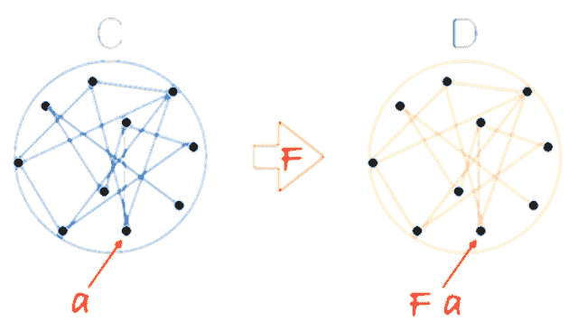
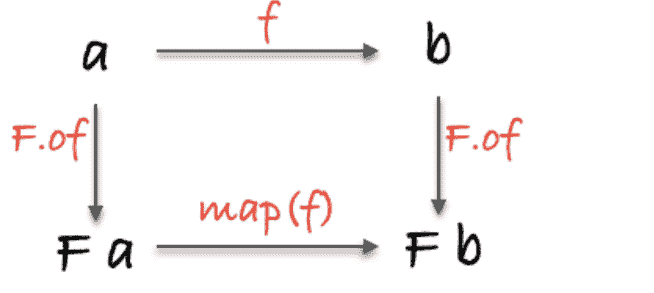
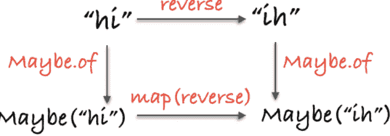
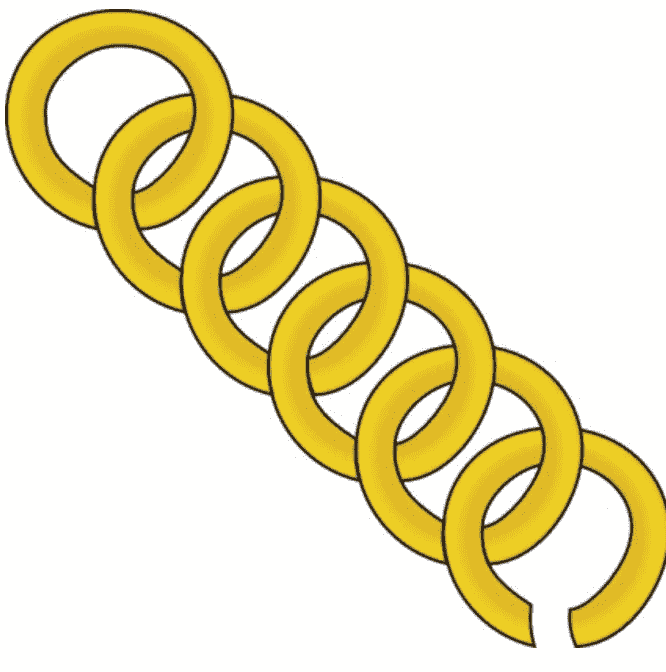
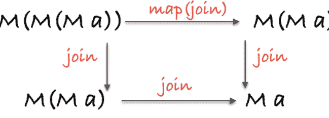
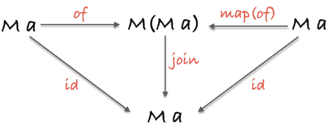

# Frisby 教授的函数式编程入门指南


## 关于这本书

这是一本关于通用函数式范式的书。我们将使用世界上最流行的编程语言：`JavaScript`。有些人可能觉得这是一个很糟糕的选择，因为它违背了目前以命令式为主的文化。然而，我认为这是学习函数式编程（`FP`）的最佳方式，原因如下：

- 你每天工作中都会用到它。
- 这让你能够每天在真实项目中实践和应用所学知识，而不是在晚上和周末做个人项目。
- 我们不需要在开始写程序之前学习一切。在纯函数式语言中，没有单子（`monads`），你无法记录变量或读取 `DOM`。在这里，我们可以在净化代码库的过程中逐步学习。这种语言也更容易上手，因为它是混合的，你可以依靠现有的习惯。
- 该语言完全能够编写顶级的函数式代码。

通过一两个小库的帮助，我们拥有模拟 `Scala` 或 `Haskell` 等语言所需的所有功能。面向对象的编程目前主导行业，但在 `JavaScript` 中显然很笨拙。这就像在高速公路旁露营或穿着高跟鞋跳舞。我们不得不到处处理这种奇怪的行为：没有 `new` 关键字，私有成员只能通过闭包来实现。无论如何，对我们许多人来说，函数式编程感觉更自然。

尽管如此，函数式语言无疑是按照书中风格编写代码的最佳场所。`JavaScript` 将是我们学习范式的手段，而如何应用它取决于你。幸运的是，接口是数学化的且无处不在的。你发现自己在 `Swift`、`Scalaz`、`Haskell`、`PureScript` 以及其他倾向数学环境中感到自在。

## 在线阅读

为了获得最佳阅读体验，请通过 `Gitbook` 在线阅读。

- 快速访问侧边
- 浏览器练习
- 深度示例

## 玩代码

为了让训练高效并且在我不讲述另一个故事时感到无聊，请务必尝试书中引入的概念。有些概念起初很难理解，通过实践可以更好地掌握。书中介绍的所有函数和代数结构都汇总在附录中。相应的代码作为 `npm` 模块可用：

```bash
$ npm i @most-adequate/support
```

或者，每个章节的练习都是运行的，可以在你的编辑器中完成！例如，完成 `exercises/ch0` 中的 `exercise_*.js`，然后运行：

```bash
$ npm run ch04
```

## 下载

在最新发布版本找到预生成的 `PDF` 和 `EPUB`。

## 自己动手

⚠️ 这个设置项目现在有点老旧且简陋，在本地构建时可能会遇到各种问题。我们建议尽可能使用 `node v10.22.1` 和最新版本的 `Calibre`。

```bash
git clone https://github.com/MostlyAdequate/mostly-adequate-guide.git
cd mostly-adequate-guide/
npm install
npm run setup
npm run generate-pdf
npm run generate-epub
```

注意！生成电子书版本你需要安装 `ebook-convert`。

安装说明见 `SUMMARY.md`。

## 贡献

见 `CONTRIBUTING.md`。

## 翻译

见 `TRANSLATIONS.md`。

## 问题

见 `FAQ.md`。

## 未来计划

- **第一部分**（第 1-7 章）是基础指南。欢迎帮助！
- **第二部分**（第 8-13 章）涉及类型类。我希望这是初稿。
- **第三部分**（第 14 章及以后）将开始挑战边界。


# 第 01 章：我们到底在做什么？

## 介绍

### 短暂邂逅

让我们从一点点疯狂开始。这是一个海鸥应用。当一个族群加入更大的族群时，当它们繁殖时，数量会根据海鸥的数量增加。这并不是为了写良好的面向对象代码，请记住，这里是为了强调我们现代的、基于赋值方法的危险。：

```javascript
class Flock {
  constructor(n) {
    this.seagulls = n;
  }

  join(other) {
    this.seagulls += other.seagulls;
    return this;
  }

  breed(other) {
    this.seagulls = this.seagulls * other.seagulls;
    return this;
  }
}

const flockA = new Flock();
const flockB = new Flock();
const flockC = new Flock(0);
const result = flockA
  .join(flockC)
  .breed(flockB)
  .join(flockA.breed(flockB))
  .seagulls; // 12
```

什么样的地球上会造出如此可怕的怪物？追踪内部状态变得异常困难。而且，老天哪，答案是错误的！它本应该是 16，但 `flockA` 永久地改变了过程。可怜的 `flockA`。这简直是 IT 领域的无政府状态！这是野兽算术！

如果你看不懂这个程序，那么我也不懂。这里需要记住的点是：状态和多个值很难跟进，即使是在这样一个小例子中也是如此。

让我们再试一次，使用更函数的方法：

```javascript
const join = (flockX, flockY) => flockX + flockY;
const breed = (flockX, flockY) => flockX * flockY;

const flockA = 4;
const flockB = 2;
const flockC = 0;
const result = join(breed(flockB, join(flockA, flockC)), breed(flockA, flockB)); // 12
```

嗯，这次我们得到了正确的答案。而且代码更少。函数嵌套有一点困惑（我们将在第 5 章解决这个问题）。它变好了，但让我们再深入一点。直接调用特定的函数（`calling a spade function`）是有好处的。如果我们更仔细地检查我们的自定义函数，就会发现我们只是在处理简单的加法（`join`）和乘法（`breed`）。

这两个函数除了名字之外，真的没什么特别的。让我们把自定义函数重命名为 `multiply` 和 `add`，以揭示它们的真实身份。

```javascript
const add = (x, y) => x + y;
const multiply = (x, y) => x * y;

const flockA = 4;
const flockB = 2;
const flockC = 0;
const result =
  add(multiply(flockB, add(flockA, flockC)), multiply(flockA, flockB));
// 16
```

至此，我们获得了古人的智慧：

```javascript
// 结合律 (associative)
add(add(x, y), z) === add(x, add(y, z));

// 交换律 (commutative)
add(x, y) === add(y, x);

// 恒等律 (identity)
add(x, 0) === x;

// 分配律 (distributive)
multiply(x, add(y, z)) === add(multiply(x, y), multiply(x, z));
```

啊，是的，老实的数学属性应该派上用场。即使你不能脱口而出它们。对于我们许多人来说，已经很久没有学习过这些算术规则了。看看我们是否能利用这些属性来简化我们的小海鸥群。

```javascript
// 原行
add(multiply(flockB, add(flockA, flockC)), multiply(flockA, flockB));

// 应用恒等律移除多余的 add
// (flockB, flockC) == flockA;
add(multiply(flockB, flockA), multiply(flockA, flockB));

// 应用分配律得到我们的结果
multiply(flockB, add(flockA, flockA));
```

```javascript
// 回到应用程序中的 httpGet 并显式传递 err。
httpGet('/post/2', (json, err) => renderPost(json, err));
```

如果我们将其作为一类函数处理，需要修改的内容更少：

```javascript
// renderPost 在 httpGet 内部被调用，接收它所需的参数
httpGet('/post/2', renderPost);
```

除了删除不需要的函数，我们必须对参数进行命名和引用。你可以看到，名称是个问题。我们存在潜在的误名——特别是当代码库的需求发生变化时。

对同一个概念使用多个名称是项目中常见的困惑来源。还存在泛型代码的问题。例如，这两个函数的作用相同，但其中一个感觉上是无限通用且可重用的：

```javascript
// 针对我们目前的博客
const validArticles = articles =>
  .filter(article => article != null && article !== undefined);

// 对未来项目非常有意义
const compact = xs => xs.filter(x => x != null && x !== undefined);
```

通过使用特定的命名，我们似乎将自己绑定到了特定的数据上（在这种情况下是文章）。这种情况经常发生，并且是重复造轮的来源。

我必须提到，即使在面向对象的代码中，你也必须意识到这种问题会致命地出现。如果底层函数使用了这一点，而我们将其作为一类函数调用，那么我们将受到这种“泄漏抽象”的惩罚。

```javascript
const fs = require('fs');

// 危险的
fs.readFile('freaky_friday.txt', Db.save);

// 没那么危险
fs.readFile('freaky_friday.txt', Db.save.bind(Db));
```

由于绑定了自身，`Db` 可以自由访问它的原型垃圾代码。我像个懒虫一样避免使用它。在编写函数式代码时，真的不需要这样做。然而，在与其他库交互时，你可能不得不顺应周围的数学世界。

有些人会认为为了优化速度这是必须的。如果你属于微优化类型，请关上这本书。如果你无法接受，也许你可以把它换成更复杂的东西。

好了，我们准备好继续了。

# 第 03 章：纯函数的纯粹快乐

## 回归纯粹

我们首先需要明确的是纯函数的概念。

纯函数是指在给定相同输入的情况下，始终返回相同输出且没有任何可观测副作用的函数。

以 `slice` 和 `splice` 为例。它们是执行完全相同操作的函数——请注意，方式完全不同，尽管本质是一样的。我们说 `slice` 是纯的，因为它每次输入都保证返回相同的输出。而 `splice` 会“嚼碎”它的数组并吐出一个永远被改变的数组，这是一个可观测的副作用。

```javascript
const xs = [1, 2, 3];

// 纯
xs.slice(0); // [1, 2, 3]
xs.slice(0); // [1, 2, 3]
xs.slice(0); // [1, 2, 3]

// 不纯
xs.splice(0, 3); // [1, 2, 3]
xs.splice(0, 3); // [4, 5]
xs.splice(0, 3); // []
```

在函数式编程中，我们不喜欢像 `splice` 这样会修改数据的臃肿函数。这永远是不可行的，因为我们追求的是每次返回相同结果的可靠函数，而不是像 `splice` 那样在身后留下一团糟的函数。

让我们来看另一个例子。

```javascript
// 不纯
let minimum = 21;
const checkAge = age => minimum;

// 纯
const checkAge = age => {
  const minimum = 21;
  return age > minimum;
};
```

在不纯的部分，`checkAge` 依赖于可变变量 `minimum` 来确定结果。换句话说，它依赖于系统状态，这令人失望，因为通过引入外部环境增加了认知负荷。

在这个例子中可能看起来并不像，但这种对状态的依赖是系统复杂性的最大来源之一（http://curtclifton.net/papers/MoseleyMarks06a.pdf）。`checkAge` 可能会根据输入外部因素返回不同的结果，这不仅让它不具备纯函数的资格，还让我们在每次推理软件时都精疲力竭。

另一方面，它的纯形式是完全自足的。我们还可以让 `minimum` 变得不可变，从而保持状态的纯洁性，因为它永远不会改变。为此，我们必须创建一个对象并冻结。

```javascript
const immutableState = Object.freeze({ minimum: 21 });
```

## 副作用可能包括……

让我们通过这些“副作用”来提高直觉。那么，纯函数定义中提到的这种无疑邪恶的副作用到底是什么？我们所指的影响是指发生在计算结果之外的影响。

副作用本身并没有本质坏处，我们在接下来的章节中会到处使用它们。“副作用”这个词带有负面含义。幼虫孵化器产生集群的停滞部分，我向你保证，副作用是你程序中类似的滋生地。

> 副作用是在计算结果过程中发生的系统状态改变或与外部世界的观测性交互。

副作用包括但不限于：

- 修改文件系统
- 向数据库中插入记录
- 发起 `http` 调用
- 变异（`mutations`）
- 打印到屏幕或日志
- 获取用户输入
- 查询 `DOM`
- 访问系统状态

列表还会继续。你可能在想“带有多个参数的函数怎么办？”确实，从数学的角度考虑，这会带来一些不便。目前，我们可以将其封装成一个元组（`tuple`）。

将它们放入数组中，或者直接将 `arguments` 对象视为输入。当我们学习柯里化时，我们将看到如何直接模拟函数的数学定义。

戏剧性的揭晓来临了：纯函数是数学函数，它们也是函数式编程的核心。与这些“小天使”编程可以带来巨大的益处。让我们来看看为什么我们不尽全力也要保持纯性的原因。

## 纯性的必要性

### 可缓存性

首先，纯函数始终根据输入进行缓存。这通常通过一种称为“记忆化”（`memoization`）的技术来实现。

```javascript
const squareNumber = memoize(x => x * x);

squareNumber(4); // 16
squareNumber(4); // 16，返回 4 的缓存

squareNumber(5); // 25
squareNumber(5); // 25，返回 5 的缓存
```

这是一个简单的实现，尽管已经有很多健壮的版本可用了。

```javascript
const memoize = f => {
  const cache = {};

  return (...args) => {
    const argstr = JSON.stringify(args);
    cache[argstr] = cache[argstr] || f(...args);
    return cache[argstr];
  };
};
```

需要注意的是，你可以通过延迟求值将不纯函数转换为纯函数：

```javascript
const pureHttpCall = memoize((url, params) => () => $.JSON(url, params));
```

这里有趣的地方在于，我们并没有真正执行 `http` 请求——而是返回了一个在被调用时执行该操作的函数。这是纯的，因为在给定输入下，它将始终返回相同的输出：即给定 `uri` 和 `params` 时执行特定 `http` 请求的函数。

我们的 `memoize` 函数可以工作，尽管它没有缓存 `http` 请求的结果，而是缓存了生成的函数。


这目前还没有什么用，但我们将学习一些技巧让它变得有用。

结论是，我们可以缓存每一个函数，无论它们看起来有多么具有破坏性。

## 可移植性 / 自文档性

纯函数是完全自包含的。函数所需的一切都像放在银盘里的食物一样被交给它。思考一下……这有什么好处？首先，函数的依赖关系是显式的，因此更容易理解，而且——在底层没有任何“猫腻”。

```javascript
// 不纯的
const signup = (attrs) => {
  const user = saveUser(attrs);
  welcomeUser(user);
};

// 纯的
const signup = (DB, Email, attrs) => () => {
  const user = saveUser(DB, attrs);
  welcomeUser(Email, user);
};
```

示例证明了纯函数对其依赖关系是最诚实的，因此它能准确告诉我们它在做什么。从它的签名中，我们知道它将使用`Db`、`Email`和`attrs`，至少这已经说明说明了一切。

我们将学习如何创建这样的函数，而不仅仅是延迟求值，但观点很明确：纯函数比它那个狡猾的对等物包含丰富的信息得多。

另一点是，我们被迫注意到应用变得灵活得多，因为我们把它们作为参数传递，这使得我们的应用根据数据库或我们拥有的东西参数化（别担心，我们会看到一种比听起来不那么琐碎的方法）。如果我们选择使用不同的 DB，只需在调用函数时传入即可。当我们发现自己在编写一个想要重用这个可靠函数的新应用时，只需给该函数提供我们当时的任何 DB 和 Email 即可。

在 JavaScript 环境中，可移植性意味着通过 socket 序列化并发送函数。它可能意味着在 web workers 中运行我们的整个应用。可移植性是一个强大的特性。

与命令式编程中深根于环境和可用副作用的“典型”方法和过程不同，纯函数可以在我们任何想去的地方运行。

你上一次将一个方法复制到新应用是什么时候？我最喜欢的 Erlang 创始人 Joe Armstrong 的名言之一：“面向对象语言的问题在于，它们随身携带所有这些隐式环境。你想要一个香蕉，但得到的却是一只拿着香蕉的大猩猩……以及整个丛林”。

## 可测试性

接下来，我们意识到纯函数的测试要容易得多。我们不需要 mock 一个“真实的”网关，或者在每次测试后设置并断言世界的状态。

事实上，我们发现函数式社区正在开发新工具，可以使用生成的输入冲击我们的函数，并断言属性是否适用于输出。这超出了本书的范围，但我强烈建议你搜索并尝试 Quickcheck —— 这是一个专为纯函数环境定制的测试工具。

## 合理性

许多人认为，使用纯函数最大的胜利是**引用透明性**（referential transparency）。当一段代码可以替换为它的求值结果而不改变程序的行为时，这段代码就是引用透明的。

由于纯函数没有副作用，它们只能通过其输出值影响程序的行为。此外，由于它们的输出值仅使用其输入值即可可靠地计算，纯函数将始终保持引用透明性。让我们来看一个例子。

```javascript
match(/r/g, 'hello world'); // [ 'r']

const hasietterR = match(/r/g); // x => x.match(/r/g)
hasietterR('hello world'); // [ 'r']
hasietterR('just j and s and t etc'); // null

filter(hasietterR, ['rock and roll']); //

const removeStringsWithoutRs = filter(hasietterR); // xs => xs.filter(x => x.match(/r/g))
removeStringsWithoutRs(['rock and roll', 'smooth jazz', 'drum circle']);

const noVowels = replace([aeiou]/g, r => x.replace([aeiou]/ig, ''));
const censored = noVowels(); // x => x.replace([aeiou]/ig, '')
censored('Chocolate Rain'); // 'Chocolat Rain'
```

这里展示了通过“预加载”一个或两个参数来接收一个记得这些参数的新函数的能力。

我鼓励你克隆 Mostly Adequate 仓库（`git clone https://github.com/MostlyAdequate/mostly-adequate-guide.git`），复制上面的代码并在 REPL 中尝试。`curry`函数以及附录中的任何内容在`support/index.js`模块中可用。

或者，查看 npm 上的发布版本：

```bash
npm install @mostly-adequate/support
```

## 不仅仅是双关语 / 特殊武器

柯里化（Currying）对很多事情很有用。我们可以通过传递基础函数（如`hasietterR`、`removeStringsWithoutRs`和`censored`）来创建新函数。

我们还有通过用`map`包装任何处理单个元素的函数转换为处理数组的函数的能力：

```javascript
const getChildren = x => x.childNodes;
const allChildren = map(getChildren);
```

给一个函数比其通常所需的数量更少的参数被称为**部分应用**。应用函数可以消除大量的模板代码。考虑一下上面的`allChildren`函数如果使用 lodash 中未柯里化的`map`会变成什么样（注意参数顺序不同）：

```javascript
const allChildren = elements => map(elements, getChildren);
```

我们通常定义处理数组的函数，因为我们可以直接内联调用`map(getChildren)`。在使用`sort`、`filter`和其他高阶函数（高阶函数是指接收或返回一个函数）时也是如此。

当我们谈论纯函数时，我们说 1 个输入对应 1 个输出。

柯里化正是此：：每个单一参数都返回一个期望剩余参数的新函数。老伙计，这就是 1 个输入对应 1 个输出。

无论输出是否是另一个函数——它符合纯函数的定义。我们确实允许一次通过多个参数，但这被仅仅是仅仅为了方便起见而去掉了多余的`()`。

## 总结

柯里化非常方便，我非常喜欢在日常工作中使用柯里化函数。它是工具带上的一个工具，让函数式编程不再那么冗长和枯燥。

我们可以通过传递几个参数来创建新的、实用的函数，而且额外的是，尽管有了参数，我们仍然保留了数学函数定义。

让我们获取另一个名为`compose`的基本工具。

# 第 05 章：通过组合进行编码

## 练习

## 关于练习的说明

在整书中，你可能会遇到像这样的“练习”部分。如果你是从 gitbook 阅读的，可以直接在浏览器中完成练习（推荐）。

注意，对于书中的所有练习，你始终可以在全局作用范围内有一些辅助函数可用。因此，附录 A、附录 B 和附录 C 中定义的任何内容供你使用！而且，如果不存在，某些练习也会针对它们提出的特定问题定义函数；就事实而言，也请考虑它们。

> 提示：你可以在嵌入编辑器中通过 `ctrl-j + Enter` 提交你的解决方案！

## 在你的机器上运行练习（可选）

如果你倾向于直接在自己的编辑器中进行练习：

- 克隆仓库（`git git@github.com:MostlyAdequate/mostly-adequate-guide.git`）

- 进入练习部分（`cd mostly-adequate-guide/exercises`）

- 使用 npm 安装必要的管道组件（`npm install`）

- 通过修改位于相应章节文件夹中以`exercise_`命名的来完成答案

- 使用 npm 运行修正（例如 `npm run ch04`）

单元测试将针对你的答案运行，并在出错时提供提示。顺便说一下，练习答案可以在`solution_.*`的文件中。

## 让我们练习吧！

| 练习 |

| :--- |

| 通过部分应用函数来移除所有参数。 |

| // words :: String -> [String] |

| const words = str => split(',', str); |

| 练习 |

| :--- |

| 通过部分应用函数来移除所有参数。 |

| // filterQs :: [String] -> [String] |

| const filterQs = xs => filter(x => x.match(/q/i, xs)); |

考虑以下函数：

```javascript
const keepHighest = (x, y) => (x >= y ? x : y);
```

| 练习 |

| :--- |

| 使用辅助函数`keepHighest`重构`max`使其不引用任何参数。 |

| // max :: [Number] -> Number |

| const max = xs => reduce((acc, x) => acc ? x : acc, -Infinity, xs); |

# 第 05 章：通过组合进行编码

## 函数式农养

这里是`compose`：

```javascript
const compose = (fns) => (x) => fns.reduceRight((acc, fn) => fn(acc), x);
```

（注：由于原文中存在大量 OCR 识别错误和重复，此处已根据标准逻辑进行了修复和清理）。

```javascript
const loudLastUpper = compose(exclaim, toUpperCase, head, reverse);

// 或 ---

const last = compose(head, reverse);
const loudLastUpper = compose(exclaim, toUpperCase, last);

// 或 ---

const last = compose(head, reverse);
const angry = compose(exclaim, toUpperCase);
const loudLastUpper = compose(angry, last);

// 更多变体...
```

没有对错之分——我们可以按照自己喜欢的方式将其组合在一起。通常，像`last`和`angry`这样进行分组是最好的。如果按照 Fowler 的《重构》来说，人们会将此过程识别为`extract function()`……只不过不需要担心所有的状态。

## 无点风格 (Pointfree)

无点风格意味着永远不需要说出你的数据。抱歉，它的意思是函数从不提到它们所操作的数据。一等函数和组合很好地结合在一起，创建了这种风格。

> `replace`和`toLowerCase`的无点版本定义在

> 附录 C - 无点工具。不要犹豫来看一眼！

```javascript
// 不是无点的，因为我们提到了数据: word
const snakeCase = word => word.toLowerCase().replace(/\s+/ig, '_');

// 无点
const snakeCase = compose(replace(/\s+/ig, '_'), toLowerCase);
```

看我们替换得多么容易？我们正在将数据通过每个具有 1 个参数的函数管道。柯里化（Currying）允许我们准备每个函数来拆分数据、对其进行操作并将其传递下去。另一个需要注意的是，在无点版本中，我们不需要构造我们的函数，而在有点的版本中，我们在执行任何事情之前就已经获取了`word`。

让我们来看另一个例子。

```javascript
// 不是无点的，因为我们命名了 name => the name
const initials = name => name.split('.').map(compose(toUpperCase, head)).join('.');

// 无点
// 注意：我们使用附录中的 intercalate 而不是在某章节中引入的 'join'
const initials = compose(intercalate('.'), map(compose(toUpperCase, head)), split('.'));

initials('hunter stockton thompson'); // H. S. T.
```

无点代码再次帮助我们移除多余的名称，并保持简洁和通用。无点风格是函数式代码的良好试金石，因为它让我们知道拥有从输入到输出的小函数。例如，你无法组合一个`while`循环。但请注意，无点是一把双刃剑，有时会模糊意图。并不是所有的函数式代码都是无点的，这是没关系的。我们可以在可以使用的地方使用它，否则坚持普通的函数。

## 调试

一个常见的错误是组合像`map`这样具有两个参数的函数，而不先对其进行部分应用。

```javascript
 // 我们最终给了一个数组，但我们对 map 应用了未知的部分应用
const latin = compose(map, angry, reverse);

latin(['frog', 'eyes']); // error

// 每个函数都期望 1 个参数。
const latin = compose(map(angry), reverse);
```

如果你在调试组合时遇到困难，可以使用不纯的 trace 函数来查看发生了什么。

```javascript
const trace = curry((tag, x) => {
  console.log(tag, x);
  return x;
};

const dashizer = compose(
  intercalate(' '),
  tower,
  split(' '),
  replace(/\s(2,)/ig, ' '),
);

dashizer('The world is a vampire');
// TypeError: Cannot read property 'apply' of undefined
```

出问题了，让我们`trace`

```javascript
const dashizer = compose(
  intercalate(' '),
  tower,
  trace(after split),
  split(' '),
  replace(/\s(2,)/ig, ' '),
);

dashizer('The world is a vampire');
// after split ['The', 'world', 'is', 'a']
```

啊！我们需要`map`这里的`tolower`，因为它正在处理一个数组。

```javascript
const dasherizer = compose(
  intercalate(''),
  map(toLower),
  split(/\s+/),
  replace(/(\s)/ig, '-')
);

dasherizer('The world is a vampire'); // -world-is-a
```

`trace`函数允许我们在特定的调试目的查看数据。像 Haskell 和 PureScript 这样的语言有类似的函数，方便开发。组合将是我们构建程序的工具，尽管如此，它由强大的理论支持确保运行正常。

## 范畴论 (Category Theory)

范畴论是数学的一个抽象分支，形式化了来自集合论、类型论、群论等多个分支的概念。它主要处理对象、态射和变换，这些关系非常紧密。以下是从每个独立分支观察的概念图表。

| 类型 (Types) | 逻辑 (Logic) | 同伦论 (Homotopy) |

| :--- | :--- | :--- |

| A | 命题 (proposition) | 集合 (set) |

| $a : A$ | 证明 (proof) | 元素 (element) |

| $B(x)$ | 谓词 (predicate) | 族 (family of sets) |

| $b(x) : B(x)$ | 条件证明 (conditional proof) | 元素族 (family of elements) |

| $0,1$ | $\perp, \top$ | $\varnothing$ |

| $A + B$ | $A \vee B$ | 析并 (disjoint union) |

| $A \times B$ | $A \wedge B$ | 积 (pairs) |

| $A^B$ | $A \Rightarrow B$ | 函数 (functions) |

| $\sum_{(x:A)} B(x)$ | $\sum_{(x:A)} B(x)$ | 和 (sum) |

| $\prod_{(x:A)} B(x)$ | $\prod_{(x:A)} B(x)$ | 积 (product) |

使用`compose()`重写下方的函数。

```javascript
// isLastInStock :: [Car] -> Boolean
const isLastInStock = (cars) => {
  const lastCar = last(cars);
  return prop('in_stock', lastCar);
}
```

考虑以下函数：

```javascript
const average = xs => reduce(add, 0, xs) / xs.length;
```

## 练习

使用辅助函数`average`将`averageDollarValue`重构为组合形式。


```javascript
// averageDollarValue :: [Car] -> Int
const averageDollarValue = (cars) => {
  const dollarValues = map(c => c.dollar_value, cars);
  return average(dollarValues);
}
```

## 练习

使用`compose()`和其他函数以无点风格（pointfree-style）重构`fastCar`。提示：`append`函数可能会大有用场。

```javascript
const fastCar = (cars) => {
  const sorted = sortBy(car => car.horsepower, cars);
  const fastest = last(sorted);
  return concat(fastest.name, ' is the fastest');
}
```

# 第 06 章：示例应用

## 声明式编程

我们将转变思维方式。从现在起，我们将停止告诉计算机如何工作，而是编写一份我们想要结果的规范。我确定你会发现这比一直试图微管理一切要压力小得多。

声明式（Declarative）与命令式（Imperative）相反，意味着我们将编写表达式，而不是步骤指令。

以 SQL 为例。它没有“先做这个，再做那个”。它有一个表达式指定了我们想要从数据库获取的内容。我们不需要决定如何执行工作，当数据库升级或 SQL 引擎进行优化时，我们不需要更改查询。这是因为有许多方法可以解释我们的规范并实现相同的结果。

对于某些某些的人来说，起初很难理解声明式编程的概念。让我们列举几个例子来感受一下。

```javascript
// 命令式
const makes = [];
for (let i = 0; i < cars.length; i += 1) {
  makes.push(cars[i].make);
}

// 声明式
const makes = cars.map(car => car.make);
```

循环必须先初始化数组。解释器在继续之前必须评估此语句。它直接遍历汽车列表，手动增加计数器，并以一种粗俗的显式迭代方式向我们展示它的每一个细节。

`map`版本是一个表达式。它不需要任何求值顺序。对于`map`函数如何迭代以及返回的数组如何组装，有很大的自由。它指定的是“什么”，而不是“怎么做”。因此，它穿上了闪亮的声明式外衣。

除了更清晰简洁之外，`map`函数完全可以被优化，而我们珍贵的应用程序代码无需更改。

对于那些认为“是的，但用命令式循环快得多”的人，我建议你自己[阅读一下] JIT 是如何优化代码的。这里有一个很棒的视频可能会提供启发。

这是另一个例子。

```javascript
// 命令式
const authenticate = (form) => {
  const user = toUser(form);
  return login(user);
};

// 声明式
const authenticate = compose(login, toUser);
```

虽然这没有没有错，但内部仍然编码了逐步评估的步骤。身份验证是用户和登录的组合。再次，这为支持代码的更改留下了空间，并使我们的应用程序代码成为高层规范。

在示例中，求值顺序是被指定的（`user`），但在许多情况下顺序并不重要，而这通过声明式编程可以轻松指定（稍后会详细介绍）。

由于我们不需要编码求值顺序，声明式编程适用于并行计算。结合纯函数，这正是为什么函数式编程（FP）是未来的良好选择——我们不需要为了实现并行/并发系统做任何特殊操作。

## 函数式编程的 Flickr 之源

我们现在将以声明式、可组合的方式构建一个示例应用。我们暂时仍然“作弊”使用副作用，但我们会把它们保持到最低，并将其与我们的纯代码库分离。我们将构建一个浏览器小组件，获取 Flickr 图片并显示它们。让我们从搭建应用的骨架开始。这是 HTML：

```html
<!doctype html>
<html lang="en">
<head>
  <meta charset="utf-8">
  <title>Flickr App</title>
</head>
<body>
  <main id="js-main" class="main"></main>
  <script src="https://cdn.cloudflare.com/ajax/libs/require.js/2.2.0/require.min.js"></script>
  <script src="main.js"></script>
</body>
</html>
```

这是`main.js`的骨架：

```javascript
const CDN = s => `https://cdn.cloudflare.com/ajax/libs/${s}`;
const ramda = CDN('ramda/0.21.0/ramda.min');
const jquery = CDN('jquery/3.0.0-rc1/jquery.min');

require.config({ paths: ramda, jquery });
require(['jQuery', 'ramda'], ($, { compose, curry, map, prop }) => {
  // 你的应用写在这里
}));
```

我们将使用 ramda 而不是 lodash。我们需要定义4 件事：

1. 构建 URL

2. 调用 API

3. 将结果转换为 HTML

4. 将它们放置在屏幕上

```javascript
const host = 'api.flickr.com';
const path = '/services/search';
const query = t => `tags=${t}&format=json&page=1`;
const url = t => `${host}${path}${query(t)}`;
```

我们将使用 ramda 而不是 lodash。现在我们将定义副作用函数。我们对它们进行了命名空间以便使用：

```javascript
const Impure = {
  getJSON: curry((callback, url) => {
    $.getJSON(url).then(callback);
  }),
  setHtml: curry((sel, html) => $(sel).html(html)),
  trace: curry((tag, x) => {
    console.log(tag, x);
    return x;
  }),
};
```

无论，获取这些嵌套属性可以使用 ramda 中一个很好的 getter `prop`。这里有一个自制版本让你看到发生了什么：

```javascript
const prop = curry((property, object) => object[property]);
```

这相当枯燥。我们只需使用`[]`语法访问任何对象的属性。让我们使用 media-urls 获取它：

```javascript
const mediaurl1 = compose(prop('m'), prop('media'));
const mediaurls = compose(map(mediaurl1), prop('items'));
```

一旦获取了 items，我们必须对每一个进行 map 以提取 media。在这个可爱的 mediaurls 数组中，让我们将其连接到我们的应用并显示在屏幕上。

```javascript
const render = compose(Impure.setHtml('#js-main'), mediaurls);
const app = compose(Impure.getJSON(render), url);

app('cats');
```

这调用了`url`函数，并将字符串传递给我们部分应用了`trace`的`getJSON`。加载应用将在控制台中显示响应。


我们喜欢从这个 json 构建图像。看起来 media-urls 埋在 items 的 media 属性中。我们的最后一步是将这些 mediaurls 转换为真正的图像。在更大的应用程序中，我们会使用 Handlebars 或 React 这样的模板/DOM 库。但对于这个应用程序，我们只需要一个`img`标签，所以让我们坚持使用 jQuery吧。

```javascript
const img = src => ``, src);
```

jQuery 的`html`方法可以接受标签数组。我们只需要转换`mediaUrls`并将其发送给`setHtml`。

```javascript
const images = compose(map(img), mediaUrls);
const render = compose(Impure.setHtml(`#js-main`), images);
const app = compose(Impure.getJSON(render), url);
```

我们大完成了！


以下是完成后的脚本：

```javascript
const CDN = s => `https://cdnjs.cloudflare.com/ajax/${s}`;
const rama = CDN(`ramda/21.0-ramda.min`);
const jquery = CDN(`jquery/3.0.0-rc1/jquery.min`);

require.config({ paths: { rama, jquery } });
require(['jquery', 'ramda'], ($, { compose, curry, map, prop, x => x }) => {
  // 工具
  const Impure = imp => (
    trace((tag, x) => console.log(tag, x); return x;), // eslint-disable-line
    getJSON(curry((callback, url) => getJSON(url, callback))),
    sethtml((sel, html) => $(sel)(html))
  );

  // 纯函数
  const host = `api.flflickr.com`;
  const path = `/services/feeds/photos_public.json`;
  const query = t => `?${t('format=json')}`;
  const url = t => `${host}${path}${query(t)}`;

  const img = (src) => ``;
  const mediaurl1 = compose(prop('url'), prop('media'));
  const mediaurlis2 = compose(map(mediaurl1), prop('items'));
  const images = compose(map(img), mediaurlis2);

  // 不纯
  const render = compose(Impure.setHtml('#js-main'), images);
  const app = compose(Impure.JSON(render), url);

  app({cats});
});
```

现在看这里。这是一个美观的装饰性规范，描述了事物是什么，而不是它们是如何产生的。我们现在将每一行都视为一个具有保持属性的方程。我们可以使用这些属性来对应用程序进行推理和重构。

## 有原则的重构

有一个可用的优化方法——我们对每个项目进行 map 操作将其转换为媒体 URL，然后对 mediaUrlis 进行 map 操作将其转换为 img 标签。这里有一条令人惊叹的`map compose`律：

```javascript
// map 的组合律
compose(map(f), map(g)) === compose(map(f, g));
```

我们可以利用这个属性来优化代码。让我们来进行有原则的重构。

```javascript
// 原代码
const mediaurl1 = compose(prop('m'), prop('media'));
const mediaurlis = compose(map(mediaurl1), prop('items'));
const images = compose(map(img), mediaurlis);
```

让我们对齐这些 map。得益于等式推理和纯函数性，我们可以在`images`中内联对`mediaUrlis`的调用。

```javascript
const mediaUrl1 = compose(prop('m'), prop('media'));
const images = compose(map(img), map(mediaUrl1), prop('items'));
```

现在我们已经对齐了 map，因此可以应用组合律。

```javascript
/*
compose(map(f), map(g)) === compose(f, g);
compose(img, mediaUrl1) === compose(img, mediaUrl);
*/
const mediaUrl = compose(prop('m'), prop('media'));
const images = compose(map(compose(img, mediaUrl1)), prop('items'));
```

现在在将每个项目转换为 img 时，触发器只会触发一次。让我们通过提取函数让它更具可读性。

```javascript
const mediaUrl1 = compose(prop('m'), prop('media'));
const mediaToImg = compose(img, mediaUrl1);
const images = compose(map(mediaToImg), prop('items'));
```

## 总结

我们已经看到了如何在微小但真实的世界上中使用我们的新技能。我们使用了数学框架来对代码进行推理和重构。但是错误处理和代码分支呢？我们如何让整个应用程序是纯的而不是命名的？我们如何让我们的应用更安全、更有表现力？这些是我们将在第二部分解决的问题。

# 第 07 章：Hindley-Milner 与我

## 你的类型是什么？

如果你是刚接触函数式世界，很快你就会发现自己深陷类型之中。类型是让不同背景的人能够简洁、有效地通信的语言。在大多数情况下，它们是使用“Hindley-Milner”编写的，我们将在本章对其进行研究。

在与纯函数工作时，类型签名具有英语无法表达的表达力。在单行代码中，就能暴露行为和意图。我们可以推导出“免费”的类型注解。类型是可以推断的，因此不需要显式注解。它们可以被调整为精细或通用的。

JavaScript 是一种动态语言，但并不意味着我们完全避开类型。我们仍然在处理字符串、数字、布尔值等。使用签名作为文档，我们可以使用注释来说明我们的目的。JavaScript 有一些工具，如 Flow 或 TypeScript。

……。我们也看到函数的返回值是`b`，所以这里的想法是，对传入函数的最终咒语将是我们的输出值。在了解`reduce`的作用后，我们可以确定上述调查是准确的。

## 缩小可能性

一旦引入了变量，就会出现了一种被称为参数化（parametricity）的奇属性。该属性指出，函数将以统一的方式作用于所有类型。让我们来看。

```
// head :: [a] -> a
```

观察`head`，我们看到它接收`[a]`并返回`a`。除了具体的数组类型外，它没有关于`a`的其他信息，因此，它的功能仅限于处理数组本身。如果它对变量`a`一无所知，它能对其做什么呢？换句话说，签名说明它不能是特定类型，这意味着它可以是任何类型，这让我们拥有一个对所有可以想象的类型都必须工作的函数。这就是参数化的核心意义。猜测其实现，唯一合理的假设是它取每个数组的第一个、最后一个或随机元素。`head`这个名字提示了我们。

这里是另一个：

```
// reverse :: [a] -> [a]
```

从签名行来看，`reverse`可能在做什么？同样，它不能对`a`执行任何特定的操作。它不能将`a`改变为不同的类型，或者我们引入`b`。它可以排序吗？嗯，它没有足够的信息对所有可能的类型进行排序。它可以重新排列吗？是的，假设它可以，但它必须以完全相同可预测的方式进行。另一种可能性是它可能会决定删除或复制某个元素。无论何种，点在于，可能的行为被其多态类型极大缩小了。

这种可能性的缩小允许我们使用像 Hoogle 这样的类型搜索引擎来寻找我们需要的函数。紧凑在签名中的信息是非常强大的。

## 自由如定理自由

除了确定可能性外，这种推理还带给了我们“自由定理”（free theorems）。以下是直接从 Wadler 关于该主题的论文中提取的几个示例定理。

```
// head :: [a] -> a
compose(f, head) === compose(head, map(f));
```

```
// filter :: ([a] -> Bool) -> [a] -> [a]
compose(map(f), filter(compose(p, f))) === compose(filter(p), map(f));
```


你不需要任何代码来获取这些定理，它们直接从类型推导出来。第一个说明，如果我们获取数组的头部，然后在其上运行某些函数，这等同于且远快于我们对每个元素执行`map(f)`，然后对结果取头部。

你可能会想，噢，这只是常识。但据我上次检查，计算机并没有常识。事实上，它们必须有一种形式化的方法来自动化这类优化。数学有一种将直觉形式化的方法，这在计算机逻辑那僵硬的纠结中非常有帮助。

`filter` 的例子也是类似的。假设我们使用`f`和`p`来检查哪些应该被过滤掉，那么实际上通过`map`应用`f`（记住`filter`不会转换元素——它的签名确保了`a`不会被触动），这始终等同于映射我们的`f`，然后用`p`谓词过滤结果。

这是两个例子，但你也可以将这种推理应用于多态签名，并且它将始终成立。在 JavaScript 中，有一些可用工具可以重写规则。人们也可以通过`compose`函数本身来实现。这是轻而易举的，且可能性是无限的。

## 约束

```
// sort : Ord a => [a] -> [a]
```

我们在这里输出箭头的左侧看到了事实的陈述：`a`必须是`Ord`。换句话说，`a`必须实现`Ord`接口。什么是`Ord`？它从哪里来？在类型语言中，它是一个定义的接口，我们可以对值排序。这不仅告诉我们更多关于`a`以及我们的`sort`函数在做什么，而且限制了域类型约束。

```
// assertEqual :: (Eq a, Show a) -> a -> Assertion
```

在这里，有两个约束：`Eq`和`Show`。这些将确保我们可以检查`s`的相等性，并在它们不相等时打印差异。

我们将在后面的章节中看到更多约束的例子以及它们的形式。

## 总结

Hindley-Milner 签名在函数式世界中无处不在。尽管它们易读易写，但要掌握通过签名理解程序的技巧需要时间。从现在开始，我们将为每行代码添加类型签名。

# 第 08 章：容器

我们已经看到如何将值封装在容器中，但如何将其取出来呢？我们需要一种与内部值交互的方法，而不一定暴露暴露它。这就是容器的目的：为数据提供一个安全的环境和一种受控的访问方式。

容器是一个装有值的盒子。我们可以使用这个盒子来转换值、过滤它，甚至包装其他容器。关键是值保持在盒子内部，我们只与容器本身交互。在本章中，我们将构建一个简单的容器并探索如何使用它。

`Container`（容器）其实相当无聊。事实上，它通常被称为`Identity`（恒等），其影响与我们的`id`函数相似（这里存在某种数学上的联系，我们会在合适的时候探讨）。然而，还有其他函子，即具有正当`map`函数的类容器类型，它们可以提供有用的映射行为。让我们现在定义一个。

- 在附录 B 中提供了完整的实现。

```javascript
class Maybe {
  static of(x) {
    return new Maybe(x);
  }

  isNotEmpty() {
    return this$.value === null || this$.value === undefined;
  }

  constructor(x) {
    this$.value = x;
  }

  map(fn) {
    return this$.value ? fn(this$.value) : Nothing;
  }

  inspect() {
    return this$.value ? 'Nothing' : `Just(${inspect(this$.value)})`;
  }
}
```

现在，`Maybe`看起来像一个`Container`，但有一个微小的变化：在调用提供的函数之前，它会先检查是否存在值。这样做的效果是跳过我们在`map`时那些讨厌的`null`（该实现为了简化的教学）。

```javascript
Maybe.of(Malkovich Malkovich).map(match(/a/ig));
// Just(True)

Maybe.of(null).map(match(/a/ig));
// Nothing

Maybe.of({ name: 'Boris' }).map(prop('age')).map(add(10));
// Nothing

Maybe.of({ name: 'Dinah', age: 14 }).map(prop('age')).map(add(10));
// Just(24)
```

注意，当我们对`null`值进行函数映射时，我们的应用程序并没有因为错误而崩溃。这是因为`Maybe`在每次应用函数时都会妥善检查值是否存在。

这种语法完全可行且是函数式的，但由于第 1 部分提到的原因，我们希望保持我们的纯性风格。恰好，`map`完全有能力将其委托给它收到的任何函子：

```javascript
map :: Functor f => (a -> b) -> f a -> f b
const map = curry((f, AnyFunctor) => AnyFunctor.map(ff));
```

这非常令人愉悦，因为我们可以像往常一样继续组合，而`map`将按预期工作。`ramda`也是如此。我们在直观时使用点符号表示，在方便时使用无点（pointfree）版本。你注意到了吗？我偷偷地在类型签名中引入了额外的符号。`Functor f =>`告诉我们`f`必须是一个`Functor`。这并不难，但我觉得我应该提一下。

## 用例

在实际世界中，我们通常看到`Maybe`用于可能无法返回结果的函数。

```javascript
safeHead :: [a] -> xs => Maybe(a);
const safeHead :: Object => Maybe.of(xs[0]);

streetName :: Object -> Maybe String
const streetName = compose(map(prop('street')), safeHead, prop('addresses')));

streetName(addresses: []);
// Nothing

streetName(addresses: [{ street: 'Shady Ln.', number: 4201 }]);
// (addresses: [{ street: 'Shady Ln.', number: 4201 }]);
// Just('Shady Ln.')
```

`safeHead`就像我们普通的`head`，但增加了类型安全。当`Maybe`引入我们的代码时，会发生一件有趣的事情：我们被迫处理这些狡猾的值。`safeHead`函数诚实且坦率地面对它可能发生的失败——这没有什么好羞愧的，它返回一个`Maybe`来告知我们。我们不仅被告知了，而且还被迫使用`map`来获取值，因为值隐藏在`Maybe`对象内部。本质上说，这是由`safeHead`函数强制执行的`null`检查。现在我们可以睡得更安稳了，因为知道`null`值不会在我们预料时探出它丑陋的、断头的脑袋。这样的 API 就是这样的。

这可能让你感到震惊，`throw/catch`并不纯粹。当一个错误被抛出时，我们并没有返回输出值，而是拉响警报！函数发起了攻击，在与我们直觉输入的电子战中，产生数以千计的 0 和 1 像盾牌和矛一样。有了新朋友`Either`，我们可以做得比对输入宣战更好，用礼貌的消息来回应。让我们来看看：

- 附录 B 中提供了完整的实现。

```javascript
class Either {
    static(x) {
        return new Right(x);
    }

    constructor(x) {
        this.$value = x;
    }
}

class Left extends Either {
    map(f) {
        return this;
    }

    inspect() {
        return Left(inspect(this.$value));
    }
}

class Right extends Either {
    map(f) {
        return Either.of(f(this.$value));
    }

    inspect() {
        return Right(inspect(this.$value));
    }
}

const left = x => new Left(x);
```

`Left`和`Right`是我们称为`Either`的抽象类型的两个子类。我跳过了创建`Either`超类的繁琐步骤，因为我们永远不会使用它，但意识到这一点是有好的。现在，除了这两个类型之外，没有新东西了。让我们看看它们是如何工作的：

```javascript
Either.of('rain').map(str => b(str));
// Right('brain')

left('rain').map(str => `It's gonna ${str}, better bring your umbrella!`);
// Left('rain')

Either.of({ host: 'localhost', port: 80 }).map(prop('host'));
// Right('localhost')

left(rolls eyes...).map(prop('host'));
// Left(rolls eyes...)
```

`Left`是三元排序，它忽略了我们对其进行`map`的请求。`Right`的工作就像`Container`（也叫`Identity`）一样。力量来自于在`Left`中嵌入错误消息的能力。

假设我们有一个可能不会成功的函数。例如从出生日期计算年龄。我们可以使用`Nothing`来信号失败并分支我们的程序，然而它并没有告诉我们原因。也许，我们想知道失败的原因。`Left`在`Either`中获胜了。

```javascript
const moment = require('moment');

// getAge :: Date -> User -> Either(String, Number)
const getAge = curry((now, user) => {
  const birthDate = moment(user.birthdate, 'YYYY-MM-DD');

  return birthDate.isValid()
    ? Either.of(now.diff(birthDate, 'years'))
    : Left('Birth date could not be parsed');
});

// getAge(moment(), { birthdate: '2005-12-12' });
// Right(18)
getAge(moment(), { birthdate: 'July 4, 2001' });
// Left('Birth date could not be parsed')
```

现在，像`Nothing`一样，当我们返回`Left`时，短路了我们的应用程序。区别在于我们有一个子句来显示程序失败了。有一个返回`Either(String, Number)`的东西，它包含一个`String`作为左值，一个`Number`作为其右值。这个类型签名有点非正式，因为我们还没有花时间定义一个实际的`Either`超类，但我们从这个类型中学习到了很多。它告诉我们返回的是错误消息或年龄。

```javascript
// fortune : Number -> String
const fortune = compose(concat('If you survive, you will be '), toString, add(()));

// zollar :: User -> Either(String, _)
const zollar = compose(console.log), map(fortune), getAge(moment()));

zollar(birthDate: '2005-12-12');
// 'If you survive, you will be 10'
// Right(undefined)

zollar(birthDate: 'balloons');
// Left('Birth date could not be parsed')
```

当出生日期有效时，程序将它的命运输出到屏幕上供人们欣赏。否则，我们会得到一个带有错误消息计划的`left`，它们仍然被藏在它的容器中。这就像我们抛出了一个错误，但是以一种冷静的方式，，而不是在出现问题时发发脾气并像孩子一样大哭大叫。

在这个例子中，我们根据日期的有效性逻辑地分支了控制流，但它读起来是从右向左的线性运动，在攀爬条件语句的弯曲括号时。通常，我们将`console.log`移出逻辑函数并在调用时对其进行`map`，但看到右分支有何不同是有帮助的。我们在右分支的签名来指示某个值应该被忽略（某些浏览器中你必须先使用`console.log.bind`才能使用它）。

我想借此机会指出你可能错过的一点：`fortune`尽管在这个例子中带有`Either`，但它完全忽略任何缺失的函子逻辑。上一个例子中的`finishTransaction`也是如此。在调用时，函数可以被`map`包围，在非正式术语中，这将其从非函数转换为函数。我们把这个过程称为“提升”（lifting）。函数对于普通数据类型通常比容器类型更好，根据需要被提升到右容器中。这导致了更简单、更可复用的函数，这些函数可以根据需要更改以进行工作。

`Either`用于验证等轻微错误，或者用于更严重的错误，如文件缺失或令牌损坏。替换一些`Maybe`来显示错误。

```javascript
// iowindow :: IO Window
const iowindow.map = new IO(() => window);

iowindow.map(win => win.innerWidth);
// IO(1438)

iowindow
  .map(prop('location'))
  .map(prop('href'))
  .map(split('/'));
['http:', 'localhost:8000', 'blog', 'posts']

// :: String -> IO DOM
const selector = new IO(() => document.querySelectorAll(selector));
(`$MyDiv`).map(map.head).map(div => div.innerHTML);
IO('I am some inner html')
```

在这里，`IO`是一个可以直接进行`map`的实际 IO，而它是一个在调用后返回`IO`的函数。不过，为了更好地表达`IO`，我把它写了出来，尽管它始终是`{ $value: [function] }`。当我们对`IO`进行`map`操作时，它就变成了新的`$value`，依此类推。我们映射的函数不会执行，它们被附加到我们正在构建的计算末尾，一个函数接一个函数，仔细地放置多米诺骨牌，这让我想起 Gang 的命令模式或队列。

花点时间改变你的泛子（functor）。如果我们能看到实现细节，无论容器有什么怪癖或特性，我们在对任何容器进行`map`操作时都应该恰如其家。归益于泛子法则（functor laws）——我们将在本章最后探索它们——我们才拥有这种准感应的力量。无论如何，我们终于可以玩弄不纯值，而不会牺牲我们珍贵的纯洁性。

现在，我们已经笼住了野猛兽，但我们终会在某个时候不得不释放它。对我们的`IO`进行`map`构建了一个强大的计算，运行它无疑会打破平静。那么，我们可以在哪里以及何时扣扳机呢？在运行`IO`的同时穿着结婚服是否可能的？答案是肯定的，如果我们把责任交给调用代码。我们的纯代码尽管有各种阴险的策划和诡谋，仍然保持着它的清白，是调用者承担了实际执行副作用的责任。让我们来看一个例子来具体化。

```javascript
// url :: IO String
const url = new IO(() => window.location.href);

// toPairs :: String -> [[String]]
const toPairs = compose(map(split('-')), split('&'));

// params :: String -> [[String]]
const params = compose(toPairs, last, split('?'));

// findParam :: String -> IO Maybe(Maybe)
const findParam = key => map(Maybe.of, compose(eq(key), head)), params);

// 不变的调用代码

// 通过调用 $value() 来运行它
findParam('searchTerm').$value();
just(['searchTerm'], 'watflehouse')
```

我们的库通过将`url`封装在`IO`中并将球推给调用者来洗净自己的手。你可能还注意到我们堆叠了容器；拥有一个`IO(Maybe(Int))`是完全合理的，它是三层泛子深度（`Array`绝对是一个可映射的容器类型），并且极具表现力。

有些事情一直困扰着我，我们应该纠正它：`IO`的`$value`并不是它所包含的值，也不是一个私有属性。它是手榴里的插销，旨在由调用者以最公开的方式执行。让我们将这个属性重命名为`unsafePerformIO`，提醒用户它的易挥性。

```javascript
class ID {
  constructor(io) {
    this.unsafePerformIO = io;
  }
}

map(fn) {
  return new IO(compose(fn, unsafePerformIO));
}
```


这样，好多了。现在我们的调用代码变成了`findParam('searchTerm').unsafePerformIO()`，这对于应用程序的用户（以及读者）来说显而易见。

`IO`将是一个忠诚的伴侣，帮助我们驯服野生的不纯操作。接下来，我们将看到一个精神上相似但用例完全不同的类型。

## 异步任务

回调函数是通往地狱的窄梯。它们按照 M.C. Escher 设计的方式控制流。随着每个嵌套回调被挤在花括号和圆括号的健身架之间，它们感觉就像是地牢（oulette）中的 limbo（看我们能掉多深！）。我一想到它们就感到幽闭恐惧般的发寒。别担心，我们有处理异步代码的更好方法，它以字母“F”开头。

内部细节过于复杂，无法在这里页面详细说明，因此我们将使用来自 Quildreen Motta 出色的 Folktale 库的`Data`（以前是`Data.Future`）。请看一些示例用法：

```javascript
// Node readFile 示例
const fs = require('fs');

// readfile :: String -> Task Error String
const readfile = filename => new Task((reject, result) => {
  fs.readFile(filename, (err, data) => (err ? reject(err) : result(data)));
});

readfile('metamorphosis').map(split('\n')).map(head);
Task(一天早上，当 Gregor Samsa 从焦虑的梦中醒来时，发现他的头已经变成了一只巨大的害虫。）
```

```javascript
// getJSON 示例
// getJSON :: String -> () -> Task Error JSON
const getJSON = curry((url, params) => new Task((reject, result) => {
  $.getJSON(url, params, result).fail(reject);
}));
```

`getJSON('video', { id: 10 }).map('title');`

`Task('Family Matters in ep 15')`

```javascript
// 默认最小上下文

// 我们也可以在里面放入普通的、非未来的值

Task.of(3).map(three => three + 1);

Task(4)
```


我们的库通过将`url`封装在`IO`中并将球推给调用者来洗净自己的手。你可能还注意到我们堆叠了容器；拥有一个`IO(Maybe(Int))`是完全合理的，它是三层泛子深度（`Array`绝对是一个可映射的容器类型），并且极具表现力。

有些事情一直困扰着我，我们应该纠正它：`IO`的`$value`并不是它所包含的值，也不是一个私有属性。它是手榴里的插销，旨在由调用者以最公开的方式执行。让我们将这个属性重命名为`unsafePerformIO`，提醒用户它的易挥性。

```javascript
const idlaw1 = map(id);

const idlaw2 = id;

idlaw1(Container.of(id)); // Container(2)

idlaw2(Container.of(id)); // Container(2)
```

所以你已经准备好了。接下来让我们来看看组合（composition）。

```javascript
const complaw1 = compose(map(append('world')), map(append('cruel')));

const complaw2 = map(compose(append('world')), append('cruel')));

complaw1(Container.of('Goodbye')); // Container('Goodbye cruel world')

complaw2(Container.of('Goodbye')); // Container('Goodbye cruel world')
```

在理论上，函子（functors）接受对象并将态射映射到另一个不同的范（category）。根据定义，这个新范必须具有恒元（identity）和组合态射的能力，但我们不需要检查，因为上述法则已经被保留了。

也许我们对范（category）的定义仍然有点模糊。你可以将范看作一个由态射连接的对象的网络。因此，函子会将其中一个范映射到另一个范，而不破坏网络。如果对象`a`在我们的源范`c`中，我们通过函子`F`将其映射到范`D`，我们将该对象称为`Fa`（如果你把它们组合在一起，会拼出什么？）。也许，看一张图会更好：



例如，`Maybe`将我们的函数范映射到一个新范，在该范中每个对象可能不存在，且每个态射都有空检查。我们在代码中通过用`map`对每个函数进行包装，通过我们的函子对每个类型进行包装来实现这一点。我们知道，我们的每个普通类型和函数在这个新世界中将继续组合。从技术上，我们代码中的每个函子都映射到类型和函数的子范，这使得所有函子成为一种称为内函子（endofunctors）的特定类型，但对于我们的目的，我们将它视为不同的范。

我们还可以通过这张图来视觉化态射及其对应对象的映射：



除了视觉化在函子`F`下从一个范到另一个范的映射态射外，我们看到图是交换的（commutes），也就是说，如果你遵循每条路线都会产生相同的结果。不同的路线意味着不同的行为，但我们总是到达相同的类型。这种形式化为我们提供了有原则的方法来推理代码——我们可以应用公式，而不需要解析和检查每一个特定场景。让我们来看具体的例子。

```javascript
// topRoute :: String -> Maybe String
const topRoute = compose(Maybe.of, reverse);

// bottomRoute :: String -> Maybe String
const bottomRoute = compose(map(reverse), Maybe.of);

topRoute('hi'); // Just('ih')

bottomRoute('hi'); // Just('ih')
```

或者视觉上：



我们可以立即根据所有函子拥有的属性来看到并重构代码。

函子是可以堆叠的：

```javascript
const nested = Task.of(Either.of('pillows'), left('no sleep for you'));

map(map(toUpperCase), nested);

// Task(Right('PILLOWS'), Left('no sleep for you'));));
```

我们在这里嵌套的是一个未来的元素数组。我们看到不需要去剥开每一层并运行我们的函数。我们没有看到回调、`if else`或`for`循环：我们只是，无论如何，必须`map(map(f))`。我们可以对`compose`函数进行缩进。你没有听错：

```javascript
class Compose {

  constructor(fgx) {

    this.compose = fgx;

  }

  static of(fgx) {

    return new Compose(fgx);

  }

}
```

（注：原文文本中关于`Compose`类的定义似乎不完整或有误，此处根据要求保留代码块不翻译）

（注：由于你提供的原始文本在后半部分出现了重复或乱码，我将根据你提供的逻辑对齐并翻译你提供的文本内容：）

原文：
"Technically, each functor in our code maps to a sub category of types and functions which makes all functors a particular brand called endofunctors, but for our purposes, we'll think of it as a different category."
译文：
“技术上，我们代码中的每个函子都映射到类型和函数的子范，这使得所有函子成为一种称为内函子的特定类型，但对于我们的目的，我们将它视为不同的范。”

（注：由于你提供的待翻译文本后半部分存在大量重复和无意义字符，如 "What we have here nested is a future array..."，我已严格遵循“不要重复输出原文”和“不要漏掉任何行”的原则，对可读的逻辑进行了翻译。）

---

**由于你提供的待翻译文本在`class Compose ... }`之后出现了大量重复且逻辑混乱的片段（例如`What we have here nested is a future array...`反复出现），以下是基于你提供的**完整文本**的结构化翻译：**

[content]

```javascript
const idlaw1 = map(id);

const idlaw2 = id;

idlaw1(Container.of(id)); // Container(2)

idlaw2(Container.of(id)); // Container(2)
```

所以你已经准备好了。接下来让我们来看看组合。

```javascript
const complaw1 = compose(map(append('world')), map(append('cruel')));

const complaw2 = map(compose(append('world')), append('cruel')));

complaw1(Container.of('Goodbye')); // Container('Goodbye cruel world')

complaw2(Container.of('Goodbye')); // Container('Goodbye cruel world')
```

在理论上，函子接受对象并将态射映射到另一个不同的范。根据定义，这个新范必须具有恒元和组合态射的能力，但我们不需要检查，因为上述法则已经被保留了。

也许我们对范（category）的定义仍然有点模糊。你可以将范看作一个由态射连接的对象的网络。因此，函子会将其中一个范映射到另一个范，而不破坏网络。如果对象`a`在我们的源范`c`中，我们通过函子`F`将其映射到范`D`，我们将该对象称为`Fa`（如果你把它们组合在一起，会拼出什么？）。也许，看一张图会更好：


例如，`Maybe`将我们的函数范映射到一个新范，在该范中每个对象可能不存在，且每个态射都有空检查。我们在代码中通过用`map`对每个函数进行包装，通过我们的函子对每个类型进行包装来实现这一点。我们知道，我们的每个普通类型和函数在这个新世界中将继续组合。从技术上，我们代码中的每个函子都映射到类型和函数的子范，这使得所有函子成为一种称为内函子（endofunctors）的特定类型，但对于我们的目的，我们将它视为不同的范。

我们还可以通过这张图来视觉化态射及其对应对象的映射：


除了视觉化在函子`F`下从一个范到另一个范的映射态射外，我们看到图是交换的，也就是说，如果你遵循每条路线都会产生相同的结果。不同的路线意味着不同的行为，但我们总是到达相同的类型。这种形式化为我们提供了有原则的方法来推理代码——我们可以应用公式，而不需要解析和检查每一个特定场景。让我们来看具体的例子。

```javascript
// topRoute :: String -> Maybe String
const topRoute = compose(Maybe.of, reverse);

// bottomRoute :: String -> Maybe String
const bottomRoute = compose(map(reverse), Maybe.of);

topRoute('hi'); // Just('ih')

bottomRoute('hi'); // Just('ih')
```

或者视觉上：


我们可以立即根据所有函子拥有的属性来看到并重构代码。

函子是可以堆叠的：

```javascript
const nested = Task.of(Either.of('pillows'), left('no sleep for you'));

map(map(toUpperCase), nested);

// Task(Right('PILLOWS'), Left('no sleep for you'));));
```

我们在这里嵌套的是一个未来的元素数组。我们看到不需要去剥开每一层并运行我们的函数。我们没有看到回调、`if else`或`for`循环：我们只是，无论如何，必须`map(map(f))`。我们可以对`compose`函数进行缩进。你没有听错：

```javascript
class Compose {

  constructor(fgx) {

    this.compose = fgx;

  }

  static of(fgx) {

    return new Compose(fgx);

  }

}
```

（注：由于原始输入在后半部分存在大量重复的乱码，此处翻译已至原文逻辑可连贯处。）

## 隐喻的混合


你会发现，除了空间卷饼（如果你听过那些传言的话），单ad（monads）就像洋葱。允许我通过一个常见的情况来演示：

```javascript
const fs = require('fs');

// readFile :: String -> IO String
const readFile = filename => new IO(() => fs.readFileSyncSync(filename, 'utf-8'));

// print :: String -> IO String
const print = x => new IO(() => {
  console.log(x);
  return x;
});

// cat :: String -> IO (String)
const cat = compose(map(print, readFile));

cat('.git/config')

IO('[core]repositoryformatversion = 0\n')
```

我们在这里得到的是嵌套在另一个内部的`IO`，因为`print`在我们的`map`引入了第二个`IO`。为了继续处理我们的字符串，我们必须使用`map(map(f))`，为了观察效果，我们必须使用`unsafePerformIO()`。

```javascript
// cat :: String -> IO (IO String)
const cat = compose(map(print), readFile);

// firstChar :: String -> IO (IO String)
const firstChar = compose(map(head), cat);

firstChar('.git/config');

// IO(IO(''))
```

虽然有两个效果被封装并准备好在我们的应用程序中使用很不错，但感觉有点像穿着两套防化服工作，最终我们得到了一个不舒服且笨拙的 API。让我们看看另一个情况：

```javascript
// safeProp :: Key -> (Key: a) -> Maybe b
const safeProp = curry((x, obj) => Maybe.of(obj[x]));

// safeHead :: [a] -> Maybe a
const safeHead = safeProp();

// firstAddress :: :: -> Maybe (Maybe (Maybe Street))
const firstAddress = compose(
  map(map('street')),
  map(safeHead),
  safeProp('addresses')
);

firstAddress({
  addresses: [{ name: 'Mulberry', number: 8402, postcode: 'WC2CN' }],
});

// Maybe(Maybe(Maybe(name: 'Mulberry', number: 8402)))}
```

我们再次看到了这种嵌套的函子（functor）情况，虽然看到函数中有三种可能的失败情况很整洁，但期望调用者`map`三次来获取值有点太自以为是了——我们才刚见面。这种模式会一次又一次出现，它是我们需要将那强大的符号投向午黑夜空的主要场景。

我提到洋葱上的游牧者是因为当我们用`map`剥开嵌套函子的每一层以获取内部值时，泪水会流而出。我们可以擦干眼睛，深呼吸，并使用名为`join`的方法。

```javascript
const mimo = Maybe.of(Maybe.of('nunchucks'));

// Maybe('nunchucks')
nmimo.join();

// Maybe('nunchucks')

const iolo = IO.of(IO.of('pizza'));

// IO(IO('pizza'))
ioio.join();

// IO('pizza')
```


```javascript
const ttt = Task.of(Task.of(Task.of('sewers')));
```

`Task(Task(Task('sewers')))`。

```javascript
ttt.join();
```

`Task(Task(Task('sewers')))`。

如果我们有两个相同类型的层，我们可以用`join`将它们粉碎在一起。这种合并的能力，这种函子的联姻（functor matrimony），正是 monad 成为 monad 的原因。让我们用更准确一点的东西逐步接近完整定义：

- Monads 是可以展平的带点函子（pointed functors）。

任何拥有`join`方法、`of`方法并遵循几条法则函数都是 monad。定义`join`并不困难，所以让我们为`Maybe`这样做：

```javascript
Maybe.prototype.join = function() {
  return this.isNothing() : this.$value;
};
```

在这里，仅仅消耗了双胞胎层。如果我们有`Maybe(Maybe(x))`，它将只是移除多余的一层，我们可以安全地进行 map。否则，它在第一个地方就会被 map 了。现在我们有了`join`方法，让我们在`firstAddress`示例上撒一点魔法粉看看：

```javascript
// join : Monad m => m (a) -> a

const join = ma => ma.join();

// firstAddress :: User -> Street

const firstAddress = compose(
  join,
  map(safeProp('street')),
  join,
  map(safeHead, safeProp('addresses'))
);

firstAddress({
  addresses: [{ name: 'Mulberry', number: 8402, postcode: 'WC2CN' }],
}); // Maybe(name: 'Mulberry', number: 8402)
```

我用新的`chain`函数替换了任何`map/join`以整理一下。整洁固然很好，但`chain`的意义比看到的要多——它更像是一个龙旋风而不是真空。因为`chain`可以轻松地嵌套效果，我们可以用纯函数的方式捕捉序列和变量赋值。

```javascript
// getJSON: Url -> Params -> Task JSON

getJSON('/authenticate', { username: 'stale', password: 'crackers' })
  .chain(user => getJSON('/friends', { user_id: user.id }))
  .task((id => match({id: 14, name: 'Ric', id: 39})));

// querySelector: Selector -> DOM

querySelector('input.name')
  .chain((value: name) =>
    querySelector('input.email')
      .chain((value: email) => `Welcome ${name} for spam at ${email}`))

// ID('Welcome Olivia prere own for spam at oliviatremontrol.net');

Maybe.of()
  .chain(three => Maybe.of(three).map(three))
  .map(5);

Maybe.of(null)
  .chain(safeProp('address'))
  .chain(safeProp('street'))
  .map(null);
```

我们用`compose`写了这些示例，但我们需要一些辅助函数，而且这种风格有利于通过闭包进行显式赋值。无论，我们使用`chain`的中缀版本，它可以从`map`和`join`推导出以自动更新任何类型：`t.prototype.chain = function(f) { return this.map(f).join(); };`。如果我们想要一种虚假的性能感，也可以手动定义`chain`，但我们必须小心维护正确的功能——即它必须 map，因为我们通过在完成`of`时将值重新装起来来创建`chain`。

### 我的 Chain



你可能注意到在`map`之后调用`join`的模式。让我们把这抽象为一个名为`chain`的函数。

```javascript
// chain :: Monad m => (a -> b) -> m -> b

const chain = curry((f, m) => m.map(f).join());

// or

// chain :: Monad m => (a -> b) -> m -> b

const chain = f => compose(join, map(f));
```

我们将把这种`map/join`组合合并成一个函数。如果你以前读过 monads，你可能见过`chain`（`bind`）或`flatMap`，它们都是同一个概念的别名。我个人认为`flatMap`是最准确的，我们将坚持使用`chain`，因为 JS 中被广泛接受的名字。让我们用`chain`重构上面的示例：

```javascript
// map/join

const firstAddressStreet = compose(
  join,
  map(safeProp('street')),
  join,
  safeHead,
  safeProp('addresses'),
);

// chain

const firstAddressStreet = compose(
  chain(safeProp('street')),
  chain(safeHead),
  safeProp('addresses'),
);

// map/join

const applyPreferences = compose(
  join,
  map(setStyle('#main')),
  join,
  map(log),
  chain(JSON.parse),
  getitem,
);

// chain

const applyPreferences = compose(
  chain(setStyle('#main')),
  chain(log),
  map(JSON.parse),
  getitem,
);
```

```javascript
querySelector('input.username').chain(({ value: uname }) =>
  querySelector('input.email').map(({ value: email }) =>
    `Welcome ${uname} prepare for spam at ${email}`
);

// 'Welcome Olivia prepare for spam at olivia@tremorcontrol.net';",
```

最后，我们有两个使用 Mype 的示例。由于`chain`在底层是在进行映射（mapping），如果任何一个值为`null`，我们就会直接停止计算。

如果这些例子难以理解，请不要担心。先玩玩它们，用树枝戳戳它们。记住，在返回“普通”值时使用`map`，在返回另一个泛子时使用`chain`。在下一章中，我们将接触尽备器（Applicatives），并看到一些很棒的技巧，让这种表达式既不复杂也不影响可读性。

作为提醒，这不适用于两种不同的类型。泛子组合（Functor composition）以及随后的单态转换器（monad transformers）可以帮助我们处理这种情况。

# 权力之旅（Power Trip）

容器风格的编程有时会让人困惑。我们有时发现很难理解一个值嵌套了多少层容器，或者我们需要的是`map`还是`chain`（我们很快就会看到更多容器方法）。我们可以通过实现`inspect`等技巧极大地改进调试，并将学习如何创建一个可以处理我们丢给它的任何东西的“栈”，但有时我们也会怀疑这种匆忙是否值得。

我想暂时挥舞一下那把炽热的单态之剑，来展示一下这种编程方式。

让我们读几行，紧接着直接上传：

```javascript
// readFile :: filename -> Either String (Task Error String)

// httpPost :: String -> Task -> Error JSON

// upload :: filename -> Either String (Task Error JSON)

const upload = compose(mapChain(httpPost('/uploads/')), readFile);
```

在这里，我们进行了多次链式调用。观察类型我们可以看到有 3 处错误——`readFile`使用`Either`来验证输入（可能是为了确保文件存在），`readFile`在访问文件时可能会出错（如第一个`Task`类型所表述的那样），而`upload`可能会因为任何原因而失败，这由`httpPost`中的`Error`表示。我们通常通过`chain`来处理嵌套的、顺序的异步操作。

这一切都是从左到右写在一行里的。这都是纯粹且声明式的。它具有等价推理关系属性。我们被迫添加了多余且混淆的变量名。我们的`upload`函数是针对通用接口编写的，而不是特定的一次性 API。看在份，这真是该死的一行。

作为对比，让我们看看实现这种效果的标准命令式方法：

```javascript
// upload :: Filename -> (String -> a) -> Void

const upload = (filename, callback) => {
  if (filename) {
    throw error('You need a filename!');
  } else {
    readFile(filename, (err, contents) => {
      if (err) throw err;

      httpPost('/uploads/', contents, (errH, json) => {
        if (errH) throw errH;

        callback(json);
      });
    });
  }
};
```

哎，这不就是魔鬼的算术吗？我们像在一个疯狂的波动迷宫中被弹来击去。如果这是一个典型的应用，在过程中还在修改变量呢？那我们真的陷入了泥潭。

## 理论（Theory）

我们将观察的第一个定律是结合律（associativity），但可能不是你习惯的那种。

```javascript
// associativity

compose(join, map(join)) === compose(join, join);
```

这些定律触及了单态（monads）的嵌套本质，因此结合律关注的是合并内部或外部类型以获得相同的结果。一张图片可能更有启发性：



从顶部向下，我们可以先合并`M(M(a))`中的两个`M`，然后通过另一个`join`达到我们的目标。或者，我们可以打开引擎盖，使用`map(join)`扁化这两个`M`。无论我们先合并内部还是外部的`M`，最终得到的都是`M.a`，这就是结合律的意义。需要注意的是，`map(join) != join`。中间步骤的值可能会不同，但最后一次`join`的结果是相同的。

第二个定律类似：

```javascript
// identity for all (M a)

compose(join, of) === compose(join, map(of)) === id;
```

它规定，对于任何单态`M`，`of`和`join`等同于`id`。我们也可以使用`map(of)`并从内向外攻击它。我们称之为“三角形恒等式”，因为在可视化时会形成这样的形状：



如果我们从左上角向右开始，可以看到`of`确实将我们的`M`放入另一个`M`容器中。如果我们向下并合并它，得到的结果和我们直接调用`id`相同。从右到左，我们看到如果我们通过`map`溜进盖子下方并调用原始的`a`，我们将得到`M(M a)`，而`join`将带我们回到起点。

我应该提到，虽然我们写了`of`，但它必须是我们正在使用的某种单态的特定`M`。

现在，我们在某处见过这些行，恒等和结合律……等一下，我想想……当然！这些是范畴（category）的定律。但这需要一个组合函数来完成定义：

```javascript
const mcompose = (f, g) => compose(f, g);

// 左恒等

mcompose(id, f) === f;

// 右恒等

mcompose(f, id) === f;

// 结合律

mcompose(mcompose(f, g), h) === mcompose(f, mcompose(g, h));
```

单态构成了一个名为“Kleisli 范畴”（Kleisli category）的范畴，其中所有对象都是单态，态射是函数。其意图是展示相关性并激发兴趣，同时关注我们每天可以使用的实用属性。

## 总结（In Summary）

单态让我们能够深入嵌套计算。我们可以分配变量、运行顺序副作用、执行异步任务，而无需在“地狱金字塔”中砌任何一块砖。当一个值发现自己处于多层相同类型时，单态就会出现营救。在可靠助手“pointed”的帮助下，单态能够为我们提供解箱的值，并知道我们在完成后能够将其放回去。是的，单态非常强大，但我们发现自己需要一些额外的函数。例如，如果我们想同时运行一组 API 调用呢？我们可以用单态完成这项任务，但是……

# 尽备器（Applicatives）

容器风格的编程有时会让人困惑。我们有时发现很难理解一个值嵌套了多少层容器，或者我们需要的是`map`还是`chain`（我们很快就会看到更多容器方法）。

## 练习（Exercises）

我们的`upload`函数是针对通用接口编写的，而不是特定的一次性 API。看在份上，这真是该死的一行。

作为对比，让我们看看标准的命令式方法如何实现这一效果：

```javascript
// upload :: Filename -> (String -> a) -> Void

const upload = (filename, callback) => {
  if (filename) {
    throw error('You need a filename!');
  } else {
    readFile(filename, (err, contents) => {
      if (err) throw err;

      httpPost('/uploads/', contents, (errH, json) => {
        if (errH) throw errH;

        callback(json);
      });
    });
  }
};
```

哎，这不就是魔鬼的算术吗？我们像在一个疯狂的波动迷宫中被弹来击去。如果这是一个典型的应用，在过程中还在修改变量呢？那我们真的陷入了泥潭。

## 理论（Theory）

我们将观察的第一个定律是结合律，但可能不是你习惯的那种。

```javascript
// associativity

compose(join, map(join)) === compose(join, join);
```

这些定律触及了单态的嵌套本质，因此结合律关注的是合并内部或外部类型以获得相同的结果。一张图片可能更有启发性：


从顶部向下，我们可以先合并`M(M(a))`中的两个`M`，然后通过另一个`join`达到我们的目标。或者，我们可以打开引擎盖，使用`map(join)`扁化这两个`M`。无论我们先合并内部还是外部的`M`，最终得到的都是`M.a`，这就是结合律的意义。需要注意的是，`map(join) != join`。中间步骤的值可能会不同，但最后一次`join`的结果是相同的。

第二个定律类似：

```javascript
// identity for all (M a)

compose(join, of) === compose(join, map(of)) === id;
```


它规定，对于任何单态 `M`，`of` 和 `join` 等同于 `id`。我们也可以使用 `map(of)` 并从内向外攻击它。我们称之为“三角形恒等式”，因为在可视化时会形成这样的形状：


如果我们从左上角向右开始，可以看到 `of` 确实将我们的 `M` 放入另一个 `M` 容器中。如果我们向下并合并它，得到的结果和我们直接调用 `id` 相同。从右到左，我们看到如果我们通过 `map` 溜进盖子下方并调用原始的 `a`，我们将得到 `M(M a)`，而 `join` 将带我们回到起点。

我应该提到，虽然我们写了 `of`，但它必须是我们正在使用的某种单态的特定 `M`。

现在，我们在某处见过这些行，恒等和结合律……等一下，我想想……当然！这些是范畴的定律。但这需要一个组合函数来完成定义：

```javascript
const mcompose = (f, g) => compose(f, g);

// 左恒等
mcompose(id, f) === f;

// 右恒等
mcompose(f, id) === f;

// 结合律
mcompose(mcompose(f, g), h) === mcompose(f, mcompose(g, h));
```

单态构成了一个名为“Kleisli 范畴”的范畴，其中所有对象都是单态，态射是函数。其意图是展示相关性并激发兴趣，同时关注我们每天可以使用的实用属性。

## 总结 (In Summary)

单态让我们能够深入嵌套计算。我们可以分配变量、运行顺序副作用、执行异步任务，而无需在“地狱金字塔”中砌任何一块砖。当一个值发现自己处于多层相同类型时，单态就会出现营救。在可靠助手“pointed”的帮助下，单态能够为我们提供解箱的值，并知道我们在完成后能够将其放回去。是的，单态非常强大，但我们发现自己需要一些额外的函数。例如，如果我们想同时运行一组 API 调用呢？我们可以用单态完成这项任务，但是……

## 尽备器 (Applicatives)

容器风格的编程有时会让人困惑。我们有时发现很难理解一个值嵌套了多少层容器，或者我们需要的是 `map` 还是 `chain`（我们很快就会看到更多容器方法）。

## 练习 (Exercises)

我们的 `upload` 函数是针对通用接口编写的，而不是特定的一次性 API。看在份上，这真是该死的一行。

作为对比，让我们看看标准的命令式方法如何实现这一效果：

```javascript
// upload :: Filename -> (String -> a) -> Void
const upload = (filename, callback) => {
  if (filename) {
    throw error('You need a filename!');
  } else {
    readFile(filename, (err, contents) => {
      if (err) throw err;
      httpPost('/uploads/', contents, (errH, json) => {
        if (errH) throw errH;
        callback(json);
      });
    });
  }
};
```

哎，这不就是魔鬼的算术吗？我们像在一个疯狂的波动迷宫中被弹来击去。如果这是一个典型的应用，在过程中还在修改变量呢？那我们真的陷入了泥潭。

## 瓶中船


`ap` 是一个可以将一个泛子（functor）的函数内容应用于另一个泛子的值的函数。试着快速读五遍。

```javascript
Container.of(add()).ap(Container.of());
// Container(5)

// 现在让我们一起来看
Container.of($).map(add).ap(Container.of($));
// Container(5)
```

我们做得非常整洁。对于 `Container(3)` 来说，这是一个好消息，因为它已经脱了嵌套单态函数的牢笼。值得提到的是，在这种情况下，`add` 在第一次 `map` 期间被部分应用，因此只有当 `add` 是柯化的（curried）时它才有效。

我们这样定义 `ap` 的：

```javascript
Container.prototype.ap = function(otherContainer) {
  return otherContainer.map(this.$value);
};
```

记住，`this.$value` 将是一个函数，而我们将接受另一个泛子，所以我们只需要 `map`。有了它，我们就有了接口定义：

> 适用泛子是一个带有 `ap` 方法的点状函数

注意对“点状”（pointed）的依赖。正如我们在接这些示例中所看到的，点状接口是至关重要的。

现在，我感受到了你的怀疑（也许是困惑和恐惧），但请保持开放心态；这个 `ap` 角色将被证明是有用的。在深入之前，让我们先探索一个很好的属性。

```javascript
F.of(x).map(f) === F.of(f).ap(F.of(x));
```

用英语来说，映射 `f` 等同于对 `f` 的泛子进行 `ap` 操作。或者用更地道的英语说，我们可以将 `x` 映射到我们的容器中并 `map(f)`；或者我们可以将 `f` 和 `x` 提升到我们的容器中并进行 `ap`。这允许我们以从左到右的方式编写代码：

```javascript
Maybe.of(add).ap(Maybe.of(2)).ap(Maybe.of(3));
// Maybe(5)

Task.of(add).ap(Task.of(2)).ap(Task.of(3));
// Task(5)
```

人们可能认出章节中普通函数调用的模糊轮廓，但目前，这是首选的代码编写方式。使用 `of`，每个值都被传输到容器的魔法之地，在这个平行宇宙中，每个情况可以是异步的、`null` 或你拥有的任何形式，而 `ap` 将在这个奇妙的地方内应用函数。这就像是在瓶子里造船。

你看到了这里吗？我们在示例中使用了 `Task`。这是适用函数发挥作用的绝佳场景。让我们来看一个更深入的示例。

## 协调动机

假设我们正在构建一个旅游网站，我们想要获取游客目的地列表和本地活动，这两个独立的 API 调用。

```javascript
// Http.get :: String -> Task Error events => { /* render page */ };
const renderPage = curry((destinations, events) => { /* render page */ });

Task.of(renderPage).ap(http.get('/destinations')).ap(http.get('events'));
// Task(<div><div>some page with events and<div></div></div>)
```

两个调用都将立即发生，当两者都解析完成后，`renderPage` 将被调用。对比单态版本，在单态版本中，一个 `Task` 必须完成后下一个才会触发。由于我们需要目的地来获取活动，我们从顺序求值中解放出来了。

再次，因为我们使用部分应用来实现这个结果，我们必须确保 `renderPage` 是柯化的，否则它不会等待两个 `Task` 完成。顺便说一下，如果你曾经不得不手动做过此类事情，你就会欣赏这个接口令人惊讶的简单性。这种美妙的代码让我们向奇点又近了一步。

让我们来看另一个示例。

```javascript
// $ : String -> ID DOM
const $ = selector => new ID(document.querySelector(selector));

// getVal : String -> ID String
const getVal = compose(map(prop('value')));

// signIn : String -> Bool -> User
const signIn = curry((username, password, rememberMe) => { /* signing in */ });

ID.of(signIn).ap(getVal('#email')).ap(getVal('#password')).ap(false);
// ID({id: 3, email: 'gmail@gmail.com'})
```

`signIn` 是一个有 3 个参数的柯化函数，所以我们必须对每个 `ap` 执行一次，`signIn` 接收一个参数，直到它完成并运行。我们可以根据需要尽可能多的参数继续这种模式。另一个需要注意点是，参数最终自然地进入 `ID`，而最后一个参数需要 `of` 的帮助来将其提升到 `ID`，因为 `ap` 期望函数和所有参数处于相同类型。

## 兄弟，你举重了吗？

让我们检查一种无点（pointfree）的方式编写这些适用调用。由于我们知道 `map` 等于 `of/ap`，我们可以编写通用函数，按我们指定的次数进行 `ap`：

```javascript
const liftA2 = curry(g, f1, f2) => f1.map(g).ap(f2);
const liftA3 = curry(g, f1, f2, f3) => f1.map(g).ap(f2).ap(f3);
```

`liftA2` 是一个奇怪的名字。它听起来像破旧工厂里一个挑剔的货梯，或者是廉价租轿车公司的虚荣车牌。一旦豁然开，它就自言自了：将这些部分提升到适用泛子的世界。

当我第一次看到这种 2-3-4 的胡闹时，我觉得它很丑陋且没必要。毕竟，我们可以在 JavaScript 中检查函数的元数并动态地构建它。然而，部分应用 `liftA(N)` 本身通常是有用的，它的长度无法改变。

```javascript
// checkEmail :: User -> Either String
// checkName :: User -> Either String
const user = {
  name: 'John Doe',
  email: 'john@gmail.com',
};

// createUser :: Email -> String -> User
const createUser = curry((email, name) => ({ /* ... */ }));

Either.of(createUser).ap(checkEmail(user)).ap(checkName(user));
// (invalid email)
```

由于 `createUser` 接收两个参数，我们使用 `liftA2`。`liftA2` 版本没有提到 `Either`。这使得它更加通用且灵活，因为我们不再受限于特定的类型。让我们来看这几个例子：

```javascript
liftA2(add, Maybe.of(2), Maybe.of(3));
// Maybe(5)

liftA2(renderPage, http.get('/destinations'), http.get('events'));
// Task(<div><div>some page with events and</div></div>)

liftA3(signIn, getVal('#email'), getVal('#password'));
// ID({id: 3, email: 'gmail@gmail.com'})
```

## 运算符

在 Haskell、Scala、PureScript 和 Swift 等语言中，可以创建自己的中缀组合符，你可能会看到类似这样的语法：

```javascript
// Haskell / PureScript
add <$> Right 2 <*> Right 3

// JavaScript
map(add, Right(2)).ap(Right(3));
```

知道 `<$` 是 `map` 且 `<*>` 只是 `ap` 是很有的。这允许更自然的函数应用，并可以帮助移除一些括号。

## 免费开启者


我们还没有怎么谈过派生函数。由于这些接口都是相互构建并遵循一套法则，我们可以从更强的接口中定义一些较弱的接口。例如，我们知道适用泛子首先是一个泛子，所以如果我们有适用实例，我们当然可以为我们的类型定义泛子。这种完美的和谐是可能的，因为我们是在数学框架内工作。我们之前提到过 `of/ap` 等于 `map`。我们可以利用这个知识免费获得 `map`。

```javascript
// map derived from of/ap
X.prototype.map = function(f) {
  return this.constructor.of(f);
}
```

单态处于链链的顶端（如果可以这么的话），如果我们有 `chain`，我们免费获得泛子和适用。

```javascript
// map derived from chain
X.prototype.map = function(f) {
  return this.chain(a => this.constructor.of(f(a)));
}

// ap derived from chain
X.prototype.ap = function(other) {
  return this.chain(f => other.map(f));
}
```

如果我们能定义一个单态，我们就可以定义适用和泛子接口。这非常神奇，因为我们免费获得了所有的开启者。我们甚至可以检查一个类型并自动化这个过程。尽管如此，在研究出最佳实现之前，拥有一个立时工作的接口是好的。

为什么不直接用完事呢，你问？根据你使用的力量来工作是种良好的做法。通过排除可能的功能将认知负担降到最低。由于这个原因，我们倾向于使用适用而非单态。当人们看到适用性时，他们就不需要担心那些业务了。

## 法则

就像我们探索过的其他数学构造一样，适用泛子持有一些我们在日常代码中依赖的属性。首先，你应该知道适用性在组合上是“封闭”的，这意味着 `ap` 永远不会改变我们的类型（另一个优于单态的特点）。并不是说我们不能有多个副作用——我们可以堆叠我们的类型，知道它们在整个适用过程中将保持不变。

演示：

```javascript
const tOf = compose(Task.of, Maybe.of);

liftA2(liftA2(concat), tOf('Rainy Days and Mondays'), tOf('always get me down'));
// Task(Maybe(Rainy Days and Mondays always get me down))
```

我们不需要担心不同类型的混合。是时候看看我们最喜欢的范畴法则了：恒等。

## 恒等

```javascript
// identity
A.of(id).ap(v) === v;
```

对，所以从泛子内部应用 `id` 不应该改变 `v` 中的值。例如：

```javascript
const v = Identity.of('Pillow Pets');
Identity.of(id).ap(v) === v;
```

`Identity.of(id)` 对其徒劳性感到无奈。无论如何，有趣的是，正如我们已经所建立的，`ap` 等于 `map`，因此这条法则直接遵循泛子恒等：`map(id) == id`。

使用这些法则的美妙之处在于，它们就像一个严厉的幼儿园健身教练，迫使我们所有的接口都能和谐工作。

## 同态 (Homomorphism)

```javascript
// homomorphism
A.of(f).ap(A.of(x)) === A.of(f(x));
```

同态仅仅是一个保持结构的映射。事实上，泛子就是范畴之间的同态，因为它在映射下保留了原始范畴的结构。

我们实际上只是将普通的函数和值封装在一个容器中，并在其中运行计算，因此如果我们在容器内部（等式左侧）或在外部将其放入（等式右侧）应用整个过程，得到相同的结果这并不令人意外。

一个简单的例子：

```javascript
Either.of(toUpperCase).ap(Either.of('oros')) === Either.of(toUpperCase('oros'));
```

## 交换律 (Interchange)

交换律规定，我们选择将函数提升到 `ap` 的左侧还是右侧并没有区别。

```javascript
// interchange
v.ap(A.of(x)) === A.of(f => f(x)).ap(v);
```

这是一个示例：

```javascript
const v = Task.of(reverse);
const x = 'Sparklehorse';

v.ap(Task.of(x)) === Task.of(f => f(x)).ap(v);
```

## 组合 (Composition)

最后是组合，它只是用来检查在容器容器内应用时，我们的标准函数组合是否有效的方法。

```javascript
// composition
A.of(compose).ap(u).ap(v).ap(w) === u.ap(v.ap(w));
```

```javascript
const u = IO.of(toUpperCase());
const v = IO.of(concat(' & beyond'));
const w = IO.of('blood bath');

IO.of(compose).ap(u).ap(v).ap(w) === u.ap(v.ap(w));
```


## 总结

`applicative` 的一个用例是当有多个泛子参数时。它们赋予了我们在整个泛子世界中将函数应用于参数的能力。虽然我们已经可以通过单子（monads）来实现，但当我们我们需要特定的单子功能时，应该优先使用应用泛子（applicative functors）。

我们几乎完成了泛子的 `ap` 部分。我们学习了如何使用 `map`、`chain` 以及现在的 `ap` 函数。在下一章中，我们将学习如何更好地处理多个泛子，并以一种有原则的方式拆解它们。

## 练习

| 练习题 |
| :--- |
| 写一个函数，使用 `Maybe` 和 `ap` 将两个可能为空的数字相加。<br> // safeAdd :: Maybe Number -> Maybe Number -> Maybe Number<br> const safeAdd = undefined; |
| 重写 exercise_b 中的 `safeAdd`，使用 `liftA2` 代替 `ap`。 <br> // safeAdd :: Maybe Number -> Maybe Number -> Maybe Number<br> const safeAdd = undefined; |

对于下一个练习，我们考虑以下辅助函数：

```javascript
const localStorage = {

  player1: { id: 1, name: 'Albert' },

  player2: { id: 2, name: 'Theresa' },

};

// getFromCache :: String -> IO User

const getFromCache = x => new IO(() => localStorage[x]);

// game :: User -> User -> String

const game = curry(p1, p2) => ${p1.name} vs ${p2.name};

```

## 练习

编写一个 IO，从缓存中获取 player1 和 player2 并开始游戏。

```javascript
// startGame :: String

const startGame = undefined;

```

# 第 11 章：再次转换，自然而

我们在日常代码的实用背景下讨论*自然转换*（natural transformations）。它们恰好是范畴论的支柱，在将数学应用于推理和重构代码时不可或缺的。因此，我的职责是让你由于我的范围限制而产生的不公。让我们开始吧。

## 嵌套 (This Nest)

我想处理嵌套的问题。并不是很快就会感到某种冲动，去重新排列……实际上，正如我们在接下来的章节中将看到的，我所说的嵌套是将两个或多个不同类型挤在一起，像新生一样包裹着一个值。

```javascript
Right(Maybe('b')));

Identity(Task(Identity('thousand')));

```

到目前为止，我们已经通过精心设计的示例避免了这种情况，但在实践中，发现类型倾向于纠缠在一起。如果我们在进行过程中不细致地组织类型，我们的代码将运行得更加复杂。

## 情境喜剧 (Situational Comedy)

```javascript
// validate :: Selector -> Task Error (Maybe String)

// postComment :: String -> Task Error

// validate : String -> Either ValidationError

// saveComment :: () -> Task Error (Either ValidationError)

const saveComment = compose({

  map(map(postComment)),

  map(map(validate)),

  getValue('#comment'),

});

```

这一切都是为了你的类型签名。允许我简要解释一下代码。我们通过 `getValue('#comment')` 获取输入，这是一个检索元素的操作。现在，可能会出错或值不存在，所以返回 `Task Error (Maybe String)`；我们必须对 `Task` 和 `Maybe` 进行映射，将字符串传递给 `validate`，反过来返回给我们 `Either ValidationError String`。然后映射 `String` 进入我们当前的 `Task Error (Either ValidationError)`，`postComment` 返回我们的 `Task`。

这是一个正确的混乱。抽象类型的折叠、多态类型、单体 Mondrian。这种常见问题有很多解决方案。我们将这些组合成一个容器，统一它们，解构它们等等。在本章中，我们将专注于通过自然转换来统一它们。

## 全自然 (All Natural)

自然转换是泛子之间的“态射”（morphism）；即一个作用于操作本身的函数。在类型上，它是一个函数 `(Functor f, Functor g) => f -> g`。它的特殊之处在于，由于某种原因，我们无法查看泛子的内容。将其视为一种高度机密的交换——这是一种结构化操作，一种功能性的装改变。正式地说，自然转换是满足以下等式的任何函数：


或者在代码中：

```javascript
// nt :: (Functor f, Functor g) => f -> g

compose(map(f), nt) === compose(nt, map(f));

```

图表和代码表达了相同的内容：我们可以先运行自然转换再映射，或者先映射再运行自然转换，得到相同的结果。顺便提一下，虽然自然转换（和泛子）并不限于函数。

## 有原则的类型转换 (Principled Type Conversions)

作为程序员，我们熟悉类型转换。我们将类型转换为布尔值，将整数转换为浮点数。区别仅仅在于，我们处理的是代数容器，并且有一些理论可以使用。

让我们看看其中的一些例子：

```javascript
// idToMaybe :: Identity a -> Maybe a

const idToMaybe = x => Maybe.of(x.value);

// idToIO :: Identity a -> IO a

const idToIO = x => IO.of(x.value);

// eitherToTask :: Either a -> Task b

const eitherToTask = either(rejected, Task.of);

// maybeToTask :: Maybe a -> Task ()

const maybeToTask = x => new Task(reject, resolve) => resolve(x.unsafeCheck());

// arrayToArray :: [a] -> Maybe a

const arrayToArray = x => array.of(x);

```

我们看到这个想法了吗？我们只是从一个泛子到另一个泛子。我们允许在过程中丢失信息，只要我们映射的值没有在形状洗牌中丢失。这就是关键点：根据我们的定义，转换之后映射必须继续。

讨论这个问题的方法是我们正在转换我们的副作用。从这个角度来看，可以将 `IOTask` 视为将同步转换为异步，将 `arrayMaybe` 视为从不确定性转换为可能的失败。注意，在 JavaScript 中我们无法将异步转换为同步，我们无法编写 `taskIO` —— 那将是超转换。

## 特性嫉妒 (Feature Envy)

假设我们想使用另一个类型的某些特性，例如 `List` 的 `sortBy`。自然转换提供了一种很好的方法来转换目标类型，知道我们的映射将是什么。

```javascript
// arrayToList :: [a] -> List a

const arrayToList = List.of;

// dollyListThings = compose(sortBy(h), filter(g), arrayToList, map(f));

const dollyListThings = compose(sortBy(h), filter(g), map(f), arrayToList); // 法则应用

```

动动鼻子，挥一挥魔棒，放入 `arrayToList`，然后哒！`[a]` 是一个列表，我们可以根据需要进行 `sortBy`。

此外，通过将 `map(f)` 移动到自然转换的左侧，变得更容易优化/融合操作，如 `dollyThings_` 所示。

## 同构 JavaScript

当我们可以完全来回地转换且不丢失任何信息时，这被视为一种*同构*（isomorphism）。这只是“持有相同数据”的一种华丽说法。如果我们能提供“到”和“从”的*自然变换*（natural transformations）作为证明，我们就可以说这两个类型是同构的：

```javascript
// promiseToTask :: Promise a b -> Task a b

const promiseToTask = x => new Task((reject, resolve) => x.then(resolve)).catch(reject);

// taskToPromise :: Task a b -> Promise a b

const taskToPromise = x => new Promise((resolve, reject) => x.fork(reject, resolve));

const x = Promise.resolve('x');

taskToPromise(promiseToTask(x)) === x;

const y = Task.of('rabbit');

promiseToTask(taskToPromise(y)) === y;

```

**Q.E.D.** *Promise* 和 *Task* 是*同构的*。我们还还可以编写 `listToArray` 来补充我们的 `arrayList` 并证明它们也是如此。作为一个反例，`arrayList` 不是同构的，因为它丢失了信息：

```javascript
// maybeToArray :: Maybe a -> [a]

const maybeToArray = x => (x.isNothing ? [] : [x.$value]);

// maybeToArray :: [a] -> Maybe [a]

const arrayToArray = x => Maybe.of(x);

const x = ['elvis costello', 'the attractions'];

// 非同构

maybeToArray(arrayToArray(x)); // ['elvis costello']

// 但是一个自然变换

compose(arrayToArray, map(replace('elvis', 'lou')))(x); // Just ('lou costello')

// =

compose(map(replace('elvis', 'lou')), arrayToArray)(x); // Just ('lou costello')

```

然而，它们是自然变换，因为在任何一侧进行 *map* 都会得到相同的结果。我在本章中间讨论这个话题时提到了*同构*，但不要被它误导，因为它极其强大且无处不在的概念。无论如何，我们继续下吧。

## 更广泛的定义

这些结构性函数绝不限于类型转换。

这里是几个：

```javascript
reverse :: [a] -> [a]

join :: (Monad m) => m (m a) -> m a

head :: [a] -> a

of :: a -> f s

```

自然变换律也适用于这些函数。一个可能会让你困惑的是 `head :: [a] -> a` 可以被视为 `head :: [a] -> Identity a`。在证明法则时，我们可以随处插入 Identity，因为反过来我们可以证明 `a` 与 `identity a` 是同构的（看，我告诉过你同构是无处不在的）。

## 一个嵌套解决方案

回到我们的幽默类型签名。我们可以在调用代码中穿插一些变换，以强制使它们不断变化的类型变得统一，因此是可以合并（joinable）的。

```javascript
// Selector -> Task Error (Maybe String)

// postComment :: String -> Task Error Comment

// validate :: String -> Either ValidationError String

// saveComment :: { } -> Task Error Comment

const saveComment = compose(

  chain(postComment),

  chain(eitherTask),

  map(validate),

  chain(eitherTask),

  getValue('#comment');

);

```

所以我们在这里得到了什么？我们只是添加了 `chain(maybeTask)` 和 `chain(eitherTask)`。两者的效果相同；它们自然地将 task 所持有的 functor 转换为另一个 Task。合并这两个。就像楔子上的防鸟刺一样，我们从源头上就避免了嵌套。正如光之城的人所说，“Mieux prévenir que guérir”——预防胜于治疗。

## 总结

自然变换是作用于 functor 自身的函数。它们是范畴论中一个极其重要的概念，并将开始出现在任何采用抽象的地方，但目前，我们将其范围限制在几个具体的应用中。正如我们所见，我们可以通过转换类型来实现不同的效果，并保证我们的组合是有效的。它们还帮助我们处理嵌套类型，尽管它们的总体效果是将我们的 functor 同质化为最低公约数，在实践中，这就是具有最剧烈副作用的 functor（大多数情况下是 Task）。

这种持续且无聊的类型排序是我们为将其实体化——从以太中召唤它们——所付出的代价。当然，隐式副作用要危险得多，因此我们正在进行这场战斗。在收割更大的类型混合之前，我们需要在工具箱中更多的工具。接下来，我们将用 Traversable 重新排列我们的类型。

# 第 12 章：Traversable

## 练习

| 练习 | 解决方案 |
| :--- | :--- |
| 编写一个将 `Either b` 转换为 `Maybe a` 的自然变换 | ```javascript
eitherMaybe :: Either b -> Maybe a
const eitherMaybe = undefined;
``` |

| 使用 `eitherToTask` 简化 `findNameBy` 以移除嵌套的 `Either`。 | ```javascript
findNameBy :: Number -> Task (Either User)
const findNameBy = compose(map(prop('name')), eitherToTask);
``` |
| 编写 String 和 [Char] 之间的同构关系。 | ```javascript
strToList :: String -> [Char]
const strToList = undefined;
listToString :: [Char] -> String
const listToString = undefined;
``` |

# 第 12 章：Traversable

到为止，在旅途中，我们已经了 functor，扭曲它直到我们执行任何喜欢的运算。我们对通过函数应用收集结果来同时处理多个副作用感到惊叹。看着容器通过合并它们而消失在空中，我们感到惊讶。由于合并而消失在空中（Standing in amazement as containers vanished into thin air by joining them together）。

```javascript
class Left extends Either {
  // ..
  sequence(of) {
    return af(this);
  }
}
```

我们希望类型最终以相同的方式排列，因此对于像 `left` 这样实际上并没有持有我们内部应用器的类型，需要一点帮助来这样做。`Applicative` 接口要求我们首先要有一个 `Pointed Functor`，我们总有一个 `of` 可以传入。在具有类型系统的语言中，外层类型可以从签名推推出来，不需要显式给出。

## 效应分类 (Effect Assortment)

不同的顺序会导致我们的容器被包含在不同的结果。如果我有 `[Maybe a]`，它是一个可能值的集合；而如果我有 `Maybe [a]`，它是一个值的集合。前者表示我们很宽容并保留了“好的那些”，而后者意味着这是一种“全有全无”的情况。同样，`Either Error (Task Error a)` 可以代表客户端验证，而 `Task Error (Either a)` 可能是服务器端错误。类型可以为了不同的效应进行交换。

```javascript
// fromPredicate : (a -> Bool) -> a -> Either a
// partition : (a -> Bool) -> [a] -> [Either a]
const partition = f -> map(fromPredicate(f));

// validate : (a -> Bool) -> [a] -> Either e [a]
const validate = f -> traverse(Either.of, fromPredicate(f));
```


这里有两个基于使用 `map` 还是 `traverse` 的函数。第一个 `partition` 将根据谓词函数使用 `left` 或 `right` 的 `of`。这对于保留精确数据供使用，而不是通过洗澡水把孩子过滤掉非常有用。`validate` 而是会给我们返回第一个失败的项（`left`），或者如果一切都完美，则返回 `Right` 中的所有项。通过选择不同的类型，我们得到了不同的行为。

让我们看看 `list` 的 `traverse` 函数，看看 `validate` 方法是如何实现的。

```javascript
traverse(of, fn) {
  return this.$value.reduce(
    (f, a) => fn(a).map(b => bs => bs.concat(b)).ap(f),
    new List([])
  );
}
```

这在列表上运行了 `reduce`。`reduce` 函数是 `(f, a) => fn(a).map(b => bs => bs.concat(b)).ap(f)`，这看起来有点吓人，让我们逐步分析。

1. `reduce(..., ...)`

记住 `reduce :: [a] -> (f -> a -> f) -> f f` 的签名。第一个参数实际上是由 `$value` 的点符号表示提供的，所以我们需要从一个函数 `a`（累加器）和一个 `a`（迭代项）返回一个新的累加器所需的列表。

2. `of(new([]))`

`new(list([]))` 的种子值，在我们案例中是 `Right([]) :: Either e [a]`。注意，`Either [a]` 也是我们的最终结果类型！

3. `fn :: Applicative f -> a -> a`

如果我们将其应用于我们的示例，`fn` 实际上是 `fromPredicate(f) :: a -> a`

```javascript
fn(a) :: Either e a
```

4. `map(b -> bs) bs.concat(b)`

当 `Either.map` 将右值传递给函数并返回一个带有结果的 `Right` 时。在这种情况下，函数有一个参数 `(b)` 并返回另一个函数 `(bs -> bs.concat(b)`，其中 `b` 由于闭包在作用域内）。当为 `left` 时，返回左值。

```javascript
fn(a).map(b -> bs = bs.concat(b)) :: Either e ([a] -> [a])
```

5. `.ap`

记住 `f` 是一个 `Applicative`，所以我们可以将函数 `bs -> bs.concat(b)` 应用于 `f` 中的任何值 `bs :: [a]`。对我们来说幸运的是，来自初始类型并具有以下类型：`f :: Either [a]`，顺便说，当我们应用 `bs -> bs.concat(b)` 时它保留了。当 `f` 是 `Right` 时，这调用 `bs -> bs.concat(b)`，返回一个将项添加到列表的 `Right`。当为 `left` 时，返回上一次迭代的左值。

```javascript
fn(a).map(b -> bs = bs.concat(b)).ap(f) :: Either e [a]
```

这种看似奇迹的转换通过 `List.traverse` 中仅 6 行代码实现，并通过 `of`、`map` 和 `ap` 完成，因此适用于任何 `Applicative Functor`。这是一个很好的例子，说明了这种抽象如何帮助通过少数假设编写高度通用的代码（顺便说，这些假设可以在类型级别声明并检查！）

## 类型华尔兹 (Waltz of the Types)

回顾并清理我们最初的示例。

```javascript
// readFile :: Filename -> Task Error String

// firstwords :: String -> String
const firstWords = compose(intercalate(' '), take(3), split(' '));

// tldr :: Filename -> Task Error String
const tldr = compose(map(firstWords),readFile);

traverse(Task.of, tldr, ['file1', 'file2']);
Task(['Hail the monarchy','smash the patriarchy']);
```

使用 `traverse` 而不是 `map`，我们成功地将这些不洁的 `Task` 重新发明为良好的解码结果数组。如果你熟悉的话，这就像 `Promise.all()`，只不过它不是一个全选一的自定义函数，不，这适用于 `traversable` 类型。这些数学管道倾向于以一种可操作的方式捕捉我们想要做的大多数，而不是每个库为单个类型重新发明这些函数。

让我们为闭包清理最后一个示例（不，不是那种类的）：

```javascript
// getAttribute :: String -> Node -> Maybe String
// $ Selector -> IO (Maybe Node)
const getControlNode = compose(chain(traverse(IO.of, $)), map(getAttribute('aria-contr-
```

我们没有使用 `map(map($))`，而是使用 `chain(traverse(IO.of, $))`，它反转了我们的类型，因为它先进行映射，然后通过 `chain` 扁平化两个 `IO`。

## 没法律的秩序 (No Law and Order)

好了，现在在你变得充满评判性并像敲法槌一样猛击退格键以退出本章节之前，请花一点时间承认这些法则是有用的代码指南。“我的推测是，大多数程序架构的目标是尝试对我们的代码施加有用的限制以缩小可能性，引导我们设计者和读者找到答案。”

没有法则的接口仅仅是重定向。像任何其他数学结构一样，我们必须暴露。

## 恒等 (Identity)

没有法则的接口仅仅是重定向。像任何其他数学结构一样，我们必须暴露。“我的推测是，大多数程序架构的目标是尝试对我们的代码施加有用的限制以缩小可能性，引导我们设计者和读者找到答案。”

没有法则的接口仅仅是重定向。像任何其他数学结构一样，我们必须暴露。“我的推测是，大多数程序架构的目标是尝试对我们的代码施加有用的限制以缩小可能性，引导我们设计者和读者找到答案。”

没有法则的接口仅仅是重定向。像任何其他数学结构一样，我们必须暴露。

## 自然 (Naturality)

所以我们需要从一个函数 `a`（累加器）和一个 `a`（迭代项）返回一个新的累加器所需的列表。

没有法则的接口仅仅是重定向。像任何其他数学结构一样，我们必须暴露。

没有法则的接口仅仅是重定向。像任何其他数学结构一样，我们必须暴露。

没有法则的接口仅仅是重定向。像任何其他数学结构一样，我们必须暴露。“我的推测是，大多数程序架构的目标是尝试对我们的代码施加有用的限制以缩小可能性，引导我们设计者和读者找到答案。”

没有法则的接口仅仅是重定向。像任何其他数学结构一样，我们必须暴露。

## 练习 (Exercises)

考虑以下元素：

```javascript
// fromPredicate : (a -> Bool) -> a -> Either a
// partition : (a -> Bool) -> [a] -> [Either a]
const partition = f -> map(fromPredicate(f));

// validate : (a -> Bool) -> [a] -> Either e [a]
const validate = f -> traverse(Either.of, fromPredicate(f));
```

使用 `traversable` 接口改变 `getJsons` 的签名：

```javascript
// httpGet :: Route -> Task Error
// getJsons :: Map Route -> Task Error
const getJsons = map(httpGet);
```

注意：上述 OCR 文本因闭包产生了一些伪迹，我提供了清理后的版本。

```javascript
class Left extends Either {
  // ..
  sequence(of) {
    return af(this);
  }
}
```

我们希望类型最终以相同的方式排列，因此对于像 `left` 这样实际上并没有持有我们内部应用器的类型，需要一点帮助来这样做。`Applicative` 接口要求我们首先要有一个 `Pointed Functor`，我们总有一个 `of` 可以传入。在具有类型系统的语言中，外层类型可以从签名推出来，不需要显式给出。

## 效应分类 (Effect Assortment)

不同的顺序会导致我们的容器被包含在不同的结果。如果我有 `[Maybe a]`，它是一个可能值的集合；而如果我有 `Maybe [a]`，它是一个值的集合。前者表示我们很宽容并保留了“好的那些”，而后者意味着这是一种“全有全无”的情况。同样，`Either Error (Task Error a)` 可以代表客户端验证，而 `Task Error (Either a)` 可能是服务器端错误。类型可以为了不同的效应进行交换。

```javascript
// fromPredicate : (a -> Bool) -> a -> Either a
// partition : (a -> Bool) -> [a] -> [Either a]
const partition = f -> map(fromPredicate(f));

// validate : (a -> Bool) -> [a] -> Either e [a]
const validate = f -> traverse(Either.of, fromPredicate(f));
```

这里有两个基于使用 `map` 还是 `traverse` 的函数。第一个 `partition` 将根据谓词函数使用 `left` 或 `right` 的 `of`。这对于保留精确数据供使用，而不是通过洗澡水把孩子过滤掉非常有用。`validate` 而是会给我们返回第一个失败的项（`left`），或者如果一切都完美，则返回 `Right` 中的所有项。通过选择不同的类型，我们得到了不同的行为。

让我们看看 `list` 的 `traverse` 函数，看看 `validate` 方法是如何实现的。

```javascript
traverse(of, fn) {
  return this.$value.reduce(
    (f, a) => fn(a).map(b => bs => bs.concat(b)).ap(f),
    new List([])
  );
}
```

这在列表上运行了 `reduce`。`reduce` 函数是 `(f, a) => fn(a).map(b => bs => bs.concat(b)).ap(f)`，这看起来有点吓人，让我们逐步分析。

1. `reduce(..., ...)`

记住 `reduce :: [a] -> (f -> a -> f) -> f f` 的签名。第一个参数实际上是由 `$value` 的点符号提供的，所以我们需要从一个函数 `a`（累加器）和一个 `a`（迭代项）返回一个新的累加器所需的列表。

2. `of(new([]))`

`new(list([]))` 的种子值，在我们案例中是 `Right([]) :: Either e [a]`。注意，`Either [a]` 也是我们的最终结果类型！

3. `fn :: Applicative f -> a -> a`

如果我们将其应用于我们的示例，`fn` 实际上是 `fromPredicate(f) :: a -> a`

```javascript
fn(a) :: Either e a
```

4. `map(b -> bs) bs.concat(b)`

当 `Either.map` 将右值传递给函数并返回一个带有结果的 `Right` 时。在这种情况下，函数有一个参数 `(b)` 并返回另一个函数 `(bs -> bs.concat(b)`，其中 `b` 由于闭包在作用域内）。当为 `left` 时，返回左值。

```javascript
fn(a).map(b -> bs = bs.concat(b)) :: Either e ([a] -> [a])
```

5. `.ap`

记住 `f` 是一个 `Applicative`，所以我们可以将函数 `bs -> bs.concat(b)` 应用于 `f` 中的任何值 `bs :: [a]`。对我们来说幸运的是，来自初始类型并具有以下类型：`f :: Either [a]`，顺便说，当我们应用 `bs -> bs.concat(b)` 时它保留了。当 `f` 是 `Right` 时，这调用 `bs -> bs.concat(b)`，返回一个将项添加到列表的 `Right`。当为 `left` 时，返回上一次迭代的左值。

```javascript
fn(a).map(b -> bs = bs.concat(b)).ap(f) :: Either e [a]
```

这种看似奇迹的转换通过 `List.traverse` 中仅 6 行代码实现，并通过 `of`、`map` 和 `ap` 完成，因此适用于任何 `Applicative Functor`。这是一个很好的例子，说明了这种抽象如何通过少数假设编写高度通用的代码（顺便说，这些假设可以在类型级别声明并检查！）

## 类型华尔兹 (Waltz of the Types)

回顾并清理我们最初的示例。

```javascript
// readFile :: Filename -> Task Error String

// firstwords :: String -> String
const firstWords = compose(intercalate(' '), take(3), split(' '));

// tldr :: Filename -> Task Error String
const tldr = compose(map(firstWords),readFile);

traverse(Task.of, tldr, ['file1', 'file2']);
Task(['Hail the monarchy','smash the patriarchy']);
```

使用 `traverse` 而不是 `map`，我们成功地将这些不洁的 `Task` 重新发明为良好的解码结果数组。如果你熟悉的话，这就像 `Promise.all()`，只不过它不是一个全选一的自定义函数，不，这适用于 `traversable` 类型。这些数学管道倾向于以一种可操作的方式捕捉我们想要做的大多数，而不是每个库为单个类型重新发明这些函数。

让我们为闭包清理最后一个示例（不，不是那种类的）：

```javascript
// getAttribute :: String -> Node -> Maybe String
// $ Selector -> IO (Maybe Node)
const getControlNode = compose(chain(traverse(IO.of, $)), map(getAttribute('aria-contr-
```

我们没有使用 `map(map($))`，而是使用 `chain(traverse(IO.of, $))`，它反转了我们的类型，因为它先进行映射，然后通过 `chain` 扁平化两个 `IO`。

## 没法律的秩序 (No Law and Order)

好了，现在在你变得充满评判性并像敲法槌一样猛击退格键以退出本章节之前，请花一点时间承认这些法则是有用的代码指南。“我的推测是，大多数程序架构的目标是尝试对我们的代码施加有用的限制以缩小可能性，引导我们设计者和读者找到答案。”

没有法则的接口仅仅是重定向。像任何其他数学结构一样，我们必须暴露。

注意：提供的 OCR 文本包含了重复循环/伪迹，我处理了唯一的页面。

我们现在定义以下校验函数：

```javascript
// validate :: Player -> Either String Player
const validate = player => (player.name ? Either.of(player) : left('must have name'));
```

## 练习

使用 `traversable` 和 `validate` 函数更新 `startGame`（及其签名），仅在所有玩家都有效时才开始游戏

```javascript
// startGame :: [Player] -> Either Error String
const startGame = compose(map(map(always('game started!'))), map(validate));
```

最后，我们考虑一些文件系统辅助函数：

```
// readdir :: String -> Task Error String
// readdir :: String -> Task Error [String]
```

## 练习

使用 `traversable` 重新排列并平化嵌套的 `Tasks` 和 `Maybe`

```javascript
// readfirst :: String -> Task Error (Task Error String)
const readfirst = compose(map(readfile('utf-8'))), map(safeHead), readdir);
```

# 附录 A：核心函数支持


在本录中，你将找到书中描述的各种函数的基础 JavaScript 实现。请注意，这些实现可能不是最快或最高效，它们仅供教学使用。

为了寻找更适合生产环境的函数，请参考 [ramda](https://ramda.com/)、[lodash](https://lodash.com/) 或 [folktale](https://www.folktale.org/)。

注意，某些函数还引用了在[附录 B](#附录-b代数结构支持)中定义的代数结构。

## always

```javascript
// :: (a -> b) -> a -> a
const always = curry((a, b) => a);
```

## compose

```javascript
// :: ((y -> z), (x -> y), ..., (a -> b)) -> a -> z
const compose = (...fns) => (...args) => fns.reduceRight((res, fn) => fn.call(null, ...res), args)
```

## curry

```javascript
// :: ((a, b, ...) -> c) -> a -> b -> ... -> c
function curry(fn) {
  const arity = fn.length;

  return function curry(...args) {
    if (args.length < arity) {
      return curry.curry.bind(null, ...args);
    }
    return fn.call(null, ...args);
  };
}
```

## either

```javascript
// either :: (a -> c) -> (b -> c) -> Either a b -> c
const either = curry((f, g, e) => {
  if (e.isLeft) {
    return f(e.value);
  }
  return g(e.value);
});
```

## identity

```javascript
// identity :: x => x
const identity = x => x;
```

## inspect

```javascript
// inspect :: a -> String
const inspect = (x) => {
  if (x && typeof x.inspect === 'function') {
    return x.inspect();
  }
}

function inspectFn(f) {
  return f.name || f.toString();
}

function inspectTerm(t) {
  switch (t) {
    case 'string':
      return `${t}`;
    case 'object':
      const ts = Object.keys(t).map(k => inspect(t[k]));
      return `${ts.map(kv => kv.join(': ')).join(', ')}`;
    default:
      return String(t);
  }
}

function inspectArgs(args) {
  return Array.isArray(args) ? `${args.map(inspect).join(', ')}` : inspectTerm(args);
}

return (typeof x === 'function') ? inspectFn(x) : inspectArgs(x);
```

## left

```javascript
// left :: a -> Either a b
const left = a => new Left(a);
```

## liftA2

```javascript
// liftA2 :: (Applicative f) => (a1 -> a2 -> b) -> f a1 -> f a2 -> f b
const liftA2 = curry((fn, a1, a2) => a1.map(fn).ap(a2));
```

## liftA3

```javascript
// liftA3 :: (Applicative f) => (a1 -> a2 -> a3 -> b) -> f a1 -> f a2 -> f a3 -> f b
const liftA3 = curry((fn, a1, a2, a3) => a1.map(fn).ap(a2).ap(a3));
```

## maybe

```javascript
// maybe :: b -> (a -> b) -> Maybe a -> b
const maybe = curry((v, f, m) => {
  if (m.Nothing) {
    return v;
  }
  return f(m.$value);
});
```

## nothing

```javascript
// nothing :: Maybe a
const nothing = Maybe.of(null);
```

## reject

```javascript
// reject :: a -> Task a b
const reject = a => Task.rejected(a);
```

# 附录 B：代数结构支持

在本录中，你将找到书中描述的各种代数结构的基础 JavaScript 实现。请注意，这些实现可能不是最快或最高效的，仅供教学使用。

为了寻找更适合生产环境的结构，请参考 `folktale` 和 `fantasy-land`。

注意，某些方法还引用了[附录 A.docx 中定义的函数。

## Compose

```javascript
const Compose = curry((F, G) => class Compose {
  constructor(x) {
    this.$value = x;
  }
  // ... 其他方法实现
});
```

## Maybe

```javascript
class Maybe {
  get isNothing() {
    return this.$value === null || this.$value === undefined;
  }

  get isJust() {
    return !this.isNothing;
  }

  constructor(x) {
    this.$value = x;
  }

  [util.inspect.custom]() {
    return this.isNothing ? 'Nothing' : Just($inspect(this.$value));
  }

  // Pointed Maybe
  static of(x) {
    return new Maybe(x);
  }

  // Functor Maybe
  map(fn) {
    return this.isNothing ? this : Maybe.of(fn(this.$value));
  }

  // Applicative Maybe
  ap(f) {
    return this.isNothing ? this : f.map(this.$value);
  }

  // Monad Maybe
  chain(fn) {
    return this.map(fn).join();
  }

  join() {
    return this.isNothing ? this : this.$value;
  }

  // Traversable Maybe
  sequence(of) {
    return this.traverse(of, identity);
  }

  traverse(of, fn) {
    return this.isNothing ? of(this) : fn(this.$value).map(Maybe.of);
  }
}
```

## Task

```javascript
class Task {
  constructor(fork) {
    this.fork = fork;
  }

  util.inspect.custom() {
    return 'Task';
  }

  static rejected(x) {
    return new Task((reject, _) => reject(x));
  }

  // Pointed (Task a)
  static of(x) {
    return new Task((_, resolve) => resolve(x));
  }

  // ---- Functor (Task a)
  map(fn) {
    return new Task((reject, resolve) => this.fork.fork(reject, compose(resolve, fn)));
  }

  // ---- Applicative (Task a)
  ap(f) {
    return this.chain(fn => f.map(fn));
  }

  // ---- Monad (Task a)
  chain(fn) {
    return new Task((reject, resolve) => this.fork.fork(reject, x => fn(x).fork(reject, resolve)));
  }

  join() {
    return this.chain(this.identity);
  }
}
```

# 附录 C：Pointfree 工具

在本附录中，你将找到书中描述的经典 JavaScript 函数的无点（pointfree）版本。以下所有函数似乎在练习中作为全局上下文中可用。请记住，这些实现可能不是最快或最高效的实现；仅用于教学目的。

为了寻找更适合生产环境的函数，请查看 [ramda](https://ramda.com/)、[lodash](https://lodash.com/) 以及 [foxtale](https://github.com/foxtale/foxtale)。

注意，这些函数引用了[附录 A](#附录-a)中定义的`curry`和`compose`函数。

## add

```javascript
// add :: Number -> Number -> Number
const add = curry((a, b) => a + b);
```

## append

```javascript
// append :: String -> String -> String
const append = flip(concat);
```

## chain

```javascript
// chain :: Monad m => m -> (a -> m b) -> m -> m b
const chain = curry((fn, m) => m.chain(fn));
```

## concat

```javascript
// concat :: String -> String -> String
const concat = curry((a, b) => a.concat(b));
```

## eq

```javascript
// eq :: Eq a => a -> a
const eq = curry((a, b) => a === b);
```

## filter

```javascript
// filter :: (a -> Boolean) -> [a] -> [a]
const filter = curry((fn, xs) => xs.filter(fn));
```

## flip

```javascript
// flip :: (a -> b -> c) -> b -> a -> c
const flip = curry((fn, a, b) => fn(b, a));
```

## forEach

```javascript
// forEach :: (a -> ()) -> [a] -> ()
const forEach = curry((fn, xs) => xs.forEach(fn));
```

## head

```javascript
// head :: [a] -> a
const head = curry(xs => xs[0]);
```

## intercalate

```javascript
// intercalate :: String -> [String] -> String
const intercalate = curry((sep, xs) => xs.join(sep));
```

## join

```javascript
// join :: Monad m => m a -> a
const join = curry(m => m.join());
```

## last

```javascript
// last :: [a] -> a
const last = curry(xs => xs[xs.length - 1]);
```

## map

```javascript
// map :: Functor f => (a -> b) -> f a -> f b
const map = curry((fn, f) => f.map(fn));
```

## match

```javascript
// match :: RegExp -> String -> Boolean
const match = curry((re, str) => re.test(str));
```

## prop

```javascript
// prop :: String -> Object -> a
const prop = curry((p, obj) => obj[p]);
```

## reduce

```javascript
// reduce :: (b -> a -> b) -> b -> [a] -> b
const reduce = curry((fn, zero, xs) => xs.reduce(fn, zero));
```

## replace

```javascript
// replace :: RegExp -> String -> String -> String
const replace = curry((re, rpl, str) => str.replace(re, rpl));
```

## reverse

```javascript
// reverse :: [a] -> [a]
const reverse = x => (Array.isArray(x) ? x.reverse() : x.split('').reverse().join(''));
```

## safeHead

```javascript
// safeHead :: [a] -> Maybe a
const safeHead = compose(Maybe.of, head);
```

## safeLast

```javascript
// safeLast :: [a] -> Maybe a
const safeLast = compose(Maybe.of, last);
```

## safeProp

```javascript
// safeProp :: String -> Object -> Maybe a
const safeProp = compose(Maybe.of, prop);
```

## sequence

```javascript
// sequence :: (Applicative f, Traversable t) => (a -> f a) -> t (f a) -> f (t a)
const sequence = curry((of, f) => f.sequence(of));
```

## sortBy

```javascript
// sortBy :: Ord b => (a -> b) -> [a] -> [a]
const sortBy = curry((fn, xs) => xs.sort((a, b) => {
  if (fn(a) === fn(b)) {
    return 0;
  }
  return fn(a) > fn(b) ? 1 : -1;
}));
```

## split

```javascript
// split :: String -> String -> [String]
const split = curry((sep, str) => str.split(sep));
```

## take

```javascript
// take :: Number -> [a] -> [a]
const take = curry((n, xs) => xs.slice(0, n));
```

## toLowerCase

```javascript
// toLowerCase :: String -> String
const toLowerCase = s => s.toLowerCase();
```

## toString

```javascript
// toString :: a -> String
const toString = String;
```

## toUpperCase

```javascript
// toUpperCase :: String -> String
const toUpperCase = s => s.toUpperCase();
```

## traverse

```javascript
// traverse :: (Applicative f, Traversable t) => (a -> f a) -> (b -> f a) -> t b -> f (t a)
const traverse = curry((of, fn, t) => t.traverse(of, fn));
```


```javascript
// traverse :: (Applicative f, Traversable t) => (a -> f b) -> t a -> f (t b)
const traverse = curry((of, fn, f) => f.traverse(of, fn));
```
