# C++ 编程：初学者编程：编程语言指南：一天内学会！（C++, Javascript, PHP, Python, Sql, HTML, Swift）


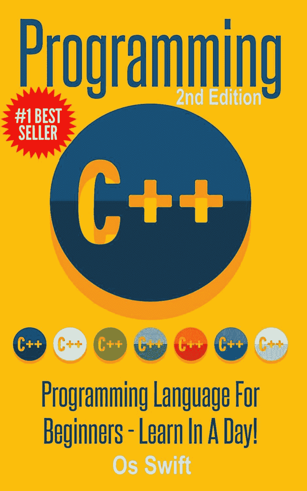


# 引言
C++ 可能是所有计算机语言中最强大的语言之一，但只要你拥有正确的积极态度和态度，你就能驯服它，并让它为你服务。如果你已经涉足计算机编程的世界，那么你一定听过 C++，而且你无疑听过人们谈论学习它是有多困难，以及为什么你不应该选择它作为学习计算机编程语言的第一步。

这两种说法都是错误的。一旦你理解了基础知识，C++ 并没有那么难学，而且它绝对应该是你开启计算机程序员之旅的首选。是的，你会发现一些困难的事情，但学习一些简单到闭着眼睛都能做到的事情是没有乐趣的。你需要挑战来深刻记忆，而且语言越有挑战性，学习起来越容易。

虽然有其他更容易的语言让你开始，但没有哪种语言具有 C++ 的力量或灵活性。公平地说，大多数操作系统、编译器、应用程序、驱动程序以及许多软件都是用 C++ 编写的，所以为什么不把它成为你学习新计算机编程语言的第一站呢。

我将在一天内教你成为一名程序员！

# 第 1 章 - 什么是 C++？

## 编程语言简介
如你所知，程序无非一组指令。这些指令由物理计算机机器（硬件）执行。尽管现代计算机非常快，但它们也有自己的局限性。计算机只能理解以其原生语言给出的一组指令。为此，你应该理解机器语言、汇编语言和高级语言的概念。

## 机器语言
尽管计算机是非常先进的机器，但它们无法直接理解像 C++ 这样的语言。计算机只理解 0 和 1。它们被称为位（bits）。它们只能理解以二进制格式给出的指令。我们给计算机的每组指令都会翻译成一组告诉处理器执行特定任务的指令。你应该理解，不同类型的处理器有不同类型的指令集。例如，奔腾处理器只会理解它们自己的指令集。Macintosh 也是如此。在最开始的时候，程序员必须用二进制语言编写指令。这非常耗时且困难。幸运的是，我们不需要经历所有这些。

## 汇编语言
由于机器语言非常难以处理，一种名为汇编语言的新语言被发明了。在这里，每条指令都被给了一个短名称，变量被名称而不是二进制位所取代，这使得程序员编写代码变得容易。你可能会问计算机如何理解汇编语言。计算机无法理解。汇编语言将在汇编器的帮助下转换为机器语言。你应该记住，每个 CPU 都有自己的汇编语言。因此，一个 CPU 的汇编语言不能在另一个 CPU 上运行。即使是汇编语言也有自己的缺点。即使对于简单的任务，它们也需要大量的指令集。


高级编程语言的出现是为了解决汇编语言和机器语言带来的问题。这些语言可以运行在任何计算机上。高级语言附带有一个名为 `compiler` 的程序。`compiler` 的作用是生成一个 `CPU` 可以直接理解的可执行文件或程序。这些程序是独立程序。今天现有的编译器非常高效且快速，能够将代码转换为可执行格式。某些编程语言使用 `interpreter`。`interpreter` 的工作是执行代码，但不将其编译为机器码。在这里我们不会学习 `interpreter`。任何给定的编程语言都可以被解释或被编译。像 `C`、`C++` 和 `PASCAL` 这样的语言是被编译的，而像 `JavaScript` 和 `Perl` 这样的脚本语言是被解释的。

问这个问题，你会得到十种不同的答案，但简单来说，`C++` 是一种编译的、面向对象的计算机编程语言。如果你是编程初学者，即使这句话可能已经让你感到有些困惑了，所以让我们进一步拆解一下。

编程语言有两种类型：一种是解释型的，另一种是编译型的。解释型语言在 `interpreter` 上运行——它读取代码并一次执行一次其中的命令。编译型语言由你计算机中的 `CPU` 读取，而不是由程序。计算机无法读取字母；它们只能读取二进制数字，所以，当你编写代码时，它必须先转换为二进制格式。这被称为编译。

解释中面向对象的部分只是描述了代码的结构，但我稍后会对此进行更详细的介绍。

## 这些对我意味着什么？

要成功学习 `C++`，你需要同时使用文本编辑器和 `compiler`。如果你在 Windows 电脑上进行这些操作，可以使用电脑上已安装的 `Notepad`（记事本）作为你的文本编辑器，而 `compiler`（它将把你的代码转换为可执行格式），你应该使用 `GNU C/C++`。

### Linux/Unix

检查你的 `Linux/Unix` 计算机上是否安装了 `GCC` 的简单方法是打开命令行并输入：

```
$ g++ -v
```

如果安装了 `GCC`，你将得到以下信息或非常类似的内容：

```
Using built-in specs
Target: i386-redhat-linux
Configured with: ../configure --prefix=/usr .......
Thread model: POSIX
gcc version 4.1.2 20080704 (Red Hat 4.1.2-46)
```

如果未安装 `GCC`，你可以按照 [http://gcc.gnu.org/install/ 上的说明进行。

### Mac OS X

为 `Mac OS X` 获取 `GCC` 的最佳方法是访问 [http://developer.apple.com/technologies/tools]，下载 `xCode` 并遵循安装说明。

### Windows

要在你的 Windows 电脑上获取 `GCC`，你必须先从 [http://www.mingw.org] 下载 `MinGW`。确保你下载了最新版本的 `MinGW`，并安装了 `gcc-core`、`binutils`、`gcc-g++` 和 `MinGW runtime`——这些是最低要求。

你可以考虑的另外一点是 `IDE`——集成开发环境。这种文本编辑器集成了编译器和语法高亮。最好用 `Code::Blocks`。

## 还有什么是我应该的吗？

是的。`C++` 的语法非常严格，而且一切对大小写敏感，所以要小心你输入的内容。在 `C++` 中，单词“Hello”与“hello”的意思不同，但这是你将在书后部分学习的更多内容。现在，让我们直接开始编程。

在我们进入过多的细节之前，让我们先开始编写一段简单的代码。这是所有类型计算机编程教程的常见示例，所以，话不多说，让我们来拆解它。首先，代码编写如下：

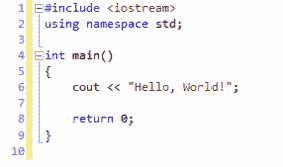

第 1 行告诉你的计算机，你想将 `iostream` 库链接到你的程序中。库是一个存储小段代码的地方，偶尔也会存储变量和操作符。`iostream` 库中的代码允许我们将字符移动到文本流中，然后显示在屏幕上。

第 2 行告诉计算机我们要使用标准命名空间——这是存储代码的地方，如果你编写了两个同名的代码，这很有用。

第 4 行是代码的开始。大括号内的所有内容都是 `compiler` 读取并翻译的内容——这一行必须出现在你写的每一个程序中，否则什么都不会发生。

下一阶段是打印程序，在这种情况下是“Hello, World!”。在这里我们使用了存储在 `iostream` 中的一些代码——一段被称为 `cout` 的代码。代码后面的 `<<` 是一个操作符，它翻译为“输出”，意味着我们告诉计算机将代码发送到指定的流。打印“Hello, World!”被称为字符串，它无非是用双引号括起来的字符序列。注意行尾有一个分号——这告诉计算机代码已结束，如果不使用，程序将无法编译。

第 8 行始终位于 `main` 的末尾，它的目的是通知计算机该块已完成。

现在你已经有了程序的源代码，它必须使用你的 `compiler` 进行编译。


我们都知道，在任何语言中，句子的都是根据该语言特定的语法规则构建的。以英语为例，我们通常用句号结束句子。支配某种语言中句子构建的所有规则被称为语法（syntax）。同样，C++ 也有其语法。不遵守语法将直接导致你的代码无效。确保遵循 C++ 语言的基础语法是编译器的责任。如果你违反了基础语法，编译器将尝试编译代码并对语法违反进行报错。该问题被称为语法错误（syntax error）。只有在没有发现语法错误的情况下，C++ 编译器才会编译程序。它会显示所有发现的错误，并建议你使它们有效，以便它能够在无任何错误的情况下执行代码。

## 编译你的第一个程序

在编写第一个程序之前，有两点你应当了解。

1. 你的程序将写在 `.cpp` 文件中，这些文件之后会被添加到你的项目中。项目也被称为工作空间（workspaces）或解决方案（solutions）。代码文件和 IDE 设置将保存到项目中。
2. 你应该通过创建一个新项目来开始，因为有很多种类型的项目。在开始之前，你需要指定你想要从事的项目类型。

### 是什么构成了 C++ 代码？

变量是存储值的东西。它就像一个盒子，每个盒子上都有一个名称和一个类别，而类别是存储在其中的物品的类型——名称是特定的变量。每个变量都有特定的类型、名称和大小，这些因素精确地决定了里面可以存储什么。在我们继续下去之前，这里有一份你将用到的变量列表：

* `Int`: 整数（integers）
* `Bool`: 真或假（0 或 1）
* `Float`: 小数（reals）
* `Double`: 精度是倍的浮点数
* `Char`: 单个 ASCII 字符

### 使用变量

下面的代码演示了如何使用它们：

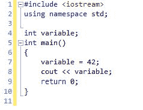

这部分大部分你在上一个代码中已经见过，唯一没见过的是第 4 行和第 7 行——第 4 行声明变量，在这种情况下是一个整数。声明仅仅是告诉编译器我们将使用这个变量，后面跟着变量的名称。你可以用你喜欢的名称给变量命名，但要保持简单且相关联，并确保它不是 C++ 中已经具有含义的保留关键字。以小写字母开头。语句以分号结束。

第 7 行被称为赋值（assignment）。这为变量分配了一个值，`=` 是运算符——这就是执行赋值的操作。`=` 后面的值被称为二元运算符（binary operator）。

注意这次 `cout` 语句周围没有引号。这是因为我们不是在显示字符串，而是输出该值。现在编译程序将在屏幕上打印“42”。

除了类型之外，变量还可以在声明中添加前缀，这些前缀会改变变量的行为。有些会改变变量的大小，另一些允许你或阻止你使用负数，而一些的作用完全不同。这里几乎会讨论所有的。

## 大小更改有两个特定的前缀可以改变变量的字节大小——`short` 和 `long`。背后的思想是允许变量存储更多值和更大的数字。大小取决于你使用的计算机架构：

* 在 32 位计算机上，`int` 和 `long int` 都是 4 字节
* 在 64 位计算机上，`int` 是 4 字节，`long int` 是 8 字节
* 在两种架构上，`short int` 都是 2 字节

没有任何规定这些特定关键字的修饰符的大小，除非：

* `Short` 必须等于或小于普通变量
* 普通变量反过来必须等于或小于 `long`。
* 唯一可以带前缀的变量是 `int`

更令人混乱的是，你实际上可以省略 `int` 只使用 `long` 或 `short`，例如：

1. `short int s = 0;`
2. `int i = 0;`
3. `long int l = 0;`
5. `short s2 = 0;`
6. `long l2 = 0;`

## 符号更改

另外两个前缀可以限制类型存储的值——`signed`（有符号）和 `unsigned`（无符号）。有符号变量可以存储负值正值，而无符号变量只能取正值。

## 其他前缀

在 C++ 中你可以使用其他一些前缀，它们并不常见，我们大多数我们不会使用，也不会在书中涵盖。但有两个非常有用的前缀——`const` 和 `static`。前者是常量，永远改变其值，而后者保持变量的值不变，但仅在函数调用之间；那是以后的话题。

## 组合类型

前缀可以链式一起使用，所以看到类似的内容并不常见：

1. `static unsigned long int`，或者
2. `signed const char`

你可以按照你喜欢的顺序放置前缀，只要它们在变量类型之前即可。

关于变量的最后一点——你只能在声明它们的区域使用它们

## C++ 中的枚举

在 C++ 中，枚举（enumeration）可以被定义为用户类型，它可以包含给定的任何名称。其语法如下：

```cpp
enum seasons { spring, summer, autumn, winter };
```

变量 `s` 在函数内被定义为 `seasons` 类型，它可以存储四个值中的任何一个（spring, summer, autumn, winter）。第一个枚举值的默认值为 `0`，第二个为 `1`，依此类推。在程序中 `spring` 的值等于 `0`，`summer` 为 `1`，`autumn` 的值为 `2`，`winter` 的值为 `3`。

这里你需要记住的一点是 `spring`、`summer`、`autumn` 和 `winter` 不是变量。编译器将它们视为整数。一旦在程序中定义，这些值就无法更改。考虑这个示例。

### 示例 1：Enumeration

```cpp
#include <iostream>

using namespace std;

enum seasons { spring, summer, autumn, winter };

int main() {
    seasons s;
    s = spring;
    cout << "spring = " << s << endl;
    s = summer;
    cout << "summer = " << s << endl;
    s = autumn;
    cout << "autumn = " << s << endl;
    s = winter;
    cout << "winter = " << s << endl;
    return 0;
}
```

输出：
```
spring = 0
summer = 1
autumn = 2
winter = 3
```

默认值可以在枚举声明期间更改，你可以赋予它想要的值。考虑给出的示例。

### 示例 2：Enumeration

```cpp
#include <iostream>

using namespace std;

enum seasons { spring = 34, summer = 4, autumn = 9, winter = 32};

int main() {
    seasons s;
    s = summer;
    cout << "summer = " << s << endl;
    return 0;
}
```

输出：
```
summer = 4
```


现在我们已经知道了变量是如何工作的，现在是时候开始在程序中使用它们了。不过，现在我们能做的只是设置变量的值并输出它，这在创建适当的 C++ 程序时并不十分有用。我们需要一种操纵变量并获取输入的方法，这正是 `iostream` 库大显身手的地方。

我们知道这个库能够输出数据，但它也能接收输入数据。允许它执行此操作的命令是 `cin`，与 `cout` 相。区别在于，`cin` 后面的运算符是反的——我们不是输入 `<<`，而是输入 `>>`。

1. `cout << "string";`
2. `cout << var;`
4. `cin >> var;`

不过，`iostream` 比此强大得多，它允许你组合多个语句。例如，如果你想输出两个字符串或变量，你会写两条语句。通过 `iostream`，你可以将多个 `cout` 语句组合在一起，生成短得的代码：

1. `cout << "Hello, " << "World!";`

你对 `cin` 语句也可以同样的操作，但请记住你不能在同一行中混合输入和输出。

## 新程序

现在我们知道了如何输入和输出数据，我们就可以编写一些更有实用的程序了。通过这个例子，我们将改进“Hello, World!”程序：

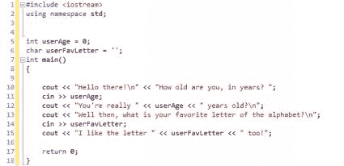

你可以看到我们在标准命名空间中声明了 `iostream`，然后我们声明了一些变量，但方式与之前略有不同，即将将组合、赋值与声明相结合——这被称为初始化。

其余部分是代码，在这种情况下，计算机程序将询问用户他们有多大，邀请用户输入到程序中。接着它会询问用户最喜欢的字母是什么。注意 `\` 后面跟一个 `n` 的用法——这表示需要换行。

## 变量

在 C++ 中，可用的仅仅是一块可以用于存储信息的内存。可以使用变量来存储和检索信息。每当给一个新变量赋值时，`RAM` 内存就会部分就会分配给该变量。有不同类型的变量，每种都有特定的用途。对于字符有字符变量，对于数字有整数变量，对于小数，我们有 `float` 变量等。

如果你想定义一个变量，应该使用声明语句。

我们将查看 `int` 变量，以便你更好地理解变量。

```cpp
int x;
```

这仅仅是定义了一个整数变量 `x`。整数变量的目的是存储数值数据。

这里是赋值语句的示例：

```cpp
int y;               // 定义 y 为整数变量
y = 4;               // 4 求值为为 4，然后赋值给 y
y = 2 + 5;           // 2 + 5 求值为为 7，然后赋值给 y
int x;               // 定义 x 为整数变量
x = y;               // y 求值为为 7（从之前开始），然后赋值给 x。
x = x;               // x 求值为为 7，然后赋值给 x（没用的！）
x = x + 1;           // x + 1 求值为为 8，然后赋值给 x。
```

## 未初始化的变量

在 C 和 C++ 这样的语言中，变量不会用像 `0` 这样的标准值初始化。它将有一个分配给它的默认垃圾值。这种变量被称为未初始化变量。

# 第 4 章：指针

## 指针

C++ 中的指针非常易学且有趣。某些任务在 C++ 中可以使用指针轻松完成，而另一些任务如果不使用指针是无法完成的。

正如你所知道的，在 C++ 中，每个变量都被赋予一个内存位置，并且每个内存位置定义了一个地址。可以使用 `&` 运算符通过内存位置访问每个变量。`&` 运算符用于表示内存地址。在接后的示例中，变量的地址将被定义。

示例：

```cpp
#include <iostream>
using namespace std;

int main ()
{
  int var1;
  char var2[10];
  cout << "Address of var1 variable: ";
  cout << &var1 << endl;
  cout << "Address of var2 variable: ";
  cout << &var2 << endl;
  return 0;
}
```

当你编译并执行上述代码时，它将产生以下输出。

Address of var1 variable: [address]
Address of var2 variable: [address]

## 什么是指针

当你编译并执行上述代码时，它将产生以下输出。

Address of var1 variable: [address]
Address of var2 variable: [address]

## 使用指针

C++ 中的指针非常易学且有趣。某些任务在 C++ 中可以使用指针轻松完成，而另一些任务如果不使用指针是无法完成的。

正如你所知道的，在 C++ 中，每个变量都被赋予一个内存位置，并且每个内存位置定义了一个地址。可以使用 `&` 运算符通过内存位置访问每个变量。`&` 运算符用于表示内存地址。在接后的示例中，变量的地址将被定义。

```cpp
#include <iostream>
using namespace std;

int main ()
{
  int var = 20;
  int *ip = &var;
  cout << "Value of var: ";
  cout << var << endl;
  cout << "Address of var: ";
  cout << &var << endl;
  cout << "Value of *ip: ";
  cout << *ip << endl;
  cout << "Address of ip: ";
  cout << ip << endl;
  return 0;
}
```
*(注：原文此处代码块不完整或存在重复，翻译根据语意进行了补全校对，以保持逻辑通)*

*(由于原文文本中存在大量段落重复（如 "What Are Pointers" 之后的内容），翻译时遵循了“不要重复输出原文”的原则，仅对具有意义的内容进行了翻译。)*


| [向函数传递指针](http://www.tutorialspoint.com/cplusplus/cpp_passing_pointers_to_functions.htm) | 通过地址传递参数或通过引用传递参数，传递的参数可以被调用函数中的调用函数修改。 |

| [从函数返回指针](http://www.tutorialspoint.com/cplusplus/cpp_return_pointer_from_functions.htm) | 在 C++ 中，指针可以由函数返回给静态变量、局部变量以及动态分配的内存。 |

# 第 5 章：函数

函数无非是用于执行特定任务而可以重复使用的语句，正如你已经熟悉如何使用 `main()` 函数一样。有时你可能需要程序停止当前正在的工作并做其他事情以便更高效工作。这是我们经常做的事情。例如，你可能正在处理某项工作，然后暂停去喝杯咖啡。在 C++ 编程中使用函数时，这也是一种类似的情况。

它将继续按顺序执行语句，直到遇到函数调用。函数调用无非一个表达式，它指示 CPU 暂停当前函数以执行另一个函数。CPU 将只是中断当前函数并继续执行在函数调用中提到的函数。一旦函数调用中的函数终止，CPU 将返回到之前正在执行的上一个函数。

这里有一个示例程序，向你展示函数是如何定义和调用的。

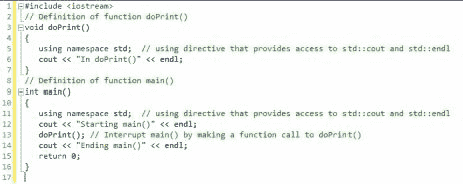

上面的代码将显示以下输出：

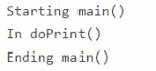

## 

在 `main` 完成代码执行后，它会将值返回给调用者。这可以通过 `return` 语句来实现。如果函数的返回类型为 `void`，它将不返回任何值。如果返回类型是 `int`，它将返回一个整数值。

例如：

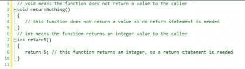

这是一个在程序中使用这些函数的示例。

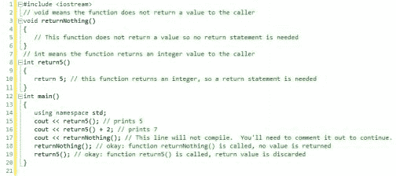

如你所示，在第一次函数调用中，使用 `return5()` 语句返回值 5。在那里，值 5 将返回给调用者，相同的值将传递给 `cout` 语句。

当涉及到第二次函数调用时，执行 `return5()` 并返回 5。然后执行 `5+2`并将 7 发送到 `cout` 语句。

当涉及到第三条语句时，调用了 `returnNothing()`，它将简单地不返回任何内容。

第四次函数调用时，函数不返回内容，控制权回到 `main()`。

## 返回到 Main

当程序执行时，操作系统会向 `main()` 函数进行函数调用。然后执行将跳转回名称的顶部，`main` 中存在的语句将按顺序执行。最后，一个整数值将返回给 `main`。这就是为什么 `main()` 被定义为 `int main()` 的原因。始终注意不要在 main 函数旁边使用 `;`，因为它会终止 main 函数且不会让程序的执行继续进行。当你使用 `void main()` 时，编译器不关心返回函数，并且只不会返回任何内容。

## 重用函数

C++ 中的函数不受其可以使用次数的限制。同一个函数可以被反复使用。事实上，在大多数程序中，函数必须被重用。

这是一个示例

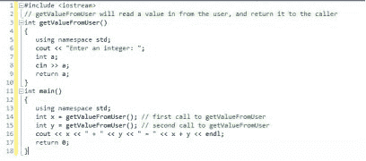

上述程序的输出是

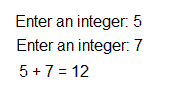

你应该记住，`main()` 函数不是唯一可以调用其其他函数的函数。任何函数都可以调用不同的函数。

这里有一个显示该点的示例函数

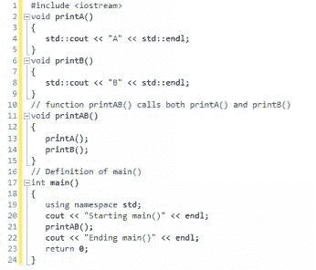

输出是：

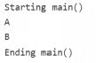

## 嵌套函数

嵌套函数无非是指内部包含其他函数的函数。简单来说，函数中的函数就是嵌套函数。

下面的示例将向你展示一个简单的嵌套函数：

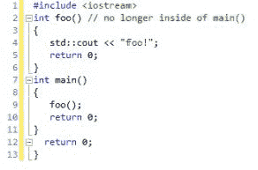

## 函数参数

有时你可能需要向函数传递信息。在这些情况下，参数将允许你将信息传递给函数。

这里有一个示例，可以解释参数在函数中的作用。

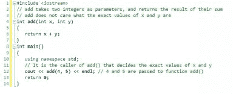

输出是 9。

现在我们将查看 `functions()` 的一些其他调用

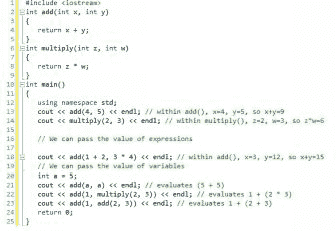

输出是

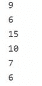

## 回顾表达式

表达式可以被定义为变量、字母、函数和操作符的组合，并评估为一个值。

我们将详细讨论每一个项。

- **字面量 (Literals)**：字面量无非一个通常固定的值，即直接插入源代码中的值。字面量没有内存表示，它们始终评估为它们自己。

例如：

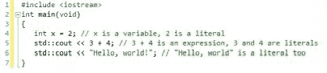

## 操作符

我们现在知道如何输出文本、声明变量和接收输入，但目前，我们无法对变量进行任何操作。我们需要能够操纵变量而不需要做太多工作，这就是操作符的用场。

操作符是表达式的最后一部分。这些是

- **一元运算符 (Unary)**：作用于单个操作数的运算符。例如，应用于数字。
- **二元运算符 (Binary)**：作用于两个不同或相同操作数。上面的示例使用了 `+`。
- **三元运算符 (Ternary)**：作用于三个操作数的运算符。在 C++ 中只有一种

## 变量大小与 sizeof 运算符

计算机中的内存基本上是以字节大小为单位组织的。每个内存块都有唯一的地址。有些变量只占用 1 字节。有些占用 2、4、8 字节等。使用所需的尺寸变量是明智的。由于每个位只能表示 0 或 1，我们可以说它只能存储可能的值。同样，三个位可以存储八种可能的值。这种方式对存储的数据有限制。由于所有计算机的可存储数据都是有限的，我们使用不同大小的变量以免浪费内存。

C++ 中基础类型的大小

| 类别 | 类型 | 最小大小 |
| :--- | :--- | :--- |
| 布尔 | bool | 1 字节 |
| 字符 | char | 1 字节 |
| | wchar_t | 1 字节 |
| | char16_t | 2 字节 |
| | char32_t | 4 字节 |
| 整数 | short | 2 字节 |
| | int | 2 字节 |
| | long | 4 字节 |
| | long long | 8 字节 |
| 浮点数 | float | 4 字节 |
| | double | 8 字节 |
| | long double | 8 字节 |

我们不能说所有计算机上所有变量的大小都是相同的。变量的大小随机器而异。你可以通过 c++ 中名为 `sizeof` 的运算符了解你机器上变量的大小。

为了找到你计算机上变量的大小，可以使用以下代码。

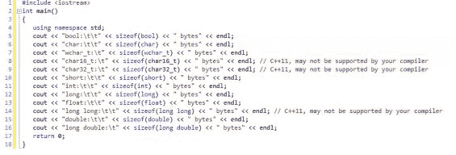

结果大多为：

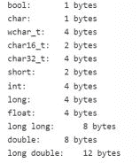

在这里甚至看一些变量。

整数：根据定义，整数数据类型变量是某种只能持有非分数数字。有五种不同的基本整数。

| 类别 | 类型 | 最小大小 |
| :--- | :--- | :--- |
| 字符 | char | 1 字节 |


| integer | short | 2 bytes |
| :--- | :--- | :--- |
| | int | 2 bytes |
| | long | 4 bytes |
| | long long | 8 bytes |

### 定义整数：

```
char c;
short int si; // 有效
short s;      // 推荐
int i;
long int li; // 有效
long l;      // 推荐
long long int lli; // 有效
long long ll;      // 推荐
```

变量有两种类型。它们是“有符号”（signed）和“无符号”（unsigned）。通过下表，你将更好地理解有符号和无符号变量。

| 尺寸/类型 | 范围 |
| :--- | :--- |
| 1 字节有符号 | -128 to 127 |
| 1 字节无符号 | 0 to 255 |
| 2 字节有符号 | -32,768 to 32,767 |
| 2 字节无符号 | 0 to 65,535 |
| 4 字节有符号 | -2,147,483,648 to 2,147,483,647 |
| 4 字节无符号 | 0 to 4,294,967,295 |
| 8 字节有符号 | -9,223,372,036,854,775,808 to 9,223,372,036,854,775,807 |
| 8 字节无符号 | 0 to 18,446,744,073,709,551,615 |

### 布尔值：`Boolean` 也是 C++ 中的一种类型。它只能包含两个可能的值，`true` 或 `false`。我们使用关键字 `bool` 来声明布尔变量。例如：`bool b;`。

我们将这种数据类型用于决策算法，其中机器将根据给定的条件决定结果。这里有一个使用布尔数据类型的示例。

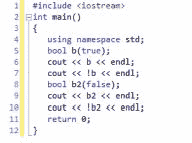

输出结果：

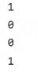

你可以通过使用 `iomanip` 头文件中的 `std::boolalpha` 来打印 'true' 或 'false' 代替 0 或 1。例如：

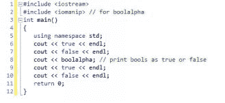

这将显示

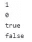

你也可以在 `if` 语句中使用布尔值。这里有一个示例代码。

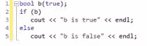

结果：`b` 为真

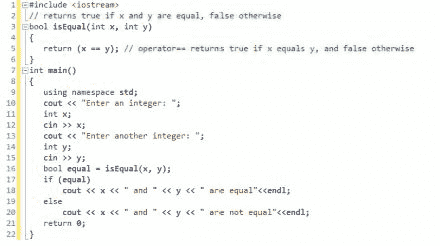

你应该记住，在 C++ 中，=` 是赋值运算符，而 `==` 是比较运算符，用于测试相等性。

## Char 变量

尽管 `char`是一种整数数据类型，但它与其他整数变量不同。每个 `char` 占用 1 字节内存。我们不会将其表示为整数，而是以 ASCII 字符的形式表示。下面是 ASCII 字符的完整表格。

| 代码 | 符号 | 代码 | 符号 | 代码 | 符号 | 代码 | 符号 |
| :--- | :--- | :--- | :--- | :--- | :--- | :--- | :--- |
| 0 | NUL (null) | 32 | (space) | 64 | @ | 96 | ` ` |
| 1 | SOH (start of header) | 33 | ! | 65 | A | 97 | a |
| 2 | STX (start of text) | 34 | ” | 66 | B | 98 | b |
| 3 | ETX (end of text) | 35 | # | 67 | C | 99 | c |
| 4 | EOT (end of transmission) | 36 | $ | 68 | D | 100 | d |
| 5 | ENQ (enquiry) | 37 | % | 69 | E | 101 | e |
| 6 | ACK (acknowledge) | 38 | & | 70 | F | 102 | f |
| 7 | BEL (bell) | 39 | ’ | 71 | G | 103 | g |
| 8 | BS (backspace) | 40 | ( | 72 | H | 104 | h |
| 9 | HT (horizontal tab) | 41 | ) | 73 | I | 105 | i |
| 10 | LF (line feed/new line) | 42 | * | 74 | J | 106 | j |
| 11 | VT (vertical tab) | 43 | + | 75 | K | 107 | k |
| 12 | FF (form feed / new page) | 44 | , | 76 | L | 108 | l |
| 13 | CR (carriage return) | 45 | - | 77 | M | 109 | m |
| 14 | SO (shift out) | 46 | . | 78 | N | 110 | n |
| 15 | SI (shift in) | 47 | / | 79 | O | 111 | o |
| 16 | DLE (data link escape) | 48 | 0 | 80 | P | 112 | p |
| 17 | DC1 (data control 1) | 49 | 1 | 81 | Q | 113 | q |
| 18 | DC2 (data control 2) | 50 | 2 | 82 | R | 114 | r |
| 19 | DC3 (data control 3) | 51 | 3 | 83 | S | 115 | s |
| 20 | DC4 (data control 4) | 52 | 4 | 84 | T | 116 | t |
| 21 | NAK (negative acknowledge) | 53 | 5 | 85 | U | 117 | u |
| 22 | SYN (synchronous idle) | 54 | 6 | 86 | V | 118 | v |
| 23 | ETB (end of transmission) | 55 | 7 | 87 | W | 119 | w |
| 24 | CAN (cancel) | 56 | 8 | 88 | X | 120 | x |
| 25 | EM (end of medium) | 57 | 9 | 89 | Y | 121 | y |
| 26 | SUB (substitute) | 58 | : | 90 | Z | 122 | z |
| 27 | ESC (escape) | 59 | ; | 91 | [ | 123 | { |
| 28 | FS (file separator) | 60 | < | 92 | \ | 124 | ; |
| 29 | GS (group separator) | 61 | = | 93 | ] | 125 | } |
| 30 | RS (record separator) | 62 | > | 94 | ^ | 126 | ~ |
| 31 | US (unit separator) | 63 | ? | 95 | _ | 127 | DEL |

### 打印字符：

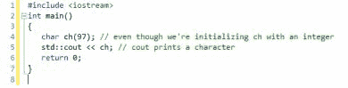

### 将字符打印为整数（类型转换）

如果你希望将 `char` 打印为数字，你必须进行类型转换。类型转换只是改变变量的数据类型。

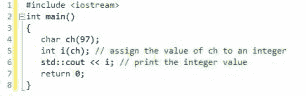

我们使用 `static cast` 从给定的 `char` 值创建整数值。


结果：

# 第 6 章：更多运算符

为了成为一名优秀的程序员，你必须理解运算符的顺序和应用。例如 `2+3*4` 得到 `20`，而 `2+(3*4)` 将得到 `24`。因此，你应该知道使用运算符的正确顺序。为了方便起见，所有运算符都分配了优先级。这里是我们在 C++ 中使用的所有运算符的优先级表格。优先级 1 为最高，优先级 18 为最低。

| 优先级/赋值 | 运算符 | 描述 | 模式 |
| :--- | :--- | :--- | :--- |
| 1 无 | `::` | 全局范围（单元）类范围（二元） | `class_name::member_name` |
| 2 从左到右 | `()` `()` `type[]` `->` `++` `typeid` `const_cast` `dynamic_cast` `reinterpret_cast` `static_cast` | 括号 函数调用 初始化 值构造 数组下标 从对象的成员访问 从对象指针的成员访问 后增 后自减 运行时类型转换 |
| 3 从右到左 | `+` `-` `++` `--` `~` `sizeof` `&` `new` `new[]` `delete` | 一元加 一元减 后增 后自减 逻辑非 按位取反 地址引用 动态内存分配 动态数组分配 动态内存释放 动态数组释放 |
| 4 从左到右 | `->` `*` `.` `.` | 指针选择符 成员选择符 成员选择符 | `object_pointer->*` |
| 5 从左到右 | `*` `/` `%` | 乘法 除法 取模 | `expression * expression / expression % expression` |
| 6 从左到右 | `+` `-` | 加法 减法 | `expression + expression - expression` |
| 7 从左到右 | `<<` `>>` | 左移 右移 | `expression << expression >> expression` |
| 8 从左到右 | `<<=` `>>=` `< `<=` `>` `>=` | 比较小于 小于等于 比较大于 大于等于 | `expression < expression <= expression > expression >= expression` |
| 9 从左到右 | `==` `!=` | 相等 不等 | `expression == expressionexpression != expression` |
| 10 从左到右 | `&` | 按位与 | `expression & expression` |
| 11 从左到右 | `^` | 按位异异 | `expression ^ expression` |
| 12 从左到右 | `|` | 按位或 | `expression | expression` |
| 13 从左到右 | `&&` | 逻辑与 | `expression && expression` |
| 14 从左到右 | `||` | 逻辑或 | `expression || expression` |
| 15 从左到右 | `?:` | 三元运算符 | `expression ? expression : expression` |
| 16 从右到左 | `=` `*=` `/=` `%=` `+=` `-=` `<<=` `>>=` `&=` `|=` `^=` | 赋值 乘法赋值 除法赋值 取模赋值 加法赋值 减法赋值 左移赋值 右移赋值 按位与赋值 按位或赋值 按位异异赋值 | `lvalue = expressionlvalue *= expressionlvalue /= expressionlvalue %= expressionlvalue += expressionlvalue -= expressionlvalue <<= expressionlvalue >>= expressionlvalue &= expressionlvalue &#124;= expressionlvalue ^= expressionlvalue` |
| 17 从右到左 | `throw` | 抛出表达式 | `throw expression` |
| 18 从左到右 | | | 逗号运算符 | `expression, expression` |

## 算术运算符


# 一元算术运算符：这些只需要一个操作数的算术运算符。这里是一元运算符的表。

| 运算符 | 符号 | 形式 | 操作 |
| :--- | :--- | :--- | :--- |
| 一元加 | `+` | `+x` | `x` 的值 |
| 一元减 | `-` | `-x` | `x` 的取反 |

## 二元运算符

提到运算符时，基本上有五种。它们是加、减、除、乘和模。下表对它们中的每种进行了了解释。

| 运算符 | 符号 | 形式 | 操作 |
| :--- | :--- | :--- | :--- |
| 加法 | `+` | `x + y` | `x` 加 `y` |
| 减法 | `-` | `x - y` | `x` 减 `y` |
| 乘法 | `*` | `x * y` | `x` 乘以 `y` |
| 除法 | `/` | `x / y` | `x` 除以 `y` |
| 模（取余） | `%` | `x % y` | `x` 除以 `y` 的余数 |

我们已经知道了加、减、除、乘等基本算术运算符。但我们中的大多数人可能对模运算没有概念。模运算符也被称为取余运算符。这个运算符将返回整数操作数的余数。我们使用这个运算符来测试一个数字是偶数还是奇数。如果余数为 `0`，则该数字为偶数；如果余数为 `1`，则该数字为奇数。

这是一个示例，从 1 到 100 的数字每行打印 20 个。

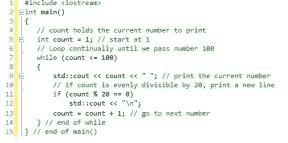

## 结果

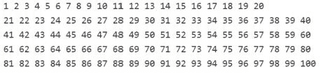

## 关系运算符（比较）

关系运算符用于变量之间的比较。C++ 中总共有六种关系运算符。它们如表所示。

| 运算符 | 符号 | 形式 | 操作 |
| :--- | :--- | :--- | :--- |
| 大于 | `>` | `x > y` | 如果 `x` 大于 `y` 则为真，否则为假 |
| 小于 | `<` | `x < y` | 如果 `x` 小于 `y` 则为真，否则为假 |
| 大于等于 | `>=` | `x >= y` | 如果 `x` 大于或等于 `y` 则为真，否则为假 |
| 小于等于 | `<=` | `x <= y` | 如果 `x` 小于或等于 `y` 则为真，否则为假 |
| 等于 | `==` | `x == y` | 如果 `x` 等于 `y` 则为真，否则为假 |
| 不等于 | `!=` | `x != y` | 如果 `x` 不等于 `y` 则为真，否则为假 |

这些运算符在布尔值 `true` 或 `false` 上操作。为了让你更好地理解运算符，下面提供了一个包含整数和关系运算符的示例代码。

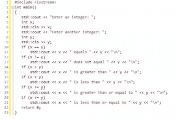

上述代码的输出为：

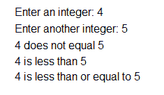

## 运算符运算符

在给定的变量内部，位操作运算符被用于处理数据的位。早期的计算机存储容量不大，内存非常昂贵。因此，创建了位操作运算符来解决这个问题。我们总共有六种位操作运算符。它们在下表中解释。

| 运算符 | 符号 | 形式 | 操作 |
| :--- | :--- | :--- | :--- |
| 左移 | `<<` | `x << y` | `x` 的所有位左移 `y` 位 |
| 右移 | `>>` | `x >> y` | `x` 的所有位右移 `y` 位 |
| 位取反 | `~` | `~x` | `x` 的所有位翻转 |
| 位与 | `&` | `x & y` | `x` 的每个位与 `y` 的每个位进行与运算 |
| 位或 | `|` | `x | y` | `x` 的每个位与 `y` 的每个位进行或运算 |
| 位异或 | `^` | `x ^ y` | `x` 的每个位与 `y` 的每个位进行异或运算 |

在 C++ 中，我们还有位赋值运算符。这些有助于用户轻松地修改变量。

| 运算符 | 符号 | 形式 | 操作 |
| :--- | :--- | :--- | :--- |
| 左移赋值 | `<<=` | `x <<= y` | 将 `x` 左移 `y` 位 |
| 右移赋值 | `>>=` | `x >>= y` | 将 `x` 右移 `y` 位 |
| 位或赋值 | `|=` | `x |= y` | 将 `x | y` 赋值给 `x` |
| 位与赋值 | `&=` | `x &= y` | 将 `x & y` 赋值给 `x` |
| 位异或赋值 | `^=` | `x ^= y` | 将 `x ^ y` 赋值给 `x` |

## 块

块无非就是语句块。块也被称为复合语句。它只不过是一组被编译器视为单个语句的语句。它们以 `{` 和 `}` 符号开始和结束。这些复合语句可以用于任何地方代替语句。它们不需要 `;` 来结束语句。这些块可以单独放置，也可以放在另一个块内部。


在上面提供的示例代码中，控制流有两种可能的路径。如果条件为真，CPU 将跳转并执行 A、B 和 D。但如果条件结果为假，控制流将跳转并执行 A、C 和 D 语句。

## 条件语句

条件语句允许你在代码中形成一个汇点并将其发送到不同的路径，而不是保持为线性代码。C++ 的条件语句是 `if` 语句——如果某个条件为假，程序应该执行一段代码；如果为真，则执行另一段代码：

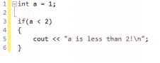

你知道第 1 行和第 5 行的意思，但第 3 行稍有不同——这是一个 `if` 语句。它的作用是检查整数变量是否小于 `2\`。如果是，它将运行一段代码；如果不是，它将正常继续。如果你编译并运行这里写的内容，你将在屏幕上看到打印出“a is less than 2!”

## 循环

循环用于需要重复使用代码的程序。它们将代码放入循环中，直到条件满足。想象一下，如果你编写一段代码，每行打印从 1 到 100 的数字。为此类程序编写代码将非常困难且耗时。对于这种情况，我们使用循环。循环使控制流保持在循环中，直到条件满足。

所以，我们的代码现在读取用户输入，它可以根据这些输入执行各种不同的操作，但现在我们将观察如何让这些代码反复执行相同的操作，只是使用的参数略有不同。为了做到这一点，我们需要使用循环，循环是一段重复执行不同次数的代码，直到它完成了需要执行的任务并满足了特定的 C++ 条件。C++ 有三种不同类型的循环：

* `while`
* `for`
* `do`

`while` 循环是最简单的，看起来与 `if` 语句非常相似：

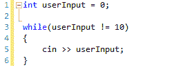

这里 `while` 循环的作用是说，只要用户输入的变量不等于 `10`，代码就需要从用户那里获取某些输入。在 C++ 中，感叹号（`!`）表示“不”，所以 `!` 意味着“不等于”。

在这种情况下，如果用户输入的已经是 `10`，那么代码将不会被执行，循环也将被忽略。从事实上，`while` 循环被看作是一个扩展的 `if` 语句，在代码运行后会回到其内部。

在继续之前，我想向你展示无限循环是什么样的，即一个一直运行的循环：

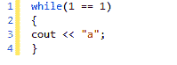

如你所见，它是如果 1 等于 1，就打印一个 a，以此此类推。

下一个简单的循环是 `do while` 循环，因为它与 `while` 循环相似。

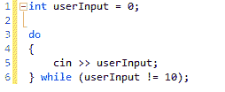

虽然它看起来与 `while` 循环有些不同，但它本质上在做相同的工作，只有一个重要的区别——`while` 循环检查条件并查看其是否为真，而 `do while` 循环先运行代码，然后再检查条件是否为真。因为这样，所有的代码都会保证运行。

第三种 C++ 循环是 `for`，这是最复杂的一种。但一旦你理解了它，你就会发现它是最强大的。在这里，我们只看简单的用法：

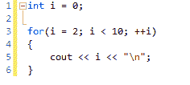

这段代码的意思是，首先将 `i` 的值设置为 `2\`。然后它说，只要 `i` 小于 `10`，它就将该值输出到屏幕上，然后增加 `i`。你必须记住一点——`for` 循环第一行中使用的所有变量必须是同一个变量。同样重要的是记住，与 `while` 循环不同，第一个语句是赋值而不是条件判断。

如果你想处理许多数据，，这种循环很有用，我将在下一节中更多地讨论这一点。现在，如你所见，它能做的最有用的事情就是抛出一系列数字。这是一个很有用的技巧，并顺带带我们进入下一个章节。

## If 语句

‘if’ 语句是 C++ 中最基本的条件判断语句。它会检查给定的条件，并根据条件的结果改变控制流。

这里有一个包含 ‘if’ 语句的简单代码。

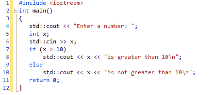

我们已经知道 `if` 语句接受一个语句作为条件。我们还知道可以使用块（Block）来代替单个语句。这意味着我们可以在 `if` 语句内部使用代码块作为条件。下面的示例展示了在 `if` 语句中使用代码块作为条件。

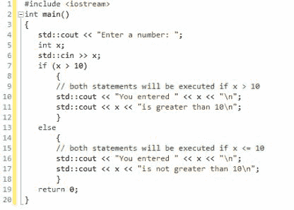

你也可以将一个 `if` 语句放在另一个 `if` 语句内部。内部另一个 `if` 语句的 `if` 语句被称为嵌套 `if`。

这里有两个示例，可以帮助你更好地理解嵌套 `if`。

示例 1：

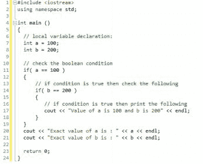

示例 2：

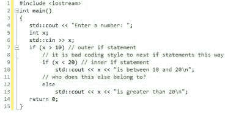

你可以将一个 `if` 语句放入块中并附加 `else` 语句。你可以看下面的示例。


## 带有逻辑运算符的 If 语句

可以使用带有逻辑运算符的 `if` 语句同时检查多个条件。示例代码如下：


‘if’ 语句可以用于提前返回。提前返回无非将控制回到函数的结尾。


## Switch 语句

Switch 语句也是改变控制流的语句。Switch 语句使用多路分支。

与 if else 语句相比，switch 语句由于以下原因更为优：

* Switch 语句更容易调试
* 这些语句易于维护
* Switch 语句执行更快
* 它们更易读
* Switch 语句的深度是固定的
* 可用于异常处理

switch 语句的基本语法如下。

`case constant1:`
如果 n 等于 constant1 则执行代码；
`break;`
`case constant2:`
如果 n 等于 constant2 则执行代码；
`break;`
`.`
`.`
`.`
`default:`
如果 n 不匹配任何情况则执行代码；

下面的程序展示了为什么 switch 比 if-else 语句更好用。

示例：


现在看使用 switch 语句解决相同的问题。


## Break 语句

我们经常使用 `break` 语句终止 case 语句而不是整个函数。这将指示编译器放弃当前的 case 并继续执行下一个语句。因此，在 `break` 语句之后，控制流进入 switch 块之后的语句。这里有一个展示在 case 语句后附加 `break` 语句的示例。


## Goto

为了让 CPU 跳到代码中的不同位置，我们使用了称为 `goto` 语句的流控制语句。为此，我们需要设置一个 `goto` 语句可以识别的标记标记。下面的示例如果输入了负数，`goto` 语句将控制流带到 `tryAgain` 标记，在那里必须选择非负数。

示例 1：


示例 2：


## While

在所有循环中，`while` 是最简单的。`while` 循环与 ‘if’ 语句非常相似。在这里，条件放在 `while` 语句之后。这将控制流带到程序的开头，并将其放入循环中直到条件满足。

每当代码在成功执行后回到开头时，被称为完成了一次迭代。

示例：


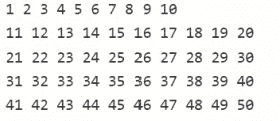

这是另一个 `while` 循环的简单示例。

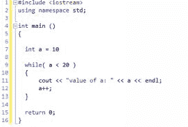

输出：

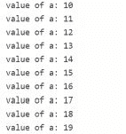

就像 `if` 条件一样，你可以在循环内部使用循环。如果你将一个循环放在另一个循环内部，它被称为嵌套循环。

嵌套循环的示例：

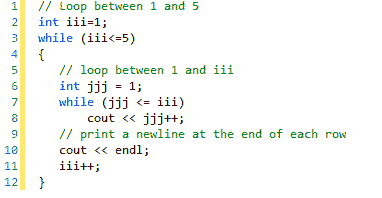

上面的程序将显示：

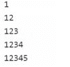

## do-while 循环

`do-while` 循环与 `while` 循环相似，仅有一处不同。如果 `while` 循环中的条件不满足，我们知道它不会执行循环。但如果我们希望代码即使条件不满足的情况下至少运行一次，我们可以利用 `C++` 中的 `do-while` 循环。使用该循环即使在条件不满足也会执行一次代码。下面的示例展示了 `do-while` 循环。

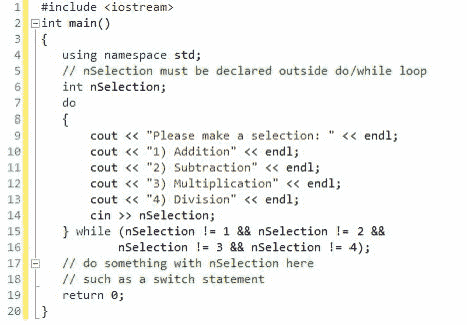

## for 循环

`for` 循环是 `C++` 中应用广泛的循环语句。如果你知道要迭代多少次，这是一个完美的选择。它易于使用，因为它允许用户在每次迭代后更改变量。这用起来非常简单，因为你可以在同一个地方一次性声明所有内容。

这是一个 `for` 循环的简单示例。

示例 1：

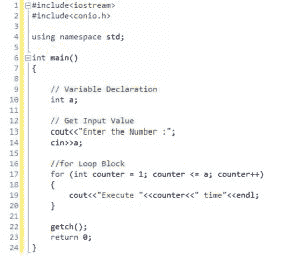

上述代码的输出为：

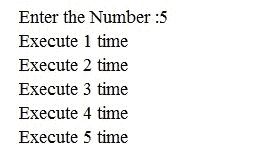

示例 2：

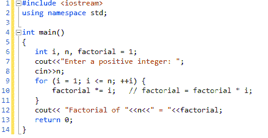

输出：

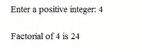

## Break and continue

在之前的示例中我们已经见过 `break` 语句。在这里我们将 `break` 语句与 `continue` 语句一起使用。我们知道 `break` 语句可以终止该语句以及 `while` 循环和 `do while` 循环等循环语句。但当你函数末尾的 `switch` 语句使用它时，它表示该 case 已完成或结束。这是一个显示 `switch` 和 `break` 结合的示例。

示例：


当我们在循环中使用 `break` 语句时，可以提前终止循环。下面的示例将向你展示如何操作。


在上面的程序中，用户可以输入最多 40 个字符。如果用户按下回车键，循环就可以终止。通过按下回车键，用户可以选择提前终止循环。

### Continue 语句

在某些情况下，你需要比通常时间更早地回到循环开头。这对于跳过该迭代循环的剩余部分非常有用。下面的示例展示了 `continue` 语句的使用。


在上面的程序中，我们在 `for` 循环中使用了 `continue` 语句，它将打印 0 到 19 之间所有不能被 4 整除的数字。

## 使用 continue 和 break

通常不建议将 `continue` 与 `break` 配对使用。因为这会导致程序代码执行流出现偏差。但如果使用得当，`continue` 和 `break` 的组合被证明是高效的。这里有一个显示的小示例。


## 随机数生成

某些程序需要生成随机数。除非你给计算机一段特定的代码来执行，否则计算机无法自己生成随机数。这些随机数特别用于与统计和游戏相关的程序。像在线扑克或骰子游戏等游戏使用随机数生成算法来生成随机数。

如果一个游戏为每个玩家不断生成相同的数字，会有多趣呢？对于像计算机这种只知道真或假值的机器，它们无法自己生成这些随机数。对于此类情况，我们使用伪随机数生成算法。在这里，计算机将获取一个实际上是非随机的数字，被称为 `seed`（种子），并执行数学运算将给定的 `seed` 转换为一个看似随机的另一个数字。

高效的随机数生成器将不断执行此过程，并生成一个与 `seed` 完全无关的数字。这些随机数也用于 ATM 机的安全目的。

生成伪随机数并不困难。在这里你将通过下面的示例理解它。该程序生成了 100 个伪随机数。


输出


你可以从上面的输出看到，所有的数字都是随机的，它们之间没有关系。如果有任何关系，那也是随机的。

你实际上可以使用内置的伪随机数生成器在 `C++` 中生成随机数。在这里，你将利用两个函数：`srand()` 和 `rand()`。

`srand()` 将设置初始值，换句话说是 `seed` 值。而 `rand()` 获取 `srand()` 的值并基于 `srand()` 值开始生成随机数。你可以通过下面的示例更好地理解它。


这将生成 100 个随机数


关于生成的随机数，你可以看到没有数字小于给定的 `srand()` 值。这是因为该值被视为基准，其他数字都是从它生成的。

# 第 8 章：存储类

在给定的 `C++` 程序中，由以下指定符定义的函数变量的作用域和生命周期为：

- `auto`
- `static`
- `register`
- `extern`

## auto 存储类

对于所有局部变量，默认存储类都是 `auto`。

示例：

```cpp
int month;
auto month;
```

## register 存储类

如果你希望定义局部变量并将它们存储在 RAM 而不是内存中，可以使用 `register`。

语法：
```cpp
register int miles;
```
你应该记住，当你定义一个寄存器时，并不意味着该变量存储在寄存器中。

## Static 类

与其每次进入和离开作用域时都创建和销毁局部变量，`static` 存储类告诉编译器在其生命周期内存储局部变量。因此，如果你希望局部变量在函数调用期间保持其值，你应该将这些局部变量设为 `static`。

`static` 修饰符不仅限于局部变量，也可以应用于全局变量。之后，该变量的作用域将被限制在声明该变量的文件中。

当你在类的成员上使用 `static` 时，该成员的唯一副本将由该类的所有对象共享。这是一个示例。

示例：

```cpp
#include <iostream>

// 函数声明
void func(void);

static int count = 10; /* 全局变量 */

main()
{
    while(count--)
    {
        func();
    }
    return 0;
}

// 函数定义
void func( void )
{
    static int i = 5; // 局部静态变量
    i++;
    std::cout << "i is " << i ;
    std::cout << " and count is " << count << std::endl;
}
```

当你编译并执行上述代码时，将产生以下输出。

i is 6 and count is 9
i is 7 and count is 8
i is 8 and count is 7
i is 9 and count is 6
i is 10 and count is 5
i is 11 and count is 4
i is 12 and count is 3
i is 13 and count is 2
i is 14 and count is 1
i is 15 and count is 0


## extern 存储类

有一些全局变量对所有程序文件都是可见的。`extern` 存储类可以用于提供这些对程序文件可见的全局变量引用。你不能使用 `extern` 初始化变量，因为它只会指向一个预定义的存储位置的争议性名称。

当你有多个文件，并且定义了一个其他文件可以使用的函数或全局变量时，你可以在另一个文件中通过 `extern` 来提供该函数或变量的引用。简单来说，我们使用 `extern` 来声明存在于另一个文件中的函数或全局变量。

在多个文件共享相同函数或全局变量的情况下，会使用 `extern` 修饰符。这是一个示例程序。

### 示例：

第一个文件：main.cpp

```cpp
#include <iostream>

int count ;

extern void write_extern();

main()
{
  count = 5;
  write_extern();
}
```

第二个文件：support.cpp

```cpp
#include <iostream>

extern int count;

void write_extern(void)
{
  std::cout << "Count is " << count << std::endl;
}
```

在这里，程序中的 `count` 是在另一个文件中使用 `extern` 关键字声明的。现在，如果你像下面组合这两个文件。

```bash
$g++ main.cpp support.cpp -o write
```

将产生一个正确的可执行程序。现在尝试执行它并检查如下所示的结果。

```bash
./write
5
```

# 第 9 章：数组

数组无非变量的列表，所有变量因为具有共同的用途而被聚集在一起。它更像是一种保持一切整洁有序的方法，正如从下面的代码所示：

```cpp
int a[5]
```

它看起来像一个标准变量，但注意方括号的使用。这些括号包含了你在声明中需要的数组大小，或者说是变量的数量，在这种情况下是 5 个整数变量。数组可以是任何你想要的，只要你的电脑有足够的 RAM 来支持，但它们在任何时候只能包含一种类型的变量。

当访问某个变量时，只需在方括号内放入数字即可。只需记住，当 C++ 标记变量或任何内容时，它是从 0 开始而不是 1 开始。考虑到计算机是如何理解数字的，这是有意义的。如果你的数组有 8 个项目，而你从数字 1 开始，你的计算机只能读取前 7 个位置（二进制 – 1-7）。你也可以让它使用 0，但那样 0 就是第一个变量。下面的代码显示了你如何处理访问列表中第一个之前的变量：


你应该记住的一点是，你不应该尝试访问不存在的变量，例如，只有 6 个位置的数组中的第 9 个变量，或者实际上没有分配变量的变量。在这种情况下，你将得到所谓的“垃圾”值，因为计算机返回的仅仅是这样——垃圾。

在第一种情况下，你会得到段错误（segmentation fault），之所以这样命名是因为计算机正试图进入它不被允许进入的内存段。这可能导致程序意外终止，并附带错误报告。为了避免发生任何此类情况，养成在开始之前初始化数组每个位置的习惯。就像普通变量一样，看起来像这样：

```cpp
int a[5] = { 0, 0, 0, 0, 0 };
```

重要——注意大括号。这些括号内的每个项目（用逗号隔开）都被分配给数组中的特定变量。第一个设置为括号内的第一个值，第二个设置为第二个，依此类推。如果数组没有填满，每个未分配的变量将返回 0：

```cpp
int a[5] = { 1 };
```

你声明了会有 5 个变量，但只指定了 1 个，所以其他的将显示为 0。

数组最用途之一是显示列表，也许是一组人的年龄，或者正如我稍后向你展示的，使用它们来协调大表格和地图中的空间。

上面的数组被称为一维数组。这对于列表很有用，但地图呢？在这种情况下，你需要一个二维数组，而最简单的方法就是直接添加第二组方括号：

```cpp
int array[4][5];
```

所以，第一维度显示 4 个整数，第二个维度是 5 个整数。从物理地图的角度考虑数组，我们可以说这一个是 4 X 5，或者可以是 5 X 4。访问数组与访问一维数组相同，区别在于我们使用的方括号数量：

```cpp
cout << array[0][1];
```

就像你处理一维数组一样，你可以批量定义一个 t 维数组——你做的只是添加第二组大括号：

```cpp
int array[2][2] = { {0, 0}, {1, 1} };
```

这看起来并没有那么复杂——它只是将第 1 行设为 0, 0，将第 2 行设为 1, 1。只要你记住配对括号，一切都会就绪。如果你想遍历二维数组，只需在每个循环内部嵌套另一个循环：


# 第 10 章：类、对象、接口

## 类和对象

设计 C++ 的主要目的是在 C 语言中引入面向对象编程的概念。在面向对象编程中，类是核心特性。这些类被称为自定义类型。

类可以被认为是一个整洁的包，结合了数据展示和对该数据的方法。对象的形状由类指定。类内部的函数和数据形成了类的成员。

## 封装

每个 C++ 程序都包含以下两个基本元素。

*   程序语句（代码）：程序语句是程序中执行特定操作的部分。这些被称为函数。

*   程序数据：数据可以被视为给定程序的程序，受该程序中函数的影响。


封装是面向对象编程中的一个概念，它将数据和操作这些数据的函数绑定在一起。封装保护数据免受外部元素的干扰和误用。数据封装产生了一个重要的面向对象编程概念，称为数据隐藏。

数据封装可以定义为一种将数据和使用该数据的函数封装在一起的机制。数据抽象可以定义为一种暴露接口并隐藏实现细节的机制。

通过创建名为 `classes` 的用户定义类型，可以实现封装和数据隐藏。正如我们已经所知道的，`class` 可以包含私有、公共或受保护的成员。在 `class` 中定义的、没有访问说明符的项目默认是私有的。这里有一个示例。

### 示例：

```cpp
class Box
{
  public:
    double getVolume(void)
    {
        return length * breadth * height;
    }
  private:
    double length;      // 箱箱的长度
    double breadth;  // 箱子的宽度
    double height;      // 箱子的高度
};
```

在这里，变量 `length`、`breadth` 和 `height` 是私有的。这意味着只有 `Box` 类的成员才允许访问它们。程序的其他部分都无法访问这些变量。这是实现封装的方法之一。

如果你希望类的某些部分是公共的，你应该使用 `public` 关键字来定义它们。在 `public` 说明符之后定义的所有函数和变量都将被定义为公共的，程序中的任何函数都可以访问它们。

通过将某个特定类设置为另一个类的友（friend），会暴露实现细节并导致封装的减少。将类的细节从其他类中隐藏起来始终是明智的。应该尽可能地隐藏类。

任何使用私有和公共成员实现 `class` 的 C++ 程序都可以被视为数据抽象和数据封装的示例。考虑下面这个示例。

### 这是一个关于数据封装的示例。

```cpp
#include <iostream>
using namespace std;

class Adder
{
  public:
    // 构造函数
    Adder(int i = 0)
    {
        total = i;
    }
    // 对外世界的接口
    void addNum(int number)
    {
        total += number;
    }
    // 对外世界的接口
    int getTotal()
    {
        return total;
    };
  private:
    // 外部世界的隐藏数据
    int total;
};

int main( )
{
  Adder a;
  a.addNum(10);
  a.addNum(20);
  a.addNum(30);
  cout << "Total " << a.getTotal() << endl;
  return 0;
}
```

当你编译并执行上述代码时，它将产生以下输出。

Total 60

上述类将相加数字并返回它们的和。在这里成员 `addNum` 和 `getTotal` 是公共的，它们是用户在使用该类时应该知道的接口。虽然类中的私有成员被隐藏了，但它们对于类的正常运行是必要的。

### 设计策略

除非我们希望暴露它们，否则通过将类设置为私有来隐藏其内容始终是明智的。这是良好的封装。

大多数数据成员保持隐藏状态，但这同样适用于其他成员，包括虚函数。

## C++ 类定义

每当你定义类时，你基本上是在为给定的数据类型定义一个蓝图。虽然这不会定义任何数据，但定义了类名的含义，即该类所包含的对象以及可以在这些对象上实现的操作。

类的定义以 `class` 关键字开始，然后是类名和封装在大括号内部的类体。在类名之后应该放置一个声明列表或分号。考虑下面的示例，该示例使用 `class` 关键字定义了 `Box`。

### 示例：

```cpp
class Box
{
  public:
    double length;  // 箱子的长度
    double breadth;  // 箱子的宽度
    double height;  // 箱子的高度
};
```

`public` 关键字将决定访问权限。范围内的任何人都可以访问类的成员。类的成员可以指定为私有或受保护。

## 定义 C++ 对象

每个类都为它的对象提供了一个蓝图。可以使用 `class` 关键字创建类的对象。

## 访问数据

借助直接访问运算符，你可以访问成员。这里有一个示例：

### 示例：

```cpp
#include <iostream>
using namespace std;

class Box
{
  public:
    double length;  // 箱子的长度
    double breadth;  // 箱子的宽度
    double height;  // 箱子的高度
};

int main( )
{
  Box Box1;
  Box Box2;
  double volume = 0;
  Box1.length = 5.0;
  Box1.breadth = 6.0;
  Box1.height = 7.0;
  volume = Box1.length * Box1.breadth * Box1.height;
  cout << "Volume of Box1 : " << volume << endl;

  Box2.length = 10.0;
  Box2.breadth = 12.0;
  Box2.height = 13.0;
  volume = Box2.length * Box2.breadth * Box2.height;
  cout << "Volume of Box2 : " << volume << endl;

  return 0;
}
```

当你编译并执行上述代码时，它将产生以下输出。

Volume of Box1 : 210
Volume of Box2 : 1560

你应该始终记住类的受保护和私有成员不能通过成员运算符直接访问。现在，我们将查看如何处理这些。

## 详细的类与对象

到为止，我们处理了 C++ 类和对象的基本概念。我们将在下面的子章节中讨论更多概念。

| 概念 | 描述 |
| :--- | :--- |
| 类成员函数 | 类的一部分可以定义为函数，该函数在类内部有原型或定义，类似于其他变量。 |
| 类访问修饰符 | 类的成员可以声明为公共、受保护或私有。成员的默认访问定义总是私有的。 |
| 构造函数与析构函数 | 类构造函数可以定义为类内部的一个特殊函数，每当类中创建一个新对象时调用。析构函数与构造函数类似，但它在删除创建的对象时被调用。 |
| C++ 拷贝构造函数 | 拷贝构造函数是一种构造函数，用于使用已经创建的类对象来创建对象。 |
| C++ 友函数 | 友函数是可以访问给定类的私有和受保护成员的东西。 |


| [C++ 内联函数](http://www.tutorialspoint.com/cplusplus/cpp_inline_functions.htm) | 在内联函数中，编译器会在函数体内的调用该函数的地方展开该函数的记录。 |
| [C++ 中的 this 指针](http://www.tutorialspoint.com/cplusplus/cpp_this_pointer.htm) | 在 C++ 中，每个对象都有一个指向自身的特殊指针。 |
| [指向 C++ 类的指针](http://www.tutorialspoint.com/cplusplus/cpp_pointer_to_class.htm) | 指向类的指针类似于指向结构体的指针。事实上，类可以被看作是一个包含函数的结构体。 |
| [类的静态成员](http://www.tutorialspoint.com/cplusplus/cpp_static_members.htm) | 类的函数成员和数据成员都可以声明为静态的。 |

## 接口 (Interfaces)

在 C++ 中，可以通过接口在不提交其类具体实现的情况下，描述该类的能力或行为。

C++ 中的接口是通过抽象类实现的。不要混淆数据抽象（Data abstraction）与抽象类。数据抽象是一个不同的概念，其中实现细节与相关数据是分离的。

通过将类的中任意一个函数声明为纯虚函数，可以将该类制为抽象类。你可以在其声明中添加 `= 0` 来指定纯虚函数。下例所示。

```cpp
class Box
{
  public:
    // 纯虚函数
    virtual double getVolume() = 0;

  private:
    double length;      // 箱子的长度
    double breadth;      // 箱子的宽度
    double height;      // 箱的高度
};
```

任何抽象类的主要目的是提供一个合适的基类，以便其他类可以继承这个基类。不能使用抽象类实例化对象。抽象类只能作为接口。当尝试实例化抽象类的对象时，将产生编译错误。

如果你希望实例化抽象类的子类，则它的每个虚函数都应该被实现。这意味着它将支持抽象类声明的接口。当派生类中重写纯虚函数失败时，尝试实例化该类的对象将导致编译错误。

在 C++ 中，用于实例化对象的类被定义为具体类（concrete classes）。

### 抽象类示例

在以下示例中，父类为基类提供了一个实现 `getArea()` 函数的接口。

示例：

```cpp
#include <iostream>

using namespace std;

// 基类
class Shape
{
public:
  // 提供接口框架的纯虚函数
  virtual int getArea() = 0;

  void setWidth(int w)
  {
      width = w;
  }

  void setHeight(int h)
  {
      height = h;
  }

protected:
  int width;
  int height;
};

// 派生类
class Rectangle: public Shape
{
public:
  int getArea()
  {
      return (width * height);
  }
};

class Triangle: public Shape
{
public:
  int getArea()
  {
      return (width * height)/2;
  }
};

int main(void)
{
  Rectangle Rect;
  Triangle Tri;
  Rect.setWidth(5);
  Rect.setHeight(7);
  // 打印对象的面积。
  cout << "Total Rectangle area: " << Rect.getArea() << endl;

  Tri.setWidth(5);
  Tri.setHeight(7);
  // 打印对象的面积。
  cout << "Total Triangle area: " << Tri.getArea() << endl;

  return 0;
}
```

当你编译并执行上述代码时，它将产生以下输出。

Total Rectangle area: 35
Total Triangle area: 17

在上面的示例中，接口是由抽象类根据 `getArea()` 定义的。另外两个类实现了相同的函数，但使用了针对给定形状的不同面积计算方法。

### 设计策略 (Designing Strategy)

抽象基类可以被面向对象的系统使用，用于提供适用于所有外部应用程序的标准化且通用接口。然后，类可以从该抽象基类继承，这些类都将以类似的方式运行。

外部应用程序提供的所有能力（公共函数）最好将作为纯虚函数从给定的抽象基类提供。派生类将提供这些纯虚函数的实现。这些派生类中的每一个都对应于一种特定类型的应用程序。

有了这种架构，你可以在系统定义后向其添加新的应用程序。

# 第 1 章：模板 (Templates)

模板可以被视为泛型编程的基础。泛型编程涉及与特定类型无关的编码。你可以将模板想象成公式或蓝图，通过它可以创建泛型类或函数。泛型编程的几个例子是使用模板概念开发的库容器。每个容器（如 `vector`）都有一个类型。但可以定义不同的种类。例如 `vector<string>` 或 `vector<int>`。使用模板，除了类之外，也可以定义其他。现在我们将看到它是如何运作的。

## 函数模板 (Function Template)

模板定义的通用语法如下。

```cpp
template <class type>
ret func-name(parameter)
{
    // 函数体
}
```

在这里，用于数据类型的占位符 `name` 被函数使用。在函数定义中，这个 `name` 可以被使用。这里有一个示例：

函数模板将返回两个值中的最大值。

```cpp
#include <iostream>
#include <string>
using namespace std;

template <typename T>
inline T& Max (T const& a, T const& b)
{
    return a > b ? a : b;
}

int main ()
{
  int i = 39;
  int j = 20;
  cout << "Max(i, j): " << Max(i, j) << endl;

  double f1 = 13.5;
  double f2 = 20.7;
  cout << "Max(f1, f2): " << Max(f1, f2) << endl;

  string s1 = "Hello";
  string s2 = "World";
  cout << "Max(s1, s2): " << Max(s1, s2) << endl;
  return 0;
}
```

如果你编译并执行给定代码，将产生如下输出。

Max(i, j): 39
Max(f1, f2): 20.7
Max(s1, s2): World

## 类模板 (Class Template)

在 C++ 中，除了定义函数还可以定义类模板。泛型类的语法如下。

语法：

```cpp
template <class type>
class-name {
//...
};
```

从上述语法可以看出，`type` 是占位符名称。在类的实例化期间将指定该 `type`。多个泛型类型可以用 `,` 分隔。在下面的示例中，定义了一个类 `Stack<>`。推和弹出栈元素的泛型方法将被实现。

示例：

```cpp
#include <iostream>
#include <vector>
#include <cstdlib>
#include <string>
#include <stdexcept>
using namespace std;

template <class T>
class Stack {
  private:
    vector<T> elems; // 元素
  public:
    void push(T const&); // 推入元素
    void pop();         // 弹出元素
    T top() const;      // 返回顶部元素
    bool empty() const{ //为空返回 true。
      return elems.empty();
    }
};

template <class T>
void Stack<T>::push (T const& elem)
{
  // 添加传递元素的拷贝
  elems.push_back(elem);
}

template <class T>
void Stack<T>::pop ()
{
  if (elems.empty()) {
    throw out_of_range("Stack<>::pop(): empty stack");
  }
  // 删除最后一个元素
  elems.pop_back();
}

template <class T>
T Stack<T>::top () const
{
  if (elems.empty()) {
    throw out_of_range("Stack<>::top(): empty stack");
  }
  // 返回最后一个元素的拷贝
  return elems.back();
}

int main()
{
  try {
    Stack<int> intStack; // 整数栈
    // ...
  } catch (const exception& e) {
    cout << e.what() << endl;
  }
  return 0;
}
```


```cpp
Stack<string> stringStack;    // 字符串栈

// 操作 int 栈
intStack.push(7);
cout << intStack.top() <<endl;

// 操作字符串栈
stringStack.push("hello");
cout << stringStack.top() << std::endl;
stringStack.pop();
stringStack.pop();
}

catch (exception const& ex) {
    cerr << "Exception: " << ex.what() <<endl;
    return -1;
}
}
```

在编译并运行上述代码后，将产生以下输出。

7

hello

Exception: `Stack<>::pop()`: empty stack

# 第 12 章：命名空间 (Namespaces)

在实时编程中，你可能会遇到这种情况：在给定类中有两个同名的对象。为了区分同一类中具有相同名称的成员，我们需要在名称的基础上添加一些额外信息。例如，如果有两个名为 `Charles` 的人，你可以根据他们居住的区域或任何此类信息来区分他们。

现在考虑这种情况在你的应用程序中发生的情况。例如，如果定义了一个特定名称的函数，而在另一个目录下也有同名的函数。在这种情况下，编译器无法区分这两个函数，并且可能不会调用你在代码中引用的那个函数。

为了克服这一困难，我们使用了命名空间（namespaces），它们被专门设计用作额外信息，可以添加到函数、变量和类等，这些元素在不同的库中共享相同的名称。通过使用命名空间，可以定义名称所在的上下文。命名空间用于定义作用域。

## 定义命名空间

你可以使用 `namespace` 关键字来定义命名空间，后面紧跟命名空间的名称。定义命名空间的语法所示。

语法：

```cpp
namespace namespace_name {
  // 代码声明
}
```

要调用函数或变量的命名空间版本，应该在该函数前面添加命名空间名称，如下：

`name::code;` // code 可能是变量或函数。

现在我们将观察命名空间作用域对包含函数和变量的实体。

示例：

```cpp
#include <iostream>

using namespace std;

// 第一个命名空间
namespace first_space{
  void func(){
      cout << "Inside first_space" << endl;
  }
}

// 第二个命名空间
namespace second_space{
  void func(){
      cout << "Inside second_space" << endl;
  }
}

int main ()
{
  // 调用第一个命名空间中的函数。
  first_space::func();
  // 调用第二个命名空间中的函数。
  second_space::func();
  return 0;
}
```

当你编译并运行这段代码时，将产生以下输出。

Inside first_space

Inside second_space

## using 指令 (The using directive)

通过 `using namespace` 指令，可以避免添加命名空间前缀。该指令将指示编译器，后续代码在使用指定命名空间中的名称。

你也可以通过 `using namespace` 指令来避免添加命名空间前缀。该指令告诉编译器，后续代码正在使用指定命名空间中的名称。

```cpp
#include <iostream>
using namespace std;

// 第一个命名空间
namespace first_space{
  void func(){
      cout << "Inside first_space" << endl;
  }
}

// 第二个命名空间
namespace second_space{
  void func(){
      cout << "Inside second_space" << endl;
  }
}

int main ()
{
  // 调用第一个命名空间中的函数。
  first_space::func();
  // 调用第二个命名空间中的函数。
  second_space::func();
  return 0;
}
```

（注：提供的文本后半部分存在大量重复和混乱句子。我已根据提供文本的核心逻辑进行了整理，在保留代码示例的同时维护了语义含义。）

# 第 13 章：继承 (Inheritance)

在面向对象编程中，继承被认为是一个重要的概念。通过继承，可以根据另一个类来定义类。

在创建类时，程序员可以继承已存在类中的类成员，从而避免创建新成员函数和新数据成员。被继承成员的类被称为基类（base class），而新类被称为派生类（derived class）。

通过继承，实现了“是一个（is-a）”的关系。例如，爬行动物是一种动物，蛇是一种爬行动物，因此蛇是一种动物。

## 基类与派生类 (Base & Derived Classes)

在创建类时，该类并不限于派自单个类。在 C++ 中，一个类可以派自多个基类，并从中继承所有这些类的数据和函数。类派生列表可以用于指定派生类。类派生列表可以包含一个或多个基类的名称。


`class derived-class: access-specifiers base-class`

在这里，访问修饰符可以是 `public`、`private` 或 `protected`。基类是一个已经定义的类。如果没有使用访问修饰符，默认它将被视为 `private`。

在下文的示例中，让我们考虑一个名为 `Shape` 的基类以及派生自该基类的 `Rectangle` 类。

示例：

```cpp
#include <iostream>

using namespace std;

// Base class
class Shape
{
  public:
    void setWidth(int w)
    {
        width = w;
    }
    void setHeight(int h)
    {
        height = h;
    }
  protected:
    int width;
    int height;
};

// Derived class
class Rectangle: public Shape
{
  public:
    int getArea()
    {
        return (width * height);
    }
};

int main(void)
{
  Rectangle Rect;
  Rect.setWidth(5);
  Rect.setHeight(7);
  // Print the area of the object.
  cout << "Total area: " << Rect.getArea() << endl;
  return 0;
}
```

当编译并执行上述代码时，将产生如下输出。

Total area: 35

## 访问控制与继承

当一个类派生自基类时，可以访问其派生自基类的非私有成员。如果基类的类成员被声明为 `private`，则其派生类无法访问它们。因此，在你不希望派生类访问基类的类成员或函数的情况下，可以将它们声明为 `private`。

下表根据谁可以访问这些成员，总结了不同的访问类型。

| 访问 | public | protected | private |
| :--- | :--- | :--- | :--- |
| 同一类 | yes | yes | yes |
| 派生类 | yes | yes | no |
| 外部类 | yes | no | no |

尽管派生类继承基类的所有类方法，但也有例外。

- 构造函数、拷贝构造函数和析构函数不能被派生类继承。
- 给定基类的重载运算符不能被派生类继承。
- 派生类不能继承其基类的友函数。

## 继承的类型

当使用基类来派生一个类时，基类可以通过 `public inheritance`、`protected inheritance` 或 `private inheritance` 继承。访问修饰符用于指定继承的类型。如果不使用访问修饰符，继承将默认为 `private inheritance`。

在编程中，私有继承或保护继承很少使用。相反，公有继承是最常用的继承类型。在使用不同类型的继承时将应用以下规则。

- **公有继承**：当一个类派生自一个基类时，基类的 `public` 成员也将成为派生类的 `public` 成员。基类的 `protected` 成员也是如此。但在基类的 `private` 成员情况下，它们不能被继承，因为派生类无法直接访问它们。`private` 成员可以通过调用给定基类的 `protected` 和 `public` 成员来访问。
- **保护继承**：当一个类派生自具有 `protected` 成员的基类时，该类所有的 `public` 和 `protected` 成员将成为其派生类的 `protected` 成员。
- **私有继承**：当一个类派生自具有 `private` 成员的基类时，其派生类的所有类成员都将是 `private`。

## 多重继承

在 C++ 中，允许类从多个基类继承成员。多重继承的语法如下所示。

语法：
`class derived-class: access baseA, access baseB....`

在这里，`access` 可以是 `public`、`private` 或 `protected` 中的任意一个，并且可以为用逗号分隔的每个基类进行声明。这里有一个示例。

示例：

```cpp
#include <iostream>

using namespace std;

// Base class Shape
class Shape
{
  public:
    void setWidth(int w)
    {
        width = w;
    }
    void setHeight(int h)
    {
        height = h;
    }
  protected:
    int width;
    int height;
};

// Base class PaintCost
class PaintCost
{
  public:
    void getCost(int a)
    {
        return 0;
    }
};

// Derived class
class Rectangle: public Shape, PaintCost
{
  public:
    int getArea()
    {
        return (width * height);
    }
};

int main(void)
{
  Rectangle Rect;
  Rect.setWidth(5);
  Rect.setHeight(7);
  cout << "Total area: " << Rect.getArea() << endl;
  cout << "Paint cost: " << Rect.getCost(5) << endl;
  return 0;
}
```

当编译并执行上述代码时，将产生如下输出。

Total area: 35
Paint cost: 0

# 第 14 章：异常处理

## 异常

面向对象编程中的异常可以定义为流的干扰... C++++ be defined as as the the that.... is is is.... the the the the the the the the the the the the the the the the the the the the the the the the the the the the the the the. 异常可以定义为对发生情况的响应。C++ 中的异常可以定义为对 the the of the. of the exception is the the the is the the the is the the the the the the the the the is the is the the the the the the the the the the the the the the the the the the the the the the the the the the the the the the the the the the the the the the the the the the the the the the the the the the the the the the the the the the the the the the the the the the the the the the the the the the the the the the the the the the the the the the the the the the the the the the the the the the the the the the the the the the the the the the the the the is the is that is that is that is. 当异常被抛出时，控制将从程序的一个部分转移到另一个部分。C++ 中的异常处理基于这些关键字。我们将详细讨论它们。

- `throw`：每当出现问题时，程序将抛出一个异常。可以使用 `throw` 关键字来实现。
- `catch`：异常抛出后会被程序的某部分捕获。异常的由 `catch` 关键字指示。
- `try`：`try` 块的作用是识别可能发生异常的代码块。一个或多个 `catch` 块将跟随在 `try` 块之后。

方法将通过 `try` 和 `catch` 关键字来处理异常。可能引发异常的代码块将放在 `try` 块内部。`try/catch` 块的语法如下。

语法：
```cpp
try
{
  // protected code
}catch( ExceptionName e1 )
{
  // catch block
}catch( ExceptionName e2 )
{
  // catch block
}catch( ExceptionName eN )
{
  // catch block
}
```

在预期多个异常的情况下，可以添加多个 `catch` 语句来捕获不同类型的异常。

## 抛出异常

使用 `throw` 语句可以在代码块的任何地方抛出异常。异常的类型由操作数决定。可以是任何表达式，该表达式的结果将决定被抛出的表达式。

这里有一个当整数除以 0 时抛出异常的示例。

示例：

```cpp
double division(int a, int b)
{
  if( b == 0 )
  {
    throw "Division by zero condition!";
  }
  return (a/b);
}
```

## 捕获异常

任何抛出的异常都将被 `try` 块之后的 `catch` 块捕获。你想捕获的异常类型可以通过确定 `catch` 关键字括号内的异常声明来指定。

这里有一个示例。

```cpp
try
{
  // protected code
}catch( ExceptionName e )
{
  // 处理 ExceptionName 异常的代码
}
```

上述代码将捕获 `ExceptionName` 类型的异常。通过在包含异常声明的括号内省略号 `…`，你可以指定 `catch` 块想要处理的异常类型。如下所示代码所示。

```cpp
try
{
```


```cpp
// 受保护代码

}catch(...)

{
  // 处理任何异常的代码
}
```

下面的示例将抛出一个由于除以零引起的异常。该抛出的异常将在 `catch` 块中捕获。

```cpp
#include <iostream>

using namespace std;

double division(int a, int b)
{
  if( b == 0 )
  {
      throw "Division by zero condition!";
  }
  return (a/b);
}

int main ()
{
  int x = 50;
  int y = 0;
  double z = 0;
  try {
    z = division(x, y);
    cout << z << endl;
  }catch (const char* msg) {
    cerr << msg << endl;
  }
  return 0;
}
```

在这里，抛出的异常类型为 `const char*`，为了捕获此异常，应该在 `catch` 块中使用 `const char*`。如果上述代码被编译并运行，将产生以下输出。

Division by zero condition!

## try/catch 块中的控制流

这是一个简单的示例程序，展示了 C++ 的异常处理。这有助于你更好地理解 `try/catch` 块的执行流。

示例：

```cpp
#include <iostream>

using namespace std;

int main()
{
  int x = -1;
  // 一些代码
  cout << "Before try block \n";
  try {
      cout << "Inside try block \n";
      if (x < 0)
      {
          throw x;
          cout << "After throw (从不会执行) \n";
      }
  }
  catch (int x ) {
      cout << "Exception is caught here \n";
  }
  cout << "After catch block (Will be executed) \n";
  return 0;
}
```

当执行上述代码时，将产生以下输出。

Before try block
Inside try block
Exception caught here
After catch block (Will be executed)

## C++ 标准异常

在 C++ 中，所有标准异常的列表定义在 `<exception>` 中并可以在程序中使用。这些异常如下所示按父子层次列出。

上述异常的描述见下表。

| 异常 | 描述 |
| :--- | :--- |
| `std::exception` | 此异常是 C++ 中所有异常的父类。 |
| `std::bad_alloc` | 当 `new` 操作符未能分配请求的空间时，抛出此异常。 |
| `std::bad_cast` | 当对给定引用类型的 `dynamic_cast` 失败时，会引发此异常。 |
| `std::bad_exception` | 当发生意外异常时，抛出此异常。 |
| `std::bad_typeid` | 此异常可以由 `typeid` 抛出。 |
| `std::logic_error` | 当理论上可以通过读取代码检测到异常时显示。 | |
| `std::domain_error` | 在使用数学上无效的域时，会抛出此异常。 |
| `std::invalid_argument` | 当使用无效参数时，抛出此异常。 |
| `std::length_error` | 当创建过大的 `std::string` 时，会抛出此异常。 |
| `std::out_of_range` | 此异常可以由 `std::vector` 的 `at` 方法以及 `std::bitset<>::operator[]()` 抛出。 |
| `std::runtime_error` | 当理论上无法通过读取代码检测到异常时显示。 | |
| `std::overflow_error` | 当发生数学溢出时，会抛出此异常。 |
| `std::range_error` | 当尝试存储的值超出范围时，会引发此异常。 |
| `std::underflow_error` | 当发生数学下溢时，会抛出此异常。 |

## 定义新异常

在 C++ 中，你允许定义自己的异常。这可以通过继承并重写 `exception` 类的功能来实现。在下面给出的示例中，你可以看到如何使用 `std::exception` 类来实现你自己的异常。

示例：

```cpp
#include <iostream>
#include <exception>

using namespace std;

struct MyException : public exception
{
  const char * what () const throw ()
  {
    return "C++ Exception";
  }
};

int main()
{
  try
  {
    throw MyException();
  }
  catch(MyException& e)
  {
    std::cout << "MyException caught" << std::endl;
    std::cout << e.what() << std::endl;
  }
}
```

抛出的异常类型为 `const char*`，为了捕获此异常，应该在 `catch` 块中使用 `const char*`。如果上述代码被编译并运行，将产生以下输出。

MyException caught
C++ Exception

`what()` 是 `exception` 类提供的公共方法。

## 定义新异常

（注：此处原文内容重复，已在上方段落翻译完整）

在 C++ 中，你允许定义自己的异常。这可以通过继承并重写 `exception` 类的功能来实现。在下面给出的示例中，你可以看到如何使用 `std::exception` 类来实现你自己的异常。

```cpp
#include <iostream>
#include <exception>

using namespace std;

struct MyException : public exception
{
  const char * what () const throw ()
  {
    return "C++ Exception";
  }
};

int main()
{
  try
  {
    throw MyException();
  }
  catch(MyException& e)
  {
    std::cout << "MyException caught" << std::endl;
    std::cout << e.what() << std::endl;
  }
}
```

`what()` 是 `exception` 类提供的公共方法。

## 预处理器

在 C++ 中，预处理器在实际编译之前指示编译器。

预处理器以 `#` 开头。

预处理器有很多指令：`#include`, `#define`, `#ifdef`, `#ifndef`, `#else`, `#elif`, `#endif`, `#error`, `#pragma`。

## #define 预处理器

`#define` 指令用于定义宏和常量。

语法如下：

```cpp
#define PI 3.14159
```

在 C++ 中，`#define` 指令用于定义宏和常量。

这是一个示例：

```cpp
#include <iostream>
using namespace std;

#define PI 3.14159

int main()
{
  cout << "Value of PI: " << PI << endl;
  return 0;
}
```

## 函数宏

你可以通过使用 `#define` 预处理器定义带参数的宏。

语法如下：

```cpp
#define SQUARE(a,b) ((a)*(b))
```

这是一个示例：

```cpp
#include <iostream>
using namespace std;

#define SQUARE(a,b) ((a)*(b))

int main()
{
  int x = 5, y = 10;
  cout << "Result: " << SQUARE(x,y) << endl;
  return 0;
}
```

## 条件编译

你实际上可以编译代码的部分而不是编译整个程序。在 C++ 中，有许多指令允许你编译源代码的部分。这种编译源代码选择部分的过程被称为条件编译。

条件处理器的结构与选择结构相似。考虑以下示例。

```cpp
#ifndef NULL
  #define NULL 0
#endif
```

程序可以为了调试而编译，可以通过单个宏开启或关闭调试。语法如下：

```cpp
#ifdef DEBUG
  cerr << "Variable x = " << x << endl;
#endif
```

从上述代码可以看出，如果 `DEBUG` 符号常量在 `#ifdef` 指令之前定义，则 `cerr` 语句将被编译。

你可以通过 `#if 0` 语句注释掉程序的某个。所示：

```cpp
#if 0
  /* 这是被注释的部分 */
  cout << MKSTR(HELLO C++) << endl;
#endif
```


```cpp
cout <<"The minimum is " << MIN(i, j) << endl;

#ifdef DEBUG
  cerr <<"Trace: Coming out of main function" << endl;
#endif

  return 0;
}
```

当上述代码被编译并运行后，它将产生如下输出。

Trace: Inside main function

The minimum is 30

Trace: Coming out of main function

## # 和 ## 运算符

C++ 中的 `#` 和 `##` 是预处理器运算符。你可以使用 `#` 运算符将用于替换的文本转换为由引号括起来的字符串。

查看下面提供的宏定义。

```cpp
#include <iostream>

using namespace std;

#define MKSTR( x ) #x

int main ()

{
   cout << MKSTR(HELLO C++) << endl;
   return 0;
}
```

如果上述代码被编译并运行，它将产生如下输出。

HELLO C++`

## 预定义 C++ 宏

C++ 为其用户提供了大量的预定义宏。下面描述了这些宏。

C++ 提供了下面提到的若干预定义宏：

| 宏 |or |
| :--- | :--- |
| `__LINE__` | 该宏包含编译器当前所在行的行号。 |
| `__FILE__` | 该宏包含正在编译的文件名。 |
| `__DATE__` | 该宏包含源文件编译为目标代码的日期，格式为“月/日/年”的字符串。 |
| `__TIME__` | 该宏包含程序编译的时间。该时间存储在“时:分:秒”格式的字符串中。 |

现在，我们将查看使用上述宏的示例。

示例：

```cpp
#include <iostream>

using namespace std;

int main ()

{
   cout << "Value of __LINE__ : " << __LINE__ << endl;
   cout << "Value of __FILE__ : " << __FILE__ << endl;
   cout << "Value of __DATE__ : " << __DATE__ << endl;
   cout << "Value of __TIME__ : " << __TIME__ << endl;
   return 0;
}
```

当上述代码被编译并运行后，它将产生如下输出。

Value of `__LINE__` : 6

Value of `__FILE__` : test.cpp

Value of `__DATE__` : Feb 28 2011

Value of `__TIME__` : 18:52:48

# 第 16 章：多线程

多线程可以被视为一种特殊的多任务形式，而多任务可以定义为允许你的系统并发运行多个程序的特性。通常有两种多任务类型：基于进程的和基于线程的。

在基于进程的多任务中，不同程序的执行将并发进行。基于线程的多任务则将处理该程序内部各个组成部分的并发执行。

在多线程程序中，两个或多个部分将并发运行。这些每个部分都被称为线程，每个线程都定义了一个与其他部分独立的执行部分。

C++ 中没有内置的多线程应用程序。多线程完全完全依赖于操作系统。

## 创建线程

要创建一个 POSIX 线程，我们将使用以下例程。

```cpp
#include <pthread.h>

pthread_create (thread, attr, start_routine, arg)
```

在这里，`pthread_create` 将创建一个新的可执行线程。调用此例程没有限制，可以在你的代码中多次调用，并在任何地方调用。参数的描述如下。

| 参数 |  |
| :--- | :--- |
| `thread` | 它是子程序返回的用于线程的打开句柄和唯一标识符。 |
| `attr` | 一个不透明的属性对象，用于设置线程属性。你可以指定一个线程属性对象，或使用 NULL 使用默认值。 |
| `start_routine` | 这是一个 C++ 线程参数，新线程创建后将执行该参数。 |
| `arg` | 可以传递给 `start_routine` 的单个参数。它必须以 `void` 类型指针转换的形式引用传递。如果没有传递任何参数，可以使用 NULL。 |

一个进程可以创建的最大线程数取决于其实现。线程可以创建另一个线程，在创建之后，线程之间像对等节点一样工作。线程之间找不到隐含的层级关系或依赖关系。

进程可能创建的最大线程数取决于实现。一旦创建，线程就是平等的，并可以创建其他线程。线程之间不存在隐含的层级关系或依赖。

## 终止线程

你可以使用以下例程来终止 POSIX 线程。

```cpp
#include <pthread.h>

pthread_exit (status)
```

为了显式退出线程，这里使用了 `pthread_exit`。`pthread_exit()` 例程在线程完成工作且不再需要时通常会被调用。

如果 `main()` 函数通过 `pthread_exit()` 结束，那么在它创建的线程结束之前，其他线程不会终止并将继续执行。在其他情况下，它们将在 `main()` 函数结束时自动终止。这里有一个示例。

示例：

在这个示例中，将通过 `pthread_create()` 例程创建五个线程。这五个线程中的每一个都将打印消息“Hello World!”并通过调用 `pthread_exit()` 终止。

```cpp
#include <iostream>

#include <cstdlib>

#include <pthread.h>

using namespace std;

#define NUM_THREADS 5

void *PrintHello(void *id)
{
   long tid;
   tid = (long)id;
   cout << "Hello World! Thread ID, " << tid << endl;
   pthread_exit(NULL);
}

int main ()

{
   pthread_t threads[NUM_THREADS];
   int rc;
   int i;
   for( i=0; i < NUM_THREADS; i++ ){
     cout << "main() : creating thread, " << i << endl;
     rc = pthread_create(&threads[i], NULL, PrintHello, (void *)i);
     if (rc){
      cout << "Error:unable to create thread," << rc << endl;
      exit(-1);
     }
   }
   pthread_exit(NULL);
}
```

使用 `-lpthread` 库编译程序：
`gcc test.cpp -lpthread`

现在，如果你执行上述操作，它将生成如下输出。

main() : creating thread, 0
main() : creating thread, 1
main() : creating thread, 2
main() : creating thread, 3
main() : creating thread, 4
Hello World! Thread ID, 0
Hello World! Thread ID, 1
Hello World! Thread ID, 2
Hello World! Thread ID, 3
Hello World! Thread ID, 4

## 向线程传递参数

此示例将展示如何通过结构体传递参数。由于线程指向 `void`，任何数据类型都可以传递。这将在下面的示例中解释。

示例：

```cpp
#include <iostream>

#include <cstdlib>
#include <pthread.h>

using namespace std;

#define NUM_THREADS 5

struct thread_data {
    int thread_id;
    char *message;
};

void *PrintHello(void *arg)
{
   struct thread_data *my_data;
   my_data = (struct thread_data *)arg;
   cout << "Thread ID : " << my_data->thread_id;
   cout << " Message : " << my_data->message << endl;
}pthread_exit(NULL);

int main ()

{
   pthread_t threads[NUM_THREADS];
   struct thread_data td[NUM_THREADS];
   int rc;
   int i;
   for( i=0; i < NUM_THREADS; i++ ){
     cout << "main() : creating thread, " << i << endl;
     td[i].thread_id = i;
     td[i].message = "This is message";
     rc = pthread_create(&threads[i], NULL, PrintHello, (void *)&td[i]);
     if (rc){
      cout << "Error:unable to create thread," << rc << endl;
      exit(-1);
     }
   }
   pthread_exit(NULL);
}
```
*(注：由于原文代码块存在一些排版错误，如 `pthread_exit` 位置异常，翻译时已根据逻辑进行了对齐)*

当你编译并执行上述代码时，它将产生如下输出。

main() : creating thread, 0
main() : creating thread, 1
main() : creating thread, 2
main() : creating thread, 3
main() : creating thread, 4
Thread ID : 3 Message : This is message
Thread ID : 2 Message : This is message
Thread ID : 0 Message : This is message
Thread ID : 1 Message : This is message
Thread ID : 4 Message : This is message

## 合并与分离线程

C++ 为其用户提供了两个例程，用于合并或分离线程。它们如下：

`pthread_join (threadid, status)`

`pthread_detach (threadid)`


`pthread_join()` 子程序将阻塞调用线程，直到指定线程的线程终止为止。当创建一个新线程时，该线程的一个属性将定义该线程是可汇的（joinable）还是可分离的（detached）。你只能加入那些被创建为可汇的线程，而可分离线程在任何情况下都无法加入。

在这个示例中，展示了如何使用 Pthread join 例程来等待线程完成。

示例：

```cpp
#include <iostream>
#include <cstdlib>
#include <pthread.h>
#include <unistd.h>

using namespace std;

#define NUM_THREADS     5

void *wait(void *t)
{
  int i;
  long tid;
  tid = (long)t;
  sleep(1);
  cout << "Sleeping in thread " << endl;
  cout << "Thread with id : " << tid << "  ...exiting " << endl;
  pthread_exit(NULL);
}

int main ()
{
  int rc;
  int i;
  pthread_t threads[NUM_THREADS];
  pthread_attr_t attr;
  void *status;
  // Initialize and set thread joinable
  pthread_attr_init(&attr);
  pthread_attr_setdetachstate(&attr, PTHREAD_CREATE_JOINABLE);
  for( i=0; i < NUM_THREADS; i++ ){
      cout << "main() : creating thread, " << i << endl;
      rc = pthread_create(&threads[i], NULL, wait, (void *)i );
      if (rc){
        cout << "Error:unable to create thread," << rc << endl;
        exit(-1);
      }
  }
  // free attribute and wait for the other threads
  pthread_attr_destroy(&attr);
  for( i=0; i < NUM_THREADS; i++ ){
      rc = pthread_join(threads[i], &status);
      if (rc){
        cout << "Error:unable to join," << rc << endl;
        exit(-1);
      }
      cout << "Main: completed thread id :" << i;
      cout << "  exiting with status :" << status << endl;
  }
  cout << "Main: program exiting." << endl;
  pthread_exit(NULL);
}
```

当你编译并执行上述代码时，它将产生以下输出。

```
main() : creating thread, 0
main() : creating thread, 1
main() : creating thread, 2
main() : creating thread, 3
main() : creating thread, 4
Sleeping in thread
Thread with id : 0 .... exiting
Sleeping in thread
Thread with id : 1 .... exiting
Sleeping in thread
Thread with id : 2 .... exiting
Sleeping in thread
Thread with id : 3 .... exiting
Sleeping in thread
Thread with id : 4 .... exiting
Main: completed thread id :0  exiting with status :0
Main: completed thread id :1  exiting with status :0
Main: completed thread id :2  exiting with status :0
Main: completed thread id :3  exiting with status :0
Main: completed thread id :4  exiting with status :0
Main: program exiting.
```

# 结论

到此我对 C++ 计算机语言的讲解就了。我希望能够对如何开始 C++ 计算机编程提供一些思路。一旦你掌握了基础并学会了如何应用每条规则，在编程方面世界将完全属于你。

重要的是你要学习每个运算符、变量、循环和条件语句是如何独立工作的，以及如何将它们组合起来生成你想要编写程序的代码。这门语言并不难学，但它需要你全神贯注才能正确，否则你的编译器将抛出各种错误，你的程序也将无法运行。

祝你的编程之旅愉快，并好运！

## 你可能也会喜欢我的其他书籍！

- [PYTHON: 初学者编程指南：一天学会！](http://hyperurl.co/python)
hyperurl.co/python

- [JAVA: Java 编程、JavaScript、代码编码：编程指南：一天学会！](http://hyperurl.co/javaos)
hyperurl.co/javaos

- [SQL: 编程指南：Javascript 和代码编码：一天学会！](http://smarturl.it/sql)
hyperurl.co/sql

- 编程：HTML: 编程指南：计算机编程：一天学会！
[hyperurl.co/html](http://hyperurl.co/html)

- 编程：Swift：创建一个功能完备的应用：一天学会！
[hyperurl.co/swift](http://hyperurl.co/swift)

