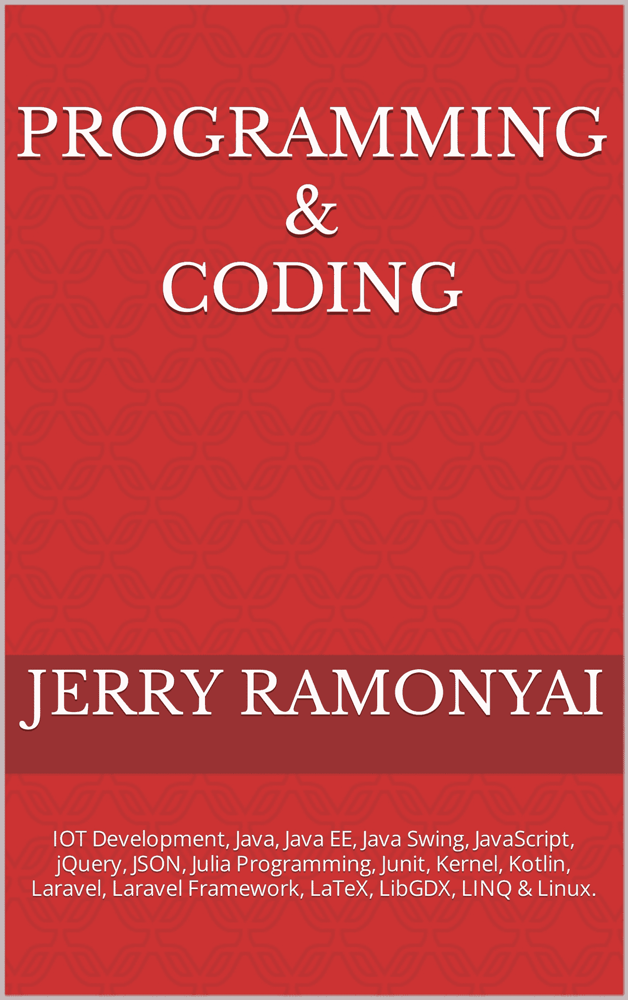
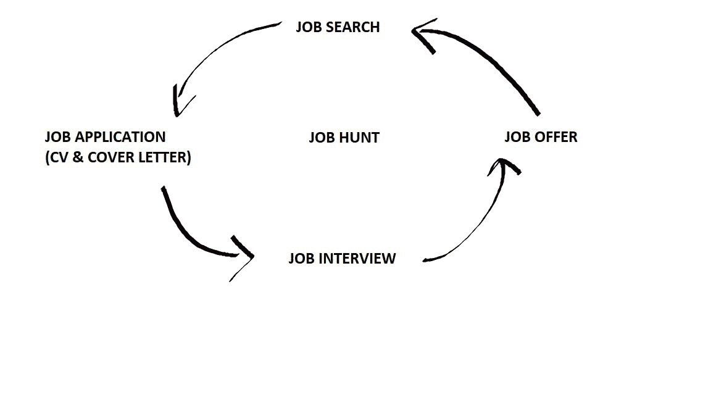
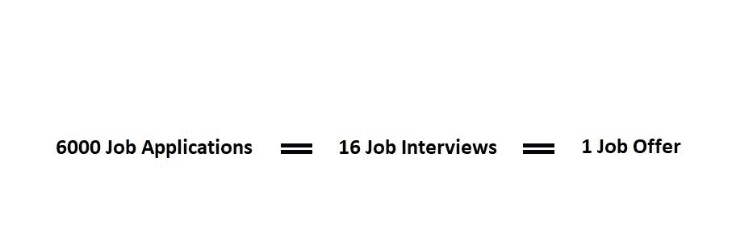
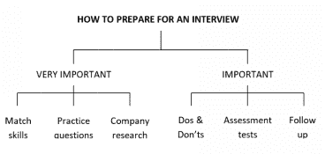
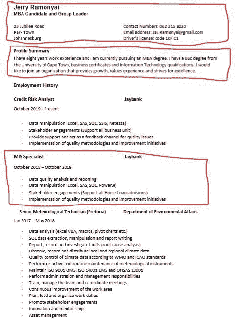
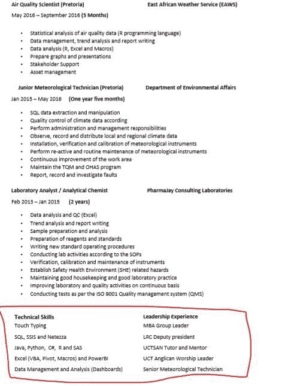
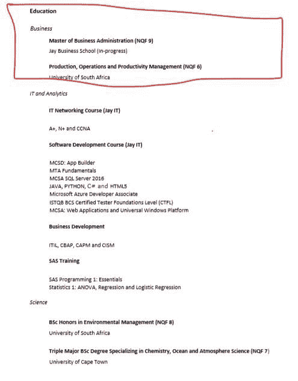
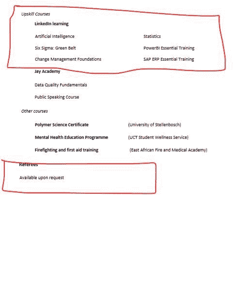

# 编程与编码：IoT 开发、Java、Java EE、Java Swing、JavaScript、jQuery、JSON、Julia 编程、Junit、内核、Kotlin、Laravel、Laravel 框架、LaTeX、LibGDX、LINQ 与 Linux

[@SuccessAnalytiX](https://successanalytics.blogspot.com/) 版权所有 ©2020 Jerry Ramonyai 保留所有。

# 第一部分：智慧
### 科学、工程与技术。
业务运营、数据、计算机、人工智能、利润、增长、成功、财富……

嘿 Siri，人工智能是什么？

人工智能（`AI`）是机器对人类智能过程的模拟，例如自然语言处理机器、语音识别机器、机器视觉、专家系统等。它是计算机、机器人或机器执行通常由人类完成的任务的能力，因为这些任务需要人类的智能和判断。人工智能的目标是创建出能够思考、学习和执行理性任务（如解决问题、决策、感知）并理解人类交流（human communication）的计算机和机器。

**人工智能的类型**
*   反应式机器
*   有限记忆机器
*   心灵理论机器
*   自意识机器

**人工智能的示例**
*   制造机器人。
*   自动驾驶汽车。
*   智能助手。
*   主动健康管理。
*   疾病制图。
*   自动化金融投资（交易）。
*   虚拟旅游预代理。
*   社交媒体监控。
*   聊天机器人。
*   `Siri`。

### 机器学习
机器学习是人工智能的一个分支，使用数据分析方法来自动化模型构建活动。机器学习算法使用历史数据作为输入来预测新的输出值。这使得软件应用程序能够在没有被显式编程的情况下更准确地预测结果。机器学习被用于互联网搜索引擎以寻找最佳搜索结果、邮件过滤器以寻找垃圾邮件、在线商店以进行个性化推荐、检测异常交易的软件、语音识别、自动驾驶汽车等。

**热门的机器学习技能**
*   `Python`。
*   `R` 编程语言。
*   `Java`。
*   `Scala`。
*   `SQL`。

### 数学
数学是关于数字及其运算、组合、概括、抽象、空间配置、结构和变换的科学。数学有许多分支，即代数、几何、算术、微积分等。数学让我们的生活变得有序，防止混乱，提高推理能力、创造力、抽象思维和批判性思维。

**数学的分支**
*   代数
*   几何
*   微积分

### 统计学
统计学是数学的一个分支，涉及开发收集、解释和展示数据的方法，通常用于分析某事发生的概率。这在机器学习和人工智能中非常有用。统计学背后的数学理论高度依赖微积分、线性代数和概率论。概率在统计学中起着关键作用，帮助人们对更大的群体做出智能且准确的结论。

**生活中的统计学**
*   医学研究。
*   天气预报。
*   股市。
*   消费品。
*   决策。

**热门统计学概念**
*   平均值
*   标准差
*   回归
*   假设检验
*   样本量

**统计分析的类型**
*   描述性分析
*   诊断性分析
*   预测性分析
*   规范性分析

### 工程
工程是利用科学技术解决生活问题的行为。工程师通过发明、设计、建造和测试机器、复杂系统、小装置和材料来开发新的技术解决方案，在考虑实用性、安全成本的同时实现功能目标。

**工程的分支**
*   机械工程
*   化学工程
*   土木工程
*   计算机工程
*   航空航天工程
*   电气与电子工程
*   材料工程

### 科学
科学是通过遵循系统的方法论寻找证据来对知识的追求和应用。科学方法论包括进行实验、测量结果和分析信息（数据分析）。科学为日常生活产生解决方案，并通过技术帮助实施这些解决方案。

**科学的类型**
*   数学与信息科学。
*   物理科学。
*   环境科学。
*   生物科学。

### 计算机科学
计算机科学是对计算机器和计算本身的研究。它研究了从算法到在硬件和软件中实现计算系统的实际问题的各种课题。计算机科学专业的学生学习如何使用计算机和计算过程来解决问题、构建网站、编写机器人、挖掘数据等。计算机科学需要理解数学和编程。离散数学、线性代数、数论和图论是与计算机科学专业相关的数学课程。

### 计算机工程
计算机工程是工程的一个分支，它结合了电气工程和计算机科学领域以创建新的计算机硬件和软件。计算机工程师参与计算机架构和功能的设计。

### 编程
编程或编码是通过编写系统的指令行与计算机进行通信的行为，这些指令将指示计算机执行某些操作。编程语言被用于创建网站、应用程序以及我们每天交互的其他技术。例如，你可以使用 `HTML` 编程语言告诉你的计算机如何设计你的网站。编程和编码的意思相同，它只是使用你的计算机理解的编程语言告诉你的计算机要做什么。编程可以使用多种编程语言进行，如 `JavaScript`、`Python`、`C++` 等。在编程或编码方面，有很多东西需要学习。只学习你那个时刻需要的内容，否则你将错过大局。大局始终是取得平衡并并在生活中获得成功。你可以通过注册课程或自学来学习编程，有很多优秀的程序员是自学成。学习编程最简单的方法是看别人做，你可以通过 YouTube 实现这一点。编程技能在 IT、数据分析、营销、网页设计和许多工程领域都非常重要。

**编程语言分类**
*   过程化编程
*   函数式编程
*   脚本性编程
*   逻辑编程
*   面向对象编程

**如何学习编程**
*   通过实践来学习，而不只是阅读。
*   分享、教学、讨论和寻求帮助。
*   使用在线资源。
*   理解基本概念。
*   学习数据结构和算法。
*   构建项目。
*   实验。
*   从 `SQL` 开始，它很简单。
*   使用免费的在线课程。
*   买一本书。

**编程的类型**
*   数据压缩
*   错误控制
*   加密编码
*   线路编码

**热门编程语言**
*   `C++`
*   `Javascript`
*   `PHP`
*   `Python`
*   `Go`
*   `Swift`
*   `Scala`
*   `Elm`
*   `Ruby`
*   `C#`
*   `HTML`
*   `SQL`
*   `SAS`
*   `R` 编程语言

### 软件开发
软件开发是通过设计、编程、编写文档、测试和调试代码来创建和维护计算机应用程序（App）、框架或其他软件组件的过程。

**软件开发的类型**
*   前端开发。
*   后端开发。
*   全栈开发。
*   桌面开发。
*   Web 开发。
*   数据库开发。
*   移动开发。
*   云计算。
*   应用开发。
*   API 开发。

**软件的类型**
*   应用软件。
*   免费软件。
*   共享软件。
*   开源软件。
*   系统软件。
*   实用软件。

### 网络
网络是通过设计、编程、编写文档、测试和调试代码来创建和维护计算机应用程序（App）、框架或其他软件组件的过程（注：此处原文定义与软件开发重复，已按原意翻译）。网络是通过编写系统的指令行与计算机进行通信的行为（此处原文定义与编程重复）。网络也被定义为多个计算机之间的电子连接。

**网络类型**
*   `LAN`（局域网）
*   `PAN`（个人局域网）
*   `MAN`（城域网）
*   `WAN`（广域网）

**计算机网络职业**
*   网络管理员。
*   网络架构师。

**网络优势**
*   通过安全卡实现。
*   电子化集成。

# 信息技术 (IT)

信息技术（IT）是业务运营的核心。企业高度依赖 IT 来提供其产品和服务。企业完全依赖 IT 来执行其日常运营，然而，这种对 IT 的依赖也是重大风险的来源，因为如果使用不当，IT 系统可能会导致企业无法提供其产品和服务，从而影响企业的业务绩效。企业利用 IT 来提供产品和服务、进行创新、实现战略目标，并通过卓越的运营获得整体竞争优势。

没有信息就没有成功。你必须能够收集和分析信息才能成功。这就是为什么阅读重要得惊人。分析信息是思考的形式，人类对信息的需求正如公司对大数据的需求一样大。这就是为什么数学如此重要。数学是分析学，分析是思考，思考需要信息，而信息通向成功。这就是成功的分析学。

## 信息技术示例
* 电话和收音机。
* 互联网。
* 视频会议设备。
* 计算机。

## 信息技术职业
* 技术支持。
* Web 开发人员。
* 计算机系统分析师。
* IT 安全。
* 网络工程师。
* 数据库工程师。
* 软件开发人员。

## 大数据分析师所需的 5 种技能
* 编程。
* 数据管理。
* 计算框架。
* 定量分析与统计。
* 业务知识。

## 高薪大数据工作
* 量化分析师。
* 数据科学家。
* 统计学家。
* MI 和 BI 专家。

## 大数据专业人员技能
* `Qlik View`、`Tableau`、`Power BI` 和 `Excel`。
* `Alteryx`、`Spotfire`、`Scala` 和 `Presto`。
* `SAS`、`R`、`Python`、`Java`、`XML` 和 `HTML`。
* `VB.NET`、`Azure`、`C`、`C++` 和 `C#`。
* `Cldera`、`Cassandra`、`HDFS` 和 `Teradata`。
* `Oracle`、`SQL`、`NoSQL` 和 `Hadoop`。
* `Informatica`、`IBM`、`AbInitio`、`ERP` 和 `SAP`。
* `AWS`、`Talend`、`Spark`、`Reltio` 和 `DevOps`。

## 大数据
数据管理、决策、信息、增长、成功、财富……
数据科学、数据管理、数据架构、数据工程师、这个数据、那个数据、这些数据数据……

## 数据管理
数据管理是将数据存储和维护为组织价值资源的实践，以释放其潜能。管理数据需要稳健的数据策略，以及关于如何访问、集成、清洗、治理、存储和为分析准备数据的计划。`Data Architects` 必须设计如何有效高效地使用 IT 基础设施，以支持并最大化组织对数据的利用。

## 数据架构
数据架构是 IT 基础设施如何支持你数据战略的概述或计划，展示了数据如何被获取、传输、存储、查询和保护。它是一套规则、政策、标准、图表和模型，规定并解释了数据如何在组织内部被使用、存储、管理和整合，以确保高效利用。数据架构的目的是展示数据、业务目标与运营战略之间的关系。

## 数据科学
数据科学是一个多学科领域，利用科学方法、流程、算法和系统来管理数据，并从结构化和非结构化数据中提取知识和洞察。它专注于通过创建可持续的数据管理方式来解决大数据问题，并确保业务能够从数据中获益。数据科学包含了数据管理和数据分析。它是数学、统计、业务和技术的融合。

数据科学、信息管理、数据管理、数据工程、数据仓库和数据分析在工作环境中经常互换使用，这是件好事，因为它们几乎是同一件事，但有些人仍然喜欢花时间尝试区分它们。不要那样。不要故意浪费时间。你有更多更重要的事情可以花时间去做的。正如你将在本书中所看到的，时间是成功的关键要素之一。只要你的职业是围绕大数据展开，那么你的职位名称可以是任何与数据相关的名称，这个数据、那个数据、这些数据数据……。你只需要知道 `SQL`、`SAS`、`Excel`、`Python` 和 `R`。至少掌握其中两个。这就是你需要的全部。

## 数据科学工程师的基础技能
* 数据分析（`Microsoft Excel`）。
* 数据库管理（`SQL`）。
* 数据质量知识（`DMBOK` 原则）。

## 数据科学工程师的高技能
* 使用 `Python`、`R` 或 `SAS` 编程。
* 对概率和统计学有坚实的理解。
* 数据可视化工具（`PowerBI`）。

## 数据管理的组件
* 商业智能。
* 数据架构。
* 数据治理。
* 数据集成。
* 数据建模。
* 数据质量。
* 数据安全。
* 数据仓库。

## 大数据工作的热门技能
* `SQL`、`R`、`Python` 或 `SAS` 编程语言。
* `Microsoft Excel`。
* 批判性思维。
* 数据可视化（仪表板）。
* 演示技巧。
* 机器学习和人工智能。
* 数据仓库。
* ETL 工具（`SSIS`）。
* 数据 API。
* 编码和编程语言。
* 算法和数据结构知识。

## 数据处理的六阶段
* 数据收集。
* 数据输入。
* 数据处理。
* 数据分析。
* 数据报告。
* 数据存储。

## 开发成功的数据架构
* 评估工具和系统的工作原理。
* 定义业务目标和目的。
* 为数据结构制定整体计划。
* 选择数据管理和可视化工具。

## 如何成为数据科学工程师
* 学习基础数学和统计。
* 学习编码。
* 理解数据库。
* 学习 `microsoft Excel` 和 `SQL`。
* 获得技术或计算机科学学位。
* 申请工作。

## 大数据工作
* 数据科学家。
* 数据分析师。
* 数据工程师或数据架构师。
* MI 或 BI 分析师。
* 机器学习或人工智能工程师。
* 量化分析师或统计学家。

## 常见数据类型
* 布尔（`true` 或 `false`）
* 字符（`a, b, c`……）
* 日期（`03/01/2021`……）
* 浮点数（`1.54345345e308`……）
* 整数（`1234`……）

## 免费数据库管理软件
* `Microsoft SQL server`。
* `SolarWinds`。
* `Dbvisualizer`。
* `Manageengine applications manager`。
* `Oracle rdbms`。
* `Ibm db2`。
* `Teradata`。

## 数据策略
数据策略、信息、决策、增长、成功、财富……
这就是组织使用数据的方式

## 数据分析（图表与仪表板）
数据管理团队产生的数据帮助分析团队创建仪表板，从而驱动业务并确保商业智能是竞争优势的关键要素之一。分析团队从业务部门接收仪表板需求，并向数据管理团队请求数据。仪表板创建后，分析团队维护仪表板，数据管理团队维护供给仪表板的数据。数据管理团队的主要目标是根据可用资源（资金、材料、机器和人力）尽可能地生产仪表板。

## 自动化
项目结束后，对新仪表板的数据流程进行优化和自动化，前提是其增加了组织的价值。

## 可靠性与追踪
对所有团队的产出进行基准测试，以确保团队的可持续性和可靠性。

接收 90% 的项目。接收需求后，团队将使用敏捷方法尽快完成任务。这涉及将任务分解为更小的里程碑，并在两周的冲刺中完成这些里程碑。成功或失败的项目都计入 90% 之内。

成功是一种算法。

### 成长
要在生活中取得成功，你必须不断成长。成长意味着不断向你的大脑输入信息。信息可以来自许多资源，如书籍、视频、音频等。这就是为什么大多数成功人士读的书都比任何人都要多。要获取信息，你需要物质材料和人。要从物质中获取信息，你需要具备管理时间、技术和金的能力。要从人那里获取信息，你需要具备激励、鼓励和与他人产生共情的能力。

### 信息
没有什么知识不是力量。信息以不同的形式、形状和风格存在。在特定的时刻，你需要适合你的正确信息。你的大脑每秒都有不同的视角，这是因为你的大脑每秒都在通过所有的感官收集信息，因此你在一秒前收到的信息如果你在一秒后获取，感知会有所不同。这就是为什么你必须不断学习和成长。这也解释了为什么没有什么知识不是力量，因为当你的视角改变后，无关的信息在秒后可能变得相关。

### 管理技能
为了能够处理时间、技术和金，你需要技术性技能，如规划、组织、设计和资源控制。这四项技能是关键的管理技能。如果你拥有卓越的管理技能，你将能够有效高效地利用你的资源，到足以获取使你获得成功的相关信息。

### 领导力
为了能够激励、鼓励并与他人产生共情，你需要软技能，如沟通、倾听、诚信、团队合作等。这被称为领导力技能。如果你能有效运用领导力技能，你就能从人们那里获得你想要且与成功相关的所有信息。领导者必须意识到，人们需要被激励，需要被鼓励，并且通过健康和福祉来获得能量。

### 金钱
生活中的每个人都需要收入来源。我们需要钱来生存。我们需要钱来购买食物、住所以及生活中所有必需品。最重要的是，我们需要钱来直接或间接地购买信息。这就是为什么生活中的大多数人会找工作或创业。关于找工作、赚钱和致富将在下文中详细解释。

### 技术
技术是能够赋予人类获取信息巨大竞争优势的最大物质材料之一。这就是为什么信息技术正在改变世界，这也是为什么第四次工业革命实际上就是信息技术。能够让你更接近信息的技术才是值得保留的技术。

### 人
大脑是人类身上一个非常复杂的器官。大脑存储了人类拥有的所有信息，为了让你能够获取这些信息，那个人必须处于正确的情绪状态。为了一个人处于正确的情绪状态，他们所有的需求都需要得到照顾，包括健康、能量和被激励的需求。

### 成功原则
- 自学。
- 明智地选择你的职业。
- 每五年进行一次投资。
- 还清坏债。
- 避免生活方式膨胀。
- 嫁给对的人。
- 不要思考无用的事。
- 行事前计划。
- 失败是学习的机会。
- 学习理财知识。
- 管理好自己的事。
- 利用税收优势。
- 永远不要停止学习。
- 机会永远在那里。
- 思想和行动创造成功。
- 成长，而不是竞争。
- 引导你的思维向积极思考。
- 为机会存钱。
- 低于能力生活。
- 每日跟踪支出。
- 掌管自己的生活。
- 不要指责，承担责任。
- 志存。
- 设置 SMART 目标。
- 接受改变。
- 精通时间管理。
- 多和赢者在一起。
- 照顾好你的健康。

### 领导力
情商、管理、生产力、信息、成长、成功、财富……

领导力处理人，管理处理其他资源。领导力是确保每个人都能有效高效地实现目标的能力。生活充满了让人们偏离计划并无法实现目标的问题。当问题出现时，就需要领导力和管理。领导力处理的是人，而不是问题。管理处理的是问题，而不是人。领导力在保持每个人专注、激励和赋予他们以提高生产力方面发挥着巨大作用。领导力的目标是确保每个人都感到平静。领导者应该更多关注人的福祉，而经理应该关注解决技术问题。

### 权威
领导力不是为了解决技术性问题，那是经理的工作。经理的工作是确保他们消除每一个给人们生活带来压力的问题。领导者的工作是确保人们感到平静，因为知道经理正在解决问题并委派任务。这意味着领导者必须传达问题正在解决的信息，他们必须与人们产生共情，建立信任，如果问题没有得到解决，领导者将不得不解决可能出现的冲突。经理应该想出一个计划来解决技术问题并委派任务。这意味着你应该知道何时充当领导者，何时充当经理。如果你混淆了两者，你就完蛋了。领导力和管理都是技能，意味着它们是可以学习的。读读书就行。

# 管理与领导力
事情通常不会按照计划进行，当发生这种情况时，你需要有人介入并确保问题得到解决（经理），并确保人们保持专注而不恐慌（领导者）。领导者必须给人们希望。这可以通过以身作则并设定一个让每个人关注的愿景来实现。设定需要关注的目标可以帮助人们一直坚持下去，因为他们知道有一个明确的目标要实现，即使短期内出现问题，人们也会持续努力直到实现目标。

# 管理与领导力

管理与领导力是相互依赖的。管理者必须能够领导，而领导者也应该能够具备管理能力。领导者应当领导，这意味着他们应该与人互动，在互动完成后，他们应该处理手头的问题。管理者应该处理问题，然后通过与人的互动来引导他们。

永远不要管理人。要管理问题并引导人。解决问题被称为管理；让人们感到心安被称为领导力。你两这两项技能，并且应该知道何时扮演管理者的角色，何时扮演领导者的角色。

教学、指导、辅导和授权。当出现问题时，没有人能随时解决所有问题，因此领导者和经理需要能够对每个人辅导、指导并激励，以便他们在情况变得不妙时准备好介入并控制局面。

## 领导力的核心价值观

这是一份优秀的价值观列表，如诚实、自信、尊重、同理心等。你应该列一份你想要学习的核心价值观清单，并优先学习和掌握这些价值观。强大的核心价值观是成就优秀领导者的关键。

## 谈判

你必须能够用更少的资源（即时间、精力和金）完成所有工作。做到这一点的一种方法是为你的资源争取更好的交易条件。由于领导力涉及人，领导者必须学习如何谈判。

这包括大批量购买资源并谈判获得更好的折扣。保持道德道德和诚实至关重要。不要滥用你的谈判权力，不要给人们低于公平的回报。生活中的一切事都通过能量连接在一起，如果你行为不道德，你就会释放负能量，这些能量将会反作用在你身上。那是另一个故事的话题，我会专门写一章关于谈判。

## 建立关系

领导者必须能够与他们接触的每个人保持联系。沟通是一切的核心。领导者必须利用所有可用工具与每个人进行有效高效的沟通，而信息技术正在使这一切成为可能。

## 领导者的核心价值观

- 诚信。
- 授权能力。
- 沟通。
- 自我认知。
- 感激。
- 敏捷。
- 影响力。
- 同理心。
- 耐心。

# 如何成为一名优秀的领导

## 实践个人成长。
- 成为一名优秀的团队成员。
- 每天阅读。
- 提供愿景。
- 改进组织结构。
- 设定清晰的沟通协议。
- 授权。
- 学习冲突管理策略。
- 教练、指导和教学。
- 诚实且开放地沟通。
- 鼓励人们阅读。
- 培养积极的态度。
- 设定明确的目标和预期。
- 关注结果而非过程。
- 建立自信。
- 回答问题。
- 准确地告诉人们你希望他们做什么。
- 不要让人们过度工作。
- 以身作则。
- 不要生气，只需重复你说过的话。

## 如何成为一名优秀的团队成员
- 分享信息（提问和回答问题）。
- 关注目标和结果，而不是过程。
- 公平、积极且支持。
- 欣赏多样性的益处。
- 学习领导技能。
- 保持条理。
- 设定明确的目标。
- 拥有强大的核心价值观。
- 支持承担风险和改变。
- 为每个团队成员设定清晰、明确的角色。
- 鼓励多元化思维。
- 均匀分配工作。
- 关注正确的事。不要偏袒。

## 核心团队技能
- 沟通。
- 冲突解决。
- 解决问题。
- 倾听。
- 批判性思维。
- 协作。
- 领导力。
- 谈判。

## 如何教学、指导和教练
- 鼓励积极学习。
- 给出建设性反馈。
- 尊重不同的天赋和学习方式。
- 善倾听并理解。
- 保持耐心。
- 多读书。
- 不做评判。
- 对不同意见保持开放。
- 提供示例和观点。
- 回答问题。
- 提出开放式问题。
- 学习情感智能。

## 领导与管理风格
- 专制型领导。
- 权威型领导。
- 标杆型领导。
- 亲和力型领导。
- 放任型或自由放任型领导。
- 参与型领导。
- 授权型领导。
- 交易型领导。
- 变革型领导。
- 官僚型领导。
- 魅力型领导。
- 教练型领导。
- 民主型领导。
- 协作型领导。
- 指挥型领导。
- 愿景型领导。

## 核心领导特质
- 自我。
- 团队发展。
- 伦理实践与良好治理。
- 创新。
- 沟通。
- 愿景。
- 共情心。
- 责任感。
- 感恩。
- 慈悲。
- 信心。
- 决策。
- 诚信。
- 谦逊。
- 韧性。
- 影响力。
- 积极。
- 灵感。
- 战略性与批判性思维。
- 开放心态与创造力。
- 灵活性。
- 可靠。
- 诚实。
- 忠诚。
- 印象管理。
- 果断。
- 倾听。
- 给予反馈。
- 时间管理。
- 计划与执行。
- 组织与授权。
- 激励。
- 智力。
- 相关知识。

### 管理
时间、技术、管理、生产力、增长、成功、财富……

领导力让人感觉更好，而管理则解决问题。你需要这两项技能。

成功是在你生活的各个领域持续获得最佳结果的能力。成功带来财富。成功来自持续的增长，而增长由信息带来。为了获取信息，你需要五种主要资源：时间、金、能量、技术和人。每个人都有这五种资源，无论多少。数量并不重要，重要的是你如何利用这些资源来实现成功。

要成功地使用这五种资源，你需要两种技能：管理和领导力。领导技能帮助你有效高效地处理人际关系，让你从人们那里获得你想要的所有信息。管理技能帮助你有效高效地使用其他四种资源（时间、金、能量和技术），让你从这些其他资源中获得你想要的所有信息。

### 管理
管理你的资源意味着规划、组织、设计和控制你的资源（时间、金、能量和技术）。规划包括设定目标并决定用于实现目标的策略。组织包括安排你的资源（时间、金、能量和技术）以实现目标。

建立战略意图。战略意图是你为了实现根本目标而计划在未来实现。

愿景、使命和价值观声明是用于设定战略意图的工具。你的愿景解释了你想变成什么。你的使命声明解释了为了成为未来想要的样子，现在应该是什么，它解释了你将如何为生活带来改变。价值观是你为了支持愿景和使命必须遵循的行为。目标是为了交付使命和愿景而必须采取行动。你必须制定战略愿景，设定目标，设计实现目标的策略，实施并执行所选策略，评估绩效并启动性调整。

### 管理的四个核心职责
- 规划
- 组织
- 设计
- 控制

### 管理规则
- 明确你的目标并分享你的愿景。
- 为人们制定一份路线图。
- 教学并以身作则。
- 教学并授权。
- 帮助人们解决问题。
- 花大部分时间在规划上。
- 保持一致。
- 保持透明。
- 认可所有的意见和想法。
- 对每个人采取不同的对待。

## 权力
影响力、领导力、管理、人、信息和成功……

权力随着巨大的责任。权力是采取行动并对他产生影响的能力，无论是通过礼貌还是攻击的方式。你可以通过成为优秀的领导者以礼貌的方式影响人们。优秀的领导者每天阅读并成长。糟糕的领导者具有攻击性且强势，通常是因为管理地位。

影响他人并对他拥有权力是一项非常有挑战性的任务，因为人有情感，如果他们被对待不好，就会报复。真正的权力和来自于学习人们的情感，掌握沟通艺术，并加倍努力人们拥有的不同观点。要影响他人，你必须擅长满足人们的需求。如果人们从你那里获得了价值，他们通常会听你的，因此，如果你帮助人们满足需求，你就为他们的生活增加了价值，从而能够影响他们。

要影响他人并对他拥有权力，你必须拥有他们需要的东西。某些为他们的生活增加价值的东西。如果人们对你一无要求，你就没有权力。人们生活中需要的一些包括金钱、时间和信息。如果你能为这些人提供资源，你就可以影响他们。这是因为这些资源是成功的要素，而每个人都想成功。

### 权力原则
- 始终留有一笔钱备不时需。
- 阅读比你认识的所有人都多。
- 少说多想。
- 不要表现出情感。
- 用金钱买时间。
- 不要信任任何人。
- 提高你的时间管理技能。
- 计算一切。
- 不要试图给他人留下印象，关注正确的事。
- 每天运动。

# 如何影响他人
- 展现你的魅力（同理心）。
- 倾听他人。
- 注意他人想要什么。
- 为他人的生活增加价值。
- 非常擅长解决冲突。

## 谈判规则
- 多听少说。
- 使用沉默的力量。
- 提问。
- 保持公平。
- 在谈判前明确你想要什么。
- 目标是实现双赢的谈判。
- 学习冲突解决策略。
- 做好准备。
- 制定策略。
- 保持简单。

### 批判性思维
思考、计划、优先排序……
如果你不计划，你就是在计划注定会失败 —— 苯杰明·富兰克林。

思考是一种处理信息、建立联系、做出决策和创造新想法的心理活动。思考也可以被看作在大脑中制定待办事项的过程。思考是通往成功的第一步。生活中有太多要做的事情，但只有 20% 的事情会带来成功，因此每个人在行动之前都必须思考并据此确定优先级。在采取行动时，从那些能带来成功的活动开始。每一个念头都必须写下来。这有助于显性化、思维分析和计划。

### 批判性思维
批判性思维是清晰、理性地遵循逻辑来决定该做什么或相信什么的能力。它是一种进行反思性思考、理解观点之间的逻辑联系，并理解事物在何地、如何、何时、什么以及为什么是现在这样的能力。它是关于尽可能多提问，直到你获得所需的所有信息。信息引导增长，增长带来成功，成功带来财富。

批判性思维有助于做出良好的决策。你必须能够权衡问题解决方案的优缺点。你必须查看所有可用数据，并根据提供的数据权衡优劣做出明智决策。大数据之所以流行正是因为此。经理可以通过大数据做出良好的决策。

### 制定待办列表
你应该能够确定事情发生的什么、何时、为何、何地以及如何。这被称为进度安排。不做到这一点会导致灾难，简单而直接。写下每一个细节。为每个里程碑准备一份待办列表、任务日历和检查清单。这将有助于任务显性化、执行过程的可视化以及问题的分析。

### 风险管理
你必须能够计划并管理出错的情况。生活中的事情通常会出错，这是既定的事实。这是因为与计划不同，生活是对时间敏感的，像延迟交付这样的小事就会导致巨大的灾难。你必须预判可能出错的地方，并计划在那种情况下怎么办。这就是风险管理包含的内容。

### 如何进行批判性思考
- 重构信息。
- 评估后果。
- 提问。
- 保持观察力。
- 每天阅读。
- 查看历史数据。
- 研究。
- 寻找事实、数字或科学。
- 善于分析，拆解信息。

### 批判性思维过程
- 观察
- 调查
- 分析
- 解释
- 评估
- 反思

## 决策与问题解决
问题、信息、决策、增长、成功和财富……
失败是学习的机会。

解决问题是定义问题、确定问题根源并寻找解决方案的行为。解决的问题越多，你就变得越富有、越成功。

### 解决问题的流程
- 描述问题。
- 拆解问题。
- 找到根源。
- 研究并阅读直到直到找到解决方案。
- 实施解决方案。
- 衡量结果。

### 解决问题的技能
- 积极倾听。
- 批判性和创造性思维。
- 研究与阅读。
- 沟通。
- 决策。
- 团队合作。

### 决策
决策是收集信息、评估后果并选择一个负面后果较少的选项的过程。优秀的决策者会选择为所有人带来最佳结果的行动。他们在研究、权衡后果，并在保持开放心态的同时做出理性的决策。

### 决策过程
- 识别方案。
- 收集相关信息。
- 权衡后果。
- 选择。
- 采取行动。
- 审查你的决策。

### 创造性思维
创造性思维是以新方式考虑某些事的能力，例如对问题有新方法，或从数据集中获得新结果。这是一个你的大脑为问题产生新的、不寻常且高效的解决方案的过程。

### 如何培养创造性思维
- 脑风暴创意。
- 重新定义问题。
- 保持开放灵活。
- 使用你的想象力。

### 提高记忆力的方法
- 读书。
- 尝试鱼油补充剂（Omega 3）。
- 保持健康体重。
- 少喝酒。-- 运动。
- 尝试冥想。
- 喝咖啡。
- 充足睡眠。
- 少吃添加糖。

## 专业技能
- 编程/编码。
- 软件熟练度。
- 项目管理。
- 数据分析。
- 技术。
- 写作。
- 会计。
- 工程。
- 医学。
- 解决问题。

## 人际交往技能
- 团队合作。
- 沟通。
- 职业道德。
- 灵活与适应能力。
- 决策。
- 时间管理。
- 冲突解决。
- 倾听。
- 谈判。
- 同理心。
- 果断。
- 教练、教学和指导。

## 公开演讲
信息、自信、公开演讲、金、增长、成功、财富……
练习，练习，练习。

### 公开演讲规则
- 研究并了解关于你主题的一切。
- 计划并准备你的演讲。
- 练习直到你感到自信。
- 阅读你的担忧。
- 视觉化成功。
- 深度呼吸。
- 关注你的演讲，而不是观众。
- 不要害怕沉默。
- 关注你的肢体语言。
- 在演讲前喝杯水。
- 在演讲当天补充咖啡因。
- 积极思考。
- 观看你的演讲录像。
- 保持简单。
- 与观众进行眼神交流。
- 不要担心你的弱点。
- 必须讲述故事。
- 逻辑化地组织观点。
- 练习带来自信。
- 疯狂地研究你的主题。
- 在演讲时放慢速度。
- 你的演讲应该有 10 张幻灯片。
- 演讲时间应该是 20 分钟。
- 字体应该大于 30 号。
- 尽早到达。
- 在演讲前拉伸身体。
- 在演讲前访问会场。
- 准时结束。
- 每一张幻灯片尽可能少用单词。
- 明确你的演讲目标。

### 演讲类型
- 信息性演讲。
- 娱乐性演讲。
- 演示演讲。
- 说服性演讲。
- 特殊场合演讲。
- 演讲稿演讲。

### 演讲技巧
- 流利度。
- 词汇。
- 发音。

## 谈判
- 一切都是可以谈判的。
- 在谈判前明确你想要什么。
- 目标是实现双赢结果。
- 不要个人化。
- 使用沉默的力量。
- 将公平的报价放在桌面上。
- 如果报价不公平，就离开。
- 不要做假设，提问。
- 不要匆忙，保持耐心。
- 不要接受糟糕的交易。
- 不要过度谈判。
- 不要让情绪主宰。
- 不要走捷径。
- 谈判前做好研究。
- 完成你的作业。
- 分别谈判每个部分。
- 提供公平的方案。
- 建立关系。
- 从不同的角度思考。
- 关注独特特征。

### 谈判阶段
- 确定目的。
- 准备。
- 信息交换。
- 讨价。
- 结论。

### 谈判技能的好处
- 职业发展和职业增长。
- 冲突解决。
- 解决问题。
- 沟通。
- 说服。
- 销售。
- 团队合作。

## 沟通
信息、沟通、增长、成功和财富……
倾听……倾听……
能够有效且高效地沟通是成功最重要的技能之一。当你沟通时，确保你的信息是清晰、简洁、具体、正确且礼貌的。这些被称为沟通的七要素。有效的沟通不在于说而在于听。倾听意味着理解所传递的文字或信息，同时也理解演讲者试图传达的情绪。有效沟通可能是生活中最重要的技能，因为它让我们能够向他人传递信息并理解所说的话。信息是成功的中心，因为信息引导增长，持续增长带来成功，因此，接收和传递信息是成功的关键之一。

### 沟通失败
沟通失败是误导性的、无效的或攻击性的信息。永远为了伤害而沟通，要为了增长而沟通。如果你愤怒并想对某人说伤害的话，请离开，记住你将在书中学到的情商。记住，要成功你需要获取一切信息，沟通是获取信息的关键策略之一。信息的危险之处会导致情绪，如果你不擅长控制情绪，就会遇到麻烦。诀窍在于，为了控制情绪你需要更多信息。

### 成为良好沟通者的技能
- 倾听。
- 肢体语言。
- 压力管理。
- 情绪控制。
- 清晰与简洁。
- 自信。
- 同理心。
- 开放心态。
- 尊重。

### 如何传达坏消息
- 眼神交流。
- 尝试保持中立。
- 做好准备。
- 使用事实。
- 不要谈判。

### 报告写作元素
- 标题页。
- 目录。
- 执行摘要。
- 引言。
- 讨论。
- 结论。
- 建议。
- 参考文献。

### 良好报告的特征
- 简单。
- 清晰。
- 简洁。
- 积极。
- 标点符号。
- 方法。
- 可读性。
- 准确性。

## 倾听
沟通、倾听、信息、增长、成功和财富……
不要打断。
倾听是准确接收和解释传递给你的信息的能力。倾听是所有有效且高效沟通的关键。如果没有有效倾听的能力，信息很容易被误解，信息就会丢失。没有信息，成功就很容易实现。如果你想成功，倾听是你应该掌握的沟通技能之一。有效倾听有助于解决冲突、建立信任、激励他人、提高生产力并增长。在大多数对话中倾听，成为良好的沟通者并做出良好的决策。

### 如何倾听
注意演讲者的语言和非语言语言，以完全理解他们表达的内容。倾听意味着在演讲者说话时不要打断。如果你想说些什么，请等演讲者说完。有效地倾听需要时间、精力和努力。

### 倾听和问题解决
- 认真倾听。
- 向人们请求反馈。
- 疯狂地练习。
- 不要立即回答。
-  这需要花时间去思考。
- 你的演讲应该有 10 分钟。
- 只需要花时间去思考。

### 主动倾听
主动倾听是一种要求倾听者完全专注、理解并记住所说内容的技术。主动倾听用于咨询、培训和解决纠纷。这被称为“鸭子效应”。

### 倾听的障碍
干扰信息传递的障碍包括：
- 内部想法。
- 缺乏专注。
- 环境噪音。
- 选择性倾听。
这是沟通中最大的问题之一。

### 倾听技巧
- 注意。
- 释义和总结。
- 不要做判断或跳到结论。
- 通过点头来倾听。
- 提问。

## 教练
目标、里程碑、教练、增长、成功……
在正确的时间提供正确的信息。教练旨在提高表现，而不是关注过去或未来。

### 关键教练技能
- 目标设定。
- 倾听。
- 同理。
- 批判性思维。
- 给予反馈。
- 知识和经验。
- 灵感。
- 沟通技能。
- 自我。
- 开放心态与创造力。
- 灵活与可靠。

### 领导风格
- 交易型领导。
- 变革型领导。
- 服务型领导。
- 民主型领导。
- 独裁型领导。
- 放任型领导。
- 魅力型领导。
- 愿景型领导。
- 亲和型领导。
- 节奏型领导。
- 教练型领导。

## 教学
教学是帮助人们理解和应用知识、概念和流程的过程。经理必须教、指导和教练人们如何实现目标。

### 良好老师的特质
- 沟通技能。
- 倾听技能。
- 友好的态度。
- 强烈的职业道德。
- 组织能力。
- 耐心。
- 创造力。
- 热情。
- 信心。
- 奉献。
- 同理。
- 领导技能。
- 领域知识。

### 教学原则
- 鼓励团队合作和个人工作。
- 积极学习。
- 给予反馈。
- 沟通预期。
- 尊重多元天赋。

### 如何教学
- 告诉人们具体做什么。
- 帮助修复。
- 使用经验学习。
- 推荐书籍。

### 学习类型
- 通过听和说来学习。
- 通过观察学习。
- 通过触摸或感受学习。
- 通过阅读学习。

### 如何记忆信息
- 记住关键词。
- 记住节奏或韵律。
- 使用缩写词。
- 查看图片或模式。
- 对信息分类。
- 使用数字。

### 阅读过程
- 寻找主思想。
- 理解单词。
- 寻找相似点和差异。

## 指导
指导是人之间分享信息，目标是职业和个人发展。导师通常与经验较少的人（学员）分享信息、经验和建议。

### 指导类型
- 一一对指导。
- 远程指导。
- 小组指导。
- 情境指导。
- 发展和职业指导。
- 同伴指导。

### 良好导师的特质
- 良好的倾听者。
- 灵活。
- 重视不同观点。
- 知识渊博。
- 不评判。
- 能够给予反馈。
- 诚实。
- 有资源。
- 良好的领导和管理技能。

### 成为导师的好处
- 增加自信。
- 增加自我意识。
- 领导技能发展。
- 强大的沟通技能。
- 提高倾听技能。
- 增加耐心。
- 提高人际技巧。

## 天赋
信息、技能、卓越、天赋、增长、成功、财富……
每个人都有天赋。天赋是一种自然的天赋。你的天赋取决于你的思考、感受和行为方式。这就是为什么说天赋是一种自然现象，因为你已经拥有了它，你已经在以某种方式思考、感受和行为。你并不是出生就带有它，但你已经拥有了。你的思想、感受和行为赋予了你做和成为任何人的潜力。当你尝试了很多事情并发现你擅长的某件事时，你就找到了你的天赋。你的天赋可以成长并转变成更美好、更大的东西，取决于你沿路获取了什么种信息。天赋是你脑中信息的产物。

时间是一个非常敏感的问题。非常敏感。每个人每天都有 24 小时，而取决于你每天如何利用这 24 小时，这决定了你的成功。你在这 24 小时内所做的每件事都应该围绕着尽可能获取信息来展开，因为信息确实是成功的核心。

当你睡觉时，你应该明确知道自己正在为大脑充电，以便第二天能更有效地使用大脑来获取尽可能多的信息。当你吃饭时，你应该明确知道自己正在为身体补充能量，以便你有足够的能量去获取信息。当你在这任何事情上浪费时间时，你应该知道那是在浪费时间，这会让你远离成功。

## 时间管理流程
- 设定一个明确的目标。
- 将你的目标分解为更小的里程碑。
- 编写一份 `To-Do List`。
- 使用 `80/20 Principle` 来确定优先级。
- 减少干扰。
- 阅读关于你正在做的事情的内容。
- 回顾你的一天。

## 时间管理技能
- 优先级排序。
- 授权。
- 决策。
- 目标设定。
- 解决问题。
- 战略性、批判性和分析性思维。
- 计划安排。

## 如何停止拖延
- 识别你拖延的原因。
- 将你的目标分解为更小的里程碑。
- 设定截止日期。
- 使用正向社交压力。
- 奖励自己。
- 每几分钟在两个任务之间切换。
- 消除干扰。
- 从小开始以获得动力。
- 分解最困难的任务。
- 不要做完美主义者。
- 不要试图完成每一个任务。
- 设定可管理的目标。
- 练习积极的自我对话。
- 制定行动计划。
- 关注你的强项。
- 寻求帮助。
- 多阅读。

## 80/20 生活方式
信息、行为、生活方式、成长与成功……花 `80%` 的时间在 `20%` 的任务上，这些任务能为你带来 `80%` 的报报。

# 如何使用 80/20 法则。

对于你生活中想要实现的每一个目标，你都必须选择一种有助于你实现该目标的生活方式。如果你想成功，你每年每年要读 12 本书。如果你想变得富有，你必须花费 `80%` 的时间在工作，这意味着你所做的一切就是吃饭、睡觉、工作以及每月休息一天来玩乐。这是 `80/20 法则`的实际应用，它将引导你走向成功。

人们想要成功，但不想花费 `80%` 的时间去工作。这是不会发生的。有些人想要欺骗成功，他们认为自己很聪明，认为他们现在努力工作，等以后富了就会停止努力。事情不是那样的。如果你富有，但工作时间少于 `80%`，这意味着你正在走下坡路，给一点时间，你很快就会变得贫穷。人类被创造是为了在 `20%` 的时间里娱乐，在 `80%` 的时间里工作。每月休息一天玩乐，其他时间则用于应对生活中的不确定性，前提是你确实计算了每月 `80%` 的天数。

## 富人的生活方式

每月玩乐一天是富人的生活方式。你会发现，富人享受工作。如果你不喜欢工作，你就需要改变这种态度。你必须喜欢工作才能富有。你不必喜欢你的工作，但你必须喜欢工作这件事。你必须喜欢成长。你必须喜欢高效率。如果你工作时间少于 `50%`，你将会贫穷。如果你工作 `50%` 的时间，你将过光光生活。如果你工作 `60%` 的时间，你会成为中产阶级。如果你工作 `80%` 的时间，你将会富有。如果你工作 `90%` 的时间，你将会卓越。

## 生活方式、改变与成功。

“生活方式”这个词定义了人们的行为、感兴趣的事以及信仰的东西。它是你生活的方式，包括对爱好的选择、文化兴趣、穿衣、朋友，最重要的是你把时间花在了什么地方。你在闲暇时间所做的活动定义了你的生活方式。如果你在闲暇时间阅读，可以说你拥有富人的心态。你必须根据想要实现的目标调整你的生活方式。如果你想减肥，就必须减少摄入并选择保持活跃。走楼梯而不是坐电梯，或者把车停在离目的地远一点的地方走路。

## 奢华、生活方式与成功。

奢侈的生活方式是大多数人的动力。有足够的钱花在那些不需要的东西上，这一切都是为了享乐，从上门安保到游泳池、桑拿和昂贵的汽车。奢侈的生活方式让你能够享受金钱。钱是一个很好的动力，被金钱驱动并没有什么错。然而，大多数人害怕被金钱驱动，因为……嗯，我真的不知道为什么。金钱根据惯例是所有资源的代表。这是我们共同达成的共识。全世界同意使用货币作为交换媒介，这意味着你可以用它来购买其他资源。既然如此，为什么人们会害怕被金钱驱动呢？这不合理。对奢侈生活方式的需求提供了动力，而动力催生了成功。

## 糟糕的生活方式

糟糕的生活方式与体育活动不足、饮食不健康和滥用药物（吸烟、喝酒、服用止痛药等）有关。人们面临的大多数健康问题与其生活方式直接或间接地相关。这包括了疾病、残疾甚至死亡。

你可以通过改变你所控制的事来改变生活方式，例如改变饮食或日常作息。照顾健康在塑造生活方式方面起着巨大作用，这包括注意饮食、休息、运动、阅读以及避免使用酒精、药物和烟草。与糟糕生活方式相关的疾病包括动脉粥样硬化、心脏病、中风、肥胖、糖尿病等。这些疾病与吸烟、饮酒、毒毒以及我们吃的垃圾食品有关。良好的生活方式有助于防止这些不必要的问题。不要因为医生让你这么做，要因为你想成功。健康问题是昂贵的，它们会分散你的注意力并消耗你的精力，让你难以专注于成功。

## 健康、生活方式与成功。

良好的生活方式为你提供能量并帮助你专注于目标。成功与高效的生活方式相关。过上高效的生活意味着你选择参与有助于提高你效率的活动，例如健康饮食、适度饮酒、阅读、每日管理财务等。选择做一个享受高效率的人。选择花费 `80%` 的时间工作。选择成功。

### 使用 80/20 法则优先排序
* 列出你所有的日常任务。
* 识别出三个给你带来回报的任务。
* 完成这三项关键任务，并将其余任务委托出去。

## 积极思考

问题、心态、解决方案、成长、成功、财富……一切都始于思想。

积极思考是在在任何情况下都关注良好一面的习惯，这对你的身体和心理健康有巨大影响。这简单意味着你面对生活中的好坏时，预期事情最终会向好发展，这种思考通常会导致成功，因为它增强了你的信心并让你保持冷静，使你能够轻松地解决问题。要保持冷静并积极思考，你必须了解生活中的一切是如何相互联系的，以及如何从任何起点获得成功。

### 如何建立积极心态
* 增加你的投入，产出将会是。
* 寻找导师。
* 走出舒适区。
* 执行积极。
* 关注情绪状态。
* 写下你的目标。
* 健康饮食。
* 运动。
* 走出舒适区。
* 寻找新目标。
* 学习新知识。
* 主控情绪。
* 冥想。
* 与人交流。
* 看喜剧片。
* 写下你的成就。
* 笑声是最好的良药。

生命能量、情绪、资源、动力、成长、成功……

## 自律

生命是能量，是物理能量也是情绪能量。物理能量和情绪能量受到所有其他能量的影响，包括来自我们所食物的化学能量、来自环境的物理能量、声能等。每个拥有生命的人都有行动能量。要过上完整的生活，必须照顾好自己的情绪和物理能量，为了做到这一点，我们需要食物、住所、水、空气和其他需求和欲望。金钱是世界上同意用于购买生存所需的其他资源之一。个人财务需要知识、技能和经验。

为了生存并过上舒适的生活方式，你需要尽可能的信息，因此信息是成功的中心。这就是为什么阅读至关重要。你必须不断寻找信息，解决问题的能力就越强，从而带来财富，金钱可以购买你生存、舒适和休闲所需的其他资源。

# 尽享生活的方法：

* 停止抱怨。
* 积极主动。
* 创造你自己的机会。
* 设定目标。
* 花时间反思。
* 改变你的内心自我对话。
* 持续成长。

## 规则
挑战、规则、解决方案、成长、成功、财富……所罗门王提升了这些维度；让我们效仿。

### 商业规则
* 我们出售的是时间。
* 因果关系，你掌控着一切。
* 成立公司以避税。
* 像国王一样一样，消除竞争对手。
* 对市场做出反应。
* 你在人身上实现升级。
* 你是业务，人是项目。
* 建立一个盈利的系统，然后授权。
* 低买高卖。
* 简化一切。
* 与所有人合作。

### 生产力规则
* 将每项任务拆解到不会产生困惑的程度。
* 哪里你不懂就跳过并提问。
* 按照你的待办清单工作。
* 从有效的方法开始。
* 定义终点，并从那里开始反推。
* 忘记昨天，从今天开始规划。
* 一天从规划开始，并以规划结束。

### 成功规则
* 你选择结婚谁是最重要的决定。
* 所有人都因为分心而没有执行。
* 增加你在正确的时间出现在正确地点的概率。
* 每个人都可以启动项目，但并非每个人都能完成它。
* 你现在所做的事将让你在未来 3 年受益。
* 进步的反面是借口。
* 个人发展吸引成功。

### 变革管理规则
* 不要告诉人们改变却不告诉他们如何做。
* 你想通过这次变革解决什么问题？
* 为了改变而改变对任何人都没有帮助。
* 为了更好的未来状态而改变。
* 不要做得太多、太快。
* 准确地告诉人们如何改变。
* 给人们资源、辅导和指导。
* 保护人们免受变革的影响。
* 变革是发生在你身上的，而不是针对你。
* 不要立即做决定。
* 寻求建议。
* 观察类似的历史事件。
* 拥有多个动力来源。
* 变革是有趣的。

### 管理规则
* 每天成长。
* 永远不要针对个人，要针对财务。
* 停止微观管理。
* 处理行政事务并授权一切。
* 管理就是衡量和报告。
* 给所有人法律，而不是惯例。
* 花时间规划，你将避免所有问题。
* 所有的失败都可以通过规划和阅读避免。
* 不要为了任何事情打破你的规则。
* 将工作设计到没有争议的程度。
* 如果你不管理流程，流程就会管理你。
* CEO 应该是自由的，只负责规划。
* 管理人员拥有特定信息；基层员工拥有通用信息。
* 仅关注报告。
* 修复系统，而不是人。
* 关注输出。
* 找到能解决问题的人。

### 技术贴士
* 随时查询你正在做的事情。
* 视频通话时看着摄像头。
* 在 Excel 中写下你的待办清单。
* 始终开启你的待办清单。
* `CTRL+ALT+TAB`（提高生产力）。
* `CTRL+SHIT+T`（重新打开最近关闭的网页）。

### 权力规则
* 一个人所做的所有错误都是你的杠杆。
* 关注你应该做的事。
* 不要和人一起工作，要和你的计划工作。
* 遵循规则。
* 注意细节。
* 最伟大的领导者是仆人。
* 每个人在自己的职领域都是领导者。
* 永远不要偏离你的目标。
* 力量来自失败，增加你的失败率。
* 授权领导力。
* 智力是人类使用的礼物。
* 只要你坚持下去，一切都会解决。
* 修复你问题解决者的错误。
* 每一个问题都是设计问题。
* 只有在出现问题时才帮助。
* 为正确的工作找正确的人。
* 杠杆就是力量。

### 信息规则
* 知识消除了不必要的情绪。
* 优先阅读你现在应该知道的
* 使用所有资源（互联网、书籍、视频、图片……）。
* 通过实践来记忆（写作、背诵、画图、教学……）。
* 阅读直到智慧变成直觉。
* 在学校，你为信息付费。
* 阅读教你如何去做。
* 阅读是生活的 GPS。
* 如果你不阅读，世界是一个危险的地方。
* 阅读创造愿景。
* 学习、反思、实施并分享。
* 通过实验回答自己的问题。
* 花 80% 的时间获取信息。
* 一切都可以通过阅读改进。
* 有些事情你可以通过视觉看到，但无法通过数字看到。
* 愤怒意味着你对该主题阅读不够。
* 为了未来的情绪和问题解决多读。

### 营销规则
* 创建一个博客。
* 使用社交媒体进行营销。
* 避免骚扰人们。
* 对市场做出反应。
* 在落地页上收集电子邮件地址。
* 支付网络广告。
* 听大多数人的而不是个人的。
* 趋势是你的朋友。
* 意识胜过包装。
* 品牌和声胜过产品价格。
* 质量就是营销。

### 赚钱规则
* 少花、多赚、并升级。
* 自动化、系统化和授权。
* 追踪你的资金并简化一切。
* 不要急于还清好债。
* 储蓄是为了紧急情况和机会。
* 将薪水的 55% 花在必需品上。
* 投资。
* 将薪水的 10% 用于教育。
* 将薪水的 10% 用于娱乐。
* 将薪水的 5% 用于家庭。
* 用储蓄开始副业。
* 拥有多个收入来源。
* 接受财务教育。
* 每天学习。
* 个人发展会让你富有。
*（注：此处原文存在大量重复和乱码，已按逻辑翻译）

### 投资类型
* 股票。
* 房产。
* 高收益账户。
* 债券。
* 股息基金。
* 货币市场账户。
* 定存单 (`CD`）。

### 投资贴士
* 不要尝试日交易。
* 不要借钱给他们，给他们机会。
* 投资房地产。
* 远离负债。
* 尽早持续投资。
* 储蓄并投资。
* 减少不必要的开支。
* 经常去银行寻求建议。
* 投资 `401k` 以获得匹配金。
* 拥有 `IRA`。
* 建立多元化投资组合。
* 追踪你的支出和投资。

### 领导力规则
* 如果你已经知道答案，不要提问。
* 保持公平，尽量不要伤害任何人。
* 听取人们想要的。
* 领导者是阅读所有书籍的人。
* 激励人们做他们想做的。
* 不要说“不”，只需提供不同的解决方案。
* 领导者是提醒每个人公平的人。
* 遵循程序。
* 尊重信息的力量。
* 不要当场回应，花时间思考。
* 授权他人。
* 增加你的学习率。
* 允许人们犯错。
* 领导者是每天阅读的人。
* 领导力是练习人际关系的副产品。
* 有清晰的输出。
* 改变你自己，你就会改变世界。
* 询问人们需要的和想要的。
* 对权威强迫你做的坏事道歉。
* 保护自己免受糟糕状况的影响。
* 永远不要攻击某，保持中立并坚持事实。
* 每个人处理信息的方式不同。
* 你想人们听到事实，而不是情绪。
* 先赞美，再提到可以改进的地方。
* 将思维从“容易的”转变为“正确的”。
* 帮助解决问题。如果是你，你会怎么办？
* 永远不要告诉人们做什么而不向他们展示怎么做。
* 坚持做好。
* 忘记那些不喜欢你的人。
* 通过提供和平的视角带来和平。
* 精通耐心和冲突管理。
* 像仆人一样，而不是领导者。
* 改变系统而不是人。

### 团队合作规则
* 人们说话时听取需求。
* 研究你的项目。
* `GCC` 设计缺陷。
* 支持他人的弱点。
* 避免谈论任何政治。
* 关注你的日常任务。
* 永远保持友好，因为轮子一定会转。
* 只提问与任务相关的特定问题。
* 获取你的任务，完成任务，剩下的都是杂音。
* 积极、灵活、有组织且可靠。
* 对每个人都友好。
* 不要过度依赖某一个人。多元化。
* 团队对成功至关重要。
* 避免懒惰的人。
* 做一份高质量的工作。
* 不要试图理解发生的一切。理解你应该做什么。
* 目标是什么，我应该如何做？
* 通过展示你的实力和直言来选择别人如何对待你。
* 在他们自己的游戏中击败他们。

## 正念
意识、自我掌控、信息、成长、成功、财富……意识是第一步。
正念是一种对你的感受进行强烈觉察的状态，而不进行解释或判断。正念通过学习专注于当下来帮助身心放松并帮助减轻压力。正念有许多生理和心理上的益处；包括自控、灵活性、提高注意力、头脑清醒、情感智商，最重要的是，它为你的成功做准备。

### 如何提升正念
* 写下所有答案。尽可能少开会，关注报告。少说话。
* 不要通过创建不必要的会议来烦扰人们。
* 写下负面因素以改变系统。
* 帮助人们实现目标。
* 永远不对人进行批判性分析。
* 为不公平道歉。
* 花时间温柔地解释为什么。
* 花时间温和地重复你说的话。
* 不要指责坏行为，而是重新设计系统。
* 在与人相处时放下你的信念。
* 询问人们想如何被对待。
* 寻求反馈。
* 教某人如何实现目标。
* 在会议之前发送目标。
* 询问万事的目标。
* 找到另一种不需要会议的方式传递信息。
* 领导者是提醒每个人公平的人。领导力是练习良好人际关系的副产品。有清晰的输出。改变你自己，你就会改变世界。询问人们需要的和想要的。对权威强迫你做的坏事道歉。保护自己免受糟糕状况的影响。永远不要攻击某，保持中立并坚持事实。每个人处理信息的方式不同。你想让人们听到事实，而不是情绪。先赞美，再提到可以改进的地方。将思维从“容易的”转变为“正确的”。帮助解决问题。如果是你，你会怎么办？永远不要告诉人们做什么而不向他们展示怎么做。坚持做好。忘记那些不喜欢你的人。通过提供和平的视角带来和平。精通耐心和冲突管理。像仆人一样，而不是领导者。改变系统而不是人。

# 从待办清单开始工作

自律是一种无论你的生理或情感感受如何，都能迫自己前进并采取行动的能力。你需要动力、意志力、毅性和目标设定技能来保持自律并执行你的计划。

## 如何提高你的自律性
- 明确你的目标。
- 承诺并言出必行。
- 避免诱惑。
- 致力于培养习惯。
- 阅读。
- 少去聚会（每月一次）。
- 用意志力胜过情绪。
- 原谅自己的不完美。
- 保持自我激励。
- 喝黑咖啡。
- 为一切做好计划（列出待办清单）。
- 将你的目标放在每天都能看到的地方。
- 写下你开始的原因。
- 先设定小目标。
- 区分轻次顺序。
- 了解你的优缺点。
- 让别人监督你。
- 认识到自律是一个学习过程。
- 停止拖延，开始行动。
- 消除干扰。
- 创建一个让你感到兴奋的常规作息。
- 承担责任。
- 照顾好你的身体。
- 关注必要的事情。

# 冲突解决策略
冲突、领导力、团队、生产力、信息、成功、财富……耐心是解决所有问题的关键。

### 避免冲突升级
当两个人发生冲突时，缓解问题的一种方法是让其中一个成员避免纠涉手头的问题。这可以通过关注其他没有问题的问题，以及写下遇到困难的问题来实现。有时冲突是由于信息不足造成的，在获得所有信息之前回避该问题可能是可行的，或者更好的是，将问题委托给拥有相关信息的人，这就是咨询派上用场。

### 协作
在所有冲突解决策略中，我个人最喜欢协作策略。你周围的每个人都有自己的观点，在他们看来，自己的观点是百分之百正确的。技巧在于从他们的角度来看问题，这样你就能看到他们观点的价值，并与他们共同努力利用他们建议的价值。没有什么是知识不是力量。

### 接纳不同的观点
冲突通常是由两个持有不同观点引起的，他们非常相信自己的观点，以至于认为别人的观点是错误的。这是非常危险的。双方都认为自己是对的，而对方是错的。这里的关键是即使你不认同，也要接纳或考虑不同的观点。仅仅承认另一个人的不同观点，就能帮助解决关于谁对谁错的必要冲突。你不需要认同他人的观点，但你要承认你周围的每个人都有权拥有观点，并接纳这种观点。

### 妥协
妥协可以帮助你实现目标。有些冲突并不是建设性的，它们没有为你或你周围的人增加价值，也不会帮助任何人实现目标。这种冲突没有任何价值，应该不惜一切地避免。如果你无法避免，你可以妥协自己的观点，为了大局而让对方拥有他们的自己的观点。

### 竞争
在不陷入冲突的情况下进行竞争具有挑战性。最简单的方法是基于事实而非观点或情绪进行竞争。使用数据来证明你的观点并做出明智的决策。大数据、统计、数学和分析在帮助人类决策方面发挥着巨大的作用。

## 冲突管理策略
- 避免
- 接纳
- 妥协
- 竞争
- 协作

# 第二部分：财富

### 财务管理
永远不要寻找增加财富的方法。这是你必须掌握的领域之一。我们没有变得富有的原因之一是因为我们停止了学习，停止了自我提升。这本书包含了你变得富有和完成蓝图（像拼图一样）所需的所有技能和知识。记住，无论你学习了什么，你都可以富有。所有的富人都有一个共同点，他们不断成长。没有哪种职业可以在没有持续增长的情况下让你富有。通常认为薪水高的职业是因为它们被设计为要在学校学习多年。高薪医生在大学要上大约 10 年。你在大学上了 2 年，然后在接下来的 8 年里抱怨你的职业。停止抱怨，去大学读 10 年然后来告诉我。如果政府能设计所有职业在时间、能量和精力上遵循相同的教育结构，那么我们获得的薪水都是一样的；但政府没有这样做，所以这取决于你。学得比医生多，你的薪水就会比医生高。确保你获得值 10 年大学学历的资质。现在通过在线课程可以很容易地做到这一点。现在注册并继续成长，这仅仅是开始。

### 金钱的规则
- 还清债务。
- 为紧急情况和机会储蓄。
- 了解信息，阅读所有理财书籍。
- 投资房地产或指数基金。
- 纳税并更多地使用公共基础设施。
- 避免生活方式膨胀。
- 每天跟踪你的支出。
- 尽量减少由汽车产生的费用。
- 投资教育。
- 永远不要申请更高薪的工作。
- 停止购买垃圾食品，再去付健身房费用。
- 尽量减少你所有的支出。

### 财务管理
财务管理是每个成功人士应该掌握的关键词技能之一。财务管理在理论上看起来很复杂，但在实践中更容易。目标是入不敷出。这很容易。复杂的部分在于你必须跟踪你的支出并追踪每一件事。追踪每一笔钱并记录下来是一项耗时的任务。如何记录它是另一个问题。确保你知道你的每一分钱去了哪里。

### 制定一个致富计划
记住，生活在你有其他计划时发生的事情。这就是计划的魅力所在。你制定计划并不断改进你的计划，这样永远不会出错。拿出一个笔记本和一支笔，画出你的计划。不要在脑子里想。不要在脑子里想。

## 个人财务的七大领域
- 预算
- 储蓄
- 债务
- 投资
- 保险
- 信用
- 发展你的业务

职业可以被定义为一个人拥有的技能、教育背景和经验。职业规划将帮助你有效地利用自己的优势，帮助你朝着正确的方向迈进，并建立你的自信。不要害怕长远规划，然后将你的目标拆解为更小的里程碑。制定一个 10 年计划、5 年计划和一个年度计划。频繁回顾你的计划并根据情况进行调整。记住，灵活性和适应能力是关键。

## 建立职业
建立职业可能是一件非常棘的事情。你需要阅读许多书籍、观看许多视频并寻找一位导师。找一个已经拥有了成功职业的人来做你的导师，可以通过提供不同的视角，帮助你解决将经历的大多数问题。设定 SMART 目标，并对未来自己所处的阶段有一个愿景。这应该包括你的优势、劣势、机会和威胁。警惕那些在不久将来将消失的职业。始终采取行动，这样你才不会错过机会。要负责，设定你的标准，并建立一份出色的简历。

你的简历就是你的品牌，确保给它一个良好的设计，维护它并对其进行良好的市场营销。当你向公司发送简历时，你实际上是在营销你的品牌。学习营销技能并持续推销你的简历。人脉经营也是营销你品牌的另一种方式。人脉还将帮助你让自己周围环绕成功人士，从而改善你的视角。你是你周围的人的平均值，所以请明智选择。

## 制定良好职业目标的建议
在设定目标时，确保你的梦想远大并设定高标准。寻找一个能让你拥有竞争优势的职业。这意味着一个你已经具备技能的职业。即使你没有工作经验，每个人都有一项擅长的技能。那项技能就是你的竞争优势。记住，选择一个你感兴趣的职业会有帮助。这意味着在你拥的所有技能中，哪一个最让你感兴趣，但要时刻记住职位需求和职业增长情况。

确保你一直学习到生命终点。如果你没有在任何机构注册并进行学习，你就犯了错误。永远不要停止学习。这将帮助你在职业生涯中不断成长，帮助你快速进步，并保持你的薪水不断增长。薪水的 10% 应该用于你的学习。我将写一本关于财务的书，解释剩下的钱应该去向何方。

## 职业
医疗领域将永远有需求。牙医、内科、正畸医生、执业护士和医生赚得非常丰厚。信息是生活中最重要的资源之一。教育是一门售卖信息的生意。因此，教育领域的职位将永远存在。信息技术发展非常快。这使得软件开发人员和数据专家的职位需求量很大，且薪水很高。统计学家主要工作在数据分析领域，由于 IT 的快速发展，该领域增长得非常快。在我的下一书中，我将讨论 IT 领域和数据分析的职业。技术正在改变劳动力市场，导致某些职业灭绝。这是因为在 IT 的帮助下，这些工作可以更高效、更便宜地完成。

## 如何赚钱
找工作、就业、薪水、资金管理、商业、利润、增长、成功、财富…… 找工作是赚钱最简单的方法。

### 有效找工作的步骤

# 善管理你的时间

申请工作非常耗费时间。你需要自律并监控自己，记录下你在特定时间内可以申请多少份工作。不断改进并保持一致性。

## 接受拒绝
你会收到来自许多公司的拒绝邮件。不要被这些拒绝信息所困扰，你可以从获得的积极回复中学习更多。我会教你如何做这一点。

## 跟踪你收到的回复
研究你从公司收到的每一个积极回复。再次查看职位发布，并将其与你的 `CV` 进行对比。寻找你的 `CV` 与职位描述的共同之处。这就是他们给予你积极回复的原因。

## 全方位地寻找工作
找不到工作的人的问题在于，他们每天只申请一份工作，然后在该月的剩余时间里抱怨失业率。尽可能申请尽多的工作。申请、申请、再申请。每天至少申请 50 份工作。

## 持续改进你的简历
尽可能申请工作的要点在于，你可以研究就业市场并据此修改你的简历。不要害怕修改你的 `CV`。每周审查并编辑你的简历。字面意义上的每周。

## 从失败的面试中学习
你申请的工作越多，获得面试的机会就越多。这就是我所说的创造自己的运气。你正在增加获得工作面试的概率。这不是魔法，而是统计学。你会面试失败，这是必然。从失败中学习。你需要 16 次面试才能获得你的理想工作。

# 快速找到新工作的方法

## 采取策略
获得理想工作的策略很简单：申请尽可能的工作，监控积极回复，据此修改简历并持续申请。申请得越多，获得的面试就越多。记住，获得你的理想工作需要 16 次面试。

## 建立人脉
不要抱着人脉会给你提供工作的希望去建立人脉。这可能发生，但那不是目标。建立人脉的根本目标是获取改变你求职视角的信息。失败始于心态。建立人脉会解决这个问题。

## 筛选职位
如果你处于失业状态，你电脑上唯一应该打开的应该是职位搜索搜索引擎。搜索、搜索、搜索。关上这本书开始找工作吧。事实如此。

## 了解你的技能
写下你所有的技能并在简历上将它们列成表格。很多人没有这样做。这是一个巨大的错误。现在就去做。这会让你的技能更易于看到。如果你没有技术技能，就写软技能，例如沟通、领导力、团队合作……

## 每天花超过 8 小时找工作
如果你失业了，就让找工作成为你的全职工作。每天投入 8 小时，包括周末。当然，如果你对找工作并不认真，那么你可以在周末休息。

# 求职技巧

## 准备好你的证书和简历
你的资格证书应该准备就绪以防他们要求，否则只需发送你的 `CV` 来申请工作。如果他们没有要求，就不要发送你的证书，否则你会给雇主增加不必要的工作。

## 找到最适合你的搜索引擎
最好的搜索引擎是那种没有广告、没有无用杂且易于使用的。你希望直接从雇主网站申请工作，因此最好的职位搜索引擎应该有一个过滤招聘板的选项，以便你专注于直接来自雇主网站的职位。

## 设定目标
你的目标很简单。你的目标是找到工作。通常，需要 16 次面试才能获得一份工作。而需要 350 次申请才能获得一次面试。基本上，你需要 350 乘以 16 次申请才能获得一份工作。这就是他们所说的 SMART 目标。

## 在线搜索
第四次工业革命。互联网。这就是我们的做法。尽可能多地学习计算机知识。在线申请工作。这就是我们现在的办事方式，我会写很多关于技术的书。拿一本来自我自己吧。

## 使用社交媒体
社交媒体是建立人脉的绝佳工具，我上面提到过为什么建立人脉对求职至关重要。利用社交媒体加入有帮助的小组并关注正确的人，尤其是招聘人员。

## 申请政府工作
职位搜索引擎的一个优点是它们将所有工作汇集到一个地方。然而，有时搜索引擎不会显示政府工作。确保你手动查找并申请。全方位地寻找。

## 寻求内推
请任何你认识的人去问问他们的经理，他们的工作场所是否有空缺，以便你可以在那里工作。尝试一下并无坏处。
如果你急于快速找到工作，可以尝试申请那些不需要经验的工作，这些通常是助理职位和代表职位。

# 动力
动力是实现的渴望。无论是在工作、学校、体育还是商业领域，动力都能帮助你实现目标和梦想。

# 奢侈与成功

奢侈可以被定义为我们购买但对人类生存并非必不可少的昂贵材料。这包括昂贵的汽车、豪宅、小摆件等。奢侈的生活方式是使人们追求成功并努力挣钱的动力之一。如果使用得当，对奢侈生活的追求可以成为一种很好的动力。如果你想过上奢侈的生活，你就必须努力且聪明地工作，以便能够赚钱并实现目标。

人们想过上奢侈的生活，是因为人们通常认为，只要有足够的钱，所有问题都会消失。金钱加上其他资源和良好的性格特征可以解决你的所有问题，然而，单金钱无法解决所有问题。因此，必须记住，无论你拥有多少钱，无论你的生活方式多么奢侈，你仍然需要强大的核心价值观和领导力，这样你才能将它们与金钱结合，高效地解决所有问题，从而带来健康、财富和成功。

## 如何保持动力
- 制定 `SMART` 目标。
- 从失败中学习。
- 从你的弱点中获益更多。
- 记录你的成就。
- 每日回顾目标和进度。
- 设定新目标。
- 喝咖啡。
- 寻找导师。
- 每天锻炼。
- 不要期待自己变得完美。
- 使用积极的自我对话。
- 创建待办事项。
- 发挥你的优势并改进你的弱点。
- 认可你的成就。
- 不要放弃，休息并寻求帮助。
- 避免分心。
- 现在就开始开始——无论大小，这并不重要。
- 将任务分解为细小的步骤。
- 建立积极心态。
- 在每个里程碑后奖励自己。
- 缩短你的待办清单。
- 设定让你兴奋的里程碑。
- 消除压力。
- 减轻负担。
- 过健康的生活方式。
- 保证睡眠。
- 维持良好的体重。
- 限制酒精摄入。
- 休息片刻。
- 请求反馈。
- 简化你的日常生活。
- 迈出小步。
- 学习新事物。
- 规划你的一整天。
- 不要等正确了才行动。
- 盯紧目标。
- 散步。
- 保持专注并记住你的“为什么”。
- 在你的目标中找到你感兴趣的事。
- 告诉人们你的目标。
- 跟踪你的进度。
- 设定小型的、易化的且可衡量的目标。
- 关注大局。
- 开发座口铭。
- 创建常规。
- 考虑通过小增量来完成。
- 不要把任何事情都看作苦差。
- 每天阅读。
- 创建时间表。
- 建立专门的工作空间。
- 在小时间段内工作。
- 挑战自己。
- 练习良好的自我照顾。
- 关注不一致性。

## 什么能激励人们？
- 金钱。
- 学习的欲望。
- 帮助别人的欲望。
- 对美好事物的渴望。
- 控制欲。

## 动力的类型
- `Extrinsic`（为了实现或避免某种结果）。
- `Intrinsic`（追求成功的内在驱动力）。
- `Family`（为爱的人提供生活的欲望）。

## 如何提升心情
- 微笑。
- 保持忙碌（看喜剧电视）。
- 与人聊天。
- 帮助他人。
- 活在当下。

## 如何过上奢侈的生活
- 精通技术。
- 购买奢侈品牌。
- 保持健康生活。
- 持续学习新技能。
- 建立强大的关系。
- 少工作，定期休息。

## 比特币、加密货币与交易
钱、交易、亏损、信息、增长、成功、财富……每个人都认为自己可以战胜市场。

加密货币（`crypto`）是一种数字货币，可以使用在线账本记录并保护在线交易，用于购买商品和服务，而无需通过银行。加密货币引起了大量关注，因为它有潜力改变目前世界的交易方式，然而，大多数人将这种关注误认为是交易的机会。

交易是非常危险的，无论你交易的是什么。如果你想从加密货币中赚钱，你所做的只是注册一个区块链课程，获得证书，在加密领域找份工作，很有可能他们会付给你很多钱，因为这是一个新领域。`Blockchain` 是交易的数字记录，交易使用稳定的加密签名进行记录，并且为了安全，记录在整个计算机系统网络复制并分布。这简单意味着当你用加密货币（如 `Bitcoin`）买房子时，你不再需要去银行进行交易，你只需要在手机上买房，你的交易将被记录并存储在 `blockchain` 上，这是一个数字账本/记录。这就是加密货币的好处。加密货币的坏处是每个人都想开始交易加密货币，因为他们感受到了热度，但他们没有意识到加密货币的热不是为了交易，而是为了改变全球经济。这种误解导致许多人赔。

### 比特币
`Bitcoin` 是一个计算机文件（电子货币），存储在智能手机或电脑的数字钱包应用中，你可以通过数字钱包分享比特币，每一笔交易都记录在名为 `blockchain` 的公共列表中。你可以以极低的费用轻松地将 `bitcoin` 兑换为现金或黄金等资产。你可以像交易股票或外汇一样交易 `Bitcoin`，就像任何其他交易工具一样，大多数人在交易 `Bitcoin` 时都会亏钱，我建议你不要交易 `Bitcoin`，直接远离交易即可。

### 交易
交易通常涉及股票或外汇的买卖，试图把握时机并获得利润。目标是低价买入，高价卖出。有些交易者是日内交易者，这意味着他们整天都在买卖。大多数人在交易 `Bitcoin` 时都会亏钱，我建议你不要交易 `Bitcoin`，直接远离交易即可。大多数交易者都会亏钱，没有人通过交易变得富有。这本书将解释如何在不交易的情况下变富有。如果你仍然想尝试交易，请在亏钱后从错误中学习，并且不要再做了。对于那些被雇佣的交易者，我仍然提供交易建议，因为经验是更好的老师。

## 如何交易股票、外汇或加密货币
- 开一个经纪账户。
- 建立一个健康财务计划。
- 学习使用 `market orders`（市价单）和 `limit orders`（限价单）。
- 尽可能多看视频。
- 衡量你的盈亏 `profit/loss`。
- 研究市场。

## 最佳交易平台
- `TD Amerit`
- `Fidelity`
- `Robinhood`
- `Merrill Edge`

## 购买比特币的步骤
- 建立账户。
- 验证你的邮箱。
- 连接你的手机。
- 添加支付方法。
- 购买 `Bitcoin`。

## 最佳加密货币
- `Bitcoin` (`BTC`)
- `Cosmos` (`ATOM`)
- `Dogecoin` (`DOGE`)
- `Ethereum` (`ETH`)
- `Compound` (`COMP`)
- `Polkadot` (`DOT`)

## 技术分析
人们认为他们可以在交易中获胜，因为他们花费了太多时间阅读技术分析，但他们没有意识到市场的变化。这意味着技术分析是无用的且危险的。所以，你在交易中获胜的机会更大，如果你不进行技术分析的话。

## 成为百万富翁的最好方法
- 发展你的职业和专业知识。
- 存下钱。
- 投资房地产。
- 寻找机会并扩大规模。
- 创建一个财务计划。
- 不要交易（股票、外汇……）。

## 赚百万
职业、增长、资金管理……你学得越多，赚得越多。成为百万翁从设定目标开始。将你的目标分解为更小的框架。将你的目标分解为每月、每周和每年。每天改变并改进你的目标。这被称为规划，这也是大多数人失败的地方。人们害怕修改他们的目标。这被称为增长。你可以在任何地方以任何方式成为百万翁，你只需要保持增长。增长意味着获取尽可能的信息。你拥有的信息越多，你赚的钱就越多。成为百万翁最简单的方法是持续思考如何增加你的钱，把它写下来，执行它并重复。当你这样做时，你正在分析脑子里的信息，开始批判性地思考，成为百万翁不再是幻想，最重要的是开始看到机会。成功是机会遇到准备。这包括资金管理、信息和动力。书中涵盖了所有内容。这本书将为你准备。当机会出现在面前时，你知道该做什么。

### 如何成为百万富翁
- 投资指数基金和房地产。
- 专利一个想法。
- 建立一个业务。
- 跟踪你的支出并减少它们。
- 为项目和机会存钱。
- 创建一个让钱增长的计划。
- 学习新技能。
- 寻找机会。
- 避免坏债。
- 消费低于你的收入。

### 高需求业务
- 税务准备和记账。
- 餐饮服务。
- 网站设计。
- 商业咨询。
- 洁洁服务。
- 在线辅导。
- 咨询。

### 容易启动的业务
- 销售顾问。
- 草坪维护。
- 保姆。
- 清洁服务。
- 维修杂工。
- 写作和翻译。

## 财富
钱、投资、财务计划、现金……努力且聪明地工作。财富由于金钱和其他事物的大量积累而的一种平静状态，这种舒适可以提供保险和安心。这种舒适的状态让你的大脑有足够的自由去行使领导力，从而提高你的性格，结果你天生就是一个领导者。要获得成功，你需要持续增长。每个人一生都需要成功。成功是你所做的大多数事情获得积极结果的能力。这意味着你将在财务、社交和个人方面实现目标。在生活的各个领域持续增长的能力带来大量的钱。这是因为钱是所有资源的代表，随着你的成功，你将不断积累比使用的更多的资源。这些资源将以钱本身或物理材料的形式存在。大量的钱和物质导致了财富。

### 财富规则
- 财富取决于你的投入。
- 购买别人的时间。
- 寻找初创企业并扩大规模。
- 为钱解决问题。
- 少花、多赚并扩大规模。
- 解决扩展性问题。
- 财务计划、投资、资产。
- 停止在无用的爱好上浪费时间。
- 采取适合你的方法。
- 根据你的计划或待办事项列表工作。
- 自动化并委托一切。
- 衡量并增加你的投入。
- 将你的技能卖给世界。
- 延迟满足并在 90% 的时间里工作。
- 为失业人员创造工作。
- 90% 的时间里留在室内，阅读并创造工作。
- 雇佣有能力的人。
- 按小时支付工资。

### 投资
职业、钱、投资、增长、成功……房地产、指数基金或退休基金。现在你知道如何增长你的职业，你可以增加钱。如果你仍然不知道如何开始和增长，这本书将带你通过。房地产，指数基金或退休基金。你可以尝试，不要担心太多事情。这里（等等，原文中有很多重复的杂乱码/重复/scrambled text in the source，e.g., "Invest in property, index funds or retirement funds" 出现了多次）。

### 投资规则
- 投资你理解的业务。
- 多元化你的投资组合。
- 早点开始。
- 投资好公司。
- 投资是长期的。
- 你不需要。

### 被动收入
被动收入、增长、成功、财富……在你睡觉时赚钱。被动收入是在无需投入大量精力的情况下获得的。

### 被动收入点子
- 投资股票。
- 出租你的房子。
- 创建 YouTube 频道。
- 建立一个会员网站。
- 加入联盟营销计划。

### 收入来源
- 员工收入。
- 利息收入。
- 分红收入。
- 资本利得。
- 权税或许可收入。

### 如何在线赚钱
- 成为虚拟助理。
- 成为记账员。
- 在副业赚钱。
- 加入 Uber 或 Lyft。
- 在 Snapwire 上卖。
- 在 Amazon 上卖。
- 使用 Instacart 配送杂货。
- 开启一个在线商店。
- 使用 Turo。

## 电商
互联网、销售、增长、财富……互联网是为了销售。电子商务（电子商业或互联网商业）是指使用互联网进行交易。

### 如何启动电子商务业务
- 寻找一个分市场。
- 研究你的目标市场和产品点子。
- 寻找要卖的产品。
- 注册你的业务名称。
- 决定使用哪个网站来卖。
- 确定业务结构。
- 理顺你的财务。
- 营销你的直销商店。

### 直销的缺点
- 竞争激烈。
- 缺乏控制。

### 直销网站
- `Spocket`
- `Modalyst`
- `Productpro`
- AliExpress Unitres Dropship
- `Importify`
- `AliExpress Dropshipping`
- `Dropified`
- `Spreadr App – Amazon Importer`

### 如何在 Amazon 上赚钱
- 联盟营销。
- `Amazon handmade`
- `Amazon merch`
- `Kindle direct publishing`
- 由 `amazon` fulfillment。
- `Amazon mechanical turk`
- 零售套利。
- 销售服务。

### 直销贴士
- 学习营销。
- 关注利基商品。
- 针对季节性商品。
- 提供产品包。
- 卖你所知道的。
- 尝试不同的市场。
- 提供卓越的客户服务。
- 不要重复轮子。
- 创建一个公式。
- 建立一个合法的商店。
- 找到具有巨大投资回报率的冠军广告。
- 雇佣虚拟助理。
- 处理好你的客户支持。

## 数字化营销
互联网、营销、增长、成功和财富……视角。

### 互联网
互联网是全球计算机的连接。这些计算机可以通过电缆、电话线、无线电波、卫星或红外光束连接。通过互联网，人们可以有效地共享信息和交流。这包括共享文件、文档、图像、视频或电子通信等资源。这种共享信息的计算机连接也称为计算机网络。网络和互联网的区别在于，网络可以同时连接数千台计算机，而互联网可以同时连接数百万台计算机。互联网是全球计算机连接，而网络是区域计算机连接。你可以说互联网是网络的连接。

### 信息
网站和博客是在互联网上分享信息的许多方式之一。

# 邮件营销类型
- 信息邮件。
- 数字时事报。
- 产品更新。
- 交易邮件。

# 热门社交媒体应用
- Facebook。
- YouTube。
- WhatsApp。
- 微信。
- Instagram。
- TikTok。
- Twitter。

# 数字营销的组成部分
- 内容营销。
- 搜索引擎优化。
- 按点击付费营销。
- 社交媒体营销。
- 联盟营销与网红营销。
- 邮件营销。

## 数字营销的优势
- 增加客户忠诚度。
- 在每个购买阶段提供客户支持。
- 准确定目标群体。
- 衡量转化率。

## 销售
销售、金钱、信息、增长、成功与财富……
如何销售。

## 营销的 4P
- 产品 (Product)
- 价格 (Price)
- 渠道 (Place)
- 促销 (Promotion)

## 营销的 4A
- 可接受性 (Acceptability)
- 可负担性 (Affordability)
- 可及性 (Accessibility)
- 意识 (Awareness)

## 产品
产品是你向客户提供的商品或服务。产品应该满足消费者需求，或者在市场中创造新需求。你应该理解产品的生命周期，并为产品生命周期的每个阶段制定应对计划。如果你的产品满足了客户的需求，人们就会购买。

## 价格
客户为产品支付的价格应与产品的实际价值和感知价值挂钩，同时考虑供应成本、季节性折扣和竞争价格。你可以提高价格以赋予产品奢侈品的感觉，也可以降低价格让更多消费者尝试该产品，但低价也可能给人产品独特性性较低的印象。

### 渠道
在决定销售产品的地点时，你应该将产品送到最有可能购买它们的消费者面前，并计划如何将产品交付到市场。

### 促销
为你的产品制定促销策略。促销产品的目的是向消费者展示他们为什么需要它以及他们将从中获得什么。随着互联网的兴起，在线和线外推广你的产品至关重要。

### 可接受性
产品或服务必须满足或超过客户的需求和期望。可接受性分为两个维度：功能性接受性和心理接受性。功能性接受性是指产品或服务交付客户预期的能力。产品应该是可靠的。心理接受性通常与品牌或产品的地位有关。人们倾向于购买他们信任的产品。

### 可负担性
目标市场应该在经济上能够、且在心理上愿意支付产品价格。可负担性也有两个维度：经济负担性与心理负担性。经济负担性侧重于目标市场是否付得起产品价格。心理负担性是指客户对特定价格的支付意愿，产品的价值相对于产品或服务的成本。

### 可及性
可及性描述客户是否能够获得产品，以及他们是否可以使用该产品或服务。可及性有两个维度：可用性和便利性。可用性衡量库存是否充足以匹配客户需求。便利性涉及客户获取产品或服务的难易程度。

### 意识
客户必须了解产品信息以及它将如何使他们受益。这将说服客户尝试该产品，并提醒现有用户继续购买。意识的两个维度是产品知识和品牌意识。客户应该信任该品牌，并提供有关产品或服务的相关信息。

## 销售流程的六步
1. 寻找潜在客户。
2. 准备演示稿。
3. 接触潜在客户。
4. 进行销售演示。
5. 成交交易（询问潜在客户是否想购买）。
6. 后期跟踪。

## 销售技巧
- 关注客户需求。
- 了解你的客户。
- 建立关系。
- 定义你的销售对象。
- 增加价值。
- 提问并倾听客户意见。

## 成功创业者的品质
- 自律。
- 他们为人们的生活增加价值。
- 风险管理能力。
- 人脉网络。
- 资金管理能力。
- 灵活。
- 激情。

## 如何培养创业思维
- 设定明确目标。
- 练习果断。
- 重新定义失败。
- 保持好奇。
- 成为创造性思考者。
- 采取行动。
- 倾听。
- 关注大局。
- 从经验中学习。
- 产生影响。
- 计算风险。
- 练习良好的沟通技巧。
- 永不停阅读。
- 响应市场。
- 增长与变化。

# 增长黑客
销售、信息、增长、成功与财富……
增长是整体的。增长黑客是营销中一个专注于公司增长的领域。它是关于如何智能地使用数据来优化和改进客户体验。增长黑客得到新技术、营销自动化和分析软件的支持。它专门关注增长，并制定公司可以实施以扩大业务的策略。增长黑客的目标是以尽可能少的成本获取尽可能客户。增长黑客是新的营销。增长是整体的，增长策略应该设计到业务的每一个部分。这意味着增长黑客是让你的业务每个部分增长以成功满足客户需求的艺术。

## 数字营销与增长黑客
数字营销是在线营销。它是利用互联网和其他形式的数字通信来推广品牌并与潜在客户建立联系。这包括电子邮件、社交媒体、网页广告、短信多媒体信息。数字营销是在互联网上进行的传统营销。另一方面，增长黑客是利用市场研究研究客户想要什么，然后转向整个运营策略以最好地满足客户需求，从而带来增长。增长黑客是基于营销视角、由数据驱动的策略。数字营销和增长黑客都利用互联网、移动设备、社交媒体、搜索引擎、显示广告和其他数字渠道来接触消费者。然而，数字营销关注品牌，而增长黑客关注整个公司的增长。

## 增长策略
- 市场渗透。
- 市场开发。
- 产品开发。
- 多元化。

## 在线营销计划
- 研究你的客户。
- 选择目标。
- 确定独特销售主张。
- 开发你的业务。
- 设定目标和预算。
- 培养忠实客户。

## 客户服务
- 收集数据。
- 创建内容。
- 创建欢迎消息。
- 收集反馈。
- 发送邮件。

# 名称、地址与公司注册

## 公司注册

本公司以 `Racpro Properties Proprietary Limited` 的名称注册，注册号为 `2003/112233/07`。账簿管理人、独立报告会计师、法律顾问、转让秘书、过户律师、独立估值师和公司秘书的名称及办公地址见附录 A。

## 组织使命

组织使命是机构存在的目的。公司的组织使命反映了此类信息，例如它生产什么类型的产品或服务、客户群体是谁，以及它所持有的价值。

`Racpro` 将提供安全、负担得起、高质量、环保且位置优越的 1、2、3 室分产权制住宅单元，其面积从 `45m2` 到 `120m2` 不等，价格从每单元 `R599,999` 到 `R1,699,000` 不等。价格包含了现代内置厨电器。

目标市场包括首次购房者、活跃成年人、年轻专业人士、年轻家庭、老年家庭、退休人员以及租赁投资者。`Racpro` 的总部将位于 `Bedfordview, Johannesburg`。`Racpro` 的物业配备了生活中心，设有完善的礼宾服务和其他全方位增值服务，包括水疗、餐厅、健身房、壁球场、竞技运动场、游戏室、电影院、加热游泳池、游乐场以及生活中心内的免费 wi-fi。

## 营销计划

## 目标市场
目标市场是指针对某一产品或服务的消费者群体。识别目标市场是任何公司制定营销计划的至经步骤。Racpro 的目标市场将包括拥有稳定收入、生活忙碌且需要便利现代居住环境的中产阶级专业人士。这包括可以购买三居室公寓的小型家庭、可以购买并租赁公寓的投资者，以及仅需要一个住地的单身专业人士或情侣。Racpro 还将针对房地产投资者，他们会在开售前以折扣价购买房产，并在开发完成后以高价出售以获利。

## 产品
产品是投放市场以供获取、关注或消费的实物。Racpro 的产品是新建的高质量现代公寓，提供以下功能：
* 电力和水费预付费水表。
* 24 小时生物识别访问的安全保障。
* 预留光纤和 DStv。
* 现代生活方式中心。
* 免费的环保电器。
* 1、2 和 3 卧室公寓。
* 靠近购物中心、学校、医疗机构……
* 免费 Wi-Fi 的生活方式中心。
* 礼宾服务。
* 洗衣店。
* 带有教练的科学健身房。
* 户外健身区。
* 壁球场。
* Littlehill 蒙特梭利学校。

## 价格
价格定义为支付某物时预期、要求或给出的金额。可以通过市场研究确定产品的合适价格。

### Racpro 公寓价格
* 1 室 1 卫从 R 939 900 起
* 2 室 2 卫从 R 1 419 900 起
* 3 室 2 卫从 R 1 838 155 起
* 免房贷贷款和转让费用

## 地点
公寓将位于约翰内斯堡市中心，临近以下地点：
* 农民市场
* Greenstone 购物中心
* Stoneridge 购物中心
* Flamingo 购物中心（现已开放）
* Africa Mall
* Super seedlings 苗圃中心
* Linbro 商务园区
* Longmeadow 商务园
* Sandton city
* Melrose Arch

## 推广
推广定义为通过宣传产品或服务来增加销售或提高公众意识。业务发展的一个重要因素是有效且创新的产品营销和推广。为了有效执行，营销和推广需要协调且结构化的方法。Racpro 将开展一场动态营销活动，利用社交媒体作为有效的推广手段。互联网将作为广告和推广的主要来源。

## SWOT 分析
SWOT 分析是组织进行的一种研究，旨在识别其内部优势和劣势，以及外部机会和威胁。

### 优势
优势是指人或事良好或有益的品质或属性。
* 城市化和不断增长的中产阶级。
* 成本高，竞争者较少。
* 带有生活方式中心的现代公寓。

### 机会
机会是指可能为组织带来竞争优势的外部因素。
* 获取更多土地。
* 巨大的市场份额潜力。
* 扩展到另一个大都市。
* 与其他房地产公司建立合作伙伴关系。
* 政府土地的开发。
* 扩大黑人经济赋权，实现多元化并获益。

### 威胁
威胁是指可能损害组织的因素。
* Covid19 导致的经济衰退。
* 腐败的政府可能会吓跑投资者。
* Covid19 影响导致关键员工流失。
* 失业率增加导致需求。
* 房产税法规的变化。

## 劣势
劣势定义为缺点或缺陷。
* 巨大的启动成本。
* 巨大的风险。
* 区域性业务（仅涵盖豪滕省）。

## 竞争分析
竞争分析是对当前和潜在竞争对手优劣势的评估。这种分析提供了进攻和防御策略背景，以识别机会和威胁（Czinkota & Ronkainen, 2010）。Racpro 现房模式的核心差异化特征在于通过规模效应提供卓越的产品，并在建筑群内创建生活方式中心。其他房地产开发商没有像 Racpro 那样的大型生活中心，房主可以在小区内享受家庭时光，并有足够的活动可以进行。Racpro 将小区内建立生活方式中心，那里将有 Wi-Fi、礼宾服务、恒温游泳池、游乐场、水疗、餐厅、健身房、壁球场、运动场和跑步道。这将确保孩子和父母在小区内玩耍无需出门，从而节省金钱、时间、精力和努力。Racpro 还将与相关利益相关者建立合作伙伴关系，并使开发单元的价格与市场同步或低于市场。

## 营销与销售计划
销售和营销在内部执行（不使用外部房地产代理）。销售和营销将包括以下任务：
* 展示单元内部设计。
* 制作手册、小册和报纸广告。
* Racpro 为客户提供内部贷款贷源服务。
* 公司与南非所有主要银行均有协议，并在贷款贷源过程中充当经纪人。
* 公司通过这一过程赚取佣金。

## 企业社会责任
Racpro 全力致力于良好的企业和社会责任实践原则。这些原则反映在 Racpro 的经营方法以及对供应商开发的关注上，特别是对其分包商及其员工的发展。Racpro 致力于通过公司培训计划以及在职培训发展其员工，并关注其雇中此前处于弱势的人士的发展。Racpro 参与其运营社区内的各种倡议，包括有利于各种基金会的慈善活动。

## 运营计划

### 长期目标
长期目标是组织寻求通过其基本使命实现的特定结果。长期目标代表了通过某些策略预期的结果。Racpro 旨在解决南非人对安全、高质量、新开发的、物有所值的住房的需求，而房主无需参与琐碎的管理。在 R599,999 – R699,999 的价格范围内提供同样的便利设施。

### 未来五年的战略目标
* 折扣价预售。
* 启动开发。
* 获取土地并建设。
* 与其他公司合作。
* 支持黑人经济赋权。

## 行业描述
行业描述有助于公司了解其相对于生产类似产品或服务的公司的地位，有助于识别威胁和机会。南非住宅部门由于城市化和对住房的强劲需求正在增长。金融机构愿意为房主提供贷款。注册的房产预计总价值为 643 亿。南非注册的房产约 12% 是分产权单元，另一部分代表开发项目。大约一半的住宅位于豪滕省，另外 25% 在西开省。
* 城市化。
* 中产阶级人口增长。
* 住宅作为投资。
* 对安全住房的需求。
* 银行的贷款意愿。

## 关键成功因素
关键成功因素是公司在目标市场竞争所需的组织或姿态，以及公司必须为实现战略中所概述的目标（Bennett & Blythe, 2010）。Racpro 的关键因素：
* 公司将获得贷款
* 折扣获取土地（10% off）
* 30% 的预售
* 在 12 个月内完成开发

## 增长潜力
增长潜力是组织未来产生更多利润、扩大劳动力和增加生产的能力。

## 潜在策略识别
公司旨在继续在目标区域推出大规模的分产权住宅，并计划将其业务扩展到南非的主要城市。商业资金的可用性、商业地产开发的速度、交通、改进计划、人口增长以及人口迁移率。

## 潜在策略评估
尽管这些策略可能成本很高，但接触更多的人意味着 Racpro 将发展其品牌并成为一个信赖的房地产开发商。建立强大的品牌将吸引投资者，使扩展到新大成为可能。

## 财务计划
资本可以定义为启动业务或投资业务以赚取更多资金的钱。资本可用于建筑、机械等。Racpro 将从南非三大金融机构获得开发资金，即：`Investec`、`Nedbank` 和 `Absa`。

### 财务预测
财务预测是对未来收入和支出的预测。这是一项极其困难的任务，因为必须进行估计并做出预测。总共将出售 100 套公寓。

15 套公寓将以 10% 折出售（预售）：
* 5 套一室公寓（R 939 900 * 0.1）
* 5 套双室公寓（R 1 419 900 * 0.1）
* 5 套三室公寓（R 1 838 155 * 0.1）

75 套公寓将按售价出售：
* 25 套一室公寓（R 939 900 * 25，*注：此处原文数字逻辑可能有误，翻译按原样保留*）
* 25 套双室公寓
* 25 套三室公寓

## 管理计划或结构
Racpro 得益于其在该领域的多年经验，在内部执行许多与开发设计相关的职。必要的专业服务将外包，包括建筑师、工程师、环境顾问和测量师。Racpro 的管理团队由公司 CEO 兼创始人 `Jay Brookes` 领导。开发、销售和管理过程的所有方面都在内部进行，特定服务外包给在 Racpro 监督下的专家。公司将聘请一个拥有超过 20 年大型住宅市场经验的丰富实践管理团队。

## 工作面试
对于你找到的每份工作，你都必须通过面试。面试无非你与面试官之间的对话，以便他们了解你的性格。在这种情况下，你的性格意味着你的技能、学历和经验。因此，在参加面试之前写一份技能、学历和经验的总结是非常重要的。这将帮助你组织思路，清晰地了解自己以及你如何适合申请的职位。此外，这将帮助你在回答时清晰且充满自信。永远不要怀疑你的技能、学历和经验，被约意味着公司已经看了你的 `CV` 并且他们喜欢它现在的样子。

# 1. 他们想确认关于“你是最佳候选人”的想法。

请记住，公司团队中有一个他们试图填补的空缺，而且他们已经对想要找的人才有了心理预期。好消息是，如果他们约你参加面试，意味着他们认为你具备他们所寻找的人格，因此他们想通过问你一系列问题来确认他们的想法。

这些问题构成了面试，根据公司认为对于那个特定的“空缺”什么更重要，它们可能是行为类问题，也可能是胜任类问题。因此，了解他们正在寻找什么样的候选人并据此展示自己至关重要，以便让他们看到你正是他们正在寻找的那个人。

要做到这一点，请研究公司对该职位的要求，并将其与你的技能、资和经验相匹配；例如，如果公司需要某些 `SQL` 经验，请检查你的简历中是否包含 `SQL`。这将帮助你理解他们正在寻找什么样的人，以及你距离那个目标还有多远。

如果你觉得自己不具备他们寻找的大部分要求，请记住一点：他们已经知道你不具备他们寻找的素质，但他们仍然认为你是这份工作的最佳人选，所以只需为面试做好充分准备，就不会出错。

# 2. 他们希望你支持并为你你在简历中所陈的内容提供证据

这是面试中最重要的原因。你所有的面试答案都应该围绕证据（成功故事）。请记住，简历是你生活的简要总结，因此他们希望你对此进行详述。例如，如果他们问你为什么要雇佣你，他们已经从你的简历中看到你在特定领域拥有经验，他们知道这就是他们需要雇用你的原因，但他们只是希望你用成功故事（证据）来支持这些经验，并在可能的情况下提供确凿的证据。如果你没有书面证明来支持简历上的某些技能和/或经验，请不要担心，支持你主张的最常见方法是讲述成功故事，这正是他们需要的全部证据。你将在下述的问题中看到，用成功故事支持你的答案是多么简单，但首先，让我们来看看面试的结构。

# 面试类型

## 电话面试
有时这被用作招聘的一部分，如果你通过了电话面试，将受邀参加另一次面试。请以对待任何其他面试的专业方式处理每一次电话面试。从专业地接听电话开始。不要太花哨，一句真诚的“你好”就足够了。就像你的邮箱地址，你的语音邮件/自动应答信息也应该是专业的。

## 面试
这可能是招聘流程的一部分，如果你通过了它，将受邀参加另一次面试（通常是小组面试），或者你可能会被召回参加评估测试。要表现专业并做好充分准备。有些公司没有冗长的招聘流程，这可能是你参加的唯一面试，之后你就会获得录用通知书。好吧，希望确实如此。

## 准备面试
让一切都围绕你的技能、资质和经验展开

### 调研公司
当你调研公司时，不要只是浏览他们的网站，要挖掘得更深一些。这将帮助你恰当地回答问题，并帮助你展示你对公司的兴趣，从而使你从那些没有投入时间研究的候选人中脱颖而出。调研公司还将帮助你为面试官准备问题。

### 将技能、资质和经验与职位描述匹配
这是面试准备中非常重要的一部分，因为问题将围绕职位要求和职责展开。面试官会提问以查看你是否具备所需的特征，以及你是否能够履行这些职责。将你的技能和资质与工作的要求及职责匹配，将让你很好地了解招聘人员寻找什么样的特征，以及你被要求承担哪些职责。这将帮助你了解自己拥有哪些要求的特征，哪些又没有，以便你开始研究和学习那些你不具备的特征。这里的技巧是，千万不要就你不具备的特征对面试官撒谎；要诚实，并告诉他们你将竭尽全力学习。

关于这些技能的书数完胜，确保你每天阅读这些书籍以自我提高和发展。如果你没有时间看书，至少在面试前读读关于这每项技能的一篇文章。请记住，这些只是常见技能，公司可能还需要更具体的技能，例如高级 Excel。

### 研究职位描述
确保你了解职位描述中写的工作职责的所有内容。问题将集中在职责上，有时招聘官可能会非常具体且具有挑战性的问题，例如，如果其中一项要求是具备 `AWS` 知识，招聘官可能会问：`AWS` 主板的输出电压是多少？这确实很深奥。不过不用担心，招聘官在针对高级职位时会转向更具体的问题，有时招聘官只是想看到你的思维过程。基本上，职位要求就像考试大纲，它告诉他们他们将测试你哪些内容，你必须去刻苦钻读。如果要求之一是具有操作 `hplc` 机器的经验，而你对该机器零经验，那么你必须确保在去面试时已经读过该机器，并且对该机器有深入的知识。当问及该机器时，千万不要撒谎说你有机器操作经验，不！直接告诉他们你没有该机器的经验，但你对机器的工作原理非常了解，然后继续展示你通过阅读该机器所获得的知识。现在你知道为什么投入大量时间准备是非常重要的了。

### 准备成功故事并烂记于心
在回答面试问题时，使用 `SARS` 方法。`SARS` 代表 `Situation`（情境）、`Action`（行动）、`Results`（结果）和 `Summary`（总结），这意味着尝试突出你所面临的`情境`、你采取的行动、结果，然后总结你的故事，以展示它如何与问题相关，也许以及学到的教训如何应用于你所申请的工作中。

保持主题，与其东散西凑，不如根本什么都不谈。不要只谈论你的技能；要向他们展示你的技能如何造福公司，例如，不要只说我有气象学的 `BSc` 学位，而要说：“我有气象学的 `BSc` 学位，可以从许多方面造福公司。”看看公司想要什么（职位职责），并告诉他们如何为他们做到。将你的特质与他们的需求匹配。你增加了什么价值（你还有哪些能造福公司的其他价值）。

# 常见面试问题及示例答案

## 问题：请介绍一下你自己
**备注**
面试官并不是要求你讲述人生平，他们希望你介绍与你申请的职位相关的性格特征。这包括你的经验、资质和技能。不要谈论你喜欢或不喜欢的什么。告诉他们与工作相关的经验、技能和资质。专注于技能。记住要保持答案简洁，，如果你有很多经验或技能，给出与之相关的。每当你谈论技能、教育或经验时，确保提到它们如何对他们有益，从而使你成为最佳候选人。给他们一个关于经验、教育和技能的简洁总结，如实所说。

**答案**
我在开普敦大学毕业了化学专业的 `BSc` 学位。我还有一份关于生产运营的证书，这提高了我的生产力。我有两年的分析师工作经验，非常熟悉操作现代仪器，如 `HPLC`、`XRF` 等。在我的上一家公司，我负责编写标准操作程序 (`SOP`)，我将实验室的事故减少了 5%。我的主要优势是沟通技巧，这在我的推荐信中显而易见。我想加入一个提供成长和奖励组织。

## 问题：你的工作经历中有空白期吗？
**备注**
不要给出与疾病相关的答案，除非你被裁了，否则必须诚实。始终保持积极，面试官在邀请你面试之前他们并不在意空白期。回答这个问题的好方法是告诉他们在空白期间做了哪些积极的事情，并尝试提供证据，否则听起来可能像在撒谎。

**答案**
公司在缩减，他们不得不辞退员工。在空白期间，我写了一本小说；2012 年我发布了一个博客；2013 年我设计了一个品牌；2014 年我注册了一家公司并写了一份商业计划。这是我申请这个职位的原因之一，因为这是一个快节奏的环境。

**备选答案**
离开 Ramps Consulting 是我决定去国外。在空白期间，我在普勒托利亚大学参加了一个在线课程，增加了我的知识。

## 问题：你有……的经验吗？
**备注**
面试官会问你是否具备某项他们寻找的技能，即使他们在简历中看到了你具备或没有。如果你没有这项技能，不要犹豫地说“不”。然而，这不是问题；我有很强的学习倾向，适应能力很快。当我开始上一份工作时并没有任何经验，但工作需要技术经验，在两个月内我已经学会了如何操作仪器。

**答案**
是的，我有五年操作 `HPLC` 机器的经验。

## 问题：你有证书吗？
**备注**
面试官可能会问你是否拥有某项资质，特别是当他们知道你没有时。诚实地说“没有”，但你愿意学习。

**答案**
不，但我在开普敦大学拥有了化学专业的 `BSc` 学位，涵盖了气象学的某些方面，例如气压、湿度等。所以尽管我没有证书，但我对气象概念并不陌生。

## 问题：你最大的优势是什么？
**备注**
要具体，并举一个简短的工作相关的例子来展示你的优势，选择与他们寻找的内容相关的例子。如果你觉得你已经在简历或求职信中提到过你的优势，不要担心，再次提到也是可以的。回答时要记住职位描述。确保你给出的优势是公司寻找的特质之一。这应该是你真实的优势，不要编造你认为会让你看起来很好的虚假优势。给出你真实的优势，但要确保你给出的是一个能造福公司的优势。

**答案**
我最大的优势是我具备有效沟通的能力。我在上一家公司的工作职责之一是指导新员工。我确保与他们进行有效沟通。我积极倾听他们知道和不知道的，以便我可以逐一向他们解释。成功的沟通关键是以对方更容易理解的方式进行沟通。结果是员工很快学会了如何使用仪器并轻松地适应了工作环境。

**备选答案**
我最大的优势是我管理多项任务的能力。2012 年，我在假期期间在普勒托利亚大学参加了一个课程，并同时在斯特兰堡大学参加了聚合物科学课程，我以优异的完成了它们。此外，在完成 `BSc` 学位时，我在普勒托利亚大学修了三个不同的专业。

## 问题：你最大的弱点或可以改进的地方是什么？
**备注**
每个人都有弱点，但现在不是不是随口所想就说的时候——你不在酒吧。不要说完全离谱的话，比如我是个酒鬼或我是个变态。面试官只是想看你是否具有自我意识，或者你是否认为自己是超人。此外，他们还想看你如何应对弱点；你是否愿意将弱点转化为优势。选择一个你有过的弱点，不要谈论你认为的弱点，这可能会给你带来负面声誉。

**答案**
我的弱点是缺乏一些组织能力。这个缺点是它非常消耗时间，因为在这个问题上我读了许多相关文章，我不再在这个问题上感到挣扎。我使用的策略之一是回到那些可以解决问题的地方。

## 问题：你期望薪资是多少？
**备注**
薪资显然很重要；然而，要确保我们给出一个双方都能接受的薪资，如果我适合这个职位。

**答案**
我要求的薪资范围在 `100,000` 到 `200,000` 之间，我认为这个范围对我是公平的。

**备选答案**
我目前的薪资是 `150,000`，我认为这个范围对公司来说是好的。

## 岗位职责

1. 操作实验室设备，如 `HPLC`、`GC`、`UV`、`AA`、`Karl Fischer`、溶出浴、`IR` 等。
2. 管理实验室设备。
3. 承担实验室设备和仪器的日常维护与清洁工作。
4. 遵守所有健康安全协议。
5. 精练使用现代实验室设备。
6. 指导并培训新员工工作。
7. 具备计算机基础（电子表格、图形和文字处理）。
8. 具有建立和运行分析实验室的经验。
9. 人员管理。
10. 编写标准操作程序（SOP）。

## 备选答案

我没有这个领域的经验，但多年来我积累了许多与此工作相关的技能，例如：

1. **计算机技能** - 我是一名熟练的计算机用户，具备高级 MS Office 技能，包括 `Word`、`Excel`、`PowerPoint`、`Access`、`Publisher` 以及常用的电子邮件程序如 `webmail` 和 `Outlook`；我在开普敦大学（`UCT`）完成过一个短期的计算机技能课程。
2. **多任务管理能力** - 2012 年寒假期间，我同时在开普敦大学（`UCT`）参加了词汇力量课程以及在斯特兰堡大学的聚合物科学课程，并以优异的成绩完成。此外，我在 `UCT` 攻读 `BSc` 学位期间同时主修了三个不同的专业。
3. **团队协作技能** - 我曾在马里昂岛工作，那里的团队协作是必须的，我在那里学到了丰富的团队协作技能。我们是一个由三名气象学家组成的团队，直接负责所有气象数据和气象仪器的维护，这需要高效团队协作。

## 问题：描述一个你为自己设定的重大目标。

**备注**：确保你的回答与你所申请的职位相关。清楚地陈述你的目标以及你为什么认为这是一个重大目标。展示你是如何实现这一目标的。

**回答**：今年我给自己设定的最大目标之一是写一个关于分析化学家使用的技能和设备的博客。我采取的行动是花了一个月的时间研究和学习如何编写和发布博客，然后又花了三个月的时间收集和学习关于分析化学家及其使用设备的文章。在经历了四个月的研究和学习后，我设计、编写并发布了我的博客。现在我的博客运行良好，并正在帮助世界各地的人。谁不想雇佣这样的人呢？

## 问题：什么在工作中激励着你？

**备注**：每个人都有自己的动力来源，可能来自朋友、家人、书籍等。动力是成功的关键关键之一。工作环境可以建立也可以摧毁你的动力。面试官问这个问题是因为他们想知道你在他们的环境中是否会有动力。回答要得当，不要说你通过在户外活动获得动力，而你申请的职位是银行柜员。回答这个问题最好的方法是观察公司具备什么特质，并将其陈述为你的动力；或者观察该职位提供的积极因素，并将其陈述为动力。

**回答**：完成工作就是激励我的动力。我属于那种总是列出待办事项的人，每当我完成一项任务，我就会把它划掉。这让我感觉很好、很有动力，并且想做更多工作。我完成的任务越多，我的动力就越大。

## 问题：你对以前的同事有什么不喜欢的地方？

**回答**：没有，我觉得自己很幸运能和一群这么友好的人一起工作。每个人都努力表现得体贴，这是我最欣赏他们的一点，这也是我感激的原因。

## 问题：你和之前的上司有过什么矛盾？

**备注**：希望你和之前的上司没有矛盾，这样你就不需要撒谎了。如果有，你必须以一种非常积极的方式来说，让它看起来不像是一个问题。在我看来，你和之前的上司没有任何矛盾。

**回答**：我和之前的上司完全没有过过；实际上，我们之间的关系很好。我非常擅长与管理层建立关系。要和上司保持良好关系，你必须完全按照他们的指示去做，加倍努力并保持良好沟通。

当我还是 `Rampsy Consulting Company` 的新员工时，我的经理要求我做溶解实验并在 `UV machine` 上读取结果。我完全按照要求做了，并如实报告了结果。问题是，那个产品的结果太低了，导致产品不合格，但我当时还是个新员工，不知道该怎么办，所以我还是直接报告了结果。我的上司对我很生气，说我应该重新进行分析，如果产品仍然不合格，我应该写一份 `out of specification report`（离群规格报告）。

为了解决这个问题，我让我的老板消消气，然后在大家都离开后我留在公司，完全按照要求重新做了一次产品。第二天，我为自己的错误道歉，并告诉他下次我会确保与他有效沟通，并和他确认一切。大约三个月后，我就不再需要向他确认任何事情了，我了解了所有的细节，他也信任了我。

## 问题：我们为什么要雇佣你？

**是的**，这是一个不回答的问题。

**回答**：因为我的个人能力与这份工作完美契合。我曾在 `Rampsy Consulting Company` 的前主管告诉我，我是一个良好的沟通者，并且正如你在推荐信中所见的那样（提供推荐信），我总是取得良好的成果。此外，我在 `South African weather Service` 的现主管在我的半年评估中对沟通、团队合作和问题解决能力给了 me 100% 的评分（提供硬性证明）。我可以利用这些技能与学生、员工和管理层建立联系。如果你无法提供证据，不要这样回答这个问题，否则你的回答听起来会很空洞。如果你没有书面证据，你需要以成功故事的形式提供证据，就像下方的另一种示例所示。

**另一种回答**：因为我会不顾一切去完成工作并取得良好结果。以前当我在 `South African Weather Service` 休息时，我也会工作。我记得在 2015 年 12 月，雨计坏了，那天正好是我的休息日。值班的人本该修理雨计，但因为我知道靠一个人几乎不可能修理好，于是我去了办公室，我们一起花了一整天时间修理了雨计。完工后，雨计运行完美。与自动雨计相比，差异仅为 `0.003 mm`，几乎为零。

**另一种回答**：因为我会不顾一切去完成工作并取得良好结果。2012 年，我给自己设定了一个发布博客的目标。在 2012 年底之前，我的博客已经上线运行了。2013 年，我的目标仅仅是创造新事物，所以我设计了一种新的洗发水并生产了它。2014 年，我写并出版了一本书， 2015 年我注册了一家公司。

**备注**：要正确回答这个问题，你必须非常具体，并用例子或硬性证据支持你的观点。向面试官展示你可以胜任这份工作并能交付惊人的成果。尝试谈谈你还没有提到的技能。回答这类问题时要尽量保持简短，很容易忘记并开始漫漫大论。研究公司和职位，以确保你符合他们寻找的人才。突出你与公司要求匹配的优势。有时研究公司很累且很无聊，但那是为了获得工作。不要评价其他候选人，要说你比他们更好。

## 问题：你为什么要申请这个职位？

**回答**：我申请这个职位是因为我喜欢从事技术员的工作，因为这是对我学位中所学知识的实际应用，这正是我需要的。此外，因为我钦佩这家公司的价值观，并且我认同这些价值观：专业精神、诚实、卓越和诚信。此外，公司的愿景是成为世界级的气象机构。我相信凭借我的教育背景和技能，我是实现这一愿景的最佳人选。

## 问题：你有团队精神吗？

**备注**：如你所知，团队合作在工作中非常重要。如果你不知道在哪里工作，可以看这个方式：团队精神？这是面试中可能被问到的最重要的问题之一，你应该彻底回答。给出一个成功故事来证明你有团队精神，并记住用 `SARS` 格式组织你的故事。如果你说你没有团队精神，你就不是一个合格的人。团队精神意味着你可以学习并精通它。你所要做的是阅读关于团队合作的文章，然后听书并实践。良好的团队精神仅仅意味着你可以与他人有效沟通并理解人的需求，这有助于你与他人建立联系。

**回答**：我在过去的几家公司以及大学期间都有团队合作经验。在大学期间有时不得不独自工作，但我更倾向于团队合作，因为这样可以成就更多。我是非常有团队精神的人。我参与团队合作的一个例子是我在 `Marion Island` 工作期间。在 `Marion Island` 的工作完全关乎团队合作和沟通。我们是由三个气象学家组成的团队，在一个没有主管或管理的孤立岛上，我们直接负责所有的气象数据和维护，这需要有效的团队合作。

## 问题：你为什么选择这个职业？

**回答**：因为我想参与产品开发。我着迷于整个过程如何从一个想法开始，经过广泛的研究，然后通过规划和恰当的执行，最终形成一个产品。

## 问题：告诉我一个你提过并被采纳的建议？

**备注**：面试官只想看你是否是一个有创意的人。有时他们只想看你是否是一个活跃的人以及是否为团队做过贡献。这显示了你的投入。你的回答必须表明你在需要时会参与建议和推荐。举一个你在工作中针对问题提出独特方案的例子。如果你在工作中没有贡献，就提到你在个人生活中提出的建议。这是一个很好的机会，向面试官展示如果他们雇佣了你，公司将受益。

**回答**：我在我的前公司只工作了两年，那里公司已经非常成熟，所以提出新想法是一个挑战，因为在那两年里我们没有遇到任何重大问题。然而，我在大学期间确实提出了一个被采纳的想法。在大学的最后一年，化学课程员告诉我们要买分子实验盒，因为考试时会用到。实验盒很便宜，只要 `R200`。问题是对于学生来说，`R200` 是一笔很大的钱，而且这笔钱还能买一瓶不错的杰克·丹士，那才很划算。总之之，大多数学生没有买实验盒，这对他们影响很大，令人惊讶的是这种情况每年都在发生。于是我去找课程员，建议大学将学费增加 `R200`，然后免费为我们提供实验盒。我的协调员笑了说这是最棒的主意，于是他在第二年就实施了。真该给这个哥们敲铃。

**另一种回答**：我引入了电子日志。我以前工作的公司使用纸质记录簿进行分析。我们有很多记录簿，所以每个客户都有文件，按没有顺序堆满了书架。问题是我们的工作总是积如山，有时我们会忘记把记录簿放回原处，结果导致下一个人想进行分析时不知道去哪里找记录簿。所以这个人得跑一整天，浪费宝贵的时间找记录簿。有时情况更糟，你花了一整天找一个记录簿，以为是某人弄丢了，结果发现公司根本就没有那个记录簿。为了解决这个问题，我提出了一个我称之为电子日志的系统。我的系统非常简单，我创建了一个 `excel` 日志模板，这样你每次使用记录簿时都要写下名字、日期和记录簿标题。下一个使用记录簿的人会去日志查看上一个使用的人是谁。结果是惊人的；这种方法为大家节省了大量时间，让大家可以关注更紧迫的事情。

- 如果你能在文件夹中找到小册，你就能看到是谁最后使用了它，并向他们询问。
- 如果找不到该小册，你可以搜索电子表格，查看公司是否拥有该小册，这样你就可以停止寻找，专注于处理更紧迫的事情。
- 人们开始将小册归还各自的文件夹中，因为他们知道下一个人会发现他们是丢失小册的人。

## 备选答案
我在上一家公司面临的问题之一是，溶解过程非常耗时，因为溶解槽中的水加热需要很长时间。为了解决这个问题，我建议早上第一个进行溶解工作的人不要等水槽加热后再放入培养基，而是应该一到上班就放入培养基，让水槽温度与容器温度同步升高。这节省了时间。我的建议非常棒，并立即得到了实施。

## 问题：你会给办公室带来什么？
### 回答
我将带上我丰富的知识和气象学方面的专业技能，但最重要的是，我将带来卓越的团队合作和沟通能力。我之所以说这些技能非常重要，是因为每个办公室都有想要实现的目标，如果没有团队合作和有效的沟通，办公室将无法实现其目标。因此，凭借这两项技能，我可以帮助办公室实现目标，并通过对这些技能及其他技能的不断改进，在未来几年里不断取得成就。正如我已经解释过的，我来自前任公司的推荐信证明了我具备良好的沟通能力，并一直取得良好的成果；此外，我的主管在现公司今年的绩效考核中，对我的沟通能力和团队合作能力打了 `100 %` 的高分。

## 问题：请告诉我你在上一份工作中遇到过的冲突
### 回答
到目前为止，我还没有过任何冲突，我只工作了三年。然而，如果我与某人发生冲突，我会同理他们，并尝试从他们的角度来看待问题。俗说，对于每一个冲突，每个人都可以做一些事情来避免冲突。个人的成长源于研究自己可以做些什么来避免冲突，并且不再犯同样的错误。

## 问题：但你的资历过高了……
### 备注
并没有所谓的“资历过高”说，但既然你需要一份工作，让我们看看你如何礼貌地回答这个问题。
### 回答
我认真考虑过这个问题，我可以找到一份符合我资历的工作，但我认为成为一名气象技术员会让我更有成就感，因为我很了解这个行业，并且对此充满热情。所以，关键在于找到一份能够实现我理想的工作，而不是一份仅仅符合我资历但我发现我不喜欢的工作。

## 问题：你为什么要离开？
### 回答
我真的需要待在一个可以被管理、发展并且可以获得指导和导师培养的地方。
### 备选答案
我需要承担更多的责任；凭借我丰富的实验室经验，我觉得自己正处于承担更多责任的良好位置。

## 问题：你如何应对变化？
### 回答
我非常擅长应对变化。我从每天与化学品打道的实验室分析师，转变为与化学品无关的气象技术员，现在又成了一名数据专家。我确保自己在入职培训期间掌握了所有内容，并通过阅读书籍、文章，最重要的是参加课程来付出加倍的努力。
### 备选答案
此外，我曾在马恩岛（Marion Island）工作过，那里是完全不同的环境。马恩岛是印度洋上非洲南方的一个偏远岛屿。岛上没有文明，只有科学家去那里研究。我们与一个`20`人的科学家小组住了一年，这需要卓越的团队合作能力适应变化的能力。因此，我读了沟通技巧类（提及具体书籍）和团队合作类书籍来提升自己的技能。结果，我的主管在半年度绩效考核中给我的评分是 `24.25`（满分 `25`）。
### 备选答案
我的工作模式从早 8 晚 5 变成了轮班制。轮班具有挑战性，因为你没有每天早 8 晚 5 的固定常规。但由于我出色的规划能力，我喜欢上轮班工作。
### 备选答案
我在开普敦大学（`UCT`）学习过，那里非常多元化，有很多国际留学生，所以你必须学习不同国家和大陆的各种文化，以便每天都能与他们互动。因此，我开始阅读关于如何与每个人成功沟通的书籍。结果，我结到了很多朋友和学习伙伴，这也是我能以三主修学位毕业的原因之一。
### 备选答案
我在斯泰滕博斯大学（`University of Stellenbosch`）参加了一个短期课程。斯泰滕博斯在方方面面与开普敦不同，包括他们的规定、居住区、工作伦理等。因此，我必须快速适应。课程结束时，我获得了证书。不要提供太多信息，也不要提供太少。

## 问题：管理和领导，哪个更重要？
### 回答
管理和领导是两个非常不同的概念，容易互相混淆。领导属于管理的范畴。当你进行管理时，你可以计划、组织和设计计划，但要让员工执行你的计划，你需要激励他们，而这就是领导——激励你的员工去工作。
在我之前工作的公司 `Rampsy`，我们公司被要求进行对比溶解，这需要在两周内完成 `30` 不同的剖面溶解；这在极短的时间内是一项大量工作。通常情况下，一个人一周只能完成 `5` 个剖面溶解，但我的经理任务要求我在两周内完成对比溶解。这意味着我必须在短短两周内完成 `30` 次不同的溶解。为了做到这一点，我制定了一个周密的计划，即我早来晚走，这样我就能每天至少完成 `3` 次溶解。我确保妥善地安排好一切，这样就不会出任何错误。在 `10` 天内，我完成了所有 `30` 项任务，并在 `12` 天时完成了报告。

## 问题：你有在截止日期之前工作的经验吗？
### 回答
这是关于你的，使用 `SARS` 技术完成。

## 问题：你有什么问题想问我们吗？
### 备注
这很有趣，面试官会问这个。是的，你需要在做决定前了解情况。在面试中提问非常重要，它显示了你对公司的兴趣。关注与面试相关的问题，记住保持简短并提出专业的问题；现在不是询问假期、休息时间的时候。只需遵循此书的建议即可，时间会属于你的。如果你没有问题，就不要问。直接告诉他们你没有问题。
### 备选答案
我对这家公司做了大量的调研，事实证明它我所需的一切，所以我没有问题了。我在其他面试中通常问的问题是公司是否支持员工进修，但我已经知道你们支持。不要每次都用这个答案，要提问。
### 备选答案
不，我没有问题了。他们可能会问你确定吗，你回答：是的，我很确定。

## 结束面试
我非常渴望在贵公司工作，希望我能成为贵公司的长期资产，或者你可以说你对在公司工作的机会感到兴奋。这些问题的用处在于，你可以利用这些答案中的逻辑来回答面试官提出的任何其他问题。

## 跟进邮件
面试后，在当天给每位面试官发送感谢信/邮件。用它来重申你的兴趣，并提及讨论过的话题。如果没获得工作，询问未来可以如何改进。这在小公司中最为适用，并非强制。

# 研究
问题、研究、数据、事实、信息、增长、成功、财富……知识就是力量。研究是对材料和来源的系统调查和研究，以建立事实并得出新结论，通过科学理论、概念和理念的发展来促进社会进步。

## 研究组件

- 标题
- 背景信息
- 研究目的
- 研究目标
- 研究问题/假设
- 研究问题
- 研究意义
- 文献综述
- 研究方法论
- 研究策略
- 目标总体与抽样
- 数据/收集
- 数据分析
- 报告写作

## 文献综述
文献综述是对书籍、学术文章以及任何与研究主题相关的来源进行评估，以就所调查的研究问题对这些作品进行批判性评价。

## 研究方法论
研究方法论是研究如何进行的具体程序或技术，它描述了研究中所应用的假设、原则和过程。它还解释了所使用的问题类型、假设；设计和数据收集方法。

### 目标总体与抽样
总体是指任何共享共同特征的完整实体群体，通过对这些实体提问来收集所需信息。抽样方法是指选择目标总体的一部分参与者，以确保对更大总体的推广。

### 数据收集
数据收集是指收集信息以对研究问题进行批判性评估的过程。它还解释了研究人员如何为研究学习产生或收集数据。

### 数据分析
数据分析是指对数据进行检查、分组、制表、总结、测试或重新组合以解决研究问题。数据分析的目标是赋予数据意义。

## 研究类型
- 定量研究。
- 定性研究。
- 描述性研究。
- 分析性研究。
- 应用研究。
- 基础研究。
- 探索性研究。
- 结论性研究。
- 理论研究。
- 实验研究。

## 最常用的研究方法
- 参与观察法
- 调查
- 访谈
- 焦点小组
- 实验
- 案例研究
- 二手数据分析
- 混合方法（上述方法的结合）

## 调查类型
- 在线调查
- 纸质调查
- 电话调查
- 一对一访谈

## 观点
让我们回顾一下

## 面试技巧
### 不要恐慌
始终记住，面试只是你与面试官之间的对话，用于讨论你的技能、资质和经验，其他一切都是专业的浪费时间。只需专注于谈论你的技能、资质和经验，就不会出错。

### 准备好简历副本
将你的简历放在一个专门用于面试的漂亮文件夹里。从统计学上说，大约需要 16 次面试才能获得一份工作。所以，保管好那个文件夹。你可能还需要用几次。

### 对一切保持积极态度
永远不要对以前的工作发表负面评价。当他们向你展示某些东西时，给出积极评价。永远不要对你的当天或其他任何事情说负面的话。

### 不要漫扯
保持你的回答简洁明了。根据需要详细阐述以传达你的观点，但不要漫扯。不要说话超过两分钟。我知道两分钟听起来没什么什么，但请把你的故事写下来并录音，你会惊讶自己在两分钟内可以表达这么多。使用 `SARS` 技术将帮助你的故事更简短。保持主题；宁愿不说话也不要漫所经过。

### 做好准备
回顾书中解释的所有六个步骤，帮助你充分准备。如果你准备不足，不要恐慌，否则你面试失败不是因为准备不足，而是因为你在恐慌。请阅读上面关于如何不恐慌的指南。

### 成功故事
一切取决于证据；你必须用例子或实体证据来支持你所说的任何话。提供的证据越多越好，不要泛泛而谈，要详细解释。

### 检查清单
为你准备面试时需要做的一切事列一份清单，或使用书中提供的清单。

### 问题……问题……问题……
确保你至少练习 40 个热门面试问题。确保你对职位要求和职责了如指掌，因为问题将围绕这些。

### 成长
个人成长和发展是人类可以学习的最重要技能之一。列出你在过去参加过的面试中犯的所有错误，以及你可以如何修复它们。如果你找不到修复错误的方法，就继续阅读面试书籍，你最终会找到答案或使用互联网或教他人。在社交网络泛滥的情况下，你不如利用它们产生益处。

### 如何增强信心
找出你的公司对你申请的特定职位最看重哪些技能。通常不会很多，例如：对于大多数财务职位，最需要的技能是 `MS Excel` 和数据分析。

始终记住随时保持专业，即使面试官很爱玩，甚至有点不专业。

了解构成公司完美候选人的要素，并将自己推介为那样的人。检查所需的技能、资质和经验。职位名称并不重要。

记住控制你的呼吸；缓慢呼吸以增强信心。此外，面试前走动或在面试期间喝冷水可以帮助增强信心。

紧张是正常的，这对面试官来说并不意外。尽力放松，不要为小错误感到太大的压力。

记住呼吸并思考你的答案。通常情况下，当人们被问及无法回答的问题时就会开始恐慌。记住，面试只有几个问题，面试官并不期望你回答所有问题，因此，如果你读了这本书，你应该能够正确回答大多数问题。不要担心那些你答错的其他问题，如果你不知道答案，不要犹豫地说出来。

如果你不知道答案，立即承认，大声说出你的思考并让他们知道你在思考，并承认你不知道。这显示出你投入了，并且希望给出好的答案。

永远不要在面试中尝试发挥创造力，完全按照准备好的方式回答。即使他们问你一个具有创造性的问题，只需坚持基础。创造力会体现在你的基础答案中，不需要刻意去追求。

你应该做什么

# 面试准备与职业建议

## 应该做的 (Dos)
- 微笑
- 保持冷静
- 眼神交流
- 如果说话得太快，请放慢速度
- 准备一份你的故事清单
- 穿西装（蓝色、灰色或黑色，配白色衬衫）
- 在眼神交流并微笑的同时，伸出坚定但不至于用力过猛的手握
- 站起来迎接面试官（很高兴见到你）
- 准备一个整洁的专业文件夹装好你的 `CV`
- 关闭手机
- 尝试用 `SARS` 技巧来组织你的回答

## 不该做的 (What not to do)
- 不要太早。
- 不要迟到。
- 不要喷太多香水。
- 不要害怕重复 `CV` 中有的内容。
- 回答时不要给出个人意见。要提供证据和成功案例。

记住，这些人已经想雇佣你了，他们信任你，他们已经见过你是什么样的人，他们只是想确认这一点。所以，不要试图表现得与众，遵循基础原则即可。闭嘴，回答他们的问题，然后离开。这些人永远不会面试他们不想雇佣的人。记住，他们是站在你这一边的，而不是反对。

## 遵循基础
- 做法与禁忌
- 信心与恐慌
- 服装规范与礼仪
- 技巧与流程

## 无需经验的工作
- 客户服务代表
- 房产经纪
- 销售客户代表
- 医疗助理
- 行政助理
- 兽医助理
- 客户服务专家
- 法律助理
- 育儿或照顾宠物
- 自由职业
- 在线工作

## 如何快速找到工作
- 研究你收到的反馈
- 创建一份最出色的简历（通过持续编辑）
- 在你的 `resume` 上列出你的技能
- 精通职位面试技巧
- 确保你的社交媒体上没有负面信息
- 持续提高你的技能
- 申请的工作要比市场上任何人都多

## 如何建立成功的职业
- 设定目标
- 简历品牌化
- 了解自己的优缺点
- 承担责任并设定自己的标准
- 找一个导师
- 建立人脉并申请工作

### 编写良好职业目标的技巧
- 大胆梦想
- 确定你的竞争优势
- 灵活且适应能力
- 将职位要求与你的教育背景匹配
- 评估你目前的技能
- 记住你的兴趣
- 考虑工作的增长和需求

以下是根据收入和需求排序的热门工作列表
- 统计师
- 医疗领域
- 技术领域（软件开发和数据科学）
- 金融
- 教育
- 技术性工作（工程等）
- 商务服务（包括咨询工作、管理和销售）

### 因信息技术导致需求减少的职业列表
- 旅行社员
- 收银员和银行柜员
- 邮递员
- 体育裁判
- 电话营销员
- 秘书

## 如何在没有工作经验的情况下找到
- 筛选职位（这意味着每天申请 50 多份工作）
- 研究筛选后获得的反馈，研究你在哪些领域最受重视。
- 专注于这些领域并坚持每天申请 50 份工作。
- 记住，需要 5600 次申请才能获得你的理想工作。每天申请 50 份工作，你需要 4 个月才能获得理想工作。

## 如何享受你的工作
- 保持积极的观点
- 拥有与工作无关的个人生活
- 创建待办事项列表
- 需要时授权
- 定期进行短时间休息
- 让你的工作环境更愉快
- 计划并回顾你的一
- 努力且聪明地工作
- 建立常规

## 电话面试技巧
- 穿得得体。这可以让你感到很专业并认真对待面试。
- 确保你在一个有桌子的安静房间里。
- 准备好你申请的职位描述以及你的笔记（技能、资质和经验）。这就像是开卷考试。记住在收到面试邀请时，要求对方将职位描述发给你。
- 如果你喜欢，你可以站着。科学表明，站立时说话更清晰。这是因为你的肌膜放松了，胸部打开，所以你呼吸和说话更轻松。如果你害怕，可以走动，这有助于你放松。
- 确保信号良好，如果信号不好，不要强行继续，而是要求拨打另一个号码。
- 如果没有听清问题，请询问。
- 确保声音大到能听见，不要说得太快。
- 不要漫谈，保持你的回答清晰简洁。
- 微笑，这有助于你放松并听起来充满自信。
- 保持冷静放松，不要害怕停顿思考，当他们保持时不要恐慌，他们可能在做笔记。

## 面试技巧
- 将你的技能、资质和经验与职位要求匹配。职称并不重要。重要的是你的技能、资质或教育与职位规范相似。
- 练习如何回答面试问题。一种方法是写下你的技能、资质和经验，然后背诵它们，并在机会时写下来。
- 研究公司。
- 练习评估测试（如果有的话）。
- 知道面试中该做什么和不该做什么（包括服装规范）。
- 跟进。

### 你可以在面试中问的问题示例：
- 员工共同拥有哪些性格？
- 什么是让我愿意额外付出的？
- 如果你雇佣我，预期我的首要任务是什么？
- 你们支持想要进一步学习的员工吗？
- 你们公司的关注领域是什么？
- 你认为你的首要特征是什么？
- 我应该如何以及何时跟进？
- 根据我的背景和技能，你认为我这个职位的挑战是什么？
- 你们公司对职位成功的定义是什么？

## 求职工具
- 社交媒体
- 应用程序
- 电子邮件
- 搜索引擎

## 求职步骤
- 始终更新你的 `Resume`
- 在公司网站上完善在线资料
- 有效利用互联网
- 搜索并申请工作
- 准备面试
- 准备评估测试
- 胜面试
- 仔细选择推荐人

## 任何员工所需的顶级技能
- 商业敏锐度
- 良好的沟通能力
- 团队合作
- 谈判技巧
- 问题解决/分析能力
- 领导力
- 压力管理
- 信心

## 获取公司信息来源
- 公司网站
- Google
- 与员工交流
- 在 `indeed` 等招聘搜索引擎上阅读公司评论
- 新闻稿

 关于公司需要了解什么？
- 使命、愿景和价值观（通常在公司网站上）
- 公司奖励和成就
- 公司部门和规模
- 公司声誉
- 他们的产品和竞争对手
- 了解行业表现。（通常在股市网站如 `moneyweb` 上）

## 如何将你的技能、资质和经验与职位描述匹配：
- 将职位描述总结为技能、经验、知识和职责，并写下使用的关键词。
- 总结你的技能、资质和经验。写下关键词。
- 比较这两个摘要并看它们是否匹配。这就是你在面试中讨论的内容——你的技能、资质和经验如何匹配职位描述。记住，面试是你和面试官之间的对话，主题是你的技能、经验和教育；仅此此。

# 研究、学习，并确保你对欠缺的技能以及必须任的职责有深入的了解。这些将帮助你回答关于你从未接触过的领域的技术问题。然而，如果你确实不知道某些事，请务必诚实，因为面试官可能已经知道你不知道问题的答案，他们只是想看看你是否诚实。没有人想雇佣一个谎者，即使是政客也是如此。

## 雇主寻找的常见技能
* 沟通能力
* 团队协作
* 职业道德
* 分析和解决问题的能力
* 人际交往能力
* 灵活性
* 计算机技能
* 注于细节的关注度
* 领导力
* 组织能力

## 面试技巧
* 彻底了解该职位的每一个细节。
* 准备并练习成功案例。
* 面试官更感兴趣的是你如何回答问题的，他们更看重思维过程，并想了解你是如何思考的。
* 根据职位描述列出你可能被问到的问题清单，并尝试找到答案。在回答问题时，务必使用 `SARS` 技术，并用成功案例举例。
* 尝试寻找该特定职位的面试题并进行练习。
* 寻找与你所面试职位相同的人并向他们请教。可能是你认识的人、同事、工作前辈，甚至是社交媒体（如 `LinkedIn`）上的陌生人。
* 在网上查询该特定职位常问的问题。

## 雇主在候选人中寻找的职业道德特质包括：
* 纪律
* 团队意识
* 诚实
* 敬业
* 积极的态度
* 同理心
* 尊重
* 责任感

## 回答面试问题
CV Template

用故事和例子回答问题
* 确保你的故事遵循 `SARS` 技术
* 提前准备并练习成功案例
* 准备好要问面试官的问题

