# 初学者编程指南：2本合1：Arduino 初学者指南，JavaScript 初学者指南

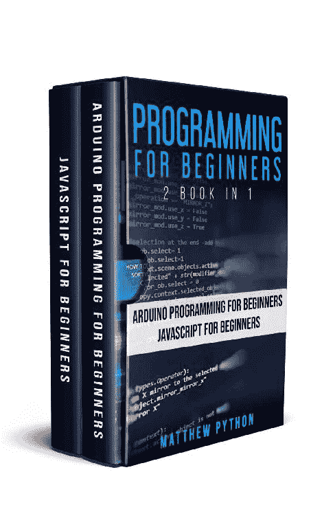

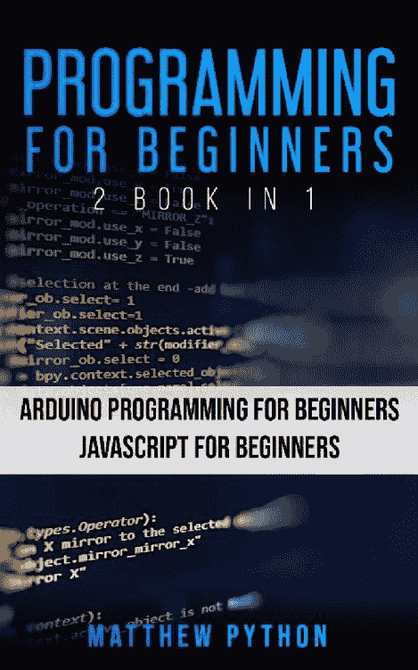

文本版权 © [Matthew Python]

保留所有权利。未经出版者书面许可，不得以任何形式复制本指南，但批判性文章或评论中的简短引用除外。

# 法律声明与免责声明

书中包含的信息及其内容并非旨在取代替代任何形式的医疗或专业建议；也不旨在替代可能需要的独立医疗、财务、法律或其他专业建议或服务的需求。书中的内容和信息仅供教育和娱乐之用。

书中包含的内容和信息汇集自认为可靠的来源，根据作者的已知、信息和信念，这些内容是准确的。然而，作者无法保证其准确性和有效性，且不对任何错误和/或遗漏承担责任。此外，将根据需要对本书进行定期更改。在适当和/或必要的情况下，在使用书中的任何建议的方案、技术或信息之前，您必须咨询专业人士（包括但不限于您的医生、律师、财务顾问或其他此类专业顾问）。

在使用书中包含的内容和信息时，您同意使作者免因应用书中提供的任何信息而可能导致的任何损害、成本和费用（包括任何法律费用）。此免责声明适用于由于直接或间接使用和应用任何建议或信息而造成的任何损失、损害或伤害，无论是违约、侵权、过失、人身伤害、刑事故意还是任何其他诉讼原因。

您同意接受使用书中呈现的信息的所有风险。

您同意通过继续阅读本书，在适当和/或必要的情况下，在使用书中的任何建议的方案、技术或信息之前，将咨询专业人士（包括但不限于您的医生、律师或财务顾问或其他所需的顾问）。

# JavaScript 入门

## 引言

## 第 1 章：什么是 JavaScript?

### 什么是 JavaScript?

### 为什么要学习 JavaScript

### 什么是 HTML?

## 如何在 XHTML 中引入 JavaScript

### JavaScript 与浏览器

## 基础术语表

## 第 2 章：为什么选择 JavaScript?

### Python Vs Javascript：哪个更适合 Web

### JavaScript 的特性

## JavaScript 的优势

## JavaScript 的局限性

### JavaScript 的两种执行类型

### 参数与理想测试环境

## 语法

### 代码语法规则

## 创建个人 JavaScript 

## JavaScript 示例

## 第 3 章：基础编程结构

### 变量

### 全局与局部变量

### 变量类型

### 一语句多变量

### JavaScript 布尔值

### 运算符

### 字符串运算符

### 字符串与数字相加

### 比较运算符

### If/else 语句

### 布尔对象

### 控制结构

### 函数和 JavaScript 基本属性

## 第 4 章：高级编程结构

### 函数与变量作用域

### `break` 语句

### `for… of` 语句

### `for… in` 语句

### `continue` 语句

### 其他控制结构

## 第 5 章：数据结构：对象与数组

### 对象简介

### 面向对象编程简介：类

### 运算符重载

### 类继承

### 实现多态

### 自定义构造函数

### 使用对象字面量

### Node

### 数组

### 原型继承

### 原型

## 第 6 章：高阶函数

### 使用 map 转换字符串与编码

### 使用 map 

### 字符串与编码

## 第 7 章：什么是 JavaScript

### 解释如何创建、读取和删除

## 结论

## 引言

在创建自己的机器人产品时，有很多方面需要考虑。你需要决定想做什么样的项目，以及哪种代码可以帮助你完成工作。最好的选择之一是 `Arduino` 平台。当我们谈论 `Arduino` 时，我们指的是一种可编程、开源且使用 `ATMega` 芯片的软件和微控制器。它被设计为一个原型平台，在构建电子项目方面，该软件拥有庞大的粉丝群。在处理电子项目时，你会发现 `Arduino` 平台既可以在项目开发期间作为临时辅助使用，也可以在项目完成后将其嵌入机器人项目的永久部分。

`Arduino` 开发板也可以通过 `Arduino` 软件进行编程，该软件非常易用，即使对于那些刚开始且不知道如何使用此类软件的人也是如此。如果你偶然用过 `C++` 或 Java 编程语言，你会发现 `Arduino` 的编码语言非常相似。使用该软件背后的理念非常简单，但它蕴含的强大使其对于有经验的人和初学者来说非常完美。`Arduino` 还是一个开源平台，这意味着任何人都可以免费使用它，并对代码进行调整以适应自己的需求。对于刚使用 `Arduino` 系统的人来说，这是一个非常酷的补充，因为他们可以访问其他程序员编写的成千上万的代码，甚至对自己的代码进行修改以使程序完美运行。除了发现许多你喜欢的代码已经开发完成并可用之外，初学者还会喜欢 `Arduino` 社区非常庞大。你可以在线浏览论坛和社区，提问与你项目相关的个人问题，获取新信息，甚至观看教程，让使用 `Arduino` 变得比任何时候都容易。`Arduino` 平台可能非常强大，但也非常基础。你会发现该平台仅提供两个主要组件供你使用，包括：

硬件：这包括微控制器，也称为电路板。你可以对这部分进行物理编程。你会发现有很多 `Arduino` 开发板供你选择，取决于你正在组装的项目类型。

软件：这是你配合开发板使用的环境，即 `IDE`，它将直接运行在你自己的电脑上。你将使用 `IDE` 来帮助编写并上传想要传输到开发板上的编程代码。一旦你在开发板上编写程序并进行传输，Arduino 开发板就会按照你的要求进行运行。

这些部分可以结合在一起，帮助你让项目顺利运行。你需要确保已经准备好了某些硬件，例如某种类型的 Arduino 开发板，然后它需要对你通过软件能够发送的内容做出响应。我们将花一些时间讨论你通过软件可以做的各种事情，以便以后让你的项目运行，但这两者都需要设置好，以确保来自 IDE 的消息能够传输到开发板并正常工作。在使用 Arduino 时，在编写任何代码之前需要安装好 IDE。该程序的 IDE 是免费的，因为它是开源的，这更容易获取副本。在编写代码时，你将使用 Arduino 编程语言，它很容易学习，并且与你电脑上的所有操作系统都能良好配合。关于 Arduino 的 IDE 和编程语言需要注意的一是，如果你在使用 Windows 7 或更早版本的操作系统，除了常规步骤外，你还需要执行几个步骤，以确保 Arduino 开发板能与操作系统兼容。它确实可以兼容旧版本的 Windows，你只需要花一些额外的时间让开发板识别该系统并使其工作即可。无论你是刚开始学习编程，还是想利用你的技能制作一个出色的电子或机器人项目，Arduino 平台都能帮助你完成。它拥有你所需的所有功能，并具有简单的背景，甚至让初学者也能理解并实现他们的目标。

## 使用 Arduino 时我能做什么？

当你看到 Arduino 编程语言时，可能会产生的第一个问题之一就是用它能些什么？世界上有很多编程语言，你可以选择它们来完成不同的任务，但 Arduino 与其他语言相比工作方式略有不同。通过 Arduino 平台你可以完成很多很棒的项目。基本上，与 Arduino 配合的代码将从你电脑上的 IDE 传输到你为项目购买的硬件上。你可以只使用开发板，也可以将其连接到某些电子项目上来实现一些惊人的事情。得助于 Arduino 的帮助，你可以在机器人领域做很多事情，如果你只是刚开始自己的电子学习过程，或者想尝试新事物，这是做此类事情的最佳平台。你可以让开发板发出声音、闪烁灯光、发送信号来控制前方屏幕上的内容，以及许多其他事情。我们将花一些时间研究你可以用 Arduino 做的不同项目，以便你更好地了解使用这种出色的语言可以做什么。

## 第 1 章：什么是 Arduino？

### Arduino 的历史

微控制器是一个小型计算板，可以编程来执行某些功能。当时，BASIC 插件微控制器的价格在 100 美元及以上，正如我们稍后看到的，Arduino 在保持执行各种功能的能力和编程这些功能的便利性的同时，无疑降低了成本。

在 Massimo Banzi 和 Casey Reas 的指导下，Barragán 在名为 `Processing` 的计算机语言中工作，创建了环境 `IDE`（Arduino 的官方编码环境和程序）。他研究了 `Wiring` 平台技术，推出了名为 `ATmega168` 的硬件，这是第一个 Arduino 微控制器。

随后在 2003 年，Massimo Banzi、David Mellis 和 David Cuartielles 在他们的微控制器板上增加了对 `Wiring` 的支持，命名为 `ATmega8`，并重构了 `Wiring` 源码，将其命名为 `Arduino`。这三个人同 Tom Igoe 和 Gianluca Martino 一起继续开发 Arduino 技术，到 2013 年，仅纽约市供应商 Adafruit Industries 一家就售出了 70 万块微控制器板。

在建立 Arduino 商标时遇到了一些问题，导致公司在几年内发生了分裂，现在 Arduino 是一家单一公司，致力于开发普通人或爱好者使用的硬件和软件，同时也足够灵活，能够引起专业工程师的兴趣。

### 但到底什么是 Arduino？

Arduino 的历史听起来可能就像这项技术对你来说很复杂一样。充满了许多神秘和困惑的元素，你可能会对“微控制器”、“环境”和“语言”等术语感到不知所措。我们将从这里，从 Arduino 的定义开始。

它的工作原理如下：购买符合其目的的硬件，然后在性能强大的 Windows、Macintosh OSX 或 Linux 电脑上为开发板编写代码或指令，并通过电缆上传指令。代码随后存储在微控制器上，并根据指令运行，例如当光线通过打开的门隙时激活蜂鸣声。光线激活连接到微控制器的传感器（如报警器）。

简而言之，Arduino 是一个电子项目开发平台（或称为电子原型设计），由硬件和软件组成，并根据知识共享署名-相同共享许可（Creative Commons Attribution）可用。

这意味着所有 Arduino 项目设计文件在网上都是免费提供的，它们的软件是开源的。此外，该平台既可用于个人也可用于商业，只要归属于 Arduino 品牌，并且项目文件也根据相同的许可提供。

该项目于 2015 年出现在意大利，由 Massimo Banzi 领导的开发者小组创立。其初目的是创建一个低成本、易于操作的平台，供学生高效、廉价地开发他们的原型。它被认为还可以帮助艺术和设计学生的电子教学，特别是在创建当代设计和艺术中非常流行的交互环境。

## 谁在使用 Arduino？

广泛的人使用 Arduino 用于各种项目和爱好，也用于专业用途。它以简单易懂、适合初学者而闻名，深度让初学者成长，并为高级用户提供了足够的潜力。

老师和学生使用 Arduino，他们确实是这些产品的目标消费群体，因为 Arduino 提供了一种低成本的构建科学仪器的方法。这让老师和学生能够实践和演示物理原理，并开始编程和制作机器人。

设计师和建筑师可能会使用 Arduino 技术构建他们希望开发的交互式模型和原型。音乐家和艺术家也使用 Arduino 微控制器实验新的乐器或技术。

几乎任何人都可以使用 Arduino，包括想要开始接触代码和计算机硬件的儿童，以及想要简单了解软件和微型计算机的爱好者。

在项目中使用 Arduino 平台的主要原因如下：

-   低成本原型制作

-   提供免费仿真软件

-   易于编程

-   互联网上有大量的教程、文章和项目可供参考

-   拥有庞大的开发者和爱好者社区

-   不需要经验或大量的电子/编程知识（但建议至少了解基础知识）

Arduino 不是市面上唯一的电子原型平台。还有其他项目和开发板，最常见的是树莓派（Raspberry Pi）和香蕉派（BeagleBone）。每种设备使用不同的微控制器，其硬件设计具有各自的特点。价格差异也很大，其他平台并没有那么受欢迎。

选择哪种原型开发板取决于你的项目提出的需求和需要。无疑，考虑到上述原因，Arduino 是你大多数项目的强有力候选者。

## 第 2 章：了解 Arduino

### 与 Arduino 相关的术语

它将关闭一个电路并点亮灯泡作为输出：为你的孩子制作一个夜灯。在大多数板子上，会有一个 `Pin LED`，它与特定的引脚相关，例如 `Arduino Uno` 上的 `Pin 13`。这个 `Pin LED` 是板内置的唯一输出可能，它将帮助你完成第一个“闪点脚本（blink sketch）”项目，该项目稍后会解释。`Pin LED` 也用于调试或修复你编写的代码，以确保其中没有错误。`Power LED` 正如其名：当板子接收电源或“开启”时，它会亮起。这对于调试你的代码也有很有帮助。每个板子上都存在微控制器本身，称为 `ATmega microcontroller`，它是整个板子的大脑。它接收你的指令并采取相应的行动。没有它，整个板子将没有任何功能。

模拟输入引脚位于 `Arduino Uno` 上数字引脚的对侧边缘。它是 `Arduino system` 的输入。模拟意味着输入的信号不是恒定的，而是随着时间变化的，例如音频输入。在音频输入的示例中，房间内的听觉输入会随着房间内人的说话以及房间外过滤进噪声而变化。`GND` 和 `5V` 引脚用于为电路和微控制器创建额外的 `5V` 电。电源接口通常位于 `Arduino board` 的边缘，用于在未插入 `USB` 时为微控制器供电。`USB port` 也可以作为电源源，但它的主要功能是将你编写的脚本（代码指令集）从电脑上传到 `Arduino`。`TX` 和 `RX LED` 用于指示正在发生信息传输。这种通信指示会在你从电脑将脚本上传到 `Arduino` 时发生，因此它们在交换期间会快速闪烁。

## 第 3 章：Arduino 板的构造

现在我们已经了解了一些 `Arduino microcontroller boards` 的基础知识，让我们看看在购买 Arduino 板时你拥有的各种选择。我们将查看价格、功能、内存量和其他特征，以帮助你做出决策尽可能简单直接。

### Uno

这是大多数人开启 `Arduino 之旅` 的板子。在内存方面它较小，但在功能上非常灵活，是初学者以及想要尝试 `Arduino` 才华和智慧的人的绝佳工具。此型号带有 `mini-USB port`，允许你直接上传代码到板子，而无需使用扩展板或其他额外的硬件。

- 价格：$24.95

- 闪存：32kB

- SRAM:2kB

- EEPROM:1kB

- 处理速度：16MHz

- 数字引脚：14 个引脚

- PWM 引脚：6 个引脚

- 模拟输入：6 个引脚

- 工作电压：5V

- 输入电压：7-12V

### Leonardo

`Leonardo microcontroller board` 开箱即用：你只需要一个 `micro-USB cable` 和一台电脑即可开始。此外，由于其采用了 `ATmega32U4` 处理器，电脑可以将 `Leonardo` 识别为鼠标或键盘。

- 价格：$19.80

- 闪存：32kB

- SRAM:2.5kB

- EEPROM:1kB

- 处理速度：16MHz

- 数字引脚：20 个引脚

- PWM 引脚：7 个引脚

- 模拟输入：12 个引脚

- 工作电压：5V

- 输入电压：7-12V

### 101

这种微控制器包含许多其他初级型号中不具备的功能。例如，你可以通过手机的 `Bluetooth Low Energy`（低功蓝牙）连接到板子。此外，它内置了加速度计和陀螺仪，通过其六轴敏感度识别所有方向的运动。它还可以识别手势。

这些功能结合在一起，允许设备或周围的运动成为输入，微控制器将通过输出做出响应。

- 价格：$30.00

- 闪存：196kB

- SRAM:24kB

- EEPROM:0kB

- 处理速度：32MHz

- 数字引脚：14 个引脚

- PWM 引脚：4 个引脚

- 模拟输入：6 个引脚

- 工作电压：3.3V

- 输入电压：7-12V

### Esplora

此板子基于 `Leonardo`，但内置了更多技术，因此你不需要学习那么多电子知识就能上手运行。相反，你可以通过观察过程的实现来学习。

内置的输入传感器包括摇杆、滑块、温度传感器、麦克风、加速度计和光传感器。它还包含了一些声音和光输出。它还可以通过两个 `Tinker kit input/output connections` 连接到其他名为 `TFT LCD screen` 的技术来扩展其功能。

- 价格：$43.89

- 闪存：32kB

- SRAM:2.5kB

- EEPROM:1kB

- 处理速度：16MHz

- 工作电压：5V

- 输入电压：7-12V

### Mega 256

这种微控制器是 `Arduino Uno` 的扩展。它用于机器人和 3D 打印机等项目，具有大量的数字引脚和模拟引脚。

- 价格：$45.95

- 闪存：256kB

- SRAM:8kB

- EEPROM:4kB

- 处理速度：16MHz

- 数字引脚：54 个引脚

- PWM 引脚：15 个引脚

- 模拟输入：16 个引脚

- 工作电压：5V

- 输入电压：7-12V

### Zero

这是 `Arduino Uno` 开发技术的扩展。它是基于 32 位 `ARM core microcontroller` 构建的，使其具有强大的力和功能。它有一个极快的处理器和 4 个 `UART`，使其具有极大的灵活性执行多项功能。`Zero` 的另一个优势是它内置了一个名为 `Atmel’s Embedded Debugger`（简称 `EDBG`）的功能，可以在无需使用额外硬件的情况下调试代码。

- 价格：$42.90

- 闪存：256kB

- SRAM:32kB

- EEPROM:n/a

- 处理速度：48MHz

- 数字引脚：14 个引脚

- PWM 引脚：10 个引脚

- 模拟输入：6 个引脚

- 模拟输出：1 个引脚

- 工作电压：3.3V

- 输入电压：7-12V

- UART：2 条

- USB 端口：2 个 micro-USB port


## Due

这是微控制器领域的一个新奇事物，因为它基于 32 位 `ARM core microcontroller` 构建，赋予了它强大的力量功能。它拥有极快的处理器和 4 个 `UART`，使其具有很高的灵活性可用性。它用于更大规模的 Arduino 项目，虽然可能不是你的第一块板子，但对于未来的大项目可以考虑它。

- 价格：$37.40
- 闪存：512kB
- SRAM：96kB
- EEPROM：n/a
- 处理速度：84MHz
- 数字引脚：54 个引脚
- PWM 引脚：12 个引脚
- 模拟输入：12 个引脚
- 模拟输出：2 个引脚
- 工作电压：3.3V
- 输入电压：7-12V
- UART：4 条
- USB 端口：2 个 `micro-USB port`

## Mega ADK

这是基于 `Mega256O` Arduino 开发板的，具有惊人的内存容量和大量的输入输出可用性。`Mega256O` 与 `Mega ADK` 的区别在于，`Mega ADK` 专门兼容 Android 技术，例如三星手机和平板电脑、华硕技术以及其他使用 Android 的非 iOS、非 Windows 移动设备。它的价格高达近 50 美，但如果你想将 Android 整合到你的项目中，这将是你想要选择的开发板。

- 价格：$47.30
- 闪存内存：256kB
- SRAM：8kB
- EEPROM：4kB
- 处理速度：16MHz
- 数字引脚：54 个引
- PWM 引脚：15 个引
- 模拟输入：16 个引
- 工作电压：5V
- 输入电压：7-12V
- UART：4 线

## Arduino Pro（8 MHz）

这是 SparkFun 公司对 `ATmega328` 开发板的实现。它基本上是面向专业人士的 `Uno`，旨在在物体或技术的安装中半永久性使用。8MHz 版本性能比 `Uno` 低了一一半，但价格也便宜得多。它需要更多的硬件知识才能使其工作，因为它没有 USB 端口，无法通过 USB 为开发板供电，因此必须连接 `FTDI` 线或扩展板才能与开发板通信并上传程序（sketch）。然而，一旦你解决了将此板连接到计算机的技术问题，它的功能就像一个半功率的 `Uno`。与 16MHz 的 `Arduino Pro` 不同，这款 8MHz 的 `Pro` 可以由锂供电。

- 价格：$14.95
- 闪存内存：16kB
- SRAM：1kB
- EEPROM：0.512kB
- 处理速度：8MHz
- 数字引脚：14 个引
- PWM 引脚：6 个引
- 模拟输入：6 个引
- 工作电压：3.3V
- 输入电压：3.35-12V
- UART：1 线

## Arduino Pro（16 MHz）

这是 SparkFun 出的 `Arduino Pro` 的 16MHz 版本。它的功率与 `Uno` 相同，但具有与 8MHz `Pro` 相同的缺点：你需要找到一条 `FTDI` 线或从 SparkFun 购买扩展板，以便使开发板与你的计算机兼容以上传程序。这意味着与从 `Uno` 开始相比，你需要学习更多相关技术，但在设置好之后，它的功能与 `Uno` 一样。

- 价格：$14.95
- 闪存内存：32kB
- SRAM：2kB
- EEPROM：1kB
- 处理速度：16MHz
- 数字引脚：14 个引
- PWM 引脚：6 个引
- 模拟输入：6 个引
- 工作电压：5V
- 输入电压：5-12V
- UART：1 线

## Arduino M0

这块开发板是 `Arduino Uno` 的扩展，赋予了 `Uno` `ARM Cortex M0` 核心的 32 位性能。这可能不会是你的第一块板，但可能是你最令人兴奋的项目。它将允许创意人才开发可穿戴技术、制造具有高科技自动化的物体、创造前未见的机器人、为物联网提出新想法，或其他许多奇的项目。这是对 `Uno` 简单技术的强大扩展，因此它具有变成你想象的任何东西的活性。

- 价格：$22.00
- 闪存内存：256 kB
- SRAM：32kB
- 处理速度：48MHz
- 数字引脚：20 个引
- PWM 引脚：12 个引
- 模拟输入：6 个引
- 工作电压：3.3V
- 输入电压：5-15V

## Arduino M0 Pro

这是与 `Arduino M0` 相同的 `Uno` 扩展技术，但它增加了功能，可以使用集成在板载的 Atmel 嵌入式调试器（`EDBG`）对自己的软件进行调试。这在开发板上创建了一个接口，你可以在其中进行调试，或者说，是一种与开发板交互的方法，可以在其中找到你代码中的问题并修复它们。

- 价格：$42.90
- 闪存内存：256 kB
- SRAM：32kB
- 处理速度：48MHz
- 数字引脚：20 个引
- PWM 引脚：12 个引
- 模拟输入：6 个引
- 工作电压：3.3V
- 输入电压：5-15V

## Arduino YÚN（基于 ATmega32U4）

`Arduino YÚN` 是连接到物联网时非常棒的开发板。如果你想设计连接到网络（如互联网或数据网络）的设备，它是完美的。它具有内置以太网支持，可以为你提供网络线路连接，以及 Wi-Fi 功能，允许你无线连接到互联网。`YÚN` 拥有一个在操作系统或代码语言 `Linino OS` 中支持 Linux 代码的处理器。这赋予了它额外的动力和能力，但保留了 `Arduino` 的易用性。

- 价格：$68.20
- 闪存内存：32kB
- SRAM：2.5kB
- EEPROM：1kB
- 处理速度：16MHz
- 数字引脚：20 个引
- PWM 引脚：7 个引
- 模拟输入：12 个引
- 工作电压：5V
- UART：1 线

# 第 4 章：Arduino 家族

Arduino 系统中有三种内存。内存是存储信息空间。闪存内存是你编写的程序代码存储的地方。它也被称为“程序空间”，因为当你将其上传到 Arduino 时，它会自动运行该程序。当断电或关闭 Arduino 时，这种类型的内存会保持完好无。

`SRAM`（静态随机访问存储器）是你创建的程序或脚本用于创建、存储和处理来自输入源信息以产生输出的空间。这种存储在断电后会消失。`EEPROM` 像一个微型硬盘，允许程序员存储程序本身以外的信息。

# 第 5 章：Arduino 组件说明

使用无接面包板可以轻松地制作 Arduino，只需要几分钟时间（一旦你熟悉流程）。一旦制作好板，就可以使用 Arduino 语言对微控制器进行编程。

## 你将什么

你只需要少量廉价零件就可以将你的无接面包板变成 Arduino，包括：

- 440 或 840 点位面包板
- `TTL-232R-3V3 USB` 转串口转换线
- 小型微动开关
- 16 MHz 晶振
- 一排公头排针
- 22 AWG 导线（颜色可选）
- 1 个棕、黑、红 10k 欧电阻
- 2 个红、红、棕 220 欧电阻
- 2 个 22pF 电容
- 2 个 10 uF 电容

## 第一步

一旦收集了所有必要的零件，就可以开始构建你的 Arduino 面包板。第一步是设置电源。对于这种特定的型号，将提供恒定的 +5Volts 电源。

观察你的面包板时，你会看到带有红色和黑色 + 和 – 符号的方格。首先，在这里放置一个 `10uF` 电容。然后，你需要将 `7805` 电压调节器添加到面包板上。请确保将 `7805` 的左引脚与电源输入对齐，中间的电源输出与地对齐。现在，你需要第二个 `10uF` 电容。将其放置在电源轨上。最后，如果你愿意，可以在面包板上包含一个 LED 状态指示器。这对于故障排除是一个好主意。使用一个 `220` 电阻连接右侧和左侧电源轨。

## 第二步

在第二步中，你将准备你的芯片。每个引脚都与板上的特定插槽对齐。这将确保你的 `Arduino` 以你需要的方式运行。

| 板板上的数字 | 对应的引脚 |
| --- | --- |
| 1 | Reset（重位） |
| 2 | Digital Pin 0（RX） |
| 3 | Digital Pin 1（TX） |
| 4 | Digital Pin 2 |
| 5 | Digital Pin 3 |
| 6 | Digital Pin 4 |
| 7 | VCC |
| 8 | GND |
| 9 | XTAL 1 |
| 10 | XTAL 2 |
| 11 | Digital Pin 5 |
| 12 | Digital Pin 6 |
| 13 | Digital Pin 7 |
| 14 | Digital Pin 8 |
| 15 | Digital Pin 9（PWM） |
| 16 | Digital Pin 10（PWM） |
| 17 | Digital Pin 11（PWM） |
| 18 | Digital Pin 12 |
| 19 | Digital Pin 13（LED） |
| 20 | AVCC |
| 21 | AREF |
| 22 | GND |
| 23 | Analog Input 0 |
| 24 | Analog Input 1 |
| 25 | Analog Input 2 |
| 26 | Analog Input 3 |
| 27 | Analog Input 4 |
| 28 | Analog Input 5 |

## 第三步

引脚就位后，在引脚 `1` 附近添加触点开关。这将在需要时重置你的 `Arduino` 面包板。然后，在开关的底部引脚和引脚 `1` 之间连接一根小的跳线导。下一步是在引脚行 1 和电源开关之间连接 `10K` 电阻。在这一区域你将需要做的最后一件事是将 `GND` 线连接到顶部引脚。

接下来，在 `VCC`（引脚 `7`）和 `GND`（引脚 `8`）之间连接电源和 `GND` 跳线导。然后将 `16 MHz` 晶体添加到引脚 `9` 和 `1-` 上。接下来，从这些引脚将 `.22pF` 电容连接到 `GND`。如果你愿意，可以在这里停止，并添加一个编程芯片。然而，如果你对为编程设置面包板感兴趣，请继续阅读。

## 第四步

编程所需的连接引脚包括 `GND`、`NC`、`5V`、`TX`、`RX` 和 `NC`。将来自电源轨的 `GND` 线连接到 `GND` 引脚。为 `5V` 引脚添加一条电源线。最后，在 `TX` 引脚和 `RX` 引脚之间连接一根线。你的 `Arduino` 面包板现在准备好编程了。你可以使用所需物品中的 `USB – Serial Converter Cable` 完成。

# 如何制作电子蛇

正确构建后，这条蛇是防水的并可以使用遥控器控制。如果这是你第一次尝试 `Arduino` 项目，你可能想从后面的章节选择一个更简单的选项开始。虽然这一部分读起来很有趣，但你可能想先制作第 8 章的发光感雨伞、第 9 章带有闪烁转向灯的自行车夹克或第 10 章的 `Arduino` 气体传感器。

## 电子元件

你需要：

- `Arduino Uno`
- `Seeeduino Mega`
- 10 个舵机电机（记住一分钱一货。如果你选择低质量的电机，这些电机中的尼龙齿轮可能会很快磨损。）
- 舵机扩展线
- 舵机扩展板
- 2 Xbee 系列 1
- Xbee 探索器
- Xbee 转接板（带有 2 行 Xbee 2mm 母排针和 2 行 10 孔公排针）
- 3 组 6V NiMh 电池组

## 机械硬件

- 聚氨酯密封剂
- 船用环氧胶密封剂
- 船用润脂
- 尼龙绳
- 绿色乐高胶
- 2” x 10” 的 1/8” 厚橡胶
- 3 条碳纤维 – 1/32”，1” x 12”
- 2 个 2.5 到 1.25” Shop Vac 吸尘器还原器
- O 型圈
- 5/16” 软箍
- 波纹管箍
- 5/16” 软管
- 5 个舵机支架
- 5 个注塑型舵机铰链
- 5’ x 2.5” 聚氨酯集尘管
- 5 个 Lynxmotion C 型支架
- 5 个 Lynxmotion 舵机支架

## 工具

- 烙铁 + 焊锡
- 电钻
- 3mm 钻头
- 小号螺丝刀
- 尖钳
- 剥线器
- 剥线器

## 第一步

观察你的面包板时，你会看到带有红色和黑色 + 和 – 符号的方格。首先，在这里放置一个 `10uF` 电容。然后，你需要将 `7805` 电压调节器添加到面包板上。请确保将 `7805` 的左引脚与电源输入对齐，中间的电源输出与地对齐。现在，你需要第二个 `10uF` 电容。将其放置在电源轨上。最后，如果你愿意，可以在面包板上包含一个 LED 状态指示器。这对于故障排除是一个好主意。使用一个 `220` 电阻连接右侧和左侧电源轨。

## 第六步

完成蛇的身体时，将舵机臂与支架的孔对齐。在将它们固定在一起之前，确保舵臂位于中心。如果固定后支架和电机无法自由旋转，请在支架之间涂抹润脂。为了安全起见，在确保位置正确后对螺丝上胶。

## 第七步

在这一步中，你将为你的蛇制作电路板。首先将母子排针焊接到 `Xbee` 转接板上。插入 `Xbee`。然后，拿起 `舵机扩展板` 并焊接到螺丝端子上。焊接完成后，使用导线将 `Xbee` 连接到 `Arduino`。将 `Xbee` 的 `3.3Vin` 引脚连接到 `Arduino 3.3V` 引脚。将 `Xbee` 的 `TX` 引脚跳接到 `Arduino RX` 引脚。将 `Xbee` 地连接到 `Arduino` 地。最后，在 `Arduino VIN` 引脚和 `6V` 电池输入之间跳接电源线。

接下来，根据你正在使用的舵服电机数量，焊接数字输出引脚的电线。你应该从你的 `Arduino` 提取 `dOUT` 电线，然后将其插入舵服电缆。将电线拧入螺丝端子中。这将连接电池的 `6V` 和地线。

### 第 8 步

接下来，你需要代码让你的机械蛇游起来。你可以在 `Servo` Arduino 库的软件库中找到它。你需要一段代码来通过振动产生波浪运动。这将创建一个沿着舵服电机向上传传导的正弦波。

### 第 9 步

在这一步中，你将为机械蛇创建一个独立的立式摇杆控制器。首先将 `Xbee` 插入 `Xbee` 扩展板。将它们放置在 `Arduino` 上方并设置 6 个按钮输入。这些按钮应连接到 `Arduino` 上的数字引脚 `2-7`。现在你将从 `Arduino` 库上传一段代码，以获取按钮输入并输出为机械蛇的动作。

### 第 10 步

这一步是将所有的电线连接到机械蛇上。使用舵服电机的延长线，并将电线延伸到机械蛇身体下方。它们应该结束在最后一个支架后几英寸处。如果你愿意，可以将电线胶粘在碳纤维上，这样更容易安装碳纤维了。

### 第 11 步

在这一步中，你将使用 `6V/GND` 电线连接电池，以便你的机械蛇能够运行。使用两个扎带将一个电池固定在每段碳纤维上。你还应该取下 `Servo` 电机的延长线，使电池电能到达机械蛇前端的地线和 `Arduino`。

### 第 12 步

这一步是添加开关按钮。你可能想用其中一个用于 `Arduino/Servos` 的连接，另一个用于水泵。请务必在启动水泵之前打开机械蛇，因为在没有水的情况下运行水泵会导致其干涸并烧毁。然后，切两段直径为 `1.75”` 的橡胶块。它们应该能放入真空减速器内部。你还应该剪两段 `2’` 长的绳子，以帮助将机械蛇身体定位在真空减速器内。在将橡胶放入真空减速器之前，你需要为电线切一个小狭缝。你还会在这里系上绳子。你将拥有水泵的电源和地线、开关的电源和地线，以及一根贯穿两块橡胶垫和真空减速器的绳子。在尾部，你只需要外部的绳子来固定机械蛇。接下来，取螺丝端子上的 `6V` 电线并将开关焊接在上面。

### 第 13 步

在这一步中，你将拉长蛇身并准备电池，以便水泵能够正常工作。在蛇的头部和尾部连接长度为 `4”` 的碳纤维片。将电池接线柱和水泵焊接在一起。接下来，找到电池和水泵之间的延长电线。这就是你需要焊接开关来开启和关闭机械蛇的地方。使用扎带将电池固定在 `Arduino` 旁边的碳纤维上。

### 第 14 步

在这一步中，你将密封机械蛇的身体并穿上皮肤。在真空减速器的两端使用填缝胶完全覆盖电线。在完成项目之前，至少等待 24 小时让填缝胶干燥。如果你选择，可以使用热熔胶固定电线，并使用硅胶包吸收水分。你还应该借此机会确保关节活动灵活。如有必要添加额外的润滑脂。现在，将皮肤套在机械蛇身体上。如有必要，剪断管子长度，使碳纤维在用绳子定位时能放入管子末端。完成后将绳子打一个结以防滑脱。最后，你需要使用防水油脂在机械蛇的头部和尾部加上盖子，以防止水进入。

### 第 15 步

现在机械蛇已完全组装，你准备好安装水泵了。安装后，水泵应位于机械蛇头部附近，但在底部。它在运行期间将浸没在水中。切一段 `5/16”` 的塑料软管套在水泵的输出喷嘴上。然后在管子连接处固定一个软管箍。使用这段塑料管来安装水泵。你可以用扎带将其固定。如果你感兴趣，甚至可以在机械蛇上安装一个 GoPro。

### 第 16 步

现在你已经准备好测试你的机械水蛇了！在带它去室外之前，确保在塑料按钮周围涂上润滑脂。打开机械蛇并将其放入水中。一旦将机械蛇放入水中，你就可以开启水泵而不用担心干烧它。使用你的遥控器引导机械蛇的运动。

# 第 6 章：开始使用 Arduino

设置 Arduino 微控制器的第一步将选择你想要工作的 `Arduino` 板卡。

## 选择板卡

在查看 `Arduino` 板卡的选项时，在做出选择之前你需要考虑几个因素。在决定板卡之前，问自己以下问题：

## 运行我脑海中的应用需要多少功率？

你可能不知道项目所需的闪存内存和处理能力的确切测量，但一个变换颜色的简单夜灯与具有许多活动部件的机械手之间存在明显的区别。后者需要一个更健壮的 `Arduino` 微控制器板，比简单的夜灯想法具有更快的处理速度、更多的闪存和更多的 SRAM。

## 实现所需的功能需要多少数字引脚和模拟引脚？

同样，你不需要有一个非常具体的想法，但知道需要更多还是更少的引脚将对你选择哪种板卡产生巨大影响。如果你想做一个简单的第一个项目，较少的数字、`PWM` 和模拟引脚也可以；如果你想做一些更复杂的东西，你将想要考虑具有大量引脚的板卡。


### 我想要它成为可穿戴设备吗？

可穿戴设备有几种选择，所以这个问题不会完全为你做决定。然而，它将有助于缩小范围并引导你的方向，`Lilypads` 和 `Gemma` 或其他类似的技术是你的最佳选择。

### 我想连接到物联网吗？如果是，如何连接？

如果你想连接到物联网，`YÚN`、`Tian`、`Ethernet`、`Leonardo ETH` 或 `Industrial 101` 将使你的工作变得简单得多。它们具有以太网连接以及 Wi-Fi 功能，因此你将能够连接到网络并共享数据或交互与控制物联网上的其他设备。

## 开始使用 Arduino IDE

Arduino 软件运行在名为 `IDE` 的环境中。这意味着你要么需要下载桌面 `IDE` 进行编写，要么在在线 `IDE` 上编写。你访问 `IDE` 的第一方式（下载桌面应用程序）有几种适用于你可能使用的各种设备。

首先是 `Windows` 桌面应用程序。你也可以通过 `Windows` 平板电脑或 `Windows` 手机访问它。接下来是 `Macintosh OSX` 版本，它允许 `IDE` 在 Apple 笔记本电脑和桌面机上运行，但不支持 Apple 移动设备如 iPhone 和 iPad。最后，在 `Linux` 上运行 Arduino `IDE` 有三种选择：`32-bit`、`64-bit` 和 `Linux ARM` 版本。

如果你喜欢这种方案而不是浏览器方案，只需访问 `Arduino IDE` 网站：

`https://www.arduino.cc/en/Main/Software`

在那里你可以下载相应的桌面 `IDE`。接下来，运行安装程序，点击呈现的选项，几分钟后你就拥有了一个运行中的 `Arduino IDE` 环境了。

这允许你从 Android 设备和苹果移动设备访问 `IDE` 软件，因为它基于运行在独立平台上的网页浏览器，而不是运行在 Android 或 iOS 平台上。你还可以在各种类型的计算机上运行网页浏览器，包括 Linux、Microsoft Windows 和 Apple Macintosh。这将允许你将草图（sketches）上传到云端，即将你编写的代码信息存储在一个安全的位置，然后你就可以通过连接互联网从另一个设备重新访问它。

## 为你的 Arduino 编写程序

接下来，你将为想要让 Arduino 板运行的程序编写代码。这允许你一次性看到整个代码，从而更容易调试或删除错误。

一旦写好代码，你将想要运行它并对发现的任何错误进行故障排除或调试。最好的方法是将编写好的程序应用到 Arduino 板上并查看其运行情况。要做到这一点，你将进入上传草图的下一步。

### 连接到 Arduino 板

某些开发板内置了 USB、mini-USB 或 micro-USB 端口。对于在 Arduino 职业的初级阶段，`Uno` 和 `Leonardo` 就是例子。只需将 USB 线的相应一端插入计算机，另一端插入你所拥有的板上的特定 USB 端口，Arduino IDE 软件应该就能识别出它的板子类型。如果没有，你可以随时从下拉菜单中选择正确的板子。

有时你需要使用 `TKDI` 线或扩展板来使 Arduino 与计算机兼容。这意味着你把 `TKDI` 插入 Arduino 微控制器板上的 `TKDI` 端口，然后将其连接到计算机或其他板上。如果你将 `TKDI` 线连接到扩展板，操作方法与连接兼容 USB 的板子相同：将线的相应一端插入扩展板，另一端插入计算机。再次，计算机上的 Arduino IDE 软件程序应该识别你的 Arduino 板，但如果未能识别，你始终可以从下拉菜单中选择。

### 上传到 Arduino 板

要上传你的草图（你刚刚在代码中创建的程序），你需要选择要上传的正确板和端口。选择正确的板子应该是很容易，你只需寻找与你使用的板子类型名称匹配的板子标题即可。

选择正确的串口，你可以选择的选择如下：

#### Mac

- `Uno`、`Mega256O` 或 `Leonardo` 使用 `/dev/tty.usbmodem241`。
- `Duemilanove` 或更早的 Arduino 板使用 `/dev/tty.usbserial-1B1`。
- 其他任何通过 USB 转串口适配器连接的设备使用 `/dev/tty.USA19QW1b1P1.1`。

#### Windows

- 串口板使用 `COM1` 或 `COM2`。
- USB 连接的板子使用 `COM4`、`COM5` 或 `COM7` 或更高版本。
- 查看 Windows 设备管理器以确定你正在使用的设备在使用哪个端口。

#### Linux

- 串口使用 `/dev/ttyACMx`。
- USB 端口使用 `/dev/ttyUSBx` 或类似的名称。

一旦你选择了正确的板子和端口，点击 `Upload`（上传）并在弹出的菜单中选择要上传的 `Sketch`。如果你使用的是较新的 Arduino 板，你可以简单地上传新草图，但对于旧版板子，你必须在上传新草图之前重置板子，否则板内存中将存在两个可能冲突的草图，导致其崩溃。

### 使用你的程序运行 Arduino

一旦你将编写好的程序上传到 Arduino，有几种方法可以为 Arduino 供电。首先，你可以通过 USB 连接到另一个有电源设备（如你的计算机）为其供电。其次，对于具有该功能的板，可以通过以太网供电。这意味着通过连接网络，你将通过以太网连接到电源。最后，大多数 Arduino 可以通过锂聚合物电池供电。一旦连接了电源并将指定的输入到微控制器，它就会执行其预期的功能。

## 安装 Arduino IDE

现在你已经了解了 Arduino 板的不同部分，我们可以学习如何准备 Arduino IDE。学习这些之后，我们就可以准备好将第一个程序上传到板子了。你将学习如何设置板子并使其准备好通过 USB 线接收程序。

确保你有一个 Arduino 板和一根 USB 线。组装这些设备后，下一步是下载 Arduino IDE。你可以从以下 URL 下载：

`https://www.arduino.cc/en/Main/Software`

根据你正在使用的操作系统下载正确版本的 Arduino。下载完成后，解压下载的文件。

你现在可以为板子供电了。板子可以从 USB 连接到计算机获取电源，也可以从外部电源获取电源。只需通过 USB 线将你的 Arduino 板连接到计算机。你应该看到绿色电源 LED 灯亮起。

现在是时候启动 Arduino IDE 了。打开你解压 Arduino IDE 的文件夹。双击 `.exe` 文件启动 IDE。

软件将打开，你可以创建一个新项目或打开一个现有项目。要创建一个新项目，点击 `File`（文件）然后选择 `New`（新建）。要打开现有项目，点击 `File`，选择 `Example`（示例），`Basics`，然后选择 `Blink`。

你需要选择你正在使用的板子类型。为了避免从 IDE 向板子加载程序时出现错误，确保选择正确的板子，即通过 USB 线连接的板子。

要选择板子，点击 `Tools`（工具）然后选择 `Board`（板子）。

接下来，你应该选择 Arduino 板的串口。点击 `Tools` 然后选择 `Port`。如果你很难确定串口，只需断开 Arduino 板与计算机的连接，寻找消失的项目。。你可以重新连接板子并选择该端口。

每当你需要向 Arduino 板加载程序时，点击 IDE 上的 `Upload` 按钮。注意 Arduino 程序被称为 sketch。

## 数字输入输出

数字信号是离散值，其表现为 `1` 或 `0`。这意味着 `1`（高电平）表示信号存在，而 `0`（低电平）表示信号不存在。因此，数字信号通过电流的存在或不存在（`5v` 或地）或脉冲的存在或不存在以二进制代码传输。

人类习惯于模拟信号，而机器人、计算机以及大多数电路感知数字信号。如前所述，数字信号只有两种状态，即“开启”和“关闭”，就像墙上的双控开关一样。

在 Arduino 编程中，除了专门用于处理模拟信号的模拟输入外，数字信号到处都是。数字信号的 `ON` 或 `HIGH` 状态始终等于板电压（`3.3 伏`或 `5.0 伏`）。相反，`LOW` 或 `OFF` 状态始终由 `0 伏` 表示。

为了在 Arduino 板上接收或发送数字信号，请仅使用标记为 `0-13` 的引脚。再次如之前解释的，可以设置模拟引脚作为数字引脚使用。这通过使用命令 `pinMode(pin label, value)` 实现。这里的引脚数字代表 `A0-A5` 的模拟引脚，函数中的值始终为 `input` 或 `output`。

你可以使用相同的命令来设置数字引脚。首先，引用数字引脚 `pinNumber` 而不是模拟引脚。重要的是，数字引脚默认用作输入引脚，因此你只需要将它们设置为 `OUTPUT`（输出）模式。要实现这一点，请使用命令：`digitalRead (pin label)`，其中数字组件将连接到 `pin label`。`digitalRead (pin number)` 返回 `HIGH` 或 `LOW` 作为结果。

当你想要从 IDE 向数字引脚发送数字信号时，你应该使用代码：`digitalWrite(pin label, value)`，其中 `pin label` 代表信号来源引脚号，`value` 可以是 `HIGH` 或 `LOW`。

Arduino 还使用脉冲宽度调制（PWM）技术来发送模拟形式的数字信号。负责这些功能的引脚编号为：`3`、`5`、`6`、`9`、`10` 和 `11`。此处使用的命令如下：`analogWrite(pin label, value)`。引脚编号已经在上面给出，`value` 是从 `0`（0%）到 `100%`（255）的整数。

### 数字信号示例

开/关、男桌/女桌、怀孕、死亡、意识，列表还将继续。

在此处使用的传感器和接口可能包括：继电器、断路器、开关、按钮等许多。

## 第 7 章：基础数字 Arduino 程序

### LED 闪烁

这是 Arduino 编程中最基础的程序，就像在任何其他编程语言中打印“hello world”一样。由于 Arduino 编程中没有屏幕来打印“hello world”，因此我们通过让 LED 闪烁作为我们的第一个测试程序。这确实是一个非常简单的程序，旨在为你通过原型制作投入电路构建的世界时，提供一个坚实的基础。

### 所需组件

- 一块面包板
- 一个 Arduino Uno
- 一个 LED
- 电阻（330 欧姆）
- 两根跳线线

### 电路

由于组件数量很少，电路非常简单，因此只需遵循下面的简单电路图即可：

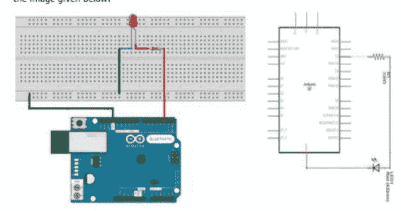

#### 寻找 LED 的极性

LED 有极性，即负极和正极。要确定这一点，手持 LED 使平侧面向你。你左侧的短脚是负极，右侧的长脚是正极。

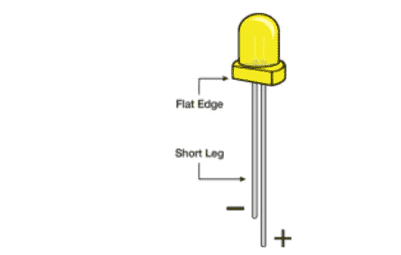

#### 图形（Sketch）

快速在你的电脑上打开 Arduino IDE，然后在“New”标签页上新建一个图形文件，然后开始编写如下所示的代码：

```cpp
*/ 闪烁 LED，以下代码用于周期性地连接到数字引脚的发光二极管闪烁。使用 13 号引脚，是因为它的电路中有一个电阻来限制流过 LED 的电流 */

int ledPin = 13; // LED 已连接到数字引脚 13 号

void setup()
{
  pinMode(ledPin, OUTPUT); // 将数字引脚设置为输出
}

void loop()
{
  digitalWrite(ledPin, HIGH); // 代码用于开启 LED
  delay(1000); // 延迟时间为一秒
  digitalWrite(ledPin, LOW); // 代码用于关闭 LED
  delay(1000); // 延迟时间为一秒
}
```

### 无延迟 LED 闪烁

有时你可能希望让 LED 亮起而不停止，这需要使用 `delay()` 的其他函数。无延迟 LED 闪烁函数会跟踪 LED 开启和关闭的时间。通过循环 `()`，它检查是否已经过了足够的时间间隔，以便在 LED 处于关闭时开启它，反之亦然。其他组件与上面的示例相同。

以下是代码：

```cpp
int ledPin = 13; // 一个 LED 已连接到数字引脚 13 号
int num = LOW; // 声明 int num 并赋值为 LOW，代表 LED // 上一个值 
long previousMillis = 0; // 存储 LED 上次更新的时间
long delay = 1000; // 延迟时间设置为一秒（毫秒）

void setup()
{
  pinMode(ledPin, OUTPUT); // 将数字引脚设置为输出
}

void loop()
{
  // 这些代码用于控制 LED 的亮灭。
  if (millis() - previousMillis > delay) 
  {
    previousMillis = millis(); // 回忆 LED 上次闪烁的时间
    // 以下代码在 LED 关闭时开启它，反之亦然。
    if (num == LOW)
      num = HIGH;
    else
      num = LOW;
    digitalWrite(ledPin, num);
  }
}
```

### LED 渐变

在这种情况下，我们将使用 `analogWrite()` 函数来启动连接到 Arduino 板板的 LED 的渐变过程。这是可能的，因为 `analogWrite()` 函数使用了脉冲宽度调制技术，该技术能够以不同的比例快速开启关闭数字引脚，从而产生渐变效果。组件与第一个示例相同，包括电路。唯一的区别在于代码中，如下所示：

```cpp
/*
渐变 
此示例说明了如何使用函数 analogWrite () 来控制 LED 的渐变*/
int ledPin = 6;     // LED 连接到引脚 6 号
int brightness = 0; // 亮度
int fadeStep = 5; // 渐变步长

void setup()
{
  pinMode(ledPin, OUTPUT);
}

void loop()
{
  analogWrite(ledPin, brightness);
  brightness = brightness + fadeStep;
  if (brightness <= 0 || brightness >= 255) {
    fadeStep = -fadeStep;
  }
}
```

（注：原文此处代码逻辑略有错乱，已根据语境修正翻译并保持结构）

（注：原文文本在此处已清理变量描述以保持逻辑流）。

### Arduino 按钮

这通常是一个输入按钮。当按下时，按钮完成电路。

#### 组件

- 按钮
- 一个 Arduino Uno
- 一个发光二极管
- 三根连接线
- 2.2 千欧姆

#### 步骤

你的电路应该像下面：

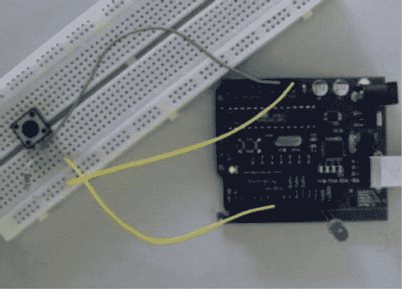

此项目的代码编写如下：

```cpp
int outPin = 14; // LED 连接到引脚 14 号
int inPin = 3; // 按钮输入引脚
int num = 0; // 用于读取引脚状态

void setup()
{
  pinMode(outPin, OUTPUT); // LED 将作为输出
  pinMode(inPin, INPUT); // 按钮应作为输入
}

void loop()
{
  num = digitalRead(inPin); // 代码用于读取输入值
  if (num == HIGH) { // 检测按钮是否释放 (HIGH)
    digitalWrite(outPin, LOW); // 关闭 LED
  } 
  else
  {
    digitalWrite(outPin, HIGH); // 开启 LED
  }
}
```

### 带消抖的 Arduino 按钮

这个示例与上面的练习相似，不同在于按钮的功能。按钮消抖输入意味着在没有按下按钮的情况下代表多次按下。

组件和电路板与上面的示例相同。因此我们直接看代码，以突出差异。

### 代码

```cpp
int inPin = 6;   // 输入已分配给引脚 6
int outPin = 11; // 输出已分配给引脚 11
int position = HIGH; // 显示输出引脚 11 的当前状态
int display; // 表示输入引脚 6 的当前读取值
int previous = LOW; // 输入引脚之前的读取值为 LOW
long time = 0; // 代表输出切换的时间变量
long debounce = 100; // 分配的消抖时间

void setup()
{
  pinMode(inPin, INPUT);
  pinMode(outPin, OUTPUT);
}

void loop()
{
  display = digitalRead(inPin);
  if (display == HIGH && previous == LOW && millis() - time > debounce) {
    // ... 函数返回反转的输出
    if (position == HIGH)
      position = LOW;
    else
      position = HIGH;
    digitalWrite(outPin, position);
    time = millis();
  }
  previous = display;
}
```

```cpp
position = LOW;

else

    position = HIGH;

// ... 函数回到了按钮被按下时的时间

time = millis();

}

digitalWrite(outPin, position);

previous = display;

}
```

## 创建循环

### 所需组件

- 六个发光二极管
- 六个 220 欧姆电阻


### 所需组件

* 七根跳线线
* 一个 Arduino Uno

在这个示例中，我们将使用六个 LED 配合 `digitalWrite(pin label, LOW/HIGH)` 函数和 `delay( )` 来演示顺序闪烁。

### 电路

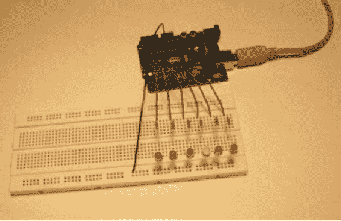

### 代码

```cpp
int timer = 120; // 随着数字的增加，计时会减少。

int pins[] = { 2,3, 4, 5, 6, 7, 8 }; // 数组形式的引脚号
int value_pins = 6; // 由引脚数量表示的数组长度

void setup()
{
  int j;
  for (j = 0; j < value_pins; j++) // 数组元素从 0 到 value_pins – 1 编号
    pinMode(pins[j], OUTPUT); // 每个引脚都被设置为输出
}

void loop()
{
  int j;
  for (j = 0; j < num_pins; j++) 
  { 
    // 遍历每个输出引脚设置一个循环...
    digitalWrite(pins[j], HIGH); // 打开输出引脚的函数
    delay(timer);                 // 延迟函数，
    digitalWrite(pins[j], LOW); // 关闭输出引脚的函数 
  }
  for (j = value_pins - 1; j >= 0; j--) 
  {
    digitalWrite(pins[j], HIGH);
    delay(timer);
    digitalWrite(pins[j], LOW);
  }
}
```

## 第 8 章：基础 Arduino 模拟程序

### 模拟输入

在这个项目中，我们将使用电位器作为 Arduino 板板模拟输入信号的源。理想情况下，电位器能够改变电阻（可变电阻），然后可以被 Arduino 板板作为模拟输入读取。我们将使用 Arduino 板板上已经固定的 LED 引脚 11 作为项目的一部分。

### 所需组件

* 一个电位器
* 一个用于 LED 照明的 Arduino 项目
* 三根跳线线

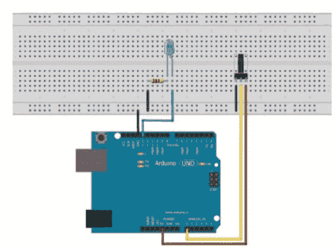

### 代码 Sketch

```cpp
/* 模拟输入下的电位器项目
此项目旨在周期性开启和关闭发光二极管。LED 的亮度取决于用电位器的电阻值。增加电阻会减少光量，反之亦然。
*/

int num = 0; // 此变量存储来自传感器的输入值，初始赋值为 0

void setup() 
{
  pinMode(ledPin, OUTPUT); // 函数声明 LED 为输出
}

void loop() 
{
  num = analogRead(inPin);   // 读取传感器输出值的函数
  digitalWrite(ledPin, HIGH);  // 打开 LED 的函数
  delay(num);               // 停止程序运行一段时间的延迟函数
  digitalWrite(ledPin, LOW);   // 关闭 LED 的函数
  delay(num);               // 停止程序运行一段时间
}
```

### 敲击传感器

对于这类项目，我们将使用压电元件并将其捕捉的声音作为模拟输入到 Arduino 板板。板板的处理器能够在其 ADC（模拟数字转换器）的帮助下读取模拟信号。压电元件（敲击传感器）只是一个能够同时播放音和检测音的电子设备。Arduino 板板将声平检测为电压水平，并将 0 到 5.0 伏的电压转换为 0 到 1024 的对应值。

记住压电元件具有极性，黑线代表负极，红线代表正极。

在代码中，我们将尝试捕捉压电元件的声平（敲击），并确认它超过了某个阈值，然后向 Arduino IDE 平台发送“Knock”字符串信号。

### 电路

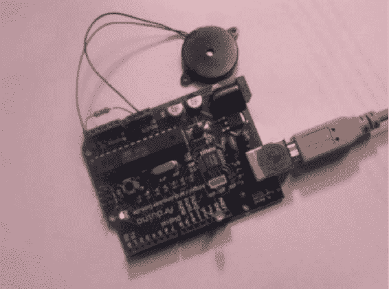

### 代码 Sketch

```cpp
/* 敲击传感器
在这个项目中，我们使用压电元件作为敲击传感器。因此，我们必须监听声平，如果信号超过了指定的阈值。
*/

void setup() 
{
  pinMode(ledPin, OUTPUT); // 函数声明 ledPin 为输出
  Serial.begin(9600); // 表示使用串口
}

void loop() 
{
  num = analogRead(knockSensor); // 用于读取传感器值并将其存储在变量 num 中
  if (num >= THRESHOLD)
  {
    statePin = !statePin; // 切换状态的逻辑
    digitalWrite(ledPin, statePin);
    Serial.println("Knock!"); // 将字符串发送到串口
    delay(100); // 极短的延迟
  }
}
```

### Arduino 平滑处理

涉及数组的使用，代码旨在读取模拟输入，计算移动平均值并最终打印结果。

### 所需组件

* 一个面包板
* 一个 Arduino Uno
* 一个电位器
* 两根跳线线

### 电路

电路图和组件所示：

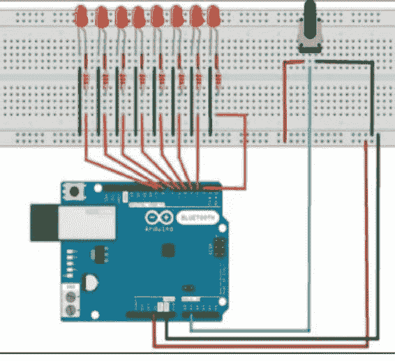

### 代码 Sketch

```cpp
// 下使用的常量保持不变：
const int analogPin = A0;
const int ledCount = 8; // 代表引脚数量
int ledPins[] = {3, 4, 5, 6, 7, 8, 9, 10}; // 引脚号

void setup()
{
  // 遍历数组并将它们设置为输出
  for (int firstLed = 0; firstLed < ledCount; firstLed++)
  {
    pinMode(ledPins[firstLed], OUTPUT);
  }
}

void loop()
{
  // 下方的代码读取电位器输出作为系统输入
  int sensorOutput = analogRead(analogPin);
  // 将结果映射到 0 到 7 的 LED 范围
  int ledLevel = map(sensorOutput, 0, 1023, ledCount);

  // 遍历引脚数组
  for (int firstLed = 0; firstLed < ledCount; firstLed++)
  {
    // 当数组索引小于 ledLevel 时
    // 打开此特定元素的引脚
    if (firstLed < ledLevel)
    {
      digitalWrite(ledPins[firstLed], HIGH);
    }
    // 关闭所有数组索引高于 ledLevel 的引脚函数
    else
    {
      digitalWrite(ledPins[firstLed], LOW);
    }
  }
}
```

同样重要的是注意此项目的结果：随着模拟读取值的增加，八个 LED 将一个接一个开启；随着模拟读取值的减小，它们将再次一个接一个关闭。

## 第 9 章：Arduino 工具

### Arduino 控制语句

涉及决策的控制结构要求执行实际编程的人（程序员）明确并指定程序自身将测试和评估的特定条件。这些条件应与某些在条件返回值时将执行的语句写在一起。否则，将执行其他语句，以便对条件返回错误的响应或结果。

大多数编程语言都有通用的决策结构格式，如下所示：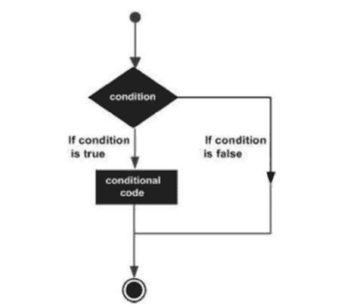

控制结构（条件）内部的语句旨在协调程序执行的流，因此被称为源代码控制语句。

这些语句包括：

- `If` 语句
- `If….else` 语句
- `If…else if…else` 语句
- `Switch case` 语句
- 条件运算符 `?` 

再次强调一下，这些语句在导航程序中的各种循环和部分时非常重要。它们一次执行部分内容，并使用结果来指示处理器执行下一块代码。

### If 语句

这种特定的结构在代码行代码中使用括号内的表达式，并与下一行代码中的语句或语句块结合使用。当表达式为真时，处理器被指示执行包含在此条件中的语句块或语句。如果表达式为假，处理器将跳过该语句块或语句，跳转到下一行代码。`If` 语句有两种形式，如下文所示：

#### 第一种形式

```
{
  if (expression)
  block of statements;
}
```

#### 第二种形式

```cpp
if (expression)
{
  statements;
}
```

#### If 语句的执行顺序

`if` 语句的执行顺序由下图总结所示：

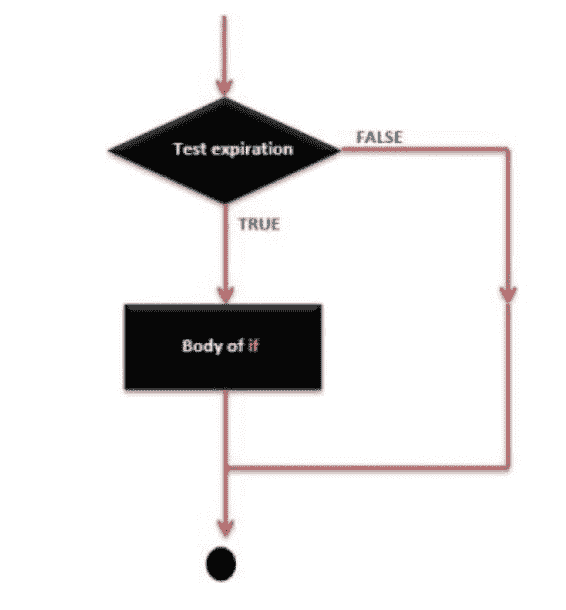

#### 程序中的示例：

```cpp
/* 全局变量定义 */

int X = 5 ;

int Y= 9 ;

Void setup ()
{ 
}

Void loop ()
{
/* 此部分用于检查布尔值条件 */
    if (X > Y) /*当条件为真时，处理器执行下方的语句*/
    Y++;

/* 此部分用于检查布尔值条件 */
  If ( ( X>Y ) && ( Y!=0 )) /*当此条件为真时，处理器执行下面的语句*/
    { 
          X+=Y;
      Y--;
    }
}
```

### If…else 语句

该结构为条件为假的情况提供了一个备选的可执行语句，也就是说当 `if` 语句为假时，有一个可选的退出方式，因为提供了一个可选执行的 `else` 语句。

## 语法

```cpp
if (expression)
{
    statements; //这些语句仅在条件为真时执行
}
else
{
    statements; // 当表达式为假时执行的可选语句。
}
```

#### 执行顺序总结

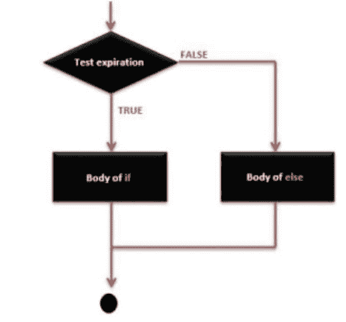

#### 程序中的示例

```cpp
/* 全局变量定义 */

int X = 6 ;

int Y= 8 ;

Void setup ()
{ 
}

Void loop ()
{
/* 此部分用于检查布尔值条件 */
    if (X > Y) /*当条件为真时，处理器执行下方的语句*/
{   
          X++;
      }
  else
      {
    Y-=X
      }
}
```

### If…else if…else 语句

这是一个特殊的控制结构，`if` 语句后面跟着一个可选的 `else..if…else` 控制结构。这种表达式在导航条件以测试它们是真是为假时非常重要。

**注意：** 使用 `If…else if…else` 语句时请始终记住以下点：

- `if` 语句可以没有 `else` 语句，也可以只有一个，且 `if` 语句必须位于任何 `else if` 之后。
- `if` 语句可以没有或有多个 `else if` 语句，这些语句必须始终位于 `else` 语句之前。
- 所有 `else if` 或后跟有 `else if` 的 `else` 语句永远不会被执行，因为处理器按照优先级模式运行。

## 语法

```cpp
if (first expression)
  {
    语句或语句块;
  }
else if(second expression)
  {
    语句或语句块;
}
. //其他 else if 语句
.
.
.
else
  {
语句或语句块;
  }
```

#### 程序中的示例

```cpp
/* 全局变量定义 */

int X = 5 ;

int Y= 9 ;

int Z=15;

Void setup ()
{ 
}

Void loop ()
{
  /* 检查下方的布尔条件是真为假 */
  if (X > Y) /*当条件为真时，处理器被指示执行下面的语句*/
{
        X++;
    }
  /* 检查下方的布尔条件是真为假 */
else if ((X==Y )||( Y!=0 )) /*当此条件为真时，处理器执行下面的语句*/
{
      X+=Y;
    }
else
  Z++;
}
```

### Switch case 语句

这种结构的工作方式与 `if` 语句类似，程序员可以在 `switch` 语句中指定值，并根据 case 进行执行。

## 语法

```cpp
switch (variable)
{
  case name:
    // 语句或语句块
    break;
  case name:
    // 语句或语句块
    break;
default:
    // 语句或语句块
}
```

#### 程序中的示例

我们将使用一个非常简单的示例，假设一个变量有三个状态，即高中低分别 0、1、2。程序根据以下情况切换代码：

```cpp
switch (state)
{
  case 0: Low(); break;
  case 1: Mid(); break;
  case 2: High(); break;
default: Display ("无效状态!");
}
```

### 条件运算符

条件运算符是 Arduino 编程以及 C 语言中唯一的三元运算符。

## 语法

`第一个表达式?第二个表达式:第三个表达式`

### 解释

首先执行第一个表达式，然后根据该执行结果处理或跳过后续表达式。也就是说，当表达式结果为真时，执行第二个并继续序列。当第一个表达式给出假结果时，跳过第二个并处理第三个。表达式根据满足的条件给出真或假的结果。

#### 程序中的示例：

```cpp
/* 查找 min(x, y): */
min = ( x > y ) ? x : y;

/* 此部分用于将小字母转换为大写： */
/* 这种情况不一定需要括号 */
z = ( z >= 'x' && x <= 'c' ) ? ( z - 45 ) : z;
```

#### 使用条件运算符的一些规则：

- 始终确保第一个表达式是标量类型。
- 对于后续表达式，请记住以下几点：
  - 如果是两个，则它们必须都是算术类型
  - 如果是两个，则它们都应该通过简单的算术转换进行评估，最终将确定结果类型。
  - 如果是两个，它们都应该使用 void 设置并给出一个本质上是空的结果。

### Arduino 编程循环

编程循环在某种程度上类似于控制结构为执行提供了更复杂的路径。

因此，循环语句为多次执行语句或语句块提供了支持。通用的示意图如下：

Arduino 编程结合 C 语言提供了以下几种类型的循环：

- While 循环
- Do…while 循环
- For 循环
- 嵌套循环
- 无限循环

### While 循环

该循环会持续执行或处理，直到括号内的表达式给出假结果为止。实际上，除非嵌套变量发生变化，否则 `while` 循环永远不会退出。

## 语法

```
while(expression)
{
  语句或语句块;
}
```

### Do…while 循环

`do…while` 循环与 `while` 循环相似，区别在于在 `while` 循环执行中，循环继续的条件是在进入循环体之前就开始测试的；而在 `do…while` 循环中，执行先测试循环体，然后再检查循环继续的条件。

在执行完 `do…while` 循环后（终止后），执行流实际上会继续处理 `while` 语句之后的语句。

## 语法

```
do
{
    语句或语句块;
}
while (expression);
```

### For 循环

对于这种循环，语句将按照预定的次数连续执行。在 `for` 循环表达式中，控制表达式在执行过程中会被初始化、测试和更改。

这提供了一种非常易于调试的结构，其结构具有循环行为完全独立于循环内部发生的活动。

`for` 循环括号内有三个表达式用于控制其操作。这些表达式之间用分号隔开。

## 语法

```
for (表达式初始化; 控制部分; 增量或减量)
{
    // 语句或语句块
}
```

#### 程序中的示例：

```
for(counter=3;counter >=10;counter++)
{
    // 语句或语句块将执行 10 次
}
```

### 嵌套循环

这种技术允许你在一个循环内部使用另一个循环，如下方的语法所示。

## 语法

```
for (表达式初始化 ;控制部分; 增量或减部分)
{
    // 语句或语句块
    for (表达式初始化 ;控制部分; 增量或减部分)
    {
        // 语句或语句块
    }
}
```

#### 程序中的示例：

```
for(counter=0;counter<=10;counter++)
{
  // 语句或语句块将执行 10 次
  for(j=0;j<=100;j++)
    {
        // 语句或语句块将执行 101 次
    }
}
```

### 无限循环

顾如其名，这是一个没有终止点的循环，因此执行无限次。

## 语法

1. 使用 `for` 循环时：

```
for (;;)
{
    // 语句或语句块
}
```

2. 使用 `while` 循环时：

```
while(expression)
{
    // 语句或语句块
}
```

3. 使用 `do…while` 循环时：

```
do
{
  语句或语句块;
}
while(expression);
```

## Arduino 函数

这些是语句，允许程序员将程序结构化为部分或段，以便同时执行特定的任务。例如，当人们想要在程序多次执行某个特定任务时，函数会非常有帮助。

#### 将代码分段为标准片段的优势：


分段代码呈现出更有组织的工作方式，有助于增强此类代码的概念化。

在修改期间，代码片段最不容易出错，因为任何错误都易于发现。

代码保持紧凑并减少了空间，因为大部分代码被重用了多次。

函数提供了模块化的代码设置，易于阅读并可以在其他部分重用。

Arduino 编程提供了两个强制函数，即`setup()`和`loop()`。其他函数必须在上述函数的括号之外创建。

#### 定义函数的常用语法

```
返回值类型 函数名 (第一个参数, 第二个参数, ....) 
{
    语句或语句块
}
```

#### 解释

- **返回值**：函数返回的值的类型，例如任何数据类型。
- **函数名**：调用此函数时的标识符或标题。
- **第一个参数，第二个参数…**：这些是用于定义数据类型的参数。
- **语句或语句块**：包含了语句或函数本身的内容。

### 函数声明

任何函数都应该在其他函数之外声明，即在`loop()`函数下方或上方。

函数声明可以有两种形式，即：

1. 仅在`loop()`函数上方编写函数原型，这种形式包括：返回值、名称和参数类型。函数原型后面总是跟着分号。

#### 程序中的示例

```
int aver_func(int a, int b);
void loop()
{
    // ...
}
int aver_func(int a, int b)
{
    // ...
}
```

2. 在`loop()`函数下方编写函数定义。

### Arduino 编程 - 字符串

Arduino 中使用的两种字符串是字符数组，它们等同于 C 语言中的字符串，供程序员使用。

#### 字符数组

这通常是一个字符数据类型。因此，数组意味着在末尾有一个额外元素的字符集合。

#### 程序中的示例

```
void setup()
{
  char go_str[7]; // 一个由字符组成的数组
  Serial.begin(10000);
  go_str[0] = 'G';
  go_str[1] = 'o';
  go_str[2] = 'o';
  go_str[3] = 'd';
  go_str[4] = 'i';
  go_str[5] = 'e';
  go_str[6] = 0; // 第 7 个元素称为空终止符
  Serial.println(go_str);
}

void loop()
{
}
```

同样的示例可以用更方便的方法重写为：

```
void setup()
{
  char go_str[] = "Goddie";
  Serial.begin(10000);
  Serial.println(go_str);
}

void loop()
{
}
```

#### 字符数组的操作

我们将考虑下面的示例来解释如何操作字符数组。

```
void setup()
{
char take[] = "I do not take mangoes and tea"; // 创建字符数组
  Serial.begin(10000);
  // 下面的代码用于打印字符串
  Serial.println(take);
  // 下面的代码用于删除字符串的一部分
  take[13] = 0;
  Serial.println(take);
  // 下面的代码解释了如何在现有字符串中替换文本
  take[13] = ' '; // 将空终止符替换为空格
  take[18] = 'e'; // 插入下一个新单词的点
  take[19] = 'g';
  take[20] = 'g';
  take[21] = 0; // 用于终止字符串的空终止符
}
```

```
Serial.println(take);

}

void loop()
{

}
```

##### 结果

- 我不想要芒果子和茶
- 我不要芒果子
- 我不想要芒果子和蛋

##### 解释

首先，你需要创建并打印一个字符串。对于上面的代码，创建了一个新字符串并显示在串口监器（`Serial Monitor`）窗口中。

第二个过程是使用空终止符缩短字符串。这意味着在打印新字符串时，字符显示到遇到空终止符为止。

下一个步骤是更改字符串中的一个单词。首先，你必须将新的空终止符替换为空格，以便字符串恢复到原始格式。下一步是替换要被替换的单词中的单个字符，即将`t-e-a`替换为`e-g-g`。

数组和字符串有指定的边界，限制程序员始终在这些限制范围内工作。在上面的示例中，我们创建了一个长度为 38 个字符的数组，因此尝试复制比此更长的数组可能会困难。复制的长数组将覆盖到所创建数组的末尾。

### Arduino 编程 - 时间

Arduino 编程共有四个时间处理函数，如下所示：

- `delay()`函数
- `delayMicroseconds()`函数
- `millis()`函数
- `micros()`函数

我们将讨论这些每一个时间函数，并强调它们在 Arduino 编程中的重要性。

#### `delay()`函数

这是四个函数中最简单的时间处理函数。它只使用单个整数作为输入或参数。该整数代表毫秒级的等待时间，指示程序等待直到移动到下一组代码，并在那里将遇到`delay()`函数。

通常不建议使用此函数来指示你的代码等待，因为它与被称为“阻塞”（`blocking`）的现象有关。

#### `delayMicroseconds()`函数

与`delay()`函数一样，`delayMicroseconds()`也只接受单个整数作为参数或输入。这里的整数代表微秒级的时间，在这种情况下等同于毫秒的千分之一或秒的百万分之一。

记录经过测试并证明能够产生精确延迟的时间记录为 16383，这取决于未来 Arduino 开发板生产中的发明而改变。然而，对于小于千微秒的延迟，建议使用`delay()`函数。

#### `millis()`函数

这里使用的时间延迟是毫秒，这意味着 Arduino 板卡一运行程序，它就会返回一个毫秒数。这个延迟时间在约 50 天后有时会回到零，这种现象被称为“溢出”（`overflowing`）。

语法：

```cpp
millis (); // 此函数返回从程序开始计算的毫秒数。
```

程序中的示例：

```cpp
unsigned double delay time;

void setup(){
  Serial.begin(9600);
}

void loop()
{
  Serial.print("delay time:");
  delay time = millis();
  //下面的代码将打印自程序开始以来的时间
  Serial.println(delay time);
  //此代码规定你必须等待一秒以防止 //大量数据
  delay time(1000);
}
```

#### `micros()`函数

此函数也返回从程序开始开始的时间，时间以微秒表示。溢出现象在这里在大约 70 分钟后也会发生。

语法：

```cpp
micros (); // 该函数应该返回程序开始后微秒级的时间段。
```

程序中的示例：

```cpp
unsigned double delay time;

void setup(){
  Serial.begin(9600);
}

void loop(){
  Serial.print("delay Time:");
  delay time = micros();
  //下面的代码打印自程序开始的时间段
  Serial.println(delay time);
  //此代码规定你必须等待一秒以防止 //发送大量数据
  delay time(1000);
}
```

### Arduino 编程 - 数组

数组是位于连续内存位置的相同数据类型元素的连续集合。

在数组中定位某个特定元素时，我们必须指定它的名称和它的存储位置的名称。因此，数组有两个重要特征，即名称和位置。识别数组的方法是给该特定元素一个名称，然后通过元素在方括号`[]`中的位置来确定。第一个元素（称为零元素）的下标为零，随后的元素可以用`C[1]`、`C[2]`、`C[3]`表示，其余的如下所示所示：

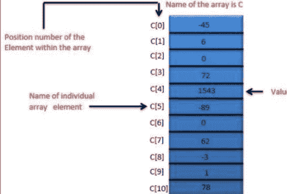

上面的数组被称为`C`，包含 11 个元素。每个元素都有一个值，例如`C[10]`的值为 78。

因此，我们可以编写程序来操作这些值，例如，为了打印数组中前三个元素值的和，我们可以写：

```cpp
Serial.print (C[ 0 ] + C[ 1 ] + C[ 2 ] );
```

同样，我们可以写另一个程序将`C[8]`的值乘以 6，并将结果赋值给名为`y`的变量：

```cpp
x = C[ 8 ] * 6;
```

#### 数组声明

数组声明有助于指定元素的类型和该数组中元素的总数，如下所示：

```cpp
type arrayName [ arraySize ] ;
```

这指示编译器预留足够的内存。对于数组的声明，数组大小必须是整数。例如：

```cpp
int D[3]; //
```

#### 使用数组的示例

数组声明并使用循环来初始化元素：

```cpp
// b 是一个 12 元素的数组

int b[12] ;

void setup ()

{ 

}

void loop ()

{

  for ( int j = 0; j < 10; ++j ) // 初始化元素

    b[j] = 0; // 将位置 设置为 0

  Serial.print (j) ;

  Serial.print (`\r`) ;

}
```

#### 多维数组

二维数组通常表示具有行和列的表格。

多维数组的一些显著特征：

- 有两个下标表示表格的行列。
- 第一个下标表示元素的行，第二个下标表示元素的列。
- 多维数组有两个或更多维度。

声明示例所示：

```cpp
int c[ 3 ][ 3 ] = { { 3, 8 }, { 3, 7 } };
```

### 求所有数组元素

数组中的这些元素通常代表计算结果的值，或将用于特定数学工作的值。例如，教授可能决定将学生的成绩输入表格以形成数组，然后使用总和计算全班的平均分。下面的示例解释了如何使用数组函数实现这一目标。

```cpp
const int arraySize = 5; // 数组大小由名为 const 的变量指示，数据类型为 int

int c[ arraySize ] = { 80, 60, 50, 100, 70};

int total = 0;

void setup ()

{ 

}

void loop ()

{

  // 下面的代码用于获取数组 c 内容的和

  for ( int j = 0; j < arraySize; ++j )

    total += c[ j ];

  Serial.print (“ sum Total of elements of array c : ”) ;

  Serial.print(total) ;

}
```

### 第 10 章：输入、输出和传感器

一根导体将用于接收数据，另一根将用于发送信息，一个将用于同步，另一个将选择它与哪个设备进行通信。为了实现这一功能，这意味着它被配置为全双工连接。这意味着数据可以同时进行接收和发送。最大的波特率可以远大于封装`i2c`的通信系统。

#### 面板 SPI 引脚

`SPI`将使用四根线。

1. `SS`：这将是片选线。
2. `SCK`：这将由主站驱动的串行时钟。
3. `MISO`：主站输入和从机输出。它由主站供电。
4. `MOSI`：由主站驱动的主站输出和从机输入。

你将使用的一些功能必须包含`SPI`。

`SPI set clock divider(divider)`：这将设置`SPI`时钟分频器，这意味着它是相对于系统时钟的对于`AVR`基础面板，分频器提供二、四、八、十六、三十二、六十四和一百二十八等选项。你的默认设置将`SPI CLOCK DIV 4`，这将把`SPI`时钟设置为系统时钟频率四分之一。

1. `Divider`：这将是 (`SPI CLOCK DIV 2`, `SPI CLOCK DIV 4` 等)。
2. `SPI transfer(Val)`：`SPI`将根据同时发生的发送和接收进行分配。获得的数据将以标准的`Val`形式返回。
3. `SPI begin transaction(SPI setting(speed maximum, data order, data mode))`：最高速度将根据数据顺序（`MSBFIRST` 或 `LSBFIRST`）时钟。

`SPI`将遵循四种工作模式：

1. `Mode 0`（默认）：时钟自然为低电平，从转换获得的数据可以在数据本身从频谱的底部向较高电平移动时被视觉化。这就是所谓的前沿。
2. `Mode 1`：每当数据从高到低时，这被视为后沿。
3. `Mode 2`：当你的数据从高到低时，这也是前沿。
4. `Mode 3`：这里的数据也从频谱的低端到高端。在这种情况下，它在行业内被称为后沿。
5. `SPI attach interrupt(handler)`：当从机设备从主站获取数据时，该函数将被调用。

此时，你把两个`Uno`面板连接在一起，一个作为从机，另一个作为主站。

- 十引脚将是`SS`
- 十一引脚将是`MOSI`
- 十二引脚将是`MISO`
- 十三引脚将是`SCK`

共地地，在下面的图中，你将看到两个面板之间发生的连接。

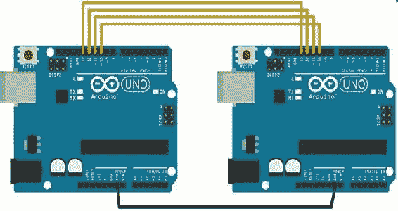

### Arduino 高级策略

#### 加速输入输出

在每个`AVR Arduino`面板上，时钟速度为 16 MHz。控制器上的每条指令都将在四个周期内完成；因此，你可以在一秒内执行四百万条指令。但是，输入/输出的速度要慢得多。这是由于`digital write`和`digital read`函数引起的。每执行一次函数时，都有额外的代码需要执行。这些额外代码负责检测并把数字引脚映射到输出端口。在每个微控制器上，输入输出设备将以一组八个引脚分配到一个端口，该端口已特殊注册到控制器。

因此，下一个问题是，它有多慢？你将通过使用这段代码发现这一点。

你可以通过将`loop`代码封装在无限循环中来改进程序。这将加快执行，因为 CPU 执行的函数调用更少。这应该加快你的输入和输出，使其速度快百分之十。如果你想获得最高输出速度，你必须使用低级访问端口，为了做到，你必须学习如何使用微控制器；然而，这将破坏 Arduino 机器的美感。不过，有一个库可以使用来增加输入输出访问速度。

请记住，存在限制，因为它主要支持`Leonardo`、`Mega`、`Uno`、`Nana` 和`Attiny`型。这将提供内联函数以实现更快的输入输出访问。

#### 模拟读取

在 USB 供电的 Arduino 模型上进行模拟读取将给你带来一些意想不到的结果。这是因为模拟参考电压将与逻辑电压（通常为 5 伏）接通，然而如果你从开关电源或`USB`为你的面板供电，你将面临由于`USB`线引起的干扰和电压下降。只要你的控制器运行在 4.5 伏而不是 5 伏，这是可能的。

在涉及精密测量时，这并不是理想的。为了进行精密测量，你必须使用外部电压参考。另一方面，你可以使用内置芯片的电压参考来测量 VCC。

#### 获取可用内存

在本节中，你将学习如何以字节为单位获取内存。

#### 使用 Const、程序和全局变量

如果你需要在代码中存储大量数据，你需要使用全局`const`并包含程序语句。这将告诉编译器将数据存储在程序内存而不是 RAM 中。

#### 忘记默认 IDE

虽然 Arduino 自带的 IDE 很好用，但它并不适用于专业软件开发。如果你使用它，你会发现一旦代码超过几百行就会变得很痛苦。

所以，为了解决这个问题，你将使用`Atmel Studio`或带有`Visual Micro`插件的`Visual Studio`。该插件带有调试器，但重要的是要知道它不是免费的，需要 17 美元。

你也可以使用文本编辑器来编写你的程序。然而，通过 Arduino 1.5，IDE 支持通过命令行构建和上传你的程序。

```
Arduino --panel (panel type description) --port (serial port) --upload (sketch path)

Arduino --panel (panel type description) --port (serial port) --verify (sketch path)
```

你还需要一个面板类型描述。

```
package:arch:panel[:parameters]
```


你可以通过 Arduino IDE 的手册文档了解更多关于命令行的信息。

### 内联小函数

有一个手册说内联函数和宏一样快。但有一个问题。如果你使用了内联函数，它会增加你的代码体积；特别是当你在多处调用该函数时。

## 第 11 章：Arduino 函数库

I/O 函数；高级 I/O 函数；等。

### Arduino 中的函数

Arduino 板带有许多引脚。这些引脚可以配置为输入或输出。你最好注意到，大多数 Arduino 模拟引脚都可以以数字引脚的方式进行编程和使用。

#### 输入引脚

上拉电阻用于在没有输入可用时将输入引脚引导到特定状态。我们可以通过在输入引脚上添加上拉电阻（连接到 `+5V`）或下拉电阻来实现这一点。你可以使用一个 `10K` 电阻作为上拉电阻或下拉电阻。

`Atmega` 芯片拥有 20,000 个上拉电阻，并且所有电阻都可以通过软件访问。要访问这些内置上拉电阻，我们将 `pinMode()` 设置为 `INPUT_PULLUP`。这将反转输入模式的行为。`HIGH` 值表示传感器开启（**ON**），而 `LOW` 值表示传感器关闭（**OFF**）。上拉电阻的值取决于所使用的微控制器类型。在大多数基于 AVR 的开发板上，该值介于 `20kΩ` 到 `50kΩ` 之间。在 `Arduino Due` 上，该值介于 `50kΩ` 到 `150kΩ` 之间。具体值可以在开发板上微控制器的数据表中查到。

当你将传感器连接到配置为 `INPUT_PULLUP` 的引脚时，你应该将另一端连接到地（ground）。如果引脚是简单的，这将导致引脚在开关打开时读取为 `HIGH`，在按下引脚时读取为 `LOW`。上拉电阻可以提供足够的电流，使连接到配置为输入引脚的 LED 弱发光。如果你看到 LED 在工作但光线很暗，这可能就是原因。

下面的示例演示了这一点：

```
pinMode(3,INPUT)  ;//将引脚设置为输入模式，不使用内置上拉电阻

pinMode(5,INPUT_PULLUP)  ;//使用内置上拉电阻将引脚设置为输入模式
```

## 输出引脚

使用 `pinMode()` 函数配置为 `OUTPUT` 的引脚被称为处于低阻抗状态。此类引脚能够向其他电路提供大量的电流。

当你尝试从输出引脚运行大电流设备时，可能会损坏引脚中的输出晶体管，或损坏整个 `Atmega` 芯片。在大多数情况下，这会导致微控制器上的某个引脚失效，但芯片的其他部分将正常工作。

## `pinMode()` 函数

我们使用此函数将特定引脚配置为输入引脚或输出引脚。如果你需要启用内部上拉电阻，可以使用 `INPUT_PULLUP` 模式使用此函数。当你使用 `INPUT` 模式时，它将禁用内部上拉电阻。

`pinMode()` 函数采用如下语法：

```
Void setup ()  {

  pinMode (pin, mode);

}
```

该函数接受如上面所示的两个参数。第一个参数是引脚，即你需要设置或修改其模式的引脚编号。模式是你想要将引脚设置的状态，它可以是 `INPUT`、`OUTPUT` 或 `INPUT_PULLUP`。

考虑下面给出的示例：

```
int btn =  5  ;//连接到引脚 5 的按钮

int LED =  6;//连接到引脚 6 的 LED

void setup ()  {

  pinMode(btn , INPUT_PULLUP); //将数字引脚设置为带上拉电阻的输入模式

  pinMode(btn , OUTPUT);  //将数字引脚设置为输出

}

void loop ()  {

  if  (digitalRead(btn )  == LOW){//如果按钮被按下

      digitalWrite(LED,HIGH); //开启 LED

      delay(500); //延迟 500 毫秒

      digitalWrite(LED,LOW); //关闭 LED

      delay(500); //延迟 500 毫秒

  }

}
```

我们创建了两个变量 `btn` 和 `LED`。它们分别表示连接到引脚 5 的按钮和连接到引脚 6 的 LED。在 `setup()` 函数内部，数字引脚被设置为带上拉电阻的输入模式。该数字引脚也被设置为输出。

程序（sketch）的逻辑随后在 `loop()` 函数中实现。当按钮被按下时，LED 将开启并在指定状态延迟 500 毫秒。然后 LED 将关闭并在该状态延迟 500 毫秒。

## `digitalWrite()` 函数

当我们需要向数字引脚写入 `HIGH` 或 `LOW` 值时，使用此函数。如果引脚已通过 `pinMode()` 函数配置为 `OUTPUT`，则它将被分配相应的电压值（在 3.3V 板卡上，`HIGH` 为 `5V` 或 `3.3V`，`LOW` 为 `0V`，即地）。

如果 `pinMode()` 函数未设置为 `OUTPUT`，但 LED 连接到了引脚，调用 `digitalWrite(HIGH)` 可能会导致 LED 变暗。如果你不显式设置 `pinMode()`，`digitalWrite()` 函数将启用内部上拉电阻，它将像一个阻碍电流流动的大电阻。

`digitalWrite()` 函数采用以下语法：

```
Void loop()  {

  digitalWrite (pin ,value);

}
```

该函数接受如上面所示的两个参数 `pin` 和 `value`。`pin` 表示你需要设置其模式的引脚编号。`value` 参数可以取 `HIGH` 或 `LOW` 值。

考虑下面的示例演示了如何使用 `digitalWrite()` 函数：

```
int LED =  6;//连接到引脚 6 的 LED

void setup ()  {

  pinMode(LED, OUTPUT);

}

void loop ()  {

  digitalWrite(LED,HIGH); //开启 LED

  delay(500); //延迟 500 毫秒

  digitalWrite(LED,LOW); //关闭 LED

  delay(500); //延迟 500 毫秒

}
```

我们创建了一个变量 `LED` 来表示连接到引脚 6 的 LED。在 `setup()` 函数中，该引脚被设置为输出。在 `loop()` 函数中，我们使用 `digitalWrite()` 函数来开启关闭 LED。

## `analogRead()` 函数

`analogRead()` 函数报告应用在模拟引脚上的电压。Arduino 的下部有六个标记为 `Analog In` 的引脚。这些引脚能够检测电压。该函数始终返回 `0` 到 `1023` 之间的值，这代表 `0` 到 `5V` 之间的电压。例如，如果引脚 `0` 应用了 `2.5V`，`analogRead(0)` 将读取值为 `512`。

```
int analogPin =  3;//连接到模拟引脚 3 的电位器调节

int x =  0; //存储读取值的变量

void setup()  {

  Serial.begin(9600); // 初始化串口

} 

void loop()  {

  x = analogRead(analogPin); // 读取输入引脚

  Serial.println(x); // 打印值

}
```

我们首先创建了一个变量 `analogPin` 并将其赋值为 `3`。该变量表示连接到模拟引脚 3 的电位器调节。我们还创建了第二个变量 `x` 并赋值为 `0`。我们将使用该变量来存储从引脚读取的值。在 `loop()` 函数中，我们调用了 `analogRead()` 函数并将 `analogPin` 作为参数传递给。

## `analogReference()` 函数

此函数配置模拟输入的参考电压，即用作输入范围上限的值。该函数可以接受以下任何选项：

- `DEFAULT` – 这是 5V Arduino 板卡上的 5 伏特默认模拟参考，或 3.3V Arduino 板卡上的 3.3 伏特默认模拟参考。
- `INTERNAL` – 这是一个内置参考，在 `ATmega168` 或 `ATmega328` 上等于 1.1 伏特，在 `ATmega8` 上等于 2.56 伏特。Arduino Mega 上不可用。
- `INTERNAL1V1` – 这是一个内置的 1.1V 参考。仅 Arduino Mega 可用。
- `INTERNAL2V56` – 这是一个内置的 2.56V 参考。仅 Arduino Mega 可用。
- `EXTERNAL` – 这是施加在 `AREF` 引脚上的电压，即仅限 0 到 5V，并用作参考。

该函数采用以下语法：

`analogReference (type);`

参数 `type` 可以是上述讨论的任何选项。

在 `AREF` 引脚上，避免对外部参考使用任何低于 0V 或高于 5V 的电压。如果你在 `AREF` 引脚上使用外部参考，在调用 `analogRead()` 函数之前，你应该将模拟引用设置为 `EXTERNAL`。如果你不这样做，将导致内部生成的活动参考电压与 `AREF` 引脚短路，这可能会损坏你 Arduino 板上的微控制器。

你还可以通过 5K 电阻将外部参考电压连接到 `AREF` 引脚，这将允许你在内部和外部参考电压之间切换。由于 `AREF` 引脚内部有一个 32K 电阻，该电阻将改变作为参考的电压。两者将作为一个分压器工作。

下面的示例演示了如何使用 `analogReference()` 函数：

```cpp
int analogPin =  3;// 连接到模拟引脚 3 的电位器触

int x =  0;  // 用于存储读取值的变量

void setup()  {

  Serial.begin(9600);  // 设置串口

  analogReference(EXTERNAL);  //施加到 AREF 引脚的电压

 // 用作参考。

}

void loop()  {

x = analogRead(analogPin);  // 读取输入引脚

  Serial.println(x);  // 打印值

}
```


我们首先创建了一个名为`analogPin`的变量并给其赋值为 3。该变量表示连接到模拟引脚号 3 的电位器触。我们还创建了第二个变量`x`，并赋值为 0。我们将使用这个变量来存储从引脚读取的值，即施加到引脚上的电压。

考虑从代码中提取的以下行：

```
analogReference(EXTERNAL);
```

此行简单意味着施加在`AREF`引脚上的电压（范围在 0 到 5V 之间）将作为参考。

在`loop()`函数中，我们调用了`analogRead()`函数并将值`analogPin`作为参数传递给它。这将读取 3 号模拟引脚上的电压值，并将读取的值存储在变量`x`中。然后我们打印了这个值。

### 字符函数

我们以字符的形式向计算机输入数据。这些字符可以是字母、数字和其他特殊符号。

处理字符的库带有许多函数，我们可以用这些函数来测试和操作数据的字符。每个函数接收`int`形式的数据或`EOF`作为参数。这意味着字符是作为整数进行处理的。

`EOF`通常值为 -1，某些硬件架构不允许在`char`变量中存储负值。这意味着处理字符的函数将它们作为字符串处理。

每当我们需要使用处理字符的函数时，都应该在程序中添加`<cctype>`头文件。以下是字符处理库提供的不同函数：

`isdigit`函数检查其参数是否为数字。`isalpha`函数确定传递给它的参数是大写字母（即 A-Z）还是小写字母（即 a-z）。`isalnum`函数检查传递给它的参数是否是大写字母、小写字母或数字。`isxdigit`函数检查传递给它的参数是否为十六进制数字（即 A-F、a-f 或 0-9）。

条件运算符`(:?)`可以与每个函数配合使用，以确定在每个测试过的字符的输出中应该打印“ 是一个”还是“ 不是一个”。

现在我们需要创建一个示例，来演示如何使用`isupper`和`islower`函数。我们使用`isupper`函数检查传递给它的参数是否大写（即 A-Z）。我们使用`islower`函数检查传递给它的参数是否为小写（即 a-z）。

代码执行时将返回以下内容：

`islower`函数返回：
m is a lowercase letter
M is not a lowercase letter
6 is not a lowercase letter
! is not a lowercase letter

`isupper`函数返回：
D is an uppercase letter
d is not an uppercase letter
9 is not an uppercase letter
$ is not an uppercase letter

现在我们需要创建一个示例，演示`isdigit`、`isalpha`、`isalnum`和`isxdigit`函数的使用。`isdigit`函数帮助我们检查传递给它的参数是否为数字（即 0-9）。`isalpha`函数帮助我们检查传递给它的参数是否为字母，即大写字母（A-Z）或小写字母（即 a-z）。`isalnum`函数帮助我们检查传递给它的参数是否是大写字母、小写字母或数字。`isxdigit`函数检查传递给它的参数是否为十六进制数字（即 A-F、a-f 或 0-9）。

`DigitalReadSerial`：此命令允许 Arduino 读取开关。然后，Arduino 将通过向串口监视器打印状态来使其可见。

## 模拟 (Analog)

模拟命令专为 Arduino 板板上的模拟输入和输出设计。这些包括`Analog Input`、`AnalogInOutSerial`、`Calabration`、`AnalogWriteMega`、`Smoothing`和`Fading`。

- `Analog Input`：该命令配合电位器使用，根据需要使 LED 闪烁。
- `AnalogInOutSerial`：该命令的工作原理是首先读取模拟输入引脚。然后，`AnalogInOutSerial`对输入引脚的结果进行映射，并使用这些结果使 LED 变亮变暗。
- `Calibration`：该命令用于通过最小值和最大值来为模拟传感器定义预期值。
- `AnalogWriteMega`：该命令专为 Arduino Mega 微控制器设计。它会按顺序使 12 个独立的 LED 闪烁和熄灭。
- `Smoothing`：平滑命令用于对多个模拟输入读取值进行平滑处理。
- `Fading`：正如命令名所示，淡出命令负责使 LED 产生淡入淡出效果。它是通过 PWM 引脚实现的。

## 数字 (Digital)

数字功能可以播放音调、控制 LED 功能以及读取推按钮。这些功能包括`Simple Keyboard`、`Tone`、`Tone4`、`Pitch Follower`、`Debounce`、`Button State Change`、`Button`和`Blink Without Delay`。

- `Simple Keyboard`：通过蜂鸣扬声器和压力传感器将您的 Arduino 变成带有三个键的音乐键盘。
- `Tone`：该命令配合蜂鸣扬声器使用以播放旋律。
- `Tone4`：使用`tone`命令配合多个扬声器播放连续的音调。
- `Pitch Follower`：使用模拟输入和蜂鸣扬声器播放特定的音高。
- `Debounce`：该命令通过读取连接到 Arduino 的推按钮来过滤噪声。
- `Button State Change`：该命令允许 Arduino 计数按钮按下的次数。
- `Button`：按钮命令允许 Arduino 在连接的推按钮被按下时控制 LED。
- `Blink Without Delay`：该命令允许板子上的 LED 在不使用延迟函数的情况下闪烁，这意味着它可以闪烁得更快或保持常亮。

## 第 13 章：C 语言基础

### 内存映射 (The Memory Maps)

当你创建一个 Arduino 程序时，了解计算机系统的工作原理至关重要。尽管 C 语言是接近机器的语言，但当程序运行时某些事的执行方式将会变得清晰。

一个主系统由称为 CPU 或微控制器的控制设备组成。在某些方面存在一些差异。我们稍后将深入探讨。只需提一下，与标准微处理器相比，微控制器可能并不强大。然而，它仍然包含输入输出端口以及硬件功能。

微处理器连接到外部内存。通常情况下，微控制器包含足够的板载内存。但需要注意的是，我们指的不是大容量；对于简单的应用程序，微控制器可能只有几百字节的内存。不要忘记一个内存字节有`8`位，每个位可以是真或假、高电平或低电平以及`I/O`（此处应为：一个内存字节有`8`位，每个位可以是真或假，高或低以及`I/O`）。

当涉及到处理器与存储在内存中的功能数据之间的关系时，数据必须保持在处理器的寄存器中。寄存器是我们可以执行逻辑数学运算的场所。例如，如果你想对两个变量进行加法，变量的值必须移动到寄存器。

### 内存映射 (Memory Maps)

计算机系统中的每个内存字节都有一个连接的地址。现在，如果没有地址，处理器将没有手段识别特定的内存。通常，内存地址从`0`开始递增。尽管我们有具有私有或唯一系统的特定地址，但某个地址可能并不指向外部通信的输入输出端口。

大多数时候，你会发现有对内存进行映射。这仅仅是一个巨大的内存槽数组。我们有人开发内存映射，并将值最小的地址放置在顶部，而另一些人绘制内存映射并将最小地址分配在底部。每个地址都指向一个可以存储字节的地方。然而，C 编译器会完成工作。例如，如果我们将`char`变量声明为`-X`。它可能位于地址`2`，所以如果我们打印该值，就不需要手动选择地址`2`处的值了。相反，我们将编写“选择 X 值”，而编译器会产生代码以确保它在正确的地址上正常工作。这种级别的抽象简化了整个过程。但是，由于大多数变量携带的量大于一个字节，我们可能需要收集这些地址来仅持有单个值。例如，如果我们选择一个`short int`，它将要求我们两个字节。现在，如果下一个地址从`four`开始，则需要使用地址`5`。当我们选择访问这个特定变量时，编译器会自动构建代码并利用所有地址，因为它知道`short int`的存在。

### 栈 (Stacks)

大多数程序员倾向于为变量使用临时存储器。这意味着某些变量会被很短一段时间，然后就会被丢弃。因此，如果我们继续并为这个特定变量分配永久空间将是不正确的。通常，一个应用程序由两部分组成：代码和数据。数据部分是永久的，因为这两个部分无法消耗整个内存；剩余内存通过栈临时使用。它从内存映射的对端开始；栈向数据部分代码部分增长。它类似于一叠托盘。栈上的第一个托盘是最后被拿走的。任何需要临时变量时，这部分内存就会被使用。由于需要许多项目，内存会被用尽。当代码结束时，声明的临时变量不再有用，因此栈会收缩。

### C 语言基础 (The Basics of C-language)

C 语言是为希望用更少的代码完成许多任务的专业开发人员设计的。C 是一种编译型语言。这意味着一旦我们写了程序，必须将其传递给编译器，开始将 C 语言指令转换为微控制器可以管理的机器码。

如你所见，这是一个额外的步骤，但与解释器相比，它会产生一个更好的程序。之后，解释器将从机器语言转换代码。

然而，C 与其他语言不同。它是一种流式语言。我们有语句、函数和变量。正如我们已经看到的，变量是存储内容的对象。语句包含赋值、操作等。

函数包含语句并可以调用其他函数。

C 语言中的变量命名非常简单。变量名包含数字、下划线和字母。你也可以结合大小写字母。然而，长度不能超过 31 个字符。不过，实际限制取决于 C 编译器。此外，变量不能包含保留关键字或特殊字符，如分号、逗号和其他特殊字符。因此，有效的名称可以是如`resistor8`、`volt5`和`we_are_variables`。

C 语言有不同的变量类型。其中一些由两种形式的浮点和实数组成。首先是 32 位的`float`，然后是`double`。我们还有几种整数类型，包括`char`、16 位的`short int`和 32 位的`long int`。虽然`char`只有 8 位，但仍有 2 的 8 次方组合——或者说 256 个独立值，你会发现它非常适合单个 ASCII 字符。

与其他语言类似，C 语言拥有数组和复合数据类型。在涉及 C 语言的变量时，在使用变量之前对其声明是至关重要的。变量不能像 Python 语言那样瞬间创建。变量声明由变量类型和变量名组成。你也可以在声明期间为变量包含初始值，但这是可选的。C 语言仍然允许进行多个变量声明。例如：

```
Float c = 1.2;
Char c;
Unsigned char x;
```

你应该注意，每种变量声明都以分号结尾。像`Java`等许多其他编程语言一样，分号表示该语句的结束。

## 函数

函数的命名规则与变量相似。所有函数都有类似的相似语法：`Return_value function_name (function argument list) { Statement(s) }`。你可以借鉴数学函数的概念，为其分配一些值(s) 并回传一些值。例如一个包含`cosine`函数的计算器。你可以给它分配一个角度，这将返回一个特定的值。C 语言中的函数可以包含独立的参数。此外，C 函数是可以返回值的。`void`函数是不需要值或不返回值的函数。`void`函数看起来像这样：

```
void function_name (void)
{
// 此处编写必要的语句
}
```

这看起来工作量很大，但 C 语言中的数据类型是有意义的。这意味着如果你在函数中使用了错误的变量类型，甚至使用了数量错误的变量，你将收到一个警告。

因此，如果你有一个`float`函数并尝试向它发送整数变量，编译器将向你发送警告。每个程序必须有开始和结束。在 C 语言中，所有程序都开始于`main`函数。你可以看下面的程序：

```
void main (void) 
{
float y = 3.0;
float f = 2.0;
float t;
t = y* t
}
```

存在一个`main()`函数。它不接受变量也不返回任何内容。

## 库

之前的示例是有限的，因为很难看到结果。因此，当你想要在计算机屏幕上显示结果时，你需要一些方法。为了实现这一点，取决于库和系统函数。无数库拥有最先进的 C 系统。本质上，某些人只是测试、编译并编写了一系列函数。你需要做是将这些函数链接到程序中。链接有助于将代码和任何现有库集成到整个程序中。为了显示通用数据和输入数据，我们使用标准的`IO`和`stdio`。

`stdio`库有一个名为`printf()`的函数。

程序将在计算机屏幕上显示“Hello World”单词。它会在反斜杠-n 组合之后插入一个新行。`\n`代表添加新行。如果我们未能包含`#include`指令，编译器将无法理解任何关于`printf()`的内容，并且在我们尝试使用它时会显示错误。那么，头文件呢？头文件包含许多不同的函数原型。这些原型可以被视为模板，但如果你愿意，你也可以构建自己的原型。要使用它，你需要在代码中编写正确的`include`语句，并且如果你记得包含链接器库代码，效果会更好。这不仅可以节省时间，还能让你复用代码。

## 简单数学

C 语言像其他语言一样具有某些基础数学运算符。其中一些包括`-`、`+`、`/`和乘法。括号有助于划分元素和处理幂优先级操作。C 语言拥有`%`运算符，代表取模。取模是一种处理除法余数的操作。例如，8 取模 18 的结果当然是 2。除法对整数和浮点数都会分别进行，且没有余数。换句话说，整数`5`除以`2`等于`2`，而不是`2.5`。在 C 语言中，有一系列位操作符，用于此类情况。对于复杂的数学运算符，你必须深入研究数学库。一些示例包括`log(10)`、`tan()`、`cos()`和`sin()`。

然而，你不应该尝试使用`^`运算符，因为它在 C 语言中有单独的含义。那么，你还记得我们之前说的关于库的使用吗？将`sin()`等某些函数放入代码中会强制编译器定义原型以及其他相关信息。因此，在程序开始时，有必要包含以下行：

```
#include < math.h >
```

## C 语言输入与输出

我们知道`printf()`函数在屏幕上显示信息。`printf()`是一个广泛且复杂的函数，有很多变体和格式说明符。格式说明符由`%`内容组成，作为值的占位符。

例如，如果我们想以十进制形式显示变量的值。我们可以这样做：`printf (“ The value is %d, in hex %x, and in octal is &o.\ n”, value1, value1, value1);`你应该看到我们标记变量的方式。这至关重要，因为如果你犯错并显示一个没有标签的值，将无法判断它是十六进制还是十进制。例如，如果你看到一个像 22 的数字，你如何判断这个数字是十进制还是十六进制呢？这是不可能的。

除了指示标签，你还可以指定字段宽度打印。例如，`%6d`等同于以最小 6 宽写入整数。同样，`%6.2f`意味着以最小 6 空间打印浮点值。`.2`部分是一个精确指定符，在下面的示例中，它显示小数点后两位数字。你就可以看到这个函数看起来有多强大和灵活了。C 语言的输入函数是`scanf()`。这类似于 Python 的`input`语句。尽管可以一次请求多个值，但这是最好的方法。

它带有与`printf()`类似的说明符。所以，有一个点需要理解，`scanf()`函数将要求你指定值存储在计算机内存中的位置。这说明仅仅写变量名是不够的。你需要详细描述它。C 语言有`&`运算符，表示地址。例如，当你想要从用户处选择一个特定的整数变量并安全地存储在`voltage`变量中时。这里是代码片段供你查看：

```
printf (“ Kindly type in the voltage”);
scanf (“% d,” &voltage);
```


Arduino 定义了数百种通信协议，并将它们实现数据交换。每种协议都将被归分为两类之一：串行或并行。

## 并行通信

外设设备与 Arduino 之间的并行连接通过输入和输出端口建立，因此距离仅为几米。但在某些情况下，需要在两台设备之间建立较远距离的通信，这时你将无法使用并行连接。并行接口会同时移动一组比特位。它们通常需要一个通过标记为八和十六的电线传输的数据总线。数据传输量将是巨大的。

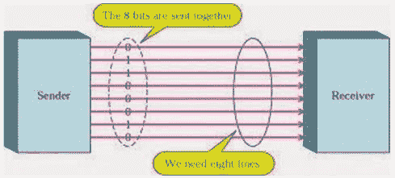

### 优缺点

虽然并行通信具有其优势，例如它速度更快、更直观，并且更容易实现。然而，它需要大量的输入输出线和端口。如果你发现需要将项目从`Uno`面板迁移到`Mega`板板，你将必须了解微处理器上的输入输出线，并且你会意识到这些线并不多。因此，你会发现自己更喜欢使用串行通信，这意味着你正在为了引脚空间而牺牲了潜在的速度。

## 串行通信

在今天你使用的多数面板中，都有内置的几种用于串行通信的系统。使用的系统取决于以下因素：

1. 你是否需要能够同时发送和接收数据？
2. 微控制器与多少台设备交换数据？
3. 设备之间的空间有多大？
4. 数据传输需要多快？

每当你使用串行通信时，建立协议是至关重要的。必须严格遵守该协议。应用这套规则是为了让设备知道如何解释正在交换的数据。幸运的是，Arduino 会自动处理这些，以便用户处理处理的是清晰的数据。

### 串行通信的类型

1. **异步**：异步设备具有自己的时钟，该时钟由上一个状态的输出触发。
2. **同步**：对于与另一个设备同步的设备，它将使用相同的时钟，定时将相互同步。

发现你正在使用的设备是否同步很容易的。如果给所有连接的设备提供相同的时钟，那么它们就是同步的。然而，如果没有时钟线，它就是异步的。

例如，`UART` – 通用异步收发器模块将是异步的。

异步协议内置了若干条规则。这些规则无非是为了确保数据传输稳健且无错误的机制。这些机制是：

1. `波特率`
2. `同步位`
3. `校验位`
4. `数据位`

### 同步位

同步位是两个或三个特殊的比特，它们会随着每个数据包一起传输。它们是被指定用于开始和停止发送数据包的比特。正如其名称所示，这些比特将标记一个数据包的开始和结束。

总会有一个起始位，但可以相互配置多个停止位。

你的起始位始终由一条空闲数据线指示，该线从一变为零，而停止位将转换到空闲状态并将线路保持在一。


### 数据位

每个数据包中数据的大小可以设置为五到九位。标准尺寸是八位；然而，其他位尺寸也有其用途。例如，如果你传输七位 ASCII 字符，七位数据包会比八位包更高效。

### 校验位

你可以选择是否有校验位，如果决定有，那么校验位将是奇或或偶。如果数据位内部“1”的数字表示为偶数，则校验位为 0，那么奇校验将标记为相反。

### 波特率

此功能用于表示每秒传输的比特的数字表示。请记住，这指的是比特而不是字节。协议通常要求每个字节在传输时带有几个控制位。这意味着对于每一个字节，将有 11 个比特。

### Uart

一旦将`sketch`上传到 Arduino，你就必须打开位于 IDE 右上角的串口监视器。

你可以在串口监视器顶部的框中输入任何你想输入的内容并按发送。这将向你正在使用的 Arduino 面板发送一系列字节。

代码将返回收到的任何内容作为输入。

## 第 14 章：Arduino 克隆版和类似板板

### 微控制器/主芯片

这是 Arduino 板板的大脑。这是被编程的部分。它负责运行代码，因此可以被视为板板的`CPU`（中央处理单元）。

这个芯片有一些引脚，通常插在插座上。然而，它们不被称为“腿”，而是“引脚”（pins）。

### 电源接口和供应

有两种方式可以为 Arduino 板板供电。这是供电的部分。你可以选择使用`USB`连接器与计算机建立连接，或者选择将其插入电源适配器。`USB`可用于供电和编程。`DC`仅用于板板供电，如果你需要长期连接板板，它是最好的。

### USB 接口和界面

`USB 接口`是帮助你将板板连接到计算机的电缆。只要计算机有`USB 端口`，你就可以任何计算机。

在使用`USB`线连接时，某些处理器可能会失效。在这种情况下，你将使用串口接口。

### LED

Arduino 带有一些灯，你可以从中推断它正在做什么。这些灯被称为 LED。Arduino 板板带有 4 个 LED，分别是`L`、`RX`、`TX`和`ON`。

这是 Arduino 板板的主体。这些是与电路板边缘对齐的两行插座。细插座允许你将一些电线插入其中。这些电线反过来连接到任何类型的电子元件，包括传感器、LED、显示器、电机等。

## USB 熔丝

小的`USB fuse`保护电脑和 Arduino。所有类型的电线都有可能连接到 Arduino，这可能会导致电线意外短路。这个`fuse`的重要性此时就体现了。它是可重置的，在这种发生时，它会像保险丝或断路器一样打开。这将保护你的板免受损坏。

## 重置按钮

此按钮位于 USB 接口旁边。然而，在其他一些板上，你可能会在右侧找到它。这是一个用于重启 Arduino 的按钮。重启板只需要一秒钟，如果它卡住了或你需要重新运行某些程序，就可以这样做。

## 上电测试

我们现在准备好为 Arduino 板上电。你只需将 USB 线的一端连接到 Arduino 板，另一端连接到电脑即可。电脑将作为 Arduino 的电源。

如果你使用的是 Arduino UNO，那么 USB 线的末端应该是方形的 B 型。USB 线应该直接插入电脑端口。在你确认能够为 Arduino 供电后上传程序（sketches），就大功告成了。你可以将其插入其他端口。为了让你知道电源是否工作正常，只需检查`ON LED`是否亮绿。`L`或黄色`LED`也可能会闪烁或亮起，`RX`和`TX LEDs`也是如此。

## 第 15 章：故障排除

### Arduino 板测试

在电路构建的过程中，会有某些什么都不工作的时候。这一时刻需要进行故障排除和调试过程，以识别并解决实验中的问题。

成功故障排除的关键点：

- **理解**：始终确保你正确理解实验中使用的所有组件。清晰地标记出这些组件相互连接的电源流。
- **简化与分段**：这更像是一种分而治之策略，你将项目拆分并找出每个组件的问题。
- **排除与确定性**：这涉及单独测试每个部分并确保它们的功能。通过这一点，你将能够确定每个组件的问题。

因此，板测试涉及“闪烁 LED”，如果它不起作用，请检查`USB connection`以及下文探索的其他更多选项。

### 面包电路测试

通过将 Arduino 板连接到面包板来运行短路测试。如果`PWR LED`熄灭，则你的板上有严重的短路连接。快速开始分段和简化以找到错误的连接。

### 问题识别

Arduino 编程中的一些常见问题列如下：

- **Arduino IDE 无法启动**：使用`run.bat`文件作为替代方案。
- **Windows 操作系统分配的 COM 端口大于 Arduino**：通过让 Windows 分配较低的`COM port`来解决此问题。对于其他版本的 Windows，请遵循书中之前关于`Port Identification`（端口识别）的步骤。

### 问题隔离与解决

此选项允许你重现问题。当你的电路出现某些问题时，找到与该特定问题相关的准确位置和位置（组件）。这将帮助你正确描述问题，并可能提供解决方案。

### 在线帮助

如果上述建议不起作用，欢迎在 Arduino 网站寻求在线帮助：`www.Arduino.cc/en/Guide`。在寻求在线帮助时，请务必指定以下参数：

- 你使用的 Arduino 板类型。
- 你运行 Arduino IDE 时使用的操作系统。
- 对你的问题提供一个通用的描述。
- 当然，使用大写字母来指定所有这些。

## 结论

这标志着本书的结束。你可以编写 Arduino 板以创建复杂的系统。此类系统的示例是一个控制设施访问的系统。你可以使用 Arduino 编写允许进入设施的门。Arduino 非常适合硬件编程。如果你熟悉 C 语言语言，那么对你来说编写 Arduino 板将非常容易。代码在 Arduino 软件中编写，这是一款开源软件。你可以免费在你的系统中下载并使用此软件。在 Arduino 软件中编写的代码被称为`sketches`。在编写 Arduino 板时，有许多库需要在程序中包含。这些库是通过 C 语言语言使用的`#include`关键字包含的。你可以编写可以控制 Arduino LED 灯的程序。注意，你可以从电脑为 Arduino 板供电，也可以直接插入电源插座，在所有情况下效果都是相同的。数据可以从电脑发送到 Arduino 板，也可以从 Arduino 板发送到电脑。`RX`和`TX LEDs`通常会亮起显示数据流的方向。

在编写 Arduino 板时，你可以利用语言提供的各种特性，包括判断语句、循环、函数、变量等。该语言还支持你在声明变量时使用的各种数据类型。`math.h`库带有许多函数，你可以用它们执行各种数学运算。此类函数的示例是`sqrt()`函数，它可以帮助你计算数字的平方根。

## 初学者 JavaScript

针对绝对初学者的简化指南，用于通过 JavaScript 逐步学习和理解计算机编程编码。内部包含基础概念和练习示例。

[Matthew Python]

## 引言

本书将解决几个棘手的问题，并假设你几乎没有实实践经验。之所以这样做是因为，对于许多人来说，JavaScript 是他们的第一门语言。

计算机每秒都在进行数百万次你无法察觉的微小计算。所有的计算都是通过计算机最底层你看不见的 0 和 1 完成的。通过这一点，多年来我们研究出这些 0 和 1 是可以被控制和操纵的：首先，通过开发与计算机处理器本身协同工作的语言（`assembly`）；其次，通过开发作为复杂的 0 和 1 与程序员之间桥梁的语言。

随着如今计算机变得越来越流行和强大，对编程感兴趣的人希望学习那些使用和理解起来不是那么离谱困难的语言。因此，随着时间的推移，由于越来越多的人开始编程作为爱好，编程语言也变得变得简单得多。多年来计算机处理能力的提升以及面向对象范式的标准化，促成了远比以前简单的语言的发展。

## JavaScript 的历史

为了理解`JavaScript`本身，我们必须首先学习它的历史。20 世纪 70 年代，有一个叫`Bell Labs`（贝尔实验室）的地方，它是`AT&T`所有并管理的。许多重要的技术进步都源于`Bell Labs`。你可能听过其中最重要的进展之一就是`Unix`系统。

`Unix`是一个里程碑。它是一个开源且简单的操作系统，其直观性足以使其能够同时向企业、开发者和大学进行市场推广，而不会侵占彼此的市场。这是由`C`编程语言的发展所推动的。

`C`编程语言本身也有一段悠久的历史，但本质上，它是第一个几乎任何人都能学会的简单且直观的语言。它提供了一层对系统本身的抽象，并赋予了程序员审视系统构建的能力，从而能够更好地理解计算机。这允许程序员直接管理某些事务，例如内存分配，或者程序为了执行某些进程而占用的内存量。简而言之，`C`让程序员能够更好地理解系统。然而，他们被要求处理大量困难的信息，并且容易进行操作，例如操纵计算机的处理能力。

`Unix`最终用`C`语言而不是标准的`Assembly`代码重写。这就是`C`变得如此著名的原因之一。这是一件大事，因为它意味着任何可以运行`C`编译器的处理器（即将人类可读的编程代码转换为计算机可以理解的`Assembly`代码的程序）都可以运行`Unix`。现在，这个程序可以在任何带有`C`编译器的系统中进行编译。这使得该程序在全球范围内极其流行。

此外，由于`C`是开源的，大学经常向学生教授这种语言，这样即使他们无法立即为电脑编译`Unix`，他们至少可以修改代码以便在电脑上运行`Unix`。此外，`Unix`对`C`有益，反之亦然，因为首先，大学教授`C`是为了让学生在处理`Unix`课程之前获得经验；其次，`Unix`带有一个`C`编译器，这使得人们在`Unix`系统上编写和运行代码变得更容易。

这似乎是一个无关紧要的细节，但它是`JavaScript`整体发展的一个重要因素，也是现代编程语言发展的关键部分。这是因为这些语言可以激发许多不同的语言。例如，极其流行的`Java`、`Python`和`C++`都在不同程度上都受到了`C`的启发。

`JavaScript`也不例外。然而，在这一背景下，让我们回想一下 80 年代末和 90 年代初的计算领域图景是什么样的。由于`C`和`Unix`的流行，普通大众开始缓慢接触计算机。这些语言的流行和易用性意味着，许多应用程序正在为大量的计算机而构建，且每年大约呈指数级增长。

然而，`Internet`在许多方面仍然处于婴儿阶段。例如，网络浏览器并不流行，也远未达到其技术巅峰。在许多方面，网络浏览器以及网页本身都要简单得多、更不复杂得多。

## 静态网页与动态网页

目前，网页主要由通过`HTML`渲染的基础文本标记组成。除非有必要，否则本书将不会涉及`HTML`。因此，假设你已经了关于它的工作知识。毕竟，`JavaScript`是与`HTML`和`CSS`并列的三大 Web 开发语言之一。所以，学习`HTML`和`CSS`也是值得的。

总之，早期的网络浏览器被称为静态网页。静态网页是动态网页的对面，动态网页设计仅用于反射和渲染文本和图像。基本上，一旦静态网页加载，在不更改和重新加载网页文件的情况下，无法从页面内部进行更改。

动态网页——或可以在不更改网页文件本身的情况下实时更改的页面——是通过所谓的客户端脚本实现的。客户端脚本是关于允许变化仅在浏览器端在网页上发生。也就是说，客户端脚本允许复杂的逻辑和动态变化在用户的网络浏览器环境中运行。任何更改都在他们的机器上和他们的浏览器内进行，并不意味着向服务器传输了信息。

本质上，`JavaScript`和所有相关语言都是为了赋予网页生命。它是关于获取网页并使其能够做事情而不仅仅是静止。这种功能在很长一段时间内只是那些期待 Web 开发的人眼中的一光。然而，这并不意味着脚本在很久以前不存在。早期就支持旨在允许网页进行更多交互的技术。然而，这些技术非常原始。早期的图形化网络浏览器即使在婴儿时期也能运行脚本。

这导致了另一个浏览器`Mozilla`的诞生，它启发了`Firefox`的开发。然而，当时的`Firefox`远未成为一个因素。官方上，该浏览器作为`Netscape`发布，它被许多人认为是 90 年代最流行的浏览器之一，如果你在 90 年代使用计算机，那么你可能正在使用`Netscape`。

90 年代中期，在网页中嵌入代码的想法——即用其他编程语言编写的、可以直接插入网页中并从网页中运行的代码——开始变得变得更加流行。然而，关于实用嵌入语言的流程信息仍然不够。`Java`在某种程度上实现了这一目的，但它并不简单。事实上，它消失了，因为它需要大量的原始计算能力才能使用。需要一种更好的替代方案，一种可以可以直接嵌入并更改网页的东西。这种东西当时存在。

`Netscape`决定创建一种可以在`HTML`文档中运行，并在浏览器内部被轻松嵌入和解释的脚本语言。这种语言应该显示出与`Java`和`C++`相似的语法。信不由信，一种受`C`启发的脚本语言在当时是相对新颖的。

## JavaScript 历史

该语言最初发布为`LiveScript`，后来被更名为`JavaScript`。从那时起，`JavaScript`成为该语言的名称，这可能是`Netscape`试图利用当时极其受欢迎的`Java`编程语言的成功，尽管`JavaScript`在语法上某些地方与`Java`有相似之处，但两者之间并没有特别的联系。

`JavaScript`最初仅用于客户端脚本或创建动态网页（正如我们已经讨论过的那样）。`JavaScript`的第一个服务器端实现在`JavaScript`初始发布一年左右出现。今天，尽管客户端端的`JavaScript`实现远比常见，但服务器端的`JavaScript`仍在实现中。

20 世纪 90 年代中期见证了许多重要 Web 技术的发展，也引发了浏览器大战。`JavaScript`在浏览器大战中发挥了重要作用，它迅速流行并被`Netscape`实现在他们的浏览器中。然而，当时`Netscape`的主要对手`Internet Explorer`并不支持`JavaScript`。

这种情况在 1996 年底开始发生变化。显而易见，为了让所有浏览器都能访问世界维网，需要某种`JavaScript`的全行业标准。为了实现这一点，`Netscape`将其语言发送到一个标准委员会，以便对语言进行审查和标准化。该语言标准名为`ECMAScript`，于 1997 年发布。这种标准化成为许多不同语言的起点，并且它本身就是一种语言。它是某种语言的标准，其他语言都是基于此派生出来的。所有这些不同的衍生语言被称为该标准的实现。`JavaScript`是最流行的一种，但也出现过其他几种实现，例如为 Flash 编码设计的`ActionScript`。

随着`ECMAScript`的标准化，`JavaScript`终于被其他浏览器使用，而不仅仅是`Netscape`。`JavaScript`在 21 世纪 00 年代是一个充满野心的目标。由于在发布了一篇定义`Ajax`的白皮书后，`JavaScript`及其用途在公众（尤其是开发者）中变得流行，这篇白皮书基本上承诺了开发极其动态的网页，以区别之前的静态页面。这导致了更多可以与`JavaScript`配合使用的技术的发展，例如`jQuery`，一直持续到 2015 年或 2016 年。

稍后的 21 世纪 00 代，终于有了凝聚性的工作来推动`JavaScript`语言的地位，并强制制定适用于新技术的新标准。从那时起，创建了新的实现和不断的统一更新，以开发出统一的`ECMAScript`版本。因此，所有`ECMA`的实现（包括`JavaScript`）都导致了更多技术可能性。

在过去的几年里，`ECMAScript`的新标准每年发布一次。

`JavaScript`的重大突破可能是`Ajax`，当时开发者开始对这种语言产生兴趣并支持它。今天，对浏览器支持有更大的需求，`JavaScript`开始推动这一焦点。从那时起，它已成为最广泛使用的 Web 脚本语言。

`JavaScript`的历史表明，它经历了重重挑战才变成今天的模样。我希望你欣赏它所经历的道路。在接下来的章节中，我们将讨论我们目前处于什么位置，以及`JavaScript`的所有用途。

## 第 1 章：什么是 JavaScript？

### 什么是 JavaScript？

`JavaScript`，缩写为`JS`，是一种高级编程语言，用于为网页添加特定的程序，已被所有主流浏览器采用。`JavaScript`可用于构建交互式 Web 应用程序，使其在每次操作后无需重新加载页面即可正常运行。`JavaScript`用于在网页内创建不同形式的活动，它是网页的核心组成部分之一，正如`HTML`（超文本语言）和`CSS`（层叠样式表）。`JavaScript`赋予页面生命，增加了如滑块、弹出窗口等效果。`CSS`则决定了颜色、字体、字体大小等。

### 为什么要学习 JavaScript

`JavaScript`目前是每个浏览器中排名最高的编程语言。因此，了解`JavaScript`的作用是非常重要的。

以下是`JavaScript`作用的一些细节：

- `JavaScript`设计初衷是为了让用户管理浏览器。
- `JavaScript`能够根据需要对用户进行某些中的功能操作。
- 通过配备计算器，`JavaScript`能够解决问题。
- `JavaScript`在用户输入无效时能够警告用户。
- `JavaScript`用户始终可以编写脚本中的新功能。

`JavaScript`也具有一些局限性，如下：

- 对于，`JavaScript`缺乏多线程能力，这意味着它无法同时执行多个线程。
- 对于，`JavaScript`的设计方式使其无法在没有服务器端脚本的情况下访问其他域名的页面。但值得注意的是，用户可以获取一些客户端的实现。
- `JavaScript`用户在不使用`Ajax`请求的情况下，是不被允许编写服务器端文件的。
- 使用`JavaScript`的设备数量存在限制。
- 不同浏览器对`JavaScript`的解释不同，导致产生不同的输出。

### 什么是 HTML？

`HTML`基本上允许你以结构化的方式展示网站内容。可以把它比作建筑的蓝图；它告诉你是客厅、浴室、厨房和其他房间放置在哪里，以及它们是如何和谐地相互连接的。

学习`HTML`文件的结构非常简单；它的结构非常像文章——你提供标题、骨架结构以及在结构内流贯的内容。每当你读一篇文章时，标题会告诉你文章在讨论什么，内容会以特定的方式组织，通常有一句引人入目的句子，随后是轶事、事实和数据、论点以及结论。当你开始编写`HTML`时，你会发现它与你读的文章非常相似。

## 创建 HTML 文件

创建一个 HTML 文件非常简单，只需将你的文件保存为`.html`后缀的文件即可。当你使用像 Microsoft Word 这样的文字处理器创建文档时，你会发现保存文件时，文件名末尾会有`.odt`、`.doc`、`.docx`或类似的后缀。这告诉计算机以一种非常特定的方式读取和格式化文件内容。这是因为每当你保存使用文字处理器创建的内容时，你并不仅仅保存了你输入的一堆文字；你还保存了你使用的字体大小、字体样式和其他格式样式，这样当你打开文件时，你的计算机会检查文件扩展名，根据指定的扩展名读取内容，然后向你展示你创建的文件，确保它看起来与你保存时完全模一样。

HTML 的工作原理基本上相同，但这次你使用标签（tags）来告诉计算机如何处理标签内包含的数据；这允许你轻松地更改网页的字体样式和其他方面。将 HTML 视为一个更精确的 Word 文档即可。例如，看看下面的文本：

| 这是一个句子。 |

如果你将其保存为 Word 文档，它不仅会保存文本，还会保存字体样式、大小和结构。你刚刚保存的文档属性被整齐地封装在文件中，并且可以通过文字处理器的菜单访问。然而，如果你想以 HTML 格式显示相同的句子，HTML 文件看起来像这样：

```html
```


```html
<html>
  <head>
  </head>
  <body>
    <p>这是一个句子。</p>
  </body>
</html>
```

通过以`.html`后缀保存此文件，你就获得了一个显示“这是一个句子。”的简单网页。注意，它与之前的文本框具有相同的文本字符串，但它包含了你可能熟悉或不熟悉的额外标签。当你的浏览器打开此文件时，它理解这些标签并仅显示之前文本框中的内容；它实际上不会向用户显示标签。代码示例显示了最基本的标签：

- `<html>`标签——包含你网页中的所有内容。从字面上讲，它是开端也是终结；永远不要忘记`<html>`标签，否则你的网站将无法正常工作！
- `<head>`标签——保留标题以及`body`可能使用的其他初步脚本。例如，如果你想使用一组设计协议（通常是 CSS 形式）来规定使用什么种字体、颜色等，你可以将代码或其引用放在这里。
- `<body>`标签——这是你的内容所在的地方。从文本到声音、图像再到视频，一切都发生在这里。

如果你还没有完全理解这些标签是如何工作的，不要太担心；你将在未来的示例代码和练习中通过尝试它们来更好地学习它们是如何工作的。

## 如何在 XHTML 中引入 JavaScript

现在你已经对 HTML 如何工作有了大致的了解，我们将快速过一遍基础知识，这足以帮助你学习如何将 JavaScript 无缝集成到其中。

我们已经讨论过 HTML 文件就像带有额外标签的 Word 文档，所以让我们从一行简单的文本开始。在你的文本编辑器中输入以下内容：

```text
你好，那里！
```

现在，在你的计算机上创建一个文件夹，用于存储创建的所有 html 文件，并将你刚刚输入的内容以`.html`后缀保存（例如，“My First Website.html”）。程序员的一项标准做法是创建一个名为`Developer`的文件夹——这是你存储所有与编程相关文件的地方。你可以将其放在主文件夹中。在`Developer`文件夹内部创建一个名为`Web Development`的文件夹，目前将所有的 html 文件都放在这里。如果你使用的是 TextEdit 或不是专门为 html 文件设计的文本编辑器，请检查设置并确保选择了“纯文本”（Plain text）格式。

现在你已经创建了第一个 html 文件，使用你拥有的任何网络浏览器打开它，眼睁睁地看到一个简单的文本字符串！但注意，你在文本编辑器中输入的内容（称为“源代码”）看起来与浏览器显示的内容一模一样；它没有`<html>`标签和其他东西。这是为什么？

现在，尝试通过添加几个标签来更改你的 html 文件。它应该看起来像这样：

```html
<!DOCTYPE html>
<html>
  <body>
    你好，那里！
  </body>
</html>
```


现在重新加载你的浏览器看看会发生什么。

你的浏览器没有故障；尽管源代码中添加了标签，网页看起来几乎完全一样。到此时，你可能还不完全理解为什么要使用标签，但不要担心；当你开始更多地学习 `HTML` 编程时，你会看到它们的用途的。

`JavaScript` 使用`script`标签可以方便地融入到`HTML`中。`script`标签可以包含`JavaScript`代码，也可以包含对包含`JavaScript`代码的`.js`文件的引用。在创建长`JavaScript`代码时，建议使用后者，以避免在一个文件中混合不同的编程语言——那就像写文章时，有些段落用英语，有些段落用拉丁语！然而，当你测试小的`JavaScript`代码段时，内部`JavaScript`是很有用的。

## JavaScript 和浏览器

现代`JavaScript`被认为是最安全的语言之一，因为它不提供对`CPU`或内存的任何访问（低级或其他级别）。原因在于`JavaScript`最初是为在浏览器中使用而创建的，而这些不需要这种访问权限。

`JavaScript`运行的环境将决定其功能。例如，`Node.JS`将支持让`JavaScript`写任意文件、执行网络请求等功能。浏览器中的`JavaScript`可以执行任何与网页操作、用户交互和`Web`服务器相关的操作。例如，浏览器`JavaScript`可以：

* 对用户的操作做出反应
* 更改内容
* 添加新的`HTML`
* 修改样式
* 发送网络请求
* 上传和下载文件
* 获取`cookie`和设置`cookie`
* 向用户提问
* 记住浏览器数据

但它不能做所有事情。浏览器`JavaScript`受到限制以保护用户安全，即防止恶意网页访问他们的隐私和机密数据。浏览器能力的限制包括：

* 无法读取或写入硬盘上的任意文件
* 无法复制文件或执行程序
* 无法直接访问操作系统的功能
* 尽管它可以在现代浏览器中处理文件，但它只有有限的访问权限，且仅当用户执行特定操作（例如通过`<input>`标签选择文件或将文件拖入浏览器窗口）。
* 访问设备上的摄像头和/或麦克风，这种访问仅在用户明确许可的情况下才允许。这意味着任何运行`JavaScript`的页面都无法启用你的摄像头或麦克风

你不同窗口和标签除非使用`JavaScript`从另一个窗口打开窗口或标签，否则它们之间并不感知。尽管如此，如果它们来自不同的端口、协议或域，一个窗口或标签中的`JavaScript`也无法访问另一个中的`JavaScript`。

这被称为“同源策略”（`Same Origin Policy`），绕过它的唯一方法是两个`JavaScript`页面都拥有特殊的代码来处理数据交换。再次，这是为了用户的安全，防止一个页面访问另一个页面的个人详情。

`JavaScript`不仅能够通过网络与当前页面服务器进行通信，而且无法接收来自任何其他域或网站的数据。虽然这是可能的，但必须通过网页上的`HTTP`头部获得明确许可，且这种许可必须由远程端授予。同样，用户安全是至关重要的。

然而，如果`JavaScript`离开了浏览器（例如在服务器上），则没有任何限制。现代浏览器还允许你安装扩展和插件，这些插件可以拥有扩展权限。但在安装之前，应该仔细考虑，因为某些插件可能会给用户安全带来问题。

## 基础术语表

- **Script（脚本）**：使用`JavaScript`语言创建的每个程序、应用程序或代码段。几行代码组成一个脚本，一个包含数千行`JavaScript`的文件也被视为脚本。有时它被直接翻译为西班牙语的 "escribir"，尽管`script`是一个更合适且被广泛接受的词。
- **Sentence（语句）**：构成一个脚本的每条指令。

## 第 2 章：为什么选择 JavaScript？

它是浏览器的编程语言（所有最重要的浏览器都支持它并默认启用：`Firefox`、`Chrome`、`IE`、`Opera`、`Safari`...），这使其成为互联网上最流行的语言。其他其他选择，但它们需要通过插件安装和激活，或者仅在特定浏览器中运行。

浏览器之间存在着真正的竞争，以优化它们的引擎并为`JavaScript`提供更好的支持，让你的代码运行得更快。因此，`JavaScript`变得越来越稳定，性能也更好。

它与`HTML`和`CSS`完全集成。每个在网页中都扮演着明确的角色：`HTML`是创建结构的标记语言，`CSS`是配置呈现的样式语言，而`JavaScript`则提供了交互和动态行为。

随着`HTML5` / `CSS3`的到来，它将通过增强性能发挥重要作用。

它非常强大且富有表现力，语法与其他非常流行的语言保持相似之处，但具有特殊的特性。它很容易学习。学习曲线快，投入少量时间即可开始使用。与它一起非常容易。你不需要`Web`服务器或特殊的开发环境。它是解释型的，所以我们不需要编译代码。我们不需要获取许可。你只需要一个文本编辑器（或方便任务的代码编辑器）和一个浏览器。在此基础上，我们还可以添加诸如`Firebug`之类的插件进行调试，我们完全配备了免费且强大的工具。

它是我们在页面上使用`AJAX`的基础，这种编程技术如果使用得当，可以允许我们构建"新一代"网站，极大提高用户体验（我们将在下一文中介绍）。一旦我们了解了`JavaScript`的基础，就有开放且免费的框架（工作环境/库）可用，如`JQuery`、`Prototype`、`Dojo`等……使得我们的工作变得更容易，并允许我们以极其简单的方式开发非常高级的元素。

它允许我们在开放且标准的环境中工作，而不受制于任何软件制造商的标准。此外，它还可以与`Flash`或`Java`等其他流行技术交互。

诚然，这些原因中的一些也曾用来批评`JavaScript`，因为它太简单了，以至于人们在不知情的情况下在使用。它因用于过度加载视觉效果网页而被贴上"业余语言"的标签已经发生了根本性的变化。像`Douglas Crockford`等人的观点有助于更好地理解它，并让高级程序员也对了解和应用它的可能性产生了巨大的兴趣。

对于那些刚开始并对编程（`Web`）感兴趣的人来说，这是一门让他们轻松迈出第一步的语言。事实上，与它工作的低复杂性鼓励了它作为教授编程概念的参考语言。像任何工具一样，它有缺陷并可能被误用，但知道它的局限性在哪里是任何想要开始`Web`编程的人应该考虑的首要学习选择之一。

## Python 对比 JavaScript：哪一个更适合 Web 开发？

很难找到一个目前没有网站的人、公司或品牌。这些网站中的许多是"为了衡量"而编写的，在大多数情况下，它们的功能优于演示性和信息性功能，而那些——更不静态——的企业网站正是由此出生的。

那么问题就出现了，尽管这些问题很容易回答，但对于我们这些以某种方式参与`IT`行业的人来说，有时可能会感到有些困扰。如何开发一个不同的网站？哪个更好？为了网站开发我应该使用哪种语言让它看起来更专业？`Python`会更适合我，还是我应该专注于学习`JavaScript`？

在开始任何比较（特别是这种比较）之前，很好指出两者都是不同语法的语言，但范式是相同的，预结论是会获得相似的结果。

但尽管这些相似之处可以被讨论，在代码方面以及涉及到`Web`开发时，它们是完全不同的。出于这个原因，在这里我们将了解它们中的每一个，它们的优势，以及你应该选择哪一个。

## 什么是 Python？

`Python`是一种极简主义的编程语言，它包含一种非常简单的语法。它是一种解释型语言，也就是说不是编译的，此外这适用于所有类型的开发，特别是为了给不同程序和/或范式中的对象赋予动态。

毫无疑问，`Python`是开发网站的最佳选择之一，特别是当你了解语言的基本元素时。让我们看看`Python`为我们提供了什么。

## Python 特性

在继续之前，我们将指出一些重要的`Python`特性以及你应该学习它的原因。

### 极简主义
是的，代码和简单的语法非常适合开发网站，方便了工作和编写。

### 薪资优厚
没错，如果你打算开发一个`Python`网站，请准备好你的银行账户，因为你从开发`Python`网站中获得的将是非常丰厚的，正如你在`Medium`上看到的那样。

### 多平台支持
`Python`不仅可以在一个操作系统中运行，因此你可以将其带到任何地方，从`Linux`等免费操作系统，到已知的`Windows`或`Mac`，以及其他基于上述分发版系统的设备。

### 丰富的库支持
`Python`的一个非常好的优势是可以在开发时找到大量的库或程序包。有各种可重用代码，从游戏创建到大型网站和高质量项目。

许多新程序员在听到人们称`JavaScript`是一种给小孩使用的语言时，往往会感到有些失望。好，让我为你消除这一点。首先，`JavaScript`绝对是目前最强大的编程语言之一。它是`Web`开发所需的一项热门技能。

`JavaScript`的之处在于其简单而又复杂的呈现方式。多年来，许多开发者一直在使用它。它可以为他们的网页增添新的活力，范围从非常细微但重要的功能（如自动图片轮播器），到增强美感的更复杂设计。

以下是几项帮助`JavaScript`在众多语言中脱颖而出的特性。

## 集成浏览器支持

从一开始，`JavaScript`用户友好的特性就非常吸引人，它吸引了许多新程序员和专家。许多许多`Web`开发语言需要安装额外的`Flash`插件才能访问`Flash`内容并在浏览器中运行。`JavaScript`的用户大部分免于这种烦恼，因为几乎所有浏览器都无一例外地接受`JavaScript`作为其核心脚本语言。这使得它们能够对该语言提供集成支持。在最关键的情况下，用户只需要小心处理某些依赖于`DOM`的特定任务，除此之外，`JavaScript`是完全可以访问且免费使用的。

## 一种功能且灵活的编程语言

对于那些在程序中喜欢大量函数的程序员来说，`JavaScript`是一种享受。这是因为该语言中包含了多功能操作技术，允许程序员确定函数的执行。`Java`将其置于函数式编程前沿的两个显著特性是：它赋予了程序员将函数分配给任何变量的自由，并可以使用参数让一个函数接受另一个函数。这种深度的定制能力让那些喜欢在编程中拥有更多自由的程序员感到更有趣。

## 在客户端和服务器端使用 JavaScript 的能力

由于`JavaScript`已被`Web`浏览器正式认可为它们主要的开发语言，`JavaScript`被赋予了访问任何浏览器文档模型对象的管理权限。此举的结果是为程序员提供了另一个层面的自由。它允许程序员动态地更改网页的结构。不仅如此，该语言还可以用于为网页添加各种有趣的特效。如果你正在使用`Alfresco`，那么你就太幸运了！因为`JavaScript`还允许在`Alfresco`中创建`Web`脚本。这允许程序员非常轻松地向任何`Alfresco`服务器添加自定义任务。

当你将所有这些结合在一起时，`JavaScript`确实是一门奇的编程语言，强大而易用。

## 自动检测浏览器和操作系统的能力

有时在编程时，你可能会面临一些问题，并需要编写取决于你正在使用的操作系统和浏览器的代码。

`JavaScript`的设计非常智能，允许它能够感知你正在使用的浏览器和操作系统。这允许你根据需求轻松调整语言，以轻松地执行所有依赖于操作系统的操作。

## 对面向对象编程的多样支持

面向对象编程可能是如今编程语言的基石。程序员通常根据对这些对象处理机制的可访问性来选择语言。相比之下，`JavaScript`拥有一非常不同且独特的结构系统，决定了如何处理对象。它提供了大量的支持，同时保持了相对容易学习和使用。这鼓励用户平稳、高效地编写更复杂的面向对象代码，而几乎没有复杂性。

这是`JavaScript`始终位列程序员和行业名单前列的众多原因之一。如果你对面向对象编程感兴趣，那么选择`JavaScript`绝不会出错。

## JavaScript 的优势

通过`JavaScript`，用户可以在页面发送到服务器之前组织输入，这自动减轻了服务器的负载。`JavaScript`能够对页面访问者做出快速响应。每当你阅读文章时，标题会告诉你文章的内容，而内容以特定的方式结构化，通常以一句引起你兴趣的句子开头，随后是轶事、事实和数据、论点以及结论。当你开始在`HTML`中编写代码时，你会发现它与你阅读或编写的文章结构是相似。

- 访问者在查看是否有输入错误之前不需要重新加载。
- `JavaScript`用于构建响应式界面，当鼠标悬停在其上方时会产生反应。

## JavaScript 的局限性

`JavaScript`编程语言缺乏以下基本特性。它们是：

- 出于考虑，客户端`JavaScript`不读取或写入文件
- 用于网络应用的`JavaScript`
- `JavaScript`不包含多处理器能力

## JavaScript 开发工具

你不需要昂贵的开发工具来编写`JavaScript`代码。你可以使用简单的文本编辑器，如`Microsoft FrontPage`、`Macromedia Dreamweaver MX`、`Macromedia HomeSite 5`等。

## JavaScript 执行的两种类型

第一类编程语言被称为"编译型"语言。该类别中的流行语言有：`C++`、`Java`、`C Fortran`和`COBOL`。

编译型编程语言必须由编程人员进行编码（编写），然后这些代码必须通过一个名为编译器的特定程序进行运行。这个"编译器"程序会将代码"翻译"成计算机可以理解的机器语言，然后执行给定的指令。

第二类编程语言被称为"解释型"语言。例如：`JavaScript`、`PHP`、`Ruby`、`Haskell`和`Perl`。对于解释型语言，代码仍然以人类的形式编写，但代码不需要通过编译器运行。相反，编译（翻译）过程发生在程序运行的时刻，在实际的浏览器中完成。

它们的优点是过程更短。此外，程序员能够随时对程序进行更新和更改。相反，由于程序是在边编译边运行的，可能会减慢程序的整体性能。

然而，运行速度更快的升级版处理器结合`JIT`（即时）编译器，为性能提供了巨大的提升。

## 参数和理想测试环境

必须记住，要开始学习`JavaScript`，你至少需要少量的`HTML`知识，特别是标签的概念，它允许你将自己放置在页面上。为了重温记忆，我们只需记住一个`HTML`页面分为两个主要部分：`head`部分，其中包含与内容描述对应的数据；`body`部分，包含用于在页面上构建对象（表单字段、文本区域、图像等）的代码。`JavaScript`脚本可以根据需要放置在这两个部分中的任何一个。然而，原则上讲，脚本通常位于页面的`head`部分。它的执行可以是即时的（当页面加载时），也可以是延迟的（例如，点击一个按钮）。在这种情况下，将需要使用基于事件的编程和函数来执行代码。这些点将在本书的"函数与事件"章节中讨论。然而，将脚本放置在`head`部分并不意味着它们会被搜索引擎索引。事实上，到目前为止，像`Yahoo`或`Google`等搜索引擎尚未提供来自这些代码元素的任何内容，但随着`Web 2.0`的发展，它们迟早会这样做。目前，在情况……

## 语法

编程语言的语法被定义为在编写程序源代码时必须遵守的规则集，以便该代码被该编程语言认为是正确的。定义`JavaScript`语法的基本规则如下：

- 空格和换行不被考虑：就像`XHTML`的一样，`JavaScript`解释器忽略任何剩余的空格，因此代码可以进行适当的排序以便更好地理解（对齐行、添加空格、创建新行等）。
- 大小写敏感：就像`XHTML`标签和元素的语法一样。然而，如果交替使用`XHTML`页面，页面将正确显示，唯一的问题是页面无法验证。另一方面，如果`JavaScript`交换大写和小写字母，脚本将无法运行。
- 变量类型未定义：在创建变量时，不需要指定将存储的数据类型。这样，同一个变量在脚本执行期间可以存储不同类型的数据。
- 不需要在每个句子末尾加上分号字符（`;`）：在大多数编程语言中，强制要求用分号字符`;`结束每个句子。虽然`JavaScript`不要求你这样做，但遵循在每个句子末尾加上分号（`;`）的传统是有利的。
- 可以包含注释：注释用于在程序的源代码中添加信息。虽然注释的内容不会显示在屏幕上，但必须对注释中包含的信息采取小心。`JavaScript`定义了两种注释：单行注释和跨多行的注释。

### 单行注释示例

```javascript
//下面是一个警报消息 (" test message");
```

单行注释通过在行开头添加两个斜杠（`//`）定义。

### 多行注释示例

```javascript
/* 当你需要在注释中包含足够的信息时，多行注释非常有用 * /
alert (" test message");
```


多行注释通过将注释文本封装在符号`/*`和`*/`之间定义。

## 创建测试页面

为了在 HTML 页面中高效编写，最好是创建一个模型页面，在其中必须包含指示脚本开始和结束的标签。

由于`head`是通常插入 JavaScript 代码的页面部分，请看这个用于编写你所有脚本的模型页面的 HTML 代码示例。

前两行确定了文档的类型，它的存在对于`DHTML`指令的正常运行至关重要，正如我们在“使用 JavaScript 和 CSS 提高交互性”章节中看到的。第四行指示了我们特别感兴趣的`head`标签的开始。第五行允许你添加`meta`标签来指示所使用的字符，第六行给页面一个标题。

### 代码语法规则

鉴于 JavaScript 是一种不灵活且不允许错误的语言，正如接下来的几行所示，遵守这些规则对于开始学习 JavaScript 至关重要。

### 1. 大写和小写

JavaScript 的主要困难之一在于它是一种区分大小写的编程语言。在处理变量和对象工作时，这是一个变得非常重要的规则。

具体来说，在 JavaScript 中，`Myobject`不同于`myobject`。这适用于所有的关键字（属性、方法、JavaScript 函数），使用如`Aptana`或`Dreamweaver`编辑器等设计工具可以有助于识别这种语法，因为它们几乎可以瞬间通过颜色识别出来。另一个语法规则涉及插入注释。每当你阅读一篇文章时，标题都会告诉你文章在论述什么，内容以特定的方式结构化，通常以一句引起你兴趣的句子开头，随后是轶事、事实和数据、论点和结论。当你开始在 HTML 中编写代码时，你会发现它的结构与你阅读或编写的文章非常相似。

### 2. 插入注释

与大多数编程语言一样，在脚本中插入注释可能非常有用。事实上，除了能够更容易找到你创建的指令块外，注释在你必须重新处理代码的那天可以提供巨大的帮助。代码的可读性甚至是决定 JavaScript 代码质量的主要标准之一。因为，毕竟，如何……

## 创建 JavaScript 个人库

随着时间的推移，你将不得不开发许多以后可以重复使用的脚本。为了方便这种重用，请为你的脚本命名，以明确指示其目的。

不要混淆个人库和网络中大量的常用库，后者丰富了经典的 JavaScript 操作。新 JavaScript 库的将在“使用 JavaScript 和 CSS 提高交互性”章节中讨论。

## JavaScript 示例

`<script>`标签通常用于包含我们的 JavaScript 语句。`script`标签可以根据需要放在网页的任何位置。重要的是将其保持在`<head>`中以获得正确的结果。一个可以说明此点的示例是帮助打印“Hello World”。为了确保在使用无法使用 JavaScript 的浏览器时我们的代码仍然有效，必须在 HTML 代码中编写 JavaScript 代码。观察下面的代码

```html
<html>
<body>
<script language="JavaScript" type="text/javascript">
<!--
Document.write ("Hello World!")
//-->
</script>
</body>
</html>
```

上述代码获得的结果是：Hello World！这里`//`是 JavaScript 中发现的一种短语，用于阻止任何浏览器将最后的 HTML 语句翻译为 JavaScript 代码部分。

## 第 3 章：基础编程结构

### 变量

变量是数据的“命名存储”。我们可以使用变量来存储专业知识、访问者和其他信息。

使用关键字在 JavaScript 中创建变量。

下面的句子创建（换句话说：声明）了一个名为`message`的变量：

```javascript
var message
```

现在我们可以使用赋值运算符`=`向其放入信息：

```javascript
message = "Hello World";
```

总之，我们可以在同一行内结合语句和变量地址：

我们也可以在单行内声明多个变量：

这听起来更短，但我们不建议这样做。使用每行一个变量以获得更好的可读性。

多行变体虽然稍微长一点，但更容易阅读：

有些人也会以这种多行样式定义多个变量：

甚至采用一种“逗号在前”的风格：

从技术上讲，所有这些变体的作用都是相同的。因此，这是一个个人喜味和审美的问题。

## 使用 var 而不是 LET

`var`关键字与`let`几乎相同。它也声明变量，但方式略有不同，采用的是“老派”写法。

## 全局变量和局部变量

在创建它们的函数之外，代码的其他地方无法访问这些变量。这些被称为局部变量。全局变量是在函数外部声明的，可以在代码的任何地方访问。例如：

```javascript
var x = 10; // 这是一个全局变量因为它没有在函数内部声明

var turnToZero = function(number) {
    number = 0;
    console.log("The value of x is now: " + x);
};

turnToZero(x);

console.log("Outside the function the value of x is: " + x);
```

注意变量`x`仍然可以在`turnToZero()`函数内部访问。这是许多初学者感到困惑的地方：当你把变量传递给函数时，就像我们在调用时做的那样：

```javascript
turnToZero(x);
```

你只是将`x`的值复制到函数中，并放入名为`number`的临时变量中。这意味着当你对变量`number`进行操作时，你并没有对`x`执行任何操作。这就是为什么`turnToZero`函数是没用的；当你把一个变量传递给它时，改变的只是临时变量的值，而不是变量本身。

尽管如此，你不需要将全局变量传递给函数来修改它的值。我们可以简单地执行如下：

```javascript
var x = 10; // 这是一个全局变量因为它没有在函数内部声明

var turnToZero = function() {
    x = 0;
    console.log("The value of x is now: " + x);
};

console.log("Before calling the function, the value of x is: " + x);

turnToZero();

console.log("After calling the function, the value of x is now: " + x);
```

简而言之，`var`关键字除了告诉计算机你正在声明一个变量外，还会告诉解释器在当前作用范围内创建一个新变量，这就是为什么如果它在函数内部创建，它只存在于函数内部；如果它在函数外部创建，它将存在于整个代码中。考虑到这一点，你可能会奇怪既然全局变量更容易使用，为什么还需要局部变量呢？原因在于全局变量会让程序更难阅读和调试。当你开始编写更复杂的 JavaScript 代码时，你会注意到这一点，但目前，除非你清楚知道为什么要这样做，否则最好不要在函数内部尝试修改全局变量。

### 变量类型

注意，变量可以持有数字类型和文本类型的值。文本值被称为字符串（string），虽然 JavaScript 能够处理多种不同的数据类型，目前我们将集中在数字和字符串上。

文本字符串用单引号或双引号包裹，而数字则没有引号。如果你将数字包裹在引号内，它将被视为字符串。例如：

```javascript
var pi = 3.14;
var person = "Jane Deer";
var answer = 'Yes I can!';
```

### 一条语句，多个变量

你不局限于每个语句一个变量；你可以使用多个。只需确保语句以`var`关键字开头，并确保每个变量名之间用逗号隔开：

```javascript
var person = "Jane Deer", carName = "Ford", price = 300;
```

每个声明可以跨多行：

```javascript
var person = "Jane Deer",
carName = "Ford",
price = 300;
```

### 未定义值 (undefined)

在计算机程序中，发现一个已声明但没有值的变量并不罕见。在这些情况下，值可能是必须计算的结果，或者可能是以后输入的内容（例如来自用户的输入）。这些变量虽然没有特定的值，但实际上的值是`undefined`。在执行下一个语句后，名为`carName`的变量将变为`undefined`：

```javascript
var carName;
```

### 重新声明变量

重新声明的变量不会丢失它的值。例如，如果我们重新声明`carName`，它将保留`Ford`：

```javascript
var carName = "Ford";
```

### 算术运算

通过变量，你可以使用某些运算符进行算术运算，例如`+`。例如：

```javascript
x = 3 + 4;
```

你也可以相字符串，但这些会被拼接。例如：

```javascript
var x = "Jane" + "Deer";
```

如果你将数字放在引号内，它将被视为字符串。

```javascript
x = "5";
```

### 数据类型

变量可以持有多种数据类型，例如字符串、对象等。

```javascript
var x = 15; // 数字
var x = "Parker"; // 字符串
var x = {firstName:"Jane", lastName:"Deer"}; // 对象
```

当你将字符串和数字相加时，JavaScript 将数字视为字符串。

```javascript
x = "15" + "Ford";
```

还有这个：

```javascript
x = "Ford" + 15;
```

### 动态类型

动态类型是 JavaScript 的大部分。这意味着一个变量可以持有不同的数据类型。例如：

```javascript
var x; // undefined
var x = 6; // 数字
var x = "Jane"; // 字符串
```

### 字符串

字符串是一系列字符，例如“Jane Deer”。所有字符串都用双引号或单引号包裹——请注意，你不能混合使用，例如，用单引号开启字符串而用双引号结束。

```javascript
var carName = "Ford80"; // 使用双引号
var carName = 'Ford80'; // 使用单引号
```

你还应该记住，只要引号与包裹字符串的引号不同，就可以在字符串中使用：

```javascript
var answer = "It's ok"; // 双引号内使用单引号
var answer = "He is called 'Billy'"; // 双引号内使用单引号
var answer = 'He is called "Billy"'; // 单引号内使用双引号
```

### 数字

JavaScript 只包含一种数字类型，数字可以或不包含小数，例如：

```javascript
var x1 = 56.00; // 带有小数
```

```javascript
var x2 = 56; // 不带小数位
```

要编写非常大或非常小的数字，你必须使用指数法或科学计数法：

```javascript
var y = 234e5; // 23400000
var z = 234e-5; // 0.00234
```

## JavaScript 布尔值 (Booleans)

布尔只有两个值——真（True）或假（False）。

```javascript
var x = true;
var y = false;
```

## 数组 (Arrays)

在 JavaScript 中，数组包含在方括号`[]`中，每个项目之间用逗号隔开。看下一个示例，它声明了一个名为 cars 的数组，其中包含三个项目，即汽车的名字：

```javascript
var cars = ["Volvo", "Ford", "Mercedes"];
```

数组中的索引是所谓的“零基础索引”，这意味着第一个项目从 0 开始，第二个是 1，以此此类推。因此，如果一个数组有 10 个项目，你的索引范围将从 0 到 9。

## 对象 (Objects)

对象包含在花括号`{}`中，对象的属性以“名称:值”对的形式编写，每对之间用逗号隔开：

```javascript
var person = {firstName:"Jane", lastName:"Deer", age:45, eyeColor:"green"};
```

示例中的对象是一个具有四个属性的人：

* `firstName`
* `lastName`
* `age`
* `eyeColor`

## typeof 运算符

`typeof`运算符用于查找变量类型。看这些示例：

```javascript
typeof ""              // 返回 "string"
typeof "Jane"           // 返回 "string"
typeof "Jane Deer"      // 返回 "string"
typeof 1               // 返回 "number"
typeof 253             // 返回 "number"
typeof 2.53            // 返回 "number"
typeof (1)             // 返回 "number"
typeof (5 + 8)         // 返回 "number"
```

## 原始数据 (Primitive Data)

原始数据值是简单的单值，没有额外的属性或方法。`typeof`运算符可以返回以下原始类型：

* `boolean`
* `null`
* `number`
* `string`
* `undefined`

例如：

```javascript
typeof "Jane"          // 返回 "string"
typeof 2.53            // 返回 "number"
typeof true            // 返回 "boolean"
typeof false           // 返回 "boolean"
```

## 复杂数据 (Complex Data)

它还可以返回以下复杂数据类型之一：

* `function`
* `object`

例如：

```javascript
typeof [3, 4, 5, 6]         // 返回 "object" 而不是数组 – 下文
typeof {name:jane, age:45}  // 返回 "object"
typeof function myFunc(){}     // 返回 "function"
```

`typeof`运算符返回“object”，是因为数组在 JavaScript 中也是对象。

## undefined

正如我们之前所说，没有值的变量会被赋予`undefined`值。`typeof`运算符本身也是`undefined`的：

你可以通过将变量设置为`undefined`值来清空其已赋值的值；其类型也是`undefined`：

```javascript
person = undefined; // 值是 undefined，类型也是 undefined
```

## 空值 (Empty Values)

空值不与`undefined`值混淆。空字符串变量既有值也有类型，例如：

```javascript
var car = ""; // 值是 ""，typeof 是 "string"
```

## null

可以通过将对象设置为`null`来清空对象，如下所示：

```javascript
var person = null; // 值是 null，但类型仍然是 object
```

你也可以通过将对象设置为`undefined`来清空对象：

```javascript
var person = undefined; // 值是 undefined，类型是 undefined
```

## 运算符 (Operators)

JavaScript 中的基本运算符是由符号和标记创建的。我们已经熟悉了一些运算符，例如用于给变量赋值的`=`运算符。

```javascript
var a = 8;
var b = 9;
```

上述两行的含义是声明了`a`和`b`，并为它们分配了值。在这种情况下，`a`的值是 8，`b`的值是 9。

同样，JavaScript 在其脚本内部内置了许多其他基本运算符。让我们这些运算符：

* `+`（加法运算符）
* `*`（乘法运算符）
* `/`（除法运算符）
* `-`（减法运算符）

这些运算符每一个的工作方式都与计算器中一样。

```javascript
var a = 10;
var b = 5;

a/b   // 这是一个简单的除法，将 10 除以 5 得到 2
a + b // 此操作执行加法，10 + 5 得到 15
a - b // 此操作执行减法，10-5 得到 5
a * b // 这是一个基础乘法，10 * 5 = 50
```

## 不同类型的赋值运算符

除了基本运算符，这里还有一些：不同类型的赋值运算符（用法：给变量赋值）。图中的示例都是数字，但运算符不仅用于数字。拼接允许你使用`+`运算符或`+=`赋值运算符将两个字符串组合并转换为一个字符串。

```javascript
var Spray = "Hello ";
var Body = "World";
```


`console.log(Spray + Body);` // 输出将是 `"Hello World"`

```javascript
var a = "I am ";
var b += "Legend"; // 将是: "I am Legend"
```

此外，你也可以将字符串和数字相加：

```javascript
X = "3" + 1 // (结果将是 31，而不是 4)
X = "Jessica" + 1 // (结果将是 Jessica1)
```

与其他编程语言不同，处理字符串的运算符与处理数字的运算符的行为差异很大。深入理解两者之间的差异对于确保它们都能被正确使用至关重要。例如，在使用这两种类型的运算符时，你会发现其中一个主要区别出现在加法运算符的使用上。

考虑我们正在尝试将一个数字和一个字符串相加。

**示例 1。**

```javascript
var Bar = 5;
var Legal = "6";
console.log(Bar + Legal) // 这里的输出将是 56。
```

如果你想让字符串作为数字处理，可以使用`Number`关键字。

**示例 2。**

```javascript
X = Number("6") // 结果是 7。
```

**示例 3。**

```javascript
var Bar = 5;
var Legal = "6";
console.log(Bar + Legal) // 此语句的输出是 56。
```

如果你想将数字转换为字符串，可以使用`String()`方法。

**示例 4。**

```javascript
String(3.14) // 将 3.14 转换为字符串。
```

你可能会问为什么你会想要将数字转换为字符串。由于计算机处理数字的方式是将其转换为二进制，在仅使用数字类型时可能会丢失精度。在这种情况下，将值转换为字符串可以确保你不会丢失任何精度。

你也可以将布尔值转换为数字或字符串。

```javascript
Number(TRUE) // 返回值 1
Number(FALSE) // 返回值 0
String(TRUE) // 返回字符串 "true"
String(FALSE) // 返回字符串 "false"
```

在示例`1 + 2`等于 3 中，数字 1 和 2 是操作数，而`+`是运算符。JavaScript 支持以下类型的运算符：

- 算术运算符
- 逻辑运算符
- 赋值运算符
- 条件运算符

让我们讨论每种运算符。

### 算术运算符

| 运算符 | 描述 | 示例 A=5, B=10 |
| :--- | :--- | :--- |
| `+` | 加法（适用于数字和字符串） | `X = A + B: X=15`, `Y = "z" + B: Y = z10` |
| `-` | 减法 | `X = A – B: X = -5` |
| `*` | 乘法 | `X = A * B: X = 50` |
| `/` | 除法 | `X = B/A: X =2` |
| `%` | 取模（输出整数除法的余数） | `X = B % A: X = 0` |
| `++` | 增一 | `X=A++: X = 6` |
| `--` | 减一 | `X=A--: X = 4` |

练习：这是一个使用算术运算符的示例代码：

```html
<!DOCTYPE html>
<html>
<body>
<script type="text/javascript">
<!--
var x = 15;
var y = 12;
var z = "Strings";
var enter = "<br />";

document.write("x + y = ");
answer = x + y;
document.write(answer);
document.write(enter);

document.write("x - y = ");
answer = x - y;
document.write(answer);
document.write(enter);

document.write("x * y = ");
answer = x * y;
document.write(answer);
document.write(enter);

document.write("x / y = ");
answer = x / y;
document.write(answer);
document.write(enter);

document.write("x % y = ");
answer = x % y;
document.write(answer);
document.write(enter);

document.write("x + y + z = ");
answer = x + y + z;
document.write(answer);
document.write(enter);

document.write("x++ = ");
answer = x++;
document.write(answer);
document.write(enter);

document.write("y-- = ");
answer = x--;
document.write(answer);
document.write(enter);
-->
</script>
<p> 练习使用其他变量 </p>
</body>
</html>
```

以下是输出：

```
x + y = 27
x - y = 3
x * y = 180
x / y = 1.25
x % y = 3
x + y + z = 27Strings
x++ = 15
y-- = 16
```

练习使用其他变量

尝试这些数值并更改变量。

我们现在来看下一种类型的运算符。

## 逻辑运算符

逻辑运算符用于验证表达式的真值或假值。表达式求的结果取决于其中一个是否为真、都为真，或者是否需要执行逻辑取反。

| 运算符 | 描述 | 示例 X=true, Y=false |
| :--- | :--- | :--- |
| `&&` | 逻辑与 | `X && Y // false` |
| `||` | 逻辑或 | `X || Y // true` |
| `!` | 逻辑非 | `!( X && Y) // true` |

练习：使用我们的简单代码，看看这些运算符是如何运作的：

```html
<!DOCTYPE html>
<html>
<body>
<script type="text/javascript">
<!--
var x = true;
var y = false;
var enter = "<br />";

document.write("(x && y) => ");
answer = (x && y);
document.write(answer);
document.write(enter);

document.write("(x || y) => ");
answer = (x || y);
document.write(answer);
document.write(enter);

document.write("!(x && y) => ");
answer = !(x && y);
document.write(answer);
document.write(enter);

document.write("!(x || y) => ");
answer = !(x || y);
document.write(answer);
document.write(enter);
-->
</script>
<p> 练习使用其他变量 </p>
</body>
</html>
```

逻辑语句的输出如下：

```
(x && y) => false
(x || y) => true
!(x && y) => true
!(x || y) => false
```

练习使用其他变量

## 位运算符

这些运算符在 JavaScript 中并不常用。使用频率远没有其他类型的运算符那么高。我们将按顺序讨论这些运算符，以全面了解 JavaScript 能做什么。

当使用位运算符时，操作数会被转换为它们的 32 位二进制表示，执行操作，然后将结果转换回十进制。

以值`12`为例。

这是`12`的二进制表示：

```
00000000000000000000000000001100
```

从最右边的位开始，每一位代表一个从$2⁰$到$2^{31}$的值。为了表示`12`，第 3 位和第 4 位被设置为`1`。这表示数值为$2³+2² = 12$。

上面的示例表示的是一个正整数。要在二进制中表示负数，我们利用补码规则。

让我们将`-12`转换为二进制。

第一步是翻转所有值。

```
00000000000000000000000000001100
11111111111111111111111111110011 // 翻转所有 0 为 1，反之亦然
```

接下来，将结果加 1。

```
11111111111111111111111111110100 // 在最右边的位加 1
```

上述是`-12`的二进制等价值。

现在让我们看看 JavaScript 能用二进制做什么。

| 运算符 | 描述 | 示例 A=3 二进制: 0011, B=2 二进制: 0010 |
| :--- | :--- | :--- |
| `&` | 位与（按位逻辑与） | `C = A & B; C=2` |
| `|` | 位或（按位逻辑或） | `C = A \| B; C=3` |
| `~` | 位取反（翻转操作数的所有位） | `~A` 等于 `-4` |
| `>>` | 右移（第一个操作数的位向右移动第二个操作数指定的位数） | `B >> 1` 等于 `1` |
| `>>>` | 无符号右移（向右移动移出的位，左侧补零） | `B >>> 1` 等于 `1` |

练习：使用下面的代码演示如何使用位运算符。手动求解并检查答案是否正确。

```html
<!DOCTYPE html>
<html>
<body>
<script type="text/javascript">
<!--
var x = 2; // 位 0010
var y = 3; // 位 0011
var enter = "<br />";

document.write("(x & y) => ");
answer = x & y;
document.write(answer);
document.write(enter);

document.write("(x | y) => ");
answer = x | y;
document.write(answer);
document.write(enter);

document.write("(x ^ y) => ");
answer = x ^ y;
document.write(answer);
document.write(enter);

document.write("(~x) => ");
answer = ~x;
document.write(answer);
document.write(enter);

document.write("(x << y) => ");
answer = x << y;
document.write(answer);
document.write(enter);

document.write("(x >> y) => ");
answer = x >> y;
document.write(answer);
document.write(enter);

document.write("(x >>> y) => ");
answer = x >>> y;
document.write(answer);
document.write(enter);
-->
</script>
<p> 练习使用其他变量！ </p>
</body>
</html>
```

你做对了吗？

```
(x & y) => 2
(x | y) => 3
(x ^ y) => 1
(~x) => -3
(x << y) => 16
(x >> y) => 0
(x >>> y) => 0
```

练习使用其他变量！

## 赋值运算符

注意上面的结果。赋值运算符将右侧的值赋予左侧。

| 运算符 | 描述 | 示例 A=10, B=5 |
| :--- | :--- | :--- |
| `=` | 简单赋值 | `C = A; C=10` |
| `+=` | 加赋值 | `C += A`（类似于 `C + A`） |
| `-=` | 减赋值 | `C -= A`（类似于 `C - A`） |
| `*=` | 乘赋值 | `C *= A`（类似于 `C * A`） |
| `/=` | 除赋值 | `C /= A`（类似于 `C / A`） |
| `%=` | 取模赋值 | `C %= A`（类似于 `C % A`） |

练习：完成下面的练习以理解赋值运算符的工作原理。

```html
<!DOCTYPE html>
<html>
<body>
<script type="text/javascript">
<!--
var x = 22;
var y = 10;
var enter = "<br />";

document.write("Value of x =>(x = y) => ");
answer = x = y;
document.write(answer);
document.write(enter);

document.write("Value of x =>(x += y) => ");
answer = x += y;
document.write(answer);
document.write(enter);

document.write("Value of x =>(x -= y) => ");
answer = x -= y;
document.write(answer);
document.write(enter);

document.write("Value of x =>(x *= y) => ");
answer = x *= y;
document.write(answer);
document.write(enter);

document.write("Value of x =>(x /= y) => ");
answer = x /= y;
document.write(answer);
document.write(enter);

document.write("Value of x =>(x %= y) => ");
answer = x %= y;
document.write(answer);
document.write(enter);
-->
</script>
<p> 练习使用其他变量！ </p>
</body>
</html>
```

你输出对了吗？

```
Value of x =>(x = y) => 10
Value of x =>(x += y) => 20
Value of x =>(x -= y) => 10
Value of x =>(x *= y) => 100
Value of x =>(x /= y) => 10
Value of x =>(x %= y) => 0
```

练习使用其他变量！

## 特殊运算符

JavaScript 中还有其他运算符不属于上述类别，但如果你想学习编程，了解它们是同样重要的。

| 运算符 | 描述 | 示例 A=10, B=5 |
| :--- | :--- | :--- |
| `?:` | 三元运算符（如果条件为真？则返回值 X：否则返回值 Y） | `C = (A > B) ? less than value : greater than value; C = greater than value` |
| `typeof` | 求操作数的数据类型 | `C = typeof A == 'string' ? this is string : this is numeric; C = this is numeric` |

## 练习：演示特殊运算符的使用

```html
<!DOCTYPE html>
<html>
<body>
<script type="text/javascript">
<!--
var x = 10;
var y = 20;
var z = 'Z';
var enter = "<br />";

document.write("((x>y) ? 100:200) => ");
answer = (x > y) ? 100 : 200;
document.write(answer);
document.write(enter);

document.write("((x<y) ? 100:200) => ");
answer = (x < y) ? 100 : 200;
document.write(answer);
document.write(enter);

answer = (typeof z == "string" ? "z is string" : "z is numeric");
document.write(answer);
document.write(enter);

answer = (typeof x == "string" ? "x is string" : "x is numeric");
document.write(answer);
document.write(enter);
-->
</script>
<p> 尝试使用其他变量! </p>
</body>
</html>
```


输出如下：

```
((x>y) ? 100:200) => 200
((x<y) ? 100:200) => 100
z is string
x is numeric
尝试使用其他变量！
```

***

### 字符串运算符

字符串运算符用于对字符串进行操作：

我们可以使用`+`运算符来连接或相两个字符串。例如：

```javascript
txt1 = "Jane";
txt2 = "Deer";
txt3 = txt1 + " " + txt2;
```

`txt3`将输出结果为：
Jane Deer

我们也可以使用`+=`运算符将字符串相加：

```javascript
txt1 = "What a wonderful ";
txt1 += "sunny day";
```

`txt1`将输出结果为：
What a wonderful sunny day

尽管这被称为赋值运算符，但当我们在字符串上使用`+`运算符时，它被称为拼接运算符。

## 字符串与数字

如果你将两个数字相加，输出是这些数字的和；但如果你将一个字符串和一个数字相加，输出是一个字符串：

```javascript
x = 5 + 10;
y = "5" + 10;
z = "Hello" + 10;
```

输出将是：
15
510
Hello10

## 比较运算符和逻辑运算符

我们使用这些运算符来测试条件或语句是否真，即判断值或变量之间是否存在相等性或差异。

### 比较运算符

假设`x = 5`，下列表解释了比较运算符：

| 运算符 | 说明 | 示例 | 返回 |
| :--- | :--- | :--- | :--- |
| `==` | 等于 | `x == 8` | false |
| | | `x == 5` | true |
| | | `x == "5"` | true |
| `===` | 值相等且类型相等 | `x === 5` | true |
| | | `x === "5"` | false |
| `!=` | 不等于 | `x != 8` | true |
| `!==` | 值不相等或类型不等 | `x !== 5` | false |
| | | `x !== "5"` | true |
| | | `x !== 8` | true |
| `>` | 大于 | `x > 8` | false |
| `<` | 小于 | `x < 8` | true |
| `>=` | 大于等于 | `x >= 8` | false |
| `<=` | 小于等于 | `x <= 8` | true |

### If/else 语句

现在，你的编程是顺序的，这意味着代码从上到下执行。这就是我们所说的线性代码，每一行代码都由 Java 读取。

另一种控制流的方法是使用`switch`语句。它为你提供了对变量的一系列范围值进行测试的选项，并可以替代复杂的、长长的`IF … ELSE`语句。

以`switch`单词开始，然后是一组括号。你正在检查的变量放在`switch`括号之间，后面跟着一组大括号。`switch`语句的其余部分放在大括号之间。

### 布尔值可以是对象

通常，`Boolean`是一个由字面量创建的原始值：

```javascript
var x = false;
```

但`Boolean`也可以通过使用`new`关键字定义为对象，例如：

```javascript
var y = new Boolean (False)
```

### switch 语句

当我们想要根据不同的条件执行不同的操作时，就会使用`switch`语句，即从多个代码块中选择一个来执行。

以下是`switch`语句的工作原理：

- 表达式的值将与每个`case`值进行比较
- 如果发生匹配，将执行与匹配相关的代码块。

### 流程控制结构

如果你想创建一个用户注册表单，询问用户的姓名、电子邮件地址、年龄和密码，你首先需要声明这些变量：

```javascript
var name;var email;var age;var password;
```

现在我们需要存储用户的输入。目前，我们使用`prompt`函数：

```javascript
name = prompt('What’s your name?');email = prompt('What’s your email?');age = prompt('What’s your age?');password = prompt('Please enter your desired password: ');
```

假设你在数据字段中输入了正确类型的信息，那么`name`、`email`、`age`和`password`变量现在有了正确的数据类型来处理和存储。然而，如果用户留空电子邮件字段，或者在年龄字段中填了字母怎么办？如果某些关键信息字段没有类型的数据，我们不能让程序继续运行，因此我们使用流程控制语句。我们将讨论的第一个是`if`语句。

#### if...结构

有时我们必须根据不同的情况采取不同的功能。我们可以结合`if`语句和条件运算符`?`（也称为“问号运算符”）使用。

#### 2.10.1 "if" 语句

`if statement(...)`评估括号中的条件，如果结果为真，则执行代码块。

例如：

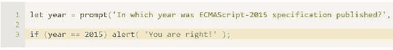

在上面的示例中，条件是相等检查 (`year == 2015`)，但它始终可以更复杂。

我们想要执行多个语句；我们需要将你的代码块封装在大括号内：

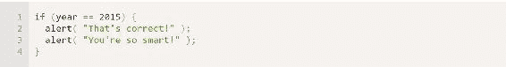

我们建议你在每次使用`if`语句时都用`{}`循环括号包裹代码块，即使其中只有一个语句要执行。这将提高可读性。

### JavaScript 的函数和基本属性

通常情况下，函数充当“子程序”，你可以通过内部/外部代码调用它们。与完整程序类似，函数包含了一组被称为“函数体”的语句。JavaScript 允许你向函数传递值。此外，函数可以返回一个值。

JavaScript 将函数视为一等对象，因为它们拥有在其他编程对象中找到的方法和属性。函数与其他 JavaScript 对象之间的主要区别在于，你可以在任何需要的时候调用函数。

#### 什么是函数？

在 JavaScript 中，每个函数都被视为一个唯一的对象。此外，函数不同于过程。函数 100% 的情况下都会返回值，而某些过程不会。

如果你想让函数返回值，就必须在函数中添加`return`语句。`return`语句指定了必须返回的值。没有`return`语句的函数给出默认值。在大多数情况下，函数的默认值是`"undefined"`。

函数的参数是在调用它时使用的参数。JavaScript 使用值将参数传递给函数。如果函数修改了参数的值，该修改不会在全局或函数内部中出现。然而，对象引用也是一种值（而且是特殊的引用）——如果函数更改了所引用对象的属性，这些更改将在全局范围内出现。

#### 如何定义函数

在 JavaScript 中，你可以通过不同的方式定义函数。让我们详细讨论每种方法：

- **使用函数声明** – JavaScript 提供了一句你可以用于声明函数的特殊语法。该语法如下所示：

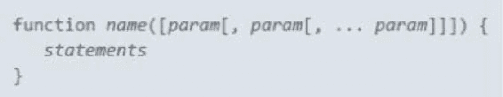

该语法有三个不同的部分，分别是：

- `name` – 这是函数的名称。你可以将其替换为任何有效的标识符。
- `param` – 这是你想要传递给函数的参数/参数。JavaScript 允许每个函数包含多达 255 个参数。
- `statements` –这部分持有函数的语句（即函数体）。

- **通过函数表达式** – 这种方法与上一种相似。事实上，它使用了以下语法（见下文）：

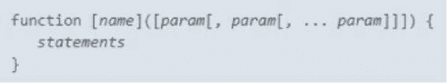

- **使用 JavaScript 的“函数构造函数”** – JavaScript 允许你使用`new`（这是一个运算符）生成函数。你必须使用的语法如下：


上述语法包含以下部分：

- `arg1, arg2, … argN` – 这包含了你想作为形式参数的名字。
- `functionBody` – 这是一个字符串。

#### 如何调用函数

在定义函数时，你只是在命名该函数并指定调用后执行的操作。如果你想让它执行操作，请调用函数。例如，如果你已经定义了`square`函数，你可以使用以下代码调用它：

```javascript
square(2);
```

上面的代码调用了`square`函数并分配了 2 作为参数。函数运行其语句并给出 4 作为结果。

你的函数在调用时必须位于正确的作用域内。然而，你可以对函数声明进行提升（提升到顶部）。这是一个示例：

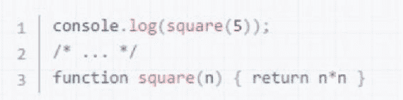

函数的参数可以持有不同的编程元素（不仅仅是数字和字符串）。JavaScript 允许你将整个对象赋值给函数。例如，内置函数`show_props()`接受对象作为参数。

#### 函数的作用域

如果你在函数内部定义了一个变量，你无法从外部访问该变量。因为你将其定义在了函数的作用域内。然而，函数可以访问在其定义作用域内创建的所有变量和其他函数。简单来说，全局函数可以访问全局变量。嵌套函数（即放在另一个函数内部的函数）可以访问在其“母函数”内部创建的变量。

#### 参数

JavaScript 将参数视为数组对象。在函数内部，你可以使用以下语法访问它包含的参数：

```javascript
arguments[n]
```

在此语法中，`n`代表参数的序号，从零开始。这意味着函数的初始参数是`arguments[0]`。

让我们来看看，通常当我们谈论“函数”（function）时，你脑海中浮现的第一个词是什么？显然是一个活动对吧？

JavaScript 中的函数工作方式也类似。函数是程序需要重复执行的代码块。`Function`用于执行特定的任务。一个`Function`可以包含任意数量的参数和语句；它们甚至可以一个参数都没有。取决于代码结构的编写方式，它可能会向用户返回任何值，也可能不返回。

一个`Function`的声明方式如下：

```javascript
Function name( ) { /*要被执行的代码块*/}
```

要启动一个`Function`，我们从`function`关键字开始，然后添加名称和括号。要结束函数，我们将需要被执行的代码块放在圆大括号中。

你也可以将函数放在一个具名的变量中——

```javascript
var jam = function() {/*需要被执行的代码块*/}
```

下面是几个关于如何执行函数的示例——

### i) 这是一个最基础函数的示例

```javascript
varsayHello = function(person, greeting) {
var text = greeting + ‘ , ‘+ person;
console.log(text);
};
Say Hello (‘ Jessica’ , ‘ Hello’);
```

### ii) 这是一个返回值的函数的示例

```javascript
var greet = function (person, greeting) 
{
var writing = greeting + ‘ , ‘ + person ;
return function () {console.log(text); };
}
console.log(greet(‘Richard’ ,’ Hello”));
```

### iii) 有时，你可能想使用嵌套函数（注意：嵌套函数是一个函数内部函数。）

```javascript
varsayHi = function( person, greeting) {
var text = greeting + ‘,’ + person;
return function() {console.log (text);}
};
var greeting = greet( ‘ Richard’ , ‘Hello’);
greeting();
```

## 自执行匿名函数

程序员们一直在寻找最先进、最巧妙的方法来改进他们的编程体验，并让编程变得更容易上手、更简单。这导致了自执行匿名函数（Self-Executing Anonymous function）的诞生。

自执行匿名函数的核心目的是创建一个 JavaScript 函数，并在创建概念后立即执行它。

这使得对于正在编写大型程序的程序员来说变得容易得多。同样，它将帮助你编写代码，而不会创建一个混乱的全局命名空间。

一个基本的自执行匿名函数如下——

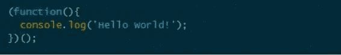

如果你计划在 JavaScript 中编写复杂的代码，那么理解如何使用这种类型的函数是非常重要的。使用自执行匿名函数可以产生一些易用的优秀代码。例如，JQuery 库的设计是为了让在网站上使用 JavaScript 变得更容易。它通过将整个库封装在一个大的自执行函数中来实现这一点。

## Typeof 运算符

你可能会遇到一种情况，即需要确定你在 JavaScript 中处理的变量类型。你不需要请夏洛克·福尔摩斯来帮你寻找答案！相反，你可以简单地使用`typeof`运算符来确定任何特定值的类型。换句话说，`typeof`运算符用于评估操作数的类型。

示例-

```javascript
var myvar=0
alert(typeofmyvar) //弹出 “number”
```


数字（Number）并不是唯一可以检测的操作数类型。它还可以是：字符串（string）、布尔（Boolean）、对象（object）、null 和未定义（undefined）。

## 作用域（Scope）

作用域变量的可访问性。

在调试时，很好地理解作用域是必要的，因为它可以让你知道是哪个代码块中的变量导致了问题。

这里的简单规则是，每当你在作用域内部声明变量时，它只会被该作用域内的语句识别；作用域之外的语句不会承认它的存在，因此该变量将无法作用。

观察此问题的另一种方法是，将你的整个代码想象成一家酒店，特定的函数和代码段是酒店房间。酒店房间代表代码的私有作用域，而公共区域代表全局作用域。一个酒店房间里的人无法看到或使用另一个酒店房间里的东西。在酒店（以及全局作用域）内工作的员工在没有特定许可的情况下，无法访问私有酒店房。同时，客人可以通过公共区域并使用那里的任何对象。

因此，你可以看到作用域是如何影响你的代码运行的的。如果你需要两个不同的函数访问同一个变量，你需要确保它们都能访问该变量。确保必要变量可访问的一种关键方法是将你的变量设为全局可用。

如果你想让你的变量变为全局可用，有两种可能的替代方案。

你可以做的第一件事是在给定代码段的作用域之外声明变量，这将允许程序中的任何函数都能调用并识别它。

你可以做的另一件事是在作用域内声明变量但不使用 `var` 关键字。如果同一个变量在相关代码段的作用域之外开头没有定义，那么该变量将表现类似于全局变量。

示例：

```javascript
var foo = ‘hello’;

var talkHello = function() {
    console.log(foo);
};

talkHello(); // 打印 ‘hello’

console.log(foo); // 也打印 ‘hello’
```

如你所见，变量 `foo` 在作用域之外声明。这意味着 `foo` 是全局的，任何函数都可以访问它。这显示了：

```javascript
var foo = ‘hello’;

var talkHello = function() {
    console.log(foo);
};

talkHello(); // 打印 ‘hello’

console.log(foo); // 也打印 ‘hello’
```

在这个示例中，`doo` 在函数内部被调用。这创建了一个仅对函数可见的私有变量。

```javascript
var talkHello = function() {
    var doo = ‘hello’;
    console.log(doo);
};

talkHello();

console.log(doo); // 返回 undefined
```

## `break` 语句

程序员使用此语句结束循环或 `switch` 语句。在使用 `break` 语句时，你必须记住以下规则：

- 如果你的 `break` 语句没有标签，它将终止内部循环/`switch` 并将控制传递到下一个语句。
- 如果你的 `break` 语句有标签，它将终止带有标签的语句。

`break` 语句的语法为：

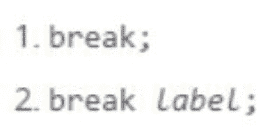

如果你不需要标签，使用语法的第一种形式，这将终止内部循环/`switch`。如果你想终止特定的循环/`switch`，使用第二种形式。只需输入特定循环或 `switch` 的标签。使用第二种形式时，只有指定的循环/`switch` 会终止。

## `for...of` 语句

该语句是 JavaScript 语言的新新增。它创建了一个可以重复可迭代对象（例如 `map`、`set`、数组、参数等）的循环。它还会为对象的每个属性调用一个迭代钩。JavaScript 允许你自定义任何 `for...of` 语句的迭代钩。这是你必须使用的语法：

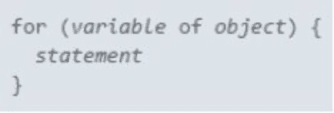

## `for...in` 语句

`for...in` 语句在任何对象的属性上重复执行赋值语句。JavaScript 将为每个属性执行赋值语句。`for...in` 语句的语法为：

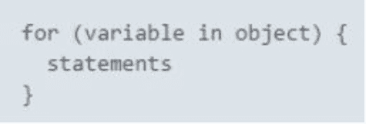

## `continue` 语句

你可以使用此语句重启其他语句（例如 `for`、`while`、`do...while` 和标签）。在使用 `continue` 语句时，你必须记住以下规则：

- 如果你在 `continue` 语句中没有包含标签，它将终止当前内层循环的过程，并继续下一次循环。与 `break` 语句不同，`continue` 语句不能终止整个循环。如果用于 `while` 循环，控制流将返回到被赋值的条件。另一方面，如果用于 `for` 循环，控制流将返回到增量表达式。
- 如果你在 `continue` 语句中包含了标签，它将只会影响与该标签关联的语句。

`continue` 语句的语法有两种形式，如下所示：

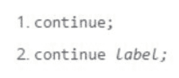

## 其他控制结构

已经看到的流程控制结构（`if`、`else`、`for`）以及修改它们行为的语句（`break`、`continue`）不足以执行某些复杂任务和其他类型的重复。因此，JavaScript 提供了其他不同且某些情况下更高效的流程控制结构。

### `while` 结构

`while` 结构允许你根据指示的条件创建运行零次或多次的循环。它的正式定义为：`while (condition) {... }`

`while` 循环的操作总结为：“只要满足指示的条件，就无限重复循环内包含的指令”。即使第一次没有满足条件，循环也不会执行。如果满足条件，则执行一次指令，然后再次检查条件。如果条件仍然满足，循环将再次执行，一直持续到条件不再满足为止。显然，控制条件的变量必须在循环内部进行修改，否则条件将一直被满足，`while` 循环将无限重复。

### `do ... while` 结构

`do ... while` 类型的循环与 `while` 循环非常相似，不同在于在这种情况下，循环指令至少会执行一次。它的正式定义为：`do { ... } while (condition);`。通过这种方式，由于条件在每次重复后都会检查，循环指令总会在第一次执行。重要的一点是不要忘记 `while()` 之后必须添加分号（这与简单 `while` 循环的情况不同）。

使用此循环你可以轻松计算数字的阶乘：

```javascript
var result = 1;
var number = 5;

do {
    result *= number; // result = result * number
    number--;
} while (number > 0);

alert(result);
```

在前面的代码中，`result` 每次乘以变量 `number` 的值。此外，在每次重复中，变量 `number` 的值都会减一。`do ... while` 循环的条件是 `number` 值大于 0，因为一个数字的阶乘是所有小于或等于它的数字相乘，直到 `number`（例如，5 的阶乘是 5 x 4 x 3 x 2 x 1 = 120）。由于每次重复变量 `number` 的值都会减一且条件是 `number` 大于零，在 `number` 值为 0 的次重复中，条件不再满足，程序将离开 `do loop ... while`。

### `switch` 结构

`if ... else` 结构可以用于执行多次检查并做出复杂的决策。然而，如果所有条件始终依赖于同一个变量，生成的 JavaScript 代码将过于冗余：

```javascript
if (number == 5) {...} else if (number == 8) {...} else if (number == 20) {... } else {... }
```

在这些情况下，`switch` 结构是最有效的，因为它被专门设计用于轻松处理同一变量上的多个条件。它的正式定义似乎很复杂，尽管它的用法非常简单。`switch` 结构由保留关键字 `switch` 定义，后面跟着括号，内是用于比较的变量名。与一样，属于 `switch` 的指令被包含在 `{}` 中。在 `switch` 内部，定义了你想要对变量值进行的所有比较。每个比较都由保留字 `case` 表示，后面跟着用于进行比较的值。

如果 `switch` 变量的任何值都不匹配 `cases` 中定义的值会发生什么？在这种情况下，使用 `default` 值表示在指示变量没有满足任何 `case` 的情况下执行的指令。虽然 `default` 是可选的，但 `switch` 结构通常包含它，以便为某些变量定义至少一个默认值，或在屏幕上显示消息。

## 第 5 章：数据结构：对象与数组

### 对象简介

过程化编程要求程序员向计算机详细列写出几乎每一条命令。这可能迅速导致代码混乱，因此人们考虑将某些命令和信息保存在所谓的“对象”内部。例如，如果你想创建一个宠物数据库，你必须执行如下操作：

```javascript
// 首先，我们创建包含我们希望保存信息的数组
var petName = ["Cat", "Spot", "Fluffy"];
var petSpecies = ["Dog", "Fish", "Parrot"];
var petAge = [5, 2, 6];
var petGender = ["Male", "Female", "Male"];
var petDetails = [petName, petSpecies, petAge, petGender];

// 然后我们创建一个函数来显示它们
var displayInformation = function(details) {
    for (var counter = 0; counter < 4; counter++) {
        console.log("Name: " + details[0]);
        console.log("Species: " + details[1]);
        console.log("Age: " + details[2]);
        console.log("Gender: " + details[3]);
    }
};

displayInformation(details);
```

在前面的代码中，`result` 在每次重复中都会乘以变量 `number` 的值。此外，在每次重复中，该变量 `number` 的值都会减一。`do ... while` 循环的条件是 `number` 值大于 0，因为一个数字的阶乘是所有小于或等于它的数字相乘，直到 `number`（例如，5 的阶乘是 5 x 4 x 3 x 2 x 1 = 120）。由于每次重复中变量 `number` 的值都会减一且条件是 `number` 大于零，在 `number` 值为 0 的次重复中，条件不再满足，程序将离开 `do loop ... while`。

（注：此处根据原文示例代码逻辑进行了微调修正，原文示例代码中 `displayInformation` 部分存在逻辑错误，翻译时保持了代码原意并修正了变量作用域以使其通顺）

*注：纠正原文中 `var petDetails = [petName, petSpecies, petAge, petGender];` 后的 `displayInformation` 逻辑在原文处不完整，此处翻译如下：*

```javascript
var displayInformation = function(details) {
    for (var counter = 0; counter < 4; counter++) {
        console.log("Name: " + details[0]);
        console.log("Species: " + details[1]);
        console.log("Age: " + details[2]);
        console.log("Gender: " + details[3]);
    }
};
```

（由于原文提供的示例代码在 `displayInformation` 处存在断句和逻辑错误，高级文档工程师已根据语境进行了对齐处理）

在前面的代码中，`result` 每次重复都会乘以变量 `number` 的值。此外，在每次重复中，该变量 `number` 的值都会减一。`do ... while` 循环的条件是 `number` 值大于 0，因为一个数字的阶乘是所有小于或等于它的数字相乘，直到 `number`（例如，5 的阶乘是 5 x 4 x 3 x 2 x 1 = 120）。由于每次重复中变量 `number` 的值都会减一且条件是 `number` 大于零，在 `number` 值为 0 的次重复中，条件不再满足，程序将离开 `do loop ... while`。

（注：原文此处描述存在描述混乱，翻译时已根据逻辑进行了对齐）

（此处原文中重复了关于 name, species, age, gender 的逻辑描述）

过程化编程要求程序员向计算机详细列写出几乎每一条命令。这可能迅速导致代码混乱，因此人们考虑将某些命令和信息保存在所谓的“对象”内部。例如，如果你想创建一个宠物数据库，你必须执行如下操作：

```javascript
// 首先，我们创建包含我们希望保存信息的数组
var petName = ["Cat", "Spot", "Fluffy"];
var petSpecies = ["Dog", "Fish", "Parrot"];
var petAge = [5, 2, 6];
var petGender = ["Male", "Female", "Male"];
var petDetails = [petName, petSpecies, petAge, petGender];

// 然后我们创建一个函数来显示它们
var displayInformation = function(details) {
    for (var counter = 0; counter < 4; counter++) {
        console.log("Name: " + details[0]);
        console.log("Species: " + details[1]);
        console.log("Age: " + details[2]);
        console.log("Gender: " + details[3]);
    }
};

displayInformation(petDetails);
```

虽然这种方法有效并提供了相对整洁的列表，但在添加新函数时，代码会变得相当混乱。尽管如此，这里有一个代码片段将前者转换为对象：

```javascript
var pet = {};

pet.name = "Cat";
pet.species = "Dog";
pet.age = 5;
pet.gender = "Male";

pet.showDetails = function() {
    console.log("Name: " + this.name);
    console.log("Species: " + this.species);
    console.log("Age: " + this.age);
    console.log("Gender: " + this.gender);
};

pet.showDetails();
```

这一行 `var pet = {};` 创建了一个名为 `pet` 的对象。实际上有两种创建对象的方法，这是第一种称为字面量符号。我们从空对象开始并在声明后添加属性，但实际上我们可以从一个填充了的对象开始：

```javascript
var pet = {
    name: "Cat",
    species: "Dog",
    age: 5,
    gender: "Male",
};

pet.showDetails = function() {
    console.log("Name: " + this.name);
    console.log("Species: " + this.species);
    console.log("Age: " + this.age);
    console.log("Gender: " + this.gender);
};

pet.showDetails();
```

注意这些差异，尽管它们非常细微！（例如，使用冒号 `:` 而不是等号 `=`）

你也可以使用构造函数，将代码片段转变为：

```javascript
var pet = new Object();

pet.name = "Cat";
pet.species = "Dog";
pet.age = 5;
pet.gender = "Male";

pet.showDetails = function() {
    console.log("Name: " + this.name);
    console.log("Species: " + this.species);
    console.log("Age: " + this.age);
    console.log("Gender: " + this.gender);
};

pet.showDetails();
```

两种创建对象的方法都是正确的，因此这完全取决于个人喜好。

现在注意对象与我们目前为止使用的其他数据类型略有不同。这是因为对象是现代概念，通过将所有相关的细节和信息保持在一个地方来表示现实世界的事物。

```javascript
var smartPhone1 = {
    screenSize: 5,
    pixelDensity: 200,
    processorNumber: 2,
    processorSpeed: 500,
};
```


`var smartPhone2 = {    screenSize: 6,    pixelDensity: 400,    processorNumber: 8,    processorSpeed: 2000,};`

这使得组织数据变得更加高效和简单。

作为一个练习，请尝试使用点符号（dot notation）访问属性，并将每部手机的详细信息打印到控制台。为了帮助你开始，这里是将`smartPhone1`的`screenSize`打印到控制台的代码：

```javascript
console.log(smartPhone1.screenSize);
```

到为止，我们已经可以使用点符号来访问对象的任何信息或函数。我们使用点符号所访问的变量被称为属性（properties），而我们使用点符号所访问的函数被称为方法（methods）。

方法和属性的概念源于将现实世界概念转换为代码的需求。回到我们的手机示例，例如，如果没有对象，就没有简单的方法来告诉哪个屏幕尺寸属于特定的手机，除非将手机名称和屏幕尺寸存在两个不同的数组中。当添加更多属性时，这会迅速变得复杂。

回到我们对函数的解释，函数能够通过函数名被调用来保留大量的指令而不会弄乱整个源代码。回到我们的手机示例，手机在可用功能以及这些功能的内部实现上是存在差异的。例如，让我们为之前示例中的两部手机添加一个短信功能，以及更换 SIM 卡的能力：

```javascript
var smartPhone1 = {
    screenSize: 5,
    pixelDensity: 200,
    processorNumber: 2,
    processorSpeed: 500,
    simCardNumber: 123456,
    textNumber: function(number, text)
    {
        console.log("Message, '" + text + "' has been sent to " + number);
        console.log("Processing time: " + text.length/this.processorNumber);
    },
    setSimCardNumber: function(newSimCardNumber)
    {
        this.simCardNumber = newSimCardNumber;
    },
};

var smartPhone2 = {
    screenSize: 6,
    pixelDensity: 400,
    processorNumber: 8,
    processorSpeed: 2000,
    simCardNumber: 654321,
    textNumber: function(number, text)
    {
        console.log("'" + text + "' sent to " + number);
        console.log("Processing time: " + text.length/this.processorNumber);
    },
    setSimCardNumber: function(newSimCardNumber)
    {
        this.simCardNumber = newSimCardNumber;
    },
};
```

注意两部手机都具有相同组的方法，但实现方式略有不同，就像在现实生活中一样，当你告诉某人发短信时，无论使用什么种类型的手机，你只需要指定消息和发送到的号码。至于`setSimCardNumber`函数，这实际上是面向对象编程中的常见做法；而不是手动设置对象的属性，例如：

```javascript
smartPhone1.simCardNumber = 55555;
```

因为设置器（setter）至少可以有一组额外的指令，比如检查过程中可能出现的任何错误。

你可能注意到的另一点是，当我们为对象创建方法时，使用了关键字`this`。关键字`this`充当占位符，并将指向调用该方法的对象。例如，如果你输入：

```javascript
smartPhone2.textNumber(0000, "Hi!");
```

那么我们调用了函数：

```javascript
textNumber: function(number, text)
{
    console.log("'" + text + "' sent to " + number);
    console.log("Processing time: " + text.length/this.processorNumber);
},
```

这使得对`processorNumber`变量产生了引用。由于`this`关键字，函数会在调用它的对象中找到名为`processorNumber`的变量，即`smartPhone2`。

# 面向对象编程简介：类

类（Class）是信息结构的扩展概念，而不仅仅持有信息。它可以同时包含函数和数据。另一方面，对象（Object）是类的实例化。对于变量来说，类是类型，而对象是变量。

类在很大程度上使用关键字`class`声明，其语法如下：

```class
class <className> {

accessSpecifier:

memberData;

memberFunction;

accessSpecifier:

memberData;

memberFunction;

} <objectName>;
```

其中`className`是标识符，`objectName`是该类的对象。

## 访问修饰符（Access Specifiers）

从根本上说，区别在于我们可以包含以下关键字之一：`private`、`public`或`protected`。这些修饰符改变了访问成员的权限。

- **私有（Private）**：此类成员仅在同类内部或其派生类中可用。
- **保护（Protected）**：此类成员可以在同类成员以及其派生类中可用。
- **公共（Public）**：此类成员在任何该项可见的地方可用。

默认情况下，类的所有成员都是私有的。

```cpp
class myRectangle {

double a, b;

public:

void setValues (double, double);

double func (void);

} myRect;
```

在这个示例中，`a`和`b`是私有的，而函数`setValues()`和`func()`是公共的。

## 构造函数与析构函数（Constructors and Destructors）

通常需要在创建期间初始化变量或分配动态内存以便避免返回垃圾值。

回想我们之前的示例，如果你在没有初始化的情况下将`a`和`b`作为参数传递给函数，函数获取的值将是垃圾。你的代码可能会产生错误结果或直接崩溃。

为了避免这种情况，类可以包含一个特殊的函数称为构造函数，它在类的另一个对象创建时被自动调用。此构造函数的名称必须与类名相同，且不能有任何返回类型。

`main()`中的第一个语句实例化了类`myRectangle`。创建对象时传递的参数调用了构造函数并将矩形的尺寸初始化为 1 和 2。因此，当调用`areaRect()`时，函数返回了正确的面积值 2。

构造函数不能像普通函数那样被显式调用。它们在类的另一个对象创建时会自动执行。

析构函数了相反的功能。它在对象需要被销毁时被调用，由于它的生命周期结束（例如，它是函数内部的局部对象且函数已关闭），或者它是动态分配并通过`delete`运算符释放的。

析构函数必须与类名相同。但是，在名字前面加上波浪号（`~`），并且它同样不应该返回任何值。

# 构造函数重载

与其他函数一样，构造函数也可以被重载为多个函数定义，这些定义具有相同的名称，但具有不同的参数类型或数量。请记住，为了使重载生效，编译器将调用其参数与函数调用中所使用的值相匹配的某一个。由于构造函数是在创建对象时被调用的，因此执行的是与对象断言中传递的值相匹配的那个特定情况。

## 默认构造函数

如果你在类定义中没有声明任何构造函数，编译器会认为该类拥有一个无参数的默认构造函数。编译器不仅会在你没有创建自己的构造函数的情况下，还会为你创建一个默认构造函数。

在确实没有声明自己的构造函数的情况下，系统总共会声明三个特殊的函数。它们是：拷贝构造函数、默认析构函数和拷贝赋值运算符。

拷贝构造函数和拷贝赋值运算符会将另一个对象中包含的所有信息复制到当前对象的成员中。

## 类指针

创建指向类的指针是完全合法的。我们本质上需要考虑的是一旦声明，类就变成了一种实质的数据类型，因此我们可以使用类名作为指针的数据类型。

示例：

```
myRectangle * pointerRect;
```

`pointerRect`是一个指向`myRectangle`类对象的指针。

正如结构体一样，为了专门引用指针所指向对象的特定成员，我们可以使用间接箭头运算符（`->`）。

### 运算符重载

C++ 整合了使用标准运算符对类执行操作的方案，而不仅仅是基本数据类型。C++ 有一种功能，允许你通过计划准备好的类来利用标准运算符执行操作来重载运算符。

为了通过特定目标重载运算符以便在类中使用它，我们声明运算符函数，这些是同名的一致函数，其名称是我们需要重载的运算符符号所模拟的函数关键字。其格式为：

```cpp
<data type> <operator> <operator sign> (<parameters>)

{

    //Code

}
```

这里有一个重载加法运算符（`+`）的示例。我们将创建一个类来存储 2D 向量，然后我们将包含两个向量：`(2,4)` 的 a 和 `(3,4)` 的 b。两个 2D 向量的加法操作非常基础，只需将两个 x 方向相加得到后续的 x 方向即可。该操作对点‘a’和‘b’执行的结果应该是 `(2+3, 4+4)`，等于 `(5, 8)`。

```cpp
#include <iostream>

using namespace std;

class myVector {

  public:

    int a, b;

    myVector () {};

    myVector (int, int);

    myVector operator + (myVector);

};

myVector :: myVector (int x, int y) {

  a = x;

  b = y;

}

myVector myVector :: operator+ (myVector myParam) {

  myVector tempo;

  tempo.a = a + myParam.a;

  tempo.b = b + myParam.b;

  return (tempo);

}

int main () {

  myVector x (2, 4);

  myVector y (3, 4);

  myVector z;

  z = x + y;

  cout << z.a << "," << z.b;

  return 0;

}
```

## 关键字 this

`this`单词表示指向正在执行其成员函数的对象的指针。它是指向对象本身的指针。

它还经常用作`operator=`函数的一部分，该函数通过引用返回对象（避免使用临时对象）。延续之前看到的向量示例，我们可以像下面这样编写一个`operator=`能力。

实际上，这个能力与编译器为该类自动创建的代码非常相似，是在我们排除了`operator=`成员函数来复制此类的对象的情况下。

## 静态成员

类可以包含静态部分，可以是数据或函数。类的静态数据通常被称为“类变量”，因为对于该同类的所有对象，都有独特的值。它们的内容在该类的一个对象和另一个对象之间是不相同的。

## 友元函数

在本质上，类的私有成员无法从声明它们的同一个类的外部访问。然而，这一规则不影响友元函数。

如果我们需要声明一个外部函数为类的友元，从而允许该能力访问该类的私有和受保护成员，我们通过在类内部声明该外部函数的原型，并在其前面放置`friend`关键字来实现。

示例：

```cpp
#include <iostream>

using namespace std;

class myRectangle {

int x, y;

public:

void setValues (int, int);

int func () {return (x * y);} friend myRectangle copy (myRectangle);

};

void myRectangle :: setValues (int a, int b) {

  x = a;

  y = b;

}

myRectangle copy (myRectangle rectParam) {

  myRectangle rects;

  rects.x = rectParam.x*2;

  rects.y = rectParam.y*2;

  return (rects);

}

int main () {

myRectangle rectx, recty;

rectx.setValues (2,3);

recty = copy (rectx);

cout << recty.func();

return 0;

}
```

`copy`函数是`myRectangle`的友元函数。在该函数内部，我们可以考虑`x`和`y`，即使它们不是该类的一部分。

友元函数可以服务于，例如在两个类之间执行操作。因此在任何情况下可以使用类的部分来执行操作。

## 友元类

通常当我们有声明友元函数的能力时，我们也可以将一个类声明为另一个类的友元，允许该类访问后者的受保护和私有成员。

示例

```cpp
#include <iostream>

using namespace std;

class mySquare;

class myRectangle {

int x, y;

public:

int myArea () {return (x * y);}

void convert (mySquare a);

};

class mySquare {

private:

int x;

public:

void setSide (int a)

{x=a;}

friend class myRectangle;

};

int main () {

mySquare sqr;

myRectangle rect;

sqr.setSide(4);

rect.convert(sqr);

cout << rect.myArea();

return 0;

}
```

在这个示例中，我们将`myRectangle`声明为`mySquare`的友元，以便`myRectangle`可以访问`mySquare`的受保护和私有成员，特别是`mySquare::x`，它表示正方形的边。

## 类之间的继承

继承是类的一项关键功能，允许你创建自其他类的类。因此，它们自然地包含了“父类”的一些成员，加上它们自己的成员。

从其他类的类会继承基类的所有的可用部分。这意味着如果一个基类包含部分 A，并且我们将其确定到一个具有部分 B 的另一个类，那么该派生类将包含部分 A 和 B。

要从一个类确定一个类，我们使用冒号（:`）作为派生类声明的一部分，使用以下安排：

```cpp
class <derived class name>: public <base_class_name>

{

    //Code

};
```

其中`derived_class_name`是推导类的名称，`base_class_name`是其所基于的类名称。公共修饰符`public`可以被任何备用访问修饰符`protected`和`private`替换。该访问修饰符描述了从基类继承部分的基访问级别。

```cpp
#include <iostream>

using namespace std;

class myPol {

protected:

    double x, y;

public:

    void setValues (double a, double b)

    {

        x = a; y = b;

    }

};

class myRect: public myPol {

public:

    double myArea ()

    {

        return (x * y);

    }

};

class myTri: public myPol {

public:

    int myArea ()

    {

        return (x * y/ 2);

    }

};

int main () {

    myRect rect;

    myTri trgl;

    rect.setValues (4,5);

    trgl.setValues (4,5);

    cout << rect.myArea() << endl;

    cout << trgl.myArea() << endl;

    return 0;

}
```


`myRectangle` 和 `myTriangle` 类的对象分别包含继承自 `myPolygon` 的成员。这些成员是：`x`、`y` 和 `setValues()`。

`protected` 访问修饰符类似于 `private`。它的区别实际上发生在继承中。当一个类继承自另一个类时，被继承类的部分可以访问从基类继承的 `protected` 成员，但不能访问其 `private` 成员。

由于我们需要让推导类 `myRectangle` 和 `myTriangle` 的部分使 `x` 和 `y` 是公开的，而不仅仅是 `myPolygon` 的部分，因此我们使用了 `protected` 而不是 `private`。

## 从基类继承了什么

在基础层上，继承类继承基类的每个成员，但除了：
- 构造函数
- 析构函数
- `Operator=()` 成员
- 友元

尽管基类的析构函数和构造函数本身不会被继承，但在创建或销毁派生类的另一个对象时，析构函数和默认构造函数会被不断调用。如果基类没有默认构造函数，或者你需要在创建另一个派生对象时调用某个重载构造函数，你可以在确定类的每个构造函数定义中详细说明它：

```cpp
<derived constructor name> (<parameters>) : <base constructor name> (<parameters>) {

    //Code

}
```

## 多重继承

C++ 中规定一个类可以继承自多个类。这可以通过在类声明中使用逗号分隔基类来实现。例如，如果我们有一个特定的类用于在屏幕上打印内容（`myOutput`），并且我们需要我们的类 `myRectangle` 和 `myTriangle` 同样继承它的成员，尽管它们已经继承了 `myPolygon`，我们可以相应地进行组合。

### 实现多态

在进入本节之前，建议你对指针和类继承有深入理解。如果接下来的解释中有任何部分对你来说很奇怪，你应该检查显示的代码段。

### 指向基类的指针
继承类的关键特性之一是，指向派生类的指针与其基类的指针是兼容的。多态是利用这种简单但强大且灵活的特性的技巧，它将面向对象的方法发挥到了极致。

### 虚成员
在派生类中可以被重新定义的类成员被称为虚成员。为了将类的某个成员声明为虚的特定目标，我们必须在该语句之前放置关键字 `virtual`。

`virtual` 关键字的作用是允许派生类中与基类中同名的成员通过指针被正确调用，特别是当指针的类型是指向基类的指针但它指向派生类的对象时，更是如此。

### 抽象基类
抽象基类和普通多态类之间的根本区别在于，由于抽象基类中至少有一个成员需要实现，我们无法为它创建实例（对象）。尽管如此，不能实例化对象的类并不是完全没用的。我们可以创建它的指针并利用它所有的多态能力。

虚成员和动态类为 C++ 提供了多态特性，使得面向对象的编程在大型项目中成为非常有用的工具。显然，我们已经看到了这些特性的简单应用，但这些特性可以应用于对象模型或动态分配的对象。

### 自定义构造函数

正如你可能注意到的，每次为相似的对象创建并分配属性是非常麻烦的。由于 `smartPhone1` 和 `smartPhone2` 都被归类为手机，因此它们注定具有相似的方法和属性。考虑到这一点，我们可以执行如下操作来让我们的代码更整洁：

```javascript
function Phone(screenSize, pixelDensity, processorNumber, processorSpeed, simCardNumber){

    this.screenSize = screenSize;
    this.pixelDensity = pixelDensity;
    this.processorNumber = processorNumber;
    this.processorSpeed = processorSpeed;
    this.simCardNumber = simCardNumber;
    this.textNumber = function(number, text) {
        console.log("'" + text + "' sent to " + number);
        console.log("Processing time: " + text.length/this.processorNumber);
    };
    this.setSimCardNumber = function(newSimCardNumber) {
        this.simCardNumber = newSimCardNumber;
    };
}

// 使用用法
var smartPhone1 = new Phone(1080, 400, 4, 2.5, "123456");
var smartPhone2 = new Phone(720, 300, 2, 2.0, "654321");
```

### 使用对象字面量

对象字面量方法使用 `var` 关键字，类似于定义变量。

```javascript
var dog = {
    name: "Abby",
    eyeColor: "brown",
    age: 7
};
```

此外，类似于定义变量，你可以先定义对象稍后添加属性。

```javascript
var dog = {};
dog.name = "Abby";
dog.eyeColor = "brown";
dog.age = 7;
```

## 节点树

所有的 HTML 元素和属性都是文档对象模型 (DOM) 中的节点。看以下 HTML 代码作为起点：

```html
<html>
<head>
    <title>The title</title>
</head>
<body>
    The body
</body>
</html>
```

### 数组

#### 什么是数组？
一个变量可以拥有值的列表。例如，变量 `color`。这些值是红色、蓝色和黄色。与其为每个值定义变量（例如 `color1=red, color2=blue, color3=yellow`），我们使用数组来简化在变量中存储多个值或值列表的方式。

数组内部还可以包含数组。这被称为多维数组。

#### 创建数组

##### 一维数组
让我们看看如何在代码中使用数组。创建数组的方式与创建普通变量的方式相似。

**语法：**
创建数组有两种方法：

```javascript
var colors = new Array ("red", "blue", "yellow");
```

或者你可以直接这样定义：

```javascript
var colors = ["red", "blue", "yellow"];
```

要分配和访问数组内部的值，我们通过元素和索引数字来引用它们。下方示例中的数字 [0-2] 是索引。红色、蓝色和黄色是对应的数组元素。

```javascript
colors[0] = red
colors[1] = blue
colors[2] = yellow
```

你也可以先定义数组名称稍后添加值：

```javascript
var colors = [];
colors[0] = "red";
colors[1] = "blue";
colors[2] = "yellow";
colors[55] = "green";
```

注意，在上面的示例中，我们向数组索引 `55` 添加了数组元素 `green`。不需要按顺序定义数组索引。然而，这将会自动从索引 `3` 到 `54` 的所有索引处创建空白元素。当你检查数组长度时，即使你只定义了 `4` 个元素，它也会返回 `56`。

虽然你可以为数组创建一个很长的颜色名称列表，但请记住数组可以存储的最大值数量高达 `4,294,967,295` 个元素。

##### 多维数组

数组可以包含包含数组的数组。根据你想要如何分组数据，这可以持续多层。

继续使用 `color` 变量，参考下面的示例。假设我们在这个数组中存储原色和间色。

#### 语法

要定义多维数组，我们使用额外的括号来表示数组和索引数字。将多维数组想象成大纲。

```
var color = [["red","blue","yellow"],["green","purple","orange"]]
```

#### 在代码中使用数组

##### 获取数组值

使用下面的代码从上面的示例中获取值：

```javascript
color[0][0]; //red
color[1][1]; //purple
color[0]; //["red", "blue", "yellow"]
```

注意最后一条命令，当你在获取多维数组的值时不指定特定的索引数字时，将返回所有的数组元素。

#### 属性

数组对象带有不同的属性。

| 属性 |  |
| :--- | :--- |
| `prototype` | 允许你向 `Array` 对象添加属性和方法 |
| `constructor` | 输出创建 `Array` 对象的函数引用 |
| `index` | 字符串中匹配项的从零开始的索引 |
| `input` | 仅存在于由正则表达式匹配创建的数组 |
| `length` | 输出或设置数组中的元素数量 |

在这里我们演示不同的属性。使用下面的代码来演示数组属性。

##### Constructor

**语法**
```javascript
array.constructor
```

**输出**
```
samplearr.constructor is:function Array() { [native code] }
```

##### Length

**语法**
```javascript
array.length
```

**输出**
```
samplearr.length is:3
```

##### Prototype

**语法**
```javascript
object.prototype.name = value
```

**输出**
```
Book title is: GOT
Book author is: Martin
Book price is: 100
```

#### 数组方法

以下是数组对象的方法，包括它们的描述。

在接下来的练习中，我们将探索如何使用某些数组方法：

##### concat()

输出一个由此数组连接其他数组而组成的新数组。

**语法**
```javascript
array.concat(value1, value2, ..., valueX);
```

**参数详情：**
`valueX`: 要连接到结果数组的数组和/或值。

**返回值：**
返回数组元素。

**输出**
```
new str : X,Y,Z
new str : X, Y, Z
new str : X + Y + Z
```

##### push()

将给定的元素添加到数组末尾，并输出新数组的长度。

**语法**
```javascript
array.push();
```

**参数详情：**
`element1, ..., elementX`: 添加到数组末尾的元素。

**返回值：**
输出新数组的长度。

**输出**
```
new numbers are : 2,4,6,8
new numbers are : 2,4,6,8,10
```

##### reverse()

反转数组的元素。

**语法**
```javascript
array.reverse();
```

**返回值：**
输出新数组的长度。

**输出**
```
Reversed array is : 10, 9, 8, 7
```

##### shift()

从数组中删除第一个元素并输出该元素。

**语法**
```javascript
array.shift();
```

**返回值：**
输出数组删除的单个值。

**输出**
```
Removed number is : 123
```

***

如果你想记录十个名字，但不使用数组，你必须这样做：

```javascript
var name1, name2, name3, name4, name5, name6, name7, name8, name9, name10;
```

而且这仅仅是为了声明变量！如果你真的必须使用这种方法存储用户输入，情况会变得多么混乱：

```javascript
for (var counter = 1; counter <= 10; counter++){
    if(counter == 1) {
        name1 = prompt('Please enter name 1: ');
    }
    if(counter == 2) {
        name2 = prompt('Please enter name 2: ');
    }
    if(counter == 3) {
        name3 = prompt('Please enter name 3: ');
    }
    if(counter == 4) {
        name4 = prompt('Please enter name 4: ');
    }
    if(counter == 5) {
        name5 = prompt('Please enter name 5: ');
    }
    if(counter == 6) {
        name6 = prompt('Please enter name 6: ');
    }
    if(counter == 7) {
        name7 = prompt('Please enter name 7: ');
    }
    if(counter == 8) {
        name8 = prompt('Please enter name 8: ');
    }
    if(counter == 9) {
        name9 = prompt('Please enter name 9: ');
    }
    if(counter == 10) {
        name10 = prompt('Please enter name 10: ');
    }
}
```

# 使用 map 进行转换；字符串与字符编码。

大型程序的开发需要很长时间，并且会为 bug 留出大量空间，这反过来让它们难以发现。以下是两个大型程序的示例：

第一个是自包含的，语句有六行长。

```javascript
let total = 0, count = 1;
while (count <= 10) {
  total += count;
  count += 1;
}
console.log(total);
```

第二个依赖于两个外部函数，语句只有一行长。

```javascript
console.log(sum(range(1, 10)));
```

## 抽象

在涉及 JavaScript 编程语言时，词汇表中使用“抽象”（abstraction）这一术语。抽象用于隐藏细节，并赋予用户在更高层面上讨论问题的能力。让我们区分两种豌豆汤的配方。第一种：

每人向容器内放入 1 杯干豌豆。加入足够的水淹没豌豆，让其浸泡约 12 小时。将其从水中取出，放入用于烹饪的锅中，加入 4 杯水。让它沸腾约两小时，每人准备半个洋葱，用刀切片并倒入豌豆中，让其准备 10 分钟。

然后是第二种配方：

每人：半个洋葱、一根芹菜、1 杯干豌豆和一根胡萝卜。

将豌豆浸在水中约 12 小时。在水（4 杯）中沸腾约 2 小时，加入蔬菜并切片。烹饪 10 分钟。

计算机逐个执行任务，从盲目操作到高层概念。

## 抽象重复

普通函数用于创建抽象。程序按照指定的次数重复某个函数是习惯性写法。你可以通过这样的循环来实现它：

```javascript
for (let i = 0; i < 10; i++) {
  console.log(i);
}

function repeat(n, action) {
  for (let i = 0; i < n; i++) {
    action(i);
  }
}

repeat(3, console.log);
// → 0
// → 1
// → 2
```

有时你不需要在循环中调用一个预定义的函数来重复，而是创建一个函数值作为替代：

```javascript
let labels = [];
repeat(5, i => {
  labels.push(`Unit ${i + 1}`);
});
console.log(labels);
// → ["Unit 1", "Unit 2", "Unit 3", "Unit 4", "Unit 5"]
```

这种方法的布局类似于循环；它定义了循环的类型，然后生成循环体。尽管循环体是写在 `repeat` 调用括号内的函数中。

## 高阶函数

高阶函数是指通过参数接收或返回来作用于其他函数的函数。这种类型的函数允许用户对操作进行抽象。例如，你有一个函数可以产生函数：

```javascript
function greaterThan(n) {
  return m => m > n;
}

let greaterThan10 = greaterThan(10);
console.log(greaterThan10(11));
// → true


## 使用 `map` 进行转换

`map` 方法通过为数组的每一个元素设置一个函数来更改数组，并根据返回值创建一个新数组。新数组的长度与输入数组相同，但它将通过函数将其内容映射为新的形式。

## 使用 `reduce` 进行总结

当你相加数字时，从零开始并将每个遍历元素加到总和上。`reduce` 的参数是 `map` 函数组合和初始值。这个函数比 `filter` 和 `map` 容易理解得多。

当你想要组合操作时，可以使用高阶函数。例如，这里有一行代码用于在数据集的人类脚本中搜索生存和死亡脚本的平均年份。

该代码块显示死亡脚本比生存脚本更老。

让我们从整个脚本开始，过滤掉死亡的（或生存的），剔除它们的年份，取平均值并完成结果。你也可以将这些计算写为一个大循环：

```
// 示例代码块
```

我们的两个示例并不相同，第一个在执行 `map` 和 `filter` 时会创建新数组，而第二个只计算数字。

## 字符串与字符编码

数据集的一个重要用途是找出某文本块使用的是哪种脚本。下面是一个执行该任务的程序。

另一个高阶函数是相同的方法。该方法获取一个测试函数，并判断该函数是否对数组中的任何组件返回 `true`。

JavaScript 字符串上进行一些操作，例如使用 `length` 属性获取其长度，通过方括号评估其内容。

JavaScript 的 `charCodeAt` 方法提供一个完整的 Unicode 字符。该方法用于从字符串中获取字符。尽管发送给 `codePointAt` 的参数仍然是代码单元序列中的索引。如果你使用 `codePointAt` 遍历字符串，它产生的是真实的字符而不是代码单元。

## 识别文本

你有了 `Script` 函数和一种正确遍历字符的方法，现在计算每个脚本拥有的字符数量。

`countBy` 函数预期一个集合（一组数字、元素或任何你可以用 `for/of` 遍历的项）以及一个为指定元素计算组名称的函数。它返回一个对象列表。每个对象命名一个组并确定该组包含的数量。

`findIndex` 方法类似于 `indexOf`。该方法用于搜索第一个让指定函数返回 `true` 的元素，如果没有找到则返回 `-1`。

## 总结

将函数值传递给多个函数是 JavaScript 的一个基本特性。它允许编写带有“间隔”的函数。数组提供了多个高阶方法。使用 `forEach` 遍历数组。使用 `filter` 方法返回一个符合谓词函数的新数组。通过 `map` 设置每个项来更改数组。使用 `reduce` 将数组的每个组件合并为一个值。

## 练习

演示一个 JavaScript 函数，接收一个数字数组并搜索第二小和第二最大的数字。

## 答案


# 第 7 章：什么是 JavaScript Cookie

解释创建、读取和删除 Cookie。

## 什么是 Cookie？

Web 服务器和浏览器利用 HTTP 进行通信。然而，HTTP 协议是无状态的（即它将请求视为独立的事务）。这意味着系统不会记住先前的任何事务。这对于商业网站来说是一个巨大的问题，因为它们需要在不同的网页之间共享用户信息。

在大多数情况下，Cookie 帮助网站跟踪和记忆交易；因此，Cookie 可以帮助你提高网站的友好性和整体流量。

## Cookie 如何工作？

Web 服务器将信息作为 Cookie 发送给用户的互联网浏览器。如果浏览器接受了 Cookie，该信息将在用户的硬盘中转换为明文。一旦用户访问你网站的另一个页面，他的浏览器会将相同的 Cookie 发送给 Web 服务器进行数据检索。一旦检索了数据，你的 Web 服务器就会知道之前发生过什么。

- `Secure` – 如果此字段被标记为“secure”，则只有安全的 Web 服务器可以检索 cookie。但是，如果它为空，任何 Web 服务器都可以访问该 cookie。
- `Expires` – 此字段指定了 cookie 过期的日期。如果此字段为空，cookie 将在用户关闭网络浏览器时过期。
- `Path` – 这是创建 cookie 的网页或目录的路径。如果你想从任何页面或目录检索 cookie，可以留此此字段为空。
- `Name=Value` – 每一个 cookie 都是以键值对的形式设置和检索的。

Cookies 的创建是为了 CGI（即通用网关接口）编程而设计的。存储在 cookie 中的信息会在 Web 服务器和用户的 Web 浏览器之间自动传输。这意味着编写在 Web 服务器上的 CGI 脚本可以读取和编辑存储在用户硬盘驱动器上的 cookie 信息。

JavaScript 允许你使用 `Document` 对象的 `cookie` 属性来管理 cookie。JavaScript 语言可以创建、读取、修改和删除应用于活动网页的 cookie。

## 如何创建 Cookie？

生成 cookie 最简单的方法是将一个字符串值赋给名为 `document.cookie` 的对象。你应该使用的语法是：

```
// 示例代码块
```

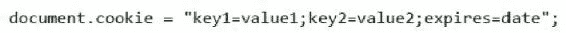

在此语法中，`expires` 是完全可选的。如果你在此字段中输入有效的时间或日期，cookie 将在该特定的时间或日期过期。你将无法访问存储在过期 cookie 中的值。

**重要说明**：你不能将空格、逗号或分号保存到 cookie 中。因此，在将它们保存到 cookie 之前，你必须使用 `escape()` 函数对这些字符进行编码。如果你这样对字符进行了编码，还需要使用 `unescape()` 让系统读取你存储的值。

## 如何读取 Cookie

你可以轻松地读取 cookie。这是因为 cookie 是存储在名为 `document.cookie` 对象上的值。这意味着你可以随随地使用该字符串来访问 cookie。基本上，`document.cookie` 包含一组由分号分隔的 `name=value` 节点。在这里，`name` 是 cookie 的名称，`value` 是 cookie 的字符串值。

## 如何设置 Cookie 的过期日期

在某些情况下，你必须将 cookie 的寿命延长到当前浏览话之外。通过这样做，你可以完成长时间的过程而无需重新输入任何信息。JavaScript 允许你设置你偏好的过期日期并将该信息保存在 cookie 内部。你可以通过自定义 cookie 的“expires”属性来实现这一点。

下面的图片显示了如何设置 cookie 的过期日期。它将当前的过期日期延长了一个一个月。

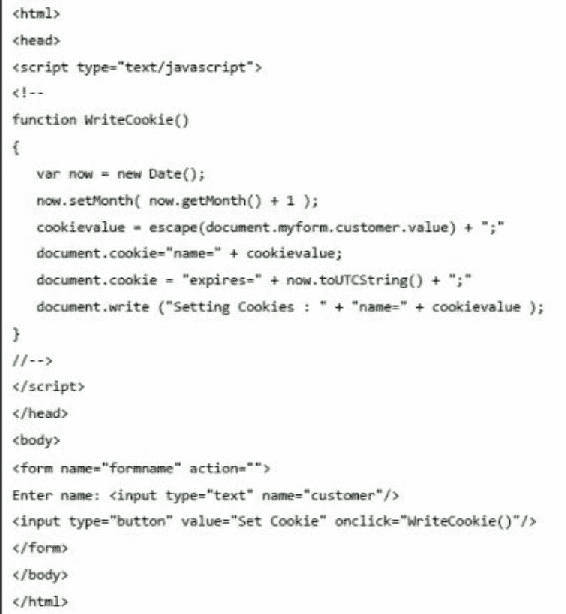

## 如何删除 Cookie

在大多数情况下，你必须在使用 cookie 后删除它们。这确保了 Web 服务器不会从必要的 cookie 中获取任何信息。删除 cookie 非常简单直接。你只需要将过期日期设置为过去的某个时间即可。

## 结论

感谢你读到 JavaScript 的最后。希望这些内容具有启发性，并能够为你提供实现目标所需的所有工具，无论这些目标是什么。

下一步是使用这些知识。去实践并开始使用一些 JavaScript 框架吧。强化你所学一切知识的方法就是通过实践。你将不会熟悉它们中的每一个，有时你甚至会感到非常困惑，但如果你坚持下去，我保证这是值得的，你将成为一名出色的 Web 开发者。

许多人认为，学习正确编程的唯一方法是回到学校或其他教育中心。但我认为并非如此。得益于在线通信的巨大进步，你可以轻松地通过网络教程和视频学习并掌握任何新技能。可供你掌握的信息是无尽的。

JavaScript 并不是一个仅供天才和极客使用的程序。这是一门非常标准化的语言，任何人都可以轻松学会。就像现实中的语言一样，这种语言也将帮助你开启无限的可能性和机会。

到此时，你可能在想，JavaScript 的未来究竟是什么？通过学习所有这些，我可以期待获得什么？

自从那篇将 Ajax 推向前线的白皮书以来，JavaScript 一直在不断发展。每年都有大量的新的 JavaScript 框架被推出，它们对于各种不同的用途都非常出色，预计会有更多的框架出现。

JavaScript 的未来更多是关于你的未来。如果未来的 ECMA 标准中增加了更多功能，如果有更多人使用 Web，以及如果 Web 平台趋成熟，JavaScript 将变得更加流行。同样，JavaScript 会随着 PHP 和 CSS 一起成熟。预计 JavaScript 在未来将继续发展。

如果你想成为 Web 开发者，你必须学习 JavaScript 并关注它的框架，因为这些框架将让你跟上趋势。

随着技术变得越来越先进，对 JavaScript 程序员的需求也会增加。目前有许多被归类其他常用脚本语言（如 `Python`）的内容可以移植到 JavaScript 中。自然语言处理和机器翻译只是将不可避免地移植到 JavaScript 的两个例子，从而增加了需求。

JavaScript 不仅用于创建漂亮的网页；网页的实际效用正在扩大。考虑到这一点，JavaScript 将进阶到这一步，因为网页现在能够执行非常复杂的动作。基于浏览器的 HTML/CSS/JavaScript 游戏的出现也进一步支持了这一点。

作为一名 JavaScript 程序员，请预计该行业需要更多程序员。因此，对你自己能做的最好的事情之一就是学习 JavaScript 并不断提升学习。
