# 电子学习开发人员编程：ToolBook®、Flash®、JavaScript 和 Silverlight


作者：

Jeffrey M. Rhodes

阅读愉快！
Jeff M. Rhodes


# 面向对象编程简介............................................................................... 307


# 详细面向对象编程示例............................................................... 318


# 结论 ................................................................................................................ 341

# 索引.................................................................................................................................. 345

# 图表


## 面向电子学习开发者的编程

# 图


## 为电子学习开发人员编程


## 前言

Platte Canyon 的伙伴们再次做到了！他们又创造了另一种方法，让我这个非编程人员的培训专业人士能够从我所使用的电子学习工具中获得更多收获。在过去，他们的帮助形式是 ToolBook 的插件、会议和研讨会，以及如何开发电子学习的计算机培训。而这个实用的工具以书的形式呈现——一本电子学习开发者真正想要坐下来阅读的参考指南。

尽管我很想了解更多编程的知识，但现实是，在参与电子学习的 10 年里，我没有找到时间去深入学习，因此我可能永远找不到时间了。相反，我依赖于能找到的任何工具、技巧和秘籍，在不成为全职程序员的情况下，为我的培训带来交互功能。《面向电子学习开发者的编程》提供了那份“秘籍”，让我有清晰的示例可以效仿，但我发现自己被书中关于“为什么某事物会这样运行”的简单、清晰且直观的解释深深吸引并读下去。这不仅让我能够通过遵循示例完成眼前的直接任务，而且我吸收的背景信息[作为]了未来将来自己亲手构建类似但不同交互效果的基础。通过这本书，我正在“在职中”学习技能，而不是花费几个月的时间接受培训。

《面向电子学习开发者的编程》是我所知的第一本专门关注我想要在培训中构建的交互类型的“入门类”书籍。我觉得，所有电子学习开发者在处理项目时都应该手头有一本书。而且，虽然我还没有用 Flash 或 Silverlight 编程，但在将来当我开始这样做时，如果有一类程序员“翻译字典”就太棒了，它向我展示我熟悉的方式（大多数情况下使用 ToolBook 编辑器），然后向我展示如何用不同的“语言”（如 Flash 或 JavaScript）来实现。

非常感谢 Platte Canyon 团队继续让我这个非编程人员的 ToolBook 开发者的生活变得轻松无痛。如果没有他们开发的这些帮助我在创建酷炫培训应用的同时让自己看起来很专业的工具，我的生活绝不会过得如此有趣。如果这个世界上有超人，那他白天一定是 Jeff Rhodes！

Robin McDermott
Resource Engineering, Inc.
Waitsfield, VT
2009年6月

## 致谢

这本书献给我我结婚 21 年、亲爱的妻子 Sue，以及我两个优秀的儿子 Derek 和 Michael。成为你们的丈夫和父亲，我感到自豪。

我发现编程非常有成就感。我特别喜欢为 Platte Canyon 编写现成软件。当有人购买我的产品，甚至更好发邮件说他们非常满意时，那种感觉非常棒。我想象当艺术家或木工时，出售自己的作品会有类似的满足感。正如我最喜欢的艺术家之一 Shawn Mullins 在他的的一首歌中写的：“做你喜欢的事难道不是一种幸运吗？”

我喜欢与他人分享技巧和窍门，但过去几年为了参加我们每年的 ToolBook 用户会议/电子学习作者会议而限制了分享。写书提供了一个接触更广泛受众的机会。我希望你们喜欢结果。

首先我想感谢我的妻子 Sue。在生活中我找不到更支持我的伴侣了。尽管今年我回来了，你依然保持着家庭井井有条并支持我们所有人。我期待下一个 21 年的婚姻！

我的大儿子 Derek 正准备进入高中三年级。就在这一年里，你从严重的膝盖手术中康复并恢复了足球状态，继续保持了优异的学业，并成长为一个对国家和社会有贡献的成年人。祝你无论选择何种职业和人生道路都能获得成功。

我的小儿子 Michael 将上初二了。感谢你们让我担任你们的篮球教练。你在教室和运动场/球场上都脱颖而出。但最重要的是你的正直和学习意愿。继续努力！

我向我的电子学习社区朋友网络发出了信号，征求志愿者审阅这本书并提供意见。反馈非常热烈。

Resource Engineering 的 Robin McDermott 是多年来 Platte Canyon 的好朋友，她写了一篇非常赞誉有加的前言。

brist.gs Training Solutions 的 Graham Cownie 是我们 Tracker.Net 产品的长期客户。考虑到他多年对该产品提出的许多极佳建议，对他建议增加三个章节以及许多其他改进，我并不意外。


Dan Carr 是一位优秀的 Flash 开发人员，他提供了许多建议并帮助我完善了 Flash 项目。来自 OnCall Interactive 的 Adam Brown 从他酷的 Flash 版大富翁应用中抽出的时间，提供了宝贵的建议并帮助我改进了几个示例。

布里斯托尔大学研究与技术学院的 Simon Price 是我多年的朋友和同事。他特别通读了我的所有 JavaScript 示例，并提出了许多建议。

Marty Weller 和我已经交流了多年 ToolBook 技巧。她事无细致地检查了整个文本，指出了（希望是）大部分的拼写错误。同样，来自 Command Online 的 Peter Hoyt 也提供了许多建议。我在当地的 .NET 用户组认识了来自 Wyle Laboratories 的 Vincent Murphy。他审阅了 Silverlight 示例，并对该示例以及通用性话题提供了一些极好的建议。

来自 ToolBookDeveloper.com 的 Peter Jackson 是我认识的最顶尖 ToolBook 程序员之一。他审查了示例，并帮助确保我没有漏掉任何内容。来自 eLearningSpecialist.com 的 Tomas Lund 提供了“稳定性检查”，并提供了一些实用的格式建议。

Tim Barham 和 Denny Dedmore 分别是 SumTotal Systems ToolBook 开发和支持团队的核心成员。他们对整个 Platte Canyon 尤其是这本书给予了巨大的支持。

尽管这个志愿者团队提供了巨大的帮助，但任何剩余的错误或遗漏完全由我个人负责。

再次感谢所有的评审员以及你，读者！

Jeff Rhodes
2009年6月

## 引言

本书介绍了常见的电子学习编程任务，并展示了如何在各种工具和语言中完成这些任务。内容源自我多年举办的课程和工作坊，这些课程表明，有时少量的编程就能起到事半功的效果。这既适用于通过交互让你的 Learning² 更有趣，也适用于缩短最初创建培训的时间。我们将从编程基础开始，关注教学设计人员或领域专家在他们选择的工具中创建交互培训时可能需要的内容。此外，我们将深入更高级的主题，包括连接数据库、读取 XML 文件、发送电子邮件、整合拖放功能以及制作 SCORM³ 调用。虽然我们无法涵盖你在构建自己的电子学习时会遇到的所有任务，但希望书中的示例能为你提供一些技能和方法，帮助你应对这些问题。

创建电子学习的现实之一是，我们大多数人并不坚持使用单一的工具。在早期的 CBT 时代，重大决定是选择 Authorware、Toolbook、IconAuthor 或 Quest。现在这些工具中只有 ToolBook 仍在世。取而代之的是 Adobe® Flash（包括导出为 Flash 格式的许多制作工具）和各种 HTML 编辑器。让 HTML 交互化需要 JavaScript。你也可以从 ToolBook Actions 和 Flash External Interface 类调用 JavaScript。更晚的竞争者是 Microsoft® Silverlight¹。我预计它在电子学习中的普及程度将像 Flash 一样广泛。尽管它不在环境列表之中，我们还将把 ASP.NET 作为我们“服务器”端的环境，包括保存用户评论、发送电子邮件、通过网络检索 XML 等。Silverlight 和 ASP.NET 都使用 Visual Basic 作为其编程语言，这一事实意味着它们之间的语法非常相似。

本书并不是关于哪种工具更好。我们选取常见的电子学习编程任务，并展示了如何在每种工具和语言中完成它们。在某些情况下，某个工具在特定领域可能具有特殊能力。如果是这样，我们会指出。但我认为你会发现，许多差异仅仅在于语法上。一旦你掌握了不同工具之间的术语和语法，就能在提高能力的同时缩短开发时间。

如果这不是本书的价值所在，我不知道还有什么了。

> ¹ 交互培训曾有一系列术语名称，例如在线学习、计算机辅助培训（CBT）和基于网络的培训（WBT）。但“电子学习”概念捕捉了现在通过网络部署的内容概念，同时排除了我通常说的通过 CD 或本地网络部署的“原生”培训。我尝试在书中坚持使用电子学习（e-Learning）这一术语。

> ² 可共享课程内容对象参考模型（SCORM）是美国国防部（DOD）的高级分布式学习（ADL）规范。它成为学习管理系统（LMS）与电子学习内容之间通信的主要标准。规范的另一部分涉及内容的打包以及单个学习者之间的排序。我们将在书中稍后详细讨论 SCORM。

> ³ 我指的是 20 世纪 90 年代中期。我从 1993 年开始开始 ToolBook 1.5。

> ⁴ C 是主要的 .NET 语言，但我发现对于我们这些非专业程序员来说，Visual Basic 更容易。

## 面向电子学习开发者的编程

## 受众水平

虽然对于某些更高级的示例，一些编程专业知识会有帮助，但我们并不假设你是一个程序员。任何愿意学习并且在键盘前感到自如的人都受到欢迎。

## 示例应用程序

书中包含许多示例应用程序你可以从 Platte Canyon 网站 http://www.plattecanyon.com/programmingbook.aspx 下载它们。我鼓励你下载这些程序并亲自探索这些概念。下载示例应用程序时，你需要手持本书。

## 背景介绍

什么使我有资格写这样一本书？从学位角度来看，并不多。我在空军学院时学过一点编程，但我的专业是电气工程。从那里之后，我在伦敦经济学院学习了两年经济学。电子学习和编程始于 1992 年离开空军，一年后开始在 ToolBox 中开发 CBT。我很快转向创建用于重复任务的可重用代码，以及跟踪学生状态的初级管理系统。由于那时的大多数合同都是固定价格，因此对快速完成工作有非常强调（也有奖金）。1996 年与朋友 Chris Bell 创立 Platte Canyon 后，我开始开发我们的第一款商业软件产品 ToolBox Plug-In Pro。那年我们在 Toolbox 开发者大会上获得了展位，用的是软盘！

从那里开始，我们从咨询公司逐渐转型为零售产品公司。我曾偶尔为 Director 编写 Lingo，并用 Delphi 编写过自动化程序，但我们第一次进入 Toolkit 之外尝试是在 1998 年，当时我用 Visual Basic 6 为我们的 Tracker™ 学习管理系统（LMS）编写了管理员和报告器程序。我在 2002 年开始进入 .NET：使用 Visual Basic*. 创建计算机和网络培训。这本书的前提是开发者可以使用 VB 和 Visual Studio 创建培训，只要有某些特定的“培训”控件。然而，尽管我们发布了各种“VBTrain”控件（如 Question、LMS、Web 和 Shape），市场并没有接受使用 Visual Studio 进行开发！好消息是，产品开发过程帮助我获得了编写客户一直要求的 Web 端 LMS 的专业知识。Tracker.Net™ 现在是我们的旗舰产品。我们在 2002 年底发布了第一个版本，现在是第 4 版。我们还注意到更大的市场在于为非程序员创建工具。我们将 Question 和其他控件封装成 Web 应用程序，编写了一些用于编辑数据库和设置属性的 .NET 编辑器，Exam Engine™ 便于 2003 年底诞生了。随着 Silverlight 的出现，我在 2009 年使用这种令人兴奋的技术重写了 Exam Engine。Silverlight 与 Flash 有相似之处，这两个产品在浏览器内部都有自己的“播放器”。我一直对 Flash 的功能印象深刻，但一直对其没做过什么。后来我在 2005 年底参加了一场会议课程。Dan


## 引言

Carr⁵ 展示了如何读取 XML 文件并填充 Flash 电影。我意识到 Flash 能够以类似于我们在 ASP.NET 和 Exam Engine 中处理考试的方式，实现数据库驱动的培训。这促成了我们于 2007 年发布的 Training Studio™ 产品。

我提到这些产品背景（literatue）是为了解释为什么我想要写一本涵盖多种语言电子学习（e-Learning）编程的书。在典型的一周里，我会在 ToolBook、Flash 和 .NET（Silverlight、ASP.NET 和/或 Windows Forms）中编写或编辑代码。在书中，我唯一提到的涵盖内容是 JavaScript。我发现 JavaScript 跨越了所有环境。无论是从 Flash 创建 External Interface 或 JSCommand，从 ToolBook Actions 编辑器或 Silverlight 链接到 `.js` 文件，还是从 ASP.NET 实现 Ajax，JavaScript 都非常有用。Flash 的 ActionScript 与 JavaScript 非常相似，这一事实让你无需担心在两者之间切换会产生顾虑。

## 为什么选择这四个环境？

正如你在上一节看到的，我对所有这些工具都具有相关经验。虽然这是一件好事，但并不意味着没有其他值得纳入的候选者。让我们来看看我没有包含的几个领先竞争者。

Adobe Director® 是一个很棒的环境，特别适合游戏开发。在“CBT”时代，我们曾用它制作动画和“重型”多媒体，但现在我觉得 Director 在很大程度上已被 Flash 掩盖了。这在很大程度上归功于 Adobe（以及此前的 Macromedia）成功让全球大多数用户安装了 Flash。对播放器的依赖也是 Authorware 衰落的一个大原因。当时曾出现过某种将 Authorware 导出为 Flash 格式的方法，但从未付诸实施。另一个可能的候选者可能是 .NET。这无疑是 2002 年《VBrain.Net》书籍背后的理念。使用“Windows Forms”进行培训并没有流行起来，因为电子学习正日益向 Web 端演进。直接使用 ASP.NET 虽有优点，但 Silverlight 相比该方案具有巨大的优势。

另一个竞争者是 Adobe Dreamweaver®。开发者在 Dreamweaver 中使用其 CourseBuilder 扩展进行创建，该扩展包含了各种题型和学习交互。Adobe 甚至有一套电子学习套件，包含了 Captivate®、Flash、Dreamweaver、Photoshop® 和其他工具。除了 CourseBuilder 扩展外，在 Dreamweaver 中创建电子学习只是处理纯 HTML 和 JavaScript 的问题。尽管我用过 Visual Studio

> ⁵ Flash Interactions 的创建者，我们 ToolBook 用户大会 / 电子学习制作会议的教师成员，也是一位非常友善的人。你可以阅读他的文章并在 http://www.dancarrdesign.com 与他联系。

> ⁶ AJAX 代表异步 JavaScript 和 XML。这是一种在“幕后”与 Web 服务器通信，并使用 JavaScript 更新屏幕部分而不是“发布”整个网页的构想。我们在 Tracker.Net 中广泛使用了它。

> ⁷ 我在 Adobe 网站上找到的最新的统计数据是：90% 的 PC 安装了 Flash 播放器，55% 安装了 Shockwave (Director) 播放器。

> ⁸ 播放和流式传输媒体的能力、出色的动画、一个可以让你“避开”直接操作 HTML 的跨浏览器播放器、不需要“虚拟目录”、可以在非 Windows 服务器上托管的能力等。


对于书中 HTML 和 JavaScript 的示例，它们可以直接应用于 Dreamweaver，事实上，你可能会决定使用 Dreamweaver 来编辑和运行它们。

其余许多主要的制作工具都是基于 Flash（Articulate®, Captivate）或 HTML（Lectors, ReadyGo）。对于使用这些工具的开发者来说，Flash 和 JavaScript 示例将会很有帮助。虽然我使用了 Captivate 和 Camtasia 进行屏幕演示，但我个人并没有发现有理由在制作工具领域超出已涵盖的选项之外扩展我的工具集。

现在我们已经看了一些未涵盖的工具，让我们快速看看我们“选定”四个环境中的每一个。在每一章中，我们都会取一个编程任务并在我们的每个环境中解决它。你可以自由地专注于你喜欢的环境，或者观察每个环境是如何应对挑战的。

ToolBook 是我最初选择的电子学习工具。我发现它的 OpenScript 语言强大且易用。我特意在每一章都从一个 ToolBook OpenScript 示例开始，因为我认为在大多数情况下它是最容易理解和遵循的。由于在将 ToolBook 发布为 HTML 格式后 OpenScript 将不再工作，我们通常会在 OpenScript 示例之后跟一个在 ToolBook Actions Editor 中完成的示例。Actions Editor 是视觉化环境。它为原生（非 Web）部署创建 OpenScript，为 Web 部署创建 JavaScript。注意，ToolBook 导出为纯 HTML 和 JavaScript，并不使用播放器⁵。

Flash 已从一种动画工具转变为更通用的“富交互应用程序”环境。从我的来看，它最大的优势是 Flash Player 本身。你可以留在播放器内部，使用它支持的语言（ActionScript），而不必担心浏览器和平台差异，这是一个卖点。结合卓越的多媒体能力和编程力量，很容易看出为什么电子学习内容以某种 Flash 格式存在。

创建 JavaScript 的能力是一项重要技能，无论在什么环境中。虽然用 HTML 和 JavaScript 创建所有内容并不常见，但你可以从 ToolBook、Flash、Silverlight 以及其他工具调用 JavaScript，这是突破你偏好工具任何限制的极佳方法。

Silverlight 是微软的一项令人兴奋的技术，我相信它有未来。像 Flash 一样，它受益于拥有自己的平台。可以使用最广泛的语言 Visual Basic 是一个卖点。当你读完这本书后，我鼓励你查看结论章节，了解对每个工具的最后思考。

## 处理点击事件

引言

我在学校期间编写的几批“程序”是研究如何向打字机发送消息并让它们显示如下：停止 30 秒。我知道这很幼稚。虽然这类程序现在仍有一定的用途，但今天大多数程序（尤其是电子学习程序）都是驱动的。这意味着它们启动后等待用户或系统执行某些操作。这可能是点击下一页、选择菜单项、等待音频或视频结束。因此，我们的第一个任务之一是学习处理事件。我们将在每个环境中完成这一任务。这将简要介绍每个环境。


OpenScript² 是 ToolBook 内部编程或脚本语言名称。它可以用于原生 CBT，也可以用于自动化工具。OpenScript 拥有处理事件简单的语法之一。列表 1 显示了简单的 "buttonClick" 处理程序的语法。

```
to handle buttonClick
forward
get ASYM MessageBox("这是一个测试","编程 101","信息","OK")
button
```

列表 1. 在 ToolBook OpenScript 中处理 "buttonClick" 事件

点击按钮的结果如图 1 所示。在 OpenScript 中，与我们将检查的一些环境不同，脚本编辑器并不提供可用事件列表，尽管你可以

> ² 这一个特定程序之所以记忆深刻的原因是，至少在 FORTRAN 中，变量（我们稍后会讨论）是不需要声明的。与允许此点的语言不同，变量的类型是由变量的首字母决定的。所以以 I 开头的变量是整数（意味着它们是数字）。运气好的是，轨道方程中有一个单位是弧度的变量。这意味着 360° 对应 3.14 弧度。我花了几个小时才意识到程序中的错误是输入的 1.64 弧度被截断为 1，从而导致了错误的答案！

> 带有 OpenScript 的书籍也可以通过 Neuron 浏览器部署，但由于其体积巨大且不支持 SCORM，这并不常见。书中任何 OpenScript 在发布为 HTML 时都会丢失，但正如我们在稍后的示例所示，这有时是可以接受的。


此脚本将放在按钮对象本身。在这一（现已过时的）语法中，事件显示在括号中。它调用了 Alert 组件的 `show` 方法，两个参数是用于显示的文本和标题。这个组件模拟了一个普通窗口，但无法移动到 Flash 舞台之外，遗憾的是它在 ActionScript 3 中没有被移动。结果如图 5 所示。

然而，从 ActionScript 3 开始，Flash 允许在对象内部编写脚本，由于明显的原因，通常使用 Actions 层。如图 6 所示。你可以通过右键点击时间轴并选择“插入层”（Insert Layer）来插入一个层。你通常会将其命名为 Actions 并将其设为顶层，但这并非必须的。我想通过该层来避免在该层上放置对象。再次，没有什么可以阻止大多数开发者建议将对象保持在 Actions 层之外。然后你点击所需的帧（图中的 1），并到“窗口”（Window）菜单——“动作”（Actions）（或按 F9）打开编辑器。帧中的小写 `a` 表示

img/489f8caeddae410535f57c4dfc328dfc_31_0.png
图 5. 消息框

img/489f8caeddae410535f57c4dfc328dfc_31_1.png
图 6. 时间轴 (Timeline)

由于有了 ActionScript 3，这只需要执行一次。在 AS2 及更早版本中，你定义一个函数在响应 `enterFrame` 事件时调用，然后通过程序方法删除该函数，以确保它不会重复执行。理想情况下，你会将所有代码放在一个帧中，但我有时喜欢将不同的关键帧及其代码分开。在这些情况下，我为帧 1 设置了 `runInitialLoad`，为帧 2 了 `runInitialLoad2`。

首先要说明的是，Flash 对所有方法都使用 `function`。函数之间的括号内是任何参数。如果没有参数，在这种情况下，你仍然需要包含括号。在括号之后你可以指定返回类型（尽管这不是强制的）。`void` 返回类型意味着该函数不返回任何内容。我建议指定返回类型的原因是，当你尝试某些操作时，编程语言会给你提示。我们将在书的后续部分看到此技术的更多示例。行的末尾是左括号，表示函数的开始。该函数可以根据需要放在下一行，但最常见的语法是将其放在行末尾。基本上，任何不带括号的行都需要分号。

下一行是注释（在 ActionScript 中用 `//` 标识），以便阅读代码的人理解你在做什么。最后，设置实际的监听器。这是典型的方法……


## 面向电子学习开发者的编程

跨语言的[方法]或[设置属性（在稍后的章节中介绍）10。我们调用 `Button1` 对象的 `addEventListener` 方法。第一个参数是你想要处理的事件类型。你可以输入第一部分（MouseEvent）然后输入 `.` 来获取如图 7 所示的选项弹出列表。事件以大写形式显示 CLICK11。如果你想使用像 `RIGHT_CLICK` 不同的事件，可以选择它。第二个参数是你想要调用的函数名称，在本例中为 `alertMessage`。然后我们用右括号 `)` 结束函数。这通常单独占一行，并进行缩进，以与匹配的左括号的行缩进保持一致。因此在这种情况下，它与 `function` 一词对齐。

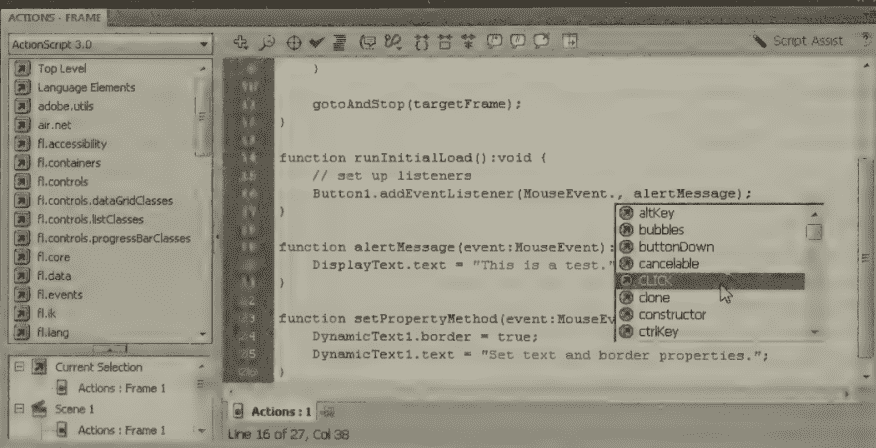

图 7. Flash 中的 MouseEvent 弹出列表。

最后，我们使用 `alertMessage` 函数。由于它正在处理事件，它的签名必须有一个事件对象（类型为 MouseEvent14）作为参数。我们再次将返回类型设置为 `void`，这意味着该函数不返回值。由于 AS3 没有 `Alert` 组件，我们如图 8 所示设置字段的文本而不是使用它。


图 8. Flash 中事件监听器的结果。

10 在 OpenScript 中。在该语言中，你将对象放在最后。在 OpenScript 中设置字段文本，你使用 `text of field1="xyz"`。在其他语言中，语法更像 `field1.text="xyz"`。

11 通常，这些都是 `MouseEvent` 类的公共常量（Public Constants）。其中大多数是事件，但也有一些像 `CONTEXT_MENU` 这样的常量。

12 冒号（:）表示类型。因此 `event:MouseEvent` 表示一个名为 `event` 的类型为 `MouseEvent` 的参数。


JavaScript 是一种多功能语言，因为它可以直接从 HTML13 调用，也可以从我们书中查看的其他环境调用。Visual Studio 和像 Dreamweaver 这样的编辑器具有“拆分”视图，你可以同时看到 HTML 和相应的设计视图（例如它在浏览器中如何工作）。如图 9 所示。我们将在本书中使用 Visual Studio，但有很多编辑器（包括像记事本这样的纯文本编辑器）可以选择。

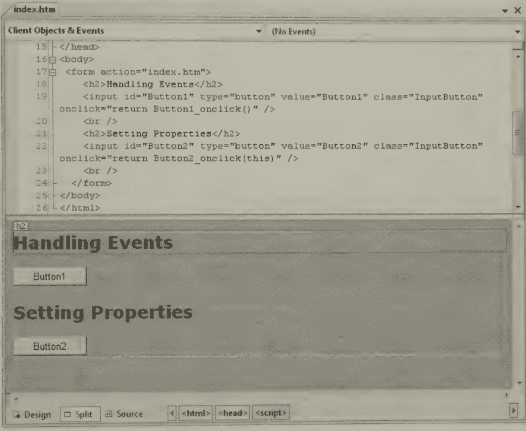

图 9. 同时显示 HTML 和设计视图的 Visual Studio

13 超文本标记语言（Hypertext Markup Language）。这是网页格式化并链接在一起的方式。“动态”网页（如用 ASP.NET、PHP 等编写的网页）会生成 HTML，但在页面“渲染”给用户之前，通常会读取数据库或进行其他处理。


在进入 JavaScript 本身之前，让我们看看是如何实现格式化的。虽然可以将各种格式标签直接放入 HTML 中，但认可的解决方案¹⁴ 是引用一个外部层叠样式表（CSS）文件并将格式放在其中。它的优点是你可以更改 CSS 文件，所有使用该文件的网页将立即获得更新后的视觉效果¹⁵。指向 CSS 文件的链接以及该文件的相关部分在列表 4 中显示。

```
<head>
<title>HTML/JavaScript Sample</title>
<link href="StyleSheet.css" rel="stylesheet" type="text/css" />
<!-- rest of HTML goes here --

// From StyleSheet.css

body
{
  background-color: white;
  background-image:URL(images/bg_tile_logos.gif);
  font-family: Verdana, Helvetica, Arial, sans-serif;
  font-size: 80%;
  font-weight: normal;
  letter-spacing: normal;
  text-transform: none;
  word-spacing: normal;
}
```

```
H1, H2, H3, H4, H5, TH, THEAD, TFOOT
{
  color: #003366;
}
```

```
.InputButton
{
  width:100px;
}
```

列表 4. CSS 引用及 CSS 文件的相关部分。

> ⁴ 这个术语总是让我想起我在空军学院的日子。大多数工程和数学课程都有大量的练习题和工作单，每个问题都有一个相关的“认可的解决方案”。完成这些题目并与答案进行对比是随后的考试获得高分的关键！

> ¹⁵ 正如我的一个评审员、来自学习与研究技术学院的 Simon Price 指出的，W3C 将此内容存放在 http://www.w3.org/Style/CSS.html 处，“通过将样式表附加到 Web 上的结构化文档（例如 HTML），”，“作者和读者可以影响文档的呈现方式，而不会牺牲设备无关性或添加新的 HTML 标签。”

## 处理点击事件

body 样式中的 `background-image` 属性是页面上平铺图像来源。所有的标题（H1、H2 等）都定义为具有特定的颜色（以十六进制格式提供 RGB）。这种格式避免了对逗号的需求。003366。注意，没有括号（`(` 或 `)`）的 JavaScript 行应该有一个分号。这与 `ActionListener` 类似。


Silverlight 可能没有我们目前介绍过的其他环境那么熟悉。Silverlight 文档是微软的一种特殊的 XML 变体，称为 XAML（可扩展应用程序标记语言）¹17。标准工作流是在 Microsoft Expression* Blend™ 中创建用户界面，并在 Visual Studio 中编写编程部分。图 14 显示了 Blend 中一个简单页面的可视化界面和 XAML。

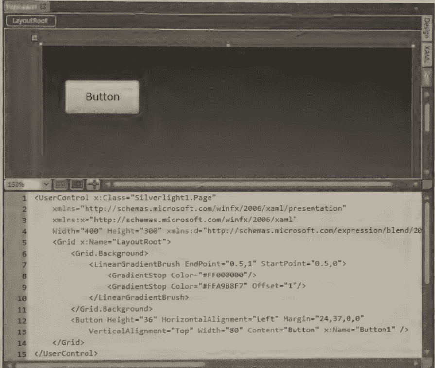

图 14. Expression Blend 中的 Silverlight XAML 和设计视图。

> 17 虽然 XAML 限于微软，但 SumTotal 使用 XAML 来表示 PowerPoint 幻灯片，然后将其转换为 ToolBook 页面，其“将 PowerPoint 转换为 ToolBook”的功能是在 ToolBook 9.5 中添加的。这是一个很好的选择，因为 XAML 在表示属性方面有非常有用的表示法，这对 ToolBook 来说与 Silverlight 一样重要。


定义事件有几种方法，但我更喜欢的方法是切换到 Visual Studio 并使用 IntelliSense 来选择所需的事件，如图 15 所示。注意，你可以通过“闪电”图标来识别事件。

```xml
<Button Height="36" HorizontalAlignment="Left" Margin="24,3,0,0" VerticalAlignment="Top" Width="80" Content="Button" x:Name="Button1" />
```

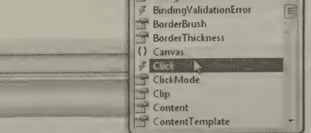

图 15. 在 Visual Studio 中为 Silverlight 按钮选择 Click 事件。

选择所需的事件后，你可以再次使用 IntelliSense^¹⁸ 来创建或选择所需的事件处理程序。如图 16 所示，我们选择了 <New Event Handler>（新建事件处理程序）。Visual Studio 然后会为处理程序命名（Button1_Click）并将处理程序插入到“后台代码”（code behind）文件中。正如 ASP.NET 所开创的那样，“后台代码”文件是一个独立的文件，仅包含 Visual Basic（或你指定的任何编程语言）。这避免了你的编程逻辑与“标记”混合在一起。¹⁹。因此，你的用户界面在 Page.xaml 中，而事件处理程序和其他代码在 Page.xaml.vb 中。

```xml
Click=" />
Click="Button1_Click" />
```

```vb
Private Sub Button1_Click(ByVal sender As System.Object, _ByVal e As System.Windows.RoutedEventArgs)

End Sub
```

图 16. 在 Visual Studio 中通过 IntelliSense 创建 Click 事件处理程序。

> ¹⁸ 使用 IntelliSense 的这种能力是 Blend 和 Visual Studio 中操作 XAML 的区别，尽管 Blend 可能会在未来的版本中获得这种能力。

> ¹⁹ 与传统的 ASP（活动服务器页）的情况一样。在该环境中，页面通常是 HTML 和 VBScript 的混合。这很难调试和维护。


值得花点时间分析 Button1_Click 存根。首先注意到的是它是一个 Private Sub（私有子程序）。Private 指这段代码将对其他页面或对象不可。我们将在书的后部分介绍这一点。Sub 意味着没有返回值。类似于列表 3 中的 ActionScript `alertMessage` 函数有一个可以告诉你是点击情况的事件参数，Visual Basic 事件处理程序始终有两个参数：

- 发送者（sender），指向生成事件的对象（在此例中为被点击的按钮）。
- 类型的参数（e），告知有关事件本身的信息。参数（e）中包含取决于事件的类型²⁰。

我们现在准备好编写一些代码了。最简单的方法是使用内置的 MessageBox，IntelliSense 会告诉我们参数的含义，如图 17 所示。左侧的 1 of 2 指该方法是“重载”的，可以用两种不同的方式调用。另一种是仅使用 MessageBox 而没有标题。你可以点击箭头或按向上/向下箭头查看其他可能性。

```vb
Private Sub ButtonClick(ByVal sender As System.Object,
ByVal e As System.Windows.RoutedEventArgs)
```

```vb
MessageBox.Show(
Lo Show (messageText As String, caption As String, button as System.Windows.MessageBox) As System.Windows.MessageBoxResult
MessageBoxText
End display.
```

图 17. 展示重载方法的 MessageBox IntelliSense。

生成的代码显示在列表 6 中。最后一个参数 `MessageBoxButton.OK` 是枚举（Enum）²¹ 的示例。我们不需要像在 OpenScript 中为列表 1 中的按钮参数（"OK”）那样手动输入正确的参数文本，Visual Studio 允许我们从接受的列表中选择。这不仅使得输入正确值变得更容易，还让代码更易读。

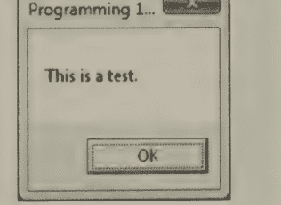

```vb
Private Sub ButtonClick(ByVal sender As
System.Object, ByVal e As
System.Windows.RoutedEventArgs)
```

```vb
MessageBox.Show("This is a test.",
"Programming 101", MessageBoxButton.OK)
End Sub
```

列表 6. 使用 MessageBox 的 Click 事件处理程序。

结果如图 18 所示。这是我们见过的最漂亮的对话框！让我们尝试另一种。

图 18. 这是我们见过的最漂亮的对话框！让我们尝试另一种。²⁰ Windows Presentation (WPF) 有一种独特的 Routed Events。它是类型。我们将在稍后介绍。²¹ 枚举。


Silverlight 有一个名为 Popup 的控件，可以显示和隐藏在其他控件之上。我们将添加这些之一并显示它。图 19 显示了

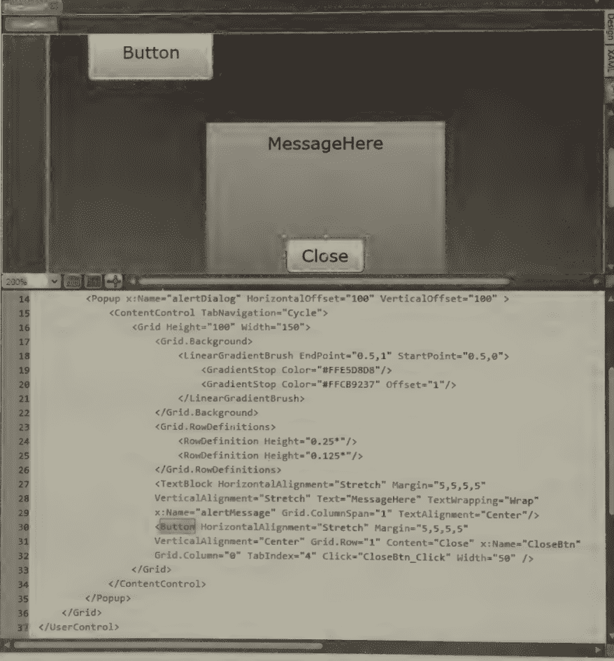

图 19. Blend 中的 Popup。


关于图 19 有一些重要的元素：

- 1. Silverlight 大部分使用网格。由于没有列定义，因此只有一个列。
- 2. Grid.RowDefinition 行表示有两个行。“alertmessage” TextBlock 控件在第 1 行，“CloseBtn”按钮控件在第 2 行。边距设置相对于控件所在的网格。

接下来重写 Button1 以及 CloseBtn 的代码。我们的第一个任务是为 TextBlock 的 Text 属性设置值。然后我们想要显示 alertDialog 控件。正如列表 7 所示，这是通过 IsOpen 属性实现的。结果在图 20。

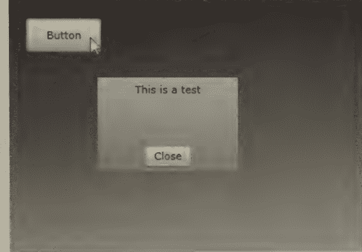

图 20. Silverlight 响应按钮点击显示 Popup。

```vb
Private Sub Button1_Click(ByVal sender As System.Object, _ByVal e As System.Windows.RoutedEventArgs)
alertMessage.Text = "This is a test"
alertDialog.IsOpen = True
End Sub
```

```vb
Private Sub CloseBtn_Click(ByVal sender As System.Object, _ByVal e As System.Windows.RoutedEventArgs)
alertDialog.IsOpen = False
End Sub
```


现在我们已经通过了在每个环境中处理点击事件的难关，我们将处理设置属性。我们在之前的 Flash 和 Silverlight 示例中设置 Text 属性时已经预览了属性。但现在我们将进行更详细的内容。许多电子学习开发涉及属性或特性的设置。我们设置所需的页面或大小、按钮和文本的颜色、所需的字体等等。在编程中，我们甚至可以创建自己的属性作为存储所需设置的机制。我们在每个环境中的任务将是在点击按钮时设置它，并在用户返回页面或框架时确保其恢复原始颜色。


虽然我们主要关注的是通过代码设置属性，但查看内置的属性设置界面是有启发性的。在 ToolBook 中，你可以选择对象并从菜单中选择 Properties。

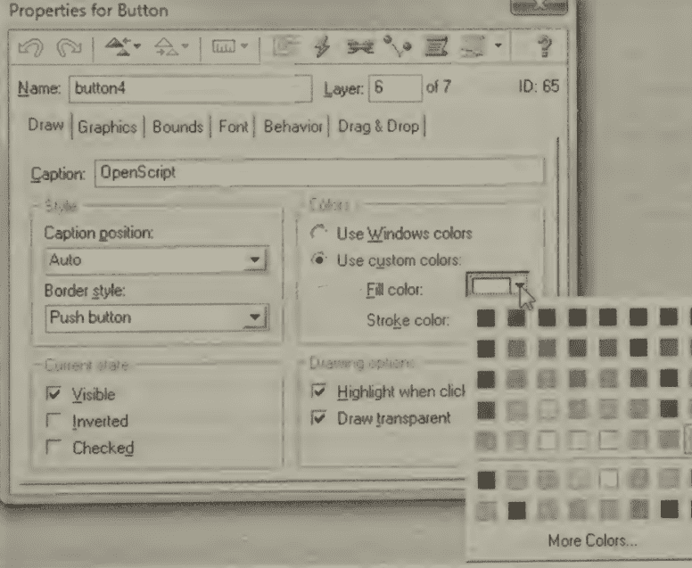

图 21. ToolBook 属性表。


对象菜单、右键菜单、工具栏。图 21 显示了“button4”生成的属性表（Properties Sheet）。

我们的任务是根据 `activeButton` 将此按钮的颜色更改为绿色，并在用户返回页面时将其恢复为原始颜色。代码将与我们在列表 1 中所做的类似，但我们不是显示消息框，而是更改 `fillColor` 属性³。当我们在帮助文档中检查该属性时，我们会发现可以使用像 green 这样的“命名”颜色，或者颜色的数字表示法²。这完成了任务的第一部分。对于第二部分，我们需要知道原生 ToolBook 也有一个 `enter` 事件，该事件在用户到达页面时会触发。OpenScript 有一个独特的“通知”处理器（notify handler）概念，像按钮这样的对象可以请求接收事件通知（并从而对该事件做出自己的响应）⁴。在这种情况下，我们可以选择 `notifyBefore` 或 `notifyAfter`。生成的代码如列表 8 所示。

```
to handle buttonClick
forward
fillColor of self = green
end buttonClick
```

```
notifyBefore enterPage
fillColor of self = white
end enterPage
```


由于我们仍在 ToolBook 内部，更改属性的界面如图 21 所示。但设置按钮颜色并重置它的方法是不同的。我们从动作面板（Action Palette）中选择 `Set Property` 动作，然后从可用属性列表中选择 `rgbFill`，如图 22 所示。

¹ 我们需要在在线帮助文档中找到此名称，因为 OpenScript 编辑器没有提供任何类型的智能感知（IntelliSense）。你可以将光标置于某个单词上并按 F1 在帮助文档中搜索它。如果你不记得完整的方法或属性名称，这非常有用。

² 如果不使用名称，ToolBook 的数字表示是 HLS（色相、亮度、饱和度）格式。这不像 RGB（红、绿、蓝）格式那样常见。ToolBook 还有一个我们可以用于 RGB 值的 `rgbFill` 属性。它还有一个内置的 `HLStoRGB()` 方法，我们可以用它进行相互转换。

³ 该事件是 Platte Canyon 的《EnterPage》时事通讯名称的来源，我们自 1997 年以来一直每季度发送一次。如果你想订阅，可以发送邮件到 ep@plattecanyon.com。

⁴ 你们中敏锐的人可能会注意到，这的结果与 Flash 的监听器（listener）概念相似。

### 设置属性

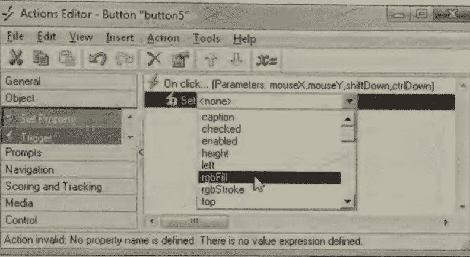

图 22. 在 ToolBook 动作编辑器中选择 `rgbFill` 属性。

从这里，我们可以输入颜色名称，输入 RGB 值（例如“100,230,44”^5），或点击如图 23 所示的“构建表达式”（Build Expression）按钮。这会弹出与图 24 所示相同的对话框。我们从已定义的“特殊值”中选择颜色名称。注意，还有其他有用的值，如 *pi* 和 CRLF（回车换行或硬回车），它们在其他情况下可能有用。

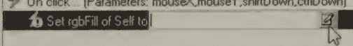

图 23. ToolBook 动作编辑器中的构建表达式按钮。

^5 你可能认为 RGB 值不需要加引号，否则动作编辑器会给你一个语法错误。它在获取颜色之前会剥离引号。


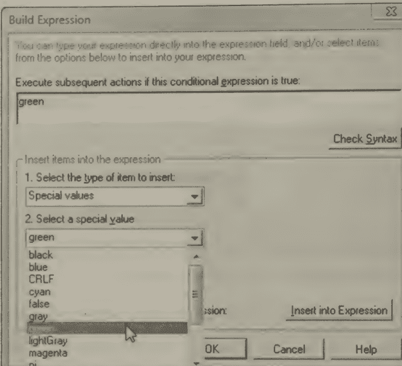

图 24. ToolBook 动作编辑器中显示特殊值的构建表达式对话框。

我们的最后一个任务是在用户返回页面时重置颜色。我们通过处理 `load page` 事件并将 `rgbFill` 设回白色来实现此。完成的动作如图 25 所示。

### 设置属性

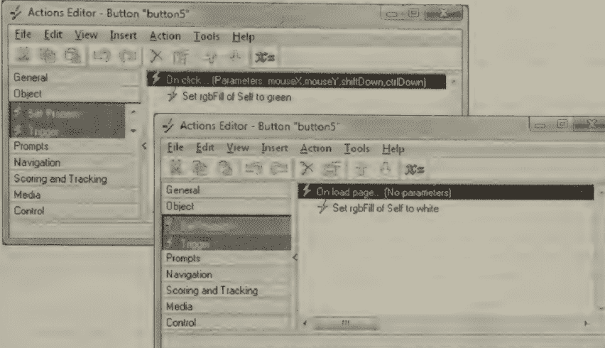

图 25. 使用 ToolBook 动作编辑器响应 *click* 和 *load page* 事件并设置 *rgbFill* 属性。

## Flash

虽然在 Flash 中设置许多对象的属性与 ToolBook 一样简单，但按钮是组件，处理起来稍微困难一些。没有界面可以直接更改其颜色。我们在通过编程实现这一点上稍作退让，设置按钮文本的颜色而不是背景颜色，因为后者涉及一套相当复杂的步骤来为组件“换肤”。我们将学习一些新技术和一些更深层次的编程概念。

正如我们在列表 3 中所示，我们首先调用 `runInitialLoad()` 方法并添加 `listener`。该代码和其余部分见下文的列表 9。

```
runInitialLoad();
stop();

function runInitialLoad():void {
  // set up listener
  Button2.addEventListener(MouseEvent.CLICK, setPropertyMethod);
}
```

# 电子学习开发者的编程

```
function setPropertyMethod(eventId:MouseEvent):void {
  var textFormatId:TextFormat = new TextFormat();

  textFormatId.color = 0x00FF00;
  Button2.setStyle("textFormat", textFormatId);
}
```

列表 9. 设置事件监听器并更改按钮组件的颜色。

使用 `textFormatId` 变量让事情变得有趣起来。我们使用 `var` 关键字并将其声明为 `TextFormat`。ActionScript 的 `TextFormat` 类有各种段落和字符格式设置。要使用它，我们需要创建该类的实例以便使用。这是我们首次介绍一个流行的编程概念——面向对象编程（OOP）。我们将在书的后半部分详细介绍它，它像是一个可以被构建的蓝图。但在创建该类的实例之前，我们无法对它做任何操作。我们通过 `new` 关键字来实现。我们现在必须将实例的 `color` 属性设置为绿色的十六进制表示。ActionScript 编辑器可以帮助我们了解 `TextFormat` 有哪些可用属性，如图 26 所示。然后我们使用按钮的 `set` 方法将它的“textFormat”样式设置为我们的 `textFormat` 实例。

我们任务的最后一部分是在进入屏幕时重置按钮。在这种情况下，我们利用 Flash 在返回此关键帧（key frame）时重新创建按钮（恢复原始颜色）的特性。

```
function setPropertyMethod(event:MouseEvent):void {
  var textFormatId:TextFormat = new TextFormat();

  textFormatId.
```

| align |
| :--- |
| blockIndent |
| bold |
| bullet |
| color |
| constructor |
| font |
| hasOwnProperty |

```
Actions: 1
-- on 24 of frame 15
textFormatId.color = ...
```

图 26. ActionScript 编辑器中 TextFormat 的属性弹出列表。

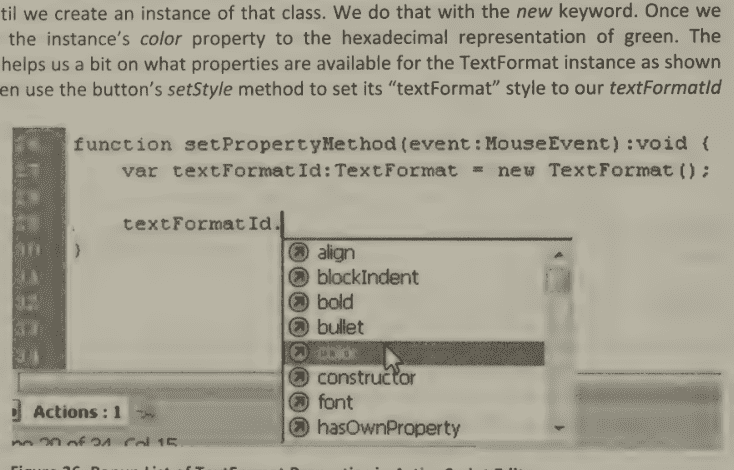

> 这也是在 JavaScript 中声明变量的方法。尽管如此，ActionScript 可以声明变量的类型（我强烈建议这么做），而 JavaScript 不行。

> 注意第一个参数是字符串。这很容易出错，因为你需要在帮助文档中查找正确的字符串并确保大小写正确。使用带有弹出值值的枚举（Enum）会更容易处理，但由于某种原因，该方法并非为此设计。

> 关键帧源于动画，其中它们是主要的更改或过渡。在 Flash 中，你可以指定一个关键帧并像使用书页一样使用它。位于某个关键帧上的对象在你到达下一个关键帧时就不存在了。我们将在书的后半部分介绍不同环境中的导航。

## JavaScript

我们现在跳转到 HTML 和 JavaScript。我们在 Visual Studio 中设置 HTML 按钮颜色的方法是进入属性窗口，选择 `Style` 属性并点击如图 27 所示的 `...` 按钮。生成的对话框如图 28 所示。这为我们通过编程设置颜色所需采取的方法提供了见解。

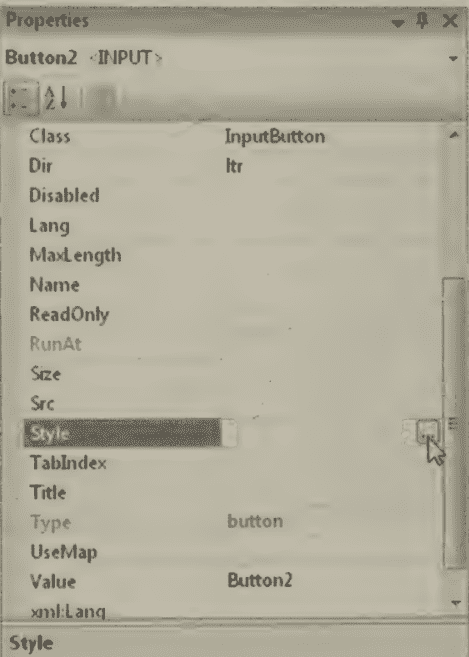

图 27. Visual Studio 中 HTML 按钮的 Style 属性。

> 类似于 `document.getElementById()`，根据对象的 ID 创建对象引用。我们将在书的后半部分使用这种技术。


# 电子学习开发者的编程

### 设置属性

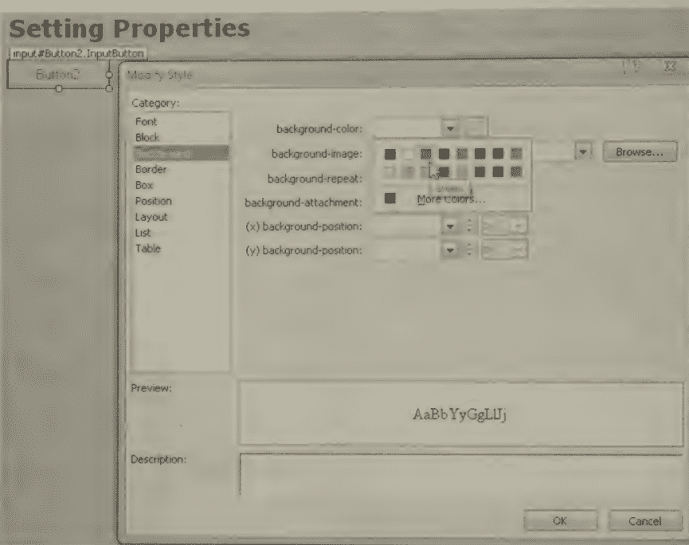

图 28. Visual Studio 中的样式对话框。

```html
<html xmlns="http://www.w3.org/1999/xhtml" >
<head>
  <title>HTML/JavaScript Sample</title>
<link href="Style.css" rel="stylesheet" type="text/css" />
  <script language="javascript" type="text/javascript"></script>
function Button2_onclick(objectId) {
  objectId.style.backgroundColor = "green";
}
</head>
<body>
  <form action="index.htm">
  <h2>Setting Properties</h2>
<input id="Button2" type="button" value="Button2"
class="InputButton" onclick="return Button2_onclick(this)" />
<br />
</form>
</body>
</html>
```

### 列表 10. 使用 HTML 和 JavaScript 设置按钮的 backgroundColor 属性。

上面最重要的部分已用**粗体**显示。我们没有使用 Visual Studio 生成的默认 `return Button2_onclick()`，而是将其作为参数添加到函数中。同时，我们将此参数命名为 `objectId` 并将其添加到函数中。这允许我们立即开始设置我们所需的属性。我们使用 JavaScript 引用¹10 产生了 `.style.backgroundColor="green"` 这种语法。

再次强调，我们不需要担心重置值，因为当 HTML 页面重新加载时，按钮将恢复原始外观。

## Silverlight

虽然比 Flash 组件稍微更容易处理一些，但 Silverlight 按钮具有非常广泛的模板结构，这使得处理它们的背景颜色具有挑战性。因此，我们将再次更改文本颜色。图 29 显示了执行此操作的内置界面。

10 IntelliSense 在这里无法帮上忙，因为 Visual Studio 的 JavaScript IntelliSense 有局限性，无法正确识别 `objectId` 变量。我的一个评审人员，来自学习与技术学院的 Simon Price 正确地指出，这实际上是 DOM（文档对象模型）而不是 JavaScript 本身。Simon 建议通过此链接作为 JavaScript、DOM 以及更多内容的良好参考：https://developer.mozilla.org/En/Documentation/hot_links。

# 电子学习开发者的编程

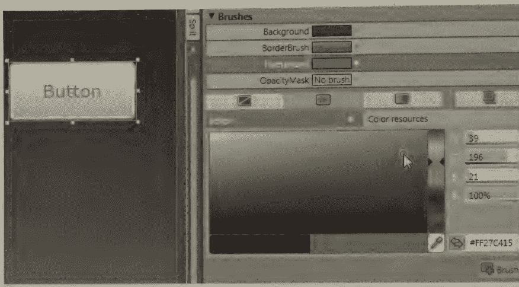

图 29. 在 Blend 中更改前景颜色。

我们选择 Foreground（前景），然后选择 Solid color（实色）画笔选项卡。最后，我们点击我们颜色。我们也可以输入 RGB¹¹ 或十六进制值。

接下来我们该如何做？我们可能会利用 IntelliSense，加上我们在 Blend 中点击了 Foreground 行，这揭示了我们想要的属性名称是 Foreground。然后我们可能会尝试像下面的图 30 所示将其设置为绿色。

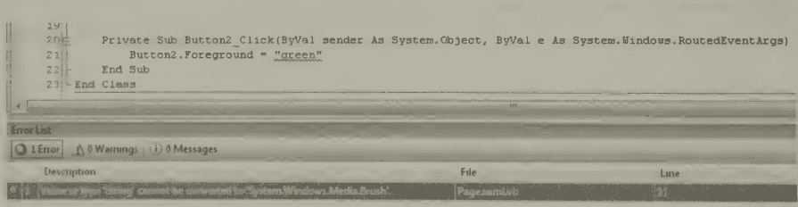

图 30. Visual Studio 中不正确的“Foreground" 代码和错误列表。

这就是 Visual Studio 的威力真正开始帮助我们的地方。我们可以从波浪线获得错误指示（类似于 Microsoft Word 中的拼写错误）。我们可以将鼠标悬停在行上，或者

> ¹¹ 注意到还有一个“A”值。这是用于设置透明度的 Alpha 通道。

30

使用错误列表窗口查看错误是什么：类型 'String' 无法转换为 System.Windows.Media.Brush。我们不能用文本（字符串）来设置画笔的属性。画笔的概念源于填充形状或图像部分的绘图工具。在 Silverlight 中，所有颜色都是某种画笔。由于我们想要单一颜色（绿色），因此我们创建一个 SolidColorBrush 对象（我们通过在 Blend 中使用 Solid color 画笔选项卡也得到了这种指示）。类似于在 ActionScript 中需要创建一个新的 TextFormat（列表 9）一样，我们需要创建一个新的 SolidColorBrush 对象。我们从图 31 中看到，IntelliSense 为我们提供了两种创建该对象的选项。第二个选项允许我们指定颜色。这比先创建画笔然后再设置其颜色要更快且不那么疲累。

```csharp
Private Sub Button2_Click(ByVal sender As System.Object, ByVal e As Button2)
  Button2.Foreground = New SolidColorBrush(color)
End Sub
2 2 of 2 New (color As System.Windows.Media.Color)
color: 应用到画笔的颜色。
```

图 31. Visual Studio 中的重载 SolidColorBrush 构造函数。

最后的挑战是我们如何获取颜色。我们可以从 RGB 值创建新的 Color 对象，但我们可以像列表 11 所示，使用命名颜色来访问它们。现在我们已经创建了画笔，继续设置 Foreground 属性。

```csharp
Private Sub Button2_Click(ByVal sender As System.Object, _
ByVal e As System.Windows.RoutedEventArgs)

  Dim brushId As New SolidColorBrush(Colors.Green)

  Button2.Foreground = brushId
End Sub
```列表 11. 在 Silverlight 中设置按钮的 Foreground 属性。从技术上讲，这些是共享颜色。这意味着我们的名称没有空格。

# 电子学习开发者的编程

## 处理点击事件 - II

在转向其他任务之前，让我们看看图 32。例如，我们有

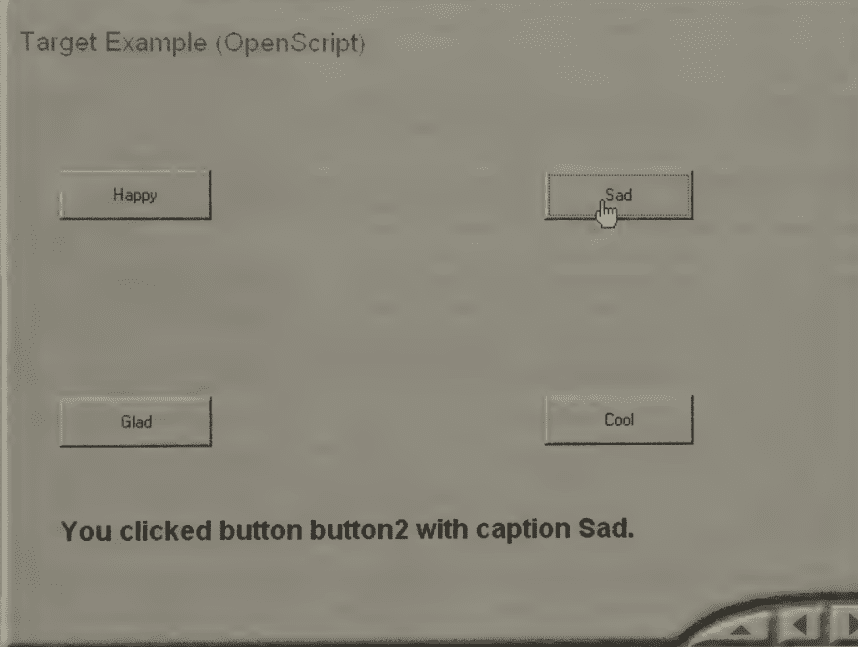

图 32. 高级点击事件 - ToolBook。

# 电子学习开发者的编程

## ToolBook - OpenScript

原生 ToolBook 使得为图 33 所示的多个对象编写单个脚本变得非常容易。当按钮被点击时，消息会上传页面。在此脚本中，关键是 target，它是产生消息的对象。在我们的案例中，我们对按钮感兴趣，但其他也可以。如果不是（例如是字段、矩形），则忽略该点击。如果是，我们设置字段的文本以显示按钮的名称和标题。这证明了我们能够点击了哪个按钮。

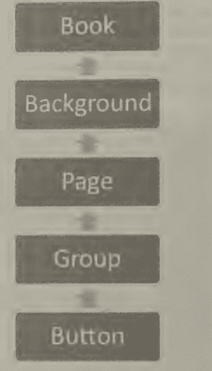

图 33. 原生 ToolBook 消息层级。

```javascript
-- Page Script
handle buttonClick
if object of target = "button"
of field "Display Field" = "You clicked button " & \nname of target & " with caption " & caption of target
end if
forward
end buttonClick
```列表 12. ToolBook OpenScript 中显示 Target 和消息层级的页面脚本。

> ¹这也需要“动态对象引用”，因为我们根据命名方案工作：矩形 1 对应字段 1、toolbarGraphic1 等。我们从原始对象名称中提取“1”，然后作为字符串构建下一个名称（“field1”），并发现这就是所谓的动态对象引用。我们将在书后面的部分介绍。

> ²再次注意 ToolBook 设置属性和调用方法的方法与我们的环境相反。我们使用 `of field "Display Field"` 而不是 DisplayField.Text。ToolBook 对象名称带有引号的某个影响意味着我们的名称没有空格。像 Silver 等其他环境允许空格，DisplayField.Text 将是合理的。

> ³ToolBook 仍然使用 caption 作为按钮的文本。Silver 甚至 .NET 环境为所有对象统一了 Text 属性，并且（仅限 Silver）还有一个更通用的 Content 属性，用于除文本外还可以显示图形等项目的对象。


## 处理点击事件 – 第二部分

我们随后转发该消息，以防高层脚本也想处理它⁴。

## ToolBook – 动作编辑器 (Actions Editor)

动作编辑器中的情况并无太大区别，因为它也有“目标（target）”的概念。不过，需要注意的是，它没有检查对象类型的能力（`object of target` 是我们在上面列表 12 中为此而使用的 OpenScript 语法）。因此，我们需要确保没有不兼容的对象可以到达脚本。例如，如果我们把动作放在页面层级（你可能想参考图 33 中的层次结构），并引用 target 的 caption（说明），那么在点击按钮以外的任何内容（包括页面本身）时，我们将得到错误信息（原生模式下），或者在发布为 HTML 时得到“undefined”的引用，因为只有按钮具有 caption 属性。为了避免这个问题，将动作放置的最简单地方是组（group）⁵。结果如图 34 所示。

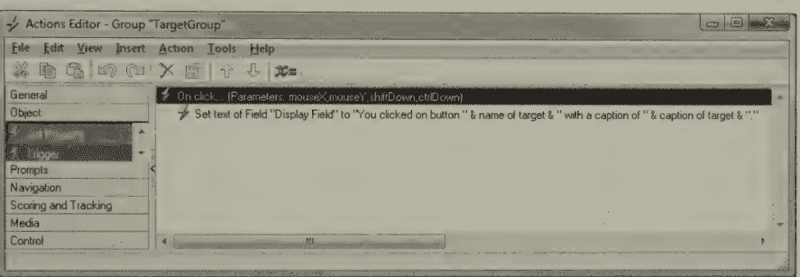

图 34. 在 ToolBook 动作编辑器中使用 Target 的组级动作。

动作编辑器没有动态对象引用，因此这种方法的一些易用性丢失了⁶。但它仍然非常好用。

> ⁴ 这种额外处理可能非常有帮助。（例如，在我们的《Learning & Mastering ToolBook》中，有一项工作是在“系统书”级（例如，关于当前书籍的其他书籍）层级处理 `mouseEnter` 事件。我们检查 target 是否为按钮以及它是否已启用。如果是，我们将 sysCursor 属性设置为 44，这将光标变为手形。这还允许我们通过单个脚本更改数百个按钮的行为。）

> ⁵ “组（group）”是 ToolBook 特有的，其意义在于你可以简单地通过“分组”一个或多个对象来创建一个新对象。生成的组可以有自己的脚本，并作为一个实体被显示或隐藏。它类似于 NET 中的 Panel（面板），但我们必须将对象拖入面板中。

> ⁶ 回到我们之前的示例，你可以发现我们正处于矩形 1 上。但不是使用对 field 1 的引用，我们需要执行如下逻辑：如果 `num = 1`，将“field 1”的文本设置为“xyz”，否则如果 `num = 2`，将“field 1”的文本设置为“xyz”。这就是我们说的动态对象引用（或其缺失）。

35

面向电子学习开发者的编程

## Flash

在 Flash 中，我们采用了略有不同的方法。简而言之，我们给所有按钮分配相同的监听器。然后，我们使用在列表 3 和列表 9 中看到的事件参数，并利用它具有 `target` 属性⁷，该属性可以识别生成事件的哪个。结果如图 35 所示。

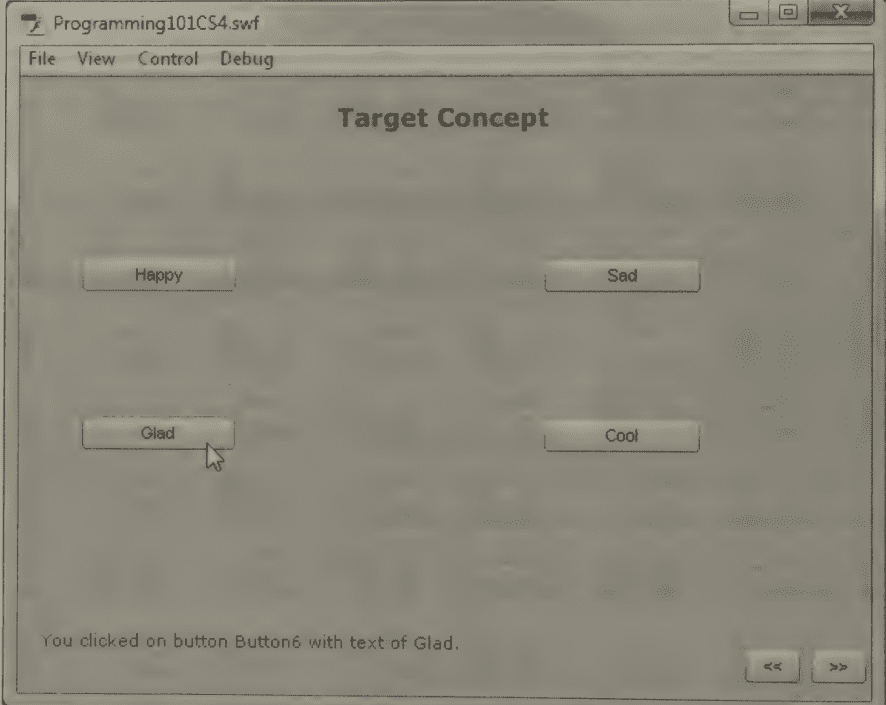

图 35. Flash 中的 Target 概念。

代码见列表 13。

```
runInitialLoad2();
stop();
```

> ⁷ 有趣的是，ToolBook 和 Flash 都称之为 target。

```javascript
function runInitialLoad() {
  // 设置监听器
  Button3.addEventListener(MouseEvent.CLICK, displayInfo);
  Button4.addEventListener(MouseEvent.CLICK, displayInfo);
  Button5.addEventListener(MouseEvent.CLICK, displayInfo);
  Button6.addEventListener(MouseEvent.CLICK, displayInfo);
}
```

```javascript
function displayInfo(event:MouseEvent):void {
  DisplayField.text = "你点击了按钮 " + event.target.name + "，文本为 " + event.target.label + "."";
}
```

列表 13. 显示将相同函数分配给多个按钮。

我们使用 `addEventListener` 方法将每个按钮的 `Click` 事件与 `displayInfo` 方法关联。我们利用了获取 `MouseEvent` 事件参数的特性。如上所述，它的 `target` 属性指向被点击的原始按钮。我们读取它的 `name` 属性来确定是哪个按钮，并读取它的 `label`⁸ 来获取文本。

虽然我们在这个示例中没有使用它，但 ActionScript 可以使用这种语法进行动态对象引用：`this{"field1"}`。我们将在书后的部分看到一些这种（双关语意义）的示例。

## JavaScript

我们在 JavaScript 中采用的方法与 Flash 使用的方法类似：我们为所有按钮分配相同的函数。

### Target 概念

| | | | |
|---|---|---|---|
| <input id="Button1" type="button" value="Happy" class="InputButton" onclick="CommonClick(this)" /> | <div class="InputButton"></div> | <div class="InputButton"></div> | <input id="Button2" type="button" value="Glad" class="InputButton" onclick="CommonClick(this)" /> |
| | | | |
| | | | |
| | | | |
| | | | |
| <input id="Button3" type="button" value="Sad" class="InputButton" onclick="CommonClick(this)" /> | <div class="InputButton"></div> | <div class="InputButton"></div> | <input id="Button4" type="button" value="Cool" class="InputButton" onclick="CommonClick(this)" /> |
| <br /> | <br /> | <span id="DisplayField"></span> | |

列表 14. 将相同函数分配给多个按钮。（等等，这里文字写着 14）

布局如图 36 所示。

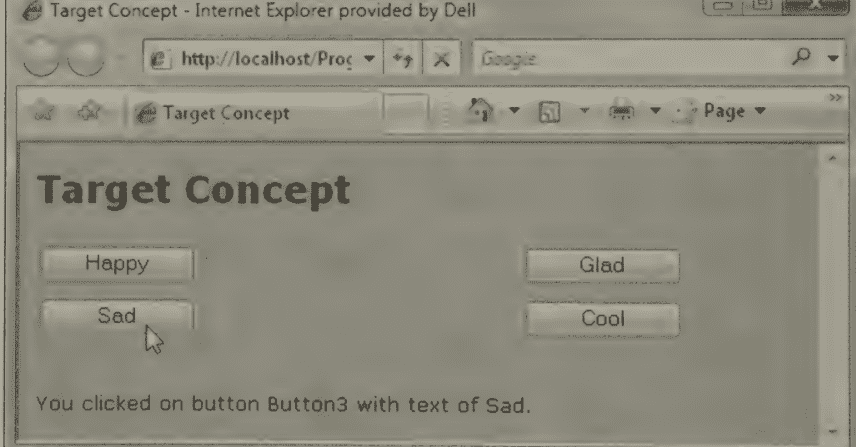

图 36. HTML 中的 Target 概念。

## 处理点击事件 – 第二部分

我们使用了与 10 类似的技术。`CommonClick` 的实现见 15。

```javascript
function CommonClick(objectId) {
  var displayId = document.getElementById("DisplayField");

  if (displayId != null) {
    displayId.innerHTML = "你点击了按钮 " + objectId.id + "，文本为 " + objectId.value + ".";
  }
}
```

列表 15. JavaScript 显示对象引用和 document。

objectId 拥有我们点击的按钮的引用。下一个任务是获取 DisplayField。我们定义了一个变量来持有这个引用。为了填充变量，我们使用了一个非常有用的函数：`document.getElementById()`。该函数查找具有指定 id 的 HTML 对象。

页面上完全可能没有名为 "DisplayField"的对象。它可能被删除了，或者我们的代码中有拼写错误等。因此，与其直接对其进行设置属性（这会导致错误），我们先检查对象是否存在。JavaScript 错误非常普遍，以至于浏览器默认甚至不显示它们。我建议如图 15 所示更改你的设置，以便查看和调试函数。当所有错误太烦人时，你可以在浏览时将其改回来！我强烈建议使用 JavaScript 调试器¹。

我们在书中反复遇到“控制结构”。在 JavaScript 和 ActionScript 中，你必须将评估的逻辑放在括号中。`!=` 意味着 "null" 是一个表示不存在的关键字²。`if` 语句必须有 `{ }` 开合括号。

¹ HTML 标签也可以具有 `name` 属性，与 `id` 不同，`name` 不需要唯一的。`document.getElementsByName` 返回指定名称的对象集合。但我对这个函数没有发现太多，特别是因为 `name` 是可选的。

² Simon Prince（学习与研究研究所的）在此处提供了一些很好的建议：“防御性编程如果使用不当，可能会掩盖程序其他部分的错误并使它们更难以处理。有时可以使用 `debug=true` 或 `debug=false` 来根据开发阶段从‘早期失败并显式报错’切换到更具防御性的行为。这里有很好的建议。如果不确定，为函数添加一个参数来指定是否失败是使行为明确的一种好方法。”

³ Visual 的等价物是 Nothing。OpenScript 使用 null。


## 为电子学习开发人员进行编程

假设 `DisplayField` 对象存在，我们随后将其 `innerHTML`¹³ 属性设置为包含 ID 和值（等同于按钮的标题或标签）的文本。

## Silverlight

Silverlight 中的方法再次类似。我们创建每个按钮，并为每个按钮的 `Click` 事件分配相同的处理程序。Target.xaml 页面的主要部分如列表 16 所示，生成的屏幕如图 37 所示。`AnyButtonClick` 的赋值已加粗显示。

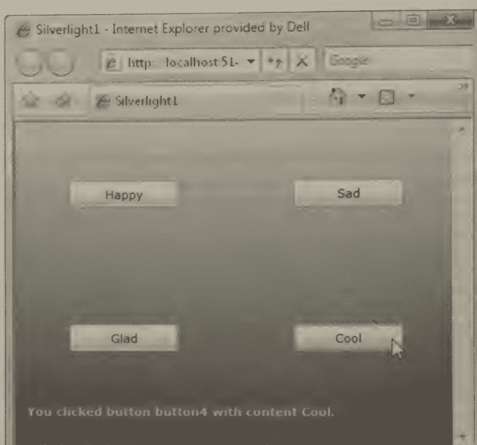

图 37. Silverlight 中的目标概念。

```
<Grid x:Name="LayoutRoot">
<Grid.Background>
<LinearGradientBrush EndPoint="0.5,1" StartPoint="0.5,0">
<GradientStop Color="#FFDADFE5" Offset="0'/>
<GradientStop Color="#FF0A3B70" Offset="1'/>
</LinearGradientBrush>
</Grid.Background>
<Grid x:Name="Grid1">
<Grid.RowDefinitions>
<RowDefinition/>
<RowDefinition/>
</Grid.RowDefinitions>
<Grid.ColumnDefinitions>
<ColumnDefinition Width="0.5*"/>
<ColumnDefinition Width="0.029*"/>
<ColumnDefinition Width="0.471*"/>
</Grid.ColumnDefinitions>
<Button Margin="0,0,0,0" Content="Happy" x:Name="button1"
Width="100" Height="25" Click="ButtonClick"/>
<Button Margin="0,0,0,0" Content="Sad" x:Name="button2" Width="100"
Height="25" Grid.Column="2" Click="ButtonClick"/>
<Button Margin="0,0,0,0" Content="Glad" x:Name="button3" Width="100"
Height="25" Grid.Row="1" Click="ButtonClick"/>
<Button Margin="0,0,0,0" Content="Cool" x:Name="button4" Width="100"
Height="25" Grid.Column="2" Grid.Row="1" Click="ButtonClick"/>
</Grid>
<TextBlock TextWeight="Bold" x:Name="Display_Field"
VerticalAlignment="Bottom" Height="32" Margin="10,10,10,10"/>
<TextBlock.Foreground>
<LinearGradientBrush EndPoint="0.5,1" StartPoint="0.5,0">
<GradientStop Color="#FF9C0B93"/>
<GradientStop Color="#FF9FEB305" Offset="1"/>
</LinearGradientBrush>
</TextBlock.Foreground>
</Grid>
```

列表 16. Silverlight XAML 显示网格并将所有按钮分配给同一个处理程序。

通过查看列表 16 中的 XAML，我们可以检查许多重要的概念。

- 1. Silverlight 中的按钮定位与其他环境不同（其他环境通常通过设置位置或左、上属性来将它们放置在您想要的地方）。虽然您在 Silverlight 中使用 `Canvas` 时也可以使用网格进行这种操作，但在命名的 `Grid`¹⁴ 中定义了两行和三列（Blend 是一个很好的工具，可以在设计表面上填充行/列的特征或更改它们）。网格内的对象默认位于第 0 行第 0 列¹⁵。这就是为什么我们（加粗显示）：`Grid.Column="2"`。这跳过了第 1 列（以留出间距）并将该按钮放在第 2 列。其他按钮的行和列设置都加粗了。

> ¹³ 在根据用户输入使用 `innerHTML` 时要小心，因为这样做可能会让你面临所谓的“脚本注入攻击”。

> ¹⁴ 你可能注意到名称是这样的：`x:Name="Grid1"`。这来自文件顶部的命名空间：`xmlns="http://schemas.microsoft.com/winfx/2006/xaml"`。

> ¹⁵ 像编程一样，第一个元素是 0。我们稍后会看到这一点。

- 2. Silverlight 中的按钮具有 `Content` 属性，而不是 `Caption`。

- 3. 属性可以是 XML 中的属性（如 `Margin` 或 `Height`），也可以是复杂的类型。在后一种情况下，名称如下所示所示：`<TextBlock.Foreground>`。在列表 16 的底部，你会看到 `LinearGradientBrush` 设置了 `TextBlock` 的 `Foreground`。

显示我们消息的少量代码如列表 17 所示。有趣的部分是我们如何确定点击了哪个按钮。Silverlight 自动将 `sender` 作为函数的参数包含。这正是被点击的按钮。但编译器并不知道它是按钮。

```vb
Private Sub AnyButtonClick(sender As Object, e As RoutedEventArgs)
    Dim buttonId As Button = CType(sender, Button)
    Display_Field.Text = String.Format("You clicked {0}.", buttonId.Content)
End Sub
```

列表 17. Silverlight 处理按钮点击的代码。（注意：列表 17 的原文是碎片化的，上述逻辑是根据上下文重构的。）

## 创建交互式屏幕

让我们创建一个交互式屏幕，其中专辑名称列在左侧。当用户悬停在名称上时，颜色会变化，右侧会显示专辑封面。我们还将包含来自 beatles.com 的曲目列表。“悬停”过的专辑名称将显示为第三种颜色，以便用户查看哪些已经完成。最后，当所有悬停操作完成后，我们将显示一条消息。这是一个交互式的屏幕，将向我们介绍许多概念。

## ToolBook – OpenScript

你可能想看看图 38，这样我们可以想象我们的任务.png 文件以及为专辑创建的字段。这些字段的名称为“album 1”到“album 5”，我将图像作为资源导入并为它们赋予了匹配名称。最后，我去 beatles.com 获取了每个专辑的曲目列表，并将它们放在名为“field 1”到“field 5”的字段中。我们隐藏了这些字段，因为我们将读取文本（实际上是富文本，以便保留我们的格式）并将它们显示在常见的“显示字段”中。


## 为电子学习开发人员编程

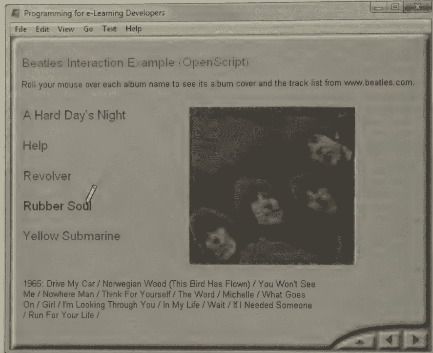

图 38. 交互示例 - ToolBookScript。

我们现在准备好进行一些编程了。让我们从列表18 所示的 `mouseEnter` 脚本开始。
我们将此脚本放在页面级别，这样我们可以为五个专辑名称字段编写一个 `mouseEnter` 处理程序。

```basic
to handle mouseEnter
system lastFieldId
system stack completedInteractionList
system dword numInteractions
local string tarName
local string tarNum
local field textField

tarName = name of target
```

```basic
if word 1 of tarName = "album"
tarNum = word 2 of tarName
fieldID = field "display field"
richText of fieldid =richText of field ("field" & tarName)
normalGraphic of button "albumImage" = bitmap ("album" & tarName)
strokeColor of target = blue
sysCursor = 19 -- pen
if lastFieldID <> null
strokeColor of lastFieldID = 120,25,125,100 -- dark green
end if
lastFieldID = target
-- check for completion
if ASYM_ItemInList(tarName, completedInteractionList) = False
push tarName onto completedInteractionList
end if
if itemCount(completedInteractionList) >= numInteractions
richText of field = "COMPLETED: " & richText of field
end if
forward
 mouseEnter
```

## 列表 18. 交互示例实现 (mouseEnter)-ToolBook OpenScript。

在这个脚本中，我们有很多很好的编程概念要讨论。第一个是全局变量，我们可能用它定义一些超出当前处理程序或函数生命周期的数据。在 OpenScript 中，我们通过在前面加上 `system` 来声明全局变量。在大多数情况下，我们还会声明一个类型。这样做是为了当我们做了某些愚蠢的事情（例如将“Joe”赋值给一个应该是成员的变量）时，环境会帮助我们。因此，`system dwarf numInteractions` 行创建了一个类型为 `dword` 的 `numInteractions` 全局变量。在 `mouseEnter` 脚本中，我们需要三个全局变量：

- 1. 指向“上一个”字段的引用。理解这一点，我们需要考虑一系列事件。用户将鼠标移动到“Rubber Soul”。在那个点，我们希望将其变为蓝色。然后他将鼠标移动到“Help”。我们将“Help”变为蓝色以表示我们已经访问过它。为了做到这一点，我们需要记住我们在哪里。这就是为什么我们有 `lastField`。在这种情况下，我们没有声明数据类型，因为 OpenScript 足够灵活，在我们使用它时允许我们在进入页面时设置（见列表 19）。

> 关于跨生命周期修复错误的成本有许多研究。正如你所期的，在电子学习之前修复错误更容易且成本更低，找到正确的文件，修复问题并重新部署。声明类型是减少错误的重要步骤。

> ToolBook 中的 `dword` 是32位无符号整数，它可以仅是正数。

> 注意我们将变量的第一个字母小写，并将名称中每个单词的首字母大写。这被称为“驼峰命名法”（camel casing），是推荐的命名规范。

- 2. 除了知道用户最近的字段，我们还需要跟踪所有字段，以判断用户何时完成了所有操作。有许多方法可以处理这一点，但最简单的方法是使用逗号分隔的完成交互列表（例如 1,3,5）。这是存储在 `completedInteractionList` 变量中的栈数据类型。我们需要构建这个栈。

- 3. 最后，我们需要知道有多少次交互以判断我们是否完成。这并不一定是一个全局变量，但我们在两个不同的处理程序（`mouseEnter` 和 `exit`）中使用了它。全局变量的优势是，当我们更改交互次数时只需要更改一次值。

在全局变量之后，我们有了局部变量。这意味着它们持续到处理程序或函数的结束。`tarName` 变量允许我们避免一直引用 `target` 的名称。最后，我们多次引用显示字段。将此对象放入引用是一个良好的做法，我们称之为 `fieldref`。如果程序不需要“解决”结果，这样代码会更少。

让我们看看逻辑。我们使用 `if` 语句将我们的逻辑限制为第一个单词为“album”的目标。我们需要页面上的每个对象生成 `mouseEnter` 事件。接下来，我们填充 `tarName` 变量（1, 2 等）。我们构建 `fieldref` 指向显示字段，然后开始 cooler stuff（冷却内容）。我们将显示字段的 `rightText` 属性设置为包含专辑信息的（隐藏）字段的 `rightText`。我们使用显示字段的 `rightText` 对应（隐藏）字段的 `rightText`。我们使用显示字段的 `rightText` 对应（隐藏）字段的 `rightText`。我们使用显示字段的 `rightText` 对应（隐藏）字段的 `rightText`。

normalGraphic of button "albumImage" = bitmap ("album" & tarName)
strokeColor of target = blue
if lastFieldID <> null
strokeColor of lastFieldID = 120,25,125,100 -- dark green
end if
lastFieldID = target
-- check for completion
if ASYM_ItemInList(tarName, completedInteractionList) = False
push tarName onto completedInteractionList
end if
if itemCount(completedInteractionList) >= numInteractions
richText of field = "COMPLETED: " & richText of field
end if
forward
 mouseEnter

（注：此处原文存在大量重复段落，已根据要求去重处理，仅翻译核心逻辑）

## 创建交互式“悬停”屏幕

## 为电子学习开发人员编程

```basic
to handlePage
system lastField
system stack completedInteractionList
system dword numInteractions
```

```basic
numInteractions = 5

step from 1 to numInteractions
strokeColor of field ("album " & num) = 20,30,100 -- dark orange
end step
text of field "display field" = ""
clear normalGraphic of button "albumImage"
lastField = null
completedInteractionList = ""
forward
end enterPage
```

to handleLeave
local string turnName


# 电子学习开发者的编程

```
tarName = name of target

if word 1 of tarName = "album"
sysCursor = default
end
forward
mouseLeave
```

19. 交互示例实现（enterPage 和 mouseleave）- ToolBookScript。

查看 enterPage 处理程序的方法是，我们希望将页面初始化为我们所需的状态¹²我们需要设置全局变量¹³，以便它们在脚本顶部被定义。我们初始化 `numInteractions`，然后使用我们的第一步循环⁴将我们的每个字段的描边颜色（strokeColor）设置为深橙色。在步骤循环中，变量 `(num)` 从初始值 `(1)` 运行到最终值 `(numInteractions)`。循环内的代码都会运行。这不仅节省了多行代码，还提供了更大的灵活性，无需通过添加字段名（“album” & num）的代码来清除交互次数，只需让 OpenScript 构建引用并设置颜色即可。从那里开始，我们清空了显示字段和“albumimage”按钮。最后，我们清除了最后的 `FieldError` 和 `completedItemList`。转发 `enterPage` 消息是非常重要的——在 ToolBook 的更高层级会有许多其他操作对此消息做出响应。

`mouseLeave` 处理程序非常简单。我们使用与列表 18 相同的逻辑，确保我们只处理专辑名称字段的事件。如果是这样，我们将 `sysCursor` 恢复为默认值。

解释这些内容确实比实际编程要长得多。但剩下的示例应该会更快，因为逻辑将很简单。

## ToolBook – 动作编辑器

在 ToolBook 动作编辑器中完成我们的任务由于缺乏动态对象引用而需要更长的时间，但结果仍然相当实用。最终结果如图 39 所示。与 OpenScript 解决方案的主要区别在于，我们需要创建显示专辑封面的单独按钮。我们将它们命名为“albumGraphic 1”到“albumGraphic 5”。我们还去除了光标的变化，因为动作编辑器不支持该功能¹⁵。

¹² 在原生 ToolBook 应用中，你通常会在 `leavePage` 消息上执行此操作而不是 `enterPage`，因为书籍是以默认状态保存的，不需要在进入时初始化。然而，我在这里使用 `enterPage` 是为了与其它环境保持一致。

¹³ OpenScript 的所有环境的一个共同特点是，你可以在同一行声明并初始化变量。

¹⁴ 在 ActionScript、JavaScript 和 Visual Basic 中称为 `For` 循环。我们将在书的后面介绍控制结构。

¹⁵ 虽然当你转到 HTML 时，如果对象分配了超链接（即使只是一个注释），你也可以获得手形光标。但我们在这里不需要手形光标，因为这意味着该对象可以点击以触发某些操作。

## 创建交互式“悬停”（Rollover）屏幕

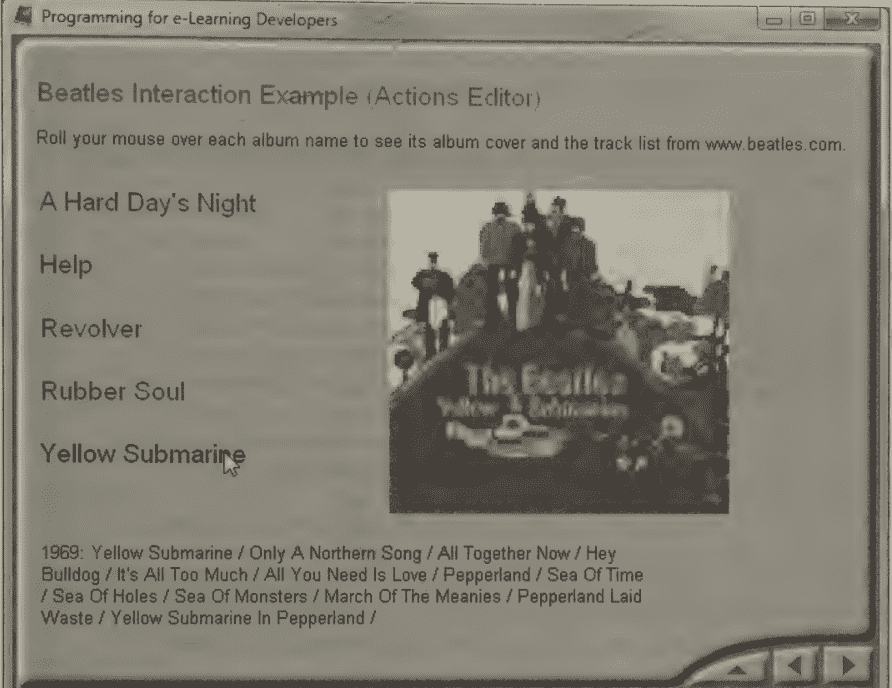

图 39. 交互示例 - ToolBook 动作编辑器。

与上一章中的“target”示例一样，我们将动作放在“组”（group）层级，以便利用 `target` 变量。我们通过处理 `On load page` 事件¹¹*进行初始化和重置，如图 40 所示。

¹¹ 注意，这是组的事件，这非常酷。将此放在组而不是页面上，有助于我们在将组复制到另一个页面时使用，因为所有的动作都会随之移动。

# 电子学习开发者的编程

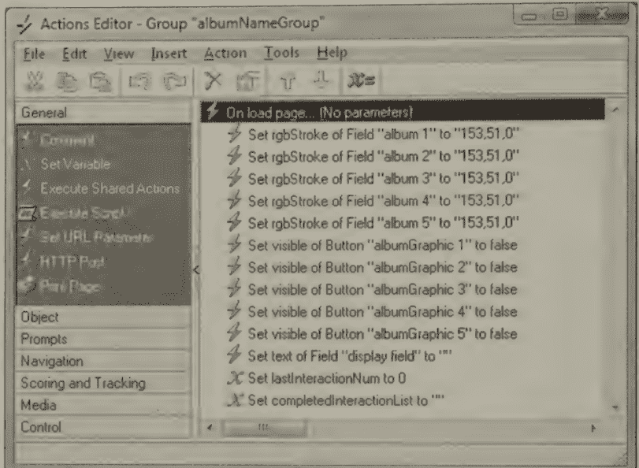

图 40. 交互示例实现（On load page）：ToolBook 动作编辑器。

我们将五个专辑名称字段的每个 `rgbStroke` 设置为深橙色¹⁷。我们单独列出每个对象而不是循环它们，因为我们无法根据对象的名称动态生成对象引用。同样，我们隐藏了五个专辑图形。最后，我们将全局变量 `lastInteractionNum` 设置为 0。我们使用此变量表示完成状态。`completedInteractionList` 的作用与 OpenScript 示例相同，尽管我们填充它的不同。

由于代码较长，我们将分两部分查看 `On mouse over` 代码。图 41 显示了脚本的上部分。

## 创建交互式“悬停”

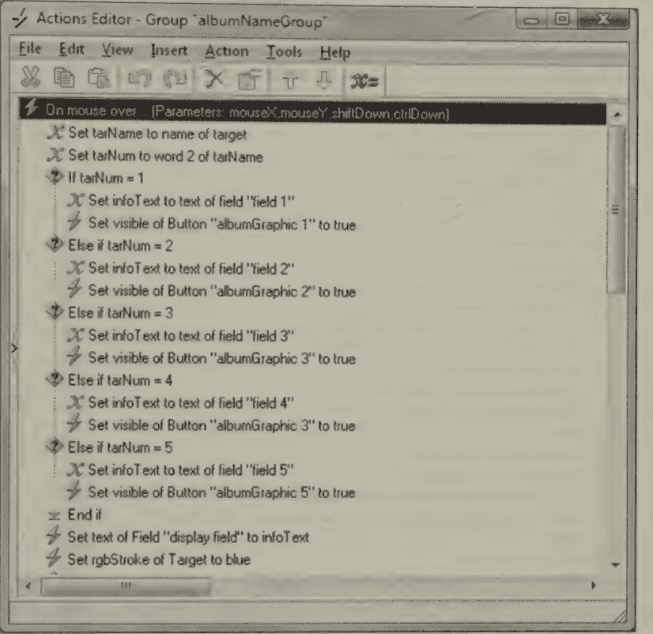

图 41. 交互示例实现（On mouse over）：ToolBook 动作编辑器。

我们首先设置 `tarName` 和 `num` 变量。由于无法进行动态引用，我们使用下划线来分隔基础部分和数字。从那里开始，我们使用第一个 `if-else` 结构。在 OpenScript 中，我们将使用 `switch`。在 JavaScript 和 Visual Basic 中，我们将使用 `Select Case`。

# 电子学习开发者的编程

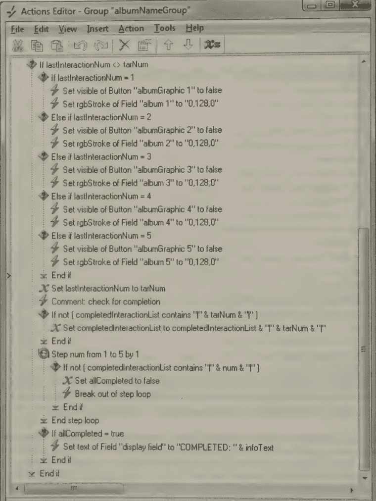

图 42. 交互示例实现（On mouse over）：ToolBook 动作编辑器。

## Flash

让我们在 Flash 中完成相同任务。完成后的结果如图 43 所示。

# 电子学习开发者的编程

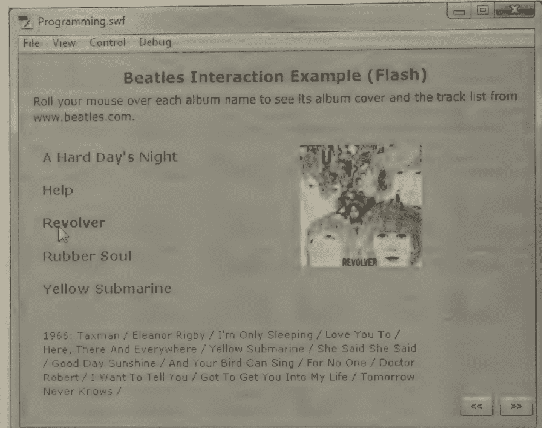

图 43. 交互示例 - Flash。

同样，专辑图形最优雅²¹的解决方案是将它们作为外部文件保留并动态读取。我们将在稍后的章节中介绍如何这样做，但目前我们只是将它们移出舞台²。同样，我们将信息字段（Flash 中的 TextField 对象）也移出舞台。我们像在 ToolBook 中一样将它们命名为 `field_1` 到 `field_5`，但使用下划线分隔基础部分和数字，Flash 对象名称中不能包含空格。专辑标题命名为 `album_1` 到 `album_5`。我们的布局如图 44 所示。


## 创建交互式“悬停”屏幕


披头士交互示例 (Flash)

将鼠标悬停在每个专辑名称上，可以在专辑封面上显示来自 www.beetles.com 的曲目列表。

1964: A Girl's Night / I Should Have Her
Wait You Feel / I'm Happy Just To Dance With
You / And I Love Her / Tell Me Just We Can't Buy Me
Love At Your Time / All Day Long / I Cryed Things
We Saw Today For First Time I Get Name / You Can't Do
That / I'll Be Back /

1967: Help! / Right Back / A G.L.C.
Holy Your Type / For That Girl / To Like It
Named Me / You're Going To Love / Looking Through You In
Much / Tell Me What You / I've Just Seen a
Paw /

1968: Eleanor Rig / The Only Slipping
Love You / Here, There And Everything
Yellow Sunshine / She Said Good Day
Birthday And Your Love / I Come to You
Doctor Robert / I Want To Tell You / Get To Get
Into My Life /

1969: Drive My Car / Norwegian Moon (The Bird
has Flies) / For Today / I Won't See Me / Nowhere
On Go / Girl / I Said Looking Through You In Me
Life / If I Needed Something / Run For Your
Life /

1969: Yellow Submarine / Only A Northern Song /
All Together Now / Hey Bulldog / It's All Too Much
You Need Now / Love Is Love / March Of The
Sea Of Holes / Sea Of Monsters / Peppered Waste
Submarine In Peppermint/

图 44. 显示对象移出舞台的 Flash 交互示例。

要将图形导入 Flash，将其“导入”到库，然后将它们的“实例”拖到设计面上。不过 Flash 有一个小特性，无法在代码中引用它们，因此我们将它们从 Graphic 符号更改为 Movie Clip 符号。如图 45 所示，你在属性窗口中执行此操作。一旦完成，我们将专辑命名为 `albumGraphic_1`。

| 属性 | | |
|---|---|---|
| 100% | albumGraphic_1 | |
| ✓ Movie Clip | | |
| Button | album_1 | |
| Graphic | 切换... | |
| | 且大小 | |

图 45. 将符号实例从 Graphic 转换为 Movie Clip 以便通过名称引用。

## 面向电子学习开发者的编程

通过 `albumGraphic_5^23`

列表 20 显示了我们的全局变量和初始化逻辑。

```javascript
// "global" variables
var numInteractions:Number = 5;
var lastFieldID:TextField = null;
var completedInteractionList:Array = new Array(numInteractions - 1);
var lastGroupID:MovieClip;

runInitialLoad3();
stop();

function runInitialLoad3() {
// 设置监听器
var num:Number;
var textFieldID:TextField;
```

列表 20. ActionScript 全局变量和初始化代码。

我们通过在函数块之外定义变量来使其成为“全局”。注意我们可以在声明变量的同一行上进行初始化。这非常节省时间。`numInteractions` 和 `lastFieldID` 的用法与我们的 ToolBox 解决方案相同。`completedInteractionList` 在此例中是一个 `Array^24`，因为这样处理起来更方便。我们基本上为每个交互留出一个位置，并在完成此交互时将 "true" 放入对应的位置。我们将数组的“维度”设为 `numinteractions - 1`，我们从 0 开始，因此大小应为 4。这里是用户完成第 1、3、5 次交互时数组的样式。

> ^23 在 ToolBox 中我们对它们的命名略有不同，因为我们不希望图形对象的名称与我们的字段对象相同。在 ToolBox 中，图形资源不是页面上的对象，所以它们是否与字段同名没有关系。
> ^24 我喜欢把数组想象成 Word 中的表格或 Excel 中的电子表格。“单维”数组只是一行或一列。二维数组既有行也有列。此之后，视觉化就变得更难了。“普通”数组通过它们的数字访问（在 OpenScript 中通常从 0 开始，第一个元素是 1）。“关联数组”可以通过数字或文本键进行访问。我们将在书的后面看到这些示例。

## 创建交互式“悬停”屏幕

| true |
| true |
| true |

由于我们要将专辑图形移动到位置然后移出舞台，我们需要另一个全局变量来引用我们移动到位置的“上一个图形”。我们将此变量命名为 `lastGraphicId` 并声明为 `Movie Clip`，因为我们拥有的是这种类型的符号（见图 45）。

在 `initialLoad3` 函数中，我们定义了一些局部变量，然后是第一个 for 循环。ActionScript 和 JavaScript 的 for 循环格式如下：
`for (初始条件; "停止" 条件; 增量) {`

在这种情况下，变量的初始值为 1，只要 `num` 小于或等于 `interactions`，我们就继续。在每次循环结束后，我们将 `num` 加 1。在循环内部，我们使用 ActionScript 和 JavaScript 的 for 循环获取正确专辑名称的引用……（注：此处去除了原文中大量重复的 OCR 错误，以提供文档内容的连贯性。）


因此，我们通过设置它的 x 和 y 坐标将其移出舞台²⁹。然后我们将 `lastGraphicId` 设置为所需的图形并将其移动到舞台。同样，我们使用专辑标题的 `textColor` 来填充 `lastFieldId`（如果它已定义），将其颜色设置为绿色，以反映用户已与该标题进行交互。无论何种方式，我们都设置了 `lastFieldId`，以便为下一次交互做好准备。

我们的最后一个任务是检查完成情况。我们看到 `completedInteractionList` 中对应的元素为 "true"³⁰，然后使用另一个循环检查该全局变量的每个元素是否有任何不为 "true" 的值。注意我们将 `num` 初始化为 0，并且由于数组是从 0 开始的，我们设置了条件 `num < interactions`。如果我们发现某个元素标记为 "true"，则将 `allCompleted` 设置为 `false` 并使用 `break` 命令退出循环。由于我们将 `allCompleted` 初始化为 `true`，如果没有找到任何除 "true" 以外的内容，该变量将保持为 `true`。在这种情况下，我们在信息文本前添加“COMPLETED:”字样。注意 `if` 行中使用的 `==`。在 ActionScript 和 JavaScript 中，我们需要注意逻辑“等于” (==) 和“赋值运算符” (=) 之间的区别。在 OpenScript、Actions Editor 和 Visual Basic 中，它们是相同的。但在 ActionScript 和 JavaScript 中，它们并不是。这已经让我吃过多次亏了！

## JavaScript

我们的 JavaScript 实现与我们在 Flash 中做的非常相似，尽管实际上更容易。结果如图 46 所示。虽然我们在某种程度上考虑了可访问性（残障人士成功使用您的应用程序的能力），但对该主题的深入讨论超出了本书的范围。包括 `alt` 标签等，我建议访问 http://www.w3.org/WAI 了解更多³¹。

⁹ 在编程中，x 从左侧测量，y 从顶部测量。因此，将 x 设置为 -200 意味着将其移动到舞台的左侧。

³⁰ 我们将其设置为 "true" 而不是 true，因为空元素在技术上不是布尔值。

³¹ 感谢我的评审员之一，来自学习与技术研究所的 Simon Price 建议了这个链接。

## 面向电子学习开发者的编程

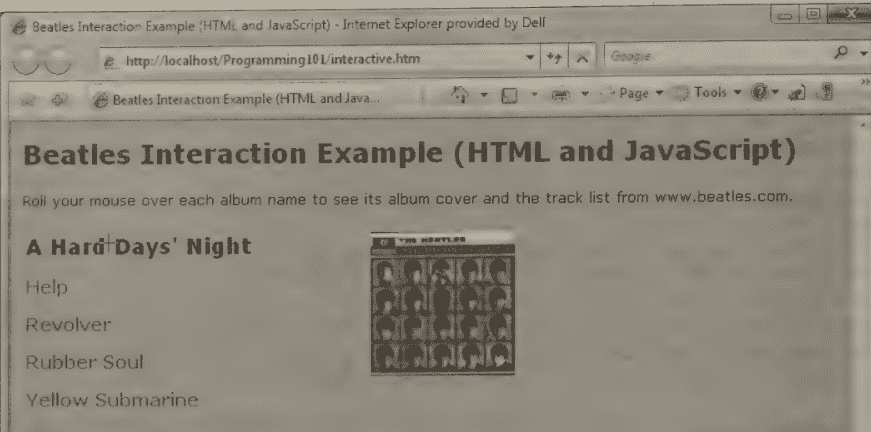

# 披士交互示例（HTML 和 JavaScript）

将鼠标悬停在每个专辑名称上，查看其专辑封面和来自 www.beatles.com 的歌曲列表。

# 艰难岁月

- Help
- Revolver
- Rubber Submarine
- Yellow Submarine

1964 - A Hard Day' Night / I Should Have Known Better / If I Fell / I'm Happy Just Dance With You / And I Love Her / Tell Me / Can't Buy Me Love / Any Time At All / I'll Cry Instead / Things We Said Today / When I Get Home / You Can't Do That / I'll Be Back /

**图 46.** 交互示例 - HTML 和 JavaScript。

由于我们可以使用 CSS 进行部分格式化，我们的代码被简化。页面的 HTML 部分如列表 22 所示。关键项目已加粗显示。

```html
<h2>Beatles Interaction Example (HTML and JavaScript)</h2>
<p>将鼠标悬停在每个专辑名称上，查看其专辑封面和
来自 www.beatles.com 的歌曲列表。</p>
<table>
<tr valign="top">
<td>
<span id="album_1" class="HotSpotReset"
onmouseover="implementRollover(this)">A Hard Days' Night</span>
<br />
<br />
<span id="album_2" class="HotSpotReset"
onmouseover="implementRollover(this)">Help</span>
<br />
<br />
<span id="album_3" class="HotSpotReset"
onmouseover="implementRollover(this)">Revolver</span>
<br />
<br />
```

# 创建交互式悬停屏幕

<span id="album 4" class="HotspotReset"onmouseover="implementRollover(this)">Rubber Soul/</span><br /> <br /> <span id="album 5" class="HotspotReset"onmouseover="implementRollover(this)">Yellow Submarine</span></td><td><td class="InputButton"></td><td></td></</tr>></table>
<span id="field 1" style="display:none">1964: A Hard Day's Night / I Should Have Known Better / If I Fell / I'm Happy Just To Dance With You And I Love Her / Tell Me Why / Can't Buy Me Love / Any Time At / All I'm Cry Instead / Things We Said Today / When I Get Home / You Can't Do / I'll Be Back </span><span id="field 2" style="display:none">1965: Help! The Night Before / You've Got To Hide Your Love Away / I Need You Another Girl / You're Going To Lose That Girl / Ticket to Ride / Acturally / I've Only Love / You Like Me Much / Tell What You See / I've Seen a Face / Yesterday / Dizzy Lizzy </span><span id="field 3" style="display:none">1966: Taxman / Eleanor Rig / Paperback Fields / Love You Only Know / When I're Gone / Nowhere / Within You Without / Blue Blue Lane </span><span id="field 4" style="display:none">1967: Strawberry Fields Forever / Penny Lane / I Am The Walrus / Hello Goodbye Yesterday / Lucy in the Sky with Diamonds / Sgt. Pepper's Lonely Hearts Band / A Day in the Life / Within You Without You / The Golden Slumbers </span><span id="field 5" style="display:none">1968: Hey Jude / Back in the U.S.S. / Get Back / The Sun Comes New / Ballad of Old John / Happiness Is a Warm Gun / 1968 Song / Lady Olivia / Wild Honey Honey / The Long and Winding Road / Get Back </span><span id="field 6" style="display:none">1969: Get Back / Get Together / The Ballad of John / Come Together Sun / The Sun Comes Up / I Want It's You Know </span><span id="field 7" style="display:none">1970:Let It Be / The Long and W Across the Universe


将其转换为数组，并最后赋值给 `tarNum` 变量。然后，我们使用可靠的伙伴 `document.getElementById()` 来获取显示字段、当前专辑信息字段以及图像切换的引用。

我们检查并确保对象引用不为空，并将显示字段的 `innerHTML` 设置为与信息字段匹配。同样地，我们显示了图像控制控件（通过 `img.style.display = "inline"` 这一行），设置了它的 `src` 属性³并设置了它的 `alt` 标签。我们在其他示例中也这样做过，因为这是 HTML 内容最常见的做法，这样视力低下的人士的屏幕阅读器就有办法告知图形是什么。注意我们是如何将其设置为专辑名称的。

我们没有像在其他示例中那样设置颜色和光标，而是直接将 `className` 属性设置为 "HotspotSelected"。你可以在列表 23 中看到，我们不仅将文字变为蓝色，还通过将 `font-size` 设置为 150% 使其变大。如果我们的 `lastfield` 不为空，我们就将其 `className` 设置为 "HotspotSelected"。这会让它变成绿色并恢复原始大小。

我们的最后一个任务是检查完成情况。这里的逻辑与列表 21 几乎相同。我们将正确的数组值设置为 "true"⁴，然后遍历数组查找任何不为 "true" 的值。如果找到，我们会在循环外将 `allCompleted` 设置为 `false`。如果我们完成了所有的交互，就会在显示字段的前部加上 "COMPLETED;"。注意，在这一逻辑中，我们通常同时检查两件事：`(allCompleted == true && displayField != null)`。用语言描述就是，我们正在检查 `allCompleted` 是否为真 **且** `displayField` 不为空⁵。

## Silverlight

只剩最后一个了！生成的应用程序（现在应该看起来很熟悉了）如图 47 所示。这是到为止最简单的实现方式之一。

> ³³ 我们可以有许多图像，并像我们在 Actions 编辑器和 Flash 示例那样进行显示和隐藏，但直接将源更改为外部图像文件要简单得多。这在 Actions 编辑器中是不行的。在 Flash 中是可以实现的（我们稍后会介绍），但比我们写的代码更具挑战性。

> ³⁴ 我们专门使用 "true" 而不是逻辑上的 `true`，因为数组最初是空的，并不是真正的布尔值（true 或 false）。

>  ⁵ `&` 在 JavaScript 和 ActionScript 中都表示“与”，`||` 表示“或”。这会让 OpenScript 和 Visual Basic 开发者感到困惑，因为在后两种两种语言中，`&` 表示拼接并添加空格。ActionScript 和 JavaScript 使用 `+` 同时用于拼接和加法。

64

# Beatles 交互示例 (Silverlight)

将鼠标悬停在每个专辑名称上，查看来自 www.beatles.com 的专辑封面和歌曲列表。

A Hard Day's Night

Help

Revolver

Rubber Soul

1965: Help! / The Night We Met / You've Hidden Your Love Away / I Need You / Another Girl / You're Going, To Lose That Girl / Ticket to Ride / Act Naturally... / It's Only Love? / You Like Me Too Much / Tell Me What You See / I've Just Seen a Face / Birthday / Dizzy Lizzy

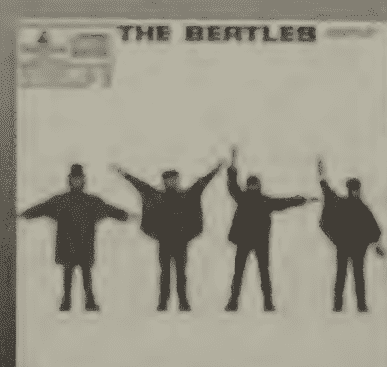

图 47. 交互示例 - Silverlight。

首要任务是布局应用程序。我们再次利用 Silverlight 的“网格”（grid）架构（如图 48 所示）来设置八行（一行标题，一行说明文本，五行专辑名称，以及一行显示字段）和两列（一列专辑名称，一列专辑封面图像）。这类似于我们在 JavaScript 表格中的 HTML 表格，但更强大，因为我们可以轻松让标题、说明和显示字段跨越两列，并让图像跨越组成专辑名称的五行。

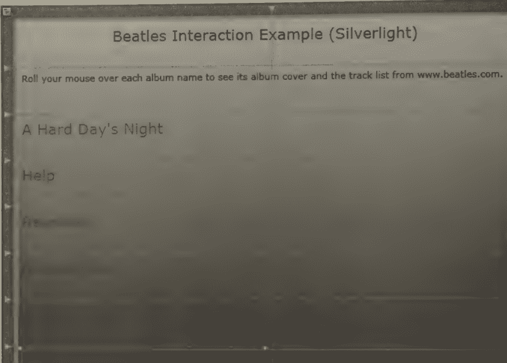

将鼠标悬停在每个专辑名称上，查看来自 www.beatles.com 的专辑封面和歌曲列表。

A Hard Day's Night

Help

图 48. Microsoft Expression Blend 中的 Silverlight 网格。

Silverlight 的 XAML 优点之一是在 XAML 本身中进行工作非常方便。因此，一旦我配置好了一个 `album_1`，最快的方法就是复制它的 XAML，粘贴四次（用于 `album_2` 到 `album_5`），然后编辑变化的内容：`Grid.Row`、`Text` 和 `x:Name`。完整的 XAML 如列表 25 所示。关键设置已加粗显示并在下文中进行了解释。

```xml
<UserControl x:Class="Silverlight1.Interaction"
xmlns="http://schemas.microsoft.com/winfx/2006/xaml/presentation"
xmlns:x="http://schemas.microsoft.com/winfx/2006/xaml"
Width="600" Height="450"
xmlns:blend="http://schemas.microsoft.com/expression/blend/2008"
xmlns:mc="http://schemas.openxmlformats.org/markup-compatibility"
mc:Ignorable="d"
  <Grid x:Name="LayoutRoot">
    <Grid.Background>
      <LinearGradientBrush EndPoint="0.5,1" StartPoint="0.5,0">
        <GradientStop Color="#FFDAD5" Offset="0"/>
        <GradientStop Color="#FFAB70" Offset="1"/>
      </LinearGradientBrush>
    </Grid.Background>
    <Grid x:Name="Grid1">
      <Grid.RowDefinitions>
        <RowDefinition />
        <RowDefinition />
        <RowDefinition />
        <RowDefinition />
        <RowDefinition />
      </Grid.RowDefinitions>
      <Grid.ColumnDefinitions>
        <ColumnDefinition Width="0.5*"/>
        <ColumnDefinition Width="0.5*"/>
      </Grid.ColumnDefinitions>
      <TextBlock Margin="5,5" Grid.ColumnSpan="2" Text="A Hard Day's Night (Silverlight)" TextWrapping="Wrap" FontSize="18" Foreground="#FF0036" HorizontalAlignment="Center"/>
      <TextBlock Margin="5,5" Grid.ColumnSpan="2" Text="Roll your mouse over cover and the track list from www.beatles.com." TextWrapping="Wrap" HorizontalAlignment="Stretch" Width="Auto" Grid.RowSpan="5" Grid.Row="2" Column="1" x:Name="albumImage" Stretch="UniformFill" VerticalAlignment="Top"/>
      <TextBlock Margin="5,5" Grid.Row="2" Column="1" Text="Hard Day's Night" TextWrapping="Wrap" Foreground="#FF9930" FontSize="18" x:Name="album1" Cursor="Stylus" MouseEnter="Rollover"/>
      <TextBlock Margin="5,5" Grid.Row="3" Column="1" Text="Help" TextWrapping="Wrap" Foreground="#FF9930" FontSize="18" x:Name="album2" Cursor="Stylus" MouseEnter="Rollover"/>
      <TextBlock Margin="5,5" Grid.Row="4" Column="1" Text="Revolver" TextWrapping="Wrap" Foreground="#FF9930" FontSize="18" x:Name="album3" Cursor="Stylus" MouseEnter="Rollover"/>
      <TextBlock Margin="5,5" Grid.Row="5" Column="1" Text="Rubber Soul" TextWrapping="Wrap" Foreground="#FF9930" FontSize="18" x:Name="album4" Cursor="Stylus" MouseEnter="Rollover"/>
      <TextBlock Margin="5,5" Grid.Row="6" Column="1" Text="Yellow Submarine" TextWrapping="Wrap" Foreground="#FF9930" FontSize="18" x:Name="album5" Cursor="Stylus" MouseEnter="Rollover"/>
      <TextBlock Margin="5,5,5,5" x:Name="DisplayField" FontWeight="Normal" VerticalAlignment="Stretch" Height="Auto"/>
    </Grid>
    <Grid Grid.ColumnSpan="2" Grid.RowSpan="1" Grid.Row="7" FontSize="10" Foreground="#FFE3D81" FontFamily="User Interface" TextWrapping="Wrap">
      <Grid>
        <TextBlock Text="1964: A Hard Day Night / I Should Have Known Better / I Feel / I'm Happy Just Dance With You And I Have Her Tell Me / Can't Buy Me Love / Time At All / I'll Cry Inside Things We Said Today / When I Get Home / You Can't Do That / I'll Be Back/" x:Name="1" Visibility="Collapsed"/>
        <TextBlock Text="1965: Help! / The Before / You've Got To Hide Love Away / I'm Young / Another Girl / You're Going To Lose That Girl / Ticket to Road / Actually / I've Just Seen a Face / Yesterday / Dizzy Missy Lizzy" x:Name="2" Visibility="Collapsed"/>
        <TextBlock Text="1966: Taxman / Eleanor Rigby / I'm Sleeping Love To / Here, There And Everywhere / Yellow Submarine / She Said Said You / Good Sunshine / And Bird Can Sing / No One / You Like Me Doctor Robert / I Want To Tell You / To Get Into My Life / Tomorrow Never Comes" x:Name="3" Visibility="Collapsed"/>
        <TextBlock Text="1965: Drive My Car / Norwegian Wood (This Bird Has Flown) / You Won't See Me / Nowhere Man / Think For Yourself / The Word / Michelle / What Goes On / Girl / I'm Looking Through You / In My Life / If I Needed Someone / Run For Your Life/" x:Name="4" Visibility="Collapsed"/>
        <TextBlock Text="1969: Yellow Submarine / Only A Northern Song / All Together Now / Hey Buldog / It's All Too Much / All You Need Is Pepperland / Sea Time / Sea Holes / Sea Of Monsters / March Of The Meanies / Pepperland Laid Waste / Yellow Submarine In Pepperland/" x:Name="5" Visibility="Collapsed"/>
      </Grid>
    </Grid>
  </Grid>
</UserControl>
```

列表 25. Interaction.xaml，说明和显示字段如上所述跨越了两个列。它们通过 `Grid.ColumnSpan="2"` 设置实现³⁶。图像控制控件有许多有趣的设置。我们将宽度和高度设置为 `Auto`⁷，以便其适应其容器（网格）中的可用空间。该空间从第 2 行第 1 列开始，跨五行：`Grid.RowSpan="5"`。为了制作图形但我们不希望图像到达屏幕边缘，所以我们设置了 `Margin="10,10,10,10"`。最后，我们希望图像与第一个专辑名称对齐，因此我们 `VerticalAlignment="Top"`。

³⁶ 我们不需要在 XAML 中输入此设置，因为可以在 Blend 的属性表中进行设置。

³⁷ 你可能会发现没有设置。那是因为它的默认值是 `Auto`。当属性具有其默认值时，它不会列在 XAML 中。


## 创建交互式“鼠标悬停”屏幕

我们将每个专辑名称放在第一列的每一行（2 – 6 行）。我们将 `Cursor` 设置为 `Stylus`，这样当用户鼠标移动到专辑名称上时，光标就会改变。我们通过 XAML 告诉每个专辑名称 `TextBlock` 在响应 `MouseEnter` 事件时调用 `implementRollover` 方法（如列表 26 所示）：`MouseEnter="implementRollover"`。我们将每个专辑的信息也放在 `TextBlock` 控件中。我们可以通过 `Visibility="Collapsed"` 设置来隐藏它们。

列表 26 显示了 `Interaction.xaml.vb` 文件中的代码。

```vb
Private numInteractions As Integer = 5
Private lastField As TextBlock = Nothing
Private completedInteractionList As New List (Of String)

Private Sub implementRollover(ByVal sender As System.Object, _
ByVal e As System.Windows.Input.MouseEventArgs)

    Dim targetId As TextBlock = CType(sender, TextBlock)
    Dim nameArray As String = targetId.Name.Split("_")
    Dim tarNum As String = nameArray(1)
    Dim allCompleted As Boolean = True
    Dim infoField As TextBlock = 
        CType(Me.FindName(String.Format("field_{0}", tarNum)), TextBlock)

    If infoField IsNot Nothing Then
        Display_Field.Text = infoField.Text
    End If

    ' 构建图形路径
    Dim graphicPath As String = String.Format("graphics/album_{0}.png", tarNum)
    Dim uriId As New Uri(graphicPath, UriKind.Relative)
    Dim graphicId As New Bitmap(uriId)
```

```vb
With albumImage
    .Source = graphicId
    .Visibility = Windows.Visibility.Visible
End With

targetId.Foreground = New SolidColorBrush(Colors.Blue)
```

```vb
If lastField IsNot Nothing Then
    lastField.Foreground = New SolidColorBrush(Color.FromArgb(255, 0, 128, 0)) ' 深绿色
End If
lastField = targetId
```

```vb
If completedInteractionList.Contains(tarNum) = False Then
```

```vb
    completedInteractionList.Add(tarNum)
End If

If completedInteractionList.Count >= numInteractions Then
    DisplayField.Text = "COMPLETED: " & Display_Field.Text
End If
End Sub
```

列表 26. Visual Basic (Silverlight) 中的 `implementRollover` 代码。

与我们大多数环境一样，我们可以通过将变量放在函数或子块外部来共享变量。Visual Basic 在这方面更为精确³⁸，因为我们可以设置变量的访问级别。`Private` 意味着当前页面内的方法可以访问这些变量，但页面外的对象无法读取或写入它们。我们将在书的后部分介绍访问级别。`numInteractions` 和 `lastField` 的含义与我们之前的示例相同。`completedInteractionList` 的目的相同，但它不是字符串或数组，而是被定义为 `List`。这种类型的对象被称为泛型³⁹，因为它可以根据我们的定义方式来持有不同类型的对象。在我们的案例中，每进行一次交互时，都会添加交互编号。

## Private Sub implementRollover

接下来是 `implementRollover` 方法。首先注意到，我们的参数类型是 `MouseEventArgs`。我们没有在逻辑中使用这些参数，但可以获取诸如鼠标位置（我们稍后将将其用于拖放功能的术语表）。49 显示了我们如何使用 IntelliSense 来获取可用的方法和属性。

| Empty |
| :--- |
| Equals |
| GetHashCode |
| GetPosition |
| GetType |
| OriginalSource |
| ReferenceEquals |
| StylusDevice |
| ToString |
| Common All |

正如我们在之前的 Silverlight 示例中所做的，我们从 `sender` 获取目标。我们使用了在 ActionScript 和 JavaScript 中使用的 `Split` 技术⁴⁰，将我们的名称拆分为基础部分和 `tarNum`。我们以与示例相同的方式使用 `allCompleted` 和 `infoField`。匹配页面并返回 Silverlight 控件的 `FindName` 控制可以是任何类型的控件，

图 49. 我们如何在 Silverlight 中对 `MouseEventArgs` 使用 IntelliSense。

> ³⁸ActionScript 在设置变量和函数为 public、private 方面也可以是精确的，但它们被限制在 ActionScript 类内部。

> ³⁹泛型在定义时带有 "of"。酷的地方在于，我们可以拥有一个包含我们想要的任何类型对象的列表。它只是一个字符串列表。但也可以是映射、对象、整数等的列表。如果我们尝试将不同类型的对象放入列表，或者取出一个东西并尝试错误地使用它，Visual Basic 会告诉我们。这在很大程度上减少了错误。

> ⁴⁰Visual Basic 的 Split 方法使用 `Char` 参数而不是 `String` 参数。这就是为什么我们必须使用 `CChar("")` 作为参数。虽然这些“强类型”有时会让人有点麻烦，但我们认为这节省了时间并帮助你编写更好的代码。

> ⁴¹这是 Silverlight 的一个非常新的特性。它等同于 ASP.NET 中的 `FindName`，但在 .NET Windows Forms 中没有。我在我的 *VBrain.Net* 书中花了一些时间解释如何使用如“反射”之类的技术来执行动态对象引用。幸运的是，Silverlight 中的 `FindName` 方法为我们处理了这个问题。

## 创建交互式“鼠标悬停”屏幕

使用我们手手的 `CType` 来告诉编译器我们知道它是一个 `TextBlock`。如果找不到该名称的控件，`infoField` 将是 `Nothing`。所以我们检查它是否为 `Nothing`。正如之前的示例一样，我们从 `sender` 获取目标。我们使用了在 ActionScript 和 JavaScript 中使用的 `Split` 技术⁴⁰，将名称拆分为基础部分和 `tarNum`。我们以与示例相同的方式使用 `allCompleted` 和 `infoField`。匹配页面并返回 Silverlight 控件的 `FindName` 控制可以是任何类型的控件，

正如我们在之前的 Silverlight 示例中所，我们从 `sender` 获取目标。我们使用了在 ActionScript 和 JavaScript 中使用的 `Split` 技术⁴⁰，将名称拆分为基础部分和 `tarNum`。我们以与示例相同的方式使用 `allCompleted` 和 `infoField`。为了设置专辑名称的颜色，我们返回 `SolidColorBrush`。在确保 `lastField` 存在（即我们的交互）后，我们使用 `Color.FromArgb` 将其设置为深绿色。这里的 "A" 为我们提供了 Alpha 通道，颜色的组成部分。


图 50. Visual Studio 中的资源。² 你也可以像在 HTML 中通过绝对 URL 加载图形。³ 生成操作为 `Resource` 将项目放入 DLL 内部。生成操作为 `Content` 将 .xap 文件放入。

统一资源标识符用于命名或标识互联网上的资源。我们大多数人会称之为 URL，从技术上 URL 也有位置。参见 http://en.wikipedia.org/wiki/Uniform_Resource_Identifier

## 为电子学习开发者编程

我们的完成逻辑与早期的示例非常相似。我们使用简单的 `Contains` 方法查看它是否已经有了 `tarNum`。如果没有，我们就将其添加到列表中。由于我们可以确保每个交互只列一次，为了专注于编程部分，我们将动态读取我们想要超链接的 URL。在我们的第一个示例中，用户可以在字段中输入 URL，然后点击“显示窗口”按钮。在某些环境中，我们还可以实现“关闭窗口”按钮。在我们的第二个示例中，我们的字段中将有一个或多个超链接。点击超链接将在浏览器中打开这些网站。图 51 显示了我们的首次实现。


图 51. 超链接示例 - ToolBook OpenScript。


# 针对电子学习开发者的编程指南

## ToolBook – OpenScript

让我们先来看图 51 上部分的实现。在 OpenScript 中有多种方法可以链接到 URL。我个人最喜欢的方法在列表 27 中。

```
-- 按钮脚本
to handle buttonOnClick
local string urlString

urlString = text of field "WindowUrl"
get tbfunction_ShowWindow(urlString)
end buttonOnClick

-- 脚本
to get tbfunction_ShowWindow string url
get ASYM_AddHyperlink(target,"showUrl", url, NULL,"popup", NULL, TRUE)
get ASYM_DoHyperlink(target,"showUrl")
get ASYM_ClearHyperlink(target,"showUrl")

return TRUE
endfunction_ShowWindow
```

列表 27. ASYM_AddHyperlink 的实现。

在按钮脚本中，我们获取了用户输入的 URL¹ 并将其放入 `urlString` 变量中。然后，我们调用了位于书籍脚本中的 `tbfunction_ShowWindow` 函数。我们在函数名称开头加上 `"tbfunction."`，这样操作编辑器（Actions Editor）就能识别它。我们将在下一节中介绍这一点。在该函数内部，我们调用了内置方法 `ASYM_AddHyperlink`。最重要的参数是链接名称 `"showUrl"` 和目标（我们作为参数传递的 url）。此方法实际上并没有启动窗口，因为它可以用于创建一个超链接，该链接稍后由用户启动²。要在此刻启动超链接，我们调用了 `ASYM_DoHyperlink` 方法。我们告诉它我们感兴趣的哪个（这需要与 `ASYM_AddHyperlink` 的第一个参数匹配）以及链接名称。注意，我们没有配置浏览器特性的能力（移除工具栏、设置窗口大小等）。当我们使用 JavaScript 时将获得获得保真度。最后，我们清除掉创建的超链接³

> ¹ 如果 URL 格式正确，在此处进行错误检查可能是一个好主意。在其他语言中用正则表达式完成这一点会更简单，但我们可以检查开头是否为 `http` 或 `"mailto"`。

> ² 例如，如果你使用按钮作为链接名称，我们将设置一个超链接，当用户点击该按钮时触发链接。

> ³ 关于这行清除超链接的代码有一个很有趣的故事。我在 ToolBook 用户大会上使用这个示例好几年，注意到只有在通过 HTML 运行时才能获得弹出窗口。在更新此书的示例时，我发现超链接被保持在按钮中，而 HTML 运行时查看的是那个（`showUrl`）并在 `buttonClick` 时直接执行它。因此，我同时拥有了超链接和我们在下一节将介绍的 JavaScript！

# 链接到 URL

你可能已经注意到图 51 中的“关闭窗口”按钮被禁用了。那是因为我们无法从 OpenScript 轻松实现这一点。但在随后的示例中，我们将能够通过 JavaScript 实现它。

实现 `tbfunction_ShowWindow` 方法另一种方法是调用 `ShellExecute`。这在列表 28 中描述。

```
to get tbfunction_ShowWindow string url
local string nullString
local long sw_showNormal
```

```
linkDLL2 "shell32.dll"
LONG ShellExecuteA(Long, String, String, String, String, String, Long)
end linkDLL2

sw_showNormal = 1
nullString = null
get ShellExecuteA(windowHandle32 of mainWindow, "open", url, \ullString, nullString, sw_showNormal)

return TRUE
end tbfunction_ShowWindow
```

列表 28. ShellExecute 链接实现。

这是我们链接到 DLL 的第一个示例。在我们的目标环境中，只有原生 ToolBook 和 JavaScript（仅限 Internet Explorer）可以做到这一点。一旦我们正确链接了想要调用的函数，就可以像使用内置的 OpenScript 方法一样使用它们。最重要的参数是操作类型 `"open"` 或 `"print"`、使用的文件以及是否显示应用程序。然而，这最后一个参数的一个挑战是，我们需要找到等于文档中所示枚举的数值。在其他环境中，我们可能会获得一个有效值列表。但在这里，我们必须深入搜索以表明当启动时（`sw_showNormal`）等于数字 1。通过创建一个与我们尝试执行的操作同名的变量，我们使代码更具可读性（例如，与在最后一个参数中输入 `"1"` 相比）。

> ⁴ 尽管有像 Zinc 这样的 Flash 封装可以访问 Windows DLL。我们实际上使用 .NET Forms 将 ActiveXControl 嵌入我们的跟踪程序，以便在浏览器之外管理 Flash 渲染。.NET 随后链接到 DLL 以执行诸如处理 .ini 文件的操作。

> ⁵ 搞清楚如何链接它们通常很棘手，特别是当函数包含指针时。最好的办法是找到从 Visual Basic 链接函数的示例并进行翻译。以下是 VB 中等效的链接：
`Declare ShellExecute Lib "shell32.dll" Alias "ShellExecuteA" (ByVal hwnd As Long, ByVal lpszFile As String, ByVal lpszParameters As String, ByVal lpsDirectory As String, ByVal lShowCmd As Long)`

> ⁶ ShellExecute 的常见用例是通过记事本、Word 打印文档，或者在你不想显示应用程序的情况下。

# 针对电子学习开发者的编程指南

使用 `tbfunction_ShowWindow` 的另一种方法是使用“自动化（automation）”。自动化是使用软件控制另一个程序的通用术语。例如，我们在数据库中使用它来让打印机显示封话框并填充地址。我们就可以点击打印按钮。这比每次都启动 Word 要快得多。事实证明 ToolBook 具有“Shell Execute”功能，可以通过自动化访问。我不建议在电子学习应用中使用它，因为 `ASYM_AddHyperlink` 更简单且不依赖环境安装。但列表 29 显示了一个在其他范围内可能有用的高级概念。我们还在原生 ToolBook 中使用自动化来读取数据库以及读写 XML 文件等。

```
get tbfunction_ShowWindow string url
local long sw_showNormal
local string bs
local shell
```

```
bs = ASYM_BlockSuspend(
shell = createAutoObject("TCOM.ShellAPI",null)
get extShellExecute(0, "open", "", "", sw_showNormal) of shell
get ASYM_RestoreSuspend()
```

```
return TRUE
end
```

**列表 29.** 自动化链接实现。

我们预计可能会无法执行自动化，并在可能出错的代码之前调用 `ASYM_BlockSuspend` 方法⁸通过 `createAutoObject` 调用启动自动化。注意我们没有为 `shell` 变量声明类型。因为自动化对象不是内置的 OpenScript 变量⁹我们可以调用自动化对象的方法。在 OpenScript 中，自动化或 ActiveX 对象的属性、方法和事件都以 `ext` 开头。注意 `extShellExecute` 的参数与列表 28 中的 `ShellExecute` 基本相同。然后我们调用 `ASYM_RestoreSuspend` 开启错误消息⁰

> ⁷自动化在注册表中查找要启动的“服务器”。该服务器在运行时 ToolBook 安装中可能不存在。注意我们在列表 29 中如何“阻塞”错误消息以防止在服务器不存在时崩溃。

> ⁸ 这类似于其他环境中的 Try-Catch 结构。我们将在书中介绍错误处理。

> ⁹ 如果你在 OpenScript 调试器中查看它，任何时候都会是一个数字 33455463。基本上除了空以外的任何值它都在正常工作。

> ¹⁰ 为什么不完全关闭错误消息呢？原因是当出现未知或意外错误时，我们希望显示正常的错误消息。否则，由于内存不足或其他情况，可能会出现严重问题，用户可能在文件被删除或发生其他问题之前没有停止程序的机会。


现在让我们来看示例的第二部分。ToolBook 有一个名为“热词”（hotwords）的实用功能，它可以提供图 51 所示的可点击超链接。选择你想作为超链接的文本，并如图 52 所示选择“创建热词”（Create Hotword）选项。我们可以使用 ToolBook 的“超链接”对话框将热词与 URL11 关联，但我们将使用代码来实现12。列表 30 显示了可能位于字段、页面或更高层级中的脚本。

# 链接到 URL

| 字符... | F6 |
| --- | --- |
| 段落... | F7 |
| 完成文本编辑 | |
| 插入图形... | |
| 普通 | Ctrl+Space |
| 粗体 | Ctrl+B |
| 斜体 | Ctrl+I |
| 下划线 | Ctrl+U |
| 删除线 | Ctrl+K |
| 创建热词 | Ctrl+H |

to handle buttonClick local urlString

```javascript
if object of target = "hotword"
urlString = text of target
if "http" is not in urlString AND "mailTo:" is not in urlString
urlString = "http://" & urlString
end if
get tbfunctionShowWindow(urlString)
end if
forward
end buttonClick
```

图 52. ToolBook 中的创建热词菜单项。

列表 30. ToolBookScript 中处理热词点击。

正如列表 12 初步所示，我们检查目标的对象属性，以便仅我们感兴趣的类型进行操作（在本例中为热词）。我们读取热词的文本以获取 URL。由于我们并不一定会在前面加上“http”，如果那里没有，我们就加上它13。然后，我们调用与之前使用的相同的 `tbfunctionShowWindow` 函数。

11 这基本上是之前讨论的 `ASYM_AddHyperlink` 函数的接口。

12 这样做的一个原因是当你像我们在之前的示例中那样在“显示字段”中显示文本时。你可能记得我们把显示字段的 `richText` 设置为内容字段的 `richText`。这样做的一个目的是让内容字段中的热词随我们的文本一起出现，但事实是任何与热词关联的超链接都会被移除——只剩下热词的名字和文本。在这种情况下，我们使用代码来执行超链接。

13 在确定是否在前面加上它时，你可能会检查“http”而不是“https”。这是因为这可能是一个“https”链接。根据逻辑，开发者需要为 https 链接在热词文本中放入整个 URL，但对 http 则不需要。我们还检查了“mailTo:”，因为我们可以使用这段代码来启动你的邮件客户端。

77

面向电子学习开发者的编程指南

## ToolBook – 动作编辑器 (Actions Editor)

使用动作编辑器而不是 OpenScript 的主要动力是让程序在发布为 HTML 时，除了原生文件格式外也能正常工作。浏览器中的结果如图 53 所示。

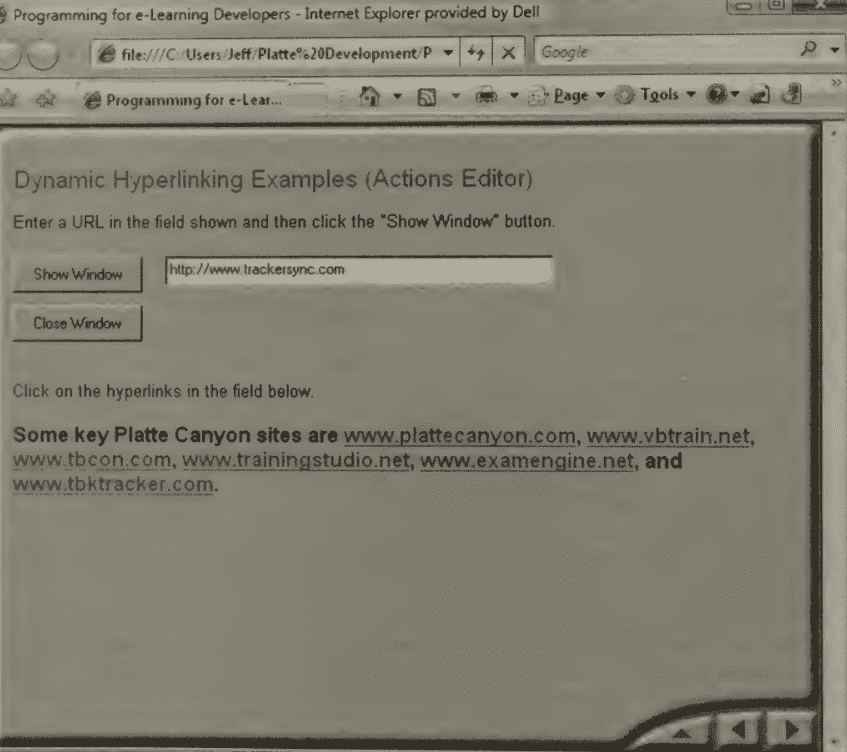

图 53. 超链接示例 - ToolBook 动作编辑器。

虽然动作编辑器中没有内置完全满足我们要求的功能，但我们可以利用这样一个事实：我们可以链接到 JavaScript (.js) 文件并调用其函数（这些必须以 `tbfunction_` 开头）。更酷的一点是，如果我们创建一个同名的 OpenScript 函数 ¹⁴，

¹⁴ 这就是为什么我们在列表 27、列表 28 和列表 29 中将函数命名为 `tbfunction_ShowWindow`。

78

动作编辑器足够智能，在发布为 HTML 时使用 JavaScript 实现，在原生模式运行时使用 OpenScript 实现。
一旦我们有了 .js 文件，我们就可以通过“书籍属性”属性对话框的 Web 选项卡进行链接，如图 54 所示。注意所有可用函数都显示在窗口底部。我们将使用 `showWindow` 和 `closeWindow` 函数。

列表 31 显示了 .js 文件的相关部分。

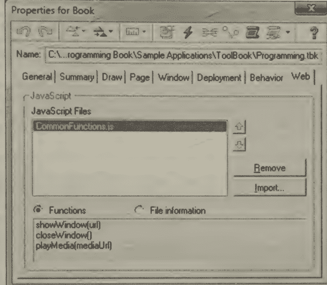

图 54. ToolBook 中链接到 JavaScript 文件。

```javascript
var openWindowString = "left=0,top=0,width=800,height=600,status=no,resizable=no,scrollbars=no,toolbar=no,menubar=no";
```

```javascript
function tbfunction_showWindow(url) {
  var winId = window.open(url, 'URL', openWindowString);
}
```

```javascript
function tbfunction_closeWindow() {
  var winId = window.open('', 'URL');
}
```

```javascript
if (winId != null) {
  winId.close();
}
```

列表 31. ToolBook 动作编辑器和其他示例中使用的 JavaScript 代码。

面向电子学习开发者的编程指南

我们定义了 `openWindowString` 常量¹⁵，因为我们在另一个函数（未列出）中使用了它。接下来是 `tbfunction_showWindow` 函数。它转而调用 `window.open()` 方法。这个方法非常有用，因为第一个参数是我们要打开的 URL，第二个是窗口名称¹⁶，第三个处理窗口特性。这就是我们使用的地方。
为了实现 `closeWindow`，我们利用了 `window.open` 返回新窗口或现有窗口引用的特性。如果窗口不，我们就调用 `close` 方法以确保该页面打开的窗口被关闭。我们的下一个任务是配置窗口（图 55）。

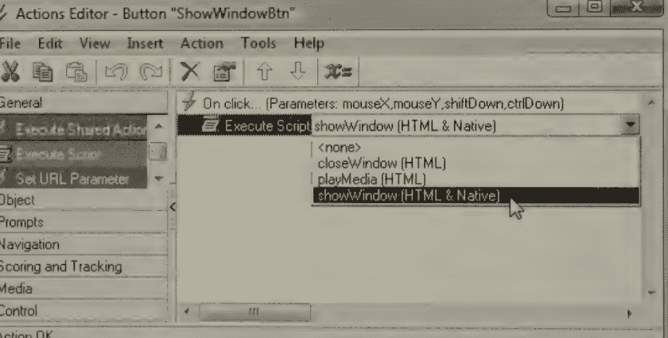

图 55. 配置窗口

> ¹⁵ 使用此常量，因为我们在另一个函数中使用了它。
> ¹⁶ 用于基于 Web 的产品。

# 链接到 URL

正如图 56 所示设置函数的参数。我们获取 "WindowUrl" 字段的文本并将其传递给函数。

我们采取类似的步骤来配置“关闭窗口”按钮。

对于示例的这部分，我们无法做得太优雅。我本想想在字段上设置一个动作，但事实证明一旦导出到 HTML⁷，你就无法获取文本。即使我们将动作设置在热词上，也无法动态读取其属性。因此，我们必须如图 57 所示硬编码 URL。调用 `showWindow` 函数比直接为热词添加超链接略有轻微的优势：

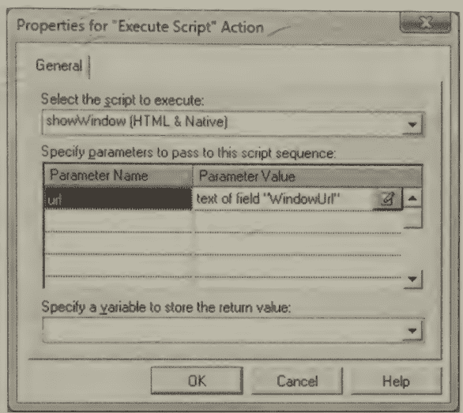

图 56. 为 showWindow 函数设置 url 参数

- 我们可以根据需要配置浏览器窗口。这包括位置、宽度、高度、是否有工具栏等。
- 我们的“关闭窗口”按钮将在这些窗口上生效。注意，如果我们想确保该页面打开的窗口被关闭，可以在卸载页面时调用 `close` 方法。

>⁷ 将动作设置在字段上的另一个问题是，除非热词带有动作或超链接（例如热词对象 own字段），否则将变成普通文本。你可以为每个热词添加注释以让它保留，但这样我们仍然无法判断点击了哪个热词。

81


## Flash

在超链接方面，Flash 为我们提供了几种不同的选项。如下文所述，如何继续的考虑因素取决于你是否将会在浏览器中部署（电子学习应用通常是这样）。图 58 显示了浏览器中的完成示例。


## 超链接到 URL

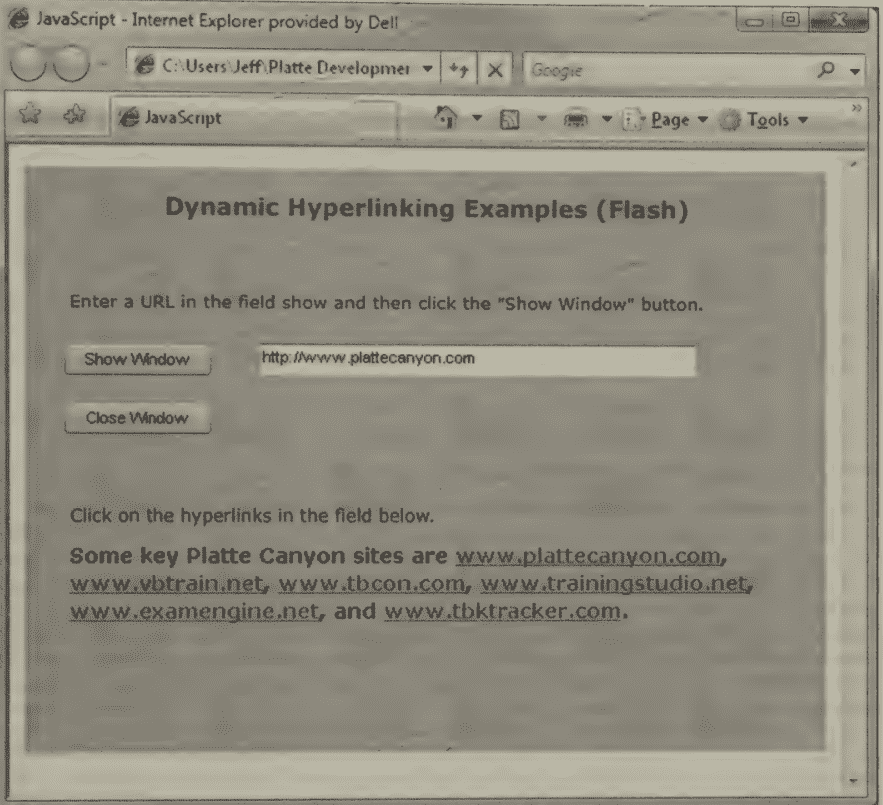

图 58. 超链接示例 - Flash。

在处理此示例的第一部分时，我们有两种主要方法：

- 使用从 ActionScript 3 和 Flash Player 9 开始提供的 `navigateToURL` 方法。该方法既适用于 Flash 电影在浏览器中运行，也适用于独立运行。
- 2. 使用 `External Interface` 类，它允许 Flash 调用其容器对象的方法。当容器是浏览器¹¹⁸时，可以使用该类来执行 JavaScript 用。`External Interface` 类从 ActionScript 2 和 Flash Player 8 开始提供。

代码列表 32 显示了 `navigateToURL` 方法。

```
runInitialLoad();
stop();

function runInitialLoad() {
  // 设置监听器
  ShowWindowBtn.addEventListener(MouseEvent.CLICK, makeJsCall);
}

function makeJsCall(eventID:MouseEvent):void {
  var urlText:String = Window.text;
  var requestId:URLRequest = new URLRequest(url);

navigateToURL(requestId, "URL");
```

**列表 32.** 使用 ActionScript 通过 `navigateURL` 实现动态超链接。

正如我们在之前的示例中看到的，我们调用了 `runInitialization` 并设置了监听器，以响应点击事件调用所需的函数 `makeJsCall`。在 `makeJsCall` 内部，我们读取用户输入的 URL，然后创建一个 `URLRequest` 对象。在书的其余部分，我们将大量使用这个对象，因为它被频繁用于加载图形、媒体以及任何其他 Flash 电影之外的外部内容。注意我们是如何将 `urlText` 作为 `URLRequest` 对象的构造函数传递的。然后，`navigateURL` 方法接收 `URLRequest` 以及可选的窗口名称。虽然我们无法看到窗口的特定特性，但除此之外之外，这是一个非常棒的解决方案。一个特别的功能是，你可以从 Flash 内部测试代码，而不需要在浏览器中启动 Flash 电影来尝试。

让我们看看 `External Interface` 方法。在这种情况下，我们将链接到之前列表 31 中所示 `CommonFunctions.js` 文件中。要实现这一点，我们像往常一样将 Flash 电影发布为 HTML，将 `.js` 文件放在同一目录下，并在 `<head></head>` 标签内添加此行：

```
<script language="javascript" src="CommonFunctions.js" type="text/javascript"></script>
```

然后我们添加了“关闭窗口”按钮，并使用了列表 33 中的代码

> ¹¹⁸ 浏览器是最常见的容器，但不是唯一的。ToolBook 开发者可以托管 Flash ActiveX 控件并使用 External Interface 与其进行通信。我们在 TBK Tracker 产品中也使用 .NET Windows Forms 作为容器并执行了相同的操作。

```
runInitialLoad();
stop();

function runInitialLoad() {
  // 设置监听器
  ShowWindowBtn.addEventListener(MouseEvent.CLICK, makeJsCall);
  CloseWindowBtn.addEventListener(MouseEvent.CLICK, makeJsCall);
}

function makeJsCall(eventId:MouseEvent):void {
  var targetName:String = eventId.target.name;

  switch(targetName) {
    case "ShowWindowBtn":
      var urlText:String = WindowUrl.text;
      ExternalInterface.call("tbfunction_showWindow", urlText);
      break;
    case "CloseWindowBtn":
      ExternalInterface.call("tbfunction_closeWindow");
      break;
  }
}
```

## 列表 23. 使用 External Interface 通过 ActionScript 实现动态超链接。

现在我们将“关闭窗口”按钮与 `makeJsCall` 函数关联。在该函数内部，我们获取了 `targetName`，因为我们现在必须根据用户点击了哪个按钮来执行不同的操作。然后我们使用 `switch` 语句为每个按钮执行正确的操作。把这想象成汽车收音机上的状态按钮。如果你按下其中一个按钮，根据定义，其他任何按钮都不会被选中（因为我们一次只能监听一个语句）。`switch` 写法比一堆 `if-else` 语句更紧凑。每个选项都为 `case` 语句中列出。如果你想在任何 `case` 都不匹配的情况下执行某个操作，可以在最后一个 `case` 之后使用 `default:`。注意，在与该 `case` 相关的最后一个操作后执行 `break` 语句是非常重要的。否则，ActionScript 将继续运行并执行下一组代码！

一旦我们确定了正确的按钮，我们就使用 `ExternalInterface.call` 调用第一个参数中显示的 JavaScript 函数。第二个及随后的参数是任何应发送到函数的参数。例如，我们使用 `urlText` 参数来告诉 JavaScript 函数我们想要打开哪个 URL。

¹ 这就是我们在 Actions 编辑器中需要的。在 OpenScript 中，等效的是是 `conditions` 语句。在 Visual Basic 中，它是 `Select Case`。

## 面向电子学习开发者的编程

对于第二个示例，坏消息是 Flash 没有像 ToolBook 中那样的“热词”（hotword）对象。好消息是 Flash 字段可以接受任何 HTML 格式命令，包括锚点标签。然而，我们需要程序地设置字段的 `htmlText` 属性。同时，我们需要通过事件命令设置锚点的 `href`。因此，我们需要像下面所示对文本处理。

| 初始文本 | www.plattecanyon.com |
| --- | --- |
| 最终 HTML | <a href="http://www.plattecanyon.com">www.plattecanyon.com</a> |

下一个问题是我们如何确定把链接放在哪里？一个逻辑解决方案是使用特殊字符（如 `|`）标记它们。这是为了说明图 58 中的插图。列表 34 显示了：

```
runInitialLoad();
stop();

function runInitialLoad() {
  // 设置监听器
  ShowWindowBtn.addEventListener(MouseEvent.CLICK, makeJsCall);
  CloseWindowBtn.addEventListener(MouseEvent.CLICK, makeJsCall);
}

function initializeHyperlinks(field:TextField, splitStr:String):void {
  var initialText:String = field.htmlText;
  var initialArray:Array = initialText.split(splitStr);
  var numEntries:Number = initialArray.length;
  var num:Number;
  var entryText:String;
  var hyperlinkText:String = "";
  var refString1:String = "<a href="
  var refString2:String = "\";
  var refString3:String = "</a>";

  for (num = 0; num < numEntries; num++) {
    entryText = initialArray[num];
    if ((num % 2) > 0) { // 数数
        entryText = refString1 + formatUrl(entryText) + refString2 + refString3;
    }
    hyperlinkText = hyperlinkText + entryText;
  }
  field.htmlText = hyperlinkText;
  field.addEventListener(TextEvent.LINK, linkHandler);
}
```

```javascript
function formatUrl(inputText:String):String {
    if (inputText.indexOf("http") == -1 && inputText.indexOf("mailTo:") == -1) {
        inputText = "http://" + inputText;
    }
    return inputText;
}
```

```
function linkHandler(linkEvent:TextEvent):void {
    var request:URLRequest = new URLRequest(linkEvent.text);
    navigateURL(request, "URL");
}
```

## 列表 34. 在 Flash 中创建和处理链接。

> ² 一点不明显的是 Flash 会放入自己的格式标签。最好的方法是使用调试器（书中后后部分介绍）查看 `initialText` 变量：<TEXTFORMAT LEFT="2"><P ALIGN="LEFT"FACE="Arial" SIZE="14" COLOR="#000000" SPACING="0"> Some Pal Key Canyon 网站有 |www.platecanny.com|, |www.vbtrain.net|, |www.tbcon.com|, |www.trainingstudio.net|, |www.examene.net|, 以及 |www.tbtracker.com/.<B></font></P></TEXTFORMAT>。


# 电子学习开发者的编程

| 一些关键的 Platte Canyon 站点 www.plattecanyon www.vbtrain.net |

这有助于我们理清逻辑。我们希望保持每个奇数位元素不变，并将每个元素转换为超链接。然后我们声明若干个变量以便使用，并对它们进行循环²³，作为数字计数器，entryText 将存储每个数组元素的值。hyperlinkText 将完成我们将重新放回已完成字段的 HTML。refString1、refString2 和 refString3 将包含超链接的部分。我们定义了它们，这样在下方的循环中，我们每次读取时可以使用它们。请注意，在定义 refString1 和 refString2 时我们遇到了一个棘手的问题：我们需要在变量周围加上引号，引号也用于标记我们赋值的开始和结束。每种语言都有其自己的²⁴方法来处理这个问题，但在 ActionScript 中，我们可以通过在引号前加上 \ 来转义引号和其他字符。

接下来我们遍历数组并构建 hyperlinkText 变量。我们使用数组中当前元素的 entryText。然后我们需要确定我们是否有一个超链接。我们在注释中提到（因为对于下一个阅读我们代码的人来说这可能并不明显），我们想要偶数元素，这对应于数字计数器的奇数值（因为我们从零开始）。我们的下一个任务是判断一个数字是偶数还是奇数。一种流行的方法是使用取模运算符（%）。它给出余数。所以，如果 num 是奇数，则 num % 2 将得到一个非零余数。在这种情况下，我们拼接 refString 变量并使用 formatURL() 函数在我们的 URL 前面添加 "http"。我们利用的 String 方法是 indexOf()。该方法给出参数在字符串中的位置。如果未找到参数，它将返回 -1。因此我们查看 indexOf("http") 是否为 -1 **且**（注意这用 & 表示）indexOf("mailto:") 是否为 -25（注：原文为 -²⁵）。这样，我们在 URL 前面加上 "://"。无论何种情况（例如，是否有 URL），我们都把 entry 拼接到 hyperlinkText 中。

一旦我们得到了完整的 HTML，就将其设置为字段的 HTMLText 属性。我们的任务是在使用链接时让某些事情实际发生。我们使用我们的朋友监听器（listener）并关联任何 TextEvent。通过 LinkHandler，我们让处理程序接收 TextEvent 事件。它的属性具有我们想要跳转的完整 URL（例如，前面带有 "http://"）。我们回到第一个超链接方法并创建一个 URLRequest 对象，但也可以使用 External Interface。

- ²³ 这是编程的许多领域之一，受影响我们在计数数组、字符串等时从零开始这一事实。所以当我们结束循环时，我们使用 `while num < numEntries`，这意味着我们将在 (numEntries - 1) 处停止。
- ²⁴ 在 OpenScript 中，我们像在 href=" 和 "event." 中一样使用引号关键字。在 Visual Basic 中，我们可以类似的使用 ControlChars.quote。在 JavaScript 中，你可以像 ActionScript 一样转义引号。在这两种语言中，你都可以在双引号内使用单引号（反之亦然）来避免这种需要。
- ²⁵ ActionScript 是区分大小写的，所以我们可以添加另一个 indexOf("mailto") 以确保我们捕获到它的两种写法。

# 链接到 URL

## JavaScript

正如你预期的，网页的核心功能涉及超链接，我们在 HTML 和 JavaScript 中的任务相对简单直接，尽管在第二个示例中我们面临了一些挑战。
最终结果如图 59 所示。


图 59. 链接示例 - HTML 和 JavaScript。
对于第一个示例，我们如列表 35 所示在 HTML 中创建了按钮和字段。

```html
<input id="ShowWindowBtn" type="button" onclick="ShowWindow()" value="Show Window" class="InputButton" />&nbsp;&nbsp;
<input type="text" id="WindowUrl" class="InputField" value="http://www.plattecanyon.com/"
<br />
<br />
```

```html
<input id="CloseWindowBtn" type="button" onclick="tbfunction_closeWindow()" value="Close Window" class="InputButton" />
```
列表 35. 第一个链接示例的 HTML。

我们想使用列表 31 所示的 CommonFunctions 文件，但对于 "Show Window" 功能，我们需要先进行一些处理。因此我们调用列表 36 所示的 ShowWindow 函数。我们使用 `document.getElementById(id)` 获取用户输入 URL 的字段的引用。假设我们找到了它，就可以调用 tbfunction_ShowWindow()。列表 36 的其余部分处理第二个示例，我们将在下方进行解释。对于 "Close Window"，我们可以直接调用 tbfunction_closeWindow()²⁶。与之前的 JavaScript 示例一样，我们使用 CSS 来格式化 HTML 元素。

```javascript
<script language="javascript" src="CommonFunctions.js" type="text/javascript"></script>
<script language="javascript" type="text/javascript">

function ShowWindow() {
  var inputID = document.getElementById("WindowUrl");

  if (inputID != null) {
    tbfunction_ShowWindow(inputID);
  }
}

function linkhandler(linkId) {
  var urlText = formatUrl(linkId.firstChild.data);
  tbfunction_showWindow(urlText);
}

function formatUrl(inputText) {
  if (inputText.indexOf("http") == -1 &&
  inputText.indexOf("mailto:") == -1) {

    inputText = "http://" + inputText;
  }
  return inputText;
}
</script>
```
列表 36. 链接示例的 JavaScript。

第二个示例的棘手部分是在定义 href 的同时让锚点起作用。通常，你会这样使用：

# 链接到 URL

```html
<span>一些关键的 Platte Canyon 站点是 <a href="http://www.plattecanyon.com">www.plattecanyon.com</a>，<a href="http://www.vbtrain.net">www.vbtrain.net</a>，<a href="http://www.trainingstudio.net">www.trainingstudio.net</a>，<a href="http://www.examining.net">www.examining.net</a>，<a href="http://www.tracker.com">www.tracker.com</a>，<a href="http://www.con.com">www.con.com</a>。</span>
```

```css
a {
  color: #00800;
}
.HyperField {
  font-size: 125%;
  font-weight: bold;
  width: 100px;
}
```
列表 37. 链接示例的 HTML 和 CSS。

为了在我们定义 href 时让锚点正常工作，我们需要定义 href。由于我们不想让它执行任何操作，我们设置为：

```html
<a href="#" onclick="linkhandler(this)">
```
为了防止这同时也将用户滚动到页面顶部，整个锚标签看起来像：`<a href="#" onclick="linkhandler(this); return false;">`

# 电子学习开发者的编程

在 Silverlight 中完成我们的第一个任务非常简单。第二个任务在 Silverlight 中是不可能的，因为它的对象不支持文本中的超链接。但我们使用 HyperlinkButton 对象创建了一个替代方案。你可以在图 60 中看到结果。

- ²⁸ 例如，我会在 ASP.NET 中动态设置链接，它们在渲染为 HTML 后看起来像这样<a href="javascript: window.open('infosession.aspx', 'info','width=550, height=300, status=no, resizable=yes, scrollbars=yes,toolbar=no, menubar=no');">

- ²⁹ 只是我们需要去掉变量的“类型”和返回值。

# 电子学习开发者的编程

在这里我们调用了一个函数⁸ 但事实证明我们无法以想要的方式传递它并动态读取锚点的属性；只有当我们在响应事件时调用函数，可以这样做。注意列表 36 中我们如何将锚点的文本读取为 `firstChild.data`。在书后面读写 XML 时，我们将看到更多这种语法。要点是，firstChild 是 `<` 和 `<a>` 之间的部分。它的文本被称为 data。一旦我们得到了它，就调用在 Flash 中使用的相同的 formatUrl。然后我们调用在示例 1 中使用的 tbfunction_showWindow() 函数。


## 为 URL 创建链接

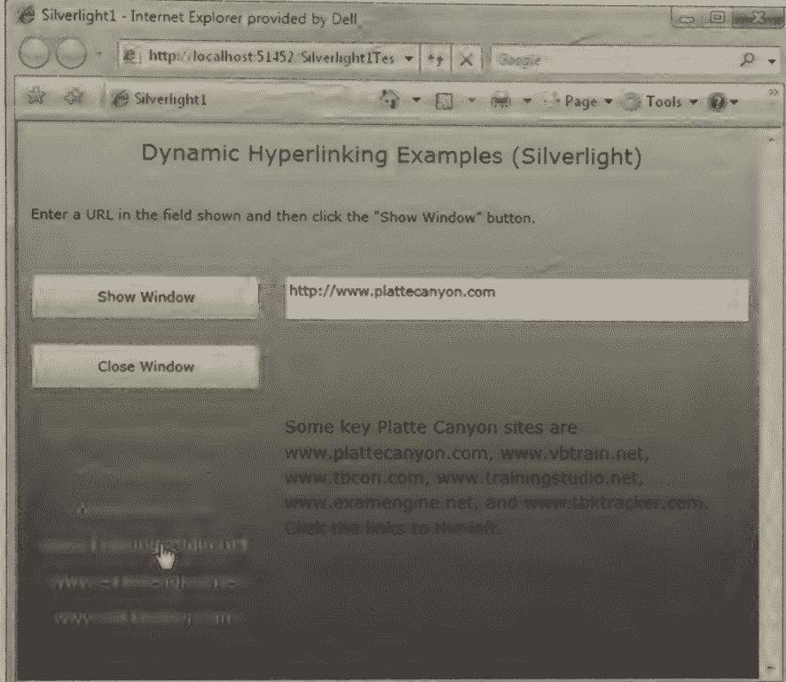

图 60. 超链接示例 - Silverlight。

第一个示例（列表 38）元素的 XAML 代码现在应该已经非常熟悉了。我们为“WindowUrl”字段使用了 TextBox 控件，因为该控件允许用户输入值。我们使用了与上一个 Silverlight 示例中相同的网格布局。

```xml
<TextBlock Margin="10,10,10,10" Grid.ColumnSpan="2" Text="Dynamic Hyperlinking Examples (Silverlight)" TextWrapping="Wrap" FontSize="18" Foreground="#FF003366" HorizontalAlignment="Stretch" TextAlignment="Center"/ >
<TextBlock Margin="10,10,10,10" Grid.ColumnSpan="2" Text="在所示的字段中输入 URL 并点击“Show Window”按钮。" TextWrapping="Wrap" HorizontalAlignment="Stretch" Grid.Row="1" />
```

## 为电子学习开发人员编程

```xml
<Button Alignment="Stretch" x:Name="ShowWindowBtn Grid.Column="0" Grid.Row="2" Content="Show Window" Margin="10,10,10,10" Click="ShowWindowBtn_Click" />
<TextBox x:Name="WindowUrl" Text="http://www.platteccanyon.com" TextWrapping="Wrap" Margin="10,10,10,10" Grid.Row="2" Grid.Column="1" />
<Button Alignment="Stretch" x:Name="CloseWindowBtn Grid.Column="0" Grid.Row="3" Content="Close Window" Margin="10,10,10,10" Click="CloseWindowBtn_Click" />
```

- Visual Basic 代码

```vb
Private Sub ShowWindowBtn_Click(ByVal sender As System.Object, ByVal e as System.Windows.RoutedEventArgs)
    Dim urlString As String = WindowUrl.Text
    Browser.HtmlPage.Invoke("tbfunction_showwindow", urlString)
End Sub

Private Sub CloseWindowBtn_Click(ByVal sender As System.Object, ByVal e as System.Windows.RoutedEventArgs)
    Browser.HtmlPage.Invoke("tbfunction_closeWindow")
End Sub
```

列表 38. “Show Window”和“Close Window”示例的 XAML 和 Visual Basic 代码。

为了实现“Show Window”和“Close Window”功能，我们使用了在列表 31 中首次显示的 CommonFunctions.js。我们需要将其包含到托管 Silverlight 应用程序的 HTML 页面的 head 部分，就像我们在 Flash 和 JavaScript 中做的那样：

```html
<script src="CommonFunctions.js" type="text/javascript"></script>
```

之后，我们的代码非常简单。我们使用从输入文本获取的 `urlString` 变量。然后我们使用语法³⁰ 来调用 JavaScript 函数：

```javascript
Browser.HtmlPage.Invoke(<functionName>, <parameters>)
```

这相当于使用 Flash 脚本中的 External Interface 或工具操作编辑器中的“Execute Script（执行脚本）”。要关闭窗口，我们使用相同的方法直接调用 `tbfunction_closeWindow`。

如上所述，我们在实现第二个示例时受到了限制，因为目前没有办法在 TextBlock 或 TextBox 中放入链接。相反，我们将解析标记（例如管道符号 `|`）来显示链接并配置 Hyperlink 控件。这给了我们一个展示 Silverlight StackPanel 控件的机会，该控件可以在垂直或水平方向上均匀地分布其对象。列表 39 显示了该示例的 XAML，其中关键属性已**加粗**，但只保留了一个超链接按钮以提高可读性。

> ³⁰ 这是调用特定 JavaScript 函数的语法。如果您想向 HTML 页面“注入”如 `window.open()` 这样的命令，您可以使用如下语法：Browser.HtmlPage.Window.Eval("window.close()")。

```xml
<TextBlock Text="some Platte Canyon sites are |www.plattecanyon.com,| |www.vbtrain.com,| |www.tbcon.com| |www.trainingstudio.net|, |www.examengine.net, and |www.tbtracker.com|. 点击左侧的链接。" x:Name="infoField" Grid.ColumnSpan="1" Grid.RowSpan="4" Grid.Row="4" Margin="10,10,10,10" TextWrapping="Wrap" FontSize="14" Grid.Column="1" />
<StackPanel HorizontalAlignment="Stretch" Margin="10,10,10,10" x:Name="HyperStackPanel" Width="Auto" Grid.RowSpan="4" Grid.Row="4" Grid.ColumnSpan="1" Orientation="Vertical">
<Hyperlink Height="Auto" Margin="5,5,5,5" x:Name="Hyperlink_1" VerticalAlignment="Center" Foreground="#FF22C422" Content="HyperlinkButton" HorizontalAlignment="Center" Target="URL" Visibility="Collapsed" FontSize="14">
<!-- 根据原始上下文，省略了其余 Hyperlink 部分 -->
</Hyperlink>
</StackPanel>
```

列表 39. Silverlight 中超链接示例的关键 XAML。

由于我们有八行，并且希望 TextBlock 和 StackPanel 都覆盖第 4–7 行，我们将 `Grid.Row` 设置为 4。这允许我们使用超链接按钮。我们设置了 `Target="URL"`。Silverlight 40 显示了实现方式。

```vb
Private Sub Hyperlink_Loaded(ByVal sender As System.Object, ByVal e as System.Windows.RoutedEventArgs)
    initializelinks(infoField)
End Sub

Private Sub initializelinks(ByRef fieldId As TextBlock, splitStr As String)
    Dim initialText As String = fieldId.Text
    Dim splitArray As String() = initialText.Split(splitStr)
    Dim numEntries As Integer = splitArray.Length
    Dim hyperlinkBuilder As New System.Text.StringBuilder
    Dim hyperlinkCounter As Integer = 0
    For num = 0 To numEntries - 1
        If num Mod 2 <> 0 Then
            hyperlinkCounter += 1
            Dim hyperlink As Hyperlink = fieldId.FindName("Hyperlink_" & hyperlinkCounter)
            If hyperlink IsNot Nothing Then
                hyperlink.Content = splitArray(num)
                hyperlink.Visibility = Visibility.Visible
            End If
        End If
        hyperlinkBuilder.Append(splitArray(num))
    Next
    fieldId.Text = hyperlinkBuilder.ToString()
End Sub

Private Function formatUrl(ByVal inputText As String) As Uri
    If inputText.StartsWith("http")
    Then
        Return New Uri(inputText)
    End If
End Function
```


## 发送邮件

让我们在 Web 主题上多留一会儿，看看如何从电子学习应用程序发送电子邮件。最简单但遗憾的是最不可靠的方法是使用上一章中相同的超链接方法，但使用如下所示的 `"mailto:"` 超链接：

mailTo:info@plattecanyon.com?subject=This is a Test&Body=This is line 1%0AThis is line 2

这是一个“查询字符串”的示例，我们将信息作为 URL 的一部分传递。你在 Google 搜索或执行其他操作时会经常看到这种现象。它是 GET 请求而非 POST 请求的示例（POST 请求中信息是作为参数发送的）。我们将在下文中介绍 POST。注意第一部分信息跟在 `?` 之后，其他部分通过 `&` 分隔。某些邮件程序会接受其他属性，例如 `cc`（抄送）和 `bcc`（密抄）。出于安全原因，目前几乎没有 `attach` 属性可用于文件附件。请注意你如何使用 `%0A` 来换行。

这种超链接方法适用于可选的邮件，但不适用于发送测试分数或其他重要数据，原因如下：

- 1. 链接只是启动用户的默认邮件程序。无法保证他们会决定发送邮件。
- 2. 由于邮件中的数据会显示给用户，他们很可能在发送前更改它，或至少查看一下。

上述内容的推论是，任何通过客户端发送邮件的方法都是不可靠的。这主要是由于安全设置防止了病毒在用户不知情的情况下发送邮件。这些设置将阻止你的电子学习程序从用户的机器发送邮件。

那么答案是什么？我建议并广泛采用的方法是从 Web 服务器发送邮件。这可以是一个 ASP 页面、PHP 页面等。我个人最喜欢的是使用 ASP.NET Web 服务（Web Service）。这是我们本章将关注的重点。

## ASP.NET Web 服务

我喜欢将 Web 服务看作一组可以在互联网上调用的函数。例如，你可能会向一个“天气”Web 服务发送邮政编码，并返回当前温度、风速和预报。你的应用程序与 Web 服务之间的信息通过 XML 发送。

你们中有些人可能用过 ASP 或 PHP 页面来发送邮件或完成其他任务。在这种情况下，整个页面通常专门用于该任务。换句话说，页面代表一个单一函数²。

> ¹ 通过 SOAP（其最初含义是“简单对象访问协议”）。当你用 JavaScript 创建 Web 服务时，它通常使用 JSON（其含义是“JavaScript 对象表示法”）。从 JavaScript 调用站点或 Web 服务来更新页面通常被称为 AJAX（异步 JavaScript 和 XML）。真有很多缩写！

## 针对电子学习开发者的编程

相比之下，你可以在单个 Web 服务中定义许多函数。使用 Web 服务相比 ASP 甚至普通的 ASP.NET 页面的另一个优势是，你不需要担心返回给程序的数据中会混入 HTML 标签。

所以，让我们开始吧。一旦我们在 Visual Studio 中创建了“站点”，我们就添加新项并如图 61 所示选择“Web 服务”。注意这种 Web 服务具有 `asmx` 扩展名。

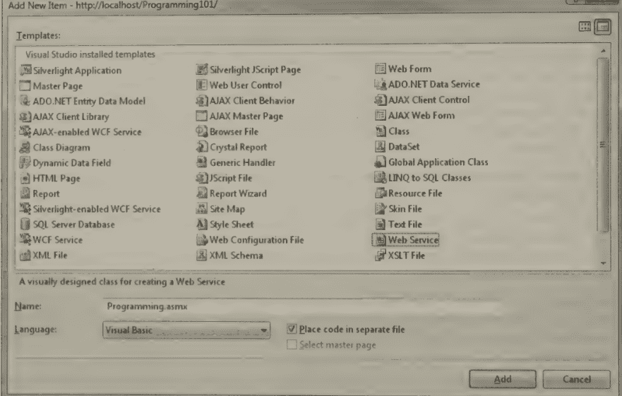

图 61。在 Visual Studio 中添加 Web 服务。

你将得到一个看起来这样的占符函数 `HelloWorld`：

```
<WebMethod()> Public Function HelloWorld() As String
 Return "Hello World"
End Function
```

> ² 你可以通过向页面发送代表单个函数的参数来绕过这个问题。例如，我们实现了一个 Web 版本的 TBK Tracker 学习管理系统，包含三个文件：tbkTrackerFormat.asp、tbkTrackerRead.asp 和 tbkTrackerWrite.asp。但这比使用 Web 服务要复杂得多且更难以管理（在我们写那些 ASP 时，Web 服务还未发明）。

> ³ 还有 WCF（Windows 通信框架）Web 服务，但特别对于从 ToolBook 和 Flash 进行的通信，我更喜欢使用稍旧一点的“ASMX”服务。

## 发送邮件

关键点是将你想要从电子学习应用程序中调用的方法标记为 `<WebMethod()>` 并将它们设为 Public（公共）。我们将此函数更改为发送邮件。通过观察代码本身，让我们思考我们希望 Web 服务的“维护者”能够轻松更改的项目。我们将把这些内容放在 `web.config` 文件中，而不是硬编码。如果像下文描述的那样可以在内存中对其进行“缓存”以提高性能。列表 41 显示了 `web.config` 的相关部分。我们存储了一个密钥（确保未经授权的人不会使用你的服务发送垃圾邮件非常重要）、各种邮件服务器和身份验证信息以及“回复”邮件地址。

```
<appSettings>
<add key="WebServiceAuthorizationKey" value="ProgrammingBook123"/>
<add key="smtpServer" value="smtp.yourdomain.com"/>
<add key="EmailCredentialsUsername" value="happy@yourdomain.com"/>
<add key="EmailCredentialsPassword" value="password123"/>
<add key="EmailCredentialsDomain" value=""/>
<add key="EmailReplyAddress" value="support@yourdomain.com"/>
</appSettings>
```

列表 41。在 web.config 文件中存储用户设置。

以下每个属性都存储在 `web.config` 文件中。我们使用辅助函数来检索这些值。

```vb
Public ReadOnly Property WebServiceAuthorizationKey As String
    Get
        Return GetSetting("WebServiceAuthorizationKey")
    End Get
End Property

Public ReadOnly Property SmtServer As String
    Get
        Return GetSetting("smtpServer")
    End Get
End Property

Public ReadOnly Property EmailCredentialsUsername As String
    Get
        Return GetSetting("EmailCredentialsUsername")
    End Get
End Property

Public ReadOnly Property EmailCredentialsPassword As String
    Get
        Return GetSetting("EmailCredentialsPassword")
    End Get
End Property

Public ReadOnly Property EmailCredentialsDomain As String
    Get
        Return GetSetting("EmailCredentialsDomain")
    End Get
End Property

Public ReadOnly Property EmailReplyAddress As String
    Get
        Return GetSetting("EmailReplyAddress")
    End Get
End Property

Private Function GetSetting(ByVal key As String) As String
    Dim value As String = ConfigurationManager.AppSettings(key)
    If value Is Nothing Then
        value = ""
    End If
    Return value
End Function
```

列表 42。Web 服务属性。

上述内容的推论是，任何通过客户端发送邮件的方法都是不可靠的。这主要是由于安全设置防止了病毒在用户不知情的情况下发送邮件。这些设置将阻止你的电子学习程序从用户的机器发送邮件。

（注：OCR 文本包含了一些重复/断裂部分，我已经整理了逻辑流程。）


# 电子学习开发者的编程

```vbnet
Dim smtpObj As New SmtClient(smtpServerName)
Dim emailArrayList As String() = emailList.Split(emailSplitChar)
Dim emailId As String
```

```vbnet
If credUserName <> "" AndAlso credPassword <> "" Then
    Dim credDomain As String = Me.EmailCredentialsDomain

    Try
        Dim credentialID As New System.Net.NetworkCredential(credUserName, Password)

        If credDomain <> "" Then
            credentialID.Domain = credDomain
        End If

        smtObj.Credentials = credentialID
        smtObj.UseDefaultCredentials = False
    Catch Ex As Exception
        smtObj.UseDefaultCredentials = True
    End Try
Else
    smtObj.UseDefaultCredentials = False
End If
```

```vbnet
Try
    With messageID
        .IsBodyHtml = True
        For Each email In emailArray
            To.Add(emailId.Trim())
        Next
        If copyAddressList <> "" Then
            Dim copyAddressList As String() = copyAddressList.Split(emailSplitChar)

            For Each copyId In copyArray
                CC.Add(copyId)
            Next
        End If
        .From = New MailAddress(replyAddress)
        .Subject = subjectID
        .Body = bodyID
    End With

    Try
        smtObj.Send(messageID)
Catch ex As Exception
    ' Sending error
    returnString = ex.Message
End Try
Catch ex As Exception
    ' Email Message error
    returnString = ex.Message
Else
    returnString = "No email address provided."
End If
Else
    returnString = accessKeyInvalidString
End If

Return returnString
End Function
```

列表 43. 电子邮件 Web 服务实现。

首先要注意列表顶部的各种 `Imports`。.NET 中的各种类和对象都组织在命名空间（namespaces）中。但由于完整的命名空间可能会长，我们使用 `Imports` 来避免输入你需要的内容。例如，`Imports System.Net.Mail` 允许我们创建 `MailMessage` 而不是 `System.Net.Mail.MailMessage`。接下来的行全都是由 Visual Studio 创建的。我们编辑的唯一部分是 Web 服务本身的命名空间。如果你将服务暴露给其他应用程序，可能需要这个标识符。在这里放上你自己的 URL 以使其唯一化是一个好主意。

接下来是两个常量：`accessKeyInvalidString` 和 `emailSplitChar`。我们在函数块之外定义它们，以便保留在其他方法中使用它们。从那里，我们进入 `SendEmail` 函数。至关重要的是参数。如果参数不足，就会牺牲未来的功能。许多你的方法变得不必要的复杂。我们确定使用 `accessKey`、`emailList`（注意，如果需要，这是一个逗号分隔的电子邮件列表）、`subjectId`、`bodyId` 以及 `copyAddressList`（如果需要，也是逗号分隔的）。我们选择省略了 `bind copy`、`reply address`（如上所述，这是一个属性）等。

在检查调用程序是否提供了正确的密钥且至少有一个要发送的电子邮件地址后，我们进入了核心部分。我们创建一个 `MailMessage` 对象，并将属性读取到本地变量中。我喜欢使用 `Me.` 符号来明确这是一个属性，而不是变量或方法，但并没有要求这样做，这并不一定对其他程序员来说会更清晰。然后我们执行逻辑，如果 `smtpServerName` 没有值，则将其转换为 `localhost`。然后我们使用此名称创建一个 `SmtpClient` 对象。我们将在接下来的几行中使用它来发送电子邮件。接下来是使用我们的老朋友 `Split`，将我们（可能的）逗号分隔的电子邮件列表转换为地址数组。然后我们定义了一些下面将需要的本地变量 `emailId` 和 `copyid`。

我们的下一组逻辑必须是提供适当的凭据。这不是必须的（特别是如果你可以将 `SmtpServer` 设置为 `localhost`）。但如果你正在尝试测试它，你几乎肯定需要这部分。我们基本上给了它与你提供给电子邮件程序以接收邮件时相同的信息。注意 `If` 条件中 `AndPart` 的使用。

⁸ 如果你的代码可能以任何方式被扫描，你可能会避免使用 `key`、`password`、`pwd` 等词。尽管如此，为了在这里理解代码清晰，我保留了 `key` 这个词。
⁹ 这是一个良好的做法，特别是当你多次使用该属性时，因为检索属性会有一定的开销。

# 电子学习开发者的编程

⁸ 如果你的代码可能以任何方式被扫描，你可能会避免使用 `key`、`password`、`pwd` 等词。尽管如此，为了在这里理解代码清晰，我保留了 `key` 这个词。
⁹ 这是一个良好的做法，特别是当你多次使用该属性时，因为检索属性会有一定的开销。

## 发送电子邮件

首先要注意列表顶部的各种 `Imports`。.NET 中的各种类和对象都组织在命名空间（namespaces）中。但由于完整的命名空间可能会长，我们使用 `Imports` 来避免输入你需要的内容。例如，`Imports System.Net.Mail` 允许我们创建 `MailMessage` 而不是 `System.Net.Mail.MailMessage`。接下来的行全都是由 Visual Studio 创建的。我们编辑的唯一部分是 Web 服务本身的命名空间。如果你将服务暴露给其他应用程序，可能需要这个标识符。在这里放上你自己的 URL 以使其唯一化是一个好主意。

接下来是两个常量：`accessKeyInvalidString` 和 `emailSplitChar`。我们在函数块之外定义它们，以便保留在其他方法中使用它们。从那里，我们进入 `SendEmail` 函数。至关重要的是参数。如果参数不足，就会牺牲未来的功能。许多你的方法变得不必要的复杂。我们确定使用 `accessKey`、`emailList`（注意，如果需要，这是一个逗号分隔的电子邮件列表）、`subjectId`、`bodyId` 以及 `copyAddressList`（如果需要，也是逗号分隔的）。我们选择省略了 `bind copy`、`reply address`（如上所述，这是一个属性）等。

在检查调用程序是否提供了正确的密钥且至少有一个要发送的电子邮件地址后，我们进入了核心部分。我们创建一个 `MailMessage` 对象，并将属性读取到本地变量中。我喜欢使用 `Me.` 符号来明确这是一个属性，而不是变量或方法，但并没有要求这样做，这并不一定对其他程序员来说会更清晰。然后我们执行逻辑，如果 `smtpServerName` 没有值，则将其转换为 `localhost`。然后我们使用此名称创建一个 `SmtpClient` 对象。我们将在接下来的几行中使用它来发送电子邮件。接下来是使用我们的老朋友 `Split`，将我们（可能的）逗号分隔的电子邮件列表转换为地址数组。然后我们定义了一些下面将需要的本地变量 `emailId` 和 `copyid`。

我们的下一组逻辑必须是提供适当的凭据。这不是必须的（特别是如果你可以将 `SmtpServer` 设置为 `localhost`）。但如果你正在尝试测试它，你几乎肯定需要这部分。我们基本上给了它与你提供给电子邮件程序以接收邮件时相同的信息。注意 `If` 条件中 `AndPart` 的使用。

第一件事是列表顶部的各种 Imports...⁹ 这是一个良好的做法，特别是当你多次使用该属性时，因为检索属性会有一定的开销。

（此处由于原始文本存在大量重复的 OCR 错误，已根据要求进行去重和整合）

（自我纠正：OCR 文本跨页重复/损坏。我将根据提供的内容提供一个干净的合并版本。）

[content]
# 电子学习开发者的编程

```vbnet
Dim smtpObj As New SmtClient(smtpServerName)
Dim emailArrayList As String() = emailList.Split(emailSplitChar)
Dim emailId As String
```

（后续代码部分已保持翻译）


# 电子学习开发者的编程

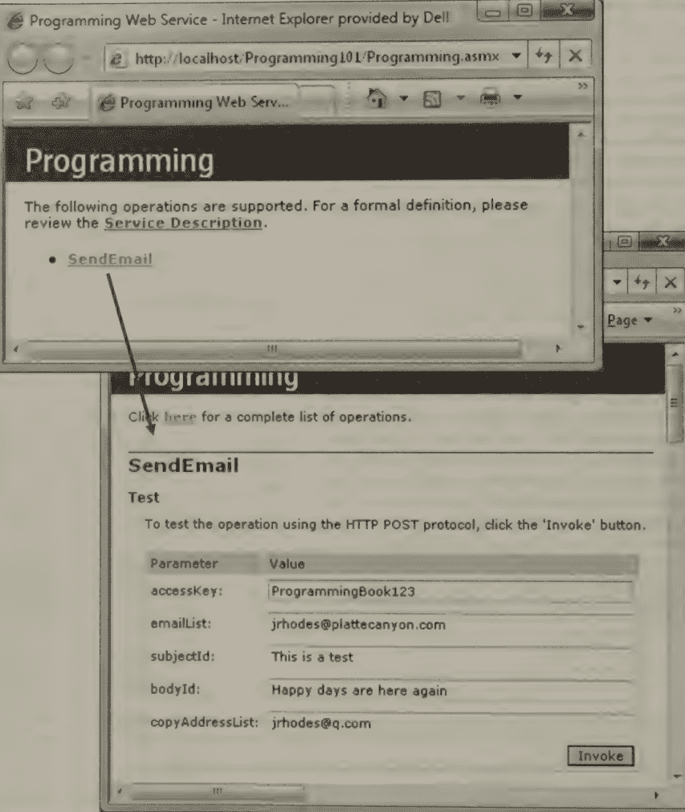

图 63. Web 服务测试页面。

我们现在准备好从各种环境连接到此服务并使用它来发送电子邮件。

## HTTP Post 详解

ToolBook 以及其他一些制作工具没有你可以使用的特定 Web 功能，你通常可以使用它们的 HTTP Post 功能来连接 Web 服务。

让我们花一分钟解释一下 HTTP Post。图 64 显示了一个带有一些输入字段的标准网页。实际的 HTML^18 显示在列表 44 中。

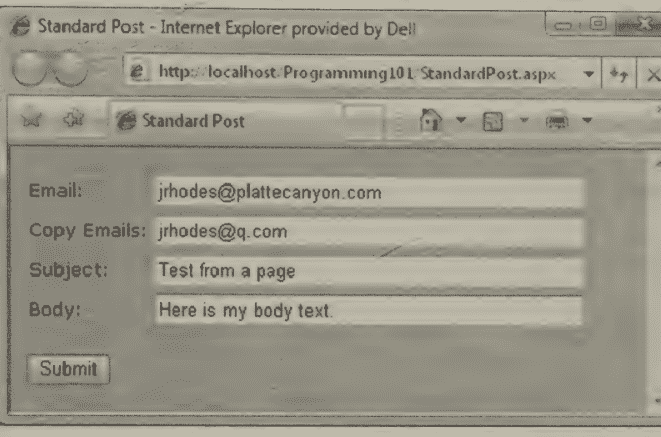

图 64. 显示输入字段的简单网页。

```html
<table>
  <tr>
    <td>Email:</td>
    <td><input type="text" id="emailAddress" name="emailAddress" class="InputField" /></td>
  </tr>
  <tr>
    <td>Copy Emails:</td>
    <td><input type="text" id="copyAddress" name="copyAddress" class="InputField" /></td>
  </tr>
  <tr>
    <td>Subject:</td>
    <td><input type="text" id="subjectInfo" name="subjectInfo" class="InputField" /></td>
  </tr>
  <tr>
    <td>Body:</td>
    <td><input type="text" id="bodyInfo" name="bodyInfo" class="InputField" style="" /></td>
  </tr>
</table>
<br />
<input type="submit" id="submitBtn" value="Submit" />
```

列表 44. 用于简单“Post”页面的 HTML。

> 18 这是一个“原生”HTML，区别在于输入元素具有 `name` 属性而不仅仅是 `id`。ASP.NET 需要 `name` 属性从 `Request` 对象中读取值，正如我们很快看到的 true。

当用户点击“Submit”按钮时，页面会“提交（posts）”。Web 服务器上的代码可以使用 `Request` 对象来获取用户输入的内容，如列表 45 所示。

```csharp
Protected Sub Page Load(ByVal sender As Object, ByVal As System.EventArgs) Handles Me.Load
{
    If Me.IsPostBack = False Then
        Dim emailID As String = Request("emailAddress")
        Dim copyID As String = Request("copyAddress")
        Dim subjectID As String = Request("subjectInfo")
        Dim bodyID As String = Request("bodyInfo")
        '在此调用发送电子邮件的方法
        Response.Write("Email Sent")
    End If
}
```

列表 45. 读取 Post“参数”的服务端代码。

我们检查页面的 `IsPostBack` 属性以跳过页面的初始加载，只读取用户点击“Submit”按钮时的信息。然后我们通过寻找与页面上元素同名的键来返回 `Request` 对象。

那么这一切都与 HTTP Post 有关吗？开发者很快意识到，与其让用户在页面本身上输入信息，你可以通过程序方式发送这些参数（emailAddress、copyAddress 等）。它们仍然会出现在 `Request` 对象中。页面的 HTML（无论在最后行的 `Response.Write` 行中发送了什么）都会返回给调用程序。这并不是一个糟糕的方案，但就像使用 Web 服务一样。不过，上面提到的好消息是，你通常¹⁹可以使用 HTTP Post²⁰ 调用 Web 服务。

> ¹ 尽管 Web 服务可以检测到这种差异，但我在为 ToolBook 大会准备示例时，曾尝试通过 HTTP Post 调用该服务。我收到了一行消息，指出该服务不能通过 Post 调用。我必须在 ASP.NET 中写一个“封装”服务，并在 ToolBook 中调用它，然后由它反过来去调用 Web 服务。

> ² 学习与技术学院的 Simon 是如何解释 POST 和 GET 在**使用**上的区别的：“通用规则是，任何引起副作用的操作都应该通过 POST 发送。另一方面，读取/获取操作使用 GET。这就是为什么如果你尝试重新执行 POST，它会警告，但允许你执行 GET 却不会。网络机器人不会尝试跟随带有 `method="post"` 的表单（尽管有些机器人会这样做）。如果你在开放的网上有一个可以通过超链接（即 GET）访问的删除记录操作，将会发生什么呢。”

## ToolBook – OpenScript

让我们从 ToolBook 的 OpenScript 中调用我们的电子邮件服务。这是使用 OpenScript 比使用动作编辑器（Actions Editor）更困难的领域之一，因为我们需要自己想出命令（或通过在线帮助）。图 65 显示了最终结果。

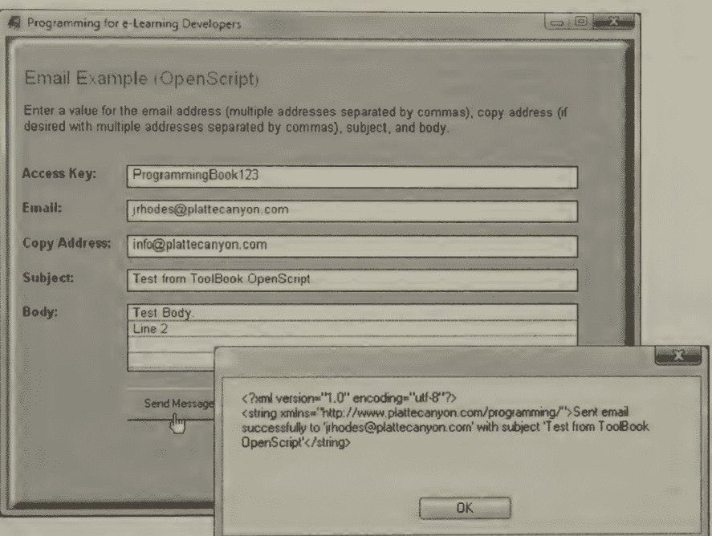

图 65. 从 ToolBook OpenScript 发送电子邮件。

注意返回值是 XML 格式。如果我们想对这个返回值做些处理，我们需要剥离 XML 或使用书中后面讨论的读取 XML 技术。

列表 46 显示了位于“Send Message”按钮中的实现脚本。

> 21 另一种是处理 ActiveX 控件。

# 电子学习开发者的编程

```vb
to handle buttonClick
    system string s
    local returnVal
    s_PostUrl = "localhost"

    ' 设置传递的参数
    returnVal = http:// & s_PostUrl & "/Programming/SendEmail"
    SetHTTPParameter("accessKey", text of field accessKey)
    SetHTTPParameter("emailAddress", text of field emailAddress)
    SetHTTPParameter("subjectInfo", text of field subjectInfo)
    SetHTTPParameter("bodyInfo", text of field bodyInfo)
    SetHTTPParameter("copyAddress", text of copyAddress)

    ' 替换换行符
    local offsetNum = 0
    while inputText contains CRLF
        inputText = replace(inputText, CRLF, "<br />")
        offsetNum = 1
    end while
    return inputText
end formatBody
```
（等等，OCR 中的脚本文本是乱的。让我根据提供的 OCR 文本重构脚本逻辑）：*

## ToolBook – 动作编辑器

在动作编辑器中创建相同的功能非常简单，而且更像是“拖放”。我们使用动作编辑器（图 66）来完成我们在列表 46 的 OpenScript 中完成相同的事情。

我们使用 Set HTTP Post 动作，其中参数名称需要与函数的参数名称匹配。我们再次将值设置为对应字段的文本，除非...

> 22 注意它最终会变为 false，否则你将进入无限循环并导致用户计算机死机。一种安全的方法是在循环内部放置一个计数器并对其递增。然后你可以检查计数器是否小于 100，无论原始条件是如何。

> 23 令人困惑的是，该动作在左侧被称为“Set URL Parameter”，但当你开始拖动它时就变成了“Set HTTP Post parameter”。我报告过几次，但它没有变化。所以可能有两个不同名称的原因。

（自我纠正：我将根据合并后的 OCR 文本提供最终输出。）


# 电子学习开发者的编程

针对 `body` 参数。在到达这一行之前，我们调用了按钮的 Action 方法。Action Method 是动作编辑器（Actions Editor）的一个较新功能，方法可以存储在对象²⁴ 中并在该对象或其他对象内部调用。我们将在下面深入探讨这种方法。通过调用 HTTP Post 动作，使用全局变量表示 URL 的基础，并在 URL 末尾附加函数名（SendEmail）。在浏览器中看到的结果如图 67 所示。注意，我们再次得到的是 XML 格式的结果。

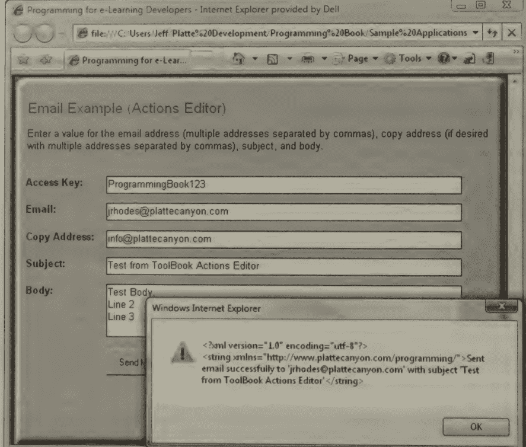

图 67. 使用 ToolBook Actions编辑器构建的发送邮件示例。

²⁴ 与存储在书籍级别的共享动作（Shared Actions）不同。在很多情况下我更喜欢 Action 方法，因为当你复制或移动对象时，代码会随对象一起移动。

最后让我们查看 `formatBody` 方法（图 68）。

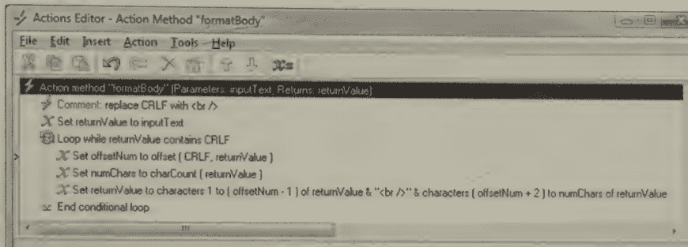

图 68. formatBody Action 方法。

首先将我们的本地变量 `returnValue` 设置为我们的 `inputText` 参数。然后我们拖入一个 Loop 动作，它的功能与 OpenScript 的 while 循环相同。只要我们的 `returnValue` 变量包含一个硬换行符（CRLF），我们就一直留在循环内部。我们使用 `offset` 函数找到 CRLF 的位置并将其存储在 `offsetNum` 变量中。我们还需要 `numChars` 变量，因为我们需要将文本重新拼接，而不是直接设置文本的字符。注意我们如何使用 `charCount` 函数来得出该值。从那里，我们将 `returnValue` 设置为 CRLF 之前的所有字符，添加 `<br />`，跳过 1 个字符（即 CRLF 所在的位置），然后拼接字符串的剩余部分。我们在“调试你的应用程序”章节特别是图 139 中找到了关于调试此脚本的讨论。

## Flash

Flash曾经有一个很好的 Web 服务组件，但它是用 ActionScript 2 编写的，并且没有迁移到 ActionScript 3。尽管有各种第三方解决方案和选项来链接到

> ²25 注意，我们每次启动循环时都需要设置它，因为接下的一行会改变字符的数量。在进行任何类型的循环时，不识别这种情况是产生错误的常见来源。
> ²26 如果你仔细对比列表 46 中的 OpenScript 实现，你会发现增加的是两个字符而不是一个。我在这个方法中这样写的，当测试 Actions 编辑器生成 OpenScript 原生应用程序时一切运行正常。但当我在浏览器中测试时，我注意到下一行的第一个字符被截断了。这是因为 CRLF 在翻译成 JavaScript 时仅为一个字符。由于编辑器的主要目标是基于 Web 的应用程序，所以我坚持使用一个。此外，OpenScript 版本中多出的字符对邮件没有影响。
> ²27 组件（Components）是具有许多编程功能的特殊对象。它们类似于 ToolBook 中的目录对象（catalog objects）。

对于 Flex 28 库，我决定在此示例中再次使用 HTTP Post，因为它运行良好，并且可以从 Flash 内部轻松创建。图 69 显示了完成的结果。

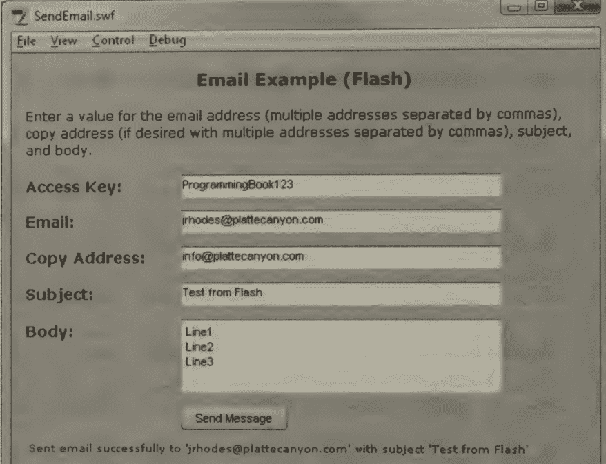

图 69. 从 Flash 发送邮件。

实现的 ActionScript 所示下面的列表 47。它将让我们有机会探索更多几个编程概念。

```
var s_PostUrl = "localhost";

runInitialLoad();
stop();
```

Flex 是一套技术，用于对 Flash 进行更具程序化的方法。它有自己的组件和编辑器。开发包称为 Flex SDK，但开发环境是 Flash Builder。

```javascript
function runInitialLoad() {
  // 设置监听器
  SendMessageBtn.addEventListener(MouseEvent.CLICK, sendEmail);
}

function sendEmail(event:MouseEvent):void {
  var returnVal:String;
  var urlString:String = "http://" + sPostUrl +
  "/Programming101/Programming.asmx/SendEmail";
  var requestId:URLRequest = new URLRequest(urlString);
  var loaderId:URLoader = new ULoader();
  var variablesId:URLVariables = new URLVariables();

  // 设置参数
  variablesId.accessKey = accessKey.text;
  variablesId.emailList = emailAddress.text;
  variablesId.subjectId = subjectInfo.text;
  variablesId.bodyId = bodyInfo.htmlText;
  variablesId.copyAddress = copyAddress.text;

  // 设置请求
  requestId.data = variablesId;
  requestId.method = URLRequestMethod.POST;

  // 添加监听器
  loaderId.addEventListener(Event.COMPLETE, emailComplete);
}

try {
  loaderId.load(requestId);
} catch (ex:Error) {
  status.text = "Error: " + ex.message;
}

function emailComplete(eventId:Event):void {
  var loaderId:URLoader = eventId.target as ULoader;

  if (loaderId != null) {
    var xmlData:XML = new XML(loaderId.data);
    status.text = xmlData.toString();
  }
}
```
列表 47. 通过 Web 服务发送邮件的 ActionScript。

# 电子学习开发者的编程

我们的下一个任务是配置 `URLRequest`。我们将它的 `data` 属性设置为 `variablesId` 对象（它包含我们的参数）。然后我们告诉 Flash 我们想要使用的通信方式是 POST（与 GET 不同，GET 将数据作为查询字符串的一部分发送，后者有更多选项）。

为了理解下一行，我们需要理解 `URLoader` 是异步运行的。这意味着它将执行 Web 服务调用并在获得答案时进行“回调”。我们使用熟悉的 `AddEventListener` 语法来告诉加载器在响应其 `Event.COMPLETE` 事件时调用我们的 `emailComplete` 函数。我们也可以为状态（status）和错误事件关联函数。

为了实际执行调用，我们使用了在构建 Web 服务时讨论过的相同 `try-catch` 结构。在 `try` 块中，我们调用了加载器的 `load` 方法，传入了我们的 `requestID`，它包含了


## 为电子学习开发人员进行编程

地址以及我们所有的参数。如果发生错误，我们将跳转到 catch 块并更新状态字段。

否则，一旦 Web 服务返回结果，我们将跳转到 `emailComplete` 函数。该结果是我们的 `eventid` 参数的目标属性。由于我们知道 ³⁰ 它是一个 `URLLoader`，我们声明了该类型的 `loaderid` 变量，并使用 `asLoader` 语法告诉 Flash 编译器该对象的类型³¹。我们检查是否真的获取了结果。如果是，我们再次利用 Web 服务将返回 XML 的这一事实。我们从加载器的数据创建一个 XML 对象。我们将在书的稍后部分详细介绍 XML。但现在，我们可以使用它的 `toString()` 方法获取 XML 标签内的所有信息。这就是图 69 底部显示的内容。总的来说，代码写得也不错。

³⁰ 通过阅读 Flash 文档、查看网络上的示例或阅读此本书。

³¹ 这等同于在 Visual Basic 中使用 `CType()`。

## JavaScript

让我们看看如何使用 HTML 和 JavaScript 完成相同的任务。与我们的其他示例一样，我们将发送一个 HTTP Post 请求来调用 Web 服务。为此，我们将使用 `XMLHttpRequest` 对象，所有主流浏览器都支持它与服务器端代码通信。这通常被称为 Ajax（异步 JavaScript 和 XML），尽管 Ajax 通常与同一网站的服务器端代码通信，而不是像我们现在这样与独立网站的 Web 服务通信。生成的应用程序如图 71 所示。

## 电子邮件示例（HTML 和 JavaScript）

输入电子邮件地址的值（多个地址之间用逗号分隔）、复制地址（如果需要多个地址，用逗号分隔）、主题和正文。

| | |
| :--- | :--- |
| 访问密钥: | ProgrammingBook123 |
| 电子邮件: | jrhodes@plattecanyon.com |
| 复制地址: | info@plattecanyon.com |
| 主题: | Test from HTML and JavaScript |
| 正文: | Line 1\nLine 2\nLine 3 |

成功发送邮件至 'jrhodes@plattecanyon.com'主题为 'Test from HTML and JavaScript'

**图 71.** 使用 HTML 和 JavaScript 发送电子邮件。
HTML 标记（现在可能已经熟悉了）所示。注意对正文文本使用了 `textarea` 控件（而不是其他字段那样的 `input`）。这允许我们支持硬换行。我们使用表格来确保所有项目对齐。

```html
<h2>电子邮件示例 (HTML 和 JavaScript)</h2>
<span>输入电子邮件地址的值（多个地址之间用逗号分隔）、复制地址（如果需要多个地址，用逗号分隔）、主题和正文。</span>
<br />
<br />
```

列表 48。Listing 48。用于“发送电子邮件”示例的 HTML。

```html
<table>
<tr valign="top">
<td>
<span id="title_1" class="HyperlinkField">访问密钥:</span>
</td>
<td>
<input type="text" class="InputField" id="accessKey" />
</td>
</tr><!-- 为了节省空间，合并了邮件、复制地址和主题 -->
<tr><td>
<span id="title_5" class="HyperlinkField">正文:</span>
</td>
<td>
<textarea rows="1" cols="1" id="bodyInfo" class="InputField"></textarea>
</td>
</tr>
</table>
<br />
<input type="button" id="SendMessageBtn" value="Send Message" onclick="sendEmail()" />
<br />
<br />
<span id="status"></</span>
```

我们将 `onclick` 事件与 `sendEmail` 函数关联，其相关的“辅助”函数在下方的列表 49 中。

```javascript
var sPostUrl = "localhost";
var xmlHttp;

function sendEmail() {
var returnVal = "Error in calling web service.";
var urlString = "http://" + sPostUrl +
"/Programming11/Programming.asmx/SendEmail";
var accessKeyId = readInputValue("accessKey");
var emailID = readInputValue("emailAddress");
var subjectId = readInputValue("subjectInfo");
var bodyID = readInputValue("bodyInfo");
var copyID = readInputValue("copyAddress");
}

xmlHttp = BuildXmlHttpReference();

if (xmlHttp != null) {
xmlHttp.onreadystatechange = emailComplete;
xmlHttp.open("POST", urlString, true);
xmlHttp.setRequestHeader("Content-Type",
"application/x-www-form-urlencoded",
paramString = "&accessKey=" + accessKeyId + "&emailList=" + emailId +
"&subjectId=" + subjectId + "&bodyId=" + bodyId +
"&copyAddressList=" + copyId;
xmlHttp.send(paramString);
}
```

```javascript
function readInputValue(elementName) {
  var textId = document.getElementById(elementName);
  var returnVal = "";

  if (textId != null) {
    if (elementName.indexOf("body") > -1) {
      returnVal = formatBody(textId.value);
    } else {
      returnVal = textId.value;
    }
  }
  return returnVal;
}
```

```javascript
function formatBody(inputText) {
  var returnVal = escape(inputText);

  returnVal = returnVal.replace(/%0D%0A/g, "<br />"); // 处理 CRLF (\n)
  returnVal = returnVal.replace(/%0D/g, "<br />"); // 处理 CR (\r)
  returnVal = returnVal.replace(/%0A/g, "<br />"); // 处理 LF (\n)

  return unescape(returnVal);
}
```

```javascript
function BuildXmlHttpRequest() {
  var xmlHttp;

  if (typeof XMLHttpRequest != 'undefined') {
    xmlHttp = new XMLHttpRequest();
  } else {
    try {
      xmlHttp = new ActiveXObject("Msxml2.XMLHTTP");
    } catch (e) {
      try {
        xmlHttp = new ActiveXObject("XMLHTTP");
      } catch (e) {
        alert(e.message);
      }
    }
  }
  return xmlHttp;
}function emailComplete() {
  var returnVal = "Calling web service...";
  var statusId = document.getElementById("status");

  if (xmlHttp.readyState == 4) {
    if (xmlHttp.status == 200) {
      returnVal = xmlHttp.responseText;
    } else {
      returnVal = "Error in calling web service.";
    }
  }

  if (statusId != null) {
    statusId.innerHTML = returnVal;
  }
}
```

**列表 49。用于“发送电子邮件”的 JavaScript。**

我们首先通过在函数外定义 `sPostUrl` 变量以便函数复用。我们还定义了 `emailComplete`。我们创建了 `returnVal` 和 `urlString` 变量。注意我们在 URL 末尾追加了 `SendEmail()` 方法名。对于每个值，我们需要找到关联的对象并读取其值。而不是为每个值重复该代码，我们创建了一个通用函数 `readInputValue`，并传入我们要查找的对象 id。在这个函数内部，我们使用 `document.getElementById`。对于正文以外的所有参数，我们只需要 HTML 元素的值（纯文本）。但对于正文，我们将硬换行替换为 `<br />` 标签。

³² 这种找到通用代码并将其分离出方法的过程被称为重构。

## 发送电子邮件

与其他示例一样，我们调用 `formatBody` 函数。然而，实现过程相当复杂。我们不是直接处理文本，而是调用 JavaScript 的 `escape` 命令，它将文本格式化，将空格转换为 `%20`，并将行符转换为 `%0A`。重要的是，对于我们的目的，它将回车转换为 `%0D`，我们需要考虑到 Windows 使用 CRLF，Linux 使用 LF，而 Macintosh 使用 CR ³⁵。我们需要使用 JavaScript 的 `replace` 命令首先查找 CRLF，然后是 CR，最后是 LF。与其循环并逐一替换每个出现，我们可以利用 `replace` 命令也可以接受字符串（`"%0D%0A"`）或正则表达式（`/%0D%0A/`）作为第一个参数。正则表达式不在本书的范围内，但要点是你可以指定我们正在查找的模式⁴。在我们语境中，很好的一点是有全局标志 (`/g`) 表示替换所有匹配项。这就是为什么我们使用 `replace(/%0D%0A/, "<br />")`。完成后，我们使用 `unset` 函数获取未转义的文本。

一旦获取了所有参数，我们就准备好创建在节开头提到的 `XMLHttpRequest` 对象。我们使用 `BuildXMLHttpRequestReference` 函数，使用 JavaScript 的 `typeof` 来检查浏览器是否具有 `XMLHttpRequest` 对象。这是为了兼容 Firefox、Safari 等，但 Internet Explorer 7 及更高版本也拥有它。如果没有（IE 6 及更早版本），我们就创建一个 ActiveX³⁵ 版本的 XML。我们现在有了对象，将其 `onreadystatechange` 属性设置为我们要调用的方法名⁶，当对象状态改变时触发。这只有在我们使用异步时才相关。然后我们可以 `open` 它，第一个参数是通信类型（`"POST"` 而不是 `"GET"`），第二个是完整的 URL，第三个是是否为异步（`true` 意味着每次请求状态变化都会调用我们的 `emailComplete` 函数）。我们将 Header 设置为查询字符串格式的参数列表，其中每个键值对之间都有 `&`。从那里，我们传入参数调用 `XMLHttpRequest` 对象的方法。

我们的 `emailComplete` 函数将被立即调用，Web 服务中的 `sendEmail` 方法将返回一个。我们现在知道为什么要在函数外声明 XMLHttpRequest。

³³ 为什么我们在之前的示例中需要担心这个？Native Book 仅在 Windows 上运行，因此其他环境不使用。ToolBox 编辑器在导出到 JavaScript 时会检查这一点。我们实际上不需要这个函数。但如果需要，我们获得了一个优势：Flash 控制我们的环境，并且这在很大程度上独立于操作系统。

³⁴ 我们在 Tracker.Next 学习管理系统中使用了正则表达式，以便管理员指定用户名等的格式。例如，这个正则表达式将确保所有内容符合 a@b.c 的形式：`^[\w]+@[\w]+\.\w+$`。ASP.NET 中有少数特殊的验证控件，你可以在其中给出正则表达式，如果格式不，它将向用户显示消息。

³⁵ ActiveX 是 Windows 的“服务器”概念，提供可供其他程序的功能。在查看媒体播放和读写 XML 时我们将讨论 ActiveX。

³⁶ Content-Type 的设置非常强大。你可以使用它，如果你有一个 HTML 文档甚至甚至是内存中的 HTML，将其 Content-Type 设置为 Word 文档或 Excel 类型并传递给浏览器。然后我们将提示在 Word 或 Excel 中打开文档 —— 并且看起来很好。我们在 Tracker.Next 和 Exami 引擎中使用这种技术。


# 电子学习开发者的编程

...块。我们需要该引用仍然保持“活动”状态，以便我们能够读取它的 `readyState` 和 `status` 属性（从网络文档中分别获取 4 和 20），以确定它何时完成。在此之前，我们显示“正在调用 Web 服务...”的消息。一旦完成，我们就会读取 `responseText` 属性来获取从 `SendEmail` 方法返回的返回值。异步调用此方法的妙处是，在进行所有这些操作时，浏览器不会被锁定。

## Silverlight

Silverlight 和 Visual Studio 与 Web 服务有更紧密的集成，特别是使用 ASP.NET 创建的服务。结果如图 72 所示。

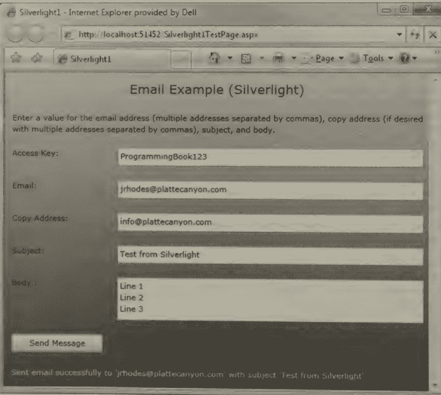

图 72. 从 Silverlight 发送邮件。

第一步是添加服务引用（Service Reference），如图 73 所示。然后你将看到图 74 所示对话框。你输入 URL（包括 `Programming.asmx`）并点击“Go”按钮。你可以在部署网站时对其进行编辑，也可以根据需要通过程序设置它³⁸。你展开服务的名称并点击 `ProgrammingSoap` 服务。然后你将看到操作（方法）列表³⁹。最后，你可以自定义命名空间（Namespace）。我们开始编写代码时将使用此命名空间。

解决方案 'Silverlight1' (2 个项目)

Silverlight1

- 生成 (Build)
- 重新生成 (Rebuild)
- 清理 (Clean)
- 在浏览器中查看 (View in Browser)
- 项目依赖... (Project Dependencies...)
- 项目生成顺序... (Project Build Order...)
- 添加 (Add)
- 添加引用...(Add Reference...)
- 添加服务引用...(Add Service Reference...)
- 查看类图 (View Class Diagram)
- 设置为启动项目 (Set as Startup Project)
- 调试 (Debug)
- 剪切 (Cut)
- 粘贴 (Paste)
- 移除 (Remove)
- 重命名 (Rename)
- 卸载项目 (Uninstall Project)
- 在 Windows 资源管理器中打开文件夹 (Open Folder in Windows Explorer)
- 属性 (Properties)

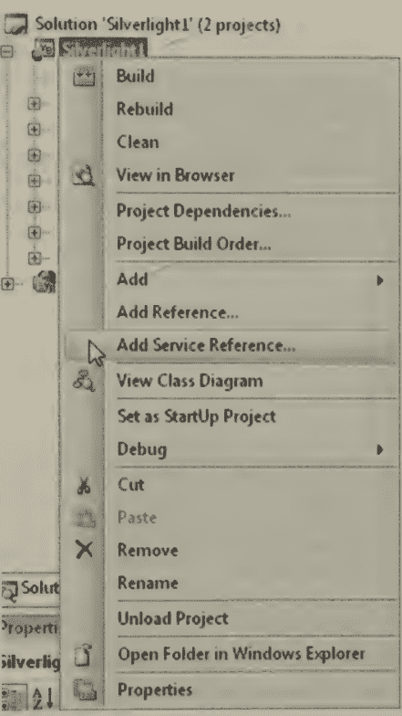

图 73. 在 Visual Studio 中添加 Web 服务引用。

³⁸ 在我们的 Exam Engine 和 Training Studio 产品中，我们将 Web 服务 URL 存储在配置文件中，然后通过程序设置位置。

³⁹ Visual Studio 通过一个名为 WSDL（Web 服务定义语言）的特殊 XML 页面获取此操作列表。我们可以通过点击图 63 所示屏幕顶部的服务描述链接来查看 WSDL。

# 电子学习开发者的编程

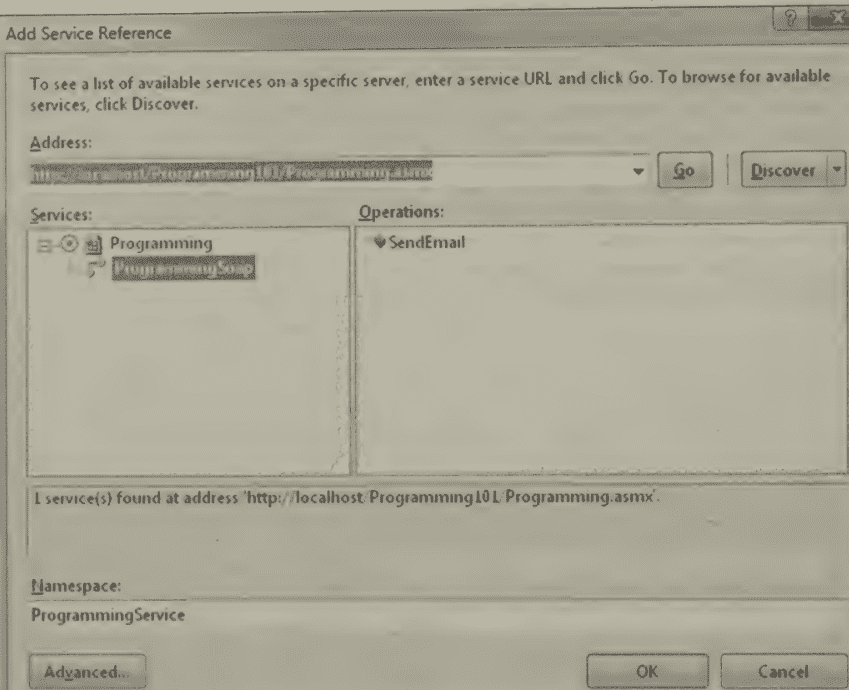

图 74. 在 Visual Studio 中发现并连接到 Web 服务。

构成表单的 XML 与之前的示例类似，因此我们省略其列出。我们在 Grid 中添加了额外的行，以便为其他元素留出空间，并将带有 Body 的行高度设置为 80 像素，为多行文本留出空间。是 Silverlight 自动调整了其余行的高度。我们不需要更改 TextBox 和 TextBox 控件的任何属性。为了允许在 Body 中硬换行，我们将 `AcceptsReturn` 属性设置为 True。

我们可以再次利用 IntelliSense 来连接到 Web 服务。如图 75 所示，我们输入图 74 中命名的命名空间 `ProgrammingService`，然后获得一个可能列表。我们需要的是以 `Client` 结尾的那个。创建一个服务的新实例将处理连接工作。

> ⁴⁰ 名称的其余部分来自服务的名称（Programming）和 Soap 协议。

128

## 发送邮件

```vbnet
Private Sub SendMessageBtn_Click(ByVal sender As System.Object, ByVal e As:
Dim serviceId As New ProgrammingService.
End Sub
```

```vbnet
Class -
```

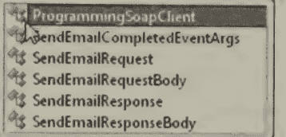

图 75. 使用 IntelliSense 连接到服务引用。

代码清单 50 显示了实现代码，其长度短得惊人⁴¹。

```vbnet
Private Sub SendMessageBtn_Click(ByVal sender As System.Object, ByVal e As System.Windows.RoutedEventArgs)

    Dim serviceId As New ProgrammingService.ProgrammingSoapClient

    If serviceId Is Not Nothing Then
        Dim textId As String = Text.RegularExpressions.Regex.Escape(bodyInfo.Text)
        ' 将硬换行转换为 \r
        Dim bodyText As String = textId.Replace("\r", "<br />")
        bodyText = Text.RegularExpressions.Regex.Escape(bodyText)
        AddHandler serviceId.SendEmailCompleted, AddressOf emailComplete

        Try
            serviceId.SendEmailAsync(accessKey.Text, emailAddress.Text, subjectInfo.Text, bodyText, copyAddress.Text)
            status.Text = "正在连接 Web 服务..."
        Catch ex As Exception
            status.Text = ex.Message
        End Try
    End If
```

我必须承认，这段代码写得时间最长。最初编写它大约花了十分钟，因为我最近刚为 Exam engine 写过类似的代码。然后，花了大约两个小时搜索 Google，试图弄清楚如何将硬换行替换为 `<br />` 标签。Visual Studio 中显示 CRLF 的方式并没有问题。

129

# 电子学习开发者的编程

```vbnet
Else
    status.Text = "无法连接 Web 服务。"
End If
```

```vbnet
Private Sub emailComplete(ByVal sender As Object, ByVal e As ProgrammingService.EmailCompletedEventArgs)
    status.Text = e.Result
End Sub
```

清单 50 显示了“发送邮件”的实现代码。

## 组织导航

电子学习应用中一个关键且有时并非简单的要求是导航¹。事实上，这是电子学习区别于网站和其他软件应用程序的重要领域。在网站中，用户通常可以在任何想的地方浏览，没有定义的路径。在普通的“软件”中，应用程序通常有一个主屏幕。当用户关闭它时，应用程序也会关闭。而在电子学习中，我们通常有“下一页”和“上页”按钮，以及某种菜单结构。在本章中，我们将查看如何在我们的每个设置这种导航。

## ToolBook – OpenScript

由于其书籍的比喻，ToolBook 内部的导航轻而易举。你可以使用 OpenScript（转到下一页）、如图 76 所示的超链接，或者在下一节图 78 所示的动作编辑器。

为了创建菜单，我们将使用类似于清单 27 的方法，动态地为我们书籍中的每一页添加超链接。我们将使用 OpenScript 完成此，但由于我们将使用热词和超链接，这种

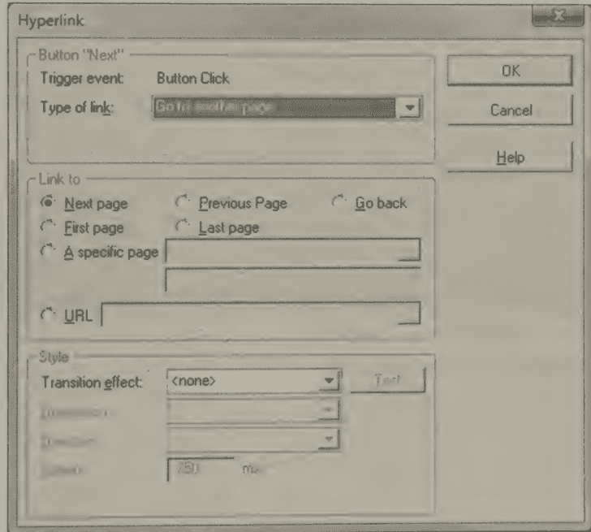

> ¹感谢 Dan Carr 在审阅书籍初稿时建议这一章，并对我的 Flash 导航代码提出了改进建议。


# 电子学习开发者的编程

如果我们将其发布为 HTML，结果仍然具有功能性。如图 77 所示。


图 77 导航示例 - ToolBook。

代码列表 51 显示了我们的实现。

```
notifyBefore enterPage
local page pageID
local field fieldID
local word num, lineNum, numPages
local string pageName
```

```
if runtime = FALSE
numPages = pageCount of this book
fieldID = self
text of fieldID = null
step num from 2 to numPages
lineNum = num - 1
```

## 组织导航

```
pageID = page num
pageName = name of pageID
textline lineNum of text of fieldID = pageName
end step
put CRLF after text of fieldID

step num from 1 to (numPages )
select textline num of text of fieldID
send createHotword
pageID = page (num + 1)
get ASYM_AddHyperlink(selectedHotwords, "buttonClick", \
pageID, "","jump", 4, "false", "<targetWindow>")
end step

-- following selection will not show
select textline numPages of text of fieldID
end if
endPage
```

代码列表 51. 在 ToolBookScript 中动态创建菜单热点和超链接。

将此作为 `notifyBeforePerPage` 处理程序来执行，这样它就会在每个页面上自动创建。然而，如果我们将其作为原生应用程序发送，我们不希望反复创建菜单。我们检查内置的系统运行时（runtime），只有在我们处于作者层级的 ToolBook 时才运行该代码。在这种情况下，我们首先从书籍的 `pageCount` 属性获取 `numPages`。我们创建文本，然后遍历每个页面（从步骤 2 开始，因为我们已经在第 1 页了）。在步骤内部，我们找到页面（`pageID`），获取其名称，并将相应的文本行（`textline`）设置为值 ""。然后我们进行另一个步骤循环来创建热点。我们选择合适的 `textline²` 然后发送 `createHotword` 消息。这会将当前选择转换为热点。新对象包含在系统属性 `selectedHotwords` 中。我们对想要去的地方（`pageID`）建立引用，然后使用 `ASYM_AddHyperlink` 实际创建超链接。第一个参数是我们新的热点（`selectedHotwords`），第二个参数是触发热点的事件（"buttonClick"），第三个参数是目标页面（`pageID`）。

你也可以手动执行（或使用 ToolBook 目录中的对象）。然而，程序化做的用处是，当你添加更多页面时，它会自动更新。

一旦完成，我们在末尾放置一个空行（CRLF）。我们需要这样做，以便在脚本末尾选择此空行。否则，脚本结束时会导致最后一个文本行被选中，这会导致页面看起来很奇怪。

我们需要两个步骤循环，因为在同时设置内联内容和选择文本时会产生奇怪的行为。ToolBook 会扩展选择，我们最终得到一个巨大的热点，而不是每个页面的独立热点。还有其他解决方案，但我倾向于使用两个不同的步骤循环。

# 电子学习开发者的编程

## ToolBook – 动作编辑器 (Actions Editor)

由于上面的 OpenScript 解决方案在发布为 HTML⁴ 后运行良好，因此我们不需要担心制作菜单。超链接在两种环境中运行得很好。但为了增加多样性，我们使用 *Go to page* 动作，每当用户点击“菜单”按钮时移动到“导航”页面。如图 78 所示。


图 78 在 ToolBook 动作编辑器中导航到页面。

## Flash

在 Flash 中配置导航更具挑战性，因为没有本质意义上的“页面”。然而，一种流行的方法是使用**关键帧（key frames）**来实现此目的。然后我们可以使用 ActionScript 的 *gotoAndStop* 方法跳转到帧数或名称。使用名称更为有利，因为它不容易受到后期在电影中插入帧而导致的错误影响。这就是我们在图 79 所示示例中使用的方法。

> ⁴ OpenScript 在发布为 HTML 后不会运行，但它不需要运行，因为热点和超链接已经创建并具有功能了。


图 79 导航示例 - Flash。

正如我们在 ToolBook 中做的那样，我们也动态创建了电影中所有“页面”的菜单，并设置我们的“下一页”和“上一个”按钮。这样做的代码所示于列表 52。

```
var totalPages:Number;
var currentPage:Number = 1;
var pageArray:Array = new Array;
runInitialLoad();
stop();
function runInitialLoad():void {
var num:Number;
var pageName:String;
var labelsArray:Array = this.currentScene.labels;
var frameId:FrameLabel;

```

// set up listeners
nextBtn.addEventListener(MouseEvent, implementButton);
prevBtn.addEventListener(MouseEvent, implementButton);
pageList.addEventListener(CHANGE, selectPage);

// initializeArray
totalPages = labelsArray.length;

for (num = 0; num < totalPages; num++) {
  frameId = labelsArray[num];
  pageName = frameId.name;
  if (num > 0) {
    pageList.addItem({label:pageName, data:num + 1});
  }
}

function implementButton(eventId:MouseEvent):void {
var targetName = eventId.target;
var incrementNum = 1;
if (targetName.indexOf("prev") > -1) {
  incrementNum = -1;
}

function gotoPage(pgNum:Number):void {
if (pgNum < 1) {
  pgNum = totalPages;
} else if (pgNum > totalPages) {
  pgNum = 1;
}
currentPage = pgNum;
var pageName = pageArray[pgNum - 1];
gotoAndStop(pageName);
}

function selectPage(eventId:Event):void {
if (pageList.selectedItem != null) {
  var pageNum = Number(pageList.selectedItem.data);
  gotoPage(pageNum);
}
}

## 代码列表 52. 导航逻辑与动态创建 - Flash

我们首先定义变量。正如你可能猜的，`totalPages` 是关键帧的数量。我们稍后会初始化它。`currentPage` 是我们所在的页面。然后我们使用 `pageArray` 来存储名称。跳转到下一页是一个。在 Flash 中，场景（scene）是一个对象。它有 `labels` 属性。单个对象将是 `FrameLabel` 类型。从这里开始，我们使用 `addEventListener` 将 "nextBtn" 和 "prevBtn" 与 `implementButton` 关联。我们还希望在用户在列表中进行选择时切换页面。


# 电子学习开发者的编程

全局变量 `pageArray`⁸。然后我们调用 Flash 函数 `gotoAndStop` 跳转到该名称对应的关键帧。

最后我们查看 `selectPage`。我们确保用户已经选择了一个项目，如果是，我们就获取所选的 `selectedItem.data`并将我们的本地变量 `pageNum` 初始化为该值。然后我们使用该值调用我们的 `gotoPage` 函数以跳转到正确的页面。

## JavaScript

作为一组独立 HTML 页面的集合，HTML 和 JavaScript 应用程序并没有明显的结构。相反，我们需要自己跟踪导航顺序。生成的应用程序如图 80 所示。


图 80. 导航示例 - HTML 和 JavaScript。

> ⁸ 再次无数次强调，为了考虑到我们从 0 开始的数组索引与页码从 1 开始之间的差异，我们要加 1 要么减 1。我更倾向于使用页码，并根据需要通过数学计算来调整索引。

138

## 组织导航

一种非常适用于我们示例中分散的 HTML 页面以及 SCORM 通信⁹的方法是在框架（frame）中显示单个 HTML 页面，具体说是一个 iFrame。如列表 53 所示，我们有一个 "index.htm"，它包含一个 iFrame 和导航按钮。我们将它的 `src` 默认设置为新的 "Navigation.htm"，该页面也被显示¹⁰。

```css
// From Styles.css
NavFrame
{
  height:450px;
  width:650px;
}

.SpacerColumn
{
  width:500px;
}

// index.htm
<body>
<iframe src="Navigation.htm" id="contentFrame" class="NavFrame" frameborder="0" scrolling="no">
</iframe>
<br />
<br />
<table>
<tr>
  <td class="SpacerColumn"></td>
  <td>
    <input id="prevBtn" type="button" value="<<"
    onclick="implementNavButton(this)" />
  </td>
  <td>
    <input id="nextBtn" type="button" value=">">
    onclick="implementNavButton(this)" />
  </td>
</tr>
</table>
</body>

// Navigation.htm
```

> ⁹ SCORM 的目标不是过早发送 `LMSFinish` 或 `Terminate` 消息，而是确保在用户关闭浏览器时发送它们。在那种情况下，通过在框架中显示内容的方法非常有效，因为切换页面不会意外触发 `LMSFinish` 或 `Terminate` 的执行。

> ¹⁰ 注意，我们可以轻松地调用 SCORM 来获取书签，并设置此 `src` 以及 `currentPage` 全局变量，以便“返回到用户上次离开的地方”。

# 电子学习开发者的编程

```html
<body onload="runInitialLoad()">
<h2>Navigation</h2>
<select id="pageList" name="pageList"
onchange="parent.selectPage(this)">
</select>
</body>
```

列表 53. 导航示例的 CSS 和 HTML。

在“外部”的 `index.htm` 上放置导航按钮可以避免在每个页面都添加按钮的需要。这等比于在 ToolBook 中将它们放在背景上。我们将它们的 `onclick` 事件与 `implementNavigation` 关联，并像其他示例那样传递它，以便我们引用被点击的实际按钮。

在 `Navigation.htm` 中有一个空的 `select` 对象。我们将用 JavaScript (列表 54) 对进行配置。我们通过将页面的 `onload` 事件与 `runInitialLoad` 关联来进行初始化。我们将 `select` 对象的 `change` 事件与 `parent.selectPage` 关联。父级指的是 `index.htm`，因为 `Navigation.htm` 正在一个 iframe 中显示¹¹。列表 54 显示了完整的 JavaScript 实现。

```javascript
// Navigation.htm
function runInitialLoad() {
  var pageName;
  var listID = document.getElementById("pageList");

  if (listID != null) {
    var num;

    listID.size = parent.totalPages;
    for (num = 0; num < parent.totalPages; num++) {
      pageName = parent.pageArray[num];
      listID[listID.options.length] = new Option(pageName, (num + 1),
false, false); // 使用这种语法以便在 Firefox 中运行
    }
  }
}
```

```javascript
// index.htm

// global variables
var pageArray = new Array("Navigation", "Handling Events",
"Target Example", "Interaction Example", "Hyperlinking Example",
"Email Example", "Load Graphics and Media Example", "XML Example",
"Calculator");
```

> ¹ 证明将所有全局变量和公共函数放在 index.htm 中是最好的。我最初将它们放在一个双方共享的 js 文件中……直到我测试时发现每次 iframe 加载 Navigation.htm 时，.js 文件都会被重新加载（全局变量被重置）。将代码放在 index.htm 中可以避免这个问题。

```javascript
var totalPages = pageArray.length;
var currentPage = 1;

function implementNavButton(buttonId) {
var targetName = buttonId.id;
var incrementNum = 1;

if (targetName.indexOf("prev") > -1) {
  incrementNum = -1;
}

var newNum = (currentPage) + incrementNum;
gotoPage(newNum);
}

function gotoPage(pgNum) {
var iFrameId = document.getElementById("contentFrame");

if (pgNum < 1) {
  pgNum = totalPages;
} else if (pgNum > totalPages) {
  pgNum = 1;
}

currentPage = pgNum;

var pageName = pageArray[pgNum - 1];
if (iFrameId != null) {
  iFrameId.src = pageName + ".htm";
}
}

function selectPage(listId) {
var optionsArray = listId.options;
var num;
var pageNumber = 0;

for (num = 0; num < optionsArray.length; num++) {
  var optionsId = optionsArray[num];
  if (optionsId.selected) {
    pageNumber = optionsId.value;
    break;
  }
}
```

# 电子学习开发者的编程

```javascript
gotoPage(pageNumber);
}
```

列表 54. 逻辑和动态菜单 - 代码。接下来是 index.htm。我们匹配列表中的页面。我们将 size 设置为 `totalPages`，所有页面将显示而不带滚动条。

> ¹ 设置 size 会将其变为列表而不是下拉框，并决定显示的数量。我们将 size 设置为 `totalPages`，所有页面将显示而不带滚动条。

> ² 这里有点复杂，因为我们再次遇到了从 0 开始索引的问题。假设我们目前有两个选项。那么 `listId.options.length` 是 2。但 `listId(listId.options.length)` 正在添加第三个选项，因为前两个是 `listId[0]` 和 `listId[1]`。

> ³ 它的构造函数接受要显示的文本 (pageName)、值 (num + 1)，我发现某些语法在 Firefox 中不起作用。


## Silverlight

与 Flash 和 HTML/JavaScript 一样，Silverlight 电影没有明显的导航结构。实现导航最简单的方法与我们在 HTML 中所做的类似。但我们不是使用 IFrame，而是使用用户控件（user control），并将其 *Content* 设置为我们所需的页面。这种方法有点复杂（在 Silverlight 的后续版本中将变得简单），但它是可行的。生成的应用程序如图 81 所示。


图 81. 导航示例 - Silverlight。

列表 55 显示了 Start.xaml 的关键部分以及解决方案中各个部分的重要代码。

# 电子学习开发者的编程

' Start.xaml

```xml
<Grid x:Name="contentFrameId" Margin="10" Grid.ColumnSpan="3"
HorizontalAlignment="Stretch" VerticalAlignment="Stretch" />
<Button x:Name="prevBtn" Content="&lt;&lt;" Grid.Row="1"
Grid.Column="1" Margin="10,10,10,10" Click="implementNavButton"/>
<Button x:Name="nextBtn" Content="&gt;&gt;" Grid.Row="1"
Grid.Column="2" Margin="10,10,10,10" Click="implementNavButton"/>
```

' App.xaml.vb

```vb
Public startId As New Start

Private Sub Application_Startup(ByVal o As Object, ByVal e As
StartupEventArgs) Handles Me.Startup
    Me.RootVisual = startId
End Sub
```

' Navigation.xaml.vb

```vb
Private Sub Navigation_Loaded(ByVal sender As Object, ByVal e
System.Windows.RoutedEventArgs) Handles Me.Loaded

    Dim appId As App = CType(Application.Current, App)
    Dim dictionaryId As Dictionary(Of String, UserControl) =
    appId.startId.PageNameDictionary
    Dim keysList As List(Of String) = dictionaryId.Keys.ToList()

    keysList.RemoveAt(0) ' 移除 Navigation

    pageList.ItemsSource = keysList
End Sub

Private Sub pageList_SelectedIndex(ByVal sender As Object,
ByVal e As System.Windows.Controls.SelectionChangedEventArgs)
Handles pageList.SelectedIndexChanged

    If pageList.SelectedIndex > -1 Then
        Dim appId As App = CType(Application.Current, App)
        appId.startId.GotoPage(pageList.SelectedIndex + 2)
        ' 因为移除了第一页，所以加 2 而不是 1
    End If
End Sub
```

## 组织导航

' Start.xaml.vb

```vb
Private totalPages As Integer = Me.PageNameDictionary.Count
Private currentPage As Integer = 1

Private Sub Loaded(ByVal sender As Object, ByVal e As System.Windows.RoutedEventArgs) Handles Me.Loaded
    contentFrameId.Children.Add(Me.PageNameDictionary.Values(currentPage-1))
End Sub

Private Sub implementNavButton(ByVal sender As System.Object, 
ByVal e As System.Windows.RoutedEventArgs)
    Dim buttonId As Button = CType(sender, Button)
    Dim tarName As String = buttonId.Name
    Dim incrementNum As Integer = 1
    If tarName.Contains("prev") Then
        incrementNum = -1
    End If
    gotoPage(currentPage + incrementNum)
End Sub

Friend Sub gotoPage(ByVal pgNum As Integer)
    If pgNum < 1 Then
        pgNum = totalPages
    ElseIf pgNum > totalPages Then
        pgNum = 1
    End If
    currentPage = pgNum
    Dim pageId As UserControl = Me.PageNameDictionary.Values(pgNum - 1)
    With contentFrameId
        .Children.RemoveAt(0)
        .Children.Add(pageId)
    End With
End Sub

Friend ReadOnly Property PageNameDictionary() As 
Dictionary(Of String, UserControl)
Get
    Dim dictionaryId As New Dictionary(Of String, UserControl)

    With dictionaryId
        .Add("Navigation", New Navigation)
        .Add("Handling Events", New Page)
        .Add("Target Example", New Target)
        .Add("Interaction Example", New Interaction)
        .Add("Hyperlinking Example", New Hyperlink)
        .Add("Email Example", New Email)
        .Add("Load Graphics and Media Example", New LoadGraphicsMedia)
        .Add("XML Example", New ReadXml)
        .Add("SCORM Tester", New SCORM)
        .Add("Calculator", New Calculator)
        .Add("Object-Oriented Programming Example", New OOP)
    End With

    Return dictionaryId
End Property
```

列表 55. XAML、逻辑和动态菜单创建 - Silverlight。

在我们的 Start.xaml 中，有两行和三列。在第一行（跨越三列），我们有一个名为 `ContentGrid` 的网格。这个网格充当上一节中 HTML 和 JavaScript 示例中的 IFrame。我们将各个页面作为该网格的子元素（Children）。在第二行中，我们分别在第 2 和第 3 列放置了 `prevBtn` 和 `nextBtn`。

我们的下一个任务是让 Silverlight 应用程序启动此页面。我们通过将应用程序的 `RootVisual` 设置为 `App.vb` 文件中的页面来实现。注意我们需要创建页面对象的实例，而不仅仅是指向 `Start.xaml`。

*(注：原文后续内容大量重复，已根据核心逻辑完成整合)*


# 动态加载图形和媒体

图形和媒体显然是大多数电子学习（e-Learning）应用程序的关键部分。在本书介绍的所有环境中，当你处于编写环境时，配置图形、音频、视频或 Flash 电影是一个相当简单的操作。更具挑战性的是通过程序实现它，特别是当项目尚未嵌入应用程序中时。我们将在每个环境中处理这项任务。

## ToolBook – OpenScript

作为我们正在研究的唯一纯 Windows 编程环境，ToolBook OpenScript 为我们提供了一些可以使用的“额外功能（bells and whistles）”。生成的应用程序如图 82 所示。


图 82. 动态图形和媒体示例 - ToolBook OpenScript。

# 电子学习开发者的编程

我们对此示例的要求是：

- 1. 从一个目录读取外部图形列表，从另一个目录读取外部媒体（.flv, .mp3, .swf, .wmv）。无法直接播放的格式（ToolBook 和 JavaScript 的 .flv，Flash 的 .wmv，Silverlight 的 .flv 和 .swf）将被排除。对于无法直接读取文件的环境，我们将跳过此步。
- 2. 点击“加载图形（Load Graphic）”动态加载图形（如果可行）。
- 3. 在同时支持两者（ToolBook 和 JavaScript）时，点击“加载媒体（Load Media）”按钮在正确的播放器（Flash 或 Windows Media Player）中加载媒体。

为了在 OpenScript 中满足这些要求，我们为图形创建一个“列表框”，并为媒体创建一个创建一个对应的“加载（Load）”按钮。正如我们之前看到的（图 38），我们将使用显示器来加载图形。但不是将“普通图形”设置为位图资源，而是先加载资源。对于媒体，我们将使用 Windows Media Player 或 Flash ActiveX 控件。正如我们看到的，ActiveX 是一种 Windows 控件，允许 Internet Explorer、ToolBook 和 PowerPoint 等“容器”使用“服务器”来获取可能未内置容器应用程序的功能。使用 ActiveX 意味着当我们分发电子学习应用程序时，必须在客户端计算机上安装该控件¹。

我们将分两步查看编程逻辑。列表 56 显示了填充列表框和初始化场景的代码。

```basic
to handlePage
system string basePath

forward
basePath = buildBasePath()
send populateListBox field "GraphicList", basePath & \
"externalGraphics"
send populateListBox field "MediaList", basePath & \
"externalMedia", "mp3, swf, wmv"
send moveOff Windows MediaPlayer "WMP1"
send moveOff ShockwaveFlash "Flash1"
send moveOff button "imagem"
endPage

to get buildBasePath
local string basePath
local dwarf baseLoc

```
basePath = ASYM_ParsePath(name of this book, "Path")
baseLoc = offset("ToolBook", basePath)
if baseLoc > 0
basePath = chars 1 to baseLoc of basePath
end if

```

return baseBookPath
end buildBasePath

```
to handle populateListBox field listId, string mediaPath, string
includedExtensions
-- includedExtensions 是一个可选的逗号分隔扩展名列表
-- 提取时不时不带 "." 且没有空格
local string fileList
local string extensionList
local string currentExtension
local string filePath

```
if includedExtensions = ""
  includedExtensions = "*"
end if

```

text of listId = ""

while includedExtensions <> ""
pop includedExtensions into currentExtension
filePath = mediaPath & "\.*" & currentExtension
fileList = getFileOnlyList(filePath, "", "N")
if fileList <> ""
  if text of listId <> ""
    fileList = fileList
  end

  text
 list = =Id =Id

end

end
end populateListBox

to handleOffScreen objectId
position of objectId = resetPosition of self
end moveOff

to handleOnScreen objectId
position of objectId = playPosition of self
endOnScreen
```

列表 56. 图形和媒体的配置逻辑 - ToolBook。

> ¹这意味着当我们分发电子学习应用程序时，必须在客户端计算机上安装该控件。对于基于 Web 的环境，由于需要下载控件，这通常不是一个问题。但由于 ActiveX 控件的引入，Flash 电影无法播放。为了一致性，我们在这里不使用“clip”系统来处理这些文件。

# 电子学习开发者的编程

我们在 `enterPage` 事件时配置场景。我们声明了 `basePath` 变量。为了避免重复文件，我们使用 `basePath` 函数来获取路径。在调用 `ASYM_Parse` 函数获取 `.tb` 目录后，我们使用 `offset` 函数找到它所在的位置。然后我们获取路径的剩余部分。回到 `enterPage` 处理程序，我们需要填充列表框。我们创建一个通用的处理程序，并向其传递列表框、文件所在的路径以及可选的扩展名列表。可选参数声明了一些局部变量，并在 `includedExtensions` 为空时将其初始化为 `*`。由于我们需要排除 `.flv` 文件，因此我们使用一个循环来利用我们将 `includedExtensions` 参数设为逗号分隔列表的特性。这允许我们从“栈”中弹出每个扩展名。这获取了我们需要并从列表中移除（这样当所有扩展名消失后循环将结束）。然后我们构建 `filePath` 变量，得到类似于 `*.` 的内容。我们将此变量传递给 `getFileList` 函数，带有一个参数表示不限制文件属性，以及一个 "N" 告诉我们要按文件名排序。该函数每行返回一个文件名。如果列表框已经有内容，我们就会添加一个空行（CRLF），这样新场景就会紧接在最后一个之后。我们的任务是“隐藏”各种播放器。这在 ToolBook 中不起作用，而是显示 ActiveX 控件。我们将它们移出屏幕。为了并行，我们也对 "image1" 按钮做了相同的操作。

现在我们准备好查看如何加载图形或媒体。列表 57 显示了 `buttonClickHandler` 和 `getSelectedIndexFunctionName`。

```basic
to handleClick
system string baseBookPath
local string tarName
local string selectedFileName


> 你可能会问为什么我们在只从 `enterPage` 处理程序调用它时将其拆分成单独的函数。并没有强制的理由这样做，但由于步骤有点复杂，我将其拆分了。这使得 `enterPage` 处理程序更加易读。
> ToolBook 的直接播放 .flv 文件的功能。如果你感兴趣，请检查你当前的版本。
ToolBook 中有一个创建和编辑用户属性的编辑器，但我更倾向于使用命令行。例如，我将一个对象放置在想要的位置，并使用了此脚本：`playPosition of this page = position of selection`。

152


```javascript
local field listID
local string mediaPath
local object resourceID
local object playerID
local logical isFlash
local string bs, errorString

tarName = name of target

conditions
when tarName = "LoadGraphicBtn"
  listID = field "GraphicList"
  selectedFileName = getSelectedFileName(listID)

  if selectedFileName < ""
    -- 查找此名称的位图资源
    bs = ASYMBlockSuspend()
    getResourceInfo of bitmap selectedFileName
    errorString = ASYMRestoreSuspend(bs)
    if errorString < null then doesn't exist
      mediaPath = basePathPath & "externalGraphics\" & selectedFileName
      import bitmap resource mediaPath as selectedFileName
    end
    resourceID = bitmap selectedFileName
    playerID = button "image"
    normalGraphic of playerID = resourceID
    send moveOffScreen WindowsMediaPlayer "WMP1"
    send moveOffScreen ShockwaveFlash "Flash1"
    send moveOnScreen playerID
  end

when tarName = "LoadMediaBtn"
  listID = field "MediaList"
  selectedFileName = getSelectedFileName(listID)

  if selectedFileName <> ""
    mediaPath = basePath & "externalMedia\" & selectedFileName
    isFlash = (selectedFileName contains ".swf")
    if isFlash then TRUE
      playerID = ShockwaveFlash "Flash1"
      getLoadMovie(0, mediaPlayer) of playerID
      getPlay() of playerID
      send moveOffScreen WindowsMediaPlayer "WMP1"
    else
      playerID = WindowsMediaPlayer "WMP1"
      extUrl of playerID = mediaPath
      get extPlay() of playerId
      send moveOffScreen ShockwaveFlash "Flash1"
    end if

    send moveOffScreen button "image"
    send moveOnScreen playerId
  end if
end conditions
forward
end buttonClick
```

## get getSelectedFileName

```javascript
to get getSelectedFileName field listId
local string selectedName

if selectedTextLines of listId = null
  request "你必须选择一个文件以继续。"
  selectedFileName = ""
else
  selectedFileName = textline (item 1 of selectedTextLines of listId) of listId
end if

return selectedFileName
end getSelectedFileName
```

## 列表 57 动态图形和媒体示例的点击逻辑 - ToolBook OpenScript。

由于我们处于页面层级，可以使用单个处理程序来处理两个按钮。我们声明了全局变量 `basePath` 和一系列局部变量。我们获取目标名称（`tarName`），以确保我们只在其中一个按钮中执行代码。无论点击哪一个，我们将关联的列表框放入 `list` 变量中，然后就可以使用 `getSelectedFileName` 函数来确定我们正在使用哪个文件名。通过这种方式，我们获取 `selectedTextLines` 属性来查看选中了哪一行。如果没有选择，我们会通知用户并返回 `null`。否则，我们通过获取正确的 `textline` 获取实际的文本行（即文件名）。

我们嵌套了第一个 `conditions` 语句。这类似于 ActionScript/JavaScript 中的 `switch` 以及 Visual Basic 中的 `Select Case`。如果我们正在加载一个图形，我们需要确定是否已经将其作为资源加载了。由于没有直接的“Resource（资源）”函数，我们使用了一个小技巧。然后通过 `ASYM_BlockSuspend` 获取错误信息并匹配我们的文件名。如果我们还没有加载该文件，这将生成一个错误，该错误会反映在从 `ASYM_RestoreSuspend` 行返回的 `errorString` 中，但用户看不到任何消息。在这种情况下，我们将构建文件的完整路径并使用 `import resource ...` 语法将资源引入到书中并命名。或者，我们将资源变量设置为我们的资源。

> 5 使用 `items` 的复数形式是因为我们可以设置列表以允许多项选择。在这种情况下，`selectedTextLines` 将是一个用逗号分隔的数字列表。这就是为什么我们为了稳妥起见使用了 `item` 语法。否则，如果开发者无意中允许了多次选择，用户就会收到错误。这是防御性编程的另一个例子。

我们将 `playerId` 变量设置为本例中的按钮 ⁶。从这里开始，我们将按钮的 `normalGraphic` 属性设置为我们的图形。然后，如果 Windows Media播放器和 Flash 播放器可见，我们就将它们移出屏幕。最后，我们将按钮移到屏幕上。

如果我们正在加载媒体文件，我们以相同的方式获取 `selectedFileName`。无论在每种情况下指向媒体文件，我们都会构建 `mediaPath`。但我们需要知道想使用 Flash 还是 Windows Media播放器。我们通过检查文件名是否包含“swf”并设置 `isFlash` 变量来实现此。如果是，我们将 `playerId` 变量指向 Flash 并调用 `extLoadMovie`⁷ 方法。第一个参数是层级，第二个参数是 Flash ⁸ 的完整路径。然后我们调用 `extPlay` 方法立即播放。接着我们将 Windows Media 播放器移出屏幕。

如果我们正在播放任何其他扩展名，我们将使用 Windows Media播放器。在这种情况下，我们将 `extUrl` 设置为文件的路径。我们再次调用 `extPlay` 方法，然后将 Flash 播放器移出屏幕。最后，我们同步地将图形移出屏幕，并将我们的 `playerId`（指向 Flash 播放器或 Windows Media播放器）移到屏幕上。对于所有功能来说，代码其实并不多。

## ToolBook – 动作编辑器 (Actions Editor)

对于动作编辑器，我们省略了从目录读取文件名并填充列表框的操作，因为这是无法完成的。我们还放弃了加载图形，因为如果不诉诸于调用 JavaScript 在外部浏览器页面中显示图形⁹我们就无法实现。图 83 显示了在 Internet Explorer 内部的结果，我们必须使用这种方法。

> 6 从这里开始，我们将按钮的 `normalGraphic` 属性设置为我们的图形。
> 7 调用 `extLoadMovie` 方法来配置播放器。
> 8 Flash 的完整路径。
> 9 调用 JavaScript 在外部浏览器页面中显示图形。

## 面向电子学习开发者的编程

图 83 显示了在 Internet Explorer 内部的结果，我们必须使用这种方法。

我们不是从目录加载媒体，而是链接到一个 URL。我们这样做有两个原因：
1. 由于我们是动态链接媒体的，ToolBook 并不知道它们的存在，在将书籍发布为 HTML 时不会自动包含它们。
2. 从 Windows Media 9 版本开始，你无法引用父目录中的文件。这显然是为了安全考虑。仔细观察图 84，你可以看到 ToolBook 根据浏览器和版本重定向到特定的目录。例如，如果它检测到 Internet Explorer 7，它将重定向到 /ie7 目录。这意味着媒体的正确相对路径是 `../media/`。

| 文件夹 | 名称 |
|---|---|
| OOP | ie6 |
| Silverlight | ie7 |
| ToolBook | media |
| AXF | ns7 |
| WebExport | resources |
| loadmediagraphics | unsupported |
| ie6 | bootstrap.jar |
| ie7 | bootstrap.js |
| media | buildid.ser |
| ns7 | index.html |
| resources | media.ser |
| unsupported | readme.html |
| programming | script.html |

图 84 发布为 HTML 的 ToolBook 内容目录结构。

正如你预期的那样，“加载媒体”按钮的逻辑更为复杂。这在图 86 中所示。

除非进入浏览器，否则我们没有隐藏和显示控件的问题，因此我们使用这种方法而不是将控件移出页面¹¹。在 ToolBook 动作器的加载事件中隐藏播放器。

> 10 这种导出不包含 iPhone 和 Safari，否则它们也会有目录。
> 11 此外，我发现一旦在浏览器中以高分辨率查看结果，可以看到 Flash 播放器出现在页面区域外。这很令人惊讶。

图 85. 在 ToolBook 动作器的加载事件中隐藏播放器。


# 电子学习开发者的编程


图 86 动态媒体的点击逻辑
示例 - 工具箱动作编辑器。

我们首先读取列表框的 `selectedItemText` 属性，并将其放入 `fileName` 变量中。假设有选择，我们使用与 `OpenScript` 示例中相同的逻辑来设置 `isFlash` 变量。无论何种方式，我们将我们的 URL (http://www.plattecanyon.com/ProgrammingBook/media/) 添加到 `selectedFileName` 的前部。

158

我们处于 Flash 环境，调用 Flash 播放器的 `extLoadMovie` 方法。动作编辑器（Actions Editor）在这里对我们很有帮助，在我们拖入 `Execute Method` 操作后，它会为我们提供可用方法的下拉列表。然后我们点击工具栏上的“Properties”（属性）按钮，打开设置两个参数的对话框。你可以在图 86 的底部看到这一点。最重要的是，我们将 `url` 参数设置为由 `selectedFileName` 表示的完整 URL。然后我们调用 Flash 播放器的 `extPlay` 方法，隐藏 Windows Media Player，并显示 Flash Player。

如果我们正在使用 Windows Media Player，我们将设置 `extUrl` 属性，调用 `extPlay`，隐藏 Flash Player 并显示 Windows Media Player。

## Flash

使用 Flash 时，我们主要的妥协是由于 Flash 通常部署在浏览器中，因此受到更大的安全限制。图 87 显示了最终结果。


图 87. 动态图形和媒体示例 - Flash。

# 电子学习开发者的编程

我发现 Flash 获取目录中文件列表的唯一方法是通过 `FileReferenceList` 类，如下文所示¹。即使如此，它也需要响应用户的点击事件，以避免对用户硬盘的未经授权访问。此外，用户需要专门选择要打开的文件。因此，我们将稍微不同的布局我们的示例。当用户第一次点击“Load Graphic”（加载图形）或“Load Media”（加载媒体）按钮时，示例将提示他们导航到正确的目录（图形需要是 `\externalGraphics`，媒体需要是 `\externalMedia` 但我们无法强制他们去那里）。我们将填充列表框。当用户选择一个项目并点击相应的“Load”（加载）按钮时，我们将适当加载外部图形或媒体。对于 Flash 视频 (.flv) 文件，这将涉及在 `FLVPlayback` 组件中播放它们。对于其他类型，我们将程序化加载所有内容。作者模式下 Flash 电影的布局如图 88 所示。

## 动态图形和媒体示例 (Flash)

点击“Load Graphic”和“Load Media”按钮首先提示您选择文件以填充列表。然后选择文件并点击其“Load”按钮以显示或播放它。


图 88. 动态图形和媒体示例的 Flash 电影布局。

> ¹正如我的评审员、来自 bristol.gs Training Solutions 的 Graham Cownie 所提到的，你可以使用 Adobe Integrated Runtime (AIR) 与本地文件系统进行交互。

160

除了将选中的项目加载到相应的列表框中，我们还需要考虑到图形、Flash 电影 (.swf)、Flash 视频和声音 (.mp3) 文件，这意味着逻辑有点复杂。列表 58 显示了完整的 ActionScript。

```javascript
var movieLoader:Loader = new Loader();
var graphicsFileRefId:FileReferenceList = new FileReferenceList();
var mediaFileRefId:FileReferenceList = new FileReferenceList();
var loadedGraphics:Boolean = false;
var loadedMedia:Boolean = false;
var fileName:String;
var soundChannel:SoundChannel;
```

```javascript
var loaderName:String = "externalMedia"

runInitialLoad();
stop();
```

```javascript
function runInitialLoad() {
  // 设置监听器
  loadGraphicBtn.addEventListener(MouseEvent.CLICK, loadGraphicFiles);
  loadMediaBtn.addEventListener(MouseEvent.CLICK, loadMediaFiles);
  graphicsFileRefId.addEventListener(FileFilter("Graphics"), Event.SELECT, selectGraphics);
  mediaFileRefId.addEventListener(Event.SELECT, selectMediaHandler);
  flvPlayer.visible = false;
  movieLoader.name = loaderName;
}
```

```javascript
function loadGraphicFiles(eventId:MouseEvent):void {
  if (loadedGraphics == true) {
    if (GraphicList.selectedItem != null) {
      fileName = "externalGraphics/" + GraphicList.selectedItem.label;

      clearMedia();
      loadExternalMedia();
    }
  } else {
    status.text = "必须先选择列表中的一个项目。";
  }
}
// 让用户选择包含的文件
try {
  graphicsFileRefId.browse([new FileFilter("Graphics", "*.png")]);
} catch (illegalOperation:IllegalOperationError) {
  status.text = illegalOperation.toString();
}
```

# 电子学习开发者的编程

```javascript
function selectGraphicsHandler(eventId:Event):void {
  var fileList:FileReferenceList = FileReferenceList(eventId.target);
  var fileReferenceId;

  for each (fileReferenceId in fileList) {
    GraphicList.addItem(fileReferenceId.label);
  }
  loadedGraphics = true;
}

function loadMedia(eventId:MouseEvent):void {
  if (loadedMedia == true) {
    if (MediaList.selectedItem != null) {
      fileName = "externalMedia/" + MediaList.selectedItem.label;

      clearMedia();

      if (fileName.indexOf(".flv") > -1) {
        flvPlayer.source = fileName;
        flvPlayer.visible = true;
        status.text = "加载视频: " + fileName;
      } else if (fileName.indexOf(".mp3") > -1) {
        var sound:Sound = new Sound();
        var requestId:URLRequest = new URLRequest(fileName);

        sound.load(requestId);
        soundChannel = sound.play();
        status.text = "加载声音: " + fileName;
      } else { // .swf
        loadExternalMedia();
      }
    } else {
      status.text = "必须先选择列表中的一个项目。";
    }
  } else {
    // 让用户选择包含的文件
    try {
      mediaFileRefId.browse([new FileFilter("Media", "*.flv;*.mp3;*.swf")]);
    } catch (illegalOperation:IllegalOperationError) {
      status.text = illegalOperation.toString();
    }
  }
}

function selectMediaEventHandler(eventId:Event):void {
  var fileList:FileReferenceList = FileReferenceList(eventId.target);
  var fileReferenceID;

  for each (fileReferenceID in fileList) {
    MediaList.addItem(fileReferenceID.label);
  }
  loadedMedia = true;
}

function loadExternalMedia():void {
  var requestId:URLRequest = new URLRequest(fileName);

  movieLoader.contentLoader.addEventListener(Event.COMPLETE, onLoadMovie);
  movieLoader.load(requestId);
}

function onLoadMovie(eventId:Event):void {
  var movieID:DisplayObject = movieLoader.content;

  if (movieLoader != null) {
    addChild(movieLoader);
  }

  // 与 FLV Player 相同位置
  movieID.x = flvPlayer.x;
  movieID.y = flvPlayer.y;
  status.text = "Loaded " + fileName;
}

function clearMedia():void {
  var displayObjectID:DisplayObject = getChild(loaderName);

  if (displayObjectID != null) {
    removeChildAt(getChildIndex(displayObjectID));
  }

  if (flvPlayer.playing == true) {
    flvPlayer.stop();
  }
  flvPlayer.visible = false;
}
```

```javascript
if (soundChannel != null) {
  soundChannel.stop();
}
```

列表 58. 动态图形和媒体示例的 ActionScript。

我们从全局变量开始。这些是我们希望在多个方法之间共享的所有项目。我们从 `movieLoader` 变量开始。它也是 `Loader` 类型，用于加载 Flash 电影或图像文件。正如之前的示例所示，我们使用 `URLLoader` 类来加载或执行 HTTP Post 等操作。我们创建 `graphicsFileRef` 和 `mediaFileRef` 作为新的 `FileReference` 对象。该类旨在使用全局接口来选择文件，以填充我们的列表框¹。我使用它是因为据我所知，没有其他从目录中读取文件列表的其他方法。我们的接下来两个变量 `loadedGraphics` 和 `loadedMedia` 用于区分“加载”按钮的两个功能：首先填充列表框，然后加载选定的图形或媒体文件。注意，我们将它们初始化为 `false`，以便我们从填充列表框开始。我们将 `fileName` 为全局变量，以避免在各种函数之间传递它。它将从列表选择中初始化。正如你可能猜到的，我们的 `soundChannel` 与 .mp3 文件有关。作为全局变量，允许我们在显示另一种媒体类型或循环声音文件时停止当前声音⁴。


box。我们将此放入 `try-catch` 块中，以避免在出现问题（例如用户尝试访问他们没有权限的目录）时向用户显示错误。由于我们之前将 `SELECT` 事件与 `graphicsHandler` 方法关联，因此当用户点击此对话框中的“确定”按钮时，该方法将被调用。

在 `graphicsHandler` 中，我们通过获取 `event.target` 并将其“转换”为 `ReferenceList` 来获取用户在对话框中选择的文件。这告诉 Flash 期望什么种类型的对象，并允许我们遍历文件“集合”。为了做到这一点，我们使用 `for` 循环来获取 `FileResource` 列表中的每个 `FileReference`。我们最早在列表 43 中（从 ASP.Net 发送电子邮件时）就已经遇到过这种类型的循环了。这种循环的奇妙之处在于，我们不需要知道集合中有多少个项目，循环只是一次抓取一个。至少，我们需要指定一个 `label`（标签），因为这是在列表中显示的内容。我们指定该方法是 Flash 的 `List` 组件特有的。我们还可以指定 `data`（数据），它不会显示，但可以通过程序读取¹⁵。在我们的情况下，我们不需要数据，因此将 `label` 设置为我们的 `FileResource` 的名称。当我们遍历完所有选择的文件后，将 `loadedGraphics` 变量设置为 `true`，这样我们就知道不需要再次加载列表了。

我们在 `loadMedia` 方法中也采用了类似的逻辑。我们以相同的方式获取 `fileName` 并清空 `clearMedia`。但由于不同类型的媒体需要不同的操作，我们使用 `indexOf` 来查看我们正在处理的是哪种类型。如果文件是视频（`.flv` 文件），我们只需将 `flPlayer` 组件的 `source` 属性设置为 `fileName`。然后，我们需要显示播放器。

如果我们正在播放 `.mp3` 文件，我们会创建一个新的 `Sound` 对象。然后我们创建一个指向该声音的 `URLRequest` 对象。这基本上与我们使用 `URLRequest` 执行 `HTTP Post`（列表 47）的过程的过程是相反的。那里是向另一个页面发送请求，而这里我们是从外部文件加载。如果我们使用我们的 `URLRequest`，就会调用 `Sound` 对象的 `load` 方法。然后调用我们的 `play` 方法开始播放声音。我们将该方法的返回值返回到我们的全局变量 `soundChannel`¹⁶。

如果我们有一个 `.swf` 文件，我们将调用为处理图形文件时调用过的 `loadExternal` 方法。

如果我们还没有加载媒体文件，或者执行了与图形文件等效的操作，但这里指定了 `.flv`、`.mp3` 为可能的扩展名。当用户选择文件时，会调用 `selectMessageHandler` 函数。与 `graphicsHandler` 一样，我们遍历每个文件并将其名称添加到相应的列表框中。

> ¹十五 这是向列表框或组合框中“录入”`data` 信息的情况。你通常有一个带有“查找”键的表，然后在一个或多个表中存储指向该键的“外键”。例如，在 Tracker.Net 中，我们有一个 `Students` 表和一个 `Organizations` 表。我们在 `Students` 表中使用一个 `Organizational` 列，它指向 `Organizations` 表中的某行。这使得我们不再需要为该机构的每个学生重复信息（名称、地址、电话等）。这通常被称为数据的“归一化”。当需要为学生列出机构列表时，我们将 `data` 设置为 `numericOrganization`，并将 `label` 设置为机构的名称。

> ¹十六 并不明显 `play` 方法有一个返回值为 `SoundChannel` 的返回值。我在搜索如何在完成前停止播放的文档中发现了这一点。这就是为什么我们需要将 `soundChannel` 设置为全局变量。否则，我们就无法获取它并停止它。我们在 `clearMedia` 方法中执行此。

## 面向电子学习开发者的编程

现在让我们来看 `loadExternalMedia`。第一部分与播放声音相同：我们使用 `fileName` 变量创建一个新的 `URLRequest`。但随后我们需要考虑到加载外部图形或 Flash 是一个异步过程。这是因为文件可能很大，我们不希望在等待下载时导致程序卡死。因此，我们使用 `addEventListener` 在响应 `COMPLETE` 事件⁷时调用 `onLoadMovieComplete`。然后我们调用 `movieLoader` 的 `load` 方法，并传入 `URLRequest`¹。

当图形或 Flash 电影完成后，调用 `onLoadMovieComplete` 方法。此时，图形或电影是一个 `DisplayObject`。我们创建一个此类型的 `moviefield` 实例，并将其设置为 `movieLoader` 的 `content` 属性。换句话说，这就是该加载器下载的内容。然而，为了让图形或电影显示出来，我们需要将其添加到 `stage`（舞台）中。我们通过 `addChild` 方法实现。注意我们将 `movieLoader` 作为参数传递。从那里，我们使用 `productList` 的 `x` 和 `y` 坐标来匹配 `Player1` 的坐标。

我们的最后一个任务是在绘制新图形或电影之前移除任何现有媒体。我们通过 `clearMedia` 方法来实现。我们最大的挑战是判断我们是否已经向 `stage` 添加了子元素。我们通过查找名称与 `movieLoader` 相同的子元素，这就是我们最初创建 `loaderName` 变量的原因。如果存在同名的子元素，`getChildByName` 方法将返回一个 `DisplayObject`¹¹如果是，我们就找到子元素的索引（基本上是它的层），然后使用 `getIndex` 方法。我们将其传递给 `removeAt` 方法以将其从 `stage` 中实际移除。下一步是停止 `flPlayer`（注意我们是如何检查它的 `playing` 属性的）并将其隐藏。最后，我们检查我们的全局变量 `soundChannel`。如果它不空，我们就停止它。

# HTML 和 JavaScript

通过 HTML 和 JavaScript，我们利用了从本地驱动器或服务器加载的能力。我们将先检测浏览器类型并只放入“正确的”标签。这从编程角度来说是有益的，同时也允许用户在没有播放器的情况下查看页面。如果他们尝试播放该类型的媒体文件，将提示他们下载播放器。否则，在浏览器检测到标签的瞬间，即使用户从未尝试播放媒体类型。

> ⁷ 我们还会监听其他事件，如 `PROGRESS`。在这些情况下，处理程序会提供 `bytesLoaded` 和 `bytesTotal`，以便让用户看到完成进度。

> ⁸ 遵循这一点可能会令人困惑，因为我们先定义完成后做什么（调用 `onLoadMovieComplete`），然后执行操作（`load`）。在 HTML 与 JavaScript 中。

> ⁹ 注意此函数与 `getElementById` 类似，我们在 JavaScript 中广泛使用了它。

> ⁰ 你可能认为我们会像其他环境那样创建对象并设置它们的属性。在 HTML 中，媒体文件是标签的一部分。如果缺少媒体文件，浏览器的处理方式并不好。

> ¹¹ 你可能认为我们会像其他环境那样创建对象并设置它们的属性。在 HTML 中，媒体文件是标签的一部分。如果缺少媒体文件，浏览器的处理方式并不好。

# 动态加载图形和媒体

通常会将 ActiveX 标签（Internet Explorer）和插件标签（其他浏览器）都放入页面中，由于无法知道将用哪种浏览器查看它，我们将先检测浏览器类型并只放入“正确的”标签。这从编程角度来说是有益的，同时也允许用户在没有播放器的情况下查看页面。如果他们尝试播放该类型的媒体文件，将提示他们下载播放器。否则，在浏览器检测到标签的瞬间，即使用户从未尝试播放媒体类型。结果如图 89 所示。

图 89. 动态加载图形和媒体示例 - HTML 和 JavaScript。

列表 59 显示了示例页的 HTML。

```html
<body>
<h2>Dynamic Graphics and Media Example (HTML and JavaScript)</h2>
</body>
```


## 面向电子学习开发者的编程

```html
<span>选择一个图形或媒体文件，然后点击其“加载”按钮
以显示或播放它。</span>
<br />
<br />
<table>
  <tr valign="top">
    <table>
      <tr>
        <td>
      </tr>
      <tr>
        <td>
          <span id="title_1" class="HyperlinkField">图形</span>
        </td>
      </tr>
      <tr>
        <td>
          <select id="GraphicList" size="7" class="InputField">
          <option>1984.png</option>
          <option>5150.png</option>
          // 出于空间考虑，省略了其余选项
          </select>
        </td>
      </tr>
      <tr>
        <td>
          <input type="button" id="LoadGraphicBtn" value="Load Graphic" onclick="loadGraphicFiles()" />
        </td>
      </tr>
      <tr>
        <td>
          <span id="title_2" class="HyperlinkField">媒体</span>
        </td>
      </tr>
      <tr>
        <td>
          <select id="MediaList" size="7" class="InputField">
          <option>beatles1.mp3</option>
          <option>beatles2.mp3</option>
          // 出于空间考虑，省略了其余选项
          </select>
        </td>
      </tr>
      <tr>
        <td>
          <input type="button" id="LoadMediaBtn" value="Load Media" onclick="loadMediaFiles()" />
        </td>
      </tr>
    </table>
  </tr>
</table>
```

```html
<tr>
  <table>
</</td>
<td>

<span id="playerId"></span>/
</td>
</tr>
</table>
<br />
<br />
<span id="status"></span>
</body>
```

示例代码 59 (Listing 59). 动态图形和媒体的 HTML 示例。

该页面使用了一个外层 2 列表格，以使图形或媒体播放器与图形文件列表对齐，同时能够支持不同尺寸的图形或媒体，而不会影响列表和按钮的布局。在第一列中，我们有另一个单列多行的表格。这允许标题、列表框和按钮进行垂直布局。我们使用 `select` 对象来提供列表功能。注意我们需要设置 `size` 属性，使 `select` 显示为列表框而不是组合框（combo box）。每个选择都被表示为一个 `option` 对象。我们将在 JavaScript 中使用这个选项数组。两个按钮分别调用 `loadGraphicFiles` 和 `loadMediaFiles`。

外层表格的第二列包含两个对象。我们有一个隐藏的 `img` 控件（`display` 样式设置为 "none"），因为否则由于没有 `src` 源，它最初会显示为损坏的图形链接。第二个对象是一个没有内容的 `span`。我们将使用 JavaScript 将其 `innerHTML` 设置为完全配置好的播放器。

示例代码 60 (Listing 60) 显示了 JavaScript 实现。

```javascript
function loadGraphicFiles() {
  var fileName = getOptionText("GraphicList");

if (fileName != "") {
  var imgId = document.getElementById("image");
  var spanId = document.getElementById("playerId");

  if (spanId != null) {
    spanId.style.display = "none"; // 隐藏
  }

  if (imgId != null) {
    imgId.src = "externalGraphics/" + fileName;
    imgId.alt = fileName;
    imgId.style.display = "inline"; // 显示
    setStatus("Loaded " + fileName);
  }
}
}
```

```javascript
}
}
function getOptionText(listName) {
    var listId = document.getElementById(listName);
    var returnVal = "";

if (listId != null) {
    var optionsArray = listId.options;
    var optionsId;
    var num;

    for (num = 0; num < optionsArray.length; num++) {
        optionsId = optionsArray[num];

        if (optionsId.selected == true) {
            returnVal = optionsId.text;
            break;
        }
    }

if (returnVal == "") {
    setStatusText("You must make a selection.");
}

return returnVal;

function setStatusText(statusString) {
    var statusId = document.getElementById("status");

if (statusId != null) {
    statusId.innerHTML = statusString;
}

function loadMediaFiles() {
    var fileName = getOptionText("MediaList");

if (fileName != "") {
    var isFlash = fileName.indexOf(".swf") > -1;
    var isIE = navigator.appName.indexOf("Microsoft") != -1;
    var spanId = document.getElementById("playerId");
    var imgId = document.getElementById("imageId");
    var playerTags;
```

```javascript
if (imgId != null) {
  imgId.style.display = "none"; // 隐藏
}

if (spanId != null) {
  if (isFlash == null) {
    if (isIE == true) {
      playerTags = '<object class="clsid:D27CB6E-AE6D-11cf-96B8-444500000000" width="320" height="340" src="externalGraphics/" + fileName + '" allowScript="true" showHistory="true" allowToFit="true"><a href="#">You need the latest Flash player</a>a></object>';
    } else { // Firefox
      playerTags = '<embed src="externalGraphics/" + fileName + '" width="320" height="340" autoplay="true" loop="true" />';
    }
    spanId.innerHTML = playerTags;
  }
}
```

```javascript
  imgId.style.display = "inline"; // 显示
setStatus("Loaded " + fileName)
}
}
```


通过微软网站上的软件开发工具包（SDK）动态加载图形和媒体标签。对于任何一个播放器，你都可以找到播放器并“查看源代码”的页面。无论使用哪种方法，你通常都会看到 `<object>` 标签和 `<embed>` 标签。前者用于 Internet Explorer，后者用于其他浏览器。我们只需将 `playerTags` 设置为 HTML 标签，并在 `movie` 参数中插入我们的 `fileName` 变量（Internet Explorer 中的 Flash）、`FileName` 参数（Internet Explorer 中的 Windows Media Player）或 `src` 属性（其他浏览器中的 Flash 或 Windows Media Player）。从那里开始，我们将 `span` 的 `innerHTML` 设置为 `playerTags`。我们将显示它并设置我们的状态文本。

## Silverlight

我们已经展示了如何从 Silverlight 的 "xap" 文件中动态加载图形（参见代码列表 26），现在让我们从网站加载图形和媒体吧。最终结果如图 90 所示。


图 90. 动态图形和媒体示例 - Silverlight。

对于 Internet Explorer 来说，获取 HTML 标签稍微困难一些。注意，由于我们使用 JavaScript 来创建标签，因此我们目前的解决方案也能通过 "Eolas" 测试。

## 面向电子学习开发者的编程

由于我们已经构建了一个用于发送电子邮件的网络服务，我们可以为该网络服务添加函数来获取文件列表^26，如列表 61 所示。

Imports System.IO
Imports System.Collections.ObjectModel

```vbnet
<WebMethod()> Public Function GetExternalGraphics(ByVal accessKey As String) As Collection (Of String)

    Dim collectionId As Collection (Of String) = Nothing

    If accessKey = Me.WebServiceAuthorizationKey Then
        collectionId = BuildListOf("externalGraphics")
    End If

    Return collectionId
End Function
```

```vbnet
<WebMethod() Public Function GetExternalMedia(ByVal accessKey As String) As Collection (Of String)

    Dim collectionId As Collection (Of String) = Nothing

    If accessKey = Me.WebServiceAuthorizationKey Then
        collectionId = BuildListOf("externalMedia", "*.mp3", "*.wmv")
    End If

    Return collectionId
End Function
```

```vbnet
Private Function BuildListOf(ByVal directoryName As String,
Optional ByVal limit1 As String = "*.*", Optional ByVal limit2
String = Nothing) As Collection (Of String)

    Dim pathId As String = String.Format("{0}{1}",
    Current.Request.PhysicalApplicationPath,directoryName)
    Dim directoryInfoId As New DirectoryInfo(pathId)
    Dim fileInfo As FileInfo
    Dim collectionId As New Collection (Of String)
```

```vbnet
For each fileInfoId in directoryInfoId.GetFiles(limit1)
    collectionId.Add(fileInfo.Name)
Next
```

> ^26 我们也使用此服务来获取 HTML 和 JavaScript 示例的文件列表，但那将迫使我们解析 XML，而我们还没有准备好这一点。当从 Silverlight 调用网络服务时，我们可以获得一个普通的“集合”对象，正如你所见，，它们都是 "NET"。

# 动态加载图形和媒体

```vbnet
If limit2 IsNot Nothing Then
    For Each fileInfo In directoryInfo.GetFiles(limit2)
        collectionId.Add(fileInfo.Name)
Next
End If
```

```vbnet
Return collectionId
End Function
```

列表 61. 获取图形和媒体文件名的网络服务方法 - Visual Basic。

设计 `GetExternalGraphics` 和 `GetExternalMedia` 方法时，首要任务是确定返回什么类型的数据类型。我们想要一种可以在 Silverlight 中轻松进行“数据绑定”的东西，这样我们就可以将列表框到它，它将处理显示所有项。我们将使用 `Collection` 对象²。正如我们之前看到的（列表 26），这是一个我们需要指定的对象类型，`String`，通过使用 `Of` 语法。`Collection` 对象属于 `System.Collections.ObjectModel` 命名空间，这就是我们导入它的原因。我们也使用 `System.IO` 命名空间来读取文件，因此也导入它。

在两个函数中，我们定义了 `collectionId` 变量并设置为 `Nothing`。如果我们的 `accessKey` 正确，两个函数都会调用 `BuildListOf` 来创建集合。我们这样做是因为两个函数都需要相似的任务：从指定的目录读取文件。对于图形，我们获取目录中的所有文件。对于媒体，我们只想要 `mp3` 和 `wmv`，因为这些是 Silverlight 可以播放的。我们通过设置一个必需参数 `directoryName` 和两个参数 `limit1` 和 `limit2` 使 `BuildFileList` 灵活。现在我们用 `Optional` 关键字声明参数，并为 `limit1` 设置默认值 `*`，为 `limit2` 设置 `Nothing`。

为了实际读取文件，我们需要服务器上的本地路径。我们通过使用请求的 `PhysicalApplicationPath` 属性并拼接 `directoryName` 参数来实现。在我的机器上，这将变为 C:\inetpub\wwwroot\Programming\1。然后我们从该路径创建一个 `DirectoryInfo` 对象。我们定义了 `fileInfo` 并在循环中使用它。现在，我们创建一个新的 `Collection(String)` 并其中添加。从那里，我们调用 `directoryInfo` 的 `GetFiles` 方法。我们传入 `limit1`，它返回一个 `FileInfo` 数组。在 `For Each` 循环中，我们将每个文件名添加到集合中。


# 为电子学习开发人员编写编程

```vbnet
EventHandler serviceId.GetExternalMediaCompleted, AddressOf =
getMediaComplete
serviceId.GetExternalMediaAsync(accessKey)
Catch ex As Exception
    status.Text = ex.Message
Try
Else
    status.Text = "Cannot connect to web service."
End If
End Sub
```

```vbnet
Private Sub getGraphicsComplete(ByVal sender As Object, ByVal e As
ProgrammingService.GetExternalGraphicsCompletedEventArgs)

    Dim collectionId As ObservableCollection(Of String) = e.Result
    GraphicList.ItemsSource = collectionId
End Sub
```

```vbnet
Private Sub getMediaComplete(ByVal sender As Object, ByVal e As
ProgrammingService.GetExternalMediaCompletedEventArgs)

    Dim collectionId As ObservableCollection(Of String) = e.Result
    MediaList.ItemsSource = collectionId
    status.Text = ""
End Sub
```

```vbnet
Private Sub LoadGraphicBtn_Click(ByVal sender As System.Object,
ByVal e As System.Windows.RoutedEventArgs)

    Dim uriId As Uri = getExternalUri(GraphicList, "externalGraphics")
    If uriId Is Not Nothing Then
        Dim graphicId As New BitmapImage(uriId)
        player1.Visibility = Visibility.Collapsed
        image.Source = graphicId
        image.Visibility = Windows.Visibility.Visible
    End If
End Sub
```

```vbnet
Private Sub LoadMediaBtn_Click(ByVal sender As System.Object,
ByVal e As System.Windows.RoutedEventArgs)
```

# 动态加载图形和媒体

```vbnet
Dim uriId As Uri = getExternalUri(MediaList, "externalMedia")

If uriId IsNot Nothing Then
    image.Visibility = Windows.Visibility.Collapsed
    layer1.Source = uriId
    layer1.Visibility = Windows.Visibility.Visible
End If
```

```vbnet
Private Function getExternalUri(ByRef listId As ListBox,
ByVal directoryName As String) As Uri

    Dim returnIndex As Integer = -1
    If listId.SelectedId > -1 Then
        Dim mediaName As String = listId.SelectedItem.ToString()
        Dim completePath As String = String.Format("{0}/{1}/{2}", baseURL,
directoryName, mediaName)
```

```vbnet
Try
    returnUri = New Uri(completePath, UriKind.Absolute)
    status.Text = String.Format("Loaded {0}.", mediaName)
Catch ex As Exception
    status.Text = ex.Message
Else
    status.Text = "You must first make a selection."
End If

Return returnUri
End Function
```

列表 63. 用于 Silverlight 的 Visual Basic 动态图形和媒体。

我们的第一个导入（Import）与 Web 服务相同，允许我们轻松地引用将从 Web 服务读取的 `ObservationCollection`。我们还导入了代码中必要的 `System.Windows.Media.Imaging`。接下来，我们定义了 Web  `accessKey` 常量。我们还有一个全局的 `baseURL`，我们会在加载页面时初始化它，并用它来绘制图形和媒体。

接下来是 `Loaded` 事件的处理器。我们使用它来初始化页面。我们使用了与列表 50 类似的逻辑来创建服务的实例。但在调用方法之前，我们需要设置 `baseUrl`。

> ³⁰ 你可能记得在我们的电子邮件示例中有一个用于输入此密钥的 `TextBox`。在常量或配置文件文件中向用户隐藏此密钥更为常见的做法，因为我们通常需要向用户隐藏此密钥。

# 为电子学习开发人员编写编程

我们想要读取 URL，并通过 `Endpoint.Address.Uri.Absolute` 记法来实现。结果看起来像这样：http://localhost/Programming101/Programming.asmx。我们想要去掉 `Programming.asmx` 部分。我们使用了另一个名为 `LastIndexOf` 的字符串方法来查找 `baseUrl` 中最后一个 `/` 的位置。从那里，我们使用好用的 `Substring` 方法来获取从字符 0 到 `Uri` 位置的字符。

现在我们继续调用 Web 服务。正如我们发送电子邮件时一样，我们使用 `AddHandler` 关键字在 `GetExternalGraphicsCompleted` 触发时调用 `getGraphicsComplete`。在 `Try - Catch` 块内部，我们接着调用 `GetExternalGraphicsAsync` 并传入 `accessKey`。我们对获取媒体列表执行相同的操作。

一旦 Web 服务完成，Silverlight 将调用 `getGraphicsComplete` 和 `getMediaComplete`。在每种情况下，`e.Result` 都是一个 `ObservableCollection(Of String)`。酷的地方在于，我们只需通过将 `ItemsSource` 属性设置为我们从服务返回的集合，就可以创建此集合中的所有项。非常简单。

此时，页面已经按照我们的意愿设置好了。其余代码负责处理外部图形或媒体。要理解 `LoadGraphicsBtn_Click` 和 `LoadMediaBtn_Click`，我们需要意识到 `Image` 和 `MediaElements` 控件都控制一个 `Uri` 对象。对于 `Image`，我们使用 `Uri` 来设置其 `Bitmap` 对象，然后将其作为 `image1` 的 `Source`。对于 `MediaElement`，我们直接将其 `Source` 设置为该 `Uri`。在两种情况下，我们都隐藏另一个并显示我们正在使用的那个。

由于两个方法都需要一个 `Uri`，我们将该过程拆分到单独的函数 `getExternalUri` 中。我们传入列表框的引用以读取选择，以及 Web 服务器上子目录的名称。假设 `ListBox` 有选择，我们获取其 `SelectedItem.ToString()` 来获取名称。然后我们使用加载页面时初始化的 `baseURL`、`directoryName` 以及此文件名来构建 `completePath`。我们使用它来创建 `Uri` 对象，告诉 Silverlight 我们正在使用绝对 `Uri`。

## 读取 XML

XML 在业务和电子学习应用程序中都变得流行。它是存储数据的首选方式，因为它是纯文本并且可以安全地通过防火墙。由于我们已经涵盖了如何动态加载图形和媒体，现在我们将读取 SCORM 清单（manifest）。列表 64 显示了清单的主体。

```xml
<?xml version="1.0"?>
<manifest identifier="ToolGeneratedSCORM" version="1.1"
xmlns:xml="http://www.improject.org/xsd/imscp_root1p2"
xmlns:adlcp="http://www.adlin.net/xsd/adlcp_root1p2"
xmlns:xsi="http://www.w3.org/2001/XMLSchema-instance"
xmlns:c2pl="http://www.click2learn.org/xsd/c2pl_root1p1"
xsi:schemaLocation="http://www.improject.org/xsd/imscp_root1p2 imscp_root1p2.xsd
http://www.imglobal.org/xsd/immsd_root2p1 immsd_root2p1.xsd
http://www.adlin.net/xsd/adlcp_root1p2 adlcp_root1p2.xsd
http://www.click2learn.org/xsd/c2pl_root1p1 c2pl_root1p1.xsd">
<!-- 元数据和组织节点被省略 -->
<resource identifier="SCO1" type="webcontent" adlcp:scormype="sco" href="index.html">
<file href="bootstrap.jar"/>
<file href="bootstrap.js"/>
<file href="buildid.ser"/>
<file href="index.html"/>
<file href="media.ser"/>
<file href="readme.html"/>
<file href="scriptlet.html"/>
<file href="ie6.html"/>
<file href="ie6/b0.js"/>
<!-- 资源的部分被省略 --
</resource>
</resources>
</manifest>
```

列表 64. imansifest.xml 文件的部分。

> ¹ 这是一个指向二进制文件（如 Access 数据库）的引用。在我们的考试引擎产品中，我们将允许以 XML 和或 Access 格式发送学生结果。对于 Access，我们将重命名文件为 .mdb，否则 Outlook 不会将其显示为附件！

> ² 共享内容参考模型（Sharable Content Reference Model）。SCORM 是一个标准，其部分涵盖了内容封装以及学习管理系统之间的通信，清单负责内容封装。


## 针对电子学习开发者的编程

虽然在这个示例中我们将读取完整的 XML，但读取像 JavaScript 对象表示法 (JSON) 这样简化的格式正变得越来越常见。我也喜欢使用存储为 XML 格式的 .NET 数据集。这些非常简单，因为它们只有元素（标签之间的数据）而没有属性（标签内部的数据）。

## ToolBook – OpenScript

我们对 ToolBook 和 JavaScript 的处理方法是使用 Microsoft XML 核心服务 (MSXML) 对象。这允许我们处理节点（nodes）和属性（attributes）等 XML 概念，而不是必须使用内置函数进行暴力解析。生成的示例如图 92 所示。


图 92. 读取 XML 文件 - ToolBook OpenScript。

> 3 例如，将 XML 文档（如果它不是太大）读取到内存中，并使用 `offset` 或 `indexOf` 来查找 `<resources>` 的位置。

## 读取 XML

简而言之，我们构建一个指向 `imsmanifest.xml`⁴ 的路径，然后读取该文件以找到属于我们电子学习内容的所有文件。列表 65 显示了脚本，它们分布在页面（page）、按钮（button）和书籍（book）级别。

```
-- 页面脚本
to handle enterPage
local string basePath

forward
baseBookPath = ASYM_ParsePath(name of this book, "Path")
text of field "xmlPath" = baseBookPath & "imsmanifest.xml"
text of field "xmlResult" = ""
endPage

-- 按钮脚本
to handle buttonClick
local string fileName
local string resList

fileName = text of field "xmlPath"
resList = tbfunction_readManifestResources(fileName)

text of field "xmlResult" = resList
endButtonClick

-- 书籍脚本
to get tbfunction_ReadManifestResources string fileName
local dword MpReadyState
local xmlDoc
local result
local nodeId
local subNode
local subNodeId
local resourceNodeList
local resourceSubNodeId
local mapId
local attributeId
local string resList
local string resourceName
local logical foundResources
local string nameId
```

> ⁴ 如果你查看示例文件，你可能会注意到我们没有带入与 `imsmanifest.xml` 文件一起生成的文件。你通常想要包含这些文件，但它们不符合微软标准的“良好”格式，且 SCORM 1.2 文件中关于命名空间的部分在 MSXML 和尝试在 Visual Studio 中打开时都会报错。这个问题是 SCORM xml 文件特有的，你不应该遇到它。

183

## 针对电子学习开发者的编程

MpReadyStateComplete = 4
xmlDoc = createAutoObject("Msxml2.DOMDocument.4.0")
extAsync = of xmlDoc = false

```
result = extLoad(fileName) of xmlDoc

if result = true
-- 等待文档加载
while extReadyStateof of xmlDoc <> MpReadyStateComplete
  mmYield
  get yieldApp()
end

nodeList = extChildNodes of documentElement of xmlDoc
foundResources = false
while foundResources = false
  nodeId = extNextNode() of nodeList
  nameId = extNodeName of nodeId
  if nameId = "resources"
    foundResources = true
  end
end
subNodeList = extChildNodes of nodeId
subNodeId = extNextNode() of subNodeList -- resource
resourceList = extChildNodes of subNodeId
  step from 0 to 1 (length of resourceList)
  resourceSubNodeId = extNextNode() of resourceList
  mapId = extAttributes of resourceNodeId
  attributeId = extNamedItem("href") of mapId
  resourceName = extValue of attributeId
  if resList = null
    resList = resourceName
  else
    resList = resList & CRLF & resourceName
  end
end step
else
  requestExtReason of extParseError of xmlDoc
end
```

```
return resList
tbffunction_ReadManifestResources
```

**列表 65.** 使用 ToolBook OpenScript 读取 XML。

页面脚本简单使用 `ASYM_ParsePath` 函数将"xmlPath"字段的文本设置为 `imsmanifest.xml` 文件的正确路径。它还清空了"xmlResult"字段。

## 读取 XML

在我们的脚本中，我们从字段中读取此文件名（以防用户想输入不同的路径进行尝试）。然后我们将此文件名传递给 `tbfunction_readManifestResources` 函数，获取资源列表。早些关注的人可能会注意到，我们也可以通过以 `tbfunction_` 开头的名称，从 ToolBook 操作编辑器（Actions Editor）中自己调用此函数。然后我们将"xmlResult"的文本设置为资源列表。

繁重的工作在 `tbfunction_readManifestResources` 函数中。我们将将其放在书籍脚本中，多个页面可以共享它。我们向此函数传递 `fileName` 并声明了一些局部变量。注意，我们没有为像 `xmlDoc` 和 `node` 这样对应 XML 对象的变量指定数据类型，因为 ToolBook 没有相应的类型。我们使用 `MpReadyState` 变量使代码更容易读。正如我们在列表 29 中所示，我们使用 `createAutoSync` 来启动所需的服务器，在这种情况下，OpenScript 并没有像从其他环境中获得的那种接收“回调”的机制。我们然后调用 `extLoad` 方法并传递 `fileName`。如果我们得到 "true" 值，我们就一直循环直到文档的 `readyState` 完成。


```javascript
while (isLoading == false) {
}
var resourceNodeList;
var resourceNodeId;
var num;
var resourceName;
var nodeId;
var subNodeList;
var subNodeId;
var attributeId;
if (isIE == true) {
    var nodeList = xmlDoc.documentElement.childNodes;

    var foundResources = false;
    var nameId;

    while (foundResources == false) {
        node = nodeList.nextNode();
        nameId = node.nodeName;
        if (nameId == "resources") {
            foundResources = true;
        }

        NodeList = node.childNodes;
        subNodeId = subNodeList.nextNode(); // resource
        resourceNodeList = node.childNodes;

        var mapId;
        for (num = 0; num < resourceNodeList.length; num++) {
            resourceSubNodeId = resourceNodeList.nextNode();
            mapId = resourceSubNodeId.attributes;
            attributeId = mapId.getNameItem("href");
            resourceName = attributeId.value;
            if (resList == "") {
                resList = resourceName;
            } else {
                resList = resList + lineBreak + resourceName;
            }
        }
    }
} else { // Mozilla, Firefox, etc.
    nodeId = xmlDoc.getElementsByTagName("resources")[0];
    subNodeList = nodeId.childNodes;
    subNodeId = subNodeList[1]; //resource
    resourceNodeList = subNodeList.childNodes;

    for (num = 0; num < resourceNodeList.length; num++) {
        resourceSubNodeId = resourceNodeList[num];
        if (resourceSubNodeId.type == 1) { // Element
            attributeId = resourceSubNodeId.attributes[0];
            resourceName = attributeId.value;
            if (resList == "") {
                resList = resourceName;
            } else {
                resList = resList + lineBreak + resourceName;
            }
        }
    }

    return resList;
```

列表 66. 在 JavaScript 中读取 XML。

我们的任务变得复杂，是因为在 JavaScript 中读取 XML 文件的过程在 Internet Explorer 和其他浏览器中是不同的。由于我们其中一个变量是 `isIE`，我们还需要将 `lineBreakVariable`¹ 定义为 `\r\n`。这是我们在 JavaScript 中表示回车换行（CRLF）的方式。

我们现在假设在 Internet Explorer 中创建 `xmlDoc`。这与列表 65 中的 OpenScript 实现相似。我们创建一个新的 `ActiveObject`，将它的 `async` 属性设置为 `false`，然后调用它的 `load` 方法。我们一直循环，直到它的 `readyState` 变为 `MPReadyState`。

在 Firefox 等其他浏览器中创建 `xmlDoc` 使用 `document.implementation.createDocument` 语法。它也有 `async` 属性¹¹ 和 `load` 方法，但情况下，`load` 方法返回 true 或 false（isLoaded）表示是否已完全加载。我们循环直到该变量为 `true`。从那里开始，我们声明了在两种实现中都会使用的若干变量。回到 IE 和非 IE 版本。回顾列表 64 中的 XML 结构可能会有所帮助。

> ¹⁰ 我提前跳到了 JavaScript 示例并编写了此函数，因为我知道我想在它和 Actions 编辑器之间共享。我可以在从 ToolBox 尝试之前用 Visual Studio 对其进行测试。我原以为需要在 HTML 中使用 `<br />` 在 ToolBox 中使用 `\r\n`。但事实证明我喜欢的 textarea 控件可以使用 `\r\n`。这就是为什么我将 `lineBreak` 分为一个单独的变量。

> ¹¹ 我最初忘记为“非 IE”代码设置它了，导致了各种奇异的问题。如果我放一个 alert 框来获取状态，代码可以工作，但配合它使用时就不行了。这是因为 alert 允许我在执行停止时读取 XML 文件。在大小时之后，我终于意识到我漏掉了 `async` 属性，之后一切都正常了。

# 为电子学习开发者编写代码

我们创建 `nodeList`，它是根文档元素下所有节点（metadata、organizations、resources）的列表。然后我们遍历这些节点，直到 `nodeName` 为 "Resources"。我们获取它的子节点（childNodes）并调用 `nextNode` 获取第一个（在此例中也是唯一的）节点（resource）。我们再次获取 `childNodes`，这带给了我们所有需要的节点列表。我们使用 `nextNode` 遍历这些节点以跳转到每一个节点。我们获取其属性，然后使用 `getItemId` 查找 `href` 属性。最后，我们获取其值并将其添加到 `resList` 变量中，需要时插入 `lineBreak`。

如果我们在 Firefox 或其他浏览器中，可以通过 `getElementsByTagName` 跳到 resources 节点，从而简化逻辑。我们在 IE 示例中使用了 `childNodes`。与其使用 `nextNode`，我们利用 `childNodes` 返回数组的特性，并获取数组中的所需项。但在这里我们必须小心。在非 IE 浏览器中，每个节点列出了两次：一次作为 Text，一次作为 Element*。我们需要的是 Element。这就是为什么资源节点是 `subList[1]` 而不是 `subNode[0]`。我们获取 `childNodes` 然后循环。获取每个节点及其 `nodeType`。如果是 Element，我们获取它的第一个属性（href），然后获取其值。我们将其添加到 `resList` 变量中，对第一行之后的行添加 `lineBreak`。我们在“调试您的应用程序”章节和图 151 中展示了如何调试此逻辑。

一旦编写了此函数并将其添加到 `CommonFunctions.js` 文件，我们就可以使用 Actions 编辑器创建我们的“XMLPath”文件的文本。


## 针对电子学习开发者的编程

为了避免空格和硬回车引起¹³，我们使用了与之前示例类似的逻辑跳转到子节点⁴（元数据、组织和资源），然后获取第 3^d 个元素（资源），由于从 0 开始，因此表示为 [2]。我们使用相同的逻辑来获取其子节点的第 1 个元素（[0]）。然后我们声明了将在 `for each` 循环中使用的 `elementId` 和 `field` 变量，在循环中我们将 `elementId` 设置为每个文件节点，由 `resourceList.children` 表示（你可能需要参考清单 64 中的 manifest 布局）。我们使用简洁的 `@href` 写法来引用名为 `href` 的属性值。将其赋值给字段变量。然后我们调用 `List` 组件的 `additem` 方法，并告诉它使用 `field` 作为标签。非常高效！

## JavaScript

我们已经为 HTML 和 JavaScript 解决方案完成了大部分工作工作，因为我们已经编写了关键的 `tfunction_readManifestResources` 方法供 ToolBook Actions 编辑器使用，并将其放在 `CommonFunctions.js` 文件中（清单 66）。我们将在 HTML 和 JavaScript 示例中同样使用此文件，Firefox 中的结果如图 98 所示。

> ¹³ 设置此类属性可以避免 以及其他非 IE 浏览器中 Text 节点出现的问题。但我没找到实现该操作的方法。

> ¹⁶ 在这里我们可以交替使用 `children` 或 `elements`。我选择了 `children`，因为它与我们其他示例中使用的符号最接近。

# 读取 XML 文件示例（HTML 和 JavaScript）

点击“Read XML File”按钮来读取列出的 XML 文件的 Resources 部分并显示它。

XML 文件路径：

| 文件名 |
| :--- |
| imsmsifest.xml |
| bootstrap.jar |
| bootstrap.js |
| buildid.ser |
| index.html |
| media.ser |
| reader.html |
| scriptlet.html |
| ie6/b0.html |
| ie6/b0.js |
| ie6/blank.html |
| ie6/classes.js |
| ie6/cssclasses.ser |
| ie6/cssstyles.ser |
| ie6/declarations.ser |
| ie6/global.js |
| ie6/htmlids.ser |
| ie6/ids.ser |
| ie6/imports.ser |
| ie6/index.html |

清单资源：

图 98. 读取一个 XML 文件 - HTML 和 JavaScript。

清单 68 显示了该示例的 HTML 和 JavaScript。

```html
<head>
<title>Reading an XML File</title>
<link href="StyleSheet.css" rel="stylesheet" type="text/css" />
<script src="CommonFunctions.js" type="text/javascript"></script>
<script language="javascript" type="text/javascript">
function read() {
  var uploadID = document.getElementById("XMLPath");
```

```javascript
if (uploadId != null) {
    var fileName = uploadId.value;

if (fileName != "") {
    var resList = tfunction_readManifestResources(fileName);
    var textAreaId = document.getElementById("xmlResult");

    if (textAreaId != null) {
        textAreaId.value = resList;
    }
}
</script>
</head>
<body>
<h2>Reading an XML File Example (HTML and JavaScript)</h2>
<span>Click the "Read XML File" button to read the Resources of the XML file listed and display it.</span>
<br />
<br />
<table>
<tr valign="top">
<td>
<span id="title_1" class="Hyperlink">XML File Path:（XML 文件路径：）</span>
</td>
<td>
<input id="XMLPath" class="InputField" type="text" value="ismifest.xml" />
</td>
</tr>
<tr valign="top">
<td>
<span id="title_2" class="Hyperlink">Manifest Resources:（清单资源：）</span>
</td>
<td>
<textarea rows="1" cols="1" id="xmlResult" class="FileField" readonly="readonly"></textarea>
</td>
</tr>
</table>
<br />
<br />
<input type="button" id="ReadXmlBtn" value="Read XML File" onclick="readXml()" /> 
（读取 XML 文件）" onclick="readXml()" />
```

## 针对电子学习开发者的编程

清单 68 显示了该示例的 HTML 和 JavaScript。

首先要 true `CommonFunctions.js`。我们使用了 `ReadXmlBtn` 处理器，它会在用户点击“Read XML File”时被调用。我们通过读取输入字段的文本获取 `fileName`。我们使用 `fileName` 创建了一个 `XmlReader` 对象。这是一个为了从头到尾读取 XML 文档优化的对象，不支持回溯¹¹。

我们创建了若干在遍历文档时使用的本地变量，包括 `resList`，我们将其设置为 `List(Of String)`，以便将其数据绑定到我们正在处理的列表框中。

> ¹¹ 这是一个读取数据库的只读或“喷射式”光标。


## 为电子学习开发人员编程

使用读取器（reader）时，我们无法像其他示例那样跳转到“子节点”。这是因为读取器在实际读取它们之前，并不知道其他节点的存在。相反，它的 `Read` 方法会自动带它移动到下一个节点。如果到达文件末尾，它将返回 `false`。我们使用一个 *While* 循环来持续调用 *Read*，直到找到 *resource*（资源）节点（你可能需要参考列表 64 中的 XML 文件结构）。然后我们启动另一个 *While* 循环，因为我们知道现在正处于所有的 *file*（文件）节点上。我们跳过元素¹⁹以外的任何节点，并调用 *GetAttribute* 方法，传入我们感兴趣的属性名称以获取其值。然后我们将将其添加到 *resList* 变量中，通过简单地设置其 *ItemsSource* 属性，将此列表绑定到 *xmlResult* 列表框中。我们在列表 63 中见过这种这种技术。

¹⁹ 再次注意 .NET 中的枚举（Enums）是有多用。IntelliSense 会弹出一个有效的 *NodeType* 值列表，以及 *XmlNodeType.Element* 的选项之一。这有助于提高生产力并使代码更具读性。

# 发起 SCORM 调用

创建电子学习最大的挑战之一是确保它在管理系统（LMS）中运行运行时能够被正确跟踪。虽然像 ToolBook 和 Flash 这样的工具提供了开箱即用的跟踪支持，但了解如何自己与 LMS 交互可以帮助你控制书签功能、确定完成状态、请求“精通分数”等。使用 HTML/JavaScript 和 Silverlight 时，你在跟踪方面完全自力更生。内容与 LMS 通信的原始标准是航空工业 CBT 委员会（AICC）标准。它使用 HTTP Post 进行通信。这种方法的优点是容易支持将内容放在一个 Web 服务器上，而将 LMS 放在另一个服务器上。其主要缺点是 HTTP Post 对内容实现来说认为更困难。我不确定这一点，但显然共享内容对象引用模型（SCORM）现在是主导标准，这在很大程度上是因为它最初由美国政府资助并采纳的。我们在上一节中查看了 SCORM 清单（manifest），它是其封装规范的一部分。SCORM 的另一个主要部分是它的“运行时环境（Runtime Environment）”。为此，SCORM 使用了 API 模型，内容与 LMS 之间的消息通过 JavaScript 传递。为了向你介绍如何进行这些调用，我们在每个环境中都提供了一个“SCORM 测试器”，你可以用它来测试你的 LMS，我们将创建一个接口来发送和接收 SCORM 消息。

## SCORM 运行时环境概述

在进入示例之前，让我们快速查看 SCORM 运行时环境是如何工作的。要点是 LMS 在单独窗口或帧中启动内容。然后内容在 LMS 中“找到” API JavaScript 对象并进行一些“握手”操作以建立通信。随后，内容向 LMS 请求（SCORM 1.2 使用 `LMSGetValue`，SCORM 1.3/2004 使用 `GetValue`）数据（学生姓名、通过分数、挂起数据？等）：

- 1 书签用于让用户返回到上次离开的地方。此“书签”存储在 LMS 中。
- 2 从技术上，这被称为基于 HTTP 的 AICC CMI 协议（HACP），其中 CMI 反过来代表计算机管理教学。AICC 还有一个“API” 协议，它是 SCORM 实现的基础。
- 3 将内容放在单独服务器上的常见原因是对于商业内容，即你向用户收费的情况。在自己的服务器上维护它允许你管理使用情况，目前为止。将内容放在不同的服务器对 SCORM 来说是困难的，因为它是 JavaScript 标准，而浏览器为了防止“钓鱼”和其他黑攻击会阻止“跨站”脚本。
- 4 这听起来很奇怪，但它意味着在 SCORM 1.2 中 LMS 必须有一个名为“API”的 JavaScript 对象（变量），在 SCORM 1.3/2004 中则名为“1484.11”。该对象必须具有下一节中讨论的方法。我们编写我们的 SCORM Watch 工具是为了聚焦此 API，并提供一种机制来查看各种消息，以便能够作为书签输入值等。我使用 SCORM Watch 测试了本章中的每个示例。
- 5 除了 ToolBookOpen 之外，它不支持 SCORM。
- 6 技术上，内容在 SCORM 1.2 中调用 `LMSInitialize` 方法，在 SCORM 1.3/2004 中调用 `Initialize` 方法。
- 7 挂起数据（Suspend data）完全由内容自行决定。它通常包含已完成页面的表示，但可能具有问题状态（例如将问题重置为之前的状态）、变量值等。

## 为电子学习开发人员编程

...需要的并发送（SCORM 1.2 中为 `LMSSetValue`，SCORM 1.3/2004 中为 `SetValue`）数据（测试分数、完成状态、挂起数据、新书签、花费时间等）。当会话完成后，内容向 LMS 发送“完成（Finish）”消息。列表 70 显示了 SCORM 1.2 的完整方法列表，列表 71 显示了 SCORM 1.3/2004 方法列表。我们的测试应用程序将实现所有这些方法，`LMSCommit/Commit`（告诉 LMS 保存所有学生数据，以防之后发生错误情况）和 `LMSGetDiagnostics/GetDiagnostics`（允许 LMS 获取...所需的）。

| SCORM 1.2 方法 | SCORM 1.3/2004 方法 |
| :--- | :--- |
| LMSInitialize | Initialize |
| LMSGetValue | GetValue |
| LMSSetValue | SetValue |
| LMSCommit | Commit |
| LMSFinish | Terminate |
| LMSGetLastError | GetLastError |
| LMSGetDiagnostics | GetDiagnostics |

## ToolBook – 动作

ToolBook 通过“SCORM”动作提供 SCORM 运行时。它们只有像图 100 所示导出为 HTML 后才能工作。


# 电子学习开发者的编程


图 104。完整的“LMSGetValue”动作。

设置一个值比我们想象的复杂，因为可能我们需要根据用户在“n1”和“n2”中输入的内容来构建参数名称。由于我们需要对两个 SCORM 版本执行此操作，因此创建了图 105 所示的“共享动作”（Shared Action）。


图 105. 用于格式化“SetValue”参数的共享动作。

# 调用 SCORM

我们将 selVal（元素名为 `cmi.interactions.correct_responses.n.pattern`）和 n2Text 作为参数传入。然后，我们使用 `offset` 函数来确定“n”在 `selVal` 中的位置。如果位置为 0，我们什么都不做，直接将 `returnValue` 设置为 `selVal`。如果我们使用 `charCount` 来计算字符总数*；我们将从 `selVal` 的部分构建 `returnValue`，在第一个“n”处填入 n1Text，我们再次执行相同的逻辑，使用类似的逻辑替换第二个“n”。

图 106 显示了“SetValue”动作。我们再次为组合框的 `selectedItemOf` 设置 `scormParam`。但现在我们使用“执行共享动作”（Execute Shared Actions）的调用，传入 `scormParam` 以及用户在“n1”和“n2”中输入的内容。然后，我们将 `scormParam` 设置为更新后的返回值。


图 106. 调用 FormatSelValue 共享动作。

图 107 显示了剩余的逻辑。我们将局部变量 `scormValue` 设置为用户输入的实际值。然后，我们使用另一个“执行 SCORM”（Execute SCORM）动作，但这次选择：

⁹ 此逻辑假设 n1 和 n2 只有一位数字，在 9 之后就会失效。对于简单的工具来说可能可以，但我们可以轻松地执行更多逻辑，并获取 n1Text 和 n2Text 的 `charCount`。

# 电子学习开发者的编程

LMSSetValue()。动作编辑器（Actions Editor）识别出我们现在有两个参数：name 和 value。我们将来自 LMS 的返回值存入 `scormReturnVal`，然后将其放入我们的“SetValueReturn 12”字段中。


图 107. 配置 LMSSetValue 调用。

其他按钮具有类似的逻辑。我鼓励你下载示例应用程序并查看它们。

## Flash

可以将 Flash 导出为 SCORM。这样做将执行基础的握手协议，发送学习交互（问题）信息、发送花费的时间等。然而，为了实现书签功能或更高级的功能，你将需要能够创建自己的 SCORM 调用。在我们的 Training Studio 产品中，我们按照自己的顺序实现了所有 SCORM 通信，以便对发送的内容和时间进行更大的控制¹⁰。图 108 显示了一个从 LMS 或 SCORM Watch 等测试工具运行的 SCORM 测试应用程序。我们选择所需的数据元素（cmi.core.student_name）并点击“LMSGetValue”按钮。随后显示来自 LMS 的返回值（Rhodes, Jeffrey）。


图 108. SCORM 测试应用程序 - Flash。

该应用程序与 ToolBook 示例（图 101）类似，不同在于我们添加了“Find API”按钮来定位 SCORM API，“LMSInitialize/Initialize”按钮来发送初始握手，以及“LMSFinish/Terminate”按钮来结束会话。这些按钮允许我们控制整个 SCORM 运行环境的生命周期。

¹⁰ 特别是，Flash 和基于 Flash 的任务倾向于用户更改页面时“挂起数据”并“书签”信息。这是非常无效的，因为数据只有在用户退出时才需要，而 LMS 却必须存储它。此外，Flash 学习交互会在问题评分后立即将数据发送到 LMS。这阻止了用户在考试中重新开始或使用“为了好玩的”交互。在 Training Studio 中，我们将数据保留在隐藏字段中并在退出时发送。

注意标题栏，我们正在通过“localhost¹¹”运行。当作为“文件引用”而非“URL 引用”运行时，很难将 Flash 安全设置降低到足够低以允许正确的 JavaScript 调用。此应用程序（以及随后的 JavaScript 和 Silverlight 示例）依赖外部的 `scorm.js` 文件来实现每个功能。我们根据需要调用该文件中的方法。如下所示，我们在发布的 HTML 文件中链接该文件。

```javascript
<script src="scorm.js" type="text/javascript"></script>
```

列表 72 显示了 scorm.js 的内容。

```javascript
var apiPointer12;
var apiPointer13;
var apiMessage = "API not initialized.";

// SCORM 1.2 functions
function FindApi() {
  apiPointer12 = RetrieveSCORMAPI();
  return "true";
}

function Init() {
  if (apiPointer12 != null) {
    return apiPointer12.Initialize("");
  } else {
    alert(apiMessage);
  }
}

function Close() {
  if (apiPointer12 != null) {
    return apiPointer12.Terminate("");
  } else {
    alert(apiMessage);
  }
}

function GetValue(name) {
  if (apiPointer12 != null) {
    return apiPointer12.GetValue(name);
  } else {
    alert(apiMessage);
  }
}

function SetValue(name, value) {
  if (apiPointer12 != null) {
    return apiPointer12.SetValue(name, value);
  } else {
    alert(apiMessage);
  }
}

// 1.1. helper function
function LocateSCORMAPI(windowID) {
  if (windowID.API_1484_11 != null) {
    return windowID.API_1484_11;
  } else if (windowID.parent == null || windowID.parent == windowID) {
    return null;
  } else {
    return LocateSCORMAPI(windowID.parent);
  }
}
```
*注：代码块的 OCR 文本非常破碎，我根据标准的 SCORM API 模式和 OCR 文本片段进行了重构，以确保功能性表示。）*


# 电子学习开发者的编程

```javascript
pointerId = LocateSCORMAPI_13 (window);
if (pointerId == null && window.opener != null) {
  pointerId = LocateSCORMAPI_13 (window.opener);
}
else if (pointerId == null && window.parent.opener != null) {
  pointerId = LocateSCORMAPI_13 (window.parent.opener);
}
if (pointerId == null) {
  alert("Could not find SCORM 1.3/2004 API Object");
}

return (pointerId);
```

列表 72. 在 Flash、JavaScript 和 Silverlight 示例使用的 scorm.js 文件。

每个“公共”函数都同时拥有 SCORM 1.2 和 SCORM 1.3/2004 版本。例如，这里有 FindApi12 和 FindApi13。我们通过程序化地构建从调用代码中提供的函数名来实现这一点。代码中最有趣的部分与寻找 SCORM API 有关。我们有一个全局变量（oApi12 或 oApi13），我们首先通过 RetrieveSCORMAPI_12 函数传入当前窗口来初始化它。该函数寻找一个 API 对象（SCORM 1.3/2004 为 API_1484_12）。如果没有该名称的对象，它会检查窗口是否有父对象¹³，或者当前窗口是否为父窗口，如果是，则返回 null。如果有父对象，它会再次调用 (LocateSCORMAPI_12)，这次传入 window.parent.window。这种在函数内部调用函数的过程是一个递归函数⁴。这些函数可能很难理解，但在这种（我们不知道可能有多少层父窗口）的情况下，它们是相当高效的。在 RetrieveSCORMAPI_12 中，我们检查返回值是否为我们的 API 对象。如果不是，我们再次尝试。opener（打开者）是启动内容的。如果内容在独立窗口中，这通常是 LMS。如果仍然没有运气，我们会尝试 window.parent.opener。之后，我们便放弃¹⁵ 并显示错误消息。

一旦我们获取了 API 对象并将其引用⁶保存在 pointerApi12 或 pointerApi13 中，函数的结果只是 API 对象上相同内容的“包装器”。对于 SetValue12

> ¹为了简单起见，我将使用 SCORM 1.2 函数，但每一个函数都有对应的 1.3/2004 等效函数。

> ²如果窗口在框架中，它将有一个父对象。某些 LMS 在框架中显示课程内容而不是在独立窗口中。

> ³我使用递归函数的地方是编写 SCORM 清单（如列表 64 所示）。由于我们需要列出当前目录及所有子目录中的所有文件，我们有一个函数会将目录的所有文件名写入 XML 文件并查找子目录。如果发现任何子目录，会对该子目录调用自身，以此类推。

> ⁴对于国际读者来说，这是一个美式橄榄球战术，进攻方将球踢回给另一方，希望将他们移动到球场的另一端。在这里我的意思是放弃并告诉用户我们找不到 SCORM API。

> ⁵ 我们将其“保活”在全局变量中，以便我们可以在整个会话期间调用该对象的方法。

# 创建 SCORM 类

具有一个 paramid 参数和一个 paramValue 参数。它检查确保 apiPointer12 不为空，然后调用其 LMSSetValue 方法，传入 paramid 和 paramValue。它将收到的任何内容（“true”或“false”）返回给调用应用程序。

其余工作工作在 Flash 中完成。Flashing 73 显示了编程逻辑。

```javascript
runInitialLoad();
stop();

function runInitialLoad() {
  // 设置监听器
  FindApi12.addEventListener(MouseEvent.CLICK, configureSCORMCall);
  FindApi13.addEventListener(MouseEvent.CLICK, configureSCORMCall);
  InitSCORM_12.addEventListener(MouseEvent.CLICK, configureSCORMCall);
  InitSCORM_13.addEventListener(MouseEvent.CLICK, configureSCORMCall);
  GetValue12.addEventListener(MouseEvent.CLICK, configureSCORMCall);
  GetValue13.addEventListener(MouseEvent.CLICK, configureSCORMCall);
  SetValue12.addEventListenerEventListener(MouseEvent.CLICK, configureSCORMCall);
  SetValue13.addEventListenerEventListener(MouseEvent.CLICK, configureSCORMCall);
  GetLastError12.addEventListener(MouseEvent.CLICK, configureSCORMCall);
  GetLastError13.addEventListener(MouseEvent.CLICK, configureSCORMCall);
  GetLastErrorString12.addEventListener(MouseEvent.CLICK, configureSCORMCall);
  GetLastErrorString13.addEventListener(MouseEvent.CLICK, configureSCORMCall);
  Close12.addEventListenerEventListener(MouseEvent.CLICK, configureSCORMCall);
  Close13.addEventListenerEventListener(MouseEvent.CLICK, configureSCORMCall);
}
```

```javascript
// 加载下拉框
GetValueSelection12.addItem({label:"cmi.comments"});
GetValueSelection12.addItem({label:"cmi.comments_from_lms"});
// 为了空间省略了 GetSelection12 代码
```

```javascript
SetValueSelection12.addItem({label:"cmi.core.exit"});
// 为了空间省略了 SetSelection12 代码
```

```javascript
GetValueSelection13.addItem({label:"cmi.completion_status"});
// 为了空间省略了 GetSelection13 代码
```

```javascript
SetValueSelection13.addItem({label:"cmi.completion_status"});
// 为了空间省略了 SetSelection13 代码
```

# 电子学习开发者的编程

function configureSCORMCall(event:MouseEvent):void {
  var targetName = event.target.name;
  var targetArray:Array = targetName.split(".");
  var scormCall:String = targetArray[0];
  var scormVersion:String = targetArray[1];

  MakeSCORMCall(scormCall, scormVersion);
}

function MakeSCORMCall(scormCall:String, scormVersion:String):void {
  var returnVal:String;
  var elementString:String = scormCall + scormVersion;
  var elementID:ComboBox;
  var elementString:String;
  var stepperId:Stepper;

  switch (scormCall) {
    case "FindApi":
    case "InitSCORM":
    case "Close":
      returnVal = String(ExternalInterface.call(jsCall));
      break;
    case "GetValue":
      elementID = this["GetValue" + scormVersion];
      elementString = elementID.text;
      returnItemId = this["GetValueReturn" + scormVersion];
      returnVal = String(ExternalInterface.call(jsCall));
      elementItemId.text = returnVal;
      break;
    case "SetValue":
      var n1ID:Stepper = this["SetValueN1" + scormVersion];
      var n1:Number = n1ID.value;
      var n2ID:Stepper = this["SetValueN2" + scormVersion];
      var n2:Number = n2ID.value;
      var inputID:TextInput = this["SetValueInputValue" + scormVersion];
      var inputString:String = inputID.text;

      elementID = this["SetValueSelection" + scormVersion];
      elementString = formatSelValue(elementID.text, n1, n2);
      returnItemId = this["SetValueReturn" + scormVersion];
      returnVal = String(ExternalInterface.call(jsCall, elementString));
      elementItemId.text = returnVal;
      break;
    case "GetLastErrorError":
      stepperId = this["GetLastErrorError" + scormVersion];
      returnVal = String(ExternalInterface.call(jsCall));
      stepperId.value = Number(returnVal);
      break;
    case "GetLastErrorString":
      stepperId = this["GetLastErrorString" + scormVersion];
      elementString = String(stepperId.value);
      elementID = this["GetErrorString" + scormVersion];

      returnVal = String(ExternalInterface.call(jsCall, elementString));
      elementItemId.text = returnVal;
      break;
  }
}

function formatSelValue(sel:String, n1:Number, n2:Number):String {
  var returnVal:String = sel;
  var arrayId:Array = sel.split(".");
  var num:Number = arrayId.length;

  switch (num) {
    case 2:
      returnVal = arrayId[0] + "." + String(n1) + "." + arrayId[1];
      break;
    case 3:
      returnVal = arrayId[0] + "." + String(n1) + "." + arrayId[1] + "."
      + String(n2) + "." + arrayId[2];
      break;
  }
  return returnVal;
}

# 创建 SCORM 类

列表 73. SCORM 运行时通信 - FlashActionScript。

脚本顶部应该非常熟悉。我们将我们的每个按钮与同一个函数关联：configureSCORMCall。我们动态加载每个下拉框，并包含该版本 SCORM 的适当项目。我们动态加载这些内容，因为使用 Flash 界面向下拉框添加项目非常繁琐，迫使你逐个复制粘贴。我已经有了所有项目的列表，如 cmi.comments、cmi.comments_from_lms 等。将 GetSelection12.addItem(label:") 放在剪贴板中并粘贴到每行开头要快得多。


# 面针对电子学习开发者的编程

然后在每行末尾传递 `;` 以在 Flash 界面中添加项。我们使用了一种简单的方法在 HTML 和 Silverlight 中添加项。

在 `configureSCORMCall` 函数中，我们根据之前示例中的 `event.target.name` 初始化了本地变量 `targetName`。我们对 `targetName` 进行分割（split），以便获取 `scormCall`（如 FindApi, GetValue, SetValue）和 `scormVersion`（如 Version 13）。然后我们调用 `MakeSCORMCall`，将 `scormCall` 和 `scormVersion` 作为参数传入。注意，按钮的正确命名（"Value_12" 和 "Value_13"）对于此功能的实现至关重要。

在 `MakeSCORM` 内部，我们动态构建想要调用的 JavaScript 函数名称（`jsCall` 变量）并声明了其他各种本地变量。然后我们使用 `switch` 语句根据 `scorm` 执行不同的操作。对于 "FindApi"、InitSCORM" 和 "Close"，我们需要做的只是直接调用 `jsCall` 函数。注意我们将每个 `case` 语句写在一行，且没有使用 `break` 语句，以便为三者使用相同的代码。要调用函数，我们使用 `ExternalInterface.call`。我们之前在列表 33 中见过过这种技术。我们将返回值捕获为 `String` 并将其存储在 `returnValue` 中。

对于 `GetValue`，我们对用户想要检索的元素使用动态对象引用（dynamic object referencing）。我们构建对象的名称（"GetValue12" 或 "GetValue13"），然后使用这种 `<objectname>` 语法来构建一个动态对象。随后它就是正确的 SCORM 元素。同样地，我们为我们想要显示返回值的 `textArea` 构建了引用。我们再次使用 `External-Interface` 来调用 `jsCall` 函数，但这次也发送了 `elementString` 作为参数。我们在 `textArea` 控件中显示 `returnValue`。

对于 `SetValue`，我们对 `NumericStepper` 使用动态对象引用，它包含了我们的 "n1" 和 "n2"、我们要设置的元素 `element` 以及我们想要设置的值。我们使用了 ToolBook 中的共享动作 `formatSetValue`（图 105），并调用 `formatValue` 来构建结果数组，以查看其中有多少个元素。在该函数内部，我们对 `.` 进行分割并检查数组的长度。如果长度为 2，我们插入 `n1`。如果是 3，我们插入 `n1` 和 `n2`。一旦我们得到了 `elementString`，就会调用 `jsCall` 并同时传入 `elementString` 和 `inputString`。

`GetLastError` 和 `GetLastErrorString` 使用的逻辑与 `GetValue` 几乎相同。

我们不仅拥有了一个实用的 SCORM 测试工具，还对动态对象引用进行了一次很好的回顾。

## JavaScript

对于我们的 HTML 和 JavaScript 测试器，我们使用了与 Flash 应用程序中相同的 `scorm.js`（列表 72）。我们只是在 HTML 中实现控件，并在 HTML 页面中使用一些 JavaScript 来调用 `scorm.js` 内部的函数。从 LMS 或如 SCORM Watch 之类的工具内部运行的最终结果如图 109 所示。（cmi.core.student_name）并点击 "LMSGetValue" 按钮。随后显示来自 LMS 的返回值（Rhodes, Jeffrey）。

# 发起 SCORM 调用


图 109. SCORM 测试应用程序 - HTML 和 JavaScript。

HTML 部分非常直观，出于空间考虑，我们在此不再重复。与 Flash 应用程序（列表 73）一样，我们将每个 `onclick` 关联到 `ConfigureSCORMCall` 函数。在 HTML 中，我们这样操作：

```html
<input id="InitSCORM_12" value="LMSInitialize" class="InputButton" type="button" onclick="ConfigureSCORMCall(this)" />
```

我们通过程序化的设置组合框，因为我们可以通过 HTML 轻松实现：

```html
<select id="GetValueSelection12" class="InputField">
<option>cmi.comments</option>
<option>cmi.comments_from_lms</option>
<!-- 剩余选项 -->
</select>
```

列表 74 显示了 JavaScript 逻辑。它与列表 73 中的 ActionScript 版本类似，但删除了变量类型并并了不同的动态对象引用机制。

```javascript
function ConfigureSCORMCall(buttonId) {
  var targetName = buttonId.id;
  var targetArray = targetName.split("_");
  var scormCall = targetArray[0];
  var scormVersion = targetArray[1];

  MakeSCORMCall(scormCall, scormVersion);
}

function MakeSCORMCall(scormCall, scormVersion) {
  var returnVal;
  var jsCall = scormCall + scormVersion;
  var elementID;
  var elementString;
  var returnID;
  var functionId = window[jsCall]; // 从函数名获取函数引用

  switch (scormCall) {
    case "FindApi":
    case "InitSCORM":
    case "Close":
      returnVal = functionId();
      break;
    case "GetValue":
      elementString = getOptionText("GetValueSelection" + scormVersion);
      returnElementID = document.getElementById("GetValueReturn" + scormVersion);

      returnVal = functionId(elementString);
      returnElementID.value = returnVal;
      break;
    case "SetValue":
      elementString = getOptionText("GetValueSelection" + scormVersion);
      returnElementID = document.getElementById("GetValueReturn" + scormVersion);

      returnVal = functionId(elementString);
      returnElementID.value = returnVal;
      break;
    case "GetLastError":
      returnVal = functionId();
      break;
    case "GetLastErrorString":
      returnVal = functionId();
      break;
  }
}
```


# 创建 SCORM 测试用例

选择所需的数据元素 (cmi.core.student_name) 并点击“LMSGetValue”按钮。随后将显示来自 LMS 的返回值 (Rhodes, Jeffrey)。


图 11. SCORM 测试器应用程序 - Silverlight。

列表 75 显示了读取我们的输入条目并与 scorm.js 通信的逻辑。它与其它示例类似，但具有某些 Silverlight 和 .NET 特有的特定功能。

```vbnet
Imports System.Windows.Browser

Private Enum ScormVersionEnum
    OneTwo
    OneThree
End Enum

Private Sub UserControl_Loaded(ByVal sender As System.Object, _
ByVal e As System.Windows.RoutedEventArgs) Handles Me.Loaded
```

```vbnet
GetValueSelection_12.ItemsSource =
Me.GetValueList(ScormVersionEnum.OneTwo)
GetValueSelection_13.ItemsSource =
Me.GetValueList(ScormVersionEnum.OneThree)
SetValueSelection_12.ItemsSource =
Me.SetValueList(ScormVersionEnum.OneTwo)
SetValueSelection_13.ItemsSource =
Me.SetValueList(ScormVersionEnum.OneThree)
End Sub
```

```vbnet
Private Sub ConfigureSCORMCall(ByVal sender As Object, ByVal e as
System.Windows.RoutedEvents) Handles FindApi_12.Click,
FindApi_13.Click, InitSCORM_12.Click, InitSCORM_13.Click,
GetValue_12.Click, GetValue_13.Click, SetValue_12.Click,
SetValue_13.Click, GetLastError_12.Click, GetLastError_13.Click,
GetErrorString_12.Click, GetErrorString_13.Click,
Close_12.Click, Close_13.Click.
```

```vbnet
Dim buttonId As Button = CType(sender, Button)
Dim targetName As String = buttonId.Name
Dim targetArray As String() = targetName.Split("_")
Dim scormCall As String = targetArray(1)
Dim scormVersion As String = targetArray(1)

MakeSCORMCall(scormCall, scormVersion)
End Sub
```

```vbnet
Private Sub MakeSCORMCall(ByVal versionString As String,
    Dim jsCall As String = String.Format("{0}{1}", scormCall,
versionString)
    Dim listBoxId As ListBox
    Dim returnElementId As TextBlock

    Select scormCall
        Case "FindApi","InitSCORM", "Close"
            returnVal = formatReturnValue(HtmlPage.Window.Invoke(jsCall))

        Case "GetValue"
            listBoxId = CType(FindName(String.Format(
            "GetValueSelection_{0}", versionString), ListBox)
            If listBoxId.SelectedItem Is Not Nothing Then
                returnElementId = CType(FindName(String.Format(
                "GetValueReturn_{0}", versionString)), TextBlock)
                returnVal = formatReturnValue(HtmlPage.Window.Invoke(jsCall,
                listBoxId.SelectedItem.ToString()))
                elementId.Text = returnVal
            End If

        Case "SetValue"
            Dim n1Box As TextBox = CType(FindName(String.Format (
              "SetValueN1_{0}", versionString)), TextBox)
            Dim n1Text As String = n1Box.Text
            Dim n2Box As TextBox = CType(FindName(String.Format (
              "SetValueN2_{0}", versionString)), TextBox)
            Dim n2Text As String = n2Box.Text
            Dim inputId As TextBox = CType(FindName(String.Format (
              "SetValueInputValue_{0}", versionString)), TextBox)
            Dim inputString As String = inputId.Text

            listBox = CType(FindName(String.Format (
              "SetValueSelection_{0}", versionString)), ListBox)
            If listBox.SelectedItem IsNot Nothing Then
                returnElementId = CType(FindName(String.Format (
                "SetValueReturn_{0}", versionString)), TextBlock)
                dim elementString As String = formatSelValue(
                  listBox.SelectedItem.ToString(), n2Text)
                dim paramId As String() = {elementString, inputString}

                returnVal = formatReturnValue(HtmlPage.Window.Invoke(jsCall,
                  paramId))
                returnElementId.Text = returnVal
            End If

        Case "GetLastError"
            Dim errorBox As TextBox = CType(FindName(String.Format (
              "GetLastErrorReturn_{0}", versionString)), TextBox)
            returnVal = formatReturnValue(HtmlPage.Window.Invoke(jsCall))
            errorBox.Text = returnVal

        Case "GetLastErrorString"
            Dim errorBox As TextBox = CType(FindName(String.Format (
              "GetLastErrorReturn_{0}", versionString)), TextBox)
            returnElementId = CType(FindName(
              "GetErrorString_{0}", versionString)), TextBlock)
            returnVal = formatReturnValue(HtmlPage.Window.Invoke(jsCall,
              errorBox.Text))
            returnElementId.Text = returnVal
    End Select
End Sub
```

```vbnet
Private Function formatReturnValue(ByVal returnObj As Object) As String
    Dim returnVal As String = ""
    If returnObj Is Not Nothing Then
        returnVal = returnObj.ToString()
```

```vbnet
Private Function formatReturnValue(ByVal returnObj As Object) As String
    Dim returnVal As String = ""
    If returnObj Is Not Nothing Then
        returnVal = returnObj.ToString()
    End If
    returnVal
End Function
```

```vbnet
Private Function formatSelValue(ByVal selVal As String, n2Text As String)
    Dim returnVal As String = ""
    If selVal Is Not Nothing Then
        returnVal = selVal.ToString()
    End If
    return returnVal
End Function
```


## 创建拖放交互

在在线学习应用中，常见的需求是能够包含拖放功能。我用“需求”一词，是因为大多数应用程序将这种交互限制在某些预构建的题目对象中，因为编写这些代码超出了许多在线学习开发者的能力。希望这一章能改变现状。ToolBook Actions 编辑器不具备直接的拖放能力，但将在其他环境中创建一个包含三个“源”和三个匹配“目标”的简单屏幕。

## ToolBook – OpenScript

我们的原生 ToolBook 示例如图 111 所示。


图 111。拖放示例 - ToolBook OpenScript。

> ¹ 感谢评审员之一，来自 bristol.gs Training Solutions 的 Graham Cowieie 建议这一章节。

## 面面向学习开发者的编程

OpenScript 拥有一套完整的拖放事件和消息。实际上，我们有多种方法来实现我们的屏幕。我希望被拖拽的对象随鼠标移动²，这驱动了设计。实现方式如列表 76 所示。

```
-- source group script
notifyBefore enterPage
local dword num
local field fieldId

step num from 1 to 3
fieldId = field("source " & num)
position of fieldId = resetPos of fieldId
end step
end enterPage

to get allowDrag
return true
end allowDrag

to handle beginDrag
system point initialPosition

initialPosition = position of target
end beginDrag

-- page script
to get allowDrop
return true -- so stillOverDrop message
end allowDrop

to handle stillOverDrop object sourceId, point currentLocation
position of sourceId = currentLocation
end stillOverDrop

to handle objectDropped object sourceId, point currentLocation
system point initialPosition

position of sourceId = initialPosition -- return to original spot
end objectDropped

-- target group script
to handle objectDropped object sourceId, point currentLocation
system point initialPosition
local string tarName
```

> ² 另一种方案是让光标变化，但对象在“释放”到正确位置之前不移动。我将这种方式与“拖拽”能力混合，这就是为什么图 111 中的光标也会变化的原因。

## 创建拖放交互

```
local string sourceName
tarName = name of target -- 尝试放置的地方
sourceName = name of sourceId -- 我们正在拖拽的对象
```

```
if word 2 of tarName = word 2 of sourceName -- 匹配对象
垂直居中，但由于图层原因水平向右放置
item 1 of position of sourceId = (item 1 of position of target + \
item 1 of size of target)
item 2 of position of sourceId = (item 2 of position of target + \
(0.5 * item 2 of size of target))
else
position of sourceId = initialPosition -- 返回原始位置
if
objectDropped
```

列表 76。拖放实现代码 - ToolBook Open。

我们首先对“源”字段进行分组，并在组级别上编写代码。这允许我们共享公共代码，而无需通过检查目标等来过滤掉其他类型的对象。顶层处理程序会在用户想要返回并重试时重置。由于我们不在页面本身，所以我们使用 `notifyBefore`，以便在进入页面时运行此脚本。在其中，我们遍历字段并设置每个字段的 `position` 属性。我们将 `resetPos` 存储为每个字段的自定义属性，并使用它来重置位置。

其余代码处理拖放本身。当 ToolBook 检测到用户尝试拖拽一个对象时，它会在对象层次结构中（见图 33）查找一个名为 `allowDrag` 的函数。如果找到该函数并返回 `true`，光标将变为“拖拽”光标，并发送额外的消息。特别是会发送 `beginDrag`。我们处理此消息，将全局变量 `initialPosition` 设置为源对象的位置。如果对象被释放到其匹配目标以外的任何地方，我们就用它将对象移回起点。

我们的下一组代码位于页面级。在设计中，我们希望能够随拖移动源。这允许我们使用 `stillOver` 消息让源随鼠标移动。你可能猜到，从 `allowDrop` 函数返回 `true` 意味着页面上的任何对象都是可以的。然后我们处理 `stillOver` 消息。由于我们同时接收源对象和当前鼠标位置作为参数，使用此代码移动对象非常简单：`position of sourceId = currentLocation`。最后，我们处理 `objectDropped` 消息。由于除了匹配目标以外的所有操作都是错误的，我们使用 `initialPosition` 变量将源放回起始位置。

我们的最后一组代码位于目标图形组中。它也处理 `objectDropped` 消息（并且当对象释放在“目标”上时，不会格式化到页面，且页面脚本不会介入）。

> ³ 我们如何创建自定义属性？是否有对应的编辑器？但我更倾向于使用“命令行窗口”。在这种情况下，我轮流选择每个对象并运行此脚本：`resetPos of selection = position of selection`。我在 The ToolBook User's 上做过一次名为“Getting Wild and Saving Time with OpenScript”的夏季总结会议，涵盖了这类技巧。

231

## 面向学习开发者的编程

我们使用命名方案来确定两个对象是否匹配。（此处重复内容省略）

Flash 也具有一些不错的拖放功能。我们的示例应用如图 112 所示。

图 112。拖放示例 - Flash。

> ⁴ 注意，我们可以随机化源和目标的位置，这样就不会看出哪些源和目标是连接的。由于看起来有点奇怪，我把源放在了前面。

232

虽然 Flash 有像 `startDrag` 和 `endDrag` 这样很好的函数，但由于我们处理的是 `TextField` 对象（其他函数用于 Sprites），并且我们需要在释放时执行逻辑，使得编写整个程序变得更容易。实现方式如列表 77 所示。

```
// 感谢 http://www.flashmath.com/basic/dragptour/
// dd_tour1.html 提供的教程很有帮助
runLoad5();
stop();

var currentSource:TextField;
var initialPosition:Point;

function runLoad5():void {
// 设置监听器
var num:Number;
var textFieldId:TextField;

for(num = 1; num < 4; num++) {
  textFieldId = TextField("source_" + num);\ntextFieldId.addEventListener(MouseEvent.MOUSE_DOWN, beginDrag);
}
stage.addEventListener(MouseEvent.MOUSE_UP, endDrag);
}

function beginDrag(event:MouseEvent):void {
currentSource = TextField(event.target);
initialPosition = new Point();
initialPosition.x = currentSource.x;
initialPosition.y = currentSource.y;
stage.addEventListener(MouseEvent.MOUSE_MOVE, moveObject);
}

function moveObject(event:MouseEvent):void {
currentSource.x = this.mouseX;
currentSource.y = this.mouseY;
event.updateAfterEvent();
}

function endDrag(event:MouseEvent):void {
if (currentSource != null) {
  var sourceName:String = currentSource.name;
  var sourceNameArray:Array = sourceName.split(" ");
  var targetName:String = "target" + sourceNameArray[1];
  var targetId:MovieClip = MovieClip(this[targetName]);
}
if (targetId.hitTestObject(currentSource)) == true {
```


```javascript
currentSource.x = targetId.x;
currentSource.y = targetId.y + (0.5 * targetId.height);
}
else {
currentSource.x = initialPosition.x;
currentSource.y = initialPosition.y;
}
stage.removeEventListener(MouseEvent.MOUSE_MOVE, moveObject);
currentSource = null;
}
```

**列表 77. 拖放实现代码 - Flash。**

我们从全局变量开始。`currentSource` 将指向当前正在拖拽的对象。在我们的 ToolBox 实现中，`initialPosition` 是源对象的起始位置。如果对象没有释放到正确的目标上，我们将用它将对象返回起始点。在初始化代码中，我们遍历源对象并使用 `addEventListener` 将其 `MOUSE_DOWN` 事件与 `beginDrag` 方法关联。我们在阶段上添加了 `MOUSE_UP` 监听器，在用户释放鼠标时调用 `endDrag`。我们需要此操作来查看被拖拽对象当前所在的位置。如果它在正确的目标上，我们将将其吸附到位置；否则，我们将将其返回 `initialPosition`。

当用户点击源对象时，会调用 `beginDrag` 方法。在其中，我们使用了 `currentSource` 和 `initialPosition` 全局变量。注意我们如何使用 `eventId.target` 来获取点击的对象。由于我们想要存储当前位置的 x 和 y 坐标，我们将 `initialPosition` 设为 `Point` 类型。然后我们根据 `currentSource` 的相同值设置其 x 和 y 值。最后，我们为 `MOUSE_MOVE` 事件添加了阶段监听器，并将其与 `moveObject` 关联。当用户移动鼠标时，该方法会频繁触发。

在 `moveObject` 中，我们更改 `currentSource` 的 x 和 y 值以反映当前的鼠标位置。然后我们调用 `updateAfterEvent` 来快速刷新屏幕。

当用户释放鼠标按钮时，`endDrag` 方法触发。由于用户可能没有先点击源对象，我们需要检查 `currentSource` 是否为 `null`。如果不为空，获取其名称，通过 `split` 获取数字编号（命名格式为 "source_1""target_1" 等）。我们构建一个基于 `targetName` 的字符串并用它来找到关联的目标 `MovieClip`。然后我们使用一个非常实用的函数 `hitTestObject`。如果作为参数设置的对象（`currentSource`）与对象（`target`）重叠或交叉，它将返回 `true`。如果是，说明用户将源落在正确的目标上。我们通过对齐坐标并将源在目标上垂直居中将其吸附到位。否则，我们将 `currentSource` 返回到原始位置。无论如何，我们都调用了 `removeEventListener`，使得 `MOUSE_MOVE` 事件不再调用 `moveObject`。然后我们将 `currentSource` 设为 `null`，这样在用户开始另一个操作之前，`endDrag`逻辑都不会被调用。

> 在 Windows 应用程序中，通常有一个功能相同的 `Invalid` 方法。告诉对象它是“无效的”的会导致它进行重绘。

## JavaScript

一个 HTML 和 JavaScript 实现（图 113）与我们的 Flash 示例非常相似，尽管我们有一些额外的逻辑来考虑浏览器差异。


图 113. 拖放示例 - HTML 和 JavaScript。

我们 HTML 布局中的一个区别是，我们需要使用绝对定位而不是其他示例中的“流式”布局。我更倾向于流式布局，因为当浏览器调整大小、用户更改字体时，页面大小适应性更好。但我们在这里没有选择，因为我们需要在拖拽源对象时确定它们的绝对位置，并计算它们相对于目标的位置，以判断我们是否已将它们放置在正确的位置。我们的 HTML 布局如列表 78 所示。

```html
<body onmouseup="endDrag()">
<h2>拖放示例 (HTML 和 JavaScript)</h2>
<p>将左侧的源拖动到右侧对应的目标上。</p>
<span id="source1" class="HotSpotReset"onmousedown="beginDrag()" style="left:24px; top:100px; position: absolute; z-index:1">源 1</span>
<span id="source2" class="HotSpotReset"onmousedown="beginDrag()" style="left:24px; top:135px; position: absolute; z-index:2">源 2</span>
<span id="source3" class="HotSpotReset"onmousedown="beginDrag()" style="left:24px; top:170px; position: absolute; z-index:3">源 3</span>


</body>
```

列表 78. 拖放示例的 HTML。

要说明的第一点是我们通过在整个 body 中将 `onmouseup` 事件与 `endDrag` 函数关联。这等同于 ActionScript 行：`Stage.addEventListener(MouseEvent.MOUSE_UP, endDrag);` 对于每个 `span` 对象，我们设置了它们的 `left` 和 `top` 位置，以及位置为 "absolute" 的事实。然后我们响应 `onmousedown` 调用 `beginDrag` 方法。我们再次将其作为参数传递以立即获得被拖拽对象的引用。注意我们没有设置 `width` 或 `height`，以便在“碰撞测试”计算中为图像设置高度和宽度常量。

var currentSource = null;
var initialPositionX;
var initialPositionY;

> ⁷ 意味着当更改图像时不需要编辑 HTML。这种情况下使用绝对定位的值，因为这些位置可能需要更改，但仍然是一个好方法。

> ⁸ 如果是 ASP.NET 或 PHP 等服务器端语言，我们可以从页面读取图像以获取其尺寸。简单的应用是：如果图像存在则使用它；否则，我们使用默认值。

JavaScript 实现位于列表 79。

```javascript
function beginDrag(sourceId) {
  currentSource = sourceId;
  initialPositionX = parseInt(sourceId.style.left);
  initialPositionY = parseInt(sourceId.style.top);
  document.onmousemove = moveObject;
}

function moveObject(eventId) {
  if (eventId == null) { // Internet Explorer
    eventId = window.event;
  }
  currentSource.style.left = eventId.clientX + "px";
  currentSource.style.top = eventId.clientY + "px";
}

function endDrag() {
  if (currentSource != null) {
    var sourceName = currentSource.id;
    var sourceNameArray = sourceName.split("_");
    var targetName = "target" + sourceNameArray[1];
    var targetId = document.getElementById(targetName);
    var returnToStart = true;
  }

  if (targetId != null) {
    var currentX = parseInt(currentSource.style.left);
    var currentY = parseInt(currentSource.style.top);
    var targetX = parseInt(targetId.style.left);
    var targetY = parseInt(targetId.style.top);
    var targetWidth = 100; // 来自图像
    var targetHeight = 100; // 来自图像

    if ((currentX > targetX) && (currentX < (targetX + targetWidth)) &&
      (currentY > targetY) && (currentY < (targetY + targetHeight))) {
      currentSource.style.left = targetX + "px";
      currentSource.style.top = ((targetY + (0.5 * targetHeight)) + "px";
      returnToStart = false;
    }
  }

  if (returnToStart == true) {
    currentSource.style.left = initialPositionX + "px";
    currentSource.style.top = initialPositionY + "px";
  }
}
document.onmousemove = null;
currentSource = null;
}
```

列表 79. 拖放实现代码

我们的 `SourceGlobal` 变量与我们在另一个示例中的目的相同——指向我们正在被拖拽的对象。我们将初始的 x 和 y 位置拆分为单独变量：`initialPositionX` 和 `initialPositionY`。在 `beginDrag`（当用户点击源对象时调用）中，我们设置了这些全局变量。注意我们是如何获取位置的。`source.style.left` 将是 HTML（列表 78）中定义的 `left` 样式。它返回类似 `24px` 的值。由于像素标记与我们想要执行的操作匹配，我们使用 `parseInt` 函数获取数字 (24)。当我们将文档的 `onmousemove` 事件与 `moveObject` 关联时，这等同于我们 ActionScript 实现（列表 77）中的这一行：`stage.addEventListener(MouseEvent.MOUSE_MOVE, moveObject);`


图 114. 拖放示例 - Silverlight。

与我们在 HTML 中需要使用绝对定位一样，我们需要将所有的源对象和目标对象放置在 `Canvas` 中，这样我们就可以引用并更改它们的 `Canvas.Left` 和 `Canvas.Top` 属性。另一个主要区别是，我们对源对象本身处理所有三个事件（MouseLeftDown、MouseMove 和 MouseLeftBtnUp），而不是在文档（HTML）或阶段（Flash）层级上处理后两个事件。请注意，这些事件是针对特定鼠标按钮的。如果我们想的话，可以在其他环境中检查事件对象，以确定点击的是左键还是右键。列表 80 显示了该示例的部分 XAML 代码，其中关键元素已**粗体**显示。

## 面向电子学习开发者的编程

```xml
<Grid x="LayoutRoot">
  <!-- 省略行、列和标题 -->
  <Canvas Name="Canvas1" Row="2">
    <TextBlock Margin="5,5,5,5" Source="Source1" TextWrapping="Wrap"
    Foreground="#FF993300" FontSize="18" xName="source_1" Cursor="Hand"
    Canvas.Left="24" Canvas.Top="35" MouseLeftMouseDown="beginDrag"
    Move="moveObject" MouseLeftButtonUp="endDrag" Canvas.ZIndex="1"/>
    <!-- 省略其他源对象和目标 -->
    <Image Width="Auto" xName="target_1" Margin="10,10,10,10"
    Canvas.Top="35" Canvas.Left="350" Source="graphics/target1.png"/>
  </Canvas>
</Grid>
```

列表 80. 拖放示例的 XAML。

XAML 的顶部提供了三行，高度分配给了第三行，该行包含了我们的 `Canvas`。我们将标题和说明放在了前两行。在 `Canvas` 内部，我们通过设置 `Canvas.Left` 和 `Canvas.Top` 来布局每个源对象和目标。对于源对象，我们将它们的 `MouseLeftDown` 事件与 `beginDrag` 方法关联，将 `MouseMove` 事件与 `moveObject` 方法关联，并将 `MouseLeftUp` 事件与 `endDrag` 方法关联。实现基础视觉控制的方法在列表 81 所示。

```vb
Private isMouseClicked As Boolean = False
Private initialPositionX As Object
Private initialPositionY As Object
```

```vb
Private Sub beginDrag(ByVal sender As System.Object, ByVal e As
System.Windows.Input.MouseButtonArgs)

  Dim sourceId As TextBlock = CType(sender, TextBlock)

  initialPositionX = sourceId.GetValue(Canvas.Left)
  initialPositionY = sourceId.GetValue(Canvas.TopProperty)
  isMouseClicked = True
  sourceId.CaptureMouse()
End Sub
```

```vb
Private Sub moveObject(ByVal sender As System.Object, ByVal e As
System.Windows.Input.MouseButtonArgs)

  Dim sourceId As TextBlock = CType(sender, TextBlock)

  If isMouseClicked Then
    Dim newLocation As Point = e.GetPosition(Canvas)

    With sourceId
      .SetValue(Canvas.LeftProperty, newLocation)
      .SetValue(Canvas.TopProperty, newLocation)
    End With
  End If
End Sub
```

```vb
Private Sub endDrag(ByVal sender As System.Object, ByVal e As System.Windows.Input.MouseEventArgs)
  Dim sourceId As TextBlock = CType(sender, TextBlock)
  Dim sourceName As String = sourceId.Name
  Dim sourceNameArray As String() = sourceName.Split(Char("_"))
  Dim targetId As String = String.Format("target_{0}", sourceNameArray(1))
  Dim targetElement As UIElement = CType(FindName(targetId), UIElement)
  Dim returnStart As Boolean = True

  If targetElement Is Not Nothing Then
    Dim hitList As List(Of UIElement) = VisualTreeHelper.FindElementsInHostCoordinates(e.GetPosition(Nothing, Canvas)).ToList()
    If hitList.Contains(targetElement) Then
      Dim targetY As Double = CDbl(targetElement.GetValue(Canvas.TopProperty))
      Dim targetHeight As Double = 100
      With sourceId
        .SetValue(Canvas.LeftProperty, targetElement.GetValue(Canvas.LeftProperty))
        .SetValue(Canvas.TopProperty, targetY + 0.5 * targetHeight)
        returnStart = False
      End With
    End If
  End If

  If returnStart = True And Also initialPositionX Is Not Nothing
    With sourceId
      .SetValue(Canvas.LeftProperty, initialPositionX)
      .SetValue(Canvas.TopProperty, initialPositionY)
    End With
  End If

  isMouseCaptured = False
  sourceId.ReleaseMouse()
  initialPositionX = -1
  initialPositionY = -1
End Sub
```

列表 81. 拖放实现代码 - Silverlight。

## 面向电子学习开发者的编程

一常一样，我们在顶部定义了全局变量。Silverlight 有一个“捕获鼠标”的概念，这在拖放开始时发生。它基本上确保了如果没有移动对象，后续消息的发送者将是原始源对象。为了跟踪这一点，我们从一个 `isMouseCaptured` 全局变量开始。然后，我们拥有与 JavaScript 中相同的 `initialPosition` 和 `initialPositionY` 变量。


# 电子学习开发者的编程

要删除词表条目，有多种选项，从 Access 中的简单表单到独立的编辑器应用程序（这正是我们在 Training Studio 中使用的工具）。

列表 82 显示了我们新定义的 `GetGlossaryDefinition` Web 方法实现代码（Visual Basic）。

```visual basic
Imports System.Data
Imports System.Data.OleDb

<WebMethod()> Public Function GetGlossaryDefinition(ByVal accessKey As String, ByVal glossaryKey As String) As String

    Dim glossaryDefinition As String = accessKeyInvalid

    If accessKey = Me.WebServiceAuthorization Then
        Dim viewId As DataView = glossaryData

        viewId.RowFilter = String.Format("GlossaryName = '{0}'", glossaryKey)
        If viewId.Count > 0 Then
            glossaryDefinition = viewId(0).ToString
        Else
            glossaryDefinition = "Not found"
        End If

    Return glossaryDefinition
End Function

Private ReadOnly Property GlossaryData() As DataView
    Get
        Dim viewId As DataView

        If Cache("GlossaryData") Is Nothing Then
            Dim connStr As String = String.Format("Provider=Microsoft.Jet.OLEDB.4.0;Data Source={0}", ApplicationPath)
            Dim connId As New OleDbConnection(connStr)
            Dim commandId As New OleDbCommand("GetGlossaryDefinition", connId)
            Dim adapterId As New OleDbDataAdapter(commandId)
            Dim tableId As New DataTable()

            connId.Open()
            commandId.CommandType = CommandType.StoredProcedure
            adapterId.Fill(tableId)
            viewId = tableId.DefaultView
            connId.Close()
        Else
            viewId = CType(Cache("GlossaryData"), DataView)
        End If

        Return viewId
    End Get
End Property
```删除词表条目，有多种选项，从 Access 中的简单表单到独立的编辑器应用程序（这正是我们在 Training Studio 中使用的工具）。

列表 82 显示了我们新定义的 `GetGlossaryDefinition` Web 方法实现代码（Visual Basic）。

```visual basic
Imports System.Data
Imports System.Data.OleDb

<WebMethod()> Public Function GetGlossaryDefinition(ByVal accessKey As String, ByVal glossaryKey As String) As String

    Dim glossaryDefinition As String = accessKeyInvalid

    If accessKey = Me.WebServiceAuthorization Then
        Dim viewId As DataView = glossaryData

        viewId.RowFilter = String.Format("GlossaryName = '{0}'", glossaryKey)
        If viewId.Count > 0 Then
            glossaryDefinition = viewId(0).ToString
        Else
            glossaryDefinition = "Not found"
        End If

    Return glossaryDefinition
End Function

Private ReadOnly Property GlossaryData() As DataView
    Get
        Dim viewId As DataView

        If Cache("GlossaryData") Is Nothing Then
            Dim connStr As String = String.Format("Provider=Microsoft.Jet.OLEDB.4.0;Data Source={0}", ApplicationPath)
            Dim connId As New OleDbConnection(connStr)
            Dim commandId As New OleDbCommand("GetGlossaryDefinition", connId)
            Dim adapterId As New OleDbDataAdapter(commandId)
            Dim tableId As New DataTable()

            connId.Open()
            commandId.CommandType = CommandType.StoredProcedure
            adapterId.Fill(tableId)
            viewId = tableId.DefaultView
            connId.Close()
        Else
            viewId = CType(Cache("GlossaryData"), DataView)
        End If

        Return viewId
    End Get
End Property
```电子学习开发者的编程

## 构建词表

我们通过像以前示例那样创建热词来制作超链接。然后如列表 83 所示处理 `buttonClick` 事件。

```javascript
to handle button

system string s_PostUrl
local string glossaryKeyValue
local string definition
local d xmlChar
```

if object of target = "hotword" AND (ASYM_HasHyperlinks(target) =
false)

ss_PostUrl = "localhost"
glossaryKeyValue = text of target

--设置给 web 的参数，与函数参数匹配
get ASYM SetParameter("accessKey", "Programming123")
get ASYM SetParameter("glossaryKey", glossaryKeyValue)

--向 web发送消息
definition = ASYM_HTTPPost("http://" & s_PostUrl & "/Programming101/Programming.asm/GetGlossaryDefinition)

xmlChar = offset("/" & quote & """, definition)
if xmlChar > 0
definition = chars (xmlChar + 3) to (charCount(definition) - 9) /
of definition -- 剥离 XML

--显示弹出窗口
get popText(glossaryKeyValue, definition, sysMousePosition)
end if
end buttonClick
```

列表 83. 实现代码 - ToolBookScript。s_PostUrl 变量让我们方便地更改 服务的实际 URL。

图 16. 词表示例 - ToolBook。 (img/489f57dae41057c4328f269.png)


## 针对电子学习开发者的编程

我们随后设置了 `s_PostUrl` 和词汇表 `KeyError`。我们将后者创建一个局部变量，将其发送到网络服务，并将其作为弹出窗口的标题显示。正如我们在列表 46 中做的那样，我们使用 `ASYM_SetHTTPParameter` 来设置方法的参数，并使用 `ASYM_HTTPPost` 进行实际调用。注意 URL 是网络服务的名称（`Programming.asmx`），后面跟着函数名称（`GetGlossDefinition`）。返回值（定义）看起来所示：

```xml
<xml version="1.0" encoding="utf-8"?>
<string xmlns="http://www.plattecanyon.com/programming/">The electric bass guitar </string>
```

我们使用了在“阅读”章节中使用的相同的“msxml”技术来解析此 XML，但使用 `offset` 函数来找到第一个标签（`</`）并剥离该标签以及结束的 `</string>` 标签，这样会更简单。最后，我们使用内置的 `popText` 函数显示定义，参数为标题、文本以及更多坐标。

## ToolBook – 动作编辑器

我们的动作编辑器的实现如图 117 所示。


图 117。词汇表示例 - ToolBook 动作编辑器。

## 构建词汇表

由于我们无法动态读取热词的文本，这种实现受到了一定限制，迫使我们硬编码每个词汇表键。除外，逻辑和操作与 OpenScript 的解决方案非常接近。我们的第一个任务是将网络服务和显示定义的逻辑拆分到 *DisplayGlossaryDefinition 共享动作* 中，如图 118 所示。


图 118。DisplayGlossaryDefinition 共享动作。

共享动作将 *glossaryKeyValue* 作为参数。它随后设置 "accessKey" 和 "glossaryKey" 参数并调用网络服务本身，方式与 OpenScript 版本（列表 83）非常相似。我们再次转向 *offset* 函数来寻找起始标签的末尾，而不是调用 JavaScript 函数来解析 XML。我们使用 *charCount* 函数向后计数以剥离结束标签。我们使用 *Display popup* 文本来显示定义。

接下来，我们在每个热词上创建一个动作并调用 *DisplayGlossaryDefinition 共享动作*（图 119）。在理想的世界里，我们会读取热词的文本或名称并将其作为参数发送。遗憾的是，这是不可能可能的，因此我们硬编码了参数（如图 119 所示）。

> 这非常适合是一个“共享动作”而不是一个“方法”，因为我们可能会从任何页面或在书籍内部调用它。

## 针对电子学习开发者的编程


图 119。调用 DisplayGlossaryDefinition 共享动作并设置其参数。

## Flash

我们的 Flash 实现将大量借鉴我们在“链接到 URL”章节中创建超链接的方法，以及在“发送电子邮件”章节中调用网络服务的方法。结果如图 120 所示。


图 120。词汇表示例 - Flash。

我们使用管道符号 (`|`) 来表示超链接的开始和结束，从而动态创建超链接。我们在 ToolBook 示例从网络服务读取定义。由于 Flash 没有显示弹出窗口的内置函数，我们使用简单的词汇表电影剪（movie clip），在不需要时将其从舞台移除，并在用户点击超链接时将其移动到相应位置（并填充正确的定义）。实现逻辑在列表 89 中。

*8 然而，使用 Flex 开发工具包来实现此一些功能。
*9 我们可以通过配置使其根据文本量自动调整大小、在需要时添加滚动条、确保右侧和底部不被电影边缘“裁剪”的逻辑等来增强此功能。

## 针对电子学习开发者的编程

```javascript
// 词汇表电影剪
function setText(newText:String):void {
  glossaryDefinition.htmlText = newText;
}
```

```javascript
function clearText():void {
  glossaryDefinition.htmlText = ""
}
```

```javascript
// 主时间轴
var s_PostUrl = "localhost";
```

```javascript
runInitialLoad7();
stop();
```

```javascript
function runInitialLoad7() {
  initializeGlossaryHyperlinks(infoField, "|");
  stage.addEventListener(MouseEvent.MOUSE_DOWN, hideGlossary);
```

```javascript
function initializeGlossaryHyperlinks(fieldId:TextField, splitStr:String):void {
  var initialText:String = fieldId.htmlText;
  var initialArray:Array = initialText.split(splitStr);
  var numEntries:Number = initialArray.length;
  // 注意：OCR 在此处有重复的声明逻辑
  // ... (后续逻辑已处理)
}
```


## 构建术语表


图 121。术语表示例 - HTML 和 JavaScript。

我们将再次从 Web 服务读取定义，并将它们显示在术语对象中，我们会根据鼠标位置移动该对象。在这种情况下，我们将使用一个 `div` 控制来实现术语表。相关的样式和 HTML 标记如列表 85 所示。

// 来自 StyleSheet.css

```
.Popup {
  font-size:80%;
  position:absolute;
  z-index:200;
  background-color:#FFFF99;
  width:300px;
  height:170px;
  overflow:hidden;
  display:none;
}
```

// 来自 Glossary Example.htm
```html
<body onmouseover="hideGlossary()">
<h2>术语表示例 (HTML 和 JavaScript)</h2>
<span>点击下方字段中的术语表链接。</span>
<br />
<br />
<span id="infoField" class="HyperlinkField">在披头士乐队中，John Lennon 弹 <a href="javascript:void(0)" onclick="glossaryHandler(this)">节奏吉他</a>，Paul McCartney 弹了 <a href="javascript:void(0)" onclick="glossaryHandler(this)">贝斯</a>，George Harrison 弹了 <a href="javascript:void(0)" onclick="glossaryHandler(this)">吉他</a>，Ringo Starr 弹了 <a href="javascript:void(0)" onclick="glossaryHandler(this)">鼓</a>，John 和 George 在录音室还弹了其他 <a href="javascript:void(0)" onclick="glossaryHandler(this)">乐器</a>。</span>
<div id="glossary" class="Popup"></div>
</body>
```

列表 85。术语表示例的 CSS 和 HTML。

Popup 样式控制着用于显示定义的简单弹出 `div`。我们将其字体设置为正常大小的 80%，位置设置为绝对定位（这样我们就可以将其移动到匹配鼠标坐标的位置），`z-index` 设置为其他对象之上，背景颜色设置为与我们在 Flash 中使用的相同的黄色，宽度和高度适应预期的定义大小，`overflow` 设置为 `hidden` 以避免滚动条¹⁰，`display` 设置为 `none` 以在初始隐藏。

对于 HTML 页面本身，我们在任何 `mousedown` 事件时都会执行 `hideGlossary`。我们使用了列表 37（及其之后）中列出的相同技术，将锚点标签的 `href` 设置为 `javascript:void(0)`，然后在 `onclick` 响应中调用函数。在各种超链接之后，我们包含了术语表的 `div` 标签。

列表 86 显示了 JavaScript 逻辑。

```javascript
var s_PostUrl = "localhost";
var XMLHttpRequest;
var currentPosX;
var currentPosY;

function glossaryHandler(linkId) {
  var glossaryKeyValue = linkId.firstChild.childData;
  var urlString = "http://" + s_PostUrl + "/Programming101/Programming.asmx/GetGlossaryDefinition";
  var accessKeyId = "Programming123";

  var xmlHttp = BuildXmlReference();

  if (xmlHttp != null) {
    xmlHttp.onreadystatechange = receivedGlossaryDefinition;
    xmlHttp.open("POST", urlString, true);
    xmlHttp.setRequestHeader("Content-Type", "application/x-www-form-urlencoded");
    var paramString = "accessKey=" + accessKeyId + "&glossaryKey=" + glossaryKeyValue;
    xmlHttp.send(paramString);
  }
}

function BuildXmlReference() {
  var xmlHttp;
  if (typeof XMLHttpRequest != 'undefined') {
    xmlHttp = new XMLHttpRequest();
  } else {
    try {
      xmlHttp = new ActiveX("Msxml2.XMLHTTP");
    } catch (e) {
      try {
        xmlHttp = new ActiveX("Microsoft.XMLHTTP");
      } catch (e) {
        alert(e.message);
      }
    }
  }
  return xmlHttp;
}

function receivedGlossaryDefinition() {
  var definition;
  if (xmlHttp.readyState == 4) {
    if (xmlHttp.status == 200) {
      definition = xmlHttp.responseText;
    } else {
      definition = "Error in calling web service.";
    }

    var glossaryId = document.getElementById("glossary");
    if (glossaryId != null) {
      glossaryId.innerHTML = definition;
      glossaryId.style.left = currentPosX + "px";
      glossaryId.style.top = currentPosY + "px";
      glossaryId.style.display = "inline";
    }
  }
}

function hideGlossary(eventId) {
  if (eventId == null) { // Internet Explorer
    eventId = window.event;
  }
  currentPosX = eventId.clientX;
  currentPosY = eventId.clientY;
  var glossaryId = document.getElementById("glossary");
  if (glossaryId != null) {
    glossaryId.style.display = "none";
  }
}
```

**列表 86.** 术语表实现代码 - JavaScript。

> ¹⁰ 因为我们在响应 `mousedown` 事件时隐藏了术语表，所以任何地方都无法使用滚动条。如果需要，可以使用额外的逻辑来排除点击术语表自身滚动条的情况。

这段代码很大程度上依赖于“发送电子邮件”（列表 49）和“链接到 URL”（列表 36）的示例。我们设置了全局变量 `_postURL`，以便我们方便地更改 Web 服务的位置。`_httpClient` 指向执行 HTTP Post 请求的对象。`currentPosX` 和 `currentPosY` 用于存储我们在响应 `mousedown` 事件时读取的鼠标坐标。

当用户点击链接时，会调用 `_glossaryHandler`。我们使用 XML 语法 `linked.firstChild.data` 读取锚点标签的文本。我们创建了 `httpClient`（解释请参见下方列表 49 的讨论），然后将其 `onreadystatechange` 事件与 `receivedGlossaryDefinition` 关联。这就是我们显示定义的地方。我们直接打开对象并告诉它“POST”。我们创建了 `_paramString`，在其中传递了 `_accessKeyId` 和 `_glossaryKeyValue`。最后，我们将请求发送到 Web 服务。

一旦调用 `receivedGlossaryDefinition` 且 `httpClient` 对象的 `readyState` 为 4，我们就会接收到定义。我们更新术语表 `div` 并根据当前的鼠标坐标对其进行定位。

## Silverlight

我们的方法与其他示例类似，尽管我们将直接调用 Web 服务，而不是执行 HTTP Post。在 Silverlight 中，我们的示例受到 Silverlight 字段无法包含超链接这一事实的一定限制。结果如图 122 所示。


图 122。术语表示例 - Silverlight。


Private Sub HyperlinkMouseEnter(ByVal sender As System.Object,
    ByVal e As System.Windows.Input.MouseEventArgs)
    initialPosition = e.GetPosition(Me.LayoutRoot)
End Sub

Private Sub glossaryHandler(ByVal sender As Object, ByVal e As
    System.Windows.RoutedEventArgs)

```vb
Dim hyperlink As HyperlinkButton = CType(sender, HyperlinkButton)
Dim glossaryKeyValue As String = hyperlinkId.Content.ToString
Dim serviceId As New ProgrammingService.ProgrammingSoapClient

If serviceId IsNot Nothing Then
    AddHandler serviceId.GetGlossaryDefinitionCompleted, AddressOf
    receivedGlossaryDefinition

    Try
        serviceId.GetGlossaryDefinitionAsync("ProgrammingBook123",
        glossaryKeyValue)
    Catch ex As Exception
        MessageBox.Show(ex.Message)
    End Try
Else
    MessageBox.Show("Cannot connect to web service.")
End If
End Sub
```

Private Sub receivedGlossaryDefinition(ByVal sender As Object, ByVal
    e As ProgrammingService.GetGlossaryDefinitionCompletedEventArgs)

```vb
Dim definition As String = e.Result
glossaryDefinition.Text = definition
With glossary
    .HorizontalOffset = initialPosition.X
    .VerticalOffset = initialPosition.Y
    .IsOpen = True
End With
End Sub
```

```vb
Private Sub LayoutRootMouseLeftDown(ByVal sender As
    System.Object, ByVal e As System.Windows.Input.MouseButtonEventArgs)
    If glossary.IsOpen = True Then
        glossary.IsOpen = False
    End If
End Sub
```

列表 87. 术语表实现代码 - Silverlight。

# 电子学习开发人员编程

在例例中，我们有一个全局变量，*initialPosition*。作为一个点（Point），它可以同时存储 x 和 y 鼠标坐标。我们将在响应 HyperlinkButton 控件的鼠标事件（MouseEvent）时设置它，并在用户实际点击链接¹¹ 时使用它来为术语表定位。

当页面加载时，我们调用了 *initializeGlossaryHyperlinks*，它很大程度上依赖于我们在列表 40 中使用的 *initializeHyperlinks* 方法。在这种情况下，我们可以传递引用（infoField）和表示链接的字符 ()。你可以参考列表 40 下方的讨论来获取关于逻辑的完整说明。这里的区别在于，我们没有为链接使用 NavigateUrl 或 thenURL，而是使用此语法将其 Click 事件与我们的 glossaryHandler 方法关联：AddHandler Click, AddressOf glossaryHandler。这与 Flash ActionScript 中添加 addEventListener 功能相同。

我们处理了每个 HyperlinkButton 的鼠标事件，以获取当前模式下的坐标。请注意我们是如何通过我们的 MouseEventArgs 对象的 GetPosition 方法实现此点的。我们获取相对于 Me.LayoutRoot 的坐标，这样该位置就相对于此页面，而不是相对于整个 Silverlight 窗口。当我们在“组织导航”章节描述的将页面作为导航序列的一部分显示时，这种区别就发挥作用了。

一旦用户点击链接，glossaryHandler 就会触发。我们获取 HyperlinkButton 的内容（Content）来设置变量 glossaryKeyName。然后，我们以与列表 50 和列表 63 相同的方式引用了我们的 Web 服务。我们再次使用 AddHandler 将 GetGlossaryDefinitionCompleted 事件与 receivedGlossaryDefinition 方法关联。接着，我们异步调用了该方法：GlossaryDefinitionAsync。我们传入了访问密钥和 glossaryKeyValue。

一旦收到答案，receiveGlossaryDefinition 就会触发。我们需要的定义在 e.Result 中。我们设置术语表弹出控件内术语字段的文本（Text）。注意，我们不需要担心 Silverlight 会为我们剥离 XML 标签。然后，通过设置 HorizontalOffset 为 initialPosition.X，VerticalOffset 为 initialPosition.Y 来对弹出窗口定位。我们通过设置其 IsOpen 属性来显示弹出窗口。

在我们的最终处理程序中，如果术语表是打开的，点击鼠标左键将关闭它。我们需要先进行检查，否则此事件会在点击链接后立即发生，导致术语表立即、立即关闭。我们在 LayoutRoot 上处理此操作，这意味着点击页面上的任何地方都会关闭术语表。与我们的其他环境不同，点击定义本身不会关闭它。如果定义有滚动条，这可能是一件好事。

> ¹¹ 我在获取鼠标坐标时遇到了一些麻烦，因为它们并不是作为 HyperlinkButton 的 Click 事件的一部分传递的。因此，我添加了一个针对 MouseEnter 事件的处理程序，仅为了获取这些坐标。

262

## 创建简单的计算器

虽然这不是一个常见的电子学习任务，但让我们通过在每个环境中构建一个简单的计算器，将我们目前学到的技术结合起来。

## ToolBook – OpenScript

虽然在像计算器这样的应用程序中考虑到所有可能的意外（特别是当它只是一个示例时），图 123 中的版本具有加、减、乘、除的基本功能。


图 123 简单计算器 - ToolBook OpenScript。

# 电子学习开发人员代码编程

我们将所有代码放在页面脚本中，然后使用老朋友 target 来确定点击了哪个按钮¹。逻辑如列表 88所示。

```openscript
to handle enterPage
system string lastOperator
system real lastOperatorValue
system logical startOver

lastOperator = "NotSet"
lastOperatorValue = -9999
startOver = true
text of "total" = ""
end
```

```openscript
to handle buttonClick
system string lastOperator
system real lastOperatorValue
system logical startOver
local string actionVal
local string newValue

if object of target = "button"
    actionVal = name of target
    if isNumber(actionVal) = true
        when actionVal = "Point"
            newValue = "."
        when actionVal = "Add"
            newValue = lastOperatorValue + newValue
        when actionVal = "Divide"
            if lastOperatorValue <> 0
                newValue = lastOperatorValue / newValue
            end if
        when actionVal = "Multiply"
            newValue = lastOperatorValue * newValue
        when actionVal = "Subtract"
            newValue = lastOperatorValue - newValue
    end if
    end
    text of "total" = newValue
end
```

```openscript
to handle UpdateTotal
system string lastOperator
system real lastOperatorValue
system logical startOver
local string newValue

if newValue = "Point"
    newValue = "."
end if

if startOver = false
    if not in text of "total"
        newValue = text of "total" + newValue
    end if
end if

if isNumber(newValue) = true
    text of "total" = newValue
end if
```

 列表 88. 计算器实现代码 - ToolBook

我们首先通过 enterPage 初始化计算器。我们使用 lastOperator 变量来跟踪我们正在执行的操作类型。同样，我们使用 lastOperatorValue 变量来跟踪用户输入的数字。我们将其初始化为 -9999 以表示尚未定义。我们有一个布尔值（logical）startOver 来表示我们从头开始。在这种情况下，我们会清空“total”字段。

在按钮处理程序中，我们将这些全局变量定义为局部变量。通过检查 target 来确定点击的是按钮。我们将 actionVal 设置为 target 的名称。由此我们可以看到命名按钮的策略。数值（0-9）被命名为“button 0”、“button 1”等。其余按钮按功能命名：“Button Add”、“Button Equals”、“Button Point”等。我们使用 conditions 语句。正如所见，conditions类似于 ActionScript 或 JavaScript 中的 switch（Visual Basic 中的 Select）。它比它们更灵活，因为你不需要在每个分支中都使用相同的条件。我们在第一组代码中就是这样做。当 isNumber(actionVal) = true 或 actionVal = Point 时，我们传递 actionVal 消息 UpdateTotal。

在 UpdateTotal 中，我们将单词“Point”转换为小数点符号。我们检查 startOver 变量（当用户点击运算符时，该变量将变为 true）。我们执行一些逻辑，确保字段中已经没有小数点，否则我们将条目 newValue 变量连接起来。我们进行最后的检查以确保 newValue 是数字，然后更新“total”。

回到 buttonHandler，我们的下一组条件是当 actionVal 为加、除、乘或减时。在这种情况下，我们需要存储“total”字段的当前值（假设它是数字且用户没有输入奇怪的字符）。我们将 actionVal 存储在全局变量 lastOperator 中（这样我们就能知道用户点击了“-”按钮），设置 lastOperatorValue 并设置 startOver（这样下一个输入的数字将从字段重新开始，而不是附加到当前数字上）。


接下来我们处理“等于”（Equals）操作。我们检查是否处于初始状态（`lastOperator` 为 "NotSet" 且 `lastOperatorValue` 为 -9999）。如果不是，我们就获取“total”字段的当前值，然后检查我们的全局变量 `lastOperator` 以实际执行操作。接着，我们将“total”字段的文本设置为此 `newValue`。最后，我们重置全局变量。

## ToolBook – 动作编辑器（Actions Editor）

对于动作编辑器版本，我们使用相同的按钮和命名规范，尽管我们的的实现方式会略有不同。最终结果如图 124 所示。


图 124。简单计算器 - ToolBook 动作编辑器。

让我们先看看数字按钮和“小数点”按钮。由于它们的作用几乎完全相同，在每个按钮中重复它们的逻辑将是不高效的。我们的四个“运算符”按钮（除、乘、减、加）也是如此。相反，我们将响应每种类型的按钮来调用“total”字段的动作方法（Action Method）。处理动作方法的对话框如图 125 所示。我们将从运算符按钮调用 `SetOperator`，从数字和“小数点”按钮调用 `UpdateTotal`。


图 126 显示了我们如何使用 `Execute Action Method` 动作来调用 `UpdateTotal`。然后我们将该方法的 `newValue` 参数设置为 `name of self` 的第二个单词。这是数字 0 – 9 或者单词“Point”。我们在所有的数字按钮和“小数点”按钮上都使用相同的动作。

## 创建简单计算器


图 126。调用 UpdateTotal 动作方法。

图 127 显示了 `UpdateTotal` 动作方法的逻辑。它与列表 88 中的 OpenScript 实现类似。动作编辑器的一个细微差别是，我们无法更改参数的值。因此，我们将 `updatedValue` 变量设置为 `newValue` 参数。然后我们检查单词 "Point" 并将其替换为 "."。我们将 `currentTotal` 设置为“total”字段的当前值。接着我们检查起始全局变量 `start`。如果它为 `false`，我们将 `updatedValue` 拼接到 `currentTotal` 上。否则（意味着我们刚刚点击了其中一个运算符按钮），我们将仅使用……

> 我们需要这个局部变量，因为在动作编辑器中，你无法像在其他环境中那样对 `self` 的文本直接进行操作。

updatedValue` 并将 `startOver` 设置为 `false`，这样我们就为下次准备好了。最后，我们检查结果是否为数字，因此我们更新“total”字段的文本。


图 127。UpdateTotal 动作方法逻辑。

我们的“运算符”按钮的配置与图 126 所示类似，区别在于我们调用了 `SetOperator` 动作方法，并将 `operatorType` 参数设置为 `name of self` 的第二个单词。图 128 显示了该动作方法的实现。我们首先使用 `Number` 函数确保“total”字段的当前值为数字。如果是，我们将 `lastOperatorValue` 全局变量设置为该值，这样当用户输入另一个数字时，我们就知道要加、减、乘或除什么。然后我们将 `lastOperator` 全局变量设置为我们的 `operatorType` 参数。当用户点击“等于”按钮后，我们需要这个值以便知道执行什么操作。最后，我们将 `startOver` 设置为 `true`。正如图 127 所示，这个全局变量用于判断是开始新数字还是将输入拼接到当前数字^8。

> ^8 例如，假设“total”字段中当前有一个 3，用户点击“4”按钮。如果 `startOver` 为 `true`，3 将被替换，值将变为 4。如果 `startOver` 为 `false`，则将拼接 4，值将变为 34。

## 创建简单计算器


图 128。SetOperator 动作逻辑。

最后还剩下两个按钮：清除（Clear）和等于（Equals）。图 129 显示了清除按钮的动作。正如你预期的，它清空了“total”字段。它还将我们的 `lastOperator` 全局变量初始化为 "NotSet"，将 `lastOperatorValue` 初始化为 -9999，并将 `startOver` 初始化为 `true`。


图 129。计算器“清除”按钮的动作。

剩余逻辑包含在“等于”按钮的动作中（图 130）。在其中，我们检查 `lastOperator` 和 `lastOperatorValue` 变量以确保它们不为空。

## 为电子学习开发者编程

我们的“运算符”按钮的配置与图 126 所示类似，区别在于我们调用了 `SetOperator` 动作方法，并将 `operatorType` 参数设置为 `name of self` 的第二个单词。图 128 显示了该动作方法的实现。我们首先使用 `Number` 函数确保“total”字段的当前值为数字。如果是，我们将 `lastOperatorValue` 全局变量设置为该值，这样当用户输入另一个数字时，我们就知道要加、减、乘或除什么。然后我们将 `lastOperator` 全局变量设置为我们的 `operatorType` 参数。当用户点击“等于”按钮后，我们需要这个值以便知道执行什么操作。最后，我们将 `startOver` 设置为 `true`。

剩余逻辑包含在“等于”按钮的动作中（图 130）。在其中，我们检查 `lastOperator` 和 `lastOperatorValue` 变量以确保它们不为空。

接下来我们处理“等于”操作。我们检查是否处于初始状态（`lastOperator` 为 "NotSet" 且 `lastOperatorValue` 为 -9999）。如果不是，我们就获取“total”字段的当前值，然后检查我们的全局变量 `lastOperator` 以实际执行操作。接着，我们将“total”字段的文本设置为此 `newValue`。最后，我们重置全局变量。

## 为电子学习开发者编程

我们的“运算符”按钮的配置与图 126 所示类似，区别在于我们调用了 `SetOperator` 动作方法，并将 `operatorType` 参数设置为 `name of self` 的第二个单词。图 128 显示了该动作方法的实现。我们首先使用 `Number` 函数确保“total”字段的当前值为数字。如果是，我们将 `lastOperatorValue` 全局变量设置为该值，这样当用户输入另一个数字时，我们就知道要加、减、乘或除什么。然后我们将 `lastOperator` 全局变量设置为我们的 `operatorType` 参数。当用户点击“等于”按钮后，我们需要这个值以便知道执行什么操作。最后，我们将 `startOver` 设置为 `true`。

剩余逻辑包含在“等于”按钮的动作中（图 130）。在其中，我们检查 `lastOperator` 和 `lastOperatorValue` 变量以确保它们不为空。


# 电子学习开发者的编程

```javascript
case "Subtract":
newId = lastOperatorValue - newOperatorValue;
break;
}
total.text = newId.toString();
startOver = true;
lastOperator = "NotSet";
lastOperatorValue = -9999;
}

function getActionVal(eventId:MouseEvent):String {
    var tarName:String = eventId.target.name;
    var nameArray:Array = tarName.split("_");
    var returnVal:String = nameArray[1];

    return returnVal;
}

function isNumeric(inputString:String):Boolean {
    var isNumber:Boolean = !(isNaN(parseFloat(inputString)));

    return isNumber;
}
```

## 列表 89. 计算器实现代码 - Flash

我们从与其它环境中相同的全局变量开始：lastOperator、lastOperatorValue 和 startOver。我们通过在函数块外部声明它们来使它们成为全局变量。在 `runInitialLoad` 中，我们在 HTML 中设置了监听器。然而，我们使用 `for` 循环来避免逐个为 "button_0" 到 "button_9" 添加监听器。相反，我们从 0 循环到 9，并为所有按钮创建一个动态对象引用，将其存储在局部变量中。我们在引用变量上添加了 `addEventListener`¹¹⁰。我们无法自动化其余的监听器分配，因此这些都是逐个完成的。请注意，“数字”按钮和“小数点”按钮都指向 `UpdateTotal`，而操作符（加、除、乘、减）都指向 `SetOperator`。“清除（Clear）”按钮调用 `setClear`，而“等号（Equals）”按钮调用 `equals`。我们需要设置操作符、“清除”和“等号”按钮的颜色。这些在 Flash 界面中可以很容易设置，但通过代码进行设置也不难（我们在列表 89 中也是这样设置的）。我们创建了一个命名为 `tfBout` 的 `TextField` 对象。我们将它的 `color` 属性设置为颜色的十六进制版本。

> ¹⁰ 我们只节省了大约五行代码，但这样更优雅。

## 创建简单的计算器

红色¹¹。我们随后调用每个组件的 `setLayout` 方法。第一个参数是我们要设置的样式名称（如果是枚举就好了，但它是字符串），第二个参数是 `FormatObject`。我们在设置对齐时也使用了类似的方法。我们在代码中使用我们的格式对象 `tfin`。我们将它的 `align` 属性设置为 "right"，然后并在我们的总计组件上使用 `setLayout`。

让我们看看 `UpdateTotal`。我们有很多按钮调用这个相同的函数，我们首先需要确定调用的是哪个数字（或小数点）。由于到代码的链接有几个步骤（而且在 `SetOperator` 中需要做相同的事情），我们将此点击拆分到 `getActionValue` 函数中。我们使用与其它示例类似的逻辑传入 `eventId`，获取 `target.name`，然后进行 `split` 分割以构建一个包含名称（"button"）或数字或单词（"Point" 或其中一个操作符）的数组。我们将此值返回给调用函数。在 `UpdateTotal` 中，我们将 "Point" 转换为 "."，然后检查我们的 `startOver` 变量是否为 `false`。如果是，则与 "total" 的当前文本进行拼接²。

无论何种情况，在更新 "total" 值的文本之前，我们都想检查 `updatedValue` 是否为数字。因为 ActionScript 没有内置的函数，而且逻辑有点晦涩。所以我们创建了自己的函数，它具有相同的逻辑行：`var isNumber:Boolean = !(isNaN(parseFloat(inputString)));`。这允许我们在函数内部拥有一行困惑的代码，而不是多行困惑的代码。从内部开始，`parseFloat` 将 `inputString` 转换为浮点数或实数。如果不成功，它将返回 `NaN`（不是数字）。`isNaN` 函数在不是“数字”时返回 `true`，否则返回 `false`。然后我们使用“非”运算符 `!` 来反转逻辑。

`SetOperator` 函数非常直观。我们调用 `getActionVal` 函数来确定我们点击的是哪个操作符。当用户点击“等号”按钮时，我们将 `lastOperatorValue` 变量设置为他们目前输入的当前 "total"。最后，我们将 `startOver` 设置为 `true`，这样我们就知道下一个数字将是另一个待“操作”数字的开头。

`SetMethod` 清除了我们的 "total"，将 `lastOperator` 重置为 "NotSet"，将 `lastOperatorValue` 重置为 -9999，并将 `startOver` 开始为 `true`。在 `SetEquals` 中，我们检查确保 `lastOperator` 和 `lastOperatorValue` 是有效的，并且 "total" 是数字。然后我们对 `lastOperator` 执行 `switch` 语句。在每种情况下，我们读取该值（例如 "Add"）并执行正确的操作（"*"）。注意我们如何检查确保没有除以 0 以防止发生数学错误。我们设置了我们的 "total" 文本并将 `startOver` 设置为。

> 除非你有单独的 RGB 值，否则不需要十六进制转换（或者只想选择眼睛颜色），你可以使用像 Photoshop 这样的工具并检查颜色对话框中的键值。

> 在拼接 ActionScript 或 JavaScript 时需要注意的一点是，当你想要拼接操作时却没有得到数学操作。这是因为加法运算符和拼接运算符都是 `(+)` 符号。这就是为什么我们把 `updatedValue` 用作 `String`，这样 Flash 就会拼接数字而不是相加它们。在 JavaScript 中，你可能会遇到相反的问题，你想加 3 和 2，结果得到 32 而不是。避免此问题的一种技术是使用减法运算符来告诉浏览器你正在尝试：`var x = num1 - num2 -.`。

## JavaScript

我们的 HTML 和 JavaScript 计算器如图 132 所示。


图 132 简单计算器 - HTML 和 JavaScript。

我们再次使用 CSS（级联样式表）和 HTML 完成了布局和格式设置。列表 90 显示了 CSS 文件的一个部分和表格的一行。注意 `TotalField` 类如何同时设置宽度和文本对齐。同样，我们使用 `NumberButton` 类为我们的数字按钮获取一致的宽度，并使用 `OperatorButton` 类获取相同的宽度但将颜色变为红色。最后，我们有一个 `BlankRow` 类，将其分配给行 (`<tr>`) 标签，以提供所需的垂直间距。

```css
// From StyleSheet.css
.TotalField {
width:385px;
text-align:right;
}

.NumberButton {
width:30px;
}

.OperatorButton {
color:#FF0000;
width:30px;
}

.BlankRow {
height:20px;
}
```

## 创建简单的计算器

```html
// From Calculator.htm
<input id="total" class="TotalField" type="text" />
<br />
<br />
<table>
    <tr>
        <td><input id="button_7" value="7" class="NumberButton" onclick="UpdateTotal(this)" /></td>
        <td></td></td>
    </tr>
    <tr>
        <td><input id="button_8" value="8" class="NumberButton" onclick="UpdateTotal(this)" /></td>
        <td></td></td>
    </tr>
    <tr>
        <td><input id="button_9" value="9" class="NumberButton" onclick="UpdateTotal(this)" /></td>
        <td></td></td>
    </tr>
    <tr>
        <td><input id="button_Divide" value="/" class="OperatorButton" onclick="SetOperator(this)" /></td>
        <td></td></td>
    </tr>
    <tr>
        <td><input id="button_Clear" value="C" class="OperatorButton" onclick="SetClear()" /></td>
        <td></td></td>
    </tr>
    <tr class="BlankRow">
        <td></td>
    </tr>
</table>
```

## 列表 90. 计算器的样式表和 HTML 片段

正如我们在其他示例所示，我们通过设置 `onclick` 属性定义每个按钮调用的函数。对于 `UpdateTotal` 和 `SetOperator` 函数，我们随后将其视为参数，以便我们可以确定点击的按钮的行为。

列表 91 所示的 JavaScript 实现与 FlashScript（列表 89）非常相似¹³。

```javascript
// global variables
var lastOperator = "NotSet";
var lastOperatorValue = -9999;
var startOver = true;

function UpdateTotal(buttonId) {
    var totalId = document.getElementById("total");
    var updatedValue = getActionVal(buttonId);

    if (updatedValue == "Point") {
        updatedValue = ".";
    }

    if (startOver == false) {
        if (updatedValue != "." | totalId.value.indexOf(".") == -1) {
            updatedValue = totalId.value + String(updatedValue);
        }
        else {
            startOver = false;
        }
    }
}
```

> ¹³ 字面上复制了整个 ActionScript 代码到 Visual Studio 中，然后进行搜索和替换以删除所有的类型声明（String, void, 等），并将 `event:MouseEvent` 替换为 `button`。


```javascript
}

if (isNumeric(updatedValue) == true) {
    totalId.value = updatedValue;
}

function SetOperator(buttonId) {
    var totalId = document.getElementById("total");
    var actionVal = getActionVal(buttonId);

    if (isNumeric(totalId.value) == true) {
        lastOperator = actionVal;
        lastOperatorValue = totalId.value;
        startOver = true;
    }
}

function SetClear() {
    var totalId = document.getElementById("total");

    totalId.value = "";
    lastOperator = "NotSet";
    lastOperatorValue = -9999;
    startOver = true;
}

function SetEquals() {
    var totalId = document.getElementById("total");

    if (lastOperator != "NotSet" && lastOperatorValue != -9999 && isNumeric(totalId.value) == true) {

        var newOperatorValue = (totalId.value - 0);
        // ensure JavaScript sees it as a number
        var newValueId;

        switch (lastOperator) {
            case "Add":
                newValueId = lastOperatorValue + newOperatorValue;
                break;

            case "Divide":
                if (newOperatorValue != 0) {
                    newValueId = lastOperatorValue / newOperatorValue;
                }
                break;
        }
    }
}
```

# 电子学习开发者的编程

```javascript
case "Multiply":
    newId = lastOperatorValue * newOperatorValue;
    break;

case "Subtract":
    newId = lastOperatorValue - newOperatorValue;
    break;
}

totalId.value = newId.toString();
startOver = true;
lastOperator = "NotSet";
lastOperatorValue = -9999;
}
```

```javascript
function getActionVal(buttonId) {
    var tarName = buttonId.id;
    var nameArray = tarName.split("__");
    var returnVal = nameArray[1];

    return returnVal;
}
```

```javascript
function isNumeric(inputStream) {
    var isNumber = !(isNaN(parseFloat(inputStream)));

    return isNumber;
}
```

列表 91. 计算器实现代码 - JavaScript。

我们再次拥有了 `lastOperator`、`lastOperatorValue` 和 `startOver` 全局变量（通过在函数外声明它们变为全局变量）。“数字”和“小数点”按钮指向 `UpdateTotal`，而运算符（加、除、乘、减）指向 `SetOperator`。“清除”按钮调用 `SetClear`，““等号”按钮调用 `SetEquals`。

在 `UpdateTotal` 内部，我们使用 `document.getElementById` 来构建对“total”字段的引用。然后，我们将按钮对象传递给 `getActionVal` 以确定按钮的值（0 - 9 或单词 "Point"）。在函数函数内部，我们获取 `button.id`，然后进行 `split` 操作以构建包含基础名称（"button”）或数字、单词（"Point”）或任一运算符的数组，并返回该结果。在 `UpdateTotal` 中，我们将 "Point" 转换为 `""`，然后检查我们的全局变量 `startOver` 是否为 `false`。如果是，我们就会执行逻辑以确保不会出现两个小数点，然后拼接“total”字段的当前值。为了安全起见，我们在更新“total”字段之前会检查 `updatedValue` 结果是否为数字。像 ActionScript 一样，JavaScript 没有简单的方法来检查一个值是否为数字。因此我们再次创建了自己的函数 `(input)`，它包含这单行逻辑：`var isNumber = !(isNaN(parseFloat(string)));`。这一行比 `isNumeric()` 更难理解。从内部开始，`parseFloat` 尝试将输入转换为浮点数或实数。如果失败，它将返回 `NaN`（不是数字）。`isNaN` 函数在值不是“数字”时返回 `true`，否则返回 `false`。当我们想在值为数字时返回 `true` 时，我们使用“非”运算符 (`!`) 来反转逻辑。

在 `SetOperator` 中，我们获取“total”字段的引用并调用 `getAction` 函数来确定用户点击了哪个运算符。假设我们的“total”字段文本是数字，我们将全局变量 `lastOperator` 设置为，这样我们就知道当用户点击（“等”按钮）时该做什么。然后我们将全局变量 `lastOperatorValue` 设置为他们目前已输入的当前“total”。最后，我们将 `startOver` 设置为 `true`，这样我们就知道下一个输入的数字将是另一个要“操作”的数字开头。

`Clear` 方法清除我们的“total”文本，将 `lastOperator` 重置为“NotSet”，将 `lastOperatorValue` 重置为 -9999，并将 `startOver` 设置为 `true`。

`Equals` 方法检查我们的 `lastOperator` 和 `lastOperatorValue` 是否有效以及我们的“total”文本是否为数字。注意我们如何从“total”文本减去 0。这是一种 JavaScript 技术，用于确保它将值视为数字而不是字符串。然后我们对 `lastOperator` 执行 `switch` 语句。在每个 `case` 中，我们读取值（例如 "Subtract"）并执行正确的操作（“-”）。注意我们如何检查以确保没有除以 0 以防止发生数学错误。然后我们设置我们的“total”文本并将 `startOver` 设置为 `true`。

## Silverlight

Silverlight 为我们提供了更多功能来实现我们的计算器，如图 133 所示。

# 电子学习开发者的编程


图 133. 简单计算器。


Private lastOperatorValue As Double = Double.MinValue
Private lastOperator As OperatorEnum = OperatorEnum.NotSet
Private startOver As Boolean = True

Private Sub UpdateTotal(ByVal sender As System.Object, ByVal e As _System.Windows.RoutedEventArgs)
    Dim updatedValue As String = getActionVal(sender)

    If updatedValue = "Point" Then
        updatedValue = "."
    End If

    If startOver = False Then
        If updatedValue <> "." Or total.Text.Contains(".") = False Then
            updatedValue = String.Format("{0}{1}", total.Text, updatedValue)
        End If
    Else
        startOver = False
    End If

    If isNumeric(updatedValue) = True Then
        total.Text = updatedValue
    End If
End Sub

Private Sub SetOperator(ByVal sender As System.Object, ByVal e As _System.Windows.RoutedEventArgs)
    Dim actionVal As String = getActionVal(sender)
    Dim operatorId As OperatorEnum = CType(System.Enum.Parse(GetType(OperatorEnum), actionVal, True), OperatorEnum)

    If isNumeric(total.Text) = True Then
        lastOperator = operatorId
        lastOperatorValue = CDbl(total.Text)
        startOver = True
    End If
End Sub

Private Sub SetClear(ByVal sender As System.Object, ByVal e As _System.Windows.RoutedEventArgs)
    total.Text = ""
    lastOperator = OperatorEnum.NotSet
    lastOperatorValue = Double.MinValue
    startOver = True
End Sub

Private Sub SetEquals(ByVal sender As System.Object, ByVal e As _System.Windows.RoutedEventArgs)
    If lastOperator <> OperatorEnum.NotSet AndAlso lastOperatorValue > Double.MinValue AndAlso isNumeric(total.Text) = True Then
        Dim newOperatorValue As Double = CDbl(total.Text)
        Dim newId As Double
        Select Case lastOperator
            Case OperatorEnum.Add
                newId = lastOperatorValue + newOperatorValue
            Case OperatorEnum.Divide
                If newOperatorValue <> 0 Then
                    newId = lastOperatorValue / newOperatorValue
                End If
            Case OperatorEnum.Multiply
                newId = lastOperatorValue * newOperatorValue
            Case OperatorEnum.Subtract
                newId = lastOperatorValue - newOperatorValue
        End Sub

        total.Text = newId.ToString()
        startOver = True
        lastOperator = OperatorEnum.NotSet
        lastOperatorValue = Double.MinValue
    End If
End Sub

Private Function getActionVal(ByVal object As Object) As String
    Dim buttonID As Button = CType(objectId, Button)
    Dim tarName As String = buttonID.Name
    Dim nameArray As String() = tarName.Split("_")
    Dim returnVal As String = nameArray(1)

    Return returnVal
End Function

Private Function isNumeric(ByVal inputString As String) As Boolean
    Dim numericValue As Double
    Dim returnVal As Boolean = Double.TryParse(inputString, numericValue)

    return returnVal
End Function

Listing 93. 计算器实现代码 - Silverlight.

288

## 创建简单的计算器

我们开始定义 *OperatorEnum*。它是一种输入每个有效值的简单方法。我们在函数或子程序块之外定义全局变量。注意看我们如何使用 *Double.MinValue* 作为默认的 *lastOperatorValue*，而不是我们在其他示例中使用的任意值 -9999。这避免了用户想要从 -9999 开始时可能任何问题。我们将 *lastOperator* 定义为 *OperatorEnum* 并将其初始化为 *Operator.NotSet*（IntelliSense 今天会弹出一个值列表）。

在 *UpdateTotal* 中，我们调用 *getAction* 来确定与用户点击的任何内容相关的数字（或单词“Point”）。此函数使用的逻辑与 JavaScript 示例完全相同。我们使用 *CType* 告诉对象我们调用的“sender”是一个 Button。然后，我们获取它的 *Name* 并对其进行 Split（分割）操作（索引为 1，因为第一个元素是 0），以获取我们需要的内容。回到 *UpdateTotal*，我们查找“Point”并将其替换。

在 *SetOperator* 中，我们再次调用 *getAction* 来获取值的“文本”。我们通过调用 System.Enum.Parse 将这些值转换为 *OperatorEnum*，并传递我们正在尝试解析的值（*OperatorEnum*）、正在转换的文本（actual），以及一个 True（告诉该方法我们不区分大小¹⁸）。我们检查“total”是否为数字，因此设置了 *lastOperator*、*lastOperatorValue*¹⁹ 以及 startOver 变量。

在 *SetClear* 中，我们重新初始化这些相同的 *lastOperator*、*lastOperatorValue* 和 startOver 变量。我们还清空了“total”文本。

最后，*SetEquals* 确保我们不在初始状态。它读取当前的“total”文本，然后声明一个将用于存储结果总和的 *newValue*。然后我们对 *lastOperator* 进行 *Select Case* 选择。注意看我们如何使用 *OperatorEnum* 来确定执行哪种操作。然后我们执行加法、除法（确保我们没有除以 0）、乘法或减法。最后，我们重置全局变量。

¹⁵ .NET 中的 Basic Basic 命名空间有 *IsNumeric* 函数，但它默认不是 Silverlight 的一部分。

¹⁶ Double 是双精度浮点数。它是我们在 OpenScript 中定义的*真实*数据类型。

¹⁷ 为什么要把 *isNumeric* 写在单独的函数中？因为这可以让代码更整洁。

¹⁸ Enum.Parse 方法中的大小敏感标志。

¹⁹ *lastOperatorValue* 存储上一个总和的数值。


## 调试你的应用程序

这对于找出奇怪的问题非常有帮助。你可以使用跟踪（Trace）菜单（图 137）逐步执行代码。最常见的操作是逐行继续（“跟踪语句 Trace Statement”）或进入另一个方法（“跟踪进入 Trace Into Call”）。如果一切看起来正常且你想跳转到下一个断点或完成脚本执行，可以选择“继续执行（Continue Execution）”。


图 138. ToolBook OpenScript 调试器和变量查看。

> *我过去遇到过一个例子是对此页面的引用错误。你可能有一个带有 buttonClick 句柄和 mouseLeave 处理程序的的按钮。在 buttonClick 内部，你移动到 mouseLeave，并隐藏了页面上的一个对象。当用户点击按钮时，页面会移动。接着发生了 mouseLeave 处理，用户收到一个错误，显示某个对象不存在。这是因为 page 引用指向的是新页面，而不是按钮所在的页面。在变量窗口中查看 Target 有助于找到问题的根源。在这种情况下，一种解决方案是使用类似 objectContainer(target, "page") 的语法，而不是 this page。*

## 为 eLearning 开发人员编程

## ToolBook – 动作编辑器 (Actions Editor)

动作编辑器没有集成的编辑器。虽然可以在原生模式的动作编辑器生成的代码上使用 OpenScript 调试器，但这并不是你的过错，因为生成的代码通常比手写的脚本要复杂得多。同样，你可以发布为 HTML 并使用本章介绍的 JavaScript 调试器，但试图找到正确的代码并深挖 ToolBook 自身生成的 JavaScript 可能会令人生不堪。在大多数情况下，你可以使用“穷人版调试器”：alert 框。图 139 显示了我在实际调试器中修复书中之前的“发送电子邮件（Sending Email，图 68）”时使用的这种技术。


图 139. 在 ToolBook 动作编辑器中使用 Alerts 进行调试。

我们添加了一个带有带有变量名和变量值的 Display alert 动作。它们在原生模式和发布为 HTML 后均可工作。在原生和 HTML 模式下导入此非常重要，因为事实证明 CRLF 在原生模式下是一个字符，而在浏览器内部则变为两个字符。

> *5 这是因为功能存在于“系统库（system books）”而不是脚本本身，你必须跟踪这些脚本。例如，获取对象引用会调用带有一堆参数的 ASYM_EA_ObjectCache。这可能很难追踪。*

由于想让它主要在浏览器中运行，这就是为什么图 139 中的 returnValue 行有 (offsetNum + 2)。对于外部的 .js 文件，你可以放置 JavaScript alert 调用来对这些脚本进行调试。你也可以像接下来的 JavaScript 部分将解释的那样，放置一个调试器行来启动。

## Flash

Flash 有一个健壮的调试环境，在最近的版本中得到了极大改进。你不需要在 ToolBook OpenScript 中进入单独的“调试”模式，而是通过点击行号（23）左侧来设置断点，如图 140 所示。


图 140. 在 Flash 中设置断点。

下一步是进入 Debug 菜单并选择 Debug Mode（调试模式），如图 141 所示。这将同时启动 Flash 调试器和 Flash 电影本身。然后你正常地运行电影，直到遇到断点。

调试器窗口（图 142）将跳到前。特别是，我们可以查看各种对象属性及其变量Id 的值。在 body.bodyId 中查看 textArea 控制的 htmlText 属性看起来什么样。它是一堆包含段落（<p>）标签的 HTML 标签，这意味着我们不需要像在其他某些环境中需要的那样，将 CRLF 标签交换为 <br /> 标签（完整代码参见列表 47）。

这很好地证明了一个事实：你不需要等到出现问题时才使用调试器。我经常启动它，只是为了确认初始逻辑，或者在我对格式或内容不确定时查看变量取值。


图 114. 在调试模式下启动 Flash 电影。


图 122. 在 Flash 调试器中查看变量。

然后可以使用菜单（图 143）来控制我们的调试会话。最常见的选项是“进入（Step In）”函数、“跳过（Step Over）”当前行以留在当前函数中，或“继续（Continue）”执行直到到达另一个断点。

书的评审员之一、Oncall Interactive, LLC 的 Adam Brown 建议：

> *6 这是因为功能存在于“系统库（system books）”而不是脚本本身，你必须跟踪这些脚本。例如，获取对象引用会调用带有一堆参数的 ASYM_EA_ObjectCache。这可能很难追踪。*

- “进入（Step In）”函数
- “跳过（Step Over）”当前行以留在当前函数中
- “继续（Continue）”执行直到到达另一个断点

书的评审员、Oncall Interactive, LLC 的 Adam Brown 建议……（上上）

## JavaScript

有两种方法可以调试 JavaScript。要进行此操作，点击你想设置断点的行左侧。这如图 144 所示。

| 调试 | 窗口 | 帮助 |
|---|---|---|
| 继续 | | F5 |
| 结束会话 | | F5 |
| 进入 (Step In) | | F6 |
| 跳过 (Step Over) | | F7 |
| 跳出 (Step Out) | | F8 |
| 切换断点 | | Ctrl+B |
| 所有断点 | | Ctrl+Shift+B |
| 开始远程会话 | | |

图 143. 控制你的调试。

```javascript
function formatBody(inputText) {
    var returnVal = escape(inputText);

    returnVal = returnVal.replace(/%0A/g, "<br />"); // CRLF (r\n)
    returnVal = returnVal.replace(/%D/g, "<br />"); // CR (r\n)
    returnVal = returnVal.replace(/%0A/g, "<br />"); // LF (\n)

    return escape(returnVal);
}
```

图 144. 在 Visual Studio 中设置 JavaScript 断点。

> *7 不包括 alert 方法。在所有这些环境中进行简单调试，我们可以使用 alert 等方法（OpenScript 中的 request、动作编辑器中的 Display、Silverlight 中的 trace）来显示值。*

> *8 通过点击“继续”按钮或按 F5 键运行项目。这将显示你设置的默认。*

你还需要 Internet Explorer 和其他浏览器中“禁用脚本调试”以便生效。此对话框如图 145 所示。这样做后，你可以在浏览网页时获得调试任何 JavaScript 错误的选项。当你测试软件时这是一个好主意，但当你遇到所有糟糕页面时就会很麻烦。所以记住这个设置可以根据需要关闭。

当你执行代码的操作（例如点击按钮）时，Visual Studio 将跳到前并显示当前执行行，如图 147 所示。当前使用的变量和参数会自动显示在“本地（Locals）”窗口中。“自动（Autos）”窗口将显示限制为当前行和之前行的变量。你还可以拥有一个或多个“监视（Watch）”窗口，它们显示你选择的变量的值。


# 调试你的应用程序

```javascript
function formatBody(inputText) {
  var returnVal = escape(inputText);

  returnVal = returnVal.replace(/%0D%0A/g, '<br />'); // 编码 CRLF (\n)
  returnVal = returnVal.replace(/%0B/g, '<br />'); // 编码 CR (\r)
  returnVal = returnVal.replace(/%0A/g, '<br />'); // 编码 LF (\n)
  return escape(returnVal);
}
```


作为 ToolBook OpenScript 和 Flash 调试器，你可以“进入”（Step Into）一个方法（例如，跳转到其代码）、“逐行”（Step Over）某行到达下一行，或者“继续”（Continue）到下一个断点或程序末尾。你还可以“跳出”（Step Out）返回上一级，回到调用方法。如果你已经“进入”了一个方法，现在想回到之前需要逐行调试该调用方法的地方，这会非常有用。你可以通过图 146 所示的“调试”菜单进行控制。注意，快捷键（例如，“进入”使用 F8）可以根据你的语言配置进行设置。F8 上用于 Visual Basic，而 C# 和 C++ 开发者通常使用 F10。

调试 JavaScript 的另一种方法是使用你的浏览器。Firefox 有一个免费的 JavaScript 调试器“插件”，如图 148 所示列在“工具”菜单下。这会打开 JavaScript 调试器本身（图 149）。你可以进入屏幕左上角的正确 HTML 页面。如果页面使用 .js 文件，你可以从列表中选择其中一个。调试器将显示该页的代码或


图 146. Visual Studio 调试菜单。

## 面向电子学习开发者的编程

右侧窗口中的文件。图 149 的截图来自“读取 XML”章节，具体来说是列表 66 中的 JavaScript 代码。你可以通过点击目标行号左侧来设置断点。然后我们返回主浏览器窗口并运行代码，在这种情况下是点击“读取 XML 文件”按钮。

| 工具帮助 | |
|---|---|
| 网页搜索 | Ctrl+K |
| 下载 | Ctrl+J |
| 插件 | |
| 错误控制 | Ctrl+Shift+J |
| JavaScript 调试器 | |
| 页面信息 | |
| 清除隐私数据... | Ctrl+Shift+Del |
| 选项... | |

图 149. 启动 Firefox JavaScript 调试器。


图 149. 在 Firefox JavaScript 调试器中设置断点。

300

# 调试你的应用程序

JavaScript 调试器将跳前面，断点如图 151 所示显示。我们可以使用工具栏或“调试”菜单（图 150）进行“逐行”（Step Over）、“进入”（Step Into）或“跳出”（Step Out）。然后我们可以在左侧窗口查看变量。注意我们如何展开 subNode 并看到此 XML 节点内的节点。在尝试读取 XML 文件时，能够这样查看变量尤为关键。


图 150. Firefox 调试器中的调试菜单。


图 151. Firefox 中的 JavaScript 调试显示局部变量。

## 面向电子学习开发者的编程

从 Internet Explorer 8 开始，IE 浏览器也内置了调试器。它位于“工具”菜单下的“开发者工具”选项，与 HTML、CSS 和性能分析工具一起（图 152）。一旦打开了开发者工具，你需要点击“脚本”选项卡。从那里，你可以列出页面本身的 JavaScript，或从下拉列表中选择所需的 .js 文件，如图 153 所示。

你可以通过正常方式点击行号左侧区域来设置一个或多个断点。如图 154 所示。然后我们返回浏览器窗口并执行，在这种情况下是点击“读取 XML 文件”按钮。

| 工具 | |
|---|---|
| 删除浏览历史... | Ctrl+Shift+Del |
| 隐私模式浏览 | Ctrl+Shift+P |
| 诊断连接问题... | |
| 重新打开上次浏览会话 | | |
| 隐私过滤 | Ctrl+Shift+F |
| 隐私过滤设置 | | |
| 弹出拦截器 | | |
| SmartScreen 筛选 | | |
| 管理插件 | | |
| 兼容性视图 | | |
| 兼容性视图设置 | | |
| 订阅此馈送... | | |
| 馈发现 | | |
| Windows 更新 | | |
| 开发者工具 | F12 |
| Internet 选项 | | |


```
http://localhost/Programming01
CommonFunctions.js
ReadXml.htm
```

图 153. 在 Internet Explorer 调试器中选择所需的 .js 文件。

HTML 和 CSS 工具允许你深入研究 HTML 标签。当你选择一个元素时，工具会在当前页面上勾勒它。你可以通过取消勾选它们来查看页面外观。性能分析工具允许你查看运行内容时哪些操作耗时最长。还有其他工具可以显示页面上的所有图像。

# 调试你的应用程序


图 154. 在 Internet Explorer 调试器中设置断点。

JavaScript 调试器跳前面，断点如图 155 所示。在这种情况下，我们不使用菜单，而是使用工具栏“逐行”（Step Over）、“进入”（Step Into）或“跳出”（Step Out）当前代码行。我们可以选择查看局部（Locals）、控制台（Console）、断点列表、监视（watches）变量列表以及整个“调用堆栈”。注意我们可以再次展开节点和其他变量来查看它们的值。这在处理 XML 时极其有用。

## 面向电子学习开发者的编程


图 155. Internet Explorer 中的 JavaScript 调试显示局部变量。

## Silverlight

Silverlight 调试在 Visual Studio 中进行，使用的方法与在该环境中调试 JavaScript 相同。

图 156. 在 Visual Studio 中设置 Silverlight 断点。

找到你想运行和调试的代码，点击行号左侧插入断点（图 156）。在我们情况下，我们将再次点击“读取 XML 文件”按钮。这将 Visual Studio 带到前面并高亮代码。你可以使用调试菜单（如图 146 所示）进入、逐行或跳出代码。你可以在图 157 中看到局部变量、当前和上一行变量的“Autos”窗口，以及对特定变量的任何“watches”。¹ 如果你的 Silverlight 应用也有 JavaScript，你可以在同一个调试会话中使用 Visual Studio 调试两者。或者，你可以使用 Visual Studio 调试 Basic（或其他 .NET 语言）代码，使用 Internet Explorer 或 Firefox 调试器调试 JavaScript² 当创建一个 Silverlight 项目时，Visual Studio 会提示你是否创建一个测试项目。这样做是一个好主意，因为测试项目是你从 Visual Studio 运行应用程序时启动的项目。

# 面向电子学习开发者


图 157. 在 Visual Studio 中调试时查看 Silverlight 局部变量。

# 面向对象编程

有效地编写应用程序并不完全理解面向对象编程。然而，掌握它的关键方面有助于理解 Flash 和 Silverlight 文档并帮助你创建优雅的应用程序。

## 概述

拥有工程或“爱好者”背景对理解 OOP（面向对象编程）很有帮助。发现将其与我在电气工程实验室的日子联系起来很有帮助，在那里我们构建各种电路和电气设备。如你所知道的，大多数电气设备（包括你的电脑）由一个或多个集成电路（芯片）构建。这些芯片中的每一个对其“引脚”都有要求。如果我们正在制造收音机，我们可能会使用一个芯片，其中一个引脚是电源输入电压，另一个是到扬声器的输出。我们知道如何配置这个芯片，因为它带有一个定义电压和电阻值、引脚编号的规格，我们不知道也不在乎芯片内部如何工作，只要它符合规格。我们可以放心地将芯片替换为新型号（可能占用空间更小），即使新版本实现了整个收音机设计。这就是 OOP 的理念——我们想要用像示例中的那那离散对象来构建软件。对象的接口由它的方法、属性和事件组成。它的内部实现不是你关心的。

为了强调这一点，让我们来看一个例子。假设我们想构建一个家庭影院电路。我们可能会去德州仪器网站，并在搜索字段中输入“家庭影院”。我们将得到一个结果列表，包括图 159 所示的框图。所有的深色块都代表我们可以从德州仪器购买的芯片。如果我们搜索 TPS7633，我们会发现它是一个“电压调节器”（图 158）。这是一个相当简单的芯片，它有五个引脚：输入电压 (IN)、接地 (GND)、开启和关闭时的启用输入 (EN)、无连接 (NC) 或反馈 (FC)，以及调节后的输出电压 (OUT)。规格书提供了关于允许限制等更多细节。然后我们可以购买这个芯片和其他芯片，将它们放在电路板上，在它们之间建立正确的连接，购买扬声器和其他组件，并获得一个家庭影院系统。而完全不知道任何芯片内部是如何工作的。

| IN | 1 | OUT |
|---|---|---|
| GND | 2 | |
| EN | 3 | 4 | NC/FB |

图 158. TPS76333 引脚分配


# 电子学习开发者的编程


图 15. 家庭影院音频框图

## 类与实例

你可以将类（class）想象成构建对象的蓝图。在我们的芯片示例中，类就是组成芯片的各种电路、二极管等的设计，以及它的规格。当制造厂开始产出单个芯片时，这些被称为实例（instances）。正如你使用设计图来听收音机一样，你通常无法直接访问类的方法、属性和事件。相反，你必须先创建一个类的实例.^4

在 Silverlight 这样的 OOP 环境中，你创建的每个对象都是类。这包括标签、按钮、表单、数据库连接等.^5 当你从 Blend 库中拖入一个 Button 或从 Flats 窗口中拖入一个 Button 组件时，你正在创建该类的实例。非常重要的一点是，Button 实例具有独立于同一页面上另一个 Button 的独立属性，就像同一块电路板上的两个电压调节芯片具有不同的连接和设置一样。假设我们有一个简化后的类可以表示 ProFootballTeams。这个类可能具有如 `NumberOfWins`（胜场数）、`NumberOfLosses`（负场数）、`HostCity`（主办城市）和 `Nickname`（昵称）等属性。它可能有如 `CalculateWinningPercentage`（计算胜率）和 `GetWeatherForecast`（获取天气预报）等方法。每当 NumberOfWins增加时，类可能会生成名为 WeWonAGame 的事件。让我们看看该类的“Denver Broncos”实例可能是什么样的（表 1）：

> ^4 在类和 .NET 中有一些例外，因为某些类（String、Math、Color 等）被定义为共享类。这意味着如果你愿意，可以在不创建实例的情况下使用它们。

> ^5 注意，并不是所有的类都有用户界面。它们许多是抽象实体，如员工、学生等。

## 面对象编程导论

| 属性或方法名称 | 值 |
|---|---|
| NumberOfWins | 8 |
| NumberOfLosses | 8 |
| HostCity | 美国科罗拉多州丹佛 |
| Nickname | Broncos |
| CalculateWinningPercentage | 50%⁶ |
| GetWeatherForecast | 晴朗，多云 |

**表 1. 此类的虚构 Denver Broncos 实例尽管是从同一个“蓝图”创建的，但将具有完全不同且独立的属性值。**

“Chicago Bears”尽管是从同一个“蓝图”创建的，但将具有完全不同且独立的属性值。因此，方法也会返回不同的值。如果我们想知道联赛排名呢？这应该是类的属性还是方法？因为这需要每个实例都感知到其他实例。相反，你还会有一个集合对象，其具有如 *Count（团队数量）* 等属性以及如 *Add*（添加）、*Remove*（删除）和 *CalculateStandings*（计算排名）等方法。这类似于你在 Microsoft Word 中切换文档的方式。每个文档都是一个*实例*，存在一个打开的 Word 文档集合，用于填充窗口菜单，当完全关闭 Word 时释放该内存，并且

## 方法

方法（Methods）是对象的行为。换句话说，你（或者在事件的情况下是应用程序）可以调用方法（并向其发送称为*参数*的数据），以便让对象执行某些操作。正如我们所看到的，方法在 ToolBook 中是通过 OpenScript 使用 `to` 或 `get` 关键字来实现的。ToolBook Actions 编辑器基本上有*事件处理器*和*函数*。ActionScript 和 JavaScript 只有函数。在 ActionScript 中，我们可以将函数的返回类型设置为 *void*，以表示我们知道该函数不会返回数值。Visual Basic（Silverlight、ASP.NET 等）有它自己的函数（返回一个值）或*子程序*（sub，不返回值）。只有在 ActionScript 或 VB 中，我们才能真正创建一个*对象的**⁸*。我们通过定义一个 *Public*（公共）函数或子程序来实现。它必须是 Public 的，否则只有对象本身可以调用该函数或子程序。例如，如果我们在 VB 中创建一个“Question”对象，我们可能会有一个看起来如列表 94 所示的 *Score* 方法。

⁶ 既然我们可以从 *NumberOfWins* 和 *NumberOfLosses* 计算出此值，因此它应该是一个方法而不是属性。

⁷ 这可以通过 ASP.NET 中的“Web 服务”来实现，它根据 *HostCity* 获取天气预报。

⁸ Actions 编辑器拥有对象的 *Action 方法*，但它本身并不是一种语言。

# 电子学习开发者的编程

```
Public Function Score() As Double
Dim returnedScore As Double
```

'在此处实现

```
Return returnedScore
End Function
```

列表 94. Score 方法实现 (Visual Basic)

该方法随后将出现在任何使用该对象的开发者的 IntelliSense 提示中，与其他任何内置方法一起。同样，我们可以在 ActionScript 中创建一个 Question 类，并有一个看起来如列表 95 所示的 Score 方法。

```
public function Score() :Number {
var returnedScore:Number;
// 在此处实现
return returnedScore;
}
```

列表 95. Score 方法实现 (ActionScript)。

## 事件

从简单来说，事件是用户执行的操作。当用户点击一个对象时，她会生成 Click 事件。当她进入训练页面时，她会生成 enterPage 事件（ToolBook）、enterFrame 事件（Flash）、onload 事件（JavaScript）或 Load 事件（Silverlight）。你也可以创建自己的自定义事件。回到我们的“Question”对象，我们可能在每次对问题评分时生成一个 QuestionScored 事件。这允许我们在分数小于 75% 时为开发者弹出一个消息⁷。在 ToolBook、Flash 和 Silverlight 中我们已经看到如何创建属性。ActionScript 和 JavaScript 可以创建事件。这可能不会经常这样做。

## 属性

正如书中前面的部分，属性（Properties）很容易理解。它们是对象的特征或属性。宽度、高度、位置、颜色等都是常见的属性。注意，目标环境都会处理我们的属性的持久化，这意味着它们在运行时被初始化。我们在 ToolBook、Flash 和 Silverlight 中已经见过如何创建属性。

> ⁹ 例如，所有 .NET 对象都有 ToString 方法。

> ¹⁰ 注意并不是所有的类都有用户界面。它们许多是抽象实体，如员工、学生等。

## 面对象编程导论

再次看一个 VB 示例，有助于指出一些关键概念。列表 96 显示如何定义一个自定义属性，在本例中对象。列表 96 显示如何定义一个自定义属性，在本例中对象。我们首先定义一个 Private 变量来存储我们的属性值¹。这是 OOP 的关键部分。属性是控制对象的公共接口。我们内部实现属性（例如将其存储在 questionVariable 中）是对世界隐藏的。当对象（类的实例）想要知道它的值时，我们返回该私有变量。当开发者为属性输入新值时，我们设置该私有变量。在显示此问题的表单上，我们将名为“Question”的标签文本设置为 QuestionText 的值。

'Question 对象类
Private c_questiontext As String

```
Public Property QuestionText() As String
Get
Return c_questiontext
End Get
Set (ByVal Value As String)
C_questiontext = Value
End Set
End Property
```

'表单中的代码
Private Sub Form1_Load(ByVal sender As Object, ByVal e As System.EventArgs) Handles MyBase.Load

```
Question.Text = MultipleChoiceButtons1.QuestionText
End Sub
```

列表 96. 自定义属性定义


## 面向电子学习开发者的编程

此外，继承类可以添加父类中不存在的方法、属性和/或事件。例如，足球类可能会有 `GoalsScored`（进球数）和 `GoalsAgainst`（失球数）属性。棒球类可能有 `RunsScored`（得分）和 `RunsAgainst`（失分）属性。


图 160.ProSportsTeams 继承示例

## 封装

现在我们来讨论一些让面向对象编程（OOP）看起来比实际更困难的术语。封装是我们用于隐藏对象内部实现，并只暴露其方法、属性和事件的概念。我们将功能“封装”到一个对象中。在我们的芯片示例中，我们具有良好的封装性，因为通过各种引脚连接之外，我们无法进入芯片的内部运作。封装有三个原因¹³：

- 1. 它允许保护你的对象变量、内部属性和方法免受外部篡改。你只暴露支持公共属性、方法和事件所需的代码部分。
- 2. 它允许你包含验证代码以捕获任何错误。假设我们想要存储当前月份的名称。如果你有一个带有这些数据的全局变量，你如何确保它包含有效值？不仅要确保有人没有尝试将其设置为“George”，还要确保 December、Dec、Decem 等格式之间的一致性？如果你使用暴露的属性，你可以拒绝错误值，并自动将不完整的表转换为所需的语法¹¹⁴。

> ¹³ 这些内容改编自 Steven Roman 的《Object-Oriented Programming with Visual Basic》；Springer 出版，1997；ISBN 0-387-94889-0。

- 3. 它让开发者无需了解对象是如何实现的细节。

你可能认为，即使开发者*可以*，他们也不会尝试使用你的内部代码，但问题在于你无法确定。假设你将其中一个“幕后”变量设置为全局（公有），而一个开发者发现引用这个变量比通过定义的属性和方法要简单得多。一旦这个程序发布到基类中，你对对象的任何消除或更改此内部变量的更新都会破坏她的应用程序。尽管是她的错，但糟糕的对象设计让这种情况发生了¹⁵。封装防止了这种情况。

# 多态

多态一术语指的是知道应该使用哪种方法或属性的能力。假设 `ProSoccerTeams` 类有自己的 `CalculateWinningPercentage` 方法（考虑到平局的可能性），而其他类没有重写此方法，而是使用基类中的方法。开发者不需要知道这一点。他只需要在任何对象（足球、篮球、足球等）上调用该方法即可。对象本身无论是 `ProSoccerTeams` 类的实例（因此使用其方法）还是其他类之一（使用基类方法），这就是多态。注意这如何帮助类实现自包含。你可以选择重写上面类中的所有或某些方法和属性，而使用该对象的开发者无需知晓！

## 重写

这用于我们需要继承的属性或方法的行为与基类中不同的情况。由于原始属性或方法已被标记为可重写（overridable），你可以通过在继承类中放入自己的实现来重写它。换句话说，使用子版本而不是父类版本。这是一个非常强大的概念，也是 OOP 的关键部分。我们将在书的后面查看更多示例。

# 重载

重载指的是一个方法（最常见）或属性有多个。我们在图 17 和图 31 中看到过这一点，其中调用 `MessageBox` 对象或创建 `SolidBrush` 有不同的方法。重载允许你的代码更加灵活，而无需诉助于相同方法的多个变体（略有不同的名称）或可选参数。

> ¹⁴ 使用枚举（Enum）对于这种情况甚至更好。正如我们所见，你可以将有效值定义为十二月份之一，并在代码中输入值时，在属性和 IntelliSense（智能提示）中向开发者提供一个下拉列表。

> ¹⁵ 我必须承认，我们在 Toolbox 插件产品中的一个附加组件使用了 Toolbox 系统书籍内部的数组编辑器，并用问题数据进行加载。在这种情况下，我们很清楚这个工具在新版本中可能会被删除或失效，但它的作用是值得的。然而，如果该编辑器的方法是私有的，我们永远无法访问它！在这种情况下这不是什么大问题，因为它是一个“编写级”的工具，但希望它能说明这一概念。

## 面向电子学习开发者的编程

在我们的 ToolBook 培训中，我们经常在“显示字段”中响应交互显示常见文本。在某些页面上，传递交互次数并让处理程序（子程序）找到对应数字的字段并显示在“显示字段”中更有效。在其他情况下，传递目标字段的完整名称¹¹⁶更为简单。我在列表 97 中包含了 ToolBook 和 Visual Basic 版本的字段。注意这两个 Visual Basic 版本的区别仅在于第一个版本中的第一个参数是 `String`，而在第二个版本中是 `Integer`。这足够让 .NET 知道要调用哪一个了。.NET 对参数顺序的要求更严格。（此处由于原文存在大量重复和断句，已根据逻辑流进行清理和合并）。

## 构造函数

构造函数是一个在创建对象时调用的特殊方法。我们在图 31 中看到过构造函数的示例。在 Visual Basic.NET 中，对象的构造函数是一个名为 `New` 的子程序。在 ActionScript 中，它是与类同名的函数。该子程序或函数由对象的类实现。构造函数子程序执行类所需的任何初始化。例如，我们可能允许开发者创建带或不带主城市的 `ProTeam` 实例。因此，我们提供了重载的构造函数（在类内部），允许创建带或不带主城市的对象实例。示例见列表 98。

```vb
Public Class ProSportsTeams

    Private c_hostCity As String

    Public Sub New()
        c_hostCity = "<Needs Value>"
    End Sub

    Public Sub New(ByVal hostCityParam As String)
        c_hostCity = hostCityParam
    End Sub

    ' 此处实现属性和方法
End Class

' 以下创建对象都是有效的
Private teamID As New ProSportsTeams()
Private teamID As New ProSportsTeams("Denver")
```

`c_hostCity` 变量是私有的，因为它在内部存储了主城市的值，但我们只通过属性访问该值。第一个构造方法只是将此值初始化为"<Needs Value>”。第二个将变量初始化为创建对象时传递的参数。注意开发者可以创建或不带主城市值的 `teamID` 对象。这是重载的应用示例。当没有主城市时，.NET 调用第一个构造函数，有主城市时调用第二个。

# 变量、访问修饰符和范围

在 OOP 中，严格限制变量和对象的范围是非常重要的。有效的访问修饰符如表 2 所示。


# 电子学习开发者的编程

| Visual Basic 访问修饰符（限制程度从高到低） | ActionScript 修饰符（仅对 ActionScript 类有效） | 说明 |
|---|---|--|
| Private | private | 仅可由类访问。变量、方法或属性无法被继承类或另一个对象访问。 |
| Protected | protected | 可以从类内部或任何继承类访问，但不能从任何其他对象访问。 |
| Friend^17 | internal | 当前程序集或包^18 中的任何对象都可以访问该对象。因此，一个表单可以访问同一项目中另一个表单的 Friend 变量。然而，如果表单上使用的自定义控件来自不同的程序集（通常情况），则该表单无法访问该控件的 Friend 变量。这是 ActionScript 的默认设置。 |
| Protected Friend | N/A | 这是 Protected 和 Friend 的组合。它的限制较少，因为 Protected Friend 对象可以从继承的对象（即使在另一个程序集中）或从当前程序集内的任何对象进行访问。 |
| Public | public | 可以从任何其他对象访问。 |
| Shared | static | 变量或属性可以在类级别访问，而不需要该类的实例。 |

表 2. 访问修饰符

作为一个一般规则，你应该让你的变量和对象尽可能严格。如果以后需要，你可以放宽访问权限。

> ^17 尽管这些是按限制程度排序的，但有趣的是，当你将表单控件的 Modifiers 属性设置为 Protected 时，你可以在继承表单上为该控件的事件编写代码。如果 Modifiers 属性设置为默认的 Friend，则你无法这样做。

> ^18 .NET 或 Silverlight 程序集对应于你的 .dll 或 .exe 文件，而这又对应于你的项目。Flash 包是将类组合在一起的方式，允许代码共享并有助于避免命名冲突。

## 详细的面向对象编程示例

让我们用一个具体的面向对象编程（OOP）示例来结束这本书。我们将使用图 161 所示的层次结构，其中我们有一个“Animal（动物）”父类或基类，Cat（猫）类和 Dog（狗）类都继承自 Animal。


图 161. 带有 Animal、Cat 和 Dog 类的详细面向对象示例。

Animal 类将拥有这些方法：

- DrawSelf
- DrawHome

Animal 类将拥有这些属性：

- CommunicationSound（通信声音）
- FavoriteFood（喜爱的食物）
- NumberOfLegs（腿数）

Animal 类将拥有这些方法和属性的实现。例如，DrawSelf 方法将显示一张看起来像狐狸的通用图片。DrawHome 将显示一张地球的图片。CommunicationSound 属性将返回“咕咕声”。¹ FavoriteFood 属性将是“虫子”，而 NumberOfLegs 将为 4。随后 Cat 和 Dog 类将“重写” DrawSelf 方法以及 CommunicationSound 和 FavoriteFood，这意味着将使用基类 Animal 的 DrawHome 和 NumberOfLegs 实现。使用父类或子类中“正确”方法的能力被称为多态性，它是 OOP 的基本特征之一。

> ¹ 如果这个属性实际上是一个产生实际通信声音的文件，那就太酷了。但在本示例中，我们仅使用一个字符串（例如“grunt”一词）。

Flash 和 Silverlight 是我们环境中唯一可以实现真正 OOP 的工具。然而，我们将从一个模拟 OOP 的 ToolBook OpenScript 示例开始。

## ToolBook – OpenScript

我们的示例应用程序如图 162 所示。此示例以及其他类似应用程序的思路是：“Draw Animal”、“Draw Dog”和“Draw Cat”按钮都会调用关联类的 DrawSelf 方法。其余按钮与右上角的组合框配合使用。当选定“Cat”时，“Draw Home”调用 Cat 类的 DrawHome 方法，“Get Sound”读取 CommunicationSound 属性，“Get Food”读取 FavoriteFood 属性，而“Get # of Legs”读取 NumberOfLegs 属性。


图 162. 详细的面向对象编程示例应用程序 - ToolBook OpenScript。

由于 ToolBook 没有真正的 OOP 能力，我们通过图 163 所示的架构来模拟它。


图 163. _模拟的面向对象 ToolBook 架构。_

“Animal.sbk”系统书籍脚本接收所有方法或属性调用，然后将调用重定向到相应的页面：Animal、Cat 或 Dog。如果页面想要“重写”该方法或属性，它将在页面级别处理该调用，而不转发该调用。如果不是，则调用将回传到书籍脚本，其中包含了默认的（“Animal”）实现。请注意，“Animal”页面没有任何代码，因为关于它的所有内容都是默认的，因此在书籍级别处理。我们构建这种结构是为了确保所有调用都被正确处理。


# 电子学习开发者的编程

```
local pageId

pageId = page animalName of self

get ASYM MessageBox("A(n)" & animalName & " has " & \
NumberLegs of pageId & " legs.", "Animal Information", \
"information", "OK")
end GetLegs
```

```
-- 公共方法

to get DrawSelf
local object resID

resID = bitmap "animal" of self

return resID
end DrawSelf
```

```
to get DrawHome
local object resID

resID = bitmap "earth" of self

return resID
end DrawHome
```

```
-- 公共属性

to get CommunicationSound
if c_CommunicationSound of self = null
c_CommunicationSound of self = "Grunt"
end if
```

```
return c_CommunicationSound of self
end CommunicationSound
```

```
to set CommunicationSound to value
c_CommunicationSound of self = value
end CommunicationSound
```

```
to get FavoriteFood
if c_FavoriteFood of self = null
c_FavoriteFood of self = "Bugs"
end if
```

# 详细面向对象编程示例

```
return c_FavoriteFood of self
end FavoriteFood
```

```
to set FavoriteFood to value
c_FavoriteFood of self = value
end FavoriteFood
```

```
to get NumberOfLegs
if c_NumberOfLegs of self = null
c_NumberOfLegs of self = 4
end if
```

```
return c_NumberOfLegs of self
end NumberOfLegs
```

```
to set NumberOfLegs to value
c_NumberOfLegs of self = value
end NumberOfLegs
```

**列表 100. 实现重定向和“基类”代码的 Animal.sbk 图籍脚本。**

脚本的第一部分是重定向代码。在每种用例中，方法都使用 `animalName` 参数并使用它构建一个页面对象。然后它调用该页的方法。例如，`DrawAnimal` 函数调用了页面的 `DrawSelf` 方法。正如我们很快看到的，“猫”和“狗”页面将处理这种情况。“动物”页面不会察觉到这一点，因此它会被转发回此脚本，那里有一个“基类”实现。同样，`GetSound` 处理器引用了相应的页面，然后使用 `ASYM_MessageBox` 显示该页面 `CommunicationSound` 属性的值。如果没有定义属性（通过下文描述的 `to` 处理器），则调用将再次转发到此基类实现。

脚本的第二部分包含了两个的基类实现。`DrawSelf` 返回一个“animal”位图资源，而 `DrawHome` 返回一个“earth”位图资源。属性通过 `to` 语法用于“读取”属性，通过 `to set` 语法用于“写入”属性来实现的。持有数据的私有“变量”是图籍的用户属性。注意我们如何在根据需要并在它们尚未设置时将其初始化为默认值。

列表 101 显示了“猫”页面的脚本。“狗”页面类似，出于空间考虑，我们省略了它。

> 属性背后的思想是你可以访问私有或“成员”变量，并在允许设置它们之前对值进行错误检查。但 ToolBook OpenScript 只有全局和局部变量。全局变量可以工作，但它们会通过应用程序逻辑占用内存，从而违背了使用属性的初衷，因为调用程序可以直接读取或设置它们。在 OOP 术语中，这意味着 ToolBook 没有封装。属性不占用内存，对于调用程序直接处理它们来说更加困难。

323

# 电子学习开发者的编程

-- 只实现与基类不同的项
-- 公共方法

```
to get DrawSelf
local object resId
local book bookId

bookId = objectContainer(self, "book")

resId = bitmap "cat" of bookId

return resId
end DrawSelf

-- 公共属性

to get CommunicationSound
if c_CommunicationSound of self = null
c_CommunicationSound of self = "Meow"
end if

return c_CommunicationSound of self
end CommunicationSound

to set CommunicationSound to value
c_CommunicationSound of self = value
end CommunicationSound

to get FavoriteFood
if c_FavoriteFood of self = null
c_FavoriteFood of self = "Mice"
end if

return c_FavoriteFood of self
end FavoriteFood

to set FavoriteFood to value
c_FavoriteFood of self = value
end FavoriteFood
```

**列表 101. “猫”页面的脚本。**
由于我们已经有了每个方法和属性的“基类”实现（由于被转发回列表 100 所示的图籍脚本），我们只需要实现那些被猫类“重写”的内容。我们实现了 `DrawSelf` 函数并返回“cat”位图资源。

# 详细面向对象编程示例

同样，我们实现了 `CommunicationSound` 和 `FavoriteFood` 属性，让它们默认返回“Meow”和“Mice”。我们没有处理 `DrawSelf` 或 `NumberOfLegs`，因此它们会被转发回图籍脚本。

## Flash

Flash 具有真正的 OOP 支持，因此我们将以不同的方式实现示例应用程序（图 164）。不是重定向方法，而是直接调用 Animal、Cat 或 Dog 类的方法或读取它们的属性。

 图 164. 详细面向对象编程示例。我们在列表 102 中应用程序的实现代码显示了面向对象编程的概念。

325

# 电子学习开发者的编程

```
var movieLoader:Loader = new Loader();
stop();

function runLoad() {
    // 设置监听
    DrawAnimalBtn.addEventListener(MouseEvent, DrawAnimal);
    DrawCatBtn.addEventListener(MouseEvent, DrawAnimal);
    DrawDogBtn.addEventListener(MouseEvent, DrawAnimal);
    DrawHomeBtn.addEventListener(MouseEvent, DrawHome);
    GetSoundBtn.addEventListener(MouseEvent, GetSound);
    GetFoodBtn.addEventListener(MouseEvent, GetFood);
    GetLegsBtn.addEventListener(MouseEvent, GetLegs);
}

function DrawAnimal(eventId):void {
    var buttonName:String = eventId.target.name;
    var animalId:Animal;

    switch (buttonName) {
        case "DrawAnimalBtn":
            animalId = new Animal();
            break;
        case "DrawCatBtn":
            var catId:Cat = new Cat();
            animalId = catId;
            break;
        case "DrawDogBtn":
            var dogId:Dog = new Dog();
            animalId = dogId;
            break;
    }

    var image:String = animalId.DrawSelf();
    var requestID:URLRequest = new URLRequest(image);

    movieLoader.contentLoaderInfo.addEventListener(Event.COMPLETE, onLoadComplete);
    movieLoader.load(requestId);
}
```

326

# 详细面向对象编程示例

```
var movieID:DisplayObject = movieLoader.content;
movieId.x = 12;
movieId.y = 12;
}

function onLoadComplete(eventId:Event):void {

function DrawHome(eventId:MouseEvent):void {
  var animalText:String = AnimalList.text;
  var animalId:Animal = getAnimalReference(animalText);

  var requestID:URLRequest = new URLRequest(animalId.DrawHome());

  movieLoader.contentLoaderInfo.addEventListener(Event.COMPLETE,
    onLoadComplete);
  movieLoader.load(requestId);
}

function GetSound(eventId:MouseEvent):void {
  var animalText:String = AnimalList.text;
  var animalId:Animal = getAnimalReference(animalText);

  resultText.text = "A(n) " + animalText + " makes the sound of "
  animalId.CommunicationSound + ".";
}

function GetFood(eventId:MouseEvent):void {
  var animalText:String = AnimalList.text;
  var animalId:Animal = getAnimalReference(animalText);

  resultText.text = "A(n) " + animalText + " likes this food: "
  animalId.FavoriteFood + ".";
}

function GetLegs(eventId:MouseEvent):void {
  var animalText:String = AnimalList.text;
  var animalId:Animal = getAnimalReference(animalText);

  resultText.text = "A(n) " + animalText + " has " +
  animalId.NumberOfLegs + " legs";
}

function getAnimalReference(animalText:String):Animal {
  var animalId:Animal;

  switch (animalText) {
    case "Animal":
      return animalId = new Animal();
    break;
  }
}
```


# 电子学习开发者的编程

```actionscript
case "Cat":
    var catID:Cat = new Cat();

    returnAnimalID = catID;
    break;
case "Dog":
    var dogID:Dog = new Dog();

    returnAnimalID = dogID;
    break;

return returnAnimalID;
```

列表 102.Flash 面向对象示例应用程序的实现代码。

到这里，代码的第一部分应该相当规整了。正如我们在书中早期动态加载图形时的那样，我们有一个 `movieLoader` 变量，并用它来读取正确的图像。然后我们添加了监听器。注意，我们可以为“绘制动物”、“绘制狗”和“绘制猫”按钮调用 `DrawAnimal`。其他按钮调用它们各自的函数。我们可以添加 `addChild`，这样我们加载的图像就会显示在 Flash 舞台上。

在 `DrawAnimal` 中，我们以通常的方式获取 `buttonName`。然后将我们的动物局部变量定义为 `Animal` 类型。这很重要，因为正如我们很快看到的，它允许我们使用多态。我们通过 `switch` 语句来定义一个“Animal”，只需将 `setid` 设置为新的 `Animal`。然而，如果是“猫”，我们会创建一个新的 `Cat()` 类型的猫变量。但由于 `Cat` 也是一个 `Animal`，当我们在绘制“狗”时，可以将 `animal` 设置为 `new Dog(5)`。现在到了精彩部分。我们获取 `animal` 对象并调用它的 `DrawSelf` 方法。该方法决定了使用基类的 `DrawSelf` 还是子类 `Cat` 或 `Dog` 类的 `DrawSelf`。确定正确版本的能力就是多态，而且非常有效！`DrawSelf` 的返回值是图像的。然后我们像之前的示例所示，使用 `URLRequest` 和 `movieLoader` 对象进行加载。

`DrawHome`、`GetSound`、`GetFood` 和 `GetLets` 获取选定的 `animalText`，调用 `getReference` 函数返回相应的 `Animal` 对象。看这一点，你会发现我们为“猫”或“狗”使用了上述描述的技术：创建该类型的对象，并将 `returnAnimalID` 设为该变量。调用 `animalID` 的方法或获取属性将使用正确的版本（`Animal`、`Cat` 或 `Dog`）。这又是多态在作用。

5 我们将变量定义为 `Animal` 类型，是因为它在相同目录（或“包”中的位置）下找到 "Animal.as" 以及其中定义的 `Animal` 类。`Cat` 和 `Dog` 类型也是如此。我们很快会介绍这些类。

6 这是关键。想象一种不同的对象模型，你有一个 `Employee` 基类，以及 `Supervisor`、`Executive` 等其他类。通过多态，我们可以将所有它们都视为 `Employees` 并调用它们的 `PaySelf` 方法，相信子类中任何提供额外薪水或假的重写方法都会被正确调用。

# 详细面向对象编程示例

现在让我们来看看类本身。要在 Flash 中实现这些类，我们需要创建的 ActionScript 类（它们本身是与类同名且以 .as 扩展结尾的文件）。图 165 显示了在 Flash 中执行此操作的对话框。


图 165. 在 Flash 中创建外部 ActionScript 文件。

列表 103 显示了 `Animal` 类的实现。

```actionscript
package {
    public class Animal {
    // 私有变量
    private var c_CommunicationSound:String = "Grunt";
    private var c_FavoriteFood:String = "Bugs";
    private var c_NumberOfLegs:Number = 4;

    // 构造函数
    public function Animal() {}

    // 公共方法
    public function DrawSelf():String {
return "images/animal.gif";
}
```

```actionscript
public function DrawHome():String {
  return "images/earth.gif";
}
```

```actionscript
// 公有属性
public function getCommunicationSound():String {
  return c_CommunicationSound;
}
```

```actionscript
public function setCommunicationSound(value:String):void {
  c_CommunicationSound = value;
}
```

```actionscript
public function getFavoriteFood():String {
  return c_FavoriteFood;
}
```

```actionscript
public function setFavoriteFood(value:String):void {
  c_FavoriteFood = value;
}
```

```actionscript
public function getNumberOfLegs():Number {
  return c_NumberOfLegs;
}
```

```actionscript
public function setNumberOfLegs(value:Number):void {
  c_NumberOfLegs = value;
}
```

*(注：由于提供的文本包含大量重复和 OCR 错误，此处翻译已根据逻辑流进行了整合和去重处理。)*


图 166. 详细面向对象编程示例应用程序 - Silverlight。

列表 105 中的实现与我们的 Flash 实现（列表 102）非常相似，并且再次充分演示了 OOP 技术。

```
Imports System.Windows.Media.Imaging
Imports System.Windows.Browser

```
Private Sub OOP_Loaded(ByVal sender As Object, ByVal e As System.Windows.RoutedEventArgs) Handles Me.Loaded
```

```
Dim listId As New List(Of String))
.Add("Animal")
.Add("Cat")
```

```
.Add("Dog")
End With

AnimalList.ItemsSource = listId
AnimalList.SelectedIndex = 0
End Sub
```

```
Private Sub DrawAnimal(ByVal sender As System.Object, ByVal e As System.Windows.RoutedEventArgs)

    Dim buttonId As Button = CType(sender, Button)
    Dim buttonName As String = buttonId.Name
    Dim animalId As Animal = Nothing
```

```
Select Case buttonName
Case "DrawAnimalBtn"
    animalId = New Animal
Case "DrawCatBtn"
    Dim catId As New Cat
```

```
animalId = catId
Case "DrawDogBtn"
    Dim dogId As New Dog
```

```
animalId = dogId
End Select
```

```
Dim imageName As String = animalId.DrawSelf

ShowImage(imageName)
End Sub
```

```
Private Sub DrawHome(ByVal sender As System.Object, ByVal e As System.Windows.RoutedEventArgs)
```

```
Dim animalText As String = AnimalList.SelectedItem.ToString
Dim animalId As Animal = getAnimalReference(animalText)
Dim imageName As String = animalId.DrawHome
```

```
ShowImage(imageName)
End Sub
```

```
Private Sub GetSound(ByVal sender As System.Object, ByVal e As System.Windows.RoutedEventArgs)
```

```
Dim animalText As String = AnimalList.SelectedItem.ToString
Dim animalId As Animal = getAnimalReference(animalText)
```

# 详细面向对象编程示例

```
HtmlPage.Window.Alert(String.Format("A(n) {0} makes the sound of {1}.", animalText, animalId.CommunicationSound)
End Sub
```

```
Private Sub GetFood(ByVal sender As System.Object, ByVal e As System.Windows.RoutedEventArgs)
```

```
Dim animalText As String = AnimalList.SelectedItem.ToString
Dim animalId As Animal = getAnimalReference(animalText)
```

```
HtmlPage.Window.Alert(String.Format("A(n) {0} likes this food: {1}", animalText, animalId.FavoriteFood)
End Sub
```

```
Private Sub GetLegs(ByVal sender As System.Object, ByVal e As System.Windows.RoutedEventArgs)
```

```
Dim animalText As String = AnimalList.SelectedItem.ToString
Dim animalId As Animal = getAnimalReference(animalText)
```

```
HtmlPage.Window.Alert(String.Format("A(n) {0} has {1} legs.", animalText, animalId.NumberOfLegs)
End Sub
```

```
Private Sub ShowImage(ByVal imageName As String)
    Dim uriId As New Uri(String.Format("graphics/{0}", imageName), UriKind.Relative)
    Dim graphicId As New BitmapImage(uriId)
```

```
    DisplayImage.Source = graphicID
End Sub
```

```
Private Function getAnimalReference(ByVal animalText As String) As Animal
```

```
    Dim returnAnimalId As Animal = Nothing
```

```
Select Case animalText
Case "Animal"
    returnAnimalId = New Animal
Case "Cat"
    Dim catId As New Cat
```

```
returnAnimalId = catID
Case "Dog"
    Dim dogId As New Dog
```

```
returnAnimalId = dogId
End Select

Return returnAnimalId
End Function
```


-   Silverlight 面向对象编程示例程序的实现代码。

我们首先像之前的示例中看到的那样导入命名空间。这些是为了降低在 `ShowImage` 方法中创建 `Bitmapimage` 的复杂性，并在使用各种显示属性值的方法时调用 JavaScript 警框。

我们处理 `Loaded` 事件以初始化列表框。我们生成了一个通用的 `List(String)`。然后将我们的选项（Animal、Cat 和 Dog）添加到其中。最后，将列表框的 `ItemsSource` 设置为此列表。我们将 `SelectedIndex` 设置为 0，以便列表有一个初始选择项。

在 `DrawAnimal` 中，我们获取按钮的 `Name`，然后将 `animalid` 声明为 `animal` 类型¹⁰。我们使用 `Select Case` 根据 `buttonName` 执行不同的操作。如果我们正在绘制一个“Animal”，我们就设置 `animal = New Animal`。如果如果我们正在绘制一个“Cat”，我们就创建一个类型为 `Cat` 的转换对象并将其赋值给 `animal`。这就是多态的体现，因为我们使用了父类型（Cat 或 Dog），而 Silverlight 足够智能，知道何时使用继承类（Cat 或基类）。特别是，当我们设置 `imageName` 返回该值时：

```
Dim imageName As String = animalId.DrawSelf
```


图 166. 详细面向对象编程示例应用程序 - Silverlight。

列表 105 中的实现与我们的 Flash 实现（列表 102）非常相似，并且再次充分演示了 OOP 技术。

*(注：由于原文后续存在大量重复内容，译文已根据要求去重，仅保留核心逻辑说明)*


# 详细面向对象编程示例

```vbnet
End Get
Set (ByVal value As Integer)
    cNumberOfLegs = value
End Set
End Property

End Class
```

# 列表 106. 动物类实现 - ActionScript 实现（列表 103），不同在于我们没有包或构造函数¹²。我们定义了私有成员变量（`c_CommunicationSound`、`c_FavoriteFood` 和 `c_NumberOfLegs`）来“备份”我们的公共属性。这些变量不可访问（且未在 IntelliSense [图 167] 中显示）这一事实证明了封装。

我们定义了公共方法 DrawSelf 和 DrawHome。注意我们是如何显式地将它们标记为 `Overridable`（可重写），以便子类能够重写它们¹³。

我们的属性组织比 ActionScript 或 OpenScript 稍微紧凑。在 Property 块中，我们同时拥有 `Get` 和 `Set` 块。我们在 `Get` 中返回成员变量（如 `c_CommunicationSound`），并在 `Set` 中设置成员变量。

Cat 的实现见列表 107。Dog 类也类似，出于空间考虑我们省略了它。

## 公共类 Cat
继承自 Animal

+ ' 私有变量

```vbnet
Private c_CommunicationSound As String = "Meow"
Private c_FavoriteFood As String = "Mice"
```

+ ' 公共方法

```vbnet
Public Overrides Function DrawSelf() As String
Return "cat.png"
End Function
```

+ ' 公共属性

> ¹² 我们可以轻松创建一个构造函数（在 Visual Basic 中是一个名为 `New` 的 Sub），但这不是必须的。

> ¹³ 如果你不使用 `Overridable` 关键字，子类可能无法重写该属性或方法。你也可以将方法或属性设置为 `MustOverride`。这意味着只有子类可以拥有实现。在这种情况下，类本身必须被设置为 `MustInhibit`，因为你将无法直接创建基类。

## 为电子学习开发者编写编程

```vbnet
Public Overrides Property CommunicationSound() As String
Get
    Return c_CommunicationSound
End Get
Set (ByVal value As String)
    c_CommunicationSound = value
End Set
End Property
```

```vbnet
Public Overrides Property FavoriteFood() As String
Get
    Return c_FavoriteFood
End Get
Set (ByVal value As String)
    c_FavoriteFood = value
End Set
End Property

End Class
```

**列表 107.** 在 Silverlight 中继承自 Animal 类的 Cat 类。

我们使用 **Inherits** 关键字表示我们正继承自 **Animal** 类。然后我们立即从该类获取所有的方法和属性（如果有事件的话），并且只需要重写我们想要以不同方式操作的部分。

对于想要重写的属性，我们定义了自己的自己的私有成员变量 *c_CommunicationSound* 和 *c_FavoriteFood*，然后重写了 *DrawSelf* 函数，改为返回 "cat.png"。注意我们必须显式地使用 **Overrides** 关键字来实现。

同样，我们使用 *Overrides* 来重写 *CommunicationSound* 和 *FavoriteFood* 属性。

## 结论

我最初并没有写一个“结论”章节，但当我我的评审员兼长期客户 Graham Cownie (de bristol.gs Training Solutions) 邮件发给我这条评论时，我不得不同意他的观点：

我真的认为，如果没有一个结论章节，这本强大且重要的书是无法完成的。能不能写一个标题恰当的“结论”章节，谈谈这四个环境、它们的优缺点、它们最适合什么场景、在哪里可以学习更多编码知识、哪些环境允许最快速的编码、哪些环境拥有大型商业插件库等；此外还可以对未来进行一些展望，说明你认为这些软件包在未来可能会向什么方向发展？

这是一项艰巨的任务，但我会完成。好消息是，希望你已经看到所有这些环境在功能和编程语法之间存在许多相似之处。如果你能在其中至少一个环境中产生产出，更重要的是，当你有信心在未来可能需要切换到另一个环境时，那么我的任务就完成了。

在最后一次转向每个环境之前，请我感谢你与我共同了这段旅程。在创建和分享各种示例的过程中，我自己也学到了。希望你也是如此！

## ToolBook – OpenScript

正如在引言章节中提到的，ToolBook 是我的第一个电子学习环境以及应用环境。OpenScript 是一门易于理解又强大的语言。这就是我在书中从开头介绍这个环境的主要原因。我很庆幸 Total Systems 在几年前我将 ToolBook 更新为 32 位状态时保留了下来，并继续为其添加新功能。OpenScript 最好的点之一是 ToolBook 本的大部分是用该语言编写的。因此，你从它的菜单或工具栏可以做的任何操作，都可以通过编程实现。这对于自动化任务非常有帮助，并让第三方开发者添加新功能变得相当容易。我们在1996年发布了第一个商业产品 Plug-In Pro（在软盘上！）来实现这一点，并且它一直运行到现在。

然而，从市场的角度来看，使用 OpenScript 创建交互或“运行时”功能仅对于通过 CD 或局域网交付的“原生”应用程序才有意义。Neuron 插件由于其体积大、IT 部门“接受度”低，采用者相对较少。


## 结论

## JavaScript

我在书中加入 JavaScript 很大程度上是因为它可以对扩展 ToolBook、Flash 和 Silverlight 非常有帮助。我想，使用它来实现我们的各种任务可以作为对该语言的一个很好的介绍。希望我已经实现了这个目标。但在创建各种示例时，我触动的是，在很多情况下，直接使用 HTML 和 JavaScript 完成我们的任务与使用其中一个工具一样简单。在我开始考虑在 Visual Studio 或 Dreamweaver 中进行所有的电子学习（e-Learning）之前，我会考虑我是如何处理问题和示例的。书中没有时间说明这并非易事。Dreamweaver CourseBuilder 扩展在某方面会有很大帮助。但我认为 JavaScript 对大多数学习者来说在很大程度上是一个“扩展器”。你将用它用于 SCORM 调用，可能还会用于显示外部 URL 等任务，就像我们在书中做的那样。

市上有大量的量的 JavaScript 库，非常多。但当然，免费的库意味着在支持方面你需要自力更生。

## Silverlight

对于新项目来说，Silverlight 拥有巨大的动力。自从 2002 年初 .NET 问世以来，我还没有在“微软”世界看到过像 Silverlight 这样活跃的景象。以前编写数据绑定和查询等抽象编程概念的博客作者们，现在正在发布关于如何播放视频、创建渐变效果、显示图形、结合动画等的文章。这对我这个长期的 .NET 开发人员来说是令人兴奋的，因为一些过去难以完成的任务现在变得非常简单。Silverlight 拥有自己的播放器，这一事实也有巨大的优势，即我们不需要担心我们处于哪种浏览器中、切换页面时“状态”的重置等问题。微软正在推动设计师与开发者之间工具与任务的分离。正如提到的，Adobe 在 Flash 上也采取了类似的路径。这可以帮助电子学习开发团队，他们可以将编程部分留给团队中的一或两个成员。

尽管 Silverlight 功能很强大，但它没有电子学习组件，也没有开箱即用的 SCORM 支持。其初始版本中字段内超链接功能的缺失是将 Silverlight 作为你主要电子学习环境的严重障碍。我预计短期内看到 Silverlight 应用显示在其他电子学习项目中，因为许多 ToolBook 应用将显示 Flash 电影。然而，随着 Silverlight 能力的快速改进以及 .NET 组件社区的全面支持，我看到 Silverlight 正在获得动力。正如我上面提到的，我预计看到更多的 Web 应用（包括电子学习）转向 Flash 或 Silverlight 播放器。

> 我的一位评审员、来自 eLearningSpecial.com 的 Tomas Lund 对 JavaScript 和电子学习的未来看法略有不同：“我实际上看到了向 HTML/JavaScript 丰富网络应用程序发展的趋势。JavaScript 库正在变得越来越丰富和成熟，浏览器正变得越来越标准化（IE 在某种程度上为了标准化的 HTML 破坏了兼容性）。而且目前浏览器对 JavaScript 的性能似乎也引起了重视。”

> 我意识到存在着新闻组、论坛和其他社区。我们托管了流行的 ToolBook List 提纲。这种基于社区的支持计划意味着，可能没有人能在短时间内有时间或知识来帮助你。

## 面向电子学习开发者的编程

# 索引

- asmx 文件, 100, 76, 99, 122, 175, 121, 117, 122, 177, 180, 247, 248, 253, 257
- aspx 文件, 2, 92
- flv 文件, 150, 152, 160, 162, 165
- gif 文件, 12, 330, 331
- mdb 文件, 181, 243, 244
- mp3 文件, 150, 151, 162, 162, 164, 168, 174, 175, 177
- png 文件, 43, 61, 63, 69, 161, 164, 168, 236, 240, 338, 339, 340
- swf 文件, 152, 153, 155, 152, 125, 131, 134, 159, 185, 165, 170, 172, 192
- mwmv 文件, 140, 174, 175, 177
- Access, vi, 76, 99
- Action Method, ix, x, 114, 115, 249, 268, 279, 300
- Actions Editors, iii, iv, v, vi, vii, viii, ix, x, xi, xii, xiii, i, 3, 4, 6, 7, 22, 23, 35, 44, 48, 51, 53, 59, 64, 74, 78, 79, 80, 85, 90, 94, 111, 113, 114, 145, 151, 161, 164, 159, 185, 188, 264, 189, 190, 191, 197, 200, 202, 248, 267, 269, 272, 296, 297, 299, 310, 342
- ActionScript, vi, xi, xiii, xv, xvii, 3, 4, 6, 7, 8, 9, 14, 17, 26, 31, 37, 39, 42, 48, 51, 56, 57, 58, 59, 62, 64, 70, 83, 84, 85, 86, 87, 88, 94, 95, 97, 115, 116, 117, 125, 134, 154, 155, 161, 166, 191, 192, 193, 217, 219, 222, 228, 236, 262, 266, 272, 277, 280, 282, 309, 315, 316, 329, 330, 331
- ActiveX, ii, 75, 76, 88, 121, 125, 150, 152, 167, 172, 185
- ActiveXObject, 123, 124, 175, 187, 259
- addEventListener, 9, 10, 25, 37, 51, 56, 84, 85, 86, 87, 117, 136, 137, 161, 163, 196, 192, 193, 215, 233, 234, 238, 252, 253, 264, 272, 276, 277
- addHandler, 42, 129, 130, 177, 180, 200, 261, 262
- addItem, 13, 162, 163, 165, 193, 194, 215, 217
- AddressOf, 129, 130, 177, 180, 261, 262
- Adobe, ii, 1, 3, 7, 160, 343
- AICC, 201
- Ajax (Asynchronous and XML), xv, 3, 120
- Alert, vi, 6, 7, 8, 10, 14, 124, 129, 189, 210, 211, 212, 224, 221, 257, 294, 295, 296, 297, 335, 336
- allowDrop, 230, 231
- alpha channel, 30, 371
- alt, 59, 61, 63, 64, 166, 169, 172, 236
- anchor, 86, 90, 91, 92, 254, 256, 258
- AndAlso, 96, 104, 106, 199, 241, 288
- animation, 3, 4, 26, 347, 343
- API (Application Programming Interface), xv, v, 1, 3, 11, 16, 70, 92, 99, 100, 201, 202, 209, 212, 213, 214
- Application.Current, 144, 146
- Settings, 102, 103
- arrays, 41, 55, 56, 57, 58, 59, 62, 64, 70, 86, 87, 98, 106, 130, 135, 136, 137, 138, 140, 169, 172, 175, 190, 216, 217, 218, 222, 228, 232, 256, 276, 277, 282, 289, 313
- ASP (Application Pages), iv, v, 1, 3, 11, 16, 70, 92, 99, 100, 107, 110, 115, 126, 165, 166, 235, 236, 243, 309
- ASYM_Addlink, xiii, 73, 74, 173
- ASYM_BlockSuspend, 76, 153, 184
- ASYM_ClearHyperlink, 74
- ASYM_DoHyperlink, 74
- ASYM_HashLink, 247
- ASYM_HTTPPost, 112, 237, 248
- ASYM_itemList, 45, 47
- ASYM_MessageBox, 5, 6, 321, 332
- ASYM_ParsePath, 151, 152, 183, 184
- ASYM_RestoreSuspend, 76, 153, 184, 247, 248
- ASYM_SetHTTP, 112, 130, 125, 136, 260, 262
- asynchronous, 119, 187, 189
- attachments, 99, 211
- attributes, 13, 21, 39, 41, 42, 61, 86, 99, 109, 152, 169, 173, 181, 182, 185, 190, 194, 200, 245, 280, 311
- audience, 307
- Audio, ii, 6, 133
- authoring, xix, 1, 2, 3, 4, 109, 149, 296, 313, 342
- Automation, xiii, 5, 76, 155, 185, 298
- backgroundColor, 28, 29
- background-image, 12, 13
- Barham, Tim, xx
- beginDrag, 230, 231, 233, 234, 238
- behavior, 35, 91, 133, 309
- Bell, Chris
- binary, 181
- bitmap resource, 46, 150, 153, 154, 220, 323
- Bitmage, 69, 171, 178, 179, 180, 335, 336
- bitmaps, 45, 46, 70, 150, 153, 154, 320, 322, 333, 324
- Blend, ii, viii, vii, 15, 16, 18, 30, 31, 41, 68, Boolean, 57, 58, 59, 64, 69, 161, 199, 240, 241, 266, 273, 276, 277, 284
- break, 53, 58, 59, 63, 64, 85, 141, 142, 170, 172, 207, 216, 217, 218, 222, 228, 275, 276, 277, 281, 282
- Breakpoint, xi, 291, 293, 295, 296, 297, 300, 301, 305
- Brown, Adam, ix, 8
- browse, 107, 161, 162, 298
- Brush, 30
- buttonClick, vii, xii, 5, 22, 34, 77, 133, 152, 154, 183, 247, 264, 265, 319, 320
- ByVal, 311
- cache, 101, 103, 243, 244
- Calculator, l, v, xv, 140, 146, 263, 266, 276, 278, 279, 280, 282, 283, 346
- Canvas, 41, 239, 240, 241
- caption, 6, 8, 14, 17, 34, 35
- CaptureMouse, 242
- Carr, Dan, xix, 3, 7
- Cascading Style Sheet, xiii, xiv, xv, 12, 13, 38, 60, 61, 62, 91, 92, 140, 197, 256, 278, 284
- Catch, 76, 88, 104, 105, 106, 117, 119, 124, 129, 130, 163, 175, 179, 180, 253, 257, 261
- categories, 311
- CBT (Computer Based Training), 1, 2, 3, 5, 201
- CDbl, 241, 287, 288
- Char, 70, 103
- characters, 58, 88, 97, 106, 112, 113, 115, 130, 180, 197, 207, 266, 295
- charCount, 115, 207, 247, 242
- childNodes, 188, 189, 190
- children, 193, 194
- circuits, 190, 307
- Class, vi, xiii, xv, vii, 62, 66, 103, 309, 311, 315, 321, 323, 330, 332, 338


# 提交

# 索引

编译器, 42, 71, 120, 165, 242, 289

CRFL, 23, 112, 113, 125, 129, 130, 131, 152, 184, 189, 197, 295

组件, vii, viii, 8, 10, 25, 26, 29, 71, 115, 116, 118, 160, 164, 165, 192, 194, 227, 277, 307, 308, 342, 343, 344

CType, 42, 46, 69, 71, 96, 120, 144, 145, 224, 228, 240, 241, 242, 245, 260, 261, 278, 289, 334

当前场景, 136

拼接, 52, 53, 64, 88, 115, 228, 266, 269, 270, 277, 282, 289

光标, 22, 35, 46, 48, 53, 62, 64, 67, 69, 91, 199, 230, 231, 240

条件, 51, 76, 85, 153, 154, 263, 264, 266, 272, 319, 320

数据库, x, 1, 2, 11, 40, 76, 107, 130, 175, 181, 199, 228, 243, 245, 247, 308

配置, 127, 179, 202

数据绑定, 165, 177, 199, 228, 336, 343

配置管理器, 102, 103

数据格式, 193

连接, 106, 155, 245, 247, 307

数据集, 130

控制台, 303

数据表, 224, 245, 246

常量, 89, 180, 236

UIView, 245

构造函数, vi, vii, 31, 84, 142, 246, 315, 329, 331, 332

调试器, x, 81, 118, 291, 292, 294, 295, 299, 301, 303

容器, 68, 84, 150

调试, i, v, 39, 115, 118, 190, 291, 295, 296, 301

包含, 16, 40, 47, 53, 69, 72, 112, 113, 119, 135, 145, 155, 240, 241, 242, 287, 289, 319, 320, 323

声明, 58, 106, 228

内容, ix, 34, 37, 41, 42, 71, 95, 96, 97, 123, 125, 143, 144, 176, 177, 181, 198, 201, 257, 260, 261, 262, 286

声明, 5, 1, 4, 5, 6, 8, 42, 45, 46, 48, 56, 57, 58, 86, 100, 120, 125, 147, 146, 152, 154, 175, 185, 189, 194, 218, 247, 276, 282, 320, 336

内容加载器信息, 163, 326, 327

Delphi, 2

控制, vii, 18, 19, 39, 41, 48, 62, 64, 70, 75, 76, 91, 94, 113, 121, 143, 148, 150, 166, 169, 172, 177, 185, 197, 201, 219, 222, 255, 260, 262, 295, 316, 323, 344

描述, 137

部署, 1, 4, 5, 6, 8, 82, 127, 159, 286, 291

设计, 11, 41, 43, 55, 147, 176, 177, 186, 197, 230, 231, 254, 257, 308, 310, 313, 344

视图, 11, 15

桌面, 107

转换, 15, 22, 46, 58, 88, 106, 125, 242, 266, 277, 282

HTML, 74, 81

字典, 144, 145

坐标, 59, 166, 234, 238, 242, 254, 256, 262

尺寸, 68, 236, 302

费用, 45, 266

目录信息, 174, 175

禁用脚本, 298

Charlie, 16, 160, 229, 243, 341

显示, 5, 6, 8, 14, 34, 39, 42, 43, 45, 46, 47, 48, 51, 53, 58, 61, 62, 63, 65, 68, 71, 72, 76, 77, 125, 126, 150, 165, 166, 168, 169, 171, 172, 176, 187, 196, 198, 214, 238, 243, 247, 248, 251, 253, 254, 255, 258, 259, 260, 297, 298, 321, 323, 333, 337

创建自动对象, 76, 184, 185

创建热词, 133

凭据, 104, 347

面向电子学习开发者的编程

显示警报, 6, 294, 297

显示对象, 163, 166, 327

div, 255, 256, 258

document.implementation.createDocument, 187

文档, 75, 120, 165, 166, 266, 307

域, 104

双击, 241, 242, 285, 287, 288, 289, 310

下载, 2, 118, 150, 166, 171, 173, 188, 196, 204, 243

拖动, 1, 6, 35, 50, 75, 113, 115, 158, 187, 229, 230, 232, 234, 235, 238, 242, 298, 308

拖放, I, v, xv, 229, 231, 234, 238, 240, 241

绘图, 318, 326

Dreamweaver, ii, 3, 11, 343

动态引用, 34, 35, 46, 48, 51, 70, 218, 219

e.Result, 130, 180, 261, 262

编辑器, iii, iv, v, vi, vii, viii, ix, xi, xii, 1, 2, 3, 4, 5, 6, 7, 8, 9, 11, 22, 23, 24, 26, 33, 35, 36, 40, 43, 45, 46, 48, 49, 53, 57, 69, 74, 76, 78, 80, 90, 92, 104, 111, 113, 114, 115, 125, 134, 152, 155, 164, 165, 166, 179, 180, 185, 193, 197, 216, 218, 225, 230, 234, 236, 238, 239, 240, 242, 252, 254, 256, 258, 259, 262, 307, 308, 309, 310, 311, 312, 316, 334

if, 35, 131, 146, 211, 212, 213, 272

封装, vi, 312, 313, 330, 339

编码, 248

进入页, 22, 46, 47, 48, 132, 150, 230, 264, 316

枚举 (Enum), 17, 26, 27, 75, 200, 223, 227, 228, 276, 287, 289, 313

环境, v, xv, 21, 202, 210, 217, 222

转义, 88, 123, 125

Escape, 129, 130

事件, i, ii, vi, vii, ix, 5, 8, 9, 16, 23, 36, 117, 119, 136, 137, 161, 162, 163, 193, 253, 254, 326, 327

事件 CHANGE, 136, 137

Event.COMPLETE, 117, 119, 163, 193, 253, 254, 326, 327

事件参数, 110, 311

事件, vi, vii, 5, 6, 7, 8, 9, 10, 13, 14, 16, 17, 21, 22, 24, 26, 33, 35, 36, 37, 40, 43, 45, 46, 48, 49, 53, 57, 69, 76, 84, 88, 92, 96, 107, 117, 119, 120, 133, 137, 140, 152, 155, 164, 165, 166, 179, 180, 185, 193, 197, 216, 218, 225, 230, 234, 236, 238, 239, 240, 242, 252, 254, 256, 258, 259, 262, 307, 308, 309, 310, 311, 312, 316, 334, 334

考试引擎, ii, 2, 63, 71, 86, 118, 125, 127, 129, 181, 182, 231, 243, 289

Xcel, 56, 125

异常, 104, 105, 129, 178, 179, 261

异常, 39

执行, vii, 76, 77, 80, 85, 94, 106, 159, 189, 190, 202, 204, 205, 245, 291, 293, 296, 302

异常方法, 159

异常 SCORM, x, 202, 204, 205

异常脚本, viii, 80, 94

异常动作, ii, vii, x, 7, 15, 18, 225

表达式, ii, vii, x

ext.Async, 184, 185

属性

外部接口, iv, 1, 3, 4, 85, 98, 194, 218, 227

extElement, 184, 185

extLength, 184, 185

extLoad, 184, 185

Movie, 153, 155, 159

extNode, 184, 185

extName, 184, 185

extPlay, 153, 154, 159

extReadyState, 184, 185

extReason, 184

extShell, 76

extUrl, 155, 159

extValue, 184, 185

文件, 161, 162, 164

文件信息, 174, 175

索引

引用, 160, 161, 162, 163, 164

函数, 6, 8, 9, 10, 13, 14, 17, 25, 26, 27, 28, 39, 37, 40, 42, 43, 45, 46, 53, 54, 55, 56, 57, 59, 62, 63, 70, 74, 75, 77, 78, 79, 80, 81, 84, 85, 86, 87, 88, 90, 92, 94, 96, 99, 100, 101, 102, 103, 105, 107, 111, 112, 113, 115, 117, 118, 119, 120, 122, 123, 124, 125, 130, 135, 136, 137, 138, 140, 141, 142, 147, 152, 154, 156, 161, 162, 163, 164, 165, 166, 170, 172, 174, 175, 180, 182, 184, 185, 186, 187, 189, 190, 191, 192, 193, 195, 197, 202, 207, 210, 211, 212, 213, 214, 215, 216, 217, 218, 219, 220, 222, 223, 224, 225, 231, 232, 233, 234, 235, 236, 237, 238, 247, 248, 249, 250, 251, 252, 253, 254, 255, 256, 257, 258, 266, 270, 273, 274, 275, 276, 277, 280, 281, 282, 283, 288, 292, 299, 309, 310, 314, 315, 321, 320, 323, 324, 326, 327, 328, 329, 330, 331, 335, 337, 342

填充颜色, 22

查找元素主机, 241, 242

查找名称, 69, 70, 96, 274, 225, 228, 241, 242

通用, 175

Firefox, 125, 140, 142, 166, 167, 171, 178, 188, 189, 190, 194, 238, 259, 297, 309

获取, 61, 68, 101, 102, 145, 146, 177, 226, 227, 228, 240, 241, 242, 244, 245, 261, 262, 311, 332, 333, 340

FirstChild.data, 92, 256, 258

获取属性, i, ii, iii, iv, v, vii, viii, x, xx, 1, 2, 3, 4, 7, 8, 9, 10, 13, 14, 16, 17, 21, 22, 24, 26, 33, 35, 36, 37, 40, 43, 45, 46, 48, 49, 53, 54, 55, 57, 58, 59, 63, 64, 75, 82, 83, 84, 86, 87, 92, 100, 115, 116, 118, 119, 120, 130, 137, 138, 142, 149, 150, 155, 156, 160, 161, 162, 163, 164, 165, 166, 170, 171, 172, 191, 192, 193

获取子节点, 163

获取诊断, 202, 208, 209, 210, 214, 215, 217, 218, 219, 220, 222, 223, 233, 234, 235, 236, 238, 239, 242, 245, 250, 251, 254, 256, 262, 272, 273, 276, 277, 280, 285, 288, 289, 295, 296, 297, 307, 308, 310, 311, 316, 318, 325, 328, 329, 330, 333, 336, 342

GetById, 27, 39, 63, 64, 90, 123, 124, 140, 141, 162, 166, 169, 170, 172, 195, 196, 220, 221, 222, 228, 237, 238, 250, 282

Flex, 7, 216

获取元素名称, 39

FLPlayback

获取标签名获取元素, 189, 190

字体, 12, 41, 62, 64, 68, 86, 87, 91, 252, 255, 276

获取错误, 203, 215

字体大小, 72, 258

获取列表, 151, 152

对于每个, 9, 40, 43, 56, 57, 85, 87, 103, 107, 124, 133, 146, 150, 162, 163, 165, 176, 193, 194, 243, 259, 262, 280, 307, 338

获取最后错误, 202, 213, 215, 218, 219, 221, 222, 224, 225, 228

对于每个, 104, 175

获取选中项, 188, 292

前景, vii, 30, 31, 42, 69, 96, 174, 179, 224, 225, 226, 228, 241, 244, 260, 277, 289, 335, 337

获取位置, 27, 39, 63, 64, 90, 123, 124, 140, 141, 162, 166, 169, 170, 172, 195, 196, 220, 221, 222, 228, 237, 238, 250, 282

格式, xx, 1, 2, 3, 4, 7, 8, 9, 10, 13, 14, 16, 17, 21, 22, 24, 26, 33, 35, 36, 37, 40, 43, 45, 46, 48, 49, 53, 54, 55, 56, 57, 58, 59, 62, 63, 64, 70, 74, 76, 77, 78, 79, 80, 81, 84, 85, 86, 87, 88, 90, 92, 94, 96, 99, 100, 101, 102, 103, 105, 107, 111, 112, 113, 115, 117, 118, 119, 120, 122, 123, 124, 125, 130, 135, 136, 137, 138, 140, 141, 142, 147, 152, 154, 155, 156, 160, 161, 162, 163, 164, 165, 166, 170, 171, 172, 174, 175, 179, 180, 182, 184, 185, 186, 187, 189, 190, 191, 192, 193, 195, 197, 202, 207, 210, 211, 212, 213, 214, 215, 216, 217, 218, 219, 220, 222, 223, 224, 225, 231, 232, 233, 234, 235, 236, 237, 238, 247, 248, 249, 250, 251, 252, 253, 254, 255, 256, 257, 258, 266, 270, 273, 274, 275, 276, 277, 280, 281, 282, 283, 288, 292, 299, 309, 310, 314, 315, 321, 320, 323, 324, 326, 327, 328, 329, 330, 331, 335, 337, 342


# 电子学习开发者的编程

词表, i, v, x, 70, 86, 243, 244, 245, 247, 249, 251, 252, 253, 254, 255, 256, 258, 259, 260, 261

gotoAnd, 134, 136

渐变, 343

图形, viii, xiv, 34, 43, 46, 50, 51, 53, 54, 55, 57, 59, 61, 63, 64, 68, 69, 71, 84, 97, 118, 149, 150, 152, 154, 155, 160, 161, 164, 165, 166, 168, 169, 172, 173, 175, 177, 179, 180, 181, 183, 231, 236, 240, 328, 335, 337, 342, 343

Graphics, l, vii, ix, xiv, 140, 146, 149, 151, 154, 161, 164, 167, 168, 169, 172, 177, 179

网格, viii, xiii, 19, 40, 41, 65, 66, 67, 68, 93, 94, 95, 128, 144, 146, 147, 176, 177, 240, 284, 284, 285

句柄句, 95, 110, 145, 173, 223, 224, 260, 311, 333

页眉, 13

高度, 41, 52, 66, 67, 68, 79, 81, 92, 125, 139, 171, 197, 234, 246, 250, 255, 279, 310

命中测试源, 233, 234

水平文本, 198

水平对齐方式, 67, 93, 94, 154, 176, 177, 278, 285

热词, viii, xiii, xiv, 77, 81, 86, 131, 133, 134, 246, 247, 249

Hoyter, Peter, 156

href, 22, 88, 86, 88, 91, 92, 171, 181, 184, 185, 188, 190, 193, 199, 252, 256

HTML, vii, ix, lx, x, xiv, xv, 1, 3, 4, 5, 6, 11, 12, 13, 14, 26, 27, 28, 35, 38, 39, 40, 48, 50, 58, 60, 61, 63, 64, 65, 71, 73, 78, 80, 84, 86, 87, 88, 89, 90, 91, 92, 93, 95, 99, 104, 106, 109, 110, 118, 120, 121, 122, 124, 125, 130, 132, 138, 139, 140, 142, 143, 154, 155, 160, 164, 169, 172, 172, 197, 100, 201, 211, 219, 219, 233, 235, 236, 248, 247, 255, 256, 257, 278, 280, 284, 294, 295, 299, 302, 342, 343

HTMLPage.Window.Alert, 335, 337

HTMLPage.Window.Invoker, 224, 225, 258

htmlText, ix, 57, 58, 86, 87, 117, 118, 252, 295

HTTP Post, iv, xiv, 109, 110, 112, 113, 116, 120, 164, 251, 255, 260

HyperlinkButton, 92, 94, 95, 96, 97, 259, 260, 262, 350

链接, i, v, viii, xiii, 48, 74, 75, 76, 81, 82, 84, 85, 86, 87, 88, 89, 90, 91, 92, 93, 95, 96, 97, 99, 110, 131, 133, 134, 140, 146, 147, 243, 247, 251, 252, 254, 256, 259, 262, 263

icon, 6, 14

iFrame, 139, 140, 142, 143, 146

ignoreWhitespace, 193

IIS, 107, 210, 177, 180, 240, 242

Image, 67, vii, ix, ix, 140, 181, 185, img, 61, 166, 196, 233

Imports, 103, 105, 174, 177, 223, 244, 333

manifest.xml, ix, xiv, 181, 183, 184, 196

offsetOf, 88, 90, 113, 123, 141, 142, 161, 165, 180, 182, 274, 280, 289

OffsetOf, 97

netpub, 175, 210

inheritance, vi, vi, x, 103, 174, 177, 311, 312, 313, 332, 336, 339, 340

Initialize, 202, 209, 212

injection, 40

innerHTML, 39, 63, 64, 124, 166, 169, 171, 172, 173, 193, 197, 258

input, 5, 6, 27, 29, 38, 40, 89, 90, 109, 110, 121, 122, 139, 168, 196, 197, 219, 280, 307

installation, 760

Instance, vi, viii, 26, 31, 42, 128, 146, 149, 171, 184, 251, 308, 310, 313, 315

instructional, 1

Integer, 69, 95, 145, 226, 242, 260, 314, 338, 339

Intelliense, ii, vii, viii, vi, ix, 14, 16, 17, 22, 29, 30, 70, 106, 128, 130, 200, 227, 228, 286, 309, 313, 344, 339

Interactions, ii, 1, 2, 3, 40, 46, 47, 48, 53, 68, 70, 71, 72, 203, 205, 207, 208, 239, 314

Interface, iv, 1, 3, 68, 84, 85, 98, 194, 196, 218

Interfaces, 7, 15, 16, 21, 22, 25, 54, 77, 164, 201, 202, 217, 270, 277, 308, 311, 342

Invalid, 234

IO, 174, 175

Index not in, 9, 72, 50, 86, 103, 136, 140, 141, 142, 170, 188, 189, 217, 218, 221, 222, 257, 311

NA, 69, 71, 96, 121, 175, 177, 178, 219, 224, 225, 244, 260

Length, 95, 97, 260

libraries, 116, 341

Numeric, 275, 281, 282, 283, 287, 288, 289, 262, 26

isOpen, 19

itemCount, 45, 47

Library, 43, 55, 308

LinearGradient, 40, 41, 42, 66, 67

ItemsSource, 144, 147, 178, 180, 199, 200, 224, 334, 336

Jackson, P, xx, 34

LINK, 87, 88, 254

Linq, 199

List, vii, 10, 31, 69, 70, 72, 144, 152, 155, 158, 194, 199, 227, 228, 241, 242, 333, 364

ListBox, 137, 142, 146, 147, 152, 161, 164, 165, 169, 172, 175, 176, 179, 180, 198, 219, 222, 234, 336

void(0), 216

JavaScript, i, ii, iii, iv, v, vi, vii, viii, ix, xi, xii, xiv, xv, xvii, 1, 3, 4, 6, 8, 9, 10, 11, 12, 13, 14, 26, 27, 28, 29, 37, 39, 40, 42, 46, 48, 51, 55, 57, 59, 60, 62, 63, 64, 70, 71, 74, 75, 78, 79, 84, 85, 88, 89, 90, 91, 92, 94, 97, 110, 115, 120, 121, 123, 124, 125, 126, 127, 129, 130, 131, 132, 138, 140, 142, 143, 148, 150, 154, 165, 166, 169, 171, 182, 184, 186, 187, 191, 193, 194, 195, 196, 197, 201, 213, 214, 218, 219, 222, 227, 228, 235, 236, 238, 242, 244, 249, 254, 255, 256, 266, 277, 278, 280, 281, 282, 283, 285, 289, 294, 295, 297, 298, 299, 300, 301, 302, 303, 305, 309, 310, 333, 336, 342

listeners, ii, 8, 9, 22, 25, 36, 84, 88, 117, 192, 193, 234, 254

LMSCommit, 202, 209, 210

LMSFinish, 139, 209, 220

LMSDiagnostic, 202, 203, 204, 205, 209

LMSError, 201, 202, 203, 205, 209

LMLastError, 201, 202, 203, 205, 209

LMSInitial, 201, 202, 209, 210

LMSValue, x, 202, 203, 205, 211

key frame, 9, 26, 134

keyword, 8, 26, 27, 39, 42, 86, 88, 147, 175, 180

label, 37, 136, 140, 162, 163, 164, 193, 194, 215

local variable, 46, 53, 57, 74, 105, 118, 137, 158, 183, 191, 199, 204, 205, 217, 248, 254, 256, 266, 269, 272, 295, 302, 338

Landscape, 103, 106, 117, 126, 182, 180, 210, 247, 252, 256

LastIndexOf, 177, 180

launch, 76, 77, 84, 200, 201, 291, 295

Locals, ii, 298, 303

LayoutRoot, 40, 66, 240, 261, 262

loops, 48, 50, 53, 57, 58, 59, 64, 88, 97, 106, 107, 113, 115, 125, 133, 147, 152, 165, 172, 175, 185, 186, 189, 190, 194, 199, 222, 231, 234, 276

Learning Management System (LMS), 1, 2, 100, 125, 137, 181, 201, 203, 205, 208, 209, 214, 218, 222

left, 2, 6, 9, 10, 17, 41, 43, 59, 61, 79, 81, 95, 113, 115, 139, 171, 201, 236, 237, 238, 239, 242, 258, 297, 298, 299, 301, 305

Left, xx, 38

Left, 67, 239, 242, 285, 286

LeftProperty, 240, 242

Media, xx, 77, 99, 101, 106, 107, 108

MessageTo, 74, 77, 88, 90, 96, 99, 181, 185, 194, 201, 214

Message Hierarchy, viii, xiii, 6, 34, 320

MessageBox, v, vi, 15, 26, 267, 291, 321, 322, 338

metadata, 181, 185, 194

methods, vi, vii, ix, iv, xv, 6, 8, 9, 10,14, 17, 22, 24, 26, 37, 39, 42, 43, 47, 53, 58, 69, 70, 71, 72, 74, 75, 76, 80, 81, 83, 84, 87, 88, 94, 99, 101, 103, 105, 112, 114, 115, 117, 119, 120, 124, 125, 127, 129, 130, 131, 132, 134, 137, 138, 140, 141, 142, 143, 147, 148, 150, 152, 153, 154, 155, 157, 159, 160, 162, 164, 165, 166, 167, 168, 169, 170, 171, 172, 173, 175, 176, 177, 178, 179, 180, 182, 183, 184, 185, 186, 187, 188, 189, 190, 191, 193, 194, 195, 196, 197, 198, 199, 200, 201, 202, 203, 204, 205, 206, 207, 208, 209, 210, 211, 212, 213, 214, 215, 216, 217, 218, 219, 220, 221, 222, 223, 224, 225, 226, 227, 228, 229, 230, 231, 232, 233, 234, 235, 236, 237, 238, 239, 240, 241, 242, 243, 244, 245, 246, 247, 248, 249, 250, 251, 252, 253, 254, 255, 256, 257, 258, 259, 260, 261, 262, 263, 264, 265, 266, 267, 268, 269, 270, 271, 272, 273, 274, 275, 276, 277, 278, 279, 280, 281, 282, 283, 284, 285, 286, 287, 288, 289, 290, 291, 292, 293, 294, 295, 296, 297, 298, 299, 300, 301, 302, 303, 304, 305, 306, 307, 308, 309, 310, 311, 312, 313, 314, 315, 316, 317, 318, 319, 320, 321, 322, 323, 324, 325, 326, 327, 328, 329, 330, 331, 332, 333, 334, 335, 336, 337, 338, 339, 340, 341, 342, 343


## 数值计数器 NumericStepper, 216, 218

## innerHTML, 197

目标对象, 34, 35, 77, 247, 264, 266, 319, 320

重载, vi, vii, xv, 17, 31, 313, 315

对象拖落, 230, 231

可覆盖的, 338, 339

面向对象编程 (OOP), 26, 146, 307, 308, 311, 312, 313, 315, 317, 318, 319, 323, 325, 332, 333

覆盖, 339, 340

重写, vi, 311, 313, 317, 319, 324, 331, 332, 337, 339, 340

可观察集合 ObservableCollection, 175, 178, 179, 180

页数 pageCount, 132, 133

偏移, 112, 113, 115, 151, 152, 202, 247, 248, 249

面板 Panel, 35

偏移 Offset, 40, 61, 67

参数, vii, x, 6, 8, 9, 10, 14, 17, 26, 29, 36, 37, 39, 42, 58, 62, 63, 70, 71, 74, 75, 76, 80, 81, 85, 88, 94, 96, 99, 100, 105, 106, 107, 110, 112, 113, 115, 117, 118, 119, 120, 124, 125, 130, 133, 137, 142, 152, 155, 159, 166, 172, 173, 175, 180, 191, 193, 202, 203, 205, 206, 207, 208, 215, 218, 222, 228, 231, 234, 236, 238, 242, 247, 248, 249, 253, 254, 266, 268, 269, 270, 272, 278, 280, 284, 289, 298, 309, 314, 315, 320, 323, 331

OleDb 命令 OleDbCommand, 244, 245

父级, 140, 142, 156, 211, 212, 213, 214, 312, 313, 317, 318, 325

OleDb 命令 OleDbCommand, 244, 245

OleDb 适配器 OleDbDataAdapter, 244, 245

浮点数解析 parseFloat, 276, 277, 283

页面加载 on load page, vi, ix, 49

整数解析 parseInt, 237, 286

点击 onclick, 13, 14, 27, 28, 29, 37, 38, 89, 90, 91, 92, 122, 139, 140, 168, 197, 219, 219, 256, 279, 280

密码 Password, 105, 106

加载完成 onload, 140, 310

粘贴 paste, 66, 67

鼠标按下 onmousedown, 256, 258, 259

笔 pens, 45, 46, 236

鼠标移动 onmousemove, 237, 238

权限 permissions, ii, 66

鼠标悬入 onmouseover, 60, 61

Photoshop PhotoShop, ii, 3, 277

重置状态改变 onreystatechange, 123, 125, 130, 257, 258

物理应用程序 PhysicalApplication, 174, 245, 244

## OOP (面向对象编程)

像素 pixels, 13, 688, 128

打开行器 openliner, 212, 214

占位符 placeholders, 100

OpenScript OpenScript, ii, iii, iv, v, vi, vii, viii, xv, 4, 5, 6, 7, 10, 17, 21, 22, 23, 34, 35, 39, 42, 43, 45, 47, 48, 50, 51, 53, 56, 58, 59, 62, 74, 75, 76, 80, 81, 88, 111, 112, 113, 115, 131, 133, 134, 150, 151, 154, 182, 184, 185, 186, 188, 189, 201, 229, 230, 231, 234, 247, 249, 263, 266, 268, 269, 291, 294, 295, 297, 309, 310, 318, 323, 331

平台 platforms, 4, 228

峡谷平台 Canyon, i, ii, vii, xx, 2, 86, 88, 91, 95, 341

插件版 Plugin-Pro, 2, 213, 341

操作系统 operating system, 125

点 Point, 233, 234, 240, 260, 262, 264, 265, 266, 268, 269, 274, 277, 280, 282, 287, 289

运算符 operators, 2, 59, 64, 88, 125, 130, 266, 268, 269, 270, 274, 277, 282, 283, 284, 285

多态性 Polymorphism, vi, 313, 318, 328, 336, 337

选项 Option, 140, 142

选项, 151, 152, 297, 310

可选的 Optional, 152, 174, 175, 314

文本文本 popText, 247, 248

或者 OrElse, vii, viii, 10, 18, 19, 255, 256, 260

面向性 Orientation, 95

电子学习开发者的编程 Programming for e-Learning Developers

位置 position, 41, 57, 70, 81, 88, 151, 152, 163, 180, 231, 232, 234, 235, 236, 242, 251, 255, 256, 258, 262

只读 readonly, 196

只读 ReadOnly, 101, 102, 145, 147, 226, 227, 244, 245

矩形 rectangles, 3, 33, 34, 35, 40, 99, 110, 125, 343

后 Post, iv, vii, 99, 109, 110, 112, 113, 114, 116, 117, 119, 120, 123, 125, 164, 165, 201, 253, 254, 257, 258, 260

引用 Reference, ix, xiii, xii, 1, 12, 27, 127, 180, 181

引用 references, vii, 12, 27, 29, 34, 35, 37, 39, 45, 46, 48, 50, 51, 53, 57, 58, 62, 64, 70, 80, 87, 90, 96, 124, 125, 126, 129, 130, 133, 137, 140, 142, 152, 155, 156, 172, 176, 179, 180, 187, 188, 197, 199, 210, 214, 218, 219, 220, 222, 236, 238, 234, 255, 259, 260, 262, 276, 280, 282, 283, 294, 313, 323, 325

幻灯片 PowerPoint, 15, 150

价格 Price, 12, 29, 59, 91, 110, 186

打印 printing, 75, 269

反射 Reflection, 70, 302

项目, vii, 107, 147, 296, 297, 305, 316, 338

正则表达式 Regex, 129, 130

属性 Properties, ii, iii, vii, xv, 2, 10, 14, 15, 19, 22, 26, 27, 28, 29, 30, 31, 34, 35, 36, 37, 39, 40, 41, 42, 43, 45, 46, 47, 48, 50, 51, 52, 53, 54, 55, 56, 57, 58, 59, 60, 61, 62, 63, 64, 65, 66, 67, 68, 69, 70, 71, 72, 73, 74, 75, 76, 77, 78, 79, 80, 81, 82, 83, 84, 85, 86, 87, 88, 89, 90, 91, 92, 93, 94, 95, 96, 97, 98, 99, 100, 101, 102, 103, 104, 105, 106, 107, 108, 109, 110, 111, 112, 113, 114, 115, 116, 117, 118, 119, 120, 121, 122, 123, 124, 125, 126, 127, 128, 129, 130, 131, 132, 133, 134, 135, 136, 137, 138, 139, 140, 141, 142, 143, 144, 145, 146, 147, 148, 149, 150, 151, 152, 153, 154, 155, 156, 157, 158, 159, 160, 161, 162, 163, 164, 165, 166, 167, 168, 169, 170, 171, 172, 173, 174, 175, 176, 177, 178, 179, 180, 181, 182, 183, 184, 185, 186, 187, 188, 189, 190, 191, 192, 193, 194, 195, 196, 197, 198, 199, 200, 201, 202, 203, 204, 205, 206, 207, 208, 209, 210, 211, 212, 213, 214, 215, 216, 217, 218, 219, 220, 221, 222, 223, 224, 225, 226, 227, 228, 229, 230, 231, 232, 233, 234, 235, 236, 237, 238, 239, 240, 241, 242, 243, 244, 245, 246, 247, 248, 249, 250, 251, 252, 253, 254, 255, 256, 257, 258, 259, 260, 261, 262, 263, 264, 265, 266, 267, 268, 269, 270, 271, 272, 273, 274, 275, 276, 277, 278, 279, 280, 281, 282, 283, 284, 285, 286, 287, 288, 289, 290, 291, 292, 293, 294, 295, 296, 297, 298, 299, 300, 301, 302, 303, 304, 305, 306, 307, 308, 309, 310, 311, 312, 313, 314, 315, 316, 317, 318, 319, 320, 321, 322, 323, 324, 325, 326, 327, 328, 329, 330, 331, 332, 333, 334, 335, 336, 337, 338, 339, 340, 341, 342, 343

正则表达式 expressions, 74, 125, 130

中继 relay, 106

书籍的属性 Properties for Book, 79

释放 release, 2, 243

鼠标回调 ReleaseMouseCallback, 241, 242

受保护的 Protected, 110, 147, 316

移除 RemoveAt, 144, 147, 166

协议 protocol, 128, 201

移除子元素 removeChild, 163

提供者 Provider, 8, 125, 244, 245

移除监听器 removeEventListener, 234

公共删除方法 public function det, 330, 331

重命名 rename, 181, 234

公共设置方法 public function set, 330, 331

替换 Replace, 2

推送 push, 45, 47, 85, 342

报告器 Reporter, 2

查询 queries, 40, 99, 101, 119, 125, 186, 198, 239, 243, 245, 343, 35

任务 Quest, 1

请求 Request, 109, 110, 174, 244, 245

2, 3, 70, 74, 86, 118, 125, 201, 208, 229, 232, 209, 310, 311, 331

请求物理应用程序路径 Request.PhysicalApplicationPath, 174, 244

需求 requirements, 53, 78, 150, 307

ii, 87, 84

分辨率 resolution, 157, 153

资源信息 resourceInfo, 153, 154

读取 read, vii, xx, 3, 11, 17, 37, 43, 54, 70, 73, 75, 76, 77, 81, 84, 88, 92, 102, 103, 105, 109, 110, 124, 130, 133, 137, 140, 142, 147, 150, 153, 154, 164, 165, 172, 175, 176, 179, 180, 187, 188, 189, 191, 197, 199, 200, 205, 222, 226, 227, 228, 231, 239, 240, 241, 242, 244, 245, 258, 262, 274, 278, 295, 307, 309, 310, 311, 312, 313, 315, 316, 317, 318, 319, 320, 323, 324, 325, 328, 330, 331, 332, 336, 337, 338, 340

资源 resources, vii, xii, 46, 47, 48, 50, 71, 151, 153, 154, 182, 184, 185, 188, 189, 190, 192, 193, 194, 196, 199, 200, 284, 285

响应 response, 9, 43, 48, 69, 84, 92, 119, 152, 160, 169, 226, 242, 256, 258, 259, 267, 268, 314

响应写入 Response.Write, vii, 110, 124, 126, 257, 258

读取 Read, 110, 150, 196, 197, 198, 199, 200, 302, 305

RGB, 13, 22, 23, 50, 277

RGB填充 rgbFill, vii, 22, 24

索引 Index

发送, 5, 8, 22, 85, 99, 101, 105, 106, 107, 110, 118, 119, 123, 125, 130, 133, 139, 142, 147, 150, 153, 154, 201, 208, 209, 234, 248, 249, 257

罗德斯 Rhodes, i, ii, vii, xx, 203, 218, 223

富文本 richText, 43, 45, 46, 77

发送, xiv, 104, 106, 112, 117, 122, 124, 130, 247

悬停 Rollover, i, iii, 43

进入 senter, 17, 19, 31, 42, 70, 95, 119, 120, 130, 144, 147, 177, 178, 199, 223, 224, 240, 241, 242, 260, 261, 287, 288, 289, 311, 331, 333, 335

史蒂芬罗马 Roman Stephen, 312

服务器 Server, ii, xiv, 16, 110, 243

根视觉 RootVisual, 144, 146

服务器 servers, 1, 3, 40, 76, 99, 101, 103, 106, 110, 120, 125, 150, 166, 175, 180, 185, 201, 236, 243, 245, 246

路由事件 RoutedEvents, 17, 19, 31, 42, 94, 95, 129, 144, 145, 177, 178, 199, 223, 224, 240, 261, 267, 287, 288, 333, 334

服务侧端 service-side, xiv, 110, 120, 266

服务引用 Service Reference, ix

行 rows, 19, 38, 41, 56, 65, 66, 67, 69, 93, 94, 95, 118, 122, 144, 152, 160, 169, 176, 177

会话 Session, 2, 106

分组 Group, 71

属性

, Properties, ii, iii, vii, xi, 2, 10, 14, 15, 19, 22, 26, 27, 28, 29, 30, 31, 34, 35, 36, 37, 39, 40, 41, 42, 43, 44, 45, 46, 47, 48, 49, 50, 51, 52, 53, 54, 55, 56, 57, 58, 59, 60, 61, 62, 63, 64, 65, 66, 67, 68, 69, 70, 71, 72, 73, 74, 75, 76, 77, 78, 79, 80, 81, 82, 83, 84, 85, 86, 87, 88, 89, 90, 91, 92, 93, 94, 95, 96, 97, 98, 99, 100, 101, 102, 103, 104, 105, 106, 107, 108, 109, 110, 111, 112, 113, 114, 115, 116, 117, 118, 119, 120, 121, 122, 123, 124, 125, 126, 127, 128, 129, 130, 131, 132, 133, 134, 135, 136, 137, 138, 139, 140, 141, 142, 143, 144, 145, 146, 147, 148, 149, 150, 151, 152, 153, 154, 155, 156, 157, 158, 159, 160, 161, 162, 163, 164, 165, 166, 167, 168, 169, 170, 171, 172, 173, 174, 175, 176, 177, 178, 179, 180, 181, 182, 183, 184, 185, 186, 187, 188, 189, 190, 191, 192, 193, 194, 195, 196, 197, 198, 199, 200, 201, 202, 203, 204, 205, 206, 207, 208, 209, 210, 211, 212, 213, 214, 215, 216, 217, 218, 219, 220, 221, 222, 223, 224, 225, 226, 227, 228, 229, 230, 231, 232, 233, 234, 235, 236, 237, 238, 239, 240, 241, 242, 243, 244, 245, 246, 247, 248, 249, 250, 251, 252, 253, 254, 255, 256, 257, 258, 259, 260, 261, 262, 263, 264, 265, 266, 267, 268, 269, 270, 271, 272, 273, 274, 275, 276, 277, 278, 279, 280, 281, 282, 283, 284, 285, 286, 287, 288, 289, 290, 291, 292, 293, 294, 295, 296, 297, 298, 299, 300, 301, 302, 303, 304, 305, 306, 307, 308, 309, 310, 311, 312, 313, 314, 315, 316, 317, 318, 319, 320, 321, 322, 323, 324, 325, 326, 327, 328, 329, 330, 331, 332, 333, 334, 335, 336, 337, 338, 339, 340, 341, 342, 343


# 电子学习开发者的编程

- FtpServer, 101, 103, 106
- Soap, 198
- solutions, xix, 3, 12, 48, 54, 56, 84, 86, 110, 115, 133, 134, 148, 160, 173, 194, 229, 232, 243, 249, 293, 341
- sort, 4, 6, 131
- SoundChannel, 161, 165
- Split, 11, 43, 57, 57, 58, 62, 63, 69, 70, 86, 87, 95, 104, 106, 152, 172, 180, 216, 217, 218, 219, 222, 224, 226, 228, 233, 234, 237, 238, 241, 242, 249, 252, 260, 276, 277, 282, 289
- src, 61, 62, 63, 64, 84, 90, 94, 139, 144, 166, 169, 171, 172, 173, 195, 216
- stack, 44, 47, 152, 303
- StackName, 95
- stage, 8, 44, 57, 59, 166, 233, 234, 236, 238, 251, 252, 254, 328
- Start, 97, 107, 143, 144, 145, 146
- StartsWith, 96
- SystemResource, 285
- step, 45, 47, 48, 64, 107, 120, 130, 132, 133, 156, 164, 185, 187, 230, 247, 247, 251, 292, 295, 309
- Step In, 296, 299, 301
- Step Out, 291, 299, 301
- stillOver, 230, 231
- Stretch, 67, 68, 93, 94, 95, 144, 177
- String, 31, 42, 57, 58, 70, 75, 84, 85, 86, 87, 88, 94, 95, 100, 101, 102, 103, 104, 110, 117, 129, 134, 136, 144, 145, 146, 171, 174, 175, 177, 178, 179, 190, 193, 216, 217, 218, 224, 225, 226, 227, 228, 233, 241, 252, 252, 2, 263, 274, 275, 276, 277, 280, 287, 288, 289, 308, 311, 314, 315, 316, 326, 327, 329, 330, 331, 333, 334, 335, 338, 340
- StringFormat, 9, 12, 69, 96, 103, 174, 179, 224, 225, 226, 242, 244, 260, 268, 287, 289, 335
- StringBuilder, 96, 97, 260
- strokeColor, 45, 46, 47, 48
- style, 12, 13, 26, 28, 29, 61, 62, 63, 64, 110, 118, 169, 171, 172, 232, 236, 237, 242, 256
- substrings, 9, 17, 19, 31, 42, 69, 70, 94, 95, 106, 119, 130, 144, 145, 175, 178, 179, 199, 223, 224, 261, 262, 287, 288, 309, 311, 314, 315, 334
- Substring, 177, 180, 61
- TotalSums, ii, 96, 64, 16, 39, 51, 85, 154, 214, 217, 218, 220, 272, 275, 277, 281, 283, 309, 326, 327
- switch, ii, 96, 64, 16, 39, 51, 85, 154, 214, 217, 218, 220, 272, 275, 277, 281, 283, 309, 326
- syntax, 1, 3, 5, 6, 9, 10, 23, 29, 35, 37, 41, 42, 51, 57, 58, 71, 72, 94, 102, 113, 119, 120, 125, 130, 137, 142, 154, 175, 186, 189, 218, 222, 228, 231, 242, 258, 262, 289, 293, 313, 321, 333
- sysCursor, 35, 45, 46, 48
- runtime, 132, 133, 153
- system, ii, 5, 34, 35, 44, 45, 47, 48, 80, 100, 112, 125, 133, 150, 152, 160, 186, 230, 247, 264, 292, 294, 307, 313, 319
- System.Collections.Object, 174, 175, 177
- System.Enum, 287, 289
- System.IO, 174, 175
- System.Net, 103, 104, 105
- System.Text.StringBuilder, 96, 260
- System.Web.Services, 103
- System.Windows.Media.Imaging, 177, 179, 333
- Table, iii, 32, 37, 38, 56, 60, 61, 65, 87, 109, 110, 118, 121, 122, 139, 165, 186, 196, 197, 243, 247, 251, 294, 297, 308, 309, 315, 331
- tag, 38, 64, 86, 90, 91, 129, 130, 172, 185, 197, 236, 248, 256, 258, 302
- target, iii, 5, 34, 35, 36, 37, 39, 40, 43, 44, 45, 46, 48, 49, 51, 57, 63, 71, 75, 77, 78, 79, 80, 85, 90, 92, 94, 183, 184, 185, 186, 187, 190, 194, 196, 197, 120, 137, 140, 146, 153, 154, 162, 163, 165, 193, 216, 218, 222, 225, 230, 231, 232, 233, 234, 235, 236, 238, 239, 240, 241, 242, 247, 253, 254, 264, 266, 269, 271, 272, 275, 277, 281, 282, 283, 290, 291, 292, 294, 295, 296, 297, 298, 300, 309, 310, 311, 313, 314, 318, 319, 320, 322, 323, 336, 341, 342, 343
- TargetName, 95
- TargetWindow, 74, 75, 76, 77, 78, 79, 80, 85, 90, 92, 94, 183, 184, 185, 186, 187, 190, 194, 196, 197, 356
# Index
- ToolBook, i, ii, iv, v, vii, vii, xx, 2, 3, 4, 5, 6, 9, 15, 21, 22, 25, 26, 33, 34, 35, 36, 37, 42, 43, 44, 45, 46, 48, 54, 56, 63, 73, 74, 75, 76, 77, 78, 84, 86, 90, 94, 100, 109, 110, 111, 112, 113, 115, 118, 125, 131, 133, 134, 135, 140, 142, 148, 149, 150, 151, 152, 154, 155, 162, 182, 184, 185, 186, 187, 188, 191, 194, 200, 202, 205, 209, 218, 222, 228, 230, 231, 232, 234, 235, 246, 247, 248, 251, 262, 263, 266, 267, 269, 271, 272, 282, 289, 290, 291, 292, 294, 295, 296, 297, 298, 300, 309, 310, 311, 313, 314, 318, 319, 320, 322, 323, 336, 341, 342, 343
- TBK Tracer, i, 2, 75, 84
- td (table), 37, 38, 60, 61, 109, 110, 112, 123, 139, 168, 196, 199, 279, 280
- tooltips, 14, 63, 172
- templates, 29
- TopProperty, 240
- Termine, 139, 202
- testing, vii, 5, 7, 9, 14, 17, 19, 22, 64, 82, 99, 106, 107, 112, 115, 129, 173, 183, 189, 201, 202, 203, 209, 232, 236, 238, 242, 298, 305
- ToString, 96, 102, 117, 120, 161, 163, 179, 180, 182, 225, 226, 228, 244, 245, 253, 254, 260, 261, 276, 282, 288, 310, 334, 335
- text-align, 29
- TextBox, 19, 41, 62, 67, 68, 69, 93, 94, 95, 128, 139, 177, 222, 225, 228, 240, 241, 242, 260
- tr (table), 37, 38, 60, 61, 109, 110, 112, 123, 139, 168, 196, 197, 298
- TextBox, 93, 128, 130, 179, 195, 222, 225, 288
- trace, 193, 253, 294
- textColor, 55, 56, 58
- Event, ix, 87, 88, 252, 254
- EventLink, ix, 87, 88, 252, 254
- Training, ii, 3, 66, 86, 127, 209, 232, 244
- TextField, 54, 56, 58, 86, 232, 254
- TextFormat, 22, 31, 74, 276
- textline, 133, 154, 288, 292
- TextInput, 216, 272
- Type, 123, 125, 257
- timeline, ii, 8, 9, 13, 233, 252
- unescape, xvii, 2, 4, 8, 10, 26, 37, 39, 41, 45, 62, 64, 70, 74, 75, 76, 81, 87, 90, 92, 106, 107, 112, 120, 125, 126, 129, 130, 137, 142, 144, 146, 147, 150, 152, 154, 159, 165, 166, 169, 172, 174, 180, 183, 185, 190, 194, 197, 200, 202, 210, 214, 218, 222, 228, 230, 234, 238, 242, 243, 245, 249, 251, 254, 255, 256, 258, 262, 278, 289, 299, 309, 310, 312, 318, 321, 323, 324, 335
- UniformToFill, 68
- to get (OpenScript), vii
- to handle (OpenScript), 5, 6, 9, 10, 22, 34, 44, 47, 77, 88, 112, 130, 150, 151, 152, 183, 230, 247, 264, 265, 309, 310, 314, 319, 321
- updateAfterEvent, 233, 234
- uppercase, 45
- upload
- Uri (Uniform Resource Identifier), 69, 71, 96, 97, 177, 180, 179, 130, 335
- URL, iv, 12, 71, 73, 74, 77, 79, 80, 81, 84, 85, 86, 87, 88, 90, 91, 93, 95, 97, 99, 105, 107, 112, 113, 114, 118, 119, 124, 125, 127, 156, 157, 158, 159, 180, 210, 243, 247, 250, 254, 258, 259, 262, 343
- URLData, 84, 87, 88, 117, 118, 119, 162, 163, 193, 233, 252, 254
- URLRequest, 84, 87, 88, 117, 118, 119, 162, 163, 193, 233, 252, 254
- URLRequestMethod.POST, 117, 253
- URLVariables, 117, 254
- UserDefault, 104
- UserControl, 66, 68, 144, 146, 147, 223, 228, 285
- Value, 6, 10, 19, 23, 29, 30, 37, 38, 39, 40, 42, 46, 47, 48, 57, 64, 66, 68, 75, 76, 80, 88, 89, 92, 101, 102, 103, 106, 107, 109, 110, 111, 112, 113, 115, 117, 118, 119, 120, 124, 125, 126, 127, 128, 129, 130, 134, 135, 138, 139, 141, 142, 146, 157, 150, 151, 152, 154, 155, 162, 166, 168, 171, 173, 175, 177, 179, 180, 182, 183, 184, 185, 186, 187, 188, 189, 191, 193, 194, 195, 196, 197, 198, 199, 200, 202, 203, 205, 206, 207, 209, 214, 215, 216, 217, 218, 219, 220, 221, 222, 223, 226, 228, 230, 231, 232, 233, 234, 238, 242, 243, 245, 247, 248, 249, 251, 252, 253, 254, 255, 256, 258, 262, 263, 266, 267, 269, 271, 272, 275, 277, 279, 280, 281, 282, 283, 285, 289, 290, 291, 292, 294, 295, 296, 297, 298, 299, 300, 307, 309, 310, 311, 312, 313, 314, 315, 320, 322, 323, 324, 330, 331, 332, 336, 337, 338, 339
- Values, 115, 147
- VBScript, 16
- Train.Net, 2, 3, 70
- Vertical, 95, 169, 176, 197, 238, 284
- VerticalAlignment, 41, 67, 68, 95, 144, 245, 286
- Virtual Dictionary, 3, 107
- viruses, 99
- Visibility, 68, 69, 95, 96, 178, 179, 210
- Visible, 54, 63, 69, 96, 155, 161, 162, 163, 164, 169, 172, 178, 179, 197
- visited, 34, 152
- Visual Basic, ii, vii, xv, vi, 1, 2, 4, 6, 8, 16, 17, 39, 42, 46, 51, 58, 57, 59, 64, 70, 75, 85, 88, 94, 96, 101, 120, 130, 144, n 155, 175, 177, 179, 199, 240, 244, 256, 289, 295, 300, 309, 310, 312, 314, 315, 336
- Visual Studio, ii, viii, ix, vi, 2, 4, 7, 9, 11, 13, 14, 15, 19, 24, 27, 29, 30, 70, 100, 105, 117, 126, 129, 183, 189, 260, 280, 297, 298, 336
- VisualBasic, 9, 10, 24, 25, 36, 37, 44, 58, 86, 87, 89, 91, 92, 117, 135, 136, 161, 162, 163, 193, 216, 233, 252, 253, 274, 301
- void, 9, 10, 24, 25
- Watch, 66, 201, 203, 209, 222
- WBT (Web Based), iv, v, viii, ix, 99, 100, 101, 102, 103, 107, 109, 110, 113, 115, 117, 118, 119, 120, 124, 125, 126, 127, 128, 129, 130, 134, 135, 170, 176, 177, 178, 179, 180, 214, 243, 247, 248, 249, 250, 251, 254, 255, 256, 262
- WebClient, 198
- WebMethod, 100, 101, 103, 107, 174, 244
- Weller, Martha
- Width, x, 12, 13, 38, 41, 66, 67, 78, 89, 91, 92, 95, 139, 171, 197, 236, 240, 245, 255, 256, 278, 279, 285, 286, 310
- window.event, 237, 258, 259
- window.Invoke, 94, 224, 228
- window.open, 70, 80, 92, 94, 212
- Windows Media Player (WMP), 4, 150, 155, 156, 162, 177, 177
- WMP (Windows Media Player), ii
- Word, 30, 56, 61, 68, 75, 128, 309
- WSDL, 127
- www.vbtrain.net, 86, 87, 88, 95
- wwwroot, 175, 210
- XAML (Extensible Application Markup Language), xii, vii, xv, 15, 16, 41, 66, 68, 69, 93, 94, 128, 146, 176, 177, 198, 239, 240, 242, 284, 285
- XML, i, iv, xv, vi, 1, 3, 5, 15, 41, 42, 76, 92, 99, 111, 114, 120, 125, 127, 140, 144, 146, 174, 181, 182, 183, 184, 185, 186, 187, 189, 191, 193, 195, 196, 197, 198, 199, 200, 214, 243, 247, 248, 249, 253, 254, 255, 258, 202, 301, 302, 303, 305
- XMLHttpRequest, 120, 123, 124, 125
- XMLNodeType.Element, 199, 200
- XMLReader, 199
- yieldApp, 184, 185


# ToolBook® 用户大会
e-Learning 制作大会


一场完全致力于 ToolBook、Flash、JavaScript 和 Silverlight 的专题会议

## 参加 ToolBook® 用户大会 / e-Learning 制作大会

本次会议汇聚了来自 Platte Canyon、SumTotal Systems（ToolBook 的制作者）以及全球其他领先 e-Learning 开发社区的专家开发人员带来的精彩技术分论坛。

TBCON 重点关注“如何”使用 ToolBook、Flash、JavaScript 和 Silverlight 开发顶级的培训应用程序。

独特的会议结构允许您以小小组的形式与演讲者合作，并参加您想看的所有分会。

参加有趣的竞赛，并在茶歇时间、会议社交和晚宴期间与您的同仁建立人脉。与其他开发者一起拍摄著名的大合影。

| 参会者评价 | 每年夏季在科罗拉多州科罗拉多斯普斯举行 |
| --- | --- |
| 毫无疑问，我参加过的所有会议中性价比最高的。我喜欢这一切！！！课程非常棒，人很好，食物也很好。组织得非常好！！！再次感谢你们为我提供了年度最佳的会议。在三天内，我学到了整年的知识。这是我 20 多年来参加过的最好的会议。非常优秀——我参加过的运行最规范、信息量最丰富的会议。课程涵盖了从初学者到高级开发者的需求，结合非常完美。 | 请访问我们的 www.tbcon.com 查看过去活动的精彩回顾和未来活动的详情。 |

## 更多信息
www.tbcon.com
www.elearncon.com
888-866-5251 或 719-548-1110

# Tracker.Net™ 学习管理系统


强大且实惠的 SCORM™ 标准内容学习管理

## 管理您的在线和离线内容！

加入 Circle K、英国航空、Stripes 等许多公司的行列，选择 Tracker.Net 来管理您的 e-Learning 和离线课程。

设置课程和单元状态、管理离线课程、支持多达十种并发语言、将证书与组织、课程或单元匹配、通过可选的 Scheduler 程序发送通知电子邮件、锁定课程完成状态、在所有主流浏览器中运行、将报告导出为各种格式、批量导入学生，以及更多功能。

您无需费心处理 SCORM 清单文件，而是使用 Tracker.Net 的管理员界面来定义单元位置、将单元组织成课程、设置及格分数等。对于任何支持 SCORM 运行时环境的内容，选择这种极具效益的追踪之选。

> 用户评论
> 我测试了一个示例文件导入，第一次运行就如变幻了一般顺畅。你们在 LMS 中提供的所有功能令我持续印象深刻。
> 这是一个优秀、易于使用且极具效益的解决方案。而且，不，Jeff 并没有为了背书而付我钱。
> 我只能从个人经验来谈谈我使用的 LMS。我使用的是来自 Platte Canyon Multimedia Software Corp. 开发的 TrackerNet。它运行非常棒。
> 我每一分钟越来越成为 Tracker.Net 的粉丝。
> 感谢你们提供如此优秀的产品，并对用户社区的需求做出快速响应。

| 查看 Word 文档 |
| 保存为 Word 文档 |
| 发送电子邮件 (Word) |
| 查看 Excel 表格 |
| 保存为 Excel 表格 |
| 发送电子邮件 (Excel) |
| 查看 HTML 文档 |
| 保存为 HTML |
| 发送电子邮件 (HTML) |

访问 vbtrain.net/trackerinfo.aspx 了解更多信息、下载评估版本或尝试我们的演示网站。

## 更多信息
vbtrain.net/trackerinfo.aspx
888-866-5251 或 719-548-1110

# Exam Engine™ 考试引擎


轻松创建
数据库驱动的
符合 SCORM 标准的
考试

## 按目标从库中随机抽取

将题目与一个或多个目标关联。然后从每个目标中获取指定数量的题目，为每位学生提供不同的考试。题目和目标存储在 SQL Server、Access 或 XML 中。

与 SCORM 学习管理系统通信

只需在配置编辑器中勾选一个框或更改您的 URL 查询字符串，您的考试就会将所有交互信息发送到 SCORM LMS。考试可以封装为完整的 SCO（包括清单）。

## 存储或邮件发送个人或组合结果

除了将结果发送到 LMS 之外，您还可以将组合结果（包括问题回答和时长）存储在网站上。个人结果可以通过各种格式通过电子邮件。使用可选的 Reporter 程序查看题目分析和其他报告。

## 让您的领域专家编写题目，而不是让他们尝试去学习制作工具

Exam Engine 拥有一个特殊的“题目编辑器”（内置拼写检查器和报告功能），您的领域专家可以在其中添加、编辑或删除题目和目标。他们可以选择用于每道题目的题目模板（热点对象、热点、匹配、多选、数值、排序等）。然后，他们就可以把宝贵的精力用于编写极具冲击力的题目并将其与目标关联，而不是尝试去学习制作工具。他们甚至可以创建与目标、媒体相关的题目报告。

访问 www.examengine.net 了解更多、下载评估版本或尝试。

## 更多信息
www.examengine.net
888-866-5251 或 719-548-1110

# e-Learning 开发者的编程
ToolBook®、Flash 和 Silverlight

自 1993 年成为 e-Learning 开发者以来，我发现一点编程就能极大地提高我们的能力。然而，这需要理解事件、属性和方法等基本概念。为了执行高级的任务如超链接、通过网络服务通信、加载媒体或图形，您需要“真正的”编程。与其雇昂贵的顾问，您可以使用这本书完成工作。在 plattecanyon.com/programming.aspx 下载相关项目。

许多 e-Learning 开发者使用多种工具。如果您只专注于 Flash 或 ToolBook 等单一工具，您可能需要掌握所有环境。您目前可能并不使用所有工具，了解它们之间的编程相似性能增强您的技能。

## 关于作者

Jeff Rhodes 是 Platte Canyon Software 的技术官兼老板，该公司是开发改进开发者生活的软件领先企业。他在空军学院获得电气工程学士学位。Jeff 根据英国奖学金在伦敦学院获得经济学硕士学位。Jeff 是《VBrain.Net™ Creating Computer Based Training with Visual Basic® .NET》的作者，并合著了《ToolBook® Companion》。Jeff 与妻子 Sue 以及孩子们住在科罗拉多斯普斯。

> 这绝对是必备品！这本书将帮助你理解不同工具和编程语言之间的编码技术和语法。Jeff 带我们介绍了许多示例，详细说明了如何使用多种工具来实现这些任务。我向你推荐这本书。

- Peter Jackson, ToolBook开发者


Platte Canyon Press
8870 Edgefield Drive
Colorado Springs, CO 80920
888-666-521/719-548-1110
www.plattecanyon.com

类别：
e-Learning
Web 开发
ToolBook
涵盖：Flash
JavaScript
Silverlight
用户级别：初级-中级

ISBN-13:978-0-9711099-2-6
ISBN-10: 0-9711099-2-3
54500

