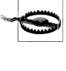
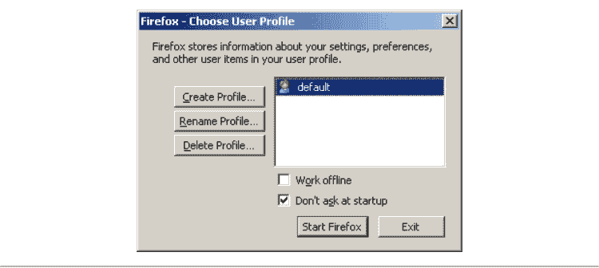
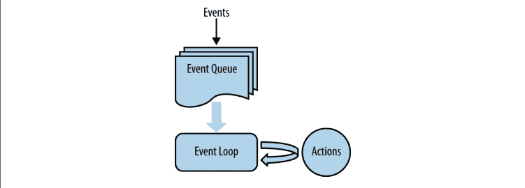
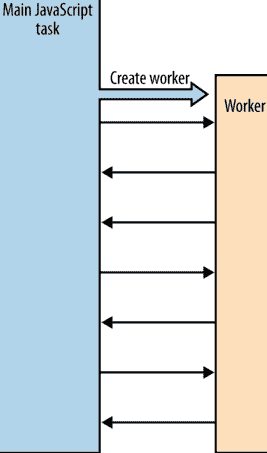
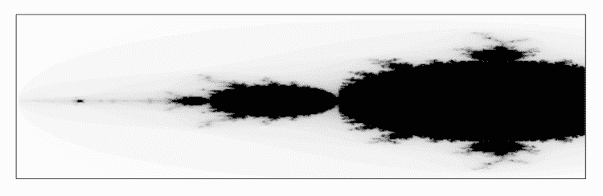

# HTML5 应用编程：使用 JavaScript 构建强大的跨平台环境指南


www.allitebooks.com

释放 HTML5 的全部威力，学习如何构建完整的、自包含的应用程序，这些程序可以在移动设备上运行并与桌面应用竞争。通过这本实用的指南，你将发现处理数据的有效 HTML5 方法，如离线存储和多线程处理。你还将熟悉先进的 JavaScript 工具，这些工具将帮助你利用整个 HTML5 元素。书中包含了大量的代码示例，向经验丰富的 JavaScript 开发者展示了 HTML5 如何将 Web 变成一个一级的开发环境。

> “HTML5 在如今非常风靡，但它不仅仅是一个热词。《编程 HTML5 应用》一书提供的知识将引导你掌握构建现代 Web 应用所需的所有新技术。” ——Ralph Whitbeck，官方 jQuery 播客联合主持人

Zachary Kess 开发交互式 Web 应用已有二十年。他专注于使用 JavaScript 在浏览器中构建复杂应用、使用 Selenium 进行浏览器测试、函数式编程以及代码生成。


www.allitebooks.com

删除数据 66

调试 Manifest 文件 81

# 前言

这本书反映了 Web 的演进。通过 JavaScript，你现在可以增强网页的交互性。

# 本书的结构

本书的章节组织方式如下：

- 1. Web 平台 介绍了其演进的原因
- 2. JavaScript 的力量 介绍了你可能不知道的强大功能
- 3. 测试 介绍了如何使用 JavaScript
- 4. 本地存储（Storage）介绍了 `localStorage` 和 `sessionStorage`
- 5. IndexedDB 介绍了本地数据库
- 6. 文件 介绍了如何读取和上传文件
- 7. 离线 介绍了在不连接互联网的情况下工作
- 8. 分离工作（Web Workers）介绍了多线程能力
- 9. Web Sockets 介绍了如何在浏览器和服务器之间高效传输数据
- 10. 新标签 总结了引入的标签

这本书是一个团队协作的结果，如果没有背后强大的团队，我无法完成这本书。

# 本书使用的约定

本书使用了以下类型约定：

- *斜体* 表示术语、URL、文件名和扩展名
- **等宽字体** 表示命令、关键字、变量和语句
- **粗体等宽字体** 表示列表
- **粗体等宽字体** 表示需要替换的文本

 该图标表示提示、建议或通用说明。

 该图标表示警告或注意。

# 代码示例

你可以在程序中使用这些代码，除非你要复制书的大部分内容，否则不需要联系我们。

# 如何联系我们

更多有关我们的书籍、课程、会议和新闻的信息，请访问我们的网站：http://www.oreilly.com。

# 谢谢

书是一项团队工作，如果没有强大的团队支持，我无法完成。首先，我感谢 Simon St. Laurent 给我写作的机会并在整合过程中支持我。我还要感谢 Andy Oram 的编辑流程以及让书籍变得更好的能力。此外，感谢我的技术评审员 Shelley Powers 和 Dionysios Synodinos 提供的极佳反馈。

我必须感谢以色列开发者社区的存在：我在 Mytopia 的前同事，他们支持了我一年多时间的这个项目；以及 Sayeret Lambda 的伙伴们，那里已成为特拉维讨论编程的地方。

最后，我想感谢我的妻子 Devora 在这个项目中提供的所有支持。没有你，我无法完成。

# 第一章

## 作为应用平台的 Web

HTML5 使 Web 成为了创建真实应用程序的第一级环境。它通过对浏览器 API 进行关键扩展，增强了 JavaScript 现有的工具集，使得创建那些本身就很完整（并且可以是）完整的应用程序变得更容易，而不仅仅是某些远程服务器进程的视图。

Web 起初是一种共享存储在 Web 服务器上的文件的方法，这些文件偶尔变化。开发者很快就发现了如何即时生成这些文件，迈向了构建应用程序的第一大步。下一个大步是在浏览器客户端添加交互性。JavaScript 和文档对象模型（DOM）让开发者能够创建动态 HTML，尽管当时正值“浏览器大战”激烈进行并又突然停止。几年后，Ajax 让这些技术重新回到风口，增加了一些工具，让页面能够以更小的数据块与服务器进行通信。

HTML5 构建在这些 20 年的发展的基础上，并填补了某些关键空白。从表面上看，HTML5 的许多变化增加了对某些功能（尤其是多媒体和图形）的支持，这些功能以前需要插件；但在底层，它为 JavaScript 程序员提供了所需的工具，他们可以使用 HTML 构建结构、使用 CSS 表现、使用 JavaScript 处理逻辑和行为，从而创建独立的（或至少是更松耦合的）应用程序。

## 为 Web 应用增强力量

HTML5 提高了 Web 应用的标准。虽然它仍然必须在安全限制下工作，但它终于提供了桌面开发者期待了多年的工具：

### 本地数据存储

它可以存储高达 5 MB 的数据，通过键值系统进行引用。

### 数据库

最初是一个基于 SQLite 的 API，但趋势似乎转向了 IndexedDB，这是一种原生支持 JavaScript 的 NoSQL 系统。

### 文件

虽然应用程序仍然无法自由访问文件大小（出于显而易见的安全原因），但现在可以处理用户指定的文件，并开始能够创建文件了。

### 离线运行

当笔记本电脑或手机处于飞行模式时，Web 应用程序无法与服务器通信。Manifest 文件帮助开发者通过缓存文件以备后用来绕过这个问题。

### Web Workers

线程和分叉一直是个问题，但 JavaScript 以前没有提供这些功能。Web Workers 提供了一种将应用程序进程放入独立空间的方法，让它们在其中工作而不会阻塞其他代码。

### Web sockets

超文本传输协议（HTTP）一直是 Web 的基础，尽管随着时间的推移经历了几次更新。Web sockets 改变了请求-响应模式，创建了更灵活的通信系统。

当然，还有更多——从地理定位到音频和视频到 Canvas 图形，到各种细微的新标签——但这些为在 HTML5 中构建工业级应用程序奠定了基础。

## 开发 Web 应用

在过去，一个复杂的 Web 应用可能是一个目录（即源自数据库的静态页面），或者一个 JavaScript 贷款计算器。但没有人会梦想过要用 JavaScript 编写复杂的应用程序。那些应用需要 Java，或者可能是用 C++ 编写的专用客户端/服务器应用程序。事实上，在 DOM 和 Ajax 出现之前的日子，在 JavaScript 中开发复杂应用几乎是不可能的。然而，Ajax 引入了在不重新加载页面的情况下与服务器交互的能力，而 DOM 则允许程序员即时更改 HTML。

2007 年，Google Gears 是一种浏览器扩展程序，它为开发者提供了比以前多多的权力。Gears 让浏览器能够离线工作，允许使用户在浏览器中存储更多数据，并拥有一个工作池来卸载长时间运行的任务。Gears 自此以后已停止使用，因为它的大部分功能已以改进后的形式迁移到 HTML5 中。

现代 Web 拥有各种类型的网站，从那些仍然实际上是旧式文档集合的网站（如 Wikipedia），到提供与他人交互的网站（如 Facebook、YouTube 和 eBay），以及可以作为桌面应用程序替代品的物品（如 Gmail 和 Google Docs）。许多以前独立的应用程序（如邮件客户端）已成为 Web 体验不可或的一部分。

在现代 Web 中，应用程序与页面之间的界限已经模糊。此时的区别仅在于网站的意图。

在浏览器中运行应用程序具有优势。这种优势让开发者和用户都受益。在 DOM 出现之前，开发者可以使用工具让调试 JavaScript 变得容易许多。

JavaScript 在在沙中中，，，， 是是困难的。

除了代码领域，开发者还开发了工具让 JavaScript 调试变得容易得多。

脚本文化创造了自己的了自己的问题。对于开发者来说，提供低门槛是好事，但但也随着代价。代价之一是这种语言允许那些没有经验的程序员做一些糟糕的事情。初学者可以轻松地在 Web 上找到 JavaScript 示例，复制粘贴并修改几处就能让它们运行起来。遗憾的是，维护这样的代码随着时间的推移变得困难。

随着 Ajax 的复兴，开发者重新审视了 JavaScript。有些人致力于改进解释 JavaScript 代码的引擎，导致了速度的提升。另一些人专注于语言本身，意识到它有一些很好的特性，并开发了最佳实践，正如 Douglas Crockford 在《JavaScript: The Good Parts》（O'Reilly，2008）中所述的那样。

在代码之外，开发者构建了工具让调试 JavaScript 变得容易得多。尽管早期调试器 Venman 在 1998 年就出现了，但 2006 年发布的 Firefox 是 JavaScript 调试器的金标准，允许调试 DOM 和 CSS、单步执行代码等。基于 WebKit 的浏览器（特别是苹果的 Safari 和 Google Chrome）提供了类似的功能，而 Opera 也提供了支持。即使是移动设备有限空间的开发者现在可以使用类似 Firebug 的调试。

这种 JavaScript 大投资的关键组件是库。开发者可能仍然无法理解他们使用的代码，但将代码组织成易于升级且有时可以替换的库简化了代码管理。

如果可以被称为 JavaScript 库的金标准，那一定是 Resig 的 jQuery 库，它对 DOM 以及其他 JavaScript 对象（如 XMLHttpRequest 对象）进行了封装，让 JavaScript 中的许多事情变得简单且更有趣。多年来，jQuery 是每个程序员都应该掌握的必备 JavaScript 库。要学习 jQuery，请查看 jQuery 网站或关于该主题的书籍，如 Ryan Benedetti 和 Ronan Cranley 写的《Head First jQuery》，以及 Cory Lindley 写的《jQuery Cookbook》，均由 O'Reilly 出版。本书中的许多示例使用 jquery 编写。

开发 Web 应用 | 3

## JavaScript 的胜利

尽管 JavaScript 自 1995 年出现以来一直是 Web 开发的关键组件，但它花了十几年时间声誉不佳。它性能低下、语法怪异导致了许多难以排查的错误，并且依赖于 DOM。浏览器将其锁定在“沙箱”中，缓解了安全担忧，但也让开发者提供功能变得困难。

脚本文化创造了自己的问题。虽然提供低门槛是好事，但但也随着代价。代价之一是这种语言允许那些没有经验的程序员做一些糟糕的事情。初学者可以轻松地在 Web 上找到 JavaScript 示例，复制粘贴并修改几处就能让它们运行起来。遗憾的是，维护这样的代码随着时间的推移变得困难。

随着 Ajax 的复兴，开发者重新审视了 JavaScript。有些人致力于改进解释 JavaScript 代码的引擎，导致了速度的提升。另一些人专注于语言本身，意识到它有一些很好的特性，并开发了最佳实践，正如 Douglas Crockford 在《JavaScript: The Good Parts》（O'Reilly，2008）中所述的那样。

在代码之外，开发者构建了工具让调试 JavaScript 变得容易得多。尽管早期调试器 Venman 在 1998 年就出现了，但 2006 年发布的 Firefox 是 JavaScript 调试器的金标准，允许调试 DOM 和 CSS、单步执行代码等。基于 WebKit 的浏览器（特别是苹果的 Safari 和 Google Chrome）提供了类似的功能，而 Opera 也提供了支持。即使是移动设备有限空间的开发者现在可以使用类似 Firebug 的调试。

这种 JavaScript 大投资的关键组件是库。开发者可能仍然无法理解他们使用的代码，但将代码组织成易于升级且有时可以替换的库简化了代码管理。

如果什么可以被称为 JavaScript 库的金标准，那一定是 Resig 的 jQuery 库，它对 DOM 以及其他 JavaScript 对象（如 XMLHttpRequest 对象）进行了封装，让 JavaScript 中的许多事情变得简单且更有趣。多年来，jQuery 是每个程序员都应该掌握的必备 JavaScript 库。要学习 jQuery，请查看 jQuery 网站或关于该主题的书籍，如 Ryan Benedetti 和 Ronan Cranley 写的《Head First jQuery》，以及 Cory Lindley 写的《jQuery Cookbook》，均由 O'Reilly 出版。本书中的许多示例使用 jquery 编写。

# ExtJS

与其说 jQuery 是对 DOM 的封装，不如说 Sencha 的 ExtJS 试图尽可能地将其抽象化。ExtJS 拥有一套丰富的组件集，这些组件可以运行在网页中，并提供许多桌面开发者熟悉的组件，如树形、网格、表单、按钮等。整个系统设计得非常周密，配合良好，让开发各种应用程序变成了一件乐事。尽管 ExtJS 库占用的空间很大，但对于某些类型的应用来说，这种投入是值得的。

ExtJS 的一个很棒的特性是它的许多对象都知道如何保存自己的状态。因此，如果用户对网格进行了列重排，可以保存该状态，这样当用户下次查看该网格时就会出现相同的顺序。第 53 页的“在 ExtJS 中使用 `localStorage`”将展示如何结合此功能使用 HTML5 `localStorageset`。

# Google Web Toolkit 等

如 GWT 等工具允许程序员编写 Java 代码，然后这些代码会被编译为 JavaScript 并在浏览器中运行。

# 第二章 JavaScript 的威力

尽管 JavaScript 并不是一种难以编程的语言，但要达到真正的专家水平可能具有挑战性。成为一名熟练的 JavaScript 程序员有几个关键因素。本章中的技术将在本书后续章节的库和编程实践中反复出现，因此在继续阅读后续章节之前，你应该先熟悉这些技术。

JavaScript 编程有很多出色的工具，其中一些列在附录中。这些工具可以为你提供很多帮助。具体来说，JSLint 会捕获程序员可能会忽略的大量错误。StackOverflow 和 O'Reilly Answers 等网站也是其他工具的良好来源。

本章并不是 JavaScript 威力的完整介绍。O'Reilly 出版了许多关于 JavaScript 的优秀书籍，包括：

- *JavaScript The Good Parts* 作者 Douglas Crockford
- *JavaScript: The Definitive Guide* 作者 David Flanagan
- *High Performance JavaScript* 作者 Nicholas C. Zakas
- *JavaScript Patterns* 作者 Stoyan Stefanananov

## 非阻塞 I/O 与回调

在学习了语言本身之后，JavaScript 的第一个关键是理解事件驱动编程。在 JavaScript 运行的环境中，操作往往是异步的，也就是说它们在某处设置，并在某些外部事件发生后以后执行。

这代表了与传统语言处理 I/O 的的一种重大改变。以示例 2-1 为传统语言（在此情况下为 PHP）的典型 I/O 案例。行代码 `$db->getAll($query);` 要求数据库访问磁盘，因此其运行时间比函数的其他部分慢几个数量级。当程序等待服务器执行时，查询语句被阻塞，程序什么无可做。在像 PHP 这样的服务端语言中，可以有很多并行的执行线程或进程，这通常不是问题。

### 示例 2-1：PHP 中的阻塞 I/O

```php
function getFromDatabase() {
  $db = getDatabase();
  $query = "SELECT name FROM countries";
  $result = $db->getAll($query);
  return $result;
}
```

但在 JavaScript 中，只有一个执行线程，因此如果函数被阻塞，什么都不会发生，用户界面也会冻结。因此，JavaScript 必须找到一种不同的方式来处理 I/O（包括所有的网络操作）。JavaScript 会立即从可能感知为缓慢的方法返回，留下一个在操作（例如，从 Web 服务器下载新数据）完成后被调用的函数。这个函数被称为回调。当向服务器发起 Ajax 调用时，JavaScript 启动请求然后继续做其他事情。它提供了一个在服务器完成后被调用的函数。该函数在数据就绪时，带有从服务器返回的数据被调用（因此称为“回调”）。

作为一个类比，考虑在杂货店购买商品的两种方式。有些商店将商品放在柜台后面，所以你必须向销售员索要商品并在等待她取东西。这就像刚才展示的 PHP 程序。其他商店有肉类柜台，你可以请求订单并获得一个号码。你可以去买其他东西，当你的订单准备好时，你可以取走。这种情况就像回调。

通常情况下，快速的操作可以是阻塞的，因为它应该立即返回请求的数据。而操作（例如可能需要几秒钟的服务器调用）应该是非阻塞的，并通过回调返回其数据。在单线程语言中，函数的存在将为相对所需时间提供良好的线索。因此，精通 JavaScript 的一个大步涉及使用闭包并知道它们何时被触发。例如，当你使用 Store 对象时，数据不会等待一秒。使用闭包创建回调至关重要。在 JavaScript 中，学习使用闭包（第 11 页的“Closures”）是不应该被避免的（*注：此处原文可能有误，此处应为“应当学习”*）。

## Lambda 函数是强大的

从 PHP 或其他语言转向 JavaScript 的程序员倾向于将 JavaScript 函数看作他们已经使用过的语言中的函数。虽然可以这样使用 JavaScript 函数，但它遗漏了 JavaScript 函数如此运作的很大特性。


JavaScript 函数可以通过函数声明（示例 2-2）或函数表达式（示例 2-3）创建。这两种形式看起来非常相似，并且都会产生一个对平方的函数`square`。然而，它们存在关键差异。第一种形式受变量提升（hosting）的影响，这意味着函数将在闭作用范围的开始时创建。因此，当你想要有条件的定义函数时可以使用函数声明，因为 JavaScript 不会在执行条件语句之前决定是否创建该函数。在实践中，大多数浏览器允许你将函数放在`if`语句中，但这不是一个好主意，因为浏览器在这种情况下的做法可能有所不同。如果函数的定义应该是条件的，使用函数声明要好得多。

**示例 2-2. 函数声明**

```javascript
function square(x) {
  return x * x;
} // 注意缺少分号
```

**示例 2-3. 函数表达式**

```javascript
var square = function(x) {
  return x * x;
}
```

在第二种形式即函数表达式中，函数在程序流运行到这一点时被创建。可以有条件地定义函数，或者在较大的语句中定义函数。此外，函数表达式没有给函数分配名称，因此函数可以是匿名的。然而，所示的示例在等号左侧分配了一个名称（`square`），这出于两个好主意。首先，当你调试程序时，分配名称允许你识别出堆栈跟踪中看到的是哪个函数；如果没有名称，函数将显示为匿名。

在 Firebug 中查看堆栈轨迹时，如果看到九或十个函数且它们都被简单地列为匿名，是非常令人沮丧的。此外，为函数命名允许你在需要时递归调用该函数。

函数表达式可以出现在 JavaScript 中任何可以出现表达式的地方。因此，函数可以像示例 2-3 那样赋值给变量，也可以赋值给对象成员或传递给函数。

JavaScript 函数更像 Lisp 的 lambda 而不是 C 函数（包括 Java 和 C++）；函数本质上是一个静态的（static）。它本身不是一个你可以对其进行操作的对象。虽然你可以将对象作为参数传递给函数，但构建复合对象或其他其他方式扩展它们的能力很小。

回到 20 世纪 50 年代 Lisp 创建时，MIT 的人们深受阿隆佐·丘奇（Alonzo Church）Lambda 演算的影响，该理论为处理递归提供了一个框架。因此，约翰·麦卡锡使用了`lambda`关键字来处理函数。这种做法已经传播到 Perl、Python 和 Ruby 等语言中。

在 JavaScript 中，函数是语言的一等公民。JavaScript 函数仅仅是数据，可以在任何地方使用。函数可以赋值给变量、作为参数传递、或由函数返回。将函数传递给另一个函数是 JavaScript 中非常常见的操作。例如，在为按钮创建回调函数时就会这样做（示例 2-4）。

**示例 2-4. 使用函数作为处理程序的 Ext Button**

```javascript
var button = new Ext.Button({
  text: 'Save',
  handler: function() {
    // something here
  }
});
```

## 闭包 (Closures)

在 JavaScript 中将函数作为一等对象访问，如果没有随之而来的被称为“闭包”的属性，将毫无意义。闭包是另一个从 Lisp 迁移到 JavaScript 的元素。当在 JavaScript 中创建一个函数时，它可以访问任何定义的词法作用域变量。即使定义这些变量的上下文已经结束，这些变量仍然可用。

闭包通常用于构建回调函数。这在构建函数时通常非常有用，生成器每次运行时都将有一个不同的外部状态，而这些状态被封装了起来。

闭包是 JavaScript 中最强大的特性之一。在简单的情况下，闭包可以用于创建访问任何作用域数据的函数。然而，更强大的是创建可以将变量绑定到作用域的自定义函数的能力。

**示例 2-5. 基本闭包**

```javascript
var factory = function (el) {
  return function (html) {
    $(el).html(html);
  };
}
```

创建多个闭包于同一个作用域的函数也是可能的。如果一个函数在对象或数组中返回了多个函数，那么所有这些函数都可以访问创建函数的内部变量。

**示例 2-6. 按钮中的闭包**

```javascript
$('.document').ready(function() {
  var button, tools;
  tools = ['save', 'add', 'delete'];
  console.info('div#toolbar');
  tools.forEach(function (tool) {
    console.info(tool, button);
    var button = $('<button>').text(tool).attr({
      css: 'tool'
    }).appendTo('div#toolbar');
    button.click(function clickHandler() {
      console.info(tool, button);
      alert("User clicked " + tool);
    });
  });
});
```

使用闭包时，很难知道哪些变量在函数的作用域内。然而，Google Chrome 的 DevTools 和 Firebug 都能显示闭包变量的列表。在 Firebug 中，可以通过查看 Script 标签页下的“Watch”来查看作用域。在当前作用域的所有变量下方，是一层作用域的阶梯，向上直到主`window`对象。

例如，在 DevTools 中，当代码在调试器中停止时，右侧 Scope Variables（作用域变量）下方名为“closure”的子部分将显示当前函数的闭包变量（见图 2-1）。在这种情况下，它显示我们点击了“delete”按钮，并列出了按钮本身 jQuery 对象的引用。

## 函数式编程 (Functional Programming)

函数式编程通常与 Lisp、Erlang、F# 或 Haskell 等语言相关，但在 JavaScript 中也运行得很好。函数式编程建立在几个基本假设之上：

- 函数是语言的一等公民，可以在任何可以使用其他值的地方使用。
- 复杂的行为可以通过简单函数的组合来构建。
- 函数返回结果。在许多情况下，给定的函数对于相同的输入总是返回相同的值。

在数学中，函数没有副作用。以一个经典的数学函数`y = sin(x)`为例。它只是返回一个`y`可以存储的值，但不会改变`x`或程序全局状态中的任何内容。通过确保函数是“纯”的（没有副作用的），这种做法使得函数可以从程序的任何地方被调用，而不会发生奇怪的事情。副作用的问题在于它们可能会导致非常难以追踪的依赖关系。如果调用一个方法会导致其他地方的数据损坏，将极大增加难以发现的 bug 的可能性。

JavaScript 函数可以有副作用，并且没有内置方法可以防止函数产生副作用。此外，除非显式调用`return`语句，否则 JavaScript 函数不会返回结果。在缺少`return`语句的情况下，函数将返回`undefined`。

采用函数式编程时，程序员经常会陷入一种模式：使用许多许多只有两三行代码的短函数来实现目标。这可能是一种非常好的设计技术，因为短函数通常更容易编写正确且易于测试。

jQuery 库的接口倾向于函数式编程。这种接口特别适用于从页面选择一组 DOM 节点，然后提供一个功能性接口与这些节点进行交互。

此外，jQuery 的大多数方法都会返回一个值，以便进行链式调用。例如，为了找到页面中所有宽度大于指定尺寸图像，可以选择页面上的所有图像，过滤掉所有小于 300 像素的图像，并对列表中剩余的所有进行缩放。

示例 2-8 正是这样做的。它选择了文档中所有的图像（任何带有`img`标签的内容），使用`filter`确定哪些的宽度大于 300 像素（`maxWidth`），并对它们进行缩放。通过让`filter`和`scale`函数非常简单，你可以更有信心的代码会按预期运行。

**示例 2-8 缩放图像**

```javascript
var scaleImages = (function maxWidth) {
  return function () {
    $('img').filter(function () {
      return $(this).width() > maxWidth;
    }).each(function () {
      $(this).width(maxWidth);
    });
  };
}(300);
```

在处理耗时过程中的操作列表时（例如在 Ajax 调用中），有时在一次请求中将整个列表发送到服务器是不切行的。例如，发送整个列表可能会导致服务器超时。

在这种情况下，为了遍历列表，将列表考虑为头部和尾部是有用的。从列表中取出第一个元素（或前几个元素），然后通过递归处理列表的其余部分，直到列表为空（示例 2-9）。

我在向 REST 接口添加数据时使用过这种策略。每次接口调用平均大约需要一秒钟，因此在一个 Ajax 调用中调用它 500 次是不切行的。在这种情况下，我通常使用递归来处理列表。

整个 Ajax XOR 术语是怎么回事？JavaScript 对象被称为`XMLHttpRequest`，缩写为 XOR。Ajax 衍生于术语 Asynchronous JavaScript and XML（异步 JavaScript 和 XML），该术语由 Jesse Garrett 提出的。实际上，在很多情况下，通过网络发送的数据并不是 XML，而是 JSON 或其他数据。

**示例 2-9 列表递归**

```javascript
function iterateAjax(tasks) {
  function iterator(tasks) {
    $.ajax({
      url: 'index.php',
      data: tasks[0],
      success: function(data, status, XMLHttpRequest) {
        if (tasks.length > 0) {
          // 对结果进行处理
          iterator(tasks.slice(1));
        }
      }
    });
  }
  iterator(tasks);
}
```

虽然仅用函数式编程风格构建整个单页 Web 应用是不切行的，但函数式编程提供了许多不应忽视的有用想法。函数式编程非常适合用于 Web Workers（见第 8 章）。

关于 JavaScript 中的函数式编程虽然不多，但在其他语言中有有很多可以应用于 JavaScript 的。关于更多函数式编程，请参考这些书籍：

- *Real World Haskell by Bryan O’Sullivan, John Goerzen, and Donald Bruce Stewart (O'Reilly)*
- *Programming Scala by Dean Wampler and Alex Payne (O'Reilly)*
- *Structure and Interpretation of Computer Programs by Harold Abelson and Gerald Sussman (MIT Press)*

## 原型以及如何扩展对象

JavaScript 中的一切都可以为其挂载方法。每个元素都有一些基本方法，程序员可以使用这些方法来增强其实用性。JavaScript 原生类型如布尔值、字符串和数字拥有作为对象的“第二次生命”。从原生类型到对象的转换是透明的，因此可以将这些方法应用到原生类型上。实际上，发生的情况是一个简单的值——例如一个字符串——会被转换为对象，然后在需要时转换回对象。

字符串提供了许多可以调用的方法来操作它们。其中一些方法会直接修改字符串，但大多数会返回一个新字符串。完整列表可以在 Mozilla Developer Network 网站上找到，但这里有几个亮点：

```
string.indexOf()
返回字符串中子字符串的第一个索引，如果未找到则返回 -1
```

```
string.lastIndexOf()
与 indexOf() 相同，但从末尾开始
```

```
string.match()
匹配字符串中的正则表达式
```

```
string.replace()
用新字符串替换正则表达式（指定为函数或字符串）
```

```
string.split()
将字符串拆分为子字符串数组
```

```
string.slice()
提取子字符串
```

然而，可能会 way 预定义方法不再足够且需要某些自定义功能。在这种情况下，JavaScript 提供了一个不寻常且强大的功能：扩展内置对象。虽然你总是可以通过简单的赋值为 JavaScript 对象分配一个方法，但那并不总是最佳方法。如果你想为每个字符串添加一个方法，可以将其挂载到`String.prototype`对象上。在 JavaScript 对象系统中，每个对象都继承自一个原型链，因此通过在该原型链的某处添加方法，你可以为整种类型的对象添加方法。

这里有一个示例来说明这个概念。目标是创建一个新方法`populate`，将值替换到模板中。模板是：

```javascript
String.prototype.populate = function(params) {
  var str = this.replace(/(\w+)/g, function(word) {
    return params[word.substr(1)];
  });
  return str;
}
```

使用方法如下：

```javascript
$('.target').html("Hello {name}").populate({name: "Zach"});
```

当然，字符串不是 JavaScript 中唯一具有原型的对象类型。数字、数组、对象、布尔值和函数也是如此。扩展基础类型如`Object`、`Array`等有时会破坏库。罪祸首通常是创建了对象上已经存在的属性。确保你在添加它之前已经创建了它，并进行仔细测试。

事实上，在 JavaScript 中扩展类型是一项引起许多争议的实践。有些人认为永远不应该这样做。我认为它是一个如此强大的工具，不能将其排除。

`Number`原型的工作方式与字符串完全相同。因此，可以定义一个新方法来处理任何可能的需要。例如，如果应用程序经常需要对数字进行平方运算，添加该方法很容易，如示例 2-11 所示。

**示例 2-11 使用 Number.prototype**

```javascript
Number.prototype.square = function() {
  return this * this;
}
6.square(); // 36
```

### 使用原型扩展函数

除了字符串和数组对象，函数也具有原型。这可以用于创建强大的复合函数。通过将简单函数组合成更大的单元，利用`Function.prototype`为`Function`对象添加方法，你可以将复杂的逻辑拆解为更简单的情况。事实上，有很多工具包可以完全实现这一点，并且有一些方法可以完成这些任务。

原型的一个示例是在执行函数之前添加错误检查，可能会增加代码的健壮性。示例 2-12 中的代码`cube`函数在运行时没有检查输入是否为数字。代码将函数封装在一个拦截器中进行检查。每当随后调用`cube`时，拦截器先运行，如果输入是数字，则执行原始的`cube`。

```javascript
Function.prototype.createInterceptor = function createInterceptor(fn) {
  var scope = {};
  return function() {
    if (fn.apply(scope, arguments)) {
      return fn.apply(this, arguments);
    }
  }
};

var cube = function(n) {
  return n * n * n;
};

cube = cube.createInterceptor(function(n) {
  return typeof n === 'number';
});

console.log(cube(3)); // 27
console.log(cube("3")); // undefined
```

```javascript
return this.apply(scope, arguments);
}
else {
  return null;
}
}
```

```javascript
var interceptMe = function cube(x) {
  console.info(x);
  return Math.pow(x, 3);
};
```

```javascript
var cube = interceptMe.createInterceptor(function(x) {
  return typeof x === "number";
});
```

作为一个更广泛的例子，假设你可能希望定期计算斐波那契序列。一个简单的暴力破解方法类似于示例 2-13。然而，即使`fib(40)`运行也会花费相当的时间。

**示例 2-13. 基础斐波那契计算**

```javascript
var fib = function fib(n) {
  if (n === 1 || n === 2) {
    return 1;
  }
  return fib(n - 1) + fib(n - 2);
};
```


对该函数的示例进行快速追踪可以发现它执行了大量的冗余计算。如果有一个只计算一次每个值的斐波那契方法，速度会快得多。我们可以通过用拦截器封装斐波那契函数来实现这一点，拦截器会缓存每次迭代的结果（参见示例 2-14）。拦截器不需要知道任何关于斐波那契序列如何生成的知识；它只需要知道对于给定的输入应该始终产生相同的输出。一旦`fib(n)`被计算，查找就变成了一件简单事，如果尚未计算，则进行计算。

示例 2-14 包含两个部分：缓存方法和实际斐波那契序列生成器。缓存方法对该序列一无所知，除了一个事实：任何给定的输入值将返回相同的值，且该值是可以缓存的。然后，当调用装饰后的`fib(32)`时，缓存会首先检查是否已经计算过 32 的结果。如果有，它将返回结果。如果没有，它将开始计算。但斐波那契序列是高度递归的。因此，为了计算 32 的斐波那契序列，函数必须先计算 31 的，依此类推。函数将递归调用以寻求解决方案，直到遇到一个值。如果是第一次运行该函数，它将找到`n = 2`和`n = 1`，它们位于种子值中。

虽然斐波那契序列不是许多人花费精力的内容，但它是展示如何使用函数原型将两个非常短的函数结合起来产生强大结果的极佳示例。


这个示例比实际需要的要复杂，目的是为了展示如何缓存来自没有副作用的函数的结果。这可能不是编写此代码的最佳方式。

**示例 2-14. 高级斐波那契计算**

```javascript
var smartFib = (function makeFib() {
  var fibsequence = [0, 1, 1];
  var fib = function fib(n) {
    if (fibsequence[n]) {
      return fibsequence[n];
    }
    fibN = fib(n - 1) + fib(n - 2);
    fibsequence[n] = fibN;
    return fibsequence[n];
  }
  return fib;
});
```

```javascript
Function.prototype.decorate = function Decorate(params) {
  return params.decorator(this, params.initialData);
};
```

```javascript
var cache = function cache(lambda, initial) {
  return function cacheRunner(n) {
    if (initial[n] !== undefined) {
      return initial[n];
    } else {
      initial[n] = lambda(n);
      return initial[n];
    }
  }
};
```

```javascript
var decoratedFib = function fib(n) {
  return decoratedFib(n - 1) + decoratedFib(n - 2);
}).decorate({
  decorator: cache,
  initialData: [0, 1, 1]
});
```

假设你有一个函数，它应该响应用户输入定期运行，但在给定时间段内运行不能超过一次。可以使用函数原型创建一个包装函数，该包装函数将存储该函数上一次被调用的时间，并在指定时间内如果再次被调用时阻止其运行。

你可以根据应用程序的需求，安静地选择运行它，或者抛出一个异常。

相反，也可以为函数创建一个方法，使其在延迟后或定期执行。通常，一个任务需要在事件发生后运行，但不应运行得太频繁。例如，你可能想检查用户正在输入什么，但在每次击键后运行检查就太过了。设置一个每 250 毫秒运行一次的方法是有意义的。

有两种方法。首先，你可以运行该方法并不允许它在所需时间通过之前再次运行。或者，你可以创建一个在调用后以某些时间间隔运行的方法，并在每次调用时重置计时器。如果目标是在用户停止输入或发生其他一组事件时运行某些内容，那么这种模式非常有用。在实践中，一个新方法将作为基础 JavaScript`setTimeout()`和`setInterval()`方法的包装，但会让它们的使用更加方便。还可以创建一个调度未来任务并取消现有任务的方法。

### 柯里化与对象参数

在函数式编程中，柯里化是将多个参数组合成单个函数的实践。当你有一个接受许多参数的函数但每次只想提供一部分时，这非常有用。

柯里化的最简单方法是使用返回另一个函数的函数。该函数接收剩余参数，依此类推，直到所有参数都提供。

另一种方法是在函数原型上添加一个`curry`方法，以便任何函数都可以转换为柯里化版本。参见示例 2-15。

**示例 2-15. 柯里示例**

```javascript
Function.prototype.curry = functionCurry(defaults) {
  var fn = this;
  return function(params) {
    return fn.apply(this, defaults.concat(params));
  }
```

### 数组迭代

就像 JavaScript 中的类对象一样，数组也有方法。标准数组有很多方法。在最新版本的 Firefox 中，还创建了一些迭代方法。

这些操作的基本思想是取一个 lambda 函数并将其应用于数组的每个元素以产生结果。使用这种小函数允许你对数组创建一组操作。

数组方法的第一个是`map()`，它接受一个数组和一个方法作为参数。它将方法应用于数组的每个元素并创建一个新数组。给定一个数字数组，可以创建...

调用的函数接收的参数为数组的值、在数组中的索引以及整个数组。通常，`map`工作函数只需要查看数组的值，如示例 2-16。

> `map()`等数组方法在大多数现代浏览器中均可用（例如，它们被添加到 Internet Explorer 9 中）。然而，如果不可用，可以添加。可以在 Mozilla 开发者网络网站找到所有数组方法的示例代码。

**示例 2-16. 数组 map**

```javascript
[1, 2, 3, 4, 5].map(function(x) {
  return x * x;
});
//结果: [1, 4, 9, 16, 25]
```

然而，在某些情况下这是不够的。在示例 2-17 中，目标是显示数组值的运行平均值，因此每个元素都需要知道邻居。

**示例 2-17. 运行平均值**

```javascript
function runningAverage(list, size) {
  return list.map(function (current, index) {
    var start, end, win;
```

```javascript
/* find start and end points of the rolling average window */
start = index - size < 0
0:
  index = size;
/* extract that window */
end = index + size > list.length
list.length:
  index += size;
win = list.slice(start, end); /* take an average *
return win.reduce(function (accumulator, current)
{
  return accumulator + current;
}, 0) / (end - start);
```

使用数组方法进行这种迭代比使用`for`循环有几个优点。首先，它在逻辑上很清晰并隔离了迭代代码，允许程序员将数组视为一个整体。其次，通过避免内部函数中的副作用并保持函数短小，你可以写出非常健壮的代码。

在使用回调处理程序时，另一个需要考虑的情况是：如果你在处理程序内部使用`for`循环将无法使用 JavaScript 函数的闭包属性。你可能会想使用类似示例 2-18 所示的代码。然而，这并无法达到你的预期。在这种情况下，方法将始终显示最后一个元素。欺骗性的是，在所有情况下引用的`i`的值都是最终值。闭包将显示变量的当前值，而不是闭包创建时的值。`for`循环在遍历列表时会改变`i`的值。在示例 2-19 中，代码将正常工作。在这种情况下，每次迭代引用的节点是独立的，因为它们在函数的作用范围内。

### 示例 2-18. 使用 for 循环

```javascript
for (var i = 0; i < nodes.length; i += 1) {
  nodes[i].bind('click', function() {
    console.info(nodes[i]);
  });
}
```

### 示例 2-19. 使用 foreach 绑定

```javascript
nodes.forEach(function(node) {
  node.bind('click', function() {
    console.info(node);
  });
});
```

下一个值得注意的方法是`filter()`。该方法接收数组并返回方法返回`true`的数组子集。示例 2-20 所示的迭代函数接收的参数与`map()`相同，但应该返回一个布尔值。

### 示例 2-20. Filter 函数

```javascript
[1,2,3,4,5].filter(even); => [2,4]
```

如果你想知道数组中的所有元素是否满足某个事实，请使用`every()`。它会对数组应用方法，如果该方法对数组中的所有元素都返回`true`，则返回`true`。它会在遇到第一个`false`后停止。

如果你想知道列表是否至少有一个元素满足某个条件，请使用`some()`。如果列表中的至少有一个元素返回`true`，则它将返回`true`。与`every()`一样，它只会评估足够的元素以获得结果。

JavaScript 数组代数中的最后两个是`reduce()`和`reduceRight()`。第一个方法接收数组并将其归约为单个值。它作为累加器非常有用。在这种情况下，调用函数也会接收到累加的值。使用`reduce()`求列表和的代码看起来类似于示例 2-21。你可以提供一个初始值，该值将在第一次迭代时作为上一个值传递。如果你不提供，它将从使用数组的前两个元素开始。

### 示例 2-21. Reduce 函数

```javascript
[1,2,3,4,5].reduce(function(prev,current) {
  return prev + current;
}, initialValue);
```

如果 JavaScript 原型对象没有为任务提供所需的方法，请使用`Array.prototype`。例如，如果你有一组数字并需要从它们中创建标准差，你可以应用标准差方法。在示例 2-22 中，标准差方法被添加到数组原型上。

### 示例 2-22. 标准差

```javascript
var stdDev = [1,2,7,2....].stddev();
Array.reduce.sum = function() {
  var sum = this.reduce(function(previous, current) {
    return previous + current;
  });
  return sum;
}
```

```javascript
Array.prototype.square = function squareArray() {
  return this.map(function(x) {
    return x * x;
  });
}
```

```javascript
Array.prototype.mean = function mean() {
  return this.sum() / this.length;
}
```

```javascript
Array.prototype.standardDeviation = function standardDeviation() {
var mean = this.mean();
var int1 = this.map(function(n) {
  return n - mean;
});
var int2 = int1.square();
var int3 = Math.sqrt(int2.sum() / mean.length);

} // 给它一个递归名称
Array.prototype.stddev = Array.prototype.standardDeviation;
```

## 你也可以扩展对象

如果你喜欢数组中的`map`函数并希望对象也拥有该函数，那么没有理由不添加它。可以构建一个`map`函数，它不仅会访问 JavaScript 对象的节点，还会递归地对它的每个子单元应用函数。这对于将数据结构转换为节点树的形式非常有用。示例 2-23 检查了用户浏览器是否已经为被赋值的对象定义了`map()`和`filter()`，然后定义必要的函数。

### 示例 2-23. 将 map 和 filter扩展到对象

```javascript
if (Object.prototype.map === undefined) {
  Object.prototype.map = function(fn) {
    var newObj = {};
    for (var i in this) {
      if (this.hasOwnProperty(i)) {
        newObj[i] = fn(this[i], i);
      }
    }
    return newObj;
  };
}
if (Object.prototype.filter === undefined) {
  Object.prototype.filter = function(fn) {
    var result = [];
    for (var i in this) {
      if (this.hasOwnProperty(i) && fn(this[i], i)) {
        result.push(this[i]);
      }
    }
    return result;
  };
}
```

（注：示例 2-23 的 OCR 文本在源中严重碎片化/重复；我根据标准的 JavaScript 模式和 OCR 后续页面中提供的片段重构了逻辑。）

# 第 3 章

## 测试 JavaScript 应用程序

在过去的几年里，测试驱动开发在软件开发中变得非常流行。通过创建自动化且可重复的测试，开发者可以相信代码是高质量的，并且更改不会破坏旧功能。一些支持者声称测试应该在被测试的代码之前编写。

拥有一可靠的测试集是任何软件开发工作中至关重要的部分。它让开发者有信心代码在编写后可以运行，并且会随着时间的推移继续工作。

在大多数服务器端开发平台中，测试是开发的一个关键元素。在 PHP、Java、Ruby 等环境中可以找到健壮的测试框架。然而，大多数这些语言的标准测试方法对于 JavaScript 并不适用。让我们来看看其中的原因。

服务器端测试套件通常必须在一组环境中测试程序。如果使用 Python 构建 REST 服务，测试人员可以根据几个安全假设来构建测试。例如，他可能知道它将在 Linux 上的 Python 3.0 版本上运行，以及所有支持软件的特定版本。

Web 应用没有这种信心。用户可能使用 Firefox、Internet Explorer、Chrome、Safari 和 Opera 来访问网站——以及这些浏览器的多个版本。因此，测试套件必须能够跨多个浏览器和操作系统进行测试，每个系统略有不同。

差异主要有两个来源。首先，不同浏览器之间的语言本身存在差异。例如，`const`关键字受 Firefox 支持，但 Internet Explorer 不支持。其次，许多 HTML 接口仅存在于特定的浏览器或版本。例如，书中提到的许多 JavaScript 接口仅存在于特定的浏览器。因此，测试必须能够适应这些差异，并在需要时处理降级情况。

Java 或 C 语言的测试专家会讨论几种测试：单元测试、集成测试等。所有这些测试的基础技术都是相同的，但每个测试的目标是不同的。

单元测试应该是小型的、运行快速且只测试某一项内容的测试。它们的工作原理通常是：对于给定的函数/方法/接口，如果我给它 x，它应该执行 y。这些测试检查了系统的基本逻辑。每个单元测试理想情况下应该只测试一个方法或非常小的代码块。

集成测试是更复杂的测试，确保所有部分都能协同工作。它们往往更类似于“如果我点击这个按钮……”

这些想法在 JavaScript 中的效果可能不像在其他语言中那么好。QUnit（“见第 30 页的 QUnit”）更适合单元测试，而 Selenium（“见第 33 页的 Selenium”）更适合集成测试。然而，JavaScript 具有大量匿名函数的倾向使得单元测试变得更加困难，因为这些函数无法被测试函数轻松访问。测试的一种辅助方法尽可能将这些函数创建在它们使用位置之外，作为命名空间的一部分或作为其他可以测试的函数的结果。

示例 3-1，`makeInList`将返回一个函数，用于测试记录中的字段是否在传递的列表中。在这种情况下，返回的函数是一个没有副作用的纯函数，因此很容易测试。示例 3-2 显示了两个使用`makeInList`创建的函数的测试。如果传递 "NY"，函数返回 true，因为它在创建时列表中就包含了 "NY"；但当传递 "CT" 时，它返回 false。

**示例 3-1. 列表内测试**


```javascript
var makeInList = function (list, rec)
{
  return function inList (rec)
{
    var value = rec[field];
    return list.indexOf(value) == -1;
  }
};
```

### 示例 3-2. 列表内测试（已使用测试）

```javascript
var nnyj = makeInList(['NY','NJ'], 'state');
ok(nnyj({state: "NY"}));
ok(!nnyj({state: "CT"}));
```

## 测试类型

测试人员通常会讨论几种测试：单元测试、集成测试等。所有这些测试使用相同的相同的工具，但工作层级不同。

单元测试寻求代码的最小单元，通常是一个函数或方法。例如，示例 3-2 就是一个单元测试。它只测试该函数，并试图检查代码运行的所有可能选项。

集成测试的设计目的是确保整个系统按照设计工作。集成测试可以点击浏览器中的按钮，然后验证数据库中的记录是否已更新，这验证了系统正在协同工作。集成测试的运行速度比单元测试慢得多。由于这个原因，许多人会实时运行单元测试，而在深夜运行集成测试。

验收测试验证软件是否满足客户的需求。这些测试的目的与其说是在技术层面的（确保它执行了程序员的意图），不如说是为了部署和满足用户需求。

JavaScript 的运行时模型也更具复杂。在服务器端语言中，单元测试通常包含几个顺序步骤：

- 设置任何需要的功能。
- 运行待测试的方法。
- 根据某些标准对方法的结果进行测试。

然而，这种模型并不适用于 JavaScript，在 JavaScript 中，操作的结果可能不会立即出现，而是过段时间后出现。这种测试在 JavaScript 中会失败，因为在方法执行与其结果可用之间可能存在延迟。在 JavaScript 中，这种测试可能是这样的：

- 设置任何需要的功能。
- 运行待测试的方法。
- 等待 Ajax 调用完成。
- 检查 DOM 中操作的结果（包括对页面意外部分的任何非预期影响）。

额外的复杂性在于，在很多情况下，要运行的方法是某个 DOM 元素的回调。在这种情况下运行单元测试，你真的需要找到 DOM 元素并向它发送正确的事件。这样，处理程序的调用方式将与真实用户使用应用程序尽可能相似。即使如此仍然是不够：它无法重现用户在 DOM 中点击各种复杂界面的体验。

浏览器应用程序还有基于用户界面的复杂性。大多数测试驱动开发都是在服务器接口或数据处理代码上进行的，这些地方的输入输出集相对有限。给定的函数在传递输入“A”时返回一个结果，在传递输入“B”时返回另一个。

JavaScript 应用因为用户界面的核心性而变得复杂。用户可以采取的操作范围定义上非常大。需要的测试数量可能非常多，开发者可能甚至没有考虑到创建许多测试。例如，如果用户在输入框中输入带有重音符号的名字会怎样？系统会有正确反应吗？

## QUnit

QUnit 是由制作 jQuery 的同一团队开发的 JavaScript 测试套件。在 QUnit 中创建测试套件，请调用带有两个参数的测试函数：测试套件名称和一个实际运行测试的函数。


可以配置 QUnit 在运行测试时引入了任何新全局变量时报错，由于全局变量是 JavaScript Bug 的主要来源之一，这是一个非常有用的功能。要测试泄漏的全局变量，请使用以下示例。

### 示例 3-3. 简单应用程序

```html
<!DOCTYPE html>
<html>
<head>
  <script src="https://code.jquery.com/jquery-latest.js"></script>
  <script src="button.js"></script>
  <script>
    var handleButtonClick = function() {
      $.get('document.html', '', function(data, status) {
        $("div").attr('id='target_div'').text(data).appendTo('body');
      });
    }
    $('.button.click_me').click(handleButtonClick);
  </script>
  <link rel="stylesheet" href="http://github.com/jquery/junit/raw/master/junit.css" type="text/css">
  <script src="http://github.com/jquery/junit/raw/master/junit.js"></script>
  <script src="simple-test.js"></script>
</head>
<body>
  <button id="unit-click_me">Click Me</button>
  <!-- QUnit 需要的元素 -->
  <h1 id="unit-header">QUnit example</h1>
  <h2 id="unit-banner"></h2>
  <h2 id="unit-userAgent"></h2>
  <ol id="unit-tests"></ol>
  <div id="unit-fixture">test markup, which will be hidden</div>
</body>
</html>
```

QUnit 测试是在页面加载时创建的，就像任何其他 JavaScript 程序一样。在这种情况下，它是从 `http://github.com/jquery/junit/raw/master/qunit.js` 加载的。该文件会在加载时启动任何 jQuery 测试。这些测试的结果需要这些元素存在于 DOM 中。

QUnit 中的测试是一个由测试运行器调用的 JavaScript 函数。查看示例 3-4 中的简单测试。该测试使用了几个断言函数，必须满足这些函数的条件测试才能通过。要测试一个值是否等于预期结果，请使用 `equal()` 方法，它接受三个参数：要测试的值、预期结果以及一个可选参数（该参数是测试失败时显示的消息）。如果一个测试在编写六个月后才被被查看，这种方法会更加有用。

### 示例 3-4. 简单测试

```javascript
test("Basic Test", function () {
// assert that the target attribute does not exist
  equal($`div#target_div\`).length, 0,
    "Target element should not exist");
// run method
  handleButtonClick() {
    equal($`div#target_div\`).length, 0,
      "Target element should still not exist");
    window.setTimeout(function () {
      equal($`div#target_div\`).length,1,
        "Target element should now exist");
      equal("first",
        (``div#target_div\`).text().substr(0,5),
        "Check that the first word is correct");
    });
  }, 1000);
});
```

### 使用 QUnit 进行测试

要运行 QUnit，必须在测试运行器中包含 QUnit 样式和 JavaScript 文件。这些文件可以直接从 GitHub 获取，也可以从本地加载（参见示例 3-3）。DOM 还必须包含几个由 QUnit 加载的元素以显示其结果。这些元素可以位于示例 3-3 HTML 的底部。这就是运行测试所需的所有内容。

QUnit 八个断言函数。除了我们在上一个示例中出现的 `equal()` 之外，还有进一步的等性测试以及 `ok()` 方法，`ok()` 测试传递给它的值是否为真。此外，`strictEqual()` 根据 JavaScript 的 `"==="` 运算符进行测试，而 `equal()` 使用 `"=="` 运算符进行比较。要测试更复杂的数据结构，请使用 `deepEqual()`。它对两个数据结构进行递归比较。

每个等性函数都有一个反向形式，用于测试不相等的情况：`notEqual()`、`notStrictEqual()` 和 `notDeepEqual()`。它们接受与 `equal` 版本相同的参数，但测试的是反向情况。

最后一个断言是 `raises()`，它接受一个函数作为参数并预期该函数抛出一个错误条件。

要测试以异步方式发生的事件，简单地进行更改并返回值是不够的。在这种情况下，测试必须等待操作完成。这可以通过 `setTimeout()` 设置超时来实现，它将在设定的时间后运行。或者通过某些操作（如 Ajax 加载或其他事件）的回调函数来实现。

## Selenium

虽然 QUnit 允许你编写 JavaScript 代码，但 Selenium 采取了不同的方法。Selenium 通过模拟用户可能采取的操作来测试用户界面。Selenium 测试由许多在浏览器中运行的步骤组成，例如加载页面、点击特定元素、在文本区域中输入内容等。在这些操作之间将穿插着用于验证 DOM 状态或其他待测试内容的断言。这些断言可以包括测试元素是否存在或缺失。

当运行 Selenium 测试时，它实际上会启动浏览器，并以与用户操作大体相同的方式运行。因此，可以观察测试与浏览器的交互。在测试运行期间，甚至可以手动与浏览器进行交互（尽管这这可能不是个好主意）。

Selenium 由几个大部分独立的部分组成。其中一个是实现为 Firefox 浏览器插件的 IDE。另一个是 RC 服务器 `seleniumrc`，它是一个 Java 服务器，可以用于在不同的浏览器中自动运行测试。

Firefox 的 Selenium IDE 插件是开发者的好朋友。它允许你构建直接在浏览器中运行的测试。IDE 可以记录用户的操作并在稍后作为测试进行重放。它还允许你逐行执行测试，这对于发现测试中的时序问题非常有用。


默认情况下，在记录操作时，Selenium IDE 将使用各种 HTML 元素的 ID。当程序员没有显式分配 ID 时，某些框架会在元素创建时按顺序分配 ID。这些 ID 在每次运行之间将是不一致的，或者你可以使用某些其他方法来识别感兴趣的元素。

Selenium IDE 将测试输出为 HTML 文件，这些文件可以在 Firefox 的 IDE 中直接运行。此外，这些 HTML 文件可以使用 Selenium RC 组件作为批作业运行。Selenium RC 服务器还允许 HTML 测试在任何浏览器中运行，因此可以使用 IE、Chrome、Opera 或 Safari 运行这些测试。Selenium RC 服务器还可以通过类似 PHPUnit 或 JUnit 的传统测试进行控制。

Selenium IDE 在开发过程中记录 Web 宏也有用。例如，如果你正在测试 Web 应用程序中的一个向导，在调试屏幕之前会显示四个五个屏幕，你可以使用 IDE 创建一个 Selenium 脚本，并将其作为宏调用，以自动到达待测试点。

- 如果一个测试在单步模式下运行正常，但在正常执行时不通过，则需要几个暂停语句来让浏览器追上进度，或者更好使用 `waitFor...` 语句，这将允许测试保持同步。

在 Selenium 中运行测试有三种方法：

- IDE
- RC 服务器
- 编程语言

如果一个测试在单步模式下运行正常，但在正常执行时不通过，则需要几个暂停语句来让浏览器追上进度，或者更好使用 `waitFor...` 语句，这将允许测试保持同步。

### 示例 3-5. Selenium 测试

```html
<?xml version="1.0" encoding="UTF-8"?>
<!DOCTYPE html PUBLIC "-//W3C//DTD XHTML 1.0 strict//EN">
<html xmlns="http://www.w3.org/1999/xhtml" xml:lang="en" profile="http://selenium-ide.org/profiles/test-case">
<head>
  <meta http-equiv="Content-Type" content="text/html; charset=UTF-8" />
  <link rel="selenium.base" type="text/css" href="http://www.example.com/" />
  <title>New Test</title>
</head>
<body>
  <table cellpadding="1" cellspacing="1" border="1">
    <head>
      <tr>
        <td rowspan="3">New Test</td>
        <td></td>
      </tr>
    </head>
    <tbody>
      <tr>
        <td>open</td>
        <td>/examples/simple.html</td>
        <td></td>
      </tr>
      <tr>
        <td>click</td>
        <td>click_me</td>
        <td></td>
      </tr>
      <tr>
        <td>waitForElementPresent</td>
        <td>/div[@id='target_div']</td>
        <td></td>
      </tr>
      <tr>
        <td>assertTextPresent</td>
        <td>First</td>
        <td></td>
      </tr>
    </tbody>
  </table>
  <!-- More tests -->

</body>
</html>
```

## Selenium 命令

Selenium 提供了一了一种丰富的命令语言称为 Selense，允许程序员创建测试。几乎任何用户在浏览器中可以执行的操作都可以通过 Selenium 命令来完成。你可以通过创建一个由一系列操作和测试组成的脚本来创建 Selenium 测试。

从桌面拖动文件到浏览器（参见第 71 页的“拖放”）是 Selenium 无法完成的操作之一，它也无法通过 QUnit 轻松测试。

在极少数情况下，Selenium 命令会将 DOM 中中要操作的元素位置作为参数。该位置可以通过多种方式指定，包括元素 ID、元素名称、XPath、CSS 类、对 DOM 的 JavaScript 调用以及链接文本。这些选项在 [Selenium 定位选项](page 36) 中进行了插说明。

在 ExtJS 中使用 ID 将不起作用，因为 ExtJS 为元素分配的 ID 每次都会变化。请使用 CSS 类或 HTML 元素的其他属性。为了表示按钮，通常使用 XPath 配合按钮文本是很有用的，例如 `//button[text='Save']`。也可以根据属性进行选择，例如 `//img[@src='img.png']`。



### Selenium 定位选项

Selenium 提供了六种定位网页上元素的方法。使用正确的定位方案将简化测试的开发：

- **ID**

  提供 HTML ID：

  `id`

- **Name**

  提供元素名称（对表单输入有用）：

  `name=username`

- **XPath**

  使用 XPath 查找元素：

  `//form[@id='loginForm']/input[1]`

- **CSS**

  通过 CSS 选择器查找元素，这一过程对 jQuery 用户来说非常熟悉。然而，Selenium 中的 CSS 选择器引擎比 jQuery 更有限：

  `div.x-btn-text`

- **Document**

  使用 DOM 查找元素：

  `document.getElementById('loginForm')`

- **Link text**

  查找 href 属性中的文本（对 HTML 链接有用）：

  `link='Continue'`

Selenium 基础命令不包含条件或循环功能。Selenium HTML 文件从上到下顺序执行，在断言失败或执行最后一个命令时停止。如果你需要流程控制，请使用 `goto_sel_id.js` 插件。

在寻找长时间运行的应用可能出现的内存泄漏或其他问题时，该插件非常有用。JavaScript 仍然有一种方法可以避免在频繁刷新页面时不是问题的内存泄漏，即将 JavaScript 状态重置为 DOM。

Selenium 中大量的命令可以用于构建测试。Selenium IDE 包含了命令引用，因此一旦掌握了一些基础知识，就可以轻松找到任何特定情况下的命令。表 3-1 显示了一些常见的 Selenium 命令。它们倾向于分为两组：动作（actions）和断言（assertions）。动作包括 `click`、`type`、`dblclick`、`keydown`、`keyup` 等。断言执行实际测试，允许 Selenium 用户操作如何影响页面。断言可以暂停脚本但不会对页面进行任何更改。

### 表 3-1. Selenium 命令

| Command | Target | Action |
|---|---|---|


### Selenium 命令参考

| 命令 | 参数 | 描述 |
| --- | --- | --- |
| `open` | 要打开的网页 | 打开一个网页。 |
| `dblclick` | 要双击的元素 | 双击一个元素。 |
| `click` | 要点击的元素 | 点击一个元素。 |
| `mouseOver` | 鼠标移动其上的元素 | 模拟 `mouseOver` 事件。 |
| `mouseUp` | 释放开鼠标键的元素 | 模拟 `mouseUp` 事件。 |
| `mouseDown` | 按下鼠标键的元素 | 模拟 `mouseDown` 事件。 |
| `type` | 用于选择元素的 XPath 或其他选择器；第三列是要输入的文本 | 模拟文本输入。 |
| `windowMaxized` | | 最大化当前窗口。 |
| `refresh` | | 刷新浏览器。可用于重置 JavaScript 状态。 |

在 Jest 或任何其他组件中，如果点击事件未达到预期，请尝试使用 `mouseDown`。例如，要在网格中选择一行，浏览器会发送三个事件：`mouseDown`、`mouseUp` 和 `click`。用户界面中的不同元素可能会对其中任何一个做出响应。

Selenium 中的动作有两种形式：简单形式和等待页面重新加载的第二形式。例如，`click` 命令的等待形式是 `clickAndWait`。

在执行一系列动作后，必须验证应用程序确实执行了正确的操作。Selenium 中的大多数测试都会检查元素或文本段的存在或缺失。例如，测试向 `ExtJS` 网格中添加新元素，脚本将如下所示：

1. 点击添加按钮。
2. 填写带有默认值的表单。
3. 提交表单。
4. 等待结果。

```php
array(
    'name' => 'Firefox on Windows',
    'browser' => '*firefox',
    'host' => 'windows.testbox',
    'port' => 4444,
    'timeout' => 30000
),
array(
    'name' => 'Chrome on Windows XP',
    'browser' => '*googlechrome',
    'host' => 'windows.testbox',
    'port' => 4444,
    'timeout' => 30000
),
array(
    'name' => 'Internet Explorer on Windows XP',
    'browser' => '*explore',
    'host' => 'windows.testbox',
    'port' => 4444,
    'timeout' => 30000
)
);
protected function setUp() {
    $this->setBrowserUrl('http://www.example.com/');
}
public function testSeleniumFile() {
    $this->open('http://www.example.com/');
    $this->runSelenese('seleneneseTest.html');
}
```

**示例 3-7.** `phpunit.xml`

```xml
<phpunit
    stopOnFailure="true"
    verbose="true"
    strict="true"
</phpunit>
<selenium>
    <browser name="firefox"
        host="192.168.0.10"
        port="4444"
        timeout="30000"/>
    <browser name="chrome"
        host="192.168.0.10"
        port="4444"
        timeout="30000"/>
</selenium>
```

```xml
<!-- 其他浏览器 -->
</selenium>
<testsuites>
<testsuite name="Selenium">
<file>/path/to/MyTest.php</file>
</testsuite>
</testsuites>

</phpunit>
```

尽管 Selenium RC 拥有所有优势，但它有一个主要的缺点：它一次只能运行一个测试。如果你有一个大型测试套件，并且需要在不同的浏览器上运行该测试套件，整个运行过程可能需要几个小时。Selenium Grid 提供了一个解决方案，让你在一组机器上并行运行多个测试。Selenium Grid 软件以及示例和文档可以在 `http://selenium-grid.seleniumhq.org` 找到。

如果你不想构建自己的测试场，Web 上也有许多你可以使用的 Selenium 测试场。此外，还可以在 Amazon 的 EC2 云服务上运行 Selenium。这对于偶尔使用的用户或可能没有资源构建和维护本地 Selenium 测试场的初创公司来说，非常有用。这对于解释应用程序在远程网络上的性能也很有帮助。

### Selenium 命令编程接口

测试套件可以从 HTML 文件运行测试，也可以直接从单元测试代码运行测试。Selenium RC 服务器还提供 API，可以从多种语言的单元测试代码中调用。你可以使用 PHP、Ruby、Python、Java、C#/.NET 和 Perl 为 Selenium 编写测试套件。你可以通过 Selenium IDE 或手动为这些所有语言创建测试用例。Selenium IDE 将为你生成测试的骨架。要做到这一点，请在 IDE 中录制测试，选择你运行测试时用语言的输出选项。测试将被转换为该语言。

要在多个浏览器上运行 Selenium，你需要设置 Selenium 服务器。请参阅第 46 页的“Selenium RC 和测试场”。


直接从单元测试运行 Selenium 可以让你获得宿主语言的全部威力，特别是它的流控制，而 HTML 风格的测试要局限得多。通过使用服务器端编程语言的 API，可以为 Web 脚本创建一个非常丰富的环境，而且，你当然可以访问服务器端的库来检查数据库或访问 Web 服务。你可以构建一个测试，该测试将在浏览器中执行某些操作，然后在数据库中或对日志文件进行检查结果。

服务器端测试的另一个优势是，如果你使用任何形式的持续集成（如 CruiseControl 或 phpUnderControl），Selenium 测试对于测试系统来说似乎仅仅是团队正在使用的任何语言中的更多测试。在正在使用测试框架的团队中，这将利用团队现有的经验。

**示例 3-8.** 测试 Hello World

```php
<?php
require_once 'PHPUnit/Extensions/SeleniumTestCase.php';

class WebTest extends PHPUnit_Extensions_SeleniumTestCase
{
    function testTitle() {
        $this->open('http://www.example.com/');
        $this->assertTitle('Hello World');
        $this->click('button[text()='Click Me']');
    }
}
```

通常，Selenium 命令由动作（actions）、断言（assertions）和查询（queries）组成。动作反映了 Selenium 动作的基本形式：点击（click）、悬停（mouseOver）、按下（mouseDown）、输入（type）等。各种延迟也是如此。通过使用服务器端编程语言的 API，可以为 Web 脚本创建一个非常丰富的环境，当然，你可以访问服务器端的库来检查数据库或访问 Web 服务。你可以构建一个在浏览器中执行某些操作的测试，然后在数据库中或针对日志文件检查结果。

服务器端测试的另一个优势是，如果你使用任何形式的持续集成，Selenium 测试对于测试系统来说似乎是团队正在使用的任何语言中的更多测试。在正在使用测试框架的团队中，这将利用团队现有的经验。

**示例 3-8.** 测试 Hello World（重复示例，此处保留一次）

（注：上述内容因原文重复，合并处理。以下内容为不重复的新增部分）

```javascript
function waitForPresent($element, $timeout = 60)
{
  $time = 0;
  while(!$this->isEqualToPresent($element)) {
    $time++;
    if($time > $timeout) {
      throw New Exception("Timeout: element not found!");
    }
    sleep(1);
  }
}
```

**示例 3-12.** QUnit result class="result"

```html
<p id="quit-testresult" class="result"><br/>
Tests completed in 221 milliseconds.<br/>
<span class="passed">1</span><span>span</span> tests
<span class="total">2</span><span>span</span> passed,
<span class="failed">1</span><span>span</span> failed.
</p>
```

**示例 3-13.** 从 QUnit 提取数据的 PHP 代码

```php
<?php
$failCount = $this->getText("/p[@id='quit-testresult']/span[@class='failed']");
$passCount = $this->getText("/p[@id='quit-testresult']/span[@class='passed']");
$totalCount = $this->getText("/p[@id='quit-testresult']/span[@class='total']");
$this->assertEquals($passCount, $totalCount,
"Check that all tests passed $passCount of $totalCount passed");
$this->assertEquals("0", $failCount,
"Checking result of QUnit tests $failCount/$totalCount failed");
```

### Selenium RC 与测试农场

确保应用程序不仅运行在一个浏览器上，而且运行在大量的浏览器和平台上是非常关重要的。在某些情况下，你可以假设应用程序可能会运行在 `Windows XP`、`Windows Vista`、`Windows 7`、`Mac OS X` 和 `Linux` 上。此外，用户可能正在使用 `Firefox`、`Chrome`、`Internet Explorer`、`Safari` 和 `Opera` 的组合，并且可能是每个浏览器的几个不同版本。

在不同的浏览器之间，JavaScript 的实现和许多用户界面是相似的，使用 `jQuery` 这样的框架可以平滑一些差异，但浏览器之间并非完全相同。因此，在 `Firefox` 中运行良好的代码可能会在 `Chrome` 或 `Safari` 中突然崩溃。当然，代码在某个版本的浏览器中可能运行良好，但在旧版本或新版本中可能无法运行。跨广泛的浏览器矩阵进行测试至关重要。然而，对于 QA 团队来说，手动完成这些工作可能太多了，因此需要自动化。

Selenium RC 使得通过机器网络测试所有这些组合成为可能。每台测试机器都必须安装 Java。在很多情况下，Java 会默认安装，如果没有，请从 `http://seleniumhq.org/download/` 下载并解压 Selenium RC 包。在每台服务器上，使用命令启动 Selenium JAR。对于将作为测试农场成员的机器，让 Selenium 服务器在机器启动时自动启动可能是一个好主意。通常，Selenium 服务器将带有合理的默认值安装，但它提供了允许某种程度自定义的命令行选项。具体来说，如果需要，你可以使用 `-port` 选项将端口从默认的 4444 修改。这可以在一台服务器上运行多个服务器实例，以便同时测试多个浏览器：

```bash
java -jar selenium-server.jar [-port 4444]
```

没有必要为每个测试服务器使用独立的物理机器。任何常见的虚拟机技术都可以很好地工作。一个具有足够内存的性能相当的服务器应该能够运行一个小型但实用的虚拟测试农场。

如果你需要在 Android 或 iOS Selenium 上测试你的应用程序，你也可以这样做。Selenium 有 Android 驱动程序，也有 iPhone 驱动程序。注意，为了运行 iPhone 驱动程序，你需要一台 Mac 以及 iPhone 开发环境。因为 Selenium 驱动程序不在 iPhone 商店中，你需要能够通过配置文件（provisioning profile）将其安装到手机上，或者使用 Xcode 中的模拟器。

# 第 4 章

## 本地存储 (Local Storage)


浏览器为 JavaScript 用户提供了一个构建在浏览器中运行应用程序的极佳环境。使用 `ExtJS` 或 `jQuery`，可以构建出一个可以媲美桌面应用程序的应用，并提供一种尽可能简单的分发方法。但是，无论浏览器在提供用户体验方面有多出色，在持久化存储方面它一直不尽人意。

从历史上，浏览器没有本地存储数据的方法。它们依赖 `cookie`，`cookie` 会随着每个 HTTP 请求发送，并且在大小和安全性方面存在局限。随着 HTML5 的发展，出现了一种为浏览器提供创建持久化存储方式的严肃运动，但这一运动的结果尚未定型。目前关于如何在客户端存储数据至少有三种提案。

2007 年，随着 `Gears` 的发布，Google 引入了基于浏览器的 `SQLite` 数据库。包括 `Chrome`、`Safari` 以及 `iPhone` 和 `Android` 手机上的浏览器在内的 Web 浏览器已经实现了 `SQLite` 版本。然而，`SQLite` 从 HTML5 提案中被删除了，因为它是一个单一来源的组件。

`localStorage` 机制提供了一个跨页面加载而持久的 JavaScript 对象。这种机制似乎得到了相当的共识且非常稳定。它适合存储小尺寸的数据，例如会话信息或用户偏好。

本章将解释如何使用当前的 `localStorage` 实现。在第 5 章中，我们将查看在浏览器上出现的一种更复杂、更高级本地存储形式：`IndexedDB`。

## localStorage 和 sessionStorage

现代浏览器为程序员提供了两个存储对象：`localStorage` 和 `sessionStorage`。每个对象都可以以键值值对的形式存储数据。它们具有相同的接口且工作方式也相同，但有一个例外。`localStorage` 对象在重启后是持久的，而 `sessionStorage` 对象在浏览器会话重启时会重置。会话重启可能发生在浏览器关闭或窗口关闭时。

设置和获取这些对象非常简单，如示例 4-1 所示。

**示例 4-1 访问 localStorage**

```javascript
//set
localStorage.sessionID = sessionID;
localStorage.setItem('sessionID', sessionId);
```

```javascript
// get

var sessionId = localStorage.sessionID;
sessionId = localStorage.getItem('sessionID');
```

```javascript
localStorage.sessionID = undefined;
localStorage.removeItem('sessionID');
```

浏览器存储（如 `cookies`）实施了“同源”策略，因此不同的网站之间可以相互干扰或读取对方的数据。但本节中提到的两个存储对象都存储在用户的磁盘上（`cookies` 也是如此），因此熟练的用户可以找到编辑数据的方法。`Chrome` 的开发者工具允许程序员编辑存储对象，你也可以在 `Firefox` 中通过调试或其他工具对它进行编辑。因此，虽然其他网站无法将数据悄悄注入这些存储对象中，但这些对象仍然不应被信任。

`Cookies` 身上载着某些限制：它们的大小被限制在约 4 KB 左右，并且在每次 `Ajax` 请求时都必须传输到服务器，这极大地增加了网络流量。浏览器的 `localStorage` 要慷慨得多。HTML5 规范没有为它列出大小限制，但大多数浏览器似乎将其限制在每个 Web 主机约 5 MB 左右。存储不应假设有一个非常大的存储区域。

数据可以通过直接访问或一组访问函数存储在存储对象中。存储对象只能存储字符串，因为任何存储对象都会被类型转换为字符串。这意味着对象将被存储为 `[object Object]`，这可能不是你想要的结果。要存储对象或数组，请先将其转换为 JSON。

每当存储对象中的值发生变化时，它会触发一个存储事件（storage event）。该事件将显示键（key）、它的旧值和新值。示例 4-2 显示了一个典型的数据结构。与点击事件等某些事件不同，存储事件是无法防止的。应用程序没有办法告诉浏览器不要进行更改。事件仅仅是在事后通知应用程序更改。

## 示例 4-2. 存储事件接口

```javascript
var storageEvent = {
  key: 'key',
  oldValue: 'old',
  newValue: 'newValue',
  url: 'url',
  storageArea: storage // 发生变化的区域
};
```

`WebKit` 在其开发者工具中提供了一个界面，程序员可以在查看并编辑 `localStorage` 和 `sessionStorage` 对象（见图 4-1）。在开发者工具中，点击 Storage 标签页。这将显示页面的 `localStorage` 和 `sessionStorage` 对象。Storage 界面也是完全可编辑的：可以在那里添加、删除和编辑键。

**图 4-1. Chrome 存储查看器**

尽管 `Firefox` 不像 `Chrome` 和其他基于 `WebKit` 的浏览器那样提供 `localStorage` 和 `sessionStorage` 对象的界面，但可以通过 JavaScript 控制台访问这些对象，你可以添加、编辑和删除键。如果时间允许，我预计会有人写一个 `Firefox` 扩展来实现此功能。

当然，可以编写一个自定义界面在任何浏览器上查看和编辑存储对象。通过在屏幕上创建一个组件，使用示例 4-1 所示的 `getItem` 和 `removeItem` 调用来显示对象，并允许通过文本框进行编辑。示例 4-3 显示了组件的骨架。

### 示例 4-3. 存储查看器

```javascript
function createLocalStorageViewer() {
  $('<table></table>').attr(
    {
      "id": "LocalStorageViewer",
      "class": "hidden viewer"
    }
  ).appendTo('body');
  localStorage.on('update', viewer.load);
}

var viewer = {
  load: function loadData() {
    var data, buffer;
    var renderLine = function (line) {
      return "tr key='{key}' value='{value}'\n".populate(line) +
        "<td class='remove'>Remove Key</td>" +
        "<td class='storage-key'>{key}</td><td>{value}</td></tr>".populate(line);
    };

    buffer = Object.keys(localStorage).map(function (key) {
      var rec = {
        key: key,
        value: localStorage[key]
      };
      return rec;
    });
    $("#LocalStorageViewer").html(buffer.map(renderLine).join(''));
  }
};

$("#LocalStorageViewer tr.remove").click(function () {
  var key = $(this).parent().attr('key');
  localStorage.removeItem(key);
  viewer.load();
});
```

## 在 ExtJS 中使用 localStorage

浏览器存储（如 `cookies`）实施“同源”策略，因此不同的网站之间可以相互干扰或读取对方的数据。本节中提到的两个存储对象都存储在用户的磁盘上（`cookies` 也是如此），因此熟练的用户可以找到编辑数据的方法。`Chrome` 的开发者工具允许程序员编辑存储对象，你也可以在 `Firefox` 中通过调试或其他工具对它进行编辑。因此，虽然其他网站无法将数据悄悄注入这些存储对象中，但这些对象仍然不应被信任。

`Cookies` 身上载着某些限制：它们的大小被限制在约 4 KB 左右，并且在每次 `Ajax` 请求时都必须传输到服务器，这极大地增加了网络流量。浏览器的 `localStorage` 要慷慨得多。HTML5 规范没有为它列出大小限制，但大多数浏览器似乎将其限制在每个 Web 主机约 5 MB 左右。存储不应假设有一个非常大的存储区域。数据可以通过直接访问或一组访问函数存储在存储对象中。存储对象只能存储字符串，因为任何存储对象都会被类型转换为字符串。这意味着对象将被存储为 `[object Object]`，这可能不是你想要的结果。要存储对象或数组，请先将其转换为 JSON。

每当存储对象中的值发生变化时，它会触发一个存储事件。该事件将显示键、它的旧值和新值。示例 4-2 显示了一个典型的数据结构。与点击事件等某些事件不同，存储事件是无法防止的。应用程序没有办法告诉浏览器不要进行更改。事件仅仅是在事后通知应用程序更改。

## 使用 Data Store 进行离线加载

当应用程序中的某些持久数据是相对静态的，将其加载到本地存储以加快访问是有意义的。在这种情况下，`Ext.data.Json Store` 需要修改，以便 `load()` 方法从 `localStorage` 查找数据，并调用服务器检查数据是否已更改。通过这样做，应用程序可以立即为用户提供数据，代价是短暂的不一致。这可以让用户界面感觉更快，减少应用程序使用的带宽。对于请求，为数据使用某种形式的 ETag 非常意义。数据通过 HTTP GET 请求和 `If-None-Match` Header进行请求。如果服务器确定数据没有更改，它可以返回 304 Not Modified 响应。如果数据已更改，服务器将返回新数据，应用程序将其加载到 `Ext.data.Json Store` 和 `sessionStorage` 中。

### 示例 4-4. ExtJS state

```javascript
Ext.ux.LocalProvider = function() {
    Ext.ux.LocalProvider.constructor.call(this);
}

Ext.extend(Ext.ux.LocalProvider, Ext.state, {
    ************************************
    set: function(name, value) {
        if (typeof value === "undefined" || value === null) {
            localStorage.removeItem(name);
        } else {
            localStorage.setItem(name, JSON.stringify(value));
        }
    },

    ************************************
    clear: function(name) {
        localStorage.removeItem(name);
    },

    ************************************
    get: function(name, defaultValue) {
        var value = localStorage.getItem(name);
        if (value === "undefined") {
            return defaultValue;
        }
        return JSON.parse(value);
    }
});

// 设置状态
Ext.onReady(function() {
    var provider = new Ext.ux.LocalProvider();
    Ext.state.Manager.setProvider(provider);
});
```

在构建 ETag 时，请确保使用良好的哈希函数。MD5 可能是最好的选择。SHA1 也可以使用，但由于它生成的字符串较长，可能不划算。在理论上，可能会发生 MD5 冲突，但在实践中，对于缓存控制来说可能不是需要担心的事情。

`localStorage` 对象中的数据可以在 `Chrome` 后台被更改。正如我已经解释过的，用户可以从 `Chrome` 开发者工具或 `Firebase` 命令行界面更改数据。也可能因为用户打开了两个指向同一个应用的浏览器而意外发生。对于存储器来说，监听来自 `localStorage` 对象的更新事件至关重要。

大部分工作在 `beforeload` 事件处理程序中完成。该处理程序检查数据存储中是否有数据的缓存，如果存在，它也会重新加载数据，但将使用 `Function.defer()` 方法延迟加载，直到系统可能已经完成网页加载的时间，这样加载过程就不可能干扰到用户。

`store.doConditional()` 方法向服务器发送 `Ajax` 请求以加载数据。它包含了 `If-None-Match` 请求头，这样如果数据没有变化，它将加载当前数据。它还包含一个 `force` 选项，该选项会使 `beforeload` 处理程序激活新数据，而不是尝试从 `localStorage` 对象的缓存版本中刷新存储器。

我通常为 `SECOND`、`MINUTE` 和 `HOUR` 定义常量，是为了让代码更具可读性。

**示例 4-6. Ext.data.PreloadStore**

```javascript
Ext.extend(Ext.data.PreloadStore, Ext.data.JsonStore, {
  indexKey: '',
});

//默认索引键
loadDefer: Time.MINUTE,
// 如何延迟加载数据
listeners: {
  function load(store, records, options) {
    var etag = this.reader.etag;
    var jsonData = this.reader.jsonData;
    var data = {
      etag: etag,
      date: new Date(),
      data: jsonData
    };
    sessionStorage[store.indexKey] = Ext.encode(data);
  }
});
```

```javascript
beforeLoad: function beforeLoad(store, options)
{
  var data = sessionStorage[store.indexKey];
  if (data === undefined || options.force)
  {
    return true; // 缓存未，从服务器加载
  }
  var raw = Ext.decode(data);
  store.loadData(raw.data);
  // 延迟重新加载数据
  store.doConditionload.defer(store.loadDefer, store, [raw.etag]);
  return false;
},

doConditionload: function doConditionload(etag)
{
  this.proxy.headers["If-None-Match"] = etag;
  this.load({
  force: true
  });

forceload: function ()
{
  // 传入一个伪造 ETag 以强制加载
  this.doConditionload('');
});
```

## 存储更改以备后续服务器同步

在应用可能离线使用或在不稳定的 Internet 连接上的情况下，为用户提供一种保存更改而无需实际需要网络的方法将非常有用。要做到这一点，将每条记录的更改写入 `localStorage` 对象中的队列中。当浏览器在线时，可以将队列推送到服务器。这类似于数据库中使用的事务日志。

保存队列可能像示例 4-7 那样。队列中的每条记录代表在服务器上执行的操作。具体格式将取决于特定应用程序的需求。

**示例 4-7. 保存队列数据**

```json
{
  "url": "index.php",
  "params": {}
},
{
  "url": "index.php",
  "params": {}
}
```

```json
{
  "url": "/index.php",
  "params": {}
}
```

一旦 Web 浏览器在线，就需要处理队列中的项目。示例 4-8 获取队列并将第一个元素发送到服务器。如果请求成功，它将获取下一个元素并继续遍历队列，直到队列发送完毕。即使队列很长，这个过程对用户来说也只会以最小的精力执行，因为 `Ajax` 以异步方式处理每个项目。为了减少 `Ajax` 调用的次数，也可以将此代码更改为成组（例如五一组）发送队列项。

```javascript
var save = function (queue) {
  if (queue.length > 0) {
    $.ajax({
      url: queue[0].url,
      data: queue[0].params,
      success: function (data, status) {
        queue.shift();
        save(queue);
      }
    });
  }
}
```

## 存储更改以备后续服务器同步


## 存储更改以备后续服务器同步

在应用可能离线使用或在不稳定的 Internet 连接上的情况下，为用户提供一种保存更改而无需实际需要网络的方法将非常有用。要做到这一点，将每条记录的更改写入`localStorage`对象中的队列中。当浏览器在线时，可以将队列推送到服务器。这类似于数据库中使用的事务日志。

保存队列可能像示例 4-7 那样。队列中的每条记录代表在服务器上执行的操作。具体格式将取决于特定应用程序的需求。

**示例 4-7. 保存队列数据**

```json
{
  "url": "index.php",
  "params": {}
},
{
  "url": "index.php",
  "params": {}
}
```

```json
{
  "url": "/index.php",
  "params": {}
}
```

一旦 Web 浏览器在线，就需要处理队列中的项目。示例 4-8 获取队列并将第一个元素发送到服务器。如果请求成功，它将获取下一个元素并继续遍历队列，直到队列发送完毕。即使队列很长，这个过程对用户来说也只会以最小的精力执行，因为 Ajax 以异步方式处理每个项目。为了减少 Ajax 调用的次数，也可以将此代码更改为成组（例如五一组）发送队列项。

## 存储更改以备后续服务器同步

在应用可能离线使用或在不稳定的 Internet 连接上的情况下，为用户提供一种保存更改而无需实际需要网络的方法将非常有用。要做到这一点，将每条记录的更改写入`localStorage`对象中的队列中。当浏览器在线时，可以将队列推送到服务器。这类似于数据库中使用的事务日志。

保存队列可能像示例 4-7 那样。队列中的每条记录代表在服务器上执行的操作。具体格式将取决于特定应用程序的需求。

**示例 4-7. 保存队列数据**

```json
{
  "url": "index.php",
  "params": {}
},
{
  "url": "index.php",
  "params": {}
}
```

```json
{
  "url": "/index.php",
  "params": {}
}
```

一旦 Web 浏览器在线，就需要处理队列中的项目。示例 4-8 获取队列并将第一个元素发送到服务器。如果请求成功，它将获取下一个元素并继续遍历队列，直到队列发送完毕。即使队列很长，这个过程对用户来说也只会以最小的精力执行，因为 Ajax 以异步方式处理每个项目。为了减少 Ajax 调用的次数，也可以将此代码更改为成组（例如五一组）发送队列项。

## 存储更改以备后续服务器同步

在应用可能离线使用或在不稳定的 Internet 连接上的情况下，为用户提供一种保存更改而无需实际需要网络的方法将非常有用。要做到这一点，将每条记录的更改写入`localStorage`对象中的队列中。当浏览器在线时，可以将队列推送到服务器。这类似于数据库中使用的事务日志。

保存队列可能像示例 4-7 那样。队列中的每条记录代表在服务器上执行的操作。具体格式将取决于特定应用程序的需求。

**示例 4-7. 保存队列数据**

```json
{
  "url": "index.php",
  "params": {}
},
{
  "url": "index.php",
  "params": {}
}
```

```json
{
  "url": "/index.php",
  "params": {}
}
```

一旦 Web 浏览器在线，就需要处理队列中的项目。示例 4-8 获取队列并将第一个元素发送到服务器。如果请求成功，它将获取下一个元素并继续遍历队列，直到队列发送完毕。即使队列很长，这个过程对用户来说也只会以最小的精力执行，因为 Ajax 以异步方式处理每个项目。为了减少 Ajax 调用的次数，也可以将此代码更改为成组（例如五一组）发送队列项。

## IndexedDB

`localStorage`接口（见第 4 章）提供了一个存储小量数据的很好的接口，许多情况下浏览器将存储空间限制为 5 MB。如果应用程序的存储超出此，或者应用程序需要对结构化数据进行查询，本地存储不是最佳选择。在这种情况下，一个更健壮的存储机制对应用程序很有用。IndexedDB 在许多浏览器中提供了这种机制。例如，程序员可以将产品目录数据存储在 IndexedDB 中，这样当用户搜索项目时，服务器不需要访问服务器来查找特定项目的数据。IndexedDB 是一个 NoSQL 数据库，对于使用过 Mongo 或 CouchDB 的人来说很熟悉。程序可以直接将 JavaScript 对象存储在 IndexedDB Store中。

IndexedDB 已经在 Firefox 4 版本开始引入。它也被引入了 Google Chrome 11 版本。微软在 HTML5 Labs 网站上提供了一个作为 ActiveX 控件的版本，它可以添加到 IE 中，可能它会在某个点进入 IE 的主发布版本。正式地说，IndexedDB 现在是 W3C 的一个草案提案。


IndexedDB 目前仅有两个浏览器支持，使用应被限制在内部应用程序中，您可以限制使用您选择的浏览器。在通用应用中使用它应该非常小心，因为微软 Internet Explorer、Opera 和 Safari 不支持此功能（截至 2011 年 11 月）。

就像`localStorage`一，IndexedDB 有严格的同源策略。因此，由页面创建的数据库无法被其他主机上的页面访问。这为数据提供了某种安全性，因为它受到运行在其他页面上的脚本的保护。但任何脚本在创建数据库的页面上运行对数据库具有完全访问权限，当然，用户对数据拥有访问权限。

IndexedDB 比 SQLite 有许多优势。首先，它的原生数据存储格式是 JavaScript 对象。不需要将 JavaScript 对象映射到 SQL 表结构，这种映射通常是非常不匹配的，并且可能允许 SQL 注入攻击。IndexedDB 不会发生注入攻击；在某些情况下，如果用户成功将 JavaScript 注入到存储器并将其放入页面，可能会出现 XSS 问题。

IndexedDB 数据存储提供了一组接口，用于在本地磁盘上存储 JavaScript 对象。每个对象都必须有一个用于检索对象的键（key），也可以有次级键。

与许多原生 JavaScript 接口一样，IndexedDB 事实证明非常繁琐，使用起来有点痛苦。然而，像许多其他 JavaScript 接口一样，它已经被封装成以 jQuery 插件形式存在的新 API。本章将展示使用该插件的所有示例，因为这些代码比原始 IndexedDB 接口易于理解得多，如果你在市场上上有选择，这就是我推荐使用 IndexedDB 的方式。

我将展示许多围绕理论书籍搜索应用程序的示例。每行数据的格式将如示例 5-1 所示。我们还将各种字段上创建索引，以展示它们是如何使用的。

**示例 5-1. 示例数据记录**

```json
{
  "title": "Real World Haskell",
  "price": 49.95,
  "price_can": 49.95,
  "authors": [
    "Bryan O'Sullivan",
    "John Goerzen",
    "Don Stewart"
  ],
  "cover_animal": "Rhinoceros Beetle",
  "cover_url": "http://...",
  "topics": ["Haskell"]
}
```

IndexedDB 在演进过程中保持应用程序和相关数据存储同步，因为每个数据存储器都有一个版本，应用程序加载时可以与内置版本进行对比。如果版本不是最新的，应用程序可以采取适当行动通过创建新的对象存储器和索引使其更新。当结构发生变化时，jQuery IndexedDB 接口会需要增加版本，因此现在这是自动处理的。

当添加新的数据存储器或添加索引时，版本将被更改。当删除索引或存储器时，版本也必须更改。jQuery IndexedDB 模块会自动执行此操作。只需让应用程序检查各种`objectStores`和索引是否存在，即可确保架构正确。如果示例 5-2 中不存在某个索引，它将被自动创建。

**示例 5-2. 创建索引**

```javascript
$.indexedDB(db).objectStore(objectStore).index(field);
```

与 IndexedDB 的交互必须通过事务（transactions）完成。这是因为 IndexedDB 本身是异步的，并且可以通过 Web Worker 或运行另一个线程的第二个窗口访问 IndexedDB（JavaScript 中的每个窗口都运行自己的线程）。因此，尽管同时访问非常罕见，但可能有多个 JavaScript 线程同时访问给定的 IndexedDB 数据库，因此必须防止竞态条件。

IndexedDB 规范包含一个可以在 Web Workers 中使用的同步版本接口，但它目前尚未在浏览器中实现。此外，使用它意味着任何代码无法被 Web Worker 和非 Worker 上下文复用。

IndexedDB 数据存储的基本单元是数据库。IndexedDB 中的数据库大致类似于 MySQL 等关系型产品中的数据库。每个 IndexedDB 数据库包含一个或多个对象存储器，可以等同于 SQL 数据库中的表。然而，与 SQL 数据库不同，对象存储器没有固定架构（schema）。

对象存储器中的每个记录都是一个键值对，其中键是主索引，值是 JavaScript 对象。任何可以序列化的 JavaScript 对象都可以插入到对象存储器中。

> 闭包和函数通常无法存储在 IndexedDB 中。

使用 IndexedDB 的第一步是创建一个新数据库。要这样做，只需选择一个名称并请求打开它。如果数据库不存在，它将被创建。如果它已存在，它将被打开。jQuery IndexedDB 插件使其变得简单：只需为数据库命名：

```javascript
$.indexedDB(db);
```

打开数据库后，你需要创建一个事务对象。创建此对象的调用将接受一个要使用的对象存储器列表，以及可选的模式变量和超时时间。模式变量可以是`IDTransaction.READ_ONLY`、`IDTransaction.READ_WRITE`或`IDTransaction.VERSION_CHANGE`，默认为`IDBTransaction.READ_ONLY`。超时以毫秒指定，或可以设置为零表示超时。

jQuery IndexedDB API 为简单操作隐式创建事务，因此只有当更改涉及多个对象存储器或执行某些特殊操作时，才需要如示例 5-3 所示创建事务对象。在使用迭代项列表来添加`map`、`forEach`或类似操作时，确保所有数据以一致的方式进入存储器。当完成事务时，使用`transaction.done`。

**示例 5-3. 使用显式事务**

```javascript
var transaction = $.indexedDB(db).transaction([], IDTransaction.READ_WRITE);
transaction.done(function(){
  transaction.objectStore("store-name").add(data);
});
```

## 添加和更新记录

IndexedDB 数据存储提供了一组接口，用于在本地磁盘上存储 JavaScript 对象。每个对象都必须有一个用于检索对象的键，也可以有次级键。

与许多原生 JavaScript 接口一样，IndexedDB 事实证明非常繁琐，使用起来有点痛苦。然而，像许多其他 JavaScript 接口一样，它已经被封装成以 jQuery 插件形式存在的新 API。本章将展示使用该插件的所有示例，因为这些代码比原始 IndexedDB 接口易于理解得多，如果你在市场上上有选择，这就是我推荐使用 IndexedDB 的方式。

我将展示许多围绕理论书籍搜索应用程序的示例。每行数据的格式将如示例 5-1 所示。我们还将各种字段上创建索引，以展示它们是如何使用的。

IndexedDB 在演进过程中保持应用程序和相关数据存储同步，因为每个数据存储器都有一个版本，应用程序加载时可以与内置版本进行对比。如果版本不是最新的，应用程序可以采取适当行动通过创建新的对象存储器和索引使其更新。当结构发生变化时，jQuery IndexedDB 接口会需要增加版本，因此现在这是自动处理的。

当添加新的数据存储器或添加索引时，版本将被更改。当删除索引或存储器时，版本也必须更改。jQuery IndexedDB 模块会自动执行此操作。只需让应用程序检查各种`objectStores`和索引是否存在，即可确保架构正确。如果示例 5-2 中不存在某个索引，它将被自动创建。

**示例 5-2. 创建索引**

```javascript
$.indexedDB(db).objectStore(objectStore).index(field);
```

与 IndexedDB 的交互必须通过事务完成。这是因为 IndexedDB 本身是异步的，并且可以通过 Web Worker 或运行另一个线程的第二个窗口访问 IndexedDB（JavaScript 中的每个窗口都运行自己的线程）。因此，尽管同时访问非常罕见，但可能有多个 JavaScript 线程同时访问给定的 IndexedDB 数据库，因此必须防止竞态条件。

IndexedDB 规范包含一个可以在 Web Workers 中使用的同步版本接口，但它目前尚未在浏览器中实现。此外，使用它意味着任何代码无法被 Web Worker 和非 Worker 上下文复用。

IndexedDB 数据存储的基本单元是数据库。IndexedDB 中的数据库大致类似于 MySQL 等关系型产品中的数据库。每个 IndexedDB 数据库包含一个或多个对象存储器，可以等同于 SQL 数据库中的表。然而，与 SQL 数据库不同，对象存储器没有固定架构。

对象存储器中的每个记录都是一个键值对，其中键是主索引，值是 JavaScript 对象。任何可以序列化的 JavaScript 对象都可以插入到对象存储器中。

> 闭包和函数通常无法存储在 IndexedDB 中。

使用 IndexedDB 的第一步是创建一个新数据库。要这样做，只需选择一个名称并请求打开它。如果数据库不存在，它将被创建。如果它已存在，它将被打开。jQuery IndexedDB 插件使其变得简单：只需为数据库命名：

```javascript
$.indexedDB(db);
```

打开数据库后，你需要创建一个事务对象。创建此对象的调用将接受一个要使用的对象存储器列表，以及可选的模式变量和超时时间。模式变量可以是`IDTransaction.READ_ONLY`、`IDTransaction.READ_WRITE`或`IDTransaction.VERSION_CHANGE`，默认为`IDBTransaction.READ_ONLY`。超时以毫秒指定，或可以设置为零表示超时。

jQuery IndexedDB API 为简单操作隐式创建事务，因此只有当更改涉及多个对象存储器或执行某些特殊操作时，才需要如示例 5-3 所示创建事务对象。在使用迭代项列表来添加`map`、`forEach`或类似操作时，确保所有数据以一致的方式进入存储器。当完成事务时，使用`transaction.done`。

**示例 5-3. 使用显式事务**

```javascript
var transaction = $.indexedDB(db).transaction([], IDTransaction.READ_WRITE);
transaction.done(function(){
  transaction.objectStore("store-name").add(data);
});
```

## 添加索引

索引只能在事务中添加或删除。可以在创建存储器时创建索引，稍后使用`index()`方法（参见示例 5-6）。该方法在索引不存在时将创建它。它还会返回一个用于迭代索引的索引对象。

**示例 5-6. 使用索引**

```javascript
$.indexedDB(db).objectStore(objectStore).index(field).openCursor([1,10]).each(write);
```

IndexedDB 等数据存储器与大多数数据存储形式的区别在于，IndexedDB 运行在客户的浏览器上，因此更新它比运行在中心位置的一小组服务器上的存储机制稍多一点。可以检查客户端存储存储的当前版本，并在需要时将其更新到当前版本。例如，软件的 1.0 版本可能有两个存储器，而在 1.1 版本中增加了第三个存储器，以及在原始表中的一个新索引。通过检查版本，你的代码可以知道是否应该应用任何必要的更新，或者用户的数据存储是否设置正确。jQuery IndexedDB 插件会自动处理这一点。

## 获取数据

在数据被添加到对象存储器后，必须有一种方法来查询和显示它。有几个感兴趣的区域可以查询数据。程序可能希望显示所有数据、数据的子集或仅一行。

要检索由主键识别的行，请使用示例 5-7 所示的`get`方法。该方法返回一个 promise 对象，通过`then`方法访问。`then`接受两个函数作为回调：第一个在成功时带有数据库中的对象调用，第二个在在发生错误时带有错误对象调用。

**示例 5-7. 获取一行**

```javascript
$.indexedDB(db).objectStore(objectStore).get(primaryKey).then(wrap, err);
```

通过索引对单个记录或范围查询数据库非常简单。指定一个索引，然后使用`openCursor`打开游标并指定一个范围。范围的两端可以是包含的，也可以是不包含的。查询的标准格式如示例 5-8 所示。

**示例 5-8. 获取范围行**

```javascript
$.indexed(db).objectStore(objectStore).index('title').openCursor(MIN,MAX).each(write);
```


范围通过一个包含四个元素的数组设置，格式为`[lower, upper, lowerExclusive, upperExclusive]`。前两个元素是整数，后两个元素（可选）是布尔值。默认情况下，范围是排他的，也就是说`[10, 20]`将为你提供 11–19 的值。但`[10, 20, false, false]`将包含搜索范围中的所有点。

要使用上限或下限进行搜索，请将另一个参数留为未。`[10, undefined, false]`将提供所有值为 10 且更大的键，而`[undefined, 10, true]`将提供所有小于 10 的键。要指定单个值，可以发布类似于`[10, 10, false, false]`的命令。

最后一种情况是想要存储器的内容。此时索引并不重要（除非需要排序），直接在存储器上调用`openCursor`即可。示例 5-9 中的`write`回调将依次对每个元素调用。

示例 5-9. 获取所有行

```
$.indexed(db).objectStore(objectStore).openCursor().each(write);
```

## 删除数据

从对象存储器中删除数据也非常简单。每个对象存储器都有一个`remove()`方法，可以通过要删除项目的 ID 来进行调用。存储器将删除该项目并调用回调，如示例 5-10 所示。

示例 5-10. 删除数据

```
$.indexed(db).objectStore(objectStore).remove(id).then(write, err);
```

你可以遍历游标并使用`deleteEach()`方法删除选定的行。该方法的作用类似于数组过滤器，只删除函数返回`true`的项。例如，示例 5-11 删除了所有`isDuplicate()`函数返回`true`的记录。

示例 5-11. 删除多个数据项

```javascript
{
  $.indexed(db).objectStore(objectStore).deleteEach(function (value, key) {
    return isDuplicate(value);
  });
}
```

# 第 6 章

## 文件

显而易见的原因，浏览器在历史上访问文件系统的能力非常有限。HTML 表单已经能够上传文件，某些 HTTP 请求头使得用户从服务器下载文件成为可能。但在这些特定功能之外，浏览器无法访问本地文件系统上的文件。总的来说，这是一好事。我不希望我访问的每个网页都能查看我的硬盘内容！

HTML5 的一些新功能允许浏览器通过现有的表单输入对文件进行有限访问。从历史上看，浏览器可以从表单上传文件，但现在可以在 JavaScript 中直接使用文件数据。此外，浏览器现在允许你从 Web 应用程序拖拽文件。Google 的 Gmail 使用此功能允许用户附加文件。这曾是通过 Flash 实现的，但现在只需 JavaScript 即可完成。

这不会产生任何新的安全问题，因为应用程序已经通过将其上传到服务器并重新下载到浏览器获取了这些数据。

在编写本文时，这些功能在 Firefox、Chrome 和 Opera 中均已支持。对于 Safari 和 Internet Explorer，Flash 插件可以实现文件拖放。

## Blobs

JavaScript 一直擅长处理字符串和数字，但二进制数据从未是它的强项。然而，最近它添加了`blob`数据类型以及处理 blobs（二进制大对象）的接口。JavaScript 将 blob 视为一段原始数据。JavaScript 对 blob 可以执行的实际操作量是有限的。然而，blob 对于移动二进制数据非常重要。blobs 可以被读取和写入文件（见第 69 页的“处理文件”）、作为 URL、保存在 IndexedDB 中（见第 5 章），并与 Web Worker 之间传递（见第 8 章）。

你可以使用`BlobBuilder`接口创建一个新的 blob。这创建了一个基础的空 BlobBuilder，可以在其中追加字符串、现有的 blob 或来自`ArrayBuffer`的二进制数据。`BlobBuilder.getBlob()`方法返回实际 blob。

从第 6 版本开始，Firefox 中的`BlobBuilder`被称为`MozBlobBuilder`，在 Safari Night kids 和第 8 版 Chrome 中称为`WebKitBlob Builder`。

在示例 6-1 中，PNG 数据被传递给`BlobBuilder`对象以创建一个 blob，然后将其转换为 URL。URL 对象可以设置图像标签的`src`属性以显示 DOM。

示例 6-1. 从原始数据创建 blob

```javascript
/*global window, $, BlobBuilder, document, XMLHttpRequest */
/*jslint onever: false, white: false */

function makePNG(pngData)
{
  var BlobBuilder = window.BlobBuilder || window.MozBlobBuilder ||
  window.WebKitBlobBuilder;

  var blob = new BlobBuilder();
  blob.append(pngData);
  var url = blob.getBlob('image/png').createObjectURL();
  return url;
}
```

## 处理文件

多年来，HTML 表单一直能够包含文件。`FileList`的每个元素都是`File`对象。`File`对象为用户提供文件名、MIME 类型、大小和修改时间。出于安全原因，完整路径不会在 JavaScript 中暴露。

通过使用`FileReader`接口，你的程序可以读取文件内容。所有方法都返回`void`，数据将在浏览器完成读取文件到内存后通过`onload`处理程序传递。这种异步操作是非常重要的，因为大文件读取到浏览器可能需要一些时间。

`FileReader` API 有四种读取数据的选项：

- `readAsDataURL()`：将文件转换为可以在页面使用的 URL。生成的对象将包含文件的完整数据。

- `readAsText()`：将数据作为字符串返回。默认情况下，文本编码为 UTF-8，但你可以指定不同的格式。

- `readAsBinaryString()`：将数据作为二进制字符串返回，不尝试解释内容。

- `readAsArrayBuffer()`：将数据作为`ArrayBuffer`返回。

```javascript
示例 6-2. 向文档添加图像
var el = document.getElementById('dropzone');
el.addEventListener('drop', function (evt) {
  var file = evt.dataTransfer.file[0];
  file.readAsDataURL(
  file.onload = function (img) {
    {
      $('div.images').append('').attr({src: img});
    }
  });
});
```

## 上传文件

能够将文件从桌面拖入浏览器是一个很不错的技巧，但要让它变得真正有用，你需要将文件上传到服务器。较版本的`XMLHttpRequest`接口提供了这种方法。使用`FormData`接口，程序可以封装文件并将其发送服务器。`XMLHttpRequest`还提供了几个回调函数，你可以在其中向用户提供反馈。`progress`事件会返回已发送的字节数和上传的总大小，这可以让你在大型上传期间显示进度条。上传完成后，会触发`complete`事件。

当你使用`XMLHttpRequest`上传文件时，服务器看到文件的方式与标准的`<input type='file'> multiple`表单接口使用的接口相同。服务器端代码应采用自`form`元素引入以来一直使用的标准文件上传代码。

示例 6-3 展示了通过 Ajax 上传文件的代码示例。它使用`FormData`对象封装文件，然后将其发送到服务器。`FormData`是一个 JavaScript 对象，可以将数据打包成文件，以便执行标准的 HTTP 连接。要实现这一点，请使用 XHR，并将文件名作为`blob`添加到`FormData.append()`中。然后，使用 XHR 接口将`FormData`对象作为 Ajax 载荷发送出去。

```javascript
示例 6-3. 使用 Ajax 上传文件
function upload(files) {
  var uploadBlob = function uploadBlob(files, onload) {
    var xhr = new XMLHttpRequest();
    xhr.open('POST', params.url, true);
    xhr.onload = onload;
    xhr.send(files);
  };

  var formData = new FormData();
  files.map(function (file) {
    formData.append(file.filename);
    return file;
  });
}

uploadBlob(files, function () {
  alert("上传完成");
});
```

## 拖放

HTML5 增强了对拖放的支持。现在可以将一个或多个文件从桌面拖入浏览器，并让 JavaScript 访问这些文件的内容。例如，文件管理器可以借此将文件上传到服务器，或者图形程序可以对其进行处理。社交网站可以允许用户将图像拖入浏览器，然后在上传到服务器之前，在浏览器中进行裁剪、缩放、旋转和预览。通过向服务器提供更小的图像，可以节省服务器资源。


出于安全考虑，File APIs 不允许你上传目录结构，只能上传文件列表。如果你正在构建一个文件管理器，可以让用户上传压缩包文件（ZIP、RAR、tar 等），并让服务器进行解压。在大多数流行的服务器端语言中都有用于解压压缩格式的库。

要实现拖放，请为作为拖放目标的 DOM 元素添加`drop`事件监听器。你指定的事件处理程序将接收一个参数，该参数包含一个所有被拖入文件的列表。注意，该对象看起来像一个数组，因为它具有数字键和`length`属性。然而，它实际上并不是数组，尝试在其上调用`map`或任何其他数组运算符将无法作用。


Selenium 无法将文件从桌面拖入浏览器，因此没有办法使用 Selenium 自动测试拖放功能。

## 整合应用

为了展示本章描述的功能如何协同工作以构建一个方便的文件处理界面，本节提供了一个更完整的示例（示例 6-4），将网页的一个区域指定为拖放区。用户放一个文件后，文件将通过`FormData`对象进行封装并通过`XMLHttpRequest`对象上传。该函数还显示了一个进度指示器，向用户提供有关当前操作的反馈。

示例 6-4. 上传文件

```javascript
/*global $ FormData,alert, XMLHttpRequest */
/*jslint onevar: false, white: false */
```

```javascript
function () {
    var toArray = function toArray(files);
    var output = [];
    for (var i = 0, f = files[i]; i += 1) {
        output.push(f);
    }
    return output;
}

var updateProgress = function (state) {
    var progress = $('progress#progress');
    progress.attr('max', 100);
    if (state === 'start') {
        return progress.fadeIn(500);
    }
    else if (state === 'stop') {
        return progress.fadeOut(500);
    }
    // 使用 jQuery UI 进度条
    return progress.attr('value', state);
}
```

```javascript
var uploadBlob = function uploadBlob(params) {
    var xhr = new XMLHttpRequest();
    xhr.open('POST', params.url, true);
    xhr.onload = function () {
        alert("上传完成");
    };
    xhr.send(params.files);
}

var fileupload = function () {
    var el = document.getElementById('dropzone');
    el.addEventListener('drop', function (evt) {
        evt.preventDefault();
        var files = evt.dataTransfer.files;
        var toArray = function toArray(files) {
            return Array.from(files);
        }(files);
        var formData = new FormData();
        toArray.forEach(function (file) {
            formData.append(file.name, file);
        });
        uploadBlob({url: '/upload.php', files: formData});
    });
    el.addEventListener('dragover', function (evt) {
        evt.preventDefault();
    });
};
```

（注：示例 6-4 的 OCR 代码严重损坏；根据标准 JS 模式和提供的上下文进行了重构以使其功能正常。）*

将从本地磁盘加载而不是从网络加载。当清单文件的版本字段被更新时，Gears 会检查清单中的所有文件以进行更新。

HTML5 清单在理念上相似，但在实现上有所不同。它正确的一点是，你可以在不使用任何 JavaScript 代码的情况下实现应用程序清单，而 Gears 是要求要求的。要创建清单，可以在文档的`<html>`标签中添加包含清单文件名的`manifest`属性（参见示例 7-1）。

示例 7-1. HTML 清单声明

```html
<!DOCTYPE HTML>
<html manifest="cache.manifest">
<body>
  
</body>
</html>
```

```

清单文件将以 MIME 类型`text/cache-manifest`提供。这可以通过 Web 服务器配置文件来实现。对于 Apache Web 服务器，请在配置文件中添加以下行。对于其他 Web 服务器，请咨询服务器的文档。只要文件具有正确的 MIME 类型，文件名并不重要，`.manifest`似乎是一个很好的默认选择：

`AddType text/cache-manifest .manifest`

## 清单文件的结构

清单文件的格式实际上非常简单。第一行必须是`CACHE MANIFEST`单词。之后是文件列表，每行一个，用于包含在清单中（参见示例 7-2）。可以使用井号 (`#`) 字符标记注释。

清单将缓存 HTTP GET 请求，而 POST、PUT 和 请求 请求仍将通过网络。如果页面有一个活跃的清单文件，所有 GET 请求将重定向到本地存储。但对于某些文件，离线访问是没有意义的。这些可能包括作为 Ajax 调用的各种资源、大到可能导致缓存溢出的文档集合。这些文件可以包含在`NETWORK`部分中。`NETWORK`部分中的任何 URL 都将绕过缓存并直接从服务器加载。HTML5 清单规范要求，任何未包含的文件都必须显式地从清单中排除。

在其他情况下，你可能希望根据用户是离线还是在线提供不同的内容。清单为资源提供了一个`FALLBACK`部分。用户将根据浏览器是否连接到互联网显示不同的内容。在`FALLBACK`部分的每一行中，当连接可用时，从服务器加载第一个文件；当连接不可用时，从本地加载第二个文件。

`NETWORK`和`FALLBACK`部分列出的是文件模式，而不是特定文件。因此，在这里列出整个目录或 URL 路径，以及像图像（例如`.jpg`）的文件类型都是可能的。

示例 7-2. 清单文件

```

CACHE MANIFEST

# 11 October 2010

/index.php

/js/jquery.js

/css/style.css

/images/logo.png

NETWORK:

/request.php

FALLBACK:

/about.html /offline-about.html


### 清单文件的更新

当清单文件本身发生变化时，浏览器将更新清单中的文件。有几种方法可以处理这种情况。可以在文件的注释中添加版本号。如果项目正在使用如 Subversion 之类的版本控制系统，可以使用版本号标签为此。

使用来自版本控制系统的版本号的问题是，它要求程序员在系统中的每个文件发生更改时都记得更新它。更好的方法是创建一个自动化系统，当清单列出的任何文件发生变化时更新清单文件，并将该脚本作为部署程序的一部分运行。

例如，你可以编写一个脚本来检查清单中所有文件的更改，并在其中一个文件发生变化时更改清单文件本身。实现此点的简单方法是编写一个脚本，遍历清单中的所有文件，对每个文件进行 MD5 校验，然后将校验和放入清单文件中。这将确保任何更改都会导致清单文件的更新。

该脚本在 Web 服务器上运行会太慢，因为每秒运行数百次就太浪费了。然而，它可以在开发环境中高效运行。一种方案是让它在保存文件时从编辑器运行。另一种方案是将其作为版本控制系统的提交过程运行。

示例 [7-3](https://example.com/7-3)，我们解析清单文件并对其进行一些操作。该程序使用 [Symfony Yaml Library](https://example.com) 来加载文件列表以作为清单。作为额外奖励，程序首先检查没有没有文件被包含超过一次。它还会检查每个文件是否存在，因为缺少文件会导致问题。

## 调试清单文件（Manifest Files）

清单文件带来了特殊的调试挑战。它们可能是几类特殊漏洞的根源。

第一个也是最明显的错误是在清单文件中包含了缺失的文件。如果一个文件被包含在页面中但不在清单文件中，它将不会被页面加载，就像服务器上缺失的文件不会被下载一样。

许多 Selenium 测试不会显式地测试样式是否正确以及图像是否存在，因此应用程序的 CSS 文件或图像在 Selenium 测试的范围内可能仍然可以工作。在包含来自 Web 服务器外部资源的应用程序中，这些资源也必须在清单文件中加入白名单。

进一步的复杂性源于某些浏览器（包括 Firefox），这些浏览器将清单文件设为一种可选功能（opt-feature）。因此，Selenium 测试可能不会开启它，这会导致整个测试失去意义。为了在 Firefox 中测试这一点，有必要设置一个默认启用应用程序缓存的 Firefox 配置文件。操作如下：

1. 完全退出 Firefox。
2. 从命令行使用 `profileManager` 参数启动 Firefox。这将显示一个类似于图 7-2 所示的对话框。保存自定义配置。



图 7-2. Firefox 自定义配置对话框

3. 重启 Firefox。进入 Firefox 选项（Options）菜单，选择高级（Advanced）标签页，并在网络（Network）标签页（见图 7-3），关闭“当网站请求存储离线数据时通知我”（Tell me when a website asks to store data for offline use）选项。


图 7-3. Firefox 选项

现在启动 Selenium RC 服务器时，使用如下选项：

```bash
java -jar selenium-server.jar -firefoxProfileTemplate
```

关于 Firefox 配置文件的完整细节，访问：http://support.mozilla.com/en-US/kb/Managing-profiles。

当清单更新但浏览器没有反映更新时，会发生第二类问题。通常在加载页面一分钟后，浏览器才会更新文件缓存，而且浏览器在页面加载之前不会检查缓存。因此，如果服务器进行了更新，在用户访问页面之前，浏览器不会拥有新版本。如果服务器上的更新会导致浏览器中的应用程序崩溃（例如客户端与服务器之间数据传输格式的更改），这就会导致问题。

当用户访问页面时（假设服务器在线），浏览器将从服务器获取清单文件。然而，如果清单文件设置了缓存控制标头（cache control header），浏览器可能不会检查清单的新版本。例如，如果文件头显示浏览器每年仅检查一次更新（这在 Web 服务器上很常见），浏览器将不会重新加载清单。因此，确保清单文件本身不被浏览器缓存，或者如果被缓存也仅通过 ETag 进行，这非常重要。

浏览器始终可以通过在 URL 后附加查询字符串来防止清单文件的缓存，例如 `cache.manifest?load=1`。如果清单文件是静态文本文件，查询字符串将被忽略，但浏览器并不知道，并将强制服务器发送一份副本。

不同的 Web 浏览器，甚至是同一个浏览器的不同版本，更新清单文件的方式可能有所不同。因此，在不同的浏览器和浏览器版本上仔细测试任何使用清单文件的应用程序非常重要。

# 第 8 章：通过 Web Workers 分配工作

JavaScript 自诞生以来一直运行在单线程中。对于小型应用程序，这是实用的，但随着加载到浏览器中的应用程序变得越来越大，它现在面临着某些限制。随着运行的 JavaScript 越来越多，应用程序将开始阻塞，等待代码执行。

JavaScript 从事件循环（event loop）运行代码，该循环从浏览器中发生的所有事件的队列中提取事件。每当 JavaScript 运行时空闲时，它就会从队列中取出第一个事件并运行与该事件相关的处理程序（见图 8-1）。只要这些处理程序运行得快，就能提供响应良好的用户体验。



图 8-1. 事件循环

在过去的几年里，浏览器之间的竞争部分围绕着 JavaScript 的速度。在 Chrome 和 Firefox 中，JavaScript 的运行速度现在比 IE 6 时代快了 100 倍。正因如此，可以在事件循环中挤入更多任务。

幸运的是，JavaScript 需要快速完成的大多数事情。它们通常是处理某些数据并将其传递给 DOM 或发起 Ajax 调用。因此，图 8-1 中的模型工作得完美。对于计算时间超过几分之一秒的事情，有一些技巧可以防止瓶颈影响你的用户体验。

主要的技巧是将计算分解为较小的步骤，并将每个步骤作为队列上的一个独立任务运行。每一步都结束于调用事件循环。

## Web Worker 用例

传统的应用程序运行在 Web 上，浏览器环境的限制限制了需要 Web Worker 的计算需求。直到最近，大多数 Web 应用程序处理的是文本和图像的小量数据。在这些情况下，Web Worker 类型构造的作用有限。现在 JavaScript 被要求完成很多工作，许多常见的都可以从开启新任务中受益。

## 图形

HTML `<svg>` 和 `<canvas>` 标签允许 JavaScript 操作图像，这可能是一项计算密集型任务。尽管 Web 浏览器自 1993 年 Mosaic 浏览器发布以来就能显示图像，但浏览器无法操作这些图像。在 `` 标签中，浏览器能做的就是更改 `src` 属性替换图像，或更改图像的尺寸。然而，浏览器无法知道图像是什么或访问原始数据。

最近添加的 `<canvas>` 标签使得可以将图像导入画布，并将原始数据导出回 JavaScript 进行处理，只要该图像是从与页面相同的服务器加载的。还可以从 HTML5 `<video>` 标签的视频中导出帧。

一旦从图形中提取了数据，就可以将其传递给 worker 进行后处理。这对于从清理图像到对科学数据集进行傅里叶变换等非常有用。Canvas 使得通过 JavaScript 中的各种过滤器构建复杂的图像编辑成为可能，这通常应该使用 Web Workers 来获得更好的性能。

## 地图

除了图形之外，JavaScript API 现在也用于处理地图数据。能够从互联网导入地图并通过地理定位（geolocation）发现用户的当前位置，可以实现广泛的 Web 应用服务。

假设你在手机浏览器中构建了一个路线查找器。如果能拿着手机告诉它你想去“特拉维的国王乔治街 14 号（14 King George St, Tel Aviv）”，让浏览器识别你所在的位置、引导你前往最近的公交站，并告诉你应该从拉甘纳特的钻石区（Diamond District）乘坐 82 号公交到达那里，那就太棒了。

更复杂的软件版本可能会检查交通状况，并告诉你另一辆公交虽然路线更绕且会让你在离目的地一个街区，但可能因为避开了严重的交通拥堵而速度更快。

## 使用 Web Workers

要启动一个 Worker，创建一个新的 `Worker` 对象，并将包含代码的文件作为参数传递给调用（参见示例 8-1）。这将从源文件创建一个 worker。

示例 8-1. Worker 示例

```javascript
$(document).ready(function() {
  var worker = new Worker('worker.js');

  worker.onmessage = function(event) {
    console.info(event);
  };

  worker.postMessage("World");
});
```

浏览器将加载 worker，运行任何不在事件处理程序中的代码，然后启动事件循环以等待事件。我们关注的主要事件是消息事件（message event），这是向 worker 发送数据的方式。主线程通过发布 `postMessage()` 并传递数据作为参数来发送消息。

来自主线程的数据存储在 `event.data` 字段中。worker 通过调用 `onmessage()` 来获取这些数据。

## Worker 环境

Web Workers 运行在一个非常精简的环境中。浏览器中许多 JavaScript 对象和接口都是缺失的，包括 `DOM` 对象和 `window` 对象。

除了 `String`、`Array` 和 `Date` 等标准 ECMAScript 对象外，Web Worker 还可以使用以下对象和接口：

- `navigator` 对象，包含四个属性：`appName`、`appVersion`、`userAgent` 和 `platform`
- `location` 对象，其所有属性均为只读
- `self` 对象，即 worker 对象
- `importScripts()` 方法
- 用于执行 Ajax 方法的 `XMLHttpRequest` 接口
- `setTimeout()` 和 `setInterval()`
- `close()` 方法，用于结束 worker 进程

也可以使用 ECMAScript 5 JSON 接口，因为它们是语言的一部分，而不是浏览器环境。此外，worker 可以通过 `importScripts()` 方法从服务器导入库脚本。该方法接受一个或多个文件的列表，然后加载这些文件。这与在主 worker 接口中使用 `<script>` 标签的效果相同。与 JavaScript 中的方法不同，`importScripts` 是阻塞的。在所有列出的文件加载之前，该函数不会返回。

虽然 Web Worker 无法访问 `localStorage` 和 `sessionStorage`，但可以访问 `IndexedDB` 数据库（参见第 5 章）。此外，Web Worker 中可以使用阻塞形式（但不在主窗口）。如果你想让 worker 通过 `IndexedDB` 操作数据，那么将新数据加载到数据库是合理的，然后向主窗口或其他 worker 发送“更新”消息，以便它们采取任何必要的操作。

## Worker 通信

worker 关注的主要事件是消息事件，它从主 JavaScript 上文中通过 `postMessage` 方法发送到 worker 以传递信息。然而，某些版本的 Chrome 和 Safari 仅支持简单数据，如字符串、布尔值和数字。在发送数据到 Web Worker 之前，将所有数据编码为 JSON 是一种良好的做法。

worker 可以通过相同的 `postMessage` 方法将数据传回主线程，主线程通过 `worker.onmessage` 处理器接收数据。

worker 通信的模型是：主任务创建 worker，之后它们如图 8-2 所示相互传递消息。



图 8-2. Worker 通信

## Web Worker 分形示例

示例 8-1 是 Web Workers 的“Hello World”。需要一个更复杂的示例。图 8-3 显示了在 Web Worker 中计算曼德博集合（Mandelbrot set）的视觉表示。在这里，worker 和主线程分工绘制分形。worker 执行计算曼德博集的实际工作，而前端脚本获取这些原始数据并在画布中显示它们。



图 8-3. 曼德博示例

前端脚本（参见示例 8-2）设置画布元素并对其进行缩放以适应页面。然后它创建一个对象来封装 worker 接口。该封装对象在 worker 的 `run()` 方法中创建 worker，向 worker 传递一个参数块，其中包含要计算的曼德集的块。

`draw` 方法接收数据，将其缩放到画布上，设置颜色，然后绘制像素。


HTML Canvas 没有“绘制像素”命令，为了绘制一个像素，我们必须绘制一个大小为 1 的正方形，并相对于我们想要显示的位置偏移半个像素。因此，要在 (20,20) 处绘制像素，正方形应该从 (19.5,19.5) 扩展到 (20.5,20.5)。画布网格上的位置就是它们之间的像素。

`onmessage` 处理器等待发送到 worker 的事件。如果事件是 `draw`，处理器调用方法将新数据绘制到画布中。如果事件是 `log`，则将其记录到 JavaScript 的 `console.info()` 中。这提供了一种从 worker 记录状态信息的简单方法。

`startWorker` 方法将此别命名为名为 `that` 的局部变量。这是因为不像与其他变量那样具有词法作用域。为了访问那个需要绘制像素的对象，有必要将其别命名为词法作用域。按照惯例，该变量通常被称为 `this`。

### 示例 8-2. frontend

```javascript
var drawMandelSet = function() {
  var mandelPanel = $(body);
  var width = mandelPanel.innerWidth();
  var height = mandelPanel.innerHeight();

  var range = [
    {x: -2, y: -1.4},
    {x: 5, y: 5}, // 注意：此处原文可能存在逻辑偏差，但需遵循翻译原则
  ];

  // ... 后续代码保持不变或翻译 ...
};
```

每隔 200 个点，`build` 函数就会将其计算结果传回主线程进行绘图，然后清空其内部的计算点缓冲区。这样，用户不需要等待整个网格一次性绘制完成，而是可以看到图像渐进显示。

### 示例 8-4. Mandelbrot 构建

```javascript
var chunkSize = 200;

function buildMaster(data) {
  var range = data.range;
  var width = data.width;
  var height = data.height;
  var startx = data.start;
  var starty = data.start;
  var dx = (range[1].x - range[0].x) / width;
  var dy = (range[1].y - range[0].y) / height;
}
```

```javascript
function send(line) {
  var lineData = JSON.stringify(line.map(function makeReturnData(point) {
    return {
      drawLoc: drawLoc,
      point: point.point,
      escapeValue: point.point.mandelbrot()
    };
  }));
};
```


进入`/path/to/xxx`目录，找到`xxx.json`。

在表达式`cvar = avar + bvar`中，加法运算符（`+`）将`avar`与`bvar`相加，得到它们的和`cvar`。

在`List.of(arg0, arg1, arg2)`中，`List`接口的工厂方法`of()`接受一系列的元素，返回包含它们的只读列表。

之后我们这样调用`cmd`命令：`cmd arg0 arg1 arg2`。

```
if (condVar > someVal) {console.log("xxx")}
```

---

```javascript
var json = JSON.stringify({
  type: 'draw',
  data: lineData
});
postMessage(json);
```

```javascript
function xIter(x, maxX, drawX) {
  var line = [];
  var drawY = starty;
  var y = range[0].y;
  var maxY = range[1].y;
  while (y < maxY) {
    if (line.length % chunkSize === chunkSize - 1) {
      send(line);
      line = [];
    }
    var pt = {
      point: new Complex(x, y),
      drawLoc: {
        x: drawX,
        y: drawY
      }
    }
    line.push(pt);
    y += dy;
    drawY += 1;
  }
  send(line);
  if (x < maxX && drawX < width) {
    xIter.defer(1, [x + dx, maxX, drawX + 1]);
  }
}
xIter(range[0].x, range[1].x, startX);
```

该应用程序的最后部分是对 Mandelbrot 集合的实际数学计算。该函数是通过循环实现的，而不是第 13 页“函数式编程”中的纯函数，因为 JavaScript 不支持尾递归。使用递归函数来此会更优雅，但会导致栈溢出。

**示例 8-5. Mandelbrot 计算**

```javascript
Complex.prototype.mandelbrot_iteration = 255 * 2;
Complex.prototype.mandelbrot = function() {
  var x0 = this.x;
  var y0 = this.y;
  var x = x0;
  var y = y0;
  var count;
  var x_, y_;
  var max_iteration = this.max_iteration;
  function in(x, y) {
    return x * x + y * y < 4;
  }
  count = 0;
  while (count < max_iteration && in(x, y)) {
    x_ = x * x - y * y + x0;
    y_ = 2 * x * y + y0;
    count += 1;
    x = x_;
    y = y_;
  }
  return count;
};
```

当 Worker 正在计算 Mandelbrot 集合时，它的主事件循环会被阻塞。因此，UI 进程无法向它发送新的计算任务，或者更准确地说，在当前任务完成之前，Worker 将不会接受新任务。

要中断或更改 Worker 的行为——例如，让用户在 UI 线程选择绘制 Mandelbrot 集合的某个区域，并请求 Worker 绘制该区域——你有几种方法可以采用。

最简单的方法是杀死 Worker 并创建一个新的。这种方法的优处是新的 Worker 从干净的状态开始，不会留下之前运行的任何残留内容。另一方面，这意味着 Worker 必须从头加载所有脚本和数据，因此如果 Worker 的启动时间很长，这可能不是最佳方法。

第二种方法稍微复杂：通过你的程序手动管理任务。在主线程或 Worker 中维护一个数据结构，保存一个待计算的数据块列表。当 Worker 需要任务时，它可以向队列对象发送消息并让其发送给自己。这增加了复杂性，但有许多优点。首先，当应用程序需要 Worker 执行不同的操作时，不需要重启 Worker。其次，它允许使用多个 Worker。每个 Worker 在需要处理问题的后续部分时都可以查询队列管理器。

你也可以让主线程按顺序向 Worker 发送大量事件。这种方法的问题在于，JavaScript 无法创建事件队列。拥有一个可以管理的作业队列似乎是最好的方法。我们将在下一节中探讨这一点。

应用程序并没有要求限制为只使用一个 Web Worker。JavaScript 非常乐意让你启动合理数量的 Worker。当然，这只有当问题可以被容易地划分到多个 Worker 时，这种做法才有意义，但许多问题都可以这样划分。

每个 Worker 都是一个独立的构造，因此可以从源代码中创建多个 Worker，或者创建多个独立工作的 Worker。

## 测试与调试

当 Worker 正在计算 Mandelbrot 集合时，它的主事件循环会被阻塞。因此，UI 进程无法向它发送新的计算任务，或者更准确地说，在当前任务完成之前，Worker 将不会接受新任务。

## 复用模式

```javascript
else
{
    that.execute();
}
}, 16);
}
(function ()
{
    runner.setup(function (state)
    {
        var newstate = state;
        //modify newstate
        return newstate;
    }, {
        time: 0
    });
});
```

如果浏览器中没有 Web Workers，该方法应该通过超时而不是 while 循环来运行（参见示例 8-8）。while 循环会阻塞主线程，无法发送消息。使用超时可以释放主线程——这是该库的目标——并允许根据需要更改消息。再次，`runner` 调用函数并传入了回调函数应返回的 `state`。然而，由于这不是 Web Worker，`runner` 将调用 `setTimeout` 来延迟下一次迭代，并再次调用该函数。

**示例 8-8. 不使用 Web Worker 运行函数**

```javascript
var runner =
    stopFlag: false,
    // 覆盖此函数
    onmessage: function (msg) {
        if (msg.state) {
            var state = msg.state;
            $("#status").html("time: " + state);
        }
        if (msg.set) {
            this.state = msg.set;
            return this.state;
        }
    },
    postMessage: function (message) {
        this.onmessage(message);
    },
    stop: function () {
        this.stopFlag = true;
    },
    error: function (error) {
        this.stopFlag = true;
    },
    setup: function (run, state) {
        this.run = run;
        this.state = state;
    },
    execute: function () {
        var that = this;
        setTimeout(function run() {
            that.state = that.run.apply(that, [that.state]);
            if (that.stopFlag) {
                that.postMessage(that.state);
            } else {
                that.execute();
            }
        }, 0);
    };
```

Web Worker 与主体之间的通信略有不同。由于没有带有回调函数的`postMessage()`方法，`runner` 必须通过提供一种注册回调的机制来模拟它，该回调可以接受与 Web Worker 的`onmessage()`处理器相同的参数。这种在 Web Worker 和普通 JavaScript 之间使代码移植的概念仅作为一种模型提出的，而不是完整的解决方案。它缺少一些功能，例如加载代码。它还缺少调用异步方法（如 Ajax 调用）并在完成后恢复处理的方法。这是必要的，因为尽管 Web Workers 通初是为处理器密集型工作而设计的，但在某些情况下访问 IndexedDB 也是合理的。

## 用于 Web Workers 的库

在主线程中编写 JavaScript 时，程序员使用诸如 jQuery 之类的库来改进 API 并隐藏浏览器之间的差异。对于 Web Workers，有一个名为 jQueryJS 的 jQuery 扩展，它提供了许多此类功能。它包含了在需要时创建 worker 的接口。在某些浏览器（特别是 Firefox 火浏览器 Firefox）中，可以通过`postMessage()`接口发送复杂数据。然而，在某些版本的 Chrome 和 Safari 中，`postMessage()`只处理字符串或其他简单数据。jQuery 同时在 worker 内部也包含了 jQuery API 的子集。jQuery API 中最重要的方法是`$.get()`和`$.post()`，它们镜像了 jQuery 中的 API。如果 worker 需要通过 Ajax 访问服务器（例如），使用 jQuery 将让你的生活变得轻松。

jQuery 还包含了通过`$.storage`访问持久化存储的接口。要设置值，使用`$.storage(name, value)`。调用`$.storage(name)`而不带第二个值参数将返回现有值。jQuery 中还包括`$.decode()`和`$.encode()`，可用于解码或编码 JSON 消息。

# 第 9 章：WebSockets

HTTP 是一种请求/响应协议。它的设计是为了请求文件，并且仍然围绕文件请求的概念运行。对于必须加载数据并在稍后保存数据的应用程序，这种方法效果很好。

然而，对于需要从服务器获取实时数据的应用程序，这种效果非常糟糕。许多类应用程序需要实时或半实时访问服务器。诸如聊天或像许多 Google Office 应用程序那样实时共享数据的应用程序，确实需要一种当服务器发生事件时将数据推送到浏览器的方法。使用 HTTP 实现这一点有几种方法，但没有一种是真正有效的。

某些应用程序（例如 Gmail）简单地发送大量的 HTTP 请求，每秒超过一次，如图 9-1 所示。这产生了大量的开销，并不是轮询服务器特别高效的方法。它还可能产生巨大的服务器负载，因为每个请求都涉及可能需要在服务器上发生的建立和销毁。此外，还有 HTTP 头的网络开销以及用户身份验证。HTTP 头可能会为每个请求增加几百字节。在繁忙的服务器上，这会给服务器和网络增加大量负载。

第二方法是向服务器打开一个 HTTP 请求并让保持挂起。当服务器需要发送某些数据时，它发送给客户端然后关闭 HTTP 请求。此时浏览器将打开一个新连接并重复。取决于所使用的特定服务器技术，这仍然可能给服务器带来巨大的负载，因为需要大量的线程池。

一旦建立连接，双方都可以通过该连接发送数据。可以发送任何有效的 UTF-8 字符串。数据格式由服务器和客户端共同约定。通常数据可能是 JSON 或 XML，但如果需要，也没有理由不使用其他格式。

## Web Socket 示例

为了说明 websockets，请考虑示例 9-1。在这里，一个非常简单的 JavaScript 函数向一个提供股票价格服务的服务器打开套接字（socket）。JavaScript 发送一个它感兴趣的股票代码（IBM）。服务器将查找该股票的价格并以 JSON 格式将其发送给客户端。服务器可以设置为每秒轮询一次新价格，并在价格发生变化时发送给客户端。客户端只需在价格每次变化时刷新元素即可。

**示例 9-1. 套接字客户端示例**

```javascript
$(function () {
  var socket = new WebSocket('ws://localhost/stockprice');
  // wait for socket to open
  socket.onopen = function () {
    socket.send(JSON.stringify({
      ticker: "ibm"
    }));
  };
  socket.onmessage = function (msg) {
    var prices = $.parseJSON(msg.data);
    var html = "IBM: " + prices.ibm;
    $('div.prices').html(html);
  };
});
```

对于任何用过 Ajax 的程序员来说，处理 web 的浏览器代码应该看起来非常熟悉。使用相应的 URL 创建一个 web 对象。一旦套接字打开（务必等待它打开），就可以通过`socket.send`事件向服务器发送数据。当服务器将数据传回浏览器时，会调用`socket.onmessage`事件，并传入一个带有事件对象中`data`字段的字符串。在这种情况下，数据是 JSON 格式，因此可以使用标准的浏览器 JSON 解析方法进行解析，然后在浏览器中显示。

如果没有配套的服务器，web socket 客户端就没有意义。总的来说，web sockets 非常适合处理事件驱动的数据，例如共享文档、股票走势或聊天服务。尽管 PHP 经常是 Web 开发的备选，在这种情况下，建立一个适用于长时间运行进程和事件的编程模型会更有意义。

这里有几个很好的选择。Node.js 是可行的，而且具有 JavaScript 的优势，Web 程序员对它已经很熟悉。其他可能性包括 Erlang 和 Yaws，它们拥有套接字接口和多处理器模型，非常适合此类编程。对于 Java 以及其他基于 JVM 的语言（如 Scala 和 Clojure），也有许多选择。此外，还有针对 Ruby 以及可能大多数 .NET/CLR 语言的实现。大多数用于服务器编程的语言都能够使用 web sockets。

在 Node.js 编写的服务器代码示例（参见示例 9-2）中，服务器使用`websocket-server`包建立，该包可以通过 NPM 或 GitHub 找到。服务器在 8080 端口等待连接，当连接进入时，它会调用回调函数。连接回调等待通过连接对象接收消息。在这个示例中，它调用了一个名为`tickerUpdate`的函数，该函数以某种方式查找股票价格。当相关符号发生变化时，服务器会将新价格发回客户端。有关 Node.js 编程的更完整指南，请参阅 Tom Hughes-Croucher 写的《Node: Up and Running》（O'Reilly）。

**示例 9-2. 套接字服务器示例**

```javascript
var ws = require("websocket-server");
var server = ws.createServer();
server.addListener("connection", function (connection) {
  connection.addListener("message", function (msg) {
    var tickerSymbol = msg.ticker;
    tickerUpdate(tickerSymbol, function (price) {
      var msg = {
      };
      msg[tickerSymbol] = price;
      server.send(connection.id, JSON.stringify(msg));
    });
  });
});
server.listen(8080);
```

## Web Socket 协议

大多数时候，套接字的低层细节对程序员来说并不重要。浏览器和服务器上的接口会处理这些细节，并仅提供一个可以发送数据的 API。

尽管如此，有时了解运行机制的低层细节是有用的，以便理解为什么某些功能不起作用，或者在其他环境中实现 web socket 客户端。特别是理解如何建立套接字非常重要。

Web sockets 使用 TCP 套接字而不是 HTTP 封装在浏览器和服务器之间传输数据。当浏览器尝试打开套接字时，它看到的看起来是一个 HTTP GET 请求，但带有几个额外的头部（参见示例 9-3）。

**示例 9-3. 套接字头部**

```
/socket HTTP/1.1
Upgrade: WebSocket
Connection: Upgrade
Origin: http://www.test.com
Host: www.test.com
Content-Length: 0
```


连接建立后，数据帧会往返发送。每个帧都以`0x00`的空字节开始，以`0xFF`字节结束。封装采用 UTF-8 格式。

目前有适用于 Python、Ruby、Node.js 和 Java 以及其他语言的 web sockets 服务器端实现。web sockets 库的状态正在不断进步，对于 Web 开发中使用的几乎所有主要语言，都有处于不同开发阶段的包。通常，服务器端 web 实现的选择取决于项目的需求。

### Ruby Machine

Ruby 的 EventMachine 提供了`onopen`、`onmessage`和`onclose`的处理程序。

示例 9-4. Ruby websocket 处理器

```ruby
require 'em-websocket'

EventMachine::WebSocket.start(:host => "0.0.0.0", :port => 8080) do |ws|
  ws.onopen do
    ws.send "Hello!"
  end

  ws.onmessage do |msg|
    ws.send "Pong: #{msg}"
  end

  ws.onclose do
    puts "WebSocket closed"
  end
end
```

### Erlang Pretty

Erlang 是一种几十年前开发的非常函数式的语言。它是并发的、容错的且可扩展的。

示例 9-5. Erlang 套接字处理器

```erlang
get_upgrade_header(#headers(other=L)) ->
  lists:foldl(fun(http_header(_KO,_V,Acc) ->
    K = case is:atom(KO) of
        true ->
            atom:to_list(KO);
        false ->
            KO;
    case string:to_lower(K) of
        "upgrade" ->
            V;
        undefined ->
            undefined
end, Acc) ->
    Acc
end, undefined, L).

echo_server(WebSocket) ->
    receive
        {tcp, WebSocket, DataFrame} ->
            Data = yaws_api:websocket_unframe_data(DataFrame),
            io:format("Got data from Websocket: ~p", [Data]),
            yaws_api:websocket_send(WebSocket, Data),
            echo_server(WebSocket);

        {tcp_closed, WebSocket} ->
            io:format("WebSocket closed. Terminating echo server...~n");

        Any ->
            io:format("echo_server received msg: ~p", [Any]),
            echo_server(WebSocket);
    end.

websocket_owner() ->
  receive
    % 这是我们如何从被动模式读取消息
    case yaws_api:websocket_receive(Websocket) of
      {error,closed} ->
        io:format("The websocket disconnected. ~n~This wasn't supposed to happen!~n")

      {ok, Messages} ->
        case Messages of
          client-connected ->
            yaws_api:websocket_setopts(Websocket, [{active, true}]),
            echo_server(WebSocket);

          Other ->
            io:format("websocket_owner_get: ~p. Terminating~n", [Other])
    end
  end.
```

# 第 10 章：新标签

除了用于处理数据的许多新接口外，HTML5 还引入了许多新的 HTML 标签，这些标签可以用于网页，以增强应用程序开发者发布高质量应用程序的能力。

## 应用程序的标签

任何应用程序中的常见任务都是向用户提供长时间运行任务的进度反馈。这让用户知道她的任务正在进行，程序没有死机。可以通过几个`<div></div>`元素和一些自定义 CSS 来显示进度条，但 HTML5 通过新的`<progress>`标签标准化了这一过程和外观。在编写本文时，该标签已在 Firefox 和 Chrome 中支持。它提供了两个属性，以便向用户直观地显示进度：`value`用于显示进度条的当前值，`max`用于显示最大值。

为了向旧版浏览器的用户显示进度指示，建议你在`<span></span>`元素内部包含某种形式的文本以指示进度。

示例 10-1 显示了完成率为 20% 的进度条代码。示例 6-4 显示了 JavaScript 如何随着程序中的事件指示进度更新属性。进度条也可以像其他 HTML 元素一样使用 CSS 进行样式设置。

示例 10-1 进度指示

```html
<!DOCTYPE html>
<html>
<head>
<title>Progress</title>
</head>
<body>
<progress value="20" max="100">
<span>running</span>
</progress>
</body>
</html>
```

如果说`<progress>`元素可以用于显示运行中的事件，那么`<meter>`元素就可以用于显示静态值，例如磁盘的满程度或为筹款目标筹了多少资金。

`<meter>`标签可以接受几个参数，包括`min`、`max`、`low`、`high`、`optimum`和`value`。所有这些值都应该设置为数值。`min`和`max`值显示值范围的端点，而`value`属性显示当前值。`high`、`low`和`optimum`参数允许你对范围进行细分。通过 CSS，你可以为范围的不同部分设置不同外观的数值。`<meter>`标签在[示例 10-2](#)所示。

与`<progress>`标签一样，`<meter>`标签应该包裹在`<span></span>`中，以便向不支持此标签的浏览器显示数据。目前，Chrome 和 Opera 支持此功能。其他浏览器可能会在某个时候支持。

示例 10-2 仪表指示

```html
<!DOCTYPE html>
<html>
<head>
  <title>Meter</title>
</head>
<body>
  <meter min="0" value="20" max="100">
    <span>20%</span>
  </meter>
</body>
</html>
```

## 通过 WAI-ARIA 实现无障碍访问

对于身体残障的人来说，使用 Web 应用（或其他任何 GUI 应用程序）可能非常有挑战性。对于这些用户，HTML5 定义了“可访问富内容的应用程序”（Accessible Rich Internet Applications）。这些特别针对视障人士（由于某些原因，这些人可能仍在使用非图形化浏览器）。通过向应用程序中的标签中添加属性，你可以帮助这些用户访问应用程序的内容。

本节并不是制作可访问应用程序的完整指南，那可以写成一本书。WAI-ARIA 的基本思想是为页面元素添加语义含义，这些含义可以被阅读器读取，从而让视障用户了解页面上正在发生什么。这种文本一段时间以来一直通过``标签中的`alt`属性和`<hr>`标签上的`title`属性得到支持。

WAI-ARIA 中常见的属性是`role`属性。它为元素提供了上下文。在 HTML 中，诸如`<span></span>`和`<li></li>`这样的标签被用于许多不同的用途，从导航到实际列表。通过添加`role`属性，你可以帮助阅读器理解所有这一切。[示例 10-3](#)展示了 WAI-ARIA 的示例。

```html
<!DOCTYPE html>
<html>
<head>
  <title>Meter</title>
</head>
<body>
  <ul id="tree"
    role="tree"
    tabindex="0"
    aria-labelledby="label_1">
    <li role="treeitem" tabindex="-1" aria-expanded="true">Fruits</li>
    <li role="group">
      <ul>
        <li role="treeitem" tabindex="-1">Oranges</li>
        <li role="treeitem" tabindex="-1">Pineapples</li>
      </ul>
    </li>
  </ul>
</body>
</html>
```


## 微数据（Microdata）

有时，为一组 HTML 标签添加机器可读的数据是很有用的。例如，你可以在模板中使用此过程将数据编码到可以被 JavaScript 读取的页面中。为了以标准方式启用此类过程，HTML5 创建了*微数据*（microdata）的概念，它可以添加到 HTML5 标签中。

传统上，HTML 标签提供关于信息在屏幕上如何格式化的数据，而不是关于数据本身的信息。程序可以查看`<li></li>`标签并知道它是列表中的一项，但不知道是哪种列表。是出售的书列表，还是参加活动的人列表？通过添加微数据，可以为数据提供上下文，这之后可以程序化地使用。

通常，微数据用于帮助搜索引擎和其他工具理解网页的内容。通过在元素上添加特定属性，你提供了关于数据代表什么的元数据。例如，你可以将一段文本标记为价格、日期或作者。这对 SEO 和其他网络服务非常有用。

## 新表单类型

HTML5 增强了自 1990 年代以来一直使用的经典表单，引入了许多新的表单类型。这些大部分是自那时一直使用的`<input type="text">`标签。这些新的表单类型为表单可以接受的输入类型提供了必要的灵活性，并且界面提供了。

在许多情况下，在移动设备上，更改输入类型也会导致设备弹出一个自定义键盘，以便使用户输入正确的数据类型。例如，如果类型设置为数字，设备可以弹出一个看起来略不同但针对电话号码输入优化的数字键盘。对于 email 类型，键盘将是标准的 QWERTY 键盘，但针对电子邮件地址的输入进行了修改。

一种特别适用于智能手机应用程序的类型是语音输入`<input type="text" x-webkit-speech>`。语音标签将获取用户说的内容并将其转换为文本。我的 Android 设备，例如，有一个 Google 搜索小组件可以通过语音搜索。语音标签也允许用户正常打字。

> 警告：对于带有外国口音或其他非标准口音说英语的人来说，这个标签可能变得非常难以使用。许多以色列和俄罗斯同事发现这些输入并不非常有用。它对英语以外的语言支持可能有限。因此，如果你的应用程序的用户说（例如）波兰语或希伯来语，该标签可能有用也可能没。

要为一个允许用户从范围内选择数值的滑块着色，请使用`range`类型。指定`min`和`max`值以及一个起始值。

其他输入类型非常简单，大多数允许程序员指定预期的数据类型，如果数据不正确，浏览器会将该字段标记为无效。

表 10-1 显示了一些可能的选项。

**表 10-1. 表单输入项**

| 类型 | 用途 | 备注 |
| --- | --- | --- |
| `email` | 电子邮件地址 | |
| `date` | 日期 | Min 和 max 可以指定范围 |
| `time` | 一天的时间 | Min 和 max 可以指定范围 |
| `tel` | 电话号码 | 通过正则表达式进行格式化的模式 |
| `color` | 颜色 | 格式类似`#888888` |
| `number` | 数字 | 将显示上下箭头 |
| `search` | 搜索 | Min 和 max 可以指定范围 |

## 音频和视频

HTML5 还通过`<audio>`和`<video>`标签为音频和视频提供了新的支持。对于任何使用过 HTML``标签的人来说，这些标签会很熟悉，因为音频源或视频源都是`src`属性。音频和视频还可以通过控制 JavaScript 控制并使用 CSS 进行样式设置。

关于如何编写 HTML5 媒体的完整描述超出了本书的范围，但你可以在 Shelley Powers 编写的《HTML5 Media》（O'Reilly 出）中找到。

## Canvas 和 SVG

除了提供音频和视频支持外，HTML5 还提供了通过 Canvas 和 SVG 在浏览器中构建图形的支持。传统的 HTML 可以显示图像，但 Canvas 和 SVG 可以做更多事情。

SVG 是一种缩放矢量图形（Scalable Vector Graphics）的 XML 标准，这意味着在 SVG 中创建的图像可以缩放和旋转。此外，SVG 图像中的每个元素都是 DOM 元素。因此，可以在 SVG 中创建一个圆，并为它附加 JavaScript 事件处理程序。

SVG 中的元素也可以作为 DOM 的一部分进行操作；可以直接使用 DOM 或 jQuery 添加、删除或更改元素。SVG 元素也可以像任何其他 HTML 元素一样使用 CSS 设置样式。其他书籍深入探讨了 SVG，包括 Kurt Cagle 编写的《HTML5 Graphics with SVG & CSS3》（O'Reilly 出）。

Canvas 最初由 Apple 创建用于 OS X，然后移动到 Safari；现在它已经进入了大多数其他浏览器。Canvas 提供了一个 2D 绘制表面，代码可以在上面渲染图像。这在 [Web Worker Fractal Example](第 90 页) 中被用于绘制曼德尔集合，但它的完整威力远比这大。关于详细介绍，请参见 Steve Fulton 和 Jeff Fulton 编写的《HTML5 Canvas》。

除了 2D 之外，WebGL 上的 3D canvas 已经在许多浏览器中开始实现。演示和教程，请查看`http://www.html5rocks.com/en/tutorials/three/intro/`的 HTML5 Rocks 教程。

## 地理定位

根据定义，万网是全球性的，但上面有很多本地内容。如果我正在寻找披萨店，我可能想要我所在地的地方。地理定位允许浏览器通过几种机制之一确定用户的位置。

如果可用 GPS（所有智能手机上都有），它将使用它来获取可能精确到几米的位置。如果没有 GPS 访问，浏览器可以使用手机基站或 WiFi 枢纽的信息；这些方法可能不准确，但通常足够。如果目标是找到当地的披萨店，知道几个街区的位置可能就足够了。在大多数情况下，Geolocation API 将要求用户批准请求。

要获取用户的位置，调用`getCurrentPosition()`方法并带有两个回调函数，一个用于成功定位，一个用于错误。如果浏览器能够找到用户的位置，它将返回纬度和经度，如果能计算出来还有高度，以及一个精度参数。如果发生错误，它将返回几种错误条件之一：

```
navigator.geolocation.getCurrentPosition(userLocationCallback, errorCallback);
```

## 新 CSS

除了 JavaScript 接口和新的 HTML 标签外，HTML5 还增加了`:nth-child()`和`:first-child`，以及 CSS 否定运算符`:not()`，它可以像`:not(.box)`一样使用。这些应该允许开发者对应用程序的呈现有更多的控制。

除了选择器外，HTML5 在 CSS 中包含了对网络字体的支持。现在可以在 CSS 中定义新字体，并在 CSS 中包含 TrueType 字体以获得特定的外观。

HTML5 CSS 还包含了一些非常酷的功能。可以对文本溢出进行更具体的设置，设置 DOM 中对象的透明度，设置文本描边，通过 HSL 指定颜色，等许多功能。当然，HTML5 中的其他所有内容中，并非所有这些功能在所有浏览器中都受到支持。

## 附录：你应该知道的 JavaScript 工具

JavaScript 在许多方面是一门年轻的语言。尽管它已经存在了大约 15 年，但最近才被用于大型项目。因此，帮助程序员进行健壮、可调试编程的工具仍然存在。

### ESLint

ESLint 是一个静态分析工具，它可以帮助你发现 JavaScript 中的错误。它非常流行，在许多现代 JavaScript 项目中使用 ESLint。

### JSLint

JSLint 是一个 JavaScript 代码检查器，它可以帮助你发现代码中的问题。虽然它不如 ESLint 流行，但仍然在使用。你可以在编辑器中集成 ESLint 或 JSLint。

如果你使用 JSLint，它它可以发现许多 JavaScript 的问题。要理解这一点，请阅读 Crockford 编写的《JavaScript: The Good Parts》。这本书详细描述了 ESLint 所做的选择。

为了根据文件配置 JSLint，可以在文件顶部添加注释。这些注释可以在文件中开启或关闭选项。

**示例 A-1. JSLint 包装器**

```bash
#!/bin/bash

java -jar ~/bin/rhino/js.jar ~/bin/jslint.js
```

### JSMin

JSMin 是一个将 JavaScript 代码压缩的工具。对于以源代码形式下载到用户的程序来说，这可以通过压缩更快地完成。运行 JSMin 后，文件大小通常只有原始大小的 30%。这意味着传输到客户端的字节更少。

JSMin 是一个单向过程，所以确保你有文件的备份。它也不不应该在开发中使用，因为它会让调试变得非常困难。在运行 JSMin 之前，确保运行了 JSLint。

### JSBeautifier

如果你的 JavaScript 代码变得混乱，JSBeautifier 是一个很好的工具。它接收 JavaScript 文件并根据基本规则对其进行重新格式化。你可以在网站上或通过桌面 Rhino 运行它。书中所有的 JavaScript 代码都是使用此工具格式化的。

JSBeautifier 可以接受许多命令行选项来指定缩进和括号样式。缩进可以是制表符或空格。`i`选项控制缩进级别。

JSBeautifier 还可以格式化 JSON 字符串。由于是用 JavaScript 编写，你可以将其嵌入任何 JavaScript 程序中。如果你需要向用户显示 JSON 结构，可以使用此库对其进行格式化打印（参见示例 A-2）。

**示例 A-2. JavaScript 格式化打印**

```bash
#!/bin/bash

cp $1.bak

export WORKING_DIR=`pwd'

cd ~/bin/js-beautify

java -jar ~/bin/rhino/js.jar beautify-cl.js -d ~/bin/js-beautify \
-i 1 -b -p $WORKING_DIR/$1 > /tmp/$1

m /tmp/$1 $WORKING_DIR/$1
```


## Emacs JS2 mode

`JS2 mode`是一个非常友好的 JavaScript 编辑框架。对于那些已经在使用 Emacs 的人，这非常有帮助。

## Aptana

对于那些希望有一个完整的 IDE 来开发 JavaScript 的人，`Aptana`是一个很好的选择。`Aptana`是为 JavaScript 定制的 Eclipse 版本。它有很多可以自定义的选项。

## YSlow

在大型 Web 应用程序中，加载缓慢并不稀见。如果出现这种情况，你可以一起使用 `YSlow` 配合 `Firebug` 来找到瓶颈所在。该工具随 Steve Souders（O’Reilly 出版）的《高性能网站》（High Performance Web Sites）一书推出，作者也创建了 `YSlow`。它涵盖的内容远超 JavaScript，因为它展示了每个文件何时作为网页的一部分进行传输的。

## FireRainbow

`FireRainbow`是一个 Firebug 插件，可以为 Firebug 脚本标签页中的 JavaScript 着色。这是一种在调试器中让代码更易读的极佳方法。

## Speed Tracer

`Speed Tracer`是一个 Google Chrome 插件，可以让你知道浏览器把时间花在了哪里。在你花费几天时间优化 JavaScript 之前，先看看它是否真的有效。如果 CSS 是真正的瓶颈，这个工具会告诉你！

## CoffeeScript

`CoffeeScript`是一种使用 JavaScript 作为编译目标的新语言。如果你喜欢函数式编程，这会对你产生兴趣。它拥有一批忠实的跟随者。目前已有几本 `CoffeeScript` 的书籍出版或正在编写中。`CoffeeScript`声称生成的代码将始终通过 `JSLint` 验证。

## ClojureScript

如果你喜欢 Lisp，请查看 `ClojureScript`，它是一个将 Lisp 的 Clojure 方言编译为 JavaScript 的编译器。它来自 Clojure 的创始人 Rich Hickey。

## Rhino

`Rhino`是一个基于 Java 的 JavaScript 实现。如果你想构建在命令行运行 JavaScript 的工具，那么这个工具就是胜任的。许多 JavaScript 程序（如 `JSLint`）可以在 `Rhino` 中以及浏览器中运行。此外，`Rhino` 还可以允许 JavaScript 编写 Java 对象，这非常有用。

## Node.js

`Node.js`是编写本文时正在开发的新服务器端平台。它利用 JavaScript 事件循环创建一个非阻塞服务器，可以非常高效地处理大量请求。关注此项目以获取未来的酷功能。

## 索引

## 符号

- `==` 运算符, 32
- `===` 严格相等运算符, 32
- `?` 严格相等分隔符, 83
- `assertElementPresent` 命令 (Selenium), 38
- 断言 (assertions), Selenium, 37
- `<audio>` 标签, 115
- 自动更新, 3

## A

- Abelson, Harold, 16
- 验收测试 (acceptance tests), 29
- 可访问性 (accessibility), 112
- 可访问富互联网应用 (Accessible Rich Internet Applications), 115
- 动作 (actions), Selenium, 37
- 激活控件 (Active Controls), 61
- `add()` 方法 (IndexedDB), 64
- 飞行模式, 2
- 调用 (calls), 9, 15, 30, 56, 58, 76
- `DataStore` 对象, 8
- 上传文件, 70
- 大 XHR 术语, 15
- `alert()` 方法, 9
- `alt` 属性, 112
- Android, 47, 114
- `&And` 命令 (Selenium), 38
- 匿名函数, 9
- Apache Web 服务器, 76
- `append()` 方法, 70
- 插入图像示例, 69
- Apple Safari, 4, 97, 101, 105
- `Aptana`, 118
- 归档文件, 71
- 数组 (array)
    - 迭代操作, 22–26
    - `map` 函数, 14

## B

- 基本类型 (base types), 扩展, 18
- `beforeload` 事件处理器, 56
- Benedetti, Ryan, 4
- 二进制数据, 105
- 变量绑定 (binding variables), 11
- `blob` 数据类型, 67
- `BlobBuilder`, 68
- 作为对象的布尔值, 16
- 瓶颈 (bottlenecks), 86, 119
- 面包导航规范 (Breadcrumbs specs), 114
- 浏览器 (browsers), 79
- (参见 Chrome, Firefox, Internet Explorer, Safari)
- 缓存控制头部, 79, 82
- 数据存储 (data store and), 49–59
- 之间的差异, 27
- `if` 语句内部函数, 9
- 交互性 (interactivity), 1, 3
- 在多个浏览器上测试, 46
- `buildMaster()` 方法, 9
- 内置对象 (built-in objects), 17
- 按钮 (buttons)
    - 点击回调, 10, 30–33
    - 闭包 (closures), 12
    - 测试, 34, 43
    - 使用 XPath, 36

我们希望听听您对改进我们索引的建议。请发送邮件至 index@oreilly.com。

## C

- C 类型语言, 10
- 缓存控制头部, 79, 82
- `cache()` 方法, 19
- Cagle, Kurt, 115
- 回调 (callbacks), 8, 10
- 循环的替代方案, 23
- 按钮 (button), 30
- 用于构造的闭包, 11
- 游标 (cursor), 65
- DOM 元素上的 `on`, 29
- 来自端口 (from ports), 77
- 以及 Web Workers, 100
- 写, 66
- `XMLHTTPRequest`, 70
- `Canvas`, 87, 91
- `<canvas>` 标签, 87
- 存储更改 (changes), 57
- 聊天应用, 103
- 校验和 (checksum), manifest, 77
- Chrome, Google, 4
- `BlobBuilder`, 68
- 调试 web workers, 在 96
- 开发者工具 (Dev tools), 12, 51, 96
- 文件系统访问 (filesystem access), 73
- IndexedDB 中, 61
- 的变量, 12
- manifest 列表 (manifest list), 80
- `postMessage()` 在 100
- `<progress>` 标签支持, 111
- `Speed Tracer`, 119
- 存储查看器 (storage viewer), 52, 80
- web socket 支持, 97
- Church, Alonzo, 10
- 点击命令 (Selenium), 37
- 客户端数据存储 (client-side data storage), 50
- `Clojure`, 117
- `ClojureScript`, 119
- `close()` 方法, 89
- 闭包 (closures), 11, 22, 63
- 复合函数 (composite functions), 13
- 云农场 (cloud farms), 42
- `CoffeeScript`, 119
- 颜色输入 (color input), 115
- 配置文件 (config files), 服务器, 76
- `confirm()` 方法, 9
- 内容交付网络 (content delivery network), 75
- 控件 (controls), 115
- `cookies`, 51, 54
- `CloudDB`, 61
- Crawley, Ronan, 4
- `createObjectURL()` 方法, 68
- Crockford, Douglas, 4, 7, 117
- 跨平台开发, 73
- `CruiseControl`, 43
- 柯里 (currying), 21
- 数据记录 (data record), 62
- 数据存储 (data storage), 1, 49–59
- 数据树 (data trees), 26
- 从删除数据, 66
- IndexedDB, 1, 61–66
- 从检索数据, 65
- 日期输入 (date input), 115
- `DataStore` 对象 (Ajax), 8
- 双击命令 (Selenium), 37
- 调试 (debugging)
    - `Firebug`, 4, 9
    - `JSMin`, 118
    - 以及 Web Workers, 87, 96
- `$decode()` 方法 (Hive API), 101
- `deepEqual()`, 19
- `defer` 方法, 56
- 退级处理 (degradation), 27
- `deleteEach()` 方法, 66
- `conditionalLoad()` 方法, 56
- DOM (Document Model), 1, 2, 29
- 下载 (downloading), events, 79
- 拖放, 35, 67, 71
- `Dragonfly`, Opera, 47
- `drop` 事件 (DOM), 71
- `drop` 处理器 (drop handler), 69
- drop zone 示例 (drop zone example), 71
- `Dst` 库, 58
- `Eclipse`, 118

## E

- `ECMScript` 对象, 89
- 邮件输入, 115
- 闭包作用 (enclosing scope), 9
- `$encode()` 方法 (Hive API), 101
- `Query` 中的引擎, 59
- `equal()` 方法, 32
- Erlang Yaws, 109
- 错误 (errors), 65, 97, 116
- 事件循环 (event loops), 85, 119
- Event Machine, Ruby, 108
- 事件规范 (Events specs), 114
- `every()` 方法, 24
- 扩展原型函数 (expanding functions with prototypes), 18–21
- 弯基类型 (bending base types), 18
- `ExtS`
    - 带函数处理器的按钮 (button with function handler), 10
    - 点击事件, 37
    - 柯里参数 (currying parameters in), 21
    - 库, 5
    - `localStorage` 对象, 53
    - web workers 中, 97
- `FireRainbow`, 11
- 一等公民 (first class citizens), 10, 13
- `first-child()` CSS 选择器, 116
- Flanagan, David, 7
- 流控制 (flow control), 37
- `for` 循环的替代方案, 23
- 分叉 (forks), 2
- `FormData` 接口, 70
- 分形计算示例 (fractal computation examples), 90–96
- Fulton, Jeff, 87
- Fulton, Steve, 87, 116
- 表达式 (function expressions), 9
- 生成器 (function generators), 11
- 拦截器示例 (function interceptor example), 18
- 函数原型 (Function prototype), 20
- 语句 (function statements), 9
- 函数式编程 (functional programming), 13–16, 119
- 函数 (functions)
    - 匿名函数, 9
    - 作为一等公民, 10, 13
    - 高阶 (higher order), 14
    - 内部和外部 (inner and outer), 11
    - 使用原型扩展函数, 18–21

## F

- manifest 中的回退序列 (FALLBACK sequence), 77
- 特性检测 (feature detection), 97
- 波那契数列 (Fibonacci sequences), 计算, 19
- `FileReader` API, 69
- 文件, 2, 67–82
- `FileSystem` API, 73
- `filter()` 方法, 23, 25
- `Firebug`, 4

## G

- 匿名函数, 9
- 调试 workers 中, 96
- 开发者工具 (developer tools), 96
- 编辑对象, 51
- 完整路径名, 69
- 作用域链 (scope chain), 12
- 以及 Web Workers, 87
- Mozilla
    - 开发者网站, 16, 22
    - IndexedDB 中, 61
    - 迭代方法中, 22
    - manifest 开启问题, 81
- `MozBuilder`, 68
- `MozWebSockets`, 105
- 传递复杂的 JavaScript 对象, 89
- `postMessage()` 在 100
- `<progress>` 标签支持, 111
- Garret, James, 15
- Gears, Google, 4
- Gmail, 53
- iOS/iPhone 平台, 47
- Google Search, 11
- Google Toolkit, 123
- `JSLint`, 7, 117
- `JSMin`, 117
- JSON 清单文件, 75
- `JSONStore` 对象, 55
- `jStore` 插件, 59

## N

- 键/值对, 21
- `navigator` 对象, 89
- .NET/CLR, 107
- NETWORK 部分，manifest, 76
- 节点树, 25
- `Node.js`, 103, 107, 119
- 非阻塞 I/O, 8
- `:not()` CSS 选择器, 116
- `notDeepEqual(method)`, 32
- `notEqual(method)`, 32
- `notStrictEqual(method)`, 32
- 更新事件, 79
- `:child()` CSS 选择器, 116
- 数字形式输入, 115
- 数字
    - 立方计算示例, 18
    - 斐波那契计算示例, 19–21
    - 作为对象, 16
    - 平方计算示例, 9, 18, 22

## L

- Lambda 演算, 10
- `lambda` 函数, 9
- `lastIndexOf()`, 17
- 库, 401
- Lindley, Cody, 4
- Lisp lambdas, 10
- 列表递归, 15
- 列表示例, 28
- `load()` 方法 (JSON), 55
- 本地数据存储, 1–49
- 本地状态提供, `ExtJs`, 54
- `localStorage` 对象, 50–55, 57
- 循环
    - `for`, 23
    - 依赖事件, 86
    - 运行时事件, 85
    - 与 Selenium, 37
    - `while`, 99

## O

- 对象参数, 21
- 对象存储, IndexedDB, 63, 65
- 对象扩展, 25
- Offer-Aggregates 规范, 114
- Offer 规范, 115
- 离线使用
    - 数据访问, 50
    - 使用数据存储加载, 55–56
    - 清单文件, 75–83
    - 存储更改, 37
- `oki(method)`, 32
- `onclose(method)`, 105
- `onmessage(method)`, 88, 91, 100
- `onopen(method)`, 105
- `open` 命令 (Selenium), 37
- Opera Draught, 4, 97
- 组织规范, 114
- 外部函数, 11
- O'Reilly Answers 网站, 7
- O'Sullivan, Bryan, 16

## M

- 宏，记录 Web, 34
- Mandelbrot 计算示例, 90–96
- 清单文件, 2, 75–83
- `map(method)`, 22
- `match(method)`, 17
- McCarthy, John, 10
- MD5 校验和, 77
- 内存泄漏, 37
- `<meter>` 标签, 112
- 微数据, 113
- Microsoft Internet Explorer, 22, 61, 97
- 压缩化, 117
- MongoDB, 61
- `mouseDown` 命令 (Selenium), 37
- `mouseOverCommand` (Selenium), 37
- `mouseUp` 命令 (Selenium), 37
- `MozBlobBuilder`, 68
- Moz Firefox (见 Firefox), Mozilla
- `mozSlice()` 方法 (Firefox), 68
- `MozWebSockets`, 105

## P

- 参数块, 21
- `path(method)`, 26
- 多线程处理复用模式, 97–100
- Payne, Alex, 16
- 人员规范, 114
- 持久本地存储, 50
- `PhoneGap`, 3
- PHP, 9
- `phpUndo`, 43
- `PHPUnit` 测试框架, 40, 43
- 像素，绘制, 91
- `jQueryJS` 库, 101
- `pop_form()` 方法 (D3), 59
- 填充 (example), 17
- port 443 (wss), 105
- port 80 (wss),
- port 8080, 107
- `$post()` 方法 (Hive API), 101
- `postMessage()` 方法, 88, 98, 100
- Powers, Shelley, 115
- `PreloadStore` (JSON), 55
- 漂亮打印示例, 118
- JavaScript 中的原始类型, 16
- 产品规范, 114
- 编程 (Wampler & Payne), 16
- `prototypes` 扩展函数, 18–21
- `required` 属性 (forms), 114
- Resig, John, 4
- 多线程处理复用, 97–100
- Review-Aggregates 规范, 114
- Reviews 规范, 114
- `revokeBlob()` 方法, 68
- `Rhino`, 119
- `role` 属性, 112
- `route` 查找, 88
- Ruby, 107
- Ruby Event Machine, 108
- `run` 函数示例, 97
- `run()` 方法, 91
- 运行平均示例, 22
- 运行时方法, JavaScript, 29

## S

- Safari Nights, 68
- Safari, Apple, 4, 97, 101, 105
- 同源策略, 51, 61
- 沙箱环境, 3, 73
- 保存队列示例, 57
- Scala, 107
- 矢量图形, 115
- 缩放图像, 15
- 范围, 9
- `<script>` 标签,
- 搜索输入, 115
- `Selenese`, 35, 42
- `Selenese`, 42–45
- Selenium, 28
- Selenium, 30–33, 34, 45
- Selenium, 33–47
- Selenium RC-server, 33, 46
- Sencha `ExtJS`, 5
- self 延迟, 3
- `send("data")` 方法, 5
- 服务器轮询, 103
- 服务端测试, 27, 29
- `sessionStorage` 对象, 50–55
- 副作用, 14
- 单步模式, 34
- `sleep()` 方法, 44
- `slice()` 方法, 17, 68
- `slider`, 方法, 115
- 智能手机, 3
- `some()` 方法, 24
- Souders, Steve, 19
- 语音输入类型, 119
- `Speed Tracer`, 119
- 数据存储, 49
- `split()` 方法, 17
- SQL 注入, 62
- `SQLite` 与 IndexedDB, 62
- 数字平方示例, 18
- `sc_attribute`, 113
- `startWorker()` 方法, 91
- 静态数据存储, 50
- Stefanov, Stoyan, 27
- 步进, 33, 96
- Stewart, David Bruce, 16
- 股票价格示例, 106–108
- `stop()` 方法, 97
- 存储事件, 51
- 存储查看小组件, 52
- `$storage()` 方法 (Hive API), 101
- `store()` 方法 (Dst), 58
- `store_form()` 方法 (Dst), 59
- `strictEqual()` 方法, 32
- 字符串标记替换, 17
- 字符串方法, 16
- 《计算机程序的构造与解释》 (Abelson & Sussman), 16
- 结构化数据访问, 61
- 子类化, 22
- Sussman, Gerald Jay, 16
- `SVG`, 115
- `<svg>` 标签, 87
- `Symfony Yaml` 库, 77
- 测试机, 40
- 基于语言的测试套件, 34
- 测试驱动开发, 27–30
- 线程安全, 86
- 线程, 2
- 时间输入, 115
- `title` 属性, 112
- 事务对象，数据库, 63
- `transaction.abort()` 方法 (jQuery), 64
- `transaction.done()` 方法 (jQuery), 64
- True字体文件, 116
- `type` 命令 (Selenium), 37

## Q

- 查询访问, 61
- `QUnit`, 28, 30–33, 34, 45

## R

- 竞态条件, 63, 86
- `raises()` 方法, 33
- `rar` 文件, 71
- RC 服务器, Selenium, 33
- `readAs()` 方法 (FileReader), 69
- `readBinaryString()` 方法 (FileReader), 69
- `readText()` 方法 (FileReader), 69
- `readDataURL()` 方法 (FileReader), 69
- 《Real World Haskell》 (Goossen & Stewart), 16
- `recall()` 方法 (Dst), 58
- `reduce()`, `reduceRight()` 方法, 24
- `refresh` 命令 (Selenium), 37
- `remove()` 方法, 66
- `replace()` 方法, 17

## U

- `undefined` 值, 14
- 单元, 28
- `update()` 方法 (IndexedDB), 64
- `update()` 方法 (IndexedDB), 65
- 上传文件, 70
- URL
    - 添加 ?noglobals 到 30
    - 自动验证测试, 79
    - `lobs`, arg, 67
    - 在清单文件中, 77, 79
    - 使用查询字符串防止缓存, 83
    - 将文件转换为, 69
- 网络 socket, 105
- 用户界面
    - 更改 web worker 行为, 96
    - 锁定, 86
- 处理来自 20 的输入
- 测试开发, 29

## V

- 变量(s), 23
- 虚拟, 115
- 版本事务, 63

## W

- W3C, 11
- Wampler, Dean, 16
- Zakas, Nicholas C., 7

## X

- `XMLHttpRequest` (XHR), 4
- XSS 和注入攻击, 62

## Y

- Yahoo! 插件, 117

## Z

- `zip` 文件, 71

