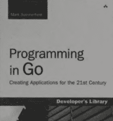
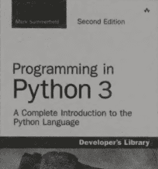
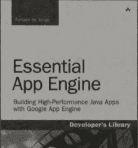

# CoffeeScript 编程指南


开发者库（Developer's Library）系列书籍旨在为实战程序员提供其日常工作中使用的编程语言和技术的独特、高质量的参考资料和教程。

开发者库中的所有书籍均由专家技术从业者编写，他们特别擅长通过组织和呈现信息，使其对其他程序员有用。

核心书目包括其主题领域内最优秀、最广赞誉的书籍：

- PHP & MySQL Web 开发
  Luke Welling & Laura Thomson
- MySQL
  Paul DuBois
- Linux 内内核开发
  Robert Love
- Python 必备参考
  David Beazley
- Objective-C 编程
  Stephen G. Kochan
- PostgreSQL
  Korry Douglas

开发者库书籍可在大多数零售店和在线书店购买，也可以通过 Safari Books Online 在 safari.informit.com 订阅。


Mark Bates


图书索引数据如下


书中提到的所有已知商标或服务标记均已适当大写。Pearson 无法证明这些信息的准确性。书中对某个术语的使用不应视为影响任何商标或服务标记的有效性。


我们已尽力使本书尽可能完整和准确，但不隐含任何保证或适用性。所提供的信息按“现状”提供。作者和出版社对于因书中包含的信息引起的任何损失或损害，对任何个人或实体均不承担责任。


对于大批量购买或特别销售，Pearson 为本书提供优优的折扣。如需更多信息，请联系


美国以外的销售，请联系


Mark Taub

策划编辑
Debra Williams Cauley

Chris Zahn

Kirsty Hart

Andy Beaster

校对
Barbara Hicks

Tim Wright

校样
Debbie Williams

Dan Puckett

出版协调
Olivia Basegio

书籍设计
Gary Adair

排字
Nonie Ratcliff

Rachel, Dylan, 和 Leo：我的生命献给你们。


前言 xv


致辞 v
致谢 xii
前言 xv
什么是 CoffeeScript? xvii
如何运行 xiv

# 第一部分：CoffeeScript 核心


## 致谢¹

我在我的第一本书中写过，在这里我还要说一遍：写一本书是一项极其艰辛的工作！请确保没有人曾对你说过相反的话。如果他们这么说了，他们要么是不可思议的谎谎，要么就是史蒂芬·柯。对我来说，幸运的是，我处于两者之间。

写书既是一项非常独立且孤独的活动，也是一项团队努力。在安顿孩子们入睡后，我来到办公室，打开几瓶健力啤酒（Guinness 的复数形式是 Guinese 吗？），调大音乐，独自一人奋战到深夜。每当我写完一个章节时，我会把它发给我的编辑，然后他会将它发送给一群人，他们根据我写的内容，以我无法想象可能的方式对其进行改进。无论是简单的纠正语法或拼写错误，还是更复杂的，如帮助改善书籍的连贯性，或者指出示例代码在何处改进以进一步阐明某个观点。因此，虽然写作可能是你在一个黑暗的房间里独自完成的，但最终成品是许多人努力工作的结晶。

在书的这一部分，我有机会感谢那些塑造、定义并其他确保你目前拿着（或正在下载）的这本书能够达到最高质量的人。所以，话不多说，我将将像奥斯卡颁奖礼那样感谢大家，我知道我肯定漏掉了一些人选，对此我深表歉意。

首先，我必须感谢我美丽的妻子拉切尔（Rachel）。她是我过的最支持我、最坚强的人之一。每个晚上我爬到她身边睡觉，每个早晨我都有看到她时醒来的喜悦。我有幸能直视她的眼睛，看到无条件的爱。我还得到了写书、经营自己的业务以及在生活中做任何任何能让我感到最快乐事情的鼓励。她给了我两个帅气的儿子，作为报答，我给了她糟糕的笑话和我用过的旧手机。显然，在这段婚姻中我占了便宜，对此我感激不尽。

接下来，我想感谢我的儿子们迪兰（Dylan）和里奥（Leo）。虽然他们没有直接对这本书做出贡献，但他们让生活变得值得，并带给我一种只有孩子才能提供的能量和兴奋。我非常爱你们。

接下来，我必须感谢德布拉·威廉姆斯·考利（Debra Williams Cauley）。德布拉是我第一本书《Ruby 分布式编程》（Distributed Programming with Ruby）的编辑、负责人和心理医生。我只希望其他作者能幸运一样，与像德布拉这样优秀的编辑合作。她确实拥有圣人般的耐心。

¹ 我出版社的梅伊（May）认为我的致谢部分以及这本书的其他部分有点太放肆了，因此原稿被删减成了你在这里看到的这些。如果我写的任何内容让你感到反感，我向你道歉，那绝非我的本意。显然，有人告诉过，我的幽默感并不是所有人都能欣赏。如果你喜欢糟糕的屁笑话，请在 Twitter 上关注我 @mkbates。

我希望如果我以后再写另一本书，德布拉会一直陪在我身边。我无法想象没有她如何写书。谢谢你，德布拉。

在编写技术类书籍时，有些人对这个过程非常重要；他们是技术评审员。技术评审员的工作是阅读每一章并从技术角度进行评价，并回答问题：“在这里学习这个有意义吗？”这些评审员的作用是充当你的观众。他们具有技术思维并精通自己的领域。因此，从他们那里得到的反馈是极其重要的。这本书有几位技术评审员。但我真正想要特别提到的两位是斯图特·加纳（Stuart Garner）和丹·皮凯特（Dan Pickett）。斯图特和丹响应了这本书的召唤，并且绝没有告诉我我做了或说了什么蠢事。他们在白天深夜的任何时候都会收到我疯狂的电话和邮件，并给出反馈。如果我不想把所有的版税支票留给自己，我可能会想把他们清理掉。（别担心，他们为自己的工作获得了报酬。）他们每个人都获得了一张免费一小时“马克时间”的券。感谢丹、斯图特以及其他技术评审员的所有辛勤。

有些人以许多不同的方式对这本书做出了贡献。必须有人设计封面、为书籍编写索引、编写语言（CoffeeScript），或从事此类事务的无数工作中的任何一项。以下是一些（我所知的）人的列表，没有特定顺序：

- Jeremy Ashkenas
- Trevor Burnham
- Dan Fishman
- Chris Zahn
- Greg Pollack
- Gary Adair
- Sandra Schroeder
- Obie Fernandez
- Kristy

我希望如果我以后再写另一本书，德布拉会一直陪在我身边。我无法想象没有她如何写书。谢谢你，德布拉。

在编写技术类书籍时，有些人对这个过程非常重要；他们是技术评审员。技术评审员的工作是阅读每一章并从技术角度进行评价，并回答问题：“在这里学习这个有意义吗？”这些评审员的作用是充当你的观众。他们具有技术思维并精通自己的领域。因此，从他们那里得到的反馈是极其重要的。这本书有几位技术评审员。但我真正想要特别提到的两位是斯图特·加纳（Stuart Garner）和丹·皮凯特（Dan Pickett）。斯图特和丹响应了这本书的召唤，并且绝没有告诉我我做了或说了什么蠢事。他们在白天深夜的任何时候都会收到我疯狂的电话和邮件，并给出反馈。如果我不想把所有的版税支票留给自己，我可能会想把他们清理掉。（别担心，他们为自己的工作获得了报酬。）他们每个人都获得了一张免费一小时“马克时间”的券。感谢丹、斯图特以及其他技术评审员的所有辛勤。

有些人以许多不同的方式对这本书做出了贡献。必须有人设计封面、为书籍编写索引、编写语言（CoffeeScript），或从事此类事务的无数工作中的任何一项。以下是一些（我所知的）人的列表，没有特定顺序：

- Jeremy Ashkenas
- Trevor Burnham
- Dan Fishman
- Chris Zahn
- Greg Pollack
- Gary Adair
- Sandra Schroeder
- Obie Fernandez
- Kristy

我希望如果我以后再写另一本书，德布拉会一直陪在我身边。我无法想象没有她如何写书。谢谢你，德布拉。

在编写技术类书籍时，有些人对这个过程非常重要；他们是技术评审员。技术评审员的工作是阅读每一章并从技术角度进行评价，并回答问题：“在这里学习这个有意义吗？”这些评审员的作用是充当你的观众。他们具有技术思维并精通自己的领域。因此，从他们那里得到的反馈是极其重要的。这本书有几位技术评审员。但我真正想要特别提到的两位是斯图特·加纳（Stuart Garner）和丹·皮凯特（Dan Pickett）。斯图特和丹响应了这本书的召唤，并且绝没有告诉我我我做了或说了什么蠢事。他们在白天深夜的任何时候都会收到我疯狂的电话和邮件，并给出反馈。如果我不想把所有的版税支票留给自己，我可能会想把他们清理掉。（别担心，他们为自己的工作获得了报酬。）他们每个人都获得了一张免费一小时“马克时间”的券。感谢丹、斯图特以及其他技术评审员的所有辛勤。

有些人以许多不同的方式对这本书做出了贡献。必须有人设计封面、为书籍编写索引、编写语言（CoffeeScript），或从事此类事务的无数工作中的任何一项。以下是一些（我所知的）人的列表，没有特定顺序：

- Jeremy Ashkenas
- Trevor Burnham
- Dan Fishman
- Chris Zahn
- Greg Pollack
- Gary Adair
- Sandra Schroeder
- Obie Fernandez
- Kristy

我希望如果我以后再写另一本书，德布拉会一直陪在我身边。我无法想象没有她如何写书。谢谢你，德布拉。

## 前言

## 关于作者

**马克·贝茨（Mark Bates）**是 Meta42 的创始人兼首席架构师。他与妻子拉切尔以及两个儿子住在波士顿郊外。你可以在以下地址找到他：www.markbates.com、twitter.com/mkbates 以及 github.com/markbates。

## 引言

我的职业生涯始于 1999 年，那时 Web 还是一个可怕的地方。HTML 文件需要加载。CSS 刚刚出现。JavaScript 才诞生了几年，它能起作用吗？可能不能。正因为如此，JavaScript 在 2000 年代初期声誉不佳。

在2000 年代中期，两件重要事情在开发者眼中帮助了 JavaScript。第一件是 AJAX。AJAX 让开发者能够在不刷新浏览器的情况下让网页更具交互性、速度更快。

第二件是 JavaScript 库（如 Prototype）的流行，这使得跨浏览器编写变得简单得多。2010 年，特别是2011 年，Web 开始向“单页”应用演变。这些应用是由 JavaScript 框架（如 Backbone.js）驱动的。这些框架允许使用 JavaScript 设计模式。整个应用程序将使用 JavaScript 构建，然后在终端用户的浏览器中下载并执行。这让极具响应性的客户端应用程序成为可能。

然而，在开发者那边，事情并不容易。尽管框架和工具让这些应用变得简单，但 JavaScript 本身证明是一个痛点。JavaScript 有时既是一门极其强大的语言，也是一门极其沮丧的语言。它充满了悖论和设计陷阱，会迅速让你的代码变得难以管理且充满错误。

那么开发者该怎么办呢？他们想要构建这些伟大的新应用，但唯一被接受的浏览器语言是 JavaScript。他们完全可以用 Flash 编写这些应用程序，但这需要插件，而且在某些平台（如 iOS 设备）上无法工作。

我第一次发现 CoffeeScript 是 2010 年 10 月。CoffeeScript 承诺帮助 JavaScript，并展示这门奇特语言最好的部分。它提供了一种更简洁的语法，例如放弃标点符号而使用显著缩进，并防止 JavaScript 开发者随处面临的设计陷阱，例如比较运算符的搜索和痛苦。最棒的是，这一切都是通过编译标准 JavaScript 实现，可以在任何浏览器或其他 JavaScript 运行时环境中执行。

当我第一次使用 CoffeeScript 时，该语言还非常不成熟，版本为 0.9.4。我在一个客户的项目中使用它，以尝试它是否值得


我曾听到过一些炒作。遗憾的是，在当时有两件事导致我将其推到一边。第一是它还没有成熟。有太多的 Bug，而且功能还还不完善。

那么，是什么让我重新回到 CoffeeScript 的呢？在我第一次尝试 CoffeeScript 六个月后，Rails 3.1 宣布将 CoffeeScript 作为默认的 JavaScript 引擎发布。像大多数开发者一样，我对此大吃一惊。我尝试过 CoffeeScript，并不觉得它很好。他们到底想什么？

与我的许多同行不同，我花时间重新查看了 CoffeeScript。在任何项目的开发过程中，六个月都是非常漫长的时间。CoffeeScript 已经有了很大进展。我决定在一个包含大量 JavaScript 的应用程序上再次尝试它。在再次使用 CoffeeScript 的几天后，我不仅成为了它的忠实粉丝，更成了该语言的倡导者。

我不会具体告诉你是如何转换的，也不会试图解释我为什么喜欢它。我希望你形成自己的观点。在整本书中，我希望能够说服你，并让你出于自己的理由成为这种奇妙语言的倡导者。但我会让你提前预览一下接下来的内容。这里是来自真实应用程序的一段 CoffeeScript 及其对应的 JavaScript。请享用！

示例：(source: sneak_peek.coffee)

```javascript
@updateAvatars = () ->
  names = $(.avatar[data-name]').map -> $(this).data('name')
  Utils.findAvatar(name) for name in $.unique(names)
```

示例：(source: sneak_peek.js)

```javascript
function() {
  this.updateAvatars = function() {
    var name, names, i, len, ref, results;
    names = $(.avatar[data-name]').map(function() {
      return $(this).data('name');
    });
    ref = $.unique(names);
    results = [];
    for (i = 0, len = ref.length; i < len; i++) {
      name = ref[i];
      results.push(Utils.findAvatar(name));
    }
    return results;
  };
}.call(this);
```

# 什么是 CoffeeScript？

CoffeeScript 是一种编译为 JavaScript 的语言。我知道这听起来没什么信息量，但它确实就是这么做的。CoffeeScript 的开发是为了紧密类似于 Ruby 和 Python 等语言。它旨在帮助开发者更高效地编写 JavaScript。通过移除不必要的标点符号（如括号、分号等），并使用空白缩进来取代这些字符，你可以快速专注于手头的代码——而无必担心是否关闭了所有的大括号。

你很可能会这样写下面的 JavaScript：

示例：(source: punctuation.js)

```javascript
(function() {
  if (something === something_else) {
    console.log('do something');
  } else {
    console.log('do something else');
  }
}).call(this);
```

那么，为什么不写成这样呢：

示例：(source: punctuation.coffee)

```javascript
if something is something else
  console.log 'do something'
else
  console.log 'do something else'
```

CoffeeScript 还为你提供了几种快捷方式，让你用简短的代码片段编写相当复杂的 JavaScript 部分。例如，这段代码让你能够遍历数组中的值，而无需担心它们的索引：

# 在 CoffeeScript 中编程

示例：(source: array.coffee)

```javascript
for name in array
  console.log name
```

示例：(source: array.js)

```javascript
function() {
  var name, _i, _len;

  for (_i = 0, _len = array.length; _i < _len; _i++) {
    name = array[_i];
    console.log(name);
  }
}.call(this);
```

除了 CoffeeScript 带给你的那些甜蜜的改进外，它还通过许多方式帮助你编写更好的 JavaScript 代码，例如帮助你恰当地处理变量和类的作用域，确保你使用适当的比较运算符等等，正如你在阅读本书的过程中将会看到的。

CoffeeScript、Ruby 和 Python 经常被放在在一起提及，但这有其正当理由。CoffeeScript 直接基于这些语言提供的简洁性和简单语法进行建模。正因为如此，CoffeeScript 比 JavaScript 具有更现代“感”，而后者是基于 Java 和 C++ 等语言建模的。像 JavaScript 一样，CoffeeScript 可以用于任何编程环境。无论你是使用 Ruby、Python、PHP、Java 还是 .Net 来编写应用程序，并不重要。编译后的 CoffeeScript 都能与它们共同工作。

因为 CoffeeScript 编译为 JavaScript，你仍然可以使用你当前使用的任何所有 JavaScript 库。你可以使用 jQuery、Zepto、Backbone、Jasmine 等，它们都能正常工作。在谈论新语言时，你不需要经常担心这些。

这些听起来都很棒，我明白你的意思，但使用 CoffeeScript 而不是纯 JavaScript 有什么缺点呢？这是一个很好的问题。答案是：不多。首先，虽然 CoffeeScript 是一种编写 JavaScript 的非常棒的方法，但它并没有让你做任何你用 JavaScript 做不到的事情。例如，我仍然可以做一切。

## 前言

## 这本书是给谁的？

这本书是给已经熟悉 JavaScript 并想要学习 CoffeeScript 的开发者。它也适用于那些来自 Ruby 或 Python 并想要探索 JavaScript 生态系统的人。

## 如何阅读这本书

首先，每当我引入某些外部库、想法或概念时，我都会包含一个指向网站的脚注，你可以在那里进一步学习。虽然我很想对这些事情滔滔不绝，但这本书的空间并不够。

其次，在阅读每一章节时，我会先带你走过问题的错误解决方案。在看到正确正确的方法后，我们就可以对其进行检查、理解，然后解决手头的正确方案。


## 输出：(source:example.coffee)

```
1
2
3
4
5
6
7
8
9
10
```

有时候会出现我想向你展示的错误。这里有一个示例：

## 示例：(source: oops.coffee)

```
array = [1..10]

oops! run index in array
  console.log index
```

## 输出：(source: oops.coffee)

```
Error: In content/preface/oops.coffee, Parse error on line 3: Unexpected 'UNARY'
  at Object.parse (/usr/local/lib/node_modules/coffee-script/lib/coffee-script/
  => parser.js:470:11
  at Object.parse (/usr/local/lib/node_modules/coffee-script/lib/coffee-script/
  => parser.js:546:22
  at /usr/local/lib/node_modules/coffee-script/lib/coffee-script/coffee-script.
  => js:40:22
  at Object.run (/usr/local/lib/node_modules/coffee-script/lib/coffee-script/
  => coffee-script.js:68:34)
  at Object.parse (/usr/local/lib/node_modules/coffee-script/lib/coffee-script/command.js:135:29
  at Object.parse (/usr/local/lib/node_modules/coffee-script/lib/coffee-script/command.js:110:18
  at [object Object].<anonymous> (fs.js:114:5)
  at [object Object].emit (events.js:64:17)
  at afterRead (fs.js:108:12)
  at Object.wrapper [as incomplete] (fs.js:252:17)
```


为了帮助你从书中获得最大的收获，我将其分成了两个不同的部分。


本书的第一部分旨在从上到下全面涵盖整个 CoffeeScript 语言。读完这本书的部分后，你应该已经完全准备好去应对遇到的任何 CoffeeScript 项目，包括书中第二部分提到的项目。

第 1 章“入门”介绍了 CoffeeScript 可以被编译和运行的各种方式。它还介绍了强大的 `coffee` 命令行工具以及与 CoffeeScript 配合使用的 REPL。

在第 2 章“基础”中，我们开始探索 CoffeeScript 与 JavaScript 的不同之处。语法、变量、作用域等讨论将为书的其余部分奠定坚实的基础。

第 3 章“控制结构”专注于任何语言中一个重要的部分，如 `if` 和 `else` 等控制结构。你还将学习 CoffeeScript 中的运算符与 JavaScript 中的运算符之间的区别。

第 4 章“函数与参数”涵盖了 CoffeeScript 中函数的各种细节。我们将讨论定义函数、调用函数以及一些额外内容，如默认参数和剩余参数（splats）。


第 6 章“类”通过涵盖 CoffeeScript 中的类来结束本书的第一部分。定义新类、扩展现有类、重写父类中的函数等。


本书的第二部分侧重于在实际示例中使用 CoffeeScript。通过学习围绕 CoffeeScript 的某些生态系统并构建一个完整的应用程序，在第二部分结束时，你的 CoffeeScript 技能将非常精湛。

第 7 章“Cake 和 Cakefiles”涵盖了随 CoffeeScript 带的 Cake。你可以使用这个工具来构建脚本、测试等。我们将涵盖它提供的所有功能。

测试是软件开发中非常重要的一部分，第 8 章“使用 Jasmine 进行测试”将带你快速浏览流行的 CoffeeScript/JavaScript 测试库之一的 Jasmine。这一章将通过先为计算器类编写测试用例来练习流行的测试驱动开发（TDD）。

第 9 章“Node.js 简介”是对事件驱动的服务器端框架 Node.js 的快速介绍。在本章中，我们将使用 CoffeeScript 构建一个简单的 HTTP 服务器，它会在 浏览器请求时自动将 CoffeeScript 文件编译为 JavaScript 文件。

前言 xiii


最后，在第 12 章“示例：待办事项列表部分 3（带 Backbone.js 的客户端）”中，我们将重新构建待办事项应用程序的客户端，这次放弃了 jQuery，转而使用客户端框架 Backbone.js。


我不怎么喜欢在书中放置安装说明，主要是因为当书上架时，安装说明已经过时了。然而，人们——我所说的人们是指出版书籍的人——认为书籍应该有一个安装章节。这是我准备的部分。

安装 CoffeeScript 非常简单。

为了帮助你从书中获得最大的收获，我将其分成了两个不同的部分。


本书的第一部分旨在从上到下全面涵盖整个 CoffeeScript 语言。读完这本书的部分后，你应该已经完全准备好去应对遇到的任何 CoffeeScript 项目，包括书中第二部分提到的项目。

第 1 章“入门”介绍了 CoffeeScript 可以被编译和运行的各种方式。它还介绍了强大的 `coffee` 命令行工具以及与 CoffeeScript 配合使用的 REPL。

在第 2 章“基础”中，我们开始探索 CoffeeScript 与 JavaScript 的不同之处。语法、变量、作用域等讨论将为书的其余部分奠定坚实的基础。

第 3 章“控制结构”专注于任何语言中一个重要的部分，如 `if` 和 `else` 等控制结构。你还将学习 CoffeeScript 中的运算符与 JavaScript 中的运算符之间的区别。

第 4 章“函数与参数”涵盖了 CoffeeScript 中函数的各种细节。我们将讨论定义函数、调用函数以及一些额外内容，如默认参数和剩余参数（splats）。

从数组到对象，第 5 章“集合与迭代”将向你展示如何在 CoffeeScript 中使用、操作和遍历集合对象。

第 6 章“类”通过涵盖 CoffeeScript 中的类来结束本书的第一部分。定义新类、扩展现有类、重写父类中的函数等。


本书的第二部分侧重于在实际示例中使用 CoffeeScript。通过学习围绕 CoffeeScript 的某些生态系统并构建一个完整的应用程序，在第二部分结束时，你的 CoffeeScript 技能将非常精湛。

第 7 章“Cake 和 Cakefiles”涵盖了随 CoffeeScript 带的 Cake。你可以使用这个工具来构建脚本、测试等。我们将涵盖它提供的所有功能。

测试是软件开发中非常重要的一部分，第 8 章“使用 Jasmine 进行测试”将带你快速浏览流行的 CoffeeScript/JavaScript 测试库之一的 Jasmine。这一章将通过先为计算器类编写测试用例来练习流行的测试驱动开发（TDD）。

第 9 章“Node.js 简介”是对事件驱动的服务器端框架 Node.js 的快速介绍。在本章中，我们将使用 CoffeeScript 构建一个简单的 HTTP 服务器，它会在 浏览器请求时时自动将 CoffeeScript 文件编译为 JavaScript 文件。

前言 xiii

在第 10 章“示例：待办事项列表部分 1（服务端）”中，我们将构建一个待办事项应用程序的服务器部分。在第 9 章的基础上，我们将使用 Express.js Web 框架和用于 MongoDB 的 Mongoose ORM 构建一个 API。


最后，在第 12 章“示例：待办事项列表部分 3（带 Backbone.js 的客户端）”中，我们将重新构建待办事项应用程序的客户端，这次放弃了 jQuery，转而使用客户端框架 Backbone.js。


我不怎么喜欢在书中放置安装说明，主要是因为当书上架时，安装说明已经过时了。然而，人们——我所说的人们是指出版书籍的人——认为书籍应该有一个安装章节。这是我准备的部分。

安装 CoffeeScript 非常简单。


本书的第一部分旨在从上到下全面涵盖整个 CoffeeScript 语言。读完这本书的部分后，你应该已经完全准备好去应对遇到的任何 CoffeeScript 项目，包括书中第二部分提到的项目。

第 1 章“入门”介绍了 CoffeeScript 可以被编译和运行的各种方式。它还介绍了强大的 `coffee` 命令行工具以及与 CoffeeScript 配合使用的 REPL。

在第 2 章“基础”中，我们开始探索 CoffeeScript 与 JavaScript 的不同之处。语法、变量、作用域等讨论将为书的其余部分奠定坚实的基础。

第 3 章“控制结构”专注于任何语言中一个重要的部分，如 `if` 和 `else` 等控制结构。你还将学习 CoffeeScript 中的运算符与 JavaScript 中的运算符之间的区别。

第 4 章“函数与参数”涵盖了 CoffeeScript 中函数的各种细节。我们将讨论定义函数、调用函数以及一些额外内容，如默认参数和剩余参数（splats）。

从数组到对象，第 5 章“集合与迭代”将向你展示如何在 CoffeeScript 中使用、操作和遍历集合对象。

第 6 章“类”通过涵盖 CoffeeScript 中的类来结束本书的第一部分。定义新类、扩展现有类、重写父类中的函数等。


## 入门

现在你已经读了前言并安装了 CoffeeScript，你觉得我们该开始使用它了吗？在本章中，我们将通过了几种 CoffeeScript 可以被执行和编译的方式。

我将介绍一些编译和执行代码的好方法和不太好的方法。虽然我们在本章中不会涵盖 CoffeeScript 的内部机制，但作为你开始使用 CoffeeScript 时，这绝对是很有价值的读物。

即使你已经玩过 CoffeeScript 的命令行工具，你很有可能在本章中中学到一些新东西，所以请花几分钟阅读它，而不是直接跳到第 2 章“基础”。

## CoffeeScript REPL

CoffeeScript 自带了一个非常强大的 REPL，又称为交互式控制台，准备就绪让你立即开始尝试 CoffeeScript。

开始使用 REPL 非常简单。只需在你最喜欢的 Terminal 窗口中输入以下内容：

- coffee

然后你会看到一个类似下面的提示符：

coffee>

如果你看到 coffee 提示符，我们就准备好尝试一些 CoffeeScript 了。

启动 REPL 的替代方案是：

- coffee -i


# 第 1 章 入门

或者如果你真的非常喜欢打字：
> coffee --interactive

让我们从基础示例开始。在控制台中输入以下内容：
coffee> 2 + 2

你应该能看到以下答案：
coffee> 4

恭喜你，你刚刚写了第一段 CoffeeScript！

好了，让我们尝试一些稍微有趣一点的东西——更具 CoffeeScript 风格的东西。我们不需要过度担心代码发生了什么（稍后我们会进行详细介绍），只需让它运行起来即可。

示例：(source: repl1.coffee)

```
a = [1..10]
b = (x * x for x in a)
console.log b
```

输出：(source: repl1.coffee)

```
[ 1, 4, 9, 16, 25, 36, 49, 64, 81, 100 ]
```

这可是一大段 CoffeeScript 代码，不是吗？简单来说，我们创建了一个新数组并填充了从 1 到 10 的整数。然后我们遍历了数组中的数字 `a`，将其自身相乘并创建了包含这些新值的第二个数组 `b`。哇，对吧？正如我所说，我稍后会乐意解释这一切是如何运作的；现在，请沉浸在这些你无需编写的 JavaScript 代码的荣耀中吧。但如果你好奇 JavaScript 看起来是什么样，它就在这里：

示例：(source: repl1.js)

```
function() {
var a, b, x;
na = [1, 2, 3, 4, 5, 6, 7, 8, 9, 10];
b = (function() {
var _i, _len, results;
_results = [];
for (_i = 0, _len = a.length; _i < _len; _i++) {
x = a[i];
_results.push(x * x);
}
return _results;
})();

console.log(b);

}).call(this);
```

如你所见，REPL 是一个尝试和实验不同想法的有趣方式。然而，在 CoffeeScript REPL 的世界里，并非一切都事顺顺利。正如你将看到的，CoffeeScript 的设计基于“空格具有重要意义”这一概念。这使得我们在尝试在 REPL 中编写多行 CoffeeScript 时遇到了一些问题。答案以 `\` 字符的形式呈现出来。

让我们尝试写一个简单的函数，它接收两个数字并返回它们的和。在 REPL 中逐行输入以下代码：

示例：(source: repl2.coffee)

```
add = (x, y)->\
x + y
console.log add(1, 2)
```

输出：(source: repl2.coffee)

3

注意看我们在第一行的末尾添加了一个 `\`。这告诉 REPL 我们还想为该表达式添加更多行。对于你想要添加到表达式中的每一行，都保持添加 `\` 这一点是非常重要的。第一行不以 `\` 结尾的行将被视为表达式的结束，REPL 将尝试执行该表达式。

同样重要的一点是，我们仍然必须对 `\` 之后的行进行缩进，这样 CoffeeScript 才能正确解释该行并将其放在合适的位置。

最后，要退出 REPL，只需按 ctrl-C 进程就会结束。

REPL 是尝试几个想法的一种强大且快速的方法，但我们也看到在处理更复杂的代码时，它会变得有点难用。在本章稍后的“执行 CoffeeScript 文件” 节中，我们将讨论如何执行包含 CoffeeScript 的文件，这是运行复杂代码的更合适的方法。


在开发 Web 应用程序时，总会有你想要直接在 HTML² 文件中内联某些 CoffeeScript。CoffeeScript 允许你这样做，我将向你展示如何操作。然而，我想警告不要这样做。首先，像“非侵入式 JavaScript”（Untrusive JavaScript）这样的实践近期流行是有原因的。虽然在浏览器中执行 CoffeeScript 很酷，但它并不是你可以使用的最佳编译选项。通过将 JavaScript 保持在单独的文件中并远离 HTML 层，你可以保持代码更整洁，并在不支持 JavaScript 的环境中优雅地运行。

起初，非侵入式 JavaScript 可能会有点困惑和困难，但过一段时间后，这样做会变得更容易、更具读性且更有逻辑。使用像 jQuery 这样的工具，你可以等待页面加载并将所有的 JavaScript 绑定到页面正确对象上。然而，有时你必须“先打水泵”。这通常意味着调用一个初始化方法，也许通过传入 JSON⁴ 来这样做。我鼓励你使用 JavaScript 编写这少量的代码。但是，你真的应该用 CoffeeScript 来编写它，有一种方法可以让浏览器为你编译它。

让我们来看一个嵌入了一点 CoffeeScript 的 HTML 文件。

示例：(source: hello_world.html)

```html
<html>
<head>
  <title>Hello World</title>
  <script src='http://jashenas.github.com/coffee-script/extras/coffee-script.js'></script>
</head>
<body>
  <script>
    name = prompt("What is your name?")
    alert("Hello, #{name}")
  </script>
</body>
</html>
```


- -n, --nodes 打印由 Jison 生成的解析树
- --nodejs 通过 "node" 二进制文件传递选项
- -v, --version 显示 CoffeeScript 版本
- -h, --help 显示此帮助信息

现在让我们来看看其中的一些选项。


虽然当你只是在玩的时候，将 JavaScript 文件编译在与 CoffeeScript 相同的目录下是可以没问题的，但你可能更希望将文件保存在不同的目录中。那么，我们如何将 `hello_world.coffee` 文件编译到例如 `public/javascripts` 呢？

答案非常简单：我们需要在终端命令中添加 `-o`：

```
> coffee -o public/javascripts hello_world.coffee
```

如果你检查 `public/javascripts` 目录，你会发现新编译的 `hello_world.js` 文件正在那里等着你。

有一点是 `-o` 标志不允许你更改文件名。编译后的 JavaScript 文件将与原始 CoffeeScript 文件同名，只是扩展名是 `.js` 而不是 `.coffee`。因为你无法使用 `coffee` 命令重命名文件，所以你可能需要重命名原始文件，或者编写一个脚本同时完成编译你的 CoffeeScript 文件并将其重命名为更你喜好的名称。


正如你将在书中后面看到的，当 CoffeeScript 编译时，它会将生成的 JavaScript 封装在一个匿名函数中。由于我们将在第 2 章详细讨论这个话题，我在这里将不深入探讨。以下是匿名函数封装在生成的 JavaScript 代码中的示例：

示例：(源: hello_world.js)

```
(function() {
  var greeting;

  greeting = "Hello, World!";

  console.log(greeting);
}).call(this);
```

现在，出于某种原因，有时你可能不需要那个匿名函数包装器。在这种情况下，我们向 CoffeeScript 编译器传递 `-b` 标志。

```
> coffee -b c hello_world.coffee
```

这将把 CoffeeScript 编译为以下 JavaScript：

示例：(源: hello_world_bare.js)

```
var greeting;
greeting = "Hello, World!";
console.log(greeting);
```

现在你已经知道如何移除匿名包装器了，我想提醒你不要这样做。之所以生成它是有许多非常充分的理由。如果你想了解更多关于这个匿名函数的信息，请参见第 2 章。


有时当你编译 CoffeeScript 文件时，你真正想要的是看到文件的输出。幸运的是，你已经学过的 `coffee` 命令有一个 `-p` 标志：

```
> coffee -p hello_world.coffee
```

这将在你的终端中打印出如下内容：

```
(function() {
greeting = "Hello, World!";
console.log(greeting);
}).call(this);
```

这对于调试目的或作为 CoffeeScript 的极佳学习工具非常有用。通过将你的 CoffeeScript 与编译后的 JavaScript 进行比较（正如我们在书中做的那样），你可以开始理解 CoffeeScript 在底层正在做什么。这对我最初学习 CoffeeScript 时有巨大的帮助。通过研究编译器所做的某些选择，它也帮助我成为了一个更好的 JavaScript 开发者。


在开发 CoffeeScript 项目时，你可能不想一直去命令行进行持续编译。为了让你更方便一点，CoffeeScript 为 `coffee` 命令提供了了可选的 `-w` 参数。通过这个参数，你可以告诉 `coffee` 命令持续监听你的 CoffeeScript 文件，并在它们发生变化时重新编译。这里有一个示例：

```
> coffee -w -c app/assets/coffeescript
```

使用此命令，每当 `app/assets/coffeescript` 目录或任何子目录下的 `.coffee` 文件被触时，它会自动编译。

从 CoffeeScript 1.2.0 开始，`-w` 会监听添加到监控目录的新文件。然而，根据我的经验，由于某些底层 Node 问题，它可能会有很多 Bug。希望在你读到这里时，这些问题已经解决。不过，存在许多第三方工具设计用于监听系统事件（如文件的添加和删除）。在写作期间，我个人最喜欢的是 Guard。它是一个 Ruby gem，让你能够监听这类事件，并在这些事件发生时执行某些自定义代码（例如编译 CoffeeScript 文件）。

提示
除了 Guard 之外，你可能还会想看看 Trevor Burham 开发的 Jitter。它实现了类似的目标。
## 执行 CoffeeScript 文件

我们已经涵盖了各种编译方法，那么直接执行它们呢？为了应对这种情况，`coffee` 命令允许我们如下运行执行文件：

```
> coffee hello_world.coffee
```

我们在书中看到的大多数示例都可以以这种方式运行（除非另有说明）。


还有一些其他选项，例如 `-n` 和 `-t`。虽然这些选项可以给你提供非常有趣的输出以及对 CoffeeScript 如何编译的深刻见解，但它们在本文过程中对我们没有帮助。不过，我鼓励你花些时间运行一下额外的选项。


在本章中，我们浏览了编译和执行 CoffeeScript 的不同方法。我们查看了 CoffeeScript 编译方式的优缺点，现在已经掌握了玩书中其余示例所需的知识。最后，我们深入研究了 `coffee` 命令，学习了可以传递给它的最重要的选项和参数。


+ 1. 读求打印循环 - http://en.wikipedia.org/wiki/Read-eval-print_loop
+ 2. http://en.wikipedia.org/wiki/Html
+ 3. 非侵入式 JavaScript - http://en.wikipedia.org/wiki/Unobtrusive_JavaScript
+ 4. http://en.wikipedia.org/wiki/Json
+ 5. Touch一个文件在不同的操作系统上意味着许多不同的含义，但通常只需保存文件就足以触发 `-w` 施展它的魔法。
+ 6. https://github.com/guard/guard
+ 7. https://github.com/TrevorBurham/jitter
+ 8. http://jashkenas.github.com/coffee-script/documentation/docs/command.html


既然我们已经涵盖了编译和执行你的 CoffeeScript 等无聊的内容，我们将开始介绍如何实际编写它。在本章中，我们将检查 CoffeeScript 的语法。我们将查看标点、作用域、变量以及其他一些精彩的部分。


CoffeeScript 的很大程度上归功于它的语法，特别是缺乏标点符号。大括号和分号等标点在 CoffeeScript 世界中已经灭绝，而括号也是濒危物种。

为了说明这一点，让我们来看一段你们大多数可能都熟悉的 JavaScript。这里有一段 jQuery 代码，用于发送远程 AJAX 请求并对结果进行处理：

示例 (源: jquery_example.js)

```
$(function() {
  $.get('example.php', function(data) {
    if (data.errors != null) {
      alert("There was an error!");
    } else {
      $("#content").text(data.message);
    }
  }, 'json')
})
```


## 第二2章 基础

CoffeeScript 允许我们去掉示例中的许多额外标点符号。使用 CoffeeScript 编写的相同代码如下：

```
Example: (source: jquery_as_coffee.coffee)
$ ->
  $.get('example.php', (data) ->
    if data.errors?
      alert("There was an error!\n")
    else
      ("#content").text data.message
  'json'
```

在本书的后续章节中，我们将详细介绍该示例中大部分部分的作用，但现在，让我们看看在编写 CoffeeScript 示例时从 JavaScript 示例中去掉了什么。


我们做的第一件事是移除所有的大括号和分号。

Example: (source: jquery.js)

```
$(function() {
  $.get('example.php', function(data) {
    if (data.errors != null) {
      alert("There was an error!")
    else
      $("#content").text(data.message);
  }
});
```

这是如何工作的？CoffeeScript 如何知道如何解析代码以使其具有意义？答案非常简单，而且可能你每天都在做这件事：空白！CoffeeScript 像 Python 一样，使用**显著缩进**的概念来告诉它如何解析表达式。

我听过人们在说不喜欢显著缩进之前先抱怨过它。我认为这是一个不寻常的论点。你会像下面这样写 JavaScript 示例吗？

Example: (source: jquery.js)

```
$(function() {
  $.get('example.php', function(data) {
    if (data.errors != null) {
      alert("There was an error!");
    } else {
      $("#content").text(data.message);
    }
}, 'json'
```

我希望不是这样！如果你是这样写 JavaScript 的，我求你帮帮开发者同事们，多花一秒钟确保你的代码缩进正确。可读性是维护的关键。它也是帮助你将现有 JavaScript 转换为 CoffeeScript 的关键。

通过显著缩进，CoffeeScript 知道当你使用 `if` 语句时，编译器应该将该行放在 `if` 块内部。当编译器下次看到与 `if` 语句相同级别的缩进时，它就知道你已经写完了 `if` 语句，并执行与 `if` 语句相同级别的该行。

这是一个如果你没有正确格式化 CoffeeScript 代码时可能会遇到的错误简短示例：

Example: (source: whitespace.coffee)

```
for num in [1..3]
  if num is 1
    console.log num
    console.log num * 2
  if num is 2
    console.log num
    console.log num * 2
```

Output: (source: whitespace.coffee)

```
Error: In content/the_basics/whitespace.coffee, Parse error on line 4: Unexpected
  'INDENT'
  at Object.parse (/usr/local/lib/node_modules/coffee-script/lib/coffee-script/
  parser.js:470:11)
  at Object.parse (/usr/local/lib/node_modules/coffee-script/lib/coffee-script/
  parser.js:546:22)
  at /usr/local/lib/node_modules/coffee-script/lib/coffee-script/coffee-script.
  js:40:22
  at Object.run (/usr/local/lib/node_modules/coffee-script/lib/coffee-script/
  coffee-script.js:68:34
  at Object.parse (/usr/local/lib/node_modules/coffee-script/lib/coffee-script/command.js:135:29
  at Object.parse (/usr/local/lib/node_modules/coffee-script/lib/coffee-script/command.js:110:18
  at [Object.<anonymous>] (fs.js:114:5)
  at [object Object].emit (events.js:64:17)
  at afterread (fs.js:1081:12)
  at Object.wrapper [as incomplete] (fs.js:252:17)
```


我们做的下一件事是消除那个旧的 `function` 关键字。我们以后使用的任何 CoffeeScript 代码都不会使用 `function` 关键字。

Example: (source: jquery.js)

```
$ -> ->
  $.get('example.php', data ->
    if (data.errors != null)
      alert("There was an error!")
    else
      $("#content").text(data.message)
  'json'
```

与其使用 `function` 关键字，我们可以在参数列表右侧使用箭头 `->`。我知道起初这很难记忆和直观理解，但如果你考虑代码的流向以及参数“指向”哪里，这其实非常有道理。


接下来，我们移除了示例代码中的部分（并非全部）括号。

Example: (source: jquery.js)

```
$ ->
  $.get('example.php', data ->
  if data.errors != null
    alert "There was an error!"
  else
    $("#content").text data.message
  'json'
```

为什么我们没有移除所有的括号呢？在几乎所有情况下，移除括号都是可选的。然而，在某些情况下它们是必须的，例如调用带有多个参数的函数时。

让我们来看这个例子：

```
$ ->
  $.get('example.php', data ->
    if data.errors != null
      alert "There was an error!"
    else
      $("#content").text data.message
  'json'
```


我们的每一个变量，包括指向我们的 `myFunc` 函数的变量，都是使用 `var` 关键字声明的。CoffeeScript 会成为我们的后盾，确保我们在变量声明方面做出正确的选择。

关于这段代码的另一个值得思考的点是，虽然 CoffeeScript 帮助我们进行正确的变量声明，但它仍然无法阻止我们覆盖原始变量。这是因为当 CoffeeScript 编译为 JavaScript 时，它会看到之前定义过一个名为 `a` 的变量，并假设你打算在你的函数内部使用该变量。


正如你所看到的，也应该已经注意到的，我们所有编译后的 JavaScript 都被包装在一个匿名的、自执行的函数中。我知道你现在可能在想那个函数是干什么用的。让我告诉你们吧。

正如我们在 JavaScript 作用域示例中所看到的，我们能够轻松地访问没有使用 `var` 关键字定义的变量。当我们定义这些变量时，它们最终进入了一个全局命名空间，每个人都可以轻松访问。

当我们定义变量时，即使使用了 `var` 关键字，我们仍然是在全局命名空间中定义它的。为什么呢？原因很简单——我们是在函数外部定义它的。因为变量是在函数作用域之外定义的，所以所有人都可以使用它，这意味着如果你使用的另一个库也定义了 `a`，那么两个变量中的一个会被后定义的那个覆盖。当然，这对于任何命名空间都是如此，而不只是全局命名空间。

那么，如何在全局命名空间之外定义变量和函数，以便它们可以被你的程序访问而其他人无法访问？你通过将代码包装在匿名函数中来实现这一点。这正是 CoffeeScript 在将你的代码编译为 JavaScript 时为你做的事情。

现在，这时你应该考虑两件事。第一件事是：“这真聪明，我可以随心所欲，而不必担心污染全局命名空间。”你应该问自己的第二个问题是：“等等，我如何将我想暴露的变量和函数到全局命名空间，以便我和其他人可以访问它们？”这是两个重要的想法。让我们解决第二个，因为它是需要被解决的。

如果你像 CoffeeScript 强制的那样，将整个程序或库写在一个匿名函数的范围内，那么应用程序中的任何其他库或代码都无法访问你的代码。这可能正是你想要的结果。然而，如果这不是你想要的，我们有几种方法可以解决这个问题。

这里是我们可以与外部世界共享函数的方法示例：

示例：**使用 window 暴露**（源：expose_with_window.coffee）

```coffee
window.sayHi = ->
  console.log("Hello")
```

示例：**使用 window 暴露**（源：expose_with_window.js）

```javascript
(function() {

  window.sayHi = function() {
    return console.log("Hello, World!");
  }

}).call(this);
```

在这个示例中，我们使用 `window` 对象来暴露我们的函数。在一个所有代码都在浏览器中执行的世界，这是一个暴露函数的非常好的方法。然而，随着 Node.JS 和其他服务器端 JavaScript 技术的成功，在浏览器以外的环境中运行 JavaScript 变得越来越流行。如果我们尝试使用这个 coffee 命令，将会得到以下输出：

示例：**使用 window 暴露****（源：expose_with_window.coffee）

```text
ReferenceError: window is not defined
at Object.<anonymous> -> /../the_basics/expose_with_window.coffee:3:3
at Object.<anonymous> -> /../the_basics/expose_with_window.coffee:7:4
at at Module.compile (module,js.js:432:26)
at at at Object.run (/usr/local/lib/node_modules/coffee-script/lib/coffee-script/coffee-script.js:68:25)
at at at /usr/local/lib/node_modules/coffee-script/lib/coffee-script/command.js:135:29
at at at [object Object.<anonymous> (fs.js:114:5)
at at at [object Object].emit (events.js:64:17)
at at at afterRead (fs.js:1081:12)
at at Object.wrapper as [incomplete] (fs.js:252:17)
```

当运行 coffee 命令时，没有 window 对象来暴露我们的函数。那么我们如何解决这个问题呢？答案非常简单。CoffeeScript 为我们创建了匿名函数包装，它方便地传递了 `this`。我们可以轻松地将函数附加到它上并以此方式暴露它。让我们来看：

示例：使用 this 暴露（源：expose_with_this.coffee）

```coffee
this.sayHi = ->
  console.log("Hello, World!");
```

示例：使用 this 暴露（源：expose_with_this.js）

```javascript
(function() {
  this.sayHi = function() {
    return console.log("Hello, World!");
  };
}).call(this);
```

如果我们在浏览器中执行该代码，我们的函数将暴露给其他 JavaScript 代码，因为浏览器中的 `this` 指向 `window` 对象。在 coffee 命令或 Node.JS 应用中，它指向全局对象。

现在，这时你应该考虑两件事。第一件事是：“这真聪明，我可以随心所欲，而不必担心污染全局命名空间。”你应该问自己的第二个问题是：“等等，我如何将我想暴露的变量和函数到全局命名空间，以便我和其他人可以访问？”这是两个重要的想法。让我们解决第二个，因为它是需要被解决的。

## 插值字符串

为了消除我们 HTML 示例中所有糟糕的拼接，CoffeeScript 让我们使用插值。什么是字符串插值？字符串插值是在字符串中注入任意 CoffeeScript 代码的一种方式。在我们的示例中，我们要在字符串中放入一些变量，CoffeeScript 让我们这样做。这里是你如何编写相同的示例，这次使用 CoffeeScript 的字符串插值：

示例：（源：html_string_interpolation.coffee）

```coffee
someName = 'user[firstName]'
someId = 'firstName'
someValue = 'Bob Example'

field = "input='text' name='#{someName}' id='#{someId}' value='#{someValue}'>"

console.log field
```

示例：（源：html_string_interpolation.js）

```javascript
(function() {
  var field, someId, someName, someValue;

  someName = 'user[firstName]';
  someId = 'firstName';
  someValue = 'Bob Example';

  field = "<input='text' name='" + someName + "' id='" + someId + "' value='" + (escape(someValue)) + "'>";

  console.log(field);
}).call(this);
```

输出：（源：html_string_interpolation.coffee）

```html
<input='text' name='user[firstName]' id='firstName' value='Bob Example'>
```

看起来不是好多了？那段代码更容易阅读、编写和维护。

在 JavaScript 中，如你所知，并没有插值字符串。所有字符串都被视为平等的。在 CoffeeScript 中，并不是所有字符串都是平等的。双引号字符串（例如我们刚刚使用的）告诉 CoffeeScript 编译器处理该字符串并在必要时将其转换为拼接的 JavaScript 字符串。单引号字符串在 CoffeeScript 中称为字面量，我们稍后会查看它们。

当我们想在双引号字符串中注入一些 CoffeeScript 时，我们使用 `#}` 语法。两个括号之间的所有内容将由编译器分离，然后连接到我们正在构建的字符串中。我们在花括号内部的代码可以是任何我们想要的有效 CoffeeScript：


## 示例：(source: string_interpolation_extra.coffee)

```coffee
text = "Add numbers: #{1 + 1}"
console.log text
```

```coffee
text = "Call a function: #{escape "Hello, World!"}"
console.log text
```

```coffee
day = 'Sunday'
console.log "It's a beautiful #{if day is 'Sunday' then day else "Day"}" 
```

## 示例：(source: string_interpolation_extra.js)

```javascript
function() {
  var day, text;

  text = "Add numbers: " + (1 + 1);
  console.log(text);

  text = "Call a function: " + (escape("Hello, World!"))\n  console.log(text);

  day = 'Sunday';
  console.log("It's a beautiful " + (day === 'Sunday' ? day : "Day")");
}.call(this);
```

## 输出：(source: string_interpolation_extra.coffee)

```text
Add numbers: 2
Call a function: Hello%20World%21
It's a beautiful Sunday
```

## 字面量字符串 (Literal Strings)

字面量字符串正如其名，就是字面量的。这意味着你放入字符串中的任何内容，从字符串中返回时都是完全相同的；这是 JavaScript 的行为方式。

在 CoffeeScript 中构建字面量字符串需要使用单引号 `'`。让我们重新回顾之前构建 HTML 文本字段的示例。这次，我们不再在字符串周围使用双引号，而是使用单引号看看会发生什么：

# 第 2 章 基础

示例：(source: html_string_literal.coffee)

```coffee
someName = 'user[firstName]'
someId = 'firstName'
someValue = 'Bob Example'
```

```coffee
field = '<input type=\'' name='\{someName}\' id='\{someId}\' value='\{escape(someValue)}\''

console.log field
```

示例：(source: html_string_literal.js)

```javascript
function() {
  var field, someId, someName, someValue;

  someName = 'user[firstName]';

  someId = 'firstName';

  someValue = 'Bob Example';

  field = '<input type=\'' name='\{someName}\' id='\{someId}\' value='\{escape(someValue)}\'>';

  console.log(field);
}).call(this);
```

输出：(source: html_string_literal.coffee)
<input type='text' name='{someName}' id='{someId}' value='{escape(someValue)}'>

从输出可以看出，我们并没有得到预期的结果。这是因为字面量字符串不支持字符串插值。我们没有看到混合在字符串中的动态内容，而是看到了动态内容的占位符。在某些情况下这可能是预期的结果；但这种情况非常少见。

尽管字面量字符串不会向其中注入任何动态内容，但它们仍然会进行少量的解析和处理，与 JavaScript 一相同。字面量字符串仍然允许你使用常用的转义字符。例如：

示例：(source: literal_string_with_escapes.coffee)

```coffee
text = "Header\n\tented Text"
console.log text
```

## 示例：(source: literal_string_with_escapes.js)

```javascript
(function() {
  var text;

  text = "Header\nIndented Text";

  console.log(text);
}).call(this);
```

## 输出：(source: literal_string_with_escapes.coffee)

```
Header
  Indented Text
```

如你所示，我们的换行符 `\n` 和制表符 `\t` 在输出中被正确的中断并处理。CoffeeScript 与 JavaScript 一，允许我们使用双反斜杠来转义单反斜杠，如下所示：

## 示例：(source: literal_string_with_backslash.coffee)

```coffee
text = "Insert \\\some slashes!"
console.log(text)
```

## 示例：(source: literal_string_with_backslash.js)

```javascript
(function() {
  var text;

  text = "Insert \\\some slashes!"

  console.log(text);
}).call(this);
```

## 输出：(source: literal_string_with_backslash.coffee)

```
Insert \some slashes!
```

在 Ruby 等语言中，使用字面量字符串可以获得性能提升。在程序执行时，运行时环境不需要解析字符串并对其进行所需的操作。然而，由于 CoffeeScript 编译为 JavaScript，性能收益从运行时转移到了编译时。

# 第 2 章 基础

> 提示
> 使用字面量字符串代替插值字符串所带来的性能提升仅出现在编译阶段。我没认为一直使用双引号插值字符串有任何坏端。即使你现在没有使用插值字符串的功能，通过将所有字符串都设为插值形式，也可以在日后方便地使用。

## Heredocs (此处文档)

Heredoc（或在此称为 here document）允许你在 CoffeeScript 中轻松地构建多行字符串，同时保留多行字符串所有的空格和换行符。Heredoc 遵循与插值字符串和字面量字符串相同的规则。在 CoffeeScript 中构建带插值的 heredoc 字符串，在字符串的两端使用三个双引号。构建字面量 heredoc 字符串则使用三个单引号。让我们来看一个简单的示例：

示例：(source: heredoc.coffee)

```coffee
text = """
This is a multiline
string.
"""
console.log text
```

输出：
```
This is a multiline
string
```

现在，让我们来看带插值的 heredoc：

示例：(source: heredoc_interpolation.coffee)

```coffee
name = 'World'
text = """
Hello, #{name}!
Welcome to CoffeeScript.
"""
console.log text
```

输出：
```
Hello, World!
Welcome to CoffeeScript.
```

最后，让我们来看带转义字符的 heredoc：

示例：(source: heredoc_escapes.coffee)

```coffee
text = """
This is a newline\n
and a tab\t here.
"""
console.log text
```

输出：
```
This is a newline
and a tab here.
```


## 结语

现在你已经理解了 CoffeeScript 的语法，我们可以开始查看该语言中更有趣、更详细的部分了。如果你对目前涵盖的内容有任何不理解，请花几分钟时间重新重读这一章。理解我们在这里讨论的所有内容至关重要，因为它们构成了你在书中其余部分将要学习的所有内容的基础。当你对所有内容都了于胸时，让我们进入下一章吧！

## Note

- 1. http://en.wikipedia.org/wiki/Heredoc
- 2. http://en.wikipedia.org/wiki/Regular_expressions

# 3

# 控制结构

几乎所有的语言都有运算符¹和条件判断²；JavaScript 和 CoffeeScript 也不例外。运算符和条件判断相辅相成，构成了它们的重要组成部分，让我们能够执行诸如加或减两个数字、比较两个对象、位移对象中的字节等操作。相反，条件判断允许我们根据某些预定义的条件控制应用程序的流。例如，*如果*用户未登录，*那么*将他们引导到登录屏幕，*否则*向他们显示秘密页面。这就是条件语句。

在本章中，我们将查看运算符和条件判断，以及它们在 CoffeeScript 中是如何定义的。

## 运算符与别名

在大多数情况下，JavaScript 和 CoffeeScript 在运算符行为方面是非常一致的。然而，在少数地方，CoffeeScript 会介入并帮助，确保你不会踩到 JavaScript 内部潜伏的某些地雷。确保我们完全理解所有运算符的作用，让我们快速浏览一下 JavaScript 运算符，我会指出它们与 CoffeeScript 对应运算符的不同之处。在继续之前，我想说，我假设你已经知道所有 JavaScript 运算符的作用。如果你不知道，现在是复习它们的好时机。如果你需要参考资料，我推荐 http://en.wikibooks.org/wiki/JavaScript/Operators。它为 JavaScript 中可用的运算符提供了一个快速且编写良好的概述。

## 算术

这里是 JavaScript 算术运算符列表：

- 加法
- 减法
- 乘法
- 除法（返回浮点值）
- 取模（返回整数余数）
- 字符串转数字
- 一元取反（反转符号）
- 自增（可以是前缀也可以是后缀）
- 自减（可以是前缀也可以是后缀）

现在让我们看看它们在 CoffeeScript 中是如何对应的：

示例：arithmetic.coffee

```javascript
console.log "Addition: #{1 + 1}"
console.log "Subtraction: #{10 - 1}"
console.log "Multiplication: #{5 * 5}"
console.log "Division: #{100 / 10}"
console.log "Modulus: #{10 % 3}"
console.log "Unary conversion of string: #{100}"
console.log "Unary negation: {-50}"
```

```javascript
i = 1
x = ++i
console.log "Increment: #{x}"
```

```javascript
i = 1
x = --i
console.log "Decrement: #{x}"
```

示例：arithmetic.js

```javascript
function() {
  var i, x;

  console.log("+ Addition: " + (1 + 1));

  console.log("- Subtraction: " + (10 - 1));
  console.log("* Multiplication: " + (5 * 5));
  console.log("/ Division: " + (100 / 10));
  console.log("% Modulus: " + (10 % 3));
  console.log("+ Unary conversion of string: " + (100));
  console.log("- Unary negation: " + (-50));

  i = 1;
  x = ++i;
  console.log("++ Increment: " + x);

  i = 1;
  x = --i;
  console.log("-- Decrement: " + x);
}).call(this);
```

输出：arithmetic.coffee
Addition: 2
Subtraction: 9
Multiplication: 25
Division: 10
Modulus: 1
Unary conversion of string: 100
Unary negation: -50
Increment: 2
Decrement: 0

从示例中看到，CoffeeScript 的算术运算符直接映射到 JavaScript，所以不需要刻意记忆它们。

## 赋值

现在我们将转向 JavaScript 中的赋值运算符，它们如下：

- 赋值
- 加法赋值
- 减法赋值
- 乘法赋值
- 除法赋值
- 取模赋值
- 存在赋值
- 逻辑赋值
- 逻辑与赋值

它们是如何映射到 CoffeeScript 的？

示例：assignment.coffee

```javascript
console.log "= Assign:"
x = 10
console.log x
```

```javascript
console.log "+= Add and assign:"
x += 25
console.log x
```

```javascript
console.log "-= Subtract and assign:"
x -= 25
console.log x
```

```javascript
console.log "*= Multiply and assign:"
x *= 10
console.log x
```

```javascript
console.log "/= Divide and assign:"
x /= 10
console.log x
```

```javascript
console.log "%= Modulus and assign:"
x %= 3
console.log x
```

```javascript
console.log "?= Exists or assign:"
y = 3
y = 100
console.log y
```

## 运算符与别名

```javascript
console.log("||= Or assign:")
z = null
z ||= 10
console.log z
z ||= 100
console.log z
```

```javascript
console.log("&&= Assign if both true:")
a = 1
b = 2
console.log a &&= b
console.log a
```

示例：assignment.js

```javascript
function() {
  var a, b, x, z;

  console.log(" Assign:");
  x = 10;
  console.log(x);

  console.log("+= Add and assign:");
  x += 25;
  console.log(x);

  console.log("-= Subtract and assign:");
  x -= 25;
  console.log(x);

  console.log("*= Multiply and assign:");
  x *= 10;
  console.log(x);

  console.log("/= Divide and assign:");
  x /= 10;
  console.log(x);

  console.log("%= Modulus and assign:");
  x %= 3;
  console.log(x);

  console.log("=? Exists or assign:");
  if (typeof y === "undefined" || y === null) y = 3;
  console.log(y);
  if (typeof y === "undefined" || y === null) y = 100;
  console.log(y);

  console.log("||= Or assign:");
  z = null;
  z ||= 10;
  console.log(z);
  z ||= 100;
  console.log(z);

  console.log("&&= Assign if both true:");
  a = 1;
  b = 2;
  console.log(a &&= b);
  console.log(a);
}).call(this);
```

输出（assignment.coffee）
= Assign: 10
+= Add and assign: 35
-= Subtract and assign: 10
*= Multiply and assign: 100
/= Divide and assign: 10
%= Modulus and assign: 1
=? Exists or assign: 3
||= Or or assign: 10
10
&& Assign if both are true: 2

再次，所有运算符都是直接映射。生活不是很美妙吗？

## 比较

现在让我们来看看比较运算符，看看它们在 CoffeeScript 和 JavaScript 之间是如何映射的。

- ==
- !=
- >
- >=
- <
- <=
- ===
- !==

好的，让我们看看这些运算符在 CoffeeScript 中的行为：

示例：（source:comparison.coffee）

```javascript
console.log "== Equal: #{1 == 1}
conconsole.log "!= Not equal: #{1 != 2}"
console.log "> Greater than: #{2 > 1}"
console.log ">= Greater than equal to: #{1 >= 2}"
console.log "< Less than: #{1 < 2}"
console.log "<= Less than equal to: #{1 <= 2}"
console.log "=== Identical: #{'a' == 'a'}"
console.log "!= Not identical: #{1 != 2}" 
```

输出：（source:comparison.coffee）

```
Error: In content/control_structures/comparison.coffee, Parse error on line 13:
Unexpected '!='
  at Object.parseError
    -> (/usr/local/lib/node_modules/coffee-script/lib/coffee-script/parser.js:470:11)
  at Object.parse
    -> (/usr/local/lib/node_modules/coffee-script/lib/coffee-script/parser.js:546:22)
    at /usr/local/lib/node_modules/coffee-script/lib/coffee-script/
      coffee-script.js:40:22
  at .run
    -> (/usr/local/lib/node_modules/coffee-script/lib/coffee-script/coffee-script.js:68:34)
    at /usr/local/lib/node_modules/coffee-script/lib/coffee-script/
      coffee-script.js:135:29)
    at /usr/local/lib/node_modules/coffee-script/lib/coffee-script/command.js:110:18
    at [object Object].<anonymous> (fs.js:114:5)
    at [object Object].emit (events.js:64:17)
    at afterRead (fs.js:1081:12)
  at Object.wrapper(as [complete]) (fs.js:252:217)
```

嗯，这看起来不太对，对吧？让我们看看那里发生了什么，以及为什么我们的示例崩溃了。CoffeeScript 不允许使用 === 或 != 运算符。希望下次它打印更好的错误消息时，能够更加清晰且包含更多信息。


让我们重新构建示例代码；这次我们将放弃 `==` 和 `!=` 的示例：

示例：(source: comparison2.coffee)

```coffee
console.log "== Equal: #{1 == 1}"
console.log "!= Not equal: #{1 != 2}"
console.log "> Greater than: #{2 > 1}"
console.log ">= Greater than or equal to: #{1 >= 1}"
console.log "< Less than: #{1 < 2}"
console.log "<= Less than or equal to: #{1 < 2}"
```

示例：(source: comparison2.js)

```javascript
(function() {
  console.log("== Equal: " + (1 === 1));
  console.log("!= Not equal: " + (1 !== 2));
  console.log("> Greater than: " + (2 > 1));
  console.log("> Greater than or equal to: " + (1 >= 1));
  console.log("< Less than: " + (1 < 2));
  console.log("<= Less than or equal to: " + (1 < 2));
}).call(this);
```

输出：(source: comparison2.coffee)

```
== Equal: true
!= Not equal: true
> Greater than: true
>= Greater than or equal to: true
< Less than: true
<= Less than or equal to: true
```

# 第 3 章 控制结构

太棒了！这次我们的示例没有崩溃，但你应该注意到了一个非常有趣的现象。你看到我们的 `==` 和 `!=` 示例在编译为 JavaScript 时是如何转换的了吗？CoffeeScript 分别将这些示例编译成了 `===` 和 `!==`。CoffeeScript 为什么要这样做？让我们看看当你在 JavaScript 中使用 `==` 和 `!=` 时发生了什么：

示例：(source: javascript_comparison.js)

```javascript
x = 1;
y = '1';
console.log(x == y); // true
```

在 JavaScript 示例中，1 等于 "1"，尽管它们是不同的对象。这是因为当在 JavaScript 中使用 `==` 比较运算符时，它会自动将两个对象转换为相同类型的对象，然后对它们进行比较。`!=` 运算符也是如此。这是许多 JavaScript bug 的根源。要对两个对象进行真实的比较，你必须使用 `===` 运算符。

如果我们再次看同样的示例，只是这次使用了 `===` 运算符，你会发现比较结果是 `false` 而不是 `true`：

示例：(source: javascript_comparison2.js)

```javascript
x = 1;
y = '1';
console.log(x === y); // false
```

为了确保你不会遇到这类 bug，CoffeeScript 会自动将任何 `==` 和 `!=` 运算符转换为 `===` 和 `!==`。这很不错吧？CoffeeScript 正在帮助你将错误降到最低。你应该向它表示感谢。还有另一种使用 `===` 和 `!==` 运算符的方法，我们稍后在讨论别名时介绍。

## 字符串

最后，还有几个适用于字符串的运算符。

- 拼接
- 拼接并赋值

以下是它们在 CoffeeScript 中的形式：

示例：(source: string_operators.coffee)

```coffee
console.log "+ Concatenation: #{'a' + 'b'}"

x = 'Hello'
x += " World"
console.log("+ Concatenate assign: #{x}")
```

示例：(source: string_operators.js)

```javascript
(function() {
  var x;

  console.log("+ Concatenation: " + ('a' + 'b'));

  x = 'Hello';

  x += " World";

  console.log("+ Concatenate assign: " + x);
}).call(this);
```

输出：(source: string_operators.coffee)
+ Concatenation: ab
+= Concatenate and assign: Hello World

幸运的是，这些运算符的工作方式与 JavaScript 中完全一样。

## 存在运算符

当我发现 CoffeeScript 时，我立刻爱上了存在运算符（existential operator）。这个运算符允许你使用简单的 `?` 来检查变量或函数是否存在。

让我们快速来看：

示例：(source: existential1.coffee)

```coffee
console.log x?
```

示例：(source: existential1.js)

```javascript
(function() {
  console.log(typeof x !== "undefined" && x !== null);
}).call(this);
```

输出：(source: existential1.coffee)
false

正如我们在示例中所看到的，CoffeeScript 生成了 JavaScript 来判断变量 `x` 是否已定义；如果是，它会检查它是否为 `null`。这可以让编写条件变得非常强大。

示例：(source: existential_if.coffee)

```coffee
if html?
console.log html
```

示例：(source: existential_if.js)

```javascript
(function() {
  if (typeof html !== "undefined" && html !== null) console.log(html);
}).call(this);
```

存在运算符的趣味并不仅于此。使用存在运算符，我们可以检查某个是否存在，如果存在，则在其上调用函数。我最喜欢的例子是关于 `console` 对象的。对于那些不熟悉 `console` 对象的人来说，它存在于大多数浏览器中，作为向内置的 JavaScript 错误控制台写入消息的方法。通常，开发者将其用作在代码特定点记录消息，用于调试或信息提示。我在几乎所有的示例中都使用了它来演示输出。

`console` 对象的问题在于它并不总是存在（Internet Explorer，我在看你）。如果你尝试在一个不存在的变量上调用函数或属性，浏览器将抛出异常，你的程序将无法执行。存在运算符可以帮助我们解决调用未定义对象（如浏览器中的 `console` 对象）函数的问题。

首先，让我们看一个未使用存在运算符的示例：

示例：(source: existential2.coffee)

```coffee
console.log "Hello, World"
console.log someObject.function()
console.log "Goodbye, World"
```

## 运算符与别名

示例：(source: existential2.js)

```javascript
(function() {
  console.log("Hello, World");
  console.log(someObject.function());
  console.log("Goodbye, World");
}).call(this);
```

输出：(source: existential2.coffee)
Hello, World

嗯，这是一个糟糕的错误，不是吗？我们的示例崩溃是因为它找不到 `someObject`。由于我们尝试访问 `someObject`，程序报错了。我们在 someObject 后面加上存在运算符，看看发生了什么。

示例：(source: existential3.coffee)

```coffee
console.log "Hello, World"
console.log someObject?.function()
console.log "Goodbye, World"
```

示例：(source: existential3.js)

```javascript
(function() {
  console.log("Hello, World");
  console.log(typeof someObject !== "undefined" && someObject !== null ? someObject.function() : void 0);
  console.log("Goodbye, World");
}).call(this);
```

输出：(source: existential3.coffee)
Hello, World
undefined
Goodbye, World

这显然好得多。虽然我们在访问 someObject 时得到了 `undefined`，但程序成功执行了。

## 别名

为了让代码对用户友好，CoffeeScript 为一些常用的运算符添加了一些别名。这些别名中的一些是很好的补充，但另一些令人困惑。表 3.1 显示了 CoffeeScript 别名及其对应的 JavaScript 运算符。

| CoffeeScript | JavaScript |
| :--- | :--- |
| is | == |
| isnt | != |
| not | ! |
| and | && |
| or | || |
| true, yes, on | true |
| false, no, off | false |
| ø, this | this |
| of | in |
| in | N/A |

让我们看看最后两个以外的所有别名。最后两个别名将在第 5 章“集合与迭代”中介绍。

## is 和 isnt 别名

这里是 `is` 和 `isnt` 运算符别名的实际示例：

示例：(source: is_aliases.coffee)

```coffee
name = "mark"
console.log name is "mark"
console.log name isnt "bob"
```

示例：(source: is_aliases.js)

```javascript
(function() {
  var name;
  name = "mark";
  console.log(name === "mark");
  console.log(name !== "bob");
}).call(this);
```

输出：(source: is_aliases.coffee)

```
true
true
```

正如你所见，在我们的代码中 `is` 别名映射到 `===`，而 `isnt` 运算符映射到 `!==`。正如我们在在本章之前回顾的，`===` 和 `!==` 是 CoffeeScript 不仅希望你使用、而且强制你使用的 `is` 和 `isnt` 别名。CoffeeScript 还认为它们是“CoffeeScript 方式”。


## not 别名 (The Alias)

`not` 别名和我之间有一种既爱又恨的关系。我喜欢它让我的代码看起来很漂亮，但我讨厌它并不总是按照我预想要的方式运行。`not` 别名的思想与 JavaScript 中的 `~` 运算符相同；它会“翻转”变量的布尔状态。这意味着它会把 `true` 变成 `false`，反之亦然。

让我们来看看 `not` 别名是如何行为的：

示例：(source: not_alias.coffee)
userExists = false

```
if not userExists
  console.log("the user doesn't exist!")
```

示例：(source: not_alias.js)
function() {
  var userExists;

  userExists = false;

  if (userExists) console.log("the user doesn't exist!");

}).call(this);

输出：(source: not_alias.coffee)
the user doesn't exist!

正如你所看到的，我们必须确保在 `not` 别名和我们试图“翻转”布尔状态的变量之间放置一个空格。
那么这哪里会产生困惑呢？在 CoffeeScript 中，你可以写这样的代码：

示例：(source: not_alias_wrong.coffee)
name = "mark"

```
console.log name isnt "bob"
console.log name is not "bob"
```

示例：(source: not_alias_wrong.js)

```
(function() {
  var name;

name = "mark";

console.log(name !== "bob");

console.log(name === "bob");
}).call(this);
```

输出：(source: not_alias_wrong.coffee)

```
true
false
```

虽然从语法上看这几行看起来是正确的，但它们实际上是完全不同的代码行。使用 `not` 别名的行是在检查两个对象是否不相等。使用 `is not` 别名的行是在检查第一个变量与第二个变量“翻转”后的布尔值的相等性。这是一个很容易犯的错误，尤其是当你刚开始学习 CoffeeScript 的时候。

## and 和 or 别名 (The and and or Aliases)

我喜欢这些别名。`and` 和 `or` 别名不仅在代码中读起来很顺畅，而且它们完全按照你的预期工作！这里有一个示例：

示例：(source: and_or.coffee)

```
if true and true
  console.log("true and true really is true")
```

```
if false or true
  console.log("something was true")
```

示例：(source: and_or.js)

```
(function() {
  if (true && true) console.log("true and true really is true");
  if (false || true) console.log("something was true")
}).call(this);
```

输出：(source: and_or.coffee)

```
true true really is true
something was true
```

正如我所说，它们完全按照你的预期工作。

## 布尔值别名 (The Boolean Aliases)

Script 对布值不仅支持 `true` 和 `false`，还借鉴了 YAML 并添加了一些其他别名，让你的代码更具读性。

让我们来看：

示例：(source: boolean_operators.coffee)

```
myAnswer = true
console.log myAnswer is yes
console.log myAnswer is true
```

```
light = true
console.log light is on
console.log light is true
```

```
myAnswer = false
console.log myAnswer is no
console.log myAnswer is false
```

```
light = false
console.log light is off
console.log light is false
```

示例：(source: boolean_operators.js)

```
(function() {
var light, myAnswer;
myAnswer = true;
console.log(myAnswer === true);
console.log(myAnswer === true);
light = true;
console.log(light === true);

console.log(light === true);

myAnswer = false;

console.log(myAnswer === false);

console.log(myAnswer === false);

light = false;

console.log(light === false);

console.log(light === false);
)).call(this);
```

输出：(source: boolean_operators.coffee)

true
true
true
true
true
true
true

正如你所看到的，`yes`、`no`、`on` 和 `off` 别名可以让你的代码变得有趣且易读。

## @ 别名 (The @ Alias)

在我们继续之前，最后一个看到的别名是 `@` 别名。在本书书中讨论 CoffeeScript 的不同领域时，我们会不时回顾这个别名。现在，让我们聊聊它最基础、最常用的用法：作为 JavaScript 关键字 `this` 的别名。
这里有一个 `@` 别名工作的简单示例：

```
object = {
  name: 'mark'
  sayHi: ->
    console.log "Hello: #{@name}"
}
```

object.sayHi()

console.log @name

## 示例：(source: at_alias.js)

```
(function() {
  var object = {
    name: 'mark',
    sayHi: function() {
      return console.log("Hello: " + this.name);
    }
  }
  object.sayHi();
  console.log(this.name);
}).call(this);
```

## 输出：(source: at_alias.js)

```
Hello: mark
mark
```


# 第3章 控制结构

示例：(source: ternary.coffee)
today = "Monday"
console.log today is "Sunday" ? "Today is Sunday" : "Today is not Sunday"

示例：(source: ternary.js)

```javascript
function() {
  var today, _ref;

  today = "Monday";

  console.log(_ref = today === "Sunday") != null ? _ref : {
    "Today is Sunday": "Today is not Sunday"
  });
}).call(this);
```

输出：(source: ternary.coffee)
false

我不打算解释这里发生了什么。请给自己做一个笔记，在读完这本书后回来看这个示例，看看你能否解开为什么 CoffeeScript 会生成 JavaScript 的谜团。

## if/else 语句

让我们假装我们正在编写一个非常简单的待办事项（todo）。当我们查看想要实现的应用程序时，我们希望它执行三件事之一：如果今天是周六，我们希望它显示当天的待办事项列表。如果是周日，我们希望它告诉我们放松享受这一天。最后，如果既不是周六也不是周日，我们希望它告诉我们去工作。用我们目前掌握的知识，该写写？它看起来像这样：

示例：(source: if_else_if_1.coffee)

```coffee
today = "Monday"
if today is "Saturday"
  console.log "Here are your todos for the day..."
if today is "Sunday"
  console.log "Go watch football and relax!"
if today isnt "Saturday" and today isnt "Sunday"
  console.log "Get to work you lazy bum!"
```

示例：(source: if_else_if_1.js)

```javascript
(function() {
  var today;

  today = "Monday";

  if (today === "Saturday") console.log("Here are your todos for the day...");

  if (today === "Sunday") console.log("Go watch football and relax!");

  if (today != "Saturday" && today != "Sunday") {
    console.log("Get to work you lazy bum!");
  }

}).call(this);
```

输出：(source: if_else_if_1.coffee)
Get to work you lazy bum!

虽然这段代码可以运行，但它并不是最高效的代码。首先，我们检查了每一个 `if` 语句，即使第一个是真的，我们仍然会检查其他的 `if` 语句，以防它们也是真的，而我们很知道这种情况永远不会发生。此外，我们的最后一个 `if` 语句有点重复，因为我们已经问过类似的问题了。最后，它也很出错。如果我们想从使用完整的星期几名称（如 Sunday）更改为简写形式（如 Sun），我们必须确保更新找到的每一个对 Sunday 的引用。

使用 `else` 语句，我们可以轻松地清理这个示例。方法如下：

示例：(source: if_else_if_2.coffee)

```coffee
today = "Monday"
if today is "Saturday"
  console.log("Here are your todos for the day...")
else if today is "Sunday"
  console.log("Go watch football and relax!")
else
  console.log("Get to work you lazy bum!")
```

示例：(source: if_else_if_2.js)

```javascript
(function() {
  var today;

  today = "Monday";

  if (today === "Saturday") {
    console.log("Here are your todos for the day...");
  } else if (today === "Sunday") {
    console.log("Go watch football and relax!");
  } else {
    console.log("Get to work you lazy bum!");
  }

}).call(this);
```

输出：(source: if_else_if_2.coffee)
Get to work you lazy bum!

现在看起来不是好多了吗？执行时效率也高得多。如果今天是周六，它将执行第一个代码块，然后跳过剩下的 `else if` 和 `else` 语句，因为它们是不必要的。

在本章的稍后部分，我们将使用 `switch` 语句重写这个示例，这将使其进一步整洁。

## unless 语句

Ruby 编程语言有 `unless` 语句的概念，CoffeeScript 的开发者们认为这个主意太棒了，于是偷走了它。

`unless` 语句是做什么的？简单来说，它允许你把 `else` 放在 `if` 之前。我知道你现在正在挠头。起初确实很困惑，但实际上非常直观。

当我们使用 `unless` 时，我们是在检查我们的条件语句是否为 `false`。如果语句为 `false`，我们就执行其下方定义的代码块。这是一个示例：

```coffee
示例: (source: unless.coffee)
today = "Monday"
unless today = "Sunday"
  console.log("No football today!")
```

```javascript
示例: (source: unless.js)
function() {
  var today;

  today = "Monday";

  if (today!="Sunday") console.log("No football today!");

}).call(this);
```

输出：(source: unless.coffee)
No football today!

同样的示例可以用以下任何一种方式编写：

示例：(source: unless_as_if.coffee)

```coffee
today = "Monday"
unless today is "Sunday"
  console.log("No football today!")

if not (today is "Sunday")
  console.log("No football today!")

if today isnt "Sunday"
  console.log("No football today!")
```

示例：(source: unless_as_if.js)

```javascript
(function() {
  var today;

  today = "Monday";

  unless (today is "Sunday")
    console.log("No football today!");

  if (!(today is "Sunday")) {
    console.log("No football today!");
  }

  if (today != "Sunday") {
    console.log("No football today!");
  }

}).call(this);
```

输出：(source: unless_as_if.coffee)
No football today!

## 内联条件语句

除了 `unless` 关键字外，CoffeeScript 还允许将代码放在同一行。这对于简单的语句非常有用。这是一个示例：

```coffee
示例: (source: inline.coffee)
today = "Sunday"
unless today is "Sunday" console.log("No football today!")
```

```javascript
示例: (source: inline.js)
function() {
  var today;

  today = "Sunday";

  if (today !== "Sunday") console.log("No football today!");
}).call(this);
```

输出：(source: inline.coffee)
No football today!

## Switch/Case 语句

之前当我们讨论 `if` 语句时，我们提到过可以使用 `switch` 语句来清理代码。让我们看看之前的示例，并使用 `switch` 重写来检查今天是否是周末。

示例：(source: switch1.coffee)

```coffee
today = "Monday"
switch today
when "Saturday"
  console.log("Here are your todos for the day...")
when "Sunday"
  console.log("Go watch football and relax!")
else
  console.log("Get to work you lazy bum!")
```

```javascript
示例: (source: switch1.js)
function() {
  var today;

  today = "Monday";

  switch (today) {
    case "Saturday":
      console.log("Here are your todos for the day...");
      break;
    case "Sunday":
      console.log("Go watch football and relax!");
      break;
    default:
      console.log("Get to work you lazy bum!");
  }
}).call(this);
```

输出：(source: switch1.coffee)
Get to work you lazy bum!

心心的读者已经注意到编译后的 JavaScript 输出中每个 `case` 语句末尾的 `break` 关键字。在 JavaScript 中，可以让 `switch` 语句继续穿透执行更多的 `case` 语句。这几乎不是想要的，而且是许多 bug 的根源。常见的 bug 是它匹配了一个 `case`，执行了相应的代码，最后却执行了底部的 `default` 代码。`break` 关键字会告诉 `switch` 停止执行执行。

`switch` 语句还允许我们使用逗号分隔的值列表来匹配 `case` 关键字。这使得我们可以为多个匹配项执行 `case` 块。假设我们想要一个程序检查今天是否是周末。如果是，它会告诉我们放松；否则，它会告诉我们工作。我们可以这样做：

```coffee
示例：(source: switch2.coffee)
today = "Sunday"
switch today
when "Saturday", "Sunday"
  console.log "Enjoy your #{today}"
else
  console.log "Off to work you go. :("
```

```javascript
示例：(source: switch2.js)
(function() {
  var today;

  today = "Sunday";

  switch (today) {
    case "Saturday":
    case "Sunday":
      console.log("Enjoy your " + today + "!");
      break;
    default:
      console.log("Off to work you go. :(");
  }
}).call(this);
```

输出：(source: switch2.coffee)
Enjoy your Sunday!


至此，我们对 `switch` 语句的探索就此结束。关于何时、何地或是否应该使用 `switch` 语句，开发者之间存在很多争议。它们并不是我每天都会使用的东西，但它们确实有其用武之地。我会让你们来决定在你的应用程序中使用其中的哪一个。

## 总结

在本章中，我们涵盖了大量内容。我们讨论了 CoffeeScript 中的各种运算符，以及它们是如何映射到 JavaScript 的。我们看到了 CoffeeScript 帮助我们编写更好的 JavaScript 代码的几个。别名（Aliases）向我们展示了如何编写比“机器语言”更像英语的“漂亮”代码。你已经看到了如何构建条件语句来帮助程序变得更智能，并根据某些条件执行正确的代码段。最后，我们探索了 `switch` 语句如何帮助你清理复杂的代码。

在本书原始的大纲中，这一章原本是第 2 章“基础”的一部分，但我认为这里的信息太多，值得单独成章。这一章可以名为“基础——部分 2”。我告诉你这些，是因为由于掌握了本章和第 2 章的知识，我们已经涵盖了 CoffeeScript 的基础构建模块。现在我们可以开始查看那些真正有趣的内容了。

## Notes

- 1. http://en.wikipedia.org/wiki/Operator_(programming)
- 2. http://en.wikipedia.org/wiki/Conditional_(programming)
- 3. http://www.yaml.org/spec/1.2/spec.html
- 4. http://en.wikipedia.org/wiki/Ternary_operation
- 5. http://en.wikipedia.org/wiki/Switch_statement

## 函数与参数

在本章中，我们将查看任何语言中最核心的部分之一：函数。函数允许我们封装可重用的离散代码块。没有函数，我们的代码将需要使用甚至是、不可读且不可维护的杂乱代码。

我想给你们展示一个示例，说明如果我们无法使用或编写函数，JavaScript 会变成什么样，但我做不到。将字符串转换为小写的最简单示例在 JavaScript 中需要使用函数。

由于我无法向你展示一个不含函数的示例，我将展示一段可能需要一两个函数帮助的 CoffeeScript 代码，这样你就能看到函数对于帮助保持代码的可维护性有多重要。

示例：(source: no_functions_example.coffee)

```coffee
val = 100
console.log "What is the total of ${val} worth of shopping?"
tax = val + tax_rate
total = val + tax
console.log "The total is #{total}"
```

```coffee
val = 200
console.log "What is the total of ${val} worth of shopping?"
tax = val + tax_rate
total = val + tax
console.log "The total is #{total}"
```

# 第 4 章 函数与参数

示例：(source: no_functions_example.js)

```javascript
(function() {
  var tax, tax_rate, total, val;

  tax_rate = 0.0625;

  val = 100;

  console.log("What is the total of $" + val + " worth of shopping?");

  tax = val * tax_rate;

  total = val + tax;

  console.log("The total is " + total);

  val = 200;

  console.log("What is the total of $" + val + " worth of shopping?");

  tax = val * tax_rate;

  total = val + tax;

  console.log("The total is " + total);

}).call(this);
```

输出：(source: no_functions_example.coffee)

What is the total of $100 worth of shopping?
The total is 106.25
What is the total of $200 worth of shopping?
The total is 212.5

在我们的示例中，我们正在计算购买货物的总价值。除了示例本身的平庸性，你可以看到我们多次在重复代码来计算带税总额。

让我们重构一下代码，添加一些函数并尝试清理它。

示例：(source: with_functions_example.coffee)

```coffee
default_tax_rate = 0.0625

calculateTotal = (sub_total, rate) ->
  tax = sub_total * rate
  sub_total + tax

val = 100
console.log "What is the total of ${val} worth of shopping?"
console.log "The total is #{calculateTotal(val)}"

val = 200
console.log "What is the total of ${val} worth of shopping?"
console.log "The total is #{calculateTotal(val)}"
```

示例：(source: with_functions_example.js)

```javascript
(function() {
  var calculateTotal, default_tax_rate, val;

  default_tax_rate = 0.0625;

  calculateTotal = function(sub_total, rate) {
    var tax;
    tax = sub_total * rate;
    return sub_total + tax;
  };

  val = 100;
  console.log("What is the total of " + val + " worth of shopping?");
  console.log("The total is " + calculateTotal(val));

  val = 200;
  console.log("What is the total of " + val + " worth of shopping?");
  console.log("The total is " + calculateTotal(val));
}).call(this);
```

输出：(source: with_functions_example.coffee)

What is the total of $100 worth of shopping?
The total is 106.25
What is the total of $200 worth of shopping?
The total is 212.5

你可能不理解我们所做的一切，但不要担心，这正是本章的内容。然而，即使不知道定义函数的细节，你可以在 CoffeeScript 中看到这两个示例之间的代码是多整洁。在重构后的代码中，如果我们需要，甚至能够传入不同的税率。这有助于我们保持代码的 **DRY**（不要重复）。重复代码会使代码库更易管理且 Bug 更少。

## 函数基础

我们将从如何在 CoffeeScript 中定义函数的基础开始。一个非常简单的函数的解剖结构如下：

示例：(source: simple_function.coffee)

```coffee
myFunction = ->
  console.log "do some work"
```

```coffee
myFunction()
```

示例：(source: simple_function.js)

```javascript
(function() {
  var myFunction = function() {
    console.log("do some work");
  };

  myFunction();
})
```

在这个示例中，我们给函数起了一个名字 `myFunction`，并配带了一个代码块。函数体是 `->` 下方的缩进代码，遵循了我们在第 2 章“基础”中学习的显著空白规则。

该函数不接受任何参数。我们通过 `->` 之前的空括号知道这一点。在 CoffeeScript 中调用没有参数的函数时，我们需要使用括号 `myFunction()`。

由于我们的函数没有参数，在定义时可以完全省略括号，如下：

示例：(source: simple_function_no_parens.coffee)

```coffee
myFunction = ->
  console.log "do some work here"
```

```coffee
myFunction
```

示例：(source: simple_function_no_parens.js)

```javascript
(function() {
  var myFunction;

  myFunction = function() {
    console.log("do some work here");
  };

  myFunction();
})()
```

我们还有一种方法可以写这个简单函数。由于我们的函数体只占一行，可以将整个函数定义压缩为一行，如下：

示例：(source: simple_function_one_line.coffee)

```coffee
myFunction = -> console.log "do some work here"
```

```coffee
myFunction()
```

示例：(source: simple_function_one_line.js)

```javascript
(function() {
  var myFunction;

  myFunction = function() {
    console.log("do some work here");
  };

  myFunction();
})()
```

之前的三个代码示例产生相同的 JavaScript，并以相同的方式调用。

# 第 4 章 函数与参数

> 提示：虽然你可以在一行内编写函数定义，但我倾向于不要。对我个人而言，我不觉得那样更整洁或更易读。此外，通过将函数体保持在单独的一行，你可以以后用更多代码来增强函数。你还应该注意到每个函数的最后都包含一个 `return` 关键字。CoffeeScript 会自动为你添加它。你的函数的最后一行是什么，它就是函数的返回值。这类似于 Ruby 等语言。因为 CoffeeScript 在编译后的 JavaScript 中会自动为你添加返回，所以在 CoffeeScript 中使用 `return` 关键字是可选的。

> 提示：我发现添加 `return` 关键字有时可以让代码的含义变得更清晰。在你认为有助于让代码更易读和理解的地方使用它。

> 提示：如果你想让函数不返回函数的最后一行，你必须显式地给它一个新行来返回。类似 `return null` 或 `return undefined` 就能很好地解决。

## 参数

就像 JavaScript 一样，CoffeeScript 中的函数也可以接受参数。参数允许我们将对象传递给函数，以便函数执行计算、数据处理或任何我们想要的操作。

在 CoffeeScript 中，定义一个接受参数的函数与 JavaScript 没有太大区别。在括号内，我们定义了一个逗号分隔的列表，作为我们希望函数接受的参数名称。

示例：(source: function_with_args.coffee)

```coffee
calculateTotal = (sub_total, rate) ->
  tax = sub_total * rate
  sub_total + tax
console.log calculateTotal(100, 0.0625)
```


```
Example: (source: function_with_args.js)
(function() {
  var calculateTotal;

  calculateTotal = function(sub_total, rate) {
    var tax;
    tax = sub_total * rate;
    return sub_total + tax;
  };

  console.log(calculateTotal(100, 0.0625));
}).call(this);
```

Output: (source: function_with_args.coffee)
106.25

正如我们在示例中所示，我们定义了一个函数来接收两个参数，并对它们进行数学运算。当我们调用该函数时，我们传递了想要使用的两个值。

在第 2 章中，我们简要讨论了 CoffeeScript 中关于括号的规则。我想重申其中一条规则。由于我们的函数接受参数，我们在调用时允许省略括号。这意味着我们也可以这样写我们的示例：

```
Example: (source: function_with_args_no_parens.coffee)
calculateTotal = (sub_total, rate) ->
  tax = sub_total * rate
  sub_total + tax

console.log calculateTotal 100, 0.0625
```

```
Example: (source: function_with_args_no_parens.js)
(function() {
  var calculateTotal;

  calculateTotal = function(sub_total, rate) {
    var tax;
    tax = sub_total * rate;
    return sub_total + tax;
  };
```

```javascript
console.log(calculateTotal(100, 0.0625));
})
call(this);
```

Output: (source: function_with_args_no_parens.coffee)
106.25

正如你所看到的，CoffeeScript 正确地为我们编译了 JavaScript，将括号放回了需要的地方。

> 提示
> 在调用函数时是否使用括号在 CoffeeScript 世界中引起激烈争议的话题。个人而言，我倾向于使用它们。我认为这有助于让我的代码更具可读性，并减少因编译器错放括号而导致的潜在错误。如果不确定，请使用括号。你不会后悔的。

## 默认参数

在某些语言（如 Ruby）中，可以为参数分配默认值。这意味着如果你由于某种原因没有传递某些参数，则可以使用合理的默认值来代替它们。

让我们再次回到计算器示例。我们将编写如下代码，使税率设置为一个不应该被传递的默认值：

```
Example: (source: default_args.coffee)
calculateTotal = (sub_total, rate = 0.05) ->
  tax = sub_total * rate
  sub_total + tax
```

```javascript
console.log calculateTotal 100, 0.0625
console.log calculateTotal 100
```

```javascript
Example: (source: default_args.js)
function() {
  var calculateTotal;

  calculateTotal = function(sub_total, rate) {
    var tax;
    if (rate == null) rate = 0.05;
    tax = sub_total * rate;
    return sub_total + tax;
  };

  console.log(calculateTotal(100, 0.0625));
  console.log(calculateTotal(100));
}.call(this);
```

## 输出：(source: default_args.coffee)

106.25
105

在定义函数时，我们告诉 CoffeeScript 将 tax_rate 参数的默认值设置为 0.05。当我们第一次调用 `calculateTotal` 函数时，我们传递了一个 0.0625 的 `tax_rate` 参数；第二次我们完全省略了 `tax_rate` 参数，代码执行了相应的的操作并使用了 0.05 代替它。

我们可以将默认参数更进一步，让它们引用其他参数。考虑这个示例：

## 示例：(source: default_args_referring.coffee)

```javascript
href = (text, url = text) ->
  html = "<a href='#url'>#{text}</a>"
  return html
```

```javascript
console.log href("Click Here", "http://www.example.com")
console.log href("http://www.example.com")
```

```javascript
Example: (source: default_args_referring.js)
(function() {
  var href;

  href = function(text, url) {
    var html;
    if (url == null) url = text;
    html = "<a href='" + url + "'>" + text + "</a>";
    return html;
  };

  console.log(href("Click Here", "http://www.example.com"));
  console.log(href("http://www.example.com"));
}).call(this);
```

Output: (source: default_args_referring.coffee)
<a href='http://www.example.com'>Click Here</a>
<a href='http://www.example.com'>http://www.example.com</a></a>

如果在我们的示例中没有传递 `url` 参数，我们将将其设置为所传递的 `text` 参数。

使用函数作为默认值也是可以的。因为只有在没有传递参数时才会调用默认值，所以没有性能考虑的问题。

```javascript
Example: (source: default_args_with_function.coffee)
defaultRate -> 0.05

calculateTotal = (sub_total, rate = defaultRate()) ->
  tax = sub_total * rate
  sub_total + tax
```

```javascript
console.log calculateTotal 100, 0.0625
console.log calculateTotal 100
```

```javascript
Example: (source: default_args_with_function.js)
function() {
  var calculateTotal;

  calculateTotal = function(sub_total, rate) {
    var tax;
    if (rate == null) rate = defaultRate();
    tax = sub_total * rate;
    return sub_total + tax;
  };

  console.log(calculateTotal(100, 0.0625));
  console.log(calculateTotal(100));
}.call(this);
```

Output: (source: default_args_with_function.coffee)
106.25
105

> 提示
> 使用默认参数时，需要注意的是它们必须位于最后。有多个默认参数是可以的，但它们必须全部在最后。

## 剩余参数 (Splats)

有时在开发函数时，我们不确定需要多少参数。有时得到一个，有时得到几十个。为了帮助我们解决这个问题，CoffeeScript 在定义参数列表时提供了使用剩余参数的选择。剩余参数由省略号 (...) 表示。

> 提示
> 记忆如何使用剩余参数的一种好方法是将 `...` 视为数组。这不仅容易记忆，而且看起来很酷。

什么时候使用剩余参数？当你的函数将接受数量数量参数时，就可以使用剩余参数。在看详细示例之前，先看一个接受剩余参数的函数：

```javascript
Example: (source: splats.coffee)
splatter = (etc...) ->
  console.log("Length: #{etc.length}, Values: #{etc}")

splatter()
splatter("a", "b", "c")
```

```javascript
Example: (source: splats.js)
function() {
  var splatter, _slice = Array.prototype.slice;

  splatter = function() {
    var etc;
    etc = arguments.length >= 0 ? _slice.call(arguments, 0) : [];
    return console.log("Length: " + etc.length + ", Values: " + etc.join(', '));
  };

  splatter();
  splatter("a", "b", "c");
}.call(this);
```

Output: (source: splats.coffee)
Length: 0, Values: 
Length: 3, Values: a, b, c

你可以看到，传递到函数的任何参数都会被放入数组中。

> 提示
> 剩余参数是 JavaScript 中可以实现但需要大量样板代码的很好的示例。查看 CoffeeScript 剩余参数输出，你会同意样板代码很难写。

与支持类似结构的语言不同，CoffeeScript 不强制你仅将剩余参数作为参数列表的最后一个。事实上，剩余参数可以出现在参数列表的任何地方。一个小限制是参数列表中只能有一个剩余参数。

为了说明剩余参数可以在参数列表的任何部分使用，让我们写一个接收参数并输出字符串的方法。在构建此字符串时，我们确保第一个和最后一个参数是大大写的；任何其他参数都是小写的。然后用正斜杠拼接字符串。

```javascript
Example: (source: splats_arg_join.coffee)
joinArgs = (first, middles..., last) ->
  parts = []

  if first?
    parts.push first.toUpperCase()

  for middle in middles
    parts.push middle.toLowerCase()

  if last?
    parts.push last.toUpperCase()

  parts.join('/')

console.log joinArgs("a")
console.log joinArgs("a", "b")
console.log joinArgs("a", "B", "C", "d")
```

```javascript
Example: (source: splats_arg_join.js)
function() {
  var joinArgs, _slice = Array.prototype.slice;

  joinArgs = function() {
    var first, last, middles, parts, _i, _j, _len;
    first = arguments[0];
    middles = arguments.length >= 3 ? _slice.call(arguments, 1, arguments.length - 1) : [];
    last = arguments[arguments.length - 1];
    parts = [];
    if (first != null) parts.push(first.toUpperCase());
    for (_j = 0, _len = middles.length; _j < _len; _j++) {
      middle = middles[_j];
      parts.push(middle.toLowerCase());
    }
    if (last != null) parts.push(last.toUpperCase());
    return parts.join('/');
  };

  console.log(joinArgs("a"));
  console.log(joinArgs("a", "b"));
  console.log(joinArgs("a", "B", "c", "d"));
}).call(this);
```


输出：(source: splats_arg_join.coffee)

A

A/B

A/b/c/D

我承认这个例子有点复杂，但它说明了展开参数（splats）是如何工作的。当我们调用 `joinArgs` 函数时，传入函数调用的第一个参数会被赋值给第一个变量，最后一个最后一个参数会被赋值给最后一个变量，如果在第一个和最后一个参数之间传递了任何其他参数，它们将被放入一个数组并赋值给 `middles` 变量。

提示

我们本可以写一个函数来只接收一个展开的参数，并从 `middles` 数组中提取第一个和最后一个元素，但这种函数定义意味着我们不需要编写所有那些代码了。太棒了。

最后，在处理展开参数时，你可能会有一个作为单个参数传递的数组。这在某种程度上是可能的。

让我们快速看一个例子：

示例：(source: splats_array.coffee)

```
splatter = (etc...) ->
console.log "Length: #{etc.length}, Values: #{etc.join(',', ')}";
```

```
a = ["a", "b", "c"]
snsplatter(a)
splatter(a...)
```

示例：(source: splats_array.js)

```
(function() {
  var a, splatter,
  slice = Array.prototype.slice;

  splatter = function() {
    var etc;
    etc = 1 <= arguments.length ? _slice.call(arguments, 0) : [];
    return console.log("Length: " + etc.length + "", Values: " + (etc.join(',', '')));
  }
});",
```

```
a = ["a", "b", "c"];
```

```
splatter(a);

splatter.apply(null, a);

)).call(this);
```

**输出：(source: splats_array.coffee)**
Length: 1, Values: a,b,c
Length: 3, Values: a, b, c

使用我们之前的 `splatter` 示例，我们可以尝试首先传递一个数组，但正如你看到的，`splatter` 函数将数组视为单个参数，因为它确实如此。然而，如果我们在调用函数时在数组后面添加 `...`，CoffeeScript 将把数组拆分为独立的参数并将它们传递给函数。

## 总结

这就是全部——你想了解的关于 CoffeeScript 函数的所有内容！首先，我们查看了如何定义一个简单的函数；事实上，我们看到了在 CoffeeScript 中定义函数的几种方法。然后我们查看了如何定义函数参数以及如何调用函数，包括对在调用函数时何时必须以及何时不需要使用括号的总结。我们还查看了默认参数，这是 CoffeeScript 最喜欢的特性之一。

最后，我们探索了展开参数（splats）以及它们如何帮助我们编写接受可变参数的函数。随着对函数和参数的快速巡览结束，我们可以前往下一站：第五章，“集合与迭代”。所以，去拿上一杯冰凉的饮料吧，我们在那里见。准备好了吗？

## 笔记

- 1. http://en.wikipedia.org/wiki/DRY

## 集合与迭代

集合（Collections）是几乎任何面向对象编程语言的重要部分。它们允许我们在列表（如数组）中存储多个值，或者使用键值对（如 JavaScript 中的对象）来存储多个值。通过对象，我们可以表示一个项目（例如书），并赋予它标题、作者和出版日期等值。使用数组，我们就可以存储创建的书籍列表。

随集合而来的是迭代器（iterators）。迭代器允许我们访问存储的值（例如那份书列表），并逐个遍历它们，允许我们将每一个项目打印到屏幕上，更新每本书的某些信息，或者我们的应用程序所需的任何操作。

在本章的前半部分，我们学习了 CoffeeScript 中的数组和对象。我们将看到它们如何映射到对应的 JavaScript 对象。由于这些是 CoffeeScript，我们还将查看数组和对象提供的一些有趣的隐藏宝藏。

在本章的后半部分将关注迭代器。我们将利用所学的关于集合的知识，学习如何遍历和操作它们。

## 数组

不深究数组在内存中如何实现等技术细节，让我们共识：对于本书而言，数组是设计用于顺序列表中存储数据的简单数据结构。除非另有说明，否则新项会被添加到列表的最后一个位置。在 CoffeeScript 中，数组看起来与 JavaScript 无异。CoffeeScript 中的数组使用零索引，且构建方式与对应的 JavaScript 相同。

# 第 5 章 集合与迭代

示例：(source: array1.coffee)

```
myArray = ["a", "b", "c"];
console.log myArray;
```

示例：(source: array1.js)

```
(function() {
  var myArray;
  myArray = ["a", "b", "c"];
  console.log(myArray);
}).call(this);
```

输出：(source: array1.coffee)
['a', 'b', 'c']

除了缺少分号和 `var` 关键字外，CoffeeScript 和 JavaScript 的数组实现几乎完全相同。然而，仅仅因为它们看起来一样，并不意味着 CoffeeScript 没有某一些小技巧。

在 CoffeeScript 中，我们可以通过将每个项目单独放在一行上来判断数组是否包含某个值。

示例：(source: array2.coffee)

```
myArray = ["a", "b", "c"]
```

示例：(source: array2.js)

```javascript
(function() {
  var myArray,
  indexOf = Array.prototype.indexOf || function(item) { for (var i = 0, l = this.length; i < l; i++) { if (i in this && this[i] === item) return i; } return -1; }
});

myArray = ["a", "b", "c"];

if (indexOf.call(myArray, "b") >= 0) console.log("I found 'b'.")

if (indexOf.call(myArray, "d") < 0) {
  console.log("d' was nowhere to found.");
}
}).call(this);
```

示例：(source: array3.coffee)

```
myArray = ["a", "b", "c"]
```

示例：(source: array3.js)

```javascript
(function() {
  var myArray;
  myArray = ["a", "b", "c"];
```

## 交换赋值

在你编程生涯的某个时刻，会有两个或多个需要交换值的变量。这在某些语言中可能比其他语言更繁琐，但幸运的是，CoffeeScript 并不繁琐。

让我们通过交换两个变量来看它是如何工作的：

示例：(source: swap_assignment.coffee)

```
x = "x"
y = "y"

console.log("x is #{x}")
console.log("y is #{y}")

[x, y] = [y, x]

console.log("x is #{x}")
console.log("y is #{y}")
```

示例：(source: swap_assignment.js)

```javascript
function() {
  var x, y, _ref;

  x = "x"

  y = "y"

  console.log("x is " + x);

  console.log("y is " + y);

  _ref = [y, x], x = _ref[0], y = _ref[1];

  console.log("x is " + x);

  console.log("y is " + y);
}).call(this);
```


输出：(source: swap_assignment.coffee)

```
x is X
y is Y
x is Y
y is X
```

在 CoffeeScript 中，我们使用数组语法来创建两个数组，并将这些数组相互赋值。在第一个数组中（即 `=` 左侧），我们列出想要赋给新值的变量。在第二个数组中（即 `=` 右侧），我们放置希望变量拥有的新值。CoffeeScript 会完成剩下的工作。

正如我们所看到的，我们在变量交换并完成切换值之前和之后都打印了它们的值。

## 多重赋值作为解构赋值

有时，我们有一个函数返回一个值数组，而我们希望快速将该数组的每个元素赋值给一个变量，以便以后更容易访问。这里有一个来自 Ruby 世界的示例。在 Ruby 中，有一个非常流行的库叫 Rack!。Rack 的作用是在 Web 服务器和应用程序框架之间提供一个简单的接口。规范非常简单：你的框架必须返回一个数组。数组的第一个元素是 HTTP 状态码。第二个元素是 HTTP 头的哈希（hash）。第三个，也是最后一个，是响应体。现在，这对于 Rack 的工作原理来说有些过于简化了，但对我们的需求已经足够了。

现在让我们尝试编写一个返回符合 Rack 规范数组的函数。然后我们将该数组的元素赋值给一些有用的变量。

示例：(source: multiple_assignment.coffee)

```javascript
rack -> = [{200, {"Content-Type":"text/html", "Hello Rack!"}]
```

```javascript
console.log(rack())

[status, headers, body] = rack()

console.log "status is #{status}"
console.log "headers is #{JSON.stringify(headers)}"
console.log "body is #{body}" 
```

示例：(source: multiple_assignment.js)

```javascript
(function() {
var body, headers, rack, status, _ref;

rack = function() {
  return [
    200,
    "Content-Type": "text/html"
  }, "Hello Rack!];
}
console.log(rack());

_ref = rack(rack), status = _ref[0], headers = _ref[1], body = _ref[2];

console.log("status is " + status);

console.log("headers is " + JSON.stringify(headers));

console.log("body is " + body);

}).call(this);
```

输出：(source: multiple_assignment.coffee)

```
[ 200, { 'Content-Type': 'text/html' }, 'Hello Rack!' ]
status is 200
headers is ("Content-Type":"text/html")
body is Hello Rack!
```

我们使用的模式与讨论交换赋值时使用的相同。在 `=` 左侧有一个数组，其中包含了我们想要赋值的变量名。在 `=` 右侧，我们调用该函数，该函数返回一个值数组，我们可以使用这些值来为变量赋值。

> 提示
> 注意，无论是在交换赋值还是多重赋值中，我们都不需要先声明要使用的变量名。CoffeeScript 替我们处理了这些。

我们甚至可以使用第 4 章“函数与参数”中的剩余运算符（splats）来捕获多个值：

## 第5章 集合与迭代

示例：(source: splat_assignment.coffee)

```javascript
myArray = ["A", "B", "C", "D"]

[start, middle..., end] = myArray

console.log "start is #{start}"
console.log "middle is #{middle}"
console.log "end is #{end}",
```

示例：(source: splat_assignment.js)

```javascript
(function() {
  var end, middle, myArray, start, _i,
  __slice = Array.prototype.slice;

  myArray = ["A", "B", "C", "D"];

  start = myArray[0], middle = 3 <= myArray.length ? __slice.call(myArray, 1, i = myArray.length - 1) : (i = 1, []), end = myArray[i++]);

  console.log("start is " + start);
  console.log("middle is " + middle);
  console.log("end is " + end);
}).call(this);
```

输出：(source: splat_assignment.coffee)

```
start is A
middle is B,C
end is D
```

那么，如果你想赋值的变量比数组元素多，会发生什么呢？让我们来看看：

示例：(source: too_much_assignment.coffee)

```javascript
myArray = ["A", "B"]

[a, b, c] = myArray

console.log "a is #{a}"
console.log "b is #{b}"
console.log "c is #{c}",
```

## 示例：(source: too_much_assignment.js)

```javascript
(function() {
  var a, b, c, myArray;

  myArray = ["A", "B"];

  a = myArray[0], b = myArray[1], c = myArray[2];

  console.log("a is " + a);

  console.log("b is " + b);

  console.log("c is " + c);

}).call(this);
```

输出：(source: too_much_assignment.coffee)

```
a is A
b is B
c is undefined
```

可以看出，最后一个变量被赋值为 `undefined`，因为数组中没有值可以赋给它。如果我们定义的变量少于数组元素，剩余的值就不会被赋值。示例：(source: little_assignment.coffee)

```javascript
myArray = ["A", "B", "C"]

[a, b] = myArray

console.log("a is #{a}")
console.log("b is #{b}")
```

示例：(source: little_assignment.js)

```javascript
(function() {
  var a, b, myArray;

  myArray = ["A", "B", "C"];

  a = myArray[0], b = myArray[1];

  console.log("a is " + a);

  console.log("b is " + b);

}).call(this);
```

输出：(source: little_assignment.coffee)

```
a is A
b is B
```

## 范围

范围（Ranges）允许我们轻松地填充从起始数字到结束数字的数组。语法看起来如下：示例：(source: range1.coffee)

```javascript
myRange = [1..10]
console.log(myRange)
```

示例：(source: range1.js)

```javascript
function() {
  var myRange;
  myRange = [1, 2, 3, 4, 5, 6, 7, 8, 9, 10];
  console.log(myRange);
}
```

输出：(source: range1.coffee)

```
[1, 2, 3, 4, 5, 6, 7, 8, 9, 10]
```

通过 `..` 分隔起始数字和结束数字，我们得到包含结束数字的数组。如果我们想排除结束数字，则使用 `...`：示例：(source: range2.coffee)

```javascript
myRange = [1...10]
console.log myRange
```

示例：(source: range2.js)

```javascript
function() {
  var myRange;
  myRange = [1, 2, 3, 4, 5, 6, 7, 8, 9];
  console.log(myRange);
}
```

输出：(source: range2.coffee)

```
[1, 2, 3, 4, 5, 6, 7, 8, 9]
```

可以看出，使用 `...` 代替 `..` 后，数组中不再有数字10。使用范围，我们也可以反序构建数字数组：示例：(source: range3.coffee)

```javascript
myRange = [10..1]
console.log myRange
```

示例：(source: range3.js)

```javascript
function() {
  var myRange;
  myRange = [10, 9, 8, 7, 6, 5, 4, 3, 2, 1];
  console.log(myRange);
}
```

输出：(source: range3.coffee)

```
[10, 9, 8, 7, 6, 5, 4, 3, 2, 1]
```

构建反向范围时，`..` 与 `...` 的相同规则适用。正如你所看到的，CoffeeScript 正在通过填充所有请求的数字来创建 JavaScript。这种方法的虽然虽然简单，但如果我们想要数组中有一百个数字或一千个呢？CoffeeScript 会构建一个包含一千个数字的巨大 JavaScript 代码段吗？当然。如果 CoffeeScript 看到数组将超过一定数量的元素，它将切换到使用循环来构建范围元素：示例：(source: range4.coffee)

```javascript
myRange = [1..50]
console.log(myRange.join(", "))
```

示例：(source: range4.js)

```javascript
(function() {
  var myRange, i, _results;

  myRange = (function() {
    _results = [];
    for (i = 1; i <= 50; i++) _results.push(i);
    return _results;
  }).apply(this);

  console.log(myRange.join(", "));
}
).call(this);
```

输出：(source: range4.coffee)

```
1, 2, 3, 4, 5, 6, 7, 8, 9, 10, 11, 12, 13, 14, 15, 16, 17, 18, 19, 20, 21, 22, 23, 24, 25, 26, 27, 28, 29, 30, 31, 32, 33, 34, 35, 36, 37, 38, 39, 40, 41, 42, 43, 44, 45, 46, 47, 48, 49, 50
```

> 提示
> 对于那些好奇范围中多少个元素会被 CoffeeScript 认为太大到无法硬编码的人，那个数字是 22。我不知道为什么那个数字是 22，但它就是。如果你不相信我，可以自己试试。我试过。

## 切片数组

利用范围的力量，我们可以轻松地以多种方式切分数组。


## 示例：（source: slice_array1.coffee)

```
myArray = [1..10]
firstThree = myArray[0..2]
console.log firstThree
```

## 示例：（source: slice_array1.js)

```javascript
function() {
  var firstThree, myArray;
  myArray = [1, 2, 3, 4, 5, 6, 7, 8, 9, 10];
  firstThree = myArray.slice(0, 3);
  console.log(firstThree);
}).call(this);
```

## 输出：(source: slice_array1.coffee)

[ 1 ]

我们也可以使用 0...3 而不是 0..2 来编写相同的示例：

## 示例：（source: slice_array2.coffee)

```
myArray = [1..10]
firstThree = myArray[0..3]
console.log firstThree
```

## 示例：（source: slice_array2.js)

```javascript
function() {
  var firstThree, myArray;
  myArray = [1, 2, 3, 4, 5, 6, 7, 8, 9, 10];
  firstThree = myArray.slice(0, 3);
  console.log(firstThree);
}).call(this);
```

输出：(source: slice_array2.coffee)
[ 1, 2, 3 ]

我们不必局限于仅获取数组的第一部分；我们可以获取数组的任何任意部分：

```
示例：（source: slice_array3.coffee)
myArray = [1..10]
middle = myArray[4..7]
console.log middle
```

```
示例：（source: slice_array3.js)
function() {
  var middle, myArray;

  myArray = [1, 2, 3, 4, 5, 6, 7, 8, 9, 10];

  middle = myArray.slice(4, 8);

  console.log(middle);
}.call(this);
```

输出：(source: slice_array3.coffee)
[ 5, 6, 7, 8 ]

如你所见，我们能够从数组中提取中间值。这确实很酷。

## 替换数组中的值

我们还没有完全介绍范围及其语法的威力。我们可以使用范围语法来替换数组部分的值。

```
示例：（source: replace_array.coffee)
myArray = [1..10]
console.log myArray

myArray[4..7] = ['a', 'b', 'c', 'd']
console.log myArray
```

```
示例：（source: replace_array.js)
(function() {
  var myArray, _ref;

  myArray = [1, 2, 3, 4, 5, 6, 7, 8, 9, 10];
  console.log(myArray);

  myArray.splice.apply(myArray, [4, 4].concat(_ref = ['a', 'b', 'c', 'd'])), _ref;
  console.log(myArray);

}).call(this);
```

```
输出：(source: replace_array.coffee)
[ 1, 2, 3, 4, 5, 6, 7, 8, 9, 10 ]
[ 1, 2, 3, 4, 'a', 'b', 'c', 'd', 9, 10 ]
```

我打赌你没料到这一点！这确实强大。

## 注入值

有时，你可能将一个数组的值注入到另一个数组中间的特定位置。为了这一点，我们采用了一种与替换范围值时类似的技术。唯一的区别是，我们没有在范围中定义终点，而是使用 -1。

```
示例：（source: injecting_values.coffee)
myArray = [1..10]
console.log myArray

myArray[4..-1] = ['a', 'b', 'c', 'd']
console.log myArray
```

```
示例：（source: injecting_values.js)
(function() {
  var myArray, _ref;

  myArray = [1, 2, 3, 4, 5, 6, 7, 8, 9, 10];

  console.log(myArray);

  myArray.splice.apply(myArray, [4, -1 - 4 + 1].concat(_ref = ['a', 'b', 'c', 'd']), _ref);
  console.log(myArray);

}).call(this);
```

输出：(source: injecting_values.coffee)
[ 1, 2, 3, 4, 5, 6, 7, 8, 9, 10 ]
[ 1, 2, 3, 4, 'a', 'b', 'c', 'd', 5, 6, 7, 8, 9, 10 ]
```

如你所见，在第一个数组的第五槽位，我们注入了第二个数组的值。第一个数组的原始值向后移动了。

## 对象/哈希

在 JavaScript 中，对象是简单的。它们基本上是键值对的持有者。这些对象的值可以是对象、数字、字符串等。在 CoffeeScript 中，对象通常被称为哈希表、映射，或简单的哈希。

> 提示：在 CoffeeScript 中，创建基础对象看起来像这样：

```
示例：（source: basic_object.coffee)
obj = {}

console.log obj
```

```
示例：（source: basic_object.js)
function() {
  var obj;

  obj = {};

  console.log(obj);
}).call(this);
```

输出：(source: basic_object.coffee)
诚然，这并不十分有趣。我们可以通过添加几个键值对来润色一下对象：

```
示例：（source: basic_object2.coffee)
obj =
  firstName: "Mark"
  lastName: "Bates"

console.log obj
```

```
示例：（source: basic_object2.js)
(function() {
  var obj;

  obj = {
    firstName: "Mark",
    lastName: "Bates"
  };

  console.log(obj);
}).call(this);
```

输出：(source: basic_object2.coffee)
{ firstName: 'Mark', lastName: 'Bates' }

注意，因为我们分行列出了键值对，所以不需要使用逗号来分隔键值对。我们也可以在一行内写该对象，如下所示：

```
示例：（source: basic_object2_single.coffee)
obj = { firstName: "Mark", lastName: "Bates" }

console.log obj
```

```
示例：（source: basic_object2_single.js)
(function() {
  var obj;

  obj = {
    firstName: "Mark",
    lastName: "Bates"
  };

  console.log(obj);
}).call(this);
```

输出：(source: basic_object2_single.coffee)
{ firstName: 'Mark', lastName: 'Bates' }

尽管节省了代码行，但我们被迫使用大括号和逗号，并丢失了一些可读性。如果我们想向对象中添加一个函数，可以轻松做到：

```
示例：（source: basic_object3.coffee)
obj =
  firstName: "Mark"
  lastName: "Bates"
  fullName: ->
    "#{firstName} #{lastName}"

console.log obj
```

```
示例：（source: basic_object3.js)
(function() {
  var obj;

  obj = {
    firstName: "Mark",
    lastName: "Bates",
    fullName: function() {
      return this.firstName + " " + this.lastName;
    }
  };

  console.log(obj);
}).call(this);
```

输出：(source: basic_object3.coffee)
{ firstName: 'Mark', lastName: 'Bates', fullName: [Function] }

在创建对象方面，CoffeeScript 还有一招。我们有时会有变量，并想使用这些变量构建对象，且希望这些对象的键与变量名相同，如下：

```
示例：（source: object_keys1.coffee)
foo = 'FOO'
bar = 'BAR'

obj =
  foo: foo
  bar: bar

console.log obj
```

```
示例：（source: object_keys1.js)
function() {
  var bar, foo, obj;

  foo = 'FOO';
  bar = 'BAR';

  obj = {
    foo: foo,
    bar: bar
  }

  console.log(obj);
}).call(this);
```

输出：(source: object_keys1.coffee)
{ foo: 'FOO', bar: 'BAR' }

你觉得这有点冗余吗？是的，我也觉得，幸运的是 CoffeeScript 也同意。我们可以这样写相同的对象定义：

```
示例：（source: object_keys2.coffee)
foo = 'FOO'
bar = 'BAR'

obj = {
  foo
  bar
}

console.log obj
```

```
示例：（source: object_keys2.js)
(function() {
  var bar, foo, obj;

  foo = 'FOO';
  bar = 'BAR';

  obj = {
    foo: foo,
    bar: bar
  };

  console.log(obj);
}).call(this);
```

输出：(source: object_keys2.coffee)
{ foo: 'FOO', bar: 'BAR' }

用这种方法构建对象的代价是你必须使用大括号；否则，CoffeeScript 会对你试图做什么感到有些困惑。最后，如果我们在函数调用中定义对象，无论使用多个定义还是单个定义，大括号都是可选的：

```
示例：（source: objects_into_functions.coffee)
myFunc = (options) ->
  console.log options
```

```
myFunc(foo: 'Foo', bar: 'B')
```

```
示例：（source: objects_into_functions.js)
(function() {
  var myFunc;

  myFunc = function(options) {
    return console.log(options);
  }

  myFunc({
    foo: 'Foo',
    bar: 'Bates'
  });
}).call(this);
```

输出：(source: objects_into_functions.coffee)
{ foo: 'Foo', bar: 'Bates' }
```

女士们、先生们，这就是我们可以在 CoffeeScript 中构建对象的所有方法。

## 获取/设置属性

在处理对象时，你很可能在代码的某个点想要访问存储在该对象中的某些值。在 CoffeeScript 中访问这些值与 JavaScript 没有区别。我们可以使用点符号来访问属性，或者通过 [ ] 访问。

```
示例：（source: object_get_attributes.coffee)
obj =
  firstName: "Mark"
  lastName: "Bates"
  fullName: ->
    "#{firstName} #{lastName}"

console.log obj.firstName
console.log obj['lastName']
console.log obj.fullName()
```


# 第 5 章集合与迭代

示例：(source: object_get_attributes.js)

```javascript
function() {
  var obj;

obj = {
    firstName: "Mark",
    lastName: "Bates",
    fullName: function() {
      return "" + this.firstName + " " + this.lastName;
    }
  };

  console.log(obj.firstName);

  console.log(obj['lastName']);

  console.log(obj.fullName());
}.call(this);
```

输出：(source: object_get_attributes.coffee)

Mark
Bates
Mark Bates

设置属性也是一样：

示例：(source: object_set_attributes.coffee)

```javascript
obj =
  firstName: "Mark"
  lastName: "Bates"
  fullName: ->
    "#{firstName} #{lastName}"
obj.firstName = 'MARK'
console.log obj.firstName
obj['lastName'] = 'BATES'
console.log obj['lastName']
```

示例：(source: object_set_attributes.js)

```javascript
(function() {
  var obj;

  obj = {
    firstName: "Mark",
    lastName: "Bates",
    fullName: function() {
      return " " + this.firstName + " " + this.lastName;
    }
  };

  obj.firstName = 'MARK';
  console.log(obj.firstName);
  obj['lastName'] = 'BATES';
  console.log(obj['lastName']);
}).call(this);
```

输出：(source: object_set_attributes.coffee)

MARK
BATES

> 提示
流行的 JavaScript 验证框架 JSLint² 总是建议使用点符号表示法访问对象的属性。我倾向于同意他们的观点。我觉得点符号表示法读起来更舒服，而且编写的代码也确实更少，这总是是好事。

## 解构赋值

早些时候讨论数组时，我们提到了如何从数组中提取某些元素并将它们赋值给变量。CoffeeScript 允许对对象执行相同的操作。

从对象中提取值的语法并没有数组那么直观。它的语法看起来几乎像定义对象的语法，不同之处不是列出键值对，而是列出键。

# 第 5 章 集合与迭代

一个示例可能会让你更清楚一点：

示例：(source: object_destructuring.coffee)

```javascript
book =
  title: "Distributed Programming with Ruby"
  author: "Mark Bates"
  chapter_1:
    name: "Distributed Ruby (DRB)"
    pageCount: 33
  chapter_2:
    name: "Rinda"
    pageCount: 40
```

```javascript
{author, chapter_1: {name, pageCount}} = book
console.log("Author: #{author}")
console.log("Chapter 1: #{name}")
console.log("Page Count: #{pageCount}")
```

示例：(source: object_destructuring.js)

```javascript
(function() {
  var author, book, name, pageCount, _ref;
  book =
    title: "Distributed Programming with Ruby"
    author: "Mark Bates"
    chapter_1 {
      name: "Distributed Ruby (DRB)"
      pageCount: 33
    }
    chapter_2 {
      name: "Rinda"
      pageCount: 40
    };
  author = book.author, (_ref = book.chapter_1, name = _ref.name, pageCount = _ref.pageCount);
  console.log("Author: " + author);
  console.log("Chapter 1: " + name);
  console.log("Page Count: " + pageCount);
}).call(this);
```

## 输出：(source: object_destructuring.coffee)

Author: Mark Bates
Chapter 1: Distributed Ruby (DRb)
Page Count: 33

## 循环与迭代

在大多数应用程序中，能够迭代对象的键和值是必须的。也许我们有一列表想要打印到屏幕上的书，或者我们想要修改对象中所有的值。无论是什么，在 CoffeeScript 中迭代这些集合都是非常容易的。让我们看看是如何实现的。

## 迭代数组

我在 JavaScript 中最喜欢的事情之一就是迭代数组。它既凌乱又容易出错。CoffeeScript 实现了一种类似于 Ruby 语言中 for 循环的简单循环结构。

我们的 for 循环结构非常简单：

```javascript
for <此处填写名称> in <此处填写数组>
```

定义好循环后，我们使用缩进来定义在每次迭代中要执行的代码，就像我们在第 3 章“控制结构”中处理 if 和 else 语句一样。让我们遍历一个字母数组并打印它们的大写值：

示例：(source: iterating_arrays.coffee)

```javascript
myLetters = ["a", "b", "c", "d"]
```

```javascript
for letter in myLetters
console.log(letter.toUpperCase());
```

示例：(source: iterating_arrays.js)

```javascript
(function() {
  var letter, myLetters, i, len;
  myLetters = ["a", "b", "c", "d"];
  for (_i = 0, len = myLetters.length; i < len; i++) {
    letter = myLetters[_i];
  }
}).call(this);
```

输出：(source: iterating_arrays.coffee)

A
B
D

## by 关键字

也许我们有一个包含字母表的数组，并且想要隔一个打印字母。要做到这一点，可以使用 by 关键字：

示例：(source: iterating_arrays.coffee)

```javascript
letters = ["a", "b", "c", "d", "e", "f", "g", "h", "i", "j", "k", "l", "m", "n", "o", "p", "q", "r", "s", "t", "u", "v", "w", "x", "y", "z"]
for letter in letters by 2
console.log letter
```

示例：(source: iterating_arrays_by.js)

```javascript
function() {
  var letter, _i, len, step;

  letters = ["a", "b", "c", "d", "e", "f", "g", "h", "i", "j", "k", "l", "m", "n", "o", "p", "q", "r", "s", "t", "u", "v", "w", "x", "y", "z"];
  step = 2;
  for (_i = 0, len = letters.length; i += step) {
    letter = letters[_i];
    console.log(letter);
  }
}
call(this);
```

输出：(source: iterating_arrays_by.coffee)

a
c
e
g
i
k
m
o
q
s
u
w
y

可以在 by 关键字后使用任何数字，我们的 for 循环将相应遍历数组。

## when 关键字

使用 when 关键字，我们可以为 for 循环附加一个简单的条件。假设我们有一个有10个数字的数组，但我们只想打印小于5的数字。我们可以这样写：

示例：(source: iterating_with_when1.coffee)

```javascript
a = [1..10]
for num in a
if num < 5
console.log num
```

示例：(source: iterating_with_when1.js)

```javascript
(function() {
  var a, num, _i, len;

  a = [1, 2, 3, 4, 5, 6, 7, 8, 9, 10];

  for (_i = 0, len = a.length; i < len; i++) {
    num = a[_i];
    if (num < 5) console.log(num);
  }
}).call(this);
```

输出：(source: iterating_with_when1.coffee)

1
2
3
4

# 第 5 章 集合迭代

我们也可以在 for 循环末尾使用 when 关键字编写相同的示例：

示例：(source: iterating_with_when2.coffee)

```javascript
a = [1..10]
for num in a when num < 5
  console.log num
```

示例：(source: iterating_with_when2.js)

```javascript
(function() {
  var a, num, _i, len;
  a = [1, 2, 3, 4, 5, 6, 7, 8, 9, 10];

  for (_i = 0, len = a.length; i < len; i++) {
    num = a[_i];
    if (num < 5) console.log(num);
  }
}).call(this);
```

输出：(source: iterating_with_when2.coffee)

1
2
3
4

## 迭代对象

在 CoffeeScript 中迭代对象几乎和迭代数组一样简单。

迭代对象的 for 循环语法如下：

for <此处填写键名>, <此处填写值名> of <此处填写对象>

让我们来看示例：

示例：(source: iterating_objects.coffee)

```javascript
person =
  firstName: "Mark"
  lastName: "Bates"
```

```javascript
for key, value of person
  console.log "#{key} is #{value}"
```

示例：(source: iterating_objects.js)

```javascript
(function() {
  var key, person, value;

  person = {
    firstName: "Mark",
    lastName: "Bates"
  };

  for (key in person) {
    value = person[key];
    console.log("" + key + " is " + value);
  }
}).call(this);
```

## 输出：(source: Iterating_objects.coffee)

firstName is Mark
lastName is Bates

对象的 for 循环语法与数组之间有两个主要的区别：首先，我们需要在对象的 for 循环中定义两个变量名，一个用于键，另一个用于对象键值对中的值。另一个区别是，我们不像对数组那样使用 `in` 关键字，而是使用 `of` 关键字。

## by 关键字

遗憾的是，在循环对象的键值对时无法使用 `by` 关键字，因为无法像处理数组元素那样样的跳过对象中的键值对。

## when 关键字

与 by 关键字不同，我们可以在定义对象循环时使用 when 关键字。在这里，我们只想打印值长度小于 5 的键值对。


for key, value of person when value.length < 5
console.log("#{key} is #{value}");

示例：(source: iterating_objects_with_when.js)

```javascript
(function() {
  var key, person, value;

  person = {
    firstName: "Mark",
    lastName: "Bates"
  };

  for (key in person) {
    value = person[key];
    if (value.length < 5) console.log(key + " is " + value);
  }
}).call(this);
```

输出：(source: iterating_objects_with_when.coffee)

firstName is Mark

## own 关键字

在 JavaScript 中，可以使用原型函数（prototype）向系统的所有对象添加函数或值。这就是像 jQuery 这样的库能够能够在数组、字符串等上添加特殊函数。

以下是此操作的示例：

示例：(source: iterating_objects_without_own.coffee)

```coffee
myObject =
  name: "Mark"

for key, value of myObject
  console.log("#{key}: #{value}")

Object.prototype.dob = new Date(1976, 7, 24)

for key, value of myObject
  console.log("#{key}: #{value}")
```

```coffee
anotherObject = 
  name: "Bob"

for key, value of anotherObject
console.log("${key}: ${value}")
```

示例：(source: iterating_objects_without_own.js)

```javascript
function() {
  var anotherObject, key, myObject, value;

  myObject = {
    name: "Mark"
  };

  for (key in myObject) {
    value = myObject[key];
    console.log(key + ": " + value);
  }

  Object.prototype.dob = new Date(1976, 7, 24);

  for (key in myObject) {
    value = myObject[key];
    console.log(key + ": " + value);
  }

  anotherObject = {
    name: "Bob"
  };

  for (key in anotherObject) {
    value = anotherObject[key];
    console.log(key + ": " + value);
  }
}.call(this);
```

输出：(source: iterating_objects_without_own.coffee)

name: Mark
dob: Tue Aug 24 1976 00:00:00 GMT-0400 (EDT)
name: Bob
dob: Tue Aug 24 1976 00:00:00 GMT-0400 (EDT)

# 第 5 章 集合迭代

当我们第一次遍历 myObject 的键/值对时，我们只看到了我们定义的 name 值。之后，当我们向 Object 的原型添加了 dob 后，现在当我们遍历 myObject 的键/值对时，就能看到 dob 打印出来。

那么，如果我们只想看到显式属于我们对象的键/值对该怎么做呢？在 JavaScript 中，我们会使用 `hasOwnProperty` 函数来查看该键是由对象定义的还是由全局 Object 原型定义的。但在 CoffeeScript 中，我们可以将循环更改为我们自身的（for own）：

示例：(source: iterating_objects_with_coffee)

```coffee
myObject =
  name: "Mark"

for key, value of myObject
  console.log("#{key}: #{value}")

Object.prototype.dob = new Date(1976, 7, 24)

for key, value of myObject
  console.log("#{key}: #{value}")

anotherObject =
  name: "Bob"

for key, value of anotherObject
  console.log("#{key}: #{value}")
```

示例：(source: iterating_objects_with_own.js)

```javascript
function() {
  var anotherObject, key, myObject, value,
    _hasProp = Object.prototype.hasOwnProperty;

  myObject = {
    name: "Mark"
  };

  for (key in myObject) {
    if (_hasProp.call(myObject, key)) continue;
    value = myObject[key];
    console.log(key + ": " + value);
  }

  Object.prototype.dob = new Date(1976, 7, 24);

  for (key in myObject) {
    if (!_hasProp.call(myObject, key)) continue;
    value = myObject[key];
    console.log(key + ": " + value);
  }

  anotherObject = {
    name: "Bob"
  };

  for (key in anotherObject) {
    if (!_hasProp.call(anotherObject, key)) continue;
    value = anotherObject[key];
    console.log(key + ": " + value);
  }
}).call(this);
```

输出（source: iterating_objects_with_own_objects）


name: Mark
name: Mark
name: Bob

完美！现在我们只获取为 myObject 定义的键/值对。

## while 循环

偶尔，作为开发者，我们需要一段代码在特定条件为真时重复执行。也许我们想打印 n 次，又也许我们想在加载文件时显示“请稍候”。无论你想尝试做什么，都可以使用 CoffeeScript 中的 `while` 循环来实现。让我们写一个执行 n 次代码块的函数：

示例：(source: while_loop.callback)

```coffee
times = (number_of_times, callback)->
  index = 0
  while index < number_of_times
    callback(index)
  return null
```

```coffee
times 5, (index)->
  console.log index
```

# 第 5 章 集合与迭代

示例：(source: while_loop.js)

```javascript
function() {
  var times;

  times = function(number_of_times, callback) {
    var index;
    index = 0;
    while (index < number_of_times) {
      callback(index);
    }
    return null;
  };

  times(5, function(index) {
    return console.log(index);
  });
}).call(this);
```

输出：(source: while_loop.coffee)

1
2
3
4
5

在我们的 `times` 函数中，有一个 `while` 循环只要 `index` 小于 `number_of_times` 就会持续执行 `callback`。

> 提示：在 `while` 循环中，我们看到 `index++`。对于不熟悉 `++` 运算符的人来说，它将变量增加 1 并返回增加后的数字。

## until 循环

正如你所预期的，`until` 循环是 `while` 循环的相反。`while` 循环在条件为真时持续执行代码；`until` 循环在条件为假时持续执行代码。我们可以使用 `until` 循环这样重写我们的 `while` 循环：

示例：(source: until_loop.coffee)

```coffee
times = (number_of_times, callback)->
  index = 0
  until index >= number_of_times
    callback(index)
  return null
```

```coffee
times 5, (index)->
  console.log index
```

示例：(source: until_loop.js)

```javascript
function() {
  var times;

  times = function(number_of_times, callback) {
    var index;
    index = 0;
    while (!(index >= number_of_times)) {
      callback(index);
    }
    return null;
  };

  times(5, function(index) {
    return console.log(index);
  });
}).call(this);
```

输出：(source: until_loop.coffee)

1
2
3
4
5

> 提示：为了帮助你记住是哪个，可以这样想：`while` 循环在条件为真时运行；`until` 循环直到条件为真为止运行。这在某些人看来可能很蠢，但很多人很难记住哪个。

## 推导式 (Comprehensions)

在很多迭代示例中，我们都有想要执行的简单代码块：

示例：(source: iterating_arrays.coffee)

```coffee
myLetters = ["a", "b", "c", "d"]

for letter in myLetters
  console.log letter.toUpperCase()
```

因为我们在循环中使用了单行代码块，所以我们可以利用 CoffeeScript 推导式。推导式本质上是写在一行的循环和代码块。同样的示例使用推导式会是这样：

示例：(source: iterating_arrays_comprehension.coffee)

```coffee
myLetters = ["a", "b", "c", "d"]

console.log letter.toUpperCase() for letter in myLetters
```

示例：(source: iterating_arrays_comprehension.js)

```javascript
function() {
  var letter, myLetters, _i, _len;

  myLetters = ["a", "b", "c", "d"];

  for (_i = 0, _len = myLetters.length; _i < _len; _i++) {
    letter = myLetters[_i];
    console.log(letter.toUpperCase());
  }
}.call(this);
```

输出：(source: iterating_arrays_comprehension.coffee)

A
B
C
D

你可以看到，我们将代码块从单独的一行中取出，并放在同一行的 `for` 循环之前。

我们还可以使用推导式来帮助捕获 `for` 循环的结果。同样的示例，让我们大写字母的结果捕获到一个新数组中：

示例：(source: iterating_arrays_comprehension_capture.coffee)

```coffee
myLetters = ["a", "b", "c", "d"]

upLetters = (letter.toUpperCase() for letter in myLetters)

console.log upLetters
```

示例：(source: iterating_arrays_comprehension_capture.js)

```javascript
(function() {
  var letter, myLetters, upLetters;

  myLetters = ["a", "b", "c", "d"];

  upLetters = (function() {
    var _i = 0, _len, _results;
    _results = [];
    for (_i = 0, _len = myLetters.length; _i < _len; _i++) {
      letter = myLetters[_i];
      _results.push(letter.toUpperCase());
    }
    return _results;
  });

  console.log(upLetters);
).call(this);
```

输出：(source: iterating_arrays_comprehension_capture.coffee)

```
[ 'A', 'B', 'C', 'D' ]
```

通过将我们的推导语句包裹在括号中，我们可以将迭代的结果捕获到另一个变量中。注意，即使你使用的是多行版本，也可以这样捕获。


## 第5章 集合与迭代

示例：(source: iterating_arrays_capture.coffee)

```coffee
myLetters = ["a", "b", "c", "d"]
upLetters = for letter in myLetters
  letter.toUpperCase()

console.log(upLetters)
```

示例：(source: iterating_arrays_capture.js)

```javascript
(function() {
  var letter, myLetters, upLetters;
  myLetters = ["a", "b", "c", "d"];

  upLetters = (function() {
    var _i, _len, _results;
    _results = [];
    for (_i = 0, _len = myLetters.length; _i < _len; _i++) {
      letter = myLetters[_i];
      _results.push(letter.toUpperCase());
    }
    return _results;
  })();

  console.log(upLetters);
}).call(this);
```

输出：(source: iterating_arrays_capture.coffee)
[ 'A', 'B', 'C', 'D' ]

> 提示：我并不一定主张我在这一节中向你展示的所有。CoffeeScript 非常推崇推导式（comprehensions）的“威力”。我同意它们非常强大，但我认为它们也非常难以阅读，维护更加困难。请在你认为合适且有需要的地方使用它们。

## do 关键字

正如我们在第2章“基础知识”中所讨论的样，JavaScript 中的作用域处理起来有时非常棘手——在循环中也不例外。由于 JavaScript 的异步特性，当我们执行像循环几个数字这样简单的操作时，可能会丢失变量的作用域。

让我们来看一个示例。在这个例子，我们想循环几个数字并打印出来。然而，在打印它们之前，我们想等待一秒。

示例：(source: do.coffee)

```coffee
for x in [1..5]
  setTimeout ->
    console.log x
  , 1
```

示例：(source: do.js)

```javascript
function() {
  var x;

  for (x = 1; x <= 5; x++) {
    setTimeout(function() {
      return console.log(x);
    }, 1);
  }
}.call(this);
```

输出：(source: do.coffee)

```
6
6
6
6
6
```

哇！这完全不是我们想要的！我们本想打印数字 1 到 5。结果我们得到了打印了 5 次的数字 6。发生了什么？答案是我们丢失了变量 x 的作用域。

当我们等待一秒钟打印数字时，变量在循环中已经增加了。我们看到数字 6 的是因为在最后一次循环中，它增加到了 6，而 6 大于 5，所以循环不再执行。

那么我们如何防止这种情况发生并跟踪我们真正想要的变量值呢？我们可以使用 `do` 关键字来实现：

示例：(source: do2.coffee)

```coffee
for x in [1..]
  do (x) ->
    setTimeout ->
      console.log x
```

示例：(source: do2.js)

```javascript
(function() {
  var x, _fn;

  _fn = function(x) {
    return setTimeout(function() {
      return console.log(x);
    }, 1);
  };
  for (x = 1; x <= 5; x++) {
    _fn(x);
  }
}).call(this);
```

输出：(source: do2.coffee)

```
1
2
3
4
5
```

`do` 关键字会在我们想要执行的代码周围创建一个包装函数，它会接收并保持我们在调用它时的变量值。这确实非常有用！

## 总结

好了，就是这些——你一直想知道的关于 CoffeeScript 中集合和迭代的所有内容。

我们首先查看了数组以及它们在 CoffeeScript 中是如何运行的。我们查看了 CoffeeScript 在处理数组时提供的几种技巧：测试某个值是否在数组中、变量的交换赋值，以及最后，轻松地将数组元素捕获到变量中。

接下来，我们查看了范围（ranges）。我们看到了如何使用范围语法构建数字数组。我们还查看了如何使用范围通过获取数组切片并用其他值替换数组切片来操作现有数组。

在范围之后，我们转向了 CoffeeScript 中的对象。我们查看了关于构建对象的不同规则。我们查看了如何对创建的对象设置和获取属性。通过使用修改后的对象语法，我们看到了如何提取对象中深层嵌套属性并将其赋值给变量。

接下来是迭代。我们查看了如何迭代数组元素，以及如何迭代对象的键值对。我们查看了 `by` 和 `when` 关键字来帮助我们编写更整洁的循环。然后，我们检查了 `while` 和 `until` 循环的工作原理以及它们之间的区别。

我们查看了推导式语法，以帮助我们编写单行循环和代码块。
最后，我们查看了 `do` 关键字如何帮助我们在执行诸如循环集合的操作时跟踪变量的作用域。


# 第 6 章：类

输出：(source: simple_class_with_function.coffee)

Tue, 24 Aug 1976 04:00:00 GMT
Sat, 28 Apr 1979 05:00:00 GMT

## 构造函数

CoffeeScript 允许我们定义一个名为 `constructor` 的函数，它会在我们创建新实例时被调用。构造函数与我们之前讨论过的其他函数没有区别。构造函数唯一的特殊之处在于，当我们实例化一个对象新实例时，它会被调用，而不需要显式地调用它。

> 提示
之前我提到构造函数会在创建对象新实例时自动调用，这其实有点小误导。实际上，当我们像 `new Employee()` 这样创建一个对象新实例时，我们是直接调用了那个构造函数。它被重命名了。

示例：(source: simple_class3.coffee)

```coffee
class Employee

  constructor: ->
    console.log "Instantiated a new Employee object"
  dob: (year = 1976, month = 7, day = 24)->
    new Date(year, month, day)

empl = new Employee()
console.log empl.dob()

emp2 = new Employee()
console.log emp2.dob(1979, 3, 28)
```

示例：(source: simple_class3.js)

```javascript
(function() {
  var Employee, empl, emp2;

  Employee = (function() {

    function Employee() {
      console.log("Instantiated a new Employee object");

    Employee.prototype.dob = function(year, month, day) {
      if (year == null) year = 1976;
      if (month == null) month = 7;
      if (day == null) day = 24;
      return new Date(year, month, day);
    };

    return Employee;

  })();

  empl = new Employee();
  console.log(empl.dob());
  emp2 = new Employee();
  console.log(emp2.dob(1979, 3, 28));
}).call(this);
```

输出：(source: simple_class3.coffee)
Instantiated a new Employee object
Tue, 24 Aug 1976 04:00:00 GMT
Instantiated a new Employee object
Sat, 28 Apr 1979 05:00:00 GMT

正如我们在示例中看到的，每当我们创建一个新的 `Employee` 对象，它都会向控制台打印一条消息，告知它已被创建。
正如我们在本章中看到的，构造函数可以提供一种简单的方法，快速为新对象设置任何自定义数据。

## 类中的作用域

CoffeeScript 的核心本质上只是合理的对象，它们产生大量的模板 JavaScript 代码来让它们执行相应的功能。因为类只是普通的对象——诚然，是经过修饰的对象——变量、属性和函数的作用域行为与普通对象完全相同。
让我们再次通过我们的 `Employee` 类来研究。现实生活中的员工有名字，所以让我们确保 `Employee` 类能够反映这一点。当我们创建一个 `Employee` 类的新实例时，我们希望传入名称并将其分配给作用于新 `Employee` 对象实例的属性。

示例：(source: class_scope.coffee)

```coffee
class Employee {
  constructor: (name)->
    name = name

  dob: (year = 1976, month = 7, day = 24)->
    new Date(year, month, day)
}

empl = new Employee("Mark")
console.log empl.name
console.log empl.dob()

emp2 = new Employee("Rachel")
console.log emp2.name
console.log emp2.dob(1979, 3, 28)
```

示例：(source: class_scope.js)

```javascript
(function() {
  var Employee, empl, emp2;

  Employee = (function() {
    function Employee(name) {
      this.name = name;
    }

    Employee.prototype.dob = function(year, month, day) {
      if (year == null) year = 1976;
      if (month == null) month = 7;
      if (day == null) day = 24;
      return new Date(year, month, day);
    };

    return Employee;
  });

  empl = new Employee("Mark")

  console.log(empl.name);
  console.log(empl.dob());

  emp2 = new Employee("Rachel");

  console.log(emp2.name);

  console.log(emp2.dob(1979, 3, 28));

}).call(this);
```

输出：(source: class_scope.coffee)

Mark
Tue, 24 Aug 1976 04:00:00 GMT
Rachel
Sat, 28 Apr 1979 05:00:00 GMT

正如我们之前讨论的，构造函数与其他任何函数没有区别，因此适用相同的作用域和定义规则。由于我们现在传入了任何其他命名的参数，我们使用 `@name = name` 将 `name` 参数设置到对象上的属性上。记得第 3 章“控制结构”，`@` 等于 `this`。
有了在对象上设置的属性，我们就可以像调用对象的其他属性一样调用它。
有一种更简单、更清晰的方法来实现相同的目标，这也是 CoffeeScript 我最喜爱的特性之一。我们可以通过以下方式精简构造函数：

示例：(source: class_scope1.coffee)

```coffee
class Employee

  constructor: (@name)->
  dob: (year = 1976, month = 7, day = 24)->
    new Date(year, month, day)

empl1 = new Employee("Mark")
console.log empl1.name
console.log empl1.dob()

emp2 = new Employee("Rachel")
console.log emp2.name
console.log emp2.dob(1979, 3, 28)
```

示例：(source: class_scope1.js)

```javascript
(function() {
  var Employee, empl, emp2;

  Employee = (function() {
    function Employee(name) {
      this.name = name;
    }

    Employee.prototype.dob = function(year, month, day) {
      if (year == null) year = 1976;
      if (month == null) month = 7;
      if (day == null) day = 24;
      return new Date(year, month, day);
    }

    return Employee;
  })();

  empl = new Employee("Mark");
  console.log(empl.name);
  console.log(empl.dob());

  emp2 = new Employee("Rachel");
  console.log(emp2.name);
  console.log(emp2.dob(1979, 3, 28));
```

输出：(source: class_scope1.coffee)

Mark
Tue, 24 Aug 1976 04:00:00 GMT
Rachel
Sat, 28 Apr 1979 05:00:00 GMT

在 `name` 参数前添加 `#` 运算符，我们告诉 CoffeeScript 我们希望将参数分配给同名的属性。我们可以轻松地在类中访问该属性。让我们再次更新示例，这次添加一个打印员工名称和出生日期的方法：

示例：(source: class_scope2.coffee)

```coffee
class Employee

  constructor: (@name)->
  dob: (year = 1976, month = 7, day = 24)->
    new Date(year, month, day)

  printInfo: (year = 1976, month = 7, day = 24)->
    console.log "Name: #{name}"
    console.log "DOB: #{dob}"
}

empl1 = new Employee("Mark")
empl1.printInfo(1976, 7, 24)

emp2 = new Employee("Rachel")
emp2.printInfo(1979, 3, 28)
```

示例：(source: class_scope2.js)

```javascript
function() {
  var Employee, empl1, emp2;

  Employee = (function() {
    function Employee(name) {
      this.name = name;
    }

    Employee.prototype.dob = function(year, month, day) {
      if (year == null) year = 1976;
      if (month == null) month = 7;
      if (day == null) day = 24;
      return new Date(year, month, day);
    };

    Employee.prototype.printInfo = function(year, month, day) {
      if (year == null) year = 1976;
      if (month == null) month = 7;
      if (day == null) day = 24;
      console.log("Name: " + this.name);
      return console.log("DOB: " + (this.dob(year, month, day)));
    };

    return Employee;
  })();

  empl1 = new Employee("Mark");
  empl1.printInfo(1976, 7, 24);

  emp2 = new Employee("Rachel");
  emp2.printInfo(1979, 3, 28);
}).call(this);
```

输出：(source: class_scope.coffee)
Name: Mark
DOB: Tue Aug 24 1976 00:00:00 GMT-0400 (EDT)
Name: Rachel
DOB: Sat Apr 28 1979 00:00:00 GMT-0500 (EST)

如果我让这一部分的代码看起来像那样，那我就失职了。我不希望在每次想打印员工信息时都得传递年、月、日。我希望在构造函数中传入一个出生日期，然后在我需要的时候随时访问它。让我们这样做吧：

示例：(source: class_scope_refactor_1.coffee)

```coffee
class Employee

  constructor: (@name, #dob)->

  printInfo: ->
    console.log "Name: #{name}"
    console.log "DOB: #{dob}"
```

```coffee
empl1 = new Employee("Mark", new Date(1976, 7, 24))
empl1.printInfo()

emp2 = new Employee("Rachel", new Date(1979, 3, 28))
emp2.printInfo()
```


```javascript
function Employee(name, dob) {
  this.name = name;
  this.dob = dob;
}

Employee.prototype.printInfo = function() {
  console.log("Name: " + this.name);
  return console.log("DOB: " + this.dob);
};

return Employee;
}
)();
empl1 = new Employee("Mark", new Date(1976, 7, 24));

empl1.printInfo();

empl2 = new Employee("Rachel", new Date(1979, 3, 28));

empl2.printInfo();

)).call(this);
```

Output: (source: class_scope_refactor_1.coffee)
Name: Mark
DOB: Tue Aug 24 1976 00:00:00 GMT-0400 (EDT)
Name: Rachel
DOB: Sat Apr 28 1979 00:00:00 GMT-0500 (EST)

这显然更加整洁，而且更符合 DRY（不要重复）原则。因此，当我看到一个函数有两个参数时，我开始开始问：之后会有更多参数吗？如果答案是肯定的，我就会重新考虑定义函数的方式；在这种情况下，我担心的是构造函数。当我们我们需要传入其他信息（如薪水、部门等）时会发生什么？让我们再进行一些重构：

示例：(source: class_scope_refactor_2.coffee)

```coffee
class Employee

constructor: (@attributes)->

printInfo: ->
  console.log("Name: ${@attributes.name}")
  console.log("DOB: ${@attributes.dob}")
```

# 第 6 章 类

```coffee
if @attributes.salary
    console.log("Salary: #{@attributes.salary}")
else
    console.log("Salary: Unknown")

empl = new Employee
name: "Mark"
dob: new Date(1976, 7, 24)
salary: "$1.00"

empl.printInfo()

emp2 = new Employee
name: "Rachel"
dob: new Date(1979, 3, 28)

emp2.printInfo()
```

示例：(source: class_scope_refactor_2.js)

```javascript
function() {
    var Employee, empl, emp2;

    Employee = (function() {
        function Employee(attributes) {
            this.attributes = attributes;
        }

        Employee.prototype.printInfo = function() {
            console.log("Name: " + this.attributes.name);
            console.log("DOB: " + this.attributes.dob);
            if (this.attributes.salary) {
                return console.log("Salary: " + this.attributes.salary);
            } else {
                console.log("Salary: Unknown");
            }
        }

        return Employee;
    })();

    empl = new Employee({
        name: "Mark",
        dob: new Date(1976, 7, 24),
        salary: "$1.00"
    });
    emp1.printInfo();
    emp2 = new Employee({
        name: "Rachel", dob: new Date(1979, 3, 28)
    });
    emp2.printInfo();
}).call(this);
```

Output: (source: class_scope_refactor_2.coffee)
Name: Mark
DOB: Tue Aug 24 1976 00:00:00 GMT-0400 (EDT)
Salary: $1.00
Name: Rachel
DOB: Sat Apr 28 1979 00:00:00 GMT-0500 (EST)
Salary: Unknown

现在我们可以将任何想要的参数传递给 `Employee` 类，它们将通过对象的 `attributes` 属性可用。这绝对要好得多，而且更具扩展性。

正如你在第一个员工示例中看到的，我们传入了第三个属性 `salary`，但在第二个员工示例中并没有传入。现在我们可以向 `Employee` 类传入数百个不同的属性，而代码不需要更改。

在离开这一节之前，你们中可能会有人出一个出一个认为非常棒的主意：如果你使用第 5 章“集合与迭代”中学学的知识，通过遍历 `attributes` 参数并将每个键值对直接赋值给对象，这样就不用在代码中到处调用 `@attributes` 了？

好吧，让我们看看怎么做，同时也看看为什么可能是一个非常糟糕的主意：

示例：(source: class_scope_refactor_3.coffee)

```coffee
class Employee

constructor: (@attributes)->
  for key, value of @attributes
    [key] = value

printInfo: ->
  console.log "Name: #{@name}"
  console.log "DOB: #{@dob}"
  if (@salary)
    console.log "Salary: #{@salary}"
  else
    console.log "Salary: Unknown"

empl1 = new Employee
name: "Mark"
dob: new Date(1976, 7, 24)
salary: "$1.00"

empl1.printInfo()
emp2 = new Employee
name: "Rachel",
dob: new Date(1979, 3, 28)
emp2.printInfo()
```

示例：(source: class_scope_refactor_3.js)

```javascript
function() {
    var Employee, empl, emp2;

    Employee = (function() {
        function Employee(attributes) {
            var key, value, _ref;
            this.attributes = attributes;
            _ref = this.attributes;
            for (key in _ref) {
                value = _ref[key];
                this[key] = value;
            }
        }

        Employee.prototype.printInfo = function() {
            console.log("Name: " + this.name);
            console.log("DOB: " + this.dob);
            if (this.salary) {
                return console.log("Salary: " + this.salary);
            } else {
                return console.log("Salary: Unknown");
            }
        }
    });

    empl1 = new Employee({
        name: "Mark",
        dob: new Date(1976, 7, 24),
        salary: "$1.00"
    });
    empl1.printInfo();
    emp2 = new Employee({
        name: "Rachel",
        dob: new Date(1979, 3, 28)
    });
    emp2.printInfo();
}).call(this);
```

Output: (source: class_scope_refactor_3.coffee)
Name: Mark
DOB: Tue Aug 24 1976 00:00:00 GMT-0400 (EDT)
Salary: $1.00
被破坏的代码！

噢噢！我们轻易地覆盖了第二个员工的 `printInfo` 属性。代码读起来确实更容易，但也更容易被破坏，谁想要那样？JavaScript 本身已经足够容易修改了，还要让它变得更容易吗？如此，让我们继续，假装我们没有进行过那个重构。

## 类

在编写面向对象的程序时，开发者经常遇到继承的需求。继承允许我们获取一个类（例如 `Employee` 类）并创建该类的变体。

在公司里，每个人都是员工，但并不是每个人都是经理。所以让我们定义继承（或扩展）`Employee` 类的 `Manager` 类：

示例：(source: manager1.coffee)

```coffee
class Employee
  constructor: ({attributes})

  printInfo: ->
    console.log "Name: ${@attributes.name}"
    console.log "DOB: ${@attributes.dob}"
    console.log "Salary: ${@attributes.salary}"

class Manager extends Employee

employee = new Employee({
  name: "Mark",
  dob: new Date(1976, 7, 24),
  salary: 50000
});
employee.printInfo()

manager = new Manager({
  name: "Rachel",
  dob: new Date(1979, 3, 28),
  salary: 100000
});
manager.printInfo()
```

示例：(source: manager1.js)

```javascript
function() {
    var Employee, Manager, employee,
      hasProp = Object.prototype.hasOwnProperty,
      extends = function(child, parent) {
        for (var key in parent) {
            if (hasProp.call(parent, key)) {
                child[key] = parent[key];
            }
        }
        function ctor() {
            this.constructor = child;
        }
        child.prototype = parent.prototype;
        child.prototype = new ctor();
        child._super = parent.prototype;
        return child;
      };

    Employee = function() {
      function Employee(attributes) {
        this.attributes = attributes;
      }

      Employee.prototype.printInfo = function () {
        console.log("Name: " + this.attributes.name);
        console.log("DOB: " + this.attributes.dob);
        return console.log("Salary: " + this.attributes.salary);
      };

      return Employee;
    })();

    Manager = (function(_super) {
      extends(Manager, _super);

      function Manager() {
        Manager.__super__.constructor.apply(this, arguments);
      }
      return Manager;
    })(Employee);

    employee = new Employee({
      name: "Mark",
      dob: new Date(1976, 7, 24),
      salary: 50000
    });
    employee.printInfo();

    manager = new Manager({
      name: "Rachel",
      dob: new Date(1979, 3, 28),
      salary: 100000
    });
    manager.printInfo();
}).call(this);
```

Output: (source: manager1.coffee)
Name: Mark
DOB: Tue Aug 24 1976 00:00:00 GMT-0400 (EDT)
Salary: 50000
Name: Rachel
DOB: Sat Apr 28 1979 00:00:00 GMT-0500 (EST)
Salary: 100000


# 第 6 章 类

## 提示

在现实世界中，我们可能会使用角色来定义不同类型的员工，但为了讨论起见，让我们假设这是解决不同类型员工问题的最佳方法。

`Manager` 类的基本定义非常简单，`class Manager`，但通过使用 `extends` 关键字并赋予它想要扩展的类名 `Employee`，我们能够在 `Manager` 类中获得 `Employee` 类的所有功能。

让我们更进一步，学习如何在子类中重写方法。我们添加一个返回 0 的函数 `bonus`。显然，普通员工没有奖金。然而，经理可以获得 10% 的奖金，因此我们想确保在调用经理的 `bonus` 函数时能得到正确的值。

示例：（来源: manager2.coffee）

```coffee
class Employee
  constructor: (@attributes)->

  printInfo: ->
    console.log "Name: #{attributes.name}"
    console.log "DOB: #{attributes.dob}"
    console.log "Salary: #{attributes.salary}"
    console.log "Bonus: #{bonus()}"

  bonus: ->
    0

class Manager extends Employee
  bonus: ->
    @attributes.salary * .10

employee = new Employee
  name: "Mark"
  dob: new Date(1976, 7, 24)
  salary: 50000

employee.printInfo()

manager = new Manager
  name: "Rachel"
  dob: new Date(1979, 3, 28)
  salary: 100000

manager.printInfo()
```

## 扩展类 141

示例（来源: manager2.js）

```javascript
function() {
  var Employee, Manager, employee, manager,
    hasProp = Object.prototype.hasOwnProperty;
    extends = function(child, parent) {
      for (var key in parent) {
        if (hasProp.call(parent, key)) {
          child[key] = parent[key];
        }
      }
      function ctor() {
        this.constructor = child;
      }
      ctor.prototype = parent.prototype;
      child.prototype = new ctor();
      child._super = parent.prototype;
      return child;
    };

  Employee = (function() {
    function Employee(attributes) {
      this.attributes = attributes;
    }

    Employee.prototype.printInfo = function() {
      console.log("Name: " + this.attributes.name);
      console.log("DOB: " + this.attributes.dob);
      console.log("Salary: " + this.attributes.salary);
      return console.log("Bonus: " + (this.bonus()));
    };

    Employee.prototype.bonus = function() {
      return 0;
    };

    return Employee;
  })();

  Manager = (function(_super) {
    extends(Manager, _super);

    function Manager() {
      Manager._super_.constructor.apply(this, arguments);
    }

    Manager.prototype.bonus = function() {
      return this.attributes.salary * .10;
    };

    return Manager;
  })(Employee);

  employee = new Employee({
    name: "Mark",
    dob: new Date(1976, 7, 24),
    salary: 50000
  });

  employee.printInfo();

  manager = new Manager({
    name: "Rachel",
    dob: new Date(1979, 3, 28),
    salary: 100000
  });

  manager.printInfo();

}).call(this);
```

## 输出：（来源: manager2.coffee）

```
Name: Mark
DOB: Tue Aug 24 1976 00:00:00 GMT-0400 (EDT)
Salary: 50000
Bonus: 0
Name: Rachel
DOB: Sat Apr 28 1979 00:00:00 GMT-0500 (EST)
Salary: 100000
Bonus: 10000
```

在子类上重写函数就像再次使用新功能重新定义该函数一样简单。但如果我们想调用原始函数并可能对其添加一点内容呢？这里有一个示例。

当员工看到 `printInfo` 中的奖金为 0 时，他们会非常生气，所以我们将将其完全移除，但我们仍然希望经理在调用 `printInfo` 时看到这些信息。我们可以使用 `super` 关键字来实现：

## 示例：（来源: manager3.coffee）

```coffee
class Employee
  constructor: (@attributes)->

  printInfo: ->
    console.log("Name: ${@attributes.name}")
    console.log("DOB: ${@attributes.dob}")
    console.log("Salary: ${@attributes.salary}")

  bonus: ->
    0

class Manager extends Employee
  bonus: ->
    @attributes.salary * .10

  printInfo:-
    super
    console.log("Bonus: ${@bonus()}")

employee = new Employee
  name: "Mark"
  dob: new Date(1976, 7, 24)
  salary: 50000

employee.printInfo()

manager = new Manager
  name: "Rachel"
  dob: new Date(1979, 3, 28)
  salary: 100000

manager.printInfo()
```

## 扩展类 143

示例（来源: manager3.js）

```javascript
function() {
  var Employee, Manager, employee, manager,
    hasProp = Object.prototype.hasOwnProperty;
    extends = function(child, parent) {
      for (var key in parent) {
        if (hasProp.call(parent, key)) {
          child[key] = parent[key];
        }
      }
      function ctor() {
        this.constructor = child;
      }
      ctor.prototype = parent.prototype;
      child.prototype = new ctor();
      child._super = parent.prototype;
      return child;
    };

  Employee = (function() {
    function Employee(attributes) {
      this.attributes = attributes;
    }

    Employee.prototype.printInfo = function() {
      console.log("Name: " + this.attributes.name);
      console.log("DOB: " + this.attributes.dob);
      console.log("Salary: " + this.attributes.salary);
      return console.log("Bonus: " + (this.bonus()));
    };

    Employee.prototype.bonus = function() {
      return 0;
    };

    return Employee;
  })();

  Manager = (function(_super) {
    extends(Manager, _super);

    function Manager() {
      Manager._super_.constructor.apply(this, arguments);
    }

    Manager.prototype.bonus = function() {
      return this.attributes.salary * .10;
    };

    Manager.prototype.printInfo = function() {
      super;
      console.log("Bonus: " + this.bonus());
    };

    return Manager;
  })(Employee);

  employee = new Employee({
    name: "Mark",
    dob: new Date(1976, 7, 24),
    salary: 50000
  });

  employee.printInfo();

  manager = new Manager({
    name: "Rachel",
    dob: new Date(1979, 3, 28),
    salary: 100000
  });

  manager.printInfo();

}).call(this);
```

## 类级函数

类级函数是指不需要类实例即可调用的函数。这些函数可能非常有用。最好的用处之一是为你的函数提供某种命名空间。JavaScript 中的一个例子是 `Math.random()`。你不需要实例化一个新的 Math 对象就可以获取随机数。但通过将函数挂在类上，你避免了另一个名为 random 的函数覆盖你的函数的风险。

> 提示 在现实中，Math并不是一个类；它只是一个用于命名空间的普通对象。我会为了强调观点偶尔转一下。

你还可以使用类级函数执行影响多个类实例的操作，例如在数据库中搜索它们。


```javascript
return this.allEmployees.length;
};
return Employee;
}();
new Employee();
new Employee();
new Employee();
Employee.total();
}).call(this);
```

Output: (source: class_level.coffee)
有 3 个员工。

那么我们是如何创建这些类级函数的呢？通过在函数名前面加上 `@`，我们告诉 CoffeeScript 我们希望函数处于类级别。在 JavaScript 世界中，当我们把 `@` 替换为 `this` 时就可以实现。这里的 `this` 上下文是 `Employee` 类，而不是该类的实例。

> 提示
> 我经常创建仅包含一组类级方法的类定义。这对于构建工具包非常有用，并且可以确保我拥有作用域良好的函数。而且，如果我想要或需要，我可以从这些类继承并根据特定需求重写某些函数。

然而，在处理类级函数和属性时，`super` 的使用是有限的。当你想要调用子类中重写的原始函数时，可以使用 `super`。但是（非常重要的一点是），如果你使用 `super` 调用的函数尝试引用任何类级属性，你将会得到一个巨大的错误。

让我们看看在 `Manager` 类中重写 `total` 类级函数并尝试调用 `super` 时会发生什么：

# 148 第6章 类

示例：(source: class_level_super.coffee)

```javascript
class Employee {
  constructor: ->
    Employee.hire(@)

  @hire(employee) ->
    @allEmployees ||= []
    @allEmployees.push employee

  @total: ->
    console.log "There are ${@allEmployees.length} employees."
    @allEmployees.length
}

class Manager extends Employee {
  @total: ->
    console.log "There are 0 managers."
    super

  new Employee()
  new Employee()
  new Employee()
}

Manager.total()
```

示例：(source: class_level_super.js)

```javascript
function() {
  var Employee, Manager,
    __hasProp = Object.prototype.hasOwnProperty,
    extends = function(child, parent) { for (var key in parent) if {
      __hasProp.call(parent, key)) child[key] = parent[key]; function ctor() {
      this.constructor = child; child.prototype = parent.prototype; child.prototype =
      new ctor; child.__super__ = parent.prototype; return child; };
    }
}
Employee = (function() {
  function Employee() {
    Employee.hire(this);
  }

  Employee.hire = function(employee) {
    this.allEmployees || (this.allEmployees = []);
    return this.allEmployees.push(employee);
  }
```

```javascript
Employee.total = function() {
  console.log("There are " + this.allEmployees.length + " employees.");
  return this.allEmployees.length;
};

return Employee;

})();();
```

```javascript
Manager = (function(_super) {
  _extends(Manager, _super);

function Manager() {
  Manager._super_.constructor.apply(this, arguments);
}

Manager.total = function() {
  console.log("There are 0 managers.");
  return Manager._super_.constructor.total.apply(this, arguments);
};

  return Manager;
})(Employee);
```

```javascript
new Employee();
new Employee();
new Employee();
Manager.total();
).call(this);
```

Output: (source: class_level_super.coffee)

有 0 个经理。
TypeError: Cannot read property 'length' of undefined
at Function.<anonymous> (../../classes/class_level_super.coffee:18:51)
at Function.total (../../classes/class_level_super.coffee:36:50)
at Object.<anonymous> (../../classes/class_level_super.coffee:49:11)
at Object.<anonymous> (../../classes/class_level_super.coffee:51:4)
at Module.compile (as:432:22)
at Object.run (/usr/local/lib/node_modules/coffee-script/lib/coffee-script/
coffee-script.js:68:25)

at /usr/local/lib/node_modules/coffee-script/lib/coffee-script-command.js:135:29
at /usr/local/lib/node_modules/coffee-script/lib/coffee-script-command.js:110:18
at [object Object].<anonymous> (fs.js:114:5)
at [object Object].emit (events.js:64:17)

你可以看到，当我们尝试在 `@allEmployees` 属性上调用 `length` 时，得到了以下错误：
TypeError: Cannot read property 'length' of undefined

这个原因很直接，但可能需要花一点时间才能理解。因为 JavaScript 并没有真正的继承，CoffeeScript 必须通过作弊并进行一些魔法操作（正如我们之前讨论的那样）来营造类和继承的幻象。由于如此，子类 `Manager` 与 `Employee` 类是不同的对象，而且属性是被设置在 `Employee` 类而不是 `Manager` 类上的，因此 `Manager` 类没有


# 第 6 章 类

```javascript
};
log(bob.sayHi);
log(mary.sayHi);
)).call(this);
```

Output: (source: unbound.coffee)
about to execute callback...
Hello undefined
...executed callback
out to execute callback...
Hello undefined
...executed callback

嗯，我很确定这段代码发布出来并不是为了向 undefined 打招呼。那么到底发生了什么呢？当 `log` 函数调用回调并返回其上下文（context）时，该回调已经丢失了它最初来源的原始上下文。回调函数不再引用我们在类中设置的 `name` 变量。这种问题在 JavaScript 中非常常见，特别是在使用 jQuery 这样的库进行 AJAX 请求或绑定事件时。

那么，我们该如何修复它呢？如何给回调函数找回它的上下文？答案是在 `User` 类中定义 `sayHi` 函数时，使用 `=>`（也称为胖箭头）而不是 `->`。这里有一个示例，只是这次我将 `sayHi: ->` 改成了 `sayHi: =>`。让我们看看会发生什么：

示例：(source: bound.coffee)

```coffee
class User
  constructor: (@name) ->
    sayHi: =>
      console.log "Hello #{name}"

bob = new User('bob')
mary = new User('mary')

log = (callback)->
  console.log "about to execute callback..."
  callback()
  console.log "...executed callback"
```

```javascript
log(bob.sayHi)
log(mary.sayHi);
```

示例：(source: bound.js)

```javascript
function() {
  var User, bob, log, mary,
  __bind = function(fn, me){ return function(){ return fn.apply(me, arguments); }; };
}
```

```javascript
User = (function() {
  function User(name) {
    this.name = name;
    this.sayHi = __bind(this.sayHi, this);
  }

  User.prototype.sayHi = function() {
    return console.log("Hello " + this.name);
  };

  return User;
})()
```

```javascript
bob = new User('bob');
```

```javascript
mary = new User('mary');
```

```javascript
log = function(callback) {
  console.log("about to execute callback...");
  callback();
  return console.log("...executed callback");
};
```

```javascript
log(bob.sayHi);
```

```javascript
log(mary.sayHi);
```

```javascript
)).call(this);
```

Output: (source: bound.coffee)

```
about to execute callback...
Hello bob
...executed callback
about to execute callback...
Hello mary
...executed callback
```

太棒了！仅仅一个字符就发挥了巨大的作用。让我们对比一下未绑定（unbound）和绑定（bound）示例的 JavaScript 输出，以便更好地理解那个字符对我们的代码做了什么：

示例：(source: unbound.js)

```javascript
(function() {
  var User, bob, log, mary;

  User = (function() {

    function User(name) {
      this.name = name;
    }

    User.prototype.sayHi = function() {
      return console.log("Hello " + this.name);
    }

    return User;
  });
})();

bob = new User('bob');

mary = new User('mary');

log = function(callback) {
  console.log("about to execute callback...");
  callback();
  return console.log("...executed callback");
};

log(bob.sayHi());
log(mary.sayHi());
).call(this);
```

示例：(source: bound.js)

```javascript
(function() {
  var User, bob, log, mary;
  bind = function(fn, me){ return function(){ return fn.apply(me, arguments); }; };

  User = (function() {

    function User(name) {
      this.name = name;
      this.sayHi = __bind(this.sayHi);
    }

    User.prototype.sayLog = function() {
      return console.log("Hello " + this.name);
    };

    return User;

})();

bob = new User('bob');

mary = new User('mary');

log = function(callback) {
  console.log("about to execute callback...");
  callback();
  return console.log("...executed callback");
};

log(bob.sayHi);

log(mary.sayHi);
).call(this);
```

我会解释一下这里发生的一些情况，但如果你不 `apply` 函数的作用，我建议在 JavaScript 书中查阅一下它。这两个 JavaScript 文件之间有两个区别。第一点是我们的示例中存在 `__bind` 函数的定义。该函数接受两个参数，第一个是你想要绑定的函数，第二个是你想要将该函数绑定的目标上下文。`__bind` 将返回一个新函数，该函数将使用 `apply` 调用原始函数并传入你提供的上下文。

另一个区别在于 `User` 类的构造函数中。我们通过调用 `__bind` 并传入 `sayHi` 的原始定义以及我们所在的类实例上下文，重新定义了 `sayHi` 函数。

如果这一切让你感到困惑，别担心——你并不孤单。上下文（Context）和绑定（binding）是 JavaScript 中令人困惑的话题。如果你不理解，我建议两件事：第一，买一本好的 JavaScript 书；第二，学习 `apply` 和 `bind`。

## 结语

嗯，这很有趣吧？这标志着本书——《核心 CoffeeScript》第一部分的结束。第二部分《CoffeeScript 实战》将把我们在第一部分中学到的所有知识付诸实践。


# Cake 与 Cakefiles

CoffeeScript 提供了一个简单的构建工具，称为 Cake，它在本质上与 Ruby 的 Rake 工具非常相似。Cake 允许你定义简单的任务来帮助你的 CoffeeScript 项目。也许你需要一个运行测试的任务，或者一个构建文件的任务。Cake 让你能够在一个名为 `Cakefile` 的文件中方便地定义这些任务。

在本章中，你将学习如何定义和执行 Cake 任务，当然，我们都会通过使用 CoffeeScript 来完成。

> **提示**
> “等一下，我们如何安装 Cake 的？”你不需要安装！当你安装 CoffeeScript 时，安装程序也安装了 Cake 及其命令行工具，恰好地命名为 `cake`。你不需要进行任何额外操作即可使用此工具。

## 入门

在我们编写第一个 Cake 任务之前，了解 Cake 的工作原理是重要的。关于 Cake 需要了解的的第一点是：所有任务都必须存在于名为 `Cakefile` 的文件中，并且该文件必须位于你想要运行 Cake 任务的目录中。通常，这是项目的根目录。

关于 Cake 和 Cakefiles，你需要知道的另外一点是 `Cakefile` 必须用 CoffeeScript 编写。`Cakefiles` 还预置了一些特殊的函数来帮助你编写任务。我们将在构建一些 Cake 任务时看到这些函数的实际作用。

## 创建 Cake 任务

让我们构建第一个 Cake 任务——一个简单的“你好，世界”任务：

```javascript
Example: (source: example1/Cakefile)
task "greet", "Say hi to the nice people", ->
console.log "Hello, World!"
```

```javascript
Example: (source: example1/Cakefile.js)
function() {
  task("greet", "Say hi to the nice people", function() {
    return console.log("Hello, World!");
  });
}.call(this);
```

> 提示：虽然你永远看不到 Cakefiles 底层生成的 JavaScript 代码，但我决定在本章中仍然包含它的输出，以帮助你更好地理解 CoffeeScript 在做什么。

要定义我们的 Cake，我们必须调用自动添加到每个 `Cakefile` 中的 `task` 函数。第一个参数是任务的名称；这是我们在命令行中用于执行任务的名称。第二个参数是可选的，是任务的描述。如果提供了描述，那么当我们打印可用任务列表时，该描述将会显示。我们传递给 `task` 函数的最后一个参数是一个函数，它会在执行任务时被调用。这个函数就是完成任务核心工作的地方。

要打印出哪些任务，我们可以使用 `cake` 命令行工具：
> cake

如果我们对我们的 `Cakefile` 运行命令，将得到以下输出：

```text
Output: (source: example1/Cakefile)
Cakefile defines the following tasks:
cake greet      # Say hi to the nice people
```

如输出所示，我们看到了定义的任务名称（前面带有 `cake` 命令），以及我们为该任务提供的描述。

> **提示**
> 如果你开始需要某些可能带有自己内置 Cake 任务的库，那么能够获取可用任务列表是极其有用的。

## 运行 Cake 任务

现在我们已经创建了第一个任务，如何运行它呢？很简单。当我对我们的示例运行 `cake` 命令时，它告诉我们运行任务。只需输入 `cake` 后紧跟你想要运行的任务名称即可，如下所示：

- > cake greet

这将运行我们的 `greet` Cake 任务。

输出：
Hello, World!

## 使用选项 (Options)

我们已经写好了第一个任务，并且知道如何执行它，但如果我们想向它传递一些参数呢？例如，如果我们想让 `greet` 任务接受一个选项，以便自定义问候的对象呢？让我们看看 Cake 如何允许我们做到这一点。

能够向任务传递选项的第一步是定义选项。我们使用 Cake 提供的特殊 `option` 函数来实现此。该函数接受三个参数：第一个参数是选项的“短”形式，第二个参数是选项的“长”形式，最后一个参数是对该选项作用的简单描述。让我们再次看看我们的 `greet` 任务，这次我们定义一个选项，以便自定义问候语。

> **提示**
> 当我谈论选项的“长”形式或“短”形式时，我实际上是在谈论用户需要输入多少内容。例如，`-n` 是短选项，而 `--name` 是长选项。

示例：(source: example2/Cakefile)

```javascript
option '-n', '--name [NAME]', 'name you want to greet'
task "greet", "Say hi to someone", (options)->
  message = "Hello,"
  if options.name?
    message += options.name
  else
    message += "World"
  console.log message
```

### 第 7 章 Cake 与 Cakefiles（等等，正继续）

示例：(source: example2/Cakefile.js)

```javascript
(function() {
  option('-n', '--name [NAME]', 'name you want to greet');

  task('greet', "Say hi to someone", function(options) {
    var message;
    message = "Hello, ";
    if (options.name != null) {
      message += options.name;
    } else {
      message += "World";
    }
    console.log(message);
  });
}).call(this);
```


提示
在带有选项运行 Cake 任务时，需要注意的是，所有选项必须放置在任务名称之前。如果将选项放在任务之后，你将遇到一个相当陌生的错误。对我来说，这似乎是反直觉的。我更倾向于使用 `cake greet -n Mark`，但遗憾的是，在写作时这是不可能的。

## 调用其他任务

总会有那么时候，你想要从另一个任务内部执行其他任务。这里有一个例子：在项目中你可能会有两个常见的任务，一个是清理构建目录的任务，另一个是编译和构建你的项目的任务。让我们来写这两个任务：

示例：(源：example3/Cakefile)

```javascript
task"clean", "Clean up build directories", ->
console.log("cleaning up...")

task"build", "Build the project files", ->
console.log("building...")
```

示例：(源：example3/Cakefile.js)

```javascript
function() {
	ask"clean", "Clean up build directories", function() {
	return console.log("cleaning up...")
}

task"build", "Build the project files", function() {
	return console.log("building...")
}
}.call(this);
```

输出：(源：example3/Cakefile)
Cakefile 定义了以下任务：

cake clean | # 清理构建目录
cake build | # 构建项目文件

在使用这些任务一段时间后，你会发现你总是先运行 clean 任务然后运行 build 任务。你可以用一个命令运行这两个任务，如下所示：
> cake clean build

这将为你运行两个任务。但如果你想有第三个任务 `package`，它来为你打包你的项目呢？在整齐地打包你的项目之前，你想确保你已经构建了它——而在构建它之前，你想确保构建目录是干净的。你可以这样做：

- > clean build package

这种方法的问题是容易出错。如果你忘记先先调用 build 或 clean 任务怎么办？会发生什么？幸运的是，Cake 允许在任务内部调用其他任务。要做到这一点，我们可以调用 Cake 为我们提供的 `invoke` 函数，并向它传递我们想要调用的任务名称：

```javascript
示例: (源：example4/Cakefile)
task"clean", "Clean up build directories", ->
console.log("cleaning up...")

task"build", "Build the project files", ->
console.log("building...")

task"package", "Clean, build, and package the project", ->
invoke("clean")
invoke("build")
console.log("packaging...")
```

```javascript
示例: (源：example4/Cakefile.js)
function() {

task("clean", "Clean up build directories", function() {
	return console.log("cleaning up...")
});

ntask("build", "Build the project files", function() {
	return console.log("building...")
});

ntask("package", "Clean, build, and package the project", function() {
	invoke("clean")
	invoke("build")
	return console.log("packaging...")
});

}).call(this);
```

输出：(源：example4/Cakefile)

Cakefile 定义了以下任务：

```
cake clean       # 清理构建目录
cake build         # 构建项目文件
cake package      # 清理、构建并打包项目
```

现在我们可以调用 package 任务，并看到 clean 和 build 任务也被执行了：

- > cake package

输出：(源：example4/Cakefile)
cleaning up...
building...
packaging...

> 需要注意的是，在调用其他任务时，它们是异步运行的。在我们的示例中，无法保证 clean 任务会在 build 任务运行之前完成。这可能会导致问题，所以请务小心。通过在命令行中将它们链接到单个 cake 命令中来执行的情况也是如此。买者自负。

## 总结

在本章中，我们深入研究了 CoffeeScript 附带的构建工具 Cake。你学习了如何定义新任务并查看哪些任务可用。你了解了如何执行任务、为它们提供选项以及一次性运行多个任务。你可能觉得并没有真正学到如何编写实用的 Cake 任务。这是因为这就是 Cake 能提供的全部内容。取决于你如何在这些任务中填充你需要的内容。我在第 9 章“Node.js 简介”中介绍的 Node.js 项目是寻找可以用于读写文件和目录、编译 CoffeeScript 文件、发送 HTTP 请求等的有用模块的绝佳起点。其他章节将包含用于运行测试等操作的 Cakefile，但请务必关注那些示例。

尽管 Cake 是一个很好的工具，而且随 CoffeeScript 自动安装它很不错，但我发现它有点太弱了，有许多笨拙的特性，使其无法适用于我想要编写的大多数任务。当与 Node 的模块和其他可用模块结合时，它可以变得非常强大，但我仍然发现自己回到了我的 Ruby 根源并使用 Rake，因为它比 Cake 完善得多。

然而，我非常鼓励你尝试一下。它可能正是适合你的工具，特别是当你受限于可以使用和已安装的语言时；那时它就是不考虑的选择。

## 备注

- 1. https://github.com/jimweirich/rake
- 2. http://nodejs.org/
- 3. http://nodejs.org/

# 使用 Jasmine 进行测试

对我来说，没有比编写没有测试的代码更大的罪过了。我信测试不是可选的。通过 TDD 或测试驱动开发是一种先写测试后写代码的哲学。测试的艺术令人敬畏；很多人不知道从何开始。如果你需要关于如何成为测试驱动者的指导，我可能会推荐我自己写的一篇名为“如何成为测试驱动开发者”的文章。

在本章中，我想快速查看我认为是最好的测试工具之一——Jasmine。Jasmine 并不是 JavaScript 的唯一工具；事实上，有很多。我觉得 Jasmine 是其中之一，因为它模仿我喜欢的测试框架 RSpec。其他 JavaScript 框架还有 QUnit、JsDriver 和 YUI Test。

我不会在这里详细介绍 Jasmine。你可以找到许多关于 Jasmine 的精彩文章和视频。相反，我想向你展示如何将 Jasmine 与 CoffeeScript 使用并让你感受它的功能。

## 安装 Jasmine

通常你可能记得在本书开头，我不喜欢在书中介绍工具的安装。原因显而易见——在我打完字时说明往往已经过期了，更不用书籍出版时。这里也是如此。

除此之外，我将指出我认为带有 CoffeeScript 支持安装并设置 Jasmine 的最佳方法。那就是使用 jasmine-headless-webkit Ruby gem。这是一个需要安装 Ruby 的 Ruby gem。它还有一些其他依赖项。脚注中的链接有关于如何设置它的详细说明。

设置 Jasmine 的方法并不复杂。但是它们没有原生的 CoffeeScript 支持，并且需要对你的源文件和测试进行各种预编译，老实说，谁想处理这些呢？

如果你不想使用 Jasmine-headless-webkit 而是使用 Jasmine 的其他版本，也可以。本章我们将使用 jasmine-headless-webkit，所以如果你计划跟着操作，我建议使用那个。

## 设置 Jasmine

我假设你已经安装了 Jasmine 并准备好了。那么让我们开始吧。

在本章中，我们将构建一个简单的计算器项目。它将执行计算器执行的基本操作：加、减、乘、除。为项目创建一个文件夹。在项目内部运行以下命令来设置 Jasmine：

> jasmine init

当你这样做时，Jasmine 应该在项目目录创建一组新文件和文件夹，如下所示：

```
public/
javascript/
Player.js
Song.js
Rakefile
spec/
javascript/
helpers/
SpecHelper.js
PlayerSpec.js
support/
jasmine.yml
jasmine_config.rb
jasmine_runner.rb
```


## 设置 Jasmine 173

Jasmine 在该目录下提供了一些示例文件，让我们了解 Jasmine 的工作原理，并帮助我们确保它已经正确安装并配置。让我们现在来测试一下：
> jasmine-headless-webkit -c

如果运气不错，你将看到类似下面的输出：
Running Jasmine specs...
....
**PASS: 5 tests, 0 failures, 0.009 secs.

太好了！我们现在已经让 Jasmine 运行起来了。一切看起来良好。除了当我们想运行测试时需要在命令行中执行的一条糟糕的命令之外。让我们利用在第 7 章“Cake 和 Cakefiles”中学到的知识，编写一个快速的 Cake 任务来保持简单。

首先，我将向你展示 Cakefile，然后我会解释它。

```
Example: (source: calc.1/Cakefile)
exec = require('child_process').exec
task "test", (options) =>
  exec "jasmine-headless-webkit -c", (error, stdout, stderr)->
  console.log stdout
```

```
Example: (source: calc.1/Cakefile.js)
function() {
  var exec,
      this = this;
  exec = require('child_process').exec;
task("test", function(options) {
  return exec("jasmine-headless-webkit -c", function(error, stdout, stderr)) {
    return console.log(stdout);
  }
});
}.call(this);
```

输出: (source: calc.1/Cakefile)
Cakefile 定义了以下任务：

```
cake test
```

# 第 8 章 使用 Jasmine 进行测试

这绝对不是你见过最复杂的 Cakefile 或 Cake。

通过 `child_process` 模块得到的主要是 `exec` 函数。`exec` 函数允许我们将命令发送到控制台并在命令完成后捕获其输出，这正是我们在 Cake 任务中所做的的。

我们创建了一个名为 `test` 的 Cake 任务，它将命令 `jasmine-headless-webkit -c` 发送到命令行并在那里运行测试。测试完成后，我们的回调函数将被执行，测试结果将打印到控制台。

现在，如果你在控制台中执行此操作：

- > cake test

你应该能看到测试结果，就像我们之前看到的一样。

在清理了命令后，让我们对项目进行一些最后的配置，然后开始编写一些测试。

首先，我们将清理项目，并删除所有为我们生成的但我们不需要的示例文件。你应该删除文件和目录，直到你的项目目录看起来如下：

```
src/
Rakefile
spec/
  javascripts/
  helpers/
  support/
    jasmine.yml
    jasmine_config.rb
    jasmine_runner.rb
```

好的，我们快完成了。我们需要做的最后一件事是配置 `spec/javascripts/support/jasmine.yml` 文件，为它提供项目的细节：

示例: (source: calc.2/spec/javascripts/support/jasmine.yml)

```
src_files:
  - /**/*.coffee

helpers:
  - "helpers/**/*.coffee"

spec_files:
  - /**/_spec.coffee
```

## Jasmine 简介

```
src_dir: "src"
spec_dir: spec/javascripts
```

现在我们终于准备好开始查看 Jasmine 代码了！

那么 Jasmine 测试看起来是什么样呢？让我们构建一个简单的，你就会看到了。
在我们的 `spec` 目录中，创建一个名为 `calculator_spec.coffee` 的新文件。这个文件将是我们为计算器构建所有测试（或有时称为 specs）的地方。让我们先看看这个简单的测试将检查什么，然后对它进行剖析，以更好地理解它在做什么。

```
Example: (source: calc.3/spec/javascripts/calculator_spec.coffee)
describe "calculator", ->
  it "does something", ->
    expect(1 + 1).toEqual(2)
    expect(1 + 1).not.toEqual(3)
```

```
Example: (source: calc.3/spec/javascripts/calculator_spec.js)
function() {
  describe("Calculator", function() {
    return it("does something", function() {
      expect(1 + 1).toEqual(2);
      return expect(1 + 1).not.toEqual(3);
    });
  });
}).call(this);
```

首先，我们需要创建一个所谓的 "describe" 块。在这里我们告诉 Jasmine 我们正要测试的“名词”是什么。我们通常描述类或函数。在这种情况下，我们想要描述将构建的计算器类。`describe` 函数的第一个参数是一个代表名词“Calculator”的字符串。第二个参数是一个函数，它包含与该名词相关的所有测试。

在传递给 `describe` 函数的回调函数内部，我们可以定义 "it" 块。"it" 块仅仅是一个函数，与 "describe" 函数或块相似，相似之处在于它接收两个参数。第一个参数是代表我们现在计划测试的内容的字符串。

在这个简短的示例中，我们想要测试“Calculator”是否“能够执行了某些事（does something）”。第二个参数是一个包含断言的函数，用于证明它做了什么。我们在函数名称之前使用 `#` 来表示该函数是实例级函数。


## 单元测试 179

```javascript
describe("#multiply", function() {
  return it("multiplies two numbers", function() {
    var calculator;
    calculator = new Calculator();
    return expect(calculator.multiply(5, 4)).toEqual(20);
  });
});
describe("#divide", function() {
  return it("divides two numbers", function() {
    var calculator;
    calculator = new Calculator();
    return expect(calculator.divide(20, 5)).toEqual(4);
  });
});
}).call(this);
```

现在我们开始进入正题了。我们有了良好的测试，它们描述并测试了我们要在 `Calculator` 类中实现的四个函数。

正在运行 jasmine...
FFFF

+   Calculator #add 添加两个数字。
➡ (../jasmine/calc.5/spec/javascripts/calculator_spec.coffee:5)
ReferenceError: Can't find variable: Calculator in ../jasmine/calc.5/spec/
➡ javascript/calculator_spec.coffee (line -6)

+   Calculator #subtract 减两个数字。
➡ (../jasmine/calc.5/spec/javascripts/calculator_spec.coffee:11)
ReferenceError: Can't find variable: Calculator in ../jasmine/calc.5/spec/
➡ javascript/calculator_spec.coffee (line -13)

+   Calculator #multiply 乘两个数字。
➡ (../jasmine/calc.5/spec/javascripts/calculator_spec.coffee:17)
ReferenceError: Can't find variable: Calculator in ../jasmine/calc.5/spec/
➡ javascript/calculator_spec.coffee (line -20)

+   Calculator #divide 除两个数字。
➡ (../jasmine/calc.5/spec/javascripts/calculator_spec.coffee:23)
ReferenceError: Can't find variable: Calculator in ../jasmine/calc.5/spec/
➡ javascript/calculator_spec.coffee (line -27)

FAIL: 4 个测试，4 次失败，0.017 秒。

# 第 8 章 使用 Jasmine 进行测试

现在所有测试都失败了，而且失败的原因非常充分——我们还没有编写 `Calculator` 类！所以我们来写它吧；它非常简单的类：

示例：（来源: calc.6/src/calculator.coffee）

```coffee
class @Calculator

add: (a, b) ->
  a + b

subtract: (a, b) ->
  a - b

mult: (a, b) ->
  a * b

divide: (a, b) ->
  a / b
```

示例：（来源: calc.6/src/calculator.js）

```javascript
function() {

  this.Calculator = (function() {

    function Calculator() {

      Calculator.prototype.add = function(a, b) {
        return a + b;
      };

      Calculator.prototype.subtract = function(a, b) {
        return a - b;
      };

      Calculator.prototype.multiply = function(a, b) {
        return a * b;
      };

      Calculator.prototype.divide = function(a, b) {
        return a / b;
      };

    return Calculator;

  })();
}).call(this);
```

现在当我们再次运行测试时，应该能看到它们全部通过了：
正在运行 Jasmine specs...
...
PASS: 4 个测试，0 次失败，0.021 秒。

# 之前之后

我们的测试现在看起来很不错，但每个测试中都存在重复。在每个测试中，我们都在创建 `Calculator` 类的类的实例。Jasmine 将通过使用 `beforeEach` 函数帮助我们清理一下。

> 提示：正如你可能猜到的，还有一个 `afterEach` 函数。`afterEach` 非常适合将数据库、文件或其他固定数据重置为测试运行之前的状态。

让我们将 `Calculator` 类实例的创建到 `beforeEach` 调用。通过向 `beforeEach` 函数传递一个函数来实现，该函数会在当前 `describe` 块中的每个 "it" 块以及任何后续 "describe" 块之前被调用。

示例：（来源: calc.7/spec/javascripts/calculator_spec.coffee）
```coffee
describe "Calculator", ->

beforeEach ->
  @calculator = new Calculator

describe "add", ->
  it "adds two numbers", ->
    expect(@calculator.add(1, 1)).toEqual(2)

describe "subtract", ->
  it "subtracts two numbers", ->
    expect(@calculator.subtract(10, 1)).toEqual(9)

describe "multiply", ->
  it "multiplies two numbers", ->
    expect(@calculator.multiply(5, 4)).toEqual(20)

describe "divide", ->
  it "divides two numbers", ->
    expect(@calculator.divide(20, 5)).toEqual(4)
```

示例：（来源: calc.7/spec/javascripts/calculator_spec.js）

```javascript
describe("Calculator", function() {
  beforeEach(function() {
    return this.calculator = new Calculator();
  });
  describe("#add", function() {
    return it("adds two numbers", function() {
      expect(this.calculator.add(1, 1)).toEqual(2);
    });
  });
  describe("#subtract", function() {
    return it("subtracts two numbers", function() {
      expect(this.calculator.subtract(10, 1)).toEqual(9);
    });
  });
  describe("#multiply", function() {
    return it("multiplies two numbers", function() {
      expect(this.calculator.multiply(5, 4)).toEqual(20);
    });
  });
  describe("#divide", function() {
    return it("divides two numbers", function() {
      expect(this.calculator.divide(20, 5)).toEqual(4);
    });
  });
});
```


# 第 8 章 使用 Jasmine 进行测试

```javascript
it "设置时处于科学模式", ->
  expect(@calculator.scientific).toBeTruth()

describe "#add", ->
  it "相加两个数字", ->
    expect(@calculator.add(1, 1)).toEqual(2)

describe "#subtract", ->
  it "相减两个数字", ->
    expect(@calculator.subtract(10, 1)).toEqual(9)

describe "#multiply", ->
  it "相乘两个数字", ->
    expect(@calculator.multiply(5, 4)).toEqual(20)

describe "#divide", ->
  it "除法两个数字", ->
    expect(@calculator.divide(20, 5)).toEqual(4)
```

示例：(source: calc.9/spec/javascripts/calculator_spec.js)

```javascript
function() {

  describe("Calculator", function() {
    beforeEach(function() {
      return this.calculator = new Calculator();
    });
    it("默认不是科学模式", function() {
      return expect(this.calculator.scientific).toBeFalse();
    });
    describe("科学模式", function() {
      beforeEach(function() {
        return this.calculator = new Calculator(true);
      });
      it("设置时处于科学模式", function() {
        return expect(this.calculator.scientific).toBeTruth();
      });
    });
    describe("#add", function() {
      return it("相加两个数字", function() {
        return expect(this.calculator.add(1, 1)).toEqual(2);
      });
    });
  });
}
```

## 自定义匹配器 (Custom Matchers)

在我们完成 `Calculator` 类的开发之前，我们可以通过使用自定义匹配器来稍微清理一下测试，以测试指定的计算器是否处于科学模式。Jasmine 提供了一种非常简单易的方法的方法让我们定义自己的匹配项。

在我们的 `spec/javascripts/helpers` 目录下，创建一个名为 `to_be_scientific.coffee` 的文件。

> 提示
> `spec/javascripts/helpers` 目录下的文件名并不真正重要，但我喜欢确保它们具有良好的描述性。使用我们在该文件中编写的匹配器名称，是我们在以后需要对其进行更改时轻松找到它的绝方法。

在该文件中添加以下内容：

```coffee
示例：(source: calc.10/spec/javascripts/helpers/to_be_scientific.coffee)
beforeEach ->
  @addMatchers
toBeScientific: ->
    @actual.scientific is true
```

示例：(source: calc.10/spec/javascripts/helpers/to_be_scientific.js)

```javascript
beforeEach(function() {
  return this.addMatchers({
    toBeScientific: function() {
      return this.actual.scientific === true;
    }
  });
});
call(this);
```

> 提示
> 自定义匹配器不需要放在单独的文件中。你可以将它们整洁地定义在一个辅助文件中。我喜欢每个文件写一个，发现这让我的代码库更整洁、更合理。你也可以在特定测试的 `describe` 块中编写一次性的匹配器。

为了编写我们的匹配器，我们需要做的第一件事是使用 `beforeEach`，它会在测试套件中的每个测试之前被调用。在 `beforeEach` 内部，我们想要调用内置的 Jasmine 函数 `addMatchers`，它的功能正如其名所示。它接收一个包含你想要添加的匹配器名称以及代表每个这些自定义匹配器的函数对象。自定义匹配器返回 `true` 或 `false` 结果是非常关重要的。记得在章节早些部分我提到过，在 Jasmine 中，如果断言返回真，则测试通过；否则，测试失败。这就是你定义行为的地方。

在我们的匹配器 `toBeScientific` 中，我们将断言正在测试的 `Calculator` 实例是否设置了科学标志，并根据该标志返回 `true` 或 `false`。
有了自定义匹配器，我们可以像这样更新测试来使用它：

示例：(source: calc.10/spec/javascripts/calculator_spec.coffee)

```coffee
describe "Calculator", ->

  beforeEach ->
    @calculator = new Calculator()

  it "默认不是科学模式", ->
    expect(@calculator).not.toBeScientific()

  describe "科学模式", ->
    beforeEach ->
      @calculator = new Calculator(true)

    it "设置时处于科学模式", ->
      expect(@calculator).toBeScientific()

    describe "#add", ->
      it "相加两个数字", ->
        expect(@calculator).toBeScientific()

    describe "#subtract", ->
      it "相减两个数字", ->
        expect(@calculator).toBeScientific()

    describe "#multiply", ->
      it "相乘两个数字", ->
        expect(@calculator).toBeScientific()

    describe "#divide", ->
      it "除法两个数字", ->
        expect(@calculator).toBeScientific()
```


# Node.js 简介

在过去的一年左右，一个由 Joyent^1 编写的平台席卷了 Web 开发世界。这个平台被称为 Node.js，2，通常称为 Node（下文统称为 Node）。

> 提示：如果你不相信 Node 正在席卷 Web 开发世界，可以问问像 LinkedIn，3 这样的公司，它们在 2011 年宣布已将其 API 从 Ruby on Rails^4 重写为 Node。这是一个非常有力的证明。

那么 Node 到底是什么？为什么我们要在本本 CoffeeScript 书里讨论它？在本章中，你将找到答案。

## 什么是 Node.js？

Node 是服务器端 JavaScript 的实现，构建在 Google 的 V8^5 JavaScript 引擎之上。Node 既是一个框架、运行时环境，也是一种语言。因此，人们有时会对 Node 到底是什么，以及在何时、为什么要使用它感到困惑。

Node 的人生目标是帮助开发者编写事件驱动的异步应用程序。在 Node 中，每个请求都是异步处理的，几乎所有的 I/O都是非阻塞的。正因如此，Node 应用在内存利用方面非常高效，能够处理大量的“并发”连接。

我们在 CoffeeScript 书中介绍 Node.js 有三个原因。首先，因为 Node 应用是使用 JavaScript 编写的，我们可以使用 CoffeeScript 编写相同的应用程序，并享受 CoffeeScript 提供的所有特性。其次，我们在整本书中使用的 `coffee` 命令在底层使用了 Node 来实现某些魔法，所以 CoffeeScript 和 Node 之间已经存在某种亲缘关系。第三，Node 自带了一个包管理系统 NPM.^6 NPM 允许开发者进行打包并分发代码包，这些代码以后可以导入到其他 Node 应用中。即使在构建 Node 应用时，这些 NPM 模块也有用；例如，通过将它们导入到 Cakefile 中帮助我们执行任务。

在本章中，我们将构建一个简单的 Web 服务器，它可以从目录中提供静态文件。它还会实时编译任何 CoffeeScript 资源，并将编译后的 JavaScript 返回给浏览器。当然，我们将使用 CoffeeScript 来编写这个服务器。

## 安装 Node

我想现在你可能已经知道，我倾向于让你去厂商的网站查看安装说明。因此，若要学习如何在你选择的平台上安装 Node，我建议你查看 Node 的安装页面：http://nodejs.org/#download。我告诉你一个小秘密，如果你一直在跟着书中的代码操作并尝试；那么很有可能你已经安装了 Node。即使你已经安装了，这是一个升级到最新最强大版本的绝佳机会。

安装好 Node 后，让我们让它运转起来。我们可以像这样启动一个 Node REPL：

```
> node
```

然后，在 Node REPL 内部，我们可以执行任何我们想要的 JavaScript：

```
> 1 + 1
```

除了 Node REPL，我们还可以执行 JavaScript 文件，就像我们处理 CoffeeScript 文件的方式一样。以这个 JavaScript 文件为例：

示例：(source: example.js)

```javascript
(function() {
  sayHi = function(name) {
    if (name == null) name = 'World';
    return console.log("Hello, " + name);
  }

  sayHi('Mark');
}).call(this);
```

我们像这样运行该文件：

```
> node example.js
```

我们应该得到这个输出：

输出：(source: example.js)

Hello, Mark

## 开始入门

现在我们已经安装了 Node 并知道如何使用它来运行 JavaScript，让我们用 Node 编写一个简单的“Hello, World”服务器。我会向你展示服务器的代码，然后我们将详细进行它。

示例：(source: server.1/server.coffee)

```coffee
http = require('http')

port = 3000
ip = "127.0.0.1"

server = http.createServer(req, res) ->
  data = "Hello World!"
  res.write("Content-Type": "text/plain","Content-Length": Buffer.byteLength(data, "utf-8"))
  res.write(data, "utf-8")
  res.end()

server.listen(port, ip)

console.log "Server running at http://#{ip}:#{port}"
```

示例：(source: server.1/server.js)

```javascript
(function() {
  var http, ip, port, server;
  nhttp = require('http');
  port = 3000;
  ip = "127.0.0.1";
  server = http.createServer(function(req, res) {
    var data;
    data = "Hello World!";
    res.writeHead(200,
      "Content-Type": "text/plain",
      "Content-Length": Buffer.byteLength(data, "utf-8")
    );
    res.write(data, "utf-8");
    return res.end();
  });

  server.listen(port, ip);

  console.log("Server running at http://" + ip + ":" + port + "/");

}).call(this);
```

在我解释我们的小服务器之前，让我们先启动服务器看看会发生什么：
> coffee server.1/server.coffee


# 第 9 章 Node.js 简介

示例：(source: streaming/server.coffee)

```coffee
http = require('http')

port = 3000
ip = "127.0.0.1"

server = http.createServer(req, res) ->
  res.writeHead(200,
    "Content-Type": "text/plain"
  setInterval ->
    res.write("All work and no play makes Jack a dull boy.")
  , 10
  setTimeout ->
    res.end()
  , 30000

server.listen(port, ip)
console.log("Server running at http://#{ip}:#{port}")
```

示例：(source: streaming/server.js)

```javascript
(function() {
  var http, ip, port, server;

http = require('http');

port = 3000
ip = "127.0.0.1"

server = http.createServer(function(req, res) {
  res.writeHead(200,
    "Content-Type": "text/plain"
  );
  setInterval(function() {
    return res.write("All work and no play makes Jack a dull boy.")
  }, 10);
  return setTimeout(function() {
    return res.end();
  }, 30000);
});

server.listen(port, ip)

console.log("Server running at http://" + ip + ":" + port + "//");
});
```

## 构建一个 CoffeeScript 服务器

```
)).call(this);
```

```> coffee streaming/server.coffee```

如果你在浏览器中访问 http://127.0.0.1:3000，你应该能看到我们诡异的消息打印在屏幕上，并在 30 秒后停止。如果这是一个非流式应用程序，我们将面对 30 秒的空白屏幕，在突然收到巨大的响应之前，不知道应用程序是否在正常工作。

在我们的回调函数中，我们设置了一个 `setInterval` 循环，每隔 10 毫秒向响应写入一次消息。我们在响应的 30 秒后写了一个 `setTimeout` 块。

总而言之，使用 Node 设置流式服务器非常简单。如果你想看一些真正酷的东西，可以打开多个浏览器窗口并访问我们的服务器。你会发现 Node 轻松地为每个浏览器提供流式请求，无需额外的特殊代码处理。

让我们构建一个对我们可能有用的东西——一个应用服务器。我们对服务器的规范非常简单：它将检查传入的请求并执行三种操作之一。如果请求的是 JavaScript 文件，它将在 `src` 目录中查找对应的 CoffeeScript 文件，将该文件编译为 JavaScript 并返回。如果请求的文件或路径不是 JavaScript，服务器将在 `public` 目录中找到对应的文件并提供该文件。最后，如果 `src` 目录中没有匹配的 CoffeeScript，或者 `public` 目录中没有匹配的文件，服务器应该响应一个简单的 404 页面。

我们知道想要构建什么，但在构建之前，你应该知道，我们在这一节中构建的代码将会变得很大，我们将对其进行迭代。因此，在我们写完服务器之前，我不会向你展示编译后的 JavaScript。信我，你会为此感谢我的。现在，让我们开始构建吧。

考虑到后续，我知道在简单的回调函数中完成这些工作太太多了。所以让我们把它们都放入一个类（class）中并从那里开始。我们在编写执行所有工作的类时，为服务器编写回调函数，这样我们就能感受我们想要的类的样貌。

示例：(source: server.2/server.coffee)

```coffee
http = require('http')

port = 3000
ip = "127.0.0.1"
```

```coffee
server = http.createServer(req, res) ->
  app = new Application(req, res)
  app.process()
```

```javascript
server.listen(port, ip)
console.log("Server running at http://#{ip}:{port}")
```

> 提示
> 通过不把所有代码都放在回调函数中，我们还获得了另一个巨大的益处：更容易测试。如果我们创建几个类来处理请求，就可以轻松地利用在第 8 章“使用 Jasmine 进行测试”中中学的知识来测试每个文件，确保它们确实在按照我们想要的方式运行，而且我们不需要在后台运行服务器来测试它们。

如果我们尝试运行该代码，它将无法运行，因为我们实际上还没有 `Application` 类，所以让我们根据刚刚编写的内容为该类编写一个存根（stub）：

示例：(source: server.3/server.coffee)

```coffee
http = require('http')
```

```coffee
class Application
  constructor: (@req, @res) ->

  process: ->
```

```coffee
port = 3000
ip = "127.0.0.1"
```

```coffee
server = http.createServer(req, res) ->
  app = new Application(req, res)
  app.process()
```

```javascript
server.listen(port, ip)
console.log("Server running at http://#{ip}:{port}")
```

## 构建一个 CoffeeScript 服务器（实现细节）

现在让我们为存根添加一些血肉。

示例：(source: server.4/server.coffee)

```javascript
http = require('http')
url = require('url')

class Application {
  constructor: (@req, resres) {
    path = =..((req.,, true)

  process:

    if 'javascript' @pathInfo.pathname
      new JavaScriptProcessor(req, res).process()
    else
      new
Processor(req, res).process()
}
```

```coffee
port = 3000
ip = "127.0.0.1"

server = http.createServer(req, res) ->
  app = new Application(req, res)
  app.process()

server.listen(port, ip)

console.log("Server running at http://#{ip}:
}")
```


# 第 9 章 Node.js 简介

```javascript
contentType: ->
  throw new Error("must be implemented!")
```

```javascript
class JavaScriptProcessor extends Processor

  contentType: ->

  process: ->

class PublicProcessor extends Processor

  contentType: ->

  process: ->
```

```javascript
port = 3000
ip = "127.0.0.1"

server = http.createServer(req, res) ->
  app = new Application(req, res)
  app.process()
server.listen(port, ip)

console.log("Server running at http://${ip}:${port}")
```

在这里我们需要做的只是将 `pathname` 函数的默认返回值设置得，与客户端请求的路径相匹配。`write` 函数的实现也相当直观，与我们在在本章早期讨论讨论的内容并不相似。

让我们来实现这两个处理器中最有趣的那个，即 `JavaScriptProcessor` 类。为了实现它，我们将重写父类中的三个函数，并引入另外两个 Node 模块。让我们来看：

### 示例：(源自 server.7/server.coffee)

```javascript
http = require('http')
url = require('url')
fs = require('fs')
CoffeeScript = require('coffee-script')
```

```javascript
class Application

  constructor: (@req, @res) ->
    @pathInfo = url.parse(@req.url, true)
```

```javascript
process: ->
  if /^\javascript\\/.test @pathInfo.pathname
    new JavaScriptProcessor(@req, @res, @pathInfo).process()
  else
    new PublicProcessor(@req, @res, @pathInfo).process()
```

```javascript
class Processor

  constructor: (@req, @res, @pathInfo) ->

  contentType: ->
    throw new Error("must be implemented!")

  process: ->
    throw new Error("must be implemented!")

  pathname: ->
    @pathInfo.pathname

  write: (data, status, headers = {}) ->
    headers["Content-Type"] ||= @contentType
    headers["Content-Length"] ||= Buffer.byteLength(data, "utf-8")
    @res.writeHead(status, headers)
    @res.write(data, "utf-8")
    @res.end()
```

```javascript
class JavaScriptProcessor extends Processor

  contentType: ->
    "application/x-javascript"
```

# 第 9 章 Node.js 简介

```javascript
pathname: ->
  file = (/\javascript\/(.+)\.js/.exec(pathInfo.pathname))[1]
  return "${file}.coffee"
```

```javascript
process: ->
  fs.readFile("src/#{pathname}", "utf-8", (err, data) => \
    if err?
      @write("", 404)
    else
      @write(CoffeeScript.compile(data))
```

```javascript
class PublicProcessor extends Processor

  contentType: ->

  process: ->
```

```javascript
port = 3000
ip = "127.0.0.1"

server = http.createServer(req, res) -> \
  app = new Application(req, res)
  app.process()
```

```javascript
server.listen(port, ip)
console.log("Server running at http://${ip}:${port}")
```

我们需要引入 `fs` Node 模块。这个命名相当模糊的模块为我们提供了可以访问文件系统的函数。我们将访问文件系统，以便在编译 Coffee 文件之前从磁盘中读取它们。在稍后实现 `PublicProcessor` 类时，我们还需要读取公共目录中的文件。

我们必须包含的下一个一个模块是 `coffee-script` 模块。我知道，我们在这里变得有点“元（meta）”，了不是吗？我们需要这个模块，以便在被请求时将我们的 CoffeeScript 源代码文件编译为 JavaScript。

> 提示：`coffee-script` 模块提供的不仅仅是一个 `compile` 函数，但这些都是我们这里需要的。我强烈建议你深入研究一下它能做什么。

在所需的模块就绪后，我们就可以开始为 `JavaScriptProcessor` 类实现必要的函数。实现 `contentType` 函数非常简单，因为我们知道 JavaScript 的内容类型是 `application/x-javascript`。

## 提示

如果你在内容类型方面遇到问题，很可能是你正在使用某些版本的 Internet Explorer。尝试将内容类型更改为 `text/javascript`；这应该解决你的问题。

实现 `pathname` 函数没有 `contentType` 那么简单，但也并不算过度复杂。我们可以使用正则表达式来剥离请求路径中的 `javascript/` 和 `.js` 部分，留下中间的内容。例如，如果请求的路径是 `/foo.js`，我们的正则表达式将只留下 `foo`。至此，我们只需要返回捕获的路径加上 `.coffee` 就可以搞定了。

最后，我们需要实现 `process` 函数。在某些方面，我认为这比我们实现的 `pathname` 函数更具自俗易懂且更直观。使用来自 `fs` 模块的 `readFile` 函数，我们尝试从 `src` 目录读取 CoffeeScript。`readFile` 函数将执行我们传递的回调函数。

我们传递的回调函数有两个参数。第一个参数是一个对象，代表在尝试读取文件时可能发生的任何错误（因为文件不存在）。第二个参数是实际数据。

（注：原文中关于回调函数的描述存在大量重复，此处已根据逻辑进行了清理。）


# 第 9 章 Node.js 简介

```javascript
CoffeeScript = require('coffee-script');

Application = (function() {

  function Application(req, res) {
    this.req = req;
    this.res = res;
    this.pathInfo = url.parse(this.req.url, true);
  }
  Application.prototype.process = function() {
    if (/^\/javascript/.test(this.pathInfo.pathname)) {
      return new JavaScriptProcessor(this.req, this.res, this.pathInfo).process();
    } else {
      return new PublicProcessor(this.req, this.res, this.pathInfo).process();
    }
  };
});

return Application;

}());

Processor = (function() {
  function Processor(req, res, pathInfo) {
    this.req = req;
    this.res = res;
    this.pathInfo = pathInfo;
  }

  Processor.prototype.contentType = function() {
    throw new Error("must be implemented!");
  };

  Processor.prototype.process = function() {
    throw new Error("must be implemented!");
  };

  Processor.prototype.pathname = function() {
    return this.pathInfo.pathname;
  };

  Processor.prototype.write = function(data, status, headers) {
    if (status == null) status = 200;
    if (headers == null) headers = {};
    headers['Content-Type'] || headers['Content-Type'] = this.contentType();
    headers['Content-Length'] || headers['Content-Length'] = Buffer.byteLength(data, "utf-8");
    this.res.writeHead(status, headers);
    this.res.write(data, "utf-8");
    return this.res.end();
  };

return Processor;

))();
```

```javascript
JavaScriptProcessor = (function(_super) {
  __extends(JavaScriptProcessor, _super);

function JavaScriptProcessor() {
  JavaScriptProcessor._super__.constructor.apply(this, arguments);
}

JavaScriptProcessor.prototype.contentType = function() {
  return "application/x-javascript";
};

JavaScriptProcessor.prototype.pathname = function() {
  var file;
  file = /(\/javascript\/(.+)\.js\/).exec(this.pathInfo.pathname))[1];
  return "" + file + ".coffee";
};

JavaScriptProcessor.prototype.process = function() {
  var _this = this;
  return fs.readFile("src/" + (this.pathname), "utf-8", function(err, data) {
    if (err != null) {
      return _this.write("", 404);
    } else {
      return _this.write(CoffeeScript.compile(data));
    }
  });
}

return JavaScriptProcessor;

)))(Processor);
```

```javascript
PublicProcessor = (function(_super) {
  __extends(PublicProcessor, _super);

function PublicProcessor() {
  PublicProcessor.__super__.constructor.apply(this, arguments);
}

PublicProcessor.prototype.contentType = function() {
  var ext;
  ext = /(\.+)$$).exec(this.pathname)[1].toLowerCase();
  switch (ext) {
    case "png":
    case "jpg":
    case "jpeg":
    case "gif":
      return "image/" + ext;
    case "css":
      return "text/css";
    default:
      return "text/html";
  }
}
PublicProcessor.prototype.process = function() {
  var _this = this;
  return fs.readFile("/public/" + (this.pathname()), "utf-8", function(err, data) {
    if (err != null) {
      return _this.write("Oops! We couldn't find the page you were looking for.");
    } else {
      return _this.write(data);
    }
  });
}
PublicProcessor.prototype.pathname = function() {
  if (!this.pathInfo) {
    if (this.pathInfo.pathname === "/" || this.pathInfo.pathname === "") {
      this.pathInfo.pathname = "index";
    }
    if (!/\..$/.test(this.pathInfo.pathname)) {
      this.pathInfo.pathname += ".html";
    }
    this.pathname = this.pathInfo.pathname;
  }
  return this.pathname;
}
return PublicProcessor();

)(Processor);
```

```javascript
port = 3000;

ip = "127.0.0.1";

server = http.createServer(function(req, res) {
  var app;
  app = new Application(req, res);
  return app.process();
});

server.listen(port, ip);

console.log("Server running at http://" + ip + ":" + port);
```

为 `PublicProcessor` 实现 `process` 函数与我们为 JavaScript 编写的函数没有太大区别。主要的区别在于，出错时不是发送空字符串，而是发送一条消息，而且在发送数据之前不需要对其进行编译。`contentType` 方法有点困惑，因为我们希望能够处理 HTML 文件以及其他文件类型。

> **提示**: 我想指出，为了获取请求路径的扩展名，我们必须使用正则表达式。然后，我们使用第 3 章中所示的 `switch` 语句将扩展名映射到适当的文件类型。

剩下的我们需要实现 `pathname` 函数。奇怪的是，这可能是示例中最复杂的函数，因为我们需要处理三种情况。第一种情况是完整的路径，例如 `index.html` 或 `/images/png`。这些路径是正确的，应该保持不变。第二种情况是不带扩展名的路径，例如 `users/1`。我们为它们每一个添加默认扩展名 `.html`。这些路径将转换为 `index.html`。最后一种情况是默认路径 `/`。该路径将被转换为 `public` 目录下的 `index.html`。你应该注意我将所有这些结果缓存在一个变量 `pathname` 中，这样我只需要在调用时执行此工作。

## 尝试服务器

服务器构建完成后，我们要不要试试？首先创建一个 `src` 目录，其中包含一个 `application.coffee` 文件，内容如下：

示例：（源: src/application.coffee）

```javascript
$(body).html("Hello from jQuery and Node!!")
```

示例：（源: src/application.js）

```javascript
function() {
  $(function() {
    return $(body).html("Hello from jQuery and Node!!");
  });
}).call(this);
```

对于不熟悉 jQuery 的人，这段代码在 DOM 加载后会将 HTML 文件的 `body` 替换为 "Hello from jQuery and Node!"。

现在，在 `public` 目录创建一个 `index.html` 文件：

示例：（源: public/index.html）

```html
<!DOCTYPE html>
<html>
<head>
  <title>Welcome to Node.js</title>
  <script src="http://ajax.googleapis.com/ajax/libs/jquery/1.7.1/jquery.min.js" type="text/javascript"></script>
  <script src="javascripts/application.js" type="text/javascript"></script>
</head>
<body>
  Hello from Node!!
</body>
</html>
```

这个 HTML 文件非常简单。在 HTML 的 `head` 中请求了两个 JavaScript 文件。第一个是 jQuery，第二个来自我们服务器的 `/javascripts/application.js`，如果一切顺利，它应该映射到 `src/application.coffee`。在 HTML 文件的 `body` 中，我们打印出 "Hello from Node!!"

启动服务器并访问 http://127.0.0.1:3000。

> coffee final/server.coffee

迎接你的不是 "Hello from Node!!"，而是 "Hello from jQuery and Node!!"

## 总结

就是这些——一个对 Node.js 的快速之旅。我们学习了 Node 是什么以及它的基本能力。我们还学习了如何使用 Node 非常轻松地实现流服务器。

我们还构建了一个小型服务器，它在请求时会自动编译我们的 CoffeeScript。

Node.js 是一个用于构建真正可扩展应用的趣味平台。你可以用它构建不仅仅是 HTTP 服务器。任何带有 socket 的应用程序都是理想候选者，从 Telnet 到聊天应用程序——一切都是可能的。反转我们讨论的流范式也是可能的。与其向客户端流，为什么不从客户端流呢？想象一下在文件上传时处理它们！这在 Node 中是完全可。

网上有很多关于 Node 的优秀深度教程和视频演示，我强烈建议你查看它们以了解更多它能做什么。

## 注意事项

- 1. http://www.joyentcloud.com/
- 2. http://nodejs.org/
- 3. http://www.linkedin.com
- 4. http://www.rubyonrails.org/
- 5. http://code.google.com/p/v8/
- 6. http://npmjs.org/
- 7. http://www.imdb.com/title/tt0081505/
- 8. http://jquery.com/
- 9. http://en.wikipedia.org/wiki/Document_Object_Model


## 示例：待办事项列表 1（服务端）

在本书的第一部分，你学习了 CoffeeScript 的方方面面。我们涵盖了该语言工作原理的每一个细节、它是如何映射到 JavaScript 的，以及它如何帮助编写的应用程序更加整洁、更安全。在最后几个章节中，希望我们已经查看了围绕 CoffeeScript 生态系统的一些项目。现在，在书的最后三个章节中，我希望我们把所学的知识付诸实践。

对我个人而言，我通过观察事物的运行来学习。看到某个功能或库的持续示例可以很大程度上让我理解该库的设计意图，但当我看到它实际运行起来，那是另一回事了。我可以开始看到它是如何融入我的开发工作的。简而言之，它对我来说生生了。这正是我们希望在最后几个章节中要做的。

我们在最后几个章节中将要构建的应用是经典的待办事项应用程序。我们都写过它们，也都作为演示应用见过它们的运行。之所以这样做，是因为每个人都知道待办事项是什么以及它是如何工作的。它的范围足够大，让我们让我们练习讨论的库和工具，但又不会大到成为一个我们无法在相对短时间内完成的庞大项目。

在本章中，我们将构建应用程序的后端。我们需要一个服务器来提供待办事项列表、我们的资源，最重要的是提供待办事项本身，并提供一种方法将这些待办事项持久化到数据存储中。

在随后的两个章节中，我们将接上之后构建应用程序的末端。我们需要一种方法在页面上显示待办事项、创建新的待办事项、更新现有的待办事项并删除待办事项。

最后，此时你认为你已经看了足够多的 JavaScript 了，所以从现在起，我们不再查看 CoffeeScript 生成的 JavaScript。如果你真的想看 JavaScript，我建议你要么自己编译它，要么访问此书的 GitHub 项目¹

## 安装和设置 Express

在构建史上最棒待办事项应用程序的道路上，首要任务是准备好 Web 服务器/框架来处理我们的后端请求。为了实现这一点，我们将使用目前最流行的 Node 框架 Express。² 它易于安装和快速运行，并且拥有活跃的开发者社区，这使其成为完成此任务的绝佳选择。

在一个全新的目录中，让我们创建一个新文件 `app.coffee`，它将作为我们 Express 后端的起点。现在，我们在安装期间先保持该文件为空。

Express 以 NPM（³ Node 包管理器）模块的形式提供。我们在第 9 章“Node.js 简介”中简要提到过 NPM。NPM 模块是打包好的代码包，安装时可以进行分发，并包含在 Node 应用程序内部。如果你已经安装了 Node，应该已经安装了 NPM。

安装 Express 是一个简单的操作：

- `npm install express`

你应该看到类似下面的输出：

```
express@2.5.2 ./node_modules/express
- mime@1.2.4
- mkdirp@0.0.7
- qs@0.4.0
- connect@1.8.3
```

你还应该在应用程序目录中创建一个新的 `node_modules` 文件夹。这是 NPM 存储我们安装的模块的地方。稍后我们将在该目录下安装更多模块。

> NPM 模块也可以使用 -g 标志全局安装：npm install -g express。我更倾向于将模块安装到项目中，这样我就可以将其提交到 SCM（版本控制系统）。这使得部署变得容易得多，并减少了潜在的版本冲突。

现在 Express 已完全安装完毕，让我们为之前创建的 `app.coffee` 文件添加一些实质内容。

示例：（源自：app.1/app.coffee）：

```coffee
## Setup Express.js:
global.express = require('express')
global.app = app = express.createServer(
require(__dirname+"/src/configuration"))
```

# 为我们的首页设置路由：

```coffee
require(__dirname+"/src/controllers/home_controller")

## Start server:
app.listen(3000)
console.log("Express server listening on port %d in %s mode", app.address().port, app.settings.env);
```

到底发生了什么？让我们快速看一下。首先，我们引入了 `express` 模块。然后我们调用了 `createServer` 函数。它将执行如其名所示的操作。我们将新创建的服务器赋值给两个变量：一个局部变量 `app` 和一个也叫 `app` 的全局变量。

> 提示
> 在 Node 中，全局对象引用了应用程序的全局作用域，类似于浏览器中的 `window` 对象。通过在全局对象上设置对象，我们能够在应用程序的任何地方引用它们。

接下来，我们需要配置 Express。我们将在一个单独的文件 `src/configuration.coffee` 中完成。

示例：（源自：app.1/src/configuration.js）：
```javascript
# Configure Express ->
app.use(express.bodyParser())
app.use(express.methodOverride())
app.use(express.cookieParser())
app.use(express.session(secret: 'd19e1fd62f62a21eccf7d7bde4344ad'))
app.use(app.router)
app.use(express.static(__dirname + '../public'))
```

我们使用应用处理了一些基本事务，如会话、Cookie、路由和请求体解析。我们还告诉应用从哪里可以找到静态资源。

> 提示
> 在 Node 中，`__dirname` 变量将返回该文件所在的目录。这个变量对于构建路径非常有用。

接下来，我们需要为我们的页面设置路由。我们将在一个名为 `home_controller.coffee` 的文件中完成。`home_controller.coffee` 文件将通过 `require` 引入 `app.coffee`。

## 示例：待办事项列表 1（服务端）

示例：（源自：app.1/src/controllers/home_controller.js）：
```coffee
# 为我们的首页设置路由:
app.get('/', (req, res) ->
  res.send("Hello, World!")
```

在我们赋值给全局作用域的 `app` 对象上，为了实现这一点，我们需要在人们访问 URL 时映射路由。有对应每个 HTTP 动词的函数：`get`、`post`、`put`、`delete`。由于我们预计人们访问首页时会 GET 请求，因此 `get` 函数也期待一个执行的回调函数。该回调函数将接收请求 `req` 和响应 `res` 以供我们操作。在这种情况下，我们希望向响应返回字符串 "Hello, World!"。

设置好默认路由后，`app.coffee` 中剩下的工作就是告诉服务器绑定到哪个端口并启动服务器。

现在让我们它运行起来！
> `coffee app.coffee`

接下来，导航到 http://localhost:3000，你应该会被熟悉的问候“Hello, World!”。

恭喜，你现在有了一个运行中的 Express 应用程序！

既然我们的应用程序已经运行，让我们添加一个正式的模板引擎，这样我们就不需要把所有的 HTML 都放在 `home_controller.coffee` 文件中了。我们可以将其放在一个文件中。为了实现这一点，我们需要安装 ejs NPM 模块，以便在模板中嵌入 JavaScript：

- `npm install ejs`

你应该看到类似下面的输出：
ejs@0.6.1 .node_modules/ejs

> 提示
> 我们可以使用现有功能轻松提供纯 HTML 文件，拥有 ejs 模板引擎意味着我们可以轻松地在 HTML 页面中嵌入动态内容。它可以，且通常证明有用。

接下来，我们必须告诉 Express 从哪里可以找到我们的模板，以及它应该使用 ejs 模块处理这些模板。为了做到这一点，我们需要在 `src/configuration.coffee` 文件的末尾添加两行代码：


## 安装与设置 Express 221

示例：(source: app.2/src/configuration.coffee)

```javascript
## Configure Express.js:
app.configure ->
app.use(express.bodyParser())
app.use(express.methodOverride())
app.use(express.cookieParser())
app.use(express.session(secret: '..d19e19d62f6a216ecf7d7b1de434a33'))
app.use(app.router)
app.use(express.static(__dirname + '/../public/'))
app.use(express.errorHandler(dumpExceptions: true, showStack))
app.set('views', "" + __dirname + "/views")
app.set('view engine', 'ejs')
```

让我们创建一个新文件 `src/views/index.js`。当我们访问已经定义的路由时，该文件将成为应用程序的落地页。我们将这个页面做得非常简单，并让它显示“Hello, World!”——让我们嵌入一点动态内容以确保它正常工作：

示例：(source: app.2/src/views/index.ejs)

```html
<!DOCTYPE html>
<html>
<head>
<title>Todos</title>
</head>
<body>
<h1>Hello, World!</h1>
<h2>The date/time is: <%= new Date() %></h2>
</body>
</html>
```

最后，我们需要更新 `home_controller.coffee` 文件以使用我们新创建 `index.ejs` 文件。

示例：(source: app.2/src/controllers/home_controller.coffee)

```javascript
# Set up a routing for our homepage:
app.get('/', (req, res) ->
  res.render 'index', layout: false
```

我们所只需要获取响应对象上的 `send` 调用并将其替换为对 `render` 函数的调用，传递我们想要使用的模板名称。我们还在告诉它不要寻找布局模板。

## 第 10 章示例：待事项列表部分1（服务器端）

> 提示
> 非常重要的是，你放入 ejs 模板的任何动态内容都将用 JavaScript 编写，而不是 CoffeeScript。信我，这在某处会让你吃苦头的。我也吃过亏！市面上有很多不错的基于 CoffeeScript 的模板引擎，但它们需要更多的设置工作。我建议查看一下 EJS 和 CoffeeKup.⁵

启动服务器，你应该能看到我们的新主页，包含当前的日期和时间。

让我们进入下一步，设置数据库。

## 使用 Mongoose 设置 MongoDB

我们需要能够在某个地方为我们的应用程序持久化待事项（todos），而我们在这里使用 MongoDB。⁶ Mongoose，也简单地称为 Mongoose，是一种流行的 NoSQL 文档存储。它与关系型数据库之处在于你可以存储和检索数据，但它更灵活，因为它不需要传统的模式（schema），这意味着我们可以直接开始使用，而无需编写大量的表创建脚本。这使它成为我们极佳的选择，因为我们不需要为了构建表之类的而绕圈子。我们可以直接开始将待事项丢入存储器。

我假设你已经安装了 MongoDB。如果你还没有，请随时去完成⁷安装，并在完成后回来。

那么，我们需要做什么来让 Mongo 与我们的应用程序一起运行呢？首先，我们需要安装 Mongoose，⁸ 这是一个用于 Node 的流行对象关系映射 (ORM) 框架，它可以与 Mongo 配合工作。Mongoose 可以方便地通过 NPM 获取：

```bash
> mongoose@2.4.7 /node_modules/mongoose
--- hooks@0.1.9
--- colors@0.5.1
--- mongodb@0.9.7-2
```

> 提示
> 技术上讲，Mongoose 并不是 ORM，因为 MongoDB 不是关系型数据库，而是文档存储。然而，ORM 这个术语在如今已经变得有些过度负载，包含了诸如 Mongoose 这样的工具，我将沿用这个说法。

安装好 Mongoose 后，我们需要为应用程序进行设置。这非常容易。首先创建一个文件 `src/models/database.coffee`。`src/models` 目录是我们放置所有处理数据库代码的地方。

## 使用 Mongoose 设置 MongoDB 223

该文件看起来应该是这样的：

示例：(source: app.3/src/models/database.coffee)

```javascript
# Configure Mongoose (MongoDB)
global.mongoose = require('mongoose')
global.Schema = mongoose.Schema
global.ObjectId = Schema.ObjectId
mongoose.connect('mongodb://localhost:27017/csbook-todos')
```

在该文件中，我们首先引入了 Mongoose，然后将其几个属性设置为全局对象，以便我们稍后从代码的其他部分轻松地访问它们。

最后，在那个文件中，我们告诉 Mongoose 在哪里寻找我们的 Mongo 服务器以及它应该使用哪个数据库。这一行可能会根据你的设置情况在你的系统中发生变化。

在系统中设置好 Mongoose 剩下的工作就是在我们的 `app.coffee` 文件中引入刚刚创建的 `src/models/database.coffee` 文件，如下：

示例：(source: app.3/app.coffee)

```javascript
## Setup Express.js:
global.express = require('express')
global.app = express.createServer()
require(__dirname + '/src/configuration')
```

```javascript
## Set up the Database:
require(__dirname + '/src/models/database')
```

```javascript
# Set up a routing for our homepage:
require(__dirname + '/src/controllers/home_controller')
```

```javascript
## Start server:
app.listen(3000)
console.log("Express server listening on port %d in %s", app.address().port, app.settings.env)
```

等等，我将根据提供的文本流重新对齐逻辑，因为提供的文本在中间有些混乱。我将根据提供的文档重构逻辑流。


## 第 10 章示例：待办事项列表部分 1（服务端）

> 提示：我们本可以直接使用 GET 和 POST 请求，但对我来说，这会让我们的 API 变得更加复杂。REST 方法让我们能够更好地、更清晰地在 API 中定义意图。

我们需要对待办事项执行五个操作。

第一个操作是获取数据库中所有的待办事项列表。这正是我们第一个路由要做的。

第二个操作是创建一个新的待办事项。我们将使用 `post` 函数来实现此操作。

第三个需要的操作是在是从数据库中检索特定的待办事项的能力。我们的第三个路由映射将处理此操作。因为我们需要知道想从数据库中提取哪一个待办事项，所以我们需要知道该待办事项的 ID。Express 允许我们创建带有占位符的映射。然后我们可以在回调函数内部获取这些占位符。在这里，我们通过映射路径中的 `:id` 部分来实现。稍后，我们可以通过访问的 `req` 对象的 `param` 函数获取 `:id` 的值。当我们需要更新或删除待办事项时，将再次使用这种技术。

第四个我们需要处理的操作是更新待办事项。这将使用 `put` 函数，它映射到 `PUT` HTTP 动词。

我们的最后一个映射和操作是删除特定的待办事项。

所有的映射和操作将渲染 JSON 作为响应。方便的是，Express 在响应上提供了一个 `json` 方法来帮助我们实现。如果没有 `json` 方法，我们必须编写类似这样的响应：

```
res.send JSON.stringify({}))
```

在有了桩代码（stubs）的情况下，你可以启动应用程序并访问 http://localhost:3000/api/todos 来测试功能是否符合预期。你应该看到屏幕上打印出以下内容：

```
{}",{},{}
```

这意味着它成功命中了我们列出待办事项的 API。

## 使用 Mongoose 进行查询

在本章剩下的工作中，在我们为这个“小家伙”添加一个漂亮的前端之前，就是完善我们为 API 映射的每个操作。

## 查找所有待办事项

让我们从获取数据库中的所有待办事项开始：

示例：（源：app.5/src/controllers/todos_controller.coffee）

```javascript
# 这个“控制器”将处理针对 Todo 资源的服务器请求
```

```javascript
# 获取待办事项列表：
app.get('/api/todos', [], (req, res) ->
  Todo.find({}, {sort: ["created_at", -1]]}, (err, @todos) =>
    if err
      res.json(err, 500)
    else
      res.json @todos
```

```javascript
## 创建新的待办事项：
app.post('/api/todos/', (req, res) ->
  res.json {}
```

```javascript
# 获取特定的待办事项：
app.get('/api/todos/:id', (req, res) ->
  res.json {}
```

```javascript
# 更新特定的待办事项：
app.put('/api/todos/:id', (req, res) ->
  res.json {}
```

```javascript
# 删除特定的待办事项：
app.delete('/api/todos/:id', (req, res) ->
  res.json {}
```

Mongoose 提供了一系列有用且易于使用的类级函数，帮助我们在数据库中找到所需的精确记录。在我们的案例中，我们想要数据库中的所有记录。

> Mongoose 有一些不可思议的文档。强烈建议你查看 Mongoose 关于查找文档¹ 和构建复杂查询¹ 的页面。

要查找所有记录，我们可以简单地调用 `find` 函数，并将其传递给回调函数，该回调函数将在查询返回或失败时执行。对于我们的应用程序，我们希望添加排序，以便所有待办事项按照最新在前、最旧在最后的顺序排列。为了实现这一点，我们必须传入一个包含该排序详情的对象。这里就变得有点复杂了。我们可以通过两种方式来实现：我们可以将其拆分为几行，边构建查询边执行该查询；或者我们可以像这里这里这样做，在传入包含存储详情的参数之前，先填入几个空参数。第一个对象将代表你想在查询上添加的任何子句。在我们的案例中，我们不想使用特定的查询来限制结果。第二个数组是你指定想要检索的任何字段的地方。我们想要所有字段，所以我们将其留空。

> 提示
> 为什么在 `find` 调用中定义排序时要使用嵌套数组？这实际上是 MongoDB 风格的写法。如果我们想对多个字段进行排序，我们会这样做：`["created_at", -1], ["updated_at", 1]]`。内部数组代表我们想要添加的每个排序组。数组的第一个元素是属性，第二个元素是方向，-1 表示降序，1 表示升序。在我看来，这可以做得更优雅更整洁一些，但事实就是如此。

正如我已经提到的，我们传递给 `find` 函数的回调函数无论查询是否成功都会执行。这意味着我们必须进行错误处理。

回调函数将带有两个参数调用。如果有错误，第一个参数将是一个 `Error` 对象。第二个参数将代表查询结果。在我们的案例中，我们正在获取待办事项列表。如果发生错误，我们返回错误和 500 状态码；如果没有错误，我们就发送待办事项的 JSON。我们从 `req` 对象中获取值，我们假设该对象是创建新待办事项所必需的。


## 使用 Mongoose 进行查询

```javascript
## 获取特定的 todo:
app.get '/api/todos/:id', (req, res) ->
  Todo.findById(req.param('id'), (err, @todo) =>
    if err?
      res.json(err, 500)
    else
      res.json @todo
```

```javascript
## 更新特定的 todo:
app.put '/api/todos/:id', (req, res) ->
  Todo.findById(req.param('id'), (err, @todo) =>
    if err?
      res.json(err, 500)
    else
      @todo.set(req.param('todo'))
      @todo.save((err) =>
        if err?
          res.json(err, 500)
        else
          res.json @todo
```

```javascript
# 毁特定的 todo:
app.delete '/api/todos/:id', (req, res) ->
  Todo.findById(req.param('id'), (err, @todo) =>
    if err?
      res.json(err, 500)
    else
      @todo.remove()
      res.json @todo
```

对于这些操作每一个，我们需要做的第一件事是使用路径中的 `id` 参数找到我们要查找的 `:id` 关键字。在 Mongoose 中，我们可以通过使用 `findById` 类级函数并传递 `id` 参数来实现。

`findById` 函数接收一个回调函数，该回调接收两个参数。一常一样，第一个参数如果存在错误则是错误，第二个参数如果找到了 todo 则是该 todo。

对找到的 todo 执行什么操作取决于我们正在查看这三个操作中的哪一个。对于只想显示 todo 的操作，我们要做的就是返回该 todo 的 JSON 即可。

对于想要更新操作的操作，我们可以使用 `set` 函数，并传递我们想要更新的任何属性。这与我们之前创建新的 todo 并不相似。

## 第 10 章示例：Todo 列表部分 1（服务端）

最后，对于想要销毁 todo 的操作，我们只需要调用 todo 上的 `remove` 函数来将其从数据库中销毁。

## 清理控制器

如果你没有注意到的话，我们的控制器充满了重复代码。因为这是一个示例应用程序，我们可以直接留着它，但为什么不清理一下呢？这将让我们有机会更多地玩玩类。

> 提示：在现实中，我即将向你展示的清理代码可能过度了，或者甚至可以进一步重构，但我认为看看如果我们需要的话可以如何重构它仍然是好的。

为了清理我们的控制器，我们将创建几个类来处理我们映射的每个操作。我们还将使用一些继承来减少重复代码，特别是在操作的错误处理部分，大部分代码重复都发生在那里。

让我们从构建基类 `Responder` 开始，我们所有的其他类都将继承它。这个类将处理我们的默认和通用功能。

示例：（源：app.8/src/controllers/responders/responder.coffee）

```coffee
class global.Responder
  respond: (@req, @res) =>
    complete(null, {})

  complete: (err, result = {}) =>
    if err?
      @res.json(err, 500)
    else
      @res.json result
```

你应该注意到的第一点是我们在全局对象上定义了 `Responder` 类。这将允许我们在应用程序的其他部分轻松地访问它。

接下来，我们将添加一个名为 `responder` 的默认函数。这个函数将被传递到我们在 `todos_controller.coffee` 文件中定义的映射中。`respond` 函数将接收两个参数：请求对象和响应对象。`respond` 函数可能会被子类重写。

使用 Mongoose 进行查询

`complete` 函数是传递给子类的。函数。在 `complete` 函数中，我们处理错误逻辑。如果发生错误，我们将返回 todo 的响应。。在 `complete` 函数中，我们需要使用 `findById` 函数来找到 todo。

示例：（源：app.8/src/controllers/responders/index.coffee）

```coffee
require "#{dirname}/responder"

class Responder.Index
  respond: (@req, @res) =>
    Todo.find([], {sort: "created_at", -1})
```

首先，我们需要注意到 `Responder`` 类 类轻松将其访问到全局。。我们需要使用 `id` 参数来找到 todo。在 `complete` 函数中，我们需要使用 `id` 参数。

 `Responder` 类 类`这些 todo。在 `complete` 函数中，我们将提供这些 。 示例：（源：app.8/src/controllers/responders/show.coffee）

```coffee
require "#{dirname}/responder"

class Responder.Show
  respond: (@req, @res) =>
    Todo.findById(req.param('id'))
```

 `Responder.Show` 类将被用来显示 todo。在 `complete` 函数中，我们将检查错误。如果没有错误，我们将返回 todo 的响应。 示例：（源：app.8/src/controllers/responders/create.coffee）

```coffee
require "#{dirname}/responder"

class Responder.Create
  respond: (@req, @res) =>
    Todo.create(req.param('todo'))
```

 `Responder.Create` 类与 `Index` 类非常相似。示例：（源：app.8/src/controllers/responders/update.coffee）

```coffee
require "#{dirname}/responder"

class Responder.Update
  respond: (@req, @res) =>
    Todo.findById(req.param('id'), (err, @todo) =>
      if err?
        res.json(err, 500)
      else
        @todo.set(req.param('todo'))
        @todo.save((err) =>
          if err?
            res.json(err, 500)
          else
            res.json @todo
```


## 第 10 章示例：待办事项列表部分 1（服务端）

> 提示
> 我们可以直接为每个文件写出 `require`

语句，因为只有几个文件，但我喜欢创建一个数组并遍历它来构建 `require` 语句。这样更整洁，而且添加另一个 `require` 只需要在数组中输入几个字符，而不需要复制粘贴整行代码。

有了这些所需的类，我们可以把之前为所有操作映射的原始回调函数提取出来，并用相应类的新实例以及对应的 `respond` 函数来替换它们。

现在，我们的 `todos_controller.coffee` 文件变得整洁多了，我们已经提取了所有操作的通用功能。这意味着如果我们想更改处理错误的方式或添加其他通用功能，我们可以在一个文件中完成所有。

## 总结

在本章中，我们构建了一个用于管理待办事项的应用服务端部分。我们设置了一个 Express 应用，使用 Mongoose 添了 MongoDB 支持，并将所有内容重构为了一个整洁的后端。

在下一章节中，我们将利用在这里构建的内容，并为它穿上一个漂亮的¹⁴ 前端。我们将玩玩 jQuery，以便能够与我们美丽的服务端代码进行交互。

## Note

- 1. https://github.com/markbates/Programming-In-CoffeeScript
- 2. http://expressjs.com/
- 3. http://npmjs.org/
- 4. https://github.com/sstehenson/eco
- 5. http://coffeeup.org/
- 6. http://www.mongodb.org/
- 7. http://www.mongodb.org/
- 8. http://mongoosejs.com/
- 9. http://mongoosejs.com/docs/validation.html
- 10. http://www.json.org/
- 11. http://en.wikipedia.org/wiki/REST
- 12. http://mongoosejs.com/docs/finding-documents.html
- 13. http://mongoosejs.com/docs/query.html
- 14. 是的，我在这里有点讽刺，因为任何认识我的人都会告诉你，“漂亮”前端并不是我的专长。

## 11
示例：待办事项列表部分 2（带 jQuery 的客户端）

在第 10 章“示例：待办事项列表部分 1（服务端）”中，我们刚刚完成了编写编写待办事项应用所需的服务端组件。在本章中，我们将为该应用编写一个运行在浏览器中的前端。我们将使用一些非常有趣的技术来实现这一点，例如来自 Twitter 的 Bootstrap 1 和 jQuery。

## 使用 Twitter Bootstrap 准备 HTML

让我们先为我们的应用设置一些基础样式和 HTML。为了帮助我们的 CSS 和样式有一个良好的开始，我们将使用 Twitter 的 Bootstrap 项目。Bootstrap 是一组简单的 CSS 和 JavaScript 文件，可以帮助你……嗯，启动你的应用程序。它提供了一个简单的网格系统来帮助对齐页面上的元素。它还为表单、按钮、列表等提供了一些精美的样式。我强烈建议你查看该项目以了解它能提供的完整细节，因为我们在这个应用中只使用了它极小的一部分。

我们需要做的第一件事是更新 `src/views/index.ejs` 以使用 Bootstrap 以及我们自己的 CSS，这样我们就可以为应用进行必要的微调。

示例：（源自：app/1/src/views/index.ejs）

```html
<!DOCTYPE html>
<html>
<head>
  <title>Todos</title>
  <link rel="stylesheet" href="http://twitter.github.com/bootstrap/1.4.0/bootstrap.min.css">
  %- css('/application') %>
```

## 第 11 章示例：待办事项列表部分 2（带 jQuery 的客户端）

```html
<head>
<body>
</body>
</html>
```

如你所见，我们链接了 Bootstrap 提供的 CSS 文件。我们在其中还包含了一段相当不寻动态代码，一个名为 `css` 的函数，我们正在解析 `/application`。这就是我们将自定义的 CSS 以及稍后的 CoffeeScript 添加到应用中的方式。

为了实现这一点，我们将使用由 Trevor Burnham.^3 的 `connect-assets` NPM 模块。它将提供几个钩子（hooks），让我们自动找到 CSS 和 CoffeeScript 文件并将它们添加到 HTML 中。对于 CoffeeScript，它会自动将它们转换为 JavaScript，从而为我们省去手动编译文件的步骤。

> **提示** 对于那些熟悉 Ruby on Rails 资源流水线（asset-pipeline）的人来说，`connect-assets` 模块尝试在 Express 应用中模拟该功能。

为了让 `connect-assets` 找到我们的资源，我们需要将它们放在应用根目录下名为 `assets` 的文件夹中。让我们就这样做吧，顺便在里面放一点 CSS，来美化我们即将要写的 HTML。

示例（源自：app.1/assets/application.css）

```css
#todos li {
margin-bottom: 20px;
}

#todos li .todo_title {
width: 800px;
}

#todos li .completed {
text-decoration: line-through;
}

#todos #new_todo .todo_title{
width: 758px;
}
```

因为这不是一本关于 CSS 的书，所以我不会解释我们所编写的这些小段 CSS。

## 使用 Twitter Bootstrap 准备 HTML

现在我们需要安装 `connect-assets`

```bash
npm install connect-assets
```

最后，我们需要告诉 Express 使用 `connect-assets`：
示例：（源自：configuration.coffee）

```coffee
app = require('express')()

app.use(require('connect-assets'))
app.use(require('connect-coffee'))
app.use(require('cookie-parser')())

app.configure () ->
  app.use(require('methodoverride')())
  app.use(require('body-parser')({extended: true,type('urlencoded')})
  app.use(require('session')({secret: 'coffee'}))
  app.use(require('router')())
  app.use(require('static')(__dirname + '/public'))
  app.set('views', __dirname + '/views')
  app.set('view engine', 'ejs')
```

如果启动启动应用并访问它，我们将看到一个样式精美的表单，可以在其中输入新的待办事项。该表单目前什么都不做，但我们稍后会处理它。如果你好奇 HTML 中所有的 CSS 类是从哪里来的——它们都来自我们几前设置的 Bootstrap。

示例：（源自：src/views/index.ejs）

```html
<!DOCTYPE html>
<html>
<head>
  <title>Todos</title>
  <link rel="stylesheet" href="http://twitter.github.com/bootstrap/1.4.0/bootstrap.min.css">
  %- css('/application') %>
</head>
<body>
```

## 第 11 章示例：待办事项列表部分 2（带 jQuery 的客户端）

```html
<div class="container">
  <h1>Todo List</h1>
  <ul id='todos' class='unstyled'>
    <li id='new_todo'>
      <div class="input">
        <div class="input-prepend">
          <span class="add-on">New Todo</span>
          <input class="x-large todo-title" size="50" type="text" placeholder="Enter your new Todo..." />
        </div>
      </div>
    </li>
  </ul>
</div>
```

## 与 jQuery 交互

现在我们有表单了，让我们把它连接起来看看会发生什么。为了这一点，让我们开始使用 jQuery，一个几乎互联网上每个人都喜欢的奇妙库。对我来说，JavaScript 生态系统中没有比 jQuery 更强大的工具了。jQuery 最初由 John Resig 在 2006 年发布，现在被全球前 10,000 多个网站的 49% 使用使用，是目前最流行的 JavaScript 库之一。


# 将 jQuery 添加到我们的应用程序非常简单；我们只需要在 index.ejs 文件中引入它：

示例：（来源：app.3/src/views/index.ejs）

```html
<!DOCTYPE html>
<html>
<head>
  <title>Todos</title>
  <script src="http://ajax.googleapis.com/ajax/jquery/1.7.1/jquery.min.js" type="javascript"></script>
  <link rel="stylesheet" href="http://twitter.github.com/bootstrap/1.4.0/bootstrap.min.css" type="application">
</head>
<body>
  <div class="container">
    <h1>Todo List</h1>
    <ul id="todos" class="unstyled">
      <li id="new_todo">
        <div class="clearfix">
          <div class="input-prepend">
            <span class="add-on">New Todo</span>
            <input class="xlarge todo_title" size="50" type="text" placeholder="Enter your new Todo here..." />
          </div>
        </div>
      </li>
    </ul>
  </div>
</body>
</html>
```

> **提示**

在实际应用中，我倾向于反对链接到外部库，就像我们刚刚做的那样。这些库可能会更新并在您的应用程序中引入错误；更糟糕的是，外部引用可能会被删除或不可用，导致您的应用程序无法运行。我更喜欢提供本地副本。然而，对于我们的目的来说，在这里链接它们是很容易的。

## 接入新 Todo 表单

除了向应用中添加 jQuery 之外，我还使用了 connect-assets 提供的 js 函数来包含应用程序文件，我们可以将其放入 assets/application。

```coffee
示例：（来源：app.3/assets/application.coffee）
## require_tree "jquery"
```

`application.coffee` 文件非常小，我们将保持这种状态。为了帮助实现这一点，我们将使用 connect-assets 的一个功能，它允许我们引入其他的 CoffeeScript 或 JavaScript 文件。在这种情况下，我们正在引入一个名为 `jquery` 的目录。这意味着在该目录中创建的每个文件都将自动被引入。

在 assets 文件夹中，创建一个名为 `jquery` 的新文件夹，然后在 `new_todo_form.coffee` 文件中放置处理 HTML 中新 Todo 表单的所有代码。让我们现在快速查看一下代码。

在开始编写处理新 todo 表单的代码之前，让我们先谈谈我们希望发生什么。当人在 todo 表单中输入内容并按下 Enter 键时，我们希望测试该 todo 是否有效，即至少包含一个非空白字符。如果无效，我们希望抛出一个错误让用户知道问题所在。如果 todo 有效，我们希望将数据回传到我们的 API。如果 API 的响应成功，我们希望将新 todo 添加到页面上的 todo 列表中重置表单。如果服务器响应为错误，我们希望向用户显示消息。以下是代码：

```coffee
示例：（来源：app.3/assets/jquery/new_todo_form.coffee）
$ ->
  # 页面加载时聚焦到新 todo 表单：
$('#new_todo.todo_title').focus()

# 处理新 todo 表单中的按键按下：
$('#new_todo.todo_title').keypress (e) ->
  # 我们只对'enter'键感兴趣：
  if e.keyCode is 13
    todo = {title: $(e.target).val()}
    if !todo.title or todo.title.trim() is ""
      alert "Title can't be blank"
    else
      request = $.post('/api/todos', todo: todo)
      request.fail(response) =>
        message = JSON.parse(response.responseText).message
        alert message

request.done(todo) =>
  $('#new_todo').after("<li>${JSON.stringify(todo)}</li>");
  $(e.target).val("");
```

页面加载后我们第一件事是聚焦到新 todo 表单。这是一个很好的做法，因为它允许用户立即开始输入 todo，而无需手动导航到表单。

## 提示

在 jQuery 中，你可以将函数传递给别名为 jQuery 的 `$` 变量，该函数中的所有内容将在页面完全加载后执行。你可以根据需要多次这样做。非常方便。

接下来，我们为表单绑定一个函数，每当有人在这个表单中按下任意键（事件）时，该函数就会执行。这可能会有点嘈杂，特别是当我们只想寻找一个特定的键——Enter 键时。Enter 键的数字代码为 13，因此我们可以查看从 jQuery 接收到的事件的 `keyCode` 属性。如果键是 13，我们就继续；如果收到的不是 13，我们就简单地忽略该事件。

知道我们正在查看正确的事件后，我们可以继续。接下来，我们要捕获表单的值。这将是我们希望创建的 todo 的标题。然后我们创建一个对象，表示我们想要发送回服务器的所有数据。

有了提议的 todo 标题，我们现在可以对其进行本地验证。这很好，因为速度更快，因此——

## 提示

有许多方法可以在服务器和客户端之间共享验证逻辑。如果你能找到一种通用的方法，就用它。

# 第 11 章示例：Todo List 第二部分（使用 jQuery 客户端）

> **提示**

在 jQuery 1.5 中引入了延迟对象（deferred objects）。在延迟对象之前，你必须将回调包含在原始调用内部。这限制很大。有了延迟对象，你可以在请求后的任何时候添加回调。

在我们的情况下，我们希望为请求添加两个回调。第一个回调将在请求失败时调用；我们需要获取响应、解析它、提取错误消息并将其显示在屏幕上。

第二个将在请求成功完成后执行，在我们的案例中是在数据库中创建一个新的 todo。因为我们还没有编写美化打印 todo 的模板，我们将 todo 的 JSON 表示打印在列表中，并将其附加到新 todo 表单之后的 todo 列表中，这样最新的 todo 始终位于顶部。

如果你运行应用程序并尝试创建一个新 todo，你应该能看到类似的内容出现在表单下方：

```json
{"title":"My New Todo","id":"4efa82bdf654900000001a","created_at":"2011-12-28T02:45:17.9922Z","state":"pending"}
```


## 挂载新的 Todo 表单 245

让我们更新 `index.ejs` 文件以添加依赖 `underscore.js`：

示例：（源：app/4/src/views/index.ejs）

```html
<!DOCTYPE html>
<html>
<head>
<title>Todos</title>
<script src="http://ajax.googleapis.com/ajax/jquery/1.7.1/jquery.min.js"></script>
<script type="text/javascript"></script>
<script src="http://documentcloud.github.com/underscore/underscore-min.js"></script>
<script type="text/javascript"></script>
<%= js('application') %>

<link rel="stylesheet" href="http://twitter.com/bootstrap/1.4.0/bootstrap.min.css">
<%= cs('application') %>
</head>
<body>

<div class="container">
 <h1>Todo List!</h1>
 <ul id='todos' class='unstyled'>
  <li id='new todo'>
   <div class="clearfix">
      <div class="input">
        <span class='add-on'>New Todo</span>
        <input class='xlarge todo title' size="50" type="text" placeholder="Enter your new Todo here..." />
      </div>
   </div>
  </li>
 </ul>
</div>

</body>
</html>
```

这样当我们以后讨论 Backbone 时，就少少了一项需要要做的工作。

接下来，让我们创建一个新文件 `assets/templates.coffee`，它将存放我们应用程序的模板。

## 示例：（源：app/4/assets/templates.coffee）

```coffee
# 更改 underscore.js 模板的语法。
# 现在的模式是 {{some_var}} 而不是 <%= some_var %>
_.templateSettings = /\{(.+?)\}\}/g
```

```coffee
@Templates = {}

Templates.list_item_template = """
<div class="clearfix">
  <div class="input">
    <div class="input-prepend">
      <label class="add-on active"><input type="checkbox"></label>
      <input class="todo_state" size="50" type="text" value="{{title}}" />
      <input class="xlarge todo-item" />
      <button class="btn-danger">X</button>
    </div>
  </div>
</div>
"""
```

我们在这个文件中要做的第一件事是更改 underscore.js 在模板中插值动态数据的默认设置。之所以这样做是因为我发现 `{{ }}` 比 `< %>` 更容易输入。这在我们正在处理的某些模板中也是一种流行的约定，所以如果你以后想迁移到其中一个模板，将会变得更容易。

剩下的唯一工作就是定义模板。为了实现这一点，我们将创建一个新的 `Templates` 对象，并将一个名为 `list_item_template` 的属性赋值为我们要使用的 HTML 模板，我们将使用在第 2 章“基础知识”中中学到的 CoffeeScript 辅助支持。

模板非常简单；我们都将把 todo 的标题动态地推送到模板中。我们将更新模板中复选框的状态。让我们在 `assets/jquery` 文件夹下创建一个新文件 `todo_item.coffee`。在这个文件中，我们将创建一个函数，允许我们使用刚刚创建的模板来添加新的 todo。

## 示例：（源：app/4/jquery/todo_item.coffee）

```coffee
@TodoApp ||= {}
```

```coffee
TodoApp.appendTodo = (todo) ->
  li = "<li='#{Templates.list_item_template}(todo)}</li>"
  $('#new_todo').after(li)
```

首先，我们创建一个在该文件之外的变量 `TodoApp`。通过在 `TodoApp` 声明前加上 `@`，我们告诉 CoffeeScript 我们想要将该变量绑定到该对象（在这种情况下是 `window` 对象）。

绑定到 `window` 对象后，`TodoApp` 变量将可以在任何访问该对象的范围内可用。

接下来，我们需要创建一个函数，它接收一个 todo 并使用我们的模板将其打印。当我们引入 `underscore` 库时，它给了我们一个名为 `_` 的变量和一个名为 `template` 的函数。在这里我们调用该函数，传入我们要使用的 HTML 模板和我们要访问的 todo 的 JSON 表示。`underscore` 库完成了剩余工作并返回相应的 HTML，然后将其附加到我们的列表中。

现在让我们更新 `new_todo.coffee`，在创建 todo 表单时使用该函数。

示例：（源：app/4/assets/jquery/new_todo.coffee）

```javascript
# 页面加载时初始化新的 todo 表单：
$('#new_todo .todo_title').focus();

// 处理新 todo 表单中的按键按下：
$('#new_todo .todo_title').keypress((e) => {
  // 我们只关心 'enter' 键：
  if (e.keyCode == 13) {
    let todo = {title: e.target.val()};
    if (!todo.title || todo.title.trim() == "") {
      alert("标题不能为空");
    } else {
      let request = $.post("/api/todos", todo);
      request.fail((response) => {
        let message = JSON.parse(response.responseText);
        alert(message);
      });
      request.done((todo) => {
        TodoApp.appendTodo(todo);
        e.target.val("");
      });
    }
  }
});
```

在 `request.done` 回调函数中，我们将打印 todo JSON 表示的行替换为调用 `TodoApp.appendTodo`。

重启应用程序，添加一个新的 todo，你应该看到它以样式精美的方式添加到了你的列表中。

## 列出现有 Todo

现在我们已经有了在数据库中创建新 todo 的方法，以及在创建时将它们打印到列表的方法，我们需要一种方法在加载页面时显示已经在数据库中的 todo。现在，如果你使用我们的应用程序添加了一些 todo 并刷新页面，这些 todo 似乎消失了。实际上，它们在数据库中是完好的，但因为我们没有编写从 API 获取它们的代码，所以看不见它们。幸运的是，这是一段简单的代码。

示例：（源：app/5/assets/jquery/retrieve_existing_todos.coffee）

```javascript
$(() => {
  let request = $.get('/api/todos');
  request.done((todos) => {
    todos.reverse().forEach((todo) => {
      TodoApp.appendTodo(todo);
    });
  });
});
```

我们需要等待页面完全加载后再从 API 获取 todo。我们创建一个指向 API 获取 todo 的请求，并添加一个在返回 todo 时执行的回调。在回调中我们反转了 todo 的顺序，并将它们逐个传递给写的 `appendTodo` 函数。为什么要反转 todo 的顺序？答案很简单：todo 实际上是从服务器按顺序返回的，但 `appendTodo` 函数的方法是将每个 todo 附加到列表顶部，这会导致页面上的 todo 顺序错误。我们可以更改 API 的工作方式，但它的运行正常；问题出在客户端。我们可以写另一个按顺序放置它们的函数，或者在 `appendTodo` 函数中添加一些条件，但归根结底这可能是最干净的解决方案，最不容易引起问题。

如果我们现在重新加载应用程序，应该能看到在数据库中创建的所有 todo。

## 更新 Todo

有了创建新 todo 和列出现有 todo 的能力，我们我们可能在某点想对它们进行更改。在我们的应用程序中，我们希望能够更新 todo 的标题以及切换 todo 的状态。

我们将通过添加两个函数来实现这一点。第一个函数将监控与每个 todo 相关的复选框和文本字段。如果其中一个发生变化，它将调用第二个函数，后者会将更新发送到 API。

示例：（源：app/6/assets/jquery/watch_todo_for_changes.coffee）

```coffee
@TodoApp ||= {}

## 监控 todo 的变化：
TodoApp.watchChanges = (li, todo) ->
  # 如果复选框被勾选/取消勾选：
  $('.todo_state', li).click((e) =>
    TodoApp.updateTodo(li, todo)
# 如果有人在标题字段中按了“回车”：
  $('.todo_title', li).keypress((e) =>
    if e.keyCode == 13
      TodoApp.updateTodo(li, todo)
```

`watchChanges` 将如其名所示——它将监控指定的 `li` todo，如果复选框被勾选/取消勾选，或者在标题字段中按了“回车”，就会调用 `updateTodo` 函数。为了确保 `watchChanges` 被调用，我们将更新 `appendTodo` 函数，以便在添加新 todo 时调用它：

示例：（源：app/6/assets/jquery/todo_item.coffee）

```coffee
@TodoApp ||= {}

TodoApp.appendTodo = (todo) ->
  li = $('< + _.template(Templates.list_item_template)(todo) + '</li>')
  $('#new_todo').after(li)
  TodoApp.watchChanges(li, todo)
```

todo 现在被像老鹰一样监控着。让我们编写 `updateTodo` 函数以便保存这些更改。

示例：（源：app/6/assets/update_todo.coffee）

```coffee
@TodoApp ||= {}

## 更新 todo：
TodoApp.updateTodo = (li, todo) ->
  todo.title = $(' + '.todo_title', li).val())
  if !todo.title? or todo.title.trim() == ""
    alert "标题不能为空"
  else
    if $('.todo_state', li).attr('checked')?
      todo.state = 'completed'
    else
      todo.state = 'pending'
      request = $.post("/api/todos/#{ + todo.id + "}",
        todo: todo,
        method: 'put')
      request.fail = (response) => {
        message = JSON.parse(response.responseText)
        alert(message) }
```


## 第 11 章示例：待办列表 2 (使用 jQuery 的客户端实现)

`updateTodo` 函数与我们编写创建新待办事项的代码相似，但有几个重要的区别。首先，我们获取标题文本字段的值，并对其进行简单验证以确保它不为空。如果通过了验证，我们需要构建要发送到服务器的其他数据。在这种情况下，我们需要根据复选框是否被选中来更新待办事项的 `state` 属性。

接下来，我们创建对 API 的请求。由于我们要更新特定的待办事项，必须确保将该待办事项的 ID 包含在 API URL 中。现在，观察细心的你可能注意到，我们实际上是在使用 `POST` 将这些数据发送到服务器，但我们的 API 要求通过 `PUT` 发送。这有几个原因：首先，从历史上看，并不是所有的浏览器都支持 HTTP `GET` 和 `POST`；jQuery 也是如此。为了规避这一限制，许多框架（如 Express 和 Ruby on Rails）都开始寻找一个名为 `.method` 的特定参数。然后框架会将请求视为参数上设置的任何类型。在我们的情况下，我们为 `.method` 参数传递了 `PUT` 的值，因此 Express 将不会将其视为 `POST` 请求，而是一个 `PUT` 请求。

最后，我们将查看服务器是否由于我们的更新产生了错误消息。如果有错误，我们会显示它们；但是，我们会让用户继续他们的待办事项活动。

然而，这里我们有一个小问题：如果我们将一个待办事项标记为已完成并刷新页面，它看起来仍然处于待处理状态——复选框不会被选中，完成样式也不会应用到待办事项上让用户知道他们已完成任务。让我们来写一个函数来适当更新这些样式：

示例：（来源：app.7/assets/jquery/style_by_state.coffee）

```coffee
#TodoApp ||= {}

## 根据状态更新样式：
TodoApp.styleState = (li, todo) ->
  if todo.state == "completed"
    $('.todo_state', li).attr('checked', true)
    $('.label.active', li).removeClass('active')
    $('.todo_title', li).addClass('completed').attr('disabled', true)
  else
    $('.todo_state', li).attr('checked', false)
    $('.label', li).addClass('active')
    $('.todo_title', li).removeClass('completed').attr('disabled', false)
```

这个函数非常简单。当它被调用时，它会检查待办事项的状态，如果被标记为已完成，它将为元素应用必要的 CSS 类。如果不是，它将移除这些样式。jQuery 的优点之一是它允许我们编写这样的代码，而无需先检查相关元素是否已经具有该 CSS 类。

## 更新待办事项 25

如果它已经有了该类，它将忽略该请求。移除类的情况也是如此；如果元素没有应用相应的类，它将静默失败——这正是我们想要的行为。

剩下的工作是在我们需要确保应用正确样式的几个地方调用 `styleByState` 函数。我们首先需要做的地方是在 `appendTodo` 函数中。如果一个现有的待办事项被传递到 `appendTodo` 函数，我们想要确保它得到正确的样式处理。

示例：（来源：app.7/assets/jquery/todo_item.coffee）

```coffee
@TodoApp || = {}
TodoApp.appendTodo = (todo) ->
  li = `<${${.template(Templates.list_item_template)}(todo)}</li>`
  $('#new todo').after(li)
  TodoApp.watchChanges(li, todo)
  TodoApp.styleByState(li, todo)
```

另一个我们需要确保更新与待办事项关联类的地方是待办事项被更新时。我们可以通过在 `updateTodo` 函数的请求对象中添加回调来实现：

示例：（来源：app.7/assets/jquery/update_todo.coffee）

```coffee
@TodoApp || = {}

## 更新待办事项：
TodoApp.updateTodo = (li, todo) ->
  todo.title = `<${todo.title}>`, li.val()
  if !todo.title? or todo.title.trim() is ""
    alert "标题不能为空"
  else
    if $('.todo_state', li).attr('checked')
      todo.state = 'completed'
    else
      todo.state = 'pending'
    request = $.post "/api/todos/#{todo.id}",
      todo: todo,
      method: 'put'
    request.fail((response) => =
      message = JSON.parse(response.responseText)
      alert message
    request.done(todo) ->
      TodoApp.styleByState(li, todo)
```

## 删除待办事项

我们的应用程序几乎完成了。剩下的就是连接删除按钮，让用户可以删除他们不需要的待办事项。此时此时，编写这段代码对你来说应该非常简单，但让我们快速看一下。

我们将首先开始写一个 `deleteTodo` 函数：

```coffee
示例：（来源：final/assets/jquery/delete_todo.coffee）
@TodoApp ||= {}

## 删除待办事项：
TodoApp.deleteTodo = (li, todo) ->
  if confirm "确定吗？"
    request = $.post("/api/todos/#{todo.id}", method: 'delete')
    request.done() ->
      li.remove()
```


## 示例：待办事项列表部分 3（使用 Backbone.js 的客户端）

在第 11 章“示例：待办事项列表部分 2（使用 jQuery 的客户端）中，我们使用 jQuery 库编写了一个待办事项应用程序的客户端前端。在那个章节末尾，我提到了我们本以稍微不同的方式编写代码，但这样做意味着我们基本上是在重写 Backbone.js 框架。由于我本人通常不赞成重复造轮子，我想我们可以尝试一下，如果我们使用 Backbone 而不是 jQuery 来编写客户端代码，我们的应用程序会变成什么样。

## 什么是 Backbone.js？

Backbone 是由 Jeremy Ashkenas 开发的 JavaScript 客户端 MVC 框架，他也是名为 CoffeeScript 的小型语言的创建者。Backbone 帮助我们使用 JavaScript（在我们的案例中是 CoffeeScript）编写高度响应的客户端应用程序。

Backbone 有三个独立的部分。第一部分是视图（View）层。视图允许我们封装对屏幕上元素的渲染逻辑，然后监控这些元素的变化并做出相应的响应。视图还可以监听其他对象的事件并根据这些事件更新自己。

Backbone 的第二部分是模型（models）和集合（collections）。模型映射到对象的单个实例。在我们的案例中，它代表一个待办事项（Todo）。模型对象可以与数据存储通信以持久化自己。它还可以包含其他在处理对象时非常有用的函数，例如将姓和名合并成单个字符串的函数。集合正如其名所示，它是模型的集合，在这个应用程序中，它将是一个 Todo 模型的集合。Backbone 中的集合还具有与数据存储（如我们的 API）通信的能力。

当这些对象发生不同操作时，模型和集合还会触发各种事件。例如，当向集合添加一个新模型时，该集合会触发一个 `add` 事件。这些事件可以被其他对象（如视图）监听。在视图对象的用例中，它可能会监听集合的 `add` 事件，当事件触发时，它将以适当的方式渲染模型到屏幕上。我们稍后就会看到它是如何运作的。

Backbone 的最后部分是路由器（router）。Backbone 中的路由器允许我们监听并响应浏览器 URL 的变化。当 URL 变化且与路由器有相应的映射时，与该映射关联的代码将被执行。这与我们在构建 Express 应用并构建 API 时所的操作类似。在本章中我们完全不会使用路由器，但这并不意味着它们没用。我们特定的应用程序并不需要它们。

当然，以上只是对 Backbone 的非常快速的概述。我们将在整个章节中介绍更多细节，但本章不会是一个关于 Backbone 的完整教程。我们只是查看适用于我们应用程序的 Backbone 部分。

## 清理

在继续重建应用程序之前，我们需要先对应用程序进行一些扫除，以确保它准备好让我们开始将其引入 Backbone。

清理应用程序的第一件事是删除 `assets/jquery` 文件夹。其次，我们需要从 `assets/application.coffee` 文件中删除对该目录的引用：

示例：（源：app/1/assets/application.coffee）
```coffee
## require "templates"
```

大完成了！如果我们现在重启应用程序，将只剩下新的待办事项表单，而且它将什么都不做。让我们开始重建应用程序。

## 设置 Backbone.js

将 Backbone 安装到我们的应用程序中是非常轻松的。它只有一个依赖项：`underscore.js`。尽管只有一个“硬”依赖项，但除非给它提供一个用于 DOM 操作或 AJAX 持久化的库，否则 Backbone 并没有什么用；这正是 jQuery（或 Zepto）发挥用场的地方。坦率说，我们已经在 `index.ejs` 文件中拥有了 jQuery 和 `underscore.js`，所以我们只需要添加 Backbone 本身，基本上就完成了：

示例：（源：app/1/src/views/index.ejs）

```html
<!DOCTYPE html>
<html>
<head>
<title>Todos</title>
<script src="http://ajax.googleapis.com/libs/ajax/jquery/1.7.1/jquery.min.js">
<script type="text/javascript"></script>
<script src="http://cloud.github.com/underscore/underscore-min.js">
<script type="text/javascript"></script>
<script src="http://cloud.github.com/backbone/backbone-min.js">
<script type="text/javascript"></script>
<%- js("application") %>

<link rel="stylesheet"
href="http://twitter.github.com/bootstrap/1.4.0/bootstrap.min.css">
<%- css("application") %>
</head>
<body>

<div class="container">
<h1>Todo List</h1>
<ul id="todos" class="unstyled">
<li id="new_todo">
<div class="clearfix">
<div class="input">
<div class="input-prepend">
<span class="add-on">New Todo</span>
<input class="xlarge todo_title" size="50" type="text" placeholder="Enter New Todo here..." />
</div>
</div>
</div>
</li>
</ul>
</div>

</body>
</html>
```

```

这就是将 Backbone 安装到你的应用程序中并使其运行所需的全部内容了。然而，我打算在我们的设置中再添加一个文件。我本打算在开始编写 Todo 模型之前再添加这个，但现在是处理这些准备工作的好时机。

当 Backbone 与我们的 API 通信时，默认情况下它想要发送如下格式的数据：
`{title: 'New Todo'}`

但是，如果你记得的话，我们的 API 期望的数据格式如下：
`todo: {title: 'New Todo'}`

为了实现这一点，我们将从 Ruby gem `backbone-rails` 中“借”一个文件，它将为我们补丁（monkey patch） Backbone。这就是该文件：

示例：（源：app/2/assets/backbone_sync.js）

```javascript
// 取自 https://github.com/codebrew/backbone-rails
(function() {
  var _sync = Backbone.sync;

  Backbone.sync = function(method, model, options) {
    var data = {};
    if(model.paramRoot) {
      data[model.paramRoot] = model.toJSON();
    } else {
      data = model.toJSON();
    }

    options.data = JSON.stringify(data);

    // 非 GET 请求不处理数据。
    if (method != 'GET') {
      options.processData = false;
    }

    // 确保有适当的内容类型。
    if (options.data && model && (method == 'create' || method == 'update')) {
      options.contentType = 'application/json';
    }

    // 触发同步结束事件
    var complete = options.complete;
    options.complete = function(jqXHR, textStatus) {
      model.trigger('sync:end');
      if (complete) complete(jqXHR, textStatus);
    };

    // 发起 $.request
    return _sync.apply(this, [method, model, options]);
  };
})();
```


## 编写我们的 Todo 模型和集合

我们将查看的应用的第一部分是 Todo 模型。该模型将代表我们从 API 获取的单个 todo。

在 `assets` 目录中，让我们创建一个名为 `models` 的新文件夹。在该文件夹中，我们将放入 Todo 模型以及 Todos 集合。

示例：（源：app/2/assets/models/todo.coffee）

```coffee
# 用于 Backbone 客户端的 Todo 模型
class @Todo extends Backbone.Model
## 命名空间位于 'todo' 查看 backbone_sync.js
paramRoot: 'todo'
```

```coffee
# 构建 url，如果存在则追加 \_id：
url: =
  u = "/api/todos"
  u += "/#${get("_id")}" unless isNew
  return u
```

```coffee
## Backbone 默认的 isNew 函数查找 'id'
## Mongoose 返回的是 "_id"，因此我们需要相应地更新它：
isNew: ->
  !@get("_id")
```

在编写 Backbone 模型时，扩展 `Backbone.Model` 类是非常关重要的；否则，我们将无法获得从基于 Backbone 模型中期望的任何功能。

由于我们正在使用 `backbone_sync.js`，我们需要设置数据在返回服务器时我们希望嵌套的名称。我们通过将 `paramRoot` 设置为 `todo` 来实现这一点。

接下来，我们需要告诉 Backbone 它将使用哪个 URL 与 API 通信。我们通过创建一个 API 函数来实现。Backbone 会自动查找该函数并告诉它我们的 API 所在的位置。当我们有一个新的 Todo 对象时，它没有与之关联的 ID，因此我们只在对象不是新对象时才追加它。Backbone 内置的 `isNew` 函数将根据对象是否为“新”对象返回 `true` 或 `false`。

> 提示
> 如果你想获取 Backbone 对象上的属性（例如标题或 `_id` 属性），你必须使用函数来完成。这是因为 Backbone 模型上的上的所有属性都存储在一个名为 `attributes` 的变量中，以防止 Backbone 属性、函数与你的属性之间发生任何类型的冲突。

Backbone 中的 `isNew` 函数通过检查对象是否具有 `id` 属性来发挥魔力。如果有，它就认为该对象不是新的。遗憾的是，MongoDB 返回的不是 `id` 属性，而是 `_id` 属性。正如此，我们需要重写 `isNew` 函数以按照我们想要的方式运行。

> **提示**
> 与 `isNew` 函数一样，我们必须编写一个自定义的 `url` 函数，因为 MongoDB 使用 `_id` 而不是 `id`。如果我们有一个 `_id` 属性，我们可以在 Todo 模型中将 `url` 属性（不是函数）设置为 `/api/todos`，Backbone 会自动将 `id` 属性追加到 `url` 属性中。但现在，情况就是这样。

写好 Todo 模型后，让我们编写相关的集合 Todos。正如我们之前提到的，集合是一个列表（类似于数组），包含许多 Todo 模型。在此应用程序中，我们最初将使用 `Todos` 从我们的 API 获取所有现有 todo。

> **提示**
> 就个人而言，我发现必须有一个单独的类来管理模型集合有点烦恼，但为了从从中获得的特性和功能，这是一个非常小的代价。这只是你必须学会适应的事情。顺便说一下，我通常将集合类的定义与模型的定义放在同一个文件中。这使得以后更容易查找和修改。在这种情况下，我将它们分开，是因为这样更容易向你展示代码。

`Todos` 集合类将如下：

示例：（源：app.2/assets/models/todos.coffee）

```coffee
# 用于 Backbone 客户端的 Todos 集合
class @Todos extends Backbone.Collection
model: Todo

url: "/api/todos"
```

`Todos` 类需要扩展 `Backbone.Collection`。之后，我们只需要定义集合的两个属性。

第一个是 `model` 属性，将其设置为 `Todo`。这告诉集合当它从服务器获取数据或被赋予数据时，这些数据应该被转换为 `Todo` 对象。第二个属性是 `url` 属性。因为这是一个集合，我们不需要担心 URL 中的任何 ID。所以它非常直接。

至此，`Todos` 集合就完成了。

让我们更新 `assets/application.coffee` 文件以引入我们在这里创建的 `models` 目录：

# 第 12 章示例：Todo 列表部分 3（使用 Backbone.js 的客户端）

示例：（源：app.2/assets/application.coffee）

```coffee
## require "backbone_sync"
## require "templates"
## require_tree "models"
```

如果你和我我一样，你可能急于看到它的实际运行效果。好的，让我们快速使用 `Todos` 集合和 `Todo` 模型从 API 获取 todos，并使用我们在上一章中编写的模板打印它们。

我们可以非常简单地通过 `assets/application.coffee` 文件中添加几行代码来实现，如下：

示例：（源：app.3/assets/application.coffee）

```coffee
## require "backbone_sync"
## require "templates"
## require_tree "models"
```

```coffee
$ ->
  template = .template(Templates.list_item_template)
  todos = new Todos()
  todos.fetch(
    success:-
      todos.forEach(todo) ->
        $('todos').append("<li>#{todo.toJSON()}</li>")
```

当 DOM 加载时，我们创建一个 `Todos` 的新实例，以便我们可以渲染每个 todo。接下来，我们创建一个 `Todos` 实例以便我们可以获取它们。`fetch` 函数将使用我们在集合上设置的 `url` 属性来与服务器通信。如果 `fetch` 成功，它将调用 `success` 回调来遍历 todos。这一切的结果是，当你重新加载应用程序时，你应该看到你的 todos 整齐地打印在屏幕上。先不要期望更新 todos 了。我们会处理那的。

## 使用 View 列出 Todos

我们了之前的代码，但完全可以变得更简洁、更灵活。这就是 `Backbone.View` 的用场的地方。让我们用 `Backbone.View` 替换我们编写的内容进行清理。

首先在 `assets` 文件夹下创建一个 `views` 文件夹。视图文件将存那里。在该文件中，让我们创建 `todo_list_view.coffee` 并填充以下内容：

示例：（源：app/4/assets/views/todo_list_view.coffee）

```coffee
# 应用程序的 'main' Backbone 
class #TodoListView extends Backbone.View

el: '#todos'

initialize: =>
  @template = _.template(Templates.list_item_template)
  @collection.bind("reset", render)
  @collection.fetch()

render: =>
  @collection.each((el) =>
    $(el).append("<li>" + @template(el.toJSON()) + "</li>"))
```

这段代码发生了什么？我们做的第一件事创建一个新类 `TodoListView` 并让它扩展 `Backbone.View`。通过扩展 `Backbone.View` 类，我们获得了在本章剩余部分中使用到的某些有用函数和功能。

> 注意，与 `Todo` 和 `Todos` 类一样，我们使用前缀符号定义 `TodoListView` 类。这将确保这些类在 CoffeeScript 围绕 .coffee 文件的自动封装函数之外是可。如果不这样做，我们将无法在各自 .coffee 文件之外访问这些类。

接下来我们查看 `initialize` 函数。`initialize` 函数是一个特殊函数，它会在视图对象实例初始化后由 Backbone 调用。你绝对不想在你的视图类中编写构造函数。这可以


## 第 12 章示例：待办事项列表部分 3（使用 Backbone.js 的客户端实现）

这可能会覆盖 Backbone 试图为你创建的丰富且精妙的特性。如果你需要在实例实例化时执行某些操作，那么 `initialize` 函数无疑是最佳选择。

恰巧的是，当 `TodoListView` 类实例化时，我们需要做几项工作。特别是，我们需要对 `@collection` 对象进行一些处理。你的第一个问题get应该是：那个变量是从哪里来的？Backbone 拥有一些“魔术”变量和属性，`@collection` 和 `@model` 就是其中两个。稍后我们将看到，当我们创建一个 `TodoListView` 类的实例时，我们将向它传递一个包含 `collection` 键且其值为 `new Todos()` 的对象。然后，它会被赋值给 `TodoListView` 中的 `@collection` 对象，从而让我们能够访问 `Todos` 集合。当我们查看 `application.coffee` 文件中必要的更改时，这一切都会变得清晰起来。

我们需要对 `@collection` 对象（也称为 Todos 集合）做什么呢？首先，我们将调用 `bind` 函数并告诉它：每当集合触发 `reset` 事件时，我们希望调用 `TodoListView` 实例中的 `render` 函数。

集合对象是如何触发 `reset` 事件的？方法之一（可能也是 Backbone 中最常用的方法）是通过 `fetch` 函数。正如我们之前看到的，当调用 `fetch` 函数时，它将从 API 获取完整的待办事项列表。因为我们需要待办事项，我们将在 `initialize` 函数的最后一行调用 `fetch`。调用 `fetch` 函数会触发一个 `reset` 事件，随后调用 `render` 函数。

`render` 函数是我们将从集合并将待办事项列表打印到页面的地方。`render` 函数看起来应该与我们之前在 `application.coffee` 中用于在屏幕上渲染每个待办事项的原始代码没有太大。主要的区别在于，我们直接在集合对象上调用 `foreach` 函数，而不是通过成功回调。另一个区别是，我们不再需要直接引用 `@todos` 元素；相反，我们可以使用 `@el`，它会为我们指向。使用 `@el` 而不是直接使用元素名称是非常棒的，特别是当我们以后需要重构代码时。我们只需要更改 `@el` 的值，而不需要更改代码的其他部分。

> 提示：`render` 函数使用 `=>` 语法（相对于 `->`）声明，这样当它在 `reset` 事件触发后被调用时，`render` 函数知道它的上下文并可以访问类的其他部分。如果使用了 `->`，代码会导致类似于 `TypeError: 'undefined' is not an object (evaluating 'this.collection')` 的错误，因为 `render` 将无法访问 `@collection` 对象。如果我们真的想用 `->` 语法，我们必须在 `initialize` 函数中通过 Underscore 库中的 `bindAll` 函数手动自己绑定函数：`_.bindAll(@, render)`。我更倾向于使用 `=>` 语法。

现在剩下的工作是清理 `application.coffee` 文件，使用新的 `TodoListView` 类来代替我们的旧代码：

示例：（源：app/4/assets/application.coffee）

```
## require "backbone_sync"
## require "templates"
## require "models"
## require "views"

## 启动 Backbone.js 应用:
new TodoListView(collection: new Todos())
```

如你所见，我们必须确保了 views 目录，这样它就能获取到我们将编写的所有视图。之后，当页面加载时，我们只需要创建一个 `TodoListView` 类的类实例，并向它传递一个 `Todos` 集合的新实例即可。到此，我们就完成了本章剩下的 `application.coffee` 文件的工作。

## 创建新的待办事项

既然我们已经有了将现有待办事项良好显示在屏幕上的代码，让我们连接表单，以便创建新的待办事项。为了实现这一点，我们需要一个视图来管理表单并处理人们在输入待办事项时按下回车键的情况，以便我们可以将其保存到服务器并显示在屏幕上。

`NewTodo` 类应该是这样的：

示例：（源：app/5/views/new_todo_view.coffee）

```coffee
## 处理创建新待办事项的视图:
class NewTodoView extends Backbone.View

  el: '#new_todo'
  events:
    keypress .todo_title: 'handleKeypress'

  initialize: ->
    @collection.bind("add", @resetForm)
    $('.todo_title').focus()

  handleKeyPress: (e) =>
    if e.keyCode is 13
      @saveModel(e)

  resetForm: (todo) =>
    $('.todo_title').val("")
```

```coffee
saveModel: (e) =>
  e?.preventDefault()
  model = new Todo()
  model.save(title: ${$('.todo_title').val()})
  success: =>
    @collection.add(model)
  error: (model, error) =>
    if error.responseText
      error = JSON.parse(error.responseText)
    alert(error.message)
```

它比我们刚刚写的 `TodoListView` 稍微长一点，但大部分是 `saveModel` 函数，到目前，使用它应该已经非常熟练了。不过，我们稍后会简要讨论一下。

`TodoListView` 需要将自身与页面上的 `#new_todo` 元素关联，因此我们再次通过 `el` 属性设置它。

## 266 第 12 章示例：待办事项列表 3（使用 Backbone.js 的客户端实现）

TodoListView 需要将自身与页面上的 `#new_todo` 元素关联，因此我们再次通过 `el` 属性设置它。


## 第 12 章示例：待办列表部分 3（使用 Backbone.js 的客户端实现）

```javascript
render: =>
  collection.forEach(todo =>
    $(el).append(`<li>${template(todo.toJSON())}</li>`)

renderAdded: (todo) =>
  $(`#new-todo`).after(`<li>${template(todo.toJSON())}</li>`)
```

在 `TodoListView` 类的 `initialize` 函数中，我们添加了两行代码。第一行代码为 `@collection` 对象上的事件添加了另一个监听器，告诉它触发 `TodoListView` 类中的 `renderAdded` 函数。

我们在 `TodoListView` 类的 `initialize` 函数中添加的第二行代码创建了一个 `NewTodoView` 的实例，并将 `@collection` 对象传递给它。

当一个新的 todo 被添加到 `@collection` 对象中时，`TodoListView` 类中的 `renderAdded` 函数会被调用，传入的就是那个新创建的 todo。有了这个新 todo，我们可以轻松地将其添加到页面上显示的待办列表中。

> 我们本可以写出这样的代码，让 `render` 完成所有的繁重工作，这样我们就不需要 `renderAdded` 函数了。我没有那样做有几个原因。首先，如果我们重新渲染整个待办列表，比在页面上增加一个 todo 要耗时得多。其次，我们必须在 `render` 函数中编写更多的逻辑来清空页面上已有的待办列表，以防止出现重复。

## 每个 Todo 对应一个视图

自从我们抛弃第 11 章编写的 jQuery 代码（“示例：待办列表部分 2（使用 jQuery 的客户端实现）”）以来，我们的应用程序已经进步良多，但还没有完全完成。我们可以创建新的 todo 并它们与页面上的现有 todo 一起显示，但无法编辑或删除现有的 todo。在在此之前，我们需要对已经编写好的代码进行一些清理。我们需要一个视图来管理页面上的每个 todo，以便我们可以监控它们的变化，例如有人编辑标题、将其标记为“已完成”或想要删除该 todo。

现在，让我们更新代码，使用一个新视图 `TodoListItemView` 来处理页面上的每一个 todo。让我们来创建这个类：

```javascript
// 示例：(源: app.6/assets/views/todo_list_item_view.coffee)
## 列表中每个 todo 的视图：
class @TodoListItemView extends Backbone.View
  tagName: 'li'
```

```javascript
initialize: ->
  @template = _.template(Templates.list_item_template)
@render ->
```

```javascript
render: ->
  $(@el).html(@template(@model.toJSON(@state)))
  if (@model.get('state') is 'completed')
    $('.todo_state').attr('checked', true)
    $('.label.active').removeClass('active')
    $('.todo_title').addClass('completed').attr('disabled', true)
  return @el
```

`TodoListView` 类没有映射到页面上的现有元素，因此我们不需要设置 `el` 属性。在 `Backbone.view` 中，`el` 默认是一个 `div` 标签。然而，在我们情况下，我们希望它是一个 `li` 标签。为了设置这一点，我们可以设置 `tagName` 属性。

在 `TodoListItem` 类的 `initialize` 函数中，我们设置了一个 `@template` 变量来存储我们将 todo 渲染到屏幕时使用的模板。之后，我们调用了 `render` 函数。

`render` 函数根据 `@model` 对象将 `@el`（在此情况下是一个 `li` 元素）的 HTML 设置为模板的内容。`@model` 是哪里来的？当我们实例化 `TodoListItem` 视图类的新实例时，`@model` 对象会被传递进来，稍后我们就会看到。

在 `render` 函数中渲染模板后，我们需要更新 HTML，以便在 todo 被标记为“已完成”时使用正确的样式。

最后，`render` 函数将返回 `TodoListView` 类的实例。这并不是必须的，但在 Backbone 世界中是一种习惯，因为这允许人们轻松地在对象上进行链式调用。

写好 `TodoListItem` 视图类后，我们可以更新 `TodoListView` 来使用它，并消除在其中进行 todo 渲染的需要。

示例：(源: app.6/assets/views/todo_list_view.coffee)

```javascript
## 应用类中的“主” Backbone 视图
class @TodoListView extends Backbone.View
  el: '#todos'

  initialize: ->
    @collection.bind('reset', @render)
    @collection.fetch()
    @collection.bind('add', @renderAdded)
    new TodoView(collection: @collection)
```

## 第 12 章示例：待办列表部分 3（使用 Backbone.js 的客户端实现）

```javascript
render => =
  collection.forEach (todo) =>
    $(el).append(new TodoListView(model: todo.el))
```

```javascript
renderAdded: (todo) =>
  $("#new_todo").after(new TodoListView(model: todo))
```

在 `TodoListView` 的 `render` 和 `renderAdded` 函数中，我们能够通过创建 `TodoListView` 类的创建实例并获取该类的 `el` 属性来包装模板并替换 HTML。记住，`el` 属性的 HTML是在 `TodoListView` 类的 `render` 函数中定义的。

现在当我们重启应用程序时，应该能看到所有的 todo 都齐地列出来，任何之前被标记为“已完成”的 todo 都应用了相应的 CSS 样式。

## 从视图更新和验证模型

现在我们有了一个与页面上每个 todo 关联的视图 `TodoListView`，我们有了一个很好的地方来处理逻辑。当 todo 被标记为“已完成”、编辑标题或想要删除时，我们可以监控这些变化。让我们通过监听 todo 的变化来开始。你可以对 todo 进行某些操作，我们将在下一节中涵盖这些内容。示例：(源: app.7/assets/views/todo_list_item_view.coffee)

```javascript
## 列表中每个 todo 的视图：
class @TodoListView extends Backbone.View
  tagName: 'li'

  events:
    'keypress .todotitle': 'handleKeyPress'
    'change .todostate': 'saveModel'
```

```javascript
initialize:
  @template = _.template(Templates.list_item_template)
  model.bind("change", @render)
  model.bind("error", @modelFailed)
  render()
```

```javascript
render => =
  $(el).html(@template(@model.toJSON()))
  if model.get("state") is "completed"
    $('.todo_state').attr('checked', true)
```

```javascript
$('.label.active').removeClass('active')
$('.todo_title').addClass('completed').attr('disabled', true)
return @el
```

```javascript
handleKeyPress: (e) =>
  if e.keyCode is 13
    e.preventDefault()
    saveModel(e)
```

```javascript
saveModel: (e) =>
  attrs = {title: $(todotitle).val()}
  if $(todostate).is('checked')
    attrs.state = 'completed'
  else
    attrs.state = 'pending'
  model.save(attrs)
```

```javascript
modelFailed: (model, error) =>
  if error.responseText
    error = JSON.parse(error.responseText)
  alert(error.message)
```


## 在保存之前验证模型：
```coffee
validate: (attrs) ->
  if attrs.title? or attrs.title.trim() is ""
    return message: "Title can't be blank"
```

如你所见，这非常简单。我们检查不仅确保有一个属性，而且它不是空字符串。如果它不存在，我们返回一个包含 `message` 键的对象，其内容为“Title can't be blank”（标题不能为空）。

就是这样！尝试一下。如果你为现有 todo 或新 todo 的标题输入空值，你将看到一个显示“Title can't be blank.”的警框。到此为止的所有代码都已编写完成，箱即可处理 `validate` 方法。我们不需要添加任何其他内容。

## 从视图中删除模型

现在剩下的工作就是连接上删除按钮，这样我们的应用程序就完成了。这非常简单。我们需要更新 `TodoListView` 并让它监听按钮点击，然后调用相应的函数来销毁 todo 并将其从页面中移除。

示例：（源自：final/assets/views/todo_list_item_view.coffee）

```coffee
## 列表中每个 todo 的视图：
class TodoListView extends Backbone.View
```

```coffee
tagName: 'li'
```

```coffee
events:
  'keypress .todo_title': 'handleKeyPress'
  'change .todo_state': 'saveModel'
  'click .danger': 'destroy'
```

```coffee
initialize: ->
  @template = __template(Templates.list_item_template)
  @model.bind('change', @render)
  @model.bind('error', @modelSaveFailed)
@render()
```

```coffee
render: =>
  $(el).html(@template(@model.toJSON()))
  if @model.get('state') is 'completed'
    $('.todo_state').attr('checked', true)
```

# 第 12 章示例：Todo 列表部分 3（使用 Backbone.js 的客户端）

```javascript
$('label.active').removeClass('active')
$('.todo_title').addClass('completed').attr('disabled', true)
return e #
```

```coffee
handleKeypress: (e) =>
  if e.keyCode is 13
    @saveModel(e)
```

```coffee
saveModel: (e) =>
  e?.preventDefault()
  attrs = {title: ${$('.todo_title').val()}}
  if @${$('.todo_state').attr('checked')}?
    attrs.state = 'completed'
  else
    attrs.state = 'pending'
  @model.save(attrs)
```

```coffee
modelSaveFailed: (model, error) =>
  if error.responseText?
    error = JSON.parse(error.responseText)
    alert error.message
${$('.todo_title')}.val(@model.get('title'))
```

```coffee
destroy: (e) =>
  e?.preventDefault()
  if confirm "Are you sure you want to destroy this todo?"
    @model.destroy
    success: =>
      ${el}.remove()
```

在 `events` 属性中再次添加后，我们只需要编写一个 `destroy` 函数，通过 API 销毁 todo 并在完成后将其从页面中移除。这正是我们在这里编写的 `destroy` 函数的作用。在调用 Todo 模型内置的 `destroy` 函数之前，我们会礼貌地询问用户是否真的想要销毁该 todo。

当 todo 从服务器成功销毁后，我们使用 jQuery 及其 `remove` 函数从页面移除该 todo 的 `${el}`。这样，应用程序就完成了！

> 提示：当模型被销毁时，我们可以监听一些事件。例如，我们可以在集合（collection）上监听 `destroy` 事件，然后重新渲染 todo 列表。我没有这样做的原因和我在添加新 todo 时没有重新渲染列表的原因是一样的。只要知道在需要时你可以监听这些事件，这本身就很好。

## 总结

在本章中，我们抽除了在第 11 章“示例：Todo 列表部分 2（使用 jQuery 的客户端）”中编写的 jQuery，并用 Backbone.js 框架替换了它。这似乎是一个提醒你的好时机：你应该下载本章的代码以及第 11 章的代码来对比它们的差异，你可以在 Github 上找到这本书的所有代码。

我们学习了 Backbone 的模型（models）和集合（collections）。然后，我们学习了如何使用视图（views）和事件（events）来管理页面上的元素，以及它们是如何相互作用的。

本章仅仅接触了 Backbone.js 在为应用程序编写高度响应性、组织良好的前端方面所提供的功能一角。我鼓励你寻找一些关于 Backbone 的优秀教程、博客文章和视频演示，以学习更多相关知识。

## Notes

- 1. http://document.github.com/backbone/
- 2. http://en.wikipedia.org/wiki/Model-view-controller
- 3. https://github.com/chen/
- 4. 说真的，我在这章引入 Backbone 不仅仅是因为 Jeremy 也写了 CoffeeScript。我是真的在用并且一直使用它。
- 5. http://document.github.com/underscore
- 6. http://zepto.com/
- 7. https://github.com/codebrew/backbone-rails
- 8. http://www.mongodb.org/
- 9. https://github.com/markbates/Programming-CoffeeScript

## 索引

- @ alias, 51-52
- => (fat arrow), 154-156
- \ (back slashes), 5
- / (forward slashes), 76
- A adding to browsers, 6-7
- application to client-side todo list, 242-247
- Query to client-side todo list, 240-241


## G-H

扩展正则表达式, 31
扩展类, 137-145

Hello World 程序, Node.js, 195-197
在此文档字符串 (heredocs), 28-29

浏览器内 HTML 文件编译, 6-7

## F

肥箭头函数 (=>), 154-156
标志 (flags)
  - 裸标记, 9-10
  - 编译标记, 7-8
  - 输出标记, 9
  - 打印标记, 10
  - 监听标记, 10-11

for 循环
  - 通过 by 关键字, 106-107
  - 通过 when 关键字, 107, 109-110

表单，添加到客户端待办事项列表
  应用, 242-247

function 关键字, 16
函数, 65-68
  - 匿名包装函数, 20-22
  - 参数, 70-72
  - 默认参数, 72-75
  - 散参数 (splats), 75-79
  - beforeEach, 181-187
  - 绑定, 151-158
  - 类级, 145-150
  - 构造函数, 126-127
  - 定义, 68-70, 125-126
  - 重写, 142-145
  - 原型函数, 110, 150-151

## I

  - if 语句, 53-54
if/else if 语句, 56-78
if/else 语句, 54-56
浏览器内编译, 6-7
实例, 137-145
注入数组值, 95-96
内联注释, 29-30
内联条件判断, 60

  - 安装
  Jasmine, 172
  - Node.js
  Node.js, 194-195
  插值, 字符串插值, 23-55
  遍历数组, 105-106

## J-K

  - Jasmine
  - “describe” 块，编写, 175
  安装, 172
  匹配器，定义, 187-190
  设置, 172-175
  使用......进行测试, 175-176
  beforeEach 函数, 181-187
  单元测试, 176-181

## JavaScript

重写函数 281

  - Backbone, 255-256

new 关键字, 124

待办事项模型，编写, 255-259

  - Node.js, 193-194
  应用服务器
  - 待办事项，带视图列表, 263-265

  - 构建, 199-213
  - 测试, 214-215

  - Node.js, 193-194
  应用服务器，构建, 199-213
  应用服务器，测试, 214-215

  - Hello World 程序, 195-197
  安装, 194-195
  流式 API, 197-199

  - Hello World 程序, 195-197
  安装, 194-195
  流式 API，写入, 197-199

  - NPM (Node 软件包管理), 193
  Express，设置, 218-222

  - 变量，声明, 18-19
  jQuery，添加到客户端待办事项列表
  应用, 240-241
  关键字, var, 19

## O

  - 对象
    属性，获取, 101-103
    构建, 96-101
    解构赋值, 103-105
    遍历, 108-113

  - 在待办事项列表中列出现有的待办事项
  应用, 247-248
  字面量字符串, 25-28

  - 运算符
    别名, 46-67
    @ 别名, 51-52
    and 别名, 49-50
    布尔别名, 50-51
    not 别名, 48-49
    or 别名, 49-50
    算术运算符, 33-35
    赋值运算符, 35-39
    比较运算符, 39-42
    存在运算符, 43-46
    字符串运算符, 42-43

  - 长选项, 163
  循环
    推导式, 116-118
    do 关键字, 119-120
    for 循环
      - 通过 by 关键字, 106-107
      - 通过 when 关键字, 107, 109-110
    til 待办事项, 114-315
    while 循环, 113-314

  - Cake 任务的选项, 163-167
  别名, 49-50
  输出标记, 9
  重写函数, 142-145

## M-N

  - MongoDB，设置, 222-255
  Mongoose，在待办事项列表中查找待办事项
  应用, 227-228

## L

## P

  括号, 16-17
  推导式, 117
  函数，调用, 72
  原型函数, 110
  原型函数, 150-151
  数组切片, 92-94
  散参数 (splats), 75-79
  使用 Node.js 写入流式 API, 197-199
  字符串插值, 23-25
  字符串运算符, 42-43
  在此文档字符串 (heredocs), 28-29
  字面量字符串, 25-28
  switch case 语句, 60-63
  同步编程, 151
  function 关键字, 16
  范围, 90
  显著空白空格 (significant whitespace), 14-16

## Q-R

  查询待办事项应用, 227-228
  退出 REPL, 5
  范围, 90-96
  扩展正则表达式, 31
  REPL, 3-5
  退出, 5
  替换数组值, 94-95
  从对象获取属性, 101-103
  反向范围, 91-92
  Cake 任务, 163

## T

  任务
  调用, 167-169
  选项, 163-167
  运行, 163
  写入, 162-163
  TDD (测试驱动开发), 171
  退出 REPL, 5
  使用 Jasmine 进行测试, 175-176
  beforeEach 函数, 181-187
  匹配器，定义, 187-190
  TDD, 171
  单元测试, 167-181
  测试 Node.js 服务器, 214-215

## S

  类中的作用, 127-137
  服务器 (Node.js)，创建, 195-197
  服务器端，构建待办事项应用, 217
  设置 Jasmine, 172-175
  短选项, 163
  显著空白空格 (significant whitespace), 14-16

## U

  Backbone
  配置, 256-259
  使用 Jasmine 进行测试, 176-181
  unless 语句, 58-60
  创建, 256-268
  until 循环, 114-115
  带视图列出待办事项, 263-265
  待办事项应用, 230-232
  客户端待办事项应用, 248-251

## client-side

  构建, 237-252
  列出待办事项, 247-248

## V

  表单, 242-247
  var 关键字, 19
  jQuery，添加到客户端待办事项列表
  变量，声明, 18-19
  删除删除, 252
  in CoffeeScript, 19-20
  更新, 248-251
  in JavaScript, 18-19

## views

  控制器，清理, 232-236
  添加到待办事项应用, 268-273

## server-side

  模型，删除 (待办事项应用), 273-274
  构建, 217

## W-X-Y-Z

todo API，写入, 225-226
watch标记, 10-11
待办事项
  when 关键字, 109-110
  创建, 228-230
  while 循环, 113-114
  查找, 227-228
写入
  更新, 230-132
Cake 任务, 162-163
“describe” 块 (Jasmine), 175

## views

添加, 268-273
删除模型, 273-433
待办事项应用，构建
Express，设置, 218-222
MongoDB，设置, 222-225
todo API, 225-226

## Twitter Bootstrap

待办事项应用
客户端，构建, 237-240
带有 Backbone 的待办事项模型, 256-259

*(注：由于原始文本包含大量重复的索引块，上述重复的索引项已根据“不漏译”原则完整翻译。)*


# CoffeeScript 编程

# 免费
在线版

您购买《CoffeeScript 编程》后，可以通过 Safari Books Online 订阅获取 45 天的免费在线版。几乎每一本 Addison-Wesley Professional 书籍都可以通过 Safari Books Online 在线阅读，还有来自 Cisco Press、Exam Cram、IBM Press、O'Reilly Media、Prentice Hall、Que、Sams 和 VMware Press 等出版者的数千书籍和视频。

Safari Books Online 是一个数字图书馆，提供领先出版者的数千标题、数字媒体以及专业开发书籍和视频的可搜索、按需访问。只需支付每月或年度订阅费用，即可无限访问学习工具和信息，主题包括移动应用和软件开发、常用设备的使用技巧、网络、、项目管理、图形设计等。

# 在 informit.com/safarifree 激活您的免费在线版

- 步骤 1：输入优惠码：GSRFXBI。
- 步骤 2：新 Safari 用户请填写简要注册表。Safari 订阅用户直接登录。

如果您在 Safari 上注册或访问在线版时遇到困难，请发送电子邮件至 customer-service@safibooksonline.com

# 开发者库

编程专业人士的必备参考







Go 语言编程
Mark Summerfield
ISBN-13: 978-0-321-77463-7

Python 3 编程：
Python 语言完全介绍，
第二版
Mark Summerfield
ISBN-13: 978-0-321-68056-3

App Engine 核心指南
Adriaan de Jonge
ISBN-13: 978-0-321-74263-6

# 其他开发者库书目

# 标题 | 作者 | ISBN-13 |
|---|---|---|
| 《Android 开发者菜谱》 | James Steele / Nelson To | 978-0-321-74123-3 |
| 《Android™ 无线应用开发，第一卷：Android 基础，第三版》 | Lauren Darcy / Shane Conder | 978-0-321-81383-1 |
| 《Python 核心参考，第四版》 | David M. Beazley | 978-0-672-32978-4 |
| 《测试驱动的 JavaScript 开发》 | Christian Johansen | 978-0-321-68391-5 |

开发者库书籍可在零售和在线书购买。欲更多信息或直接订购，请访问我们的在线商店 informit.com/store。
所有开发者库书籍的在线版均可通过 Safari Books Online 的 safari.informit.com 进行订阅获取。

开发者库
informit.com/devlibrary

# 纳珀维尔公共图书馆
使用 CoffeeScript 编写比以往更优秀的 JavaScript 代码！

# CoffeeScript 编程

如果你能用 JavaScript 实现，那么用 CoffeeScript 可以做得更好。而且，由于 CoffeeScript 会“编译”为 JavaScript，你的代码将完美适配于几乎任何 Web 环境。在《CoffeeScript 编程》一书中，Mark Bates 向开发者展示了为什么 CoffeeScript 如此实用，以及它如何避免经常导致 JavaScript 代码出现错误或难以维护的问题。它将引导你掌握编写高质量 CoffeeScript 代码所需的每个功能和技术，并展示如何利用 CoffeeScript，同时介绍了语法、控制结构、函数和集合。通过同页的代码对比，你将发现 CoffeeScript 究竟是如何改进 JavaScript 的。接下来，你将将其用于构建强大、灵活、可维护、简洁、可靠且安全的应用程序。Bates 分享了改进开发的宝贵提示，揭示 CoffeeScript 的隐藏宝石，并警告你它仍然存在的“粗糙边缘”。本书以一个从到尾的案例研究结束，展示了如何编写后端和前端，并集成强大的框架和库。内容涵盖：

- 理解编译和执行 CoffeeScript 的权限
- 使用 CoffeeScript 清洁的语法专注于你的代码，而非 JavaScript 的干扰
- 处理 CoffeeScript 的控制结构、函数和参数
- 充分利用 CoffeeScript 对集合和迭代器的实现
- 利用 CoffeeScript 的全类支持创建复杂的数据模型
- 使用 Cake 和 Cakefiles 自动化常见的应用开发任务
- 配置支持 CoffeeScript 的 Jasmine 并用它系统地测试你的代码
- 使用 CoffeeScript 编写 Node.js 服务端应用程序
- 使用 CoffeeScript 编写 jQuery 和 Backbone 应用
- 集成框架代码以避免“重复轮子”

想要一种更好的方法为 Web 应用程序创建 JavaScript 代码吗？CoffeeScript 就是解决方案——这本书将帮助你掌握它！

> Mark Bates 是位于波士顿的开发与咨询公司 Meta4 Labs 的创始人兼首席架构师。自1996年以来一直开发 Web 应用程序。自从发现 CoffeeScript 后，他一直是该编程社区的领袖，在全球范围内用户小组进行演示并在高级会议（如 RubyConf、RailsConf 和 jQueryConf）上演讲。他是《Ruby 分布式编程》的作者。

编程/脚本语言

www.markbates.com

印在再生纸上

Addison Wesley

开发者库
informit.com/devlibrary


封面图片 © Christoph Achenbach/Vetta/Getty Images

| ISBN-13: 9-786-032180-0 |
| ISBN-10: 0-321-82010-X |

$39.99 美国 / $41.99 加拿大

持续学习

PEARSON

