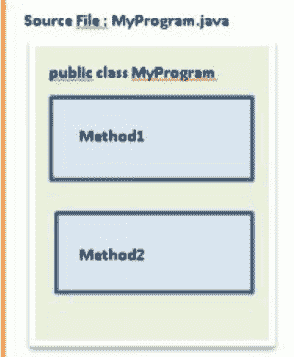

# 编程：JAVA：Java 编程、JavaScript、编码：编程指南：一天学会！（JAVA, HTML, Python, SQL, App、iphone、网站设计、Word Press）


作者：Os Swift


## Java 简介

Java —— 互联网时代最流行的编程语言之一，于1991年在太阳微系统公司（Sun Microsystems）构思并开发。任何编程语言的演进都是由计算生态系统发展产生的需求驱动的——Java也不例外。

虽然用 C 或 C++ 编写的代码（Java 的强大前身）也可以在所有设备上运行，但每次为了让它们在特定设备上运行而进行编译的工作是非常昂贵的。

Java 解决了这个问题，它只需获取文本源代码（.java）并编译为中间字节码（.class）文件，然后该文件可以由任何运行解释器的设备——Java 虚拟机（JVM）进行解释。字节码的概念意味着代码变得架构中性，只需要编译一次就可以在任何可以运行 JVM 的设备上解释。

今天，Java 已经成为一种重要的编程语言，对于任何对编程感兴趣的人来说，了解 Java 的基础知识几乎已成为必修。本书正是为此目的而写的。我想帮助任何几乎或完全没有先编程经验的人轻松、有效地入门 Java 编程。

## 第1章：入门

### 安装

在进行任何事情之前，我们需要准备好开发环境。初学者可以使用在线开发环境（https://ideone.com/）来执行小段代码，但如果要执行的代码是一个完整的程序，则必须在他们的系统中安装 Java 并设置自己的离线开发环境。Java 有三种类型——

- 微型版 (J2ME)
- 标准版 (J2SE)
- 企业版 (J2EE)

对于个人使用，可以从下载页面下载与其操作系统对应的最新 SE 版本的 .exe 文件。安装后，检查 PATH 变量是否指向 Java 安装路径。在终端窗口中执行“java”将显示已安装的 Java 版本。

## 代码结构



每段 Java 代码都以“.java”扩展名保存。每个 Java 程序包含一个或多个类。这些类中的每一个包含一个或多个方法定义，每个方法内部包含几条语句。

## 关键字的语法和含义

```java
import java.io.*;
public class MyFirstProgram {
    public static void main(String[] args) {
        //这里是我的第一个java程序
        System.out.println(" Hello World!");
    }
}
```

**import java.io.*;** - 关键字 "import" 用于引入名为“包”的 Java 库，这些包包含了可以在程序使用的预定义函数。

**Public class MyFirstProgram** - 这是类的定义，关键字 "public" 表示该类对所有人可用，"class" 表示一个类。

**MyFirstProgram** – 这是类名。拥有 main () 函数的类类名应与文件名相同。

类定义被封装在 {} 之中。

**Public static void main(String[] args):** 这是程序的主部分。由于 main () 是驱动函数，它应该是“public”（公共的）。

**Static:** 你需要记住，main() 方法始终应该是“static”（静态的），因为这可以提高程序的内存效率。

**Void:** 这是方法的返回类型。这意味着 main() 方法不会返回任何内容。

**Main:** 方法名。解释器仅从 main 方法开始执行。运行一个程序意味着指示 JVM 加载从源代码编译的 .class 文件并从 main 方法开始执行。

main 方法的两个用途可以总结为：

1. 测试程序的所有其他方法
2. 启动程序的执行

String[] args : 是传递给“main” 方法的参数。该方法始终接收一个字符串数组作为输入参数，数组名称应始终为“args”。

注意数据类型以大写“S”开头，这是因为“Strings”是 Java 中的一个类，所有类名都以大写开头。

要向标准输出控制台打印语句，使用“System.out.println("");”。注意所有语句必须以分号（;) 结束；

你也可以使用 System.out.print () 显示输出，区别是 print 不会在打印的每条语句末尾引入新行。

我们程序中 main() 方法内的另一条语句被称为“注释”语句。这些语句不会被编译，这些以 // 开头的语句的作用仅为程序员提供更多关于代码的信息。

 Java 完全没有全局变量的概念；同样的功能通过 “final”, “static”, “public” 等关键字来实现。

## 使用 Java 库

在处理 Java 时，你会发现存在许多预定义的类。所有这些类都可以在 Java 程序中使用，从而让用户无需造轮子。但为了使用这些类，你应该对需要使用什么以及在哪里使用有一定的最少知识。


为了找到它。这些被称为 Java API。该库无非是一大堆预定义的类，它们可以在程序的任何地方使用。它们包含了预定义的代码，用户只需要知道如何使用它们即可。这些库让用户无需编写长代码。这也被称为 Java 标准代码库。在 Java 平台中，Java 标准代码库有三个主要用途。它们是：

- 就像其他库一样，Java 库为程序员提供了一组实用的工具。这些工具包括正则表达式处理、容器类等。
- 标准代码库为用户提供了抽象接口，用户可以通过这些接口独立地执行任务。这样用户就不需要为文件访问和网络访问等复杂过程编写完整的代码。
- 有些底层平台不支持所有的 Java 应用程序在这种情况下，你可以使用 Java 库来模拟这些功能，或者使用它来提供一种检查特定功能是否存在的方法。

## Java 标准代码库的实现与配置

标准库中的大部分代码都是用 Java 编写的。直接访问操作系统或硬件的代码除外。在这种情况下，使用 Java 原生封装（native wrapper）来访问操作系统的 API。几乎所有的 Java 代码库都存储在一个名为 "rt.jar" 的单一归文件中。该文件由 JDK 和 JRE 分发。Java 类库可以在引导类路径（bootstrap class path）中找到。

## Java 类库的主要特征

我们使用类来访问 Java 类特征。这些类属于包。下面是 Java 类库的一些主要特征：

- java.lang 包含了所有的基础接口和类。它们与运行时系统和语言紧密相关。
- 有一个专门用于数学运算的包，包含了数学表达式、求值和任意精度小数。它们都存在于 java.math 库中。
- 工具与集合：Java 为用户提供了内置的工具类和数据结构。这些工具类和数据结构可以用于数据压缩、日志、并发和正则表达式。
- 2D 图形和图形用户界面：用户可以使用 AWT 包，它提供了图形用户界面。该包绑定到原生系统。你可以用它来设计平台无关工具包和可插的外观与外观（feel and look）。该包还可以用于处理可编辑和不可编辑的文本组件。
- 声音：此包为用户提供了类和接口，用于声音数据的写入、读取、合成和排序。
- 文本：java.text 接口用于处理文本、数字、消息和日期。
- 数据库：用户可以使用 java.SQL 库访问数据库 (sql)。
- Java.Security 提供了安全性以及加密服务。加密服务存在于 javax.crypto 库中。
- Java 还允许你访问脚本引擎。你可以使用 javax.script 包使用任何符合get脚本语言。
- 小程序（Applets）：Java.applet 包允许你通过网络下载应用程序，并允许你在受保护的沙箱中运行它们。

## 第2 章：面向对象编程

Java 的语法与 C 相似，但编程哲学源自 C++ —— 即 Java 是一门面向对象的语言。

在我们看到的第一个示例中，我们有一个类声明，并说明 main() 函数负责程序中执行的操作，嗯，这并没有让 Java 变成 OOP 语言，让我们看一个例子来更好地理解 OOP —— 对象和类。

## 过程化方法

这并不简单，因为之前的形状是确定的，动画代码可以假设一个中心点并旋转形状，而对于像变形虫这样不确定的形状，它无法使用其他形状的代码进行旋转，相反 API 需要更多的参数来定义形状应该旋转的坐标。

## 面向对象方法

所以你可以为每个形状编写一个类文件，这样在添加变形虫或修改旋转方法时，无需干扰现有代码，只需简单地添加新类即可。你只需要测试新类。引入的任何新问题都可以轻松追踪到所做的新更改。

示例 1：

```
class Movie{
    //变量声明
    //方法
    m1; // m1 是类型为 "Movie" 的类对象
```

示例 2：

```
class Movie{
    //变量声明
    //方法
}
```

```
class TestMovie{
    public static void main(String[] args){
        Movie m1 = new Movie(); // m1 是类型为 "Movie"的对象
        m1.variable = value;
        m1.method();
    }
}
```

## 第3 章：变量声明与数据类型

下一个最重要且基础的概念是用于创建实用程序的“变量”和“数据类型”。变量本质上是命名的内存位置，用于存储值。Java 是一门强类型语言，所以类型为“x”的变量只能持有类型为“x”的值。

例如：

```
int n;
```

在这里声明了一个类型为“int”的变量“n”来持有 int 类型的值。声明变量类型是 Java 的一种“类型安全”特性，这反过来有助于“安全性”。

Java 中的变量可以是以下一种：

- 局部变量（基本数据类型，如 int, float, double, Boolean 等）
- 引用变量（对象 – 用户定义的类实例）

假设你声明了一个类型为 int 的变量，你可能可以使用它来保存一个短值。如果这样做，它将会溢出。

还要注意，Java 认为任何带有小数点的数字默认都是“double”，因此在给的小数后面附加“f”是重要的。

```
float f = 1.56f;
```

变量命名的规则：

- 不要使用预留字作为变量名。
- 变量名不能以数字开头。

一些应该知道流行的 Java 关键字：

| abstract | assert | boolean | break | byte | case |
| --- | --- | --- | --- | --- | --- |
| catch | char | class | const | continue | default |
| do | double | else | enum | extends | final |
| finally | float | for | goto | if | implements |
| import | instanceof | int | interface | long | native |
| new | package | private | protected | public | return |
| short | static | strictfp | super | switch | synchronized |
| this | throw | throws | transient | try | void |
| volatile | while | | | | |

表 1-1 关键字

## 字符串

String 被声明为一个类。字符串上常用的操作有：

```
String str = "Hello World"; //声明
int len = str.length(); // 获取字符串的长度
int len = "hello Wolrd".length(); // 也获取字符串的长度
String concatStr = "hello"+'+world"; // + 运算符可以重载以执行两个字符串的拼接
String str1 = "Heloo";
String str2 = "World";
if (str1 == str2) //比较两个字符串
System.out.println("strings are equal");
```

## 引用变量

Movie m1 = new Movie() 左侧是声明，指示 JVM 为引用变量留出空间，该变量持有到达实际对象的数据。

```
int[] n; // 声明一个整数数组
n = new int[5]; // 创建一个包含5个整数的数组
```

注意，即使是基本数据类型值的数组，数组也是一个对象。

Movie[] myArray; // 声明类型为 “Movie” 的对象数组

大小：引用变量没有像基本类型那样的预定义大小。

## equals 操作我们知道 == 和 != 等比较运算符可以用基本类型使用，但为了对对象执行比较操作，不能使用默认运算符，相反 Java 提供了关键字 “equals”。


## Array List

这在 `java.util.ArrayList` 包中可用。

```java
ArrayList<String> myList = new ArrayList<String>();
```

它允许声明不同数据类型的数组。它提供了多种方法来执行常见的数组操作，如 `add(elem)` 和 `remove(index)`，用于从 ArrayList 中添加/删除元素。此外还有 API 如 `size()` 用于查找数组长度，`isEmpty()` 用于判断为空，或者数组是否 `contains( )` 给定的元素。

让我们使用目前为止学到的概念来看例子，

```java
Class MyProgram{
    public static void main(String[] args)
    {
        //声明并赋值变量
        int num = 10;
        float fNum = 10.5;
        //输出到控制台的语句
        System.out.println("The value of integer num is : "+ +num);
        System.out.println("The Value of integer fNum is : "+ +fNum);
        num = num/2;
        fNum = fNum+num;
        System.out.println("The value of integer num after operation is : "+ +num);
        System.out.println("The Value of integer fNum after operation is : "+ +fNum);
    }
}
```

输出:

The value of integer num is : 10
The value of integer fNum is : 10.5
The value of integer num after operation is : 5
The value of integer fNum after operation is : 20.5

你只需要在 SoP (System.out.println) 语句中使用 `+` 运算符即可。

## Wrapper Classes（包装类）

正如我们所知，Java 是一种面向对象的编程语言，Java 中的一切都可以被视为对象。从简单的文件、图像到系统地址等，任何内容都可以被视为 Java 中的对象。我们可以使用包装类更改对象的类型。在本教程中，我们将介绍包装类及其细节。使用包装类，你可以将任何给定的数据类型转换为对象。

Java 中的基本数据类型不是对象。这些基本数据类型不属于任何类，它们定义在 Java 语言本身。我们可能会遇到必须将这些基本数据类型转换为对象的情况。例如，你可以通过将数据类型转换为对象来添加到向量（vector）或栈（stack）中。Java 设计引入了包装类来完成这些转换。

## About wrapper classes（关于包装类）

正如名称所示，包装类封装（wrap）在任何数据类型周围，使其具有对象的形态，并在需要该数据类型时可以使用。这是一个可以逆转的过程。包装类不仅可以将数据类型转换为类，还可以解封装对象并返回数据类型。这就像巧克力的包装纸。制造商用包装纸包裹巧克力并出货；用户则去除包装纸以获得巧克力。

来看下面的转换，其中 `int` 数据类型被转换为对象。

```java
int k = 100;
Integer it1 = new Integer(k);
```

在上面的示例中，int 数据类型 `k` 使用包装类转换为对象 `it1`。这是通过使用 `Integer` 类实现的。每当需要 `K` 时，就可以使用对象 `it1`。

下面的代码显示了如何封装对象并从整数对象 `it1` 获取 `int` 数据类型。

```java
int m = it1.intValue();
System.out.println(m*m); // prints 10000
```

List of Wrapper classes（包装类列表）
在 Java 语言中，存在 8 种类型，每种类型都有自己的包装类。

| Primitive data type | Wrapper class |
|--- |--- |
| byte | Byte |
| short | Short |
| int | Integer |
| long | Long |
| float | Float |
| double | Double |
| char | Character |
| Boolean | Boolean |

所有的包装类都可以在 `java.lang` 包中找到。它们的放置使得只要一导入，程序员就可以隐式地使用它们。为了避免继承，Java 设计师将这些包装类被设为 `final`。

Importance of Wrapper classes（包装类的重要性）
我们使用包装类有两个目的：

- 将简单数据类型转换为对象。这是通过给给定的数据类型对象的形式来实现。
- 将字符串转换为数据类型。对于这种类型的转换，我们使用如 `parseXXX()` 等方法。

这里有一个示例程序，展示了数据类型到对象的转换，同时也获取数据类型。

```java
public class WrappingUnwrapping
{
    public static void main(String args[]) {
        byte grade = 2;
        int marks = 50;
        float price = 8.6f;
        // f for float
        double rate = 50.5;

        Byte g1 = new Byte(grade);
        Integer m1 = new Integer(marks);
        Float f1 = new Float(price);
        Double r1 = new Double(rate);

        System.out.println("Values of Wrapper objects (printing as objects)");
        System.out.println("Byte object g1: " + g1);
        System.out.println("Integer object m1: " + m1);
        System.out.println("Float object f1: " + f1);
        System.out.println("Double object r1: " + r1);

        byte bv = grade;
        int iv = marks;
        float fv = price;
        double dv = rate;

        System.out.println("Values of Wrapper objects (printing as objects)");
        System.out.println("Byte object g1: " + g1);
        System.out.println("Integer object m1: " + m1);
        System.out.println("Float object f1: " + f1);
        System.out.println("Double object r1: " + r1);

        byte bv = grade;
        int iv = marks;
        float fv = price;
        double dv = rate;

        System.out.println("Values of Wrapper objects (printing as objects)");
        System.out.println("Byte object g1: " + g1);
        System.out.println("Integer object m1: " + m1);
        System.out.println("Float object f1: " + f1);
        System.out.println("Double object r1: " + dv);
    }
}
```
*(注：最后一个代码块的 OCR 文本包含严重的损坏和重复，如 `<strong>f<//</strong>`。我已根据标准的 Java 语法和周围上下文清理了逻辑，同时保持了预期的结构。）*

等等，回看提供的 OCR，文本的最后非常破碎。我将提供该 OCR 片段逻辑的清理版本。


x 的值 : 10
x 的值 : 11
x 的值 : 12
x 的值 : 13
x 的值 : 14
x 的值 : 15
x 的值 : 16
x 的值 : 17
x 的值 : 19

## 关于 for 循环的更多

在这里我们将研究循环的细节。现在我们来看‘for’ 循环。每个‘for’ 循环由三个部分组成。它们是：

- 初始化：在初始化部分，我们将使用一个合适的变量来声明并初始化循环。我们会在循环体中使用这个变量。我们在循环中使用的这个变量通常用作计数器。循环中可以放置的变量数量不仅限于 1 个。你可以在循环体中放置任意数量可以作为计数器的变量。

- 布尔集合：条件测试将放在循环的这部分。给定的条件（无论它是什么）都必须解析为布尔值。你可以给出一个表达式，也可以使用返回布尔值的方法。

- 迭代表达式：在循环的这部分，你可以放置一个或多个你希望每次循环运行时执行的所需动作。请始终记住，执行只会在循环结束时发生。

## 嵌套 for 循环：

你可以将一个‘for’ 循环放在另一个 for 循环内部。这种安排被称为嵌套循环。你可以在循环内部放置任意数量的循环。但建议不要超过五或六层嵌套循环，因为这会让程序看起来很臃肿。汽车里程表的工作原理与嵌套循环相同。另一个例子是日期或日历。正如我们所知，一天由小时、分钟和秒组成。在数字钟中，嵌套循环的最后一个分支是秒计数器。在它上面是分钟计数器。它是嵌套在嵌套循环中的嵌套循环。下面首先给出了嵌套循环的语法。for 循环有三种形式。它们是：

形式 1 语法：

```
for(initialization; test; increment)
{
  statements;
  while(expression)
  {
    statements;
  }
  do
  {
    statements;
  }while(expression)
}
}
```

形式 2 语法：

```java
for(initialization; test; increment)
{
  statements;
  for(initialization; test; increment)
  {
    statements;
    for(initialization; test; increment)
    {
      statements;
    }
  }
}
}
```

形式 3 语法：

```
While(expression)
{
  statements;
}
```

这里有几个示例将帮助你理解嵌套循环的工作原理。

示例 1：使用嵌套 for 循环显示 *  三角形的程序

```java
class NestedForLoopDemo
{
  public static void main(String args[])
  {
    for(int i = 1; i<=5; i++)
    {
      for(int j = 1; j<= i; j++)
      {
        System.out.println("* ");
      }
      System.out.println("");
    }
  }
}
```

### 输出

- *
**
***
****
*****

### 示例 2：打印乘表的程序

```java
class NestedWhileLoop
{
  public static void main(String args[])
  {
    int i=1, j=1;
    System.out.println("Tables");

    while(i<= 2) // 根据用户需要的表格数量更改为 10 或 20
    {
      while(j <= 10)
      {
        System.out.println(i + " * " + j + " = " + (i*j));
        j++;
      }
      i++;
      System.out.println("");
      System.out.println("");
    }
  }
}
```

### 输出

### 表格

1 * 1 = 1
1 * 2 = 2
1 * 3 = 3
1 * 4 = 4
1 * 5 = 5
1 * 6 = 6
1 * 7 = 7
1 * 8 = 8
1 * 9 = 9

2 * 1 = 2
2 * 2 = 4
2 * 3 = 6
2 * 4 = 8
2 * 5 = 10
2 * 6 = 12
2 * 7 = 14
2 * 8 = 16
2 * 9 = 18
2 * 10 = 20

示例 3：打印数字三角形的程序

```java
class NestedDOWWhileLoop
{
    public static void main(String args[]) {
        int i=1, j=1, k;
        do
        {
            k=3;
            do {
                System.out.print(" ");
                k--;
            }while(k>=i);
            j = 1;
            do {
                System.out.println(i + " ");
                j++;
            }while(j<=i);
            System.out.println("");
            i++;
        } while(i<=5);
    }
}
```

输出

1
2 2
3 3 3

## 第 5 章：封装

封装，正如其名所示，就像胶囊一样。正如名称所示，封装将数据隐藏起来。封装通过方法提供数据。在面向对象编程中，封装发生在子类使用父类时。在 Java 中，变量可以赋值为类型。如果变量被声明为 final，则无法更改。使用点运算符来访问父类的方法。考虑以下示例：

```java
/* File name : Employee.java */
public class Employee
{
    private String name;
    private String address;
    private int number;
    public Employee(String name, String address, int number)
    {
        System.out.println("Constructing an Employee");
        this.name = name;
        this.address = address;
        this.number = number;
    }
    public void mailCheck()
    {
        System.out.println("Mailing a check to " + this.name
+ ""+ + this.address);
    }
    public String toString()
    {
        return name + ""+ + address + ""+ + number;
    }
    public String getName()
    {
        return name;
    }
    public String getAddress()
    {
        return address;
    }
    public void setAddress(String newAddress)
    {
        address = newAddress;
    }
    public int getNumber()
    {
        return number;
    }
}
```

输出

Your name is: John
Your age is: 30

## 第 6 章：多态与继承

多态可以定义为对象采取多种形式的能力。在面向对象编程中，多态发生在子类使用父类时。在 Java 中，变量可以是父类类型。变量可以赋值为子类。如果变量被声明为 final，则无法更改。使用点运算符来访问父类的方法。

该 deer 类可以被认为是多态的，因为它有重继承。这里有一个例子：

```java
public interface Vegetarian{}
public class Animal{}
public class Deer extends Animal implements Vegetarian{}
```

对于上面的示例，以下语句是正确的：

- Deer 是 Animal
- Deer 是 Vegetarian
- Deer 是 Deer
- Deer 是 Object

当我们应用 deer 对象引用到：

```java
Deer d = new Deer();
Animal a = d;
Vegetarian v = d;
Object o = d;
```

在这里我们将研究重写方法的行为。在 Java 中，你可以在设计类时利用多态。在方法重写中，子类有重写其父类方法的能力。被重写的方法本质上是被隐藏的。在子类使用 super 关键字之前，它无法被调用。super 关键字应该在被重写的方法内部使用。考虑以下示例。

（此处省略了重复的 Employee 类定义，见上文）

如果我们像下面所示所示扩展 employee 类：
/* File name : Salary.java */
public class Salary extends Employee
{


```java
private double salary; //Annual salary
public Salary(String name, String address, int number, double salary)
{
  super(name, address, number);
  setSalary(salary);
}
public void mailCheck()
{
  System.out.println("Within mailCheck of Salary class ");
  System.out.println("Mailing check to " + getName() + " with salary " + salary);
}
public double getSalary()
{
  return salary;
}
public void setSalary(double newSalary)
{
  if(newSalary >= 0.0)
  {
    salary = newSalary;
  }
}
public double computePay()
{
  System.out.println("Computing salary pay for "+ getName());
  return salary/52;
}
}
```

现在请看以下程序并尝试判断输出结果

```java
/* File name : VirtualDemo.java */
```

```java
public class VirtualDemo
{
    public static void main(String [] args)
{
        Salary s = new Salary("George Martin", "Ambehta", "UP", 3, 3600.00);
        Employee e = new Salary("John Adams", "Boston, MA", 2, 2400.00);
        System.out.println("Call mailCheck using Salary reference --");
        s.mailCheck();
        System.out.println("\n Call mailCheck using Employee reference--");
        e.mailCheck();
    }
}
```

输出：

Constructing an Employee

Constructing an Employee

Call mailCheck using Salary reference --

Within mailCheck of Salary class

Mailing check to George Martin with salary 3600.0

Call mailCheck using Employee reference--

Within mailCheck of Salary class

Mailing check to John Adams with salary 2400.0

在这个示例中，实例化了两个 salary 对象。其中一个使用 salary 引用 `s`，另一个是 Employee 引用 `e`。

编译器在编译查看调用 `s.mailCheck()` 的 `mailCheck()` 方法。随后，Java 虚拟机调用 salary 类中存在的 `mailCheck()`。这发生在运行时。

现在，因为 'e' 是一个 employee 引用，调用 `mailCheck()` 的结果将不同。调用 `e.mailCheck()` 时，编译器会寻找 `mailCheck()`。该 `mailCheck()` 存在于 Employee 类中。

编译器使用了 Employee 中的 `mailCheck()` 来在编译时验证该语句的含义。但在运行时，Java 虚拟机将去调用 salary 类中的 `mailCheck()`。Java 中的这种特定行为被称为**虚方法调用**（virtual invocation method）或“**虚方法调用**”。在 Java 中，所有方法都具有这种行为。重写的方法在运行时总是被调用，而不取决于编译时使用的数据类型引用。

## 抽象方法与类

抽象类可以定义为被声明为抽象的类。它内部是否包含抽象方法并不重要。这些抽象类可以有子类，但它们不能被实例化。

如果一个方法被声明且没有实现，则可以将其定义为抽象方法。下面给出了抽象方法的示例：

```java
abstract void moveTo(double deltaX, double deltaY);
```

如果一个类包含抽象方法，则应该被声明为抽象类。例如：

```java
public abstract class GraphicObject {
    // 声明字段
    // 声明非抽象方法
    abstract void draw();
}
```

如果你子类一个抽象类，通常子类将为其父类中存在的每一个抽象方法提供实现。但如果没有提供，那么该类就不应该被声明为抽象类。

接口中存在的方法没有被声明为静态（static）或默认（default）。在处理接口方法时，不会使用抽象（abstract）修饰符。

## 抽象类与接口的比较

考虑到以下相似性，抽象类和接口是相似的：

- 人不能实例化抽象类或接口。
- 两者都不能包含已声明但未实现方法的混合方法。

抽象类允许你声明 `Final` 和 `static`，允许你定义 `public`、`private` 和 `protected` 的具体方法。但接口中的所有字段将被自动定义为 `public`、`final` 和 `static`。你定义的所有方法默认都是 `public` 的。你不能对其扩展超过一个类，但可以对其实现多个接口。

## 哪一个是更好的选择？

如果以下语句中任何一个与你的情况相关，你可以考虑使用抽象类：

- 你计划与其他密切相关的类共享代码。
- 如果你认为扩展你抽象类的类具有共同的字段或方法。
- 如果你需要 `private` 或 `protected` 访问修饰符。
- 如果你希望声明非 `final` 或非 `static` 的字段。

如果以下语句任何一个适用于你的需求，可以使用接口：

- 如果你认为你的接口将由无关的类实现。例如 `Comparable` 和 `cloneable`。
- 如果你计划利用多重继承。
- 如果你想指定特定数据类型的行为，而不关心谁将实现该行为。

## Java 中的继承

Java 中的继承可以定义为：对象可以获取另一个对象的属性的过程。通过继承，类的属性可以与继承所指向的其他类共享。通过继承可以信息变得易于管理。使用继承时，对象遵循层级顺序。执行继承的关键字有：`extends` 和 `implements`。**IS-A** 意味着对象是另一个对象的类型。使用上述关键字，我们可以确保对象是另一个对象的实例。

**IS-A** 意味着对象是另一个对象的类型。使用上述关键字，我们可以确保对象是另一个对象的实例。这里：

```java
public class Animal {
}
```

```java
public class Mammal extends Animal {
}
```

```java
public class Reptile extends Animal {
}
```

```java
public class Dog extends Mammal {
}
```

基于上述示例可以推断出：

- Mammal 类是 Animal 类的类
- Reptile 类是 Animal 类的类
- Mammal 和 Reptile 类都是 类的子类
- Dog 类是 Mammal 类的类

我们可以通过 IS-A 关系查看相同的内容。如下所示：

- Mammal IS-A Animal
- Reptile IS-A Animal
- Dog IS-A Mammal
- 因此 Dog IS-A Animal

使用 `extends` 关键字允许子类继承该类的每一个属性（私有属性除外）。

使用实例我们可以确保普通类确实是该类的实例。

示例：

```java
public class Dog extends Mammal{

    public static void main(String[] args[]) {

        Animal a = new Animal();
        Mammal m = new Mammal();
        Dog d = new Dog();

        System.out.println(m instanceof Animal);
        System.out.println(d instanceof Mammal);
        System.out.println(d instanceof Animal);
    }
}
```

输出：这将产生以下结果

true

true

true

## instanceof 运算符

在 Java 中，如果你想确定一个类是否属于特定的给定类，或者为了实现接口，可以使用 `instanceof` 运算符。`instanceof` 是一种类型比较运算符。`instanceof` 根据类的状态返回 `true` 或 `false`。如果给定的对象属于某个类，或者给定的对象实现了接口，则 `instanceof` 返回 `true`。否则它将简单返回 `false`。
在这里，在以下示例中可以看到 `instanceof` 运算符的使用：

```java
class Vehicle {

    String name;
    Vehicle() {
        name = "Vehicle";
    }
}
```

```java
class dirtbike extends Vehicle {

    dirtbike() {
        name = "dirtbike";
    }
}
```

```java
class atv extends dirtbike {

    atv() {
        name = "atv";
    }
}
```


```java
class LightVehicle extends Vehicle {

    LightVehicle() {
        name = "LightVehicle";
    }
}

public class InstanceOfExample {

    static boolean result;
    static dirtbike hV = new dirtbike();
    static atv T = new atv();
    static dirtbike hv2 = null;
    public static void main(String[] args) {
        result = hV instanceof dirtbike;
        System.out.print("HV is an dirtbike: " + result + "\n");
        result = T instanceof dirtbike;
        System.out.print("T is an dirtbike: " + result + "\n");
        result = hV instanceof atv;
        System.out.print("HV is a atv: " + result + "\n");
        result = hv2 instanceof dirtbike;
        System.out.print("hv2 is an dirtbike: " + result + "\n");
        hV = T; // 从子类到父类的成功转换
        T = (atv) hV; // 从父类到子类的显式强制转换
    
```
输出：
HV is an dirtbike: true
T is an dirtbike: true
hV is a atv: false
hv2 is an dirtbike: false
注意：hv2 尚未引用一个 dirtbike 对象，instanceof 返回 false。
应该记住，你不能在兄弟类之间使用 instanceof 运算符。

## implements 关键字

现在你已经很好地理解了 `extends` 关键字，我们将查看 `implements` 关键字以及它如何用于获取 IS-A 关系。我们使用 `implements` 关键字让类继承接口。你应该记住，接口不能被类扩展（继承），只能被实现。

示例：

```java
public interface Animal {}
```

```java
public class Mammal implements Animal{
}
```

```java
public class Dog extends Mammal{
}
```

## instanceof 关键字：

在这里我们将查看 `instanceof` 运算符。我们使用这个运算符来判断一个类是否是其超类的的一个实例。

```java
interface Animal {}
```

```java
class Mammal implements Animal {}

public class Dog extends Mammal{
    public static void main(String[] args) {

        Mammal m = new Mammal();
        Dog d = new Dog();

        System.out.println(m instanceof Animal);
        System.out.println(d instanceof Mammal);
        System.out.println(d instanceof Animal);
    }
}
```

输出：
true
true
true

## HAS-A 关系：

组合是这种关系的主要用处。如果一个特定的类拥有（HAS-A）某个特定的东西，我们就说两个对象之间存在这种关系。这种关系的主要用途是有助于减少 Bug 和代码重复。
这里有一个展示了对象之间存在 HAS-A 关系的示例。

示例：

```java
public class Vehicle{
    public class Speed{}
    public class Van extends Vehicle{
        private Speed sp;
    }
}
```

上面的示例告诉我们面包车（van）拥有（HAS-A）一个速度。如果我们专门为速度创建一个类，我们可以在不同的应用程序中反复使用它。

在 Java 中，类只能有单继承。Java 不支持多重继承。每个类都限制使用 `extends` 关键字进行单继承。然而，类允许实现多个接口。通过这种方式，可以在 Java 中获得多重继承。以下语句包含两个带有 `extends` 关键字的类，无法以那种方式使用该关键字。

```java
public class extends Animal, Mammal {};
```

## 第 7 章：对象的生命生死

## 构造函数

在 Java 中，构造函数可以定义为一种特殊的方法，通过它你可以初始化对象。构造函数在对象创建期间被调用。它被称为构造函数，因为它为对象构造了值。

### 在 Java 中创建构造函数的规则
Java 中为构造函数定义了两个基本规则：

- 构造函数的名称必须与其类名完全相同
- 构造函数不应该有显式的返回值。

### 构造函数的类型
在 Java 中，我们有两种类型的构造函数。

- 默认构造函数或无参构造函数
- 参数化构造函数。

在这里我们将详细查看它们。
Java 默认构造函数：
Java 默认构造函数是不带参数的构造函数。
默认构造函数的语法：

```java
<ClassName>(){}
```

这里是一个展示简单默认构造函数的示例：
```java
class Student1 {
    Student1() {}
    public static void main(String[] args) {
        Student1 s1 = new Student1();
        System.out.println("Student created");
    }
}
```
输出：
Student created

这里是另一个展示默认构造函数的示例：
```java
class Student2 {
    Student2() {}
    public static void main(String[] args) {
        Student2 s1 = new Student2();
        System.out.println("Student created");
    }
}
```
输出：
Student created

这里是另一个展示默认构造函数的示例：
```java
class Student3 {
    Student3() {}
    public static void main(String[] args) {
        Student3 s1 = new Student3();
        System.out.println("Student created");
    }
}
```
输出：
Student created

## Java 中的参数化构造函数

在 Java 中，当我们需要在创建时为对象提供值时，我们使用参数化构造函数。

示例：

```java
class Student4 {
    int id;
    String name;
    Student4(int i, String n) {
        id = i;
        name = n;
    }
     void display() {
        System.out.println(id + " " + name);
    }
    public static void main(String[] args) {
        Student4 s1 = new Student4(111, "David");
        s1.display();
    }
}
```
输出：
111 David

## Java 中的构造函数重载

构造函数重载是 Java 中的一种技术，通过具有相同名称但不同参数列表的构造函数。

示例：

```java
class Student5 {
    int id;
    String name;
    int age;
    Student5(int i, String n) {
        id = i;
        name = n;
    }
    Student5(int i, String n, int a) {
        id = i;
        name = n;
        age = a;
    }
    void display() {
        System.out.println(id + " " + name + " " + age);
    }
    public static void main(String[] args) {
        Student5 s1 = new Student5(111, "David");
        Student5 s2 = new Student5(222, "Aryan", 25);
        s1.display();
        s2.display();
    }
}
```
输出：
111 David
222 Aryan 25

## Java 中的拷贝构造函数

虽然我们称之为构造函数，但在 Java 中并没有这种东西。如果你希望将特定对象的值拷贝到不同的对象，可以使用以下方法：

- 使用构造函数
- 将对象的值赋值给另一个对象
- 使用 `clone()` 方法。它属于 Object 类。

这里有一个我们将一个对象的值拷贝到另一个对象的示例：

```java
class Student6 {
    int id;
    String name;
    Student6(int i, String n) {
        id = i;
        name = n;
    }
    Student6(Student6 s) {
        id = s.id;
        name = s.name;
    }
    void display() {
        System.out.println(id + " " + name);
    }
    public static void main(String[] args) {
        Student6 s1 = new Student6(111, "David");
        Student6 s2 = new Student6(s1);
        s1.display();
        s2.display();
    }
}
```
输出：
111 David
111 David

## 不使用构造函数拷贝值

正如我们之前讨论的，可以在不使用构造函数的情况下将对象的值拷贝到不同的对象。在这种情况下，你不需要创建构造函数。你只需通过将该对象的值赋值另一个对象即可。在这里，下面的示例我们没有使用构造函数，而是赋值来进行拷贝：

```java
class Student7 {
    int id;
    String name;
    Student7() {}
    Student7(int i, String n) {
        id = i;
        name = n;
    }
    void display() {
        System.out.println(id + " " + name);
    }
    public static void main(String[] args) {
        Student7 s1 = new Student7(111, "David");
        Student7 s2 = new Student7();
        s2.id = s1.id;
        s2.name = s1.name;
        s1.display();
        s2.display();
    }
}
```
输出：
111 David
111 David


```
s2.id=s1.id;
s2.name=s1.name;
s1.display();
s2.display();
}
Output:
111 David
111 David
```

## Java 中的垃圾回收

Java 中的垃圾可以定义为 Java 中未被引用的对象。清理垃圾以回收未使用的运行内存内存的过程被称为垃圾回收（Garbage Collection）。简单来说，垃圾回收意味着销毁不再使用的对象。与 C 和 C++ 不同，Java 中的垃圾回收是一个自动过程。这就是 Java 为用户提供更好、更高效内存管理的原因之一。

## 垃圾回收的优点

- 垃圾回收通过移除所有未引用的对象来使内存更高效。
- 用户不需要手动执行垃圾回收，因为 Java 中的垃圾回收过程是自动的。Java 虚拟机会负责清理这些内存。

你可以通过三种方式来分配对象：

- 将引用置空：通过移除对象的引用，可以将对象从堆中移除。这里有一个示例：
```java
Employee e = new Employee();
e = null;
```

- 将对象的引用赋值给另一个对象：移除一个对象的引用并将其交给另一个对象，会导致第一个对象失去引用。正如我们所知的，没有引用的对象将被释放。这里有一个示例：
```java
Employee e1 = new Employee();
Employee e2 = new Employee();
e1 = e2;
```

- 使用匿名对象：这是释放对象的第三种方式。在这里，我们将创建一个新对象。示例：
```java
Employee e1 = new Employee();
Employee e2 = new Employee();
e1 = e2;
```

## 第 8 章：类型转换

在 Java 中，你可以将对象引用转换为不同的对象引用。这被称为类型转换（Type Casting）。类型转换不仅限于类本身；你可以转换为父类或接口。对于类型转换，既有编译时规则，也有运行时规则。当针对给定类型进行转换时，任何对象的引用都可以赋值，因为我们使用的对象类是每个类的父类。类型转换有两种类型：

- 向上转型（Upcasting）：类型转换可以隐式或显式地进行。如果从较低的数据结构到较高的数据结构进行转换，将是隐式类型转换。Java 不会自动执行向下转型。向下转换应该由用户显式地进行。从较高数据结构到数据结构的转换应该小心进行，因为涉及大量数据。Java 虚拟机会在需要时执行向上转型。例如，如果存在某些类型，其中只有一个较高类型，JVM 将将所有其他较低类型转换为较高类型。

- 向下转型（Down casting）：在上述情况下执行向下转型会导致较高类型对象的数据丢失。在运行时，可能会出现名为 `ClassCastException` 的情况，即被转换的对象与其被转换的类型不兼容。这里有一个解释 ClassCastException 的示例：

```java
// X 是 Y 和 Z 的父类，它们是兄弟关系。
public class RuntimeCastDemo {
    public static void main(String[] args[]) {
        X x = new X();
        Y y = new Y();
        Z z = new Z();
        X xy = y; // 编译通过（向上层级）
        X xz = z; // 编译通过（向上层级）
        // Yz = z; // 类型不兼容（兄弟关系）
        Y y1 = new X(); // X 不是 Y
        Z z1 = new X(); // X 不是 Z
        X x1 = y; // 编译通过（y 是 X 的子类）
        X x2 = z; // 编译通过（z 是 X 的子类）
        Y y1 = (Y) x; // 编译通过但产生运行时错误
        Z z1 = (Z) x; // 编译通过但产生运行时错误
        Y yy2 = (Y) x1; // 编译并运行正常（x1 是 Y 类型）
        Z z2 = (Z) x2; // 编译并运行正常（x2 是 Z 类型）
        // Y3 = (Y) z; // 类型不兼容（兄弟关系）
        // Z3 = (Z) y; // 类型不兼容（兄弟关系）

        Object o = z;
        Object o1 = (Y) o; // 编译通过但产生运行时错误
    }
}
```

## 对象引用转换：使用编译器的隐式转换

每当对象引用被赋值时，都会执行隐式转换。在这里，对象的引用将被赋值给：

- 与类类型相同的引用变量。这是实例化给定对象的类。每个类的父类都是 Object。
- 数据类型为实例化该对象时同一类所实现的接口的引用变量。

这里有一个示例显示了接口 Automobile，它是子类 Ducati 的父类。在这里你可以看到编译器处理的给定对象引用的自动转换。

```java
interface Automobile {
}
class Bike implements Automobile {
}
class Ducati extends Bike {
}
```

示例：假设 `c` 是 bike 类的变量，`f` 是 Ducati 类的，`v` 是 vehicle 接口引用。我们可以将 Ducati 引用赋值给 bike 变量：我们可以执行以下操作：

示例 1
```java
c = f; // 编译通过
其中 c = new bike();
并且，f = new Ducati();
编译器会自动处理转换（赋值），因为类型是兼容的（子类 – 父类关系），即 bike 类型可以持有 Ducati 类型，因为 Ducati 是 bike。
```

示例 2
```java
v = c; // 编译通过
c = v; // 从接口类型到类的转换会导致编译错误
其中 c = new bike();
并且 v 是 Vehicle 接口引用 (v)
会自动处理转换（赋值），因为类型是兼容的（类 –接口关系），即 bike 类型可以转换为 Vehicle（bike 是 Vehicle）。
```


```java
}
}
class dirtbike extends Object {
}
class Ducati extends bike {
    void DucatiMethod() {
        System.out.println("I am DucatiMethod defined in Class Ducati");
    }
}
class Honda extends bike {
    void DucatiMethod() {
        System.out.println("I am DucatiMethod defined in Class Ducati");
    }
}
public class ObjectCastingEx {
    public static void main(String[] args) {
        bike obj = new Ducati();
        // Following will result in compilation error
        // obj.DucatiMethod(); //As the method DucatiMethod undefined for the bike Type
        // Following will result in compilation error
```

```java
// ((dirtbike)obj).DucatiMethod();
// DucatiMethod is undefined in the dirtbike Type
// Following will result in compilation error
((Ducati) obj).DucatiMethod();
// Following will compile and run
// Honda hondaObj = (Ducati)obj; // Cannot convert as they are siblings
}
```

用户在 Java 中允许将对象引用转换为字符串。这是在处理集合时常见的类型转换之一。示例：
import java.util.Vector;

```java
public class StringCastDemo {
    public static void main(String[] args) {
        String username = "asdf";
        String password = "qwer";
        Vector v = new Vector();
        v.add(username);
        v.add(password);
        // String u = elementAt(0); Cannot convert from object to String
        Object u = v.elementAt(0); //Cast not done
        System.out.println("Username : " + u);
        String uname = (String) v.elementAt(0); // cast allowed
        String pass = (String) v.elementAt(1); // cast allowed
        System.out.println();
    }
}
```

```java
System.out.println("Username : " + uname);
System.out.println("Password : " + pass);
}
}
```

输出

Username : asdf

Username : asdf

Password : qwer

## 第9章：异常处理

## 异常
异常可以定义为任何中断给定程序流的事件。异常本想让程序继续执行，但会让它们终止而不让其继续运行。在这种情况下，系统将生成错误消息来通知用户发生的问题。但不必担心异常，因为它们是可以被处理的。

### 异常何时会发生？
异常可能在运行时和编译时发生。并不是所有异常都发生在运行时。当程序在编译过程中出现问题时，Java 虚拟机会给出关于该异常的错误消息。大多数异常发生在运行时。在编译期间发生的异常称为编译时异常，而在运行时发生的异常称为运行时异常。

### 异常发生的原因是什么？
异常发生有很多原因。例如，当系统无法打开文件时，它会抛出异常。网络连接问题、类文件缺失场景、处理超出范围的操作数等都是抛出异常的常见原因。
Java 语言中可以找到两种类型的异常。它们是检查异常和未检查异常。
在这里我们将详细学习检查异常和未检查异常。

### 检查异常
在编译期间进行检查的异常称为检查异常。在这种情况下，如果一个方法抛出检查异常，它应该使用 `try-catch` 块进行处理，或者应该使用 `throws` 关键字进行声明。如果这两个方法都没有被遵循，编译器将给出一个编译错误。由于由于异常在编译期间被检查，因此它们被称为检查异常。这里有一个示例可以帮助你理解检查异常。
在这个示例中，有一个文件 `myfile.txt`。数据将从该文件中读取并显示在屏幕上。此程序中有三个检查异常，如下所示。
示例：

```java
import java.io.*;
class Example {
    public static void main(String args[])
    {
        FileInputStream fis = null;
        /*此构造函数 FileInputStream(File filename)
         * throws FileNotFoundException 这是一个检查
         * 异常*/
        fis = new FileInputStream("B:/myfile.txt");
        int k;

        /*FileInputStream类的 read() 方法也会抛出
         * 一个检查异常：IOException*/
        while(( k = fis.read()) != -1)
        {
            System.out.print((char)k);
        }
        /*close() 方法关闭文件输入流
         * 它抛出 IOException*/
        fis.close();
    }
}
```

输出：

Exception in thread "main" java.lang.Error: Unresolved compilation problems:
Unhandled exception type FileNotFoundException
Unhandled exception type IOException
在上面的示例中，检查和异常在编译期间由编译器检查，由于我们没有声明这些异常，程序显示了编译错误消息。
下面给出了几个更多的检查异常。

- SQLException
- IOException
- DataAccessException
- ClassNotFoundException
- InvocationTargetException

## 未检查异常

未检查异常只不过是在编译期间不被检查的异常。这些异常不会产生编译错误，因为它们在编译期间无法被检查。无论你是否声明了异常都没有关系。未检查异常大多数是由于用户在与程序交互期间提供的数据引起的。处理这些异常的唯一方法是预测它们。`RuntimeException` 类是所有未检查异常的父类。这里有一个示例可以帮助你更好地理解未检查异常。

```java
class Example {
    public static void main(String args[])
    {
        int num1=10;
        int num2=0;
        /*由于除以0
         * 它应该抛出 ArithmeticException*/
        int res=num1/num2;
        System.out.println(res);
    }
}
```

如果你编译上面的代码，你可以看到编译将成功，但是如果你运行它，程序将抛出一个名为 `ArithmeticException` 的异常。这里是另一个示例。

```java
class Example {
    public static void main(String args[])
    {
        int arr[]={1,2,3,4,5};
        /*我的数组有5个元素
        * 我正在尝试显示第8个元素。它应该抛出
        * ArrayIndexOutOfBoundsException*/
        System.out.println(arr[7]);
    }
}
```

在这个示例中，和上一个一样，没有编译错误。但是这段代码在运行时会抛出一个未检查异常 `ArrayIndexOutOfBoundsException`。这些异常在编译期间无法找到，但这并不意味着它们被编译器忽略了。在上面的示例中，添加一条建议用户提供范围内值的消息是明智的。
添加消息后的代码如下所示。

```java
class Example {
    public static void main(String args[])
    {
        try{
            int arr[]={1,2,3,4,5};
            System.out.println(arr[7]);
        } catch(ArrayIndexOutOfBoundsException e) {
            System.out.println("指定的索引在数组中" + 
            "不存在。请修正错误。");
        }
    }
}
```

这里是一些在运行时常见的某些未检查异常。

- NullPointerException
- ArrayIndexOutOfBoundsException
- ArithmeticException
- IllegalArgumentException

## 异常与错误的区别：

异常：异常发生在代码内部，可以由开发者处理。开发者在它们发生时可以采取必要的行动。下面给出了一些异常的示例

- DivideByZeroException
- NullPointerException
- ArithmeticException
- ArrayIndexOutOfBoundsException

错误：错误与异常不同。它们是系统尝试处理的异常状态。当错误发生时，表明系统遇到了严重问题。它们定义了程序在通常情况下无法获得的问题。错误的示例如下

- 硬件错误
- 内存错误
- JVM错误

异常处理

异常处理是一种处理运行时错误的强有机制。异常处理确保了程序的正常执行流得以维持。

## 异常处理的某些优点


- 异常处理将允许用户在程序编写了异常处理代码的情况下控制程序的执行流。
- 每当发生错误时，它就会抛出一个异常。会有调用方法将负责处理遇到的错误。
- 通过异常异常处理，可以在使用不同的代码块时区分并组织不同类型的错误。`try-catch` 块可以实现这一点。

我们将来看几个异常处理的示例。
示例：

```java
class Division {
    public static void main(String[] args) {
int a, b, result;
Scanner input = new Scanner(System.in);
System.out.println("Input two integers");

a = input.nextInt();
b = input.nextInt();

// try block
try {
    result = a / b;
    System.out.println("Result = " + result);
}

// catch block
catch (ArithmeticException e) {
System.out.println("Exception caught: Division by zero.");
}
}
```

当异常被捕获时，对应的 `catch` 块将执行。从上面给出的示例来看，代码将抛出 `ArithmeticException`。有一种简单的方法可以捕获异常，那就是将异常类的对象作为另一个类的继承类。这里有一个显示该点的示例。

示例：

```java
class Exceptions {
    public static void main(String[] args) {
        String languages[] = {"C", "C++", "Java", "Perl", "Python" };

        try {
            for (int c = 1; c <= 5; c++) {
                System.out.println(languages[c]);
            }
        } catch (Exception e) {
            System.out.println(e);
        }
    }
}
```

输出：

C++
Java
Perl
Python
java.lang.ArrayIndexOutOfBoundsException: 5

异常处理是 Java 中一个非常重要的机制，一个良好的 Java 开发者会提前预测异常，并为可能出现的异常编写处理程序。

## 第 10 章：JavaScript 导论

JavaScript 是一种基于对象的动态脚本语言。网景（Netscape）是该语言的开发者。该语言用于开发服务器应用程序和网页。它是世界上最广泛的脚本语言。

Java 和 JavaScript 唯一相似之处是它们的名字听起来相似。除此之外，这两种语言在功能和概念上完全不同。让 JavaScript 区别于 Java 和 C++ 等面向对象编程语言的特点在于，它的对象可以在运行时创建或修改。为了实现这一点，可以在空对象中添加方法和属性。对象一旦创建，就可以像原型一样在创建其他相似对象的过程中使用。变量参数列表、源码恢复、动态脚本创建、动态对象创建函数变量等都是 JavaScript 拥有的动态能力。

## JavaScript 基础

## 在 JavaScript 中存储数据

- 本地存储（Local Storage）：本地存储用于永久存储数据。通过它，可以随时访问该页面上的数据。本地存储没有过期日期。如果人们希望数据在一段时间内反复重复使用，可以使用本地存储。
- 会话存储（Session Storage）：会话存储与本地存储不同，因为它只保留单个会话的数据，并在用户关闭页面后丢弃数据。这种存储用于用于订票等的网页。

## 使用变量数据和常量数据存储数据

变量（Variables）和常量（Constants）存储 JavaScript 中使用的数据和值。它们在 JavaScript 中都有自己的重要性。并不是所有存储的数据都能设为常量。像时间倒计时之类的过程使用变量，而常量用于不可更改的数据。

变量数据（Variable Data）：正如名称所示，这种随时间改变值的数据被称为变量数据。这种数据在 JavaScript 中被广泛使用。变量本质上是动态的。

常量数据（Constant Data）：常量数据是指永远不会改变其值的数据。这种数据随时间保持不变。这种数据是静态的。我们将这种类型的数据用于无法修改的数据。

## 创建变量和常量

### 声明变量

通过在名称加上 `var` 关键字来声明变量。例如，如果你想声明 `group` 为变量，只需在 `group` 之前添加 `var` 关键字。每个变量都应该以分号 `;` 结尾。这使得语句是自包含的。在使用单词时需要小心，因为 JavaScript 是区分大小敏感的。为此，字母必须与原始声明中的完全相同。

例如：`var Dell;`

上面的对象 `Dell` 被声明为一个变量。

### 声明常量

在名称前使用关键字 `const` 使成为常量。这种声明与声明常量一样。

例如：`const Book;`

在上面的示例中，`Book` 被制为常量。

## JavaScript 中的决策

总是会出现我们必须在面前的两个路径中选择一个的情况。这时我们能够实现像 `if` 和 `else` 这样的条件语句。

`if` 和 `else` 语句用于决策。这将允许程序选择正确的路径。

JavaScript 支持以下条件语句。

1. if 语句
2. if...else 语句
3. if...else if... 语句

**if 语句：** 用于做出决策的基础语句。

**语法：** `if(condition)`

**示例：**

```javascript
<script type="javascript">
var age = 20;
if( age > 18 ) {
document.write("Allowed inside the pub.");
}
</script>
```

输出：Allowed inside the pub（如果数字大于 18）

if else：这就像给 `if` 语句又添加了另一个步骤。它用于给出了一系列条件的情况。

**语法：**

```javascript
if(condition)

{statements}
```

else：当给定的条件为假时使用它。

**示例：**

```javascript
<script type="text/javascript">
var age = 15;
if( age > 18 ) {
document.write("Allowed inside the pub.");
}else{
document.write("Not allowed.");
}
</script>
```

输出：Not allowed（如果数字小于 18）

if...else if... 语句：这类似于 `if` 语句的扩展。

**语法：**

```javascript
if(condition){statements};
```

else if(condition) {statements}

else if(condition) {statements}
```

**示例：**

```javascript
<script type="javascript">
var book = "JAVCRIPT";
if( book == "JAVA") {
document.write("JAVA Book");
}else if( book == "JAVCRIPT") {
document.write("JAVCRIPT Book");
}else if( book == "DBMS") {
document.write("DBMS Book");
}else{
document.write("UNKNOWN Book");
}
</script>
```

输出：JAVCRIPT book

### 嵌套 if

“嵌套 if”是指另一个 `if` 语句内部的 `if` 语句。

```javascript
语法: if(condition) {if(condition) }
```

### switch 和 break 语句：

在 `switch` 语句中将有一个表达式，后面跟着多个语句。这些语句将根据表达式的值执行。

**语法：** `switch (expression)`

```javascript
{
  case condition 1
    : statement(s)
    break;
  case condition 2: statement(s)
    break;
  .
  ,
  case condition n: statement(s)
    break;
  default:
    statement(s)
}
```

`break` 语句用于表示前面的 switch case 的结束。

## JavaScript 中的循环

### for 循环：当人们想要重复相同的代码时使用循环。`for` 循环是可以使用的三循环之一。`for` 循环简单且紧凑。
它包含以下三点：

1. 初始化语句在循环开始之前执行。
2. 只有当给定的条件为真时循环才会执行。但测试代码会运行一次代码。
3. 迭代计数器可以增加或减少。

**语法：**

```javascript
for (initialization; test condition; iteration statement) {
如果测试条件为真，则执行的语句(s)
}
```

**示例：**

```javascript
<script type="text/javascript">
var count;
document.write("This will repeat for 10 times"+"<br/>");
for(count = 0; count < 10; count++) {
document.write("Currently repeated : " + count);
document.write("<br/>");
}
document.write("Done!!");
</script>
```


```javascript
</script>
```

### 输出：

此将重复 10 次
当前重复次数：1
当前重复次数：2
当前重复次数：3
当前重复次数：4
当前重复次数：5
当前重复次数：6
当前重复次数：7
当前重复次数：8
当前重复次数：9
当前重复次数：10

## 第 11 章：JavaScript 中的函数与事件

## 什么是函数？

一组在程序任何地方需要时都可以重复使用的代码被称为**函数**。它减少了人们反复编写相同代码的时间和精力，从而减少了代码的冗余。通过函数可以编写模块化代码。一个大型程序可以使用函数划分为许多或所需数量的部分。JavaScript 与任何其他编程语言一样，支持编写模块化代码所需的特性。这是通过使用“函数”来实现的。

`write()` 和 `alert()` 等是默认函数。JavaScript 为用户提供了许多可以直接使用的函数。

JavaScript 还允许用户创建自己的自定义函数。

### 函数定义：

在使用函数之前应该先对其进行定义。`function` 关键字是 JavaScript 中定义函数的常用方法。其后应该是唯一的函数名和参数列表。它还应该包含一个大括号内的语句块。

语法：`<script type="text/javascript">`
<--
```javascript
function functionname(parameter-list)
{
  statements
}
```
//-->
`</script>`

**示例：** 在下方的示例中，有一个简单的函数程序。

```javascript
<script type='text/javascript'>
<!--
function simplefunction()
{
  alert("这是一个简单的函数");
}
-->
</script>
```

## 调用函数：

在 JavaScript 中调用函数，应以如下形式编写该函数的名称。

```javascript
<script type='text/javascript'>
<!--
simplefunction();
-->
</script>
```

## 函数的参数：

在 JavaScript 中，函数可以带有参数传递。在调用函数时，可以传递不同的参数。可以通过对函数中传递的参数进行操作。逗号用于分隔函数中的多个参数。

### 示例：

在接下来的示例中，我们将修改 `simplefunction` 函数。现在我们将使用两个参数。

```javascript
<script type="text/javascript">
<!--
function simplefunction(name, age)
{
alert(name + " " + age + " years old.");
}
-->
</script>
```

该函数可以被调用。可以如下所示进行调用。

```javascript
<script type="text/javascript">
<!--
simplefunction('Zara', 7 );
-->
</script>
```

## return 语句：

如果用户希望该函数返回返回值，则可以在 JavaScript 函数中添加一个可选的 `return` 语句。`return` 语句始终应该是函数的最后一个语句。

例如，用户可以在特定函数中传递两个不同的数字，并期望程序程序返回这两个数字的乘积。

### 示例：

```javascript
<script type="text/javascript">
<!--
function concatenate(first, last)
{
  var full;
  full = first + last;
  return full;
}
-->
</script>
```

现在可以如下所示调用该函数：

```javascript
<script type="text/javascript">
<!--
var result;
result = concatenate('Zara', 'Ali');
alert( result );
//-->
</script>
```

## JavaScript 中的事件

### 事件 (EVENT)：

事件处理 JavaScript 与 HTML 之间的交互。这是在用户或浏览器操作页面时完成的。

万物皆事件。页面加载是一个事件。当用户通过点击选择某些内容时，该点击也被视为一个事件。事实上，用户执行的任何操作如关闭窗口、选择链接、按下按键、关闭标签页、调整窗口大小等，都是事件的示例。

在 JavaScript 中编写的响应通过这些事件执行，例如关闭窗口、要显示的文本、显示的警报框、确认消息或任何可能发生的响应类型。

事件是文档对象模型 (DOM) Level3 的一部分。每个 HTML 元素都提供一组事件。这些事件触发 JavaScript 中的代码。

### onclick 事件类型：

`onclick` 事件类型：
`onclick` 事件类型是最常见的事件之一。它用于在元素被点击时执行 JavaScript。

示例：
```html
<script type="text/javascript">
<!--
function myFunction() {
  alert("你点击了按钮！");
}
-->
</script>
<button onclick="myFunction()">点击我</button>
```

### onsubmit 事件类型：

`onsubmit` 事件：：
`onsubmit` 事件用于表单提交时。它通常用于在数据发送到服务器之前的表单验证。

示例：
```html
<script type="text/javascript">
<!--
function validate() {
  // 此处编写验证逻辑
  return true;
}
-->
</script>
<form action="process.php" onsubmit="validate()">
  <input type="submit" value="提交">
</form>
```

## 第 12 章：JavaScript 调试

在编写过程中有很多可能出错的机会。此类错误被称为 bug（错误）。调试是修复它们的过程。我们编写的代码可能有逻辑错误或语法错误，这些错误很难识别。

## 使用 JavaScript 调试

如果想检查 bug，必须确保它符合语言的规则。这通常使用验证工具完成。

## 在程序中添加调试代码：

`alert()` 或 `console.log()` 方法有助于调试你的代码。例如：

```javascript
var debugging = true;
var whichImage = "widget";
if( debugging )
alert("调用 swapImage()，参数为：" + whichImage );
var swapStatus = swapImage( whichImage );
if( debugging )
alert("退出 swapImage()，swapStatus=" + swapStatus );
```

## 使用调试器

调试器是一种允许程序员控制脚本执行的应用程序。调试器方便用户检查控制流。脚本按行执行，并可以指示其在特定的断点处停止。程序员可以在执行后检查脚本的状态和变量。

## 表单验证

在客户端输入所需信息并点击提交按钮后，会发生表单验证。服务器必须将所有数据重新发送给用户，并要求用户提交正确或有效的信息。如果用户未填写所有信息或输入了无效数据，就会出现这种情况。

在将表单发送到浏览器之前，JavaScript 在客户端计算机本身对表单数据进行验证。表单验证通常执行两个功能：

- 基础验证：为了确保每个字段都提供了数据，首先需要检查表单。为了检查数据，需要遍历每个字段。
- 数据格式验证：这是为了检查表单中输入的数据是否正确有效。

## 基础表单验证：

让我们看看如何执行基础表单验证。当提交事件发生时，我们调用 `validate()` 函数进行验证。`validate()` 函数实现如下：

```javascript
<script type="text/javascript">
<!--
//
表单验证代码将放在此处
.

function validate() {
  if (document.myForm.Name.value == "") {
    alert("请输入您的姓名！");
    document.myForm.Name.focus();
    return false;
  }
}
-->
</script>
```


```javascript
enter your Email id!");
document.myForm.EMail.focus();
return false;
}
if( document.myForm.Zip.value == "" ||
  isNaN(document.myForm.Zip.value) ||
  document.myForm.Zip.value.length != 5 )
{
  alert("
Please enter the
a zip in the format

#####.");

  document.myForm.Zip.focus();
  return false;
}
if( document.myForm.Country.value == "-1")
{
  alert("Please enter your country name!");
  return false;
}
return( true );
}
//-->
</script>
```

## 数据格式验证

可以在将数据提交到 Web 服务器之前进行数据验证。
验证电子邮件 ID 意味着 ID 应该包含 @ 符号和点 (.)，如底部的示例所示。
此外，最后一个点在 @ 符号之后至少要有一个字符，且电子邮件地址不应以 @ 符号开头。

```javascript
<script type="text/javascript">
<!--
function validateEmail()
{
var emailID = document.myForm.EMail.value;
atpos = emailID.indexOf("@");
dotpos = emailID.lastIndexOf(".");
if (atpos < 1 || ( dotpos - atpos < 2 ))
{
alert("Please enter a valid email ID")
document.myForm.EMail.focus();
return false;
}
return( true );
}
-->
</script>
```

## 第 13 章：JavaScript 中的对象

JavaScript 对象：

JavaScript 对象由属性组成。如果一个属性包含一个函数，则该属性被视为方法，否则该属性被视为属性。

## 对象属性：

对象的属性可以是任何数据类型之一。

当需要向对象添加属性时，应使用以下语法：

```javascript
objectName.objectProperty = propertyValue;
```

### 示例：

接下来的示例展示了如何使用文档对象的 "title" 属性：

```javascript
var strg = document.title;
```

## 对象方法：

允许对象执行特定任务的函数。

### 示例：

以下示例显示了如何使用 write() 方法：

```javascript
document.write("This is text");
```

## 自定义对象：

## new 运算符

new 运算符有助于创建对象的实例。要创建一个对象，构造方法紧跟在 new 运算符之后。

在下例示例中，Object()、Array() 和 Date() 是构造方法，它们是 JavaScript 的内置函数。

```javascript
var emp = new Object();
var textbooks = new Array("C", "Python", "Java");
var day = new Date("August 21, 1987");
```

## Object() 构造函数：

可以通过构造函数创建并初始化对象。Object() 是一个特殊的构造函数，有助于构建对象。

以下示例展示了如何创建一个对象：

```html
<html>
<head>
<title>用户定义的对象</title>
<script type="text/javascript">
var book = new Object(); // 创建对象
book.subject = "Perl", // 为对象分配属性
book.author = "Yashwanth";
</script>
</head>
<body>
<script type="text/javascript">
document.write("Book name is : " + book.subject + " 
<br>");
document.write("Book author is : " + book.author + " 
<br>");
</script>
</body>
</html>
```

## JavaScript 原生对象

JavaScript 包含许多内置原生对象。它们的行为不受运行运行的浏览器或平台的影响。

以下是 JavaScript 中最常用的原生对象列表：

- 1. Number 对象（数字）
- 2. Boolean 对象（布尔）
- 3. String 对象（字符串）
- 4. JavaScript Math 对象（数学）

### Number 对象

JavaScript 中的数字对象用于表示数值值。它可以包含整数和浮点值。

每当遇到数值时，网络浏览器会自动将这些值转换为数字类的实例。

语法：

创建数字对象的语法如下：

```javascript
var value = new Number(number);
```

### Number 方法

以下是数字对象包含的方法。

| 方法 | 说明 |
| --- | --- |
| constructor() | 此方法用于返回创建对象实例的函数。 |
| toExponential() | 此方法的结果是以指数形式显示标准范围数字。 |
| toLocale() | 此方法接收一个数字并返回它的字符串版本。它是根据浏览器的本地化设置进行格式化的。 |
| toPrecision() | 此方法定义了给定数字中显示的位数。这包括小数点两侧的数字。 |
| toString() | 此方法有助于将数字转换为字符串值。 |
| valueOf() | 此方法表示数字的值。 |

### Boolean 对象

Boolean 对象用于表示可以是“True（真）”值或“False（假）”值。

语法：

可以使用以下语法创建布尔对象：

```javascript
var bval = new Boolean(value);
```

如果 value 参数持有以下任何值：空字符串、null、0、NaN、-0、null 或 undefined，则 Boolean 对象的初始值为 false。

布尔方法：

以下是布尔对象包含的方法。

| 方法 | 说明 |
| --- | --- |
| String() | 此方法用于返回表示布尔对象的字符串。可以使用该方法创建对象。 |
| toString() | 此方法用于返回布尔对象的字符串。 |
| valueOf() | 此方法返回布尔对象的值。 |

### String 对象：

字符串对象允许用户处理字符组并使用相应的辅助方法。

语法：

可以使用以下语法创建字符串对象：

```javascript
var value = new String(string);
```

string 参数表示一组字符。

String 方法

以下是 String 对象包含的方法。

| 方法 | 说明 |
| --- | --- |
| charAt() | 此方法用于返回指定索引处的字符值。 |
| concat() | 此方法用于合并字符串的字符并返回新字符串。 |
| match() | 此方法用于使用正则表达式匹配字符串。 |
| toLowerCase() | 用于将字符串转换为小写并保持本地设置。 |
| toUpperCase() | 用于将字符串转换为大写并保持本地设置。 |
| toLowerCase() | 返回一个所有大写字母转换为小写的字符串。 |
| toUpperCase() | 返回一个所有小写字母转换为大写的字符串。 |

### Math 对象

它允许用户执行许多数学计算。通过编写对象名称点跟方法名称来调用对象方法。参数写在方法的括号内。

例：document.writeln(Math.sqrt(81));

以下是 Math 对象的一些常用函数：

| 方法 | 说明 |
|---|---|
| abs(x) | x 的绝对值 |
| ceil(x) | 将 x 舍入到不小于 x 的最小整数。 |
| round(x) | 将 x 舍入到最近的整数。 |
| pow(x, y) | x 的 y 次方 |
| floor(x) | 将 x 舍入到不大于 x 的最大整数。 |

## 结语

我们已经来到了学习 Java 和 JavaScript 编程基础书籍的最后。

感谢你购买这本书。我希望你觉得这本书有用，并帮助你理解了使用 Java 和 JavaScript 编程的概念。作为一种高级编程语言，让学习基础并开始自己编写程序变得很容易。

只要学习得当，没有任何语言是火箭科学。本书涵盖的两种语言也是如此。

感谢你！

## 你可能喜欢我的其他书籍！

- PYTHON：初学者编程指南：一天内掌握！hyperurl.co/python
- C++ 编程：初学者编程指南：一天内掌握！hyperurl.co/cplusplus
- SQL：编程指南：JavaScript 和编码：一天内掌握！hyperurl.co/sql


编程：HTML：编程指南：计算机编程：一天内学会！

hyperurl1.co/html
