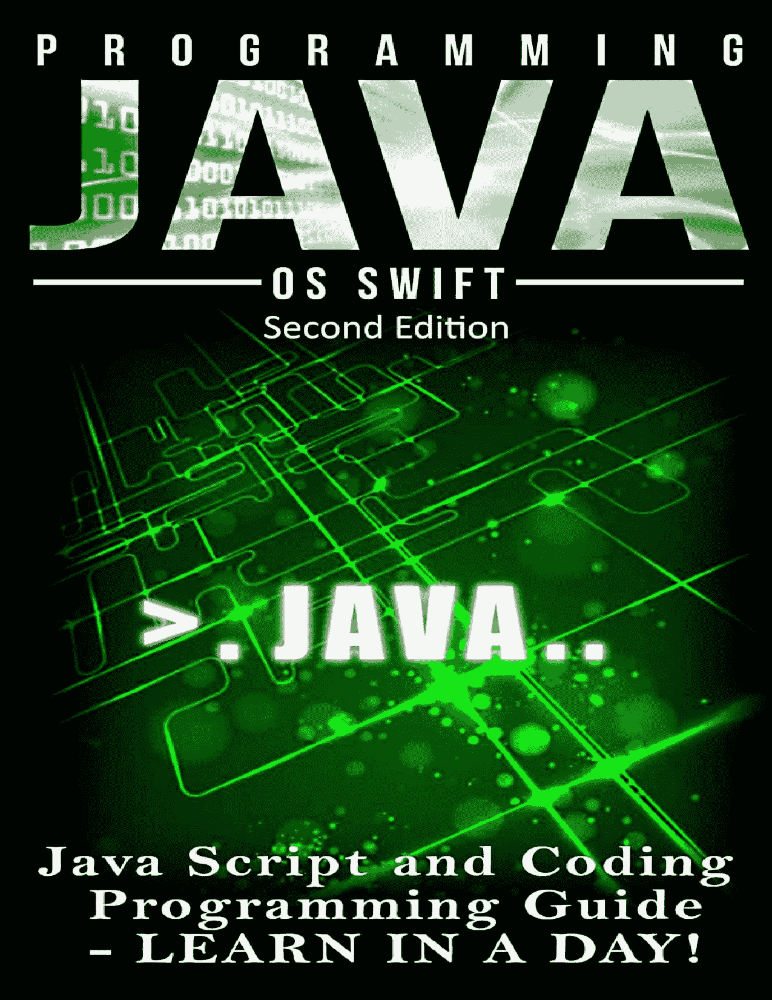
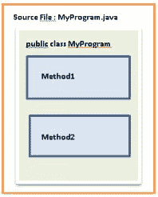

# Java 与 JavaScript 编程：初学者指南 – 一天学会 · 第2版





© 版权所有 2015 - 保留所有权利。

以电子手段或打印格式复制、复制或传输本文档的任何部分都是不法的。严禁录制本出版，除非获得出版者的书面许可，否则不允许对本文进行任何存储。保留所有权利。

此处提供的信息声明为真实且一致的，任何读者因疏忽或其他原因使用或滥用本文包含的任何策略、流程或指令，均由读者自行承担全部责任。在任何情况下，对于因本文中的信息直接或间接导致的任何赔偿、损害或资金损失，出版者不承担任何法律责任或过。

各作者拥有出版者未持有的版权。

## 法律声明：
本书受版权保护。本内容仅供个人使用。未经作者或版权所有者的同意，您不能修改、分发、销售、使用、引用或转述本书的任何部分或内容。如有违反，将追究其法律责任。

## 免责声明：
请注意，本文档包含的信息仅供教育和娱乐之用。我们已尽一切提供准确、最新和可靠的完整信息。不表示亦不暗示任何形式的保证。读者承认作者并未提供法律、财务、医疗或专业建议。

通过阅读本文，读者同意在任何情况下，我们对因使用本文档包含的信息而导致的任何直接或间接损失（包括但不限于错误、遗漏或不准确）均不负责。

# Java 简介

Java —— 互联网时代最流行的编程语言之一，于 1991 年在太阳射微系统公司（Sun Microsystems）构思并开发。任何编程语言的演变都是由计算生态系统发展所产生的需求驱动的——Java 也不例外。

虽然用 C 或 C++ 编写的代码（Java 强大的前身）也可以在所有设备上运行，但为了让它们在特定设备上运行而反复编译的工作是非常昂贵的。

Java 解决了这个问题，只需获取文本源代码（`.java`）并将其编译为中间字节码文件（`.class`），然后，该文件可以由任何运行解释器的设备进行解释 - Java 虚拟机（`JVM`）。字节码的想法意味着代码变得与架构中立，只需要编译一次，就可以在任何运行 `JVM` 的设备上进行解释。

今天，Java 已经成为一种重要的编程语言，对于任何对编程感兴趣的人来说，至少了解 Java 的基础知识几乎已成为必修课。本书的编写正是为了这一目的。我希望帮助任何几乎或完全没有先前的编程经验的人轻松且高效地接触 Java 编程。

# 第 1 章：入门

## 安装

在一切之前，我们需要准备好开发环境。初学者可以使用在线开发环境（[`ideone.com/`](https://ideone.com/））来执行短代码段，但如果要执行的代码是一个完整的程序，则必须在系统中安装 Java 并设置自己的离线开发环境。Java 有三种类型——

- 微型版（`J2ME`）
- 标准版（`J2SE`）
- 企业版（`J2EE`）

对于个人使用，可以从[下载页面](http://www.oracle.com/technetwork/java/javase/downloads/index.html)下载对应操作系统的最新 SE 版本 `.exe`。安装后，检查 `PATH` 变量是否指向 Java 安装目录。在终端窗口中执行 `java` 将在屏幕上显示安装的 Java 版本。

## 代码结构



每个 Java 代码都以 `.java` 扩展名保存。每个 Java 程序包含一个或多个类。每个类都包含一个或多个方法定义，每个方法内部包含几条语句。

## 关键字的语法和含义

```java
import java.io.*;

public class MyFirstProgram {
    public static void main(String[] args) {
        //这是我的第一个 java 程序
        System.out.println(" Hello World !");
    }
}
```

- `import java.io.*;`：关键字 `import` 用于引入名为“包”（packages）的 Java 库，这些包包含了可以在定义的定义的函数。
- `public class MyFirstProgram`：这是类定义，关键字 `public` 表示该类对所有人可见，`class` 表示这是一个类定义。
- `MyFirstProgram` —— 这是类名。带有 `main()` 函数的类名应与源文件名相同。
- 类定义封装在括号 `{}` 之中。
- `public static void main(String args[])`：这是程序的主部分。由于 `main()` 是驱动函数，它应该始终是 `public` 的。
- `static`：你需要记住 `main()` 方法应该是 `static` 的，因为这样可以更节省内存。
- `void`：这是方法的返回类型。这意味着 `main()` 方法不返回任何内容。
- `main`：方法名。解释器仅从 `main()` 方法开始执行。运行程序意味着指示 `JVM` 加载由源代码编译的 `.class` 文件并从 `main()` 方法开始执行。
- `main` 方法的两个用途可以总结为：
  1. 测试程序的其他方法
  2. 启动程序的执行
- `String[] args`：这是传递给 `main` 方法的参数。该方法始终接收字符串数组作为输入参数，数组名称应始终为 `args`。
- 注意数据类型以大写字母 `S`，这是因为 `String` 是 Java 中的一个类，所有类名都以大写开头。
- 方法定义封装在花括号 `{}` 之中，在这种情况下，我们希望程序执行的是打印“Hello World!”。
- 要标准输出控制台打印语句，使用 `System.out.println("");`。注意所有语句都必须以分号（`;`）结束。
- 你也可以使用 `System.out.print()` 显示输出，区别是 print`ln` 在打印的每条语句末尾引入换行。
- 我们程序 `main()` 方法中的另一条语句被称为“注释”语句。这些语句不会被编译，以 `//` 开头的语句目的仅在于向程序员提供更多信息。
- Java 完全没有全局变量的概念；同样的功能可以通过 `final`、`static`、`public` 等关键字来实现。

### 使用 Java 库


在编写 `Java` 时，你会发现存在许多预定义的类。所有这些类都可以在 `Java` 程序中使用，这让用户免于了重复造轮子的任务。但为了使用这些类，你至少应该对需要什么以及在哪里可以找到它们有一些基础的了解。这些被称为 `Java APIs`。该库无非就是一大堆预定义的类构成的集合，这些类可以在程序中的任何地方使用。它们包含了预定义的代码，用户只需要知道如何使用它们即可。这些库避免了用户编写长长的代码。这也被称为 `Java 标准代码库`。在 `Java` 平台中，`Java 标准代码库`主要有三个用途。它们是：

- 就像其他代码库一样，`Java 库`为程序员提供了一套实用的工具。这些工具包括正则表达式处理、容器类等。
- 标准代码库为用户提供了抽象接口，用户可以通过这些接口独立地执行任务。这样，用户就不需要为文件访问和网络访问等复杂过程编写完整的代码。
- 有少数底层平台不支持所有的 `Java` 应用。在这种情况下，你可以使用 `Java 库`来模拟这些功能，或者使用它提供一种检查特定功能是否存在的方法。

### Java 标准代码库的实现与配置

标准库中的大部分代码是用 `Java` 编写的。直接访问操作系统或硬件所需的代码除外。在这种情况下，使用 `Java native interface`（Java Native 接口）封装来访问操作系统的 API。几乎所有的 `Java` 代码库都存储在一个名为 `rt.jar` 的单一归文件中。该文件由 `JDK` 和 `JRE` 分发。`Java 类库`可以在引导类路径（bootstrap class path）中找到。

### Java 类库的主要特性

我们使用类来访问 `Java 类库功能`。这些功能属于包。下面是 `Java 类库` 的一些主要特性：

- `java.lang` 包含了所有的基础接口和类。它们与运行时系统和语言紧密相关。
- 有一个专门用于数学运算的包，包含了数学表达式、求值和任意精度小数。它们都存在于 `java.math` 库中。
- 工具与集合：`Java` 为用户提供了内置的 `Utility` 类和数据结构。这些工具类和数据结构可以用于数据压缩、日志记录、并发和正则表达式。
- 二维图形和图形用户界面：用户可以使用 `AWT` 包，它提供了图形用户界面操作。该包绑定到原生系统。你可以用它来设计平台无关工具包以及可插的外观和外观（feel and look）。该包还可以用于处理可编辑和不可编辑的文本组件。
- 音频：该包为用户提供了类和接口，用于声音数据的写入、读取、合成和排序。
- 文本：`java.text` 接口用于处理文本、数字、消息和日期。
- 数据库：用户可以使用 `java.SQL` 库访问数据库 (`sql`)。
- `Java.Security` 提供了加密服务的安全性。`javax.crypto` 库中存在加密服务。
- `Java` 还允许你访问脚本引擎。你可以使用 `javax.script` 包使用任何符合标准的脚本语言。
- 小程序（Applets）：`Java.applet` 包允许你通过网络下载应用程序，并允许你在受保护的沙箱中运行它们。

# 第 2 章：面向对象编程

`Java` 的语法类似于 `C`，但编程哲学源自 `C++` —— 也就是说，`java` 是一种面向对象的语言。在我们之前看到的第一个例子中，我们有一个类声明，并说 `main()` 函数负责程序中执行的操作，这并不意味着 `java` 变成一个 OOP 语言，让我们看一个例子来更好地理解 OOP —— 对象和类。

## 过程化方法

这并不那么简单，因为之前的形状是确定的，动画代码可以假设一个中心点并旋转形状；而对于像 `amoeba`（变形虫）这样不规则形状，无法使用其他形状的代码进行旋转，而是 `API` 需要额外的几个参数来定义形状旋转的坐标。

## 面向对象方法

因此，你可以为每个形状编写一个类文件，这样在添加 `amoeba` 或修改 `rotate` 方法时，无需扰动现有代码，只需添加新类即可。你只需要测试新类。引入的任何新问题都可以轻松追溯到所做的新更改。

示例 1：
```java
class Movie{
    //variable Declaration
    //methods
} m1; //m1 是类型为“Movie”的对象
``` 

示例 2：
```java
class Movie{
    //variable Declaration
    //methods
}

class TestMovie{
    public static void main(String[] args){
        Movie m1 = new Movie(); // m1 是类型为“Movie”的对象
        m1.variable = value;
        m1.method();
    }
}
```

# 第 3 章：变量声明与数据类型

学习的下一个重要且基础的概念是关于“变量”和“数据类型”，以创建实用的程序。变量本质上是命名的内存位置，用于存储值。`Java` 是一种强类型语言，因此类型为 `x` 的变量只能持有类型。例如：

```java
int n;
```
这里声明了一个变量 `n` 用于持有值。声明类型为 `int` 的变量确保了 `java` 的“类型安全”特性。在 `java` 中变量可以是：

- 局部变量（原始数据类型，如 `int`, `float`, `double` 等）
- 引用变量（类的实例）

假设你声明了一个类型为 `int` 的变量，你可以使用它来保存值。如果不这样做，可能会发生溢出。还要注意，`java` 认为带有小数点的默认都是 `double`，因此在给定的小数数字末尾附加 `f` 以将其转换为 `float` 是重要的。

```java
float f = 1.56f;
```

变量命名规则：
- 不要使用保留字作为变量名。
- 变量名不能以数字开头。

一些常见的 Java 关键字：

`String` 被声明为一个类。字符串的一些常用操作有：

```java
String str = “Hello World”; //声明
int len = str.length(); // 获取字符串长度
int len = “hello Wolrd”.length(); // 同样获取字符串长度
String concatStr = “hello”+”world // // 运算符可以重载以执行两个字符串的拼接。
```

```java
String str1 = “Heloo”;
String str2 = “World”;
if (str1 == str2) //比较两个字符串
    System.out.println(“strings are equal”);
```

 引用变量

```java
Movie m1 = new Movie()
```
左侧是声明，它指示 `JVM` 为引用变量留出空间，持有到达实际对象的数据。

```java
int[] n; //声明一个整数数组
n = new int[5]; //创建一个包含 5 个整数的数组
```
注意，即使是原始数据类型值的数组，数组也变成了一个对象。

```java
Movie[] mArray; //声明一个类型为“Movie”的对象数组
```大小：对于原始类型，引用变量没有预定义的大小。

## Array List


这在 `java.util.ArrayList` 包中可用。

```java
ArrayList<String> myList = new ArrayList<String>();
```

它允许声明不同数据类型的数组。它提供了多种方法来执行常见的数组操作，如 `add(elem)` `remove(index)`，用于从 `arrayList` 中添加/删除元素。此外还有如 `size()` 等 API 可以查找数组的长度，判断是否 `isEmpty()`，或者 `arrayList` 是否 `contains()` 给定的元素。

让我们来看一个使用目前所学概念的示例：

```java
Class MyProgram{

public static void main(Strings[] args)
{
//声明并赋值变量
    int  num = 10;  
    float fNum = 10.5;
    //打印语句输出到控制台
    System.out.println(“The value of integer num is : ”+num);
    System.out.println(“The Value of integer fNum is : ”+fNum);
    num = num/2;
    fNum = fNum+num;
    System.out.println(“The value of integer num after operation is : ”+num);
    System.out.println(“The Value of integer fNum after operation is : ”+fNum);
}
}
```

输出：
The value of integer num is : 10
The value of integer fNum is : 10.5
The value of integer num after operation is : 5
The value of integer fNum after operation is  : 20.5

你只需要在 SoP (`System.out.println`) 语句中使用 `+` 运算符即可。

## 包装类 (Wrapper Classes)

众我们所知，Java 是一种面向对象的编程语言，Java 中的一切都可以被视为对象。从简单的文件、图像到系统地址等，任何内容在 Java 中都可以被对象。我们可以使用包装类来更改对象的类型。在本教程中，我们将介绍包装类及其细节。通过包装类，你可以将任何给定的数据类型转换为对象。

Java 中的所有基本数据类型都不是对象。这些基本数据类型不属于任何类，它们定义在 Java 语言本身中。我们可能会遇到将这些基本数据类型转换为对象的情况。例如，你可以通过将数据类型转换为对象来添加到向量（vector）或栈（stack）中。Java 设计引入了包装类来完成这些转换。

### 关于包装类

正如其名所示，包装类包裹（wrap）了任何数据类型，使其具有对象的外观，并在需要该数据类型时可以使用它。这是一个可以逆转的过程。包装类不仅可以将数据类型转换为类，还可以解包装对象并返回数据类型。这就像巧克力上的包装纸一样。制造商将巧克力包装在包装纸里并出货。用户在使用时去除包装纸以获得巧克力。

来看下面的转换示例，其中 `int` 数据类型被转换为对象。

```java
int k = 100;
Integer it1 = new Integer (k);
```

在上面的示例中，int 数据类型 `k` 使用包装类转换成了对象 `it1`。这是通过使用 `integer` 类实现的。每当需要 `K` 时，就可以使用对象 `it1`。

下面的代码展示了如何封装对象并从整数对象 `it1` 获取 int 数据类型。

```java
int m = it1.intValue();
System.out.println(m*m); // 打印 10000
```

### 包装类列表

在 Java 语言中，存在 8 种数据类型，每类型都有对应的包装类。

| 基本数据类型 | 包装类 |
| :--- | :--- |
| byte | Byte |
| short | Short |
| int | Integer |
| long | Long |
| float | Float |
| double | Double |
| char | Character |
| Boolean | Boolean |

所有的包装类都可以在 `java.lang` 包中找到。它们被放置在那里是为了在每次导入时可以隐式地对程序员可用。为了避免继承，Java 设计师将这些包装类设为 `final`。

### 包装类的重要性

我们使用包装类有两个目的：

- 将简单数据类型转换为对象。这是通过给给定的数据类型对象的形式来实现。
- 将字符串转换为数据类型。对于此类转换，我们使用如 `parseXXX()` 等方法。

这里有一个示例程序，展示了将数据类型转换为对象以及同时获取数据类型。

```java
public class WrappingUnwrapping
{
 public static void main(String args[])
 {
   //  数据类型
   byte grade = 2;
   int marks = 50;
   float price = 8.6f; // 观察 float 的后缀 f
   double rate = 0.5; // 数据类型转对象
   Byte g1 = new Byte(grade); // 封装
   Integer m1 = new Integer(marks);
   Float f1 = new Float(price);
   Double r1 = new Double(rate);
   // 让我们从对象打印值
   System.out.println("Values of objects (printing as objects)");
   System.out.println("Byte object g1: " + g1);
   System.out.println("Integer object m1: " + m1);
   System.out.println("Float object f1: " + f1);
   System.out.println("Double object r1: " + r1);
   // 从对象中获取数据类型
   byte bv = g1.intValue(); // 解封装
   int iv = m1.intValue();
   float fv = f1.intValue();
   double dv = r1.intValue();
}
}
```

# 第 4 章：控制语句 (Control Statements)

程序中的控制语句，正如其名所示，控制程序的整体执行流。它包含了 `if else` 等条件语句以及 `while()`、`do while()` 等迭代语句。

## if else

**语法：**

```java
if(condition)
    do action1;
else
    do action2;
```
当 `condition` 为真时执行操作，否则执行 `else` 部分。

## Switch case

当你需要检查多个条件时，这种操作非常有用。Switch case 根据给定的值采取操作。

**语法：**

```java
Switch(id)
{
    Case id1:
        Action;
        Break;
    Case id2:
        Action;
        Break;
    Default:
        
}
```

## while ()

这是一个迭代语句，只要条件为真就会执行操作。

**语法：**

```java
while(condition)
{
    当条件为真时执行操作
}
```

## Do - while ()

这也是迭代操作，与 `while()` 循环非常相似，区别在于无论条件是否，循环都会执行一次，因为条件是在 `do` 语句之后才评估的。

**语法：**

```java
do{
    执行操作
}while(condition);
```

### for 循环

**语法：** `for ( 初始化 ; 条件; 计数器更新)`

**示例：** `for (int i=0; i<5; i++)`

这将精确执行语句 5 次。第一部分声明并初始化计数器变量的值，第二部分检查条件，如果为真则进入循环。循环完成后，执行递增。然后再次检查条件并重复相同的步骤，直到条件变为假。一旦条件为假，就会退出循环。


整数 `Num` 的值为：3

整数 `Num` 的值为：2

整数 `Num` 的值为：1

整数 `Num` 的值为：5

整数 `Num` 的值为：5

整数 `Num` 的值为：5

整数 `Num` 的值为：5

整数 `Num` 的值为：5

上述程序使用了两个循环语句来执行操作。

## `for` 循环与 `while` 循环的区别

如你所知，`for` 循环包含三个部分：它们是初始化、布尔表达式和迭代表达式。而在 `while` 循环中，没有内置的初始化或迭代表达式。它只包含布尔测试。当你不知道条件返回真时需要迭代多少次时，使用 `while` 循环是很好的。如果迭代次数已知，使用 `for` 循环是更明智的，因为它更简洁。

这里是一个使用简单 `while` 循环的示例。

示例：

```java
public class Test {
  public static void main(String args[]) {
    int x = 10;
    while( x < 20 ) {
      System.out.print("value of x : " + x );
      x++;
      System.out.print("\n");
    }
  }
}
```

输出：

```
value of x : 10
value of x : 11
value of x : 12
value of x : 13
value of x : 14
value of x : 15
value of x : 16
value of x : 17
value of x : 18
value of x : 19
```

### 关于 `for` 循环的更多

在这里我们将深入循环的细节。现在来看 `for` 循环。每个 `for` 循环由三部分组成。它们是：

- 初始化：在初始化部分，我们将使用合适的变量声明并初始化循环。我们在循环体中使用它。循环中使用的变量通常用作计数器。循环内部可以放置的变量不仅限于 1 个。你可以在循环体中放置任何数量可以作为计数器的变量。
- 布尔表达式：条件测试将放在循环的这部分。给定的条件无论是什么，都必须解析为布尔值。你可以提供一个表达式，也可以使用返回布尔值的方法。
- 迭代表达式：在循环的这部分，你可以放置一个或多个你希望每次循环运行时发生的动作。始终记住，执行只会在循环结束时发生。

### 嵌套 `for` 循环

你可以将一个 `for` 循环放在另一个 `for` 循环内部。这种结构被称为嵌套 `for` 循环。你可以在循环内部放置任意数量的循环。但建议嵌套层级不要超过六层，否则程序看起来很笨拙。汽车里程表的工作原理与嵌套 `for` 循环相同。另一个例子是日期或日历。众所周知，一天由小时、分钟和秒组成。在数字钟中，嵌套 `for` 循环的最后一个分支是秒计数器。在其上方是分钟计数器。在分钟计数器上是小时计数器。它是嵌套在嵌套中的嵌套循环。下面给出了嵌套 `for` 循环的语法。`for` 循环有三种形式。分别是：

形式 1 语法：

```java
for(initialization; test; increment)
{
  statements;
  while(expression)
  {
    statements;
  }
  do
  {
    statements;
  }while(expression);
}
```

形式 2 语法：

```java
for(initialization; test; increment)
{
  statements;
  for(initialization; test; increment)
  {
    statements;
    for(initialization; test; increment)
    {
      statements;
    }
  }
}
```

形式 3 语法：

```java
While(expression)
{
  statements;
  While(expression)
  {
    statements;
  }
}
```

以下几个示例将让你理解嵌套 `for` 循环的工作原理。

示例 1：使用嵌套 `for` 循环显示 `*` 三角形

```java
class NestedForLoopDemo {
  public static void main(String args[]) {
    for(int i = 1; i <=5 ; i++) {
      for(int j = 1; j <= i; j++) {
        System.out.println("* ");
      }
      System.out.println("");
    }
  }
}
```

输出：

```
*
* *
* * *
* * * *
* * * * *
```

示例 2：打印表格

```java
class NestedWhileLoop {
  public static void main(String args[]) {
    int i=1, j=1;
    System.out.println("Tables");
    while(i <= 2) // 根据用户需要更改为 2 到 10 或 20
      while(j <= 10) {
        System.out.println(i + " * " + j);
      }
      i++;
      j = 1;
    }
  }
}
```
（注：示例 2 的原始文本缺少内部逻辑结构；我已根据提供的输出上下文重构了标准的表格逻辑）。

输出：

```
Tables
1 * 1 1 * 2 1 * 3 1 * 4 1 * 5 1 * 6 1 * 7 1 * 8 1 * 9 1 * 10
2 * 1 2 * 2 2 * 3 2 * 4 2 * 5 2 * 6 2 * 7 2 * 8 2 * 9 2 * 10
```


在这里，所有这些引用变量都指向堆内存中的 `deer` 对象。

## 虚拟方法

在本节中，我们将观察被重写方法的行为。在 Java 中，设计类时可以使用多态性。在方法重写中，子类有能力重写父类中的的方法。被重写的方法本质上是被隐藏的。在子类使用 `super` 关键字之前，该重写方法无法被调用。`super` 关键字应该在被重写的方法内部使用。

考虑以下示例。

```java
/* File name : Employee.java */

public class Employee
{
  private String name;
  private String address;
  private int number;

  public Employee(String name, String address, int number)
  {
      System.out.println("Constructing an Employee");
      this.name = name;
      this.address = address;
      this.number = number;
  }

  public void mailCheck()
  {
      System.out.println("Mailing a check to " + this.name
      + " " + this.address);
  }

  public String toString()
  {
      return name + " " + address + " " + number;
  }

  public String getName()
  {
      return name;
  }

  public String getAddress()
  {
      return address;
  }

  public void setAddress(String newAddress)
  {
      address = newAddress;
  }

  public int getNumber()
  {
      return number;
  }
}
```

如果按照如下所示扩展 employee 类：

```java
/* File name : Salary.java */

public class Salary extends Employee
{
  private double salary; //Annual salary

  public Salary(String name, String address, int number, double salary)
  {
      super(name, address, number);
      setSalary(salary);
  }

  public void mailCheck()
  {
      System.out.println("Within mailCheck of Salary class ");
      System.out.println("Mailing check to " + getName()
      + " with salary " + salary);
  }

  public double getSalary()
  {
      return salary;
  }

  public void setSalary(double newSalary)
  {
      if(newSalary >= 0.0)
      {
          salary = newSalary;
      }
  }

  public double computePay()
  {
      System.out.println("Computing salary pay for " + getName());
      return salary/52;
  }
}
```

现在看下面的程序并尝试预测输出：

```java
/* File name : VirtualDemo.java */

public class VirtualDemo
{
  public static void main(String [] args)
  {
      Salary s = new Salary("George Martin", "Ambehta, UP", 3, 3600.00);
      Employee e = new Salary("John Adams", "Boston, MA", 2, 2400.00);
      System.out.println("Call mailCheck using Salary reference --");
      s.mailCheck();

      System.out.println("\n Call mailCheck using Employee reference--");
      e.mailCheck();
  }
}
```

输出：
```
Constructing an Employee
Constructing an Employee
Call mailCheck using Salary reference --
Within mailCheck of Salary class
Mailing check to George Martin with salary 3600.0
Call mailCheck using Employee reference--
Within mailCheck of Salary class
Mailing check to John Adams with salary 2400.0
```

在这个示例中，创建了两个 salary 对象。第一个被分配给 `Salary` 引用，而第二个被分配给 `Employee` 引用。当对两者调用 `mailCheck()` 时，执行的是 `Salary` 类中的方法版本，因为实际对象类型是 `Salary`。


*   哺乳动物类和爬行动物类都是 `animal` 类的子类
*   `dog` 类是 `mammal` 类的子类，而 `mammal` 类反又是 `animal` 类的子类

我们可以通过 IS-A（属于）关系来观察这种关系。如下所示：

* `Mammal` 是一个 `Animal`
* `Reptile` 是一个 `Animal`
* `Dog` 是一个 `Mammal`
* 因此：`Dog` 也是一个 `Animal`

使用 `extends` 关键字允许子类继承此父类的每一个属性，但其私有属性除外。

使用实例运算符，我们可以确保普通类确实是 `animal` 类的实例。

示例：

```java
public class Dog extends Mammal{
  public static void main(String args[]){
      Animal a = new Animal();
      Mammal m = new Mammal();
      Dog d = new Dog();
      System.out.println(m instanceof Animal);
      System.out.println(d instanceof Mammal);
      System.out.println(d instanceof Animal);
  }
}
```

输出：这将产生以下结果
```
true
true
true
```

### instanceof 运算符

在 Java 中，如果你想确定一个类是否属于某个特定的类或为了实现某个给定的接口，可以使用 `instanceof` 运算符。`instanceof` 运算符是一种类型比较运算符。`instanceof` 运算符根据类的状态返回 true 或 false。如果给定的对象属于某个类或该对象实现了某个接口，则 `instanceof` 运算符返回 true。否则，它将简单地返回 false。

在下面的示例中，你可以看到 `instanceof` 运算符的使用。

```java
class Vehicle {
  String name;
  Vehicle() {
    name = "Vehicle";
  }
}

class dirtbike extends Vehicle {
  dirtbike() {
    name = "dirtbike";
  }
}

class atv extends dirtbike {
  atv() {
    name = "atv";
  }
}

class LightVehicle extends Vehicle {
  LightVehicle() {
    name = "LightVehicle";
  }
}

public class InstanceOfExample {
  static boolean result;
  static dirtbike hV = new dirtbike();
  static atv T = new atv();
  static dirtbike hv2 = null;
  public static void main(String[] args) {
    result = hV instanceof dirtbike;
    System.out.print("hV is an dirtbike: " + result + "\n");
    result = T instanceof dirtbike;
    System.out.print("T is an dirtbike: " + result + "\n");
    result = hV instanceof atv;
    System.out.print("hV is a atv: " + result + "\n");
    result = hv2 instanceof dirtbike;
    System.out.print("hv2 is an dirtbike: " + result + "\n");
    hV = T; // 成功将子类强制转换为父类
    T = (atv) hV; // 成功将父类强制转换为子类
  }
}
```

输出
```
hV is an dirtbike: true
T is an dirtbike: true
hV is a atv: false
hv2 is an dirtbike: false
```

注意：`hv2` 没有引用 `dirtbike`，因此 `instanceof` 返回 false。你应该记住，你不能在兄弟类之间使用 `instanceof` 运算符。

### Implements 关键字

现在你已经对 `extends` 关键字有了良好的理解，我们将查看 `implements` 关键字以及如何使用它来获取 IS-A 关系。我们使用 `implements` 关键字让类继承接口。你应该记住，接口不能被类扩展，只能被实现。

示例：

```java
public interface Animal {}
public class Mammal implements Animal {}
public class Dog extends Mammal {}
```

### instanceof 关键字

在这里我们将查看一下 `instanceof` 运算符。我们使用这个运算符来判断一个类是否是其父类的实例。

```java
interface Animal{}
class Mammal implements Animal{}
public class Dog extends Mammal{
  public static void main(String args[]){
    Mammal m = new Mammal();
    Dog d = new Dog();
    System.out.println(m instanceof Animal);
    System.out.println(d instanceof Mammal);
    System.out.println(d instanceof Animal);
  }
}
```

输出：
```
true
true
true
```

### HAS-A 关系

组合是这些关系的主要方式。如果某个类 **拥有**（HAS-A）某些东西，我们就说两个对象之间存在关系。这种关系的主要用途有助于减少 Bug 和代码重复。

这里是一个展示对象之间存在 HAS-A 关系的示例。

示例：

```java
public class Vehicle{}
public class Speed{}
public class Van extends Vehicle{
  private Speed sp;
}
```

上面的示例告诉我们 `van` **拥有**一个 `speed`。如果我们专门为 `speed` 创建一个单独的类，就可以在不同的应用程序反复使用它。

在 Java 中，类只能有单继承。Java 不支持多重继承。每个类都限制使用 `extends` 关键字进行单继承。然而，允许类实现多个接口。通过这种方式可以获得多重继承。带有 `extends` 关键字的语句可以实现这一点。

`Public class extends Animal {}`

# 第 7 章：对象的生命与死亡

## 构造方法

在 Java 中，构造方法被定义为一种特殊的方法，用于初始化对象。构造方法在对象创建时被调用。因为它构造了对象的值，所以被称为构造方法。

### Java 中创建构造方法的规则

在 Java 中创建构造方法有两个基本规则：
* 构造方法的名称与类名完全相同
* 它们没有返回值

### 构造方法的类型

在 Java 中，构造方法有两种类型：
* 默认构造方法或无参构造方法
* 参数构造方法

我们将详细查看它们。

#### Java 默认构造方法

Java 默认构造方法是不带参数的构造方法。

默认构造方法的语法：`<class_name>()`

这是一个简单的默认构造方法示例。

示例：

```java
class Bike1{
  Bike1(){System.out.println("Bike is created");}
  public static void main(String args[]){
    Bike1 b=new Bike1();
  }
}
```

输出：
```
Bike is created
```

这是一个默认构造方法的示例，提供默认值。在没有定义任何构造方法的情况下，编译器为你的代码提供一个默认构造方法，并赋予值 `0` 和 `null`。

示例：

```java
class Student3{
  int id;
  String name;
  void display(){System.out.println(id+" "+name);}
  public static void main(String args[]){
    Student3 s1=new Student3();
    Student3 s2=new Student3();
    s1.display();
    s2.display();
  }
}
```

输出：
```
null
null
```

#### Java 参数构造方法

在 Java 中，如果一个构造方法带有参数，则被称为参数构造方法。

为什么要使用参数构造方法？

当我们给不同的对象赋予不同的值时，就会使用参数构造方法。这是一个参数构造方法的示例。在下面的示例中，`student` 类被两个两个参数。参数构造方法可以定义任意数量的参数。

示例：

```java
class Student4{
  int id;
  String name;
  Student4(int i,String n){
    id = i;
    name = n;
  }
  void display(){System.out.println(id+" "+name);}
  public static void main(String args[]){
    Student4 s1 = new Student4(111,"David");
  }
}
```


```java
Student4 s2 = new Student4(222,"Aryan");

s1.display();

s2.display();

}

}
```
Output:
```
111 David David222 Aryan Aryan```### Java 中的构造函数重载

构造函数重载是 Java 中的一种技术，允许为类提供任意数量不同参数的构造函数。这些构造函数可以相同的参数数量，但参数不同。编译器会根据参数列表及其类型进行比较。

以下是构造函数重载的示例。

示例：

```java
class Student5{

   int id;

   String name;

   int age;

   Student5(int i,String n){

   id = i;
   name = n;

   }

   Student5(int i,String n,int a){

   id = i;
   name = n;
   age=a;

   }

   void display(){System.out.println(id+" "+name+" "+age);}

   public static void main(String args[]){

   Student5 s1 = new Student5(111,"David");
   Student5 s2 = new Student5(222,"Aryan",25);

   s1.display();
   s2.display();

   }

}
```
Output:
```
111 David 0222 Aryan 25```

### Java 中的拷贝构造函数

虽然我们称之为拷贝构造函数，但在 Java 中并没有这种东西。如果你想将特定对象的值拷贝到不同的对象中，可以使用以下方法：

*   使用构造函数
*   将一个对象的值赋值给另一个对象
*   你可以使用 `clone()` 方法。它属于 `Object` 类。

以下是一个示例，我们将一个对象的值拷贝到另一个构造函数中。

示例：

```java
class Student6{

   int id;

   String name;

   Student6(int i,String n){

   id = i;
   name = n;

   }

   Student6(Student6 s){

   id = s.id;
   name =s.name;

   }

   void display(){System.out.println(id+" "+name);}

   public static void main(String args[]){

   Student6 s1 = new Student6(111,"David");
   Student6 s2 = new Student6(s1);

   s1.display();
   s2.display();

   }

}
```
Output:
```
111 David111 David```

### 不使用构造函数拷贝值

正如我们之前讨论的，我们可以在不使用构造函数的情况下将对象的值拷贝到不同的对象。在这种情况下，你不需要创建构造函数。只需通过将该对象的值赋值给另一个对象即可。在下面的示例中，我们没有使用构造函数而是通过赋值进行拷贝。

示例：

```java
class Student7{

   int id;

   String name;

   Student7(int i,String n){

   id = i;
   name = n;

   }

   Student7(){}

   void display(){System.out.println(id+" "+name);}

   public static void main(String args[]){

   Student7 s1 = new Student7(111,"David");
   Student7 s2 = new Student7();

   s2.id=s1.id;
   s2.name=s1.name;

   s1.display();
   s2.display();

   }

}
```
Output:
```
111 David111 David```

## Java 中的垃圾回收

在 Java 中，“垃圾”可以定义为未被引用的对象。回收未使用的内存的过程称为垃圾回收。简单来说，垃圾回收意味着销毁所有不再使用的对象。与 `C` 和 `C++` 不同，垃圾回收是 Java 中的一个自动过程。这是 Java 为用户提供更好、更高效管理的原因之一。

垃圾回收的优点：

*   垃圾回收通过移除所有未被引用的对象使内存变得高效。这些对象占用了堆内存，垃圾回收会清理这些内存。
*   用户不需要手动执行垃圾回收，因为 Java 中的垃圾处理过程是自动的。因此，我们不需要投入额外精力管理内存。Java 虚拟机会负责清理这些内存。

你可以通过三种方式释放对象，它们是：

*   **置空引用**：通过移除对象的引用可以从堆内存中移除对象。这是一个示例：
```java
Employee e=new Employee();
e=null;
```
*   **将对象的引用赋值给另一个对象**：移除一个对象的引用并将其交给另一个对象，会导致第一个对象失去引用。众所周知，没有引用的对象将被释放。下面的示例显示将对象 `e1` 的引用交给 `e2`。这使得 `e1` 达到垃圾回收条件。
```java
Employee e1=new Employee();
Employee e2=new Employee();
e1=e2;
```
*   **使用匿名对象**：这是释放对象的第三种方法。在这里我们将创建一个新对象。
```java
new Employee();
```

# 第 8 章：类型转换

## 对象类型转换

在 Java 中，你可以将对象引用转换为不同的对象引用。这被称为类型转换。类型转换不仅限于类本身。你可以转换父类、子类类型或接口。类型转换既有编译时规则也有运行时规则。给定的对象进行转换时，可以分配任何对象的引用。这是因为我们使用的 `Object` 类是 Java 中所有类的父类。转换有两种类型：

*   向上转型 (Upcasting)
*   向下转型 (Downcasting)

类型转换可以隐式或显式地进行。如果从低级数据结构转换为高级数据结构，则为隐式转换。Java 不会自动执行向下转型。向下转型必须由用户显式完成。从高级结构到数据结构的类型转换必须小心进行，因为强制执行会涉及大量数据。Java 虚拟机会在需要时执行向上转型。例如，如果有几个数据类型，其中一个是高级类型，JVM 将所有其他低级类型转换为高级类型。在上述情况下执行向下转型会导致数据丢失。在运行时，可能会出现名为 `ClassCastException` 的异常，即被转换的对象与目标类型不兼容。这里有一个解释 `ClassCastException` 的示例。

示例：
```java
//X 是 Y 和 Z 的父类，它们是兄弟关系。

public class RunTimeCastDemo {

    public static void main(String args[]) {
        X x = new X();
        Y y = new Y();
        Z z = new Z();
        X xy = new Y(); // 编译通过（向上转型）
        X xz = new Z(); // 编译通过（向上转型）
        // Y yz = new Z(); // 类型不兼容（兄弟关系）

        Employee e1=new Employee();
        Employee e2=new Employee();
        e1=e2; // 使 e1 达到垃圾回收条件

        new Employee(); // 释放对象的第三种方法

        Employee e=new Employee();
        e=null; // 置空引用
    }
}
```


当给一个对象引用赋值时，将执行隐式转换。在这里，对象的引用将被赋值给：

*   与该类类型相同的引用变量。该类是实例化给定对象的类。每个类的超类都是作为对象的一个类。
*   该数据类型可用的引用，该数据类型是由实例化对象的类所实现的接口。

这里是一个示例，展示了接口 `Automobile`、超类 `Bike` 和子类 `Ducati`。在这里你可以看到编译器处理的给定对象引用的自动转换。

```java
interface Automobile{

}

class Bike implements Automobile{

}

class Ducati extends Bike{

}
```

示例：假设 `c` 是 `bike` 类类型的变量，`f` 是 `Ducati` 类类型，`v` 是一个车辆接口引用。我们可以将 `Ducati` 引用赋值给 `bike` 变量：

即我们可以执行以下操作：

### 示例 1
```java
c = f; // 正常编译通过
```
其中 `c = new bike();`
且 `f = new Ducati();`

编译器会自动处理转换（赋值），因为类型是兼容的（子类 – 父类关系），即 `bike` 类型可以持有 `Ducati` 类型，因为 `Ducati` 是一个 `bike`。

### 示例 2
```java
v = c; // 正常编译通过
c = v; // 从接口类型到类类型的非法转换会导致编译错误
```
其中 `c = new bike();`
且 `v` 是一个 `Vehicle` 接口引用 (`Vehicle v`）

编译器会自动处理转换（赋值），因为类型是兼容的（类 – 接口关系），即 `bike` 类型可以转换为 `Vehicle` 接口类型，因为 `bike` 实现了 `Vehicle` 接口（`bike` 是一个 `Vehicle`）。

## 对象引用转换：显式转换

有时在 Java 中，当隐式类型转换不起作用或效率低下时，我们必须显式地类型转换。这种转换非常简单，只需要在括号内指定新“类型”的。在这里我们将查看 `bike` 和 `Ducati` 类的示例。

```java
class bike {
void bikeMethod(){

}
}

class Ducati extends bike {
void DucatiMethod () {
}
}
```

在这里，你可以看到我们还有一个 `breakingSystem()` 函数。该函数接收 `bike` 引用作为输入参数。无论对象类型如何，方法都将调用 `bikeMethod()`。这也会调用 `DucatiMethod()`。如果你想在运行时确定对象的类型，可以使用 `instanceof` 算符。

```java
public void breakingSystem (bike obj) {
   obj.bikeMethod();
   if (obj instanceof Ducati)((Ducati)obj).DucatiMethod ();
}
```

该操作告诉编译器将 `bike` 对象（一个由对象的引用）视为一个 `Ducati` 对象。在这里，如果不进行转换，编译器会给出错误信息，说明在 `bike` 的定义中找不到 `DucatiMethod()`。

接下来的示例程序将向你展示与引用使用转换运算符。

在此类中，`Honda` 和 `Ducati` 是同级类。这两个类都是 `bike` 类的子类。它们都拥有 `dirtvehicle` 类，这是一个扩展的对象类。任何无法显式扩展另一个类的类默认情况下都会被对象自动扩展。以下代码实例化了一个特定类的给定对象（在本例中为 `Ducati` 类），并将对象的引用赋值给 `bike` 类型的变量。这种赋值是被允许的，因为 `bike` 类是 `Ducati` 的超类。为了使用类类型的引用调用方法，应该定义该方法。并且该方法应该定义在该给定类的层次结构之内或之上。

示例程序：

```java
class bike extends Object {
    void bikeMethod() {

    }
}

class dirtbike extends Object {

}

class Ducati extends bike {
    void DucatiMethod() {
        System.out.println("I am DucatiMethod defined in Class Ducati");
    }
}

class Honda extends bike {
    void DucatiMethod() {
        System.out.println("I am DucatiMethod defined in Class Ducati");
    }
}

public class ObjectCastingEx {
    public static void main(String[] args) {
        bike obj = new Ducati();
        // 以下将导致编译错误
        obj.DucatiMethod(); // 因为 bike 类型中未定义 DucatiMethod
        // 以下将导致编译错误
        ((dirtbike)obj).DucatiMethod(); // DucatiMethod 在 dirtbike 类型中未定义
        // 以下将编译并运行
        ((Ducati) obj).DucatiMethod(); //
        // HondaObj = (Ducati)obj; // 不能转换，因为它们是同级类
    }
}
```

用户允许在 Java 中将对象引用转换为字符串。这是处理集合时常用的类型转换之一。

示例：

```java
import java.util.Vector;

public class StringCastDemo {
    public static void main(String args[]) {
        String username = "asdf";
        String password = "qwer";
        Vector v = new Vector();
        v.add(username);
        v.add(password);
        // String u = v.elementAt(0); 无法转换
        Object u = v.elementAt(0); // 未转换
        System.out.println("Username : " + u);
        System.out.println("Password : " + u);
    }
}
```


在编译时进行检查的异常被称为受检异常（checked exceptions）。在这种情况下，如果一个方法抛出了受检异常，它应该通过使用 `try-catch` 块进行处理，或者使用 `throws` 关键字进行声明。如果没有遵循上述任一方法，编译器将给出编译错误。由于这些异常在编译时会被检查，因此它们被称为受检异常。这里有一个示例可以帮助你理解受检异常。

在这个示例中，有一个文件 `myfile.txt`。将从该文件中读取数据并显示在屏幕上。程序中有三个受检异常，如下所示。

#### 示例：

```java
import java.io.*;

class Example {  

  public static void main(String args[])
  {
      FileInputStream fis = null;
      /*此构造函数 FileInputStream(File filename)
          * 会抛出 FileNotFoundException，这是一个受检
          *异常*/
      fis = new FileInputStream("B:/myfile.txt");
      int k;
      /*FileInputStream 类的 read() 方法也会抛出
          * 受检异常：IOException*/
      while(( k = fis.read() ) != -1)
      {
          System.out.print((char)k);
      }
      /*close() 方法关闭文件输入流
          * 它抛出 IOException*/
      fis.close();            
  }
}
```

### 输出：

```
Exception in thread "main" java.lang.Error: Unresolved compilation problems:
Unhandled exception type FileNotFoundException
Unhandled exception type IOException
Unhandled exception type IOException
```

在上面的示例中，检查和异常被编译器在编译时进行了检查，并且由于我们没有声明这些异常，程序显示了编译错误信息。

下面是其他几个受检异常：

- `SQLException`
- `IOException`
- `DataAccessException`
- `ClassNotFoundException`
- `InvocationTargetException`

## 未受检异常 (Unchecked exceptions)

未受检异常是指在编译时不会进行检查的异常。这些异常不会产生编译错误，因为它们在编译时无法被检查。无论你是否声明了异常都可以。未受检异常通常由于用户在与程序交互期间提供的数据引起。处理这些异常的唯一方法是预测它们并为该异常编写适当的处理器。`RuntimeException` 类是所有未受检异常的父类。这里有一个示例可以帮助你更好地理解未受检异常。

```java
class Example {  

  public static void main(String args[])
  {
      int num1=10;
      int num2=0;
      /*由于我正在用 0 除一个整数
          * 它应该抛出 ArithmeticException*/
      int res=num1/num2;
      System.out.println(res);
  }
}
```

如果你编译上面的代码，你会发现编译将成功完成。但是，如果你运行它，程序将抛出一个名为 `ArithmeticException` 的异常。通过此，你知道受检异常不是在编译时抛出错误，而是在运行时。这里是另一个示例。

#### 示例：

```java
class Example { 
public static void main(String args[])
{
    int arr[] ={1,2,3,4,5};
    /*数组只有 5 个元素，但
      * 我正尝试显示第 8
      * 元素的值。它应该抛出
      * ArrayIndexException*/
    System.out.println(arr[7]);
}
```

在这个示例中，与上一个一样，将会有编译时错误。然而，这段代码在运行时会抛出一个名为 `ArrayIndexException` 的未受检异常。这些异常在编译时无法发现，但这意味着它们没有被编译器忽略。在上面的示例中，添加一条建议用户提供范围内的值的消息是明智的。添加消息后的代码如下所示。

```java
class Example { 
    public static void main(String args[])
    {
      try{
        int arr[] ={1,2,3,4,5};
        System.out.println(arr[7]);
      }catch(ArrayIndexOutOfBoundsException e){
        System.out.println("指定的索引在数组" + "中不存在。请纠正错误。");
      }
    }
}
```

以下是一些在运行时常见的未受检异常。

- `NullPointerException`
- `ArrayIndexOutOfBoundsException`
- `ArithmeticException`
- `IllegalArgumentException`

## 异常 (Exception) 与错误 (Error) 的区别：

**异常**：异常发生在代码内部，可以由开发者进行处理。当异常发生时，开发者可以采取必要的行动。下面是异常的示例：

- `DivideByZeroException`
- `NullPointerException`
- `ArithmeticException`
- `ArrayIndexOutOfBoundsException`

**错误**：错误与异常不同。它们是系统尝试不处理的异常状况。当错误发生时，它表示系统遇到了严重问题。它们定义了程序在通常情况下无法解决的问题。错误的一些示例是：

- 硬件错误
- 内存错误
- `JVM` 错误

## 异常处理 (Exception Handling)

异常处理是一种强大的机制，用它可以处理运行时错误。异常处理确保了程序的正常流得以维持。

异常处理的几个优点：

- 如果程序中编写了异常处理，它将允许用户控制程序执行的流。
- 每当发生错误时，它都会抛出一个异常。调用方法将处理遇到的的错误。
- 通过异常处理，在使用独立代码块时可以区分并组织不同类型的错误。

在这里我们将查看几个异常处理的示例。

示例：

```java
class Division {

public static void main(String args[]) {
int a, b, result;
Scanner input = new Scanner(System.in);
System.out.println("输入两个整数");
a = input.nextInt();
b = input.nextInt();
// try 块
try {
  result = a / b;
  System.out.println("结果 = " + result);
}
// catch 块
catch (ArithmeticException e) {
  System.out.println("捕获异常：除以零。");
}
}
}
```


Java 和 JavaScript 唯一相似之处是它们的名字听起来相似。在功能和概念方面，这两种语言是完全不同的。JavaScript 脱颖而出于 `Java` 和 `C++` 等面向对象编程语言之处在于，它的对象可以在运行时创建或修改。为了实现这一点，可以在空对象上添加方法（Methods）和属性（properties）。创建的对象可以在创建其他相似对象的过程中像原型一样使用。变量参数列表、源码恢复、动态脚本创建、动态对象创建函数变量等都是 JavaScript 拥有的动态能力。

# JavaScript 基础

## 在 JavaScript 中存储数据

- **本地存储 (Local Storage)**：本地存储用于永久存储数据。通过这种方式，可以随时访问页面上的数据。本地存储没有过期时间。如果用户希望数据在一段时间内被重复使用，可以使用本地存储。
- **会话存储 (Session Storage)**：会话存储与本地存储不同，因为它只保留单个会话的数据，并在用户关闭页面后丢弃数据。这种存储用于用于订票等网页上。

### 使用变量数据和常量数据存储数据

变量（Variables）和常量（Constants）存储 JavaScript 中使用的数据和值。它们在 JavaScript 中都有自己的重要性。并非所有存储的数据都可以变为常量。时间倒计时等过程使用变量，而常量则用于不变的数据。

- **变量数据 (Variable Data)**：顾如其名，这种随时间改变值的数据被称为变量数据。这种数据在 JavaScript 中被广泛使用。变量本质上是动态的。
- **常量数据 (Constant Data)**：常量数据是永远不会改变值的东西。这种数据将随时间保持不变。这种数据是静态的。我们使用这种数据处理无法修改的数据。

## 创建变量和常量

### 声明变量

通过在名称前加上 `var` 关键字来声明变量。例如，如果你想声明 `group` 为变量，只需在 `group` 之前添加 `var` 关键字。每个变量都应该以 `;`（分号）结尾。这使得语句是自包含的。在使用单词时需要小心，因为 JavaScript 是区分大小写的。因此，使用的字母必须与原始声明中的字母完全一致。

例：
```javascript
var Dell;
```
上面的对象 `Dell` 被声明为一个变量。

### 声明常量

在名称之前使用 `const` 关键字使其变为常量。这种声明与声明常量非常相似。

例：
```javascript
const Book;
```
在上面的示例中，`Book` 被制为了常量。

## JavaScript 中的决策判断

总是会出现我们必须在面前的两个路径中选择一个的情况。这时我们能够实现如 `if` 和 `else` 之类的条件语句。

`if` 和 `else` 语句可以决策。这将允许程序选择正确的路径。

JavaScript 支持以下条件语句：
1. `if` 语句
2. `if...else` 语句
3. `if...else if...` 语句

**if 语句**：`if` 是用于决策的基础性语句。在 `if` 语句中添加一个条件，如果给定的条件成立，则给出一组语句。

语法：
```javascript
if(condition){
  要执行的语句
}
```
示例：
```html
<script type="text/javascript">
<!--
var age = 20;
if( age > 18 ){
  document.write("<b>Allowed inside the pub.</b>");
}
//-->
</script>
```
输出：Allowed inside the pub. (如果给出的数字大于 18)

**if else 语句**：这是 `if` 语句的扩展。如果 `if` 语句为假，系统将运行代码并执行 `else` 块中的语句。

语法：
```javascript
if(condition)
  {语句}
else{语句}
```
示例：
```html
<script type="text/javascript">
<!--
var age = 15;
if( age > 18 ){
  document.write("<b>Allowed inside the pub</b>");
}else{
  document.write("<b>Is not allowed.</b>");
}
//-->
</script>
```
输出：
- Allowed inside the pub (如果给出的数字大于 18)
- Not allowed (如果给出的数字小于 18)

**if else if**：这类似于在 `if else` 语句中添加了另一个步骤。它用于使用一系列条件的情况。

语法：
```javascript
if(condition){语句};
else if(condition){语句}
else if(condition){语句}
else{语句}
```
示例：
```html
<script type="text/javascript">
<!--
var book = "JAVASCRIPT";
if( book == "JAVA" ){
  document.write("<b>JAVA Book</b>");
}else if( book == "JAVASCRIPT" ){
  document.write("<b>JAVASCRIPT Book</b>");
}else if( book == "DBMS" ){
  document.write("<b>DBMS Book</b>");
}else{
  document.write("<b>UNKNOWN Book</b>");
}
//-->
</script>
```
输出：JAVASCRIPT book

### 嵌套 if (The nested if)
`嵌套 if` 是另一个 `if` 语句内部的 `if` 语句。

语法：
```javascript
if(condition){语句}
```

### switch
`switch` 根据表达式的值有不同的语句。

语法：
```javascript
switch (expression)
{
  case 1:
    语句
  case 2:
    语句
  default:
    语句
}
```

## JavaScript 中的循环

### for 循环
如果人们希望代码重复执行，则使用循环。`for` 循环是可以使用三种循环之一。`for` 循环简单且紧凑。它包含以下点：
1. 初始化语句在循环开始之前执行。
2. 只有当给定的条件为真时，循环才会执行，运行一次代码。
3. 迭代计数器可以增加或减少。

语法：
```javascript
for (初始化; 测试条件; 迭代){
  当条件为真时执行的语句
}
```
示例：
```html
<script type="text/javascript">
<!--
var count;
document.write("This will repeat for 10 times" + "<br />");
for(count = 0; count < 10; count++){
  document.write("Currently repeated : " + count );
  document.write("<br />");
}
document.write("Done!!");
//-->
</script>
```
输出：
This will repeat for 10 times
Currently repeated : 0
Currently repeated : 1
Currently repeated : 2
Currently repeated : 3
Currently repeated : 4
Currently repeated : 5
Currently repeated : 6
Currently repeated : 7
Currently repeated : 8
Currently repeated : 9
Done!!

# 第 11 章：JavaScript 中的函数和事件

## 什么是函数？
在程序任何地方调用时都可以重复使用的代码组被称为函数。它减少了人们重复编写相同代码的时间和精力。这减少了代码冗余。可以通过函数编写模块化代码。函数如 `write()` 和 `alert()` 是默认函数。JavaScript 为用户提供了许多可以直接使用的函数。JavaScript 还允许我们创建自己的自定义函数。

### 函数定义
函数在使用之前应该先进行定义。`function` 关键字是定义 JavaScript 函数的常用方法。它后面跟着唯一的函数名称和参数列表。

语法：
```html
<script type="text/javascript">
<!--
function functionname(parameter-list)
{
  语句
}
//-->
</script>
```


示例：在下面的示例中，有一个简单的函数程序。

```javascript
function simplefunction()
{
  alert("This is a simple function");
}
```

### 调用函数

在 JavaScript 中调用函数，应按照如下方式编写该函数的名称。

```javascript
simplefunction();
```

### 函数的参数：

在 JavaScript 中，函数也可以带参数传递。在调用函数时，可以传递不同的参数。可以通过对函数中传递的参数进行操作。函数中用逗号来分隔多个参数。

#### 示例：

在接下来的这个示例中，我们将修改我们的 `simplefunction` 函数。现在我们将使用两个参数。

```javascript
function simplefunction(name, age)
{
  alert( name + " is " + age + " years old.");
}
```

该函数可以被调用。可以像下面所示进行调用。

```javascript
simplefunction('Zara', 7 );
```

### return 语句：

如果用户希望该函数返回一个值，可以在 JavaScript 函数中添加一个可选的 `return` 语句。`return` 语句始终应该是函数的最后语句。

例如，用户可以在特定函数中传递两个不同的数字，并期望函数在程序中返回这两个数字的乘积。

#### 示例：

```javascript
function concatenate(first, last)
{
  var full;
  full = first + last;
  return full;
}
```

现在可以按如下方式调用函数：

```javascript
var result;
result = concatenate('Zara', 'Ali');
alert(result );
```

## JavaScript 中的事件

### 事件：

事件处理 JavaScript 与 HTML 之间的交互。当页面被用户或浏览器操作时就会发生这种操作。

一切皆事件。页面的加载是一个事件。当用户通过点击选择某些内容时，该点击也被视为一个事件。事实上，用户执行的任何操作如关闭窗口、选择链接、按键、关闭标签页、调整窗口大小等，都是事件的示例。

在 JavaScript 中编写的响应通过这些事件执行，例如关闭窗口、要显示的文本、显示的警报、确认消息或任何可能发生的类型响应。

事件是文档对象模型 (DOM) Level 3 的一部分。每个 HTML 元素都提供一组事件。这些事件会触发 JavaScript 中的代码。

### onclick 事件类型：

这是一种事件，点击时会显示预期的验证或警告等。这被广泛使用。

示例：下面的代码，当点击 onclick 的 hello 按钮时，它会触发 `events` 函数。

```html
<html
<head>
<script type="text/javascript">
function events() {
  alert("Hello World")
}
</script>
</head>
<body>
<input type="button" onclick="sayHello()" value="Say Hello" />
</body>
</html>
```

### onsubmit 事件类型：

`onsubmit` 事件是另一个重要的事件类型。当在此处提交表单时，会发生验证。只有当函数返回 `true` 时，文本才会被发送。

示例：

```html
<html
<head>
<script type="text/javascript">
function validation() {
  // 所有的验证都在这里
  .........
return either true or false
}
</script>
</head>
<body>
<form method="POST" action="t.cgi" onsubmit="return validate()">
.......
<input type="submit" value="Submit" />
</form>
</body>
</html>
```

# 第 12 章：JavaScript 调试

在编写程序时有很多机会犯错。脚本中的此类错误被称为 bug。

调试是修复 bug 的过程。在开发过程中，调试是正常工作的一部分。我们编写的代码可能有逻辑错误或语法错误，这些错误很难识别。很多时候，当 JavaScript 代码包含错误时，什么都不会发生。没有消息指示程序中存在错误。

## 使用 JavaScript 验证器

如果有人想检查代码中的 bug，则必须确保它是有效代码，并通过运行一个名为 Validating parsers（或简称为 Validators，即验证器）的程序来检查它是否遵循语言的官方语法规则。它们通常与 JavaScript 编辑器和商业 HTML 编辑器一起。

访问网页后，将代码粘贴到文本区域，点击 `jslint` 按钮。该程序将解析我们的 JavaScript 代码，以确保所有变量和函数定义都符合正确的语法。

## 在程序中添加调试代码：

`alert()` 或 `document.write()` 方法有助于调试你的代码。例如：

```javascript
var debugging = true;
var whichImage = "widget";
if( debugging )
  alert( "Calls swapImage() with argument: " + whichImage );
var swapStatus = swapImage( whichImage );
if( debugging )
  alert( "Exits swapImage() with swapStatus=" + swapStatus );
```

## 使用 JavaScript 调试器

调试器是一个允许程序员对脚本执行进行控制的应用程序。

调试器方便用户检查控制流。脚本会逐行运行，并可以指示其在特定的断点处停止。程序员可以在执行完成后检查脚本的状态和变量。

## 表单验证

在客户端输入所需信息并点击提交按钮后，会发生表单验证。服务器必须将所有数据再次发送给用户，并要求用户使用正确或有效的信息重新提交表单。当用户未能输入所有所需信息或输入无效数据时，在将表单发送到网络浏览器之前，JavaScript 在客户端计算机上对表单数据进行验证。

表单验证通常由两个函数执行：

*   基础验证 - 为了确保必填字段都提供了数据，首先需要检查表单。为了检查数据，需要遍历每个字段。
*   数据格式验证 - 用于检查是否输入了正确或有效的数据。

### 基础表单验证：

让我们看看基础表单验证是如何执行的。当提交事件发生时，我们调用 `validate()` 函数来验证数据。`validate()` 函数实现如下：

```javascript
function validate()
{
// 表单验证代码将在这里
  if( document.myForm.Name.value == "" )
  {
    alert( "请输入您的姓名!" );
    document.myForm.Name.focus() ;
    return false;
  }
  if( document.myForm.EMail.value == "" )
  {
    alert( "请输入您的邮箱 ID!" );
    document.myForm.EMail.focus() ;
    return false;
  }
  if( document.myForm.Zip.value == "" || isNaN( document.myForm.Zip.value ) || document.myForm.Zip.value.length != 5 )
  {
    alert( "按 ##### 格式输入邮编。" );
    document.myForm.Zip.focus() ;
    return false;
  }
  if( document.myForm.Country.value == "-1" )
  {
    alert( "请输入您的国家名称!" );
    return false;
  }
  return( true );
}
```

### 数据格式验证

在将数据提交到 Web 服务器之前，可以对数据进行验证。验证邮箱 ID 意味着邮箱 ID 应该包含 `@` 符号和一个点（`..`），如下例所示。

此外，最后一个点应该在 `@` 符号之后至少一个字符，且电子邮件地址不应以 `@` 符号开头。

```javascript
function validateEmail()
{
  var emailID = document.myForm.EMail.value;
  atpos = emailID.indexOf("@");
  dotpos = emailID.lastIndexOf(".");
  if (atpos < 1 || ( dotpos - atpos < 2 ))
  {
```


```javascript
alert("Please enter a valid email ID")
document.myForm.EMail.focus() ;
return false;
}
return( true );
}
</script>
```

# 第 13 章：JavaScript 中的对象

## JavaScript - 对象：

JavaScript 中的对象由属性组成。如果一个属性包含函数，则该属性被视为方法（method），否则它被视为属性（property）。

## 对象属性

对象的属性可以是任何数据类型。

当需要向对象添加属性时，使用以下语法：

| `objectName.objectProperty = propertyValue;` |

## 示例

接下来的示例展示了如何使用文档对象的“title”属性：

| `var strg = document.title;` |

## 对象方法

允许对象执行特定任务的函数。

## 示例

下面的示例展示了如何使用 `write()` 方法：

| `document.write("This is text");` |

## 自定义对象

### new 运算符

`new` 运算符有助于创建对象的实例。在创建对象时，构造方法紧跟在 `new` 运算符之后。

在下面给出的示例中，`Object()`、`Array()` 和 `Date()` 是构造方法，它们是 JavaScript 的内置函数。

| `var emp = new Object();var textbooks = new Array("C", "Python", "Java");var day = new Date("August 21, 1987");` |

### Object() 构造函数

可以通过构造函数创建并初始化对象。`Object()` 是一个特殊的构造函数，有助于构建对象。

下面的示例展示了如何创建一个对象：

```html
<html><head><title>由用户定义的对象 </title><script type="text/javascript">
var book = new Object();  // 创建对象  
book.subject = "Perl"; // 给对象分配属性  
book.author  = "Yashwanth";
</script></head><body><script type="text/javascript">
  document.write("Book name is : " + book.subject + "<br>");
  document.write("Book author is : " + book.author + "<br>");
</script></body></</html>
```

## JavaScript 原生对象

JavaScript 包含许多内置原生对象。它们的行为不受运行它们的浏览器或平台的影响。

以下是 JavaScript 中最广泛使用的原生对象列表：

1. 数字对象 (Number Object)
2. 布尔对象 (Boolean Object)
3. 字符串对象 (String Object)
4. JavaScript Math 对象

## 数字对象 (Number Object)

JavaScript 中的数字对象用于数值。它可以包含整数和浮点值。

每当遇到数值时，网络浏览器会自动将这些值转换为数字类实例。

语法：

创建数字对象的语法如下：

| `var value = new Number(number);` |

### 数字方法

以下是数字对象中包含的方法。

| 方法 | 描述 |
| :--- | :--- |
| `constructor()` | 该方法用于返回创建对象实例的函数。 |
| `toExponential()` | 该方法的结果是以指数形式显示标准范围的数字。 |
| `toLocaleString()` | 该方法接收一个数字并返回该数字的字符串版本。其格式取决于网络浏览器的本地设置。 |
| `toPrecision()` | 该方法定义在给定数字中显示的位数。这包括小数点两侧的数字。 |
| `toString()` | 该方法有助于将数字转换为字符串值。 |
| `valueOf()` | 该方法表示数字的值。 |

## 布尔对象 (Boolean Object)

布尔对象用于表示可以是“True”值或“False”值的值。

语法：

可以使用以下语法创建布尔对象：

| `var bval = new Boolean(value);` |

如果值参数持有以下任何值，则布尔对象的初始值为 false：空字符串、null、0、Nan、-0、null 或 undefined。

### 布尔方法

以下是布尔对象中包含的方法。

| 方法 | 描述 |
| :--- | :--- |
| `toSource()` | 该方法用于返回包含布尔对象源代码字符串。可以使用该字符串创建一个等效的对象。 |
| `toString()` | 该方法用于返回一个“true”字符串。 |
| `valueOf()` | 该方法表示数字的值。 |

## 字符串对象 (String Object)

字符串对象允许用户处理字符。

语法：

可以使用以下语法创建 字符串对象：

| `var value = new String(string);` |

### 字符串方法

以下是字符串对象中包含的方法。代表一组字符。

| 方法 | 描述 |
| :--- | :--- |
| `charCodeAt()` | 该方法用于返回一个数字，指示在给定索引处字符的 Unicode 值。 |
| `concat()` | 该方法用于合并两个字符串的字符并返回新创建的字符串。 |
| `match()` | 该方法用于用正则表达式匹配字符串。 |
| `toLocaleLowerCase()` | 用于在保持本地语言的同时将字符串转换为小写。 |
| `toLocaleUpperCase()` | 用于在保持本地语言的同时将字符串转换为大写。 |
| `toLowerCase()` | 返回一个字符串，其中所有大写字母都转换为小写字母。 |
| `toUpperCase()` | 返回一个字符串，其中所有小写字母都转换为大写字母。 |

## Math 对象

它允许用户执行许多数学计算。调用对象方法的方法是编写对象的名称，然后是一个点和方法的名称。参数写在方法的括号中。

例如：`document.writeln(Math.sqrt(81));`

以下是 Math 对象的一些常用函数：

| 方法 | 描述 |
| :--- | :--- |
| `abs(x)` | x 的绝对值 |
| `ceil(x)` | 将 x 向上取整整到不小于 x 的最小整数。 |
| `round(x)` | 将 x 四舍五入到最近的整数。 |
| `pow(x, y)` | x 的 y 次 |
| `floor(x)` | 将 x 向下取整到不大于 x 的最大整数。 |

# 结

我们已经来到了学习 Java 和 JavaScript 编程基础书籍的末尾。

感谢你购买这本书。我希望这本书对你很有用，并帮助你理解使用 Java 和 JavaScript 编程的概念。作为一种高级编程语言，它让学习基础并开始编写自己的程序变得简单。只要学习得当，没有任何语言是科学的。本书涵盖的两种语言也是如此。深入探索并了解这些语言的基础知识吧。


# [C++ 编程：初学者编程语言：一天内学会！](http://smarturl.it/cplusplus)
[hyperurl.co/cplusplus](http://hyperurl.co/cplusplus)

# [SQL：编程指南：Javascript 与编码：一天内学会！](http://smarturl.it/sql)
[hyperurl.co/sql](http://hyperurl.co/sql)

# 编程：HTML：编程指南：计算机编程：一天内学会！
[hyperurl.co/html](http://hyperurl.co/html)

