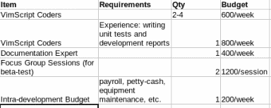
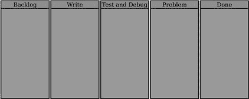
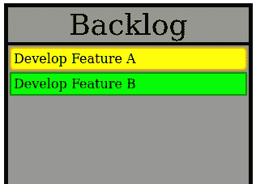
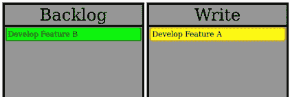
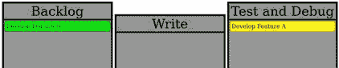

# 项目开发指南：Vim 的 Congenial JavaScript

通过这份开发 Vim 编辑器 `Congenial-JavaScript` 插件的全面指南，构建你的作品集。


通过这份全面的指南，为 Vim 文本编辑器开发 `Congenial-JavaScript` 插件并构建你的作品集。

**前提条件：** Vim 和 JavaScript 基础知识

ProjectRay Voice

## 引言

本书是开发著名的 Vim `Congenial-JavaScript` 插件的全面指南。本书引导读者通过六个全面而简洁的步骤来开发和展示你的软件，从开发程序背后的初始想法，直到最后的发布和未来的开发阶段。书中包含了以下开发步骤：

1. 初始想法的开发。

2. 项目启动，包括团队成员角色初始化。

3. 软件编程与编码，包括通过构建自定义测试框架为 Vim 编写单元测试。

4. 编写文档。

5. 使插件适合你的作品集。重点关注优雅编程的 3R（可读性、可重用性和重构）。

6. 最终发布，包括将你的工作提交给他人（包括潜在雇主）进行同行评审。

本书采用了非常简洁且直接的方式呈现，即使是极微小的细节也提供了详细的步骤和解释。我的意图是不遗漏任何细节；因此，从编写第一行代码到`Refactoring`（重构）和`Rewriting`（重写），一切都将以易于阅读的方式进行详细记录。一旦你开发了项目，甚至可以将其放入你的作品集中。原始项目采用 `MIT Licensed` 许可；请在源代码中为原作者（`Ray Voice`）注明，即“公开归属”。本书从单兵程序员/项目经理的角度编写，因此易于独自阅读，并能让你为加入更大的团队做好充分准备。

### 前提条件

要阅读这本书，你只需要了解以下内容：

1. `Vim` 基础，例如什么是`Normal Mode`（普通模式）、`Insert Mode`（插入模式）等。 `VimScript`/`VimL` 也值得了解。

2. `JavaScript` 基础。我们在本书中没有使用任何 `JavaScript`，但我们正在开发一个为 `JavaScript` 编码提供辅助工具的插件。

3. 编程基础。你需要了解`variables`（变量）、`functions`（函数）、`importing`（导入）等知识。如果你了解 `JavaScript`，这应该是轻而易举的。

你可以通过阅读以下书籍获得所有前提条件，但如果你知道自己在做什么，则不需要阅读它们：

* `Simply Vim : A Comprehensive Guide to Mastering the Vim text-editor` – `Ray Voice`

* `Simply Web Development : An introduction to the world of Web development` – `Anna Voice` and `Ray Voice`

* `Simply ES6 : Mastering JavaScript and ES6 to its fullest` – `Ray Voice` and `Anna`（针对高级 JavaScript）

### 关于作者


`Ray Voice` 是一位数学家、计算机研究员、软件开发者、连续创业者和畅销作家。他是“Ray & A Group Solutions”的 MD 和 CEO，这是一家位于亚洲的技术咨询公司，客户遍布全球。他还是“Technology Application, Research, and Development Initiative Stratagem”（简称“TARDIS”）的创始人兼董事，这是一个命名巧妙的研发机构，其主要目的是通过开发未来的技术让世界变得更好。其成员来自各行各业。他们完成的大部分工作都是开源的，并使用 `MIT` 和 `BSD` 许可。研发运营的大部分资金来自举办研讨和工作坊。

Twitter: @RayShortHead

#### 作者感谢

以下人员参与了本书的开发，没有他们，这本书将无法完成。

* `Anna Voice`（编辑）

* `Siena Dahl-Joy`（贡献者）

* `Ospan Ali`（素材图片）

向他们所有人表示感谢。

## 第 1 章 - 初始想法的开发

在本章中，我们将开始处理项目的初始想法。我们将回顾开发过程，然后直接进入原型设计和概念验证开发等方面，最后进行一些市场测试。

### 开发流程

情况是这样的，我相信一旦有了初始想法和`Team of Developers`（开发团队），影响项目最终成功的因素就是流程！因此，在急于推进开发之前，确保流程是正确的至关重要。小型且精益的初创公司其优势在于为每个项目使用独特的开发流程，如果项目负责人清楚自己在做什么，这对项目会非常有益处。然而，这种模型在大多数情况下并不具有可扩展性，最好使用如 `Kanban`（看板）或 `Scrum` 等敏捷方法。本项目的开发流程将保持足够精简，以便一个人就能执行。流程如下：

1. 以简洁直观的方式在没有外部帮助的情况下写下一个 `General Idea`（通用想法）。

2. 为项目列出需求及其时间表。这类文档通常提供给你的财务资助者或负责项目库存/账户管理的人。这必须准确完成，因为这将用于为你的初创公司/公司绘制跑道时间线。一个具有 IT 经验的专业会计师可以为你节省大量资金。

3. 构建一个 `Mock`（原型）和一个 `Proof-of-Concept`（概念验证）以与其他团队成员共享，通常由构思该程序的开发者在几乎或完全没有外部帮助的情况下构建。

4. 与团队成员和一些外部人员对 `Proof-of-concept` 进行内部市场测试。这是一个非常关键的时期，因为它可能为未来的许多工作奠定基调。

5. 较大的项目会建立如 `SCRUM` 的项目管理系统，而对于像这样的小型项目，一个人就可以微管理几个开发者。

6. 启动项目并与所有团队成员共享 `Repository`（仓库）。在我的项目中，我强制每个人使用分级管理系统，他们只能将代码提交到自己的 `Repo` 中，并且只能与主管的 `repo` 合并。每个人在将其合并到原始 `Repo` 之前都会彻底审查其下属的工作。

7. 团队成员之间举行简报会议以分配任务。在这部分，我与团队一起开发和审查 `Kanban boards`（看板）。这也可以作为 `SCRUM` 的一部分完成。

8. 开始开发的实际编程阶段。

9. 完成最后的调整，包括 Beta 测试。

10. 将项目推送到 `master repo`（主仓库），并作为以下形式之一分发给用户：

    1. 更新他们现有的软件。

    2. 升级到他们当前的版本。

    3. 滚动发布（`Rolling release`），类似于更新。

    4. 实时版本（`Live version`），意味着用户始终使用最新版本。

11. 通常会举办发布派对或仪式。

如果这些步骤让你感到压力很大，完全不用担心！我们不会执行像第 10 步那样的步骤，我也绝不会为你举办派对！

### 初始想法

每个项目都有灵感，开发者总是在试图满足某种需求，或者试图填补某种空白。`Congenial-coding` 实践源于以下需求：

1. 我患有腕管综合症！我不能打太多字，所以我依靠听写、语音转文字程序以及像 `Emmett-vim` 这样的程序来帮助我编码。

2. 我使用许多语言编程，我担任了很长时间 `Forensic Programmer`（取证程序员），所以忘记编程语言的语法是我生活中的大罪，但它仍然时时发生。

### 取证编程

我将自己描述为 `Forensic Programmer`，作为一名 `Forensic Programmer`，我诊断软件、源代码、UI/UX 等问题并修复它们；确保它们不会以不可预测的方式再次发生。初始想法类似于漏洞赏金，事实上，寻找漏洞是工作的一部分，但取证编程更广泛且目标不同。作为 `Forensic Programmer`，我使用过许多编程语言、库和框架、编辑器、人员等，包括但不限于：

1. `JavaScript`

2. `TypeScript`

3. `ReactJS` 和 `React-Native`

4. `C`、`C++`、`C#`、`Go` 和 `OpenCL`

5. `Lua`

6. `Common Lisp`

7. `Java`、`Kotlin` 和 `Scala`

8. `FORTRAN`、`Alef` 和 `Limbo`（有一次）

9. `Python`

10. `MATLAB`、`Octave`、`BRL-CAD` 等。

11. `Sh/BASH Shell`、`BASIC` 和 `DOS batch`

12. `Haskell`

13. `Curl`

14. `Swift`

15. `Rust`

16. `AWK`

17. 用于 `Flutter` 的 `Dart`

18. `PHP` 和 `SQL`

19. `Ruby`

20. `Perl`

21. `Zig` 和 `Racket`

22. `BrainFuck` 和 `Shakespeare`（趣味）

### 总大纲

所以，我需要一个具有以下功能的程序：

1. 它允许我用最少的打字量编写数百行代码。

2. 它应该帮助处理语言的语法。

3. 它应该足够直观，这样我不会忘记如何使用它，否则还有意义呢！

#### 开发特性

程序还需要一些“静默”功能，即开发特性。

1. 它需要易于适配到 `JavaScript` 以外的语言，以便我可以将其移植到其他语言。

2. 它在所有语言中应该保持一致，例如，声明变量的命令在 `JavaScript` 和 `C` 语言中应该是相同的，但它们的输出显然会不同。

3. 它需要极快的速度；任何减慢 `Vim` 速度的插件都是不值得的。

#### 项目需求原型

我将在没有太多外部帮助的情况下开发这个项目；然而，我仍然会向你展示是如何做的，这样你至少对公司是如何运作有一个基本的了解。在开发开始之前，我们需要为开发阶段准备预算，财务部门的人员审核预算，然后项目经理拥有完全的控制权！

虽然通常情况下并非如此，但我合作过财务部门从不放弃预算控制权的团队，这反过来在很大程度上损害了项目；对某人最糟糕的事情之一就是赋予他们责任，却实际上没有赋予他们执行该责任的权力。

##### 我们的项目需求（抽象）

让我们列出开发这个项目所需的物品清单。

1. 我们需要一些能编写 `VimScript` 代码的人。

2. 我们需要有人使用 `VimScript`、`Python` 等编写单元测试并生成开发报告。

3. 我们需要有人来编写文档，这需要一套独立的技能组合。程序员编写的文档会让读者想自杀。

4. 我们需要一些人对我们的软件进行 Beta 测试。

5. 我们假设我们有空间和设备来开发这个项目。

##### 我们的项目需求（正式）

虽然我们有初始需求列表，但我们不能向财务部门发送像上面那粗略列表，他们需要清晰的指南来计算预算。我们需要制定一份正式列表，描述我们要求的劳动力和预算的精确质量和数量。以下是列表更正式的版本：

1. `VimScript` 程序员 x 2-4 名。

2. 具有编写单元测试经验的 `VimScript` 程序员。

3. 具有编写文档经验的程序员。

4. 用于中立焦点小组的预算。

5. 200 美元的开发期间预算，用于额外薪资、零用金、设备维护等。

现在这是一份很好的正式文档了！虽然第 5 点会激怒某些人。正式文档看起来像下面：



注意：这只是一个模拟文档。一旦交付此文档，通常会有一些谈判，然而，项目经理不能做出任何他们无法实现的陈述，并且在合理请求面前绝不让步。记住，在低预算上设定不可能实现的目标对项目非常有害，并且对与该项目相关的人员声誉产生极大危害。

#### 缩减需求

有时我们没有足够的资源或预算来大规模开发项目，如果出现这种情况，我们可以采取以下方法：

##### 精益创业者方法

1. 不再使用多个程序员和专门编写单元测试的程序员，而是雇佣一个小双人来完成工作并互相测试对方的工作。这在大型项目中可能是灾难性的。外包一些内容也是明智的。

2. 将文档编写者的角色交给一个低薪的`实习生`。

3. 不要预订焦点小组，而是使用来自所谓“朋友和家人”的有机反馈。

##### 穷困创业者方法

1. 手动（DIY）编写程序的一部分，包括单元测试，将其余部分放在 `GitHub`、`GitLab`、`BitBucket` 等平台上供他人贡献。

2. 你自己编写部分文档，将其余放在 `GitHub` 上供他人贡献。

3. 在线与他人分享程序；通过这种方式你可以获得一些非常棒（伤人的）的反馈。只需保持开放的心态和钢铁般的神经。

#### 概念验证与 Beta 测试

我将担任你的项目经理，并已为你编写了一个概念验证代码。代码如下，将其放入你的 `.vimrc` 文件中，你就可以自己测试概念验证了：

```
" start of the proof-of-concept code
function ! Append (dataToAppend) abort
    execute 'normal i' .a:dataToAppend
endfunction

function ! GenerateVariable () abort
    let scope = input ( 'var/let/const Pick 1/2/3: ' )
    let scopeOptions = [ 'var' , 'let' , 'const' ]
    let scopeRes = scopeOptions [ scope -1]

    let name = input ( 'Name of Variable: ' )
    let value = input ( 'Value of Variable: ' )

    call Append ( scopeRes . ' ' . name . ' = ' . value . ';' )
endfunction

nnoremap ,var :call GenerateVariable ()<cr>
" end of code
```

注意：目前你不需要知道这段 `VimScript` 代码的作用，基础的 `VimScript` 知识（如创建变量和函数）将在本书稍后的阶段解释。警告：不要复制/粘贴代码，要手动输入。在将此代码添加到你的 `.vimrc` 文件并调试任何安装问题（如果有）之后，我们可以按照以下步骤测试概念验证：

1. 确保你添加到 `.vimrc` 文件的代码是正确的。Windows 用户可以使用 `:echo $HOME` 来找到他们的主目录。

2. 在终端中使用 `vim` 打开一个新文件。

3. 进入新文件后，在普通模式下使用 `,var` 查看魔法。该命令用于在 JavaScript 中声明变量并控制其作用域。

4. 系统将询问变量的“作用域”，你可以输入 1、2 或 3 分别代表 `var`、`let` 或 `const`，然后按回车。第一次测试，输入 1 然后按回车。

5. 系统将询问变量的“名称”。给它命名，然后按回车。第一次测试将变量命名为“player1Health”然后按回车。

6. 最后，系统将询问变量值，你可以传递 1、200、31、true、false、“JavaScript”、“Hello World”等值。字符串需要引号。第一次测试，输入 100 作为值然后按回车。

7. 如果你操作得当，你应该会在你的文档中看到以下内容：

```
var player1Health = 100;
```

8. 如果你看到了，恭喜你刚刚验证了程序背后的初始概念。

9. 现在你应该把程序发给其他人测试。在继续之前，解决概念上的任何问题。

10. 现在你需要开发一个真正有用且可以分发的程序版本。

11. 在继续之前，从你的 `.vimrc` 文件中移除概念验证代码。

#### 设置项目管理系统

对于这个项目，我为你提供了一个简单的项目管理系统来处理项目。该系统由 5 个步骤组成：

1. Backlog（待办列表）

2. Write（编写）

3. Test and Debug（测试与调试）

4. Problem（问题）

5. Done（完成）

它在看板板（`Kanban Board`）上应该是这样的：



我会给你一个待实现的功能待办列表（backlog），这些功能将以卡片/故事的形式给出。例如，它在看板板上看起来如下：



在“写入”（Write）步骤，你将从待办事项列表中选取一个模块/功能卡片，将其从“待办事项”列移动到“写入”列，并对其进行编码。假设你选择了“功能 A”，看板板将如下所示：



在“测试”（Test）步骤，你将从“写入”列中选取一个功能卡片并将其置于“测试与调试”（Test and Debug）列，对该功能进行测试，并在必要时对代码进行调试。如果你选择了“功能 A”，那么看板将如下所示：



当你完成“功能 A”的开发后，你将它的卡片移动到“完成”（Done）列，然后你就有了一些个人带宽来开始处理待办列表中的另一个功能。“问题”（Problem）列用于存放不属于任何其他列的内容，如有需要，可以在那里留下一片备注。

使用看板方法，你可以为每个团队/成员分配一个单一列进行工作，这也称为垂直分配（Vertical assignment）；或者你可以将单个功能分配给一个团队/成员，由他/她带它通过每一个列，直到进入“完成”列，这称为水平分配（horizontal assignment）。每个团队都有自己的分配任务和自己的子看板板。

我项目中的层次结构使用了一套术语：中心看板被称为“源板”（Origin-Board），子看板被称为“宏观板”（Macro-Boards），子子板被称为“中级板”（Meso-Boards），子子子子板被称为“微观板”（Micro-Boards）。不过，这显然是造出来的术语！这种想法是为了维护上级看板的优越性，因此中级板永远不会与微观板不同步。我做这一切是因为我不喜欢别人碰我的源板，随你怎么想吧！


书末提供了这种看板板的模板，你可以将其打印出来自己使用。你也可以使用像`Task Warrior`这样的程序进行单人、单调的项目管理。

## 模块

以下是我们正在处理的模块列表：

1. `congenial-JavaScript.vim`（黄色）
2. `modules/sourceCodeGenerator.vim`（绿色）
3. `docs/outline.txt`（蓝色）

每个模块都可以分配一种卡片颜色，然后待办事项列表就可以填充将在这些模块中实现的功能。我已经为你创建了以下待办事项；我们将在下一章之后开始工作。


## 第 2 章 - 项目启动

在本章中，我们将初始化项目的源仓库（Repository），与所有成员共享仓库，然后与我们的共同开发者分配任务。

如果你愿意，可以使用`Git`初始化你的项目，虽然这不是强制要求的。你可以使用`Git`或任何其他版本控制系统；强烈建议使用版本控制系统，除非你熟悉它们，否则不要使用。这里没有提供版本控制的说明，因此不会给出检出（check-out）、合并（merge）、推送（push）等步骤，你需要自己处理版本控制，如果你不知道怎么做就暂时避免，这是一个小型项目。没有提供创建`contributors.md`、`LICENSE`、`README.md`等文件的说明，因为它们在个人项目中不是必须的，但如果你把项目放在`GitHub`上，你可以提供这些文件。

### 初始化项目

以下是我们初始化项目将采取的步骤：

1. 在你的`HOME`目录下创建一个名为`congenial-JavaScript`的目录。
2. 在`congenial-JavaScript`内部创建以下目录：
   - `docs`
   - `modules`
3. 在`congenial-JavaScript`内部创建以下文件：
   - `congenial-JavaScript.vim`
   - `docs/outline.txt`
   - `modules/sourceCodeGenerator.vim`
4. 进入`~/.vim/after/ftplugin/javascript/`目录，如果它不存在，或者它的任何父目录不存在，则创建它们。
5. 在此目录下为你第 #1 步创建的`congenial-JavaScript`目录创建一个符号链接（即快捷方式）。使用命令：

```bash
ln -s ~/congenial-JavaScript congenial-JavaScript
```

6. 现在在`~/.vim/after/ftplugin/javascript/`中创建一个名为`plugins.vim`的文件。该文件用于激活 JavaScript 文件的插件。插件应像步骤 #8 那样在`plugins.vim`中导入。
7. 现在你应该拥有了`.vim`和`congenial-JavaScript`的如下目录结构：

```
~/|_ .vim/| |_ after/| | !_ after/|   !_ ftplugin/| |      |_ javascript/| |      | |_ congenial-JavaScript/| |      | !_ plugins.vim (用于激活插件)| |      |_…| |_ autoload/| |_ colors/| |_ ftplugin/| |…|_ .vimrc (用于 vim 代码，与我们无关)|_ congenial-Javascript/| |_ congenial-JavaScript.vim (中心插件文件)| |_ docs/| | !_ outline.txt (congenial-JavaScript 文档)| !_ modules/|   !_ sourceCodeGenerator.vim (重要模块)|_…
```

8. 在`plugins.vim`中添加以下代码行并保存：

```vim
1 " 这是一个包含为 JavaScript 激活的插件列表的文件
2 " 语法是编写插件名称，后跟源（source）该插件的中心文件
3 " 程序 congenial-JavaScript 最初由 RayVoice “GitHub/Ray6464” “@rayshorthead” “rayvanet@gmail.com” 根据 MIT 许可证开发
4 " congenial-JavaScript5
5 so ~/.vim/after/ftplugin/javascript/congenial-JavaScript/congenial-JavaScript.vim
```

9. 第 #5 行的代码实际上在`plugins.vim`脚本中导入了`congenial-JavaScript.vim`脚本。你也可以在此文件中添加你开发的插件。
10. 当我们在`Vim`中打开 JavaScript 文件时，它将执行`plugins.vim`，从而激活`congenial-JavaScript`插件。
11. 现在项目启动完成。

### 分配任务

现在让我们分配开发任务，正如我向你承诺的，没有任何会在屏幕外发生，我已经联系了我的朋友 Siena 来参与这个项目，以下是她的回复：


遗憾的是，我无法分享来自私人论坛的真实图片，但对话是这样的：

1. 我发了概念验证方案给她测试，她很喜欢它。
2. 我告诉她我需要涵盖的内容，比如创建变量、循环等，并承诺稍后发送完整列表。
3. 她和我同意建立一套通信系统，我们基本上同意采用一种通信方式，即建立一个受`Git`控制的私有远程仓库，我编写代码来实现所需的功能，她将以 FIFO（先进先出）的方式为这些功能编写测试，并将它们推送/上传到远程仓库。不过，为了演示，我会至少写一个测试。

让我们开始开发吧！

## 第 3 章 – 软件编程

在本章中，我们将涵盖 VimScript 的基础，然后是软件的实际编程，最后是测试。“写入/测试”循环将针对每个功能重复，直到涵盖了满意数量的功能。为了表达我的观点，我们保持了代码部分的简练，如果你遇到任何问题，请考虑增加对 VimScript 的接触。

### VimScript 基础

在下面的列表中描述了 VimScript 的基本功能，这并不是教程。任何具有某些编程经验的人应该理解这些。

1. `so`关键字是`source`的缩写，它实际上是将一个脚本导入另一个脚本中，但这个定义并不是字面上的。VimScript 中的导入工作有所不同。
2. `nnoremap`关键字告诉 Vim 在普通模式（Normal-mode）下在键序列和命令之间建立联系。
3. `inoremap`关键字告诉 Vim 在插入模式（Insert-mode）下在键序列和命令之间建立联系。
4. `function!`关键字用于开始编写函数，`endfunction`关键字用于结束它。

### Vim 关键字

5. `echo`关键字用于向 Vim 记录内容。
6. `let`关键字用于声明和重新赋值变量。
7. `call`关键字用于调用函数。
8. 函数声明末尾的`abort`关键字用于在发生错误时终止函数的执行过程。
9. 需要时会提供进一步的解释，但仅是简要的。关于 Vim 和 VimScript 使用的完整指南，请参考以下书籍。

*Simply Vim : A Comprehensive Guide to Mastering the Vim text-editor* – Ray Voice

## 在 JavaScript 中生成变量程序

在 JavaScript 中，我们有 3 种基础变量，它们通过`var`、`let`、`const`关键字声明。变量控制着访问范围和值的可变性，但在这里这些都不重要！我们只需要编写代码即可。每个模块将经过“编写/测试”循环，然后进行解释。

### 编写（Write）

按照以下步骤编写第一个功能：

1. 在`congenial-JavaScript.vim`中添加以下代码并保存：

```bash
so ~/.vim/after/ftplugin/javascript/congenial-JavaScript/modules/sourceCodeGenerator.vim
```

2. 为你的`congenial-JavaScript.vim`文件也添加以下代码：

```vim
nnoremap ,var :call GenerateVariableWithScope()<cr>
```

3. 向你的`modules/sourceCodeGenerator.vim`文件添加以下代码：

```vim
" The program congenial-JavaScript was originally developed by RayVoice “GitHub/Ray6464” “@rayshorthead” “rayvanet@gmail.com” on MIT License
function ! AddToDoc(dataToAdd) abort
    execute 'normal i' .a:dataToAdd
endfunction

function ! GenerateVariableWithScope() abort
    let sSel = input( 'var/let/const Pick 1/2/3: ' )
    let sOps = [ 'var' , 'let' , 'const' ]
    let sStd = sOps[sSel-1]

    let vName = input( 'Name of Variable: ' )
    let vVal = input( 'Value of Variable: ' )

    call AddToDoc(sStd. ' ' .vName. ' = ' .vVal. ';' )
endfunction
```

4. 在此代码中，我们使用了缩写以适应页面，但为了避免混淆，我建议你反转缩写，例如不要写“sSel”而写“scopeScelection”。以下是缩写列表：
   1. `sOps` = `scopeOptions`
   2. `sStd` = `scopeSelected`
   3. `vName` = `variableName`或`varName`
   4. `vVal` = `variableValue`或`varValue`
5. 记住，代码的可读性非常重要，确保你的代码像故事一样易读。在后面的章节中，我将向你展示如何编写像故事一样清晰易读的代码。
6. 现在保存两个文件后，创建一个名为“something.js”的文件。在 Vim 中你可以使用`:e something.js`。
7. 现在在`something.js`的普通模式下使用`,var`，Vim 几乎会立即询问以下问题：
   1. 范围（Scope）
   2. 名字（Name）
   3. 值（Value）
8. 给范围赋值：`1`
9. 给名字赋值：`health`
10. 给值赋值：`100`
11. 现在你应该会看到：

```javascript
var health = 100;
```

12. 如果一切运行正常，那么恭喜你；如果没有，请调试你的代码。VimScript 非常容易调试，可以在网上找到帮助，你也可以在 GitHub 的`Ray6464/congenial-JavaScript`上提交 issue。

### 测试与调试（Test and Debug AddToDoc）

以下指令将教你如何测试上一节第 #3 步所示的`AddToDoc()`函数。

1. 在你的`modules`目录下创建一个名为`tests.vim`文件。
2. 在`congenial-JavaScript.vim`中添加以下代码并保存：

```bash
so ~/.vim/after/ftplugin/javascript/congenial-JavaScript/modules/tests.vim
```

3. 在`tests.vim`文件中添加以下代码：

```vim
function ! Report(functionName) abort
    echo "Report: The Function [" . a:functionName . "] is working.     (PASS)"
endfunction

function ! Error(functionName) abort
    echo "Error: The Function [" . a:functionName. "] is not working.  (FAIL)"
endfunction

function ! ClearFile() abort
    execute 'normal ggdG'
endfunction

function ! TestAddToDoc() abort
    let testName = "AddToDoc" ;
    call AddToDoc( "Hello World" )
    if getline ( "1" ) == "Hello World"
        call Report(testName)
    else
        call Error(testName)
    endif
endfunction

function ! TestStart() abort
    call AddToDoc()
    call ClearFile()
endfunction
```

4. `tests.vim`文件能够调用`sourceCodeGenerator.vim`文件中的函数，是因为它们都被`congenial-JavaScript.vim`文件激活了，而后者是由`plugins.vim`文件激活的，而后者由于位于`~/.vim/after/ftplugin/javascript/`目录，在打开 JavaScript 文件时会被激活。这虽然复杂，但它是我们最好的方法了！

### 解释编写过程（Explaining Write）

1. `congenial-JavaScript.vim`文件导入了`sourceCodeGenerator.vim`脚本。
2. `,var`键绑定调用了`GenerateVariableWithScope()`。
3. 在`sourceCodeGenerator.vim`文件中：
   - `AddToDoc(dataToAdd)`使用`normal i`插入文本。
   - `GenerateVariableWithScope()`请求范围、名字和值，然后调用`AddToDoc()`。
4. `tests.vim`文件包含：
   - `Report(functionName)`用于记录成功。
   - `Error(functionName)`用于记录失败。
   - `ClearFile()`使用`ggdG`清空文件。
   - `TestAddToDoc()`测试`AddToDoc`是否工作。
   - `TestStart()`协调测试套件。
10. `:.w !bash`可用于通过`bash`在当前行运行命令，但在此处并不是必须的。该命令将当前行的文本写入`bash`的`StdIn`中，而我们也可以将其写入任何程序的`StdIn`中。
11. 我们还可以使用`new “somefile.js”`来实现在开发过程中自动打开测试文件。我们在此处没有使用它，因为我更喜欢手动操作。`quit!`
12. 注意该文件是如何被注释掉的，从大局来看，它仍处于进行中。

### 测试与调试（GenerateVariableWithScope）

以下指令可用于编写一个测试，以自动化上一个`Write`部分中第 #7 到 #11 步的操作，这些步骤将用于测试函数`GenerateVariableWithScope()`。

1. 首先，我们需要更新`modules/sourceCodeGenerator.vim`文件中的代码，在这里，我们重写了`GenerateVariableWithScope()`函数：

```vim
function ! GenerateVariableWithScope( ... ) abort2
    if a:0 > 03
        let scopeSelection = a:14
        let varName = a:25
        let varValue = a:36
    else7
        let scopeSelection = input ( 'var/let/const Pick 1/2/3: ' )9
        let varName = input ( 'Name of Variable: ' )10
        let varValue = input ( 'Value of Variable: ' )11
    endif12
    let scopeOptions = [ 'var' , 'let' , 'const' ]13
    let scopeSelected = scopeOptions[scopeSelection-1]14
    call AddToDoc(scopeSelected. ' ' .varName. ' = ' .varValue. ';' )15
endfunction
```

2. 这个新版本的`GenerateVariableWithScope()`经过了改进，因为它提供了一个测试接口。从现在起，我们将使用“测试驱动开发”方法，即在编写实际源代码之前编写单元测试！
3. 如果你想在开发中使用单元测试，我建议使用`Jenkins`（MIT）和`Selenium`。


4. 注意第 #1 行上的`...`符号，它允许函数接收多达 20 个可选参数。这些参数可以通过`a:1, a:2, a:3, …, a:20`访问，而`a:0`则存储传递给函数的参数数量。

5. 在第 #2 行，代码检查传递给函数的参数数量，如果该数字大于 0，则我们运行函数的自动化测试版本，否则我们运行接收用户输入的函数。

6. 现在，在`modules/tests.vim`中的`TestStart()`函数之前添加以下代码，忽略行号，在认为合适的地方编写该函数。

```vim
function ! TestGenerateVariableWithScope() abort2
    let testName = "GenerateVariableWithScope"3
    call GenerateVariableWithScope( 1 , "Health" , 100 )4
    call NextLine()5
    call GenerateVariableWithScope( 2 , "alive" , "true" )6
    call NextLine()7
    call GenerateVariableWithScope( 3 , "class" , "'hero'")8
    let expectedOutput = "var Health = 100;let alive = true;const class = 'hero';"9
    if getline( "2" ).getline( "3" ).getline( "4" ) == expectedOutput10
        call Report(testName)11
    else12
        call Error(testName)13
    endif14
endfunction
```

7. 现在在`modules/tests.vim`中修改`TestStart()`函数，使其看起来如下：

```vim
function ! TestStart()
  call WriteTestHeaderToFile()
  call TestAddToDoc()
  call NextLine()
  call TestGenerateVariableWithScope()
  call ReadTestReport()"
  call ClearFile()endfunction
```

8. `tests.vim`文件中增加了几个函数，它最终看起来如下：

```vim
function ! Report(functionName) abort2
    let result = "Report: The Function [" . a:functionName . "] is working. (PASS)"3
    call WriteToFile(result)4
endfunction

function ! Error(functionName) abort7
    let result = "Error: The Function [" . a:functionName . "] is not working. (FAIL)"8
    call WriteToFile(result)9
endfunction10

function ! WriteToFile(data) abort12
    " Test Report is saved in the local project Dir13
    call writefile([ a:data ], "testReport.txt" , "a" )14
    " appends logs to file15
endfunction16

function ! WriteTestHeaderToFile() abort18
    call WriteToFile( '' )19
    call WriteToFile( '----------------------' )20
    call WriteToFile(strftime( '%c' ))21
    call WriteToFile( '----------------------' )22
endfunction

function ! ReadReport() abort25
    " Opens Test in New Window26
endfunction

function ! ClearFile() abort29
    " ... normal '30Gd'33
endfunction

function ! NextLine() abort34
    " ... normal ''35
endfunction

function ! TestAddToDoc() abort37
    " ... 38
endfunction
```

```vim
function ! LoopOverRange(...) abort
  if IsTest( a : 0 )
    let initialCounterValue = a : 1
    let counterLimitCompatative = a : 25
    let counterIterationValue = a : 36
  else
    let initialCounterValue = input( 'Initial Counter Value: ' )
    let counterLimitCompatative = input( 'Comparative (<10)/(>5)/(==20): ' )
    let counterIterationValue = input( 'Counter Iteration Value (++/+2/-3): ' )
  endif
  call AddToDoc( 'for (let i=' .initialCounterValue. '; i' .counterLimitCompatative. '; i' .counterIterationValue. '){}' )
endfunction

function ! LoopOverMembers(...) abort
  if IsTest( a : 0 )
    call AddToDoc( 'for (let m of ' . a : 1 . '){}' )
  else
    call Suggest( 'Give the name of an already declared array, for example: myList | myArray | myArr' )
    let arrayToIterateOver = input( 'Array to Iterate Over: ' )
    call AddToDoc( 'for (let m of ' .arrayToIterateOver. '){}' )
  endif
endfunction

function ! LoopOverIndices(...) abort
  if IsTest( a : 0 )
    call AddToDoc( 'for (let i in ' . a : 1 . '){}' )
  else
    call Suggest( 'Give the name of an already declared array, for example: myList | myArray | myArr' )
    let arrayToIterateOver = input( 'Array to Iterate Over: ' )
    call AddToDoc( 'for (let i in ' .arrayToIterateOver. '){}' )
  endif
endfunction
```

4. 这里显示的三个函数渲染了三种不同类型的循环：For 循环、For/Of 循环和 For/In 循环。这将由另一个函数调用，该函数会提示用户他们需要的循环类型。

5. 现在将以下函数添加到`sourceCodeGenerator.vim`中：

```vim
function ! GenerateForLoop( ... ) abort
  if IsTest( a:0 )
    let loopTypeSelectionIndex = a:1
  else
    let loopTypeSelectionIndex = input ( 'Loop over Range/Members/Indices Pick 1/2/3: ' )
  endif
  let loopTypesShelf = [ ' loopOverRange' , 'loopOverMembers' , 'loopOverIndices' ]
  let loopSelection = loopTypesShelf[loopTypeSelectionIndex- 1 ]
  if IsTest( a:0 )
"----------------------------------------------
    if loopSelection == loopTypesShelf[ 0 ] "for
      call LoopOverRange(0, "<10" , "++" )
    elseif loopSelection == loopTypesShelf[ 1 ] "forOf
      call LoopOverMembers( "myLoop" )
    elseif loopSelection == loopTypesShelf[ 2 ] "forIn
      call LoopOverIndices( "myLoop" )
    endif
"----------------------------------------------
  else
"----------------------------------------------
    if loopSelection == loopTypesShelf[ 0 ]
      call LoopOverRange()
    elseif loopSelection == loopTypesShelf[ 1 ]
      call LoopOverMembers()
    elseif loopSelection == loopTypesShelf[ 2 ]
      call LoopOverIndices()
    endif
"----------------------------------------------
  endif
endfunction
```

6. 该函数通过调用第 #22、#25、#26 行代码中相应的函数，来生成三种类型的循环。

7. 在第 #2 到 #6 行，函数会检查它是由人工调用的还是测试调用的！

8. 第 #7 行和 #8 行确定我们需要哪种类型的循环；例如，如果在第 #5 行提示提示时输入“1”，那么第 #7 行和 #8 行将解析为经典的 For 循环。

9. 在第 #9 行，函数再次检查它是由人工调用的还是测试调用的！

10. 在第 #10 到 #18 行以及 #20 到 #28 行，该函数将我们调用的循环类型与相应的函数匹配，然后调用该函数；例如，如果我们调用了`loopOverRange`（即“经典的 For 循环”），那么该函数将调用`LoopOverRange()`函数。

### 测试与调试

1. 以下是针对 For 循环的测试：

```vim
function ! TestForLoop() abort
  let testName = "GenerateForLoop"
  let expectedOutput1 = "for (let i=0; i<10; i}"
  let expectedOutput2 = "for (let m of myLoop)"
  let expectedOutput3 = "for (let i in myLoop)"
  call GenerateForLoop( 1 )
  call NextLine()
  call GenerateForLoop( 2 )
  call NextLine()
  call GenerateForLoop( 3 )
  call GenerateReport(testName, expectedOutput1)
  call GenerateReport(testName, expectedOutput2)
  call GenerateReport(testName, expectedOutput3)
endfunction
```

2. 同样，如果你在熟悉测试方面遇到问题，不要担心，这是与团队中他人协作的一部分。

3. 检查 GitHub 上 ray/JavaScript 整个文件是否有不可见的部分。

4. 在第 #3、#4 和 #5 行，我们声明了提供的 For、For/Of 和 For/In 循环为预期输出。

5. 在第 #6、#8、#10 行，我们使用正在测试的函数来生成循环。

6. 在第 #1、#12 和 #13 行，我们为上一步生成的输出生成报告。请记住，`GenerateReport()` 行的工作是由`modules/tests.vim`中的`lineNumber`变量决定的。

7. 输出应该是：

------Sun 1 Jun 2020 1:48:07 AMST

*Output: Hello World

*Report: The Function `AddToDoc` is working. (PASS)

*Output: Health = 100;

*Report: The Function `GenerateWithScope` is working. (PASS)

*Output: alive = true;

*Report: The Function `GenerateWithScope` is working. (PASS)

*Output: class = 'hero';

*Report: The Function `GenerateWithScope` is working. (PASS)

*Output: QA{}

*Report: The Function `GenerateLabel` is working. (PASS)

*Output: for (let i=0; i<10; i){}

*Report: The Function `GenerateForLoop` is working. (PASS)

*Output: for (let m of myLoop){}

*Report: The Function `GenerateForLoop` is working. (PASS)

*Output: for (let i in myLoop){}

*Report: The Function `GenerateForLoop` is working. (PASS)

Number of Tests performed: 8 Number of Tests Passed: 8 Number of Tests Failed: 0

#### 生成数组的程序

在本部分中，我们将开发一种生成 JavaScript 数组的方法。让我们开始吧！

1. 将以下代码添加到`sourceCodeGenerator.vim`中：

```vim
function ! GenerateArray(...) abort
  if a : 0 > 0
    let arrayName = a : 1
    let numberOfMembersInArray = a : 2
  else
    let arrayName = input( 'Name of Array: ' )
    let numberOfMembersInArray = input( 'Number of Members in Array: ' )
  endif
  call AddToDoc( 'let ' .arrayName. ' = [ ' )
  let i = 0
  while i < numberOfMembersInArray
    if a : 0 > 0
      let valueOfNthMember = a : 3 + i
    else
      let valueOfNthMember = input( 'Value of ' . i . 'th member: ' )
    endif
    call AddToDoc(valueOfNthMember. " " )
    if i < numberOfMembersInArray - 1
      call AddToDoc( ', ' )
    endif
    let i = i + 1
  endwhile
```

### 测试与调试

1. 现在让我们来看看测试代码：

```vim
function TestGenerateArray() abort
  let testName = "GenerateArray"
  let expectedOutput = "let myArray = [1,2,3];"
  call GenerateArray( "myArray" , 3 , 1 , 2 , 3 )
  call GenerateReport(testName, expectedOutput)
endfunction
```

2. 在第 #4 行，我们调用了`GenerateArray()`函数并传递了参数以匹配`output()`。如果你在这里遇到问题，问题可能在于 Vim 生成的输出而不是你的代码，请务必手动检查。

3. 此时，所有 9 项测试都应该通过了。

#### 生成数组方法

在本部分中，我们将开发两个数组方法：`split` 和 `map`。让我们开始吧！

## 数组函数


```vim
function ! SplitArray(...) abort
    if a : 0 > 0
        let arrayName = a : 1
        let splitByCharacter = a : 2
    else
        let arrayName = input( 'Array Name: ' )
        let splitByCharacter = input( 'Split by character: ' )
    endif
    call AddToDoc(arrayName. '.split("' .splitByCharacter. '");' )
endfunction

function ! MapArray(...) abort
    if a : 0 > 0
        let arrayName = a : 1
        let expressionToExecute = a : 2
    else
        let arrayName = input( 'Array Name: ' )
        let expressionToExecute = input( 'Expression to execute per iteration: ' )
    endif
    call AddToDoc(arrayName. '.map(element => ' .expressionToExecute. ');' )
endfunction
```

2. 代码非常自易懂，所以到此时你应该能够立即识别/理解你自己或项目中其他人为此项目编写的代码。

3. 尝试自己理解这些代码！它遵循与文件中编写的所有其他代码相似的模式。

### 测试与调试

1. 现在让我们来看看测试代码（这是我在 Siena 下班后编写的）：

```vim
function TestSplitArray() abort
    let testName = "SplitArray"
    let expectedOutput = 'myArray.split(",");'
    call SplitArray( "myArray" , "," )
    call GenerateReport(testName, expectedOutput)
endfunction

function TestMapArray() abort
    let testName = "MapArray"
    let expectedOutput = 'myArray.map(element => console.log(element));'
    call MapArray( "myArray" , "console.log(element)" )
    call GenerateReport(testName, expectedOutput)
endfunction
```

2. 尝试自己理解这些代码；此之后的所有代码都遵循清晰的模式。

3. 一旦你理解了这些代码，尝试精简它们（但保持可读性）。

## 生成定时器循环的程序

在本节中我们将开发一个类似于`SetInterval`的定时器循环方法。让我们开始吧！

1. 将此代码添加到`sourceCodeGenerator.vim`文件中：

```vim
function ! GenerateTimer(...) abort
    if a : 0 > 0
        let intervalName = a : 1
        let intervalLength = a : 2
    else
        let intervalName = input( 'IntervalName: ' )
        let intervalLength = input( 'interval length in ms: ' )
    endif
    call AddToDoc( 'const ' .intervalName. ' = setInterval(function(){/*code-here*/},' .intervalLength. ');' )
endfunction
```

2. 弄清楚这段代码是如何工作的；找出哪些行是测试的，哪些是给用户的。

### 测试与调试

1. 将此代码添加到`tests.vim`文件中：

```vim
function TestGenerateTimer() abort
    let testName = "GenerateTimer"
    let expectedOutput = "const myTimer = setInterval(function(){/*code-here*/},1000);"
    call GenerateTimer( "myTimer" , 1000 )
    call GenerateReport(testName, expectedOutput)
endfunction
```

2. 弄清楚这段代码是如何工作的。

## 生成 Stdout 日志的程序

在本节中我们将开发一个 Stdout 日志方法。让我们开始吧！

### 编写与测试

1. 将此代码添加到`sourceCodeGenerator.vim`文件中：

```vim
function ! GenerateLog(...) abort
    if a : 0 > 0
        let valueToLog = a : 1
    else
        let valueToLog = input( 'Value to log: ' )
    endif
    call AddToDoc( 'console.log(' .valueToLog. ');' )
endfunction
```

2. 将此代码添加到`tests.vim`文件中：

```vim
function TestGenerateLog() abort
    let testName = "GenerateLog"
    let expectedOutput = 'console.log("Hello World");'
    call GenerateLog( '"Hello World"' )
    call GenerateReport(testName, expectedOutput)
endfunction
```

3. 弄清楚这段代码是如何工作的。

## 生成遍历数组的循环程序 (For-Each)

在本节中，我们将开发一个函数来生成一个遍历数组的 JavaScript 方法。让我们开始吧！

### 编写、测试与调试

1. 将此代码添加到`sourceCodeGenerator.vim`文件中：

```vim
function ! GenerateLoopOverArray(...) abort
    if a : 0 > 0
        let arrayName = a : 1
    else
        let arrayName = input( 'Array Name: ' )
    endif
    call AddToDoc(arrayName. '.forEach((member, index, thisArray)=>{' )
    call NewLine()
    call AddToDoc( '  console.log (index, member, thisArray);' )
    call NewLine()
    call AddToDoc( '});' )
endfunction
```

2. 将此代码添加到`tests.vim`文件中：

```vim
function ! GenerateMultiLineReport(testName, expectedOutputs) abort
    let linesInExpectedOutput = len( a : 1)
    " (剩余文本是严重碎片/损坏的)
endfunction
```

## NodeJS

`NodeJS`（发布于 2009 年）是一个 JavaScript 框架，它允许我们在服务器上运行 JavaScript。在`NodeJS`出现之前，JavaScript 只能用于创建花哨的网站，它基本上充当着带有额外功能的样式代理；但现在 JavaScript 已经是世界上最强大的语言之一，甚至可能是最强大的（从某种意义上说）。

如果你想学习`NodeJS`，可以参考书籍："Simply Web Development : An introduction to the world of Web development - Anna Voice, Ray Voice"。这本书对你学习前后端 Web 开发需要的所有主题都提供了全面的入门级课程，并且它是完整系列的一部分，可以在你通往成为全栈工程师的旅程中使用。

在继续学习`NodeJS`之前，你可能想学习一些内容，例如用于包管理的`NPM`、用于版本管理的`NVM`等。注意：此处的代码可能会进行一些屏幕之外的修改，但并不算严重；你可以自行理解，或者修改代码使其在没有这些修改的情况下运行。

## 内置变量

`NodeJS`有几个内置的全局变量；为了在 congenial-JavaScript 中添加这些功能，我们可以使用以下代码：

```vim
modules/sourceCodeGenerator.vim:1   function ! GenBuiltInVars() abort
2    let objectChoices = [ 'console' , 'global' , 'process' , 'document' ]
3    let objectChoiceIndex = input( 'console/global/process/document' . ' Pick 1/2/3/etc: ' )
4     let objectChoice = objectChoices[objectChoiceIndex -1 ]
5     call AddToDoc(objectChoice)
6   endfunction
congenial-JavaScript.vim:nnoremap ,gvar : call GenBuiltInVars()< cr >
inoremap < c - y >gvar <esc>: call GenBuiltInVars()< cr >
```

在这里，我们可以选择生成后端开发所需的各种变量；像`global`、`process`等对象是`NodeJS`的核心。

### Process 属性

`process`对象有几个基本属性，如`argv`、`env`、`platform`等。以下代码用于生成 process 属性（包括`process`对象）：

```vim
modules/sourceCodeGenerator.vim:1   function ! GenProcessVars() abort
2    let objectChoices = [ 'argv' , 'env' , 'emitWarning()' , 'pid' , 'platform' ]
3    let objectChoiceIndex = input( 'argv/env/emitWarning/pid/platform' . ' Pick 1/2/3/etc: ' )
4     let objectChoice = objectChoices[objectChoiceIndex -1 ]
5     call AddToDoc( 'process.' .objectChoice)
6   endfunction
congenial-JavaScript.vim:nnoremap ,pvar : call GenProcessVars()< cr >
inoremap < c - y >pvar <esc>: call GenProcessVars()< cr >
```

### 事件

`NodeJS`是一个运行时，具有将重型操作移动到另一个线程的能力（也称为非阻塞运行时和事件循环），使得`NodeJS`非常适合服务器。

要生成`NodeJS`事件，我们可以使用以下代码：

```vim
modules/sourceCodeGenerator.vim:1   function ! GenEventVars() abort
2    let objectChoices = [ 'exit' , 'beforeExit' , 'abort' ]
3    let objectChoiceIndex = input( 'Events exit/beforeExit/abort' . ' Pick 1/2/3/etc: ' )
4     let objectChoice = objectChoices[objectChoiceIndex -1 ]
5     call AddToDoc( 'process.on("' .objectChoice. '", function() {});' )
6   endfunction
congenial-JavaScript.vim:nnoremap ,event :call GenEventVars()<cr>
inoremap < c - y >event <esc>: call GenProcessVars()< cr >
```

## 代码重构

在这里，我看到在本章描述的函数之间出现了一种模式，因此我将代码重构为：

```vim
modules/sourceCodeGenerator.vim:1   function ! ObjectWriter(objectChoices, index, preCode, postCode) abort
2     let objectChoice = a :objectChoices[ a :index]
3     call AddToDoc( a :preCode.objectChoice. a :postCode)
4   endfunction
5   
6   function ! GenerateBuiltInVariables() abort
7     let objectChoices = [ 'console' , 'global' , 'process' , 'window' , 'document' ]
8     let objectChoiceIndex = input( 'console/global/process/window/document' . ' Pick 1/2/3/etc: ' )
9      call ObjectWriter(objectChoices, objectChoiceIndex -1 , '' , '' )
10 endfunction
11   
12 function ! GenerateProcessVariables() abort
13   let objectChoices = [ 'argv' , 'env' , 'emitWarning()' , 'pid' , 'platform' , 'arch' ]
14   let objectChoiceIndex = input( 'argv/env/emitWarning/pid/platform/arch' . ' Pick 1/2/3/etc: ' )
15   call ObjectWriter(objectChoices, objectChoiceIndex -1 , 'process.' , '' )
16 endfunction
17   
18 function ! GenerateEventVariables() abort
19   let objectChoices = [ 'exit' , 'beforeExit' , 'abort' ]
20   let objectChoiceIndex = input( 'Events exit/beforeExit/abort' . ' Pick 1/2/3/etc: ' )
21   call ObjectWriter(objectChoices, objectChoiceIndex -1 , 'process.on("' , '", function() {});' )
22 endfunction
```

注意：诚实地说，我是为了这本书特意开发这种模式的。现在，这些代码可以进一步重构和简化，但目前足够了。

## 自定义事件器 (Event Emitter）

要生成自定义的`NodeJS`事件器，我们可以使用以下代码：


## 代码生成器模块

### 事件发射器（EventEmitter）代码

```vim
modules/sourceCodeGenerator.vim:1   function ! GenEventEmitter() abort
2    call AddToDoc( "const { EventEmitter } = require('events')" )
3      call NewLine()
4      call AddToDoc( 'const eventEmitter = new EventEmitter();' )
5      call NewLine()
6      call AddToDoc( "eventEmitter.on('launch', () => {" )
7      call NewLine()
8      call AddToDoc( "console.log('Server launched')" )
9      call NewLine()
10     call AddToDoc(})" )
11     call NewLine()
12     call AddToDoc( "eventEmitter.emit('launch')" )
13 endfunction
congenial-JavaScript.vim:nnoremap ,emit : call GenEventEmitter()< cr >
inoremap < c - y >emit <esc>: call GenEventEmitter()< cr >
```

### 带有 HTTP 代码的服务器

要生成 HTTP 服务器代码，可以使用以下代码：
注意：我在`AddToDoc()`中构建了一个新功能，用于在末尾追加行。

```vim
modules/sourceCodeGenerator.vim:1   function ! GenServerCode() abort
2   let serverPort = input( "Which port to use (8080,300, etc.):" )
3   call AddToDoc( "var http = require('http');" )
4   call NewLine()
5   call NewLine()
6   call AddToDoc( "http.createServer(function (req, res) {" )
7   call AddToDoc( "  res.writeHead(200, {'Content-Type': 'text/html'});" )
8   call AddToDoc( "  res.write('server at " .serverPort. " is up');" )
9   call AddToDoc( "  res.end();" )
10  call AddToDoc( "}).listen(" .serverPort. ");" )
11 endfunction
congenial-JavaScript.vim:nnoremap ,server : call GenServerCode()< cr >
inoremap < c - y >server <esc>: call GenServerCode()< cr >
```

### FS 模块代码

`NodeJS`最强大的模块之一是文件系统（`FS`模块）；它提供了阻塞（`sync`）和非阻塞（`async`）方法来处理文件。在这里我们将为它开发一些读取和写入方法。请查看`https://nodejs.org/fs.html`。

```vim
modules/sourceCodeGenerator.vim:1   function ! GenModuleCode() abort
2   "needs methods"
3   let fsMethods = input( '(1) Read File, (2) Write File 1/2: ' )
4   let blocking = input( 'blocking (sync) or non-blocking (async) 1/2: ' )
5   let fileName = input( 'fileName: ' )
6   
7   if fsMethods == '2'
8     let textOutput = input( 'What text do you want written to file: ' )
9     let dataVarName = input( 'Name of the variable will store: ' )
10  endif
11  
12  if fileName == ''
13     let fileName = './database.json'
14  endif
15  
16  if blocking == '1'
17     if fsMethods == '1'
18       call AddToDoc( "const { readFileSync } = require('fs');" )
19       call AddToDoc( "const txt = readFileSync('" .fileName. "', 'utf8');" )
20       call AddToDoc( "console.log(txt);" )
21     elseif fsMethods == '2'
22       call AddToDoc( "const { writeFileSync } = require('fs');" )
23       call AddToDoc( "const " .dataVarName. " = new Uint8Array(Buffer.from('" .textOutput.')));" )
24       call AddToDoc( "writeFileSync('" .fileName. "', .dataVarName. "); )
25     endif
26   endif
27  elseif blocking == '2'
28     if fsMethods == '1'
29       call AddToDoc( "const { readFile } = require('fs');" )
30       call AddToDoc( "readFile('" .fileName. "', 'utf8', (err, txt)=>{" )
31       call AddToDoc( "  console.log(txt);" )
32       call AddToDoc( "});" )
33     elseif fsMethods == '2'
34       call AddToDoc( "const { writeFile } = require('fs');" )
35       call AddToDoc( "const " .dataVarName. " = new Uint8Array(Buffer.from('" .textOutput.')));" )
36       call AddToDoc( "writeFile('" .fileName. "', .dataVarName. ", (err) => {" )
37       call AddToDoc( "  if (err) throw err;" )
38       call AddToDoc( "  console.log('The file has been saved!');" )
39       call AddToDoc( "});" )
40     endif
41   endif
42 endfunction
congenial-JavaScript.vim:nnoremap ,fs : call GenModuleCode()< cr >
inoremap < c - y >emit <esc>: call GenModuleCode()< cr >
```

这段代码允许我们生成用于读取和写入文件的`FS`方法，包括阻塞和非阻塞的方式。

### JavaScript `Require()` 和 `Export`

在 JavaScript 中，我们使用`Require()`和`modules.export`从不同的文件中导入和导出数据，更多信息请阅读书籍：《Simply ES6: Mastering JavaScript and ES6 to Its Fullest, 2nd Edition》。

要生成导入和导出（非 ES 模块）的代码，可以使用以下代码：

```vim
modules/sourceCodeGenerator.vim:1   function ! GenRequire() abort
2    let moduleName = input( "Module Name: " )
3    let moduleImportedAs = input( "Import data as: " )
4   
5    if moduleImportedAs == ''
6      let moduleImportedAs = moduleName
7    endif
8   
9    call AddToDoc( "const " .moduleName. " = require('" .moduleImportedAs. "');" )
10 endfunction
11 
12 function ! AddProp() abort
13   let propName = input( "Prop Name: " )
14   let propValue = input( "Prop value: " )
15   call AddToDoc( '  '.propName. ': '.propValue. ',' )
16   let moreProp = input( "Add another? y/n: " )
17   if moreProp == "y"
18     call AddProp()
19   endif
20 endfunction
21 
22 function ! GenExport() abort
23   call AddToDoc( 'module.exports = {' )
24   call AddProp()
25   call AddToDoc( '}' )
26 endfunction
congenial-JavaScript.vim:nnoremap ,require : call GenRequire()< cr >
inoremap < c - y >require <esc>: call GenRequire()< cr >
nnoremap ,export : call GenExport()< cr >
inoremap < c - y >export <esc>: call GenExport()< cr >
```

### NodeJS 基础 Express 工具

要为 NodeJS 生成基础 Express 服务器代码，可以使用以下代码：

```vim
modules/sourceCodeGenerator.vim:1   function ! GenExpServer() abort
2   call AddToDoc( "const express = require('express');" )
3   call AddToDoc( "const app = express();" )
4   call NewLine()
5   call AddToDoc( "app.get('/', (req, res) {" )
6   call AddToDoc( "  res.sendFile('index.html', {root: __dirname});" )
7   call AddToDoc( "});" )
8   call NewLine()
9   call AddToDoc( "const port = process.env.PORT || 8080;" )
10  call AddToDoc( "app.listen(port, ()=>{console.log(`System Online: ${port}`)});" )
11 endfunction
12 
13 function ! GenExpGet() abort
14   let node = input( "Node home/aboutme/etc: " )
15   let fileURL = input( 'name and URL of File index.html/main.css/etc: ' )
16   call AddToDoc( "app.get('" .node. "', (req, res) {" )
17   call AddToDoc( "  res.sendFile('" .fileURL. "', {root: __dirname});" )
18   call AddToDoc( "});" )
19 endfunction
congenial-JavaScript.vim:nnoremap ,express : call GenExpServer()< cr >
inoremap < c - y >express <esc>: call GenExpServer()< cr >
```

## 第 5 章 – JavaScript 函数式编程代码

函数式编程是一种编写优于 OOP（并非总是如此）而且更整洁的代码方式。当需要函数式编程时，我们应该强调：

### 1. 编写高阶函数。

1. 顺便一下，不要修改任何数据。
2. 使用如`filter`、`map`等方法，这些方法作用于数据并返回修改后的数据版本，而不修改原始数据。

JavaScript 有一些内置方法，如`map()`、`filter()`等，但我仍然倾向于使用后文描述的一些自定义高阶函数。在以函数式编程范式编写代码时，我们必须遵循以下规则：

- 函数不能受程序状态的影响。
- 函数不应影响程序状态。
- 函数必须用于将程序拆分为较小的、可测试的部分。
- 函数可以被视为一等公民，这基本上意味着它们像任何其他数据一样，拥有具体的名称，可以作为参数传递，可以从其他函数返回等。
- 函数不能从用户那里获取输入。

凭借对 Common Lisp 和 Wolfram 的丰富学习经验，我倾向于在 JavaScript 中采用函数式编程。让我们开始构建一些用于动态样板代码的生成器（Generators）。以下是针对函数式编程人士的简要术语。

1. 隔离函数 - 不依赖于程序状态（包括可能发生变化的全局变量）。
2. 纯函数 - 相同的输入始终产生相同的输出。
3. 将函数作为参数或将函数作为返回值的函数称为高阶函数（Higher Order Functions）。
4. 当函数传递到另一个函数或从另一个函数返回时，这些传入或返回的函数被称为 lambda。
5. 函数不能有依赖，如果需要依赖，则必须作为参数传递，始终显式声明你的依赖。

以下是给函数式编程新手的的一些简易指南：

1. 编写大量的函数。
2. 永远不要在没有意图的情况下干扰变量。
3. 尽可能使用`const`。
4. 编写接受其他函数作为参数的函数。
5. 编写返回其他函数的函数。
6. 以易于测试的方式编写代码。此处的“测试”指的是单元测试和其他自动化测试方法。
7. 函数可以与构造函数一起使用类似于`Classes`，在这种情况下，它们将被赋予一个以大字母开头的名称。

以下是函数式 JavaScript 代码与普通代码的对比示例：

非函数式示例：
```javascript
let x = 6;

function double() {
  return ++x;
}
```

函数式示例：
```javascript
let x = 6;

function double(input) {
  return ++input;
}
```

以下是在 JavaScript 的`Array`对象中嵌入方法的示例。

```javascript
var myArray = [ 1 , 2 , 3 , 4 ] ;

Array . prototype . newMap = function ( callback ){
  let neoArray = [] ;
  this . forEach (( e , i ) => {
    neoArray [ i ] = callback ( e ) ;
  }) ;
  return neoArray ;
} ;

var newArray = myArray . myMap ( function ( item ){
  return item * 2 ;
}) ;
```


注意我们是如何使用`this`关键字和`callback`单词的。`this`关键字取代了`Array`。`callback`指要求函数作为值的参数。这种代码通常在函数式编程中使用。

注意：我不建议在没有适当考虑的情况下修改`Array`对象。

我们插件的代码编写章节到此结束，项目的官方仓库位于：https://github.com/Ray6464/congenial-JavaScript

如果你想贡献力量，请随时提交 PR（拉请求）。你可以从编写生成`Array.forEach`、`Array.find()`、`Array.some()`、`Array.every()`、`Array.reduce()`、`Array.includes()`等代码开始。

## 第 6 章 - 开发后工作、编写文档和提交拉请求

在本章中，我们将处理项目开发中最重要的方面之一：编写文档。

理想情况下，我们应该在编写文档之前对代码进行重构，但在项目中，我决定将其留给 GitHub 上的 FOSS 大军。我会进行一些重构，但其余留给在线贡献者。

### 开发后工作

以下是我通常执行的开发后工作列表，你在展示工作成果之前也应该执行这些。

#### 开发后工作示例

1. 检查每个注释并判断它们是否有益处，删除任何无用的注释。
2. 处理任何被注释掉的代码。
3. 确保你的注释没有误导他人。
4. 确保你的代码遵循整洁代码的三个 R：可读性（Readability）、可重用性（Re-usability）和重构（Refactoring）！

### 注释重构

在处理注释时，请记住这条格言：“写代码不写注释”。

与其向你描述或告知，我将在我们代码的案例研究中向你展示我的意思。

注意：此代码是为了教学目的而编写。警告：不要被以下快照中的行号分散注意力。

#### 案例 1

在此例中，我们正在查看`modules/tests.vim`文件。

代码（之前）：
```vim
"----------------------"

let numberOfTestsPassed = 0

"----------------------"

"----------------------"

let numberOfTestsFailed = 0

"----------------------"

...下方有几行...

"each test is ran on a different line

"----------------------"

let lineNumber = 1

"----------------------"
```

代码（之后）：
```vim
"----------------------"

let numberOfTestsPassed = 0

let numberOfTestsFailed = 0

let lineNumber = 1

"----------------------"
```

现在比较“之前”和“之后”快照，在“之前”快照中，我们有很多行，看起来很不方便；在“之后”快照中，我们将行数减少到了 5 行（包括美化后的注释）。

另一个变化是变量`lineNumber`的名称和行号；名称更改为`headOverLineNumber`，其中“head”指的是解释图灵机概念的设备的“头”。这要求我们在各处更改变量名，在 Vim 中，我们可以使用`%s/lineNumber/headOverLineNumber/g`来执行。

#### 案例 2

在此例中，我们正在查看`modules/tests.vim`文件。

代码（之前）：
```vim
" lines are incremented here so the test-head moves from line #1 -> #2, #2 -> #3, ...

let g :headOverLineNumber = g :headOverLineNumber + 1
```

注意：这段代码存在于`GenerateReport()`和`GenerateMultiLineReport()`函数中。

代码（之后）：
```vim
function ! MoveHeadToNextLine() abort

  let g :headOverLineNumber = g :headOverLineNumber + 1

endfunction
```

在这里，“之前”快照中的注释看起来心境很糟糕；在“之后”快照中，我们将为它提供自己的函数（如“之后”快照所示），然后用以下代码替换“之前”快照中的代码：
在`GenerateReport()`和`GenerateMultiLineReport()`函数中调用`MoveHeadToNextLine`。

### 编写文档

对于此项目，有两个文档文件：

1. README.md（用于 GitHub 主页）
2. docs/outline.txt（用于基础用户信息）

你可以在 GitHub 的`ray6464/congenial-JavaScript`上找到这些文件的内容。以下是`outline.txt`的简要示例：

### 生成动态模板的快捷键绑定

| 命令 | 生成内容 (JavaScript) |
| :--- | :--- |
| `outline` | 功能大纲 |
| `var` | 变量 |
| `label` | 标签 |
| `loop` | 循环 |
| `array` | 数组 |
| `log` | 标准输出，即`console.log()` |
| `timer` | 定时器 (`setInterval`) |
| `split` | `Array.split()` |
| `map` | `Array.map()` |
| `loarray` | 遍历数组 (`forEach`) |

`outlint.txt`文件的目的是作为用户的快捷键，方便他们查看当前可以使用哪些功能。

## 提交拉请求 (Pull Request)

在本节中，你将学习如何从 GitHub 克隆官方 Congenial-JavaScript 项目并对其进行修改。按照以下指令，你需要一个 GitHub 账号以及具备一些 Git 的基本知识。此外，通过 GitHub 提供的 Web GUI 可以轻松创建 Pull Request，因此此处不再介绍。本说明是为 Linux 用户准备的，Windows 和 Mac 用户可以根据自己的情况修改指令。

### 安装包的步骤

1. 使用`cd ~ && git clone https://github.com/Ray6464/congenial-JavaScript`在你的主目录下克隆此仓库。
2. 在终端中进入`~/.vim/after/ftplugin/javascript/`，如果这些目录不存在，请创建它们！
3. 使用`ln -s ~/congenial-JavaScript`为克隆目录创建一个符号链接。
4. 执行`cp ~/.vim/after/ftplugin/javascript/congenial-JavaScript/modules/plugins.vim ~/.vim/after/ftplugin/javascript/plugins.vim`。这会让插件仅在扩展名为`.js`的文件中生效。
5. 现在在 Vim 中打开一个 JavaScript 文件，例如`vim something.js`并尝试一下效果。插件现在应该可以工作了，如果没有，请检查在你的机器上安装它的最新说明。
6. 完成第一步后，你将在主目录下拥有我仓库的克隆。一旦你对其进行了修改，就可以将这些更改提交到 Git，然后按照以下指令将它们推送到我在 GitHub 上创建的原始仓库。理想情况下，我们将较大的提交拆分为多个较小的提交，但为了简单起见，我们在这里做一个大提交。
7. 一旦你完成了更改，通过`git add .`将其暂存。
8. 现在通过`git commit -m “编写描述你所做更改的标题” -m “编写关于你所做更改的描述”`进行提交。
9. 如果你想撤销较早的提交，请使用`git revert CommitRefNumber`。

### 修改并提交拉请求的步骤

以下是在操作 Git 仓库时需要遵循的几条指南。

1. 克隆或分支一个仓库。
2. 对源码文件进行你需要的修改。
3. 绝对不要对`LICENSE`进行任何更改。
4. 通过提交来保存你的修改。
5. 进入`https://github.com/Ray6464/congenial-JavaScript/pulls`。
6. 创建一个拉请求。

**免责声明**：本书作者或任何其他相关人员对任何数据丢失或其他任何损失不承担责任。

## 第 7 章 - 让项目作品集更具展示性

在本章中，我们将学习一些技巧来装饰项目并使其更具吸引力。本章提供了改进项目整体外观的建议。

### 为你的项目添加 ASCIINEMA 演示

这是一个非常有用的技巧，Asciinema 是一个可以将终端会话录制为 Cast 文件的工具，而`asciicast2gif`是可以将这些演示转换为 GIF 图像的工具，这些图像可以包含在`README.md`文件中，供潜在用户查看。Asciicast 就像视觉装饰；它们真的能让项目变得漂亮！

#### 录制 ASCIICAST 并将其上传 GitHub

1. 你可以使用 ASCIINEMA 录制终端；查看其网站上的安装说明。
   - 使用`asciinema rec congenialJScast –stdin`开始录制终端并将数据保存为文件`congenialJScast`。
   - 使用`ctrl+d`停止录制。
   - 使用`asciinema play congenialJScast`播放演示。
2. 安装`asciinema/asciicast2gif`，查看其 GitHub 仓库中的安装说明，或通过 npm 使用`npm install --global asciicast2gif`安装。
3. 或者，你也可以通过`npm install -g svg-term-cli`安装并使用`svg-term-cli`。
4. 使用`ffmpeg`或任何其他工具进一步编辑你的 GIF 文件。
5. 现在将这些 GIF 文件放在项目的`docs`目录下，然后将它们嵌入你的`README.md`文件。

### 其他建议

1. 使用 GitHub Pages 为你的项目网站提供免费托管。例如`emmet.io`、`cylonjs.com`等。
2. 你也可以查看其他免费托管替代方案，如 Tumbler、nearlyfreespeech.net、000webhostapp、blogspot 等。
3. 如果你有商业项目，建议你购买 VPS（而不是 VPN），它本质上是你拥有 root 权限的专用服务器。使用“Namecheap”购买 VPS，使用“Epik”购买域名（非关联营销广告）。
4. 为你的项目填充优质文案（文案写作），你可以自己写这些文案，也可以找有文案经验的人帮你完成。
5. 你的项目完成后，将其发送给同行评审，发布在 Reddit 上，在 Angel-list 上找到人并向他们发送你的作品集。
6. 确保对有用的批评采取行动，不要让批评挫灭你的斗志！寻找和接受批评的艺术是生活中最有用的技能之一。

Kanban Board
