# Pure React：精通 React 逐步步指南


# 简介

欢迎学习 Pure React。

如今的前端开发存在一个问题：它让人目不暇接。

世界上有数以千计的库，每个只负责一件小事。它们的组合演变成了事实上的标准，但并没有真正的标准。

React 生态系统在这方面尤为严重：有 `React`、`Redux`、`Webpack`、`Babel`、`React Router` 等等。存在大量的样板项目，试图通过将一系列选择打包在一起来让这一切变得“更容易”。人们的想法是：“如果你不需要自己做所有选择，学习起来会更容易。”

但结果恰恰相反：你并没有被选择所困扰，反而被这些样板项目“免费”赠送的海量代码所淹没，而且你完全不知道这些代码到底在做什么。这是一个非常危险的处境。

一次性学习所有东西会让人压力巨大。因此，在书中，我们将采取不同的方法。一种更理智的方法。我们将学习 Pure React。

> Pure React：孤立的 `React` 核心概念，不包含 `Redux`、`Webpack` 等其他内容。

当你实现了本书包含的内容——当你完全熟练掌握了 `React`，你就能轻松地去学习它所有的朋友：`Redux`、`Router` 以及其他。

你不仅能够学习那些其他库，而且会做好充分准备。你将拥有一个坚实的基础。

本书的设计旨在帮助你快速从零开始学习 `React`，并获得最大程度的理解。

你在这里**不会**做的事情，是网上很多教程中常见的做法：你不断复制粘贴每一块代码，直到最后得到一个可以运行的应用程序。“看吧！”他们说，“现在你懂了 `React`、`Redux` 和 `Webpack` 了！”

这一次性接受的东西太多了。通过这种方法，你可能会学习一两个核心概念，但基础是不稳固的。不可避免地，当你坐下来编写自己的应用时，你会迷失在库和概念的森林中。

通过复制粘贴代码片段，你走不了远。

你已经知道这一点，否则你不会出现在这里。

所以在这里我们将遵循不同的方法：我会向你展示一个概念，并配上示例代码。*然后*（这是最重要的部分）你将在随后的练习中使用该概念，直到它变成本能。循环往复，直到我们涵盖了纯 React 的所有核心部分——这些部分并不多。

### 我们将涵盖的内容

我们将从大多数编程书籍的起点开始，即 Hello World。从那里开始，我们将如何将组件组合在一起，以及如何使用 `JSX`（React 用于在页面上渲染元素的类 HTML 语法）。

一旦你掌握了如何创建静态组件，你将学习“props”（属性），将其作为一种传递组件所需数据的方式，以及使用“propTypes”来记录和调试组件所需的 props。

我们将涵盖 `React` 特有的“children”（子元素）属性，它是构建可复用、可组合组件的强大工具。

最后，你将学习“state”（状态）、它与 props 有何不同，以及如何在应用程序中组织它。我们将查看表单控件的使用和组件生命周期。

## 为什么只学 React？

如果没有对 `React` 有坚实的理解，同时学习 `Redux` 等库和 `Webpack` 等工具只会减慢你的学习进程。一口气学习并学习所有内容是非常诱惑人的，尤其是当你心里有一个有趣的项目（或者有一个截止日期）时。

然而，从长远来看，一次性学习所有东西会更慢。

将这些库和工具想象成地基的层。

如果你在盖房子，你会为了快点而跳过某些步骤吗？比如，在铺设一些石头之前就开始浇混凝土？在裸地上直接开始盖墙？

或者做一个婚礼蛋糕：顶端看起来装饰起来最有趣，为什么不先从那里开始呢？以后再管底部部分吧！

不吗？

当然不。你知道那些事会导致失败。可能与直觉相反，它们会减慢速度，而不是加速。

那么，通过尝试一次性学习 `Webpack` + `Babel` + `React` + `Redux` + `Routing` + `AJAX` 来接触 `React` 真的意义吗？这听起来不像是一堆令人不知所措的混乱吗？

相反，最有效的方法是一个一个学习这些内容。本书将教你如何使用 `React`，然后你就准备好应对拼图的下一个部分了。

## 本书是如何运作的

### 这需要多少时间？

`React` 的基本概念可以在几天内学会。本书涵盖了这些基础知识，并在每个主要概念后包含练习，以加强你的理解。

大部分练习都很短。有少数练习比较复杂。它们背后的原理与学校作业的想法相同：通过结合重复和解决问题，将这些理念刻在你的脑子里。

整个过程的主题是：避免变得目不所措。放弃不会带你走向任何地方。慢工出细活，呃，才能学好 `React`。

### 构建小东西并把它们丢掉

这是很多人跳过的尴尬中间步骤。在没有牢牢掌握 `React` 概念的情况下就转向 `Redux` 和其他库，将直接回到“目不所措之乡”。

但这一步并没有非常明确：你应该构建什么？一个工作的原型吗？也许是一个华丽的 Facebook 克隆版，一个使用整个技术栈的实质性项目？

不，不是那些东西。它们要么带有太多包袱，要么对于学习项目来说太大了。你想构建的是小东西。

### 不要构建原型

（用于工作的）“原型”通常是糟糕糟糕的学习项目，因为你心里很清楚，“原型”永远不会消失。它将活在原型阶段之后很久，演变成发布的软件，并且永远不会被丢弃或重写。一旦某个经理看到它运行良好，功能就会堆积起来。“我们某天会重构它的”会被证明是一个谎言。代码将变得臃肿且无组织。

所有这些，以及更多，都是为什么原型是学习项目的糟糕选择的原因。

当你知道它不是丢弃代码时，未来变得巨大。你开始担心……它不应该有测试吗？我应该确保架构可以扩展……我以后需要重构这堆乱码吗？而且它应该有测试吗？

担心架构、扩展性和“未来”对于学习新技术基础来说是一个糟糕策略。

相反，如果你认为原型是可丢弃的代码而构建它，那么它可能不是很好的代码。当你的老板的老板看到原型看起来多么棒时，他绝对不会允许你用学到的所有最佳实践来重写它。这是一个不可维护的代码库的方程式。

### 那么你应该构建什么？

本书的存在是为了回答这个问题，并帮助你通过这一关。简单的答案是：

> 构建小型、可丢弃的应用程序。

完美的平衡位于“Hello World”和“整个 Twitter 克隆版”之间的某处。

我们当然从 Hello World 开始。任何自尊的编程书籍如果没有它都是不完整的。

随着你技能的增长，对 Reddit、Hacker News 和 Slack 等简单应用和网站进行低保复制是很好的项目。设计师称这为“拷贝”（copywork），它很棒，因为它让你免于做诸如产品决策，比如“用户登录后应该去哪里”。你只需要专注于学习 `React`。

到本书结束时，你将构建那些热门应用程序以及更多内容的副本。一旦你能够清晰地“以组件思考”，它们就会很快组合在一起，这种技能将随着你阅读本书而培养。

我相信，至少在开始阶段，从小型项目中获得的学习价值比大型或全栈项目更多。以下是我表达的意思：彩色条代表学习产得最密集的时期，而间隙则是你正在做你已经掌握的事情：

在某个时刻，大型项目的收益会递减。当你第一次几次使用文本输入框并必须将其连接起来以维护其状态时，你正在学习。到第十次时，它就变得无聊了。

这并不是说大型项目没有价值，但我认为它们不是很好的`first`个项目。从小处开始，构建几个小东西，然后再构建一两个大一点的东西。

这就是`刻意练习`（deliberate practice）的背后的理念——练习应该略高于你目前的技能水平。既不会难到让你感到挫败并放弃，也不会太简单到你可以一眼看到底。

## 环境搭建

在我们开始之前，我们需要设置一个环境。

别担心，没有需要从 GitHub 克隆的样板代码。也没有 Webpack 配置。

相反，我们正在使用 `Create React App`，这是 Facebook 开发的一个工具。它提供了一个启动项目和内置的构建工具，让你可以直接跳到最有趣的部分——创建你的应用程序！

### 前提条件

### 工具

*   `Node.js`（至少 v4.0，建议 >= 6）

*   `NPM`（建议版本 >= 3）或 `yarn`

*   `Google Chrome`（或其他某些现代浏览器）

*   `React Developer Tools`

*   你任选的文本编辑器或 IDE

你需要 `Node` 和 `NPM`（或 `Yarn`）。访问 [`nodejs.org`](https://nodejs.org) 并下载最新的“Current”版本。在写作时，这是 v7.10.0。

任何现代浏览器都足够了。这本书是基于 `Chrome` 开发的，所以我我推荐使用它。如果你偏好其他浏览器，我预计 JavaScript 可以正常工作，但 CSS 可能需要一些调整。

### Yarn

`Yarn` 是一个相对新的 JavaScript 包管理器，于 2016 年 6 月发布。与 `NPM` 相比，它更快，并且具有 `lock file` 的优势，这意味着每次运行 `yarn`（`Yarn` 等同于 `npm install`）时，它都能可靠地安装完全相同的包。

命令与 `NPM` 类似：

*   安装所有包：`npm install` 或 `yarn`

*   安装特定包：`npm install --save <package>` 或 `yarn add <package>`

*   启动开发服务器：`npm start` 或 `yarn start`

*   运行测试：`npm test` 或 `yarn test`

与其在书中到处充斥“运行 `npm start`（或 `yarn start`）”之类的内容，我从现在起将只显示 `NPM` 命令。不过，如果你愿意，尽管使用 `Yarn`。你可以从 [`yarnpkg.com`](https://yarnpkg.com) 安装它。

### React Developer Tools

你可以从这里安装 `React Developer Tools`：[`github.com/facebook/react-devtools`](https://github.com/facebook/react-devtools)

按照说明为你的浏览器安装工具。`React dev tools` 允许你检查 React 组件树（而不是 DOM 树），并查看分配每个组件的 `props` 和 `state`。它对于调试非常有帮助。

### 知识储备

你应该已经熟悉 `JavaScript`（至少是 ES5）、`HTML` 和 `CSS`。我会在它们出现时解释 `ES6` 特性（你不需要预先知道 `ES6`）。

我不建议同时学习 `JavaScript` 和 `React`。当一切看起来都是新新的时候，很难区分“JavaScript”在哪里结束，“React”从哪里开始。如果你需要温习 `JS`，这里有一些良好的（且免费的！）资源：

*   `Speaking JavaScript`（书籍）：[http://speakingjs.com/](http://speakingjs.com/)

*   `Exercism`（练习）：[http://exercism.io/languages/javascript](http://exercism.io/languages/javascript)

*   `You Don’t Know JS`（书丛）：[https://github.com/getify/You-Dont-Know-JS](https://github.com/getify/You-Dont-Know-JS)

对命令行有通俗的了解也会很有帮助。

### 项目目录

在本书中，你将编写很多代码。为了保持整洁，请为练习创建一个目录。将其命名为 `pure-react`，或者你喜欢的任何名字。

### 安装 Create React App

运行此命令全局安装该工具（`-g` 表示全局）：

```
$ npm install -g create-react-app
```

如果你得到“Permission denied”的错误（如果你正在使用 Linux 或 Mac），你可能需要使用“sudo”重新运行命令，如下：

```
$ sudo npm install -g create-react-app
```

搞定！让我们开始写代码吧。

## 调试快速上手课程

当出现出现问题时，请遵循以下步骤：

1.  不要恐慌。

2.  手动刷新页面。有时自动刷新机制会失效。

3.  检查浏览器开发者控制台，手动刷新页面并修复你看到的任何错误。

4.  检查运行 `npm start` 的命令行控制台。寻找任何错误并修复它们。

在 Mac 的 `Chrome` 上打开开发者控制台，请按 `Option+Command+I`。在 Windows 或 Linux 的 `Chrome` 上，按 `Ctrl+Shift+I`。然后确保你处于“Console”（控制台）标签页。

如果你不知道如何打开浏览器的开发者工具，请搜索“open browser console [你的浏览器]”。

同样，如果你不知道某个错误的意思，将其复制并粘贴到 Google。

还是完全卡住了？Stack Overflow 有大量的 React 相关问题和答案，[`www.reactiflux.com/`](https://www.reactiflux.com/) 上的 `Reactiflux` 社区充满了乐于提供帮助的人。Freenode 上还有一个 `#react` IRC 频道，你可以通过 IRC 客户端连接或访问 [`irc.lc/freenode/reactjs`](http://irc.lc/freenode/reactjs)。

### 保持控制台开启！

开发者控制台是调试时一个非常有用的工具，在完成示例和练习时保持它开启是一个很棒的主意。它能帮助你发现拼写错误，并节省大量寻找问题的时间。

### React Dev Tools

如果你安装了 React 开发工具，你会在浏览器开发者工具中看到一个“React”标签，如下：

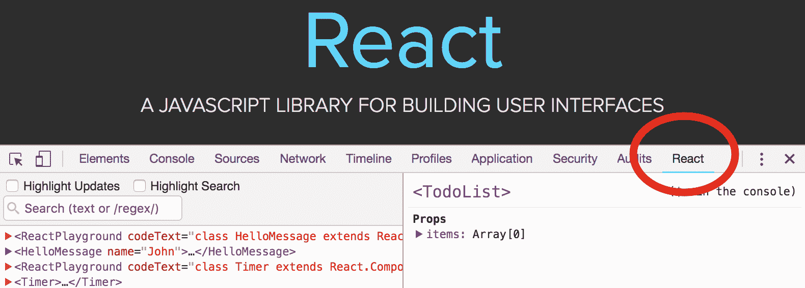

选择此标签，并在树中寻找你的组件。你可以使用搜索框找到它，而无需逐层深入。当你点击一个组件时，它的 `Props` 和 `State` 将出现在侧边面板中。确保这些值与你的预期一致。你甚至可以直接在侧边面板中修改 `Props` 和 `State`，看到组件随着你的更改而重新渲染。试一下！

# Hello World

到此时，你已经安装了 `node`、`npm` 和 `create-react-app`。所有工具已就绪。让我们写些代码吧！

### Step 1

使用 `create-react-app` 命令生成一个新项目。它将创建一个目录并安装所有必要的包，然后我们进入该新目录。

```
$ create-react-app react-hello
$ cd react-hello
```

生成的项目包含一些我们现在不需要的文件，所以我们将删除它们。你也可以直接忽略它们。

```
$ rm src/App.* src/index.css src/logo.svg
```

### Step 2

打开 `src/index.js` 文件。删除所有内容，并输入以下代码：

> **手打一遍？像个野蛮人一样？** 手动输入比简单的复制粘贴更能让它刻在你的脑子里。你正在形成新的神经元通路。这些通路有一天会理解 React 的。帮帮它们。

```
import React from 'react';
import ReactDOM from 'react-dom';

function HelloWorld() {
  return (
    <div>Hello World!</div>
  );
}

ReactDOM.render(
  <HelloWorld/>,
  document.querySelector('#root'));
```

顶部的 `import` 语句是 ES6 特性。这些行将出现在书中看到的每一个 `index.js` 文件的顶部。

与 ES5 不同，我们不能简单地包含 `<script>` 标签并获取全局对象 `React`。因此，`import React from 'react'` 语句创建了一个名为 `React` 的新变量，其内容为 `react` 模块。

字符串 ‘react’ 和 ‘react-dom’ 是重要的：它们对应于 `npm` 安装的模块名称。如果你熟悉 Node.js，`import React from 'react'` 等同于 `var React = require('react')`。

### 第 3 

在 `react-hello` 目录内部，运行以下命令启动应用：

```bash
$ npm start
```

浏览器会自动打开并显示“Hello World!”

### 代码是如何运行的

让我们从底部开始，从 `ReactDOM.render` 的调用开始。这才是让程序运行起来的关键。尽管代码中有一个看起来像 HTML 的 `<HelloWorld/>`，但这段代码是普通的 JavaScript。尝试注释掉那行，观察 Hello World 是消失的。

React 使用了 `virtual DOM` 的概念。它创建了你的组件层级的表示，然后通过创建真实的 DOM 元素并插入到你指定的地方来`渲染`（renders）这些组件。在这种情况下，是在 id 为 `root` 的元素内部。

`ReactDOM.render` 接收 2 个参数：你想渲染的内容（你的组件或任何其他 React 元素）以及你想将其渲染到哪里（一个真实的 DOM 元素）。

```
ReactDOM.render([React Element], [DOM element]);
```

在上面，我们有一个名为 `HelloWorld` 的`component`。编写 React 组件的主要方法是像这样编写纯函数。它们通常被称为“无状态函数组件”。

还有 2 种创建组件的方法：ES6 类以及现在已废弃的 `React.createClass`。你可能仍然在旧的 Stack Overflow 回答或旧的 GitHub 项目中看到 `createClass`风格，因此我们将回顾它是如何工作的。但主要情况下，我们将尽可能编写函数，并在需要时使用 ES6 类。

`render` 函数内部的类 HTML 语法被称为 `JSX`，我们将接下来介绍它。

# JSX：是什么以及为什么


你可能注意到的关于 React 代码的第一点之一是，它看起来就像组件函数返回了 HTML。这种类 HTML 的语法实际上被称为 JSX。

## 什么是 JSX？

JSX 是为 React 发明的一种语法，看起来与 (X)HTML 非常相似。它允许你通过编写看起来熟悉的语法来创建元素，而不是手动编写函数调用。这种类 HTML 的语法实际上会编译为真实的 JavaScript，我们将在下文中讨论。

## JavaScript 里的 HTML？！

在我甚至认真研究 React 之前，我就知道它混合了 HTML 和 JS，我认为那简直是丑陋的。我的意思是，这在否定多年来的最佳实践思维，对吧？自从 jQuery 的暗黑暗时代以来，我们就知道在 JS 内部直接对元素设置`innerHTML`是黑客行为而且性能糟糕——更不用说到处是安全漏洞了——那么为什么 React 却在重犯同样的错误呢？

你有没有注意到“HTML”周围没有引号？那是因为`它不是一个字符串。`不加引号也不仅仅是一种技巧。React 并没有在解析那个东西并将其转换为 HTML。

我知道，我知道，它看起来像 HTML。但实际上，JSX 只是在创建 DOM 元素的函数调用之上的一种美妙的语法糖。

所以 React 在此处到底在做什么？它是如何运作的？以及为什么它并不糟糕？

### JSX 被编译为 JavaScript

你编写的 JSX 元素实际上由一个名为 Babel 的工具编译为 JavaScript。Babel 是一个“转译器”（transpiler），这是一个造词，意味着它将代码转换为所有浏览器都能理解的有效 ES5 JavaScript。每个 JSX 元素都变成一个函数调用，其参数是它的属性（“props”）和它的内容（“children”）。

这里有一些简单 JSX 的示例：

```jsx
return <span>Hello!</span>;
```

这里是编译器生成的 JavaScript：

```javascript
return React.createElement(
  'span',
  {},
  'Hello!'
);
```

`React.createElement`函数的签名如下：

```javascript
React.createElement(
  string|element,
  [propsObject],
  [children...]
);
```

`string|element`可以是一个描述 HTML 或 SVG 标签的字符串（如`'div'`或`'span'`），也可以是一个组件（如`HelloWorld`，不带引号）。

`propsObject`和`children`是可选的，你也可以通过传递额外的参数提供多个子元素：

```javascript
React.createElement(
  'div',
  {},
  'Hello',
  'World'
);
```

你也可以嵌套调用：

```javascript
React.createElement('div', {},
  React.createElement('div', {}, 'Child1'),
  React.createElement('div', {}, 'Child2',
    React.createElement('div', {}, 'Child2_child')
  )
);
```

自己尝试一下！重写`HelloWorld`组件以调用`React.createElement`而不是返回 JSX。

```javascript
function HelloWorld() {
  return (
    React.createElement(/* ... */)
  );
}
```

这是一段稍微复杂的 JSX：

```jsx
<span className='song-name'>
  {props.song.name}
</span>
```

这是它被编译后的结果：

```javascript
React.createElement('span',
  { className: 'song-name' },
  props.song.name
);
```

看到 JSX 本质上是编写函数调用的简便简写了吗？如果你不想，甚至不需要使用 JSX——你可以手动写出这些函数调用。

你的第一直觉可能是避免编写 JSX，因为你不喜欢“JS 中的 HTML”这种外观。也许你更愿意编写真正的 JavaScript 函数调用，因为这在某种程度上感觉更“纯粹”。我建议在放弃它之前诚实地尝试一下 JSX。

写出`React.createElement`调用并不是 React 社区的常用方法。几乎所有的 React 开发者都使用 JSX，这意味着你在野外看到的代码（在 GitHub、Stack Overflow 等上）很可能是用它编写的。

### 但是……关注点分离！

这是大多数新手最关心的问题：那种觉得将 JS 与 HTML 混合在一起就是错误的胃里不安的感觉。它甚至可能让你感到愤怒。

在我开始使用 React 之前，我有同样的顾虑。花了一些时间（并写了几个小应用），我才开始理解这种不不洁混合的力量。不过不用担心，因为书中的练习将提供你所需的所有练习来掌握它。

我相信，对混合 HTML 与 JS 的蔑视背后有一点点信术崇拜式的“传统”。这是每个新 Web 开发者的成年礼，是代代相传的关于构建 Web 界面“正确方式”的传说。“它一直都是这样做的。”

将视图与逻辑分离是有正当理由的。当它们结合时，代码可能会变成一团混乱的条件逻辑，并且到处都是重复的 HTML，就像写得糟糕的 PHP。

如果你对 PHP 或 JSP 有回忆，在那些地方，数据库调用与视图代码混合在一起，而你再也不想回到那个世界，我不怪你。React 使用组件进行构建的模式有助于防止这种情况。

### 未分离的关注点

当你退一步思考这个问题时，将逻辑和视图结合也有一些正当的理由。

如果你用过类似 Angular 的东西，你可能在一个文件中编写逻辑，在另一个单独模板文件中编写 HTML。

告诉我，你有多少次打开模板来微调某些东西，而不需要查看（或修改！）相关的 JS 代码？你有多少次修改了 JS 而不需要触碰模板？

在我处理过的大多数代码中，我我可以在不同时更改模板及其控制器的情况下添加新功能。在一个文件中添加一个函数，在另一个文件中调用它。传递一个额外的参数？得在两个文件中都修改它。

如果它们是真正分离的关注点，这就不需要了。

我们喜欢认为将 JS 和 HTML 分割到单独的文件会神奇地将它们变成“分离的关注点”。复用性，我们来了！

但情况很少是那样。JS 代码及其相关的模板通常是紧密耦合的，自然如此——它们是同一枚硬币的两面。

将代码拆分为单独的文件并不会自动导致关注点分离。

老旧的 jQuery 这种情况也是如此。HTML 完全不知道 JavaScript 的存在，但由于`jQuery`选择器必须了解页面结构的某些信息，因此 JS 和 HTML 之间在事实上是紧密耦合的。如果结构发生了变化，代码也必须随之更改。

如果你还没有注意到，我想证明的是：模板和视图逻辑实际上可以共存在同一个文件中，而且这样做实际上可能更有意义。

你现在不需要相信我。只需在学习示例和练习时，将这个想法留存在脑子里。你可能会发现（就像我一样），将逻辑和视图合并会让代码更容易导航、更容易编写且更容易调试。当所有相关功能都在一个地方时，你在不同文件之间跳回的时间就会更少。

# 使用 JSX

## 组合组件

JSX 像 HTML 一样，允许将元素嵌套在内部。这可能并不意外。

让我们重构之前的`HelloWorld`组件来演示组合是如何工作的。这里是原始的`HelloWorld`：

```jsx
function HelloWorld() {
  return (
    <div>Hello World!</div>
  );
}
```

暂时保持`HelloWorld`组件不变，创建两个新组件：一个命名为`Hello`，另一个命名为`World`。`Hello`应该渲染`<span>Hello</span>`，而`World`应该渲染`<span>World</span>`。你基本上可以复制`HelloWorld`组件并只需更改文本和函数名即可。

动手尝试自己做这个更改吧。我会等。

……

……

懂了吗？实际手打出这些内容并亲自尝试是非常重要的！不要只是一边点头一边阅读，因为那样你是无法真正学会的。看着代码并想“这都合理，是的”是非常容易的。在你尝试它之前，你永远不知道自己是否内化了它。

你的两个新组件看起来应该是这样：

```jsx
function Hello() {
  return <span>Hello</span>;
}

function World() {
  return <span>World</span>;
}
```

现在，更新`HelloWorld`组件以使用你刚刚创建的两个新组件。它看起来应该是这样：

```jsx
function HelloWorld() {
  return (
    <div>
      <Hello/> <World/>!
    </div>
  );
}
```

假设应用仍在运行，页面应该会自动刷新。如果没有，请手动刷新，并确保应用正在运行（如果未运行请运行`npm start`）。

你应该能看到和之前一样的“Hello World!”。我知道这看起来很简单，但我保证，这里有一些教训。

## 用括号包裹 JSX

接下来的示例依赖于你应该已经过的`Hello`和`World`组件，所以在此继续之前请确保它们存在。

首先是一个关于格式的说明。你可能会注意到我将返回的 JSX 包裹在了括号`()`中。这并不是严格必须的，但如果你省略括号，起始标签必须与`return`语句在同一行，这看起来有点很奇怪：

```jsx
function HelloWorld() {
  return <div>
    <Hello/> <World/>!
  </div>;
}
```

为了好玩，尝试移除括号并观察发生了什么：

```jsx
function HelloWorld() {
  return
    <div>
      <Hello/> <World/>!
    </div>;
}
```

这将在浏览器控制台中报错并失败：

> `HelloWorld(…): A valid React element (or null) must be returned. You may have returned undefined, an array or some other invalid object.`

你可能还会看到一个关于“不可达代码（Unreachable code）”的警告。

这是因为 JavaScript 假设你在`return`之后想要一个分号（因为了换行），这实际上将其变成了这样，它返回了 undefined：

```javascript
function HelloWorld() {
  return;
    <div>
      <Hello/> <World/>!
    </div>;
}
```

所以：你可以按照你喜欢的方式格式化 JSX，但如果它是多行的，我建议将其包裹在括号中。

### 返回单个元素

注意在`HelloWorld`示例中，两个组件是如何包裹在一个`<div>`中的：

```jsx
function HelloWorld() {
  return (
    <div>
      <Hello/> <World/>!
    </div>
  );
}
```

这是一个小练习：尝试移除`<div>`包装并看看发生了什么。你应该得到这个错误：

> `Adjacent JSX elements must be wrapped in an enclosing tag`

如果这看起来很奇怪，请记住 JSX 在运行之前会被编译为 JS：

```javascript
// 这个 JSX:
return (<Hello/> <World/>);

// 变成这个 JS:
return (
  React.createElement(Hello, null) React.createElement(World, null)
);
```

一次返回两个东西是没有意义的。所以这引出了这条非常重要的规则：

> 组件函数必须返回单个元素。

但等一下！你可以返回一个数组吗？毕竟这终是 JavaScript……

```javascript
// 这个 JSX:
return [<Hello/>, <World/>];

// 会变成这个 JS
// （注意括号）。
// 它看起来是合法的...
return [
  React.createElement(Hello, null),
  React.createElement(World, null)
];
```

尝试一下！它应该会失败。在开发控制台中，你会看到：

> `HelloWorld(…): A valid React element (or null) must be returned. You may have returned undefined, an array or some other invalid object.`

所以目前规则仍然有效：你必须返回单个元素。这个规则预计在 React 16 发布时会改变。

### JSX 中的 JavaScript

你可以在 JSX 代码中插入真实的 JavaScript 表达式，事实上，你经常会这样做。使用像这样的单大括号`{}`包裹 JavaScript：

```jsx
function SubmitButton() {
  var buttonLabel = "Submit";
  return (
    <button>{buttonLabel}</button>
  );
}
```

记住，这将被编译为 JavaScript，这意味着大括号内的 JS 必须是一个表达式（expression）。表达式产生值。这些是表达式：

```javascript
1 + 2
buttonLabel
aFunctionCall()
aFunctionName
```

每一个都会产生（即返回）一个单一的值。相比之下，语句（statements）不产生值且不能用在 JSX 中。这里是一些语句的示例：

```javascript
var a = 5
if(true) { 17; }
while(i < 7) { i++ }
```

这些内容没有一个产生值。`var a = 5`声明了一个值为 5 的变量，但并没有返回该值。

思考语句与表达式的另一种方法是：表达式可以位于赋值的右侧，但语句不能。

```javascript
// 这些不是合法的 JS:
a = var b = 5;
a = if(true) { 17; }
```

我反复强调这一点是因为它很重要，而且是 React 初学者常见的陷阱。

## JSX 中的“if”

你可能可能会下一个问题是，“如果我不能使用‘if’，我该如何写条件判断？”有两个选项。

第一个是三元运算符（`?`）。像这样使用它：

```jsx
function ValidIndicator() {
  var isValid = true;
  return (
    <span>{isValid ? 'valid' : 'not valid'}</span>
  );
}
```

你也可以像这样使用布尔运算符，例如`&&`：

```jsx
function ValidIndicator() {
  var isValid = true;
  return (
    <span>
      {isValid && 'valid'}
      {!isValid && 'not valid'}
    </span>
  );
}
```

### JSX 中的注释

如果你需要向 JSX 块中添加注释，语法看起来可能会有点奇怪。记住，JavaScript 需要放在单大括号内。JSX 中的注释必须像这样放在 JavaScript 块中：

```jsx
function ValidIndicator() {
  var isValid = true;
  return (
    <span>
      {/* 这里是一条注释 */}
      {isValid && 'valid'}
      {!isValid && 'not valid'}
      {
        // 双斜线注释在
        // 多行块中是允许的。
      }
    </span>
  );
}
```

### 组件名称大写

你编写组件必须以大写字母开头。这意味着要使用像`UserList`、`Menu`和`SubmitButton`这样的名称，而不是`userList`、`menu`和`submitButton`。

在 JSX 中，以小写字母开头的组件被认为是内置的 HTML 或 SVG 元素（如`div`、`ul`、`rect`等）。

早期版本的 React 维护了一个所有内置元素名称的“名单”，以便将它们与自定义区分开来。维护这个名单既耗时又容易出错——如果一个新的 SVG 元素进入了规范，在 React 更新该列表之前，你无法使用它。因此，他们删除了列表，并添加了这条规则。

### 关闭每个元素

JSX 要求每个元素都必须关闭，类似于 XML 或 XHTML。这包括你可能习惯在 HTML5 中保持不关闭的元素，如`<br>`或`<input>`甚至是`<li>`。

```jsx
// 应该这样做：
return <br/>;
return <input type='password' .../>;
return <li>text</li>;

// 不要这样做：
return <br>;
return <input type='password' ...>;
return <li>text;
```

### 练习

运行以下命令为这些练习创建一个新应用：


```bash
$ create-react-app jsx-exercises
```

打开 `src/index.js` 文件并替换内容，类似于 Hello World 示例。完成剩余部分工作。

```javascript
import React from 'react';
import ReactDOM from 'react-dom';

function MyThing() {
  // ...
}

ReactDOM.render(
  <MyThing/>,
  document.getElementById('root')
);
```

你可以删除或忽略 `src/App*` 文件和图标。如果你没有显式 `import` 它们，它们就不会构建到你的应用中。

## 练习

### 1. 创建渲染 JSX 的组件

```jsx
<div className='book'>
  <div className='title'>
    The Title
  </div>
  <div className='author'>
    The Author
  </div>
  <ul className='stats'>
    <li className='rating'>
      5 stars
    </li>
    <li className='isbn'>
      12-345678-910
    </li>
  </ul>
</div>
```

### 2. 观察 JSX 如何解释空白

尝试渲染这些布局（将 `.` 替换为空格字符）并注意输出。

提示：开头和结尾的空格会被移除，换行符也是如此。

#### 单行

```jsx
<div>
Newline
Test
</div>
```

#### 空换行

```jsx
<div>
Empty

Newlines

Here
</div>
```

#### 带有换行符的空格

```jsx
<div>
&nbsp;Non-breaking
&nbsp;Spaces&nbsp;
</div>
```

#### 当内容跨越多行时插入空格

```jsx
<div>
Line1
{' '}
Line2
</div>
```

### 3. 使用 `React.createElement`

复制练习 1 中的组件，并将 JSX 替换为对 `React.createElement` 的调用。输出应该是相同的。

### 4. 根据 `username` 返回相应的 JSX

从此组件返回相应的 JSX，以便当 `username` 为 `undefined` 或 `null` 时，渲染“Not logged in”。当 `username` 是字符串时，渲染“Hello, username”。

```javascript
function Greeting() {
  // 尝试所有这些变体：
  //var username = "root";
  //var username = undefined;
  //var username = null;
  //var username = false;
}
```

（注：提供的文本在练习结束处突然中断；上面的格式反映了所提供输入的结构。）


```css
.time {
  padding-left: 0.3em;
  color: #8899a6;
}

.time::before {
  content: "\00b7";
  padding-right: 0.3em;
}

.buttons {
  margin-top: 10px;
  margin-left: 2px;
  font-size: 1.4em;
  color: #aab8c2;
}

.buttons i {
  width: 80px;
}
```

这里我们有一条看起来相当不错的推文了！


你可以随心意愿对其进行定制：更改名称、句柄、消息，甚至是 Gravatar 图标。很酷，对吧？

“但是……等一下，”我听到你在说。“我以为我们我们要。”

你可以将`{ name }`理解为“从作为第一个参数传递的对象中提取 ‘name’ 键”。它也可以提取多个键：

```javascript
const Hello = ({ firstName, lastName }) => (
  <span>Hello, {firstName} {lastName}</span>
);
```

在实践中，props 经常使用这种解构语法来编写。需要你了解一下，它在函数参数之外也有效。例如，你可以用这种方式解构 props：

```javascript
const Hello = (props) => {
  const { name } = props;
  return (
    <span>Hello, {name}</span>
  );
}
```

记住，如果箭头函数的体用大括号包围，则需要`return`；如果函数体包含多行，则需要大括号。

### 修改 Props

需要知道的一个重要点是 props 是`只读的`。接收 props 的组件不能修改它们。

如果你来自 Angular 背景，这是一个变化。Angular 的双向绑定机制允许修改作用域变量（Angular 版本的 props），并并将这些更改传播到父组件。

在 React 中，数据流是`单向的`。Props 是只读的，且只能`向下`传递给子组件。

### 与父组件通信

如果你不能更改 props，但需要向父组件传递某些信息，该如何操作？

如果子组件需要向父组件发送数据，父组件可以注入一个`function`作为 prop，如下：

```javascript
function handleAction(event) {
  console.log('Child did:', event);
}

function Parent() {
  return (
    <Child onAction={handleAction}/>
  );
}
```

`Child`组件接收一个名为`onAction`的 prop，它可以在需要发送数据或通知父组件事件时随时调用它。你会注意到内置的`button`元素接受一个`onClick` prop，它会在按钮被点击时调用。我们稍后会深入探讨事件处理。

```javascript
function Child({ onAction }) {
  return (
    <button onClick={onAction}/>
  );
}
```

## 示例：带 Props 的 Tweet

现在你已经对 props 有了基本的了解，让我们来看看它们在实践中是如何运作的。

我们将取第 5 章中的静态`Tweet`示例并对其进行重构，通过使用 props 显示动态数据。

对于这个示例，请复制`static-tweet`项目文件夹，这样我们就可以在不用破坏旧代码的情况下工作。我们还将启动一个开发服务器（如果它仍在运行，请停止它）。

```bash
$ cp -a static-tweet props-tweet && cd props-tweet
$ npm start
```

注意：不要使用`cp -r`，因为它不会保留符号链接，并且会破坏`npm start`。

如果在复制项目后`npm start`命令失败了，请删除`node_modules`文件夹并运行`npm install`。然后再次尝试`npm start`。

打开`src/index.js`。首先，更新`Tweet`组件以如下所示接受一个`tweet` prop。然后添加`testTweet`对象作为我们的假数据，并更新`ReactDOM.render`的调用，将`testTweet`对象传递给`tweet` prop。

在做出这些更改后刷新页面，并确保一切看起来和以前一样（目前应该还没有变化）。

```javascript
// add the { tweet } destructuring
function Tweet({ tweet }) {
  return (
    <div className="tweet">
      <Avatar/>
      <div className="content">
        <NameWithHandle/><Time/>
        <Message/>
        <div className="buttons">
          <ReplyButton/>
          <RetweetButton/>
          <LikeButton/>
          <MoreOptionsButton/>
        </div>
      </div>
    </div>
  );
}

// ...

var testTweet = {
  message: "Something about cats.",
  gravatar: "xyz",
  author: {
    handle: "catperson",
    name: "IAMA Cat Person"
  },
  likes: 2,
  retweets: 0,
  timestamp: "2016-07-30 21:24:37"
};
ReactDOM.render(<Tweet tweet={testTweet}/>,
  document.querySelector('#root'));
```

### Avatar

让我们开始将静态组件转换为接受 props，从`Avatar`开始。在`Tweet`的渲染方法中，替换这一行：

```javascript
<Avatar/>
```

替换为这一行：

```javascript
<Avatar hash={tweet.gravatar}/>
```

这将 tweet 的`gravatar`属性传递给`hash` prop。现在更新`Avatar`以使用这个新 prop：

```javascript
function Avatar({ hash }) {
  var url = `https://www.gravatar.com/avatar/${hash}`;
  return (
    
  );
}
```

使用 ES6 解构作为`hash`传入的 Gravatar hash 被整合到 URL 中并作为`hash`传递给图像标签。

### Message

现在我们处理`Message`。在`Tweet`中替换这一行：

```javascript
<Message/>
```

替换为这一行：

```javascript
<Message text={tweet.message}/>
```

我们从 tweet 中提取了`message`并将其传递给`Message`组件。然后更新`Message`组件以使用`text`：

```javascript
function Message({ text }) {
  return (
    <div className="message">
      {text}
    </div>
  );
}
```

### NameWithHandle and Time

这次我们将同时转换两个组件：`NameWithHandle`和`Time`。通过替换此行更新`Tweet`以传递相关数据：

```javascript
<NameWithHandle/><Time/>
```

替换为这些行：

```javascript
<NameWithHandle author={tweet.author}/>
<Time time={tweet.timestamp}/>
```

我们还将引入一个名为 Moment 的库。我们将使用它来计算相对时间（“3 天前”）。运行此命令安装：

```bash
npm install moment --save
```

我们需要在`index.js`顶部导入 Moment，因此在顶部添加此行：

```javascript
import moment from 'moment';
```

现在更新`NameWithHandle`和`Time`组件。你会注意到`Time`使用了新的`moment`库。

```javascript
function NameWithHandle({ author }) {
  const { name, handle } = author;
  return (
    <span className="name-with-handle">
      <span className="name">{name}</span>
      <span className="handle">@{handle}</span>
    </span>
  );
}

const Time = ({ time }) => {
  const timeString = moment(time).fromNow();
  return (
    <span className="time">
      {timeString}
    </span>
  );
};
```

在静态推文的示例中，`Time`被写为一个箭头函数，所以我保留了它的写法。然而，因为现在它包含 2 条语句，它需要外层的大括号，这导致它需要一个`return`。当然，你可以通过将`moment(time).fromNow()`直接移动到`<span >`内部来简化，这样你就可以移除`return`和大括号。这交由你决定。

## 应该传递什么作为 Prop？

Props 可以接受各种类型：数字、布尔值、字符串、对象，甚至是函数。在早期阶段，你可能会想，是应该传递一个对象并让组件提取它需要的内容？还是应该传递组件所需的特定数据片段？

在这里的示例中，我们传递的是特定的数据片段。

我们也可以直接传递`tweet`对象本身。例如，与其直接向`Time`组件传递时间戳，我们不如传递`tweet`并让它从推文中提取时间戳。为什么不那样做呢？这里有几点原因：

- 如果`Time`期望一个推文对象并提取出`timestamp`属性，那么它除了推文对象以外的任何地方都无法使用。如果你有一个具有名为“updated_at”时间戳属性的用户，并想用`Time`组件渲染它怎么办？嗯，你做不到，除非你临时凑出一个“看起来像”带有时间戳的推文临时对象。

- `Time`组件将了解`tweet`对象的内部结构。这看起来可能不是什么大问题，直到你有 10 个这样的组件，而后端人员决定大写字母“S”的“timeStamp”比小写的“timestamp”看起来更好，现在你必须得更新所有这些组件。将数据结构的知识保持在尽可能少的地方，是一个好主意，这样可以降低更改成本。

## Props 命名指南

俗话说：“计算机科学中有两件极其困难的事：缓存失效、命名以及差一错误（off-by-one errors）。”

你为 props 选择的名字将影响组件的使用方式，以及组件之间的耦合方式。想象一下，如果我们编写`Time`来接收一个名为`tweetTime`的 prop。即使我们直接传递了时间戳（而不是整个推文对象），这作为 prop 名称仍然不是一个好的选择。为什么呢？

考虑一下当下一个开发者（可能是 3 周后的你）出现，并想在应用程序中与推文无关的新部分复用`Time`组件会发生什么。渲染结果会正常，但代码会很别扭。如果时间戳实际上并不属于某个推文，编写`<Time tweetTime={timestamp}/>`就表达了错误的意图。

更有可能的是，开发者会查看`Time`，看到它期望`tweetTime`，然后决定不复用该组件——要么是因为他们假设它不适用于他们的目的，要么是因为他们担心底层实现可能会改变并破坏他们的代码。

### 剩余的组件

让我们回到将`Tweet`及其子组件转换为使用 props。只剩下两个组件了：`RetweetButton`和`LikeButton`，它们需要显示转发和点赞的数量。目前，它们完全没有显示任何数字，只有一个图标。

修改这两行：

```jsx
<RetweetButton/>
<LikeButton/>
```

修改为这些行（传递计数值）：

```jsx
<RetweetButton count={tweet.retweets}/>
<LikeButton count={tweet.likes}/>
```

然后，更新`RetweetButton`和`LikeButton`以接受新的`count` prop 并渲染它们各自的数字：

```jsx
function getRetweetCount(count) {
  if(count > 0) {
    return (
      <span className="retweet-count">
        {count}
      </span>
    );
  } else {
    return null;
  }
}

const RetweetButton = ({ count }) => (
  <span className="retweet-button">
    <i className="fa fa-retweet"/>
    {getRetweetCount(count)}
  </span>
);
```

```jsx
const LikeButton = ({ count }) => (
  <span className="like-button">
    <i className="fa fa-heart"/>
    {count > 0 &&
      <span className="like-count">
        {count}
      </span>}
  </span>
);
```

最后，样式也需要更新。移除这些行：

```css
.buttons i {
  width: 80px;
}
```

然后用这些替换掉它们：

```css
.reply-button, .retweet-button,
.like-button, .more-options-button {
  width: 80px;
  display: inline-block;
}

.like-count, .retweet-count {
  position: relative;
  bottom: 2px;
  font-size: 13px;
  margin-left: 6px;
  font-weight: bold;
}
```

搞定！


让我们过一遍代码。尽管看起来不同，这些组件确定如何显示计数的逻辑是相同的。


### RetweetButton

在`RetweetButton`中，计算被提取到一个名为`getRetweetCount`的独立函数中。它要么返回一个`<span>`元素要么返回`null`。

注意，我们需要在图标和计数周围引入一个包裹的`span`元素。记住，React组件只能返回单个元素（尝试移除`span`看看会发生什么）。

还要注意，当JSX中单大括号内的表达式求值结果`null`或`false`时，什么都不会被渲染。为了证明这一点，打开Chrome的开发者工具元素检查器，并检查点赞数为0的转发按钮：不应该看到任何“like-count”`span`。

值得注意的是，`getRetweetCount`函数可以写成一个组件——它几乎已经是一个组件了。它可能像这样：

```jsx
function Count({ count }) {
  if(count > 0) {
    return (
      <span className="retweet-count">
        {count}
      </span>
    );
  } else {
    return null;
  }
}

const RetweetButton = ({ count }) => (
  <span className="retweet-button">
    <i className="fa fa-retweet"/>
    <Count count={count} />
  </span>
);
```

函数必须重命名为以大写字母开头（记住组件名称必须大写字母开头），并且它的参数需要替换为解构赋值以提取`count`。否则它看起来是一样的。那么在`RetweetButton`中使用它只是插入一些JSX的问题。

### LikeButton

对于`LikeButton`，逻辑处理稍有不同。不是将逻辑提取到函数中，而是通过布尔运算符（`&&`）内联完成。但同样，它渲染一个`span`或`null`。

### 另一种选择

这里有第三种选择，纯属好玩，它的微小不同在于它总是输出一个类名为“like-count”的`<span>`，但内容可以是空的：

```jsx
const LikeButton = ({ count }) => (
  <span className="like-button">
    <i className="fa fa-heart"/>
    <span className="like-count">
      {count ? count : null}
    </span>
  </span>
);
```

如你所见，使用JSX有多种方法可以实现相同的功能。

## PropTypes

### 文档与调试合为一

我们已经看到了“props”是什么，以及它们是如何传递给React组件的——但如果你忘记传递其中一个prop会发生什么？

结果，它将是`undefined`（未定义），这就像你忘记给一个普通的函数传递参数一样。这可能完全没问题，也可能导致代码崩溃的灾难（就像你忘记给一个普通的函数传递参数一样）。

不过，React拥有一个秘密武器：`PropTypes`。

当你创建一个组件时，你可以声明某些props是可选的或必须的，*并且*你还可以声明该prop期望的类型。这里有一个示例：

```javascript
import PropTypes from 'prop-types';

function Comment({ author, message, likes }) {
  return (
    <div>
      <div className='author'>{author}</div>
      <div className='message'>{message}</div>
      <div className='likes'>
        {likes > 0 ? likes : 'No'} likes
      </div>
    </div>
  );
}
Comment.propTypes = {
  message: PropTypes.string.isRequired,
  author: PropTypes.string.isRequired,
  likes: PropTypes.number
}
```

首先，注意到`PropTypes`必须从`prop-types`包中显式导入。这是React 15.5引入的更改。如果你在使用Create React App，你应该已经安装了这个包，但如果没有，快速运行`npm install --save prop-types`即可修复。

接下来，注意到`propTypes`被设置为函数本身的一个属性。这种写法无论组件是函数、箭头函数，甚至是ES6类（我们稍后会看到）都有效。

最后，注意到`propTypes`属性以小写“p”开头，而导入的`PropTypes`以大写字母“P”开头。

通过这组propTypes，`message`和`author`是必须的，且必须是字符串。`likes`prop是可选的，但如果提供了，它必须必须是一个数字。尝试用几种不同的方式渲染它，并每次都检查控制台：

```javascript
<Comment author='somebody' message='a likable message' likes={1}/>
<Comment author='mr_unpopular' message='unlikable message'/>
<Comment author='mr_unpopular' message='another message' likes={0}/>
<Comment author='error_missing_message'/>
<Comment message='mystery author'/>
```

如果你忘记了必的prop，React会在控制台中向你发出警告：

```javascript
<Comment author='an_error'/>
```

> Warning: Failed propType: Required prop `message` was not specified in `Comment`.

同样，如果你传递了错误的类型，也会得到警告：

```javascript
<Comment author={42}/>
```

> Warning: Failed propType: Invalid prop `author` of type `number` supplied to `Comment`, expected `string`.

这些警告信息对于调试来说是无价之宝。它告诉你犯了什么错误，*并且*给出了查找的提示！这比某些在你忘记必填属性时静默失败的框架要好得多。

### 陷阱

那么：陷阱在哪里？所有这些良好的错误处理应该有一个陷阱对吧？

嗯，某种程度上。PropTypes的唯一陷阱在于*你必须记得声明它们*。提供propTypes是可选的，如果你没有为其中一个组件指定propTypes，React不会给你任何警告。

你可以发誓对编写这些propTypes变得超级勤奋，或者让一个*linter*（代码检查器）工具来帮你检查。我推荐后者。

ESLint是一个流行的选择，并且有一个用于ESLint的React插件，它可以检查缺失的PropTypes以及props是否传递正确等问题。

### 我如何验证你，让我来数数方法

React的propTypes允许你表达许多不同的验证。默认情况下，propType验证是*可选的*。如果你想让它变为必选，在末尾添加`.required`。

首先，有标准JavaScript类型的验证器：

* `PropTypes.array`
* `PropTypes.bool`
* `PropTypes.func`
* `PropTypes.number`
* `PropTypes.object`
* `PropTypes.string`

你之前在`Comment`组件中看到了`string`和`number`验证器。其他的工作原理相同——验证传入的是数组、布尔值、函数或或其他任何内容。

还有用于`node`和`element`的验证器。`node`是任何可以被渲染的内容，意味着数字、字符串、元素或这些内容的数组。`element`是通过JSX或调用`React.createElement`创建的React元素：

* `PropTypes.node`
* `PropTypes.element`

有一个`instanceOf`验证器，用于检查prop是否是特定类的实例。它接受一个参数：

* `PropTypes.instanceOf(SpecificClass)`

你可以使用`oneOf`限制为特定值：

* `PropTypes.oneOf(['person', 'place', 1234])`

你可以验证prop是否是几种类型之一：

```javascript
PropTypes.oneOfType([
  PropTypes.string,
  PropTypes.boolean
])
```

你可以验证它是否是特定类型的数组，或者是一个其属性为特定类型值的对象：

* `PropTypes.arrayOf(PropTypes.string)`
  * 会匹配：`['a', 'b', 'c']`
  * 不匹配：`['a', 'b', 42]`
* `PropTypes.objectOf(PropTypes.number)`
  * 会匹配：`{age: 27, birthMonth: 9}`
  * 不匹配：`{age: 27, name: 'Joe'}`

你可以验证一个对象是否具有特定的*形状*（shape），意味着它具有特定的属性。传递给此prop的对象允许拥有*额外*属性，但它至少必须包含形状描述中的那些属性。

```javascript
PropTypes.shape({
  name: PropTypes.string,
  age: PropTypes.number
})
```

这将匹配一个形状完全相同的对象，如下：

```javascript
person = {
  name: 'Joe',
  age: 27
}
```

它也会匹配具有额外属性的对象，如下：

```javascript
person = {
  name: 'Joe',
  age: 27,
  address: '123 Fake St',
  validPerson: false
}
```

这个PropTypes `shape`要求`name`和`age`键，所以如果我们遗漏了其中一个，它将无法通过。这会生成一个警告：

```javascript
person = {
  age: 27
}
```

同样，如果我们为这些键之一传递了错误的类型，我们将得到警告：

```javascript
person = {
  name: false,  // 布尔值而非字符串
  age: 27
}
```

### 必选Props

任何PropType验证都可以通过在末尾添加`.required`变为必选。这些都是必选的：

```javascript
PropTypes.bool.isRequired
PropTypes.oneOf(['person', 'place', 1234]).isRequired
PropTypes.shape({
  name: PropTypes.string,
  age: PropTypes.number
}).isRequired
```

记住，所有的PropTypes默认都是*可选的*，这意味着如果你忘记传递值或在prop名称中出现拼写错误，将不会获得控制台警告。在大多数情况下，你可能希望在你的PropType验证后附加`.required`。

### 自定义验证器

如果内置的PropType验证器表达力不够，你可以编写自己的！该函数应该接收`props`、`propName`和`componentName`，并在验证失败时返回一个`Error`。注意是*返回*一个Error，而不是*抛出*一个Error。

一个用于检查传递的prop长度恰好为3（字符串或数组）的自定义验证器看起来如下：

```javascript
function customValidator(props, propName, componentName) {
  // here, propName === "myCustomProp"
  if (props[propName].length !== 3) {
    return new Error(
      'Invalid prop `' + propName + '` supplied to' +
      ' `' + componentName + '`. Length is not 3.'
    );
  }
}

const CustomTest = ({ myCustomProp }) => (
  <span>{myCustomProp}</span>
);
CustomTest.propTypes = {
  myCustomProp: customValidator
}

// This will produce a warning:
ReactDOM.render(
  <CustomTest myCustomProp='not_three_letters'/>,
  document.getElementById('root')
);

// This will work:
ReactDOM.render(
  <CustomTest myCustomProp={[1, 2, 3]}/>,
  document.getElementById('root')
);

// This will also work:
ReactDOM.render(
  <CustomTest myCustomProp="abc"/>,
  document.getElementById('root')
);
```

### 示例：带有PropTypes的推文

最后一次，让我们回到推文示例，看看PropTypes是如何应用到一组真实的组件的。

回想一下，结构如下：

- `Tweet`
  - `Avatar`
  - `NameWithHandle`
  - `Time`
  - `Message`
  - `ReplyButton`
  - `RetweetButton`
  - `LikeButton`
  - `MoreOptionsButton`

而它看起来应该是这样的：


从下往上，为这些组件添加PropTypes。复制一份之前的`props-tweet`代码，这样我们就可以放心地修改它了：

```bash
$ cp -a props-tweet proptypes-tweet && cd proptypes-tweet
$ npm start
```

按钮是一个很好的开始点。`MoreOptionsButton`完全不接收props，所以我们不需要更改它。

`LikeButton`可以可选地接收一个`count`prop，因此我们为它添加一个PropType：

```javascript
const LikeButton = ({ count }) => (
  <span className="like-button">
    <i className="fa fa-heart"/>
    {count > 0 &&
      <span className="like-count">
        {count}
      </span>}
  </span>
);

LikeButton.propTypes = {
  count: PropTypes.number
};
```

要验证它是否有效，进入`Tweet`组件，并尝试向`LikeButton`传递字符串而不是数字：

```javascript
// 将此内容：
<LikeButton count={tweet.likes}/>

// 替换为：
<LikeButton count='foo'/>
```

如果你现在刷新（或等待浏览器自动刷新），你应该会在开发者控制台中看到类似这样的警告：

> Warning: Failed propType: Invalid prop `count` of type `string` supplied to `LikeButton`, expected `number`. Check the render method of `Tweet`.

很好！一切运行正常。

将该行代码改回原来的样子，并为`RetweetButton`添加一个`count`PropType。按钮是一个很好的开始点。`MoreOptionsButton`完全不接收props，所以我们不需要更改它。

`LikeButton`可以可选地接收一个`count`prop，因此我们为它添加一个PropType：

要验证它是否有效，进入`Tweet`组件，并尝试向`LikeButton`传递字符串而不是数字：

如果你现在刷新（或等待浏览器自动刷新），你应该会在开发者控制台中看到类似这样的警告：

> Warning: Failed propType: Invalid prop `count` of type `string` supplied to `LikeButton`, expected `number`. Check the render method of `Tweet`.

很好！一切运行正常。


将该行代码改回原来的样子，并为 `RetweetButton` 添加一个 `count` PropType。按钮是一个很好的开始点。`MoreOptionsButton` 完全不接收 props，所以我们不需要更改它。（注：提供的源文本包含一些重复片段；我已经精简了核心逻辑流。）

## 你应该写得多显式？

当对象很简单时，写出 `shape` 是很容易证明的。当对象更复杂时，你可能会开始怀疑这是否值得。答案取决于你的情况。

## 作为文档的 PropTypes

关于 `PropTypes` 最后一点：除了有助于调试之外，它们还充当了良好的文档。当你几天、一周或一个月后回到一个组件时，`PropTypes` 将充当类似于“README”的角色。你不需要扫描代码来解码哪些 `props` 是必须的。

## 练习

谁说你必须按照 Web 接口来建模组件？现实世界的对象也是很好的练习。你将在下面构建其中一些：

1. 创建一个 `AddressLabel` 组件，它接收一个 `person` 对象作为 `prop`，并如下所示他们的姓名和地址：

```text
Full Name
123 Fake St.
Boston, MA 02118
```

2. 创建一个 `Envelope` 组件，它接收 `toPerson` 和 `fromPerson` 作为 `props`，并使用练习 1 中的 `AddressLabel` 来显示发件地址和收件地址。确保也包含一个 `Stamp`！

3. 根据此设计创建一个 `CreditCard` 组件。使用 CSS 或内联样式对其进行美化。接受一个 `cardInfo` prop，其中包含人的姓名、过期日期、信用卡号和银行名称。

4. 创建一个 `Poster` 组件，它接收 `image`、`title` 和 `text` 作为 `props`。渲染类似下面图片的内容。搜索“demotivational posters”（反励志海报）来获取灵感。

我们已经看到 JSX 如何像 HTML 一样表达嵌套组件。我们也看到自定义组件可以接受 `props` 作为参数，并使用这些 `props` 来渲染内容或将它们传递给子组件。

还有一个我们还没有讨论过的特殊 `prop`：它被称为 `children`。

假设你想创建一个可复用的 `IconButton` 组件，它看起来像这样：


你可能想象是这样使用它：

```jsx
<IconButton>Do The Thing</IconButton>
```

那个内部文本“Do The Thing”会发生什么呢？这正是 `children` prop 派上用场的地方。

你必须在组件的某个地方显式地渲染 `children`。如果不这样做，它们就会被忽略。例如，如果 `IconButton` 组件如下所示：

```jsx
function IconButton() {
  return (
    <button>
      <i class="target-icon"/>
    </button>
  );
}
```

渲染出来的组件将是一个带有图标的按钮，**没有任何文本**。它看起来像这样：


通过微小的调整，我们可以将文本放在图标之后：

```jsx
function IconButton({ children }) {
  return (
    <button>
      <i class="target-icon"/>
      {children}
    </button>
  );
}
```

## Children 的不同类型

无论只有一个子元素还是多个子元素，`children` prop 始终是复数形式 `children`。此外，`children` 的类型会根据它包含的内容改变。

当有多个子元素时，`children` 是一个 `ReactElements` 数组。

然而，当只有一个子元素时，它是一个 `single ReactElement`。这看起来可能有点奇怪：如果 `children` 始终是一个数组，处理起来不是更容易吗？

嗯，是的，如此。但由于 `children` 使用得非常频繁，且单子元素的使用场景足够常见，因此 React 团队决定在只有一个子元素时不分配数组，以优化性能。

## 处理 Children

React 提供了一些实用函数来处理这种不透明的数据结构。

- `React.Children.map(children, function)`
- `React.Children.forEach(children, function)`
- `React.Children.count(children)`
- `React.Children.only(children)`
- `React.Children.toArray(children)`

前两个 `map` 和 `forEach` 的工作方式与 JavaScript 内置 `Array` 上的方法相同。它们接受 `children`（无论是单个元素还是数组）以及一个会为每个元素调用的函数。`forEach` 遍历子元素但不返回任何内容，而 `map` 返回一个由你提供的函数返回的值组成的数组。

`count` 的作用非常言而易见：它返回 `children` 中项的数量。

`toArray` 同样直观：它将 `children` 转换为一个扁平数组，无论它原本是否为数组。

`only` 返回那个唯一的子元素，如果存在多一个子元素，则抛出异常。

你可以单独访问每个子元素，因此可以重新排序它们、删除某些元素、插入新元素、将子元素传递给更深层的子元素等等。

## 用于 Children 的 PropTypes

如果你想让你的组件接受零、一个或多个子元素，使用 `.node` 验证器：

```jsx
propTypes: {
  children: PropTypes.node
}
```

如果你想让它只接受单个子元素，使用 `element` 验证器：

```jsx
propTypes: {
  children: PropTypes.element
}
```

请注意，这期望一个单个 `React Element` 作为子元素。这意味着它必须是一个自定义组件，或者像 `<div>` 这样的标签。如果你传递字符串或数字，`PropTypes.element` 将发出警告。如果你需要允许元素或字符串，可以这样使用 `oneOfType` 验证器：

```jsx
propTypes: {
  children: PropTypes.oneOfType([
    PropTypes.element,
    PropTypes.string
  ])
}
```

与任何其他 `propType` 一样，除非附加了 `.isRequired`，否则它们都是可选的。

## 与 Angular 中的 Transclusion（插值）对比

如果你用过 Angular，你可能熟悉“transclusion”（插值）的概念，这是 Angular 使用的一个自造词，意思是“获取指令的子元素并将它们插入到 `ng-transclude` 所在的地方”。

React 的 `children` prop 是类似的概念，但更强大，而且稍微更容易理解。

## 一个更有趣的示例

在上面的示例中，我们简单地插入了一些文本。如果我们想做一些更有表现力的事情，比如创建我们自定义的组件层次结构呢？

想象我们为表达导航栏构建了某种自己的“API”：

```jsx
<Nav>
  <NavItem url='/'>Home</NavItem>
  <NavItem url='/about'>About</NavItem>
  <NavItem url='/contact'>Contact</NavItem>
</Nav>
```

使用 `children` prop，`Nav` 组件可以执行诸如在每个项目之间插入分隔符的操作：

```jsx
function Nav({ children }) {
  let items = React.Children.toArray(children);
  for(let i = items.length - 1; i >= 1; i--) {
    items.splice(i, 0, 
      <span key={i} className='separator'>|</span>
    );
  }
  return (
    <div>{items}</div>
  );
}
```

该代码将子元素转换为数组，然后从后向前遍历，在每个现有元素之间插入新元素。

你将在接下来的练习中实现 `NavItem`。它可以渲染一个简单的链接，或者链接旁边的图标，或者你喜欢的任何内容。

### 练习

现在你已经看到了 `children` prop 是如何工作的，这里有一些练习可以加深你的理解。

1. 创建一个组件来显示一个像这样的“错误框”：


调用该组件应该如下：

```jsx
<ErrorBox>
  Something has gone wrong
</ErrorBox>
```

使用 `children` prop 将文本正确放置。上面的图片使用了 [Bootstrap](http://getbootstrap.com/getting-started/#download-cdn) 进行样式处理，使用了 [Font Awesome](https://www.bootstrapcdn.com/fontawesome/) 用于图标。如果你喜欢，可以将这些库添加到你的 `public/index.html` 文件中。

2. 每个 React 组件都有一个 `type` 属性，这意味着你可以通过 `React.Children.forEach` 遍历来检查子元素的类型。

创建我们看过的 `Nav` 和 `NavItem` 组件。`NavItem` 应该接受 `url` prop 和链接文本作为子元素，然后渲染一个指向该 `url` 的锚点标签 `<a>`。

接下来，修改 `Nav` 组件以检查它的每个子元素是否都是 `NavItem`，如果发现其他类型的组件，则抛出异常。

作为测试，早期的示例代码应该正常工作：

```jsx
<Nav>
  <NavItem url='/'>Home</NavItem>
  <NavItem url='/about'>About</NavItem>
  <NavItem url='/contact'>Contact</NavItem>
</Nav>
```

而这段代码应该报错：

```jsx
<Nav>
  <NavItem url='/'>Home</NavItem>
  <NavItem url='/about'>About</NavItem>
  <a href='/contact'>Contact</a>
</Nav>
```

3. 创建一个 `Dialog` 组件，它接受 `Title`、`Body` 和 `Footer` 组件作为子元素，所有都是可选的。`Dialog` 应该验证它的子元素是否为这些类型之一，并输出类似这样的内容：

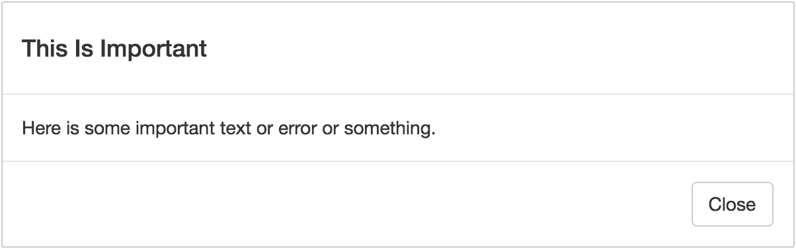

可以自由使用 Bootstrap 的模态样式，或者创建自己的样式。

# 示例：GitHub 文件列表

你现在已经掌握了一些组件。你已经学习了 `props` 和 `propTypes`，并编写了一些 JSX。

在我们进入状态和交互之前，我想通过一个包含我们目前为止所学的所有内容的示例来演示一遍。这里也将涵盖一些新的技巧。

考虑到这些，让我们创建一个新组件来还原 GitHub 的文件列表。这就是你在每个 GitHub 仓库顶部看到的内容：

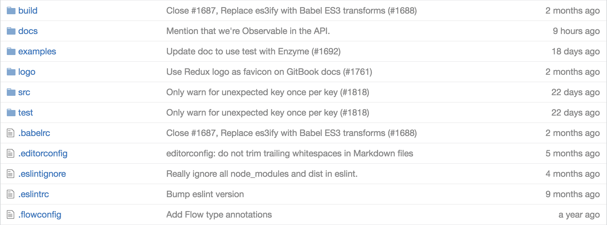

## 拆解组件

第一步是勾勒或高亮截图中的所有组件。基本上，我们在这里做的是在设计中的 `div` 元素周围画框。

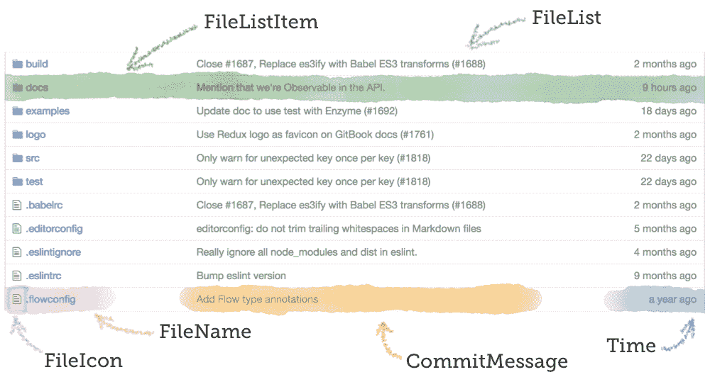

## 为组件命名

一旦你决定了哪些部分将成为组件，就给它们命名。对于上面的高亮部分，我设计了这些名称（缩进是为了显示父子关系）：

- `FileList`
- `FileListItem`
  - `FileName`
  - `FileIcon`
  - `CommitMessage`
  - `Time`

## 有什么是可以复用的吗？

查看整个组件列表，看看是否能在任何地方节省你的工作。

嘿，看！那个 `Time` 组件看起来和我们为 `Tweet` 写的那个非常相似。幸运的是，我们写的那个 `Time` 组件是通用的，它只接受时间而不是推文。我们可以在这里复用它。

## 每个组件需要什么数据？

接下来，让我们确定每个组件渲染所需的数据。这将为每个组件确定出 `props` 和 `propTypes`。

尝试在不看后文代码的情况下，想出每个组件的 `propTypes` 定义。

`FileList` 应该接收一个 prop，`files`，它是一个文件对象的数组。

`FileListItem` 将接收一个单一的文件对象作为 `file` prop。该对象应该包含一个名称、类型、一个带有消息的提交（commit）以及一个最后修改时间。

`FileName` 将接收一个 `file` 对象，并期望它有一个 `name` 属性。

`FileIcon` 将接收一个 `file` 对象，并使用它的 `type` 属性来决定显示哪种图标。

`CommitMessage` 将接收一个 `commit` 对象，该对象应该有一个 `message` 属性。

最后，`Time` 将接收一个绝对时间 `time` 字符串。我们将复用为 `Tweet` 制作的 `Time` 组件，包括它的 `propTypes`。

## 自顶向下还是自底而上？

对于这一个，我们将从顶部开始向下进行。

## 保持运行

在构建组件时，这是一个应该努力的目标：确保它始终可以运行！

你是否有过那样的经历：埋头写了很长时间代码，却从未运行过代码？不可避免地，当你第一次运行它时会出现某些问题。

这令人失望，并且会让你感到泄气。你最终不得不追踪大量的语法错误、逻辑错误以及任何其他问题，才能看到你的心血变为现实。

所以当你编写时，尝试进行小幅更改，并频繁刷新。确保代码始终运行正常。

## FileList

我们已经有了足够的方向来开始工作。按照我们之前做几次的方法创建一个新项目：

```bash
$ create-react-app github-file-list && cd github-file-list
$ rm src/App.* src/logo.svg
```

从 `tweet` 项目的 `public` 目录复制 `index.html` 文件。如果你愿意，可以更改 `<title>`，但除此之外，`index.html` 保持原样即可。

打开 `src/index.js`。

你还记得如何通过导入开始文件，以及如何使用 `ReactDOM` 设置初始渲染调用吗？尝试凭记忆完成。如果记忆模糊，请回看 `Tweet` 示例。

创建 `FileList` 组件。为了尽可能采用简单且运行的方法，我们将渲染一个纯的文件名的无序列表。一旦它运行通了，我们就把列表项提取到 `FileListItem` 组件中。


```javascript
[](#cb121-1)// 在此处放置导入
[](#cb121-2)
[](#cb121-3)const FileList = ({ files }) => (
[](#cb121-4)  <table className="file-list">
[](#cb121-5)    <<tbody>
[](#cb121-6)      {files.map(file => (
[](#cb121-7)        <tr className="file-list-item" key={file.id}>
[](#cb121-8)          <td className="file-name">{file.name}</td>
[](#cb121-9)        </tr>
[](#cb121-10)      ))}
[](#cb121-11)    </tbody>
[](#cb121-12)  </table>
[](#cb121-13));
[](#cb121-14)FileList.propTypes = {
[](#cb121-15)  files: PropTypes.array
[](#cb121-16)};
[](#cb121-17)
[](#cb121-18)const testFiles =
[  {
[](#cb121-20)    id: 1,
[](#cb121-21)    name: 'src',
[](#cb121-22)    type: 'folder',
[](#cb121-23)    updated_at: "2016-07-11 21:24:00",
[](#cb121-24)    latestCommit: {
[](#cb121-25)      message: 'Initial commit'
[](#cb121-26)    }
[](#cb121-27)  },
[](#cb121-28)  {
[](#cb121-29)    id: 2,
[](#cb121-30)    name: 'tests',
[](#cb121-31)    type: 'folder',
[](#cb121-32)    updated_at: "2016-07-11 21:24:00",
[](#cb121-33)    latestCommit: {
[](#cb121-34)      message: 'Initial commit'
[](#cb121-35)    }
[](#cb121-36)  },
[](#cb121-37)  {
[](#cb121-38)    id: 3,
[](#cb121-39)    name: 'README',
[](#cb121-40)    type: 'file',
[](#cb121-41)    updated_at: "2016-07-18 21:24:00",
[](#cb121-42)    latestCommit: {
[](#cb121-43)      message: 'Added a readme'
[](#cb121-44)    }
[](#cb121-45)  },
[](#cb121-46)];
[](#cb121-47)
[](#cb121-48)// 在此处放置 ReactDOM.render 调用
[](#cb121-49)// 将 testFiles 作为 FileList 的 file prop 传递
```

它看起来应该是这样的，非常简陋（虽然不美观但很有用）：

在数组上进行映射（mapping）是 React 中渲染项目列表的方法。

## “key” Prop

`<tr>` 上的 `key` prop 是一个特殊的 prop，每当你渲染元素数组时都是必须的。React 使用它在重新渲染期间调和差异时区分组件。如果你想了解更多关于为什么 `key` 重要的细节，请阅读关于[调和算法](https://facebook.github.io/react/docs/reconciliation.html)的官方文档。

每当你使用 `map` 渲染数组时，你需要在最顶层元素上使用 `key`。React 在渲染之前会消耗 `key` prop，因此你传递 `key` 的组件实际上并不会接收到该 prop。

在实践中，重要的是对于数组中的每个元素，`key` 应该是稳定的（stable）、永久的（permanent）且唯一的（unique）。

- **稳定（Stable）**：无论元素在数组中的位置如何，它应该始终具有相同的 key。这意味着 `key={index}` 是一个坏主意。
- **永久（Permanent）**：元素的 key 在不同渲染之间不能更改。这意味着 `key={Math.random()}` 是一个坏主意。
- **唯一（Unique）**：没有两个元素应该有相同的 key。

如果一个项目有一个唯一的 ID，那么它是 `key` 的绝佳选择。如果项目没有 ID，尝试使用哈希函数，或者使用 [shortid](https://www.npmjs.com/package/shortid) 等库生成唯一 ID。

项目的数组索引不是一个好的选择，因为如果索引发生了变化（例如在数组开头添加元素），React 对索引的映射就会过时。之前是索引“0”的元素现在变成了“1”，但 React 并不知道这一点，这可能会导致难以诊断的渲染错误。

### FileListItem

通常情况下创建一个独立的组件来渲染列表中的单个项目是一个好主意，所以我们现在这样做。尽管这个示例很小，可以不管，但我们将其提取出来以演示这个过程。

注意我们仍然需要传递 `key` prop。`key` 需要直接分配给数组中的顶层组件，而不是它们的子元素。

```javascript
const FileList = ({ files }) => (
  <table className="file-list">
    <tbody>
      {files.map(file =>
        /* now we use FileListItem here */
        <FileListItem key={file.id} file={file}/>
      )}
    </</tbody>
  </table>
);
FileList.propTypes = {
  files: PropTypes.array
};

const FileListItem = ({ file }) => (
  /* this code has been extracted from FileList */
  <tr className="file-list-item">
    <td className="file-name">{file.name}</td>
  </tr>
);
FileListItem.propTypes = {
  file: PropTypes.object.isRequired
};
```

我们还会添加一些 CSS 来让看起来更美观。打开 `src/index.css` 并将其内容替换为以下代码：

```css
.file-list {
  font-family: Helvetica, sans-serif;
  width: 980px;
  color: #333;
  margin: 0 auto;
  border: 1px solid #ccc;
  border-collapse: collapse;
}

.file-list td {
  border-top: 1px solid #ccc;
}

.file-name {
  padding: 4px;
  max-width: 180px;
}
```

如果你还没有添加，别忘记添加导入 CSS 文件的行（`import './index.css'`）。

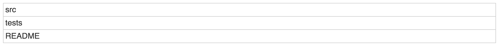

现在我们已经有了基本的结构，可以将剩余的组件添加到行组件中：`FileIcon`、`FileName`、`CommitMessage` 和 `Time`。

让我们先处理 `FileIcon` 和 `FileName`，因为它们是嵌套在一起的。在看后文之前，尝试自己编写代码。这是一个比较特殊的例子。

这里是 `FileIcon`。它非常直观——用普通函数编写无状态组件。

```javascript
function FileIcon({ file }) {
  let icon = 'fa-file-text-o';
  if(file.type === 'folder') {
    icon = 'fa-folder';
  }

  return (
    <td className="file-icon">
      <i className={`fa ${icon}`}/>
    </td>
  );
}
FileIcon.propTypes = {
  file: PropTypes.object.isRequired
};
```

这里是 `getFileName`，如果你仔细看，它并不是一个组件。

```javascript
function getFileName(file) {
  return [
    <FileIcon file={file} key={0}/>
    <td className="file-name" key={1}>{file.name}</td>
  ];
}
```

这只是一个接收 `file` 并返回元素数组的函数。组件不能在不用元素包裹它们的情况下返回数组。为什么要这样写呢？

问题在于我们正处于表格行（`<tr>`）内部，并且我们需要两个相邻的 `<td>`，但真正的组件不能在没有包装器的情况下返回裸露数组。

你可以通过将 `FileIcon` 和 `FileName` 写为独立的组件来完全避免这个问题，每个组件都返回一个 `<td>` 单元格（而不是像我们现在这样将 `FileIcon` 嵌套在 `FileName` 内部）。这被认为是比这种方法更好的解决方案！我之所以这样写是为了展示这种边缘情况，以防你遇到无法避免的情况。如果可能，请避免这种情况。

在编写时，React 16（又名 React Fiber）即将问世，并承诺解决从组件中返回多个元素的问题。你可以在 [`isfiberreadyyet.com/`](http://isfiberreadyyet.com/) 查看 Fiber 的进展。

注意我们在这里为 `key` 传递了硬编码的值。我不是刚刚说过不要这样做吗？

是的，这通常是一个坏主意，但因为这个数组在特定顺序下始终会有 2 个元素，所以在这里不会产生问题。需要 `key` 是因为我们正在返回一个数组，而数组中的元素必须有一个 `key`。

这是使用了 `getFileName` 函数的更新后的 `FileListItem`：

```javascript
const FileListItem = ({ file }) => (
  <tr className="file-list-item">
    {getFileName(file)}
  </tr>
);
FileListItem.propTypes = {
  file: PropTypes.object.isRequired
};
```

好了，解决了这个奇怪的问题后，让我们添加一些 CSS 看看效果。

```css
.file-icon {
  width: 17px;
  padding-left: 4px;
}

.file-icon .fa-folder {
  color: #508F;
}
```

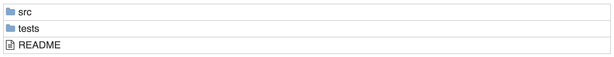

### CommitMessage

让我们添加 `CommitMessage` 组件。这个非常直观——CSS 也是如此。我们将在 `FileListItem` 中使用 `CommitMessage`。

```javascript
const FileListItem = ({ file }) => (
  <tr className="file-list-item">
    {getFileName(file)}
  </tr>
);
FileListItem.propTypes = {
  file: PropTypes.object.isRequired
};
```

```css
.commit-message {
  max-width: 44px;
  padding-left: 10px;
  overflow: hidden;
}
```

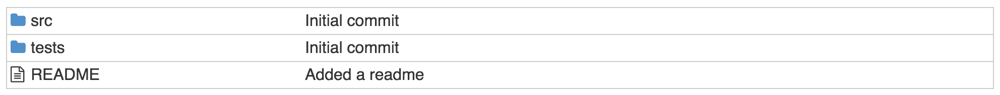

注意我们传递的是提交本身而不是文件对象。`CommitMessage` 不需要知道关于文件的任何信息，了解数据的组件越少越好。

### Time

我们现在添加 `Time` 组件。我们需要 Moment.js，所以请安装它：

`npm install --save moment`

然后创建文件 `time.js`，并将之前的 `Time` 组件粘贴到它自己的文件中。

```javascript
import React from 'react';
import PropTypes from 'prop-types';
import moment from 'moment';

const Time = ({ time }) => {
  const timeString = moment(time).fromNow();
  return (
    <span className="time">
      {timeString}
    </span>
  );
};
Time.propTypes = {
  time: PropTypes.string.isRequired
};

export default Time;
```

好了，让我们在 `FileListItem` 中使用 `Time`。首先我们需要导入它，所以向 `index.js` 顶部添加此行：

```javascript
import Time from './time';
```

由于导入的是自己的文件而不是 `node_modules` 中的内容，因此路径需要是相对路径（`./time`），而不是简单的模块名（`time`）。

然后，我们可以更新 `FileListItem`。注意 `Time` 不会渲染 `<td>`，所以我们必须将其包裹在其中：

```javascript
const FileListItem = ({ file }) => (
  <tr className="file-list-item">
    {getFileName(file)}
    <CommitMessage commit={file.latestCommit} />
    <td className="age">
      <Time time={file.updated_at}/>
    </td>
  </tr>
);
FileListItem.propTypes = {
  file: PropTypes.object.isRequired
};
```

添加一点样式：

```css
.age {
  width: 125px;
  text-align: right;
  padding-right: 4px;
}
```

它运行起来了！

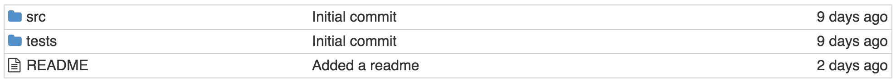

但我必须说，这段代码看起来并不好看。我们以 3 种不同的方式渲染了 3 个组件，甚至为了规避 React 的限制而使用了奇怪的 `getFileName`。如果组件看起来像这样会好得多：

```javascript
const FileListItem = ({ file }) => (
  <tr className="file-list-item">
    <td><FileIcon file={file} /></td>
    <td><FileName file={file} /></td>
    <td><CommitMessage commit={file.latestCommit} /></td>
    <td><Time time={file.updated_at} /></td>
  </tr>
);
FileListItem.propTypes = {
  file: PropTypes.object.isRequired
};
```

### 重构

在这一阶段，我本可以回去修改示例，让代码看起来更好。但我把它留在了原样，并以此作为一个示例：有时（也许是经常），代码写出来的结果可能并不像你想象的那么整洁。在与某个决定相处一段时间之前，你可能还没有完全意识到它的影响。

现实情况往往会产生干扰。你忘记了表格单元格必须是行的直接子元素，或者过于遵循设计稿，导致你走上了一条产生糟糕代码的道路。

但没有什么是永久的！现在是重构这段代码的完美时机（事实上，你将在练习中完成这一点）。

当你埋头写代码时……当你的脑海中突然跳出一个念头：“等等！这些组件完全无法复用，因为每一个组件都包含一个表格单元格！”……好吧，听从那个声音。尽早重构，经常重构。

### 练习

1. 重构 GitHub 文件列表示例，让没有任何组件返回表格单元格（`<td>`）。每个组件都应该返回 `<span>` 或 `<div>`。这使得它们更具复用性，并且应该极大改进 `FileList` 内部的代码。如有必要修改 CSS。
2. 在实际应用中，大多数时候你希望每个文件只有一个组件。有时，一个文件会包含几个相关的组件，且这些组件总是被一起使用（如之前的 `Nav`/`NavItem` 示例），否则它们应该是分开的。重构练习 1 中的代码，使用 `import` 和 `export` 将组件提取到单独的文件中。
3. 现在你知道如何使用 `Array` 的 `.map` 函数来创建列表了。复用之前的 `Tweet` 组件并创建一个推文列表。

列表无处不在。有人说，大多数 Web 应用基本上只是一堆列表。请实现网络上这些网站的界面。遵循我们已经过的几次的流程——突出屏幕上哪些部分将作为组件，给它们命名，然后构建它们。

### 4. Trello


尝试渲染单个卡片列表。为了更多练习，请并排渲染多个卡片列表。

（截图来自[`trello.com`](https://trello.com））

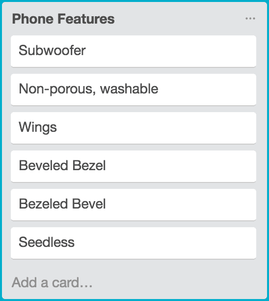

## 5. Hacker News

实现故事列表。为了更多练习，也请实现头部部分。

（截图来自[`news.ycombinator.com/news`](https://news.ycombinator.com/news））


## 6. Pinterest

实现图片卡片列表。为了更多练习，也请实现头部（考虑复用之前的`Nav`和`NavItem`组件）。

（截图来自[`www.pinterest.com/aviationhd/`](https://www.pinterest.com/aviationhd/））


## 7. InternetRadio 流派云

你能想出一个好的方法来调整按钮大小，让它们逐渐变大吗？

（截图来自[`www.internet-radio.com/`](https://www.internet-radio.com/））

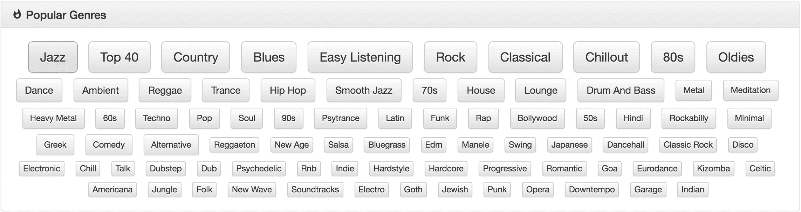

# State

到目前为止，我们一直使用`props`向组件传递数据。但`props`是只读的。如果你需要跟踪可以更改的数据怎么办？这就是`state`（状态）有用的地方。

为了看到`state`有用，让我们回顾 Props 章节中的一个示例。这里有一个包含`Child`组件的`Parent`组件。`Parent`传递了一个函数，`Child`每次点击按钮时都会调用该函数：

## 示例：计数器

```javascript
function handleAction(event) {
  console.log('Child did:', event);
}

function Parent() {
  return (
    <Child onAction={handleAction}/>
  );
}

function Child({ onAction }) {
  return (
    <button onClick={onAction}>
      点击我
    </button>
  );
}
```

如果我们想让`Parent`跟踪按钮被点击的次数呢？换句话说，`Parent`应该跟踪它的`handleAction`函数被调用了多少次。

为了这一点，`Parent`需要 3 个新东西：一个计数器设置为 0 的`initial state`、一次调用`this.setState`来增加计数器，以及一种显示当前计数的方法。

但记住，函数组件是没有状态的。要让`Parent`具有状态，它需要被转换为 ES6`class`组件。

这是`Parent`的新版本，重命名为`CountingParent`——确保你更新了对`ReactDOM.render`的调用！

```javascript
class CountingParent extends React.Component {
  state = {
    actionCount: 0
  }

  handleAction = (action) => {
    console.log('Child says', action);
    // actionCount 增加了，并且
    // 新计数替换了旧的计数
    this.setState({
      actionCount: this.state.actionCount + 1
    });
  }

  render() {
    return (
      <div>
        <Child onAction={this.handleAction}/>
        <p>已点击 {this.state.actionCount} 次</p>
      </div>
    );
  }
}
```

`Child`组件完全不需要更改。尝试一下吧！点击按钮。看着它递增。噢。啊。真棒的计数器。

好了，也许增加一个数字并不是什么开创性的成就，但让我们看看这里发生了什么。

当组件首次被实例化时，它的初始状态是通过`state = {...}`属性初始化器设置的。虽然这种语法不是 ES6 的正式部分，但它被 Babel 和 Create React App 支持，并在 React 社区中广泛使用。（另一种方法是在构造函数中设置初始状态，我们稍后会看到）。

接下来，你点击按钮，就像它要求你的那样。按钮的`onClick`处理程序被调用。在这种情况下，它是`onAction` prop，它最终调用了`CountingParent`中的`handleAction`函数。`handleAction`函数记录了一条消息，然后调用`this.setState`并传入一个描述新状态的对象。

`setState`函数将更新状态并重新渲染组件及其所有的子组件。因此，接下来发生的是：`CountingParent`的`render`函数被调用，它会查看`this.state.actionCount`，而此时该值已经增加到了 1。或者是 2，如果你疯狂点击那个按钮，它也可能是其他数字。

请注意，每个组件实例都有自己的状态。如果你在页面上有两个`CountingParent`组件，它们将各自拥有从 0 开始并独立增加的计数器。你可以通过创建一个包含几个`CountingParent`的组件来向自己证明这一点：

```javascript
const Page = () => (
  <div>
    <CountingParent/>
    <CountingParent/>
    <CountingParent/>
  </div>
);
```

确保更新`ReactDOM.render`调用，以渲染一个`Page`而不是`CountingParent`。现在点击这些按钮，观察计数器如何独立变化。

### 练习：重置按钮

这里有一个快速练习：在`CountingParent`中添加一个“Reset（重置）”按钮，在点击它时将计数器重置为 0。只需将`button`直接放在`CountingParent`内部即可。

一旦运行成功，重构你的代码，将“Reset”按钮移动到`Child`中。

## setState 是异步的

我刚才骗了你。很抱歉。我暗示了`setState`函数会立即更新状态并调用`render`。事实并非完全是那样的。`setState`函数实际上是异步的。

如果你调用了`setState`并立即执行`console.log(this.state)`，它很可能会打印出旧的状态，而不是你刚刚设置的那个。

如果你需要设置状态并立即对该更改采取行动，可以这样传递一个回调函数：

```javascript
this.setState({name: 'Joe'}, function() {
  // 在状态已更新
  // 且组件已重新渲染后调用
});
```

### 函数式 setState

另一种让连续的状态更新按顺序执行的方法是使用`setState`的函数式形式，如下所示：

```javascript
this.setState((state, props) => {
  return {
    value: state.value + 1
  }
});
```

在这种形式下，你向`setState`传递了一个函数。该函数接收当前状态和 props 作为参数，并预期返回想要的新状态。如果你连续运行几个这样的操作……

```javascript
this.setState((state, props) => {
  return {
    value: state.value + 1
  }
});
this.setState((state, props) => {
  return {
    value: state.value + 1
  }
});
this.setState((state, props) => {
  return {
    value: state.value + 1
  }
});
```

这将会按照预期的方式工作，最终将`value`增加 3。它之所以有效，是因为调用`setState`会按调用的顺序将更新“放入队列”，而当它们被执行时，它们接收的是最新的状态作为参数，而不是使用可能已经过时的`this.state`。

`setState`函数式风格的一个额外好处是，状态更新函数可以从类中提取出来并重用，因为它们是“纯”的——也就是说，它们只对参数进行操作，不会修改参数，并返回一个新值。“纯”函数没有副作用，这意味着使用相同的参数多次调用它将始终返回相同的结果。

## 浅合并与深合并

当你调用`setState`时，无论是用对象调用还是用函数形式调用，结果都是它会将你对象中的属性与当前状态进行浅合并。这是它的工作原理。

“浅合并”行为意味着如果你有如下状态：

```javascript
{
  score: 7,
  user: {
    name: "somebody",
    age: 26
  },
  products: [ /*...*/ ]
}
```

然后你执行`this.setState({ score: 42 })`，新状态将是：

```javascript
{
  score: 42,          // 新的！
  user: {             // 不变
    name: "somebody", // 不变
    age: 26           // 不变
  },
  products: [ /* unchanged */ ]
}
```

也就是说，它会将你传递给`setState`（或从函数版本返回）的对象与现有状态进行合并。它不会抹除现有状态。

相反，如果你运行`this.setState({ user: { age: 4 } })`，那么它将用新对象替换整个`user`对象：

```javascript
{
  score: 7,
  user: {
    age: 4
  },
  products: [ /*...*/ ]
}
```

适应 React 意味着要改变解决某些问题的方式。这让我想起在道路的另一侧驾驶的经历。

我第一次经历这种事是在访问特尔克斯和凯科斯群岛（Turks and Caicos）。那里的车辆是左侧行驶。我来自美国，那里是右侧行驶，所以这需要进行一些“重新编程”。我在离开机场的路上差点丢了命。

有趣的是，即使我已经学会了在普通的平直坦路路上左侧行驶，每当出现不同的情况时，我的大脑就会回到旧习惯。

转入停车场？习惯占了主导地位，我开进了错误的车道。在停止标志处左转？同样的问题。在停止标志处向右`right`？你可能会认为我到现在应该学会了——但并没有，在我的大脑里，那终究有些不同。

我讲这个故事是因为我在学习 React 时也有过类似的经历，我想很多其他人也是如此。

向组件传递 props（就像该组件是一个函数一样）是有意义的，我们的大脑习惯了这一点。它看起来和运行起来像 HTML。

对于简单的情况，将数据向下`down`传递并将事件向上传递`up`的想法也很快就能被理解。这是在其他地方常用的“回调”模式，所以并不算陌生。向按钮传递一个`onClick`处理器是正常的。

但当需要打开模态对话框时会发生什么？或者在角落显示 Growl 风格的通知？或者响应事件对图标进行动画处理？你可能会像我一样发现，这些命令式的、“基于事件的”事物在 React 的声明式世界中并不是自然而然的。

### 如何培养“声明式”思维

如果你来自 jQuery、Angular 或任何其他通过调用函数来触发事件的框架（“命令式编程”），你需要调整你的心理模型，以便有效地与 React 协作工作。通过练习，你会很快调整过来——你只需要为大脑提供几个新的示例或“模式”供其参考。

这里有几个示例。

#### 展开/折叠风琴（Accordion）控件

**旧方法**：点击切换按钮通过调用其`toggle`函数来打开或关闭风琴。风琴知道自己是开启还是关闭状态。

**声明式方法**：风琴要么处于“打开”状态，要么处于“关闭”状态，我们将该信息存储在父组件状态中的标志中（不是在风琴内部）。我们通过传递`isOpen`作为 prop 来告诉风琴应该如何渲染。当`isOpen`为`true`时，它渲染为打开。当`isOpen`为`false`时，它渲染为关闭。

```javascript
<Accordion isOpen={true}/>
// 或
<Accordion isOpen={false}/>
```

这个例子非常简单。希望不要太绕脑。最大的变化在于，在 React 的声明式方法中，展开/折叠状态存储在风琴外部，并作为 prop 传递进来。

### 打开和关闭对话框

**旧方法**：点击按钮打开模态。点击它的关闭按钮关闭它。

**声明式方法**：模态是否打开是一个状态。它要么处于“打开”状态，要么处于“关闭”状态。所以，如果它是“打开”，我们便渲染模态。如果它是“关闭”，我们就不渲染模态。此外，我们可以向模态传递一个`onClose`回调——这样父组件就可以决定当用户点击关闭时会发生什么。

```javascript
<div>
  {this.state.isModalOpen &&
    <Modal onClose={this.handleClose}/>}
</div>
```

### 通知

**旧方法**：当发生事件（如错误）时，调用通知库来显示弹出窗口，如`toastr.error("Oh no!")`。

**声明式方法**：将通知视为状态。可以有 0 个、1 个或 2 个通知……将它们存储在数组中。将一个`NotificationTray`组件放在应用的根部附近，并向它传递要显示的消息。你可以在根组件的状态中管理消息数组，并将`addNotification` prop 传递给需要它的组件。

### 为变化制作动画

假设你有一个显示登录用户数量的计数器角标。它从 prop 获取这个数字。如果你想让角标在数字变化时执行动画怎么办？

**旧方法**：你可能会使用 jQuery 来切换一个播放动画的类，或者使用 jQuery 直接对元素执行动画。

**声明式方法**：你可以通过实现`componentWillReceiveProps`生命周期方法并比较旧值和新值来响应 props 的变化（你将在第 14 章中学习更多关于生命周期方法的知识）。如果发生了变化，你可以将“正在动画”的状态设置为`true`。然后在`render`中，当“animating”为`true`时，添加一个执行动画的 CSS 类。当“animating”为`false`时，不添加该类。它可能是这样的：

```javascript
class Badge extends Component {
  componentWillReceiveProps(nextProps) {
    if(this.props.counter !== nextProps.counter) {
      // 现在将 animating 设置为 true。
      // 当状态更改完成后，设置一个定时器
      // 在 200ms 后关闭 animating。
      this.setState({ animating: true }, () => {
        setTimeout(() => {
          this.setState({ animating: false });
        }, 200);
      });
    }
  }

  render() {
    const animatingClass =
      this.state.animating ? 'animating' : '';
    return (
      <div className={`badge ${animatingClass}`}>
        {this.props.counter}
      </div>
    );
  }
}
```

我只想提醒你，这种编写代码初初可能会感觉很奇怪，这是正常的。你会发现自己在思考如何用声明式的方式实现那些旧的命令式模式，学习新模式需要一点时间。但不要担心——一旦你做了几次，它就会变得非常清晰。

### 状态存储在哪里

只要可能，最好保持组件是无状态的。有时这并不可能的，但很多时候，你最初认为应该放入内部状态的数据片段实际上可以提取到父组件，甚至更高。

考虑页面上可以显示或隐藏的部分，比如像这样的侧边栏：

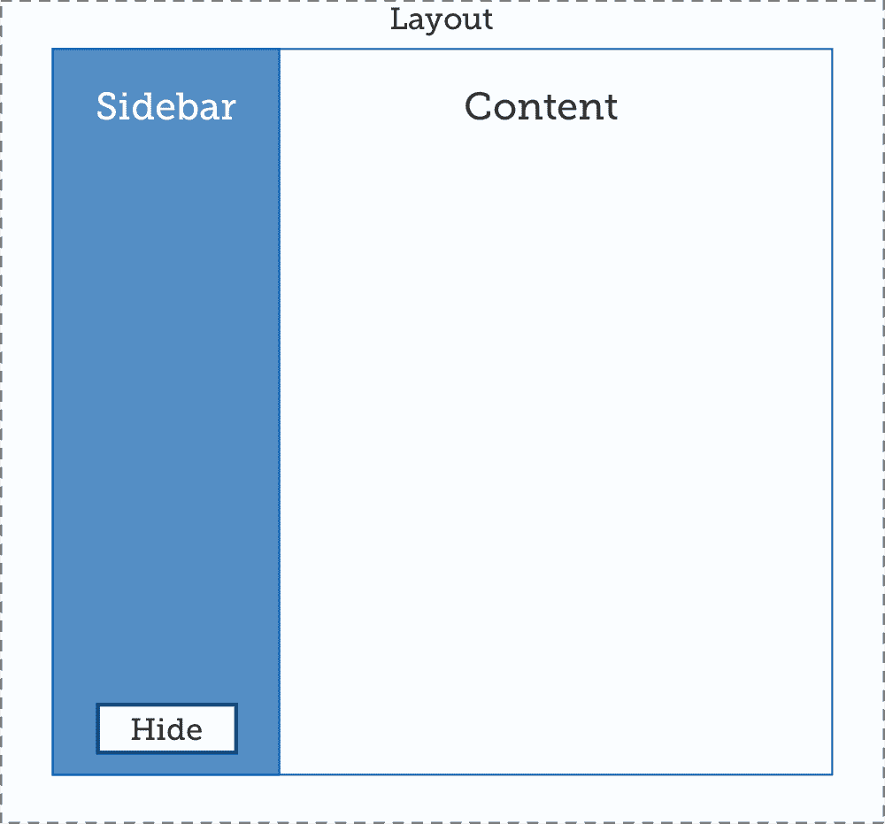

当你点击“隐藏”按钮时，侧边栏应该消失，这意味着将`showSidebar`标志设置为`false`。这个标志应该存储在某个地方的状态中。但在哪里呢？

选项 1，`showSidebar`标志可以存在`Sidebar`组件中。这样`Sidebar`就“知道”自己是否打开。这与不受控输入（uncontrolled inputs）的工作原理类似，我们将在下一章看到。

选项 2，`showSidebar`标志可以放在父组件`Layout`中，由父组件来决定是否渲染 Sidebar：


```javascript
class Layout extends React.Component {
  state = {
    showSidebar: false
  }

  toggleSidebar = () => {
    this.setState({
      showSidebar: !this.state.showSidebar
    });
  }

  render() {
    const { showSidebar } = this.state;
    return (
      <div className="layout">
        {showSidebar &&
          <Sidebar
            onHide={this.toggleSidebar}>
            some sidebar content
          </Sidebar>}
        <Content
          isSidebarVisible={showSidebar}
          onShowSidebar={this.toggleSidebar}>
          some content here
        </Content>
      </div>
    );
  }
}

const Content = ({
  children,
  isSidebarVisible,
  onShowSidebar
}) => (
  <div className="content">
    {children}
    {!isSidebarVisible && (
      <button onClick={onShowSidebar}>
        Show
      </button>
    )}
  </div>
));

const Sidebar = ({
  onHide,
  children
}) => (
  <div className="sidebar">
    {children}
    <button onClick={onHide}>
      Hide
    </button>
  </div>
));
```

通过这种方式，`Sidebar` 内部并不“知道”自己是否可见。它要么被渲染，要么不被渲染。

将状态保留在父组件中可能会感觉并不自然。乍看之下，这似乎会让 `Sidebar` 难以复用，因为你需要传递一个回调函数，让 `Sidebar` 在需要隐藏时调用它。

相反，包含状态的组件越少，意味着出现 Bug 时需要查找的地方就越少。如果你需要对该状态进行任何操作（例如将其保存到 `localStorage` 以实现跨页面刷新持久化），该逻辑只需要存在一个组件实例中。

浏览器自带了 `localStorage`，你可以使用它在会话之间保存数据。关闭并重新打开浏览器或刷新页面不会清除数据。你可以使用 `localStorage.setItem('showSidebar', true)` 保存边栏状态，稍后通过 `localStorage.getItem('showSidebar')` 获取它。

你可以看到，如果 `Sidebar` 组件知道如何将自己的状态保存到 `localStorage`，并且应用中有多个 `Sidebar`，那么它们需要一种方法来区分彼此。在 `localStorage` 中同一个 `showSidebar` 键会导致冲突，而且 `Sidebars` 并不知道自己位于应用中的哪个位置。

也许父组件可以负责为每个 `Sidebar` 传递一个唯一的“id”或“location”。然而，这将把“保存到哪里”的关注点分散在父组件和 `Sidebar` 之间。这导致有两个组件需要处理保存逻辑，而不是一个。更好的设计是将所有与保存相关的逻辑都保留在一个地方，如果状态是与逻辑一起存储的，这样做会更容易实现。

## 组件的“类型”

从架构角度来说，你可以将组件分为两类：`Presentational`（展示型，又称“愚蠢”型）和 `Container`（容器型，又称“智能”型）。

`Presentational components` 是无状态的。它们仅仅接受 props 并根据这些 props 渲染某些元素。无状态意味着组件包含的逻辑更少，并且更容易调试和测试。它们本质上是纯函数。对于给定的 props 集合，它们总是返回相同的结果，并且不会改变任何内容。理想情况下，你的大多数组件都应该是展示型的。

如上所示，`Sidebar` 是一个展示型组件。`Child` 也是，我们前段时间制作的 `Tweet` 组件也是如此。它们接受数据并进行渲染，如果需要处理事件，它们会回调给父组件。其他常见的展示型组件包括按钮、导航栏、链接、图片等。

`Container components` 是有状态的。它们为自己以及任何子组件维护状态，并通过 props 将其传递给它们。它们通常会向子组件传递处理函数，并通过更新其内部状态来响应回调。`Container components` 还负责异步通信，例如向服务器发送 AJAX 请求。

上面的 `Parent` 组件是一个展示型组件。可能让你感到惊讶的是，`Page` 实际上也是展示型的。展示型组件可以包含 `Container` 组件，而 `Containers` 也可以包含其他组件。

## 输入

现在你已经掌握了状态是如何运作的，我们可以聊聊输入了。React 中的输入有两种类型：受控和非受控。

### 受控输入

它们之所以被称为“受控”的，是因为你负责它们的状态。你需要传递一个值和一个回调作为 props 传入。

```javascript
class ControlledInput extends React.Component {
  state = {
    text: ''
  }

  handleChange = (event) => {
    this.setState({
      text: event.target.value
    });
  }

  render() {
    return (
      <input type="text"
        value={this.state.text}
        onChange={this.handleChange} />
    );
  }
}
```

它的工作原理是：在上面的示例中，尝试删除或注释掉 `this.setState` 的调用，然后尝试在框中输入字。什么都不会发生，因为值卡在了初始值上。然后，尝试修改 `this.setState` 忽略事件数据，而是始终将 text 设置相同的值，如下：

```javascript
class TrickInput extends React.Component {
  state = {
    text: 'try typing something'
  }

  handleChange = (event) => {
    this.setState({
      text: 'haha nope'
    });
  }

  render() {
    return (
      <input type="text"
        value={this.state.text}
        onChange={this.handleChange} />
    );
  }
}
```

你会发现输入框阻碍了你更改它的尝试，还在嘲笑你。

不过，这种方法非常强大。如果你想进行某种自定义验证或格式化，可以在 `handleChange` 函数中实现。现在，也许你的第一反应是对于一个简单的输入来说这需要很多代码。你没没错，但这种方法确实提供了很大的威力。不想让用户输入数字？在更新状态之前过滤掉数字即可。

```javascript
class NoNumbersInput extends React.Component {
  // ...

  handleChange = (event) => {
    let text = event.target.value;
    text = text.replace(/[0-9]/g, '');
    this.setState({ text });
  };

  // ...
}
```

顺便提一下——这种 `this.setState({ text })` 语法仅仅是 `this.setState({ text: text })` 的 ES6 简写。在 ES6 中，如果键名与变量名相同，你就不需要写两次。

尝试在框中输入一些数字。尝试粘贴一个包含数字的字符串。完美！没有闪烁或任何异常行为。

你可以将输入内容格式化为电话号码、信用卡号，或者根据光标位置进行更改。正如我所说，它非常强大。

但也许你并不关心这些。你只是想让输入框管理自己的状态。非受控输入（Uncontrolled inputs）可以做到，但有几点需要注意。

## 非受控输入

当一个输入是“非受控的”（`uncontrolled`）时，它管理自己的内部状态。因此，你可以像这样在页面上放置一个 `input`（不带 `value` 属性）：

```javascript
const EasyInput = () => (
  <input type="text" />
);
```

在里面输入内容，随心所欲做什么。它运行正常。如果你想从中获取值，可以传递一个 `onChange` 属性并响应事件。这样做的问题是，你无法随心所欲提取值。你仍然需要监听变化，并在某处跟踪“最新值”。

非受控输入可以赋予一个 `defaultValue` 属性，组件将使用该值进行初始化。但在该初始渲染之后，如果你想更改值，则需要使用受控输入。

## 组件生命周期

每个 React 组件在屏幕上渲染时都会经历一个生命周期（lifecycle）。这有一系列方法按照特定的顺序被调用。其中一些只运行一次，而另一些则运行多次。

对于你构建的大多数组件来说，不需要接入生命周期方法。但当你需要它们时，就需要它们。无论你需要通过 AJAX 调用来获取数据、向 DOM 插入自己的节点，还是设置定时器，生命周期方法都是实现这些的地方。

这里是组件的完整生命周期：

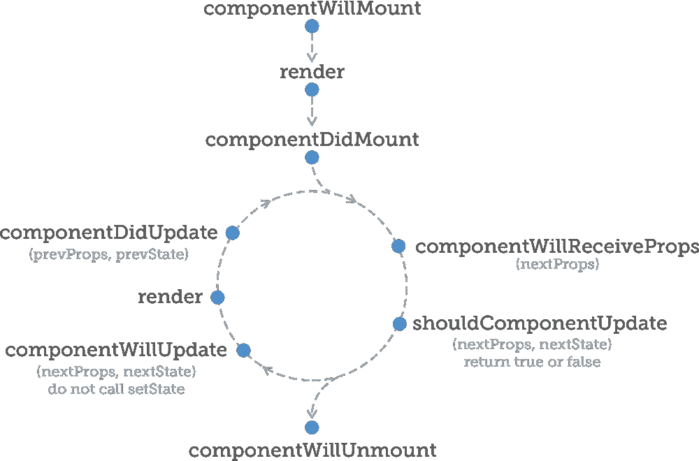

### 使用

接入生命周期钩子只需向你的组件类添加相应的函数即可简单。生命周期方法仅适用于 `class` 组件，不适用于函数式组件。

这是一个使用了所有生命周期方法的示例。运行它，点击按钮，并在控制台查看它们调用的顺序。

```javascript
import React from 'react';
import ReactDOM from 'react-dom';

class LifecycleDemo extends React.Component {
  state = {counter: 0};

  constructor(props) {
    super(props);
    console.log('Constructing...');
    console.log('State already set to:', this.state);
  }

  componentWillMount() {
    console.log('About to mount...');
  }

  componentDidMount() {
    console.log('Mounted.');
  }

  componentWillReceiveProps(nextProps) {
    console.log('Current props:', this.props);
    console.log('Next props:', nextProps);
  }

  shouldComponentUpdate(nextProps, nextState) {
    console.log('Deciding to update');
    return true;
  }

  componentWillUpdate(nextProps, nextState) {
    console.log('About to update...');
  }

  componentDidUpdate() {
    console.log('Updated.');
  }

  componentWillUnmount() {
    console.log('Goodbye cruel world.');
  }

  handleClick = () => {
    this.setState({
      counter: this.state.counter + 1
    });
  };

  render() {
    console.log('Rendering...');
    return (
      <div>
        <span>Counter: {this.state.counter}</span>
        <button onClick={this.handleClick}>Increment</button>
      </div>
    );
  }
}
ReactDOM.render(<LifecycleDemo/>, document.querySelector('#root'));
```

你会发现这两个页面非常相似。与之前的示例相比，这一个示例的组件粒度较粗。组件将拥有更大的 `render` 函数，并且其中包含更多的“内容”。你以后可以对它们进行拆分，有时避免在早期就将其抽象成微小的部分反而更好。

以下是我们将构建的组件：

- `App`
  - `ItemPage`
  - `CartPage`
  - `Item`
  - `Nav`

# 开始构建

我们将从创建一个新项目开始：

```bash
$ create-react-app shopper && cd shopper
```

打开 `src/App.js` 并将其内容替换为以下代码以开始：

```javascript
import React from 'react';
import Nav from './Nav';
import './App.css';

class App extends React.Component {
  renderContent() {
    return (
      <span>Empty</span>
    );
  }

  render() {
    return (
      <div className="App">
        <Nav/>
        <main className="App-content">
          {this.renderContent()}
        </main>
      </div>
    );
  }
}

export default App;
```

然后创建 `src/Nav.js` 并用以下代码开头：

```javascript
import React from 'react';

const Nav = () => (
  <nav className="App-nav">
    <ul>
      <li className="App-nav-item"><a>Items</a></li>
      <li className="App-nav-item"><a>Cart</a></li>
    </ul>
  </nav>
);

export default Nav;
```

启动应用并查看目前的效果：

```bash
$ npm start
```

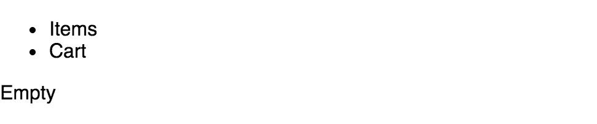

它可以运行了，但需要进行样式化。打开 `src/App.css`，并将内容替换为以下代码：

```css
.App {
  max-width: 800px;
  margin: 0 auto;
}
.App-nav {
  margin: 20px;
  padding: 10px;
  border-bottom: 2px solid #508FCA;
}
.App-nav ul {
  padding: 0;
  margin: 0;
}
.App-nav-item {
  list-style: none;
  display: inline-block;
  margin-right: 32px;
  font-size: 24px;
  border-bottom: 4px solid transparent;
}
.App-content {
  margin: 0 20px;
}
```

这样好多了：

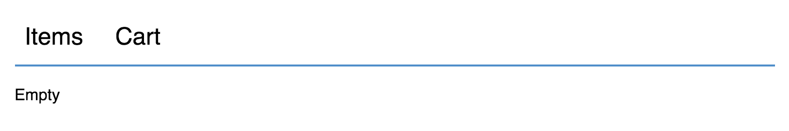

接下来，我们需要跟踪激活的标签，并决定渲染 `ItemPage` 还是 `CartPage`。为了做到这一点，我们将激活标签存储在 `state` 中，并让 `Nav` 触发状态更改。`App` 组件是存储此状态的最佳位置，因为 `App` 需要它来知道渲染哪个页面。

在顶部初始化状态，并添加一个选择标签的函数：

```javascript
class App extends Component {
  state = {
    activeTab: 0
  };

  handleTabChange = (index) => {
    this.setState({
      activeTab: index
    });
  }

  // ...
}
```

现在，我们需要将 `handleTabChange` 函数传递给 `Nav`，连同 `activeTab` 以便它可以正确渲染。我们还将更新 `renderContent` 来显示激活的页面。


## 更新导航组件

将`handleTabChange`函数传递给`Nav`，连同`activeTab`以便它可以正确渲染。我们还将更新`renderContent`来显示激活的页面。

更新`src/Nav.js`中的`Nav`组件以使用代码：

```javascript
const Nav = ({ activeTab, handleTabChange }) => (
  <nav className="App-nav">
    <ul>
      <li className={`App-nav-item ${activeTab === 0 ? 'selected' : ''}`} onClick={() => handleTabChange(0)}><a>Items</a></li>
      <li className={`App-nav-item ${activeTab === 1 ? 'selected' : ''}`} onClick={() => handleTabChange(1)}><a>Cart</a></li>
    </ul>
  </nav>
);
```

在这里，`handleClick`函数将只在组件首次渲染时被创建`once`。这解决了问题（`render`不再创建函数），但代价是代码变得更加复杂（需要一个全新的组件！）。这是一种权衡，当你自己在自己的项目中遇到这个问题时，它是值得考虑的。

## 创建 ItemPage

让我们关注待售列表。我们将创建一个新组件来显示这些数据。创建一个名为`ItemPage.js`的文件并输入以下内容：

```javascript
import React from 'react';
import PropTypes from 'prop-types';
import './ItemPage.css';

function ItemPage({ items }) {
  return (
    <ul className="ItemPage-items">
      {items.map(item =>
        <li key={item.id} className="ItemPage-item">
          {item.name}
        </li>
      )}
    </ul>
  );
}
ItemPage.propTypes = {
  items: PropTypes.array.isRequired
};

export default ItemPage;
```

这里没什么新内容：我们只是在遍历一个项目列表并渲染它们。由于单个项目的内容将比仅仅一个“名称”要复杂得多，我们稍后会将其提取到自己的组件中。

此组件依赖于`ItemPage.css`，该文件尚不存在。创建该文件并添加此CSS来设置样式：

```css
.ItemPage-items {
  margin: 0;
  padding: 0;
}
.ItemPage-items li {
  list-style: none;
  margin-bottom: 20px;
}
```

我们需要一些要出售的项目。我们将像以前一样在这里使用静态数据。

即使我有可以返回真实数据的服务器，我也喜欢从静态数据开始。当没有动态部分时，你可以很快地从无到有。而且老实，当屏幕上有我可以调整的东西时，这更有趣。

创建一个名为`static-data.js`的文件（在`src`目录下）并粘贴这段代码。

```javascript
let items = [
  {
    id: 0,
    name: "Apple iPad Mini 2 16GB",
    description: "与众不同的 iPad. 16GB, WiFi, 4G.",
    price: 229.00
  },
  {
    id: 1,
    name: "Apple iPad Mini 2 32GB",
    description: "比 16GB 的更大。",
    price: 279.00
  },
  {
    id: 2,
    name: "Canon T7i",
    description: "高像素的单反相机。",
    price: 749.99
  },
  {
    id: 3,
    name: "Apple Watch Sport",
    description: "一块手表",
    price: 249.99
  },
  {
    id: 4,
    name: "Apple Watch Silver",
    description: "一块更贵的手表",
    price: 599.99
  }
];

export {items};
```

然后，我们将这些项目传递给新的`ItemPage`组件。回到`App.js`中，导入`ItemPage`和静态的`items`数据。

```javascript
import ItemPage from './ItemPage';
import {items} from './static-data';
```

然后更新`renderContent`函数以使用新的`ItemPage`：

```javascript
class App extends Component {
  // ...
  renderContent() {
    switch(this.state.activeTab) {
      default:
      case 0: return <ItemPage items={items}/>
      case 1: return <span>Cart</span>;
    }
  }
  // ...
}
```

现在，你应该能看到一些项目正在渲染了！

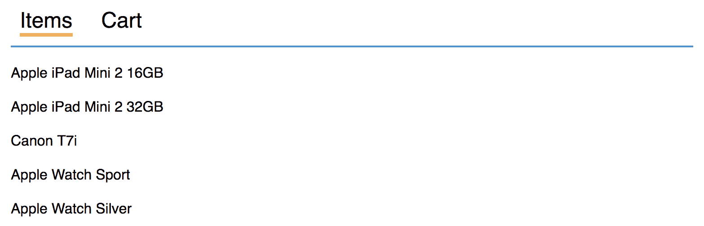 

## 创建 Item

现在让我们创建真正的`Item`组件供`ItemList`使用。它将接收一个`item`prop，我们还希望将其加入购物车，所以它也应该接收一个`onAddToCart`prop。

此组件将是无状态的。它的职责是显示项目，并在点击“加入购物车”按钮时让父组件知道。

借鉴GitHub的示例，我们不会从此组件返回一个`<li>`。我们不希望强制使用`Item`的用户将其放在`<ul>`内部。父组件可以根据自己的选择将此项目放入`<li>`中。

基于这一点，创建`src/Item.js`和`src/Item.css`。在`src/Item.js`中编写组件：

```javascript
import React from 'react';
import PropTypes from 'prop-types';
import './Item.css';

const Item = ({ item, onAddToCart }) => (
  <div className="Item">
    <div className="Item-left">
      <div className="Item-image" />
      <div className="Item-title">
        {item.name}
      </div>
      <div className="Item-description">
        {item.description}
      </div>
    </div>
    <div className="Item-right">
      <div className="Item-price">
        {item.price}
      </div>
      <button className="ItemaddToCart" onClick={onAddToCart}>
        Add to Cart
      </button>
    </div>
  </div>
);
Item.propTypes = {
  item: PropTypes.object.isRequired,
  onAddToCart: PropTypes.func.isRequired
};

export default Item;
```

现在让我们将其连接到`ItemPage`组件。在`ItemPage.js`中，将代码更新如下：

```javascript
import React from 'react';
import PropTypes from 'prop-types';
import Item from './Item';
import './ItemPage.css';

function ItemPage({ items, onAddToCart }) {
  return (
    <ul className="ItemPage-items">
      {items.map(item =>
        <li key={item.id} className="ItemPage-item">
          <Item
            item={item}
            onAddToCart={() => onAddToCart(item)} />
        </li>
      )}
    </ul>
  );
}
ItemPage.propTypes = {
  items: PropTypes.array.isRequired,
  onAddToCart: PropTypes.func.isRequired
};

export default ItemPage;
```

我们正在导入`Item`，现在我们在`<li>`内部渲染`Item`组件而不仅仅是项目名称。新增加的是`onAddToCart`prop及其关联的贯。

在此时，代码将无法工作，并且会有一个关于缺少`onAddToCart`prop的警告。

为了完成传递prop的链，我们需要从`App`组件内部向`ItemPage`的`onAddToCart`prop传递一些内容。既然都这样了，我们不如真的把项目添加到购物车中！这需要在state中添加一个新的`cart`属性。

让我们过一遍。首先，在`App.js`中，向初始状态添加一个`cart`属性，并将其初始化为空数组：

```javascript
class App extends Component {
  state = {
    activeTab: 0,
    cart: []
  }
  // ...
}
```

然后更新`renderContent`以传递一个函数作为`onAddToCart`prop：

```javascript
class App extends Component {
  // ...

  renderContent() {
    switch(this.state.activeTab) {
      default:
      case 0:
        return (
          <ItemPage
            items={items}
            onAddToCart={this.handleAddToCart} />
        );
      case 1:
        return <span>Cart</span>;
    }
  }

  // ...
}
```

函数`this.handleAddToCart`还没有存在，所以接下来创建它。它将接受一个项目，并将将其添加到购物车中：

```javascript
class App extends Component {
  // ...

  handleAddToCart = (item) => {
    this.setState({
      cart: [...this.state.cart, item.id]
    });
  }

  // ...
}
```

这段代码的作用是将`cart`状态设置为当前购物车的副本，加上一个新项目。

这里使用了一些新的ES6语法：`...this.state.cart`是`spread`（展开）运算符，它会将给定的数组展开为它的各个项目。以下是展开运算符的一个示例：

```javascript
// 使用数组：
var a = [1, 2, 3];
var b = [a, 4];    // => [[1, 2, 3], 4]
var c = [...a, 4]; // => [1, 2, 3, 4]

// 使用对象（技术上不属于 ES6）
var o1 = {a: 1, b: 2};
var o2 = {...o1, c: 3}; // => {a: 1, b: 2, c: 3}
```

注意，数组的展开运算符正式是ES6的一部分，但对象的展开不是。然而，Babel支持对象展开，而Create React App底层正使用Babel将我们的代码转换为浏览器兼容的ES5。

### 以不可变的方式更新状态

你可能在想……为什么不直接修改状态然后调用`setState`呢，像这样：

```javascript
this.state.cart.push(item.id);
this.setState({cart: this.state.cart});
```

这是一个坏主意，原因有两个（尽管在这个示例中它可以运行）。

你应该`永远不要`直接修改（mutate）状态或其子属性。不要执行`this.state.something = x`，也不要执行`this.state = x`。React依赖于你在想要更改时调用`this.setState`，以便它知道发生了了变化并触发重新渲染。如果你绕过了`setState`，UI将与数据不同步。

直接修改状态会导致奇怪的bug，以及难以优化的组件。

这是一个示例。记住，优化React组件的常用方法之一是使其变得“纯”，这意味着它只在props改变时才重新渲染。这可以通过扩展`React.PureComponent`而不是`React.Component`来自动完成，也可以通过手动实现`shouldComponentUpdate`周期方法来比较`nextProps`和当前的props。如果props看起来一样，它就会跳过渲染并节省时间。

这是一个渲染项目列表的简单组件。注意它扩展了`React.PureComponent`。

（如果你有示例代码，这段代码位于“impure-state”文件夹下。）

```javascript
class ItemList extends React.PureComponent {
  static propTypes = {
    items: PropTypes.array.isRequired
  }

  render() {
    return (
      <ul>
        {this.props.items.map(item =>
          <li key={item.id}>{item.value}li>
        )}
      </ul>
    );
  }
}
```

现在，有一个小型应用，它渲染`ItemList`并允许你以可变或不可变的方式向列表添加项目。


```javascript
class App extends Component {
  // 将 items 初始化为空数组
  state = {
    items: []
  }

  // 初始化一个计数器
  // 为每个 item ID 递增
  nextItemId = 0;

  makeItem() {
    // 创建一个新的 ID 并使用
    // 随机数作为值
    return {
      id: this.nextItemId++,
      value: Math.random()
    };
  }

  // 正确的方法：
  // 拷贝现有项目并添加一个新项目
  addItemImmutably = () => {
    this.setState({
      items: [
        ...this.state.items,
        this.makeItem()
      ]
    });
  }

  // 错误的方法：
  // 修改 items 并将其设置回
  addItemMutably = () => {
    this.state.items.push(this.makeItem());
    this.setState({ items: this.state.items });
  }

  render() {
    return (
      <div>
        <button onClick={this.addItemImmutably}>
          不可变地添加项目（好）
        </button>
        <button onClick={this.addItemMutably}>
          可变地添加项目（坏）
        </button>
        <ItemList items={this.state.items}/>
      </div>
    );
  }
}
```

```css
.Item {
  display: flex;
  justify-content: space-between;
  border-bottom: 1px solid #ccc;
  padding: 10px;
}
.Item-image {
  width: 64px;
  height: 64px;
  border: 1px solid #ccc;
  margin-right: 10px;
  float: left;
}
.Item-title {
  font-weight: bold;
  margin-bottom: 0.4em;
}
.Item-price {
  text-align: right;
  font-size: 18px;
  color: #555;
}
.Item-addToCart {
  margin-bottom: 5px;
  font-size: 14px;
  border: 2px solid #FFAA3F;
  background-color: #fff;
  border-radius: 3px;
  cursor: pointer;
}
.Item-addToCart:hover {
  background-color: #FFDDB2;
}
.Item-addToCart:active {
  background-color: #ED8400;
  color: #fff;
  outline: none;
}
.Item-addToCart:focus {
  outline: none;
}
.Item-left {
  flex: 1;
}
.Item-right {
  display: flex;
  flex-direction: column;
  justify-content: space-between;
}
```

这样看起来好多了：

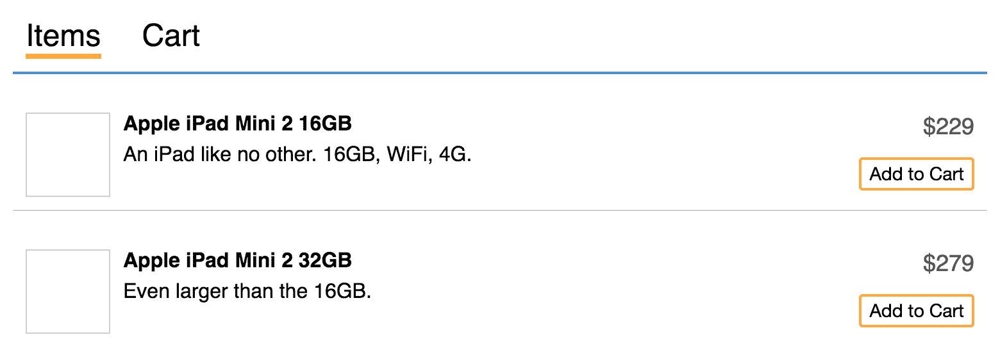

## 创建 CartPage

现在我们已经可以将商品添加到购物车中了，接下来我们将构建渲染购物车本身的组件。

创建 `src/CartPage.css` 和 `src/CartPage.js`，并打开 `CartPage.js`。初始代码将与 `ItemPage` 中的代码非常相似。

```javascript
import React from 'react';
import PropTypes from 'prop-types';
import Item from './Item';
import './CartPage.css';

function CartPage({ items }) {
  return (
    <ul className="CartPage-items">
      {items.map(item =>
        <li key={item.id} className="CartPage-item">
          <Item item={item} />
        </li>
      )}
    </ul>
  );
}
CartPage.propTypes = {
  items: PropTypes.array.isRequired
};

export default CartPage;
```

这只是简单地渲染它接收到的商品。你会注意到我们没有向 `Item` 传递 `onAddToCart` 处理程序，这会导致 prop 警告。我们稍后会修复这个问题。

### 将商品传递给 CartPage

购物车需要商品来显示。问题在于，我们的 `cart` 状态只包含商品索引，而不是实际商品。此外，当商品被多次添加时，会出现重复的索引。我们需要将 `cart` 状态转换为适合传递给 `CartPage` 的商品数组。

在 `App.js` 顶部导入 `CartPage`：

```javascript
import CartPage from './CartPage';
```

然后添加一个 `renderCart` 函数，并更新 `renderContent` 来调用它。

```javascript
class App extends Component {
  // ...

  renderContent() {
    switch(this.state.activeTab) {
      default:
      case 0:
        return (
          <ItemPage
            items={items}
            onAddToCart={this.handleAddToCart} />
        );
      case 1:
        return this.renderCart();
    }
  }

  renderCart() {
    // 统计购物车中每种商品的数量
    let itemCounts = this.state.cart.reduce((itemCounts, itemId) => {
      itemCounts[itemId] = itemCounts[itemId] || 0;
      itemCounts[itemId]++;
      return itemCounts;
    }, {});

    // 创建商品数组
    let cartItems = Object.keys(itemCounts).map(itemId => {
      // 根据 id 查找商品
      var item = items.find(item =>
        item.id === parseInt(itemId, 10)
      );

      // 创建一个也包含 'count' 属性的新“商品”
      return {
        ...item,
        count: itemCounts[itemId]
      };
    });

    return (
      <CartPage items={cartItems} />
    );
  }
}
```

## `reduce`

`reduce` 函数是如下代码的函数式简写：

```javascript
const a = [1, 2, 3, 4];
let total = 0;
for(let i = 0; i < a.length; i++) {
  total += a[i];
}
```

每当你想要遍历数组的值以创建一个聚合结果时，可以考虑使用 `reduce`。

```javascript
const a = [1, 2, 3, 4];
let total = a.reduce((sum, value) => {
  return sum + value;
}, 0);
```

`reduce` 函数接收一个回调函数和一个可选的初始值。回调函数会在数组的每个元素上被调用一次，并传递累加值和当前元素。

## `Object.keys`

`Object.keys` 返回对象中所有键的数组。例如，`Object.keys({a: 1, b: 2})` 将返回 `['a', 'b']`。对象没有像数组那样的内置 `forEach` 函数，所以 `Object.keys` 让遍历键变得更加容易。

### 修改购物车

此时，“购物车”标签页应该可以工作了。点击“加入购物车”几个商品，然后切换到“购物车”标签页，商品应该在那那里了。我们仍然有“加入购物车”按钮，并且收到了关于 `onAddToCart` 的 propType 警告。接下来我们将修复这两个问题。

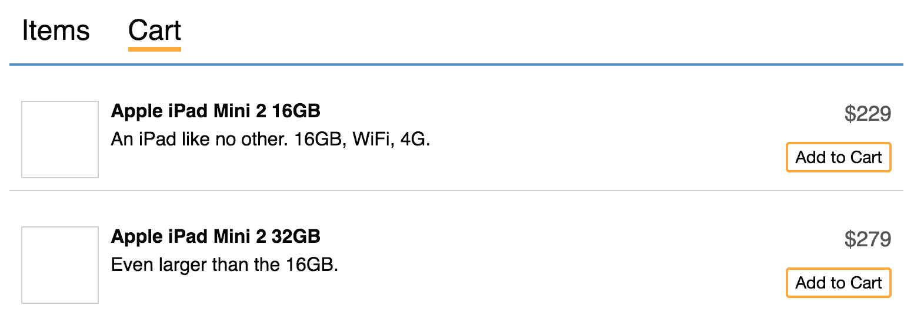

尽管购物车可以工作了，但它还缺少重要的功能。没有添加或删除商品的方法，没有总价，而且我们不知道购物车中每种商品有多少个。

记得我们在 `CartPage` 内部重用 `Item` 组件吗？如果我们可以渲染一个自定义的 `Item`，用“添加”和“移除”按钮来代替“加入购物车”按钮，那就太好了。

这个问题有几种解决方法。

一种想法：我们可以复制 `Item` 组件，将其重命名为 `CartItem`，并根据需要进行自定义。这种方法快速简单，但会导致代码重复。

另一种想法：我们可以让 `Item` 接收一个 prop，告诉它它是“普通商品”还是“购物车商品”。使用该 prop，`Item` 将决定渲染“加入购物车”按钮还是“添加/移除”按钮。这种方法行得通，但很凌乱——`Item` 承担了多个职责。如果以后在第三种情况下需要重用 `Item`，我们可能会添加更多的条件逻辑，导致 `Item` 变得越来越难以理解和维护。

第三种思路是将 `children` 传递给 `Item`，让它来决定将其放在哪里。这是我们将实现的思路。这使得 `Item` 具有很好的复用性。如果你想要“加入购物车”按钮，就将其传进去；如果你想要的是添加/删除按钮，也把它们传进去。让我们来看看它是如何运作的。

### 重构 Item

新的 `Item` 及其 `propTypes` 如下所示：

```javascript
const Item = ({ item, children }) => (
  <div className="Item">
    <div className="Item-left">
      <div className="Item-image" />
      <div className="Item-title">{item.name}</</div>
      <div className="Item-description">{item.description}</div>
    </div>
    <div className="Item-right">
      <div className="Item-price">${item.price}</div>
      {children}
    </div>
  </div>
);
Item.propTypes = {
  item: PropTypes.object.isRequired,
  children: PropTypes.node
};
```

在曾经有 `<button>` 的地方，我们现在用 `{children}` 代替。此外，`Item` 不再需要感知 `onAddToCart` 函数，因此我们删除了它的 propType。

如果你在此时刷新页面，你会发现“加入购物车”按钮已经从购物车页面以及商品页面中消失了。为了修复这个问题，打开 `ItemPage.js` 并将 `<button>` 作为 `Item` 的子元素传递：

```javascript
function ItemPage({ items, onAddToCart }) {
  return (
    <ul className="ItemPage-items">
      {items.map(item =>
        <li key={item.id} className="ItemPage-item">
          <Item item={item}>
            <button
              className="Item-addToCart"
              onClick={() => onAddToCart(item)}>
              Add to Cart
            </button>
          </Item>
        </li>
      )}
    </ul>
  );
}
```

搞定了，恢复正常。现在处理新部分：打开 `CartPage.js`，在 `Item` 内部传递加/减按钮和商品数量。我们还需要用于在添加或删除商品时调用的处理函数。

```javascript
function CartPage({ items, onAddOne, onRemoveOne }) {
  return (
    <ul className="CartPage-items">
      {items.map(item =>
        <li key={item.id} className="CartPage-item">
          <Item item={item}>
            <div className="CartItem-controls">
              <button
                className="CartItem-removeOne"
                onClick={() => onRemoveOne(item)}&ndash;</button>
              <span className="CartItem-count">{item.count}</span>
              <button
                className="CartItem-addOne"
                onClick={() => onAddOne(item)}>+</button>
            </div>
          </Item>
        </li>
      )}
    </ul>
  );
}
CartPage.propTypes = {
  items: PropTypes.array.isRequired,
  onAddOne: PropTypes.func.isRequired,
  onRemoveOne: PropTypes.func.isRequired
};
```

这些都是你以前见过的内容。在我们传递这些函数之前代码将无法工作，所以回到 `App.js` 并创建它们。在 `renderCart` 的底部，我们需要将 props 传递给 `CartPage`：

```javascript
class App extends Component {
  // ...
  renderCart() {
    // ...
    return (
      <CartPage
        items={items}
        onAddOne={this.handleAddToCart}
        onRemoveOne={this.handleRemoveOne} />
    );
  }
  // ...
}
```

我们已经有了 `handleAddToCart` 函数，它接收一个商品并将 id 添加到购物车，所以我们可以直接复用它。我们需要创建 `handleRemoveOne` 函数。它将接收一个商品，在购物车中找到该商品，然后更新 `cart` 状态将其移除。

```javascript
class App extends Component {
  // ...
  handleRemoveOne = (item) => {
    let index = this.state.cart.indexOf(item.id);
    this.setState({
      cart: [
        ...this.state.cart.slice(0, index),
        ...this.state.cart.slice(index + 1)
      ]
    });
  }
  // ...
}
```

我们使用了两次数组展开（spread）运算符，以避免变变状态。我们获取数组的左半部分（直到我们要删除的商品），并与数组的右半部分（被删除商品之后的所有内容）拼接。

这比允许变异要多一点工作，但这是一个值得养成的习惯。如果你将来开始使用 Redux，这将特别重要。Redux 极度依赖不可变性。

为了完善添加/删除按钮，让我们给它们添加一些样式。在 `CartPage.css` 中添加此 CSS：


```css
.CartPage-items {
  margin: 0;
  padding: 0;
}
.CartPage-items li {
  list-style: none;
}
.CartItem-count {
  padding: 5px 10px;
  border: 1px solid #ccc;
}
.CartItem-addOne,
.CartItem-removeOne {
  padding: 5px 10px;
  border: 1px solid #ccc;
  background: #fff;
}
.CartItem-addOne {
  border-left: none;
}
.CartItem-removeOne {
  border-right: none;
}
```

这里它大功告成了：

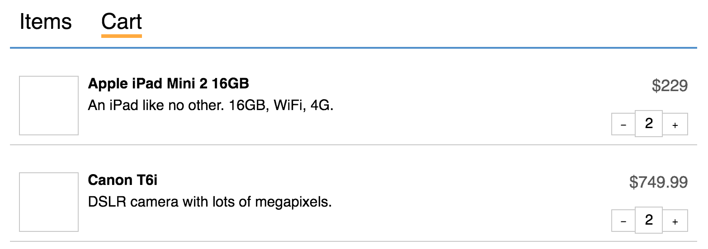

## 练习

1. 如果购物车能告诉我们准备在苹果产品上花费多少美元，而不是让我们猜会更好。在购物车页面底部添加一个“总计”，如下所示：

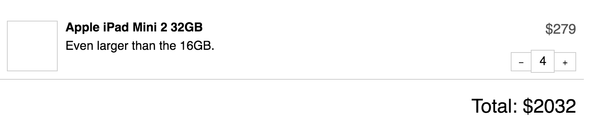

2. 购物车为空时是完全空白的。修改它，在没有商品时显示“您的购物车为空”，如下：

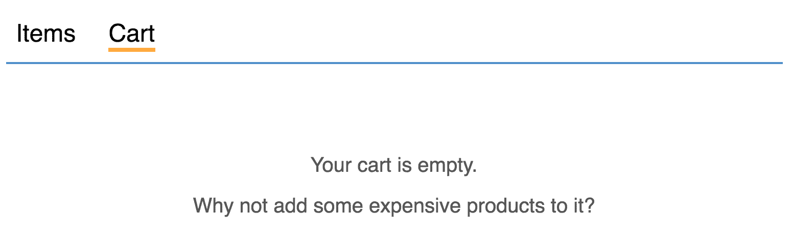

3. 在导航栏右上角显示购物车摘要，如下所示。包含商品总数和总价。考虑到购物车数组中的每个商品数量可能大于 1。作为额外奖励，让购物车摘要可点击并切换到购物车页面。添加一个你喜欢的购物车图标（这个来自 Font Awesome）。

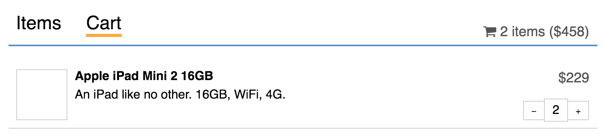

4. 构建一个简化版的 Reddit，模型如下所示：

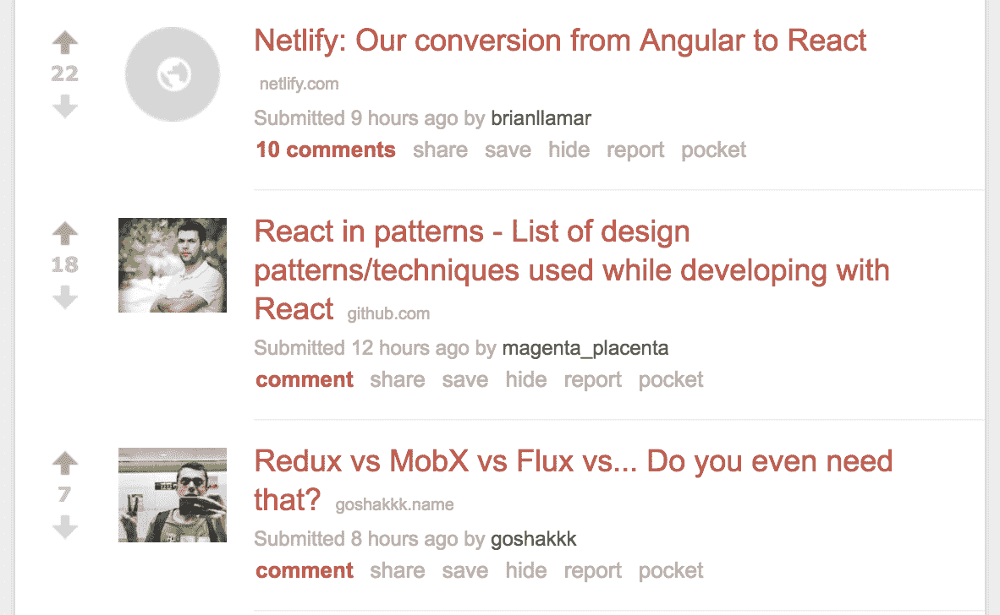

它应该具备以下功能：

* 显示投票数
* 可运行的点赞/踩控制
* 显示评论数
* 按点赞数对故事进行排序
* 标题应该是一个真实的链接
* 其他链接不需要具有功能（分享、保存、隐藏等）

遵循我们整本书以来的方法：列出截图中的组件，决定需要保留哪些状态以及哪些组件应该拥有这些状态，然后开始构建组件。

Reddit 的 API 是公开的，不需要密钥。你可以使用静态数据，例如 `http://www.reddit.com/r/reactjs.json` 将将其保存到文件中并像我们在几个示例中所那样进行导入。

5. 构建一个简化版的 Slack，模型基于此 UI：

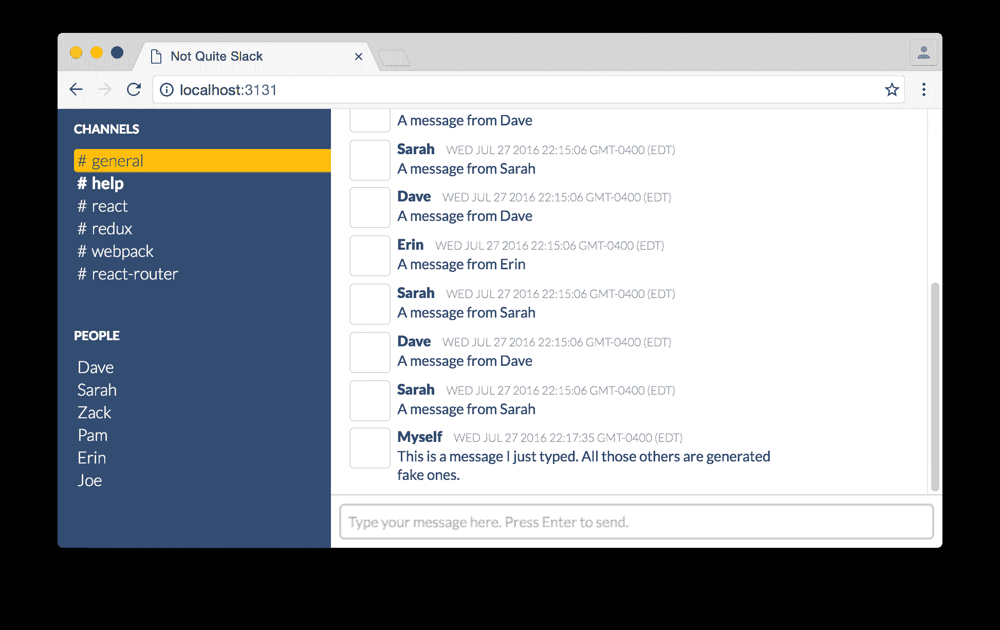

它应该具备的功能有：

* 频道列表
* 用户列表
* 为当前选中的通道或用户维护状态
* 点击通道或用户进行选择
* 一次只能选择一个通道或用户
* 每个通道和用户都有自己的消息历史
* 为每个通道生成一些虚假消息
* 仅在选中通道或用户时，在底部显示输入框
* 在输入框中输入并按回车键会将该消息添加到选中的通道/用户中，并清空输入。

# 接下来该去哪里

首先，恭喜你读完了这本书。我希望你在阅读过程中的乐趣，像我撰写这本书时一样多。

尽管如此，这并不是结束。这只是你 React 之旅的开始。

到目前，你已经牢固掌握了 React 的基础知识，并且学习了一些 ES6。从这里开始，你可以继续学习 AJAX、Webpack、React Router、Redux 或 MobX，以及你需要的任何其他内容。

以下是建议的学习顺序。我认为最后学习 Redux 是重要的，但其他可以根据你的需要重新排序。

## AJAX

学习如何将你的应用连接到服务器很有趣，因为你可以看到应用通过真实数据变得活跃起来。

React 没有任何内置的与服务器通信的方法，所以你需要使用 HTTP 库。目前有很多可用的库。我喜欢 [fetch](https://github.com/github/fetch)，因为它最终将成为 JavaScript 标准库的一部分，但 [axios](https://github.com/mzabriskie/axios) 和 [superagent](https://github.com/visionmedia/superagent) 也是很好的选择。

你应该如何以及在何发送 HTTP 请求？常见的做法是在 `componentDidMount` 周期方法中获取数据。当响应返回时，调用 `this.setState` 保存这些数据，并使用 props 将其传递给需要的组件。

和所有的状态一样，最好尽可能将其保持在组件层次结构的尽可能高位置。例如，如果一个 `Page` 包含了多个 `List` 组件，不要让每个 `List` 都去获取自己的数据——而是在 `Page` 组件中获取这些数据，并将其作为 props 传递给 `List`。

## 测试

测试是构建软件的重要部分。无论你决定是否使用测试驱动开发 (TDD)，在代码周围编写测试都能让你有信心确保一切都运行如预期。

测试 React 有一些新工具需要学习。你需要一种进行断言的方法 (Chai)，可能想要一个用于设置间谍的库 (Sinon)，并且绝对想要使用 Enzyme，这是一个由 Airbnb 创建的用于测试 React 组件的库。

我整理了一篇文章帮助你开始测试 React，可以点击[这里](https://daveceddia.com/getting-started-with-tdd-in-react/)。

## Webpack

构建工具在刚开始是一个主要的障碍，这就是为什么设置 Webpack 没有包含在本书中。如果你还没有自定义构建的需求，请推后以后学习 Webpack。

我推荐阅读文章 [Webpack – 令人困惑的部分](https://medium.com/@rajaraodv/webpack-the-confusing-parts-58712f8fcad9) 作为对 Webpack 及其思维方式的介绍。Egghead.io 也有一个关于 Webpack 的很好的快速介绍，地址是 [`egghead.io/lessons/javascript-intro-to-webpack`](https://egghead.io/lessons/javascript-intro-to-webpack)。

你应该知道，我们一直在使用的 `create-react-app` 工具有一个生产环境构建模式（运行 `npm run build`），它会创建一个包含压缩文件和生产版本 React 的生产优化构建。如果你不需要自定义任何内容，Create React App 开箱即用，而且非常适合编写真实的生产级 React 应用。

它还有一个“eject”命令（运行 `npm run eject`），可以提取生成的 Webpack 构建并将其暴露供你进行自定义。

## ES6

你已经在书中看到了其中的部分内容：箭头函数、let/const、类、解构以及 `import`/`export`。这些是你经常会用的大部分 ES6 内容，但还有许多其他很棒的新特性如 promises、`for..of` 循环、动态对象键、迭代器等。

你可以在学习过程中学习这些特性，但至少对所有内容进行快速调研是个好主意，这样你就知道哪些可用。这个 [ES6 特性概述](https://github.com/lukehoban/es6features)是一个非常棒的资源。

## 路由

现在你已经相当地掌握了 React 的工作原理，React Router 的概念将在此基础上构建。它利用组件来布局应用程序的路由，有效地将你的组件映射到 URL。查看 [Github 上的 React Router](https://github.com/ReactTraining/react-router) 开始吧。

有些人会在脑中将 React Router 和 Redux 混为一谈——它们实际上并没有关联或相互依赖，尽管有一个库可以将路由状态与 Redux 链接起来。你可以（并且应该！）在深入研究 Redux 之前学习使用 React Router。

## Redux

Redux 的创建者 Dan Abramov [会告诉你](https://github.com/gaearon/react-makes-you-sad) 不要过早将 Redux 加入到你的项目中，这很有道理——在遇到它要解决的问题之前，你实际上不需要 Redux。

Redux 的概念相当简单，但在理解它们如何工作与知道如何使用 Redux 之间存在差距。真正理解 Redux 需要实践。它受到函数式编程概念的影响，如果你不熟悉这些概念，可能需要一些适应。

所以，在将 Redux 加入到较大的项目之前，重复你在书中做的事情：构建小项目。将使用普通 React 状态的代码转换为使用 Redux。构建许多小型 Redux 实验来真正掌握工作原理。

## 关于脚板项目

我建议一步一瓦地构建你的项目，根据需要添加各个部分。这样你就能理解所有活动部分是如何工作的，这意味着当它们崩溃时你可以修复它们，或者当你超出默认设置时可以扩展它们。

很容易掉入一种陷阱，认为学习“纯 React”仅仅是初学者的事，并且对于任何实质性项目基本上必须使用脚板项目（boilerplate projects）。我不认为事实完全如此。

React 的力量之一是可以按照你喜欢的方式构建自己的技术栈。即使你放弃控制权使用脚板项目，你仍然需要学习那个特定项目的约定。

脚板项目的魅力之一是它为你规定了项目结构。如果磁盘上的文件结构阻碍了你的进展，请阅读：[`daveceddia.com/react-project-structure/`](https://daveceddia.com/react-project-structure/)

## 感谢

非常感谢你不仅购买而且完成了这本书。我很想知道你的想法——哪些做得好，哪些需要改进，或者对未来主题的任何建议。可以通过邮件 dave@daveceddia.com 联系我，或在 Twitter 上通过 @dceddia 联系我。
