# Python 和 JavaScript 编码：绝对初学者基础：快速学习编码的步进式指南

与其他编程语言相比，Python 是一种简单易学的编程语言。它的语法简单，与英语相似。它不使用分号和花括号，而是使用缩进来定义代码块。对于初学者来说，这是推荐的编程语言。

## 2) 表达性语言

Python 仅需几行代码即可完成任务。例如，要运行“你好世界”程序，只需输入`print("Hello World")`。这只需要一行代码即可运行，而 Java 或 C 则需要许多行。

## 3) 解释型语言

Python 是一种解释型语言，这意味着 Python 程序的每一行都是单独执行的。解释型语言的优点是调试简单且具有可移植性。

## 4) 跨平台语言

Python 可以在包括 Windows、Linux、UNIX 和 Macintosh 在内的多种平台上运行。因此，我们可以得出 Python 是一种可移植的编程语言。它允许程序员通过仅创建一个程序，就能为多个竞争平台创建软件。

## 5) 免费开源

Python 是一种任何人都可以使用的免费编程语言。在它的官方网站`www.python.org`上可以免费获取。全球范围内有一个庞大的社区努力创建新的 Python 模块和函数。Python 社区欢迎每个人的贡献。开源领域表示：“任何人都可以无需一分钱获取其源代码”。

## 6) 面向对象语言

Python 支持面向对象编程，这引入了类和对象的概念。它允许继承、多态和封装等特性。面向对象的方法帮助程序员编写可重用的代码。

## 7) 可扩展

这意味着可以在 Python 内部使用如`C++`等其他语言。

## 8) 大型标准库

它为机器学习提供了多种库，包括`Pandas`、`Numpy`、`Keras`和`Pytorch`。

## 9) GUI 支持

对于桌面开发，可以使用`PyQt5`、`Tkinter`和`Kivy`等图形界面库。

## 10) 集成性

它很容易与`C++`和`Java`等语言集成。

## 11. 可嵌入性

Python 可以嵌入到其他程序中。

## 12. 动态内存分配

内存在运行时分配。当我们为变量赋值时，内存会自动处理。

# 安装 Python

成为开发者的第一步是了解如何安装和更新 Python。我们将介绍如何在各种系统上安装 Python。

## 在 Windows 上安装

若要获取最新版本的 Python，请访问`https://www.python.org/downloads/`。我们将在操作系统上安装它。

**步骤 1：选择 Python 版本 - 下载**

(Images/00161.jpeg)

**步骤 2：点击“立即安装”**

双击下载的可执行文件以弹出以下窗口。通过选择“自定义”继续操作。当你勾选`Add Path`复选框时，Python 路径将自动配置。

(Images/00162.jpeg)

我们还可以通过点击“自定义安装”按钮选择所需的位置和功能。另一个需要考虑的关键因素是是否为所有用户安装启动器。

**步骤 3：安装过程**

(Images/00163.jpeg)

尝试从命令行提示符运行`python`。如果你使用的是 Python 3，输入`python -version`。

(Images/00164.jpeg)

# 第一个 Python 程序

在本节中，我们将介绍 Python 的基础语法，并运行一个在终端打印 Hello World 的简单程序。

Python 为我们提供了两种运行程序的选项：

* 使用交互式解释器的提示符
* 使用脚本文件

## 交互式解释器提示符

在交互式提示符处，Python 允许我们逐行执行每个 Python 语句。当我们关注 Python 程序每一行的输出时，这种方法更好。

要进入交互模式，请在终端（或命令行提示符）输入`python`（如果系统中同时安装了 Python 2 和 Python 3，请输入`python3`）。

它将打开下面的提示符，可以在其中运行 Python 语句并查看它对终端的影响。

```python
print("Hello World")
```

(Images/00165.jpeg)

## 多行语句

多行语句在记事本之类的文本编辑器中输入并保存为`.py`文件。在下面的示例中，我们使用 Python 脚本描述了多行代码的执行。

```python
name = "Andrew Venis"
branch = "Computer Science"
```

```python
age = "25"
print("My name is: ", name)
print("My age is: ", age)
```

脚本文件：

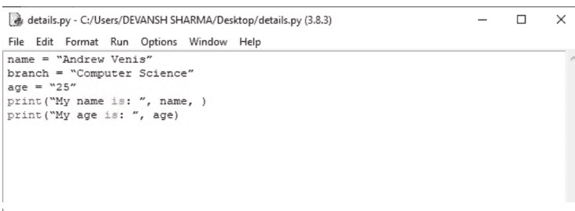

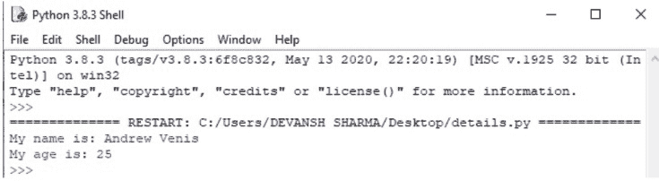

# Python 变量

变量是指代内存区域的术语。Python 变量通常被称为标识符，是数据的容器。

由于 Python 是一种类型推断语言，我们不需要描述变量的类型，因为它足够智能可以识别出类型。

变量名可以是字母和数字的组合，但必须以字母或下划线开头。

变量名应该使用小写字母。`rahul`和`Rahul`是两个不同的变量。

## 标识符命名

标识符是变量的示例。程序中的字面量使用`Identifier`进行标识。以下是命名标识符的规则：

- 变量的起始字符必须是字母或下划线（`_`）。
- 除了第一个字符外，所有字符可以是小写（`a-z`）、大写（`A-Z`）、下划线或数字（`0-9`）。
- 标识符名称中不能有空格或特殊字符（`!`、`@`、`#`、`%`、`,`、`&`、`*`）。
- 标识符名称不能与语言的任何关键字相同。
- 区分大小写；例如，`myName`和`MyName`不是同一个东西。
- 有效的标识符包括`a123`、`_n`、`n9`等。
- `1a`、`n4`等是错误的标识符示例。

## 声明变量

Python 不要求我们在代码中使用变量之前对其进行声明。它允许我们在特定的时间点构建一个变量。

在 Python 中，我们不需要显式地声明变量。每当我们给变量赋值时，它就会被自动定义。

变量的值使用等号（`=`）运算符赋值。

## 对象引用

在声明变量时，理解 Python 解释器的工作原理非常重要。变量的处理方式与其他许多编程语言不同。

由于 Python 是一种面向对象的编程语言，每个数据项都属于特定的类类型。考虑以下插图。

```python
print("John")
```

输出：

```
John
```

Python 对象在终端上构建并显示了一个字符串对象。我们在上面的`print`命令中创建了一个字符串对象。让我们使用 Python 内置的`type()`函数查看它是什么类型。

```python
type("John")
```

输出：

```
<class 'str'>
```

变量是 Python 中指向对象的引用或指针的符号性术语。变量用于表示具有相同名称的对象。

让我们看看下面的示例。

```python
a = 50
```

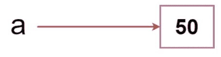

插图中的变量`a`对应一个整数对象。

假设我们给新变量`b`赋值整数值 50。

```python
a = 50
b = a
```

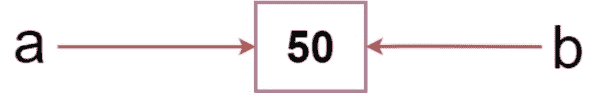

由于 Python 不生成新对象，变量`b`指向与`a`相同的对象。

让我们改变`b`的值。现在两个变量将指向不同的对象。

```python
a = 50
b = 100
```

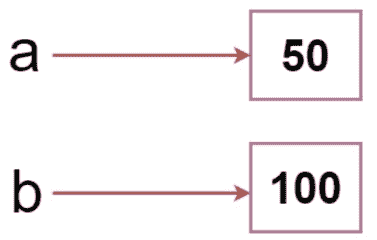

如果我们将同一个变量赋值为两个不同的值，Python 会高效地维护内存。

## 对象标识

Python 中创建的每个对象都有一个唯一的标识符。Python 确保没有两个对象共享相同的标识符。对象标识使用内置的`id()`函数进行。考虑以下插图。

```python
a = 50
b = a
print(id(a))
print(id(b))
# 重新赋值变量 a
a = 500
print(id(a))
```

输出：

```
140734982691168
140734982691168
2822056960944
```

我们设置`b = a`是因为`a`和`b`都指向同一个对象。当我们检查`id()`函数时，它返回了相同的数字。我们将`a`的值更改为 500，它现在指向新的对象标识符。

# Python 数据类型

值可以存储在变量中，每个值都有一个数据类型。由于 Python 是一种动态类型语言，我们在声明变量时不需要指定变量的类型。值由解释器隐式绑定到其类型。

```python
a = 5
```

我们没有定义变量`a`的类型，它的整数值为五。变量`a`将被 Python 解释器自动解释为整数类型。

可以使用 Python 检查程序使用的变量的类型。Python 中的`type()`方法返回提供的变量的类型。

考虑以下定义各种类型数据的值并确定其类型的场景。

```python
a = 10
b = "Hi Python"
c = 10.5
print(type(a))
print(type(b))
print(type(c))
```

输出：

```
<type 'int'>
<type 'str'>
<type 'float'>
```

## 标准数据类型

变量可以存储不同类型的值。例如，人的名字必须保存为字符串，而他的 ID 必须被记录为整数。

Python 支持多种标准数据类型，每种类型都有自己的存储技术。以下是 Python 数据类型的列表：

1. 数字 (Numbers)
2. 序列类型 (Sequence Type)
3. 布尔值 (Boolean)
4. 集合 (Set)
5. 字典 (Dictionary)

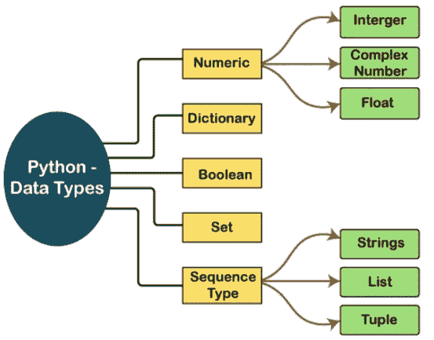

在本节中，我们将对上述数据类型进行简要概述。在课程的后面，我们将深入讲解每一个类型。

### 数字

数字是存储数值的数据类型。Python 的数字数据类型包含整数（integer）、浮点数（float）和复数（complex）值。Python 中的`type()`方法可确定变量的数据类型。`isinstance()`函数用于判断对象是否属于特定的类。

当给变量分配数字时，Python 会产生数字对象。例如：

```python
a = 5
print("The type of a", type(a))
b = 40.5
print("The type of b", type(b))
c = 1+3j
print("The type of c", type(c))
print("c is a complex number", isinstance(1+3j,complex))
```

输出：

```
The type of a <class 'int'>
The type of b <class 'float'>
The type of c <class 'complex'>
c is a complex number True
```

Python 识别三种类型的数值数据。整数值可以是任何长度，例如 10、2、29、-15 等。整数的长度在 Python 中没有限制。它的值类型是`int`。

浮点数（Float）用于存储浮点数，如 1.9、902、15 等。它的精度高达 15 位小数。

复数由一个有序对组成，即`x + iy`，其中`x`和`y`分别代表实部和虚部。复数如`2.14j`、`2.0 + 2j`等。

# Python 关键字

Python 关键字是向编译器/解释器传递特定含义的保留字。每个关键字都有特定的含义和操作。这些关键字不能用作变量。Python 关键字列表如下：


- **True**：代表布尔真，如果条件为真，则返回"True"。非零值被视为真。
- **False**：代表布尔假，如果条件为假，则返回"False"。零值被解释为假。
- **None**：表示空值或无效值。空列表或零不能表示 None。
- **And**：它也是一种逻辑运算符。用于测试多个条件。如果两个条件都满足，则返回真。考虑下真表。(Images/image00174.jpeg)
- **or**：在 Python 中，它是一种逻辑运算符。如果满足一个条件，则返回真。考虑下真表。(Images/image00175.jpeg)
- **not**：它是翻转真值的逻辑运算符。考虑下真表。(Images/image00176.jpeg)
- **assert**：在 Python 中，此关键字用作调试工具。它验证代码的正确性。如果代码中发现错误，它将抛出 AssertionError 并打印错误信息。示例：

```python
a = 10
b = 0
print('a is dividing by Zero')
assert b != 0
print(a / b)
```

```
a 正在除以零
```

运行时异常：

```
Traceback (most recent call last):
  File "/home/40545678b342ce3b70beb1224bed345f.py", line 4, in 
    assert b != 0, "Divide by 0 error"
AssertionError: Divide by 0 error
```

## `def` 关键字

`def` - 在 Python 中，此关键字用于声明函数。它后面跟着函数名。

```python
def my_func(a,b):
    c = a+b
    print(c)
my_func(10,20)
```

输出：

```
30
```

## `class` 关键字

`class` - 在 Python 中，它用于表示一个类。类作为对象的蓝图。它是变量和方法的集合。考虑下面的类。

```python
class Myclass:
    # 变量……..
    def function_name(self):
        # 语句………
```

## `continue` 关键字

`continue` - 此命令用于停止当前迭代的执行。考虑以下场景。

```python
a = 0
while a < 4:
    a += 1
    if a == 2:
        continue
    print(a)
```

输出：

```
1
3
4
```

# Python 字面量

Python 中的字面量是存储在变量或常量中的数据。Python 支持以下字面量：

## 1. 字符串字面量

字符串字面量是通过用引号括起文本创建的。为了创建一个字符串，我们可以同时使用单引号和双引号。

示例：

1. `"Aman"`, `'12345'`

## 2. 数字字面量

数字字面量是不可变的。数字字面量可以分类为四种类型之一。

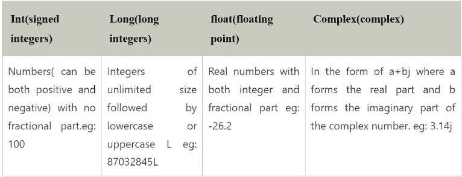

示例 - 数字字面量

```python
x = 0b10100 # 二进制字面量
y = 100 # 十进制字面量
z = 0o215 # 八进制字面量
u = 0x12d # 十六进制字面量

# 浮点数字面量
float_1 = 100.5
float_2 = 1.5e2

# 复数字面量
a = 5+3.14j

print(x, y, z, u)
print(float_1, float_2)
print(a, a.imag, a.real)
```

输出：

```
20 100 141 301
100.5 150.0
(5+3.14j) 3.14 5.0
```

## 3. 布尔字面量

布尔字面量的值可以是 True 或 False。

示例 - 布尔字面量

```python
x = (1 == True)
y = (2 == False)
z = (3 == True)
a = True + 10
b = False + 10

print("x is", x)
print("y is", y)
print("z is", z)
print("a:", a)
print("b:", b)
```

输出：

```
x is True
y is False
z is False
a: 11
b: 10
```

## 4. 特殊字面量

Python 有一个特殊字面量`None`。

`None`用于指定尚未创建的字段。在 Python 中，它也用于指示列表的结束。

示例 - 特殊字面量

```python
val1=10
val2=None
print(val1)
print(val2)
```

输出：

```
10
None
```

## 5. 字面量集合

Python 支持四种类型的字面量集合：

* 列表字面量
* 元组字面量
* 字典字面量
* 集合字面量

### 列表

* 列表中的项可以是各种数据类型。列表是可变的，这意味着它们可以被更改。
* 列表值用逗号 (`,`) 分隔并用方括号 (`[]`) 括起来。列表可以包含各种类型的数据。

示例 - 列表字面量

```python
list=['John',678,20.4,'Peter']
list1=[456,'Andrew']
print(list)
print(list + list1)
```

输出：

```
['John', 678, 20.4, 'Peter']
['John', 678, 20.4, 'Peter', 456, 'Andrew']
```

### 字典

* 数据以键值对的形式存储在字典中。
* 它被花括号 (`{}`) 括围，每对之间用逗号 (`,`) 分隔。

示例

```python
dict={'name':'Pater','Age':18,'Roll_nu':101}
print(dict)
```

输出：

```
{'name': 'Pater', 'Age': 18, 'Roll_nu': 101}
```

### 元组


Python 中的元组是不同数据类型的集合。它是不可变的，这意味着它在创建后不能更改。

* 它被圆括号`()`括起来，每个元素之间用逗号`,`分隔。

示例

```python
1. up=(10,20,"Dev",3,4)
2. print(up)
```

输出：

```
(10, 20, 'Dev', 3, 4)
```

### 集合

Python 集合是无序数据集的集合。

* 它被花括号`{}`括起来，每个元素之间用逗号`,`分隔。

示例 - 集合字面量

```python
1. set={'apple','grapes','papaya'}
2. print(set)
```

输出：

```
{'guava', 'apple', 'grapes'}
```

# Python 运算符

运算符是负责两个操作数之间特定操作的符号。运算符是程序的基础，在此基础上构建了特定语言的逻辑。Python 拥有许多运算符，如下列表所示：

* 算术运算符
* 比较运算符
* 赋值运算符
* 逻辑运算符
* 位运算符
* 成员运算符
* 身份运算符

## 算术运算符

算术运算符用于对两个操作数执行操作。它包含运算符`+`（加法）、`-`（减法）、`*`（乘法）、`/`（除法）、`%`（取模）、`//`（取整）和`**`（幂）。

查看下表算术运算符的详细说明。

## 比较运算符

比较运算符用于比较两个操作数并返回布尔值。比较运算符如下。

## 赋值运算符

赋值运算符用于将右侧表达式的值赋值给左侧的操作。赋值运算符如下。

## 位运算符

位运算符对值进行位运算。考虑以下场景。

## 逻辑运算符

为了做出判断，逻辑运算符主要用于表达式求值。Python 支持的逻辑运算符如下。

## 成员运算符

成员运算符用于判断值是否为数据结构的成员。如果存在，结果为真；否则返回假。

## 身份运算符

身份运算符用于判断元素是否属于特定的类或类型。

## 运算符优先级

运算符的优先级至关重要，因为它告诉我们应该先计算哪个运算符。Python 运算符优先级表所示。

# Python 注释

注释是程序员在代码中提供的便于理解的易读性描述。当 Python 解释器编译代码时，它会忽略注释。因此，注释不会影响代码的执行。注释用于提高代码的可读性。它有助于理解代码的功能。注释通常以 `#` 号开头。

请参考下面的图表以更好地理解注释的语法。

示例 - 单行注释：

```python
1. a = 5 # 这是变量的赋值
2. b = 10
3. c = a + b
4. print("The sum is:", c)
```

输出：

```
The sum is: 15
```

上述代码具有很可读性，即使是初学者也能理解每行代码在做什么。这是在代码中使用注释的用处之一。

对于多行注释，我们也可以使用三引号（`"""`）。字符串格式化也是通过三引号完成的。考虑以下场景。

### Python Docstring 注释

docstring 注（文档字符串）通常出现在模块、函数、类或方法中。它是 Python 的文档字符串。在随后的教程中，我们将解释类/方法。

示例：

```python
1. def intro():
2. """
3. This function prints Hello Joseph
4. """
5. print("Hi Joseph")
6. intro()
```

输出：

```
Hello Joseph
```

使用`__doc__`属性，我们可以检查函数的 docstring。

在大多数情况下，使用四个空格作为缩进。缩进量由用户决定，但在整个块中必须保持一致。

```python
1. def intro():
2. """
3. This function prints Hello Joseph
4. """
5. print("Hello Joseph")
6. intro.__doc__
```

输出：

```
'\n  This function prints Hello Joseph\n  '
```

### Python 缩进

Python 缩进用于定义代码块。C、C++ 和 Java 等其他编程语言使用大括号，而 Python 使用缩进。在 Python 中，使用空白字符来表示缩进。

缩进用于代码的开头，并在意料之外的行结束。代码块由相同的行缩进（函数体、循环等）定义。

在大多数情况下，使用四个空格作为缩进。缩进量由用户决定，但在整个块中必须保持一致。

```python
1. for i in range(5):
2. print(i)
3. if(i == 3):
4. break
```

我们使用相同的空白字符来缩进每行代码，以表示一个代码块。

考虑以下场景。

```python
1. n = int(input("Enter the number:"))
2. if(n%2 == 0):
3. print("Even Number")
4. else:
5. print("Odd Number")
7. print("Task Complete")
```

输出：

```
Enter the number: 10
Even Number
Task Complete
```

`if`和`else`是上述代码中的两个独立代码块。两个代码块都缩进了四个空格。`print("Task Complete")`语句位于`if-else`块之外，没有缩进四个空格。

如果缩进使用不正确，将抛出`IndentationError`。

# Python If-else 语句

几乎所有编程语言中最重要的方面就是决策。正如其名所义，决策允许我们根据特定的决策运行特定的代码块。对特定条件的有效性的判断在此处做出。决策的基础是条件检查。

Python 中的以下语句用于做出决策。

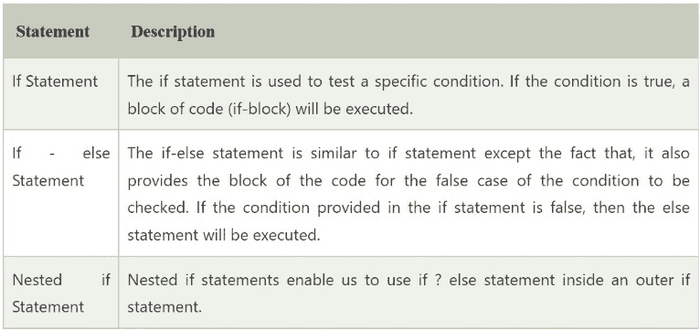

## Python 中的缩进

为了简单和易于编程，Python 不允许在块级代码中使用括号。在 Python 中声明一个块，请使用缩进。如果两个语句具有相同的缩进级别，它们就在同一个块中。

通常，使用四个空格来缩进语句，这是 Python 的标准缩进量。

因为缩进定义了代码块，所以缩进是 Python 语言中最常用的特性。块中的所有语句都旨在缩进到同一水平。我们将查看在 Python 决策和其他区域中实际的缩进是如何发生的。

## if 语句

`if`语句用于测试条件，如果条件为真，它将执行`if-block`代码块。任何可以求值为真或否的有效逻辑表达式都可以用作`if`语句的条件。

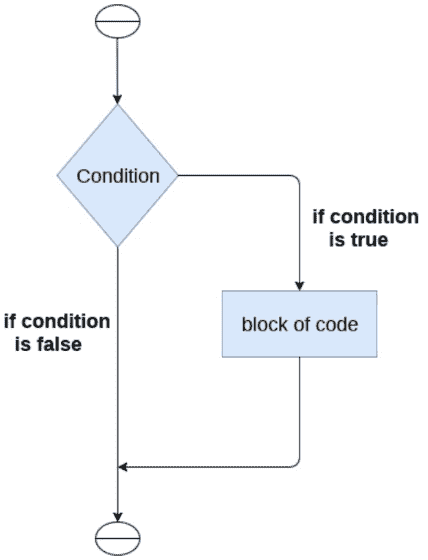

`if-statement`语法所示。

```python
1. if expression:
2. statement
```

### 示例 1

```python
1. num = int(input("enter the number?"))
2. if num%2 == 0:
3. print("Number is even")
```

输出：

```
enter the number?10
Number is even
```

### 示例 2

使用程序打印三个数中最大的一个

```python
1. a = int(input("Enter a?"));
2. b = int(input("Enter b?"));
3. c = int(input("Enter c?"));
4. if a>b and a>c:
5. print("a is largest");
6. if b>a and b>c:
7. print("b is largest");
8. if c>a and c>b:
9. print("c is largest");
```

输出：

```
Enter a? 100
Enter b? 120
Enter c? 130
c is largest
```

### if-else 语句

`if-else`语句将`else`块与`if`语句结合，当条件为假时执行后者。

如果满足条件，运行`if-block`。如果不满足，则执行`else-block`。

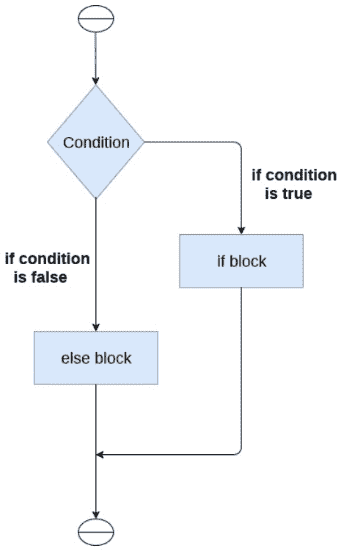

`if-else`语法所示。

```python
1. if condition:
2. statement
3. else:
4. statement
```

示例：一个判断年龄是否符合条件的程序。

```python
1. age = int(input("Enter your age:"))
2. if age>=18:
3. print("You are eligible to vote")
4. else:
5. print("Sorry, you are not eligible to vote")
```

输出：

```
Enter your age:20
You are eligible to vote
```

### elif 语句

`elif`语句允许我们检查多个条件并根据条件执行特定的块。它类似于`if-else`阶梯。

`elif`语法所示。

```python
1. if expression1:
2. statement
3. elif expression2:
4. statement
5. elif expression3:
6. statement
7. else:
8. statement
```

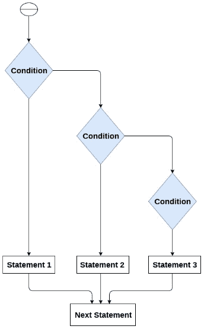

示例：根据成绩判断等级。

```python
1. score = int(input("Enter your score:"))
2. if score>=90:
3. print("Grade: A")
4. elif score>=80:
5. print("Grade: B")
6. elif score>=70:
7. print("Grade: C")
8. elif score>=60:
9. print("Grade: D")
10. else:
11. print("Grade: F")
```

输出：

```
Enter your score:85
Grade: B
```

# Python 循环

默认情况下，任何语言编写的程序都是顺序的。我们可能需要随时间改变程序的流程。某些代码的执行可能需要重复。

编程语言提供了各种类型的循环来实现此目的，它们能够重复某些代码。查看下面的图表以更好地理解循环语句的工作原理。

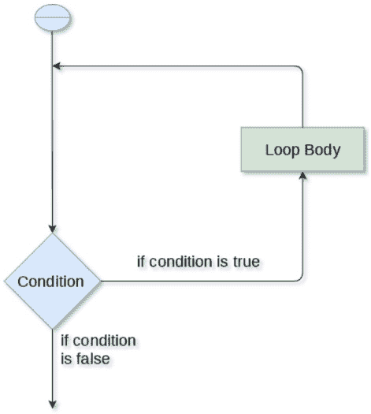

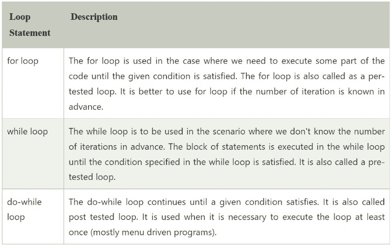

## Python for loop

在 Python 中，`for`循环用于多次迭代语句或程序部分。它通常用于遍历数据结构，如列表、元组或字典。

Python 的`for`循环语法所示。

```python
1. for iterating_var in sequence:
2. statement(s)
```

流程图

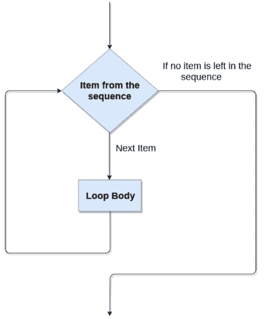

### for loop 使用序列

示例 - 使用 for 循环遍历字符串

```python
1. str = "Python"
2. for i in str:
3. print(i)
```

输出：

```
P
y
t
h
o
n
```

示例- 2 使用此程序打印给定数字的乘法表。

```python
1. list = [1,2,3,4,5,6,7,8,9,10]
2. n = 5
3. for i in list:
4. c = n*i
5. print(c)
```

输出：

```
5
10
15
20
25
30
35
40
45
50
```

## Python While loop

Python `while`循环在给定条件返回假之前执行一段代码。它也被称为预测试循环。

它可以被看作是一个重复的`if`语句。当我们不知道需要迭代多少次时，`while`循环是最佳选择。

语法所示。

```python
1. while expression:
2. statements
```

通过循环控制语句，我们可以改变`while`循环的标准执行顺序。当`while`循环结束时，在该作用范围内定义的所有自动对象都会被销毁。在`while`循环内部，Python 提供了控制语句。

### 1. Continue 语句

当遇到`continue`语句时，控制将返回循环的开头。让我们来看一个例子。

示例：

```python
## prints all letters except 'a' and 't'
i = 0
str1 = 'javapoint'
while i < len(str1):
    if str1[i] == 'a' or str1[i] == 't':
        i += 1
        continue
    print('Current Letter :', str1[i])
    i += 1
```

输出:

```
Current Letter : j
Current Letter : v
Current Letter : p
Current Letter : o
Current Letter : i
Current Letter : n
```

### 2. Break 语句

当遇到`break`语句时，控制将离开循环。

示例：

```python
# 当 break 语句很快遇到 t 时，控制发生转移
i = 0
str1 = 'javapoint'
while i < len(str1):
    if str1[i] == 't':
        i += 1
        break
    print('Current Letter :', str1[i])
    i += 1
```

输出:

```
Current Letter : j
Current Letter : a
Current Letter : v
Current Letter : a
```

### 3. Pass 语句

使用`pass`语句声明空循环。它也可以用于定义空类、函数或控制语句。让我们来看一个例子。

示例：

```python
# An empty loop
str1 = 'javapoint'
i = 0
while i < len(str1):
    i += 1
    pass
print('Value of i :', i)
```

输出:

```
Value of i : 9
```

### 示例

使用此程序打印给定数字的表格。

```python
i=1
number=0
b=9
number = int(input("Enter the number:"))
while i<=10:
    print("%d X %d = %d \n"%(number,i,number*i))
    i = i+1
```

输出:

```
Enter the number:10
10 X 1 = 10
10 X 2 = 20
10 X 3 = 30
10 X 4 = 40
10 X 5 = 50
10 X 6 = 60
10 X 7 = 70
10 X 8 = 80
10 X 9 = 90
10 X 10 = 100
```

## 在 while 循环中使用 else

Python 允许我们将`else`语句与`while`循环结合使用。当`while`语句中的条件失败时，将执行`else`块。如果使用`break`语句跳出了`while`循环，则不会执行`else`块，而是执行`else`块之后的语句。在使用`while`循环时，`else`语句是可选的。考虑以下场景。

### 示例 1

```python
i=1
while(i<=5):
    print(i)
    i=i+1
else:
    print("The while loop exhausted")
```

### 示例 2

```python
i=1
while(i<=5):
    print(i)
    i=i+1
    if(i==3):
        break
else:
    print("The while loop exhausted")
```

输出:

```
1
2
```

## Python break 语句

在 Python 中，`break`关键字用于将程序控制从循环中移除。`break`语句一次打破循环，因此在嵌套循环的情况下，它会先打破内部循环，然后移动到外部循环。换句话说，`break`用于终止程序的当前执行，并将控制转移到循环后的下一行。当我们需要根据特定条件打破循环时，通常使用`break`。`break`的语法所示：

```python
# loop statements
break;
```

### 示例 1

```python
list =[1,2,3,4]
count = 1;
for i in list:
    if i == 4:
        print("item matched")
        count = count + 1;
        break
print("found at",count,"location");
```

输出:

```
item matched
found at 2 location
```

### 示例 2

```python
str = "python"
for i in str:
    if i == 'o':
        break
    print(i);
```

输出:

```
p
y
t
h
```

# Python 字符串

到目前为止，我们已经涵盖了 Python 中最常见的数据类型数字。在教程这一部分，我们将介绍 Python 中常用的数据类型：字符串。

Python 字符串是用单引号、双引号或三引号包围的字符集合。计算机并不理解这些字符；相反，它在内部将处理过的字符存储为 0 和 1 的组合。每个字符都以 ASCII 或 Unicode 格式编码。因此，Python 字符串也可以称为 Unicode 字符集合。可以通过将字符或字符序列包含在引号中来创建字符串。Python 允许我们使用单引号、双引号或三引号来创建。

## 语法：

```python
str = "Hi Python !"
```


在这种情况下，我们可以使用 Python 脚本来确定变量`str`的类型。执行`print(type(str))`，它将打印出字符串（`str`）。在 Python 中，字符串被视为字符的连续体，这意味着不支持字符类型；相反，`'p'`被视为一个字符串。

### 创建字符串

通过用单引号或双引号包围字符，我们可以形成一个字符串。三引号用于多行。

```python
## Using single quotes
str1 = 'Hello'
print(str1)

## Using double quotes
str2 = "Hello"
print(str2)

## Using triple quotes
str3 = '''Hello
Python'''
print(str3)
```

输出：

```
Hello
Python
```

## 字符串的索引与分割

字符串的索引像其他语言一样从 0 开始。

```python
str = "HELLO"
print(str[0])
print(str[1])
print(str[2])
print(str[3])
print(str[4])
```

输出：

```
H
E
L
L
O
```

切片运算符用于从字符串中获取子字符串。

```python
str = "HELLO"
print(str[0:4])
```

输出：

```
ELL
```

## Python 列表

在 Python 中，列表用于存储数据序列。Python 列表是可变的，这意味着我们可以在它们形成后更改它们的元素。逗号（`,`）分隔列表中的元素。以下是一个示例。

```python
L1 = ["John", 102, "USA"]
L2 = [1, 2, 3, 4, 5, 6]
print(L1)
print(L2)
```

输出：

```
['John', 102, 'USA']
[1, 2, 3, 4, 5, 6]
```

```python
7.  print("Name : %s, ID: %d, Country: %s"%(emp[0],emp[1],emp[2]))    
8.  print("printing departments...")
9.  print("Department 1:\nName: %s, ID: %d\nDepartment 2:\nName: %s, ID: %s"%(Dep1[0],Dep2[1],Dep2[0],Dep2[1]))
10.  print("HOD Details ....")
11.  print("CS HOD Name: %s, Id: %d"%(HOD_CS[1],HOD_CS[0]))
12.  print("IT HOD Name: %s, Id: %d"%(HOD_IT[1],HOD_IT[0]))
13.  print(type(emp),type(Dep1),type(Dep2),type(HOD_CS),type(HOD_IT))
```

输出：

```
printing employee data...

Name : John, ID: 102, Country: USA

printing departments...

Department 1:

Name: CS, ID: 11

Department 2:

Name: IT, ID: 11

HOD Details ....

CS HOD Name: Mr. Holding, Id: 10

IT HOD Name: Mr. Bewon, Id: 11

<class 'list'> <class 'list'> <class 'list'> <class 'list'> <class 'list'>
```

在前面的示例中，我们构建了包含员工和部门信息的列表，并打印了相关信息。检查上面的代码以更好地理解列表的概念。

# Python 元组 (Tuple)

Python 元组是一种用于存储不可变 Python 对象序列的数据结构。元组与列表的相似之处在于列表中放置的项的值是可以修改的，但元组是不可变的，它的值无法被更改。

## 创建元组

由小括号`()`包含的用逗号分隔的值集合被称为元组。使用括号是可选的，但我们建议使用。以下是元组的定义。

1. `T1 = (101, "Peter", 22)`

2. `T2 = ("Apple", "Banana", "Orange")`

3. `T3 = 10,20,30,40,50`

5. `print(type(T1))`

6. `print(type(T2))`

7. `print(type(T3))`

输出：

```
<class 'tuple'>
<class 'tuple'>
<class 'tuple'>
```

创建一个包含单个元素的元组稍微复杂一点。要声明元组，我们必须在元素后使用一个逗号。

1. `tup1 = ("JavaTpoint")`

2. `print(type(tup1))`

3. #创建一个包含单个元素的元组

4. `tup2 = ("JavaTpoint",)`

5. `print(type(tup2))`

输出：

```
<class 'str'>
<class 'tuple'>
```

与列表通过索引一样，元组也可以通过索引。元组中每个项的索引值可以用来访问它。

以以下元组举例：

### 示例

1. `tuple1 = (10, 20, 30, 40, 50, 60)`

2. `print(tuple1)`

3. `count = 0`

4. `for i in tuple1:`

5. `print("tuple1[%d] = %d"%(count, i))`

6. `count = count+1`

输出：

```
(10, 20, 30, 40, 50, 60)
tuple1[0] = 10
tuple1[1] = 20
tuple1[2] = 30
tuple1[3] = 40
tuple1[4] = 50
tuple1[5] = 60
```

### 示例 - 2

1. `tuple1 = tuple(input("Enter the tuple elements ..."))`

2. `print(tuple1)`

3. `count = 0`

4. `for i in tuple1:`

5. `print("tuple1[%d] = %s"%(count, i))`

6. `count = count+1`

输出：

```
Enter the tuple elements ...123456
('1', '2', '3', '4', '5', '6')
tuple1[0] = 1
tuple1[1] = 2
tuple1[2] = 3
tuple1[3] = 4
tuple1[4] = 5
tuple1[5] = 6
```

与列表通过索引一样，元组也可以通过索引。元组中每个项的索引值可以用来访问它。

## 元组索引与切片

元组的索引和切片与列表类似。元组的索引从`0`开始，到`length(tuple) - 1`结束。可以使用`[]`运算符访问元组中的项。Python 中的`:`运算符也可以用于访问多个项。为了进一步理解索引和切片，请查看下面的图片。

`Images/image0199.jpeg`

1. `up = (1,2,3,4,5,6,7)`

2. `print(up[0])`

3. `print(up[1])`

4. `print(up[2])`

5. #这将导致 IndexError

6. `print(up[8])`

输出：

```
1
2
3
tuple index out of range
```

上述代码中的元组包含七个项，代表`0`到`6`的数字。我们尝试检索一个非元组元素，结果导致了`IndexError`。

1. `tuple = (1,2,3,4,5,6,7)`

2. #元素 1 到结束

3. `print(tuple[1:])`

4. #元素 0 到 3

5. `print(tuple[:4])`

6. #元素 1 到 4

7. `print(tuple[1:5])`

8. #元素 0 到 6 步长为 2

9. `print(tuple[0:6:2])`

输出：

```
(2, 3, 4, 5, 6, 7)
(1, 2, 3, 4)
(1, 2, 3, 4)
(1, 3, 5)
```

## 负索引

负索引也可以用于元组。右侧元素索引为 -1，倒数第二个索引为 -2，依此类推。考虑以下示例：

1. `tuple1 = (1,2,3,4,5,6,7)`

2. `print(tuple1[-1])`

3. `print(tuple1[-2])`

4. `print(tuple1[-4])`

5. `print(tuple1[:-1])`

6. `print(tuple1[-3:])`

输出：

```
7
6
4
123
567
```

## 删除元组

元组项与列表不同，不能用`del`关键字擦除，因为元组是不可变的。我们可以使用`del`关键字结合元组名称来删除整个元组。考虑以下示例：

1. `tuple1 = (1,2,3,4,5,6)`

2. `print(tuple1)`

3. `del tuple1[0]`

4. `print(tuple1)`

5. `del tuple1`

6. `print(tuple1)`

输出：

```
(1, 2, 3, 4, 5, 6)
Traceback (most recent call last):
  File "tuple.py", line 4, in <module>
    print(tuple1)
NameError: name 'tuple1' is not defined
```


元组项与列表不同不能用`del`关键字擦除，因为元组是不可变的。我们可以使用`del`关键字结合元组名称来删除整个元组。考虑以下示例：

1. `tuple1 = (1,2,3,4,5,6)`
2. `print(tuple1)`
3. `del tuple1[0]`
4. `print(tuple1)`
5. `del tuple1`
6. `print(tuple1)`

Output:

```
(1, 2, 3, 4, 5, 6)
Traceback (most recent call last):
  File "tuple.py", line 4, in <module>
    print(tuple1)
NameError: name 'tuple1' is not defined
```

# Learn JavaScript

JavaScript 是一种轻量级、跨平台的对象脚本语言。JavaScript 是一种翻译语言，而不是编译语言。JavaScript 翻译器（内置在浏览器中）负责为浏览器翻译 JavaScript 代码。JavaScript（`js`）是一种用于脚本网页的轻量级全功能面向对象语言。它于 1995 年发布，允许用户向 Netscape 浏览器添加程序。此后所有其他图形浏览器都接受了它。

## JavaScript 的特性

由于内置了执行环境，所有流行的网页浏览器都支持 JavaScript。JavaScript 的语法和结构基于 C 语言。因此，它被归类为结构化编程语言。JavaScript 是一种弱类型语言，具有隐式类型转换。该语言对大小写敏感。JavaScript 兼容多种操作系统，包括 Windows、macOS 和 Linux。它让消费者完全控制自己的网页浏览器。

`Images/image0200.jpeg`

## JavaScript 示例

```html
<script>
  document.write("Hello JavaScript by JavaScript");
</script>
```

双正斜杠（`//`）用于表示注释。在句子之前或之后使用它都是适当的。

让我们来看单行注释的示例，它是放置在语句之前的注释。

```javascript
<script>  
// 这是一个单行注释
document.write("hello javascript");  
</script>
```

**示例**

```javascript
<script>  
var a=10;  
var b=20;  
var c=a+b;//它相加变量 a 和 b 的值  
document.write(c);//打印 10 和 20 的和  
</script>
```

## 多行注释

它可以用于创建单行和多行注释。因此，它更具实用。

它的符号是一个正斜杠后跟一个星号，然后另一个正斜杠。考虑以下场景：

```javascript
/* 在此处输入你的代码 */
```

它可能出现在语句的之前、之后或中间。

```javascript
<script>  
/* 这是一个多行注释。  
它不会被显示 */  
document.write("example of javascript multiline comment");  
</script>
```

## JavaScript 变量

JavaScript 变量仅仅是存储位置的名称。在 JavaScript 中，有两种变量：局部变量和全局变量。

在声明 JavaScript 变量时，有一些需要遵循的指南（也称为标识符）。

- 名称必须以字母（`a` 到 `z` 或 `A` 到 `Z`）、下划线（`_`）或美元符号（`$`）开头。
- 可以在初始字母后放置数字（`0` 到 `9`），例如`value1`。
- JavaScript 变量区分大小写，因此`x`和`X`是两个变量。

### 正确的 JavaScript 变量

```javascript
var x = 10;  
var _value="sonoo";  
```

### 错误的 JavaScript 变量

```javascript
var 123=30;  
var *aa=320;
```

### 示例 - JavaScript 变量

```javascript
<script>  
var x = 10;  
var y = 20;  
var z=x+y;  
document.write(z);  
</script>
```

**输出**

30

## JavaScript 局部变量

JavaScript 中的局部变量声明在块或函数内部。它只能在函数或块内部被访问。考虑以下场景：

```javascript
<script>  
function abc(){  
var x=10;//局部变量  
}  
</script>
```

或者，

```javascript
<script>  
If(10<13){  
var y=20;//JavaScript 局部变量  
}  
</script>
```

### JavaScript 全局变量

JavaScript 中的全局变量可以从任何函数访问。全局变量是在函数外部或使用`window`对象声明的变量。考虑以下场景：

```javascript
<script>  
var data=200;//全局变量  
function a(){  
document.writeln(data);  
}  
function b(){  
document.writeln(data);  
}  
a();//调用 JavaScript 函数  
b();  
</script>
```

### JavaScript 全局变量

JavaScript 中的全局变量在函数外部或使用`window`对象声明。可以从任何函数访问它。让我们来看一个简单的全局变量 JavaScript 示例。

```javascript
<script>  
var value=50;//全局变量  
function a(){  
alert(value);  
}  
function b(){  
alert(value);  
}  
</script>
```

### 在 JavaScript 函数内部中声明全局变量

你必须利用`window`对象在函数内部声明 JavaScript 全局变量。考虑以下场景：

```javascript
window.value=90;
```

现在可以在任何函数内部声明并从任何函数内部访问它。考虑以下场景：

```javascript
function m(){  
window.value=100;//通过 window 对象声明全局变量  
}  
function n(){  
alert(window.value);//从其他函数访问全局变量  
}
```

## 在 JavaScript 中，全局变量的内部

当你在函数外部声明变量时，它会自动添加到`window`对象中。你也可以使用`window`对象来访问它。考虑以下场景：

```javascript
var value=50;  
function a(){  
alert(window.value);//访问全局变量  
}
```

## JavaScript 数据类型

JavaScript 提供了不同的数据类型来存储各种类型的值。在 JavaScript 中，有两种数据类型。

1. 原始数据类型
2. 非原始（引用）数据类型

JavaScript 是一种动态类型语言，这意味着你不需要指定变量的类型，因为 JavaScript 引擎动态地使用它。要指定数据类型，必须使用`var`。它可能存储任何类型的值，包括数字、字符串等。考虑以下场景：

```javascript
var a=40;//存储数字  
var b="Rahul";//存储字符串  
```

`img/image00201.jpeg`

`img/image00202.jpeg`

## JavaScript 运算符

JavaScript 中的运算符是会对操作数执行操作的符号。考虑以下场景：

```javascript
var sum=10+20;
```

在这里，`+`是算术运算符，`=`是赋值运算符。

### JavaScript 运算符的类型

1. 算术运算符
2. 比较（关系）运算符
3. 位运算符
4. 逻辑运算符
5. 赋值运算符
6. 特殊运算符

### JavaScript 算术运算符

为了对操作数进行算术运算，使用了算术运算符。JavaScript 算术运算符是下面列出的运算符。

`img/image00203.jpeg`

### JavaScript 比较运算符

JavaScript 中的比较运算符比较两个操作数。以下是比较运算符：

`img/image00204.jpeg`

### JavaScript 位运算符

位运算符在操作数上执行位操作。以下是位运算符：

`img/image00205.jpeg`

### JavaScript 逻辑运算符

JavaScript 逻辑运算符是下面列出的运算符。

`img/image00206.jpeg`

### JavaScript 赋值运算符

`img/image00207.jpeg`

### JavaScript 特殊运算符

`img/image00208.jpeg`

### JavaScript If-else

`img/image00209.jpeg`

### JavaScript If 语句

只有当 if 表达式为真时，才会评估内容。JavaScript 中的 if 语句具有以下签名：

```javascript
if(expression){
  content
}
```

`img/image0210.jpeg`

```javascript
<script>  
var a=20;  
if(a>10){  
document.write("a is greater than 10");  
</script>
```

**输出**

greater than 10

### JavaScript If...else 语句

它确定条件为真为假。JavaScript 中 if-else 语句的语法所示：

```javascript
if(expression){
  content
}
else{
  content
}
```

`img/image0211.jpeg`

```javascript
<script>  
var a=20;  
if(a%2==0){  
document.write("a is even number");  
}  
else{  
document.write("a is odd number");  
}  
</script>
```

**输出**

a is even number

### If...else 语句 – 在 JavaScript 中

只有当一个或多个表达式为真时，才会分析内容。JavaScript 中的 if else 语句具有以下签名：

```javascript
if(expression1){
  content
}
else if(expression2){
  content
}
else if(expression3){
  content
}
else{
  content
}
```

```javascript
<script>  
var a=20;  
if(a==10){  
document.write("a is equal to 10");  
}  
else if(a==15){  
document.write("a is equal to 15");  
}  
else if(a==20){  
document.write("a is equal to 20");  
}  
else{  
document.write("a is not equal to 10, 15 or 20");  
}  
</script>
```

**输出**

a is equal to 20

# JavaScript switch 语句

JavaScript `switch`语句用于将许多表达式合并到段代码中。它与上一页学习的`else if`语句相同。然而，它比`if..else..if`更实用，因为它可以用于整数、字符和其他变量。

JavaScript `switch`语句的签名下所示。

```javascript
switch(expression){
  case value1:
    code to be executed;
    break;
  case value2:
    code to be executed;
    break;
  ......
  default:
    // 如果上述值都不匹配，则执行此代码;
}
```

## 简单示例 - switch 语句 - javascript

```html
<script>
  var grade='B';
  var result;
  switch(grade){
    case 'A':  result="A Grade";
    break;
    case 'B':
      result="B Grade";
    break;
    case 'C':
      result="C Grade";
    break;
    default:
      result="No Grade";
  }
  document.write(result);
</script>
```

**输出**

B Grade

## switch 语句的行为

```html
<script>
  var grade='B';
  var result;
  switch(grade){
    case 'A':
      result+=" A Grade";
    case 'B':
      result+=" B Grade";
    case 'C':
      result+=" C Grade";
    default:
      result+=" No Grade";
  }
  document.write(result);
</script>
```

**输出**

undefined B Grade C Grade No Grade

# JavaScript 循环

`for`、`while`、`do while`和`for-in`循环用于在 JavaScript 中迭代一段代码。它可以减少代码量。它们最常见于数组。

1. `for`循环
2. `while`循环
3. `do-while`循环
4. `for-in`循环

## 1) JavaScript For 循环

JavaScript 中的循环按指定的次数迭代组件。如果迭代次数已知，则应该使用它。`for`循环的语法所示。

```javascript
for (initialization; condition; increment)
{
  // 要执行的代码
}
```

### 示例

```html
<script>
  for (i=1; i<=5; i++)
  {
    document.write(i + "<br/>")
  }
</script>
```

**输出：**

1

2

3

4

5

## 2) JavaScript while 循环

JavaScript 中的`while`循环无限迭代组件。如果迭代次数未知，则应该使用它。`while`循环的语法所示。

```javascript
while (condition)
{
  // 要执行的代码
}
```

### 示例

```html
<script>
  var i=11;
  while (i<=15)
  {
    document.write(i + "<br/>");
    i++;
  }
</script>
```

**输出：**

11

12

13

14

15

## 3) Do while 循环

JavaScript 的`do while`循环与`while`循环一样，无限迭代元素。无论条件真假，代码至少执行一次。以下是`do while`循环的语法。

```javascript
do{
  // 要执行的代码
}while (condition);
```

### 示例

```html
<script>
  var i=21;
  do{
    document.write(i + "<br/>");
    i++;
  }while (i<=25);
</script>
```

**输出：**

21

22

23

24

25

## 4) JavaScript for in 循环

JavaScript 的`for in`循环用于遍历对象的属性。

# JavaScript 函数

为了执行操作，需要 JavaScript 函数。为了复用代码，我们可以多次调用 JavaScript 函数。

## 使用 JavaScript 的用处

JavaScript 函数主要有两个优势：

1. **代码的可重用性**：因为我们可以多次调用函数，所以可以节省编写代码的时间。
2. **更少的代码**：意味着我们的程序更紧凑。为了完成一项常见任务，我们不需要每次都编写许多行代码。

## JavaScript 函数语法

```javascript
function functionName([arg1, arg2, ...argN]){
  // 要执行的代码
}
```

### 示例

```html
<script>
  function msg(){
    alert("hello! this is message");
  }
</script>
<input type="button" onclick="msg()" value="call function"/>
```

## JavaScript 函数参数


```html
<script>
  function getcube(number){
    alert(number*number*number);
  }
</script>
<form>
  <input type="button" value="click" onclick="getcube(4)"/>
</form>
```

## 带返回值的函数

我们可以通过调用函数在程序中使用返回返回值的函数。让我们看一个返回返回值的函数作为示例。

```html
<script>
  function getInfo(){
    return "hello javatpoint! How r u?";
  }
</script>
<script>
  document.write(getInfo());
</script>
```

**输出**

hello javatpoint! How r u?

## JavaScript 函数对象

JavaScript 中的`Function`对象`Object() { [native code] }`用于生成一个新的`Function`对象。它在全局范围内运行代码。然而，当我们直接调用函数`Object() { [native code] }`时，会构建一个函数。

### 语法

`function functionName([arg1, arg2, ...argN])`

### 函数对象示例

```javascript
var add = Function("num1", "num2", "return num1+num2");
```

### 函数对象示例

```javascript
var pow = Function("num1", "num2", "return num1*num2");
```

## 定义方法 - JavaScript 对象

在 JavaScript 对象中，我们可以指定方法。然而，在定义方法之前，我们必须向函数添加一个与方法同名的属性。

### 示例

```html
<script>
  function emp(id,name,salary){
    this.id=id;
    this.name=name;
    this.salary=salary;
    this.changeSalary=changeSalary;
  }
  function changeSalary(otherSalary){
    this.salary=otherSalary;
  }
  e=new emp(103,"Sonoo Jaiswal",30000);
  document.write(e.id+" "+e.name+" "+e.salary);
  e.changeSalary(45000);
  document.write("<br>"+e.id+" "+e.name+" "+e.salary);
</script>
```

**输出**

103 Sonoo Jaiswal 30000

103 Sonoo Jaiswal 45000

# JavaScript 数组

JavaScript 数组是一个表示相同类型对象组的对象。

在 JavaScript 中，有三种方法创建数组：

1. 通过数组字面量

2. 直接创建`Array`实例（使用`new`关键字）

3. 通过使用`Array`构造函数（使用`new`关键字）

## 1) JavaScript 数组字面量

```javascript
var arrayname=[value1,value2.....valueN];
```

值包含在`[]`中，并正如你所看到的，用逗号（comma）分隔。

让我们来看一个在 JavaScript 中创建和使用数组的简单示例。

```javascript
<script>
  var emp=["Sonoo","Vimal","Ratan"];
  for (i=0;i<emp.length;i++){
    document.write(emp[i] + "<br/>");
  }
</script>
```

Output

Sonoo

Vimal

Ratan

## 2) 直接数组

以下是直接创建数组的语法：

```javascript
var arrayname=new Array();
```

在这种情况下，使用`new`关键字来创建一个数组对象。

让我们来看从零生成数组的示例。

```javascript
<script>
  var i;
  var emp = new Array();
  emp[0] = "Arun";
  emp[1] = "Varun";
  emp[2] = "John";
  for (i=0;i<emp.length;i++){
    document.write(emp[i] + "<br>");
  }
</script>
```

Output

Arun

Varun

John

## 3) JavaScript 数组构造函数

为了我们不需要显式地提供值，你必须通过向函数`Object() { [native code] }`传递参数来创建数组实例。

以下是使用数组函数`Object() { [native code] }`创建对象的示例。

```javascript
<script>
  var emp=new Array("Jai","Vijay","Smith");
  for (i=0;i<emp.length;i++){
    document.write(emp[i] + "<br>");
  }
</script>
```

Output

Jai

Vijay

Smith

## JavaScript 数组方法

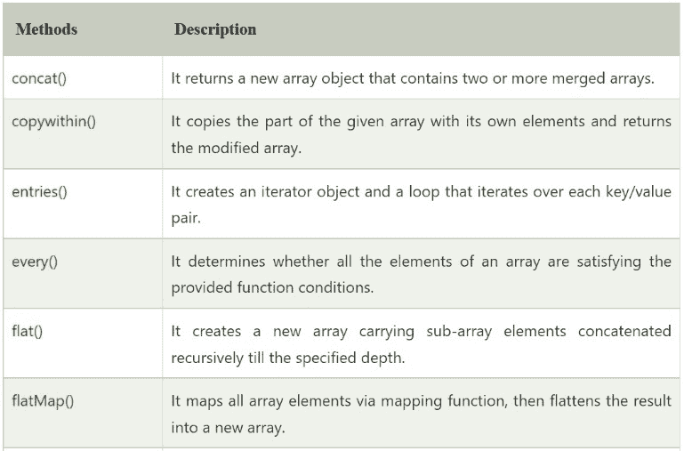

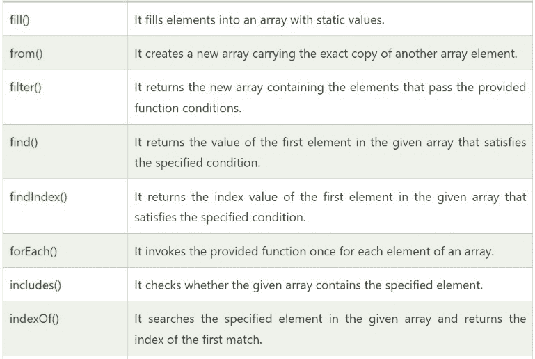

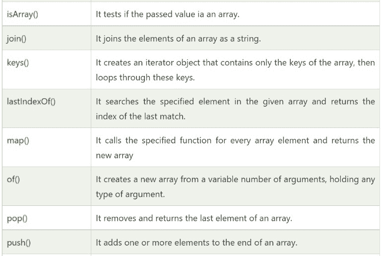

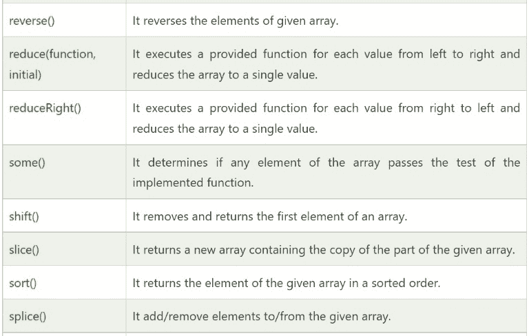

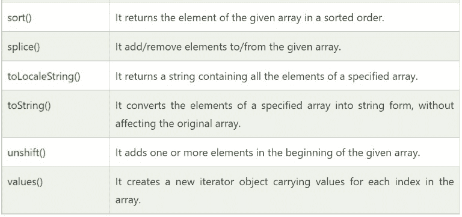

## JavaScript String

JavaScript 中的字符串是一个表示字符序列的对象。

在 JavaScript 中，有两种创建字符串：

1. 通过字符串字面量

2. 通过字符串对象（使用`new`关键字）

### 1) 通过字符串字面量

使用双引号来构建字符串字面量。以下是使用字符串字面量创建字符串的语法：

```javascript
var stringname="string value";
```

### 示例

```javascript
<script>
  var str="This is string literal";
  document.write(str);
</script>
```

Output:

This is string literal

### 2) 通过字符串对象（使用 new 关键字）

以下是使用`new`关键字创建字符串对象的语法：

```javascript
var stringname=new String("string literal");
```

`new`关键字用于创建字符串实例。

让我们来看在 JavaScript 中使用`new`关键字创建字符串的示例。

```javascript
<script>
  var stringname=new String("hello javascript string");
  document.write(stringname);
</script>
```

OUTPUT

hello javascript string

## JavaScript String 方法

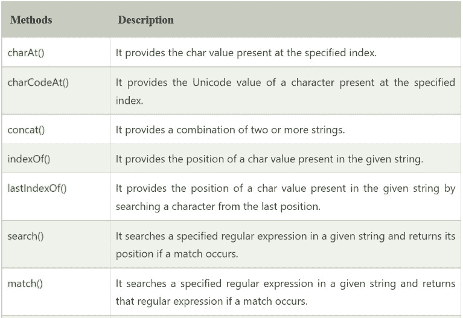

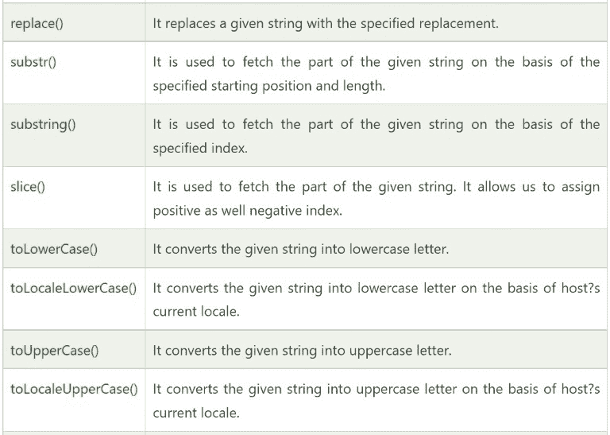

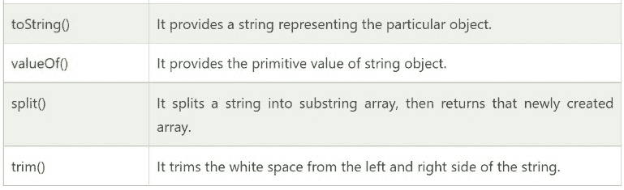

## JavaScript Date 对象

你可以使用 JavaScript 日对象获取年、月、日。JavaScript 日对象可以用于在网页上显示计时器。

要生成日期对象，你可以使用多种`Date`构造函数。它具有获取和设置日、月、年、时、分、秒的方法。

### 构造函数

4 种 Date 构造变体

1. `Date()`

2. `Date(milliseconds)`

3. `Date(dateString)`

4. `Date(year, month, day, hours, minutes, seconds, milliseconds)`

## JavaScript Date 方法

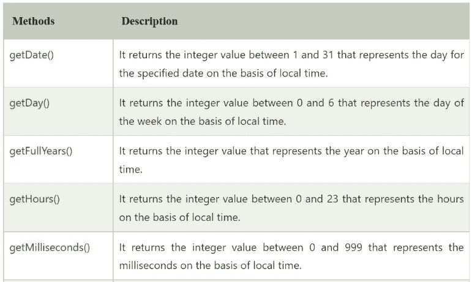

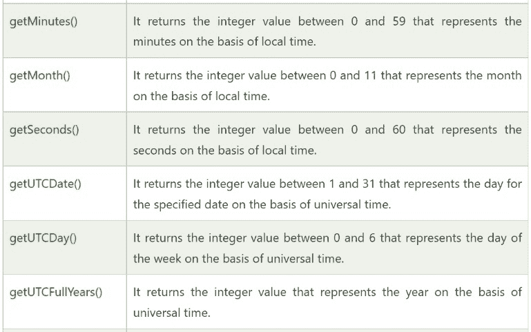

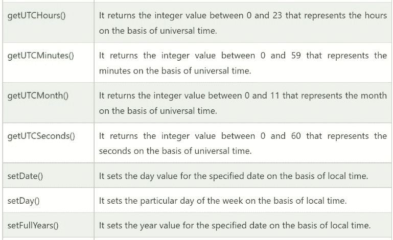

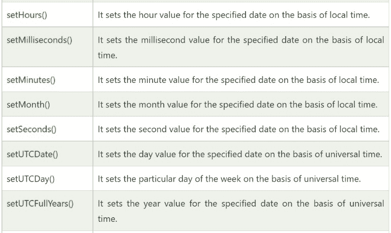

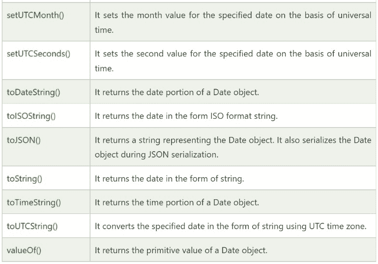

## JavaScript Date 示例

1. 当前日期和时间: <span id="txt"></span>

```javascript
<script>
  var today=new Date();
  document.getElementById('txt').innerHTML=today;
</script>
```

OUTPUT

Current Date: Sat Feb 12 2022 23:47:52 GMT+0530 (India Standard Time)

示例 2

```javascript
<script>
  var date=new Date();
  var day=date.getDate();
  var month=date.getMonth()+1;
  var year=date.getFullYear();
  document.write("<br>Date is: "+month+"/"+year);
</script>
```

### 当前时间示例

1. 当前时间: <span id="txt"></span>

```javascript
<script>
  var today=new Date();
  var h=today.getHours();
  var m=today.getMinutes();
  var s=today.getSeconds();
  document.getElementById('txt').innerHTML=h+":"+m+":"+s;
</script>
```

### 数字钟示例

让我们来看一个使用 JavaScript 日对象显示数字钟的简单示例。在 JavaScript 中，你可以使用`setTimeout()`或`setInterval()`方法指定指定间隔。

示例

```javascript
Current Time: <span id="txt"></span>
<script>
  window.onload=function(){
    var today=new Date();
    var h=today.getHours();
    var m=today.getMinutes();
    var s=today.getSeconds();
    //在数字小于 10 前加一个零
    m=checkTime(m);
    s=checkTime(s);
    document.getElementById('txt').innerHTML=h+":"+m+":"+s;
    setTimeout(function(){getTime()},1000);
  }
  //setInterval("getTime()",1000);另一种方法
  function checkTime(i){
    if (i<10){
      i="0"+i;
    }
    return i;
  }
</script>
```

## JavaScript Math

为了进行数学运算，JavaScript math 对象暴露了各种常量和方法。与`date`对象不同，它没有构造函数。

### JavaScript Math 方法

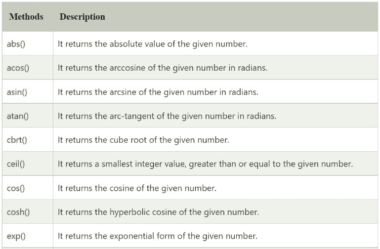

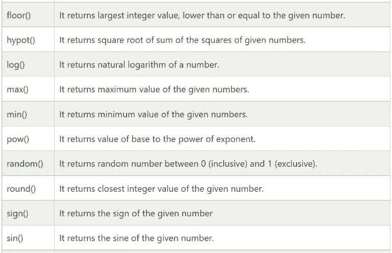

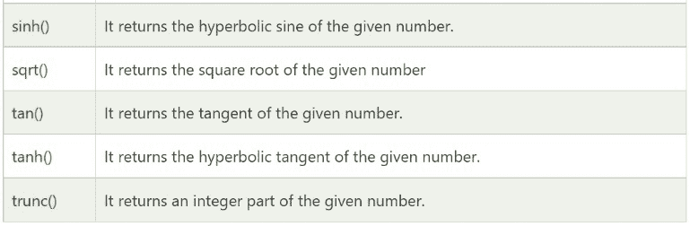

### Math.sqrt(n)

`math.sqrt(n)`方法返回数的平方根。

```javascript
Square Root of 17 is: <span id="p1"></span>
<script>
  document.getElementById('p1').innerHTML=Math.sqrt(17);
</script>
```

Output:

Square Root of 17 is: 4.123105625617661

### Math.random()

JavaScript 中的`math.random()`方法返回一个 0 到 1 之间的随机数。

```javascript
Random Number is: <span id="p2"></span>
<script>
  document.getElementById('p2').innerHTML=Math.random();
</script>
```

Output:

Random Number is: 0.02157876559753591

### Math.pow(m,n)

```javascript
3 的 4 次方结果是: <span id="p3"></span>
<script>
  document.getElementById('p3').innerHTML=Math.pow(3,4);
</script>
```

Output:

3 to the power of 4 is: 81

### Math.floor(n)

JavaScript `math.floor(n)`方法返回数的最低整数。例如，对于 3.7 返回 3，对于 5.9 返回 5。

```javascript
Floor of 4.6 is: <span id="p4"></span>
<script>
  document.getElementById('p4').innerHTML=Math.floor(4.6);
</script>
```

Output:

Floor of 4.6 is: 4

### Math.ceil(n)

JavaScript `math.ceil(n)`方法返回给定值的最大整数。例如，对于 3.7 返回 4，对于 5.9 返回 6。

```javascript
Ceil of 4.6 is: <span id="p5"></span>
<script>
  document.getElementById('p5').innerHTML=Math.ceil(4.6);
</script>
```

Output:

Ceil of 4.6 is: 5

### Math.round(n)

JavaScript math。`round(n)`方法给出给定数字最接近的整数。如果小数部分大于等于 0.5，则赋值高值 1；否则赋值低值 0。例如，对于 3.7 返回 4，对于 3.3 返回 3，对于 5.9 返回 6。

```javascript
Round of 4.3 is: <span id="p6"></span>
Round of 4.7 is: <span id="p7"></span>
<script>
  document.getElementById('p6').innerHTML=Math.round(4.3);
  document.getElementById('p7').innerHTML=Math.round(4.7);
</script>
```

Output:

Round of 4.3 is: 4

Round of 4.7 is: 5

## JavaScript Number 对象

你可以使用 JavaScript 数字对象表示一个数值。它可以是整数也可以是浮点数。JavaScript 数字对象遵循表示浮点数的 IEEE 标准。

在 JavaScript 中，你可以通过`Number()`函数`Object() { [native code] }`创建一个数字对象。

如果值无法转换为数字，它将返回`NaN`（不是数字），可以使用`isNaN()`方法进行验证。

你也可以直接将数字赋值给变量。以下是场景示例：

```javascript
var x=102;//整数值
var y=102.7;//浮点值
```

3. `var z=13e4;`指数值，输出：130000

4. `var n=new Number(16);`通过数字对象的整数值

输出：

102 102.7 130000 16

## JavaScript 数字常量

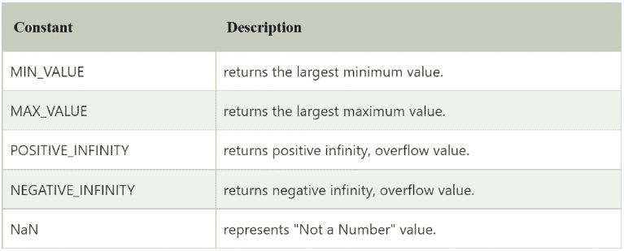

## JavaScript 数字方法

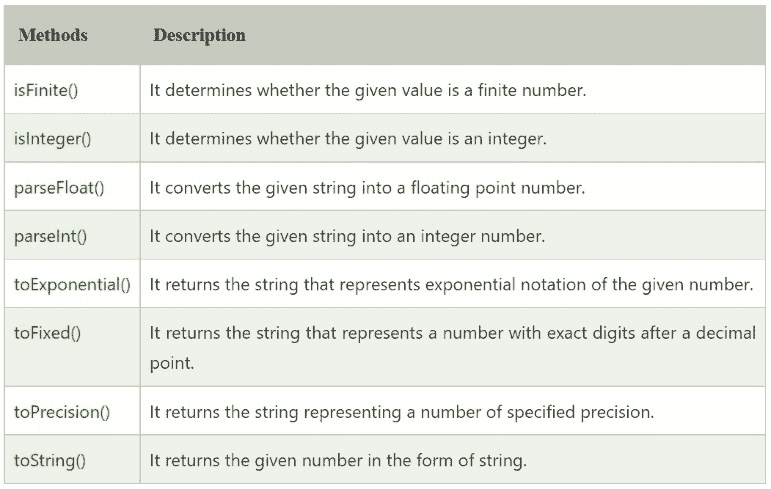

## JavaScript 布尔值

JavaScript 中的布尔对象表示两种状态之一的值：真（true）或假（false）。JavaScript 中的`Boolean()`函数`Object() { [native code] }`可用于构建 JavaScript 布尔对象，如下所示。

1. `Boolean b=new Boolean(value);`

### JavaScript 布尔值示例

```html
1. <script>
2. document.write(10<20);//true
3. document.write(10<5);//false
4. </script>
```

### 布尔属性

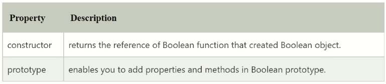

### 布尔方法

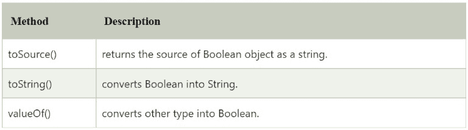
