# Python 和 JavaScript 编码基础


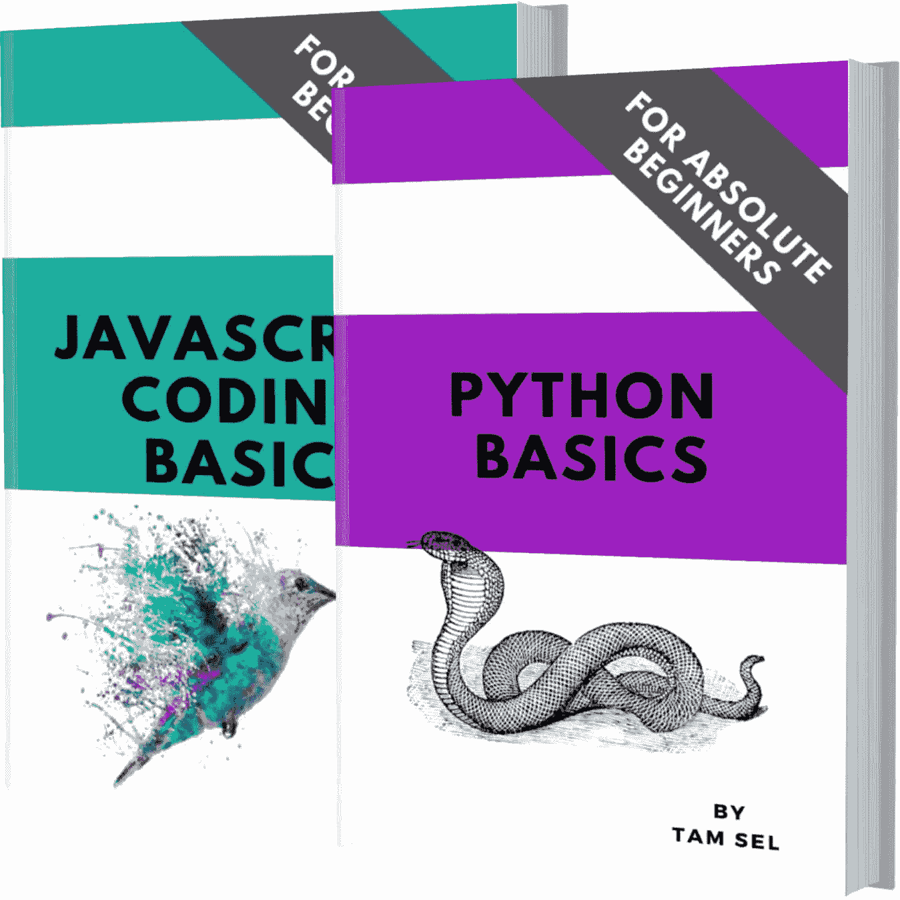


## Python 简介

### Python 的显著特性
它是一种通用编程语言，既可用于科学编程也可用于非科学编程。

对于初来说，它是非常优秀的语言，因为它是解释型的，可以产生立即结果。

它比同时期的其他语言更好地融合了异常处理和动态绑定原则。

用 `Python` 编写的程序易读且易懂。

它是一种独立平台的编程语言。

对于自定义应用程序，它适用于扩展语言。

学习和使用它非常简单。

### 主要应用
Google 搜索引擎、Twitter 等。

使用 `Python` 了 BitTorrent 点对点文件共享程序。

Intel、Cisco、HP、IBM 等公司使用 `Python` 进行硬件测试。

Maya 提供了 `Python` 脚本 API。

工业机器人的制造使用了 `Python`。

NASA 等机构使用 `Python` 进行科学编程活动。

### 安装 Python 解释器
为了编写和运行 `Python` 程序，我们需要在计算机上安装一个 `Python` 解释器。

标准且最常用的 `Python` 开发环境是 `IDLE`（集成 GUI）。

`IDLE` 指的是集成开发环境（Integrated Development）。

这允许通过单一 GUI 修改、运行、搜索和调试 `Python` 程序。这种环境使得编写程序变得简单。

注意：在这些教程中，我们将使用 3.6 版本的 `Python` `IDLE` 来开发和运行 `Python` 代码。你可以在 www.python.org 免费获取。

启动 `IDLE`

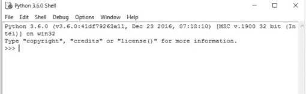

## Python 的特性
* 面向对象
* 强异常处理
* 自动内存管理
* 动态性
* 强数据类型
* 语法简单
* 基于缩进
* 本质具有容错性

在 Python 中打印 "Hello World"

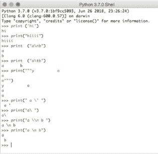

## 安装 pip
`Pip` 是一个能够安装和管理 Python 包的平台。

### Python：安装 pip
要安装新版本的 `pip`，请在 MacOS 中运行命令

### $ sudo easy_install pip
```bash
sudo easy_install pip
```

### $ sudo pip install --upgrade pip
```bash
sudo pip install --upgrade pip
```

在 Ubuntu 中安装 pip

### $ sudo apt-get update
```bash
sudo apt-get update
```

### $ sudo apt-get install python-pip
```bash
sudo apt-get install python-pip
```

### $ sudo pip install --upgrade pip
```bash
sudo pip install --upgrade pip
```

Centos 中的 pip

### $ sudo yum update
```bash
sudo yum update
```

### $ sudo yum install epel-release
```bash
sudo yum install epel-release
```

### $ sudo yum install python-pip
```bash
sudo yum install python-pip
```

### # version>= Centos7
### $ sudo pip install --upgrade pip
```bash
sudo pip install --upgrade pip
```

## 执行第一个程序
我们将在设备上启动 `Python` 使其在交互模式下运行工作。

在提示符（`> > >`）之后，我们输入 `Python` 表达式/语句。

### 第一个程序
我们在交互模式下输入代码。

```python
> > print("Hello World!")
Hello World
```

让我们从输入一些表达式开始：

```python
> > 5 + 7
12
> > 4 * 10
40
> > 9 % 2
1
> > 6 // 6
1
```

### 其他操作
```python
> > x=1
> > y=5
> > z=x+y
> > print(z)
6
```

### 模式
我们在交互模式下输入代码。它对于测试小段代码很有用。我们应该将代码保存在文件中，以便多次重复使用。

我们将使用 `IDLE` 来构建和运行代码。

```python
1. 新文件
2. 写代码
3..
4. 执行 执行

```python
> > x=1
> > y=5
> > z=x+y
> > print(z)
6
```

## 关键字
关键字是 Python 语言的保留字字（类似于 C++、Java 等），其定义无法被修改。

### Python 列表
Python 编程语言中有内置 Python 关键字，用于为不同的目的执行不同的任务。

关键字对大小写敏感。

| `False` | `None` | `True` | `and` | `as` |
| :--- | :--- | :--- | :--- | :--- |
| `assert` | `async` | `await` | `break` | `class` |
| `continue` | `def` | `del` | `elif` | `else` |
| `except` | `finally` | `for` | `from` | `global` |
| `if` | `import` | `in` | `is` | `lambda` |
| `nonlocal` | `not` | `or` | `pass` | `raise` |
| `return` | `try` | `while` | `with` | `yield`

## Python 内置关键字
Python 编程语言中有内置 Python 关键字，用于为不同的目的执行不同的任务。

### 所有 Python 关键字 – 列表
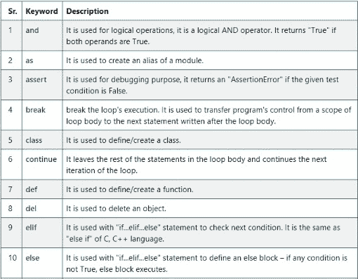
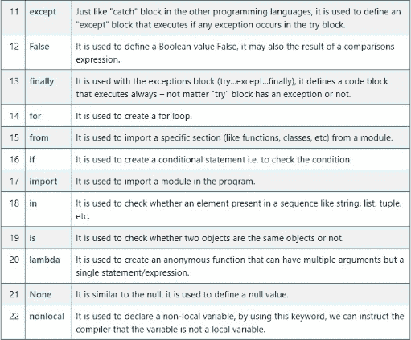
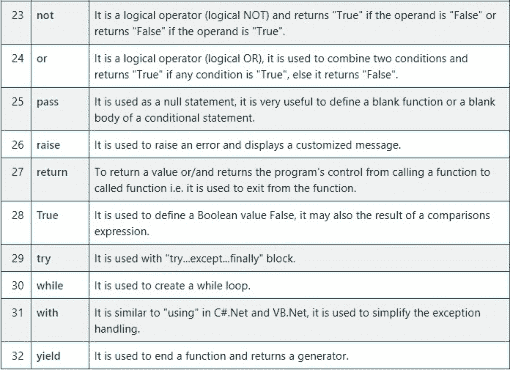

## Python 中的注释
Python 中的注释用于提高代码的可读性。

对于读者来说，为了更好地理解他们解决给定问题所使用的代码和逻辑，这是程序员在源代码中提供的非常有价值的信息。

在编译期间，注释不会被执行，也不会显示在输出中。

### Python 注释类型
1.  单行注释 (#)
2.  多行字符串作为注释 ('')

### 1) 单行注释
单行注释用于 Python 中的单行语句，例如对各种变量、函数、表达式等的解释。


哈希符号（`#`）用于渲染单行注释。当注释换到下一行时，它们必须在下一行的开头与前行的哈希标记（`#`）对齐。

让我们来看一个实例，并尝试理解如何在软件中应用单行注释。

#### 示例

##### 单行注释示例

```python
## 一个打印给定字符串和加法的程序。
print('Welcome @ Learnpython')
a=2
b=5
print(a+b)
## 使用加号(+) 对两个两个数字进行相加。
```

### 2) 多行字符串注释

正如我们在上面的示例所示，对于多行注释，我们必须在每一行放置一个哈希符号（`#`）。

在 Python 中，多行字符串注释使用分隔符提供。当内容无法用单行表示时，这很有帮助。

对于多行字符串注释，我们必须在两端使用分隔符包裹字符串。

#### 示例

```python
'''
    在这里我们将使用 Python 的多行注释
    检查给定的数字 n 是偶数还是奇数。
'''
n=6768
if n%2==0:
    print("Even number.")
else:
    print("Odd number.")
```

## Python 中的块注释

### 注释

注释是计算机程序中的一段文本，旨在解释或标注。

它对源代码作者是可读的，并且会被编译器/解释器忽略。

### Python 注释的类型

`块注释（Block Comments）`和`内联注释（Inline Comments）`，

### 1) 块注释

对于后续的代码段适用于块注释。它可以指代代码的一部分或整个代码。

它们与该代码具有相同的缩进程度。

每行注释都以 `#` 开头。

#### 示例

```python
## Python 程序，打印
## Hello World
print("Hello World")
```
输出：
`Hello World`

也可以使用 `''' '''` 制作块注释。写在这些引号中的内容被称为注释。

#### 示例

```python
'''
Python 程序，打印
Hello World
'''
print("Hello World")
```

### 示例 2

```python
def hello():
    '''
    在这里，这是文档字符串（docstring）
    因为它是写在
    函数定义之后的。
    下面的 print 语句将打印
    Hello World
    '''
    print("Hello World")
if __name__ == "__main__":
  # 调用 hello 函数
  hello()
```

### 2) 内联注释

与声明在同一行上的注释是内联注释。

内联备注与参数之间应至少有两个空格。

它们应该以 `#` 和一个空格开始。

#### 示例

```python
print("Hello World")  # 这是一个内联注释
```
输出：
`Hello World`

## 创建多行注释

当我们需要对几行/语句进行注释时，有两种方法可以实现这一点，要么对每行进行注释，要么构建多行注释（或块注释）。

第一方法是对每个部分进行注释，

这在 Python 中可以被视为单行注释——在每一行被注释的行开头，我们使用哈希字符（`#`）。

```python
### 这是第 1 行
### 这是第 2 行
### 这是第 3 行
```

而第二种方法是对段落进行注释，

这在 Python 中可以被视为多行注释——我们在被注释段落的开头使用三单引号（`'''`），并在结尾使用三单引号（`'''`）。

```python
'''
这是第 1 行
这是第 2 行
这是第 3 行
'''
```

#### 示例

```python
'''
函数名: print_text
参数: 无
返回类型: 无
描述: 此函数将在屏幕上打印
一些文本
'''
def print_text():
  print("Hello, world! How are you?")
if __name__ == "__main__":
  # 在这里，我们将调用 print_text 函数
  # 它将在屏幕上打印一些文本
  print_text()
```

## Python 数字类型

数据类型是编程中的一个重要概念。

根据我们希望变量执行的角色，可以将不同类型的数据存储在变量中。

在 Python 中，内置类型有：

* `文本类型（Text Type）`
* `数值类型（Numeric Type）`
* `映射类型（Mapping Type）`
* `序列类型（Sequence Type）`
* `集合类型（Set Type）`
* `布尔类型（Boolean Type）`
* `二进制类型（Binary Type）`

Python 中的 3 种数值类型：

1. `int`
2. `float`
3. `comple`

### 1) int

整数数值形式不带小数点，用于存储带符号的整数，例如 -5, 2, 78 等。

#### 示例

```python
### 给变量赋值整数值
x = 8
y = -9
### 操作 x 的值
x = x + y
### 打印更新后的 x 值
print("x= ", x)
### 打印 x 的类型
print("Data type of x: ", type(x))
```
输出：
`x= -1`
`Data type of x: <class 'int'>`

### 2) float

float 的数值形式用于存储浮点值，例如 6.66, 58.9, 3.14 等。

浮点数也可以用科学计数法表示，用 `E` 或 `e` 表示 10 的幂次方（`3.6e3 = 3.6x 103 = 3600`）。

#### 示例

```python
### 给变量赋值浮点值
x = 8.9
y = -9.1
### 操作 x 的值
x = x - y
### 打印更新后的 x 值
print("x= ", x)
### 打印 x 的类型
print("Data type of x: ", type(x))
```
输出：
`x= 18.0`
`Data type of x: <class 'float'>`

### 3) complex

复数的数值形式用于存储浮点值，如 6.66, 58.9, 3.14 等。

浮点数也可以用科学计数法表示，用 `E` 或 `e` 表示 10 的幂次方（`3.6e3 = 3.6x 103 = 3600`）。

复数类型用于存储浮点数，如 3.14j。

格式：实部 + 虚部

注意：在 Python 中，必须使用 `j` 来表示虚部。

#### 示例

```python
### 给变量赋值复数值
x = 8.5j
y = 9j
### 操作 x 的值
x = x + y
### 打印更新后的 x 值
print("x= ", x)
### 打印 x 的类型
print("Data type of x: ", type(x))
```
输出：
`x= (8.5+17.5j)`
`Data type of x: <class 'complex'>`

## 变量数据类型

### 1\. 数字

数字类型存储数值值。这种数据类型是永久的。

它们有三种不同的类型：

* `整数与长整数（Integer & Long）`
* `浮点数（Float）`
* `复数（Complex）`

i) 整数：

整数是不带小数点的整数字，如 100000, -99。当想要长整数时附加 `L`。Python 将这些值视为长整数。

```python
>>> a = 10
>>> b = 5192L # 为变量提供值的示例
>>> c=429814
>>> type(c) # 使用 ( ) 检查值的类型
```

ii) 浮点数：

浮点数是带有小数点的数字。

浮点数由符号（+,-）、数字序列和一个点组成，如 0.0, -21.9, 0.98333328, 15.2963。

（注：原文中缺少浮点数的示例代码，但保留了结构。）

iii) 复数：

Python 复数由两个浮点值组成，每个一个实部和虚部。我们将使用 `x.real` 和 `x.image` 来访问向量（对象）`x` 的各个部分。

数字的虚部用 `j` 代替 `I`，因此 `1 + 0j` 表示零。

```python
>>> x = 1+0j
>>> print (x.real,x.imag)
1.0 0.0
```


它们只是告诉机器字符串常量的起始位置和结束位置。

```python
>>> type ('Good Morning')
<class 'str'>

>>> type ('3.2')
<class 'str'>
```

### 3.2) 列表 (Lists)
列表也是某种重要类型的序列。
列表中的值被称为 `elements`（元素）/ `objects`（对象）。它们的特点是可变的且索引的/ `ordered`（有序）。
列表包含在方括号中。

### 3.3) 元组 (Tuples)
元组是值的集合，通过某种整数进行索引。它们是不可变的。

### 4 集合 (Sets)
集合是一个无序的值数组，没有重复条目。集合是无时的。

#### 示例
```python
>>>s = set ([1,2,3,4])
>>>print(s)
{1, 2, 3, 4 }
```

## 判断 Python 变量类型

### 1) type() 方法
如果向 `type()` 传递单个参数，它返回给定对象的类型。

#### 示例
```python
>>> test_string = "yes"
>>> test_number = 1
>>> print(type(test_string))
<class 'str'>
>>> print(type(test_number))
<class 'int'>
```

### 2) isinstance() 方法
`isinstance()` 函数测试对象（第一个参数）是否为 `classinfo` 类的实例或子类（第二个参数）。

#### 示例
```python
>>> class Example:
...     name = 'include_help'
...
>>> ExampleInstance = Example()
>>> print(isinstance(ExampleInstance, Example))
True
>>> print(isinstance(ExampleInstance, (list, set)))
False
>>> print(isinstance(ExampleInstance, (list, set, Example)))
True
```

### type() 和 isinstance() 比较
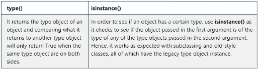

## Python 算术运算符
算术运算符用于执行不同的算术/数学操作，它们是二运算符，意味着计算需要两个操作数。

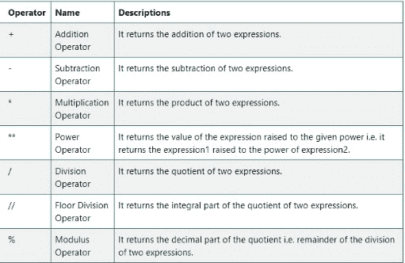

语法：
- `exp1 + exp2`
- `exp1 - exp2`
- `exp1 * exp2`
- `exp1 ** exp2`
- `exp1 / exp2`
- `exp1 // exp2`
- `exp1 % exp2`

#### 程序
```python
## 演示算术运算符
### 示例的 Python 程序
a = 10
b = 3
### 打印值
print("a:", a)
print("b:", b)
### 操作
print("a + b :", a + b)
print("a - b :", a - b)
print("a * b :", a * b)
print("a ** b:", a ** b)
print("a / b :", a / b)
print("a // b:", a // b)
print("a % b :", a % b)
```
输出：
```text
a: 10
b: 3
a + b : 13
a - b : 7
a * b : 30
a ** b: 1000
a / b : 3.3333333333333335
a // b: 3
a % b : 1
```

### 示例 2
```python
## 演示算术运算符
### 示例的 Python 程序
a = 10.10
b = -2.5
### 打印值
print("a:", a)
print("b:", b)
### 操作
print("a + b :", a + b)
print("a - b :", a - b)
print("a * b :", a * b)
print("a ** b:", a ** b)
print("a / b :", a / b)
### // 运算符将结果
### 向下取整到最近的整数
print("a // b:", a // b)
print("a % b :", a % b)
```
输出：
```text
a: 10.1
b: -2.5
a + b : 7.6
a - b : 12.6
a * b : -25.25
a ** b: 0.0030845837443758094
a / b : -4.04
a // b: -5.0
a % b : -2.4000000000000004
```

### 示例 3
```python
## 演示算术运算符
### 示例的 Python 程序
### 列表、字符串等上的操作
x = "Hello"
y = "World"
### 字符串的 '+', '*'
print("x + y:", x + y)
print("x + y + x:", x + y + x)
print("x * 2:", x * 2)
print("x * 10:", x * 10)
print()
### 列表的 '+', '*'
x = [10, 20, 30, 40]
y = [40, 30, 20, 10]
print("x + y:", x + y)
print("x + y + x:", x + y + x)
print("x * 2:", x * 2)
print("x * 3:", x * 3)
print()
```
输出：
```text
x + y: HelloWorld
x + y + x: HelloWorldHello
x * 2: HelloHello
x * 10: HelloHelloHelloHelloHelloHelloHelloHelloHelloHelloHello
x + y: [10, 20, 30, 40, 40, 30, 20, 10]
x + y + x: [10, 20, 30, 40, 40, 30, 20, 10, 10, 20, 30, 40]
x * 2: [10, 20, 30, 40, 10, 20, 30, 40]
x * 3: [10, 20, 30, 40, 10, 20, 30, 40, 10, 20, 30, 40]
```

## Python 标识运算符
标识运算符用于执行对象比较操作，即这些运算符检查两个操作数是否应用于同一个对象（具有相同的内存位置）。

标识运算符如下：

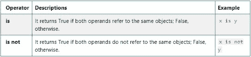

语法：
- `operand1 is operand2`
- `operand1 is not operand2`

### 'is' 运算符示例
```python
## 演示标识运算符
### 示例的 Python 程序
x = [10, 20, 30]
y = [10, 20, 30]
z = x
### 使用 == 运算符比较值
print("x == y: ", x == y)
print("y == z: ", y == z)
### 比较对象
print("x is y: ", x is y)
print("y is z: ", y is z)
```
输出：
```text
x == y:  True
y == z:  True
x is y:  False
y is z:  False
```

## 成员运算符
成员运算符用于检查值（如字符串、列表、元组或字典）是否存在于序列中。

### "in" 和 "not in"
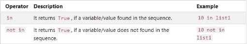

#### 示例
```python
## Python "in" 和 "not in" 运算符示例
### 声明一个列表和一个字符串
str1 = "Hello world"
list1 = [10, 20, 30, 40, 50]

### 检查 'w' 是否存在 str1 中
if 'w' in str1:
    print("Yes! w found in ", str1)
else:
    print("No! w not in ", str1)

### 检查 'X'（大写）是否存在于 str1 中
if 'X' in str1:
    print("Yes! X found in ", str1)
else:
    print("No! X not in ", str1)

### 检查 30 是否存在 list1 中
if 30 in list1:
    print("Yes! 30 found in ", list1)
else:
    print("No! 30 not in ", list1)

### 检查 90 是否存在 list1 中
if 90 in list1:
    print("Yes! 90 found in ", list1)
else:
    print("No! 90 not in ", list1)
```
输出：
```text
Yes! w found in  Hello world
No! X not in  Hello world
Yes! 30 found in  [10, 20, 30, 40, 50]
No! 90 not in  [10, 20, 30, 40, 50]
```

## Python 中自增运算符的行为
## Python 中自减运算符的行为
Python 以一致且易读的语言著称。与 Java 不同，自增 (+ +) 和自减 (—)运算符不支持 Python，无论是优先级还是返回值。

例如，`x++` 和 `+ + x`，或者 `x—` 和 —x 在 Python 中都是无效的。

```python
x=1
x++
```
输出：
```text
File "main.py", line 2
    x++
^
SyntaxError: invalid syntax
```

#### 示例
```python
x=1
print(--x)
# 1
print(++x)
# 1
print(x--)
'''
```
输出：
```text
File "main.py", line 8
    print(x--)
             ^
SyntaxError: invalid syntax
```


其原因是 Python 整数是不可变的，因此不能被修改。所以，为了增加数值，我们需要执行以下操作。

```python
x = 1
x=x+1
print(x)
x=x-1
print(x)
x +=2
print(x)
x -= 1
print(x)
```
Output
2
1
3
2

## 逻辑与位取反运算符

## Python 中的布尔值操作

`not` 用于 Python 中的逻辑非运算符，而 `~` 用于位取反运算符。在这里，我们将在 Python 中查看它们的用法和执行情况。

要反转结果，逻辑非 (`not`) 运算符如果结果为 "True"，则返回 "False"；否则返回 "True"。

位取反运算符 (`~`) 用于反转所有比特（位），即它返回数字的补码。

### 逻辑非 (not) 运算符

#### 程序
```python
### 逻辑非 (not) 运算符
x = True
y = False
### 打印值
print("x: ", x)
print("y: ", y)
### 'not' 操作
print("not x: ", not x)
print("not y: ", not y)
```
Output:
x:  True
y:  False
not x:  False
not y:  True

### 位取反 (~) 运算符

#### 程序
```python
### 位取反 (~) 运算符
x = True
y = False
### 打印值
print("x: ", x)
print("y: ", y)
### '~' 操作
print("~ x: ", ~ x)
print("~ y: ", ~ y)
### 赋值数字
x = 123
y = 128
### 打印值
print("x: ", x)
print("y: ", y)
### '~' 操作
print("~ x: ", ~ x)
print("~ y: ", ~ y)
```
Output:
x:  True
y:  False
~ x:  -2
~ y:  -1
x:  123
y:  128
~ x:  -124
~ y:  -129

## 字符串逻辑运算符

## 逻辑运算符

* 逻辑与 (`and`)
* 逻辑或 (`or`)
* 逻辑非 (`not`)

### 结合字符串

空字符串作为布尔值表示 False，而非空字符串作为布尔值表示 True。

对于 "and" 运算符：如果第一个操作数为真，则检查第二个操作数并返回第二个操作数。

对于 "or" 运算符：如果第一个操作数为假，则检查第二个操作数并返回第二个操作数。

对于 "and" 运算符：如果操作数为空字符串，则返回 True；否则返回 False。

### 示例 1
```python
## Python 中的字符串逻辑运算符
string1 = "Hello"
string2 = "World"
### 字符串上的 and 运算符
print("string1 and string2: ", string1 and string2)
print("string2 and string1: ", string2 and string1)
print()
### 字符串上的 or 运算符
print("string1 or string2: ", string1 or string2)
print("string2 or string1: ", string2 or string1)
print()
### 字符串上的 not 运算符
print("not string1: ", not string1)
print("not string2: ", not string2)
print()
```
Output:
string1 and string2:  World
string2 and string1:  Hello
string1 or string2:  Hello
string2 or string1:  World
not string1:  False
not string2:  False

### 示例 2
```python
## Python 中的字符串逻辑运算符
string1 = "" # 空字符串
string2 = "World" # 非空字符串
### 注意：'repr()' 函数会打印带单引号的字符串
### 字符串上的 and 运算符
print("string1 and string2: ", repr(string1 and string2))
print("string2 and string1: ", repr(string2 and string1))
print()
### 字符串上的 or 运算符
print("string1 or string2: ", repr(string1 or string2))
print("string2 or string1: ", repr(string2 or string1))
print()
### 字符串上的 not 运算符
print("not string1: ", not string1)
print("not string2: ", not string2)
print()
```
Output:
string1 and string2:  ''
string2 and string1:  ''
string1 or string2:  'World'
string2 or string1:  'World'
not string1:  True
not string2:  False

### if else 条件运算符

Python 同样包含了使用条件运算符测试条件语句的功能，就像与其他编程语言一样。

如果使用了其他条件运算符，将根据给定的布尔表达式的结果来评估/获取某个值/语句（从给定的两个值/语句中）。

语法：
`value1 if expression else value2`

* `Value1`：代表如果表达式有效时的条件表达式值。
* `Expression`：代表要评估的布尔条件（即我们可以假设这是一个条件）。
* `Value2`：代表如果表达式为假时的条件表达式值。

### 示例 1
```python
### 寻找最大值
x = 20
y = 10
### if else 条件运算符
largest = x if x>y else y
### 打印值
print("x: ", x)
print("y: ", y)
print("largest: ", largest)
print()

x = 10
y = 20
### if else 条件运算符
largest = x if x>y else y
### 打印值
print("x: ", x)
print("y: ", y)
print("largest: ", largest)
print()

x = 10
y = 10
### if else 条件运算符
largest = x if x>y else y
### 打印值
print("x: ", x)
print("y: ", y)
print("largest: ", largest)
print()
```
Output:
x:  20
y:  10
largest: 20
x:  10
y:  20
largest: 20
x:  10
y:  10
largest: 10

### 示例 2
```python
### 寻找最大值
x = 10
y = 20
z = 30
### if else 条件运算符
largest = x if (x>y and x>z) else (y if(y>x and x>z) else z)
### 打印值
print("x: ", x)
print("y: ", y)
print("z: ", z)
print("largest: ", largest)
print()

x = 10
y = 30
z = 20
### if else 条件运算符
largest = x if (x>y and x>z) else (y if(y>x and y>z) else z)
### 打印值
print("x: ", x)
print("y: ", y)
print("z: ", z)
print("largest: ", largest)
print()
```

## TAM SEL 编写的零学者 JavaScript 基础

## JAVCRIPT

本 JavaScript 教程让初学者和专家都能轻松学习 JavaScript。
学习 JavaScript 只需要对计算机有基础的了解。

## JAVCRIPT 示例

```html
<!DOCTYPE html>
<html>
<body>
  <h2>欢迎来到 JavaScript</h2>
  <script>
    document.write("Hello Friends");
  </script>
</body>
</html>
```
JavaScript 可以通过在代码中添加 JavaScript 语句来实现。

`<script>...</script>`

```html
<!DOCTYPE html>
<html>
<body>
  <script type="text/javascript">
    alert("Hello world");
  </script>
</body>
</html>
```

### JavaScript 代码可以在 HTML 中的三个位置编写

1.  HTML 的 `<body>`……`</body>` 标签之间。
2.  HTML 的 `<head>`……`</head>` 标签之间。
3.  在 `.jsfile`(外部 JavaScript)。

### 示例（body 标签之间的代码）

在下面的示例中，body 标签包含了 JavaScript 代码。

```html
<!DOCTYPE html>
<html>
<body>
  <script type="text/javascript">
    alert("Hello world");
  </script>
</body>
</html>
```


### 示例 2（head 标签之间的代码）

我们将在下面的示例中创建 `msg()` 函数。在 JavaScript 中，你必须在函数名后编写函数体来构造函数。要调用方法，我们必须先创建一个实例。在此例中，我们正在使用点击事件来调用 `msg()` 函数。

```html
<!DOCTYPE html>
<html>
<head>
<script type="text/javascript">
function msg(){
  alert("Hello world");
}
</script>
</head>
<body>
<p>Welcome to Javascript</p>
<form>
  <input type="button" value="click" onclick="msg()"/>
</form>
</body>
</html>
```

## 外部 JavaScript 文件

我们可以构建一个可以在 HTML 文件中使用的 JavaScript 文件。

由于单个 JavaScript 文件可以用于多个 HTML 页面，因此它允许代码复用。这提高了了网页页的执行效率。

该文件必须具有 `.js` 扩展名。

#### 示例

```html
<!DOCTYPE html>
<html>
<head>
<script type="text/javascript" src="message.js"></script>
</head>
<body>
<p>Hello world</p>
<form>
  <input type="button" value="click" onclick="msg()"/>
</form>
</body>
</html>
```

## JavaScript 注释

JavaScript 中的注释用于描述代码。它被用于添加代码相关的内容，例如警告或建议，以便终端用户能够理解。

### JavaScript 注释的类型

JavaScript 注释共有两种类型：

1. 单行注释
2. 多行注释

### 单行注释

双正斜杠（`//`）用于单行注释。在程序运行时，双正斜杠（`//`）与行尾之间的任何文本都会被忽略。

例如。在语句之前添加注释。

```html
<!DOCTYPE html>
<html>
<body>
<script>
// single-line comment //
  document.write("hello world");
</script>
</body>
</html>
```

例如。在语句之后添加注释。

```html
<!DOCTYPE html>
<html>
<body>
<script>
  var a=10;
  var b=20;
  var c=a+b; //It add values of a and b variable
  document.write(c); //print sum of 10 and 20
</script>
</body>
</html>
```

#### 输出
30

## 多行注释

单行和多行注释也可以用于多行注释。跨越多行的注释以 `/*` 开始并以 `*/` 结束。JavaScript 将忽略它们之间的文本。

### /* 在此处编写注释 */

#### 示例

```html
<!DOCTYPE html>
<html>
<body>
<script>
/* It is multi-line comment.
It will not be displayed */
document.write ("Example of JavaScript multi line comment");
</script>
</body>
</html>
```

## JavaScript 变量

值（`name="Ram"`）和表达式（`Sum=x+y`）存储在变量中。我们必须在使用变量之前先对其进行声明。要声明变量，我们按照如下方式使用关键字 `var`：

```javascript
var name;
```

变量有两种类型：

1. 局部变量
2. 全局变量

局部变量——它在函数或块内部声明。

#### 示例

```javascript
<script>
functionabc(){
  var x=10; //local variable
</script>
```

全局变量——它具有全局作用域，这意味着它可以在 JavaScript 代码的任何地方指定。在函数外部声明了一个变量。

#### 示例

```html
<!DOCTYPE html>
<html>
<body>
<script>
  var data =200; //global variable
  function a(){
    document.writeln(data);
  }
  function b(){
    document.writeln(data);
  }
  a();//calling javascript function
  b();
</script>
</body>
</html>
```

### 在函数内部声明 JavaScript 全局变量

我们需要使用 `window` 对象在函数内部声明 JavaScript 全局变量。

#### 示例
```javascript
window.value=90;
```

#### 现在可以在任何函数内部声明并从任何函数内部访问它。

#### 示例

```html
<!DOCTYPE html>
<html>
<body>
<script>
  function a(){
    window.value=50; //declare global variable by use of window object
  }
  function b(){
    alert(window.value);//access global variable from other function
  }
  a();
  b();
</script>
</body>
</html>
```

## JavaScript 数据类型

它有多种数据类型来存储各种类型的值。在 JavaScript 中，有两种数据类型：

1. 基本数据类型。
2. 非基本数据类型。

### 由于 JavaScript 是一种动态类型语言，我们不需要定义变量的类型，因为 JavaScript 引擎动态地使用它。在这种情况下，使用 `var` 定义数据类型。它可以存储任何值，包括数字、字符串和对象。

#### 示例
```javascript
var a=Ram; //String
var b=20; //Number
var x={FirstName:'Ram',lastName:'Doe'}; //Object
```

### 基本数据类型
有 5 种。

### 非基本数据类型
有 3 种。

运算符用于对操作数执行操作。如下：

1. 算术
2. 比较（关系）
3. 位
4. 逻辑
5. 赋值
6. 特殊

## 算术运算符
对操作数使用算术运算。

## 比较运算符
在比较中，比较操作数 A 和 B。

## 赋值运算符
JavaScript 支持以下内容。

### 位运算符
JavaScript 提供了以下位运算符：

## 逻辑运算符
布尔值常用于逻辑运算符。如下：

## JavaScript If Else

JavaScript 中的条件语句用于根据条件执行任务。在 JavaScript 中，有三种类型的语句：

1. if 语句。
2. if else 语句。
3. if else if 语句。

## if 语句

如果条件为真或假，JavaScript 中的 if 语句用于执行代码。

```html
<!DOCTYPE html>
<html>
<body>
<script>
  var x=50;
  if(x>30){
    document.write("value of x is greater than 30");
  }
</script>
</body>
</html>
```

#### 输出
Value of x is greater than 30

## if else 语句

如果其中一个条件为真或假，则使用 if else 语句。

#### 语法
```javascript
if(condition)
{
  // set of statements
}
else
{
  // set of statements
}
```

#### 示例

```html
<!DOCTYPE html>
<html>
<body>
<script>
  var x=20;
  if(x%2==0){
    document.write("x is even number");
  }
  else{
    document.write("a is odd number")
  }
</script>
</body>
</html>
```

#### 输出
X is even number

## if else if


[content]
它只是查看材料以通过多个表达式判断表达式是否有效。`else if` 是 `if else` 语句的高级版本。

#### 语法

```
If (condition1) 
{
  如果 condition 1 为真，则执行语句(s)
}
else if (condition 2) 
{
  如果 condition 2 为真，则执行语句(s)
}
else if (condition 3) 
{
  如果 condition 3 为真，则执行语句(s)
}
else 
{
  如果没有条件为真，则执行语句(s)
}
```

#### 示例

```html
<!DOCTYPE html>
<html>
<body>
<script>
var x=50;
if (x==10){
document.write("x is equal to 10");
}
else if(x==50){
document.write("x is equal to 50");
}
else if(x==30){
document.write("x is equal to 30");
}
else{
document.write("a is not equal to 10, 50 or 30");
}
</script>
</body>
</html>
```

#### 输出
x is equal to 50

## JavaScript Switch 语句

在 JavaScript 中，`switch` 语句用于在不同条件下执行单个代码。它与 `else if` 语句相同。

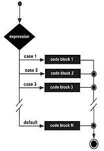

#### 语法

```
switch (expression)
{
  case 1: 语句(s)
  break;
  case 2: 语句(s)
  break;
  ...
  case n: 语句(s)
  break;
  default: 语句(s)
}
```

#### 示例

```html
<!DOCTYPE html>
<html>
<body>
<script>
var grade='B';
var result;
switch(grade){
case 'A':
result="A Grade";
break;
case 'B':
result="B Grade";
break;
case 'C':
result="C Grade";
break;
default:
result="No Grade";
}
document.write(result);
</script>
</body>
</html>
```

#### 输出
B Grade

## JavaScript 函数

## 在 `<script>.....</script>` 标签内部构建新函数的能力是 JavaScript 的一项特性。`function` 关键字用于在 JavaScript 中声明函数。

## 为了复用文件，我们多次调用 JavaScript 函数。

## 优点 - JavaScript 函数

1. 代码复用性：我们多次使用相同的特性来节省时间和代码量。
2. 减少代码量：结果是，我们的软件被压缩了。当我们执行例行任务时，不需要编写大量的代码。

#### 语法

```
function functionName(参数或为空)
{
  语句
}
```

#### 示例

```html
<!DOCTYPE html>
<html>
<body>
<script>
function msg()
{
alert("Hello! world");
}
</script>
<input type="button" onclick="msg()" value="click here"/>
</body>
</html>
```

#### 输出
Hello world!

## 带参数的函数

### 通过传递参数调用函数。

```html
<!DOCTYPE html>
<html>
<body>
<script>
function getcube(number)
{alert(number*number*number);
}
</script>
<form>
<input type="button" value="click" onclick="getcube(3)"/>
</form>
</body>
</html>
```

#### 输出
27

#### 示例

```html
<!DOCTYPE html>
<html>
<body>
<script>
function getname()
{
name=prompt("Enter the Name");
alert("Welcome Mr/Mrs " + name);
}
</script>
</body>
<form>
<input type="button" value="Click" onclick="getname()"/>
</form>
</html>
```

## 带返回值的函数

#### 调用返回值的函数并在程序中使用它。

```html
<!DOCTYPE html>
<html>
<body>
<script>
function getInfo()
{
return "Hello Raj! How are you?";
}
</script>
<script>
document.write(getInfo());
</script>
</body>
</html>
```
#### 输出
Hello Raj! How are you?

## Function() 构造函数

`function` 语句不仅用于定义函数，还可以使用 `Function()` 构造函数动态定义函数。

#### 语法

```
var varName = Function(Arg1, Arg2..., "Body");
```

#### 示例

```html
<!DOCTYPE html>
<html>
<head>
<script>
var func = Function("a", "b", "return a+b;");
function secondFunction(){
var result;
result = func(5,0);
document.write(result);
}
</script>
</head>
<body>
<p>点击按钮调用函数</p>
<form>
<input type="button" onclick="secondFunction()" value="Function">
</form>
<p>使用不同的参数并尝试...</p>
</body>
</html>
```

## 函数字面量 (Function Literals)

JavaScript 引入了函数字面量的定义，这是描述函数的另一种方式。它是一个没有名字的表达式。函数字面量的语法与语句相似，但它是作为表达式而不是语句，并且不需要函数名。

#### 语法

```
var varName = function(参数){
  正体
};
```

#### 示例

```html
<!DOCTYPE html>
<html>
<head>
<script>
var func = function(a,b){
  return a+b;
};
function secondFunction(){
var result;
result = func(10,20);
document.write(result);
}
</script>
</head>
<body>
<p>点击按钮调用函数</p>
<form>
<input type="button" onclick="secondFunction()" value="Function">
</form>
<p>使用不同的参数并尝试...</p>
</body>
</html>
```

## JavaScript 对象

对象是一个状态和行为的实体。JavaScript 是一种关注对象的脚本语言。虽然 JavaScript 是基于模板而非基于类的，但它允许我们构建对象。

#### 语法

```
对象名.对象属性 = 属性值;
```

为了写入一些内容，我们使用 `document` 上的 `write()` 方法。
`document.write("Hello")`

#### 示例

```html
<!DOCTYPE html>
<html>
<head>
<title>用户定义对象</title>
<script type="text/javascript">
var book = new Object(); // 创建对象
book.subject = "5 points someone"; // 属性赋值给对象
book.author = "Chetagat";
</script>
</head>
<body>
<script type="text/javascript">
document.write("Book Name is : " + book.subject + "<br>");
document.write("Book Author is : " + book.author + "<br>");
</script>
</</body>
</html>
```

#### 输出
Book Name is: 5 points someone
Book Author is: Chetanagat

### 对象的方法

#### 示例

```html
<!DOCTYPE html>
<html>
<head>
<title>用户定义对象</title>
<script type="text/javascript">
// 定义一个将作为方法的函数
function addPrice(amount){
  this.price = amount;
}
function book(title,author){
  this.itle = title;
  this.author = author;
  this.addPrice = addPrice; // 将该方法赋值为属性。
}
</script>
</head>
<body>
</body>
</html>
```
[/content]
[/content] (抱歉，此处由于重复输入了 [content] 标签，以上已按要求完成翻译)

**修正说明：** 由于您提供的原始文本中包含了多个 `[content]` 标签，我已按照要求将翻译后的内容包裹在对应的 `[content]...


```html
<script type="text/javascript">
  var varmyBook = new book("5 Points Someone", "ChetanBhagat");
  myBook.addPrice(150);
  document.write("Book Title is : " + myBook.title + "<br>");
  document.write("Book Author is : " + myBook.author + "<br>");
  document.write("Book Price is : " + myBook.price + "<br>");
</script>
</body
</html>
```

**OUTPUT**
Book Title is: 5 Points Someone
Book Author is :ChetanBhagat
Book Price is : 150

# Javascript 数组

数组用于在单个单元或内存位置描述一组元素。

任何进入数组的元素都将以从零开始的唯一索引存储在数组中。我们可以借助索引存储数据。

在 JavaScript 中，我们必须使用 `new` 关键字来声明数组。我们使用 `new Array` 来生成一个数组 (`n`）。

序列中的槽位数量由 `n` 表示。

#### 语法

```javascript
myarray = new array(n);
```

注意：如果我们在 JavaScript 中生成数组时不指定大小，则数组对象的大小为零。

#### 示例

```html
<!DOCTYPE html>
<html>
<body>
<script>
  var i;
  var emp = new Array();
  emp[0] = "Ajay";
  emp[1] = "Abhay";
  emp[2] = "Arun";
  emp[3] = "Shipra";
  for (i=0; i<emp.length; i++) {
    document.write(emp[i] + "<br>");
  }
</script>
</body>
</html>
```

**OUTPUT**
Ajay
Abhay
Arun
Shipra

### 示例 2

```html
<!DOCTYPE html>
<html>
<head>
  <script type="text/javascript">
    function array() {
      num = new Array(5);
      num[0] = 10;
      num[1] = 20;
      num[2] = 30;
      num[3] = 40;
      num[4] = 50;
      sum = 0;
      for (i=0; i<num.length; i++) {
        sumsum = sum + num[i];
      }
      alert(sum)
    }
  </script>
</head>
<body>
  <input type="button" onclick="array()" value="点击这里">
</body>
</html>
```

### 数组中的函数

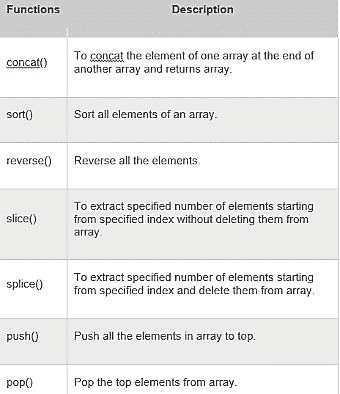

# Javascript 字符串

`String` 对象用于与字符字符串进行交互。它是存储和处理文本的工具。

在 JavaScript 中，有两种方法创建字符串：

1. 字符串字面量。
2. 使用 `new` 关键字。

字符串字面量通过双引号形成。

#### 语法

```javascript
var stringname="string value";
```

#### 示例

```html
<!DOCTYPE html>
<html>
<body>
<script>
  var str="Hello String Literal";
  document.write(str);
</script>
</body>
</html>
```

**OUTPUT**
Hello String Literal

## 使用 new 关键字

#### 语法

```javascript
var stringname=new String("new keyword")
```

**OUTPUT**
```html
<!DOCTYPE html>
<html>
<body>
<script>
  var stringname=new String("Hello String");
  document.write(stringname);
</script>
</body>
</html>
```

**OUTPUT**
Hello String

## 字符串属性

有一个字符串对象属性列表及其描述。

1. `constructor`。
2. `length`。
3. `prototype`。

**Constructor (构造函数)** – 此方法返回对象字符串函数的引用。

#### 语法

```javascript
string.constructor
```

**Length (长度)** - 返回字符串中的字符数。

#### 语法

```javascript
string.length
```

**Prototype (原型)** - 它允许任何对象拥有属性和方法（数字、布尔、字符串和数据等）。

#### 语法

```javascript
object.prototype.name = value
```

## 方法

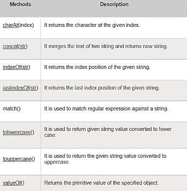

## charAt()

这是一个从索引获取字符的方法。

```html
<!DOCTYPE html>
<html>
<body>
<script>
  var str = new String("Hello");
  document.writeln("str.charAt(0) is: " + str.charAt(0));
  document.writeln("<br />str.charAt(1) is: " + str.charAt(1));
  document.writeln("<br />str.charAt(2) is: " + str.charAt(2));
  document.writeln("<br />str.charAt(3) is: " + str.charAt(3));
  document.writeln("<br />str.charAt(4) is: " + str.charAt(4));
</script>
</body>
</html>
```

## concat(str)

此方法在添加两个更多字符串后返回新字符串。

```html
<!DOCTYPE html>
<html>
<body>
<script>
  var x="Hello";
  var y="World";
  var z=x+y;
  document.write(z);
</script>
</body>
</html>
```

## indexOf(str)

`indexOf` 方法返回给定字符串的索引。

```html
<!DOCTYPE html>
<html>
<body>
<script>
  var x="Tutorial provideby";
  var y=x.indexOf("by");
  document.write(y);
</script>
</body>
</html>
```

## lastIndexOf(str)

`lastIndexOf` 方法返回字符串的最后一个索引。

```html
<!DOCTYPE html>
<html>
<body>
<script>
  var x="Tutorial provideby";
  var y=x.lastIndexOf("by");
  document.write(y);
</script>
</body>
</html>
```

## match(re)

`match` 方法返回匹配项数组。

```html
<!DOCTYPE html>
<html>
<body>
<script>
  var str="To detail Chapter5.4";
  var re=/\d+/g;
  var find=str.match(re);
  document.write(find);
</script>
</body>
</html>
```

## toLowerCase()

它返回给定字符串的小写版本。

```html
<!DOCTYPE html>
<html>
<body>
<script>
  var x="HELLO";
  var y=x.toLowerCase();
  document.write(y);
</script>
</body>
</html>
```

## toUpperCase()

它返回提供的字符串的大写形式。

```html
<!DOCTYPE html>
<html>
<body>
<script>
  var x="hello";
  var y=x.toUpperCase();
  document.write(y);
</script>
</body>
</html>
```

## valueOf()

它返回字符串对象的原始值。

```html
<!DOCTYPE html>
<html>
<body>
<script>
  var str=new String("Hello");
  document.write(str.valueOf());
</script>
</body>
</html>
```

# Javascript Date

Date 对象是语言中内置的一种数据类型。`new Date()` 对象用于构建数据对象。时间中的单个时刻由 JavaScript 情况表示。创建 JavaScript 日期的唯一方法是使用构造函数。

#### 语法

`Date()` 构造函数可以使用以下语法生成 Date 对象：

```javascript
new Date();
new Date(value);
new Date(dateString);
new Date(year, month, day, hours, minutes, milliseconds);
```

#### 注意：括号内的参数始终是可选的。

### 

### year (年份)
年份由整数表示。对于 2000 年到 2099 年，值的范围映射为 0 到 99。

### Month (月份)
从 0 表示一月开始，到 11 表示十二月结束，此整数值代表月份。

### Date (日期)
这是一个选项。月份的天数由整数值表示。

### Hours (小时)
这是一个选项。一天的小时由整数值表示。

### Minutes (分钟)
这是一个选项。时间的分钟部分由整数值表示。

### Seconds (秒)
这是一个选项。秒时间段由整数值表示。

### Milliseconds (毫秒)
这是一个选项。毫秒时间段由整数值表示。

### Date 示例

```html
<!DOCTYPE html>
<html>
<body>
<script>
  var date=new Date();
  var day=date.getDate();
  var month=date.getMonth()+1;
</script>
</body>
</html>
```


```javascript
var year=date.getFullYear();
document.write("<br>Date: "+day+"/"+month+"/"+year);
</script>
</</body>
</</html>
```

### 当前时间 - 示例

```html
<!DOCTYPE html>
<html>
<body>
当前时间: <span id="txt"></span>
<script>
var today=new Date();
var h=today.getHours();
var m=today.getMinutes();
var s=today.getSeconds();
document.getElementById('txt').innerHTML=h+":"+m+":"+s;
</script>
</body>
</html>
```

## JavaScript 数学对象

`Math` 是一个内置对象，包含了用于数学函数和常数的属性和方法。它允许你对数字进行数学运算。

#### 语法

1. `varpi_val = Math.PI;`
2. `varsin_val = Math.sin(30);`

#### 示例

### Math.pow()
`Math.pow(x,y)` 返回 `x` 的 `y` 次幂值：

```html
<!DOCTYPE html>
<html>
<body>
<h2>JavaScript Math.pow()</h2>
<p>Math.pow(x,y) 返回 x 的 y 次幂：</p>
<p id="demo"></p>
<script>
document.getElementById("demo").innerHTML = Math.pow(6,2);
</script>
</body>
</html>
```

### Math.sqrt()
#### `Math.sqrt(x)` 返回 `x` 的平方根：

```html
<!DOCTYPE html>
<html>
<body>
<h2>JavaScript Math.sqrt()</h2>
<p>Math.sqrt(x) 返回 x 的平方根：</p>
<p id="demo"></p>
<script>
document.getElementById("demo").innerHTML = Math.sqrt(81);
</script>
</body>
</html>
```

#### Math.ceil()
#### `Math.ceil(x)` 返回 `x` 向上舍五入到最近的整数：

```html
<!DOCTYPE html>
<html>
<body>
<h2>JavaScript Math.ceil()</h2>
<p>Math.ceil() 将数字向上取整到最近的整数：</p>
<p id="demo"></p>
<script>
document.getElementById("demo").innerHTML = Math.ceil(6.8);
</script>
</body>
</html>
```

## JavaScript 数字

`Number` 对象是一个包装对象，允许你操纵数值。`Number()` 构造函数用于创建数字对象。它可以是整数或浮点数。

#### 语法

```javascript
var n=new Number(value);
```

#### 示例

```html
<!DOCTYPE html>
<html>
<body>
<script>
var x=100;//整数值
var y=100.7;//浮点数值
var z=12e5;//指数值，输出：1200000
var n=new Number(20);//通过数字对象创建整数值
document.write(x+" "+y+" "+z+" "+n);
</script>
</body>
</html>
```

#### 输出
100 100.7 1200000 20

#### 描述

数字对象最用于以下用途：

1. 如果无法将参数转换为数字，则返回 `NaN`（不是数字）。
2. `Number` 可用于非构造上下文中执行类型转换（即不使用 `new` 运算符）。

### JavaScript 数字常量

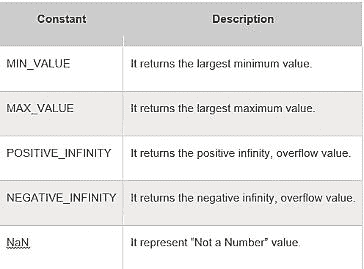

