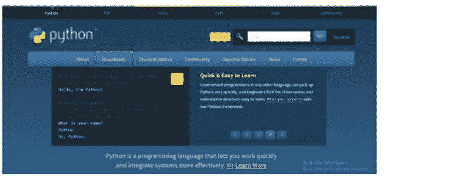
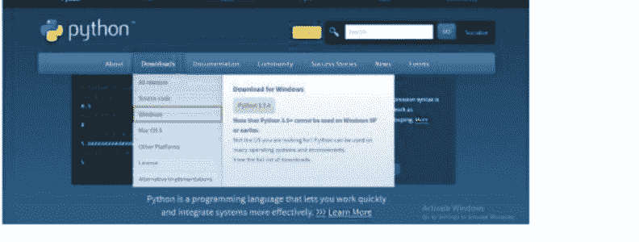
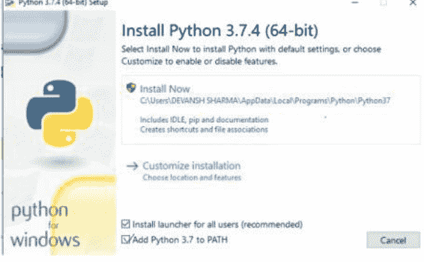
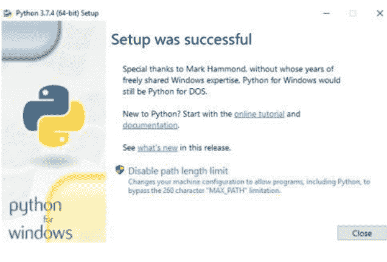
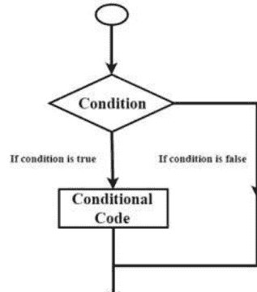
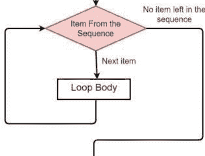
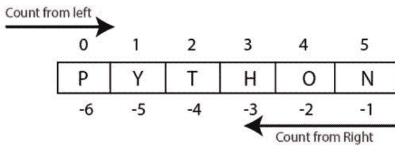
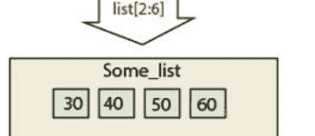

# Python 和 JavaScript 编程基础：初学者分步指南

## Python 简介

`Python` 教程是一种常用的编程语言，让初学者和专家都能快速掌握 `Python` 编程的基础。

`Python` 是一种高级、简单、解释型、通用且动态的编程语言。它鼓励使用面向对象的编程技术。它易上手，其优雅的语法允许程序员用比 `C++` 或 `Java` 等语言更少的代码来表达概念。

它拥有卓越的数据结构，使其成为一种跨平台脚本编写和应用程序创建的独一无二的语言。

## Python 简史

荷兰国家数学与计算机科学研究学会创始人之一的 `Guido van Rossum` 于 20 世纪 80 年代后期开始开发 `Python`。1991 年 2 月 20 日，第一个版本发布。

`Python` 编程语言借鉴了 `ABC` 编程语言的理念。`ABC` 是一种通用编程语言，其最著名的成就就是影响了 `Python` 的创建。

`ABC` 编程语言是 `Python` 编程语言的先驱。`ABC` 可以处理异常并与 `Amoeba` 操作系统通信。

**关于命名选择的小知识：** `Guido van Rossum` 是 `ABC` 标志性节目《蒙提 Python 的飞行马团》（`Monty Python’s Flying Circus`）的忠实粉丝，因此标题灵感源于此。`Python` 是他为自己的发明起的名字，因为他想要一个简短、有趣且带点神秘的名字。

- `Python 1.0` 版本于 1994 年发布，包含了 `map`、`filter` 和 `reduce` 等新功能。
- 2000 年 10 月，发布了 `Python 2.0`，带有列表推导式和垃圾回收系统等新功能。
- 2018 年 12 月 3 日，称为“`Py3k`”的 `Python 3.0` 发布并带有新功能。例如，在 `Python 2.x` 中，“`print`”是一个语句；而在 `3.x` 中，“`print()`”是一个函数。

## Python 的用途

`Python` 是一种被许多程序员在各个领域使用的编程语言。它通常用于比其他编程语言更直接的方式执行任何复杂任务。

当安装 `Python` 时，它会创建许多包含各种函数的强大库。

互联网上还有许多可用库，可以更容易更容易完成复杂任务。

正因为这些标准库，`Python` 是一门强大的编程语言。`Python` 广泛应用于以下领域：

- Web 开发
- 软件开发
- 机器学习
- 基于 GUI 的应用程序
- 网络编程
- 游戏开发
- 数学
- 人工智能
- 数据科学

## 为什么选择 Python？

以下是 `Python` 成为目前最流行编程语言的原因之一：

### Python 提供了丰富的库：

`Python` 拥有一套标准库，涵盖了机器学习、代数、Web 服务器软件、操作系统接口和协议等主题。

### Python 是开源语言：

可以从其官方网站（`www.python.org`）免费下载 `Python`。任何人都可以从官方网站下载 `Python`。

以下是 `Python` 如今最受欢迎语言的原因：

### 易于使用：

`Python` 是一门易于学习和使用的简单语言。它是一门易懂的语言。与其他语言相比，它只需要几行代码即可表达逻辑。

例如，如果你想在 `Java` 中打印“`Hello world`”，代码如下：

```java
public class HelloWorld {
public static void main(String[] args){
    // 向终端窗口打印 "Hello, World"。
    System.out.println("Hello World");
}
```

在 `Python` 中，你只需要一句话即可完成。

```python
print("Hello World")
```

两段代码产生相同的结果，但 `Python` 只需要一行。

## 框架与库

`Python` 有许多用于不同类型生产的框架。以下是一些常见的框架：

- 服务端 Web 开发：`Django` 是最常用的 `Python` Web 开发平台。还包括 `Flask`、`Pyramid`、`CherryPy` 等其他建模工具。
- `Tk`、`PyGTK`、`PyQt`、`PyJs` 以及基于 GUI 的应用程序
- `TensorFlow`、`PyTorch`、`Scikit-learn`、`Matplotlib` 以及其他机器学习框架
- 数学：`Numpy`、`Pandas` 等

## 面向对象的方法

`Python` 支持面向对象的编程方法。`OOP` 原则侧重于通过在面向对象的编程中创建对象来创建重复代码并解决编程问题。`DRY`（不要重复）是这些理念的另一个名称。

`Python` 中的 `OOP` 定义如下：

- 类
- 对象
- 继承
- 多态
- 封装

## 可扩展性

`Python` 是可扩展的，允许你使用 `C` 和 `C++` 模块。

## 可移植性

`Python` 是一种可以在任何平台上运行的语言。我们涵盖了 `Windows`、`Mac` 和 `Linux` 上的 `Python`。

## Python 特性

`Python` 是一种高效且易于学习的常用语言。它的数据结构有效，优雅的语法使其对用户友好。

以下是 `Python` 的一些重要特性：

### 1. Python 简单

- **易于编码：** 与 `C++` 等其他语言相比，`Python` 让编码变得轻而易举。`Python` 语法不需要花费长时间学习；任何人都可以在几小时或几天内学会。
- **易于阅读：** 由于 `Python` 是一种高级语言，其代码与英语有些相似。不使用大括号，而是使用缩进来描述代码块。

### 2. 高级语言

`Python` 是一门具有高度抽象编程语言。它更多地关注编程逻辑，而不是内存地址和寄存器使用等硬件组件。它不需要预先了解体系架构。我们也不需要内存内存。

### 3. 解释型

在 `C` 或 `C++` 等编程语言中，执行代码有两个步骤：首先编译，然后运行；而 `Python` 不需要编译。在内部，源代码被翻译成字节码，这是一个快速格式。`Python` 是一种解释语言，意味着它逐行完整地执行代码。因此，调试代码要简单得多。由于解释器的存在，它比 `JAVA` 慢一点，但这不是大问题，因为它比其他语言更好。

### 4. 面向对象

`Python` 是一种面向对象的编程语言，支持对象、类、封装、继承等概念。它是面向对象的，并集成了数据和函数。在 `OOP` 中，现实实体通过对象定义，而类是对象的蓝图。它也可以与过程化语言一起工作。函数是过程化编程的核心，这使得代码可复用。最自然、最实用的方法是面向对象编程。

### 5. 动态类型

`Python` 是一门动态类型语言，意味着在声明变量时，不需要指定数据类型。

值的类型是在运行时确定的，而不是提前指定的。

当我们声明带有值的变量时，该值会被保存在内存中，并将变量与内存容器绑定。

例如，我们可能会为字符串变量赋值字符串值 `x="Hello world"`。

动态内存分配的优点是它可以防止内存浪费。

由于在使用静态内存分配时，所有的内存分配都无法使用，会导致大量的内存丢失。

### 6. 强大的标准库

安装 `Python` 时，系统会提示你输入密码。

它带有一个大型库，你可以使用它，而不是为代码中的每个变量编写代码。

它有正则表达式、多线程、数据库、图像处理、浏览器单元测试、`CGI` 等等库。

`Python` 库是函数和方法的集合。

它可以帮助你执行各种任务，而无需编写代码。

### 7. 可扩展性

`Python` 是可扩展，这意味着你可以使用 `Python` 以外的语言（如 `Java`、`C` 和 `C++`）编写 `Python` 代码。因此，`Python` 是一种可扩展语言。

它并没有以任何方式扩展 `Python`（语法、结构等），但它允许你与用其他语言编写的库交互。（主要是 `C` 或 `C++`，但你可以使用 `C` 作为桥梁来通过 `C` 接口调用所有其他语言）。

### 8. 可移植性

`Python` 是平台无关的，这意味着它可以运行在任何设备。`Python` 代码可以在多种平台上运行，包括 `Mac`、`Linux` 和 `Windows`。

假设你在 `Windows` 电脑上编写了代码。

如果你想在 `Linux` 上运行它，现在不需要对其进行任何改进。没有为每个平台编写不同的代码。

### 9. 免费且开源

`Python` 可以在其官方网站（`www.python.org`）免费获取。

任何人都可以下载并安装它。

你还可以获取 `Python IDE`（集成开发环境），如 `Pycharm`、`Jupyter`、`Visual Studio` 等。

`Python` 是一种开源语言，这确保了它的代码源是自由访问且不受限制的。

任何人都可以下载、使用它，并用它构建新的模块或函数，然后将这些内容与 `Python` 社区共享。

### 10. GUI 编程

`GUI` 的缩写代表“图形化用户界面”。

使用 `Python Tkinter` 或 `PyQt`，我们可以构建一个简单的桌面程序。

### 11. 表现力

`Python` 是一种允许你表达自我的语言。

这意味着单行 `Python` 代码的表达能力可能比用另一种编程语言编写的代码更强。

使用更具表现力的语言的主要优点是，你编写的代码越少，完成项目就越容易。

调试和保持代码更新也更容易。

# Python 设置指南与安装

`Python` 是一种常用的高级编程语言。`Python` 的第一个版本发布于 1991 年。从那时起，`Python` 的人气日益增加。它被广泛认为是最友好且适应性最强的服务器端编程语言之一。

在开始使用 `Python` 之前必须安装 `Python` 解释器。与其他 `Linux` 发行版不同，`Windows` 没有将 `Python` 作为标准功能。然而，在 `Windows` 服务器或本地机器上安装 `Python` 是一个简单的过程。有几种流行的方法可以实现：

- `Python` 可以在 `www.python.org` 免费获取，该网站由 `Python` 软件基金运行。在大多数情况下，这意味着需要安装并运行适用于你操作系统的安装程序。
- 安装 `macOS` 的包管理器 `Homebrew` 是安装 `Python` 最快的方法。
- `Linux` 自带了一个用于安装 `Python` 的包管理器。
- 像 `Android` 和 `iOS` 等移动操作系统可以下载带有 `Python` 编程环境的应用程序。
- 许多网站都提供 `Python` 编程环境。这些网站允许你练习编码，而无需安装 `Python`。

## Windows 安装 Python

你必须首先选择一个 `Python` 版本。如果你想学习最新版本的 `Python`，必须安装 `Python 3.7`。此版本可以与 `2.7` 并安装，但它已不再工业界使用。

在 `Windows` 上安装 `Python` 可以分步骤完成。以下是需要采取的步骤：

### 第一步

### 准备下载

- 1. 打开浏览器并访问 `www.python.org`，即 `Python` 官方网站。它将带你进入网站的首页。



- 进入 `Downloads`（下载）部分并从下拉列表中选择 `Windows`。寻找你喜欢的 `Python` 版本。`Python 3` 已更新到 `3.7.4` 版本，而 `Python 2` 已更新到 `2.7.16` 版本。参考以下插图：



### 第二步 选择安装程序：

要为 64 位操作系统下载 `Python`，请选择 `windows x86-64` 可执行安装程序或 `windows x86` 可执行安装程序。

注意，你可以安装 32 位或 64 位的 `Windows` 版本。大多数情况下，任何一个安装程序都可以在 64 位机器上运行。根据操作系统的不同，64 位版本对于某些应用程序效果更好。

如果你不确定选择哪个版本，请选择 64 位。然而，如果你做错了决定并选择升级到不同的版本，你可以轻松地卸载并重装。

### 第三步 运行安装程序

下载后运行安装程序。

- 1. 勾选 `Add Python 3.7 to Path`（将 `Python 3.7` 添加到路径中）。
- 2. 选择 `Install now`（立即安装），这是推荐的方法。

注意，此类功能在旧版本的 `Python`（集成开发环境）中可能不可用。



- 对话框显示“`Setup was successful`（安装成功）”。你可以通过选择“`Disable path limit`（禁用路径限制）”允许 `Python` 使用长路径。



### 第四步 检查 Python 是否加载

- 1. 进入 `Python` 在你电脑上的安装目录。路径为 `C:\Users\Username\AppData\Local\Programs\Python\Python37`
- 2. 双击“`python.exe`”（`python` 执行文件）
- 3. 你也可以通过命令行输入 `python --version` 来验证。它将显示 `Python` 版本。如果 `Python` 已启用，将出现以下输出。

### 第五步 检查 Pip 是否安装

`Pip` 是 `Python` 包管理系统。如果你安装的是旧版本的 `Python`，可能没有预装 `Pip`。

- 对于大多数 `Python` 包，推荐使用 `Pip`，特别是在虚拟环境中。
- 检查 `Pip` 是否已安装：
    - 在开始菜单中输入 `cmd`。
    - 启动命令提示符程序。
    - 在终端中输入 `pip --version`。如果 `Pip` 已挂载，将显示以下输出。

然而，如果尚未安装 `pip`，你会得到以下输出：

“`pip` 不是内部或外部命令，也不是可运行的批处理程序。”

### 第六步 设置环境变量

如果你没有勾选 `Add Python to PATH` 复选框，或者你的安装程序没有包含该选项，请按照以下步骤操作：

使用开始菜单，选择 `+R`。

- 1. 打开命令提示符并输入 `sysdm.cpl`。将属性系统窗口。
- 2. 转到 `Advanced`（高级）选项卡，并从下拉列表中选择 `Environment Variable`（环境变量）。
- 转到“高级”（`Advanced`）选项卡，从下拉菜单中选择“环境变量”。
- 在“系统变量”下找到并选择 `Path` 变量，然后点击“编辑”。
- 转到“变量值”字段并选中它。在 `python.exe` 文件的路径之前添加一个分号 (`;`)。

# Python 关键字

关键字是为编译器保留的单词，并具有特定的含义。它们不能被用作变量名。关键字是语法的一部分，例如：

```
return (a+b)
```

这里使用了关键字 `return`，而变量 `a` 和 `b` 是变量。

以下是所有 `Python` 关键字列表：

- `and`
- `else`
- `lambda`
- `or`
- `except`
- `None`
- `assert`
- `finally`
- `nonlocal`
- `break`
- `try`
- `pass`
- `continue`
- `raise`
- `global`
- `class`
- `from`
- `return`
- `def`
- `import`
- `False`
- `del`
- `in`
- `True`
- `if`
- `is`
- `for`
- `elif`
- `not`
- `while`
- `with`
- `yield`

## 一些 Python 关键字描述

### if

`Python` 中的 `if` 语句是最基本的条件语句。它被用于判断一个语句块是否会被执行。

```
a = 20
if (a>15):
    print('I am bigger than 15')
```

# 输出

```
I am bigger than 15
```

### else

如果存在 `if` 语句，也会有一个 `else` 语句。如果 `if` 语句的条件为假，则执行 `else` 块。下面的示例说明了这一点：

```
a = 20
b = 30
if (a > b):
    print('a is greater than b')
else:
    print('b is greater than a')
```

# 输出

```
b is greater than a
```

### elif

`elif` 是 `else-if` 的缩写。它用于验证多个条件，这意味着如果上一个条件不正确，将检查下一个条件。考虑以下场景：

```
a=10
b=10
if (a>b):
    print('a is smaller than b')

elif (a == b):
    print(' a is equal to b')
else:
    print('a is greater than b')
```

# 输出

```
a is equal to b
```

### True

布尔值真由 `True` 关键字定义。如果给定的语句为真，解释器返回 `True`。考虑以下场景：

```
print(1==1)
```

# 输出

```
True
```

### False

布尔值假由关键字 `False` 表示。如果给定的语句为假，解释器返回 `False`。例如：

```
print(1>1)
```

# 输出

```
False
```

### assert

作为一种调试方法，使用了 `assert` 关键字。它有助于代码的高效流。它使我们更容易定位错误。

断言本质上是程序员意识到并通常希望它是正确的假设。因此，对它们进行编码，使得：如果参数失败，代码将不再运行。

```
a = 10
b = 0
print('a is dividing by Zero')
assert b != 0
print(a / b)
```

# 输出

```
a is dividing by Zero
```

Runtime Exception:

```
Traceback (most recent call last):

File "home/40545678b342ce3b70beb1224bed345f.py", line 4, in

  assert b != 0, "Divide by 0 error"

AssertionError: Divide by 0 error
```

### and


Python 中的逻辑运算符有`and`、`or`和`not`。如果`and`运算符中的所有操作数都有效，则条件为真：

例如：

```
a=100
if (a>90) and (a<101):
    print('Both conditions are true. a is ',a)
```

# 输出

Both conditions are true. a is 100

## Python 运算符

作用于一个或多个操作数的符号被称为运算符。操作数是执行该操作的值或向量。考虑`6+9`例子。操作数是`6`和`9`，运算符是`+`。Python 有许多运算符，列举所示：

- 算术运算符
- 赋值运算符
- 比较运算符
- 逻辑运算符
- 成员运算符
- 位运算运算符
- 身份运算符

### 算术运算符

基础数学运算使用 Python 算术运算符完成。以下是算术运算符列表。假设`x`和`y`是两个变量，值分别为`30`和`10`，以下是操作的结果：

| 运算符 | 描述 | 示例 |
|---|---|---|
| `+` (加法) | 用于两个操作数。 | `x + y = 40` |
| `-` (减法) | 用于减去两个操作数。如果第一个操作数小于第二个操作数，将给出负值。 | `x - y = 20` 或 `y - x = 20` |
| `*` (乘法) | 用于乘以运算符两侧的值。 | `x * y = 300` |
| `/` (除法) | 将第一个操作数除以第二个操作数并返回商。 | `x/y = 3.0` |
| `//` (地板除) | 用于除法并返回整数值。 | `x/y = 3` 或 `x/y = 7` |
| `%` (取模) | 返回除法后的余数。 | `x/y = 0` |
| `**` (幂) | 用于计算幂。 | |

### 赋值运算符

赋值运算符用于将值赋给变量。以下是赋值运算符：

| 运算符 | 描述 | 示例 |
|---|---|---|
| `=` | 用于赋值。 | `x = 10` |
| `+=` | 先加法后赋值。 | `x += 5` |
| `-=` | 先减法后赋值。 | `x -= 5` |
| `*=` | 先乘法后赋值。 | `x *= 5` |
| `/=` | 先除法后赋值。 | `x /= 2` |
| `//=` | 先地板除后赋值。 | `x //= 2` |
| `%=` | 先取模后赋值。 | `x %= 2` |
| `**=` | 先计算幂后赋值。 | `x **= 2` |

### 比较运算符

比较运算符用于比较值。Python 有许多比较运算符，列举所示：

| 运算符 | 描述 | 示例 |
|---|---|---|
| `==` | 如果两个操作数相等。 | `x == 10` |
| `!=` | 如果两个操作数不等。 | `x != 10` |
| `<=` | 如果第一个操作数小于等于第二个操作数。 | `x <= 10` |
| `>=` | 如果第一个操作数大于等于第二个操作数。 | `x >= 10` |
| `<` | 如果第一个操作数小于第二个操作数。 | `x < 10` |
| `>` | 如果第一个操作数大于第二个操作数。 | `x > 10` |

### 逻辑运算符

在条件语句中，使用了逻辑运算符：`and`、`or`和`not`。

| 运算符 | 描述 | 示例 |
|---|---|---|
| `and` | 如果所有表达式为真。 | `True` |
| `or` | 如果任意一个表达式为真。 | `True` |
| `not` | 如果表达式为真则结果为假。 | `False` |

### 成员运算符

成员运算符用于判断元素是否属于某个序列（如字符串、列表或元组）。下表中是成员运算符：

| 运算符 | 描述 | 示例 |
|---|---|---|
| `in` | 如果左侧元素在右侧序列中，则为真。 | `3 in [1,2,3]` |
| `not in` | 如果左侧元素不在右侧序列中，则为真。 | `3 not in [1,2,4]` |

### 位运算运算符

位运算符对操作数执行逐位二进制运算。考虑以下场景：变量`a`的值为`5`，变量`b`的值为`6`。

`a = 5`

`b = 6`

`binary (a) = 0101`

`binary (b) = 0110`

| 运算符 | 描述 | 示例 |
|---|---|---|
| `~` (取反) | 该运算符将数字转换为二进制数并返回其位反。“x”等同于`~x-1`。 | `a~5` 为 `-6` |
| `&` (位与) | 如果相同位上的位均为 1，则结果为 1，否则为 0。 | `a&b=4` |
| `|` (位或) | 如果相同位上至少有一个为 1，则结果为 1，否则为 0。 | `a|b=7` |
| `^` (位异或) | 如果位不同则结果将为 1，否则结果为 0。 | `a^b=3` |
| `<<` (位左移) | 左操作数根据右操作数指定的位数向左移动。 | `a<<2=20` |
| `>>` (位右移) | 左操作数根据右操作数指定的位数向右移动。 | `a>>2=1` |

### 标识运算符 (Identity operators)

| 运算符 | 说明 | 示例 |
|---|---|---|
| `is` | 如果两个操作符指向同一个对象，则求值为真。 | `a = 5, b=5 is b = True` |
| `is not` | 如果两个操作符指向同一个对象，则求值为假。 | `a = [1,2,3], b =[1,2,3] a is not b=True` |

### 运算符优先级

了解运算符的优先级是非常重要的。

| 运算符优先级（降序排序） | 说明 |
|---|---|
| `**` | 幂运算优先级最高 |
| `~ + -` | 取反、一元加号和负号 |
| `* / % //` | 乘法、除法、取模和整除 |
| `+ -` | 加法和减法 |
| `>> <<` | 右移和左位移 |
| `&` | 位运算符“与” |
| `^` | 位运算符“异或”和逻辑“或” |
| `<= < > >=` | 比较运算符 |
| `<> == !=` | 等值运算符 |
| `= %= /= //= -= += *= **=` | 赋值运算符 |
| `is is not` | 标识运算符 |
| `in not in` | 逻辑运算符 |
| `not or and` | 逻辑运算符 |

## Python 注释

在任何编程语言中，注释都是必要的。

它让我们的程序更具可读性，并且 Python 解释器会忽略注释的代码。

在 Python 代码中，有两种使用注释的方法。在代码中使用注释是一个良好的习惯，可以使其更易理解。

如果没有注释，代码可能会变得晦涩。

如果我们想在不执行代码的情况下说明某个语句，可以通过注释来实现。

虽然注释不是代码的一部分，但它提高了可读性。

### 单行注释

`#`（hash 字符）用于行开头以表示单行注释。在行末尾，它会立即终止。例如：

### 示例 1

```python
#这是一个 Python 中的单行注释: print("Welcome to tutorialandexample")
```

# 输出

Welcome to tutorialandexample

### 多行注释

在三引号内部，可以编写多行语句。例如：

```python
print("Welcome to tutorialandexample")
```

```python
"""这是一个使用
三引号的
多行注释
示例。
在你的代码中使用"""
```

# Python if 语句

任何编程语言都必须具备决策的能力。决策的力量在于条件测试。Python 中提供了许多决策语句，包括：

- if 语句
- if-else 语句
- elif 语句

### if 语句

条件语句是最直接的。它被用于检查某个条件是否存在。如果条件有效，则将执行代码块（if 语句块）。

# 语法：

```python
if expression:
    statement
```

if 语句的流程图：if 语句的流程图如下所示：



在上面的流程图中，首先检查条件是否有效，然后执行条件代码（if 语句）。如果条件错误，将运行紧随“if”断言后的第一个代码块。

在 Python 编程语言中，任何非零且非空的值都被假设为 TRUE。如果值为 0，则假设该值为 FALSE。

### Python 中的缩进

代码块是通过缩进声明的。

块中的所有语句都应该在相同的阶段进行缩进。

在块级 Python 代码中不允许使用大括号和小括号。

Python 的缩进使得编程变得快速快捷。

示例：以下是一个 if 语句的示例。

1. 编写一个程序检查数字是否为偶数

```python
n = int(input("Enter the number:"))

if(n%2==0):
    print("The number is even")

print("The number is odd")
```

# 输出

Enter the number: 10

The number is even

2. 创建一个程序检查乘客行李的重量。

```python
weight =float(input("How many Kilograms(kg)"))
if weight <30:
    print("You have charged ₹300 for heavy luggage.")
print("Thank you for your business.")
```

# 输出

How many Kilograms does your suitcase weigh?: 35

There is a 250 charge for heavy luggage.

Thank you for your business

3. 创建一个程序打印三个数中最大的一个。

```python
a = int(input("Enter the First number:"))
b = int(input("Enter the Second number:"))
c = int(input("Enter the Third number:"))
if(a>b) and (a>c):
    print(a, 'is largest number')

if(b>a) and (b>c):
    print(b, 'is largest number')

if(c>a) and (c>b):
    print(c, "c is largest");
```

# 输出

Enter the First number: 100

Enter the Second number: 145

Enter the Third number: 200

200 is largest

4. 写一个程序来判断给定的数字是正还是负的。

```python
num = 3

if num >0:
    print(num, "is a positive number.")
    print("This is always printed.")

num = -1
```

# 输出

3 is a positive number.

This is always printed.

# 输出

elif

用于验证多个条件。

Python 与其他语言不同，没有 switch 语句。

1. 创建一个程序检查学生的分数。

```python
marks = 85
if marks >= 90:
    print("Grade A")
elif marks >= 80:
    print("Grade B")
elif marks >= 70:
    print("Grade C")
elif marks >= 60:
    print("Grade D")
else:
    print("Grade F")
```

# 输出

85

Grade B

2. 编写一个程序判断是早晨、中午还是晚上。

```python
time=int(input("Enter the time:"))
if time >= 6 and time <12:
    print("Good Morning")
elif time == 12:
    print("Good Noon")
elif time >12 and time <=17:
    print("Good Afternoon")
elif time >17 and time <=20:
    print("Good Evening")
elif (time>20 and time<=24) or (time >= 0 and time<=6):
    print("Good Night")
else:
    print("Invalid time!")
```

# 输出

12

Good Noon

3. 创建一个基础计算器程序。

```python
a=int(input("Enter the first number:"))
b=int(input("Enter the second number"))

print("1. Add")
print("2. Sub")
print("3. Mul")
print("4. Div")

choice=input("Enter your choice")

if(choice=='1'):
    print("The addition is:",a+b)
elif(choice=='2'):
    print("The subtracion is:",a-b)
elif(choice=='3'):
    print("The multiplication is:",a*b)
elif(choice=='4'):
    print("The divide is:",a/b)
else:
    print("Enter the valid choice")
```

# 输出

Enter the first number:30

Enter the second number:20

Enter your choice:3

The multiplication is: 600

4. 创建一个程序来确定三角形类型。

```python
a=int(input("Enter the first angle:"))
b=int(input("Enter the second angle:"))
c=int(input("Enter the third angle:"))

if a<b+c or b<a+c or c<a+b:
    print("The triangle does not exist")
elif a==b and a==c:
    #等三角形有三个60度的角和三相等的边。
    print("Equilateral triangle")
elif a==b or b==c or c==a:
    # 等腰三角形有两个等角和两条等边。
    print("Isosceles triangle")
else:
    # 钝三角形有一个且仅有一个钝角。
    print("Obtuse triangle")
```

# 输出

输入第一个角度: 60
输入第二个角度: 60
输入第三个角度: 45
等腰三角形

## Python for 循环

在 Python 中，`for`循环根据给定的序列按次数重复执行代码块。Python 的`for`循环与 C 或 Pascal 等其他编程语言不同。它会遍历 Python 数据结构，如列表、字典和元组。

### 语法

```python
for iterating_var in sequence:
    statements
```

首先对序列中的表达式列表求值。然后将迭代变量`var`赋值给序列中的第一个项。之后，执行语句块。

语句块将一直执行直到整个序列结束；列表中的每个项都会分配给`iterating_var`。



### 流程图

遍历上述流程图中的 for 循环中的系列。它使用链中的第一个元素执行语句块。继续处理序列中的下一个项，直到序列中没有剩余项为止。

### for 循环示例

1. 创建一个程序，打印列表中两个数字的平方。

```python
list = [1,2,3,4,5]

for e in list:
    print(e**2)
```

# 输出

1
4
9
16
25

2. 写一个程序从字符串中生成一个字符。

```python
str = 'Python'

for e in str:
    print(e[0])
```

# 输出

P
y
t
h
o
n

3. 写一个程序计算给定列表中项的总数。

```python
list = [25,42,32,12,33]

sum = 0

for e in list:
    sum = sum+e

print("The sum is:",sum)
```


# 输出

```text
The sum is: 144
```

## 通过序列索引迭代

我们可以使用元素的索引来迭代系列。让我们从对`range`函数的基础了解开始。

### range 函数

要迭代给定的数字序列，请使用`range`函数。

在大多数情况下，需要三个参数（`stop`和`step`是可选的）。

Python 允许我们自由定义符合需求的`range`函数。考虑以下场景：

- `range(n)`：生成从 0 到`n-1`的数字。`range(5)`将生成 0,1,2,3,4。
- `range(start,stop)`：生成从`start`到`stop-1`的数字。`range(10)`将生成 0,1,2,3,4,5,6,7,8,9。
- `range(start,stop,step)`：我们可以生成具有给定步长差异的数字。`range(3,20,3)`将生成 3,6,9,12,15,18。

### 使用`range()`的`for`循环示例

写一个程序计算前 n 个自然数的和。

```python
n=int(input('Enter the number: '))

# 定义一个变量来存储特定范围的数字
sum=0

for i in range(1,n+1):
    # 正如所知，range(n) 会生成 n-1，因此我们赋值 n+1
    # 它将生成 n 个数字
    sum=sum+i

# 存储在 sum 变量中的数字和
print(sum)
```

写一个程序判断给定数字是否为质数。

```python
n = 12

# 如果给定数字 n 大于 1
if n>1:
    # 从 2 到 n // 2 进行迭代
    for i in range(2, n // 2):
        # 如果 n 能被 2 到 n // 2 之间的任何数整除，则它不是质数
        if (n % i) == 0:
            print(n,"is not a prime number")
            break
    else:
        print(n, "is a prime number")
else:
    print(n, "is not a prime number")
```

## Python 嵌套 for 循环

“嵌套循环”术语是指嵌套在另一个`for`循环内部的`for`循环。在模式编程中，最好使用嵌套`for`循环。例如：

1. 创建一个打印三角形星号的程序。

```python
n = int(input("Enter the number of lines"))
# 输入行数
for i in range(n):
    # 第一个 for 循环用于行数
    for j in range(i):
        # 第二个 for 循环用于打印星号(*)
        print('*',end="")
    print()
```

2. 创建一个寻找质数的程序。

```python
start = int(input("Enter the start"))
stop = int(input("Enter the stop"))

for n in range(start,stop+1):
    if n>1:
        for i in range(2, n // 2):
            if (n % i) == 0:
                print(n,"is not a prime number")
                break
        else:
            print(n, "is a prime number")
```

## Python while 循环

`while`循环在条件为真时重复执行代码块。当我们不知道需要多少迭代时，`while`循环非常有用。

### 语法

```python
while condition:
    statements
```

首先对条件求值。如果为真，则执行语句块。该过程重复直到条件变为假。

### while 循环示例

1. 创建一个打印某个数字乘表的程序。

```python
num=int(input("Enter the number: "))
i=0

while i<10:
    i = i + 1
    c=num*i
    print(num,'*',i,c)
```

输出

```text
12 * 1 = 12
12 * 2 = 24
12 * 3 = 36
12 * 4 = 48
12 * 5 = 60
12 * 6 = 72
12 * 7 = 84
12 * 8 = 96
12 * 9 = 108
12 * 10 = 120
```

2. 写一个程序多次打印“hello world”短语。

```python
num=1
# 我们有一个变量 num 在其中存储一个整数 1。
while num<5:
    # 在条件为假之前打印五次 hello world
    print("Hello world")
    num=num+1
```

输出

```text
Hello world
Hello world
Hello world
Hello world
Hello world
```

3. 写一个程序计算指定系列中有多少偶数或奇数。

```python
number = 1
count_odd=0
count_even=0

while number<10:
    number=number+1
    if number%2==0:
        count_even=count_even+1
    else:
        count_odd=count_odd+1

print('The count of even number:',count_even)
print('The count of odd number:',count_odd)
```

输出

```text
The count of even number: 5
The count of odd number: 4
```

### 无限 while 循环

如果`while`循环中的给定条件永远不会变为假，循环将变成无限的且不会自动结束。

`while`循环中的非零值通常表示真状态。考虑以下场景：

```python
num=0
while num<5:
    print("hello")
```

### while 循环中的 else 语句

通过`while`循环，Python 允许你使用`else`表达式。如果给定条件变为假，将执行`else`断言。在使用`while`循环时，`else`语句是一个选项。

例如：

```python
num = 1

while num < 6:
    print(num)
    num = num+1
else:
    print("Loop is finished")
```

输出

```text
1
2
3
4
5
Loop is finished
```

## Python 列表

列表是 Python 最灵活且可变的数据结构之一。它可以存储各种数据类型和异构数据。

在方括号内部，列表包含用逗号分隔的值（项）。在 Python 中，创建一个列表非常简单：

```python
list1 = ['Abhay','Arjun','Himanshu','Anubhav']
list2 = [1,2,3,4,5,6]
list3 = ['Himanshu',20, 54.6,'Abhay','a', 'b']
```

### 列表中的索引与切片

#### 列表索引

可以使用`[]`操作符对列表进行索引。

```python
list=['P', 'Y', 'T', 'H', 'O', 'N']
```



列表的索引位置可以查看列表的值。索引从 0 到 n-1。

索引 0 用于存储第一个元素，索引 1 用于存储第二个元素，以此类推。

最右侧的索引位置是 -1，最左侧的索引位置是 -2，以此类推。例如：

- `list[0]=P` `list[-6]=P`
- `list[1]=Y` `list[-5]=Y`
- `list[2]=T` `list[-4]=T`
- `list[3]=H` `list[-3]=H`
- `list[4]=O` `list[-2]=O`
- `list[5]=N` `list[-1]=N`

#### 列表中的切片

Python 有一种功能允许你获取列表的子列表。当我们只需要列表中的一少量数据时，切片就非常方便。

语法为：

```text
list_variable[start: end:step]
```

- **start** 指向列表元素的起始位置。
- **stop** 指向我们在完成切片之前应该**停止**的那个元素索引。
- **step** 允许你在**start:stop**范围内每隔第 n 个取一个元素。

让我们通过下面的示例来看这个概念：

示例-1:

```python
list = [10,20,30,40,50,60,70,80,90]
print(list[2:6])
```

输出

```text
[30, 40, 50, 60]
```

由于 start 等于 2，上面的示例中切片从第二个位置开始。索引 2 的值为 30。

stop 的值表示列表的最后部分，即 60。结果是它将在 stop 索引之前停止。

可以使用步长在 start:stop 范围内取每个每隔第 n 个元素。

| | list[2:6] | Stop |
|---|---|---|---|---|---|---|---|---|---|
| 0 | 1 | 2 | 3 | 4 | 5 | 6 | 7 | 8 |
| 10 | 20 | 30 | 40 | 50 | 60 | 70 | 80 | 90 |
| -9 | -8 | -7 | -6 | -5 | -4 | -3 | -2 | -1 |



我们可以跳过 start 索引，它将返回从 0 开始。例如：

```python
list = [10,20,30,40,50,60,70,80,90]
print(list[:4])
```

输出

```text
[10, 20, 30, 40]
```

所以，`list[:4]`等于`list[0:4]`。这是快速获取前 n 个部分的方法。

我们也可以跳过 stop 索引。将返回指定列表的最后 n 个元素。例如：

```python
list = [10,20,30,40,50,60,70,80,90]
print(list[4:])
```

输出

```text
[50, 60, 70, 80, 90]
```

在上面的示例中我们跳过了 stop 索引，这意味着它从列表的开始到结束取元素。

示例-2:

```python
list = [10,20,30,40,50,60,70,80,90]
print(list[::])
```

默认步长大小为 1。不需要指定它。

```python
list = [10,20,30,40,50,60,70,80,90]
print(list[::2])
```

输出

```text
[10, 30, 50, 70, 90]
```

```python
list = [10,20,30,40,50,60,70,80,90]
print(list[::3])
```

输出

```text
[10, 40, 70]
```

### 使用负索引访问列表元素

索引从后往前数。start 是 -3 将是列表的倒数索引。通过提供 step 参数，我们可以跳过某些元素。

```python
list = [10,20,30,40,50,60,70,80,90]
print(list[:7:-2])
```

输出

```text
[70, 50, 30]
```

```python
list = [10,20,30,40,50,60,70,80,90]
print(list[::-1])
```

输出

```text
[90, 80, 70, 60, 50, 40, 30, 20, 10]
```

### 列表中的修改 (更新)

列表是可变的，这意味着我们可以使用切片和赋值操作来更改列表的元素。向列表添加值，使用`append()`函数。

```python
list = [10,21,30,40,50,60,70,80,90]
list[0]=1
print(list)

list[1:4]=[2,3,4]
print(list)

list[2]=Himanshu
print(list)

list[3:5]='abc'
print(list)
```

输出

```text
[1, 21, 30, 40, 50, 60, 70, 80, 90]
[1, 2, 3, 4, 50, 60, 70, 80, 90]
[1, 2, Himanshu, 4, 50, 60, 70, 80, 90]
[1, 2, Himanshu, 'abc', 60, 70, 80, 90]
```

### 列表中的删除

`del`关键字用于删除列表功能。当我们确切知道需要删除哪个部分时使用它。也可以使用`remove()`或`pop()`方法删除元素。

例如：

```python
list = [10,21,30,40,50,63,78,80,90]
del list[0]
print(list)

del list[1:4]
print(list)

del list[::2]
print(list)
```

输出

```text
[21, 30, 40, 50, 63, 78, 80, 90]
[21, 63, 78, 80, 90]
[63, 80]
```

### 列表中的基本操作

以下是不同操作列表：

- **重复**

重复运算符`*`用于重复列表元素。

```python
list1 = [1,2,3,4,5]
print(list1*2)
```

输出

```text
[1, 2, 3, 4, 5, 1, 2, 3, 4, 5]
```

- **合并**

合并两个或多个列表通过合并运算符`+`完成。

```python
list1=[1,2,3,4,5]
list2=[6,7,8,9,10]
print(list1+list2)
```

输出

```text
[1, 2, 3, 4, 5, 6, 7, 8, 9, 10]
```

- **迭代**

可以使用`for`循环迭代列表。

```python
list1=[1,2,3,4,5]
for i in list1:
    print(i)
```

输出

```text
1
2
3
4
5
```

- **成员性**

如果对象存在于列表中，它返回真；否则返回假。

```python
list1=[1,2,3,4,5]
print(3 in list1)
print(6 in list1)
```

输出

```text
True
False
```

### 列表中的内置函数

| 序号 | 函数 | 描述 |
| --- | --- | --- |
| 1. | `len(list)` | 用于计算列表的长度 |
| 2. | `cmp(list, list2)` | 比较两个列表的元素 |
| 3. | `max(list)` | 返回列表的最大元素 |
| 4. | `min(list)` | 返回列表的最小元素 |
| 5. | `list(seq)` | 将任何序列转换为列表 |

## Python 元组方法

元组通过两个内置方法处理。这两种方法如下：

| 方法 | 描述 |
| --- | --- |
| `count()` | Python 中的`count()`方法返回值在元组中出现的次数 |
| `index()` | Python 中的`index()`方法返回元组中指定元素的最小索引 |

示例-1:

```python
# Python 程序解释
# 元组方法

# 初始化元组值
tupleVal = (1, 2, 3,4,5, 7, 8, 7, 5, 5, 6, 4, 4)
print("Tuple:",tupleVal)

# 计数给定元组中 4 的次数
occureneces = tupleVal.count(4)

# 打印返回的值
print("The item '4' occured ",occureneces,"times")
```

输出

```text
Tuple: (1, 2, 3, 4, 5, 7, 8, 7, 5, 5, 6, 4, 4)
The item '4' occured 3 times
```

示例-2:

```python
# Python 程序解释
# 元组方法

# 初始化元组值
tupleVal = ("e","i","j","o","u","a","a")
print("Tuple:",tupleVal)

# 元组.index() 方法
# 找到指定值的第一次出现并返回其索引
Index = tupleVal.index("a")

# 打印返回的值
print("The index value of 'a' is ",Index)
```

输出

```text
Tuple: ('e', 'i', 'j', 'o', 'u', 'a', 'a')
The index value of 'a' is 4
```

## Python 字典

Python 字典是一个可变数据列表，其中包含键值对，且这些对没有特定的顺序。它同时跟踪键和值，允许通过键访问其所代表的值。

Python 字典是一组字典项的集合，可以通过它们的键进行快速检索。

在字典内部，键必须是唯一的。字典的键可以是任何数据类型，但键必须是不可变的数据类型，如数字、字符串或元组。

### 创建字典

在花括号内部，Python 字典以键值对的形式存储数据，键和值之间用冒号 (`:`) 分隔。例如：

```python
student=
```


`{'name':'Himanshu','age':11,'class':'Fifth','Roll_no':17}`

`print(type(student))`

`print(student)`

```
# 输出

<class 'dict'>

{'name': 'Himanshu','age': 11,'class': 'Fifth','Roll_no':17}
```

空字典通过空的大括号`{}`声明。
```python
student={}

print(type(student))
```

## 字典操作

### 从字典访问值

使用索引运算符`[]`用于访问字典中的值，并在方括号中使用键。Python 中的`get()`方法也可以用于访问值。例如：

```python
student={'name':'Himanshu','age':11,'class':'Fifth','Roll_no':17}

### 使用键访问元素

print(student['name'])

print(student['age'])

print(student['Roll_no'])

### 使用 get() 访问值

print(student.get('class'))
```

```
# 输出

Himanshu

11

17

Fifth
```

如果我们尝试访问指定字典中不存在的值，将会得到一个错误。

```python
student = {'name':'Himanshu','age':11,'class':'Fifth','Roll_no':17}

print(student['subject'])
```

```
# 输出

line 2, in <module>

print(student['subject'])

KeyError: 'subject'
```

### 字典的修改（更新）

可以通过引入新的键值对来更新字典。由于字典是可变数据形式，可以使用特殊键来修改或删除其内容。例如：

```python
student = {'Name':'Himanshu','Age':11,'Class':'Fifth','Roll_no':17}

student['Class']='Dps School ' # 添加新键及其值
```

```python
student['Age'] = 12 # 更新现有值
```

```python
print(student)
```

```
# 输出

{'Name':'Himanshu','Age':12,'Class':'Fifth','Roll_no':17,'School':'Dps School'}
```

### 字典的删除

通过使用关键字，你可以移除字典属性。我们可以删除单个元素或清除整个字典。

```python
student = {'Name':'Himanshu','Age':11,'Class':'Fifth','Roll_no':17}
```

```python
del student['Class'] # 删除 Class 键
```

```python
print(student)
```

```python
print(student['Class'])
```

```
# 输出

line 9, in <module>

{'Name':'Himanshu','Age':11,'Roll_no':17}
```

```python
print(student['Class'])

KeyError: 'Class'
```

要清除字典中的所有元素，Python 提供了`clear()`方法。它返回一个空字典。

```python
student = {'Name':'Himanshu','Age':11,'Class':'Fifth','Roll_no':17}

student.clear() # 删除字典的所有元素

print("The empty string is:",student)
```

```
# 输出

The empty string is: {}
```

### 字典键的属性

在使用字典键时，有几点需要注意。

1. 字典不允许重复键，这意味着我们不能对同一个键使用不同的值。如果我们为多个值声明了相同的键，将存储最后赋值的值。请考虑以下插图。

```python
student = {'Name':'Himanshu','Age':11,'Class':'Fifth','Roll_no':17}

student['Name']='Dev'

### 我们多次分配 Name 键，然后它将考虑最后赋值的值

print("Last assign name is:", student['Name'])
```

```
# 输出

Last assign name is: Dev
```

我们可以使用数字、字符串或元组作为字典键，因为它们必须是不可变的。然而，不允许使用如`['key']`这样的可变类型。例如：

```python
student = {['Name']:Himanshu,'Age':11,'Class':'Fifth'}

print(student)
```

```
# 输出

line 2, in <module>

student = {['Name']:'Himanshu','Age':11,'Class':'Fifth'}

TypeError: unhashable type: 'list'
```

### 内置字典函数

| 序号 | 函数 |  |
| :--- | :--- | :--- |
| 1. | `len(dict)` | 用于计算字典的长度 |
| 2. | `cmp(dict1, dict2)` | 比较两个字典的元素 |
| 3. | `str(dict)` | 将字典转换为字符串 |
| 4. | `type(dict)` | 返回字典的类型 |

## Python 函数

Python 函数是一个执行特定任务的可重用代码块。有两种类型：

- 内置函数 – 这些在 Python 中预定义。
- 用户定义函数 – 这些是由用户创建的。

### 创建函数

创建函数的语法使用`def`后跟函数名。

```python
def function_name():
```

### 调用函数

函数必须在声明后才能调用。考虑以下场景：

### 示例-1

```python
def hello():
    print('Hello')

hello()
```

```
# 输出

Hello
```

### 示例-2

```python
def sum(a,b):
    c=a+b
    return c
```

```python
z=sum(10,20)
print("The sum is:",z)
```

```
# 输出

The sum is 30
```

### 参数传递

向函数传递参数有两种方式：

- 值传递：这种技术用于 C、C++ 和 Java，但在 Python 中未使用。实际参数的值复制到形式参数中，两者存储在不同的内存位置。因此，对形式参数的任何调整都不会反映在调用函数的实际参数中。
- 引用传递：在 Python 中，函数按引用命名，这意味着在函数内部进行的任何更改都会反映在实际参数中。考虑以下示例：

### 示例 1：

```python
def mul(m,n):
    c=m*n
    return c

a=int(input("Enter the number:"))
b=int(input("Enter the number:"))
```

```python
z=mul(a,b)
print("The multiply is:",z)
```

```
# 输出

Enter the number: 6

Enter the number: 5

The multiply is: 30
```

### 示例-2：

创建一个接收列表并返回具有独特列表的程序。

```python
def dup_list(list):
    list1=[]
    for i in list:
        if i not in list1:
            list1.append(i)
    return list1

list = [1,1,2,1,3,3,4,4,5,6,5,7]
print('The duplicate list is:',list)
z=dup_list(list)
```

```python
print('The unique list is:',z)
```

```
# 输出

The duplicate list is:[1,1,2,1,3,3,4,4,5,6,5,7]

The unique list is: [1, 2, 3, 4, 5, 6, 7]
```

### 参数类型

下文提到了不同类型的参数。

1. 强制参数 (`Required arguments`)
2. 默认参数 (`Default arguments`)
3. 关键字参数 (`Keyword arguments`)
4. 可变长度参数 (`Variable-length arguments`)

### 强制参数

在调用函数时，必须精确符合函数定义中的位置。如果在调用函数时没有提供参数，Python 解释器将显示错误。

### 示例 1

```python
def sqr_list(list):
    emp_list=[]
    for i in list:
        emp_list.append(i**2)
    print(emp_list)

sqr_list([1,2,3,4,5,6,7,8,9,10])
```

```
# 输出

[1,4,9,16,25,36,49,64,81,100]
```

### 示例-2

```python
def sum(a,b):
    c=a+b
    return c

### 只传递了一个参数。

print(sum(20))
```

```
# 输出

line 4, in <module>

  print(sum(20))

TypeError: sum() missing 1 required positional argument: 'b'
```

### 默认参数

默认参数在函数定义时被赋予值。如果在调用函数时未定义参数，将使用指定的值。

例如：

### 示例 1

```python
def student(name,age=21):
    print('My name is:',name)
    print('My age is',age)

### 这里没有传递 age，age 的值被覆盖了。

student('Dev', age=25)
```

```
# 输出

My name is: Dev

My age is: 25
```

### 关键字参数

关键字参数的优势在于我们可以按任何顺序传递它们，因此在函数调用中的顺序并不重要。

### 示例-1

```python
def employee(id,name,age):
    print('Employee Id:',id,'\nEmployee Name:',name,'\nEmployee Age:',age)

employee(age=30,id=1,name='Sushant')
```

```
# 输出

Employee Id: 1

Employee Name: Sushant

Employee Age: 30
```

关键字参数和强制参数可以一起传递。例如：

```python
def employee(name,amount,message):
    print(message,name,'amount credited',amount)

employee('Robert',message='Hello',amount=20000)
```

```
# 输出

Hello Robert amount credited 20000
```

在上述程序，强制参数在前，后面是关键字参数。重要的是，强制参数不能出现在关键字参数之后；否则将显示错误。

### 可变长度参数

当我们不确定传递给函数的参数数量时，可以使用可变长度参数。在函数中有两种可变长度参数：

- `*args`（非关键字参数）
- `**kwargs`（关键字参数）

### 变量的作用

变量的作用取决于它们声明的位置。变量有两种作用：

- 全局变量：由于全局变量位于函数外部，因此可以在程序的任何地方访问。
- 局部变量：由于局部变量位于函数内部，因此只能在函数内部访问。

考虑以下示例：

### 示例-1 全局变量

```python
sum = 0

### 在函数外部定义的变量

def add(a,b):
    sum = a+b # 在函数内部访问变量 sum
    print(sum)

add(54,65)
```

```
# 输出

sum is: 119

函数外部 sum 的值为：0
```

### 示例-2 局部变量

```python
def mul(a,b):
    c = a*b # 在函数内部定义变量 c
    print('The multiply is:',c)

mul(20,30)

print(c) # 变量 c 是函数特定的变量，无法在函数外部访问。
```

```
# 输出

The multiply is: 600

line 6, in <module>

NameError: name 'c' is not defined
```

## Python 文件处理

### 什么是文件？

文件是包含一组数据的单一单元。它用于将数据存储在非易失性内存中，如硬盘。

RAM（随机存存储器）是易失性内存，大多数计算机程序都在这里运行。程序终止时，所有数据都会丢失，因此我们必须将其保存到永久存储或本地文件中。

因此，在 Python 中，文件处理可以是：

- 打开文件
- 读取或写入
- 关闭文件

### 打开文件

`open()`函数用于打开文件。它返回一个文件对象。第一个参数接受文件名，第二个参数接受模式。语法如下：

```python
open(filename, mode)
```

### 读取文件

`read()`方法读取文件内容。它返回一个字符串。语法如下：

```python
fileobj.read(count)
```

`count`语句接受一个正数并计算字符串中的字符。例如：

```python
fs = open('myfile.txt','r')

z = fs.read(10)

y = type(z)

print(z)
```

Python 中的`readline()`函数按行读取文件。它读取文件直到遇到换行符。

```python
fs = open('myfile.txt','r')

z = fs.readline()

print(z)
```

### 写入文件

`write()`函数允许向文件写入内容。它必须以写入模式 (`w`) 打开。考虑：

```python
fs = open('myfile.txt','w')

fs.write("We are writing this into the file")

fs.write("Python 是最流行的语言")
```

### 关闭文件

完成操作后，我们必须正确关闭文件。`close()`函数释放绑定到文件的资源。

```python
fs = open('myfile.txt','w')

fs.close()
```

## JavaScript 的特性

- JavaScript 是一种基于对象的脚本语言。
- 该语言对大小写敏感。
- 它非常轻量级。
- 在 JavaScript 中，每条语句都必须以分号 (`;`) 结尾。

## JavaScript 的优点

- JavaScript 是一种解释型的脚本语言。不需要编译器，因为没有编译过程。JavaScript 由浏览器像 HTML 标签一样被解释执行。
- JavaScript 是一种简单的编程语言。对任何人来说学习它都很简单。它被用于创建动态且吸引人的网站。
- 因为 JavaScript 运行在客户端，所以它降低了网站服务器的负载。
- 它包含了条件检查、循环和分支功能，可用于网页。
- 对于终端用户来说，JavaScript 是相对快速。他们不需要等待页面重新加载就可以查看是否掉了某些内容。
- 网页现在具有了更多功能。为了给网站访问者提供更多功能，我们可以使用 JavaScript 引入拖放组件和滑块。

## JavaScript 示例

```html
<h2>Welcome to JavaScript</h2>

<script>
document.write("Hello JavaScript by TutorialandExample");
</script>
```

## 输出

Welcome to JavaScript

Hello JavaScript by TutorialandExample

## Javascript 示例

```html
<!DOCTYPE html>

<html>

<body>

<h2>Welcome to JavaScript</h2>

<script>
document.write("Hello Friends");
</script>

</body>

</html>
```

## 输出

Welcome to JavaScript

Hello Friends

JavaScript 可以通过在代码中包含 JavaScript 语句来实现。
`<script>...</script>`。

```html
<!DOCTYPE html>

<html>

<body>

<script type="text/javascript">
document.write("Hello World");
</script>

</body>

</html>
```


# 输出

Hello World

在 JavaScript 中，代码可以写在三个地方。

1. 在 HTML 的 `<body>......</body>` 标签之间。
2. 在 HTML 的 `<head>......<head>>` 标签之间。
3. 在 `.js` 文件中（外部 JavaScript）。

作为示例（body 标签之间的代码）

在下例示例中，`body` 标签包含了 JavaScript 代码。

```html
<!DOCTYPE html>
<html>
<body>
<script type="text/javascript">
alert("Hello world");
</script>
</body>
</html>
```

## 示例2

（head 标签之间，代码）

将在下面的示例中创建函数 `msg`。在 JavaScript 中，你必须在函数名处写函数来定义函数。要调用函数，我们必须先创建一个事件。在这种情况下，我们正在使用单击事件来调用 `msg()` 函数。

```html
<!DOCTYPE html>
<html>
<head>
<script type="text/javascript">
function msg() {
alert("Hello world");
}
</script>
</head>
<body>
<p>Welcome to Javascript</p>
<form>
<input type="button" value="click" onclick="msg()"/>
</form>
</body>
</html>
```

## 外部 JavaScript 文件

我们可以创建一个可以包含在 HTML 文件中的 JavaScript 文件。

由于单个 JavaScript 文件可能在多个 HTML 页面中使用，它允许代码复用。

它提升了网页的性能。

文件必须具有 `.js` 扩展名。

## 示例

```html
<!DOCTYPE html>
<html>
<head>
<script type="text/javascript" src="message.js"></script>
</head>
<body>
<p>Hello world</p>
<form>
<input type="button" value="click" onclick="msg()"/>
</form>
</body>
</html>
```

## Javascript 注释

JavaScript 中的注释用于描述代码。它用于包含代码相关信息，例如警告或建议，以便终端用户可以理解。

### JavaScript 注释类型

1. 单行注释
2. 多行注释

### 单行注释

双正斜杠 (`//`) 用于表示单行注释。在程序运行时，双正斜杠 (`//`) 和行尾之间的任何文本都将被忽略。

例。添加的注释 - 位于语句之前。

```html
<!DOCTYPE html>
<html>
<body>
<script>
// single-line comment //
document.write("hello world");
</script>
</body>
</html>
```

例。添加的注释 - 位于语句之后。

```html
<!DOCTYPE html>
<html>
<body>
<script>
var a=10;
var b=20;
var c=a+b; //它加了变量 a 和 b 的值
document.write(c); // 输出 10 和 20 的和
</script>
</body>
</html>
```

## 输出

30

### 多行注释

单行和多行注释都可以通过多行注释来实现。跨行的注释以 `/*` 开始，以 `*/` 结束。JavaScript 将忽略它们之间的文本。

`/* 在此处编写注释 */`

## 示例

```html
<!DOCTYPE html>
<html>
<body>
<script>
/* 它跨越了多行 */
document.write("Hello World");
</script>
</body>
</html>
```

## JavaScript 变量

JavaScript 可以通过在代码中包含 JavaScript 语句来实现。
`<script>...</script>`。

在 JavaScript 中，代码可以写在三个地方。

1. 在 HTML 的 `<body>......</body>` 标签之间。
2. 在 HTML 的 `<head>......<head>` 标签之间。
3. 在 `.js` 文件中（外部 JavaScript）。

作为示例（body 标签之间的代码）

在下例示例中，`body` 标签包含了 JavaScript 代码。

```html
<!DOCTYPE html>
<html>
<body>
<script type="text/javascript">
alert("Hello world");
</script>
</body>
</html>
```

## 示例2

（head 标签之间，代码）

将在下面的示例中创建函数 `msg`。在 JavaScript 中，你必须在函数名处写函数来定义函数。要调用函数，我们必须先创建一个事件。在这种情况下，我们正在使用单击事件来调用 `msg()` 函数。

```html
<!DOCTYPE html>
<html>
<head>
<script type="text/javascript">
function msg() {
alert("Hello world");
}
</script>
</head>
<body>
<p>Welcome to Javascript</p>
<form>
<input type="button" value="click" onclick="msg()"/>
</form>
</body>
</html>
```

## 外部 JavaScript 文件

我们可以创建一个可以包含在 HTML 文件中的 JavaScript 文件。

由于单个 JavaScript 文件可能在多个 HTML 页面中使用，它允许代码复用。

它提升了网页的性能。

文件必须具有 `.js` 扩展名。

## 示例

```html
<!DOCTYPE html>
<html>
<head>
<script type="text/javascript" src="message.js"></script>
</head>
<body>
<p>Hello world</p>
<form>
<input type="button" value="click" onclick="msg()"/>
</form>
</body>
</html>
```

## Javascript 注释

JavaScript 中的注释用于描述代码。它用于包含代码相关信息，例如警告或建议，以便终端用户可以理解。

### JavaScript 注释类型

1. 单行注释
2. 多行注释

### 单行注释

双正斜杠 (`//`) 用于表示单行注释。在程序运行时，双正斜杠 (`//`) 和行尾之间的任何文本都将被忽略。

例。添加的注释 - 位于语句之前。

```html
<!DOCTYPE html>
<html>
<body>
<script>
// single-line comment //
document.write("hello world");
</script>
</body>
</html>
```

例。添加的注释 - 位于语句之后。

```html
<!DOCTYPE html>
<html>
<body>
<script>
var a=10;
var b=20;
var c=a+b; //它加了变量 a 和 b 的值
document.write(c); // 输出 10 和 20 的和
</script>
</body>
</html>
```

## 输出

30

### 多行注释

单行和多行注释都可以通过多行注释来实现。跨行的注释以 `/*` 开始，以 `*/` 结束。JavaScript 将忽略它们之间的文本。

`/* 在此处编写注释 */`

## 示例

```html
<!DOCTYPE html>
<html>
<body>
<script>
/* 它跨越了多行 */
document.write("Hello World");
</script>
</body>
</html>
```

### 比较运算符

在比较运算符中，会比较两个操作数 `A` 和 `B`。

| 运算符 | 描述 |
| --- | --- |
| `==` {相等} | 它会检查两个操作数的值是否相等，如果是，则条件为真。例如：`A=1`, `B=2`。(`A=B`) 条件不为真 |
| `!=` {不相等} | 它会检查两个操作数的值是否相等，如果值不相等，则条件为真。例如：`A=1`, `B=2`。(`A!=B`) 为真 |
| `>` {大于} | 它会检查两个操作数的值中哪一个更大，如果条件正确，则显示真。例如：(`A>B`) 不为真 |
| `<` {小于} | 它会检查两个操作数值中哪一个较小，如果条件正确，则显示真。例如：(`A<B`) 为真 |
| `>=` {大于等于} | 它会检查第一个操作数的值是否大于或等于第二个操作数的值，如果条件正确则显示真。例如：(`A>=B`) 不为真 |

### 赋值运算符

JavaScript 支持以下赋值运算符。

| 运算符 | 描述 |
| --- | --- |
| `=` {简单赋值} | 它用于将值赋值给变量。例如：`var x = 10;` |
| `+=` (加法赋值) | 它用于将右操作数的值加到变量上并将结果赋值给变量。例如：运算符：`x+=y`，含义：`x = x + y` |
| `-=` (减法赋值) | 它用于从变量中减去右操作数的值并将结果赋值给变量。例如：运算符：`x -= y`，含义：`x = x - y` |
| `*=` (乘法赋值) | 它用于将右操作数的值乘以变量并将结果赋值给变量。例如：运算符：`x *= y`，含义：`x = x * y` |
| `/=` (除法赋值) | 它用于将变量除以右操作数的值并将结果赋值给变量。例如：运算符：`x /= y`，含义：`x = x / y` |

### 位运算符

JavaScript 支持以下位运算符：

| 运算符 | 描述 |
| --- | --- |
| `&` (位与) | 它对每一对位执行“与”操作。例如：(`A & B`) 为 2。 |
| `\|` (位或) | 它对每一对位执行“或”操作。例如：(`A \| B`) 为 3。 |
| `^` (位异或) | 它对每一对位执行“异或”操作。例如：(`A ^ B`) 为 1。 |
| `~` (位非) | 它对每一对位执行“非”操作。例如：`~(B)` 为 -4。 |
| `<<` (左移) | 该运算符将第一个指定的位数向左移动。例如：(`A << 1`) 为 4。 |
| `>>` (右移) | 左操作数的值按右操作数指定的位数移动。例如：(`A >>> 1`) 为 1。 |
| `>>>` (无符号右移) | 该运算符类似于 `>>`（右移运算符），但左侧移入位始终为0。例如：(`A >>> 1`) 为 1。 |

### 逻辑运算符

布尔值通常与逻辑运算符配合使用。

### 以下是逻辑运算符：

| 运算符 | 描述 |
| --- | --- |
| `&&` (逻辑与) | 如果两个操作数都非零，则条件为真。例如：(`A && B`) 为真。 |
| `\|\|` (逻辑或) | 如果两个操作数中任一非零，则条件为真。例如：(`A \|\| B`) 为真。 |
| `!` (逻辑非) | 反转其操作数的逻辑状态。如果条件为真，则逻辑非运算符将使其为假。例如：`!(A && B)` 为假。 |

## JavaScript If Else

JavaScript 中的条件语句用于根据标准执行不同的活动。

在 JavaScript 中有三种语句：

1. `if` 语句。
2. `if else` 语句。
3. `if else if` 语句。

### if 语句

如果条件为真或假，JavaScript 中的 `if` 语句用于运行函数。

```javascript
if (condition) {
  // 执行被评估的内容
}
```

示例：

```html
<!DOCTYPE html>
<html>
<body>
<script>
var x=50;
if(x>30) {
  document.write("value of x is greater than 30");
}
</script>
</body>
</html>
```

# 输出

Value of x is greater than 30

### if else 语句

如果任一条件为真或假，可以使用 `if else` 语句。

### 语法

```javascript
if(condition) {
  // 一组语句
}
else {
  // 一组语句
}
```

示例：

```html
<!DOCTYPE html>
<html>
<body>
<script>
var x=20;
if(x%2==0) {
  document.write("x is even number");
}
else {
  document.write("x is odd number");
}
</script>
</body>
</html>
```

# 输出

x is even number

# If else if

它仅仅查看内容以检查多个表达式中是否有表达式为真。`else if` 是 `if else` 语句更复杂的版本。

### 语法

```javascript
if (condition1) {
  // 如果 condition 1 为真则执行语句(s)
}
else if (condition2) {
  // 如果 condition 2 为真则执行语句(s)
}
else if (condition3) {
  // 如果 condition 3 为真则执行语句(s)
}
else {
  // 如果没有条件为真则执行语句(s)
}
```

示例：

```html
<!DOCTYPE html>
<html>
<body>
<script>
var x=50;
if (x==10){
  document.write("x is equal to 10");
}
else if(x==50){
  document.write("x is equal to 50");
}
else if(x==30){
  document.write("x is equal to 30");
}
else {
  document.write("x is equal to 30"); // 注意：此处原文逻辑似乎有重复，但遵循翻译原则
}
</script>
</body>
</html>
```

*(注：原文示例最后处 `else` 逻辑也写了 30，此处按样翻译)*
*修正：原文示例最后是 `else { document.write("x is equal to 30"); }` 逻辑逻辑上有点奇怪，但直接翻译即可。*

重新审视原文：

```javascript
else {
  document.write("x is equal to 30");
}
```

（原文中最后一行 `else` 块确实写的是 "equal to 30"）

修正后的示例部分：

```html
<!DOCTYPE html>
<html>
<body>
<script>
var x=50;
if (x==10){
  document.write("x is equal to 10");
}
else if(x==50){
  document.write("x is equal to 50");
}
else if(x==30){
  document.write("x is equal to 30");
}
else {
  document.write("x is equal to 30");
}
</script>
</body>
</html>
```

等等，我再次看原文最后：

```javascript
else {
  document.write("x is equal to 30");
}
```

是的，我将照实翻译。

```html
} equal to 50
</script>
</body>
</html>
```

# 输出

x is equal to 50

## JavaScript Switch 语句

在 JavaScript 中，`switch` 语句用于在多个条件下执行不同的代码。

### 语法

```javascript
switch (expression) {
  case value1:
    // 如果 expression == value1 则执行代码
    break;
  case value2:
    // 如果 expression == value2 则执行代码
    break;
  default:
    // 如果没有 case 匹配则执行代码
}
```

示例：

```html
<!DOCTYPE html>
<html>
<body>
<script>
var grade="B";
switch (grade) {
  case "A":
    document.write("Excellent");
    break;
  case "B":
    document.write("Good");
    break;
  case "C":
    document.write("Fair");
    break;
  default:
    document.write("Unknown grade");
}
</script>
</body>
</html>
```


# 输出

Good

## JavaScript 循环

因为方法可以重复执行，重复语句被称为循环。我们使用循环来减少代码量。

在 JavaScript 中有三种形式的循环：

1. `while` 循环
2. `for` 循环
3. `do-while` 循环

### `while` 循环

在 `while` 循环中执行直到表达式为真。如果次数未知，则应使用`while`循环。

### 语法

```javascript
while (condition) {
  // 如果表达式为真则执行语句
}
```

示例：

```html
<!DOCTYPE html>
<html>
<body>
<script>
var i=1;
while (i<=10) {
  document.write(i+ "<br/>");
  i++;
}
</script>
</body>
</html>
```

### 输出

- 1
- 2
- 3
- 4
- 5
- 6
- 7
- 8
- 9
- 10

### `for` 循环

它在 `for` 循环中初始化变量、检查条件并增加或减少值。它在固定的时间内运行。

### 语法

```javascript
for (initialization; condition; increment) {
  // 执行的代码
}
```

示例：

```html
<!DOCTYPE html>
<html>
<body>
<script>
for (i=1; i<=12; i++) {
  document.write(i + "<br/>")
}
</script>
</body>
</html>
```

### 输出

- 1
- 2
- 3
- 4
- 5
- 6
- 7
- 8
- 9
- 10
- 11
- 12

### `do-while` 循环

虽然 `while` 循环无限执行，但 `do-while` 循环无论条件真假，都只执行一次代码。当我们需要至少重复一次语句块时，使用 `do-while`。

### 语法

```javascript
do {
  // 执行的代码
  //增加/减少
} while (condition);
```

示例：

```html
<!DOCTYPE html>
<html>
<body>
<script>
var i=11;
do {
  document.write(i + "<br/>");
  i++;
} while (i<=15);
</script>
</body>
</html>
```

### 输出

- 11
- 12
- 13
- 14
- 15

## JavaScript 函数

在`<script>...</script>`标签内定义新函数的能力是 JavaScript 的重要特性。`function`关键字用于在 JavaScript 中声明函数。

为了复用代码，我们多次调用 JavaScript 方法。

### 优点 - JavaScript 函数

1. 代码复用：我们多次使用同一个方法来节省时间和代码量。
2. 减少代码量：由于此点的存在，我们的应用程序被压缩了。当我们执行例行任务时，不需要编写大量的代码。

### 语法

```javascript
function functionName(parameter or not)
{
  statements
}
```

### 示例

```html
<!DOCTYPE html>
<body>
<script>
function msg()
{
alert("Hello world!");
}
</script>
<input type="button" onclick="msg()" value="click here">
</body>
</html>
```

### 输出

Hello world!

### 带参数的函数

通过传递参数来调用函数。

```html
<!DOCTYPE html>
<html>
<body>
<script>
function getcube(number)
{
alert(number* number* number);
}
</script>
<form>
<input type="button" value="click" onclick="getcube(3)">
</form>
</body>
</html>
```

### 输出

27

### 示例

```html
<!DOCTYPE html>
<body>
<script>
function getname() {
name=prompt("Enter the Name");
alert("Welcome Mr/Mrs " + name);
}
</script>
</body>
<form>
<input type="button" value="Click" onclick="classname()"/>
</form>
</html>
```

### 带返回值的函数

调用返回返回函数并在程序中使用该返回值。

```html
<!DOCTYPE html>
<html>
<body>
<script>
function getInfo()
{
return "Hello Raj! How are you?";
}
</script>
<script>
document.write(getInfo());
</script>
</body>
</html>
```

### 输出

Hello Raj! How are you?

### `Function()` 构造函数

函数语句不仅用于定义新函数；它还可以用于使用`Function()`构造函数和`new`运算符来动态定义函数。

### 语法

```html
<script>
var variablename = new Function(Arg1, Arg2...., "Function Body");
</script>
```

### 示例

```html
<!DOCTYPE html>
<html>
<head>
<script>
var func = new Function("a", "b", "return a+b;");
function secondFunction() {
var result;
result = func(50,50);
document.write ( result );
}
</script>
</head>
<body>
<p>点击按钮调用该函数</p>
<form>
<input type="button" onclick="secondFunction()" value="Cal Function">
</form>
<p>在函数内部使用不同的参数并尝试一下吧...</p>
</body>
</html>
```

### 函数字面量 (Function Literals)

函数字面量的概念是构造函数的另一种方式，它在 JavaScript 1.2 中被引入。它是一个表达式，定义了一个没有名字的函数。
函数字面量的语法与函数语句相似，不同在于被用作表达式而不是函数语句，并且不需要函数名。

### 语法

```html
<script>
var variablen = function (Argument List) {
    Function Body
};
</script>
```

### 示例

```html
<!DOCTYPE html>
<html>
<head>
<script>
var func = function(a,b){ return a+b };
function secondFunction() {
var result;
result = func(10,20);
document.write ( result );
}
</script>
</head>
<body>
<p>点击按钮调用该函数</p>
<form>
<input type="button" onclick="secondFunction()" value="Cal Function">
</form>
<p>在函数内部使用不同的参数并尝试一下吧...</p>
</body>
</html>
```

## JavaScript 对象 (Javascript Object)

对象是一个包含状态和行为的实体。JavaScript 是一种专注于对象的脚本语言。虽然 JavaScript 是基于模板的而非基于类的，但它允许我们直接创建对象。

### 语法 - 添加属性 - 添加对象

```javascript
objectName.objectProperty = propertyValue;
```

我们使用`write()`方法来记录对象，以便在文档上写入任何内容。

```javascript
document.write("Hello world")
```

### 示例

以下示例展示了如何创建一个对象。

```html
<!DOCTYPE html>
<html>
<head>
<title>用户自定义对象</title>
<script type="text/javascript">
var book = new Object(); // 创建对象
book.subject = "5 points someone"; // 给对象赋值属性
book.author = "ChetanBhagat";
</script>
</head>
<body>
<script type="text/javascript">
document.write("Book Name is : " + book.subject + "<br>");
document.write("Book Author is : " + book.author + "<br>");
</script>
</body>
</html>
```

### 输出

Book Name is : 5 points someone
Book Author is : ChetanBhagat

### 对象的方法 (Methods of an Object)

### 示例

```html
<!DOCTYPE html>
<html>
<head>
<title>用户自定义对象</title>
<script type="text/javascript">// 定义一个将作为方法的函数
function addPrice(amount) {
  this.price = amount;
}
function book(title, author) {
this.title = title;
this.author = author;
this.addPrice = addPrice; // 将方法赋值为属性。
}
</script>
</head>
<body>
<script type="text/javascript">
varmyBook = new book("5 Points Someone", "ChetanBhagat");
myBook.addPrice(150);
document.write("Book Title is : " + myBook.title + "<br>");
document.write("Book Author is : " + myBook.author + "<br>");
document.write("Book Price is : " + myBook.price + "<br>");
</script>
</body>
</html>
```

### 输出

Book Title is : 5 Points Someone
Book Author is : ChetanBhagat
Book Price is : 150

## 数组 (Array)

### 示例

```html
<!DOCTYPE html>
<html>
<head>
<script type="text/javascript">
var emp = new Array(); // 创建数组
emp[0] = "Ajay";
emp[1] = "Abhay";
emp[2] = "Arun";
emp[3] = "Shipra";
for (i=0; i<emp.length; i++)
{
document.write(emp[i] + "<br>");
}
</script>
</head>
</html>
```

### 输出

Ajay
Abhay
Arun
Shipra

### 示例

```html
<!DOCTYPE html>
<html>
<head>
<script type="text/javascript">
function array()
{
num = Array(5);
num[0] = 10;
num[1] = 20;
num[2] = 30;
num[3] = 40;
num[4] = 50;
sum = 0;
for (i=0; i<num.length; i++)
{
sum = sum + num[i];
}
alert(sum)
}
</script>
</head>
<body>
<input type="button" onclick="array()" value="click here">
</body>
</html>
```

### 输出

150

### 数组中的方法

| 方法 | 描述 |
| --- | --- |
| `concat()` | 将一个数组的元素连接到另一个数组的末尾并返回数组。 |
| `sort()` | 对数组的所有元素排序。 |
| `reverse()` | 反转所有元素。 |
| `slice()` | 从索引开始提取指定数量的元素，但不从数组中删除。 |
| `splice()` | 从索引开始提取指定数量的元素并从数组中删除。 |
| `push()` | 将数组中的元素推送到顶部。 |
| `pop()` | 从数组顶部弹出元素。 |

## JavaScript 字符串 (Javascript String)

`String`对象用于处理字符字符串。它是存储和操作文本的工具。在 JavaScript 中，有两种方法创建字符串：

1. 字符串字面量。
2. 使用`new`关键字。

### 字符串字面量

字符串字面量通过使用双引号创建。

### 语法

```javascript
var stringname="string value";
```

### 示例

```html
<!DOCTYPE html>
<html>
<body>
<script>
var str="Hello String Literal";
document.write(str);
</script>
</body>
</html>
```

### 输出

Hello String Literal

### 使用`new`关键字

### 语法

```javascript
var stringname=new String("new keyword")
```

### 示例

```html
<!DOCTYPE html>
<html>
<body>
<script>
var stringname=new String("Hello String");
document.write(stringname);
</script>
</body>
</html>
```

### 输出

Hello String

### 字符串属性 (String properties)

有一列字符串对象属性及其描述。

1. `constructor`.
2. `length`.
3. `prototype`.

`constructor` – 它提供指向最初创建对象的字符串函数的引用。

### 语法

```javascript
string.constructor
```

`length` - 返回字符串的长度。

### 语法

```javascript
string.length
```

`prototype` – 它允许向任何对象添加属性和方法（数字、布尔值、字符串和数据等）。

这是一个大多数对象都可以访问的全局属性。

### 语法

```javascript
object.prototype.name = value
```

JavaScript 字符串中也有可用的方法：

| 方法 | 描述 |
| --- | --- |
| `charAt(index)` | 它返回指定索引处的字符。 |
| `concat(str)` | 它合并两个字符串的文本并返回新字符串。 |
| `indexOf(str)` | 它返回给定字符串的索引位置。 |
| `lastIndexOf(str)` | 它返回给定字符串的最后一个索引位置。 |
| `match()` | 用于在字符串中匹配正则表达式。 |
| `tolowercase()` | 用于返回将给定字符串转换为小写的值。 |
| `touercase()` | 用于返回将给定字符串转换为大写的值。 |
| `valueOf()` | 返回指定对象的原始值。 |

### `charAt()`

这是一个从指定索引处获取字符的方法。

```html
<!DOCTYPE html>
<html>
<body>
<script>
var str = new String("Hello");
document.writeln("<br />" + str.charAt(0) + " is: " + str.charAt(0));
document.writeln("<br />" + str.charAt(1) + " is: " + str.charAt(1));
document.writeln("<br />" + str.charAt(2) + " is: " + str.charAt(2));
document.writeln("<br />" + str.charAt(3) + " is: " + str.charAt(3));
document.writeln("<br />" + str.charAt(4) + " is: " + str.charAt(4));
</script>
</body>
</html>
```


### `concat(str)`

该方法在添加两个或多个字符串后返回一个新字符串。

```html
<!DOCTYPE html>
<html>
<body>
<script>
var x="Hello";
var y="World";
var z=x+y;
document.write(z);
</script>
</body>
</html>
```

## 这里是 `most(str)` 的另一个示例

```html
<!DOCTYPE html>
<html>
<body>
<script>
var a = new String("Hello");
var b = new String("Friends");
var c = a.concat( b );
document.write("Concatenated String : " + c);
</script>
</body>
</html>
```

### `indexOf(str)`

字符串的索引 -`indexOf(str)` 方法返回给定字符串的索引位置。

```html
<!DOCTYPE html>
<html>
<body>
<script>
var x="Tutorial provide by tutorialandexample";
var y=x.indexOf("by");
document.write(y);
</script>
</body>
</html>
```

### `indexOf(str)`

字符串 `indexOf(str)` 方法返回字符串的最后一个索引点。

```html
<!DOCTYPE html>
<html>
<body>
<script>
var x="Tutorial provide by tutorialExample";
var y=x.indexOf("by");
document.write(y);
</script>
</body>
</html>
```

### `match()`

```html
<!DOCTYPE html>
<html>
<body>
<script>
var str = "To more detail, see Chapter 2.5.4.1";
var re = /(chapter\d+(\.d)*)/i;
var find = str.match( re );
document.write(find );
</script>
</body>
</html>
```

### `toLowerCase()`

将指定的字符串以小写字母返回。

```html
<!DOCTYPE html>
<html>
<body>
<script>
var x="HELLO WORLD";
var y=x.toLowerCase();
document.write(y);
</script>
</body>
</html>
```

### `toUpperCase()`

将指定的字符串以大写字符返回。

```html
<!DOCTYPE html>
<html>
<body>
<script>
var x="hello world";
var y=x.toUpperCase();
document.write(y);
</script>
</body>
</html>
```

### `valueOf()`

它返回字符串对象的原始值。

```html
<!DOCTYPE html>
<html>
<body>
<script>
var str = new String("Hello world");
document.write(str.valueOf() );
</script>
</body>
</html>
```
