# JavaScript 面试快速问：JavaScript 常见问题集


最后一件事...

# 第1章 继承

Q. 如何创建一个类？

答案

JavaScript 没有类定义。为了在 JavaScript 函数中模拟类，可以使用函数来声明类。

示例：

让我们在 JavaScript 中创建一个学生，接受 `name` 和 `roll` 两个参数作为属性。代码如下：

```javascript
function Student(name,roll){ this.name = name;
this.roll = roll;
}
```

Q. 如何创建一个对象？

答案

可以使用两种方式创建 JavaScript 中的对象：

`new` 关键字：

为了从上面的 `Student` 类中创建一个学生对象，我们可以使用 `new` 关键字调用 `Student` 函数。

var student1 = new Student('sandeep',2)

匿名对象：

可以使用包含属性名和值对的大括号对来创建匿名对象。

var rose = {'color': 'red'}

Q. 如何声明私有和公共成员？

私有成员使用 `var` 关键字和构造函数声明。

```javascript
function Student(name,roll){ var id= ABCD123;
this.name = name;
this.roll = roll;
}
```

当创建一个 `Student` 对象时，可以使用点操作符访问属性 `name` 和 `roll`，但无法访问 `id`，因为它表现得像私有成员，并在调用时返回 `undefined`。

```javascript
function Student(name,roll){
  var id = "ABCD123";
  this.name = name;
  this.roll = roll;
}
```

```javascript
var student1 = new Student('sandeep',25)
undefined
```

```javascript
student1.name
"sandeep"
```

```javascript
student1.id
undefined
```

上面的 Chrome 控制台显示创建了一个 `student1` 对象。`name` 属性是可以访问的，因为调用 `student1.name` 时显示了 `sandeep`。因此 `name` 是学生对象的公共属性。但 `id` 属性不可访问，并在调用 `student1.id` 时返回 `undefined`。这表明 `id` 是 `student1` 对象中的私有属性。

## Q. 什么是 prototype（原型）属性？

通过使用 `prototype`，我们可以向现有对象添加新成员。每个 JavaScript 对象内部都拥有这个属性。初始时是一个空对象。

示例：

```javascript
function Student(name,roll){
this.name = name;
this.roll = roll;
}
```

var student1 = new Student('sangeeta',30); Student.prototype.mark = 100;

查看下面的 Chrome 控制台了解 `prototype` 的用法。

```javascript
function Student(name,roll){
  this.name = name;
  this.roll = roll;
}
undefined
var student1 = new Student('sangeeta',30)
undefined
student1
Student {name: "sangeeta", roll: 30}
Student.prototype.mark = 100
student1
Student {name: "sangeeta", roll: 30, mark: 100}
```

初始 `student1` 对象只有 `name` 和 `roll` 两个属性。通过使用新属性 `mark`，学生对象被添加了一个值为 100 的 `mark` 属性。现在控制台显示 `mark` 属性也被添加到了现有的 `student1` 对象中。

## Q. 什么是 constructor（构造函数）属性？

答案

对象的 `constructor` 属性维护对其创建者函数的引用。
示例：

让我们通过创建一个学生对象并对其调用 `constructor` 属性来查看示例。

```javascript
function Student(name, mark){
this.name=name;
this.mark =mark;
}
var student1 = new Student('sandeep',123); console.log(student1.constructor);
```

查看上述代码在 Chrome 控制台中的截图。控制台日志正在打印 `student1` 对象引用的函数。

```javascript
function Student(name,mark){this.name=name; this.mark=mark}
undefined
```

```javascript
var student1 = new Student('sandeep',123)
undefined
```

```javascript
console.log(student1.constructor)
function Student(name,mark){this.name=name; this.mark=mark}
undefined
```

## 如何调用其他类的方法？

答案

使用 `call()` 和 `apply()` 方法，我们可以将不同上下文的方法应用到当前上下文。这对于代码的可重用和上下文绑定非常有帮助。

`call()`：它用于通过给定值和单独提供的参数来调用函数。
`apply()`：它用于通过给定值和数组形式的参数来调用函数。


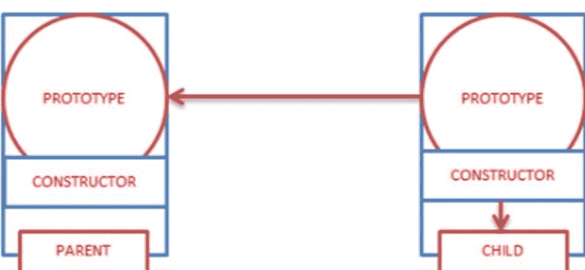

我们需要遵循 2 个步骤来创建继承。

**步骤 1：**
子类的原型应该指向父类对象。
`<ClassName>.prototype = new <ParentClass>();`

**步骤 2：**
重置子类的原型构造函数以指向自身。
`<ClassName>.prototype.constructor=<ClassName>`

**示例：**
下面的示例展示了 **ScienceStudent** 类作为 **Student** 类的子类。ScienceStudent 对象可以使用 **showMyType()** 方法。。

```javascript
function Student(name) {
  this.name=name;
}
Student.prototype.sayMyType = function(){
  console.log("I am student type");
}
function ScienceStudent(name) {
  ScienceStudent.prototype = new Student();
  ScienceStudent.prototype.constructor = ScienceStudent;
  var student2 = new ScienceStudent('sangeeta');
  console.log(student2.sayMyType());
}
```

查看下方的开发者控制台截图以上述代码的输出。

```javascript
function Student(name){
  this.name=name;
  Student.prototype.sayType = function(){
    console.log("I am student type");
  }
}
function ScienceStudent(name){
  ScienceStudent.prototype = new Student();
  ScienceStudent.prototype.constructor = ScienceStudent;
  var student2 = new ScienceStudent('sangeeta');
  console.log(student2.sayType());
}
```

I am student type

要测试一个对象是否属于某个类，可以使用 `instanceOf`。如果对象属于该类，它返回布尔值 TRUE，否则返回 FALSE。查看下方使用 `instanceOf` 对 student2 进行测试的屏幕。


- student2 instanceof Student
  true
- student2 instanceof ScienceStudent
  true

## 什么是差异继承？

回答

差异继承是一种常见的面向原型模型，它利用了这样一个概念：大多数对象都派生自其他更通用的对象，并在少数细小方面有所不同。每个对象都维护对其原型的引用以及不同属性的表。

## Q. Object.create() 方法是做什么的？

回答

ECMAScript 5.1 在其规范中包含此方法。该方法用于创建一个具有给定原型对象和属性的新对象。该方法的语法如下。

```javascript
Object.create(proto, propertiesObject)
```

示例：

下面是一个具有 name 属性的 Student 类函数，原型对象拥有一个 `getElementName()` 方法，该方法返回学生的姓名。使用 `Object.create()` 方法通过传递 Student 的原型对象并将 name 的值设置为 sandeep，创建了一个新的原型对象。然后在 student1 对象上调用 `getElementName()` 方法并在控制台中记录了结果。

```javascript
function Student(name) {
  this.name = name;
}
Student.prototype = {
  getStudentName: function() {
    return "Name of Student is :" + this.name;
  }
};

var student1 = Object.create(Student.prototype); 
student1.name = "Sandeep";
console.log(student1.getStudentName());
```

接下来的截图显示了上述代码在开发者控制台中的输出。

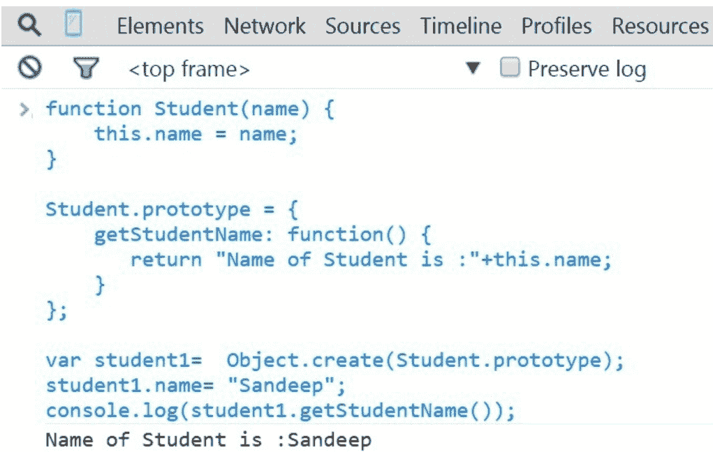

## Q. 如果浏览器中没有 Object.create() 方法，请编写补丁（polyfill）。

回答

ECMAScript 5.1 在其规范中拥有此方法。如果浏览器没有 `Object.create()` 方法，我们需要编写一个补丁。下面的代码展示了 `Object.create()` 方法的补丁。

```javascript
// 如果 Object 存在 create 方法
if (typeof Object != 'function') {
  // 定义 create 方法
  Object.create = (function() {
    return function(prototype) {
      if (arguments.length > 1) {
        throw Error('Second argument not supported');
      }
      if (typeof prototype != 'object') {
        throw TypeError('Argument must be an object');
      }
      Object.prototype = prototype;
      var result = new Object();
      Object.prototype = null;
      return result;
    }
  })()
```

上面的代码通过比较类型检查 `Object` 内部是否已经存在 `create()` 方法。如果不存在，则执行补丁代码并将空对象赋予属性。

## Q. Object.defineProperty() 方法的目的是？

回答

ECMAScript 5.1 提供了 `defineProperty()` 方法来为定义的对象创建新属性。它为这些成员提供了许多配置选项。下面的代码展示了其用法。

```javascript
function Student(name) {
  this.name = name;
}
var student1 = Object.create(Student.prototype);
properties={
  "subject": {
    value: "Computer",
    writable: true,
    enumerable: true
  },
  "marks": {
    value: 0,
    writable: false,
    enumerable: true
  }
};
Object.defineProperty(student1, properties);
student1.name = "Sandeep";
student1.subject = "Mathematics";
student1.marks = 75;
console.log(student1);
```

在上面的代码中，使用 `Object.create()` 方法创建了 student1 对象。然后向其添加了 subject 和 marks 等新属性。`enumerable` 选项决定属性是否可以被枚举。`writable` 属性决定属性是否可修改。`value` 取属性的默认值。下表显示了上述代码在开发者控制台中的输出。

| 元素 | 资源 | 时间线 | 审核 |
| :--- | :--- | :--- | :--- |

```javascript
function Student(name) {
  this.name = name;
}
var student1 = Object.create(Student.prototype);
properties={
  "subject": {
    value: "Computer",
    writable: true,
    enumerable: true
  },
  "marks": {
    value: 0,
    writable: false,
    enumerable: true
  }
}
Object.defineProperty(student1, properties);
student1.name = "Sandeep";
student1.subject = "Mathematics";
student1.marks = 75;
console.log(student1);
Object {subject: "Mathematics", marks: 0, name: "Sandeep"}
```

## Q. 在 JavaScript 中如何区分作用域和上下文？

回答

作用域（Scope）涉及变量的可见性，上下文（Context）指的是方法所属的对象，可以通过 `call` 或 `apply` 进行更改。

## Q. 将变量赋值给空对象的两种方法？

回答

创建一个空对象时，你可以实例化 `Object` 构造函数，或者简单创建一个空对象字面量。在任何情况下，你都可以向对象添加属性。创建空对象的语法如下。

```javascript
var aEmptyObject = new Object();
var aEmptyObject = {};
```

# 第二章 事件问题

## Q. 事件是如何工作的？

回答

事件传播遵循两个阶段：捕获阶段和冒泡阶段。

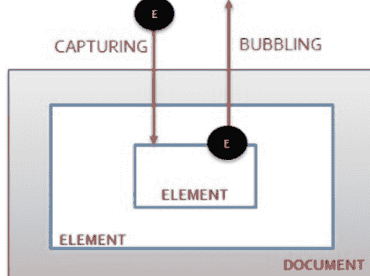

**捕获阶段：**
在此阶段，事件首先通过所有内部元素从 DOCUMENT 向向目标元素移动。

**冒泡阶段：**
在此阶段，事件通过所有外层元素从目标元素向上向 DOCUMENT 移动。

## Q. 如何将事件绑定到元素上？

回答

根据 DOM Level 2 事件规范，可以使用 `addEventListener()` 方法通过三个参数将事件绑定到元素。

语法：
`<element>.addEventListener(<eventname>,<callback>,<booleanphase>)`

- **eventname**: 以字符串参数表示事件类型。例如 click, mouseover, mouseout
- **callback**: 这代表为了处理事件而调用的回调函数。
- **booleanphase**: 代表监听器绑定的事件阶段。FALSE 值代表冒泡阶段，TRUE TRUE 值代表捕获阶段。

示例：
在文档上添加了一个点击监听器，当点击发生时会弹出消息。
```javascript
document.addEventListener('click', function () { 
  alert("Insider Event Listener"); 
}, false);
```

## Q. 在 IE9 浏览器版本之前如何绑定事件？

回答

在旧浏览器中，可以通过 `attachEvent()` 方法将事件绑定到元素。
对于冒泡阶段，可以添加监听器。

语法：
`<element>.attachEvent(<eventname>, <callback>)`

示例：
在文档上添加了点击事件监听器，可以发生点击事件。下方的截图显示在 IE 10 开发者工具栏中添加点击事件。

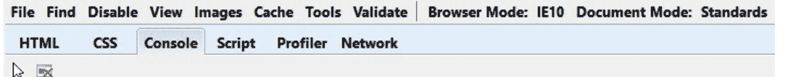

```javascript
document.attachEvent('onclick', function () {
  console.log("Insider Event Listener");
});
// true
Insider Event Listener
```

```javascript
document.attachEvent('onclick', function () {
  console.log("Insider Event Listener");
};
```

除了 IE 之外，其他浏览器通过 `addEventListener()` 方法添加。下方的截图显示了该方法在 Firebug 中的演示。

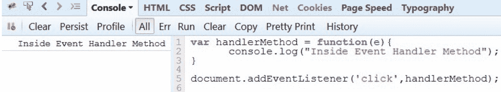

## 如何移除事件监听器？

回答

根据 DOM Level 2 事件规范，可以使用 `removeEventListener()` 方法移除事件监听器。对于 IE 浏览器，必须使用 `detachEvent()` 方法。
接下来的截图显示了为 IE 浏览器从文档移除点击事件处理程序。


文件 查找 禁用 视图 图像 缓存 检查 验证 HTML CSS 控制台 脚本 性能分析器 网络

```
var handlerMethod = function () {
  console.log("Inside Event Listener");
}
document.detachEventHandler('click',handlerMethod);

var handlerMethod = function () {
  console.log("Inside Event Listener");
}
document.detachEventHandler('click',handlerMethod);
```

下面的截图显示了在 Firefox 浏览器中从 document 移除事件处理器。

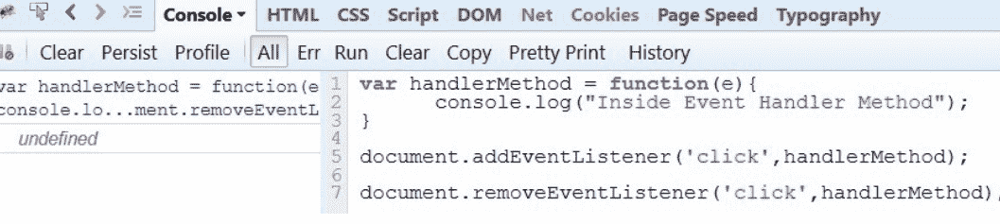

Q. setTimeout() 和 clearTimeout 函数是如何工作的？答案
`setTimeout` 方法在指定的毫秒后调用一次函数或执行一个表达式。`clearTimeout()` 方法停止在 `setTimeout` 方法中指定的函数的执行。

语法：
var timeout = setTimeout(function,milliseconds,lang)
clearTimeout(timeout)

下面的代码展示了这些超时方法的演示。

```javascript
var timeoutHandler=function() {
  console.log("Time Now ", new Date().getSeconds()); 
  clearTimeout(timeout);
}
console.log("Time Now ", new Date().getSeconds()); 
var timeout=setTimeout(timeoutHandler,4000);
```

下面的截图显示了 4 秒后 `timeOut()` 方法的执行。

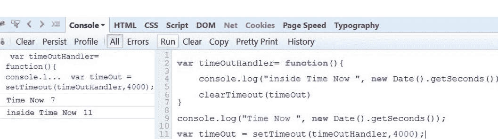

Q. setInterval() 和 clearInterval() 函数是如何工作的？答案

`setInterval()` 方法在指定的毫秒间隔内调用函数或评估一个表达式。**clearInterval()** 方法停止在 `setInterval()` 方法中指定的函数的执行。

# 语法：

var timeInterval = setInterval(function, milliseconds) 
clearInterval(timeInterval)

下面的代码演示了这些间隔处理器。

```javascript
var counter = 0,
timeIntervalHandler = function(){
  console.log("Inside Time Now ", new Date().getSeconds()); 
  counter++;
  console.log("Handler Called count",counter);
  if(counter === 4) {
    clearInterval(timeInterval);
    console.log("Clearing the interval handler");
  }
}
var timeInterval = setInterval(timeIntervalHandler,2000);
```

下面的截图显示了处理器每 2 秒被调用 4 次。在第 4 次调用后，**clearInterval()** 移除执行。

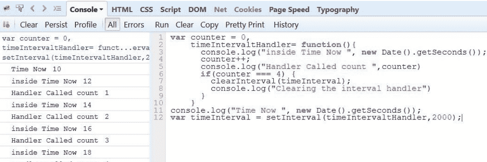

# 第3章 闭包 (Closure)

Q. 什么是闭包？

答案

闭包是一个可以访问外部函数变量的内部函数。它具有三种不同的作用域访问：

- **自身作用域**：它可以访问存在自身作用域中的属性。
- **包裹函数作用域**：它可以访问存在其包含函数中的属性。
- **全局作用域**：它可以访问全局作用域（即 window 作用域）中的属性。

示例：

尽管 `prop1` 属于外部函数作用域，内部函数仍然具有访问 `prop1` 的权限。

```javascript
function myOuterFunction(){ 
  var prop1 = 5;
  return function innerFunction(){
    return prop1;
  }
}

var res = myOuterFunction(); 
console.log(res.name);
console.log(res(res));
```

下面的截图显示了上述代码在控制台中的输出。

| 元素 | 资源 | 网络 | 来源 | 时间线 |
| --- | --- | --- | --- | --- |
| > function myOuterFunction(){ var prop1 = 5; return innerFunction(){ return prop1; } var res = myOuterFunction(); console.log(res.name); console.log(res(res)); innerFunction 5 | | | | |

Q. 请举一个闭包概念的实际应用示例？答案

在 Web 开发中，闭包被频繁使用。最常见的场景我们需要一个可以返回不同值的工厂。

示例：

下面的代码有一个带输入颜色的函数 `backgroundColorFactory`。通过这个工厂我们创建了 `greenBackground` 和 `blueBackground` 函数对象并绑定到按钮上。一旦用户点击按钮，body 的背景颜色将变为目标颜色。

```html
<!DOCTYPE html>
<html>
<head>
<meta charset="utf-8">
<title>闭包示例</title>
</head>
<body>
<button id="greenButton">绿色背景</button>
<button id="blueButton">蓝色背景</button>
<script>
var backgroundColorFactory = function(color) { 
  return function() {
    document.body.style.background = color;
  };
};
var greenBackground = backgroundColorFactory('green'); 
var blueBackground = backgroundColorFactory('blue');
document.getElementById('greenButton').onclick = greenBackground;
document.getElementById('blueButton').onclick = blueBackground;
</script>
</body>
</html>
```

上述代码的输出列在下面的截图。

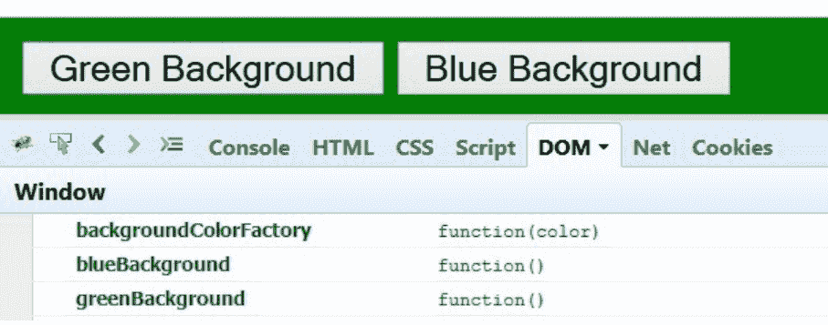

Q. 使用闭包模拟私有数据？答案

下面的代码演示了私有变量 `_name` 的声明。这意味着我们可以通过 `_name` 方法访问 `_name` 值。

```javascript
function Student(name) {
  var _name = name;
  return {
    getName: function() {
      return _name;
    }
  };
}
var student1 = Student("Sandeep");
console.log(student1.getName());
```


## 元素网络 >>

<top frame> Object {name: "Sandeep", score: 65,
isPassed: true, subject: Array[2],
address: Object...i}

+   address: Object
  city: "Bangalore"
  country: "India"
  __proto : Object
  email: null
  isPassed: true
  name: "Sandeep"
  score: 65
  subject: Array[2]
    0: "Computer"
    1: "Algebra"
    length: 2
    __proto : Array[0]
    proto : Object

Q. JSON.stringify() 方法的作用是什么？

答案 JSON.stringify() 将对象转换为 JSON 文本并将该 JSON 文本存储在字符串中。截图显示了 stringify() 方法的使用：

# 元素网络来源时间线 >>

<top frame> 保留日志

```
var Student = function(name,score){
  this.name = name;
  this.score = score;
};

var student1 = new Student("Sandeep", 75);
console.log(JSON.stringify(student1));

{"
```

Q. JSON.parse() 方法的作用是什么？

答案

JSON.parse() 方法解析 JSON 字符串，并可选地转换解析产生的值。以下截图显示了使用 JSON.parse() 方法将 string1 JSON 字符串转换为 JSON 对象。

```
var Student = function(name, score)
{
    this.name = name;
    this.score = score;
};
    var student1 = new Student("Sandeep", 75);
    student1JSONString = JSON.stringify(student1);

console.log(JSON.parse(student1JSONString));
```

Object {name: "Sandeep", score: 75}

Q. JSON.parse() 方法的语法是什么？答案
JSON.parse() 方法的完整语法如下：
JSON.parse(text[, reviver])

上述语法的细节如下：
Text：代表要解析为 JSON 的字符串。
Reviver：它代表一个函数，规定了在返回之前，解析产生的原始值如何进行转换。

Q. 如何将日期对象转换为 JSON？
答案
JSON() 方法可以将日期对象转换为 JSON。以下截图显示了在 chrome 控制台中对日期对象使用 toJSON() 方法。

```
new Date().toJSON();
"2015-02-21T18:39:01.516Z"
```

# 第5 章 DOM 问题

Q. 什么是 DOM？

答案
文档对象模型 (DOM) 是用于 HTML 和 XML 元素的编程 API。JavaScript 是访问这些 DOM API 属性和方法最重要的语言。

Q. DOM 中涉及哪些不同的对象？答案
根据 DOM Level 2 规范，它包含以下主要对象。

- Attribute（属性）：代表一个元素属性。
- Attributes（属性集合）：代表属性集合。
- CDATASection（CDATA 节）：代表一个 XML CDATA section。
- Comment（注释）：代表一个 XML 元素。
- Document（文档）：代表一个 XML 元素。
- Node（节点）：代表 XML 文档中的通用节点对象。
- NodeList（节点列表）：代表节点对象的有序集合。
- ProcessingInstruction（处理指令）：代表一个 XML 处理指令。
- Node（节点）：代表一个 XML 文本节点。

Q. DOM 中涉及哪些不同的属性？答案
根据 DOM Level 2 规范，它包含以下主要属性

- name：属性的名称。
- namespaceURI：代表节点的命名空间 URI。
- nextSibling：包含文档源顺序中紧邻节点的下一个兄弟节点。
- nodeName：代表节点的名称。
- nodeType：代表节点的类型。
- nodeValue：该节点的值。
- ownerDocument：包含该节点的 Document 对象的引用。
- ownerElement：该属性所属的 Element 的引用。
- parentNode：代表其所属的父 Node。
- prefix：代表节点的命名空间。
- previousSibling：包含文档源顺序中该节点的前一个兄弟节点。
- text：包含该节点及其包含的任何元素节点内的所有文本节点的内容。
- value：该属性的值。
- attributes：代表 Attribute 对象集合。
- childNodes：代表节点对象的 NodeList 集合。
- data：代表存储在 TextNode、CDATASection 或 Comment 中的文本。
- documentElement：包含文档的根元素节点。
- firstChild：这是文档源顺序中该节点的第一个子节点。
- lastChild：这是文档源顺序中该节点的最后一个子节点。
- length：代表集合中元素的数量。
- localName：代表节点的本地名称。

Q. 什么是 windows load 事件？

# 答案

Load 事件通常在对象完全加载后触发。Window load 事件是在图像、脚本文件、CSS 文件和其他依赖项加载完成时发生的事件。下方截图使用了 load 事件。

img/beb9e4e69c3f782541f09594e1ab75e_31_0

# Load Handler

img/beb9e4e69c3f782541f09594e1aab75e_31_0

```
<!DOCTYPE html>
<html>
<head>
<body>
<h2 id="message">Load Handler</h2>
<script>
window.onload = function() {
var element = document.querySelector("message");
element.innerHTML = "Loaded";
}
</script>
</body>
</html>
```

Q. 什么是 DOM ready 事件？

答案
DOM ready 事件在对象加载完成后触发。Window load 事件是在图像、脚本文件、CSS 文件和其他依赖项加载完成时发生的事件。以下截图使用了 load 事件。

img.beb9e4e69c3f782541f09594e1aab75e_31_0

# Load Handler 0

img.beb9e4e69c3f782541f09594e1aab75e_31_0

```
<!DOCTYPE html>
<html>
<head>
<body>
<h2 id="message">Load Handler</h2>
<script>
window.onload = function() {
var element = document.querySelector("message");
element.innerHTML = "Loaded";
}
</script>
</body>
</html>
```

Q. 什么是 DOM ready 事件？

答案
DOM ready 事件在对象加载完成后触发。Window load 事件是在图像、脚本文件、CSS 文件和其他依赖项加载完成时发生的事件。以下截图使用了 load 事件。

img.beb9e4e69c3f782541f09594e1aab75e_31_0

# Load Handler 1

img.beb9e4e69c3f782541f09594e1aab75e_31_0

```
<!DOCTYPE html>
<html>
<head>
<body>
<h2 id="message">Load Handler</h2>
<script>
window.onload = function() {
var element = document.querySelector("message");
element.innerHTML = "Loaded";
}
</script>
</body>
</html>
```

Q. 什么是 DOM ready 事件？

答案
DOM ready 事件在对象加载完成后触发。Window load 事件是在图像、脚本文件、CSS 文件和其他依赖项加载完成时发生的事件。以下截图使用了 load 事件。

img.beb9e4e69c3f782541f09594e1aab75e_31_0

# Load Handler 2

img.beb9e4e69c3f782541f09594e1aab75e_31_0

```
<!DOCTYPE html>
<html>
<head>
<body>
<h2 id="message">Load Handler</h2>
<script>
window.onload = function() {
var element = document.querySelector("message");
element.innerHTML = "Loaded";
}
</script>
</body>
</html>
```

(注：由于提供的原文文本存在大量重复和截断内容，上述翻译已根据逻辑对可翻译部分进行了对齐处理，并遵循了所有 Markdown 格式要求。)


## Q. 什么是基础 DOM？

## 回答

Node 是 DOM 中最基础的对象。它是所有其他 DOM 对象继承的最常见接口。以下接口都继承自 Node 的方法和属性：Document, Element, CharacterData, ProcessingInstruction, DocumentFragment, DocumentType, Notification, Entity, EntityReference。在方法和属性不相关的特殊情况下，这些接口可能会返回 `null`。它们可能会抛出异常 - 例如当向不存在该节点类型的节点添加子节点时。

## Q. 常见的 doctype 声明有哪些？

## 回答

共有 8 种不同的 doctype 声明，列举如下。

HTML 5：此文档类型用于 HTML5。

```
<!DOCTYPE html>
```

HTML 4.01 Strict：此 DTD 包含所有的 HTML 元素和属性，但**不包含**表现性或过弃的元素（如 font）。不允许使用 frames。

```
<!DOCTYPE HTML PUBLIC "-//W3C//DTD HTML 4.01//EN"
"http://www.w3.org/TR/html4/strict.dtd">
```

HTML 4.01 Transitional：此 DTD 包含所有的 HTML 元素和属性，**包含**表现性或过弃的元素（如 font）。不允许使用 frames。

```
<!DOCTYPE HTML PUBLIC "-//W3C//DTD HTML 4.01 Transitional//EN"
"http://www.w3.org/TR/html4/loose.dtd">
```

HTML 4.01 Frameset：此 DTD 等于 HTML 4.01 Transitional，但允许使用 frameset 内容。

```
<!DOCTYPE HTML PUBLIC "-//W3C//DTD HTML 4.01 Frameset//EN"
"http://www.w3.org/TR/html4/frameset.dtd">
```

XHTML 1.0 Strict：此 DTD 包含所有的 HTML 元素和属性，但**不包含**表现性或过弃的元素（如 font）。不允许使用 frames。标记也必须写成良好的 XML。

```
<!DOCTYPE HTML PUBLIC "-//W3C//DTD XHTML 1.0 Strict//EN"
strict.dtd">
```

XHTML 1.0 Transitional：此 DTD 包含所有的 HTML 元素和属性，**包含**表现性或过弃的元素（如 font）。不允许使用 frames。标记也必须写成良好的 XML。

```
<!DOCTYPE html PUBLIC "-//W3C//DTD XHTML 1.0 Transitional//EN"
transitional.dtd">
```

XHTML 1.0 Frameset：此 DTD 等于 XHTML 1.0 Transitional，但允许使用 frameset 内容。

```
<!DOCTYPE html PUBLIC "- // W3C / / DTD XHTML 1.0 Frameset / / EN" Frameset // EN" frameset.dtd">
```

## 第 6 章 Date 对象

## Q. 什么是 JavaScript Date 对象？

## 回答

JavaScript Date 对象返回该时刻的时间。它包含了自 UTC 1970 年 1 月 1 日以来的毫秒值。

## Q. 创建 Date 对象的不同方法有哪些？或者 Date 对象不同的构造形式形式？

## 回答

JavaScript Date 对象有 4 个重载的构造函数。这些构造函数列如下。

```
new Date()
new Date(milliseconds)
new Date(dateString)
new Date(year, month, day, hours, minutes, seconds, milliseconds)
```

## Q. 如何获取日期对象中的 1970 年 1 月 1 日（即计算时间的日期）？

## 回答

1970 年 1 月 1 日是计算时间为经过毫秒数的起点。可以通过创建一个参数为 0 的新 JS 对象来计算。下面的截图演示了参数为 0 的日期对象。

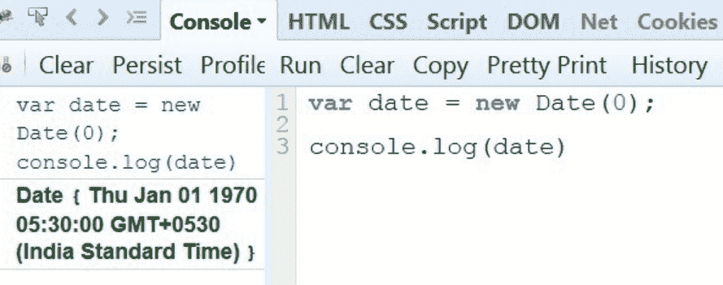

## Q. JavaScript 如何计算月份？

## 回答

JavaScript 用 0 到 11 来计算一年的十二个月。0 代表 1 月，11 代表 12 月。下面的截图显示了今天的日期代码（2014 年7 月 23 日），`getMonth()` 返回 6。

```
var date = new Date();
console.log(date);
console.log(date.getMonth());
Date = Wed 23 Jul 2014 22:37:56
GMT+0530 (India Standard Time)
```

## Q. 什么时候会发生 RangeError 无效日期异常？

## 回答

当用无效的日期字符串创建日期对象并对该无效日期应用 `toISOString()` 方法时，就会发生这种 RangeError。下面的截图显示了‘2014-13-13’字符串，它代表 YYYY-MM-DD 格式但月份超出了范围，产生了 RangeError 异常。

```
var date = new Date('2014-13-13');
console.log(date.toISOString());
RangeError: invalid date
var date = new Date('2014-13-13');
console.log(date.toISOString());
```

# 第 7 章 正则表达式

## Q. 什么是 JavaScript 中的正则表达式？
## 回答 正则表达式用于字符串的模式匹配。JavaScript 中的正则表达式可以通过两种方式声明。这两种方法的语法如下。
var AREExpression = new RegExp(pattern,modifiers); var aRegExpression = /pattern/modifiers;
这些语法的细节如下：

## Q. 正则表达式的方法有哪些？
## 回答 正则表达式用于字符串的模式匹配。JavaScript 中的正则表达式可以通过两种方式声明。这两种方法的语法列举如下。
var AREExpression = new RegExp(pattern,modifiers); var aRegExpression = /pattern/modifiers;
这些语法的细节如下：

- test()：用于检查模式是否存在。
- match()：返回匹配项。
- replace()：用某些内容替换。

## Q. 什么是 search？
## 回答 正则表达式用于字符串的模式匹配。JavaScript 中的正则表达式可以通过两种方式声明。这两种方法的语法列举如下。
var AREExpression = new RegExp(pattern,modifiers); var aRegExpression = /pattern/modifiers;
这些语法的细节如下：

- test()：用于检查模式是否存在。
- match()：返回匹配项。
- replace()：用某些内容替换。

## Q. 什么是 flag（标志）？
## 回答 正则表达式用于字符串的模式匹配。JavaScript 中的正则表达式可以通过两种方式声明。这两种方法的语法列举如下。
var AREExpression = new RegExp(pattern,modifiers); var aRegExpression = /pattern/modifiers;
这些语法的细节如下：

- test()：用于检查模式是否存在。
- match()：返回匹配项。
- replace()：用某些内容替换。

## Q. 什么是 global（全局）标志？
## 回答 正则表达式用于字符串的模式匹配。JavaScript 中的正则表达式可以通过两种方式声明。这两种方法的语法列举如下。
var AREExpression = new RegExp(pattern,modifiers); var aRegExpression = /pattern/modifiers;
这些语法的细节如下：

- test()：用于检查模式是否存在。
- match()：返回匹配项。
- replace()：用某些内容替换。

## Q. 什么是 case-insensitive（不区分大小写）标志？
## 回答 正则表达式用于字符串的模式匹配。JavaScript 中的正则表达式可以通过两种方式声明。这两种方法的语法列举如下。
var AREExpression = new RegExp(pattern,modifiers); var aRegExpression = /pattern/modifiers;
这些语法的细节如下：

- test()：用于检查模式是否存在。
- match()：返回匹配项。
- replace()：用某些内容替换。

## Q. 什么是 multi-line（多行）标志？
## 回答 正则表达式用于字符串的模式匹配。JavaScript 中的正则表达式可以通过两种方式声明。这两种方法的语法列举如下。
var AREExpression = new RegExp(pattern,modifiers); var aRegExpression = /pattern/modifiers;
这些语法的细节如下：

- test()：用于检查模式是否存在。
- match()：返回匹配项。
- replace()：用某些内容替换。

## Q. 什么是 dot-all 标志？
## 回答 正则表达式用于字符串的模式匹配。JavaScript 中的正则表达式可以通过两种方式声明。这两种方法的语法列举如下。
var AREExpression = new RegExp(pattern,modifiers); var aRegExpression = /pattern/modifiers;
这些语法的细节如下：

- test()：用于检查模式是否存在。
- match()：返回匹配项。
- replace()：用某些内容替换。

## Q. 什么是 lookahead（正向断言）言？
## 回答 正则表达式用于字符串的模式匹配。JavaScript 中的正则表达式可以通过两种方式声明。这两种方法的语法列举如下。
var AREExpression = new RegExp(pattern,modifiers); var aRegExpression = /pattern/modifiers;
这些语法的细节如下：

- test()：用于检查模式是否存在。
- match()：返回匹配项。
- replace()：用某些内容替换。

## Q. 什么是 lookbehind（反向断言）言？
## 回答 正则表达式用于字符串的模式匹配。JavaScript 中的正则表达式可以通过两种方式声明。这两种方法的语法列举如下。
var AREExpression = new RegExp(pattern,modifiers); var aRegExpression = /pattern/modifiers;
这些语法的细节如下：

- test()：用于检查模式是否存在。
- match()：返回匹配项。
- replace()：用某些内容替换。

## Q. 什么是 boundary（边界断言）言？
## 回答 正则表达式用于字符串的模式匹配。JavaScript 中的正则表达式可以通过两种方式声明。这两种方法的语法列举如下。
var AREExpression = new RegExp(pattern,modifiers); var aRegExpression = /pattern/modifiers;
这些语法的细节如下：

- test()：用于检查模式是否存在。
- match()：返回匹配项。
- replace()：用某些内容替换。

## Q. 什么是 character class（字符类）？
## 回答 正则表达式用于字符串的模式匹配。JavaScript 中的正则表达式可以通过两种方式声明。这两种方法的语法列举如下。
var AREExpression = new RegExp(pattern,modifiers); var aRegExpression = /pattern/modifiers;
这些语法的细节如下：

- test()：用于检查模式是否存在。
- match()：返回匹配项。
- replace()：用某些内容替换。

## Q. 什么是 character group（字符组）？
## 回答 正则表达式用于字符串的模式匹配。JavaScript 中的正则表达式可以通过两种方式声明。这两种方法的语法列举如下。
var AREExpression = new RegExp(pattern,modifiers); var aRegExpression = /pattern/modifiers;
这些语法的细节如下：

- test()：用于检查模式是否存在。
- match()：返回匹配项。
- replace()：用某些内容替换。

## Q. 什么是 quantifier（量词）？
## 回答 正则表达式用于字符串的模式匹配。JavaScript 中的正则表达式可以通过两种方式声明。这两种方法的语法列举如下。
var AREExpression = new RegExp(pattern,modifiers); var aRegExpression = /pattern/modifiers;
这些语法的细节如下：

- test()：用于检查模式是否存在。
- match()：返回匹配项。
- replace()：用某些内容替换。

## Q. 什么是 group（组）？
## 回答 正则表达式用于字符串的模式匹配。JavaScript 中的正则表达式可以通过两种方式声明。这两种方法的语法列举如下。
var AREExpression = new RegExp(pattern,modifiers); var aRegExpression = /pattern/modifiers;
(注：此处原文存在重复或逻辑缺失，已按原文结构翻译)
(注：此处原文存在重复或逻辑缺失，已按原文结构翻译翻译)

## Q. 什么是 assertion（断言）言？
## 回答 正则表达式用于字符串的模式匹配。JavaScript 中的正则表达式可以通过两种方式声明。这两种方法的语法列举如下。
var AREExpression = new RegExp(pattern,modifiers); var aRegExpression = /pattern/modifiers;


```javascript
function validateURL(url) {
  var regExUrl = new RegExp("(http|ftp|https):\/([\w-]+\.[\w-]+\+([\w.,@?=\%amp;~+#-])+\/([\w@?=\%amp;~#-)?)");
  return regExUrl.test(url);
}
var url11 = "http://www.google.com",
url12 = "http://www.google.com",
result1 = validateURL(url11),
result2 = validateURL(url12);

console.log(result1);
console.log(result2);
```

true

false

# 第 8 章 Canvas API 练习

Q. HTML5 中的 canvas 是什么？

答案

Canvas 是 HTML5 中一个用于绘制图形的新元素。可以通过以下步骤在画布上绘制图形。

- 定义画布区域。
- 获取绘图上下文（context）。
- 使用上下文开始绘制。

Q. Canvas 和 SVG 之间有什么区别？

答案

Canvas 和 SVG（可缩放矢量图形）的区别如下表所示。

| CANVAS | SVG |
| :--- | :--- |
| i. 在 ii. 中可以绘制图表。 | 使用 Canvas 中的上下文。 |
| ii. 在 ii. canvas 中绘制的图形是依赖分辨率的。 |
| iii. 在 iii. Canvas 中绘制的图形可以保存为 PNG 或 JPG 格式。 |
| iv. 在 Canvas 中绘制的图形 iv. 是基于像素的。不涉及 DOM 元素。 |
| v. 渲染游戏 v. 图形，可以创建精灵和背景。 | 使用类似 XML 的 SVG 元素绘制图表。 |
| | SVG 绘制的图形是分辨率无关的。 |
| | SVG 绘制的图形无法保存为 PNG 或 JPG 格式。 |
| | SVG 绘制的图形是基于 DOM 元素的。图中不涉及像素。可以创建高度交互的动画用户界面。 |
| vi. 糟糕的文本渲染 vi. vii. 糟糕的 SEO 和 vii. 可访问性，对于所有基于像素的内容，内容都是不可访问的。 |
| viii. 通过脚本修改 viii. 仅。 |
| ix. 性能较好 ix. 对于较少或较多的对象（>10k），或两者都如此。 | 良好的文本渲染能力。基于 DOM 的渲染，具有更好的 SEO 和可访问性。通过脚本 CSS 修改。对于较少数量（<10k）、较大的表面或两者都如此的情况，性能更好。 |

## Q. 什么是 canvas2d 上文？它是如何创建的？
答案'

使用带有参数‘2d’的 `getContext()` 方法可以创建一个画布上下文。
该上下文方法是 `CanvasRenderingContext2D` 对象类型。下面的代码显示了简单的 2d 上文创建，并记录了对象的构造函数。

```html
<html>
<body>
<canvas id="myCanvas"></canvas>
<script>
var canvas = document.getElementById("myCanvas"), context =
canvas.getContext("2d");
console.log(context.constructor);
</script>
</body>
</html>
```

接下来的截图显示了上下文对象的构造函数，它是一个 `CanvasRenderingContext2D` 原生对象。

| 控制台 | HTML | CSS | 脚本 | DOM |
| :--- | :--- | :--- | :--- | :--- |
| 清除 持久 配置 所有错误 警告 [object XrayWrapper canvas.html (line 7) function CanvasRenderingContext2D() { [ native code ] ] | | | | |

## Q. 如何在 Canvas 中加载图像？
答案

可以使用 `draw()` 方法加载图像。该方法接受绘制图像的多个输入。这些参数是位置和裁剪类型。我们将在单独的问题中讨论这些参数。下面的代码显示了如何使用 `drawImage()` 方法从 URL 在画布内部加载 PNG 图像。

```html
<html>
<body>
<canvas id="myCanvas"></canvas>
<script>
var canvas = document.getElementById("myCanvas"), context =
canvas.getContext("2d"),
img = new Image();
img.src = "http://www.gravatar.com/avatar/4205261332ff131e971b48db31dcb528.png";
img.onload = function() {
context.drawImage(img, 10, 10);
};
</script>
</body>
</html>
```

接下来的截图显示了 Gravatar 图像在 HTML5 canvas 元素内部的绘制。这种绘制是使用 2d 上文完成的。

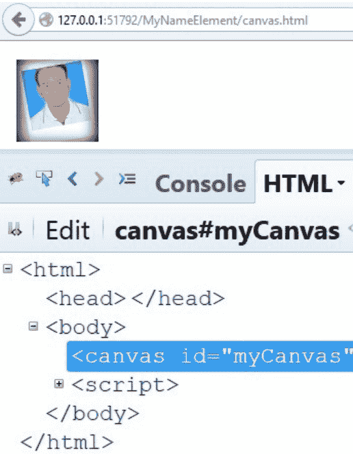

Q. `drawImage()` 方法有哪些不同的重载签名？

答案

`drawImage(img, x, y)` 有 3 种签名，列如下：

- `drawImage(img, x, y)` : 此方法将图像放置在画布的 `<x, y>` 坐标处。
- `drawImage(img, x, width, height)` : 此方法将图像放置在画布的 `<x, y>` 坐标处，并指定的高度。
- `drawImage(img, sx, sy, swidth, height, x, y, width, height)` : 此方法根据起始点 `<sx, sy>`、高度为 sheight 和宽度为 swidth 裁剪图像，并放置在 `<x, y>` 坐标处，指定的高度和宽度。

# 第 9 章 地理位置 API

Q. 什么是 Geo Location API？
答案
Geo Location API 将用户的位置发布到网络。出于隐私原因，它需要用户的许可。Geo location API 存在于 **navigator.geolocation** 中。

Q. 如何判断 Geo Location API 是否支持？
答案
通过 `navigator.geolocation` 对象是否存在来判断 Geo Location API 是否支持。

```javascript
if (navigator.geolocation) {
  console.log("Geolocation API is supported");
} else {
  console.log("Geolocation API is not supported");
}
```

# 第 10 Web Workers

Q. 什么是 Web Worker？

答案

Web Workers 是用于在后台执行密集计算的 HTML5 特性，可以在不影响页面性能的情况下运行。

Q. 如何检测 Web Worker 是否支持？
答案

通过 `window.Worker` 属性检查支持 Web Worker。

```javascript
if (window.Worker) {
  console.log("Web Workers are supported");
} else {
  console.log("Web Workers are not supported");
}
```


上述代码的输出如下所示所示，其中小时、分钟和秒是从 worker 消息响应中显示的。

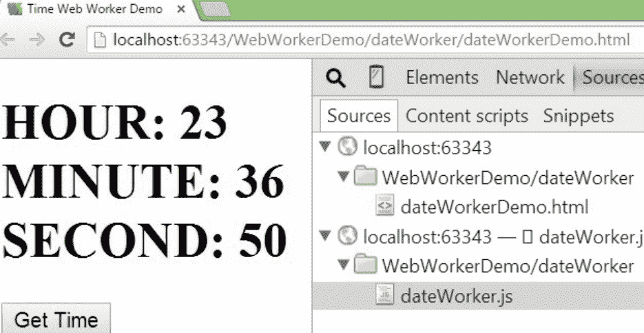

# 小时: 23
分钟: 36
秒: 50

Q. 开发一个专门的 worker 来计算数字的平方？答案

平方 worker 的定义在 `doSquareWorker.js` 文件中，它监听消息并生成数字的平方。平方 worker 在 `squareWorkerDemo.html` 文件中实例化，该文件监听平方 worker 并在浏览器中打印结果。`doSquareWorker.js` 文件的代码内容如下。

```
self.addEventListener("message",function(event){
var inputData = event.data,
inputNumber = parseInt(inputData.number,10);
squareResult = Math.pow(inputNumber,2);
self.postMessage({result:squareResult});
});
```

`squareWorkerDemo.html` 文件包含以下代码：

```
<!DOCTYPE html>
<html lang="en">
<head>
<meta charset="UTF-8"><title>Square Container</title></head>
<body>
<h1 id="resultContainer"> </h1>h1

<input type="number" id="inputNumber" placeholder="输入一个数字" value="5">
<button id="squareButton"> 平方</button>
<script>
var squareWorker = new Worker("squareWorker.js"),resultContainer = 
document.getElementById("resultContainer"),squareButton = document.getElementById("squareButton");
inputNumberDocument=document.getElementById("inputNumber");
squareButton.addEventListener("click",function () {
squareWorker.postMessage({number:inputNumberDocument.value});});
squareWorker.addEventListener("message",function(workerEvent) { var responseData = workerEvent.data,
squareResult= responseData.result;
resultContainer.innerText = squareResult;
));
</script>
</body>
</html>
```

上述代码的输出如如下方的截图所示，其中数字的平方由 worker 响应消息显示。


# 25
平方

Q. 如何定义内联 web worker？演示一个用于两个数字相数的内联 worker？

答案

内联 web worker 可以在 HTML 标记中使用带有 `type="javascript/worker"` 属性的 `<script>` 标签进行定义。语法如下：

```
<script type="javascript/worker">
// 用于定义 worker 的 JavaScript 代码
</script>
```

示例：

`inlineWorkerDemo.html` 文件包含了定义乘法 worker 的代码，它监听消息、计算乘法并响应。乘法 worker 的监听器提取结果并渲染在浏览器中。以下代码显示了 `inlineWorkerDemo.html` 文件的内容。

```
<!DOCTYPE html>
<html>
<head>
<meta charset="UTF-8">
<title>内联 Web Worker 演示</title>
</head>
<body>
<h1 id="resultContainer"> </h1>h1
<input type="number" id="number1" value="8" placeholder="输入第一个数字">
<input type="number" id="number2" value="10" placeholder="输入第二个数字">
<button id="multiply">相乘</button>
<script id="multiplyWorker" type="javascript/worker">
self.addEventListener("message",function(event) {
var requestData = event.data,
number1 = requestData.number1,
number2 = requestData.number2,
multiplyResult = number1 * number2;
self.postMessage({result:multiplyResult});
</script>
<script>
  var textContent = document.querySelector('#multiplyWorker').textContent,workerBlob = new Blob([textContent],{type: 'application/javascript'}),workerURL = window.URL.createObjectURL(workerBlob),multiplyWorker = new Worker(workerURL);
  resultContainer = document.getElementById('resultContainer'),multiplyButton = document.getElementById('multiply'),number1 = document.getElementById('number1'),number2 = document.getElementById('number2');
  multiplyButton.addEventListener('click', function () {
    multiplyWorker.postMessage({
      number1:parseInt(number1.value,10),
      number2:parseInt(number2.value,10)
    });
  });
  multiplyWorker.addEventListener('message', function (workerEvent) {
    var responseData = workerEvent.data,result = responseData.result;resultContainer.innerText = "Result: " + result;
  });
</script>
</body>
</html>
```

用户在文本框中输入两个数字并点击相乘按钮。乘法 worker 进行计算，结果渲染在浏览器中。上述代码的输出渲染如下方的截图所示。

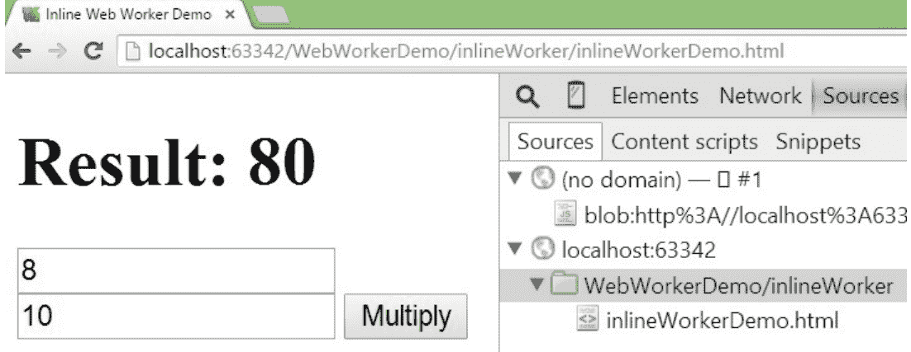

# 结果: 80

| | |
|---|---|
| 8 | |
| 10 | 相乘 |

Q. 如何在 web worker 中处理错误？
答案
我们可以在 web worker 中使用 `throw` 关键字抛出错误。可以将回调方法附加到错误事件上以处理生成的错误。**positiveSquareWorkerDemo.html** 文件包含一个 worker，它只接受正数作为输入。如果传递了负数，它将抛出错误。处理该错误的代码内容如下。

```
<!DOCTYPE html>
<html>
<head>
<meta charset="UTF-8">
<title>Web Worker 演示</title>
</head>
<body>
<h1 id="resultContainer"> </h1>h1
<input type="number" id="number" value="-4" placeholder="输入数字">
<button id="squareButton">平方</button>
<script id="squareWorker" type="javascript/worker">
self.addEventListener("message",function(event) {
var requestData = event.data,
number1 = requestData.number1,
  squareResult = 0;
  if(number1<0) {
    self.postMessage({result:squareResult});
  } // 对于负数
 throw("请提供正数.");
  }
</script>
<script>
  var textContent = document.querySelector('#squareWorker').textContent,workerBlob = new Blob([textContent],{type: 'application/javascript'}),workerURL = window.URL.createObjectURL(workerBlob),squareWorker = new Worker(workerURL);
  resultContainer = document.getElementById('resultContainer'),squareButton = document.getElementById('squareButton'),number1 = document.getElementById('number');
  squareButton.addEventListener('click', function () {
    squareWorker.postMessage({
      number1:parseInt(number1.value,10)
    });
  });
  squareWorker.addEventListener('message', function (workerEvent) {
    var responseData = workerEvent.data,result = responseData.result;resultContainer.innerText = "Result: " + result;
  });
  squareWorker.addEventListener('error', function(e) {
    resultContainer.innerText = "Error: " + e.message;
  });
</script>
</body>
</html>
```

上述代码的输出如下方的截图所示，在浏览器中显示错误消息。

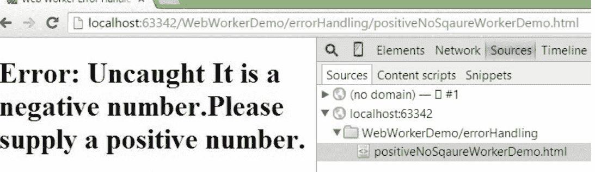

## 如何在 web worker 中引入外部脚本？用示例演示它？

```
addButton.addEventListener('click',function(){
numberWorker.postMessage({
  number1:parseInt(number1.value,10),
  number2: parseInt(number2.value,10)
});
});
numberWorker.addEventListener("message",function(workerEvent) { var responseData = workerEvent.data;
  resultcontainer.innerText = "Greatest Number: "+responseData.result;
});
</script>
</body>
</html>
```

上述代码的输出如下方的截图所示，包含了提供了数字中的最大数字。

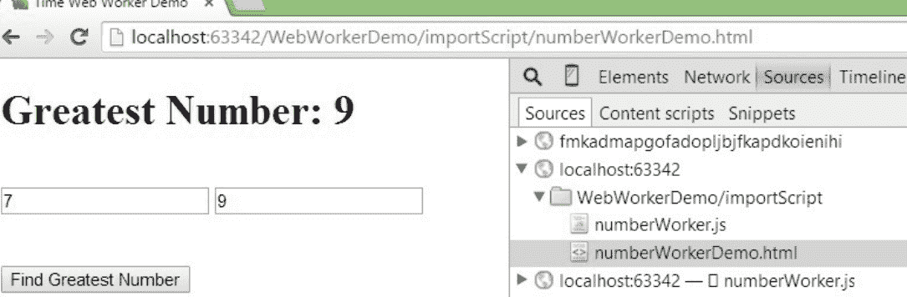

# 最大数字: 9

Q. 创建一个 shared worker 来计算字符串的长度？答案
`calculateLengthWorker.js` 包含了监听消息并计算字符串长度的代码。shared worker 通过监听 `connect` 来监听端口上的消息。`calculateLengthWorker.js` 文件的代码如下。

```
self.addEventListener("connect", function(event) {
var port = event.port[0];
  port.addEventListener("message", function(event) {
    var requestData = event.data;
    inputString = requestData.string;
    stringLength = inputString.length;
    port.postMessage({result:stringLength});
  }, false);
  port.start();
});
```

`lengthWorkerDemo.html` 文件包含了实例化 shared worker 并在浏览器中渲染的代码。`lengthWorkerDemo.html` 文件的代码内容列如下。

```
<!DOCTYPE html>
<html>
<head>
<meta charset="UTF-8">
<title>Shared Web Worker 演示</title>
</head>
<body>
```


```html
<h1 id="result"></header</h1>
<input type="text" id="inputString" placeholder="Enter a string"> <button id="lengthButton" class="lengthButton">Get Length</button>
<script>
var lengthWorker = new SharedWorker("calculateLengthWorker.js", resultContainer = 
document.getElementById("resultContainer"), lengthButton = document.getElementById("lengthButton"), inputString = 
document.getElementById("inputString");

lengthButton.addEventListener("click", function () {
resultContainer.innerText = "";
lengthWorker.port.postMessage({
  string : inputString.value
});
});

// start the worker
lengthWorker.port.start();
// Success Handler for the worker
lengthWorker.port.addEventListener("message", function (workerEvent) {
var responseData = workerEvent.data.data,
result = responseData.result;
resultContainer.innerText = "Result: " + result;
});
</script>
<body
</html>
```

上述代码的输出结果如下截图所示，显示了输入字符串的长度。

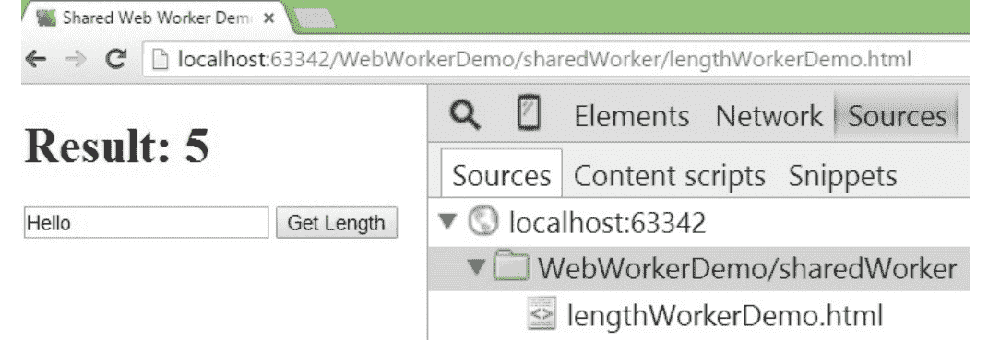

# 第11章 本地存储 (Local Storage)

Q. 什么是本地存储？

答案
HTML5 提供了一种在终端用户浏览器本地存储数据的功能。数据以键值对的形式存储在浏览器中。与 cookie 不同，它的平均空间为 5 MB。这种存储分为两种类型：sessionStorage 和 localStorage。

localStorage：它存储不带过期日期的数据。sessionStorage：它存储带有过期日期的数据。

Q. 哪一个是主接口？

答案
window.Storage() 是实现 localStorage 和 sessionStorage 的主接口。该接口有如下定义。

```javascript
interface Storage {
readonly attribute unsigned long length;
DOMString? key(unsigned long index);
getter DOMString? getItem(DOMString key);
setter void setItem(DOMString key, DOMString value); deleter void removeItem(DOMString key);
void clear();
}
```

上述代码的细节如下：
- setItem(key,value) : 此方法使用键值对在存储中存储值。
- getItem(key) : 此方法使用 key 获取所存储的对象。
- removeItem(key) : 此方法根据 key 移除存储的项。
- clear() : 删除存储器中的所有项。
- length : 此属性返回存储的长度，即存储器内部元素的数量。
- key(position) : 此方法返回数值位置对应值的键。

Q. 如何在本地存储中存储和检索对象？
答案
本地存储提供了 setItem() 和 getItem() 来从存储中存储和检索对象。setItem(key, value) 方法接收2个参数来存储对象。getItem(key) 方法使用 key 作为参数检索值。下面的代码展示了在“myName”键中存储“Sandeep Kumar”字符串，然后检索该字符串并将其放在 HTML 元素中。

```html
<!DOCTYPE html>
<html>
<body>
<div id="resultContainer">
</div>
<script>
var container = document.getElementById("resultContainer");
localStorage.setItem("myName", "Sandeep Kumar"); 
container.innerHTML = localStorage.getItem("myName"); 
</script>
</body>
</html>
```

下方的截图显示了 Chrome 开发者工具存储预览，它以键值对的形式持有上述对象。

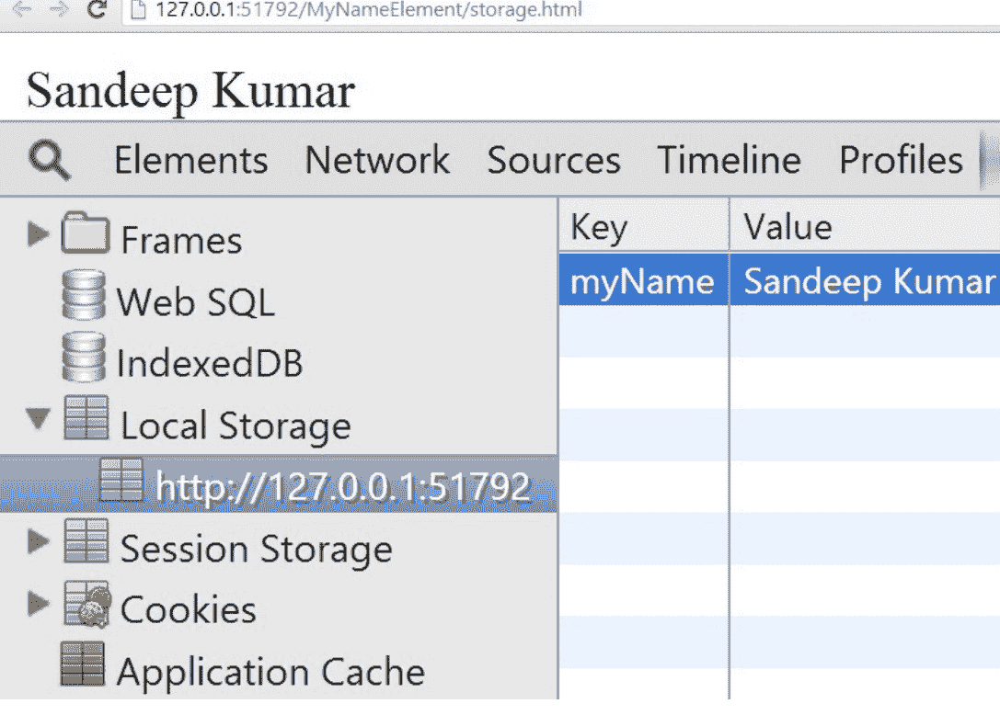

# Sandeep Kumar

- Elements 网络 Sources 时间线 Profiles

| | Key | Value |
|---|---|---|
| Frames | myName | Sandeep Kumar |
| Web SQL | | |
| IndexedDB | | |
| Local Storage | | |
| http://127.0.0.1:51792 | | |
| Session Storage | | |
| Cookies | | |
| Application Cache | | |

Q. 如何为本地存储附加事件？

答案
当本地存储对象被修改时，会触发一个存储事件（storage event）。可以使用 addEventListener() 或 attachEvent() 方法在 window 对象上挂载回调方法。

注意：
当在与本地存储关联的存储区域调用 setItem()、removeItem() 和 clear() 方法时，如果这些方法执行了操作，那么除了 x 之外，每个 Window 的 localStorage 属性的 Storage 对象关联同一个存储区域的 Document 对象都必须触发存储事件。

简单来说，存储事件会在触发事件的更新 localStorage 对象之外的每一个窗口/标签页上触发。下面的代码有一个监听存储事件的回调方法。当点击其中一个标签页中的按钮来更新本地存储对象时，另一个标签页中的存储事件监听器会被触发，内容随之更新。

```html
<!DOCTYPE html>
<html>
<body>
<div id="resultContainer"></div>
<button onclick="update()">点击我</button> 
<script>
var container = document.getElementById("resultContainer"), 
methodStorageEvent = function(event) {
  container.innerHTML = "事件触发" + localStorage.getItem("myName"); 
},
counter = 1,
update = function(){
  localStorage.setItem("myName", ++counter);
};
window.addEventListener("storage", methodStorageEvent);
</script>
</body>
</html>
```

下方的截图演示了存储事件是如何触发的。


## 第 13 章 Web RTC

Q. 什么是 Web RTC？

答案

Web RTC 为浏览器提供了无需安装任何额外插件即可进行实时通信的能力。它涉及浏览器之间通过原生能力进行音频、视频和其他类型的数据流。

Q. Web RTC 实现了哪些 API？

答案

Web RTC 实现了三个不同的 API。这些接口列在下方：

- MediaStream: 它代表一个使用摄像头和麦克风的同步媒体流。
- RTCPeerConnection: 该接口负责在实时通信期间在两个对等点浏览器之间建立稳定连接。
- RTCDataChannel: 该接口负责对等点浏览器之间其他类型的数据通信。例如使用浏览器进行远程桌面共享。

Q. 什么是 MediaStream？

答案

MediaStream 基本上代表由摄像头和麦克风捕制的流。每个 MediaStream 都有一个用于捕获流的输入。可以通过 `navigator.getUserMedia()` 方法访问此 MediaStream。

Q. `getUserMedia()` 的输入参数是什么？答案

`getUserMedia()` 方法接收 3 个参数作为输入。这些参数如下所示：

-  约束对象（Constraint Object）：类似于配置对象。
- 成功回调方法（Success Callback Method）。
- 错误回调方法（Error Callback Method）。

Q. 什么是 MediaStreamTracks？

答案

`getUserMedia()` 返回的 MediaStream 具有两个方法：`getAudioTracks()` 和 `getVideoTracks()`。这两个方法都返回一个 `MediaStreamTracks` 数组。

Q. Web RTC 通使用了哪些协议？

答案

Web RTC 使用 2 个不同的协议进行通信。这 2 个协议如下：

- DTLS: 数据报传输层安全（Datagram Transport Layer Security）。
- SRTP: 安全实时传输协议（Secure Real-time Transport Protocol）。

Q 如何在 Chrome 浏览器中查看 Web RTC 会话的统计信息？

答案

我们可以使用 Chrome 浏览器中的 `chrome://webrtc-internals/` 查看正在 Web RTC 会话的详细统计和图表。

## Q. 通道的不同事件处理器有哪些？答案

通道有 4 个不同的事件处理器。这些事件处理器如下：

- Onopen: 当连接建立时执行。
- Onerror: 如果创建连接时出错则执行。
- Onmessage: 当你收到消息时，将执行此方法。
- Onclose: 如果对方关闭连接则执行。

## Q. 什么是信号通道？答案

WebRTC 在没有中间某种服务器的情况下无法创建连接。我们称之为信号通道（Signal Channel）。

## Q. 什么是 ICE 技术？答案

交互式连接建立（ICE）是计算机网络中的一项技术，涉及在互联网应用中的 IP 语音协议（VoIP）、点对点通信、视频、即时消息和其他交互式媒体中的网络地址转换器（NAT）。

## Q. 什么是 ICE 候选者？答案

通信双方必须交换关于网络连接的信息。这被称为 ICE 候选者（ICE candidate）。

##. Web RTC 需要哪些服务器端功能？答案

Web RTC 需要服务器端功能来创建对等点之间的通信：

- 用户发现与通信。
- 信令（Signaling）。
- NAT/防火墙穿透。
- 对等点通信失败时的中继服务器（Relay servers）。

## Q. 什么是 STUN 协议？答案

STUN（NAT 会话遍历工具）是一套标准化的方法和网络协议，允许位于 NAT 后的终端主机发现其公网 IP 地址。

# 第 14 章 拖放 API

Q. 如何让浏览器内的内容可拖拽？答案

HTML5 提供了拖放功能。通过将元素的 `draggable` 属性设置为 `true`，可以使其变为可拖拽。查看下方包含 2 个按钮的代码。其中一个按钮是拖拽的，另一个只是普通按钮。

```html
<! html>
<html>
<head>
<title>Draggable Element</title>
</head>
<body>
<button draggable="true">Draggable Button</button> <button>Normal Button</button>
</body>
</html>
```

下方的截图显示了这两个按钮。可拖拽的按钮是可以移动的，而普通按钮固定在它的原位置。

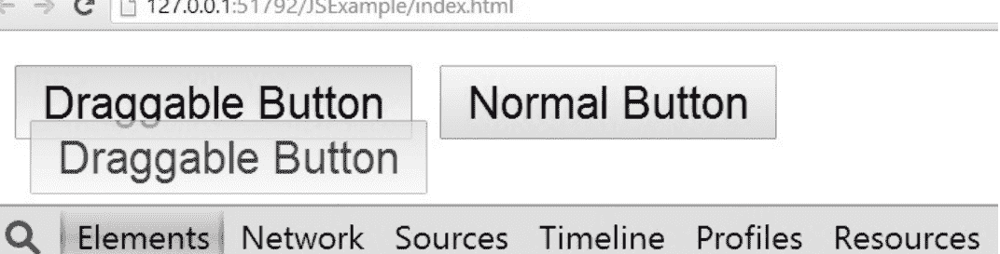

```html
<!DOCTYPE html>
<html>
<head>...</head>
<body>
<button draggable="true">Draggable Button</button>
<button>Normal Button</button>
</body>
</html>
```

Q. 当元素开始拖拽时会发生什么？答案

在拖拽开始时，有 3 个重要的关键点需要注意。这些关键点如下：

- **拖拽数据（Drag Data）**: 它代表拖拽过程中将传输的数据类型。
- 拖拽反馈（Drag Feedback）：拖拽操作期间鼠标指针旁边出现的图像。
- 拖拽效果（Drag Effect）：代表发生在元素上的拖拽类型。它可以是 3 类型，列如下：
    - *复制（Copy）*: 此效果表示数据将从当前位置复制到释放位置。
    - *移动（Move）*: 此效果表示正在拖拽的数据将从原始位置移动到释放位置。
    - *链接（Link）*: 此效果表示源位置和释放位置之间将创建某种形式的关系或连接。

## Q. 哪些是拖放事件？答案

有 7 个不同的拖放事件，可以通过编程方式与回调方法挂载。

- Dragstart: 当拖拽开始时，在元素上触发。
- Dragenter: 在拖拽过程中，鼠标进入元素时触发。
- Dragover: 在拖拽过程中，鼠标在元素上移动时触发此事件。
- Dragleave: 当鼠标离开元素时触发此事件。
- Drop: 当释放拖拽时触发此事件。
- Dragend: 当拖拽结束时触发此事件。

## Q. 什么是 dataTransfer 对象？答案

`dataTransfer` 对象用于在拖拽过程中存储数据。它包含 `setData` 和 `getData` 等方法。


代码显示了 FALLBACK 的示例。
FALLBACK:
/html/offline.html

## Q. 什么是 CACHE MANIFEST 部分？

答案
CACHE MANIFEST 是清单文件中的部分之一。此部分提到的文件名会被缓存在本地。以下代码显示了 CACHE MANIFEST 的示例。

/style.css
/favicon.gif /app.js

## Q. 如何在 Chrome 浏览器中查看应用缓存详情？

答案
我们可以通过 Chrome 浏览器中的以下链接查看应用缓存内容，例如它缓存的内容、大小和时间等。

chrome://appcache-internals/
以下截图显示了我浏览器的 appcache 内部界面。


Manifest: https://www.google.co.in/_chrome/newtab/manifest?espv=2&ie=UTF-8
移除条目

- 大小：232 KB
- 创建时间：2014年10月16日 星期四 20:37:47
- 最后更新时间：2015年5月24日 星期日 21:07:19
- 最后访问时间：2015年5月27日 星期三 20:19:40

## Q. 如何检测浏览器对 appcache 的支持？答案

我们可以通过检查 `window` 对象中是否存在 `applicationCache` 来检测对 appcache 的支持。我们可以使用 JavaScript 的 `if` 语句检查 `window.applicationCache` 对象的真值。以下截图显示了 Chrome 控制台检测到 applicationCache 对象的情况。

```
Console Search Emulation Rendering
🚫 ▽ <top frame> ▼ Preserve log
> window.applicationCache
▼ ApplicationCache {status: 0, onchecking: null, onerror: null, onnupdate: null, onownloading:...}
  oncached: null
  onchecking: null
  ondownloading: null
  onerror: null
  onnupdate: null
onnobsolete: null
  onprogress: null
  ondateready: null
  status: 0
  ▶ __proto__: ApplicationCache
```

## Q. 如何手动更新 appcache？

答案

我们可以通过对浏览器进行强制刷新（hard reload）来更新缓存。我们也可以调用 `swapCache()` 方法来程序化更新缓存。

## 第 16 章服务器事件 (Server Sent Events)

Q. 什么是服务器事件 (SSE)？
答案
HTML5 提供了服务器事件功能，网页借此自动从服务器获取更新。该功能的一个很好的例子是 Facebook 通知或 Google+ 更新。

Q. 服务器响应的响应类型是什么？答案
服务器响应的响应类型在 "Content-Type" 请求头中为 "text/event-stream"。

Q. 如何创建一个事件源来监听服务器更新？答案
可以通过实例化带有服务器路径的 `EventSource` 类对象来创建事件源。创建事件源的语法列如下。

```
var source = new EventSource("URL to Server");
```

Q. EventSource 触发了哪些事件类型？答案
EventSource 触发 3 种不同的事件。可以为源挂载回调方法来监听这些事件。这些事件类型列如下：

- onopen: 当服务器向浏览器打开连接时触发此事件。
- onmessage: 当服务器向流产生新输出时触发此事件。
- onerror: 当某种某种发生错误时触发此事件。

Q. 如何关闭事件流？
答案
可以使用 `close()` 方法关闭事件流。

Q. 事件流的格式是什么？
答案
事件流是一个简单的文本数据流，必须使用 UTF-8 编码。
每条消息由一对换行符分隔。行首的冒号本质上是注释，会被忽略。

## 第 17 章 杂题

Q. 什么是严格模式 (strict mode)？
答案
严格模式是新 ECMA 5 JavaScript 规范中的新指令。它用于安全的 JavaScript 代码编写。它通过将静默错误转换为抛出错误来消除 JavaScript 错误。

严格模式的语法如下：
"use strict"
下面的代码显示了在函数内部使用严格模式。

```
function sayHello(){
  "use strict";
  myName = "Sandeep";
}
sayHello();
```

以下截图显示了在 sayHello() 方法内部使用未声明变量产生的错误。

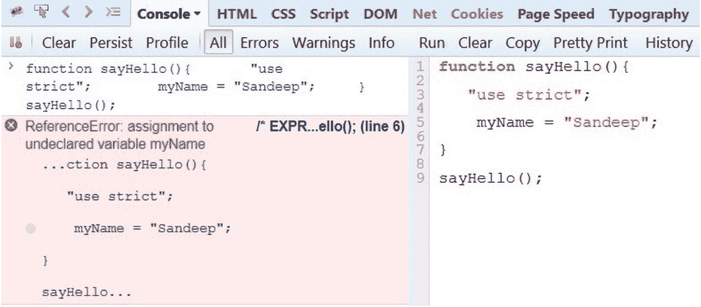

Q. 列出一些在严格模式下不允许的条件？
答案
在下方列出了 ECMA5 严格模式下不允许的条件列表：

不允许在不声明的情况下使用变量。不允许删除变量、函数或参数。

不允许重复定义同一属性。不允许重复参数名。

不允许使用八进制数字字面量和转义字符。

不允许向只读属性写入。不允许删除不可删除的属性。

字符串 "eval" 不能作为变量。字符串 "arguments" 不能作为变量。

不允许使用未来的预留关键字。

Q. 控制台中产生 0.1+0.2 的输出结果是什么？为什么？答案
JavaScript 数学库遵循 IEEE 754 标准进行数学运算。IEEE 754 标准使用 64 位表示浮点数。这导致在评估 `0.1 + 0.2` 表达式时产生问题。下面的截图显示了该表达式的 Firebug 控制台。

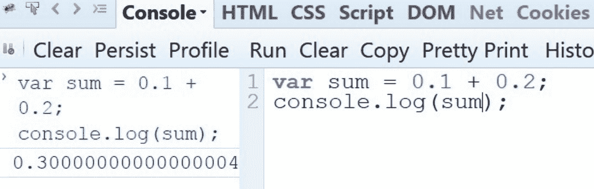

JavaScript 内部将 0.1 转换为 16 精度，变为 0.10000000000000001，然后加上 0.2 变为 0.30000000000000004。
下面的截图显示了 JavaScript 代码中的这种情况。


Q. 控制台中产生 0.1+0.2 的输出结果是什么？为什么？0.30000000000000004
答案 0.30000000000000004 是由于浮点精度问题导致的 JavaScript 0.1 + 0.2 的结果。

Q. 控制台中产生 0.1+0.2 的输出结果是什么？为什么？0.30000000000000004
答案 0.30000000000000004 是由于浮点精度问题导致的 JavaScript 0.1 + 0.2 的结果。

Q. 控制台中产生 0.1+0.2 的输出结果是什么？为什么？0.30000000000000004
答案 0.30000000000000004 是由于浮点精度问题导致的 JavaScript 0.1 + 0.2 的结果。

Q. 控制台中产生 0.1+0.2 的输出结果是什么？为什么？0.30000000000000004
答案 0.30000000000000004 是由于浮点精度问题导致的 JavaScript 0.1 + 0.2 的结果。

（注：原文后续存在重复内容，此处按要求不再重复输出）


# 关于作者


Sandeep Kumar Patel 是一位高级 Web 开发人员，www.tutorialsavvy.com 的创始人，该网站自 2012 年以来一直是广受欢迎的编程博客。他在面向对象的 JavaScript 和基于 JSON 的 Web 应用开发方面拥有五年经验经验。通过了 GATE-2005 信息技术（IT）认证，并获得维洛尔 VIT 大学的硕士学位。

你可以通过以下途径了解更多关于他的信息：

- [LinkedIn 个人资料](http://www.linkedin.com/in/techblogger)。
- 他曾因关于 Web 技术的技术出版物获得 Dzone 最价值博客主 (MVB) 奖。他的文章可以在 http://www.dzone.com/users/sandeepeptiet 查看。
- 他还因在 JCG 上发表的一篇技术文章获得了 Java Code Geek (JCG) 勋章。他的文章可以在 http://www.javacodgeeks.com/author/sandeep-kumar-patel 查看。
- Packt 出版书籍《Instant GSON》的作者，http://www.packopub.com/create-json-data-java-objects-implement-with-gson-library/book。

有任何问题或建议？请发送电子邮件至 sandeeppatletech@gmail.com 联系我，或在以下社交网络上找到我：
- Facebook 页面：http://www.facebook.com/SandeepTechTutorials。
- 教程博客：http://www.tutorialsavvy.com

# 最后的一件事...

当你翻页时，Kindle 将为你提供机会对此书进行评分，并在 Facebook 和 Twitter 上分享你的想法。如果你认为这本书值得分享，能否请花几秒钟让你的朋友知道它？如果这本书对他们的职业生涯产生了影响，他们将永远感激你，我也是。

顺颂祝愿，

Sandeep Kumar Patel.

