# JavaScript 面试快速入门指南：学习常见问题


最后一点

# 第 1 章继承

Q. 如何创建一个类？

答案
JavaScript 没有类定义。为了在 JavaScript 中模拟类，可以使用函数来声明类。

示例：
让我们在 JavaScript 中创建一个学生类，它接收 name 和 roll 两个参数作为属性。代码如下所示：

```javascript
function Student(name,roll){
  this.name = name;
  this.roll = roll;
}
```

Q. 如何创建对象？

答案
可以使用两种方式创建 JavaScript 对象：

New 关键字：
要从上面的学生类创建一个学生对象，我们可以使用 `new` 关键字调用 `Student` 函数。

```javascript
var student1 = new Student('sandeep', 2)
```

匿名对象：
可以使用包含属性名和值对的大括号对创建匿名对象。
```javascript
var rose = {'color': 'red'}
```

Q. 如何声明私有成员和公共成员？

私有成员使用 `var` 关键字和构造函数声明。

```javascript
function Student(name,roll){
  var id = "ABCD123";
  this.name = name;
  this.roll = roll;
}
```

当创建 Student 对象时，可以使用点操作符访问属性 name 和 roll，但 id 无法访问，因为它表现得像一个私有成员，并在调用时返回 `undefined`。

元素 资源 网络 来源 时间线 配置文件

```javascript
> function Student(name,roll){
  var id = "ABCD123";
  this.name = name;
  this.roll = roll;
}
undefined

> var student1 = new Student('sandeep', 25)
undefined

> student1.name
"sandeep"

> student1.id
undefined
```

上面的 Chrome 控制台显示创建了 student1 对象。`name` 属性是可以访问的，因为调用 `student1.name` 时显示了 `sandeep`。因此 `name` 是学生对象的公共属性。但 `id` 属性无法访问，并在调用 `student1.id` 时返回 `undefined`。这表明 `id` 是 student1 对象中的私有属性。

Q. 什么是原型（prototype）属性？

通过使用原型，我们可以向现有对象添加新成员。每个 JavaScript 对象内部都拥有这个属性。初始时，它是一个空对象。

示例：

```javascript
function Student(name,roll){
  this.name = name;
  this.roll = roll;
}
var student1 = new Student('sangeeta', 30); 
Student.prototype.mark = 100;
```

查看下面的 Chrome 控制台了解原型的使用。

元素 资源 网络 来源 时间线 配置文件

```javascript
> function Student(name,roll){
  this.name = name;
  this.roll = roll;
}
undefined
> var student1 = new Student('sangeeta', 30)
undefined
> student1
Student {name: "sangeeta", roll: 30}
> Student.prototype.mark = 100
> student1
Student {name: "sangeeta", roll: 30, mark: 100}
```

最初，student1 对象只有 `name` 和 `roll` 属性。通过使用新属性 `mark`，学生对象已添加了值为 100 的属性。现在控制台显示 `mark` 属性也添加到了现有的 student1 对象中。

## Q. 什么是构造函数（constructor）属性？

答案

对象的 `constructor` 属性指向其创建函数的引用。示例：
让我们通过创建一个学生对象并调用其 `constructor` 属性来查看示例。

```javascript
function Student(name, mark){
  this.name=name;
  this.mark = mark;
}
var student1 = new Student('sandeep', 123); 
console.log(student1.constructor);
```

查看下方 Chrome 控制台中上述代码的截图。控制台日志正在打印 student1 对象引用的函数。

元素 资源 网络 来源 时间线 配置文件 审计 控制台

```javascript
function Student(name,mark){this.name=name; this.mark=mark;}
undefined

var student1 = new Student('sandeep', 123)
undefined

console.log(student1.constructor)
function Student(name,mark){this.name=name; this.mark=mark;}
```

## Q. 如何调用方法？

答案
使用 `call()` 和 `apply()` 可以在特定的上下文中调用方法。

call():
`call()` 方法允许你使用给定的 `this` 值调用函数，并逐个传递参数。

apply():
`apply()` 方法与 `call()` 类似，但它以数组的形式接收参数。

示例：
```javascript
function greet(greeting, punctuation) {
  console.log(greeting + ", " + this.name + punctuation);
}
var user = {name: "Alice"};
greet.call(user, "Hello", "!");
greet.apply(user, ["Hi", "."]);
```


## 元素资源 网络来源、时间线、个人资料、审计

```javascript
function Student(name){
  this.name=name;
}
Student.prototype.sayType = function(){
  console.log("I am student type");
}
function ScienceStudent(name){
   own.prototype = new Student();
}.prototype.constructor = ScienceStudent;
var student2 = new ScienceStudent('sangeeta');
console.log(student2.sayMyType());
```

我是学生类型

若要测试一个对象是否属于某个类，可以使用 `instanceOf`。它返回一个布尔值，如果对象属于某个类则返回 `TRUE`，否则返回 `FALSE`。请查看下方截图关于 `instanceOf` 对 `student2` 的测试。

## 元素资源 网络时间线

- student2 instanceof Student
  true
- student2 instanceof ScienceStudent
  true

问. 什么是差异继承？

答

差异继承是一种常见的基于原型的模型，它利用了一个概念：大多数对象派生自更通用的对象，仅在少数微小的方面有所不同。每个对象都维护一个对其原型的引用以及一个包含不同属性的表。

问. `Object.create()` 方法的作用是什么？

答

ECMAScript 5.1 在其规范中包含了此方法。该方法可用于创建一个具有给定原型对象和属性的新对象。该方法的语法如下：

```javascript
Object.create(proto, propertiesObject)
```

示例：

以下代码包含一个带有 `name` 属性的 `Student` 类函数，原型对象拥有一个 `getStudentName()` 方法，该方法返回学生的姓名。通过 `Object.create()` 方法传递 `Student` 的原型对象并将 `name` 的值设置为 `sandeep`，创建了一个新的原型对象。然后对 `student1` 对象上调用 `getStudentName()` 方法并在控制台中记录结果。

```javascript
function Student(name) {
  this.name = name;
}
Student.prototype = {
  getName: function() {
    return "Name of Student is :" + this.name;
  }
};
var student1 = Object.create(Student.prototype); 
student1.name = "Sandeep";
console.log(student1.getStudentName());
```

接下来的截图显示了上述代码在开发者控制台中的输出。

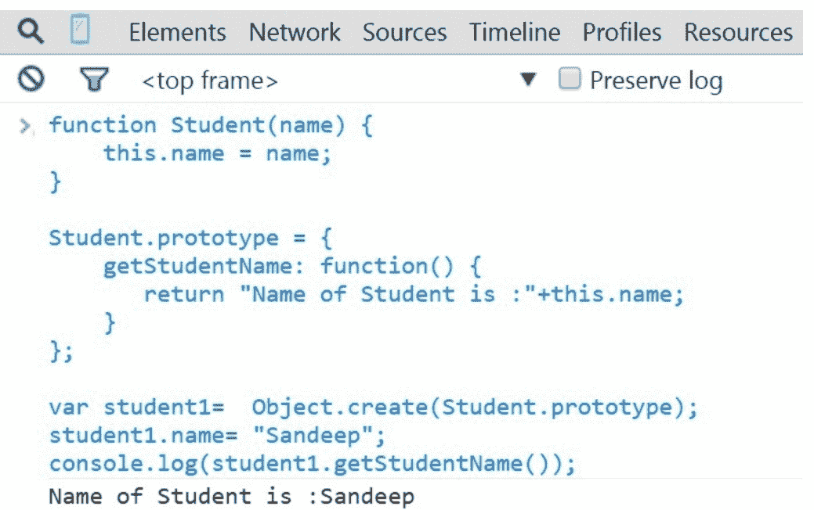

问. 如果浏览器中不存在 `Object.create()` 方法，如何为其编写一个 polyfill（填充函数）？
答
ECMAScript 5.1 在其规范中有此方法。如果浏览器较旧，则不存在 `Object.create()` 方法。为了解决这个问题，我们需要写一个 polyfill。以下代码展示了 `Object.create()` 方法的 polyfill。

```javascript
// 如果 Object 内部不存在 create 方法
if (typeof Object!='function') {
  // 定义 create 方法
  Object.create = (function() {
    var Object = function() {};
    return function(prototype) {
      if (arguments.length > 1) {
        throw Error('Second argument not supported');
      }
      if (typeof prototype != 'object') {
        throw TypeError('Argument must be an object');
      }

      Object.prototype = prototype;
      var result = new Object();
      Object.prototype = null;
      return result;
    }
  )();
```

上述代码通过条件判断并将其类型与函数比较，检查 `Object` 内部是否已存在 `create()` 方法。如果该条件成立，说明不存在 `create()` 方法。此时执行 polyfill 代码块并将空对象赋值给 `Object.property`。

## 问. `Object.defineProperties()` 方法的目的是什么？答

ECMAScript 5.1 提供了 `Object.defineProperties()` 方法来为定义的对象创建新属性。它提供了许多配置选项来初始化这些成员。以下代码展示了该方法的用法。

```javascript
function Student(name) {
  this.name = name;
}

var student1 = Object.create(Student.prototype);
properties = {
  "subject": {
    value: "Computer",
    writable: true,
    enumerable:true
  },
  "marks": {
    value: 0,
    writable: false,
    enumerable:true
  }
};

Object.defineProperties(student1, properties);
student1.name = "Sandeep";
student1.subject = "Mathematics";
student1.marks = 75;
console.log(student1);
```

在上述代码中，使用 `Object.create()` 方法创建了 `student1` 对象。然后对 `subject` 和 `marks` 等一些新属性标记了 `enumerable`（可枚举）选项，决定该属性是否可以作为自身的属性被枚举。`writable`（可写）属性决定属性是否可以修改。`value` 属性获取属性的默认值。

下方截图显示了上述代码在开发者控制台中的输出。

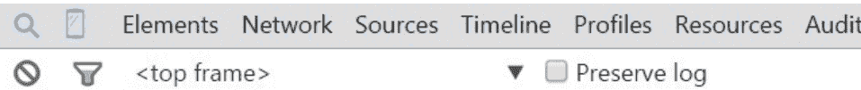

```javascript
<top frame>
function Student(name) {
  name = name;
  var student1 = Object.create(Student.prototype),
  properties = {
    "subject": {
      value: "Computer",
      writable: true,
      enumerable:true
    },
    "marks": {
      value: 0,
      writable: false,
      enumerable:true
    }
  };
Object.defineProperties(student1, properties);
student1.name = "Sandeep";
student1.subject = "Mathematics";
student1.marks = 75;
console.log(student1);
```

问. 如何区分作用域（scope）和上下文（context）？答 作用域涉及变量的可见性，而上下文指的是函数所属的对象。在任何情况下，都可以使用 `call` 或 `apply` 来更改。

# 第 2 章 事件

问. 事件是如何工作的？

答 事件传播遵循两个阶段：捕获阶段和冒泡阶段。

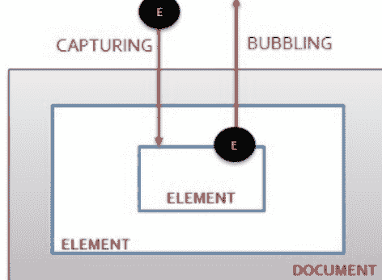

捕获阶段：
在此阶段，事件从 `DOCUMENT` 向目标元素移动，传递内部元素。

冒泡阶段：
在此阶段，事件从目标元素向 `DOCUMENT` 移动，传递外部元素。

问. 如何向元素附加事件？

答 根据 DOM  2 事件规范，可以使用 `addEventListener()` 方法通过三个参数将事件附加到元素。

语法：
`<element>.addEventListener(<eventname>,<callback>,<booleanphase>)`

eventname:
作为字符串参数表示事件类型。例如 `click`、`mouseover`、`mouseout`。

callback:
这代表处理事件的回调函数。

booleanphase:
这代表附加监听器的事件阶段。`FALSE` 值代表冒泡阶段，`TRUE` 值代表捕获阶段。

示例：在文档上添加点击监听器，当点击时会弹出消息。`document.addEventListener('click', function () { alert("Insider Listener"); },false);`

问. 在 IE9 版本之前如何附加事件？

答 在旧浏览器中，可以使用 `attachEvent()` 方法将事件附加到元素。仅在冒泡阶段可以添加监听器。

语法：
`<element>.attachEvent(<eventname>, <eventcallback>)`

示例：当点击发生时在文档上添加点击事件监听器。下方截图显示在 IE 10 开发工具中添加点击事件。

| 文件 禁用  缓存 工具 浏览器模式: IE10 文档模式: 标准 |

| HTML CSS 控制台 脚本 性能分析 网络 |

```javascript
document.attachEvent('onclick',function () {
  console.log("Insider Event Listener");
};
true
Insider Event Listener
```

```javascript
document.attachEvent('onclick', function () {
  console.log("Insider Event Listener");
};
```

除了 IE 之外，其他浏览器通过 `addEventListener()` 方法添加。下方截图显示了在 Firefox 中演示该方法。

| < x > 控制台 | HTML CSS 脚本 DOM 网络 Cookie 页面速度 字体 |

| 清除 持久 错误 运行 清除 复制 格式打印 历史 |

```javascript
内部事件处理方法 var handlerMethod = function(e) {
  console.log("Insider Event Handler Method");
}document.addEventListener('click',handlerMethod);
```

## 如何移除事件监听器？

答 根据 DOM 2 事件规范，可以使用 `removeEventListener()` 方法移除事件监听器。对于 IE 浏览器，必须使用 `detachEvent()` 方法。以下截图显示了从 IE 浏览器中解离点击事件处理器。


文件 查找 禁用 查看 缓存 工具 验证 HTML CSS 控制台 脚本 分析器 网络

```javascript
var handlerMethod = function () {
  console.log("Inside Event Listener");
}
document.detachEventListener('onclick',handlerMethod);

var handlerMethod = function () {
  console.log("Inside Event Listener");
}
document.detachEventListener('onclick',handlerMethod);
```

以下截图显示了 Firefox 浏览器中从文档移除事件处理器。

< 控制台 HTML CSS 脚本 DOM 网络  Cookie 页面速度 字体
清除 保留 配置文件 所有错误 运行 复制 漂亮打印 历史

```javascript
var handlerMethod = function (e) {
  console.log("Inside Event Handler Method");
}
document.addEventListener('click',handlerMethod);
document.removeEventListener('click',handlerMethod);
```

Q. setTimeout() 和 clearTimeout() 函数是如何工作的？答案

`setTimeout` 方法在指定的毫秒数后调用一次函数或评估表达式。`clearTimeout` 方法停止 `setTimeout` 方法中指定的函数的执行。

语法：
`var timeout = setTimeout(function,milliseconds,lang)`
`clearTimeout(timeout)`

以下代码展示了这些时间方法的演示。

```javascript
var timeoutHandler=function () {
console.log("Time Now ", new Date().getSeconds()); clearTimeout(timeout);
}
```

```javascript
console.log("Time Now ", new Date().getSeconds()); var timeout = setTimeout(timeoutHandler,4000);
```

下面的截图显示了 4 秒后 `timeoutHandler` 的执行情况。

< 控制台 HTML CSS 脚本 DOM 网络  Cookie 页面速度 字体
清除 保留 配置文件 所有错误 运行 复制 漂亮打印 历史

```javascript
var timeoutHandler=function () {
  console.log("Time Now ", new Date().getSeconds());
  setTimeout(timeoutHandler,4000);
}
// 输出:
Time Now 7
inside Time 11
console.log("Time Now ", new Date().getSeconds());
// ... (其余逻辑)
```

Q. setInterval() 和 clearInterval() 函数是如何工作的？答案

`setInterval()` 方法在指定的毫秒间隔内调用函数或评估表达式。`clearInterval()` 方法停止 `setInterval()` 方法中指定的函数的执行。

## 语法：

```javascript
var timeInterval = setInterval(function, milliseconds) clearInterval(timeInterval)
```

以下代码演示了这些间隔处理器。

```javascript
var counter = 0,
timeIntervalHandler= function(){
console.log("inside Time Now ", new Date().getSeconds()); counter++;
console.log("Handler Called count ",counter)
if(counter === 4) {
clearInterval(timeInterval);
console.log("clearing the interval handler")
}
}
clearInterval(timeInterval);
console.log("Clearing the interval handler")

console.log("Time Now ", new Date().getSeconds()); var timeInterval = setInterval(timeIntervalHandler,2000);
```

下面的截图显示处理器每 2 秒被调用 4 次。在第 4 次调用后 `clearInterval()` 移除了执行。

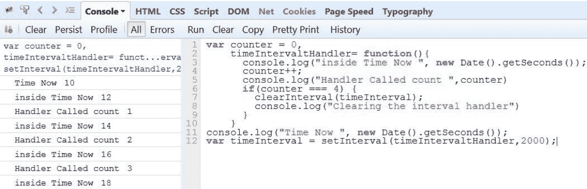

# 第 3 章 闭包

Q. 什么是闭包？
答案

闭包是一个内部函数，它可以访问外部包装函数的变量。它具有三种不同的作用域访问方式：

- **自身作用域：** 它可以访问自身作用域中存在的属性。
- **包装函数的作用域：** 它可以访问其闭包函数中的属性。
- **全局作用域：** 它可以访问全局作用域（即窗口作用域）中的属性。

**示例：**
尽管 `prop1` 属于外部函数作用域，内部函数仍然可以访问 `prop1`。

```javascript
function myOuterFunction(){ 
  var prop1 = 5;
  return function innerFunction(){
    return prop1;
  }
}

var res = myOuterFunction(); 
console.log(res.name);
console.log(res(res));
```

下面的截图显示了上述代码在控制台中的输出。

| 元素 | 资源 | 网络 | 源 | 时间线 |
|---|---|---|---|---|---|
| > function myOuterFunction(){ prop1 = 5; return innerFunction(){ return prop1; } var res = myOuterFunction(); console.log(res.name); console.log(res(res)); innerFunction | 5 | | | | |

Q. 请举例闭包概念的实际应用？答案
Web 开发中闭包被开发者频繁地使用。最常见的场景是我们需要某种工厂，它可以返回一个带有不同值的函数对象，并供应用程序使用。

**示例：**
以下代码有一个名为 `backgroundColorFactory` 的背景颜色工厂，它返回一个带有输入颜色的函数。使用此工厂，我们创建了绑定到两个按钮的 `greenBackground` 和 `blueBackground` 对象。当用户点击这些按钮时，body 的背景颜色将变为目标颜色。

```html
<!DOCTYPE html>
<html>
<head>
<meta charset="utf-8">
<title>闭包实际示例</title>
</head>
<body>
<button id="greenButton">绿色背景</button> 
<button id="blueButton">蓝色背景</button> 
<script>
var backgroundColorFactory = function(color) { 
  return function() {
    document.body.style.background = color; 
  }
}
var greenBackground = backgroundColorFactory('green'); 
var blueBackground = backgroundColorFactory('blue');
document.getElementById('greenButton').onclick = greenBackground;
document.getElementById('blueButton').onclick = blueBackground;
</script>
</body>
</html>
```

上述代码的输出位于下方截图。


# 第章 关于 JSON 的问题

Q. 什么是 JSON？

答案

JSON 文本格式与创建 JavaScript 对象的语法相同。JSON 仅是 JS 对象表示法的子集，除了外观相似外并没有共同点。JSON 用于数据交换格式，类似于 XML。JSON 构建在结构之上：

- 键对集合。在各种语言中，它实现为对象、记录、字典、哈希表、键列表或关联数组。
- 有序列表。在大多数语言中，它实现为数组、向量、列表或序列。

Q. 为什么 Google 在它们的 JSON 响应前面加上了？答案

这是为了防止 JSON 劫持。以确保其他网站无法窃取数据。通过 `script` 标签引入此 JSON，恶意第三方网站可以窃取数据。通过在开头放置 `while(1);`，脚本将崩溃。另一方面，使用 XHR 的同站请求配合独立的 JSON 解析器可以轻松忽略 `while(1);` 前缀。

Q. 什么是 JSON？

答案

JSON 代表“带有填充的 JSON”。这意味着 JSON 数据被封装在一个函数调用中。在请求远程 JSON 数据时，Web 页面已定义回调（处理/填充）函数。

示例

```javascript
下面的 JavaScript 显示了针对远程 URL /abcdurl 的回调函数 paddingFunction()。
function paddingFunction(data){
  console.log("response data processing code")
}
var script = document.createElement('script');
script.src = '/abcdurl?callback=paddingFunction'
document.getElementsByTagName('head')[0].appendChild(script);
```

Q. 为什么使用 JSON 而不是 XML？

答案

以下是 JSON 相比 XML 的优点：
JSON 可以包含整数、字符串、列表、数组。XML 要简单得多，而且在应用程序使用之前，元素需要解析为整数、字符串等。与 XML 相比，JSON 更快、更轻量。因此，对于服务器和浏览器之间的数据传输，JSON 是更好的选择。


除非编写得良好、包含所有括号且缩进正确。JSON 可以更方便地映射到面向对象的系统中。
JSON 和 XML 都支持 Unicode 并支持国际化。
JSON 是更好的数据交换格式。XML 是更好的文档交换格式。
JSON 的安全性较低，因为浏览器中缺少 JSON 解析器。
如果数据在 XML 中，你可以编写并并在 XML 上运行，将数据输出到另一种格式：HTML、SVG、纯文本、逗号分隔符，甚至是 JSON。
当你有 JSON 数据时，它几乎已经就绪了。没有简单的方法将其转换为其他数据。因此在这里，XML 的表现优于 JSON。

## Q. JSON 的 MIME 类型是什么？

## ANSWER

JSON 的 MIME 类型是 application/json。

## Q. JSON 支持哪些数据类型？

## ANSWER

JSON 支持的不同数据类型有 Number、String、Boolean、Array、Object、null。
以下代码显示了一个包含不同数据类型的 JSON 对象：

```
{ name:"Sandeep",
score:65,
isPassed: true,
subject: ["Computer", "Algebra"],
address: {city:"Bangalore", country:"India"}, email: null
}
```

以下截图显示了 Chrome 开发者控制台中上述 XSLT模板对象，所有属性都以键值对的形式列出。

Elements Network >>

<top frame>

```
Object {name: "Sandeep", score: 65,
isPassed: true, subject: Array[2],
address: Object...}
  address: Object
    city: "Bangalore"
    country: "India"
    __proto : Object
  email: null
  isPassed: true
  name: "Sandeep"
  score: 25
  subject: Array[2]
    0: "Computer"
    1: "Algebra"
    length: 2
    __proto : Array[0]
  proto : Object
```

## Q. JSON.stringify() 方法的作用是什么？

ANSWER
JSON.stringify() 将对象转换为 JSON 并将该文本存储在字符串中。以下截图显示了 stringify() 方法的使用：

Elements Network Sources Timeline >>

<top frame>

```
var Student = function(name,score){
  this.name = name;
  this.score = score;

  var student1 = new Student("Sandeep", 75);
  console.log(JSON.stringify(student1));

{"name":"Sandeep","score":75}
```

## Q. JSON.parse() 方法的作用是什么？

ANSWER

JSON.parse() 方法解析 JSON 字符串，可选地转换解析产生的值。以下截图显示了使用 JSON.parse() 方法将字符串1 JSON 字符串转换为 JSON 对象。

```
var Student = function(name, score) {
  this.name = name;
  this.score = score;
}
var student1 = new Student("Sandeep", 75);
student1JSONString = JSON.stringify(student1);

console.log(JSON.parse(student1JSONString));
```

Object {name: "Sandeep", score: 75}

## Q. JSON.parse() 方法的语法是什么？ ANSWER

JSON.parse() 方法的完整语法如下：
JSON.parse(text[, reviver])

上述语法的细节如下：
Text：代表要解析为 JSON 的字符串。
Reviver：代表一个函数，规定了在返回之前如何对解析产生的原始值进行处理。

## Q. 如何将日期对象转换为 JSON？
ANSWER

toJSON() 方法可以将日期对象转换为 JSON。以下截图显示了 chrome 控制台中 toJSON() 方法的使用。

```
new Date().toJSON();
"2015-02-21T18:39:01Z"
```

## 第5章 DOM

## Q. 什么是 DOM？

ANSWER
文档对象模型 (DOM) 是用于 HTML 和 XML 的编程 API。JavaScript 广泛用于访问这些 DOM 属性和方法。

## Q. DOM 包含哪些对象？ ANSWER
根据 DOM Level2 规范，它包含：

- Attribute：属性。
- Attributes：属性集合。
- CDATASection：CDATA 节。
- Comment：注释。
- Document：文档。
- Node：XML 文档中的通用节点。
- NodeList：节点的有序集合。
- ProcessingInstruction：处理指令。
- TextNode：XML 文本节点。

## Q. DOM 包含哪些属性？ ANSWER
根据 DOM Level2 规范，包含以下属性：

- name：属性名。
- namespaceURI：命名空间 URI。
- nextSibling：文档源顺序中的相邻兄弟节点。
- nodeName：节点名。
- nodeType：节点类型。
- nodeValue：节点值。
- ownerDocument：包含节点的文档对象引用。
- ownerElement：所属的元素引用。
- parentNode：所属的父节点。
- prefix：节点前缀。
- previousSibling：文档源顺序中的上兄弟节点。
- text：包含的所有文本节点的内容。
- documentElement：根元素。
- childNodes：第一个子节点。
- lastChild：最后一个子节点。
- length：子节点数量。
- data：文本内容。

## Q. 什么是 load 事件？

ANSWER

当页面完全加载（包括样式表和图像等依赖资源）时，触发 load 事件。它通常用于在执行脚本之前确保页面就绪。

```html
<!DOCTYPE html>
<html>
<head>
<title>Load Event Example</title>
</head>
<body>
  <h1>Load Event</h1>
  <script>
    window.onload = function() {
      console.log("Page fully loaded");
    };
  </script>
</body>
</html>
```

## Q. 什么是 readystate 事件？

ANSWER

当文档已加载并解析时触发 readystate 事件，但无需等待样式表和图像完成加载。

```javascript
document.onreadystatechange = function() {
  console.log("DOM is ready");
};
```

## Q. DOM 中的 selector 是什么？

ANSWER

DOM 提供了 querySelector() 和 querySelectorAll 方法来选择 DOM 元素。
querySelector() 方法返回 DOM 中匹配的第一个元素。
querySelectorAll() 方法返回匹配元素的节点列表。以下代码演示了使用这些方法从 DOM 中选择元素。

```html
<!DOCTYPE html>
<html>
<head>
<title>Document Query Selector Example</title>
</head>
<body>
  <h5 class="name">Sandeep Kumar Patel</h5>
  <h4 class="country">India</h4>
  <h4 class="country">UK</h4>
  <h5 class="name">Surabhi Patel</h5>
  <h4 class="country">US</h4>
  <h4 id="my-score">520</h4>
  <script>

    var element = document.querySelector("#my-score" ); element.style.color="red";
    var elements = document.querySelectorAll("h4#my-score, h5.name");
    for (var item of elements) {
      item.style.fontStyle = "Italic";
    }
    var aElement = document.querySelector("h4.country, h4#my-score" );
    aElement.style.background = "orange";
  </script>
</body>
</html>
```


Node 接口是 DOM 的主要数据类型。它代表 DOM 树中的单个项目。Element、CharacterData、ProcessingInstruction、DocumentFragment、DocumentType、Notation、Entity、EntityReference 都继承自 Node 接口。

## 问题：什么是 DOM 中的文档片段（document fragment）？

答案

DocumentFragment 是 DOM 的轻量级版本。它没有任何父类。开发者通常将其作为 DOM 元素的临时存储。以下代码展示了创建文档片段并在其中添加 HTML 元素，最后将其放置于 DOM  body 中的示例。

```
<!DOCTYPE html>
<html>
<head>
<title>DocumentFragment Example</title>
</head>
<body>
<script>
var aFragment = document.createDocumentFragment(), aHTMLElement = document.createElement("h2"), aTEXTMLElement = document.createTextNodeNode("SANDEEP");
aHTMLElement.appendChild(aTEXTMLElement);
aFragment.appendChild(aHTMLElement);
document.body.appendChild(aFragment);
</script>
</body>
</html>
```

下面的截图显示了一个包含值为 SANDEEP 值的子文本节点的 h2 元素被放置在文档片段中。最后，该文档片段作为子元素附加到 body 元素。

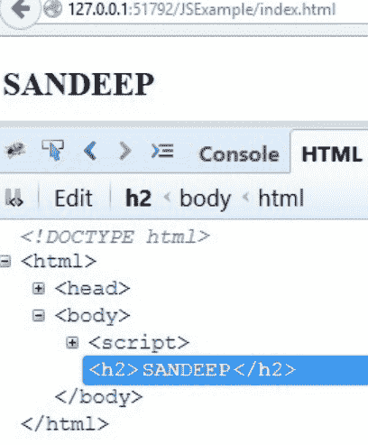

# SANDEEP

```
<!DOCTYPE html>
<html>
<head>
<body>
<script>
<h2>SANDEEP</h2>
</body>
</html>
```

## 问题：哪一个是基础的 DOM？

答案
Node 是 DOM 最基础的对象。它是最常用的接口，许多其他 DOM 对象都继承自它。以下接口都继承了 Node 方法和属性：Document、Element、CharacterData、ProcessingInstruction、DocumentFragment、DocumentType、Notation、Entity、EntityReference。在方法和属性不相关的特殊情况下，这些接口可能会返回 null。它们可能会抛出异常——例如向一个不存在子节点的节点类型添加子节点。

## 问题：常见的 doctype 声明（doctype declarations）有哪些？

答案
共有 8 种不同类型的 doctype 声明列如下：

- HTML 5：此 doctype 用于 HTML5。
```
<!DOCTYPE html>
```

- HTML 4.01 Strict：此 DTD 包含所有的 HTML 元素和属性，但**不包含**表现或废弃的元素（如 font）。不允许使用 frameset。
```
<!DOCTYPE HTML PUBLIC "-//W3C//DTD HTML 4.01//EN"
"http://www.w3.org/TR/html4/strict.dtd">
```

- HTML 4.01 Transitional：此 DTD 包含所有的 HTML 元素和属性，**包含**表现或废弃的元素（如 font）。不允许使用 frameset。
```
<!DOCTYPE HTML PUBLIC "-//W3C//DTD HTML 4.01 Transitional//EN"
"http://www.w3.org/TR/html4/loose.dtd">
```

- HTML 4.01 Frameset：此 DTD 等于 HTML 4.01 Transitional，但允许使用 frameset 内容。
```
<!DOCTYPE HTML PUBLIC "-//W3C//DTD HTML 4.01 Frameset//EN"
"http://www.w3.org/TR/html4/frameset.dtd">
```

- XHTML 1.0 Strict：此 DTD 包含所有的 HTML 元素和属性，但**不包含**表现或废弃的元素（如 font）。不允许使用 frameset。标记也必须写为良好的 XML。
```
<!DOCTYPE HTML PUBLIC "-//W3C//DTD XHTML 1.0 Strict//EN"
"strict.dtd">
```

- XHTML 1.0 Transitional：此 DTD 包含所有的 HTML 元素和属性，**包含**表现或废弃的元素（如 font）。不允许使用 frameset。标记也必须写为良好的 XML。
```
<!DOCTYPE HTML PUBLIC "-//W3C//DTD XHTML 1.0 Transitional//EN"
"transitional.dtd">
```

- XHTML 1.0 Frameset：此 DTD 等于 XHTML 1.0 Transitional，但允许使用 frameset 内容。
```
<!DOCTYPE html PUBLIC "-//W3C//DTD HTML 1.0 Frameset//EN">
"frameset//frameset.dtd">
```

- XHTML 1.1：此 DTD 等于 XHTML 1.0 Strict，但允许你添加模块（例如为东亚语言提供注音支持）。
```
<!DOCTYPE html PUBLIC "-//W3C//DTD HTML 1.1//EN">
"http://www.w3.org/TR/xhtml11/xhtml11.dtd" >
```

# 第 6 章 Date 对象（日期对象）

## 问题：什么是 JavaScript Date 对象？
答案 JavaScript Date 对象返回该时刻的时间。它包含了自 1970 年 1 月 1 日 UTC 以来的毫秒数。

## 问题：创建 Date 对象的不同方式有哪些？或者 Date 对象有哪些不同的构造函数形式？

答案

JavaScript Date 对象有 4 个重载构造函数。这些构造函数列如下：
- new Date()
- new Date(milliseconds)
- new Date(dateString)
- new Date(year, month, day, hours, minutes, seconds, milliseconds)

## 问题：如何在日期对象中获取 1970 年 1 月 1 日（即计算时间的起始日期）？

答案

1970 年 1 月 1 日是计算时间的起始日期。通过创建一个参数为 0 的对象可以计算出经过的毫秒数。下面的截图显示了参数为 0 的日期对象。

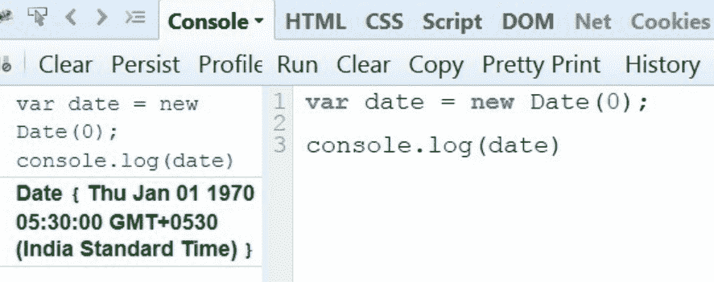

## 问题：JavaScript 如何计算月份？

答案

JavaScript 从 0 到 11 计算一年中的十二个月。0 代表 1 月，11 代表 12 月。下面的截图显示了日期为 7 月 23 日的代码，getMonth() 返回 6。

```
var date = new Date();
console.log(date);
console.log(date.getMonth());
Date = Wed Jul 23 2014 22:37:46
GMT+0530 (India Standard
Time)
```

## 问题：什么时候会发生 RangeError 无效日期异常？

答案

当使用无效日期创建日期对象时会发生。下面的截图显示了参数为 0 的日期对象。最后，该文档片段作为子元素附加到 body 元素。


```javascript
function validateEmail(email) {
  var re = /^\((<<>\|)\.\,\;:\s@"\+\.[^<>()\]\.\,\;:\s@"\+\*\*)@(([0-9]{1,3}\.[0-9]{1,3}\.[0-9]{1,3}\.[0-9]{1,3})|([a-zA-Z\-0-9]+\+))/
  return re.test(email);
}
```

```javascript
var email1 = "sandeepatteltech@gmail.com"
email2 = "sandeep@gmail.com"
result1 = validateEmail(email1)
result2 = validateEmail(email2)
```

```javascript
console.log(result1)
console.log(result2)
```

```
true                               VM444:12
false                              VM444:13
```

## Q. 编写一个正则表达式来验证 URL？

答案

对于验证 URL，我们考虑协议将为 http:// 或 ftp，且必须以 WWW 单词开头。考虑到这些点，验证 URL 的 javascript 代码如下。

```javascript
function validateURL(url) {
  var regExURL = new RegExp("(https(ftp|https)?://\\/\\w-]+\\+[\\w-]+\w@?=%&;/+/+#-])*[\\w@?=%&;/+/+#-])");
  return regExURL.test(url);
}

var url1 = "http://www.google.com"
url2 = "http://www.google.com"
result1 = validateURL(url1)
result2 = validateURL(url2)
console.log(result2)
```

下面的截图显示了 chrome 控制台中执行给定 URL 的 URL 验证代码。

```javascript
function validateURL(url) {
  var regExUrl = new RegExp("(http|ftp|https)://\\\\\\w-]+\\.[\\\\\\w-]+\([\\\\\\w.,@?=\\%&amp;~+##-][\\\\\\w@%=\\%&amp;~+#-]*)?");
  return regExUrl.test(url);
}
var url1 = "http://www.google.com",
    url2 = "http://www.google.com",
    result1 = validateURL(url1),
    result2 = validateURL(url2);

console.log(result1);
console.log(result2);
```

true

false

VM112: 11

VM112: 12

# 第 8 章 Canvas API 问题

Q. HTML5 中的 canvas 是什么？

答案

Canvas 是 HTML5 中用于绘制图形的新元素。可以通过以下步骤在 canvas 上绘制图形。

- 定义绘制区域。
- 获取绘制上下文。
- 使用上下文开始绘制。

Q. Canvas 和 SVG 有什么区别？

答案

Canvas 和 SVG（可缩放矢量图形）之间的区别如下所示。

| CANVAS | SVG |
| :--- | :--- |
| i. 可以在其中绘制图表 | ii. 使用 Canvas 中的上下文。 |
| ii. 在其中绘制的图 | ii. canvas 取依赖分辨率。 |
| iii. 在其中绘制的图 | iii. Canvas 可以保存为 PNG 或 JPG 格式。 |
| iv. 在 Canvas 中绘制的图 | iv. 基于像素。不涉及任何 DOM 元素。 |
| v. 渲染游戏 | v. 图形，因为可以创建精灵和背景。图表使用类似 SVG 的 XML 元素绘制。 |
| | SVG 中绘制的图表是分辨率无关的。 |
| | SVG 图表无法保存为 PNG 或 JPG 格式。 |
| | 在 SVG 中绘制的图表是基于 DOM 元素的。图中不涉及像素。可以创建高度交互的动画用户界面。 |
| vi. 糟糕的文本渲染 | vi. 能力 |
| vii. 糟糕的 SEO 和 vii. 可访问性 | 一切都基于像素，且内容不可访问。 |
| viii. 通过脚本修改 | viii. 仅此。 |
| ix. 性能更好 | ix. 在表面较小、对象较多 (>10k) 或两者兼具时。具有更好的文本渲染能力。由于基于 DOM 渲染，具有更好的 SEO 和可访问性。 |
| | 通过脚本和 CSS 修改。在对象较少 (<10k)、表面较大或两者兼具时性能更好。 |

## Q. 什么是 canvas 2d context？它是如何创建的？

使用带有参数 ‘2d’ 的 getContext() 方法可以创建画布上下文。此上下文是 CanvasRenderingContext2D 对象类型。下面的代码显示了简单的 2d 上下文创建并记录了对象的构造函数。

```html
<html>
<body>
<canvas id="myCanvas"></canvas>
<script>
var canvas = document.getElementById("myCanvas"), context =
canvas.getContext("2d");
console.log(context.constructor);
</script>
</body>
</html>
```

接下来的截图显示了 context 对象的构造函数，它是 CanvasRenderingContext2D 原生对象。

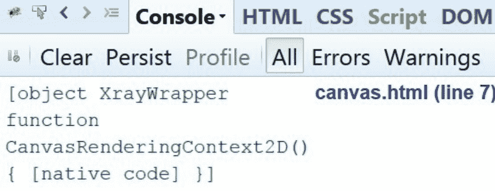

## Q. 如何在 Canvas 中加载图像？

可以使用 drawImage() 方法加载图像。该方法为绘制图像接受若干输入参数。这些参数是定位和裁剪类型。我们将在单独的问题中讨论这些参数。下面的代码显示了如何使用 drawImage 方法从 URL 在 canvas 内部加载一个 PNG 图像。

```html
<html>
<head></head>
<body>
<canvas id="myCanvas"></canvas>
<script>
var canvas = document.getElementById("myCanvas"), context =
canvas.getContext("2d"),
img = new Image();
img.src = "http://www.gravatar.com/avatar/4205261332ff13e971b48db31dcb528.png";
img.onload = function() {
context.drawImage(img, 10, 10);
};
</script>
</body>
</html>
```

下面的截图显示了 Gravatar 图像被绘制在 HTML5 canvas 元素内部。此绘制是使用 2d context 完成的。

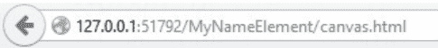

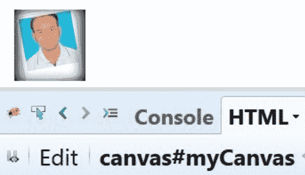

```
<html>
<head></head>
<body>
<canvas id="myCanvas"></canvas>
<script>

Q. drawImage() 的不同签名有哪些？

答案

drawImage() 的不同签名列如下。

- drawImage(image, dx, dy)
- drawImage(image, dx, dy, width, height)
- drawImage(image, sx, sy)
- drawImage(image, sx, sy, swidth, sheight)
- drawImage(image, dx, dy, width, height, sx, sy, swidth, sheight)
- drawImage(image, dx, dy, width, height, sx, sy, swidth, sheight, options)


## Q. 什么是 Shared Worker（共享 Worker）？

答案
Shared Worker 可以被多个脚本访问。共享 Worker 可以被不同的窗口、iframe 以及具有相同源的其它 worker 访问。创建一个专用 worker 的语法如下：

```javascript
var aSharedWorker = new SharedWorker("script.js");
```
Worker 对象内部的参数是 JavaScript 文件，它将在浏览器后台作为共享 worker 运行。

## Q. 如何开发一个显示时间的专用 worker？

答案
让我们在 `dateWorker.js` 文件中创建 worker 实例，并在 `dateWorkerDemo.html` 文件中调用该 worker。以下代码显示了 `dateWorker.js` 的内容，它监听并在每秒发送当前时间。

```javascript
self.addEventListener("message", function(event) {
  setInterval(function() {
    var time = new Date();
    self.postMessage({
      hour: time.getHours(),
      minute: time.getMinutes(),
      second: time.getSeconds()
    });
  }, 1000);
});
```

```html
以下代码显示了 `dateWorkerDemo.html` 的内容，包含实例的创建以及对 worker 响应的监听。

```html
<!DOCTYPE html>
<html lang="en">
<head>
  <meta charset="UTF-8">
  <title>Time Web Worker Demo</title>
</head>
<body>
  <h1 id="resultContainer"></h1>
  <button id="time">Get Time</button>
  <script>
    var dateWorker = new Worker("dateWorker.js");
    var resultContainer = document.getElementById("resultContainer");
    var timeButton = document.getElementById("time");
    timeButton.addEventListener("click", function() {
      dateWorker.postMessage(null);
    });
    dateWorker.addEventListener("message", function(workerEvent) {
      var responseData = workerEvent.data;
      var hour = responseData.hour;
      var minute = responseData.minute;
      var second = responseData.second;
      resultContainer.innerText = "HOUR: " + hour + " MINUTE: " + minute + " SECOND: " + second;
    });
  </script>
</body>
</html>
```

上述代码的输出将在在截图中显示，通过 worker 响应消息显示小时、分钟和秒。

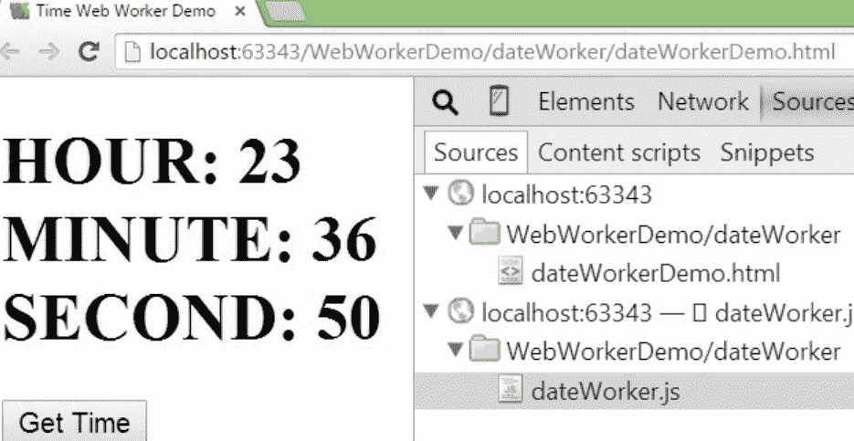

## Q. 如何开发一个计算数字平方的 worker？

答案
平方 worker 的定义存在于 `dsSquareWorker.js` 文件中，它监听消息并生成数字的平方。平方 worker 在 `squareWorkerDemo.html` 文件中实例化，该文件监听平方 worker 并在浏览器中打印结果。`dsSquareWorker.js` 文件的代码内容如下。

```javascript
self.addEventListener("message", function(event) {
  var inputData = event.data;
  var inputNumber = parseInt(inputData.number, 10);
  var squareResult = Math.pow(inputNumber, 2);
  self.postMessage({squareResult});
});
```

`squareWorkerDemo.html` 如下代码：

```html
<!DOCTYPE html>
<html lang="en">
<head>
  <meta charset="UTF-8">
  <title>Square Worker</title>
</head>
<body>
  <h1 id="resultContainer"></h1>
  <input type="number" id="inputNumber" placeholder="Enter a number" value="5">
  <button id="squareButton" onclick="SQUARE">SQUARE</button>
  <script>
    var worker = new Worker("squareWorker.js");
    var resultContainer = document.getElementById("resultContainer");
    var squareButton = document.getElementById("squareButton");
    var inputNumber = document.getElementById("inputNumber");
    squareButton.addEventListener("click", function () {
      worker.postMessage({number: inputNumber.value});
    });
    worker.addEventListener("message", function(workerEvent) {
      var responseData = workerEvent.data;
      var squareResult = responseData.squareResult;
      resultContainer.innerText = squareResult;
    });
  </script>
</body>
</html>
```

上述代码的输出将在在截图中显示，通过 worker 响应消息显示数字的平方。


| 5 | SQUARE |
|---|---|

## Q. 如何定义内联 web worker？演示一个用于数字相法的内联 worker？

答案
内联 web worker 可以在 HTML 标记中使用带有 `type` 属性值为 `javascript/worker` 的 `<script>` 标签来定义。语法如下：

```html
<script type="javascript/worker">
  // 定义 worker 的 JavaScript 代码
</script>
```

示例：
`inlineWorkerDemo.html` 文件包含了定义乘法 worker 的代码，它监听消息、计算乘法结果并返回响应。对乘法 worker 的监听器提取结果并在浏览器中渲染。以下代码显示了 `inlineWorkerDemo.html` 文件的内容。

```html
<!DOCTYPE html>
<html lang="en">
<head>
  <meta charset="UTF-8">
  <title>Inline Web Worker Demo</title>
</head>
<body>
  <h1 id="resultContainer"></h1>
  <input type="number" id="inputNumber" placeholder="Enter a number" value="5">
  <button id="squareButton" onclick="SQUARE">SQUARE</button>
  <script>
    var worker = new Worker("squareWorker.js");
    var resultContainer = document.getElementById("resultContainer");
    var squareButton = document.getElementById("squareButton");
    var inputNumber = document.getElementById("inputNumber");
    squareButton.addEventListener("click", function () {
      worker.postMessage({number: inputNumber.value});
    });
    worker.addEventListener("message", function(workerEvent) {
      var responseData = workerEvent.data;
      var squareResult = responseData.squareResult;
      resultContainer.innerText = squareResult;
    });
  </script>
</body>
</html>

<script type

/


.

message
 function(event) {
  var inputData = event.data;
  var n1 = inputData.number1

varvar2 = input
...


 =1

2.


</
>

## Q. 如何在 web worker 中处理错误？

答案
我们可以从 web worker 使用 `throw` 关键字抛出错误。可以为错误附加回调方法以处理生成的错误。`positiveWorkerDemo.html` 文件包含一个只接受正数输入的 worker。如果传递负数，它将抛出错误。内容如下：

```html
<!DOCTYPE html>
<html lang="en">
<head>
  <meta charset="UTF-8">
  <title>Web Error Handler</title>
</head>
<body>
  <h1 id="resultContainer"></h1>
  <input type="number" id="number" value="-4" placeholder="Enter a number">
  <button id="squareResult">Square</button>
  <script>
    var worker = new Worker("squareWorker.js");
    var resultContainer = document.getElementById("resultContainer");
    var number = document.getElementById("number");
    var squareResult = document.getElementById("squareResult");
    squareResult.addEventListener("click", function() {
      worker.postMessage({number: parseInt(number.value)});
    });
    worker.addEventListener("message", function(workerEvent) {
      var responseData = workerEvent.data;
      resultContainer.innerText = "Result: " + responseData.squareResult;
    });
    worker.addEventListener("error", function(workerError) {
      resultContainer.innerText = "Error: " + workerError.message;
    });
  </script>
</body>
</html>
```

```javascript
<script type="javascript/worker">
self.addEventListener("message", function(event) {
  var inputData = event.data;
  var number1 = inputData.number;
  var squareResult = 0;
  if (number1 >= 0) {
    squareResult = number1 * number1;
    self.postMessage({result: squareResult});
  } else {
    throw("It is a negative number.Please supply a positive number.");
  }
});
</script>
```


## Q. 如何在 web worker 中导入外部脚本？请用示例演示。

答案
要在 web worker 导入外部脚本，我们需要使用 `importScripts()` 方法并将文件名作为输入参数。为了演示脚本功能，我们创建了 3 个文件：greatest-number-script.js、numberWorker.js 和 numberWorkerDemo.html。下面的截图显示了这些文件。

- importScript
  - greatest-number-script.js
  - numberWorker.js
  - numberWorkerDemo.html

greatest-number-script.js 是我们需要导入到 web worker 中的外部脚本。它包含一个方法 `findGreatestNumber()`，用于在提供的数字中找到最大的一个。以下代码显示了 `greatest-number-script.js` 的内容。

```javascript
var findGreatestNumber = function(number1,number2) {
  return number1>number2 ? number1 : number2;
};
```

numberWorker.js 文件包含了在 web worker 监听回调方法内部导入外部脚本的代码。以下显示了 `numberWorker.js` 文件的内容。

```javascript
self.addEventListener('message', function(event) {
  var numberWorker = self.importScripts('greatest-number-script.js');
  var requestData = event.data;
  var number1 = requestData.number1;
  var number2 = requestData.number2;
  var greatestNumber = findGreatestNumber(number1,number2);
  self.postMessage({result:greatestNumber});
});
```

numberWorkerDemo.html 文件包含了实例化 web worker 并监听响应方法的代码。以下显示了 `numberWorkerDemo.html` 文件的内容。

```html
<!DOCTYPE html>
<html lang="en">
<head>
<meta charset="UTF-8">
<title>Time Web Worker Demo</title>
</head>
<body>
<h1 id="resultContainer"></h1>
<input type="number" id="number1" value="" placeholder="Enter first number">
<input type="number" id="number2" value="" placeholder="Enter second number">
<button id="greatButton">Find Greatest</button>
<script>
var numberWorker = new Worker('numberWorker.js');
var resultContainer = document.getElementById('resultContainer');
var greatButton = document.getElementById('greatButton');
var number1 = document.getElementById('number1');
var number2 = document.getElementById('number2');

greatButton.addEventListener('click',function(){
  numberWorker.postMessage({
    number1:parseInt(number1.value,10),
    number2: parseInt(number2.value,10)
  });
});

numberWorker.addEventListener('message',function(workerEvent) {
  var responseData = workerEvent.data;
  resultContainer.innerText = "Greatest Number: "+responseData.result;
});
</script>
</body>
</html>
```

该代码的输出渲染如下截图所示，包含了提供数字中的最大值。

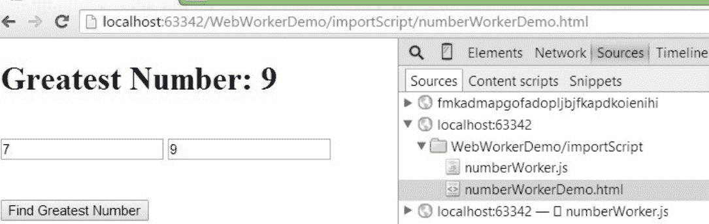

# Greatest Number: 9

## Q. 创建一个 shared worker 来计算字符串的长度？答案
calculateLengthWorker.js 包含了监听消息和计算输入字符串长度的代码。shared worker 通过监听连接（connect）来监听端口（port）中的消息。calculateLengthWorker.js 文件的代码如下。

```javascript
self.addEventListener('connect', function(event) {
  var port = event.port;
  port.addEventListener('message', function(event) {
    var requestData = event.data;
    var inputString = requestData.string;
    var stringLength = inputString.length;
    port.postMessage({result:stringLength});
  }, false);
  port.start();
});
```

GreatestWorkerDemo.html 文件包含了实例化 shared workerget浏览器中渲染响应的代码。GreatestWorkerDemo.html 文件的内容列如下。

```html
<!DOCTYPE html>
<html lang="en">
<head>
  <meta charset="UTF-8">
  <title>Shared Web Worker Demo</title>
</head>
<body>
<h1 id="result"></h1>
<input type="text" id="inputString" placeholder="Enter a string">
<button id="lengthButton">Get Length</button>
<script>
var worker = new SharedWorker("calculateLengthWorker.js");
var resultContainer = document.getElementById("result");
var lengthButton = document.getElementById("lengthButton");
var inputString = document.getElementById("inputString");

lengthButton.addEventListener("click", function () {
  resultContainer.innerText = "";
  worker.port.postMessage({
    string : inputString.value
  });
});

//start the worker
worker.port.start();

//Success Handler for the result string.
worker.port.addEventListener("message", function (workerEvent) {
  var response = workerEvent.data;
  var result = response.result;
  resultContainer.innerText = "Result: " + result;
});
</script>
</body>
</html>
```

上述代码的输出渲染如下截图所示，显示了输入字符串的长度。

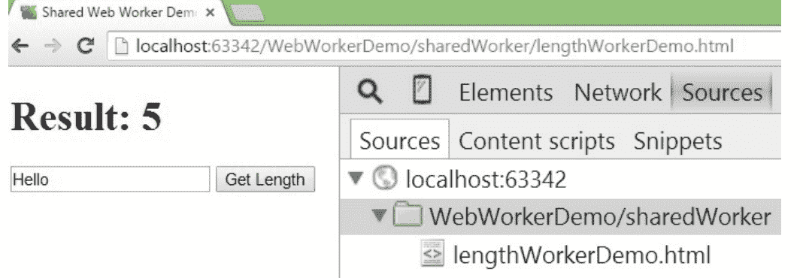

## 第一章：Local Storage（本地存储）

## Q. 什么是 local storage？
答案
HTML5 提供了一种在用户浏览器本地存储数据的特性。与 cookie 不同，它的平均空间为 5 MB。这种存储分为多种类型。

## Q. 哪一个是主接口？
答案
window.Storage 是带有定义的主接口。

```javascript
interface Storage {
  readonly length: number;
  key(index);
  getItem(key);
  setItem(key, value);
  removeItem(key);
  clear();
}
```

上述代码的细节如下：
- setItem(key,value) : 此方法将值存储在存储中。
- getItem(key) : 此方法检索存储的值。
- removeItem(key) : 此方法根据键移除项。
- clear() : 从存储中删除所有项。
- length : 此属性返回存储的长度。
- key(position) : 此方法返回对应值的键名。

## Q. 如何在 local storage 中存储和检索对象？
答案
Local storage 提供 `setItem()` 和 `getItem()` 来存储和检索对象。`setItem(key, value)` 方法接受两个参数来存储对象。`getItem()` 方法通过键检索值。

```html
<!DOCTYPE html>
<html>
<body>
<div id="resultContainer"></div>
<script>
var container = document.getElementById("resultContainer");
localStorage.setItem("myName", "Sandeep Kumar");
container.innerHTML = localStorage.getItem("myName");
</script>
</body>
</html>
```

下面的截图显示了 Chrome 开发者工具存储预览，它以键值对的形式持有上述对象。

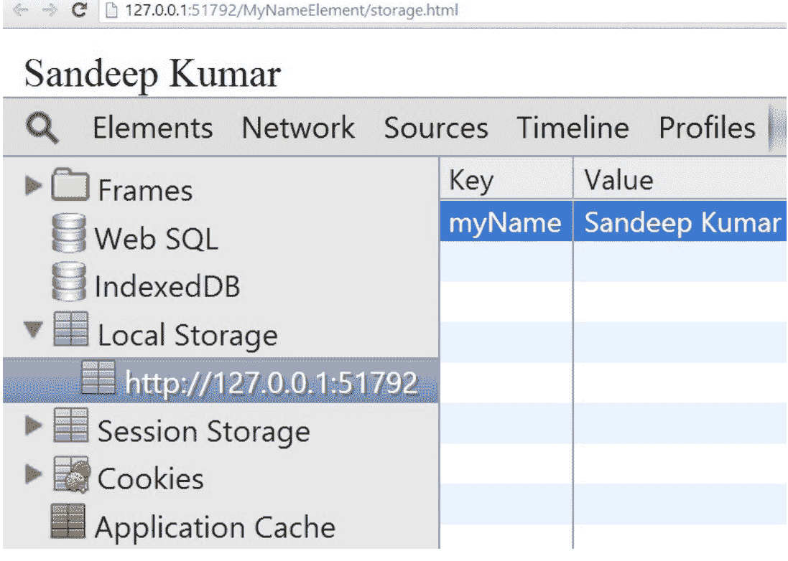

# Sandeep Kumar

- Elements Network Sources Profiles

| Frames | Key | Value |
| --- | --- | --- |
| Web SQL | myName | Sandeep Kumar |
| IndexedDB | | |
| Local Storage | | |
| http://127.0.0.1:5172 | | |
| Session Storage | | |
| Cookies | | |
| Application Cache | | |

## Q. 如何为 local storage 附加事件？
答案
当 local storage 对象被修改时，会触发存储事件。可以使用 `addEventListener()` 或 `attachEvent()` 方法在 window 对象上附加回调方法。

注意：
当对关联本地存储区域的 Storage x 运行 `getItem()`、`removeItem()` 和 `clear()` 方法时，如果方法执行了操作，那么在每个 Window 的 localStorage 属性的 Storage 对象关联到相同存储区域的其他其他 Document 对象中，必须触发存储事件。

简单来说，存储事件会在更新 localStorage 对象并导致事件的窗口之外的所有窗口/标签页上触发。以下代码包含一个监听存储事件的回调方法。


```html
<html>
<body>
  <div id="resultContainer"></div>
  <button onclick="update()">Click Me</button> 
  <script>
    var container = document.getElementById("resultContainer"), 
    methodStorageEvent = function(event) {
      container.innerHTML = "Event" + localStorage.getItem("myName");
    },
    counter = 1,
    update = function(){
      localStorage.setItem("myName", ++counter); 
      container.innerHTML = localStorage.getItem("myName");
    };

    window.addEventListener("storage", methodStorageEvent, false)
  </script>
</body>
</html>
```

下方的截图演示了存储事件是如何触发的，以及其他标签页如何访问同一个存储事件并更新其内容。


# 2

## 事件触发

点击我

点击我

# 第 12 章 File API

## Q. 什么是 HTML5 File API？

答案

HTML5 提供了新的 API 在浏览器内部处理文件。该 API 提供了 File、FileList 和 Blob 数据类型来处理文件。它提供了 FileReader 接口来异步读取文件。

## Q. FileReader 为异步操作提供了哪些方法？

答案

FileReader 提供了 4 种方法来处理加载的文件。这些异步方法列如下：

- **readAsBinaryStringBlob | File**：读取目标文件并将其保存为包含 0-255 整数范围的二进制字符串。
- **readAsText | Blob | File, opt_encoding**：读取目标文件并将其保存为 UTF-8 文本文件。
- **readAsDataURL(Blob | File)**：读取目标文件并返回一个包含 base64 ascii 字符串的数据  URL，**readAsArrayBuffer(Blob | File)**：读取目标文件并将其保存在数组缓冲区中。

## Q. JavaScript 中的 Blob 对象是什么？

答案

Blob 对象是指一个表示数据的字节序列。Blob 对象的 IDL（接口定义语法）如下：

```javascript
interface Blob {
  readonly attribute unsigned long size; 
  readonly attribute DOMString type; 
  Blob([Clamp]) long long start;
  optional([Clamp]) long long end, optional DOMString contentType); 
  void close();
};
```

方法和属性的详情如下：

- **slice 方法**：slice 方法返回一个新的 Blob 对象，其字节范围从可选的 start 到不包含可选的 end 参数，且其 type 属性的值为可选 contentType 参数的值。
- **close 方法**：close 方法必须永久地使原始 Blob 对象失效。这是一个不可逆的、独立的操作；一旦 Blob 被作空，就无法再次使用；对已调用过 close 的 Blob 对象的引用 Blob URL 将导致网络错误。被作空的 Blob 的 size 必须为 0。
- **size 属性**：它返回 Blob 以字节为单位的大小。
- **type 属性**：它返回 Blob 所持有的内容类型。

## Q. 如何创建 Blob 对象？

答案

可以使用 `new` 关键字配合 Blob 构造函数来创建 Blob 对象。Blob 构造函数接受以下参数：

- **Blob 序列**：可以是 ArrayBuffer、ArrayBufferView 或 Blob DOMString。
- **Blob 属性包**：它接受一个参数，代表小写 ASCII 编码字符串的类型，用于表示 Blob 的媒体类型。

以下代码展示了使用 `new` 关键字创建 Blob 的示例：

```javascript
var a = new Blob();
var b = new Blob(["foobarbazetcet" + "birdbirdbieoo"], {type: "text/plain;charset=UTF-8"});
```

## Q. Blob 对象的可读状态有哪些？

答案

Blob 必须有一个可读状态，即 OPENED（已打开）或 CLOSED（已关闭）之一。

Blob 指向字节序列（包括 0 字节）被认为处于 OPENED 可读状态。

如果调用了 Blob 的 close 方法，则认为 Blob 已关闭。已关闭的 Blob 处于 CLOSED 可读状态。

## Q. FileReader 的不同状态有哪些？

答案

FileReader 对象可以处于 3 种状态之一。readyState 属性在获取时必须返回当前状态，该必须是以下值之一：

- **EMPTY**：FileReader 对象已构造，且没有待处理的读取。没有任何读取方法被调用过。这是新创建的 FileReader 对象的默认状态，直到对其调用了其中一个读取方法为止。
- **LOADING**：正在读取 File 或 Blob。正在处理其中一个读取方法，且读取过程中没有发生错误。
- **DONE**：整个 File 或 Blob 已读取到内存，或者在读取期间发生了文件错误，或者使用 abort() 终止了读取。FileReader 不再读取 File 或 Blob。如果 readyState 被设置为 DONE，则意味着该 FileReader 至少调用过一次读取方法。

# 第 13 章 Web RTC

## Q. 什么是 Web RTC？

答案

Web RTC 为浏览器提供了无需安装任何额外插件即可进行实时通信的能力。它涉及浏览器之间通过原生能力的音频、视频和其他类型的数据流。

### Q. Web RTC 实现了哪些 API？

答案

Web RTC 实现了三种不同的 API。这些接口列如下：

- **MediaStream**：代表使用摄像头和麦克风的同步媒体。
- **RTCPeerConnection**：该接口负责点点之间的稳定连接。
- **RTCDataChannel**：该接口负责点点与其他类型的数据通信。

## Q. 什么是 MediaStream？

答案

MediaStream 代表浏览器捕捉的流。可以通过 navigator.getUserMedia() 访问。

## Q. getUserMedia() 的输入参数有哪些？

答案

getUserMedia() 方法接受 3 个参数：

- **Constraint 对象**：类似于配置对象。
- **成功回调方法**。
- **错误回调方法**。

## Q. 什么是 MediaStreamTracks？

答案

getUserMedia() 返回的 MediaStream 有两个方法 getAudioTracks() 和 getVideoTracks()这两个方法都返回 MediaStreamTracks 数组。

### Q. Web RTC 通信使用了哪些协议？

答案

Web RTC 使用 2 种协议进行通信。这些协议如下：

- **DTLS**：数据报传输安全。
- **SRTP**：安全实时传输协议。

## Q. 如何在 Chrome 浏览器中查看 Web RTC 会话的统计信息？

答案通过使用 chrome://webrtc-internals/ 查看正在进行的 Web RTC 会话的详细统计信息。

## Q. Channel 的不同事件处理器有哪些？

Channel 有 4 种不同的事件处理器。这些事件处理器列如下：

- **onopen**：在建立连接时执行。
- **onerror**：在创建连接出错时执行。
- **onmessage**：当接收到消息时执行此方法。
- **onclose**：当另一端关闭连接时执行。

## Q. 什么是信号通道（signal channel）？

答案

WebRTC 在没有中间服务器的情况下无法创建连接。我们称之为信号通道。

## Q. 什么是 ICE 技术？

答案

交互式连接建立（ICE）是一种用于网络技术的技术，涉及网络地址转换（NAT）的 IP 电话、对点对点通信、视频、即时消息和其他交互媒体应用。

## Q. 什么是 ICE 候选（ICE Candidate）？

答案

通信双方必须交换关于网络连接的信息。这被称为 ICE 候选。


# 第 14 章 拖放 API

Q. 如何在浏览器中让内容变得可拖拽？答复
HTML5 提供了拖放功能。通过将元素的 `draggable` 属性设置为 `true`，可以使元素变为可拖拽。查看下面的代码，其中包含两个按钮。一个按钮是可拖拽的，另一个只是普通按钮。

```html
<!DOCTYPE html>
<html>
<head>
<title>可拖元素</title>
</head>
<body>
<button draggable="true">可拖按钮</button> <button>普通按钮</button>
</body>
</html>
```

下方的截图显示了这两个按钮。可拖按钮是可以移动的，而普通按钮固定在原有位置。

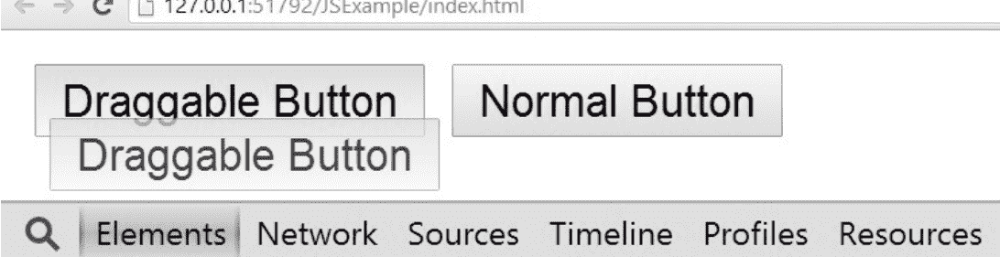

```html
<!DOCTYPE html>
<html>
<head>...</head>
<body>
<button draggable="true">可拖按钮</button>
<button>普通按钮</button>
</body>
</html>
```

Q. 当元素的拖拽开始时发生了什么？答复
拖拽开始时有 3 个关键点需要注意。这些关键点如下：

- **拖拽数据 (Drag Data)**：它代表拖拽过程中传输的数据类型。
- **拖拽反馈 (Drag Feedback)**：拖拽操作期间出现在鼠标指针旁图像。
- **拖拽效果 (Drag Effect)**：代表发生在元素上的拖拽类型。共有 3 类型，列如下：
    - 复制 (Copy)：此效果表示数据将从当前位置复制到落下位置。
    - 移动 (Move)：此效果表示正在拖拽的数据将从位置移动到落下位置。
    - 链接 (Link)：此效果表示源和落下位置之间将建立某种关系或连接。

## Q. 什么是拖放事件？

答复

有 7 种不同的拖放事件，可以通过程序化方法附加回调方法。
- **Dragstart**：当拖拽开始时，在元素上触发。
- **Dragenter**：当拖拽进行期间，鼠标进入元素时触发。
- **Dragover**：当拖拽进行期间，鼠标在元素上方移动时触发此事件。
- **Dragleave**：当拖拽进行期间，鼠标离开元素时触发此事件。
- **Drop**：在拖拽操作结束时，在发生落在元素上触发 drop 事件。
- **Dragend**：无论拖拽操作成功与否，拖拽源都会接收 dragend 事件。

## Q. 什么是 dataTransfer 属性？

答复

`dataTransfer` 对象持有在拖拽操作中发送的数据片段。`dataTransfer` 在 `dragstart` 事件中设置，并在 `drop` 事件中读取/处理。在 `dataTransfer` 对象中设置值的语法如下：
`event.dataTransfer.setData(format, data)`
上述语法将将对象的设置设置为作为参数传递的 mime 类型和数据载荷。

## Q. 开发一个示例，将元素从一个地方拖放到另一个地方？

答复

为了演示拖放功能，我们创建了一个具有圆角边框和红色背景颜色的 `div` 元素。我们将拖动此元素并将其放入容器。以下代码显示了拖放示例。

```html
<!DOCTYPE html>
<html>
<head>
<style>
#ball {
    width: 50px;
    height: 50px;
    background-color: red;
}
#dropZone {
    width:200px;
    height:100px;
    padding:10px;
    border:1px solid #aaaaaa;
}
</style>
</head>
<body>
<div id="dropZone" ondrop="drop(event)" ondragover="allowDrop(event)"><
<br>
<div id="ball" draggable="true" ondragstart="drag(event)"></div>
</</div>
<script>
function allowDefault(ev){ev.preventDefault();}
function drag(ev){ev.dataTransfer.setData("text",ev.target.id);}
function drop(ev){
    ev.preventDefault(); 
    var data =ev.dataTransfer.getData("text");
    ev.target.appendChild(document.getElementById(data));
}
</script>
</body>
</html>
```

代码的输出在拖拽前的截图所示，两个元素都在它们的原始位置。

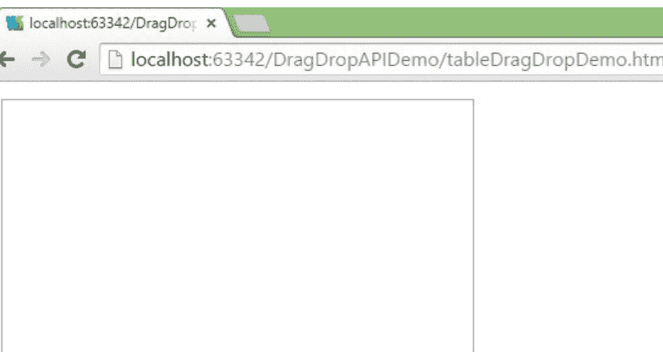

将可拖拽元素拖放到容器后，代码的输出如下方的所示。

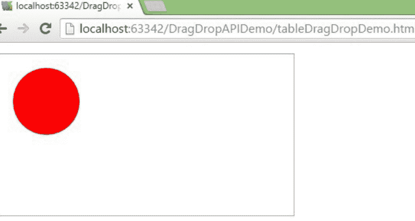

# 第 15 章 应用缓存 (App Cache)

Q. 什么是应用缓存？在 Web 应用中使用缓存 API 有什么好处？答复

Cache API 是 HTML5 提供的新功能。此 API 让 Web 应用可以在没有互联网连接的情况下运行。此 API 最重要的优点列如下：

- **速度 (Speed)**：像所有其他缓存一样，它增加了访问页面内容的速度。
- **离线浏览 (Offline browsing)**：增加了应用程序的可用性，因为可以在互联网访问。
- **减少负载 (Reduced load)**：由于内容和数据现在缓存在浏览器中，应用程序的负载减少了。
- **减少网络请求**：由于大部分内容存在缓存中，减少了对服务器的请求。

Q. 如何在 HTML 文件中启用应用缓存？答复

要在 HTML 文件中启用应用缓存，需要在 `<html>` 元素中使用 `manifest` 属性。语法如下：

```html
<!DOCTYPE html>
<html manifest="filename.appcache">
```

Q. appcache 的媒体类型是什么？答复

manifest 文件需要 `text/cache`。

Q. manifest 文件的 3 个不同部分是什么？答复

manifest 文件有三个部分，如下：
- **CACHEIFEST**：此头部下的文件在首次下载后将被缓存。
- **NETWORK**：此头部下的文件需要连接服务器。
- **FALLBACK**：此头部指定了页面不可访问时的备用页面。

Q. 什么是 NETWORK 部分？答复

NETWORK 是 manifest 文件的一部分。在 NETWORK 中列出的文件不需要缓存。以下代码显示了 NETWORK 的示例：
`NETWORK:login.html`

Q. 什么是 FALLBACK 部分？答复

FALLBACK 是 manifest 文件的一部分。在此部分中我们可以指定应用程序离线时调用的文件。以下代码显示了 FALLBACK 的示例：
`FALLBACK:/offline.html`

Q. 什么是 CACHEIFEST 部分？答复

CACHEIFEST 是 manifest 文件的一部分。在此部分中提到的文件将在本地缓存。

代码显示了 CACHEIFEST 的示例：
`/style.css`
`/favicon.gif`

Q. 如何在 Chrome 浏览器中查看缓存详情？答复

我们可以通过 Chrome 浏览器中的链接 `chrome://appcache-internals/` 查看缓存内容，如大小、时间等。下方的截图显示了我浏览器的 appcache 内部信息。

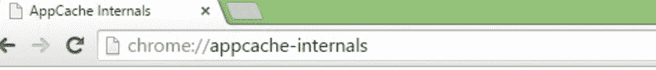

Manifest: https://www.google.com/_chrome/newtab/manifest?espv=2&ie=UTF-8
移除查看

| 属性 | 值 |
| :--- | :--- |
| 大小 | 232 KB |
| 创建时间 | 2014年10月16日 20:37:47 |
| 最后更新时间 | 2015年5月24日 21:07:19 |
| 最后访问时间 | 2015年5月27日 20:19:40 |

Q. 如何检测浏览器是否支持 appcache？答复

我们可以通过检查 `window` 对象中是否存在 `applicationCache` 来检测对 appcache 的支持。可以使用 JavaScript 的 `if` 语句检查 `window.applicationCache` 对象的真值。下方的截图显示了 Chrome 控制台检测 applicationCache 对象。

Q. 如何手动更新应用缓存？答复

我们可以通过对浏览器进行强制刷新来更新缓存。我们也可以调用 `swapCache()` 方法来程序化地更新缓存。


# 第 16 章 服务器发送事件 (Server Sent Events)

Q. 什么是服务器发送事件 (SSE)？

答案
HTML5 提供了服务器发送事件功能，网页可以自动从服务器获取更新。该功能的一个绝佳例子是 Facebook 通知或 Google+ 更新。

Q. 服务器发送响应的 content 类型是什么？答案

服务器响应的 content 类型在 “Content-Type” 响应头中为 “text/event-stream”。

Q. 如何创建一个事件源来监听服务器更新？答案

可以通过通过实例化 `EventSource` 类的对象并提供服务器路径来创建事件源。创建事件源的语法所示：

```javascript
var source = new EventSource("URL to Server");
```

Q. EventSource 触发了哪些事件类型？答案

EventSource 会触发 3 种不同的事件。可以将回调方法附加到源上以监听这些事件。这些事件类型列如下：

- onopen : 当服务器向浏览器打开连接时，触发此事件。
- onmessage: 当服务器向流产生新输出时，触发此事件。
- onerror: 当通过某种发生错误时，触发此事件。

Q. 如何关闭事件流？

答案
可以使用 `close()` 方法关闭事件流。

Q. 事件流的格式是什么？

答案
事件流是一个简单的文本数据流，必须使用 UTF-8 编码。每条消息由一对换行符分隔。行首字符为冒号的本质上是一个注释，会被忽略。

# 第 17 章 杂记问题

Q. 什么是严格模式 (strict mode)？
答案
严格模式是新 ECMA 5 JavaScript 规范中的新指令。它用于安全的 JavaScript 代码编写。它通过将静默错误转换为抛错误来消除 JavaScript 错误。

编写严格模式的语法表达式如下：
“use strict"
以下代码展示了在函数内部使用严格模式。

```javascript
function sayHello(){
  "use strict";
  myName = "Sandeep";
}

sayHello();
```
以下截图显示了在 `sayHello()` 方法中使用未声明变量产生的错误。

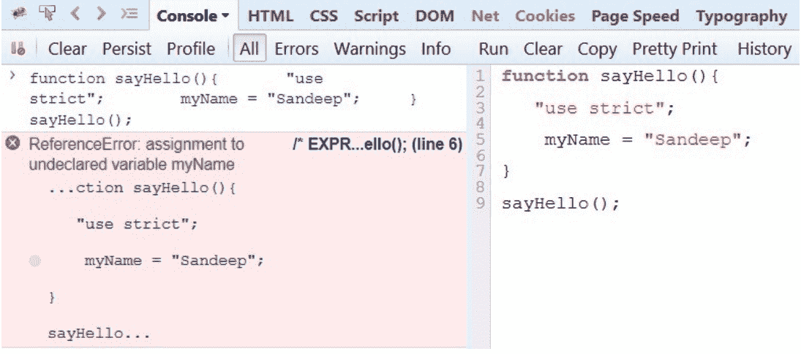

Q. 列出一些严格模式下不允许的条件？
答案
下面是 ECMA5 严格模式下不允许的条件列表：

- 不允许在未声明的情况下使用变量。不允许删除变量、函数或参数。
- 不允许重复定义属性。不允许重复参数名。
- 不允许使用八进制数字字面量和转义字符。
- 不允许写入只读属性。不允许删除不可删除属性。
- 字符串 "eval" 不能作为变量。字符串 "arguments" 不能作为变量。
- 不允许使用未来保留关键字。

Q. 0.1+0.2 在控制台中的输出是什么？为什么？JavaScript 数学库遵循 IEEE 754 标准 标准进行数学运算。IEEE 754 标准使用 64 位表示浮点数。这在评估 `0.1 + 0.2` 表达式时产生了一个问题。下方的截图显示了该表达式的 Firebug 控制台。

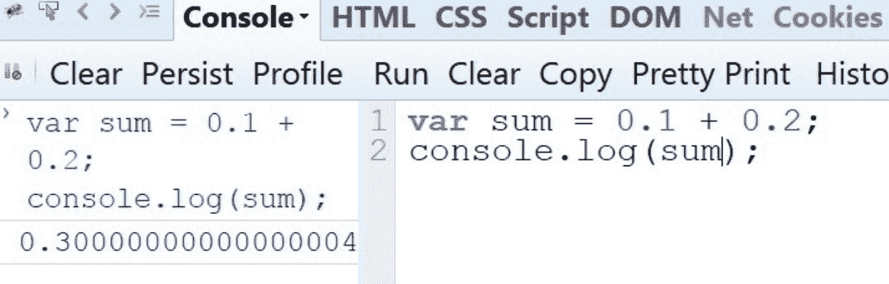

JavaScript 内部将 `0.1` 转换为 16 精度，变为 `0.10000000000000001`，加上 `0.2` 后变为 `0.30000000000000004`。
下方的截图显示了 JavaScript 代码中的这种情况。

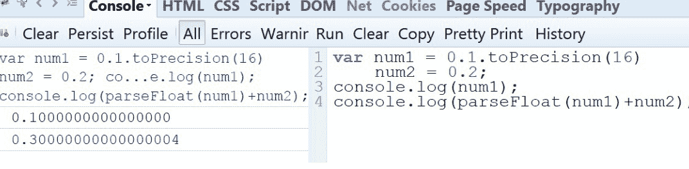

Q. 如何解决 0.1+0.2 = 0.30000000000000004 的问题并产生 0.3？答案
可以使用 `toFixed(1)` 方法来解决这个问题。`toFixed()` 方法将数字转换为指定的小位数。下方的截图显示了使用 `toFixed()` 产生正确输出 `0.3`。

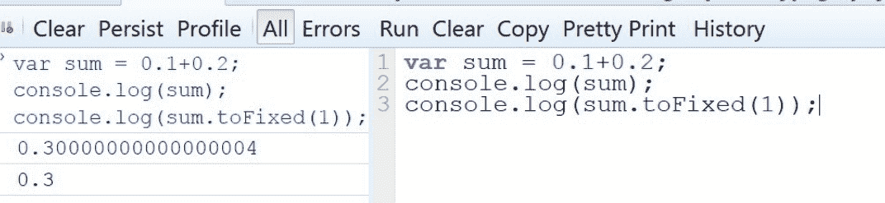

Q. 下面代码的输出是什么？为什么？

```javascript
function(){
  var a = b = 3;
}());
console.log(typeof a);
console.log(typeof b);
```

答案
上述代码将在控制台中打印 `undefined` 和 `Number`。下方的截图显示了上述代码在 Firefox 控制台中的输出。

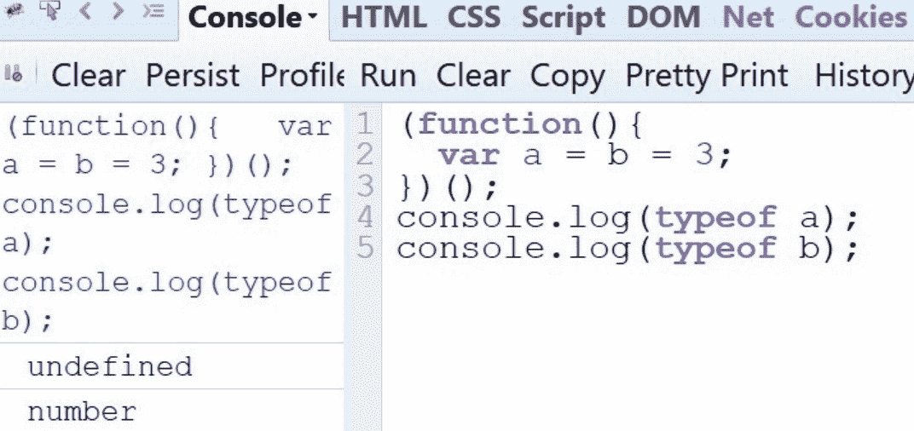

JavaScript 将代码处理如下图所示。从下面的代码可以明显看出变量 `a` 在函数的局部作用域内，而 `b` 被视为 `this.b`。当前引用代表 `window`。
