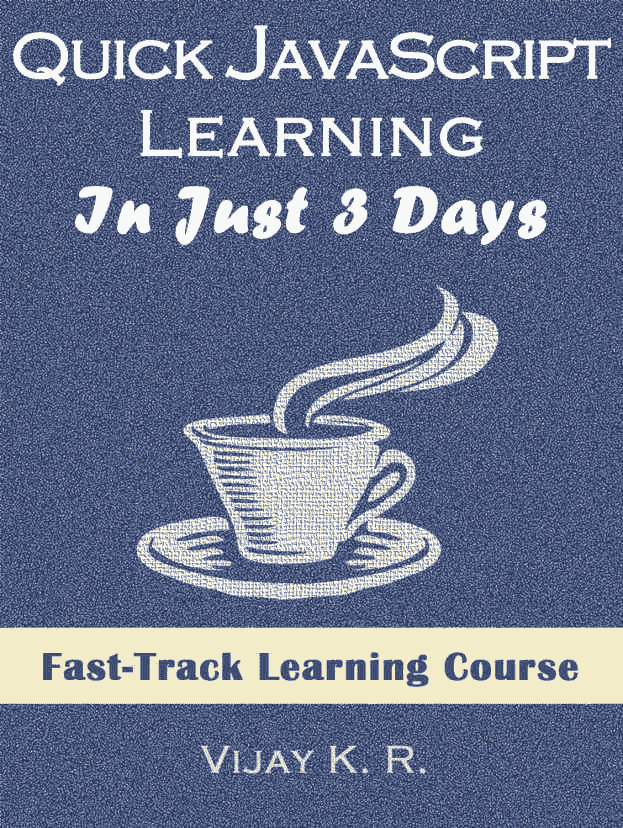

# 3天快速学会 JavaScript：快速上手学习课程



## 引言

JavaScript 是帮助你让浏览器执行你想要操作的语言之一。这是一门容易学习的语言，现在我将教你。我的语言将是易于用户的，我会尝试用简单的语言和示例来解释复杂的内容。让我们一个一个地开始 JavaScript 课程。这是一份 3 天 JavaScript 基础课程。

在开始学习 JavaScript 之前，我假设你至少具有 `HTML` & `CSS` 的基础知识。如果你没有 `HTML` & `CSS` 知识，那么你应该先通过在线教程学习它们。你可以在 2-3 天内学会基础的 `HTML` & `CSS`。

- 第 1 天 = 学习第 1 & 2 章
- 第 2 天 = 学习第 3, 4 & 5 章
- 第 3 天 = 学习第 6, 7 & 8 章

## 第一章：JavaScript 基础

JavaScript 可以改变 HTML 内容。如果你是 PHP 开发者，并且想在不刷新页的情况下完成某些工作，或者你想让 `HTML` & `CSS` 执行任务，那么你需要 JavaScript。

### `<script>` 标签

JavaScript 可以放在 `body` 和 `head` 标签中。JavaScript 代码应该放在 `<script>` 和 `</script>` 标签之间。

```html
<script>
document.getElementById("demo").innerHTML = "My First JavaScript Code";
</script>
```

### JavaScript 事件

JavaScript 代码是由事件触发的。当人执行某项操作时就会触发事件。浏览器提供了许多事件，如 `onclick`、`onmouseover`、`onkeyup`、`onkeydown`、`ondoubleclick` 等。当事件发生时，JavaScript 执行代码。

```html
<button onclick="myFunction()">Press Me!</button>
```

### JavaScript 函数

JavaScript 函数是放在 `<script>` 和 `</script>` 标签内的。

```html
<script>
function myFunction(){
document.getElementById("demo").innerHTML = "My First JavaScript Code";
}
</script>
```

### JavaScript 的最佳位置

JavaScript 在 `<script>` 标签内。

```html
<script>
function myFunction(){
document.getElementById("demo").innerHTML = "My First JavaScript Code";
}
</script>
```

### 外部文件

JavaScript 在 `<script>` 标签。

```html
<script src="newScript.js"></script>
```

## 第二章：JavaScript 输出/显示代码

JavaScript 有四种输出方式。

### 第一种方式：`document.write()`

它用于在网页上写入任何内容。

```html
<script>
function add(){
document.write(6);
}
</script>
```

解释：点击按钮时，`document.write()` 输出。

### 第二种方式：`window.alert()`

它用于在警告框中显示消息。

```html
<script>
window.alert("Warning");
</script>
```

解释：打开网页时，`window.alert()` 显示“警告”。

### 第三种方式：`innerHTML`

该方法用于在 HTML 元素（如段落、`textarea` 等）内部写入。

```html
<script>
function something(){
document.getElementById("demo").innerHTML = "Paragraph is filled";
}
</script>
```

解释：点击按钮时，`getElementById()` 获取 ID 并通过 `innerHTML` 写入。

### 第四种方式：`console.log()`

用于在控制台中写入，在你的 firefox、chrome 浏览器中按 F12 键。

```html
<script>
console.log(2+2);
</script>
```

解释：点击 F12 键并在控制台标签查看结果。

## 第三章：JavaScript 变量、语句、注释与关键字

### JavaScript 变量

变量在任何语言中用于存储数据。JavaScript 中的变量与 C 等其他语言相似。变量以 `int`、`str` 等数据类型的形式存储，但在 JS 中，你可以使用 `var` 关键字处理所有数据类型。

写入字符串：写入字符串时需要使用单引号或双引号。

示例：

```javascript
var x = "This is a Boy.";
var y = 'This is a Girl.';
```

注意：分号 `;` 用于结束行。

写入数字：写入数字不需要双引号或单引号。如果你使用了，JS 将其视为字符串。

示例：

```javascript
var x = 8;
var y = 6;
var z = x+y;
```

### JavaScript 语句

JavaScript 语句是浏览器执行的指令集。

示例 1：改变 HTML 内容

想象一下，你想通过点击按钮在 HTML 的任何地方添加某些内容。你可以通过 PHP 轻松地完成此工作，但页面会刷新。借助 JavaScript，你可以在不刷新页面的情况下完成此工作。

```html
<html>
<body>
<h1>Change Content of Box</h1>
<p id="demo">JavaScript will change HTML content.</p>
<button type="button" onclick="document.getElementById('demo').innerHTML = 'I learnt first example!'">
Press Me!
</button>
</body>
</html>
```

### 解释

在这里，我用 html `p` 标签创建了一个段落，并赋予了 `id` 名为“demo”。其次，我创建了一个带有 `onclick` 事件的按钮。我写了一行 JavaScript 代码 `document.getElementById('demo').innerHTML = 'I learnt first example!'`。你将在后面的章节中学习所有这些，但让我们现在开始吧。`document` 是 JavaScript 对象，而 `getElementById` 是 `document` 的方法。它清楚地显示了通过 id 获取元素（demo）。在这里，它将通过 id `demo` 获取元素，该 id 是 `p` 标签的 `id`，然后 `innerHTML` 表示在 `p` HTML 标签内部进行更改。你必须执行等号后面编写的内容。现在，当你按下按钮 `<p id="demo">` 时，内部的 html 标签会被更改为“I learnt first example!”。我希望你能理解这一点，如果没有理解，请再读一遍，如果还是不懂也没关系，我们将在后面看到很多示例来了解所有这些内容。

### 示例 2：更改 CSS 样式

如果你想通过点击按钮更改 HTML 页面中某些文本的颜色，你可以通过 JavaScript 轻松地完成工作。我将在示例中向你展示颜色的改变。

```html
<html>
<body>
<h1>更改段落的颜色</h1>
<p id="demo">JavaScript 将改变颜色。</p>
<script>
function colorChange() {
    var x = document.getElementById("demo");   
    x.style.color = "red";
}
</script>
<button type="button" onclick="colorChange()">点击我！</button>
</body>
</html>
```

### 解释

如果你已经读过第一个示例，你可以理解段落 `p` 标签的 `id` 是 `demo`，以及按钮的 `onclick` 事件。在在上一个示例中，我们直接在事件名称 `onclick` 上上编写了代码。由于代码很短，所以我们使用了内联写法，但现在代码很大，所以我们使用了 `<script> </script>` 标签来编写 JavaScript 代码。在代码内部，我们创建了一个名为 `colorChange()` 的函数，并用大括号 ‘{ ’ 打开函数，用大括号 ‘}’ 结束函数。我将在后面的章节中教你关于函数的知识。为了理解它，只需假设函数是编写代码的地方，我们可以在很多地方使用。函数总有一个名称，并且通过它的名称进行调用。现在来看示例，在 `onclick` 事件中，我们通过它的名称 `colorChange()` 调用了函数。当此事件被触发时，它将根据函数大括号 `{` 和大括号 `}` 内部编写的代码运行。

在这里，我们取了一个变量 `x`。变量在 JavaScript 中通过关键字 `var` 定义。我们将 `demo` 标签赋值给变量 `x`，在下一行 `x.style.color` 表示当调用它时，`x` 的样式颜色将变为红色。当你按下“点击我！”按钮时，文本的颜色就会改变。只需使用它，你就会开始自动学习。如果没有，闭上眼睛几分钟思考这段代码。你将开始获得知识。

### 示例 3：更改 HTML 属性

想象，如果你想点击一下就把图片更改为不同的图片。让我们现在看看这个示例。如果你对之前的两个示例留意，你将获得许多有助于你前进的知识。如果你正在匆忙学习，请等一下看看之前的两个示例。如果你理解了基础，在接下来的代码中将不会感到任何困难。现在来看示例。

```html
<html>
<body>
<h1>JavaScript 将更改图像</h1>

<script>
function changeImage() {
    var image = document.getElementById('myImage');
    if (image.src == "https://upload.wikimedia.org/wikipedia/en/c/c2/Single_red_rose.jpg") {
        image.src = "https://upload.wikimedia.org/wikipedia/commons/b/b7/Rose_garden.jpg";
    } else {
        image.src = "https://upload.wikimedia.org/wikipedia/en/c/c2/Single_red_rose.jpg";
    }
}
</script>
<button type="button" onclick="changeImage()">点击我！</button>
</body>
</html>
```

### 解释

如果你对之前的两个示例留意，你将获得许多有助于你前进的知识。如果你正在匆忙学习，请等一下看看之前的两个示例。如果你理解了基础，在接下来的代码中将不会感到任何困难。

`var x = " ";` // `x` 是空值

### `Null` – `Null` 仅仅是类型为对象的空。

示例：

```javascript
var x = null; // `x` 是 null
```

# JavaScript 运算符

JavaScript 具有许多运算符，如算术运算符、赋值运算符、字符串运算符、逻辑运算符和比较运算符。

## 1. 算术运算符

– 对数字进行某些数学运算的运算符称为算术运算符。

示例：

| 算术运算符 | 描述 |
| :--- | :--- |
| `+` | 加 |
| `-` | 减 |
| `*` | 乘 |
| `/` | 除 |
| `%` | 取模 |
| `++` | 增增 |
| `--` | 递减 |

## 2. 赋值运算符

– 赋值运算符用于赋值。

示例：

| 运算符 |
| :--- |
| `=` |
| `+=` |
| `-=` |
| `*=` |
| `/=` |
| `%=` |

## 3. 字符串运算符

– 你可以使用 `+` 运算符拼接字符串。

示例：

```javascript
var name = "Jonnie";
var surname = "Smith";
var full name = "Jonnie" + "Smith";
```

## 4. 比较与逻辑运算符

示例：

| 运算符 | 描述 |
| :--- | :--- |
| `==` | 等于 |
| `===` | 值相等且类型相等 |
| `!=` | 不等于 |
| `!==` | 值不等或类型不等 |
| `>` | 大于 |
| `<` | 小于 |

# 第 5 章：JavaScript 函数

函数是用于执行任何任务的代码块，并且可以在许多地方重用。函数在被调用时执行。语法非常简单，如下所示：

### 语法：

```javascript
function myFun(parameter1, parameter2, parameter3, ...)
{
    //代码块
}
```

这里，`myFun` 是函数名，`parameter1`、`parameter2` 和 `parameter3` 是参数（是可选的），然后大括号开始并结束。在大括号之间将是会在函数被调用时执行的代码。

### 示例：

```html
<html>
<head>
    <script>
        function myFun(x,y){
            var x;
            var y;
            var z=x+y;
            document.getElementById("demo").innerHTML = z;
        }
    </script>
</head>
<body>
    <p id="demo"></p>
    <button onclick="myFun(5,10)">点击这里!</button>
</body>
</html>
```

在这里，当我们点击“点击这里!”(Press IT!)按钮时，会生成一个 `onclick` 事件并执行 `myFun(5,10)` 函数。当函数执行时，我们向函数传递两个带有值的参数，这些值将变成函数的 `x` 和 `y`，最后存储在变量 `z` 中并进入 `p` 标签。

### 函数返回

函数在遇到 `return` 语句时停止执行。`Return` 是用于停止执行并向函数返回值的内置语句。你可以认为“函数的整体值”可以用 `return` 语句来表示。

示例：

```html
<html>
<head>
</head>
<body>
    <p id="demo"></p>
    <script>
        function myFun(x,y){
            var x;
            var y;
            var z=x+y;
            return z;
        }
        document.getElementById("demo").innerHTML = myFun(5,0);
    </script>
</body>
</html>
```

在这里，`myFun(5,0)` 的值将赋值给 id 为 `demo` 的元素。在这里你看到我在 `body` 标签内部编写了脚本，因为 `head` 标签在调用时执行，而 `body` 标签在 body 加载时会自动执行。在这里，我没有提供任何如 `onclick` 之类的事件，因此将整个脚本写在了 `body` 标签内部。

# 第 6 章：JavaScript 对象

将对象想象成真实的物体，例如 `car`（汽车）就是一个对象。它可以执行任何任务；它拥有属性和方法。属性如它的 `color`（颜色）、`model`（型号），方法如 `start`（启动）、`stop`（停止）等。

### 对象属性

```javascript
var car = {color:"red", model:"552", weight:"900kgs"};
```

属性通过两种语法类型调用：

1. `Object.property`
2. `Object["property"]`

示例：

```html
<html>
<head>
</head>
<body>
    <p id="demo"></p>
    <script>
        var car = {color:"red", model:552, weight:"900kgs"};
        document.getElementById("demo").innerHTML = car.color;
    </script>
</body>
</html>
```

### 对象方法


对象方法是对象内部用于执行特定任务的函数。它的调用语法是`object.method()`。

示例：

```html
<html>
<head>
</head>
<body>
    <p id="demo"></p>
    <script>
        var car = {
            color:"red",
            model:552,
            weight:"900kgs",
            fullDetails: function () {
                return "汽车颜色是 "+ this.color + ". 型号是 "+ this.model + "，重量是 "+this.weight; 
            }
        };
        document.getElementById("demo").innerHTML = car.fullDetails();
    </script>
</body>
</html>
```

### 对象构造函数

`Constructor`用于创建对象。

```javascript
function person(name, model, weight) {
    this.name = name;
    this.model = model;
    this.weight = weight;
}
```

这里`person`用于创建对象。

```javascript
var myFriend = new person("Jonnie", "552", "900kgs");
```

`myFriend`拥有属性`name`、`model`和`weight`。

### JavaScript 原型

所有的 JavaScript 原型表示类似于`object.prototype`。

```javascript
function person(name, model, weight) {
    this.name = name;
    this.model = model;
    this.weight = weight;
}
```

你可以向现有对象添加一些方法。

```javascript
person.prototype.stop = function() {
    console.log("汽车停止");
};
```

```javascript
var cars = Array("BMW", "Volvo", "Jeep");
document.getElementById("demo").innerHTML = cars[1];
```

## 访问数组

你可以直接或间接地通过索引值访问任何数组。

```javascript
var carname = cars[0];
```

或者

```javascript
cars[0];
```

## 数组作为对象

对象使用名称索引，而数组使用数字索引。这意味着数组使用数字来访问元素，而对象使用名称来访问元素。

### 示例

```javascript
var person = ["John", "Smith", 12]; //数组
var person = {firstname:"John", lastname:"Smith", age:12}; //对象
```

# 第 8 章：JavaScript 条件 (if, else, else if & Switch) 和 循环 (for & while)

## JavaScript 条件 (if, else, else if & switch)

在 JavaScript 中，很多时候你必须为执行任何任务选择一个条件或多个条件。

### 语法

```javascript
If(condition){
    // 当 if 条件为真时，将执行代码块。
} else {
    // 当 if 条件为假时，将执行代码块。
}
```

### 使用 if 语句

当你需要在任何条件下执行某项任务时，如果“if”条件为真，则将执行“if 语句块”。

### 使用 else 语句

当“if”条件为假时，将执行“else”块。

示例：如果年龄大于 18 岁，则该人员可以投票；如果人员年龄小于 18 岁，则无法投票。

```html
<html>
    <head>
        <title>投票资格</title>
    </head>
    <body>
        <div>投票资格</div>
        <script>
            function myfunction(){
                var age = document.getElementById("age").value;
                if(age>=18){
                    var eligibility = "此人可以投票";
                    document.getElementById("demo").innerHTML = eligibility;
                }else{
                    var eligibility = "此人无法投票";
                    document.getElementById("demo").innerHTML = eligibility;
                }
            }
        </script>
        输入年龄：<input type="text" id="age" name="age" /><br>
        <p id="demo"></p>
        <input type="button" onclick="myfunction()" value="检查资格">
    </body>
</html>
```

### 使用 else if 语句

当我们有多个条件时，我们使用“else if”语句。

语法：

```javascript
If(condition 1){
    // 当条件 1 为真时，将执行代码块。
} else if(condition 2){
    // 当条件 2 为真时，将执行代码块。
} else {
    // 当条件都为假时，将执行代码块。
}
```

示例：如果一个人在 12 点前见面，我们向他问早安；如果他在 16 点前见面，我们向他问下午好；如果两个条件都为假，我们向他问晚上好。

```html
<html>
    <head>
        <title>示例</title>
    </head>
    <body>
        <div>问候信息（输入 24 小制时间） </div>
        <script>
            function myfunction(){
                var time = document.getElementById("time").value;
                if(time<12){
                    var greet = "早上好";
                    document.getElementById("demo").innerHTML = greet;
                }else if(time<16){
                    var greet = "下午好";
                    document.getElementById("demo").innerHTML = greet;
                }else{
                    var greet = "晚上好";
                    document.getElementById("demo").innerHTML = greet;
                }
            }
        </script>
        输入时间：<input type="text" id="time" name="time" /><br>
        <p id="demo"></p>
        <input type="button" onclick="myfunction()" value="检查资格">
    </body>
</html>
```

### Switch 语句

当有多个条件时，可以使用`switch`语句。它根据表达式的值执行不同的代码块。`default`在所有条件都不满足时执行。

语法：

```javascript
switch(expression) {
    case x:
        // 当表达式匹配 x 时，将执行代码块。
        break;
    default:
        // 当所有条件都不满足时，将执行代码块。
}
```

示例：

```html
<html>
    <head>
        <title>示例</title>
    </head>
    <body>
        <script>
            function myfunction(){
                var today = new Date().getDay();
                switch (today) {
                    case 0:
                        day = "星期日";
                        break;
                    case 1:
                        day = "星期一";
                        break;
                    case 2:
                        day = "星期二";
                        break;
                    case 3:
                        day = "星期三";
                        break;
                    case 4:
                        day = "星期四";
                        break;
                    case 5:
                        day = "星期五";
                        break;
                    case 6:
                        day = "星期六";
                        break;
                }
                document.getElementById("demo").innerHTML = day;
            }
        </script>
        今天是：
        <p id="demo"></p>
        <input type="button" onclick="myfunction()" value="检查星期">
    </body>
</html>
```

### JavaScript 循环

JavaScript 循环通过改变值来多次执行一段代码。例如，你想在页面上写 1 到 1000。手动这样做需要很长时间，但使用循环几秒钟即可完成。

示例：

```html
<html>
    <head>
        <title>示例</title>
    </head>
    <body>
        <script>
            function myfunction(){ 
                var star="";
                for(var i=1; i<1000; i++){
                    star += i + "<Br>";
                }
                document.getElementById("demo").innerHTML = star ;
            }
        </script>
        <p id="demo"></p>
        <input type="button" onclick="myfunction()" value="检查循环">
    </body>
</html>
```

### for 循环

在上例中，你看到循环需要三个语句。

- 第一个语句：初始化值

- 第二个语句：检查条件

- 第三个语句：增加或减少计数器

语法：

```javascript
for (statement 1; statement 2; statement 3) {
    要执行代码块
}
```

在上示例中，循环从语句 1 开始，即`var i=1`，这里我们初始化`i`的值，然后语句 2 检查条件，如果条件满足则执行代码块。在这里语句 3 在代码块执行后运行，然后语句 3 用于增加或减少`i`的值。

### while 循环

当我们需要在任何条件满足时执行代码块时，我们使用`while`循环。

语法：

```javascript
while (condition) {
    要执行代码块
}
```

示例：

```html
<html>
    <head>
        <title>示例</title>
    </head>
    <body>
        <script>
            function myfunction(){
                var num="";
                var i=1;
                while (i < 20) {
                    num += "数字是 " + i +"<Br>";
                    i++;
                }
                document.getElementById("demo").innerHTML = num ;
            }
        </script>
        <p id="demo"></p>
    </body>
</html>
```

在这里，`while`语句检查条件并执行代码，然后增加`i`的值，再次检查语句并执行代码，以此类推……

## do while 循环

`do while`循环用于需要至少执行一次代码块的场景，首先执行`do`语句，然后由`while`语句检查条件。

### 语法

```javascript
do{
    This block of code will execute.
}while(condition)
```

### 示例

```html
<html>
    <head>
        <title>Example</title>
    </head>
    <body>
        <script>
            function myfunction(){
                var num="";
                var i=1;
                do {
                num += "Number is " + i +"<Br>";
                i++;
                }
                while (i < 10);
                document.getElementById("demo").innerHTML = num ;
            }
        </script>
        <p id="demo"></p>
        <input type="button" onclick="myfunction()" value="Check Loop">
    </body>
</html>
```

在这里，首先执行`do`语句，然后检查条件；如果条件为真，则执行`do`语句中的代码。

## 总结

你已经成功学会了 JavaScript，现在可以编写自己的 JS 代码并在实际场景中工作了。希望你喜欢这三天的课程。
