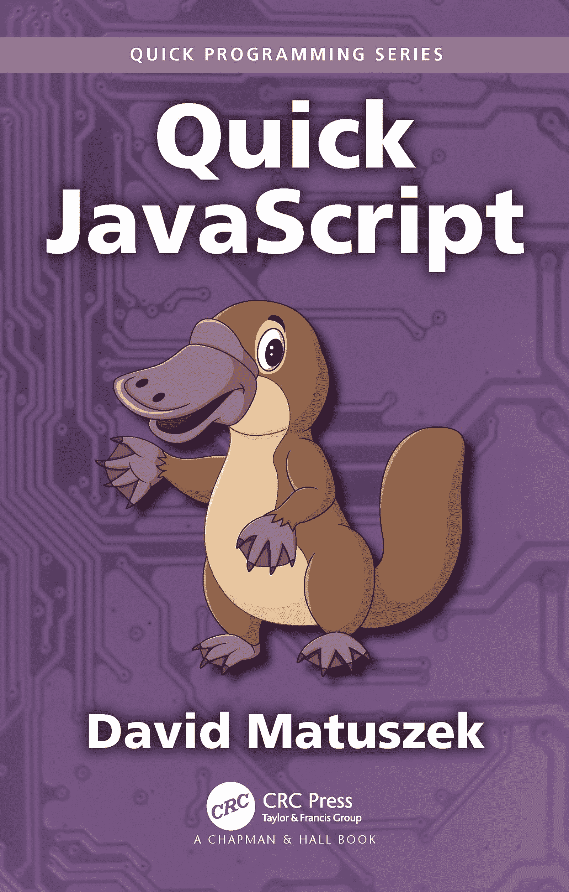
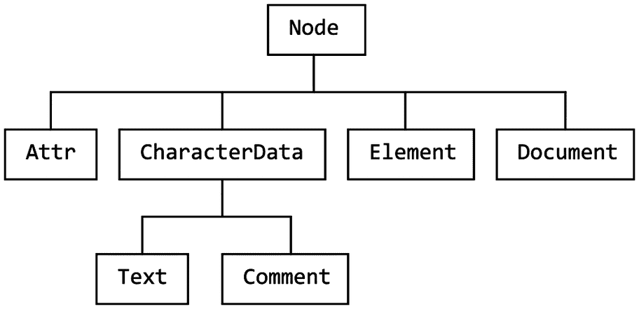

# JavaScript 快速编程





*美国国会图书馆编目出版数据*


LC 记录可用于 [`lccn.loc.gov/2022046807`](https://lccn.loc.gov/2022046807)


采用 Minion 字体

由 SPi Technologies India Pvt Ltd (Straive) 设计

*献给我所有的学生*

*过去、现在和未来*

# 作者

我是 David Matuszek，大多数学生称我为“Dave 博士”。

1963 年，我在打卡片上写了我的第一个程序，并立刻就迷上了它。

1970 年，我作为德克萨斯大学奥斯汀分校计算机科学的研究生教了我的第一门计算机课。我最终在那里获得了博士学位，从那以后一直从事教学。诚然，我在工业界待了十多年，即使在那时，我也担任诺瓦瓦大学的兼职教师。

我最终离开了工业界，全职加入诺瓦瓦大学教职员工队伍了几年，然后搬到了宾夕法尼亚大学，在那里，我为从其他学科进入计算机科学的学生指导了一个硕士项目（`MCIT`，计算机与信息技术硕士）。

在我的职业生涯中，我的主要兴趣是人工智能（AI）和编程语言。我用过*很多*编程语言。

我在 2017 年退休了，但我无法停止教学，所以我正在写一系列关于编程和编程语言的“快速入门”书籍。我还写了两本科幻小说，《冰马手》（Ice Jockey）和《全真价值》（All True Value），我预计还会写更多。去看看它们吧！

如果你觉得这本书有用，如果你能发表评论将将太棒了。评论，即使是批评性的，也有书籍销售。

而且，嘿，如果你是以前的学生或同事，请给 david.matuszek@gmail.com 给我封邮件。我很期待收到你的消息！

# 前言

如果你是一个想要尽快开始学习 JavaScript 编程的程序员，这本书是为你准备的。

如果你希望将 JavaScript 作为你的第一门编程语言，这本书是为你准备的。

# JavaScript 版本

JavaScript 是一个不断演变的语言。它由一系列名为 `ECMAScript` 的标准定义。

# 第一章 引言

DOI: [10.1201/9781003359609](https://dx.doi.org/10.1201/9781003359609)

## 1.1 Hello, World!

传统上，一种新语言的第一个程序是输出“Hello, World!”我们将遵循这一传统。

需要的 JavaScript 代码是：

```
alert("Hello, World!");
```

执行这段代码，我们有几种选择：

*   将其放入网页中并在浏览器中运行。
*   在 `IDE`（集成开发环境）中运行。
*   在编辑器应用程序中运行。
*   在在线 JavaScript 编辑中运行。

## 1.2 浏览器中的 JavaScript

如果你将以下文本保存在文件中并在浏览器中打开，将弹出一个包含 `Hello, World!` 文本的警告框。

```html
<!DOCTYPE html>
   <html>
    <head>
     <title>使用 JavaScript</title>
    </head>
    <body>
     <script>
      alert("Hello, World!");
     </script>
    </body>
   </html>
```

*   `<!DOCTYPE html>` 标签表示这是一个 HTML 文档。
*   整个页面封装在 `<html>` 到 `</html>` 的容器中。以 `</` 开头的标签表示容器的结束。在这个例子中，只有 `!DOCTYPE` 标签不是容器。
*   `<title>` 标签包含显示在页面标题栏的文本。
*   HTML 文档分为两个部分：`<head>` 包含杂项信息，<body>` 包含显示的部分。
*   `<script>` 标签包含 JavaScript 代码。通常，JavaScript 函数定义在 `<head>` 中的 `<script>` 标签中，并在 `<body>` 中的 `<script>` 标签或“事件处理程序”中进行调用。

## 1.3 浏览器控制台


要运行 JavaScript，你可以使用任何文本编辑器将其包含在 HTML 页面的 `<script>` 标签中，并将页面加载到任何浏览器中。

这不是编写程序的最佳方式。浏览器的设计初衷是`忽略`错误；毕竟，用户不想看到它们。而你，却想要看到并修正它们。为了这一点，你需要打开浏览器的 `console`（控制台）。控制台会显示错误信息（以及其他内容）。

打开控制台：

*   在大多数浏览器中：按下 `F12`。
*   在 Safari (Macintosh) 中：前往`偏好设置：高级`，并勾选`在菜单栏中显示开发菜单`。完成后，使用 `cmd-opt-C` 显示控制台。

浏览器控制台具有许多辅助编程和调试的功能。这些功能各不相同且需要一些时间学习；本书将不会涵盖这些内容。

## 1.4 运行 JavaScript

有几个 IDE（集成开发环境）可以用于 JavaScript。[Visual Studio Code](https://code.visualstudio.com) 可能是最流行的；它是跨平台的且免费的。（不要将其与 Visual Studio 混淆，后者既不是跨平台的也不是免费的。）[NetBeans](https://netbeans.apache.org) 和 [Eclipse](https://eclipseide.org)（带有合适的插件）是其他流行的 IDE。

某些编辑器可以配置为命令行运行 JavaScript。这是一种运行单文件 JavaScript 程序的方便方法。[Sublime Text](https://www.sublimetext.com)（跨平台）和 [Notepad++](https://notepad-plus-plus.org)（Windows 和 Linux）就是示例。

另一种选择是使用在线 JavaScript 编辑器。搜索“JavaScript online”可以找到几个工具；[jsfiddle.net](http://jsfiddle.net) 是我经常使用的一个。它们在功能上有所不同，但大多数都会显示输出和控制台。由于它们在浏览器中运行，在那里编写的 JavaScript 代码执行文件 I/O 的有限。

最后，所有主流浏览器都有“开发者模式”，可以直接在浏览器中编写和测试代码。

## 1.5 获取输入

有两个函数会请求用户输入：

*   `result = prompt(`prompt`, `default`)`
    *   这会在模态对话框中显示 `prompt`，并为用户提供一个输入文本的地方。第二个参数是可选的；如果提供了，它将显示在字段字段。
    *   对话框有两个按钮：`OK`，返回用户的输入内容作为字符串；以及 `Cancel`，返回 `null`。
*   `result = confirm(`question`)`
    *   这会在模态对话框中显示 `question`，并有两个按钮：`OK` 返回 `true`，`Cancel` 返回 `false`。

## 1.6 生成输出

有几个函数可以显示你代码的结果。在浏览器中使用时，请记住将你的函数调用放在 `<script>`…`</script>` 标签内。

*   `alert(`arg`)`
    *   这是查看结果最简单的方法。调用带有任意类型单个参数的 `alert` 将弹出一个包含给定值的对话框。这种方法有两个缺点：对话框是模态的，这意味着在继续计算之前必须先关掉它；而且你一次只能看到一条消息。
*   `console.log(`args`)`
    *   如果你打开了控制台，此方法将在其上显示某些内容，但具体显示什么高度取决于实现。它可能会显示由空格或换行符分隔的 `args`，也可能只显示第一个参数。尝试一下，看看在你偏好的任何控制台中它的效果如何。
    *   由于 `console.log` 主要用于调试，大多数实现会显示 `args` 的实际结构，而不使用 `toString` 方法。
    *   `console` 还有许多其他方法，如 `clear()` 和 `trace()`。实现方式各异。
*   `document.write(`args`)`
    *   这将其参数写入 HTML 的 body 中。如果在页面加载时执行，它将把参数直接写入该位置。但如果在 body 加载后调用 `write`（例如从从函数中调用），该调用将替换整个 HTML body；这可能不是你想要的结果。
*   `document.writeln(`args`)`
    *   它的作用与 `write` 相同，不同在于该方法在最后一个参数之后写入换行符。由于 HTML 会忽略换行符，这几乎没有用处。要获得不被忽略的换行，请编写字符串 `"<br>"`。

`alert` 和 `write` 方法的优点是它们不需要你打开控制台即可查看结果。

# 第 2 章 JavaScript 基础知识

DOI: [10.1201/9781003359609-2](https://dx.doi.org/10.1201/9781003359609-2)

本章和第 3 章 将 JavaScript 简单描述为语言，不涉及 Web 编程。它分为两个大部分：

**基础知识**——这一部分旨在让你尽快开始 JavaScript 编程。最好的方法就是尝试。

**详细介绍**——这部分涵盖相同的内容，并填补空白。

## 2.1 注释

`//` 引入一个延伸到行行的注释。

多行注释以 `/*` 开始，以 `*/` 结束。在引用的字符串或正则表达式内部，`//` 和 `/*` 没有意义。

## 2.2 数据类型

### 2.2.1 原始类型

有八种数据类型：

*   `number` 可以带有或不带有小数点，但所有数字都存储为双精度浮点数。
*   `bigint` 是具有任意位数的整数。
*   两个 `boolean` 值是 `true` 和 `false`。
*   `string` 可以包含在单引号、双引号或反引号（``）中。没有“字符”类型。
*   `symbol` 是一个保证唯一的数值；没有其他值等于它。symbol 是通过调用 `Symbol()` 或 `Symbol(`name`)` 创建的，其中 `name` 是一个（不一定唯一）值，可能对调试有帮助。
*   `undefined` 类型有一个值，`undefined`。它是已声明但未赋赋值的变量的值。
*   `null` 类型有一个值，`null`，意味着该值不存在。
*   `object` 是任何更复杂的数据类型。函数、数组、集合、映射、正则表达式、错误和日期都是特殊类型的对象。

值的类型可以通过 `typeof` 确定，它可以既用作运算符 `typeof x`，也可以用作函数 `typeof(x)`。它将以字符串的形式返回上述任一类型名称（例如，`"number"`）。

上述内容有两个特外情况：

*   `typeof(null)` 的值为 `"object"`。这在通常被认为是语言设计中的一个错误。
*   对于函数以外的任何对象类型，`typeof` 将返回 `"object"`。应用于函数时，`typeof` 将返回 `"function"`。

### 2.2.2 用户定义对象

`object` 是一组命名值的集合，称为其 `properties`（属性）。你可以通过在大括号内放置 `property`:`value 对来定义对象，稍后通过 `object.property` 语法引用这些值。例如，

```javascript
let friend = { givenName: "Anna",
              surname: "Lang" };
alert("Hello, " + friend.givenName);
```

如果属性名称存储在变量中或可以计算，可以通过 `object[expression]` 语法进行访问，例如 `friend["given" + "Name"]`。


测试 `property` `in` `object`（其中 `property` 为字符串），当且仅当 `object` 具有该 `property` 时将返回 `true`。对不存在的属性进行请求将得到值 `undefined`。

### 2.2.3 内置对象类型

JavaScript 提供了许多内置或预定义的对象类型。这些数组（arrays）、集合（sets）、映射（maps）、日期（dates）和正则表达式（regular expressions）。

### 2.2.4 数组

`array` 是值的有序集合。可以通过在方括号中包含逗号分隔的值来定义 `array literal`（数组字面量）：

```
let ary = ["cat", "dog", "mouse"];
```

逗号可以放在值*之间*也可以放在值*之后*，因此上述赋值完全等于：

```
let ary = ["cat", "dog", "mouse", ];
```

最后一个逗号有时被称为 `trailing comma`（尾随逗号）。

数组索引从 0 开始；上述数组的第一个元素是 `ary[0]`，最后一个是 `ary[ary.length – 1]`。

可以通过简单地嵌套数组字面量来创建高维数组：

```
let ary2d = [[11, 12], [21, 22]];
```

在上述赋值后，`ary2d[1]` 是 `[21, 22]`，`ary2d[1][0]` 是 `21`。

较少使用的形式是 `Array(values)`：

```
let ary = new Array("cat", "dog", "mouse");
```

这种形式通常不推荐。它的一个奇特性是，如果参数是单一数值 `Array(n)`，结果是一个包含 `n` 个位置的 `sparse array`（稀疏数组），而不是一个包含单个值 `n` 的数组。

在稀疏数组中，在为元素赋值之前，不会为数组元素分配存储；未赋值的位置将显示为 `undefined`。稀疏数组可以是任意大的（只有其中的实际值会贡献其大小），但处理起来速度较慢。

数组的 `length` 属性总是最大索引加一。由于数组可能是稀疏的，`length` 并不是数组中值的个数。

数组可以从 `iterable types`（可以迭代的类型）中创建。

*   `Array.from(set)` — 返回一个包含 `set` 元素的数组。
*   `Array.from(string)` — 返回一个来自 `string` 的字符数组，每个字符都是字符串。
*   `Array.from(map)` — 返回一个包含 `[key, value]` 数组的数组。
*   `Array.from(array)` — 返回 `array` 的（浅）拷贝。

数组可以包含不同类型值的混合。

### 2.2.5 集合

`set` 是值的集合，其中：(1) 没有值出现超过一次，(2) 值在集合中出现的顺序无关。

操作操作有：

*   `new Set(iter)` — 创建并返回一个包含可迭代对象 `iter`（通常是数组）中值的集合。要创建一个空集合，省略 `iter`。
    *   如果 `iter` 是一个 map，结果是一个包含 `[key, value]` 数组的集合。
*   `set.has(value)` — 测试 `value` 是否是 `set` 的成员。
*   `set.add(value)` — 如果 `value` 尚不存在，则将其添加到 `set` 并返回 `set`。
*   `set.delete(value)` — 如果 `value` 在 `set` 中，则将其删除。`delete` 不返回 `set`；如果 `value` 在 `set` 中则返回 `true`，否则返回 `false`。
*   `set.clear()` — 移除 `set` 中的所有值并返回 `undefined`。
*   `set.size` — 返回 `set` 中的元素数量。

### 2.2.6 映射

Maps 是查找表。map 中的每个条目由一个键值对组成。键必须是唯一的，但相同的值可以多次。

操作有：

*   `new Map()` — 创建并返回一个空的 map。
*   `new Map(array_or_set)` — `array_or_set` 必须由 `[key, value]` 数组组成；这返回一个包含这些键和值的 map。
*   `map.has(key)` — 测试 `map` 是否包含给定的 `key`。
*   `map.set(key, value)` — 设置或更改与 `key` 关联的值为 `value` 并返回修改后的 `map`。
*   `map.get(key)` — 返回与 `key` 关联的值，如果 `key` 不在 map 中则返回 `undefined`。
*   `map.delete(key)` — 从 map 中移除 `key` 及其关联的 `value`。如果 `map` 发生了变化则返回 `true`，如果在 map 中未找到 `key` 则返回 `false`。
*   `map.clear()` — 移除所有值并返回 `undefined`。

### 2.2.7 日期

`Date` 对象表示时间中的某一个时刻，测量为自 Unix 元（1970 年 1 月 1 日 00:00:00 UTC）以毫秒数。

要访问 `Date` 对象的特定组件，使用以下方法：

*   `date.getFullYear()` 和 `date.setFullYear(year)` — `setFullYear` 也可以接收 `month` 和 `day`。
*   `date.getMonth()` 和 `date.setMonth(month)` — `month` 为 0（1 月）到 11（12 月）。
*   `date.getDate()` 和 `date.setDate(day)` — `day` 为 1 到 31。
*   `date.getHours()` 和 `date.setHours(hours)` — `hours` 为 0 到 23。
*   `date.getMinutes()` 和 `date.setMinutes(minutes)` — `minutes` 为 0 到 59。
*   `date.getSeconds()` 和 `date.setSeconds(seconds)` — `seconds` 为 0 到 59。
*   `date.getMilliseconds()` 和 `date.setMilliseconds(ms)` — `ms` 为 0 到 999。
*   `date.getTime()` 和 `date.setTime(n)` — `n` 是自元以来的毫秒数。
    *   `Date.now()` 也返回自元以来的毫秒数，但比 `new Date().getTime()` 短。
*   `date.getDay()` 返回 0 到 6，其中 0 代表星期日（无论你在哪里，尽管 ISO 8601 指定周一为一周的第一天）。

内部，`Dates` 被存储为自元以来的毫秒数。这使得日期运算变得非常简单，因为各种 `set` 方法的参数不受限于 `get` 方法返回的范围。例如：

```
 let date = new Date();
 let day_of_month = date.getDate();
 date.setDate(day_of_month + 100);
```

会将 `date` 设置为未来精确 100 天的 `Date`，具有正确的月份和年份。

### 2.2.8 正则表达式

正则表达式 `regexp` 定义了一个应用于字符串的模式，用于确定该模式是否匹配字符串，或者在字符串中搜索匹配模式的子字符串。


正则表达式在很大程度上是标准的，因此除了极少数特殊的模式外，所有的模式都可以在 JavaScript 中使用。在本节中，我们假设你已经具备正则表达式的知识，仅描述如何在 JavaScript 中使用它们。对于不熟悉正则表达式的读者，附录 D 中简短的讨论。

正则表达式写在正斜杠之间，后面可以跟上标志位（flags）。例如，`/[a-z]+/gi` 是正则表达式 `[a-z]+`，并带有全局 (`g`) 和不区分大小写 (`i`) 标志位。（`[a-z]+` 将匹配任何小写字母序列。）

括号用于对正则表达式的部分进行分组。组从左到右编号，从 `1` 开始；找到组编号的简单方法是只计算左（开启）括号的数量。组 `0` 是整个匹配部分。例如，在模式中：

```javascript
 a = "Call 1-800-555-1212 today!"
 b = /1-800-((\d\d\d)-(\d\d\d\d))/
 // 0 12 3
 c = a.match(b)
```

结果将是：

```
 c[0] = "1-800-555-1212"
 c[1] = "555-1212"
 c[2] = "555"
 c[3] = "1212"
```

可以使用以下方法应用正则表达式：

*   `string`.search(`regexp`)` — 返回 `string` 中匹配 `regexp` 的第一个子字符串的起始索引，如果没有找到，则返回 `null`。如果存在全局修饰符 `g`，它会被忽略。
*   `string`.replace(`regexp`,` replacement`) — 在 `string` 中搜索 `regexp`，如果找到，则将其替换为 `replacement`。如果存在全局修饰符 `g`，该方法将所有的 `regexp` 出现替换为 `replacement`。
    *   如果 `regexp` 包含分组，则 `replacement` 可以使用 `$1` 表示第一个匹配组，使用 `$2` 表示第二个匹配组，依此类推。
*   `string`.match(`regexp`)` — 在 `string` 中搜索 `regexp` 并返回一个数组。
    *   如果设置了 `g` 标志，`match` 返回匹配的子字符串数组，如果没有找到匹配，则返回 `null`。
    *   如果没有设置 `g` 标志，`match` 返回一个数组，其第一个元素是（第一个）匹配的子字符串，其余元素（如果有）是 `regex` 中每个括号分组匹配的子字符串。参见本节开头的示例。
*   `string`.matchAll(`pattern`)` — 在 `g` 标志下，`matchAll` 为 `string` 中匹配 `pattern` 的每个子字符串返回一个迭代器。这非常便于配合 `for/of` 循环使用。
*   `string`.split(`regexp`)` — 返回 `string` 的子字符串数组，其中 `regexp` 的每次出现都会分隔 `string` 中的子字符串。

以下是 `regexp` 的方法而非 `string` 的方法：

*   `regexp`.exec(`string`)` — 在 `string` 中搜索 `regexp` 并记住它在 `string` 中的位置。
    *   该方法设计用于在循环中使用。如果设置了 `g` 标志，每次调用 `exec` 都将返回下一个匹配的子字符串，在没有剩余项时返回 `null`。在返回 `null` 后，`regex` 将重置并可以再次使用。
    *   如果没有设置 `g` 标志，`exec` 的行为类似于未设置 `g` 标志的 `match`。
*   `regexp`.test(`string`)` — 如果 `regexp` 在 `string` 某处匹配，则返回 `true`，否则返回 `null`（注：此处原文为 null，通常 JS 中返回 false）。

## 2.3 标识

标识由字母、数字、下划线和美元符号组成。标识不能以数字开头。

## 2.4 var

在比较不同类型时，JavaScript 尝试将它们转换为数字。尽管 `undefined` 转换为 `NaN` 且 `null` 转换为 `0`，但 `undefined==null` 仍然是 `true`。

## 2.5 let 和 const

现代声明变量的方式是 `let`。旧式使用 `var` 应该被避免。

*   如果 `var` 声明了但没有赋值，它具有特殊值 `undefined`。
*   如果 `var` 声明了多次，不会抛出错误：

```javascript
 var x = 1;
 var x = 2; // x 现在是 2
```

*   如果 `var` 声明在函数内部，它是局部的：

```javascript
 function foo() {
  var x = 1;
}
```

*   如果 `var` 声明在函数外部，它是全局的：

```javascript
 var x = 1;
```

## 2.6 运算符

这里是数字最常用的运算符：

*   `+` 加法
*   `-` 减法或一元负
*   `*` 乘法
*   `/` 除法，产生浮点结果
*   `%` 余数（模）
*   `**` 幂

布尔值常用的运算符：

*   `&&` 与
*   `||` 逻辑
*   `!` 非

比较运算符，产生布尔值结果：

*   `<` 小于
*   `<=` 小于或等于
*   `==` 等于
*   `===` 严格相等（相等且类型相同）
*   `!=` 不等于
*   `!==` 严格不相等（不同类型或值）
*   `>=` 大于或等于
*   `>` 大于

> **注意**：比较不同类型的值时，JavaScript 会尝试将它们转换为数字。如果其中一个或两个值可能是 `null` 或 `undefined`，请不要比较它们；请先使用 `===` 进行检查，这是总是安全的。

> 

> **注意**：与几乎所有语言一样，比较两个浮点数的相等性是不明智的。例如，`11*(100/11)` 不等于 `100`，因为它们在第 14 位小数处不同。一种潜在的解决方法是使用方法 `.toFixed(`n``)，它将返回一个带有 `n` 位小数的字符串，然后进行字符串比较。

字符串拼接：

*   `+` 拼接（连接）两个字符串，或一个字符串与任何其他值。


算术比较运算符也可以用于字符串，从而提供字典顺序排序。所有大写字母都在所有小写字母之前，因此 `"Cat" < "cat"`。

### 赋值：

- `=`: ***赋值运算符***——可以用作表达式；该表达式的值就是被赋值的值。

JavaScript 还有 `+` 和 `-` 一元运算符。当 `+` 运算符应用于非数值值（如字符串）时，它会尝试将该值转换为数字，如果无法转换，则返回 `NaN`（即“不是数字”）。

- `?:`: ***三元运算符***：在表达式 `test` `?` `valueIfTrue`:`valueIfFalse` 中，`test` 决定了使用随后的两个值中的哪一个。

如果你熟悉 Java，那么大多数 Java 运算符也可以在 JavaScript 中使用，包括所有的位操作符。位操作符会将操作数转换为整数，在整数上执行操作，并将结果转换回（浮点）数。

优先级顺序与大多数语言相同：首先执行一元加和减，然后是幂运算，紧接着是乘法和除法，然后是加法和减法，最后是赋值。

## 2.7 等价与标识

`==` 和 `!=` 比较运算符尝试将操作数转换为相同类型。结果可能会令人惊讶。例如，使用 `==` 时，`123`、 `"123"`、`[123]` 甚至 `["123"]` 都被认为是相等。

“严格”测试 `===` 和 `!==` 在值的类型不同时将认为它们不相等。除非你需要自动转换，否则应优先使用这些运算符。

对于对象（数组、集合等），“等价”运算符实际上是对***标识***identity）的测试。也就是说，一个对象只与它本身相等，而不等于任何其他对象。比较 `[1] == [1]` 为 `false`，因为创建了两个数组，然后对其进行比较。

对象的赋值*不会*创建新对象。在执行序列 `a = [1]; b = a;` 之后，测试 `a == b` 将返回 `true`。因为 `a` 和 `b` 现在指向同一个对象的引用。通过 `a` 或 `b` 对对象进行的更改对另一个变量是可见的。

JavaScript 没有内置的对象等价性测试；要实现这一点，需要将对象拆解为原始组件。这需要大量的代码。`underscorejs.com` 和 `lodash.com` 网站都提供了此类及其他用途的经过测试的大型库。

## 2.8 转换

JavaScript 自动执行大部分***转换***（也称为***强制类型转换***）。以下是一些可能需要注意的转换。

在原始值上执行的任何算术操作都会导致它们转换为数字。数字字符串将以显而的方式转换。布尔 `true` 将转换为 `1`，`null` 和 `false` 将转换为 `0`，`undefined` 将转换为 `NaN`。

> **异常**：*二元* `+` 运算符既是加法也是字符串拼接，但拼接的优先级更高；`2 + "2"` 是 `"22"`。*一元*运算符 `+` 将尝试将其操作数转换为数字，因此 `2 + +"2"` 是 `4`。

在布尔上下文中（如 `if` 语句的条件）中的任何值，如果是 `0`、`undefined`、`null`、`NaN` 或空字符串，都将被视为 `false`。所有其他值（包括 `"0"`）都被视为 `true`。

当数组被转换为字符串时，结果是一个由逗号分隔的值的字符串；括号会被省略。因此，多维数组很容易被误认为是一维数组。

## 2.9 语句

JavaScript 中的许多语句与 Java 中的语句几乎相同。为了方便 Java 程序员理解，这些语句与 JavaScript 特有的语句分开了描述的。

### 2.9.1 分号

每个 JavaScript 语句都应该以分号结束。如果你习惯于用 Java 或 C 语言中的某一种进行编程，请继续按照你习惯的方式使用分号。

虽然每个语句*应该*用分号终止，但 JavaScript 使用了一项名为 ***ASI***（***自动分号插入***）的工具，它会在某种程度上在适当的行末尾自动添加分号。如果你漏掉了几个分号可能没关系，但依赖 ASI 来为你做这一点是不明智的。

当一组语句被包含在大括号 `{} ` 中时，这形成了一个***复合语句***（或***块***block）。在右括号后不需要分号。

如果一个语句需要跨越两行，请在第一行无法被理解为完整语句的地方将其分开。断开语句的好位置是在运算符之后或括号表达式内部。

如果某行以左圆括号、左括号或算术运算符开头，它将被视为上一行的延续。如果这不是你的意图，请在上一行的末尾加上分号。

在同一行上分隔两个或多个语句时，需要分号。

### 2.9.2 声明

JavaScript 中的变量可以持有任何类型的值，因此它们的类型不是其声明的一部分。

- `let x;`
- `var y = 5; // 旧样式 - 避免使用`
- `let z = 26;`
- `let a = 5, b = 10, c;`

重复声明变量是一个错误。

### 2.9.3 函数定义

***函数***（function）是一个可以被***调用***（invoked）的代码块。声明函数最常用的方法是使用这种语法：

```
function name(args) {

    statements

}
```

示例定义：

```
function average(x, y) {
    let sum = x + y; // x, y 和 sum 是局部的
    return sum / 2;
}
```

示例调用：

```
let avg = average(5, 10); // 7.5
```

在函数体内部声明的任何变量都是函数的局部变量。参数也是函数的局部变量。

函数可以访问全局变量。函数定义会被***提升***（hoisted）。这仅意味着所有函数定义在执行任何其他代码之前被处理，因此它们不需要在词法顺序上必须在调用之前出现。

### 2.9.4 熟悉语句

JavaScript 中的许多语句与 Java 和 C++ 中的语句相同。如果你熟悉其中某一种语言，可以随意跳过到*JavaScript 特有的语句*。 

> **注意 1**：虽然传统的 `for` 语句是相同的，但其***初始化***部分自然会使用 `let` 而不是控制变量的类型。

> **注意 2**：`switch` 语句允许每个 `case` 指定一个表达式，而不仅仅是常量值。

以下是相同的语句列表：

```
 • variable = expression;
    • expression;
    • { statements }
    • if (condition) {
        statements
      }
    • if (condition) {
        statements
      } else {
        statements
      }
    • while (condition) {
        statements
      }
    • for (initialization; condition; update) {
        statements
      }
    • do {
        statements
      } while (condition)
    • switch (expression) {
         case expression:
             statements;
              break;
          case expression:
	      statements;
	      break;
            …
            default:
                statements;
       }
    • label: statement;
    • break;
    • break label;
    • continue;
    • continue label;
    • return value;
    • return;
    •; // 空语句
```

#### 2.9.4.1 赋值语句

***赋值语句***给变量赋一个值。例如，

`x = 5;` 给 `x` 赋值 `5`。


变量的值可以被改变。例如，赋值语句

```
x = "abc";
```

将给 `x` 赋予新值 `"abc"`。

对于每个算术操作符 `op`，表达式

```
variable op= expression;
```

是以下语句的简写：

```
variable = variable op expression;
```

例如，`x += 1;` 是向 `x` 加上 `1`。

### 2.9.4.2 表达式

任何表达式都可以作为语句；表达式的值（如果有的话）会被丢弃。

允许表达式作为语句使用，因为它们可以产生副作用。例如，如果 `a` 是一个数组，`a.sort()` 会对该数组进行排序。

返回结果但没有副作用的表达式可以作为语句使用，但它们不会产生任何作用。例如，使用 `2+2` 作为语句是合法的，但没用。

这可能会导致错误。如果 `str` 是字符串 `"Hello"`，表达式 `str.toUpperCase()` 返回字符串 `"HELLO"`，这个值可以赋值给变量，但将 `str.toUpperCase()` 作为语句则不起任何作用。

### 2.9.4.3 复合语句

`复合语句`（或`块`）是若干个（可能为零）声明和语句，它们被括在在大括号 `{}` 之中。复合语句本身被视为一个语句。

控制语句（如 `if` 语句和循环）控制单个语句的执行。如果你想控制不仅仅是一个语句，你必须将这些语句封装在大括号中，以使其变成一个（单一的）复合语句。

函数或方法的体体始终是一个复合语句。（异常：“箭头”函数，稍后将讨论。）

良好的风格要求块内的语句相对于块的开始位置进行缩进。JavaScript 的通常缩进是两个空格。

### 2.9.4.4 If 语句

`if 语句`测试一个条件。如果条件为真，则执行后续的语句（通常是复合语句）。如果条件不为真，则 `if` 语句什么都不做。其语法如下：

```
if (condition) {
  statements
}
```

例如，下面的 `if` 语句在 `x` 变为负数时将其重置为零。

```javascript
if (x < 0) {
    x = 0;
}
```

`if` 语句也可以有一个 `else` 分句。如果条件为真，则执行条件之后的语句。如果条件不为真，则执行 `else` 单词之后的语句。这两条语句通常都是复合语句。其语法如下：

```
if (condition) { 
   some statements
}
else {
   some other statements
}
```

例如：

```javascript
if (x % 2 == 0) {
    x = x / 2;
}
else {
    x = 3 * x + 1;
}
```

如果任何部分都只包含一个（非复合）语句，可以省略大括号。在这种情况下，良好的风格是将单个语句与 `if` 或 `else` 放在同一行。

```javascript
if (x % 2 == 0) x = x / 2;
else x = 3 * x + 1;
```

### 2.9.4.5 While 循环

`while 循环`是一种在顶部进行测试的循环。其语法如下：

```
while (condition) {
   statements
}
```

首先，测试 `condition`；如果它为假，则不再进行其他操作，循环在从未执行 `statements` 的情况下退出。如果 `condition` 为真，则执行 `statements`，然后整个循环（从测试开始）再次执行。

例如，一个数字 `x` 的近似常用对数（即以 10 为底的对数）可以这样计算：

```javascript
let log = 0;
while (x > 1) {
    log = log + 1;
    x = x / 10;
}
```

### 2.9.4.6 Do-While 循环

`do-while 循环`是一种在底部进行测试，而不是顶部的循环。其语法如下：

```
do {
  statements
} while (condition);
```

首先执行 `statements`，然后测试 `condition`；如果条件为真，则循环再次执行。这种循环通常在循环体至少执行一次时使用。

例如，假设你想选择一个 `0` 到 `1` 之间的随机数：

```javascript
do {
  x = Math.random();
} while (x <= 0.5);
```

### 2.9.4.7 For 循环

`for 循环`是一种在顶部进行测试的循环。其语法如下：

```
for (initialization; condition; update) {
   statements
}
```

`initialization`首先执行且仅执行一次。之后，测试 `condition`，如果为真，则执行 `statements` 并执行 `update`；然后返回 `condition`。换句话说，`for` 循环的行为类似于下面的 `while` 循环：

```
initialization;
while (condition) {
    statements;
    update;
}
```

`initialization` 可以具有以下形式之一：

*   对变量赋值，例如 `i = 0` 或 `let i = 0`。
*   对多个变量赋值，用逗号分隔，例如 `let i = 0, j = 0`（这种形式很少使用）。

如果使用了 `let`，它必须位于初始化中第一个变量之前。

`update` 是以下之一：

*   一个表达式，通常是赋值语句，如 `i += 1`。（赋值语句是一种表达式。）
*   表达式的逗号列表，如 `i += 1, j += 2`。

大括号表示 `statements` 块。如果只有一个语句，可以省略大括号；然而，良好的风格是始终包含大括号。

作为一个示例，声明一个数组并输出其内容：

```javascript
let ary = [3, 1, 4, 1, 6];
for (let i = 0; i < ary.length; i += 1) {
    console.log(ary[i]);
}
```

### 2.9.4.8 循环中的作用域

考虑：

```
for (let variable = value; condition; update) { statements }
```

`variable` 的作用域是整个 `for` 语句；它在语句外部不可访问。如果省略了关键字 `let`，`variable` 必须预声明；如果将 `let` 替换为 `var`，则 `variable` 是全局的。


当循环体是单条语句时，建议使用大括号但并非强制。在这种情况下，将整个循环写在一行内是一种良好的风格。

```
for (let variable = value; condition; update) statement;
```

`variable` 的“块级作用域”是整个 `for` 语句，就像存在大括号一样。

### 2.9.4.9 Switch 语句 (Switch Statements)

就像 `if` 语句根据布尔值在两个代码块之间提供选择一样，`switch 语句` 根据任何类型的值在多个代码块之间提供选择。

其语法相当复杂：

```javascript
 switch (expression) {
  case expression:
    statements;
    break;
  case expression:
    statements;
    break;
  …
  case expression:
    statements;
    break;
  default:
    statements;
    break;
}
```

操作如下：求值 `switch` `expression`，然后顺序与每个 `case` `expression` 进行比较。当找到与 `switch` `expression` 严格相等的 `case` `expression` 时，从随后的语句开始执行，直到遇到 `break` 或 `return`，或者直到整个 `switch` 语句结束。

> **注意：** `===` 运算符用于相等性测试。只有当两个值的类型相同且值相同时，才会返回 true 结果。

每个 case 的末尾不需要 `break` 语句；如果省略了它，控制流将进入下一组语句执行。这通常不是你希望发生的情况。在极少数这种这是预期行为的情况下，最好包含一个注释，说明这种省略是有故意的，否则你或其他人可能会在日后“纠正”这个显而易见的问题。

一个 `case` `expression:` 后面可以紧跟另一个 `case` `expression:`，中间没有间隔的语句（或 `break`）。如果其中一个 `expression` 匹配 `switch` `expression`，将执行随后的 `statements`。

`default` 情况是可选的，并且通常应该放在最后。如果没有找到匹配的 `expression`，则执行 `default` 情况中的 `statements`。如果没有找到匹配的 `expression` 且没有 `default` 情况，则 `switch` 语句将在不执行任何操作的情况下退出。

良好的风格是始终包含一个 `default` 情况，即使你认为已经涵盖了所有可能性。

`statements` 可以是任意零或多条语句的序列。没有必要使用大括号将语句（包括随后的 `break` 语句）分组为一个复合语句，尽管有时会这样做。

这是一个人为构造的示例：

```javascript
 let v = 123.0;
   let kind;
   switch (v) {
    case 120 + 3:
     kind = "number";
     break;
    case "123":
     kind = "string";
     break;
    default:
     kind = "other";
   }
   console.log(v, "is a", kind);
```

这将导致输出 `123 is a number`，因为严格相等测试不区分整数和浮点数；它们的类型都是 `number`。

### 2.9.4.10 标签语句 (Labeled Statements)

`标签语句` 的语法是：

```javascript
identifier: statement;
```

任何语句都可以用标识符标记标签，但只有对循环语句和 `switch` 语句标记标签才有意义。标签与 `break` 和 `continue` 语句配合使用。

### 2.9.4.11 Break 语句 (Break Statements)

`break 语句` 由关键字 `break` 组成，后面可选跟一个语句标签。

`break` 语句只能在循环或 `switch` 语句内部使用。

执行 `break` 会导致闭包的循环或 `switch` 语句退出。如果 `break` 语句位于嵌套循环和或 `switch` 语句内部且没有标签，则只退出直接闭包的循环或 `switch` 语句。

执行带有标签的 `break` 语句会导致带有该标签的闭包循环或 `switch` 语句退出，无论嵌套深度如何。

给定一个数字数组，考虑找到两个数字，其中一个恰好是另一个十倍。以下代码解决了这个问题。

```javascript
 let ary = [7, 30, 9, 20, 3, 5];
   let i, j;
   id: for (i = 0; i < ary.length; i += 1) {
     for (j = 0; j < ary.length; j += 1) {
      if (ary[i] == 10 * ary[j] && ary[i] != 0) {
       break id;
      }
     }
    }
   console.log(ary[i] + ", " + ary[j]);
```

一些程序员不喜欢 `break` 语句，事实上，通常有更好的方法在使用它的情况下解决问题。

### 2.9.4.12 Continue 语句 (Continue Statements)

`continue 语句` 由关键字 `continue` 组成，后面可选跟一个语句标签。

`continue` 语句只能在循环内部使用。这与 `break` 语句不同，`break` 语句也可以在 `switch` 语句内部使用。

执行 `continue` 会导致闭包循环返回测试，或者在传统的 `for` 循环中，返回到……（注：原文此处存在大量重复的错误文本，已根据核心逻辑进行翻译）。


*   对于数组，`element` 是索引以及可能分配给数组的任何属性；可以通过 `object`[`element`] 访问值。
    *   `for/in` 循环将数组视为任何其他对象处理。它比 `for/of` 循环慢得多。
*   对于字符串，`element` 是索引；可以通过 `object`[`element`] 访问单个字符。

对象可能具有不可枚举的、“隐藏”属性，而稀疏数组可能具有“缺失”的元素。`for/in` 循环会跳过这些。

### 2.9.5.3 throw（抛出语句）

程序员可以使用 `throw statement` 故意导致异常。并没有特定的“异常（Exception）”类型——任何类型的值都可以被“抛出”。

> **注意**：JavaScript 不区分“错误（errors）”和“异常（exceptions）”。

`throw` 语句将异常“抛出”到其他地方，以免用用于处理（希望是罕见的）异常情况的代码来干扰程序的正常执行。`try/catch` 语句的目的（在第 2.9.5.4 节中描述）是捕获抛出的异常。

`throw` 语句的语法为：

```
throw expression;
```

其中 `expression` 可以是任何类型，但通常是错误代码、错误消息，或者（如预定义异常所示）具有 `name` 和 `message` 属性的对象。

被抛出的异常会发生什么？

*   如果在 `try-catch-finally` 语句的 `try` 部分发生异常，则由 `catch` 部分处理该异常。
*   否则，如果在一个函数中发生异常，该函数将立即返回到调用该函数的地方。执行继续，就像异常在该点被抛出一样（这可能涉及返回到嵌套函数调用中的上一个级别）。
*   否则，如果异常在顶层代码中发生，或者在异常到达顶层时仍未被处理，则由系统来采取措施。在 IDE 中，异常将报告给程序员。在浏览器中，异常可能会被忽略。

### 2.9.5.4 Try-catch-finally

`try-catch-finally statement` 用于将错误处理代码与处理“正常”情况的代码分离。该语句的工作原理与 Java 中对应的语句完全相同，但有两个细微的语法差异。

*   `try-catch-finally` 语句只能有一个 `catch` 子句。
*   `catch` 单词后的 `(`variable`)` 没有声明类型，且可以省略。

更详细地说，语法如下：

```
try {
 statements
}
catch (variable) {
 statements
}
finally {
 statements
}
```

可以省略 `catch` 部分或 `finally` 部分，但不能两者都省略。

执行过程如下：

1.  执行 `try` 块中的代码。
    *   如果没有发生异常，则跳过 `catch` 块。
    *   如果发生异常，控制权立即跳转到 `catch` 部分。可选的 `variable` 持有异常提供的值；它是 `catch` 部分的局部变量。
2.  无论是否发生异常，都会执行 `finally` 部分。

例如，以下代码将弹出一个包含“I am an exception”字字的警告框：

```
 try {
    throw "I am an exception";
   }
   catch (v) {
    alert(v);
   }
```

许多在其他语言中会抛出异常的情况在 JavaScript 中不会抛出异常。特别是，算术表达式永远不会抛出异常。

产生了一个小的复杂性，是因为 JavaScript 保证如果存在 `finally` 部分，它*总是*执行。如果 `try` 或 `catch` 部分的代码尝试执行 `return`、`break` 或 `continue` 语句，控制权将立即传递到 `finally` 部分，而 `return`、`break` 或 `continue` 语句将推迟到 `finally` 部分完成后执行。

`try-catch-finally` 语句的 `catch` 或 `finally` 部分也可能发生异常。新异常将替换正在处理的异常，并被视为新异常。

### 2.9.5.5 with 语句

严格模式下不允许使用 `with` 语句，但你可能会旧代码中看到它。

```
with object {
 statements
}
```

这使用 `object` 作为变量的默认前缀；也就是说，语句内的任何变量 `var` 在任何合理的情况下都被视为 `object`.`var`。

## 2.10 示例：质数

这是一个简单的程序，用于打印 2 到 100 的所有质数，并正确地嵌入 HTML 页面中。它可以保存为 `.html` 扩展的文件并在浏览器中查看。

```html
 <!DOCTYPE html>
   <html
   <title>Using JavaScript</title>
   <head>
   <script>
    function isPrime(n) {
     let divisor = 2;
     while (divisor * divisor <= n) {
      if (n % divisor == 0) {
       return false;
      }
      divisor += 1;
     }
     return true;
    }
   </script>
   </head>
   <<body>
   <script>
    for (let n = 2; n <= 100; n++) {
      if (isPrime(n)) {
        console.log(n);
      }
    }
   </script>
   </body>
 </html>
```

## 2.11 测试

### 2.11.1 Mocha 测试框架

上面的 URL 很长，在书中无法单行显示，但你应该在代码中编写它们。在 `<head>` 部分中，使用以下内容加载 Mocha：

```html
<link rel="stylesheet" href="https://cdnjs.cloudflare.com/ajax/libs/mocha/8.0.1/mocha.css">
<script src="https://cdnjs.cloudflare.com/ajax/libs/mocha/8.0.1/mocha.min.js"></script>
```

以下是初始化 Mocha 的一种简单方法：

```html
<script>
 mocha.setup('bdd');
</script>
```

使用以下内容加载 Chai：

```html
<script src="https://cdnjs.cloudflare.com/ajax/libs/chai/4.2.0/chai.min.js"></script>
```

在 body 中需要两个东西。首先，你需要以下行来指定在页面上放置测试结果的位置：

```html
<div id="mocha"></div>
```

最后一步（位于 HTML 体的底部或附近）是运行测试的代码：

```html
<script> mocha.run(); </script>
```

### 2.11.2 使用 Chai 进行测试

粗来说，Mocha 是测试框架，而 Chai 提供了实际的测试断言。如果你熟悉测试风格，Chai 支持 `assert`、`should` 和 `expect` 风格。我们将使用 `assert` 风格。

一个测试看起来如下：

```javascript
describe(title, function() {
  it("English_description_of_what_it_does", function() {
    // 测试写在这里
  });
});
```

这里是 `chai` 对象中一些非常有用的测试。它们应该是是易于理解的。

*   `assert(expression)`
*   `assert.isTrue(expression)`
    *   与 `assert(expression)` 相同
*   `assert.isFalse(expression)`
*   `assert.equal(actual, expected)`
    *   通常 `actual` 是一个函数调用，`expected` 是函数应该返回的值。
*   `assert.notEqual(actual, expected)`
*   `assert.strictEqual(actual, expected)`


*   `assert.notStrictEqual(`actual`, `expected`)`
*   `assert.approximately(`actual`, `expected`, `delta`)`
    *   `delta` 是两个数字之间的接近程度，例如，`0.001`。
*   `assert.deepEqual(`actual`, `expected`)`
    *   检查对象的内容，而不仅仅是标识性。

上述所有方法都可以接受一个 `message` 作为额外参数。只有当有有用信息可以提供时，该参数才有用。

### 2.11.3 测试示例

我们之前展示了一个 JavaScript 函数示例，用于测试一个数字是否为质数。我们在这里重复该示例。为了简洁起见，删除了用于打印结果的代码。使用了 `<!--` `comment` `-->` 语 HTML 注释来指出相关部分。

```
 <!DOCTYPE html>
   <html>
   <head>
    <title>使用 Mocha 和 Chai 测试质数</title>

    <!-- 加载 Mocha, Chai 和一些 CSS 格式 -->
    <link rel="stylesheet" href="https://cdnjs.cloudflare.com/ajax/libs/mocha/8.0.1/mocha.css">
    <script src="https://cdnjs.cloudflare.com/ajax/libs/mocha/8.0.1/mocha.js"></script>
    <script>mocha.setup('bdd');</script>
    <script src="https://cdnjs.cloudflare.com/ajax/chai/4.2.0/chai.js"></script>

    <!-- 要测试的函数 -->
    <script>
     function isPrime(n) {
      let divisor = 2;
      while (divisor <= n / divisor) {
       if (n % divisor == 0) {
        return false;
       }
       divisor += 1;
      }
      return true;
     }
    </script>

    <!-- 测试代码；这里我们从文件中加载 -->
    <script
     src='isPrimeMochaTest.js'>
    </script>

   </head>
   <body>
    这段文本位于结果之前。

    <!-- 测试结果将显示在这里 -->
    <div id="mocha"></div>

    这段文本位于结果之后。

    <!-- 运行测试并将结果放在 "mocha" div 中 -->
    <script>
     mocha.run();
    </script>

   </body>
   </html>
```

测试代码可以直接放在 HTML 页面中，也可以从文件中加载。在上面，测试代码位于名为 `isPrimeMochaTest.js` 的文件中。该文件的内容如下：

```
 describe("isPrime", function() {
    let assert = chai.assert;
    it("Tests if n is a prime number", function() {
     assert(isPrime(2));
     assert.isTrue(isPrime(3));
     let x = 4;
     assert.isFalse(isPrime(x));
     assert.equal(isPrime(5), true);
    });
   });
```

（记住 `.js` 文件中不使用 `<script>` 标签）。为了示例起见，使用了几个可能的 `assert` 测试，并额外抛了一个 `let` 语句，用以演示普通的 JavaScript 代码（而不只是断言）也可以包含在内。

如果一切顺利，预计会有两个结果。在 HTML 页面的右上角（由 CSS 文件放置）应该显示如下内容：

```
passes: 1 failures: 0 duration: 0.00s 100%
```

在“mocha” `div` 的位置你应该看到：

```
 isPrime
    √ Tests if n is a prime number
```

# 第 3 章 JavaScript 详细介绍

DOI: [10.1201/9781003359609-3](https://dx.doi.org/10.1201/9781003359609-3)

JavaScript 是一种大型、复杂且不断演变的语言。前面的章节对其主要特征进行了了快速回顾。然而，缺失的是任何关于创建交互式网页的内容——而这终究底是使用 JavaScript 的主要原因。

如果你渴望学习客户端 JavaScript 编程，你现在应该已经足够的知识跳转到 第 4 章。如果你希望深化对 JavaScript 的知识，请继续阅读。

## 3.1 严格模式

没有语言是完美的。JavaScript 允许一些回想起来不应该被允许的操作。JavaScript 现在有了 `strict mode`（严格模式）来禁止这些功能并修改其他功能。要全局开启严格模式，请将字符串

```
"use strict";
```

作为脚本中的第一个内容；要仅对某一个函数开启严格模式，请将该字符串放在函数内部的第一行。

开启严格模式会使以下行为非法：

*   给未用 `var`、`let` 或 `const` 声明的变量赋值。
*   `with` 语句。
*   在条件语句或循环语句中定义函数。
*   使用 `eval` 创建变量。
*   使用 `delete` 删除变量、对象、函数或不可删除的属性（例如 `prototype`）。
*   修改只读或仅可读属性。

## 3.2 标识符

标识符由字母（Unicode）、数字、下划线和美元符号组成。

## 3.3 解构

解构是将对象的部分部分赋值给不同变量的方法。例如，我们使用以下对象：

```
let p = {givenName: "Sally", familyName: "Willis", occupation: "doctor"};
```

我们可能希望将该对象的各个赋值给独立的变量：

```
let givenName = p.givenName;
let familyName = p.familyName;
let occupation = p.occupation;
```

解构是用更短的方式来实现完全相同的事情：

```
let {givenName, familyName, occupation} = p;
```

属性名不需要排序，也不需要每个名称都被提及。可以给出不在对象的属性名；它们将接收 `undefined`。

为了处理相同类型的相似对象，例如 `p2`，不能再次使用 `let`，因为变量只能声明一次。

```
let {givenName, familyName, occupation} = p2;
// SyntaxError: Identifier 'givenName' has
// already been declared
```

不能简单地省略 `let` 字，因为以大括号 `{` 开始表示一个块。

```
{givenName, familyName, occupation} = p2;
// SyntaxError: Unexpected token '='
```

解决方案是将整个语句（直到分号）包含在括号中。

```
({givenName, familyName, occupation} = p2);
```

对象可以解构为不同的变量名。

```
let {familyName: name, occupation: occ} = p;
// name = "Willis", occ = "doctor"
```

在对象缺少给定属性的情况下，可以给出默认值。

```
({givenName: name, country = "USA"} = p);
// name = "Sally", country = "USA"
```

重命名和给出默认值可以组合。

```
({givenName: name="Joe", age=40} = p);
// name = "Sally", age = 40
```

当调用函数时，值会被赋值给参数，这些参数的操作类似于赋值语句；因此，解构也可以用于参数列表。

```
function f({familyName, occupation: occ,
                    age=40, gender: g="male"}) {
    // 当使用 f(p) 调用时，familyName =
    // "Willis", occ = "doctor", age = 40,
    // and g = "male"
   }
```


解构也可以用于数组。使用逗号来表示被跳过的数组元素。

```
 let a = [11, 22, 33, 44];
 let [, x, , y] = a;
 // x = 22, y = 44
```

## 3.4 数据类型

### 3.4.1 数字

`number` 可以写成整数或实数。无论如何编写，数字（`bigints` 除外）都被存储为双精度浮点数，并遵循《IEEE 浮点运算标准》（`IEEE 754`）。

为了提高可读性，数字可以包含下划线，例如，一百可以写成 `1_000_000`。

> **注意**：将字符串转换为数字的方法（`Number`、`parseInt` 和 `parseFloat`）无法识别数字中的下划线。

有一些特殊的预定义“数字”：

*   `NaN`（“**N**ot **a N**umber”）是如 `0/0` 和 `"one"/"two"` 等表达式的结果。

    *   你可以将其写为 `Number.NaN`，或直接写 `NaN`。

    *   尽管名称如此，`NaN` *确实*是一个数字，且 `typeof(NaN)` 将返回 `"number"`。

    *   涉及 `NaN` 的算术运算结果为 `NaN`。

*   `Infinity` 是如 `1/0` 等表达式的结果。

*   `-Infinity` 是表达式 `-1/0` 的结果。

    *   `isFinite(x)` 对于 `-Infinity`、`Infinity` 和 `NaN` 将返回 `false`。

*   `Number.MIN_VALUE` 是可以表示的最小数字，约为 `5e-324`。

*   `Number.EPSILON` 约为 `2.220446049250313e-16`。它是与 1 相加结果不同于 1 的最小数字。

*   `Number.MAX_VALUE` 是可以表示的最大数字，约为 `1.7976931348623157e+308`。

*   `Number.MAX_SAFE_INTEGER` 是 `9007199254740991`；它是可以被唯一表示为双精度浮点数的最大整数。

*   `Number.MIN_SAFE_INTEGER` 是 `-9007199254740991`。

上述所有内容都被视为数字。任何算术表达式永远不会导致异常。

> **注意**：函数 `isNaN(value)` 在 `value` 为 `NaN` 时返回 `true`，但它对任何无法转换为数字的 `value` 也返回 `true`。要测试变量 `v` 的值是否真的*是* `NaN`，请使用测试 `v != v`。这是因为 `NaN` 是唯一不等于自身的值。

一些额外的方法是 `Number.isInteger(n)`、`Number.isSafeInteger(n)` 和 `Number.isFinite(n)`。

`bigint` 是一个带有 `n` 后缀的整数，例如，`123n`。`bigints` 可以有任意数量的数字。`bigints` 可以进行所有常用的数字操作，但元加运算符除外：`+123n` 是非法的。

`bigints` 和（普通）数字不能在算术表达式中混合使用，但 `bigints` 和数字可以进行比较（使用 `<`, `<=` 等）。要在两种类型之间转换，请使用 `BigInt(number)` 和 `Number(bigint)`。

十六进制字面量以 `0x` 或 `0X` 开头。八进制字面量以 `0o` 或 `0O` 开头。

在严格模式下，编写带有前导零的数字（例如 `0123`）是非法的，零除外。在非严格模式下，某些实现会将此类数字视为八进制，另一些则将其视为十进制。

### 3.4.2 字符串

`string` 是零或多个 UTF-16 字符的序列，由单引号（`'hello'`）、双引号（`"hello"`）或反引号（```hello``）包含。不支持 UTF-32。

一种引号可以使用另一种引号包含的字符串内，例如，`"Don't go."`。与包含类型相同的引号必须转义（见下文）。

由反引号包含的字符串是特殊的。它们可以跨多行，并且字符串中任何出现 `${expression}` 的地方，`expression` 被求并成为字符串的一部分。这样的字符串被称为模板字面量。

没有“字符”数据类型。某些无法直接写在字符串中的字符可以被“转义”，即通过反斜杠后跟字母或十六进制数字来指定。这样编写的字符仍然被视为单个字符。

转义字符是：

*   `\0` NUL
*   `\b` 退格
*   `\f` 换页
*   `\n` 换行
*   `\r` 回车
*   `\t` 水平制表符
*   `\v` 垂直制表符
*   `\\` 反斜杠
*   `\'` 单引号
*   `\"` 双引号

### 3.4.3 布尔值

`boolean` 有两个值：`true` 和 `false`。这些值是逻辑操作和比较的结果。

```
 let a = true;
 let b = false;
 let c = a && b; // false
 let d = a || b; // true
 let e = !a; // false
```

### 3.4.4 空和未定义

`null` 表示任何对象值的有意缺失。`undefined` 意味着变量已声明但未赋值值。

```
 let a; // undefined
 let b = null;
```

> **注意**：`typeof null` 返回 "object"。

### 3.4.5 对象

`object` 是属性的集合，其中每个属性都是从字符串键到值的映射。

```
 let user = {name: "Alice", age: 30};
```

可以使用点符号法或中括号表示法访问属性：

```
 console.log(user.name); // Alice
 console.log(user["name"]); // Alice
```

可以添加、修改或删除属性：

```
 user.city = "New York";
 user.age = 31;
 delete user.age;
```


*   `array`.pop()`—移除并返回 `array` 中的最后一个元素，并更新其 `length`。
*   `array`.unshift(elems)`—将 `elems` 添加到 `array` 头部后，返回 `array` 的新长度。
*   `array`.shift()`—移除并返回 `array` 中的第一个元素，并更新数组的 `length`。

`push` 和 `pop` 操作可以高效地实现栈（stacks）。

`push` 和 `shift`、或 `pop` 和 `unshift` 配对可以实现队列（queues）；这四个方法结合使用可以实现双端队列（deques）。

由于 `unshift` 和 `shift` 方法实际上会移动数组中的元素，它们的效率比 `push` 和 `pop` 低得多。

附录 A 中描述了几个额外的数组方法。

### 3.4.6 稀疏数组

在大多数语言中，数组是**密集的**：大小为 `n` 的数组占用 `n` 个连续的内存位置。JavaScript 中的数组可以是密集的，也可以是稀疏的。

`稀疏数组`（sparse array）是指只有包含实际值的位置才占用计算机内存；所有其他位置似乎都包含特殊值 `undefined`。稀疏数组占的内存较少，但处理需要更多时间。

以下是创建稀疏数组的几种方法：

*   使用 `Array(length)` 形式创建数组。
*   使用 `delete array[i]` 删除 `array` 中的某些现有元素。
*   给 `array[i]` 赋值，其中 `i > array.length`。
    *   给 `array[array.length]` 赋值不会强制使数组变为稀疏。
*   将数组的 `length` 属性设置为较大的值。
    *   如果你将 `length` 设置为较小的值，则该索引及之后的数组元素将被丢弃。
*   使用连续的逗号编写字面量数组，例如 `["cat",, "dog",,,]`。
    *   该数组的长度为五（而不是六）；最后一个一个逗号被视为尾随逗号。

为了更好地理解稀疏数组，记住 `undefined` 是 JavaScript 中的一个实际值，因此会占用内存中的实际空间。但如果我们请求稀疏数组中某个位置的值并得到 `undefined`，这可能意味着两种情况之一：(1) 该位置没有内容，或 (2) 该位置确实包含值 `undefined`。

这具有一些实际影响。`for/in` 循环将遍历数组的所有索引，无论该位置是否有内容。`for/of` 循环则只会遍历实际值（其中某些值可能是 `undefined`）。

方法 `array`.hasOwnProperty(i)` 会在 `array[i]` 包含实际值时返回 `true`，否则返回 `false`。

### 3.4.7 集合 (Sets)

JavaScript 并没有直接提供对集合的常用操作（并集、交集、差集、对称差集）。使用“展开运算符”（`...`）将数组转换为值序列，可以通过以下方式实现这些操作。

```javascript
function union(a, b) {
  return new Set([...a, ...b]);
}

function intersection(a, b) {
  return new Set([...a].filter(x => b.has(x)));
}

function difference(a, b) {
  return new Set([...a].filter(x => !b.has(x)));
}

function symmetricDifference(a, b) {
  return difference(union(a, b), intersection(a, b));
}
```

### 3.4.8 Map

在许多语言中，使用可变对象作为键是不可取的。这在 JavaScript 中并不是问题，因为 JavaScript 比较键的是标识性（identity）而不是相等性（equality）。无论对作为键的对象进行什么更改，它都会保留其标识性；无法使用另一个“相等”的对象来恢复关联的值。

> **注意**：无论对作为键的对象进行什么更改，它都会保留其标识性；无法使用另一个“相等”的对象来恢复关联的值。

`Map` 最近添加了三个新方法：

*   `map`.keys()`——返回键的迭代器。
*   `map`.values()`——返回值的迭代器。
*   `map`.entries()`——返回键值对的迭代器。

### 3.4.9 弱映射 (WeakMaps)

`WeakMap` 是 `Map` 的变体，它的键必须是弱引用的。如果键对象没有其他强引用，它就会被垃圾回收。

`WeakMap` 不可迭代，因此无法使用 `for...of` 循环。

`WeakMap` 只有三个方法：

*   `set(key, value)`——设置键值对，并返回 WeakMap 对象本身。
*   `get(key)`——获取与键关联的值；如果键不存在则返回 `undefined`。
*   `has(key)`——检查是否存在指定的键。
*   `delete(key)`——删除指定的键；如果删除成功，则返回 `true`。

### 3.4.10 Promise

如果你有一个不需要立即结果的长运行任务（例如文件传输），你可能希望启动它，同时你的代码继续执行。`promise` 是异步运行并“承诺”在某个时间完成任务的代码。

以下赋值语句创建一个 `Promise` 对象，将其保存在 `promise` 中，并开始执行函数：

```javascript
let promise = new Promise(function);
```

> **注意**：记住*函数*和*函数调用*之间的区别。如果我们定义 `function f(){}`，那么 `f` 是函数本身，而 `f()` 是该函数的调用。`Promise` 构造函数的参数必须是一个函数。

Promise 有三种终止方式：通过报告“成功”、报告“失败”或抛出异常。为了处理这种情况，Promise 使用的函数应该有两个参数，每个参数都是一个函数（有时称为回调）。Promise 代码应该调用第一个函数来报告成功，或者调用第二个来报告失败。

通常方便使用**箭头函数**（后文介绍）来编写 Promise 的回调函数。如下：

```javascript
new Promise((onSuccess, onFailure) => {code});
```

在这种语法中，`code` 是要执行的（可能是长运行）），`onSuccess` 是 `code` 成功时执行的函数，`onFailure` 是代码失败时执行的函数。特别注意传递给参数 `onSuccess` 和 `onFailure` 的参数必须是函数；每个函数可以接受一个参数，也可以不接受参数。

Promise 的 `then` 方法提供了 Promise 使用的函数。

*   `promise`.then(successFunction, failureFunction)`——告诉 Promise 在成功或失败时调用哪个函数。
    *   调用任何 `successFunction` 或 `failureFunction` 都会终止 promise。
    *   如果发生未处理的异常，将调用 `failureFunction`。


以下示例使用了三个函数：`yes` 和 `no` 仅打印它们的参数，而 `doSomething` 会选择一个随机数，如果数字大于 `0.5` 则“成功”，如果数字较小则抛出异常。（为了简单起见，示例使用了 `Math.random` 代替某些可能实际耗长时间的任务。）

```javascript
 function yes(r) {
    console.log("yes, " + r);
   }

   function no(e) {
    console.log("no, " + e);
   }

   function doSomething(resolve, reject) {
    let r = Math.random();
    if (r > 0.50) resolve(r); // succeed
    throw r + " is too low"; // fail
   }
```

在这里我们利用了这些函数：

```javascript
 let promise = new Promise(doSomething);
 // other work
 promise.then(yes, no);
 console.log("END");
```

示例结果：

`````` "END"
 "no, 0.18252962330109224 is too low"

 "END"
 "yes, 0.938714265780423"
```

`then` 返回的结果是一个 `Promise`。这允许 promise 进行“链式”，使得 `then` 返回的值可以传递给另一个 `then`。下面的示例将创建一个随机数，然后将其乘以 100，再加上 1000，最后显示结果。

```javascript
 let promise2 = new Promise(
    someFun => { return someFun(Math.random());
    }).then(function(result) { return 100 * result;
    }).then(function(result) { return 1000 + result;
    }).then(function(result) { console.log(result);
    });
```

该语法不允许向 `Promise` 传递额外的参数；它所需要的任何额外信息必须从环境中获取。

### 3.4.11 转换

JavaScript 会自动执行大多数转换（强制类型转换）。你也可以使用函数 `Number(x)`、`String(x)`、`Boolean(x)`、`BigInt(x)`、`parseInt(x, base)` 和 `parseFloat(x)` 进行显式转换。

> **注意**：如果你对 `Number`、`String` 或 `Boolean` 之一的函数使用 `new`，结果将是一个“包装对象”，即一个包含该值的对象，*而不是*命名类型的值。这在大多数情况下仍然可以工作（布尔对象除外，它始终为“真”）。

所有对象都有 `toString` 方法，可以通过 `object.toString()` 调用。为自己的对象重写此方法通常是一个好主意。

以下函数可以在字符串和数字之间转换：

* `Number(string)`—如果可能，将整个 `string` 转换为数字，否则返回 `NaN`（**N**ot **a N**umber）。

* `parseInt(string)`—如果可能，将 `string` 的起始字符转换为数字，否则返回 `NaN`。`ParseInt` 忽略任何不属于整数的后续字符，例如小数点。

* `parseFloat(string)`—如果可能，将 `string` 的起始字符转换为数字，否则返回 `NaN`。`parseFloat` 忽略任何不属于数字的后续字符。

* `variable.toFixed(d)`—将 `variable` 中的数字转换为带有小数点后 `d` 位数字的字符串。

* `variable.toString(base)`—将 `variable` 中的数字转换为该数字在给定 `base`（2 到 36）下的字符串表示。

对于 `toFixed` 和 `toString`，如果使用字面量整数代替 `variable`，则需要两个点——一个作为数字的一部分，另一个用于指示方法调用（例如，`123..toString(8)` 或 `123.0.toString(8)`）。

可以在普通对象、map 和二元素数组数组之间进行转换。

* `array = Array.from(map);`

* `array = Object.entries(object);`

* `map = new Map(array);`

* `map = new Map(Object.entries(object));`

* `object = Object.fromEntries(map);`

* `object = Object.fromEntries(array);`

## 3.5 数学

`Math` 类提供了常量 `Math.E` (e)、`Math.PI` (π)、`Math.LN2` (log[e]2) 和 `Math.LN10` (log[e]10) 等。

`Math` 类提供的一些方法包括：

* `Math.abs(x)`—返回 `x` 的绝对值。

* `Math.sign(x)`—返回与 `x` 相同的 `-1`、`0` 或 `1` 之一。

* `Math.trunc(x)`—返回 `x` 的整数部分。

* `Math.round(x)`—返回最接近 `x` 的整数。

* `Math.floor(x)`—返回小于或等于 `x` 的最大整数。

* `Math.ceil(x)`—返回大于或等于 `x` 的最小整数。

* `Math.max(x1, x2, ..., xN)`—返回参数中最大的。

* `Math.min(x1, x2, ..., xN)`—返回参数中最小的。

* `Math.sqrt(x)`—返回 `x` 的正平方根。

* `Math.cbrt(x)`—返回 `x` 的立方根。

* `Math.random()`—返回范围在 `0 <= r < 1` 内的伪随机数 `r`。

`Math` 类还提供了标准的对数和三角函数 `exp`、`log`、`log10`、`log2`、`sin`、`cos`、`tan`、`asin`、`acos`、`atan`，以及 `sinh`、`cosh`、`tanh`、`asinh`、`acosh` 和 `atanh`。

## 3.6 关键字

大多数语言都有一组保留字或关键字，它们具有特殊含义且不能用标识符。JavaScript 的特殊之处在于保留字集不断变化。

| `arguments` | `else` | `in` | `super` |
| `await` | `enum` | `instanceof` | `switch` |
| `case` | `export` | `let` | `this` |
| `catch` | `finally` | `package` | `throw` |
| `const` | `extends` | `null` | `try` |
| `class` | `false` | `new` | `typeof` |
| `continue` | `for` | `private` | `var` |
| `debugger` | `function` | `protected` | `void` |
| `default` | `if` | `public` | `while` |
| `delete` | `implements` | `return` | `with` |
| `do` | `import` | `static` | `yield` |

你应该避免将以下内容用标识符：

*   不再是保留字的词：`abstract`、`boolean`、`byte`、`char`、`double`、`final`、`float`、`goto`、`int`、`long`、`native`、`short`、`synchronized`、`throws`、`transient` 和 `volatile`。

*   JavaScript 对象、属性和方法的名称，例如 `Array`。

*   HTML 对象和属性名称，例如 `button`。

*   HTML 事件处理程序的名称，例如 `onkeypress`。

## 3.7 良好的运算符

表达式是指任何产生值的 JavaScript 代码。表达式可以是简单的单个常量或单个变量。

优先级（由较大的数字表示）较高的运算符会在优先级较低的运算符之前执行。例如，在表达式 `2 * 3 + 4 * 5` 中，乘法在加法之前执行，因为乘法的优先级高于加法。许多不被认为是运算符的东西（例如括号和数组索引）也有优先级。

当运算符优先级相同时，它们的结合性（“从左到右”或“从右到左”）决定了先执行哪些操作。例如，减法是*左结合的*，所以 `10 - 5 - 3` 意味着 `(10 - 5) - 3` 而不是 `10 - (5 - 3)`。大多数二进制运算符（幂之外）都是左结合的；赋值运算符是右结合的，所以 `a = b = c + 5` 意味着 `a = (b = c + 5)` 而不是 `(a = b) = c + 5`。


括号用于覆盖上述规则并指定的求值顺序。当求值顺序可能不直观时，括号也用于显示求值顺序。

表 3.2 列出了最重要的运算符。其中许多运算符的意义显而易见；不常用的运算符将根据需要进行解释。

表 3.2 JavaScript 的“良好”运算符

| 运算符 | 目的 | 结合性 | 优先级 |
| --- | --- | --- | --- |
| `( )` | 分组 | n/a | 21 |
| `obj` `.`prop` | 属性访问 | 左 | 20 |
| `ary`[`index`]` | 数组索引 | 左 | 20 |
| `new` `type`(`args`)` | 对象创建 | n/a | 20 |
| `fun`(`args`)` | 函数调用 | 左 | 20 |
| `obj` `?.` `prop` | 可选链 | 左 | 20 |
| `new` `type` | 对象创建 | 右 | 19 |
| `!` `value` | 逻辑非 | 右 | 17 |
| `+` `value` | 一元加 | 右 | 17 |
| `-` `value` | 一元减 | 右 | 17 |
| `typeof` `value` | 类型（字符串形式） | 右 | 17 |
| `void` `value` | 视为 undefined | 右 | 17 |
| `delete` `obj`.`prop` | 删除属性 | 右 | 17 |
| `expr` `**` `expr` | 幂 | 右 | 16 |
| `expr` `*` `expr` | 乘法 | 左 | 15 |
| `expr` `/` `expr` | 除法 | 左 | 15 |
| `expr` `%` `expr` | 取余 | 左 | 15 |
| `expr` `+` `expr` | 加法 | 左 | 14 |
| `expr` `-` `expr` | 减法 | 左 | 14 |
| `expr` `<` `expr` | 小 | 左 | 12 |
| `expr` `<=` `expr` | 小于等于 | 左 | 12 |
| `expr` `>` `expr` | 大 | 左 | 12 |
| `expr` `>=` `expr` | 大于等于 | 左 | 12 |
| `expr` `in` `expr` | 对象拥有属性 | 左 | 12 |
| `expr` `instanceof` `type` | 对象是某类型 | 左 | 12 |
| `expr` `==` `expr` | 等于 | 左 | 11 |
| `expr` `!=` `expr` | 不等于 | 左 | 11 |
| `expr` `===` `expr` | 严格相等 | 左 | 11 |
| `expr` `!==` `expr` | 不严格相等 | 左 | 11 |
| `expr` `&&` `expr` | 逻辑与 | 左 | 6 |
| `expr` `||` `expr` | 逻辑或 | 左 | 5 |
| `test` `?` `expr` `:` `expr` | 如果-那么-否则 | 右 | 4 |
| `id` `=` `expr` | 简单赋值 | 右 | 3 |
| `id op expr`, 其中 `op` 是 `=` `/%=%=+=-=&&=` `||`=` `?=` 之一 | 代表 `id` `=`id op expr` | 右 | 3 |
| `yield` `expr` | 协程退出 | 右 | 2 |
| `expr` , `expr` | 多次求值 | 左 | 1 |

## 3.8 运算符说明

`&&` 运算符意味着“与”。`||` 运算符意味着“或”。

逻辑运算符 `&&` 和 `||` 是**短路**运算符。也就是说，如果从第一个（左侧）表达式已经知道了结果，则不会对第二个（右侧）表达式进行求值。因为 JavaScript 具有“真值”（truthy）和“假值”（falsy），`&&` 和 `||` 运算符并不一定返回 `true` 或 `false`，而是可能返回一个真值或假值。

*   `expr1` `&&` `expr2`——如果 `expr1` 为假值，结果为 `expr1`，否则结果为 `expr2`。
*   `expr1` `||` `expr2`——如果 `expr1` 为真值，结果为 `expr1`，否则结果为 `expr2`。

对于一组由 `&&` 连接的值，结果是遇到的第一个假值，要么是最后一个真值。同样，对于一组由 `||` 连接的值，结果是遇到的第一个真值，要么是最后一个假值。这一事实有时会以一种“巧妙”的方式使用；例如，表达式 `x || 5` 当 `x` 为 0（或其他假值）时其值为 `5`，否则其值为 `x` 的值。

各种赋值运算符**确实是**运算符。


*   这是一个**具名函数字面量**。名称 `sqr` 的作用域是函数块，因此它**仅**在函数体内部可用，在函数体内部它可以用于递归调用该函数。

```javascript
let square = (x) => x * x;
```

*   这是一个**箭头函数**。如果只有一个参数，可以省略括号。箭头后的单个表达式就是结果。

```javascript
let square = (x) => { return x * x; }
```

*   这是另一个**箭头函数**，展示了可以使用大括号，在这种情况下需要 `return` 语句。

所有函数都有一个 `name` 属性。

*   如果使用 `Function` 构造函数创建函数，则名称为 `"anonymous"`。
*   如果名称紧跟在 `function` 关键字之后，那么该名称就是函数的名称。
*   如果将一个匿名函数立即赋值给变量，则该变量将成为函数的名称。
*   否则，函数的名称为空字符串。

函数语句可以定义在其他函数内部，但它们应该位于函数的顶层，而不是在循环或 `if` 语句等语句内部。此类函数对于闭包函数是局部的：

```javascript
 function hypotenuse(x, y) {
    function square(x) { return x * x }
    return Math.sqrt(square(x) + square(y));
   }
```

原始值（`number`、`string`、`boolean`）是**按值**传递给函数的；对象是**按引用**传递的。这意味着函数接收的是原始值的副本，因此对它们进行的任何操作都不会在调用程序中产生影响。对于对象，函数接收的是实际对象的引用；对对象内部的任何更改都将由调用程序看到。

换句话说，在函数内部更改参数的值不会改变函数外部的值，但更改作为参数传递的对象的属性会改变函数外部的值。

### 3.10.2 参数 (Parameters) 与 实 (Arguments)

我们使用以下术语：**参数**（parameter）是函数定义头部的变量；**参数**（argument）是调用该函数时的表达式。

JavaScript 并不要求调用函数时的参数数量与其参数数量相同。多余的参数会被忽略，而缺失的参数值值为 `undefined`。

在函数中，特殊变量 `arguments` 是一个类数组对象，保存了函数调用时传递的**所有**参数，无论函数定义中使用了多少参数。它可以像数组一样被索引，或者用 `for` 循环进行遍历，但缺乏数组的大多数其他功能。`arguments` 变量主要用于旧代码；在严格模式下是不允许使用的。现代代码更有可能使用剩余参数（rest parameters，见下文）。

参数可以赋予默认值；如果缺少参数，则使用默认值。默认值的形式为赋值，并且可以在表达式中使用之前的参数。例如：

```javascript
 function foo(a, b = 10, c = a * b) {
    return a + b + c;
   }
   console.log(foo(3)); // 结果为 43
```

因为参数是通过位置与参数匹配的，所以所有没有默认值的参数必须在所有带默认值的参数之前。

**剩余参数**（rest parameter）是将所有剩余参数收集到数组中的参数。剩余参数通过在其前面加上三个点（`...`）来指定。例如，如果定义一个函数：

```javascript
 function foo(x, y, ...z) {
    console.log(`x is ${x}`);
    console.log(`y is ${y}`);
    console.log(`z is ${z}`);
   }
```

并进行调用：

```javascript
 foo(1, 2, 3, 4, 5);
```

那么控制台将写入内容：

```
 "x is 1"
 "y is 2"
 "z is 3,4,5"
```

由于 `...` 收集了所有剩余参数，它只能作为最后一个参数使用。

点也可以反向使用，在函数的参数中。当它被放在函数调用中的数组之前时，数组中的值会被拆分成单独参数。这对于接收任意数量参数的很有用。

```javascript
 let ary = [2, 7, 1, 3];
 let m = Math.max(...ary);
```

像这样使用时，点被称为**展开**（spread）。展开也可以应用于集合（sets）和映射（maps）。

展开可以用于创建数组的浅拷贝。

```javascript
 let ary2 = [...ary];
```

### 3.10.3 函数是数据

函数名称后面如果没有跟着参数列表，则指代函数本身。函数可以赋值给变量：

```javascript
 function square(x) {
    return x * x;
   }

   let square2 = square;
   let result = square2(5); // 25

   let myArray = new Array();
   myArray[10] = square;
   result = myArray10; // 49
```

函数可以被打印。调用 `square.toString()` 将返回函数的列表，就像上面显示的那样。

函数可以赋值给属性。赋值给属性的函数被称为**方法**（method）。在方法内部，`this` 指向该对象。

### 3.10.4 函数是对象

函数名称后面如果没有跟着参数列表，则指代函数本身。函数可以赋值给变量：（见上文）。

函数可以被打印。调用 `square.toString()` 将返回函数的列表，就像上面显示的那样。

函数可以赋值给属性。赋值给属性的函数被称为**方法**（method）。在方法内部，`this` 指向该对象。

### 3.10.5 函数方法

**方法**（method）是属于一个对象的函数。但函数本身也是对象，并且拥有方法。考虑：

```javascript
 let car = { make: "Subaru", year: 2018,
     age(now) { return now - this.year; } };
   let fn = car.age;
```

此时 `fn` 是一个函数，具体来说是函数 `age() {return now - this.year}`。它不再附加到对象，因此它不再是一个方法。


* `fn.apply(car, [2021])` — 返回 `3`。

* `let g = f.bind(obj, "arg1, ..., argN")` — 返回一个新函数 `g`，它使用 `obj` 作为 `this` 的值，并填充了前 `N` 个参数。

* `let g = fn.bind(car)` — 给 `g` 分配一个期望 `year` 参数的函数。

* `let h = bind(car, 2021)` — 给 `h` 分配一个不接受参数并返回 `3` 的函数。

### 3.10.6 闭包 (Closures)

假设一个函数定义在另一个函数内部；我们将它们称为“外部函数”和“内部函数”。外部函数构成了内部函数的环境，因此内部函数可以使用外部函数的局部变量。如果外部函数返回，其所有的局部变量（通常情况下）都会被回收。

但如果内部函数在外部函数消失后仍然存在呢？这种情况是有 way——（此前的）内部函数可以存储在变量中，或者作为外部函数的结果返回。如果执行了内部函数，它仍然需要访问外部函数的局部变量。

解决方案是，这些局部变量不会被回收——它们被“闭获”并保留以供（此前的）内部函数使用。

```
 function make_counter() {
    let n = 0;
    let count = function() {
     n += 1;
     return n;
    }
    return count;
   }

   let counter = make_counter();
   console.log(counter()); // 1
   console.log(counter()); // 2
```

在这里，`make_counter` 函数声明了一个局部变量 `n`，它在 `count` 函数内部使用。`count` 函数作为 `make_counter` 的结果返回，但它仍然可以访问变量 `n` 所使用的存储位置，该位置被 `count` “闭获了”。这被称为*闭包*。（变量 `n` 被回收且不再可访问，但它使用的存储空间并未被释放。）

每次调用 `make_counter` 都会创建一个*新的*局部变量 `n`，它与之前的任何变量都独立。通过这种方式，可以创建多个独立的计数器。

创建闭包并不一定非要使用嵌套函数。在代码块中创建并使用该块变量的函数，可以放入作用比代码块更大的变量中。结果仍然是一个闭包。

```
 let v; // 代码块外部
   { let n = 0;
     let count = function() {
       n += 1;
       return n;
     }
     v = count;
   }

   console.log(v()); // 1
   console.log(v()); // 2
```

### 3.10.7 生成器 (Generators)

*生成器*是一种特殊的函数，它会记住自己在函数中的执行位置，并在再次被使用时，会从上次停止的地方继续。这对于产生一个（可能是无限的）序列非常有用。

定义生成器：

* 使用 `function*` 而不是 `function`。

* 使用 `yield value` 代替 `return value`。当执行 `yield` 时，它返回一个对象 `{value: value, done: false}`。

    * 生成器的下一次使用将从 `yield` 语句之后继续执行。

    * 使用 `return` 语句或到达函数末尾将终止生成器；返回的值是对象 `{value: undefined, done: true}`。

使用生成器：

* 调用用 `function*` 定义的函数。这返回一个*生成器对象*，而不是生成器计算的值。

* 在 `for/of` 循环中使用生成器对象（而不是 `for/in`，后者将无所作为）；**或者**

* 根据需要多次调用生成器的 `next()` 方法。这会返回一个上述的对象。

    * 生成器只能使用一次。一旦生成器完成，它就结束了。不过，你可以随时创建一个新的。

作为一个示例，我们将编写一个非常生成器，它接收一个参数 `n` 并反复将其减半（向下取整到最接近的整数），直到返回 `1`。

```
 function* half(n) {
    yield n;
    while (n > 1) {
     n = Math.floor(n / 2);
     yield n;
    }
   }
```

我们可以这样使用它：

```
 let gen = half(10);
   for (i of gen) {
    console.log(i);
   }
```

这将产生值 `10`、`5`、`2` 和 `1`。

或者，我们可以显式地使用生成器的 `next()` 方法。

```
 gen = half(10);
   let obj = gen.next();
   while (! obj.done) {
    console.log(obj.value);
    obj = gen.next();
   }
```

这将产生相同的值序列。

### 3.10.8 迭代器 (Iterators)

*迭代器*（iterable）是任何可以逐一个元素进行遍历的对象。*迭代器*（iterator）是一个实现了遍历方法的对象。

## 11 对象 (Objects)

### 3.11.1 对象的定义

JavaScript 是一种面向对象的语言。

在 JavaScript 中，你可以创建对象而无需定义类。这一节关于对象；类将在稍后介绍。

*对象*是具命值的值的集合（称为*属性*或*字段*）。对象使用点表示法，与其他面向对象的语言一样，但它们的行为更像哈希表（也称为映射或字典）。

你可以通过在大括号中封装 `key:`value` 对来编写*对象字面量*。例如：

```
 let car = {make: "Subaru", year: 2018}
```

这定义了具有 `make` 和 `year` 属性的对象 `car`。你可以使用点表示法引用字段。例如，语句

```
 console.log(car.make + " " + car.year);
```

向控制台写入 `"Subaru 2018"`。如果你没有打开控制台，将看不到结果；在这种情况下，你可能希望使用

```
 alert(car.make + " " + car.year);
```

替代。

我们可以向现有对象添加属性：

```
 car.mileage = 25041;
```

或者删除它们：

```
 delete car.mileage;
```

属性名（`key`:`value` 中的“键”部分）始终是字符串（不需要引号）或符号。看起来可能不像那样；以下代码是合法的：

```
 let nums = {2: "two", 3.1416: "pi"}
```

在这段代码中，键实际上是*字符串* `"2"` 和 `"3.1416"`。


访问属性的第二方法：你可以使用方括号 `[]` 而不是点表示法。与其使用 `nums.2` 或 `nums.3.1416`（这些都是非法的语法）不同，你可以说 `nums[2]` 和 `nums[3.1416]`。括号内的任何表达式都会被求值，并将结果转换为字符串；因此 `nums[5-3]` 等于 `nums["2"]`。

在创建或向对象添加属性时，也可以使用括号。继续上面的示例，可以使用以下两个语句之一向 `car` 添加属性 `mileage`，或者如果 `mileage` 已经是一个属性，则更新它的值：

```javascript
 car.mileage = 25300;
 car["mileage"] = 25300;
```

在创建对象时，可以使用括号来计算属性名（键）、值或两者都有。

```javascript
 let property = "make";
 let make = "Subaru";
 let age = 2;
 car = {[property]: [make], year: 2020 - age}
```

如果你有一些包含值的变量，并想创建一个具有相同名称和值的对象，可以使用一种非常方便的简写方法。只写变量名等同于添加一个同名的属性以及该变量的值。例如，如果

```javascript
 let make = "Subaru";
 let year = 2018;
```

那么

```javascript
 let car = {make, year}
```

是以下内容的简写：

```javascript
 let car = {make: "Subaru", year: 2018}
```

要测试对象是否存在特定属性，使用 `in` 运算符。例如，`"make" in car` 返回 `true`。

你可以使用 `for/in` 循环遍历对象的所有属性。以下代码：

```javascript
 for (prop in car) {
    console.log(prop + " is " + car[prop])
   }
```

将在控制台上显示以下内容：

```
 "make is Subaru"
 "year is 2018"
```

### 3.11.2 创建对象

在上一节中，我们通过编写对象字面量 `{make: "Subaru", year: 2018}` 创建了一个对象，然后将其赋值给变量 `car`。

创建 `car` 对象的另一种方法是先创建一个“空”对象，然后为其添加属性：

```javascript
 let car = Object(); // 或 let car = {};
 car.make = "Subaru"; // 这里不要用 'let'
 car.year = 2018;
```

创建此对象的第三种方法是编写一个函数，为关键字 `this` 的属性赋值，然后通过显式地返回 `this` 作为结果。

```javascript
 function Car(make, year) {
    this.make = make;
    this.year = year;
    return this;
   }
```

我们可以以通常的方式调用此函数。

```javascript
 let car = Car("Subaru", 2018);
```

注意，该函数将 `make` 和 `year` 同时用作变量名和属性名。这并非必须；我们可以为变量和属性使用不同的名称。但能够使用相同的名称是方便的，而没必去想同义词。

创建 `car` 对象的还有一种方法。我们再次写一个函数，但这次我们没有显式地返回 `this` 作为结果。

```javascript
 function Car(make, year) {
    this.make = make;
    this.year = year;
   }
```

由于没有显式的 `return` 语句，如果按通常方式，此函数将返回 `undefined`。尽管如此，我们可以通过在函数调用中使用关键字 `new` 来获取 `car` 对象。

```javascript
 let car = new Car("Subaru", 2018);
```

在函数调用前加上 `new` 会做两件事：它在函数内部创建一个名为 `this` 的新局部变量，并隐式地返回 `this` 作为结果。

这样使用的函数充当对象的构造函数。惯例是将构造函数的首字母大写（因此是 `Car` 而不是 `car`）。当需要定义多个相似的对象时（例如，多个 `car` 对象），就会使用构造函数。

> **注意**：默认情况下，构造函数返回新创建的对象 `this`。可以使用 `return` 语句显式地返回另一个对象，但不是原始类型。尝试返回原始值没有效果。

当通过调用构造函数创建对象时，测试 `instanceof` 构造函数（例如 `car instanceof Car`）将测试该对象是否是使用该构造函数创建的。这与 `typeof(car)` 相对，后者将返回字符串 `"object"`。

`Object.create(proto)` 方法使用现有对象 `proto` 作为新对象的原型。新创建的对象没有它自己的属性；它是“透明”的，这意味着任何读取其属性的尝试都会“穿过它”并读取原型的属性。

```javascript
 let car2 = Object.create(car);
 car2.make = "VW";
 car2.color = "blue";
```

执行这些语句后，`car` 将保持不变，但 `car2` 将具有 `"VW"` 作为其 `make`，将 `"blue"` 作为其 `color`。

### 3.11.3 拷贝对象

遵循这些语句后，`car` 将保持不变，但 `car2` 将具有 `"VW"` 作为其 `make`，`"blue"` 作为其颜色，以及 `2018` 作为其 `year`。（注：原文此处逻辑可能存在乱码，已根据语境翻译）

*(注：由于提供的原文中 3.11.3 之后的内容出现了大量重复和逻辑断层，以下翻译基于对原文文本的字面还原)*

如果你有一些包含值的变量，并想创建一个具有相同名称和值的对象，可以使用一种非常方便的简写方法。……（此处重复前文内容）

要测试对象是否存在特定属性，使用 `in` 运算符。例如，`"make" in car` 返回 `true`。

你可以使用 `for/in` 循环遍历对象的所有属性。……（此处重复前文内容）

### 3.11.4 方法

方法是附加到对象上的函数。

```javascript
 let now = new Date().getFullYear();
   let car = {
    make: "Subaru",
    year: 2018,
    age: function() {
                       return now - this.year;
                    }
            }
```

在上述，`new Date()` 返回一个 `Date` 对象，其方法 `getFullYear()` 返回四位数字。

上面的 `car` 对象有一个名为 `year` 的属性。它不是一个变量；你不能直接说 `year`，必须说明它属于哪个对象。关键字 `this` 意味着“同一个对象”。

对象字面量内部的方法可以通过省略冒号和 `function` 单词来缩写。在 `car` 中，`age` 可以定义如下：

```javascript
 age() { return now - this.year; }
```

`age` 后的括号足以指示这是一个函数。

### 3.11.5 可选链

对象可以包含其他对象的引用。例如，`Customer` 对象有一个 `address` 属性，而 `Address` 可能有一个 `number` 属性。

```javascript
 let cust = {
    name: "Jones",
    address: { number: 29, street: "main" }
   }
```

使用此对象你说 `cust.address.number`。这是一个链的示例。

有时信息缺失或不完整。如果 `cust` 或 `cust.address` 为 `undefined` 或 `null`，那么 `cust.address.number` 将导致错误。

为了避免这种错误，可以使用可选链运算符 `?.`。它将错误转换为 `undefined` 值。因此，`cust?.address?.number` 要么有效，要么返回 `undefined`，但不会引起错误。


可选链也可以用于以下场景：

*   使用方括号访问属性：`cust?.["address"]`，
*   对数组进行索引：`ary?.[n]`，以及
*   调用可能未定义的方法：`cust.getOrder?.()`。
    *   如果 `cust.getOrder` 属性存在但不是函数，这将导致错误。

### 3.11.6 this

> 你一直在用那个词。我不认为它的意思如你认为的那样。
> —威廉·戈德曼，《新娘娘的故事》

在 JavaScript 中，`this` 关键字有多种含义。下面列出的前两个是最常见的用法。

*   **在方法中**（属于对象的函数），`this` 指向包含它的对象。
    *   这类似于 `Java` 或 `C++` 中 `this` 的用法，或者 `Python` 中的 `self`。
*   **在构造函数中**（通过通过 `new` 调用的函数），`this` 指向正在构造的对象。
*   **在程序的顶层**，`this` 指向 `global object`（全局对象）。
    *   在浏览器中，全局对象是 `Window` 对象。
*   **在函数中**，
    *   **在非严格模式下**，`this` 指向 `global object`。在浏览器中，全局对象是 `Window` 对象。
    *   **在严格模式下**，`this` 的值为 `undefined`。
    *   **在方法内部的函数中**，`this` 的含义与其在顶层函数中的含义相同；它不指向拥有方法的对象。
*   **在箭头函数中**，`this` 的含义与其在周围上下文中（而不是在箭头函数内部）的含义相同。
*   **在事件处理器中**，`this` 指向接收事件的 `HTML element`（HTML 元素）。

`this` 的值是在运行时定义的，而不是在编译时定义的。例如，`this` 单词可能在函数中使用，，其初始值为 `undefined`。随后，该函数可能会被存储为对象的方法，导致 `this` 指向该对象。

全局对象并不总是 `Window`。在 `Node.js` 中，全局对象是 `global`，而在 `Web Workers` 中是 `self`。对于可以在任何这些环境任运行的代码，请使用 `globalThis` 来引用全局对象。

### 3.11.7 高阶函数

`高阶函数/方法` 是期望将函数作为参数之一的函数或方法。数组有许多高阶方法。作为参数使用的函数通常在方法调用中使用箭头表示法直接定义，这很常见。在本节中，我们提供了几个示例；更完整的列表位于附录 B。

> **提示**：箭头函数的语法为 `(parameters) => expression` 。

`sort` 方法接受一个带有两个参数的函数，如果该函数的第一个参数小于、等于或大于第二个参数，该函数分别返回负值、零或正值。

```
let nums = [12, 43, 115, 9, 65, 1001, 902];

nums.sort((a, b) => a - b);
// nums 是 [9, 12, 43, 65, 115, 902, 1001]

nums.sort((a, b) => b - a);
// nums 是 [1001, 902, 115, 65, 43, 12, 9]

nums.sort((a, b) => a % 10 - b % 10);
// nums 是 [1001, 902, 12, 43, 115, 65, 9]
```

上一个示例根据数字的个位（数字模 10）对数字进行排序。

高阶方法可以替换许多循环，产生更短且更具读性的代码。例如，`map` 方法将函数应用到数组的每个元素上，生成一个结果数组。

```
a = [1, 2, 3, 4, 5];
asq = a.map(e => e ** 2);
// asq = [1, 4, 9, 16, 25]
```

`filter` 方法从数组中移除不需要的值，返回一个新的、更短的数组。

```
a = [87, -1, 92, -1, -1, 98];
afil = a.filter(x => x >= 0);
// afil = [87, 92, 98]
```

`reduce` 方法成对地对所有元素应用函数，返回一个单一值。下一个示例找到数组中数字之和。

```
a = [1, 2, 3, 4, 5];
asum = a.reduce((x, y) => x + y);
// asum = 15
```

### 3.11.8 原型

每个对象都有一个 `prototype`（原型），它是另一个“站在它后面”的对象，或者是它“基于的”的对象。如果没有特殊说明，对象的原型是 `Object`。

```javascript
let car = {
  make: "Subaru",
};
```

```javascript
let car = {
  make: "Subaru",
  year: 2018,
  toString() {
    return this.year + " " + this.make;
  }
};
```

如果没有特殊说明，`car` 对象的原型是 `Object`。

```javascript
let car = {
  make: "Subaru",
  year: 2018,
  toString() {
    return this.year + " " + this.make;
  }
};

let proto = Object.getPrototypeOf(car);
// proto 是 { make: "Subaru" }
```

```javascript
let car = {
  make: "Subaru",
  year: 2018,
  toString() {
    return this.year + " " + this.make;
  }
};

let proto = Object.getPrototypeOf(car);
proto.make = "Subaru";
```

```javascript
let car = {
  make: "Subaru",
  year: 2018,
  toString() {
    return this.year + " " + this.make;
  }
};

let proto = Object.getPrototypeOf(car);
proto.make = "Subaru";
proto.wheels = 4;
```

```javascript
let car = {
  make: "Subaru",
  year: 2018,
  toString() {
    return this.year + " " + this.make;
  }
};

let proto = Object.getPrototypeOf(car);
proto.make = "Subaru";
proto.wheels = 4;

console.log(car.make); // "Subaru"
```

```javascript
let car = {
  make: "Subaru",
  year: 2018,
  toString() {
    return this.year + " " + this.make;
  }
};

let proto = Object.getPrototypeOf(car);
proto.make = "Subaru";
proto.wheels = 4;

console.log(car.wheels); // 4
```

```javascript
let car = {
  make: "Subaru",
  year: 2018,
  toString() {
    return this.year + " " + this.make;
  }
};

let proto = Object.getPrototypeOf(car);
proto.make = "Subaru";
proto.wheels = 4;

console.log(car.make); // "Subaru"
console.log(car.wheels); // 4
console.log(car.toString()); // "2018 Subaru"
```

```javascript
let car = {
  make: "Subaru",
  year: 2018,
  toString() {
    return this.year + " " + this.make;
  }
};

let proto = Object.getPrototypeOf(car);
proto.make = "Subaru";
proto.wheels = 4;

console.log(car.make); // "Subaru"
console.log(car.wheels); // 4
console.log(car.toString()); // "2018 Subaru"
```

```javascript
let car = {
  make: "Subaru",
  year: 2018,
  toString() {
    return this.year + " " + this.make;
  }
};

let proto = Object.getPrototypeOf(car);
proto.make = "Subaru";
proto.wheels = 4;

console.log(car.make); // "Subaru"
console.log(car.wheels); // 4
console.log(car.toString()); // "2018 Subaru"
```

```javascript
let car = {
  make: "Subaru",
  year: 2018,
  toString() {
    return this.year + " " + this.make;
  }
};

let proto = Object.getPrototypeOf(car);
proto.make = "Subaru";
proto.wheels = 4;

console.log(car.make); // "Subaru"
console.log(car.wheels); // 4
console.log(car.toString()); // "2018 Subaru"
```

```javascript
let car = {
  make: "Subaru",
  year: 2018,
  toString() {
    return this.year + " " + this.make;
  }
};

car.style = "sedan";
```

```javascript
Object.defineProperty(car, "style", {
  value: "sedan",
  enumerable: false
});

console.log(car);
console.log(car.style); // "sedan"
```

```javascript
Object.defineProperty(car, "style", {
  value: "sedan",
  enumerable: false
});

console.log(car);
console.log(car.style); // "sedan"
```

```javascript
Object.defineProperty(car, "style", {
  value: "sedan",
  enumerable: false
});

delete car.style;
console.log(car.style); // undefined
```

```javascript
let car = {
  make: "Subaru",
  year: 2018,
  toString() {
    return this.year + " " + this.make;
  }
};

car.style = "sedan";
```

```javascript
Object.defineProperty(car, "style", {
  value: "sedan",
  enumerable: false
});

console.log(car);
console.log(car.style); // "sedan"
```

```javascript
Object.defineProperty(car, "style", {
  value: "sedan",
  enumerable: false
});

delete car.style;
console.log(car.style); // undefined
```


一个 `class` 描述了一类对象。它是一个蓝图，或者是创建该类型对象的配方。类是 JavaScript 中一个较新的的特性，并且始终在严格模式下运行。类基于原型，与仅仅使用原型相比，提供的优势很少，甚至没有。

以下是类的模板：

```
class ClassName {
  fields;
  constructor(arguments) {
    code
  }
  set name(value) {
    this.someOtherName = value;
  }
  get name() {
    return this.someOtherName;
  }
  methodName(arguments) {
    code
  }
}
```

> **提醒**：在方法（属于对象的函数）中，`this` 指向包含它的对象。构造函数、setter 和 getter 也是如此。

一个类有一个 `constructor`，并可能拥有若干个 `fields`、`getters`、`setters` 和 `methods`。为了描述这些内容，我们将继续使用我们的“汽车”示例。

```
 class Car {
    fuel = "gasoline"; // 注意：没有 "let"
    constructor(make, year) {
     this.make = make;
     this.year = year;
    }
   }

   let myCar = new Car("Subaru", 2018);
```

`new` 单词调用构造函数。在构造函数内部，`make` 和 `year` 指向构造函数的参数，而 `this.make` 和 `this.year` 是属于正在构造的对象的新字段。构造函数可以用于创建具有不同值的其他 `Car` 对象。

> **技术说明**：从构造函数创建的对象获得一个 `constructor` 属性，该属性又有一个 `name` 属性，因此 `myCar.constructor.name` 是 `"Car"`。

通过上述定义，`myCar` 的字段 `fuel`、`make` 和 `year` 可以被直接访问，通过 `myCar.fuel`、`myCar.make` 和 `myCar.year`。有时，为了提供更多的“保护”，类可以包含 setter 和 getter。这些是具有特殊语法的方法：

```
set name(value) {…} 和
get name() {…}
```

`setter` 通常用于设置字段的值。setter 经常被用于在保存值之前检查该值的合法性。它可能会以不同于提供的值的形式保存信息（例如，将英里转换为公里）。

`getter` 通常返回对象字段的值。或者，getter 可能会以其他方式计算一个值并返回它，例如，将公里转换回英里。

要使用这些 setter 和 getter，*代码中不需要任何更改*。如果一个字段有 setter，任何更改字段值的尝试（例如，`myCar.make = "VW"`）都会调用该 setter。任何读取字段值的尝试都会调用其 getter。

当为一个变量定义了 setter 时，*每次*设置该变量值的尝试都会调用其 setter。这可能会导致一个问题。特别是，以下代码会导致“无限”递归，因为 setter 调用了它自己。

```
 set make(value) {
    this.make = value; // 错误！
   } 
```

可以通过使用其他名称保存变量来避免递归。由于下划线在变量名中是合法的，一种惯例是在名称前面加上一个下划线来创建一个新名称。这仅仅是一种惯例；下划线并没有特殊之处。

```
 set make(value) {
    this._make = value; // 正确
   }
```

新变量 `_make` 必须在整个类定义中使用，而旧变量 `make` 应该在类定义外部使用。

getter 和 setter 通常应该成对定义。带有 setter 的变量必须存储其他名称下，而没有 setter 的变量不受影响。

> **注意**：虽然使用 setter 可以防止意外更改值，但它无法防止恶意用户。使用上述为 `make` 定义的 setter，信息实际上存储在变量 `_make` 中，而该变量是可以直接访问的。

`method`（方法）是属于对象的函数；而类是对象的一种。在类内部，方法的写法像函数一样，只是省略了 `function` 单词。

以下是 `Car` 类的实现：

```
 class Car {
    fuel = "gasoline";

    constructor(make, year) {
     this._make = make;
     this._year = year;
    }

    set make(arg) { this._make = arg; }

    get make() { return this._make; }

    set year(arg) {
     if (arg < 1903 ||
       arg > new Date().getFullYear()) {
      alert("Bad year: " + arg);
     }
     else {
      this._year = arg;
     }
    }

    get year() { return this._year; }

    age() { // 方法
     let now = new Date().getFullYear();
     return now - this._year;
    }

    toString() {
     return this._year + " " + this._make;
    }
   }
```

对 `myCar` 进行赋值将创建一个带有 `make` 和 `year` 字段的对象。在此之后，测试 `myCar instanceof Car` 将返回 `true`。

> **注意**：`this` 单词在运行时求值，并取决于它发生的上下文。

### 1. 继承

类可以继承另一个类。被继承的类称为子类，继承它的类称为父类。子类使用 `extends` 关键字来指示其父类。

子类继承父类的所有属性和方法。你也可以向子类添加新功能。

```
class Animal {}
class Dog extends Animal {}
```

#### 构造函数

每个类都必须构造函数，构造函数应该首先调用父类的构造函数。这必须在任何使用 `this` 之前完成。

如果没有指定构造函数，JavaScript 会自动提供一个。它假设构造函数接收与父类构造函数相同的参数。如果我们能看到它，它应该是这样的：

```
constructor(...args) { super(...args); }
```

展开运算符 (`...`) 用于将任意数量的参数收集到数组中，并提供任意数量。

#### 方法覆盖

子类还可以覆盖其父类的一个或多个方法。当子类需要为方法提供不同的实现时，这是非常有用的。

```javascript
class Animal {
  eat() {
    console.log("eating...");
  }
}

class Dog extends Animal {
  eat() {
    console.log("eating dog food...");
  }
}
```

#### `super` 函数

`super` 函数用于调用父类的构造函数。它也可以从子类调用父类方法。

```javascript
class Animal {
  constructor(name) {
    this.name = name;
  }
  move() {
    console.log(this.name + " moves.");
  }
}

class Dog extends Animal {
  constructor(name, breed) {
    super(name);
    this.breed = breed;
  }
  move() {
    super.move();
    console.log(this.name + " is running.");
  }
}
```

### 2. 静态方法和属性

类可以拥有静态方法和属性。这些属于类本身，而不是类的任何实例。它们使用 `static` 关键字定义。

```javascript
class Animal {
  static species = "mammal";
  static logInfo() {
    console.log("Animal info");
  }
}

console.log(Animal.species);
Animal.logInfo();
```

静态方法和属性在类的实例上不可用。然而，它们会被子类继承。

```javascript
class Animal {
  static logInfo() {
    console.log("Generic info");
  }
}

class Dog extends Animal {
  static logInfo() {
    console.log("Dog info");
  }
}

Animal.logInfo(); // Generic info
Dog.logInfo(); // Dog info
```


```
 let person = new Person("Sally");
 let cust = new Customer("Bill", 123);
cust.name = "William";
```

> **注意**：对象并不非要从类创建才能拥有 getter 和 setter 方法。使用 `get` 和 `set` 关键字的语法与上面所示的语法相同。

#### 3.11.10.3 重写方法和字段

在类类中定义的字段和方法可以在子类中被重新定义，或被“重写”（`overridden`）。例如，`Object` 类定义了一个 `toString` 方法。这个方法并不好用，因为它总是返回`"[object Object]"`，但它确实存在。

你只需通过定义一个同名的新方法就可以重写方法。例如，我们可能会向 `Person` 类中添加以下方法：

```
 toString() {
    return "My name is " + this.name;
   }
```

> **注意**：在大多数浏览器中，`console.log(obj)` 方法并不使用 `toString`；它会打印对象的结构。如果这不是你想要的，可以显式地调用 `toString`，或者简单地向参数拼接一个空字符串，`console.log(obj + "")`。

字段也可以被重写。然而，`this` 关键字始终指向“点之前的对象”。例如：

```
 class Over {
    value = 100;
    show() {
     return "value is " + this.value;
    }
   }

   class Under extends Over {
    value = 50;
   }

   let under = new Under();
   console.log(under.show());
```

这会输出 `"value is 50"`。虽然 `show()` 定义在 `Over` 中，但变量 `under` 的类型是 `Under`，因此 `this.value` 是 `50` 而不是 `100`。

如果 `value` 没有在 `Under` 中定义，那么 `under` 将从 `Over` 继承它，而 `this.value` 将是 `100`。

#### 3.11.10.4 类原型

如之前，你可以构造一个使用现有对象作为其原型的对象。

```
let newObj = Object.create(oldObj);
```

`newObj` 初始 own 任何自己的属性，但稍后可以添加属性。任何查找 `newObj` 属性的尝试都会首先在 `newObj` 内部查找，如果那里没有找到，JavaScript 将在它的原型 `oldObj` 中查找。

方法 `Object.getPrototypeOf(newObj)` 将返回 `oldObj`，但也有一种旧的访问原型的方法：`newObj.__proto__`。非枚举的 `__proto__` 属性不应在新代码中使用。

在类中也会发生类似的情况。

```
 class Person {…}
 class Customer extends Person {…}
 let sally = new Customer(…);
```

对象 `sally` 可以访问在 `Customer` 中声明的方法以及在 `Person` 中声明的方法（除非它们被 `Customer` 中同名的方法所重写）。

当你声明一个函数或创建一个带有构造函数的类时，该函数或类会获得一个命名非常误导的属性：`prototype`。该属性的值是一个包含函数名和定义的对象。

> **注意**：不要将类的 `prototype` 属性（`class.prototype`）与对象的原型（`obj.__proto__`）混淆。

你可以通过给其 `prototype` 赋值为该类的所有实例附加一个方法：

```
 Person.prototype.initial = function() {
    return this.name[0];
   }
```

方法 `initial` 将返回人名字的第一个字符（假设 `Person` 拥有一个 `name` 属性）。

## 3.12 转译器与补丁程序（Polyfills）

JavaScript 正在演进并（希望）变得更好。遗憾的是，旧版浏览器可能不支持某些最新特性。为了让 JavaScript 代码在“处处”运行，可以采取两种不同的方法：

1. 只使用在处处运行的成熟特性。
2. 使用转译器（transpilers）和/或补丁程序（polyfills）。

转译器 `transpiler` 会将较新的语法特性（如 `??` 运算符）编译为较旧但等价的语法。`Babel` 是一个著名的转译器。

`polyfill` 是一个函数或函数库，当前可能包含也可能不包含。缺失的函数可以直接添加到代码中。补丁库可以从补丁服务器加载，尽管这会增加加载时间。关于使用哪个补丁库（如果有的话）存在更多争议，但 `polyfill.io` 相当流行。

## 3.13 JSON

`JSON`（JavaScript 对象表示）是一种将数据表示为文本的方法。这对于在文件中存储数据或在服务器之间传输数据非常有用。JSON 是人类可读且可编辑的；它与 JavaScript 数据非常相似。

有两个方法：

* `JSON.stringify(value)`——将 JavaScript `value` 转换为 JSON 字符串。
* `JSON.parse(string)`——将 JSON `string` 转换为 JavaScript 对象。

# 4 客户端 JavaScript

在几个介绍性章节之后，书的其余部分分为部分：**图形界面**（Graphical Interfaces），这是程序员需要的所有内容；以及**使用 DOM**（Using the DOM），它描述了……

## 4.1 基础 HTML

`HTML 页面`是一个包含标签的文本文件。

大多数`标签`都是容器。它们由一个起始标签（start tag）、一些内容和一个结束标签（end tag）组成。

语法如下：

```
<tagName> contents </tagName>
```

容器标签可以包含文本和其他标签，且嵌套深度任意。

少数几种标签是空的，即不是容器。例如，`<br>` 是换行符，`<hr>` 是水平线。不需要结束标签。此类标签有时写为 `<tagName/>`。

一个 HTML 页面至少包含四个标签：

* `document` 标签，标识该文件为 HTML。它不是容器。
* `html` 标签，包含 head 和 body 标签。
* `head` 标签，包含关于页面的元数据，大部分不显示。它通常包含一个命名页面的 `<title>` 标签。
* `body` 标签，包含给用户的信息以及指定显示方式的其他众多标签。

这是一个简单的 HTML 页面示例：

```html
<!DOCTYPE html>
   <html>
    <head>
     <title>示例 页面</title>
    </head>
    <body>
     <p id="p1">用户可以看到这部分。</p>
    </body>
   </html>
```

起始标签可以包含属性（attributes），形式为 `name="value"`。其中一种属性是 `id`，用于为单个标签分配唯一标识符。

JavaScript 是区分大小写的，但 HTML 中的标签名和属性不区分大小写。

最初，所有的样式都在 HTML 内部完成的。现在，大多数样式通过一个或多个关联样式表（stylesheets）应用，使用 CSS（级联样式表）。

## 4.2 在 HTML 中添加 JavaScript

可以通过以下方式向 HTML 页面添加 JavaScript：

* 将 JavaScript 放在 `<script>`……`</script>` 标签中，位于 head 或 body 中。
* 将 JavaScript 放在具有 `.js` 扩展名的独立文件中，并在 head 元素中使用 `<script src="URL.js"></script>` 加载它。在这种情况下，`<script>` 标签内的任何代码将被忽略。
* 将 JavaScript 写在 HTML “事件处理程序”属性的值。


函数定义最好放置在 HTML 文档的 `<head>` 中。位于 `<body>` 部分的脚本会随着页面加载按顺序执行，并且通常会产生显示在页面相应位置的输出。

并不是每个人都允许 JavaScript 在浏览器中运行。`<noscript>`text`</noscript>` 标签内的文本仅当 JavaScript 不可用用或被禁用时才会显示。

大量的 JavaScript 和在多个页面使用的脚本应该被存放在一个或多个文件中，而不是放在 HTML 页面上。

## 4.3 DOM 概述

`HTML DOM`（`文档对象模型`）将 HTML 页面上的所有内容表示为 `Node` 节点树，甚至 HTML 注释和每一处空白也是如此。DOM 中的所有内容都可以被 JavaScript 访问并更改，JavaScript 进行的任何更改都会立即反映在页面上展示给用户。这种功能远超大多数应用程序所需的。

图 4.1 显示了 `Node` 的主要子类，而不是 DOM 树的结构。DOM 树的根是一个名为 `document` 的 `Node`，类型为 `Document`，它有一个子节点，即代表 `<html>` 标签的 `Element`。`document` 节点拥有属性 `head` 和 `tail`，可以访问整个节点树。



图 4.1 DOM 树。

每个 HTML 标签都由一个 `Element` 表示。`Element` 拥有一个 `tagName`，它是 HTML 标签的名称。DOM 中的名称始终大写：`HTML`、`HEAD`、`BODY`、`TITLE`、`SCRIPT` 等。`Element` 可能会拥有 `Attribute`（`Node` 的另一个子类）。

> **注意**：`Element` 只是 `Node` 的一种类型，但它无处不在，以至于两者有时会被混淆。增加混乱的是，`Element` 是 `Node` 的子类，因此所有 `Node` 属性和方法都可以用于 `Element`。

由于节点处于树形结构中，因此有一些 `Node` 属性允许在树中移动：`parentNode`、`firstChild`、`nextSibling`、`previousSibling` 和 `lastChild`。

文本和注释由 `Text` 和 `Comment` 节点表示，而不是 `Element` 节点，因此它们不会出现在只返回 `Element` 的属性和方法中。例如，一个 `Element` 有一个 `childNodes` 属性，它是所有子节点的集合；而 `children` 属性是仅包含那些 `Element` 类型子节点的集合。

除了 HTML 描述的网页外，还有大量的事件在不断发生。每一次击键、每一次鼠标移动以及许多其他事情都会导致事件的发生。交互式网页会“监听”并响应这些事件中的一小部分。

## 4.4 图形用户界面

`图形用户界面`（或 `GUI`）是允许程序与用户交互的手段。它通常由熟悉的控件或 `widgets`（部件）组成，例如按钮、文本框、复选框、菜单项等。

GUI 可以用于创建独立程序，也可以用于收集信息并发送回服务器（例如订购商品时）。`form` 是控件的容器，其目的是将信息收集成一个包。

### 4.4.1 事件

GUI 程序与其他程序不同。GUI 程序不是从头运行到尾的连续代码序列，而是`事件驱动`的。当发生“有趣”的事件时，会触发某些代码来`handle`（处理）它。代码执行完毕，在另一个“有趣”事件发生之前，什么都不会发生。

“有趣”的事件简单是指程序员编写了一些代码来处理的事件。事件一直在发生；实际上任何发生的事情都会产生一个或多个事件。鼠标悬过 HTML 元素？这是一个事件。鼠标移出 HTML 元素？这是另一个事件。事实上，只要鼠标移动，那就是一个事件。有超过 70 种事件，所有名称都以“`on` 开头，例如 `onclick`。

关键在于事件一直在发生；程序员不需要做任何事情来创建它们。如果用户点击按钮，那是一个（通常情况下）应该被处理的事件。如果用户点击段落中的一个单词，可能该事件应该被忽略。程序员可以决定处理哪些事件。

### 4.4.2 Widgets

`Widgets` 是 GUI 元素。每个部件都由 HTML 中的一个标签表示，以及 DOM 中对应的 `Element` 表示。典型的部件有按钮、文本字段、文本区域、复选框、单选按钮、滚动条以及许多其他类型。

大多数 GUI 元素可以使用带有 `type` 属性的 `<input>` 标签来编写。如果省略 `type`，则默认为 `text`；这是一个允许输入单行文本的框。

以下是 `type` 的可能值：`button`、`checkbox`、`color`、`date`、`datetime-local`、`email`、`file`、`hidden`、`image`、`month`、`number`、`password`、`radio`、`range`、`reset`、`search`、`submit`、`tel`（电话）、`text`、`time`、`url`、`week`。

有一些部件自己的标签，而不是 `type` 的值：`button`、`fieldset`、`label`、`option`。

### 4.4.3 按钮

按钮是`活动元素`：当用户点击按钮时，应该发生某些事情。此外，提供视觉提示是礼貌的。例如，如果用户点击 `Save` 按钮保存文件，用户可能会感到沮丧并反复点击按钮。

创建按钮有两种方法：

```
<input type="button" value="Click me" onclick="alert('Hello')">

<button onclick="alert('Hello')">Click me</button>
```

这些每一个都会出现在网页上。`onclick` 属性的值应该是包含 JavaScript 代码的字符串，当按钮被点击时执行——这就是事件处理器。通常事件处理器是一个单一函数调用，这样所有 JavaScript 代码就可以放在一起，而不是分散在整个 HTML 页面。在上面的示例中，调用的函数是 `alert` 函数。

> **注意**：事件处理器中的 JavaScript 代码必须是引号字符串。由于代码本身可能包含引号字符串，通常使用两种引号，例如双引号内的单引号。

按钮上的文本可以通过 JavaScript 更改。对于使用 `input` 标签定义的按钮，其文本位于 `value` 属性中；对于使用 `button` 标签定义的按钮，其文本位于其 `innerHTML` 中。

### 4.4.4 查找 Widgets

有多种方法指定特定的部件。这里是两种：

*   `document.getElementById("id")` —— 返回页面上具有属性 `id="id"` 的唯一元素。id 在页面上必须是唯一的。

*   `document.getElementsByTagName("tagName")` —— 获取页面上具有给定 `tagName` 的所有元素的可索引集合。

DOM 中有两种常用的 `collection` 类型。`getElementsByTagName` 方法返回一个元素的*活的* `HTMLCollection`，而节点的 `childNodes` 属性是节点的的*活的* `NodeList`。


两种类型的集合都有一个 `length` 属性，并且都可以像数组一样被索引，或者（冗余地）通过 `item(index)` 方法进行索引。这些集合是“动态的”（live），这意味着它们可以被视为指向 DOM 的窗口，而不是一个快照。如果 DOM 树发生了变化（例如插入或删除节点），这些集合的内容和长度也会随之改变。所有的 `HTMLCollection` 都是动态的，但某些 `NodeList` 是静态的（static）——它们不会随着 DOM 树的变化而改变。

`Array.from(collection)` 方法返回一个来自 `collection` 的值的静态数组。

### 4.4.5 文本字段

文本字段是一个“被动元素”（passive element）。点击它或向其中输入文本不应该引起任何反应。随后的操作（如点击按钮）可以访问并使用输入的文本。

> **注意**：从技术上讲，任何元素都可以变为激活状态。你*可以*在文本字段中放置一个 `onclick` 属性，它会起；但几乎没有情况下这样做是个好主意。

对于文本字段，没有 `<text>` 标签，只有 `<input>` 标签的一种变体。

```
 <input type="text" size="12" value="Initial text">
```

`size` 属性用于衡量文本字段中可以显示多少个字符；默认值为 20。无论一次显示多少字符，都可以在文本字段中输入任意数量的字符。

以下是读取用户输入内容的方法。首先，找到文本字段（可以使用 `document.getElementById`），然后读取其 `value` 条目。

```
 <input id='tx1' type="text">
   <br>
   <input type="button"
      value="Look in text field"
      onclick="alert('You entered: ' +
       document.getElementById('tx1').value)">
```

它的工作方式正如你预期的。在文本字段中输入内容，点击按钮，它就会出现在提示消息中。

通常情况下，组件的操作不应该比调用单个函数更复杂。通过将函数放在文档头部，可以将上面的代码写得更整洁：

```
 <script>
    function showText(id) {
     var field = document.getElementById(id);
     alert('You entered: ' + field.value);
    }
   </script>
```

按钮的处理程序可以被写为简单的函数调用。

```
 <input type="button" value="Look in text field"
      onclick="showText('tx1')">
```

### 4.4.6 按钮与表单

JavaScript 的一个常见用途是向服务器发送信息。通常会有多条信息：姓名、地址、信用卡号等。为了将多条信息收集到单次提交中，使用了表单（form）。

`form` 是一个容器，具有起始标签 `<form>` 和结束标签 `</form>`。其目的是包含各种组件，如按钮和文本字段，但也可以包含任何有效的 HTML。默认情况下，将 HTML 封装在 `<form>` 中不会在屏幕上产生任何视觉上的差异。

我们已经描述了标准的按钮类型，即使用 `<button>` 或 `<input type="button">`。这里有另外两种对表单特别相关的按钮类型。每种类型都有旧版本（使用 `<input>`）和一个较新版本（使用 `<button>`）。为了对比，我们在这里展示了所有类型的按钮。首先是旧方法：

```
 <input type="button" value="Click me">
 <input type="submit" value="Send it">
 <input type="reset" value="Forget it">
```

然后是新方法：

```
 <button type="button">Click me</button>
 <button type="submit">Send it</button>
 <button type="reset">Forget it</button>
```

旧方法将按钮的文本放在 `value` 属性中，因此只能是文本。新方法将其放在 `<button>` 和 `</button>` 之间，因此可以是几乎任何内容。

*   当点击“普通”按钮（`type="button"`）时，不会发生默认操作。
*   `submit button`（提交按钮）具有默认文本 `Submit`，默认操作是将所在表单上的所有信息发送到服务器。（稍后将详细介绍。）
*   `reset button`（重置按钮）具有默认文本 `Reset`默认操作是将表单上的所有内容恢复为原始值。这种操作往往会让用户感到反感。

> **注意**：没有显式 `type` 属性的按钮行为类似于 `type="button"`，*在表单内部*除外，在那里它的行为类似于 `type="submit"` 按钮。

表单的一个非常方便的特性是它们定义了一个范围。表单内的任何组件都可以有一个 `name` 属性，这个名称可以被同一表单内的其他组件使用。例如：

```
 <form>
    <input name='tx1' type="text">
    <input type="button"
     value="Look in text field"
     onclick="alert('You entered: ' + tx1.value)">
   </form>
```

`id` 在整个 HTML 页面上必须是唯一的，可以通过脚本内部调用 `getElementById(id)` 来访问；`name` 在表单内应该是唯一的，并且可以通过同一表单内的其他组件直接访问。任何组件都可以拥有 `name` 和 `id`。

很少需要多个一个表单。页面上可以有多个表单，但表单不能嵌套。表单内的 `submit` 按钮将触发带有 `action` 属性的表单。`form` 标签可以包含 `action="URL"`（统一资源定位符），指定信息要发送到的 URL。如果不存在 `action` 属性，则使用表单所在的页面 URL。

### 4.4.7 表单验证

当用户点击 `Submit` 按钮时，通常在将其发送到服务器之前检查表单中的信息。并不是所有内容都可以检查，但很多内容可以。必填字段是否为空？数字字段中是否有意外字符？

如果 `<input type="text"...>` 包含 `required` 属性（没有值，只有单词 `required`），尝试提交表单会导致检查该字段是否为空。如果为空，字段旁边会出现一个弹出提示显示“Please fill in this field.”

文本字段可以有一个 `pattern="regexp"` 属性，通过正则表达式 `regexp` 确切指定可以输入的内容；点击 `Submit` 按钮时将进行检查。错误的输入将被标记为“Please match the requested format.” `regexp` 以字符串给出，不带斜杠边界。

文本字段可以有一个 `placeholder="text"` 属性；`text` 显示为对用户的提示。当用户向字段输入内容时，`text` 会消失，当字段再次为空时会重新出现。

进行任意验证的一种方法是在 `<form>` 标签中放置 `onsubmit` 属性，其值语法为 `return function_call()`；例如：

```
 <form onsubmit="return validate()">
    Type a number:
    <input name='num' type="text">
    <br>
    <input type="submit">
   </form>
```

在这个示例中，当点击 `submit` 按钮时将调用 `validate()` 函数。如果验证失败，函数应该调用 `event.preventDefault()`，否则提交将成功。无论何种，告知用户都是合适的。

### 4.4.8 表单提交

当表单被提交时，`form` 标签的 `action` 属性告诉程序将数据发送到哪里，而 `method` 属性告诉*如何*发送数据。

`method` 属性最常用的两个值是 `"get"` 和 `"post"`。

#### 4.4.8.1 Get 请求


一个 `get request`，`<form method="get">` 是一个简单的信息请求。当发送的数据可能会更改服务器上的某些内容时，不应使用它。例如，永远不应用于下单。

表单数据附加到 URL 中，语法为 `?``name`=``value``&``name`=``value``&…`，例如 `google.com/search?q=octopus`。由于信息在 URL 中可见且可能会保留在浏览器历史记录中，因此 `get` 请求永远不应用于敏感信息。

如果省略了 `method` 属性，它默认为 `get`。

URL 被限制为 2048 个 ASCII（*不是* Unicode）字符，因此这限制了可以被提交的数据量。对于大量信息，必须使用 `post`。

`Get` 请求可以加签。

#### 4.4.8.2 Post 请求

一个 `post request`，`<form method="post">` 通常用于除简单信息请求之外的所有情况。数据发送在请求体中，而不是 URL 中，因此可以发送大量数据。在正文中，其格式为 ``name`=``value``&``name`=``value``&…`。文件上传具有更复杂的结构。

`post` 请求比 `get` 请求更安全，因为它在 URL 中可见，不会被缓存，也不会留在浏览器的历史记录中。

#### 4.4.8.3 其他请求

还有其他几种 `method` 请求类型，例如 `head` 只请求页面头部而不请求主体，以及 `put` 请求服务器存储数据。

服务器决定接受并处理哪些 `method` 请求。例如，服务器可能接受 `get` 请求但不接受 `post` 请求。

服务器端代码可以用几乎任何语言编写。服务器端编码在在本书的范围之外。

## 4.4.9 额外的文本控件

除了 `<input type="text">` 之外，许多其他控件也允许文本输入。除了 `textarea` 外，以下所有内容都写为 `<input type="``type`">`。

*   `password` — 密码字段中的所有字符都显示为点。这种区别仅影响用户看到的内容；输入的文本会被记录并可以像往常一样访问。
*   `search` — 这类似于 `<input type="text">`，但在右端有一个小图标，点击它可以选择字段中之前的条目。
*   `email` — 一个可以输入电子邮件地址的文本字段。该条目会自动检查（在提交时），以确保它包含 `@` 字符。如果控件包含 `multiple` 标记，可以输入多个电子邮件地址，并用逗号分隔。
*   `number` — 一个可以输入整数的文本字段。它提供了上下箭头，用于在显示的数字上加或减一。如果提供了 `value` 属性，它将用作初始显示的初始数字。
*   `URL` — 一个可以输入 URL 的文本字段。该字段会自动检查（在提交时），以确保该条目是一个句法上正确的 URL。
*   `textarea` — `<textarea name="``name`" rows="``nrows`" cols="``ncols`">` 控件提供了一个多行文本输入区域，由 `nrows` 行组成，宽度足够显示 `ncols` 个字符。
    *   需要一个结束标签 `</textarea>`。起始标签和结束标签之间的文本（`innerHTML`）是文本区域中最初显示的内容。
    *   文本区域中的文本将以等宽字体显示。
    *   如果省略了 `name` 属性，在提交表单时文本区域中的数据将不会被包含。

有一些额外的输入控件可用于选择日期和时间，但这些在所有浏览器上尚未支持。

*   `date` — 用于选择日历日期。
*   `time` — 用于选择一天中的时间。
*   `datetime-local` — 用于选择日期时间。
*   `week` — 用于选择周。

## 4.4.10 其他输入控件

除了 `button`、`text`、`submit` 和 `password`，`<input>` 标签的 `type` 属性还有许多其他值。记住，对于 `<input>`，所有信息都在起始标签中；不使用结束 `</input>` 标签。

这些控件中的许多一个没有向用户指示它们的用途，因此它们应该始终伴有一个 `label`，最好带有包含 `for` 属性的 label。

*   `radio` — 控件 `<input type="radio" id="``id`" name="``group`" value="``value`">` 定义了一个单选按钮。单选按钮始终成组使用，每个单选按钮的 `name` 属性具有相同的值。选择一组中的一个单选按钮会取消该组中所有其他单选按钮。
    *   在 `form` 中，`group.value` 是所选单选按钮的值。如果不在表单中，必须单独检查单选按钮。
    *   如果没有选择单选按钮，该组的 `value` 为空字符串。要从开始选中一个按钮，请给它加上 `checked` 标记。
*   `checkbox` — 控件 `<input type="checkbox" id="``id`" name="``group`" value="``value`">` 定义了一个单选按钮（注：原文此处应为复选框）。单选按钮始终成组使用，每个单选按钮的 `name` 属性具有相同的值。选择一组中的一个单选按钮会取消该组中所有其他单选按钮。
    *   在 `form` 中，`group.value` 是所选单选按钮的值。如果不在表单中，必须单独检查单选按钮。
    *   如果没有选择单选按钮，该组的 `value` 为空字符串。要从开始选中一个按钮，请给它加上 `checked` 标记。
    （注：此处原文英文对 checkbox 的描述似乎误用了 radio 的逻辑，已按字面意思翻译）


事件名称有时使用驼峰命名法（camelCase），例如使用 `onClick` 而不是 `onclick`。这是因为标签是在 HTML 中的，而 HTML 是不区分大小写的，但在引号内的 JavaScript 中，它是区分大小写的。

以下事件可以在 `<body>` 或 `<frame>` 元素中处理（`frame` 是一个作为页面部分加载的独立 URL 文件）：

*   `onload` — 文档或框架已完成加载。可以使用它来执行一个函数以完成任何所需的初始化。
*   `onunload` — 文档或框架已卸载。可以使用它来执行任何最终的清理工作。

大多数元素都可以处理以下事件：

*   `onclick` — 元素被点击。按钮几乎总是会处理 `onclick` 事件。大多数其他控件都会自动处理针对给定类型控件的所有常规操作。
*   `ondblclick` — 元素在短时间内被点击了两次。
*   `onmousedown` — 鼠标悬停在控件上时按下鼠标键（或键盘等效键）。要区分按下的是哪个鼠标键，请使用 `onmousedown` 而不是 `onclick`。`event.button` 的值对于左键、中键和右键分别为 `0`、`1` 或 `2`。
*   `onmouseup` — 鼠标悬停在控件上时释放鼠标键。此事件通常被忽略，转而处理 `onclick` 事件。
*   `onmouseover` — 鼠标移动到控件上。
*   `onmouseout` — 鼠标移出控件。
*   `onmousemove` — 鼠标移动。

现代设备可能具有触摸屏或手写笔。上述 `onmouse` 事件可以被 `onpointer` 事件取代，后者对鼠标和触摸事件都同样有效。

以下事件由 `<body>` 元素以及 `input` 和 `textarea` 控件处理：

*   `onkeypress` — 在此控件获得焦点时点击了按键。
*   `onkeydown` — 在此控件获得焦点时按下按键。
*   `onkeyup` — 在此控件获得焦点时释放按键。
*   `onfocus` — 控件获得焦点（例如，用户通过 Tab 键切换）。
*   `onblur` — 控件失去焦点。
*   `onchange` — 控件失去焦点时，其值与获得焦点时的值不同。

以下事件通常在封装的 `<form>` 标签中处理：

*   `onselect` — 选择了部分文本。要检索选中的文本，使用 `document.getSelection()`。
*   `onreset` — 用户点击了重置按钮。如果 `onreset` 属性值为 `"return false"` 或 `"return someFunction()"`（其中 `someFunction` 返回 `false`），则取消重置。
*   `onsubmit` — 用户点击了提交按钮。如果 `onsubmit` 属性值为 `"return false"` 或 `"return someFunction()"`（其中 `someFunction` 返回 `false`），则取消提交。

以下事件通常由 `` 标签处理：

*   `onabort` — 图像加载被中断。
*   `onerror` — 加载图像时发生错误。

事件处理器可以访问 `event`。在处理器中：`event.type` 是事件类型。`event.target` 是触发事件的元素。`event.currentTarget` 是事件监听器绑定的元素。`event.button` 表示按下了哪个鼠标键：`0` 代表左键，`1` 代表中键，`2` 代表右键。`event.clientX` 和 `event.clientY` 表示鼠标相对于浏览器视口的位置。`event.key` 是被按下的键值。

```javascript
console.log("Wow!");
```

### 4.4 冒泡

当事件发生时，它首先命中目标元素，然后向其祖先传播。这被称为冒泡。可以通过调用 `event.stopPropagation()` 停止事件冒泡。要防止事件的默认行为，请使用 `event.preventDefault()`。

### 4.5 Window 对象

`window` 对象是浏览器中的全局对象。它有许多属性和方法。

#### 4.5.1 Window 属性

是一些 `window` 属性：

*   `appName` — 浏览器，例如 `Netscape`。
*   `platform` — 运行浏览器的计算机，例如 `Win32` 或 `MacIntel`。
*   `userAgent` — 平台的详细描述。
*   `self` — 对当前窗口的引用。
*   `length` — 窗口中帧的数量。
*   `parent` — 直接封装的窗口。
*   `document` — 在此窗口显示的 HTML 文档。
*   `top` — 最外层的窗口。
*   `location` — 文档的 URL。

#### 4.5.1.2 Window 方法

是一些可用方法：

*   `alert(string)` — 显示一个包含字符串和“确定”按钮的警报对话框。
*   `confirm(string)` — 显示一个包含字符串以及“取消”和“确定”按钮的确认框。
*   `prompt(string)` — 显示一个包含字符串、文本字段以及“取消”和“确定”按钮的提示框。
*   `open(URL)` — 打开包含 URL 指定文档的新窗口。
*   `close()` — 关闭给定的窗口，但仅当它是由 `open` 打开时。
*   `setTimeout(function, delay, arg1, ..., argN)` — 设置定时器，在 `delay` 毫秒后调用 `function`，并带有可选参数 `arg1` 到 `argN`。
*   `clearTimeout(timeoutId)` — 取消由 `setTimeout` 启动的待定定时。
*   `setInterval(code, interval)` — 设置定时器，每隔 `interval` 毫秒执行一次 `code`。
*   `clearTimeout(intervalId)` — 取消由 `setInterval` 启动的周期性执行。


**注意**：从技术角度来说，需要注意的是，窗口可用的 `timeout` 和 `interval` 方法并没有定义在 `Window` 对象中，而是继承自其他地方。这在实际应用中没有太大区别。

#### 4.5.1.3 Window 示例

假设我们在 HTML 文档的 `<head>` 中有以下 JavaScript 代码（位于 `<script>` 标签内）：

```
 "use strict";
   let win2, timer;

   function display(str) {
    let e = document.getElementById("para");
    e.innerHTML = str;
   }

   function google(str) {
    console.log(window);
    win2 = window.location =
     "<uri>https://google.com</uri>" + "?q=" + str;
   }

   function googleIt() {
    display("Going to Google in 5 seconds.");
    let term =
     document.getElementById("search").value;
    timer = setTimeout(google, 5000, term);
   }

   function cancel() {
    display("");
    clearTimeout(timer);
   }
```

并且在 `<body>` 中：

```
 <button onclick="googleIt()">Google</button>
   <input type="text" id="search">
   <button onclick="cancel()">Cancel</button>
   <br>
   <p id="para"></p>
```

当 HTML 页面加载时，它会显示一个标记为 `Google` 的按钮、一个文本字段以及另一个标记为 `Cancel` 的按钮。

当点击第一个按钮时，它会调用 `googleIt()` 函数。该函数调用 `display` 来寻找 id 为 `para` 的 `Element`（该段落最初是为空的），并将其内容设置为“Going to Google in 5 seconds.”的文本。然后，`googleIt()` 函数找到 id 为 `search` 的文本字段，并将其文本获取到名为 `term` 的变量中。最后，`googleIt` 会设置一个定时器，在 5 秒后（5000 毫秒后）使用参数 `term` 调用 `google` 函数。

> **注意**：只有在浏览器允许的情况下，此操作才会生效，这取决于浏览器的设置。

如果在五秒内点击了 `Cancel` 按钮，`cancel` 方法将擦除 id 为 `para` 的段落中的文本，然后取消定时器（其 id 已保存在全局变量 `timer` 中）。因此，定时器事件不会发生，`google()` 也不会被调用。

如果没有点击 `Cancel` 按钮，`google` 函数将尝试打开浏览器标签页访问 [google.com](https://google.com)，并将搜索词作为参数传递传递，并将窗口 id 保存到名为 `win2` 的全局变量中。

> **注意**：附加在 URL 后的 `?` 以 `name`=`value` 键对的形式向服务器提供。多个 `name`=`value` 对通过 ampersands (`&`）分隔。Google 识别的名称中，包括 `q` 表示“query”（查询）。

### 4.5.2 Document 对象

`document` 代表一个 HTML 页面。

名称 `window` 指向显示 HTML 的窗口；`window.document` 指向窗口中的 HTML（或更准确地说，是代表该 HTML 的 `Node` 树）。文档属性和方法必须以 `document.` 为前缀。

构造函数 `new Document()` 将返回一个新的 HTML 页面，包含一个空的 head 和 body。

#### 4.5.2.1 文档属性

以下是 `document` 的一些属性：

*   `document.documentElement` — 一个 `HTMLHtmlElement`，其 `innerHTML` 是 `<html>` 标签的文本。

*   `document.head` — 一个 `HTMLHeadElement`，其 `innerHTML` 是文档中 `<head>` 部分的文本。

*   `document.body` — 一个 `HTMLBodyElement`，其 `innerHTML` 是文档中 `<body>` 部分的文本。

*   `document.title` — 文档标题。

*   `document.URL` — 只读的文档 URL。

*   `document.bgColor` — 文档的背景颜色。

*   `document.fgColor` — 文档的前景颜色。

*   `document.links` — 文档中的链接集合。

*   `document.images` — 文档中的图像集合。

*   `document.links` — 文档中的超链接集合。

*   `document.forms` — 文档中的表单集合。

*   `document.scripts` — 文档中的脚本集合。

*   `document.cookie` — 文档的 Cookie。

*   `document.domain` — 文档的域名。

*   `document.referrer` — 指向来源页面的 URL。

*   `document.characterSet` — 文档字符集。

*   `document.write()` — 向文档写入内容的方法。

*   `document.open()` — 打开一个新的文档流。

*   `document.close()` — 关闭文档流。

*   `document.clear()` — 清除整个文档的内容。

*   `document.replaceChild()` — 替换子节点。

*   `document.insertBefore()` — 插入一个子节点。

*   `document.createElement()` — 创建一个新的元素节点。

*   `document.createTextNode()` — 创建一个新的文本节点。

*   `document.importNode()` — 从另一个文档导入节点。

*   `document.importDocument()` — 从另一个文档导入文档。

*   `document.createDocumentFragment()` — 创建一个新的文档片段。

*   `document.createRange()` — 创建一个新的范围对象。

*   `document.createSelection()` — 创建一个新的选择对象。

*   `document.createComment()` — 创建一个新的注释节点。

*   `document.createDocumentType()` — 创建一个新的文档类型。

*   `document.createTextSection()` — 创建一个新的文本节。

*   `document.createDataNode()` — 创建一个新的数据节点。

*   `document.createEntityNode()` — 创建一个新的实体节点。

*   `document.createEntityReferenceNode()` — 创建一个新的实体引用节点。

*   `document.createCDATASectionNode()` — 创建一个新的 CDATA 节点。

*   `document.removeChild()` — 移除一个子节点。

*   `document.appendChild()` — 添加一个子节点。

*   `document.replaceChild()` — 替换子节点。

*   `document.insertBefore()` — 插入一个子节点。

*   `document.cloneNode()` — 克隆节点。

*   `document.getElementsByTagName()` — 获取所有指定标签元素的集合。

*   `document.getElementsByClassName()` — 获取具有指定类名的元素的集合。

*   `document.getElementById()` — 获取具有指定 id 的元素。

*   `document.querySelector()` — 根据 CSS 选择器获取第一个匹配元素。

*   `document.querySelectorAll()` — 根据 CSS 选择器获取所有匹配元素的列表。

#### 4.5.2.2 查找节点

为了操作 DOM，必须找到特定的元素。例如，有几种方法可以实现：

*   `document.getElementById(id)` — 获取指定 id 的元素。

*   `document.getElementsByTagName(tagName)` — 获取所有指定标签元素的动态集合。

*   `document.getElementsByClassName(className)` — 获取具有指定类名的元素的动态集合。

*   `document.querySelector(selector)` — 根据 CSS 选择器获取文档中的第一个匹配元素。

*   `document.querySelectorAll(selector)` — 获取文档中所有匹配 CSS 选择器的元素列表。

一些选择器如下：

*   `tagName` — 选择所有指定标签的元素。

*   `#id` — 选择指定 id 的唯一元素。

*   `.className` — 选择具有指定类名的所有元素。

*   `tagName.className` — 选择具有指定标签且具有指定类名的元素（已弃）。

*   `*` — 选择所有元素。

*   `selector1, selector2` — 选择所有类型为 `selector1` 和 `selector2` 的元素。

*   `selector1 > selector2` — 选择作为 `selector1` 元素的直接子 `selector2` 元素。

*   `selector1 selector2` — 选择作为 `selector1` 元素的后代的 `selector2` 元素。

*   `selector1 ~ tagName2` — 选择所有作为 `selector1` 元素后续兄弟的 `tagName2` 元素。

*   `selector1 + selector2` — 选择紧跟在 `selector1` 元素之后的 `selector2` 元素。


* `document.forms` — 所有 `<form>` 元素的列表。
* `document.images` — 所有 `<<` 元素的列表。
* `document.links` — 所有超链接的列表（带有 `href` 属性的 `<a>` 和 `<area>` 元素）。
* `document.scripts` — 所有 `<script>` 元素的列表。

#### 4.5.2.3 创建节点

你已经学习了用于查找节点的文档方法。这里是一些创建节点的方法。

* `document.createElement(tagName)` — 返回一个具有给定 `tagName` 的新 `Element`。
* `document.createAttribute(name)` — 返回一个具有给定 `name` 的新属性。稍后可以为其赋值值。
* `document.createComment(text)` — 返回一个具有给定 `text` 的新注释节点。
* `document.createTextNode(text)` — 返回一个具有给定 `text` 的新 `Text` 文本节点。
* `node.cloneNode(deep)` — 返回 `node` 的副本；如果 `deep` 为 `true`，则所有祖先节点（`node` 的完整子树）也会被复制。

一旦创建了节点，就可以使用 `Node` 方法将其添加到文档中。

### 4.5.3 节点对象

如前所述，HTML 页面上的所有内容在 DOM 中都有表示，并且可以通过名为 `document` 的变量访问，该类型为 `Document`。`Document` 类是 `Node` 类的子类。`Node` 的其他子类是 `CharacterData`、`Element` 和 `Attr`。

类型层次庞大且复杂。幸运的是，通常将 DOM 视为 `Node` 树就足够了，其中大部分是 `Element`。最有用的是 `document.body`，它是整个 `<body>` 子树的根。

#### 4.5.3.1 节点属性

这里是 `Node`的一些属性：

* `parentNode`、`firstChild`、`nextSibling`、`previousSibling` 和 `lastChild` 是只读属性，允许从一个 `Node` 移动到另一个。
* `ownerDocument` — `Node` 所属的 `Document`。
* `nodeType` 是表示节点类型的整数。共有 12 类型；`1` 代表元素，`2` 代表属性，`3` 代表文本，`9` 代表文档，以及其他几种。
* `children` — 该节点所有为 `Element` 类型的子节点的动态 `HTMLCollection`。不包含其他节点类型。
* `childNodes` — 该节点所有所有子节点（不分类型）的动态 `NodeList`。
* `textContent` — `Node` 及其所有后代的完整文本，去除了 HTML 标签。换句话说，就是在屏幕上看到的无样式文本。

> **注意**：替换 `Element` 的 `innerHTML` 会导致新文本被解析为 HTML，而替换其 `textContent` 则将导致新文本按原样显示。

#### 4.5.3.2 节点方法

节点可以添加、替换或删除。这里是 `Node` 的一些方法：

* `node.before(sibs)` — 在 `node` 之前将 `sibs` 作为兄弟节点（相同节点的节点）插入。
* `node.prepend(children)` — 在任何现有子节点之前，将 `children` 作为 `node` 的子节点插入。
* `node.append(children)` — 在任何现有子节点之后，将 `children` 作为 `node` 的子节点插入。
* `node.after(sibs)` — 在 `node` 之后将 `sibs` 作为兄弟节点（相同节点的节点）插入。
* `node.replaceWith(replacements)` — 用若干替换节点或字符串替换 `node`。
* `node.remove()` —  `node`。

在上述操作中，参数（`sibs`、`children`、`replacements`）可以是一个或多个节点或字符串。字符串将作为文本节点插入。

移除或替换节点也会移除或替换该节点的所有后代。

### 4.5.4 元素

HTML 页面中的每个标签在 DOM 树中都由一个 `Element` 对象表示，标签中的每个属性由 DOM 中的一个 `Attribute` 对象表示。对 DOM 对象的修改会立即反映在 HTML 页面的显示上。

#### 4.5.4.1 元素属性

这里是 `Element`的一些属性：

* `element.tagName` — 标签的只读名称，全大写形式（例如 `"HEAD"`）。
* `element.innerHTML` — 开始标签和结束标签之间的文本。
* `element.outerHTML` — 由开始标签、`innerHTML` 和结束标签组成的字符串。
* `element.attributes` — `element` 属性的 `NamedNodeMap`（见下文）。

`NamedNodeMap` 是 `Attr` 对象的动态集合。（尽管名字这么说，但它是 `NamedNodeMap` 中唯一一种 `Node` 类型）。它是类数组的，但*不是*数组。它有一个 `length` 属性，并且可以像数组一样进行索引。

#### 4.5.4.2 元素方法

这里是 `Element` 的一些方法：

* `element.hasAttributes()` — 如果 `element` 具有属性则返回 `true`。
* `element.getAttributeNames()` — 属性名称的数组（可能为空）。
* `element.getAttribute(name)` — 返回命名属性的值。
* `element.setAttribute(name, value)` — 添加或更新命名属性的值。
* `element.removeAttribute(name)` — 移除命名属性。
* `element.getElementsByTagName(tagName)` — 在元素内搜索。
* `element.getElementsByClassName(className)` — 在元素内搜索。
* `element.querySelector(selector)` — 返回第一个匹配元素。
* `element.querySelectorAll(selector)` — 返回所有匹配元素。

HTML 文本可以通过以下方法解析并插入 DOM：

* `element.insertAdjacentHTML(where, html)` — 解析 `html` 并将结果插入到字符串 `where` 指定的位置，`where` 为以下之一：

    * `"beforebegin"` — `element` 之前。
    * `"afterbegin"` — 作为 `element` 的第一个子节点。
    * `"beforeend"` — 作为 `element` 的最后一个子节点。
    * `"afterend"` — `element` 之后。

### 4.5.5 CharacterData

有三种 `CharacterData` 类型：`Text`、`Comment` 和 `ProcessingInstruction`（此处未介绍）。它们具有 `Node` 的所有属性和方法，外加：

* `data` — 文本内容。
* `length` — 文本的字符数。
* `nodeName` — 字符串 `"#text"`。
* `appendData(data)` — 在文本末尾添加 `data`。
* `insertData(offset, data)` — 在给定的 `offset` 处向文本插入 `data`。
* `deleteData(offset, count)` — 从给定的 `offset` 开始从文本中删除 `count` 个字符。
* `replaceData(offset, count, data)` — 用 `data` 替换从 `offset` 开始的 `count` 个字符。
* `substringData(offset, count)` — 返回从 `offset` 开始的 `count` 个字符。
* `remove()` — 从 de DOM 树中移除该节点。

### 4.5.6 示例：ShowTree

下面的 HTML 页面在点击按钮时，会将完整的 `Element` 树写入控制台，尽管文本经过了严重压缩。必须打开控制台才能看到结果。


```html
<!DOCTYPE html>
<html
<head>
  <title>showTree Example</title>

  <script>
  function abbreviate(str) {
    let oneLine = str.replaceAll(/\s+/g, " ").trim();
    if (oneLine.length <= 45) return oneLine;
    return "'" + oneLine.substr(0, 30) +
     " … " + oneLine.substr(-8, 10) + "'";
  }

  function onlyWhitespace (str) {
    return /^\s+$/.test(str);
  }

  function showTree(e, indent="") {
    let s = indent + e.nodeName + " ";
    if (e instanceof CharacterData) {
      if (onlyWhitespace(e.textContent)) {
        s += "[whitespace] ";
      } else {
        s += abbreviate(e.textContent);
      }
    }
    if (e.hasAttributes) {
      let attrs = e.attributes;
      for (let i = 0; i < attrs.length; i += 1) {
        if (attrs[i].value != null) {
          s += attrs[i].name + ":" +
            attrs[i].value + " ";
        }
      }
    }
    if (e.innerHTML) {
      s += abbreviate(e.innerHTML);
    }
    console.log(s);
    for (node of e.children) {
      showTree(node, indent + "| ");
    }
  }
  </script>
</head>

<body>
  <!-- Steve Jobs quote -->
  <p><i>Everyone</i> should learn how to program
  a computer because it teaches you how to think.</p>
  <button onclick="showTree(document)"> Show Tree</button>
</body>
</html>
```

第 51 行定义了一个按钮，点击时它将带有 `document` 节点调用 `showTree` 方法。

在第 19 行，`showTree` 开始创建字符串 `s`，该字符串以一些缩进和参数的 `tagName` 开始。

第 20 行测试参数是否为 `CharacterData`（无论是 `Text` 或 `Comment`）。如果是，则向 `s` 添加文本的缩写版本，或者指示该文本完全由空白字符组成。如上所示，配合第 40 行的 `e.children`，这段代码永远不会被使用（但见下文）。

第 27 行到 35 行检查参数是否有属性，如果有，则将其添加到字符串 `s` 中。

第 36 行到 38 行如果节点有 `innerHTML`，则添加其缩写版本，并在第 39 行显示结果。

`innerHTML` 的缩写是由第 7 行到 12 行完成的。这种缩写防止了输出比原始 HTML 长很多倍。

第 40 行到 42 行获取参数节点 `e` 的 `children`，它们都是 `Element`，并带有一些缩进进行递归。结果如下：

```
document
| HTML <head><title>showTree Example …</body>'
| HEAD <title>showTree Example …</title>'
| TITLE showTree Example
| SCRIPT 'function abbreviate(str) { let … } }'
| BODY '<!-- Steve Jobs quote --> <p><i>Everyone</i> should learn … think.'
| BUTTON onclick:showTree(document)
```

上面的重复是因为元素包含其他元素。例如，`showTree` 位于 `TITLE` 标签中，而该标签又位于 `HEAD` 标签中，所以它显示了三次。如果将第 40 行的 `e.children` 替换为 `e.childNodes`，那么 `e` 的所有子节点将被打印。这包括 `Text` 节点。

`innerHTML` 的缩写是由第 7 行到 12 行完成的。这种缩写防止了输出比原始 HTML 长很多倍。

`innerHTML` 的缩写是由第 7 行到 12 行完成的。这种缩写防止了输出比原始 HTML 长很多倍。

`innerHTML` 的缩写是由第 7 行到 12 行完成的。这种缩写防止了输出比原始 HTML 长很多倍。

`innerHTML` 的缩写是由第 7 行到 12 行完成的。这种缩写防止了输出比原始 HTML 长很多倍。

`innerHTML` 的缩写是由第 7 行到 12 行完成的。这种缩写防止了输出比原始 HTML 长很多倍。

`innerHTML` 的缩写是由第 7 行到 12 行完成的。这种缩写防止了输出比原始 HTML 长很多倍。

`innerHTML` 的缩写是由第 7 行到 12 行完成的。这种缩写防止了输出比原始 HTML 长很多倍。

`innerHTML` 的缩写是由第 7 行到 12 行完成的。这种缩写防止了输出比原始 HTML 长很多倍。

`innerHTML` 的缩写是由第 7 行到 12 行完成的。这种缩写防止了输出比原始 HTML 长很多倍。

`innerHTML` 的缩写是由第 7 行到 12 行完成的。这种缩写防止了输出比原始 HTML 长很多倍。

`innerHTML` 的缩写是由第 7 行到 12 行完成的。这种缩写防止了输出比原始 HTML 长很多倍。

`innerHTML` 的缩写是由第 7 行到 12 行完成的。这种缩写防止了输出比原始 HTML 长很多倍。

`innerHTML` 的缩写是由第 7 行到 12 行完成的。这种缩写防止了输出比原始 HTML 长很多倍。

`innerHTML` 的缩写是由第 7 行到 12 行完成的。这种缩写防止了输出比原始 HTML 长很多倍。

`innerHTML` 的缩写是由第 7 行到 12 行完成的。这种缩写防止了输出比原始 HTML 长很多倍。

`innerHTML` 的缩写是由第 7 行到 12 行完成的。这种缩写防止了输出比原始 HTML 长很多倍。

`innerHTML` 的缩写是由第 7 行到 12 行完成的。这种缩写防止了输出比原始 HTML 长很多倍。


JavaScript 方法 `Math.min` 和 `Math.max` 分别接受任意数量的参数；它们*不*接受数组。然而，展开运算符（`...`）可以将数组转换为值序列，因此 `Math.min(...array)` 和 `Math.max(...array)` 可以可以正常工作。

# 附录 B：高阶方法

许多内置数组方法接受函数作为参数。箭头函数经常被用作参数，尽管也可以使用其他方式定义的函数。在下文中，我们用 `f` 表示接受一个参数的函数，用 `f2` 表示接受两个参数的函数。

*   `array.sort(f2)` — 原地排序数组并返回排序后的数组。如果 `f2(x, y)` 返回负值，则 `x` 被认为小于 `y`；如果为 0，则两者相等；如果为正值，则 `x` 大于 `y`。
    *   例如，`a.sort((x, y) => x - y))` 按数字升序排序数组 `a`。
*   `array.forEach(f)` — 为 `array` 中的每个元素调用函数 `f`。为了使其有用，`f` 应该具有副作用，因为 `f` 返回的任何值都会被忽略。
*   `array.find(f)` — 查找并返回 `array` 中第一个让 `f` 返回真值的元素（如果未找到则返回 `undefined`）。
*   `array.findIndex(f)` — 查找并返回 `array` 中第一个让 `f` 返回真值的元素的索引（如果未找到则返回 `-1`）。
*   `array.map(f)` — 将 `f` 应用于 `array` 的每个元素，返回一个包含结果的数组。如果存在空位（holes），会被保留。
*   `array.flatMap(f)` — 将 `f` 应用于 `array` 的每个元素。如果生成的数组是多维的，则移除一层嵌套，将所有值提升到下一个高层。
*   `array.filter(f)` — 返回一个数组，其中包含 `array` 中所有且仅包含 `f` 返回真值的值。
*   `array.reduce(f2, initial)` — 给定有两个参数的函数 `f2`，将 `f2` 应用于 `initial` 和 `array` 的第一个元素，然后将 `f2` 应用于该结果和第二个元素，依此类推，最终得到一个值。
    *   如果 `array` 为空，则返回 `initial`。
    *   如果确定 `array` 非空，则可以省略 `initial`。
    *   例如，`array.reduce((x, y) => x + y)` 返回 `array` 中所有元素的和。
*   `array.reduceRight(f2)` — 与 `reduce` ，但是从右到左而不是从左到右工作的。
*   `array.some(f)` — 如果数组包含至少一个让 `f` 返回真值的元素，则返回 `true`。
    *   `array.every(f)` — 如果数组中的每个元素让 `f` 都返回真值，则返回 `true`。

# 附录 C：字符串方法

这里是字符串的一些重要方法。字符串是*不可变的*（不能被修改），因此所有字符串方法都会返回一个新的字符串。

*   `string.charAt(n)` — 返回字符串的第 `n` 个字符。与 `string[n]` 相同。
*   `string.charCodeAt(n)` — 返回字符串中第 `n` 个字符的数值 Unicode 值。
*   `string.concat(string1, …,, stringN)` — 返回所有给定字符串的拼接。
*   `string.fromCharCode(c1, …,, cN)` — 从给定的数值 Unicode 值创建字符串。
*   `string.includes(substr)` — 如果 `substr` 作为 `string` 的子字符串出现，则返回 `true`，否则返回 `false`。
*   `string.includes(substr, start)` — 如果 `substr` 从 `start` 或之后作为 `string` 的子字符串出现，则返回 `true`，否则返回 `false`。
*   `string.indexOf(substring)` — 返回 `substring` 在 `string` 中第一个字符的位置，如果未找到则返回 `-1`。
*   `string.indexOf(substring, start)` — 返回 `substring` 在 `string` 中从位置 `start` 或之后开始的第一个字符的位置，如果未找到则返回 `-1`。
*   `string.lastIndexOf(substring)` — 返回 `substring` 在 `string` 中最后一次出现处的第一个字符的位置，如果找不到子字符串则返回 `-1`。
*   `string.lastIndexOf(substring, start)` — 返回 `substring` 在 `string` 中在位置 `start` 或之前之前的最后一次出现处的第一个字符的位置，如果找不到子字符串则返回 `-1`。
*   `string.match(regexp)` — 返回一个包含正则表达式匹配结果的数组，如果没有找到匹配项则返回 `null`：
    *   如果设置了标记 `g`，数组包含匹配的子字符串。
    *   如果未设置 `g`，数组 `0` 包含匹配的文本以及括号内的子表达式。`index` 属性给出第一次匹配的位置。
*   `string.padEnd(length, string2)` — 向 `string` 的末尾添加来自 `string2` 的字符，重复次数所需的直到形成一个长度为 `length` 的新字符串。如果省略，`string2` 默认为空格。如果 `string` 的长度已经达到 `length` 或更大，则结果就是 `string` 本。
*   `string.padStart(length, string2)` — 向 `string` 的开头添加来自 `string2` 的字符，重复次数所需的直到形成一个长度为 `length` 的新字符串。如果省略，`string2` 默认为空格。如果 `string` 的长度已经达到 `length` 或更大，则结果就是 `string` 本。
*   `string.repeat(n)` — 返回一个由 `n` 个 `string` 拷贝组成的字符串。
*   `string.replace(target, replacement)` — 返回一个字符串，其中 `target` 的第一次出现处已被 `replacement` 替换。
    *   `target` 可以是字符串或正则表达式。如果正则表达式设置了 `g` 标记，则替换所有出现的 `target`。
    *   `replacement` 可以是一个单参数函数的名称（*不是*方法）。该函数被应用于匹配的 `target` 以获取实际的替换值。
*   `string.replaceAll(target, replacement)` — 与 `replace` 相似，区别是替换所有 `target` 出现处。如果 `target` 是正则表达式，*必须*使用 `g` 标记 (!)。
*   `string.search(target)` — 返回匹配字符串或正则表达式 `target` 的字符串第一个字符的索引，如果找不到此类字符串则返回 `-1`。
*   `string.slice(start, end)` — 返回从位置 `start` 开始到 `end-1` 结束的字符串子串。如果省略 `end`，则返回 `start` 之后的所有字符。参数 `start` 和 `end` 可以为负数：`-1` 是 `string` 的最后一个字符，`-2` 是倒数第二个，依此类推。
*   `string.split(string2)` — 使用 `string2` 作为分隔符将 `string` 分割成子字符串，并返回结果数组。如果 `string2` 是空字符串，则返回字符数组。可以使用正则表达式代替 `string2`。
*   `string.substr(start, length)` — 返回从 `string` 位置 `start` 开始的最多 `length` 个字符的子字符串。如果剩余字符少于 `length`，将返回所有剩余字符。参数 `start` 可以为负数：`-1` 是 `string` 的最后一个字符，`-2` 是倒数第二个，依此类推。


*   `string.substring(start, end)` — 返回 `string` 中从位置 `start` 开始、到位置 `end-1` 处结束的子字符串。如果省略了 `end`，则返回 `start` 处及之后的所有字符。负索引被视为零。
*   `string.toLowerCase()` — 返回 `string` 的小写版本。
*   `string.toUpperCase()` — 返回 `string` 的大写版本。
*   `string.trim()` — 返回一个去除了开头和结尾空白的字符串。
*   `string.trimEnd()` 或 `string.trimRight()` — 返回一个去除了结尾空白的字符串。
*   `string.trimStart()` 或 `string.trimLeft()` — 返回一个去除了开头空白的字符串。

# 附录 D：正则表达式

每种语言可能会添加自己的特色，但基础正则表达式在各种语言中都是非常标准的。在正则表达式内部可能包含以下内容：

*   `Literals`（字面量）是代表自身的字符。示例包括字母、数字和空白字符。正则表达式 `/cat/` 将尝试匹配单词“cat”的出现。
*   `Metacharacters`（元字符）是在正则表达式中具有特殊含义的字符。元字符有：`\ | ( ) [ { ^ $ * + . ?` 
*   `Escaped characters`（转义字符）是前面带有反斜杠的字符，以便将其作为字面量而非元字符使用，或者因为它们难以用其他表示。例如，问号在正则表达式中有特殊含义，所以如果你想让它仅表示字面字符，必须对其进行转义：`\?`

[Table A.1] 列出了元字符及其含义。

### 表格 A.1

| 表达式 | 含义 | 示例 | 解释 |
| --- | --- | --- | --- |
| 字面字符 | 相同的字符 | `M` | 大写字母 `M` |
| `XY` | 一个 `X` 后紧跟一个 `Y` | `cat` | 按顺序的三个字符 `c a t` |
| `[XYZ]` | `X`、`Y` 或 `Z` 中的任意一个字符 | `b[aeiou]g` | 单词 `bag`、`beg`、`big`、`bog` 或 `bug` 中的其中一个 |
| `[X-Y]` | `X` 和 `Y` 之间的任意字符（包含边界） | `[0-9][a-zA-Z]` | 任意数字；任意字母 |
| `[^X-Y]` | 不在 `X` 和 `Y` 之间的任意字符（包含边界） | `[^a-zA-Z]` | 任意非字母 |
| `X*` | `X` 的零次或多次出现 | `\s*` | 任意数量的空白 |
| `X+` | `X` 的一次或多次出现 | `\s+` | 至少一个空白字符 |
| `X?` | 可选的 `X` | `dogs?` | `dog` 或 `dogs` |
| `X{n,m}` | `X` 的 `n` 到 `m` 次出现 | `his{2,4}` | `hiss` 或 `hisss` 或 `hissss` |
| `X{n,}` | `X` 的 `n` 次或更多出现 | `his{2,}` | `hiss` 或 `hisss` 或 `hissss`，依此类推 |
| `X{n}` | `X` 恰好 `n` 次出现 | `his{2}` | Hiss |
| `X|Y` | `X` 或 `Y` | `The (boy|girl)` | `The boy` 或 `The girl` |
| `^X` | 字符串开头的 `X` | `^[A-Z]` | 首大写字母（`^` 本身匹配空字符串） |
| `X$` | 字符串结尾的 `X` | `[\.\?!]$` | 以句、问号或感叹号结尾（`$` 本身匹配空字符串） |
| `\b` | 单词字符 `(\w)` 和非单词字符 (`\W`) 之间的空字符串 | `\bC\b` | 语言中的单词 `C` |
| `\B` | 不在单词字符 (`\w`) 和非单词字符(`\W`) 之间的空字符串 | `un\B` | 单 healthy、undulate 等单词的开头部分 |
| `(?=pat)` | 正向先行断言，确保模式 `pat` 将匹配后续，但不将其计入匹配部分 | `\w+(?= )` | 一个单词，前提是后面跟着一个空格 |
| `(?!pat)` | 反向先行断言，确保模式 `pat` 将不会匹配后续 | `\w+(?!- )` | 一个单词，前提是后面不是跟着连字符 |
| `(X)` | 将表达式 `X` 分组为一个单元，并记住它匹配的内容 | `(\/\/.*$)` | `//` 风格的注释（留作稍后参考） |
| `(?:X)` | 将表达式 `X` 分组为一个单元，但不记住它匹配的内容 | `(?:\/\/.*$)` | `//` 风格的注释（丢弃它） |

*不要在正则表达式中包含额外的空格！* 空格是一个字面字符，正则表达式中的空格需要在搜索字符串中也存在一个空格。

`character class`（字符类）代表字符集中的任意一个字符。有几个预定义的字符类：

*   `\w` 单词字符；等同于 `[a-zA-Z0-9_]`
*   `\W` 非单词字符；等同于 `[^a-zA-Z0-9_]`
*   `\s` 空白字符
*   `\S` 非空白字符
*   `\d` 数字；等同于 `[0-9]`
*   `\D` 非数字；等同于 `[⁰-9]`
*   `.` 除换行符以外的任意字符

其他字符类可以使用括号描述。例如，字符类 `[aeiouAEIO]` 可识别元音。

正则表达式后面可以紧跟一个标记。两个重要的标记是 `g` 表示“全局”，`i` 表示“不区分大小写”。

# 参考文献

*   Crockford, Douglas. *JavaScript: The Good Parts*. O’Reilly Media; 第一版 (2008 年 5 月)。
*   Flagan, David. *JavaScript: The Definitive Guide: Master the World’s Most-Used Language*. O’Reilly Media; 第七版 (2020 年 6 月 23 日)。

# 索引

*   `!DOCTYPE` [#ch1.xhtml_p2)
*   `&&` (与运算符) [#ch3.xhtml_p71)
*   `++` (加 1 运算符) [#ch3.xhtml_p72)
*   `--` (减 1 运算符) [#ch3.xhtml_p72)
*   `...` (剩余参数) [#ch3.xhtml_p76)
*   `...` (展开运算符) [#ch3.xhtml_p77], [#ch3.xhtml_p103)
*   `/*` (多行注释) [#ch2.xhtml_p2)
*   `//` (注释) [#ch2.xhtml_p2)
*   `?` (可选运算符) [#ch3.xhtml_p92)
*   `??` (空合并运算符) [#ch3.xhtml_p72)
*   `||` (或运算符) [#ch3.xhtml_p71)
*   `~` (测试) [#ch3.xhtml_p57)
*   `__proto__` 属性 [#ch3.xhtml_p106)
*   `action` 属性 [#ch4.xhtml_p21)
*   `active` 元素 [#ch4.xhtml_p114)
*   `alert` 函数 [#ch2.xhtml_p4)
*   `apply` (函数方法) [#ch3.xhtml_p80)
*   `argument` [#ch3.xhtml_p75)
*   `array` [#ch2.xhtml_p9)
*   `array` 字面量 [#ch2.xhtml_p9)
*   `array` 方法 [#appendix1.xhtml_p149)
*   `Array.from` 函数 [#ch2.xhtml_p10)
*   `arrays` [#ch3.xhtml_p59)
*   `arrow functions` [#ch3.xhtml_p63], [#ch3.xhtml_p74)
*   `arrow notation` [#ch3.xhtml_p94)
*   `ASI` [#ch2.xhtml_p22)
*   `assert` 方法 [#ch2.xhtml_p45)
*   `assign` (对象方法) [#ch3.xhtml_p90)
*   `assignment operator` [#ch2.xhtml_p20)
*   `assignment statement` [#ch2.xhtml_p26)
*   `associativity` [#ch3.xhtml_p69)
*   `ATTR` [#ch4.xhtml_p140)
*   `attributes` [#ch4.xhtml_p110)
*   `automatic garbage collection` [#ch3.xhtml_p62)
*   Automatic Semicolon Insertion [#ch2.xhtml_p22)
*   `Babel` [#ch3.xhtml_p107)
*   `backticks` [#ch3.xhtml_p55)
*   `bad operators` [#ch3.xhtml_p72)
*   `bigint` [#ch2.xhtml_p8], [#ch3.xhtml_p54)
*   `bind` (函数方法) [#ch3.xhtml_p80)
*   `bitwise operators` [#ch3.xhtml_p72)
*   `blank object` [#ch3.xhtml_p88)
*   `block` [#ch2.xhtml_p18], [#ch2.xhtml_p23], [#ch2.xhtml_p27)
*   `block scope` [#ch2.xhtml_p18)
*   `body tag` [#ch1.xhtml_p2], [#ch4.xhtml_p110)


- `call` (函数方法), 79
- 引用传递, 75
- 按值传递, 75
- 回调, 63
- 驼峰命名法, 17, 126
- 级联样式表 (CSS), 110, 135
- case 的重要性, 51
- Chai, 43, 45
- 链式调用, 91
- 链式 promise, 65
- 字符类, 160
- `CharacterData`, 142
- 转义字符, 55
- 复选框组件, 124
- 类, 98
- 类方法, 99
- 类原型, 106
- 闭包, 80
- 强制转换, 20, 65
- CoffeeScript, xvii
- `color` 控件, 125
- DOM 中的 `Comment`, 112
- 复合语句, 23, 27
- 拼接, 20
- 可配置（对象属性), 96
- `confirm` 函数, 4
- 控制台, 2
- `console.log` 函数, 4
- `const` 声明, 17
- 构造函数, 74, 89
- 容器标签, 109
- `continue` 语句, 36
- 转换, 20, 65
- `create` (对象方法), 89
- Douglas Crockford, 72
- CSS, 110, 135
- `currentTarget` (事件方法), 129
- `Customer` 示例, 104
- Dart, xvii
- `Date` 方法, 13
- `date` 控件, 123
- 日期, 12
- `datetime-local` 控件, 123
- 声明, 23
- `defineProperty` (对象方法), 97
- 稠密数组, 59
- 描述符, 96
- 解构, 51
- 开发者模式, 3
- 差（集合函数), 61
- `do-while` 循环, 30
- 文档对象, 134
- 文档属性, 134
- 文档标签, 109
- `document.write` 函数, 5
- `document.writeln` 函数, 5
- DOM, 111
- 点符号法, 85
- Eclipse, 3
- ECMAScript, xvii, 147
- 元素方法, 140
- 元素属性, 140
- DOM 中的 `Element`, 112
- 元素, 140
- 邮箱组件, 123
- 空语句, 38
- 结束标签, 109
- `entries` (map 方法), 61
- `entries` (对象方法), 67
- `enumerable` (对象属性), 96
- `EPSILON`, 54
- 相等性测试, 21
- 转义字符, 55
- 正则表达式中的转义字符, 157
- 事件处理器, 115, 125
- 事件驱动, 113
- 事件, 112, 125
- 表达式, 69
- 语句, 27
- 扩展类, 102
- 假值, 56
- 类属性, 99
- 对象属性, 85
- `file` 控件, 124
- `filter` (数组方法), 95
- 标志, 96
- Douglas Flanagan, xv
- 浮点数, 20
- `for-in` 循环, 39
- `for-of` 循环, 38
- 表单提交, 113, 118
- 表单验证, 121
- 作用域, 120
- 帧, 130
- `from` (数组方法), 67
- `entries` (对象方法), 67
- 字面量, 74
- 方法, 79
- 语句, 24, 73
- 属性, 78
- 生成器, 82
- 对象, 82
- 获取, 121
- `getElementById` (文档方法), 115, 135
- `getElementsByClassName` (文档方法), 135
- `getElementsByTagName` (文档方法), 115, 135
- `getOwnPropertyDescriptor` (对象方法), 97
- `getPrototypeOf` (对象方法), 95, 106
- 器, 100
- 全局对象, 93
- 全局作用域, 18
- William Goldman, 92
- Google 示例, 132
- 图形用户界面, 113
- GUI, 113
- 处理事件, 115
- `hasOwnProperty` (数组方法), 60
-头部请求, 122
- `head` 标签, 1, 110
- "Hello World" 示例, 1
- 十进制字面量, 55
- 隐藏组件, 125
- 不可变, 56
- `in` 运算符, 87
- 无限循环, 29
- `Infinity`, 54
- 继承, 102
- `innerHTML`, 109, 115
- `input` (HTML 标签), 114


- LiveScript, 147
- lodash.com, 20
-机器地址, 90
- `make_counter` 示例, 80
- `map` (数组方法), 94
- `Map` 方法, 12
- 映射, 11, 61
- 数学常量和函数, 67
- `MAX_SAFE_INTEGER`, 54
- `MAX_VALUE`, 54
- 元信息, 57
- 元字符, 157
- 方法, 77, 79, 91, 99, 101
- `MIN_SAFE_INTEGER`, 54
- `MIN_VALUE`, 54
- Mocha, 43
- 取模, 18
- 具函数字字量, 74, 78
- 命名规范, 16
- `NaN`, 4
- NetBeans, 3
- 节点方法, 139
- 节点对象, 138
- 节点属性, 138
- 节点选择器, 136
- DOM 中的 `Node`, 111
- Node.js, 93
- `NodeList`, 116
- 节点,创建, 137
- 节点,查找, 135
- 非严格模式, 18
- `noscript` 标签, 111
- Notepad++, 3
- 空类型, 8
- 空值合并运算符, 72
- 数字, 53
- `Number` 函数, 66
- `Number` 控件, 123
- 数字,如何存储, 8
- 对象, 8
- 对象字面量, 85
- 对象属性, 85
- 对象,复制, 90
- 对象,创建, 85
- 对象,定义, 9
- 八进制字面量, 55
- `onEvent`, 126–128
- 可选链运算符, 92
- Oracle 公司, 147
- 优先级, 20
- 覆盖写, 105
- 参数, 75
- 带有默认值的参数, 76
- `parse` (JSON 方法), 108
- `parseFloat` 函数, 66
- `parseInt` 函数, 66
- 被动元素, 116
- 密码控件, 122
- 模式属性, 120
- 占符属性, 120
- 指针, 90
- 补丁, 107
- `pop` (数组方法), 59
- `post` 请求, 122
- 优先级, 69
- 布尔运算符, 72
- `preventDefault` (事件方法), 129
- 质数, 42
- 《新娘娘》 92
- 过程, 38
- `Promise`, 63
- `Prompt` 函数, 4
- 属性, 78
- `property:value`, 9
- 原型, 89, 95
- 类的原型, 106
- `push` (数组方法), 59
- `put` 请求, 122
- `querySelector` (文档方法), 135
- `querySelectorAll` (文档方法), 135
- `radio` 控件, 124
- `range` 示例, 83
- `range` 控件, 125
- 递归函数, 78
- `reduce` (数组方法), 95
- 引用, 90
- `regexp` (正则表达式), 14
- `regexp` 方法, 15–16
- 正则表达式, 14, 157
- 必须属性, 120
- 留关键字, 68
- 重置按钮, 118
- 剩余参数, 76
- `return` 语句, 37
- 右结合, 69
- Safari, 3
- 作用域, 18
- 循环中的作用域, 32
- `script` 标签, 2, 110
- `search` 控件, 122
- 节点选择器, 136
- 分号, 22
- set, 11
- set 函数, 11
- Sets, 60
- 类的 setters, 100
- 浅拷贝, 77, 90
- `shift` (数组方法), 59
- 短路运算符, 71
- `showTree` 示例, 142
- 滑块 (`range`) 控件, 125
- 宽松模式, 18
- `sort` 方法, 94
- 稀疏数组, 10, 59
- 展开运算符, 61
- 栈, 59
- 起标签, 109
- 静态集合, 116
- 熟悉的语句, 25
- `stopPropagation` (事件方法), 129
- 严格相等, 20
- 严格模式, vii
- 严格相等, 19
- 字符串, 8, 55
- 字符串方法, 157
- `stringify` (对象方法), 108
- `toString` 函数, 66
- 尾逗号, 10
- 译器, 107
- 真值, 56
- `try-catch-finally` 语句, 40
- `typeof` 函数和运算符, 8
- `undefined`, 19
- undefined 类型, 8
- `undefined` 在稀疏数组中, 60
- underscore.js, 20
- 数字中的下划线, 53
- Unicode, 50
- 统一资源定位符, 121
- `union` (集函数), 61
- `unshift` (数组方法), 59
- URL, 121
- `URL` 控件, 123
- `use strict`, vii
- `var` 声明, 18


- Visual Studio, 3
- Visual Studio Code, 3
- `void` 运算符, 72
- `WeakMap`, 62
- Web Workers, 93
- `week` 小部件, 123
- WHATWG, 147
- `while` 循环, 29
- 小部件, 113
- window 示例, 132
- window 方法, 131
- window 对象, 129
- window 属性, 130
- `with s` 语句, 50
- 包装对象, 66
- `writable` (对象属性), 96
- `yield` 语句, 82

