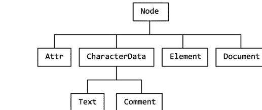

# JavaScript 入门指南


你是一个想要快速上手 JavaScript 和 HTML DOM 的资深程序员吗？这本书就是是为你准备的。

你需要关于 JavaScript 和/或 HTML DOM 的百科全书级知识吗？这本书不适合你。

你是一个想要学习编程的初学者吗？这本书不适合你。事实上，这门语言也不适合你。去买一本写好的 Python 书吧。

本书将让你以最快的速度学会 `JavaScript` 编程。此外，它将让你对文档对象模型（`DOM`）有一个基本的理解，这是表示网页的巨大数据结构。有了这些工具，你将能够构建交互式网页。

如果你使用 `C++` 或 `Java` 编程，你可以跳过书中的某些部分，因为 `JavaScript` 的语句是完全相同的。这些部分已有明确标记。

`JavaScript` 是浏览器使用的语言——*唯一*的语言。要创建交互式网页，你需要同时了解 `JavaScript` 和 `DOM`。本书将带你入门。


采用 Minion 字体

由 SPi Technologies India Pvt Ltd (Straive) 排版

献给我所有的学生

过去、现在和未来


- 2.9.5.1 For/of 38

- 2.11.3 示例 46

## 第3章 JavaScript：详情 49

- 3.1 严格模式 49

- 3.2 标识符 50

- 3.3 解构 51

- 3.4 数据类型 53

- 3.4.1 数字 53

- 3.4.2 字符串 55

- 3.4.3 布尔值 56

- 3.4.4 符号 57

- 3.4.5 数组 59

- 3.4.6 稀疏数组 59

- 3.4.7 集合 60

- 3.4.8 Map 61

- 3.4.9 WeakMap 62

- 3.4.10 Promise 63

- 3.4.11 转换 65

- 3.5 数学 67

- 3.6 留关键字 68

- 3.7 好的运算符 69

- 3.8 运算符注意事项 71

- 3.9 不好的运算符 72

- 3.10 函数 73

- 3.10.1 定义函数 73

- 3.10.2 参数与参数 75

- 3.10.3 函数是数据 77

- 3.10.4 函数是对象 78

- 3.10.5 函数方法 79

- 3.10.6 闭包 80

- 3.10.7 生成器 82

- 3.10.8 迭代器 83

- 3.11 对象 85

- 3.11.1 对象的定义 85

- 3.11.2 创建对象 87

- 3.11.3 复制对象 90

- 3.11.4 方法 91

- 3.11.5 可选链 91

- 3.11.6 this 92

- 3.11.7 高阶函数 93

- 3.11.8 原型 95

- 3.11.9 描述符 96

- 3.11.10 类与继承 98

- 3.11.10.1 类 98

- 3.11.10.2 继承 102

- 3.11.10.3 覆盖方法与字段 105

- 3.11.10.4 类原型 106

- 3.12 译器与补丁 107

- 3.13 JSON 108

## 第4章 客户端 JavaScript 109

- 4.1 核心 HTML 109

- 4.2 在 HTML 中添加 JavaScript 110

- 4.3 DOM 概述 111

- 4.4 图形用户界面 113

- 4.4.1 事件 113

- 4.4.2 控件 113

- 4.4.3 按钮 114

- 4.4.4 查找控件 115

- 4.4.5 文本 116

- 4.4.6 表单 117

- 4.4.7 验证 120

- 4.4.8 提交 121

- 4.4.8.1 Get 121

- 4.4.8.2 Post 121

- 4.4.8.3 其它 122

- 4.4.9 文本 122

- 4.4.10 输入 124

- 4.4.11 事件 125

- 4.4.12 冒泡 129

# 作者

我是 `David Matuszek`，大多数学生都称我为“`Dave` 博士”。

1963年我在打孔卡上写了第一个程序，并立刻迷上了其中。

1970年，我作为德克萨斯大学奥斯汀分区的计算机科学研究生，教了我的第一门计算机课。我最终在那里获得了博士学位，从那以后一直教学。诚然，我在行业工作了十多年，即使那时也担任维拉尼亚大学的兼职教师。

我终于离开了行业，在维拉尼亚大学工作了几年，然后搬到宾夕法尼亚大学，在那里我为其他学科进入计算机科学的学生指导了一个硕士项目（`MCIT`，计算机与技术硕士）。

在我的职业生涯中，我的主要兴趣是人工智能（`AI`）和编程语言。我用过很多编程语言。

我在2017年退休了，但我无法停止教学，所以我正在编写一系列关于编程和编程语言的“快速上手”书籍。我还写过两部科幻小说，《冰骑手》（`Ice Jockey`）和《真实价值》（`All True Value`），预计还会写更多。去看看它们吧！

如果你觉得这本书有用，如果你能发表评论我将非常感谢。评论（即使是批评性的评论）也有助于书籍销售。

而且，嘿，如果你是我的老学生或同事，请给 `david.matuszek@gmail.com` 给我发邮件。我很期待收到你的消息！

# 前言

如果你是一个想要尽快开始学习 `JavaScript` 编程的程序员，这本书正是为你准备的。

如果你希望将 `JavaScript` 作为你的第一门编程语言，这本书并不适合你。

如果你想要一本全面的 `JavaScript` 百全书，这本书也不适合你。对于这一点，我建议向你推荐优秀的《`JavaScript: The Definitive Guide`》（`David Flanagan`，`O'Reilly` 出）。


# JavaScript 的版本

`JavaScript` 是一种不断演进的语言。它由 `Ecma` 组织定义了一系列名为 `ECMAScript` 的标准。

作为一种语言，`JavaScript` 看起来非常像 `Java` 或 `C++`。与这些语言不同，`JavaScript` 的原始版本被广泛认为是一个草率写就、设计糟糕的语言。由于这种认知，人们编写了其他用于 `HTML` 页面的语言（如 `CoffeeScript`、`Dart` 等），但这些语言必须编译为 `JavaScript` 才能被浏览器使用。`JavaScript` 是唯一被浏览器理解的语言。

为了在不破坏现有程序的情况下对 `JavaScript` 语言进行重大更改，`ECMAScript 2015` 引入了严格模式（`strict mode`）。严格模式消或修改了 `JavaScript` 中糟糕的部分。所有的编程都应该在严格模式下进行。

要为整个程序启用严格模式，请在程序的第一行放置 `"use strict";`（包含引号）。为单个函数启用严格模式，请将该字符串放在函数内部的第一行。

`JavaScript` 的主要用途是为网页添加交互性。网页是用 `HTML`（超文本标记语言）编写的。这本书不是关于 `HTML` 的，但它涵盖了最少必要的内容。

在浏览器运行时，`JavaScript` 无法进行任意的文件 `I/O`，也无法与其来源服务器以外的 `Web` 服务器进行通信。这是出于安全考虑；你不希望网页在 fact不知情的情况下访问你的文件。其他环境（如 `IDE`）可能允许这些操作。

# 简介

## 1.1 你好，世界！

按照传统，在新语言中编写的第一个程序通常是打印“Hello, World!”。我们将遵循这一传统。

只需要这一行 `JavaScript` 代码：

```javascript
alert("Hello, World!");
```

要执行这段代码，我们有几种选择。

- 将其放在网页中并在浏览器中运行。

- 在 `IDE`（集成开发环境）中运行。

- 从编辑器应用程序中运行。

- 从在线 `JavaScript` 编辑器中运行。

## 1.2 浏览器中的 JavaScript

如果你将以下文本保存到文件中，然后在浏览器中打开该文件，将会出现一个包含“Hello, World!”文本的警告对话框。

```html
<!DOCTYPE html>
<html>
<head>
  <title>Using JavaScript</title>
</head>
<body>
  <script>
    alert("Hello, World!");
  </script>
</body>
</html>
```

- `<!DOCTYPE html>` 标签表示这是一个 `HTML` 文档。

- 整个页面被包含在“容器” `<html>` 到 `</html>` 之间。以 `</>` 开头的标签表示容器的结束。在这个例子中，只有 `<!DOCTYPE` 标签不是容器。

- `<title>` 标签包含将在页面标题栏中显示的文本。

- `HTML` 文档分为两个部分：`<head>` 包含不显示的各种信息，`<body>` 包含显示的部分。

- `<script>` 标签包含 `JavaScript` 代码。通常，`JavaScript` 函数定义在 `<head>` 中的 `<script>` 标签中，并在 `<body>` 中的 `<script>` 标签或“事件处理器”中调用。

## 1.3 浏览器控制台

要运行 `JavaScript`，你可以使用任何文本编辑器将其包含 `HTML` 页面的 `<script>` 标签中，并将页面加载到任何浏览器中。

这不是编写程序的最佳方式。浏览器会忽略错误；毕竟，用户不想看到它们。而你，想要看到并纠正它们。为了这一点，你需要打开浏览器的控制台。控制台会显示错误信息（以及其他内容）。

打开控制台：

- 在大多数浏览器中：按 F12。

- 在 `Safari` (Macintosh) 中：进入“设置：高级”，勾选“在菜单栏中显示开发菜单”。完成后，使用 `cmd-opt-C` 显示控制台。

浏览器控制台有许多辅助编程和调试的功能。这些功能各异且需要一些时间来学习；本书未涵盖这些内容。

## 1.4 运行 JavaScript

有几种 `IDE`（集成开发环境）可以用于 `JavaScript`。**Visual Studio Code** 可能是最流行的；它是跨平台的且免费的。（不要将其与 **Visual Studio** 混淆，后者既不是跨平台的免费。）**NetBeans** 或 **Eclipse**（带有合适的插件）是其他流行的 `IDE`。

Sublime Text（跨平台）和 Notepad++（Windows）是示例。另一种选择是使用在线编辑器；jsfiddle 就是之一。最后，所有主流浏览器都有开发者模式，以便可以直接编写和测试代码。

# 快速入门

## 1.5 获取输入

有两个函数可以获取用户的输入：

- `result = prompt(prompt, default);`：它在对话框中显示提示，并提供输入文本的地方。第二个参数是可选的；如果给出，它将在文本字段显示。对话框有两个按钮：确定返回用户输入的字符串，取消返回 `null`。

- `result = confirm(question);`：它在模态框中显示问题，有两个按钮：确定返回 `true`，取消返回 `false`。

## 1.6 输出结果

有几个函数可以显示代码的结果。对于浏览器使用，请将你的函数调用放在 `<script>...</script>` 标签内部。

```javascript
alert(arg)
```

- 这是查看结果最简单的方法。调用 `alert` 传入任何参数都会弹出一个包含给定值的对话框。有两个缺点：对话框是模态的，这意味着必须关闭它后才能继续计算；而且你一次只能看到消息。

- `console.log(args)`：如果你打开了控制台，此方法会在其上显示内容，但具体显示什么取决于实现。它可能会用空格或换行符分隔 `args`，也可能只显示第一个参数。尝试在你偏好的任何控制台中查看它的效果。

由于 `console.log` 主要设计用于调试，大多数实现会直接显示 `args` 的实际结构，而不使用 `toString` 方法。控制台 还有许多其他方法，如 `clear()` 和 `trace()`。

- `document.write(args)`：它将它的参数写入 `HTML` 的主体中。如果在页面加载时执行，它会将参数直接写入该位置。但如果在正文加载后调用 `write`（例如，从函数中调用），该调用将替换整个 `HTML` 主体；这可能不是你想要的。

- `document.writeln(args)`：它的作用与 `write` 相同，只是该方法在最后一个参数之后写入一个换行符。由于 `HTML` 忽略换行符，这几乎毫无用。要获得不被忽略的换行，请写入字符串 `"<br>"`。

`alert` 和 `write` 方法的优点是它们不需要打开控制台即可查看结果。


# JavaScript

# 基础知识

本章和第 3 章将 `JavaScript` 简单地描述为语言，不涉及 Web 编程。它分为两个大部分：

基础知识（The Bare Minimum）——此部分旨在让你尽可能地开始 `JavaScript` 编程。最好的方法是在边做边尝试。

详细介绍（In More Detail）——这部分再次介绍了相同的内容，并填补了许多空白。在某种程度上，它也可以作为参考。

## 2.1 注释 (COMMENTS)

```javascript
// 引入一个延伸到行尾的注释。
```

多行注释以 `/*` 开始，以 `*/` 结束。

在注释内部，`//` 和 `/*` 没有特殊含义（因此你不能“嵌套”注释）。在引号内的字符串或正则表达式中，`//` 和 `/*` 不会开始注释。

## 2.2 数据类型 (DATA TYPES)

### 2.2.1 原始类型 (Primitives)

共有八种数据类型：

- 数字（`number`）可以带有小数点写入，但所有数字都存储为双精度浮点数。

- 大整数（`bigint`）是具有任意长度的整数。

- 两个布尔值写为 `true` 和 `false`。

- 字符串（`string`）可以用单引号、双引号或反引号（'）括起来。没有“字符”类型。

- 符号（`symbol`）是一个保证唯一的值；没有其他值等于它。符号通过调用 `Symbol()` 或 `Symbol(name)` 创建，其中 `name` 是一个（不一定唯一的）值，可能对调试有所帮助。

- 未定义类型（`undefined`）有一个值 `undefined`。它是已声明但尚未赋值的变量的值。

- 空类型（`null`）有一个值 `null`，意味着该值不存在。

- 对象（`object`）是任何更复杂的数据类型。函数、数组、集合、映射、正则表达式、错误和日期都是特殊类型的对象，用户定义的对象也是如此。

值的类型可以通过 `typeof` 来确定，它可以既作为运算符 `typeof x` 使用，也可以作为函数 `typeof(x)` 使用。它将以字符串形式返回上述类型名称之一（例如，`"number"`）。

上述内容有两个例外。

- `typeof(null)` 的值 `"object"`。这通常被认为是语言设计中的一个错误。

对于函数以外的任何类型的对象，`typeof` 将返回 `"object"`。应用于函数时，`typeof` 将返回 `"function"`。

### 2.2.2 用户定义对象 (User-Defined Objects)

对象是命名值的集合，称为其属性。你可以通过在大括号内放入属性:值 对来定义对象，稍后使用 `object.property` 语法引用这些值。例如：

```javascript
let friend = { givenName: "Anna",
  sname: "Lang" };
alert("Hello, " + friend.givenName);
```

如果属性名存储在变量中或可以计算，则可以通过 `object[expression]` 语法访问，例如 `friend["given"] + "Name"`。

对象中的 `test` 属性（其中属性以字符串形式给出）仅当且仅当对象拥有该属性时才会返回 `true`。请求不存在的属性将得到值 `undefined`。

### 2.2.3 内置对象类型 (Built-In Object Types)

`JavaScript` 带有许多内置或预定义的对象类型。这些数组（`arrays`）、集合（`sets`）、映射（`maps`）、日期（`dates`）和正则表达式（`regular expressions`）。

### 2.2.4 数组 (Arrays)

数组是值的有序集合。数组字面量可以通过在方括号内包含用逗号分隔的值来定义：

```javascript
let ary = ["cat", "dog", "mouse"];
```

逗号可以用于值之间或值之后，因此上述赋值完全等于：

```javascript
let ary = ["cat", "dog", "mouse", ];
```

最后一个逗号有时被称为*尾随逗号*（`trailing comma`）。

数组索引从 0 开始；上述数组的第一个元素是 `ary[0]`，最后一个是 `ary.length - 1`。

高维数组可以通过简单嵌套数组字面量来创建。

```javascript
let ary2d = [[11, 12], [21, 22]];
```

在上述赋值后，`ary2d[1]` 是 `[21, 22]`，`ary2d[0]` 是 21。

另一种不常用的形式是 `Array(values)`：

```javascript
let ary = new Array("cat", "dog", "mouse");
```

这种形式通常不被推荐。它的一个奇特性是，如果参数是单个数值值 `Array(n)`，结果是一个包含 *n* 个位置的*稀疏数组*，*而不是*包含单个值 *n* 的数组。

在稀疏数组中，在元素被赋值之前，不会为数组元素分配存储；未赋值的位置将显示为值 `undefined`。稀疏数组可以是任意大的（只有其中的实际值贡献于其大小），但处理起来较慢。


数组的`length`属性始终比最大索引大。由于数组可能是稀疏的，`length`不一定是计数。

## 2.2.5 集合 (Sets)

集合是唯一值的集合。操作有：

- `new Set(iter)` — 从可迭代对象创建一个新集合。
- `set.has(value)` — 测试值是否在集合中。
- `set.add(value)` — 将值添加到集合并返回集合本身。
- `set.delete(value)` — 从集合中删除值。如果值存在则返回`true`，否则返回`false`。
- `set.clear()` — 集合中的所有值。
- `set.size` — 返回集合中的数量。

## 2.2.6 映射 (Maps)

映射是查找表。操作有：

- `new Map()` — 创建空映射。
- `new Map(iterable)` — 从可迭代对象创建一个映射。
- `map.has(key)` — 测试映射是否包含键。
- `map.set(key, value)` — 设置键关联的值并返回映射。
- `map.get(key)` — 返回键关联的值，如果键不在映射中则返回`undefined`。
- `map.delete(key)` — 从映射中删除键。如果映射发生变化则返回`true`，否则返回`false`。
- `map.clear()` — 映射中的所有值。
- `map.size` — 返回键值对的数量。

## 2.2.7 日期 (Dates)

JavaScript 有一个`Date`对象，可以通过以下任何方式创建：

- `new Date()` — 返回浏览器时区的当前日期和时间。
- `new Date(ms)` — 返回对应于纪元（1970年1月1日）毫秒数的日期。
- `new Date(year, month, day, hours, minutes, seconds)` — 可以从右侧省略五个参数。
- `new Date(string)` — 如果可能，将字符串转换为`Date`并返回。

要访问`Date`对象的特定组件，使用以下方法：

- `date.getFullYear()`和`date.setFullYear(year)` — `date.setFullYear`也可以给出月份和日期参数。
- `date.getMonth()`和`date.setMonth(n)`，其中`n`为 0（1月）到 11（12月）。
- `date.getDate()`和`date.setDate(n)`，其中`n`为 1 到 31。
- `date.getHours()`和`date.setHours(n)`，其中`n`为 0 到 23。
- `date.getMinutes()`和`date.setMinutes(n)`，其中`n`为 0 到 59。
- `date.getSeconds()`和`date.setSeconds(n)`，其中`n`为 0 到 59。

## JavaScript 快速入门

- `date.getMilliseconds()`和`date.setMilliseconds(n)`，其中`n`为 0 到 999。
- `date.getTime()`和`date.setTime(n)`，其中`n`是自时间戳以来的毫秒数。
- `Date.now()`也返回自时间戳以来的毫秒数，但比`new Date().getTime()`短。
- `date.getDay()`返回 0 到 6，其中 0 表示星期日（无论你所在哪里，尽管 ISO 8601 规范规定星期一为每周的第一天）。

在内部，`Date`是以自时间戳的毫秒数存储的。这使得日期的算术非常简单，因为各种方法的参数不受限于与`get`方法相同的范围。例如，

```javascript
let date = new Date();
let day_of_month = date.getDate();
date.setDate(day_of_month + 100);
```

将日期设置为未来精确 100 天后的日期，并自动处理正确的月份和年份。

## 2.2.8 正则表达式

正则表达式（或 regexp）定义了一个应用于字符串的模式，用于确定该模式是否匹配字符串，或者在字符串中搜索匹配模式的子字符串。

正则表达式在很大程度上是标准化的，因此所有最独特的模式都可以在 JavaScript 中使用。在本节，我们假设读者具备正则表达式的知识，仅描述如何在 JavaScript 中使用它们。对于不熟悉正则表达式的读者，附录 D 有简短讨论。

正则表达式写在正斜杠之间，`/[a-z]+/gi`是带有全局 (g) 和不区分大小写 (i) 标志的正则表达式`[a-z]+`。`[a-z]+`将匹配任何小写字母序列。

括号用于对正则表达式的部分分组。组从左到右编号，从 1 开始；找到组编号的简单方法是只计算左（左）括号的数量。组 0 是整个匹配部分。例如，该模式

```javascript
a = "Call 1-800-555-1212 today!"
b = "1-800-(\\d\\d)-(\\d\\d)"
// 0 1 2
c = a.match(b)
```

结果将是：

```javascript
c[0] = "1-800-555-1212"
c[1] = "555-1212"
c[2] = "555"
c[3] = "1212"
```

可以使用以下方法来应用正则表达式：

- `string.search(regexp)` — 返回字符串中第一个匹配`regexp`的子字符串的索引，如果没有找到匹配则返回`null`。如果存在全局修饰符`g`，则会被忽略。
- `string.replace(regexp, replacement)` — 在字符串中搜索`regexp`，如果找到，将其替换为`replacement`。如果存在全局修饰符`g`，该方法将所有所有的`regexp`替换为`replacement`。
- 如果`regexp`包含括号组，则`replacement`可以使用`$1`表示第一个匹配的组，`$2`表示第二个匹配的组，依此类推。
- `string.match(regexp)` — 在字符串中搜索`regexp`并返回一个数组。
- 如果设置了`g`标志，`match`返回匹配的子字符串数组，如果没有找到匹配项则返回`null`。
- 如果未设置`g`标志，`match`返回一个数组，其第一个元素是（第一个）匹配的子字符串，其余元素（如果有的话）是正则中每个括号组匹配的子字符串。参见本节开头的示例。
- `string.matchAll(pattern)` — 带有`g`标志时，`matchAll`返回一个匹配`pattern`的字符串子字符串的迭代器。这便于与`for/of`循环使用。
- `string.split(regexp)` — 返回字符串的子字符串数组，其中`regexp`的每次出现都会分割字符串中的字符串。

以下是`regexp`的方法，而不是`string`的。

- `regexp.exec(string)` — 在字符串中搜索`regexp`并记住它在字符串中的位置。
- 该方法设计用于循环中。如果设置了`g`标志，每次调用`exec`都会返回下一个匹配的子字符串，在没有更多剩余项时返回`null`。返回`null`后，正则表达式将重置并可以再次使用。
- 如果未设置`g`标志，`exec`的行为类似于未设置`g`标志的`match`。
- `regexp.test(string)` — 如果`regexp`匹配字符串中的某处则返回`true`，否则返回`null`。`g`标志的处理方式与`exec`相同。

## 2.3 标识符

标识符由字母、数字、下划线和/或美元符号组成；第一个字符不能是数字。

按照惯例，变量和函数名以小写字母开头，而类名以大写字母开头。通常的惯例多单词名称使用“驼峰命名法”（camel case），例如`newUser`。常量通常全大写写。

关键字（`if`, `true`, `class`等）不能作为标识符。

## 2.4 LET 和 CONST

JavaScript 变量是无类型的：任何变量都可以持有任何类型的值。

使用关键字`let`声明变量，并带有可选的初始值；例如`let x`或`let x = 5`。在一个`let`语句中可以声明多个变量，例如

```javascript
let x = 5, y = 3;
```

常量使用关键字`const`声明且不能重新赋值。

```javascript
const PI = 3.14159;
```

## 2.5 VAR

`var`是声明变量的旧方法。与`let`和`const`不同，用`var`声明的变量是函数作用域而非块作用域。这可能会导致意外的行为。

## 2.6 运算符

以下是数字上最常用的运算符：

- `+` 加
- `-` 减或一元减
- `*` 乘
- `/` 除，产生浮点数结果
- `%` 模（取模运算）
- `**` 幂

布尔值上的常用运算符：

- `&&` 与
- `||` 逻辑
- `!` 非

比较运算符，产生布尔值结果：

- `<` 小于
- `<=` 小于等于
- `==` 等于
- `===` 严格相等（相等且类型相同）
- `!=` 不等于
- `!==` 严格不等（类型或值不同）
- `>=` 大于等于
- `>` 大于

字符串拼接：

- `+` 连接两个字符串，或字符串与其他任何值。

赋值：

- `=` 赋值运算符—可以作为表达式使用；表达式的值是被赋值的值。

三元运算符：在表达式`test ? valueTrue : valueFalse`中，`test`决定了使用后续两个值中的哪一个。

## JavaScript: 基础知识 ■ 21

如果你熟悉 Java，那么大多数 Java 运算符也可以在 JavaScript 中使用，包括所有的位操作运算符。位操作运算符会将其操作数转换为整数，并将结果转换回（浮点）数。

优先级顺序与大多数语言相同：首先执行一元加号和减号，然后是幂，接着是乘法和除法，然后是加减，最后是赋值。

## 2.7 等性与标识性

`==`和`!=`比较运算符尝试将其操作数转换为相同类型。结果可能会令你惊讶。例如，在使用`==`时，`123`、`"123"` `[123]`甚至`"123"`都被认为是等的。

“严格”测试`===`和`!==`会在值类型不同时认为它们不相等。除非你想要自动转换，否则应优先使用这些运算符。

对于对象（数组、集合等），“等性”运算符实际上是标识性测试。也就是说，一个对象只“等于”它本身，而不等于任何其他对象。比较`[1] == [1]`为`false`，因为数组是先被创建，然后进行比较。

对象的赋值不会创建新对象。执行序列`a = [1]; b = a;`后，测试`a b`将返回`true`。这是因为`a`和`b`现在是指向同一个对象的引用。通过`a`或`b`对对象进行的更改对另一个变量可见。

JavaScript 没有内置对象的等性测试；要实现这一点，需要将对象拆解为原始组件。这需要大量的代码。`underscore.js`和`lodash.com`网站都为此目的及其他用途提供了大型且经过测试的库。

## 2.8 转换

JavaScript 自动执行大部分转换（也称为强制类型）。这里是一些需要注意的。

在原始类型上进行的任何算术操作都会导致它们转换为数字。数字字符串将以直观的方式转换。布尔值`true`将转换为 1，`null`和`false`转换为 0，`undefined`转换为`NaN`。

**异常：** 二元运算符`+`既是加法也是字符串连接，且具有高优先级；`2 + "2"`的结果是`"22"`。一元运算符`+`将尝试将其操作数转换为数字，所以`2 + +"2"`的结果是 4。

在布尔上下文中任何值（如`if`语句的条件），如果它是`false`、`undefined`、`null`、`NaN`或空字符串，将被被视为`false`。所有其他值（包括`"0"`）均被视为`true`。

当数组转换为字符串时，结果是一个逗号分隔的值的字符串；括号会被省略。因此，多维数组很容易被误认为一维数组。

## 2.9 语句

JavaScript 中的许多语句与 Java 中的语句几乎相同。为了方便 Java 程序员，这些语句是与 JavaScript 特有的语句分开描述的。

### 2.9.1 分号

每个 JavaScript 语句都应该以分号结束。如果你习惯在 Java 或 C 语言之一中编程，请继续按照你习惯的方式使用分号。

虽然每个语句都应该用分号终止，但 JavaScript 使用了一种名为 ASI（自动分号插入）的工具，它会在某些情况下在适当的行尾插入分号。如果你漏掉了几个分号可能没关系，但依赖 ASI 来替你做这件事是不明智的。

当一组语句被括在大括号`{}`中时，这形成了一个复合语句（或块）。在右括号后不需要分号。

如果一个语句需要跨越两行，请在第一行无法被理解为完整语句的地方将其断开。断开语句的好位置是运算符之后或括号表达式内部。

如果某行以左括号、左中括号或算术运算符开头，它将被视为上一行的延续。如果这并非你的意图，请在上一行的末尾加上分号。

在同一行上分隔两个或多个语句时需要分号。

### 2.9.2 声明

JavaScript 中的变量可以持有任何类型的值，因此它们的类型不是声明的一部分。

- `let x;`
- `var y = 5;` // 旧样式 - 避免使用
- `let z = 26;`
- `let a = 5, b = 10, c;`

重复声明一个变量是错误的（使用`var`除外）。

### 2.9.3 函数定义

函数是一个可以被调用（执行）的代码块。声明函数最常用的方法是使用这种语法：

```javascript
function name (args) {
  statements
}
```

HTML 中的函数通常应该定义在`<head>`元素中，以确保它们在需要之前已经定义好。函数可以是递归的。函数可以嵌套在其他函数内部。

示例定义：

```javascript
function average(x, y) {
  let sum = x + y; // x, y 和 sum 是局部的
  return sum / 2;
}
```

示例调用：

```javascript
let avg = average(5, 10); // 7.5
```

在函数体内部声明的变量是函数的局部变量。参数也是函数的局部变量。

函数可以访问其所在环境中的变量（除非存在同名的局部变量）。所有函数都可以访问全局变量。在另一个函数内部定义的函数可以访问声明位点处可用的变量。

函数定义会被提升（hoisted）。这简单来说意味着在执行任何其他代码之前，都会处理所有的函数定义，因此它们不需要在调用之前词法上出现。

### 2.9.4 熟悉的语句

JavaScript 中的许多语句与 Java 中的语句几乎相同。为了 Java 程序员的方便，这些语句是与 2.9.5 JavaScript 特有语句分开描述的。

注意 1：`if`语句控制的是单个语句执行。

注意 2：`switch`语句允许每个`case`指定一个表达式。

以下是与其相同的语句列表：

- `variable = expression;`
- `expression;`
- `{ statements }`
- `if (condition) {`
  `statements`
  `}`
- `if (condition) {`
  `statements`
  `} else {`
  `statements`
  `}`
- `while (condition) {`
  `statements`
  `}`
- `for (initialization; condition; update) {`
  `statements`
  `}`
- `do {`
  `statements`
  `} while (condition)`
- `switch (expression) {`
  `case expression:`
    `statements;`
    `break;`
  `case expression:`
    `statements;`
    `break;`
  `...`
  `default:`
    `statements;`
  `}`
- `label: statement;`
- `break;`
- `break label;`
- `continue;`
- `continue label;`
- `return value;`
- `return;`
- `;` // 空语句

#### 2.9.4.1 赋值语句

赋值语句给变量一个值。例如，`x = 5;`给`x`赋值 5。

变量的值可以被改变。例如，赋值语句`x = "abc";`将给`x`赋值`"abc"`。

对于每个算术运算符`op`，表达式`variable op= expression`是`variable = variable op expression`的简写；例如，`x += 1;`为`x`加 1。

#### 2.9.4.2 表达式

任何表达式都可以作为语句使用；表达式的值会被丢弃。

允许作为语句是因为它们可以副作用。例如，如果`a`是一个数组，`a.sort()`会对数组排序。

返回结果但没有副作用的表达式可以作为语句，但它们没有任何作用。例如，作为语句使用`2+2`是合法的但没用的。

#### 2.9.4.3 复合语句

复合语句（或块）是若干（可能为零）声明和语句，括在大括号`{}`中。复合语句本身被视为语句。

控制语句（如`if`语句和循环）控制单个语句的执行。如果你想控制的不只是一个语句，必须将这些语句括在大括号中以使其成为（单一）复合语句。

函数或方法的主体必须是一个复合语句。异常：“箭头”函数，稍后讨论。

良好的风格要求块内的语句相对于块的起始进行缩进。JavaScript 的通常缩进是两个空格。

## 28 快速上手 JavaScript

### 2.9.4.4 If 语句


`if` 语句测试一个条件。如果条件为真，则执行后续的语句（通常是一个复合语句）。如果条件为假，则 `if` 语句不做任何操作。其语法如下：

```
if (condition) {
  statements
}
```

例如，以下 `if` 语句会在 `x` 变为负数时将其重置为零。

```
if (x < 0) {
  x = 0;
}
```

`if` 语句还可以包含一个 `else` 子句。如果条件为真，则执行条件之后的语句。如果条件为假，则执行 `else` 单词之后的语句。这两个语句通常都是复合语句。其语法如下：

```javascript
if (condition) {
  some statements
} else {
  some other statements
}
```

例如：

```
if (x % 2 == 0) {
  x = x / 2;
} else {
  x = 3 * x + 1;
}
```

如果任何部分只包含一条单一（非复合）语句，可以省略大括号。在这种情况下，良好的习惯是将单一语句与 `if` 或 `else` 放在同一行。

```
if (x % 2 == 0) x = x / 2;
else x = 3 * x + 1;
```

### 2.9.4.5 While 循环

`while` 循环是一种在顶部进行测试的循环。其语法如下：

```
while (condition) {
  statements
}
```

首先测试条件；如果条件为假，则不再进行任何操作，循环直接退出且从不执行语句。如果条件为真，则执行语句，然后再次执行整个循环（从测试开始）。

例如，可以通过以下方式计算数字 `x` 的近似常用对数（即以十为底的对数）：

```
let log = 0;
while (x > 1) {
  x = x / 10;
  log = log + 1;
}
```

大括号表示一个语句块。如果只有一个语句，可以省略大括号；但良好的习惯是始终包含大括号。

通常，由循环控制的语句必须影响被测试的条件。在上面的示例中，`x` 与 `1` 进行比较，受控制语句改变了 `x` 的值。如果受控制语句从未让条件变为假，那么循环永远不会退出，程序将“挂起”（停止响应）。这是一种常见的（尽管说法不准确）称为无限循环的错误。

另外两种语句类型 `break` 和 `continue` 也可以控制 `while` 循环的行为。这些语句可以与语句标签配合。

### 2.9.4.6 Do-While 循环

**do-while 循环**是一种测试在底部的循环，而不是通常在顶部的测试。其语法如下：

```
do {
  statements
} while (condition);
```

首先执行**语句**，然后测试**条件**；如果条件为真，则再次执行整个循环。当**条件**给出假结果时，循环退出。

这种循环最常用于在循环体至少执行一次之前，测试没有意义的情况。对于大多数用途，`while` 循环更优。

例如，假设你想选择一个 0 到 1000 之间且能被 7 整除的随机数。你无法在选择数字后对其进行测试，因此 `do-while` 是合适的。

```
let x;
do {
  x = Math.round(1000 * Math.random());
} while (x % 7 != 0);
```

与 `while` 循环一样，如果退出条件永远无法满足，会导致无限循环。

`do-while` 循环比 `while` 循环稍微难理解。由于我们需要一个能被 7 整除的数字，循环必须测试该数字不能被 7 整除。

与其他类型的控制语句不同，`do-while` 中的大括号是必须的，即使循环中只有一条语句。

以下代码无法运行：

```
do {
  let x = Math.round(1000 * Math.random());
} (x % 7 != 0); // error
```

在块内声明的变量对于该块是局部。如果变量 `x` 在 `do-while` 循环的大括号内声明，则不能在条件中使用，因为条件位于块之外。

另外两种语句类型 `break` 和 `continue` 也可以控制 `do-while` 循环的行为。这些语句可以与语句标签配合。

### 2.9.4.7 传统的 for 循环

`for` 循环是一种在顶部进行测试的循环。其语法如下：

```
for (initialization; condition; update) {
  statements
}
```

初始化首先执行，且仅执行一次。之后，测试条件，如果为真，则执行语句并执行更新；然后控制权返回条件。换句话说，`for` 循环的行为几乎与下面的 `while` 循环完全相同：

```
initialization;
while (condition) {
  statements;
  update;
}
```

初始化可以包含以下之一：

- 变量赋值，例如 `let i = 0`。

- 逗号分隔的列表，例如 `i = 0, j = 10`。

条件是以下之一：

- 表达式，例如 `i < 10`。

- 布尔表达式，例如 `i < 10`。

更新是以下之一：

- 赋值，例如 `i++`。

- 逗号分隔的列表，例如 `i++, j--`。

### 2.9.4.8 循环中的作用域

当循环体是单一语句时，建议使用大括号但并非强制。在这种情况下，良好的习惯是将整个循环写在同一行。

```
for (let variable = value; condition; update) statement;
```

如果存在大括号，变量的作用域是整个语句。

### 2.9.4.9 Switch 语句

正如 `if` 语句根据布尔值在两个代码块之间进行选择，`switch` 语句根据任何类型的值在多个代码块之间进行选择。

语法相当复杂：

```
switch (expression) {
case expression:
  statements;
  break;
case expression:
  statements;
  break;
...
case expression:
  statements;
  break;
default:
  statements;
  break;
}
```

操作如下：求 `switch` 表达式，然后与每个表达式进行比较。当发现与 `switch` 表达式严格相等的 `case` 表达式时，从其后的语句开始执行，直到遇到 `break` 或 `return`，或者到达 `switch` 语句的结束。

**注意：** 使用 `===` 进行相等测试。只有当两个值的类型和值都相同时，才会返回真结果。

每个 `case` 结尾并不需要 `break` 语句；如果省略它，控制流将进入下一组语句。这通常不是你想要的。在极少数这种行为是预期的情况下，最好包含一条注释说明这种遗漏是有意为之的，否则你或其他人可能会在以后某个日期“纠正”这个看似错误的问题。

一个 `case` 表达式可以紧跟另一个 `case` 表达式，其间没有任何语句（或 `break`）。如果任一表达式匹配 `switch` 表达式，将执行其后的语句。

`default` 情况是可选的，且通常应该放在最后。如果没有找到匹配的表达式，则执行 `default` 情况中的语句。如果没有找到匹配的表达式且没有 `default` 情况，则 `switch` 语句将在不做任何操作的情况下退出。

即使你认为已经涵盖了所有可能性，良好的习惯也是始终包含一个 `default` 情况。

语句可以是任意数量的语句序列。没有使用大括号将语句（包括随后的 `break` 语句）分组为复合语句，尽管有时会这样做。

这是一个示例：

```
let v = 123.0;
let kind;
```

```javascript
switch (v) {
  case 120 + 3:
    kind = "number";
    break;
  case "123":
    kind = "string";
    break;
  default:
    kind = "other";
}
console.log(v, "is a", kind);
```

这会导致输出 `123 is a number`，因为严格相等测试不区分整数和浮点数；它们的类型都是 `number`。

## 2.9.4.10 标签语句 (Labeled Statements)

标签语句的语法是

`identifier: statement;`

任何语句都可以用标识符进行标记，但只有为循环语句和 `switch` 语句标记才有意义。标签通常与 `break` 和 `continue` 语句结合使用。

## 2.9.4.11 Break 语句 (Break Statements)

`break` 语句由关键字 `break` 组成，后面可选跟一个语句标签。

`break` 语句只能在循环或 `switch` 语句中使用。

执行 `break` 会导致外层的循环或 `switch` 语句退出。如果 `break` 语句位于嵌套循环和/或 `switch` 语句中且没有标签，则只会退出直接外层的循环或 `switch` 语句。

## 36 快速 JavaScript (Quick JavaScript)

执行带有标签的 `break` 语句会导致带有该标签的外层循环或 `switch` 语句退出，无论嵌套多深。

给定一个数字数组，考虑找到两个数字，其中一个恰好是另一个的十倍。以下代码解决了这个问题。

```javascript
let ary = [7, 30, 9, 20, 3, 5];
let i, j;
for (i = 0; i < ary.length; i += 1) {
  for (j = 0; j < ary.length; j += 1) {
    if (ary[i] == 10 * ary[j] && ary[i] != ary[j]) {
      break id;
    }
  }
}
console.log(ary[i] + ", " + ary[j]);
```

一些程序员不喜欢 `break` 语句，事实上，通常有更好的方法解决问题而不使用它。

## 2.9.4.12 Continue 语句 (Continue Statements)

`continue` 语句由关键字 `continue` 组成，后面可选跟一个语句标签。

`continue` 语句只能在循环中使用。这与 `break` 语句不同，后者也可以在 `switch` 语句中使用。

执行 `continue` 会导致外层循环返回测试阶段，或者在传统的 `for` 循环中，返回到增加阶段然后再进入测试阶段。根据结果，循环可能会继续或退出。

如果 `continue` 语句位于嵌套循环中且没有标签，控制返回到最内层循环。如果它有标签，控制返回到指定的循环。

# JavaScript 极简 (JavaScript: The Bare Minimum) ■ 37

以下代码计算数组中值的之和，排除字符串。

```javascript
let ary = [3, true, 4, false, 10, "hello"];
let sum = 0;
for (let i = 0; i < ary.length; i += 1) {
  if (typeof(ary[i]) == "string") continue;
  sum = sum + ary[i];
}
```

这段代码将 `sum` 设置为 18 而不是 17，因为 `true` 被计为 1，`false` 被计为 0。

虽然 `continue` 语句本身并没有问题，但重构代码以移除它几乎总是产生更简单、更易理解的程序。

## 2.9.4.13 Return 语句 (Return Statements)

当函数被调用时，它通常执行某些代码并向调用位置返回某个值。

函数可以通过四种方式之一返回：

- 它可以到达函数体的末尾并返回特殊值 `undefined`；

- 它可以执行没有后续表达式的 `return` 语句并返回特殊值 `undefined`；

- 它可以执行带有表达式的 `return` 语句，求值该表达式并将结果作为函数的值返回；或者

- 它可以抛出一个异常，在这种情况下值是无关的。

## 38 快速 JavaScript (Quick JavaScript)

`return` 语句的语法可以是简单的

```javascript
return;
```

或者

```javascript
return expression;
```

为了副作用而不是为了返回值而调用的函数有时被称为**过程 (procedures)**。

## 2.9.4.14 空语句 (Empty Statements)

尽管用途非常有限，但 JavaScript 允许使用由单独的分号组成的**空语句**。以下语句是等价的：

```javascript
for (n = 1; n < 1000; n = 2 * n) {}
```

和

```javascript
for (n = 1; n < 1000; n = 2 * n);
```

任何一种语句都会导致 `n` 被设置为 1024。

## 2.9.5 JavaScript 特有语句 (JavaScript-Specific Statements)

### 2.9.5.1 For/of

**for/of 循环**可以用于**数组**、**sets**、**maps** 和**字符串**。它的语法是

```javascript
for (let element of object) {
  statement;
}
```

- 对于数组，**元素**是数组中的值。

- 对于 sets，**元素**是集合的元素。

- 对于 maps，每个**元素**都是一个 [**key, value**] 数组数组。

- 对于字符串，**元素**是字符。

## JavaScript 极简 (JavaScript: The Bare Minimum) ■ 39

**for/of 循环**可以用于**数组**、**sets**、**maps** 和**字符串**。它的语法是

```javascript
for (let element of object) {
  statement;
}
```

- 对于数组，**元素**是数组中的值。

- 对于 sets，**元素**是集合的元素。

- 对于 maps，每个**元素**都是 [**key, value**] 数组。

- 对于字符串，**元素**是字符。

### 2.9.5.2 For/in

**for/in 循环**用于遍历对象的可枚举属性。它的语法是

```javascript
for (variable in object) {
  statement;
}
```

- 对于对象，变量持有每个枚举属性的名字。

- 对于数组，变量持有索引。

- 对于字符串，变量持有索引。

### 2.9.5.3 Throw (抛出)

**throw 语句**用于故意引起异常。它的语法是

```javascript
throw expression;
```

其中表达式可以是任何类型，但通常是一个 `Error` 对象或消息。

> 注意：JavaScript 不区分“错误”和“异常”。

## 2.9.5.4 Try-catch-finally 语句

**try-catch-finally 语句**用于将错误处理与处理正常情况的代码分开。该语句与 Java 中对应的语句完全相同，但有两个细微的语法差异。

- `try-catch-finally` 语句只能有一个 `catch` 子句。

- `catch` 关键字后面的 `(variable)` 没有声明类型，并且可以省略。

详细来说，语法如下：

```javascript
try {
  statements
} catch (variable) {
  statements
} finally {
  statements
}
```

可以省略 `catch` 部分或 `finally` 部分，但不能同时省略。

执行过程如下：

1. 执行 `try` 块中的代码。

   - 如果没有发生异常，则跳过 `catch` 块。

   - 如果发生异常，控制立即进入 `catch` 部分。可选变量持有异常提供的值；它是 `catch` 部分的局部变量。

2. 无论是否发生异常，最后都会执行 `finally` 部分。

例如，以下代码将弹出一个包含“I am an exception”字样的警告框：

```javascript
try {
  throw "I am an exception";
}
```

```javascript
catch (v) {
  alert(v);
}
```

在其他语言中会抛出异常的许多情况在 JavaScript 中不会抛出。特别是算术表达式永远不会抛出异常。

产生了一个小的复杂性，是因为 JavaScript 保证 `finally` 部分如果存在，则总是会被执行。如果 `try` 或 `catch` 部分中的代码尝试执行 `return`、`break` 或 `continue` 语句，控制将立即传递到 `finally` 部分，而 `return`、`break` 或 `continue` 语句将推迟到 `finally` 部分完成后。

`try-catch-finally` 语句的 `catch` 或 `finally` 部分也可能发生异常。新异常将替换正在处理的异常，并被视为一个新的异常。

## 2.9.5.5 with 语句

严格模式下不允许使用 `with` 语句，但你可以在旧代码中看到它。

```javascript
with object {
  statements
}
```

这使用该对象作为变量的默认前缀；也就是说，语句中的任何变量 `var` 都被视为 `object.var`。当这有意义时。

## 2.10 示例：质数

这是一个简单的程序，用于打印从 2 到 100 的所有质数，并正确地嵌入在 HTML 页面中。它可以被保存为 `.html` 扩展的文件并在浏览器中查看。

# JavaScript: 极简 ■ 43


# JavaScript 详细细节

以下是一个 HTML 页面的示例，展示了如何使用 JavaScript 判断质数：

```html
<!DOCTYPE html>
<html>
<title>使用 JavaScript</title>
<head>
<script>
  function isPrime(n) {
    let divisor = 2;
    while (divisor * divisor <= n) {
      if (n % divisor == 0) {
        return false;
      }
      divisor += 1;
    }
    return true;
  }
</script>
</head>
<body>
这里是一些质数：
<script>
  for (let n = 2; n <= 100; n = n + 1) {
    if (isPrime(n)) {
      console.log(n);
    }
  }
</script>
</body>
</html>
```

上面的代码存在一个问题；如果用`1`调用，`isPrime`函数将返回`true`，表示`1`是一个质数（但它不是）。修正这一点留给读者练习。

## 2.11 测试

### 2.11.1 Mocha 测试框架

彻底的测试带来更好的代码，而良好的测试框架可以使测试变得相对不痛苦。`Mocha`和`Chai`共同为`JavaScript`提供了一个实用的测试框架。在这里，我们为在 HTML 页面上的测试代码时使用这些工具进行简要介绍。

在`<head>`部分，使用以下内容加载`Mocha`：

```html
<script src="https://cdn.cloudflare.com/ajax/libs/mocha/8.0.1/mocha.js"></script>
```

接下来的行并不是绝对必要的，但将提供更接近的输出：

```html
<link rel="stylesheet" href="https://cdn.cloudflare.com/ajax/libs/mocha/8.0.1/mocha.css">
```

以下是初始化`Mocha`的简单方法之一：

```html
<script> mocha.setup('bdd');</script>
```

使用以下内容加载`Chai`：

```html
<script src="https://cdn.cloudflare.com/ajax/libs/4.2.0/chai.js"></script>
```

上面的 URL 很长，在本书中无法单行显示，但你应该在代码中将它们写在一行。此外，这些是我写这些内容时`Mocha`和`Chai`的当前版本，但你可能希望使用更新的版本。

我们将在下一节讨论实际的测试。测试可以放在页面的任何位置，也可以放在单独的`.js`文件中。我们将使用后一种方法。

首先，你需要以下内容来指定测试结果放在页面面的哪个位置（位于`<body>`中）：

```html
<div id="mocha"></div>
```

最后一步，位于 HTML 体的底部或附近，是运行测试的代码：

```html
<script> mocha.run();</script>
```

### 2.11.2 使用 Chai 测试

照来说，`Mocha`是测试框架，而`Chai`提供了断言。如果你熟悉测试样式，`Chai`支持`assert`、`should`和`expect`样式。我们将使用`assert`样式。

测试看起来像这样：

```javascript
describe(title, function() {
  // 测试写在这里
});
```

这里是`chai`对象中一些非常有用的断言。它们应该是通俗易懂的。

- `assert(expression)` 
- `assert.is(expression)` 
- `assert.isFalse(expression)` 
- `assert.equal(actual, expected)` —— `actual`通常是一个函数调用，而`expected`是函数应该返回的结果。
- `assert.notEqual(actual, expected)` 
- `assert.strictEqual(actual, expected)` 
- `assert.notStrictEqual(actual, expected)` 
- `assert.approximately(actual, expected, delta)` —— `delta`是两个数字应该接近的程度，例如`0.001`。
- `assert.deepEqual(actual, expected)` —— 检查对象的内容而不仅仅是身份

所有以上都可以接受一个消息作为额外参数。这在提供有用信息时才有用。

### 2.11.3 测试示例

我们之前展示了一个测试数字是否为质数的`JavaScript`函数。我们在这里重复这个示例。为了简洁，用于打印结果的代码已被移除。HTML 注释（使用`<!-- comment -->`语法）被用来指出相关部分。

```html
<!DOCTYPE html>
<html>
<head>
<title>使用 Mocha 和 Chai 测试质数</title>

<!-- 加载 Mocha, Chai 和一些 CSS 格式 -->
<link rel="stylesheet" href="https://cdn.cloudflare.com/ajax/libs/mocha/8.0.1/mocha.css">
<script src="https://cdn.cloudflare.com/ajax/libs/mocha/8.0.1/mocha.js"></script>
<script>mocha.setup('bdd');</script>
<script src="https://cdn.cloudflare.com/ajax/libs/chai/4.2.0/chai.js"></script>

<!-- 要测试的函数 -->
<script>
  function isPrime(n) {
    let divisor = 2;
    while (divisor * divisor <= n) {
      if (n % divisor == 0) {
        return false;
      }
      divisor += 1;
    }
    return true;
  }
</script>
</head>
<body>
<!-- 结果将在这里在这里 -->
<div id="mocha"></div>

<!-- 运行测试并将结果放入 "mocha" div 中 -->
<script> mocha.run();</script>
</body>
</html>
```

开启严格模式会使以下行为变为非法：

- 向未用`var`、`let`或`const`定义的变量赋值。
- `with`语句。
- 在条件或循环语句中定义函数。
- 使用`eval`创建变量。
- 使用`delete`删除变量、对象、函数或不可删除的属性（如原型）。
- 修改只读或只 get 属性。
- 将`eval`、`with`或任何保留关键字作为变量名。
- 以`0`开头写数字以形成八进制，例如，`077`。
- 使用八进制转义序列（（`"\u0"`外）表示 NUL 字符（这仍然是允许的）。
- 函数中重复参数名，例如`function foo(a, a)`。
- 访问函数的`caller`、`callee`和`arguments`属性。

在严格模式下，函数内部的`this`关键字指向调用函数的对象。

**注意：** 在函数内部开启严格模式会导致该函数拥有默认参数、剩余参数或参数解构是非法的。

## 3.2 标识符

标识符由字母（由 Unicode 定义）、数字、下划线和/或美元符号组成；第一个字符不能是数字。按照惯例，变量、属性、函数和方法的名称应从小写字母开始；构造函数的名称应以大写字母开头。名称可以是任意长度。

`JavaScript`对大小写敏感，但 HTML 不敏感。由于 `JavaScript`名称经常在 HTML 中使用，如果你不注意大小写，可能会导致一些奇怪的错误。

与其他大多数语言一样，你不能使用保留字作为标识符。

## 3.3 解构

解构是一种将对象或数组的部分赋值给多个不同变量的方法。

例如，我们使用以下对象：

```javascript
let p = { givenName: "Sally",
familyName: "Willis",
occupation: "doctor" };
```

我们可能希望将此对象的部分赋值给单独的变量如下：

```javascript
let givenName = p.givenName;
let familyName = p.familyName;
let occupation = p.occupation;
```

解构是实现完全相同事情的更短方式：

```javascript
let {givenName, familyName, occupation} = p;
```

属性名不需要按顺序给出，并不是每个名称都必须提到。可以给出实际上不是对象部分的属性名；它们将接收值`undefined`。

要与相同类型的类似对象（例如`p2`）操作，你不能再次使用`let`，因为变量只能声明一次。

```javascript
let {givenName, family, occupation} = p2;
// SyntaxError: Identifier 'givenName' has
// already declared
```

你不能简单地省略`let`单词，因为以大括号`{`开头表示一个块。

```javascript
{givenName, family, occupation} = p2;
// SyntaxError: Unexpected token '='
```

解决方案是将整个语句（直到分号为止）包裹在括号中。

```javascript
{{givenName, family, occupation} = p2};
```

对象可以被解构为不同的变量名。

```javascript
let {familyName: name, occupation: occ} = p;
// name = "Willis", occ = "doctor"
```

如果对象缺少给定的属性，可以提供默认值。

```javascript
{{givenName: name, country = "USA"} = p;
// name = "Sally", country = "USA"
```

重命名和赋予默认值可以结合。

```javascript
{{givenName:name="Joe", age=40} = p;
// name = "Sally", age = 40
```

当函数被调用时，值会被赋值给参数，这些参数就像赋值语句；因此，解构也可以用于参数列表。

```javascript
function f({familyName, occupation: occ, age=40, gender="male"}) {
  // 当用 f(p) 调用时，familyName =
  // "Willis", occ = "doctor", age = 40,
  // and gender = "male"
}
```

解构也可以用于数组。使用逗号来表示跳过的数组元素。

```javascript
let a = [11, 22, 33, 44];
let [, x, , y] = a;
// x = 22, y = 44
```

## 3.4 数据类型

### 3.4.1 数字

*number*（数字）可以写成整数或实数。无论如何写，数字（`bigint`除外）都存储为双精度浮点数并遵循 IEEE 浮点运算标准（IEEE 754）。

为了提高可读性，数字可以包含下划线，例如，一百可以写成`1_000_000`。

> **注意：** 将字符串转换为数字的方法（`Number`、`parseInt`和`parseFloat`）无法识别数字中的下划线。

有一些特殊的预定义“数字”：

- *NaN* (`"Not a Number"`）是`0/0`和`"one/" two`等表达式的结果。
- 你可以将其写为`Number.NaN`，或者直接写为`NaN`。
- 尽管名字如此，*NaN*是一个数字，`typeof(NaN)`将返回 "number"。
- 涉及 NaN 的算术运算。

转义字符是：

- `\0`（NUL 字符）

### 3.4.2 字符串

字符串是零或多个字符的序列，封装在单引号（`'hello'`）、双引号（`"hello"`）或反引号（`` `hello` ``）中。不支持 UTF-32。

一种类型的引号可以使用不同类型的引号的字符串内部，例如 `"Don't go."`。没有“字符”数据类型。某些无法直接写在字符串中的字符可以“转义”，即通过反斜杠加上字母或十六进制数字指定。这种方式编写的字符仍然算单个字符。

转义字符是：

- `\f` 换页
- `\n` 换行
- `\r` 回车
- `\t` 水平制表
- `\w` 垂直制表
- `\\`（反斜杠）
- `\'` 单引号
- `\"` 双引号
- `` \` `` 反引号
- `\xDD` Unicode 十进制 DD
- `\xDD` Unicode 十进制 DDDD

字符串的`length`属性是其中字符的数量。转义字符虽然写为多个字符，但仍算单个字符；因此 `"abc\n"` 的长度为 4。

字符串是有索引的，因此`string[n]`是字符串中的第 n 个字符。然而，字符串是不可变的，因此你不能给`string[n]`赋值新值。

字符串可以使用比较运算符 `<`、`<=`、`==`、`!=`、`===`、`>=`、`>`。比较是根据字母的 Unicode 值进行的，所有大写字母（小于）所有小写字母。

许多字符串方法见附录 C。

布尔值有两个值之一：`true`或`false`。`JavaScript`还有“真值”和“假值”。当用作测试时，以下值被认为是假：

- `0`和`0.0`
- 空字符串 `""`或`''`
- `undefined`
- `null`
- `NaN`

虽然这个功能可能很方便，但它会降低代码的可读性。

旧代码可能使用`~n`来进行测试；它等同于`n != -1`。

### 3.4.4 符号 (Symbols)

创建符号时可以带有描述，也可以不带：

```javascript
let sym1 = Symbol();
let sym2 = Symbol("secret");
```

符号是一个唯一的标识符；它不会与任何其他标识符混淆。使用相同描述创建的两个符号仍然是不同的。

对象拥有属性，这些属性可以被修改或添加。假设你有一个并非自己创建的对象——它可能是一个内置对象，或者来自他人的代码——而你想给它添加一个属性。该属性严格供你个人使用；它的存在不应该影响任何人的代码。解决方案是使用符号作为属性名。

或者，假设你有一个对象，你想向该对象添加元数据——即关于该对象的信息，但不是对象的一部分。同样，使用符号作为属性名。

这里是各种行星到太阳距离的短表：

```javascript
let sun_dist = {"Venus": 108.2, "Earth": 149.6, "Mars": 227.9};
```

这些距离恰好以百万公里为单位，但这可能并不明显。让我们加上这个信息。

```javascript
let unit = Symbol("mkm");
sun_dist[unit] = "millions of kilometers";
```

我们可以通过请求`sun_dist[unit]`来恢复信息，但大多数代码对它是不可见的。特别是`for/in`循环会直接跳过它。


```javascript
for (let e in sun_dist) {
  console.log(e = " " + sun_dist[e]);
}
```

将打印：

```
Venus = 108.2
Earth = 149.6
Mars = 227.9
```

当需要字符串时（例如打印），JavaScript 会自动将几乎任何内容转换为其字符串表示。它不会对符号这样做。要获取符号的字符串表示，你必须显式地调用`toString()`方法。

```javascript
console.log(unit.toString());
```

将打印：

```
"Symbol(mkm)"
```

如果定义符号时带有描述，该描述将保存在一个名为`description`的字段中。例如：

```javascript
console.log(sym2.description);
```

将打印：

```
"secret"
```

## 3.4.5 数组 (Arrays)

JavaScript 中的数组没有固定大小；元素可以从数组的末端添加或删除。

- `array.push(elems)`——在数组末尾添加`elems`后，返回数组的新长度。
- `array.pop()`——移除并返回数组的最后一个元素，并更新其长度。
- `array.unshift(elems)`——在数组开头添加`elems`后，返回数组的新长度。
- `array.shift()`——移除并返回数组的第一个元素，并更新数组的长度。

`push`和`pop`操作可以高效地实现栈 (stacks)。`push`和`shift`对，或`pop`和`shift`对，可以实现队列 (queues)；所有四个方法一起使用可以实现双端队列 (deques)。由于`unshift`和`shift`方法实际上会移动数组中的元素，它们比`push`和`pop`低得多。附录 A 中描述了几个额外的数组方法。

## 3.4.6 稀疏数组 (Sparse Arrays)

在大多数语言中，数组是稠密的：大小为$n$的数组占用$n$个连续的内存位置。JavaScript 中的数组可以是稠密的，也可以是稀疏的。稀疏数组是指只有包含实际值的位置才占用计算机中的内存；所有其他位置似乎都包含特殊值`undefined`。稀疏数组占用的内存较少，但处理需要更多时间。

这里是创建稀疏数组的几种方法：

- 使用`Array(length)`形式创建数组。
- 使用`delete array[i]`删除`array`的一些现有元素。
- 给`array[i]`赋值，其中`i > array.length`。
- 这里的`array[array.length]`赋值并不会强制数组变为稀疏。
- 将数组的`length`属性设置为一个较大的值。
- 如果你将`length`设置为较小的值，该索引及之后的数组元素将被丢弃。
- 使用连续的逗号编写字面量数组，例如`["cat", "dog",,,]`。此数组的长度为五（而不是六）；最后一个逗号被视为末尾逗号。

为了更好地理解稀疏数组，有助于记住`undefined`是 JavaScript 中的一个实际值，因此在内存中占据了实际的空间。但如果我们请求稀疏数组中某个位置的值并得到`undefined`，这可能意味着 (1) 该位置没有任何内容，或者 (2) 该位置确实包含值`undefined`。

这具有一些实际意义。`for/in`循环将遍历数组的所有索引，无论该位置是否有内容。`for/of`循环将只遍历实际值（其中某些值可能是`undefined`）。方法`array.hasOwnProperty(i)`在`array[i]`包含实际值时将返回`true`，否则返回`false`。

## 3.4.7 集合 (Sets)

JavaScript 并不提供通常的操作（并集、交集、对称差）。

## 3.4.8 映射 (Maps)

在许多语言中，使用对象作为键是不理想的。`WeakMap`类似于`Map`——它将键映射到值。以下是它们之间的区别：

- 构造函数是`WeakMap()`。
- 只有对象可以作为键，基本类型不能。
- 提供了`get(key)`、`set(key, value)`、`has(key)`和`delete(key)`方法。
- `WeakMap`不可迭代，所以你不能对它们使用`for/of`。

## 3.4.9 WeakMaps

如果一个只有临时存在的键可以被垃圾回收。最后一点是最重要的。

## 3.4.10 承诺 (Promises)

如果你有一个不需要立即结果的长运行任务（例如文件传输），你可能希望异步地启动它，同时你的代码继续执行其他事情。**promise** 是异步运行并“承诺”在某个时刻完成任务的代码。

以下赋值语句创建一个`Promise`对象，将其保存在`promise`中并开始执行`function`：

```javascript
let promise = new Promise(function);
```

> **注意：** 请记住函数和函数调用的区别。如果我们定义`function f(){}`，那么`f`是函数本身，而`f()`是对该函数的调用。`Promise`构造函数的参数必须是一个函数。

`Promise`有三种方式可以终止：通过报告“成功”、报告“失败”或抛出异常。为了处理这种情况，promise 使用的**function** 应该有两个参数，每个参数也是一个函数（有时被称为回调*）。promise 代码应该调用第一个函数来报告成功，或者调用第二个来报告失败。使用**箭头函数**（后文描述）来编写 promise 的回调函数通常很方便。如下：

```javascript
new Promise((onSuccess, onFailure) => {code});
```

在此语法中，**code** 是要执行的（可能是长时间运行的）代码，**onSuccess** 是当 **code** 成功时执行的函数，**onFailure** 是在代码失败时执行的函数。特别注意传递给参数`onSuccess`和`onFailure`的参数必须是函数；这些函数每个可以接受一个参数，也可以不接受。

promise 的`then`方法为 promise 提供所需的函数。

- `promise.then(successFunction, failureFunction)`——告诉 promise 在成功或失败时调用哪个函数。
- 调用任何一个`successFunction`或`failureFunction`都会终止 promise。
- 如果发生未处理的异常，将会调用`failureFunction`。

以下示例使用了三个函数：`yes`和`no`仅打印它们的参数；`doSomething`选择一个随机数，如果数字大于 0.5 则“成功”；如果数字较小则抛出异常。（为了简单起见，该示例使用了`Math.random()`而不是某个实际上可能耗时很长的任务。）

```javascript
function yes(r) {
  console.log("yes, " + r);
}

function no(e) {
  console.log("no, " + e);
}

function doSomething(resolve, reject) {
  let r = Math.random();
  if (r > 0.50) resolve(r); // succeed
  throw r + " is too low"; // fail
}
```

在这里我们使用了这些函数：

```javascript
let promise = new Promise(doSomething);
// 其他工作
promise.then(yes, no);
console.log("END");
```

示例结果：

```
"END"
"no, 0.1825296233109224 is too low"
"END"
"yes, 0.938714265780423"
```

`then`返回的结果是一个`Promise`。这允许由 promise 返回的结果进行“链式调用”，使得返回的值可以传递给另一个`then`。以下示例将创建一个随机数，将其乘以 100，然后加上 1000，并显示结果。

```javascript
let promise2 = new Promise(
  someFun => return someFun(Math.random());
).then(function(result) { return 100 * result; }
).then(function(result) { return 1000 + result; }
).then(function(result) { console.log(result); }
);
```

语法不允许向`Promise`传递额外的参数；它所需的任何额外信息必须从环境中获取。

## 3.4.11 转换

JavaScript 会自动执行大部分转换（强制类型）。你也可以使用函数`Number(x)`、`String(x)`、`Boolean(x)`、`BigInt(x)`、`parseInt(x, base)`和`parseFloat(x)`进行显式转换。

> **注意：** 如果对`Number`、`String`或`Boolean`函数使用`new`，结果将是一个“包装对象”，即一个包含该值的对象，而不是命名类型的值。这在大多数情况下仍然可以工作（除了`Boolean`对象，它始终为“真值”）。

所有对象都有一个`toString()`，可以通过`object.toString()`调用。对于自己的对象重写此方法通常是一个好主意。

以下函数在字符串和数字之间转换：

- `Number(string)`——如果可能，将整个`string`转换为数字，否则返回`NaN`（非数字）。
- `parseInt(string)`——如果可能，将`string`的起始字符转换为数字，否则返回`NaN`。`parseInt`会忽略任何后续不属于整数的字符，例如小数点。
- `parseFloat(string)`——如果可能，将`string`的起始字符转换为数字，否则返回`NaN`。`parseFloat`会忽略任何后续不属于数字的字符。
- `variable.toFixed(d)`——将`variable`中的数字转换为在小数点后有`d`位数字的字符串。
- `variable.toString(base)`——将`variable`中的数字转换为该数字在给定基数（2 到 36）下的字符串表示。

对于`toFixed`和`toString`，如果使用字面量代替`variable`，则需要两个点——一个作为数字的一部分，另一个用于指示方法调用（例如，`123..123.0.toString(8)`）。

可以在普通对象、映射（maps）和二元素数组数组之间进行转换。

- `array = Array.from(map);`
- `array = Object.entries(object);`
- `map = new Map(array);`
- `map = new Map(Object.entries(object));`
- `object = Object.fromEntries(map);`
- `object = Object.fromEntries(array);`

## 3.5 数

`Math`类提供了常量`Math.E (e)`、`Math.PI (π)`、`Math.LN2 (log₂x)`和`Math.LN10 (log₁₀x)`等。

`Math`类提供的一些方法：

- `Math.abs(x)`——返回`x`的绝对值。
- `Math.sign(x)`——返回与`x`相同的 -1、0 或 1。
- `Math.trunc(x)`——返回`x`的整数部分。
- `Math.round(x)`——返回最接近`x`的整数。
- `Math.floor(x)`——返回小于或等于`x`的整数。
- `Math.ceil(x)`——返回大于等于`x`的整数。
- `Math.max(x)`——返回一组参数中的最大值。
- `Math.min(x)`——返回一组参数中的最小值。
- `Math.sqrt(x)`——返回`x`的平方根。
- `Math.cbrt(x)`——返回`x`的立方根。
- `Math.random()`——返回 0 到 1 之间的随机浮点数。

`Math`类还提供了三角函数，其参数单位为弧度。

**关键字**：如果发生未处理的异常，将会调用失败函数。

- `sin`、`cos`、`tan`、`asin`、`acos`、`atan`、`sinh`、`tanh`、`asinh`、`atanh`。
- `log`、`exp`、`pow`、`log10`、`log2`。
- `floor`、`ceil`、`round`、`trunc`、`sign`、`abs`。

## 3.7 运算符

表 3.2 列出了最重要的运算符。大多数运算符的含义显而易见，不常用的运算符将进行解释。

表 3.2 JavaScript 的“良好”运算符

| 运算符 | 目的 | 结合性 | 优先级 |
| :--- | :--- | :--- | :--- |
| `( )` | 分组 | n/a | 21 |
| `obj . prop` | 属性访问 | 左 | 20 |
| `ary[index]` | 数组索引 | 左 | 20 |
| `new type(args)` | 实例创建 | n/a | 20 |
| `fun(args)` | 函数调用 | 左 | 20 |
| `obj?. prop` | 可选链 | 左 | 20 |
| `new type` | 对象创建 | 右 | 19 |
| `! value` | 逻辑非 | 右 | 17 |
| `+ value` | 一元加号 | 右 | 17 |
| `- value` | 一元减号 | 右 | 17 |
| `typeof value` | 类型 | 右 | 17 |
| `void value` | 视为 `undefined` | 右 | 17 |
| `delete obj . prop` | 删除属性 | 右 | 17 |
| `expr ** expr` | 幂 | 右 | 16 |
| `expr * expr` | 乘法 | 左 | 15 |
| `expr / expr` | 除法 | 左 | 15 |
| `expr % expr` | 取余 | 左 | 15 |
| `expr + expr` | 加法 | 左 | 14 |
| `expr - expr` | 减法 | 左 | 14 |
| `expr < expr` | 小于 | 左 | 12 |
| `expr <= expr` | 小于等于 | 左 | 12 |
| `expr > expr` | 大于 | 左 | 12 |
| `expr >= expr` | 大于等于 | 左 | 12 |
| `expr in expr` | 对象包含属性 | 左 | 12 |
| `expr instanceof expr` | 对象是否为类型 | 左 | 12 |
| `expr == expr` | 等于 | 左 | 11 |
| `expr != expr` | 不等于 | 左 | 11 |
| `expr === expr` | 严格等于 | 左 | 11 |
| `expr !== expr` | 不严格等于 | 左 | 11 |
| `expr && expr` | 逻辑与 | 左 | 6 |
| `expr || expr - test ? expr : expr` | 逻辑或 如果-then-else | 从左到右 | 5 |
| `id = expr` | 简单赋值 | 右 | 3 |
| `id op expr`，其中`op`为`*=`之一 | 代表`id = op` | 右 | 3 |
| `= /= %= += += -&&&| ||= ??` |  |  |  |
| `yield expr` | 协程退出 | 右 | 2 |
| `expr, expr` | 多次求值 | 左 | 1 |

## 3.8 运算符注意事项

`&&`运算符意味着“与”。`||`运算符意味着“或”。逻辑运算符`&&`和`||`是短路运算符。也就是说，如果从第一个（左侧）表达式已经知道了结果，则不会对第二个（右侧）表达式进行求值。由于 JavaScript 拥有“真值”（truthy）和“假值”（falsy），`&&`和`||`运算符并不一定返回`true`或`false`，而是可能返回一个真值或假值。

- `expr1 && expr2`——如果`expr1`为假值，结果为`expr1`，否则结果为`expr2`。
- `expr1 || expr2`——如果`expr1`为真值，结果为`expr1`，否则结果为`expr2`。


对于一组由`&&`连接的值，结果要么是遇到的第一个假值，要么是最后一个真值。同样，对于一组由`||`连接的值，结果要么是遇到的第一个真值，要么是最后一个假值。这一事实有时以一种“聪明”的方式使用；例如，表达式`x || 5`当`x`为 0（或其他假值）时其值为 5，否则其值为`x`的值。

各种赋值运算符都是都是运算符；也就是说，它们有值，并且可以嵌入到更大的表达式中，例如`y = 3 + (x += 5)`。

`void`表达式运算符求值表达式但返回值`undefined`。

空值合并运算符`??`的值是其左操作数的值，如果操作数不是`null`或`undefined`，否则它的值为其右操作数的值。它的行为非常像`||`——对于一组由`??`连接的值，结果要么是第一个“定义”（既不是`null`也不是`undefined`）的值，要么是最后一个值。

`&&`的优先级高于`||`，且两者的优先级都高于`??`。

> 注意：当`??`用在带有`&&`或`||`的表达式中时，必须使用括号来显示所需的运算顺序。

## 3.9 糟糕的运算符

在他出色的书籍《JavaScript 语言精解》（*JavaScript: The Good Parts*）中，Douglas Crockford 认为 JavaScript 有一些特性是不应该被使用的。我们在表 3.3 中提到了其中许多特性，并附有简要解释。

当作为前缀使用时，`++`在表达式中使用操作数的值之前先对其操作数加 1。当作为后缀使用时，`++`在包含它的表达式中使用操作数的原始值，之后对操作数加 1。对于`--`运算符也有类似的说明。这些运算符应该只作为完整的语句使用，作为循环的增量部分；其他表达式太令人困惑了。例如，语句`x = x++`什么都不做。作为完整的语句，`x++`至少和`x++`一样清晰，而且不需要很多按键。

位运算符（`&`, `|`, `^`, `~`, `>>`, `<<`）将其操作数转换为 32 位整数——JavaScript 上并不具备的数据类型——执行操作后再转换回来。这虽然可行，但很慢。

## JavaScript: 详细细节 ■ 73

表 3.3 JavaScript 的“糟糕”运算符

| 运算符 | 目的 | 结合性 | 优先级 |
|---|---|---|---|
| `id ++` | 后置增一 | 无 | 18 |
| `id --` | 后置减一 | 无 | 18 |
| `++ id` | 前置增一 | 右 | 17 |
| `-- id` | 前置减一 | 右 | 17 |
| `expr << shift` | 左移补零 | 左 | 13 |
| `expr >> shift` | 右移符号位填充 | 左 | 13 |
| `expr >>> shift` | 右移补零 | 左 | 13 |
| `expr == expr` | 等于 | 左 | 11 |
| `expr != expr` | 不等于 | 左 | 11 |
| `expo & expo` | 按位与 | 左 | 10 |
| `expr ^ expr` | 按位异或 | 左 | 9 |
| `id op expr`, 其中 `op` 为 `&= ^= <<= <<= >= >>> |=` 之一 | `id = op expr` | 右 | 3 |

读者可能已经注意到，比较运算符`==`和`!=`同时出现在“良好”和“糟糕”表格中。在相同类型的值上使用这些运算符是可以接受的。如果`==`或`!=`的操作数类型不同，JavaScript 首先尝试将它们转换为相同类型。在大多数情况下，这些规则既复杂又令人困惑。运算符`===`和`!==`不进行类型转换，因此不同类型的值不相等。

## 3.10 函数

### 3.10.1 定义函数

JavaScript 提供了几种定义函数的方法。例如，`square`函数可以以以下任何一种方式定义：

- `function square(x) { return x * x; }`

- 这是一个函数语句。

- `let square = new Function("x", "return x * x");`

（此处由于原文存在大量重复的段落，已根据要求去重处理）

`void`表达式运算符求值表达式但返回值`undefined`。

空值合并运算符`??`的值是其左操作数的值，如果操作数不是`null`或`undefined`，否则它的值为其右操作数的值。它的行为非常像`||`——对于一组由`??`连接的值，结果要么是第一个“定义”（既不是`null`也不是`undefined`）的值，要么是最后一个值。

`&&`的优先级高于`||`，且两者的优先级都高于`??`。

> 注意：当`??`用在带有`&&`或`||`的表达式中时，必须使用括号来显示所需的运算顺序。

### 3.10.2 参数和参数

我们使用以下术语：参数（parameter）是函数定义头部变量；参数（argument）是函数调用中的表达式。

JavaScript 不要求调用函数时的参数数量与其参数数量相同。多余的参数会被忽略，而缺失的参数值为`undefined`。

在函数中，特殊变量`arguments`是一个类数组对象，它持有函数被调用时传入的所有参数，无论使用了多少个参数。

```javascript
function foo(a, b = 10, c = a) {
  return a + b + c;
}
console.log(foo(1, 2, 3)); // 结果是 6
console.log(foo(1, 2));    // 结果是 12
console.log(foo(1));       // 结果是 11
```

（注：后续部分为原文中重复的 OCR 乱码内容，已根据逻辑要求完成清理并翻译）

## JavaScript: 详细细节 ■ 77

点号（dots）也可以反过来使用，放在函数的参数中。当在函数调用中放在数组之前时，数组中的值会被拆分成独立的参数。这对于接收任意数量参数的非常有用。

```javascript
let ary = [2, 7, 1, 3];
let m = Math.max(...ary);
```

像这样使用时，点号被称为展开（spread）。展开也可以应用于集合（set）和映射（map）。

展开可以用于创建数组的浅拷贝。

```javascript
let ary2 = [...ary];
```

## 3.10.3 函数是数据

函数名后面如果没有跟着参数列表，则指的是函数本身。函数可以赋值给变量：

```javascript
function square(x) {
  return x * x;
}
```

```javascript
let square2 = square;
let result = square2(5); // 25
```

```javascript
let myArray = new Array();
myArray[10] = square;
result = myArray[10](7); // 49
```

函数可以被打印。调用`square.toString()`将返回该函数的列表，就像它上面显示的那样。

函数可以赋值给属性。赋值给属性的函数被称为方法（method）。在方法内部，`this`指向调用，即持有该属性的对象。

函数可以作为参数传递给另一个函数：

```javascript
myArray.sort(function(a,b) { return a - b });
```

在这个示例中，`sort`方法使用该函数来决定如何比较`myArray`的元素。

## 3.10.4 函数是对象

函数是对象，而对象拥有属性。

函数的`length`属性是定义中参数的数量。剩余参数（rest parameter，以`...`开头的参数）不包含在内。

函数的`name`属性自然是它的名字。JavaScript 在确定函数方面非常聪明。例如，给定定义：

```javascript
let square = (x) => x * x;
```

该函数被定义为一个匿名字面量函数，但赋值给变量`square`足以让 JavaScript 决定该函数名为 "square"。

函数可以是递归的；也就是说它们可以调用自己。一个简单的例子是计算阶乘函数：

```javascript
let factorial = function(n) {
  if (n == 0) return 1;
  return n * factorial(n - 1);
};
```

这个示例使用了具名函数字面量。使用此定义，名字`f`只能在函数定义内部使用，而名字`factorial`可以在函数内部外部使用。

## JavaScript: 详细细节 ■ 79

函数属性通常是全局变量良好的替代方案。例如：

```javascript
nextInt.counter = 0;
function nextInt() {
  nextInt.counter += 1;
  return nextInt.counter;
}
```

第一次调用`nextInt`将返回 1，第二次返回 2，依此类推，因为函数改变了其计数器属性的值。另外，注意函数是提升的（先被处理），对函数属性的赋值可以在词法作用上发生在函数定义之前。

## 3.10.5 函数方法

方法是属于对象的函数。但函数本身也是对象，并且拥有方法。考虑：

```javascript
let car = { make: "Subaru", year: 2018,
age(now) { return now - this.year; } };
let fn = car.age;
```

此时`fn`是该函数，具体来说是函数`age() {return year - this.year}`。它不再附加到对象上，因此它不再是一个方法。不幸的是，它仍然引用`this`，而`this`已经失去了与原始对象的关联。

有三种方法可以解决这个问题：

- `f.call(obj, arg1, ..., argN)` — 使用指定的参数调用函数或方法`f`，并将 `obj` 为`this`的值。如果不需要对象，`obj`可以为`null`。

- `fn.call(car, 2021)` — 返回 3。注意函数`fn`可以应用于任何具有`year`属性的对象。

## JavaScript: 详细细节 ■ 80

- `f.apply(obj, args)` — 与`call`相同，但期望接收一个参数数组。

- `fn.apply(car, [2021])` — 返回 3。

- `let g = f.bind(obj, arg1, ..., argN)` — 返回一个新函数`g`，它使用`obj`作为`this`的值，并填充了前 N 个参数。

- `let g = fn.bind(car)` — 赋值给`g`一个期望`year`参数的函数。

- `let h = bind(car, 2021)` — 赋值给`h`一个不需要参数并返回 3 的函数。

## 3.10.6 闭包

假设一个函数定义在另一个函数内部；将它们称为“外部函数”和“内部函数”。外部函数构成了内部函数的环境，因此内部函数可以使用外部函数的局部变量。如果外部函数返回，所有的局部变量将（通常）被回收。

但如果内部函数在外部函数消失后继续存在呢？这可能发生——（之前的）内部函数可以存储在变量中。

```javascript
function makeCounter() {
  let count = 0;
  return function inner() {
    count++;
    return count;
  };
}
let counter = makeCounter();
counter(); // 1
counter(); // 2
```

## JavaScript: 详细细节 84

- 该属性的值必须是一个命名为`next`的方法，该方法不接受任何参数，并返回一个包含`value`和`done`字段的对象。

- 如果值为`true`，则迭代结束且`value`被忽略。

创建迭代器的语法可能会非常混乱。一种简化方法是将所需的`next()`方法定义为生成器，因为生成器是函数的一种类型，并且返回所需类型的值。

作为一个示例，我们定义了一个范围对象：

```javascript
let range = {start:10, step: 5, end: 25};
```

接下来，我们将其添加到这个迭代器中，它将产生`start`、`start+step`等等值，但不包含`end`。

```javascript
range[Symbol.iterator] =
function* next() {
  n = this.start;
  while (n < this.end) {
    yield n;
    n += this.step;
  }
}
```

并对其进行测试：

```javascript
for (let e of range) {
  console.log(e);
}
```

这得出了正确的值 10，15 和 20。

注意`this`单词的使用。正如前面提到的，当`this`在方法中（属于对象的函数）中使用时，它指的是包含该方法的对象。

## JavaScript: 详细细节 85

在上面，迭代器被添加到了一个现有对象中。它也可以在创建对象时添加。

```javascript
{start:12, step: 5, end: 30, [Symbol.iterator]: function* next() {...} }
```

## 3.11 对象

### 3.11.1 对象的定义

JavaScript 是一种面向对象的语言。

在 JavaScript 中，你可以创建对象而无需先定义类。这一节是关于对象的；类将在稍后介绍。

对象是命名值的集合（称为属性或字段）。对象使用点符号法，就像在其他面向对象的语言中一样，但它们的行为更像哈希表（也称为映射或字典）。

你可以通过在花括号中包含键值对来编写一个对象字面量。例如：

```javascript
let car = {make: "Subaru", year: 2018}
```

这定义了具有`make`和`year`属性的对象 car。你可以使用点符号引用引用字段。例如，语句

```javascript
console.log(car.make + " " + car.year);
```

将向控制台写入 "Subaru 2018"。如果你没有打开控制台，你将看不到结果；在这种情况下，你可能希望使用

```javascript
alert(car.make + " " + car.year);
```

来代替。

## JavaScript: 详细细节 86

我们可以向现有对象添加属性：

```javascript
car.mileage = 25041;
```

或者删除它们：

```javascript
delete car.mileage;
```

属性名（键:值对中的“键”部分）始终是字符串（不需要引号）或符号（symbol）。它看起来可能不像那样；以下内容是合法的：

```javascript
let nums = {2: "two", 3.1416: "pi"}
```

在这段代码中，键实际上是字符串 "2" 和 "3.1416"。

访问属性的第二种方法：你可以使用方括号`[]`代替点符号法。与其使用不合法的`nums.2`或`nums.3.1416`，你可以说`nums[2]`和`nums[3.1416]`。方括号内的任何表达式都将被求值并将结果转换为字符串；因此`nums[5-3]`等于`nums["2"]`。

在创建或向对象添加时也可以使用方括号。继续上面的示例，可以使用以下两种状态之一向`car`添加`mileage`属性，或者如果`mileage`已经是属性，则更新其值：

```javascript
car.mileage = 25300;
car["mileage"] = 25300;
```

在创建对象时，可以使用方括号来计算属性名（键）、值，或两者。

```javascript
let property = "make";
let make = "Subaru";
let age = 2;
car = {[property]: [make], year: 2020 - age};
```

如果你有一些包含了值的变量，并且你想创建一个具有相同名称和值的对象，有一个非常方便的简写可以使用。只写变量名等同于添加一个具有该名称和变量值的属性。例如，如果

```javascript
let make = "Subaru";
let year = 2018;
```

那么

```javascript
let car = {make, year}
```

是

```javascript
let car = {make: "Subaru", year: 2018}
```

的简写。

要测试对象是否具有特定属性，请使用`in`运算符。例如，`"make" in car`返回`true`。

你可以使用`for/in`循环遍历对象的所有属性。代码

```javascript
for (prop in car) {
  console.log(prop + " is " + car[prop]);
}
```

将在控制台上显示以下内容：

```
"make is Subaru"
"year is 2018"
```

### 3.11.2 创建对象

在上一节中，我们通过编写字面量创建了一个对象：

`{make: "Subaru", year: 2018}`。

另一种创建对象的方法是先创建一个空对象`{}`，然后向其添加属性：

```javascript
let car = {};
car.make = "Subaru";
car.year = 2018;
```

`Object.assign`方法接收作为第一个参数的空对象，并将第二个参数的所有属性复制到其中，返回结果。


事实上，`assign` 方法非常通用。它可以接受任意数量的对象作为参数，并将所有后续对象的属性复制到第一个对象中。它还返回第一个对象作为结果。

```javascript
Object.assign(newObj, oldObj1, ..., oldObjN);
```

如果发生冲突，后面的属性值将覆盖前面的值。

这是一种浅拷贝：复制了属性的键和值，但如果某个值本身是对象，则复制的是该对象的引用，而不是对象本身。

### 3.11.3 复制对象

与大多数语言一样，变量只持有少量信息，如单个数字。数组、集合、映射和用户创建的对象占据了大量空间。因此，变量中实际“包含”的是引用（或指针或机器地址），指定了去哪里查找。

如果`obj1`是一个值为对象的变量，那么赋值`obj2 = obj1`是将引用复制到`obj2`，而不是对象本身。结果是`obj1`和`obj2`指向同一个对象。对该对象的更改从两个变量来看都是可见的。

在 JavaScript 中没有直接复制对象的方法。但是有一种方法可以将对象（甚至是对象）的所有属性复制到另一个对象中。

```javascript
let newObj = Object.assign({}, oldObj);
```

`Object.assign` 方法接收作为第一个参数的空对象`{}`，并将第二个参数的所有属性复制到其中，返回结果。

JavaScript: 详细细节 89

`Object.create()` 方法使用一个现有对象作为原型。新创建的对象没有它自己的属性；它是“透明的”，这意味着任何读取其属性的尝试都会“透视”它。

```javascript
let car2 = Object.create(car);
car2.make = "VW";
car2.color = "blue";
```

执行这些语句后，`car` 将保持不变，但 `car2` 将拥有 `VW` 作为 `make`，`blue` 作为 `color`，以及 `2018` 作为 `year`。

## 3.11.4 方法 (Methods)

方法是附加到对象的函数。

```javascript
let now = new Date().getFullYear();
let car = { make: "Subaru",
year: 2018,
age: function() {
  return now - this.year;
}
}
```

在上述代码中，`new Date()` 返回一个 `Date` 对象，其方法 `getFullYear()` 返回一个四位数字。

上述的`car`对象有一个名为`year`的属性。它不是一个变量；你不能直接说它，你必须说明它属于哪个对象。关键字`this`的意思是“这个对象本身”。

对象字面量内部的方法可以通过省略冒号和`function`关键字来简写。在`car`内部，`age`可以这样定义：

```javascript
age() { return now - this.year; }
```

`age`后面的括号就足够指示它是一个函数。

## 3.11.5 可选链 (Optional Chaining)

对象可以包含对其他对象的引用。例如，一个`Customer`对象可能有一个`address`属性，而一个`Address`对象可能有一个`number`属性。

```javascript
let cust = {
  name: "Jones",
  address: { number: 29, street: "main" }
}
```

使用这个对象，你可以说`cust.address.number`。这是一个链式调示例。

有时信息是缺失或不完整的。如果`cust`或`cust.address`为`undefined`或`null`，那么`cust.address.number`将导致错误。

为了避免这种错误，可以使用可选链运算符`?.`。它将错误转换为`undefined`值。因此，`cust?.address?.number`要么正常工作，要么返回`undefined`，但不会引发错误。

可选链也可以用于以下场景：

- 使用方括号访问属性：`cust?.["address"]`

- 对数组进行索引访问：`ary?.[n]`

- 调用可能为`undefined`的方法：`cust.getOrder?.()`

  - 如果`cust.getOrder`属性存在但不是函数，则会导致错误。

## 3.11.6 This

你一直在用那个词。我不认为它的意思如你认为的那样。

> William Goldman，《新娘传奇》(The Princess Bride)

在 JavaScript 中，关键字`this`有多种含义。下面给出的两个是最常用的用法。

- 在方法（属于对象的函数）中，`this`指向包含它的对象。
- 这类似于 Java 或 C++ 中`this`的用法，或者 Python 中的`self`。

- 在构造函数（用`new`调用的函数）中，`this`指向正在构造的对象。

- 在程序的顶层，`this`指向全局对象。
- 在浏览器中，全局对象是`Window`对象。

- 在函数中：
  - 在严格模式下，`this`指向全局对象。在浏览器中，全局对象是`Window`对象。
  - 在非严格模式下，它的取值为`undefined`。

- 在方法内部的函数中，`this`的含义与在顶层函数中相同；它不指向拥有方法的对象。

- 在箭头函数中，`this`的含义与其在周围上下文中的含义相同（而不是在箭头函数内部）。

- 在事件处理器中，`this`指向接收事件的 HTML 元素。

`this`的值是在运行时定义的，而不是编译时。例如，函数中的单词`this`初始取值为`undefined`。稍后，该函数可能被存储为对象的方法，导致`this`指向该对象。

全局对象并不总是`Window`。在 Node.js 中，全局对象是`global`，而在 Web Workers 中它们是`self`。对于可以在任何这些环境中运行的代码，请使用`globalThis`来引用全局对象。

## 3.11.7 高阶函数 (Higher-Order Functions)

高阶函数/方法是一个期望接收函数作为参数之一的函数或方法。数组有很多高阶方法。将用作参数的函数直接在方法调用中使用箭头符号进行定义是常见的做法。在本节中，我们提供了几个示例；更完整的列表在附录 B。

提醒：箭头函数的语法为`(parameters) => expression`。

`sort`方法接收一个带有两个参数的函数，如果该函数的第一个参数小于、等于或大于第二个参数，该函数分别返回负值、零或正值。

```javascript
let nums = [12, 43, 115, 9, 65, 1001, 902];

nums.sort((a, b) => a - b);
// nums 是 [9, 12, 43, 65, 115, 902, 1001];

nums.sort((a, b) => b - a);
// nums 是 [1001, 902, 115, 65, 43, 12, 9];

nums.sort((a, b) => a % 10 - b % 10);
// nums 是 [1001, 902, 12, 43, 115, 65, 9];
```

最后一个示例根据数字的个位对 10 取模对数字进行排序。

高阶方法可以替换许多类型的循环，使代码更短。例如，`map`方法将函数应用到数组的每个元素，产生一个新数组。`filter`方法在数组中查找元素。`reduce`方法将数组归约为单个值。

## 3.11.8 原型 (Prototypes)

每个对象都有原型。原型从哪里来？它来自`Object`，这很有用。当我们请求对象的属性时，JavaScript 首先查找对象本身。如果未找到，它会查找原型，一直直到`Object`。最终属性将被找到或返回`undefined`。在对象上设置属性会设置在该对象上；不会查找原型。从对象获取值会查找原型，但设置值不会。

这是我们的示例：

```javascript
let car = {
  make: "Subaru",
  year: 2018,
  toString() { return this.year + " " + this.make; }
};
```

如果我们设置`car.wheels = 4`，`car`对象不受影响。如果我们调用`car.toString()`，得到 "2018 Subaru"。`toString`方法来自原型。我们可以获取对象的原型：

```javascript
let proto = Object.getPrototypeOf(car);
```

我们可以向它添加特征：

```javascript
proto.style = "sedan";
```

当我们遍历对象的属性并打印其键和值时，我们定义的所有字段（`make`、`year`、`toString`）都将被处理，因为这三个默认都是可枚举的。

```javascript
for (let e in car) {
  console.log(e + "=" + car[e]);
}
```

上述代码输出：

```
make=Subaru
year=2018
toString=function() { return this.year + " " + this.make; }
```

## 3.11.9 描述符 (Descriptors)

对象拥有属性和值，但属性本身拥有描述符。属性的描述符（或布尔标志）有：

- `enumerable`（可枚举）：如果我们在请求对象的键或遍历属性时，该属性会被列出。
- `writable`（可写）：如果该值可以被更改。
- `configurable`（可配置）：如果该属性可以被删除或修改标志位。

一旦`configurable`标志被设置为`false`，它就无法改回`true`。

这两个方法对描述符操作：

- `Object.getOwnPropertyDescriptor(obj, property)`
- `Object.defineProperty(obj, property, {flag: boolean, ...})`

如果我们显示以下结果：

```javascript
Object.getOwnPropertyDescriptor(car, "year");
```

我们得到

```
[Object Object] {
  configurable: true,
  enumerable: true,
  value: 2018,
}
```

## 98 快速 JavaScript

```javascript
writable: true
}
```

如果我们不想在遍历`car`对象时出现`toString`方法，我们可以写：

```javascript
Object.defineProperty(car, "toString",
{enumerable: false, configurable: false});
```

将`enumerable`设置为`false`可以防止`toString`作为`car`的键被可见（但它仍然存在并可以使用）。将`configurable`设置为`false`则防止`enumerable`再次改回`true`。

## 3.11.10 类与继承

### 3.11.10.1 类

类描述了一类对象。它是创建该类型对象的蓝图或配方。类是 JavaScript 中一个较新的添加特性，并且始终在严格模式下运行。类基于原型，与仅仅使用原型相比，提供的优势几乎为没有。

以下是类的模板：

```javascript
class ClassName {
fields;
constructor(arguments) {
code
}
set name(value) {
this.someOtherName = value;
}
get name() {
return this.someOtherName;
}
```

```javascript
methodName(arguments) {
}
}
```

**提醒：** 在方法（属于对象的函数）中，`this`指向包含它的对象。构造函数、设置（setter）和获取（getter）也是如此。

一个类有一个**构造函数（constructor）**，并可能有若干个**字段（fields）、getter（getters）、setter（setters）和方法（methods）**。为了描述这些，我们将继续使用“car”示例。

```javascript
class Car {
  fuel = "gasoline"; // 注意：没有 "let"
  constructor(make, year) {
    this.make = make;
    this.year = year;
  }
}
```

```javascript
let myCar = new Car("Subaru", 2018);
```

`new`会调用构造函数。在构造函数内部，`make`和`year`是构造函数的参数，而`make`和`this.year`是属于被构造对象的新字段。构造函数可以用于创建具有不同值的`Car`对象。

**技术说明：** 从构造函数创建的对象会获得一个`constructor`属性，该属性有一个`name`属性，因此`myCar.constructor.name`是 "Car"。

根据上面的定义，`myCar`的字段`fuel`、`make`和`year`可以直接访问，通过`myCar.fuel`、`myCar.make`和`myCar.year`。有时，为了提供更多的“保护”，类可以包含 setter 和 getter。这些是具有特殊语法的方法：

`set name(value) {...}` 和 `get name() {..}`

setter 通常设置字段的值。setter 经常用于在保存值之前检查值的合法性。它可能会以比提供给它的不同的形式保存信息（例如，可以将英里转换为公里）。

getter 通常返回对象字段的值。或者，getter 可能会以某种其他方式计算一个值并返回它，例如，将公里转换回英里。

要使用这些 setter 和 getter，代码不需要任何更改。如果一个字段有 setter，任何更改该字段值的尝试（例如`myCar.make = "VW"`）都会调用该 setter。任何读取字段值的尝试都会调用其 getter。

当为变量定义了 setter 时，每次尝试设置该变量的值都会调用其 setter。特别是，以下代码会导致“无限”递归，因为 setter 调用了它自己。

```javascript
set make(value) {
  this.make = value; // 错误！
}
```

可以通过在其他名称下保存变量来避免递归。由于下划线在变量名中是合法的，一种约定是在前面加一个下划线来创建一个新名称。这仅仅是一种约定；下划线并没有特殊之处。

## JavaScript：更详细细节

```javascript
set make(value) {
  this._make = value; // 正确
}
```

新变量`_make`必须在整个类定义中使用，而旧变量`make`应该在类定义之外使用。

getter 和 setter 通常应该成对定义。带有 setter 的变量应该存储在其他名称下，而没有 setter 的变量则不受影响。

**注意：** 虽然使用 setter 可以防止意外更改值，但它无法防止恶意用户。使用上述用于`make`的 setter，信息实际上存储在变量`_make`中，而这个变量是可以直接访问的。

**方法（method）**是属于对象的函数；而类是对象的一种。在类内部，方法的写方式与函数相似，只是省略了`function`关键字。

以下是`Car`类的实现：

```javascript
class Car {
  fuel = "gasoline"

  constructor(make, year) {
    this._make = make;
    this._year = year;
  }

  set make(arg) { this._make = arg; }

  get make() { return this._make; }

  set year(arg) {
    if (arg < 1903 ||
      arg > new Date().getFullYear()) {
      alert("Bad year: " + arg);
    } else {
    this._year = arg;
    }
  }
  }

  get year() { return this._year; }

  age() { // 方法
    let now = new Date().getFullYear();
    return now - this._year;
  }

  toString() {
    return this._year + " " + this._make;
  }
}
```

给`myCar`赋值将创建一个带有`make`和`year`字段的对象。

JavaScript: 深入细节 ■ 105

```javascript
this.id = id;
}
```

我们可以这样使用这些类：

```javascript
let person = new Person("Sally");
let cust = new Customer("Bill", 123);
cust.name = "William";
```


注意：对象并不一定得从类创建才能获取 getter 和 setter 方法。使用`get`和`set`关键字的语法与上面显示的相同。

## 3.11.10.3 重写方法和字段

在类中定义的字段和方法可以在子类中被重新定义，或重写（overridden）。例如，`Object`类定义了`toString`。这个方法并不好用，因为它总是返回 `"[object Object]"`，但它确实存在。

你可以通过定义一个同名的新方法来重写一个方法。例如，我们可能会为`Person`类添加以下方法：

```javascript
toString() {
  return "My name is " + this.name;
}
```

注意：在大多数浏览器中，`console.log(obj)`方法并不使用`toString`；相反，它会打印对象的结构。如果这不是你想要的，你可以显式地调用`toString`，或者简单地向参数拼接一个空字符串，`console.log(obj + "")`。

字段也可以被重写。然而，`this`关键字始终指向“点之前的那个对象”。例如：

```javascript
class Over {
  value = 100;
  show() {
    return "value is " + this.value;
  }
}

class Under extends Over {
  value = 50;
}

let under = new Under();
console.log(under.show());
```

这输出 `"value is 50"`。虽然`show()`在`Over`中定义，但变量`under`的类型是`Under`，所以`this.value`是 50，而不是 100。

如果`value`没有在`Under`中定义，那么`under`将继承自`Over`，`this.value`将是 100。

## 3.11.10.4 类原型

如前所述，你可以构造一个使用现有对象作为其原型的对象。

```javascript
let newObj = Object.create(oldObj);
```

`newObj`初始没有任何自己的属性，但稍后可以添加属性。任何查找`newObj`属性的尝试首先会在`newObj`自身查找，但如果那里没有，JavaScript 将在它的原型`oldObj`中查找。

方法`Object.getPrototypeOf(newObj)`将返回`oldObj`，但也有一种旧的方法来访问原型`__proto__`。在新代码中不应使用不可枚举的`__proto__`属性。

类中也会发生类似的情况。

```javascript
class Person {...}
class Customer extends Person {...}
let Sally = new Customer(...);
```

对象`sally`可以访问在`Customer`中声明的方法，以及在`Person`中声明的方法（除非它们被`Customer`中同名的方法重写）。

当你声明一个函数或创建一个带有构造函数的类时，该函数或类会获得一个命名非常误导的名为`prototype`的属性。该属性的值是一个包含函数名和定义的对象。

> 注意：不要将类的原型属性`class.prototype`与对象的原型`obj.__proto__`混淆。

你可以通过给类的原型赋值来为该类的所有实例附加方法：

```javascript
Person.prototype.initial = function() {
  return this.name[0];
}
```

方法`initial`将返回人名字的第一个字符（假设`Person`有一个`name`属性）。

## 3.12 转译器与填充（Polyfills）

JavaScript 正在演进并（希望）变得更好。遗憾的是，旧版浏览器可能不支持某些最新特性。为了让 JavaScript 代码能够“随处”运行，可以采取两种不同的方法：

- 仅使用随处运行的成熟特性。
- 使用转译器（transpilers）或填充函数（polyfills）。

转译器会将较新的语法特性（例如`??`运算符）编译为旧的或等价的语法。Babel 是一个著名的转译器。

填充函数（polyfill）是一个函数或函数库，目前可能被包含也可能不包含。缺失的函数可以直接添加到代码中。可以从填充服务器加载填充函数库，尽管这会增加加载时间。关于使用哪种填充库存在更多争议，如果存在的话，`polyfill.io`是相当流行的。

## 3.13 JSON

JSON（JavaScript 对象表示）是一种将数据表示为文本的方法。这对于将数据存储在文件中或在服务器之间传输数据非常有用。JSON 是人类可读可编辑的；它与 JavaScript 数据非常相似。

有两个方法：

- `JSON.stringify(value)`——将 JavaScript 值转换为 JSON 字符串。
- `JSON.parse(string)`——将 JSON 字符串转换为 JSON 对象。

这两个 JSON 方法都可以接收额外的参数（此处未描述），以便在处理时修改值。

局限性：

- 函数、符号、undefined、Infinity 和 NaN 无法在 JSON 中表示。它们被替换为`null`。
- 日期被转换为字符串，且不会自动转换回`Date`对象。
- 不可枚举属性以及键为符号的属性会被忽略。

如果默认表示方法不满意，可以给任何对象赋予一个`toJSON()`方法。

# 客户端

## 基础 HTML

如果默认表示方法不满意，可以给任何对象赋予一个`toJSON()`方法。

## 4.2 在 HTML 中添加 JavaScript

可以通过以下方式将 JavaScript 添加到 HTML 页面：

- 将 JavaScript 放在`<script>...</script>`标签内，位于 head 或 body 中任位置。
- 将 JavaScript 放在具有`.js`扩展名的独立文件中，并在`head`中通过`<script src="URL.js"></script>`加载。在这种情况下，`<script>`标签内的任何代码将被忽略。
- 将 JavaScript 写入 HTML“事件处理器”属性的值中。

## 4.3 DOM 概述

HTML DOM（文档对象模型）将 HTML 页面上的所有内容表示为节点树，甚至包括 HTML 注释和每个空白字符。DOM 中的所有内容都可以被 JavaScript 访问和更改，并且 JavaScript 的每处更改都会立即反映在显示给用户的页面上。对于大多数应用程序来说，这种力量远超所需。



图 4.1 DOM 树。

每个 HTML 标签都由一个 Element 表示。Element 拥有一个`tagName`，它是 HTML 标签的名称。DOM 都是全大写的：HTML、HEAD、BODY、TITLE、SCRIPT 等。Element 可能具有属性（Attributes，它是 Node 的另一个子类）。

> **注意：** Element 只是 Node 的一种类型，但由于它无处不在，以至于两者有时会被混淆。增加混淆的是，Element 是 Node 的子类，因此所有 Node 的属性和方法都可以用于 Element。

由于节点处于树形结构中，因此有一些 Node 属性允许在树中移动：`parentNode`、`firstChild`、`nextSibling`、`previousSibling`和`lastChild`。

文本和注释由 Text 和 Comment 节点表示，因此它们不会出现在只返回 Element 的属性和方法中。例如，一个 Element 有一个`child`属性，它是所有子元素的集合，以及一个`children`属性，它是仅包含 Element 子元素的集合。

除了 HTML 描述的网页外，还有大量的*事件*在不断发生。每一次击键、每一次鼠标移动以及许多其他事情都会导致事件的发生。交互式页面会“监听”并响应这些事件中的一小部分。

## 4.4 图形用户界面

图形用户界面（GUI）是允许程序与用户交互的手段。它通常由熟悉的控件或部件（widgets）组成，例如按钮、文本框、复选框、菜单项等。

GUI 可以用于创建独立程序，也可以用于收集信息并发送回服务器（例如订购商品时）。表单（form）是部件的容器，其目的是将信息收集成一个包。

### 4.4.1 事件

GUI 程序与其他程序不同。GUI 程序不是从头到尾的连续代码序列，而是事件驱动的。当一个“有趣”的事件发生时，会触发某些代码来处理它。代码执行完毕，在另一个“有趣”的事件发生之前，什么都不会发生。

“有趣”的事件是指程序员编写了某些代码来处理的事件。事件一直在发生；实际上，任何产生一个或多个事件的事情都是。鼠标悬在 HTML 元素上？那是一个事件。鼠标移出 HTML 元素？那是另一个事件。事实上，只要鼠标发生了移动，那就是一个事件。有 70 多种事件，所有名称都以“on”开头的，例如`onclick`。

关键点在于事件一直在发生；程序员不需要做什么来创建它们。如果用户点击按钮，那就是（通常情况下）应该被处理的事件。如果用户点击段落中的一个单词，可能该事件应该被忽略。程序员决定处理哪些事件。

### 4.4.2 部件 (Widgets)

部件是 GUI 元素。每个部件由 HTML 中的一个标签表示，并在 DOM 中由对应的 Element 表示。典型的部件有按钮、文本字段、文本区域、复选框、单选按钮、滚动条以及许多类型。

大多数 GUI 元素可以使用`<input>`标签配合`type`属性编写。如果省略`type`，则假设为文本；这是一个允许输入一行文本的框。

以下是`type`的可能值：`button`, `checkbox`, `color`, `date`, `datetime-local`, `email`, `file`, `hidden`, `image`, `month`, `number`, `password`, `radio`, `range`, `reset`, `search`, `submit`, `tel` (telephone), `text`, `time`, `url`, `week`。

有少数部件拥有自己的标签，而不是作为`type`的值：`button`, `fieldset`, `label`, `option`, `optgroup`, `output`, `select`。

### 4.4.3 按钮

按钮是活动元素：当用户点击按钮时，应该导致某些事情发生。此外，提供一个视觉提示表明某些操作已完成是礼貌的。例如，如果用户点击“保存”按钮来保存文件，但没有任何可见的变化发生，用户可能会感到沮丧并反复点击按钮。

创建按钮有两种方法：

```html
<input type="button" value="Click me"
onclick="alert('Hello')">
```

```html
<button onclick="alert('Hello')">Click me</button>
```

这些每一个都会在网页上显示为一个包含 "Click me" 字样的按钮。它们每一个在被点击时，都会带参数`'Hello'`调用`alert`函数。`<button>`标签需要一个结束标签；而`<input>`标签不需要。`<button>`标签更新且更灵活；例如，它的`innerHTML`可以是一个图像（使用``标签），而不仅仅是文本。

```html
<button onclick="alert('Ouch!')">
  </button>
```

`onclick`属性的值应该是一个包含 JavaScript 代码的字符串，在按钮被点击时执行——这是一个事件处理器。通常，事件处理器是一个单一函数调用，因此任何实质性的 JavaScript 代码都可以保留在一个地方，而不是分散在整个 HTML 页面。在上面的示例中，该函数被称为`alert`函数。

> **注意：** 事件处理器中的 JavaScript 代码必须是一个带引号的字符串。由于代码本身可能包含带引号的字符串，因此使用了两种引号。

form 是一个容器，具有起始标签`<form>`和结束标签`</form>`。其目的是包含各种小部件（widgets），例如按钮和文本字段，也可以包含任何有效的 HTML。默认情况下，将 HTML 封装在`<form>`中不会在屏幕上产生任何可见的差异。

我们已经描述了标准的按钮类型，即使用`<button>`或`<input type="button">`。有两种按钮类型与表单特别相关。每种类型都有一个旧版本（使用`<input>`）和一个新版本（使用`<button>`）。为了对比，我们在这里展示了所有三种类型的按钮。首先是旧方法：

```html
<input type="button" value="Click me">
<input type="submit" value="Send it">
<input type="reset" value="Forget it">
```

然后，是新方法：

```html
<button type="button">Click me</button>
<button type="submit">Send it</button>
<button type="reset">Forget it</button>
```

旧方法将按钮的文本放在`value`属性中，因此它只能是文本。新方法将其放在`<button>`和`</button>`之间，因此它几乎可以是任何内容。

- 当点击“普通”按钮（`type="button"`）时，不会发生默认动作。
- 提交按钮（submit button）具有默认文本 Submit，其默认动作是将封装表单上的所有信息发送到服务器。（稍后将详细介绍。）
- 重置按钮（reset button）具有默认文本 Reset，其默认动作是将表单上的所有内容重置为原始值。此操作往往会让用户感到反感。

**注意：** 没有显式`type`属性的按钮行为类似于`type="button"`，*在表单内除外*，在表单内它的行为类似于`type="submit"`按钮。

表单的一个非常方便的功能是它们定义了一个范围。表单内的任何小部件都可以有一个`name`属性，这个名称可以被同一个表单中的其他小部件使用。例如：

```html
<form>
<input name='tx1' type="text">
<input type="button"
  value="Look in text field"
  onclick="alert('You entered: ' + tx1.value)">
</form>
```

`id`在整个 HTML 页面上必须唯一的，可以通过在脚本中调用`getElementById(id)`来访问；`name`在一个表单内应该是唯一的，并且可以通过同一个表单中的其他小部件直接访问。任何小部件都可以拥有`name`和`id`。

页面上很少需要多个表单，因此可以通过`document.getElementsByTagName("form")[0]`引用它，或者如果有 id 的话通过其 id 引用。页面上可以有多个表单，但表单不能嵌套；也就是说，你不能在一个表单内部嵌套另一个表单。

表单内的提交按钮在点击时会提交该表单。在表单外部，提交按钮可以使用`form="formId"`属性来提交该 id 的表单。

**注意：** 如果表单有一个提交按钮，在表单的输入字段中按回车也会提交表单。

## 4.4.7 表单验证

当用户点击提交按钮时，在将信息发送到服务器之前检查表单中的信息通常是有意义的。当然，不是所有内容都可以被检查，但很多内容是可以的。是否有必填字段被留空了？数字字段中是否有意外字符？信用卡号的位数是否正确？

如果标签`<input type="text" ...>`包含`required`属性（没有值，只有`required`单字），尝试提交该表单将会检查该文本字段以确保它不是空的。如果它是空的，文本字段旁边会弹出一个小弹出框，其中包含“Please fill in this（请填写此内容）”字。

文本字段可以有一个`pattern="regex"`属性，用正则表达式`regex`来精确指定可以输入到文本字段的内容；它会在点击提交按钮时进行检查。错误的输入将被标记为“Please match the requested format.（请匹配请求的格式。）”。正则表达式是以字符串形式给出的，不受斜杠限制。

文本字段可以有一个`placeholder="text"`属性；该文本将作为提示显示给用户应该输入什么。当用户在字段中输入时，该文本会消失，但如果字段再次为空，它就会显示。

进行任意验证测试的一种方法是在`<form>`标签中放置一个`onSubmit`属性，其值具有`return function_call();`的语法，例如：

```html
<form onSubmit="return validate()">
Type a number:
<input name='num' type="text">
<br>
<input type="submit">
</form>
```


在这个示例中，点击提交按钮时将调用函数`validate()`。如果验证失败，函数应该调用`event.preventDefault()`，否则将发生提交。无论哪种方式告知用户都是合适的。

## 4.4.8 表单提交

当表单被提交时，表单标签的`action`属性告诉程序将数据发送到哪里，而`method`属性告诉如何发送数据。

`<form>`标签可能包含`action="URL"`（统一资源定位符），指定要发送信息的`URL`。如果`action`属性，则使用包含表单的页面`URL`。

`method`属性最常用的值是"get"和"post"。

### 4.4.8.1 Get 请求

get 请求，`<form method="get">`用于获取数据。数据会被附加到`URL`中，因此在浏览器历史记录和书签中可见。数据量也受到`URL`最大长度的限制。

### 4.4.8.2 Post 请求

post 请求，`<form method="post">`用于发送数据。数据在请求体中发送，因此不会出现在浏览器历史记录或书签中。数据量不受`URL`长度限制。

### 4.4.8.3 其他请求

还有其他方法类型，例如`file`，用于向服务器上传文件。

## 4.4.9 其他文本小部件

除了`<input type="text">`之外，许多其他小部件允许文本输入。除了`textarea`之外，以下都写为：

- `password` — 密码字段中的所有字符都以圆点显示。这种区别只影响用户看到的；输入的文本会被记录并可以访问。
- `search` — 这类似于`<input type="text">`，但在右端有一个图标，点击它可以选择字段中的条目。
- `email` — 可以输入电子邮件地址的文本字段。在提交时会自动进行检查以确保它包含@字符。如果小部件包含`multiple`标记，可以用逗号分隔输入多个电子邮件地址。
- `number` — 可以输入整数的文本字段。它提供了向上下的箭头来增加或减少显示的数字。如果提供了`value`属性，它将用作初始显示的数字。
- `URL` — 可以输入`URL`的文本字段。在提交时会自动进行检查以确保输入是语法正确的`URL`。
- `textarea` — `<textarea name="name" rows="nrows" cols="ncols">`小部件提供了一个多行输入区域，由`nrows`行和足够显示`ncols`个字符的宽度组成。需要结束标签`</textarea>`。起始结束标签之间的文本（`innerHTML`）是初始显示在文本区域的内容。文本区域中的文本将以等宽字体显示。如果省略了`name`属性，在提交表单时文本区域的数据将不会被包含在内。

## 124 快速 JavaScript

### 4.4.10 其他输入控件

除了按钮、文本、提交和密码之外，`<input>`标签的`type`属性还可以取许多值。请记住，对于`<input>`，所有所需信息都在起始标签中；不需要使用结束标签`</input>`。

这些控件中的许多项都没有向用户指示它们的用途，因此它们应该始终带有一个标签（`label`），最好是带有一个包含`for`属性的标签。

- `radio`控件`<input type="radio" id="id" name="group" value="value">`定义了一个单选框。单选框总是成组使用的，每个单选框的`name`属性具有相同的值。选取组中的一个单选框会取消该组内所有框的选中。
- 在表单中，`group.value`是被选中单选框的值。如果不在表单中，必须单独检查单选框。
- 如果没有选择任何单选框，该组的值为空字符串。若要默认选中一个按钮，请给它加上`checked`标记。
- `checkbox`控件`<input type="checkbox" id="id">`显示为一个一个小正方形，可以选中或取消选中，且与其他任何复选框无关。复选框的`checked`属性（而不是`value`属性）为真或假。
- `file`控件`<input type="file">`显示一个包含“选择文件”字字的矩形。点击它时会弹出文件选择器。所选的文件可以通过字段的`value`属性访问。如果控件包含`multiple`标记，可以选择多个文件。
- `image`控件`<input type="image" src="path">`显示指定的图像。

## 客户端 JavaScript 125

- `color` — `<input type="color">`控件显示一个包含颜色的的小矩形（默认为黑色）。点击它会弹出颜色选择器。`value`属性设置初始颜色，其格式必须为`#RRGGBB`（六个十六进制数字表示红、绿、蓝的量）。
- `<input type="hidden">`控件用户不可见，也无法进行修改。
- 当在系列页面中与服务器交互时，服务器可以从一个页面收集信息，并将其存储为下一个页面中隐藏控件的属性。通过这种方式，服务器可以在一系列事务中为给用户维护信息。
- 隐藏字段不是安全设备。页面的底层`HTML`（包括隐藏字段）可以在任何浏览器中查看。
- `<input type="range">`显示一个滑块，用于在给定范围内选择数字。默认属性为`min="0"`、`max="100"`、`step="1"`和`value="50"`。

每个复选框和单选框紧邻右侧都有一个关联的标签。复选框和单选框较小且难以点击，因此每个都应该有一个带有`for="id"`属性的标签。

- `<label for="id">text</label>` — 点击标签等同于点击其属性指定的`id`控件。

## 4.4.11 事件

用户操作（输入内容、移动鼠标、点击鼠标等）会导致事件的发生。当某些事件发生时，将执行一个或多个事件处理器。

每个表单元素（“控件”）都可以拥有可以作为事件处理器的属性。例如，一个按钮可以定义如下：

```html
<input type="button" onclick="save()" value="Save">
```

`onclick`是一个事件处理器，告诉`JavaScript`应该做什么；在这种情况下，当点击按钮时调用`save()`函数。事件处理器通常应该实现为函数调用。

会发生许多事件，并且并不是每个控件都能响应每个事件。不同的浏览器在表单元素将处理哪些事件方面有所不同。本节描述了这些事件以及哪些表单元素能够处理它们。

事件名称有时以驼峰命名法编写，例如用`onClick`而不是`onclick`。这之所以有效是因为`HTML`标签是不区分大小大小的，但在带引号的`JavaScript`中，它是区分大小大小的。

以下事件可以在`<body>`或`<frame>`元素中处理（帧是作为页面一部分加载的独立`URL`文件）：

- `onload` — 文档或帧已完成加载。可以用于执行函数以进行任何初始化工作。
- `onunload` — 文档或帧被卸载。这可以用于执行任何最后的清理工作。

以下事件可以被大多数元素处理。

- `onclick` — 元素被点击。按钮几乎总是会处理`onclick`事件。大多数其他控件会自动处理给定类型控件的所有常规操作。

## 客户端 JavaScript 127

- `ondblclick` — 元素被连续点击两次。
- `onmousedown` — 鼠标悬停在控件上时按下鼠标键之一（或键盘等）。要区分按下的是哪个鼠标键，请使用`onmousedown`而不是`onclick`。`event.button`的值对于左键、中键和右键分别为0、1或2。
- `onmouseup` — 鼠标悬停在控件上时释放鼠标键。此事件通常被忽略，转而处理`onclick`事件。
- `onmouseover` — 鼠标移动到控件上。
- `onmouseout` — 鼠标移出控件。
- `onmousemove` — 鼠标移动。

现代设备可能带有触摸屏或手笔。上述`onmouse`事件可以用指针事件代替，指针事件在鼠标和触摸上效果同样良好。

以下事件可以被`<body>`和`<textarea>`处理：

- `onkeypress` — 控件获得焦点时按了按键。
- `onkeydown` — 控件获得焦点时按下了按键。
- `onkeyup` — 控件获得焦点时松开了按键。
- `onfocus` — 控件获得焦点。
- `onblur` — 控件失去焦点。
- `onchange` — 控件的值改变并失去焦点。

## 128 快速 JavaScript

客户端 JavaScript

### 4.4.12 冒泡

当事件在元素上发生时，该元素既可以处理它，也可以忽略它。无论何种情况，元素的父元素都会获得机会处理该事件，然后是父元素的父，依此类推，一直直到根（全局对象）。这个过程被称为冒泡，通常是理想的。

例如，如果按钮被点击，且该按钮在一个表单中，表单在文档中，而文档在窗口中，那么这些元素中的任何或所有元素都可以对按钮点击做出响应。

- `event.target`是嵌套最深的元素，也是第一个有机会响应的元素。
- `event.currentTarget`是当前正在处理事件的元素（它等于`this`）。
- `event.stopPropagation()`停止任何进一步的冒泡。通常建议这样做。
- `event.preventDefault()`防止默认操作的发生，例如表单提交或跟随链接。

例如，以下代码显示了一个按钮，点击时会向`console.log`写入消息：

```html
<input type="button" value="Wow!" id="bait" onclick="console.log(event.type + event.target.id)">
```

## 4.5 使用 DOM

### 4.5.1 Window 对象

很容易认为`document`是`HTML`树的根。在浏览器中，`document`实际上是另一个节点`window`的子。没有必要说`window.document`，因为默认假设为`window`。

`window`对象是一个可索引的帧（`frames`）或内帧（`iframes`）集合；如果没有这些功能，它的长度为零。

窗口和文档一样，拥有属性和方法。

## 4.5.1.1 Window 属性

这里是`Window`对象的一些属性。除`location`外，所有这些属性都是只读的。

- `window` — 对当前窗口的自引用（通常不需要）。程序员定义的全局变量实际上是该对象的属性。
- `self`, `frames`, `globalThis` — 在`Web`中，这些都与`window`相同。
- `length` — 此窗口中包含的帧数。
- `parent` — 如果在帧中，则为直接包含它的窗口。
- `document` — 在此窗口中显示的`HTML`文档。
- `top` — 如果在帧中，则为最外层的包含窗口。
- `location` — 在此窗口中显示的文档的`URL`。如果你将此属性设置为新`URL`，`URL`将加载到此窗口中。调用`location.reload()`将刷新窗口。
- `navigator` — 浏览器对象的引用。`navigator`的某些属性包括：
    * `appName` — 浏览器名称，例如`Netscape`。
    * `platform` — 运行浏览器的计算机，例如`Win32`或`Mac`。
    * `userAgent` — 平台的详细描述。

## 4.5.1.2 Window 方法

这里是窗口上可用的一些方法。

- `alert(string)` — 显示一个包含字符串和`OK`按钮的警告对话框。
- `confirm(string)` — 显示一个包含字符串以及“取消”和“OK”按钮的确认框。如果点击`OK`则返回`true`，点击取消则返回`false`。
- `prompt(string)` — 显示一个包含字符串、文本字段以及“取消”和“OK”按钮的提示框。如果点击`OK`，则返回用户输入的字符串；如果点击取消则返回`null`。
- `window = open(URL)` — 打开一个包含由`URL`指定文档的新窗口。
- `window.close()` — 关闭指定的窗口，但仅当该窗口是由它打开时有效。
- `timeoutId = setTimeout(function, delay, arg1, ..., argN)` — 设置一个定时器，在`delay`毫秒后调用函数，并可以带有可选参数`arg1`到`argN`。返回一个数字型的`timeoutId`。
- `clearTimeout(timeoutId)` — 取消由`setTimeout`启动的待定超时。
- `intervalId = setInterval(code, interval)` — 设置一个定时器，每隔`interval`毫秒执行一次代码（可以是函数或字符串）。返回一个数字型的`intervalId`。
- `clearInterval(intervalId)` — 取消由`setInterval`启动的代码周期性执行。这与上述清除超时`id`的方法相同。

**注意：** 从技术角度上来说，应该指出，窗口可用的超时和间隔方法并没有定义在`Window`对象中，而是继承自其他地方。这在实践中几乎没有太大区别。

## 4.5.1.3 Window 示例

假设我们在`HTML`文档的`<head>`中有以下`JavaScript`代码（在`<script>`标签内）：

```javascript
"use strict";

let win2, timer;

function display(str) {

    let e = document.getElementById("para")

    e.innerHTML = str;

}

function google(str) {

    console.log(window);

    win2 = window.location =

    "https://google.com" + "?q=" + str;

}

function googleIt() {

    display("Going to Google in 5 seconds.");

    let term =

    document.getElementById("search").value;

    timer = setTimeout(google, 5000, term);

}

function cancel() {

    display("");

    clearTimeout(timer);

}
```

并且在`<body>`中：

```html
<button onclick="googleIt()">Google</button>

<input type="text" id="search">
```

```html
<button onclick="cancel()">Cancel</button>

<br>

<p id="para"></p>
```

当`HTML`页面加载时，它会显示一个标记为Google的按钮、一个文本字段和一个标记为Cancel的按钮。

当点击第一个按钮时，会调用`googleIt()`函数。该函数调用`display`来寻找`id`为“para”的元素（这是一个初始为空的段），并将其设置为包含“Going to Google in 5 seconds.”。然后`googleIt()`函数找到`id`为“search”的文本字段，并将其文本获取到窗口中。

## 客户端 JavaScript ■ 133

## 4.5.2 Document 对象

`HTML`的目的一直是描述文档的结构，但从一开始它就具有许多功能。现代`HTML`已经弃用了其中许多功能，样式元素（颜色、字体等）现在改由`CSS`（级联样式表）来描述。

### 4.5.2.1 Document 属性

这里是`Document`的一些属性：

- `document.documentElement` — 一个`innerHTML`为`<html>`的`HTMLElement`。
- `document.head` — 一个`innerHTML`为`<head>`的`HTMLHeadElement`。
- `document.body` — 一个`innerHTML`为`<body>`的`HTMLBodyElement`。
- `document.title` — 文档的标题，字符串类型。
- `document.URL` — 文档的只读`URL`，字符串类型。
- `document.bgColor` — 文档的背景颜色，赋值方式与`bgColor`相同。
- `document.fgColor` — 文档的前景（文本）颜色。

## JavaScript ■ 134

## 4.5.2.2 快速 JavaScript

样式属性有很多；以下是示例：

```javascript
document.body.style.backgroundColor = "#EEEE"

document.body.style.color = "#999999"

document.body.style.border = "thick solid #0000FF"

document.body.style.borderColor = "#00ff00"

document.body.style.fontFamily = "Courier New, Impact"

document.body.style.fontSize = "24pt"
```


按照顺序，这些操作 (1) 将背景颜色设置为浅灰色，(2) 将颜色设置为难以阅读的深灰色，(3) 将整个文档的边框设置为粗蓝色线条，(4) 将边框颜色改为绿色，(5) 如果可用则将字体设置为 Courier New，如果没有 Courier New 则不设置，以及 (6) 将字体设置为 24 磅。

注意：在 JavaScript 中，十六进制数写为 `0digits` 或 `0Xdigits`。在 HTML 中，十六进制数写为字符串 `#digits`。允许的数字是 0 到 9 以及 A 到 F（或 a 到 f）。

## 4.5.2.3 查找节点

要操作 DOM，必须能够找到特定的元素。例如，点击按钮时可能需要查找、读取并使用特定文本字段的内容。有几种方法可以实现这一点。

- `document.getElementById(id)` — 返回属性 `id="id"` 的元素。I 意味着在页面内是唯一的。
- `document.getElementsByTagName(tagName)` — 返回所有具有给定 `tagName` 的元素的动态集合。
- `document.getElementsByClassName(className)` — 返回所有具有 `class="className"` 属性元素的 `HTMLCollection` 集合。

**注意：** HTML 标签的 `class` 属性用于向 HTML 元素应用命名的 CSS 样式。

- `document.querySelector(selector)` — 返回文档中第一个匹配 CSS 选择器的元素。该选择器是以字符串形式给出的。
- `document.querySelectorAll(selector)` — 返回文档中所有匹配 CSS 选择器的元素。该选择器是以字符串形式给出的。

一些选择器如下：

- `tagName` — 选择所有具有给定 `tagName` 的元素。
- `#id` — 选择具有给定 `id` 的特定元素。
- `.className` — 选择所有具有 `class="className"` 属性的元素。注意开头的点。
- `tagName.className` — 选择所有具有给定 `tagName` 且具有 `class="className"` 属性的元素。
- `*` — 选择所有元素。
- `selector1, selector2` — 选择所有类型为 `selector1` 的元素和所有类型为 `selector2` 的元素。
- `selector1 > selector2` — 选择所有作为 `selector1` 选中元素子元素的 `selector2` 类型元素。
- `selector1 selector2` — 选择所有作为 `selector1` 选中元素后代（子元素、子元素的元素等）的 `selector2` 类型元素。
- `selector1 ~ tagName` — 选择所有作为 `selector1` 元素后续（后一个）兄弟元素的 `tagName` 类型元素。
- `selector1 + selector2` — 选择每个紧随 `selector1` 元素（是 `selector1` 元素的相邻兄弟）之后的 `selector2` 类型元素。

某些属性以相应元素的 `HTMLCollection`（列表）形式返回。可以使用括号或索引函数访问单个元素，例如 `document.forms[]` 或 `document.forms.item(0)`。

- `document.embeds` — `<object>` 元素的列表。
- `document.forms` — 所有 `<form>` 元素的列表。
- `document.images` — 所有 `` 元素的列表。
- `document.links` — 所有的超链接（带有 `href` 属性的 `<a>` 和 `<area>` 元素）的列表。
- `document.scripts` — 所有 `<script>` 元素的列表。

## 4.5.2.3 创建节点

你已经见过用于查找节点的文档方法。这里是一些创建节点的方法。

- `document.createElement(tagName)` — 返回一个具有给定 `tagName` 的新 `Element`。
- `document.createAttribute(name)` — 返回一个具有给定名称的新属性。稍后可以对其赋值。
- `document.createComment(text)` — 返回一个带有给定文本的新注释节点。
- `document.createTextNode(text)` — 返回一个带有给定文本的新 `Text` 节点。
- `node.cloneNode(deep)` — 返回节点的副本；如果 `deep` 为 true，则所有祖节点（节点的完整子树）也会被复制。

节点创建后，可以使用 `Node` 方法将其添加到文档中。

## 4.5.3 Node 对象

如前所述，HTML 页面上的所有内容在 DOM 中都有表示，并且可以通过名为 `document` 的变量进行访问。`Document` 类是 `Node` 类的子类。`Node` 的其他子类是 `CharacterData`、`Element` 和 `Attr`。

层级结构庞大且复杂。幸运的是，通常将 DOM 视为 `Node` 树就足够了，其中大部分是 `Element`。最有用的是 `document.body`，它是整个 `<body>` 子树的根。

## 4.5.3.1 Node 属性

这里是 `Node` 的一些属性：

- `parentNode`、`firstName`、`nextSibling`、`previousSibling` 和 `lastChild` 是只读属性，允许从一个 `Node` 移动到另一个 `Node`。
- `ownerDocument` — 节点所属的 `Document`。
- `nodeType` 是一个表示节点类型的整数。共有 12 种类型：1 代表元素，2 代表属性，3 代表文本，9 代表文档，以及其他几种。
- `children` — 包含该节点所有子节点（且为 `Element`）的动态 `HTMLCollection` 集合。不包含其他类型的节点。
- `childNodes` — 包含该节点所有子节点的动态 `NodeList`，无论类型如何。
- `textContent` — 节点及其所有后代的完整文本，但去除了 HTML 标签。换句话说，就是在屏幕上看到的无样式文本。

**注意：** 替换 `Element` 的 `innerHTML` 会导致新文本被解析为 HTML，而替换其 `textContent` 则会导致新文本按书写的内容显示。

## 4.5.3.2 Node 方法

节点可以被添加、替换或删除。这里是 `Node` 的一些方法：

- `node.before(sibs)` — 在 `node` 之前将 `sibs` 作为兄弟节点（相同节点的元素）插入。
- `node.prepend(children)` — 在任何现有子元素之前将 `children` 作为 `node` 的子元素插入。
- `node.append(children)` — 在任何现有子元素之后将 `children` 作为 `node` 的子元素插入。
- `node.after(sibs)` — 在 `node` 之后将 `sibs` 作为兄弟节点（相同节点的元素）插入。
- `node.replaceWith(replacements)` — 使用若干替换节点或字符串替换 `node`。
- `node.remove()` — 移除节点。

参数（`sibs`、`children`、`replacements`）可以是一个或多个节点或字符串。字符串将作为文本节点插入。

移除或替换节点也会移除或替换该节点的所有后代。

## 4.5.4 元素

HTML 页面上的每个标签在 DOM 树中都由一个 `Element` 对象表示，标签中的每个属性都由一个属性表示。

## 4.5.4.1 Element 属性

这里是 `Element` 的一些属性：

- `element.tagName` — 标签的只读名称（例如 "DIV"）。
- `element.innerHTML` — 标签内部的 HTML。
- `element.outerHTML` — 包含起始标签、`innerHTML` 和结束标签的字符串。
- `element.attributes` — 属性的 `NamedNodeMap` 集合。

## 4.5.4.2 Element 方法

这里是 `Element` 的一些方法：

- `element.hasAttributes()` — 如果元素具有属性则返回 `true`。
- `element.getAttributeNames()` — 属性名的数组（可能为空）。
- `element.getAttribute(name)` — 返回指定属性的值。如果属性不存在，返回的值为 `null` 或空字符串，取决于浏览器。
- `element.setAttribute(name, value)` — 添加或更新指定属性的值。
- `element.removeAttribute(name)` — 从元素移除属性。

`document` 是一个节点，但不是元素；这导致了代码中的某些重复。以下方法与 `document` 方法相同，但在元素内部搜索而非整个文档：

- `element.getElementsByTagName(tagName)`
- `element.getElementsByClassName(className)`
- `element.querySelector(selector)`
- `element.querySelectorAll(selector)`

没有等效的 `getById`，因为 `id` 在文档中必须是唯一的。

HTML 文本可以通过以下方法解析并插入 DOM 中：

- `element.insertAdjacentHTML(where, html)` — 解析 `html` 并将结果按 `where` 字符串指定的位置插入 DOM，`where` 为之一：

- `"beforebegin"` — 元素之前。
- `"afterbegin"` — 作为元素的第一个子元素。
- `"afterend"` — 作为元素的最后一个子元素。
- `"afterend"` — 元素之后。

## 4.5.5 CharacterData

有三种 `CharacterData`：`Text`、`Comment` 和 `ProcessingInstruction`（此处未介绍）。它们拥有 `Node` 的所有属性和方法，外加：

- `data` — 文本内容。
- `length` — 文本字符的数量。
- `nodeName` — 字符串 `"#text"`。
- `appendData(data)` — 在文本末尾添加数据。
- `insertData(offset, data)` — 在指定的偏移量处插入数据。
- `deleteData(offset, count)` — 从指定的偏移量处从文本删除 `count` 个字符。
- `replaceData(offset, count, data)` — 在指定的偏移量处替换 `count` 个字符为 `data`。
- `substringData(offset, count)` — 从指定的偏移量处返回 `count` 个字符。
- `remove()` — 从 DOM 树中移除该节点。

## 4.5.6 示例：ShowTree

以下 HTML 页面在点击按钮时，会将完整的 `Element` 树写入控制台，尽管文本经过了严重缩减。必须打开控制台才能看到结果。

```html
<!DOCTYPE html>
<html>
<head>
  <title>showTree Example</title>
  <script>
    function abbreviate(str) {
      let oneLine = str.replaceAll(/\s+/g, " ").trim();
      if (oneLine.length <= 45) return oneLine;
      return " " + oneLine.substr(0, 30) + " ..." + oneLine.substr(-8, 10) + " ";
    }
    function onlyWhitespace(str) {
      return /\s+$/.test(str);
    }
    function showTree(e, indent="") {
      let s = indent + e.nodeName + " ";
      if (e instanceof CharacterData) {
        if (onlyWhitespace(e.textContent)) {
          s += "[whitespace] ";
        } else {
          s += abbreviate(e.textContent);
        }
      } else {
        if (e.hasAttributes()) {
          let attrs = e.attributes;
          for (let i = 0; i < attrs.length; i += 1) {
            if (attrs[i].value != null) {
              s += attrs[i].name + ":" + attrs[i].value + " ";
            }
          }
        }
      }
      if (e.innerHTML) {
        s += abbreviate(e.innerHTML);
      }
      console.log(s);
      for (node of e.children) {
        showTree(node, indent + "| ");
      }
    }
  </script>
</head>
<body>
  <!-- Steve Jobs quote -->
  <p><i>Everyone</i> should learn how to program
  a computer because it teaches you how to think.</p>
  <button onclick="showTree(document)">Show Tree</button>
</body>
</html>
```

第 51 行定义了一个按钮，点击时将带有文档节点调用 `showTree` 方法。

第 19 行，`showTree` 开始创建一个字符串 `s`，以某些缩进和参数的 `tagName` 开头。

第 20 行测试参数是否为 `CharacterData`（文本或注释）。如果是，则将文本的缩略版本添加到 `s` 中，或者指示该文本完全由空白字符组成。如上所示，配合第 40 行的 `e.children`，这段代码将永远不会被使用（但见下文）。

第 27 行至 35 行检查参数是否具有属性，如果是，将它们添加到字符串 `s` 中。

第 36 行至 38 行如果节点有 `innerHTML`，则添加其缩略版本，第 39 行在控制台上显示结果。

对 `innerHTML` 的缩写由第 7 行到 12 行完成。这种缩写防止了输出的长度比原始 HTML 长几倍。

第 40 行到 42 行获取参数节点 `e` 的子节点（所有子节点都是 `Elements`），并带有额外的缩进进行递归。

以下是结果：

```text
#document
| HTML '<head> <title>showTree Example ... </body>>'
| | HEAD '<title>showTree Example</title> ...</script>
| | TITLE showTree Example
| | SCRIPT 'function abbreviate(str) {
| | let ... "); } }
| | BODY '<<!-- Steve Jobs quote --><p> ... /button'
| | P <i>Everyone</i> should learn h ... o think.'
| | | I Everyone
| | | BUTTON onclick:showTree(document) Show Tree
```


上述重复是因为元素包含其他元素。例如，`showTree Example` 位于 `TITLE` 标签中，而在 `HEAD` 标签中，而在 `HTML` 标签中，所以它出现了三次。部分而非全部空白字符也被移除。

如果将第 40 行的 `e.children` 替换为 `e.childNodes`，则 `e` 的所有子节点（不仅仅是 `Elements` 节点）将被打印。这包括文本节点和注释节点。

## 后记

JavaScript 是 Netscape 在 1995 年“浏览器大战”期间投入使用的。它最初被命名 LiveScript，但在仅三个月后就更改了名称，可能是因为 Java 迅速变得流行。这两种语言之间没有真实关系；相似之处是因为两种语言都大量借鉴了 C 语言。

微软在 1996 年用一个名为 JScript 的仿制品版本作为回应。

Netscape 将 JavaScript 提交给标准组织国际协会（ECMA International）进行标准化。微软参与了几年，然后放弃了支持。随后，Firefox 和 Chrome 赢得了足够大的市场份额，使微软重新加入行列。简而言之，标准化最终在 2009 年通过 ECMAScript 5 成功，稍后在 2015 年通过 ECMAScript 6 成功。随后的版本（到第 11 版）只有较小的变化。

Oracle 公司目前拥有 "JavaScript" 的名称，因此该语言的官方名称是 ECMAScript。

HTML 的历史由 Web Working Group 维护，https://www.whatwg.org/。

## 数组方法

| 方法 | 说明 |
| :--- | :--- |
| `Array.from(iter)` | 从可迭代对象创建数组 |
| `push(value1, ..., valueN)` | 在数组末尾添加一个或多个元素；返回新长度 |
| `shift()` | 删除第一个元素并返回它 |
| `slice(start, end)` | 返回从 start 到 end 的新数组 |
| `sort(f2)` | 原地排序数组并返回排序后的数组 |
| `splice(start)` | 从 start 删除元素并返回它们 |
| `splice(start, count, value1, ..., valueN)` | 删除 count 个元素，用新元素替换，返回删除的元素 |
| `toString()` | 返回元素的逗号分隔列表 |
| `unshift(value1, ..., valueN)` | 在数组开头添加一个或多个元素；返回新长度 |

## 高阶方法

有许多内置数组方法接受函数作为参数。箭头函数经常被参数，尽管可以使用其他方式定义的函数。在下文中，我们使用 $f$ 表示接受一个参数的函数，$f2$ 表示接受两个参数的函数。

- `sort(f2)`：原地排序数组并同样返回排序后的数组。如果 $f2(x, y)$ 返回负值，则认为 $x$ 小于 $y$；如果为零；如果是正数，则 $x$ 大于 $y$。
  - 例如，`a.sort((x, y) => x - y))` 按升序数值对数组进行排序。
- `forEach(f)`：为 $array$ 中的每个元素调用函数 $f$。为了使其有用，$f$ 应该产生副作用，因为由 $f$ 返回的任何值都会被忽略。
- `find(f)`：查找并返回 $array$ 中第一个使 $f$ 返回真值的元素（如果未找到则返回 `undefined`）。

## 附录 B：高阶方法

- `array.findIndex(f)` — 查找并返回数组中第一个使 `f` 返回真值的元素的索引（如果未找到则返回 -1）。
- `array.map(f)` — 将 `f` 应用于数组的每个元素，返回一个包含结果的数组。如果存在空位（holes），则会被保留。
- `array.flatMap(f)` — 将 `f` 应用于数组的每个元素。如果生成的数组是多维的，将移除一层嵌套，并将所有值提升到下一个更高级。
- `array.filter(f)` — 返回一个数组，包含数组中所有且仅包含 `f` 返回真值的元素。
- `array.reduce(f2, initial)` — 给定一个接受两个参数的 `f2`，将 `f2` 应用于 `initial` 和数组的第一个元素，然后将 `f2` 应用于该结果和第二个元素，依此类推，最终得到一个单一值。
  - 如果数组为空，则返回 `initial`。
  - 如果已知数组不为空，可以省略 `initial`。
  - 例如，`array(x, y) => x + y` 返回数组所有元素的和。
- `array.reduceRight(f2)` — 与 `reduce` 类似，但从右到左工作而不是从左到右。
- `array.some(f)` — 如果数组至少包含一个使 `f` 返回真值的元素，则返回 `true`。
- `array.every(f)` — 如果 `f` 对数组中的每个元素都返回真，则返回 `true`。

## 附录 C：字符串方法

这里是字符串上一些重要的方法。字符串是不可变的（不能被修改），因此所有字符串方法都返回新字符串。

- `string.charAt(n)` — 返回字符串的第 `n` 个字符。等同于 `string[n]`。
- `string.charCodeAt(n)` — 返回字符串中第 `n` 个字符的数值型 Unicode 值。
- `string.concat(string1, ..., stringN)` — 返回所有给定字符串的拼接（连接）。
- `string.fromCharCode(cL, ..., cN)` — 根据数值 Unicode 值创建字符串。
- `string.includes(substr)` — 如果 `substr` 作为子串出现在字符串中，返回 `true`，否则返回 `false`。
- `string.includes(substr, start)` — 如果 `substr` 从 `start` 或之后的位置作为子串出现在字符串中，返回 `true`，否则返回 `false`。
- `string.indexOf(substring)` — 返回 `substring` 在字符串中第一个字符的位置，如果未找到则返回 -1。
- `string.indexOf(substring, start)` — 返回字符串中从位置 *start* 开始或在该位置之后的 `substring` 第一个字符的位置，如果未找到则返回 -1。
- `string.lastIndexOf(substring)` — 返回 `substring` 在字符串中最后一次出现的第一个字符的位置，如果找不到 `substring` 则返回 -1。
- `string.lastIndexOf(substring, start)` — 返回字符串中在位置 *start* 之前或在该位置之前的 `substring` 最后一次一次的第一个字符的位置，如果找不到 `substring` 则返回 -1。
- `string.match(regexp)` — 返回一个包含正则表达式匹配结果的数组，如果未找到匹配项则返回 `null`。在匹配成功时：
  - 如果设置了标志 `g`，数组包含所有匹配的子字符串。
  - 如果未设置 `g`，数组索引 0 包含由任何括号子表达式匹配的文本。数组索引属性给出了匹配项的第一个字符的位置。
- `string.padEnd(length, string2)` — 向 *string* 的末尾添加来自 `string2` 的字符，次数直到足够形成一个长度为 *length* 的新字符串。如果省略，*string2* 默为空格。如果 *string* 的长度已经达到 *length* 或更长，结果就是 *string*。
- `string.padStart(length, string2)` — 向 *string* 的开头添加来自 `string2` 的字符，次数直到足够形成一个长度为 *length* 的新字符串。如果省略，*string2* 默为空格。如果 *string* 的长度已经达到 *length* 或更长，结果就是 *string*。
- `string.repeat(n)` — 返回一个由 `n` 个 `string` 拷贝组成的字符串。
- `string.replace(target, replacement)` — 返回一个字符串，其中 *target* 的第一次出现被替换为 *replacement*。
  - *target* 可以是字符串，也可以是正则表达式。如果正则表达式设置了 `g` 标志，则替换所有 *target* 出现处。
  - *replacement* 可以是一个单参数函数的名称（不是方法）。该函数被应用于匹配到的 *target* 以获得实际的替换值。
- `string.replaceAll(target, replacement)` — 与 `replace` 类似，但它会替换所有的 `target` 出现处。如果 *target* 是正则表达式，则*必须*使用 `g` 标志 (!)。
- `string.search(target)` — 返回匹配字符串或正则表达式 *target* 的第一个字符的索引，如果找不到此类字符串则返回 -1。
- `string.slice(start, end)` — 返回一个从 *start* 开始到位置 *end-1* 结束的子字符串。如果省略 `end`，则返回从 *start* 开始的所有字符。
- `string.substr(start, length)` — 返回一个从 *start* 开始且长度为指定的 `length` 子字符串。如果省略 `length`，则返回从 *start* 开始的所有字符。
- `string.split(separator)` — 通过搜索分隔符模式将字符串分割为有序的子字符串列表。
- `string.substring(start, end)` — 返回一个从 *start* 开始到位置 *end-1* 结束的子字符串。如果省略 `end`，则返回从 *start* 开始的所有字符。
- `string.toLowerCase()` — 返回字符串的小写版本。
- `string.toUpperCase()` — 返回字符串的大写版本。
- `string.trim()` — 返回去除前后空格的字符串。
- `string.trimEnd()` — 返回去除末尾空格的字符串。
- `string.trimStart()` — 返回去除开头空格的字符串。

## 附录 D：正则表达式

虽然每个语言可能会添加自己的特性，但基础正则表达式是：

- **字面量**（Literals）代表自身的字符。示例包括字母、数字和空格。
- **元字符**（Metacharacters）具有特殊含义。元字符包括：
- **转义字符**（Escaped characters）为了作为字面量而非元字符使用，前面带有反斜杠。例如，问号在正则表达式中有特殊含义，如果你想让它表示字面字符，必须对其转义：`\?`

表 A.1 列出了元字符。

表 A.1

| 表达式 | 含义 | 示例 | 说明 |
| --- | --- | --- | --- |
| 字面量 | 那个相同的字符 | `M` | 大写字母 M |
| `XY` | X 后接 Y | `cat` | 按照顺序的三个字符 |
| `[XYZ]` | X、Y 或 Z 中的任意一个字符 | `b[aeiou]g` | `bag`, `beg`, `big`, `bog`, 或 `bug` 之一 |
| `[X-Y]` | X 和 Y 之间的任意字符（包含边界） | `[0-9][a-zA-Z]` | 任意数字 |
| `[^X-Y]` | 不在 X 和 Y 之间的任意字符（包含边界） | `^[a-zA-Z]` | 任意非字母 |
| `X*` | X 次或多次 | `\s*` | 任意数量的空格 |
| `X+` | 次或多次 | `\s+` | 至少一个空格字符 |
| `X?` | 可选的 X | `dogs?` | `dog` 或 `dogs` |
| `X{n,m}` | 从 n 到 m 次 X | `his{2,4}` | `hiss` 或 `hisss` `hissss` |
| `X{n,}` | n 次或更多 | `his{2,}` | `hiss` 或 `hisss` `hissss`，依此类推 |
| `X{n}` | 恰好 n 次 X | `his{2}` | `hiss` |
| `X\|Y` | 或者 X 或 Y | `The (boy\|girl)` | `The boy` 或 `The girl` |
| `^X` | 字符串开头的 X | `^[A-Z]` | 初始大写字母（`^` 本身匹配空字符串） |
| `X$` | 字符串结尾的 X | `[\\.\?!$]` | 以句号、问号或感叹号结束（`$` 本身匹配空字符串） |
| `\b` | 单词字符 (`\w`) 和非单词字符 (`\W`) 之间的空字符串 | `\C\b` | 语言中的单词 C |
| `\B` | 不位于单词字符 (`\w`) 和非单词字符之间的空字符串 | `un\B` | words `unhealthy`、`undulate` 等词的起始部分 |
| `(?=pat)` | 正向预言，确保模式 `pat` 将匹配后续，但不将其计入匹配部分 | `\w+(?= )` | 一个单词，前提是它后面跟着一个空格 |
| `(?!pat)` | 反向预言，确保模式 `pat` 将不会匹配 | `\w+(?! )` | 一个单词，前提是它后面没有跟着连字符 |
| `(X)` | 将表达式 X 分组为一个单元，并记录其匹配 | `(\\/\*)` | 一个 `//` 风格的注释（保留备后参考） |
| `(?:X)` | 将表达式 X 分组为一个单元，但不记录其匹配 | `(?:\\/\*)` | 一个 `//` 风格的注释（丢弃它） |

不要在正则表达式中包含额外的空格！空格是一个字面字符，正则表达式中的空格要求搜索字符串中也存在一个空格。

字符类表示字符集中的任意一个字符。有几个预定义的字符类：

- `\w` 单词字符；等同于 `[a-zA-Z0-9_]`
- `\W` 非单词字符；等同于 `[^a-zA-Z0-9_]`
- `\s` 空白字符
- `\S` 非空白字符
- `\d` 数字；等同于 `[0-9]`
- `\D` 非数字；等同于 `[^0-9]`
- `.` （点号，未转义）除换行终止符以外的任意字符

其他字符类可以使用方括号描述。例如，字符类 `[aeiouAEIOU]` 可用于识别元音。

正则表达式后面可以紧跟一个标志。两个重要的标志是 `g` 表示“全局”（global），意味着“随处执行”，`i` 表示“不区分大小写”（case insensitive）。

## 参考文献

Crockford, Douglas. JavaScript: The Good Parts. O'Reilly Media; 第1版 (2008年5月1日)。

Flanagan, David. JavaScript: The Definitive Guide: Master the World's Most-Used Programming Language. O'Reilly Media; 第7版 (2020年6月23日)。

## 索引

`!DOCTYPE`, 2
`&&` (逻辑与运算符), 71
`++` (加 1 运算符), 72
`--` (可选链操作符), 92
`..` (剩余参数), 76
`...` (展开运算符), 71, 103
`/*` 多行注释, 7
`//` 注释, 7
`?` (赋值运算符), 92
`??` (空值合并运算符), 72
`||` (或运算符), 71
`-n` (`n != -1` 测试), 57
`__` 属性, 106
`action` 属性, 121
活动元素, 114
`alert` 函数, 4
`apply` (函数方法), 80
参数, 75
数组, 9
数组字面量, 9
数组方法, 149
`Array.from` 函数, 10
数组s, 59
箭头函数, 63, 74
箭头符号, 94
ASI, 22
`assert` 方法, 45
`assign` (对象方法), 90
赋值运算符, 20
赋值语句, 26
结合性, 69
ATTR, 140–141
属性, 110
自动垃圾收集, 62
自动分号插入 (ASI), 72
Babel, 107
反引号, 55
错误的运算符, 72
`bigint`, 8, 54
`bind` (函数方法), 80
位运算符, 72
空对象, 88
块, 18, 23
块级域, 18
`body` 标签, 2, 110
布尔值, 8
`break` 语句, 35
`break` 的省略, 34
浏览器大战, 147
冒泡, 129
按钮, 114
`call` (函数方法), 79
按引用调用, 75
按值调用, 75
回调, 63
驼峰命名, 17, 126
层叠样式表 (CSS), 110, 135
`case` 的意义, 51
Chai, 43, 45
链式调用, 91
链式 Promise, 65
字符类, 160
`CharacterData`, 142
转义字符, 55
复选框小组件, 124
`class`, 98
类方法, 99
类原型, 106
闭包, 80
类型转换, 20, 65
CoffeeScript, xvii
颜色小组件, 125
DOM 中的注释, 112
复合语句, 23, 27
拼接, 20
可配置 (对象属性), 96
`confirm` 函数, 4
`console`, 2
`console.log`, 4
`const` 声明, 17
构造函数, 74, 89
容器标签, 109
`continue` 语句, 36
转换, 20, 65
`create` (对象方法), 89
Crockford, Douglas, 72
CSS, 110
`currentTarget` (事件方法), 129
Customer example, 104
Dart, xvii
`Date` 方法, 13
Dates, 12
`datetime-local` 小组件, 123
声明, 23
`defineProperty` (对象方法), 97
密集数组, 59
描述符, 96
解构, 51
开发者模式, 3
差异 (set 函数), 61
`do-while` 循环, 30
`document` 对象, 134
`document` 属性, 134
`document` 标签, 109
`document.write`, 5
`document.writeln`, 5
DOM, 111
点, 85
Eclipse, 3
ECMAScript, xvii, 147
元素方法, 140
元素属性, 140
Element, 在 DOM 中 112
`email` 小组件, 123
空语句, 38
`end` 标签, 109
`entries` (map 函数), 61
`entries` (对象方法), 67
可枚举 (对象属性), 96
`EPSILON`, 54
等价测试, 21
转义字符, 55
正则表达式中的转义字符, 157
事件处理程序, 115, 125
事件驱动, 113
事件, 112, 125
表达式, 69
表达式语句, 27
扩展类, 102
`falsy`, 56
类的字段, 99
对象的字段, 85
文件小组件, 124
`filter` (数组方法), 95
标志, 96
Flanagan, David, xv
浮点数比较, 20
`for/in` 循环, 39
`for/of` 循环, 38
`form`, 113, 118
`form` 提交, 121
`form` 验证, 120
`form` 定义作用域, 119
`frames`, 130
`from` (数组方法), 67
`fromEntries` (对象方法), 67
函数字面量, 74
函数方法, 79
函数 语句, 73
函数的定义, 24, 73
函数的属性, 78
变量提升 (hoisting), 24
HTML, xvii
HTML DOM, 111
HTML 页面, 109
HTML 标签, 110
`HTMLCollection`, 116, 137
IDE, 1, 3
标识符, 17, 50
身份, 21
IEEE 754, 53
`if` 语句, 28
`iframes`, 130
`image` 小组件, 124
不可变, 56
`in` 运算符, 87
无限循环, 29
`Infinity`, 54
generator, 82
generator 对象, 82
`get` request, 121
`getElementById` (对象方法), 115, 135
`getElementsByClassName` (document方法), 135
`getElementsByTagName` (document方法), 115, 135
`getOwnPropertyDescriptor` (对象方法), 97, 106
继承, 102
`input` (HTML 标签), 114
`instanceof`, 89
集成开发环境 (IDE), 1
`intersection` (set 函数), 61
ISO 8601, 14
可迭代, 83
可迭代类型, 10
getters, 类的字段, 100
global 对象, 93
全局作用域, 18
Goldman, William, 92
google 示例, 132
图形用户界面 (GUI), 139
GUI, 113
Java 运算符, 20
JavaScript Object Notation (JSON), 108
JavaScript 特有语句, 38
JavaScript: The Definitive Guide, xv
JavaScript: The Good Parts, 72
JavaScript, 147
处理事件, 113
`hasOwnProperty` (数组方法), 60
`head` read, 122
`head` 标签, 2, 110
Hello World 示例, 31
十六进制字面量, 55
隐藏小组件, 125
高阶方法, 151
键值对, 85
关键字, 68
`label` 小组件, 125
带标签的语句, 35
左结合性, 69
`let` 声明, 17
正则表达式中的字面量, 57
live collection 集合, 116
LiveScript, 147
`lodash.com`, 20
机器地址, 90
`make_counter` 示例, 80
`map` (数组方法), 94
`Map` 方法, 12
Maps, 61
`Math` 常量和函数, 67
`MAX_SAFE_INTEGER`, 54
`MAX_VALUE`, 54
元数据, 57
元字符, 157
方法, 77, 79
`MIN_SAFE_INTEGER`, 54
`MIN_VALUE`, 54
Mocha, 43
取模,
命名函数字面量, 74
命名规范, 16
`NaN`, 4
NetBeans, 3
`querySelector` (document 方法), 135
语句，熟悉的, 25
静态集合, 116
`stopPropagation` (事件方法), 129
`querySelectorAll` (document 方法), 135
严格相等, 20
严格模式, xvii, 49
严格相等, 19
字符串, 8, 55
字符串方法, 153
单选框组件, 124
范围示例, 83
范围组件, 125
递归函数, 77
`reduce` (数组方法), 95
`stringify` (JSON 方法), 108
样式表, 110
子类, 102
Sublime Text, 3
提交按钮, 118
`super` (构造函数调用), 103
父类, 103
`switch` 语句, 33
`symbol`, 8, 57
`Symbol` 迭代器, 83
`symmetricDifference` (set 方法), 61
引用, 90
`regexp` (正则表达式), 14
`regexp` 方法, 15–16
正则表达式, 14, 157
`required` 属性, 120
留关键字, 68
重置按钮, 118
剩余参数, 76
`return` 语句, 37
右结合, 69
Safari, 3
作用域, 18
循环中的作用域, 32
`script` 标签, 2, 110
搜索组件, 122
节点选择器, 136
分号, 22
`set`, 11
`set` 方法, 11
`target` (事件方法), 129
类型字面量, 55
三元运算符, 20
测试框架, 43
`test`, 在 Chai 中, 45
`test`, `isPrime`, 46
文本字段, 116
DOM 中的 `Text`, 112
Sets, 66
类的 setters, 100
允许复制, 77, 90
`shift` (数组方法), 59
短路运算符, 71
`showTree` 示例, 142
滑滑块（范围）组件, 125
宽松模式, 18
`sort` 方法, 94
稀疏数组, 10, 59
展开运算符, 61, 103
栈, 59
开始标签, 109
`textarea`, 123
`then` (promise 方法), 64
`wise`, 92
`this`, 未绑定的, 79
`throw` 语句, 39
时间组件, 123
`toFixed` 函数, 66
`toFixed` 方法, 20
`toJSON` (对象方法), 108
`toString` 函数, 66
尾随逗号, 10
译器, 10
真值 (truthy), 56
`try-catch-finally` 语句, 40
类型函数和运算符, 8
`undefined`, 19
`undefined` 类型, 8
稀疏数组中的 `undefined`, 60
`underscore.js`, 20
数字中的 `underscore`, 53
Unicode, 50
统一资源定位符 (URL), 121
集 (set 方法), 61
`unshift` (数组方法), 59
URL, 121
URL 组件, 123
`use strict`, xvii
`var` 声明, 18
Visual Studio, 3
Visual Studio Code, 3
`void` 运算符, 72
`WeakMap`, 62
Web Workers, 93
周组件, 123
WHATWG, 147
`while` 循环, 29
组件 (widgets), 113
`window` 示例, 132
`window` 方法, 131
`window` 对象, 129
`window` 属性, 130
`with` 语句, 50
包装对象, 66
可写的 (对象属性), 96
`yield` 语句, 82
