# 使用 Cocos2d-JS 快速游戏开发：使用 Javascript 的 2D 游戏开发端到端指南

印度泰米尔纳德纳州，金奈

印度泰米尔纳德纳州，金奈

执行经理：Weimer Spahr  
主编：Pramila Balan  
技术审查：Navakul Verma  
编辑委员会：Steve Anglin, Pramila Balan, Laura Henderson, Aaron Black, Louis Curran, Jonathan Geiger, Robert Hutchinson, Suresh John, Nikh Khalil, James Markham, Stuart McDermott, Matthew Moodie, Natalie Po, Gwan Speearing  
协调编辑：Pr Mehta  
校对：April Ronde  
制作：SPI Global  
索引：SPI Global  
美术：SPI Global  

作者在文中引用的任何代码或补充材料读者都可以在 `www.apress.com` 获取。有关如何查找您的书籍源代码的详细信息，请访问 `www.apress.com/source-code/`。读者还可以在 SpringerLink 每个章节的补充材料（Supplementary Material）部分访问源代码。

采用无酸纸打印。

## 第 7 章：为你的游戏添加物理效果 ................................ 69

### 7.1 简介 .................................................................. 69  
### 7.2 Chipmunk 概述.................................................. 69  
### 7.3 Chipmunk 空间 ........................................................ 71  
### 7.4 Chipmunk 刚 ........................................................ 72  
### 7.5 Chipmunk 静态刚.................................................. 73  
### 7.6 物理调试节点 ................................................ 74  
### 7.7 碰撞检测 ............................................ 74  
### 7.8 综合运用 ................................ 74  
### 7.9 关节................................................................................................................ 78  
### 7.9.1 销钉关节............................................................................................................... 80  
### 7.9.2 滑动关节......................................................................................................................... 83  
### 7.9.3 枢轴关节.................................................................................................................. 86  
### 7.9.4 槽关节........................................................................................................... 89  
### 7.9.5 阻尼弹簧...................................................................................... 93  
### 7.9.6 阻尼旋转弹簧............................................................................................... 96  
### 7.9.7 旋转限制关节 ................................................................ 99  
### 7.9.8 简单电机 ....................................................................... 102  
### 7.9.9 齿轮关节............................................................................................... 105  
### 7.9.10 棘轮关节..................................................................................... 108  

## 第 8 章：其他功能 ................................................ 109

### 8.1 绘制基础形状 ...................................................... 109  
### 8.2 添加音乐和音效................................................ 111  
### 8.3 使用自定义着色器 ................................... 111  
### 8.4 运动轨迹特效.................................................................. 113  
### 8.5 获取本地存储............................................................... 115  
### 8.6 调度间隔回调.................................................. 118  
### 8.7 获取当前语言.................................................. 120  
### 8.8 获取系统能力............................................................... 121  
### 8.9 优化 ................................................................ 122  
### 8.9.1 内存优化.................................................... 122  
### 8.9.2 性能优化......................................................... 122  
### 8.9.3 JavaScript 级.................................................. 123  
### 8.10 结.................................................................. 123  

# 关于作者

Hemanth Kumar 和 Abdul Rahman 是一支全栈 JavaScript 专家、研究人员和移动游戏开发者组成的团队，他们在 Web 开发和游戏开发方面拥有丰富的经验。他们精通 Cocos2d-x、Unity-3-D 以及为游戏构建人工智能。他们也是为高流量网站构建可扩展架构的专家。他们的主要热情在于视频游戏开发。

他们非常擅长为游戏编写复杂的着色器，已经在 Android 和 iOS 上发布了 Blocky Pass、Little ninja town、Jumbo Jumpie 等移动游戏；他们还编写了多个 Unity 插件；他们精通 Android 和 iOS 原生应用开发，并构建了多款现在被全球数百万用户使用的成功应用，如 Android 上的 learn arabic basics 和 iOS 上的 GXP（目标追踪器）；他们还是 OpenGL、WebGL、iOS Metal 以及安卓平台上的 Vulcan 专家。

Hemanth 目前在一家公司担任开发者，他在空闲时间开发游戏，他的爱好是听音乐、弹吉他和和看电影。

Abdul 目前是自由职业者，正在开发他的梦想应用 GXP（iOS 目标追踪器），他的爱好是看电影和欺负朋友。

# 关于技术审查员

Nakul Verma 是一位专业游戏开发者，目前在 Aquimo Sports Pvt Ltd 担任高级 Unity 开发者。如果论及行业，他在该领域已有两年左右；但如果论及热情和倾向，他已经在领域活跃了十年。在这两年左右的时间里，他使用多种技术处理过各种类型的游戏。他开发过几款休闲益智游戏、一个无尽跑类游戏、一个无尽休闲游戏、几款卡牌游戏（Cocos2d-JS 中的 Rummy 和一种非洲游戏）以及一个物理模拟示例，目前正在独立开发自己的游戏，并将很快上线商店。他精通的游戏技术包括 Unity、Cocos 2D-X/JS、Construct 和 Allegro。游戏一直是他喜欢的爱好之一，还有运动、音乐、霹舞等。技术、小设备、机器和软件一直让他着迷。他总是渴望学习更多他喜欢的事物，无论是在现实世界还是虚拟世界，并最终掌握。他最喜欢的游戏类型是第一人称射击游戏、平台跳跃和益智游戏。当不在制作或玩游戏时，他要么在健身，要么在跳舞，要么在摆弄周围的一些小设备。

他是 PEC 技术大学电子与电气通信专业的 B.Tech 毕业生。

# 致谢

我想感谢我的妹妹 Priya 和我的母亲 Indrani 在所有情况下对我的支持。我也感谢我的父亲 Krishnamurthy。爸爸，想起你很容易——我每天都这么做；想念你是永不消灭的心痛！  

—Hemanth Kumar

如果没有以下人的参与和支持，这项任务是不可能完成的：

感谢我的朋友 Hemanth Kumar、我的父亲 Salam、我的母亲 Badrunnisa、我的妻子 Shameera Sultana、我的儿子 Yusuf Omar 以及所有的亲戚、朋友和导师，他们在精神、财务或身体上提供的无尽支持——谢谢你们。

最后，感谢万能的天主，赐予我知识和智慧。  

—Abdul Rahman

# 第 1 章

## 入门

### 1.1 引言

在早期，游戏很难制作，但近年来 2D 和 3D 框架工具已经演进，简化了游戏开发，并使开发者能够快速制作高质量的游戏。Cocos 是一种被广泛用于制作 2D 游戏的引擎。多年来，Cocos 在开发者中建立了坚实的基础。市场上的许多流行游戏都是使用 Cocos 开发的。2010 年，Cocos2D 的 C++ 端口 Cocos2d-x 被引入，这使得开发者能够制作跨平台的 2D 游戏。之后，引入了 Cocos2d 的 JavaScript 端口 Cocos2d-js，使开发者能够制作基于器的游戏以及使用 JS 的跨平台原生游戏。

Cocos2d 因其简单性和丰富的特性集，已成为制作 2D 游戏的事实证明的标准。在接下来的章节中，我们将深入研究 Cocos2d-js 框架及其特性。读完本书后，你将对 Cocos2d-js 框架、最佳实践以及能够让你快速开发出精彩游戏的丰富特性集有坚固的理解。让我们开始吧！

### 1.2 环境搭建

#### 1.2.1 安装 Python

大多数时候，你将需要使用 Cocos 控制台来创建、运行、编译和部署你的项目。控制台使用 Python，你需要做的第一件事就是安装 Python。你可以从 Cocos 官网下载：`https://www.python.org/downloads/`。

如果你正在开发 MacOS X，它默认安装了 Python。

电子辅助材料：本章的在线版本（`doi:10.1007/978-1-4842-2553-0_1`）包含辅助材料，授权用户可以使用。

#### 1.2.2 Cocos 控制台设置

对于 Cocos2d-js，开发环境实际上是 Cocos 控制台的一部分，因此你必须下载 Cocos2d-x 绑定包，或者你也可以去 Cocos2d-x 绑定包。

对于 Cocos2d-js，开发环境实际上是 Cocos 控制台的一部分，因此你必须下载 Cocos2d-x 绑定包，或者你也可以去 Cocos2d-x 绑定包。

对于 Cocos2d-js，开发环境实际上是 Cocos 控制台的一部分，因此你必须下载 Cocos2d-x 绑定包，或者你也可以去 Cocos2d-x 绑定包。

对于 Cocos2d-js，开发环境实际上是 Cocos 控制台的一部分，因此你必须下载 Cocos2d-x 绑定包，或者你也可以去 Cocos2d-x 绑定包。

对于 Cocos2d-js，开发环境实际上是 Cocos 控制台的一部分，因此你必须下载 Cocos2d-x 绑定包，或者你也可以去 Cocos2d-x 绑定包。

- 从 `https://cocos2d-x.org/` 下载 Cocos2d-x 绑定包。
- 将 zip 文件解压到你的本地驱动器。
- 打开终端并导航到解压文件夹。
- 运行以下命令：

```
python setup.py
```

- 打开终端并导航到创建的文件夹。
- 执行以下命令：

```
python setup.py
```

### 1.3 创建你的应用

当你创建一个新项目时，Cocos 控制台将创建一个如图 1-1 所示的文件夹结构。

#### 1.3.1 文件夹结构

- `src`: 存放你游戏所有 JavaScript 文件的文件夹。
- `res`: 存放你游戏中引用的所有图像和其他资源的文件夹。
- `frameworks`: 存放 Cocos2d-js 引擎以及原生平台支持文件的文件夹。
- `project.json`: 此文件包含关于你的 Cocos2d-js 项目的元信息。
- `mainfest.webapp`: 包含与 Web 相关的配置。

#### 1.3.3 代码

如果你打开 `main.js`，你会看到以下代码。

```
cc.game.onStart = function() {
    //如果引用了 loading.js，请将其删除
    if(cc.ss.isNative && document.getElementById("cocosLoading")) {
        document.body.removeChild(document.getElementById("cocosLoading"));
    }

    // 启用 retina 开启，默认关闭以提高性能
    cc.view.enableRetina(false);
    // 调整视口 meta 信息
    cc.view.adjustViewport(true);
    // 设置分辨率策略和设计分辨率尺寸
    cc.view.setDesignSize(800, 450, cc.resolutionPolicy);
    SHOW_ALL();
    // 当浏览器大小变化时，游戏将调整大小
    cc.view.resizeWithBrowser(true);
    // 加载资源
    cc.LoaderScene.preload(g_resources, function () {
        cc.director.runScene(new HelloWorldScene());
    });
};
cc.game.run();
```

Cocos2d-engine 将通过执行 `onStart` 函数开始，该函数包含了启动你游戏的代码。在前面的代码中有一些与配置相关的内容，将在后面的章节中解释。现在，我们将重点关注 `cc.LoaderScene` 部分。

```
cc.LoaderScene.preload(g_resources, function () {
    cc.director.runScene(new HelloWorldScene());
});
```

前面的代码加载了 "Hello World" 场景。`cc.director` 是你游戏的单例控制器实例。该 director 的目的是引导你的游戏通过执行、加载和卸载场景，并获取游戏执行环境的信息（如屏幕大小等）。director 使用 `runScene` 函数加载 `HelloWorldScene`，该场景是在 `preload` 中加载的。`preload` 将 `g_resources` 中指定的资源加载到 Cocos 缓存中，一旦资源加载完成，就会执行回调函数，该函数包含了加载 `HelloWorldScene` 的代码。

## 第 1 章 入

让我们来看 `HelloWorldScene` 和 `HelloWorldLayer`。打开 `src` 文件夹下的 `app.js`。

在 `app.js` 的底部你会看到这样的代码：

```
var HelloWorldScene = cc.Scene.scene({
    onEnter:function () {
        this._super();
        var layer = new HelloWorldLayer();
        this.addChild(layer);
    }
});
```

通过调用 `onEnter` 函数来告知场景运行，`HelloWorldLayer` 被注入为场景的子节点。

我们将修改 `HelloWorldLayer` 使事情变得简单。


```
var HelloWorldLayer = cc.layer.extend({
sprite:null,
ctor:function () {
    this._super();
    var size = cc.size;
    var helloworld = new cc.LabelTTF("Hello World", "Arial", 38);
    // 将标签放置在屏幕中心
    helloworld.x = size.width / 2;
    helloworld.y = size.height / 2 + 200;
    // 将标签作为子节点添加到此层级
    this.addChild(helloworld, 5);

    // "Hello World" 启动屏
    this.sprite = new cc.Sprite(res.HelloWorld_png);
    this.sprite.attr({
        x: size.width / 2,
        y: size.height / 2
    });
    this.addChild(this.sprite, 0);
    return true;
});
```

该层级有两个子节点；一个是`cc.LabelTTF`，其文本为 "Hello World"，另一个是`HelloWorld.png`精灵。在本书中我们将使用竖屏分辨率屏幕。因此，在`main.js`中，你应该更改以下行：

```
// 这是横屏
cc.view.setResolutionSize(800, 450, cc.ResolutionPolicy.SHOW_ALL);
```

改为：

```
// 交换宽度和高度以便变为竖屏
cc.view.setDesignResolutionSize(450, 800, cc.ResolutionPolicy.SHOW_ALL);
```

宽度和高度已经交换。

## 1.4 运行 "Hello World"

为了简单起见，整本书我们将在 Web 浏览器中运行所有代码。然而，将其作为原生应用部署到设备上是你的选择。要运行此示例，请在终端中进入项目路径并输入以下命令：

- `cocos run -p web`

这将在浏览器中启动应用；但是，你可以通过将`-p`参数更改为 'android' 或 'ios' 在 Android、iOS 或 Windows 手机启动应用。你将看到类似于图 1-2 所示的内容。

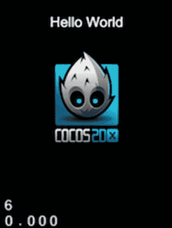

**图 1-2.** Hello World

## 1.5 本示例

本书所有的示例代码可以在 https://github.com/nutcrackify/Rapid_Game_Development_Using_Cocos2d-js 处获得。

### 1.5.1 运行代码示例

有很多方法可以让你运行这些示例代码。我们发现以下步骤可以让你快速地运行示例代码。在终端中运行以下命令。

#### 1.5.1.1 步骤

- 创建一个新的 Cocos2d-js 项目：

```
cocos new codeexamples -l js
```

- 在终端中进入项目文件夹：

```bash
cd codeexamples
```

- 初始化一个空仓库：

```bash
git init
```

- 删除当前文件夹中除`frameworks`文件夹以外的所有文件和文件夹（见图 1-3）。

- `CMakeLists.txt`

- `frameworks`

- `index.html`

- `main.js`

- `manifest.json`

- `res`

- `src`

- 使用以下任一方法将远程（代码样本）添加到本地仓库：

（如果使用 ssh）

```
git remote add origin git@github.com:nutcrackify/Rapid_Game_Development_Using_Cocos2d-js.git
```

（如果使用 https）

```
git remote add origin https://github.com/nutcrackify/Rapid_Game_Development_Using_Cocos2d-js.git
```

- 拉取仓库：

```bash
git pull master
```

- 运行示例：

```bash
cocos run -p web
```

## 1.6 原生部署

除了 Web，你还可以将你的 Cocos2d-js 示例部署到原生平台。以下是用于原生部署的命令。

```
cocos deploy [-h] [-s SRC_DIR] [-q PLATFORM] [-m MODE]
```

- `[-h]`是帮助

- `[-s SRC_DIR]`是源码目录

- `[-q PLATFORM]`是平台

- `[-m MODE]`是模式

除了 Web，你还可以将你的 Cocos2d-js 示例部署到原生平台。以下是：

### Android 设置

如果你已经有了 Android 环境，可以跳过此节。

### 1.6.1. 步骤

- 安装 JDK http://www.oracle.com/java/javase/downloads/

- 下载 Android Studio 或 NDK https://developer.android.com/。

- 解压 NDK，并确保它在 SDK 根目录下。

- 安装 Apache ant https://ant.org/。

在你的 Cocos2d-js 目录下运行以下命令：

```bash
python deploy.py
```

要将项目部署到 Android，通过终端运行：

```bash
cocos deploy -p android -m release
```

### iOS 设置

从 OS X 安装 Xcode。使用以下命令进行 iOS 部署：

`cocos deploy -p ios -m release`

在下一章节中我们将查看架构，让我们继续。

# 第 2 章 架构概述

## 2.1 引擎架构

理解 Cocos2d-js 的架构将为你提供一个坚实的基础。本节不会涵盖详细架构（那超出了本书的范围），但我们将涵盖你后续操作所需的细节。Cocos2d-js 是一个纯 JavaScript 游戏框架。你可以将其编译为 Web 应用并在每个浏览器中运行；然而，API 和对象层次与 Cocos2d-x 相同。因此，通过 JSB 和 SpiderMonkey 的帮助，你的 JavaScript 游戏可以部署为利用 OpenGL/DirectX 核心流水线的原生应用。让我们来看图 2-1 中的架构。

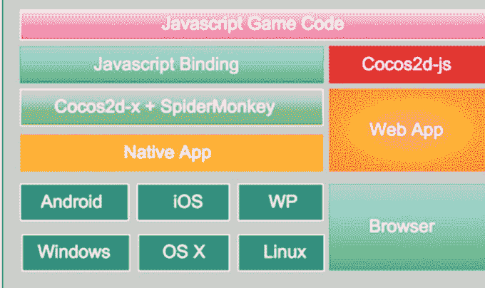

图 2-1. Cocos2d-js stack

## 2.2 JSB

提到，JSB 包含了 JavaScript 与 Cocos2d-x C++ API 的映射，因此当你选择将游戏部署为原生应用时，所有的 API 使用都会通过帮助映射到实际的 C++ API 调用。注意，只有记录过的 Cocos2d-js API 可以映射到原生 API 调用。如果你调用 Cocos2d-js 内部任何未记录的函数，应用在浏览器中可以即箱运行，但当你将其部署为原生应用时可能看不到相同的结果。如果你计划将游戏编译到任何移动平台，建议遵循记录过的 API。

## 2.3 对象层次

Cocos2d-js 基于面向对象的原理，因此所有相关实体都被视为类和对象。考虑图 2-2。

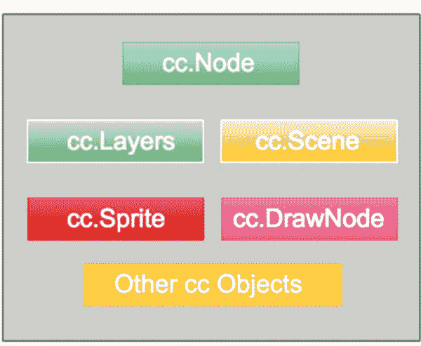

图 2-2. Object hierarchy

Cocos2d-js 中的每个类（除少数工具类外）都继承自`cc.Node`，从 Scene（场景）和 Layer（层）到 Sprites（精灵），它们都是 Node 对象的实例。当你处理 Cocos2d-js 中的任何可见元素时，顶部的根对象都是`cc.Node`。因此，大多数时候你处理的都是 Node 对象。派生对象将根据其定义和需求拥有它们自己的行为和覆盖方法。

## 2.4 部署选项

由于你正在使用的是一个纯 JavaScript 库，因此部署应用程序的选项比仅仅依赖 Cocos 控制台要多得多。

### 2.4.1 部署为混合应用 (Hybrid App)

此选项取决于你的游戏性能。如果你的游戏使用了沉重的渲染周期，则不推荐此选项。

### 2.4.2 使用 Titanium 部署

此选项将允许你将应用作为原生应用部署，但其可行性可能取决于你在游戏中的具体操作。

### 2.4.3 Cocos Console

这是我们推荐将应用程序部署到各种平台的方法，但你可以使用其他的 Cocos2d-x 服务，如 SDKBOX、pluginX 等。

# 第 3 章 深入研究精灵 (Sprites)

## 3.1 引言

精灵是任何 2D 游戏最重要的部分。在开发 2D 游戏时，你会经常遇到这个实体。在 Cocos2d-js 中，该实体由名为`cc.Sprite`的类定义。在本节中，我们将详细探讨这个类，包括它的组织结构、用法、如何制作动画等。那么，让我们开始吧。

## 3.2 Sprite 类

在 Cocos2d-js 中，`cc.Sprite`类用于定义游戏的精灵。该类可以使用图像文件名、初始旋转变换等进行初始化。之后，你可以根据游戏逻辑动态更新 x、y 位置。让我们看看图 3-1 所示的该类是如何组织的。

# 第 3 章 深入研究精灵


当你查看一个精灵时，它有两个主要部分。一个是纹理（Texture），代表图像；另一个是精灵帧（Sprite Frame），代表纹理图像中当前显示精灵的矩形（rect）。纹理由`cc.Texture`表示，精灵帧由`cc.SpriteFrame`表示。让我们来看几个例子。

图 3-1. Sprite 类

## 3.3 单图图像精灵

在`src`文件夹中，创建一个名为`sprite.js`的文件并复制粘贴以下代码：

```
1 var SpriteImageLayer = cc.Layer.extend({
2 sprite:null,
3 ctor:function () {
4
5 this._super();
6
7 var size = cc.winSize;
8 this.sprite = new cc.Sprite(res.Sprite_Image);
```

```
this.sprite.attr({
    x: size.width / 2,
    y: size.height / 2
});
this.addChild(this.sprite, 0);
return true;
```

在`project.json`中包含这个新文件，并在`app.js`中，将场景中现有的层实例替换为`SpriteImageAlign`。

```
var HelloWorldScene = cc.Scene.extend({
    onEnter:function () {
        this.super();
        // 将层替换为 SpriteImageLayer。
        var layer = new SpriteLayer();
        this.addChild(layer);
    }
});
```

在`resources.js`中，需要包含`Sprite_Image`属性；你可以使用你喜欢的图像。

```
var res = {
    ...
    Sprite_Image:"res/sprite_image.png"
};
```

我将使用图 3-2 所示的图像。

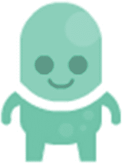

**图 3-2.** sprite_image.png

# 第 3 章 深入研究精灵

记住运行单独层的这些步骤，因为我们将为每个示例创建单独层，这些步骤在后续示例中将不再重复。

如你所示，精灵已用单张图像初始化：

```
this.sprite = new cc.Sprite(res.Sprite_Image);
```

此构造函数将创建一个带有`res.Sprite_Image`的`cc.Texture`实例，并且`cc.SpriteFrame`默认将使用`rect(0,0,spriteWidth,spriteHeight)`初始化，以显示完整图像。因此，输出将如图 3-3 所示。

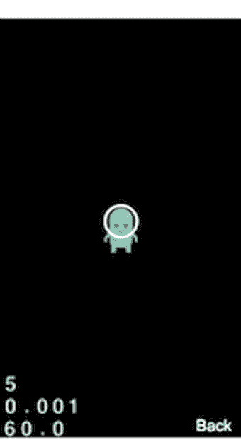

图 3-3. 单图精灵

### 3.3.1 FPS 显示

左下角的显示被称为 FPS 显示，它有三个值：

- 绘制调用 (Draw calls)

- 帧时间 (Delta time)

- 帧率 (Frame rate)

你可以使用`project.json`中的`showFPS`标志来控制 FPS 显示可见性。

#### 3.3.1.1 绘制调用

场景中的每个节点都会进行渲染。随着绘制调用增加，帧时间减小，这与性能成正比。

#### 3.3.1.2 帧时间

绘制调用所需的时间。

#### 3.3.1.3 帧率

每秒渲染的帧数。

## 3.4 使用精灵集 (Sprite Sheet) 的精灵

要将所有资源打包到一个图中，你应该使用图 3-4 所示的精灵帧。


**图 3-4.** sheet.

# 第 3 章 深入研究精灵

在`src`中，创建一个名为`spritesheet.js`的文件并复制以下代码：

```
var SpriteImageLayer = cc.Layer.extend({
  sprite:null,
  ctor:function () {
    this._super();
    var size = cc.winSize;
    this.sprite = new cc.Sprite(res.Sprite_Image).attr({
      x: size.width / 2,
      y: size.height / 2,
    });
    this.addChild(this.sprite, 0);
    return true;
  }
});
```

## 3.5 精灵动画 (Sprite Animation)

如之前所述，`cc.SpriteFrame`负责显示当前帧，这使我们能够创建基于帧的动画。在`src`中，创建一个名为`spriteanimation.js`的文件并复制以下代码：

```javascript
var SpriteAnimationLayer = cc.Layer.extend({
  sprite:null,
  ctor:function () {
    this._super();
    var size = cc.winSize;
    this.sprite = new cc.Sprite(res.Sprite_Image).attr({
      x: size.width / 2,
      y: size.height / 2,
    });
    this.addChild(this.sprite, 0);
    return true;
  }
});
```

# 第 3 章 深入了解精灵

帧动画背后的思想是我们在特定的间隔内运行每一帧，以便使其看起来像一段动画序列。在之前的代码中，walk01 到 walk11 代表精灵集集中带有矩形区域（rects）的帧。如果我们将这些帧组合在一起并运行，它看起来就像一个行走动画。

使用此帧矩形数组创建一个`cc.SpriteFrame`实例（见图 3-6）：

```javascript
var texture = cc.textureCache.addImage(res.SpriteSheet);
var animFrames=[];
for(var index in frameDatas) {
  var spriteFrame = new cc.SpriteFrame(texture, frameDatas[index]);
  var animFrame = new cc.AnimationFrame();
  animFrame.initWithSpriteFrame(spriteFrame, 1, null);
  animFrames.push(animFrame);
}
```

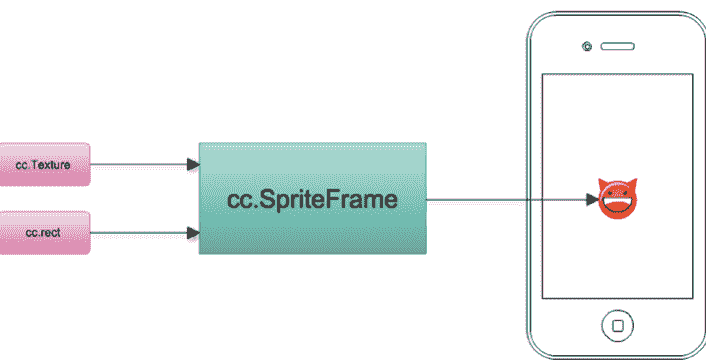

**图 3-6.** SpriteFrame

在本例中，我们手动创建了`cc.SpriteFrame`实例，因此它需要一个精灵集的纹理实例。因此，我们将精灵集添加到纹理缓存中，返回纹理实例，该实例可用于创建所有精灵帧。

最后，使用来自`cc.AnimationFrame`的图像列表和 0.08 秒的时间间隔创建了用于执行动画的`cc.Animation`实例。

输出将是一个漂亮的行走动画。

在前面的案例中，帧数据是手动构建的，但现实中，精灵集将借助 TexturePack 等工具从单张图像创建，并生成关联的数据文件。在 Cocos2d 中，它是一个包含所有与精灵集相关的帧数据的 PList 文件。在下一个示例中，我们将将会看到如何使用 PList 创建帧动画。

# 第 3 章 深入了解精灵

## 3.6 使用 PList 数据进行精灵帧动画

我们使用 TexturePack 从单张图像创建了相同的精灵集，并生成了 PList 文件。见图 3-7。

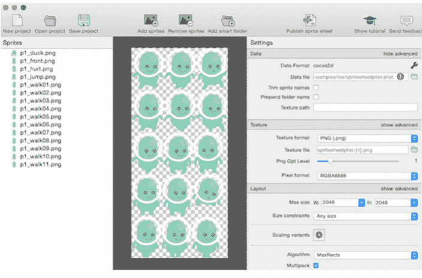

图 3-7. TexturePack 生成的精灵集


生成 PList 时，请确保你选择的数据格式为 `Cocos2d`。图 3-8 显示了生成的纹理。

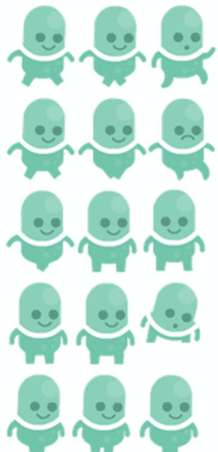

**图 3-8.** 来自 TexturePack 的精灵集

你可以查看 `https://github.com/nutcrackify/Rapid_Game_Development_Using_C2d` 示例项目中 `res` 文件夹中的 PList 数据文件。在 `src` 中创建一个名为 `plistanimation.js` 的文件并复制以下代码：

```javascript
var PListAnimation = cc.Layer.extend({
  sprite:null,
  ctor:function () {
    this._super();
    var size = cc.winSize;
    cc.spriteFrameCache.addSpriteFrames(res.Sprite_Sheet1_P, res.Sprite_Sheet1);
    // 使用帧数据创建 SpriteFrame 和 Animation
    var animFrames=[];
    for(var i=1;i<12;i++) {
      var str = "p1_walk" + (i < 10 ? "0" : i) + ".png";
      var spriteFrame=cc.spriteFrameCache.getSpriteFrame(str);
      animFrames.push(spriteFrame);
    }

    // 创建一个空精灵
    this.sprite = new cc.Sprite();
    this.sprite.attr({
      x: size.width / 2,
      y: size.height / 2
    });

    this.addChild(this.sprite, 0);

    var animation = new cc.Animation(animFrames, 0.08);
    this.sprite.runAction(cc.animate(animation)).repeatForever();

    return true;
  }
});
```

在 `resource.js` 中，包含 `Sprite_Sheet1_P` 和 `Sprite_Sheet1` 变量的 List 和精灵集文件已添加到帧缓存：

```javascript
cc.spriteFrameCache.addSpriteFrames(res.Sprite_Sheet1_P, res.Sprite_Sheet1);

var animFrames=[];
for(var i=1;i<12;i++) {
    var str = "p1_walk" + (i < 10 ? "0" : i) + ".png";
    var spriteFrame=cc.spriteFrameCache.getSpriteFrame(str);
    animFrames.push(spriteFrame);
}
```

根据 List 数据和精灵集，可以使用 `getSpriteFrame` 创建精灵帧：

现在我们有了可以使用 `cc.Animation` 类进行动画的列表帧：

```javascript
var animation = new cc.Animation(animFrames, 0.08);
this.sprite.runAction(cc.animate(animation));
```

这是没有没有 PList 的相同行走动画（等待，这是我们使用原始帧数据做的相同行走动画）。

## 3.7 带精灵的 TextureCache

纹理缓存是精灵构造的重要部分，用于在内存中缓存纹理数据，以便当再次引用相同的纹理时将从缓存中加载。这提高了游戏的整体性能并优化了内存。见图 3-9。

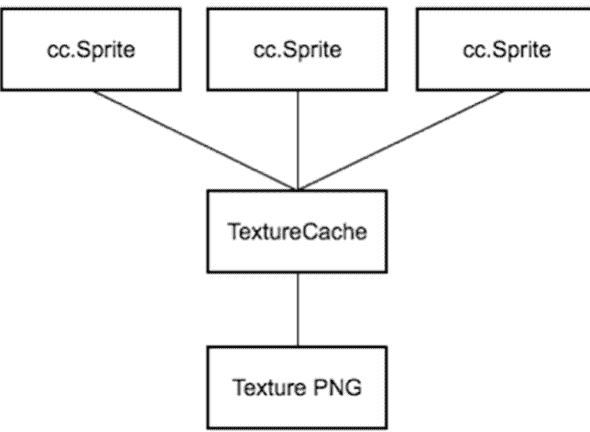

图 3-9. 纹理缓存

每当你使用图像文件创建精灵时，该文件会被加载到 `TextureCache`，并从缓存创建一个 `Texture2D` 实例。在之前的示例中，你看到了如何将精灵集加载到纹理缓存并用它创建 `SpriteFrame` 实例。见图 3-10。

## 3.8 带精灵的 SpriteFrameCache

与 `TextureCache` 类似，`SpriteFrameCache` 用于缓存 `cc.Sprite` 使用的 `SpriteFrame`。如果你有一个精灵集，可以将单个 `SpriteFrame` 缓存并在需要时使用。这在之前的代码和图 3-11 中已说明。

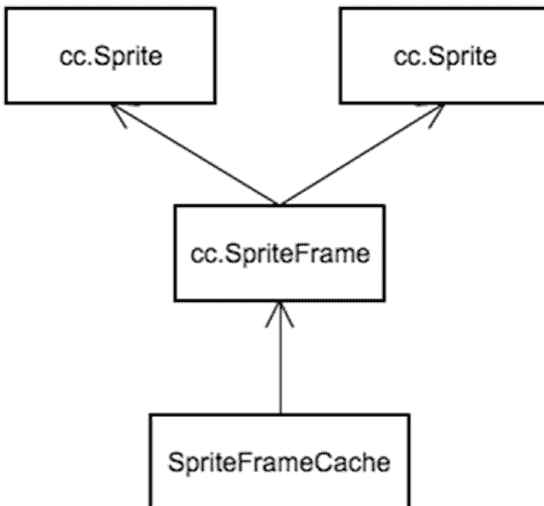

**图 3-11.** SpriteCache 共享 SpriteFrame

## 3.9 批处理 (Batching)

精灵批处理是一种使用单次绘制调用合并多个精灵渲染的技术，前提是精灵使用相同的纹理或纹理集。

### 3.9.1 SpriteBatchNode

`cc.SpriteBatchNode` 用于将多个精灵合并为单次绘制调用的类。让我们来看示例。首先，让我们创建具有相同精灵集但不同精灵矩形的四个独立精灵：

```javascript
this.sprite1 = new cc.Sprite(res.Sprite_Sheet,cc.rect(438,93,64,94));
this.sprite1.attr({
  x: size.width / 2,
  y: size.height / 1.5
});

this.sprite2 = new cc.Sprite(res.Sprite_Sheet,cc.rect(73,0,72,97));
this.sprite2.attr({
  x: size.width / 2,
  y: size.height / 2
});

this.sprite3 = new cc.Sprite(res.Sprite_Sheet,cc.rect(219,0,72,97));
this.sprite3.attr({
  x: size.width / 2,
  y: size.height / 3
});

this.sprite4 = new cc.Sprite(res.Sprite_Sheet,cc.rect(365,0,72,97));
this.sprite4.attr({
  x: size.width / 2,
  y: size.height / 5
});
```

现在，创建一个相同精灵集的 `SpriteBatchNode` 实例：

```javascript
this.spritebatch=new cc.SpriteBatchNode(res.Sprite_Sheet);
```

将精灵添加到 `SpriteBatchNode`：

```javascript
this.spritebatch.addChild(this.sprite1, 0);
this.spritebatch.addChild(this.sprite2, 0);
this.spritebatch.addChild(this.sprite3, 0);
this.spritebatch.addChild(this.sprite4, 0);
```

最后，将 `spritebatch` 添加到层中：

```javascript
this.addChild(this.spritebatch);
```

现在，下面的代码应该是这样的：

```javascript
var SpriteBatchLayer = BaseSampleLayer.extend({
  sprite:null,
  ctor:function () {
    this._super();
    var size = cc.winSize;
    this.sprite1 = new cc.Sprite(res.Sprite_Sheet,cc.rect(438,93,64,94));
    this.sprite1.attr({
      x: size.width / 2,
      y: size.height / 1.5
    });

    this.sprite2 = new cc.Sprite(res.Sprite_Sheet,cc.rect(73,0,72,97));
    this.sprite2.attr({
      x: size.width / 2,
      y: size.height / 2
    });

    this.sprite3 = new cc.Sprite(res.Sprite_Sheet,cc.rect(219,0,72,97));
    this.sprite3.attr({
      x: size.width / 2,
      y: size.height / 3
    });

    this.sprite4 = new cc.Sprite(res.Sprite_Sheet,cc.rect(365,0,72,97));
    this.sprite4.attr({
      x: size.width / 2,
      y: size.height / 5
    });

    this.spritebatch=new cc.SpriteBatchNode(res.Sprite_Sheet);
    this.spritebatch.addChild(this.sprite1, 0);
    this.spritebatch.addChild(this.sprite2, 0);
    this.spritebatch.addChild(this.sprite3, 0);
    this.spritebatch.addChild(this.sprite4, 0);

    this.addChild(this.spritebatch);

    return true;
  }
});
```

# 第 3 章 深入研究精灵（Sprites）

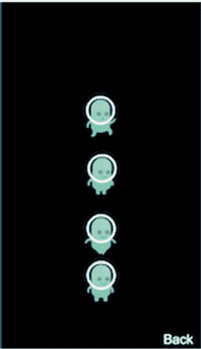

**图 3-12.** SpriteBatchNode 渲染

然而，原生渲染器支持自动批处理，这意味着如果你进行原生部署，不需要 `SpriteBatchNode` 自动支持精灵批处理。

## 3.10 分辨率策略

分辨率策略关于使游戏适应不同的屏幕分辨率和配置。`Cocos2d-js` 提供了一组用于适配游戏的分辨率策略。没有这些策略，你需要根据屏幕分辨率手动缩放游戏内容。

预策略有两种：预定义策略由容器（container）和内容（content）策略的不同组合组成，它们在原生部署中也支持。通过自定义策略，你可以结合可用容器和内容策略的组合定义自己的分辨率策略，但自定义策略仅支持 Web 部署。让我们来看一下。

### 3.10.1 术语

为了完全理解分辨率策略，你需要了解某些术语。你可能已经知道，在基于 Web 的 `Cocos2d-js` 游戏中，你的游戏托管在 canvas（画布）中。见图 3-13。

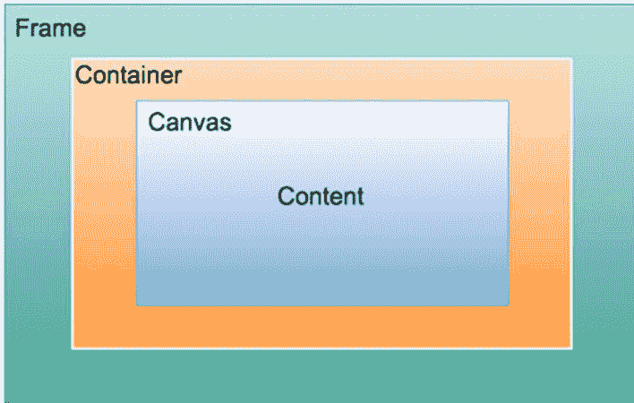

图 3-13. 分辨率策略使用的术语

### 3.10.1.1 Frame（帧）

代表画布 外部的容器，如果你使用 Cocos 控制台生成的默认 `index.html`，它通常是一个 `body` 元素。

### 3.10.1.2 Container（容器）

`Cocos2d-js` 将你的 canvas 封装在一个 `div` 元素中，然后将封装的内容再次添加到 canvas 的原始容器元素中。

### 3.10.1.3 Content（内容）

canvas 内部所有不是 DOM 的部分。

### 3.10.1.4 Viewport（视口）

Viewport 代表 canvas 的世界矩形；它是像素为单位的 canvas 坐标。

### 3.10.1.5 Letter Boxing（黑边）

当容器的宽度匹配帧但高度不匹配时，就会出现黑边（图 3-14）。如果宽/高比例与帧不匹配，并且基于你使用的分辨率策略，就会发生这种情况。


图 3-14. 黑边

### 3.10.1.6 Pillar Boxing（左右黑边）

当容器的高度匹配帧但宽度不匹配时，就会出现柱状黑边（见图 3-15）。这种情况的原因与黑边相同。

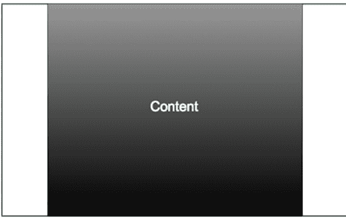

## 3.10.2 预定义分辨率策略

`Cocos2d-js` 五种预定义策略，我们现在进行讨论。

### 3.10.2.1 SHOW_ALL

这将容器缩放到到容器边界内的最大尺寸；当前场景中的所有内容都将可见。

### 3.10.2.2 NO_BORDER

这将容器缩放以填充帧，使得帧中不会有任何可见区域，同时保持提供的宽度和高度的比例。

### 3.10.2.3 EXACT_FIT

这将容器缩放以适应帧。注意，提供的宽度和高度比例将不会被保持。

### 3.10.2.4 FIXED_WIDTH

这将容器的宽度匹配帧的宽度，并缩放高度以匹配宽/高比例。如果宽/高比例不匹配，可能会看到黑边。

### 3.10.2.5 FIXED_HEIGHT

这将容器的高度匹配帧的高度，并缩放宽度以匹配宽/高比例。如果宽/高比例不匹配，可能会使用柱状黑边。

## 3.10.3 如何使用

在 `main.js` 文件中，有一个 `cc.game.onStart` 回调。你必须使用以下代码来设置分辨率配置：

```
cc.view.setDesignResolutionSize(320, 480, cc.RESOLUTION_POLICY.SHOW_ALL);
```

前两个参数是宽度和高度（即游戏的宽高比例），第三个参数是分辨率策略。

## 3.10.4 自定义分辨率策略

如我们之前看到的，预定义策略是容器和内容策略的组合。例如，`SHOW_ALL` 策略是 `PROPORTION_TO_FRAME` 和 `SHOW_ALL` 的组合，如下：

```
cc.RESOLUTION_POLICY.SHOW_ALL = new cc.ResolutionPolicy
(cc.ContainerStrategy.PROPORTION_TO_FRAME, cc.ContainerStrategy.SHOW_ALL);
```

这是 `SHOW_ALL` 的内部实现。你可以通过预定义的容器和内容策略的组合来定义自己的策略。

## 第 4 章 处理输入与事件

```javascript
onTouchBegin: function (touch, event) {

  var target = event.getCurrentTarget();

  var locationNode = target.convertToNodeSpace(touch.getLocation());

  var s = target.getContentSize();
  var rect = cc.rect(0, 0, s.width, s.height);
  // 检查点击区域
  if (cc.rect.containsPoint(rect, locationNode)) {
    cc.log('Touch began: Inside the sprite');
    // 返回了 true 以触发 OnTouchMove
    return true;
  }
  cc.log('Touch began: Outside the sprite');
  return false;
}
```

```javascript
onTouchMoved: function (touch, event) {
  var target = event.getCurrentTarget();
  target.setPosition(touch.getLocation());
}
touchEnded: function (touch, event) {
  cc.log('Touch end');
}
```

```javascript
//为精灵添加事件监听器
cc.event.addListener(listener, this.sprite);
return true;
```

在这个示例中，精灵（sprite）可以通过单指拖拽。事件监听器是通过事件名称 `cc.EventListener.TOUCH_ONE_BY_ONE` 创建的，并将 `swallowTouches` 设置为 `true`。当多个监听器针对同一个事件名称附加到同一个目标时，第一个 `swallowTouches: true` 的监听器将拦截该事件，且不会将其传递给下一个监听器。

```javascript
cc.eventManager.addListener(listener, this.sprite);
```

在这种情况下，尽管精灵是目标，但屏幕上的每次轻触都会触发触摸事件。为了确认触摸是否发生在精灵内部，编写了以下代码：

```javascript
var target = event.getCurrentTarget();
var locationNode = target.convertToNodeSpace(touch.getLocation());
var s = target.getContentSize();
```


```javascript
var rect = cc.rect(0, 0, s.width, s.height);

// 检查点击区域
if (cc.rect.containsPoint(rect, locationInNode)) {
  cc.log('Touch began: Inside the sprite');
  // 返回了 true 以触发 OnTouchMove
  return true;
}
```

在`onTouchBegan`中，检查了触摸是否发生在精灵内部的条件。如果触摸在精灵内部，将返回`true`，这样触摸移动的手势将将重定向到`TouchMoved`函数；目标位置将根据触摸移动进行改变。

### 4.2.2 多触控制

多触监听器可以使用事件名称`cc.EventListener.TOUCH_ALL_AT_ONCE`创建。参考下面的代码段：

```javascript
var listener = cc.EventListener.create({
  event: cc.EventListener.TOUCH_ALL_AT_ONCE,
  swallow: true,

  touchesBegan: function (touches, event) {
    ......
  },
  onTouchesMoved: function (touches, event) {
    ......
  },
  onTouchesEnded: function (touches, event) {

  }
});
```

因此，多触的回调函数与单触不同。它拥有`onTouchesBegan`、`onTouchesMoved`和`onTouchesEnded`函数。`touches`对象将包含每次触摸的详细信息以及触摸 ID。大多数情况下，多触用于地图缩放、播放控制等场景。

### 4.3 鼠标事件

与触摸一样，鼠标事件通过事件名称`cc.EventListener.MOUSE`引用。在`src`文件夹中，创建一个`mouseevents.js`文件并将代码复制其中：

```javascript
var MouseEventsLayer = cc.Layer.extend({
  sprite:null,
  ctor: function () {
    this.super();

    var size = cc.winSize;

    this.sprite = new cc.Sprite(res.Sprite_Image);
    this.sprite.attr({
      x: size.width / 2,
      y: size.height / 2
    });
    this.addChild(this.sprite, 0);
    this.sprite.tag = 'TouchTarget';

    // 创建事件监听对象
    var listener = cc.EventListener.create({
      event: cc.EventListener.MOUSE,
      swallowTouches: true,
      onMouseDown: function (event) {
        var target = event.getCurrentTarget();
        var locationInNode = target.convertToNodeSpace(event.getLocation());

        var s = target.getContentSize();
        var rect = cc.rect(0, 0, s.width, s.height);

        // 检查点击区域
        if (cc.rectContainsPoint(rect, locationInNode)) {
          cc.log('Mouse Down: Inside the sprite');
          this.ismousedown = true;
        } else {
          cc.log('Mouse Down: Outside the sprite');
          return false;
        }
      },
      onMouseMove: function (event) {
        if(this.ismousedown) {
          var target = event.getCurrentTarget();
          target.setPosition(event.getLocation());
        }
      },
      onMouseUp: function (event) {
        cc.log('Mouse Up');
        this.ismousedown = false;
      }
    });
```

## 第 5 章 添加 GUI

### 5.1 介绍

GUI 是任何游戏中的另一个重要组成部分。它显示 HUD 显示、分数、任何所需的文本以及播放和暂停等按钮。Cocos2d-js 提供了预定义的节点类型来表示 GUI 元素。让我们逐一查看。

### 5.2 标签 (Label)

如果你想在游戏中显示任何文本，可以使用`Label`对象。Cocos2d-js 提供了两种类型的标签。

#### 5.2.1 使用真类型字体的 Label

你可以定义一个使用自定义字体的标签。通常，这些字体是`.ttf`文件格式。在 Cocos2d-js 中，可以使用`cc.LabelTTF`类来创建这样的标签。让我们来看它的语法：

- `var Label= new cc.LabelTTF(text, fontName, fontSize, dimensions, alignment, vAlignment)`

- `[string] text` - 代表你想要显示的文本

- `[string] fontName` - 代表加载的`.ttf`字体名称

- `[Number] fontSize` - 代表字体大小

- `[cc.Size] dimensions` - 标签的宽度和高度；如果不设置，将自动计算

- `HAlignment` - 代表标签外文本的水平对齐；它可以是以下值之一：`{cc.TEXT_ALIGNMENT_LEFT | cc.TEXT_ALIGNMENT_CENTER | cc.TEXT_ALIGNMENT_RIGHT}`

- `vAlignment` - 标签内文本的垂直对齐；它可以是以下值之一：`{cc.VERTICAL_TEXT_ALIGNMENT_TOP|cc.VERTICAL_TEXT_ALIGNMENT_CENTER|cc.VERTICAL_TEXT_ALIGNMENT_BOTTOM}`

所有这些值都可以使用相应的函数`set`进行动态更改。请参考文档以获取有关这些函数的更多信息。你将在后续章节中看到真实示例。

#### 5.2.2 使用位图字体的 Label

在位图字体中，每个字符由一个图像表示。所有字符应该位于一个`png`文件中，字体信息将存在于(`.fnt`)文件中。`cc.LabelBMFont`类用于表示这种标签类型。让我们看看如何使用：

```
var label = new cc.LabelBMFont(text, fntFile, width, alignment, imageOffset)
```

- `[string] text` - 代表你想要显示的文本

- `[fntFile] fntFile` - 代表`.fnt`文件名

- `[width] width` - 代表标签的宽度

- `alignment` - 代表图像标签的水平对齐。可以是以下值之一：`{cc.TEXT_ALIGN_LEFT|cc.TEXT_ALIGNMENT_CENTER|cc.TEXT_ALIGNMENT_RIGHT}`

- `[point] imageOffset` - 代表图像中心需要对齐的`x,y`偏移点

#### 5.2.3 示例

在`src`文件夹中，创建一个名为`labeledemo.js`的文件并将以下代码复制到其中：

```
var LabelDemoLayer = cc.Layer.extend(
  sprite:null,
  ctor:function () {
    this._super();

    var size = cc.winSize;
    var colorLayer = new cc.LayerColor(cc.color(142,29,42));
    this.addChild(colorLayer);
    this.Label1 = new cc.LabelTTF('Default Font Label','', 32);

this.Label1.attr({
x: size.width / 2,
y: size.height / 1.3
});
this.addChild(this.Label1);

this.Label2 = new cc.LabelTTF('Custom Font Label','Abduction', 32);
this.Label2.attr({
x: size.width / 2,
y: size.height / 1.5
});
this.addChild(this.Label2);

this.Label3 = new cc.LabelTTF('Label With Stroke','Abduction', 32);
this.Label3.attr({
x: size.width / 2,
y: size.height / 1.9
});
this.addChild(this.Label3);

this.Label4 = new cc.LabelTTF('Label With Shadow','Abduction', 32);
this.Label4.attr({
x: size.width / 2,
y: size.height / 2.3
});
this.addChild(this.Label4);

this.Label5 = new cc.LabelFont('Bitmap Font', res.BM_Font);
this.Label5.attr({
x: size.width / 2,
y: size.height / 2.9
});
this.addChild(this.Label5);

return true;
}
```

按照常例，运行此层。让我们看看标签是如何使用的。首先，包含了`cc.Layer`作为子节点以便设置背景颜色：

```
var colorLayer = new cc.LayerColor(cc.color(142,29,42));
this.addChild(colorLayer);
```

第一个标签使用的是“默认字体名称”标签，字体名称指定为空字符串，因此它会回退到系统的默认字体。第二个标签使用加载的字体创建；在这种情况下，我使用了`Abduction`，它在`resource.js`中指定如下：

```
var res = {
  Custom_TTF:"res/Abduction.ttf",
....
};
```

因此，在应用加载期间，该字体与`res`对象中的其他资源一起加载到内存中：

```
this.Label2 = new cc.LabelTTF('Custom Font Label','Abduction', 32)
this.Label2.attr({
  x: size.width / 2,
  y: size.height / 1.5
})
this.addChild(this.Label2);
```

指定字体名称`'Abduction'`发生在第二个参数中。直接在标签中指定字体文件名将不起作用。

第三个标签使用了相同的自定义字体`'Abduction'`；区别在于它为标签开启了描边：

```
this.Label3.enableStroke(cc.color(0,0,0),10);
```

第四个标签带有阴影创建：

```javascript
this.Label4.enableShadow(cc.color(0,0,0), 50, 50);
```

第五个标签使用位图字体：

```javascript
this.Label5 = new cc.LabelFont('Bitmap Font', res.BM_Font);
```

之后，所有的菜单项实例都已创建并作为子节点添加到`this.Menu`中。第一个`menuItem`使用`cc.Label`实例创建，如下所示：

```
var label-new = new cc.LabelTTF('MenuItem with label',36);
this.MenuItem1 = new cc.MenuItemLabel(label,'onClicked',this);
```

稍后它会被定位并作为`this.Menu`的子节点。第二个`MenuItem`使用两个图像创建：普通状态图像和选中状态图像。所示：

```
this.MenuItem2 = new cc.MenuItemImage(res.MenuItemImage_Normal, res.MenuItemImage_Selected, null, 'onClicked', this);
```

与上一个示例一样，此层中已经添加了`LayerColor`，因此输出结果将类似于图 5-2。

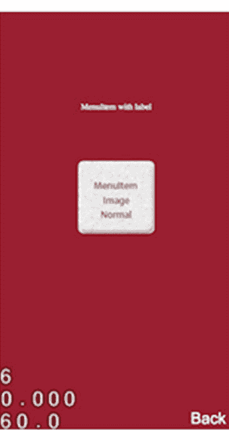

图 5-2. MenuItem

### 5.4 其他 GUI 元素

除了模块和标签外，扩展模块中还可以使用其他 GUI 元素，例如复选框和按钮。为了使用扩展类，我们需要将扩展模块添加到我们的项目中。在`project.json`的`modules`属性中，向数组列表添加`'extension'`：

- `"modules" : ["cocos2d","extensions"]`,

这些额外的用户界面元素可以在父对象`ccui`下使用。让我们来看看。在`src`文件夹中，创建一个`otherudidemo.js`文件，并将以下代码复制其中：

```
var OtherUIDemoLayer = cc.Layer.extend({
  sprite:null,
  ctor:function () {
    this._super();
    var size = cc.winSize();
    var colorLayer = new cc.LayerColor(cc.color(142,29,42));
    this.addChild(colorLayer)
    this.uiButton = new ccui.Button(res.ButtonImage,res.Button_Selected);
    this.uiButton.attr({
      x:size.width/2,
      y:size.height/1.3
    });
    this.addChild(this.uiButton)
    this.uiCheckbox = new ccui.Checkbox(res.CheckBox_Normal,res.CheckBox_Selected);
    this.uiCheckbox.attr({
      x:size.width/2,
      y:size.height/2
    });
    this.addChild(this.uiCheckbox)
    return true;
  }
});
```

在此处，创建了一个带有普通图像和选中图像的按钮实例：

```
this.uiButton = new ccui.Button(res.ButtonImage,res.ButtonImage_Selected);
```

并且创建了一个复选框实例，同样使用了普通和选中图像：

```
this.uiCheckBox = new ccui.Checkbox(res.Checkbox_Normal,res.Checkbox_Selected);
```

如果你运行上一个层，输出结果将类似于图 5-3。

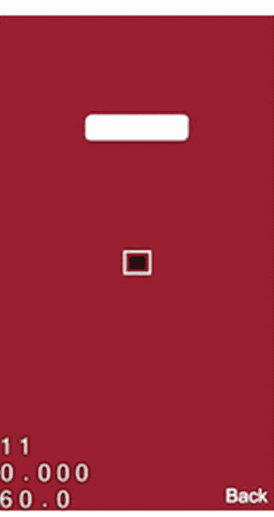

图 5-3. 其他 GUI 元素

## 第 6 章 动画之旅

### 6.1 简介

动画是获取任何优秀游戏的关键，因为它能让你的游戏动画变得酷炫且具有视觉吸引力，并帮助你获取更多用户。具有视觉吸引力的游戏会自我营销。花点时间看看 Google Play 和 App Store 上畅销的游戏。顶级游戏使用清晰且细节丰富的动画来提升用户体验并吸引用户。深呼吸，因为我们将查看 Cocos2d-js 中动画系统的细节。让我们开始吧。

### 6.2 动作 (Actions)

动作（Actions）是 Cocos2d-js 中用于精灵（sprite）动画的构造结构。动作会随时间改变精灵的属性，从而使精灵以我们想要的方式进行动画。有几种类型的动作可以应用于精灵上来实现动画。让我们来看一个简单的例子：

```
1 var action = cc.moveBy(2, cc.p(size.width - 40, size.height - 40));
2 this.sprite.runAction(action);
```

在这个示例中，使用`cc.moveTo`函数创建对象。任何动作都可以使用`runAction`方法在精灵上运行。该方法通常属于`cc.Node`，除了精灵之外，我们还可以对任何具有`cc.Node`为父节点或顶层父对象的对象（例如层、场景等）。基本上，创建动作有两种变体。

#### 6.2.1 By 和 To 动作

之前的代码是 By 变体的示例。让我们来看带有`To:`版本的相同示例：


```javascript
1 var action = cc.moveTo(2, cc.p(size.width - 40, size.height - 40));
2 this.sprite.runAction(action);
```

`By` 和 `To` 动作之间的区别在于，`To` 会将目标属性值动画到绝对值，而 `By` 会将目标属性值动画到相对值（例如：如果你有一个位置在 `(10,10)` 的精灵，并使用 `moveBy` 动作以 `(10,10)` 进行动画）。

## 6.3 可用动作

以下是你可以应用的动作列表。组合包括 `By` 和 `To`。

### 6.3.1 Move

该动作用于移动：

```
moveBy(2, cc.p(size.width - 40, size.height - 40));
```

### 6.3.2 Jump

该动作用于跳跃：

```
Jump(2, cc.p(size.width - 40, size.height - 40)), 50, 10);
```

### 6.3.3 Rotation

该动作用于动画旋转：

```
rotateBy(2, 90);
```

### 6.3.4 Scale

该动作用于缩放：

```
scaleBy(2, 1.5);
```

### 6.3.5 Skew

该动作类似于缩放，但它使用了偏移值：

```
skewBy(2, 30);
```

### 6.3.6 Tint

该动作用于动画节点的 `RGB` 通道：

```
tintTo(2, 255, 255, 255);
```

### 6.3.7 Bezier

该动作用于通过贝塞尔曲线移动目标：

```
var bezier = [[cc.p(0, windowSize.height / 2), cc.p(300, -windowSize.height / 2), cc.p(300, 100)];
var bezierForward = new cc.BezierBy(3, bezier);
var bezierTo = new cc.BezierTo(3, bezier);
```

### 6.3.8 Cardinal Spline

这类似于贝塞尔。目标将通过三次样条曲线移动：

```
cardinalSplineTo(3, array, 0);
```

## 6.4 缓动 (Easing)

默认情况下，所有随时间线性动画节点属性的动作都称为线性插值。这种动画看起来很直白。当你想要为动画添加自然效果时，你的动画需要一个缓动函数。见图 6-1。

在 `Cocos2d-js` 中，有超过 26 种类型的缓动。对于所有缓动，用法方法都是相同的。让我们来看一个例子：

```javascript
var easing=cc.easeBackIn();
//或者
var easing=new cc.EaseBackIn();
action.easing(easing);
```

太简单了！在这个例中，我使用了 `EaseBackIn` 类来创建一个缓动对象，或者你也可以使用单例 `cc.easeBackIn` 对象来运行你的动作。我更倾向于第一种方法。让我们来看看 `Cocos2d-js` 中可用的缓动函数列表。记住：所有缓动函数的用法都是相同的。

- `cc.EaseBackIn`
- `cc.EaseBackInOut`
- `cc.EaseBackOut`
- `cc.EaseBezierAction`
- `cc.EaseBounce`
- `cc.EaseBounceIn`
- `cc.EaseBounceInOut`
- `cc.EaseBounceOut`
- `cc.EaseCircleActionIn`
- `cc.EaseCircleActionInOut`
- `cc.EaseCircleActionOut`
- `cc.EaseCubicActionIn`
- `cc.EaseCubicActionInOut`
- `cc.EaseCubicActionOut`
- `cc.EaseElastic`
- `cc.EaseElasticIn`
- `cc.EaseElasticInOut`
- `cc.EaseElasticOut`
- `cc.EaseExponentialIn`
- `cc.EaseExponentialInOut`
- `cc.EaseExponentialOut`
- `cc.EaseQuadraticActionIn`
- `cc.EaseQuadraticActionInOut`
- `cc.EaseQuadraticActionOut`
- `cc.EaseQuarticActionIn`
- `cc.EaseQuarticActionInOut`
- `cc.EaseQuarticActionOut`
- `cc.EaseQuinticActionIn`
- `cc.EaseQuinticActionInOut`
- `cc.EaseQuinticActionOut`
- `cc.EaseRateAction`
- `cc.EaseIn`
- `cc.EaseInOut`
- `cc.EaseOut`
- `cc.EaseSineIn`
- `cc.EaseSineInOut`

这个列表将满足你所有的缓动需求。所有的缓动都源自基类 `cc.ActionEase`。

## 6.5 序列 (Sequence)

例如，需要在一个节点上按顺序执行的两个或多个动作。`Sequence` 将帮助我们实现这一点。让我们来看例子：

```javascript
var seq = new cc.Sequence([action1,action2]);
this.sprite.runAction(seq);
```

`cc.Sequence` 接受两种参数类型：一个是动作数组，另一个将在本节稍后讨论。它可以通过节点的 `runAction` 制函数来运行，就像任何其他动作一样。

### 6.5.1 反转序列 (Reversing Sequence)

一旦创建了序列，就可以将其反转并运行在任何节点上，如下：

```javascript
this.sprite.runAction(seq.reverse());
```

`reverse` 函数将反转序列中的动作，并返回一个新的序列实例。

### 6.5.2 重复序列 (Repeating Sequence)

一旦创建了序列，我们可以有限次数地重复动作，也可以无限重复。看这里：

```javascript
// 重复序列 5 次
this.sprite.runAction(seq.repeat(5));

// 无限重复 sprite 序列
this.sprite.runAction(seq.repeatForever());
```

序列的 `repeat` 和 `repeatForever` 函数用于此目的。

### 6.5.3 动作结束回调 (Action End Callback)

在序列对象中，可以为每个动作附加一个结束回调函数。让我们来看例子：

```javascript
var seq=new cc.Sequence(action1,cc.callFunc(function(){/*action1 end callback*/}
this),
action2,cc.callFunc(function(){/*action2 end callback*/}
this));
```

如前所述，`Sequence` 接受两种参数类型。一个是动作数组，另一个是一系列动作及其动作结束回调，如刚才所示。

## 6.6 并发执行 (Spawn)

在某些场景，你希望在一个节点上同时执行两个或多个动作。`Spawn` 用于此目的：

```javascript
var spawn=new cc.Spawn([action1,action2])
this.sprite.runAction(spawn);
```

如你所见，语法与 `Sequence` 类似。它接受一个要同时执行的动作数组。在同时执行多个动作时要小心，因为如果使用不当，可能会产生奇怪的效果。

## 6.7 停止动作 (Stopping an Action)

每个动作都可以在运行时被停止。节点的 `stopAction` 函数用于此目的：

```javascript
sprite.stopAction(action);
```

这会立即停止该动作，无论其状态如何。你可以将其用于用户操作或任何需要立即停止动作的动态触发器。

## 6.8 精灵帧动画 (Sprite Frame Animation)

在第 3 章中，我们看到了如何使用精灵图集制作精灵帧动画。那一章更多侧重于精灵，而本节将从动画的角度对其提供详细解释。精灵中的每一个图像部分都可以使用带有 `rect` 坐标的 `SpriteFrame` 进行分类。`Animation` 类可以在精灵上执行精灵帧动画序列。让我们来看例子：

```javascript
var animation = new cc.Animation(spriteFrames, 0.08);
this.sprite.runAction(cc.animate(animation).repeatForever()); // 或者 
cc.Animation().pattern 可以使用。
```

第一个参数是 `cc.SpriteFrame` 实例的数组，第二个参数是延迟。像 `Action` 类一样，它也有 `repeat` 和 `repeatForever` 函数。

## 6.9 调度器与更新 (Schedulers and Update)

在 `Cocos2d-js` 中，存在一个更新循环，即一个主循环；每个 `cc.Node` 都能接收更新通知，然后该节点必须订阅它。这种订阅机制在实现时考虑了性能因素。

在 `cc.Node` 的构造函数中，需要调用以下方法：

```javascript
this.scheduleUpdate();
```

完成后，你就可以定义一个 `update` 方法：

```javascript
update:function(dt)
```

## 第 7 章 为你的游戏添加物理效果

## 7.4 Chipmunk 刚 (Body)

物理对象由一个刚（body）定义；刚具有形状以及与之相关的精灵（sprite）数据。让我们添加圆形和矩形来创建 `Chipmunk` 空间：

```javascript
addPhysicsCircle: function() {
  var width=50,height=50,mass=1;
  this.phBodyCircle = this.space.addBody(new cp.Body(mass,
    mass=0,width*0.5,cc.p(0,0)));
  this.phBodyCircle.setPos(cc.p(cc.Size.width * 0.5,cc.Size.
    height * 0.1));
  //4
  var phShape = this.space.addShape(new cp.CircleShape(this.
    width,cc.p(0, 0));
  phShape.setFriction(0);
  phShape.setElasticity(1);
  phShape.setCollisionType(0);
}
addPhysicsBox: function() {
  var width=50,height=50,mass=1;
  this.phBodyBox = this.space.addBody(new cp.Body(mass,
    cp.momentForBox(mass, \
    width,height));
  this.phBodyBox.setPos(cc.p(cc.Size.width * 0.5,cc.Size.
    height * 0.1));
  //4
  var phShape = this.space.addShape(new cp.BoxShape(this.phBodyBox,
    width,height));
  phShape.setFriction(0);
  phShape.setElasticity(1);
  phShape.setCollisionType(1);
}
```

如你所看到的，圆形和矩形是使用带有质量和动量对象的 `cp.Body` 创建的，并使用 `cp.CircleShape` 和 `cp.BoxShape` 为它们定义形状。这在物理模拟中实际上非常重要，基于碰撞的物理运动是基于这些形状对象的。

## 7.5 Chipmunk 静态刚 (StaticBody)

`Chipmunk` 空间将有一个静态刚。通常，这个静态刚用于定义物理边界和静态形状，例如墙。

```javascript
addwallsAndGround: function() {
    var leftWall = new cp.SegmentShape(this.space.staticBody, new
    cp.v(0, 100000), WALLS_WIDTH);
    leftWall.setElasticity(WALLS_ELASTICITY);
    leftWall.setFriction(WALLS_FRICTION);
    this.space.addStaticShape(leftWall);

    var rightWall = new cp.SegmentShape(this.space.staticBody, new
    cp.v(cc.winSize.width, 0), 100000), WALLS_WIDTH);
    rightWall.setElasticity(WALLS_ELASTICITY);
    rightWall.setFriction(WALLS_FRICTION);
    this.space.addStaticShape(rightWall);

    var bottomWall = new cp.SegmentShape(this.space.staticBody, new
    cp.v(cc.winSize.width, 0), WALLS_WIDTH);
    bottomWall.setElasticity(WALLS_ELASTICITY);
    bottomWall.setFriction(WALLS_FRICTION);
    this.space.addStaticShape(bottomWall);

    var upperWall = new cp.SegmentShape(this.space.staticBody, new
    cp.v(cc.winSize.width, cc.winSize.height), WALLS_WIDTH);
    upperWall.setElasticity(WALLS_ELASTICITY);
    upperWall.setFriction(WALLS_FRICTION);
    this.space.addStaticShape(upperWall);
}
```

为了创建边界，`Chipmunk` 有一个 `SegmentShape`，它用于创建顶、底、左、右墙，这些墙被添加到空间的默认静态刚中，这样重力和力就不会影响该形状。

## 7.6 物理调试节点 (Physics Debug Node)

物理刚由具有多边形数据的形状组成。你必须将 `PhysicsSprite` 到刚上才能看到物理刚的作用；如果没有它，有一个 `PhysicsDebugNode` 对象需要将其添加到层中，以便查看没有精灵的多边形。在之前的矩形和圆形形状示例中，没有附加 `PhysicsSprite`，所以我们将依赖于 `PhysicsDebugNode`：

```javascript
setupDebugNode : function() {
    this._debugNode = new cc.PhysicsDebugNode(this.space);
    this.addChild(this._debugNode);
}
```

现在，即使不添加 `PhysicsSprite`，圆形和矩形的多边形数据也将显示在屏幕上。

## 7.7 碰撞检测

`Chipmunk` 检测物理刚之间碰撞的能力。每个物理刚都必须标记 `CollisionType`（碰撞类型），以便它在碰撞检测中可见：

```javascript
addCollisionCallback:function() {
    // 0 和 1 是矩形和圆形的标签
    this.space.addCollisionHandler(0, 1, function() {
        cc.log('矩形和圆形碰撞了!');
        return true;
    }, null, null, null);
}
```

如你所看到的，`addCollision handler` 配合用于矩形和圆形的标签 `0,1`，被用于检测这两个对象之间的任何碰撞。

## 7.8 整合一切

最后，是时候将所有内容整合在一起了。在层构造函数中，包含以下代码：

```javascript
this.initPhysics();
this.setupDebugNode();
this.addWallsAndGround();
this.addPhysicsCircle();
this.addPhysicsBox();
this.addCollisionCallback();
```

除了 `scheduleUpdate` 外的所有函数都已定义。`scheduleUpdate` 函数启用节点包含其更新循环触发。最后，你会看到类似这样的：


```javascript
var gHeight = 57;
var gStartX = 80;
var WALLS_WIDTH = 5;
var WALLS_ELASTICITY = 1;
var WALLS_FRICTION = 1;
var gDemoLayer = BaseLayer.extend({
  sprite:null,
  ctor:function () {
    this._super();
    this.initPhysics();
    this.addWallsAndGround();
    this.addPhysicsCircle();
    this.addPhysicsBox();
    this.addCollisionCallback();
    this.setupDebugNode();
    this.scheduleUpdate();
  },
  initPhysics:function() {
    this.space = new cp.Space();
    this.space.gravity = cp.v(0, -800);
    this.space.iterations = 10;
    this.space.sleepThreshold = Infinity;
    this.space.collisionType = Infinity;
  },
  addWallsAndGround:function() {
    var leftWall = new cp.SegmentShape(this.space.staticBody, new
    cp.v(0, 100000), WALLS_WIDTH);
    leftWall.setElasticity(WALLS_ELASTICITY);
    leftWall.setFriction(WALLS_FRICTION);
    this.space.addStaticShape(leftWall);
    var rightWall = new cp.SegmentShape(this.space.staticBody, new
    cp.v(cc.winSize.width, 0), 100000), WALLS_WIDTH);
    rightWall.setElasticity(WALLS_ELASTICITY);
    rightWall.setFriction(WALLS_FRICTION);
    this.space.addStaticShape(rightWall);
    var bottomWall = new cp.SegmentShape(this.space.staticBody, new
    cp.v(cc.winSize.width, 0), WALLS_WIDTH);
    bottomWall.setElasticity(WALLS_ELASTICITY);
    bottomWall.setFriction(WALLS_FRICTION);
    this.space.addStaticShape(bottomWall);
    var upperWall = new cp.SegmentShape(this.space.staticBody, new
    cp.v(cc.winSize.width, cc.winSize.height), WALLS_WIDTH);
    upperWall.setElasticity(WALLS_ELASTICITY);
    upperWall.setFriction(WALLS_FRICTION);
    this.space.addStaticShape(upperWall);
  },
  addPhysicsCircle:function() {
    var width=50,height=50,mass=1;
    this.phBodyCircle = this.space.addBody(new cp.Body(mass,
    mass=0,width*0.5,cc.p(0,0)));
    this.phBodyCircle.setPos(cc.p(cc.Size.width * 0.5,cc.Size.
    height * 0.1));
    //4
    var phShape = this.space.addShape(new cp.CircleShape(this.
    width,cc.p(0, 0));
    phShape.setFriction(0);
    phShape.setElasticity(1);
    phShape.setCollisionType(0);
  },
  addPhysicsBox:function() {
    var width=50,height=50,mass=1;
    this.phBodyBox = this.space.addBody(new cp.Body(mass,
    cp.momentForBox(mass, \
    width,height));
    this.phBodyBox.setPos(cc.p(cc.Size.width * 0.5,cc.Size.
    height * 0.1));
    //4
    var phShape = this.space.addShape(new cp.BoxShape(this.phBodyBox,
    width,height));
    phShape.setFriction(0);
    phShape.setElasticity(1);
    phShape.setCollisionType(1);
  },
  setupDebugNode:function() {
    this._debugNode = new cc.PhysicsDebugNode(this.space);
    this.addChild(this._debugNode);
  },
  addCollisionCallback:function() {
    // 0 和 1 是矩形和圆形的标签
    this.space.addCollisionHandler(0, 1, function() {
      cc.log('矩形和圆形碰撞了!');
      return true;
    }, null, null, null);
  },
  update:function(dt) {
    this.space.step(dt);
  }
});
```

输出输出看起来像图 7-3。

```javascript
addBottomWall: function() {
  var bottomWall = new cp.SegmentShape(this.space.staticBody, new cp.v(0, 0), new cp.v(cp.win.width, 0), 5);
  bottomWall.setElasticity(1);
  bottomWall.setFriction(1);
  this.space.addStaticBody(bottomWall);
}

addPhysicsCircle: function(pos) {
  var width = 50, height = 50, mass = 1;
  var phBody = this.space.addShape(new cp.Body(mass, cp.momentForCircle(mass, 0, width * 0.5, cp.v(0, 0))));
  phBody.setPos(pos);
  var phShape = this.space.addShape(new cp.CircleShape(phBody, cp.v(0, 0)));
  phShape.setFriction(0);
  phShape.setElasticity(1);
  phShape.setCollisionType(0);
  return phBody;
}

addPhysicsBox: function(pos) {
  var width = 50, height = 50, mass = 1;
  var phBody = this.space.addBody(new cp.Body(mass, cp.momentForBox(mass, width, height)));
  phBody.setPos(pos);
  var phShape = this.space.addShape(new cp.BoxShape(phBody, width, height));
  phShape.setFriction(0);
  phShape.setElasticity(1);
  phShape.setCollisionType(1);
  return phBody;
}
```

## 第 7 章为你的游戏添加物理效果

```javascript
update:function(dt) {
  this.space.step(dt);
},
addBottomWall: function() {
  var bottomWall = new cp.SegmentShape(this.space.staticBody,
  new cp.v(0,
  new cp.v(cc.winSize.width, 0), 5);
  bottomWall.setElasticity(1);
  bottomWall.setFriction(1);
  this.space.addStaticShape(bottomWall);
},
setupDebugNode: function() {
  this._debugNode = new cc.PhysicsDebugNode(this.space);
  this.addChild(this._debugNode);
}
addPhysicsCircle:function(pos) {
  var width=50,height=50,mass=1;
  var phBodyCircle = this.space.addBody(new cp.Body(mass,
  cp.circle(mass,0,width*0.5,cc.p(0,0)));
  phBodyCircle.setPos(pos);
  var phShape = this.space.addShape(new
  cp.CircleShape(phBodyCircle, width,cc.p(0, 0)));
  phShape.setFriction(0);
  phShape.setElasticity(1);
  phShape.setCollisionType(0);
  return phBodyCircle;
}
```

你将看到图 7-5 所示的输出。

### 7.9.3 旋转关节 (Pivot Joint)

在旋转关节中，两个物理刚体将通过单个锚点连接。两个刚体相对于锚点的位置和角度将由刚体的初始位置和锚点决定。它更像两个销钉关节：一个位于`bodyA`的默认锚点和关节锚点之间，另一个位于`bodyB`的默认锚点和关节锚点之间。该约束将在整个过程中保持有效。

首先，对 Chipmunk 空间进行初始设置，然后添加圆形和矩形：

```javascript
var bodyA = this.addPhysicsCircle(cc.p(cc.winSize.width * 0.25,
cc.winSize.height * 0.3));
var bodyB = this.addPhysicsBox(cc.p(cc.winSize.width * 0.75,
cc.winSize.height * 0.3));
```

现在，为这些刚体添加旋转约束：

```javascript
var pivotJoint = new cp.PivotJoint(bodyA, bodyB, cc.p(cc.winSize.width
* 0.5,cc.winSize.height * 0.5));
this.space.addConstraint(pivotJoint);
```

除了`bodyA`和`bodyB`之外，最后一个参数是锚点点。完整的代码如下：

```javascript
var PivotJointLayer = BaseSampleLayer.extend({
  sprite:null,
  ctor:function () {
    this._super();
    this.initPhysics();
    this.setupDebugNode();
    this.addBottomWall();

    var bodyA = this.addPhysicsCircle(cc.p(cc.winSize.width * 0.25,
    cc.Size.height * 0.3));
    var bodyB = this.addPhysicsBox(cc.p(cc.winSize.width * 0.75,
    cc.winSize.height * 0.3));

    var pivotJoint = new cp.PivotJoint(bodyA, bodyB, cc.p(
    cc.winSize.width * 0.5,cc.winSize.height * 0.5));
    this.space.addConstraint(pivotJoint);

    this.scheduleUpdate();
    return true;
  },
  initPhysics:function() {
    //初始化空间
    this.space = new cp.Space();
    //设置重力
    this.space.gravity = cp.v(0, -800);//地球重力
    this.space.iterations = 30;
    this.space.sleepTimeThreshold = Infinity;
    this.space.collisionSlip = Infinity;
  },

  update:function (dt) {
    this.space.step(dt);
  },

  addBottomWall: function() {
    var bottomWall = new cp.SegmentShape(this.space.staticBody, new
    cp.v(0, 0), new cp.v(cc.winSize.width, 0), 5);
    bottomWall.setElasticity(1);
    bottomWall.setFriction(1);
    this.space.addShape(bottomWall);
  },

  setupDebugNode: function() {
    this._debugNode = new cc.PhysicsDebugNode(this.space);
    this.addChild(this._debugNode);
  },

  addPhysicsCircle: function(pos) {
    var width=50,height=50,mass=1;
    var phBodyCircle = this.space.addBody(new cp.Body(mass,
    cp.circle(mass,0,width*0.5,cc.p(0,0)));
    phBodyCircle.setPos(pos);
    var phShape = this.space.addShape(new
    cp.CircleShape(phBodyCircle, width,cc.p(0, 0)));
    phShape.setFriction(0);
    phShape.setElasticity(1);
    phShape.setCollisionType(0);
    return phBodyCircle;
  },

  addPhysicsBox: function(pos) {
    var width=50,height=50,mass=1;
    var phBodyBox = this.space.addBody(new cp.Body(mass,
    cp.momentForBox(mass,width,height));
    phBodyBox.setPos(pos);
    var phShape = this.space.addShape(new cp.BoxShape(phBodyBox,
    width,height));
    phShape.setFriction(0);
    phShape.setElasticity(1);
    phShape.setCollisionType(1);
    return phBodyBox;
  }
});
```

输出将类似于图 7-6。

### 7.9.4 槽关节 (Groove Joint)

在槽关节中，世界坐标系下有两个点：`groove_a`和`groove_b`。还有一个`bodyB`通过其锚点连接到这里。`groove_a`和`groove_b`的位置根据`bodyA`的位置和旋转而变化。

首先，进行初始设置。为了更好地可视化，我们将添加圆形并在刚体之间建立滑动关节：


```javascript
var bodyA = this.addPhysicsCircle(cc.p(cc.winSize.width * 0.25,
cc.winSize.height * 0.3));
var bodyB = this.addPhysicsBox(cc.p(cc.winSize.width * 0.75,
cc.winSize.height * 0.3));
var bodyC = this.space.staticBody;
var slideJoint = new cp.SlideJoint(bodyA, bodyC, cc.p(-50,0),
cc.p(cc.winSize.width/2,cc.winSize.height), 100, cc.winSize.width/2)
this.space.addConstraint(slideJoint);
```

现在，我们添加槽关节并连接`bodyA`和`bodyB`：

```javascript
var x=cc.winSize.width/2;
var grooveJoint = new cp.GrooveJoint(bodyA, bodyB, cc.p(x,0),
cc.p(x,50), cc.p(25,0));
this.space.addConstraint(grooveJoint);
```

参数是`bodyA`、`bodyB`、`groove_a`、`groove_b`和锚点。这里是该的完整源码：

```javascript
var grooveJointLayer = BaseSampleLayer.extend({
  sprite:null,
  ctor:function () {
    this._super();
    this.initPhysics();
    this.setupDebugNode();
    this.addBottomWall();

    var bodyA = this.addPhysicsCircle(cc.p(cc.winSize.width * 0.25,
    cc.winSize.height * 0.3));
    var bodyB = this.addPhysicsBox(cc.p(cc.winSize.width * 0.75,
    cc.winSize.height * 0.3));
    var bodyC = this.space.staticBody;
    var slideJoint = new cp.SlideJoint(bodyA, bodyC, cc.p(-50,0),
    cc.p(cc.winSize.width/2,cc.winSize.height), 100, cc.winSize.width/2);
    this.space.addConstraint(slideJoint);
    var x=cc.winSize.width/2;
    var grooveJoint = new cp.GrooveJoint(bodyA, bodyB, cc.p(x,0),
    cc.p(x,50), cc.p(25,0));
    this.space.addConstraint(grooveJoint);

    this.scheduleUpdate();
    return true;
  },
  initPhysics:function() {
    //初始化空间
    this.space = new cp.Space();
    //设置重力
    this.space.gravity = cp.v(0, -800); // 地球重力
    this.space.iterations = 30;
    this.space.sleepTimeThreshold = Infinity;
    this.space.collisionSlip = Infinity;
  },
  update:function (dt) {
    this.space.step(dt);
  },
  addBottomWall: function() {
    var bottomWall = new cp.SegmentShape(this.space.staticBody,
    cp.v(0, 0), new cp.v(cc.winSize.width, 0), 5);
    bottomWall.setElasticity(1);
    bottomWall.setFriction(1);
    this.space.addShape(bottomWall);
  },
  setupDebugNode: function() {
    this._debugNode = new cc.PhysicsDebugNode(this.space);
    this.addChild(this._debugNode);
  },
  addPhysicsCircle: function(pos) {
    var width=50,height=50,mass=1;
    var phBodyCircle = this.space.addBody(new cp.Body(mass,
    cp.circle(mass,0,width*0.5,cc.p(0,0)));
    phBodyCircle.setPos(pos);
    var phShape = this.space.addShape(new
    cp.CircleShape(phBodyCircle, width,cc.p(0, 0)));
    phShape.setFriction(0);
    phShape.setElasticity(1);
    phShape.setCollisionType(0);
    return phBodyCircle;
  },
  addPhysicsBox: function(pos) {
    var width=50,height=50,mass=1;
    var phBodyBox = this.space.addBody(new cp.Body(mass,
    cp.momentForBox(mass,width,height));
    phBodyBox.setPos(pos);
    var phShape = this.space.addShape(new cp.BoxShape(phBodyBox,
    width,height));
    phShape.setFriction(0);
    phShape.setElasticity(1);
    phShape.setCollisionType(1);
    return phBodyBox;
  }
});
```

## 第 7 章 为你的游戏添加物理效果

### 7.9.5 阻尼弹簧 (Damped Spring)

在阻尼弹簧中，`bodyA`和`bodyB`将连接到弹簧的两端，我们需要提供其他定义弹簧行为的参数。

首先，初始化 Chipmunk 空间。与上一个示例一样，我们将添加一个圆并为静态体建立一个关节，以便更好地可视化。如下所示：

```javascript
var bodyA = this.physicsCircle(cc.pc(cc.winSize.width * 0.25,
cc.winSize.height * 0.3));
var bodyB = this.physicsBox(cc.pc(cc.winSize.width * 0.75, cc.winSize.
height* 0.3));
var bodyC = this.space.staticBody;
var slideJoint = new cp.SlideJoint(bodyA, bodyC, cc.p(-50,0),
cc.pc(cc.winSize.width/2,cc.winSize.height), 100, cc.winSize.width/2);
this.space.addConstraint(slideJoint);
```

然后，在`bodyA`和`bodyB`之间添加一个阻尼弹簧：

```javascript
var dampedSpring = new cp.DampedSpring(bodyA, bodyB, cc.p(50,0),
cc.p(25,0), 25, 5, 0.6);
this.space.addConstraint(dampedSpring);
```

在`bodyA`和`bodyB`之后，还有五个参数：

- `anchorA` - `bodyA`的锚点

- `anchorB` - `bodyB`的锚点

- `resLength` - 弹簧希望保持的正常长度

- `stiffness` - 弹簧常数（参考杨氏模量）

- `damping` - 表示阻尼的软硬度

以下是该层的完整源代码：

```javascript
var dampedSpringLayer = BaseSampleLayer.extend({
  ctor:function () {
    this.super();
    this.initPhysics();
    this.setupDebugNode();
    this.addBottomWall();

    var bodyA = this.addPhysicsCircle(cc.pc(cc.winSize.width * 0.25, cc.winSize.height * 0.3));
    var bodyB = this.addPhysicsBox(cc.pc(cc.winSize.width * 0.75, cc.winSize.height * 0.3));
    var bodyC=this.space.staticBody;

    var slideJoint = new cp.SlideJoint(bodyA,bodyC, cc.p(-50,0),
    cc.p(cc.winSize.width/2,cc.winSize.height), 100, cc.winSize.width/2);
    this.space.addConstraint(slideJoint);

    var dampedSpring = new cp.DampedSpring(bodyA,bodyB, cc.p(0,0), cc.p(25, 5, 0.6));
    this.space.addConstraint(dampedSpring);

    this.scheduleUpdate(function () {
      return true;
    });
  },
  initPhysics:function() {
    //init空间
    this.space = new cp.Space();
    //set up the Gravity
    this.space.gravity = cp.v(0, -800); //地球重力
    this.space.iterations = 30;
    this.space.sleepThreshold = Infinity;
    this.space.collisionSlop = Infinity;
  },
  update:function (dt) {
    this.space.step(dt);
  },
  addBottomWall: function() {
    var bottomwall = new cp.SegmentShape(this.space.staticBody,new cp.v(0, 0), cp.v(cc.winSize.width, 0), 5);
    bottomwall.setElasticity(1);
    bottomwall.setFriction(1);
    this.space.addStaticBody(bottomwall);
  },
  setupDebugNode : function() {
    this.debugNode = new cc.PhysicsDebugNode(this.space);
    this.addChild(this._debugNode);
  },
  addPhysicsCircle: function(pos) {
    var width=50,height=50,mass=1;
    var phBody = this.space.addBody(new cp.Body(mass, cp.momentForCircle(mass,0,width*0.5,cc.p(0,0))));
    phBody.setPos(pos);
    var phShape = this.space.addShape(new cp.CircleShape(phBody, width, cc.p(0,0));
    phShape.setFriction(0);
    phShape.setElasticity(1);
    phShape.setCollisionType(0);
    return phBody;
  },
  addPhysicsBox: function(pos) {
    var width=50,height=50,mass=1;
    var phBodyBox = this.space.addBody(new cp.Body(mass, cp.momentForBox(mass,width,height));
    phBodyBox.setPos(pos);
    var phShape = this.space.addShape(new cp.BoxShape(phBody, width, height));
    phShape.setFriction(0);
    phShape.setElasticity(1);
    phShape.setCollisionType(1);
    return phBodyBox;
  }
});
```

输出结果将如图 7-8 所示。

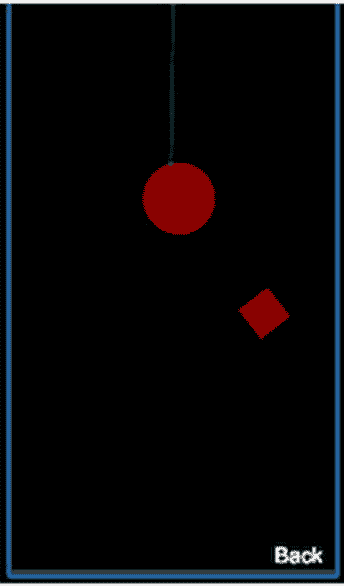

图 7-8 阻尼弹簧

### 7.9.6 阻尼旋转弹簧 (Damped Rotary Spring)

这与阻尼弹簧类似，唯一的区别在于它是以角度方式工作的。它不是通过锚点连接两个体，而是通过两个体希望保持的相对角度将它们链接起来；刚度和阻尼决定了体在任何时刻的位置。与之前的示例一样，设置 Chipmunk 空间，添加一个圆，并在圆和静态体之间建立一个滑动关节，然后添加一个阻尼旋转弹簧：

```javascript
var dampedRotarySpring = new cp.DampedRotarySpring(bodyA, bodyB, 0, 25, 0.6);
this.space.addConstraint(dampedRotarySpring);
```

参数描述请参考上一个示例。

以下是该层的完整源代码：


`var DampedRotarySpringLayer = BaseSampleLayer.extend({...})` 定义了阻尼旋转弹簧示例层，其完整代码如下：

```
var DampedRotarySpringLayer = BaseSampleLayer.extend({
  sprite:null,
  ctor:function () {
    this.super();
    this.initPhysics();
    this.setupDebugNode();
    this.addBottomWall();

    var bodyA = this.addPhysicsCircle(cc.pc(cc.winSize.width * 0.25, cc.winSize.height * 0.3));
    var bodyB = this.addPhysicsBox(cc.pc(cc.winSize.width * 0.75, cc.winSize.height * 0.3));
    var bodyC=this.space.staticBody;

    var slideJoint = new cp.SlideJoint(bodyA,bodyC, cc.p(-50,0),
    cc.p(cc.winSize.width/2,cc.winSize.height), 100, cc.winSize.width/2);
    this.space.addConstraint(slideJoint);

    var dampedRotarySpring = new cp.DampedRotarySpring(bodyA,bodyB, 0, 0.6);
    this.space.addConstraint(dampedRotarySpring);

    this.scheduleUpdate(function () {
      return true;
    });
  initPhysics:function() {
    //init空间
    this.space = new cp.Space();
    //set up the Gravity
    this.space.gravity = cp.v(0, -800); //地球重力
    this.space.iterations = 30;
    this.space.sleepThreshold = Infinity;
    this.space.collisionSlop = Infinity;
  },
  update:function (dt) {
    this.space.step(dt);
  },
  addBottomWall:function() {
    var bottomwall = new cp.SegmentShape(this.space.staticBody,cp.v(0, 0), cp.v(cc.winSize.width, 0), 5);
    bottomwall.setElasticity(1);
    bottomwall.setFriction(1);
    this.space.addStaticBody(bottomwall);
  },
  setupDebugNode : function() {
    this.debugNode = new cc.PhysicsDebugNode(this.space);
    this.addChild(this._debugNode);
  },
  addPhysicsCircle: function(pos) {
    var width=50,height=50,mass=1;
    var phBody = this.space.addBody(new cp.Body(mass, cp.momentForCircle(mass,0,width*0.5,cc.p(0,0))));
    phBody.setPos(pos);
    var phShape = this.space.addShape(new cp.CircleShape(phBody, width, cc.p(0,0));
    phShape.setFriction(0);
    phShape.setElasticity(1);
    phShape.setCollisionType(0);
    return phBody;
  },
  addPhysicsBox: function(pos) {
    var width=50,height=50,mass=1;
    var phBodyBox = this.space.addBody(new cp.Body(mass, cp.momentForBox(mass,width,height));
    phBodyBox.setPos(pos);
    var phShape = this.space.addShape(new cp.BoxShape(phBody, width, height));
    phShape.setFriction(0);
    phShape.setElasticity(1);
    phShape.setCollisionType(1);
    return phBodyBox;
  }
});
```

输出结果应该如图 7-9 所示。

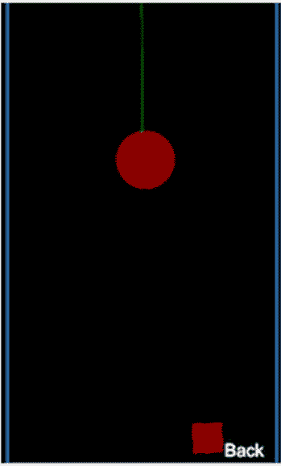

图 7-9 阻尼旋转弹簧

### 7.9.7 旋转限制关节 (Rotary Limit Joint)

旋转限制关节通过提供的最小和最大角度来限制两个体的相对旋转。如果`bodyA`和`bodyB`通过旋转关节链接，则两个体的相对旋转将不会小于最小角度也不会超过最大角度。

与之前的示例一样，初始化`Chipmunk`空间并添加一个圆，然后通过滑动关节将其与静态体链接。现在在`bodyA`和`bodyB`之间应用旋转限制：

```
var rotaryLimitJoint = new cp.rotaryLimitJoint(bodyA, bodyB, -Math.PI/2, Math.PI/2);
this.space.addConstraint(rotaryLimitJoint);
```

在`bodyA`和`bodyB`之后，提供了最小和最大角度，使得两个体的相对旋转在这个范围内。

以下是该层的完整源代码：

```
var RotaryLimitJoint = BaseSampleLayer.extend({
  sprite:null,
  ctor:function () {
    this._super();
    this.initPhysics();
    this.setupDebugNode();
    this.addBottomWall();

    var bodyA = this.addPhysicsCircle(cc.pc(cc.winSize.width * 0.25, cc.winSize.height));
    var bodyB = this.addPhysicsBox(cc.pc(cc.winSize.width * 0.75, cc.winSize.height * 0.3));
    var bodyC=this.space.staticBody;

    var rotaryLimitJoint = new cp.rotaryLimitJoint(bodyA, bodyB, -Math.PI/2, Math.PI/2);
    this.space.addConstraint(rotaryLimitJoint);

    var slideJoint = new cp.SlideJoint(bodyA,bodyC, cc.p(-50,0),
    cc.p(cc.winSize.width/2,cc.winSize.height), 100, cc.winSize.width/2);
    this.space.addConstraint(slideJoint);

    this.scheduleUpdate(function () {
      return true;
    });
  },
  initPhysics:function() {
    //init空间
    this.space = new cp.Space();
    //set up the Gravity
    this.space.gravity = cp.v(0, -800); //地球重力
    this.space.iterations = 30;
    this.space.sleepTimeThreshold = Infinity;
    this.space.collisionSlop = Infinity;
  },
  update:function (dt) {
    this.space.step(dt);
  },
  addBottomWall:function() {
    var bottomwall = new cp.SegmentShape(this.space.staticBody,cp.v(0, 0), cp.v(cc.winSize.width, 0), 5);
    bottomwall.setElasticity(1);
    bottomwall.setFriction(1);
    this.space.addStaticBody(bottomwall);
  },
  setupDebugNode : function() {
    this.debugNode = new cc.PhysicsDebugNode(this.space);
    this.addChild(this._debugNode);
  },
  addPhysicsCircle: function(pos) {
    var width=50,height=50,mass=1;
    var phBody = this.space.addBody(new cp.Body(mass, cp.momentForCircle(mass,0,width*0.5,cc.p(0,0))));
    phBody.setPos(pos);
    var phShape = this.space.addShape(new cp.CircleShape(phBody, width, cc.p(0,0));
    phShape.setFriction(0);
    phShape.setElasticity(1);
    phShape.setCollisionType(0);
    return phBody;
  },
  addPhysicsBox: function(pos) {
    var width=50,height=50,mass=1;
    var phBodyBox = this.space.addBody(new cp.Body(mass, cp.momentForBox(mass,width,height));
    phBodyBox.setPos(pos);
    var phShape = this.space.addShape(new cp.BoxShape(phBodyBox, width, height));
    phShape.setFriction(0);
    phShape.setElasticity(1);
    phShape.setCollisionType(1);
    return phBodyBox;
  }
});
```

## 第 7 章 | 将物理应用于你的游戏

```javascript
39 addBottomWall: function() {
40 var bottomWall = new cp.SegmentShape(this.space.staticBody, new
41 cp.v(0
42 ), new cp.v(cc.winSize.width, 0, 5);
43 bottomWall.setElasticity(1);
44 bottomWall.setFriction(1);
45 this.space.addStaticShape(bottomWall);
46 },
47 setupDebugNode: function() {
48 {
49 this._debugNode = new cc.PhysicsDebugNode(this.space);
50 this.addChild(this._debugNode);
51 },
52 addPhysicsCircle: function(pos) {
53 var width=50,height=50,mass=1;
54 var phBodyCircle = this.space.addBody(new cp.Body(mass,
55 cp.momentForCircle(
56 mass,0,theta*0.5,cc.p(0,0)));
57 phBodyCircle.setPos(pos);
58
59 varShape = this.space.addShape(new cp.CircleShape(phBodyCircle,
60 width,
61, cc.p(0, 0));
62 phShape.setFriction(0);
63 phShape.setElasticity(1);
64 phShape.setCollisionType(0);
65
66 return phBodyCircle;
67 },
68
69 addPhysicsBox: function(pos) {
70 var width=50,height=50,mass=1;
71 phBodyBox = this.space.addBody(new cp.Body(mass,
72 cp.momentForBox(
73 width,height));
74 phBodyBox.setPos(pos);
75
76 varShape = this.space.addShape(new cp.BoxShape(phBodyBox,
77 width,
78 phShape.setFriction(0);
79 phShape.setElasticity(1);
80 phShape.setCollisionType(1);
81 return phBodyBox;
82 }
83 });
```

输出结果与阻尼旋转弹簧相同；然而，你会发现两个刚体的旋转存在差异。

### 7.9.8 简单电机 (Simple Motor)

简单电机通过提供的角旋转速率维持两个刚体之间的相对角速度；也就是说，当`bodyA`和`bodyB`参与时，简单电机以提供的角速度维持这两个刚体的相对旋转。

首先，在空间中设置枢点和两个箱体：

```javascript
1 var bodyA = this.addPhysicsBox(cc.p(cc.winSize.width * 0.25,
   cc.winSize.height * 0.5));
2
3
4 var bodyB = this.addPhysicsBox(cc.p(cc.winSize.width * 0.75,
   cc.winSize.height * 0.5));
```

然后，使用枢轴关节将两个刚体固定到默认静态刚体：

```javascript
1 var staticBody=this.space.staticBody;
2
3 this.addConstraint(new cp.PivotJoint(bodyA, staticBody,
cc.p(cc.winSize.width * 0.25, cc.winSize.height * 0.5));
4
5
6 this.addConstraint(new cp.PivotJoint(bodyB, staticBody,
cc.p(cc.winSize.width * 0.75, cc.winSize.height * 0.5));
```

接着，对`bodyA`和`bodyB`应用简单电机：

```javascript
1 var simpleMotor = new cp.SimpleMotor(bodyA, bodyB, Math.PI);
2 this.addConstraint(simpleMotor);
```

在这里，两个刚体的相对角速度被设定为`Math.PI`。以下是该层的源代码：


### 7.9.9 齿轮关节 (Gear Joint)

齿轮关节与电机类似，但齿轮关节本身不会引入角速度。因为一个刚体的角速度取决于另一个，且速度取决于比例。让我们来看一个例子。

首先，初始化 Chipmunk 空间并通过枢轴关节在静态刚体上附加两个箱体。添加一个通过齿轮关节与 `bodyB` 绑定的第三个刚体：

```javascript
var bodyA = this.addPhysicsBox(cc.p(cc.winSize.width * 0.25, cc.winSize.height * 0.5));
var bodyB = this.addPhysicsBox(cc.p(cc.winSize.width * 0.75, cc.winSize.height * 0.5));
var bodyC = this.addPhysicsBox(cc.p(cc.winSize.width * 0.5, cc.winSize.height * 0.3));
var staticBody = this.space.staticBody;

this.space.addConstraint(new cp.PivotJoint(bodyA, staticBody, cc.p(cc.winSize.width * 0.25, cc.winSize.height * 0.5)));
this.space.addConstraint(new cp.PivotJoint(bodyB, staticBody, cc.p(cc.winSize.width * 0.75, cc.winSize.height * 0.5)));
this.space.addConstraint(new cp.PivotJoint(bodyC, staticBody, cc.p(cc.winSize.width * 0.5, cc.winSize.height * 0.3)));
```

接着，对 `bodyA` 和 `bodyB` 应用简单电机以引入恒定的角速度：

```javascript
var simpleMotor = new cp.SimpleMotor(bodyA, bodyB, Math.PI);
this.space.addConstraint(simpleMotor);
```

然后，对 `bodyB` 和 `bodyC` 应用齿轮关节，使 `bodyC` 随 `bodyB` 的角速度进行旋转：

```javascript
var gearJoint = new cp.GearJoint(bodyB, bodyC, 0, 2);
this.space.addConstraint(gearJoint);
```

最后两个参数是：

- `offset` - 两个刚体的初始角偏移
- `ratio` - 需要维持的速度比例；在此例中，`bodyC` 的速度是 `bodyB` 的一半。

以下是该层的完整源代码：

```javascript
var GearJointLayer = BaseSampleLayer.extend({
  sprite: null,
  ctor: function () {
    this._super();
    this.initPhysics();
    this.setupDebugNode();
    this.addBottomWall();
  },
  initPhysics: function () {
    //initiate space
    this.space = new cp.Space();
    //set the Gravity
    this.space.gravity = cp.v(0, -800);
    this.space.iterations = 30;
    this.space.sleepThreshold = Infinity;
    this.space.slop = Infinity;
  },
  setupDebugNode: function () {
    this._debugNode = new cc.PhysicsDebugNode(this.space);
    this.addChild(this._debugNode);
  },
  addBottomWall: function () {
    var bottomWall = new cp.SegmentShape(this.space.staticBody, new cp.v(0, 0), new cp.v(cc.winSize.width, 0), 5);
    bottomWall.setElasticity(1);
    bottomWall.setFriction(1);
    this.space.addStaticShape(bottomWall);
  },
  addPhysicsBox: function (pos) {
    var width = 50, height = 50, mass = 1;
    var phBody = this.space.addBody(new cp.Body(mass, width, height));
    phBody.setPos(pos);
    var phShape = this.space.addShape(new cp.BoxShape(phBody, width, height));
    phShape.setFriction(0);
    phShape.setElasticity(1);
    phShape.setCollisionType(1);
    return phBody;
  },
  onEnter: function () {
    this._super();
    var bodyA = this.addPhysicsBox(cc.p(cc.winSize.width * 0.25, cc.winSize.height * 0.5));
    var bodyB = this.addPhysicsBox(cc.p(cc.winSize.width * 0.75, cc.winSize.height * 0.5));
    var bodyC = this.addPhysicsBox(cc.p(cc.winSize.width * 0.5, cc.winSize.height * 0.3));
    var staticBody = this.space.staticBody;
    this.space.addConstraint(new cp.PivotJoint(bodyA, staticBody, cc.p(cc.winSize.width * 0.25, cc.winSize.height * 0.5)));
    this.space.addConstraint(new cp.PivotJoint(bodyB, staticBody, cc.p(cc.winSize.width * 0.75, cc.winSize.height * 0.5)));
    this.space.addConstraint(new cp.PivotJoint(bodyC, staticBody, cc.p(cc.winSize.width * 0.5, cc.winSize.height * 0.3)));
    var simpleMotor = new cp.SimpleMotor(bodyA, bodyB, Math.PI);
    this.space.addConstraint(simpleMotor);
    var gearJoint = new cp.GearJoint(bodyB, bodyC, 0, 2);
    this.space.addConstraint(gearJoint);
  },
  update: function (dt) {
    this.space.step(dt);
  }
});
```

### 7.9.10 棘轮关节 (Ratchet Joint)

棘轮关节的作用类似于套筒扳手，在提供初始角度偏移的情况下，体会以角度步长旋转，相位（`phase`）是一个角度步，即当前旋转步骤与下一个旋转步骤之间的距离。

让我们查看语法：

```javascript
var ratchet = new cp.ratchetJoint(body1, body2, offset, phase);
```

参数如下：

- `offset` - 指物体的初始角度旋转
- `phase` - 指步骤之间的距离

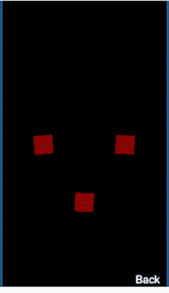

## 第 8 章 其他特性

### 8.1 绘制基础形状

要绘制基础形状，可以使用 `cc.Node`。该节点类型拥有 `drawCircle`、`drawPoly`、`drawRect`、`drawSegment` 等函数。让我们来看一个示例：

```javascript
var draw = new cc.DrawNode();
this.addChild(draw);

//drawCircle
draw.drawCircle(cc.p(cc.winSize.width / 2, cc.winSize.height / 2), 100, 0, 10, false, 6, cc.color(0, 255, 255, 255));
draw.drawCircle(cc.p(cc.winSize.width / 2, cc.winSize.height / 2), 50, cc.degreesToRadians(90), 50, true, 2, cc.color(0, 255, 255, 255));
```

在这里，在同一个 `DrawNode` 上绘制了两个圆。你可以在同一个节点上绘制任意数量的形状。如果你想清除形状，可以使用 `clear` 函数：

```javascript
this.draw.clear();
```

使用 `drawCardinalSpline` 方法可以绘制路径：

```javascript
this.draw.drawCardinalSpline(pointsArray, 1, 1, 10, cc.color(255, 255, 255, 255));
```

第一个参数是一个定义路径数据的点数组。第二个、第三个和第四个参数分别是张力、分段、线宽和颜色。

这里是完整代码：

```javascript
var DrawNodeDemoLayer = BaseLayer.extend({
  sprite: null,
  ctor: function () {
    this._super();
    var size = cc.winSize;
    this.draw = new cc.DrawNode();
    this.addChild(this.draw);

    //drawCircle
    this.draw.drawCircle(cc.p(size.width / 2, size.height / 2), 100, 0, 10, false, 6, cc.color(0, 255, 0, 255));
    this.draw.drawCircle(cc.p(size.width / 2, size.height / 2), 50, cc.degreesToRadians(90), 50, true, 2, cc.color(0, 255, 255, 255));

    return true;
  }
});
```

输出结果将类似于图 8-1。

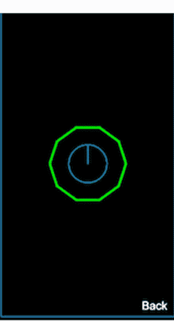

**图 8-1.** DrawNode 演示

### 8.2 添加音乐和音效

在 Cocos2d-js 中，可以使用单例对象 `cc.audioEngine` 为游戏添加音乐和音效。音乐代表游戏中的长时间运行背景音，而音效代表玩家跳跃、收集硬币等快速声音。你必须小心你使用的音频格式，因为浏览器不支持某些格式。在游戏启动期间，你需要做的第一件事是在 App 的 `onStart` 方法中预加载声音文件：

```javascript
cc.audioEngine.preloadMusic(s_music_background);
cc.audioEngine.preloadEffect(s_music_jump);
```

然后，你可以按照以下方式播放音乐和音效：

```javascript
cc.audioEngine.playMusic(s_music_background, true);
cc.audioEngine.playEffect(s_music_jump, true);
```

第二个参数表示是否循环播放声音。你可以按照以下方式暂停、恢复和停止音乐及音效：

```javascript
//暂停声音
cc.audioEngine.pauseMusic();
cc.audioEngine.pauseEffect();

//恢复声音
cc.audioEngine.resumeMusic();
cc.audioEngine.resumeEffect();

//倒回音乐
cc.audioEngine.rewindMusic();

//停止声音
cc.audioEngine.stopMusic();
cc.audioEngine.stopEffect();
```

对于音效，没有倒回选项，因为播放音乐和音效的结构是分开的，以提高系统效率。

### 8.3 使用自定义着色器 (Shaders)

着色器负责渲染整个游戏。着色器分为顶点着色器和片元着色器。Cocos2d-x 使用 `GLProgram` 类代表着色器实体。每个节点都有 `setShaderProgram` 和 `getShaderProgram` 函数来设置/获取该对象。让我们考虑采样顶点和片元着色器：

```javascript
//gray.vsh
attribute vec4 a_position;
attribute vec2 a_texcoord;
attribute vec4 a_color;
varying vec2 v_texcoord;
varying vec4 v_color;
void main() {
    gl_Position = CC_MVPMatrix * a_position;
    v_texcoord = a_texcoord;
    v_color = a_color;
}
```

```javascript
//gray.fsh
varying vec2 v_texcoord;
varying vec4 v_color;
uniform sampler2D CC_texture;
void main() {
    gl_FragColor = texture2D(CC_texture, v_texcoord) * v_color;
}
```

自定义着色器用于在游戏中创建酷炫的效果。详细讨论它们不在本书的范畴之内。

### 8.4 运动轨迹 (Motion Trail)

在 Cocos2d-js 中，轨迹效果可以通过名为 `MotionStreak` 的类来实现。轨迹效果是物体移动并在留下痕迹。让我们来看一个示例。首先，创建一个空层并在其中添加一个精灵：

```javascript
var MotionTrailLayer = BaseLayer.extend({
  sprite: null,
  ctor: function () {
    this._super();
    var size = cc.winSize;
    this.sprite = new cc.Sprite(res.Sprite_Image);
    this.sprite.attr({
      x: size.width / 2,
      y: 0
    });
    this.addChild(this.sprite, 2);
    var action1 = cc.moveTo(5, cc.p(size.width / 2, size.height));
    var action2 = action1.reverse();
    var seq1 = new cc.Sequence(action1, action2);
    this.sprite.runAction(seq1);
  }
});
```


`this.sprite.runAction(seq1.repeatForever());`

`this.tail = new cc.MotionStreak(2, 3, 50, cc.color.WHITE, res.Tail);`

`this.tail.attr({ x: size.width / 2, y: 0 });`

`this.addChild(this.tail);`

`var seq2 = seq1.clone();`

`this.tail.runAction(seq2.repeatForever());`

`return true;`

`});`

你将得到如图 8-2 所示的输出。

## 8.5 访问本地存储

本地存储（Local storage）只是平台（Web/Android/iOS）提供的持久化存储设施，你可以在其中存储键/值对并在以后检索它们。`Cocosd-js` 提供了一个用于访问平台本地存储的 API。你可以使用此 API 存储游戏状态、用户高分等内容。

- `cc.sys.localStorage`

上述对象提供了对本地存储的访问权限。有两种方法可以获取/设置值：

```javascript
//将值设置到本地存储中
localStorage.setItem(<key>,<value>);
//从本地存储中获取值
var value = localStorage.getItem(<key>);
```

# 第 8 章 ■ 杂项功能

`setItem` 方法提供了一种通过键引用为本地存储设置值的方法。键是一个字符串，而值可以是原始值，也可以是 JavaScript 对象。

让我们来看一个简单的示例。像之前的示例一样，创建一个新层，并在层上添加一个标签：

```javascript
var size = cc.winSize;
this.label = new cc.LabelTTF('', '', 32);
this.label.attr({
  x: size.width / 2,
  y: size.height / 2
});
this.addChild(this.label);
```

然后，将字符串值存储到本地存储并检索它，`var localstorage = cc.sys.localStorage`：

```javascript
//在本地存储中存储一个键/值
localStorage.setItem('key1', 'Text from localstorage');
// 使用键检索值
var text = localStorage.getItem('key1');
```

完整的代码应该如下：

```javascript
var LocalStorageLayer = BaseSampleLayer.extend({
  sprite: null,
  ctor: function () {
    this.super();
    var size = cc.winSize;
    this.label = new cc.LabelTTF('', '', 32);
    this.label.attr({
      x: size.width / 2,
      y: size.height / 2
    });
    this.addChild(this.label);
    var localstorage = cc.sys.localStorage;
    //在本地存储中存储一个键/值
    localStorage.setItem('key1', 'Text from localstorage');
    var text = localStorage.getItem('key1');
    //使用本地存储中的键检索值
    this.Label.setString(text);
    return true;
  }
});
```

你将看到图 8-3 所示的输出。

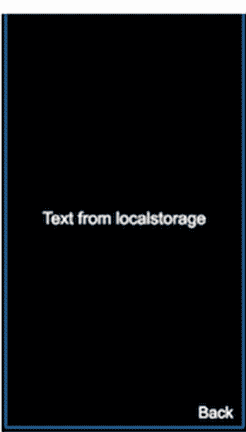

图 8-3. 本地存储

## 8.6 调度间隔回调

在第 6 章“动画乐趣”中，我们学习了调度器（scheduler）和更新（updates），每个 `cc.Node` 都可以订阅更新通知，即运行循环。同样，我们可以创建一个在给定时间间隔被调用的函数。`cc.Node` 中有一个函数 `schedule` 可以为我们完成这项工作：

```javascript
this.schedule(<callback>, <time>);
```

让我们来看一个示例。首先，创建一个空层并在上面添加一个标签：

```javascript
var size = cc.winSize;
this.Label = new cc.LabelTTF('', '', 32);
this.Label.attr({
  x: size.width / 2,
  y: size.height / 2
});
this.addChild(this.Label);
```

然后，在层对象中编写回调并用文本更新 `Label`：

```javascript
onUpdate: function () {
  this.Label.setString((this.timer++) + ' sec');
}
```

然后，在 `ctor` 中初始化变量 `timer`，并使用 `schedule` 函数以 1 秒的间隔开始回调：

```javascript
this.timer = 0;
this.schedule(this.onUpdate, 1);
```

现在，整个代码应该如下：

```javascript
var SchedulerLayer = BaseSampleLayer.extend({
  sprite: null,
  ctor: function () {
    this.super();
    var size = cc.winSize;
    this.Label = new cc.LabelTTF('', '', 32);
    this.Label.attr({
      x: size.width / 2,
      y: size.height / 2
    });
    this.addChild(this.Label);
    this.timer = 0;
    this.schedule(this.onUpdate, 1);
    return true;
  },
  onUpdate: function () {
    this.Label.setString((this.timer++) + ' sec');
  }
});
```

你将看到图 8-4 所示的输出。

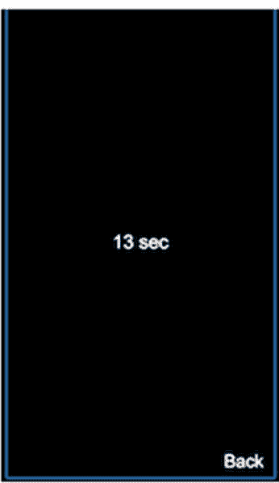

图 8-4. 调度函数

## 8.7 访问当前语言

`Cocosd-js` 还提供了访问语言的方法。在 `cc.sys` 中有一个属性，让我们来看一个快速示例。像之前的示例一样，在空层上添加一个标签：

- `cc.sys.localStorage`

大部分内存将被纹理消耗，因此你必须密切关注大小。这是完整的代码：

```javascript
var LocalStorageLayer = BaseSampleLayer.extend({
  sprite: null,
  ctor: function () {
    this.super();
    var size = cc.winSize;
    this.label = new cc.LabelTTF('', '', 32);
    this.label.attr({
      x: size.width / 2,
      y: size.height / 2
    });
    this.addChild(this.label);
    var localstorage = cc.sys.localStorage;
    //在本地存储中存储一个键/值
    localStorage.setItem('key1', 'Text from localstorage');
    var text = localStorage.getItem('key1');
    //使用本地存储中的键检索值
    this.Label.setString(text);
    return true;
  }
});
```

## 8.8 访问系统能力

`Cocosd-js` 也可以部署到原生平台，这些平台可能有不同的能力。例如，如果你想检测系统是否支持触摸，可以查询此对象：

- `cc.sys.capabilities`

如果你控制浏览器，将得到一个如下的对象：

```javascript
{
  accelerometer: true,
  canvas: true,
  keyboard: true,
  mouse: true,
  opengl: true
}
```

## 8.9 优化

优化是任何游戏至关重要的部分，然而这不是最后一个过程，因为你需要提前计划。有一些被证明是最佳实践的技巧。

### 8.9.1 内存优化

大部分内存将被纹理消耗，因此你必须密切关注你加载的纹理的大小。
- 尝试将游戏中的纹理合并到精灵集或贴图中，这将节省大量内存。
- 此外，始终使用 NPOT（非幂尺寸）是一个良好的习惯。

### 8.9.2 性能优化

涉及到性能或绘制调用帧率时，帧时间（delta time）起着重要作用。
- 确保避免使用大量的绘制调用。游戏中的所有精灵使用单个纹理，这将启用批处理。
- 此外，如果你的平台不支持自动批处理，请确保使用 `SpriteBatchNode` 合并所有需要在单个绘制调用中渲染的精灵。
- 如果你编写自定义着色器，确保你的顶点着色和片元着色器没有密集操作。
- 在着色器中有复杂的计算会限制 GPU 的性能，特别是片元函数，因为片元函数会在屏幕每个像素上执行一次。
- 尝试使用 RGBA4444 色深的 16 位纹理。

### 8.9.3 JavaScript 级别

- 确保你的代码没有内存泄漏。
- 当你在外部节点中引用内部节点时，确保在不需要时清除这些值。
- 仅使用文档化的 API，因为对内部变量和函数的用法和调整会导致不一致的行为，因为未定义的 API 在后续版本中可能会发生变化。

## 8.10 总结

到目前为止，我们从零开始了 `Cocosd-js` 的功能。希望这能为你的游戏开发提供开头。`Cocos2d-x` 是一个巨大的世界，单本书不足以详细解释它的所有功能。我们已经尽可能涵盖了几乎所有的功能和高级技术。是时候让你创建酷酷的游戏了。

# 索引

## A, B
- 加速度计事件, 47–48
- 动画动作, 59–60
- 动作列表
  - 贝塞尔曲线 (bezier), 61
  - 终点样条 (cardinal spline), 62
  - 跳跃 (jump), 60
  - 移动 (move), 60
  - 旋转 (rotation), 60
  - 缩放 (scale), 61
  - 倾斜 (skew), 61
  - 着色 (tint), 61
  - 缓动 (easing), 62–64
  - 调度器与更新, 66–68
  - 序列 (sequence), 64–65
  - 生成 (spawn), 65
  - 精灵帧 (sprite frame), 66
  - 停止 (stopping), 65
- 当前语言字符串, 120–121
- 绘制基图形状, 109–110
- 执行回调, 8, 9
- 间隔回调, 118–119
- 原生部署, 10, 11
- Python 安装, 1
- 系统能力, 121–122
- 自定义事件, 48
- 自定义着色器, 111–113

## C, D
- Chipmunk
  - 刚体 (body), 72
  - 空间 (space), 71
  - 静态刚体 (staticBody), 73
- Cocos2d-js
  - 控制台设置, 2
  - 创建
    - 文件夹结构, 3
  - 程序, 5–7
  - project.js, 4

## E, F
- 事件机制
  - 监听器, 42
  - 管理器, 42
  - 触发器 (trigger), 42

## G, H, I
- GUI
  - 元素, 57–58
  - 标签 (labels)
    - 背景颜色, 51–53
    - 位图字体, 50
    - 创建, 50–51
    - 真字体 (true type), 49–50
  - 菜单和菜单项 (menu and menuItem)
    - 创建, 54–56
    - 图像, 54
    - 标签, 54

## J
- 关节 (Joints)
  - Chipmunk 空间, 79–80
  - 阻尼旋转弹簧 (damped rotary spring), 96–99
  - 阻尼弹簧 (damped spring), 93–96
  - 齿轮 (gear), 105–108
  - 槽口 (groove), 89–92
  - 枢点 (pivot), 86–89
  - 销钉 (pin), 80–83
  - 棘轮 (ratchet), 108
  - 旋转限制关节 (rotary limit joint), 99–102
  - 简单电机 (simple motor), 102–104
  - 滑动 (slide), 83–86
- 关节 (参见 DebugNode)
  - PhysicsNode, 74
  - 程序, 74–78
  - DebugNode, 74

## K
- 键盘事件, 46–47

## L
- 本地存储访问, 115–117

## M, N
- 运动轨迹效果, 113–115
- 鼠标事件, 44–46
- 音乐与音效, 111

## O
- Cocos2d-js 优化
  - JavaScript, 123
  - 内存, 122
  - 性能, 122

## P, Q
- 物理游戏
  - Chipmunk 概述 (参见 Chipmunk)
  - 碰撞检测, 74

## R
- 分辨策略
  - 自定义, 38–40
  - 预定义, 37–38
  - 术语, 35–36

## S
- 精灵 (Sprites)
  - 批处理 (batching), 31–34
  - 类, 17–18
  - 帧动画
    - PList 数据, 23–24
    - 程序, 23–24
    - 矩形数组, 25
  - 分辨率策略 (参见 Resolution policy)
  - 帧图 (sheet), 21–23
  - 单图像
    - FPS 显示, 20–21
    - SpriteImageLayer, 19
    - SpriteFrameCache, 30–31
    - TextureCache, 29–30

## T, U, V, W, X, Y, Z
- 触摸事件
  - 多点触摸, 44
  - 单触摸, 42–44
