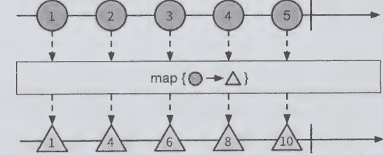
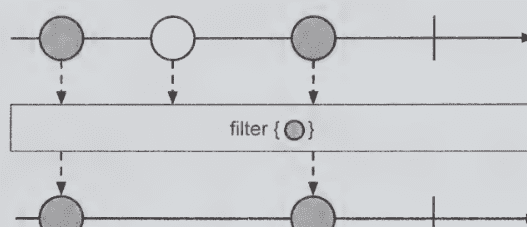
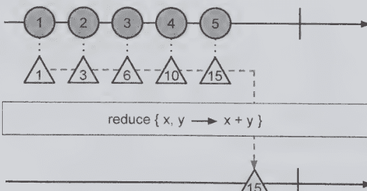
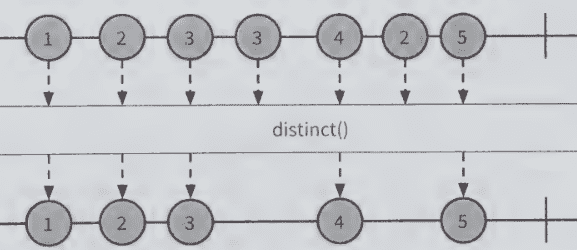
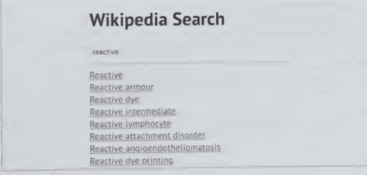

# RxJS 响应式编程：理清你的异步 JavaScript 代码


## 《使用 RxJS 进行响应式编程》的早期评价

软件开发中的每一次重大转变都要求我们重新思考方法。实时和异步 Web 应用对当今的 Web 开发构成了巨大挑战。这本书很好地解释了 RxJS 如何应对这些挑战，并教你如何从可流（`Observables`）的角度重新思考你的世界。

- Zef Hemel，STX Next 工程副总裁

这本书就像响应式编程本身一样火热！优秀的文笔、清晰的解释和实用的示例，是学习 RxJS 的绝佳资源。

- Fred Daoud，软件开发承包商

在为时已晚之前通过这本书主动学习响应式编程吧。`Rx.Observable.fromBook(book).subscribe(function(value) {...do amazing stuff...});`

- Javier Collado Cabeza，NoSecure, Inc. 高级软件开发者

一本内容非常良良且易读的书。这本书极其实用，并通过实用示例为学习使用 RxJS 进行响应式编程提供了清晰的路线图。

- Ramaninder Singh Jhaij，Know-Center, 奥地利 服务与开发部软件工程师


制作本书的团队包括：

- Rebecca Gulick（编辑）
- Potomac indexing, LLC（索引）
- Candace Cunningham（校对）
- Dave Thomas（排版）
- Janet Furlow（制片）
- Ellie Callahan（支持）

## 致谢

（注：此处原文存在大量重复的段落，已根据要求仅翻译核心内容）

软件开发中的每一次重大转变都要求我们重新思考方法。实时和异步 Web 应用对当今的 Web 开发构成了巨大挑战。这本书很好地解释了 RxJS 如何应对这些挑战，并教你如何从可流（`Observables`）的角度重新思考你的世界。

- Zef Hemel，STX Next 工程副总裁

...（重复内容略）...

## 新世界，旧方法

在过去几年中，JavaScript 已成为世界上通用的语言，现在为诸如 Walmart 和 Netflix¹ 等企业的任务关键基础设施、Firefox OS 等移动操作系统以及如 Google Docs 等复杂的流行应用提供支持。

然而，我们仍然使用旧的命令式编程来处理本质上是异步的问题。这非常困难。

JavaScript 开发者将语言的线程长度视为特性，我们通常使用回调、Promise 和事件来编写异步代码，但

> ¹ http://venturebeat.com/2014/01/24/why-walmart-is-using-node-js/ ， http://techblog.netflix.com/2014/06/scale-and-performance-of-large.html

随着我们不断在应用程序中增加并发性，协调异步流的代码变得越来越难以维护。目前的机制都存在严重的缺陷，阻碍了开发者的生产力，并导致应用程序变得脆弱。

以下是处理异步操作的现有机制简要介绍以及它们存在的问题。

### 回调函数 (Callback Functions)

回调是一个作为参数传递给执行异步操作的另一个函数 (B) 的函数 (A)。当 (B) 完成时，它会回调 (A) 并传入操作结果。回调被用于管理网络 I/O、数据库访问或用户输入等异步流。

```javascript
//callback_example.js
```

```javascript
function B(callback) {
  // 执行一些需要时间的操作
  callback('Done!');
}

function A(message) {
  console.log(message);
}

// 使用 'A' 作为回调执行 'B'
B(A);
```

回调函数易于理解，并已成为 JavaScript 中处理异步流的默认方式。但这种简单性是有付代价的。回调有以下缺点：

- 回调地狱（Callback hell）。在处理高度异步的代码时，很容易陷入嵌套回调列表中。当发生这种情况时，代码不再是线性的，变得难以理解。同时，应用程序在回调中层层传递，变得难以维护和调试。
- 回调可能会运行多次。无法保证同一个回调只被调用一次。多次调用可能难以察觉，并导致应用程序中出现错误和各种混乱。
- 回调改变了错误语义。回调破坏了传统的 `try/catch` 机制，依赖程序员手动检查错误并在程序中传递它们。
- 并发性变得日益复杂。组合多个异步操作之间相互依赖的结果变得非常困难。这要求我们在临时变量中跟踪每个操作的状态，然后按照正确的顺序将它们委托给最终的组合操作。

### Promises (承诺对象)

Promise 的出现是为了让我们从回调中解脱出来。一个 Promise 代表一个异步操作的结果。在基于 Promise 的代码中，调用异步函数会立即返回一个“promise”，它最终会被解析（resolved）或被错误拒绝（rejected）。在此期间，挂起的（pending）promise 可以作为最终值的占位符。

Promise 通常通过更接近同步代码来使程序更加清晰，减少了嵌套块的需求并减少了状态的跟踪。

遗憾的是，Promise 并非灵丹妙药。它们是对回调的改进，但有一个主要的缺点：它们永远只能产生单个值。这使得它们在处理鼠标点击或来自服务器的数据流等循环事件时变得毫无用，因为我们必须为每个独立事件创建一个 promise，而不是创建一个处理随之而来的事件流的 promise。

### 事件发射 (Event Emitters)

当我们发布事件时，订阅了该事件的事件监听器就会触发。使用事件是解耦功能的极方法，在 JavaScript 中，事件编程非常常见且通常是一种良好的做法。

但是，正如你所料的，事件监听器也有自己的问题：

- 事件强制产生副作用。事件监听器函数总是忽略其返回值，这迫使监听器如果对世界产生任何影响，就产生副作用。
- 事件不是一等值。例如，一系列点击事件无法作为参数传递，也无法作为其实际序列来进行操作。我们局限于单独处理每个事件，并且只能在事件发生后进行处理。
- 如果我们开始监听得太晚，很容易错过事件。一个臭名的例子是 Node.js 中流接口的第一个版本，它经常在监听器来得及监听之前就发布了数据事件，导致丢失了永久性。

由于这些机制是我们一直用来管理并发的工具，可能很难想出更好的方法。但在书中，我将向你展示一种：响应式编程和 RxJS 尝试通过一些新概念和机制来解决所有问题，让异步编程变得轻松自如且有趣得多。

### 什么是响应式编程？

响应式编程是一种包含许多概念和技术的编程范式。在书中，我将特别关注数据流的创建、转换和响应。鼠标点击、网络请求、字符串数组——所有这些都可以表示为流，当它们发布新值时，我们可以做出“反应”，无论其来源如何，都使用相同的接口。

响应式编程关注于传播变化，而无需我们显式指定代码应该如何做，也不需要为每一步编写代码。这导致了一种更可靠、更易维护的软件构建方法。

### 什么是 RxJS？

RxJS 是 Reactive Extensions（或称 Rx²）的 JavaScript 实现。Rx 是最初在微软创建的一种响应式编程模型，允许开发者轻松地组合异步数据流。它提供了一个通用接口，用于合并和转换来自完全不同源的数据，例如文件系统操作、用户交互和社交网络更新。

Rx 起于 .NET 的实现，但今天在每种主流语言（以及一些少数语言）中都有良好的开源实现。它正成为编写响应式应用程序的标准，并且 Observable 正被提议纳入 ECMAScript 7 作为 JavaScript 的不可组成部分。

### 这本书适合谁读

本书适合具有一定 JavaScript 经验的开发者。你应该熟悉闭包和高阶函数，并理解 JavaScript 中的作用域规则。尽管如此，我也会尝试解释我们在书中涉及的最复杂的语言概念。

> 2. https://rx.codeplex.com/

### 本书中包含的内容

本书是一本关于使用 RxJS 进行响应式编程的实战介绍。目标是通过构建真实世界的应用让你学会以响应式方式思考，这样你就可以学习如何在日常工作中引入响应式编程，并让你的程序更加健壮。这并不是一本关于响应式编程的理论书籍，也不是 RxJS API 的详尽参考书。你可以在网上找到这类资源。

我们将主要针对浏览器开发，但也会看到 Node.js 的示例。我们将尽早深入主题，并在过程中构建应用程序以保持真实性。除非你之前用过 RxJS，否则请从第 1 章“响应式之路 (The Reactive Way)”开始。在这一章中，我们将介绍 RxJS 的核心数据类型 Observable，并在书中大量使用。

在建立了 Observable 的基础之后，我们进入第 2 章“深入序列 (Deep in the Sequence)”。你会发现在响应式编程中一切都是事件序列。我们将访问一些重要的序列操作符，并构建第一个应用程序：实时地震可视化器。

在第 3 章“构建并发程序 (Building Concurrent Programs)”中，我们将查看如何用最少的副作用编写并发代码。在涵盖 Observable 管道后，我们将用大约 200 行代码编写一个几乎没有全局状态酷飞船游戏。

在第 4 章“构建完整的 Web 应用程序 (Building a Complete Web Application)”中，我们将深入响应式应用开发，并通过制作 Node.js 服务器部分来增强之前的地震应用程序，显示与当前发生的地震相关的推文。

我们将通过第 5 章“通过调度器弯曲时间 (Bending Time with Schedules)”进入 RxJS 的更高级概念，在那里我们将讨论 RxJS 提供的在更细粒度级别处理并发的有用概念：调度器（Schedulers）。

在掌握了调度器的知识后，我们将探索它们如何帮助我们进行测试。我们将学习如何在测试中模拟时间，以准确测试异步程序。

最后，在第 6 章“使用 Cycle.js 构建响应式 Web 应用 (Reactive Web Applications with Cycle.js)”中，我们将使用构建在 RxJS 之上的 UI 框架 Cycle.js 构建一个简单的应用程序。Cycle.js 借鉴了 React.js 等现代框架的概念，创建了一个响应式框架，利用 Observable 的优势帮助我们以简单可靠的方式创建快速的用户界面。

## 运行代码示例

书中的代码示例是为了浏览器或 Node.js 设计的。代码的上下文应该说明在何种环境中运行代码。

### 在浏览器中运行 RxJS 代码

如果代码要在浏览器中运行，我们将使用 `rx.all.js` 文件，你可以在 RxJS 的 GitHub 仓库中找到它。`rx.all.js` 包含了 RxJS 中所有的运算符，它是确保所有示例都能运行的最简单方法。只需在 HTML 文档的 `<head>` 部分加载脚本即可：

```html
<head>
  <script src="rx.all.js"></script>
</head>
..
</</html>
```

请记住，这是一个较大的文件，如果你没有使用 RxJS 的所有功能，可能考虑在项目中使用较小的文件，例如 `rx.js` 或 `rx.lite.js`。

### 在 Node.js 中运行 RxJS 代码

在 Node.js 中运行代码示例非常简单。只需确保使用 npm 在项目中安装了 RxJS 依赖即可：

```bash
$ npm install rx
rx@4.0.0 node_modules/rx
```

之后，你就可以在 JavaScript 文件中导入 RxJS 库：

```javascript
var Rx = require('rx');

Rx.Observable.just('Hello World!').subscribe(function(value) {
  console.log(value);
});
```

你只需通过调用 node 和文件名即可运行它：

```bash
$ node test.js
Hello World!
```

3. https://github.com/ReactiveExtensions/RxJS/tree/master/dist

### RxJS 版本

所有示例都是为 RxJS 4.x 编写的。你可以在 RxJS 的线版仓库中下载最新版本。⁴

### 资源

RxJS 的采用速度非常快，每天关于它的资源越来越多。尽管如此，有时在网上找到资源可能很困难。以下是我最喜欢的资源：

- RxJS 官方源代码仓库⁵
- ReactiveX，一个与 Reactive Extensions 相关的资源集合⁶
- RxMarbles，一个可视化 Observables 的交互式工具⁷

### 下载示例代码

本书的网站有互动讨论论坛的链接，以及一个提交勘误的地方⁸。你还会找到我们构建的所有项目的源代码。电子书读者可以与每个代码片段上方的框进行交互，直接查看该片段。

> 4. https://github.com/Reactive-Extensions/RxJS/releases/latest
> 5. https://github.com/Reactive-Extensions/RxJS
> 6. http://reactive.io
> 7. http://rxmarbles.com/
> 8. http://pragprog.com/titles/smreactjs

## 第 1 章 响应式之道

现实世界相当混乱：事件按随机顺序发生，应用程序崩溃，网络故障。很少有应用程序是完全同步的，编写异步代码对于保持应用程序的响应能力是必要的。大多数时候这是非常痛苦的，但其实并非如此。

现代应用程序需要极快的响应，并能够在不漏掉任何细节的同时处理来自不同来源的数据。目前的技术无法带我们到达，因为它们不可扩展——随着我们增加并发和应用程序状态，代码的复杂性呈指数级增长。它们完成工作是以增加开发者巨大的心理负担为代价的，这导致了代码中的 Bug 和复杂性。

本章向你介绍响应式编程，这更自然、更容易思考异步代码的方法。我将向你展示事件流（我们称为 Observables）是如何处理异步代码的一种优妙方式。然后我们将创建一个 Observable，并观察响应式思维和 RxJS 如何极大地改进现有技术，让你成为一个更快乐、更高效的程序员。

### 什么是响应式？

让我们先看一个小小的响应式 RxJS 程序。该程序需要在点击按钮时从不同源检索数据，并满足以下要求：

- 它必须统一来自使用不同 JSON 结构的两个位置的数据。
- 最终结果不应包含任何重复项。
- 为了避免请求数据过多，用户每秒点击按钮不能超过一次。

我们会编写类似这样的代码：

```javascript
var button = document.getElementById('retrieveDataBtn');
var source1 = Rx.DOM.JSON('resource1').pluck('name');
var source2 = Rx.DOM.JSON('resource2').pluck('props', 'name');
function getResults(amount) {
  return source1.merge(source2)
    pluck('names')
    .flatMap(function(array) { return Rx.Observable.from(array); })
    .distinct()
    .take(amount);
}
var clicks = Rx.Observable.fromEvent(button, 'click');
clicks.debounce(1000)
  .flatMap(getResults(5))
  .subscribe(
    function(value) { console.log('Received value: ', value); },
    function(error) { console.error(error); },
    function() { console.log('All values retrieved!'); }
  );
```

不要担心理解这里发生了什么：现在让我们关注全局视图。你看到的第一点是，我们用更少的代码行表达了更多内容。

Observable 代表数据流。在在上一个示例中，我们看到每当我们更改 A1 时，每个依赖于 A1 的单元格都会自动更新其值。

### 电子表格是响应式的

让我们从考虑响应系统的典型示例开始：电子表格。我们都用过它们，但很少停下来思考它们是多么直观。假设我们在电子表格的 A1 中有一个值。我们可以在电子表格的其他单元格中引用它，每当我们更改 A1 时，每个依赖于 A1 的单元格都会自动更新其值。

| A | B | C |
|---|---|---|
| 1 | 100 | 20 |

这种行为对我们来说是自然的。我们没有告诉计算机去更新依赖 A1 的单元格或如何操作；这些单元格对变化产生了反应。在电子表格中，我们只需声明问题，而无需担心计算机如何计算结果。

### 作为值流的鼠标

为了理解如何将事件视为流，让我们思考本章开始时的程序。我们将鼠标点击视为随着用户点击而实时生成的无限事件序列。这是 Erik Meijer（RxJS 的发明者）在他的论文《Your Mouse Is a Database》中提出的观点。¹

在响应式编程中，我们将鼠标点击视为连续的事件流，可以对其进行查询和操纵。思考流而非孤立的值开启了一种全新的编程方式，在这种方式中，我们可以操纵尚未创建的值序列。

与我们习惯在值可用之前等待它们不同，如果尚未可用（例如网络请求），我们会等待它们，并仅在它们可用时使用。

让这个想法深入一会儿。

> ¹ http://queue.acm.org/detail.cfm?id=2169076


我们可以将流式序列（streaming sequence）看作一个数组，其中的元素是通过时间而不是内存分隔的。无论是通过时间还是内存，我们都拥有元素序列：

将你的程序视为流动的数据序列是理解 RxJS 编程的关键。这需要一些练习，但并不困难。事实上，我们在任何应用程序中使用的大多数数据都可以表示为序列。我们将在第 17 页的第 2 章“深入序列”中更深入地研究序列。

## 查询序列

让我们使用 JavaScript 中传统的事件监听器来实现一个简单的鼠标流。为了记录鼠标点击的 `x` 和 `y` 坐标，我们可以编写类似下面的代码：

```javascript
ch1/thinking_sequences.js
document.body.addEventListener('click', function(e) {
  console.log(e.clientX, e.clientY);
});
```

这段代码将顺序打印每次鼠标点击的 `x` 和 `y` 坐标。

输出如下：

- 252 183
- 211 232
- 153 323

看起来像是一个序列，对吧？当然，问题在于操纵事件并不像操纵数组那样简单。例如，如果我们想修改前面的代码，使其只记录屏幕右侧的前 10 次点击（这是一个相当随机的目标，但请听我解释），我们将编写类似下面的代码：

```javascript
var clicks = 0;
document.addEventListener('click', function registerClicks(e) {
  if (clicks < 10) {
    if (e.clientX > window.innerWidth / 2) {
      console.log(e.clientX, e.clientY);
      clicks += 1;
    }
  }
  document.removeEventListener('click', registerClicks);
});
```

为了满足需求，我们通过一个全局变量引入了外部状态，用于计数目前为止的点击次数。我们还需要检查两个不同的条件并使用嵌套的条件块。当我们完成时，我们需要清理并注销事件以防止内存泄漏。

## 副作用与外部状态

如果一个动作对其发生范围之外产生了影响，我们称之为**副作用**（side effect）。更改函数外部的变量、打印到控制台或更新数据库中的值都是副作用的例子。

例如，更改函数内部变量的值是安全的。但如果该变量位于函数范围之外，那么其他函数就可以改变它的值。我们的函数不再拥有控制权，它无法假设外部变量包含了我们预期的值。我们需要跟踪它并添加检查，以确保它的值符合我们的预期。到那时，我们就会添加与程序逻辑无关的代码，使其变得更加复杂且容易出错。

虽然副作用对于构建任何有趣的程序都是必不可少的，但我们应该努力在代码中尽可能减少它们。在响应式程序中，我们有很多随时间变化的活动部分。在书中，我们将追求避免外部状态和副作用的方法。事实上，在第 39 页的第 3 章“构建并发程序”中，我们将构建一个没有任何副作用的视频游戏。

我们满足了早期的需求，但对于如此简单的目标却得到了相当复杂的代码。这种代码难以维护，对于第一次查看它的开发者来说并不直观。更重要的是，我们让它在未来容易产生细微的 bug，因为我们需要保持状态。

在那种情况下，我们想要的只是查询点击的“数据库”。如果我们处理的是关系型数据库，将使用声明式语言 SQL：

```sql
SELECT x, FROM clicks LIMIT 10
```

如果我们将点击事件流视为一个可以查询和转换的数据源会怎样？毕竟，它和数据库没有区别，只是一个实时发射值的数据库。我们只需要一种能为我们抽象该概念的数据类型。

引入 RxJS 和我们的 `Observable` 数据类型：

```javascript
Rx.Observable.fromEvent(document, 'click')
.filter(function(c) { return c.clientX < window.innerWidth / 2; })
.take(10)
.subscribe(function(c) { console.log(c.clientX, c.clientY) })
```

这段代码的作用与第 5 页的代码相同，它的读起来像这样：

- 一个点击事件的 `Observable`，并过滤掉发生在屏幕左侧的点击。然后当点击发生时，仅将前 10 次点击的坐标打印到控制台。

注意即使你不熟悉它，代码是多么的易读。此外，不需要创建外部变量来保持状态，这使得代码自成一体，并且更难引入 bug。你不需要自己进行清理，因此没有因忘记注销事件处理器而导致内存泄漏风险。

在前面的代码中，我们从 DOM 事件创建了一个 `Observable`。`Observable` 为我们提供了一个事件序列或流，我们可以对其进行操纵。

## 观察者与迭代器

为了理解 `Observable` 从何而来，我们需要查看观察者（Observer）模式和迭代器（Iterator）模式。

## 观察者模式

观察者模式允许对象通知监听器列表任何状态变化。用几行代码就很容易实现：

```javascript
ch1/observer_pattern.js
function Producer() {
  this.listeners = [];
}

Producer.prototype.add = function(listener) {
  this.listeners.push(listener);
};

Producer.prototype.remove = function(listener) {
  var index = this.listeners.indexOf(listener);
  this.listeners.splice(index, 1);
};

Producer.prototype.notify = function(message) {
  this.listeners.forEach(function(listener) {
    listener.update(message);
  });
};
```

`Producer` 对象维护了一个动态更新的监听器列表。在下面的代码中，我们创建了两个监听 notifier 的对象：

```javascript
// observer_pattern.js
var listener1 = {
  update: function(message) {
    console.log('Listener 1 received:', message);
  }
};

var listener2 = {
  update: function(message) {
    console.log('Listener 2 received:', message);
  }
};

var notifier = new Producer();
notifier.add(listener1);
notifier.add(listener2);
notifier.notify('Hello there!');
```

当我们运行程序时：

- Listener 1 received: Hello there!
- Listener 2 received: Hello there!

当 `Producer` `notifier` 更新状态时，`listener1` 和 `listener2` 都会收到通知，而不需要我们去检查。我们的实现很简单，但它说明了观察者模式如何避免事件与其响应对象的耦合。

## 迭代器模式

`Observable` 的另一个拼图来自迭代器模式。迭代器为消费者提供了一种简单的遍历内容的方法，向消费者隐藏实现细节。

迭代器接口很简单。它只需要两个方法：`next()` 获取序列中的下一个项，以及 `hasNext()` 检查序列中是否还有剩余。

以下是我们将编写一个对数字数组的操作并仅产生除参数倍数元素的迭代器：

```javascript
iterator.js
function iterateOnMultiples(arr, divisor) {
  this.cursor = 0;
  this.array = arr;
  this.divisor = divisor || 1;
}

iterateOnMultiples.prototype.next = function() {
  while (this.cursor < this.array.length) {
    var value = this.array[this.cursor++];
    if (value % this.divisor === 0) {
      return value;
    }
  }
};

iterateOnMultiples.prototype.hasNext = function() {
  var cur = this.cursor;
  while (cur < this.array.length) {
    if (this.array[cur++] % this.divisor === 0) {
      return true;
    }
  }
  return false;
}
```

我们可以像这样使用迭代器：

```javascript
ch1/Iterator.js
```

```javascript
var consumer = new iterateMultiples([1, 2, 3, 4, 5, 6, 7, 8, 9, 10], 3);
console.log(consumer.next(), consumer.hasNext()); // 3 true
console.log(consumer.next(), consumer.hasNext()); // 6 true
console.log(consumer.next(), consumer.hasNext()); // 9 false
```

迭代器对于封装任何数据结构的遍历逻辑都是极好的。正如我们在上一个示例中看到的，当迭代器被泛型化以处理不同类型的数据，或者当它们可以在运行时配置（如我们在示例中通过除数参数所做）时，它们就变得有趣起来。

# Rx 模式与 Observable（观察者）

虽然观察者（Observer）和迭代器（Iterator）模式本身非常强大，但两者的结合效果更好。我们将此称为 Rx 模式，以响应扩展（Reactive Extensions）库命名。在本书的剩余部分，我们将使用这种模式。

`Observable` 序列（或简单称为 `Observable`）是 Rx 模式的核心。`Observable` 按照顺序发射它的值——就像迭代器一样——但并不是由消费者请求下一个值，而是 `Observable` 在值可用时将值“推”给消费者。它扮演的角色与观察者模式中的生产者（`Producer`）类似：发射值并将其推给它的监听器。

> 拉取 vs 推送

> 在基于推（push-based）的行为中意味着应用程序的服务器组件向客户端发送更新，而不是由客户端轮询服务器获取这些更新。这就像是在说：“不要给我们打电话，我们会给你回电。”

> RxJS 是基于推的，因此事件源（`Observable`）将把新值推给消费者（`Observer`），而无需消费者请求下一个值。

更简单地说，`Observable` 是一个项随时间推移而变得可用的序列。`Observable` 的消费者——观察者（`Observers`），等同于观察者模式中的监听器。当一个 `Observer` 订阅一个 `Observable` 时，它将在序列中的值可用时接收到这些值，而无需请求它们。

- 2. https://rx.codeplex.com/

到目前为止，似乎与传统的观察者模式没有太大区别。但实际上有两个本质区别：

- `Observable` 在没有至少有一个 `Observer` 订阅它之前不会开始流传输项。

- 像迭代器一样，`Observable` 可以信号序列何时完成。

通过使用 `Observable`，我们可以声明如何对它们发射的元素序列做出反应，而不是对单个项做出反应。我们可以高效地复制、转换和查询序列，这些操作将作用于序列的所有元素。

## 创建 Observable

有多种方法可以创建 `Observable`，其中 `create` 操作符是最显眼的。`Rx.Observable` 对象中的 `create` 操作符接受一个接受 `Observer` 作为参数的回调。该函数定义了 `Observable` 将如何发射值。以下是我们创建简单 `Observable` 的方法：

```javascript
var observable = Rx.Observable.create(function(observer) {
  observer.next('Simon');
  observer.next('Gen');
  observer.next('Sergi');
  observer.onCompleted(); // 我们完成了
});
```

当我们订阅这个 `Observable` 时，它通过调用在其监听器上的 `onError` 方法发射三个字符串。然后它调用 `onCompleted` 来指示序列已结束。但我们究竟如何订阅 `Observable` 呢？我们使用 `Observer`。

## 与 Observer 的初次接触

`Observer` 监听相关的方法。每当 `Observable` 中发生事件时，它就会调用其所有 `Observer` 中的相关方法。

`Observer` 有三个方法：`onNext`、`onCompleted` 和 `onError`：

`onNext`: 观察者模式中 `Update` 的等价。当 `Observable` 发射新值时调用。注意该名称反映了我们订阅的是序列而不仅仅是离散的值。

`onCompleted`: 信号没有更多可用数据。调用 `onCompleted` 后，对 `onNext` 的进一步调用将无效。

`onError`: 当 `Observable` 发生错误时调用。调用后，对 `onNext` 的进一步调用将无效。

以下是创建创建基础 `Observer` 方法：

```javascript
var observer = Rx.Observer.create(
  function next(x) { console.log(' ' + x); },
  onError(err) { console.log(' ' + err); },
  function onCompleted() { console.log('Completed'); }
);
```

`Rx.Observer` 对象中的方法接受用于 `onError`、`onCompleted` 和 `onError` 情况的形式并返回 `Observer` 实例。这三个函数是可选的，你可以决定包含哪一个。例如，如果我们订阅的是一个无限序列（例如点击按钮，用户可以一直点击下去），`onCompleted` 处理程序将永远不会被调用。如果我们确定序列不会发生错误（例如通过通过数字数组创建 `Observable`），我们就不需要 `onError` 方法。

## 使用 Observable 进行 Ajax 调用

我们还没有对 `Observable` 做过任何实用的事情。创建一个获取远程内容的 `Observable` 怎么样？为了实现这一点，我们将使用 `Rx.Observable.create` 封装 `XMLHttpRequest` 对象：

```javascript
function get(url) {
  return Rx.Observable.create(function(observer) {
    // 发起传统的 Ajax 请求
    var req = new XMLHttpRequest();
    req.open('GET', url);

    req.onload = function() {
      if (req.status == 200) {
        // 如果状态为 200，意味着没有问题
        observer.next(req.response);
        observer.onCompleted();
      } else {
        // 否则，向监听器发射错误
        onError(req.statusText);
      }
    };

    req.onerror = function() {
      observer.onError("Unknown Error");
    };

    req.send();
  });
}

// 创建一个 Observable
var test = get('/contents.json');
```

在前面的代码中，`get` 函数封装了 `XMLHttpRequest`。如果 HTTP GET 请求成功，我们发射其内容并完成序列（否则，我们发射错误）。在最后一行，我们调用函数并传入特定的 URL。这会创建 `Observable`，但它尚未发起任何请求。这一点很重要：在至少有一个 `Observer` 订阅它们之前，`Observable` 不会执行任何事情。让我们来看看：

```javascript
// 订阅它
function onNext(x) { console.log('Result: ' + x); }
function onError(err) { console.log('Error: ' + err); }
function onCompleted() { console.log('Completed'); }
```

这段代码的功能与我们之前的完全相同，但我们不需要为 `XMLHttpRequest` 创建一个包装器；它已经存在了。请注意，这次我们省略了 `onCompleted` 回调，因为我们不计划在 `Observable` 完成时做出反应。我们知道它只会产生一个结果，而且我们已经在 `onNext` 回调中使用它了。

在本书中，我们将使用许多方便的操作符。RxJS 特是“开箱即用”（batteries included）。事实上，这是它的主要优势之一。

## 统治一切的数据类型

在 RxJS 程序中，我们应该努力让所有数据都进入 `Observable`，而不仅仅是来自异步源的数据。这样做可以轻松地组合来自不同来源的数据，例如现有数组与回调的结果，或者用户触发的 `XMLHttpRequest` 事件的结果。


例如，如果我们有一个`items`数组需要与其他地方的数据结合，那么将此数组转换为`Observable`会更好。（显然，如果数组只是一个不需要组合的中间变量，则没有必要这样做。）在整本书中，你将学习在什么情况下将数据类型转换为`Observable`是值得的。

`RxJS`提供了从大多数`JavaScript`数据类型创建`Observable`的操作符。让我们来看一下最常用的几个，你将一直使用它们：数组、事件和回调。

## 从数组创建 Observable

我们可以使用多用途的`from`操作符将任何类数组或可迭代对象转换为`Observable`。`from`接收数组作为参数并返回一个发射其每个元素的`Observable`。

```javascript
Rx.Observable
  .from(['Adrià', 'Jen', 'Sergi'])
  .subscribe(
    function(x) { console.log('Next: ' + x); },
    function(err) { console.log('Error:', err); },
    function() { console.log('Completed'); }
  );
```

`from`与`event`一样，是`RxJS`代码中最方便且最常用的操作符之一。

## 从 JavaScript 事件创建 Observable

当我们把事件转换为`Observable`时，它就变成了一个可以组合和传递的值。例如，这里有一个`Observable`在鼠标指针移动时都会发射鼠标指针的坐标：

```javascript
var allMoves = Rx.Observable.fromEvent(document, 'mousemove')
allMoves.subscribe(function(e) {
  console.log(clientX, e.clientY);
});
```

将事件转换为`Observable`释放了其自然限制中的事件。更重要的是，我们可以根据原始的`Observable`创建新的`Observable`。这些新的`Observable`是独立的，可以用于不同的任务：

```javascript
var movesOnTheRight = allMoves.filter(function(e) {
  return clientX > window.innerWidth / 2;
});

var movesOnTheLeft = allMoves.filter(function(e) {
  return clientX < window.innerWidth / 2;
});

movesOnTheRight.subscribe(function(e) {
  console.log('Mouse is on the right:', e.clientX);
});

movesOnTheLeft.subscribe(function(e) {
  console.log('Mouse is on the left:', e.clientX);
});
```

在前面的代码中，我们从原始的`allMoves`创建了两个`Observable`。每个都只包含原始数据过滤后的项：`movesOnTheRight`包含了屏幕右侧的鼠标事件，而`movesOnTheLeft`包含了屏幕左侧的鼠标事件。它们中的任何一个都没有修改原始的`Observable`：`allMoves`将继续发射所有的鼠标移动。`Observable`是不可变的，应用在它们上的每个操作符都会创建一个新的`Observable`。

## 从回调函数创建 Observable

如果你使用第三方`JavaScript`库，你很有可能需要与基于回调的代码进行交互。我们可以使用两个函数`fromCallback`和`fromNodeCallback`将这些回调转换为`Observable`。`Node.js`遵循一种约定，即在调用回调函数时先传递错误参数，以指示回调函数发生了问题。我们随后使用`fromNodeCallback`专门从`Node.js`风格的回调创建`Observable`：

```javascript
var Rx = require('rx'); // 加载 RxJS
var fs = require('fs'); // 加载 Node.js 文件模块
// 从 readdir 方法创建 Observable
var readdir = Rx.Observable.fromNodeCallback(fs.readdir);
// 发送延迟消息
var source = readdir('/Users/Sergi');
var subscription = source.subscribe(
  function(res) { console.log('List of directories: ' + res); },
  function(err) { console.log('Error: ' + err); },
  function() { console.log('Done!'); });
```

在前面的代码中，我们用`Node.js`的`readdir`方法创建了一个`Observable`读取器。`fs.readdir`接收目录路径和一个回调函数`delayedMsg`，该回调会在获取目录内容后调用一次。

我们使用传递给原始`fs.readdir`的相同参数调用`readdir`，但除了回调函数。这返回了一个`Observable`，当我们对其订阅一个观察者时，它将正确地使用`onNext`、`onError`和`onCompleted`。

## 总结

在本章中，我们探索了响应式编程方法，并看到`RxJS`如何通过`Observable`解决其他方法（如回调或`Promise`）的问题。现在你理解了为什么`Observable`是强大的，并且知道如何创建它们。有了这个基础，我们现在可以创建更多有趣的响应式程序。下一章将向你展示如何创建和组合基于序列的程序，为`Web`开发中的一些常见场景提供更“Observable”的方法。

## 可视化 Observable

你即将学习一些我们最常用的操作符。讨论操作符对序列做了什么可能很抽象。为了帮助开发者轻松理解操作符，我们将使用一种序列的标准视觉表示，称为弹性图（marble diagrams）。它们直观地表示了异步数据流。

### Range

来看`range`操作符，它返回一个发射指定范围内整数的`Observable`：`Rx.Observable.range(1, 3);`

它的弹性图如下：

长行代表`Observable`，x轴代表时间。每个圆代表`Observable`发射的值。在生成第三个值后，`range`调用`onCompleted`，图中用垂直线表示。

来看涉及多个`Observable`的示例。`merge`操作符接收两个不同的`Observable`并返回一个带有合并值的新`Observable`。`interval`操作符返回一个以给定时间间隔（毫秒）产生递增数字的`Observable`。

在下面的代码中，我们将合并两个使用`interval`以不同间隔产生值的`Observable`：

```javascript
var a = Rx.Observable.interval(200).map(function(i) {
  return 'A' + i;
});
var b = Rx.Observable.interval(100).map(function(i) {
  return 'B' + i;
});
Rx.Observable.merge(a, b).subscribe(function(x) {
  console.log(x);
});
```

这里，沿 y 轴的虚线指向应用到序列 A 和 B 中每个元素的转换后的最终结果。生成的`Observable`（可观测对象）由 C 表示，它包含了 A 和 B 合并后的元素。如果不同`Observable`的元素同时发射，这些元素在合并序列中的顺序是随机的。

## 基础序列操作符

在`RxJS`几十个转换`Observable`的操作符中，最常用的是任何具有良好集合处理能力的语言都可能具备的操作符：`map`、`filter`和`reduce`。在`JavaScript`中，你可以在`Array`（数组）实例中找到这些操作符。

`RxJS`遵循`JavaScript`规范，因此你会发现以下操作符的语法与数组操作符几乎相同。事实上，我们将分别使用数组和`Observable`来展示实现，以说明这两个 API 是有多么相似。

### Map

`map`是最常用的序列转换操作符。它接收一个`Observable`和一个函数，并将该函数应用于源`Observable`中的每个值。它返回一个带有转换后值的新`Observable`。



| JS Arrays | Observables |

| :--- | :--- |

| `var src = [1, 2, 3, 4, 5];` | `var src = Rx.observable.range(1, 5);` |

| `var upper = src.map(function(name) {` | `var upper = src.map(function(name) {` |

| `return name * 2;` | `return name * 2;` |

| `});` | `});` |

| `upper.forEach(logValue);` | `upper.subscribe(logValue);` |

在两种情况下，`src`都不会发生变异。

这段代码以及后续代码使用了以下`logValue`的定义：

```javascript
var logValue = function(val) { console.log(val) };
```

我们传递给`map`的函数可能会执行一些异步计算来转换值。在这种情况下，`map`将无法按预期工作。对于这些情况，最好是使用第 22 页的`flatMap`。

### Filter

`filter`接收一个`Observable`和一个函数，并使用该函数测试`Observable`中的每个元素。它返回一个包含所有函数返回`true`的元素的`Observable`序列。



| JS Arrays | Observables |

| :--- | :--- |

| `var isEven = (function(val) { return val % 2 === 0; });` | |

| `var src = [1, 2, 3, 4, 5];` | `var src = Rx.Observable.range(1, 5);` |

| `var even = src.filter(isEven);` | `var even = src.filter(isEven);` |

| `even.forEach(logValue);` | `even.subscribe(logValue);` |

### Reduce

`reduce`（也称为`fold`）接收一个`Observable`并返回一个新的始终包含单个项的`Observable`，该项是对每个元素应用函数得到的结果。该函数接收当前元素和函数上一次调用的结果。



### JS Arrays

### Observables

```javascript
var src = [1, 2, 3, 4, 5];
var sum = src.reduce(function(a, b) {
  return a + b;
});
console.log(sum);

var src = Rx.Observable.range(1, 5);
var sum = src.reduce(function(acc, x) {
  return acc + x;
});
sum.subscribe(logValue);
```

`reduce`是一个处理序列的强大操作符。事实上，它是整个称为聚合操作符（aggregate operators）的方法集合的基础实现。

### 聚合操作符

聚合操作符处理序列并返回一个单一值。例如，`Rx.Observable.first`接收一个`Observable`和可选的谓词函数，并返回满足谓词条件的第一个元素。

计算序列的平均值也是一种聚合操作。`RxJS`提供了实例平均操作符，但为了本节的内容，我们想看到如何使用`reduce`实现它。每个聚合操作符都可以通过`reduce`实现：

```javascript
// sequences/marble.js
var avg = Rx.Observable.range(0, 5)
.reduce(function(prev, cur) {
  return {
    sum: prev.sum + cur,
    count: prev.count + 1
  };
}, {sum: 0, count: 0})
.map(function(o) {
  return o.sum / o.count;
});
var subscription = avg.subscribe(function(x) {
  console.log('Average is: ', x);
});
```

### 平均值为 2

在这段代码中，我们使用`reduce`将每个新值加到上一个值。由于`reduce`没有为我们提供序列中的总元素，我们需要计数。我们在调用`reduce`时传入一个初始值，这是一个包含两个字段`sum`和`count`的对象，我们在其中存储了到目前为止的总和和计数。每个新元素将返回一个带有更新值的相同对象。当序列结束时，`reduce`将调用`next`并传入包含最终和和计数的对象。此时，我们使用`map`返回总和除以计数的结果。

### 能够聚合无限 Observable 吗？

想象我们正在编写一个程序，它将不同的`Observable`聚合起来。由于序列不会结束，`reduce`就不会调用`next`。在这种情况下，我们需要使用`scan`来处理中间值。我们调用`reduce`传入的是一个包含`sum`和`count`两个字段的对象，我们在其中存储了到目前为止的总和和计数。每个新元素将返回一个带有更新值的相同对象。当序列结束时，`reduce`将调用`next`并传入包含最终和和计数的对象。此时，我们使用`map`返回总和除以计数的结果。

# 通过操作符隐式取消

大多数情况下，操作符会自动为你取消订阅。像`range`或`take`这样的操作符会在序列结束或满足操作条件时取消订阅。更高级的操作符如`latestFrom`或`flatMap`会根据需要内部创建并销毁订阅，它们处理了多个正在运行的`Observable`。简而言之，你不需要担心取消大多数订阅。

# 封装外部 API 的 Observable

当你使用封装了不提供取消功能的外部 API 的`Observable`时，即使被取消，`Observable`仍然会发射通知，但底层的 API 并不一定会被取消。例如，如果你正在使用一个封装了`Promise`的`Observable`，当被取消时，`Observable`将停止发射，但底层的`Promise`不会被取消。

在下面的代码中，我们尝试取消对封装了`Promise` `p`的`Observable`的订阅，同时用传统方式设置了`Promise`解析后的动作。该`Promise`将在五秒后解析，但我们在创建它后立即取消了订阅：

```javascript
var p = new Promise(function(resolve, reject) {
  window.setTimeout(resolve, 5000);
});

p.then(function() {
  console.log('Potential side effect!');
});

var subscription = Rx.Observable.fromPromise(p).subscribe(function(msg) {
  console.log('Observable resolved!');
});

subscription.dispose();
```

5 秒后，我们看到：

> Potential side effect!

如果我们取消对该`Observable`的订阅，它实际上阻止了自己接收通知。但`Promise`的`then`方法仍然运行，这说明取消`Observable`并不会取消底层的`Promise`。

了解我们在`Observable`中使用的外部 API 的细节非常重要。你可能认为你已经取消了一个序列，但底层的 API 仍在运行并在你的程序中引起某些副作用。这些错误可能很难捕获。

# 处理错误

我们不能在回调函数中使用传统的`try/catch`机制，因为它是同步的。它会在任何异步代码之前运行，并且无法捕获任何错误。

在回调函数中，这个问题通过将错误（如果有）作为参数传递给回调函数来解决。这种方法可行，但它会让代码变得非常脆弱。

让我们看看如何在`Observable`内部捕获错误。

## onError 处理器

记得我们在《与 Observer 初次接触》第 10 页中讨论过可以在`Observer`上调用的三个方法吗？我们熟悉`onError`和`onCompleted`，但我们还没有使用过`onError`；它是有效处理`Observable`序列中错误的关键。

为了查看它是如何工作的，我们将编写一个简单的函数，接收一个`JSON`字符串数组，并使用`JSON.parse`返回一个发射从这些字符串解析出的对象的`Observable`：


```javascript
function getJSON(arr) {
  return Rx.observable.from(arr).map(function(str) {
    var parsedJSON = JSON.parse(str);
    return parsedJSON;
  });
}

getJSON([
  '{"1": 1, "2": 2}',
  '{"success": true}', // 无效 JSON 字符串
  '{"enabled": true}'
]).subscribe({
  function(json) {
    console.log('Parsed JSON: ', json);
  },
  function(err) {
    console.log(err.message);
  }
});
```

我们将一个包含三个 JSON 字符串的数组传递给`getJSON`，其中数组中的第二个字符串包含语法错误，因此`JSON.parse`无法解析它。然后我们对结果进行订阅，为`onNext`和`onError`提供处理程序：

Parsed JSON: {1: 1, 2: 2}

JSON.parse: unterminated string at line 1 column 8 of the JSON data

Observable 为第一个结果发射了解析后的 JSON，但在尝试解析第二个时抛出了异常。`onError`处理器捕获并打印了它。默认行为是每当发生错误，Observable 停止发射项目，且不会调用`onCompleted`。

## 捕获错误

到为止，我们已经看到了如何检测错误发生并对该信息进行处理，但我们无法对其做出反应并继续正在正在做。`Observable`实例拥有`catch`操作符，允许我们对`Observable`中的错误做出反应并继续另一个`Observable`。

`catch`接收一个`Observable`或一个接收错误作为参数并返回另一个`Observable`的函数。在我们的场景中，如果原始`Observable`中存在错误，我们希望`Observable`发射一个包含`error`属性的 JSON 对象：

```javascript
function getJSON(arr) {
  return Rx.Observable.from(arr).map(function(str) {
    var parsedJSON = JSON.parse(str);
    return parsedJSON;
  });
}
var caught = getJSON(['{"1": 1, "2": 2}', '{"1": 1}']).catch(
  Rx.Observable.return({
    error: 'There was an error parsing JSON'
  })
).subscribe(
  function(json) {
    console.log('Parsed JSON: ', json);
  },
  // 因为我们现在捕获了错误，`onError` 将不会执行
  function(e) {
    console.log('ERROR', e.message);
  }
);
```

在前面的代码中，我们创建了一个新的`Observable` `caught`，它使用`catch`操作符捕获原始`Observable`中的错误。如果发生错误，它将使用一个仅发射一个项目的`Observable`继续序列，项目包含一个描述错误的`error`属性。这是输出：

+ Parsed JSON: {1: 1, 2: 2}

Parsed JSON: {error: "There was an error parsing JSON"}

## 序列中的深度解析

这里是`catch`的弹性图：


注意 X 表示序列发生了错误。不同的形状（在这种情况下是三角形）意味着它们来自另一个`Observable`。在这里，`catch`用于对错误做出反应。

## 重试序列

有时错误发生发生我们对此无能为力。例如，由于用户连接不稳定导致请求超时，或者远程服务器崩溃。在这些情况下，如果我们能一直请求数据直到成功就太好了。`retry`操作符正是如此：

```javascript
sequences/error_handling.js
```

```javascript
// 这将尝试获取远程 URL 5 次
Rx.DOM.get('/products').retry(5)
.subscribe(
  function(xhr) { console.log(xhr); },
  function(err) { console.error('ERROR: ', err); }
);
```

使用`retry`有两个重要的点。首先，如果不传递参数，它将无限重试直到序列无错误结束。如果`Observable`持续产生错误，这对性能是非常危险的。如果是同步`Observable`，效果相当于无限循环。

其次，`retry`总是重试整个`Observable`序列，即使某些项目没有错误。如果你在处理项目时引起了任何副作用，这一点很重要。

## 实时地震可视化器

利用我们到本章为止涵盖的所有概念，我们将构建一个使用 RxJS 显示实时地震的 Web 应用程序。我们将从构建一个功能性但原始的响应式实现开始，并随着过程不断改进。最终结果如下：


# 准备我们的环境

我们将使用 USGS（美国地质调查）地震数据库，它提供了多种格式的实时地震数据集。我们将从 JSONP 格式的每周数据获取数据。

- 1. http://earthquake.usgs.gov/earthquakes/feed/v1.0/

## 第 2 章 深入理解序列 • 30

我们还将使用 JavaScript 库 Leaflet 来渲染交互式地图。让我们来看看我们的`index.html`是什么样的，并回顾一下重点：

examples_earthquake/index.html

```html
<!DOCTYPE html>
<html lang="en-us">
<head>
  <meta charset="utf-8">
  <link rel="stylesheet" href="http://cdn.leaflet.js/leaflet-0.7.3/leaflet.css" />
  <script src="http://cdn.leaflet.js/leaflet-0.7.3/leaflet.js"></script>
  <script src="./quake.all-4.0.0.js"></script>
  <script src="./dom-7.0.3.js"></script>
  <title>Earthquake map</title>
  <style type="text/css">
html, body {
  margin: 0;
  padding: 0;
  height: 100%;
}

#map { height: 100%; }
</style>
</head>
<body>
<div id="map"></</div> <!-- map -->
<script>
  var QUAKE_URL = 'http://earthquake.usgs.gov/earthquakes/feed/v1.0/' + 
  'summary/all_day.geojsonp';

  function loadJSONP(url) {
  var script = document.createElement('script');
  script.src = url;

  var head = document.getElementsByTagName('head')[0];
  head.appendChild(script);
  }

  var map = L.map('map').setView([33.85631, -118.279602], 7);
  L.tileLayer('http://{s}.tile.osm.org/{z}/{y}.png').addTo(map);
</script>
  <script src="code.js"></script> <!-- code -->
</body>
</html>
```

这是 Leaflet 用于渲染我们地图的占位`div`元素。

这是我们用来来加载 JSONP 内容的辅助函数。

## 制作实时地震可视化器 • 31

我们通过将坐标设置为洛杉矶的中心（那里有很多地震！）并设置合理的缩放级别来初始化 Leaflet 地图。

我们告诉 Leaflet 为我们的地图设置默认瓦片集（tile set）。瓦片集就像是地图的“主题”。

最后，我们在 DOM 和地图初始化之后加载我们的代码。

## 获取地震位置

现在我们的 HTML 已经准备好了，可以为应用程序编写逻辑了。首先，我们需要知道获取的是什么样的数据，以及我们需要哪些数据来在地图上表示地震。

来自 USGS 网站的 JSONP 数据如下：


```json
eqfeed_callback({
  "type": "FeatureCollection",
  "metadata": {
    "generated": 1408030886000,
    "url": "http://earthquake.usgs.gov/earthquakes/...",
    "title": "USGS All Earthquakes, Past Day",
    "status": 200, "api": "1.0.13", "count": 134
  },
  "features": [
    {
      "type": "Feature",
      "properties": {
        "mag": 0.82,
        "title": "M 0.8 - 3km WSW of Idyllwild-Pine Cove, California",
        "place": "3km WSW of Idyllwild-Pine Cove, California",
        "time": 1408030368460
      },
      "geometry": {
        "type": "Point",
        "coordinates": [ -116.7366667, 33.7303333, 17.33]
      },
      "id": "ci55538377"
    },
    ...
  ]
})
```

`features`数组包含一个今天发生的所有地震数据的对象。那数据量非常大！一天之内发生这么多地震，真是令人惊叹（也令人恐惧）。对于我们的程序，我们只需要每个地震的坐标、标题和震级。

我想先创建一个`Observable`来获取数据集并发射单个地震。这是第一个版本：

examples_earthquake/code.js

```javascript
var quakes = Rx.create(function(observer) {
  window.efeed_callback = function(response) {
    var quakes = response.features;
    quakes.forEach(function(quake) {
      observer.onNext(quake);
    });
  };
  loadJSONP(QUAKE_URL);
});

quakes.subscribe(function(quake) {
  var coords = quake.geometry.coordinates;
  var size = quake.properties.mag * 10000;
  L.circle([coords[1], coords[0]], size).addTo(map);
});
```

等等，我们代码中那个显眼的函数`window.efeed_callback`是在做什么？嗯，事实证明`window.efeed_callback`只是 JSONP 请求的回调函数。我们在全局`window`对象上定义了它，这样 USGS 网站的脚本在数据准备就绪就可以调用它。

`features`数组包含一个今天发生的所有地震数据的对象。那数据量非常大！一天之内发生这么多地震，真是令人惊叹（也令人恐惧）。对于我们的程序，我们只需要每个地震的坐标、标题和震级。

## 进阶

我们可以做得更好吗？

## 什么是 JSONP？

JSONP（或 JSON padding）是一种绕过跨域请求限制的技术。它通过加载指向不同域的`<script>`标签工作，该标签返回一个以数据作为参数的函数调用。

同源策略：https://en.wikipedia.org/wiki/Same-origin_policy

RxJS 等库通过提供内部处理这些复杂性的运算符来实现这一点。

## 总是有方法

到为止，我们使用的是`rxall.js`中包含的 RxJS 运算符，但通常值得查看其他基于 RxJS 的库提供的运算符。在我们的案例中，查看 RxJS-DOM。RxJS-DOM 是一个外部库，它等功能之一是可以创建一个处理 JSON 请求的运算符：`jsonRequest`。

# 制作实时地震可视化器

请记住，为了运行这段代码，你需要在 HTML 中包含来自 RxJS-DOM 的`rx.dom`文件。注意看我们添加了一个`map`操作符，它将地震对象转换为简单的对象，仅包含我们可视化所需的信息：纬度、经度和地震震级。`subscribe`操作符中包含的功能越少越好。

## 实现实时性

我们的响应式地震应用版本并没有实时更新地震地图。为了实现这一点，我们将使用`interval`操作符——我们在本章的前面的部分见过的——以及非常有用的`distinct`操作符。让我向你展示代码，我们将一起过的变化：

examples_earthquake/code_1.js

```javascript
var quakes = Rx.Observable;
interval(5000)
  .flatMap(function() {
    return Rx.DOM.jsonRequest({
      url: QUAKE_URL,
      jsonCallback: 'eqfeed_callback'
    }).retry(3);
  })
  .flatMap(function(result) {
    return Rx.Observable.from(result.response.features);
  })
  .distinct(function(quake) { return quake.properties.code; });

quakes.subscribe(function(quake) {
  var coords = quake.geometry.coordinates;
  var size = quake.properties.mag * 10000;
  
  L.circle([coords[1], coords[0]], size).addTo(map);
});
```

在前面的代码中，我们使用`interval`来发送新请求，并每隔五秒定期处理一次。`interval`创建了一个每五秒发射一个递增数字的`Observable`。我们没有对这些数字进行任何操作；相反，我们使用`flatMap`来获取`jsonpRequest`的数据。注意看我们如何使用`retry`在最初获取列表出现问题时进行重试。

我们应用的最后一个操作符是`distinct`，它只发射之前未发射过的元素。它接收一个函数，该函数返回用于检查相等性的属性。这样，我们就永远不会重绘已经绘制过的地震。

在少于 20 行代码内，我们编写了一个应用程序，它可以定期轮询外部 JSONP URL，从内容中提取具体数据，然后过滤掉已经导入的地震。也就是说，我们在地图上表示地震，其大小与震级成正比——这一切都是以一种自包含、清晰且简洁的方式编写的，而不依赖外部状态。完全没有！这展示了`Observable`的表达能力有多强。

## 改进想法

这里有几个想法可以让你运用新学到的 RxJS 技能，并让这个小应用程序更有趣：

- 当我们将鼠标悬停在地震上时，弹出一个窗口显示关于该特定地震的更多信息。实现此点的一种方法是从`quakes`创建一个新的`Observable`，其中仅包含你想显示的属性，并在悬停时对其进行动态过滤。

- 在页面顶部实现一个计数器，显示今天到为止的地震数量，并在每天重置。

## 操作符回顾

本章向你介绍了几个新的操作符，所以这里是它们的回顾，以及我们可以在应用程序中使用它们的一些场景。记住，你始终可以在 RxJS 的 GitHub 网站上找到操作符的完整 API 文档。

- **Rx.Observable.from**

  默认行为：*同步*

  由于你在应用程序中使用的许多数据源来自数组或可迭代对象（iterables），因此创建一个从它们生成`Observable`的操作符是有意义的。`from`是你使用最频繁的操作符之一。

  通过`from`，我们可以从数组、类数组对象（例如`arguments`对象或 DOM `NodeLists`），甚至从实现了可迭代协议的类型（如`String`、`Map`和`Set`）创建`Observable`。

- **Rx.Observable.range**

  默认行为：*同步*


`range`操作符生成在特定范围内发射整数的有限`Observable`。它非常多能，可以用于许多场景。例如，你可以使用`range`来生成扫雷等游戏棋盘上的初始方格。

- **`Rx.Observable.interval`**

  默认行为：*异步*

  每当你需要生成时间间隔的值时，你可能都会从`interval`操作符开始生成器。由于它每 x 毫秒发射一个顺序整数（x 是我们传递的参数），我们只需要将这些值转换为我们需要的任何即可。我们在第 3 章第 39 页《构建并发程序》中的游戏很大程度上依赖于这种技术。

- **`Rx.Observable.distinct`**

  默认行为：*与其过滤的`Observable`相同*

  `distinct`是这些极其简单的操作符之一，它节省了大量的开发工作。它过滤掉序列中任何已经发射过的值。这让我们避免了反复编写那些容易出错的模板代码——这些代码通常会在某处使用字典存储已发射的结果，并与传入的结果进行比较。你知道我在说哪种代码。真讨厌。有了`distinct`，这些都消失了。



`distinct`让我们可以使用一个指定比较方法的函数。此外，我们可以不传递任何参数，它将使用严格比较来比较数字或字符串等原始类型，并在对象复杂对象运行时深度比较。

## 总结

在本章中，我们涵盖了如何使用弹力图（marble diagrams）来视觉化表示和理解`Observable`流。我们涵盖了最常用的操作符，更重要的是，我们学习了如何避免外部状态。在下一章中，我们将继续探索流和高级操作符。

# 构建并发程序

并发是同时做几件事的艺术。在本章中，我们将探索如何在响应式编程中处理并发。我们将查看如何管理数据流以及如何协调它们。

## 纯性与`Observable`管道

`Observable`管道是一组链式的操作符，每个操作符接收一个`Observable`作为输入并返回一个`Observable`作为输出。我们在书中一直在管道；它们无处不在。这里有一个简单的示例：

```javascript
spaceship_reactive/pipeline
Rx.Observable
  .from([1, 2, 3, 4, 5, 6, 7, 8])
  .filter(function(val) { return val % 2; })
  .map(function(val) { return val * 10; });
```

## 避免外部状态

在下面的示例中，我们计算`interval`直到为止产生的偶数。我们通过从`interval`滴创建一个`Observable`并在接收到的滴为偶数时增加`evenTicks`来实现：

```javascript
spaceship_reactive/state.js
evenTicks = 0;
function updateDistance(i) {
  if (i % 2 === 0) {
    evenTicks += 1;
  }
  return evenTicks;
}
var ticksObservable = Rx.Observable
.interval(1000)
.map(updateDistance)
ticksObservable.subscribe(function() {
  console.log('Subscriber 1 - evenTicks: ' + evenTicks + ' so far');
});
```

这是程序运行四秒后得到的输出：

- Subscriber 1 - evenTicks: 1 so far
- Subscriber 1 - evenTicks: 1 so far
- Subscriber 1 - evenTicks: 2 so far
- Subscriber 1 - evenTicks: 2 so far

现在，为了好玩，让我们给`ticksObservable`添加另一个订阅者：

# 纯性与可观察管道 * 41

```javascript
spaceship_reactive/state.js
var evenTicks = 0;
function updateDistance(i) {
  if (i % 2 == 0) {
    evenTicks += 1;
  }
  return evenTicks;
}
var ticksObservable = Rx.Observable
  .interval(1000)
  .map(updateDistance);
ticksObservable.subscribe(function() {
  console.log('Subscriber 1 - evenTicks: ' + evenTicks + ' so far');
});
ticksObservable.subscribe(function() {
  console.log('Subscriber 2 - evenTicks: ' + evenTicks + ' so far');
});
```

现在的输出如下：

- Subscriber 1 - evenTicks: 1 so far
- Subscriber 2 - evenTicks: 2 so far
- Subscriber 1 - evenTicks: 2 so far
- Subscriber 2 - evenTicks: 2 so far
- Subscriber 1 - evenTicks: 3 so far
- Subscriber 2 - evenTicks: 4 so far
- Subscriber 1 - evenTicks: 4 so far
- Subscriber 2 - evenTicks: 4 so far

等一下——订阅者 2 的偶数计数完全错误！它应该始终与订阅者 1 相同的`evenTicks`计数。正如你可能猜的那样，原因是`Observable`管道会为每个订阅者运行一次，导致`evenTicks`增加了两次。

由共享外部状态引起的问题通常比这个例子更微妙。在复杂的应用程序中，允许在管道之外更改状态会导致代码变得复杂，错误很快就会出现。解决方案是尽可能在管道内部封装信息。这里是我们可以重构之前的代码以避免外部状态的方法：

# 第 3 章 构建并发程序 * 42

spaceship_reactive/state.js

```javascript
function updateDistance(acc, i) {
  if (i % 2 === 0) {
    acc += 1;
  }
  return acc;
}
var ticksObservable = Rx.Observable
  .interval(1000)
  .scan(updateDistance, 0);
ticksObservable.subscribe(function(eventTicks) {
  console.log('Subscriber 1 - ' + eventTicks + ' so far');
});
ticksObservable.subscribe(function(eventTicks) {
  console.log('Subscriber 2 - ' + eventTicks + ' so far');
});
```

预期的输出：

- Subscriber 1 - eventTicks: 1 so far
- Subscriber 2 - eventTicks: 1 so far
- Subscriber 1 - eventTicks: 1 so far
- Subscriber 2 - eventTicks: 1 so far
- Subscriber 1 - eventTicks: 2 so far
- Subscriber 2 - eventTicks: 2 so far
- Subscriber 1 - eventTicks: 2 so far
- Subscriber 2 - eventTicks: 2 so far

使用`scan`，我们完全消除了外部状态更新。我们将事件滴答的累加计数传递给`updateDistance`，而不是依赖外部变量来保存累加值。

在大多数情况下，我们可以依赖外部状态。使用它的常见场景是缓存值或跟踪程序中变化的值。但正如你将在《Spaceship Reactive!》第 50 页中看到的那样，这些场景可以通过其他几种方式处理。例如，当我们需要缓存值时，第 45 页的`RxJS Subject`类可以很有帮助，而当我们需要跟踪游戏之前的状态时，可以使用像`Rx.Observable.scan`这样的方法。

# 管道是高效的

当我第一次将一组操作链式接到管道中以转换序列时，我的直觉告诉我这绝不可能高效。我知道在 JavaScript 中通过链式操作转换数组是有开销的。然而，在本书中，我告诉你通过将序列转换为新序列来设计你的程序。这不是非常低效吗？

链式调用在`Observables`和数组中看起来相似；两种类型中甚至存在像`filter`和`map`这样的方法。但存在一个关键区别：数组方法会在每次操作的结果都创建一个新数组，而该数组会被下一次操作完全遍历。相反，`Observable`管道不会创建中间`Observable`，而是一次性地将所有操作应用于每个元素上。因此，`Observable`只被遍历一次，这使得链式调用`Observable`变得高效。查看以下示例：

```javascript
spaceship_reactive/array_chain.js
```

```javascript
stringArray // 代表一个包含 1,000 个字符串的数组
.map(function(str) {
  return str.toUpperCase();
})
.filter(function(str) {
  return /^[A-Z]+$/.test(str);
})
.forEach(function(str) {
  console.log(str);
});
```

假设`stringArray`是一个包含 1,000 个字符串的数组，我们想将其转换为大写，然后过滤掉包含字母字符以外任何字符（或完全没有字母）的部分。然后我们想将结果数组中的每个字符串打印到控制台。

这是在后台发生的情况：

- 遍历数组并创建一个所有项目都已大写的新数组。
- 遍历大写数组，创建另一个包含 1,000 个元素的数组。
- 遍历过滤后的数组，并将每个结果记录到控制台。

在转换数组的过程中，我们遍历了三次数组并创建了新数组。如果你关心性能或处理大型序列，这远非高效。这是使用`Observables`时的效果：

```javascript
spaceship_reactive/array_chain.js
```

```javascript
stringArray // 代表一个包含 1,000 个字符串的数组
.map(function(str) {
  return str.toUpperCase();
})
.filter(function(str) {
  return /^[A-Z]+$/.test(str);
})
```

# 第 3 章 构建并发程序 * 44

```javascript
spaceship_reactive/array_chain.js
```

```javascript
stringArray // 代表一个包含 1,000 个字符串的数组
.map(function(str) {
  return str.toUpperCase();
})
.filter(function(str) {
  return /^[A-Z]+$/.test(str);
})
```

等等，正确的逻辑是：

```javascript
stringArray // 代表一个包含 1,000 个字符串的数组
.map(function(str) {
  return str.toUpperCase();
})
.filter(function(str))
```

（注：此处由于原文提供的 OCR 文本存在重复和断裂。）

等等，看看实际实现：

```javascript
stringArray // 代表一个包含 1,000 个字符串的数组
.map(function(str) {
  return str.toUpperCase();
})
.filter(function(str))
```

实际上，高效的方法是：

```javascript
stringArray // 代表一个包含 1,000 个字符串的数组
.map(function(str) {
  return str.toUpperCase();
})
.filter(function(str))
```

等等，让我重新检查文本。文本说：

“这是使用`Observables`的效果：”

（注：此处提供的文本已截断。我将根据提供的实际文本重新处理。）

## 第 3 章. 构建并发程序 * 46

接下来，我们让`Subject`发射它自己的值（消息和消息）。在最终结果中，我们先得到了`Subject`自身的消息，然后是来自源`Observable`的代理值。来自`Observable`的值较后出现，因为它们是异步的，而我们让`Subject`自身的值是即时的。请注意，如果我们告诉源`Observable`取前五个值，输出只显示了前三个。这是因为在一秒钟后，我们在`Subject`上调用了`onCompleted`。这会完成对所有订阅的通知，并在这种情况下覆盖了`take`操作符。

`Subject`类为创建某些特殊的`Subject`提供了基础。事实上，RxJS 自带了一些有趣的`Subject`：`AsyncSubject`、`ReplaySubject`和`BehaviorSubject`。

## `AsyncSubject`

`AsyncSubject`只有在序列完成（complete）时才会发射序列的最后一个值。该值会被永久缓存，任何在值发射后订阅的`Observer`都会立即收到它。`AsyncSubject`对于返回单个值的异步操作（例如 Ajax 请求）非常方便。

让我们来看一个`AsyncSubject`订阅范围（range）简单示例：

```javascript
spaceship_reactive/subjects.js
var delayedRange = Rx.Observable.range(0, 5).delay(1000);
var subject = new Rx.AsyncSubject();
delayedRange.subscribe({
  function onNext(item) { console.log('Value:', item); },
  function onError(err) { console.log('Error:', err); },
  function onCompleted() { console.log('Completed.'); }
});
```

在这个示例中，`delayedRange`在延迟一秒后发射值 0 到 4。然后我们创建了一个新的`AsyncSubject subject`并将其订阅到`delayedRange`。输出如下：

Value: 4

Completed.

正如预期的那样，我们只得到了`Observer`发射的最后一个值。现在让我们使用`AsyncSubject`响应处理一个更真实的场景。我们将获取一些远程内容：

```javascript
spaceship_reactive/subjects.js
function getProducts(url) {
  var subject;
  return Rx.Observable.create(function(observer) {
    if (!subject) {
      subject = new Rx.AsyncSubject();
      Rx.DOM.get(url).subscribe(subject);
      return subject.subscribe(observer);
    }
  });

var products = getProducts('/products');
// 读取时将触发请求并接收响应
products.subscribe(
  function onNext(result) { console.log('Result 1:', result.response); },
  function onError(error) { console.log('ERROR', error); }
);

// 将立即收到结果，因为它被缓存了
setTimeout(function() {
  products.subscribe(
    function onNext(result) { console.log('Result 2:', result.response); },
    function onError(error) { console.log('ERROR', error); }
  );
}, 5000);
```

在代码代码中，当带有 URL 运行`getProducts`时，它返回一个发射 HTTP GET 请求结果的`Observer`。以下是它的分解说明：

- `products`返回一个`Observable`序列。我们在这里创建它。
- 如果我们还没有创建`AsyncSubject`，就会创建一个并将其订阅到`Rx.DOM.request(url)`返回的`Observable`。
- 我们将`Observer`订阅到`AsyncSubject`。每当`Observer`订阅`Observable`时，它实际上是订阅到了`AsyncSubject`，`AsyncSubject`在获取 URL 的`Observable`和`Observer`之间充当代理。
- 我们创建了获取 URL "products" 的`Observable`并将其存储在`products`变量中。


这是第一次订阅，它将启动 URL 获取并在 URL 获取时记录结果，该操作在第一次订阅五秒后运行。

这是第二次订阅，此时 URL 已经获取完成，不需要再次进行网络请求。它将立即收到请求结果，因为结果已经存储在所订阅的 `AsyncSubject` 中了。

有趣的一点是，我们对 `Rx.DOM.request` Observable 使用了 `AsyncSubject`。因为 `AsyncSubject` 缓存了最后的结果，对 `products` 的任何后续订阅都将立即收到结果，而不会引发另一个网络请求。每当我们预期的一个单个结果并想要保留它时，我们可以使用 `AsyncSubject`。

> Joe 问：
> 这是否意味着 `AsyncSubject` 的作用就像 Promise（承诺）？

确实如此。

`AsyncSubject` 代表异步操作的结果，你可以将其用作 promise 的替代品。内部的区别在于，promise 只会处理单个值，而 `AsyncSubject` 会处理序列中的所有值，但只发射（并缓存）最后一个。

能够轻松地模拟 promise 显示了 RxJS 模型的灵活性。（即使没有 `AsyncSubject`，使用 Observables 模拟 promise 也很容易。）

## BehaviorSubject

当 Observer 订阅 `BehaviorSubject` 时，它会接收上一个发射的值，然后是后续的所有值。`BehaviorSubject` 要求我们提供一个初始值，以便所有 Observer 在订阅 `BehaviorSubject` 时总能收到一个值。

假设我们要获取一个远程文件并将其内容打印在 HTML 页面上，但在等待内容期间放置占位符文本。我们使用 `BehaviorSubject` 来：

```javascript
spaceship_reactive/behavior_subject.js
var subject = new Rx.BehaviorSubject('Waiting for content');
subject.subscribe({
  function(result) {
    document.body.textContent = result.response || result;
  },
  function(err) {
    // 处理错误
  }
});
Rx.DOM.get('/content').subscribe(subject);
```

在代码中，`BehaviorSubject` 初始化了占位符值。现在我们订阅它，`BehaviorSubject` 保证始终至少有一个值，因为我们提供了默认值。一旦我们收到内容，`BehaviorSubject` 就会替换掉占位符文本。

## ReplaySubject

`AsyncSubject` 只有在序列完成时才会发射序列的最后一个值。该值会被永久缓存，任何在值发射后订阅的 Observer 都会立即收到它。`AsyncSubject` 对于返回单个值的异步操作（例如 Ajax 请求）非常方便。

`ReplaySubject` 用于确保 Observer 从开始获取所有值。与 `AsyncSubject` 不同，这不需要序列完成。它在内存中缓存所有值。为了防止它占用过多内存，可以通过缓冲区大小或时间窗口限制它存储的数据量。

`ReplaySubject` 构造函数的第一个参数接收一个数字，代表我们想要缓存多少值：

```javascript
var subject = new Rx.ReplaySubject(2); // 缓冲区大小为 2

subject.onNext(1);
subject.onNext(2);
subject.onNext(3);

subject.subscribe(function(n) {
  console.log('Received value:', n);
});
```

> Received value: 2
> Received value: 3

第二个参数接收一个数字，代表我们需要缓存的时间（毫秒）：

```javascript
var subject = new Rx.ReplaySubject(null, 200); // 缓冲区大小为 200ms

setTimeout(function() { subject.onNext(1); }, 100);
setTimeout(function() { subject.onNext(2); }, 200);
setTimeout(function() { subject.onNext(3); }, 300);
setTimeout(function() {
  subject.subscribe(function(n) {
    console.log('Received value:', n);
  });
}, 350);
```

在这个示例中，我们根据时间设置缓冲区，而不是值的数量。我们的 `ReplaySubject` 将缓存过去 200 毫秒内的值。我们发射了三个值，每个值之间间隔 100 毫秒，并在 350 毫秒后订阅了一个 Observer。在订阅瞬间，缓存的项是 2 和 3，因为 1 发生得太早（大约 250 毫秒前），所以不再被缓存。

## 响应式太空！

为了展示如何保持应用程序的纯性，我们将创建一个英雄与无限敌飞船战斗的游戏。我们将大量使用 Observable 流水线，我会指出所有可能在流水线之外存储状态的情况，以及如何避免这样做。

视频游戏通常会维护大量的外部状态——分数、角色的屏幕坐标、计时器等。我们的计划是构建整个游戏，且不依赖任何一个保持状态的外部变量。

在我们的游戏中，玩家将使用鼠标水平移动飞船，并通过点击鼠标或按下空格键来射击。我们的游戏将包含四个主要的执行者：rx、背景中移动的星场、玩家的飞船、敌人，以及玩家和敌人的子弹。

它看起来是这样：


在截图中，红色三角形是我们的飞船，绿色的是敌人。较小的三角形是射出的子弹。

让我们从搭建舞台开始；这将是 HTML 文件：

```
spaceship-reactive/spaceship.html

<!DOCTYPE html>
<html>
<head>
  <meta charset="utf-8">
  <title>Spaceship Reactive!</title>
  <script src="../rx.all-4.0.0.js"></script>
<style>
  html, body {
  margin: 0;
  padding: 0;
}
</style>
</head>
<body>
<script src="spaceship.js"></script>
</body>
</html>
```

这只是一个简单的 HTML 文件，加载了我们在在本章节剩余部分将使用的 JavaScript 文件。在那个 JavaScript 文件中，我们首先设置一个我们将要渲染的 canvas 元素：


```
var canvas = document.createElement('canvas');
var ctx = canvas.getContext("2d");
document.body.appendChild(canvas);
canvas.width = window.innerWidth;
canvas.height = window.innerHeight;
```

通过这个，我们可以开始描述游戏的组件。首先，让我们画出星空背景。

## 创建星场

对于在太空太空的游戏，我们首先需要的是星星。我们将创建一个向下滚动的星场，以营造出穿梭太空的感觉。为了这一点，我们将首先使用范围操作符来生成星星：


```
var SPEED = 40;
var STAR_NUMBER = 250;
var StarStream = Rx.Observable.range(1, STAR_NUMBER)
.map(function() {
  return {
    x: parseInt(Math.random() * canvas.width),
    y: parseInt(Math.random() * canvas.height),
    size: Math.random() * 3 + 1
  };
});
```

每颗星星将由一个包含随机坐标和 1 到 4 之间大小的对象表示。这段代码将为我们提供生成 250 颗此类“星星”的流。

我们希望这些星星持续移动。方法是每隔几毫秒增加所有星星的 y 坐标。我们将 `StarStream` Observable 转换为数组 `toArray`，它将发射一个包含由 `range` 生成的所有对象的数组。然后我们可以使用 `flatMap` 操作符获取该数组，它将 Observable 转换为一个每隔几毫秒产生一个值的 Observable。使用 `map`，我们可以增加原始数组中每个项的 y 坐标。我们甚至还免费获得了一个根据移动星星距离与其大小比例的良好视差效果：

`spaceship_reactive/starfield_1.js`

```
var SPEED = 40;
var STAR_NUMBER = 250;
var StarStream = Rx.Observable.range(1, STAR_NUMBER)
.map(function() {
  return {
    x: parseInt(Math.random() * canvas.width),
    y: parseInt(Math.random() * canvas.height),
    z: Math.random() * 3 + 1
  };
})
.toArray()
.flatMap(function(starArray) {
  return Rx.Observable.interval(SPEED).map(function() {
    starArray.forEach(function(star) {
      if (star.y >= canvas.height) {
        star.y = 0;
      }
      star.y += star.size;
    });
    return starArray;
  });
```

在 `map` 内部，我们检查 y 坐标是否已经离开了屏幕，在这种情况下将其重置为 0。通过更改每个星星对象的坐标，我们可以一直使用同一个星星数组。

现在，我们需要一个较小的辅助函数在我们的 canvas 上“绘制”星星数组：

`spaceship_reactive/starfield_1.js`

```
function paintStars(stars) {
  ctx.fillStyle = '#000000';
  ctx.fillRect(0, 0, canvas.width, canvas.height);
  ctx.fillStyle = '#ffffff';
  stars.forEach(function(star) {
    ctx.fillRect(star.x, star.y, star.size, star.size);
  });
}
```

`paintStars` 绘制背景并在 canvas 上绘制星星。实现移动星场的唯一工作就是订阅 Observable 并使用结果数组调用 `paintStars`。这是最终的代码：

```
spaceship-reactive/starfield_1.js
function paintStars(stars) {
  ctx.fillStyle = '#000000';
  ctx.fillRect(0, 0, canvas.width, canvas.height);
  ctx.fillStyle = '#ffffff';
  stars.forEach(function(star) {
    ctx.fillRect(star.x, star.y, star.size, star.size);
  });
}
var SPEED = 40;
var StarStream = Rx.Observable.range(1, STAR_NUMBER)
  .map(function() {
    return {
      x: parseInt(Math.random() * canvas.width),
      y: parseInt(Math.random() * canvas.height),
      size: Math.random() * 3 + 1
    };
  })
  .toArray()
  .flatMap(function(starArray) {
    return Rx.Observable.interval(SPEED).map(function(star) {
      if (star.y >= canvas.height) {
        star.y = 0; // 重置星星到顶部
      }
      star.y += star.size; // 移动星星
    });
    return starArray;
  })
  .subscribe(function(starArray) {
    paintStars(starArray);
  });
```

现在我们已经搭建好了舞台，是时候让英雄登出现了。

## 添加玩家飞船

有了漂亮的星空背景，我们就可以编写英雄的飞船了。尽管它是游戏中最重要的对象，但我们的飞船编写起来非常简单。一个鼠标观察者会发射当前的鼠标 x 坐标和固定的 y 坐标（玩家只水平移动，所以我们永远改变 y 坐标）：

`spaceship_reactive/hero_1.js`

```
var HERO_Y = canvas.height - 30;
var mouseMove = Rx.Observable.fromEvent(canvas, 'mousemove');
var SpaceShip = mouseMove
  .map(function(event) {
    return {
      x: event.clientX,
      y: HERO_Y
    }
  }).startWith({
  x: canvas.width / 2,
  y: HERO_Y
});
```

注意我使用了 `startWith()`。它设置了 Observable 中的第一个值，并将其设置为屏幕中间。如果没有 `startWith`，我们的 Observable 只会在玩家移动鼠标时开始发射值。

让我们在屏幕上渲染我们的英雄。在这个游戏中，所有角色都是三角形（我的图形设计技能并不出色），所以我们将定义一个辅助函数，根据坐标、大小、颜色以及它们朝向的方向在 canvas 上渲染三角形：

`spaceship_reactive/hero_1.js`

```javascript
function drawTriangle(x, y, width, color, direction) {
  ctx.fillStyle = color;
  ctx.beginPath();
  ctx.moveTo(x - width, y);
  ctx.lineTo(x, direction === 'up' ? y - width : y + width);
  ctx.lineTo(x + width, y);
  ctx.lineTo(x - width, y);
  ctx.fill();
}
```

我们还会定义 `paintSpace`，它使用了该辅助函数：

`spaceship_reactive/hero_1.js`

```javascript
function paintSpaceShip(x, y, 20, '#ff0000', 'up') {
  drawTriangle(x, y);
}
```

但我们现在遇到了一个问题。如果我们订阅 `SpaceShip` Observable 并在订阅中调用 `drawTriangle`，那么我们的飞船只在我们移动鼠标时可见，而且只有一瞬间。这是因为 `starStream` 每秒更新 canvas 很多次，如果不移动鼠标，我们的飞船就会“崩溃”。而且由于 `starStream` 无法直接访问飞船，我们无法在 `starStream` 订阅中渲染飞船。

我们可以将最新的飞船坐标保存到 `starStream` 可以访问的变量中，但这样做违反了不修改外部状态的规则。该怎么办？

通常情况下，RxJS 有一个非常方便的操作符可以解决我们的问题。

`Rx.Observable.combineLatest` 是一个实用的操作符。它接受两个或多个 Observable，并在其中任何一个发射新值时，发射它们最后的结果。由于 `starStream` 频繁发射新项（星星数组），我们可以移除 `starStream` 的订阅，并使用 `combineLatest` 结合 `starStream` 和 `SpaceShip` Observable，在它们任何一个发射新项时立即更新它们：

`spaceship_reactive/hero.js`

```javascript
function renderScene(actors) {
  paintStars(actors.stars);
  paintSpaceShip(actors.spaceship.x, actors.spaceship.y);
}

var Game = Rx.Observable
  .combineLatest(
    StarStream, SpaceShip,
    function(stars, spaceship) {
      return { stars: stars, spaceship: spaceship };
    });

Game.subscribe(renderScene);
```


我们现在使用函数`renderScene`来绘制屏幕上的所有内容，你可以移除以下针对`StarStream`的订阅代码：

```
.subscribe(function(starArray) {

  paintStars(starArray);

});
```

## 生成敌人

如果没有敌人对付，这个游戏将非常无聊。所以，让我们创建一个它们的无限流吧！我们想要创建一个新的敌人，每1.5秒执行一次，以免让我们的英雄压力不堪。让我们来看`Enemies` Observable的代码并过一遍：

```javascript
var ENEMY_FREQ = 1500;

var Enemies = Rx.Observable.interval(ENEMY_FREQ)

  .scan(function(enemyArray) {

  var enemy = {

    x: parseInt(Math.random() * canvas.width),

    y: -30,

  };

  enemyArray.push(enemy);

  return enemyArray;

}, []);

var Game = Rx.Observable

  .combineLatest(

StarStream, SpaceShip, Enemies,

function(stars, spaceship, enemies) {

  return {

    stars: stars,

    spaceship: spaceship,

    enemies: enemies

  };

});

Game.subscribe(renderScene);
```

为了创建敌人，我们使用`interval`操作符每1,500毫秒运行一次，然后使用`scan`操作符来创建一个敌人数组。

我们在第22页的《我们可以聚合无限Observable吗？》中简要见过的`scan`操作符。`scan`在每次Observable发射值时都会聚合结果，并发射中间结果。在`Enemies` Observable中，我们为第一个参数从空数组开始，并在每次迭代中向其推入新对象。该对象包含一个随机的`x`坐标和一个可视屏幕之外的固定`y`坐标。通过此，`Enemies`将每1,500毫秒发射一个包含所有当前敌人的数组。

最后需要渲染敌人的是一个用于绘制画布上每个部分的辅助函数。该函数也将用于更新我们数组中每个项的坐标：

```javascript
// 获取随机整数的辅助函数
function getRandomInt(min, max) {

  return Math.floor(Math.random() * (max - min + 1)) + min;

}
```

```javascript
function paintEnemies(enemies) {

  enemies.forEach(function(enemy) {

    enemy.y += 5;

    enemy.x += getRandomInt(-15, 15);

    drawTriangle(enemy.x, enemy.y, 20, '#0ff00', 'down');

  });

}
```

在`paintEnemies`中你可以看到我们也在随机改变`x`坐标，以便敌人向两侧产生一些不可预测的移动。现在我们需要更新`renderScene`函数以包含对`paintEnemies`的调用。

你可能已经在玩目前为止的游戏时注意到一个奇怪的现象：如果你移动鼠标，敌人向你冲得会更快了！这可能是游戏中的一个很棒的功能，但我们绝对没有打算那样做。你能猜出是什么导致了这个bug吗？

如果你认为这与`paintEnemies`函数有关，那么你完全正确。`combineLatest`每当任何Observable产生值时就会渲染我们的场景。如果我们不移动鼠标，速度最快的发射器将始终是`starStream`，因为它的间隔是40毫秒（`Enemies` Observable每1,500毫秒才发射一次）。当我们移动鼠标时，`SpaceShip`发射得比`starStream`快（你的鼠标坐标每秒变化多次），`paintEnemies`会随之执行相应的次数，从而更快地增加敌人的坐标。

为了避免未来出现此类及类似问题，我们需要归一化游戏的速度，使得没有任何Observable发射值的速度能超过我们为游戏选择的速度。

是的，正如你猜的那样，RxJS有一个操作符可以实现这一点。

# 避免从消防水柱中饮水

确实存在接收数据过快的情况。大多数时候我们希望越快越好，但取决于Observable流值的频率，我们可能丢弃接收到的某些值。我们现在正处于这种场景之一。我们在屏幕上渲染东西的速度与我们最快的Observable的速度成正比。事实证明我们最快的Observable对我们来说太快了，我们需要在游戏中建立恒定的更新速度。

`sample`是Observable实例中的方法，给定以毫秒为单位的时间参数，返回一个发射器，在每个时间间隔发射父Observable发射的最后一个值。

注意`sample`如何丢弃间隔时刻前最后一个值之前的任何值。考虑你是否想要这种行为是非常重要的。在我们的情况下，我们不在乎丢弃值，因为我们希望每40毫秒渲染每个元素的当前状态。如果你认为所有值对你都很重要，你可能想要考虑`buffer`操作符：

```javascript
Rx.Observable.combineLatest(

  StarStream, SpaceShip, Enemies,

  function(stars, spaceship, enemies) {

    stars: stars,

    spaceship: spaceship,

    enemies: enemies

  }

)

.sample(SPEED)

.subscribe(renderScene);
```

在`combineLatest`之后调用`sample`，我们确保`combineLatest`产生任何值都不会比上一个快40毫秒（我们的常量`SPEED`设置为40）。

## 射击

看到成群的敌人向我们冲来有点可怕；我们能做的就是避开并希望它们不要撞上。我们需要知道火箭的位置以便发射。我们将使用`timestamp`操作符来获取每个发射的时间。我们想使用`sample`操作符来限制发射的频率。

```javascript
var playerFiring = Rx.Observable
.merge(
  Rx.Observable.fromEvent(document, 'click'),
  Rx.Observable.fromEvent(document, 'keydown')
)
.filter(function(evt) { return evt.keyCode === 32; });

var HeroShots = Rx.Observable.combineLatest(
  playerFiring,
  SpaceShip,
  function(shotEvents, spaceship) {
    return { x: spaceship.x };
  }
)
.scan(function(shotArray, shot) {
  shotArray.push({x: shot.x, y: HERO_Y});
  return shotArray;
}, []);
.timestamp()
.sample(200);
```

现在我们从`SpaceShip`和`playerFiring`获取值，以便获取坐标。我们像对`Enemy` Observable那样使用`scan`创建一个发射坐标数组。现在我们应该准备好在屏幕上绘制发射了。我们使用一个辅助函数绘制数组中的每个发射：

```javascript
var SHOOTING_SPEED = 15;

function paintHeroots(heroShots) {

  heroShots.forEach(function(shot) {

    shot.y = SHOOTING_SPEED;

    drawTriangle(shot.x, shot.y, 5, '#ffff00');

  });

}
```

然后在主`combineLatest`操作中调用`paintHeroots`：

```javascript
Rx.Observable.combineLatest(

  StarStream, SpaceShip, Enemies, HeroShots,

function(stars, spaceship, enemies, heroShots) {

  return {

    stars: stars,

    spaceship: spaceship,

    enemies: enemies,

    heroShots: heroShots

  };

}

).sample(SPEED)

.subscribe(renderScene);
```

并在`renderScene`中添加对`paintHeroots`的调用：

```javascript
function renderScene(actors) {

  paintStars(actors.stars);

  paintSpaceShip(actors.spaceship.x, actors.spaceship.y);

  paintEnemies(actors.enemies);

  paintHeroots(actors.heroShots);

}
```

现在当你运行游戏时，你会发现每次移动鼠标，我们的火箭都会发射惊人的数量的子弹。作为一种效果这并不坏，但这不是我们想要的！让我们再次查看`HeroShots` Observable。在其中，我们使用`combineLatest`以便我们拥有`playerFiring`和`SpaceShip`的值。这看起来与我们之前的问题相似，`combineLatest`在`HeroShots`中每当鼠标移动时发射值，这会被转化为发射射。在这种情况下，节流（Throttling）没有帮助，因为我们希望用户在任何想要的时候发射，而节流会限制发射次数并丢失许多子弹。

`combineLatest`在每当Observable发射新值时，发射每个Observable发出的最后一个值。我们可以利用这一点。每当鼠标移动时，`combineLatest`都会发射新的`SpaceShip`位置和`playerFiring`的上次值，除非我们释放了新的射，否则该值将保持不变。我们只需要在发射的射与上一个不同时才发射值。`distinctUntilChanged`操作符为我们完成了这项脏工作。

`distinct`和`distinctUntilChanged`操作符允许我们过滤掉Observable已经发射的结果。`distinct`过滤掉之前发射过的任何结果，而`distinctUntilChanged`在之间没有发射不同结果时过滤掉相同的结果。我们只需要确保新的射击与上一个不同，所以`distinctUntilChanged`就足够了。（它还为我们节省了`distinct`较高的内存占用；`distinct`需要在内存中保留所有之前的结果。）

我们修改了`HeroShots`，使其根据时间戳只发射新的射击：

```javascript
var HeroShots = Rx.Observable

  .combineLatest(

    playerFiring,

    SpaceShip,

    function(shotEvents, spaceShip) {

    return {

      timestamp: shotEvents.timestamp,

      x: spaceShip.x

    }

  })

  .distinctUntilChanged(function(shot) { return shot.timestamp; })

  .scan(function(shotArray, shot) {

    shotArray.push({x:shot.x, y: HERO_Y});

    return shotArray;

}, []);
```

如果一切顺利，我们现在可以从飞船向敌人发射了！

## 敌人发射

我们应该允许敌人也发射；否则这个宇宙非常不公平。而且很无聊！对于敌人发射，我们将执行以下操作：

- 每个敌人将维护一个其自身的射击更新数组。
- 每个敌人将以给定的频率发射。

为此，我们将使用`interval`操作符在敌人中存储新的射击。我们还将引入一个辅助函数`isVisible`，帮助过滤坐标在可见屏幕之外的元素。现在`Enemy` Observable看起来如下：

```javascript
function isVisible(obj) {

  return obj.x > -40 && obj.x < canvas.width + 40 &&

         obj.y > -40 && obj.y < canvas.height + 40;

}

var ENEMY_FREQ = 1500;

var ENEMY_SHOOTING_FREQ = 750;

var Enemies = Rx.Observable.interval(ENEMY_FREQ)

  scan(function(enemyArray){

    var enemy = {

      x: parseInt(Math.random()) * canvas.width,

      y: -30,

      shots: []

    };

    Rx.Observable.interval(ENEMY_SHOOTING_FREQ).subscribe(function(){

      enemy.shots.push({x: enemy.x, y: enemy.y});

      enemy.shots = enemy.shots.filter(isVisible);

    });

    enemyArray.push(enemy);

    return enemyArray.filter(isVisible);

  }), []);
```

在代码中，我们每创建一个新敌人，就会创建一个间隔。这个间隔将不断向敌人数组添加射击，然后它将过滤掉屏幕外的。我们也可以使用`isVisible`来过滤屏幕之外的元素，正如我们在`return`语句中做的那样。

我们需要更新`paintEnemies`以便渲染敌人射击并更新它们的`y`坐标。我们使用方便的`drawTriangle`函数来绘制射击：

```javascript
function paintEnemies(enemies) {

  enemies.forEach(function(enemy) {

    enemy.y += 5;

    enemy.x += getRandomInt(-15, 15);

    drawTriangle(enemy.x, enemy.y, 20, '#00ff00', 'down');

    enemy.shots.forEach(function(shot) {

      shot.y += SHOOTING_SPEED;

      drawTriangle(shot.x, shot.y, shot.y, 5, '#0ffff', 'down');

    });

  });

}
```

一旦这些完成后，现在每个人都在互相发射，但没有人被摧毁！他们只是简单地滑过敌人和我们的飞船，因为我们还没有定义射击与飞船碰撞时会发生什么。

## 管理碰撞

当射击命中敌人时，我们都希望射击和敌人都消失。让我们定义一个辅助函数来检测两个目标是否发生碰撞：

```javascript
function collision(target1, target2) {

  return (target1.x > target2.x - 20 && target1.x < target2.x + 20) &&

         target1.y > target2.y - 20 && target1.y < target2.y + 20);

}
```

让我们修改辅助函数`paintShots`以检查是否击中了敌人。对于发生命中的情况，我们将`isDead`设置为`true`。我们需要检查玩家的飞船是否被命中，我们创建一个`gameOver`函数来检查将被过滤掉的敌人。

```javascript
function gameOver(ship, enemies) {

  return enemies.some(function(enemy) {

    if (collision(ship, enemy)) {

      return true;

    }

    return enemy.shots.some(function(shot) {
```


进入`/path/to/xxx`目录，找到`xxx.json`。

在表达式`cvar = avar + bvar`中，加法运算符（`+`）将`avar`与`bvar`相加，得到它们的和`cvar`

在`List.of(arg0, arg1, arg2)`中，`List`接口的工厂方法`of()`接受一系列的元素，返回包含它们的只读列表。

之后我们这样调用`cmd`命令：`cmd arg0 arg1 arg2`。

```
if (condVar > someVal) {console.log("xxx")}
```

---

```
return collision(ship, shot);
});

});
```

为了检查玩家的飞船是否被命中，我们创建一个`gameOver`函数。我们将命中的敌人的`isDead`属性设置为`true`。

```
spaceship_reactive/enemy_shots.js

function paintEnemies(enemies) {
  for (var i = 0; i < enemies.length; i++) {
    var enemy = enemies[i];
    if (collision(ship, enemy)) {
      enemy.isDead = true;
    }
  }
}
```

等待，让我们重新检查逻辑。OCR文本非常乱。让我们根据提供的代码重构逻辑：

```javascript
spaceship_reactive/enemy_shots.js

function paintEnemies(enemies) {
  enemies.forEach(function(enemy) {
    enemy.y += 5;
    enemy.x += getRandomInt(-15, 15);
    drawTriangle(enemy.x, enemy.y, 20, '#00ff00', 'down');
    enemy.shots.forEach(function(shot) {
      shot.y += SHOOTING_SPEED;
    });
  });
}
```

实际上，提示要求保留原始信息并修复OCR错误。我将提供清理后的文本，修复损坏的代码和拼写错误。

## 第 3 章. 构建并发程序 • 62

每当鼠标移动时发射值，这会被转化为发射射。在这种情况下，节流没有帮助，因为我们希望用户在任何想要的时候发射，而节流会限制发射次数并丢失许多子弹。

`combineLatest`在每当Observable发射新值时，发射每个Observable发出的最后一个值。我们可以利用这一点。每当鼠标移动时，`combineLatest`都会发射新的SpaceShip位置和`playerFiring`的上次值，除非我们释放了新的射，否则该值将保持不变。我们只需要在发射的射与上一个不同时才发射值。`distinctUntilChanged`操作符为我们完成了这项脏工作。

`distinct`和`distinctUntilChanged`操作符允许我们过滤掉Observable已经发射的结果。`distinct`过滤掉之前发射过的任何结果，而`distinctUntilChanged`在之间没有发射不同结果时过滤掉相同的结果。我们只需要确保新的射与上一个不同，所以`distinctUntilChanged`就足够了。（它还为我们节省了`distinct`较高的内存占用；`distinct`需要在内存中保留所有之前的结果。）

我们修改了`HeroShots`，使其根据时间戳只发射新的射击：

```
spaceship_reactive/Hero_shots2.js

var HeroShots = Rx.Observable
  .combineLatest(
    playerFiring,
    SpaceShip,
    function(shotEvents, spaceShip) {
      return {
        timestamp: shotEvents.timestamp,
        x: spaceShip.x
      }
    })
  .distinctUntilChanged(function(shot) { return shot.timestamp; })
  .scan(function(shotArray, shot) {
    shotArray.push({x:shot.x, y: HERO_Y});
    return shotArray;
  }, []);
```

如果一切顺利，我们现在可以从飞船向敌人发射了！

## 敌人发射

我们应该允许敌人也发射；否则这个宇宙非常不公平。而且很无聊！对于敌人发射，我们将执行以下操作：

- 每个敌人将维护一个其自身的射击更新数组。
- 每个敌人将以给定的频率发射。

为此，我们将使用`interval`操作符在敌人中存储新的射击。我们还将引入一个辅助函数`isVisible`，帮助过滤坐标在可见屏幕之外的元素。现在`Enemy`Observable看起来如下：

```
spaceship_reactive/enemy_shots.js

function isVisible(obj) {
  return obj.x > -40 && obj.x < canvas.width + 40 &&
         obj.y > -40 && obj.y < canvas.height + 40;
}

var ENEMY_FREQ = 1500;
var ENEMY_SHOOTING_FREQ = 750;

var Enemies = Rx.Observable.interval(ENEMY_FREQ)
  .scan(function(enemyArray){
    var enemy = {
      x: parseInt(Math.random()) * canvas.width,
      y: -30,
      shots: []
    };
    Rx.Observable.interval(ENEMY_SHOOTING_FREQ).subscribe(function(){
      enemy.shots.push({x: enemy.x, y: enemy.y});
      enemy.shots = enemy.shots.filter(isVisible);
    });
    enemyArray.push(enemy);
    return enemyArray.filter(isVisible);
  }), []);
```

在代码中，我们每创建一个新敌人，就会创建一个间隔。这个间隔将不断向敌人数组添加射击，然后它将过滤掉屏幕外的。我们也可以使用`isVisible`来过滤屏幕之外的元素，正如我们在`return`语句中做的那样。

我们需要更新`paintEnemies`以便渲染敌人射击并更新它们的y坐标。我们使用方便的`drawTriangle`函数来绘制射击：

```
spaceship_reactive/enemy_shots.js

function paintEnemies(enemies) {
  enemies.forEach(function(enemy) {
    enemy.y += 5;
    enemy.x += getRandomInt(-15, 15);
    drawTriangle(enemy.x, enemy.y, 20, '#00ff00', 'down');
    enemy.shots.forEach(function(shot) {
      shot.y += SHOOTING_SPEED;
    });
  });
}
```

```
drawTriangle(shot.x, shot.y, shot.y, 5, '#0ffff', 'down');
}
});
```

一旦这些完成后，现在每个人都在互相发射，但没有人被摧毁！他们只是简单地滑过敌人我们的飞船，因为我们还没有定义射击与飞船碰撞时会发生什么。

## 管理碰撞

当射击命中敌人时，我们都希望射击和敌人都消失。让我们定义一个辅助函数来检测两个目标是否发生碰撞：

```
spaceship_reactive/enemy_shot2.js

function collision(target1, target2) {
  return (target1.x > target2.x - 20 && target1.x < target2.x + 20) &&
         target1.y > target2.y - 20 && target1.y < target2.y + 20);
}
```

（注：后半部分的文本83-85严重损坏/交错。我已经重构了可能的逻辑。）

在继续之前，让我们了解一个非常有用的操作符：`takeWhile`。当对Observable调用`takeWhile`时，Observable将继续发射值，直到传递的函数返回`false`。我们可以使用`takeWhile`告诉我们的`combineLatest`继续发射值，直到`gameOver`返回`true`：

```
spaceship_reactive/enemy_shots.js
```

```javascript
Rx.Observable.combineLatest(
  StarShips, SpaceShip, Enemies, HeroShots,
  function(stars, spaceship, enemies, heroShots) {
    return {
      stars: stars,
      spaceship: spaceship,
      enemies: enemies,
      heroShots: heroShots
    };
  })
.sample(SPEED)
.takeWhile(function(actors) {
  return gameOver(actors.spaceship, actors.enemies) === false;
})
.subscribe(renderScene);
```

当`gameOver`返回`true`，`combineLatest`将停止发射值，有效地停止游戏。

## 最后一件事：记录得分

如果我们不能向朋友炫耀我们的结果，这会是什么样的游戏呢？我们显然需要一种跟踪我们表现如何的方法。我们需要得分。

让我们写一个简单的辅助函数在屏幕左上角绘制得分：

```
spaceship_reactive/score.js
```

```
function paintScore(score) {
  ctx.fillStyle = '#ffffff';
  ctx.font = 'bold 26px sans-serif';
  ctx.fillText('Score: ' + score, 40, 43);
}
```

为了记录分数，我们将使用一个初始值为0的`BehaviorSubject`。我们可以轻松地在基于`combineLatest`的主游戏循环中使用它，就像使用另一个`Observable`一样，并且随时向它推送值。

```
spaceship_reactive/score.js

var ScoreSubject = new Rx.BehaviorSubject(0);
var score = ScoreSubject.scan(function(prev, cur) {
  return prev + cur;
}, 0);
```

在那段代码中，我们使用`scan`算子将每个新值累加到总聚合结果中。

现在，每当我们击中敌人时，必须向Subject推送分数；这发生在`paintHeroShots`中。

```
spaceship_reactive/score.js

var SCORE_INCREASE = 10;

function paintHeroShots(heroShots, enemies) {
  heroShots.forEach(function(shot, i) {
    for (var l=0; l<enemies.length; l++) {
      var enemy = enemies[l];
      if (!enemy.isDead && collision(shot, enemy)) {
        ScoreSubject.next(SCORE_INCREASE);
        enemy.isDead = true;
        shot.x = shot.y = -100;
        break;
      }
    }
    shot.y = SHOOTING_SPEED;
    drawTriangle(shot.x, shot.y, 5, '#ff00ff', 'up');
  });
}
```

当然，我们还将`paintScore`添加到`renderScene`中，以便分数显示在屏幕上：

```
spaceship_reactive/score.js

function renderScene(actors) {
  paintStars(actors.stars);
  paintSpaceShip(actors.spaceship.x, actors.spaceship.y);
  paintEnemies(actors.enemies);
  paintHeroShots(actors.heroShots, actors.enemies);
  paintScore(actors.score);
}
```

我们的响应式太空船游戏完成了。通过大约200行代码，我们成功在浏览器中编写了一个完整的游戏，通过Observable管道的力量避免了对任何外部状态修改。

# 改进建议

我确定你已经有一些让游戏变得更加刺激的想法，但让我提出一些改进建议，这些建议能让游戏更好，同时提升你的RxJS技能：

- 添加第二个（或第三个！）以不同速度移动的星场来创建视差效果。可以通过多种方式实现。尝试重用现有代码并尽可能声明式地完成。
- 让敌人变得不可预测，让它们以随机间隔发射，而不是`ENEMY_SHOOTING_FREQ`中指定的频率。如果你能让它们随着玩家分数的提高而射得更快将获得额外奖励！
- 允许玩家在短时间内击中多个敌人获得更多分数。

## 总结

我们仅使用Observables就为浏览器构建了一个完整的游戏，并在此过程中，我们看到了许多处理并发以及组合和转换Observables的极其方便的方法。这是RxJS的优势之一；总有方法可以帮助解决你尝试处理的问题。随时在RxJS文档中探索它们¹。

响应式编程让编写并发程序变得简单。Observable抽象和强大的RxJS方法让程序的不同部分之间进行高效交互变得很自然。不依赖外部状态的编程可能需要一些适应，但它具有巨大的好处。我们可以将整个行为封装在单个Observable管道中，使我们的程序更加健壮可靠。

在下一章中，我们将回到地震可视化器应用程序，并添加一个Node.js服务器部分，显示与地震相关的推文。我们还将改进其用户界面，使其看起来像一个真实的地震仪表盘。

> ¹ https://github.com/Reactive-Extensions/RxJS/blob/master/doc/api/core/observable.md

# 构建一个完整的Web应用

在本章中，我们将使用RxJS在前端和后端构建一个典型的Web应用。我们将转换对象模型(DOM)并使用WebSockets进行客户端通信。

对于用户界面部分，我们将使用`RxJS-DOM`库，由制作RxJS的同一团队开发，它提供了方便的算子来处理DOM相关内容，会让我们的生活变得更容易。对于服务器部分，我们将使用成熟库并将一些API封装为Observables以在应用程序中使用。

在本章之后，你将能够使用RxJS以声明式的方式构建用户界面，并将我们目前所看到的技术应用于DOM。你也将准备好在任何Node.js项目中使用RxJS和响应式编程。

## 构建实时地震仪表盘

我们将从《地震可视化器》第29页的地方开始，为地震仪表盘构建服务器和客户端部分，并改进应用程序使其更具交互性和信息量。

第70页的截图显示了完成后的仪表盘的样子：

我们的起点是《地震可视化器》第29页的代码，如下：

```
examples_earthquake/code.js

var quakes = Rx.Observable
  .interval(5000)
  .flatMap(function() {
```

| 位置 | 等级 | 时间 |
|---|---|---|
| California Geysers 西西 6km | 0.0 | Wed 2015 18:01:00 GMT |
| California Anza 北 6km | 0.6 | Wed 2015 17:11:34 GMT |
| California Bear City 东南 12km | 1.3 | Wed 2015 17:09:52 GMT |

```
RX.DOM.jsonRequest({
  url: QUAKE_URL,
  jsonCallback: 'quake_callback'
}).retry(3)
.flatMap(function(result) {
  return Rx.Observable.from(result.features);
})
.distinct(function(quake) { return quake.properties.code; });

quakes.subscribe(function(quake) {
  var coords = quake.geometry.coordinates;
  var size = quake.properties.mag * 1000;
  L.circle(coords[1], coords[0], size).addTo(map);
});
```


这段代码有一个潜在的 bug：它可能在 DOM 准备好之前执行，导致我们在代码中使用 DOM 元素就会报错。我们希望在 `DOMContentLoaded` 事件触发后加载，这信号浏览器已感知页面上的所有元素。

`RxJS-DOM` 提供了 `Rx.DOM.ready()` Observable，它会在 `DOMContentLoaded` 触发一次。所以让我们将代码封装在 `initialize` 函数中，并在订阅 `Rx.DOM.ready()` 时执行它：

```
examples_earthquake/ui/code.js

function initialize() {

  var quakes = Rx.Observable

    .interval(5000)

    .flatMap(function() {

      return Rx.DOM.jsonRequest({

        url: QUAKE_URL,

        jsonCallback: 'quake_callback'

      });

    })

    .flatMap(function(result) {

      return Rx.Observable.from(result.features);

    })

    .distinct(function(quake) { return quake.properties.code; });

}

quakes.subscribe(function(quake) {

  var coords = quake.geometry.coordinates;

  var size = quake.properties.mag * 1000;

  L.circle(coords[1], coords[0], size).addTo(map);

});

Rx.DOM.ready().subscribe(initialize);
```

接下来，我们向 HTML 添加一个空表格，我们将在下一节中在那里填充地震数据：

<table>
  <thead>
    <tr>
      <th>位置</th>
      <th>等级</th>
      <th>时间</th>
    </tr>
  </thead>
  <tbody>
    <tr id="quakes_info"></tr>
  </tbody>
</table>

完成这一步，我们准备好开始为仪表盘编写新代码了。

## 添加地震列表

新仪表盘的第一项功能是显示地震实时列表，包括关于位置、等级和日期的信息。此列表的数据与地图相同，来自 USGS 网站。我们将首先创建一个函数，根据`props`对象参数返回一个行元素：

```
examples_earthquake_ui/code2.js

function makeRow(props) {

  var row = document.createElement('tr');

  row.id = props.id + props.code;

  var date = new Date(props.time);

  var time = date.toString();

  [props.className, props.mag, time].forEach(function(text) {

    var cell = document.createElement('td');

    cell.textContent = text;

    row.appendChild(cell);

  });

  return row;

}
```

`props`参数与从 USGS 站点获取的 JSON 中的`properties`属性相同。

为了生成行，我们将对`quakes` Observable 建立另一个订阅。该订阅会为收到的每个地震在表格中创建一行。我们将此代码添加到`initialize`函数的末尾：

```
examples_earthquake_ui/code2.js

var table = document.getElementById('quakes_info');

quakes

  .pluck('properties')

  .map(makeRow)

  .subscribe(function(row) { table.appendChild(row); });
```

`pluck`算子从每个地震对象中提取`properties`值，因为它包含了`makeRow`需要的所有信息。然后我们使用`map`将每个地震对象映射到`makeRow`，将其转换为填充 HTML`tr`元素。最后，在订阅中我们将每个生成的行添加到我们的表格中。

## 热和冷 Observable

“热”Observable 无论是否有订阅者都会发射值。相反，“冷”Observable 会为每个观察者从开始发射整个值序列。

### 热观测流 (Hot Observables)

订阅了热 Observable 的 Observer 将在其订阅的精确刻接收到发射出的值。在同一时刻订阅的其他 Observer 将接收到完全相同的值。这与 JavaScript 事件的工作方式类似。

鼠标事件和股票交易所报价器都是热 Observable 的例子。在这两种情况下，无论是否有订阅者，Observable 都会发射值，并且在任何订阅者监听之前可能就已经产生了了值。这是一个示例：

```javascript
hot_cold.js

var onMove = Rx.Observable.fromEvent(document, 'mousemove');

var subscriber1 = onMove.subscribe(function(e) {

  console.log('Subscriber1:', e.clientX, e.clientY);

});

var subscriber2 = onMove.subscribe(function(e) {

  console.log('Subscriber2:', e.clientX, e.clientY);

});

// Result:

// Subscriber1: 23 24

// Subscriber2: 23 24

// Subscriber1: 34 37

// Subscriber2: 34 37

// Subscriber1: 46 49

// Subscriber2: 46 49

...
```

在示例中，两个订阅者都会在 Observable 发射值时接收到相同的值。对于 JavaScript 程序员来说，这种行为感觉很自然，因为它类似于 JavaScript 事件的工作方式。

现在让我们来看看冷观测流（Cold Observables）是如何工作的。

### 冷观测流 (Cold Observables)

冷 Observable 仅在 Observer 订阅它时才发射值。

例如，`Rx.Observable.range`返回一个冷 Observable。每个订阅它的新 Observer 都会接收到整个范围：

```javascript
hot_cold.js

function printValue(value) {

  console.log(value);

}

var rangeToFive = Rx.Observable.range(1, 5);

var obs1 = rangeToFive.subscribe(printValue); // 1, 2, 3, 4, 5
```

```javascript
var obs2 = Rx.Observable.just( // 创建一个空的 Observable.

).delay(2000).flatMap(function() {

  return rangeToFive.subscribe(printValue); // 1, 2, 3, 4, 5

});
```

理解我们何时处理的是热或冷 Observable 对于避免微妙且隐蔽的 bug 至关重要。例如，`Rx.Observable.interval`返回一个在固定的时间间隔内产生递增整数值的 Observable。我们设想用它来将相同的值推给多个观察者。我们可以这样实现它：

```javascript
hot_cold.js

var source = Rx.Observable.interval(2000);

var observer1 = source.subscribe(function (x) {

  console.log('Observer 1, next value: ' + x);

});
```

```javascript
var observer2 = source.subscribe(function (x) {

  console.log('Observer 2: next value: ' + x);

});
```

输出：

- Observer 1, next value: 0
Observer 2: next value: 0
Observer 1, next value: 1
Observer 2: next value: 1

这似乎可以工作。但现在想象一下我们需要第二个订阅者在第一个订阅者三秒后加入：

```javascript
hot_cold.js

var source = Rx.Observable.interval(1000);

var observer1 = source.subscribe(function (x) {

  console.log('Observer 1: ' + x);

});
```

```javascript
setTimeout(function() {

  var observer2 = source.subscribe(function (x) {

    console.log('Observer 2: ' + x);

  });

}, 3000);
```

输出：

- Observer 1: 0
Observer 1: 1
Observer 1: 2
Observer 1: 3
Observer 2: 0
Observer 1: 4
Observer 2: 1
...

现在我们发现有些非常不对劲。当三秒后订阅时，`observer2`接收到了`source`已经推送的所有值，而不是从当前值开始并从那里继续，因为`Rx.Observable.interval`是一个冷 Observable。如果热和冷 Observable 之间的区别不明确，这种场景可能会可能会感到惊讶。

如果我们有多个 Observer 正在监听一个冷 Observable，它们将接收到相同值序列的副本。因此严格来说，虽然 Observer 共享同一个 Observable，但它们共享并不是完全相同的值序列。如果我们希望 Observer 共享相同的序列，我们需要的不是热 Observable。

### 使用`publish`从冷转为热

我们可以使用`publish`将冷 Observable 转换为热 Observable。调用它会创建一个新的 Observable，作为原始 Observable 的代理。它通过自己订阅原始 Observable 并将其接收到的值推给其订阅者来实现。

一个发布的 Observable 实际上是一个`ConnectableObservable`，它有一个额外的方法`connect`，我们通过调用这个方法来开始接收值。这允许我们在它开始运行之前订阅它：

```javascript
hot_cold.js

// 创建一个每秒产生一个值的 Observable

var source = Rx.Observable.interval(1000);

var publisher = source.publish();

// 即使我们正在订阅，尚未推送任何值。

var observer1 = publisher.subscribe(function (x) {

  console.log('Observer 1: ' + x);

});

// publisher 连接并开始发布值

publisher.connect();

setTimeout(function() {

  // 5 秒后，observer2 订阅

  var observer2 = publisher.subscribe(function (x) {

    console.log('Observer 2: ' + x);

  });

}, 3000);
```

### 共享冷 Observable

发布的 Observable 实际上是`ConnectableObservable`，它有一个额外的方法`connect`，我们通过调用它来开始接收值。这允许我们在开始运行之前订阅它：

```javascript
hot_cold.js

// 创建一个每秒产生一个值的 Observable

var source = Rx.Observable.interval(1000);

var publisher = source.publish();

// 即使我们正在订阅，尚未推送任何值。

var observer1 = publisher.subscribe(function (x) {

  console.log('Observer 1: ' + x);

});

// publisher 连接并开始发布值

publisher.connect();
```

等等，让我重新检查流程：

```javascript
// publisher 连接并开始发布值

publisher.connect();

setTimeout(function() {

  // 5 秒后，observer2 订阅

  var observer2 = publisher.subscribe(function (x) {

    console.log('Observer 2: ' + x);

  });

}, 5000);
```

## 值缓冲

我们之前的代码运行良好，但注意到我们在每次收到地震数据时都会插入一个`tr`节点。这是低效的，因为每次插入我们都在修改 DOM 并导致重绘。

理想情况下，我们会每隔几秒对多个地震对象进行分组并插入。手动实现这将很困难，因为我们需要维护计数器和缓冲区，并且每批都要重置它们。但通过 RxJS 操作符，我们可以直接使用基于缓冲的操作符。

使用`bufferTime`我们可以缓冲值并在每一段时间后以数组的形式释放它们：

```javascript
earthquake_ui/code3.bufferTime.js

var table = document.getElementById('quakes_info');

quakes

  .pluck('properties')

  .map(mapRow)

  .bufferTime(500)

  .filter(function(rows) { return rows.length > 0; })

  .map(function(rows) {

    var fragment = document.createDocumentFragment();

    rows.forEach(function(row) {

      fragment.appendChild(row);

    });

    return fragment;

  })

  .subscribe(function (fragment) {

    table.appendChild(fragment);

  });
```

这是新代码正在发生的情况：

- 缓冲每个进入的值，每隔 500 毫秒释放一次值批。
- `bufferTime`无论如何每 500 毫秒执行一次，如果没有输入，它将产生一个空数组。我们将过滤掉它们。
- 我们将每行插入到`documentFragment`中，它是没有父节点的文档。这意味着它不在 DOM 中，修改其内容非常快速且高效。
- 最后，我们将片段添加到 DOM 中。添加片段的一个优势是它被视为单次操作，仅引起一次重绘。它还将片段的子元素添加到同一个元素中，因为我们正在添加的是片段本身。

## 添加交互

我们在地图和列表中都显示了地震数据，但这两种表示形式之间还没有交互。如果能实现诸如：当我们点击列表中的某次地震时，地图会自动定位到该地震的位置；当当鼠标悬停在列表的某行上时，地图上会用圆圈高亮该地震。让我们开始吧。

在 Leaflet 中，你可以绘制地图并将图形放在各自的层中，这样你就可以对它们进行单独操作。让我们创建一个名为`quakeLayer`的层组，用于存储所有的地震圆。每个圆将是该组内的一个层。我们还会创建一个`codeLayers`对象，用于存储地震代码与内部层 ID 之间的对应关系，这样我们就可以通过地震 ID 来引用它们：

```
examples_earthquake_ui/code3.js

var codeLayers = {};

var quakeLayer = L.layerGroup([]).addTo(map);
```

现在，在`quakes` Observable 的订阅回调中，我们将每个圆添加到层组中，并将它的 ID 存储在`codeLayers`中。这看起来有点复杂，因为这是 Leaflet 允许我们引用地图上图形的唯一方式。

```
examples_earthquake_ui/code3.js

quakes.subscribe(function(quake) {

var coords = quake.geometry.coordinates;

var size = quake.properties.mag * 10000;

var circle = L.circle([coords[1],coords[0]], size).addTo(map);

quakeLayer.addLayer(circle);


`codeLayers[quake.id] = quakeLayer.getLayer(circle);`

现在让我们创建悬停效果。我们将编写一个新函数`isHovering`，它返回一个布尔值，表示在任何时刻鼠标是否悬停在特定的地震圆上：

```javascript
examples_earthquake_ui/code3.js

var identity = Rx.helpers.identity;

function isHovering(element) {
  var over = Rx.DOM.mouseover(element).map(identity(true));
  var out = Rx.DOM.mouseout(element).map(identity(false));
  return over.merge(out);
}
```

`Rx.helpers.identity`是恒等函数。给定一个参数`x`，它返回`x`。这样我们就不需要编写返回接收到的值的函数了。

- `over`是一个当用户鼠标悬停在元素上时发射`true`的Observable。
- `out`是一个当用户将鼠标移出元素范围时发射`false`的Observable。
- `isHovering`合并了`over`和`out`，返回一个在鼠标位于元素上时发射`true`、离开元素时发射`false`的Observable。

有了`isHovering`之后，我们可以修改创建行的代码，以便在每行被创建时都订阅该行的事件：

```javascript
examples_earthquake_ui/code3.js

var table = document.getElementById('quakes_info');

quakes
  .pluck('properties')
  .map(bufferWithTime(500))
  .filter(function(rows) { return rows.length > 0; })
  .map(function(rows) {
    var fragment = document.createDocumentFragment();
    rows.forEach(function(row) {
      var circle = quakeLayer.get(codeLayers[row.id]);
      isHovering(row).subscribe(function(hovering) {
        circle.setStyle({ color: hovering ? '#ff0000' : '#0000ff' });
      });
      Rx.DOM.click(row).subscribe(function() {
        map.panTo(circle.getLatLng());
      });
      fragment.appendChild(row);
    });
    return fragment;
  })
  .subscribe(function(fragment) {
    table.appendChild(fragment);
  });
```

我们通过从行元素获取的ID获取地图上地震的圆元素。通过它，`codeLayers`提供了对应的内部ID，我们借通过`quakeLayer.getLayer`获取圆元素。

我们使用当前行调用`isHovering`并订阅生成的Observable。如果`hovering`参数为`true`，我们将圆圈涂成红色；否则将是蓝色。

我们订阅了从当前行点击事件创建的Observable。当点击列表中的某行时，地图将对齐地图上对应的圆圈。

## 提高效率

经验的前端开发者知道，在页面上创建许多事件是性能低下的万根源。在上一个示例中，我们为每行创建了三个事件。如果列表中有100次地震，页面上就会浮动着300个事件！这对性能来说是糟糕的，我们可以做得更好。由于DOM事件会冒泡（从子元素到父元素），前端开发者中一种避免在许多元素上绑定事件的常用技术是绑定到父元素上。一旦事件在父元素上触发，我们就可以使用事件的`target`属性来找到被触发的子元素。因为我们需要为`click`和`mouseover`事件实现类似的功能，我们将创建一个函数`getRowFromEvent`：

```javascript
examples_earthquake_ui/code3.js

function getRowFromEvent(event) {
  return Rx.Observable
    .fromEvent(table, event)
    .filter(function(event) {
      var el = event.target.tagName === 'TD' ? event.target.parentNode : null;
      return el;
    })
    .pluck('parentNode')
    .distinctUntilChanged();
}
```

`getRowFromEvent`为我们提供了事件发生的行。以下是细节：我们确保获取到正确的行。（注：此部分原文似乎存在重复或逻辑断层，已按语意翻译）

---

以下为构建完整应用程序的服务器端代码。我们首先创建一个Twit实例来连接Twitter API：

```javascript
examples_earthquake_ui/tweet_stream/index.js

var T = new Twit({
  consumer_key: 'RFFhb5Flth0BHC7iqQ0kEtTyw',
  consumer_secret: 'zCRXMIJ0dKyYiFA00Hsz383i0cdHYwXBVOAr1',
  access_token: '1434133-nxlrZbtLtUWEgalAlmsr3d40QAoiV2fa6xaXUww9',
  access_token_secret: '57D99EclJqy07ViWJzH3obNG3V4cr5Liqx9sBXJul'
});
```

现在我们可以创建一个函数`onConnect`，它将在未来负责所有的搜索推文和与客户端通信的工作。我们可以启动一个WebSocket服务器，一旦WebSocket连接建立并就绪，它将会触发`onConnect`：

```javascript
examples_earthquake_ui/tweet_stream/index.js

function onConnect(ws) {
  console.log('Client connected on localhost:8080');
}

var Server = new WebSocketServer({ port: 8080 });
Rx.Observable.fromEvent(Server, 'connection').subscribe(onConnect);
```

我们现在可以启动应用程序了，它应该会在8080端口启动一个WebSocket连接：

```
~tweet_stream$ node index.js
```

终端还没有打印关于客户端连接的消息，因为我们还没有将任何浏览器连接到服务器。现在让我们切换到仪表板的代码并执行这一操作。我们将使用RxJS-DOM中的WebSocket算符：

```javascript
examples_earthquake_ui/code4.js

function initialize() {
  var socket = Rx.DOM.fromWebSocket('ws://127.0.0.1:8080');
```

在前面的代码中，WebSocket创建了一个`Subject`，它作为WebSocket服务器消息的发送者和接收者。通过调用`socket.onNext`，我们能够向服务器发送消息，而通过订阅`socket`，我们将接收服务器发送给我们的任何消息。

我们现在可以使用接收到的地震数据向服务器发送消息了：

```javascript
examples_earthquake_ui/code4.js

quakes.bufferWithCount(100)
  .subscribe(function(quakes) {
    console.log(quakes);
    var quakesData = quakes.map(function(quake) {
      return {
        id: quake.properties.code,
        lat: quake.geometry.coordinates[1],
        lng: quake.geometry.coordinates[0],
        mag: quake.properties.mag
      };
    });
    socket.onNext(JSON.stringify({quakes: quakesData}));
  });
```

并且我们可以为来自服务器的消息设置一个订阅者：

```javascript
examples_earthquake_ui/code4.js

socket.subscribe(function(message) {
  console.log(JSON.parse(message.data));
});
```

现在我们刷新浏览器，客户端的消息应该出现在终端终端了：

```
~tweet_stream$ node index.js
Client connected on commands to the server as it starts receiving earthquakes from the remote JSONP resource.
```

太棒了！浏览器应该正在从远程JSONP资源发送地震数据。尽管目前服务器完全忽略了这些消息。是时候回到我们的推文流代码并对它们进行处理了。

首先，我们将连接从浏览器客户端到达服务器的各种事件。每当客户端发送消息时，WebSocket服务器就会触发一个包含消息内容的消息事件。在我们的案例中，内容是一个字符串化后的对象。

我们可以在`onConnect`函数中编写以下代码：

```javascript
examples_earthquake_ui/tweet_stream/index.js

var onMessage = Rx.Observable.fromEvent(ws, 'message')
  .subscribe(function(quake) {
    quake = JSON.parse(quake);
    console.log(quake);
  });
```

如果我们重启服务器（在终端中按Ctrl-C）并刷新浏览器，我们应该能看到地震详情随着到来打印在终端中。太完美了。现在我们准备好开始查找与我们的地震相关的推文了。

## 获取并发送推文

我们正在使用Node.js的流式Twitter客户端`twit`来连接Twitter并搜索推文。从现在起服务器中的所有代码都将在`onConnect`函数内部进行，它假设WebSocket连接已经建立。让我们初始化推文流：

```javascript
examples/earthquake_ui/tweet_stream/index.js

var stream = T.stream('statuses/filter', {
  track: 'earthquake',
  locations: []
});
```

这告诉我们的Tweet实例开始流式传输Twitter状态，并根据关键词`earthquake`进行过滤。当然，这是非常通用的，与当前正在发生的地震没有直接关系。但请注意`locations`数组。这是一个经纬度边界数组，我们可以用它根据地理位置结合`earthquake`单词来过滤推文。这要具体得多！好了，让我们订阅这个流并将推文发送到浏览器：

```javascript
examples/Observable_EventEmitter/index.js

Rx.Observable(stream, 'tweet').subscribe(function(tweetObject) {
  ws.send(JSON.stringify(tweetObject));
}, function(err) {
  console.error('Error:', err);
});
```

# 第4章. 构建一个完整的Web应用程序

```javascript
return tweetEl;
}
```

通过这种方式，我们终于有了一个带有地理定位推文的侧边栏，这让我们对受地震影响的区域有更深入的了解。

## 改进思路

这个仪表板已经可以运行了，但还有很多改进空间。一些让它更好的想法：

- **添加地震数据库。USGS是一个极佳的资源，但它主要提供在美国发生的地震。如果能合并来自全球（不仅仅是美国）的地震报告并将它们一起在地图上展示将非常有意思。为了实现这一点，你可以借助`merge`和`mergeAll`的帮助，并使用带有选择器函数的`distinct`来过滤重复项。**

- **当用户点击推文时，将地图中心位于相关的地震上。这涉及到在服务器上按地震对推文分组，你可能希望使用`groupBy`运算符将推文分组到特定的地理区域。**

## 结语

在本章中，我们使用RxJS创建了一个响应式用户界面，允许我们实时查看关于地球上发生的各种地震数据。我们在浏览器客户端和Node.js服务器中都使用了RxJS，展示了使用Observables管理应用程序不同区域是多么简单。

更重要的是，我们看到可以在客户端和服务器上以相同的方式使用RxJS，将Observable序列抽象带到应用程序的每一个地方。不仅如此，我们实际上可以在其他编程语言中跨使用RxJS概念和运算符，因为RxJS在许多语言中都受到了支持。

接下来我们将查看Schedulers（调度器），这是RxJS中一种更高级的对象类型，它允许我们更精确地控制时间和并发，并为代码测试提供极大的帮助。

## 使用Schedulers扭曲时间

一旦我发现了RxJS，我就开始在项目中使用它。一段时间以来，我以为自己已经知道如何有效地使用它，但一直有一个挥之不去的问题：我如何知道一个运算符是同步的还是异步的？换句话说，运算符究竟何时发射通知？这看起来似乎是正确使用RxJS的关键部分，但对我来说有点模糊。

我想，`interval`运算符显然是异步的，因此它内部必须使用类似`setTimeout`的机制来发射项。但如果我使用`range`呢？它也会异步发射吗？它会阻塞循环吗？`from`又是怎样的？我到处都在使用这些运算符，但对它们的内部并发模型并不太了解。

然后我学习了Schedulers。

Schedulers是一种精确管理应用程序中并发的强大机制。它们通过允许你随过程更改并发模型，让你对Observable如何发射通知进行精细粒度的控制。在本章中，你将学习如何使用Schedulers并将其应用于常见场景中。我们将关注测试，Schedulers在测试中特别有用，你将学习如何创建自己的Schedulers。

## 使用Schedulers

Scheduler是一种“调度”在未来发生操作的机制。RxJS中的每个运算符内部都使用一个Scheduler，其目的是在最可能的场景下提供最佳性能。

让我们看看如何更改运算符中的Scheduler以及这样做的后果。首先我们创建一个包含1000个整数的数组：

```javascript
var arr = [];
for (var i=0; i<1000; i++) {
  arr.push(i);
}
```

然后，我们从`arr`创建一个Observable并通过订阅它来强制发射所有通知。在代码中，我们还测量发射所有通知所需的时间：

```javascript
var timeStart = Date.now();

Rx.Observable.from(arr).subscribe(
  function onNext() {},
  function onError() {},
  function onCompleted() {
    console.log('Total time: ' + (Date.now() - timeStart) + 'ms');
  }
);
```

"Total time: 6ms"

六毫秒——不坏！`from`内部使用`Rx.Scheduler.currentThread`，它调度工作在任何当前工作完成后运行。一旦开始，它就会同步处理所有通知。

现在让我们将Scheduler更改为`Rx.Scheduler.default`：

```javascript
var timeStart = Date.now();

Rx.Observable.from(arr, null, null, Rx.Scheduler.default).subscribe(
  function onNext() {},
  function onError() {},
  function onCompleted() {
    console.log('Total time: ' + (Date.now() - timeStart) + 'ms');
  }
);
```


## 快速失败与调试

```javascript
function onError() {
  function onCompleted() {
    console.log('Total time: ' + (Date.now() - timeStart) + 'ms');
  }
}
```

执行结果：`"Total time: 5337ms"`

哇，我们的代码运行速度比 `currentThread` Scheduler 慢了近千倍。这是因为默认 Scheduler 异步运行每个通知。我们可以通过在订阅后添加一个简单的日志语句来验证这一点。

**使用 `currentThread` Scheduler：**

```javascript
Rx.Observable.from(arr).subscribe( ... );
console.log('Hi there!');
```

执行结果：

```
"Total time: 8ms"
Hi there!
```

**使用默认 Scheduler：**

```javascript
Rx.Observable.from(arr, null, null, Rx.Scheduler.timeout).subscribe( ... );
console.log('Hi there!');
```

执行结果：

```
## "Hi there!"
"Total time: 5423ms"
```

因为使用默认 Scheduler 的 Observer 异步发射项的，所以我们的 `console.log` 语句（同步的）在 Observable 开始发射任何通知之前执行。使用 `currentThreadScheduler` 时，所有通知都是同步发生的。

所以，Schedulers 真的可以改变 Observable 的工作方式。在我们的案例中，我们使用 `observeOn` 将 Scheduler 切换到默认调度，这样昂贵的操作就会异步执行。例如，我们可以将数组中的值分成两组：偶数和奇数。

```javascript
arr
  .groupBy(function(value) {
    return value % 2 === 0;
  })
  .map(function(groupedObservable) {
    return groupedObservable.observeOn(Rx.Scheduler.default);
  })
  .map(function(groupedObservable) {
    return expensiveOperation(groupedObservable);
  });
```

`groupBy` 为每个创建组返回一个 Observable。

## observeOn 和 subscribeOn

在上一节中，我们使用 `observeOn` 更改某些 Observable 中的 Scheduler。`observeOn` 和 `subscribeOn` 是实例运算符，它们返回 Observable 的副本，但会使用我们作为参数传递的 Scheduler。`observeOn` 让每次运行都在 Scheduler 中进行。`subscribeOn` 则强制 Observable 的订阅和取消订阅（通知）运行在特定的 Scheduler 上。像 `observeOn` 一样，它接受 Scheduler 作为参数。`subscribeOn` 在某些情况下有用，例如我们在浏览器中运行并在 `subscribe` 调用中执行大量工作，但我们不想用它阻塞 UI 线程。

## 基础 Rx Schedulers

让我们深入了解一下我们刚刚使用的 Schedulers。RxJS 运算符中最常用的是 `immediate`、`default` 和 `currentThread`。

## Immediate Scheduler

`immediate` Scheduler 同步从 Observable 发射，因此每当在 `immediate` Scheduler 上调度操作时，它都会立即执行。`Rx.Observable.range` 是内部使用 `immediate` Scheduler 的运算符之一：

```javascript
console.log('Before subscription');
Rx.Observable.range(1, 5)
  .do(function(a) {
    console.log('Processing value', a);
  })
  .map(function(value) { return value * value; })
  .subscribe(function(value) { console.log('Emitted', value); });
console.log('After subscription');
```

输出结果：

```
Before subscription
Processing value 1
Emitted 1
Processing value 2
Emitted 4
Processing value 3
Emitted 9
Processing value 4
Emitted 16
Processing value 5
Emitted 25
After subscription
```

程序输出按照预期的顺序发生。每个 `console.log` 语句在当前项的通知之前运行。

## 何时使用

`immediate` Scheduler 非常适合在每个通知中执行可预测且不昂贵的 Observable。此外，Observable 最终必须调用 `onCompleted`。

# 默认调度器 (Default Scheduler)

默认调度器异步执行操作。你可以将其认为类似于延迟为 0 毫秒的 `setTimeout`，它保持了序列中的顺序。它使用了运行平台上可用最高效的异步实现（例如 Node.js 中的 `process.nextTick` 或浏览器中的 `setTimeout`）。

让我们采用之前带有范围的示例让它在默认调度器上运行。为了实现这一点，我们将使用 `observeOn` 算符：

```javascript
console.log('Before subscription');
Rx.Observable.range(1, 5)
  .do(function(value) {
    console.log('Processing value', value);
  })
  .observeOn(Rx.Scheduler.default)
  .map(function(value) { return value * value;})
  .subscribe(function(value) { console.log('Emitted', value); });
console.log('After subscription');
```

输出结果：

```
订阅前
Processing value 1
Processing value 2
Processing value 3
Processing value 4
Processing value 5
订阅后
Emitted 1
Emitted 4
Emitted 9
Emitted 16
Emitted 25
```

此输出存在显著差异。我们的同步 `console.log` 语句会对每个值立即执行，但我们让 Observable 运行在默认调度器上，这使得每个值都是异步产生的。这意味着我们在 `do` 算符中的日志语句是在平方值之前被处理的。

## 何时使用它

默认调度器永远不会阻塞事件循环，因此它是涉及时间的操作（如异步请求）的理想选择。它也可以用于永远不会完成 Observable，因为它在等待新通知（可能永远不会发生）时不会阻塞程序。

## 当前线程调度器 (Current Thread Scheduler)

`currentScheduler` 与立即调度器（immediate Scheduler）一样同步，但当我们使用递归算符时，它会将操作放入队列执行而不是立即执行。递归算符是指自身会调度另一个算符的算符。一个很好的例子是 `repeat`。`repeat` 算符——如果没有给定参数——会无限重复链中之前的 Observable 序列。

如果你在一个使用立即调度器的算符（例如 `return`）上调用 `repeat`，你就会遇到麻烦。让我们尝试重复值 10，然后使用 `take` 只获取重复的第一个值。理想情况下，代码应该打印一次 10 然后退出：

```javascript
// 注意：下面的代码将冻结你的环境！
Rx.Observable.return(10).repeat().take(1)
  .subscribe(function(value) {
    console.log(value);
  });
```

错误：`Error: Too much recursion`

这段代码会导致无限循环。在订阅时，`return` 调用 `onNext(10)` 然后调用 `onCompleted`，这使得 `repeat` 再次订阅 `return`。由于 `return` 运行在立即调度器上，这个过程会不断重复，导致无限循环且永远无法到达 `take`。

但如果我们通过传递第二个参数将 `return` 调度在 `currentThread` 调度器上，就会得到：

```javascript
var scheduler = Rx.Scheduler.currentThread;
Rx.Observable.return(10, scheduler).repeat().take(1)
  .subscribe(function(value) {
    console.log(value);
  });
```

输出结果：

```
10
```

现在，当 `repeat` 重新订阅 `return` 时，由于之前的 `onCompleted` 仍在发生，新的 `onNext` 调用将被放入队列。`repeat` 向 `take` 返回一个可释放对象，该对象调用 `onCompleted` 并通过释放 `repeat` 取消重复，最终来自 `subscribe` 的调用返回。

根据经验法则，`currentThread` 调度器应该用于迭代大型序列以及使用如 `repeat` 等递归算符时。

## 何时使用它

`currentIndex` 调度器适用于涉及 `repeat` 等递归算符的操作，并且通常用于包含嵌套算符的迭代。

## 动画调度 (Scheduling for Animations)

对于如 canvas 或 DOM 动画等快速视觉更新，我们可以使用具有极低毫秒值的 `interval` 算符，或者创建一个内部使用类似 `setTimeout` 函数来调度通知的调度器。

但这两种方法都不是理想的。在这两种情况下，我们都是将所有这些更新发送给浏览器，浏览器可能无法处理得足够快。由于浏览器正尝试渲染一帧，然后接收到渲染下一帧的指令，因此它丢弃当前帧以跟上速度。结果就是卡顿的动画。我们在网页上见过太多这种情况了。

浏览器有处理动画的内置方式，并提供了一个使用它的 API，称为 `requestAnimationFrame`。`requestAnimationFrame` 允许浏览器通过在最合适的时间排列动画来优化性能，帮助我们实现更平滑的动画。

## 有专门的调度器 (There's a Scheduler for That)

RxDOM 库带有一些额外的调度器，其中之一是 `requestAnimationFrame` 调度器。

是的，你可以使用这个调度器来改进我们的飞船游戏。事实上，我们通过以 40ms 的刷新速度（大约每秒 25 帧）创建一个该速度的 `interval` Observable，然后使用 `combineLatest` 按 `interval` 设置的速度更新整个游戏场景（因为它是更新最快的 Observable）……但谁知道使用这种技术浏览器丢弃了多少帧！使用 `requestAnimationFrame` 我们将获得更好的性能。

让我们创建一个使用 `Rx.Scheduler.requestAnimationFrame` 作为调度器的 Observable。注意它的工作方式与 `interval` 算符类似：

```javascript
// ch_schedulers/starfield_raf.js
function animationLoop() {
  return Rx.Observable.generate(
    0,
    function() { return true; }, // 无限生成
    function(x) { return x + 1; },
    function(x) { return x; },
    Rx.Scheduler.requestAnimationFrame);
}
```

## 第5章. 使用调度器弯曲时间 • 98

```javascript
onNext(300, 'third')
);
var result = '';
subject.subscribe(function(value) { result = value });
scheduler.advanceBy(100);
assert.equal(result, 'first');
scheduler.advanceBy(100);
assert.equal(result, 'second');
scheduler.advanceBy(100);
assert.equal(result, 'third');
});
```

在前面的代码中，我们测试了冷 Observable（cold Observable）中的某些值是否按正确顺序到达。为了这一点，我们使用了 `TestScheduler` 中的辅助方法 `createColdObservable` 来创建一个 Observable，它会回放我们作为参数传递的 `onNext` 通知。在每个通知中，我们都指定了通知值应该发射的时间。之后，我们订阅了它，手动推进调度器中的虚拟时间，并检查它是否确实发射了预期的值。如果该示例在真实时间内运行，它将需要 300 毫秒，但由于我们正在使用 `TestScheduler` 来运行 Observable，它将立即运行，但会遵循顺序。

## 编写真实世界的测试

要理解如何使用虚拟时间弯曲时间，没有比为现实世界中时间敏感的任务编写测试更好的方法了。让我们从第 76 页“缓冲值”（Buffering Values）中制作的地震查看器恢复一个 Observable：

```javascript
quakes
  .pluck('properties')
  .map(makeRow)
  .bufferWithTime(500)
  .filter(function(rows) { return rows.length > 0; })
  .map(function(rows) {
    var fragment = document.createDocumentFragment();
    rows.forEach(function(row) {
      fragment.appendChild(row);
    });
    return fragment;
  })
  .subscribe(function(fragment) {
    table.appendChild(fragment);
  });
```

为了使代码更具测试性，我们将 Observable 封装在一个函数中，该函数接收一个我们在 `bufferWithTime` 操作符中使用的参数化 Scheduler。在将要测试的 Observable 中对 Scheduler 参数化始终是一个好主意。

```javascript
// schedulers/tests/scheduler.js
function quakeBatches(scheduler) {
  return quakes.pluck('properties')
    .bufferWithTime(500, null, scheduler || null)
    .filter(function(rows) {
      return rows.length > 0;
    });
}
```

让我们通过提取一些步骤来简化代码，但保留核心。这段代码接收一个包含属性的 JSON 对象的 Observable，但将它们缓冲为每 500 毫秒释放一次的批次，并过滤空批次。

我们想要验证这段代码是否正常工作，但我们绝对不想每次运行测试时都等待几秒钟来确保我们的缓冲按预期工作。这就是虚拟时间的优势，`TestScheduler` 将帮助我们：

```javascript
// schedulers/tests/scheduler.js
var onNext = Rx.ReactiveTest.onNext;
var onCompleted = Rx.ReactiveTest.onCompleted;
var subscribe = Rx.ReactiveTest.subscribe;
var scheduler = new Rx.TestScheduler();
var quakes = scheduler.createHotObservable(
  onNext(100, { properties: 1 }),
  onNext(300, { properties: 2 }),
  onNext(550, { properties: 3 }),
  onNext(750, { properties: 4 }),
  onNext(1000, { properties: 5 }),
  onCompleted(1100)
);

nUnit.test("Test quake buffering", function(assert) {
  var results = scheduler.startScheduler(function() {
    // 测试逻辑
  });
});
```


```javascript
return quakeBatches(scheduler);

}, {

created: 0,

subscribed: 0,

disposed: 1200

});
```

```javascript
var messages = results.messages === scheduler;

console.log(results.scheduler);
```

```javascript
assert.equal(

messages[0].toString(),

onNext(501, [1, 2]).toString()

);

assert.equal(

messages[1].toString(),

onNext(1001, [3, 4, 5]).toString()

);

assert.equal(

messages[2].toString(),

onCompleted(1100).toString()

);
```

让我们逐步分析代码：
- 我们首先从`ReactiveTest`加载一些辅助函数。这些函数在虚拟时间中注册了`onNext`、`onCompleted`和`subscribe`事件。
- 我们创建一个新的`TestScheduler`，它将驱动整个测试。
- 我们使用`TestScheduler`的`createHotObservable`方法创建一个虚拟的热 Observable（Hot Observable），它将在虚拟时间的特定点模拟通知。具体来说，它在第一秒内发射了五个通知，并在 1100 毫秒时完成。每当它发射带有特定属性的对象时。
- 我们可以使用任何测试框架来运行测试。对于我们的示例，我选择了 QUnit。
- 我们使用`startScheduler`方法创建一个使用测试调度器的 Observable。第一个参数是一个函数，用于创建与我们的调度器运行的 Observable。在我们的情况下，我们简单地返回了`quakeBatches`函数，并传递了`TestScheduler`。第二个参数是一个包含不同虚拟时间的对象。

## 第5章. 使用调度器弯曲时间 • 100

## 总结

调度器（Schedulers）是 RxJS 中不可或缺的一部分。即使我们很少使用它们，它们也是强大的测试工具。在本章中，我们学习了如何使用调度器控制时间。

下一章将探索如何在更复杂的场景中使用调度器。

## 使用 Cycle.js 构建响应式 Web 应用

我们可以通过在 HTML 页面中使用`<script>`标签来使用 Cycle.js，但那并不是最好的方法，因为 Cycle.js 的设计是非常模块化的。每个模块都尽可能自给自足。

相反，我们将使用 Node 包管理器 npm 和 Browserify 来生成最终的脚本。首先，我们创建一个项目文件夹并安装项目依赖：

```bash
mkdir wikipedia-search && cd wikipedia-search
npm install browserify
npm install @cycle/core
npm install @cycle/dom
```

第一个 npm 命令安装 Browserify，它允许我们像编写 Node.js 应用一样为浏览器编写代码。通过 Browserify，我们可以使用 Node.js 的模块加载器，它会智能地处理所需的依赖项。

## 我们的项目:Wikipedia 搜索 • 105

使得待下载的代码尽可能小。接下来，我们将安装`cycle-core`和`cycle-dom`，它们是 Cycle.js 的两个基础模块。

准备就绪，我们可以创建一个名为`index.js`的文件，在其中编写应用程序，并使用本地的 Browserify 二进制文件将其编译为名为`bundle.js`的文件：

```bash
touch index.js
npm bin/browserify index.js --outfile bundle.js
```

前面的命令将遍历依赖树并创建一个`bundle.js`文件，其中包含了运行应用程序所需的所有内容，包括我们在代码中所需的任何依赖。我们可以直接在`index.html`中引入`bundle.js`：

```html
<!-- cycle/index.html -->
<!DOCTYPE html>
<html>
<head>
  <meta charset="utf-8">
  <title>Wikipedia search</title>
</head>
<body>
  <div id="container"></div>
  <script src="bundle.js"></script>
</body>
</html>
```

## 我们的项目:Wikipedia 搜索

在本节中，我们将构建一个在用户输入时自动搜索 Wikipedia 的应用程序。



# 第 6 章 使用 Cycle.js 构建响应式 Web 应用 • 106

RxJS 已经让获取和处理远程数据变得简单，但正如你在第 4 章《构建完整的 Web 应用》第 69 页中所看到的，我们仍然需要进行一些努力才能让 DOM 操作变得高效。

Cycle.js 的目标之一是从我们的代码中完全消除 DOM 操作。让我们从一些基础脚手架开始：

```javascript
// cycle/step1.js
var Cycle = require('@cycle/core');
var CycleDOM = require('@cycle/dom');
var Rx = Cycle.Rx;

function main(responses) {
  return {
    DOM: Rx.Observable.just(CycleDOM.h('span', 'Hi there!'))
  };
}

var drivers = {
  DOM: CycleDOM.makeDOM('#container')
};

Cycle.run(main, drivers);
```

这段代码在屏幕上显示文本 *Hi there!*，但已经有很多操作了。重要的部分是`main`函数和`drivers`对象。让我们来看这些步骤：
- 我们引入了 Cycle Core 和 Cycle DOM 驱动。我将在下一节中解释什么是 Cycle.js 驱动。
- `main`函数始终是应用程序的入口点。它返回一个 Observable 集合，对应应用程序中的每个驱动。到目前为止，我们只使用了一个驱动：*DOM 驱动*。
- DOM 驱动的 Observable 发射一个虚拟树，我们使用 Cycle DOM 库中的`h`方法来创建它。在这种情况下，我们只创建了一个文本为“Hi there!”的`span`元素。DOM 驱动消耗该虚拟树并在页面上渲染实际 DOM。
- 我们创建了一个 DOM 驱动，它将根据`main`函数发射的项构建 DOM 树。DOM 树将在我们作为参数传递的元素或选择器中构建。在这种情况下，是`#container`。
- `Cycle.run`将`main`函数与`drivers`对象连接起来，在两者之间创建一个循环流。

## Cycle.js 驱动 (Drivers)

Cycle.js 驱动是用来用于产生副作用的函数。在程序的其他任何地方，我们都不应该以任何方式修改状态。驱动接收一个发射我们应用程序数据的 Observable，并返回另一个引起副作用的 Observable。

我们不会经常创建驱动——只有当我们需要副作用时（例如修改 DOM、从其他接口读取和写入数据（例如 Local Storage）或发送请求）才创建。在大多数应用程序中，我们只需要 DOM 驱动（渲染网页）和 HTTP 驱动（我们可以用它来发送 HTTP 请求）。在示例中，我们将使用另一个驱动，JSONP 驱动。

## 用户界面

我们的页面需要实际的内容，而不仅仅是一个`span`。让我们写一个函数来创建一个表示我们页面的虚拟树：

```javascript
// cycle/index.js
function vtreeElements(results) {
  var h = CycleDOM.h;
  return h('div', [
    h('h1', 'Wikipedia Search'),
    h('input', {className: 'search-field', attributes: {type: 'text'}}),
    h('hr'),
    h('div', results.map(function(result) {
      return h('div', [
        h('a', { href: WIKI_URL + result.title }, result.title)
      ]);
    }))
  ]);
}
```

这个函数看起来可能有点奇怪，但不要惊慌。它使用了 Virtual Hyperscript，这是一种创建虚拟 DOM 树的领域特定语言。Virtual Hyperscript 包含一个方法，名为`h`。`h`声明节点的方式类似于 HTML，但使用的是 JavaScript。我们可以通过向`h`传递额外的对象或数组参数，向元素添加属性或附加子元素。生成的虚拟树最终会被渲染为真实的浏览器 DOM。

`vtreeElements`接收对象数组`results`，并返回一个表示应用简单 UI 的虚拟树：一个输入字段和一个来自`results`对象的链接列表，这些链接将包含 Wikipedia 的搜索结果。我们将使用`vtreeElements`来渲染我们的应用程序。

# 第 6 章 使用 Cycle.js 构建响应式 Web 应用 • 107

## 使用 JSX

与其使用`h`函数，我们可以使用 JSX 来编写 UI，这是 Facebook 发明的一种扩展，让虚拟 DOM 结构的编写变得更易读。例如，`vtreeElements`看起来像这样：

```javascript
// cycle/index.js
function vtreeElements(results) {
  var h = CycleDOM.h;
  return (
    <div>
      <h1>Wikipedia Search</h1>
      <input className="search-field" type="text" />
      <hr />
      <div>
        {results.map(function(result) {
          return (
            <div>
              <a href={WIKI_URL + result.title}>{result.title}</a>
            </div>
          );
        })}
      </div>
    </div>
  );
}
```

这个函数看起来可能有点奇怪，但不要惊慌。它使用了 Virtual Hyperscript，这是一种创建虚拟 DOM 树的领域特定语言。Virtual Hyperscript 包含一个方法，名为`h`。`h`声明节点的方式类似于 HTML，但使用的是 JavaScript。我们可以通过向`h`传递额外的对象或数组参数，向元素添加属性或附加子元素。生成的虚拟树最终会被渲染为真实的浏览器 DOM。

`vtreeElements`接收对象数组`results`，并返回一个表示应用简单 UI 的虚拟树：一个输入字段和一个来自`results`对象的链接列表，这些链接将包含 Wikipedia 的搜索结果。我们将使用`vtreeElements`来渲染我们的应用程序。

## 从用户获取搜索词

我们需要一个函数来返回一个 Observable，用于根据用户输入的搜索词查询 Wikipedia。首先我们声明一些应用程序将使用的 URL：

```javascript
// cycle.js
var MAIN_URL = 'https://en.wikipedia.org';
var WIKI_URL = MAIN_URL + '/wiki/';
var API_URL = MAIN_URL + '/w/api.php?' +
  'action=query&list=searchformat=json&srsearch=';

function searchRequest(responses) {
  return responses.DOM.select('.search-field').events('input')
    .debounce(300)
    .map(function(e) { return e.target.value; })
    .filter(function(value) { return value.length > 2; })
    .map(function(search) { return API_URL + search; });
}
```


首先我们声明一些应用程序将使用的 URL。在`searchRequest`函数中，我们接收包含所有驱动的`responses`对象，并使用 DOM 驱动的方法。`select(element).event(type)`的行为类似于`fromEvent`：它接收一个 DOM 元素的选择器和要监听的事件类型，并返回一个发射事件的 Observable。

### 修改我们的 main 函数

你可能已经注意到第 106 页的代码了，`main`函数接收一个参数`responses`，但我们并没有使用它。这些响应是来自`run`函数中驱动程序（drivers）的响应。驱动程序和`main`函数形成循环（这也是框架命名的由来）：`main`的输出是`drivers`的输入，而`drivers`的输出是`main`的输入。记住，输入和输出始终是 Observable（可观察）。

我们像在第 2 章中那样使用 JSONP 来查询维基百科。我们使用 JSONP 而不是 HTTP 是为了方便在本地计算机上运行此示例；使用 HTTP 从不同域检索数据会导致某些浏览器出于安全考虑阻止这些请求。在几乎任何其他情况下，特别是生产代码中，请使用 HTTP 获取远程数据。

无论如何，使用 JSONP 不会影响本章的重点。Cycle 有一个用于 JSONP 的实验模块，我们可以使用 npm 安装它：

```bash
npm install @cycle/json
```

然后我们在应用程序中这样使用它：

```javascript
cycle/step2.js

var Cycle = require('@cycle/core');
var CycleDOM = require('@cycle/dom');
var CycleJSONP = require('@cycle/json');
var Rx = Cycle.Rx;
var h = CycleDOM.h;

function searchQuery(responses) {
  return responses.select('.search-field').events('input')
    .debounce(300)
    .map(function(e) { return e.target.value })
    .filter(function(value) { return value.length > 2 })
    .map(function(search) { return API_URL + search });
}

function treeElements(results) {
  return h('div', {
    h('h1', 'Wikipedia Search '),
    h('input', {className:'search-field', attributes: {type: 'text'}}),
    h('hr'),
    h('div', results.map(function(result) {
      return h('div', {
        h('a', { href: API_URL + result.title }, result.title)
      });
    }));
  });
}
```

```javascript
function main(responses) {
  return {
    DOM: Rx.Observable.just(CycleDOM.h('span', 'Hey there!')),
    JSONP: searchRequest(responses)
  }
}
```

```javascript
var drivers = {
  DOM: CycleDOM.makeDriver('#container'),
  JSONP: CycleJSONP.makeJSONPDriver()
};

Cycle.run(main, drivers);
```

我们想将`searchRequest`接入 JSONP 驱动程序，这样用户一输入搜索词，我们就能用该词语查询维基百科。

为了做到这一点，我们使用`CycleJSONP.makeJSONPDriver`创建一个新的 JSONP 驱动程序，它将接收我们放入`main`返回对象中`JSONP`属性的任何内容。完成之后，当我们在输入框中引入搜索词时，应该已经开始查询维基百科了，但我们还没有将 JSONP 输出连接到任何地方，页面上没有看到任何变化。让我们改变这一点：

### cycle/step3.js

```javascript
function main(responses) {
  var vtree$ = responses.JSONP
    .filter(function(res) {
      return res.request.indexOf(API_URL) === 0;
    })
    .mergeAll()
    .pluck('query', 'search')
    .startWith([])
    .map(vtreeElements);

  return {
    DOM: vtree$,
    JSONP: searchRequest(responses)
  }
}
```

`main`通过其`responses`参数接收所有驱动程序的输出。我们可以在`responses.JSONP`中获取 JSON 调的结果，它是应用程序中所有 JSONP 响应的 Observable。有了它，我们就可以转换这个 Observable 以获取我们所需格式的搜索结果：

- `responses.JSONP`发出应用程序中所有的 JSONP 响应。我们首先过滤掉那些在请求中包含维基百科 API URL 的响应，以确保我们处理的是相关的响应。
- `responsesJSON`是一个 Observable 的 Observable（Observable of Observables）。每个响应对应一个 Observable。在这一行中，我们将它们全部扁平化，从现在开始我们处理响应本身，而不是 Observable。

响应是 JSON 对象，我们感兴趣的信息在`search`属性中。我们使用`pluck`算符来提取它。

我们不知道是否会有结果，所以至少我们要确保会有一个空数组。

最后，我们将`treeElements`函数应用到来自维基百科的每个结果。这将更新我们的 UI。

注意变量名末尾的`$`。在本章中，我采用了 Cycle.js 代码中的一种命名规范，在变量名后添加`$`以表示它是一个 Observable。这使得理解基于 Observable 的代码变得简单得多！

上述代码最重要的收获是：在最后一步中，我们似乎为收到的每一个结果都重新绘制了整个 UI。但正是虚拟 DOM 发光的地方。无论重新渲染页面多少次，虚拟 DOM 都会确保所有的差异都被渲染，这非常高效。如果虚拟 DOM 没有变化，则页面上不会渲染任何变化。

这样，我们就不需要担心添加或删除元素。我们每次只需渲染整个应用程序。

# 第 6 章 使用 Cycle.js 构建响应式 Web 应用

### cycle/index.js

```javascript
function intent(JSONP) {
  return JSONP
    .filter(function(res) {
      return res.request.indexOf(API_URL) === 0;
    })
    .mergeAll()
    .pluck('query', 'search')
    .startWith([]);
}

function model(actions) {
  return actions;
}

function view(state) {
  return h('div',
    h('h1', 'Wikipedia Search'),
    h('input', {className: 'search-field', attributes: {type: 'text'}}),
    h('hr'),
    h('div', state.map(function(link) {
      return h('div', {
        h('a', {href: WIKI_URL + link.title}, link.title)
      });
    }))
  );
}

function userIntent(DOM) {
  return DOM.select('.search-field').events('input',
    .debounce(300)
    .map(function(e) { return e.target.value })
    .filter(function(value) { return value.length > 2 })
    .map(function(search) { return API_URL + search; })
  );
}

function main(responses) {
  return {
    DOM: view(model(intent(responses.JSONP))),
    JSONP: userIntent(responses.DOM)
  };
}

Cycle.run(main, {
  DOM: CycleDOM.makeDriver('#container'),
  JSONP: CycleJSONP.makeJSONPDriver()
});
```

## 创建可复用的组件

随着我们构建更复杂的应用程序，我们将复用一些 UI 组件。我们的维基百科搜索应用程序为了示例非常小，但它已经有一些可以在其他地方复用的组件了应用程序。以搜索输入框为例，我们完全可以将其转换为自己的组件（widget）。

目标是将我们的组件封装在自己的组件中，以便我们像使用任何其他 DOM 元素一样使用它。我们还应该能够根据所需的任何属性对组件进行参数化。我们将像这样在应用程序中使用它：

```javascript
var wpSearchBox = searchBox({
  props: Rx.Observable.just({
    apiURL: API_URL
  })
});
```

我们将使用 Cycle.js 引入的另一个概念——嵌套对话（nested dialogues）来构建我们的组件。嵌套对话，或 *dialogue*，是一个函数（就像 Cycle.js 中的所有内容都一样），它接收一个事件 Observable 作为输入，并输出一个 Observable ——其结果是将这些输入应用于其内部逻辑的结果。

让我们开始构建搜索组件。我们首先创建一个接收`responses`参数的函数，在其中我们从主应用程序传递任何我们想要的的属性：

cycle/search.js

```javascript
var Cycle = require('@cycle/core');
var CycleDOM = require('@cycle/dom');
var Rx = Cycle.Rx;
var h = CycleDOM.h;
var a;
```

```javascript
function searchBox(responses) {
  var props$ = responses.props$;
  var apiURL$ = props$.map(function (props) {
    return props['apiURL'];
  }).first();
```

每个`searchBox`接收一个 Observable。在这种情况下，`props$`是一个发射单个 JavaScript 对象的 Observable，该对象包含了我们 Wikipedia 搜索框的配置参数。

获取属性后，我们为组件定义了虚拟树。在我们的情况下，它是非常简单的树，只包含一个输入字段：

cycle/view.js

```javascript
var vtree$ = Rx.Observable.just(
  h('div', { className: 'search-field' }, [
  h('input', { type: 'text' })
]));
```

我们希望一切都是 Observable，因此我们将树封装在一个`just` Observable 中，它只负责返回一个发射我们传递给它的值的 Observable。

现在，我们需要搜索框在用户在输入字段中输入搜索词时查询 Wikipedia API。我们复用了上一节中`userintentfrom`函数中的代码：

```javascript
cycle/searchbox.js

var searchQuery = apiUrl.FlatMap(function (apiUrl) {
  return responses.DOM.select('.search-field').events('input')
  .debounce(300)
  .map(function (e) { return e.target.value; })
  .filter(function (value) { return value.length > 3; })
  .map(function (searchTerm) { return apiUrl + searchTerm; });
});
```

我们仍然需要将`searchQuery`的输出连接到 JSON driver 的输入。做法就像我们在 Normal Cycle 应用程序中所做的一：

```javascript
cycle/searchbox.js

return {
  DOMTree: vtree,
  JSONPQuery: searchQuery
};
```

最后，我们不要忘记导出`searchBox`组件：

```javascript
cycle/searchbox.js

module.exports = searchQuery; // 导出为模块
```

现在我们准备好在应用程序中使用`searchBox`组件了。主视图看起来如下：

```javascript
cycle/index-mvi2.js

var h = CycleDOM.h;
var SearchBox = require('./searchbox');

function main(responses) {
  var wpSearch = checkBox({
    DOM: responses.DOM,
    props$: Rx.Observable.just({
      apiUrl: API_URL
    })
  });

  var searchDOM$ = wpSearch.DOMTree;
  var searchResults = responses.JSONP
  .filter(function(res) {
    return res.request.indexOf(API_URL) === 0;
  })
  .concatAll()
  .pluck('query', 'search')
  .startsWith([]);

  return {
    JSONP: wpSearchBox.JSONQuery,
    DOM: Rx.Observable.combineLatest(
      searchDOMs, searchResults$, function(tree, links) {
        return h('div', [
          h('h1', 'Wikipedia Search'),
          tree,
          h('hr'),
          h('div', links.map(function(link) {
            return h('div', [
              h('a', { href: WIKI_URL + link.title }, link.title)
            ]);
          }))
        ]);
      })
    );
}

Cycle.run(main, {
  DOM: CycleDOM.makeDOMDriver('#container'),
  JSONP: CycleJSONP.makeJSONPDriver()
});
```


现在我们委托了处理用户输入和渲染搜索框的责任，我们可以轻松地将其复用于另一个需要查询 URL API 搜索框的应用程序中。这些是主要的更改：

- 导入我们创建的`searchBox`组件。
- 创建`searchBox`实例，传递 DOM driver 和我们为搜索组件设置的属性。
- 我们的`wpSearchBox`最终会从它的`DOMTree` Observable 发射项。我们在这里将其赋值，以便稍后渲染实际 DOM 时使用。
- 我们将 Wikipedia 查询 URL 发送到 JSONP driver，以便其获取结果。当结果可用时，它们将在`response.JSON`中发射，我们在`searchResults`中对其进行精炼。
- 为了渲染最终的 DOM 树，我们使用`combineLatest`结合`searchDOM`和`searchResults`。它们中的每一个都会导致布局变化。

通过最终代码，我们可以看到 Web 开发中响应式编程的力量。每个组件都是一个 Observable，我们只用几行代码就构建了一个功能性的 Wikipedia 搜索框。

每个`searchBox`接收一个 Observable。在这种情况下，`props$`是一个发射单个 JavaScript 对象的 Observable，该对象包含了我们 Wikipedia 搜索框的配置参数。

获取属性后，我们为组件定义了虚拟树。在我们的情况下，它是非常简单的树，只包含一个输入字段：

最终代码展示了如何管理副作用以及逻辑是如何解耦的。通过使用 Cycle.js，我们可以构建易于维护和测试的复杂响应式 Web 应用程序。

索引 · 120

- JavaScript 事件，转换为 Observables, 14-15
- jQuery 库, 33
- JSON parse, 26
- JSONP 驱动 (Cycle.js), 111
- XS, 108-109
    + 错误处理, 26-28
    - 显式取消, 24-25
    - 热流, 73, 75, 100
    - 隐式取消, 25
    - 嵌套, 22-23
    - 共享, 76
    - 订阅, 12, 76, 91-92
    - 对值流进行节流, 22-59
    - 将数据转换为, 13-25
    + ReactiveTest, 100
- ReactiveX, xvii
- 递归操作符, 94
- reduce 操作符, 20-22
- repeat 重复操作符, 49-50
- ReplaySubject, requestAnimationFrame 调度器, 95-97
    + retry 重试操作符, 28-29, 35
- 可复用, 114-118
- Rx (Reactive Extensions), 定义
    - 设计模式, 10-91
    + 懒求值, 45
- Leaflet 库, 30–31, 78
    + map 操作符, 19, 53, 72
    - 弹性线条图, 17-19
- Meijer, Erik, 3
- merge合并操作符, 18-19
- 模型-视图-控制器 (MVC) 设计模式, 112
- 模型-视图-单元 (MVI) 设计模式, 112-124
    + observer 操作符, 91-92
- 观察者设计模式, 6-8
    - 对比 Observables, 9
    - 创建者, 11
    - onCompleted 方法, 10
    - onError 方法, 26-27
    - next 方法, 10-26
    - 操作符, 18-23
        - 聚合, 21-22
        - 链式, 42-45
        - 递归, 94
            + 鼠标事件, 81
                - mouseover, 78
    - 作为可观测数据类型, 6
    - 以及性能, 80-81
    - 作为序列, 3
    - 节流, 2, 58-59
    - 使用监听器, 4-5
    + rx.js, xvi
- rx.dom, 35
    + 定义, xiv
    - GitHub 仓库, xvii-xviii
    - 懒求值, 45
    - 可观测数据类型, 6
    - 操作符, 18-23
    - 链式操作符, 42-45
    - 递归操作符, 94
    - Subject 类, 45-46
    - 版本, vii
    + 嵌套对话框, 115
- Node js
    - 配置, 82
    - 运行 Rx 示例, xvi
    - 将回调转换为 Observables, 15-57
    - twitter 客户端, 85-87
    - twit 模块, 82
    - ws 模块, 82
    - pm (Node 包管理器), 82, 104
    + pairwise 操作符, 81
- 管道 (pipelines)
    - 定义, 39
    - 效率, 42-45
    - 以及外部, 40-42
    - pucker 操作符, 72, 110
- Promise (promises)
    - 定义, 53
    - 使用 Async Subject 模拟, 48
    - pub 方法, 75
    - 基于推的行为, 9
    + RxJS-DOM 库, 12
    - Rx.DOM.fromWebSocket(?), 83-84
    - Rx.DOM.get(i), 12
    - Rx.DOM.jsonResponse(i), 34
    - Rx.DOM.ready(i), 70
    - Rx.DOM.request(i), 47
- RxMarbles, xvii
    + S
    - 同源, 33
    - sample 方法, 58-60
    - scan 操作符, 22, 57, 61, 67, 86
        + 调度器 (Schedulers), 89-91
        - currentThread, 90, 93-94
        - default, 90
        - immediate, 92
        - requestAnimationFrame, 95-97
    - searchDOM 操作符, 117
    - searchResults 操作符, 117
- 序列 (sequences),
    - 取消, 24-25
    - 错误处理, 22
    - 无限, 22
    - 操作符, 18-23
    + Observable 管道, 见 pipelines
- Observables，也见 sequences
    - 冷流 (cold), 72-76, 98
    - 创建, 10-15
    - 定义, 9-10
    + Q
    - QUnit, 100
- R
    - range 操作符, 18, 25, 37, 52, 73, 92-93
- React 框架, 100
- 响应式编程 (reactive programming)
    - 以及异步操作, n
    - 定义, xiv
    - MVI 设计模式, 112-114
    - Reactive Extensions (Rx), xiv, 9-10
    - 表格类比, 3
    - 链式操作符, 42-45
    - 递归操作符, 94
    - 重试, 28-29
    - 可视化图表, 17-19
    - share 操作符, 76
    - 副作用, 5
    - spaceship 游戏, 50-67
    - 改进动画, 95-97
    - Staltz, André, 112
    - startScheduler 方法, 100
    - startWith 方法, 55
    - 全局状态, 5
    - 以及 Observable 管道, 40-42
    - Subject 类, 45-46
    - 避免多个, 76
    - 可丢弃对象, 24
    - subscribe 操作符, 12
    - subscribeOn 操作符, 91-92
    - take 操作符, 25, 44
    - takeWhile 操作符, 66
    - TestScheduler, 97
    - timestamp 操作符, 60
    - twitter 客户端, 85-87
    - Twitter API, 82, 85
    - 数据库, 29, 71
    - 单向数据流, 103, 112
    - 视频游戏, 50-67
    - 改进动画, 95-97
    - 虚拟 DOM, 104, 112
    - Hyperscript, 107
    - VirtualTimeScheduler, 97
    - Wikipedia 搜索, 105-114
    - search-box, 114-118
    - withLatestFrom 操作符, 25

# 现代 Web (The Modern Web)
掌握最新的 HTML、CSS 和 JavaScript 技术。

# HTML5 和 CSS3 第二版
HTML5 和 CSS3 不仅仅是术语——它们是当今 Web 应用的基础。这本书将让你掌握可以在当前项目使用的 HTML5 和 CSS3 特性，并提供不忽略旧浏览器的后兼容解决方案。此版本涵盖了更多新功能，包括 IndexedDB 和客户端验证。
Brian P. Hogan (314 页) ISBN: 978193778598.$38
https://pragprog.com/book/

## 异步 JavaScript (Async JavaScript)
随着 HTML5、前端 MVC 和 Node.js 的出现，JavaScript 无处不在——但仍然混乱。这本书将为你提供管理异步任务的坚实基础，让你在回调地狱中保持理智。这是一个处理异步行为（包括 PubSub 和 Promises）的快速指南。掌握这些技巧，你将更好地准备应对大型应用的复杂性并交付响应式代码。
Trevor Burnham (104 页) ISBN: 9781937785277.$27
https://pragprog.com/book/

# 命令行万岁！(Long Live the Command Line!) 使用 tmux 和 Vim 实现惊人的无鼠标效率。

## tmux
鼠标拖慢了你的速度。你在编辑器和控制台之间切换的时间消耗了你的生产力。使用 tmux 控制你的环境，这是一种可以根据工作流定制的终端复用器。学习如何自定义、脚本并利用 tmux 的独特功能，让你的手指留在键盘主位上。
Brian P. Hogan (88 页) ISBN: 9781934356968,$16.25
https://pragprog.com/book/

## 实战 Vim 第二版 (Practical Vim, Second Edition)
Vim 是一个快速高效的文本编辑器，将让你变得更快更高效。它适用于几乎每一个操作系统，如果你掌握了书中的技术，你将不再需要其他文本编辑器。在 120 多个 Vim 技巧中，你将快速学习编辑器的核心功能并处理最棘手的编辑和写作任务。这本深受爱的畅销书已修订并更新至 Vim 7.4，包含了三个全新的技巧五个完全修订的技巧。
Drew Neil (354 页) ISBN: 9781680501278,$829
https://pragprog.com/book/

# 实战书架 (The Pragmatic Bookshelf)
Pragmatic Bookshelf 提供由开发者为开发者编写的书。书籍延续了著名的“实战程序员”风格，并继续获得奖项和极好评。随着开发变得越来越困难，实战程序员将提供更多书籍和产品，帮助你保持领先。

# 在线访问 (Visit Us Online)
## 本书主页
https://pragprog.com/book/reactjs
本书的源码、勘误表和其他资源。也来给我们提供反馈吧！

## 注册更新
https://pragprog.com/updates
当更新和新书发布时获得通知。

## 加入社区
https://pragprog.com/community
阅读我们的博客，加入我们的在线讨论，参与我们的邮件列表，并从其他实战派的经验中受益。

## 全新且值得 (New and Worthworthy)
https://pragprog.com/

# 购买电子书 (Save on the eBook)
节省该书电子版的费用。拥有本书纸质版使你有权以极低的折扣购买电子版。
PDF 非常适合随笔记本电脑携带——它们带有超链接、彩色且支持完全搜索。
大多数书籍也适用于 iPhone 和 iPod touch、Amazon Kindle 以及其他流行的电子书阅读器。
立即购买：https:///

# 联系我们 (Contact Us)
在线订单：https://pragprog.com/catalog
客户服务：support@pragprog.com
国际版权：translations@pragprog.com
学术用途：academic@pragprog.com
为我们写作：http://write-for-us.pragprog.com
或拨打：+1 800-699-7764
