# ReactJS：Web 应用开发：学习最流行的 Javascript 库之一


## 书籍介绍

本书完全关于 React Javascript。它首先解释了什么是 React 以及它在哪里使用。书中还解释了这种语言的起源。书中提供了如何开始学习 React 的指南，包括如何下载库以及将其设置好可以使用。你还将被指导如何编写第一个 React 程序。

有时，你的程序可能涉及 HTML、CSS 和 React 代码的组合。在阅读这本书后，你将知道如何单独编写这些代码并运行它们以实现你的结果。组件是 React 中的一个常见特性，书中对其进行了深入探讨。

书中讨论了如何创建组件且不遗留任何细节。你将了解如何在 React 中创建的组件中添加数据，以及如何创建子组件。书中探讨了向组件添加状态的不同方法：

- 定义
- 在 React 中创建组件
- React 中的评论框
- 将用户界面拆分为组件层级结构
- 在 React 中创建表单
- React 中的动画
- React 中的双向绑定助手
- 属性的传递
- React 与浏览器

## 引言

在过去，开发者（尤其是 Web 开发者）在开发单页应用时遇到了问题。这个问题一直持续到 React 的出现。这是一个有助于解决程序员遇到问题的 Javascript 库。

通过 React，人们可以开发大型应用程序并使用频繁变化的数据。这可以通过非常简单的方式来实现。注意，它仅用于开发应用程序界面，因为在 MVC（模型-视图-控制器）中，它只形成视图。

可以将此库与其他 Javascript 库（如 AngularJS）集成。尽管它仅用于开发界面，但可以与其他响应事件的插件一起使用，从而创建出 Web 应用。

在 DOM（文档对象模型）方面，它维护了一个自带的 DOM，这意味着它并不非常依赖浏览器的 DOM。这意味着通过与存储的内容进行对比，可以得知 DOM 的哪些部分发生了变化。它可以随后更新 DOM。

## 开始学习 React Javascript

你首先需要下载库。这可以从 GitHub 下载。下载的文件始终是压缩格式。你必须解压它才能使其可用。你编写代码的文件应该保存在解压下载内容的相同目录下。它们也应该以 `.html` 扩展名保存。

让我们通过在 React 中编写我们的第一个示例代码来演示：

在某个目录中提取文件内容。打开你喜欢的文本编辑器，如果你使用的是 Windows 可以使用，可以使用 `notepad` 或 `notepad++`。对于 Linux 和 Mac OS X 用户，请使用你喜欢的文本编辑器，如 Linux 下的 `VIM` 和 Mac 下的 `Emacs`。在编辑器中编写以下代码：

```javascript
React.render(
  <h1>Hello, welcome to React!</h1>,
  document.getElementById('hello')
);
```

写完代码后，将文件以 `.html` 扩展名保存，并保放在提取下载文件内容的相同目录中。用浏览器打开该文件，并观察输出。你应该观察到以下内容：

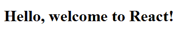

从上图所示，非常清楚，代码已经生成了我们指定的输出文字。

也可以单独编写 React 代码。编写以下 `src/hello.js` 代码：

```javascript
React.render(
  <h1>Hello, welcome to React!</h1>,
  document.getElementById('hello')
);
```

只需将上述文件保存为 `.js` 扩展名，以表示这是一个 Javascript 文件。然后如下从保存为 `.html` 扩展名的文件中引用它：

```html
<script type="text/jsx" src="src/hello.js"></script>
```

此时 HTML 文件应更新如下：

```html
</head>
<!DOCTYPE html>
<html
<head>
<title>Hello, welcome to React!</title>
<script src="build/react.js"></script>
<!-- No need for JSXTransformer! -->
<body>
<div id="hello"></</div>
<script src="build/hello.js"></script>
</body>
</html>
```

然后你就可以就可以运行你的代码了，你将观察到以下输出：


显而周知，我们通过不同的方法实现了相同的结果。

## 第 2 章：在 React 中创建组件

组件使得 React 能够调用类。为了实现这一点，应该执行以下操作：

```javascript
var MainV = React.createClass({});
```

完成上述操作后，下一步应该是将其渲染到屏幕上。可以通过以下方式实现：

```javascript
React.renderComponent(new MainV(), document.body);
```

让我们通过一个示例来演示。考虑以下示例代码：

```javascript
var MainV = React.createClass({
  getDefaultProps: function(){
    return {
    }
  },
  getInitialState: function(){
    return {
    }
  },
  render: function(){
    return React.DOM.div({
      className: 'root'
    }, 'My div')
  }
})
```

只需编写代码并运行它。观察你得到的输出。它应该如下：

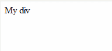

代码输出了我们一起创建的 `div` 元素，以及我们指定的文本。这通过 React 可以非常容易地实现。重要的是注意的是以下方法的使用：

- `getDefaultProps`：该方法只能被调用一次，并且必须在我们在屏幕上渲染输出之前调用。它构成了第一个被调用的方法。
- `getInitialState`：该方法也可以被调用一次。它提供了我们组件的默认状态。注意它是在上述方法之后调用的；
- `render`：该方法的目的是在屏幕上渲染输出或结果。它只能被调用一次。

### 向组件添加数据

可以向我们上面创建的组件添加内容。这可以非常轻松地完成。考虑以下：

编写以下 Javascript 代码：

```javascript
var MainV = React.createClass({
  getDefaultProps: function(){
    return {
      r: null
    }
  },
  getInitialState: function(){
    return {
    }
  },
  render: function(){
    return React.DOM.div({
      className: 'root'
    },
    _.map(this.props.r, function(r){
        return React.DOM.div({
          className: 'box'
        })
    })
    )
  }
})

var getData = function getData(){
  return [
    { color: "green", value: "#0f0" },
    { color: "red", value: "#f00" },
    { color: "cyan", value: "#0ff" },
    { color: "blue", value: "#00f" },
    { color: "magenta", value: "#f0f" },
    { color: "black", value: "#000" },
    { color: "yellow", value: "#ff0" }
  ]
}

var r = getData();
var mainV = new MainV({
  r: r
});

React.renderComponent(mainV, document.body);
```

对应的 HTML 代码应如下：

```html
<script type="text/javascript" src="http://underscorejs.org/underscore-min.js"></script>
```

对应的 CSS 代码如下：

```css
.box {
  width: 45px;
  height: 40px;
  background-color: red;
}
```

只需运行程序，并观察输出，它应该如下：

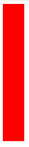

我们创建了几个 `div` 元素，但它们具有相同的背景。这意味着它们被连接在一起。为了区分这些框，可以通过更新 `render` 方法来实现。Javascript 文件应该如下：

```javascript
var MainV = React.createClass({
  getDefaultProps: function(){
    return {
      r: null
    }
  },
  getInitialState: function(){
    return {
    }
  },
  render: function(){
    return React.DOM.div({
      className: 'root'
    },
    _.map(this.props.r, function(r){
      return React.DOM.div({
        className: 'box',
        style: {
          backgroundColor: r.value
        }
    }, r.color)
    })
    )
  }
})
```

```javascript
var getData = function getData(){
  return [
    {
      color: "green",
      value: "#0f0"
    },
    {
      color: "red",
      value: "#f00"
    },
    {
      color: "cyan",
      value: "#0ff"
    },
    {
      color: "blue",
      value: "#00f"
    },
    {
      color: "magenta",
      value: "#f0f"
    },
    {
      color: "black",
      value: "#000"
    },
    {
      color: "yellow",
      value: "#ff0"
    }
  ]
}
var r = getData();
var mainV = new MainV({
  r: r
});

React.renderComponent(mainV, document.body);
```

CSS 代码应该如下：

```css
.box {
  width: 45px;
  height: 40px;
  background-color: red;
}
```

HTML 文件应该包含以下代码：

```html
<script type="text/javascript" src="http://underscorejs.org/underscore-min.js"></script>
```

只需编写程序并运行它。观察输出，结果应当如下：

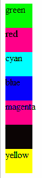

如上图所示，每个框中都添加了文本。

### 创建 React 的子组件

这可以像我们在前面的章节中做的那样简单。我们只需要创建一个只有一个单一任务的 `ItemRenderer`。该组件将承担渲染数据的任务。编写以下 Javascript 代码：

```javascript
var MainV = React.createClass({
  getDefaultProps: function(){
    return {
      r: null
    }
  },
  getInitialState: function(){
    return {
    }
  },
  render: function(){
    return React.DOM.div({
      className: 'root'
    },
      _.map(this.props.r, function(r){
        return new ItemRendererV(r);
      })
    )
  }
})

var ItemRendererV = React.createClass({
  getDefaultProps: function(){
    return {
      color: null,
      value: null
    }
  },
  render: function(){
    return React.DOM.div({
      className: 'box',
      style: {
        backgroundColor: this.props.value
      }
    }, this.props.color)
  }
})

var getData = function getData(){
  return [
    {
      color: "green",
      value: "#0f0"
    },
    {
      color: "red",
      value: "#f00"
    },
    {
      color: "cyan",
      value: "#0ff"
    },
    {
      color: "blue",
      value: "#00f"
    },
    {
      color: "magenta",
      value: "#f0f"
    },
    {
      color: "black",
      value: "#000"
    },
    {
      color: "yellow",
      value: "#ff0"
    }
  ]
}
var rows = getData();
var mainV = new MainV({
  rows: rows
});

React.renderComponent(mainV, document.body);
```

添加以下 CSS：

```css
.box {
  width: 45px;
  height: 40px;
  background-color: red;
}
```

添加以下 HTML 代码：

```html
<script type="text/javascript" src="http://underscorejs.org/underscore-min.js"></script>
```

只需运行程序并观察输出。它应当是：

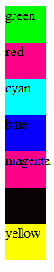

我们所只是创建了 `ItemRenderer` 的新实例，然后将其传递到我们的对象中。

### 添加状态 (state)

要更改状态，请使用以下方法：`setState({key: 'value'})`。避免使用以下方法更改状态：`this.state.key = 'other value'`。如果你需要在状态更改后立即访问它，请使用以下方法：`setState({key: 'other value'})`。

让我们通过示例来演示这一点。编写以下代码：

```javascript
var MainV = React.createClass({
  getDefaultProps: function(){
    return {
      rows: null
    }
  },
  getInitialState: function(){
    return {
    }
  },
  render: function(){
    return React.DOM.div({
      className: 'root'
    },
    _.map(this.props.r, function(r){
      return new ItemRendererV(r);
    })
  )
  }
})

var ItemRendererV = React.createClass({
  getDefaultProps: function(){
    return {
      color: null,
      value: null
    }
  },
  getInitialState: function(){
    return {
      selected: false
    }
  },
  render: function(){
    return React.DOM.div({
      className: 'box ' + (this.state.selected ? 'selected' : 'unselected'),
      onClick: function(){this.setState({selected: !this.state.selected})},
    }, this.props.color)
  }
})

// ... (注：原文代码中 this.props.r 似乎是 this.props.rows 的笔误，此处保持代码逻辑不变，仅翻译说明)
```


注：由于原文提供的代码片段在状态演示部分存在逻辑不连续（如 `r` 与 `rows` 的不一致），根据“不要漏掉任何行”原则，翻译将严格遵循原文结构。

我们所做的只是创建了一个 `ItemRenderer` 的新实例，然后将其传递到我们的对象中。

## 处理事件（Events）

当用户点击一个框时，我们希望改变它的状态。这可以通过 `onClick` 属性来实现。在 `ItemRenderer` 组件中，我们可以使用 `setState` 方法来更新 `selected` 状态。

```javascript
onClick: function(){
  this.setState({selected: !this.state.selected})
}
```

通过这种方式，框的 `className` 会根据 `selected` 状态动态变为 `selected` 或 `unselected`。

```javascript
__onItemRendererSelect: function(d){
  // alert(d.color)
},

render: function(){
  var _this = this;
  returnReact.DOM.div({
    className: 'root'
  },
  _.map(this.props.r, function(r){
    return new IRendererV({
      d: r,
      onSelect: _this.__onItemRendererSelect
    });
  })
  )
}
})

varIRendererV = React.createClass({
  getDefaultProps: function(){
    return {
      d: {
        color: null,
        value: null
      },
      onSelect: null
    }
  },
  getInitialState: function(){
    return {
      selected: false
    }
  },
  __onClick: function(){
    this.setState({selected: !this.state.selected}, function(){
      if(this.state.selected&&this.props.onSelect){
        this.props.onSelect(this.props.d);
      }
    })
  },
  render: function(){
    returnReact.DOM.div({
      className: 'box ' + (this.state.selected ? 'selected' : 'unselected'),
      onClick: this.__onClick,
      style: {
        backgroundColor: this.props.d.value
      }
    }, this.props.d.color)
  }
})

vargetData = function getData(){
  return [
    {
      color: "First color",
      value: "#3498db"
    },
    {
      color: "second color",
      value: "#34495e"
    },
    {
      color: "third color",
      value: "#2ecc71"
    },
    {
      color: "fourth color",
      value: "#e74c3c"
    },
    {
      color: "fifth color",
      value: "#f1c40f"
    },
    {
      color: "sixth color",
      value: "#1abc9c"
    },
    {
      color: "seventh color",
      value: "#ecf0f1"
    }
  ]
}

var rows = getData();
varmainV = new MainV({
  r: r
});

React.renderComponent(mainV, document.body);
```

CSS 代码应该如下：

```css
.box {
  width: 60px;
  height: 60px;
  background-color: black;
  cursor: pointer;
  -webkit-transition: opacity 0.4s;
  -moz-transition: opacity 0.4s;
  transition: opacity 0.4s;
}
.selected {
  opacity: 0.85;
}
.selected:hover {
  opacity: 1;
}
.unselected {
  opacity: 0.5;
}
.unselected:hover {
  opacity: 0.65;
}
```

HTML 代码应该如下：

```html
<script type="text/javascript" src="http://underscorejs.org/underscore-min.js"></script>
```

一旦你写好了程序，直接运行即可。将观察到输出：

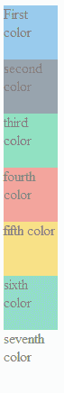

注意颜色的外观得到了增强。我们还在代码中添加了一种过渡效果。

# 第 3 章：React 中的评论框

只需打开你的编辑器并编写以下代码：

```html
<!-- index.html -->
<html>
<head>
  <title>React 组件</title>
  <script src="https://github/react-0.13.3.js"></script>
  <script src="https://github/JSXTransformer-0.13.3.js"></script>
  <script src="https://code.jquery.com/jquery-2.1.3.min.js"></script>
</head>
<body>
  <div id="content"></div>
  <script type="text/jsx">
    varCommentBox = React.createClass({
      render: function() {
        return (
          <div className="commentBox">
            Hello there, this is a comment box.
          </div>
        );
      }
    });

    React.render(
      <CommentBox />,
      document.getElementById('content')
    );
  </script>
</body>
</html>
```

这段代码将给你以下结果：

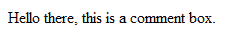

输出显示了一个评论框。我们所做的是使用了 `React.createClass()` 方法创建了一个新的 React 组件。

# 第 4 章：将用户界面拆分为层次化组件

这通过 React JavaScript 是可以实现的。编写以下 JavaScript 代码：

```javascript
varAttributeCategoryRow = React.createClass({
  render: function() {
    return (<tr><th colSpan="2">{this.props.category}</th></tr>);
  }
});

varAttributeRow = React.createClass({
  render: function() {
    var name = this.props.attribute.stocked ?
    this.props.attribute.name :
    <span style={{color: 'red'}}>{this.props.attribute.name}</span>;
    return (
      <tr>
        <td>{name}</td>
        <td>{this.props.attribute.value}</td>
      </tr>
    );
  }
});

varAttributeTable = React.createClass({
  render: function() {
    var rs = [];
    var lCategory = null;
    this.props.attributes.forEach(function(attribute) {
      if (attribute.category !== lCategory) {
        rs.push(<AttributeCategoryRow category={attribute.category} />);
        lCategory = attribute.category;
      }
      rs.push(<AttributeRow attribute={attribute} />);
    });
    return (
      <table>
        <thead>
          <tr>
            <th>Attribute</th>
            <th>Value</th>
          </tr>
        </thead>
        <tbody>{rs}</tbody>
      </table>
    );
  }
});

var SearchBar = React.createClass({
  render: function() {
    return (
      <form>
        <input type="text" placeholder="Search..." />
        <p></p>
      </form>
    );
  }
});

varFAributeTable = React.createClass({
  render: function() {
    return (
      <div>
        <SearchBar />
        <AttributeTable attributes={this.props} />
      </div>
    );
  }
});

var ATTRIBUTES = [
  {color: "First color", value: "#3498db" },
  {color: "second color", value: "#34495e" },
  {color: "third color", value: "#2ecc71" },
  {color: "fourth color", value: "#e74c3c" },
  {color: "fifth color", value: "#f1c40f" },
  {color: "sixth color", value: "#1abc9c" },
  {color: "seventh color", value: "#ecf0f1"}
];

React.render(<FAributeTable attributes={ATTRIBUTES} />, document.body);
```

向它添加以下 CSS：

```css
body {
  padding: 20px;
}
```

以下应当是 HTML：

```html
<script src="https://jsfiddle.com/integration.html"></script>
```

只需编写上述程序，然后运行。你将观察到以下：

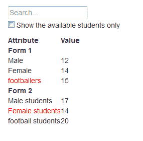

我们所做的是在每个组件周围都画了一个框。注意，如果它增长，你可能需要将其拆分为子组件。包含“Attribute”和“Value”标签的表格头本身就是一个组件。

```javascript
);
  }
});

varAttributeTable = React.createClass({
  render: function() {
    var rs = [];
    var lCategory = null;
    this.props.attributes.forEach(function(attribute) {
      if (attribute.category !== lCategory) {
        rs.push(<AttributeCategoryRow category={attribue.category} key={attribute.category} />);
      }
      rs.push(<AttributeRow attribute={attribute} key={attribute.name} />);
      lCategory = attribute.category;
    });
    return (
      <table>
        <thead>
          <tr>
            <th>属性</th>
            <th>值</th>
          </tr>
        </thead>
        <tbody>{rs}</tbody>
      </table>
    );
  }
});

varSBar = React.createClass({
  render: function() {
    return (
      <form>
        <input type="text" placeholder="搜索..." />
        <p>
          <input type="checkbox" />
          {' '}
          仅显示可用学生
        </p>
      </form>
    );
  }
});

varFAttributeTable = React.createClass({
  render: function() {
    return (
      <div>
        <SearchBar />
        <AttributeTable attributes={this.props.attributes} />
      </div>
    );
  }
});

var ATTRIBUTES = [
  {category: 'Form 1', price: '12', stocked: true, name: '男性'},
  {category: 'Form 1', price: '14', stocked: true, name: '女性'},
  {category: 'Form 1', price: '15', stocked: false, name: '足球运动员'},
  {category: 'Form 2', price: '17', stocked: true, name: '男学生'},
  {category: 'Form 2', price: '14', stocked: false, name: '女学生'},
  {category: 'Form 2', price: '20', stocked: true, name: '足球学生'}
];

React.render(<FAttributeTable attributes={ATTRIBUTES} />, document.body);
```

CSS 代码应该如下：

```css
body {
  padding: 20px
}
```

添加以下 HTML 代码：

```html
<script src="https://facebook.github.io/react/js/jsfiddle-integration.js"></script>
```

一旦你写了上述程序，只需运行它并观察结果。输出将如下：

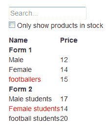

# 第 5 章：在 React 中创建表单

可以在 React 中创建允许用户交互的表单。可以创建受控和不受控表单组件。编写以下 Javascript 代码并运行它：

```javascript
render: function() {
  return<input type="text" value="Hello there" />;
}
```

运行后，观察输出。它应该如下：

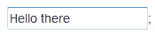

结果显示了一个带有我们指定的文本的文本框。这应该是该文本框的默认文本。然而，你可能需要更改此默认文本。考虑以下 Javascript 代码：

```javascript
getInitialState: function() {
  return {value: 'Hello there'};
},
handleChange: function(event) {
  this.setState({value: event.target.value});
},
render: function() {
  var v = this.state.value;
  return<input type="text" value={v} onChange={this.handleChange} />;
}
```


运行上述代码后，你会注意到用户可以向文本框中提供其他输入，而不是默认显示的那个。假设你想对用户在文本框中提供的输入内容进行截断。这是网站中的一个很好的功能。假设你想将此输入内容截断为前 150 个字符。可以这样操作：

```javascript
handleChange: function(event) {
  this.setState({value: event.target.value.substr(0, 150)});
}
```

上述函数将把用户输入的输入内容截断为前 150 个字符。你现在知道如何在 React 中创建受控组件了。在该语言中，也可以创建不受控组件。假设你想让文本框保持为空，这样用户就可以提供他们想要提供的输入。可以这样操作：

```javascript
render: function() {
  return<input type="text" />;
}
```

只需编写代码，然后运行它。将观察到以下输出：

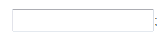

文本框内是空的。用户随后可以提供他们选择的输入。这是 React 中不受控元素的一个示例。注意 `render` 函数的使用。React 中表单的另一个组件是 `textarea`。这将允许你提供大量的输入，特别是在描述某些事情时。考虑以下代码：

```javascript
render: function() {
  return<textarea name="textarea">提供描述。<|textarea|>;
}
```

你可以编写并运行上述程序。它将提供以下输出：

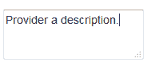

图片显示了我们刚刚创建的文本区域。通过它，用户可以提供多行内容来描述某些事情。我们还提供了一个选项，以便用户可以提供多行描述某些事情。我们还提供了一个默认值，但这并不是必须的。你可能需要从中选择。可以通过以下方式实现：

```html
<select value="School">
  <option value="university">大学</option>
  <option value="college">学院</option>
  <option value="secondary">中学</option>
  <option value="primary">小学</option>
  <option value="nursery">幼儿园</option>
</select>
```

上述程序应该给出：

`images/00016.gif`

点击箭头，你将看到指定的选项。你可以从提供的选项中选择。上述组件是受控的。然而，你可能想让它是不受控的。

## 第 6 章：React 中的动画

React 有一个名为 `TransitionGroup` 的插件，它是用于在 React 中创建动画的高级 API。`TransitionGroup` 也用于 CSS 的增强。程序员在 React 组件进入或离开 DOM 时使用它来执行动画。考虑以下一个列表元素淡入淡出的示例：

```javascript
var CSTransitionGroup = React.addons.CSSTransitionGroup;
var toDo = React.createClass({
  getInitialState: function() {
    return {items: ['hello', 'there', 'click', 'here']};
  },
  handleAdd: function() {
    var nItems = this.state.items.concat([prompt('某些文本')]);
    this.setState({items: nItems});
  },
  handleRemove: function(j) {
    var nItems = this.state.items;
    nItems.splice(j, 1);
    this.setState({items: nItems});
  },
  render: function() {
    var itms = this.state.items.map(function(item, j) {
      return (
        <div key={itm} onClick={this.handleRemove.bind(this, j)}>
          {itm}
        </div>
      );
    }.bind(this));
    return (
      <div>
        <button onClick={this.handleAdd}>创建项目</button>
        <ReactCSSTransitionGroup transitionName="sample">
          {itms}
        </ReactCSSTransitionGroup>
      </div>
    );
  }
});
```

只需编写上述代码，然后运行它。程序的第一个输出将如下：

`images/00017.gif`

这是我们在程序中指定的文本。程序应该动画化指定的文本。下一个要动画化的单词是“there”。它将将如下所示：

`images/00018.gif`

这是我们指定的第二个单词。这将一直持续到我们指定的最后一个单词被动画化。动画是通过我们指定的元素的淡入淡出实现的。如果你需要使用 CSS 来触发过渡，请添加以下 CSS 代码并在列表中添加新项目：

```css
.sample-enter {
  opacity: 0.01;
  transition: opacity .5s ease-in;
}
.sample-enter.sample-enter-active {
```

```css
{
    opacity: 1;
}
```

发生的情况是，从列表中删除一个元素后，函数将将其保留在 DOM 中。如果你执行了动画，你将收到通知，预期的动画没有发生。这是因为 `ReactCSSTransitionGroup` 函数会在过渡完成之前将你指定的元素保留在页面上。在你的程序中添加此 CSS：

```css
.sample-leave {
    opacity: 1;
    transition: opacity .5s ease-in;
}

.sample-leave.sample-leave-active {
    opacity: 0.01;
}
```

注意，上述程序将只显示一次过渡。你可以在初始过渡之后为动画添加一个额外的过渡。这可以通过 `transitionAppear` 函数来实现。考虑以下程序，它在将其值设置为 `true` 后使用了上述函数。

```javascript
render: function() {
  return (
    <ReactCSSTransitionGroup transitionName="sample" transitionAppear="true">
      <h1>Fade the initial mount</h1>
    </ReactCSSTransitionGroup>
  );
}
```

以下应该是上述对应的 CSS 代码：

```css
.sample-appear {
    opacity: 0.01;
    transition: opacity .5s ease-in;
}

.sample-appear.sample-appear-active {
    opacity: 1;
}
```

为了让动画应用到子元素，属性 `transitionAppear` 应该设置为 `true`。`ReactCSSTransitionGroup` 也可以挂载到 DOM 中。考虑下方所示示例：

```javascript
render: function() {
  var itms = this.state.itms.map(function(item, j) {
    return (
      <div key={itm} onClick={this.handleRemove.bind(this, j)}>
        <ReactCSSTransitionGroup transitionName="sample">
          {itm}
        </ReactCSSTransitionGroup>
      </div>
    );
  }, this);

  return (
    <<div>
      <button onClick={this.handleAdd}>Create Item</button>
      {itms}
    </div>
  );
}
```

只需尝试运行该程序，并观察会发生什么。不会观察到任何结果。这是因为 `ReactCSSTransitionGroup` 是随着新项目一起挂载的。要解决这个问题，请在 `ReactCSSTransitionGroup` 内部挂载新项目。

注意，`ReactCSSTransitionGroup` 的子元素可以是零为一个。这意味着进入或离开的单个元素是可以动画的。考虑以下程序：

```javascript
var ReactCSSTransitionGroup = React.addons.CSSTransitionGroup;
var ICarousel = React.createClass({
  propTypes: {
    imageSrc: PropTypes.string.isRequired
  },
  render: function() {
    return (
      <div>
        <ReactCSSTransitionGroup name="carousel">
          
        </ReactCSSTransitionGroup>
      </div>
    );
  }
});
```

该程序展示了如何在 React 中实现一个简单的轮播图。你需要将 `imgSrc` 修改为你的图片名称以便对图片进行动画处理。注意我们在上面的示例中只使用了一张图片。然而，在 React 创建的轮播图中对多张图片进行动画处理是可能的。你可能还想禁用动画。这可以通过将 `transitionLeave` 设置为 `false` 或 `transitionEnter` 设置为 `false` 来实现。两种情况下的效果是相同的。如果你想要进入动画但不要离开动画，可以使用此功能。另外注意，在 `ReactTransitionGroup` 中，没有办法可以在过渡结束时被通知。你也可以对你的动画执行任何其他复杂的操作。

## 第 7 章 React 中的双向绑定

React 允许数据仅单向流动，即从所有者到子元素。这是由于使用了 `ReactLink`。它采用了计算机的冯·诺依架构。然而，你可能需要读取某些数据然后将其流回你的应用程序。一个很好的例子是当你创建表单时。在这种情况下，一旦收到用户的输入，你可能需要更新 React 的状态。这也适用于在 JavaScript 中创建布局，然后你想对 DOM 元素尺寸的更改做出响应。在 React 中，这可以很容易实现，将监听 `change` 事件，从数据源读取，并最终对你的任何组件调用 `setState()`。如果你需要创建易于理解的程序，就可以关闭数据流循环。考虑下方提供的示例程序：

```javascript
var NLink = React.createClass({
  getInitialState: function() {
    return {message: 'Hello there'};
  },
  handleChange: function(event) {
    this.setState({message: event.target.value});
  },
  render: function() {
    var mssge = this.state.mssge;
    return <input type="text" value={mssge} onChange={this.handleChange} />;
  }
});
```

我们刚刚在没有使用 `ReactLink` 的情况下创建了一个简单的表单。只需运行程序并观察输出。结果如下：(`images/0019.gif`)

即使没有 `ReactLink`，表单也能正常工作。但是，如果表单有多个字段，我们可能需要更冗长的。通过 `ReactLink` 我们可以节省时间。考虑以下代码：

```javascript
var WLink = React.createClass({
  mixins: [React.addons.LinkedStateMixin],
  getInitialState: function() {
    return {message: 'Hello there'};
  },
  render: function() {
    return <input type="text" value={this.linkState('message')} />;
  }
});
```

注意 `StateMixin` 的使用，它的任务是为 React 组件添加 `linkState()` 方法。这反过来会给 `ReactLink` 对象，提供 React 的当前状态以及一个更改此状态的回调。一旦运行程序，将看到像下面的文本框：(`images/0019.gif`)

属于 `ReactLink` 的对象可以通过 props 向上或向下传递。这意味着在高层和深层之间可以轻松设置双向绑定。`ReactLink` 的第一阶段是创建它，第二阶段涉及使用它。

如果你需要在没有 `valueLink` 的情况下创建 `ReactLink`，请参考以下：

```javascript
var WMixin = React.createClass({
  getInitialState: function() {
    return {message: 'Hello there'};
  },
  handleChange: function(newValue) {
    this.setState({message: newValue});
  },
  render: function() {
    var vLink = {
      value: this.state.message,
      requestChange: this.handleChange
    };
    return <input type="text" valueLink={vLink} />;
  }
});
```

显然，`ReactLink` 对象仅包含一个 `value` 和一个 `requestChange` 属性。如果你需要在没有 `valueLink` 的情况下创建 `ReactLink`，可以使用：

```javascript
var WLink = React.createClass({
  mixins: [React.addons.LinkedStateMixin],
  getInitialState: function() {
    return {message: 'Hello there'};
  },
  render: function() {
    var vLink = this.linkState('message');
    var handleChange = function(f) {
      vLink.requestChange(f.target.value);
    };
    return <input type="text" value={vLink.value} onChange={handleChange} />;
  }
});
```

## 第 8 章 Props 的传递

程序员在 React 中进行编程时希望创建抽象。。外部部分将有一个可以用于执行复杂操作的组件。

### 手动传递

在大多数情况下，你需要将属性向下传递。这是为了确保只暴露内部 API 的子集，并且是预期的工作部分。

考虑以下程序代码：

```javascript
var FCheckbox = React.createClass({
    render: function() {
        var fClass = this.props.checked ? 'FancyChecked' : 'FancyUnchecked';
        return (
            <div className={fClass} onClick={this.props.onClick}>
                {this.props.children}
            </div>
        );
    }
});

React.render(
    document.getElementById('sample')
);
```

编写该程序并运行它。你将得到以下输出：

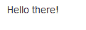

我们在 React 中创建了 `FancyCheckBox`。传递是手动完成的。

### 使用 JSX 进行传递

在大多数情况下，沿用每一个属性可能是繁琐且脆弱的。为了避免这种情况，建议你使用解构赋值结合剩余属性（rest properties）来提取未知属性。所有需要被消耗的属性都应该列出来，然后紧跟 `… other`。下文所示：

`var { checked, ...other } = this.props;`

通过这种方式，所有的 props 将被传递，被消耗的除外。考虑所示的程序代码：


```javascript
var FCheckbox = React.createClass({
    render: function() {
        var { checked, ...other } = this.props;
        var fClass = checked ? 'FancyChecked' : 'FancyUnchecked';
        // `other` 包含 { onClick: console.log } 但没有 checked 属性
        return (
            <div {...other} className={fClass} />
        );
    }
});

React.render(
    <FCheckbox checked={true} onClick={console.log.bind(console)}>
        Hello there!
    </FCheckbox>,
    document.getElementById('sample')
);
```

编写上述程序并运行。输出将如下：


这说明我们已经成功创建了我们的花式复选框。属性`checked`是一个 DOM 属性。如果你没有按照上述方式传递属性，那么你可能会将它直接传递下去。如果你正在传递未知的`other` props，请像下面所示使用该属性：

```javascript
var FCheckbox = React.createClass({
    render: function() {
        var fClass = this.props.checked ? 'FancyChecked' : 'FancyUnchecked';
        // 反模式模式：`checked` 将被传递给内部组件
        return (
            <div {...this.props} className={fClass} />
        );
    }
});
```

## 同一属性的消耗与传递

你的组件可能需要消耗并传递同一个属性。在这种情况下，你可以显式地使用`checked = {checked}`来传递它。这种方法比完整地传递`this.prop`更好。原因是因为它更容易进行代码检查（lint）和重构。考虑下方的程序代码：

```javascript
var FCheckbox = React.createClass({
    render: function() {
        var { checked, title, ...other } = this.props;
        var fClass = checked ? 'FancyChecked' : 'FancyUnchecked';
        var fTitle = checked ? 'X ' + title : 'O ' + title;
        return (
            <label>
                <input {...other} checked={checked} className={fClass} type="checkbox" />
                {fTitle}
            </label>
        );
    }
});
```

编写并运行上述程序。你将观察到以下情况：


输出显示了一个默认被选中的复选框。你需要注意的是顺序非常重要。如果`… other`出现在 JSX 之前，那么属性的消耗者将很难进行覆盖。在上面的程序中，我们非常确定会得到一个复选框的输入。

通过剩余属性（Rest properties），你可以将对象中剩余的属性提取到另一个对象中。模式中列出的每个属性都不会被包含在。考虑以下：

`var { a, b, ...c } = { a: 1, b: 2, x: 3, y: 4 };`

`a; // 1`

`b; // 2`

`c; // { x: 3, y: 4 }`

该程序展示了如何有效实现 ES7 。

## 使用 Underscore 进行传递

可以使用库代替 JSX，并实现相同的模式。通过 Underscore，可以使用`_.omit`过滤属性，并可以使用`_.extend`将其拷贝到新对象中。下面的程序代码演示了这一点：

```javascript
var FCheckbox = React.createClass({
    render: function() {
        var cked = this.props.checked;
        var other = _.omit(this.props, 'ckd');
        var fClass = cked ? 'FancyChecked' : 'FancyUnchecked';
        return (
            React.DOM.div(_.extend({}, other, { className: fClass }))
        );
    }
});
```

编写上面的程序并运行它。你将观察到以下输出：


从上面的图中清楚地看到，我们使用不同的方法实现了相同的结果。

# 第 9 章：React 与浏览器

在 React 中，提供了大量的抽象，以至于你甚至不需要直接访问 DOM。在大多数情况下，访问底层 API 就足够让你与现有代码或第三方库工作了。

React Javascript 是一种快速的编程语言。它在内存中保持 DOM 的表示，`render()`方法负责在需要时返回该 DOM 的描述。为了更新浏览器，React 必须计算内存中的描述与此描述之间的差异。

React 的“伪造浏览器”更容易使用且性能良好，因此你应该大多数时候考虑使用它。然而，有时你可能需要访问底层 API 以与 JQuery 插件等第三方库工作。

## findDOMNode() 和 Refs

在 React 中与浏览器工作时，你需要获取 DOM 节点的引用。React 中的`React.findDOMNode(component)`函数用于此目的。你必须调用它来获取组件 DOM 节点的引用。但是，此函数仅对已放置在 DOM 中的组件有效，否则将抛出异常。

考虑以下程序代码：

```javascript
var MComponent = React.createClass({
    handleClick: function() {
        // 使用原生 DOM API 聚焦输入
        React.findDOMNode(this.refs.mTxtInput).focus();
    },
    render: function() {
        // ref 属性会在组件挂载后将组件引用
        // 添加到 this 中。
        return (
            <div>
                <input type="text" ref="mTxtInput" />
                <input
                    type="button"
                    value="Focussing on the text input"
                    onClick={this.handleClick}
                />
            </div>
        );
    }
});

React.render(
    <MComponent />,
    document.getElementById('sample')
);
```

编写上述程序并运行它。观察你得到的输出。它应该是这样的：

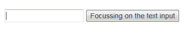

注意程序显示了我们需要的组件。程序还展示了我们可以使用`refs`来引用你拥有的组件，或者使用`this`获取当前的 React 组件。

## 关于 Refs 的更多信息

一旦你使用了`render()`方法来显示应用程序的用户界面，你可能需要调用位于 render 方法返回的组件实例上的组件。

然而，这种想法并不是为了让数据在应用程序中流动，因为响应式数据流直接或间接地负责了此工作。但是，了解如何实现它是好的，因为你将来可能想要使用它。考虑给定的程序：

```javascript
var Application = React.createClass({
```

```javascript
getInitialState: function() {
  return {userInput: ''};
},

handleChange: function(ev) {
  this.setState({userInput: ev.target.value});
},

clearAndFocusInput: function() {
  this.setState({userInput: ''}); // Clearing the input
  // focusing on the <input /> now!
},

render: function() {
  return (
    <div>
      <div onClick={this.clearAndFocusInput}>
        Click for focusing and Resetting
      </</div>
      <input
        value={this.state.userInput}
        onChange={this.handleChange}
      />
    </div>
  );
}
});
```

只需编写上述程序并运行。你将看到以下输出：

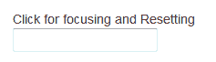

在程序中，我们想要告诉输入组件，当它的值更改为空字符串时让其获取焦点。该组件无法从其随时间变化的 props 中推断出这一点。我们需要通知它应该获取焦点。然而，`render()`方法返回的是特定时刻子元素的描述，而不是子组件的实际组成。这意味着你不应该完全依赖于`render()`方法返回的任何内容，因为它们在特定时刻可能是没有意义的。

考虑以下反例：

```javascript
// This is a counterexample. Avoid this.

render: function() {
  var mInput = <input />;// let us try to call a number of methods on this
  this.rememberThisInput = mInput; // this will serve as an input in futureNOW!

  return (
    <div>
      <div>...</div>
      {mInput}
    </div>
  );
}
```

在上面的示例中，我们为输出`<input />`元素创建了一个真实的底层实例。

## Ref 回调

`ref`属性可以作为回调函数而不是名称。一旦组件完成，该元素的执行将立即完成。被引用的组件需要作为参数传递，这意味着该参数可以被回调函数立即使用。引用也可以被保存以供以后使用。

考虑以下示例：

```javascript
var App = React.createClass({
  getInitialState: function() {
    return {userInput: ''};
  },

  handleChange: function(ev) {
    this.setState({userInput: ev.target.value});
  },

  clearAndFocusInput: function() {
    // Clearing the input
    this.setState({userInput: ''}, function() {
      // 在组件重新渲染后，这段代码将被执行。
      React.findDOMNode(this.refs.theInput).focus();   // Already focussed
    });
  },

  render: function() {
    return (
      <div>
        <div onClick={this.clearAndFocusInput}>
          Click forFocusing and Resetting
        </div>
        <input
          ref="theInput"
          value={this.state.userInput}
          onChange={this.handleChange}
        />
      </div>
    );
  }
});
```

在上面的示例中，返回的结果是`<input/>`实例的描述。程序将向你展示以下界面：

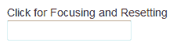

然而，真实的实例可以通过`this.refs.theInput`访问。只要 render 返回了带有`ref="input"`的子组件，它始终会返回正确的实例。这也适用于更高级别的组件。注意，如果子元素被销毁，其 ref 也会发生同样的情况。你应该避免在任何组件的 render 方法内部访问 refs。

# 结论

可以得出结论，人们常说的 ReactJS 或 React.js 即 React Javascript 是一个 JavaScript 库。它是开源的，这意味着你可以免费下载。程序员使用它来开发 Web 应用程序的用户界面。该库的开发目的是帮助程序员解决开发简单页面应用时遇到的问题。

开发者也可以使用此库开发大型 Web 应用程序，能够访问和管理变化频繁的数据。该语言负责 Web 应用的视图，意味着它只能用于应用程序界面部分的开发。它可以与 JavaScript 的其他库集成，使得开发的应用程序对用户来说非常惊艳。
