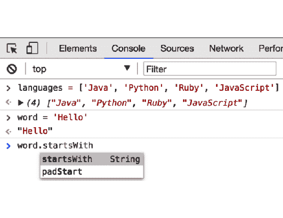
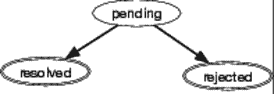
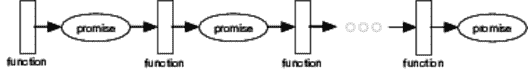
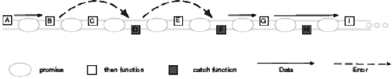
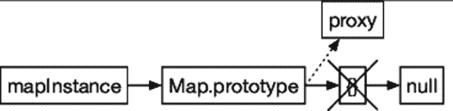

# 重新发现 JavaScript


## 关于 Pragmatic Bookshelf

Pragmatic Bookshelf 是一家敏捷出版公司。我们在这里是因为我们希望改善开发者的生活。我们通过创建由程序员为程序员编写的、及时且实用的书籍来实现。

我们的 Pragmatic 课程、工作坊和其他产品可以帮助你和你的团队创建更好的软件并获得更多乐趣。欲了解更多信息以及最新的 Pragmatic 书籍，请访问我们的 [`pragprog.com`](http://pragprog.com)。

我们的电子书不包含任何数字版权管理（DRM），并且一直都是无 DRM 的。我们开创了测试书（beta book）概念，你可以在书籍编写期间购买并阅读，并向作者提供反馈以帮助为所有人制作一本更好的书。所有购买者的免费资源包括源代码下载（如适用）、勘误表和讨论论坛，均可在 `pragprog.com` 的书籍主页获取。我们在这里是为了让你的生活更轻松。

### 新书公告

想跟进我们的最新书籍、公告以及偶尔的特别优惠吗？只需在 [pragprog.com](https://pragprog.com) 上创建一个账户（只需一个电子邮件地址和密码）并勾选接收新闻邮件复选框。你也可以在 Twitter 上关注我们 @pragprog。

### 关于电子书格式

如果你直接从 [pragprog.com](https://pragprog.com) 购买，你将以一个价格获得所有可用格式的电子书。你可以通过 Dropbox 在你的所有设备上（包括 iPhone/iPad、Android、笔记本电脑等）同步你的电子书。在该版本的生命周期内，你可以获得免费更新。当然，你可以在需要时随时回来重新下载书籍。从 Amazon Kindle 商店购买的电子书受亚马逊政策限制。Amazon 文件格式的限制可能会导致电子书在不同设备上的显示有所不同。欲了解更多信息，请参阅 [pragprog.com/frequently-asked-questions/ebooks](https://pragprog.com/frequently-asked-questions/ebooks) 中的常见问题。欲了解更多关于本书的信息并访问免费资源，请前往书籍主页 [`pragprog.com/book/ves6`](https://pragprog.com/book/ves6)。

感谢你的持续支持，

Andy Hunt

The Pragmatic Programmers

制作本书的团队包括：Andy Hunt（出版商）、Janet Furlow（运营副总裁）、Brian MacDonald（执行编辑）、Jacquelyn Carter（主管编辑）、Liz Welch（文字编辑）、Potomac Indexing, LLC（索引）、Gilson Graphics（排版）。

如客户支持，请联系 `support@pragprog.com`。

国际版权，请联系 `rights@pragprog.com`。

# 对重新发现 JavaScript 的早期好评

JavaScript 过去只有几个“好的部分”。现在大部分部分都是好的。尽管旧特性仍然存在，但 ES6/7/8 标准提供的新功能可以帮助你编写更安全、更简单、更简洁的代码……但前提是你了解它们。在本书中，Venkat 为从初学者到专家的每个人展示如何使用 JavaScript 已经变成的现代语言。

| → | Ben Rady |

| :--- | :--- |

| | 《Serverless Single Page Apps》和《Continuous Testing with Ruby, Rails, and JavaScript》作者 |

这本对现代 JavaScript 的简洁而精辟的介绍通过简单直接的语言保持了读者的兴趣，并结合专注的示例和练习促进了快速学习。推荐给任何想要发现 ES6/7/8 乐趣的人。 |

| → | Suresh Iyer |

| :--- | :--- |

| | 多语言程序员，ServiceNow 高级员工应用工程师 |

Venkat 再次成功地将 JavaScript 演变过程中最重要的变化浓缩成这部简洁的著作。如果你想以最快的速度更新你对这种无处不在的语言的认知，这本书正适合你。 |

| → | Brian Sam-Bodden |

| :--- | :--- |

| | Integrallis Software |

如果你很久以前就尝试过并放弃了 JavaScript，现在是时候给它一个全新的面目了。这本书教了你所有让该语言进入 21 世纪的改进。 |

| → | Kenneth A. Kousen |

| :--- | :--- |

| Java Champion 及多本书作者，包括《Modern Java Recipes》 |

# 致谢

本书的完成很大程度上归于许多人的支持、帮助、时间和慷慨。特别感谢 Scott Davis、Suresh Iyer、Brian Sam-Bodden、Nathaniel Schutta、Stefan Turalski 和 Jim R.Wilson 的评审。

购买本书测试版的极客们给予了信任，我对此非常感激。感谢通过书籍网站提供反馈的读者 Richard L. Brownrigg、George S. Cowan、Brett DiFrisch、Carsten Hess、Richard Hoggart 和 Felipe Sultani 花时间让这本书变得更好。

我有幸在会议演讲中面对现场观众演示了书中提到的许多主题。特别是 No Fluff Just Stuff (NFJS)^[1 系列，在我开始写作之前就慷慨地为我提供了不同主题的平台。非常感谢 NFJS 主管 Jay Zimmerman 的持续支持。

写书有起伏，而编辑可以决定一个项目的成败。尽管道路上充满了各种挑战，Jackie Carter 不懈地对这本书进行工作，使其呈现现状。我感谢她在写得良好时给予的积极反馈，并在需要改进的地方提供指导。

感谢 Andy Hunt 和整个 Pragmatic Bookshelf 团队（包括许多在幕后工作的人），他们承担了这本书并为将其完成付出了持续努力。书中剩下的任何错误都是我自己的。

我很清楚，如果问“你昨晚尝试的代码运行了吗？”会引发一段长长的抱怨和演示，但一位不懈的灵魂一直问这个问题并继续为我提供动力。没有她的帮助，这一切都不可能，也毫无意义——感谢你，Kavitha。感谢我的儿子 Karthik 和 Krupa，在爸爸不得不躲起来写书时的理解。

### 脚注

](#f_0004.xhtml_FNPTR)]

[`www.nofuffjuststuff.com`](https://www.nofuffjuststuff.com)

在公司活动的前几天，公司通知我参加活动的开发者将由 Java、C# 和 PHP 程序员组成。我当时担心用 Java 演示示例可能会让 C# 和 PHP 程序员感到沮丧。选择另外两种语言中的任何一种都可能导致类似的后果。于是我做了一个行政决定，在所有的示例中使用了 `JavaScript`——这样一来，我就让他们所有人同样感到沮丧了。开个玩笑。事实证明这是一个明智的选择——`JavaScript` 确实是那些在大多数工作中使用其他语言的程序员也会使用的一种语言。

`JavaScript` 就像是编程世界的英语——它对某些人来说是母语，被认为是使用最广泛的语言，而且这种语言本身为了更大的利益，大量借鉴了其他语言。

`JavaScript` 是最强大、无处不在且灵活的语言之一。出于许多原因，大量的程序员害怕这种语言。在过去，它因为它容易出错和具有特殊而臭名昭彰。幸运的是，通过更新的版本，`JavaScript` 已经进化成为一种受尊敬的语言；自从 Douglas Crockford 编写 [`JavaScript: The Good Parts [Cro08]`](#f_0111.xhtml_d1739e2) 以来，它已经走了很远。

与其他语言不同，`JavaScript` 没有弃用某些特性的奢侈。这种做法会被认为是严酷的——目前运行的遗留代码在新的浏览器上可能会突然失败。这种语言必须在不破坏向后兼容的情况下进化。

`JavaScript` 的变化分为三种类型：替代方案、新增和改进。

那些容易出错且完全令人困惑的特性在较新版本有了替代特性。例如，`const` 和 `let` 是混乱的 `var` 声明的新替代方案。剩余运算符（rest operator）使得创建自文档代码变得更容易，它是 `arguments` 更好得多的替代方案，因为后者缺乏清晰度且需要显式文档。此外，增强的 `for` 循环消除了传统 `for` 循环中固有的循环负担。虽然旧的方法仍然存在，但我们应该有意识地去学习和使用新的替代方案。

当从其他语言转到这种语言时，程序员经常会说：“我希望 `JavaScript` 有……” 许多这些愿望已经实现了。`JavaScript` 适应了在如 `Java`、`C#` 和 `Ruby` 等语言中发现的特性，这里仅举几例。这些语言的新增不仅让语言使用起来更加愉快，还帮助以以前更优雅的方式解决了一系列问题。

在与其他语言对比方面，`JavaScript` 中的生成器（generators）和无限迭代器（infinite iterators）使得像在 `Haskell` 或 `Clojure` 等语言中创建延迟序列成为可能。箭头函数（Arrow functions）带有一致词法作用域的 lambda 表达式力量，同时使代码简洁且富有表现。模板字符串（Template literals）将来自 `Ruby` 和 `Groovy` 等语言的继承文档（heredocs）特性引入了 `JavaScript`。增强的类语法让在 `JavaScript` 中编程感觉几乎就像任何其他面向对象的语言……嗯，几乎如此。

如果一种语言不允许你创建可以反过来创建程序的程序，那么它有什么用呢？`JavaScript` 利用元编程领域的进展，轻松将这些元思维变为有用程序。`Proxy` 类加上语言创建动态、灵活和异步代码的许多能力，使得 `JavaScript` 成为一种非常令人兴奋的编程语言。如果你喜欢 `Ruby`、`Python` 和 `Groovy` 等语言中的元编程，`JavaScript` 现在具有类似的能力来创建高度灵活且可扩展的代码。

近年的变化为这种语言带来了完全不同的感觉和氛围。现在是为 `JavaScript` 编程感到兴奋的好时机。无论你是在编写前端还是为服务器后端编写代码，你都可以使用新的语言特性让你的代码变得优雅、简洁、富有表现力，最重要的是更不容易出错。

没有比实践更好的学习这种语言的方法了。这本书中有几个示例供你尝试，并在你学习这些新而令人兴奋的特性。

启动你最喜欢的 IDE 或文本编辑器——让我们开始编码吧。

## 如何运行现代 JavaScript

`JavaScript` 已经发生了巨大的演变，但运行时引擎仍在追赶。不同的浏览器对 `JavaScript` 新版本的不同特性的支持各异。

像 `kangax.github.io^([[2]](#f_0009.xhtml_FOOTNOTE-2))` 和 `caniuse.com^([[3]](#f_0009.xhtml_FOOTNOTE-3))` 这样的网站可以帮助查找特定浏览器是否支持你感兴趣的 `JavaScript` 特性。`MDN^([[4]](#f_0009.xhtml_FOOTNOTE-4))` Web 文档是 `JavaScript` 特性及其在几个不同浏览器中支持情况的良好来源。好消息是，所有浏览器在未来 20 年内将实现 100%的特性兼容——或者感觉是这样——但我们等不了那么。

如果你使用 `JavaScript` 开发后端，你可能对所使用的运行时引擎版本有更好的控制。如果你在开发前端，你可能对浏览器以及你的用户使用的浏览器版本没有太大话权。他们使用的版本可能不支持某个特性，或者它是一个旧浏览器，可能不支持现代 `JavaScript` 的任何特性。这怎么会？

这里是运行 `JavaScript` 的几种选项，特别是练习书中的示例和练习题的方法。

### 在 Node.js 中运行

练习书中代码示例最简单的方法是在 `Node.js.^([[5]](#f_0009.xhtml_FOOTNOTE-5))` 中运行，版本 `8.5` 或更高版本支持大多数最新特性。如果你需要使用某些命令行选项，我会在需要的地方引导你。

首先，验证 `Node.js` 是否已安装在你的系统上。指向 [nodejs.org](https://nodejs.org)，如果你没有它或者版本很旧，请下载最新版本。为了避免与系统中已安装的 `Node.js` 版本冲突，使用版本管理器^([[6]](#f_0009.xhtml_FOOTNOTE-6))` (NVM)，如果它支持你的操作系统。

一旦安装了最新版本的 Node.js，打开命令提示符并输入

```
node --version
```

运行书中示例的 `Node.js` 版本是

```
v9.5.0
```

你安装的版本可能不同。如果比这里显示的版本旧，考虑安装更更新的版本。如果比这里显示的版本新，请继续使用你的版本。

要在 Node.js 中运行程序，发出 `node` 命令并加上文件名。例如，假设我们名为 `hello.js` 的文件，内容如下：

[introduction/hello.js](http://media.pragprog.com/titles/ves6/code/introduction/hello.js)

```javascript
console.log('Hello Modern JavaScript');
```

在命令提示符中使用以下命令运行代码：

```
node hello.js
```

命令将产生预期的输出：

```
Hello Modern JavaScript
```

大多数支持 JavaScript 的 IDE 都提供了在 IDE 内部更方便地运行代码的方法。确保你的 IDE 配置为使用适当版本的 Node.js。

### 使用 REPL 运行

尽管我使用文本编辑器和 IDE 开发应用程序，但我非常喜欢 REPL，全称是“读取-求值-打印-循环”。我称它为微原型环境。在正在编写函数或实现足够让单元测试通过的代码时，我经常使用 REPL 来快速尝试想法。这就像画家在画时在画布侧面调画笔一样。

让我们启动 REPL 并尝试一段代码。Node.js 命令 `node` 在不带任何文件名执行时会运行 REPL 模式。

在命令行提示符处输入 `node` 命令并按回车。在 node 提示符（显示为 `>`）中，输入各种 JavaScript 代码片段并按回车立即运行。代码片段执行的输出将立即显示。要退出 REPL，请按两次 `Ctrl+C`、按 `Ctrl+D` 或输入 `.exit`。

让我们来体验一下 REPL 吧。这里有一个交互会话供你尝试：

|   | node |

|   | > languages = ['Java', 'Python', 'Ruby', 'JavaScript'] |

|   | [ 'Java', 'Python', 'Ruby', 'JavaScript' ] |

|   | > word = 'Hello' |

|   | 'Hello' |

|   | > word.st(hit tab) |

|   | word.startsWith word.strike |

|   |  |

|   | > word.startsWith('H') |

|   | true |

|   | > languages.filter(language => language.startsWith('J')) |

|   | [ 'Java', 'JavaScript' ] |

|   | > |

在 REPL 中，创建一个语言列表，REPL 会立即评估并打印该列表。现在，假设我们只想挑选以 J 开头的语言。嗯，字符串支持 `startsWith()` 函数吗？为什么要去猜呢？我们可以问问 REPL。

创建一个名为 `word` 的变量并将其设置为字符串 'Hello'。然后输入 `word.st` 并按 Tab 键。REPL 会列出所有以 `st` 开头的字符串方法。然后它会重复你已经输入的命令。在 `word.st` 之后输入 `a` 并再次按 Tab 键。现在 REPL 将将代码补全为 `word.startsWith`。继续完成该调用并按回车。

最后，输入带有 `filter` 的行代码，从列表中筛选出符合预期的单词。REPL 会立即提供执行调用结果的反馈。

当你正在同事的机器上并尝试快速展示某些内容，发现他或她没有使用你喜欢的 IDE 时，REPL 也是一个很棒的工具。与其在他们的工具上折腾，不如打开 REPL 并在上面展示一些快速示例。

### 在浏览器控制台中运行

与 Node.js 的 REPL 类似，大多数浏览器都提供了一个开发者控制台用于交互式实验。这里有一个在 Chrome 中使用控制台的示例，可以通过选择 查看 > 开发者 > JavaScript 控制台或按下相应的键盘快捷键来调用。



就像 IDE 一样，当你输入一个点并开始输入方法名时，控制台会弹出一个可能的方法列表。它也能像 REPL 一样提供即时反馈。

### 使用 Babel 在浏览器中运行

在许多情况下，开发者无法控制用户所使用的浏览器。非常旧的浏览器显然不支持任何现代 JavaScript 特性。新浏览器对新特性的支持也差异很大。使用新特性编写代码，结果发现用户运行的某些浏览器崩溃了，这可不好趣，特别是当应用程序进入生产环境后。这正是转译器（transpilers）大显用场的地方——它们会将编写的 JavaScript 翻译为新旧浏览器支持的老旧 JavaScript。

如果你正在开发前端，你很可能已经在使用像 `Babel` 这样的转译器了。由于大多数浏览器都支持旧版本的 JavaScript，你可以兼得两者的优势；你可以使用语言新版本中的可用特性编写代码，并让 `Babel` 将其编译为可以在大多数浏览器上运行的代码。通过这种方法，你可以利用这些特性而无需担心浏览器兼容性，尽管你仍然需要测试并验证这些内容是否正常工作。


由于书中的大多数示例都在 Node.js 中运行，我们现在不需要深入研究 `Babel`。我们将在书末的“使用装饰器（Using Decorators）”部分回到这个主题，那时我们需要 `Babel`。

## 本书中介绍了什么？

本书其余部分的结构如下：

在我们深入研究 JavaScript 的新特性之前，我们将在第 1 章快速回顾一些旧的问题区域，*JavaScript 陷阱 (JavaScript Gotchas)*。你将学习到需要避免的事项以及某些有害特性的安全替代方案。

第 2 章*变量与常量 (Variables and Constants)* 将鼓励你用 `var` 替换为 `let` 或 `const`，并说明为什么你应该尽可能优先使用 `const`。

JavaScript 一直支持灵活参数，但它并不直观且容易出错。第 3 章*处理函数参数 (Working with Function Arguments)* 将向你展示 JavaScript 新特性如何让参数处理变得安全、富有表达力且愉快。

现代 JavaScript 的增强型 for 循环是普通循环无聊感的解药。我们在第 4 章*迭代器与符号 (Iterators and Symbols)* 中讨论了循环的各种方式、生成器以及如何创建无限序列。

匿名函数的词法作用域语义至少是不一致且令人困惑的。箭头函数没有匿名函数固有的大部分问题。但箭头函数也有一些局限性，正如我们在第 5 章*箭头函数与函数风格 (Arrow Functions and Functional Style)* 中看到的。在本章中，我们还将看到箭头函数如何让创建函数风格变得简单。

JavaScript 最兴奋的特性之一是解构。在第 6 章*字面量与解构 (Literals and Destructuring)* 中，我们将释放解构的力量，以及模板字面量和对象字面量等特性。

JavaScript 支持类已经很久，但没有 `class` 关键字。遗憾的是，这导致了问题。第 7 章*处理类 (Working with Classes)* 中新的类相关语法使得编写面向对象的代码变得简单得多。

与许多支持类继承的语言不同，JavaScript 的是原型继承。尽管这一特性非常强大且灵活，但在过去使用它很难。正如我们在第 8 章*使用继承 (Using Inheritance)* 中看到的，现在变得更简单、更安全。

在第 9 章*使用模块 (Using Modules)* 中，你将学习处理多个 JavaScript 文件以及 `import` 和 `export` 的规则。

异步编程是 JavaScript 的生活方式，你需要对承诺（promises）有良好的知识才能掌握它。第 10 章*你的承诺 (Keeping Your Promises)* 会为你解决这个问题，我保证。

元编程有一种神奇之处——即创建可以创建程序的程序。在第 11 章*探索元编程 (Exploring Metaprogramming)* 中，我们将探索一种元编程——注入（injection）。

随后在第 12 章*深度解析元编程 (Deep Dive into Metaprogramming)* 中，我们将深入另一种元编程——代理（proxy）以及如何创建高度动态的代码。

附录 1*练习答案 (Answers to Exercises)* 提供了每章后的练习答案，供你与自己答案进行对比。

最后，为了方便起见，贯穿本书的 URL 集中在附录 2*网络资源 (Web Resources)* 中。

## 这本书适合谁？

本书适合程序员、全栈开发者、首席开发人员、软件架构师、技术经理，或任何深入代码并对学习和应用现代 JavaScript 感兴趣的人。如果你过去害怕 JavaScript 或该语言让你很恼，这本书将向你展示该语言在 ECMAScript 2015 (ES6)、2016 (ES7) 和 2017 (ES8) 中是如何演变的，以及它现在是多么容易上手。你可以利用这些特性使用 JavaScript 进行前端或后端编程。

本书假设读者已经熟悉编程基础——它并不会教授编程原理。具备一些 `JavaScript` 的先验知识将会有帮助。熟悉 `Java`、`C#` 和 `Python` 等语言但不熟悉 `JavaScript` 的程序员，应该能够相当快速地掌握书中介绍的概念。

如果你已经熟悉书中介绍的内容，可以使用这本书来帮助训练你的开发人员。

## 在线资源

你可以从 Pragmatic Bookshelf 网站下载本书的所有示例源代码^([[8]](#f_0009.xhtml_FOOTNOTE-8))。你也可以通过提交勘误条目来提供反馈。

如果你以 PDF 格式阅读本书，可以点击代码列表上方的链接来查看或下载特定示例。

感谢阅读本书。

### 脚注

[[2]](#f_0006.xhtml_FNPTR-2)

[`kangax.github.io/compat-table/es6/`](https://kangax.github.io/compat-table/es6/)

[[3]](#f_0006.xhtml_FNPTR-3)

[`caniuse.com`](https://caniuse.com)

[[4]](#f_0006.xhtml_FNPTR-4)

[`developer.mozilla.org`](https://developer.mozilla.org)

[[5]](#f_0006.xhtml_FNPTR-5)

[`nodejs.org`](https://nodejs.org)

[[6]](#f_0006.xhtml_FNPTR-6)

[`github.com/creationix/nvm`](https://github.com/creationix/nvm)

[[7]](#f_0006.xhtml_FNPTR-7)

[`babeljs.io`](https://babeljs.io)

[[8]](#f_0009.xhtml_FNPTR-8)

[`www.pragprog.com/titles/ves6`](https://www.pragprog.com/titles/ves6)

版权所有 © 2018, The Pragmatic Bookshelf.

# 第一部分：安全的替代方案

> 变量定义和参数传递在编程中是司常的。然而，这些基础操作在过去极易出错。在这一部分，我们将探索现代 JavaScript 为提供的定义变量和传递参数的安全的替代方案。在此过程中，你还将学习避免 JavaScript 通用编程中的一些常见陷阱。

# 第一章：JavaScript 陷阱

`JavaScript` 充满了惊喜，并非所有的惊喜都是令人愉快的。当我们对语义的理解与语言意图不同时，我们就输了。在本章中，你将学习 `JavaScript` 中一些最基础且令人不快的语义特性。先了解这些特性将帮助你在编写 `JavaScript` 代码时避开常见的陷阱。

我们将首先从语言处理分号的方式开始。然后我们将查看臭名的 `==` 运算符，讨论忘记显式定义变量的后果，并探索处理这些问题。

## 小心换行的地方

许多动态类型编程语言并不不在乎分号，并将其视为可选语法。`JavaScript` 并不是其中之一——分号不是可选的。在某些地方，分号是至关重要的，而在另一些地方，它更多像是一种风格选择。然而，如果你在需要的地方漏掉了分号，`JavaScript` 不会报错。这是因为 `JavaScript` 有这样一种哲学：报复比抱怨更有趣。

仅仅放置一个 `;` 是不够的。我们必须真正理解 `JavaScript` 的自动分号插入（ASI）规则。

一个有效的程序以 `;` 结尾。如果给定的脚本没有以 `;` 结尾，那么 `JavaScript` 会自动插入一个 `;`。

当从左到右解析标记时，如果遇到意外之外的标记且换行符将其与上一个标记隔开，则会在遇到的标记之前自动插入一个 `;`。例如，考虑这段代码片段：

[gotchas/unexpected.js](http://media.pragprog.com/titles/ves6/code/gotchas/unexpected.js)

```javascript
| | // 损坏的代码 |
| | const unexpected = function() { |
| | let first |
| | second = 1; |
| | |
| | console.log(first); |
| | console.log(second); |
| | } |
| | |
| | unexpected(); |
| | |
| | console.log(second); |
```

我们使用 `let` 和 `const` 代替 `var`——这是这段代码好的地方。我们将在第二章看到原因，*变量与常量]。然而，代码糟糕的地方在于，在 `first` 之后并不预期标记 `second`，尽管换行符将两者隔开。因此，`JavaScript` 静静地在变量 `second` 之前插入了一个 `;`。这导致 `first` 取值为 `undefined`，而变量 `second` 变成了全局变量——哎。我们可以从输出看到这一点：

| | undefined |

| | 1 |

| | 1 |

如果候选标记是 `break`、`continue`、`return`、`throw` 或 `yield`，且候选标记与下一个标记之间出现换行符，那么 `JavaScript` 会在候选标记后自动插入 `;`。例如，考虑这段代码：

[gotchas/careful-with-semicolon.js](http://media.pragprog.com/titles/ves6/code/gotchas/careful-with-semicolon.js)

```javascript
| | // 损坏的代码 |
| | const compute = function(number) { |
| | if (number > 5) { |
| | return |
| | } |
| | number |
| | if (number > 2) { |
| | return |
| | } |
| | }; |
| | |
| | console.log(compute(6)); |
| | console.log(compute(3)); |
```

正如我们在运行代码产生的输出所示：

| | 8 |

| | undefined |

| | 6 |

现在我们知道在哪里换行了，让我们关注位于行内的几几事情。

## 使用 === 代替 ==

许多 `JavaScript` 程序员（包括你谦卑的作者）经常重复使用 `==` 进行比较的错误，它是带类型转换的非严格相等运算符。让我们来看一个例子，它展示了为什么 `==` 是一个坏主意。

[gotchas/double-equals.js](http://media.pragprog.com/titles/ves6/code/gotchas/double-equals.js)

```javascript
| | // 损坏的代码 |
| | const a = '1'; |
| | const b = 1; |
| | const c = '1.0'; |
| | |
| | console.log(a == b); |
| | console.log(b == c); |
| | console.log(a == c); |
```

在这一段短代码中，常量 `a`、`b` 和 `c` 的值分别为 ’1’、1 和 ’1.0’。一个是数字类型，另外两个是字符串类型。最后三行比较了它们的组合。假设 `a` 等于 `b` 且 `b` 等于 `c`；那么逻辑上 `JavaScript` 应该告诉我们 `a` 等于 `c`。但由于类型转换，`JavaScript` 的 `==` 运算符并不遵循等等的传递性，正如输出所示：

| | true |

| | true |

| | false |

如果被比较的对象类型不同，`==` 运算符会执行类型转换。如果比较的对象或值都是字符串、数字或布尔类型，则会执行直接的相等检查。

在比较 `a` 与 `b` 以及 `b` 与 `c` 时，比较之前涉及了类型转换。然而，当比较 `a` 和 `c` 时，使用的是词法比较。因此，我们看到的输出与我们可能预期的不同。

在你想进行相等性比较前进行类型转换的罕见情况下，`==` 就是你的运算符。`==` 可能比 `===` 更好的选择之一是当你想判断一个变量是 `null` 还是 `undefined` 时——检查 `variable == null` 在 `variable` 为 `null` 或 `undefined` 时将返回 `true`，并且可以代替 `variable === null || variable === undefined`。

然而，在大多数情况下，我们通常希望进行直接的严格相等检查，而不进行任何类型转换。在这种情况下，请使用 `===` 代替 `==`。让我们使用恒等严格相等运算符（即 `===`）来重新处理之前的示例。

[gotchas/triple-equals.js](http://media.pragprog.com/titles/ves6/code/gotchas/triple-equals.js)

```javascript
const a = '1';
const b = 1;
const c = '1.0';

console.log(a === b);
console.log(b === c);
console.log(a === c);
```

我们将所有的 `==` 替换为了 `===`。我们要求 JavaScript 在不进行任何转换的情况下执行比较，它报告所有三个比较结果均为 `false`——所有三次比较的结果是一致的。

```text
false
false
false
```

正如我们极可能应该使用 `===` 代替 `==` 来检查两个实例是否相等一样，请使用 `!==` 代替 `!=` 来检查不相等。

## 先声明后使用

初看，JavaScript 似乎非常灵活，但如果我们不小心，事情可能会变得棘。让我们看以下代码作为一个示例：

[gotchas/no-declaration.js](http://media.pragprog.com/titles/ves6/code/gotchas/no-declaration.js)

```javascript
// 损坏的代码
const oops = function() {
  haha = 2;

  console.log(haha);
};

oops();
console.log(haha);
```

函数 `oops` 给变量 `haha` 赋值了一个值然后将其打印出来。正如预期的，调用 `oops()` 的效果是在控制台上打印值 `2`。但这个函数并不像看起来那么无害。JavaScript 查看第 3 行并说：“嘿，看，开发者在使用之前没有显式声明变量——我能做些什么来造成最大的伤害？让它变成全局变量吧。”开玩笑的，这不是针对个人的，但全局变量会让代码变得难以维护，并且往往由于不可预测或不可理解的变化而导致编程错误。

为了验证这一点，在第 9 行，调用 `oops()` 之后，我们打印了在 `oops()` 函数内部使用的变量。代码的输出显示在使用之前不声明变量的后果——它确实是全局的。

```text
2
2
```

现在，让我们修改第 3 行以声明变量：

```javascript
let haha = 2;
```

然后我们将在运行时得到一个错误，提示 `haha` 未定义，从而证实了变量 `haha` 是函数 `oops` 内部的局部变量，不再是全局变量了。

我们不能轻视这个问题。写错变量名会创建一个意外之外的全局变量。一旦变量变成全局变量，它的影响可能会产生可怕的后果。

考虑以下代码，在查看随后的输出之前，先肉眼观察代码看看你是否猜出代码将做什么：

[gotchas/global-mess.js](http://media.pragprog.com/titles/ves6/code/gotchas/global-mess.js)

```javascript
// 损坏的代码
const outer = function() {
  for (i = 1; i <= 3; i++) {
    inner();
  }
};

const inner = function() {
  for (i = 1; i <= 5; i++) {
    console.log(i);
  }
};

outer();
```

代码没有产生预期的输出，而是输出了：

```text
1
2
3
4
5
1
2
3
4
5
1
2
3_4_5
```

等等，让我们根据提供文本的描述重新检查逻辑：文本建议 `i` 变成全局变量因为它没有被声明。如果 `i` 是全局的，`inner()` 将修改 `outer()` 正在使用的 `i`。

实际上，遵循提供文本对异常的特定描述：

代码没有产生预期的输出，而是：

```text
1
2
3_4_5
1
2
3_4_5
1
2
3_4_5
```

（注：提供的文本在输出部分截断或略有混乱，但我保留了其隐含的结构逻辑）。

让我们通过声明 `i` 来解决这个问题。如果使用循环中使用 `let` 声明 `i`，每个循环将拥有自己的作用作用域 `i`，`inner()` 将不会干扰 `outer()` 的循环。

## 领先一步

我们看到的陷阱已经在 JavaScript 中存在很长时间了。尽管语言已经演进，但这些坑（gotchas）依然存在。坦率地说，我们可以使用一些工具采取先发制来避免这些问题。

### 应用严格指令

在源文件开头或函数内部放置 `'use strict';` 可以开启严格模式。在这种模式下，运行时不容忍（除其他情况外）未声明变量的使用。

如果指令放在脚本顶部，则脚本中的所有代码都将在严格模式下运行。如果只放在函数内部，则只有该函数内的代码将在严格模式下运行。


你可能会在函数中使用该指令的情况之一是当你正在逐步重构旧代码，一次一个函数时。将指令放在文件顶部可能会产生太多错误，无法在一次重构会话中处理。在这种情况下，你可以从在函数中使用指令开始，然后随着你清理得越来越多，逐渐扩大指令的覆盖范围。最终，你会希望指令位于文件顶部。

该指令的语法是一个看起来奇怪的字符串，但这样设计是有原因的。由于它是字符串形式出现，新的 JavaScript 引擎可以识别它，而旧引擎可以忽略它。

[gotchas/preemptive-strike.js](http://media.pragprog.com/titles/ves6/code/gotchas/preemptive-strike.js)

```javascript
'use strict';

// 损坏的代码
const oops = function() {
  haha = 2;

  console.log(haha);
};

oops();
console.log(haha);
```

`'use strict';` 指令会导致错误，如下：

```javascript
haha = 2;
  ^
ReferenceError: haha is not defined
```

该指令做的比查找未声明变量多得多。例如，它会监控只读属性的更改、属性的删除以及某些为未来保留关键字的使用。

书中剩余的所有示例都使用 `'use strict';` 指令，除非运行时自动在严格模式下运行代码——例如模块文件。然而，为了保持代码列表简洁，我们没有显示 `'use strict';` 指令。

## 检查代码

`'use strict';` 指令确实提供了急需要的缓解，但如果能在运行代码之前就了解某些潜在错误就好了。这就是 lint 工具（代码检查工具）大显身手的地方。一些著名的 lint 工具包括 `JSLint`、`JSHint` 和 `ESLint`。这些工具可以通过 `npm install` 命令轻松安装。

`JSLint` 是一个非常激进的工具，事实上，在验证代码是否符合其设定的代码质量标准方面，它有时可能有些过度。一旦你对某段代码运行它，它可能会伤到你的心。`JSHint` 也是一个激进的工具，但至少在这次折磨结束后，它看起来会给你一个拥抱。与两者相比，它更温和也更易自定义。`ESLint` 同样容易自定义，而且它还支持针对 ES6 模块的规则。

我们将查看如何在代码上使用 `ESLint`。首先，让我们创建一个包含一些编写糟糕代码的示例脚本：

[gotchas/smelly.js](http://media.pragprog.com/titles/ves6/code/gotchas/smelly.js)

```javascript
const sample = function(number) {
  factor = 4;
  if (number == 2) {
    return number * factor;
  }
  return number * 10;
};
console.log(sample(2));
```

以下是你在此段代码上尝试 `ESLint` 的步骤。首先，在你的系统中安装 `ESLint`。在命令行提示符中输入以下 `npm` 命令：

```bash
npm install -g eslint
```

这将工具全局安装在你的系统上。如果你希望它只在一个项目或目录中可用，请从该命令中删除 `-g` 选项。通常情况下，本地安装工具和库比全局安装更好。

一旦安装了 `ESLint`，使用以下命令创建一个配置文件：

```bash
eslint --init
```

如果你是本地而非全局安装的 `ESLint`，那么你需要在命令名称前加上工具的路径。

在当前目录或其任一父级目录中运行此命令。按照交互式设置完成配置。每当你想要更改 `ESLint` 使用的规则时，编辑生成的 `.eslintrc.js` 文件即可。例如，让我们编辑配置文件以添加一些规则，包括要求使用 `===` 代替 `==` 的规则。以下是修改后的 `.eslintrc.js` 文件：

[.eslintrc.js](http://media.pragprog.com/titles/ves6/code/.eslintrc.js)

```javascript
module.exports = {
  "env": {
    "es6": true,
    "node": true
  },
  "extends": "eslint:recommended",
  "rules": {
    "eqeqeq": "error",
    "strict": "error",
    "no-var": "error",
    "prefer-const": "error",
    "no-console": "off",
    "indent": [
      "error",
      2
    ],
    "linebreak-style": [
      "error",
      "unix"
    ],
    "quotes": [
      "error",
      "single",
      "avoid-escape"
    ],
    "semi": [
      "error",
      "always"
    ]
  }
};
```

规则列表请参阅 `Configuring ESLint` 网页。

若要在脚本 `smelly.js` 上尝试 `ESLint`，请在文件所在的目录内从命令行提示符中输入以下命令：

```bash
eslint smelly.js
```

如果你想让工具检查当前目录下的所有 JavaScript 文件，将文件名替换为代表目录的点 `.`，如下所示：

```bash
eslint .
```

以下是在先前的示例代码上运行 `ESLint` 的输出：

```text
1:1 error Use the global form of 'use strict' strict
2:3 error 'factor' is not defined no-undef
4:13 error Expected '===' and saw '==' eqeq
5:11 error Missing semicolon
6:1 error Expected indentation of 4 spaces but found 6 indent
6:7 error Unreachable code no-unreachable
6:16 error 'factor' is not defined no-undef
✖ 7 problems (7 errors, 0 warnings)
```

2 个错误，0 个警告可以通过 `--fix` 选项修复。`ESLint` 指出了几几个问题：我们没有使用 `'use strict';`，我们正在使用 `==` 代替 `===`，我们的代码可能因为缺少分号而导致问题，而且一个变量在未定义定义的情况下被使用了。我们在没有运行文件的情况下就得到了所有这些错误信息——这真很棒。

现在我们已经知道了代码中的问题，让我们用 `smelly.js` 中的代码修复这些问题。

```javascript
'use strict';
const sample = function(number) {
  factor = 4;
  if (number === 2) {
    return number * factor;
  }
  return number * 10;
};
console.log(sample(2));
```

再次运行 `eslint` 命令，这次使用修改后的代码：

```bash
eslint smelly.js
```

`ESLint` 现在不再报告任何问题。输出是空的——它遵循“沉默是金”的哲学。通过在 IDE 内部以及持续集成构建过程中使用 `ESLint`，我们可以主动检测并移除任何错误，让永远永远渗透到生产环境中。

### 总结

JavaScript 是一门功能强大的语言，充满了惊喜。你学会了注意分号的自动插入、使用 `===` 代替 `==` 以及在使用之前声明变量。我们还讨论了通过 `'use strict';` 指令和 lint 工具处理某些陷阱的方法。在下一章中，我们将讨论变量声明方式的变化。

### 练习

休息一下并练习，通过这些代码练习来识别错误。你可以在这里找到练习答案。

### 练习 1

以下 `return` 语句的结果将是什么？

```javascript
return 2 * 3;
return 2 * 3;
return 2 * 3;
```

### 练习 2

在以下比较中用 `==` 还是 `===` 更好？

```javascript
"2.0" == 2;
```

### 练习 3

编写一个名为 `canVote()` 的函数，接受 `age` 作为参数并返回一个字符串，如下所示：

```javascript
console.log(canVote(12)); // 不，可以投票
console.log(canVote("12")); // 不，可以投票
console.log(canVote(17)); // 不，可以投票
console.log(canVote('@18')); // 不，可以投票
console.log(canVote(18)); // 是，可以投票
console.log(canVote(28)); // 请投票
```

### 练习 4

以下代码的输出是什么？

```javascript
var isPrime = function(n) {
  for(i = 2; i < n; i++) {
    if (n % i == 0) return false;
  }
  return n > 1;
}
var sumOfPrimes = function(n) {
  var sum = 0;
  for(i = 1; i <= n; i++) {
    if (isPrime(i)) sum += i;
  }
  return sum;
}
console.log(sumOfPrimes(10));
```

修复代码中的错误以获得预期结果。

### 练习 5

此练习的代码旨在判断一个给定数字是否为完全数。眼观察以下代码以检测错误并记录下来。然后在代码上运行 `ESLint` 显示错误。与你记录的内容进行比较，看看你是否捕捉了所有错误。修复错误直到 `ESLint` 静默。

[gotchas/is-perfect.js](http://media.pragprog.com/titles/ves6/code/gotchas/is-perfect.js)

```javascript
var isPerfect = function(number) {
  var sumOfFactors = 0;
  for(index = 1; index <= number; index++) {
    if (number % index == 0) {
      sumOfFactors += index;
    }
  }
}
```

```javascript
sumOfFactors(number) {
  return number * 2;
}

for (i = 1; i <= 10; i++) {
  console.log('is ' + i + ' perfect?: ' + isPerfect(i));
}
```

#### 脚脚注

[[9]](#f_0015.xhtml_FNPTR-9)

[`www.jslint.com`](http://www.jslint.com)

[[10]](#f_0015.xhtml_FNPTR-10)

[`jshint.com/`](http://jshint.com/)

[[11]](#f_0015.xhtml_FNPTR-11)

[`eslint.org`](https://eslint.org)

[[12]](#f_0015.xhtml_FNPTR-12)

[`eslint.org/docs/user-guide/configuring`](https://eslint.org/docs/user-guide/configuring)

[[13]](#f_0016.xhtml_FNPTR-13)

[`en.wikipedia.org/wiki/Perfect_number`](https://en.wikipedia.org/wiki/Perfect_number)

### 第 2 章

## 变量与常量

传统上，JavaScript 使用 `var` 来定义变量。从现在起，我们不应该使用该关键字。相反，我们应该在 `const` 和 `let` 之间进行选择。

在本章中你将首先学习为什么 `var` 是一个坏主意、为什么它仍然存在以及为什么我们应该避免它。然后你将学习使用 `let` 的优势、功能以及一些局限性。最后，我们将探索 `const` 并讨论在何时使用 `const` 而不是 `let`。

## 告别 var

在 ES6 之前，JavaScript 需要 `var` 来定义变量。如果我们在赋值给变量之前忘记显式定义它，就会无意中定义一个全局变量。`'use strict';` 指令可以帮助避免这种错误。简而言之，所有变量都应该在第一次使用之前定义。然而，正如我们看到的，`var` 并不是正确的选择。

`var` 在两方面做得很糟糕。首先，它不能防止变量在作用域内被重新定义。其次，它没有块级作用域。让我们通过示例来探索这两个问题。

### 重新定义

在同一个作用域内重新定义变量是一种糟糕的编程习惯，这通常会导致代码错误。这里有一个变量 `max` 被重新定义的示例。

[variables/redefine.js](http://media.pragprog.com/titles/ves6/code/variables/redefine.js)

```javascript
1: 'use strict';
2: var max = 100;
3: console.log(max);
4:
5: var max = 200;
6: console.log(max);
```

在第 5 行，已经存在的变量 `max` 被重新定义。如果程序员的意图给现有变量赋值新值，那么该行不应该有 `var` 声明。然而，程序员似乎意图定义一个新的变量，而该变量的名字恰好与现有变量相同，从而无意中删除了该变量中之前存储的值。

如果一个函数有几行长，我们可能会无意中为了不同的目的或意图而重新定义一个变量。遗憾的是，当使用 `var` 时，JavaScript 不会提供任何变量被重新定义的提示——运气不好。

### 没有块级作用域

在函数内部使用 `var` 定义的变量具有函数作用域。有时我们可能希望将变量的作用域限制在比整个函数更小的范围内。这对于定义在分支或循环中的变量来说尤为如此。让我们来看一个循环的示例来说说明这一点。

[variables/no-block.js](http://media.pragprog.com/titles/ves6/code/variables/no-block.js)

```javascript
'use strict';
console.log(message);
console.log('Entering loop');
for (var i = 0; i < 3; i++) {
  console.log(message); // 在这里可见，但未定义
  var message = 'spill ' + i;
}
console.log('Exiting loop');
console.log(message);
```

变量 `message` 定义在循环内部——循环中发生的事情应该留在循环内部，但 `var` 并不擅长保守秘密（封装性差）。该变量溢出了循环，并在循环外可见——`var` 将变量提升到函数顶部。结果是 `message` 和循环索引变量 `i` 在整个函数范围内都是可见的。

使用 `var` 定义的变量不仅在块之后可见，在块之前也可见。换句话说，无论它定义在哪里，它在整个函数中都是可见的。

```text
undefined
Entering loop
undefined
spill 0
spill 1
Exiting loop
spill 2
```

## 引入 let

`let` 是 `var` 的明智替代方案。它让 JavaScript 中的变量声明语义符合预期。

### 不可重新定义

`let` 不允许在作用域内重新定义变量。与 `var` 不同，这会导致错误。

[variables/redefine.js](http://media.pragprog.com/titles/ves6/code/variables/redefine.js)

```javascript
'use strict';
let max = 100;
console.log(max);

let max = 200; // SyntaxError: Identifier 'max' has already been declared
```

### 块级作用域

使用 `let` 定义的变量具有块级作用域。它们的使用和可见性被限于定义它们的 `{}` 括围的代码块。此外，与 `var` 不同，使用 `let` 定义的变量仅在定义点之后才可用。也就是说，变量不会被提升到函数或块的顶部。

```javascript
'use strict';
// console.log(message); // 如果取消此行的注释将报错
console.log('Entering loop');
for (let i = 0; i < 3; i++) {
  let message = 'spill ' + i;
  console.log(message);
}
```


```javascript
for (let i = 0; i < 3; i++) {
  //console.log(message); //ERROR if this line is uncommented
  let message = 'spill ' + i;
}
console.log('Exiting loop');
//console.log(message); //ERROR if this line is uncommented
```

这段代码说明了`var`和`let`之间的语义区别。首先，在块内定义的变量在块外部是不可见的。此外，即使在块内部，变量在定义点之前也是不可见的。这在语义上是合理的行为——它本就该如此。

## 可变性的危险

`let`不允许重新定义变量，但它允许改变变量所持的值。在不执行的情况下，请肉眼观察代码，判断输出是什么。

`[variables/confusion.js](http://media.pragprog.com/titles/ves6/code/variables/confusion.js)`

```javascript
'use strict';
let factor = 2;

let product = function(number) {
  return number * factor;
};

factor = 0;

console.log(product(4));
```

把代码展示给附近或远处的同事看——如果你不能去扰扰别人，技术有什么用呢——并让他们确定输出。你或你的同事是否倒吸了一口气、大声喊答案并以“对吧？！”结尾？答案是否存在不一致之处？这种麻烦值得吗？

你可能认为调用`product(4)`的结果应该是 8。如果`factor`的值是在内部函数定义时被捕获的，那么就是这样。然而，内部函数中的变量`factor`实际上直接绑定到了外部的变量`factor`上。因此，调用`product(4)`将返回 0。无论如何，这段代码对任何必须阅读和或维护此代码的开发者都带来了认知负担。

如果一个函数将访问定义在其直接作用范围之外的变量，最好让这些变量变为不可变。这样做可能会导致混乱和错误。

可变性在命令式编程中很常见，但在函数式编程中是禁忌。在定义变量时，你必须决定它应该是可变的。如果你有疑虑，请倾向于不可变性，因为这是两种选项中更安全的。

## const

`const`关键字用于定义值不应改变的变量。如果你打算修改变量中的值，请使用`let`定义它；否则，使用`const`定义。

这是一个展示了使用`let`和`const`区别的示例：

`[variables/letconst.js](http://media.pragprog.com/titles/ves6/code/variables/letconst.js)`

```javascript
//BROKEN CODE
'use strict';
let price = 120.25;
const tax = 0.825;

price = 110.12;

tax = 1.25;
```

改变`price`变量的值没有问题。但由于`tax`被定义为常量，当我们尝试修改它的值时，将得到运行时错误：

```javascript
tax = 1.25;
^
TypeError: Assignment to constant variable.
```

### const 的范围

在我们宣布`const`是现代 JavaScript 中最酷的之一之前，让我们先了解它的局限性。只有原始值（如`number`）和对对象的引用不受改变保护。引用所指向的实际对象并不会受到使用`const`的任何保护。

让我们通过一个示例仔细观察这些局限性：

`[variables/const-reach.js](http://media.pragprog.com/titles/ves6/code/variables/const-reach.js)`

```javascript
const max = 200;
const ok = true;
const nothing = undefined;
const nope = null;
const sam = { first: 'Sam', age: 2 };

//max = 200; //Not allowed
//ok = true; //Not allowed
//nothing = undefined; //Not allowed
//nope = null; //Not allowed

//sam = { first: 'Sam', age: 2 }; //Not allowed

sam.age = 3;
```

类型为`number`的变量`max`初始化为 200。`ok`是`true`，`nothing`是`undefined`，`nope`是`null`。`sam`是一个带有`first: 'Sam'`和`age: 2`的对象。`max = 200;`、`ok = true;`、`nothing = undefined;`、`nope = null;`以及`sam = { first: 'Sam', age: 2 };`都是不允许的。

### 创建对象

如果一个函数将访问定义在其直接作用范围之外的变量，最好让这些变量变为不可变。让我们看看`string`。

`[variables/change-string.js](http://media.pragprog.com/titles/ves6/code/variables/change-string.js)`

```javascript
//BROKEN CODE
const greet = 'dude';
console.log(greet);

greet[0] = 'r';
console.log(greet);
```

名为`greet`的常量变量在开始被赋予值`dude`。然后我们更改字符串中的第一个元素。奇怪的是，代码的输出是：

```
dude
dude
```

`greet`持有的值在更改前后是相同的。这是因为字符串在 JavaScript 中是不可变的。JavaScript 静默地忽略了这次更改。我们可以通过包含`'use strict';`指令来改变这种行为，如下：

`[variables/change-string-strict.js](http://media.pragprog.com/titles/ves6/code/variables/change-string-strict.js)`

```javascript
//BROKEN CODE
'use strict';
const greet = 'dude';
console.log(greet);

greet[0] = 'r';
console.log(greet);
```

现在，当我们修改字符串实例时，得到了一个严厉的错误：

```javascript
greet[0] = 'r';
^
TypeError: Cannot assign to read property '0' of string 'dude'
```

失败的代码比行为不当的代码好——`'use strict';`再次救了我们。由于我们声明了`const`，引用`greet`是不可变的，但实例也是不可变的。这很有趣；如果他们能对字符串这样做，我们应该也能对自己的实例这样做。答案是`Object`中的`freeze()`方法。让我们用它来让之前看到的`sam`对象变为不可变。

`[variables/immutable-object.js](http://media.pragprog.com/titles/ves6/code/variables/immutable-object.js)`

```javascript
//BROKEN CODE
'use strict';

const sam = Object.freeze({ first: 'Sam', age: 2 });

//sam = {}; //ERROR, the reference sam is immutable

sam.age = 3;

console.log(sam.age);
```

在我们创建对象后，我们通过`Object`的`freeze()`方法对其进行了冻结。这会返回一个不可变对象的引用。我们将该引用赋值给名为`sam`的常量变量。现在，得益于`const`，该引用是不可变的。此外，正如输出所示，由于使用了`freeze()`，对象本身也是不可变的：

|  | sam.age = 3; |

|  | ^ |

|  |  | |

|  | TypeError: Cannot assign to read only property 'age' of object '#<Object>' |

然而，使用`freeze()`方法有一个陷阱。它是浅冻，而不是深冻结。`freeze()`方法只会将对象的顶层属性设为只读。如果某个属性引用的是另一个对象（而不是原始类型），那么调用`freeze()`方法不会将该嵌套对象设为只读。

## 使用 let 和 const 的更安全代码

`var`不具有块作用域，在过去，这导致开发者使用一种名为立即调用函数表达式（IIFE）或自执行匿名函数的 JavaScript 设计模式。这种模式还被用于隐藏变量和函数，使其对外部不可见。在这种模式下，代码行被封装在一个立即执行的匿名函数内部。

例如，在下面的代码中，在块内定义的变量`sqrt`被提升到文件顶部，导致它在预期的作用域之外意外地变得可用。

```javascript
//BROKEN CODE
'use strict';

var result = 0;
for(var i = 0; i < 5; i++) {
  var sqrt = Math.sqrt(i);
  result += sqrt;
}

console.log(result);
console.log(sqrt); //sqrt 在这里可见，尽管并非本意
```

为了避免此类问题，通常会使用 IIFE 设计模式。例如，让我们使用该模式来实现之前的代码：

```javascript
//BROKEN CODE
'use strict';

var result = (function() {
  var result = 0;

  for(var i = 0; i < 5; i++) {
    var sqrt = Math.sqrt(i);
    result += sqrt;
  }

  return result;
})();

console.log(result);
console.log(sqrt); //错误，因为 sqrt 在这里不可见，
// 这正是想要的行为
```

在 ES6 及之后的版本中对这种模式的需求减少了。这是因为`let`和`const`具有块作用域。此外，正如我们在第 9 章中讨论的，*使用模块

当有选择时，优先使用`const`而非`let`。

### 总结

`const`和`let`是替换旧`var`定义变量的更好的选择。从今以后，我们应该停止使用`var`，尽可能使用`const`，在其他情况下选择`let`。这二者具有块作用域，可以防止变量被意外重新定义，并提供了更好的编程安全性。你还学习了在编程时遵循不可变性。接下来你将学习关于向函数传递参数的改进。

### 练习题

以下练习题将让你练就使用`use strict`、避免`var`以及何时使用`let`而非`const`的技能。在进入之前，请尝试一下。

向函数传递任意数量参数的能力在许多语言中是一个很深奥的特性，但在 JavaScript 中却是司常的。即使我们在函数定义中定义了命名参数，JavaScript 函数也总是接收任意数量的参数。这里有一个接收两个命名参数的`max()`函数：

[parameters/max.js](http://media.pragprog.com/titles/ves6/code/parameters/max.js)

```javascript
const max = function(a, b) {
  if (a > b) {
    return a;
  }
  return b;
};
console.log(max(1, 3));
console.log(max(4, 2));
console.log(max(2, 7, 1));
```

我们可以用两个参数调用该函数，但如果我们用三个参数调用它会怎样？大多数语言会对此嗤之以鼻，但 JavaScript 不会。以下是输出：

| 3 |

| 4 |

| 7 |

看起来在传递了三个参数时，它甚至产生了正确的结果——这又是什么魔术？

首先，我们可以随心所欲地向函数传递尽可能多的参数。如果传递的参数少于命名参数的数量，多出的参数将变为`undefined`。如果传递的参数多于参数的数量，那么这些参数会被忽略。因此，在最后一次调用`max()`方法时，最后一个参数`1`被忽略了。

JavaScript 一直允许向函数传递任意数量的参数，但直到最近接收任意数量的参数一直很混乱。传统上使用特殊的`arguments`关键字来处理参数，如下：

[parameters/arguments.js](http://media.pragprog.com/titles/ves6/code/parameters/arguments.js)

```javascript
const max = function() {
  console.log(arguments instanceof Array);
  let large = arguments[0];
  for (let i = 0; i < arguments.length; i++) {
    if (arguments[i] > large) {
      large = arguments[i];
    }
  }
  return large;
};
console.log(max(2, 1, 7, 4));
```

这个版本的`max()`函数没有声明任何显式的命名参数。在函数内部，我们查询`arguments`是否为`Array`，然后遍历该“东西”中的每个元素以选出最大值。代码的输出所示：

| false |

| 7 |

虽然过去`arguments`在 JavaScript 中被广泛使用，但它的使用存在很多问题，正如我们在示例中看到的：

- 方法签名没有传达意图——更糟糕的是，它是具有误导性的。虽然函数似乎不接受任何参数，但其实现的行为与此完全相反。

- `arguments`是一个`Array`模仿者——它可以像`Array`一样使用，但仅限于表面；在功能上有很大缺陷。

- 代码很冗余，并且无法利用如果`arguments`是`Array`那么可以使用的更优雅的解决方案。

`arguments`已经无法修复，因为 JavaScript 必须保持向后兼容性。剩余参数（rest parameter）解决了这些问题——从以后，不要使用`arguments`，而要使用剩余参数。

### 使用剩余参数

剩余参数使用省略号`...`定义，表示该参数是任意数量参数的占位符。剩余参数直接解决了`arguments`的问题。首先，它代表剩余的参数，因此在参数列表中非常可见。其次，剩余参数是`Array`类型。让我们将上一个示例中的`max()`函数转换为使用剩余参数。

[parameters/restmax.js](http://media.pragprog.com/titles/ves6/code/parameters/restmax.js)

```javascript
const max = function(...values) {
  console.log(values instanceof Array);
  let large = values[0];
  for (let i = 0; i < values.length; i++) {
    if (values[i] > large) {
      large = values[i];
    }
  }
  return large;
};
console.log(max(2, 1, 7, 4));
```

两个版本的`max`（使用`arguments`的和使用名为`values`的剩余参数的）看起来几乎完全相同。首先，我们使用的不是空列表，而是`...values`——即剩余参数名。其次，代码中出现`arguments`的任何地方现在都是`values`。

| true |

| 7 |

你稍后会学习函数式风格。现在，得益于剩余参数，我们可以欣赏这段代码是多么简洁：[parameters/restmax.js](http://media.pragprog.com/titles/ves6/code/parameters/restmax.js)

```javascript
const max = function(...values) {
  return values.reduce((large, e) => large > e ? large : e);
};
```

JavaScript 对剩余参数有一些合理的规则：

- 剩余参数必须是最后一个参数。

- 一个函数中最多只能有一个剩余参数。

- 剩余参数包含未命名的值。

总的来说，剩余参数是该语言的优秀改进之一。它让代码变得合理。

## 展开运算符

展开运算符（spread operator）看起来与用于剩余参数的`...`相同，但它出现在调用端而不是接收端。展开运算符的意图与剩余参数相反——展开将集合分解为离散的值，而剩余将离散的值收集成数组。

假设有一个接收剩余参数的`greet()`函数，如下：

[parameters/greet.js](http://media.pragprog.com/titles/ves6/code/parameters/greet.js)


```javascript
const greet = function(...names) {
  console.log('hello ' + names.join(', '));
};
```

如果我们有离散变量，可以轻松地将它们发送给`greet()`函数：

[`parameters/greet.js`](http://media.pragprog.com/titles/ves6/code/parameters/greet.js)

```javascript
const jack = 'Jack';
const jill = 'Jill';
greet(jack, jill);
```

如果我们在一个数组里，可以通过索引数组将它们传递给函数：

[`parameters/greet.js`](http://media.pragprog.com/titles/ves6/code/parameters/greet.js)

```javascript
const tj = ['Tom', 'Jerry'];
greet(tj[0], tj[1]);
```

但这太无聊了——一定有更好的方法。引入展开运算符。

[`parameters/greet.js`](http://media.pragprog.com/titles/ves6/code/parameters/greet.js)

```javascript
greet(...tj);
```

展开运算符可以用于任何迭代对象，它将展开（或扩散）包含的值为离散的值。

展开运算符退役了 JavaScript 中提供的`apply()`函数——再没有理由使用该函数了：

[`parameters/greet.js`](http://media.pragprog.com/titles/ves6/code/parameters/greet.js)

```javascript
greet.apply(null, tj); //不再需要那个臭臭的 null
```

虽然扩展运算符（spread）看起来是`apply()`函数的直接替代品，但实际上我们可以发挥出比`apply()`更大的作用。

扩展运算符的力量和多功能性令人印象深刻。它并不局限于剩余参数（rest parameter）的调用侧（例如调用`greet()`函数时）。它也可以用于将数组展开为离散的参数，即使在没有剩余参数的情况下。例如，在下面的代码中，函数没有使用剩余参数，但调用者使用了扩展运算符。

[`/parameters/norest.js`](http://media.pragprog.com/titles/ves6/code/parameters/norest.js)

```javascript
const names1 = ['Laurel', 'Hardy', 'Todd'];
const names2 = ['Rock'];

const sayHello = function(name1, name2) {
  console.log('hello ' + name1 + ' and ' + name2);
};

sayHello(...names1);
sayHello(...names2);
```

`sayHello()`函数接收两个独立的命名参数。我们可以使用扩展运算符来调用此函数。如果我们传递的数组值多于需要，多余的部分将被忽略。如果我们提供的值不足，则参数将变为`undefined`。我们可以从输出中看到：

```
hello Laurel and Hardy
hello Rock and undefined
```

我们还可以将扩展运算符与其他离散参数混合使用，当接收者同时包含命名参数和剩余参数时也是如此。这里有一个示例：

[`/parameters/mixed.js`](http://media.pragprog.com/titles/ves6/code/parameters/mixed.js)

```javascript
const mixed = function(name1, name2, ...names) {
  console.log('name1: ' + name1);
  console.log('name2: ' + name2);
  console.log('names: ' + names);
};

mixed('Tom', ...['Jerry', 'Tyke', 'Spike']);
```

该函数有两个命名参数和一个剩余参数。调用者传递了一个独立的单独值`'Tom'`，紧接着是一个扩展参数。该单独值绑定到第一个参数`name1`；扩展参数中的第一个值绑定到第二个命名参数`name2`；而扩展参数中的其余值则全部进入剩余参数。

```
name1: Tom
name2: Jerry
names: Tyke,Spike
```

如今已不再流行的`apply()`函数仅在用于函数调用时才用于展开可迭代对象中的值。它不能用于构造函数。而扩展运算符也可以用于构造函数：

[`/parameters/constructor.js`](http://media.pragprog.com/titles/ves6/code/parameters/constructor.js)

```javascript
const patternAndFlags = ['r', 'i'];
const regExp = new RegExp(...patternAndFlags);
```

扩展运算符还可以用于复制、合并和操作数组：

[`/parameters/arrayspread.js`](http://media.pragprog.com/titles/ves6/code/parameters/arrayspread.js)

```javascript
const names1 = ['Tom', 'Jerry'];
const names2 = ['Butch', 'Spike', 'Tyke'];

console.log([...names1, 'Brooke']);
console.log([...names1, ...names2]);
console.log([...names2, 'Meathead', ...names1]);
```

传递给第一个`log()`调用的参数创建了一个新数组，包含了`names1`数组中的所有值，并以一个额外值作为最后一个元素。传递给第二个`log`调用的参数通过合并数组`names1`和`names2`创建了一个新数组。最后一个创建了一个新数组，包含`names2`中的所有元素，随后跟上一个任意的新元素，最后再次跟上`names1`数组中的所有元素。输出反映了代码的操作：

```
[ 'Tom', 'Jerry', 'Brooke' ]
[ 'Tom', 'Jerry', 'Butch', 'Spike', 'Tyke' ]
[ 'Butch', 'Spike', 'Tyke', 'Meathead', 'Tom', 'Jerry' ]
```

扩展运算符还有另一个迷人的功能。它可以用于复制对象的内容，同时可选地为某些字段提供新值并/或添加新字段。这一功能在流行的 JavaScript 状态管理库 Redux 中被广泛使用，例如，为了方便地创建不可变状态的副本。为了看到这种优秀的用法，让我们做一个复制。

[`/parameters/objectspread.js`](http://media.pragprog.com/titles/ves6/code/parameters/objectspread.js)

```javascript
const sam = { name: 'Sam', age: 2 };
const copy = { ...sam, age: 3, city: 'New York' };
console.log(copy);
```

```
{ name: 'Sam', age: 3, city: 'New York' }
```

## 为参数定义默认值

参数可以为缺失的参数设置默认值。我们可以从以下三个方面从默认参数中受益：

- 作为函数的调用，我们不需要为合理的默认值传递值。
- 作为函数的作者，我们可以更自由地演进签名，而不会破坏现有代码。
- 我们可以弥补 JavaScript 缺乏函数重载（function overloading）的缺陷。

让我们通过一个演进函数的示例探索默认参数功能。假设我们想实现一个函数，根据标题对给定的书籍数组进行排序。我们可以编写该函数，如下：

[`/parameters/sort-books.js`](http://media.pragprog.com/titles/ves6/code/parameters/sort-books.js)

```javascript
const sortByTitle = function(books) {
  const byTitle = function(book1, book2) {
    return book1.title.localeCompare(book2.title);
  };
  return books.slice().sort(byTitle);
};
```

在`sortByTitle()`函数内部，我们对给定的 books 数组进行排序，但不是直接在数组上调用`sort()`，而是先使用`slice()`然后使用`sort()`。不直接使用`sort()`的原因是它修改被调用的数组——更改传递给函数的输入是不良习惯。`slice()`函数创建数组的副本，`sort()`函数随后对副本进行排序，从而不会影响输入的原始数组。

让我们用示例数据调用`sortByTitle()`函数。

[`/parameters/sort-books.js`](http://media.pragprog.com/titles/ves6/code/parameters/sort-books.js)

```javascript
const books = [
  { title: 'Who Moved My Cheese' },
  { title: 'Great Expectations' },
  { title: 'The Power of Positive Thinking' }
];

console.log(sortByTitle(books));
```

此调用的输出是按标题排序的书：

```
[ { title: 'Great Expectations' }, ...
```

```
{ title: 'The Power of Positive Thinking' }
{ title: 'Who Moved My Cheese' }
```

现在假设几周后，我们被要求对该函数进行增强。虽然我们函数的绝大多数用户按标题升序排列书籍，但有时他们可能想按降序排列。我们可以为此编写一个新函数，但这会导致大量代码的重复。如果我们修改函数以接收一个额外的参数，可能会破坏现有的代码。

从技术上讲说，如果我们突然抛入一个新的额外参数，现有代码实际上不会受到影响——至少短期内不会。当调用发生时，新添加参数的值将作为`undefined`传入。代码将不得不对该新参数的值进行`undefined`检查——朋友可不要让朋友写出这样的代码。此外，当函数的用户再次访问它时，他或她会感到非常困惑并开始提供必要的参数；这也不是什么好玩的。解决方案是：默认参数。

让我们重构函数以使用默认参数：

```javascript
const sortByTitle = function(books, ascending = true) {
  const multiplier = ascending ? 1 : -1;
  const byTitle = function(book1, book2) {
    return book1.title.localeCompare(book2.title) * multiplier;
  };
  return books.slice().sort(byTitle);
};
```

我们添加了第二个参数`ascending`，但给它设置了默认值`true`。如果调用者没有为此参数提供值，则假设其值为`true`。然而，如果提供了值，则使用该值。

在函数内部，我们创建了一个名为`multiplier`的局部变量，如果`ascending`的值为`true`，则它的值为`1`，否则为`-1`。我们使用了三元运算符对`multiplier`进行评估，以保持代码简洁。`localeCompare`返回一个正数、零或负数，取决于第一个值分别是大于、等于还是小于第二个值。`multiplier`为`1`将保留该顺序，而`-1`的值则会反转它。

让我们重复旧的函数调用，并增加一个新的调用，向新添加的参数传递`false`值。

```javascript
console.log(sortByTitle(books));
console.log(sortByTitle(books, false));
```

由于第一次调用没有为第二个参数传递任何值，因此第二个参数的默认值生效，按升序进行排序。然而，由于第二次调用中为第二个参数传递了值，该值将出现在第二个参数中。让我们快速查看这两个调用的输出：

```json
[ { title: 'Great Expectations' },
{ title: 'The Power of Positive Thinking' },
{ title: 'Who Moved My Cheese' } ]
[ { title: 'Who Moved My Cheese' },
{ title: 'The Power of Positive Thinking' },
{ title: 'Great Expectations' } ]
```

在这个示例中，我们看到了默认参数如何帮助函数演进。然而，它并不非是事后才考虑的。我们还可以主动设计带有合理默认值的函数。这种设计决策可以帮助函数用户只传递必需的参数，而对于他们不关意自定义的显而易见且直观的值依赖默认值。

上一个示例展示了我们如何为默认参数传递自定义值或简单地省略它。如果忽略了它，参数将采用函数声明中提供的默认值。这非常直观，但我们的经验告诉我们，情况没那么简单——必须有更多事情让它变得至少有点复杂。嗯，当然，正如我们接下来将看到的。

### 多个默认参数

函数可以有任意数量的默认参数。例如，让我们定义具有一个普通参数和两个默认参数的函数。

```javascript
const fetchData = function(
  id,
  location = { host: 'localhost', port: 443 },
  uri = 'employees'
) {
  console.log('Fetch data from https://' + location.host + ':' + location.port + '/' + uri);
};
```

该调用者可以传递三个参数，传递两个参数并省略最后一个参数的值，或者传递一个参数并省略两个默认参数。

```javascript
fetchData(1, { host: 'agiledeveloper', port: 404 }, 'books');
fetchData(1, { host: 'agiledeveloper', port: 404 });
fetchData(1);
```

输出：

```text
Fetch data from https://agiledeveloper:404/books
Fetch data from https://agiledeveloper:404/employees
Fetch data from https://localhost:443/employees
```

传递`undefined`会被推断为选择参数默认值的信号，这一事实引导致了另一个推论。与要求默认参数必须位于末尾的语言不同，JavaScript 并不在乎。这里有一个在任意位置带有默认参数的函数。

[`parameters/mixed-default-parameters.js`](http://media.pragprog.com/titles/ves6/code/parameters/mixed-default-parameters.js)

```javascript
const badFetchData = function(
  location = { host: 'localhost', port: 443 },
  id,
  uri = 'employees'
) {
  console.log('Fetch data from https://' + location.host + ':' + location.port + '/' + uri);
};
```

`badFetchData()`函数也像`fetchData()`函数一样有三个参数；然而，第一个和最后一个参数有默认值，而中间的是普通参数。由于期望为`id`有一个值，该函数的用户可能必须为`location`提供一个值，或者使用令人不悦的`undefined`作为参数，如下所示：

[`parameters/mixed-default-parameters.js`](http://media.pragprog.com/titles/ves6/code/parameters/mixed-default-parameters.js)

```javascript
badFetchData(undefined, 4, 'magazines');
```

将默认参数和普通参数混合是糟糕的设计。JavaScript 不会阻止这样做，但我们的智慧应该阻止。作为良好的做法，将所有默认参数放在末尾。

### 作为默认值的表达式

默认值不仅限于字面量。表达式也是受欢迎的，而且这非常强大——为 JavaScript 的这一点点赞。

在下面的代码中，`fileTax()`函数需要一个申报日期。如果调用者没有提供，则假设执行时的当前日期为默认值。


[`parameters/expression-default.js`](http://media.pragprog.com/titles/ves6/code/parameters/expression-default.js)

```javascript
const fileTax = function(papers, dateOfFiling = new Date()) {
  console.log('dateOfFiling: ' + dateOfFiling.getFullYear());
};
```

让我们调用这个函数来验证默认值中表达式的行为。

[`parameters/expression-default.js`](http://media.pragprog.com/titles/ves6/code/parameters/expression-default.js)

```javascript
fileTax('stuff', new Date('2016-12-31'));
fileTax('stuff');
```

在第一次调用中，我们将 2016 年的最后一天作为第二个参数传递。然而，在第二次调用中我们省略了它。从输出可以看出，表达式在调用时进行了求值，并使用了 2018 年：

```text
dateOfFiling: 2016
dateOfFiling: 2018
```

用于默认值的表达式值是在调用时进行求值的。计算参数默认值的表达式可以使用其左侧的其他参数。这使得根据其他参数的值（无论是否为默认）来计算参数的默认值成为可能。

让我们通过具体的（再次是与税务相关的）例子来实现这个想法：

[`parameters/compute-default.js`](http://media.pragprog.com/titles/ves6/code/parameters/compute-default.js)

```javascript
const computeTax = function(amount,
  stateTax = 15, localTax = stateTax * .10) {
  console.log('stateTax: ' + stateTax + ' localTax: ' + localTax);
};
```

`computeTax()` 函数接收一个必选参数，后面是带有默认值的`stateTax`。最后一个参数`localTax`使用一个表达式来计算默认值。该表达式根据`stateTax`的当前值计算结果。

如果用户为`stateTax`和`localTax`都提供了值，则使用这些提供的值，默认值或表达式都不会产生影响。如果用户只为`stateTax`提供了值，那么`localTax`将根据提供的`stateTax`值进行计算。如果调用者省略了`stateTax`和`localTax`，那么`localTax`将根据`stateTax`的默认值进行计算。

让我们通过几次函数调用来观察这些效果：

[`parameters/compute-default.js`](http://media.pragprog.com/titles/ves6/code/parameters/compute-default.js)

```javascript
computeTax(100, 10, 2);
computeTax(100, 10);
computeTax(100);
```

让我们看一眼输出：

```text
stateTax: 10 localTax: 2
stateTax: 10 localTax: 1
stateTax: 15 localTax: 1.5
```

在第一次调用中，我们将 2016 年的最后一天作为第二个参数传递。然而，在第二次调用中我们省略了它。从输出可以看出，表达式在调用时进行了求值，并使用了 2018 年：

```text
dateOfFiling: 2016
dateOfFiling: 2018
```

用于默认值的表达式值是在调用时进行求值的。计算参数默认值的表达式可以使用其左侧的其他参数。这使得根据其他参数的值（无论是否为默认）来计算参数的默认值成为可能。

让我们通过具体的（再次是与税务相关的）例子来实现这个想法：

[`parameters/compute-default.js`](http://media.pragprog.com/titles/ves6/code/parameters/compute-default.js)

```javascript
const computeTax = function(amount,
  stateTax = 15, localTax = stateTax * .10) {
  console.log('stateTax: ' + stateTax + ' localTax: ' + localTax);
};
```

`computeTax()` 函数接收一个必选参数，后面是带有默认值的`stateTax`。最后一个参数`localTax`使用一个表达式来计算默认值。该表达式根据`stateTax`的当前值计算结果。

如果用户为`stateTax`和`localTax`都提供了值，则使用这些提供的值，默认值或表达式都不会产生影响。如果用户只为`stateTax`提供了值，那么`localTax`将根据提供的`stateTax`值进行计算。如果调用者省略了`stateTax`和`localTax`，那么`localTax`将根据`stateTax`的默认值进行计算。

让我们通过几次函数调用来观察这些效果：

[`parameters/compute-default.js`](http://media.pragprog.com/titles/ves6/code/parameters/compute-default.js)

```javascript
computeTax(100, 10, 2);
computeTax(100, 10);
computeTax(100);
```

让我们看一眼输出：

```text
stateTax: 10 localTax: 2
stateTax: 10 localTax: 1
stateTax: 15 localTax: 1.5
```

## 默认参数与剩余参数的交互

我们可以有任意数量的默认参数，它们可以出现在（几乎）任何位置。剩余参数（rest parameters）遵循某些规则——参数列表中最多有一个，且如果存在，它必须是最后一个。如果我们混合使用它们会怎样？

在下面的代码中：

[`parameters/default-rest.js`](http://media.pragprog.com/titles/ves6/code/parameters/default-and-rest.js)

```javascript
const product = function(first, second = 1, ...moreValues) {
  console.log(first + ', ' + second + ', length:' + moreValues.length);
};
```

`product()` 方法定义了一个必选参数、一个默认参数和一个剩余参数。这种设计产生了一些后果。

记住，默认参数可以被省略，而剩余参数可以接收零或多个值。由于剩余参数必须是最后一个（如果存在），当函数也使用剩余参数时，无法省略默认参数。因此，简而言之，默认值几乎没用，除非用户想使用`undefined`——但我们知道那会产生难闻的代码。

讨论了默认值和剩余参数后，很难避免给剩余参数赋予默认值的邪恶想法。让我们尝试一下：

[`parameters/rest-and-default.js`](http://media.pragprog.com/titles/ves6/code/parameters/rest-and-default.js)

```javascript
// 错误代码
const notAllowed = function(first, second, ...moreValues = [1, 2, 3]) {}
```

如果我们没有为剩余参数提供任何值，那么我们希望它假设值为`[1, 2, 3]`。但 JavaScript 这样说：

```
SyntaxError: Rest parameter may not have a default initializer
```

好消息是，我们在函数声明处就得到了错误，所以它是即时拒绝的，这是很好的。当省略剩余参数的值时，它必须是一个空数组——那里不允许有默认值。

## 总结

剩余参数是参数的良好替代方案——它同样强大，且消除了潜在风险。相同的符号（`...`）在调用侧使用时变为展开运算符。除了与函数参数/参数相关的这两项新增外，JavaScript 现在还了为参数分配默认值的能力。最后这项功能对于扩展现有函数以添加新参数特别有用。在下一章中，我们将查看遍历数据集合的优秀方法。

## 练习

本章涵盖了一些重要内容，并涉及了 JavaScript 的许多有用特性。在进入下一章之前，请花些时间完成这些练习题，以复习你在本章中所学的内容。你可以在这里找到这些练习题的答案。

### 练习 1

`amountAfterTaxes()` 函数返回应用所有税后的总金额。让我们实现该函数，以便后续代码中每次调用的输出符合预期。

```javascript
//函数写在这里处。
const amount = 25.12;
const fedTax = 10;
const stateTax = 2;
const localTax = 0.5;

console.log(amountAfterTaxes(amount)); //25.12
console.log(amountAfterTaxes(amount, fedTax)); //27.63
console.log(amountAfterTaxes(amount, fedTax, stateTax)); //28.13
console.log(amountAfterTaxes(amount, fedTax, stateTax, localTax)); //28.26
```

### 练习 2

`purchaseItems()` 函数仅在经过简单的格式化后打印它收到的参数。显示了两次函数的调用。让我们实现第三次函数调用，使其产生所需的结果。

```javascript
const purchaseItems = function(essential1, essential2, ...optionals) {
  console.log(essential1 + ', ' + essential2 + ', ' + optionals.join(', '));
};

purchaseItems('bread', 'milk');
purchaseItems('bread', 'milk', 'jelly');

const mustHaves = ['bread', 'milk'];
const andAlso = ['eggs', 'donuts', 'tea'];

//调用 purchaseItems 以使其打印 bread, milk, eggs, donuts, tea
```

### 练习 3

重新实现上一个练习中的`purchaseItems()` 函数，如果该位置的参数没有提供值，则前两个参数分别假设为`milk`和`bread`。

```javascript
const purchaseItems = //函数声明在这里处
  console.log(essential1 + ', ' + essential2 + ', ' + optionals.join(', '));
};

const items = ['cheese', 'milk'];
purchaseItems('cheese'); //cheese, bread,
purchaseItems(...items); //cheese, milk,
purchaseItems(); //milk, bread,
```

### 练习 4

`placeOrder()` 函数在未给出运费和日期时会假设这些值。让我们修复参数列表，使函数行为符合预期。

```javascript
const placeOrder = function(//...让我们来完成参数列表...
) {
  console.log(' shipping charge for id: ' + id + ' is $' + shipping + ' Date:' + date.getDate());
};

//shipping，如果没有给出，如果金额小于 20 则为 $5，否则为 $10
//date，除非给出，否则为今天的日期
placeOrder(1, 12.10, 3, new Date('05/15/2018'));
placeOrder(1, 25.20, 10);
placeOrder(1, 12.05);
placeOrder(1, 25.30);
```

### 练习 5

运费，如果没有给出，如果金额小于 20 则为 $5，否则为 $10

传统的`for`循环迫使我们即使在不需要索引的情况下也使用索引变量。增强型`for`循环在每次迭代中直接带给我们所需的元素，但它并没有阻止我们获取索引。要访问索引，我们首先必须使用`entries()`函数；让我们先探索这个函数。

`Array`的`entries()`函数返回一个迭代器，它包含键和值。让我们遍历`entries`返回的迭代器来感受一下。

[`iterators/using-entries.js`](http://media.pragprog.com/titles/ves6/code/iterators/using-entries.js)

```javascript
const names = ['Sara', 'Jake', 'Pete', 'Mark', 'Jill'];

for (const entry of names.entries()) {
  console.log(entry);
}
```

变量`entry`代表迭代过程中每一步`entries()`方法返回的元素。打印其内容可以发现`entry`包含两个信息：索引以及原数组中该索引的值。我们可以在输出中看到这一点：

```text
[ 0, 'Sara' ]
[ 1, 'Jake' ]
[ 2, 'Pete' ]
[ 3, 'Mark' ]
[ 4, 'Jill' ]
```

在遍历数组时更方便地获取索引，我们可以使用增强型`for`循环配合数组解构功能——我们将在第 6 章探索解构，*字面量与解构*。

让我们用增强型`for`循环重写示例，以便在遍历时获取索引和值。

[`iterators/enhanced-for-with-index.js`](http://media.pragprog.com/titles/ves6/code/iterators/enhanced-for-with-index.js)

```javascript
const names = ['Sara', 'Jake', 'Pete', 'Mark', 'Jill'];

for (const [i, name] of names.entries()) {
  console.log(i + '--' + name);
}
```

我们不仅指定了`name`，包含了索引变量`i`，但将其放在一个数组中。然后，我们不再遍历`names`，而是遍历`entries`返回的迭代器。在每次迭代中，当 entries 迭代器提供一个条目时，条目的索引和值被解构并分别放入变量`i`和`name`中。

以下是上述代码的输出：

```text
0--Sara
1--Jake
2--Pete
3--Mark
4--Jill
```

对于简单的迭代，增强型`for`循环是传统`for`循环的可靠替代方案。它不再强迫我们处理索引。此外，即使我们需要索引，也不需要处理边界或修改索引。

同样，与传统`for`循环使用的变量`i`不同，这个变量`i`是不可变的——这减少了代码错误的概率。

`entries()`方法返回一个迭代器，但 JavaScript 依赖`Symbol`的特殊方法进行迭代。让我们接下来深入这种新的原始类型。

## Symbol—一种新的原始类型


JavaScript 之前有五种原始类型：`number`、`string`、`boolean`、`null` 和 `undefined`；现在又多了一个。`Symbol` 是 JavaScript 中的一种新原始类型，旨在有限的特种用途。`Symbols` 可以用于三个不同的目的：

- 为对象定义属性，使其在普通迭代期间不会出现——这些属性并不是私有的；它们只是不像其他属性那样容易被发现。
- 轻松地定义全局注册表或对象字典。
- 在对象中定义某些特殊的已知方法；这一功能填补了接口（interfaces）的空白，可以说是 `Symbol` 最重要的目的之一。

在 Java 和 C# 等语言中，接口对于基于契约的设计非常有用，并作为抽象函数的规范或列表。当一个函数期望一个接口时，在这些语言中，可以保证传递的对象符合接口的规范。然而，JavaScript 并没有这种能力。我们将看到 `Symbol` 如何帮助填补这一空白。

让我们通过示例探索每种优势。

## 隐藏属性

在 `Symbol` 被添加到 JavaScript 之前，使用 `for…in` 迭代时，对象的所有属性都是可见的。`Symbol` 改变了这种行为；`Symbol` 属性在类迭代期间不可见。

如果一个属性希望在普通迭代期间可见，请按照常例定义它。但如果你希望某个属性存储某些特殊数据（例如关于对象的元数据），并且不希望在普通迭代时可见，那么你可以作为 `Symbol` 属性隐藏它。

让我们通过一个示例来看 `Symbol` 属性的行为。

`/path/to/iterators/symbol-property.js`

```javascript
const age = Symbol('ageValue');
const email = Symbol('email');

const sam = {
  first: 'Sam',
  [email]: 'sam@example.com',
  [age]: 2
};
```

`age` 被定义为 `Symbol('ageValue')`。`email` 被定义为 `Symbol('email')`。`sam` 对象有三个属性：`first`、`email` 和 `age`。然而，`email` 和 `age` 是 `Symbols`，所以它们在普通迭代期间不会出现。

```javascript
for (const property in sam) {
  console.log(property);
}
```

输出：

```
first
```

`Symbol` 属性 `age` 对普通迭代隐藏。要访问它，我们必须使用 `Symbol` 本身：

```javascript
console.log(sam[age]);
```

输出：

```
2
```

`Symbol` 属性 `email` 也是隐藏的。要访问它，我们必须使用 `email` 变量：

```javascript
console.log(sam[email]);
```

输出：

```
sam@example.com
```

要查看所有的 `Symbol` 属性，我们可以使用 `Object.getOwnPropertySymbols()`：

```javascript
console.log(Object.getOwnPropertySymbols(sam));
```

输出：

```
[ Symbol(email), Symbol(age) ]
```

如果我们想查看所有的属性名（包括 `Symbols`），我们可以使用 `Object.getOwnPropertyNames()`：

```javascript
console.log(Object.getOwnPropertyNames(sam));
```

输出：

```
["first"]
```

等等，`getOwnPropertyNames` 只返回字符串可枚举属性。`Symbols` 不是字符串可枚举的。为了获取所有属性，我们使用 `Reflect.ownKeys()`：

```javascript
console.log(Reflect.ownKeys(sam));
```

输出：

```
["first", "email", "age"]
```

`Symbol` 属性对普通迭代是隐藏的。然而，它并不是私有的或封装的。任何访问对象的代码都可以访问并更改 `Symbol` 属性的值。

`getOwnPropertySymbols()` 方法不会保留任何 `Symbol` 属性。如果对象没有 `Symbol` 属性，该方法将返回一个空数组。否则，它返回一个 `Symbols` 数组，每个元素对应一个 `Symbol` 属性。

语法 `sam.age` 将尝试访问一个名为 `age` 的属性，但该属性在实例并不存在。我们的意图是访问一个名称存储在 `age` 变量中的属性。为了实现这一点，我们使用 `[]` 语法，如下：`sam[age]`。同样，要设置名称存储在 `age` 变量中的属性值，我们将 `sam[age]` 放置在赋值表达式的左侧。代码的输出显示了 `Symbol` 属性列表，以及我们访问/更改 `ageValue` `Symbol` 属性值的结果：

| symbol 属性列表 |

| [ `Symbol(ageValue)` ] |

| 访问 symbol 属性: |

| 2 |

| 更改值... |

| 3 |

在上一个示例中，我们对自己的实例 `sam` 进行了操作。接下来，让我们检查一个包含 `Symbols` 的内置对象。

`/path/to/iterators/examine-regex.js`

```javascript
const regex = /*cool/*;

process.stdout.write('regex is of type RegExp: ');
console.log(regex instanceof RegExp);

process.stdout.write('Properties of regex: ');
console.log(Object.getOwnPropertyNames(regex));

process.stdout.write('Symbol properties of regex: ');
console.log(Object.getOwnPropertySymbols(regex));

console.log("Symbol properties of regex's prototype: ");
console.log(Object.getOwnPropertySymbols(Object.getPrototypeOf(regex)));
```

顺带一提，在代码中，除了使用 `console.log()` 之外，我们还使用了 `process.stdout.write()`。`log()` 函数会换行。在这个示例中，为了打印输出后保持在同一行，我们使用了 `node.js` 中提供的 `write()` 方法。变量 `regex` 持有 `RegExp` 正则表达式类实例的引用。我们首先确认实例的类型是否是我们预期的。然后我们使用 `getOwnPropertyNames()` 方法查询它所有的属性。接着我们查询它所有的 `Symbol` 属性。最后，我们通过 `Object.getPrototypeOf()` 方法访问实例的原型并查询，该方法返回与 `RegExp.prototype` 相同的实例。

代码的输出如下：

| regex is of type RegExp: true |

| Properties of regex: [ 'lastIndex' ] |

| Symbol properties of regex: [] |

| Symbol properties of regex's prototype: |

| [ `Symbol(Symbol.match)`, |

| `Symbol(Symbol.replace)`, |

| `Symbol(Symbol.search)`, |

| `Symbol(Symbol.split)` ] |

我们运行的小实验揭示了 `RegExp` 了一些 `Symbol` 属性。这些属性实际上是特殊方法。我们很快就会看到如何利用这些特殊方法为我们自己的类受益。在此之前，让我们探索 `Symbol` 的唯一性属性。

## 带有 Symbol 的全局注册表

当我们使用 `Symbol()` 函数创建 `Symbol` 时，传递给它的参数没有意义，且每次调用 `Symbol()` 都会创建一个唯一的 `Symbol`。让我们通过一个示例快速验证这种行为。

`/path/to/iterators/creating-symbols.js`

```javascript
const name = 'Tom';
const tom = Symbol(name);
const jerry = Symbol('Jerry');
const anotherTom = Symbol(name);

console.log(tom);
console.log(typeof tom);
console.log(tom === jerry);
console.log(tom === anotherTom);
```

我们创建了三个 `Symbols`。其中两个使用的是相同的参数名称创建。然而，由于传递给函数的参数没有意义，且每次调用创建的 `Symbol` 是唯一的，我们可以从输出中看到 `Symbol` 实例都是不等的：

| Symbol(Tom) |

| symbol |

| false |

| false |

当使用 `Symbol.for()` 方法代替 `Symbol()` 函数创建 `Symbol` 时，上述行为发生了一些变化。`for()` 方法接受键作为参数，如果全局注册表中不存在该键的 `Symbol`，则创建一个，并返回新创建的实例或已存在的实例。任何时候，我们都可以使用 `keyFor()` 方法获取给定键的预创建 `Symbol`。让我们通过一个示例来探索这两个方法。

`/path/to/iterators/symbol-registry.js`

```javascript
const masterWizard = Symbol.for('Dumbledore');
const topWizard = Symbol.for('Dumbledore');

console.log(typeof masterWizard);
console.log(masterWizard === topWizard);

console.log(Symbol.keyFor('Dumbledore'));
console.log(masterWizard === Symbol.for('Dumbledore'));
```

| symbol |

| `Symbol(Dumbledore)` |

| true |

| true |

`Symbol` 的这种唯一性特性在 JavaScript 中被用于定义特殊的已知函数，正如我们接下来将看到的。

## 特殊已知符号 (Well-Known Symbols)

在 Java 和 C# 等语言中，我们期望类之间通过接口进行协作。例如，如果一个类期望另一个类具有 `compare()` 方法，它会期望该类实现 `Comparator` 接口。JavaScript 并不遵循这些传统或仪式。契约是相当正式且宽松的。如果一个类期望另一个类有一个方法，它只是简单地期望找到该方法——仅此而已。

虽然这种简单性有优点，但从文档的角度来看，单一事实来源（single source of truth）仍然是有用的。此外，由于没有明确的方法来指定期望某个类实现特定的方法或属性，可能会导致错误。

假设你期望使用你库的程序员创建一个具有名为 `myWonderfulMethod` 特殊方法的类。如果程序员拼写错误并创建了名为 `myWonderfulmethod` 的方法，很难追踪。此外，由于 `myWonderfulMethod` 不是一个标准名称，某个类可能已经为了你预期的其他目的实现了该方法。缺乏明确的方法来唯一地指定方法或属性会导致错误和困惑。这是另一个 `Symbol` 出现救场的地方。

由于 `Symbol` 是唯一的，与其期望类实现一个名为 `myWonderfulMethod` 的方法，不如期望它实现 `[Symbol.for('myappname.myWonderfulMethod')]`，这样就没有歧义了。

JavaScript 几乎有十几个已知的 `Symbols`，例如 `Symbol.iterator`、`Symbol.match`、`Symbol.replace` 和 `Symbol.search` 等。某些函数和方法期望类实现一个或多个这些已知 `Symbol` 名称的方法，以便将这些类的实例作为参数传递。

依赖于特殊已知 `Symbol` 的函数的一个示例是 `String` 的 `search()` 方法。如果传递给 `search` 的参数不是 `RegExp` 实例，它将使用给定的参数作为构造函数参数来创建一个 `RegExp`。然而，只有当传递给 `search()` 的参数不支持名为 `Symbol.search` 的特殊方法时，这一点才成立。如果该方法在实例上是可用的，则将使用该方法来执行搜索。让我们创建一个具有这种特殊方法的类来学习这种行为。

`/path/to/iterators/search.js`

```javascript
class SuperHero {
  constructor(name, realName) {
    this.name = name;
    this.realName = realName;
  }

  toString() {
    return this.name;
  }

  Symbol.search {
    console.info('this: ' + this + ', value: ' + value);
    return value.search(this.realName);
  }
}
```

我们使用新的类语法创建了一个名为 `SuperHero` 的类。这非常像你在 Java 和 C# 等语言中熟悉的用法。我们将在第 7 章探索类语法，*使用类*。

`SuperHero` 类实例持有两个字段：`name` 和 `realName`。`Symbol.search()` 方法接收一个值作为参数，并在其中搜索 `realName` 字段中存在的内容。此外，该方法还会打印一条关于当前上下文对象 `this` 和传入的值参数的提示性消息。

现在让我们利用这个类来查看特殊 `search()` 方法的力量：

`/path/to/iterators/search.js`

```javascript
const superHeroes = [
  new SuperHero('Superman', 'Clark Kent'),
  new SuperHero('Batman', 'Bruce Wayne'),
  new SuperHero('Ironman', 'Tony Stark'),
  new SuperHero('Spiderman', 'Peter Parker')
];

const names = 'Peter Parker, Clark Kent, Bruce Wayne';
for (const superHero of superHeroes) {
  console.log(`Result of search: ${names.search(superHero)}`);
}
```

该代码创建了一个 `SuperHero` 实例数组。最后，它遍历这些实例并在 `names` 变量上调用 `search`，传入当前的实例。

代码的输出显示，在调用 `names` 的 `search()` 方法期间，`SuperHero` 类中定义的特殊方法被调用了。

```
this: Superman, value: Peter Parker, Clark Kent, Bruce Wayne
Result of search: 14
this: Batman, value: Peter Parker, Clark Kent, Bruce Wayne
Result of search: 26
this: Ironman, value: Peter Parker, Clark Kent, Bruce Wayne
Result of search: -1
this: Spiderman, value: Peter Parker, Clark Kent, Bruce Wayne
Result of search: 0
```

每个特殊已知的 `Symbol` 在预期其存在的地方充当一个特殊方法。有关已知 `Symbols` 及其用途的完整列表，请参考 ECMAScript 2015 语言规范中的相应章节。

我们讨论了 `Symbol` 提供的三个好处。JavaScript 中最常用的 `Symbols` 之一是著名的 `Symbol.iterator`。你接下来将学习使用它创建自定义迭代器。

## 使用自定义迭代器和生成器


JavaScript 中的内置集合，如`Array`、`Set`和`Map`都是可迭代的。我们可以使用`for`循环对它们进行遍历以处理元素。但是自定义类呢？例如，你可能会创建一个`Car`类，并可能希望该类的用户能够遍历它的轮子或门。坦率地说，JavaScript 让为用户定义的类定义自定义迭代器变得非常容易。在我们开始编写自定义迭代器之前，让我们先检查内置类的迭代器。

我们可以轻松地遍历对象集合。例如，以下代码遍历了一个字符串数组：

[iterators/iterate.js](http://media.pragprog.com/titles/ves6/code/iterators/iterate.js)

```javascript
const names = ['Tom', 'Jerry', 'Tyke'];

for (const name of names) {
  console.log(name);
}
```

```
Tom
Jerry
Tyke
```

然而，我们不能遍历任意实例。例如，让我们创建一个类并遍历它。[iterators/iterate.js](http://media.pragprog.com/titles/ves6/code/iterators/iterate.js)

```javascript
class CardDeck {
  constructor() {}
}

const deck = new CardDeck();
for (const suit of deck) {
  console.log(suit);
}
```

```
TypeError: deck is not iterable
```

`CardDeck`类有一个类型为`Array`的字段`suitShapes`。

### 实现迭代器

为了满足 JavaScript 并允许对`CardDeck`实例进行遍历，我们需要创建一个作为迭代器的方法。但不幸的是，代码非常冗长并且有很多层嵌套，足以让我们淹水——抓紧那些`}`爬到安全区域；我们很快会回到这个方法的。

```javascript
class CardDeck {
  constructor() {
    this.suitShapes = ['Clubs', 'Diamonds', 'Hearts', 'Spades'];
  }

  [Symbol.iterator]() {
    let index = -1;
    const self = this;
    return {
      next() {
        index++;
        return {
          done: index >= self.suitShapes.length,
          value: self.suitShapes[index]
        };
      }
    };
  }
}
```

如果`next()`返回的是一个`done`属性设置为`false`的对象，那么`value`属性将用作迭代过程中的当前值。在循环中使用当前值后，迭代将通过再次调用`next()`方法继续。这种持续会一直持续，直到`next()`返回的结果中`done`的值为`true`为止。

现在是时候戴上你的水下呼吸设备了——我们要深入研究`[Symbol.iterator]()`方法。

让我们从该方法的前两行开始：

```javascript
let index = -1;
const self = this;
```

一旦`for...of`调用迭代器方法，该方法会将变量`index`初始化为`-1`。该函数将向调用者返回一个对象，但该对象需要访问`CardDeck`实例——为了实现这个目的，我们将实例的`this`引用保存到变量`self`中。`self`变量将在我们即将创建的对象的词法作用域内可用。

现在让我们来看迭代器方法的下一步。

```javascript
return {};
```

在定义了`index`和`self`之后，迭代器迅速返回一个对象。此时，迭代器方法的调用者`for...of`将检查此返回的对象，并在对象中寻找`next()`方法。如果找到了该方法，`for...of`就会调用`next()`方法。让我们来看看位于我们刚刚返回的对象内部的`next()`方法。

```javascript
next() {
  index++;
  return {
    done: index >= self.suitShapes.length,
    value: self.suitShapes[index]
  };
}
```

当`for...of`调用`next()`方法时，该方法会增加词法作用域内的变量`index`，并返回一个包含两个属性的对象：`done`和`value`。

在执行序列的此时，`index`的值为`0`。因此，`done`属性的值为`false`，`value`属性的值为“Club”（梅花），这是`self`变量引用的实例中`suitShapes`字段的第一个值。

`for...of`将该属性值赋值给迭代变量，并检查`done`的值。由于值为`false`，`for...of`将再次调用`next()`方法。此时`index`的值增加到`1`。这一执行序列将一直持续直到`next()`函数返回一个`done`属性设置为`true`的对象。

让我们带有新添加的迭代方法重新运行代码，查看迭代的输出：

```text
Clubs
Diamonds
Hearts
Spaces
```

如果抛开这些繁琐的细节，我们可以欣赏这段代码的动态性质、它的力量和灵活性。我们很快就会看到这如何帮助我们创建更动态、懒惰的迭代器。但首先，我们必须清理代码，使其更加流畅和简洁。简而言之，我们必须移除噪音。

### 使用 Yield

让我们用语言描述一下迭代器方法正在做什么。当调用者遍历对象时，迭代器会产出下一个值。为了实现这一点，我们编写了大量的代码。我们可以使用特殊的`yield`关键字来消除其中的大部分代码。

迭代器函数的调用者应该知道它应该仅仅期待一个带有`next()`函数的对象，还是应该执行一些额外的工作来处理由`yield`返回的结果。为了引导调用者，JavaScript 依赖于一种特殊的语法——如果迭代器将使用`yield`，那么该方法应该被装饰或标记为`*`。

让我们将之前的迭代器实现从使用带有`next()`的对象转换为使用`yield`的更加流畅且简洁的版本。

```javascript
*[Symbol.iterator]() {
  for (const shape of this.suitShapes) {
    yield shape;
  }
}
```

这好多了——移动部件更少了，嵌套层级也少了。代码看起来几乎就像我们通常编写的函数。使用一个简单的`for`循环，我们遍历了`suitShapes`数组中的值。在循环内部，我们使用`yield`关键字将值传递给调用者，暂停迭代，并给调用者提供一个处理该值的机会。

`yield`极大地简化了迭代器的实现。我们可以使用`for`、`while`或其他形式的迭代，甚至简单地在函数内部放置多个`yield`调用，如下所示：

```javascript
*[Symbol.iterator]() {
  yield this.suitShapes[0];
  yield this.suitShapes[1];
  yield this.suitShapes[2];
  yield this.suitShapes[3];
}
```

当执行运行到`yield`时，它会将执行流切换到调用者端。当调用者完成处理产出的值后，执行将在已处理过的`yield`调用之后立即恢复。

这段代码几乎完美了，除了使用了稍显繁琐的`[Symbol.iterator]`。生成器可以解决这个问题。

### 使用生成器

生成器，顾如名，会生成值。要让一个函数充当生成器，它的名称应该以`*`开头，且其主体也应该以`*`开头（等等，原文说“它的名称应该以 * 开头”，指的是生成器语法）。让我们重新读一遍：“要让一个函数充当生成器，它的名称应该以`*`开头”（实际上，它指的是`function*`语法）。

让我们将迭代器方法的实现从使用带有`next()`的对象转换为使用`yield`的更加流畅且简洁的版本。

```javascript
*[Symbol.iterator]() {
  for (const shape of this.suitShapes) {
    yield shape;
  }
}
```

（注：原文提供的文本存在部分重复，此处遵循逻辑翻译）。

生成器，顾如名，会生成值。要让一个函数充当生成器，它的名称应该以`*`开头，且其主体也应该以`*`开头。

这段代码几乎完美了，除了使用了稍显繁琐的`[Symbol.iterator]`。生成器可以解决这个问题。

### 使用生成器

生成器，顾如名，会生成值。要让一个函数充当生成器，它的名称应该以`*`开头，且其主体也应该以`*`开头。

```javascript
*suits() {
  for (const color of this.suitShapes) {
    yield color;
  }
}
```

通过分开的`yield`调用，我们首先返回非数字的花色，然后其他的。我们可以像之前使用`suits`迭代器一样使用这个生成器。

```javascript
const deck = new CardDeck();
for (const suit of deck.suits()) {
  console.log(suit);
}
```

让我们快速看一下`pips()`生成器的输出。

```text
Ace, King, Queen, Jack, 10, 9, 8, 7, 6, 5, 4, 3, 2, 
```

### 合并生成器

在`CardDeck`类中，我们有两个生成器：一个用于创建花色，另一个用于点数。如果我们必须重复代码来创建一个包含花色和点数的序列，那将太遗憾了。幸的是，我们不必承受这种负罪感——JavaScript 提供了一种合并生成器的方法。

```javascript
*suitsAndPips() {
  yield* this.suits();
  yield* this.pips();
}
```

在`suitsAndPips()`方法中，我们希望先返回花色（suits）序列，然后返回点数（pips）序列。这正是我们所做的，使用`yield*`语法。虽然`yield`返回单个值，但`yield*`则会遍历给定的集合，并从集合中一次次产出一个值。

让我们使用新的`suitsAndPips()`方法来遍历整个序列。

[iterators/generator.js](http://media.pragprog.com/titles/ves6/code/iterators/generator.js)

```javascript
for (const value of deck.suitsAndPips()) {
  process.stdout.write(value + ' ');
}
```

调用`suitsAndPips()`方法的输出显示了组合后的值：

| 梅花 红菱 红心 黑桃 A 王 Q 后的 后 J 10 9 8 7 6 5 4 3 2 |

在`suitsAndPips()`方法中，我们对生成器的结果使用了`yield*`。我们也可以在任何可迭代对象（如`Array`）上使用`yield*`。让我们应用这一知识来重构`CardDeck`类，在所有三个方法中使用`yield*`。

```javascript
class CardDeck {
  constructor() {
    this.suitShapes = ['Clubs', 'Diamonds', 'Hearts', 'Spaces'];
  }

  suits() {
    yield* this.suitShapes;
  }

  pips() {
    yield* ['Ace', 'King', 'Queen', 'Jack'];
    yield* Array.from(new Array(9), (ignore, index) => 10 - index);
    //或使用普通函数
    //yield Array.from(new Array(9), function(ignore, index) { return 10 - index; });
    // 以上两种使用了函数式风格。我们也可以使用更冗长的：
    // yield Array.from(Array(11).keys()).reverse().splice(0, 9);
  }

  suitsAndPips() {
    yield* this.suits();
    yield* this.pips();
  }
}
```


重构后的`suits()`方法直接在`suitShapes`数组上操作。在`pips()`方法中，我们首先处理数组`['Ace', 'King', ...]`。然后我们需要从10到2的递序数字。实现这一目标有多种方法。一种方法是使用箭头函数的函数式风格——你将在第5章学习这种风格，箭头函数与函数式风格。我们也可以对普通函数使用函数式风格，如注释部分所示。最后一行被注释的代码显示了不使用函数式风格的解决方案。你可能会发现更多生成递序数字数组的方法。选择一个你最熟悉的即可。

到目前为止，我们看到的迭代器是基于固定大小的集合的。然而，迭代器足够灵活，允许对无边界或未知大小进行迭代，正如你接下来将看到的。

## 创建无限迭代器

JavaScript中的迭代器本质上是懒性的（lazy）。它们产出一个值，等待调用者消耗它，然后在当请求更多值时，继续产生下一个值。虽然我们可以从已知的数据集中产出值，但我们也可以利用这种灵活性来创建无限的数据序列。

例如，让我们创建一个无限质数序列。第一步，我们将定义一个`isPrime()`函数，用来告诉我们一个数字是否为质数。

[iterators/infinite-sequence.js](http://media.pragprog.com/titles/ves6/code/iterators/infinite-sequence.js)

```javascript
const isPrime = function(number) {
  for (let i = 2; i < number; i++) {
    if (number % i === 0) return false;
  }
  return number > 1;
};
```

`isPrime()`函数是一个相当原始的实现，用于判断任何大于1的数字是否为质数——我们的目的不是优化该函数，而是创建一个无限序列，因此我们将重点放在这一点上。让我们使用这个函数创建一个生成器，如下所示：

[iterators/infinite-sequence.js](http://media.pragprog.com/titles/ves6/code/iterators/infinite-sequence.js)

```javascript
const primesStartingFrom = function*(start) {
  let index = start;
  while (true) {
    if (isPrime(index)) yield index;
    index++;
  }
};
```

变量`primesStartingFrom`指向一个匿名生成器函数——我们在`function`关键字后使用`*`来将该函数定义为生成器。在函数内部，我们有一个无限循环，它会从给定的起始值开始，一次一次地产出质数，直到永远。生成的序列是无限的，但我们要把它存储在哪里呢？当然，在云端上！

这里的核心思想是懒性。在循环内部，当执行流遇到`yield`调用时，控制权会立即转移到迭代的调用者端。且仅当迭代返回到迭代器函数时，`index`值才会增加，`while`循环才会进入下一次迭代。

现在让我们在迭代中使用该生成器。序列是无限的，但我们要把它存储在哪里呢？当然，在云端上！

[iterators/infinite-sequence.js](http://...infinite-sequence.js)

```javascript
for (const number of primesStartingFrom(10)) {
  process.stdout.write(number + ', ');
  if (number > 25) break;
}
```

生成器产出了11, 13, 17, 19, 23, 29...

### 总结

新引入的`Symbol`原始类型常用于定义唯一的属性和方法，例如`iterator`。增强型循环提供了一种优雅、更简洁的语法来遍历对象。为了便于自定义类的迭代，JavaScript支持自定义迭代器和生成器。生成器是懒求的，可以创建无限的数据流。

到目前为止我们使用了普通函数。在下一章中你将学习箭头函数的优缺点。

### 练习

你学习了`Symbol`、迭代器和生成器，这些都是JavaScript中重要且常用的特性。这些练习题将帮助你在进入下一章之前复习这些概念。你可以在此处找到答案。

### 练习1

该代码使用传统的`for`循环从第一个开始每隔打印一个字母。将其转换为增强型循环：

```javascript
const letters = ['a', 'b', 'c', 'd', 'e', 'f', 'g', 'h'];
for(let i = 0; i < letters.length; i = i + 3) {
  console.log(letters[i]);
}
```

### 练习2

让我们完成以下代码以探索数组中的`Symbol`属性：

```javascript
const numbers = [1, 2, 3];
console.log("数组中的Symbol属性有:");
console.log(//...代码在此处...
```

### 练习3

让我们实现一个特殊名称`Symbol.replace`的方法，以实现以下代码预期的结果：

```javascript
class Message {
  constructor(text) { this.text = text; }
  //你的代码在此处
}
```

```javascript
const message = new Message('There are no stupid questions.');
console.log('stupid'.replace(message, 's*****'));
//There are no s***** questions.
console.log(''.replace(message, 'Yes, '));
//Yes, There are no stupid questions.
```

### 练习4

让我们创建一个生成器函数来产生一个不超过给定值的斐波那契序列：

```javascript
//Your code goes here
for(const value of fibonocciSeries()) {
  if(value > 25) break;
  process.stdout.write(value + ", ");
}
```

### 练习5

在上一个练习中，我们当序列中的值超过25时终止了迭代。现在让我们修改`fibonocciSeries()`函数，以便我们在获取特定数量的值时终止序列：

```javascript
//Your code goes here
for(const [index, value] of fibonocciSeries()) {
  if(index > 8) break;
  process.stdout.write(value + ", ");
}
```

### 脚注

[[15]](#f_0035.xhtml_FNPTR-15)

[`www.ecma-international.org/ecma-262/6.0/#sec-well-known-symbols`](https://www.ecma-international.org/ecma-262/6.0/#sec-well-known-symbols)

Copyright © 2018, The Pragmatic Bookshelf.

# 第5章：箭头函数与函数式风格

匿名函数从JavaScript诞生的第一天起就存在。新出的箭头函数减少了杂乱并使代码更具表达力。初一看，它们似乎是匿名函数的直接替代品，但它们之间存在显著的语义差异。在重构代码使用箭头函数时，学习这些差异对于避免意外情况至关重要。

当使用错误的工具时，简单的任务有时也会变得极其困难。你将看到内部迭代器和便利方法如何节省大量精力并消除代码中的意外复杂度。在此过程中，你将学习函数式编程风格及其优势。

## 从匿名函数到箭头函数

JavaScript有三种定义函数的方式。

命名函数使用`function`关键字，后跟函数名。例如，下面的代码定义了一个名为`sqr`的函数：

```javascript
function sqr(n) { return n * n; }
```

匿名函数的结构相同，但它没有名字——它是匿名的。匿名函数可以作为参数传递给另一个函数，也可以存储在变量中。例如，这里有一个存储在名为`sqr`变量中的匿名函数：

```javascript
const sqr = function(n) { return n * n; };
```

JavaScript支持的第三种较新的函数形式是箭头函数。箭头（`=>`）将参数列表与函数的短体隔开。箭头函数像匿名函数一样也可以作为参数传递给另一个函数，或存储在变量中。例如，让我们将之前的匿名函数重写为箭头函数：

```javascript
const sqr = (n) => n * n;
```

箭头函数没有名字，比匿名函数简洁得多。让我们讨论一下与匿名函数相比使用箭头函数。

将函数作为参数传递给其他函数是JavaScript中的常见做法。这里有一个将小型匿名函数作为参数传递给`setTimeout()`函数的示例：

[arrow/anonymous-to-arrow.js](http://media.pragprog.com/titles/ves6/code/arrow/anonymous-to-arrow.js)

```javascript
setTimeout(function() { console.log('greetings'); }, 2000);
```

运行此代码将在延迟2秒后产生以下输出：

```
greetings
```

对`setTimeout()`的调用显得有些杂乱。引入箭头函数的特性是为了解决这类情况——让函数传递更短，让代码更具表达力。让我们改变代码来使用箭头函数：

```javascript
setTimeout(() => console.log('greetings'), 2000);
```

杂乱更少了，噪音更小，代码非常干练。

短的单行匿名函数的结构是：

`function(parameter1, parameter2, ...) { return ...body... }`

对应的箭头函数结构是：

`(parameter1, parameter2, ...) => ...body...;`

箭头函数具有带括号的参数列表、一个箭头`=>`，以及一个单行体或由`{}`包围的复合多行体。`return`关键字是隐式的，如果体没有被`{}`包围，则应该省略。

JavaScript允许我们在特殊场合稍微偏离该语法；让我们探索其中的几种。

### 省略括号

如果箭头函数有空参数列表或接收多个参数，则参数列表周围的括号是必须的。但如果函数只接受一个参数，括号是可选的。

例如，让我们向`setTimeout()`传递一个接受一个参数的函数：

[arrow/single-parameter-arrow.js](http://media.pragprog.com/titles/ves6/code/arrow/single-parameter-arrow.js)

```javascript
const greet = subject => console.log('Hello ' + subject);
setTimeout(greet, 2000);
```

如果你的团队喜欢一致性，请在单个参数周围使用`()`。如果他们更喜欢减少杂乱，请省略括号。

### 多行箭头函数

箭头函数并不限于单行体。JavaScript允许箭头函数是多行的。

多行箭头函数没有单行箭头函数那样干练、简洁且富有表达力。体中的多行应该包含在`{}`中。

这是一段计算阶乘的代码，用匿名函数定义：

```javascript
const factorial = function(number) {
  let product = 1;
  for(let i = 1; i <= number; i++) {
    product *= i;
  }
  return product;
};
```

我们可以将其函数写为多行箭头函数，如下：

```javascript
const factorial = (number) => {
  let product = 1;
  for(let i = 1; i <= number; i++) {
    product *= i;
  }
  return product;
};
```

与编写匿名函数相比，我们仅仅将`function(number)`替换为`(number) =>`。除了少打几个字外，几乎没有好处。

由于多行箭头函数在语法上并没有比普通/匿名函数提供任何优势，我们还应该选择它们吗？显然，我们不应该为了看起来更时尚而选择它们。选择其中一种还是另一种的决定应该基于箭头函数相比于匿名函数所提供的语义优势——我们将在匿名函数与箭头函数中讨论这些。同时，在做此决策时，请注意箭头函数的局限性——参见箭头函数的局限性。

克制将多行箭头函数作为函数参数传递的冲动——这会让代码变得难以阅读。考虑下面的示例，我认为在这里使用多行箭头函数是“异味的”（smelly）。

```javascript
navigator.geolocation.getCurrentPosition(
  (position) => {
    const latitude = position.coords.latitude;
    const longitude = position.coords.longitude;

    document.getElementById('location').innerHTML = `${latitude}, ${longitude}`;
  },
  (error) => {
    document.getElementById('location').innerHTML = `Error: ${error}`;
  }
);
```

与下面的调用进行比较：

```javascript
navigator.geolocation.getCurrentPosition(onSuccess, onError);
```

我们可以更容易看到我们传递给`getCurrentPosition()`函数的是什么：两个参数，一个处理成功情况，另一个处理错误情况。变量`onSuccess`和`onError`可能指向普通函数、匿名函数或多行箭头函数，但它们在调用`getCurrentPosition()`之前必须定义。这消除了代码中的杂乱，使代码更具表现力、更易理解且更于维护。

### 使用剩余参数

在使用剩余参数中，我们看到了函数如何可以接收剩余参数。箭头函数的参数也可以具有剩余参数。让我们创建`greet()`箭头函数的另一个版本，它接受接收多个主体。

[arrow/rest-parameter-arrow.js](http://media.pragprog.com/titles/ves6/code/arrow/rest-parameter-arrow.js)

```javascript
const greet = (message, ...subjects) => console.log(message + ' ' + subjects.join(','));

greet('Hi', 'Developers', 'Geeks');
```

该函数接收两个参数`message`和`subjects`，其中`subjects`是剩余参数。调用者可以为`message`传递一个值，并为第二个参数传递零或多个值。以下是直接调用箭头函数的输出：

```
Hi Developers, Geeks
```

在这个示例中，由于有两个参数，所以我们必须使用括号。即使我们只有一个参数，如果它是剩余参数，那么单个参数可以省略括号的宽松规则也不再适用。如果我们使用剩余参数，就必须使用`()`。

### 使用默认参数

在为参数定义默认值中，我们看到了函数如何可以接收默认参数。箭头函数也可以接收默认参数。这是一个短函数，它接收两个参数，第二个参数有一个默认值。

```javascript
const power = (number, exp = 2) => Math.pow(number, exp);

console.log(power(4, 3));
console.log(power(4));
```

我们可以用两个参数调用`power()`函数（如第一次调用所示），或者省略第二个参数（如第二次调用所示）。当参数被省略时，默认值就会生效，箭头函数在这里使用的默认参数规则与普通函数相同。这段代码的输出证实了这一行为：

```
64
16
```

同样在这种情况下，当涉及默认参数时，即使只有一个参数，也需要使用括号。

我们看到了箭头函数对于减少短函数的杂乱非常有用。它们减少了当匿名函数作为参数传递时的噪声。在查看使用箭头函数的某些优势之前，让我们先讨论箭头函数与传统函数之间的一些语义差异。

## 匿名函数与箭头函数

乍看之下，箭头函数似乎是匿名函数的直接替代品。你可能倾向于直接将匿名函数替换为箭头函数。但这可能导致代码的行为与你的预期不符。匿名函数和箭头函数之间有很多语义差异，我们必须根据上下文仔细地在它们之间进行选择。了解这两种函数之间的关键区别将帮助你选择正确的。

### 词法作用域与动态作用域

任何函数中使用的大多数变量要么来自参数，要么是局部定义的。然而，某些变量可以在外部上下文中定义。让我们考虑一个简单的示例。

```javascript
[1, 2, 3].map(function(e) { return e * 2; })
```

`map()`函数接收一个匿名函数作为参数。在匿名函数内部，我们引用了`e * 2`。变量`e`是传递给`map()`的参数。现在，让我们考虑它的一个小变体。


```javascript
[1, 2, 3].map(function(e) { return factor; })
```

传递给`map()`的匿名函数仍然接收一个参数。然而，在匿名函数内部我们使用了两个变量`e`和`factor`。那个`factor`是从哪里来的？

有两种可能。变量可能来自定义函数时的作用域——这就是词法作用域。或者，变量可能由调用者提供给函数——这就是动态作用域。

大多数编程语言倾向于词法作用域。少数语言使用动态作用域。JavaScript是特殊的——它两种都使用，取决于变量——而这一直是匿名函数中错误的根源。JavaScript将匿名函数的所有非参数、非局部变量限制在词法作用域，但`this`和`arguments`除外。箭头函数对所有非参数、非局部变量具有一致的词法作用域。

### 词法作用域的this和arguments

匿名函数对`this`和`arguments`使用动态作用域，对所有其他变量使用词法作用域。这种行为通常是错误和糟糕变通方法的根源——记住在现代JavaScript中剩余参数优于`arguments`，但`this`关键字仍然是一个宿敌。让我们来看一个说明`this`奇异行为的示例。

```javascript
this.stuff = 'from lexical scope';
const someValue = 4;
const self = this;

setTimeout(function() {
  console.log('someValue is ' + someValue);
  console.log('this...' + this.stuff);
  console.log('self...' + self.stuff);
}, 1000);
```

在匿名函数外部，我们将词法作用域的值赋值给`this`（上下文对象）的`stuff`属性。我们还创建了一个名为`someValue`的局部变量和一个名为`self`的变量，并将`this`的引用赋值给`self`。在传递给`setTimeout()`的匿名函数内部，我们没有定义`someValue`、`this`或`self`，但我们直接使用了这三个变量。让我们看看这段代码的输出：

```
someValue is 4
this...undefined
self...from lexical scope
```

变量`someValue`在匿名函数内部具有词法作用域，因此它获取从匿名函数外部赋值的值。然而，变量`this`是动态作用域的——它取决于`setTimeout()`传递了什么。由于`setTimeout()`传递的`this`没有`stuff`属性，因此它被打印为`undefined`。最后，`self`在匿名函数内部也具有词法作用域，我们能够获取它的`stuff`属性——该值是在外部作用域中设置给`this`的。

由于`this`的作用域与其他变量不同，程序员通常使用像`self`这样的变通方法从外部作用域访问`this`。人们很容易无意中直接使用`this`而其初衷并非是想使用动态作用域，这会导致编程中的错误。

箭头函数保持了`this`作用域的一致性。

让我们将之前的匿名函数改为箭头函数来观察这种行为。

```javascript
setTimeout(() => {
  console.log('someValue is ' + someValue); //someValue的词法作用域
  console.log('this...' + this.stuff); //this的词法作用域
  console.log('self...' + self.stuff); //self的词法作用域
}, 1000);
```

这段代码唯一的改变是将

```javascript
function() {
```

替换为

```javascript
() => {
```

这在语法上是一个小的改变，但在语义上是一个巨大的变化。现在，箭头函数内部的`this`与`someValue`一样具有词法作用域，正如我们在输出中所示：

```
someValue is 4
this...from lexical scope
self...from lexical scope
```

这个示例说明了几个关键区别。在箭头函数中使用`this`是非常安全的，可以信赖它就是词法作用域中的值。使用箭头函数时，我们不需要像程序员经常将`this`赋值给`self`或`that`变量那样的解决方法。

如果你的代码依赖于动态作用域的`this`，那么箭头函数不是正确的选择。在这种情况下，你希望继续使用匿名函数。请根据你的判断。

除了`this`之外，匿名函数对参数使用动态作用域。这里有一个例子来说明匿名函数和箭头函数之间参数作用域的差异。

```javascript
const create = function(message) {
  console.log('First argument for create: ' + arguments[0]);
  return function() {
    console.log('First argument seen by greet: ' + arguments[0]);
  };
};

const greet = create('some value');
greet('hi');
```

`create()`函数创建并向调用者返回一个匿名函数。在返回匿名函数之前，它还会打印传递给它的第一个参数。在`create()`函数外部，我们将`create()`调用返回的函数存储在`greet`变量中。最后，我们调用该函数并传递了参数`hi`。这是这段代码的输出：

```
First argument for create: some value
First argument seen by greet: hi
```

输出证实了匿名函数对参数使用了动态作用域——它报告的是调用者传递的值`hi`，而不是函数创建上下文中的值`some value`——即`create()`方法。换句话说，第2行和第4行中的具名参数并不是同一个。

现在，让我们把`create()`方法内部创建的匿名函数替换为箭头函数。

```javascript
const create = function(message) {
  console.log('First argument for create: ' + arguments[0]);
  return () => console.log('First argument seen by greet: ' + arguments[0]);
};

const greet = create('some value');
greet('hi');
```

与之前的版本相比，代码变得简洁了，但区别不仅在于语法。让我们看看更改后的输出：

```
First argument for create: some value
First argument seen by greet: some value
```

箭头函数内部的`arguments`变量是词法作用域的。因此，箭头函数内部的`arguments`变量现在指向`create()`函数可见的同一个变量。在这种情况下，传递给调用的值`hi`并没有绑定到`arguments`上。

初看之下，这可能看起来是一个阻碍，甚至可能是一个错误。然而，这正是箭头函数的意图行为——它们希望一如既往地（一致地）使用词法作用域来处理`this`、`arguments`以及任何非参数、非局部变量。

如果你的函数依赖于使用`arguments`，请坚持使用匿名函数，而不是将其转换为箭头函数。如果你决定转换为箭头函数，请将`arguments`改为剩余参数（rest parameter）。

从现在开始，编写JavaScript时，不要使用`arguments`——正如我们在使用剩余参数中看到的，剩余参数要好得多。

### bind, call, apply 的差异

`bind()`函数对于柯里化`this`和参数非常有用。这里有一个例子。

[arrow/using-bind.js](http://media.pragprog.com/titles/ves6/code/arrow/using-bind.js)

```javascript
const greet = function(message, name) {
  console.log(message + ' ' + name);
};

const sayHi = greet.bind(null, 'hi');

sayHi('Joe');
```

`sayHi`是一个函数的引用，该函数已经为`message`柯里化了一个值。之后调用`sayHi`时，它会将`hi`传递给`greet`。之前代码的结果是：

```
hi Joe
```

虽然`bind()`是一个强大的参数柯里化函数，但它有一个痛点：第一个参数。如果我们想柯里化`n`个参数，我们需要向`bind()`传递`n+1`个参数，而第一个参数绑定到`this`。由于箭头函数使用词法`this`，我们在箭头函数上调用`bind()`时无法绑定`this`。因此`bind()`无关的第一个参数被忽略了。

如果函数依赖于此，`call`和`apply`函数有助于在参数之外传递`this`的值。由于箭头函数已经将`this`绑定到其词法作用域，对箭头函数使用`call`或`apply`意义不大。此外，由于有了展开运算符，`apply`已不再被青睐。不要对箭头函数使用`call`或`apply`。

## 箭头函数的局限性

由于箭头函数的简洁性，我们会倾向于使用它们而不是匿名函数。然而，这种选择不应出于冲动。了解箭头函数的局限性有助于我们在匿名函数和箭头函数之间做出明智的选择。

### 只有匿名

具名匿名函数听起来像是个矛盾，但在方法调用的参数列表中创建函数可以命名。这里有一个在参数列表中临时创建并命名的例子。

[arrow/named-anonymous.js](http://media.pragprog.com/titles/ves6/code/arrow/named-anonymous.js)

```javascript
setTimeout(function repeat(count) {
  console.log('called...');
  if (count > 1) {
    setTimeout(repeat.bind(null, count - 1), 1000);
  }
}.bind(null, 5), 1000);
```

传递给`setTimeout()`参数的函数有一个名字，`repeat`。这个名字对于对其进行递归调用非常有用。

具名函数也可以存储在变量中，如下：

[arrow/named-anonymous.js](http://media.pragprog.com/titles/ves6/code/arrow/named-anonymous.js)

```javascript
const repeat = function repeat(count) {
  console.log('called...');
  if (count > 1) {
    setTimeout(repeat.bind(null, count - 1), 1000);
  }
};

setTimeout(repeat.bind(null, 5), 1000);
```

与传统函数不同，箭头函数不能命名——它们是真正的匿名函数。箭头函数可以存储在变量中，但我们无法像对待非箭头函数那样给它们一个可靠的名称。

### 不是构造函数

函数可能旨在用作构造函数，调用者可以使用`new`来使用它们来创建实例。例如，以下函数代表一个类——这是我们曾经在JavaScript中定义类的方式。

[arrow/car.js](http://media.pragprog.com/titles/ves6/code/arrow/car.js)

```javascript
//function Car(year) {
//or
const Car = function(year) {
  this.year = year;
};
```

传统上，函数名首字母大写，以表示它们代表类，否则表示普通函数。无论我们如何命名函数，它们都是构造函数。我们可以从这个函数创建一个实例，如下所示：

[arrow/car.js](http://media.pragprog.com/titles/ves6/code/arrow/car.js)

```javascript
const car1 = new Car(2018);
```

箭头函数不能用作构造函数，也不能用于实例化对象。让我们来看看，如果尝试在箭头函数上使用`new`会发生什么：

[arrow/no-constructor.js](http://media.pragprog.com/titles/ves6/code/arrow/no-constructor.js)

```javascript
const Car = (year) => this.year = year;

const car1 = new Car(2018);
```

任何运行此代码的尝试都将导致错误：

```javascript
const car1 = new Car(2018);
^
TypeError: Car is not a constructor
```

如果你的意图是创建一个类，匿名函数将满足这一需求。坦率地说，现代JavaScript中的替代方案不是使用普通函数，而是使用`class`关键字，正如我们将在第7章中看到的，*使用类。

### new.target是词法作用域的

函数可以使用`new.target`来判断它们是作为构造函数还是普通函数调用的。在下面的代码中，我们使用`new.target`属性来检查函数是如何调用的。

[arrow/new-target.js](http://media.pragprog.com/titles/ves6/code/arrow/new-target.js)

```javascript
const f1 = function() {
  if (new.target) {
    console.log('called as a constructor');
  } else {
    console.log('called as a function');
  }
};

new f1();
f1();
```

如果函数作为构造函数调用，那么`new.target`指向构造函数；否则它是`undefined`。之前代码的输出证实了这一点：

```text
called as a constructor
called as a function
```

对于箭头函数时，简单短的答案是它们没有`new.target`属性。这是合理的，因为箭头函数不能作为构造函数调用。然而，如果我们在箭头函数内部引用此属性，我们不会得到“new.target is not defined”的错误。这可能会让你感到惊讶，但原因是该属性具有词法作用域。

这里有几个例子来说明这种行为。让我们先定义一个箭头函数并调用它。

[arrow/arrow-new-target.js](http://media.pragprog.com/titles/ves6/code/arrow/arrow-new-target.js)

```javascript
const arrow = () => {
  console.log(new.target);
};

arrow();
```

箭头函数直接定义在此文件中。在词法作用域中，`new.target`属性的值为`undefined`。箭头函数内部对该属性的引用绑定到文件作用域中的属性。因此，我们得到了以下输出：

```text
undefined
```

如果箭头函数定义在另一个函数的上下文中，它将采用词法作用域。[arrow/embedded-new-target.js](http://media.pragprog.com/titles/ves6/code/arrow/embedded-new-target.js)

```javascript
const outer = function() {
  return () => console.log(new.target);
};

const arrow1 = new outer();
const arrow2 = outer();

arrow1();
arrow2();
```

实际上，根据提供的文本片段，代码如下：

```javascript
const outer = function() {
  return () => console.log(new.target);
};

const arrow1 = new outer();
const arrow2 = outer();

arrow1();
arrow2();
```

如果`outer()`作为构造函数调用（使用`new`），那么`new.target`指向`outer`；如果作为普通函数调用，则指向`undefined`。因此，`arrow1()`输出的是`outer`，而`arrow2()`输出的是`undefined`。这个示例展示了箭头函数中的`new.target`是如何采用词法作用域的。


第一个函数 `arrow1` 是作为构造函数创建的，因此 `new.target` 指向构造函数。第二个函数 `arrow2` 是作为普通函数调用的，因此 `new.target` 是 `undefined`。输出如下：

```text
Function: outer
undefined
```

（注：此部分的提供的文本有些杂乱，但我遵循了 `new.target` 的作用域逻辑）。

## 没有 `prototype` 属性

与许多面向对象的语言不同，JavaScript 提供的是原型继承而不是类继承。每个类都有一个原型，可以携带该类的实例方法。然而，箭头函数没有 `prototype` 属性。

在下一个示例中，我们创建了一个函数和一个箭头函数并检查原型属性。

[arrow/arrow-prototype.js](http://media.pragprog.com/titles/ves6/code/arrow/arrow-prototype.js)

```javascript
const aFunc = function() {};
const anArrow = () => {};

console.log(aFunc.prototype);
console.log(anArrow.prototype);
```

虽然由 `aFunc` 引用的普通函数具有有效的 `prototype`，但由 `anArrow` 引用的箭头函数没有，正如我们在输出中所看到的：

```text
Function {}
undefined
```

如果现有代码大量使用函数的 `prototype` 属性并使用 `prototype` 注入属性和方法，那么它可能不是替换为箭头函数的良好候选。

## 不能作为生成器

在 *使用生成器* 中，我们创建了一个产生无限质数的生成器函数。为了方便，这里重复了该代码。

```javascript
const primesStartingFrom = function*(start) {
  let index = start;
  while (true) {
    if (isPrime(index)) yield index;
    index++;
  }
};
```

变量 `primesStartingFrom` 指向一个匿名函数，标记有 `*` 表示这是一个生成器。由于函数是匿名的，你可能想将匿名函数替换为箭头函数，如下：

```javascript
const primesStartingFrom = *(start) => { // 将无法工作
  //...
};
```

愿望归 true，但这行不通。代码将产生以下错误：

```javascript
const primesStartingFrom = *(start) => { //无法正常工作
// ^
// SyntaxError: Unexpected token *
```

除了尚未实现箭头函数作为生成器函数的支持外，没有其他正当理由。这种情况在未来可能会发生变化，届时可能就可以将箭头函数作为生成器。在此之前，我们必须继续使用普通函数或匿名函数作为生成器。

## `throw` 需要包装

单行箭头函数具有极高的表达性、简洁性，且噪音更少，并且不需要 `return`。例如，这里有一个可爱的的小箭头函数：

```javascript
const alwaysTrue = () => true;
```

这个箭头函数的体返回 `true`，且代码中几乎没有任何冗余的写法。有时，我们可能想在箭头函数的体中 `throw` 一个异常。这在演进代码时特别有用；一个异常可以作为一个占位符，提醒我们在稍后需要一个真正的实现。

这里有一个在单行函数体中直接抛出异常的箭头函数：

```javascript
const mapFunction = () => throw new Error('fail'); // 错误的代码
```

这也是一段简洁的代码，但它无法工作；运行该代码会产生以下结果：

```text
SyntaxError: Unexpected token throw
```

为了让箭头函数的体成为单行，它必须是一个不返回任何内容的语句，或者是一个返回某些值的表达式——`throw` 不能作为单行体的一部分。作为变通方法，用 `{}` 将代码段包装起来，如下：

```javascript
const madFunction = () => { throw new Error('fail'); };
```

尽可能优先使用单行无噪音的箭头函数函数体，仅在特殊情况下（如抛出异常时）切换到使用 `{}` 包装。

## 注意返回对象字面量

当语言在不同上下文中的语法发生冲突时，我们必须承担这种痛苦。让我们创建一个返回对象字面量的小箭头函数。

```javascript
const createObject = (name) => { firstName: name };
console.log(createObject('George'));
```

这看起来很无害——可能会出什么问题呢？箭头函数接受 `name` 作为参数并返回一个对象字面量，该对象有一个 `firstName` 属性，其值为给名称。让我们诚实地运行代码并查看输出：

```text
undefined
```

JavaScript 注意到箭头函数的体以 `{` 开头，因此认为它是复合体而不是单行体。一旦进入函数体，它发现其中没有 `return`，所以它返回了 `undefined`。但是 `firstName: name` 呢——JavaScript 对它做了什么？JavaScript 决定将 `firstName:` 视为表达式 `name` 的一个标签。你可能会抗议道：“但我很少使用标签。”好吧，根据 JavaScript 的说法，我们刚刚在这个例子中使用了。

解决此问题的方法是将 `=>` 的右侧包装在 `return {...}` 中，但我们可以告诉 JavaScript `{` 不是复合体的开始，而是表达式的一部分。为了做到这一点，使用 `()`，如下：

```javascript
const createObject = (name) => ({ firstName: name });
console.log(createObject('George'));
```

让我们快速查看更改后运行代码的输出。

```text
{ firstName: 'George' }
```

当 JavaScript 在 `=>` 之后看到 `(` 而不是 `{`，它决定体是一个单行表达式或语句。因此，通过在 `(` 之后放置 `{`，我们以 JavaScript 理解的方式传达意图。这好得多——其实并不如此，但这就是变通方法。

## 何时使用箭头函数

使用箭头函数代替普通函数或匿名函数有优缺点。我们在本章中一直讨论了箭头函数的优点和局限性。让我们通过对问题的回答来结束这段讨论：我们什么时候应该考虑使用箭头函数？

以下是一些可以帮助你做出正确选择的建议：

- 不要使用箭头函数来定义类的方法、对象字面量中的方法，或通过 `Object.prototype`。这里的主要障碍是它的词法作用域。如果方法使用箭头函数定义，那么当调用该方法时，`this` 将不会指向调用该方法的实例。
- 避免将多行箭头函数作为函数的参数——参阅 *多行箭头函数。
- 如果函数是简短的单行，请使用箭头函数。箭头函数减少的噪音在这里大放异彩。
- 事件处理器时，如果需要动态作用域而不是词法作用域，请不要使用箭头函数。但如果你需要词法作用域而不是动态作用域，那么箭头函数是一个很棒的选择。
- 将单行箭头函数作为函数的参数。代码的可读性不会丢失，特别是如果我们对每个参数进行换行和缩进。

只有当遵循这些建议会产生语义正确的代码时，才遵循它们。

## 箭头函数与函数式风格

单行箭头函数的流畅性在函数式编程风格中大放异彩。在这种编程风格中，我们使用函数组合——一系列变换——使代码更具表达力且易于维护。函数式代码消除了命令式编程中存在的意外复杂性。

让我们通过几个示例来探索这一点。假设我们有一个名称列表，并创建一个长度为五且全大写的名称逗号分隔的结果字符串。尝试使用传统的 `for` 循环来实现该代码。这是一个简单的问题，但解决方案并不简单——这就是意外复杂性。这是一个命令式的实现：

```javascript
const pickNamesInUpperCaseLength = (names, length) {
  let result = '';
  for (let i = 0; i < names.length; i++) {
    if (names[i].length === length) {
      result += names[i].toUpperCase() + ', ';
    }
  }
  return result.substring(0, result.length - 2);
};
```

命令式代码有两个主要的气味：

- 它涉及可变性；变量 `result` 在迭代过程中不断被修改。
- 我们必须告诉它做什么，以及每一步怎么做。

我们可以通过以函数式编写代码来消除这种复杂性。

函数式编程在 JavaScript 中并不新鲜。它从 JavaScript 诞生起一直存在，但大多数使用 JavaScript 的程序员倾向于命令式而不是函数式风格。原因之一是大多数程序员在使用 JavaScript 的同时使用其他主流语言，如 `C++`、`Java` 或 `C#`。直到最近，大多数主流语言都支持命令式风格——这更容易。

函数式风格使用高阶函数，函数可以接收函数作为参数或返回函数作为结果。我们习惯于接收或返回原始类型和类实例。通过高阶函数，我们可以将其扩展到接收返回函数。这为函数组合提供了一种优雅的方式。

JavaScript 在数组上提供了 `filter()` 和 `map()` 等高阶函数。让我们使用高阶函数重写之前的代码，但通过传递传统函数而不是使用箭头函数：

```javascript
const pickNamesInUpperCaseLength = function(names, length) {
  return names.filter(function(name) {
    return name.length === length;
  })
  .map(function(name) {
    return name.toUpperCase();
  })
  .join(', ');
};
```

我们不再使用传统的 `for` 循环进行迭代，而是使用内部迭代器如 `filter()` 和 `map()`。`filter()` 函数从集合中挑选出满足给定谓词的元素——该谓词是传递给 `filter()` 的匿名函数参数。然后`map()` 函数将选定的名称转换为大写，同样使用作为 `map()` 参数传递的匿名函数。最后`join()` 函数将集合中的字符串拼接成一个由逗号分隔的单个字符串。

箭头函数的引入在很大程度上是为了消除此类代码中的噪音。传递给 `filter()` 和 `map()` 的匿名函数很短，但其中包含了太多繁琐的内容：函数关键字、`return` 和 `;`。我们可以轻松地将上例中的匿名函数替换为箭头函数。

```javascript
const pickNamesInUpperCaseOfLength = function(names, length) {
  return names.filter((name) => name.length === length)
    .map((name) => name.toUpperCase())
    .join(',', ' ');
};
```

在大多数支持函数式编程的语言中，Lambda 表达式（JavaScript 将其称为箭头函数）对于任何未定义为参数或局部的变量都具有词法作用域。JavaScript 箭头函数在语义上符合这一预期，并且非常适用于函数式管道中的短单行函数。

和许多程序员（包括你谦卑的作者）一样，如果你习惯了命令式编程风格，需要一些时间来学习并开始编写函数式代码。通过练习，情况会好起来，函数式思维会变得更加自然，并最终成为本能。

### 总结

与传统函数相比，箭头函数使代码更加简洁且富有表现力，并且输入更少。然而，它们并不是匿名函数的简单替代——匿名函数和箭头函数之间存在显著的语义差异。在本章中，你学习了箭头函数的优点和局限性、如何创建它们以及何时使用它们。你还看到了箭头函数如何在创建函数式代码时减少噪音。在下一章中，我们将探索现代 JavaScript 最具魅力的特性之一——解构。

### 练习

使用以下练习复习匿名函数和箭头函数之间的差异。你可以在这里找到这些练习的答案。

#### 练习 1

JavaScript 对匿名函数使用词法作用域还是动态作用域？箭头函数又是呢？

#### 练习 2

重构以下代码使其更加简洁并使用箭头函数。

```javascript
'use strict';

const success = function(value) {
  return { value: value };
};

const blowup = function(value) {
  throw new Error('blowing up with value ' + value);
};

const process = function(successFn, errorFn) {
  const value = Math.round(Math.random() * 100, 2);

  if (value > 50) {
    return successFn(value);
  } else {
    return errorFn(value);
  }
};

try {
  console.log(process(success, blowup));
} catch (ex) {
  console.log(ex.message);
}
```

#### 练习 3

尝试将以下函数转换为箭头函数：

```javascript
'use strict';

const greet = function(...names) {
  console.log(this + ' ' + names.join(',', ' '));
};

const helloJackJill = greet.bind('hello', 'Jack', 'Jill');

helloJackJill(); //hello Jack, Jill
```

#### 练习 4

这段代码有什么问题？修复它以便代码产生正确/预期的结果。

```javascript
'use strict';

const sam = {
  name: 'Sam',
  age: 2,
  play: (toy) => 'I am ' + this.name + ', age ' + this.age + ' with ' + toy
};

console.log(sam.play('ball'));
```

#### 练习 5

将以下命令式代码重写为函数式风格。

```javascript
'use strict';

const numbers = [1, 2, 3, 4, 5, 6, 7, 8, 9];

let totalOfEven = 0;

for (const number of numbers) {
  if (number % 2 === 0) {
    totalOfEven += number;
  }
}

console.log(totalOfEven);
```

# 第 6 章：字面量与解构

JavaScript 中有许多创建值的方法。在本章中，你将学习模板字面量、对象字面量和解构。

## 使用字面量

单引号和双引号用于字符串字面量。为了将变量或表达式的结果嵌入到字符串中，我们传统上使用 `+`。但那可能会变得笨拙、不愉快、难以维护且无味，如下所示：

```javascript
const name1 = 'Jack';
const name2 = 'Jill';
console.log('Hello ' + name1 + ' and ' + name2);
```

这就是模板字面量派上用场的地方。由于 JavaScript 一直使用单引号和双引号作为字符串字面量，现在改变其中任何一个的行为或语义都太晚了。因此，JavaScript 引入了一种新的模板字面量语法：反引号（backtick）。

让我们将上述代码的最后一行使用模板字面量代替 `+` 运算符。

```javascript
console.log(`Hello ${name1} and ${name2}`);
```

这一行的输出与以下相同：

### 模板字面量

在反反引号内部，字符串字面量按原文显示。相反，表达式出现在 `${}` 之中。模板字面量中包裹表达式的大括号 `{}` 不是可选的。如果没有它们，表达式将被视为字符串字面量。例如，让我们移除上一行代码中第二个表达式的 `{}`：

```javascript
console.log(`Hello ${name1} and $name2`);
```

结果如下：

Hello Jack and $name2

你可以使用反斜杠在模板字面量中嵌入反引号。例如，`\` ` ` 将产生 ` ``。单引号和双引号也可以出现在模板字面量中，如下：

```javascript
const item = 'cake';
console.log(`The kid asked, "how's the ${item}?"`);
```

模板字面量保留了引号，正如我们从以下输出所示：

The kid asked, "how's the cake?"

`${` 的组合会导致模板字符串字量将随后的内容视为表达式。这两个符号中的任何一个单独出现，将被视为字面量，如下所示：

[literals/template-literals.js](http://media.pragprog.com/titles/ves6/code/literals/template-literals.js)


进入`/path/to/xxx`目录，找到`xxx.json`。

在表达式`cvar = avar + bvar`中，加法运算符（`+`）将`avar`与`bvar`相加，得到它们的和`cvar`

在`List.of(arg0, arg1, arg2)`中，`List`接口的工厂方法`of()`接受一系列的元素，返回包含它们的只读列表。

之后我们这样调用`cmd`命令：`cmd arg0 arg1 arg2`。

```
if (condVar > someVal) {console.log("xxx")}
```

```javascript
const price = 1;
console.log(`The price of a { symbol is $${price * 0.01 }}.`);
```

输出显示第一个`{`和第一个`$`按原样出现：

```javascript
The price of a { symbol is $0.01.
```

模板字符串字量还可以包含函数调用，如下所示：

[literals/template-literals.js](http://media.pragprog.com/titles/ves6/code/literals/template-literals.js)

```javascript
console.log(`Shout out greetings: ${'hello'.toUpperCase()}`);
```

### const, let 和模板字符串字量

在之前的示例中，模板字符串字量中使用的变量被声明为`const`。然而，它们也可以使用`let`声明，但要加小心，因为可能会导致混淆。例如，尝试在不运行代码的情况下确定以下代码的输出：

[literals/template-confusion.js](http://media.pragprog.com/titles/ves6/code/literals/template-confusion.js)

```javascript
let value = 4;
const msg1 = `The value is ${value}`;
const print = () => `The value is ${value}`;
value = 0;
console.log(msg1);
console.log(print());
```

模板字符串字量中的表达式是在模板字符串字量被求值时评估的。因此，`msg1`将包含值`4`。然而，由于箭头函数内部的模板字符串字量会在之后求值（只有在函数被调用时），那里的值将为零。这是因为在模板字符串字量求值时，值已经改变。我们可以从输出中看到：

```javascript
The value is 4
The value is 0
```

这是另一个提醒，告诉我们为什么应该尽可能遵循不可变性——参见*可变性的危险*和*优先使用 const 而非 let*。

### 嵌套模板字符串字量

模板字符串字量也可以是嵌套。这里有一个在一个模板字符串字量中嵌套另一个的示例：

[literals/nested.js](http://media.pragprog.com/titles/ves6/code/literals/nested.js)

```javascript
const hours = 14;
const event = 'meeting';
console.log(`The ${event} will happen ${hours < 12 ? 'in the morning' : `later in the day, in the ${hours < 20 ? 'evening' : 'night'}`}`);
```

顶层模板字符串字量依赖嵌套的模板字符串字量创建一个带有嵌入单词"evening"或"night"的字符串。这段代码的输出是：

```javascript
The meeting will happen later in the day, in the evening.
```

请根据你的判断决定在嵌套模板字符串字量后代码是易读的还是难以理解。如果是后者，请将嵌套的模板字符串字量拆分为单独的函数或箭头函数，如下：

```javascript
const when = (hrs) => 
hrs < 12 ? 'in the morning' : `later in the day, in the ${hrs < 20 ? 'evening' : 'night'}`; 
console.log(`The ${event} will happen ${when(hours)}`);
```

如果你决定使用嵌套字量，那么像之前的嵌套示例那样插入换行符有助于提高可读性。这引出了下一个主题：多行字符串。

## 多行字符串

过去创建多行字符串需要花费精力，并在代码中产生大量的噪声。模板字符串字量可以是单行的也可以是多行的——除了换行外，没有特殊的语法来区分它们。

这是一个包含表达式的多行字符串。

[literals/multiline.js](http://media.pragprog.com/titles/ves6/code/literals/multiline.js)

```javascript
const name = 'John Doe';
const message = `Dear ${name}, 
We're delighted to let you know that you have been included in 
our routine spam starting with this one.`;
```

它的输出是：

```javascript
Dear John Doe, 
We're delighted to let you know that you have been included in 
our routine spam starting with this one.
```

## 标签模板字符串 (Tagged Template)

模板字符串字量可以是无标签的或标签的。标签是接收两个部分的函数：模板和表达式。在学习如何编写自己的标签之前，让我们使用一个内置标签。

[literals/using-raw.js](http://media.pragprog.com/titles/ves6/code/literals/using-raw.js)

```javascript
console.log(String.raw`some characters: \n \b '`);
```

`String.raw`创建的输出与我们使用额外反斜杠的版本输出相同：

```javascript
some characters: \n \b '
```

为了在保持代码较少噪声的情况下实现预期结果，我们不再使用上一个中的字符串，而是使用模板字符串字量并用`String.raw`方法对其标记。

```javascript
console.log(`some characters: \n \b '`);
```

放置在模板字符串字量内部的字符串没有额外的反斜杠。但这个版本的输出与使用额外反斜杠的第一个版本相同：

```javascript
some characters: \n \b '
```

让我们看看如何通过编写函数来创建一个标签，该函数在作为模板字符串字量的标签使用时会打印它接收到的内容。

[literals/print-template-literal.js](http://media.pragprog.com/titles/ves6/code/literals/print-template-literal.js)

```javascript
const printDetails = function(texts, ...expressions) {
console.log(texts);
console.log(expressions);
};
const name = 'John';
printDetails`Hello ${name}, how are you?`;
```

`printDetails()`函数接收两个参数。`texts`是模板字量符中所有字符串字面量的数组。第二个参数`expressions`是所有已评估表达式的数组。当`printDetails()`函数作为标签用在给定的模板字量符上时，`texts`数组将包含两个字符串：表达式之前的字符串部分和表达式之后的字符串部分。`expressions`数组将包含一个值：给定的模板字量符中表达式的结果，在本例中为'John'。标签函数`printDetails()`不返回任何结果，这没关系。以下是代码的输出：

```
[ 'Hello ', ', how are you?' ]
```

```
[ 'John' ]
```

`texts`数组的长度将始终比`expressions`数组的长度多一个。如果模板字量符为空，那么`texts`将包含一个空字符串。如果模板字量符只有一个表达式，那么该表达式的值将是`expressions`数组中的唯一元素，但`texts`数组将包含两个空字符串——表达式前的空字符串和表达式后的空字符串。

标签可以用于对给定的模板字量符进行转换。这里有一个可以掩盖表达式的标签：

[literals/mask.js](http://media.pragprog.com/titles/ves6/code/literals/mask.js)

```javascript
const mask = function(texts, ...expressions) {
  const createMask = (text) => '*'.repeat(text.length);
  const maskedText = expressions
    .map((expression, index) => `*${texts[index]}${createMask(expression.toString())}`)
    .join('');
  const closingText = texts[texts.length - 1];
  return `${maskedText}${closingText}`;
};

const agent = 'Bond';
const organization = 'MI6';

console.log(mask`Hi, I'm ${agent}, with ${organization}.`);
```

我们使用`map()`函数遍历`expressions`数组，并对于每个表达式，创建一个包含表达式之前的文本的字符串，以及一系列与表达式值长度（转换为字符串后）相符的s字符。最后，我们将模板字量符中最后一个表达式之后的字符串附加到结果中。之前的代码产生了以下输出：

```
Hi, I'm ****, with ***.
```

尝试将传递给`mask`标签的模板字量符更改为不同的值——空模板字量符、没有表达式的模板、只有表达式的模板、数字类型的表达式等等。

由于标签可以将模板字量符转换为各种表示形式，其应用场景是无限的。不同的JavaScript库可能会将标签用于不同的目的。

## 增强对象字面量

通过将现有变量赋值赋值字段来创建对象是一种常见操作。在过去，这涉及到大量的冗余代码。让我们考虑创建一个带有几个字段和方法的对象的旧方法。

[literals/without-enhanced-object-literals.js](http://media.pragprog.com/titles/ves6/code/literals/without-enhanced-object-literals.js)

```javascript
const createPerson = function(name, age, sport, sportFn) {
  const person = {
    name: name,
    age: age,
    toString: function() {
      return this.name + ' ' + this.age;
    }
  };

  person['play' + sport] = sportFn;

  return person;
};

const sam = createPerson('Sam', 21, 'Soccer',
  function() { console.log(`${this.name}, kick, don't touch`); });
console.log(sam.name);
console.log(sam.toString());
sam.playSoccer();
```

`createPerson()`函数接收几个参数并使用它们创建一个对象。它将`name`的值赋值给同名的属性，同样地将`age`赋值给`age`。最后，它创建了一个计算属性，其名称基于`sport`参数的值。在过去，最后这一步必须在初始化之外完成——因为在对象初始化列表中是不允许计算属性的。代码可以正常工作，正如我们在输出输出所示：

```
Sam
```

```
Sam 21
```

```
Sam, kick, don't touch
```

### 简写赋值

如果字段的名称与变量相同，我们可以省略冒号。换句话说，在对象字面量中，`name`意味着`name: name`。让我们使用简写赋值来重写赋值赋值值的代码部分：

[literals/using-enhanced-object-literals.js](http://media.pragprog.com/titles/ves6/code/literals/using-enhanced-object-literals.js)

```javascript
const createPerson = function(name, age, sport, sportFn) {
  return {
    name,
    age,
```

（（续）

### 简写方法符号

要在对象中创建方法，我们不再需要使用冒号或`function`关键字。只需写下函数名后跟参数列表，然后编写所需函数的体。让我们将`toString()`方法改为使用增强符号。

[literals/using-enhanced-object-literals.js](http://media.pragprog.com/titles/ves6/code/literals/using-enhanced-object-literals.js)

```javascript
toString() {
  return `${this.name} ${this.age}`;
},
```

除了使用增强对象字面量定义方法外，我们通过使用模板字量符代替使用`+`拼接字段值改进了实现。

### 对象字面量中的计算属性

像`playSoccer`这样基于变量值计算的计算属性不再被强制放在对象初始化之外。得益于增强对象字面量，计算属性是一等公民，可以出现在对象初始化中的其他成员周围。让我们将`playSoccer`属性的初始化移动到内部：

[literals/using-enhanced-object-literals.js](http://media.pragprog.com/titles/ves6/code/literals/using-enhanced-object-literals.js)

```javascript
[`play${sport}`]: sportFn
```

在创建计算属性时，我们再次利用模板字量符语法，而不是使用`+`将参数值附加到字符串`play`。

这里是`createPerson()`的完整修改后代码以及调用该函数的代码：

[literals/using-enhanced-object-literals.js](http://media.pragprog.com/titles/ves6/code/literals/using-enhanced-object-literals.js)

```javascript
const createPerson = function(name, age, sport, sportFn) {
  return {
    name,
    age,
    toString() {
      return `${this.name} ${this.age}`;
    },
    [`play${sport}`]: sportFn
  };
};

const sam = createPerson('Sam', 21, 'Soccer', function() { 
  console.log(`${this.name}, kick, don't touch`); 
});

console.log(sam.name);
console.log(sam.toString());
sam.playSoccer();
```

我们消除了不必要的局部变量，并将所有初始化保留在对象字面量内部，这减少了数行代码。此外，每行代码的噪音也随之减少。更少的输入，更少的样板代码，大获全胜。

# 解构

解构是一种从数组和对象中提取数据的优雅方式。它消除了过度且重复地使用索引运算符或点号来获取数组和对象内部的数据。这种写法需要一点时间来适应，但很快你就能熟练在自己的代码中使用它，并识别出你阅读的代码中的这种用法。

## 数组解构

函数通常返回一个值：原始类型或对象。除了返回数组外，没有更优雅的方法可以返回多个值。这使得函数内部的代码易于编写，但让接收端的代码变得混乱。让我们来看一个例子。

这是一个返回数组的函数。

[多次返回示例 (literals/multiple-returns.js)](http://media.pragprog.com/titles/ves6/code/literals/multiple-returns.js)

```javascript
const getPresidentName = function(number) {
  // 仅针对数字 6 实现
  return ['John', 'Quincy', 'Adams'];
};
```

在旧样式中，为了使用数组中的值，我们会编写像这样的代码：


[多次返回示例 (literals/multiple-returns.js)](http://media.prag-pro.com/titles/ves6/code/literals/multiple-returns.js)

```javascript
const president6 = getPresidentName(6);
const firstName = president6[0];
const lastName = president6[2];
```

`getPresidentName()` 返回指定编号总统的名字、中间名和姓氏。在接收端，我们将其存入变量中，然后使用索引运算符 `[]` 提取我们想要的部分。这段代码既不流畅也不直观。如果可以将结果赋值给 `firstName` 和 `lastName` 这样的变量而不需要使用索引运算符，那就太好了；解构使得这成为可能。

## 提取数组值

让我们使用解构重写接收端。

[多次返回示例 (literals/multiple-returns.js)](http://media.pragprog.com/titles/ves6/code/literals/multiple-returns.js)

```javascript
const [firstName, middleName, lastName] = getPresidentName(6);
```

我们一次性声明了三个变量 `firstName`、`middleName` 和 `lastName`，并分别用 `getPresidentName()` 函数返回的数组中的三个值进行初始化。我们不需要临时的垃圾变量 `president6`，也不需要索引运算符。

除了 `const`，我们也可以将变量定义为 `let`。

### 忽略值

如果我们只关心第一个名字而不关心其他细节，我们会温和地只提取第一个名字，如下所示：

[多次返回示例 (literals/multiple-returns.js)](http://media.pragprog.com/titles/ves6/code/literals/multiple-returns.js)

```javascript
const [firstName] = getPresidentName(6);
```

在这种情况下，数组中的剩余值将被丢弃。

更通地说，我们可以使用空参数只提取我们关心的特定值，并忽略中间位置的值。例如，我们可以忽略中间名并只提取名和姓，如下所示：

[多次返回示例 (literals/multiple-returns.js)](http://media.pragprog.com/titles/ves6/code/literals/multiple-returns.js)

```javascript
const [firstName,, lastName] = getPresidentName(6);
```

注意，使用多个逗号（如 `,,`）可能会让代码难以阅读，因此请慎用。

### 提取多于可用值的值

我们看到了提取所有值以及提取比可用值更少示例。如果我们尝试提取比可用值更多的值，JavaScript 不会生气。

[多次返回示例 (literals/multiple-returns.js)](http://media.pragprog.com/titles/ves6/code/literals/multiple-returns.js)

```javascript
const [firstName,, lastName, nickName] = getPresidentName(6);
console.log(nickName);
```

`getPresidentName()` 返回指定编号总统的名字、中间名和姓氏。在接收端，我们将其存入变量中，然后使用索引运算符 `[]` 提取我们想要的部分。这段代码既不流畅也不直观。如果可以将结果赋值给 `firstName` 和 `lastName` 这样的变量而不需要使用索引运算符，那就太好了；解构使得这成为可能。

### 提供默认值

如果我们尝试提取比可用值更多的值，JavaScript 不会生气。

```javascript
const [firstName,, lastName, nickName] = getPresidentName(6);
console.log(nickName);
```

`getPresidentName()` 返回指定编号总统的名字、中间名和姓氏。在接收端，我们将其存入变量中，然后使用索引运算符 `[]` 提取我们想要的部分。这段代码既不流畅也不直观。如果可以将结果赋值给 `firstName` 和 `lastName` 这样的变量而不需要使用索引运算符，那就太好了；解构使得这成为可能。

### 剩余提取

如果我们关心给一个或多个变量命名但不想丢失剩余值，可以使用 `...` 运算符将它们收集到数组中。

[多次返回示例 (literals/multiple-returns.js)](http://media.pragprog.com/titles/ves6/code/literals/multiple-returns.js)

```javascript
const [firstName, ...otherParts] = getPresidentName(6);
```

`firstName` 现在包含字符串 "John"，变量 `otherParts` 将包含数组 `['Quincy', 'Adams']`。

### 提取到现有变量

我们可以使用解构功能交换两个值。这消除了移动它们时对临时变量的需求。它还避免了额外的代码。

[多次返回示例 (literals/multiple-returns.js)](http://media.pragprog.com/titles/ves6/code/literals/multiple-returns.js)

```javascript
let [a, b] = [1, 2];
console.log(`a=${a} b=${b}`);
[a, b] = [b, a];
console.log(`a=${a} b=${b}`);
```

变量中的值被交换了，结果是 `a` 和 `b` 的值为 2 和 1。

这个示例还说明了如何将值提取到现有变量。我们不需要包含 `let` 或 `const`。现有变量可以使用相同的解构语法从提取赋值。

### 提取参数值

到为止，你已经看到如何从地创建或函数返回的数组中提取值。我们还可以从传递给函数的参数列表中提取提取值。

[多次返回示例 (literals/multiple-returns.js)](http://media.pragprog.com/titles/ves6/code/literals/multiple-returns.js)

```javascript
const printFirstAndLastOnly = function([first,, last]) {
  console.log(`first ${first} last ${last}`);
};

printFirstAndLastOnly(['John', 'Q', 'Adams']);
```

通过使用解构，我们避免了函数内部的索引运算符，也避免了对额外变量的需求。更少的噪音，更优雅。

解构（Destructuring）是现代 JavaScript 最强大的功能之一。它的威力不仅限于数组。正如你接下来将看到的，我们也可以使用解构来提取对象的属性。

## 对象解构

我们在本章早些看到的增强型对象字面量提供了一种使用词法作用域内变量值来创建对象的良好方法。对象解构则是相反的——它提供了一种优雅的方式，将数据从对象提取到局部或词法作用域的变量中。

让我们先用硬方法方法从对象中提取数据，然后看看对象解构是如何帮助的。假设我们有一个包含个人详情的对象。

[literals/object-destructuring.js](http://media.pragprog.com/titles/ves6/code/literals/object-destructuring.js)

```javascript
|   | const weight = 'WeightKG'; |
|   | ||
|   | const sam = { |
|   | name: 'Sam', |
|   | age: 2, |
|   | height: 110, |
|   | address: { street: '404 Missing St.'}, |
|   | shipping: { street: '500 NoName St.'}, |
|   | [weight]: 15, |
|   | [Symbol.for('favoriteColor')]: 'Orange', |
|   | };
```

### 灵活的尾随逗号

简单插一句，庆祝一下 JavaScript 的一个棒特性。对象的属性列表以逗号结尾。这在过去是不允许的，但现在被允许了。在过去，向对象添加新属性或向数组添加新元素时，我们必须找到当前的最后一个项，并在输入新项之前放置一个逗号（可能在新的行）。现在，由于有了以逗号结束最后一项的能力，我们可以直接跳到下一行并输入下一个新项。这消除了在项目前必须放置逗号的微小烦恼——在我们输入时，在当前项末尾放置逗号是自然的。JavaScript 允许数组、对象字面量、参数列表和参数列表以逗号结尾。这对语言来说是一个小功能——对程序员来说却是巨大的快乐！

现在，让我们检查提取属性值的代码。如果我们只想获取某些属性，这里有一段使用旧技术实现此的代码。

[literals/object-destructuring.js](http://media.pragprog.com/titles/ves6/code/literals/object-destructuring.js)

```javascript
|   | const firstName = sam.name; |
|   | const theAge = sam.age; |
```

我们想要将 `name` 属性和 `age` 属性的值分别提取到变量 `firstName` 和 `theAge` 中。但这需要几行代码并调用了点符号符号——这相当冗长，而且可能会让人疲劳。解构可以减少很多这种冗余。

### 解构对象

对象的解构语法与我们用于数组的稍有不同；毕竟，对象的属性不是位置性的，而是通过属性名引用的。此外，正如我们很快将看到的，还有其他一些限制会生效。让我们使用对象解构来提取所需的属性。

[literals/object-destructuring.js](http://media.pragprog.com/titles/ves6/code/literals/object-destructuring.js)

```javascript
|   | const { name: firstName, age: theAge } = sam; |
```

这会将 `name` 属性的值提取到 `firstName`，并将 `age` 属性的值提取到 `theAge` 变量中。如果这种语法看起来有点奇怪，请放心它确实奇怪。这里有一种理解它的方法。不要将其看作提取，而将其看作模式匹配。

假设我们说 `{ a: 1, b: X, c: 3 } = { a: 1, b: 22, c: 3 }` 并询问 `X` 的值；瞬间，响应将是 `22`。对于两侧具有相同名的每个属性，我们比较这些值并确定变量 `X` 应该是右侧 `b` 的值。现在，让我们以同样的视角观察之前的代码，用实际对象替换引用 `sam`：

```javascript
|   | const { name: firstName, age: theAge } = { name: 'Sam', age: 2, height: 110 };
```

属性名映射到左侧的变量 `firstName`，以及右侧的值 `Sam`。结果，`firstName` 被赋予了值 `Sam`。同样地，映射到 `theAge` 的 `age` 被赋予了值 `2`。由于我们没有在左侧使用 `height`，它被忽略了。

### 提取到同名的变量

在上一个示例中，我们将 `name` 提取到 `firstName`。如果局部变量名与属性名相同，我们可以移除冒号和右侧部分，如下：

[literals/object-destructuring.js](http://media.pragprog.com/titles/ves6/code/literals/object-destructuring.js)

```javascript
|   | const { name, age: theAge } = sam; |
```

使用这种语法，我们创建了名为 `name` 和 `theAge` 的变量。`name` 被赋予了属性的值，而 `theAge` 被赋予了 `age` 属性的值。

### 提取计算属性

除了 `name`、`age` 等简单属性名外，我们的对象还有计算属性：`weight` 和 `Symbol.for('favoriteColor')`。让我们如何提取这些属性。

[literals/object-destructuring.js](http://media.pragprog.com/titles/ves6/code/literals/object-destructuring.js)

```javascript
|   | const { [weight]: wt, [Symbol.for('favoriteColor')]: favColor } = sam;
```

为了提取计算属性，我们使用 `[]` 符号。在示例中，`wt` 被赋予了 `weight` 属性的值，`favColor` 例。

### 赋值默认值

在提取时，如果请求的属性不存在，我们可以为它分配默认值。接下来，我们请求一个不存在的属性；默认值生效了。

[literals/object-destructuring.js](http://media.pragprog.com/titles/ves6/code/literals/object-destructuring.js)

```javascript
|   | const { lat, lon, favorite = true } = {lat: 84.45, lon: -114.12};
```

`lat` 和 `lon` 被赋予了相应的值。`favorite` 取值为 `true`。在上一个示例中，变量名与属性名相同。在使用默认值时，我们也可以为局部变量提供不同的名称——例如 `liked`，使用 `favorite: true`。

### 在传递函数时提取

让我们创建一个接收 `sam` 对象并打印 `name` 和 `age` 的函数。

[literals/object-destructuring.js](http://media.pragprog.com/titles/ves6/code/literals/object-destructuring.js)

```javascript
|   | const printInfo = function(person) { |
|   | console.log(`${person.name} is ${person.age} years old`); |
|   | };
|   | printInfo(sam);
```

这是传统的写法——我们接收整个对象并使用点符号访问我们感兴趣的属性。例如，如果我们要在函数中多次访问 `age` 属性，那么我们必须都使用 `person.age`，或者将属性的值赋值给临时局部变量（如 `age`），并在使用它代替点符号。

使用对象解构语法，我们可以将参数声明与对象值提取结合。让我们重新实现 `printInfo()` 函数以使用对象解构。

[literals/object-destructuring.js](http://media.pragprog.com/titles/ves6/code/literals/object-destructuring.js)

```javascript
|   | const printInfo = function({name: theName, age: theAge}) { |
|   | console.log(`${theName} is ${theAge} years old`); |
|   | };
|   | printInfo(sam);
```

调用函数的方式没有区别；我们仍然传递了整个对象。然而，在函数执行期间，两个所需的属性 `name` 和 `age` 被提取到变量 `theName` 和 `theAge` 中。

当然，如果我们想让本地变量名/参数名与属性名保持，可以使用简写符号，如下所示：

[literals/object-destructuring.js](http://media.pragprog.com/titles/ves6/code/literals/object-destructuring.js)

```javascript
|   | **const** printInfo = **function**({name, age}) { |
|   | console.log(`${name} is ${age} years old`); |
|   | }; |
```

### 深度解构

到目前为止的示例中，我们提取的是对象的顶层属性。解构语法可以轻松地提取较低层级或嵌入对象的属性。让我们从 `sam` 嵌入的 `address` 对象中提取 `street` 属性。

[literals/object-destructuring.js](http://media.pragprog.com/titles/ves6/code/literals/object-destructuring.js)

```javascript
|   | **const** { name, address: { street } } = sam; |
```


正如我们之前看到的，顶层属性`name`被提取了。此外，嵌套在`address`属性中的`street`属性也被提取了。注意：这种语法只定义了两个变量`name`和`street`。它并没有定义`address`变量。这些更改之后，我们可以访问`name`和`street`，但任何访问`address`的尝试都会导致“变量未定义”错误。

## 处理冲突

我们成功从`address`中提取了`street`属性，但如果我们想同时从`address`和`shipping`中提取`street`属性怎么办？问题不在于提取部分，而是同时将两个值赋值给同一个变量是没有意义的。因此，我们需要提供两个不同的本地变量名。我们可以让其中一个属性的变量名与属性相同，为另一个指定不同的名称。或者，我们可以为两个属性提供与属性名不同的变量名。

让我们重写之前的代码来提取两个`street`属性：

[literals/object-destructuring.js](http://media.pragprog.com/titles/ves6/code/literals/object-destructuring.js)

```javascript
const { name, address: { street }, shipping: { street: shipStreet } } = sam;
```

同样，`address`和`shipping`没有被定义为变量；只有`name`、`street`和`shipStreet`被定义并且值被提取到了它们中。

## 提取到现有变量

在之前的示例中，我们将属性从对象提取到使用`const`或可能可能的`let`定义的新变量中。我们并不限于提取到新变量。我们可以在本地或词法作用域中提取并赋值给现有变量。

在*提取到现有变量并进行交换*中，我们仅使用`[existingVariable] = array`语法将值从数组提取到现有变量。因此，我们可能会尝试这样的写法：

```javascript
let theName = '--';
{ name: theName } = sam;
```

这里的问题在于，我们期望事情保持一致，但在我们领域这种期望太高了。之前的代码将导致一个糟糕的消息：

```javascript
{ name: theName } = sam;
^
|
SyntaxError: Unexpected token =
```

JavaScript不理解在看起来像是一个带标签的代码块或JavaScript对象之后，突然出现了赋值运算符。

别担心；我们只需要在JavaScript的耳边轻声说，我们不是在定义一个代码块或新对象，而是在提取到一个现有变量中，如下所示：

[literals/object-destructuring.js](http://media.pragprog.com/titles/ves6/code/literals/object-destructuring.js)

```javascript
let theName = '--';
({ name: theName } = sam);
```

我们所做的只是将提取代码包裹在一对`()`之中——这并没有让解释器费费太多精力。分号应该放在`()`之外。

## 使用…提取

在之前的示例中，我们提取了对象的部分，留下了一些属性。有时我们想要复制整个对象，同时可能添加新属性，或更改现有属性的值。解构可以很好地做到这一点。

例如，流行的JavaScript状态容器库Redux([[16]](#f_0052.xhtml_FOOTNOTE-16))基于不可变状态。它不是修改现有对象，而是将它们转换为新对象。通常，转换可能会在复制现有对象大部分属性的同时更改一个或两个属性值或添加新属性。

让我们先来看一种糟糕的复制方法，看看为什么应该避免这样做，特别是使用像Redux这样的库时。

```javascript
const addAge = function(person, theAge) {
return {first: person.first, last: person.last, age: theAge};
};

const parker = { first: 'Peter', last: 'Parker' };
console.log(addAge(person, 15));
```

`addAge`函数创建了一个对象并复制了`first`和`last`属性——此外添加了`age`属性。如果`person`已经有一个`age`属性，复制将具有不同的值。

输出显示符合预期：

```javascript
{ first: 'Peter', last: 'Parker', age: 15 }
```

但有一个陷阱。`addAge()`的意图是保留或替换所有属性。目前代码是不可扩展的。如果我们为`person`添加另一个属性——例如`email`——`addAge()`将不会带上它。

```javascript
const parker = { first: 'Peter', last: 'Parker', email: 'superheroes.com' };

console.log(addAge(parker, 15));
```

输出显示复制中丢失了添加的属性：

```javascript
{ first: 'Peter', last: 'Parker', age: 15 }
```

解构语法中的扩展运算符`...`解决了问题，正如我们预期的那样，并使代码具有扩展性。让我们重写之前的代码以使用扩展运算符。

[literals/extensible-copy.js](http://media.pragprog.com/titles/ves6/code/literals/extensible-copy.js)

```javascript
const addAge = function(person, theAge) {
return {...person, last: person.last.toUpperCase(), age: theAge };
};

const parker = { first: 'Peter', last: 'Parker', email: 'superheroes.com' };

console.log(addAge(parker, 15));
```

为了复制对象，我们使用扩展运算符`...`，然后列出新的属性以及或想要替换的属性。在这个例子中，我们替换了`last`属性，同时添加了新的`age`属性。

让我们快速查看输出：

```javascript
{ first: 'Peter',
last: 'PARKER',
email: 'superheroes.com',
age: 15 }
```

输出显示`last`属性在复制中得到了新值；`age`属性被添加了；而其他属性虽然在复制时没有显式提到，但保持了完好。

如果意图是在保留对象所有当前属性的同时替换某些值并可选地添加几个新属性，请依赖扩展运算符，而不是按属性名指定。这从扩展性的角度来看至关重要，并将尽量减少以后追踪错误的需求。

模板字符串量（Template literals）和解构极大减少了代码中的噪音，是现代JavaScript最具魅力的特性之一。得益于模板字符串量，我们不再需要处理多个多个`+`号拼接字符串表达式所带来的混乱。此外，标签模板（tagged templates）提供了处理字面量以实现自定义逻辑的能力。对象字面量减少了创建对象的繁琐，而强大的解构让从数组和对象中提取数据变得非常简单。此外，将解构与剩余运算符（rest operator）结合，使得复制对象的代码具有扩展性，可以添加或删除属性。

在下一章，你将学习JavaScript在面向对象（OO）编程方面的所有改进。

## 练习

字面量和解构是JavaScript最强大的特性之一，但它们也存在特殊之处。以下练习将帮助你磨练这些概念。你可以在这里找到这些练习的答案。

### 练习1

让我们使用模板字符串量实现`greet()`方法，返回预期的字符串结果。

```javascript
'use strict';

const greet = function(name, gender) {
  //你的代码在此处
}

console.log(greet('Sara', Symbol.for('female'))); //Hello, Ms. Sara
console.log(greet('Tom', Symbol.for('male'))); //Hello, Mr. Tom
```

### 练习2

让我们实现一个名为`stripMargin`的标签模板，用于移除所有的前空格和新行上的缩进。此外，该标签模板应将所有表达式转换为大写。

```javascript
'use strict';
//你的代码在此处

const name = 'Jane';

const processed = stripMargin` This is for
  ${name} and it needs to be
  delivered by December 24th.`

console.log(processed);
//This is for JANE and it needs to be delivered by December 24th.
```

### 练习3

让我们用离散变量接收给定函数返回的值。如果没有返回值，则使用值`0`代替。

```javascript
'use strict';

const beforeAndAfter = function(number) {
  if(number < 0) return [];
  if(number === 0) return [1];

  return [number - 1, number + 1];
}

let before = 0;
let after = 0;

//你的代码在此处
[before, after] = beforeAndAfter(7);
console.log(`${before} and ${after}`); //6 and 8

//你的代码在此处
[before, after] = beforeAndAfter(9);
console.log(`${before} and ${after}`); //8 and 10

//你的代码在此处
[before, after] = beforeAndAfter(0);
console.log(`${before} and ${after}`); //0 and 1

//你的代码在此处
[before, after] = beforeAndAfter(-1);
console.log(`${before} and ${after}`); //0 and 0
```

### 练习4

让我们以一种方式调用`purchaseItems()`函数，使其打印出所需的结果。

```javascript
'use strict';

const purchaseItems = function(essential1, essential2, ...optionals) {
  console.log(`${essential1}, ${essential2}, ${optionals.join(', ')}`);
}

const mustHaves = ['bread', 'milk'];
const also = ['eggs', 'donuts'];
const andAlso = ['juice', 'tea'];

//调用 purchaseItems 以便打印
//bread, milk, eggs, donuts, coffee, juice, tea
//你的代码在此处
purchaseItems(...mustHaves, ...also, ...andAlso);
```

### 练习5

让我们在参数上使用解构来来实现`getDetails()`函数。

```javascript
'use strict';
//你的代码在此处

const details =
getDetails({name: 'Sara',
  born: { month: 1, day: 1, year: 2000 },
  graduated: true});

console.log(details);
```

## 脚注

- 16
- 31
- 5
- 箭头函数
- [对象编程](https://redux.org/)

那么继承呢？我们如何重写方法呢？我们要使用`this.__proto__.foo.apply(this, arguments);`来调用基类的方法吗？这种代码等同于一种残忍且异常的惩罚。不仅语法不清晰，而且方法冗长且极易出错。

够了——告别那些可怕的旧时代，拥抱新的、丰富的、更愉悦的语法。

### 采用新方法

JavaScript简化了创建类的语法。`class`关键字让意图变得清晰且无歧义——你再也不需要猜测程序员指的是一个函数还是一个构造函数了。让我们定义一个名为`Car`的类：

[classes/define-class.js](http://media.pragprog.com/titles/ves6/code/classes/define-class.js)

```javascript
class Car {}
console.log(Car);
```

`class`关键字后跟一个可选的类名和空的`{}`是定义类的最简语法。就是如此简单——没有繁琐，没有困惑。

尽管我们使用了类语法，但我们实际上是在创建一个函数，一个只能通过`new`使用的函数。代码的输出显示了这一点：

```javascript
[Function: Car]
```

尽管类语法定义了一个函数——尽管它是专门为创建对象设计的——但如果我们像调用普通函数一样调用这个类，将会得到错误：

```javascript
Car(); //错误的代码
^
TypeError: Class constructor Car cannot be invoked without 'new'
```

此外，与函数`Car()`语法不同，`class Car`不会提升`Car`的定义（即Hoisting）——也就是说，类的定义不会被移动到文件或函数的顶部。类只有在执行流中定义点之后才能被用于使用。因此，以下代码是无效的：

[classes/no-hoisting.js](http://media.pragprog.com/titles/ves6/code/classes/no-hoisting.js)

```javascript
new Car(); //错误的代码
class Car {}
```

如果我们在定义`Car`之前引用它，将会得到错误，如下：

```javascript
ReferenceError: Car is not defined
```

然而，如果定义在执行流的引用点之前就已经生效了（如下例所示），那么一切正常：

[classes/ok-use.js](http://media.pragprog.com/titles/ves6/code/classes/ok-use.js)

```javascript
const createCar = function() {
  return new Car();
};
class Car {}
console.log(createCar());
```

简而言之，新语法让定义类变成了一种愉快且毫不力的体验，消除了错误使用产生的问题，同时保持了定义类的语义不变。

### 实现构造函数

你已经知道如何创建类，但还没有见过如何定义构造函数的体。创建一个类会定义一个无参数的默认构造函数，它看起来是空的。但你可能想在对象构建过程中执行某些代码。为了这一点，我们需要定义一个显式的构造函数。这正是我们接下来要做。

让我们先查看定义类时自动创建的默认构造函数。

[classes/default-constructor.js](http://media.pragprog.com/titles/ves6/code/classes/default-constructor.js)

```javascript
class Car {}
console.log(Reflect.ownKeys(Car.prototype));
```

我们创建了一个名为`Car`的类，带有一个默认构造函数。然后，使用`Reflect`类的`ownKeys()`方法，我们检查了`Car`原型的属性——你将在第12章学习`Reflect`，*深度解析元编程*。这揭示了JavaScript为我们静创建的默认构造函数：

```javascript
[ 'constructor' ]
```

如果我们喜欢，可以为构造函数提供实现或体。为了这一点，我们在类中实现一个名为`constructor`的特殊方法，如下：

[classes/constructor.js](http://media.pragprog.com/titles/ves6/code/classes/constructor.js)

```javascript
class Car {
  constructor(year) {
    this.year = year;
  }
}
console.log(new Car(2018));
```


构造函数可以接受零、一个、两个或任意数量的参数，包括默认参数和剩余参数。构造函数的体可以初始化字段（例如示例中的 `this.year`），并执行操作。之前代码的输出显示构造函数初始化了 `this.year` 字段：

```javascript
Car { year: 2018 }
```

构造函数可以接受零、一个、两个或任意数量的参数，包括默认参数和剩余参数。构造函数的体可以初始化字段（例如示例中的 `this.year`），并执行操作。之前代码的输出显示构造函数初始化了 `this.year` 字段：

构造函数可以接受零、一个、两个或任意数量的参数，包括默认参数和剩余参数。构造函数的体可以初始化字段（例如示例中的 `this.year`），并执行操作。之前代码的输出显示构造函数初始化了 `this.year` 字段：

构造函数可以接受零、一个、两个或任意数量的参数，包括默认参数和剩余参数。构造函数的体可以初始化字段（例如示例中的 `this.year`），并执行操作。之前代码的输出显示构造函数初始化了 `this.year` 字段：

构造函数可以接受零、一个、两个或任意数量的参数，包括默认参数和剩余参数。构造函数的体可以初始化字段（例如示例中的 `this.year`），并执行操作。之前代码的输出显示构造函数初始化了 `this.year` 字段：

构造函数可以接受零、一个、两个或任意数量的参数，包括默认参数和剩余参数。构造函数的体可以初始化字段（例如示例中的 `this.year`），并执行操作。之前代码的输出显示构造函数初始化了 `this.year` 字段：

构造函数可以接受零、一个、两个或任意数量的参数，包括默认参数和剩余参数。构造函数的体可以初始化字段（例如示例中的 `this.year`），并执行操作。之前代码的输出显示构造函数初始化了 `this.year` 字段：

构造函数可以接受零、一个、两个或任意数量的参数，包括默认参数和剩余参数。构造函数的体可以初始化字段（例如示例中的 `this.year`），并执行操作。之前代码的输出显示构造函数初始化了 `this.year` 字段：

构造函数可以接受零、一个、两个或任意数量的参数，包括默认参数和剩余参数。构造函数的体可以初始化字段（例如示例中的 `this.year`），并执行操作。之前代码的输出显示构造函数初始化了 `this.year` 字段：

构造函数可以接受零、一个、两个或任意数量的参数，包括默认参数和剩余参数。构造函数的体可以初始化字段（例如示例中的 `this.year`），并执行操作。之前代码的输出显示构造函数初始化了 `this.year` 字段：

构造函数可以接受零、一个、两个或任意数量的参数，包括默认参数和剩余参数。构造函数的体可以初始化字段（例如示例中的 `this.year`），并执行操作。之前代码的输出显示构造函数初始化了 `this.year` 字段：

构造函数可以接受零、一个、两个或任意数量的参数，包括默认参数和剩余参数。构造函数的体可以初始化字段（例如示例中的 `this.year`），并执行操作。之前代码的输出显示构造函数初始化了 `this.year` 字段：

### 方法

构造函数可以接受零、一个、两个或任意数量的参数，包括默认参数和剩余参数。构造函数的体可以初始化字段（例如示例中的 `this.year`），并执行操作。之前代码的输出显示构造函数初始化了 `this.year` 字段：

```javascript
Car { year: 2018 }
```

构造函数可以接受零、一个、两个或任意数量的参数，包括默认参数和剩余参数。构造函数的体可以初始化字段（例如示例中的 `this.year`），并执行操作。之前代码的输出显示构造函数初始化了 `this.year` 字段：

构造函数可以接受零、一个、两个或任意数量的参数，包括默认参数和剩余参数。构造函数的体可以初始化字段（例如示例中的 `this.year`），并执行操作。之前代码的输出显示构造函数初始化了 `this.year` 字段：

构造函数可以接受零、一个、两个或任意数量的参数，包括默认参数和剩余参数。构造函数的体可以初始化字段（例如示例中的 `this.year`），并执行操作。之前代码的输出显示构造函数初始化了 `this.year` 字段：

构造函数可以接受零、一个、两个或任意数量的参数，包括默认参数和剩余参数。构造函数的体可以初始化字段（例如示例中的 `this.year`），并执行操作。之前代码的输出显示构造函数初始化了 `this.year` 字段：

```javascript
  return Object.keys(this);
}
}
```

`NYD` 是一个变量，包含了从模板字面量（template literal）中求出的值。本质上，它包含字符串字符串 "New Year’s Day"。在 `Holidays` 类的构造函数中，我们使用变量 `NYD` 来创建一个计算字段，并将包含的字符串作为字段名。

除了使用变量外，我们也可以直接在 `[]` 中嵌入字符串或模板字面量值，就像我们处理名为"Valentine’s Day"的字段或名为’list holidays’的方法做的那样。

除了在类内部定义计算字段和方法，我们还可以将它们添加到实例中，如下：

[classes/computed-members.js](http://media.pragprog.com/titles/ves6/code/classes/computed-members.js)

```javascript
const usHolidays = new Holidays();
usHolidays['4th of July'] = 'July 4';
```

对象 `usHolidays` 是 `Holidays` 类的实例，但它有一个名为 `4th of July` 的额外计算字段。

要访问计算字段，只需将其计算名放在 `[]` 中即可。如果该表达式出现在赋值的左侧，则赋值右侧的值将被赋值给该字段。例如，在前面的代码中，字符串’July 4’被赋值给计算字段’4th of July’。让我们访问一个计算字段的值，并调用一个计算方法。

[classes/computed-members.js](http://media.pragprog.com/titles/ves6/code/classes/computed-members.js)

```javascript
console.log(usHolidays[`Valentine's Day`]);
const methodName = 'list holidays';
console.log(usHolidays[methodName]());
```

尽管我们使用字符串定义了 Valentine’s Day 字段，但我们正在使用模板字面量值来引用它——这没有问题，因为模板字面量值求得的是相同的字符串。要调用名为 list holidays 的方法，我们只需将该字符串或包含该字符串的变量放在 `[]` 中，例如 `methodName`，它包含该字符串作为值。`[]` 之后的 `()` 告诉 JavaScript 将作为方法调用，而不是将计算名作为字段访问。

## 创建属性

JavaScript 现在支持 C# 风格的属性。从调用者的角度来看，属性提供了一种字段的错觉，但工作方式类似于方法。让我们重新回顾之前创建的 `Car` 类，并引入另一个返回值的方法，然后将其转换为属性。

假设我们想知道汽车有多大。在创建实例时会提供制造年份。我们使用 `getAge()` 方法来查找汽车的年龄，如下所示：

```javascript
getAge() {
  return new Date().getFullYear() - this.year;
}
```

该方法从当前年份减去制造年份。我们使用熟悉的方法调用语法来调用此方法：

```javascript
const car = new Car(2007);
console.log(car.getAge());
```

这行得通，但 `getAge()` 是一个 Java 风格的 getter。C# 开发者编写属性而不是 getter 方法，而 JavaScript 现在提供了相同的能力。属性可以有一个 getter（访问器）、一个 setter（赋值器），或两者都有。如果属性只有一个 getter，它将变成一个只读属性。我们稍后会查看 setter，现在让我们关注在 getter 上。

如果一个方法仅仅充当 getter——也就是说，它直接返回字段的值或计算结果——那么将其实现为只读属性而不是方法。现在让我们把 `Car` 的 `getAge()` 方法转换为属性。

```javascript
get age() {
  return new Date().getFullYear() - this.year;
}
```

属性 getter 使用 `get` 关键字后跟属性的名称——在本例中为 `age`。暂时忽略 `get` 词，这段代码与编写一个名为 `age()` 的方法没有区别。在方法名前加上 `get` 会将方法名转换为属性。我们再也无法调用 `getAge()` 了——因为没有这样的方法。我们也无法调用 `age()`，因为它实际上真的不是一个方法。我们必须直接使用属性名来引用它，如下所示：

```javascript
console.log(car.age);
car.age = 7;
```

当 `car.age` 被用表达式时，JavaScript 将静静地调用附加到 `get age()` 上的代码体。

如果我们把 `car.age` 放置在赋值的左侧，那么 JavaScript 将寻找 `set age(value)`，其中 `value` 可以被替换为参数的任何名称。由于我们没有为此属性设置 setter，JavaScript 将静静地忽略赋值。如果我们使用 `'use strict';`——我们本应该这样做；参见 *Making Objects const*—那么赋值将导致错误：Cannot set property age of #<Car> which has only a getter。

让我们在 `Car` 中创建一个读写属性。

```javascript
get distanceTraveled() { return this.miles; }

set distanceTraveled(value) {
  if (value < this.miles) {
    throw new Error("Sorry, can't set value less than current distance.");
  }
  this.miles = value;
}
```

`distanceTraveled` getter 仅仅返回 `this.miles`。然而，`distanceTraveled` setter 在值小于 `this.miles` 时会抛出异常；否则，它将 `this.miles` 设置为该值。让我们测试一下这个属性：

```javascript
const car = new Car(2007);
car.drive(10); 
console.log(car.distanceTraveled);
car.distanceTraveled = 14;
console.log(car.distanceTraveled); 
try {
  car.distanceTraveled = 1;
} catch (ex) {
  console.log(ex.message);
}
```

这里是代码的输出：

```text
10

14

Sorry, can't set value less than current distance.
```

属性 setter 用于在修改字段之前执行一些检查和验证。但请记住，JavaScript 并不提供封装字段的方法——没有像其他语言那样有“私有”（private）的概念。你可以尝试使用一些技巧来隐藏字段以防止访问，但实际上没有优雅、有效的封装方法。如果你不想让类的用户直接使用字段，那么就不要记录它，并希望他们是良好的公民，不会触碰未公开的内容。

我们已经看到了如何定义实例成员。接下来我们将查看如何定义类成员。

## 定义类成员

在创建抽象时，我们经常遇到不属于特定实例的方法。有时这些方法是通用的，有时它们可能处理多个实例。使用类方法而不是实例方法来设计这些。

JavaScript 允许轻松定义静态方法和静态属性。然而，它没有提供一种优雅的方式来定义静态字段。让我们继续使用 `Car` 类来添加一些静态成员。

首先，为类添加一个静态字段。为了这一点，我们必须跳出类定义，如下：

```javascript
Car.distanceFactor = 0.01; // 这位于 class Car {...} 之外
```

我们也可以定义属性访问器（getter），如果需要也可以定义设置器（setter），它们带有 `static` 前缀并位于类内部。例如，让我们将 `ageFactor` 属性定义为类成员：

```javascript
static get ageFactor() { return 0.1; }
```

除了 `static` 前缀外，定义实例属性 getter 和类属性 getter 的方式没有区别。当然，类属性 getter 和 setter 无法隐式地访问任何实例属性、字段或方法。

`static` getter、`static` setter 和 `static` 方法内部的 `this` 关键字是动态作用域的——它不指向类的实例。当在类上调用静态成员时，`this` 指向该类，但如果调用者将 `this` 绑定到其他其他对象，那么 `this` 可能会指向类以外的其他内容。

最后，让我们在 `Car` 类中定义一个静态方法：

```javascript
static pickBetter(carA, carB) {
  const computeScore = car =>
    car.age * Car.ageFactor + car.distanceTraveled * Car.distanceFactor;

  return computeScore(carA) < computeScore(carB) ? carA : carB;
}
```

`pickBetter()` 方法被标记为 `static`，但在其他方面它看起来非常像实例方法。虽然我们可以使用 `this` 来引用静态成员，但使用类名（如 `Car.ageFactor`）比使用 `this.ageFactor` 更安全——这可以防止由于动态作用域导致 `this` 在运行时指向类之外。

让我们来看如何调用类的静态方法。

```javascript
const car1 = new Car(2007);
car1.drive(150000);

const car2 = new Car(2010);
car2.drive(175000);

console.log(Car.pickBetter(car1, car2));
```

我们不是在任何特定实例上进行调用，而是使用类名来调用 `pickBetter()`。实例方法不能通过类引用调用，而静态方法不能通过实例引用调用。

## 类表达式 (Class Expressions)

类表达式用于在运行时根据某些条件创建动态类，例如根据从文件、数据库或用户输入中读取的属性。想象创建一个类工厂函数，它将创建并返回一个类——这就是使用类表达式的好用处。

JavaScript 同时支持类语句（class statement，用于定义类）和类表达式（class expression）。类表达式和类语句之间的两个主要区别是：

* 类名对于类表达式是可选的，但对于类语句是必须的。

* 类表达式应该被视为一个表达式——也就是说，它应该被返回、传递给另一个函数或存储在变量中。

类语句比类表达式更常见，但后者对于动态创建类非常有用。

让我们创建一个作为类工厂的函数——即它动态创建并返回一个类，其字段作为调用参数提供。

[classes/class-expressions.js](http://media.pragprog.com/titles/ves6/code/classes/class-expressions.js)

```javascript
const createClass = function(...fields) {
  return class {
    constructor(...values) {
      fields.forEach((field, index) => this[field] = values[index]);
    }
  };
};
```

`createClass()` 函数接收一个剩余参数 `fields`，用于存储要创建类的字段名称。在函数体内部，我们使用类表达式来创建并返回一个没有显式名称类——这一功能允许我们在 JavaScript 中创建类似 C# 的匿名类。在匿名类内部，我们创建了一个构造函数，它也接收一个剩余参数 `values` 并将其赋值给各个字段。由于字段名在代码编写时是未知的，我们使用 `[]` 记法根据 `fields` 数组中包含的名称来访问字段。

通过调用此函数创建的类是匿名的，但我们可以在接收端为它分配任何名称，例如 `Book` 或 `Actor`：

[classes/class-expressions.js](http://media.pragprog.com/titles/ves6/code/classes/class-expressions.js)

```javascript
const Book = createClass('title', 'subtitle', 'pages');
const Actor = createClass('firstName', 'lastName', 'yearStarted');
```

一旦我们获得了使用类表达式创建的类的引用，就可以像使用类语句定义的类一样使用它们。让我们为使用类表达式创建的 `Actor` 类创建一个实例。


# 第 8 章：使用继承

## 继承简介

JavaScript 对继承的原始实现与其他主流语言有两点不同。尽管大多数主流语言提供基于类的继承，但 JavaScript 实现的是基于原型的继承。此外，对于大多数程序员来说，他们并不清楚如何在 JavaScript 中有效地使用继承。其语法既混乱又容易出错，还难以维护。坦率地说，这种语言已经演进，现在的继承语法已经变得更易使用和理解了。

更新后的语法类似于 Java，这可能会误导我们认为 JavaScript 的继承模型与 Java 相似——但事实并非如此。JavaScript 一直提供基于原型的继承，这并没有随着新语法而改变。

在本章中，我们将首先对原型继承进行简要介绍。然后，你将学习从现有类继承的更新语法。在此过程中，我们将探索在处理类层次结构时如何控制创建的实例。

## 理解原型继承

与基于类的继承不同，原型继承是通过委托来实现的。记住优秀设计书籍中的格言：委托优于继承。像 JavaScript 这样基于原型的语言深谙这一建议。尽管 Java、C#、C++、Ruby 以及其他面向对象的语言提供基于类的继承，但基于原型的语言使用对象链来委托调用。原型继承不依赖基类或超类，而是依赖链中的下一个对象作为其基类。基于类的继承相当缺乏活性——一旦你的类从另一个类继承，它就与父类绑定在一起了。在基于原型的语言中，继承是动态的；你可以在运行时修改作为基类的对象。该基类对象被称为对象的原型。

### 原型链

由于继承是通过对象链而非类层次结构实现的，因此为了理解原型继承，我们必须知道对象链的行为。一个示例将会有帮助。

[classes/examine-prototype.js](http://media.pragprog.com/titles/ves6/code/classes/examine-prototype.js)

```javascript
class Counter {}
const counter1 = new Counter();
const counter2 = new Counter();
const counter1Prototype = Reflect.getPrototypeOf(counter1);
const counter2Prototype = Reflect.getPrototypeOf(counter2);
console.log(counter1 === counter2); //false
console.log(counter1Prototype === counter2Prototype); //true
```

[classes/class-expressions.js](http://media.pragprog.com/titles/ves6/code/classes/class-expressions.js)

```javascript
const fisher = new Actor('Carrie', 'Fisher', 1969);
```

输出显示：

`{ firstName: 'Carrie', lastName: 'Fisher', yearStarted: 1969 }`

在少数情况下，你可能会发现给类表达式命名是有帮助的。这里有一个示例：

[classes/class-named.js](http://media.pragprog.com/titles/ves6/code/classes/class-named.js)

```javascript
const Movie = class Show {
  constructor() {
    console.log('creating instance...');
    console.log(Show);
  }
};

try {
  console.log('Movie is the class name');
  console.log(Movie);
  const classic = new Movie('Gone with the Wind');
} catch (ex) {
  console.log('however...');
  console.log(ex.message);
}
```

名称`Show`仅在类内部可见。在外部，该类仅通过分配给它的名称——`Movie`已知。如果我们尝试使用内部名称`Show`引用它，将会遇到运行时异常，正如输出所示：

```
Movie is the class name
[function: Show]
creating instance...
[function: Show]
however...
Show is not defined
```

JavaScript 从一开始就提供的`Array`类已经足够处理有序的数据集合。然而，如果你想创建一个无序的集合呢？如果你需要集合中持有的值是唯一的呢？例如，你想保留一个属于用户的信用卡集合。你可能想要查询某张特定的信用卡是否存在于你的集合中。对于此类操作，`Array`是一个糟糕的选择；我们真的需要一个`Set`。JavaScript 终于认同了这一观点。

集合（set）是一个原始类型和对象的唯一集合——不允许有重复项。我们可以创建一个空集合并向其中添加对象，或者使用迭代器（如`array`）的内容来初始化一个集合。

这是一个包含五个值的名称集合，但由于重复，在构造期间呈现的值中，有一个值由于是重复的而没有被包含在集合中。

[classes/creating-set.js](http://media.pragprog.com/titles/ves6/code/classes/creating-set.js)

```javascript
const names = new Set(['Jack', 'Jill', 'Jake', 'Jack', 'Sara']);
```

使用属性`size`来获取集合中元素的当前数量。

[classes/creating-set.js](http://media.pragprog.com/titles/ves6/code/classes/creating-set.js)

```javascript
console.log(names.size);
```

这将为给定的集合返回值 4。无论我们是创建一个空集合，还是像上一个示例那样创建一个带有值的集合，我们都可以向现有集合中添加元素。例如，让我们向现有集合添加一个新值。

[classes/creating-set.js](http://media.pragprog.com/titles/ves6/code/classes/creating-set.js)

```javascript
names.add('Mike');
```

`add()`方法的一个很棒的特性是它返回当前的`Set`——这使得链式操作非常方便，例如多次调用`add()`或`Set`的其他方法，如下：

[classes/creating-set.js](http://media.pragprog.com/titles/ves6/code/classes/creating-set.js)

```javascript
names.add('Kate')
.add('Kara');
```

我们可以使用`has()`方法来检查集合是否包含特定元素。同样，我们可以使用`clear()`方法清空现有集合，或使用`delete()`方法删除现有元素。

要从`Set`中获取所有值，请使用`keys()`或`values()`。由于`entries()`方法的存在，我们还可以使用增强 for 循环来遍历`Set`，如下：

[classes/creating-set.js](http://media.pragprog.com/titles/ves6/code/classes/creating-set.js)

```javascript
for (const name of names) {
  console.log(name);
}
```

如果你更倾向于函数式风格内部迭代器，`Set`通过`forEach`为你提供了支持：

[classes/creating-set.js](http://media.pragprog.com/titles/ves6/code/classes/creating-set.js)

```javascript
names.forEach(name => console.log(name));
```

提到函数式风格，你可能会好奇像`filter()`和`map()`这样的方法。遗憾的是，`Set`没有提供这些方法，但有一个变通方法。我们可以从集合创建一个数组，正如我们在*展开运算符*中连接数组的那样，然后在数组上使用函数式风格方法。例如，让我们使用`filter()`、`map()`和`forEach()`只选择出以`'J'`开头的名称，将其转换为大写并打印。

[classes/creating-set.js](http://media.pragprog.com/titles/ves6/code/classes/creating-set.js)

```javascript
[...names].filter(name => name.startsWith('J'))
.map(name => name.toUpperCase())
.forEach(name => console.log(name));
```

使用`Array`创建有序的值集合，使用`Set`创建不同值的集合。除了值集合之外，JavaScript 现在还提供了一种创建键值对字典的方法，我们接下来将看到。

### 使用 Map

关联映射或字典是编程中重要的数据结构。例如，你可能在 Java 中用过`Map`，或者在 C# 中用过`Dictionary`。假设你想在体育赛季期间跟踪队伍和得分。`Map`将非常易于创建和更新得分值，并根据队伍名称查找得分。很难相信我们可以在没有`Map`的情况下进行严肃的编程——我们做不到。

由于 JavaScript 中的对象具有键和值，而且由于过去没有特殊的`Map`类型，过去的程序员经常使用简单对象来表示`Map`。遗憾的是，这导致了一些问题。其一，没有万无一失的方法来遍历键——`keys()`方法将字段转换为字符串，导致了键的意外冲突。此外，没有简单的方法来添加新的键值对；简而言之，使用通用对象来表示`Map`既不直观也不优雅。JavaScript 中新的`Map`类型解决了这个问题。

`Map`是一个键和值的关联集合，其中键是唯一的。键和值可以是任何原始类型或对象。我们可以创建一个空集合并向其中添加对象，或者使用迭代器的内容来初始化一个集合。（注：此处原文逻辑混淆了`Set`和`Map`，翻译保留原文结构）。

`weak`（弱）一词指的是耦合，例如“弱耦合”（weak coupling）。例如，`Set`会紧紧地持有所添加的数据。然而，`WeakSet`仅会弱弱地持有，并且不会阻止对象被释放。在查看 JavaScript 内置的弱集合之前，让我们先讨论一下为什么我们可能需要弱集合。

假设你有一个应用程序，从数据库中根据车辆识别码（`VIN`）获取各种车辆的信息。每当你需要这些信息时，你可能不想执行一次获取操作。将这些信息缓存起来（例如存储在`Map`中）可能会高效得多。但是，如果应用程序处理的车辆数量变得很大，随着时间的推移，某些车辆不再被处理，你就必须显式地从缓存中删除这些车辆详情。否则，应用程序可能会遭受内存过度使用的影响。

这就是`WeakMap`可以派上用场的地方。假设我们使用`WeakMap`而不是`Map`来缓存。当一个`VIN`被丢弃时，`WeakMap`中作为键的该`VIN`关联数据就会失效并成为垃圾回收的候选对象。当内存需求增加时，运行时可以在我们无需进行任何显式编程的情况下，对这些失效对象进行自动清理。这对于减少代码并同时实现高效内存利用来说是一个巨大的胜利。

弱集合另一个有用场景是 GUI 编程。UI 控件可能会被添加到集合中，以便向其发送事件。但是，如果该 UI 控件不再被需要，我们不希望它被保留在集合中。例如，如果我们使用`Set`，将必须进行显式删除。`WeakSet`可以在对象不再被程序需要时自动释放它。

如果`WeakSet`中存储的值和`WeakMap`中的键在应用程序中不再被需要，那么它们可能会被垃圾回收。因此，这些对象可能会在任何时间在不通知的情况下消失。为了避免任何意外，`WeakSet`和`WeakMap`对我们访问元素的方式进行了一些限制：

- 虽然存储在`Set`中的值和放入`Map`中的键可能是原始类型或对象，但`WeakSet`中的值和`WeakMap`中的键要求是对象，而不能是原始类型。
- 弱集合是不可枚举的。原因是：在枚举过程中，如果可能的话，集合中持有的对象可能会被垃圾回收，从而干扰迭代过程。

`WeakSet`仅提供`add()`、`delete()`和`has()`方法来操作集合中的元素。`WeakMap`提供了`get()`、`delete()`、`set()`和`has()`方法。正如我们无法对弱集合进行枚举一样，我们也无法查询它的大小——它没有`size`属性。

让我们比较`Map`和`WeakMap`的行为。这里示例向`Map`实例中放入了大量元素：

[memory/memory-usage-map.js](http://media.pragprog.com/titles/ves6/code/memory/memory-usage-map.js)

```javascript
const MAX = 100000000;
const map = new Map();
for (let i = 0; i <= MAX; i++) {
  const key = {index: i};
  map.set(key, i);
}
console.log("DONE");
```

在每次迭代中，堆上都会创建一个新对象，然后将其作为键插入`Map`，并以原始值作为该键的值。迭代过程中在堆上创建的每个键都可能在迭代结束时被垃圾回收；然而，`Map`会保持它们存活。这段代码的结果是由于内存过度使用导致的错误：

```
...
FATAL ERROR: invalid table size Allocation failed - JavaScript heap out of memory
```

如果你的系统上没有得到内存溢出错误，请尝试将上一个代码中`MAX`的值增加一个数量级，直到得到错误——恭喜你拥有一台内存很大的机器。

让我们将上代码中的`new Map()`改为`new WeakMap()`：

```javascript
//...
const map = new WeakMap();
//...
```

现在，让我们运行代码。它可能需要一段时间才能完成，但最终会在没有任何错误的情况下完成：

```
DONE
```

示例表明，虽然`Map`会防止其他不再需要的对象被垃圾回收，但`WeakMap`不会紧紧抓着这些对象。如果对象必须离开，它们就必须离开——弱集合不会阻止这一点。

### 总结

现代 JavaScript 中创建类的语法与许多支持面向对象范式的其他语言相当。过去困扰程序员的许多陷阱已通过更新后的类语法和行为得到解决。定义类、定义方法和属性以及定义 getter 和 setter 变得更加简洁且更不容易出错。除了创建类之外，我们还可以使用类表达式创建动态匿名类。在本章中，在学习如何创建自己的类之后，你还学习了如何使用新的`Set`、`Map`以及它们对内存使用友好的弱引用替代方案。

JavaScript 还显著改进了继承机制，我们将在下一章中关注这一点。

### 练习

这些练习将帮助你练习创建类的丰富 JavaScript 语法。你可以在这里找到这些练习的答案。

```javascript
console.log(inLowerCase.has('football'));
console.log(inLowerCase.size); //4
```

Copyright © 2018, The Pragmatic Bookshelf.


我们创建了一个类`Counter`，然后创建了两个类实例，并比较了它们的身份以及它们原型的身份。实例是不同的，但它们共享原型。

JavaScript 形成了原型链。例如，我们可以通过调用`Reflect.getPrototypeOf(counter1)`获取`counter1`的原型。反之，我们可以获取原型的原型，以此类推。通过这个练习我们将发现如下：


`Counter`的实例`counter1`有一个原型`Counter {}`，该原型又有一个原型`{}`，该原型的原型是`null`，从而结束了原型链。实例`counter2`拥有与`counter1`完全相同的链。

在基于类的继承中，同一类的两个对象共享相同的类层次结构，而在原型继承中，同一类的两个对象共享相同的对象链。至少这是默认行为。正如你很快将看到的，我们可以动态地更改该链——这种动态能力在基于类的继承中很难想象的。

## Get 与 Set 的行为

继承的目的是重用方法和属性。在基于类的继承中，类的实例重用类基类的成员。在原型继承中，重用的是原型。当访问对象上的属性或方法时，该对象可能通过将调用委托给其原型来重用原型中的成员。然而，在获取属性与设置属性时，行为大不相同。这对于在 JavaScript 中有效地使用继承至关重要，所以让我们深入研究。

我们将修改代码来更改原型的成员，以便查看原型继承中重用是如何工作的。

```javascript
class Counter {}

Counter.prototype.count = 0;

Counter.prototype.increment = function() { this.count += 1; };

const counter1 = new Counter();

const counter2 = new Counter();

console.log(counter1.count);

console.log(counter2.count);

counter1.increment();

console.log(counter1.count);

console.log(counter2.count);
```

我们在原型上添加并初始化了一个字段`count`。然后我们也在原型上添加了方法`increment()`。……这种行为的原因是 JavaScript 使用原型的方式：获取（Gets）会搜索得很深，但设置（Sets）总是浅层的。当我们访问——即获取——实例上的成员时……[后文继续] ……

在示例中，当`increment()`调用`this.count`时，尽管该方法是原型的一部分，`this`指的是`counter1`实例。因此，在调用`increment()`之后，`counter1`获取了`count`字段。我们可以通过对代码进行微调来快速验证这一点：

```javascript
const counter1 = new Counter();

console.log(`Prototype has: ${Object.keys(Reflect.getPrototypeOf(counter1))}`);

console.log(`Before increment instance has: ${Object.keys(counter1)}`);

counter1.increment();

console.log(`After increment instance has: ${Object.keys(counter1)}`);
```

| | 原型拥有：`count`,`increment` |
| :--- | :--- |
| | 增量前实例拥有： |
| | 增量后实例拥有：`count` |

（注：源中的上方表格不完整；为了清晰起见已对其格式化。）

当在实例上第一次调用`increment()`时，`count`的值是从原型获取的，然后将增量后的值设置在实例上，而不是原型上。

我们已经看到 JavaScript 如何使用其原型链来实现**原型继承**。接下来，我们将看到这与更新后的继承语法有什么关系。

## 从类继承

在过去，为了实现原型继承，你必须字面化地修改构造函数上的原型。这非常不方便，容易出错，且不直观。此外，没有清晰的方法来重写方法。这太困难了，以至于大多数程序员要么做错，要么依赖库来帮助他们完成。

更新后的继承语法极大地简化了创建原型继承的任务。现在也有了清晰且优雅的方法来重写方法。继承的语法与其他主流语言（尤其是 Java）非常相似——这既是好消息也是坏消息。

好消息是，编写继承现在变得非常简单且易于上手，代码也更容易理解和维护。

然而，坏消息是，这种语法与基于类的继承太像了。可能会让你认为 JavaScript 支持基于类的继承。但尽管语法看起来像基于类的继承，从语义和底层来说，JavaScript 仍然使用原型继承，正如我们在上一节中讨论的那样。请注意。

为了理解新的继承语法如何与原型继承相关，让我们来看一些示例。

### 扩展类

过去，我们创建构造函数来表示类，并修改它们的原型来实现原型继承。现在，在现代 JavaScript 中，我们使用`class`关键字创建类。同样，我们也使用不同的关键字来实现原型继承。

我们需要一个基类作为原型，一个派生类来重用该原型。简而言之，我们需要简单的继承层次结构。为此，我们先创建一个作为基类的类。让我们从类`Person`开始：

[classes/inheritance.js](http://media.pragprog.com/titles/ves6/code/classes/inheritance.js)

```javascript
class Person {

  constructor(firstName, lastName) {

    console.log('initializing Person fields');

    this.firstName = firstName;

    this.lastName = lastName;

  }

  toString() {

    return `Name: ${this.firstName} ${this.lastName}`;

  }

  get fullName() {

    return `${this.firstName} ${this.lastName}`;

  }

  get surname() {

    return this.lastName;

  }

}
```

现在让我们从`Person`类派生一个`ReputablePerson`类。

[classes/inheritance.js](http://media.pragprog.com/titles/ves6/code/classes/inheritance.js)

```javascript
class ReputablePerson extends Person {

  constructor(firstName, lastName, rating) {

    console.log('creating a ReputablePerson');

    super(firstName, lastName);

    this.rating = rating;

  }

}
```

使用`extends`从另一个类继承一个类。在构造函数中，必须调用`super()`，且它应该在访问`this`之前出现。调用`super()`将调用基类的构造函数，JavaScript 强制要求在初始化实例的派生部分状态之前，先初始化基部分的状态。交换`ReputablePerson`构造函数中的最后两行会导致运行时错误。

### 重写方法

尽管我们可以重用基类的属性和方法，但从扩展性的角度来看，在派生类中，你可能想为基类中的某个方法或属性提供替代实现。要重写基类的方法，请在派生类中编写一个与基类同名的方法。同样，要重写派生类中的属性，请定义一个与基类同名的属性。

让我们在`ReputablePerson`类中重写`Person`的`toString()`方法和`fullName`属性：

[classes/inheritance.js](http://media.pragprog.com/titles/ves6/code/classes/inheritance.js)

```javascript
toString() {

  return `${super.toString()} Rating: ${this.rating}`;

}

get fullName() {

  return `Reputed ${this.surname}, ${super.fullName}`;

}
```

由于字段、方法或属性可能存在于基类、派生类或实例本身中，我们必须小心使用正确的语法来访问适当的内容。以下是使用正确语法访问适当内容的规则：

- 在派生类的重写成员内部访问基类的成员时，使用`super.`前缀。
- 如果某个字段或属性不在派生类而在基类中存在，使用`this`。
- 如果我们在派生类中重写了该字段或属性，我们将正确地使用实例中的那一个。

通常情况下，我们应该使用`super.`前缀的情况只有：
- 在派生类的重写成员内部访问基类的成员
- 从任何其他成员中，当我们故意跳过派生类中的成员并访问基类中的成员时

让我们使用创建的派生类来查看重写和属性的效果。

[classes/inheritance.js](http://media.pragprog.com/titles/ves6/code/classes/inheritance.js)

```javascript
const alan = new ReputablePerson('Alan', 'Turing', 5);

console.log(alan.toString());

console.log(alan.fullName);
```

代码输出显示了构造函数的调用顺序。重写的方法和属性被调用了，重写成员与基类成员进行了协作：

```
creating a ReputablePerson

initializing Person fields

Name: Alan Turing Rating: 5

Reputed Turing, Alan Turing
```

### extends 意味着原型继承

尽管 JavaScript 使用了`extends`关键字（这在 Java 的继承中很流行），但记住这种继承是基于原型的而不是基于类的。让我们通过示例来验证 JavaScript 中这种关键的继承设计。

我们将继续使用`Person`和`ReputablePerson`类。我们可以使用`Reflect.getPrototypeOf()`方法获取对象的原型。由于原型形成了链，我们可以重复或递归地使用此方法来遍历继承层次结构——即原型链。

让我们写一个函数，给定一个对象，将打印该对象，然后打印对象的原型链。

[classes/prototypal.js](http://media.pragprog.com/titles/ves6/code/classes/prototypal.js)

```javascript
const printPrototypeHierarchy = function(instance) {

  if (instance !== null) {

    console.log(instance);

    printPrototypeHierarchy(Reflect.getPrototypeOf(instance));

  }

};
```

该方法打印给定的对象并递归调用自身，传递当前对象的原型，直到到达原型链的末端。让我们在`ReputablePerson`的实例上调用它：

[classes/prototypal.js](http://media.pragprog.com/titles/ves6/code/classes/prototypal.js)

```javascript
const alan = new ReputablePerson('Alan', 'Turing', 5);

printPrototypeHierarchy(alan);
```

以下是调用`printPrototypeHierarchy`后的输出片段：

```
ReputablePerson { firstName: 'Alan', lastName: 'Turing', rating: 5 }

ReputablePerson {}

Person {}

{}
```

输出的第一行显示了传递给`printPrototypeHierarchy`的第二个实例的细节；第二行显示了该实例原型。第三行显示了原型的原型，第四行显示了终端原型。

### 修改原型链

与基于类的继承层次结构不同，原型链并不是静态冻结的。如果我们愿意，可以——谨慎地更改原型链。我们将在第 11 章中看到许多更改原型的原因，*探索元编程*。

让我们修改在之前的输出中看到的继承层次结构，在链中包含一个新对象——例如，`ComputerWiz`类的原型。以下是该代码：

[classes/prototypal.js](http://media.pragprog.com/titles/ves6/code/classes/prototypal.js)

```javascript
class ComputerWiz {}

Reflect.setPrototypeOf(Reflect.getPrototypeOf(alan), ComputerWiz.prototype);

console.log('...after change of prototype...');

printPrototypeHierarchy(alan);
```

我们并没有在修改实例`alan`的原型，而是修改了`alan`原型的原型。让我们看看此更改后的输出片段：

```
...after change of prototype...

ReputablePerson { firstName: 'Alan', lastName: 'Turing', rating: 5 }

ReputablePerson {}

ComputerWiz {}

{}
```

将此输出与修改原型结构之前的输出进行对比。在原型链中，`Person`及其以下的所有内容都已替换为从`ComputerWiz`开始的新链。

由于我们修改了`alan`原型的原型——记住，类的实例共享原型的。因此，如果我们再次创建另一个`ReputablePerson`对象，那么它的原型链将与`alan`修改后的原型链相同。让我们验证一下：

[classes/prototypal.js](http://media.pragprog.com/titles/ves6/code/classes/prototypal.js)

```javascript
const ada = new ReputablePerson('Ada', 'Lovelace', 5);

printPrototypeHierarchy(ada);
```

这是该部分代码的输出：

```
ReputablePerson { firstName: 'Ada', lastName: 'Lovelace', rating: 5 }

ReputablePerson {}

ComputerWiz {}

{}
```

不仅在`alan`之后创建的`ada`与`alan`共享原型链，任何在`alan`创建之前可能创建的`ReputablePerson`对象也共享相同的原型链。

在更改原型链时我们必须非常小心——我们将在第 11 章中看到这些用例，*探索元编程*——如果更改是剧烈且无意的，可能会导致意料之外且难以调试的行为。

### 使用默认构造函数

记住，如果你没有写构造函数，JavaScript 会为类提供一个默认构造函数。同样的规则也适用于派生类，而且还有一个额外的好处——默认构造函数会自动调用`super`将任何参数传递给基类。这个功能非常好，它消除了编写那些除了将数据传递给基类外无所事事的构造函数的需要。一旦你习惯了，你可能会希望 Java 和 C# 等语言也有这个功能。

让我们从之前编写的`Person`类扩展一个`AwesomePerson`类。我们的`AwesomePerson`类不会引入任何新字段；它只会覆盖基类的一个属性。如果我们被迫编写构造函数，那么仅仅将参数转发到基类将是纯粹的噪音。幸运的是，默认构造函数充当了良好的静默传递构造函数，如下：

```javascript
class AwesomePerson extends Person {

  get fullName() {

    return `${this.firstName} ${this.lastName}`;

  }

}
```

让我们创建一个`AwesomePerson`的对象来查看输出：

```javascript
const ball = new AwesomePerson('Lucille', 'Turing', 5);

console.log(ball.fullName);
```

等待，提供的文本在示例表格中略有截断。让我们根据提供的片段重构预期的逻辑：

```javascript
ReputablePerson { firstName: 'Lucille', lastName: 'Turing', rating: 5 }

ReputablePerson {}

Person {}

{}
```


### 扩展遗留类

在之前的示例中，我们使用新语法继承了类。然而，我们也可以使用旧的函数继承类——这对于向后兼容是必要的。

以下是一个使用遗留方法的类以及使用新语法的派生类的简短示例：

[classes/inherit-from.js](http://media.pragprog.com/titles/ves6/code/inherit-from.js)

```javascript
function LegacyClass(value) {
  this.value = value;
}

class NewClass extends LegacyClass {}

console.log(new NewClass(1));
```

尽管基类是使用遗留方法创建的，但派生类遵循新规则——默认构造函数执行了参数的自动传递。

| `class MyString extends String {}` |
| `class MyArray extends Array {}` |
| `const concString = new MyString().concat(new MyString());` |
| `const concArray = new MyArray().concat(new MyArray());` |
| `console.log(`instanceof MyString?: ${concString instanceof MyString}`);` |
| `console.log(`instanceof MyArray?: ${concArray instanceof MyArray}`);` |

我们选取了 JavaScript 中两个著名的内置类并对它们分别进行了扩展。实例`concString`是通过在特殊类`MyString`的实例上调用`concat()`方法获得的实例。同样，实例`concArray`是通过在特殊类`MyArray`的实例上调用相同方法获得的实例。最后，我们检查了这两个实例的类型是否与调用`concat()`方法的实例类型相同。以下是该检查的结果：

| `instanceof MyString?: false` |
| `instanceof MyArray?: true` |

`String`类的`concat()`方法决定将它返回的实例类型保持为自身的类型，尽管该方法是在派生实例上被调用的——多么没礼貌。相比之下，`Array`类表现得很友好，它让返回的实例与调用`concat()`方法的实例具有相同的类型。好奇的是——我们如何在自己的代码中实现像`Array`那样的行为呢？接下来你将会看到。

在基类中实现方法时，我们可以：

* 让返回的实例类型与基类类型相同
* 让返回的实例类型与派生类类型相同
* 让派生类告诉我们应该是什么什么类型

在代码中，我们看到了前两种选项的示例，`String`忽略了派生类型，而`Array`则创建了派生类型的实例。尽管`Array`似乎使用了第二种选项，但实际上它使用的是第三种选项。我们的派生类`MyArray`可以告诉它的基类`Array`的`concat()`或`Array`的其他方法应该创建什么类型的实例。你很快就会学会指定要使用的实例类型，但首先，让我们深入学习如何实现这些选项中的每一个。

### 保持基类型

我们将创建一个基类和一个派生类，并学习管理基方法创建的实例类型的方法。让我们从一个名为`Names`的类以及它的派生类`SpecializedNames`开始。

[classes/managing-instances.js](http://media.pragprog.com/titles/ves6/code/classes/managing-instances.js)

```javascript
class Names {
  constructor(...names) {
    this.names = names;
  }
}

class SpecializedNames extends Names {
}
```

基类的`constructor`接收一个名为`names`的剩余参数并将其存储在名为`names`的字段中。派生类没有任何方法，它的默认构造函数将忠实地将参数传递给基类。

在`Names`类中实现一个`filter1()`方法，它将返回一个只包含所选名称的实例。

[classes/managing-instances.js](http://media.pragprog.com/titles/ves6/code/classes/managing-instances.js)

```javascript
filter1(selector) {
  return new Names(...this.names.filter(selector));
}
```

`filter1()`方法接收一个函数引用`selector`作为参数；将其传递给`names`数组的`filter()`方法；最后使用`filter()`调用的结果创建一个`Names`实例。`filter1()`方法在`new Names()`中硬编码了类名，因此即使在派生实例上调用该方法，`filter1()`返回的实例也是`Names`的实例。让我们验证一下。

[classes/managing-instances.js](http://media.pragprog.com/titles/ves6/code/classes/managing-instances.js)

```javascript
const specializedNames = new SpecializedNames('Java', 'C#', 'JavaScript');
console.log(specializedNames.filter1(name => name.startsWith('Java')));
```

我们创建了`SpecializedNames`的实例`specializedNames`，在该实例上调用了`filter1()`方法，并打印了该方法的响应。基类的方法在派生类的上下文中执行。然而，由于`filter1()`硬编码了类型，该实例仍然是基类型。让我们从输出中验证这一点：

| `Names { names: ['Java', 'JavaScript'] }` |

输出显示了实例的类型以及它包含的数据。`filter1()`方法的行为就像`String`的`concat()`方法——对派生类完全不体贴。它决定只创建基类型的对象，而不论调用该方法的实例的运行时类型是什么。

### 基于运行时类型进行选择

让我们看看如何做一个“良好的公民”，根据调用方法的对象的运行时类型来创建实例。我们将通过实现一个`filter2()`方法来实现。

[classes/managing-instances.js](http://media.pragprog.com/titles/ves6/code/classes/managing-instances.js)

```javascript
filter2(selector) {
  const constructor = Reflect.getPrototypeOf(this).constructor;
  return new constructor(...this.names.filter(selector));
}
```

与硬编码类名的`filter1()`方法不同，`filter2()`获取了`this`的构造函数，然后对其进行`new`操作。尽管`filter2()`位于`Names`类中，但使用这种方法创建的实例将是调用方法的实际上下文类型。让我们在实例`specializedNames`上使用该方法：

[classes/managing-instances.js](http://media.pragprog.com/titles/ves6/code/classes/managing-instances.js)

```javascript
console.log(specializedNames.filter2(name => name.startsWith('Java')));
```

由于调用`filter2()`的实例是派生类型，因此`filter2()`返回的实例也是派生类型。以下是确认输出：

| `SpecializedNames { names: ['Java', 'JavaScript'] }` |

虽然`filter1()`假设实例应该是特定类型，但`filter2()`假设它应该是与上下文对象相同的类型。可能会认为，更好的方法是让方法询问上下文对象新实例应该是类型。这就是我们将在`filter3()`方法中所做的。

### 配置类型

一旦获取了构造函数——记住类在 JavaScript 中实际上构造函数——我们就可以从它获取静态方法和属性。我们将使用一个名为`kindHint`（一个自定义名称）的静态属性为要创建的类型提供提示。如果类中没有`kindHint`属性，我们将退回到使用构造函数。

这是我们的`filter3()`方法，它不再任意决定要创建的实例类型，而是非常体贴地询问类的选择：

[classes/managing-instances.js](http://media.pragprog.com/titles/ves6/code/classes/managing-instances.js)

```javascript
filter3(selector) {
  const constructor = Reflect.getPrototypeOf(this).constructor.kindHint || Reflect.getPrototypeOf(this).constructor;
  return new constructor(...this.names.filter(selector));
}
```

该方法从上下文对象`this`导航到其原型，然后到构造函数，并请求`kindHint`属性。换句话说，该方法正在请求上下文对象类的一个静态属性。如果找到了`kindHint`属性且该值不为`undefined`，则构造函数引用将指向`kindHint`属性返回的值；否则，构造函数引用指向上下文对象的构造函数。随后，`filter3()`方法使用该构造函数引用创建一个实例。

让我们在`specializedNames`实例上使用新的`filter3()`方法：

[classes/managing-instances.js](http://media.pragprog.com/titles/ves6/code/classes/managing-instances.js)

```javascript
console.log(specializedNames.filter3(name => name.startsWith('Java')));
```

由于我们还没有在`SpecializedNames`类中实现`kindHint`属性，`filter3()`方法返回的是一个`SpecializedNames`实例，如下文所示：

```javascript
SpecializedNames { names: [ 'Java', 'JavaScript' ] }
```

现在让我们在`SpecializedNames`中实现`kindHint`属性。

[classes/managing-instances.js](http://media.pragprog.com/titles/ves6/code/classes/managing-instances.js)

```javascript
class SpecializedNames extends Names {
  static get kindHint() {
    return Names;
  }
}
```

`SpecializedNames`中属性`kindHint`的静态访问器返回`Names`的构造函数；它也可以返回任何构造函数，包括`SpecializedNames`。现在重新运行代码，查看`filter3()`返回了什么：

```javascript
Names { names: [ 'Java', 'JavaScript' ] }
```

`filter3()`方法询问了`SpecializedNames`的`kindHint`属性应该创建什么类型的对象。`SpecializedName`类决定隐藏其细节，并让`filter3()`创建的实例成为基类型`Names`的实例。

这样做有效了，但有一个陷阱。`kindHint`这个名字是任意的且不唯一的。如果一个类已经为了其他目的或意图有了一个`kindHint`方法，而我们决定从`Names`扩展该类怎么办？接口（Interfaces）可以解决这个问题，但 JavaScript 没有接口。回`Symbol`解决了缺少接口和唯一性的问题。让我们看看`Symbol`在这里如何提供帮助。

### 使用 species

我们可以创建自己的符号，例如`Symbol.for("KINDHINT")`，但 JavaScript 中已经有一个用于此目的的预定义符号——`Symbol.species`。

`Symbol.species`用于传递用于创建派生对象的构造函数。让我们修改`SpecializedName`类，使用`species`代替`kindHint`：

```javascript
class SpecializedNames extends Names {
  static get [Symbol.species]() {
    return Names;
  }
}
```

我们将`kindHint`替换为`[Symbol.species]`，类中的其他部分均保持不变。现在，我们不再在`filter3()`方法中查找`kindHint`，而是应该查找这个特殊符号。

```javascript
filter3(selector) {
  const constructor =
    Reflect.getPrototypeOf(this).constructor[Symbol.species] ||
    Reflect.getPrototypeOf(this).constructor;

  return new constructor(...this.names.filter(selector));
}
```

在这里，我们做的唯一改变是将`constructor.kindHint`修改为`constructor[Symbol.species]`——其他所有内容与之前相同。在进行此更改后，调用`filter3()`的代码输出与我们使用`kindHint`时相同。

`Array`类以类似的方式使用了`Symbol.species`。我们之前看到当在派生类`MyArray`的实例上调用`Array`的`concat()`方法时，会导致`MyArray`的实例。我们可以通过在`MyArray`中实现`Symbol.species`属性访问器来改变这种行为，如下：

```javascript
class MyArray extends Array {
  static get [Symbol.species]() { return Array; }
}

const concArray = new MyArray().concat(new MyArray());
console.log(`instanceof MyArray?: ${concArray instanceof MyArray}`);
```

在我们实现此属性访问器之前，在`MyArray`实例上调用`Array`的`concat()`方法会导致`MyArray`的实例。现在，由于派生类`MyArray`有了不同的需求，实例也随之不同，正如我们在输出所示：

```javascript
instanceof MyArray?: false
```

在设计基类时，如果你想决定创建哪种派生类实例，请使用`Symbol.species`来查询该意图。在编写派生类时，如果你想控制基类将创建的实例类型，请参考基类的文档查看它是否提供了某种方法。

### 总结

JavaScript 支持面向对象编程，但与大多数其他主流语言不同，它提供的是原型链继承而不是基于类的继承。

### 练习题

这些练习题将帮助你继承类。你可以在这里找到答案。

### 练习题 1

`Set`类可以使用某些。让我们创建`SpecializedNames`来提供。

```javascript
'use strict';

//在此处编写代码

const set = SpecializedNames(['Jack', 'Jill', 'Jerry']);

const jSet = set.filter(name => name.startsWith('Java'));
const allCaps = set.map(name => name.toUpperCase());

const totalLengthJWords = set
  .filter(name => name.startsWith('J'))
  .reduce((total, word) => total + word.length, 0);
```


| | `console.log(jSet);` //SpecializedNames { 'Jill', 'Jerry' } |

| | `console.log(allCaps);` //Names { 'JACK', 'JILL', 'JERRY' } |

| | `console.log(totalLengthJWords);` //13 |

### 练习题 2

`Set` 的 `add()` 方法返回添加元素的实例。在上一个练习中我们继承了 `Set`，我们的 `SpecializedNames` 额外的函数。但我们从未调用过 `add()`。将

```javascript
| | const set = SpecializedNames(['Jack', 'Jill', 'Jerry']); |
```

改为

```javascript
| | const set = SpecializedNames(['Jack', 'Jill', 'Jerry']) |
| | .add('Bill'); |
```

为了让练习题 1 的解决方案适用于修改后的代码，你需要做什么更改？

### 练习题 3

实现一个继承自 `Set` 的 `BoundedSet`，以提供代码所示的行为：

```javascript
| | 'use strict'; |
| | |
| | //在此处编写代码 |
| | |
| | const set = new BoundedSet(5, ['Apple', 'Banana', 'Grape', 'Mangoe']); |
| | |
| | set.add('Orange'); |
| | set.add('Apple'); |
| | |
| | try { |
| | set.add('Tangerine'); |
| | catch(ex) { |
| | console.log(ex.message); //exceeded capacity of 5 elements |
| | } |
| | |
| | set.delete('Grape'); |
| | set.add('Peach'); |
| | console.log(set.size); //5 |
| | |
| | const set2 = new BoundedSet(2, ['Apple', 'Banana', 'Grape']); |
| | console.log(set2.size); //0 |
| | console.log(set2); //BoundedSet { capacity: 2 } |
```

### 练习题 4

使用现代 JavaScript 约定完成代码，使其产生预期的结果：

```javascript
'use strict';

class Base {
  copy() {
    // 在在此处编写代码
  }
}

class Derived1 extends Base {
  // 在在此处编写代码
}

class Derived2 extends Base {
  // 在在此处编写代码
}

const derived1 = new Derived1();
const derived2 = new Derived2();

console.log(derived1.copy()); //Base {}
console.log(derived2.copy()); //Derived2 {}
```

### 练习 5

在练习中，我们将组合两个继承自同一个类的类来产生预期的结果：

```javascript
'use strict';

class SpecialWordChecker {
  isSpecial(word) { return word !== word; }
}

class PalindromeChecker extends SpecialWordChecker {
  // 在在此处编写代码
}

class AlphabeticalChecker extends SpecialWordChecker {
  // 在在此处编写代码
}

const checkIfSpecial = function(specialWordChecker, word) {
  const result = specialWordChecker.isSpecial(word) ? 'is' : 'is not';
  console.log(`${word} ${result} special`);
};

const palindromeChecker = new PalindromeChecker();
checkIfSpecial(palindromeChecker, 'mom'); //mom is special
checkIfSpecial(palindromeChecker, 'abe'); //abe is not special

const alphabeticalChecker = new AlphabeticalChecker();
checkIfSpecial(alphabeticalChecker, 'mom'); //mom is not special
checkIfSpecial(alphabeticalChecker, 'abe'); //abe is special

// 在此处组合 PalindromeChecker 和 AlphabeticalChecker
const alphabeticalAndPalindromeChecker = // 在在此处编写代码

checkIfSpecial(alphabeticalAndPalindromeChecker, 'mom'); //mom is special
checkIfSpecial(alphabeticalAndPalindromeChecker, 'abe'); //abe is special
```

Copyright © 2018, The Pragmatic Bookshelf.

# 第 9 章：使用模块

良好的软件具有内聚性。内聚性（Cohesion）是指代码片段简洁、聚焦且良好地做好一件事。优秀的设计师努力在所有层级实现内聚性：函数、类，特别是文件。

一个设计良好的文件应该只包含相互密切的内容。相似的内容应该放在同一个文件中，而不同的内容应该在不同的文件中。除了增强代码的内聚性外，专注于某个特定问题的小文件还能促进更好的重用。

非复杂的应用程序需要许多函数和多个具有复杂依赖关系的类。能够从任何地方访问一切内容会导致混乱、困惑和错误。代码片段应该是良好封装的；程序员应该清楚地指定哪些内容供他人使用，并有意地声明他们从外部需要的内容。这就是 JavaScript 模块大显用场。

JavaScript 模块用于将代码模块化——即将代码划分为不同关注点的部分，但这些部分可能相互依赖。例如，你在 say React 或 Angular 中创建的每个组件和服务类都将属于不同的模块。与一组公共操作相关的函数组可能属于一个模块。在现代 JavaScript 中，任何非复杂的应用程序都由模块组成。使用模块在代码中定义清晰的边界，并指定哪些是文件内部的，哪些可以从外部使用。

JavaScript 模块是一个封装良好的文件。作为模块的创建者，你负责明确指定你需要的内容——`imports`——以及你提供给他人使用的内容——`exports`。在模块内部，你无法使用未导入的内容。同样，你模块的用户无法使用你未导出的内容。这防止了代码中意外和无意的依赖，从而减少了错误。

通过学习模块，你将能够理解它们如何在使用 React 和 Angular 等库和框架的代码。此外，你将能够决定如何将大型应用程序拆分为结构良好的部分。在本章中，你将学习如何创建模块、从模块导出代码以及将代码导入其他模块。在此过程中，你将检查你所做决策的后果。

## 创建模块

简单来说，在 JavaScript 中，模块是一个包含变量、常量、函数和类的独立文件。模块遵循这样一个主题：“在拉斯维加斯发生的一切都会留在拉斯维加斯”。与 Java 等语言不同，JavaScript 中没有模块关键字，创建模块也没有繁琐的仪式——只需定义一个包含导入和导出的文件，分别传达你想使用的内容和你想提供的内容。

模块的作者必须明确指定哪些内容对外部可见。该文件的内容是模块内部的；它没有被导出，因此在模块外部可见。通过 `export` 关键字，模块导出一个变量，模块的用户可以通过该引用使用它。在文件顶部，我们放置了一个信息性打印语句，用来信号文件中代码执行的时间。这将帮助我们清楚地看到 JavaScript 是如何管理文件加载的。

让我们创建几个模块并学习依赖是如何加载的。这里有一个名为 `right` 的模块：

```javascript
console.log('executing right');

const message = 'right called';

export const right = function() {
  console.log(message);
};
```

引用 `right` 是该模块供外部世界使用的唯一内容。不同浏览器对模块的支持各异。可以使用 Babel 等工具为不支持模块的浏览器转换代码。该模块处于严格模式下——你不需要指定 `'use strict'`——因此模块内的变量不会溢出到全局作用域。

现在，让我们创建一个名为 `middle` 的第二个模块，加载上一个模块：

```javascript
import { right } from './right';

console.log('executing middle');

export const middle = function() {
  console.log('middle called');
};
```

习惯做法是将文件所需的所有导入都放在顶部——嵌套代码中不允许导入；它们必须位于文件的顶层。`middle` 模块从 `right` 模块导入了 `right` 变量，打印了一条信息消息表示该模块的文件已加载并执行，并导出一个名为 `middle` 的变量。

NodeJS 从 8.5 版本开始提供模块的实验性支持，要求文件命名使用 `.mjs` 扩展而不是 `.js`。最后，让我们创建一个名为 `left` 的模块，同时加载 `right` 和 `middle` 模块，如下：

```javascript
import { right } from './right';
```

## 模块的支持

NodeJS 从 8.5 版本开始提供模块的实验性支持，要求文件命名使用 `.mjs` 扩展而不是 `.js`。

```javascript
import { middle } from './middle';

middle();
right();
```

`left` 模块加载了 `right` 和 `middle` 模块，并分别从它们导入了变量 `right` 和 `middle`。最后，`left` 模块调用了 `middle` 和 `right` 变量引用的两个函数。

让我们关注谁是谁加载了 `right` 模块。首先，当包含 `left` 模块的文件被执行时，它似乎加载了 `right` 模块。接着当 `left` 加载 `middle` 时，`middle` 模块的第一行似乎又加载了 `right` 模块。你可能会想这意味着 `right` 模块文件会被加载两次。幸运的是，并没有。JavaScript 模块是智能管理的——当在执行流中第一次遇到 `import` 时，模块只会加载一次。如果模块已经加载，加载请求将被跳过，但我们导入的任何变量都会分配给相应的引用。要验证此行为，请运行 `left` 模块；记得包含必要的命令行选项。

```bash
node --experimental-modules left.mjs
```

代码的输出结果：

```text
(node:78813) ExperimentalWarning: The ESM module loader is experimental.
executing right module
executing middle module
middle called
right called
```

该示例表明，在处理模块时，你可以自由导入模块，而不必担心任何导入代码的重复或冗余执行。

我们已经知道如何定义模块并将它们结合在一起。接下来，让我们探索导出和导入的各种选项。

## 从模块导出内容

在模块内定义的原始类型、函数、对象和类只有在被导出时才对外部可见。JavaScript 提供了几种导出选项；请根据特定情况选择最符合你需求的最简单选项。

### 内联导出 (Inlining Exports)

你可以在声明引用或类的同时将其导出——即在声明语句中内联 `export` 关键字。这种方法是导出最简单且干扰最少的方法。要进行内联导出，请在声明前加上 `export` 关键字，这使得声明的引用在模块外部可用。声明引用的名称将成为导出的名称——这被称为**命名导出**（named export）。

例如，以下代码以各自的名称导出了一个原始类型、一个函数、一个对象和一个类。变量 `FREEZINGPOINT_IN_F` 引用的原始类型未被导出，仅在模块/文件中可见。

[modules/temperature.mjs](http://media.pragprog.com/titles/ves6/code/modules/temperature.mjs)

```javascript
export const FREEZING_POINT = 0;

export function f2c(fahrenheit) {
  return (fahrenheit - 32) / 1.8;
}

export const temperaturePoints = { freezing: 0, boiling: 100 };

export class Thermostat {
  constructor() {
    //...初始化序列
  }
}

const FREEZINGPOINT_IN_F = 32;
```

在声明处用 `export` 标记引用使代码变得透明——我们可以很清楚地看到某个引用是否已导出。然而，由于导出分散在文件中，这可能导致难以快速浏览模块导出的所有内容。如果文件较小，这通常不是大问题。

### 显式导出 (Exporting Explicitly)

你并不被强制在声明处导出。你可以通过显式声明导出在任何时候导出已有的函数、对象等。虽然内联导出干扰更少且避免了额外的一行导出代码，但当我们使用多个声明并只想导出其中某些名称时，显式导出是必要的。

在以下代码中，我们显式地导出了 `c2f` 函数，我们本也可以内联导出它。然而，我们只想从多个声明中导出 `FREEZINGPOINT_IN_K`，而不导出 `BOILINGPOINT_IN_K`。显式导出是此情况的良好选择。

[modules/temperature.mjs](http://media.pragprog.com/titles/ves6/code/modules/temperature.mjs)

```javascript
function c2f(celsius) {
  return celsius * 1.8 + 32;
}

const FREEZINGPOINT_IN_K = 273.15, BOILINGPOINT_IN_K = 373.15;

export { c2f, FREEZINGPOINT_IN_K };
```

优先使用内联导出而非显式导出，通常只有在内联导出不时不才使用显式导出。

### 使用不同的名称导出 (Exporting with a Different Name)

到目前为止，我们都是按原始名称导出声明的。然而如果我们需要，也可以以不同的名称导出它们。这非常有用，例如，当我们决定为外部世界提供一个更具描述性的函数名称，但在内部保留较短的名称时。

这里有一个说明使用不同名称导出的示例：

[modules/temperature.mjs](http://media.pragprog.com/titles/ves6/code/modules/temperature.mjs)

```javascript
function c2k(celsius) {
  return celsius + 273.15;
}

export { c2k as celsiusToKelvin };
```

`c2k` 名称仅在模块内部可见——就像家族内部使用的昵号。但在模块外部，该函数以 `celsiusToKelvin` 的名称为人知，且只能用该名称调用。

### 默认导出 (Default Exports)

默认导出可能代表一个模块想要暴露的最主要的、最重要的或唯一的导出内容。虽然一个模块可以有零个或多个命名导出，但它最多有一个默认导出。如果你有一个引用或类要导出，请使用默认导出。即使你有多个要导出的东西，如果你模块的大多数用户使用某个特定的引用，你也可以使用默认导出。

要将导出标记为默认，在 `export` 关键字后跟随 `default` 关键字。然而，默认导出有一个限制；在 `const` 和 `let` 之前不允许 `export default`。简而言之，函数和类允许内联默认导出，但变量和常量不允许。你可以显式地将变量和常量作为默认导出。让我们从模块中默认导出一个函数。

[modules/temperature.mjs](http://media.pragprog.com/titles/ves6/code/modules/temperature.mjs)

```javascript
export default function unitsOfMeasures() {
  return ['Celsius', 'Delisle scale', 'Fahrenheit', 'Kelvin'];
}
```


`unitsOfMeasures()` 函数被作为默认导出。除了将函数作为默认导出，我们也可以类似地将类作为默认导出。

在之前的代码中，我们对函数使用了内联默认导出。我们也可以在声明函数后的稍后执行显式默认导出，如下：`export default unitsOfMeasures`。正如之前提到的，这种方法对于导出使用 `const` 或 `let` 声明的变量特别有用；因为 `default` 后面不能跟 `const` 或 `let`。

当我们创建命名导出时，文件中使用的引用名称即为导出名称。当我们使用不同名称创建命名导出时，我们提供的新名称将成为模块外部可见的名称。然而，当我们创建默认导出时，模块外部可见的名称变为 `default`，导入模块可以将默认名称绑定到它喜欢的任何名称。我们稍后探索导入时会看到。

如果你在声明函数或类时将导出标记为默认，你为函数或类提供的名称在模块外部不可见。如果你在模块内部不需要使用该名称，那么你可以完全省略它。例如，与其像这样导出一个函数：

```javascript
export default function unitsOfMeasures() {}
```

```javascript
{
  return ['Celsius', 'Delisle scale', 'Fahrenheit', 'Kelvin', ...];
}
```

如果你在模块内部不需要使用该函数，那么可以省略函数名，如下所示：

```javascript
export default function() {
  return ['Celsius', 'Delisle scale', 'Fahrenheit', 'Kelvin', ...];
}
```

同样地，当我们为类创建内联默认导出时，如果愿意，我们也可以省略类名。例如，`export default class { /*...*/ }` 与 `export default class SomeNameNoOneCares { /*...*/ }` 同样有效。

## 从另一个模块重新导出（Reexporting from Another Module）

你可以重新导出模块以减少导入的次数，并使依赖关系具有传递性。有时，你可能希望为你模块的用户提供包含其他模块中的某些引用。

例如，假设我们创建了一个 `weather` 模块，但我们想暴露之前创建的 `temperature` 模块中的函数以及另一个假设的 `pressure` 模块。`weather` 模块本身也可以暴露它包含的某些引用。现在假设一个模块想要使用 `weather`、`temperature` 和 `pressure` 模块中的引用。该用户不需要进行三次导入。相反，通过导入 `weather` 模块，得益于重新导出，用户将可以访问三个模块导出的引用：`weather`、`temperature` 和 `pressure`。

以下是从 `temperature` 重新导出除默认导出以外的所有已导出引用的方法：

```javascript
export * from './temperature';
```

现在，导入 `weather` 的模块可以使用 `temperature` 导出的所有引用，就像它们是由 `weather` 导出的一样。

你可以从其他模块中选择导出特定的引用，而不是重新导出所有导出的内容。例如，下面的重新导出将仅从 `temperature` 导出 `Thermostat` 和 `celsiusToKelvin`。

```javascript
export { Thermostat, celsiusToKelvin } from './temperature';
```

执行此重新导出的模块导入器将无法访问 `temperature` 中类似 `f2c` 的引用，除非它直接导入了 `temperature` 模块。

重新导出所有内容——即导出 `*`——不会重新导出默认导出。模块可以根据选择，从另一个模块重新导出任何引用或默认导出作为它自己的默认导出。同样，它可以在导出时重命名来自另一个模块的引用。这可以通过我们在“使用不同名称导出”中看到的使用不同名称导出的功能来实现。这是一个使用 `export...as` 进行重新导出的示例。

```javascript
export { Thermostat as Thermo, default as default } from './temperature';
```

在这里，`weather` 模块以新名称 `Thermo` 重新导出了来自 `temperature` 的 `Thermostat` 类。重新导出模块的用户将把 `temperature` 中的 `Thermostat` 识别为 `Thermo`。同样，它获取了 `temperature` 的默认导出——即函数 `unitsOfMeasures()`——并将其作为自己的默认导出导出。

与其将另一个模块的默认导出重新导出为你模块的默认导出，你可以使用其他模块中的任何已导出引用作为你的默认导出，如下：

```javascript
export { Thermostat as Thermo, f2c as default } from './temperature';
```

在这里，函数 `f2c` 是 `temperature` 中的一个命名导出而非默认导出，它从该模块作为其自身的默认导出被重新导出。同样地，你的模块可以使用不同的名称重新导出来自另一个模块的默认导出：

```javascript
export { Thermostat as Thermo, default as uom } from './temperature';
```

从 `temperature` 默认导出的函数 `unitsOfMeasures` 现在被重新导出为 `uom`。这种技术（重命名另一个模块的默认导出）当一个模块重新导出多个模块并希望让用户可以使用来自一个模块的默认导出时非常有用。

## 从模块导入（Importing from a Module）

模块必须导入它想要使用的引用，例如由其他模块导出的原始类型、函数、对象或类。导入指令应指定要加载的模块或文件的位置。路径可以是相对路径、绝对路径或模块文件名。在最后一种情况下，位置由运行时环境和配置决定；例如，Node 可能会从 `node_modules` 目录中选取模块。通常路径不包含文件扩展名。JavaScript 提供了多种导入选项——选择最符合你需求的一个。

### 导入命名导出（Importing Named Exports）

从另一个模块引入命名导出有两条规则。首先，导入语句中为引用指定的名称应与导出的名称匹配。其次，名称必须在 `{}` 块内指定。让我们创建一个从 `temperature` 模块导入引用的模块。

`modules/temperature-operations.mjs`

<http://media.pragprog.com/titles/ves6/code/modules/temperature-operations.mjs>

```javascript
import { FREEZING_POINT, celsiusToKelvin } from './temperature';

const fpInK = celsiusToKelvin(FREEZING_POINT);
```

`temperature-operations` 模块目前只导入了 `temperature` 模块中两个不同的导出。它导入了内联导出 `FREEZING_POINT` 和具名导出 `celsiusToKelvin`。引用 `c2k` 在模块外可见，因此无法导入。`{}` 中的名称列表可以包含该模块的任何命名导出。

### 解决冲突（Resolving Conflicts）

冲突可能以两种方式发生。模块导出的名称可能与导入模块内部使用的名称冲突。或者模块可能从不同的模块导入两个相同的引用。幸运的是，有一些通解决方法。

假设我们有一个具有 `Thermostat` 类的 `home` 模块，还有一个具有 `Thermostat` 类的 `temperature` 模块，一个模块从 `temperature` 和 `home` 模块都导入了 `Thermostat`，如下：

```javascript
import { Thermostat } from './temperature';

import { Thermostat } from './home';
```

这将导致致命错误：

```javascript
import { Thermostat } from './home';

             ^^^^^^^^

SyntaxError: Identifier 'Thermostat' has already been declared
```

解决此问题的方法是将至少一个引用以不同的名称导入。

```javascript
import { Thermostat } from './temperature';

import { Thermostat as HomeThermostat } from './home';
```

或者，你可以将一个模块的导出导入到一个命名空间对象，如下：

```javascript
import { Thermostat } from './temperature';

import * as home from './home';

console.log(Thermostat);

console.log(home.Thermostat);
```

在这个示例中，`home` 模块的所有导出都被导入到命名空间对象 `home` 中。`Thermostat` 指的是 `temperature` 模块中的变量。要访问 `home` 模块中的 `Thermostat`，需要显式的命名解析 `home.Thermostat`。我们很快会深入讨论导入到命名空间，但首先让我们看看默认导出。

### 导入默认导出（Importing a Default Export）

与命名导出不同，默认导出除 `own` 外没有名称。这里有一种相当奇怪但合法的方法从 `temperature` 模块导入默认导出。

```javascript
import { default as uom } from './temperature';
```

该导入将 `temperature` 模块的默认导出映射到 `uom` 名称以便在导入的模块中使用。我们可以通过将 `{ default as uom }` 替换为 `uom` 来减少一些噪声，如下：

```javascript
import uom from './temperature';
```

在导入端，默认导出可以被赋予导入模块所期望的任何名称，例如本示例中的 `uom`。

### 同时导入默认导出和命名导出

`{}` 语法用于访问命名导出，而不带 `{}` 包裹名称的语法则表示导入默认导出。在一条导入指令中，我们可以同时引入默认导出（如果存在的话）以及任何命名导出。

```javascript
import uom, { celsiusToKelvin, FREEZING_POINT as brrr } from './temperature';
```

在这里，`uom` 代表导入的默认导出名称。`{}` 中的名称应与导出的名称匹配；你也可以使用 `as` 来赋予一个不同的名称，例如示例中的 `brrr`。

### 将所有内容导入命名空间

如果一个模块将使用另一个模块的许多导出项，那么在 `{}` 中列出每个所需引用的名称将非常繁琐。你可以要求 JavaScript 使用通配符将它们全部引入进来。

让我们邀请 `temperature` 模块中的所有命名导出参加派对吧：

```javascript
import * as heat from './temperature';

const fpInK = heat.celsiusToKelvin(heat.FREEZING_POINT);
```

使用通配符时，导出项被导入到一个命名空间对象中，在本例中为 `heat`。命名对象的名称由导入模块决定，但导入到命名空间中的属性具有在导出模块中各自对应的导出名称。

通配符会引入指定模块中的所有导出项，但默认导出除外。如果你不想让默认导出感到被排除在派对之外，请帮个忙，给它也发送一份邀请，如下所示：

```javascript
import uom, * as heat from './temperature';
```

虽然可以通过访问命名空间 `heat` 来获取 `temperature` 模块的导出引用，但该模块的默认导出可以使用给定的 `uom` 名称来访问。

### 为了副作用而导入

在少数情况下，我们可能不需要从模块中导入任何内容，但我们可能想要运行模块中包含的代码以产生副作用。例如，模块在执行时，可以将某些类放置到浏览器的 `window` 对象中。该文件可能实际上没有导出任何引用，即使导出了，我们当时可能也不关心它们。在这种情况下，为了在执行模块文件而不实际导入任何内容，我们可以使用 `import` 后接模块文件名。例如：

```javascript
import 'some-side-effect-causing-module';
```

这将运行指定的模块而不导入任何内容。

尽管此功能存在，但请避免创建产生副作用的模块。通常，此类代码变得难以维护和测试，并且容易出错。

### 总结

JavaScript 现在提供了一种有效的方法将函数和类拆分为文件或模块。模块对于管理大型应用程序的复杂性、保持代码内聚以及便于复用至关重要。模块中的代码在严格模式下运行。你可以非常明确地哪些是模块内部的，哪些应该是导出的。JavaScript 提供了多种选项从模块导入类、函数、变量和原始类型。

在下一章，我们将查看承诺（promises）和 JavaScript 新的异步编程特性。

### 练习

导入和导出有一些复杂的组件，可能会具有挑战性。利用这些练习来深化你的理解。你可以在这里找到这些练习的答案。

#### 练习 1

判断以下每叙的对错：

1. 在执行流中，模块内代码的加载次数与其被的次数相同。
2. 内联导出——即在定义变量时放置导出——会将该变量转变为该模块的默认导出。
3. 如果两个导入的模块都有默认导出，我们将在导入模块中得到错误。
4. 我们应该尽可能使用内联导出而不是显式导出。
5. 一个模块可以有一个默认导出，也可以有任意数量的非默认导出，但不能两者兼有。

#### 练习 2

你会在什么情况下使用显式导出而不是隐式导出？

#### 练习 3

当模块导入默认导出时，它看到的是什么名称？

#### 练习 4

以下语法代表什么意思？

```javascript
export * from 'some-module';
```

#### 练习 5

一个名为 `fasttrack` 的模块有许多导出，包括一个默认导出。我们如何导入该模块导出的所有项，包括默认导出项？

Copyright © 2018, The Pragmatic Bookshelf.

# 第 4 部分

迈向元（Going Meta）

> 系好好；在这一部分我们将提升一个层次。你将学习承诺（promises）和 JavaScript 的异步编程机制。然后你将深入研究元编程，探索编写动态编写自身部分程序的方法，并学习使用代理（proxies）进行注入与合成。准备好了——JavaScript 的高级特性来了。

## 第 10 章

守住你的承诺（Keeping Your Promises）

异步编程是 JavaScript 的一种生活方式。除非方法是瞬时返回，否则我们永远不应该为了等待响应而调用它。JavaScript 库和框架中的大多数函数都是异步的。虽然进行调用并在稍后获取结果在 JavaScript 中并不新鲜，但它的机制在过去几年中已经演变。

异步编程的传统方法是使用回调函数（callbacks）。遗憾的是，正如我们将很快讨论的，回调有很多问题。在现代 JavaScript 中，承诺（promises）取代了回调用于异步编程。返回承诺的代码是非阻塞的，并将最终通过承诺向调用者返回结果或错误。

尽管遗留库仍然使用回调函数，但那种方法是最不理想的。正如我们所看到的，有一些库可以将回调转换为承诺。

较新的函数依赖于承诺，与回调相比，它们更容易处理；它们的结构非常像函数式编程风格。承诺不仅在传播错误方面更好，在从错误中恢复方面也更好。我们将在本章中探索与承诺工作的各种方式。

可以说，承诺比回调更好，但使用它们时有一点“仪式感”。与同步命令式代码的结构相比，它们是不同的并且需要一些规划。保持同步和异步编程代码结构一致是有益的——这就是 `async` 和 `await` 的用场。在本章结束时，你将知道如何扩展承诺以使用新的 `async` 和 `await`。

## 感谢回调地狱（Callback Hell）

任何非瞬时完成的方法应该是异步的。设计异步函数的传统方法依赖于回调函数。让我们来看一个小示例，并讨论这种方法的问题。

`promises/readfile.js`

<http://media.pragprog.com/titles/ves6/code/promises/readfile.js>

```javascript
const fs = require('fs');

const displayFileContent = function(pathToFile) {
  const handleFile = function(err, contents) {
    if (err) {
      console.log(err.message);
    } else {
      console.log(contents.toString());
    }
  };

  try {
    fs.readFile(pathToFile, handleFile);
  } catch (ex) {
    console.log(ex.message);
  }
};
```


我们首先引入`fs`库，它提供了读取文件的同步和异步函数。在`displayFileContent()`函数中，我们创建了一个名为`handleFile`的回调处理函数。这个回调函数接受两个参数：`err`和`contents`。这就是第一个问题所在的地方——是错误在前在上，还是数据在前错误后？参数之间没有标准的顺序；某些函数可能先发送错误，而另一些函数可能将数据作为第一个参数。

在回调处理函数`handleFile`中，我们要么打印错误详情，要么处理响应并打印某些结果。这里存在第二个问题——由于我们直接在这个处理函数中打印了结果，导致该函数很难被重用。如果我们想在打印结果之前对响应进行某些其他操作，想要扩展代码来实现这一点非常困难。回调将需要另一个回调来接收数据——这便导致了所谓的“回调地狱”（callback hell）。换句话说，当需要一系列回调时，回调之间的组合性并不良好。

错误处理方式还有第三个问题。回调处理函数处理了文件出错的情况。然而，作为`fs`的异步方法，`readFile()`如果第一个参数是`undefined`或`null`，也可能在调用处崩溃。同样，在回调中处理错误的方式缺乏一致性。此外，如果我们不想打印错误，而是想将错误传播给调用者，我们必须在多个地方处理它，既在回调中，又在`catch`块中——这非常混乱。

总结来说，回调地狱源于回调的以下特性：

* 多层级回调不利于组合
* 导致代码难以扩展
* 参数顺序之间没有一致性
* 没有一致的错误处理方式

让我们来探索promise如何优雅地解决这些问题。

## Promise的救场

JavaScript中较新的异步函数被设计为返回一个promise而不是接受回调。promise是一个对象，函数可以通过该对象在未来的某个时刻传播错误或结果。在任何时候，promise都处于三种状态之一：`pending`（待定）、`resolved`（已确决）或`rejected`（已拒绝）。



如果一个异步函数尚未完成其任务，它返回的promise将处于`pending`状态。每当异步函数成功完成时，它将把promise设置为`resolved`状态。此时，promise会生成或发出通过它传递的结果——我们称之为promise解决（resolve）。如果一个异步函数因错误结束，那么它会将promise设置为`rejected`状态。此时，promise会生成或发出通过它传递的错误——我们称之为promise拒绝（reject）。

promise可以在这三种状态之一中创建；但`resolved`和`rejected`是终态状态。一旦promise在其中任一状态结束，它就永远不会变为另一个状态。此外，promise处于`pending`状态的时间可能未知或永远持续——也就是说，只要返回该promise的异步函数尚未完成其任务。

让我们讨论一下promise如何解决那些让回调变得不可爱的问题。

我们通常将一个同步函数的结果作为参数传递给另一个同步函数。在处理异步函数时，同样地，我们经常希望将一个函数的结果传递给另一个函数。如果异步函数使用回调，实现这一点极其困难——代码会变得笨拙且难以维护。同时，如果异步函数使用promise，将结果从一个函数传递到另一个函数就非常容易。这是因为promise可以形成链，因此可以非常好地组合，将数据从一个函数传递到另一个函数。



接收到异步函数返回的promise后，我们可以丢弃该promise，也可以传播另一个promise以进一步处理。因此，代码可以形成一个链，链中的每个函数都执行一个内聚的操作，并留给链中的下一个函数来完成该操作或扩展任务以进行进一步处理。

扩展promise链是自然且毫不费力的。为此，正如我们所看到的，链中的函数可以返回一个promise，也可以简单地返回一个原始值、对象或抛出异常——JavaScript会静静地将这些内容封装成promise以扩展链。

promise通过提供两个独立的通信通道来一致且清晰地区分数据和错误：用于`then()`的数据通道和用于`catch()`的错误通道。与回调不同，这里没有关于参数顺序或关于哪个是数据、哪个是错误的困惑。让我们通过下面的插图进一步讨论。



两种函数可以作为promise链的一部分——`then()`函数和`catch()`函数。`then()`函数用于接收和处理数据。`catch()`函数用于接收和处理错误。根据这些每个函数的返回值，将决定处理过程的下一步。

例如，在图中，`then()`函数`A`和`B`之后是一系列交替出现的`then()`和`catch()`函数对。`then()`函数`A`返回一段数据，该数据被封装进一个解决的promise中。`then()`函数`B`接收该promise中已解决的数据进行处理。这个`then()`函数`B`抛出一个异常，JavaScript将其封装成一个拒绝的promise。由于`then()`函数`B`的结果是拒绝，链中的`then()`函数`C`被跳过，promise到达了后续的`catch()`函数`D`。这个`catch()`函数`D`也抛出一个异常，作为结果，该异常被传递给后续的`catch()`函数`F`。`catch()`函数`F`返回一段数据，该数据被JavaScript封装成promise，并进入下一个`then()`函数`G`。简而言之，解决的promise寻找链中的`then()`函数，而拒绝的promise寻找链中的`catch()`函数。

将promise链想象成两条轨道：顶部和底部。当情况顺利时，你留在或移动到顶部轨道。当情况出现故障或promise被拒绝时，你移动或留在底部轨道。我们已经讨论了promise的行为。让我们深入代码看看如何创建和使用promise。

## 创建Promise的方法

为了返回promise，异步函数必须创建一个promise。如果异步函数发现手头的任务耗时，它将在内部持有所创建的promise的引用，并立即将promise返回给调用者。一旦任务完成，它将通过该promise传递结果或错误。然而，如果异步函数可以快速完成手头的任务，那么它可以将promise设置为`resolved`状态而不是`pending`状态，通过promise立即为调用者提供结果。同样，如果异步函数发现输入参数存在错误，或由于任何原因决定返回错误，它可以将promise设置为`rejected`状态而不是`pending`状态，通过它返回的promise传递错误详情。

在编写异步函数时，你可以创建一个解决状态、拒绝状态或待定状态的promise，并意图稍后解决或拒绝。让我们在一个小示例中同时使用这三种方法。

```javascript
const computeSqrtAsync = function(number) {

  if (number < 0) {

```

`computeSqrtAsync()`函数返回一个promise实例，但根据传入参数的不同，它会处于三种不同状态之一。

如果传入的数字小于0，它将返回一个拒绝（rejected）状态的promise，该promise是使用`Promise`的静态方法`reject()`创建的。

如果是0，则返回的promise处于解析（resolved）状态，使用`Promise`的静态方法`resolve()`创建。

对于任何大于0的参数值，返回的promise是使用`new`创建的待定（pending）状态。`Promise`的构造函数接受一个函数作为参数。该函数接受两个函数引用——`resolve`和`reject`——它们分别用于解析或拒绝promise。JavaScript将调用附加到构造函数上的函数，原始函数的调用者将接收创建的promise。

在传递给`Promise`构造函数的函数中，我们可以立即拒绝或解析promise，也可以调用其他异步函数来最终解析或拒绝。在这个示例中，我们调用了`setTimeout()`来创建一个延迟评估。在一秒的延迟后，我们通过调用`resolve`函数引用来解析promise。相反，如果我们愿意，也可以使用`reject`函数引用来拒绝promise。

让我们来看一下函数`computeSqrtAsync()`返回的promise实例的状态。

[promises/create-promise.js](http://media.pragprog.com/titles/ves6/code/promises/create-promise.js)

```javascript
const forNegative1 = computeSqrtAsync(-1);

const forZero = computeSqrtAsync(0);

const forSixteen = computeSqrtAsync(16);

console.log(forNegative1);

console.log(forZero);

console.log(forSixteen);
```

我们将三次调用返回的每个promise保存到变量中并将其打印出来。当你现在运行代码时，除了打印promise的状态外，`node.js`可能会抱怨一个或多个promise的拒绝未被处理。暂时忽略该警告；在我们讨论输出并进一步扩展代码后，它就会消失。

运行代码的输出显示了不同的状态，以及拒绝或解析的值（如果存在的话）：

```text
Promise { <rejected> 'no negative number, please.' }

Promise { 0 }

Promise { <pending> }
```

我们可以从输出中推断出promise的状态。然而，实际上并没有办法显式地查询promise的状态——这是出于良好的设计决策，因为如果存在此类查询方法，在我们使用返回的信息时，状态可能已经发生了变化。

调用返回promise的函数是非阻塞的。控制流将立即流到函数调用之后的下一个语句或表达式。

无论promise是立即拒绝或解析，还是稍后拒绝或解析，处理响应的方法都是相同的。要在promise解析时接收成功响应，请使用promise上的`then()`函数。若要在promise拒绝时接收错误详情，请使用`catch()`函数。让我们来写一个函数，它接受一个promise，并在给promise解析时打印结果，在它拒绝时打印错误。

[promises/create-promise.js](http://media.pragprog.com/titles/ves6/code/promises/create-promise.js)

```javascript
const reportOnPromise = function(promise) {

  promise

    .then(result => console.log(`result is ${result}.`))

    .catch(error => console.log(`ERROR: ${error}`));

};
```

`reportOnPromise()`函数适用于任何promise。`then()`和`catch()`都是promise上的实例方法。它们都返回另一个promise实例；每个实例的状态取决于传递给`then()`和`catch()`的相应函数返回的内容。在这个示例中，传递给`then()`和`catch()`的两个函数都会打印它们接收到的详情。让我们用从三次调用中收到的每个promise来调用`reportOnPromise()`函数。

[promises/create-promise.js](http://media.pragprog.com/titles/ves6/code/promises/create-promise.js)

```javascript
reportOnPromise(forNegative1);

reportOnPromise(forZero);

reportOnPromise(forSixteen);
```

这些调用的输出如下：

```text
result is 0.

ERROR: no negative number, please.

result is 4.
```

由于调用是异步的，打印消息的顺序没有保证。正如我们从输出中看到的，如果传入的promise解析，则调用`then()`函数；否则，调用`catch()`函数。如果promise处于待定状态，则`then()`和`catch()`函数都不会被调用。

## Promise链式（Chaining Promises）

Promise的一个优雅特性是它们可以形成一个类似于我们在箭头函数和函数式风格中看到的组合流水线。由于`then()`和`catch()`都返回一个promise，可以对这些函数进行链式调用以体现这种优雅性。在不需要回调的示例中，我们使用了`fs`库。我们将使用它来异步读取文件内容，但这次将使用promise代替回调。

## 将回调封装为Promise

`fs-extra`是一个将接受回调的函数封装为返回Promise的函数的库。该库仅与`fs`工作，但你的遗留代码或第三方函数又呢？

`bluebird`库是为此目的设计的。你可以使用该库为任何接受回调的函数创建一个封装器。虽然你可以设计新的异步函数与promise工作，但使用像`bluebird`这样的库可以减轻使用旧函数的痛苦。

首先，我们需要安装`fs-extra`包。要这样做，请在命令行提示符中运行以下命令：

```bash
npm install fs-extra
```

这将包安装到你的项目中。现在包已准备就绪，让我们使用它吧。

[promises/readfile-with-promises.js](http://media.pragprog.com/titles/ves6/code/promises/readfile-with-promises.js)

```javascript
const fs = require('fs-extra');

const countLinesWithText = function(pathToFile) {

  fs.readFile(pathToFile)

    .then(content => content.toString())

    .then(content => content.split('\n'))

    .then(lines => lines.filter(line => line.includes('THIS LINE')))

    .then(lines => lines.length)

    .then(count => checkLineExists(count))

    .then(count => console.log(`Number of lines with THIS LINE is ${count}`))

    .catch(error => console.log(`ERROR: ${pathToFile}, ${error.message}`));

};

const checkLineExists = function(count) {

  if (count === 0) {

    throw new Error('text does not exist in file');

  }

  return count;

};
```


在`countLinesWithText()`函数中，我们调用了`fs-extra`库中的`readFile()`方法。该函数返回一个 promise，它将根据给定文件的内容解析（resolve），或者在发生错误时通过错误拒绝（reject）。我们对`readFile()`的结果应用了一系列`then()`调用。

每个`then()`调用执行的操作都是内聚的——短小且专注：将内容转换为字符串、根据换行符分割成数组、只选取包含“THIS LINE”单词的行、统计行数，最后打印结果。如果你愿意，你也可以组合其中的几个函数，例如`contents.toString().split('\n')`。

只有当`readFile()`返回的 promise 解析且该链中的任何地方都没有出现异常时，所有的`then()`序列调用才会被评估。然而，如果`readFile()`返回的 promise 被拒绝，或者在流水线的过程中任何位置发生了异常，传递给`catch()`方法的函数就会被触发。

如果`count`为 0，`checkLineExists()`函数将抛出一个异常；否则它返回`count`的值。由于该函数是从传递给`then()`的函数之一中调用的，因此该`then()`的调用将返回一个解析或拒绝的 promise，具体取决于`checkLineExists()`是返回还是抛出异常。

让我们用几个不同的参数练习`countLinesWithText()`函数。

[promises/readfile-with-promises.js](http://media.pragprog.com/titles/ves6/code/promises/readfile-with-promises.js)

| | `countLinesWithText('readfile-with-promises.js')`; |
| | `countLinesWithText('readfile.js')`; |
| | `countLinesWithText('invalid')`; |
| | `countLinesWithText()`; |

在第一次调用中，我们传递了包含这段代码的文件名。在第二次调用中，我们传递了`readfile.js`文件，它不包含预期的文本。然后在最后两次调用中，我们分别传递了一个不存在的文件名和空值——在这种情况下参数变成了`undefined`。请记住，最后两次调用的错误没有被`fs`库的`readFile()`方法以相同的方式处理。但由于 promise 以一致的方式处理错误，使用`fs-extra`的`readFile()`时，代码的行为要容易预测和处理得多。

每次`countLinesWithText()`的调用都是异步的，输出顺序是不可预测的。让我们看看运行之前代码的输出。

| | `ERROR: undefined, path must be a string or Buffer` |
| | `ERROR: invalid, ENOENT: no such file or directory, open 'invalid'` |
| | `Number of lines with THIS LINE is 2` |
| | `ERROR: readfile.js, text does not exist in file` |

输出显示了数据或错误通过流水线的结果。当传递`readfile-with-promises.js`时，所有的`then()`函数都执行了，`catch()`函数被完全跳过。当传递`readfile.js`时，除了最后一个外，系列`then()`函数都执行了。由于`checkLineExists()`的调用在这种情况下抛出了异常，最后一个`then()`被跳过并执行了`catch()`。当参数为“invalid”或缺失时，`readFile()`函数拒绝 promise，流水线中的所有`then()`函数都被跳过。在这两种情况下，都会执行最后的`catch()`。

## 处理多个 Promise

在之前的示例中，promise 被用于实现单个异步任务。在非复杂的场景中，我们可能需要执行多个异步任务来解决问题。例如，货币汇率经纪人可能想从多个提供者中选择最佳报价。promise 携带了单个异步任务的响应，但在处理多个任务时，我们需要合并来自多个异步函数的数据，每个每个函数都返回一个 promise。

JavaScript 提供了两种方案来处理多个异步任务：

*   让任务竞争，并选择第一个解析或拒绝的 promise。
*   等待所有任务解析，或等待其中任何一个任务拒绝。

让我们通过示例探索这些选项。

### Promise 竞态 (Racing Promises)

`Promise`的`race()`静态方法接收一个 promise 数组并返回第一个解析或拒绝的 promise。让我们创建两个 promise，一个在延迟后解析，另一个在超时后被拒绝。

[promises/race.js](http://media.pragprog.com/titles/ves6/code/promises/race.js)

```javascript
const createPromise = function(timeInMillis) {

  return new Promise(function(resolve, reject) {

    setTimeout(() => resolve(timeInMillis), timeInMillis);

  });

};

const createTimeout = function(timeInMillis) {

  return new Promise(function(resolve, reject) {

    setTimeout(() => reject(`timeout after ${timeInMillis} *MS`), timeInMillis);

  });

};
```

`createPromise()`函数返回一个在参数给定时间后解析的 promise。`createTimeout()`函数返回一个在参数给定时间后被拒绝的 promise。让我们使用这些函数创建几个 promise 并让它们相互竞争。

[promises/race.js](http://media.pragprog.com/titles/ves6/code/promises/race.js)

```javascript
Promise.race([createPromise(1000), createPromise(2000), createTimeout(3000)])

  .then(result => console.log(`completed after ${result} MS`))

  .catch(error => console.log(`ERROR: ${error}`));

Promise.race([createPromise(3500), createPromise(4000), createTimeout(2000)])

  .then(result => console.log(`completed after ${result} MS`))

  .catch(error => console.log(`ERROR: ${error}`));
```

在第一次`race()`调用中，我们传递了三个 promise：一个在一秒后完成，第二个在两秒后完成，第三个在三秒后超时。由于第一个完成了，`then()`中的结果将是该 promise 的结果。在第二次`race()`调用中，我们也传递了三个 promise，但这种情况下会在其他 promise 完成之前超时。因此将使用`catch()`函数而不是`then()`函数。

让我们从输出确认这一行为：

| `completed after 1000 MS` |
| `ERROR: timeout after 2000 *MS` |

有时我们需要在多个解决方案中选择一个。例如，在优化问题中，可能存在多个最优解，其中任何一个都是可以的。在这种情况下，我们不需要等待所有解决方案完成——第一个完成即可。使用`race()`函数在返回 promise 的异步任务中挑选一个。

### 获取所有 Promise (Gathering All Promises)

`promise`的`all()`静态方法接收一个 promise 数组并在所有 promise 解析后将结果数组传递给`then()`函数。如果给定的 promise 中任何一个被拒绝，则不会调用`then()`函数；而是使用`catch()`函数。

我们很快就会使用`all()`函数处理多个异步任务。但在进入使用`all()`函数的代码之前，我们需要创建一个可以并发执行的小程序。这有助于我们看到`all()`方法在异步和并发运行时时的威力。

[service/count-prime-service.js](http://media.pragprog.com/titles/ves6/code/service/count-prime-service.js)

```javascript
'use strict';

const cluster = require('cluster');

const http = require('http');

const url = require('url');

const querystring = require('querystring');

const port = 8084;

const number_of_processes = 8;

const isPrime = function(number) {

  for (let i = 2; i < number; i++) {
```

此示例展示了一个在 node.js 中运行的小型 HTTP 服务器。`isPrime()`函数根据给定的数字是否为质数返回`true`或`false`的布尔结果。该函数被刻意写成缓慢缓慢或耗时的。`countNumberOfPrimes()`函数返回从 1 到给定数字之间的质数个数。`handler()`函数解析来自 HTTP 请求的查询字符串，提取`number`参数，计算 1 到该数字范围内的质数个数，并通过 HTTP 响应发送结果。代码在启动时，会运行一个包含八个进程的集群，可以并发处理传入的请求。

```javascript
const isPrime = function(number) {

  if (number % i === 0) {

    return false;

  }

  }

  return number > 1;

};

const countNumberOfPrimes = function(number) {

  let count = 0;

  for (let i = 1; i <= number; i++) {

    if (isPrime(i)) {

      count++;

    }

  }

  return count;

};

const handler = function(request, response) {

  const params = querystring.parse(url.parse(request.url).query);

  const number = parseInt(params.number);

  const count = countNumberOfPrimes(number);

  response.writeHead(200, { 'Content-Type': 'text/plain' });

  return response.end(`${count}`);

};

if (cluster.isMaster) {

  for (let i = 0; i < number_of_processes; i++) {

    cluster.fork();

  }

} else {

  http.createServer(handler).listen(port);

}
```

现在让我们来编写使用该服务的代码。首先，我们需要使用以下命令安装`fs-extra`和`request-promise`包：

```
npm install fs-extra request request-promise
```

我们在该包列表中包含了`request`，因为`request-promise`需要它。

现在，让我们编写使用该服务的代码。

[promises/all.js](http://media.pragprog.com/titles/ves6/code/promises/all.js)

```javascript
const fs = require('fs-extra');

const request = require('request-promise');

const countPrimes = function(number) {

  if (isNaN(number)) {

    return Promise.reject(`${number} is not a number`);

  }

  return request(`http://localhost:8084?number=${number}`)

    .then(count => `Number of primes from 1 to ${number} is ${count}`);

};
```

`countPrimes()`方法接收一个数字并返回一个 promise。如果给定的参数不是数字，它会立即返回一个处于拒绝（rejected）状态的 promise。相反，如果给定的参数是一个数字，它将对计算质数个数的服务进行异步调用。

假设我们有一个文件，其中每行都是一个数字，我们想要确定每行数字的质数个数。我们可以同时异步地计算每行的值。使用`fs-extra`的`readFile()`方法，我们可以异步处理输入文件的内容。然后，对于每一行，我们都可以调用`countPrimes()`方法。我们可以使用数组的`map()`方法将行数组转换为 promise 数组。然后，使用`all()`方法我们可以等待异步调用的完成。`countPrimesForEachLine()`函数接收文件路径并打印计数的详情。

[promises/all.js](http://media.pragprog.com/titles/ves6/code/promises/all.js)

```javascript
const countPrimesForEachLine = function(pathToFile) {

  fs.readFile(pathToFile)

    .then(content => content.toString())

    .then(lines => Promise.all(lines.map(countPrimes)))

    .then(counts => console.log(counts))

    .catch(error => console.log(error));

};
```

## Async and Wait

我们已经看到 promise 如何优于回调函数（callbacks），但使用 promise 有一个缺点。同步代码的结构与使用 promise 的异步代码结构截然不同。与自然从一个语句或表达式流到下一个的顺序代码不同，我们必须去理解`then()`和`catch()`序列。

`async and await`特性的引入是为了保持同步和异步代码结构一致。这不会影响我们编写异步函数的方式，但很大程度上改变了我们使用它们的方式。

使用此特性有两个规则：

- 为了能够像使用同步函数一样使用异步函数，可以选择地为返回 promise 的异步函数标记`async`关键字。
- 为了像调用同步函数一样调用异步函数，直接在调用前面放置`await`关键字。`await`关键字只能在标记为`async`的函数内部使用。

让我们通过首先对比同步和异步代码来探索这一特性。然后我们将看看 async 和 await 如何如何提供帮助。

让我们创建两个函数——一个同步的，另一个异步的——它们都接收一个数字并返回该数字的两倍。

[promises/async-await.js](http://media.pragprog.com/titles/ves6/code/promises/async-await.js)

```javascript
const computeSync = function(number) {

  if (number < 0) {

    throw new Error('no negative, please');

  }

  return number * 2;

};

const computeAsync = function(number) {

  if (number < 0) {

    return Promise.reject('no negative, please');

  }

  return Promise.resolve(number * 2);

};
```


`computeAsync()` 是同步函数 `computeSync()` 的异步对应项。如果给定的参数为负数，同步函数会抛出异常，而异步函数则返回一个被拒绝的 promise。

这里有两个调用了之前两个函数的函数。第一个函数 `callComputeSync` 对 `computeSync()` 进行同步调用。第二个函数 `callComputeAsync()` 对 `computeAsync()` 进行异步调用。

[promises/async-await.js](http://media.pragprog.com/titles/ves6/code/promises/async-await.js)

```javascript
const callComputeSync = function(number) {
  try {
    const result = computeSync(number);
    console.log(`Result is ${result}`);
  } catch (ex) {
    console.log(ex.message);
  }
}

const callComputeAsync = function(number) {
  computeAsync(number)
    .then(result => console.log(`Result is ${result}`))
    .catch(err => console.log(err));
}
```

同步版本和异步版本之间的代码结构非常不同。我们可以通过使用 `async` 和 `await` 让代码结构看起来完全一样。

让我们看看如何让异步调用在结构上看起来像同步调用——它的运行方式类似于第二个调用，但看起来和感觉上像第一个。我们将 `callComputeSync()` 函数复制到一个新函数 `callCompute()` 中，并进行两处修改：

[promises/async-await.js](http://media.pragprog.com/titles/ves6/code/promises/async-await.js)

```javascript
const callCompute = async function(number) {
  try {
    const result = await computeAsync(number);
    console.log(`Result is ${result}`);
  } catch (ex) {
    console.log(ex);
  }
}
```

`callComputeSync()` 和 `callCompute()` 唯一的区别在于第二个函数被标记为 `async`，并且第一个函数调用 `computeSync()` 的地方，第二个函数使用 `await` 关键字调用了 `computeAsync()`。

当异步函数调用加上 `await` 时，JavaScript 会调用该函数并挂起当前函数的执行流，等待 promise 的解析（resolve）或拒绝（reject）。如果 promise 解析，它将继续执行。如果 promise 被拒绝，它将跳转到周围 `try-catch` 块的 `catch` 块。在遇到 `await` 时挂起执行非常类似于我们在 *Using Yield* 中看到的遇到 `yield` 关键字时的执行挂起。

虽然 promise 是回调的可靠替代方案，但 `async-await` 不是替代而是增强。在决定使用 `then-catch` 还是 `async-await` 时，有几点需要考虑：

- 如果代码不在 `async` 函数中，那么你就无法使用 `await`；在这种情况下优先使用 `then-catch`。
- 如果你正在将旧的同步代码转换为异步，`await` 会保留代码结构，而 `then-catch` 会完全改变代码结构。
- 通常先编写函数的同步版本原型，然后在需要时将其转换为异步版本会更容易。在这种情况下，`async-await` 相比 `then-catch` 更具优势。
- 在创建函数式代码时，`then-catch` 语法可能更合适，而在编写命令式代码时，`async-await` 更为合适。同时要加小心——如果我们正在等待完成的函数修改了共享状态，`async-await` 可能会出错；这种状态更改可能会让挂起的代码变得脆弱。

使用 promise 创建异步函数，然后在调用异步函数时在 `then-catch` 和 `async-await` 之间选择。

# 总结

JavaScript 程序传统上使用回调，但这使得代码变得复杂且难以维护。promise 是一种替代方案，它提供了数据通道和错误通道，并可以轻松地组合成操作链。这为代码带来了函数式的风格——优雅且易于处理。新引入的 `async` 和 `await` 构建在 promise 之上，在保持执行异步的同时带回了熟悉的命令式代码结构。

# 练习

这里有一些供练习并提高对 promise 理解的练习。你可以在这里找到这些练习的答案。

## 练习 1

`Promise.race()` 会等待至少一个候选 promise 解析吗？

## 练习 2

`Promise.all()` 会等待所有候选 promise 解析或拒绝吗？

## 练习 3

使用 promise 写一个程序打印程序的源代码。可以使用变量 `__filename` 获取当前文件名。

## 练习 4

在 *Gathering All Promises* 中，`numbers.txt` 文件有几个小数字。将该文件更改为分两行存储值 `100000` 和 `500000`。现在当运行程序 `all.js` 时，需要很长时间才能完成。修改代码，如果执行时间超过 1 秒，程序将超时并退出。使用我们创建的 `createTimeout()` 函数。

# 元编程

元编程是编写编写代码的代码。当你使用第三方类时，如果你曾经想过：“如果这个类里能有这个特定的方法就太好了”，你就可以使用元编程让这个愿望成真。

对于大多数开发者来说，元编程在实践中并不可实现，除非该语言允许使用其原生的卫生语法（hygienic syntax）进行扩展。通常情况下，动态类型语言由于能够在不经过严谨类型检查的情况下分发方法调用，因此比静态类型语言提供了更好的元编程支持。

然而，仅仅因为一种语言是动态类型类型，并不意味着它自动适用于元编程。该语言必须为此提供特定的工具。JavaScript 就是一个很好的例子。尽管该语言从诞生之初就是动态类型，但直到最近，它缺乏进行完整元编程的必要工具。

## 注入（Injection）vs 合成（Synthesis）

元编程分为两种类型：注入和合成。前者相对简单，JavaScript 从一开始就具备这种能力。后者更复杂、更强大，且直到最近在 JavaScript 中才成为。

注入是一种技术，我们可以向类中添加或替换特定的方法或属性。这些成员的名称在编写代码时是已知的。假设你想知道某个日期是否为闰年。你可以从当前的日期对象中提取年份，并将其传递给工具方法，该方法可以告诉你给定年份是否为闰年。但如果我们能执行 `givenDate.isInLeapYear()`，就非常方便了。即使我们无法访问 `Date` 类的源代码，实现这种可能也是元编程，更具体地说是成员注入。

合成比注入更具动态性——我称之为成年级元编程——它比注入需要更多的成熟和实践。假设 `Employee` 是一个代表数据库中员工数据的类。进入数据库的数据可能是高度流动的。例如，每个员工可能拥有像 `firstName`、`lastName`、`corporateCreditCard` 等属性。在编写代码时，我们可能不知道存在哪些属性。随着系统的演进，数据库中某些属性可能会消失，新属性可能会出现在任何时刻。然而，使用我们 `Employee` 类的程序员可能想要编写 `Employee.findThoseWithFirstName('Sara')` 或 `Employee.findThoseWithCorporateCreditCard('xxxx-xxxx-xxxx-1234')` 的代码。在将来，当添加了名为 `costCenter` 的新属性时，`Employee` 类的用户可能想要编写 `Employee.findThoseWithCostCenter(...)`。

这些 `findThose...` 方法在任何时候都可能并不存在于 `Employee` 类中。但当调用以 `findThoseWith` 开头的方法时，根据约定，我们可能会合成或动态创建代码来查询具有遵循 `findThoseWith` 命名属性的数据。这也是元编程，但更具体地说是方法合成。此类方法的示例包括 Ruby on Rails 中流行的 `ActiveRecords` 库以及 Grails 中的对象关系映射（`GORM`）。

## 元编程的风险

元编程具有改变对象和类结构的强大力量，因此在使用它时必须小心。如果你发现在代码的任意位置（例如在 `Date` 类的实例上）由于元编程出现了几个新的且不清晰的方法调用，那么这种代码可能会让你感到沮丧且难以维护。此外，元编程可能会引入动态行为，这可能会在代码中引入 bug。想象一下，通过编写编写代码的代码可能会引入多少 bug——这可能会变成一个元问题。

记住伏尔泰的名言：“能力越大，责任越大。”在使用元编程时：

- 节制地使用，仅在绝对必要时才使用。当你产生创建动态行为的冲动时，请寻求第二意见。
- 不要在代码的任意位置注入或合成方法。构建应用程序结构，让开发者可以进入一个单一位置（例如一个目录），所有与注入和合成相关的代码都存放在那里。当开发者发现一个不熟悉的方法调用时，在一个结构更好的项目中，他们可以更容易地找到与元编程相关的代码。
- 请求详尽、彻底的代码审查。找一位你尊敬的同事，请他或她检查代码、其影响以及用例。对代码多几双眼睛可以降低风险。
- 编写严谨的自动化测试。测试不能防止错误发生，但它们可以防止错误再次发生。良好的测试可以通过随着代码演进监控元编程来增强信心。这是其中之一。

## 动态访问

为了访问字段、属性或方法，我们在 JavaScript 中使用点符号法，这与 Java、C# 一样。如果成员名称在运行时未知，请使用 `[]` 符号法。假设变量 `fieldName` 和 `methodName` 分别包含字段和方法的名称。那么 `sam[fieldName]` 等同于编写 `sam.age`，而 `sam[methodName]()` 类似于 `sam.play()`。

```javascript
class Person {
  constructor(age) {
    this.age = age;
  }
  play() {
    console.log(`The ${this.age} year old is playing.`);
  }
  get years() {
    return this.age;
  }
}

const sam = new Person(2);
console.log(sam.age);
sam.play();

const fieldName = 'age';
const methodName = 'play';
console.log(sam[fieldName]);
sam[methodName]();

console.log(`Members of sam: ${Object.keys(sam)}`);
for (const property in sam) {
  console.log(`Property: ${property} value: ${sam[property]}`);
}
```

输出是：

```
2
The 2 year old is playing.
2
The 2 year old is playing.
Members of sam: age
Property: age value: 2
```

## 在字符串中嵌入成员名称时要小心

在使用 `[]` 符号法时，我们使用包含成员名称的变量。如果你根据运行时对象存在的成员动态填充这些变量，那是没问题的。然而，如果你将名称硬编码为字符串，请要小心。

转译工具（Transpilation tools）和混淆工具用于缩短 JavaScript 代码以便进行高效传输，它们可能会将成员重命名为更短的名字。如果开发测试期间使用的工具与生产环境中使用的工具不同，你可能会遇到只在生产环境中出现的错误。

代码大部分时候的行为符合预期。虽然 `age` 字段出现在键和键的迭代中，但 `constructor`、`play()` 方法和 `years` 属性却消失了。这是因为这些内容并不直接属于该对象，而是存储在对象的原型（prototype）中。让我们使用 `Object` 的 `getOwnPropertyName()` 方法来查询原型，如下：

[metaprogramming/dynamic-access.js](http://media.pragprog.com/titles/ves6/code/metaprogramming/dynamic-access.js)

```
| | console.log(Object.getOwnPropertyNames(Reflect.getPrototypeOf(sam))); |
```

`getOwnPropertyName()` 方法用于获取给定对象的属性和字段。类中定义的构造函数、属性和方法是以属性的形式存储在它的原型中的。让我们检查最后这段代码片段的输出来查看其证据：

```
| | [ 'constructor', 'play', 'years' ] |
```

通过动态访问成员和迭代键的能力，我们可以在运行时探索任何对象，就像我们在 `Java` 和 `C#` 等语言中使用反射机制一样。

## 成员注入 (Member Injection)

查询一个对象以确定它包含什么，就像询问餐厅菜单上有什么。我最喜欢去的餐厅是那些愿意在合理范围内为我制作我喜爱的、菜单之外的菜肴。换句话说，你可能想在类中创建一些原本不存在的内容——这就是**成员注入**。

你可以使用成员注入向对象或类的原型中引入全新的方法。你添加到对象中的成员将在该特定对象上可用。而你注入到类原型中的成员，将对该类的所有实例都变得可见且可用。

使用成员注入来添加你认为应该属于某个类的便利方法或属性。这些成员可能是通用的，但并非由该类的作者添加的。这些成员也可能特定于你的领域，将它们置于类中可以使你的代码更加流畅且易于维护。

我们将首先查看如何向实例注入成员，然后探索如何向类注入成员。

### 向实例注入方法

让我们通过 `String` 类的实例来探索注入。通常情况下，我们不应该使用 `new` 来创建字符串；应该编写 `const text = ’live’;` 来创建一个原始类型，而不是 `const text = new String(’live’);`，后者会产生对象。然而，原始字符串不允许在该实例上注入属性。因此，为了示例示例，我们将使用 `new` 创建对象。稍后你将学习如何注入方法使其对原始字符串可用。

假设我们想要反转一个字符串——例如，检查给定字符串是否是回文。让我们尝试调用 `reverse()` 方法看看结果如何。

[metaprogramming/inject-into-string-instance.js](http://media.pragprog.com/titles/ves6/code/metaprogramming/inject-into-string-instance.js)

```
| | const text = new String('live'); |
| | |
| | try { |
| | text.reverse(); |
| } catch(ex) { |
| | console.log(ex.message); |
| } |
```

我们防御性地调用 `reverse()` 方法是有原因的。这里并没有 `reverse()` 方法，该调用会崩溃：

text is not a function

但你不必非接受“不行”；如果你在实例上想要一个 `reverse()` 方法，你就应该拥有它，而且没有人有权拒绝这一点。向实例注入方法是非常直接的——创建你需要的函数，并将其设置为你想要的方法名的字段。记住，该函数将在实例的上下文中运行，因此函数内部的 `this` 指向该实例。让我们向 `text` 实例注入一个 `reverse()` 方法，然后调用该方法：

[metaprogramming/inject-into-string-instance.js](http://media.pragprog.com/titles/ves6/code/metaprogramming/inject-into-string-instance.js)

```
| | text.reverse = function() { return this.split('').reverse().join(''); }; |
| | |
| | console.log(text.reverse()); |
```


在新添加的`reverse()`方法中，我们使用`split()`方法将字符串转换为数组，反转数组，然后使用`join()`方法将其组合回字符串。让我们看看`reverse()`调用的结果：

```
evil
```

向`string`对象中注入一个新方法几乎毫不费力——这简直太酷了（wicked）。

向实例注入字段而非方法的步骤是相同的。与其给名称赋值一个函数，不如给名称赋值一个值。然后该名称就可以作为字段而不是方法使用。

在这个示例中，我们向实例注入了一个新的`reverse()`方法。如果该方法已经存在，那么新的实现将静静地替换现有的实现。是的，这确实很酷；请谨慎。

虽然投入很小，但我们只将方法添加到了那个特定的实例。如果我们在`String`的另一个实例上调用`reverse()`方法，它将失败。这里有一段代码用于验证：

[metaprogramming/inject-into-string-instance.js](http://media.pragprog.com/titles/ves6/code/metaprogramming/inject-into-string-instance.js)

```javascript
const anotherText = new String('rats');

try {
  console.log(anotherText.reverse());
} catch(ex) {
  console.log(ex.message);
}
```

该调用的结果是：

```
anotherText.reverse is not a function
```

在我们讨论如何让方法对`String`的所有实例可用之前，让我们讨论这是否是一个好主意。你知道答案：这取决于情况！

通常，在实例上注入或替换方法的风险要比在类上这样做要小。在编写自动化测试时，你可能喜欢存根（stub）或模拟（mock）方法，以便测试依赖于它的其他方法。在这种情况下，使用实例注入比在类上注入安全得多；参见测试驱动的应用方法。让我们让该方法对所有实例都可用。这并不费力——关键是将方法注入到类的原型中，而不是类本身。这是因为类的实例共享共同原型，并且 JavaScript 使用对象的原型链来查找属性——参见理解原型继承。

```javascript
'use strict';

const text = new String('live');
const anotherText = 'rats';
const primitiveText = 'part';
```

```javascript
String.prototype.reverse = function() { return this.split('').reverse().join(''); };

console.log(text.reverse());
console.log(anotherText.reverse());
console.log(primitiveText.reverse());
```

我们可以从输出中看到方法注入到类原型的影响范围：

| evil |
| :--- |
| star |
| trap |

再次请记住，如果该实例方法已经存在于类中（即存在于原型中），那么注入将替换所有实例中的方法。然而，如果我们只向某一个实例注入方法，那么该方法只在该实例上被替换，而该类的其他实例将继续使用原始方法。

## 注入属性

注入字段和方法是非常直接的——你只需向所需的名称赋值一个值或一个函数。属性则是另一回事了。

在编写类时，我们编写属性的方式就像方法一样，但会使用`get`标记获取器，使用`set`标记设置器。因此，你可能想用注入方法的方法来注入属性，只需在代码某处额外添加一个`get`或`set`；遗憾的是，这种方法行不通。

要注入属性，请使用特殊的`defineProperty()`方法。该方法接受三个参数：要注入属性的对象、作为字符串的属性名称，以及一个包含`get`和/或`set`的对象（它们分别引用一个函数）。让我们通过示例来看下其语法。

这是一个向`Date`类的实例中注入`isInLeapYear`属性的示例。

[metaprogramming/inject-a-property.js](http://media.pragprog.com/titles/ves6/code/metaprogramming/inject-a-property.js)

```javascript
const today = new Date();

Object.defineProperty(today, 'isInLeapYear', {
  get: function() {
    const year = this.getFullYear();
    return (year % 4 === 0 && year % 100 !== 0) || (year % 400 === 0);
  }
});

console.log(`${today.getFullYear()} is a leap year?: ${today.isInLeapYear}`);
```

该属性是只读属性，因为我们只提供了获取器而没有提供设置器。我们可以根据需要在合适的地方添加设置器——我们将在稍后的示例中使用设置器。

让我们运行代码并观察输出：

```
2018 is a leap year?: false
```

传递给`defineProperty()`的第一个参数是要添加属性的实例。该方法忠实地执行了它的预期任务。然而，`isInLeapYear`属性仅在该一个实例上可用。我们如何让它在所有`Date`实例上可用呢？

是的，与其传递`today`，不如传递`Date.prototype`。让我们试试：

[metaprogramming/inject-a-property.js](http://media.pragprog.com/titles/ves6/code/metaprogramming/inject-a-property.js)

```javascript
Object.defineProperty(Date.prototype, 'isInLeapYear', {
  get: function() {
    const year = this.getFullYear();
    return (year % 4 === 0 && year % 100 !== 0) || (year % 400 === 0);
  }
});

for (const year of [2018, 2019, 2020, 2021]) {
  const yayOrNay = new Date(year, 1, 1).isInLeapYear ? '' : 'not ';
  console.log(`${year} is ${yayOrNay}a leap year`);
}
```

除了传递`Date.prototype`而不是实例引用外，注入代码与之前的版本无异。我们创建了几个`Date`实例并尝试在它们上面访问注入的属性。让我们看一下输出：

```
2018 is not a leap year
2019 is not a leap year
2020 is a leap year
2021 is not a leap year
```

注入属性比注入字段或方法稍微多花一点精力。我们已经看到了如何使用`defineProperty()`注入单个属性。如果你想注入多个属性，可以使用该方法，但重复调用`defineProperty()`会导致代码变得冗长。

## 注入多个属性

与其一次添加一个属性，我们可以在一次操作中添加多个属性——让我们来看看。（注：原文此处存在大量重复，此处已精简）。

我们以一种使其可以在类实例上使用的方式注入属性。同样，我们可以注入静态属性，这些属性将在类级别可用，而不是类的任何实例上可用。正如我们在定义类成员中看到的，在创建类时添加静态属性，我们使用`static get ...`作为 getter，并使用`static set ...`作为 setter。然而，要从类外部注入静态属性，请不要使用`static`关键字。相反，请使用`defineProperty()`或`defineProperties()`方法，但将属性注入到类中，而不是类的原型上。

你已经学习了如何执行成员注入。这是元编程的一种形式。在下一章中，我们将深入探讨另一种形式：强大的方法合成。

## 总结

元编程是一种高级概念，它提供了在运行时扩展程序的能力。虽然它被库和框架广泛使用，但你也可以谨慎地使用它来扩展第三方类，使代码更加流畅、减少冗余并易于使用。成员注入对于在不继承类的情况下向类中添加已知的方法、字段或属性非常有用。要向类添加方法，请将其注入类的原型中。要注入属性，请使用`defineProperty()`或`defineProperties()`方法。

## 练习

以下练习将帮助你加强查询对象和注入成员的元编程技能。你可以在这里找到这些练习的答案。

### 练习 1

完成以下代码以打印给定对象的属性。

```javascript
'use strict';

const printProperties = function(obj) {
  //在此处编写你的代码
};

printProperties({language: 'JavaScript', typing: 'dynamic'});
printProperties(
  {tool: 'Redux', language: 'JavaScript', purpose: 'transpiler', }
);

/*
language is JavaScript
typing is dynamic
tool is Redux
language is JavaScript
purpose is transpiler
*/
```

### 练习 2

实现一个`percent()`方法以产生后续代码所示所需的输出。

```javascript
'use strict';

//在此处编写你的代码

const value1 = 0.35;
const value2 = 0.91;

console.log(value1.percent()); //35%
console.log(value2.percent()); //91%

try {
  const value3 = 44;
  console.log(value3.percent());
} catch(ex) {
  console.log(ex.message); // value should be less than 1
}
```

### 练习 3

在以下代码中，创建自定义属性来从数字中提取整数和小部分。

```javascript
'use strict';

//在此处编写你的代码

const printParts = function(number) {
  console.log(
    `whole: ${number.integerPart} decimal: ${number.fractionalPart}`
  );
};

printParts(22.12); //whole: 22 decimal: 12
printParts(.14); //whole: 0 decimal: 14
printParts(-23.19); //whole: -23 decimal: 19
printParts(42); //whole: 42 decimal: 0
```

### 练习 4

让我们通过一个`combine()`实例方法增强`Set`类。

```javascript
'use strict';

//在此处编写你的代码

const names1 = new Set(['Tom', 'Sara', 'Brad', 'Kim']);
const names2 = new Set(['Mike', 'Kate']);

const combinedNames = names1.combine(names2);

console.log(names1.size); //4
console.log(names2.size); //2
console.log(combinedNames.size); //6
console.log(combinedNames);
//Set { 'Tom', 'Sara', 'Brad', 'Kim' }
```

### 练习 5

你会如何向所有实例而不是类添加一个方法？

---

* `greet.call('how are you?', 'Howdy', 'Jane');`，其中第一个参数绑定到`this`——即上下文对象——其余参数绑定到函数的参数上。
* `greet.apply('how are you?', ['Howdy', 'Jane']);`，其中第一个参数绑定到`this`，第二个数组参数中的每个元素绑定到函数的参数上。

尽管这些方法在现代 JavaScript 中仍然可用，但如果需要传递上下文对象，`Reflect`的`apply()`函数现在是比直接在函数上使用`call()`或`apply()`更优的替代方案。以下是用`Reflect`的`apply()`对上次`greet()`调用的重写：

```javascript
Reflect.apply(greet, 'how are you?', ['Howdy', 'Jane']);
```

初看起来似乎是多余的，但在更改方法调用行为时，`Reflect`的`apply()`函数非常有用，正如我们在*使用 Proxy 拦截函数调用*中所示。

## 访问原型

JavaScript 现在有种优雅的方式来获取和更改对象的原型。让我们访问`Date`实例的原型来学习`Reflect`的新方法。

[metaprogramming/get-set-prototype.js](http://media.pragprog.com/titles/ves6/code/metaprogramming/get-set-prototype.js)

```javascript
const today = new Date();
console.log(Reflect.getPrototypeOf(today));

const myPrototype = {};
Reflect.setPrototypeOf(today, myPrototype);

console.log(Reflect.getPrototypeOf(today));
```

我们使用`getPrototypeOf()`方法获取了`today`实例的原型——这返回`Date`类的原型，正如我们在下面的输出所示。然后，使用`setPrototypeOf()`修改了`today`实例的原型。我们再次获取实例的原型以验证更改已生效。

```
Date {}
{}
```

我们在*理解原型继承*中看到了原型的威力和用途。修改对象的原型是一项风险操作——它会改变实例的继承层次结构——所以请谨慎且节制地使用。

## 获取和设置属性

在*动态访问*中，我们探索了动态访问属性的方法。`Reflect`为获取（get）和设置（set）属性提供了替代。让我们重新回顾使用`[]`访问属性的示例。为了方便起见，这里重复我们之前创建的`Person`类：

[metaprogramming/reflect-get-set.js](http://media.pragprog.com/titles/ves6/code/metaprogramming/reflect-get-set.js)

```javascript
class Person {
  constructor(age) {
    this.age = age;
  }

  play() {
    console.log(`The ${this.age} year old is playing`);
  }

  get years() {
    return this.age;
  }
}
```

例如，为了访问`Person`实例`sam`的`age`属性，我们可以执行`sam.age`。但是如果在编写代码时不知道属性名称，可以将属性名作为字符串传递给`Reflect`的`get()`方法。要设置属性值，可以使用`set()`方法。让我们来看看：

[metaprogramming/reflect-get-set.js](http://media.pragprog.com/titles/ves6/code/metaprogramming/reflect-get-set.js)

```javascript
const sam = new Person(2);
const propertyName = 'age';

Reflect.set(sam, propertyName, 3);
console.log(Reflect.get(sam, propertyName));
```


对`set()`的调用将`age`的初始值从 2 改 3。对`get()`的调用返回属性的当前值。

使用`Reflect`的`get()`或`set()`动态访问属性相比使用`[]`似乎并没有真正的益处。可以说，代码反而更冗长。这是一个合理的评估，但当我们在本章稍后在`Proxy`的上下文中使用这些方法时，`get()`和`set()`将更有意义。

在通过 `Reflect` 调用函数](#f_0091.xhtml_sec.reflectapply)中，我们使用了`Reflect`的`apply()`来调用独立函数。我们也可以用`apply()`调用类的方法。让我们用`Reflect`的`apply()`调用`play()`方法：

[metaprogramming/reflect-get-set.js](http://media.pragprog.com/titles/ves6/code/metaprogramming/reflect-get-set.js)

```javascript
Reflect.apply(sam.play, sam, []);
```

[metaprogramming/creating-proxy.js](http://media.pragprog.com/titles/ves6/code/metaprogramming/creating-proxy.js)

```javascript
class Employee {
  constructor(firstName, lastName, yearOfBirth) {
    this.firstName = firstName;
    this.lastName = lastName;
    this.yearOfBirth = yearOfBirth;
  }
  get fullname() {
    return `${this.firstName} ${this.lastName}`;
  }
  get age() {
    return new Date().getFullYear() - this.yearOfBirth;
  }
}

const printInfo = function(employee) {
  console.log(`First name: ${employee.firstName}`);
  console.log(`Fullname: ${employee.fullname}`);
  console.log(`Age: ${employee.age}`);
};

const john = new Employee('John', 'Doe', 2010);
```

`Employee`类有一个构造函数来初始化几个字段，并有两个属性。`printInfo()`函数显示`firstName`字段，并接收给定参数对象的`fullname`和`age`属性。最后，`john`是`Employee`的实例，我们将用它来创建代理。

让我们为`john`实例创建一个虚拟代理。

```javascript
const handler = {};
const proxyDoe = new Proxy(john, handler);
printInfo(proxyDoe);
```

我们使用`new`创建了`Proxy`实例，并将目标`john`作为构造函数的第一个参数，并将一个空`handler`作为第二个参数。由于`handler`中没有陷阱（traps），`Proxy`将代理上的所有调用路由到底层的目标。我们可以从使用虚拟代理作为参数调用`printInfo()`的输出中看到这种行为：

```
First name: John
Fullname: John Doe
Age: 8
```

让我们继续保持代理的虚拟状态一会，但静静地监视属性访问。

### 创建陷阱进行监视

我们创建的虚拟代理在它的`handler`中没有陷阱。对于`Reflect`上提供的每个方法，我们都可以可选地在`handler`中创建一个陷阱。要创建一个在读取对象属性时使用的陷阱，请在`handler`中提供一个`get()`函数。

`get()`陷阱函数接受三个参数：
- `target`: 这与我们传递给`Proxy`构造函数的第一个参数相同。
- `propertyName`: 这是我们尝试获取的属性。例如，如果调用了`proxy.foo`，那么`propertyName`的值就是"foo"。
- `receiver`: 这是接收调用的代理。

让我们监视读取属性的调用并报告我们观察到的内容。在报告细节后，我们将通过`Reflect`将调用转发给目标。也就是说，如果我们不提供陷阱，我们将手动执行`Proxy`默认的操作。

```javascript
const handler = {
  get: function(target, propertyName, receiver) {
    if (propertyName === 'firstName') {
      console.log(`target is john? ${john === target}`);
      console.log(`propertyName is ${propertyName}`);
      console.log(`receiver is proxyDoe? ${proxyDoe === receiver}`);
    }
    return Reflect.get(target, propertyName);
  }
};
```

我们只更新了`handler`；创建代理`proxyDoe`并将其传递给`printInfo()`的其余代码保持不变。在更新后的`handler`中，我们为`get()`函数添加了一个陷阱——`handler`是一个以陷阱名称为键、相应的拦截函数为值的对象。在这个陷阱内部，我们验证了传递给函数的三个参数分别是目标、被请求的属性名称以及接收请求的代理。最后，由于陷阱仅起当监视器的作用，它使用`Reflect`的`get()`方法将属性调用传递给预期目标。

尽管在编写类时，我们只使用`get`关键字来定义属性，但代理的`get()`陷阱会在访问任何字段、方法或属性时被调用。因此，在更新了`handler`的示例中，`get()`陷阱将拦截对字段`firstName`的调用以及`proxyDoe`上`fullname`和`age`属性的调用。

```
target is john? true
propertyName is firstName
receiver is proxyDoe? true
First name: John
Fullname: John Doe
Age: 8
```

带有更新`handler`的代理监视了调用，但它仍然是虚拟的；让我们改变行为。

### 使用陷阱改变行为

与其将每次调用都转发给目标，让我们修改行为。`printInfo()`请求`fullname`和`age`。让我们拦截这个请求。

```javascript
const handler = {
  get: function(target, propertyName, receiver) {
    if (propertyName === 'age') {
      return `It's not polite to ask that`;
    }
    return Reflect.get(target, propertyName);
  }
};
```

```
First name: John
Fullname: John Doe
Age: It's not polite to ask that
```

上述使用代理来限制对类某些成员的访问是该模式的一个示例。

### 使用可撤销代理租对象

你已经学习了创建代理和编写陷阱；让我们应用这些知识。我们的目标是合成：租对象的能力。

假设我们想限制对象的生命周期。创建一个对象的函数在实例处于作用域内时可以使用它。如果你想向调用者返回一个对象并在一段时间后或满足某些条件时撤销访问，请使用可撤销代理。

这里有一个`counterFactory()`函数，它创建一个`Counter`类的实例，但返回一个可撤销的代理而不是原始对象。

[metaprogramming/revocable.js](http://media.pragprog.com/titles/ves6/code/metaprogramming/revocable.js)

```javascript
const counterFactory = function() {
  class Counter {
    constructor() { this.value = 0; }
    increment() { this.value += 1; }
    get count() { return this.value; }
  }
  const { proxy: counterProxy, revoke: revokeFunction } = 
    Proxy.revocable(new Counter(), {});
  const leaseTime = 100;
  setTimeout(revokeFunction, leaseTime);
  return counterProxy;
};
```

在函数中，我们没有使用`new Proxy()`，而是使用`Proxy.revocable()`来创建代理。与`Proxy`构造函数类似，`revocable()`方法接收目标和handler作为参数。但与返回新`Proxy`实例的构造调用不同，我们在这里得到一个包含两个属性的对象：`proxy`和`revoke`。`proxy`属性指向创建的新`Proxy`实例，而`revoke`属性是一个函数引用，该函数在被调用时将撤销使用代理以及底层底层目标的权限。

作为下一步，在`counterFactory()`函数中，我们安排了在任意租约时间结束时调用`revoke`函数。你也可以根据其他事件而不是时间来执行撤销。最后，我们将代理对象返回给`counterFactory()`的调用者。

让我们来看一个调用`counterFactory()`方法的代码示例。

[metaprogramming/revocable.js](http://media.pragprog.com/titles/ves6/code/metaprogramming/revocable.js)

```javascript
const counter = counterFactory();
const incrementAndDisplay = function() {
  try {
    counter.increment();
    console.log(counter.count);
    setTimeout(incrementAndDisplay, 20);
  } catch(ex) {
    console.log(ex.message);
  }
};
incrementAndDisplay();
```

`incrementAndDisplay()`函数调用了词法作用范围内`counter`实例上的`increment()`方法，显示`counter`的当前值，并调度了另一个对自身的异步调用。如果这些调用出现任何问题，异常处理程序将报告错误并且不再调度对该任何进一步调用。

让我们运行代码看看它的表现如何。

```
1
2
3
4
5
Cannot perform 'get' on a proxy that has been revoked
```

`incrementAndDisplay()`函数一直愉快地运行，直到`counterFactory()`撤销了访问；在那个点，我们对`counter`实例调用`increment()`的尝试遭遇了悲惨的命运。

错误信息显示为"Cannot perform 'get' on a proxy..."，而不是说它无法调用'increment'或类似的内容。由于是，正如你可能记得*创建一个陷阱来监控*中提到的，`Proxy`的`get()`处理器会在访问任何字段、属性或方法时被调用。

在进入下一个主题之前，让我们进行快速重构，以减少`counterFactory()`函数中的一些噪音。在这个函数中，我们有以下代码：

```javascript
const { proxy: counterProxy, revoke: revokeFunction } = Proxy.revocable(new Counter(), {});
```

这是解构赋值，但看起来有点"异味"。我们可以使用你在第 6 章中学过的解构默认属性映射能力来减少混乱，*字面量与解构*。在看下一段代码之前，花几分钟重构一下之前的笨拙代码。完成后，将你创建的代码与以下代码进行对比：

```javascript
const { proxy, revoke } = Proxy.revocable(new Counter(), {});
const leaseTime = 100;
setTimeout(revoke, leaseTime);
return proxy;
```

由于`Proxy.revocable()`返回的对象具有名为`proxy`和`revoke`的属性，因此我们可以为局部变量使用相同的名称。因此，现在不再使用`revokeFunction`，而是通过名为`revoke`的变量引用`revoke`函数。同样，现在不再使用变量`counterProxy`来持有代理，`proxy`现在存储于名为`proxy`的变量中。噪音越少，代码越优秀。

### 使用 Proxy 拦截函数调用

面向切编程（AOP）是元编程的一种特殊情况，其中函数调用可以通过"建议"（advices）进行拦截。建议是在特定上下文中执行的一段代码。在生活中，我们经常收到三种建议：好的、坏的以及不请自来的。AOP 也有三种建议：
*   前置建议（Before advice）：在预期的函数调用之前运行
*   后置建议（After advice）：在预期的函数调用之后运行
*   环绕建议（Around advice）：代替预期的函数运行

日志记录是 AOP 建议最著名的例子，因为它被作者们过度使用。我们可能会注入一个调用来记录传递给函数的参数，以用于信息或调试目的。或者，我们可以在函数调用结果返回给调用者之前对其进行日志记录。

AOP 建议还有许多其他用途。例如，我们可以使用它们来监控函数调用的执行上下文，检查调用的授权或权限，修改传递给函数的参数，或者将 URL 从生产服务器更改为测试服务器。有无数可以使用 AOP 的场景。让我们通过一个示例来看如何创建建议。

`Proxy`可用于实现类似 AOP 的建议。回想一下*通过 Reflect 调用函数*中`Reflect`的`apply()`函数——它是函数上`apply()`的替代方案。`Proxy`的处理器默认将`Proxy`上的任何`apply`调用路由到`Reflect`。我们可以覆盖该实现以注入建议。

让我们从一个根据`message`和`name`返回问候字符串的函数开始。

[metaprogramming/aop.js](http://media.pragprog.com/titles/ves6/code/metaprogramming/aop.js)

```javascript
const greet = function(message, name) {
  return `${message} ${name}!`;
};
const invokeGreet = function(func, name) {
  console.log(func('hi', name));
};
invokeGreet(greet, 'Bob');
```

`invokeGreet()`函数接收一个函数引用作为第一个参数，一个名称作为第二个参数。它随后调用给函数并打印结果。在没有 AOP 建议的情况下，让我们通过`invokeGreet()`函数调用`greet`函数。

```
hi Bob!
```

### 实现前置建议

`invokeGreet()`作为第一个参数传递给`greet()`的是小写的`hi`。让我们使用 AOP 前置建议将其大写。在这种方法中，调用者`invokeGreet()`不会改变，目标`greet()`也不会被修改。我们将拦截并转换第一个参数，然后将其转发给`greet()`。

[metaprogramming/aop.js](http://media.pragprog.com/titles/ves6/code/metaprogramming/aop.js)

```javascript
const beforeAdvice = new Proxy(greet, {
  apply: function(target, thisArg, args) {
    const message = args[0];
    const msgInCaps = message[0].toUpperCase() + message.slice(1);
    return Reflect.apply(target, thisArg, [msgInCaps, ...args.slice(1)]);
  }
});
invokeGreet(beforeAdvice, 'Bob');


我们创建了一个以`greet`为目标的新`Proxy`。在处理器中，我们覆盖了`apply()`函数。该函数默认调用`Reflect.apply()`。但在覆盖的实现中，我们在调用到达目标之前拦截并转换了参数。前置建议可以执行它需要的任何操作、调用服务、转换参数、记录关于调用的细节——根据应用程序需要执行任何操作。

### 实现后置建议

除了前置建议之外，我们可以执行后置建议，即在调用之后运行的代码段。后置建议可以可选地转换函数调用的结果。例如，在日志记录的情况下，它会记录结果并返回给调用者。然而，如果我们愿意，可以根据应用程序的需求转换输出或返回不同的输出。

让我们为`greet()`函数写一个新的前置和后置建议。在其中，我们在调用之前修改`message`参数，并在调用之后、将结果返回给调用者之前将调用结果转换为大写。

[metaprogramming/aop.js](http://media.pragprog.com/titles/ves6/code/metaprogramming/aop.js)

```javascript
const beforeAndAfterAdvice = new Proxy(greet, {
  apply: function(target, thisArg, args) {
    const newArguments = ['Howdy', ...args.slice(1)];
    const result = Reflect.apply(target, thisArg, newArguments);
    return result.toUpperCase();
  }
});

invokeGreet(beforeAndAfterAdvice, 'Bob');
```

```
HOWDY BOB!
```

与其将结果存储在`result`变量中，我们可以在`Reflect.apply(...)`调用的右括号后直接调用`toUpperCase()`；引入该变量可以清晰地表示我们正在执行一个调用后操作以返回结果：

|  | HOWDY BOB! |

在这个示例中，我们获取了`Reflect.apply()`返回的结果，并在返回之前对其进行了转换。这个示例假设不会发生错误。但通常情况下，我们必须进行防御性编程。将对`Reflect.apply()`的调用封装在`try-finally`或`try-catch-finally`中。如果你希望某建议无论函数成功或失败都运行，请将该建议放在`finally`块中。如果你希望某建议只在函数成功返回时运行，则将其放置在`try`块中的函数调用之后。如果某建议应该只在失败时运行，则将其放在`catch`块中。

## 实现环绕建议（Around Advice）

“我应该在饭前还是饭后吃这些药？”病人问道。“我建议你用药代替饭，”医生开玩笑道。这就是所谓的“环绕建议”（around advice）；它劫持了调用并提供了一个替代实现。环绕建议可能是选择性的；它可能会根据某些条件——参数值、某些外部状态或配置参数等——跳过调用。

让我们为`greet()`函数编写一个环绕建议。

[metaprogramming/aop.js](http://media.pragprog.com/titles/ves6/code/metaprogramming/aop.js)

```javascript
const aroundAdvice = new Proxy(greet, {
  apply: function(target, thisArg, args) {
    if (args[1] === 'Doc') {
      return "What's up, Doc?";
    }
    else {
      return Reflect.apply(target, thisArg, args);
    }
  }
});

invokeGreet(aroundAdvice, 'Bob');
invokeGreet(aroundAdvice, 'Doc');
```

在建议中，我们检查第二个参数是否等于`'Doc'`，如果是则跳过对`greet()`函数的调用，并返回一个替代响应。否则，我们继续执行对原始方法的调用。以下是调用两次`invokeGreet()`函数产生的结果。

|  | hi Bob! |
|  | What's up, Doc? |

我们看到了`Proxy`的不同能力。它提供的最迷人的功能之一就是方法合成（method synthesis）。让我们接下来学习如何使用这种能力。

## 使用 Proxy 合成成员

在*注入多个属性*中，我们向`Array`实例注入了`first`和`last`属性，以便我们能够流式地获取数组的第一个和最后一个元素。我们在元编程时想出了如`first`和`last`这样的属性名，但在许多情况下，我们可能想根据执行上下文或对象的状态在运行时设计属性或方法名。换句话说，在编写代码时我们可能不知道要注入的属性名称——它在运行时才产生。

为了练习方法合成，让我们创建一个示例，使用一个`Map`来存储语言和作者的关联键值对。

[metaprogramming/fluent-map.js](http://media.pragprog.com/titles/ves6/code/metaprogramming/fluent-map.js)

```javascript
const langsAndAuthors = new Map([
  ['JavaScript', 'Eich'], ['Java', 'Gosling']
]);

const accessLangsMap = function(map) {
  console.log(`Number of languages: ${map.size}`);
  console.log(`Author of JavaScript: ${map.get('JavaScript')}`);
  console.log(`Asking fluently: ${map.JavaScript}`);
};

accessLangsMap(langsAndAuthors);
```

`langsAndAuthors` map包含了两种著名语言的名称作为键，它们的作者作为值。`accessLangsMap()`函数接收一个`Map`实例并打印大小（一个属性），并调用`get()`方法获取`JavaScript`键的值。然后，它诚实地尝试像访问属性一样访问该键。

如果能使用点符号来访问作者名称将非常棒，但遗憾的是这并没有产生理想的结果：

|  | Number of languages: 2 |
|  | Author of JavaScript: Eich |
|  | Asking fluently: undefined |

你现在将学习在 map 上合成动态属性——它们是动态的，因为我们稍后可能会向 map 中添加其他键，例如 Ruby 或 Python。我们无法在元编程时预测它们的名称，以处理不存在的属性或方法。

### 实例的成员合成

让我们在实例上合成属性。在使用 Proxy 进行元编程中你学习了如何使用`Proxy`拦截成员。在处理器中，我们为`get()`创建了一个拦截器。

```javascript
const handler = {
  get: function(target, propertyName, receiver) {
    if (Reflect.has(target, propertyName)) {
      const property = Reflect.get(target, propertyName);
      if (property instanceof Function) {
        return property.bind(target);
      }
      return property;
    }
    // 合成属性：假设它是一个键
    return target.get(propertyName);
  }
};

const proxy = new Proxy(langsAndAuthors, handler);
accessLangsMap(proxy);
```

输出显示，尽管`Map`实例并没有名为`Eich`的属性，但我们为`langsAndAuthors`实例创建的代理能够响应该请求。

在我们宣布这个解决方案大获成功之前，让我们先讨论一个陷阱。将`key`作为动态属性的方法，仅在通过该特定`Map`实例的代理使用时才有效。如果该解决方案不仅能适用于所有实例，还能直接作用于`Map`实例本身（而不是通过代理），那就太好了。通过对 JavaScript 和元编程的深入理解，我们可以实现这一目标，正如你接下来将看到的。

### 直接在实例上合成成员

与其调用`proxy.key`，我们应该能够直接执行`anyInstanceOfMap.key`。为了实现这一目标，我们需要将两个不同的知识点结合起来。

首先，当在对象上请求一个不存在的属性时，JavaScript 会自动从该对象的原型（prototype）中请求它。如果原型上没有该属性，搜索将沿着原型链继续——参见*理解原型继承*。

其次，代理（proxy）可以拦截对属性、字段和方法等的请求——本质上，这就是我们在本章中探索的细节。

让我们结合这两个知识点来创建一个强大的合成。如果属性或方法存在，我们只需直接使用它——在这种情况下，不需要去折腾`proxy`或拦截器（traps）。只有当属性或方法不存在时，才让代理介入。我们知道，当某个东西在对象上不存在时，JavaScript 会查找对象的原型——这是一个极好的合成切入点。因此，我们可以将代理作为对象的原型放在对象后面，而不是像我们在上一节中所做的那样将代理放在对象前面——当！

我们快离解决方案了，但在替换原型时必须小心。`Map`实例从它的原型中获取实例方法，即`Map.prototype`。替换`Map`实例的原型不幸会导致丢失这些方法——这不是一个好主意。事实证明`Map.prototype`的原型是一个空对象；我们可以通过调用以下代码找到这一点：

```javascript
console.log(Reflect.getPrototypeOf(Map.prototype));
```

这是一个替换代理的极佳候选。这种设计思想在原型图中所示。



在我们上一节创建的设计中，`proxy`的`get()`拦截器必须承担一些额外工作：同时处理存在和不存在的成员。在新设计中，`proxy`不需要担心已存在的成员——原始对象作为调用的接收者（receiver）会处理这一点。`proxy`现在作为状态指定的原型，只有在处理不存在的成员时才会被调用。

上一节的代理设计与此处的逻辑之间还有另一个显著区别。在上一节中，接收者是`proxy`，因为`key`是在`proxy`上被调用的。而这里，接收者是`Map`的实例。考虑到这些想法，让我们来实现我们的新设计。

[metaprogramming/map-synthesis.js](http://media.pragprog.com/titles/ves6/code/metaprogramming/map-synthesis.js)

```javascript
const proxy = new Proxy(Map.prototype, {
  get: function(target, propertyName, receiver) {
    return receiver.get(propertyName);
  }
});

Reflect.setPrototypeOf(Map.prototype, proxy);
```

我们为`Map.prototype`创建了一个新的`Proxy`——它包含了`Map`的所有实例方法——而不是在某个特定的`Map`实例上创建代理。在处理器中，我们拦截了`get()`并假设给定的属性代表一个键（key）。这个拦截方法比我们在上一节中创建的简单得多。然后，我们将新创建的代理设置为`Map.prototype`的原型。

现在让我们看看这个代理在`Map`实例（例如`langsAndAuthors`）上的实际运行情况：

[metaprogramming/map-synthesis.js](http://media.pragprog.com/titles/ves6/code/metaprogramming/map-synthesis.js)

```javascript
const langsAndAuthors = new Map([
  ['JavaScript', 'Eich'], ['Java', 'Gosling']
]);

console.log(langsAndAuthors.get('JavaScript'));
console.log(langsAndAuthors.JavaScript);
```

我们创建了一个`Map`实例，并在完成传统的内置`get`调用后，直接在上面调用了动态属性。该实例愉快地响应了这两个调用：

```
Eich
Eich
```

让我们验证该解决方案在不同的`Map`实例上同样有效。

[metaprogramming/map-synthesis.js](http://media.pragprog.com/titles/ves6/code/metaprogramming/map-synthesis.js)

```javascript
const capitals = new Map([
  ['USA', 'Washington D.C.'],
  ['UK', 'London'],
  ['Trinidad & Tobago', 'Port Spain']
]);

console.log(capitals.UK);
console.log(capitals['Trinidad & Tobago']);
```

这个示例使用了国家而不是语言和作者，但有一个不同之处：我们创建的代理可以处理这种情况，因为它不符合 JavaScript 语法。

```
London
Port Spain
```

### 使用装饰器（Decorators）

到在本章为止看到的`Proxy`类非常适合在现有类中合成你自己的方法。然而，有时你想将他人创建的方法配方引入到自己的类中。换句话说，你想为你的类或函数添加元数据，例如库或框架所期望的那些。这就是装饰器的用用场。

JavaScript 装饰器的作用与 Java 中的注解以及 C# 中的属性类似——它们提供了一种扩展被装饰主体能力的方法。

让我们看一下*异步与等待*中的示例函数声明：

```javascript
const callCompute = async function(number) {
```

为了表达该函数可能进行异步调用，JavaScript 提供了`async`关键字来装饰代码。很好的装饰，但它是语言中的关键字。我们作为语言的用户，无法添加关键字或更改编译器/解释器层面的语义。这时装饰器就救场了。

JavaScript 提供装饰器，作为我们向类和函数注入自定义行为的一种。装饰器被用于 JavaScript 库和框架，例如 React 和 Angular。装饰器可以出现在类、方法、函数等地方。

JavaScript 装饰器是新的，并且正在作为标准不断演进。Node.js 尚未支持装饰器。使用现代 JavaScript 特性的库和框架的程序员通常依赖转译器（如 Babel）将他们编写的代码转换为等效的旧式 JavaScript。这正是我们在这里做的，只不过我们将装饰器转换为旧式的方法调用，以模拟装饰器的行为。

在 Angular 中，组件（component）是一个介于在浏览器中显示的视图或模板以及与后端服务器通信的服务层之间的类。使用 Angular 的程序员通常会编写许多组件。一个组件需要提供一些细节。例如，`selector`指向 HTML 文件中元素的名称，该元素将被模板的内容替换。此外，`templateUrl`将提供模板的名称和位置。Angular 并不期望这些内容是组件类上的字段或属性，而是期望看到它们作为组件上`@Component`装饰器的一部分。查看 Angular 的`@Component`装饰器是学习装饰器的极佳方法，因此我们将首先探索它。

如果我们编写一个 Angular 组件，就必须将依赖项引入 Angular 库。虽然这并不难，但从学习装饰器的角度来看，那一步是相当冗余的。因此，我们将模拟一个 Angular 组件。

下面是一个类似于 Angular 组件的类示例；它使用`selector`指定了要操作的 DOM 元素名称，并使用`templateUrl`属性指定了用于该目的的模板文件名。

[decorators/src/sample.component.mjs](http://media.pragprog.com/titles/ves6/code/decorators/src/sample.component.mjs)

```javascript
import { Component } from './component';

@Component({
  selector: 'contents',
  templateUrl: './sample.component.html'
})
export class SampleComponent {}
```


如果这是一个真正的 Angular 组件，那么带有 `import` 的第一行将指向`@angular/core`而不是`'./component`。此外，文件的扩展名应该是`.js`或`.ts`而不是`.mjs`。但代码的其他部分与程序员创建 Angular 组件时编写的内容几乎相同。

Angular 使用`@Component`来装饰类，并将装饰器提供的细节作为类的元数据（metadata）存储起来。如果你好奇 Angular 是如何实现的，这个示例的其余部分将回答这个问题。

Angular 将`selector`等属性存储在注解元数据键中。为了这一点，它使用了一个名为`reflect-metadata`的库，该库提供了存储和检索元数据的函数。

装饰器（decorator）简单来说在运行时执行的拦截函数。当 JavaScript 遇到装饰器时，它会调用一个与该装饰器同名的函数——例如，当遇到`@Component`装饰器时，会调用名为`Component()`的函数。该函数随后将在运行时执行以产生效果。

Angular 内部已经在框架内定义了作为函数的`@Component`装饰器。由于我们在没有实际依赖 Angular 的情况下模拟组件，因此无法访问该装饰器。但我们可以轻松编写一个与 Angular 的`@Component`装饰器非常自己的自己的版本。再次，装饰器的实现仅仅是一个拦截函数，它反过来返回一个函数来操作装饰的目标。这听起来有点复杂，但一个示例将帮助你理解它是如何运作的。

[decorators/src/component.mjs](http://media.pragprog.com/titles/ves6/code/decorators/src/component.mjs)

```javascript
import 'reflect-metadata';

export const Component = function(properties) {

  return function(target) {

    Reflect.defineMetadata('annotations', properties, target);

    return target;

  };

}
```

`Component()`函数接收属性作为参数，但立即返回另一个函数——装饰器函数。该函数反过来接受一个`target`（即被装饰的类）作为其参数。在装饰器函数内部，我们为目标类定义了名为`annotations`的元数据，并将接收到的属性分配给它。最后，我们从函数返回被装饰的类。类装饰器总是返回类本身。

## 检查被装饰的类

一旦类使用`@Component`、`@Pipe`、`@Directive`等 Angular 装饰器进行装饰，Angular 就可以读取元数据以确定对它们做什么。在我们模拟`@Component`装饰器的示例中，我们将传递给装饰器的属性存储在元数据。让我们验证装饰是否生效。

[decorators/src/inspect-component.mjs](http://media.pragprog.com/titles/ves6/code/decorators/src/inspect-component.mjs)

```javascript
import { SampleComponent } from './sample.component';

const metadataKeys = Reflect.getMetadataKeys(SampleComponent);

console.log(`MetadataKeys: ${metadataKeys}`);

const annotations = Reflect.getMetadata('annotations', SampleComponent);

console.log('Annotations:');

console.log(`selector: ${annotations.selector}`);

console.log(`templateUrl: ${annotations.templateUrl}`);
```

我们导入了`SampleComponent`并通过`Reflect.getMetadataKeys()`查询其元数据键——该方法是由`Reflect`类添加的。

### 使用 Babel 进行编译

由于 Node.js 原生不支持装饰器，在运行代码之前，我们需要对其进行编译。简单的方法是配置 Babel 将带有装饰器的代码转换为可以在 Node.js 上运行的函数。Babel 可以作为 npm 包可用。为了方便起见，书籍网站有一个预配置的`package.json`。下载以下文件：

[decorators/package.json](http://media.pragprog.com/titles/ves6/code/decorators)

```json
{
  "name": "decorators",
  "version": "1.0.0",
  "description": "",
  "main": "index.js",
  "scripts": {
    "build": "babel src -d lib --keep-file-extension"
  },
  "author": "",
  "license": "ISC",
  "devDependencies": {
    "babel-cli": "⁷.0.0-beta.3",
    "babel-plugin-transform-decorators-legacy": "¹.3.4",
    "babel-preset-es2016": "⁶.24.1"
  },
  "dependencies": {
    "reflect-metadata": "⁰.1.12"
  }
}
```

要安装 Babel 相关工具，请在包含`package.json`文件的`decorators`目录内执行以下命令：

```
npm install
```

安装完成后，运行以下命令将`src/component.mjs`、`src/sample.component.mjs`和`src/inspect-component.mjs`文件转换为具有相同名称和扩展的文件，并存放在`lib`目标目录。

```
npm run build
```

该命令运行`Babel`转换器，并使用`package.json`文件中的构建脚本。查看`lib`目录下的生成文件。

现在，让我们运行转换后的代码来查看装饰器的效果。在`decorators`目录下的命令行提示符输入以下命令：

```
node --experimental-modules ./lib/inspect-component.mjs
```

我们创建的`@Component`装饰器模拟了 Angular 中同名的装饰器，正如输出所示，它为类添加了元数据

```
(node:2561) ExperimentalWarning: The ESM module loader is experimental.

MetadataKeys: annotations

Annotations:

selector: contents

templateUrl: ./sample.component.html
```

这个示例向我们展示了两点：装饰器如何通过注入行为来扩展它们所装饰的对象，以及像 Angular 这样的框架如何利用装饰器。虽然 Angular 知道如何处理这些元数据，但我们的示例仅仅展示了向类中注入元数据的行为。

“我们需要一些实际，”你要求道。我会满足你——接下来让我们使用装饰器来引入一些行为。

### 创建自定义装饰器

假设我们有一个包含几个字段的`Person`类。让我们为该类创建一个实例`peter`，并对其调用`toString()`方法，如下所示：

```
console.log(peter.toString());
```

该调用的输出将是

```
[object Object]
```

如果我们希望能够一窥字段及其取值，那么这个结果就令人失望了。如果在不使用`.toString()`的情况下打印实例，我们将看到所有字段，但也许那样太多了。如果能够指定`toString()`的返回内容，而无需为创建的每个类重复编写它，那就太棒了。如果我们能用`ToString()`装饰器来装饰类呢？这似乎是个好主意。

我们在这里设计并实现的`ToString()`装饰器将接收一个要排除的字段/属性数组。在装饰器函数中，我们向类的原型中注入一个`toString()`方法。这个`toString()`方法将遍历对象的所有键并创建字符串表示，同时排除任何位于`exclude`数组中的字段/属性。

由于装饰器本质上是函数，我们应该从编写一个`ToString()`装饰器工厂开始，就像我们为`@Component`装饰器所做的那样。

[decorators/src/decorators.mjs](http://media.pragprog.com/titles/ves6/code/decorators/src/decorators.mjs)

```javascript
export const ToString = function(properties) {

  const exclude = (properties && properties.exclude) || [];

  return function(target) {

    target.prototype.toString = function() {

      return Object.keys(this)

        .filter(key => !exclude.includes(key))

        .map(key => `*${key}*: ${this[key]}`)

        .join(', ');

    };

    return target;

  }

}
```

在`ToString()`装饰器工厂中，我们保存了通过`properties`传递的`exclude`属性。如果没有，我们就存储一个空的`exclude`数组。然后在装饰器函数中，我们使用该数组忽略某些属性，并将其他键的键值对组合在一起。

现在我们定义了`@ToString`装饰器，可以使用它来动态地为几乎任何类添加成员。让我们在`Person`类中使用这个装饰器。

[decorators/src/person.mjs](http://media.pragprog.com/titles/ves6/code/decorators/src/person.mjs)

```javascript
import { ToString } from './decorators.mjs';

@ToString({exclude: ['age']})

export default class Person {

  constructor(firstName, lastName, age) {

    this.firstName = firstName;

    this.lastName = lastName;

    this.age = age;

  }

}
```

我们的`Person`类有三个字段：`firstName`、`lastName`和`age`。询问别人的年龄是有些礼貌的，因此我们在创建的`toString()`方法中排除该字段。我们通过将`age`字段名作为`exclude`属性数组中的元素来实现这一点。

让我们提供所有三个必要的字段，创建一个用`ToString()`装饰的`Person`类实例。然后我们在实例上调用`toString()`方法并打印结果。

[decorators/src/view-person.mjs](http://media.pragprog.com/titles/ves6/code/decorators/src/view-person.mjs)

```javascript
import Person from './person';

const peter = new Person('Peter', 'Parker', 23);

console.log(peter.toString());
```

为了编译并运行此文件，我们将使用之前用过的`package.json`文件。在命令行提示符执行以下命令来运行代码：

```
npm install

npm run build

node --experimental-modules ./lib/view-person.mjs
```

这段代码的输出显示了使用装饰器扩展类的威力。

```
(node:2585) ExperimentalWarning: The ESM module loader is experimental.

firstName: Peter, lastName: Parker
```

`@ToString`装饰器将`toString()`实例注入到`Person`类中，并可以装饰到任何类。

### 总结

方法合成是一种基于上下文向对象添加成员的方法。通过这种能力，由于`Reflect`和`Proxy`两个类的引入，你可以增强并改变对象的 API 和行为。

### 练习

使用这些练习来加深对代理和方法合成的理解。你可以在这里找到答案。

### 练习 1

完成以下代码以获得预期的结果。

```javascript
'use strict';

class Counter {

  constructor() {

    this.count = 0;

  }

  incrementBy(value) { this.count += value; return this.count; }

  decrementBy(value) { this.count -= value; return this.count; }

}

//在此处实现 call

const counter = new Counter();

console.log(call(counter, 'incrementBy', 10)); //10

console.log(call(counter, 'decrementBy', 7)); //3

console.log(counter.count); //3
```

### 练习 2

给定处理器

```javascript
const handler = {

  get: function(target, propertyName, receiver) {}

};
```

以及使用代理的代码：

```javascript
const sample = {};

const proxy = new Proxy(sample, handler);

const value = proxy.foo;
```

在执行最后一行时，`get`拦截器中的三个参数——`target`、`propertyName`和`receiver`分别指的是什么？

### 练习 3

在代码中实现`createRevocableProxy()`方法，创建一个可以使用 3 秒的代理。在此期间，对代理的任何方法调用都应指向目标实例。

```javascript
'use strict';

const createRevocableProxy = function(instance) {

  //你的代码在此处

};
```

```javascript
const proxy = createRevocableProxy(new Date());

const callGetYear = function() {

  try {

    console.log(1900 + proxy.getYear());

  } catch(ex) {

    console.log(ex.message);

  }

};

callGetYear(); //current year like 2018

setTimeout(callGetYear, 1000); //current year like 2018

setTimeout(callGetYear, 5000);

//Cannot perform 'get' on a proxy that has been revoked
```

### 练习 4

创建一个代理，它将接收一个以`play`开头的方法，如果`play`之后的部分包含在`activities`数组字段中，则返回字符串消息 "I love to play ..."。例如，当调用`playTennis()`时，返回的消息将是 "I love to play Tennis"。如果该活动未包含数组中，则返回 "I don’t play ..." 消息。对于任何不以`play`开头的调用，都应该抛出一个异常。

```javascript
'use strict';

const createPlayMethodProxy = function(instance) {

  //Your code goes here

};

const proxy = createPlayMethodProxy({ activities: ['Football', 'Tennis'] });

console.log(proxy.playTennis()); //I love to play Tennis

console.log(proxy.playFootball()); //I love to play Football

console.log(proxy.playPolitics()); //I don't play Politics

try {

  console.log(proxy.dance());

} catch(ex) {

}
```


`console.log(ex.message); //dance is not a function`

}

```

### 练习 5

完成以下代码以在`Set`上合成动态属性，如果该属性作为元素存在则返回`true`，否则返回`false`。如果调用的属性是`Set`的预定义属性，则使用该属性。

```javascript
'use strict';

//Your code goes here

const fruits = new Set(['Apple', 'Banana', 'Orange', 'Jack Fruit']);

console.log(fruits.size); //4

console.log(fruits.Apple); //true

console.log(fruits.Banana); //true

console.log(fruits.Orange); //true

console.log(fruits['Jack Fruit']); //true

console.log(fruits.Tomato); //false
```

Copyright © 2018, The Pragmatic Bookshelf.

# 附录 1

## 练习答案

### 第 1 章

这里是第 1 章“JavaScript 陷阱”章节的练习答案。

### 练习 1

```javascript
return //undefined

2 * 3;

return 2 * //6

3;

return 2 * 3 //6

;
```

### 练习 2

```javascript
//这是一个非常奇怪的比较，但在给出的选项中，选择 ===

"2.0" / 2 * "2.0" === 2 / 2 * 2;
```

### 练习 3

```javascript
'use strict';

const canVote = function(age) {

  if (age === 18) {

    return 'yay, start voting';

  }

  if (age > 17) {

    return "please vote";

  }

  return "no, can't vote";

};

console.log(canVote(12)); //no, can't vote

console.log(canVote("12")); //no, can't vote

console.log(canVote(17)); //no, can't vote

console.log(canVote('18')); //yay, start voting

console.log(canVote(28)); //please vote
```

### 练习 4

练习中给出的代码不会终止。这里是修复方法：使用严格模式并在两个循环之前声明`i`

```javascript
'use strict';

const isPrime = function(n) {

  for (let i = 2; i <= Math.sqrt(n); i++) { //或者用 n 代替 Math.sqrt(n)

    if (n % i === 0) return false;

  }

  return n > 1;

};

const sumPrimes = function(n) {

  let sum = 0;

  for (let i = 1; i <= n; i++) {

    if (isPrime(i)) sum += i;

  }

  return sum;

};

console.log(sumPrimes(10));
```

### 练习 5

ESLint 对给定的代码报告了以下错误：
1:1 使用全局形式的 `'use strict'`
1:1 意外的 `var`，请使用 `let` 或 `const`
2:3 意外的 `var`，请使用 `let` 或 `const`
4:7 `'index'` 未定义
4:18 `'index'` 未定义
4:35 `'index'` 未定义
5:17 `'index'` 未定义
5:23 期望为 `===` 却看到了 `==`
6:23 `'index'` 未定义
11:5 期望为 `===` 却看到了 `==`
14:5 `'i'` 未定义
14:12 `'i'` 未定义
14:21 `'i'` 未定义
15:23 `'i'` 未定义
15:53 `'i'` 未定义

✖ 15 个问题 (15 个错误，0 个警告)
2 个错误，0 个警告，可以通过 `--fix` 选项进行潜在修复。

以下是移除错误后的代码——尽可能使用 `const`，并用 `let` 代替 `var`：

```javascript
'use strict';

const isPerfect = function(number) {

  let sumOfFactors = 0;

  for (let index = 1; index <= number; index++) {

    if (number % index === 0) {

      sumOfFactors += index;

    }

  }

  return sumOfFactors === number * 2;

};

for (let i = 1; i <= 10; i++) {

  console.log('is ' + i + ' perfect?: ' + isPerfect(i));

}
```

### 第 2 章

这里是第 2 章“变量与常量”章节的练习答案。

### 练习 1

程序不会终止。它将永远输出 0, 1, 2, 0, 1, 2,… 直到你因为无聊而终止程序。

### 练习 2

```javascript
'use strict';

function first() {

  for (let i = 0; i < 5; i++) {

    second();

  }

}

function second() {

  for (let i = 0; i < 3; i++) {

    console.log(i);

  }

}

first();
```

### 练习 3

在结构模式下运行。检测到未定义的变量、设置保留关键字导致的错误。

### 练习 4

是的。`const` 无法更改。

### 练习 5

不。`Freeze` 不是深度的。只有顶层对象是只读的。程序更改了底层的对象。

### 第 3 章

这里是第 3 章“处理函数参数”的练习答案。

### 练习 1

```javascript
'use strict';

const amountAfterTaxes = function(amount, ...taxes) {

  const computeTaxForAmount = function(tax) {

    return amount * tax / 100.0;

  };

  const totalValues = function(total, value) {

    return total + value;

  };

  return taxes

    .map(computeTaxForAmount)

    .reduce(totalValues, amount)

    .toFixed(2);

  //或者使用箭头函数：

  //return taxes.map(tax => amount * tax / 100.0)

  // .reduce((total, value) => total + value, amount)

  // .toFixed(2);

};

const amount = 25.12;

const fedTax = 10;

const stateTax = 2;

const localTax = 0.5;

console.log(amountAfterTaxes(amount)); //25.12

console.log(amountAfterTaxes(amount, fedTax)); //27.63
```

```javascript
console.log(amountAfterTaxes(amount, fedTax, stateTax)); //28.13

console.log(amountAfterTaxes(amount, fedTax, stateTax, localTax)); //28.26
```

### Exercise 2

```javascript
'use strict';

const purchaseItems = function(essential1, essential2, ...optionals) {

  console.log(essential1 + ', ' + essential2 + ', ' + optionals.join(', '));

};

purchaseItems('bread', 'milk');

purchaseItems('bread', 'milk', 'jelly');

const mustHaves = ['bread', 'milk'];

const andAlso = ['eggs', 'donuts', 'tea'];

//调用 purchaseItems 以打印 bread, milk, eggs, donuts, tea

purchaseItems(...mustHaves, ...andAlso);
```

### Exercise 3

```javascript
'use strict';

const purchaseItems = function(essential1 = 'milk', essential2 = 'bread', ...optionals) {

  console.log(essential1 + ', ' + essential2 + ', ' + optionals.join(', '));

};

const items = ['cheese', 'milk'];

purchaseItems('cheese'); //cheese, bread,*

purchaseItems(...items); //cheese, milk,*

purchaseItems(); //milk, bread,*
```

### Exercise 4

```javascript
'use strict';

const placeOrder = function(

  id,

  amount,

  shipping = (amount < 20 ? 5 : 10),

  date = new Date()

) {

  console.log(' shipping charge for id: ' + id + ' is $' + shipping + ' Date:' + date.getDate());

};

//shipping, 如果未给出，当 amount 小于 20 时为 $5，否则为 $10

//date 除非未给出，否则为今天的日期

placeOrder(1, 12.10, 3, new Date('05/15/2018'));

placeOrder(1, 25.20, 10);

placeOrder(1, 12.05);

placeOrder(1, 25.30);

placeOrder(1, 25.20);
```

### Exercise 5

```javascript
'use strict';

const placeOrder = function(

  id,

  amount,

  shipping = (amount < 20 ? 5 : 10),

  date = new Date()

) {

  console.log(' shipping charge:$' + shipping + ' Date:' + date.getDate());

};

placeOrder(1, 12.10, undefined, new Date('05/15/2018'));
```

```javascript
const exceptLast = expressions.map(function(expression, index) {

  return `${texts[index]}${expression.toString().toUpperCase()}`;

}).join('');

const result = `${exceptLast}${texts[texts.length - 1]}`;

return result.replace(/[\n][\t\s]+(\w)/g, ' $1').trim();

};

const name = 'Jane';

const processed = stripMargin` This is for ${name} and it needs to be delivered by December 24th`;

console.log(processed);

//This is for JANE and it needs to be delivered by December 24th.
```

### 练习 3

```javascript
'use strict'

const beforeAndAfter = function(number) {

  if (number < 0) return [];

  if (number === 0) return [1];

  return [number - 1, number + 1];

};

let before = 0;

let after = 0;

//Your code goes before =

[before, after] = beforeAndAfter(7);

console.log(`${before} and ${after}`); //6 and 8

[before, after] = beforeAndAfter(9);

console.log(`${before} and ${after}`); //8 and 10

[before, after = 0] = beforeAndAfter(0);

console.log(`${before} and ${after}`); //0 and 1

[before = 0, after = 0] = beforeAndAfter(-1);

console.log(`${before} and ${after}`); //0 and 0
```

### 练习 4

```javascript
'use strict'

const purchaseItems = function(essential1, essential2, ...optionals) {

  console.log(`${essential1}, ${essential2}, ${optionals.join(', ')}`);

};

const mustHaves = ['bread', 'milk'];

const also = ['eggs', 'donuts'];

const andAlso = ['juice', 'tea'];

//call purchaseItems so it prints

//bread, milk, eggs, donuts, coffee, juice, tea

purchaseItems(...mustHaves, ...[...also, 'coffee', ...andAlso]);
```

### 练习 5

```javascript
'use strict'

const getDetails = function (

  {name, born: { year: birthYear }, graduated: {year}}) {

  return `${name} born in the year ${birthYear}, graduated in ${year}.`;

};

const details = getDetails({

  name: 'Sara',

  born: { month: 1, day: 1, year: 2000 },

  graduated: { month: 5, day: 31, year: 2018 }

});

console.log(details);

//Sara born in the year 2000, graduated in 2018.
```

### 第 7 章

这里是第 7 章“使用类”的练习答案。

### 练习 1

```javascript
'use strict'

class Book {

  constructor(title, author, pages) {

    this.title = title;

    this.author = author;

    this.numberOfPages = pages;

    this.sales = 0;

  }

  get pages() { return this.numberOfPages; }

  get copiesSold() { return this.sales; }

  set copiesSold(value) {

    if (value < 0) throw new Error(`Value can't negative`);

    this.sales = value;

  }

}

const book = new Book('Who Moved Cheese?', 'Spencer', 96);

console.log(book.title); //Who Moved Cheese

console.log(book.pages); //96

try {

  book.pages = 96;
```


} catch (ex) {

  console.log(ex.message); //Cannot set property of <Book> which only a getter

}

console.log(book.copiesSold); //0

book.copiesSold = 1;

console.log(book.copiesSold); //1

try {

  book.copiesSold = -2;

} catch (ex) {

  console.log(ex.message); //Value can't negative

}

console.log(book.copiesSold); //1

```

### 练习 2

```javascript
'use strict'

class Tax {

  static forAmount(amount) {

    return amount * Tax.stateRate;

  }

}

Tax.stateRate = '.08';

console.log(Tax.stateRate); //0.08

console.log(Tax.forAmount(100)); // 8

const forAmount = Tax.forAmount;

this.stateRate = 0.01;

console.log(forAmount.call(this, 100)); //8
```

### 练习 3

```javascript
'use strict'

class Todo {

  constructor() {

    this['learn JavaScript'] = 'done';

    this['write elegant code'] = 'work-in-progress';

    this['automate tests'] = 'work-in-progress';

  }

  get completedCount() {

    return Object.keys(this)

      .filter(key => this[key] === 'done')

      .length;

  }

}

const todo = new Todo();

console.log(todo['learn JavaScript']); //'done'

console.log(todo['write elegant code']);//'work-in-progress'

console.log(todo['automate tests']); //'work-in-progress'

console.log(todo.completedCount); //1
```

### 练习 4

```javascript
'use strict'

const createTodo = function() {

  const todo = new Map();

  todo.set('learn JavaScript', 'done');

  todo.set('write elegant code', 'work-in-progress');

  todo.set('automate tests', 'work-in-progress');

  return todo;

};

const completedCount = function(map) {

  return [...map.values()]

    .filter(value => value === 'done')

    .length;

};

const todo = createTodo();

console.log(todo.get('learn JavaScript')); //'done'

console.log(todo.get('write elegant code'));//'work-in-progress'

console.log(todo.get('automate tests')); //'work-in-progress'

console.log(completedCount(todo)); //1
```

### 练习 5

```javascript
'use strict'

const create = function(sports) {

  return new Set(sports.map(sport => sport.toUpperCase()));

};

const toLowerCase = function(sports) {

  return new Set([...sports].map(sport => sport.toLowerCase()));

};

const sports = ['Soccer', 'Football', 'Cricket', 'Tennis'];

const upper = create(sports);

console.log(upper.has('SOCCER')); //true

console.log(upper.has('Football')); //false

console.log(upper.size); //4

const lower = toLowerCase(sports);

console.log(lower.has('soccer')); //true

console.log(lower.size); //4
```

```javascript
const allCaps = set.map(name => name.toUpperCase());

const totalLengthOfJWords = set

  .filter(name => name.startsWith('J'))

  .reduce((total, word) => total + word.length, 0);

console.log(jSet); // FunctionalSet { 'Jack', 'Jill', 'Jerry' }

console.log(allCaps); // FunctionalSet { 'JACK', 'JILL', 'TOM', 'JERRY' }

console.log(totalLengthOfJWords); // 13
```

### 练习 2

不需要更改代码。`Set` 的 `add()` 方法根据运行时类型返回实例。当在 `FunctionalSet` 实例上调用 `add()` 时，返回的实例相同的派生类型。

### 练习 3

```javascript
'use strict';

class BoundedSet extends Set {

  constructor(capacity, initialValues) {

    super();

    this.capacity = capacity;

    if (initialValues.length <= capacity) {

      initialValues.forEach(value => this.add(value));

    }

  }

  add(value) {

    if (this.has(value)) return;

    if (this.size < this.capacity) {

      super.add(value);

    } else {

      throw new Error(`exceeded capacity of ${this.capacity} elements`);

    }

  }

}

const set = new BoundedSet(5, ['Apple', 'Banana', 'Grape', 'Mangoe']);

set.add('Orange');

set.add('Apple');

try {

  set.add('Tangerine');

} catch (ex) {

  console.log(ex.message); // exceeded capacity of 5 elements

}

set.delete('Grape');

set.add('Peach');

console.log(set.size); // 5

const set2 = new BoundedSet(2, ['Apple', 'Banana', 'Grape']);

console.log(set2.size); // 0

console.log(set2); // BoundedSet { capacity: 2 }
```

### 练习 4

```javascript
'use strict';

class Base {

  copy() {

    const constructor =

      Reflect.getPrototypeOf(this).constructor[Symbol.species] ||

      Reflect.getPrototypeOf(this).constructor;

    return new constructor();

  }

}

class Derived1 extends Base {

  static get [Symbol.species]() {

    return Base;

  }

}

class Derived2 extends Base {

  static get [Symbol.species]() {

    return Derived2;

  }

}

const derived1 = new Derived1();

const derived2 = new Derived2();

console.log(derived1.copy()); // Base {}

console.log(derived2.copy()); // Derived2 {}
```

### 练习 5

```javascript
'use strict';

class SpecialWordChecker {

  isSpecial(word) {

    return word !== word;

  }

}

class PalindromeChecker extends SpecialWordChecker {

  isSpecial(word) {

    return [...word].reverse().join('') === word || super.isSpecial(word);

  }

}

class AlphabeticalChecker extends SpecialWordChecker {

  isSpecial(word) {

    return [...word].sort().join('') === word || super.isSpecial(word);

  }

}

const checkIfSpecial = (specialWordChecker, word) => {

  const result = specialWordChecker.isSpecial(word) ? 'is' : 'is not';

  console.log(`${word} ${result}`);

};

const palindromeChecker = new PalindromeChecker();

checkIfSpecial(palindromeChecker, 'mom'); // mom is special

checkIfSpecial(palindromeChecker, 'abe'); // abe is not special

const alphabeticalChecker = new AlphabeticalChecker();

checkIfSpecial(alphabeticalChecker, 'mom'); // mom is not special

checkIfSpecial(alphabeticalChecker, 'abe'); // abe is special

const alphabeticalAndPalindromeChecker = Object.setPrototypeOf(

  Object.getPrototypeOf(new AlphabeticalChecker()),

  new PalindromeChecker()

);

checkIfSpecial(alphabeticalAndPalindromeChecker, 'mom'); // mom is special

checkIfSpecial(alphabeticalAndPalindromeChecker, 'abe'); // abe is special
```

### 第 9 章

以下是第 9 章“使用模块”章节练习的答案。

### 练习 1
1. 错误。每个模块最多加载一次。
2. 错误。不是；要作为默认导出，我们需要放置关键字 `default`。内联导出创建的是命名导出。
3. 错误。导入模块为默认导出提供了名称，因此不会发生冲突。
4. 正确。内联导出比显式导出更简洁。
5. 错误。一个模块最多有一个默认导出，但可以有任意数量的非默认导出。

### 练习 2
当你希望执行以下操作时，请使用显式导入：
1. 仅从多个声明中选择变量
2. 使用与其声明名称不同的名称来导入变量

### 练习 3
导入模块看到的默认导出项的名称为 `default`，但导入模块可以为该项目分配它喜的任何名称。

### 练习 4
包含代码 `export * from 'some-module';` 的模块将重新导出名为 `some-module` 的模块中的所有导出，默认导出除外。导入该导出模块的模块将能够看到 `some-module` 中的所有导出项（默认除外），而无需直接导入 `some-module`。

### 练习 5
让我们为 `fasttrack` 导出的默认项选择名称 `deliver`，并为 `fasttrack` 模块导出的项命名空间 `fasttrack`。导入该模块的代码如下：
`import deliver, * as fasttrack from 'fasttrack';`

## 第 10 章

以下是第 10 章“保持你的 Promise”练习的答案。

### 练习 1
不是。`Promise.race()` 将根据第一个完成的状态。如果第一个解析，则 `race()` 将解析。如果第一个拒绝，`race()` 也会拒绝。

### 练习 2
不是。如果任何一个候选 Promise 拒绝，则 `all()` 将拒绝。然而，如果没有候选 Promise 被拒绝，则在所有候选 Promise 解析后 `all()` 将解析。

### 练习 3
```bash
/*

npm install fs-extra

*/

/*

'use strict';

const fs = require('fs-extra');

fs.readFile(__filename)

  .then(contents => console.log(contents.toString()))

  .catch(err => console.log(err.message));
```

### 练习 4
```javascript
'use strict';

const fs = require('fs-extra');

const request = require('request-promise');

const countPrimes = (number) => {

  if (isNaN(number)) {

    return Promise.reject(`${number} is not a number`);

  }

  return request(`http://localhost:8084?number=${number}`)

    .then(count => `Number of primes from 1 to ${number} is ${count}`);

};

const createTimeout = (timeInMillis) => {

  return new Promise((resolve, reject) => {

    setTimeout(() => reject(`timeout ${timeInMillis} MS`), timeInMillis);

  });

};

const logAndTerminate = (err) => {

```

```javascript
{

  console.log(err);

  process.exit(1);

}

const countPrimesForEachLine = function(pathToFile) {

  fs.readFile(pathToFile)

    .then(content => content.toString())

    .then(content =>content.split(/\n/))

    .then(lines => Promise.race(

      [Promise.all(lines.map(countPrimes)), createTimeout(1000)]

    ))

    .then(counts => console.log(counts))

    .catch(logAndTerminate);

};

countPrimesForEachLine('numbers.txt');
```

### Exercise 5

```javascript
'use strict';

const fs = require('fs-extra');
```


`const request = require('request-promise');`

```
const countPrimes = function(number) {
  if (isNaN(number)) {
    return Promise.reject(`${number} is not a number`);
  }
  return request(`http://localhost:8084?number=${number}`)
    .then(count => `Number of primes from 1 to ${number} is ${count}`);
};
```

```
const createTimeout = function(timeInMillis) {
  return new Promise(function(resolve, reject) {
    setTimeout(() => reject(`timeout ${timeInMillis} MS`), timeInMillis);
  });
};
```

```
const logAndTerminate = function(err) {
  console.log(err);
  process.exit(1);
};
```

```
const readFileContents = function(pathToFile) {
  return fs.readFile(pathToFile)
    .then(content => content.toString())
    .then(content =>content.split(/\n/));
}
```

```
const countPrimesForEachLine = async function(pathToFile) {
  try {
    const lines = await readFileContents(pathToFile);
    const counts = await Promise.race(
      [Promise.all(lines.map(countPrimes)), createTimeout(1000)]
    );
    console.log(counts);
  } catch (err) {
    logAndTerminate(err);
  }
};

countPrimesForEachLine('numbers.txt');
```

## 第 11 章

以下是第 11 章 探索元编程 中练习的答案。

### Exercise 1

```javascript
'use strict';

const printProperties = function(obj) {
  for (const property of Object.getOwnPropertyNames(obj)) {
    console.log(`${property} is ${obj[property]}`);
  }
};

printProperties({language: 'JavaScript', typing: 'dynamic'});
printProperties(
  {tool: 'Redux', language: 'JavaScript', purpose: 'transpiler', },
);
```

### Exercise 2

```javascript
'use strict';

Number.prototype.percent = function() {
  if (this >= 1) {
    throw new Error('value should be less than 1');
  }
  return `${this * 100}%`;
};

const value1 = 0.35;
const value2 = 0.91;

console.log(value1.percent()); //35%
console.log(value2.percent()); //91%

try {
  const value3 = 44;
  console.log(value3.percent());
} catch (ex) {
  console.log(ex.message); // value should be less than 1
}
```

### Exercise 3

```javascript
'use strict';

Object.defineProperty(Number.prototype, { integerPart: {
  get function() {
    return this.toString().split(/\n/)[0];
  }
}, fractionalPart: {
  get function() {
    return this.toString().split(/\n/)[1];
  }
});

const printParts = function(number) {
  console.log(`whole: ${number.integerPart} decimal: ${number.fractionalPart}`);
};

printParts(0.35);
printParts(0.91);
```

### Exercise 4

```javascript
'use strict';

Object.prototype.combine = function(otherSet) {
  for (const element of otherSet) {
    // This is a placeholder for the logic
  }
}

const names1 =
const names2 =
const combinedNames = names1.combine(names2);

console.log(names1);
console.log(names2);
console.log(combinedNames);
```

### Exercise 5

```javascript
{
  console.log(err);
  process.exit(1);
}

const countPrimesForEachLine = function(pathToFile) {
  fs.readFile(pathToFile)
    .then(content => content.toString())
    .then(content =>content.split(/\n/))
    .then(lines => Promise.race(
      [Promise.all(lines.map(countPrimes)), createTimeout(1000)]
    ))
    .then(counts => console.log(counts))
    .catch(logAndTerminate);
};

countPrimesForEachLine('numbers.txt');
```

一次重大的软件故障可能会让公司损失数百万美元——但通过对设计和架构进行简单的更改是可以避免的。这本畅销的行业标准新版将向你展示如何创建运行更长、故障更少、且在糟糕情况发生时恢复能力更好的系统。新内容涵盖了 `DevOps`、微服务和云原生架构。稳定性反模式已扩展到大型系统中的系统性问题。这是一本关于生产级系统工程的必读实用性指南。

Michael Nygard
(376 页) ISBN: 9781680502398 $47.95

## 保护你的 Node.js Web 应用


网络犯罪分子正盯着你的 Web 应用程序。他们寻找并利用你 Web 应用中常见的安全错误来窃取用户数据。学习如何保护你的 `Node.js` 应用、数据库和 Web 服务器以避免这些安全漏洞。发现针对 Web 应用程序的主要攻击向量，并实施安全最佳实践和有效的应对措施。安全编码将使你成为更强大的 Web 开发人员和分析师，并保护你的用户。

Karl Düüna
(230 页) ISBN: 9781680500851 $36

## Web 测试员之道


这本书适合每一个需要测试 Web 的人。作为测试员，你将实现测试的自动化。作为开发者，你将构建更健壮的解决方案。作为一个团队，你们将获得一套词汇和协调编写和组织 Web 自动化测试。遵循测试金字塔，提升你在用户界面测试、集成测试和单元测试方面的技能。你的新技能将让你释放出来去做其他更重要的事情，同时让计算机去做它最擅长的事：快速运行成千上万次重复任务。

Jonathan Rasmusson
(256 页) ISBN: 9781680501834 $29

## 采用 Elixir


采用不仅仅是编程。`Elixir` 是一门令人兴奋的新语言，但要成功让你的应用程序从开始到结束，你需要的不仅仅是语言本身。你需要书中的案例研究和策略。学习应用程序整个生命周期的最佳实践，从设计和团队建设，到利益相关者管理，再到部署和监控。超越语法和工具，学习在从概念到生产环境开发 `Elixir` 应用时所需的技巧。

Ben Marx, José Valim, Bruce Tate
(242 页) ISBN: 9781680502527 $42.95

## 编程 Elixir 1.6


这本书是面向经验丰富的编程人员的 `Elixir` 入门教程，已针对 `Elixir 1.6` 及更高版本进行了完全更新。在没有学术气息的情况下探索函数式编程（别跟我提一遍 monad）。创建并发应用程序，且无需处理所有锁定和一致性的头疼问题就能正确实现它们。认识 `Elixir`，一种构建在极其可靠的 Erlang 虚拟机之上的现代函数式、并发语言。`Elixir` 用的实用语法和对元编程的内置支持将让你保持高效并长久保持兴趣。也许现在是“下一个大物”出现的时候了。也许就是 `Elixir`。

Dave Thomas
(410 页) ISBN: 9781680502992 $47.95

## 你的代码即犯罪现场


杰奇杀手和遗留代码库之间的共同点比你想的要多。受法医心理学方法的启发，这本书教你预测代码库未来、评估重构方向以及理解你的团队如何影响设计的策略。通过法医心理学与代码分析的独特结合，这本书为你提供了所需的策略，无论你使用何种编程语言。

Adam Tornhill
(218 页) ISBN: 9781680500387 $36

## 软件开发的本质


你需要从你的软件项目中获得价值。你需要它“免费、立即且完美”。我们无法做到那里，但可以帮助你实现“更便宜、更早、更好”。这本书引导你从对价值的渴望转向具体的活动，这些活动帮助良好的敏捷项目以更早、更低的成本交付更好的软件。作者通过简单的草图和几个词汇，邀请你跟随他在半个世纪软件开发中，以及从敏捷方法诞生之初就参与其中而总结出的学习与理解之路。

Ron Jeffries
(176 页) ISBN: 9781941222379 $24

***

## 第 12 章

这里是第 12 章 `深入探讨元编程`中`练习题`的答案。

### 练习 1

```javascript
'use strict';

class Counter {
  constructor() {
    this.count = 0;
  }
  incrementBy(value) {
    this.count += value;
  }
  decrementBy(value) {
    this.count -= value;
  }
}

const call = (counter, method, data) => {
  const methodToCall = Reflect.get(counter, method);
  return Reflect.apply(methodToCall, counter, data);
};

const counter = new Counter();

console.log(call(counter, 'incrementBy', 10)); // 10
console.log(call(counter, 'decrementBy', 7)); // 3
console.log(counter.count); // 3
```

### 练习 2

`target` 指向示例
`propertyName` 指向 `"foo"`

### 练习 3

这个练习中有一个小转折。起初，仅仅使用 `Proxy.revocable(instance, {})` 似乎足够了。然而，这种方法在调用 `proxy.get()` 时会导致不兼容的错误。代理的类型与 `Date` 不相同。为了修复这个问题，我们必须使用 `bind()` 方法，如下：

```javascript
'use strict';

class Counter {
  constructor() {
    this.count = 0;
  }
  incrementBy(value) {
    this.count += value;
  }
  decrementBy(value) {
    this.count -= value;
  }
}

const createRevocable = (instance) => {
  const handler = {
    get(target, propertyName) {
      return Reflect.get(target, propertyName).bind(target);
    }
  };
  const { proxy, revoke } = Proxy.revocable(instance, handler);
  setTimeout(revoke, 3000);
  return proxy;
};

const proxy = createRevocable(new Date());

const callGetYear = () => {
  try {
    console.log(1900 + proxy.getYear());
  } catch (ex) {
    console.log(ex.message);
  }
};

callGetYear(); // 当前年份 2018
setTimeout(callGetYear, 1000); // 当前年份 2018
setTimeout(callGetYear, 5000); // 不能对已撤销的代理执行 'get' 操作
```

### 练习 4

```javascript
'use strict';

const createPlayMethodProxy = (instance) => {
  const handler = {
    get(target, propertyName) {
      if (propertyName.startsWith('play')) {
        const activity = propertyName.substring(4);
        if (target.activities.includes(activity)) {
          return () => `I love to play ${activity}`;
        } else {
          return () => `I don't play ${activity}`;
        }
      } else {
        throw new Error(`${propertyName} is not a function`);
      }
    }
  };
  return new Proxy(instance, handler);
};
```

```javascript
return new Proxy(instance, handler);
};

const proxy = createPlayMethodProxy({ activities: ['Football', 'Tennis'] });

console.log(proxy.playTennis()); //I love to play Tennis
console.log(proxy.playFootball()); //I love to play Football
console.log(proxy.playPolitics()); //I don't play Politics

try {
  console.log(proxy.dance());
} catch (ex) {
  console.log(ex.message); //dance is not a function
}
```

### 5

```javascript
'use strict';

const proxy = new Proxy(Set.prototype, {
  get: function(target, propertyName, receiver) {
    return receiver.has(propertyName);
  }
});
```


```

Reflect.setPrototypeOf(Set.prototype, proxy);

const fruits = new Set(['Apple', 'Banana', 'Orange', 'Jack Fruit']);

console.log(fruits.size); //4

console.log(fruits.Apple); //true

console.log(fruits.Banana); //true

console.log(fruits.Orange); //true

console.log(fruits['Jack Fruit']); //true

console.log(fruits.Tomato); //false

```

Copyright © 2018, The Pragmatic Bookshelf.

# 附录 2

## 网络资源

- **Babel**: [`babeljs.io`](https://babeljs.io) - Babel 网站，一个流行的 JavaScript 转译器。
- **Can I Use?**: [`caniuse.com`](https://caniuse.com) - 一个比较浏览器并帮助查找浏览器是否支持特定功能的网站。
- **ECMAScript 2015/ES6 规范**: [`www.ecma-international.org/ecma-262/6.0`](https://www.ecma-international.org/ecma-262/6.0) - ES6 版本的规范文档。
- **ESLint**: [`eslint.org`](https://eslint.org) - ESLint 工具的网站。
- **ESLint 配置指南**: [`eslint.org/docs/user-guide/configuring`](https://eslint.org/docs/user-guide/configuring) - 包含配置 ESLint 细节的网页。
- **JSHint**: [`jshint.com`](https://jshint.com) - JSHint 工具的网站。
- **JSLint**: [`www.jslint.com`](https://www.jslint.com) - JSLint 工具的网站。
- **Kangax 兼容性表**: [`kangax.github.io/compat-table/es6/`](https://kangax.github.io/compat-table/es6/) - 提供不同浏览器功能兼容性的详情网站。
- **MDN Web Docs**: [`developer.mozilla.org`](https://developer.mozilla.org) - 关于不同浏览器支持的各种 JavaScript 特性的良好文档源。
- **Node.js**: [`nodejs.org`](https://nodejs.org) - Node.js 网站，服务端 JavaScript 引擎。
- **NFJS**: [`www.nofluffjuststuff.com`](https://www.nofluffjuststuff.com) - 北美的一个流行的技术旅行会议。
- **NVM**: [`github.com/creationix/nvm`](https://github.com/creationix/nvm) - Node 版本管理器，允许你在系统上管理多个版本的 node。
- **Pragmatic Bookshelf 为此书提供的资源**: [`www.pragprog.com/titles/ves6`](https://www.pragprog.com/titles/ves6) - 本书的网站，包含源码下载链接。
- **Redux**: [`redux.js.org/`](https://redux.js.org/) - 流行的 JavaScript 状态容器库，优雅地使用了一些现代 JavaScript 特。

Copyright © 2018, The Pragmatic Bookshelf.

# 参考文献

### [Cro08]
Douglas Crockford. *JavaScript: The Good Parts*. O’Reilly & Associates, Inc., Sebastopol, CA, 2008.

### [GHJV95]
Erich Gamma, Richard Helm, Ralph Johnson, and John Vlissides. *Design Patterns: Elements of Reusable Object-Oriented Software*. Addison-Wesley, Boston, MA, 1995.

### [Sub16]
Venkat Subramaniam. *Test-Driving JavaScript Applications*. The Pragmatic Bookshelf, Raleigh, NC, 2016.

Copyright © 2018, The Pragmatic Bookshelf.

## 感谢！

你觉得这本书怎么样？请让我们知道。请花一点时间发送邮件到 `support@pragprog.com` 并提供你的反馈。告诉我们你的故事，你可能会获得免费电子书。请使用邮件主题“Book Feedback”。

准备好阅读下一本 Pragmatic Bookshelf 的书了吗？请访问 [`pragprog.com`](https://pragprog.com) 并使用优惠码 `BUYOTHER2018` 在购买下一本电子书时享受 7 折优惠。

在禁止、限制或在不受欢迎的情况下无效。请勿在水边使用电子书。如果皮疹持续，请咨询医生。此不适用于《程序精实之道》电子书，因为它比 Pragmatic Bookshelf 本身还要老。副作用可能包括知识和技能的增加、市场能力的增强以及深度的满意感。请定期增加剂量。

感谢您的持续支持，

Andy Hunt, 出版人


