# 可靠的 JavaScript：在最危险语言中编写安全代码

我们将本书献给所有刻苦精炼技艺的 JavaScript 开发者。你们正在让这个世界变得更加美丽。

# 鸣谢

## 项目编辑

Christina Haviland

## 技术编辑

Keith Pepin

John Peloquin

## 制作经理

Kathleen Wisor

## 文字编辑

Nancy Rapoport

## 内容开发与装配经理

Mary Beth Wakefield

## 营销总监

David Mayhew

## 营销经理

Carrie Sherrill

## 专业技术与策略总监

Barry Pruett

## 业务经理

Amy Knies

## 副出版商

Jim Minatel

## 项目协调员（封面）

Brent Savage

## 校对

Nancy Carrasco

## 索引员

Johnna VanHoose Dinse

## 封面设计

Wiley

## 封面图片

© Getty Images/Andrew Rich

# 关于作者

**LARRY SPENCER** 是位于马萨诸塞州萨德伯里的软件服务公司 ScerIS 的应用开发副总裁。他及其团队使用 `AngularJS` 创建浏览器应用程序，后端使用 `C#/Web API/SQL Server`。Larry 35 年的职业生涯包括使用 `COBOL`、`C`、`C++`、`C#` 甚至大型机汇编语言进行编程，他说 `JavaScript` 是最有趣的。作为 Code Camps 和其他聚会的频繁演讲者，Larry 喜欢分享对软件的热爱。您可以在 [`http://FascinatedWithSoftware.com`](http://FascinatedWithSoftware.com) 找到他的博客。Larry 的业余爱好包括哲学、国际象棋和吉他。他住在马萨诸塞州。

**SETH RICHARDS** 从 2002 年起一直从事专业软件开发。他从为酒吧夜俱乐部行业嵌入式设备编程开始，并在 2007 年转向 Web 开发。Seth 毕业于新罕布什州的普利茅斯学院（现为大学），学习计算机科学和数学。他目前在 Georgia 理工学院攻读计算机科学硕士。Seth 的博客位于 [`http://blog.richards.com`](http://blog.richards.com)，您可以在 Twitter 上关注 `@richards`。

# 关于技术编辑

**KEITH PEPIN** 开发网站和应用程序已有 17 年经验。在职业生涯早期，他爱上了 `JavaScript`，并从此一直热情地构建用户体验。他目前是 Meltwater 的高级软件工程师，使用 `HTML5`、`CSS3`、`JavaScript`、`AngularJS`、`Node.js` 和 `MongoDB` 构建下一代营销智能平台。在编写代码或陪伴家人时，他喜欢其他极客爱好，各种形式的游戏、漫画、绘画和素描。

**JOHN PELOQUIN** 是一位拥有 10 多年 `JavaScript` 经验的软件工程师。John 在加州大学伯克分校获得数学学士学位，目前是纽约医疗科技公司 Spreemo 的首席工程师。在编辑本书之前，John 编辑了 Peter Smith 的《Professional Website Performance》（Wiley 2012）和 Nicholas Zakas 的《Professional JavaScript for Web Developers, 3rd ed.》（Wiley 2012）。在不编写代码或收集错误时，John 偶尔可以在开放麦表演中表演脱口秀。

# 致谢

感谢我的妻子 Bethany 在我们写这本书期间的爱与支持，并忍受我为了赶进度而错过的许多个晚上和周末（或者说享受了它们？）。

–Seth Richards

感谢我的家庭鼓励我追求梦想。我的梦想可能包括写书，但它们始于你们，止于你们。

–Larry Spencer

如果没有其他人愿意以书籍、博客和源代码的形式向我们以及整个社区分享他们的知识和专业知识，这本书就不可能出版。我们在此特别并感谢：

- Douglas Crockford，他展示了 `JavaScript` 的优秀部分以及他在 `jsLint` 方面的工作。
- Nicolas Zakas，感谢他撰写的众多书籍和博客文章，这些作品成为我们在 `JavaScript` 有时变幻莫测领域中航行的指南，同时也感谢他对比 `ESLint` 的维护和贡献。
- Stoyan Stefanov，感谢他在如何在 `JavaScript` 中应用基于模式开发方面的指导。
- Robert C. Martin，感谢他培养了我们编写整洁代码的渴望。
- Fredrik Appelberg，感谢他创建了 `AOP.js` 面向切面编程框架，Dave Clayton 对此做出了贡献。
- Mike Bostock，感谢他通过 SVG 图形 `D3` 库带给我们灵感。
- Pivotal Labs 的同事们，他们了开源 `JavaScript` 框架 `Jasmine`，以及为框架做出贡献的社区成员。
- `AngularJS` 团队，向世界展示了构建单页应用的优秀方法。
- `Stack Overflow` 和 `GitHub` 等网站上庞大且不断增长的热心网络。没有你们，我们还在翻阅手册。

我们还想感谢项目编辑 Chris Haviland，他熟练地引导我们完成了从头到尾的写作过程。我们的文字稿编辑 Nancy Rapoport 阅读我们这本书比任何人都都要仔细，次数也更多。对她的奉献和建议，我们表示由衷的感谢。我们还向我们的技术编辑 Keith Pepin 和 John Peloquin 表示最诚挚的谢意。他们在 `JavaScript` 方面的造诣帮助我们避免了不少技术错误。如果仍然存在错误，很可能是因为我们没有遵循他们的某些建议。先生们，我们向你们致敬。

最后，我们要感谢 Wiley 的执行采购编辑 Carol Long，是她给了我们写这本书的机会。没有她，我们还只是两个靠写软件维持生的的家伙。我们现在还是这样，但现在我们也是作者了。Carol 在我们完书之前刚刚宣布从出版行业退休。我们真的希望我们不是压死骆驼的最后一根稻草！感谢你，Carol，祝你退休后生活充满阳光和玛格丽特。

–LARRY AND SETH

## 表格列表

1. 第 3 章
   1. 表格 3.1
   2. 表格 3.2
   3. 表格 3.3
   4. 表格 3.4
   5. 表格 3.5
   6. 表格 3.6
   7. 表格 3.7
2. 第 4 章
   1. 表格 4.1
3. 第 10 章
   1. 表格 10.1
4. 第 21 章
   1. 表格 21.1
   2. 表格 21.2

## 插图列表

1. 第 1 章
   1. 图 1.1
   2. 图 1.2
   3. 图 1.3
   4. 图 1.4
2. 第 2 章
   1. 图 2.1
   2. 图 2.2
   3. 图 2.3
   4. 图 2.4
   5. 图 2.5
   6. 图 2.6
   7. 图 2.7
   8. 图 2.8
   9. 图 2.9
   10. 图 2.10
   11. 图 2.11
   12. 图 2.12
   13. 图 2.13
3. 第 3 章
   1. 图 3.1
   2. 图 3.2
   3. 图 3.3
4. 第 5 章
   1. 图 5.1
   2. 图 5.2
   3. 图 5.3
   4. 图 5.4
   5. 图 5.5
   6. 图 5.6
   7. 图 5.7
   8. 图 5.8
5. 第 6 章
   1. 图 6.1
6. 第 7 章
   1. 图 7.1
7. 第 8 章
   1. 图 8.1
   2. 图 8.2
8. 第 9 章
   1. 图 9.1
   2. 图 9.2
   3. 图 9.3
   4. 图 9.4
9. 第 10 章
   1. 图 10.1
10. 第 11 章
    1. 图 11.1
    2. 图 11.2
    3. 图 11.3
    4. 图 11.4
    5. 图 11.5
    6. 图 11.6
    7. 图 11.7
    8. 图 11.8
    9. 图 11.9
11. 第 12 章
    1. 图 12.1
    2. 图 12.2
    3. 图 12.3
    4. 图 12.4
    5. 图 12.5
    6. 图 12.6
    7. 图 12.7
12. 第 13 章
    1. 图 13.1
    2. 图 13.2
    3. 图 13.3
    4. 图 13.4
13. 第 14 章
    1. 图 14.1
    2. 图 14.2
    3. 图 14.3
    4. 图 14.4
    5. 图 14.5
    6. 图 14.6
    7. 图 14.7
    8. 图 14.8
    9. 图 14.9
    10. 图 14.10
    11. 图 14.11
14. 第 15 章
    1. 图 15.1
    2. 图 15.2
    3. 图 15.3
    4. 图 15.4
    5. 图 15.5
    6. 图 15.6
15. 第 16 章
    1. 图 16.1
    2. 图 16.2
    3. 图 16.3
    4. 图 16.4
    5. 图 16.5
16. 第 17 章
    1. 图 17.1
    2. 图 17.2
17. 第 18 章
    1. 图 18.1
    2. 图 18.2
    3. 图 18.3
    4. 图 18.4
    5. 图 18.5
    6. 图 18.6
    7. 图 18.7
    8. 图 18.8
    9. 图 18.9
    10. 图 18.10
    11. 图 18.11
    12. 图 18.12
    13. 图 18.13
    14. 图 18.14
    15. 图 18.15
18. 第 19 章
    1. 图 19.1
    2. 图 19.2
    3. 图 19.3
    4. 图 19.4
    5. 图 19.5
    6. 图 19.6
    7. 图 19.7
19. 第 20 章
    1. 图 20.1
    2. 图 20.2
    3. 图 20.3
    4. 图 20.4
    5. 图 20.5
    6. 图 20.6
    7. 图 20.7
    8. 图 20.8
    9. 图 20.9
    10. 图 20.10
    11. 图 20.11
    12. 图 20.12
    13. 图 20.13
    14. 图 20.14
    15. 图 20.15
    16. 图 20.16
    17. 图 20.17
    18. 图 20.18
    19. 图 20.19
    20. 图 20.20
20. 第 21 章
    1. 图 21.1
    2. 图 21.2
    3. 图 21.3
    4. 图 21.4
    5. 图 21.5
    6. 图 21.6
21. 第 22 章
    1. 图 22.1
    2. 图 22.2
    3. 图 22.3
    4. 图 22.4
    5. 图 22.5
    6. 图 22.6
    7. 图 22.7
    8. 图 22.8
    9. 图 22.9
    10. 图 22.10
    11. 图 22.11
    12. 图 22.12
    13. 图 22.13
    14. 图 22.14
    15. 图 22.15
22. 第 23 章
    1. 图 23.1
    2. 图 23.2
    3. 图 23.3
    4. 图 23.4
    5. 图 23.5
    6. 图 23.6
    7. 图 23.7
    8. 图 23.8
    9. 图 23.9
    10. 图 23.10
    11. 图 23.11
    12. 图 23.12
    13. 图 23.13
    14. 图 23.14
    15. 图 23.15
    16. 图 23.16

## 指南

1. 封面
2. 目录
3. 部分
92. 86
93. 87
94. 88
95. 89
96. 90
97. 91
98. 92
99. 93
100. 94
101. 95
102. 96
103. 97
104. 98
105. 99
106. 100
107. 101
108. 102
109. 103
110. 105
111. 107
112. 108
113. 109
114. 110
115. 111
116. 112
117. 113
118. 115
119. 116
120. 117
121. 118
122. 119
123. 120
124. 121
125. 122
126. 123
127. 124
128. 125
129. 126
130. 127
131. 128
132. 129
133. 130
134. 131
135. 132
136. 133
137. 134
138. 135
139. 136
140. 137
141. 138
142. 140
143. 141
144. 142
145. 143
146. 144
147. 145
148. 146
149. 147
150. 148
151. 149
152. 150
153. 151
154. 152
155. 154
156. 155
157. 156
158. 157
159. 158
160. 159
161. 160
162. 161
163. 162
164. 163
165. 164
166. 165
167. 166
168. 167
169. 168
170. 169
171. 170
172. 171
173. 173
174. 174
175. 175
176. 176
177. 177
178. 178
179. 180
180. 180
181. 181
182. 183
183. 184
184. 185
185. 186
186. 187
187. 188
188. 189
189. 190
190. 191
191. 192
192. 193
193. 194
194. 195
195. 196
196. 197
197. 199
198. 200
199. 201
200. 202
201. 203
202. 205
203. 206
204. 207
205. 208
206. 209
207. 210
208. 211
209. 212
210. 213
211. 214
212. 215
213. 216
214. 217
215. 218
216. 219
217. 220
218. 221
219. 222
220. 223
221. 224
222. 225
223. 226
224. 227
225. 228
226. 229
227. 230
228. 233
229. 234
230. 235
231. 236
232. 237
233. 238
234. 239
235. 240
236. 241
237. 242
238. 243
239. 244
240. 245
241. 246
242. 247
243. 248
244. 249
245. 250
246. 251
247. 252
248. 253
249. 254
250. 256
251. 257
252. 258
253. 259
254. 260
255. 261
256. 262
257. 263
258. 264
259. 265
260. 266
261. 267
262. 269
263. 271
264. 272
265. 273
266. 274
267. 275
268. 276
269. 277
270. 278
271. 279
272. 280
273. 281
274. 282
275. 283
276. 284
277. 285
278. 286
279. 287
280. 288
281. 289
282. 290
283. 291
284. 292
285. 293
286. 294
287. 295
288. 296
289. 297
290. 298
291. 299
292. 300
293. 301
294. 302
295. 303
296. 304

# 引言

**当我们与其他开发者分享《可靠的 JavaScript》（*Reliable JavaScript*）这本书的书名**时，我们收到了这样的反馈：

- “这可真是太有*反差*了！”
- “这一定是一本很短的书。”
- “我能在书店的小说区，在格里希姆的最新惊悚小说旁边找到它吗？”

不，这本书并不是虚小说。

我们收到的关于书名的反馈反映了某些开发者对 `JavaScript` 的一种更广泛的看法，这种看法在具有经典编译型语言经验的开发者中很常见：`JavaScript` 是用来创建花哨的个人作品网站或简单的待办事项应用的；它根本不应该出现在我的关键任务企业级应用中。

在过去，事实确实如此，但现在已经不再了。

## JavaScript 作为一等语言的兴起

`JavaScript` 作为“野孩子”的名声实至名归，我们希望在接下来的两个章节中，通过它的种种事迹让你大开眼界。然而，就像一个继承了家族企业并通过应对挑战让所有人惊喜的傲娇继承女一样，她最近变得严肃且负责，展现出她完全具备成就非凡事业的能力。


她的早年生活像个业余爱好者，很少被赋予超出短小“脚本”任务的任务。她做出的决策非常简单：如果必填字段没有填写，她就把它涂成红色；如果点击了按钮，她就将另一个页面引入视野。尽管她的责任有限，但她很好相处，并结交了许多朋友。直到今天，大多数程序员对她的印象主要就是这种。

然后，在那个定义她人生的转折点，世界转向了网络。这曾是她的游乐场，她打发自己的小天地，而“老男孩俱乐部”成员们在服务器端端真正的工作。

浪潮始于 20 世纪 90 年代末，微软引入了第一个`iframe`，然后是`XMLHTTP`。当 Google 在 2004 年将 Ajax 引入其 Gmail 应用程序，并在 2005 年引入 Google Maps 时，这浪潮席卷而至。世界突然意识到，当浏览器被赋予的任务不仅仅是显示服务器分发的任何内容时，网络体验可以变得丰富多少。

因此，我们的公主被赋予了比任何人预期的都要多的责任。她需要帮助。

帮助确实来了，形式是`jQuery`、`Ext JS`、`Ember.js`、`Knockout`、`Backbone`和`AngularJS`等工具包和框架。这些值得尊敬的顾问尽所能地为 JavaScript 带来了纪律和结构。然而，他们从未完全驯服她那青涩的活力。尽管有这些顾问和良好的意图，她总是会陷入麻烦。

## 在 JavaScript 中编写灾难性代码是如此轻易

问题之一（她最近才开始摆脱这种局限）是她作为页面脚本语言的多年。在那个有限的范围内，将变量或函数设为全局并没有坏。如果一个变量拼写错误，影响是有限的且易于追踪。（顺便说一句，影响可能是创建另一个全局变量）。如果架构很粗糙……额，单页网页上能有*多少*架构呢？

编译器的缺失加剧了错误的可能性。`C#` 或 `Java` 的服务器端程序在运行前保证在语法上是正确的。JavaScript 必须启动并祈祷。一个拼写错误的变量或对不存在的函数的调用，可以在代码中潜伏数月，直到某个特定的执行路径被触发。

还有那些怪癖。啊，那些迷人又气狂的怪癖。

列表顶端必须是 `==`（带类型转换的相等比较）和 `===`（不带转换）之间的区别。这是一个绝妙的构想，但对于主要受其他语言训练的程序员来说，太难习惯了！

JavaScript 在处理真假时比任何时候都更加娇俏。她有一套“真值”（truthy）和“假值”（falsy）的概念，让除了最有决定的追求者以外的所有都感到困惑。`0` 是假值，所以得益于类型转换，表达式`false == '0'`结果是 `true`。但并非出于你认为的那种原因。值`false`被转换为数字，即`0`（`true`会转换为`1`）。接着，字符串`'0'`也被转换为数字。它也是`0`，所以结果是`true`。

然而，`false == 'false'`结果为 `false`，因为左侧的`false`再次转换为数字`0`，与字符串`'false'`进行比较，后者也被转换为数字。但`'false'`根本不是一个数字，所以第二次转换产生了`NaN`（非数字），相等性判断失败了。啊，JavaScript。

她总是乐于小趣味。如果你定义了函数`function letsHaveFun(me, you) {}`并这样调用它：`letsHaveFun(me)`。JavaScript 会让调用继续，而变量`you`为`undefined`，仅仅是为了好玩，看着你试图与一个并不在那里的人玩耍。

我们可以一直写下去。这里有令人惊讶的作用域规则、独特的“原型”继承机制、自动且有时错误的分号插入、一个对象从完全无关的对象中“借”函数的能力，*等等*，*等等*。

随着全局变量不请自来地出现、几乎完全缺乏架构传统、与真理的关系存疑，以及比你在 Cosplay 展会上看到的更多的怪癖，JavaScript 在世界上能取得这样的成就，简直是个奇迹。

信或不信，它在变好之前会变得更糟。即使你写对了，它也可能非常容易出错。

## 无意中破坏 JavaScript 代码是如此轻易

JavaScript 拥有一种扭态的幽默感。在一个严谨的编译型语言中，如果你有一行完全正确、调试良好并在生产环境中完美运行的代码，如下所示：`myVariable = myObject.myProperty;`然后你不小心碰到了键盘上的`x`键，导致你现在变成了`myVariable = myObject.myPropxerty;`编译器会发出一条严厉的信息，提醒你下次应该更小心。JavaScript 会乐快地运行代码，并给`myVariable`赋值`undefined`。“让我们玩玩，看看会发生什么吧！”她说道。

## 本书的目标读者

由于本书不是 JavaScript 入门教程，我们假设你已经有一些 JavaScript 经验。以下章节概述了本书理想读者的特征。

### 从其他语言转向 JavaScript 的开发者

我们两个并不是从 JavaScript 开发者开始职业的，你很可能也不是：在涉及到大规模应用开发时，JavaScript 是一个相对的新手。

JavaScript 与我们接触过的任何语言都非常不同。我们来自编译型、静态类型语言 C# 的舒适世界。

当我们拥抱动态特性的同时保持 C# 程序员的架构感和纪律性时，我们的 JavaScript 变得好得多。

许多章节阐述了`C#`和`Java`中的语言特性（如继承和接口）如何对应于`JavaScript`的功能。我们还强调了`JavaScript`与其他语言之间的许多主要差异，例如作用域规则和类型转换等值比较。了解它的功能和特性将提高你用`JavaScript`思维进行思考的能力。

本书的另一个重点是，通常与`C#`和`Java`开发更相关的软件工程概念和实践（如设计模式、单元测试和测试驱动开发）如何应用于`JavaScript`。良好的工程方法可以节制`JavaScript`狂野的本性，创建可靠且可维护的代码。

## 具有小规模 JavaScript 经验的开发者

在我们努力为团队引入具有`JavaScript`经验的开发者时，遇到了许多候选人，他们认为小规模的`JavaScript`经验（如输入字段验证或`jQuery`元素切换）足以在简历的显著位置列出“JavaScript”。

在面试中，花不了多久就能判断这样的候选人在连接按钮处理程序时（可能在`ASP.NET Web Forms`应用程序环境中）没有问题，但要创建一个变量不受外部操纵的`JavaScript`模块就会非常困难。

随着我们组织对`JavaScript`使用演进，我们对拥有`JavaScript`经验”的定义也随之演进。几年前，如果一个开发者对`jQuery`有一点经验，我们就会满意地勾选“JavaScript”复选框。

然而，现在我们寻找的是更多。而且我们并不孤单。整个应用程序用`JavaScript`编写已不再是不寻常事。在所谓的单页应用（SPA）中，`JavaScript`代码组织了整个应用程序，承担的责任比过去转瞬即逝的点击处理器要大得多。为了参与大型`JavaScript`应用的开发，开发者必须学会如何以结构化且有纪律的方式使用这种语言，同时利用它的许多独特特性和技巧。

通过书中的示例，我们希望帮助你这位小规模的`JavaScript`开发者大放异彩。

## 负责为新项目选择语言的开发者

也许你听过“没有人会因为购买 IBM 而被解雇”的格言。这句话反映了这样一种感觉：为 IT 项目选择技术合作伙伴时，选择像`IBM`这样老牌、声誉良好的公司不太可能被质疑。这句话暗示`IBM`是一个*安全的选择*。即使项目遭遇了成本超支、错过截止日期或完全失败，选择`IBM`也是无可指责的。

如果你有权选择开发新应用程序所使用的语言或多种语言，那么你的地位与选择技术合作伙伴的 IT 经理是相同的。这里有很多历史悠久且久经考验的编程语言。例如，`C#`和`Java`均由大型、成熟的技术公司支持，已用于构建 Web 和桌面应用程序十多年之久。没有人会因为选择`C#`而被解雇。

就新编程项目（尤其是企业级项目）的安全选择性而言，`JavaScript`显然不像`C#`。`JavaScript`并不是一种成熟、刻板、穿着浆过的衬衫的编程语言。她是年轻、大胆且自由灵魂的。

她没有像`C#`和`Java`这样的语言在大型软件项目上那样长期成功的记录。这并不是说使用`C#`和`Java`的项目一定会成功。然而，如果使用其中一种语言的项目没有成功，语言选择可能不会被视为导致失败的因素之一。

正如我们在上一节提到的，`JavaScript`让编写灾难性的代码变得太容易了。这让她产生了一点名声，降低了你想带她回家见父母的概率。

`JavaScript`的名声不应自动将其排除在可能从她的优势中获益的项目之外。`Node.js`作为一种服务器端`JavaScript`引擎，轻量且具有高度扩展性；非常适合实时和数据密集型应用。`JavaScript`可用于在浏览器中创建丰富的用户界面。像`Ember`和`AngularJS`这样的客户端框架可用于构建完整的基于浏览器应用程序，通过将演示逻辑卸载到客户端来减轻 Web 服务器的负载。

虽然我们无法保证它会成功，但接下来的章节将展示如何通过应用我们在自己的项目时中学的教训，来降低下一个项目选择`JavaScript`的风险。

成功不会偶然发生，特别是对于`JavaScript`来说。它需要对工程原理有牢掌握，而这正是第一章的主题。

## 本书的结构

我们将本书分为五个部分。

第一部分“奠定坚实”涵盖了软件工程的核心概念，如`SOLID`和`DRY`原则。它还讨论了单元测试和测试驱动开发的益处。第一部分还介绍了贯穿本书的工具和`JavaScript`库。最后，它讨论了`JavaScript`中的对象及其可测试性。

第二部分“测试基于模式的代码”，我们描述并使用测试驱动开发来创建几种实用的代码模式。某些模式（如`Singleton`单例）可能在你熟悉的其他语言中很常见。其他模式（如`Promises`）主要与`JavaScript`相关。

第三部分“使用高级 JavaScript 特性的测试和编写”描述了如何利用和测试`JavaScript`语言更高级的特性。它还涵盖了使用高级架构（如`Mediator`和`Observer`模式）的应用创建和测试。

第四部分“特殊主题”提供了 DOM 操作的示例，并说明了如何使用静态分析工具强制执行规范。

最后，第五部分“总结”回顾了测试驱动开发的概念，并展示了你在书中遇到的`JavaScript`惯用法。

你也可以通过 ISBN 在[`www.wrox.com`](http://www.wrox.com)上搜索该书（此书的 ISBN 为 978-1-119-02872-7）以找到代码。所有当前 Wrox 书籍的代码下载完整列表可以在 [`www.wrox.com/dynamic/books/download.aspx`](http://www.wrox.com/dynamic/books/download.aspx) 获取。

[`www.wrox.com`](http://www.wrox.com)上的大部分代码都压缩成 .ZIP、.RAR 或适用于相应平台的存档格式。一旦下载了代码，只需使用合适的压缩工具将其解压即可。

## 勘误 (ERRATA)

我们尽一切努力确保文本或代码中没有错误。然而，没有人是完美的，错误在所难免。如果你在我们的某本书中发现错误（例如拼写错误或错误的代码），我们将非常感谢你的反馈。通过提交勘误信息，你可以为其他读者节省数小时的沮丧时间，同时，也将帮助我们提供更高质量的信息。

要找到本书的勘误页面，请访问[`www.wrox.com/go/reliablejavascript`](http://www.wrox.com/go/reliablejavascript)并点击 Errata 链接。在该页面，你可以查看所有提交给本书并由 Wrox 编辑器发布的勘误信息。

如果你在书籍勘误页面上没有发现“你的”那个错误，请访问[`www.wrox.com/contact/techsupport.shtml`](http://www.wrox.com/contact/techsupport.shtml)并填写表单向我们发送你发现的错误。我们将检查这些信息，并在适当的情况下在书籍勘误页面发布消息，并在书籍的后续版本中修复问题。

## P2P.WROX.COM

如需与作者和同行讨论，请加入 [`http://p2p.wrox.com`](http://p2p.wrox.com)的 P2P 论坛。论坛是一个基于网络的系统，你可以在其中发布与 Wrox 书籍及相关技术有关的消息，与其他读者和其他技术用户进行互动。论坛提供了订阅功能，当论坛发布新帖子时，会将你感兴趣的主题通过电子邮件发送给你。Wrox 的作者、编辑、其他行业专家以及你的书同读者都活跃在这些论坛中。

在[`http://p2p.wrox.com`](http://p2p.wrox.com)，你会发现许多不同的论坛，它们不仅能在阅读本书时帮助你，还能帮助你开发自己的应用程序。要加入论坛，请遵循以下步骤：

1. 访问[`http://p2p.wrox.com`](http://p2p.wrox.com)并点击 Register（注册）链接。

2. 阅读使用条款并点击 Agree（同意）。

3. 完成加入所需信息以及任何你愿意提供的可选信息，并点击 Submit（提交）。

4. 你将收到一封电子邮件，其中说明了如何验证账户并完成加入过程。

一旦加入，你就可以发布新消息并回复其他用户发布的消息。你可以随时在网页上阅读消息。如果你希望将特定论坛的新消息通过电子邮件发送给你，请点击论坛列表中论坛名称旁边的 `Subscribe to This Forum`（订阅此论坛）图标。

有关如何使用 Wrox P2P 的更多信息，请务必阅读 P2P FAQ，以获取有关论坛软件如何工作的解答，以及许多针对 P2P 和 Wrox 书籍的常见问题解答。要阅读 FAQ，请点击任何 P2P 页面上的 FAQ 链接。

# 第一部分

奠定坚实的基础

* 第 1 章 练习熟练的软件工程

* 第 2 章 工具准备

* 第 3 章 构建可靠的对象

# 第 1 章

练习熟练的软件工程

### 本章内容简介

* 编写从一开始就正确的代码

* 编写持续正确的代码

### 本章的 WROX.COM 代码下载

你可以在[`www.wrox.com/go/reliablejavascript`](http://www.wrox.com/go/reliablejavascript)的 Download Code（下载代码）标签页找到本章的 wrox.com 代码下载。代码位于第 1 章下载包中，并根据本章的主题组织目录，每个目录包含一个示例。你可以通过将该目录复制到硬盘并双击`index.html`文件来运行示例。

没有什么职业比计算机编程更让人感到谦卑了。如果我们第一次就做对了，我们大约只需要 20 分钟就能完成一天的工作。这正是我们大多数人每天产出的经过调试的代码行所需的时间。

我们剩余的大部分时间都在纠正由编译器、QA 人员、老板和客户提醒我们所犯的错误。

正如任何工作过“成熟”系统的人所知，我们还浪费了大量时间重构（或希望能够重构）那些多年来变得脆弱且不可维护的代码，这归因于我们同事程序员甚至我们自己糟糕的设计决策。

## 编写从一开始就正确的代码

约翰·塞巴斯汀·巴赫关于弹键盘器的话同样适用于计算机编程：这没有什么了。一个人做的只是在正确的时间按下正确的键，乐器就会自动演奏。

这一节关于在正确的时间按下正确的键。正如你可能猜到的，这比外行认为的要复杂得多。

但在那之前，有一个故事。

### 精通 JavaScript 特性

你见过有人在壁球场上头被砍掉吗？我们其中一个人差点中了。那是发生在一场大学运动入门课程期间，但这段经历对编写可靠的 JavaScript 有很多启示。

如果你不熟悉这项游戏，它在一个像大房间的球场上进行。两名球员交替用球拍将球击向他们面对的后墙。在最简单的情况下，你把球击向墙；球反弹回来，然后弹过地板飞向你的对手，他正站在你身边。然后`he`将球扣向后墙，供`you`尝试击回。

总之，那是课程的第一天。教练站在学生的左侧并稍落后他一点，我们其他人透过玻璃前墙观察。教练指导学生将球击向后墙。

这个学生是一名网球运动员，他像打网球一样击出一个正手球，球拍由低向高挥动，随挥动作很高并绕过身体。这就是在网球中击出上旋球的方法。不过，这也会切到恰好站在你左侧稍靠后的人的脑壳。

幸运的是，教练预料到了这一点，并把球拍挡在脸前进行自我保护。

学生的球拍撞击了教练的球拍，发出了巨大的响声让学生感到非常尴尬，但并没有造成任何伤害。

教练指出，在网球中，你通常击出上旋球，这样球就会下俯并在弹起时带有旋转旋转冲向对手。然而，在壁球运动中，同样的动作效果恰恰相反。如果你击出上旋球，壁球会在墙上向上弹起，形成一个轻松的弧形，然后懒洋洋地从地板弹起，这时你的对手就会轻松将其击回。在壁球运动中，你需要击出`backspin`（下旋）。球会在墙上向下钻，并以更快的速度从地板弹向对手。

因此，壁球的正常动作是一种切削的向下的动作，以产生下旋——这与网球的典型动作完全相反。

尽管这两项运动具有共同的基本特质（两名球员、球拍和球）以及共同的要求（良好的手眼协调、良好的预判和脚部移动），但如果你尝试像打网球那样去击球，你是玩不好壁球的。

同样，JavaScript 对程序员也有特定的要求。如果你带着对其他语言的首要经验进入大规模 JavaScript 开发，那么你最好让自己适应这些技术上的差异。

这些差异既存在于微观的语法层面，也存在于宏观的架构和工程层面。

在整本书中，你将遇到 JavaScript 独特的语法乐趣。其中许多内容在第 25 章中进行了总结。本章将探讨更层次的问题，即 JavaScript 的特性如何让某些工程技术成为可能。

通过运用这些技术，你将编写出充满力的 JavaScript 代码。你的水平将会提高。你将更频繁地“胜利”，因为你是在*顺应*语言特性，而不是违背它。

## 案例研究：D3.js


Mike Bostock 的 JavaScript 杰作`D3.js`是一个完美的例子。

`D3`代表 Data-Driven Documents（数据驱动文档），之所以得名是因为它可以让你从数据创建漂亮的 SVG 图形。例如，图 1.1 是一个 D3 图表，显示了软件系统中的类依赖关系（自 [`http://bl.ocks.org/mbostock/4341134`](http://bl.ocks.org/mbostock/4341134)）。


图 1.1

图 1.2 以径向布局展示了相同的数据（[`bl.ocks.org/mbostock/1044242`](http://bl.ocks.org/mbostock/1044242)）。`D3`是`very`灵活的。它非常简洁；每个图表只需要几十行格式优美的 JavaScript 代码即可创建。


图 1.2

`D3`的主页是 [`http://d3js.org`](http://d3js.org)，源代码可在 [`https://github.com/mbostock/d3`](https://github.com/mbostock/d3) 获取。这是`real` JavaScript，不是给那些胆小的人准备的，而且其艺术性比典型网站中散布的字段验证器和按钮处理器高出几个数量级。

事实上，它是如此艺术化，以至于初读时让人无从从心，因此我们只简化了其中的一个角落进行讨论。代码列表 1-1 是`d3.svg.line`的简略版本，该函数创建一个 SVG 路径生成器。代码列表之后将有相关解释。

你会使用这个函数将数据数组转换为 SVG 路径。SVG 路径只是 SVG 这种小型语言中的字符串。假设你想画一条像图 1.3 中那样的线。


图 1.3

SVG `<path>` 元素将是：

```
<path d="M10,130L100,60L190,160L280,10"></path>
```

用英语描述，它的意思是拿起笔并移动它(`"M"`)到 (x, y) 坐标 (10, 130)，然后画一条线(`"L"`)到 (100, 60)，接着画另一条线到 (190, 160)，最后画一条线到 (280, 10) 结束。

那么，列表 1-1 中的代码是如何创建这样的路径的呢？考虑列表 1-2，它包含一个示例调用。

在高亮的那行中，`lineGenerator` 最终是什么？嗯，根据列表 1 的最后一行，`lineGenerator` 是一个返回`segments`数组的函数。`segments`的每个元素都是一个包含命令和坐标的字符串。例如，第一个元素可能是`M10,130`，第二个可能是`L100,60`。

`line`函数看起来如下：

```javascript
function line(data) {
  var points = [],
      i = 0,
      n = data.length;

  while (++i < n) {
    var d = data[i];
    points.push([+getX.call(this, d), +getY.call(this, d)]);
  }

  function segment() {
    segments.push("M", interpolate(points[0]));
    segments.push("L", interpolate(points.slice(1)).join(","));
  }

  var getX = function(point) {
    return point[0];
  },
  getY = function(point) {
    return point[1];
  };

  function interpolate(points) {
    // ... 实现 ...
  }
}
```

（注：`getX`和`getY`前面的`+`是一个小技巧，用于进入`points`数组的是实际数字而不是数字字符串。文中还提到使用`call`来调用`getX`和`getY`，这将在本案例研究结束时进行介绍。）

```javascript
var interpolate = function(points) {
      return points.join("L");
    };
```

因此，该数组

```
var arrayData = [
      [10,130],
      [100,60],
      [190,160],
      [280,10]
    ],
```

变成了

```
"10,130L100,60L190,160L280,10"
```

最后一步，`segments`的两个元素（`"M"`和作为字符串形式的点）在`return`语句中合并，生成 SVG 路径

```
"M10,130L100,60L190,160L280,10"
```

这就是基本操作。现在我们来看一些复杂的情况，它们将说明你可以地道地使用 JavaScript 的其他方法。

假设你数据中的每个点都是一个对象，而不是数组形式的`[x,y]`坐标对。它看起来像这样：

```
{ x: 10, y: 130 }
```

你该如何使用`rj3.svg.line`来绘制它？一种方法是在输入时对数据进行转换，如列表 1-3 所示。

然而，这将是浪费的，因为它创建了数据的第二个完整拷贝。这是习惯了 LINQ 效率的 C# 程序员会做的事情。（LINQ 会根据请求每次从数组中剥离一个元素，而不会创建整个数组的第二个拷贝。）

列表 1-3 中的策略也会限制你在用户界面上的可能性。你可能希望当数据变化时，线条也随之动态变化。得益于你即将看到的设计决策，`D3`会毫不费力地为你完成这一点——但仅限于它所感知的数据。如果你只用真实数据的单次拷贝调用了它的函数，你就无法获得这种益处。

这一设计决策通过小函数`line.x`和`line.y`得到了体现。列表 1-4 展示了如何使用它们。

该调用

```
x(function(d) { return d.x; })
```

将列表 1-1 中`getX`变量的默认值替换为你的新函数。现在，当`while`循环调用

```
points.push([+getX.call(this,d,i), +getY.call(this,d,i)]);
```

`getX.call`将调用你的函数，该函数返回对象的`x`属性——即原始的权威对象，而不是它们的拷贝。

关于这些`call`还有值得注意的。在不抢夺第 18 章风头的情况下，我们说明：无论安装了什么函数来获取 x 坐标，实际上都是用两个参数调用的，尽管你的`function(d){return d.x;}`只接收了一个参数。第二个参数`i`是数据`d`在数组中的索引。你没有使用`i`，但你本可以使用。这就是 JavaScript 中函数重载的面向对象概念原理。

JavaScript 函数重载的另一个例子在`line.x`函数本身。你注意到对`arguments`的`if`测试了吗？

```
 line.x = function(funcToGetX) {
    if (!arguments.length) return getX;
    getX = funcToGetX;
    return line;
  };
```

在 JavaScript 中，`arguments`是一个类数组对象，在每个函数内部可用，包含了调用函数时传入的参数。在这里，测试检查了这个伪数组的长度。零是 JavaScript 中的“假”（falsy）值（参见第 25 章的“值可以是真也可以是假”），因此如果没有参数，函数将返回`getX`的当前值。

总结一下，如果在使用没有参数的情况下调用`line.x`，它将返回当前 x 坐标的访问器。如果带参数调用它，它会将 x 坐标访问器设置为该参数，并返回完全不同的内容，即`line`函数对象。这以及额外参数`i`的可能性说明了 JavaScript 中的函数重载。

现在，为什么一个设置 x 访问器的函数会返回`line`呢？你可能知道答案：它允许你像列表 1-4 中看到的那样链式调用：

```
lineGenerator = rj3.svg.line()
  .x(function(d) { return d.x; })
  .y(function(d) { return d.y; }),
```

调用链的可能性将在第 15 章中详细探讨。

现在，这里有一个问题留给你：你认为如果给每个数据点添加一个 z 坐标会发生什么？

```
var objectData = [
      { x: 10,  y: 130, z: 99  },
      { x: 100, y: 60,  z: 202 },
      { x: 190, y: 160, z: 150 },
      { x: 280, y: 10,  z: 175 }
    ],
```

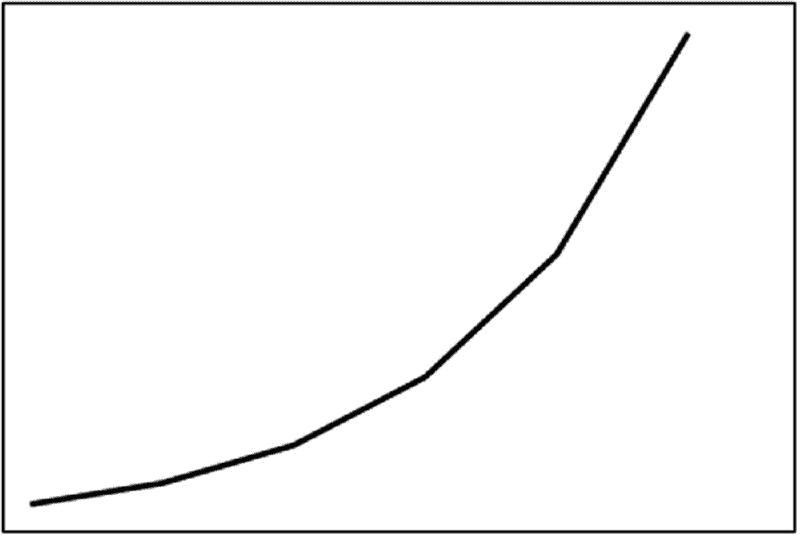

图 1.4

人们很自然地认为`this`指向它所在的函数，或者可能是封装该函数的对象。事实并非如此。它指的是调用该函数的对象。

## JavaScript 是单线程的

在关于语言特性的章节结束之前，还有最后一点：JavaScript 是单线程的。这并不意味着它使用阻塞模型——恰非如此。它只是意味着你以不同的方式进行异步编程。

在多线程语言中，你可以启动一个与产生它的代码并行运行的任务；而在 JavaScript 中，你只是将一个函数推入队列，以便在某个事件发生后尽快执行。触发事件可能是经过了一定长度的时间（在`setTimeout`的情况下）、来自网站的数据到达（在`XMLHttpRequest.send()`的情况下），或者鼠标点击，等等许多可能。JavaScript 有一个事件循环，它会逐个消耗这些推入队列的函数。

从设计的角度来看，这让你的生活比真正的多线程环境中要简单得多。你永远不需要担心会被中断，或者在你认为自己拥有控制权时，其他对象正在访问你的变量。

这也意味着你不应该独占处理器！

在第 6 章中，你将看到 JavaScript `Promise` 如何让你写出既不阻塞的代码，但又不是那种通过变量笨拙连接的、混乱的事件处理器散落。

## 在大型系统中避免 JavaScript 的陷阱

为什么一个包含 50 个类（在 JavaScript 中是对象）的系统，其编写和维护难度是包含 5 个系统的十倍以上？对于 5 个对象，即使每个对象都调用其他所有对象的服务，最多也只有 20 个通信通道（5 个对象中的每个调用其他 4 个——我们允许将 A 调用 B 和 B 调用 A 同时计算）。对于 50 个对象，则是 2450 个（50 乘以 49）——是原来的 100 多倍。

随着单页应用（SPA）、`node.js`以及其他让 JavaScript 在客户端和服务器承担日益巨大的系统负担方法的出现，顶级的 JavaScript 开发者开始认真将这些通信通道精简到最低。

当一个对象必须与其他对象交互以完成其工作时，这些连接会被细致的管理，以确保它们在所有情况下都能正常运行。

本节将提供实现这些目标的方法。

### 脚本不是模块

就在上周，我们访问一家制造某种特殊输入设备的公司的网站。他们热心地提供了使用其设备的示例 JavaScript 代码。

哎！他们建议所有程序员使用的那个 JavaScript 库，代码超过了 1900 行，全是一个接一个、一个接一个全局变量或函数——总共有超过 200 个全局函数。大多数全局函数至少命名了名称，因此不太可能与其他库发生冲突，但某些函数，例如`makeUri`或`toHex()`，则没有。

这就是 JavaScript 的“脚本”遗产在起作用。在过去，当你的脚本可能是页面上唯一的脚本时，向全局命名空间添加内容并无害。但对于如今的 JavaScript 应用，情况绝非如此。

你的脚本并不因为位于它自己的`.js`文件中就是孤立的。如果你的文件开头是

```
var myVariable = makeValue();
```

像这个文件一样（为了保护违规者，名称已更改），那么`myVariable`对你应用程序中的所有其他脚本都是可见的，`makeValue`函数显然也是如此。

JavaScript 为创建能够正确封装其数据和函数的模块提供了异常多样的选择。脚本文件并不是其中之一！（你将在第 3 章中读到更多关于数据封装的内容。）

### 嵌套函数控制作用域

在 C# 或 Java 中，一个类可以包含另一个类。然而，这种做法并不常见。微软甚至警告不要这样做。代码分析警告 1034 是“嵌套类型不应该是可见的”，它们的理由是“嵌套类型引入了成员可访问性的概念，某些程序员并不完全理解这一点”（`https://msdn.microsoft.com/en-us/library/ms182162.aspx`）。

JavaScript 没有类，但嵌套函数具有层次化组织代码的相同作用。至关重要的是，这种层次结构不仅有助于程序员找到他正在寻找的内容，还能帮助程序最小化变量和函数的作用域。这是控制大型系统的关键，也是最优秀的 JavaScript 代码的骨架。

回想列表 1-1 中的这段代码片段：

```
rj3.svg.line = function() {
  var getX = function(point) {
        return point[0];
      },
      /*** 其他变量省略以保持简洁。 ***/

  function line(data) {
    var segments = [],
        /*** 其他变量省略。 ***/

    function segment() {
      segments.push("M",interpolate(points));
    }

    while (++i < n) {
      d = data[i];
      points.push([+getX.call(this,d,i), +getY.call(this,d,i)]);
    }

    if (points.length) {
      segment();
    }

    return segments.length ? segments.join("") : null;
  }

  line.x = function(funcGetX) {
    if (!arguments.length) return getX;
    getX = funcGetX;
    return line;
  };
```

`line`函数有一个成员`line.x`。尽管`line`是`line`的一个成员，但它看不到局部变量（例如`segments`）。`line`和`line.x`都能看到外层函数中的`getX`。将这种技巧与闭包结合，你就拥有了一些控制大型系统的强大工具。

### 合约编程

让大型系统易于管理的没有更好的方法，就是让它变小。JavaScript 凭借鸭子类型（duck-typing）极大的灵活性，让你写很少的代码就能做很多。（回想之前 D3 案例研究中处理的各种输入。）

反面是，你永远不知道软件会遇到什么问题。

如果你的函数期望参数满足某些要求，请考虑对它们进行验证。在第 16 到 21 章中，你将看到一种尽可能不干扰程序的方法来实现这一点：`ContractRegistry`。

简而言之，注册表允许你验证关于参数或返回值的任何想要的内容，而无需向你的函数中添加任何代码。它是通过面向切面编程的魔法（在第 2 章介绍）来实现的，这种方式可以在发布版本中消除验证的开销。

## 应用软件工程原理

你听过音乐大师的音乐会吗？也许你也演奏同样的乐器，并曾惊叹表演者看起来如此从容。事实是，他让它*看起来*从容是因为对他来说*确实*简单。而对他来说之所以简单，是因为他训练了手指高效地移动，训练了身体放松和呼吸，训练了大脑关注音乐而不是被焦虑分心。

他可能通过非常缓慢地弹奏来学习曲子。只有当在这个速度下完全掌握它后，他才增加节拍器的速度。因此，他没有在练习中犯任何错误。我们其中的一个（古典吉他手）参加了一场由世界顶级大师教授的课程。老师吹牛说：“我赌我比你们任何人都打得慢。”他已经学会了，完美学习一首曲子最快的方法就是慢速练习。

当你掌握了本节的原理，你将更快、更轻松地写出无缺陷的软件。你的同事看到你的代码时会说：“他写起来如此从容！”

SOLID 缩写词由 Michael Feathers 提出，用于记忆 Robert Martin 在 20 世纪 90 年代提出的五个面向对象的设计原则（总结在 [`http://www.objectmentor.com/resources/articles/Principles_and_Patterns.pdf`](http://www.objectmentor.com/resources/articles/Principles_and_Patterns.pdf) 中）。它们是：

- `S` 单一职责原则 (Single Responsibility Principle)

- `O` 开闭原则 (Open/Closed Principle)

- `L` 里氏替换原则 (Liskov Substitution Principle)

- `I` 接口隔离原则 (Interface Segregation Principle)

- `D` 依赖倒转原则 (Dependency Inversion Principle)

## 单一职责原则

在极端的形式下，单一职责原则是指：`一个类（或 JavaScript 中的函数）应该只有一个改变的原因`。

这是一个非常高的要求。无疑，每一行代码都代表了某种可能改变的东西。难道每个函数都必须由一行代码组成吗？


不，但不要太快放弃这个原则。再次考虑一下列表 1-1 中的`rj3.svg.line`函数。正如你所看到的，它能够从你想象的几乎任何数据源生成 SVG 线路径，但它可能发生什么变化呢？它几乎接收外部的每一个线索，甚至细到它如何获取每个数据点的`x`和`y`坐标。

顺便提一下，我们简化 D3 代码的牺牲品之一是`interpolate`函数。在完整版本中，D3 允许你指定它，就像你可以指定获取`x`和`y`的函数一样。`interpolate`是做什么的呢？它连接 SVG 路径中的点。默认是用直线段连接这些点，但你可以插入一个用于构建优雅曲线的插值器，而 D3 提供了几个这样的插值器。

因此，归结到底，`rj3.svg.line`实际上并不“知道”很多。它做的只是返回一个函数（内部的`line`），该函数可以以某种方式根据数据点数组创建 SVG 路径。

`rj3.svg.line`有什么改变的理由？它唯一的职责是从数组生成 SVG 路径。关于它如何执行该职责的*所有*内容都是函数外部的，因此不是它改变的原因！

合起来来说：“Mike Bostock，你让它看起来如此简单！”

## 开闭原则

该原则规定：“软件实体应该对扩展开放，对修改关闭”（[`www.objectmentor.com/resources/articles/ocp.pdf`](http://www.objectmentor.com/resources/articles/ocp.pdf)）。

换句话说，你不应该修改运行良好的代码。相反，你应该以某种方式重用它（例如通过继承）并扩展它。

这同样是一个高要求。Robert Martin 在同一篇文章中甚至承认：“通常情况下，无论一个模块有多‘封闭’，总会有某种它没有封闭的改变。由于封闭是不可能完全的，因此它必须是策略性的。也就是说，设计者必须选择针对哪些变化对其设计保持封闭。这需要源自经验的预见性。”

当 Mike Bostock 设计他的`d3.svg.line`函数时，他预见到了坐标从数据中提取方式以及点如何连接（插值）方式的变化，并明智地将这些功能从他的函数中抽象出来。

他*没有*认为会发生改变的（至少不是以不向后兼容的方式）是 SVG 路径规范。他敢于硬编码路径可以始终以`"M"`开头，并按顺序将点作为文本字符串继续下去。

除非 SVG 规范发生破坏性变化，否则很难想象`d3.svg.line`何时需要改变。

## 里氏替换原则

“什么？？”你可能会问道！

该原则由 Barbara Liskov 在 *Data Abstraction and Hierarchy*（SIGPLAN Notices 23, 5 [1988 年 5 月]）中正式提出，在 JavaScript 的语境下，该原则可以更通俗地表述如下：

> `为使用特定类型的对象编写的代码，如果提供了一个派生类型的对象，则应该不需要更改。`

这种说法的另一种说法是，当你从一个对象派生另一个对象时，基级语义不应该改变。

如果你发现自己正在编写分支逻辑，使得你的函数在提供基类时执行一件事，而在提供派生类时执行另一件事，那么你就违反了这一原则。

这*不适用于*互不派生的类型。例如，在 JavaScript 中，一种常见且良好的做法是：如果参数是`Number`，函数按一种方式分支；如果是`String`，则按另一种方式分支；如果完全不存在（因此是`Undefined`类型），则按第三种方式分支。正如之前讨论的，这就是 JavaScript 实现面向对象的函数重载理念的方式。

顺带一句，鸭子类型（duck-typing）的使用虽然不同于派生，但非常符合这一原则的精神！

## 接口隔离原则

该原则产生于 C++ 和 Java 等基于接口的语言环境中。在这些语言中，接口是一段*描述*类中函数（名称、参数和返回值）的代码，而不*实现*这些函数。

其核心思想是：`一个具有许多函数的接口应该被拆分成更小的、内聚的部分。消费者应该只依赖于微接口之一，而不是依赖‘臃肿’的整体。`

当然，这是为了最小化连接的宽度。正如之前提到的，修剪通信通道对于使大型系统可管理至关重要。

等一下！在 JavaScript 中，既没有类也没有接口。这意味着 JavaScript 程序员无法体验遵循这一原则的好处吗？

完全不是的。事实上，我们将整个第 16 章都用于如何在 JavaScript 中实现它。在此期间，有一个预览：为了遵循接口隔离原则的精神，函数可以明确它对参数的期望，并且这些期望应该被降至最低。正如前面提到的，鸭子类型在这里是你的朋友。与其期望某个特定类型的参数，不如只需它拥有你实际需要的该类型的少数属性。将在第 16 章到 21 章中开发的`ContractRegistry`提供了一种正式的方法来明确期望并强制执行这些。如果`ContractRegistry`不符合你的口味，你始终可以编写参数验证代码，甚至编写注释！

## 依赖倒转原则

该原则也是考虑到接口而开发的。Robert Martin 这样描述：“高层模块不应该依赖低级模块。两者都应该依赖抽象”（[`www.objectmentor.com/resources/articles/dip.pdf`](http://www.objectmentor.com/resources/articles/dip.pdf)）。

在基于接口的语言中，这一原则通常在相关的依赖注入思想中得到体现。如果类 A 需要 B 的服务，它并不构造 B。相反，A 构造函数的一个参数是描述 B 的接口。A 不再依赖 B，而是依赖它的接口。在构造 A 时，传入一个具体的 B。B 也依赖于它的接口。

益处在于，得益于里氏替换原则，可以提供一个实现接口的派生版本。此外，如果 B 确实需要改变（尽管有开闭原则），接口简洁地描述了它必须如何继续保持向后兼容。

再次，在 JavaScript 中没有抽象，但 JavaScript 程序员仍然可以按照这一原则的精神进行编程并享受其益处。

D3 的完整版本`d3.svg.line`函数如下（来自 [`https://github.com/mbostock/d3/blob/master/src/svg/line.js`](https://github.com/mbostock/d3/blob/master/src/svg/line.js)）：

```
d3.svg.line = function() {
  return d3_svg_line(d3_identity);
};

function d3_svg_line(projection) {
  /*** vars omitted for clarity ***/

  function line(data) {
    /*** vars omitted for clarity ***/

    function segment() {
      segments.push("M", interpolate(projection(points), tension));
    }
```

`d3_svg_line`的`projection`参数用于可能将数据点投影到另一个坐标空间。默认情况下，`projection`是`d3_identity`，它对点不作任何更改。然而，使用其他投影也是可能的。例如，`d3.svg.line.radial`通过注入`d3_svg_lineRadial`投影来使用极坐标（一个角度和到原点的距离）（[`https://github.com/mbostock/d3/blob/master/src/svg/line-radial.js`](https://github.com/mbostock/d3/blob/master/src/svg/line-radial.js)）：

```
d3.svg.line.radial = function() {
  var line = d3_svg_line(d3_svg_lineRadial);
  /*** Code omitted for clarity. ***/
  return line;
};

function d3_svg_lineRadial(points) {
  /*** Transform points to polar coordinates. ***/
  return points;
}
```

通过注入对坐标空间的依赖，D3 的线条生成器变得尽可能灵活。

## DRY 原则

许多圣人曾说过，所有的伦理都包含在这样一句话中：“己所不欲，勿施于人。” 如果你只需要遵循这条黄金法则，其他一切都会迎刃而解。

DRY 原则，即不要重复（Don’t Repeat Yourself），同样是软件开发中所有良好行为的源泉。它说：“每一处知识只能出现一次。”

这个小小的格言为什么会有如此巨大的影响？首先，一些最重要的 SOLID 原则无非是这一准则的推论。

以单一责任原则为例。你一定见过违反该原则的代码，结果就是它们是不可重用的。一个模块执行了`X`和`Y`。你需要一些也执行`X`的代码，但如果你不拖入行为`Y`就无法重用该模块，因此你重新编写了`X`。你刚刚违反了 DRY 原则。

你可以通过将执行`X`和`Y`的函数注入到模块中解决这种局面，赋予它关联`X`和`Y`的单一责任。搞定！在让你的代码 DRY 化的过程中，你既获得了依赖注入，又获得了单一责任。

`d3.svg.line`非常 DRY。它没有重复任何可能在其他地方编写的内容——即使是从数据中提取坐标。

DRY 性甚至可以发生在函数内部。我们典范的朋友`line`函数就是这样做的：

```
var d;

while (++i < n) {
  d = data[i];
  points.push([+getX.call(this,d,i), +getY.call(this,d,i)]);
}
```

而不是：

```
while (++i < n) {
  points.push([+getX.call(this, data[i],i),
               +getY.call(this, data[i],i)]);
}
```

虽然第二个版本稍微短一点，但它并不是 DRY 的，因为`data[i]`是正在处理的数据这一处“知识”被重复了。它在调用`getX`时出现一次，在调用`getY`时又出现一次。

在 JavaScript 中，DRY 性比在其他语言中更为重要。每当你输入东西时，都有可能犯错。因为 JavaScript 没有编译器来捕获某些类的错误，这些错误更有机会流向你的客户那里。防止这些灾难的一个重要方法是让你的错误尽可能显眼。如果你只输入了一次“知识”，那么错误就会在`每一处`出现。这是一个非常、非常好的事情！

## 编写保持正确的代码

我们说过，编程是简单的，就像弹奏键盘乐器简单一样：“人们所做的只是在正确的时间按下正确的按键。” 但这里有一点不同。如果你在钢琴上演奏了一场完美的音乐会，没有人能把这从你夺走。如果你写了一个完全符合业务要求的程序，那么，在维护五年后回到它吧。你可能会听到开发团队在咕哝，说重写它比继续维护它要容易。他们会说：“是时候让它解脱痛苦了。”

这一节关于如何防止这种糟糕的局面，以便你的代码能够过上长而健康的生活！

### 通过单元测试投资未来

`Unit tests`（单元测试）帮助你的完美程序抵御你和其他人随时间推移对其做的更改风暴。单元测试是一段验证你应用程序一小部分的代码。单元测试中的`unit`表现就像应该被给定一组特定的条件。通常情况下，被测试的单元会是一个`function`，但并不总是如此。

单元测试体中的代码通常遵循`arrange`（安排）、`act`（执行）、`assert`（断言）模式。

首先，测试进行`arranges`（安排）：它建立了测试单元的条件，可能包括配置依赖项或为`function`设置输入。

接下来，测试进行`acts`（执行）：它运行被测试的单元。例如，如果单元是一个`function`，测试将执行该`function`。

最后，测试进行`asserts`（断言）：它验证结果符合预期。如果单元是一个`function`，断言阶段可能会验证`function`是否按预期返回。

你可能也想在修改应用代码*之后*再编写测试。再次强调，你不能向这种诱惑妥协。你真的无法确定你所做的更改是否导致了事后编写的测试通过。有可能是新测试的通过是因为它本身有缺陷，从而为你的单元测试套件没有增加任何额外价值。此外，事后编写测试确保了应用代码的行为符合*它被编写时的样子*，但这并不意味着它符合*应该行为的方式*。

在开发可靠的 JavaScript 应用时，我们认为 TDD（测试驱动开发）实践的重要性无论如何强调都不为过。这本书包含了无数尽的 TDD 示例，第 24 章“测试驱动开发原则总结”专门用于这一主题。

## 优化你的代码以使其易于测试

在创建易于测试的代码时，你可以采取的——如果不是*最重要的*——步骤之一，就是合理地分离关注点。（参见本章前面的“单一职责原则”。）

例如，下面的代码示例定义了函数`valididateAndRegisterUser`，它包含了多个关注点。你能识别出它们吗？

```
var Users = Users || {};
Users.registration = function(){
  return {
    validateAndRegisterUser: function validateAndDisplayUser(user){
      if(!user ||
        user.name === "" ||
        user.password === "" ||
        user.password.length < 6)
        {
          throw new Error("The user is not valid");
        }

        $.post("http://yourapplication.com/user", user);

        $("#user-message").text("Thanks for registering, " + user.name);
    }
  };
};
```

该函数正在做三件事：

* 它验证`user`对象是否正确填充。

* 它将验证过的`user`对象发送到服务器。

* 它在 UI 中显示一条消息。

因此，我们可以列出正在运行的三个独立关注点：

* 用户验证

* 直接服务器通信

* 直接 UI 操作

现在，尝试列出所有必须确保`validateAndRegisterUser`函数正常运行而测试的条件。慢慢来，我们不急于一时。

你想出了几个？可能有很多。以下是我们想出的一些条件：

* 如果`user`为`null`，则抛出`Error`。

* `null` `user`不会被发送到服务器。

* 如果`user`为`null`，则 UI 不更新。

* 如果`user`为`undefined`，则抛出`Error`。

* `undefined` `user`不会被发送到服务器。

* 如果`user`为`undefined`，则 UI 不更新。

* 如果`user`拥有空的`name`属性，则抛出`Error`。

* 拥有空`name`属性的`user`不会被发送到服务器。

* 如果`user`拥有空`name`属性，则 UI 不更新。

依此类推。这些只是必须测试的*某些*无效条件；还有许多其他条件。此外，还必须编写确保有效条件行为运行的测试，包括确保 UI 已被正确更新的测试。

“但是，”你可能会想，“如果我写了一个测试，来确保在提供没有名字的`user`时会抛出`Error`，那么为什么我还需要编写测试来确保这个无名字的`user`不会被发送到服务器并被用于更新 UI 呢？毕竟，`Error`在这些其他事情发生之前就已经抛出了。”

考虑到代码*今天*的编写方式，这个问题背后的逻辑是合理的。然而，如果你忽略了这些看似无关的测试，当某人在*明天*来修改该函数，使得对`user`的验证发生在最后时，会发生什么？

```
var Users = Users || {};
Users.registration = function(){
  return {
    validateAndRegisterUser: function validateAndDisplayUser(user){
      $.post("http://yourapplication.com/user", user);

      $("#user-message").text("Thanks for registering, " + user.name);

      if(!user ||
        user.name === "" ||
        user.password === "" ||
        user.password.length < 6)
      {
          throw new Error("The user is not valid");
      }
    }
  };
};
```

你编写的确保生成`Error`的测试仍然通过了，但该函数现在已经严重损坏了。这些额外的测试现在看起来并不那么无关了，不是吗？诚然，那种变化不太可能是某人故意为之，但事故确实会发生。

不要误会，这段代码*是*可测试的，它只是不是*易于测试的*。必须测试的条件组合（包括有效和无效）非常多，不太可能全部覆盖。如果应用中的所有代码都是这样编写的，我们几乎可以保证应用将不会有适当的单元测试覆盖。

然而，如果不是处理`validateAndRegisterUser`函数中的三个独立关注点，而是将每个关注点提取到单独的对象中，并将该关注点作为其单一职责。为了这个示例，假设每个新对象都有自己的、完整的测试套件。那么`validateAndRegisterUser`的代码可能会像这样：


```javascript
var Users = Users || {};
Users.registration = function(userValidator, userRegistrar, userDisplay){
  return {
    validateAndRegisterUser: function validateAndDisplayUser(user){
      if(!userValidator.userIsValid(user)){
        throw new Error("The user is not valid");
      }
      userRegistrar.registerUser(user);
      userDisplay.showRegistrationThankYou(user);
    }
  };
};
```

新的`registration`模块通过依赖注入提供了负责验证、注册和显示的对象的实例。相应的，`validateAndRegisterUser`使用注入的对象取代了与不同关注点交互的代码。

本质上，`validateAndRegisterUser`从一个执行工作的函数转变成了一个协调他人完成工作的函数。这种转换使得函数变得更容易测试了。事实上，为了完全测试该函数，只需测试以下六个条件：

- 如果`user`无效，则抛出`Error`。
- 无效的`user`不会被注册。
- 无效的`user`不显示。
- 如果`user`有效，则调用`userRegistrar.registerUser`函数并传入`user`。
- 如果`userRegistrar.registerUser`抛出`Error`，则不执行`userDisplay.showRegistrationThankYou`。
- 如果`user`已成功注册，则以`user`为参数执行`userDisplay.showRegistrationThankYou`。

六个测试。仅此。我们为原始版本列出了九个测试，而且还没有完成所有的错误条件。

创建分离关注点的小型模块可以产生易编写、测试和理解的代码。具有这些属性的代码在长期来看更容易保持正确。

你可能认为测试驱动开发会放慢你的速度。如果你在编写代码之后再写测试，并且代码没有正确分离关注点，那么确实如此。你已经固化许多错误，而编写单元测试将是发现这些错误是最慢的方法。

然而，如果你遵循“红-绿-重构”（red-green-refactor）循环来产生小增量的代码，实际上运行得更快，就像音乐家最初缓慢而仔细地练习，实际上能更快地掌握乐曲一样。首先，由于每个增量都是简单的，你就不太可能出错，因此将节省大量的调试时间。其次，由于你的代码会被测试完全覆盖，你可以无所畏惧地重构。这将使你能够保持代码的 DRY（不要重复自己），这通常意味着你的代码库更小，出现问题的地方也更少。DRY 也意味着可重用，而我们都知道可重用的代码可以节省时间。

# 总结

JavaScript为开发者提供了独特的设计机会。在本章中，你通过D3中一个函数的简略版本了解了其中的许多机会。尽管`rj3.svg.line`函数非常小，但它展示了JavaScript的嵌套函数、函数即对象、函数重载、鸭子类型（duck typing）、闭包以及`this`的威力。

随着JavaScript向更大的系统发展，控制这种有些野性的语言变得越来越重要。你已经看到，将代码分离到单独的脚本文件中虽然出于其他原因是一个好主意，但并没有真正实现代码模块化。相反，请依靠D3案例研究所体现的设计可能性，以及成熟的软件工程原则。这些包括五个SOLID原则和DRY原则：不要重复自己（Don’t Repeat Yourself）。

单元测试是你为应用程序长期可靠性所能做出的最佳投资。没有它们，你唯一确保应用程序正常运行的方法就是希望。

实践测试驱动开发（TDD）具有多重益处。首先，它构建了确保长期可靠性的单元测试套件。其次，它帮助你为应用程序的对象设计正确的接口。书中充满了测试驱动开发的示例，第24章专门介绍了TDD。第三点，也是令人惊讶的，它能帮助你更快地产生运行的代码。

提高可测试性的关键行动之一是密切关注关注点分离（separation of concerns），并利用单一责任原则和依赖注入等软件工程概念。

掌握了这些思想，你已经准备好迎接软件工艺的挑战了。是时候拿起工具了。

# 第 2 章：工具准备

## 本章内容概览

- 使用Jasmine单元测试框架证明你代码中每个组件的可靠性
- 使用依赖注入（DI）容器促进模块化、可重用性和可测试性
- 探索面向切面编程（AOP）如何让你的代码更简单、更可靠
- 探索测试驱动开发的案例研究
- 使用JSLint在代码发布前检测代码中的问题

### 本章 WROX.COM 代码下载

本章的WROX.COM代码下载可以在[www.wrox.com/go/reliablejavascript](http://www.wrox.com/go/reliablejavascript)的“Download Code”标签页中找到。代码位于第2章下载，并根据本章的主题组织在目录，每个目录包含一个示例。

你可以通过将其目录复制到硬盘并双击`index.html`文件来运行示例。每个示例的`ReadMe.txt`文件包含进一步的说明。

## 使用测试框架

假设你正参与一个大型团队的工作，构建一个旅游预订系统。你负责创建航班预订的模块，其中一个模块函数的行为应该如下所示：给定一个乘客对象和一个航班对象，`createReservation`将返回一个新对象，其`passengerInformation`属性设置为提供的乘客对象，`flightInformation`属性设置为提供的航班对象。

这很简单，对吧？事实上，它简单到只需直接实现该函数也没有坏处，如列表2-1所示。

由于你的团队有一要求：在没有适当（通过的）单元测试的情况下，不应提交生产代码，因此你现在就会编写这些测试。你有函数的实现可以参考，所以为它编写测试轻而易举的。列表2-2显示了你根据现有代码可能编写的测试。这些单元测试是使用Jasmine测试框架编写的。书中将贯穿Jasmine，你将在本章稍后的部分看到更详细的介绍。

目前，你只需要记住，每个`it`函数调用都是一个独立的单元测试（此示例有两个），而且这些单元测试中的每一个都验证函数返回的对象的单个属性具有正确的值。每个测试都通过调用`expect`来验证属性值。

如你在图2.1中所示，单元测试通过了。

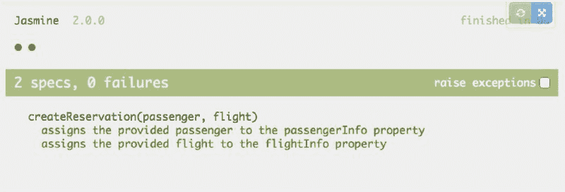

图2.1

我们所有的示例都从内容分发网络（CDN）检索Jasmine文件，但也可以从你的本地计算机下载并包含这些文件。

你满足了团队的单元测试要求，因此提交了代码并放心地进入下一个功能开发。

几小时（也许是几天或几周）后，你收到了来自同事Charlotte的邮件，她正将你的`createReservation`函数集成到应用程序的另一个区域。当她运行集成测试套件时，所有执行`createReservation`函数的测试都失败了。“不可能，”你回答道，“该函数的所有单元测试都通过了！”

仔细检查发现单元测试是错误的。规范说明返回对象的属性应该是`passengerInformation`和`flightInformation`，而Charlotte编写代码时预期的这些属性存在。不幸的是，在我们匆忙实现`createReservation`时，我们使用了`passengerInfo`和`flightInfo`属性名。

由于测试是根据函数的实现而不是规范编写的，它们验证的是函数的实际（错误的）行为，而不是预期行为。如果它们是仅根据规范编写的，属性名称可能第一次就是正确的。

我们并不否认，如果使用TDD编写函数，可能会发生同样的错误，因为TDD是基于规范而不是现有代码编写测试的。然而，经验表明这种情况少得多。

### 识别错误代码

TDD在尽可能早的时间识别代码缺陷：即缺陷创建的时刻。在遵循TDD时，编写一个测试来验证一小部分功能，然后用最少的代码实现该功能。

回到`createReservation`函数，你将看到通过先写测试如何确保不同的结果。提醒一下，本章之前定义的函数规范是：

- 给定一个乘客对象和一个航班对象，`createReservation`将返回一个新对象，其`passengerInformation`属性设置为提供的乘客对象，`flightInformation`属性设置为提供的航班对象。

列表2-3显示了验证`passengerInformation`属性正确赋值的第一个测试。

列表2-4显示了你的`createReservation`最小实现，它将导致测试通过。

你立即执行单元测试，它失败了（图2.2）。这是如何发生的？

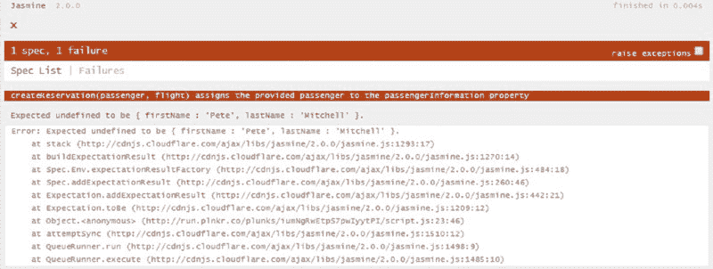

图2.2

啊！返回对象中的属性名错误了；它应该是`passengerInformation`而不是`passengerInfo`。你迅速将属性名称更改为指定的`passengerInformation`，现在测试通过了（图2.3）。注意，该图也反映了对`it`语句的更改：你修改了`it`语句以指示正在测试`passengerInformation`属性。

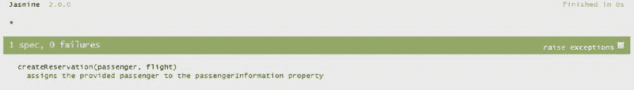

图2.3

然后你可以按照相同的流程为`flightInformation`属性进行赋值，从而产生一个通过单元测试验证正确的`createReservation`函数。

返回对象中属性命名错误的错误再次进入了`createReservation`函数的实现中。然而，这次你先编写了测试，并根据规范编写了测试。这让你能够立即识别并解决错误，而不是等待其他开发者运行集成测试并在几小时（或几天、几周）后提醒你发现问题。

对于像`createReservation`这样简单的函数，这种分段创建测试和添加功能的做法诚然感觉有些过度了。然而，很容易想象到其他情况，在这些情况下，TDD的迭代过程最终可以节省大量的调试时间。

假设你必须编写一个对数据数组执行大量计算的函数。你尝试一次性实现该函数的大部分，而该部分包含一个差一错误（off-by-one error），导致你遗掉了计算中的最后一条数据。

当你验证函数的输出时，计算出的值将是错误的，但你不知道为什么是错误的。可能是某次计算中的数学错误，也可能是你没有处理数值溢出的情况。如果你很早地编写一个简单的测试来验证数组中的每一个元素都参与了计算，你就能立即捕获差一错误，并可能更早地获得解决方案。

### 为可测试性进行设计

先编写测试让代码的可测试性成为你的首要考虑问题，而不是事后补救。根据我们与各种水平开发人员合作的经验，代码的易测试性与代码的测试程度之间存在直接相关性。此外，我们发现，易于测试的代码往往更容易维护和扩展。正如我们在第一章中所提的，遵循SOLID开发原则的代码非常适合测试。如果你将可测试性作为设计的目标，你往往会写出SOLID代码。

例如，假设使用`createReservation`函数创建的每个预订都要提交到Web服务存储在数据库中。

如果你没有实践TDD，你可能只是通过添加`jQuery.ajax(...)`调用来扩展`createReservation`，通过异步JavaScript和XML（AJAX）将预订发送到Web服务端点。然而，这一个简单的函数调用增加了这个微小的`createReservation`函数所承担的职责数量，并增加了对其进行恰当单元测试所需的精力。

你已经添加了`jQuery.ajax(...)`调用，你已经对`createReservation`函数执行的某些功能编写了测试，也许你还手动测试并验证了预订最终存储到了数据库中。人们很容易决定为这一个微小功能编写单元测试太费精力了，然后转向你的下一个任务。我们见过很多次这种情况，也承认自己做过很多次。

假设你已经投身于TDD，你不会直接冲向前更新`createReservation`，而是编写一个测试来验证新功能。第一个测试验证了预订是否发送到了正确的Web服务端点。

你可能在定义行为之后，就会问自己一个问题：“`createReservation`是否应该负责与Web服务通信？”

```javascript
describe('createReservation(passenger, flight)', {
  // 现有测试
  it('submits the reservation to a web service endpoint', function(){

    // should createReservation be responsible for
    // communicating with a web service?

  });
});
```

该问题的答案是：不，很可能不是。如果还没有这样的对象，你通过创建一个（并测试！）专门负责Web服务通信的对象将受益匪浅。

通过最大化你代码的可测试性，你能够识别出对SOLID原则的违背。很多时候，像上面的示例一样，你可以完全避免违反它们。

### 编写最少必要代码

回顾基本的TDD工作流：你编写一个会失败的测试来验证一小部分功能，然后编写尽可能少的代码使该新测试通过。然后你更改开发中代码的内部实现细节，这被称为重构（refactoring），以消除重复。

在只添加最少行代码和随后通过重构消除重复代码之间，你可以确定在过程结束时，你添加的代码行数是最少的。这是完美的，因为你没写的代码是不可能存在缺陷的！

### 安全维护与重构

实践TDD保证了你的项目生产代码有一套健壮的单元测试套件。最新的单元测试是防止未来回归缺陷的保险单。回归缺陷是指过去运行正常，但现在不再正常工作的代码中的缺陷；代码的质量和可靠性退化了。

就像任何其他保险单一样，有一种持续成本，看起来像是一项没有收益的负担。在单元测试的情况下，这种持续成本就是单元测试套件的开发和维护。也像任何其他保险单一样，会有一个时刻你会庆幸支付了这种持续成本。如果你是房屋主，那可能是一场暴风雨撞倒房屋造成了巨大的破坏（在我们身上发生过这种情况）。

当需要扩展或维护具有完善单元测试套件的生产代码时，你会感到同样的庆幸。你可以对代码的部分进行更改（当然仍然遵循TDD），并确认你没有改变其他部分的行为。

### 可执行规范

健壮的单元测试套件（如在实践TDD时生成的）还作为所测试代码的可执行规范。Jasmine是我们在随后的章节中介绍并在本书中使用的测试框架，它使用基于行为的测试组织。每个单独的测试，或者Jasmine所称的规范（specification），都以一个关于测试正在执行和验证的行为的自然语言语句开头。Jasmine默认测试结果格式化器会为每个测试显示这些语句。

再次以`createReservation`函数为例，你可以看到读取Jasmine单元测试的输出可以获取函数行为的完整视图。不需要读取`createReservation`函数来确定它在做什么；单元测试会告诉你！单元测试提供的这种“可执行文档”在向项目添加开发人员，甚至在回顾你过去编写的代码时，是无价的。

### 现有开源和商业框架

虽然我们倾向于使用Jasmine JavaScript测试框架，但它并不是唯一的选择。本节将探讨两个流行的替代方案：`QUnit`和`D.O.H.`。

## QUnit

开源框架`QUnit`是由编写`jQuery`、`jQuery UI`和`jQuery Mobile` JavaScript框架的团队开发的。`QUnit`可以在非浏览器环境中运行，例如`node.js`或Rhino JavaScript引擎。在HTML文件中包含必要的库JavaScript和CSS文件后，`QUnit`测试也可以在浏览器中执行。

定义一个`QUnit`测试是一件低成本的工作：

```javascript
QUnit.test("This is a test", function(assert){
  assert.equal(true, true, "Oh no, true is not true!");
});
```

`QUnit`测试函数的唯一参数是对`QUnit`断言对象的引用，该对象暴露了八种断言——如你在前面的代码段所示的`equal`——供测试中使用。

可以通过`QUnit.module`函数对测试进行分组，该函数会使随后的测试在测试结果中被分组。在遇到另一个`QUnit.module`调用或到达文件结束之前，所有后续测试都属于该模块。我们更倾向于Jasmine在套件（suite）中嵌套测试，因为我们认为这样更显式、直观。

```javascript
QUnit.module("module 1");
QUnit.test("I'm in module 1", function(assert){
  // Test logic
});
QUnit.module("module 2");
QUnit.test("I'm in module 2", function(assert){
  // Test logic
});
```

你可以在`http://qunitjs.com/`了解更多关于`QUnit`的信息。

## D.O.H.

`D.O.H.`即Dojo Objective Harness，旨在帮助Dojo JavaScript框架的创建者和维护者。然而，`D.O.H.`不依赖于Dojo，因此它可以作为一个通用的JavaScript测试框架使用。

与Jasmine和`QUnit`一样，`D.O.H.`支持基于浏览器执行和非浏览器执行（例如在`node.js`或Rhino JavaScript引擎中）。


D.O.H. 单元测试使用`doh`对象的`register`函数进行定义。`register`函数接受一个 JavaScript 函数数组（定义简单测试）或对象数组（定义更复杂的测试，包括设置（setup）和拆卸（tear down），类似于 Jasmine 的`beforeEach`和`afterEach`，你将在下一节看到它们）。

```
doh.register("Test Module", [
  function simpleTest(){
    doh.assertTrue(true)
  },
  {
    name: "more complex",
    setup: function(){
      // 在运行测试前设置测试的代码
    },
    runTest: function(){
      doh.assertFalse(false);
    },
    tearDown: function(){
      // 测试执行后进行清理的代码
    }
  }
]);
```

D.O.H. 提供了四个内置断言（如`assertFalse`）。

虽然我们喜欢这个框架的名字（D’oh!），但我们发现 Jasmine 用于测试组织和定义的语法更加清晰且更有表现力。

你可以在`http://dojotoolkit.org/reference-guide/1.10/util/doh.html#util-doh`探索 D.O.H. 框架。

## 引入 Jasmine

Jasmine 是一个用于行为驱动开发（BDD）风格创建 JavaScript 单元测试的库。

在本节中，我们将描述该框架的基础知识，但强烈建议你访问 Jasmine 首页`http://jasmine.github.io`，你可以在那里找到库的文档——这是一个可以运行的 Jasmine 测试套件——以便深入接触。

### 套件（Suites）与规格（Specs）

Jasmine 测试套件使用全局函数`describe`进行定义。`describe`函数接受两个参数：

*   一个字符串，通常描述正在测试的内容

*   一个函数，包含测试套件的实现

测试套件通过规格（specs，即单个测试）来实现。每个规格都使用全局函数`it`进行定义。与`describe`函数一样，`it`函数也接受两个参数：

*   一个字符串，通常描述正在测试的行为

*   一个包含至少一个期望（expectation）的函数：即对代码状态为真或假的断言（assertion）

测试套件的实现还可能使用全局函数`beforeEach`和`afterEach`。当包含在套件实现中时，`beforeEach`会在套件中的每个测试之前执行。相反，`afterEach`函数在套件中的每个测试之后执行。`beforeEach`和`afterEach`函数对于执行通用的设置和拆卸有助于减少测试套件内的重复。

在列表 2-2 中，有两个测试具有完全相同的设置步骤。我们当时注意到，将展示如何消除这种对 DRY（不要重复）原则的显而易见的违反。列表 2-5 显示了如何使用`beforeEach`函数来实现这一点。

为了完整性，列表 2-6 显示了`createReservation`的实现，它允许重构后的单元测试能够通过。

### 期望（Expectations）与匹配器（Matchers）

每个测试都包含一个`expect`语句。这里是第一个`createReservation`测试中的`expect`：

```
expect(testReservation.passengerInformation).toBe(testPassenger);
```

`expect`函数获取代码生成的实际值（在此例中为`testReservation.passengerInformation`），并将其与期望的值进行比较。测试期望值是`testPassenger`。

实际值与期望值之间的比较使用匹配器（matcher）函数进行。匹配器返回`true`表示比较成功，或返回`false`表示比较未成功。包含一个或多个失败匹配器的规格被视为失败。相反，仅包含成功匹配器的规格被视为通过。

上面的示例使用了`toBe`匹配器，这意味着正如你所料，你期望`testReservation.passengerInformation`与`testPassenger`是同一个对象。

Jasmine 包含了许多内置匹配器，但如果它没有你所需的精确匹配器，Jasmine 支持创建自定义匹配器。创建自定义匹配器是提取代码的极佳方法。

### 间谍（Spies）

Jasmine 的间谍（spies）是作为测试替（test doubles）的 JavaScript 函数。测试替在测试期间将默认实现替换为另一种通常是更简单的实现。测试替通常通过消除对外部资源（如网络服务）的依赖来降低单元测试的复杂度。

在本节之前，你曾考虑扩展`createReservation`函数的功能，以便直接与网络服务通信并将创建的预订保存到数据库。

```javascript
function ReservationSaver(){
  this.saveReservation = function(reservation){
    // 与网络服务交互的复杂代码
    // 用于保存预订
  }
}
```

由于在下一节“使用依赖注入框架”中将会解释清楚的原因，`createReservation`函数已更新为接受一个`ReservationSaver`实例。通过将`ReservationSaver`作为参数传递，允许你编写如下测试来确保预订被正确保存：

```javascript
describe('createReservation', function(){
  it('saves the reservation', function(){
    var saver = new ReservationSaver();
    // testPassenger 和 testFlight 已经在该测试套件的 
    // beforeEach 中设置就绪。
    createReservation(testPassenger, testFlight, saver);

    // 我们如何确保 saver.saveReservation(...) 被调用了呢？
  });
});
```

按照目前的写法，测试正向`createReservation`函数提供了`ReservationSaver`对象的默认且复杂的实现。然而，你*并不*想这样做，因为这样做增加了对外部系统的依赖，并使得当前函数难以测试。这正是 Jasmine 间谍（spies）威力展现的地方。

在调用`createReservation`之前，你可以在`saveReservation`函数上创建一个间谍。间谍等其他功能允许你验证特定函数是否被执行。这种能力对于这第一个测试来说非常完美。

你使用`spyOn`全局函数告诉 Jasmine 对某个特定函数进行监视。`spyOn`函数接受一个对象实例作为第一个参数，并将要监视的函数名称作为第二个参数。因此，为了为`saveReservation`创建间谍，你如下更新测试：

```javascript
it('saves the reservation', function(){
  var saver = new ReservationSaver();
  spyOn(saver, 'saveReservation');
  // testPassenger 和 testFlight 已经在该测试套件的 
  // beforeEach 中设置就绪。
  createReservation(testPassenger, testFlight, saver);

  // 我们如何确保 saveReservation 被调用了呢？
});
```

通过创建间谍，你已经替换了 saver 对象的`saveReservation`实现，将其替换为一个与保存预订完全无关的函数。然而，它会跟踪函数每次被调用的次数，以及每次调用时提供的参数。Jasmine 还为间谍提供了匹配器（matchers），可用于创建期望，其中就包括验证特定间谍是否被调用了一次或多次。将该期望添加到你的测试中，就使其变得完整：

```javascript
it('saves the reservation', function(){
  var saver = new ReservationSaver();
  spyOn(saver, 'saveReservation');
  // testPassenger 和 testFlight 已经在该测试套件的 
  // beforeEach 中设置就绪。
  createReservation(testPassenger, testFlight, saver);

  expect(saver.saveReservation).toHaveBeenCalled();
});
```

由于你为`createReservation`函数添加了一个参数，你必须更新现有的两个测试。你不希望*任何*测试去执行`saveReservation`函数的默认实现，因此在列表 2-7 中，你将重构新测试，将`ReservationSaver`的创建及其关联的间谍移动到套件的`beforeEach`函数中。

到此时，只有新测试在失败。对`createReservation`函数进行微小的重构，在列表 2-8 中产生了通过测试的测试套件。

### 使用依赖注入框架

你可能记得在第 1 章中提到，依赖*倒置*（inversion）是 SOLID 开发五大原则之一，而依赖*注入*（injection）是实现它的机制的一部分。在本节中，你将开发一个既为依赖注入带来灵活性又有纪律的框架。

### 什么是依赖注入？

即将举办一个 JavaScript 会议，你志愿者帮助构建它的网站。这将是史以来规模最大的 JavaScript 会议，每场会议都安排得满满，与会者必须预留座位。你的工作是编写客户端代码以使预订功能成为可能。

你需要调用会议的网络服务来操作数据库。由于精通面向对象编程的原则，你的第一步是将该服务封装在一个`ConferenceWebSvc`对象中。你还创建了一个 JavaScript 对象`Messenger`，用于显示精美的弹出消息。我们从这里继续故事。

每位参与者都允许注册 10 场会议。你的下一个任务是编写一个函数，让参与者尝试注册其中一场会议，然后显示成功消息或失败消息。你的第一个版本可能看起来类似于列表 2-9。（我们对`ConferenceWebSvc`调同步性质表示歉意。更好的想法将在第 5 章和第 6 章中出现。此外，尽管某些权威不喜欢，但我们在使用`new`关键字来创建对象，因此我们涵盖了最坏的情况。）

这段代码看起来非常模块化，`ConferenceWebSvc`、`Messenger`和`Attendee`每一个都有单一的职责。`Attendee.reserve`简单到几乎不需要进行单元测试，这是一件好事，因为它*无法*被单元测试！`ConferenceWebSvc`背后是 HTTP 调用。你如何对一个需要 HTTP 的东西进行单元测试呢？记住，单元测试应该是快速且独立的。此外，`Messenger`将要求点击每条消息上的 OK 按钮。这不应该是对你的模块进行*单元*测试的工作。*单元*测试是创建可靠 JavaScript 的关键之一，你不希望在所有单元准备就绪之前进入*系统*测试。

这里的问题不在于`Attendee`对象，而在于它所依赖的代码。解决方案是依赖注入。与其让代码硬编码对`ConferenceWebSvc`和`Messenger`的依赖，不如将它们注入`Attendee`。在生产环境中，你会注入真实的对象；但在单元测试中，你可以注入替代品，例如伪造对象（具有相应方法的对象）或 Jasmine 间谍。

```javascript
//生产环境：
var attendee = new Attendee(new ConferenceWebSvc(), new Messenger());

// 测试：
var attendee = new Attendee(fakeService, fakeMessenger, id);
```

这种不使用 DI 框架的依赖注入样式被称为“穷人注入”，这很讽刺，因为最好的专业 DI 框架实际上是免费的。列表 2-10 显示了带有穷人注入的`Attendee`对象

### 使用依赖注入让代码更可靠

你刚刚看到依赖注入如何让原本不可能的单元测试成为可能。经过测试且能够在自动化测试套件中持续测试的代码显然会更可靠。

DI 还有另一个更微妙的优势。对于注入的间谍或伪造对象，你通常比对真实对象拥有更多控制权。因此，更容易产生错误情况和其他特殊情况。更容易的事情更有可能完成，因此你会发现测试涵盖了更多情况。

最后，DI 促进了代码重用。具有硬编码依赖的模块通常无法重用，因为它们带有过多的负担。原始的`Attendee`模块因为硬编码使用`Messenger`而永远无法在服务器端重用。DI 版本允许使用任何具有`success`和`failure`方法的 messenger。

### 掌握依赖注入

依赖注入并不困难。事实上，它让生活变得更容易。要成为 DI 大师，只需记住这些点。

当你编写一个对象并且它创建一个新对象时，问自己以下问题。如果其中任何一个问题的答案是“是”，请考虑注入它而不是直接实例化。

- 该对象或其*任何*依赖项是否依赖于外部资源，如数据库、配置文件、HTTP 或其他基础设施？

- 我的测试是否应该考虑对象可能出现的错误？

- 我的某些测试是否会希望对象以特定的方式运行？

- 该对象是我自己编写的，还是来自第三方库的？

选择一个良好的依赖注入框架来帮助你，并对其 API 做到极其熟悉。下一节将帮助你入门。

#### 案例研究：编写一个轻量级依赖注入框架

到目前为止你看到的依赖注入都是硬编码的。它是对“大泥球”（Big Ball of Mud）式编程风格的改进，但仍然并不理想。专业的依赖注入框架工作原理如下：

1. 在应用程序启动后不久，你将可注入对象注册到 DI 容器中，通过名称识别每个对象，并相应地命名它们拥有的依赖项。

2. 当你需要一个对象时，你请求容器提供。

3. 容器实例化你请求的对象，但首先会递归地实例化所有的依赖项，根据需要将它们注入到相应的对象中。

在大量使用依赖注入的框架（如 AngularJS）中，这个过程看起来几乎像魔法一样，好得令人难以信。事实上，它是太神奇了以至于难以理解。为了学习这些框架是如何运作的，让我们构建一个 DI 容器。

这将作为测试驱动开发（TDD）的案例研究。你将看到如何通过响应测试一点点构建代码，编写出可靠的 JavaScript。

你希望你的容器只做两件事：接受可注入对象及其依赖项的注册，根据请求提供对象。假设你先编写`register`函数。它接受三个参数：

- 可注入对象的名称。

- 它的依赖项名称的数组。

- 一个返回值为可注入对象的函数。换句话说，当你向容器请求可注入对象的实例时，它会调用此函数并返回该函数产生的任何内容。容器还将将请求对象的依赖项的实例传递给此函数，但你可以推到以后的测试再考虑这个问题。

TDD 在每个阶段都只编写绝对最少代码时效果最好，因此你可能从只编写一个空版本的`register`开始。由于这个函数是一个可以被所有`DiContainer`实例共享的资产，你将使其成为`DiContainer`原型的一部分。（参见列表 2-11。）

为了使代码尽可能可靠，你希望验证这些参数是否已传递以及类型是否正确。建立这个坚实的基础通常是一个很好的初始测试，这样随后的测试就可以依赖它了。列表 2-12 显示了这样一个测试。

关于目前为止的测试，有几点需要注意：

- “被测对象”*container*（容器）是在`beforeEach`中创建的。这为每个测试都提供了一个新的实例，因此一个测试不会污染另一个测试的结果。

- 两个嵌套的`describe`和`it`的文本参数组合在一起，读起来像一个句子：“DiContainer register (name,dependencies,func) 如果缺少任何参数或类型错误则抛出异常。”

- 虽然 TDD 纯粹主义者可能坚持为*badArgs*中的每个元素都编写单独的测试，但在实践中，给开发者施加这样的负担意味着他测试的条件将比应该测试的少。如果一个期望和一个描述涵盖了所有测试，那么将它们这样分组合可能是可以接受的。

当你运行测试时，它失败了（图 2.4）。

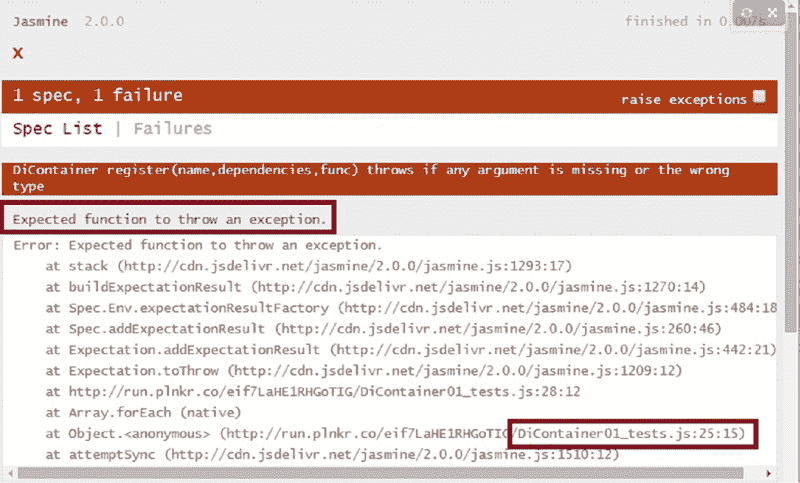

**图 2.4**

你可以通过向`DiContainer.register`添加参数检查来修复此失败。你现在不再是空函数，而是列表 2-13 中的代码。

测试现在通过了（图 2.5）。

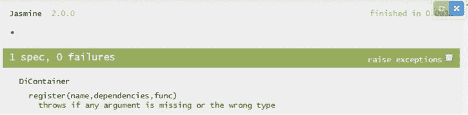

**图 2.5**

如果你仔细阅读列表，你可能会注意到消息被放置在原型中，将其暴露给公有。这种技术允许你让测试更紧密。你不再仅仅期望函数`toThrow()`，而是通过将`.toThrow()`期望更改为以下内容，使其更精确，从而更可靠：

```
.toThrowError(container.messages.registerRequiresArgs);
```

`register`函数仍然没有执行任何操作，但如果你无法再次将它们取出来，将很难测试它将东西放入容器的效果有多好，因此你把注意力转向画面的另一半：`get`函数。它只需要一个参数：它要获取内容的名称。

再次，从参数检查开始是一个好主意。我们发现，如果尽可能早地完成错误检查测试，代码会更可靠。如果把它们留到“所有真实代码都写完”之后，就很容易转向其他事情了。列表 2-14 是一个很好的开始。

测试惨惨地失败了，因为你甚至还没有一个`get`函数。正如 TDD 一直以来，你编写绝对最少的代码来修复当前的错误，正如列表 2-15 所示。


你如何知道！？测试通过了！在 TDD 中，测试通过“巧合”通过是可以接受的。如果你对未来的测试足够详尽，情况就会自我纠正。

你终于准备好让 `get(name)` 实现它的使命了，正如列表 2-16 中的测试所示。这是你要有 TDD 信心的时刻。如果你现在编写任何代码，你的代码将领先于你的测试。

你需要让 `register` 存储注册信息并让 `get` 获取它。相关的 `DiContainer` 部分现在所示。测试展示了一个小技巧。通过使用变量 `name` 和 `returnFromFunction`，你保持了测试的（DRY）并使期望自成文档。

为了通过测试，你需要递归供应依赖项。尽管你可能认为这已经工作了，但聪明的测试驱动开发者不会对任何事理所当然。最后的测试在本章下载的 `DiContainer_tests.js` 中。完整的库是 `DiContainer.js`。

我们希望这次练习传达了测试驱动开发的精神，并对典型的 JavaScript 容器如何工作提供了一些见解。

### 使用依赖注入框架

在本章早些时候，你开发了一个模块，允许与会者在 JavaScript 会议上预留座位。你已经达到了将 `Attendee` 的依赖项注入到其构造函数中的程度，但是硬编码的方式：

```javascript
var attendee = new Attendee(new ConferenceWebSvc(), new Messenger(), id);
```

现在你已经有了一个适当的 DI（依赖注入）容器，你可以避免每次构造对象时都硬编码依赖项。大多数大型 JavaScript 应用都从一个设置（配置）例程开始。那里也是设置依赖注入的好地方。

假设你的应用程序在一个名为 `MyApp` 的全局变量下管理。在配置中，你会发现类似于列表 2-21 的内容。

在 `Attendee` 放置于 `DiContainer` 的方式上，有一个高级但重要的点。注册并不是为了创建一个产生 `Attendee` 的函数，而是为了创建一个能产生 `Attendee` 的 `factory`（工厂）的函数。这是因为 `Attendee` 除了依赖项外，还需要一个参数，即 `attendeeId`。你可以编写 DI 容器，能够像下面这样操作：

```javascript
var attendee = MyApp.diContainer.get('Attendee', attendeeId);
```

但这样一来，`Attendee` 就无法作为其他对象的递归依赖被提供。（通常情况下，无法期望这些其他对象从链的顶端一直传递 `attendeeId`，而那里应该是该参数产生的地方。）

有了这个工厂，你可以在应用程序的深处从 DI 容器中获取 `Attendee`，正如列表 2-22 所示。

### 当前的依赖注入框架

有两个依赖注入框架被广泛采用并持续保持更新：AngularJS 和 RequireJS。它们都是免费且开源的，并且各有独特的优势。

#### RequireJS

RequireJS 使用的语法与本章中的 `DiContainer` 非常相似。（是的，我们作弊了。）`DiContainer` 拥有 `register` 函数，而 RequireJS 拥有 `define`，并将其作为全局方法提供。`DiContainer.get(moduleName)` 变成了 RequireJS 的 `require(moduleUrl)`。

“`ModuleUrl`？”你可能会问。是的——RequireJS 特殊之处在于，你使用脚本的位置作为模块名。例如，你可以这样将 `AttendeeFactory` 放入 RequireJS 容器中：

```javascript
define(['./Service', './Messenger'], function(service, messenger) {
    return function(attendeeId) {
      return new Attendee(service, messenger, attendeeId);
    }
});
```

`AttendeeFactory` 并不依赖于模块名 `(['Service', 'Messenger'])`，而是依赖于相对 URL `(['./Service', './Messenger'])`。

那么我们定义的实体的名称（`'AttendeeFactory'`）又怎么呢？这不需要它，因为这段代码出现的文件（可能是 `././AttendeeFactory.js`）的 URL 直接兼任了模块名。RequireJS 这一特性的额外好处是自动避免命名冲突。它还意味着“一个文件一个模块”是 RequireJS 中的标准做法。

你可以显式地命名你的模块（使用与 `DiContainer.register` 相同的语法），但这样做并不符合该库的完全精神。

RequireJS 将 DI 模块绑定到 URL，以便优化加载脚本的方式。事实上，RequireJS 最初只是 CommonJS 委员会在解决如何从服务器获取模块到浏览器的问题之前提出的多个提案之一（Transport C，详见 `http://wiki.commonjs.org/wiki/Modules/Transport`）。他们的提案从未被 CommonJS 正式接受，但它似乎是唯一留存的方案并被广泛使用。

你可以在 `http://requirejs.org` 查看它的许多额外功能。

#### AngularJS

与 RequireJS 相比，Google 的 AngularJS 是该领域的新秀，但它正在席卷 JavaScript 世界。尽管 DI 是 AngularJS 的核心，但 AngularJS 远不止是一个 DI 容器。它是一个用于构建单页应用（SPA）的完整、“有主见的”框架。

依赖注入在 AngularJS 中以多种方式出现。有许多类似于 `DiContainer.register` 的函数，每种适用于不同类型的对象。例如，某些 AngularJS 对象被称为 `services`，本质上是单例的，AngularJS 框架通过 `service` 注册函数确保了这一点，使得每次请求时注入的都是同一个对象。如果那不是你想要的行为，还有一个 `factory` 函数，其功能正如顾名思义。你甚至可以使用 `constant` 函数为依赖注入注册常量。

尽管 AngularJS 是一个有主见的框架，但它的许多重要功能仍由你控制。事实上，如果你不喜欢默认的依赖注入器，可以注入一个你自己的。

不过你可能没时间去学习如何做到这一点！与 RequireJS、Knockout、JQuery 或大多数其他 JavaScript 库相比，AngularJS 的学习曲线非常长。然而，一旦你爬越了大部分路程，一切都会变得完全说得通，你会疑惑自己为什么花了这么长时间。AngularJS 的设计非常出色，如果你在为你的 SPA 寻找一个全解决方案，没有比这更好的了。

更多信息请访问 `https://angularjs.org`。

## 使用 Aspect 工具包

面向切面编程（AOP）是一种收集对多个对象有用的代码（尽管它不属于其中任何一个对象的单一职责）并以非侵入方式将这些代码分给对象的方法。

在 AOP 的术语中，这样分配的代码片段被称为 `advices`（建议），这些建议解决的问题被称为 `aspects`（切面）或跨越关注点。例如，让我们回到 JavaScript 会议。

### 案例研究：有无 AOP 的缓存

你可能记得你志愿者帮助编写会议网站。为了节省成本，会议组织者与一家旅游服务公司合作销售机票。你的任务是调用他们的 Web 服务，根据登录参与者的首选机场获取廉价机票。机票将体现在网站的广告中。

你希望广告能够立即出现，但这涉及到一个相对耗时的 Web 服务调用。你决定只要用户不更改首选机场，就缓存这张特价机票。

事实上，缓存已经变成了一个`跨越关注点`——面向切面编程的首选方案。

#### 不使用 AOP 实现缓存

首先，列表 2-23 显示了不带缓存的函数。为了增加倾向于使用 `new` 关键字的读者的快乐，我们使用了与前一节不同的模块创建模式。

现在你想添加缓存。你可以像列表 2-24 所示（不使用 AOP）这样做。这行得通，但 `getSuggestedTicket` 中的代码行数增加了一倍多。而且，新代码与函数的核心职责无关。

如果可以在完全不修改 `getSuggestedTicket` 的情况下添加该功能，那不是很好吗？而且以后还可以更改缓存策略——例如，在 10 分钟后缓存结果过期。如果能以同样非侵入的方式链接附加功能（例如将用户的偏好存储在 cookie 中），那不是更好吗？

这就是面向切面编程为你做的事情。通过你很快就会看到的 AOP 框架，你可以保留原始代码，只需在应用程序启动逻辑中添加这一行：

```javascript
Aop.around('getSuggestedTicket', cacheAspectFactory());
```

在这行代码中，`cacheAspectFactory()` 返回一个完全可重用的缓存函数，它可以拦截任何调用，如果参数以前出现过，则返回相同的结果。

#### 使用 AOP 让你的代码更可靠

很容易看出 AOP 如何产生更可靠的代码。首先，它让你的函数保持简单。它们只执行自己的单一职责，且仅此而已。简单性造就了可靠性。

其次，它让你的代码符合 DRY（不要重复自己）。这里显而易见的点是，代码的多次出现意味着某人日后可能出错的多个位置，以及多个导致状态不同步的机会。但还有一个更微妙的点：你也不希望重复编写连接新功能（缓存）与旧功能（获取票据）的代码。

考虑列表 2-24 中所有致力于将缓存部分织入代码的逻辑。每当一个开发者遵循这种模式时，都有可能犯错。因此，如果你认真地执行测试驱动开发（TDD），那么每次执行都需要完整的单元测试。而这些测试看起来会非常相似——产生了更多的重复！

第三，它允许你集中管理应用程序的配置。如果你创建一个单一职责是配置切面（aspects）的函数，那么当你想要概览所有的功能性插件（bells and whistles）时，你只需要查阅一个地方。更重要的是，如果你正在寻找一个 Bug 并想要清除它的栖息地，你可以轻松关闭缓存等功能。你也可以开启参数检查等功能。甚至可能某个切面是你根据终端用户的偏好开启或关闭的。

### 案例研究：构建 Aop.js 模块

面向切面的编程是以新的方式将函数组合在一起。对于这样的企业级应用，还有比 JavaScript 更合适的呢？我们想展示由 Fredrik Appelberg 和 Dave Clayton 编写的特别优雅的框架，可以在 [`https://github.com/davedx/aop`](https://github.com/davedx/aop) 免费获取。它简单地命名为 `Aop.js`，它是简洁的极致，利用 JavaScript 艺术的各种工具压缩到了优雅的极限。

花几分钟看一眼列表 2-25。如果起初看起来晦懂，不要担心。这正是我们希望看到的。你将使用测试驱动开发（TDD）在不久后让这一切变得清晰。

很棒，对吧？但也可能一次性吸收有点困难？

在本章的“使用依赖注入框架”部分，你使用 TDD 从零构建了一个可靠的组件。在这一节中，你将使用 TDD 作为理解现有代码的辅助。事实上，当我们发现 `Aop.js` 时，我们正是这么做的。我们使用 TDD 重建了它的大部分内容，并在过程中对每一行代码都了深入的了解。

TDD 的特性之一是，你不会一次性编写应用程序的所有功能。你添加一个测试，编写恰好通过该测试的代码，可能进行重构，然后重复。许多开发者好奇，这种增量方法如何能产生优雅的代码。我们希望接下来的演示能消除这些顾虑。在此过程中，你将遇到一些 JavaScript 特性，正是它们让像 `Aop.js` 这样的杰作成为可能。

AOP 的核心是拦截函数的执行（`target`），导致该函数在执行之前、之后或周围环绕另一个函数（`advice`）。你可能需要关注“环绕”（surround）的情况，因为其他情况都只是它的特例。效仿 Fredrik 和 Dave 的做法，你将在 `Aop` 对象中创建一个函数 `around`。源代码位于本章下载包的 AOP 目录中。详情请参阅章节开头的备注。

你可以从该函数的裸版本开始，如你在列表 2-26 中所示。

你的第一个测试在列表 2-27 中，即 `Aop.around` 会导致原始函数被建议函数（advice）替换。

你创建了一个目标对象 `targetObj`，它包含一个裸函数 `targetFn`。你还有一个 `advice` 函数，它在执行时仅设置一个标志位 `executedAdvice`。如果你用 `Aop.around('targetFn', advice, targetObj)` 将它们整合在一起，你将期望调用目标会导致建议函数的执行。当然，这个测试失败了（图 2.7），因为 `Aop.around` 仍然什么都没做。

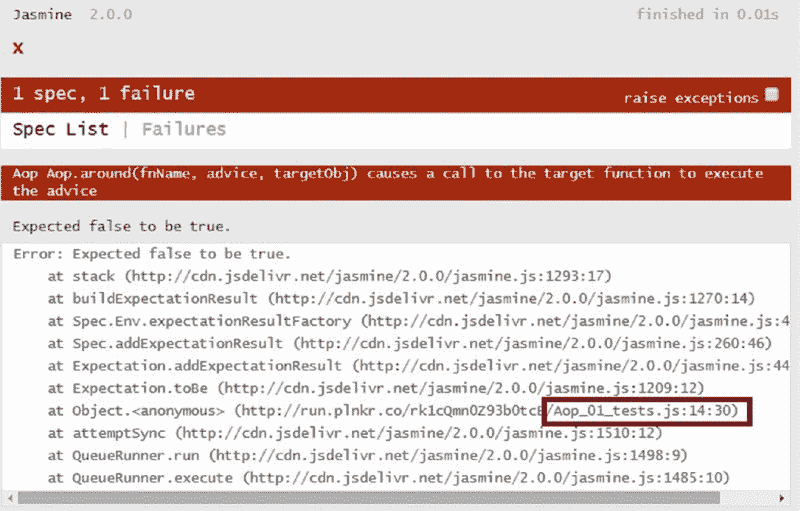

**图 2.7**（#part0011.xhtml_figureanchor2-7）

接下来，你只需添加足够的代码让它通过（列表 2-28）。

接下来，你想要允许你的建议函数包裹对目标的调用。这意味着你必须向建议函数传递一些关于目标的信息。你可以通过向建议函数传递一个对象来实现，在对象中存储原始目标函数。在列表 2-29 的测试中，该对象被称为 `targetInfo`，函数位于 `fn` 属性中。

你可以为新测试创建一个新的目标对象（从第一个编辑复制），但你可能会想，一个目标可以同时适用于两个测试。正如你在本章前面看到的，你可以将目标对象重构到外层 `describe` 的作用范围内，在那里它对所有测试都可用。这一小小的努力将在未来的测试中获得丰厚的回报。

由于你的测试会修改目标，你会在每个测试之前执行的 `beforeEach` 中重新初始化目标，如你在列表 2-29 中所示。

这失败了，因为 `Aop.around` 的当前实现完全没有努力提供一个带有 `advice` 属性的对象。因此，你添加了列表 2-30 所示的新功能。这里有两点值得注意：首先是 `call` 方法。它类似于 C# 或 Java 中的 `Invoke`。它的第一个参数是调用函数时的上下文（`this`）。上下文很重要，但你还没有编写关于它的测试，所以只使用一个空对象作为占位符。

`call` 有一个姐妹 `apply`，它期望参数是一个数组。如果你想编写优雅的 JavaScript，你会希望 `call` 和 `apply` 变成本能。

其次，注意原始函数是如何捕获在变量 `originalFn` 中的。它的值在 `Aop.around` 被调用时设置。这并不意外。微妙之处在于，在 `Aop.around` 返回后 `fnObj[fnName]` 仍然可用。（C# 或 Java 程序员可能会认为 `originalFn` 是一个作用域已退出的局部变量，它也会退出。）这就是闭包的一个例子，如果你想跟随 Fredrik Appelberg 和 Dave Clayton 的脚步，这是另一个热爱的 JavaScript 特性。

`Aop` 对象开始成形。

你可能怀疑 `Aop.around` 可以多层包裹目标，但按照真正的 TDD 风格，你想确认这一点，因此添加了列表 2-31 中的测试。与其创建两个几乎相同的切面，不如创建一个工厂来生成它们。这是一个相对不重要的 DRY 时刻，但这些微小的美感让程序员的一天变得值得，不是吗？

所有测试均已通过，你准备好处理下一个功能：向目标传递参数。到目前为止，建议函数甚至不知道参数的存在。如果它要传递这些参数，你必须提供它们。你只需向建议函数获取的 `targetInfo` 对象添加一个 `args` 属性。`TargetInfo` 现在将是这种形状：

```javascript
{ fn: targetFunction, args: argumentsToPassToTarget }
```

早期的建议只是这样调用目标：

```javascript
targetInfo.fn();
```

但如果你想像逗号分隔调用那样传递参数数组，你必须使用之前提到的 `apply` 函数：

```javascript
targetInfo.fn.apply(this, targetInfo.args);
```

这些想法出现在列表 2-32 所示的新建议 `argPassingAdvice` 中。`targetObj` 也经过了增强，用以记录它在 `argsToTaget` 数组中获取的参数。来自其他语言的程序员可能会感到惊讶，尽管 `targetObj` 在其 `function()` 语句中没有提到任何参数，但 `arguments` 对象仍然提供了传递给 `targetObj` 的参数，这正是 JavaScript 灵活性的另一个例证。

当你运行测试时，它失败了（图 2.8）。

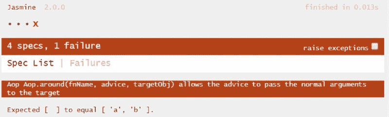

**图 2.8**

每一次失败都让测试驱动的开发者感到高兴，因为这意味着他可以编写更多的代码。在这种情况下，你只需要向传递给建议的对象添加 `args: arguments` 即可（列表 2-33）。

传统的开发者可能会以覆盖整个函数的测试来思考。你刚刚看到了一个测试的示例，它覆盖了对象中的一个属性，而该属性被用在代码的某一行中。此外，这行代码的极小部分在测试编写之前甚至不存在。这是测试驱动开发的最高境界。你即将看到另一个示例。

你刚刚考虑了进入目标函数的内容；那么输出它的返回值又如何呢？你希望建议能够在适当的情况下将该值回传给外部世界。

为了这个目的，你向你的 `targetObj.targetFn` 添加了一个 `return` 语句。你也可以让 `argPassingAdvice` 返回它调用目标函数时的返回值。到目前为止，没有任何测试依赖于关于返回值的任何内容，所以它们仍然通过，但被测试的对象本身呢？它会通过吗？列表 2-34 显示了一个发现该结果的测试。（未显示：`targetObj.targetFn` 已更改为返回一个新变量 `targetFnReturn`。）

另一个失败（图 2.9）。

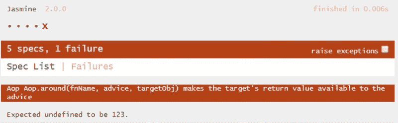

**图 2.9**

因为你预期的功能增量如此小，所以添加起来很容易：只需在 `Aop.around` 中使用一个 `return` 关键字，如列表 2-35。


目标现在被封装了，它获得了预期的参数，你可以获取它的返回值。只有最后一点需要考虑了。在 JavaScript 中，在一个函数不预期的上下文中执行该函数是太容易的。

列表 2-36 中的测试说明了这个观点。

首先，在目标函数内部有一个预期，即 `this` 是在用 `new` 创建 `Target` 时所归属的值。然而，如果该调用完全失败，`expect(this).toBe(self)` 将永远不会执行，测试看起来就像通过了。为了防止这种情况，测试以对函数是否被调用的预期结束。

第二个测试类似，但没有这种谨慎措施。Jasmine 报告了一个错误。你可以通过将旧的 `targetContext`（你曾将其设置为空对象）替换为 `this` 来修复它列表 2-37。

测试通过了。

还有一个细节需要注意。在列表 2-32 中，建议必须执行此操作来调用链中的下一个建议（如果没有更多建议，则调用装饰后的函数）：

```
return targetInfo.fn.apply(this, targetInfo.args);
```

这并不理想。除了输入量很大之外，它还向 `Aop` 的消费者暴露了 `targetInfo` 的结构。将其封装在一个函数里不是更好吗？遵循 Fredrik 和 Dave 的方法，你可以创建一个辅助函数 `Aop.next`，它调用链中的下一个切面或目标。

列表 2-38 中的注释显示了每个开发步骤是如何进行的。列表 2-39 显示了最终的测试套件。

测试通过了，我们现在有一个完全实用的 AOP 组件。

回想列表 2-25，你可能可以想象朝着 Fredrik 和 Dave 的 `Aop.js` 杰作所迈出的的最后一步——即允许一次对 `Aop.around` 的调用影响多个函数。你可能注意到，在他们的版本中 `Aop.around` 的参数命名不同：

```
Aop.around(pointcut, advice, namespaces)
```

本章的 `Aop.js` 使用的是 `fnName`，而他们使用的是 `pointcut`。在 AOP 术语中，`pointcut`（切点）指定了切面可以切入并执行其操作的点。在 `Aop.js` 中，它是一个 JavaScript 正正则表达式，因此像本章这样的函数原名是一个特例。

此外，本章的 `Aop.js` 使用的是 `fnObj`，而他们使用的是 `namespaces`（命名空间）。在 JavaScript 中，命名空间只是一个包含其他对象作为属性的对象。为了避免命名冲突，将应用程序的所有代码放在命名空间中是一个良好的做法。你可以这样构建命名空间的层级：

```
var MyApp = {};

MyApp.Encryption = {};
MyApp.WebServices = {};
MyApp.UI = {};
```

然后你就可以将函数放在命名空间中：

```
MyApp.WebServices.amazon = function () {
 // ...
 getIsbn: function () {
```

### 其他 AOP 库

尽管我们喜欢 `Aop.js`，但还有其他选择，如 AspectJS、Aop 插件和 YUI 的 Do 类。

#### AspectJS

像 AspectJS 这样的名字，你就知道它会在搜索结果中排得很高。它是 JavaScript 竞赛中的早期参赛者，而且功能非常全。它具有挂起和恢复切面的功能——这些功能如果需要很容易添加到 `Aop.js`，但在 AspectJS 中已经有了。缺点是 AspectJS 因此变得沉重了很多。

另一个巨大的缺点是 AspectJS 自 2008 年以来似乎没有更新过 ([`aspectjs.com/AJS_History.htm`](http://aspectjs.com/AJS_History.htm))。

#### Aop 插件

尽管 Aop 插件相对较新且在 GitHub 上还没有什么数据，但你可能会因为它是 jQuery 网站而遇到它 ([`plugins.jquery.com/aop`](http://plugins.jquery.com/aop))。

AspectJS 的作者花时间提供了兼容 jQuery 和 AngularJS 的语法选项，以及切面的链式调用，如文档中的示例：

```
var myProxy = AOP.aspect(myFunction)
                        .before(myAdvice1)
                        .afterReturning(myAdvice2)
                        .afterThrowing(myAdvice3);
```

该代码没有 `Aop.js` 那么简洁优雅，但它的功能稍微更完善一点。

#### YUI 的 Do 类

Yahoo! YUI 项目的人员确实知道自己在做什么。YUI 的一个组件是 `Do` 类。它在 [`http://yuilibrary.com/yui/docs/api/classes/Do.html`](http://yuilibrary.com/yui/docs/api/classes/Do.html) 中有详细的文档。`Y.Do`（`Y` 是命名空间）非常完美，除了一点：2014 年 8 月，Yahoo! 宣布停止开发 YUI。

## 总结

也许因为 AOP 在 JavaScript 中非常容易实现，所以没有多少工具包。这并不是什么大问题。看起来沉重的库已经停止开发，留下了可能永远不需要更新的极简替代方案。

在那个世界，你很难不被 Fredrik Appelberg 和 Dave Clayton 的 `Aop.js` 所吸引。任何仅用 50 行代码（包括空格和注释）就能实现这么多功能的模块都不仅应该采用，而且深受喜爱。

在本书的剩余部分中，当我们需要 AOP 时，我们将使用 `Aop.js`。

# 使用代码检查工具

代码检查工具执行静态分析，即在不执行源代码的情况下检查其语法和结构。这种检查的目的是发现并报告可能在代码执行时导致错误的潜在语言用法。某些静态分析工具还会报告偏离编码风格规则的情况，以及如计算复杂度等有用的指标。

这类工具通常被称为 **linters**（代码检查器），以反映它们与 20 世纪 70 年代后期开发的 C 语言静态代码分析工具 `lint` 之间的关系。

在本节中，我们将静态分析工具称为 linters，将执行静态分析的过程称为 linting（代码检查）。

## 使用 Linting 工具让你的代码更可靠

在编写 JavaScript 程序时，linting 具有重要作用。如果你是一个来自 C# 或 Java 等编译型语言的开发者，你已经习惯了编译器会你严重的语法错误，例如缺少语句结束的分号或忘记闭合大括号。作为一种解释型语言， JavaScript 没有在你出错时会“抱怨”的编译器。在代码执行之前，你不会感知到任何语法错误。

既然你已经采用了 TDD（测试驱动开发），在编写每一行生产代码之前，你都应该有一个测试来运行它，对吧？在实践 TDD 时，跳过配置和使用 linter 可能会很有诱惑，因为单元测试保证了你的代码按预期方式运行。

Linters 并不验证代码是否正确。你的 linter 无法告诉你编写的函数是否会返回正确的值。然而，它可以告诉你，你在函数内部编写的代码格式存疑，并可能导致其返回错误的值。

假设你被委托构建一个航空公司订位系统。客户要求你实现一个功能，用于判断特定乘客是否有资格免费升级到头等舱座位。

为了获得升级，乘客需要在该航空公司飞过一定数的英里。为了本例的目的，假设一个 `passenger` 对象包含乘客的姓、名，以及一个整数数组，表示行程长度。以下是使用对象字面量模式创建的 `passenger` 示例：

```javascript
var testPassenger = {
  firstName: "Seth",
  lastName: "Richards",
  tripMileages: [
    500,
    600,
    3400,
    2500
  ]
};
```

在计算特定乘客飞过的英里数时，你能够奖励航空公司常客计划的成员。为此，你提供一个倍数，增加每个成员航班的里程数，以奖励乘客的忠诚。

作为第一步，你可能会创建一个函数，通过倍数缩放行程里程数。以测试驱动的方式，列表 2-40 显示了验证该函数行为符合预期的单元测试。

列表 2-41 显示了 `calculateUpgradeMileages` 的实现，该实现使得单元测试通过。

最后，图 2.11 显示了单元测试的 Jasmine 输出。

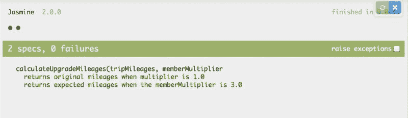

Figure 2.11

如你所见，函数返回了预期结果且测试通过了。然而，代码中存在一个潜在问题。花点时间看看你能否识别出 `calculateUpgradeMileages` 中存在问题的代码段。如果一眼看不出来，不要担心，因为你有 linting 工具来帮助。

## 介绍 JSHint

JSHint 是一个开源的静态分析工具，它的自述如下：

> *JSHint 是一个社区驱动的工具，用于检测 JavaScript 代码中的错误和潜在问题，并强制执行团队的编码规范。*

> *[`http://www.jshint.com/about`](http://www.jshint.com)*

JSHint 是 JSLint 项目的分支（fork）。JSLint 由 Douglas Crockford 创建并维护。在他们从 JSLint 分支出 JSHint 时，JSHint 的创建者认为 JSLint 已经变得“太主观了”，并且需要一个由 JavaScript 社区驱动的 linting 工具。

### 使用 JSHint

你可以将 JavaScript 代码复制并粘贴到 JSHint 首页（[`http://www.jshint.com`](http://www.jshint.com)），linter 将自动执行。虽然这对于识别博客文章（或书籍）中示例代码的问题可能很方便，但使用这种机制执行 linter 并不适用于开发即使复杂度有限的 JavaScript 解决方案。

由于 `calculateUpgradeMileages` 函数是书中的一段示例代码，你可以使用 [`http://www.jshint.com`](http://www.jshint.com) 上的在线工具来查找函数中的存疑结构。

图 2.12 显示了 JSHint 对 `calculateUpgradeMileages` 的评价。

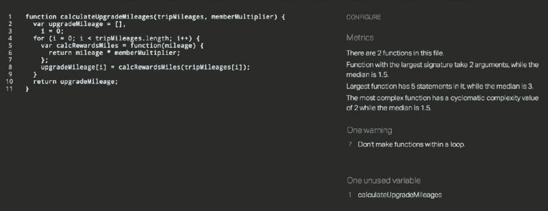

Figure 2.12

如你所见，JSHint 对 `calculateUpgradeMileages` 给出了警告：

```
不要在循环中创建函数。
```

如果你没有注意到，JSHint 很好地指出你在循环中声明了函数。你的单元测试通过了，所以在这种情况下，在循环中创建函数并没有导致逻辑错误。那么问题所在哪里？

记住 JSHint 会识别 JavaScript 代码中的存疑结构。我们完全同意，无论结果是否正确，在循环中重新声明函数都是存疑的。至少，它是低效的，尽管在本例中并无如此，但这种做法很容易导致错误和不可靠的代码。

假设你非常有充分的理由将函数放在循环中。每当你对代码执行 JSHint 时（这应该经常发生），它都会呈现该警告。你是否需要注明你（以及团队的其他开发者）可以安全地忽略那个特定的警告？

幸运的是，答案是否定的。JSHint 提供了通过配置全局“放松”规则，或通过特殊格式的注释在本地放松规则的能力。

列表 2-42 再次显示了该函数，这次包含了一条注释，告诉 JSHint 你知道自己正在循环中创建函数，并且你想放松 `loopfunc` 规则：

`/*jshint loopfunc: true */` 注释位于创建函数之前，告诉 JSHint 放松它的 `loopfunc` 规则，直到遇到另一个告诉它停止放松规则的注释。导致规则不再放松的注释 `/*jshint loopfunc: false*/` 紧接出现在函数声明之后。

将放松了 `loopfunc` 规则的更新代码提供给 JSHint 网站，将产生图 2.13 所示的结果。

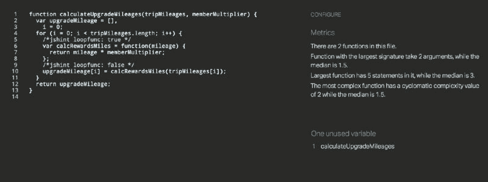

Figure 2.13

如你所见，JSHint 记录了你已放松 `loopfunc` 规则，并且不再对在循环中创建函数发出警告。

在这个示例中，你仅对必要的行数禁用了单条规则。你可以告诉 `JSHint` 不要对某部分代码处理任何规则。但我们建议除非绝对必要，否则不要这样做。如果你通过禁用所有规则来抑制你收到的警告，那么很容易想象，在未来某个时刻维护或扩展你代码的同事可能会失去这些有用的代码检查（linting）警告。

## 如果你不运行它，Bug 就会出现

理想情况下，每当你更改 JavaScript 代码时，都应该自动执行 `JSHint`。任何手动机制都可能导致忘记运行或刻意不运行代码检查工具。代码检查（Linting）不应该是留到项目结束时才做的，甚至不是留到下一次构建（你的项目有一套可重复的、化的构建过程，对吧？）。你的检查器应该在你开发时提供持续的反馈，以便其识别出的代码问题能够尽早得到解决。

`JSHint` 有多种发布方式，包括一个用于服务器端 JavaScript 引擎 `node.js` 的 npm 模块。此外，还有插件可以在许多流行的文本编辑器和集成开发环境（IDE）如 `VIM`、`Emacs`、`Sublime Text`、`TextMate` 和 `Visual Studio` 中原生或通过 `node.js` 自动对你的 JavaScript 文件执行 `JSHint`。

如果你喜欢的编辑器或 IDE 没有提供 `JSHint` 插件，可以配置 `node.js` 任务执行包（如 `Grunt` 和 `Gulp`）来监控 JavaScript 文件的变化并在检测到更改时自动执行 `JSHint`。

## JSHint 的替代方案

`JSHint` 并不是唯一的 JavaScript 代码工具；它恰好是提供了我们所需功能的工具。如果你正在为项目选择检查工具，这里有一些你可能考虑的 `JSHint` 替代方案。

### JSLint

`JSLint` 是一个成熟的 JavaScript 代码工具，由 Douglas Crockford 创建并维护。Crockford 先生是 JavaScript 社区的关键人物，因其对 `JSLint` 的工作以及推广 JSON 的工作而闻名于世。

`JSLint` 可以作为 `node.js` 的 npm 模块使用，也可以作为用于浏览器类环境的 JavaScript 文件。

`JSLint` 的主页可以在 [`http://www.jslint.com`](http://www.jslint.com) 找到。

### ESLint

`ESLint` 是由 Nicholas Zakas 在 2013 年创建的相对新的开源检查工具。尽管它是一个年轻的项目，但它功能全且非常强大。`ESLint` 的一个独特特性是它的模块化。你可以定义自定义的检查规则并在运行时将其加载到检查器中。如果你想强制执行你组织独特的编码标准，这将非常有用。

`ESLint` 可以 `node.js` 的 npm 模块使用。`ESLint` 的主页可以在 [`http://www.eslint.org`](http://www.eslint.org) 找到。

### 严格模式

另一个值得注意的代码检查工具。实际上，它不是外部工具，而是 ECMAScript 5 引入的一种 JavaScript 设置。如果你在作用域（全局作用域或函数）中包含以下内容，JavaScript 解释器将以不同的方式处理某些特性。

```
'use strict';
```

启用此指令后，如果你提交了一些常见错误，JavaScript 将抛出错误。这些包括在未声明的情况下使用变量、尝试修改只读属性等。在不支持严格模式的 JavaScript 版本上运行时，`'use strict'` 字符串将不起作用。

你将在第 18 章的“默认绑定与严格模式”部分看到严格模式如何产生关键差异的示例。在此期间，书中的列表将使用它以养成习惯。

## 总结

在本章中，我们介绍了一些我们喜爱的 JavaScript 开发技术和工具。

单元测试框架对于可靠的软件开发是至关重要的。在本文中我们将使用 `Jasmine`，我们发现它易学且非常健壮，但流行的替代方案包括 `QUnit` 和 `D.O.H`。

随着 JavaScript 应用变得越来越复杂，保持其组件的整洁和分离变得越来越重要。依赖注入是实现这一点的重要技术。在本章中，你完成了一个依赖注入框架的测试驱动开发，该框架将在后续章节中再次出现，并可能在你自己的项目中有所帮助。

作为另一个 TDD（测试驱动开发）案例，你开发了一个用于面向切面编程的工具包。`AOP` 允许你通过缓存等通用功能增强软件组件，而完全不需要这些组件。这是另一种同时保持代码 DRY（不重复）、遵循单一职责原则并遵守开闭原则的方法。

代码检查工具（称为 linters）通过提醒你语法错误或违反标准的情况，在微观层面提升了可靠性。`JSHint`、`JSLint` 和 `ESLint` 是最流行的几个工具。严格模式是避免语法层级错误的另一种好方法。

在下一章中，你将探索 JavaScript 构建对象的丰富方式。这听起来是一个简单的话题，但你会发现它绝非如此。

# 第 3 章：构建可靠的对象

## 本章内容包含？

*   作为原始类型、对象字面量和模块创建数据

*   使用 `new` 关键字创建数据

*   使用对象方法创建可靠对象

*   使用原型、经典和函数模式控制继承

*   负责任地使用猴子补丁（monkey-patching）

## WROX.COM 代码下载

本章的代码下载可以在 [`wrox.com/go/reliablejavascript`](http://www.wrox.com/go/reliablejavascript) 的 Download 标签找到。


开发者喜爱迷人的界面、优雅的算法和良好的 API，但往往忽视了实例化这一基本操作。JavaScript 提供了异常多样的选择来实现这一点。某些选择会让你的代码可靠、可测试且可扩展；而另一些则是通往毁灭的捷径。

本章概述了创建对象的常用方法，并考虑了它们如何符合第一章引入的 SOLID 和 DRY 标准。

让我们从最基础的开始。

## 使用原始类型

当我们招聘开发者时，总是问候选人：“JavaScript 中的原始数据类型有哪些？”最常见的答案是“只有一个：`var`。”次常见的回答恰相反：深吸气并列出足够填充 C# 手册的类型。这两个答案都是错误的。

JavaScript 恰有五种原始数据类型：`String`、`Number`、`Boolean`、`Null` 和 `Undefined`。语言会在需要将一种类型转换为另一种，方式往往令人惊讶，但在 ECMAScript 5 中就是这五种。（ECMAScript 6 增加了 `Symbol` 类型。`Object` 类型不是原始。）

原始类型有值但没有属性，但以下代码将正常运行。

```
var str = "abcde";
console.log(str.length); // 输出: 5
```

如果 `str` 没有 `length` 属性，这段代码是如何运行的？当解释器遇到 `str.length` 时，它会说：“嗯……看起来他正尝试操作对象。让我为他创建一个。”从 `str` 构造一个 `String` 对象并报告其 `length`。这个 `String` 对象一旦构造完成很快就会被垃圾回收。

`String`、`Boolean` 和 `Number` 都有对应的对象包装器，`String(value)`、`Boolean(value)` 和 `Number(value)`。

WET（重复编写两次，或者我们很喜欢打字）可能会在你毫无察觉的情况下进入你的代码中。假设你有一个表示动物质量的变量，单位是公斤。你从用户那里获取了一个值，然后执行以下操作：

```javascript
if (inputMass < 0) {
  // 报错：质量不能为负数
} else if (inputMass > 150000) {
  // 错误：即使蓝鲸也没有这么重。
}
```

然后，在应用程序的另一个部分，你执行了同样的操作。你的代码不再是 DRY（不要重复自己），但你还能做什么呢？你无法在基本类型上安装范围验证。解决这个问题的方法之一是将你的数据从基本类型提升为对象。该对象可以拥有范围验证以及基本类型不具备的功能。我们并不是建议每个基本类型都成为对象，但这是根据具体情况考虑的问题。

另一个常见问题是重复的基类型。第二次输入一个值总是比将其放入变量并在处处引用该变量要容易得多。放弃这条捷径吧！在极少数例外情况下，每个被引用超过一次的常量都应该放在变量中，并改为引用该变量。另一种方法将其注入为依赖。除了保持代码 DRY 之外，这两种方法都能更容易找到所有使用该值的地方。

表 3.1 总结了基本类型在 SOLID 和 DRY 原则下的表现。

| 原则 | 结果 |
| --- | --- |
| **S**ingle Responsibility（单一职责） | 没有能比基本类型更专注了！ |
| **O**pen/Closed（开闭原则） | 对扩展开放？并不。对修改关闭？确实。事实上，基本类型是不可变的 |
| **L**iskov Substitution（里氏夫替换） | 不适用 |
| **I**nterface Segregation（接口隔离） | 遗憾；你无法在基本类型上实现接口，尽管你有时想这样做。 |
| **D**ependency Inversion（依赖倒置） | 基本类型没有依赖。 |
| **D**on’t **R**epeat **Y**ourself（不要重复自己） | 这里有巨大的诱惑！ |

**表 3.1** 基本类型的 SOLID 和 DRY 总结

### 使用对象字面量

基本类型之上的下一阶是对象字面量——即如下声明的对象：

```javascript
{ name: 'Koko', genus: 'gorilla', genius: 'sign language' }
```

区分创建对象字面量的两种方式是有帮助的。有裸对象字面量：

```javascript
var koko = { name: 'Koko', genus: 'gorilla', genius: 'sign language' };
```

还有是作为函数返回值的字面量：

```javascript
var amazeTheWorld = function() {
  // . . .
  return { name: 'Koko', genus: 'gorilla', genius: 'sign language' };
}

var koko = amazeTheWorld();
```

这种区别很重要，因为其中一种比另一种更 DRY。如果你创建了多个预期具有相同属性的对象字面量，你必须重复属性名。很容易出错。测试驱动开发可以确保我们从函数返回一个带有预期属性的对象，但没有办法直接测试埋没在代码中的裸对象字面量。

对象字面量还可能具有作为函数的属性。再次，如果字面量不是以受控的方式创建的（例如从函数返回），就没有办法测试这些函数。

除非对象字面量被赋值给变量（例如你在第 2 章中遇到的 `Aop` 对象），否则用面向切面的编程来处理它是有问题的。切面需要一个它所应用的切入点（例如，变量名），但对象字面量没有名称。然而，如果对象字面量是由工厂函数产生的，那么该函数就可以包装在一个“之后”切面上，从而对返回的字面量进行调整。

至于依赖注入，在裸对象字面量的情况下根本不会出现机会。然而，一个创建并返回字面量的函数可以完全供依赖注入过程使用，正如第 2 章建议的，这应该位于应用程序的启动代码中。

裸对象字面量的最后一个弱点是它们的构造过程中没有验证。正式的构造函数可以对其参数进行各种验证并保证结果的有效。当你拼凑出一个裸对象字面量时，没有此类检查。

由于由于这些原因，我们建议对象字面量不要组成应用程序的重要部分，除非它们是单例或由经过测试的代码创建的。

对象字面量的一个良好用法是将数据包从一个地方传递到另一个地方。例如，在*JavaScript: The Good Parts*(O’Reilly Media, 2008）中，Douglas Crockford 建议使用对象字面量而不是长参数列表，后者的顺序很难正确。此外，他还指出，字面量中缺少属性可以是使用默认值的信号。

这非常有用，但要注意：如果你的函数必须准备好任何属性组合，你就是给自己留了巨大的测试负担。你可能考虑使用一个具有良好控制和经过测试的构造方式的对象，甚至可能有一个 `isValid()` 方法。

表 3.2 总结了对象字面量的 SOLID 和 DRY Aspect。

| 原则 | 结果 |
| --- | --- |
| **S**ingle Responsibility（单一职责） | 在实践中，裸对象字面量通常很小，不会在这个方面出现问题。构成模块 API 的较大对象（见下一节）承担了它们的职责。 |
| **O**pen/Closed（开闭原则） | 对象字面量的理念似乎在邀请未管理的扩展。注意！ |
| **L**iskov Substitution（里氏夫替换） | 不适用 |
| **I**nterface Segregation（接口隔离） | 见下一节的模块模式和本章的最后一节。 |
| **D**ependency Inversion（依赖倒置） | 裸对象字面量在这里失败了，因为它们没有可以注入依赖的构造函数。 |
| **D**on’t **R**epeat **Y**ourself（不要重复自己） | 除非是单例，否则裸对象字面量会导致重复代码。巨大的警告！ |

**表 3.2** 对象字面量的 SOLID 和 DRY 总结

## 使用模式

模块模式是 JavaScript 中经典的之一。它采用一个目的是隐藏数据的函数，并返回一个构成模块 API 的对象。模块有两种口味：通过调用函数按需创建的模块，以及基于在声明时立即执行的函数的模块。

### 按需创建模块

列表 3-1 是一个你可以随时创建的模块示例。只需调用模块函数并获取你的 API 即可。

你可以这样使用模块：

```javascript
var preserve = MyApp.wildlifePreserveSimulator(realAnimalMaker);
preserve.addAnimal(gorilla, female);
```

虽然模块返回一个字面量，但如 `animalMaker` 等依赖可以注入到外部函数并到达字面量。

由于模块可以注入到其他模块中，因此很容易扩展。你将旧版本注入新版本中，根据需要对其进行包装、暴露和扩展。如果第 1 章的开闭原则吸引你，模块是理想的。

### 立即执行模块

通常情况下，外部函数在声明时立即执行，就像按需创建模块一样返回 API。返回的 API 被赋值给命名空间的全局变量，然后该变量成为该模块的单例实例。列表 3-2 以这种方式修改了列表 3-1。

```
MyApp.WildlifePreserveSimulator.addAnimal(realAnimalMaker, gorilla, female);
```

外部函数在它所在的位置立即执行，而不是在应用程序启动代码调用它时执行。由于这个原因，除非依赖项恰好在函数（立即）执行时可用，否则无法将它们注入到外部函数中。这有点不方便。如果你想要一个单例，一种更符合依赖注入的方法是使用“按需创建模块模式”（module-at-will pattern）编写模块，并让依赖注入框架在每次请求时都提供同一个实例。例如，`AngularJS` 就是这样提供“服务”单例的。

### 创建可靠的的模块

无论你的模块是“按需创建”类型还是“立即执行”类型，都有几个原则是你记在心中的。

首先，记住**单一职责原则**：每个模块应该只承担一个工作。这将使你的 API 保持小型、内聚且易于管理。

其次，如果你的模块为自身创建了对象，请问自己这些对象是否应该通过依赖注入提供——直接提供，或者通过注入工厂来提供。

最后，如果你的模块扩展了另一个对象的行为，务必不要改变该行为的*含义*（语义）。这就是**里氏夫替换原则**。

表 3.3 是模块模式的 SOLID 和 DRY 评分表。

| 原则 | 结果 |
| --- | --- |
| **S**单一职责 | 因为它们对依赖注入和面向切面的装饰非常友好，因此很容易让模块保持单一职责。 |
| **O**开闭原则 | 模块通过被注入到其他模块来对扩展开放。如果你足够自律，可以保持模块对修改的关闭状态。 |
| **L**里氏夫替换 | 只要你不改变任何依赖项的语义，就没问题。 |
| **I**接口隔离 | 具有内聚 API 的模块等同于 JavaScript 中的隔离接口。 |
| **D**依赖倒置 | 按需创建的模块可以非常容易地注入依赖。两种类型的模块都可以注入到其他模块中。 |
| **D**on’t **R**epeat **Y**ourself | 如果方法正确，模块是保持代码 DRY 的极佳方法。 |

**表 3.3**模块 SOLID 和 DRY 总结

## 使用对象原型和原型继承

JavaScript 中的每一个对象，无论使用何种机制创建，都拥有一个链接的原型对象，并从该原型中继承属性。在本节中，你将学习对象原型和原型继承的基础知识。

### 默认对象原型

在上一节中已经熟悉的对象字面量会自动链接到内置的 `Object.prototype` 对象。考虑如下定义的 `chimp` 对象：

```javascript
var chimp = {
  hasThumbs: true,
  swing: function(){
    return 'swinging through the tree tops';
  }
};
```

`chimp` 对象没有定义 `toString` 函数，但执行

```
chimp.toString();
```

并不会导致未定义函数错误。事实上，它会输出 `chimp` 对象的字符串表示（`'[object Object]'`，这并不很有描述性）。

当调用 `chimp.toString()` 时，JavaScript 会检查 `chimp` 对象并确定它没有直接定义 `toString` 属性。接下来，它查看 `chimp` 的原型 `Object.prototype`，该原型*确实*定义了一个 `toString` 属性。然后执行找到的函数并返回其值。

如果 `chimp` 定义了自己的 `toString` 函数：

```javascript
var chimp = {
  hasThumbs: true,
  swing: function(){
    return 'swinging';
  },
  toString: function(){
    return 'I am the chimpanzee';
  }
};
```

那么 JavaScript 将立即找到 `chimp` 的 `toString` 实现并执行它，产生结果为 `'I am the chimpanzee'`；此时将不会检查 `chimp` 的原型。

### 原型继承

尽管 `Object.prototype` 有一些实用的属性，但 JavaScript 原型继承的威力在于能够将默认原型替换为自定义原型。假设除了 `chimp` 对象外，你还想创建一个 `bonobo` 对象。因为它们在动物界中是亲属，你知道 `chimp` 对象和 `bonobo` 对象将具有许多共同属性。

为了减少对象之间属性的重复，你可以创建一个名为 `ape` 的对象，持有这些共同属性。然后你可以创建链接到 `ape` 的 `chimp` 和 `bonobo` 对象；这使得 `ape` 了一个*共享原型*。

ECMAScript 5 提供了 `Object.create` 方法，它可以处理创建链接到提供的原型的新对象。以下片段说明了如何使用 `Object.create` 构建以 `ape` 为共享原型的 `chimp` 和 `bonobo` 对象：

```javascript
var ape = {
  hasThumbs : true,
  hasTail: false,
  swing : function(){
    return 'swinging';
  }
};

var chimp = Object.create(ape);

var bonobo = Object.create(ape);
bonobo.habitat = 'Central Africa';

console.log(bonobo.habitat);  // 'Central Africa' (from bonobo)
console.log(bonobo.hasTail);  // false (from ape)

console.log(chimp.swing());   // 'swinging' (from ape)
```

你可以看到，`bonobo` 和 `chimp` 都从 `ape` 继承了属性。你还应该注意 `bonobo` 直接增加了 `habitat` 属性；该属性既没有与 `ape` 共享，也没有与 `chimp` 共享。

由于 `ape` 是共享原型，对它的任何更改都会反映在 `chimp` 和 `bonobo` 中：

```javascript
ape.hasThumbs = false;
console.log(chimp.hasThumbs); // false
console.log(bonobo.hasThumbs); // false
```

### 原型链

你可以使用多个层级的原型（称为*原型链*）来创建多级继承。例如，假设 `ape` 有一个 `primate` 原型，然后 `ape` 被用作 `chimp` 的原型：

```javascript
var primate = {
  stereoscopicVision: true
};

var ape = Object.create(primate);
ape.hasThumbs = true;
ape.hasTail = false;
ape.swing = function(){
  return "swinging";
};

var chimp = Object.create(ape);

console.log(chimp.hasTail);           // false (from ape)
console.log(chimp.stereoscopicVision); // true (from primate)
```

访问 `chimp.stereoscopicVision` 时，当 `chimp` 对象上没有直接找到它时，JavaScript 解释器必须遍历 `chimp` 的原型链到 `ape`，最后到达 `primate` 找到它。如果访问的属性在对象的原型链任何地方都不存在，则返回 `undefined`。

遍历深度原型链会导致性能下降，因此我们建议保持其尽可能的浅。

## 使用 new 创建对象

在本节中，你将学习 JavaScript 中的 `new` 对象创建模式，并检查该模式的一些优点和陷阱。你还将看到使用该模式如何帮助保持代码的 SOLID 和 DRY。

#### new 对象创建模式

JavaScript 中 `new` 对象创建模式的语法与经典语言 C#、C++ 或 Java 中相同模式的语法相似。

列表 3-3 显示了 `Marsupial` 函数，并展示了使用 `new` 对象创建模式创建 `Marsupial` 实例。

在 `Marsupial` 函数内部，提供的参数被赋值给正在创建的实例的属性。定义 `Marsupial` 函数之后的行显示了两个 `Marsupial` 实例 `maverick` 和 `slider` 具有独特的属性。

#### 可能发生的坏事


你应该注意到，语言本身并没有提供任何指示表明`Marsupial`函数应该被用作*构造函数*（即为了配合`new`关键字使用而编写的函数）。同样，当构造函数没有使用`new`关键字执行时，JavaScript也没有内置保护。因此，大多数开发者通过使用大驼峰命名法（PascalCase）来区分构造函数。

由于在调用构造函数时遗漏`new`关键字可能会导致“坏事”发生，道格拉斯·克拉克福德（Douglas Crockford）建议不要使用构造函数。（参见Douglas Crockford写的《JavaScript: The Good Parts》，O’Reilly Media, 2008.）

我们并不急于否定构造函数的使用，因为它们确实允许共享初始化代码，而且在需要时确保使用`new`也并不是难事。

## 强制使用new

虽然JavaScript不会采取任何措施来强制对构造函数使用`new`，但利用`instanceof`运算符来添加这种强制机制是一个很容易的练习。列表3-4显示了如何重写列表3-3中的`Marsupial`构造函数，以确保该函数在使用`new`关键字时执行。

图3.1显示了当执行`var slider = Marsupial('Slider', true)`时输出到控制台的错误。

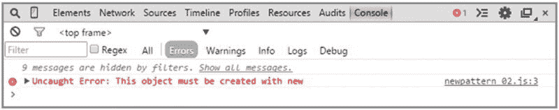

图3.1

在未使用`new`时抛出错误的另一种替代方案，是使用`new`自动创建一个对象的实例并返回该实例，如列表3-5所示。

列表3-5在不使用`new`的情况下执行了`Marsupial`函数，但并没有像列表3-4那样抛出错误，而是使用`new`关键字创建并返回了一个`Marsupial`。使用这种机制，调用函数的程序员就不需要担心`Marsupial`是否应该用`new`关键字调用；如果遗漏了`new`，它会被自动使用。

从表面上看，自动使用`new`关键字似乎很有帮助，但实际上它只是允许程序员掩盖错误。请考虑以下情况：

```
var jester = Marsupial('Jester', false);
var merlin = new Marsupial('Merlin', false);
```

两次对`Marsupial`的调用都产生了对象，就像它们前面都加了`new`一样，尽管其中一个并没有。如果你的团队已经习惯了构造函数首字母大写的命名约定，那么`jester`实例的创建看起来是错误的。

一致性带来可靠性，因此我们更倾向于列表3-4所示的保护机制。在遗漏`new`时抛出异常可以确保所有的`Marsupial`对象都以相同的方式实例化，从而有助于构建更一致、更可靠的代码库。此外，与测试驱动开发相结合时，任何通过遗漏`new`产生的异常都会被立即识别。

`new`对象的创建模式还允许你创建函数属性，这些属性被定义一次并对所有实例可用。列表3-6显示了如何通过在构造函数中直接在新对象上定义属性，来为对象的每个实例添加属性。该列表还说明了每个对象实例都有自己的函数副本。

函数属性也可以被添加到构造函数的`prototype`中。在构造函数的原型上定义函数具有额外的好处，即限制函数副本的数量为一个，从而减少内存占用，并在创建大量对象实例时提高性能。

列表3-7显示了如何向构造函数的原型添加函数属性。该列表还说明了每个对象实例都共享该函数的实现。

为了说明利用构造函数原型可以实现的性能增益，我们在[`http://jsperf.com`](http://jsperf.com)上创建了一个示例，将不使用`prototype`的`Marsupial`版本与使用它的版本进行对比。你可以访问[`http://jsperf.com/performance-prototype-vs-non-prototype`](http://jsperf.com/performance-prototype-vs-non-prototype)在自己的浏览器中运行比较，但为了满足你直接的好奇，图3.2显示了在OSX 10.10的Chrome 40上运行测试的结果。

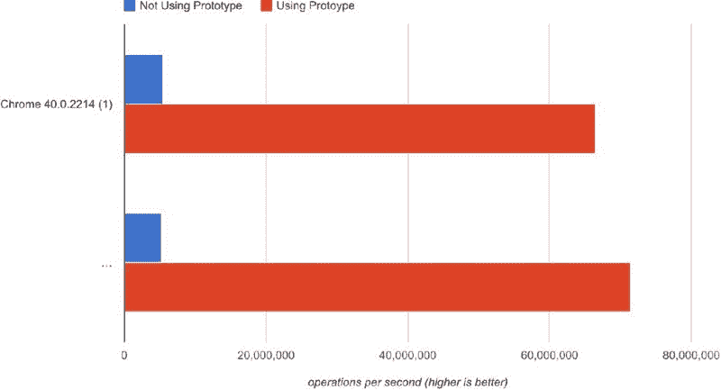

图3.2

如图3.2所示，使用构造函数的`prototype`在所有对象实例之间共享单个`isAwake`函数的`Marsupial`版本比为每个对象实例创建一个`isAwake`函数副本的版本快90%以上。

表3.4总结了`new`对象的创建模式在SOLID和DRY原则方面的表现。

| 原则 | 结果 |
| --- | --- |
| **S**单一职责 | 绝对可能，但取决于你如何确保创建的对象只负责一件事，且仅此件事。在`new`中注入依赖项有助于这一点。 |
| **O**开/对闭 | 是的！后续章节将说明如何扩展使用`new`创建的对象。 |
| **L**iskov替换 | 是的，通过继承实现 |
| **I**接口隔离 | 是的，同样通过继承实现 |
| **D**依赖倒置 | 肯定的。可以轻松地向函数注入依赖项。 |
| **D**on’t **R**epeat **Y**ourself | `new`对象的创建模式产生了非常DRY的代码。遗憾的是，我们还没有找到与`new`结合AOP的良好方法。AOP和`new`不匹配的原因是`new`创建的对象自原型。然而，没有什么阻止你使用AOP来装饰对象的原型函数。 |

表3.4 使用new创建对象的SOLID和DRY

## 使用经典继承

JavaScript没有类，因此不支持像C#或C++那样的经典继承。然而，它的原型继承允许模拟经典继承。在本节中，你将看到如何让JavaScript的原型继承表现得类似于经典继承。

### 模拟经典继承

JavaScript中模拟经典继承的基础是对函数的`prototype`进行操作。假设你想要扩展上一节中`Marsupial`函数的行为，包含袋鼠特有的属性，特别是一个`hop`函数。

回顾一下，这里是`Marsupial`函数，包含了`new`强制检查以及我们在列表3-7中添加到`prototype`上的`isAwake`函数：

```
function Marsupial(name, nocturnal){
  if(!(this instanceof Marsupial)){
    throw new Error("This object must be created with new");
  }
  this.name = name;
  this.isNocturnal = nocturnal;
}
Marsupial.prototype.isAwake = function(isNight){
  return isNight === this.isNocturnal;
}
```

你可以将`hop`添加到`Marsupial`函数的原型上（或直接添加到函数创建的对象实例上），但你真的想这样做吗？如果你这样做，那么由`Marsupial`构造函数创建的每个对象实例都将拥有`hop`函数。

因为你只想让袋鼠能够跳跃，所以修改`Marsupial`并无法实现你的目标。修改`Marsupial`还会违反开/闭原则。

最佳且最可靠的解决方案是通过创建一个继承自`Marsupial`的`Kangaroo`函数来扩展`Marsupial`。列表3-8显示了如何实现。

你可以看到`Kangaroo`函数的默认`prototype`已经被一个新的`Marsupial`实例所替换，使得`Marsupial`的行为几乎像一个类定义。

现在作为`Kangaroo`的`prototype`的`Marsupial`实例通过添加一个`hop`函数得到了扩展。请注意，`hop`函数并不是在`Marsupial`构造函数内部添加的，也没有添加到`Marsupial`构造函数的`prototype`上；`Marsupial`函数没有发生任何方式的修改。这种实现完全遵循了开/闭原则！

### 重复杀死了袋鼠

如列表3-8所示，模拟经典继承涉及代码和内存使用的重复。让我们再次查看将`Marsupial`实例赋值给`Kangaroo`函数`prototype`的操作：

```
Kangaroo.prototype = new Marsupial();
```

你可能已经注意到，并没有向`Marsupial`构造函数提供任何参数。在设置`Kangaroo`的`prototype`时，预期的参数是未知的，而且在创建`Kangaroo`实例之前无法知道这些参数。

由于在配置`prototype`时参数尚未知，因此在`Marsupial`函数中进行的属性赋值在`Kangaroo`函数中被重复了：

```
function Marsupial(name, nocturnal){
  if(!(this instanceof Marsupial)){
    throw new Error("This object must be created with new");
  }
  this.name = name;
  this.isNocturnal = nocturnal;
}

function Kangaroo(name){
  if(!(this instanceof Kangaroo)){
    throw new Error("This object must be created with new");
  }

  // 重复赋值 name 和 isNocturnal 属性！
  this.name = name;
  this.isNocturnal = false;
}
```

这显然违反了DRY原则，而且重复会对你代码的可靠性产生负面影响。

此外，`name`和`isNocturnal`属性最终出现在`Kangaroo`的原型（一个`Marsupial`实例）以及`Kangaroo`实例本身上。因为调用`Marsupial`函数时没有传递参数，所以`Kangaroo.prototype`上的属性值为`undefined`。通过检查`Kangaroo`实例可以说明这一点，如图3.3所示。

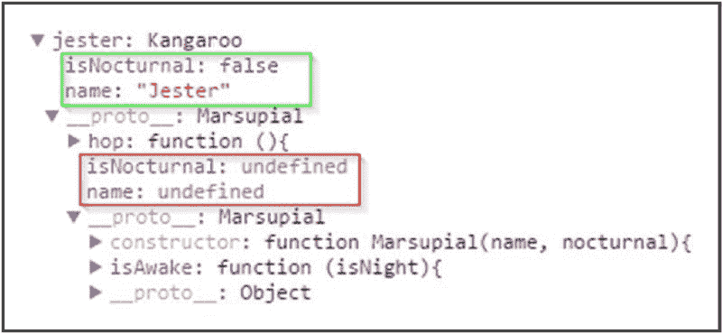

**图3.3**

第一组标记属性属于`Kangaroo`实例，第二组属性属于`Marsupial`实例（即`Kangaroo`的`prototype`）。

表3.5总结了模拟经典继承满足SOLID和DRY原则的程度。

| 原则 | 结果 |
| --- | --- |
| **S**ingle职责原则 | 模拟经典继承支持但不强制单一职责原则。可以通过注入依赖来帮助确保对象不会承担过多的职责。使用`new`关键字排除了对构造函数本身进行面向切面装饰的使用。 |
| **O**pen/闭原则 | 该模式的核心在于开/闭原则，正如列表3-8中的代码所示。 |
| **L**iskov替换原则 | 该模式促进对依赖进行扩展而非修改它们。因此，它帮助你遵循里氏夫替换原则。 |
| **I**nterface接口隔离 | 不适用 |
| **D**ependency依赖倒置 | 可以将依赖注入到继承对象的构造函数中来实现依赖倒置。 |
| **D**on’t **R**epeat **Y**ourself | 不怎么。初始化逻辑在继承和被继承对象的创建函数中重复了。然而，原型共享确实减少了函数的副本数量。 |

**表3.5** 模拟经典继承的SOLID和DRY总结

## 使用函数式继承

函数式继承提供了隐藏数据的能力，从而控制对其访问。在本节中，你将学习函数式继承如何消除模拟经典继承时出现的构造函数重复。此外，你还将看到如何使数据私有化，无论是对于外部消费者还是对于对象的继承者。只要数据是私有的而非公开的，暴露给误用和错误的表面积就会减少，可靠性就会增加。

模块模式也能很好地支持继承，消除了模拟经典继承时出现的构造函数逻辑重复。目标仍然是创建一个继承自`marsupial`并添加额外`hop`函数的`kangaroo`对象。列表3-9展示了如何使用函数式继承模式和模块来实现这一点。

在`AnimalKingdom.kangaroo`内部创建并返回的`baseMarsupial`对象是通过`AnimalKingdom.marsupial`创建的对象实例。`AnimalKingdom.kangaroo`函数扩展了`baseMarsupial`以添加`hop`函数。再次，在没有修改`AnimalKingdom.marsupial`的情况下添加了`hop`函数。

函数式继承相比模拟经典继承的优势在于，不需要在`AnimalKingdom.kangaroo`中重复`AnimalKingdom.marsupial`的创建逻辑；它直接使用了创建函数。

没有比这更DRY的了。

表3.6总结了函数式继承遵循SOLID和DRY原则的程度。

| 原则 | 结果 |
| --- | --- |
| **S**ingle职责原则 | 因为函数式继承使用了模块模式，它对依赖注入和面向切面装饰非常友好。你可以轻松限制继承模块的职责。 |
| **O**pen/闭原则 | 函数式继承为你提供了一种完美的扩展机制，从而避免修改模块。具体示例见列表3-9。 |
| **L**iskov替换原则 | 函数式继承提供了在不修改的情况下扩展模块的方法。因此，任何继承模块都可以替换其父模块。 |
| **I**nterface接口隔离 | 再次，函数式继承是模块模式的变体。模型的内聚API是分离的接口。 |
| **D**ependency依赖倒置 | 只要继承中使用的模块是按需，就可以轻松地注入依赖。 |
| **D**on’t **R**epeat **Y**ourself | 只要设计合理，结合模块的函数式继承是产生DRY代码的极佳方式。 |

**表3.6** 函数式继承模式的SOLID和DRY总结

当然，危险在于该函数可能会期望在其新环境中存在某些并不存在。前述代码片段更完整、更健壮的版本位于列表3-10。

猴子补丁（monkey-patching）发生在末尾的这一行：

```
koko.useSignLanguage = trainer.useSignLanguage;
```

使用手语的能力从`trainer`补丁到了`Koko`。这之所以能成功，是因为`Koko`恰好有手——`Human.useSignLanguage`函数要求手是其`this`的一部分（即`useSignLanguage`所“点点”的对象的对象的一部分）。尽管`useSignLanguage`起源于`Human`，但在点符号之前用`koko`调用它（`koko.useSignLanguage`）导致的是`Koko`的手移动，而不是人类的手。详细来说：

1. 调用了`koko.useSignLanguage('Hello!')`。
2. 由于猴子补丁的存在，执行最终进入了`MyApp.Human.prototype.useSignLanguage`。
3. 该函数访问了`this.hands`。
4. 此时，`this`是一个`MyApp.Gorilla`对象（`koko`），因为那是在调用`useSignLanguage`的对象。因此，`MyApp.Gorilla`最好有手！

考虑到借用函数可能具有（甚至是未来的！）需求，最可靠的猴子补丁方法是让*捐赠对象*（donor object）来管理补丁。它可以询问接收对象是否符合要求。

```
MyApp.Human.prototype.endowSigning = function(receivingObject) {
  if (typeof receivingObject.getHandCount === 'function'
  && receivingObject.getHandCount() >= 2) {
    receivingObject.useSignLanguage = this.useSignLanguage;
  } else {
    throw new Error("Sorry. I can't endow you with signing abilities.");
  }
};
```

当然，接收对象必须准备好回答这个问题：

```
MyApp.Gorilla.prototype.getHandCount = function() {
  return this.hands.length;
};
```

最后，人类可以赋予大猩猩这种能力：

```
trainer.endowSigning(koko);
```

使用这种技术，你可以将一整组功能从一个对象补丁到另一个对象。经典程序员可能会认为这组功能是在实现接口，但实际上它更类似于多重继承，因为它不仅实现了一个接口，还实现了与之配套的代码！

在第19章中，你将读到更多关于猴子补丁的内容，尽管它有一个更体面的名称——*方法借用*（method borrowing）。

表3.7总结了猴子补丁在可靠性和可测试性的经典标准下的表现如何。

| 原则 | 结果 |
| --- | --- |
| **S**ingle单一职责 | 尽管捐赠的功能组包含一个职责，但可以认为这种捐赠为接收对象增加了一项职责。然而，这只有在切面（aspect）增加职责的相同意义上才是真的，也就是说，它根本不是真的。 |
| **O**pen开/闭原则 | 只要负责任地使用猴子补丁，它就不会违反开闭闭原则。 |
| **L**iskov替换原则 | 只要捐赠的函数在新环境中的语义与在旧环境中相同，这里就没有问题。 |
| **I**nterface接口隔离 | 维护接口隔离原则正是猴子补丁的核心！ |


| `D`ependency 依赖反转 | 依赖关系可以像 usual 一样注入到捐赠对象或接收对象。 |
| --- | --- |
| `D`on’t `R`epeat `Y`ourself 不要重复 | 在富有创意但负责任的开发者手中，猴子补丁可以成为维护 `DRY` 代码的另一个工具。 |

**表 3.7** 猴子补丁的 `SOLID` 和 `DRY` 总结

## 总结

在本章中，你看到了在 `JavaScript` 中创建对象的几种方法，以及每种方法在满足第 1 章提出的 `SOLID` 和 `DRY` 标准方面的表现如何。

原始类型和对象字面量简单易于使用，但往往会导致你的代码出现重复。

模块模式（Module Patterns）是一个质的飞跃。它不仅以原始类型和对象字面量无法的方式封装数据，而且更容易进行单元测试和使用面向切面的编程进行扩展。

根据 `JavaScript` 社区某些成员的说法，应该避免使用 `new` 对象创建模式，但我们并不急于否定它。该模式所使用的构造函数允许共享初始化代码，而且在需要时确保使用 `new` 并不困难。

所有 `JavaScript` 函数都有一个 `prototype` 属性，可以用于在对象实例之间高效地共享代码和数据。`prototype` 属性提供了 `JavaScript` 促进原型继承的机制。

`JavaScript` 的原型继承可以模拟经典继承，如果你有 `Java` 或 `C#` 经验，可能会熟悉这个概念。`JavaScript` 还支持函数继承，它避免了原型继承中可能出现的重复，并支持数据隐藏。

最后，你看到了负责任地使用猴子补丁如何赋予一个对象另一个对象的能力。

下一章开始本书的第二部分，致力于使用测试驱动开发在 `JavaScript` 中实现重要的编程模式。讨论将从回顾基于模式的代码的好处开始。

# 第二部分：测试基于模式的代码

- 第 4 章 回顾模式的好处
- 第 5 章 正确使用回调
- 第 6 章 正确使用 `Promise`
- 第 7 章 正确使用部分应用
- 第 8 章 正确使用记忆化
- 第 9 章 正确实现单例
- 第 10 章 正确实现工厂
- 第 11 章 正确实现和使用沙盒
- 第 12 章 正确实现装饰器
- 第 13 章 正确实现策略模式
- 第 14 章 正确实现代理
- 第 15 章 正确实现链式方法

模式的尺度可以从语言的微小习语（如 `++i`）到系统本身的结构（`n` 层架构）。遍历数组的模式是微小类型的一个例子，但它说明了模式如何通过经验积累和改进，以及通过使用这些模式代码如何变得更简洁、更可靠。

遍历数组的第一版本是如此老旧，以至于它不是有效的 `JavaScript`（因为它包含了一个 `goto`），但在更好的模式出现之前，编程就是这样编写的。

```
ix=0;
the_test:
if (ix >= myArray.length) {
  goto the_end;
}
doSomething(myArray[ix]);
ix = ix+1;
goto the_test; // 假设 JavaScript 有一个 goto 语句。
the_end:
```

`goto` 语句导致代码极其难以追踪，以至于它的使用被人们避开。避开变成了取缔，现在 `JavaScript` 甚至没有 `goto` 语句。一种更好的模式 `for` 循环被整合到了语言中：

```
for (ix=0; ix<myArray.length; ++ix ) {
  doSomething(myArray[ix]);
}
```

`for` 版本更好，因为它更简洁、更清晰。一眼看出代码试图做什么不是更容易吗？与 `goto` 版本相比，它的错误空间似乎不是要小得多吗？

然而，`for` 并不是终点。经验和模式的积累还没有完成。遍历数组中的元素是如此常见，以至于 `ECMAScript 5` 的设计者提供了一种更简洁的表达式：

```
myArray.forEach(doSomething);
```

这更加清晰，因为整个 `for` 语句（包括它的初始化、测试和递增）都被简单而易见的 `myArray.forEach` 取代了。

它不仅更清晰，而且更可靠。你不可能在条件中犯差一错误（off-by-one error），因为没有条件。你无法引用数组中错误的元素，因为没有下标。

当然，只有当你什么是 `forEach` 语句并且熟悉回调时，`myArray.forEach` 才是的。这引出了本章的第一个要点：更丰富的词汇如何帮助你写出更优雅的代码。

## 使用更丰富的词汇产出更优雅的代码

有一种常见的误解，认为代码在仅使用最基础的概念时是最简单最易理解的。相反，贫乏的词汇会导致更长、更复杂的程序。

[表 4-1] 比较了上一节中简单循环的 `for` 和 `forEach` 版本。

|  | `FOR` | `FOREACH` |
| --- | --- | --- |
| 赋值 | `ix=0++ix` | N/A |
| 属性引用 | `myArray.length` | N/A |
| 数组元素引用 | `myArray[ix]` | N/A |
| 条件分支 | `ix<myArray.length` | N/A |
| 函数调用 | `doSomething(myArray[ix])` | `doSomething` |

**表 4.1** 比较 `for` 和 `forEach`

开发者习惯了 `for` 循环，以至于他们可能会忘记其中涉及多少额外工作。代码的完全目的是对数组的每个元素调用 `doSomething`，但所有的赋值、属性引用和分支都被拖了进来。在这么多无用的杂物中，代码如何可能优雅呢？

那个例子是小规模的，而且该模式已经编码在语言中，但对于在你自己的代码或第三方库中表达的大规模模式来说也是如此。例如：

- `Promise` 模式（参见第 6 章）涉及启动一个异步操作并为其成功或失败提供回调。一旦掌握，它将带来比基于事件的替代方案更优雅、更易理解且更可靠的代码。
- 很少没有经过正式训练的开发者会想到使用装饰器模式（参见第 12 章），但它可以对维护单一责任原则（参见第 1 章）非常有帮助，并带来随之而来的可靠性。

你可以想象如果不熟悉 `for`、`forEach` 或语言中的其他循环结构，你的代码会有多么丑陋、困难和低效。从使用普通的 `for` 语句开始编程将是一个巨大的飞跃！随着书中的高层模式成为你日常词汇的一部分，你的代码也将同等程度地提升。

## 使用良好设计、良好测试的构建块产出可靠代码

由 Erich Gamma、Richard Helm、Ralph Johnson 和 John Vlissides 编写的经典著作《设计模式：可重用面向对象模式的基础》（Addison-Wesley, 1994）激励了一代开发者通过应用二十三个被证明既有用又健壮的模式来构建可靠的软件。只要编写软件，这些模式就会被使用。

然而，歌词在翻译成不同的语言时，往往会改变其字面意思以表达相同的情感。如果要保留美感、节奏和韵律，必须唱不同的词。《设计模式》中具体类和抽象类之间的区别在 `JavaScript` 中没有字面翻译，因为在 `JavaScript` 中一切都是具体的，且不存在类。在接下来的章节中，你将看到一些经典模式如何在 `JavaScript` 中找到表达。

## 总结

在软件开发中，既有语言语法和习语中的小型模式，也有用于构建整个系统的大规模模式。就像顶尖棋手能够在每个新局面中看到熟悉的模式一样，优秀的软件开发者拥有一丰富的模式词汇可供使用。开发者可以使用这些模式作为思维指南，并作为经过测试的构建块来构建可靠的系统。

下一章将涵盖 `JavaScript` 中频繁的模式之一：回调。

`callback` 是一个作为参数传递给第二个函数的函数，第二个函数会在未来的某个时间执行该函数。这个未来时间可能在第二个函数退出之前，在这种情况下，该回调被认为是 `synchronous`（同步的）。或者，未来时间可能在第二个函数退出之后，在这种情况下，该回调被认为是 `asynchronous`（异步的）。虽然本章中的所有示例都将使用同步回调，但这些技术（以及潜在问题）也适用于异步回调。第 6 章将介绍 `promises`，它专门用于异步回调。

在编写可靠的 `JavaScript` 代码时，回调模式（The Callback Pattern）是一个必须掌握的重要模式，因为在语言本身以及许多第三方库（如 `JQuery`）中，它被广泛使用。

接下来的章节将阐明在与 `JavaScript` 内置函数和第三方库交互时，如何创建可靠的回调函数。还将介绍如何编写使用该模式的代码，以及如何对使用该模式的代码进行测试。在本章结束时，回调模式将完全植根于你的 `JavaScript` 词汇中。

## 通过单元测试理解模式

本节将通过一系列单元测试向你介绍回调模式。这些单元测试将说明如何创建回调函数，以及如何编写接受回调的函数。你可能还会获得如何以健全的、测试驱动的方式开发使用回调代码的灵感。本节和下一节将揭示实现回调模式时常见的问题和错误，以及避免和修复它们的方法。

### 编写和测试使用回调函数的代码

在第 2 章中，你被要求为一次即将举行的 `JavaScript` 会议创建一个网站。继续那个例子，你的下一个任务是允许会议志愿者为参会者签到。用户界面将支持从列表中选择一个或多个参会者，将他们标记为已签到并在外部系统中注册该操作。在用户界面背后实现签到行为的是 `checkInService`，这是你将创建的模块。

由 `Conference.attendee` 函数创建的对象负责维护参会者的信息，包括她是否已签到。当参会者签到时，由 `checkInService` 来操作这些对象。`Conference.attendee` 是由你尽职且优秀的同事 Charlotte 编写的，她为它创建了完整的单元测试套件，因此你可以假设它的运行非常可靠。

```javascript
var Conference = Conference || {};
Conference.attendee = function(firstName, lastName){

  var checkedIn = false,
    first = firstName || 'None',
    last = lastName || 'None';

  return {
    getFullName: function(){
      return first + ' ' + last;
    },

    isCheckedIn: function(){
      return checkedIn;
    },

    checkIn: function(){
      checkedIn = true;
    }
  };
};
```

根据任务描述，你需要执行一个或多个 `attendee` 对象的 `checkIn` 函数。

在未来你很可能需要以其他方式操作参会者集合，因此创建一个封装了 `attendee` 对象集合的 `attendeeCollection` 对象是有意义的。

为了对每个参会者进行签到，`attendeeCollection` 对象将允许对集合中的每个参会者执行一个操作。你将允许通过回调函数来指定要执行的操作。

`attendeeCollection` 及其必要的 `contains`、`add` 和 `remove` 函数定义在列表 5-1 中。`iterate` 函数已经留空（stubbed out），这将是你付出的努力所在。

在你深入实现 `iterate` 功能之前，你需要编写单元测试来验证其行为。`iterate` 函数的单元测试在列表 5-2 中。

列表 5-2 中有大量的代码需要消化，但一旦你理解了测试使用回调模式代码的主要目标，它并没特别复杂。针对回调功能的测试需要确保：

- 回调被执行的次数正确。
- 回调每次执行时都使用了正确的参数。

实现测试目标的第一步是创建某种回调函数，它可以记录它每次执行的情况，包括执行时提供的参数。在第 2 章引入的 Jasmine 间谍（spies）提供了这种功能（以及更多）。

列表 5-2 中对 `iterate` 函数的每个测试都使用了 `callbackSpy` Jasmine 间谍实例，该实例在执行每个测试之前通过 `beforeEach` 块进行初始化：`callbackSpy = jasmine.createSpy();`。

每个测试都设置了集合对象（同样在 `beforeEach` 块中创建），其中包含适用于测试数量的 `attendee` 对象。

然后，测试执行 `collection.iterate(callbackSpy);`，一旦 `iterate` 实现，它将导致 `callbackSpy` 为集合中的每个参会者执行一次。

辅助函数 `verifyCallbackWasExecutedForEachAttendee` 在每个测试中承担了重工作；它负责确保满足了使用回调模式代码的测试目标。

`callbackSpy` 自动将每次执行的信息收集到一个添加到其 `calls` 属性的对象中。通过比较间谍被调用的次数（通过计算 `calls` 属性中元素数量）与通过以下语句添加到集合的元素数量：

```javascript
expect(callbackSpy.calls.count()).toBe(attendeeArray.length);
```

可以确保 `callbackSpy` 被调用的次数等于集合中 `attendee` 对象的数量。

`verifyCallbackWasExecutedForEachAttendee` 的其余部分用于验证每次 `callbackSpy` 的调用是否都提供了正确的参数，具体说是集合中的 `attendee`。

```javascript
var allCalls = callbackSpy.calls.all();
for(var i = 0; i < allCalls.length; i++){
  expect(allCalls[i].args[0]).toBe(attendeeArray[i]);
}
```

`callbackSpy` 记录的所有调用都将被收集并遍历。每个 `call` 对象都有一个名为 `args` 的数组属性，包含了提供给该调用的所有参数。将 `call.args` 的第一个参数与相应的 `attendee` 进行比较，满足了第二个测试目标：使用正确的参数调用回调。

现在你已经有了执行 `iterate` 函数的测试，是时候实现它了。你会从第 4 章记得，`forEach` 函数作为 `JavaScript` 数组的属性可用，它接受一个回调函数，该回调会在数组中的每个元素执行一次，并将元素作为回调的第一个参数。

`forEach` 函数似乎是实现 `attendeeCollection` 的 `iterate` 函数的完美工具。列表 5-3 提供了完整的 `attendeeCollection` 实现。

列表 5-3 中的实现使得列表 5-2 中的所有单元测试通过，如图 5.1 所示。

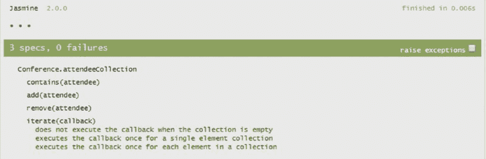

**图 5.1**

现在你有一个功能良好的 `attendeeCollection`，但你还没有完成在本节开始时给出的任务。你仍然需要实现为参会者签到的代码，并在外部系统中记录签到情况。

现在你已经有了 `attendeeCollection`，实现额外的所需功能只需编写一个回调函数来检查单个参会者的签到情况。你可以通过定义一个检查参会者签到的匿名函数，并将该匿名函数直接提供给 `attendeeCollection.iterate` 函数来实现：

```javascript
var attendees = Conference.attendeeCollection();

// 添加在 UI 中选中的参会者

attendees.iterate(function(attendee){
  attendee.checkIn();
  // 向外部服务注册签到
});
```

即使你对 `JavaScript` 的接触有限，你可能也见过很多次像上面示例这样的代码。定义一个函数并将其作为回调立即传递给另一个函数的能力，是 `JavaScript` 的一项强大特性，但它的用法也可能会偏离通往可靠性的路径。

#### 匿名回调函数的问题

首先，匿名回调函数是无法进行单元测试的；没有办法将回调函数与其被提供的函数分离来。在示例中，签到参会者的操作与 `attendeeCollection` 耦合在了一起。因此，为了正确测试集合中的参会者已签到，你必须重复已经为集合本身创建的测试，只不过你测试的是参会者已签到且签到已记录，而不是回调函数已执行。如果仅仅测试单个匿名函数回调就会导致测试套件变得 `WET`（重复冗余），那么想象一下如果多个任务都使用匿名函数完成会怎样：这将出现大量的重复。

第二，比上面提到的测试困难次要得多的一点是，匿名函数会使调试变得更加困难。因为匿名函数——根据定义——没有名称，所以调试器在调用栈中没有内容可以显示。图 5.2 是在示例中匿名函数内部设置了断点并暂停时的 Chrome 开发者工具截图。

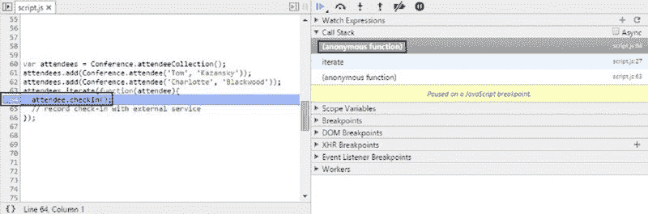

**Figure 5.2**

在断点处等待时（左侧轮廓所示），Chrome 在调用栈（右侧轮廓所示）中显示 `(anonymous function)`。当你没有函数名称可以引用，你就无法感知到函数执行的上下文。这增加了调试任务的复杂性。

如果你正在调试通过一系列匿名回调到达的代码，情况会更糟。调用栈中的每个 `(anonymous function)` 条目都代表一个你必须调查的谜团，以便获取问题代码执行执行上下文的全景。

幸运的是，直接定义并提供作为回调的函数可以命名。虽然这并不能让它们变得更易于测试，但确实让调试体验不那么具有挑战性。这个示例与上一个相同，区别在于为回调函数提供了一个名称 `doCheckIn`：

```javascript
var attendees = Conference.attendeeCollection();

// 添加在 UI 中选中的参会者

attendees.iterate(function doCheckIn(attendee){
  attendee.checkIn();
  // 向外部服务记录签到
});
```

现在，Chrome 开发者工具在调用栈中有了内容可以列出（如图 5.3 轮廓所示），为你（或其他开发者）提供了上下文，使调试变得稍微容易。


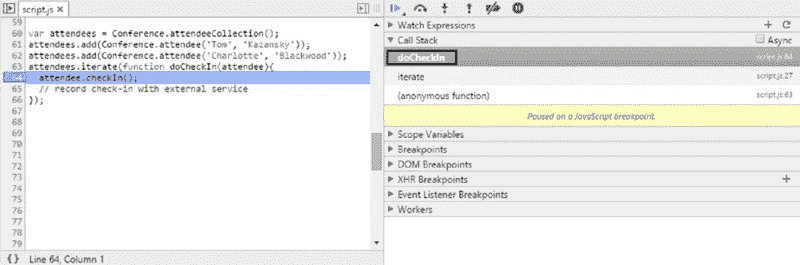

**图 5.3**

如果直接定义并提供作为回调的匿名（以及命名的）函数会导致难以测试的代码，那么什么是更好——可测试的方法来实现检查参会者签到的回调函数呢？

我们建议参会者的签到是一项重要的责任，应该被封装在它自己的模块中，命名为`checkInService`。这样做提供了一个可测试的单元，还通过将参会者签到操作与`attendeeCollection`解耦促进了代码复用。

此外，正如第 3 章“使用模块模式”节所示，依赖项可以注入到`checkInService`中。将向外部系统注册签到考虑为一个独立的责任是合理的，因此将具有注册责任的对象注入到`checkInService`是合适的。该对象是`checkInRecorder`的实例，这是你稍后将开发的一个模块。（参见第 6 章。）

列表 5-4 提供了一个执行`checkInService.checkIn`函数基本功能的测试套件。

将签到和签到记录功能提取到独立的、解耦的模块中，可以为`checkInService.checkIn`产生简洁简单的单元测试。

`checkInService`的实现同样简单，如列表 5-5 所示。

整个测试套件现在全部通过，如图 5.4 所示。

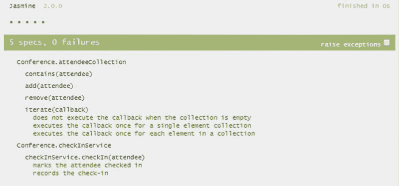

**图 5.4**

最后，下面的代码显示了如何使用回调模式将三个独立、经过测试且可靠的模块结合在一起，完成会议参会者签到任务。

```javascript
var checkInService = Conference.checkInService(Conference.checkInRecorder()),
    attendees = Conference.attendeeCollection();

// 将 UI 中选择的参会者添加到参会者集合

attendees.iterate(checkInService.checkIn);
```

## 避免问题

前一节说明了如何使用回调模式创建灵活、可测试的代码。在此过程中，你看到了匿名回调函数如何防止你的代码解耦、易于测试，从而变得可靠。

不幸的是，使用匿名函数并不是导致回调模式实现实现的唯一方法。本节引入了另外两种可能导致不可靠代码的情况：“回调箭头”和意外的`this`值。本节还涵盖了避免此类问题的方法。

### 展平回调箭头

“回调箭头”是匿名函数作为回调的一种特定极端情况。粗略检查列表 5-6 就能看出回调箭头是如何命名的。

回调函数相互嵌套，层层嵌套，形成了一个从左侧边距指向右侧的空白箭头。

列表 5-6 中的代码难以阅读、难以修改且几乎无法进行单元测试。它是拼写错误、括号不匹配和逻辑错误的磁铁，这些逻辑错误会像在大型对撞撞机中一样相互碰撞，引发不可靠的级联反应，需要博士级别的团队才能解决。

如果你有像列表 5-6 那样的代码，也并非无解。通过将匿名函数提取为独立的命名的函数，情况会变得不那么糟糕。列表 5-7 显示了重构代码的一种方法。

执行`CallbackArrow.rootFunction`的结果在列表 5-6 和 5-7 中是相同的；列表代码在功能上是等价。虽然列表 5-6 的示例代码看起来整洁，但使用嵌套回调的生产代码将包含更多逻辑，使得视觉上的箭头不再明显。与类似于列表 5-6 的编写方式相比，你会更喜欢展平后的呈现方式。

更大的益处是，列表 5-7 中的代码是完全可单元测试的；列表 5-6 中嵌套匿名回调函数中的所有功能都已提取为`CallbackArrow`的函数属性，可以对其单独进行单元测试。此外，由于每个回调函数都是命名的，你在调试工具的堆栈跟踪中不会看到`(anonymous function)`。

在回调函数中引用`this`变量时必须特别小心；它的值可能与你预期的不符。

你为 JavaScript 会议网站的下一个任务可能是编写一个模块，用于统计`attendeeCollection`中已签到的`attendee`对象的数量。它的结构将与`checkInService`类似；它将暴露一个可以提供给`attendeeCollection.iterate`的函数。`checkedInAttendeeCounter`的单元测试如列表 5-8 所示。

`Conference.checkedInAttendeeCounter`的实现如列表 5-9 所示。

该实现没有任何意外，并且允许单元测试通过，如图 5.5 所示。

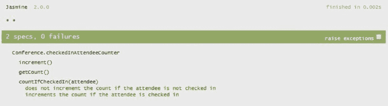

**图 5.5**

但注意，`countIfCheckedIn`使用`this`来引用`checkedInAttendeeCounter`的实例。单元测试表明一切正常，但真的如此吗？`checkedInAttendeeCounter`能与`attendeeCollection`的实例一起使用吗？执行以下代码将提供答案：

```javascript
var checkInService = Conference.checkInService(Conference.checkInRecorder()),
    attendees = Conference.attendeeCollection();
    counter = Conference.checkedInAttendeeCounter();

// 将 UI 中选中的观众添加到观众集合
attendees.add(Conference.attendee('Pete', 'Mitchell'));
attendees.add(Conference.attendee('Nick', 'Bradshaw'));

// 检查并签到观众
attendees.iterate(checkInService.checkIn);

// 统计已签到的观众
attendees.iterate(counter.countIfCheckedIn);

console.log(counter.getCount()); // 0 (!?!?)
```

添加的两个观众都应该已经签到，而且它们也应该被计入数量；我们的单元测试证明所有相关的模块都按设计工作，但（至少）其中一个没有正常工作。否则，计数结果应该是 2 而不是 0。图 5.6 显示了执行该示例时向控制台写入的内容。

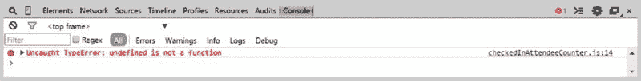

**图 5.6**

错误表明`checkedInAttendeeCounter`内部的一个函数未定义。通过调试器进一步检查发现，当被`attendeeCollection.iterator`调用时，`checkedInAttendeeCounter`中的`this`实际上指向全局`window`对象，而不是预期的`checkedInAttendeeCounter`。

`this`的值通常是调用函数的对象（最常见的是“点出”函数的对象）。然而，当你指定一个回调函数时，你无法直接控制它将是哪个对象。出于这个原因，许多回调函数的设计允许你显式指定`this`。

`attendeeCollection.iterate`使用的`forEach`函数允许通过提供第二个参数来显式指定`this`：即回调函数内部`this`应该引用的对象。由于你是`attendeeCollection.iterate`的作者，解决问题的一种方法是更新`attendeeColleciton.iterate`，使其也接受作为第二个参数的`this`应引用的对象，并将其传递给`forEach`。这样做允许`this`绑定到`countIfCheckedIn`函数预期的`checkedInAttendeeCounter`实例上。

然而，假设`attendeeCollection`是第三方库的一部分，你无法修改它。在回调函数中可能可靠地引用当前对象实例吗？坦率地说，答案是肯。

首先，你应该创建一个单元测试，重现`checkedInAttendeeCounter.countIfCheckedIn`被调用且`this`引用`checkedInAttendeeCounter`实例之外对象的情况，如列表 5-10 所示。

图 5.7 证明了新的单元测试准确地重现了场景。

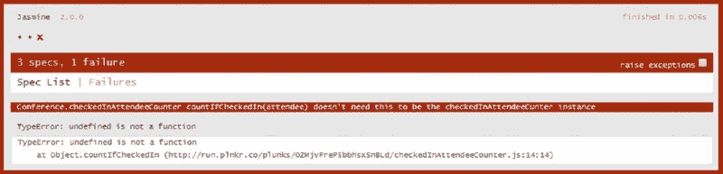

**图 5.7**

修改`Conference.checkedInAttendeeCounter`，通过名为`self`的变量保留对自身的引用，并在`countIfCheckedIn`中引用`self`而不是`this`，以确保`getCount`函数可用。列表 5-11 显示了`Conference.checkedInAttendeeCounter`的新实现，图 5.8 显示了这种新实现允许所有单元测试通过。

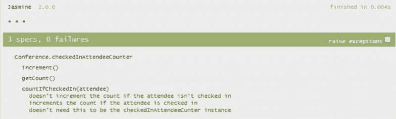

**图 5.8**

## 总结

在本章中，你学习了如何以测试优先的方式实现回调模式（Callback Pattern）。你学习了如何为多个回调函数编写测试并实现它们，并学会了`this`并不总是人们所想的那样。此外，你还看到了匿名回调函数的特点。

# 第 6 章：确保 Promise 模式的正确使用

## 本章内容

- 使用和测试 Promises
- 理解 Promise 的状态和命运
- 构建 Promises
- 测试封装了 Promise 的 XMLHttpRequest
- Promise 链式
- 关于 jQuery promises 的注意事项

## WROX.COM 本章下载

本章的`wrox.com`代码下载可以在[`www.wrox.com/go/reliablejavascript`](http://www.wrox.com/go/reliablejavascript)的下载标签找到。代码位于第 6 章，并根据本章单独命名。

## 通过单元测试理解 Promise

`Promise`是一个封装了异步操作及其最终结果处理方式的对象。当操作完成时，`Promise`封装的回调将被调用。实际上，可以有两个回调：一个用于成功，一个用于失败。（第一个回调并不一定代表成功，但这是典型的起始点。）

让我们看看它在实践中是如何工作的。

### 使用 Promise

第 5 章的示例包含一个名为`checkInRecorder`的对象，它拥有一个`recordCheckIn` own。然而，在单元测试中，使用 Jasmine spy 代替`recordCheckIn`。对 spy 的唯一预期是它被调用了。考虑第 5 章列表 5-4 中的以下内容：

```javascript
expect(checkInRecorder.recordCheckIn).toHaveBeenCalledWith(attendee);
```

如果你想要更多功能——也许是一些错误处理，或者在成功后进行进一步的处理呢？你可以想象`checkInRecorder`的典型实现会发送一个`XMLHttpRequest`来让服务器记录签到。`CheckInRecorder`会监听与该请求关联的`onreadystatechange`事件，根据成功或失败采取相应的行动，并可能向*它的*调用者（`checkInService`）提供一个事件。将所有这些都连接起来可能会非常繁琐，并导致代码变得有些杂乱无章。如果能像示例列表 6-1 中那样操作，那不是很好吗？

当然，这里的想法是`recordCheckIn`异步执行它的工作，并在*当*它完成时（注意对`then`的调用），调用成功或失败的回调函数。在这种情况下，回调函数是`attendee`对象中的函数。你可以根据它们的名称推出它们的作用；细微的细节包含在本章的下载资源中。

为了让这一切能够正常工作，`recordCheckIn`必须返回一个带有`then`方法的对象，该方法接受两个参数：一个成功时调用的函数和一个失败时调用的函数。这恰好就是一个`Promise`的核心。

列表 6-2 以单元测试的形式表达了这些要求。它是列表 5-4 的微调版本，增加了一个额外的测试。

第二个`beforeEach`为`checkInRecorder.recordCheckIn`设置了一个间谍器（spy），使其返回一个`Promise`。在这种情况下，这是一个*已完成*（fulfilled）的`Promise`。起初令人困惑的是，创建已完成`Promise`的方法不是`Promise.fulfill`，而是`Promise.resolve`。你将在本章后面的部分看到原因。

由于`Promise`是已完成的（resolved），它导致了`then`方法的第一个回调被调用。回调获取了`Promise`内部成功处理的结果——在本例中为`checkInNumber`。创建一个已经完成状态的`Promise`显然是一个捷径；你将在下一节中看到如何创建更真实的`Promise`。

现在，你可能预期会发生以下情况：

1. 在单元测试中调用了`checkInService.checkIn`。
2. 该方法涉及对`recorder.recordCheckIn`的调用（参见列表 6-1）。
3. 对`recordCheckIn`的间谍器将使其返回一个值为`checkInNumber`的已解析`Promise`。
4. `recordCheckIn(attendee).then`的成功回调将被后续执行（再次参见列表 6-1）。
5. 该成功回调`attendee.setCheckInNumber`接收`checkInNumber`作为参数。
6. 因此，单元测试末尾的预期被满足了！

序列中的每一步都是正确的，但图 6.1 显示了发生了什么。


**图 6.1**

错误信息表明，在执行预期时，`checkInNumber`尚未被设置。可能出了什么问题？一旦你了解以下两点，一切都会变得明朗：

- `Promise`是异步的。
- JavaScript 是单线程的，通过事件循环来模拟多线程。

这些事实意味着，在 JavaScript 事件循环的下一次迭代之前，控制权不会进入`Promise.then`方法的成功回调。（参见第一章中的*JavaScript 是单线程的*。）单元测试在完成之前是不会放弃它的执行机会——也就是说，直到预期已经陈述完毕。等到`Promise`解析时，已经太晚了！

你可以通过下载本章的代码并设置一些断点来证明这一点。在`checkInService_01.js`和`checkInService_01_tests.js`中设置断点并运行`checkInService_01.html`，你会看到代码按以下顺序执行：

1. 单元测试的第一行：

   ```javascript
   checkInService.checkIn(attendee);
   ```

2. 间谍器返回的`Promise`：

   ```javascript
   Promise.resolve(checkInNumber);
   ```

3. 单元测试第二行的预期：

   ```javascript
   expect(attendee.getCheckInNumber()).toBe(checkInNumber);
   ```

4. `attendee.js`中的成功回调（太晚了！）：

   ```javascript
   setCheckInNumber: function(number) {
        checkInNumber = number;
        }
   ```

那么，你如何通过单元测试确保基于`Promise`的代码的可靠性呢？关键在于在`Promise`被“跟踪”完成之前，不要检查代码的结果。这涉及到两件事。

首先，你会修改`checkInService.checkIn`使其返回`then`调用的值。恰好这是一个`Promise`！记得`then`有两个回调。如果你进入了解析/成功回调，你可能想返回一个已解析的`Promise`；如果你进入了拒绝/失败回调，则返回一个被拒绝的`Promise`。你可以通过让`checkIn`函数直接构造并返回一个`Promise`来实现（你很快就会看到如何这样做），但在经过研究后，你发现有一个捷径，如列表 6-3 所示：你可以让`then`返回一个类似`Promise`的对象（基本上带有`then`的对象），它会返回`then`。

其次，你让单元测试在`Promise`*就绪*（settled，即已解析或拒绝）之前不发布它的预期。你通过在`then`中执行预期来实现这一点，如列表 6-4 所示。由于`Promise`可能解析可能被拒绝，在测试中编写两个分支是好主意。拒绝分支有一个看起来奇怪的预期：

```javascript
expect('This branch was executed').toBe(false);
```

截至目前，Jasmine 还没有更好的方法来强制让异步代码失败。一位进取的人为 Jasmine 添加了一个显式的`fail`函数（[`github.com/pivotal/jasmine/commit/b13405c7c5e1a071ea435ed0f6db9`](https://github.com/pivotal/jasmine/commit/%20b13405c7c5e1a071ea435ed0f6db9)），但它还不是正式发布的一部分。你可能注意到了其他：在解析和拒绝分支中对`done()`的调用。这就是 Jasmine 如何支持异步代码测试。你可以看到`done`是列表 6-4 第一行的参数。它只是你给参数起的名字，你可以给它起任何名字，但在所有异步处理完成后，你必须调用它。如果你不，Jasmine 将发出超时失败。

如果你完全省略了`done()`机制（参数和两次调用），Jasmine 将在异步工作完成之前让测试结束。你的测试看起来通过了，但仅仅是因为没有任何解析或拒绝分支能及时执行并影响结果！这意味着，如果你从列表 6-4 中删除所有`done`的痕迹，第一个预期可以是任何内容，而测试都会通过！这强调了在编写让测试成功的代码之前，编写会失败的单元测试的重要性。


```javascript
describe('when checkInRecorder fails', function() {
  var recorderError = 'Check-in recording failed!';
  beforeEach(function() {
    spyOn(checkInRecorder,'recordCheckIn').and.returnValue(
      Promise.reject(new Error(recorderError)));
    spyOn(attendee,'undoCheckIn');
  });

  it("returns a Promise rejected with the expected reason", function(done){
    checkInService.checkIn(attendee).then(
      function promiseResolved() {
        expect('This success function to execute').toBe(false);
        done();
      },
      function promiseRejected(reason) {
        expect(reason.message).toBe(recorderError);
        done();
      });
  });
});
```

### 构建和返回 `Promise`

到目前为止，代码对 `checkInRecorder.recordCheckIn` 进行了间接监听（spy on），并使用 `Promise.resolve` 伪造了它的返回值。一个真实的 `checkInRecorder` 将会发送 HTTP 请求，很可能是通过一个 `XMLHttpRequest` 对象实现的。HTTP 请求是你将最常用的异步操作之一，将它们封装在 `Promise` 中是非常自然的做法。（事实上，一些有远见的架构师已经这样做了。例如查看 AngularJS 的 `$http` 对象。）

恰好是，你在编写 JavaScript 会议网站时，你的下一项工作就是实现 `checkInRecorder`。你对 `Promise` 充满热情，渴望实验如何用 `Promise` 封装 `XMLHttpRequest`，但你也是一个经验丰富的开发者，深知小步快进的智慧。你决定先确保自己对如何构建 `Promise` 有坚实的理解，然后再添加真实的 HTTP 请求。

利用你已有的知识，你在列表 6-5 中编写了单元测试。

现在是时候实现 `checkInRecorder` 以让测试通过了。列表 6-6 就是结果。

你做对了好几件事。

首先，你向单元测试暴露了消息，以便你可以在期望断言（expectation）中验证确切的消息。更符合本章主题的是，你正确地构建了一个 `Promise`：

- 它是通过 `new` 构建的。
- 它的构造函数的参数是一个函数，该函数本身有两个参数。你可以随意地给它们命名，但 `resolve` 和 `reject` 传达了它们的意图。
- 要用值填充 `Promise`，你调用 `resolve` 并传入该值。
- 要拒绝 `Promise`，你调用 `reject` 并传入原因。按照惯例，原因是一个 `Error` 对象，这样如果你需要，它就能提供堆栈跟踪（stack trace）的处。
- 你记得使用 `done()`。

有了这些经验，你可以想象如何通过直接构建 `Promise` 来编写 `checkInService.checkIn`，而不是在回调中返回 `Promise.resolve` 和 `Promise.reject`：

```javascript
checkIn: function(attendee){
    return new Promise( function checkInPromise(resolve, reject) {
      attendee.checkIn();
      recorder.recordCheckIn(attendee).then(
        function onRecordCheckInSucceeded(checkInNumber) {
          attendee.setCheckInNumber(checkInNumber);
          resolve(checkInNumber);
        },
        function onRecordCheckInFailed(reason) {
          attendee.undoCheckIn();
          reject(reason);
        });
    });
  }
```

### 测试 `XMLHttpRequest`

完成那个初步实现后，你准备好在 `recordCheckIn` 中放入真实的 `XMLHttpRequest` 了。

你在网络上搜索如何在 Jasmine 中测试 `XMLHttpRequest` 的方法，很快在 GitHub 上发现了 `jasmine-ajax`（[`github.com/pivotal/jasmine-ajax`](https://github.com/pivotal/jasmine-ajax)）。按照上面的说明将 `mock-ajax.js` 引入你的项目后，你详细阐述了早的测试。列表 6-7 显示了结果，并突出了新的点子。（带星号注释的原因稍后会清楚。）

当然，在向 `checkInRecorder` 放入 `XMLHttpRequest` 之前，你处处遇到失败，正如列表 6-8 所示。

当你的同事 Charlotte 听到你因单元测试通过而欢呼叫喊时，她立刻冲了过来。她好奇你是怎么做到的。你向她解释，热心地指着列表 6-7 和 6-8。注释中带星号的数字对应于你解释的步骤。

1. “从列表 6-7 开始，我在 `beforeEach` 中安装了 Jasmine 的 Ajax 模拟器，并为了安全起见在 `afterEach` 中将其移除，”你对 Charlotte 说，“那么在每个测试运行期间，Jasmine 将拦截所有的 `XMLHttpRequest`，导致它们表现出我指定的任何行为。”
2. “以第一个测试为例，我执行了 `recordCheckIn` 并在 `then` 方法中带有期望，就像以前一样。`then` 的两个分支都还没有执行，再次是因为 `Promise` 是异步的，测试还没有完成它在事件循环中的轮次。”
3. “然而，移动列表 6-8，`checkInRecorder` 中传递给 `Promise` 构造函数的函数确实执行了，尽管得益于 Jasmine 的模拟，它使用的是 `FakeXMLHttpRequest`。”
4. “回到列表 6-7，调用 `recordCheckIn` 后，我通过调用 `jasmine.Ajax.requests.mostRecent()` 获取通过 `FakeXMLHttpRequest` 发出的请求。”
5. “然后我就可以验证它是用正确的 URL 被调用的。”
6. “现在我通过调用 `request.response` 来触发响应。”
7. “这导致 `Promise` 在当前事件循环内解析，测试不再是异步的。”
8. “事实上，因为 `request.response()` 让 `Promise` 解析，不再需要 `done()`。”
9. “这就是为什么我确保在测试中验证了真实的 `checkInNumber`，”你回答道。
10. “不过，”你对 Charlotte 露出自信的微笑，“这样做也没有坏。”

### 链式 `Promise`

Charlotte 学习很快，在你喋喋不休时，她就能看出代码。这让她有充足的时间去考虑显示在第二个显示器上的列表 6-3。

“这样写代码，”Charlotte 继续说道，“你可以一个接一个地链 `then`，每个 `then` 的解析回调只有在上一个成功时才会执行。像这样：

```javascript
checkInService.checkIn(attendee)
  .then(
    function onCheckInResolved(checkInNumber) {
      // 打印证书并返回它的号码
      return badgePrintingService.print(checkInNumber);
    })
  .then(
    function onBadgePrintResolved(badgeNumber) {
      return doorEnteringService.enter(attendee, badgeNumber);
    });
```

“我想可以，”你回答道，“但是，你可能每个阶段都需要第二个（拒绝）回调。”

“此外，单元测试可能需要设置 `XMLHttpRequest` 对象。我在这里 [[`jasmine.github.io/2.0/ajax.html`](http://jasmine.github.io/2.0/ajax.html)] 看到你可以提前使用 `jasmine.Ajax.stubRequest` 来这样做，而不是调用 `request.response`。”

“当然，当然，”Charlotte 说，但她已经在考虑可能的错误了，“你知道，如果你在任何阶段忘记了 `return` 关键字——比如 `badgePrintingService.print` 那一行——在下一个阶段你会得到（在这种情况下）`undefined` 的 `badgeNumber`。我打赌这是一个很常见的错误。”

难得能比 Charlotte 领先一步，你回答道：“是的。这就是为什么我确保在测试中验证了真实的 `checkInNumber`。”

“事实在单元测试中操作 `Promise` 比你想象的要困难得多，”Charlotte 说道。“你的代码其实挺简单的[她为什么总是说那类的话？]，但当你需要让一个 `Promise` 解析成功（resolve）时，你就会陷入困扰——我不是说创建一个已经处于解析状态的 `Promise`；你已经做过那个[参见列表 6-2]；我的意思是解析或拒绝（reject）一个已经存在的 `Promise`。如果你看一眼 `Promise` 的 API（[[`https://developer.mozilla.org/en-US/docs/Web/JavaScript/Reference/Global_Objects/Promise`](https://developer.mozilla.org/en-US/docs/Web/JavaScript/Reference/Global_Objects/Promise)]]），你会发现根本没有办法实现它！”

“我之前没注意到，”你承认道，“但现在我看到 `Promise` 原型上唯一的方法只有 `then` 和 `catch`。”

“没错，”她继续说道，“但一些非常聪明的人[你可试着不要被冒犯。]创建了包装器，通常被称为类似于 `Deferred` 的东西，它们依赖注入一个类似于 `Promise` 的对象，这个对象可以是一个真实的 `Promise`，或者在单元测试时是一个伪造的 `Promise`。

“例如，使用 AngularJS（[[`https://docs.angularjs.org/api/ng/service/$q`](https://docs.angularjs.org/api/ng/service/$q)]]）你可以这样操作。[`$q` 是 Angular 1.3 对一个名为 Q 的 `Promise` 库的实现 [[`https://github.com/kriskowal/q`](https://github.com/kriskowal/q)]]。”

```javascript
var deferred = $q.defer();       // 创建一个“deferred”对象
var promise = deferred.promise;  // 它有一个 promise 属性。……
deferred.resolve(1234);          // 用值 1234 解析 promise
```

“AngularJS 2.0 将对此进行某种重构，”Charlotte 总结道。（参阅 Angular 2.0 中的 Promises，地址为：[`https://docs.google.com/document/d/1ksBjyCgwuiEUGn9h2NYQGtmQkP5N9HbehMBgaxMtwfs/edit`](https://docs.google.com/document/d/1ksBjyCgwuiEUGn9h2NYQGtmQkP5N9HbehMBgaxMtwfs/edit)。）

## 理解状态与宿命

“在操作 `Promise` 时，无论是真实的还是通过 `Deferred` 伪造的，你必须理解解析（resolving）一个 `Promise` 与完成（fulfilling）它之间的区别，”Charlotte 继续说道。

“用于创建 `Promise` 的函数，解析一个 `Promise` 与完成它的区别，”Charlotte 说道。“当你需要时，你就会陷入困扰——我不是说创建一个已经处于解析状态的 `Promise`；你已经做过那个[参见列表 6-2]；我的意思是解析或拒绝（reject）一个已经存在的 `Promise`。如果你看一眼 `Promise` 的 API（[[`https://developer.mozilla.org/en-US/docs/Web/JavaScript/Reference/Global_Objects/Promise`](https://developer.mozilla.org/en-US/docs/Web/JavaScript/Reference/Global_Objects/Promise)]]），你会发现根本没有办法实现它！”

“我之前没注意到，”你承认道，“但现在我看到 `Promise` 原型上唯一的方法只有 `then` 和 `catch`。”

“没错，”她继续说道，“但一些非常聪明的人[你可试着不要被冒犯。]创建了包装器，通常被称为类似于 `Deferred` 的东西，它们依赖注入一个类似于 `Promise` 的对象，这个对象可以是一个真实的 `Promise`，或者在单元测试时是一个伪造的 `Promise`。

“例如，使用 AngularJS（[[`https://docs.angularjs.org/api/ng/service/$q`](https://docs.angularjs.org/api/ng/service/$q)]]）你可以这样操作。[`$q` 是 Angular 1.3 对一个名为 Q 的 `Promise` 库的实现 [[`https://github.com/kriskowal/q`](https://github.com/kriskowal/q)]]。”

```javascript
var deferred = $q.defer();       // 创建一个“deferred”对象
var promise = deferred.promise;  // 它有一个 promise 属性。……
deferred.resolve(1234);          // 用值 1234 解析 promise
```

“AngularJS 2.0 将对此进行某种重构，”Charlotte 总结道。（参阅 Angular 2.0 中的 Promises，地址为：[`https://docs.google.com/document/d/1ksBjyCgwuiEUGn9h2NYQGtmQkP5N9HbehMBgaxMtwfs/edit`](https://docs.google.com/document/d/1ksBjyCgwuiEUGn9h2NYQGtmQkP5N9HbehMBgaxMtwfs/edit)。）

## 理解状态与宿命

“在操作 `Promise` 时，无论是真实的还是通过 `Deferred` 伪造的，你必须理解解析（resolving）一个 `Promise` 与完成（fulfilling）它之间的区别，”Charlotte 继续说道。

“用于创建 `Promise` 的函数，解析一个 `Promise` 与完成它的区别，”Charlotte 说道。“当你需要时，你就会陷入困扰——我不是说创建一个已经处于解析状态的 `Promise`；你已经做过那个[参见列表 6-2]；我的意思是解析或拒绝（reject）一个已经存在的 `Promise`。如果你看一眼 `Promise` 的 API（[[`https://developer.mozilla.org/en-US/docs/Web/JavaScript/Reference/Global_Objects/Promise`](https://developer.mozilla.org/en-US/docs/Web/JavaScript/Reference/Global_Objects/Promise)]]），你会发现根本没有办法实现它！”

为了让 Charlotte 的工作更轻松，你决定通过一个函数扩展 API，这个函数完全符合你的需求：`getRestaurantsNearConference(cuisine)`。

“扩展 API。嗯…… . . ” 这句话勾起了你对曾经读过的关于面向切编程的记忆。你决定使用 `AOP` 来向 `restaurantApi` 函数返回的 API 中添加这个新函数。

“主意——唯一的想法是，”你对自己说，“就是 `getRestaurantsNearConference(cuisine)` 应该返回 `getRestaurantsWithinRadius(address, radius, cuisine)` 返回的所有内容，只不过固定了我的地址和半径参数。因为这是唯一的想法，所以我的单元测试可以写得简单得不可思议。”

你在清单 7-2 中拼凑写了单元测试。

你满意地注意到，你的测试没有对原始函数返回的数据类型做出任何假设。正如你在第 6 章中看到的，对基于 `Promise` 的代码进行单元测试可能是很棘手的。但在这里，你完全不需要担心这个问题。


事实上，由于你的间谍对象（`spy`）导致 `getRestaurantsWithinRadius` 返回了一个特定的对象（而且还是一个很奇特的对象），你可以验证该特定对象是否被原封不动地返回了。你不希望你的切面（`aspect`）通过任何其他手段获取值，因为那超出了切面的单一职责范围。这是那种“幸福的时刻”之一：一个更容易编写的测试同时也更加健壮。

你花了一点时间回味这个想法，然后就准备好处理切面本身了。

## 创建用于部分函数应用的切面

你想向 API 中添加一个类似下面的函数，它封装了原始函数，并对其某些参数应用固定值：

```
function getRestaurantsNearConference(cuisine) {
  return api.getRestaurantsWithinRadius(
    '415 Summer St, Boston, MA 02210', 2.0, cuisine);
}
```

在回顾了第 2 章的内容后，你编写了清单 7-3 中的代码。

万在极少数的情况下，API 的作者以后添加了他们 `getRestaurantsNearConference` 函数，赋值给 `api.getRestaurantsNearConference` 时使用的 `||` 技巧将确保你的函数不会替换掉它。根据设计，你的单元测试将会失败，从而通知你 API 发生了变化。

但目前，测试通过了，如图 7.1 所示。


**图 7.1**

你提交了代码，并决定奖励自己去冲上网以学习更多知识。

## 区分部分函数应用与柯里化

你很快发现有一个与部分函数应用密切相关的概念，被称为柯里化（`currying`）。事实上事实上，它们的关系如此紧密，以至于经常混为一谈。

### 柯里化

柯里化是将一个接受多个参数的函数分解为若干个各接受一个参数的函数。结果是，你不再这样做：

```
getRestaurantsWithinRadius(address, radius, cuisine)
```

而是可以这样做：

```
getRestaurantsCurried(address)(radius)(cuisine)
```

第一次调用 `getRestaurantsCurried(address)` 返回一个接受 `radius` 参数的函数，该函数再返回另一个函数，这次接受一个 `cuisine` 参数。嵌套最深处的函数最终具备了给出答案的能力。

什么样的魔术让这一切成为可能？最简单、最具体的形态是这样的：

```
function getRestaurantsCurried(address) {
  var self = this;
  return function(radius) {
    return function(cuisine) {
      return self.getRestaurantsWithinRadius(address, radius, cuisine);
    }
  }
}
```

互联网上充斥着更抽象的形式，但上述内容最能传达出柯里化的精髓。（你还会注意到，那些大量的 `curry` 实现无非只是对一个或多个参数的部分函数应用——而不是什么可以让你在*任何函数*上挥动*一次*就能将其转换为函数序列的魔棒，其中每个函数都返回一个函数（最后一个除外，它足够聪明，知道自己可以返回答案了））

一些编程语言让柯里函数成为一种生活方式：在 `Haskell` 和 `ML` 中，*所有*函数都只接受一个参数。这随后产生了一些超出本书涵盖范围的特定模式和可能性，例如 lambda 演算法的研究（[`http://plato.stanford.edu/entries/lambda-calculus/`](http://plato.stanford.edu/entries/lambda-calculus/)）。

### 部分函数应用

部分函数应用初看之下像柯里化，因为它都包含将一个接受多个参数的函数转换为接受较少参数的函数。实际上，它几乎是反的，如下面的 `getRestaurantsNearConference` 实现所示。它从之前创建的柯里化部分*向上构建*成一个在功能上与章节早期部分函数应用版本完全相同的函数。

```
function getRestaurantsNearConference(cuisine) {
  return getRestaurantsCurried
    ('415 Summer St, Boston, MA 02210')(2.0)(cuisine);
}
```

## 总结

如果你有代码调用函数时某些参数永远不变，请考虑创建一个封装了这种常量性的新函数。这就是部分函数应用的技术。

新函数的单元测试是正确且 DRY（不重复原则）的地方，可以验证你是否使用了你预期的常量。幸运的是，单元测试不需要（也不应该）对返回类型做出任何假设。

部分函数应用经常与柯里化混淆。真正的柯里化并不部分地应用参数。相反，它将多参数函数分解为一系列接受单个参数的步骤。

随着底线再次看起来万无一失，会议组织者指示你立即开始编写面层（`faç`）。

Charlotte 描述且你必须实现的模式是 `Memoization Pattern`（记忆化模式）。记忆化在函数每次被调用时保存其结果，通常存储在一个以提供给函数的参数为键（`key`）的结构中。然后，当使用之前见过的参数调用函数时，将立即查找并返回保存的值；而无需执行函数体中的逻辑。

对于那些执行时间耗时或资源密集型计算的函数的重复调用情况，检索保存的值的成本将远低于重复整个操作。

从模式来看，`Memoization Pattern` 是一个非常简单的模式；只需几行代码即可实现。它的简单性让许多开发者陷入了自满：这里复制一份，那里粘贴一份，哒哒，另一个记忆化函数诞生了……但也产生了重复代码！

本章将介绍如何实现和测试 `Memoization Pattern`。此外，你将学习如何使用 AOP（面向切面编程）应用该模式，从而保持代码的 DRY（不要重复）。

## 通过单元测试理解模式

正如 Charlotte 所指出的，在会议期间，提供特定菜系的餐厅列表不太可能改变。在部署在会场的自助终端机浏览器中保留 API 请求的结果，对于整个浏览器会话期间（很可能是整个会议期间）来说不是问题。因此，在简单的对象中对结果进行记忆化就足够。

由于你正在练习测试驱动开发，实现 `memoizedRestaurantApi` 面层的第一步是编写一些单元测试。为了减少 Charlotte 对 UI 需要进行的更改数量，你决定面层将暴露与她在切面增强的第三方 API 中使用的相同的函数：`getRestaurantsNearConference`。

就像你实现单元测试以扩展第三方 API 并添加 `getRestaurantsNearConference` 方法一样，你不需要担心 API 实际返回的对象的类型。再次，你能够避免将测试使用 promises 的异步代码的细节混杂在你的单元测试中。

`memoizedRestaurantApi` 的单元测试出现在代码清单 8-1 中。

这些测试验证了由记忆化添加的基本功能：

*   当对同一菜系向 `getRestaurantsNearConference` 函数进行多次请求时，第三方 API 仅被查询一次。

*   对 `getRestaurantsNearConference` 的后续调用返回与第三方 API 返回相同的餐厅。

在确认你的测试规定了正确的功能后，你在代码清单 8-2 中创建了实现。

正如本章早期提到的，实现记忆化并不需要大量的精力（或代码）。

首先，在创建 `memoizedRestaurantApi` 时，通过 `cache = {};` 初始化一个空缓存对象。

当执行 `getRestaurantsNearConference` 时，不会立即向第三方 API 发请求，而是执行以下内容：

```
if(cache.hasOwnProperty(cuisine)){
  return cache[cuisine];
}
```

上一个代码段中的代码查询缓存，查看是否存在与正在寻找的 `cuisine` 对应的键。如果是，则立即返回之前缓存的 promise。

如果缓存中没有 `cuisine` 条目，则向第三方 API 发请求，通过 `cache[cuisine] = returnedPromise;` 将返回的 promise 添加到缓存中，然后将 promise 返回给调用者。

图 8.1 显示 `memoizedRestaurantApi` 的新实现允许代码清单 8-1 中的所有单元测试通过。

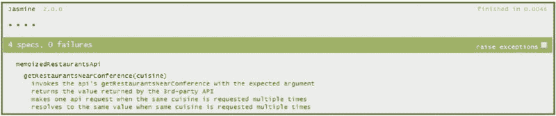

图 8.1

问题已经解决：`getRestaurantsNearConference` 函数已经应用了记忆化，对 API 的调用次数已经减少。

Charlotte 虽然很感激可以直接将 `memoizedRestaurantApi` 掉在她使用第三方 `restaurantApi` 的地方，但她对你有一个建议。

“你不能用一个切面来扩展 `restaurantApi` 并添加记忆化吗？就像你扩展它以包含 `getRestaurantsNearConference` 的方式一样？”

“当然可以，”你回答道，脸微微泛红。“这将消除对 `memoizedRestaurantApi` 的需求，并提供一个可以应用到其他地方的通用记忆化面。”

## 使用 AOP 添加记忆化

虽然没有点名，但我们在第 2 章讨论面向切面编程作为一种创建可靠 JavaScript 的工具时，曾将 `Memoization Pattern` 作为示例。第 2 章的示例甚至涉及对 Web 服务调用结果的缓存，就像上一节介绍的示例一样。

第 2 章没有深入探讨创建缓存 Web 服务调用结果的切面的细节，因此本节将从这里开始。接下来，本节将涵盖将新切面应用到第三方 `restauarantApi` 上。

### 创建记忆化切面

你的新目标是从代码清单 8-2 中的 `memoizedRestaurantApi` 中提取记忆化代码，进入一个可以应用于 `restaurantApi` 或任何可能从记忆化中获益的代码的切面。

如既往一样，第一步是编写单元测试来验证切面的功能。其中已经定义了一些：它们是在代码清单 8-1 中编写的，用于验证在 `memoizedRestaurantApi` 中实现的记忆化。

`returnValueCache` 将被实现为一个定义了函数 `advice` 的模块。单元测试的 `beforeEach` 部分通过以下语句为测试函数装饰 advice：

```
Aop.around('testFunction', Aspects.returnValueCache().advice, testObject);
```

代码清单 8-3 中更有趣点之一是跟踪被装饰函数执行次数的机制。自然的选择是在 `testObject.testFunction` 上创建一个 spy（监控），然后将切面应用到被监控的函数上。一切进展顺利，直到尝试验证 spy 是否被调用。

尽管在 `testObject.testFunction` 上创建了 spy，但用切面装饰该函数本质上隐藏了 spy。正因如此，如下的断言：

```
expect(testObject.testFunction.calls.count()).toBe(1);
```

失败了，因为 `calls` 不是 `testObject.testFunction` 的属性。

为了解决这个问题，在将切面应用于函数之前，将原始监控函数的引用保存到 `spyReference`。这样，依赖于知道被装饰函数调用次数的测试可以使用 `spyReference` 创建断言，如：

```
expect(spyReference.calls.count()).toBe(1);
```

实现切面本身是非常容易的，因为你已经在 `memoizedRestaurantApi` 中做过一次了。该切面位于代码清单 8-4。

图 8.2 显示了 `returnValueCache` 切面的全绿单元测试。

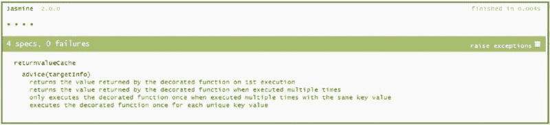

图 8.2

最后一步是用 `returnValueCache` 切面来装饰 `restaurantApi` 的适当方法。装饰 `getRestaurantsNearConference` 确实会使 Charlotte 从 UI 发出的请求被记忆化（`memoized`），但一个更通用的解决方案是将 `returnValueCache` 切面直接应用于列表 7-1 中回显的 `restaurantApi` 函数 `getRestaurantsWithinRadius` 上。这样做将使 `getRestaurantsNearConference` 被记忆化，同时让任何其他使用 `getRestaurantsWithinRadius` 的函数自动从记忆化中受益。

列表 8-5 展示了 `ThirdPartyRestaurantApiAspects.js`，该文件最初出现在列表 7-3 中，这里经过修改，以也对 `getRestaurantsWithinRadius` 函数进行记忆化。

## 总结

面对可能出现的巨额信用卡账，JavaScript 大会的组织者向你和 Charlotte 发起了挑战，要求减少第三方 `restaurantApi` 产生的费用。

第一次尝试是创建一个封装在 `restaurantApi` 外围的实现记忆化模式的外壳（`façade`），这种方法成功减少了对 `restaurantApi` 的调用，但它不可复用，且容易受到“复制粘贴式”复用的影响。

幸运的是，Charlotte 建议也可以通过用记忆化切面装饰 `restaurantApi` 来解决此问题。她说得太对了！此外，创建的记忆化切面是通用的且易于复用的。

在实现记忆化模式时，你编写的单元测试应该涵盖以下考虑点：

*   对返回值进行记忆化的函数或资源，应仅在第一次使用特定键调用记忆化函数时才被访问。

*   使用特定键对记忆化函数进行的后续调用，应返回与第一次调用相同的值。

下一章将介绍一个饱受诟誉但功能强大的模式：单例（`Singleton`）的测试、实现和使用。

# 第 9 章

## 确保单例模式的正确实现

### 本章内容简介

*   使用对象字面量（`object literals`）作为单例

*   使用立即执行模块（`immediate-execution modules`）实现并对单例模式进行单元测试

*   使用依赖注入为模块提供单例对象

### 本章的 WROX.COM 代码下载

本章涉及的 wrox.com 代码下载可以在 [`www.wrox.com/go/reliablejavascript`](http://www.wrox.com/go/reliablejavascript) 的“Download Code”标签页中找到。它们位于第 9 章下载中，并根据本文提到的文件名进行单独命名。

第 3 章完全用于创建对象实例，其中很大一部分描述了创建相似对象*多个实例*的模式。该章还涵盖了对象实例之间共享行为的技术，例如原型继承和函数继承。

然而，在某些情况下，创建对象的多个实例是不必要的，甚至是不可取的。在这些只需要存在且仅存在一个对象实例的情况下，可以采用单例模式。

本章将说明对象字面量如何可以被视为单例对象。它还将重温如何使用第 3 章引入的立即执行模块来创建单例对象。

如果你具有支持多线程语言（如 C# 或 Java）的经验，你可能会发现本章没有涵盖一个主题：线程安全。由于 JavaScript 是一种单线程语言，在创建可靠的 JavaScript 单例时，不需要考虑当从多个线程访问对象时产生的复杂性。

## 通过单元测试理解模式

在第 8 章中，对 `restaurantApi.getRestaurantsWithinRadius` 函数进行了记忆化，以减少 JavaScript 大会网站对第三方 API 的调用次数。记忆化功能被很好地封装在一个切面中，该切面可以应用于网站中的任何其他函数。

然而，如果创建了两个 `restaurantApi` 实例并用相同的参数调用每个对象的 `getRestaurantsWithinRadius` 函数会怎样？对第二个对象的调用是否使用第一个对象函数调用时缓存的结果？

在这个示例中，以及许多其他将记忆化应用到函数的情况下，第二个问题的*预期*答案是：“是的，它利用了第一个对象函数调用时缓存的结果。”当然，下一个问题是：“被 `returnValueCache` 装饰的函数表现确实是那样吗？”

遗憾的是，答案定的。`returnValueCache` 的实例每个都有它们自己的内部缓存对象。这意味着当创建一个 `restaurantApi` 实例并将其 `getRestaurantsWithinRadius` 函数用 `returnValueCache` 装饰时，该 `restaurantApi` 实例只能访问其自身的 `getRestaurantsWithinRadius` 之前调的结果。它不会从其他 `restaurantApi` 实例中缓存的值受益。

如果 `returnValueCache` 实例可以共享单个缓存而不是每个都拥有自己的，那就好了。如果 `returnValueCache` 具有这种能力，无论由哪个持有被调用函数的 `restaurantApi` 实例，所有 `getRestaurantsWithinRadius` 用的保存结果都可以共享。

第 2 章涵盖的依赖注入是促进 `returnValueCache` 实例之间共享缓存对象的极佳机制。修改 `returnValueCache` 模块函数以可选地接受缓存对象实例，将代码推向所需的方向移动。

### 使用对象字面量实现单例共享缓存

对象字面量是 JavaScript 中单例模式最简单的实现。与其他对象创建模式不同，它没有函数可以调用来创建另一个，也无法使用 `new` 关键字来创建更多。

`returnValueCache` 的当前实现已经使用对象字面量作为缓存，因此注入一个可选的对象字面量作为共享缓存是添加所需功能最简单的方法。


列表 9-1 所示的单元测试基于 8-3 的测试。通过将注入的缓存对象设为可选，原始测试不需要任何修改（除了适应某些测试重构的更新）。推广之，任何以当前状态使用 `returnValueCache`（不提供共享缓存）的代码都不需要更改。

正如前面提到的，对单元测试进行了细小的重构以减少重复：添加了实用方法 `createATestObject` 来封装——你猜得没错——对象的创建。

图 9-1 显示所有先前的测试都通过了，但执行共享缓存功能的新测试失败了。

列表 9-2 展示了修改后的 `returnValueCache` 接受对象字面量，图 9-2 显示所有测试均通过。

现在 `returnValueCache` 已经接受共享缓存，剩下的工作只是稍稍修改切面对 `restaurantApi.getRestaurantsWithinRadius` 的应用，正如列表 9-3（改编自 8-5）所示。虽然对象字面量在字面上是单例模式最简单的实现，但它缺乏隐藏数据以及其他对象创建模式（如模块模式）提供的其他理想特性。

在列表 9-3 中，通过声明一个对象字面量 `restaurantsWithinRadiusCache` 在 `Conference.caches` 命名空间内创建了一个共享缓存。在许多情况下，对象字面量（一个键值集合）足以用作缓存。然而，在某些情况下，功能更强大的缓存会很有用。你可能希望创建一个最少使用（LRU）缓存，它只存储固定数量的值，并用最新的值替换旧的缓存值。在其他情况下，在缓存中只保留一个固定时间的值可能是合适的。当使用对象字面量作为缓存时，这两种场景都不易实现。

你那位无所不能的同事 Charlotte 意识到更强大的缓存很有用，并提供了 `Conference.simpleCache`。这个模块提供了基于对象字面量的缓存的功能，但是通过 API 而不是直接访问属性来实现的。Charlotte 的 `Conference.simpleCache` 所示于列表 9-4。

尽管 `Conference.simpleCache` 仅仅提供了一个与对象字面量交互的 API，但 Charlotte 创建了一个接口，`returnValueCache` 可以使用该接口来提供记忆化功能。在未来，可能会创建新的缓存对象，它们暴露相同的接口但表现出不同的行为，例如 LRU 或缓存项超时。

`returnValueCache` 使用 `simpleCache` 需要进行少小的修改。如果没有提供共享缓存，则不再创建对象字面量，而是创建一个新的 `simpleCache`。此外，建议中的代码将使用 `simpleCache` API 暴露的方法，而不是直接修改缓存对象的属性。

列表 9-1 中的单元测试仅需要很小的改动以适应 `simpleCache` 的使用。列表 9-5 突出了这一变化。

更新版本的 `returnValueCache` 可以在代码示例文件 `Singleton \returnValueCache_02.js` 中找到，通过的测试结果所示图 9.3。


**图 9.3**

既然 `simpleCache` 已经创建且 `returnValueCache` 已经更新为使用它，下一步是创建一个单例缓存对象，供 `restaurantApi.getRestaurantsWithinRadius` 函数使用。

当共享缓存是对象字面量时，确保只存在一个缓存实例是简单的事情，因为对象字面量*本身就是*单例。现在由于使用模块作为缓存，情况略有不同：模块函数的每次执行都会创建一个新的对象实例。

为了确保所有 `restaurantApi` 实例都获得相同的 `simpleCache` 实例，将在列表 9-7 中利用第 3 章引入的立即执行模块创建一个单例模式实现。`RestaurantsWithinRadiusCache` 模块将暴露一个单一函数 `getInstance`，它每次被调用时都会返回同一个 `simpleCache` 实例。

列表 9-6 中的单元测试验证了 `getInstance` 的行为。

`RestaurantsWithinRadiusCache` 的实现位于列表 9-7。

在列表 9-7 中，`RestaurantsWithinRadiusCache` 被赋值为立即执行函数的返回值，从而确立为一个暴露 `getInstance` 函数的单例对象。第一次调用 `getInstance` 时，隐藏的 `instance` 变量被填充一个 `simpleCache`。后续每次调用 `getInstance` 都会返回同一个 `instance`。

通过的单元测试所示图 9.4。


**图 9.4**

最后但同样重要的是，必须更新 `returnValueCache` 切面对 `restaurantApi.getRestaurantsWithinRadius` 函数的应用，以使用新的 `RestaurantsWithinRadiusCache` 单例。这见列表 9-8。

## 总结

单例模式在 JavaScript 中被广泛使用。有助于创建命名空间，以免全局命名空间被应用程序的函数和变量污染。此外，它在模块之间共享数据（如缓存）非常出色。

JavaScript 中的单例模式实现（如对象字面量和立即执行模块）比其他语言更容易变得可靠，因为 JavaScript 是单线程的。你不需要担心单例对象会被多个线程同时访问。

在实现单例模式时，单元测试应该涵盖的主要关注点是是否存在唯一的单例实例。

下一章将介绍工厂模式，这是一种创建对象的技术，它对已经讨论过的对象创建模式提供了额外的抽象和控制。

# 第 10 章

## 确保工厂模式的正确实现

## 本章内容概览

- **对工厂进行单元测试**
- **编写可靠的工厂**

### 本章 wrox.com 代码下载

本章的 wrox.com 代码位于下载代码标签页下的 [`www.wrox.com/go/reliablejavascript`](http://www.wrox.com/go/reliablejavascript)。文件位于第 10 章下载中，并根据本章注的文件名单独命名。

在 JavaScript 中，*工厂*（factory）只是一个目的是构建并返回对象的函数。JavaScript 中工厂随处可见。ECMAScript 引入的 `Object.create` 方法是语言内置的工厂。你在这书中也遇到过许多工厂，尽管它们有其他名称。例如，*模块*（module）在技术上符合定义，因为它的目的是创建并返回一个对象，尽管代价是了一些数据隐藏。

为什么你想用工厂来创建对象而不是用 `new` 或普通函数调用呢？广义上，有两个原因：增加控制和增加抽象。在本章中，你将通过一个说明了这两种点的示例进行工作。

## 为工厂编写单元测试

你正在开发的 JavaScript 会议网站将充斥着演讲。你的下一个工作是对这些演讲进行建模。

演讲有两种：普通演讲和供应商演讲。普通演讲有标题和可选的演讲者。（有时，关于某个热门话题的演讲会在招募到志愿者之前被创建一个占位符。）供应商演讲也一样，但还有一个供应商名称以及可选的产品（表 10-1）。

| | **演讲 (PRESENTATION)** | **供应商演讲 (VENDORPRESENTATION)** |
| --- | --- | --- |
| **标题** | 必填 | 必填 |
| **演讲者** | 可选 | 可选 |
| **供应商** | | 必填 |
| **产品** | | 可选 |

**表 10.1** 表 1：演讲类型

想用 `Object.create` 方法尝试原型继承，你快速编写了列表 10-1 和 10-2 所示的类。（当然，你会先编写单元测试，正如本章的下载内容所示。）

在列表 10-2 中，原型继承通过末尾的这条语句设置：

```javascript
Conference.VendorPresentation.prototype
  = Object.create(Conference.Presentation.prototype);
```

实际的继承发生在构造函数中的这一段代码中：

```javascript
Conference.Presentation.call(this, title, presenter);
```

代码可以工作，但你注意到创建一个没有特定演讲者的 `VendorPresentation` 是多么笨拙。演讲者必须作为 `undefined` 参数传递。

```javascript
new VendorPresentation('The Title', undefined, 'The Vendor', 'The Product');
```

此外，你还预见到其他类型的演示：视频、研讨会，可能更多。每种演示将继承自 `Presentation` 对象，并且每个都有其独特的构建特性。

最后，你无处不在的同事夏洛特（Charlotte）计划以平化的形式为你的演示对象提供数据——只需一个单层对象字面量。“你的代码不能自己判断出它是哪种演示的吗？”她不耐烦地问道。

为了不让夏洛特失望，你决定创建一个 `presentationFactory`。它的 `create` 方法确实会接收一个仅包含属性包的参数，并判断该做什么。

由于对对象字面量的松散性感到紧张，并遵循了你在某处听过的总是先编写负面测试的明智建议，你从列表 10-3 中的测试开始。

准备好后，你就可以快速编写列表 10-4。`presentationFactory` 的这一步验证了参数没有意外的属性。

在处理完负面测试及其相应的代码后，是时候说明工厂实际上应该做什么了。

首先，如果传入的参数只包含基础 `Presentation` 对象的属性，那么 `create` 方法就应该返回该内容。编写一个使用此类参数并验证返回了 `Presentation` 的单元测试易如反掌，但这会留下两个关键问题未解之：

- 你如何知道正确的参数已传递给 `Presentation` 的构造函数？
- 如果它们被正确传递给了构造函数，你如何知道由此构建的对象就是返回的那一个？

关注这些细节决定了可靠的 JavaScript 与仅仅“希望”可靠的 JavaScript 之间的区别。而且这真的并不麻烦，正如列表 10-5 所示的那样。

新的测试仅仅是 `beforeEach` 中对 `factory.create` 影响的预期。预期被分离到各自的测试中，但 `beforeEach` 保持了测试的 DRY（不要重复）。

另外注意，只调用了对 `Presentation` 构造函数的间谍器（spy）。工厂的责任是调用正确的构造函数并返回结果。它不应该关心构造函数做了什么，工厂的单元测试也应该如此。

测试工厂创建基础 `Presentation` 的全部就此了。单元测试的剩余部分（见列表 10-6）涉及创建 `VendorPresentation`。

最后三个测试与你为基础 `Presentation` 看到的非常相似，但第一个测试值得注意。它验证了：如果你包含了*任何*一个让它“看起来像”你想要的 `VendorPresentation` 的参数，那么工厂将尝试只给你那一个。它通过遍历*所有*可能的与供应商相关的参数，并为工厂创建一个参数，该参数由基础参数加上仅有的供应商属性组成：

```javascript
['vendor','product'].forEach(function(propName) {
```

一个更懒但可靠性低得测试是只尝试一个供应商相关的参数。既然都到这里了，为什么不把它们都测试了呢？

如果你一直读得非常仔细，你现在可能好奇为什么这个测试没有考虑当 `VendorPresentation` 构造函数的参数有 `product` 但没有 `vendor` 时将抛出的 `Error`。答案是，构造函数实际上没有被执行！间谍器没有设置 `.and.callThrough()`，因此构造函数代码永远不会被触发。这个测试关心的仅仅是是否尝试构建一个 `VendorPresentation`。`VendorPresentation` 的单元测试考虑了错误情况；当前的测试通过不再重复考虑这些情况来保持 DRY。这与第 6 章测试基于 `Promise` 的代码时类似：通过保持测试专注于主题，你让它们更加健壮。

## 实现工厂模式

你对测试执行了它们该做的事感到满意，对它们没有多做感到高兴，准备好编写工厂本身了。没什么需要添加的：只需列表 10-7 中的高亮部分。

幸运的是，所有单元测试在第一次就通过了，如图 10.1 所示：

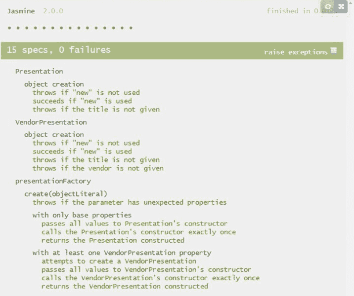

**图 10.1**

工厂整洁地解决了你的核心关注：

- `create` 的参数可以是对象字面量，避免了 `undefined` 占位符参数的丑陋。
- 你可以把任何东西丢进参数里，工厂会弄清楚你想要什么。
- 你完全有能力容纳未来新类型的演示。
- 作为一个额外奖励，工厂为你记住了对象必须用 `new` 创建。

## 考虑其他工厂类型

工厂可以比你在这里看到的更简单，也可以更复杂。

有时，工厂只创建一种类型的对象。例如，你在这一章看到的对象字面量可以由 `presentationParameterFactory` 产生。正如你在第 3 章中读到的，对象字面量有几个缺点。工厂会解决所有这些问题。

本章中的工厂只有一个函数：`create`。一种变体是拥有几个针对不同用途的专门 `create` 类型方法。JavaScript 不像 C# 或 Java 等语言那样拥有函数重载，因此这些方法必须有不同的名称。或者，如第 1 章列表 1-4 之后描述的那样，单个方法可以根据在 `arguments` 中发现的内容执行不同的事情。

工厂可以设置所有产品所需环境的方便之处。有时，环境在单元测试、功能测试和生产环境中会有所不同。你可以使用依赖注入来采用适合这种情况的工厂。

最后，工厂是单例的自然候选者，所以你在上一章遇到的单例变体同样适用。

在他的书籍 *JavaScript Patterns*（O’Reilly, 2010）中，Stoyan Stefanov 提出了沙箱模式（Sandbox Pattern），以此作为解决 JavaScript 中命名空间实践某些缺点的解决方案。特别是，他指出沙箱模式缓解了应用程序对单个全局变量的依赖，并减少了在运行时进行类型检查和解析的长点分隔名称的泛滥。虽然沙箱模式确实做到了这两点，但我们最感兴趣的是他提到的另一个特性：为模块创建一个可以“玩耍”的环境，而不会影响其他模块及其沙箱。

本章将使用测试驱动开发（TDD）来创建一个沙箱模式的实现，类似于 Stefanov 书中介绍的模式。该实现将侧重于创建一个可扩展的沙箱，以及一个允许编写松耦合且经过良好测试的代码的环境。

## 通过单元测试理解模式

JavaScript 会议组织者对你、Charlotte 以及团队其他成员为会议网站添加的所有功能感到非常满意。除了其他功能外，会议志愿者有权签到参会者，而会议参会者（以及志愿者）可以搜索会场附近的餐厅。

然而，会议组织者希望有一个仪表盘，能够让他们对会议进展和网站运行情况有一个整体的了解。

“没问题，”你说，“你们希望在仪表盘上看到什么样的数据？” 瞬间，你收到了如潮般的答案：

- 注册会议的总人数
- 注册会议的人员名单
- 已签到的参会者人数
- 已签到的参会者名单
- 对第三方餐厅 API 的调用次数
- 当地机场的天气预报

等等诸等。你飞快地书写并记录了他们所有的输入，并注意到每位组织者都想在自己的仪表盘上看到不同的数据集合。

在与 Charlotte 讨论该功能的设计时，你指出：“组织者想要显示的数据类型非常多样化，当我们为网站添加新功能时，又什么能阻止他们想要显示更多内容呢？”

“什么都没有，”Charlotte 回答道，“所以我们应该留心心，创建一个可扩展的解决方案。而且，”她继续说道，“如果我们能确保仪表盘中显示数据的每个部分——我们称之为组件（widgets）被正确解耦，特别是与其他组件解耦，那么该功能将可靠得多。”

“我理解减少组件之间的耦合通常是一个好主意，但为什么你认为在这种情况下它是如此高优先级呢？”你问。

“嗯，你注意到每位组织者都想在他们的仪表盘上看到不同的组件集合。这意味着我们需要允许组件的启用和禁用。如果 `Widget A` 耦合到 `Widget B`，且组织者选择了禁用 `Widget B`，那么 `Widget A` 将无法正常工作，”Charlotte 回答道，“考虑到可能同时显示的所有组件组合，一个或两个耦合的组件可能会导致深夜加班调试。”

“很有见地的观点，”你承认道，“但你想法我们可以如何保持组件的解耦吗？”

“完全可以。我们可以将每个组件隔离在它自己的沙箱中，”Charlotte 信心地回答道，“并通过沙箱提供组件所需的工具，且*仅*提供组件所需的工具。”

### 创建组件沙箱

正如 Charlotte 所述的，组件沙箱的目标是隔离每个组件，以确保它能够独立运行。沙箱模式还将为每个组件提供一组受控的依赖项，为其提供完成工作任务所需的工具。

### 实例化组件沙箱

`WidgetSandbox` 构造函数将被设计为配合 `new` 关键字使用。此外，它预计接收至少一个参数：用于创建将在沙箱内隔离的组件的函数。验证此行为的单元测试在列表 11-1 中。

第一个测试确保 `WidgetSandbox` 使用 `new` 关键字执行，这在第 3 章中已经很熟悉了。

第二个测试验证了预期：沙箱应提供一个它可以执行的函数，用以创建要隔离的组件实例。注意，测试提供了 `undefined` 作为参数，模拟在不带任何参数的情况下执行 `WidgetSandbox`。它还更进了一步，提供了不是函数的参数。这将确保实现 `WidgetSandbox` 编写的代码不仅仅是验证是否提供了任意参数；它必须验证所提供的参数是一个函数，才能通过测试。

最后一个测试确保组件函数在提供沙箱实例作为参数的情况下被执行。

列表 11-2 中 `WidgetSandbox` 的初始实现使得单元测试通过，正如你在图 11.1 中所示。

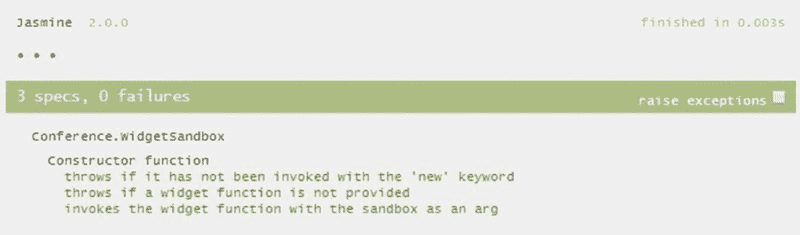

**图 11.1**

### 通过沙箱为组件提供工具


虽然`WidgetSandbox`设计用于隔离仪表盘组件以实现松耦合，但如果组件无法以某种方式与 DOM 交互或从 Web 服务检索信息，它们将变得毫无用处。就像物理沙箱可以使用铲子和耙子一样，`WidgetSandbox`应该提供一组组件可以使用其与其环境交互的工具。

在与 Charlotte 商量后，你确定自己大致知道组件可用工具应该是什么，但并非全部。与其提供一组固定的工具，你决定应该通过向其添加新工具来扩展`WidgetSandbox`的能力。此外，应该能够限制每个组件可使用的工具。例如，如果一个组件不需要与 Web 服务交互，它就不应该拥有进行 AJAX 通信的工具。

在开始实现这些功能之前，需要做出一些决策：

1. 工具定义在哪里？
2. 如何将工具添加到`WidgetSandbox`实例中？
3. 如何指定组件可使用的工具？

根据 Charlotte 的建议，你得出了答案：

1. 在`Conference.WidgetTools`命名空间内定义工具是合理的。
2. 工具将被定义为模块，工具模块函数将接收`WidgetSandbox`的实例。工具将以如下方式将自己添加到`WidgetSandbox`：

```
Conference.WidgetTools.toolA = function(sandbox){
  // 将 toolA 添加到 sandbox
  sandbox.toolA = {
    function1: function(){
      // function1 实现
    },
    function2: function(){
      // function2 实现
    }
  };
};
```

3. `WidgetSandbox`构造函数将接受：
   - 一个组件可用工具名称数组作为第一个参数，并将组件函数作为第二个参数——例如：

     ```
     var weatherSandbox = new Conference.WidgetSandbox(['toolA', 'toolB'],
       Conference.widgets.weatherWidget);
     ```

   - 任意数量的工具名称参数，并将组件函数作为最后一个参数——例如：

     ```
     var weatherSandbox = new Conference.WidgetSandbox('toolA', 'toolB',
       Conference.widgets.weatherWidget);
     ```

尽管它在决策列表的最后，但组件可用工具的规范将是你的开始的地方。

作为第一步，你想要验证当将工具名称列表（以数组形式或单独参数的形式）提供给`WidgetSandbox`构造函数时，小组件的功能是否可以被解析。列表 11-3 提供了确保此能力的测试。

请注意，在列表 11-3 中增加了两个`describe`块：一个包含当使用工具名称数组调用`WidgetSandbox`构造函数时的测试，另一个包含当以工具名称作为单独参数调用它时的测试。重要的是，无论使用何种机制提供工具名称列表，构造函数的行为都必须是正确的。图 11.2 显示了失败的单元测试。

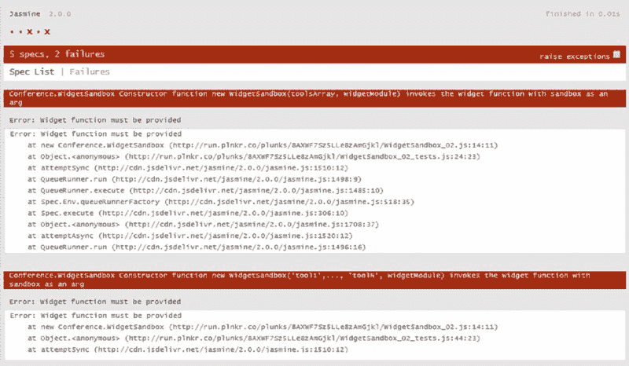

**图 11.2**

为了让失败的测试通过，必须调整从参数列表中检索小组件函数的技术。目前的实现假设该函数将作为第一个参数传递，但现在已不再是这样。由于你和 Charlotte 做的决定，小组件函数将始终是提供给`WidgetSandbox`构造函数的*最后一个*参数。

列表 11-4 显示了`WidgetSandbox`的更新实现，它使用了正确的参数作为小组件函数。此外，`WidgetTools`命名空间被初始化为空对象。

所有单元测试现在都通过了，如 图 11.3 所示。

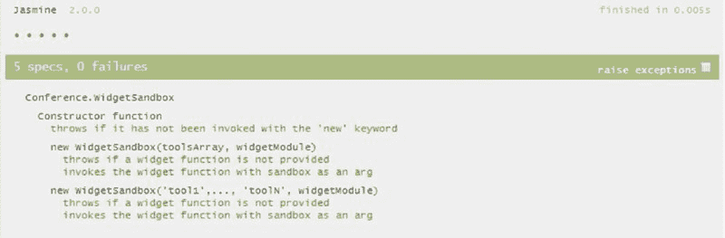

**图 11.3**

流程的下一步是使用提供给`WidgetSandbox`构造函数的工具名称来解析工具模块函数并创建工具实例。以数组提供工具名称列表的情况比将工具名称作为单独参数提供的情况要简单一点，因此你从这里开始。

根据你和 Charlotte 同意的约定，提供的每个工具名称都应该对应于`Conference.WidgetTools`的一个属性。如果指定的工具名称在相应命名空间中没有对应的属性，则应该抛出一个描述性的`Error`。这将允许使用`WidgetSandbox`的开发者快速识别出他们请求了未知工具（或发生了拼写错误）。

假设工具名称对应于有效的工具，则调用该工具的模块函数时应将`WidgetSandbox`的实例作为其唯一参数。

列表 11-5 包含了上述功能的单元测试。

现在正在添加通过名称解析工具的功能，因此某些工具需要在约定的命名空间中才可用。`beforeEach`块中高亮的代码创建了`tool1`和`tool2`。由于`Conference.WidgetTools`是单例对象，该测试套件是一个良好的公民；它在`afterEach`块中移除了测试工具。这样做可以确保不会因为将测试工具留在原处而产生副作用。新的单元测试失败了，如 图 11.4 所示。

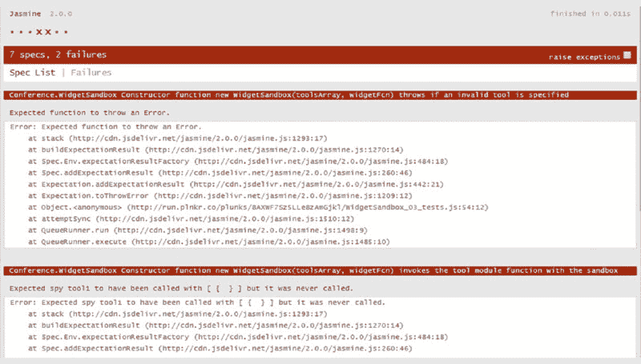

**图 11.4**

列表 11-6 提供了更新后的`WidgetSandbox`，允许新的单元测试能够通过。

列表 11-6 中高亮的代码添加了描述的功能。如果提供给构造函数的第一个参数是数组，则将其赋值给本地变量`toolsToLoad`。然后检查`toolsToLoad`数组中的每个`toolName`的有效性，确保`Conference.WidgetTools`命名空间中具有指定名称的属性。如果遇到无效的`toolName`，将立即抛出错误。否则，以沙盒实例作为参数执行工具的模块函数。如 图 11.5 所示。

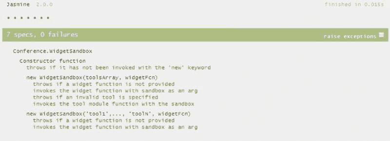

**图 11.5**

在实现通过名称解析工具的功能，最后一步是使用提供给`WidgetSandbox`构造函数的工具名称来解析工具模块函数并创建工具实例。以工具名称作为单独参数提供的情况，其单元测试显示在列表 11-7。单元测试目前失败的情况如 图 11.6 所示。

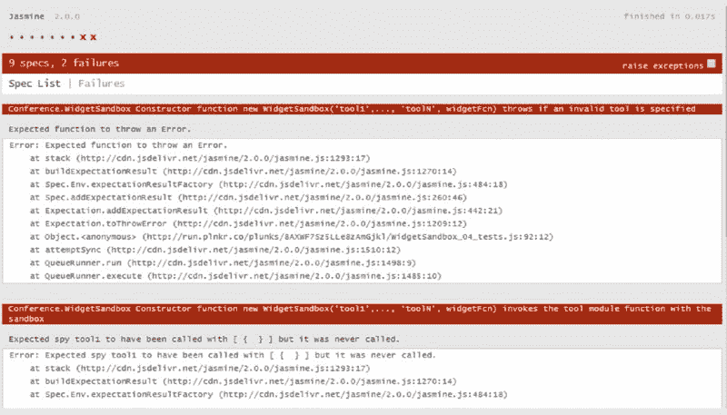

**图 11.6**

支持作为单独参数提供的工具名称需要对`WidgetSandbox`构造函数进行一些更改。更新后的代码见列表 11-8。首先，从`arguments`创建数组`argsArray`。与其通过索引`arguments`来填充`widgetFunction`变量，不如通过从`argsArray`末尾弹出它。如果`argsArray`是一个数组（表示工具名称列表是以数组形式提供的），则将其赋值给`toolsToLoad`。否则，假设工具名称是单独参数提供的。因此，`toolsToLoad`被设置为`argsArray`。

此时，`WidgetSandbox`已经实现并运行正常，如 图 11.7 所示。

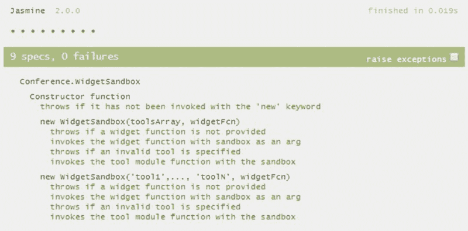

**图 11.7**

### 创建并测试沙盒工具

目前，`WidgetSandbox`并不真正有用。虽然它很好地隔离了小组件实例，但没有小组件可以使用的工具。

你可能记得，在会议组织者希望在仪表板上显示的许多项目中，包括注册人员的姓名。你负责实现向小组件提供注册人员姓名的工具。

负责注册任务的对象`attendeeApi`已经存在。除了其他方法外，它提供了`getAll()`，该方法返回一个将解析为`attendee`对象数组的`Promise`。你决定创建的工具`attendeeNames`将是`attendeeApi`的一个暴露所需的 façade。

`attendeeNames`工具的单元测试见列表 11-9。

如果你记得第 6 章涵盖的基于`Promise`代码的单元测试细节，列表 11-9 的大部分内容你会熟悉。类似于`attendeeName`工具提供的功能，这些测试相对简单。它们验证了`attendeeApi.getAll()`返回的`Promise`能够正确通过`attendeeNames.getAll()`方法。

此外，测试还验证了`attendeeNames.getAll()`方法能够正确提取并仅返回参与者的姓名，而不是每个`attendee`对象的全部内容。除了这是你和 Charlotte 确定`attendeeNames`工具的行为方式之外，这为什么很重要？假设`attendee.undoCheckin()`方法会自动将参与者的签到状态持久化到服务器。如果小组件能够访问此方法，那么小组件开发者可能会撤销参与者的签到状态，尽管这并不是小组件应该执行的操作。通过限制返回的数据，`attendeeNames`工具没有给小组件开发者提供犯这种错误的机会。

另一个在每次测试后执行的重要验证是：`attendeeWebApi.post(attendee)`方法**从没有**被调用。沙箱模式（Sandbox Pattern）的主要优势之一是它对沙箱内存在组件的可用能力提供了高层次的控制。在这种情况下，使用`attendeeNames`工具的组件执行`post`方法是不可接受的。同样，这不是使用该工具的组件永远应该能够执行的操作，因此`attendeeNames`工具没有暴露该方法。建立此验证机制是为了确保它在未来不会被暴露和滥用。

列表 11-10 提供了`attendeeNames`工具的实现，图 11.8 显示单元测试已通过。


图 11.8

### 创建供沙箱使用的函数

创建和测试设计为在沙箱内隔离的模块相对简单。沙箱模式规定，隔离模块仅依赖于沙箱的实例，且沙箱实例必须注入到模块中。正如第 2 章讨论过的，依赖注入增加了 JavaScript 代码的可测试性和可靠性。

当你忙于创建`attendeeNames`工具时，Charlotte 正在创建一个`dom`工具，允许组件与浏览器的文档对象模型（DOM）进行交互。

有了你的`attendeeNames`工具和 Charlotte 的`dom`工具，你现在有了足够的素材来创建一个显示参会者名称的组件。该组件的部分单元测试提供在列表 11-11 中。

这里仅提供了与组件与沙箱对象特定的单元测试；对组件其他功能的测试并没有特别新颖之处。值得注意的是，测试并不需要使用`WidgetSandbox`实例。对于组件而言，沙箱唯一的功能是提供工具；一个对象字面量（object literal）就足够用于测试了。

列表 11-12 提供了`attendeeNamesWidget`的骨架实现。

图 11.9 显示组件的单元测试已通过。


图 11.9

## 总结

本章介绍了沙箱模式，将其作为一种创建松耦合且依赖严格控制的模块的机制。通过测试驱动开发，你实现了一个沙箱模式实现（基于 Stoyan Stefanov 在他的著作 *JavaScript Patterns* 中提出的模式）。

本章涵盖了为沙箱添加功能的工具的创建和测试。本章还描述了使用工具作为“外观模式”（façades）来限制和控制隔离模块对资源和功能访问的好处。

此外，本章演示了如何开发一个供沙箱使用的函数并进行单元测试。

为了确保你的沙箱模式实现可靠，你应该编写单元测试来确保：

* 向沙箱的构造函数提供了一个组件模块函数。
* 工具可以作为数组或单独参数提供给沙箱的构造函数。
* 指定用于沙箱的工具是有效的。
* 运行在沙箱内的组件所请求的工具由沙箱提供。

在第 12 章中，我们将讨论装饰器模式（Decorator Pattern）、它如何用于解决现实问题，以及如何以测试驱动的方式实现它。

# 第 12 章

## 确保装饰器模式的正确实现

### 本章包含什么？

* 使用装饰器优雅地解决一个现实问题
* 在单元测试中使用“虚假对象”（fake）来代替被装饰的对象
* 使用测试驱动开发创建一个可靠的装饰器

### 本章的 WROX.COM 代码下载

你可以在[`www.wrox.com/go/reliablejavascript`](http://www.wrox.com/go/reliablejavascript)的“Download Code”选项卡中找到本章的代码下载。文件位于第 12 章下载目录中，并根据本章各注的文件名单独命名。

装饰器模式是一种在不改变对象的情况下增强其能力的方法。你已经在本书中遇到过一些示例。第 8 章中的记忆化（memoization）方面装饰了它所附着的函数，使得该函数在带有它以前见过的参数被调用时，具备了不进行大量工作就能返回结果的能力。当你使用`.and.callThrough()`设置一个 Jasmine 监听器（spy）时，你正在装饰被监听函数，增强了它报告被调用次数等能力。

在本章中，你将进一步推进装饰过程。你不再装饰一个隔离的函数，而是装饰一个具有多个协调函数的对象。你还将对第 6 章中遇到的`Promise`对象进行更多练习。最后，这将是另一个测试驱动开发的深度案例研究。

这个案例研究如果用现在熟悉的 JavaScript 会议网站的术语，它将会更具意义。

在会议上，参会者可以现场注册。为了方便现场注册处的工作，你编写了一个列出当前参会者的网页。如果有人出现在名单之外，点击一个按钮就会调用另一个页面，注册处人员可以在该页面上为新人录入记录。

人们将会排队，因此响应时间至关重要。这就是为什么你决定采用“发后不管”（fire-and-forget）策略。“新参会者”页面向服务器发送一个 HTTP POST，并立即返回参会者列表页面，而无需等待 POST 解析其`Promise`。（有关用`Promise`封装 HTTP 的更多信息，请参见第 6 章。）然后参会者列表将执行 HTTP GET 获取最新列表，你预计会在上面看到新的注册者。

但你并没有！

少量的调试告诉我们，尽管 POST 在 GET 之前的微秒级发出的，但 GET 可能会返回 POST 之前的数据。你的研究证实，HTTP 规范并不保证请求会按照接收到的顺序完全处理。哎！

由于响应时间如此重要，你真的不想让用户被滞留在“新参会者”页面上，即在 POST 完成之前不让她返回“参会者列表”页面。POST 失败极其罕见。因为这种极低概率的事件而限制应用程序将太遗憾了。有更好的方法吗？

有志者，事竟成。

1. 在 POST 新记录之前，将其存储在一个待处理 POST 数组中。
2. 当 POST 的`Promise`解析完成时（参见第 6 章），从数组中移除该记录。
3. 期间，将这些待处理记录附加到 GET 的结果中（如果结果尚未包含它们的话）。这将让参会者列表页面立即显示已 POST 的记录。待处理的 POST 记录还没有参会者 ID（这些 ID 是数据库生成的）。执行更新或删除操作需要这些 ID，但在此期间，至少可以列出名称。
4. 当 POST 返回参会者 ID 时，应该将其插入到步骤 3 中附加到 GET 的任何记录中，以便进行更新和删除。
5. 在 POST 失败的罕见情况下，应用程序将显示消息，如果用户仍在那里，则从参会者列表页面移除该参会者。在此期间，列表中出现一个虚假条目也不会造成任何伤害：在那个 ID 返回（步骤 4）之前，你的 UI 不允许更新或删除该记录。

上述五个步骤简化了真实的生产场景（实际情况还需考虑待处理更新和待处理删除），但这些步骤足以说明问题了。

你有一个对象`attendeeWebApi`，它拥有`post(attendee)`和`getAll()`方法。它们返回`Promise`的方式正如你在第 6 章列表 6-7 中看到的那样，即`XMLHttpRequest`的成功或失败会导致`Promise`被解析（resolved）或拒绝（rejected），然后返回该`Promise`。

实现待处理提交（pending-post）的想法可能会变得复杂，而且与`attendeeWebApi`对象的单一职责无关。忠实地遵循开闭原则（参见第 2 章），你决定不修改`attendeeWebApi`，而是将新功能放在一个*封装*`attendeeWebApi`的对象中。该封装对象将具有`post`和`getAll`方法，其参数与底层方法相同，语义也相同。包装器将处理所有与待处理 POST 列表相关的事务，并将实际工作委托给被包装的`attendeeWebApi`。你的依赖注入框架将导致在到处使用该包装器而不是`attendeeWebApi`。

这就是装饰器模式，因此你巧妙地将外部对象命名为`attendeeWebApiDecorator`。

## 以测试驱动的方式开发装饰器

单元测试的第一原则是只测试“单元”本身，不再多测。在这种情况下，你想测试`attendeeWebApiDecorator`而不是底层的`attendeeWebApi`。下一节描述了第一步。

### 为被装饰对象编写伪对象（Fake）

通常，间谍（spies）可以代表未受测试的对象，但间谍在一次处理一个函数时工作得最自然。在这种情况下，有两个函数协同工作：`post`函数的操作应该影响`getAll`的行为。一个伪造这种行为的小对象会比协调的间谍更方便。

列表 12-1 显示了结果。`post`方法将参与者存储在`attendees`数组中，该数组充当伪数据库。`getAll`方法从那里返回它们。为了避免给测试提供任何无意中的“便利”，使用了参与者的拷贝而不是原始对象。（在现实生活中，会从数据库中创建新的参与者对象，复制这种行为是最安全的。）使用了`setTimeout`机制来模拟真实对象的行为。


你现在已准备好开始测试驱动开发，从错误处理开始。如之前提到的，最好尽早完成负面测试。如果你将它们推迟到开发最后，你将在最不想做这些事情的时候编写它们，这很容易完成得不合格。有了装饰器，负面测试还有一个额外优势：正如你现在所看到的，它们通常会产生你最终成品的形状。

## 为错误传递编写测试

`getAll()` 方法最终将委托给基类 `attendeeWebApi` 的 `getAll()`。如果底层方法返回一个被拒绝的 `Promise`，你希望该拒绝能通过包装器向上传递到调用它的代码。在回顾了第 6 章关于 `Promise` 的内容后，你在列表 12-2 中编写了测试。

从该列表顶部开始阅读，`decoratedWebApi` 是被测主体。`baseWebApi` 是装饰器封装的对象——在本例中即是 `fakeAttendeeWebApi`。`beforeEach` 为每个测试新地构建它们，以确保没有跨测试污染的可能性。

这个测试是关于失败的，因此你为伪对象的 `getAll` 编写了一个间谍，使其返回一个被拒绝的 `Promise`。你希望间谍尽可能真实。在这里，这意味着 `Promise` 不应立即被拒绝，而是异步地拒绝。你决定使用低技术的 `setTimeout` 来实现这一点。如果你在使用第 6 章末尾提到的 `Deferred` 库之一，你可以更聪明。对于本案例研究，`setTimeout` 的唯一缺点是，你必须确保 `post` 的超时间隔比 `getAll` 长，以模拟你正在处理的现实情况。那种隐藏依赖有点丑陋，但目前足够用。

现在是创建被测主体了。

## 编写一个什么都不做的装饰器

遵循测试驱动的哲学，你从主体的最最小实现开始（参见列表 12-3）。

意料之中的是，这失败了（参见图 12.1）。

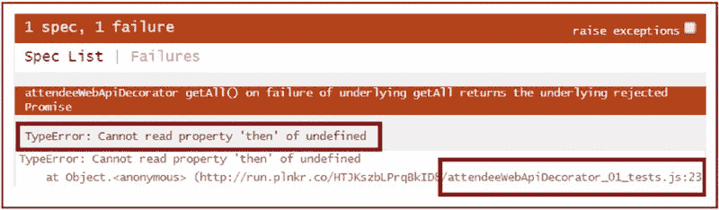

**图 12.1**

由于 `getAll()` 是空的，它返回 `undefined`，而这显然没有 `then` 方法。这个什么都不做的装饰器已经完成了勾勒整体形状的任务，但现在是时候添加一些最小功能了。

## 为装饰器添加传递功能

如果第一步是编写一个什么都不做的装饰器，第二步就是编写一个仅具有功能的装饰器，如列表 12-4 所示。

你看，这让测试通过了（参见图 12.2）。

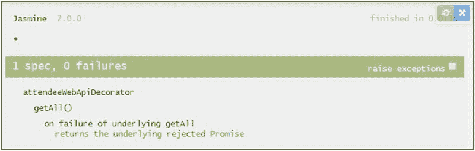

**图 12.2**

在测试中，你发布了 `attendeeA`，然后耐心等待发布解析。然而，在发布 `attendeeB` 后，你没有等待，而是直接执行了 `getAll()`。`getAll()` 在哪里？因为这是你需要编写这种“发布 `getAll()` 并测试其成功结果”的模式，而且由于这有点麻烦，所以你将该模式重构为列表顶部的函数 `getAllWithSuccessExpectation`。

你在测试中的预期是 `getAll()` 返回两个参与者——第一个带有 ID，第二个则没有（因为它是处于挂起状态）。

正如所预期的那样，测试失败了，`getAll()` 只返回了一个参与者（参见图 12.4）。


图 12.4

你通过更改装饰器中的 `getAll` 函数快速修复了这个问题，如列表 12-9 所示。

装饰器的 `getAll` 现在已经完整了！是时候测试 `post` 和 `getAll` 如何协同工作了。列表 12-10 中的测试表达了你的意图。

第一个测试验证了 `getAll` 能够获取到挂起的记录（那些没有参与者 ID 的记录）。第二个测试验证了如果已有可用 ID，`getAll` 将提供已获取 ID 的记录。

最后一个测试验证了，如果 `getAll` 返回了一个挂起的记录，但该记录对应的 `Promise` 稍后解析，则一个 ID 将注入到记录中。你可以将其用作信号，以启用参与者列表中对该记录的更新和删除功能。前两个通过了，但第三个失败了（参见图 12.5）。


图 12.5

失败发生在列表 12-10 的最后一个预期中。你可以通过在列表 12-11 的 `post` 操作中添加 `then` 块来修复它。

最后需要考虑的是当 `post` 失败时，`getAll` 会发生什么。在 `post` 返回之前，`getAll` 应该一无所知。之后，失败的记录不应包含在 `getAll` 的结果中。列表 12-12 显示了这些最终测试。

在第一个测试中，在失败已知之前处理的 `getAll` 应该仍然返回挂起的（即将失败的）记录。然而，正如第二个测试断言的，一旦失败已知，该记录就不应该出现在 `getAll` 的结果中。第一个测试恰好通过了，但第二个没有（参见图 12.6）。


图 12.6

问题在于 `post` 没有清除那些发布已失败的挂起记录。使用列表 12-13 中加粗的代码可以很容易解决这个问题。

图 12.7 中的最终测试输出显示了你已经走了多远。


图 12.7

## 装饰器泛化

下一个逻辑步骤（超出本章范围）将是泛化装饰器。在现实应用中，可能有很多对象封装了相关的 HTTP `POST` 和 `GET`——更不用说 `PUT` 和 `DELETE` 了。你如何泛化装饰器，以便在所有情况下都能使用它？这留给你自己自行练习。我们在这里提到它是为了指出装饰器模式的最后一个用处：它可以消除重复代码。

## 总结

在本章中，你使用了装饰器模式来解决基于 HTTP 的对象的现实局限性，而无需修改该对象。被装饰的对象保持关注其单一职责，而装饰器隔离了复杂的新功能，并且如果进行泛化，还可以减少代码重复。

你使用测试驱动开发的方法开发了一个装饰器，步骤如下：

1. 为被装饰的对象编写一个伪对象（可选）。
2. 编写单元测试，验证错误是否从被装饰对象通过装饰器向上层传递给调用者。
3. 编写一个什么都不做的装饰器并观察测试失败。
4. 为装饰器添加透传功能以使测试通过。
5. 编写测试验证装饰器也将向其调用者传递成功信号。
6. 如果这些测试尚未通过，则让它们通过。
7. 添加装饰器的特殊功能，并先编写单元测试。
8. 考虑泛化装饰器。

下一章将介绍另一个经典设计元素：策略模式。

# 第 13 章：确保策略模式的正确实现

**本章包含哪些内容？**

* 识别使用策略模式的机会
* 使用测试驱动开发实现策略模式
* 使用工厂模式在运行时选择策略

**本章 WROX.COM 代码下载**

你可以在 `Download Code` 选项卡中的 [`www.wrox.com/go/reliablejavascript`](http://www.wrox.com/go/reliablejavascript) 找到本章的代码下载。

```javascript
describe("Conference.transportScheduler", function(){
  'use strict';

  describe("requestTransport(transportDetails)", function(){
    describe("with RediCab", function(){
      it("makes the correct request to the RediCab web service", function(done){
          // test implementation
      });
      describe("when request successful", function(){
        it("records the ride with the audit service", function(done){
          // test implementation
        });
        it("resolves to the expected success value", function(done){
          // test implementation
        });
      });
      describe("when request unsuccessful", function(){
        it("does not record the ride with the audit service", function(done){
          // test implementation
        });
        it("returns the rejected promise", function(done){
          // test implementation
        });
      });
    });
  });
});
```

让我们跳过逐个让这些测试通过的细节；我们已经展示过很多次这个过程了（而且无论如何都要重构代码）。让测试通过的实现如下：

```javascript
var Conference = Conference || {};

Conference.transportScheduler = function(transportAuditService, httpService){
  'use strict';

  return {
    requestTransport : function requestTransport(transportDetails){
      var rediCabRequest;

      switch(transportDetails.companyName){
        case "RediCab":
          rediCabRequest = {
            passenger: transportDetails.passengerName,
            pickUp: "Conference Center",
            pickUpTime: transportDetails.departureTime,
            dropOff: "Airport",
            rateCode: "JavaScriptConference"
          };
          httpService.post("http://redicab.com/schedulepickup", rediCabRequest)
            .then(function resolved(status){
              transportAuditService.recordRide(transportDetails.companyName);
              return status.confirmationNumber;
            });
        break;
      }
    }
  };
};
```

代码中显而易见的一个方面是 `requestTransport` 函数承担了很多职责。它需要：

* 确定选定的运输公司。
* 将 `transportDetails` 转换为运输公司 Web 服务预期的结构。
* 向相应的 Web 服务发送 HTTP 请求。
* 将成功的请求记录到审计服务。
* 返回 HTTP 响应中代表预约确认号的字段。

你感觉到，随着支持更多出租车公司（最终是豪华轿车服务），`transportScheduler` 将变得越来越大、越来越复杂。你知道，随着复杂性的增加，问题的可能性也随之增加，从而降低可靠性。想到由于 `transportScheduler` 工作不正常导致参会者错过航班，促使你向 Charlotte 寻求反馈。她对你有几点建议。

“你可能考虑的一点是为每家出租车和豪华轿车公司创建一个独立的模块，这些模块应具有一致的接口，”她建议道，“这样，为每家公司安排行程的逻辑将被隔离到可以单独测试的单元中。”

“另外，”她继续说道，“考虑创建一个工厂函数，让它知道如何创建合适的运输公司模块。这样做可以消除 `transportScheduler` 中的 `switch` 语句。你甚至可以将工厂注入到 `transportScheduler` 中，这样 `transportScheduler` 更容易测试。”

Charlotte 继续说道，“按照我提议的方法隔离功能，其另一个用处是，`transportScheduler` 将不再像现在这样违反开闭原则。它将可以通过创建新的运输公司模块来扩展；为了支持新的运输公司，它完全不需要修改其代码。当创建新的运输模块时，唯一需要更改的是工厂。”

意料之外，Charlotte 建议的所有内容都非常有道理，你开始重写你的代码。

### 使用策略模式实现 transportScheduler

Charlotte 并没有直接说出来，但她建议创建的每个运输公司模块都代表一个 `strategy`（策略）。每个模块都封装了一家公司的调度算法，并遵循一致的接口。接口由以下代码所示：

```javascript
{
  schedulePickup : function schedulepickup(transportDetails){
    // 返回一个 Promise，解析结果为预约确认
    // 号。
  }
}
```

由于接口将由每个运输公司模块实现，因此可以针对接口而不是具体实现来编写 `transportScheduler`。`transportScheduler` 执行策略的上下文。

此外，Charlotte 建议创建一个工厂来创建合适类型的运输公司模块是一个好主意。正如她建议的那样，正如第 10 章所示，工厂的引入将简化 `transportScheduler` 的单元测试，因为它可以被注入并被模拟（mock）。

遵循第 10 章的原则，你实现了 `Conference.transportCompanyFactory`，其实现见代码清单 13-1。

#### 使用测试驱动开发创建 transportScheduler

现在你已经确定了每个运输公司模块将暴露的接口，并开发了一个创建运输公司模块实例的工厂，你就可以创建 `transportScheduler` 了。

与未使用策略模式时它的职责列表相比，`transportScheduler` 现在只需要执行以下操作：

* 从注入的 `transportCompanyFactory` 获取运输公司模块。
* 调用运输公司模块的 `schedulePickup` 函数。
* 将成功的请求记录到审计服务。

职责列表的减少意味着单元测试套件的简化，其开头见代码清单 13-2。

代码清单 13-2 中的测试提供了对不当使用 `transportScheduler` 可能导致的负用例的基础覆盖。测试：

```javascript
it("throws if audit service is not provided", function(){/*test*/});
it("throws if company factory argument is not provided", function(){/*test*/});
```

确保在缺少预期参数的情况下调用时会抛出异常。测试：

```javascript
it("throws if transportDetails argument is not provided", function(){/*test*/});
```

对 `scheduleTransportation(transportDetails)` 函数执行类似的验证。最后，测试：

```javascript
it("doesn't swallow exceptions thrown by company factory", function(){/*test*/});
```

确保 `scheduleTransportation(transportDetails)` 函数不会抑制注入工厂抛出的任何异常。

由于 `transportScheduler` 还没有实现，测试惨遭失败。然而，代码清单 13-3 中的代码允许它们通过。通过的测试所示图 13.1。

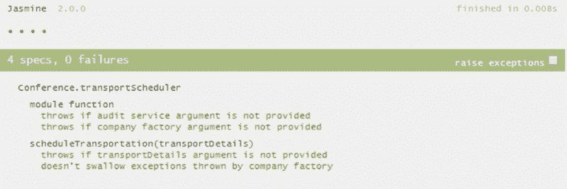

**图 13.1**

现在有信心 `transportScheduler` 会报告其误用行为，就可以实现其核心功能了。

记住，每个运输公司模块将实现的接口包含单个函数 `schedulePickup(transportDetails)`，该函数返回一个 `Promise`，其解析结果为预约确认号。如果 promise 已解析，`transportScheduler` 应该在审计服务中记录成功的预约。

考虑到此，代码清单 13-4 提供了 `transportScheduler` 的剩余单元测试。

列表 13-4 中的测试验证了 `transportScheduler` 是否正确协调了 `transportCompanyFactory`、工厂返回的公司模块以及 `transportAuditService` 之间的交互。如图 13.2 所示，单元测试失败了，因为尚未实现这些协调。

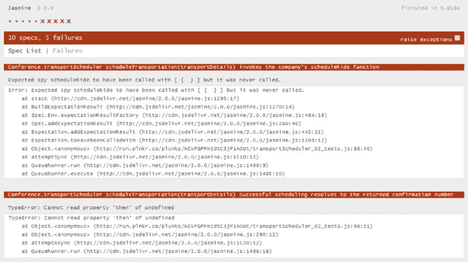

图 13.2

只需要少量代码即可通过所有单元测试。`transportScheduler` 的完整实现出现在列表 13-5 中。注意，单元测试和实现都没有直接依赖于特定的公司模块；它们仅依赖于公司模块实现的简单接口。得益于此，调度交通工具的不同逻辑（或策略）可以被隔离到独立的模块中。`transportScheduler` 不需要知道正在使用哪个公司模块。列表 13-4 中的所有单元测试现在都通过了，如图 13.3 所示。

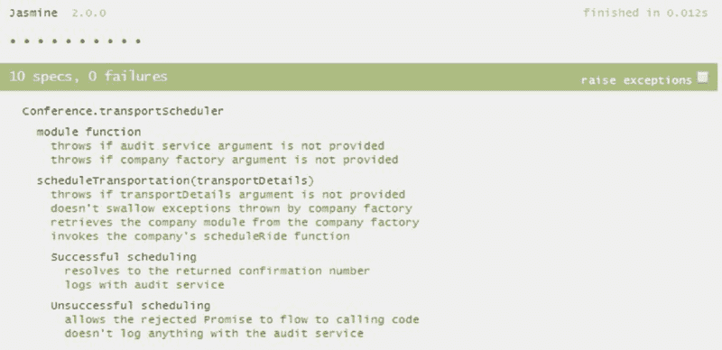

图 13.3

### 为 transportScheduler 创建策略


# 策略模式与代理模式实现指南

## 策略模式的优点

策略模式正确实现的优点之一是可以使用极少的代码更改添加或移除策略。事实上，当添加或移除公司时，`transportScheduler` **不需要**改变。相应的，负责创建公司实例的模块`transportCompanyFactory`需要改变。为了完成最初未使用策略模式实现的功能，需要实现一个 `RediCab` 公司模块。由于公司模块需要暴露的接口非常简单且定义明确，模块中并没有多少复杂性。与`schedulePickup(transportDetails)`实现相关的单元测试出现在列表 13-6。

在列表 13-7 中，`redicabTransportCompany`的实现允许列表 13-6 中的单元测试通过。注意，`schedulePickup`的实现与未使用策略模式时编写的代码相似。但通过使用策略模式，`redicabTransportCompany`中的代码仅关注与 `RediCab` API 交互的细节。通过的单元测试如图 13.4 所示。

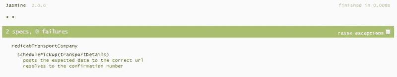

图 13.4

可以使用相同的方法创建任意数量的额外公司模块，其中任何一个都不会修改`transportScheduler`或其他公司模块。

## 总结

在本章中，你看到了如何使用策略模式来隔离执行任务的不同算法（在本例中是与公司调度行程），并允许在运行时动态确定合适的算法或策略。随着额外公司模块的添加，可以扩展`transportCompanyFactory`根据用户所需的交通类型提供相应的模块实例。

此外，还描述了如何使用第 10 章的工厂模式来创建策略的具体实例。这样做降低了测试复杂度，并确保在添加或移除策略时，使用策略的上下文不需要改变。

在创建策略模块时，编写单元测试以验证实现暴露了正确的接口是非常重要的。"在无接口语言中符合接口"包含了关于确保 JavaScript 模块符合接口的附加信息。

下一章介绍代理模式，一种对象管理另一个对象的机制。

# 第 14 章 确保代理模式的正确实现

## 本章内容：

- 代理模式的常见用途
- 使用预取代理提高网页的响应速度
- 使用测试驱动开发创建代理
- 在不破坏数据封装的情况下推断代理的内部工作

## 本章 WROX.COM 代码下载

你可以在`www.wrox.com/go/reliablejavascript`（http://www.wrox.com/go/reliablejavascript）的 Download Code 标签页找到本章的代码下载。文件位于 Chapter 14 下载中，并根据本章提到的文件名单独命名。

如果你是一个美国人，你的整个生活字面上受到代理模式的治理。尽管我们生活在民主国家，但我们是**代议制**民主：我们不直接制定法律，而是选举代表我们制定法律的人。我们相信（无论对错）我们在国会和白宫的代理人可以比我们更好地管理立法过程。他们有时间成为国防、医疗保健和其他其他领域的专家。而我们没有。如果每个微小问题都通过公决来决定，我们将将无事可做。

当需要解释这些法律时，我们通常会雇佣**另一个**代理人：律师：一个导航专家。

在软件设计中，有时创建一个代理对象来管理对底层对象（称为`real subject`）的访问是有用的。它充当专家的角色，允许客户端更有效地使用真实主体，或让客户端避免麻烦。

代理模式的常见用途包括：

- 根据客户端使用模式预取数据
- 确保客户端访问不应访问的资源
- 将`n`个 HTTP 请求合并为一个以避免`n-1`的固定开销

Charlotte 翻了个白眼。"随你吧。你为什么不去负责客户端的工作？我来修改服务器代码，把点击量作为每位参会者记录的一部分返回给你。"

## 以测试驱动的方式开发代理

通常，单元测试应该验证被测对象的外部行为，而不考虑其内部实现。代理（proxy）出现带来了一个挑战，因为其内部实现正是你**想要**测试的内容。你想知道代理是否正确地管理了真实对象。

在当前的示例中，代理的外部行为是根据你的请求提供个人资料（profiles）。内部行为则是：此外，代理是否还为可能发生的交付准备了其他数据。

测试内部实现有两种方法。不那么理想的方法是允许代理暴露其预取的个人资料列表，以便你的测试可以直接观察它们。这有两个显而易见的缺点：首先，它破坏了代理的数据封装，违反了面向对象设计的基本原则。其次，它通过向 API 中添加函数，增加了代理与外部世界的耦合性。你总是希望尽可能地减少耦合，而不是增加它。

好得多的是观察代理对真实对象的影响，并据此推导出代理的行为。

预取代理的真实对象是列表 14-1 中的`attendeeProfileService`。

这个思路与你在第 6 章看到的`checkInRecorder`完全相同。虽然`getProfile`核心的`XMLHttpRequest`不会立即返回，但它会返回一个代表最终结果的`Promise`。当`onreadystatechange`事件最终触发时，`Promise`将被解析（resolved）或拒绝（rejected），取决于 HTTP 状态码。

代理将是一个函数，接收列表 14-2 所示的参数。

注意第二个参数`attendeeProfileService`，它构成了真实对象。代理实例化自己的对象似乎很自然，但将其作为参数传递可以允许你使用依赖注入（dependency injection）。在单元测试中，你可以注入一个你安装了间探器（spy）的对象。如果系统架构要求任何调用者都不可能直接访问真实对象，你将不得不考虑更严锁的方案。一种可能性是将代理制成一个切面（aspect），这样任何看起来像是调用对象的调用都会先流经代理。

`attendeeProfileService`只有一个函数。如果它更复杂，你可能会考虑编写一个假对象（fake）而不是使用间探器。

在顶部初始化的`attendees`可能对许多测试都有用，因此你将变量放在外部作用域中。稍后会更多讨论测试数据。

最后是测试本身，它的逻辑很直观。测试的目的是验证如果预取限制不是正数，则不进行任何预取。你遍历各种非正数的数据，并使用每个数据实例化代理。当完成这一切后，不应该有个人资料被预取。

就像装饰器模式一样，你可以从列表 14-2 中的"无操作代理"开始。因为测试恰好验证了什么都没有做，所以它通过了（参见图 14.1）！

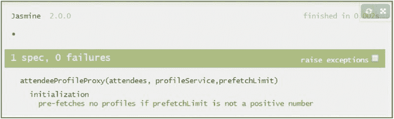

**图 14.1**

一个"无法失败"的单元测试会让你感到不安，这本该如此。通常情况下，通过调试器进行一些窥探可以确保你的测试是可靠的，但这次没有代码可以调试。你明智地决定让代理预取一个参会者，以便你可以观察到失败。这种小小的尝试在列表 14-4 中所示。

果不其然，Jasmine 报告真实的`getProfile`函数被调用了五次——对应`notPositiveNumbers`数组中的每个成员一次（参见图 14.2）。

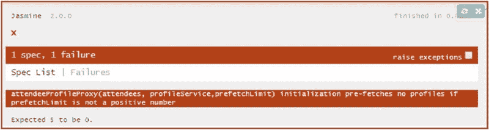

**图 14.2**

当你确信已经充分测试了`prefetchLimit`过小的情况后，你考虑如果它太大会发生什么。你在列表 14-5 中添加了测试。

你立即发现你的"无操作代理"需要做更多事情（参见图 14.3）。

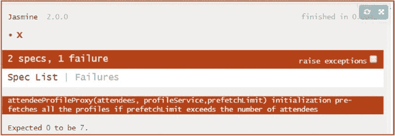

**图 14.3**

那么当你运行测试时会发生什么？图 14.4 就是结果。

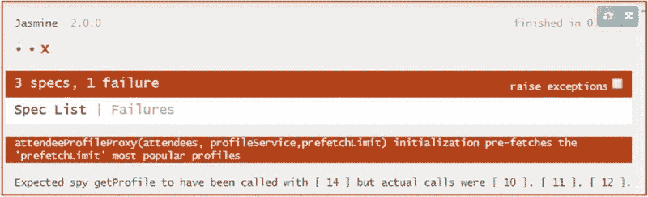

**图 14.4**

第一个关于调用次数的预期得到了满足，但第二个关于获取参会者 ID 14 的预期没有满足。Jasmine 非常贴心地列出了被获取的参会者 ID，你可以看到它们是测试数组中的前三个。你并不意外，因为你并没有尝试过选择最流行的。

你为代理添加了排序功能。顺便，你将排序和预取都封装在一个立即执行函数中，以强调此逻辑只会执行一次，并防止新变量`sortedAttendees`污染外部作用域。你甚至给这个立即执行函数起了一个名字`prefetchAll`。这既起到了文档的作用，在任何堆栈跟踪中也起到引导的作用（参见列表 14-8）。

在高亮行中，`attendees.slice()`的作用是创建`attendees`数组的副本，这样你的排序操作就不会影响代理调用者可能正为了自身目的而使用的数组副本。

JavaScript 原生方法`sort`接收一个函数，该函数在第一个参数应该在第二个参数之后排序时应返回正值，反之返回负值，如果它们在排序上等同，则返回零。对于降序排序，返回第二个值减去第一个值通常可以解决问题，这正是你编写的代码。这种效果如何？参见图 14.5。


图 14.5

是的。就好像排序从未发生一样。使用调试器，你可以精确检查排序过程中发生了什么（参见图 14.6）。

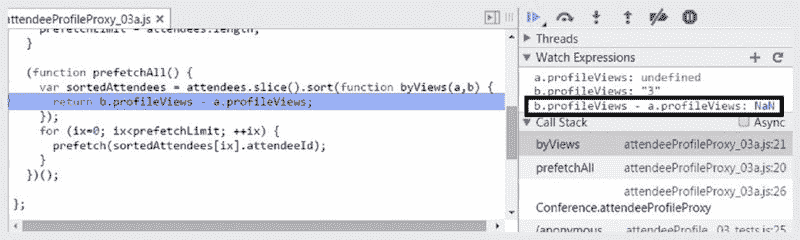

图 14.6

程序在缺少`profileViews`属性的参会者处卡住了。`b.profileViews`和`a.profileViews`之间的差异是`NaN`（数字）。

当数据来自服务器时，你不能总是每个属性都存在。大多数 JSON 序列化器允许默认值不被序列化，以节省带宽。`profileViews`值为 0 很容易被视为默认值，导致记录缺少此属性。你在设计`attendees`测试数组时明智地预到了此点，现在你的远见之明以测试失败的形式得到了回报。（这是一件好事！）

说起测试数据，它的另一个优点是`profileViews`是带引号的字符串而不是裸数字，这只是为了给测试增加一点难度。（再次，你永远不知道会在序列化数据中得到什么。）更重要的是，如果代理将字符串按字符串进行排序，结果将不符合你的预期，因为"10"会被认为小于"3"。很多时候，人们对测试数据的设计关注不够。程序员使用的值会让测试放过很多问题。让我们面对现实吧：编写测试数据是无聊的，但编写代码是有趣的，所以精力可能倾注在何处？然而，测试数据往往与测试本身一样重要。

只需稍作调整即可修复问题（参见代码列表 14-9）。你没有编写`b.profileViews`，而是编写了`(b.profileViews || 0)`，`a.profileViews`如此。

测试通过了（参见图 14.7）。

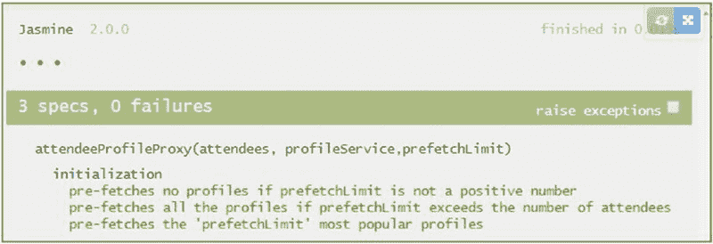

图 14.7

你现在知道代理按预期进行了预取，但它是否按照应该的方式交付了预取的配置呢？

当然没有！你还没有编写那部分！你忍制住为应用程序编写有用代码的冲动，先编写了一个测试（参见代码列表 14-10）。

考虑到后续测试，你将`prefetchLimit`和`proxyInstance`变量放置在一个作用域内，该作用域可以在新测试和未来的测试中访问。`proxyInstance`在`beforeEach`中为每个测试重新初始化。

在测试中，你在代理上调用了`getProfile`。你期望获得底层`attendeeProfileService`的返回值。但那个奇怪的`makeServiceReturn`调用是什么？类似于装饰器模式（参见第 12 章），代理模式将实际工作委托给它的主体。它不应该关注比需要多的一点点主体语义。在目前，`attendeeProfileProxy`没有理由关心底层服务返回的是`Promise`、JSON 对象还是其他任何内容。因此，测试不需要、也不应该关心。这就是为什么在代码列表 14-10 顶部定义的`makeServiceReturn`函数返回了一个故意愚蠢的返回值。在第一个`beforeEach`中初始化的配置服务的间谍（spy）已被修改为返回假值。

尽管做了所有这些工作，当测试失败时你仍然非常高兴（参见图 14.8），因为这意味着你可以编写有用的代码。

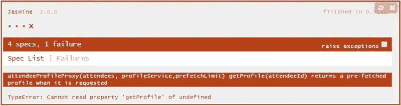

图 14.8

Jasmine 正在告诉你，测试对`getProfile`的调用发生在一个值为`undefined`的对象上，即`proxyInstance`。这并不意外。到目前为止，`Conference.attendeeProfileProxy`还没有返回任何值！你对此的修复在代码列表 14-11 中，其中代理返回了一个带有`getProfile`函数的字面量对象。

遵循良好的测试驱动方法论，你的`getProfile`函数仅做了最少的工作来满足你的最后一个测试，从`prefetched`对象中返回配置。再次，代理并不关心`prefetched`对象是否为`Promise`。

# 第 15 章 链式方法

本章对应的 wrox.com 代码下载可以在[`www.wrox.com/go/reliablejavascript`](http://www.wrox.com/go/reliablejavascript)的 Download Code 标签页中找到。文件位于第 15 章下载目录下，并根据本章中注的文件单独命名。

以下 JavaScript 语句的结构和语法看起来熟悉吗？

```javascript
$("#myDiv").text("JavaScript").removeClass("unreliable") .addClass("reliable");
```

如果你从 2008 年左右开始做过任何客户端端开发，那么答案很可能是"是"。该语句使用 jQuery 编写的，这是一个流行的客户端 JavaScript 框架。根据[`http://www.builtwith.com`](http://www.builtwith.com) 2015 年 3 月的数据，互联网上有超过 5200 万个网站在使用它。

此 jQuery 代码示例演示了**链式方法**（chainable methods）的使用：这些函数的构造方式允许它们在单个语句中对同一个对象进行连续调用。

在 JavaScript 中寻找链式方法的其他用法并不需要远行。你可能已经意识到，书中随处使用的`Promise` API 中的`then`方法就是链式的。

暴露使用链式方法的 API 可以使代码如下所示：

```javascript
var obj = NS.createObj();
obj.setAttribute1("Attr1 Value");
obj.doThing1();
obj.doThing2();
```

被转换为这种形式：

```javascript
var obj = NS.createObj().setAttribute1("Attr1 Value").doThing1().doThing2();
```

示例之间的差异并不大。第二个示例比第一个更简洁一些：`obj`变量只被引用了一次，并且消除了三个分号。我们并不是完美的打字员，所以减少按键次数意味着减少了拼错的机会。

第二个示例也更有表现力，我们认为它比第一个更优雅。它是一个单一语句，具有第一个示例所不具备的流动感。如果说第一个示例是块状的，那么第二个示例从左到右阅读，就像一个英语句子一样。

在本章中，你将使用测试驱动开发来为一个 JavaScript 会议网站创建一个模块，该模块将作为 API 的一部分暴露链式方法。

在 JavaScript 会议上演讲的许多演讲者都表示希望获得听众对他们演讲的反馈。会议组织者决定扩展会议网站，提供一个演讲者评估页面，听众可以从移动设备或会议场地的任何自助终端上访问该页面。

评估页面将捕获以下：

- 演讲标题
- 演讲者姓名
- 对所演示主题/概念价值的评分
- 对演讲者演讲能力的评分
- 听众再次参加该演讲者其他演讲的概率
- 听众想给演讲者的评论

将在下一节中开发的`presenterEvaluation`模块将用于汇总输入到评估页的信息。评估数据将被持久化到服务器进行存储，直到会议结束，届时将进行汇总并提供给每位演讲者。

## 通过单元测试理解模式

`presenterEvaluation`模块的职责很小：它的唯一工作是存储代表听众对演讲评分的数据。它将为存储的每条数据暴露一个`set`方法，并且这些`set`方法将是链式的。

为了使一个方法成为链式，它必须返回调用它的那个对象。在 JavaScript 中，变量`this`指的正是那个对象。因此，使一个方法变为链式只需让它返回`this`即可。

验证在`setPresenter`函数之后链式调用额外函数调用的单元测试见列表 15-1。

该单元测试仅用于验证`setPresenter`函数返回的值与调用`setPresenter`函数的对象相同。

带有`setPresenter`存根的`presenterEvaluation`模块出现在列表 15-2。

出乎意料，单元测试失败了，正如你在图 15.1 中所示。

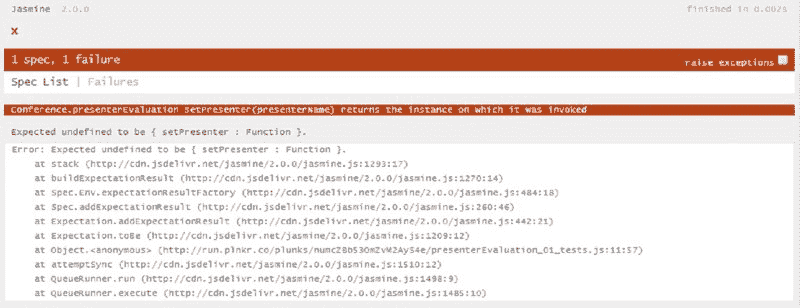

**图 15.1**](#part0025.xhtml_figureanchor15-1)

让测试通过是一简单；你只需要添加一行代码。列表 15-3 展示了这一点。

图 15.2 显示单元测试现在通过了。

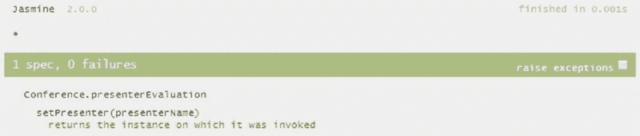

**图 15.2**](#part0025.xhtml_figureanchor15-2)

列表 15-3 中那个简单的`return this;`语句就是使`setPresenter`方法变为链式的全部要求。随着`presenterEvaluation`模块添加了更多的链式方法（例如`setPresentation`），它们可以像这样附加到`setPresenter`的调用链之后：

```javascript
var evaluation = Conference.presenterEvaluation()
  .setPresenter("Seth Richards")
  .setPresentation("Reliable JavaScript");
```

以这种方式定义的链式 setter 方法允许简洁的对象创建和初始化。


一个仅仅返回调用它的对象的方法提供的价值很小。为了完善`setPresenter`方法的功能，我们添加了一个测试来验证`setPresenter`方法返回`this`。列表 15-5 为`presenterEvaluation`模块添加了`getPresenter`，并完善了`setPresenter`的功能。

正如你在图 15.4 中所示，两个单元测试现在都通过了。

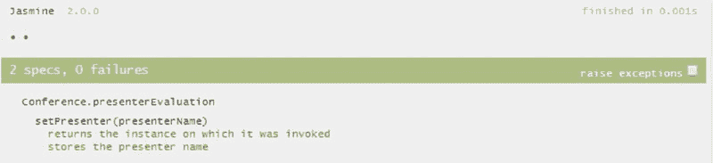

**图 15.4**

新的测试失败了，如图 15.5 所示，因为`setPresentation`尚未实现。

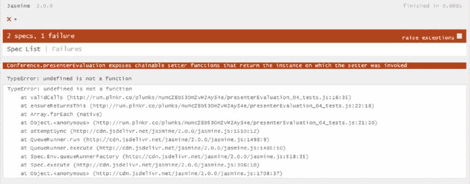

图 15.5

列表 15-7 提供了`presenterEvaluation`的更新实现，其中包含了`setPresentation`的最小化实现，使得列表 15-6 中的单元测试能够通过。

同样，`setPresentation`中的`return this;`语句是使其具备可链式调用所需的全部。

现在`setPresentation`已经定义并返回了调用它的对象，因此新的单元测试通过了。你可以在图 15.6 中看到这一点。


图 15.6

## 链式调用 then

在章的开头，我们提到当一个方法返回`this`时，它就变成了可链式调用。当返回`this`时，可以在同一个对象上调用多个方法。你在创建`presenterEvaluation`模块时利用了这一行为：返回`this`允许链式方法在模块的单个实例上设置属性。

我们还提到过`Promise`的`then`方法是可链式调用的。来自第 6 章的示例展示了`checkInService.checkIn`方法，它返回一个`Promise`。返回的`Promise`立即与两个`then`方法链式连接：

```
checkInService.checkIn(attendee)
  .then(
    function onCheckInResolved(checkInNumber) {
      // 打印 badge 并返回其号码。
      return badgePrintingService.print(checkInNumber);
    })
  .then(
    function onBadgePrintResolved(badgeNumber) {
      return doorPrizeEnteringService.enter(attendee, badgeNumber);
    });
```

`onCheckInResolved`和`onBadgePrintResolved`都没有解析为`this`，因此推测`then`方法正在执行某些操作，以确保可以链式额外的`then`方法。

也许`then`方法正在操纵由`checkinService.checkIn`创建并返回的原始`Promise`。这一假设可以通过稍微微调示例来测试：

```
var originalPromise = checkInService.checkIn(attendee);

var firstThen = originalPromise.then(
  function onCheckInResolved(checkInNumber) {
    // 打印 badge 并返回其号码。
    return badgePrintingService.print(checkInNumber);
  });

var secondThen = firstThen.then(
  function onBadgePrintResolved(badgeNumber) {
    return doorPrizeEnteringService.enter(attendee, badgeNumber);
  });

console.log(firstThen instanceof Promise);    // true
console.log(secondThen instanceof Promise);   // true

console.log(firstThen === originalPromise);   // false
console.log(secondThen === firstThen);        // false
```

显而易见，虽然`then`方法返回了`Promise`对象，但它们并没有返回原始的 promise。如果每个`then`调用都返回原始 promise，那么比较 promise 的语句结果将是`true`而不是`false`。

Mozilla Developer Network 提供了一个极佳的资源，描述了 ECMAScript 6 中指定的 Promise，地址为[`https://developer.mozilla.org/en-US/docs/Web/JavaScript/Reference/Global_Objects/Promise`](https://developer.mozilla.org/en-US/docs/Web/JavaScript/Reference/Global_Objects/Promise)。该页面的以下节选描述了`then`方法在幕后做了什么。

> 向 promise 添加成功和拒绝处理程序，并返回一个新的 promise，其解析结果为被调用处理程序的返回值。
> 
> —MOZILLA DEVELOPER NETWORK（已添加强调）

文档证实了测试演示的内容：`then`函数返回一个新的`Promise`；它没有返回原始的`Promise`。然而，`then`函数确实向原始`Promise`添加了成功和拒绝处理程序，以便在原始`Promise`变为解析时执行它们。

这意味着方法并不需要返回`this`即可实现链式调用；它们也可以返回一个与`this`类型相同的新对象。

返回一个新实例来支持链式调用对于 promise 来说是合适的，但对于`presenterEvaluation`模块的 setter 方法来说并不合适。setter 的意图是修改或更改调用它们的`presenterEvaluation`实例所包含的值。如果使用 setter 的开发者发现每个 setter 返回的都是一个新的`presenterEvaluation`实例，而不是改变它们调用的实例，可能会感到惊讶。

## 总结

在本章中，你看到了可链式调的方法如何将你的 JavaScript 代码部分从臃肿重复转变为流畅且简洁。你使用测试驱动开发实现了两个链式函数。

要测试链式调用性，通常只需确保函数返回`this`也就足够了。然而，正如`Promise`的`then`函数所示，链式函数并不总是返回`this`。在这些情况下，有必要测试返回的对象是否具有正确的类型。

下一章将关于接口——这是 JavaScript 并不具备的。

## 第三部分

使用进阶 JavaScript 进行测试与编写

* 16 在无接口的语言中遵循接口

* 17 确保类型正确

* 18 正确使用 call, apply 和 bind

* 19 正确使用 Mixins

* 20 正确使用方法借用

* 21 测试高级架构

## 第 16 章

在无接口的语言中遵循接口

本章内容：

* 在其他语言中理解接口的优势

* 在 JavaScript 中获取接口的优势

* 使用接口隔离原则简化对象

* 创建注册表

WROX.COM 代码下载

本章的 wrox.com 代码位于[`www.wrox.com/go/reliablejavascript`](http://www.wrox.com/go/reliablejavascript)的下载标签页。文件根据第 16 章进行了单独命名。

在 2014 年的一个 Google 业务广告（[`www.youtube.com/watch?v=bA0H1oE`](https://www.youtube.com/watch?v=bA0H1oE)）中，视频会议即将结束：

* GOOGLER: 所以，我觉得我们到这样就结束了。所以 ...

* WOMAN #1: 太棒了，我会发一封跟进邮件。

* GOOGLER: 我不…… 没什么好跟进的。

* WOMAN #2: 嗯，我觉得我们应该重组一下。

* GOOGLER: 我们刚刚重组了。这就是重组。

* MAN #1: 酷，我稍后 ping（联系）你。

* GOOGLER: 你现在就在 ping 我啊。你想 ping 什么？

* MAN #2: 下一步工作？

JavaScript 程序员与 C# 或 Java 程序员之间的对话可能会非常相似。JavaScript 程序员把一些对象组合在一起，而 C# 或 Java 开发者一直坚持：“你不能这样做！如果没有描述对象的接口，程序将会崩溃。” JavaScript 开发者说：“不，没有下一步了。我们刚刚解决了问题。”

然而，任何在超过一个人的团队中工作过的 JavaScript 程序员都承认误会确实会发生。以前调用`makeAWidget`的成员函数被重命名为`makeWidget`，导致下游代码崩溃。一个对象字量的成员变量被命名为单数`objectID`，但有人在里面放入了一个对象 ID 数组。（难以相信，但我们确实见过这种情况。）

强类型语言尽力在编译时捕捉这些误解，通常通过使用接口（interfaces）来实现。什么是接口？为什么这些语言的程序员认为它们是值得的？

### 了解接口的好处

接口描述了一个类，但没有可执行的代码。列表 16-1 显示了 C# 中的一个接口。

定义了该接口后，类可以继承它，从而承诺实现它，如列表 16-2 所示。

如果该类未能实现接口中定义的所有内容，编译器将抛出错误。

对于 JavaScript 程序员来说，这可能看起来非常麻烦。你似乎把所有内容都写了两遍：一次在接口中，另一次在类中。事实确实如此，但这种麻烦并不是没有回报的。

表面的好处是，接口明确了该类的使用者可以期待得到什么，以及编写相似类的程序员应该实现什么。

接口还充当了某种双式记账的作用。如果实现与接口之间不平衡，编译器会通知你。

在更深层次层次上，接口为软件工程师开启了无限可能的领域，使其能够更优雅地解决问题。你在第 13 章遇到的策略模式（Strategy Pattern）就是一个例子。当在强类型语言中实现时，每个算法都实现一个公共接口。不需要工厂方法来创建所选算法；依赖注入软件可以通过运行时配置来连接所需的算法。

在本书中，每当你在单元测试中编写 Jasmine 间谍程序（spy）时，你都使用了接口哲学，即间谍程序与真实对象实现了相同的接口。当然，在 JavaScript 中接口仅是隐式的，但在强类型语言中，它是显式的，因此更加可靠。

在第 1 章遇到的 SOLID 软件设计五大支柱中，有三个是面向接口的。里氏夫替换原则（SOLID 中的 L）规定，接口的所有实现者都应该遵循相同的语义。依赖倒转原则（D）让类的使用者“拥有”该类所自的接口。接口隔离原则（I）是下一节的主题。

### 了解接口隔离原则

尽管你可能竭力使类具有内聚性且不比必要时的那么大，但有时类的使用者只需要其一小部分功能。

作为一个例子，考虑第 6 章中的`attendee`对象，在此重现为列表 16-3。

如果 JavaScript 有接口，`attendee`可能会实现两个接口，列表 16-4 用伪代码展示了这一点。一个是为只关心参会者个人信息的使用者设计的，另一个是为倾向于管理签到流程的使用者设计的。

现在，假设其他模块中的几个函数都接受一个`attendee`对象作为参数。进一步假设你想要更改`attendee`的`getFullName`方法。其他模块中的函数很好地将参会者显示为参数（假设参数命名是有很有帮助的），但你无法简单地知道你对`getFullName`的更改会影响哪些函数。诚然，你可以对“getFullName”进行文本搜索，但这样你也会找到其他对象中的同名方法（可能是`presenter`或`sponsor`）。

这就是接口隔离原则旨在解决的问题之一。消费性函数不再使用命名为`attendee`的参数，而是可以使用`attendeePersonalInfo`或`attendeeCheckInManagement`参数。这样，一眼看上去，你就能知道你的更改可能会影响哪些函数（再次假设参数命名是不具误导性的）。

此外，如果你需要为单元测试对参数进行打桩（mock），或注入对象的另一个版本，你能够对你实际上需要打桩或实现的`attendee`成员划定更紧密的边界。

最后，一个真正只关心`attendee`的`attendeePersonalInfo`部分的开发者只需要掌握那个小小的 API。一个分离良好的接口会让他的生活变得更容易。

这些好处在强类型语言中是被强制的，但如果你愿意跳出框架编程，它们在 JavaScript 中也绝对可用。

在下一节中，你将构建一个模块，通过它可以定义并强制接口。该模块被称为`contractRegistry`，因为接口充当了定义功能的模块和使用它的模块之间的合约，而且在下一章中，你将把`contractRegistry`的功能用于严格来说并非与接口相关的目的。

### 使用测试驱动开发创建合约注册表

在本章开发的合约注册表将具有以下功能，并按顺序开发：

1. 定义一个合约（接口）。
2. 告知对象是否符合某个合约。
3. 断言对象符合某个合约，如果不符合则抛出`Error`。
4. 关闭所有合约强制，以便你的程序在生产环境中运行得更快。
5. 挂载切面（aspect）以对对象强制合约。（具体来说，这意味着要在创建对象的函数上添加一个切面，以检查其返回值。）

图 16.1 预先展示了你目标是实现的单元测试。


图 16.1

#### 定义合约

合约定义将由一个合约名称和一个函数组成，该函数可以评估对象并根据对象是否符合合约返回`true`或`false`。那么，`define`方法的签名如下：

```
function define(contractName, evaluator)
```

顺便提一下，让一个评估函数充当“接口”与其他语言将接口视为数据的概念非常不同。这不仅是必要的，而且是受欢迎的。之所以说是必要的，是因为 JavaScript 没有内置方法来评估接口，你必须在某处编写它。之所以说是受欢迎，是因为函数能做的事情比任何面向数据的接口描述的语言都要多得多。此外，由于函数作为一等对象运行，这种感觉很棒，而且很有 JavaScript 风格，不是吗？

在经历了几章测试驱动开发之后，没有必要详细阐述创建此方法的每一步。列表 16-5 显示了它的测试。

如往常，测试驱动开发从错误条件开始。除此之外，当`define`是对象中唯一的方法时，没有多少可以测试的。你甚至无法测试它是否定义了任何东西。然而，在它实现之前，你的`fulfills`方法无法进展多远。尽管如此，你克制了领先于测试，只编写使上述测试通过所需的代码。结果是列表 16-6。

测试通过了，如图 16.2

图 16.2

#### 判断是否符合合约

`fulfills`方法如下：

```
function fulfills(contractName, obj)
```

如果`obj`符合命名的合约，它将返回`true`，否则返回`false`。在达到这一点之前，你首先测试明显的错误条件：命名的合约不在注册表中（参见列表 16-7）。

在之前的章节中，你看到暴露对象的错误消息允许单元测试验证精确的错误。有时，错误消息包含变量数据。为了保持代码 DRY（不重复），在消息中整合变量数据的过程被存放在一个函数`getMessageForNameNotRegistered`中。

你可以通过列表 16-8 中高亮的代码使测试通过（参见图 16.3）。

图 16.3

顶部的新对象`registry`将存储注册信息，但到目前为止`define`还没有向其中放入任何内容，因为还没有单元测试要求过此功能。当你尝试让接下来的测试通过时（参见列表 16-9），这一点最终会让你发现问题。

这些测试验证了`fulfills`是否能相应地返回`true`或`false`。它们使用一个名称存储在`isArray`变量中的合约。在列表顶部，请注意以下行：

```
registry.define(isArray,Array.isArray);
```

它使用 JavaScript 的`Array.isArray`方法作为`isArray`的契约评估器。快速、偷懒，而且你知道它是有效的。这种做法很棒，不是吗？

这些测试目前处于非常糟糕的状态（参见图 16.4），但当你只需为`define`添加一行代码并为`fulfills`添加一行代码以使用之前安装的`registry`对象时，它们就会立即得到正修正（参见图 16.5）。运行的代码出现在列表 16-10 中。


图 16.4


图 16.5

本节顶部大纲的第 1 和第 2 步现在已经完成。接下来，如果有一个方法可以断言合约是否被满足（如果未满足则抛出错误），将会非常有用。

#### 断言合约已被满足

`assert`方法类似于`fulfills`：

```javascript
function assert(contractName, obj)
```

它应该使用`fulfills`方法来确定合约是否被满足，而不是重复代码。一个确保此点的测试也确保了你已经在`fulfills`中编写的参数检查会被带入`assert`中。这就是列表 16-11 中的第一个测试。另外两个测试验证了`assert`的核心功能。

如列表 16-12 所示，只需几行代码即可让测试通过。

#### 绕过合约执行


你可能希望在产品通过 QA（质量保证）后关闭所有合约执行，特别是当你的评估函数非常耗时时。（请记住，你可以自由地将它们写得比`Array.isArray`复杂得多！）

实现这一点最简单、最高效的方法是将对象的合约放在单独的`.js`文件中，并直接从发布版本中排除该文件。你将在下一节中看到这方面的示例。

列表中的四个要求被勾掉后，只剩下一项。

### 创建切面以对返回（创建）的对象执行合约

你可以利用目前为止开发的内容对你创建的任何对象执行合约。例如，你可以在`attendee`模块中定义并断言两个与参与者相关的合约，如列表 16-13 所示。

这种方法可行，但它有一个缺点：合约执行被嵌入在对象本身，这在某种程度上违反了单一职责原则。许多开发者更倾向于面向切面（AOP）的解决方案。

很快开发的`attachReturnValidator`方法将切面附加到一个创建一个对象的函数上，该对象应该符合某个接口。它看起来如下：

```javascript
function attachReturnValidator(funcName, funcObj, contractName)
```

有了该函数，你就可以将合约相关的代码放在`attendee`之外。如果你将此类代码放在单独的文件中，那么在 QA 完成后，你可以从发布版本中排除该文件，从而消除发布开销。

列表 16-14 显示了如何通过`attachReturnValidator`对列表 16-3 中的`attendee`模块（该模块没有注入或使用`registry`）使用切面进行修改。修改是通过一个单独的文件`attendeeContracts.js`完成的，你不会将其包含在发布版本中。它包含一个为两个“接口”创建合约的函数，然后向`Conference.attendee`附加切面，确保其返回的任何对象都符合这些接口。

现在来开发`attachReturnValidator`方法。

本章的`contractRegistry_tests.js`下载包含了错误检查测试。更有趣的是切面功能的测试（参见列表 16-15）。

测试使用了一个对象`funcObj`及其成员`funcName`，这些是在`beforeEach`中设置的。调用`funcObj[funcName]()`返回一个数组（`returnValue`），因此它符合测试模块顶部设置的`Array.isArray`评估器（你已经见过了）。

第一个测试非常直观。在对目标函数应用切面后，它验证了通过切面调用目标返回的值是否完好无损。

在第二个测试中，附加了一个不同的返回验证器——它期望返回值为数字。当返回值结果证明是一个数组时，切面应该抛出错误。

跳过你现在非常熟悉的所有 TDD 步骤，列表 16-16 显示了完成后的`attachReturnValidator`函数。在进行一些参数检查后，它使用第 2 章引入的`Aop.around`方法来捕获目标的返回值，断言它符合合约，然后将其返回。

完成后的`contractRegistry`允许你对新对象进行任何你想要的断言，既作为切面（参见列表 16-14），也可以在对象内部进行（参见 16-13）。

如果你更倾向于面向切面的方法，可能希望复习第 3 章中的模块模式和函数继承，因为这两种对象创建模式对切面都很友好。

## 总结

接口作为强类型语言的基石，提供了 JavaScript 程序员可能在暗中希望拥有的益处。这些包括：

*   明确类的消费者可以期待得到什么
*   检测对类的类的非预期更改
*   启用优雅的设计模式，使你的代码更具活性和健壮性

接口隔离原则进一步简化了对象消费者的工作，并帮助对象的开发者界定任何更改的影响。

在本章中，你完成了`contractRegistry`的开发，这是一个可以以 JavaScript 风格定义和强制执行接口的对象。

下一章将更进一步，使用`contractRegistry`验证传递给函数的参数。当输入和输出都受到合约的保护时，你已经在创建可靠的 JavaScript 方面迈出了重要的一步。

如果说 Java 是银行家，Ada 是一位将军，那么 JavaScript 就是一个拼命的创业者，富有创造力地达成交易并吸引新客户。JavaScript 成为电子商务中面向客户部分的语言是完全合适的，在那个领域，敏捷性、效率和表现力备受推崇。

有时，创业者会取得大成功并决定成为风险投资家。在那个世界里，仅仅拥有创造力和对机会的敏锐洞察力是不够的。你日益依赖于数据。合同取代了握手。纪律成了头等大事。

这正是 JavaScript 被提升到的位置。它被要求管理更大规模、更复杂的系统，它需要在保持创业者创造力的同时，获得风险投资家的纪律性：抓住机会，也要管理风险。

# 理解 JavaScript 无类型参数带来的机遇与风险

用强类型语言编写的应用程序将其代码中惊人的比例用于管理这些类型。类通过接口来描述。数据库表映射到实体类型。服务通过数据契约得到保证。数据通过数据传输对象（DTO）从这里传递到那里。这一切都构成了巨大的开销。

JavaScript 凭借其几乎无类型的语义，为简洁和优雅提供了极佳的机会。

遗憾的是，通常代码越少意味着出错机会越少，但在这一次，被丢弃的代码恰恰是最初防止错误的代码！

特别关注的是函数的参数和返回值。这些是一个开发者代码与另一个开发者代码之间的边界。因此，它们是极易产生误解和错误的脆弱地带。

像一个优秀的风险投资家一样，你想管理风险。但如何在保持 JavaScript 创业优势的同时做到这一点呢？你想要合同带来的安全性，但又希望对执行代码的负担降到最低。

# 扩展契约注册表以检查参数

上一章是这种方法的开始。你看到了如何创建一个可以验证返回值的`ContractRegistry`，以确保它符合你关心的所指定的任何标准。现在，你将看到如何检查函数的输入参数是否符合预期。

第 16 章的`contractRegistry`使用了第 3 章中的“按需模块（module-at-will）”模式，该模式具有紧凑和熟悉的优点。在本章中，注册表发生了变化，它的对象是通过`new`关键字创建的，且大多数方法位于原型链上，而不是在构造函数中声明。这让你能够比较同一个想法在“按需模块”和“new”范式中的实现方式。例如，查看`assert`方法和`messages`对象。

### 任务范围

上一章的`ContractRegistry`提供了以下函数：

*   `define`: 按名称定义契约
*   `fulfills`: 告知对象是否符合某个契约
*   `assert`: 如果对象不符合契约，则抛出错误
*   `attachReturnValidator`: 挂载一个切面，该切面会在函数的返回值上调用`assert`

为了支持参数检查，你将在本章添加以下函数：

*   `multipleFulfills`: 类似于`fulfills`，但适用于多个对象和多组契约
*   `multipleAssert`: 类似于`assert`，但适用于多个对象和契约
*   `attachArgumentsValidator`: 为函数挂载一个切面，以断言输入参数符合预期

最后，另一个函数对于安装契约库将非常方便：`defineMultiple`遍历对象数组并根据每个对象定义一个契约。

# 确定集合中的每个变量是否都符合其契约

`multipleFulfills`方法将成为参数检查器的骨干。它将有两个参数：一个验证器和一个待验证的参数集合：

```javascript
function multipleFulfills(validator, args)
```

`args`参数可以是任何类数组对象。通常，它是函数的`arguments`。

为了灵活性和便利，`validator`可以是以下任意一种：

*   一个**字符串**，它将被解释为通过`define`注册的契约名称。在这种情况下，`args`参数（整个数组）必须符合该契约。
*   一个**字符串数组**，在这种情况下，情况会变得复杂得多。数组中的每个字符串都是用逗号分隔的契约名称序列。如果`args`在对应位置上的元素符合它们的契约，`multipleFulfills`将返回`true`。如果不是，`multipleFulfills`将尝试`validator`数组中的下一个元素。如果没有更多元素可以尝试，则返回`false`。换句话说，如果`validator`数组中的任何元素包含一组与`args`匹配的契约，则该契约被视为已满足。
*   一个**函数**，它将带有`args`被调用并返回`true`或`false`。这作为一种兜底方案，以防字符串或字符串数组不再适用。

为了将本章长度限制在合理范围内，应包含第一个测试的错误检查被推到了本章的下载内容中。列表 17-1 跳到了简单的正向测试，其中`validator`是实际的验证函数。

在第一个测试中，验证器的两种可能结果（`true`和`false`）都经过了测试。仅测试某一个是不够的。（例如，你如何知道返回的`true`不是巧合返回的？）列表 17-2 将展示另一种技术。

正如你将在下一章中读到的那样，验证你使用`call`或`apply`执行的任何内容的上下文也是重要的。这是第二个测试的主题。其实现非常简单。

下一种简单的用例是由单个字符串组成的验证器。在接下来的测试（列表 17-3）中，注意`returnFromFulfills`变量。这种技巧是同时检查`true`和`false`情况的替代方案。测试只想验证`multipleFulfills`返回`fulfills`返回的任何值。技术上讲，它不也不应该关心类型。可以说，其中的特定值不太可能巧合返回，因此一个值就足够了。

列表 17-4 中的实现并没有比函数验证器的情况更困难。

现在是 Implementation 复杂的情况，即验证器是一个字符串数组。记住，每个字符串都是用逗号分隔的契约名称序列，与`args`参数的元素位置对应。如果`args`符合任何一个`element`中逗号分隔的契约，则`args`的契约整体被认为已满足。

通过测试驱动的方法，你会从最简单的情况开始：空数组。虽然这是一个简单的情况，但预期的行为并不明确。`multipleFulfills`应该基于“无害无罪”的原则返回`true`吗？还是应该返回`false`，因为没有一组契约被满足？在非测试驱动的方法中，这个问题可能不会出现。你会编写一个处理数组的代码，取决于你的算法，空数组情况会静静地以一种方式结果。你的`ContractRegistry`消费者缺乏可阅读的单元测试，同样不太可能考虑这个边缘情况。正确行为的概率是 50-50。

被迫做出选择，你决定慷慨地返回`true`（参见列表 17-5）。

实现甚至比你目前编写的代码还要简单（参见列表 17-6）。

现在是时候处理包含元素的数组了。你有许多方法可以实现这一点，但你决定每个元素都将拥有`name`和`evaluator`属性，分别对应合约名称和它的评估器。

第一个测试，仍然应该是数组中只有一个元素的简单情况。情况简单是件好事，因为这个测试结果证明其实有点复杂（参见代码列表 17-7）。

有三个新测试：第一个测试包含一个有三个合约元素的验证器数组，这些元素都将通过测试；第二个测试包含一个会失败的元素；第三个测试则用于确保一旦发现失败，就停止合约评估。

实现过程看起来足够简单（参见代码列表 17-8）。事实上，它简单到让你决定抢先完成后续工作，直接编写了遍历*所有*元素的循环。

注意`multipleFulfills`顶部的`validateWithContractNameString`函数。它的逻辑已经从循环中抽象出来，以便让循环（底部加粗部分）更加清晰。

你确信新代码可以正常工作（事实上它确实可以），于是你运行了测试并得到了一个错误！在不看图 17.1 的情况下，你能猜出它是什么的吗？


**图 17.1**

错误出现在空数组这个“平凡”案例中。这说明了处理所谓的平凡测试用例的重要性！它也说明了当你在测试之前编写代码时会发生什么：那些为了通过测试并非必需的循环逻辑，正是隐藏错误的“草丛”。

尽管如此，这并不是大问题，你可以通过代码列表 17-9 中的代码段快速修正它。吸取教训后，你还删除了循环。

现在测试通过了（参见图 17.2）。


**图 17.2**

你突然意识到边缘情况是如何导致麻烦的，你考虑如果逗号分隔列表中的逗号周围有空格该怎么办？或者连续出现两个逗号怎么办？修剪多余的空格是合理的，而在没有合约名称（连续两个逗号）的地方，你决定相应的参数应该被视为通过。

这让你想到了其他什么吗？也许是`ContractRegistry`所谓的已完成方法中缺失了什么？

一个优秀的测试驱动型开发者总是在寻找边缘情况，考虑空白和修剪后的合约名称可能会让你意识到，上一章并没有考虑这些情况！（如果你已经想到了这一点，那么恭喜你！）因为`multipleFulfills`会修剪它的合约名称且不处理空合约，因此让`define`和`fulfills`执行类似的操作将保持一致性。你编写了一些测试来验证这一点。理当然，测试失败了，所以你修复了代码让它们通过。因为`define`和`fulfills`是唯一直接访问私有`registry`变量的函数，这样就足够了。这些更改包含在本章的最终下载文件中。

当你考虑`multipleFulfills`时，代码列表 17-10 中的高亮行显示了其所需的内容。下载文件`ContractRegistry_11_tests.js`包含了新测试，这些在这里并不感兴趣。

最后，你考虑了`args`数组中的元素多于逗号分隔合约的情况（没有必要测试相反的情况，即`args`太短的情况，因为当你访问它们时，JavaScript 会直接提供`undefined`）。这个测试同样位于`ContractRegistry_11_tests.js`下载文件中。让它通过不需要新代码。

处理完这一切后，你准备好处理多个验证器字符串的情况了。记住，只要验证器字符串中有一个代表已履约契约集，`args`就应该被认为履行了它的合约义务。你已经测试了单个合约字符串的所有极端情况，所以你允许这个测试变得简单（参见代码列表 17-11）。

实现结果显示，你之前的循环并没有太离（参见代码列表 17-12）。

`multipleFulfills`的所有测试为下一阶段`multipleAssert`奠定了非常坚实的基础。

### 断言集合中的每个变量都符合合约

正如`assert`仅仅是`fulfills`的测试并抛出包装器一样，`multipleAssert`是`multipleFulfills`的测试并抛出包装器。这使得测试变得简单。虽然测试是一个一个开发的，并相应地实现了代码，但代码列表 17-13 将它们全部整合在一起。

前两个测试分别针对`false`和`true`情况，它们监控底层的`multipleFulfills`并使其返回相应的布尔值。使用间谍（spy）可以将此测试与`multipleFulfills`中的任何错误隔离开，但随后验证调用`multipleFulfills`时使用的参数正确就变得重要。

第三个测试在第 16 章中很常见。它只是验证`multipleAssert`是可链的。正如你预期的，其实现是简单地调用`multipleFulfills`，然后`return this`。

### 在 Aspect 中封装参数检查

`ContractRegistry`中的下一个函数是`attachArgumentsValidator`。它具有以下签名：

```
function attachArgumentsValidator(funcName, funcObj)
```

参数`funcName`和`funcObj`与`Aop.js`中的完全相同：函数定义的对象或命名空间。`validator`参数与`multipleAssert`相同。

让我们跳过错误检查（当然你会先编写它们），直接进入 Aspect 功能测试。

参数验证器是一个“之前”（before）切面，但第 16 章的返回验证器是一个“之后”（after）切面。这意味着你在测试方面面临不同的挑战。与其测试返回值如何正确通过 Aspect 到调用代码，不如测试参数如何从调用代码进入 Aspect。为了彻底，你还应该测试底层函数的返回值。这些是代码列表 17-15 中的测试。

而且为什么不让`attachArgumentsValidator`支持链式调用以便对注册表执行更多操作呢？那是代码列表 17-16 中的测试。

实现（参见代码列表 17-17）是简单的调用`Aop.before`——你在第 2 章见过的函数。

### 支持合约库

你已经有了`ContractRegistry`中的基础函数，并将返回验证器和参数验证器封装成了 Aspect。现在你只需要一些合约！

本章的下载包含一个模块`StandardContracts.js`，它提供了如`'boolean'`、`'string'`和`'nonNegativeInteger'`等合约。包含这些合约的单例函数以数组形式返回它们。


我们需要一种方便的方法将所有这些合约添加到`ContractRegistry`中，而`ContractRegistry.defineMultiple`正是为了这一目的而设计的：

```javascript
function defineMultiple(contracts)
```

它的参数是一个包含`name`和`evaluator`属性的对象数组，它只需将这些对象添加到注册表中即可。

测试和实在本章末尾的最终版本下载文件中（`ContractRegistry.js`和`ContractRegistry_tests.js`）。更具意义的是你可以使用该方法做什么。这将会是下一节的主题。

## 整合一切

如果你选择使用面向切面（aspect-oriented）的方法来编写代码合约，可以采取以下步骤：

1. 将你的每个 JavaScript 模块与一个定义其合约的模块配对。例如，`attendee.js`可能有一个伴侣模块`attendeeContracts.js`。按照约定，它将暴露两个函数：`getContracts()`用于返回`attendee.js`提供其他模块的合约数组，以及`attachValidators(registry)`用于安装上述开发的参数和返回值验证切面。

2. 为你的应用程序创建一个主`ContractRegistry`文件，在该文件中：
   * 实例化一个将在应用程序中使用的`ContractRegistry`。
   * 使用`ContractRegistry.defineMultiple`将标准合约添加到该注册表中。
   * 针对步骤 1 中的每个模块，调用`getContracts()`并传入`defineMultiple`。
   * 为这些模块中的每一个调用`attachValidators(registry)`以安装使用你的`ContractRegistry`的验证器。

3. 仅在开发和测试期间包含上述步骤的代码。如果你愿意，可以从发布版本中省略源文件。这样，你的合约将不会产生任何开销。

## 创建合约模块

你可能还记得代码列表 16-4 中伪代码形式展示的`Conference.attendee`的以下两个接口：

```javascript
Interface attendeePersonalInfo:
    setId:            function(id)          returns undefined
    getId:            function()            returns a non-negative integer
    getFullName:      function()            returns a string

Interface attendeeCheckInManagement
    getId:            function()            returns a non-negative integer
    isCheckedIn:      function()            returns a boolean
    checkIn:          function()            returns undefined
    undoCheckIn:      function()            returns undefined
    setCheckInNumber: function(number)      returns undefined
    getCheckInNumber: function()            returns a non-negative integer
```

遵循上述列表中的步骤 1，相应的`attendeeContracts.js`将如列表 17-18 所示。

这是一个很长的列表，但你可能对`attachValidators`函数中发生的情况特别感兴趣。第一部分：

```javascript
attachValidators: function attachValidators(registry) {

  // 将验证器附加到 Conference.attendee(firstName,lastName)
  var funcName = 'attendee';
  registry.attachArgumentsValidator(funcName, Conference,
      [ 'undefined',          // 未提供名称 (OK)
        'string',             只 只提供名称
        'string,string']);    // 两个都都。
  registry.attachReturnValidator(funcName,Conference,personalInfo);
  registry.attachReturnValidator(funcName,Conference,checkInManagement);
```

这是对之前开发的`attachArgumentsValidator`和`attachReturnValidator`函数的直接应用。

其余部分展示了你如何甚至可以将验证器附加到从函数返回的对象字面量上。`Aop.around`调用将对象字面量捕获到`instance`变量中，然后对其附加验证器：

```javascript
Aop.around(funcName,
  function attachAspectsToAttendeeObjectLiteral(targetInfo) {
    // 从 attendee 函数返回的 attendee 实例
    var instance = Aop.next(targetInfo);

    registry.attachArgumentsValidator(
                    'setId',instance, 'nonNegativeInteger');
    registry.attachReturnValidator(
                   'setId',instance, 'undefined');
```

最后，`attachValidators`函数返回`instance`。

如果`Conference.attendee`是用`new`创建的对象，代码可以更简单。学员的函数（`setId`、`getId`、`getFullName`等）可以直接可用。

## 创建应用程序的 ContractRegistry

下一步是创建应用程序的`ContractRegistry`（见列表 17-19）。

## 在生产环境中跳过合约

为了保持你的生产代码的精简和快速，你可以简单地通过从发行中排除合约模块（列表 17-18 就是一个示例）、应用程序的合约注册表（列表 17-19）以及`ContractRegistry.js`本身来移除所有与合约的代码。这就是面向切面方法的优之处——被切面装饰的代码对切面不可感知，因此你可以在任何合适的时候移除它们。

# 将面向切面的解决方案与静态解决方案对比

本章和上一章中的`ContractRegistry`采用了动态的、面向函数的方法进行类型验证。开源库 TypeScript 提供了一种静态的、声明式的方法，使 JavaScript 更像一种编译语言，你可能也希望考虑它。

访问[`http://www.typescriptlang.org`](http://www.typescriptlang.org)了解所有细节，但大致框架如下：

1. 不是使用`.js`文件用 JavaScript 编写代码，而是使用 JavaScript 的超集在`.ts`文件编写代码。额外的语言特性包括如参数类型等标记。因此，`function(id)`变为`function(id: number)`。

2. 许多流行的库在开源项目中提供了 TypeScript 声明。

3. 你的构建过程包含一个编译`.ts`文件的命令。诸如 Microsoft Studio 等流行的开发环境可以使其变得透明。

4. 在构建过程中（而不是运行时），TypeScript 会尽力识别不匹配项。正如你所希望的，匹配是根据对象的"形状"而不是精确的类型完成的。

## 考虑 TypeScript 的优势

TypeScript 有几个优势：

* 对于习惯于强类型语言的程序员来说，它的语法非常自然。
* 它可以检查局部变量中的变量使用，而不仅仅是函数参数和返回值。
* 比面向切面的方法代码更少。只需在参数后添加`:number`即可。

## 考虑切面的优势

尽管 TypeScript 有许多追随者，但面向切面的方法也有其强有力的论点：

* 切面允许你检查比类型多多的内容。例如，你已经看到过如何要求非负整数而不仅仅是数字。
* 因为检查是在运行时而不是编译时进行的，所以可以使用更多信息。然而，如果你不想让它们成为发布版本的一部分，切面很容易被移除。
* 没有需要学习的新语法。你使用原生 JavaScript 编写代码，而不是超集。
* 没有编译为 JavaScript 的步骤，因此你完全可以按照创建代码的方式继续工作。

# 总结

在本章中，你通过参数检查完善了第 16 章中的`ContractRegistry`。该练习最终将功能封装在切面`attachArgumentsValidator`中。

最后的步骤是为标准合约和应用程序特定的合约创建模块。应用程序创建的`ContractRegistry`能够导入所有合约并添加相应的切面。

TypeScript 为切面（aspects）提供了一个很好的替代方案。TypeScript 是使用 JavaScript 的超集编写的，并可以编译为 JavaScript。你可以说 TypeScript 之于切面，正如编译器之于代码合约。

下一章将深入探讨三个强大的 JavaScript 函数：`call`、`apply`和`bind`。在程序中精通地运用这些函数，可以使代码从冗长、缓慢、枯燥向简洁、优雅且令人惊叹的代码发生蜕变。

# 第 18 章

## 确保正确使用 `call`、`apply`和`bind`

### 本章包含什么？

* 理解函数的调用点（call-site）如何决定函数内部`this`的值
* 使用`call`和`apply`显式指定函数内部`this`的值
* 使用填充补程序（polyfills）实现浏览器原生不支持的语言特性
* 使用`bind`永久设置函数中`this`的值，无论其调用点的细节如何

### 本章的 WROX.COM 代码下载

你可以在`www.wrox.com/go/reliablejavascript`的"Download Code"选项卡中找到本章的 wrox.com 代码下载。文件位于 Chapter 18 下载目录，并根据本章中注的文件名单独命名。

与 C# 和 Java 等经典语言不同（在这些语言中，`this`始终引用"包含"正在执行函数的对象），在 JavaScript 中，`this`的值取决于函数的执行方式。对`this`的不规范使用曾让初学者和经验丰富的 JavaScript 开发者深陷困扰。

JavaScript 在确定`this`应该绑定到什么值时遵循一套简单的规则。我们将在下一节中回顾这些规则，为本章的主题铺垫基础：`apply`、`call`和`bind`。这些函数是 JavaScript 作为`Function.prototype`的提供的，允许程序员显式控制`this`绑定的值。

## 探索这种绑定方式

在本节中，我们将描述 JavaScript 用于设置函数内部`this`变量值的四种绑定类型：

* 默认绑定（Default binding）
* 隐式绑定（implicit binding）
* `new`绑定（new binding）
* 显式绑定（explicit binding）

### 默认绑定

在探索默认的`this`绑定之前，这里有一个简单的问题：你认为列表 18-1 中的最后一行会向浏览器控制台写入什么？

由于`incrementValue`函数被执行了三次，预计列表的最后一行将输出`final value: 3`是合理的。图 18.1 显示了这是否正确。


图 18.1

正如图 18.1 中概述输出所示，`incrementValue.val`的最终值并不是预期的 3，而是 0。

该示例说明了默认绑定行为：裸函数调用（即直接调用而不是通过对象实例调用的函数）其`this`被绑定到全局对象。当 JavaScript 在浏览器中执行时，该全局对象就是`window`。

注意，我们指定的`this`绑定的对象取决于函数是如何被**调用**（called），而不是函数是如何被**定义**（defined）。JavaScript 使用函数的执行方式（调用点）来确定正确的`this`绑定，而不是函数的定义。

鉴于调用点决定了`this`绑定的值，你认为列表 18-2 中的代码会如何表现？

图 18.2 显示了控制台输出。


图 18.2

再次，在列表 18-2 中，增加的预期目标`obj.val`并没有改变。尽管`incrementValue`函数被定义为`obj`的一部分，但它是通过`incrementRef`作为裸函数调用执行的。同样，调用点决定了`this`应该绑定到`window`。

#### 默认绑定与严格模式

你可能会想：如果`incrementValue`函数中的`obj.val`没有被增加，那么被增加的是什么？由于`this`绑定到了全局对象`window`，语句`this.val++`等同于语句`window.val++`。列表没有初始化`window.val`，因此`window.val`会自动创建并将其值设置为`undefined`。当代码第一次尝试增加它时，`window.val`变为`NaN`——尝试增加`undefined`的结果——并在后的每次增加尝试后保持为`NaN`。

在`incrementValue`函数中使用`strict`模式将通过将`this`绑定到`undefined`来禁止自动创建全局变量`val`。当严格模式生效时，会产生一个错误。图 18.3 显示了该异常。


图 18.3

### 隐式绑定

如果你用过 C# 或 Java 等经典语言进行编程，隐式绑定会让你觉得很自然。隐式绑定本质上是指通过对象执行函数。在隐式绑定时，`this`的值是"包含"或作为正在执行函数的上下文的那个。

回到列表 18-2，`incrementValue`是通过变量`incrementRef`在没有上下文的情况下执行的。相比之下，列表 18-4 通过`obj`对象执行`incrementValue`，从而提供了`obj`作为`this`绑定的上下文。由于`this`绑定到`obj`，语句

```javascript
this.val++;
```

增加了`obj`对象的`val`属性。

### `new`绑定

当执行构造函数时，它们没有提供供`this`绑定的上下文对象。这意味着在构造函数内部，`this`被绑定到全局对象，对吧？

谢天，并非如此。第 3 章演示了如何使用`new`关键字使用构造函数创建对象实例。每个使用`new`的示例都在构造函数内部利用了`this`来操作新创建的对象实例。我们当时提到过，现在再次强调：当与构造函数配合`new`时，`this`会自动绑定到新对象。

当在函数调用点使用`new`关键字时，`this`的绑定行为允许构造函数设置新对象的属性，正如列表 18-6 所示。

值得注意的是，添加到对象原型上的函数仍然遵循调用点的`this`绑定规则。例如，如果启用了`strict`模式，并且通过引用而非通过`cnt`对象来调用`cnt`对象的`incrementValue`函数，将会发生错误，正如列表 18-7 和 图 18.4 所示。


**图 18.4**

### 显式绑定


JavaScript 提供的用于绑定`this`变量的最后一种机制是显式绑定。显式绑定允许函数的调用者指定`this`应该绑到的对象。

显式绑定是通过`call`、`apply`和`bind`方法实现的，这些方法是每个 JavaScript 函数原型链中的一部分。下一节将探讨`call`、`apply`和`bind`，并重点关注使用这些函数的单元测试代码。

## 创建和测试使用 CALL、APPLY 和 BIND 的代码

根据本章目前为止所展示的示例，看起来 JavaScript 开发者可能会从完全避免使用`this`中获益。毕竟，程序员只需通过引用而非通过定义该方法的对象来执行该方法，就可以导致一个使用`this`的方法失败。

在掌握了 JavaScript 如何确定`this`将绑到的对象，以及掌握了允许程序员指定`this`应该绑定的变量的`call`、`apply`和`bind`函数后，没有理由让`this`的使用阻碍你的 JavaScript 代码的可靠性。本节将介绍使用`call`、`apply`和`bind`的场景，并重点介绍测试使用这些函数的代码时的重要方面。

### 使用 call 和 apply

我们将`call`和`apply`方法归在一起，是因为它们的作用相同：每个方法都会立即执行其被调用的函数，并将`this`绑定到提供的上下文对象上。

在探索如何测试使用`call`和`apply`的代码之前，检查这些函数用法的一些简单示例是值得的。`call`和`apply`都接受一个上下文对象作为第一个参数。该上下文就是`this`在函数内部绑到的对象。如果上下文为`undefined`，则`this`将绑定到全局对象（如果处于`strict`模式，则被设置为`undefined`）。

`call`和`apply`区别在于，当被调用的函数接受的参数数量已知时，使用`call`；`call`允许单独传递参数。而`apply`方法允许将被调用的函数的参数作为数组提供，而不是单独提供。当函数接受的参数数量未知或可变时，这非常有用。

列表 18-8 阐了函数`call`和`apply`方法的简单用法。

在代码中使用`call`和`apply`表明你关注`this`变量的值。因此，`this`的值应该是你为使用`call`或`apply`的代码编写的单元测试的首要考虑问题。

在第 5 章中，创建了`attendeeCollection`模块来管理`attendee`对象的集合。`attendeeCollection`暴露了`iterate`方法，该方法接受一个回调函数，`iterate`会为集合中的每个`attendee`调用一次该回调。回调通过`Array.prototype.forEach`方法为每个`attendee`执行一次。与此讨论相关的`attendeeCollection`部分重复在列表 18-9 中。

你可能记得`checkedInAttendeeCounter`模块（同样在第 5 章创建）在提供给`iterate`的回调函数内部使用`this`时存在一个问题，如下例所示：

```
var checkInService = Conference.checkInService(Conference.checkInRecorder()),
    attendees = Conference.attendeeCollection(),
    counter = Conference.checkedInAttendeeCounter();

// 将 UI 中选择的会者添加到 attendee 集合
attendees.add(Conference.attendee('Pete', 'Mitchell'));
attendees.add(Conference.attendee('Nick', 'Bradshaw'));

// 检查签到的会者
attendees.iterate(checkInService.checkIn);

// 统计签到的会者
attendees.iterate(counter.countIfCheckedIn);

console.log(counter.getCount()); // 0 (!?!?)
```

正如本章前面提到的，`countIfCheckedIn`方法被定义为`counter`对象的一部分，并不意味着`this`在`countIfCheckedIn`内部会绑定到`counter`对象。事实上，由于`attendeeCollection`的`iterate`函数的编写方式，可以保证`this`将绑定到全局`window`对象；`countIfCheckedIn`方法是通过`iterate`内部的引用`callback`被调用的。

在第 5 章中，通过在命名为`self`的变量中保留`checkedInAttendeeCounter`实例的引用，并在`countIfCheckedIn`中使用`self`而非`this`解决了`this`绑定问题。（请参阅第 5 章中的“Minding this”部分进行回顾。）这样做确保了即使`this`因为调用点的细节最终没有绑定到`counter`对象，`countIfCheckedIn`也能正常工作。

另一个解决方案是利用`Array.prototype.forEach`接受上下文对象来绑定`this`。这与`call`和`apply`的用法听起来非常相似，不是吗？

遗憾对于你和 Charlotte 来说，`Array.prototype.forEach`直到 ECMAScript 5 才被添加。它是 Internet Explorer 8 不支持的功能。根据 NetMarketShare（[`marketshare.hitslink.com`](http://marketshare.hitslink.com)），Internet Explorer 8 在 2014 年 10 月占了 17% 以上的网络流量。考虑到这个数字，JavaScript 会议的组织者希望确保网站支持 Internet Explorer 8。这意味着`forEach`无法使用吗？不。

### 使用测试驱动开发创建 Array.prototype.forEach 补丁

对 ECMAScript 功能的支持差异通常通过补丁（polyfill）来解决。补丁是实现开发者期望浏览器原生实现的功能的代码。补丁检测功能是否存在，如果功能不存在，补丁就会接替它。如果开发者在项目中包含了补丁，她就能确保即使浏览器没有原生实现该功能也会存在。

在创建`Array.prototype.forEach`补丁之前（甚至在编写单元测试之前），要确定该功能在 ECMAScript 5 中实现的接口和行为。带注释的 ECMAScript 5 规范可以在 [http://es5.github.io/#x15.4.4.18](http://es5.github.io/#x15.4.4.18) 获取。该页面的一些关键结论如下：

* 方法签名为`Array.prototype.forEach(callbackFcn [, thisObj])`。

* `thisObj`参数是可选的。如果提供，它将作为每次调用`callbackFcn`时的`this`对象提供。如果没有提供，则将`undefined`作为`this`对象提供给`callbackFcn`。

* 回调函数`callbackFcn`将为数组中的每个元素执行一次，带有三个参数：

  * 元素的值

  * 元素的索引

  * 被遍历的对象

注释后的规范提供了开始为该填充函数（polyfill）创建单元测试套件所需的所有信息。按照惯例，首先编写针对错误条件的测试，如列表 18-10 所示。

由于必须提供`callbackFcn`且它是可执行的，因此编写的第一个错误条件测试是确保如果`callbackFcn`不是函数，则 polyfill 将抛出异常。

`beforeEach`和`afterEach`块中执行的步骤也值得检查。由于 polyfill 正在开发中，按照其在生产环境中的用法对其进行测试是合适的：即作为`Array.prototype`的一部分。执行测试的环境可能已经或还没有`Array.prototype.forEach`的实现。无论何种情况，都需要将 polyfill 放置到位，这是通过`beforeEach`块中的以下语句实现的：

```
Array.prototype.forEach = Conference.polyfills.arrayForEach;
```

保留了原始实现（或其缺失状态），以便在执行每个测试后进行恢复。

使用`Conference.polyfills.arrayForEach`的存根实现时，如图 18.5 所示，列表 18-10 中的单元测试会失败。


图 18.5

满足错误条件测试是一件简单的事，如列表 18-11 所示。

图 18.6 证明了确保`callbackFcn`为函数的检查会导致单元测试通过。


图 18.6

如果未提供可选参数`thisObj`，则在调用`callbackFcn`时应使用`undefined`作为上下文对象。请记住，在未开启严格模式（`strict` mode）的情况下，当函数提供`undefined`作为上下文时，`this`将绑定到全局`window`对象。列表 18-12 包含一个测试，以确保在未提供`thisObj`时`callbackFcn`按预期执行。

列表 18-12 中添加的测试创建了`helper`，这是一个包含函数`expectThisToBeWindow`的对象，该函数将作为`callbackFcn`参数传递给`forEach`。在`expectThisToBeWindow`内部存在一个断言，验证`this`已绑定到`window`对象。如前所述，这是在非严格模式下以`undefined`作为函数上下文执行时的预期行为。随后在回调上设置了一个探针（spy），以便测试可以确保回调已执行。

测试的主断言是第一个：`expect(this).toBe(window)`。然而，如果`arrayForEach`的缺陷严重到执行永远不会到达该断言，那么测试在不应该通过的情况下却通过了。为了防止这种情况，测试监视了`helper.expectThisToBeWindow`，并以其被调用作为断言结束。

图 18.7 显示，在 polyfill 的当前状态下，测试无法通过。注意，失败的产生是因为回调从未被调用过。幸好添加了那个检查！


图 18.7

由于测试只验证了 polyfill 功能的一个小方面（这本应如此），因此只需要非常微小的更改即可让新测试通过。更改在列表 18-13 中突出显示。

由于测试只验证了回调函数的上下文是正确的，因此通过引用`callbackFcn`简单执行回调函数即可让新测试通过。图 18.8 证明了这一点。


图 18.8

接下来，需要编写一个测试，以确保当`thisObj`作为参数提供时，回调函数的上下文被设置为`thisObj`。列表 18-14 提供了必要的测试。

为了确保在提供了`thisObj`时将其作为`callbackFcn`的上下文而添加的测试，与验证在未提供`thisObj`时上下文的测试非常相似。列表中突出显示的主要区别是，预`this`应该是`thisObj`而不是`window`。图 18.9 证明了新测试失败了。


图 18.9

通过将直接调用`callbackFcn`转换为对`callbackFcn`的`call`方法的调用，解决了这一问题。这种转换以及提供`thisObj`作为调用的上下文在列表 18-15 中所示。

注意，并没有验证`thisObj`是否作为参数提供。请记住，当函数定义了一个参数而调用者没有提供该参数时，该值为`undefined`。如果未提供`thisObj`，则在调用`callbackFcn`时其上下文应设置为`undefined`。图 18.10 显示该修改使得新测试以及现有测试能够通过。


图 18.10

`forEach` polyfill 需要测试的最后一部分（确保正确使用`call`相关）是回调是否带有正确的参数被调用。验证单个元素情况的测试在列表 18-16 中提供；测试多个元素情况的测试留给读者练习。

列表 18-16 添加了两个测试：一个确保在未提供`thisObj`时为回调提供了正确的参数，另一个确保在提供了`thisObj`时为回调提供了正确的参数。这两个测试都利用了 jasmine 探针来验证回调已执行调用。如前所述，`Array.prototype.forEach`的规范规定应向回调提供以下参数：

* 元素的值

* 元素的索引

* 被遍历的对象

列表 18-17 更新了 polyfill 的实现以提供这些参数，且图 18.11 显示所有单元测试均通过了。


图 18.11

### 使用 bind

`call`和`apply`用于将`this`绑定到特定对象并调用函数，而`bind`返回一个新函数，该函数将`this`永久绑定到原始函数中的特定对象。使用`call`或`apply`方法执行由`bind`创建的函数时，无法更改原始函数中`this`对象。

这种行为在创建包含事件处理程序的对象（即响应外部刺激，如浏览器 DOM 事件的函数）时非常有用。

当浏览器响应事件（例如点击按钮）执行事件处理程序时，它通常会将事件处理程序绑定的 DOM 元素作为事件处理函数的上下文。这意味着`this`在处理事件的函数内部绑定到了该 DOM 元素。如果事件处理程序包含在一个需要维护状态或与其他组件通信的对象中，则可能希望保证事件处理程序的`this`绑定到包含它的对象，而不是浏览器提供的 DOM 元素。

假设 JavaScript 会议组织者希望能够查看有多少访问者通过点击赞助商网站的链接离开了会议网站。Charlotte 创建了一个负责在网站数据库中记录外链点击次数的模块，`outgoingLinkClickRecorder`。你被要求创建一个负责响应 DOM 点击事件并使用`outgoingLinkClickRecorder`记录点击次数的模块。你创建的模块`outgoingLinkClickHandler`应该接受一个注入的 Charlotte 创建的`outgoingLinkClickRecorder`实例，并暴出一个单一方法：`handleClick`。

由于你知道`handleClick`方法将在响应浏览器 DOM 事件时执行，因此你知道浏览器在执行该方法时，会将源 DOM 元素作为其上下文（context）。但由于你必须与被注入到`outgoingLinkClickHandler`中的`outgoingLinkClickRecorder`实例进行交互，你非常希望抑制浏览器的这种行为；你希望`this`绑定到包含`handleClick`方法的对象上。

你直觉可以使用`bind`来实现这个目标，但在操之过急之前，你编写了几个单元测试来验证该行为。其中第一个测试出现在列表 18-18 中。

第一个测试仅确保了当提供包含方法的对象`clickHandler`作为方法的上下文时，`clickHandler.handleClick`能够正确记录点击。在`beforeEach`部分中为`clickRecorder.recordClick`设置了间谍器（spy），以便测试可以断言`clickRecorder.recordClick`被执行。

使用`Conference.outgoingLinkClickHandler`的存根实现，列表 18-18 中的单元测试失败了，如图 18.12 所示。


**图 18.12**

列表 18-19 提供了满足单元测试的`Conference.outgoingLinkClickHandler`实现。

列表 18-19 提供的`outgoingLinkClickHandler`实现将注入的`clickRecorder`对象赋值给新对象实例的`linkClickRecorder`属性。`handleClick`方法通过`this`调用`linkClickRecorder`，将点击详情记录到网站数据库中。图 18.13 显示该实现允许单元测试通过。


**图 18.13**

为了确保`handleClick`方法在响应 DOM 事件的事件处理程序提供时符合预期，你需要编写一些单元测试，使用除包含它的对象以外的对象作为上下文来调用`handleClick`。这些测试紧随于列表 18-20。

新测试验证了以下内容：

* 当在未定义的上下文中调用`handleClick`时，会记录一次点击。

* 当以对象字面量作为上下文调用`handleClick`时，会记录一次点击。

原始测试和另外两个新测试共同确保了无论提供什么种上下文，`handleClick`方法都能正常工作。当这些测试通过时，你就可以确信`handleClick`能够从容地处理点击事件。当前的实现无法满足新测试，如图 18.14 所示。


**图 18.14**

脑中记着`bind`，你开发了列表 18-21 所示的实现。


与之前的实现直接返回新实例不同，`outgoingLinkClickHandler`的新实现首先将新对象赋值给`handler`。然后使用`handler.handleClick`的`bind`方法创建一个`handler.handleClick`的新副本，并通过以下方式将其永久绑定到`handler`：

```
handler.handleClick = handler.handleClick.bind(handler);
```

最后，将`handler`返回给调用者。图 18.15 显示新实现允许所有单元测试通过。


**图 18.15**

## 总结

本章涵盖了大量内容。在深入研究`call`、`apply`和`bind`的细节之前，我们回顾了 JavaScript 用于设置函数中`this`值的绑定类型：

*   默认绑定
*   隐式绑定
*   `new`绑定
*   显式绑定

此外，本章还描述了决定使用哪种绑定的调用细节。

接下来，我们描述了`call`和`apply`的细节，它们用于显式设置函数中`this`的值。在此过程中，我们讨论了填充程序（polyfills）的概念，并使用测试驱动开发创建了`Array.prototype.forEach`填充程序的部分实现。

最后，本章阐述了如何使用`bind`永久绑定`this`。

# 第 19 章：确保正确使用方法借用

**本章包含内容：**

*   优雅地从另一个对象借用函数
*   使用属性或代码来限定借用者
*   评估借用者和提供者的副作用

**WROX.COM 代码下载**

你可以在[`www.wrox.com/go/reliablejavascript`](http://www.wrox.com/go/reliablejavascript)的下载选项卡找到本章的 wrox.com 代码下载。文件位于第 19 章，并根据本章中提到的文件名单独命名。

在上一章中，我们开发了`Conference.polyfills.arrayForEach`，它可以增强缺少`forEach`函数的旧式`Array`的。重点在于开发`forEach`本身；将其接入`Array`是简单且轻松的：

```
Array.prototype.forEach = Conference.polyfills.arrayForEach;
```

轻松？*真的吗？*这让人想起了急进但未经训练的卢克·天斯沃克，他对绝地大师尤达说：“我不害怕。”尤达严肃地回答：“你会害怕的。你*会*害怕。”

有什么好害怕的？在进入方法借用的危险领域之前，你必须准备好回答三个问题：

*   该方法对借用者有什么要求？
*   执行该方法会对借用对象产生什么影响？
*   它的执行会对提供者对象产生什么影响？

再次查看`Conference.polyfills.arrayForEach`（省略参数检查）。你会如何回答这些问题？

```
Conference.polyfills.arrayForEach = function(callbackFcn, thisObj){
  var i;
  for(i = 0; i < this.length; i++){
    callbackFcn.call(thisObj, this[i], i, this);
  }
};
```

幸运的是，第二个和第三问题的答案是“完全没有影响”。或者说除了回调函数的副作用外没有影响，但这是预料之中的。

对于第一个问题，答案没那么乐观。你能看到借用者的隐藏要求吗？

事实证明，借用对象应该有一个`length`属性。（如果没有`length`，不会抛出错误，但如果你期望`forEach`能遍历任何对象的属性，你将会大失所望。）你注意到我们在第 18 章中的所有单元测试都没有考虑到这一点吗？

在本章中，我们提出了一些技术，用于在代码中询问这三个问题，以确保结果符合你的预期，并确保它们一直保持如此。

## 确保借用对象是合适的

你如何判断借用对象是否符合被借函数的要求？你当然必须从检查被借函数开始。运气好的话，它就像你所有的函数一样：短、简单，并且经过清晰单元测试的充分探索。

一旦你熟悉了该函数，就可以添加一些注释并希望人们阅读它们：

```javascript
// *** WARNING *** 只有在你拥有 length 属性时才借用此函数！
Conference.polyfills.arrayForEach = function(callbackFcn, thisObj){
  // etc.
}
```

然而，如果你想编写可靠的代码，那并不十分可靠。那甚至不是代码！

### 让被借函数对借用者进行资格检查

更高级的下一步是让被借函数对借用者进行资格检查。当然，你首先要编写一个测试（参见列表 19-1）：

测试尝试将`arrayForEach`借用到各种不具备相应`length`属性的对象中。每个都应该抛出异常。

下一步是添加检查逻辑（参见列表 19-2）：

测试通过了（参见图 19.1），你感到了一丝多巴胺的冲击。


**图 19.1**

随着多巴胺消退，当你考虑到代码污染时，你的心情陷入了轻微的抑郁。你在没有增加任何功能的情况下将`arrayForEach`的长度增加了一倍。此外，如果另一个函数需要验证相同的内容（是否存在`length`属性），你就必须重复自己。一个切面（Aspect）可以同时解决这两个问题。

### 在借用对象上附加切面

将新逻辑封装在切面里很容易的。作为第一步，你可以使用`Aop.before`（参见列表 19-3）。

切面是在函数定义后附加的，不会弄乱它。它的原理相同：单元测试像以前一样通过（参见图 19.2）。


**图 19.2**

这好了一点点，但并不高效，因为切面会在每次调用函数时都执行，而借用者实际上只需要在执行借用时才进行资格检查。（如果借用者在此时拥有`length`属性，你必须做一些疯狂的事情才能让它从那时起不再`length`属性。）

但这种方法还有一个更有趣的问题。它要求借用必须在应用切面*之后*发生。否则，借用者将获得并持有原始函数的引用，而不带切面。列表 19-4 建立了一个关于顺序问题的演示。

上述代码的前半按以下顺序执行操作：

1. 定义补丁（polyfill）。
2. 应用切面以对任何借用者进行资格检查。
3. 借用函数。

后半部分的操作方式不同（且错误）：

1. 定义补丁。
2. 借用函数。
3. 应用切面以对任何借用者进行资格检查——太晚了！

现在你可以对每个借用对象运行之前看到的同种类型的测试，如列表 19-5 所示。

结果（参见图 19.3）显示，如果你在借用后应用切面，就太晚了。


**图 19.3**

在我们看来，面向切面的编程足够实用，因此如果可能的话，人的编程技术应该允许它的存在。

避免所谓的*时间耦合*（temporal coupling）也是一种良好的技术——即按特定顺序执行任务的要求，特别是当该顺序并不显而易见时。正如你在第 17 章（在“整合一切”章节）中看到的，在应用程序配置阶段应用所有可选切面具有显著优势，即很容易*不*应用它们。它们在某处应用，当你想要为生产环境提供精简代码时可以跳过那里。之前代码编写的切面是可选的，但它们与它们修改的对象具有时间耦合。这阻止了它们成为通用配置阶段的一部分。

你无疑听过这句格言：“每一个软件设计问题都可以通过增加一层间接层来解决。”在 JavaScript 中没有比这更如此了。你可以通过不借用函数本身，而是借用一个包装函数（该函数反过来使用`apply`来执行真实函数）来避免切面顺序问题。这会将方法绑定推迟到方法实际执行时——在所有切面都应用之后。列表 19-6 显示了如何实现。

直接借用的方法：

```javascript
obj.forEach = func.forEach;
```

已被函数式间接和`apply`所取代。

正如你在第 18 章中读到的，`apply`将执行`Conference.polyfills.arrayForEach`，但通过第一个参数提供`this`，在这种情况下将是`objWithAspect`。以这种方式进行的两次借用都通过了测试（参见图 19.4）。


**图 19.4**

虽然解决了问题，但它将原本的一行简单代码：

```javascript
objWithLateAspect.forEach = Conference.polyfills.forEach;
```

变成了四行复杂的代码。许多开发者不会认为这是一个胜利。但如果你可以将复杂性封装起来并忘记它呢？

### 使用 borrow() 方法

列表 19-7 显示了封装`apply`逻辑的一种方法。这是一个通用的借用工具函数。

现在，简单的赋值

```javascript
borrower.func = donor.func;
```

变成了

```javascript
ReliableJavaScript.utilities.borrow(borrower, donor, 'func');
```

尽管字符更多，但同样简单。而且，它更安全，因为它尊重应用到被借函数的任何切面。这不仅包括对借用者进行资格检查的切面，还包括你在第 16 和第 17 章中遇到的参数和返回值验证器。

#### 在 ContractRegistry 中添加对象验证器

如果你喜欢早期章节中的`ContractRegistry`，为什么不增加一种方法来附加这种新类型的切面呢？泛泛地说，你需要一个在函数调用之前验证对象的切面。列表 19-8 显示了这个函数`ContractRegistry.attachPreCallValidator`。`ContractRegistry`的新版本及其单元测试在本章的下载包中。

最简单的情况是从一个在其对象内部不调用任何其他方法的函数中借用。例如，看看列表 19-9 中的`OrderedObject`。它的原型有一个函数`forEachKey`，它是`arrayForEach`的变体。它会按照字母顺序为`Object.keys()`产生的每个属性调用一次函数`callbackFcn`。为了保持简单，它没有提供像`arrayForEach`那样拥有的`thisObj`选项，而且回调函数除了属性名和值之外不传递任何其他参数。

由于`forEachKey`没有调用`OrderedObject`中的任何其他函数，也没有在`this`上设置任何属性，因此你知道它完全没有修改`OrderedObject`。（当然，回调函数可以做任何事情，但这是回调函数的预期行为。我们讨论的是`forEachKey`函数本身。）

列表 19-10 中的这两个通过测试显示了`OrderedObject.forEachKey`如何独立运行或作为借用函数运行。注意，在第二个测试中，如何直接从原型进行借用，而无需创建`OrderedObject`的实例。

### 考虑调用其他函数的函数副作用

人们倾向于认为，原型上的任何函数都和`forEachKey`一样安全。毕竟，原型函数无法访问构造函数中的任何私有变量，因此它们看起来就像是独立函数。

事实并非如此。考虑列表 19-11 中使用`trackedForEachKey`增强的`OrderedObject`。

它的（相当刻意的）目的与`forEachKey`相同，但它记录了每个属性被访问的次数。

计数存储在私有变量`propertyIterationCounts`中。作为一个私有变量，它在构造函数中声明，而不是原型上。构造函数还建立了增加和获取计数的方法。由于这些函数访问了私有变量，它们也必须在构造函数中声明，而不是原型上。

`trackedForEachKey`函数本身并不直接访问私有变量，使其具有可重用性。因此，原型是它的最佳所在地。它通过调用之前的函数`forEachKey`工作，但使用的回调封装了传递给它的回调（`callbackFcn`）以及对`incrementIterationCount`的调用。

列表 19-12 中的单元测试显示它是有效的。

而且它确实有效（参见图 19.5）：


**图 19.5**

该函数安全地位于原型上，并且可以工作，但如果你认为像列表 19-13 那样借用它，你认为会发生什么？

测试完全遵循之前对`forEachKey`测试的模式，其中借用运行良好，但这次它们失败了（参见图 19.6）。


**图 19.6**

当你再次查看以下函数（来自列表 19-11 的末尾）时，你会发现失败发生在最后行的调用上。虽然借用了`trackedForEachKey`，但它依赖的普通`forEachKey`并没有被借用。

```
Conference.OrderedObject.prototype.trackedForEachKey = function(callbackFcn) {
  var that = this;
  function callbackAndTrack(prop,value) {
    callbackFcn.call(that, prop, value);
    that.incrementIterationCount(prop);
  }
  this.forEachKey(callbackAndTrack);
};
```

记住，当借用者是调用上下文时，`this`指向借用者。这就是为什么借用者必须拥有`forEachKey`。即使它从原型借用了`trackedForEachKey`，原型上的其他函数也不会自动变为可用。

借用者有两种方式提供`forEachKey`。首先，如果它恰好有自己的一个，则可以通过`this`调用并毫不费力地调用。这就是借用者的第一个副作用：它自己的函数会被调用，无论这是否有计划。

提供`forEach`的另一种方法也是将其借用。这行得通，但它增加*一个*你必须考虑其副作用的函数。

你还没有脱离危险。你注意到对`that.incrementIterationCount`的调用了吗？（变量`that`用于保存外层的`this`，这是`incrementIterationCount`所需的上下文。）它不在原型上，因此在有一个构造好的`OrderedObject`可供借用之前，它甚至不存在。

`getIterationCount`也是如此，借用者执行`trackedForEachKey`时不需要它，但最终会想要（！）。

再次，借用者可以提供自己的方法，或者创建一个`OrderedObject`并从其借用。列表 19-14 显示了后一种方法。

你可以看到`incrementIterationCount`和`getIterationCount`是从构造的对象借用的。函数`trackedForEachKey`和`forEachKey`仍然是从原型借用的，但它们也可以从`orderedObject`变量中借用。现在一切都正常工作了（参见图 19.7）。


**图 19.7**

### 预测对捐赠对象产生副作用

最后一个测试验证了捐赠对象中的某些计数器被增加了。这里是来自 19-11 的构造函数，你可以看到受影响的变量：`propertyIterationCounts`。

```
Conference.OrderedObject = function() {
  var self,
      propertyIterationCounts = {};

  this.incrementIterationCount = function incrementIterationCount(prop) {
    if (!propertyIterationCounts[prop]) {
      propertyIterationCounts[prop] = 1;
    } else {
      ++propertyIterationCounts[prop];
    }
  };

  this.getIterationCount = function getIterationCount(prop) {
    return propertyIterationCounts[prop];
  };
};
```

一个无忧无虑的程序员可能会认为，因为他将一个函数从捐赠对象移植到一个新对象，所以当新对象调用它时，捐赠对象不会影响。之前的例子说明了这种想法是过于乐观的。

信不信，情况可能会变得更加危险。如果你借用了一些被借用函数依赖的函数，但无意中提供了你自己的其他函数怎么办？可以想象使用`ContractRegistry`来允许借用者提供所有函数或不提供，而不能只提供部分。这留给你作为练习。

## 总结

在本章中，你经历了借用函数的乐趣和陷阱。虽然这在许多其他语言中并不常见的代码复用模式，但你必须小心注意三点：

*   借用者的资质
*   对借用者的可能影响
*   对捐赠者的可能影响

面向切面的编程可以无声息地限定借用者。至于副作用，没有仔细分析的替代方案。

在第 20 章中，你将看到另一种 JavaScript 代码复用方法：混入模式（mixin pattern）。

Mixins（混入）是一种代码复用机制，其中一个对象（即`mixin`）的属性被另一个对象（即`target`）利用。这听起来与第 19 章涵盖的方法借用（method-borrowing）话题相似，事实也是如此。两种技术都可以用于从一个对象向另一个共享方法实现，但存在几点关键区别：

* mixin 对象为 target 同时提供数据和方法，而方法借用顾如其名，将共享限制在方法上。
* mixin 对象仅为了向 target 提供其属性而存在；它并不打算独立运行。


`mixin` 对象的属性被直接添加到 `target` 对象中；`target` 对象不会保留对 `mixin` 的显式引用。

`Mixins` 非常适合实现许多对象类型共有的功能，但这些功能并不依赖于任何一类类型的细节。

假设你希望系统中所有负责封装数据的对象都暴露一个 `asJSON()` 方便方法，该方法将对象的内容作为 JSON 字符串返回。创建这样的函数并不复杂，因为现代浏览器提供了 `JSON.stringify` 方法：

```
var dataObject1 = {
  propertyA: "a property",
  propertyB: "b property",

  asJSON: function asJSON(){
    return JSON.stringify(this);
  }
};

dataObject1.asJSON(); // '{ propertyA: "a property", propertyB: "b property" }';
```

虽然函数本身很简单，但将其添加到大型系统中每个单独的数据对象中会导致数百行完全相同的代码。这完全不符合 DRY（不要重复自己）原则。

让我们继续这个例子，假设你违背了直觉，将该函数添加到了每个数据对象中。如果这时出现了一个第三方 JSON 库，它生成 JSON 字符串的速度比浏览器原生方法快十倍，而你想更新所有的数据对象以使用该库，这会发生什么？答案是需要大量的“查找和替换”。其实有更好的方法。

由于 `asJSON` 方法不依赖于包含它的对象的细节，它是实现为 `mixin` 的理想人选：

```
var asJSONMixin = {
  asJSON: function asJSON(){
    return JSON.stringify(this);
  }
};
```

这可以用来扩展数据对象：

```
var dataObject1 = {
  propertyA: "a property",
  propertyB: "b property"
};

// 通过将 asJSONMixin 添加到其中来扩展 dataObject1（// extend 函数的将在本节稍后介绍）
extend(dataObject1, asJSONMixin);

// dataObject1 有了 asJSON 方法，但不需要自己实现它
dataObject1.asJSON(); // '{ propertyA: "a property", propertyB: "b property" }';
```

通过传统的 `mixin`（即将其属性拷贝到 `target` 的 `mixin`）来扩展数据对象来实现 `asJSON`，而不是在每个对象中直接实现，引入假设的 JSON 库变得非常简单：只需要更新 `mixin`。

在接下来的章节中，我们将展示如何创建示例中使用的 `extend` 函数，并解释我们的 `extend` 实现与 jQuery 和 underscore 等库提供的实现有何不同。我们还会向你展示如何使用测试驱动创建一个传统的 `mixin`。最后，我们将探索函数式 `mixins` 以及它们与传统 `mixins` 在优缺点两方面的异同。

## 创建和使用 Mixins

本节将回顾我们在第 6 章讨论 `promise` 时使用的 `attendee` 模块。作为参考，请参阅列表 20-1 中的 `attendee` 模块。

在列表 20-1 显示的 `attendee` 模块八个方法中有两个是通用的，可能对其他对象有用。你能识别出它们吗？如果你发现了 `getId()` 和 `setId(id)`，那么我们是一致的。

在第 6 章中，将与 `id` 相关的方法添加到 `attendee` 中是为了保留 `attendee` 的唯一标识符。该唯一标识符可以通过 Web 服务存储和检索 `attendee`。JavaScript 会议网站使用的其他实体也具有唯一标识符，这并非不可能。

换句话说，唯一标识符的概念并不是 `attendee` 特有的，也不依赖于 `attendee` 的细节。唯一标识符的实现是重构为 `mixin` 的绝候选。本节将探索这种重构。

## 创建和使用传统的 Mixin

如介绍示例所示，传统的 `mixins` 依赖于函数将它们“混合”到目标对象中。这种将 `mixin` 对象属性拷贝到 `target` 的函数传统上被称为 `mixin` 或 `extend`。我们更倾向于 `extend`，因为它描述了正在发生的动作：`target` 对象正被 `mixin` 扩展。

### 使用测试驱动开发创建 `extend` 函数

正如你所想象的，`extend` 函数接受两个参数：

* 要扩展的对象，或 `target`
* 提供扩展的对象，或 `mixin`

按照我们的惯常做法，我们将从开始确保在异常情况下抛出错误。对于 `extend` 函数，如果 `target` 或 `mixin` 不是对象，则应该抛出错误。列表 20-2 提供的单元测试确保了这一功能。

每个测试都遍历了 `notObjects` 数组，正如你可能猜到的那样，该数组的元素不是对象。测试在第一个测试中将每个元素作为 `target`，在第二个测试中作为 `mixin`，并确保抛出了相应的错误。`extend` 的存根（stub）实现无法通过这些测试，如图 20.1](#part0031.xhtml_figure20-1) 所示。


**图 20.1** 

列表 20-3 实现了对 `target` 和 `mixin` 确实是对象的验证。预期的消息也被添加到了 `extend` 函数的 `messages` 属性中。

列表 20-3 中高亮的守护语句仅确保了 `target` 和 `mixin` 被定义且为对象。图 20.2](#part0031.xhtml_figure20-2) 显示这些子句允许单元测试通过。


**图 20.2** 

下一步是确保当 `mixin` 参数为空对象时，`extend` 方法能够正常工作。当 `mixin` 为空时，`target` 不应该发生变化。列表 20-4 提供了验证此点的单元测试。

列表 20-4 中添加的测试用空对象扩展了 `target`。然后它通过确保 `target` 的键没有发生变化来验证没有向 `target` 添加或移除任何属性。最后，测试确保了 `target` 属性的功能没有改变。

由于 `extend` 的当前实现仅仅是确保提供了 `target` 和 `mixin`，因此新测试通过了，如图 20.3](#part0031.xhtml_figure20-3) 所示。


**图 20.3** 

下一个测试验证了相反的情况，即用带有属性的 `mixin` 扩展裸的 `target` 是否正常工作。列表 20-5 给出了该测试。

该测试扩展了初始化为空对象的 `target` 以及包含多个属性（包括函数和数据）的 `mixin`。

由于 `target` 最初是空的，测试可以通过确保扩展发生后 `target` 和 `mixin` 等效来确保 `mixin` 的属性已拷贝到 `target` 中。语句：

```
expect(target).toEqual(mixin);
```

执行了该测试。在 `extend` 的当前实现下，这个新测试失败了，如图 20.4](#part0031.xhtml_figure20-4) 所示。


**图 20.4** 

列表 20-6 改进了 `extend` 的实现，以适应这一新测试。

列表 20-6 中添加的代码简单但强大。它遍历 `mixin` 的属性，并将每个属性添加到 `target` 中。如 图 20.5 所示，`extend` 的新实现满足了所有现有的单元测试。


`图 20.5` 

在列表 20-6 中引入到 `extend` 中的 `for` 循环将 `mixin` 的可枚举属性复制到 `target` 中，包括 `mixin` 可能通过其原型链继承的那些属性。虽然混入（`mixins`）提供了一种方便的代码重用机制，但当你尝试确定对象的行为来源时，使用它们可能会引入复杂性。

为了减少这种复杂性，我们倾向于只拷贝 `mixin` 直接定义的属性。这消除了在尝试寻找混入属性的来源时遍历原型链的需要。

列表 20-7 提供了一个测试，确保 `mixin` 继承的属性不会被拷贝到 `target`。

列表 20-7 中添加的测试定义了 `mixinBase`，然后将其用作 `mixin` 的原型。因此，`mixin` 继承了由 `mixinBase` 定义的两个属性：`baseProperty` 和 `baseMethod`。

测试在 `mixin` 上直接定义了两个属性：`mixinProperty` 和 `mixinMethod`。然后使用 `extend` 方法用 `mixin` 扩展 `target`。

为了确保 `mixin` 继承自 `mixinBase` 的属性没有被拷贝到 `target`，断言

```
expect(Object.keys(target).sort()).toEqual(["mixinMethod", "mixinProperty"]);
```

验证了 `target` 只包含在 `mixin` 上直接定义的属性。图 20.6 显示该新测试失败了，证明了 `extend` 函数尚未具备所需的行为。


`图 20.6` 

列表 20-8 展示了一个修改后的 `extend` 函数，它只拷贝在 `mixin` 上直接定义的属性。

列表 20-8 仅引入了一个条件：只有当属性在 `mixin` 上直接定义时，才将其从 `mixin` 拷贝到 `target`。图 20.7 显示此添加的条件允许单元测试通过。


`图 20.7` 

你可能已经注意到了 `extend` 的一个方面，即它盲目地将其混入的属性赋值给 `target` 的属性。如果 `target` 恰好已经有一个 `mixin` 提供的属性，则 `target` 的属性将被 `mixin` 提供的属性覆盖。

这是 jQuery 库（[`http://api.jquery.com/jquery.extend/`](http://api.jquery.com/jquery.extend/)`）和 underscore 库（[`http://underscorejs.org/#extend`](http://underscorejs.org/#extend)）均提供的 `extend` 函数的行为。

我们认为这种行为并不有助于提高可靠性。由于对象可以在其生命周期的任何时候被混入扩展，一个更改对象现有属性的混入可能会对那些感知不到已应用混入的代码产生负面影响。

因此，这里展示的 `extend` 实现将被修改，使得如果应用 `mixin` 会覆盖 `target` 的现有属性，则会抛出错误。列表 20-9 中的测试验证了这一行为。

列表 20-9 中的两个测试确保了如果 `mixin` 替换了 `target` 的现有属性，`extend` 函数会抛出适当的错误。第一个测试确保如果被 `mixin` 替换的属性直接定义在 `target` 上，则会抛出错误。第二个测试确保如果被 `mixin` 替换的属性是由 `target` 继承的，也会抛出错误。图 20.8 显示这些测试在 `extend` 的当前实现下是失败的。


`图 20.8` 

列表 20-10 提供了导致抛出相应错误的 `extend` 更新实现。

列表 20-10 中高亮的代码实现了必要的检查，以确保定义 `target` 上已存在属性的 `mixin` 会导致错误的抛出。

通过以下方式

```
if(!(item in target))
```

检查 `target` 中是否存在该属性，这种检查方式不考虑该属性是直接定义的还是继承的。这确保了在任何一种情况下都会抛出异常。图 20.9 中通过的单元测试证明了这一点的。


`图 20.9` 

### 使用测试驱动创建传统混入

在完整实现了 `extend` 函数后，我们可以转向创建一个实现 `attendee` 模块功能的传统混入。

为了提供 `attendee` 模块所需的功能，`idMixin` 需要提供将存储标识的属性，以及 `getId` 和 `setId` 方法。列表 20-11 中的第一个测试确保 `idMixin` 在扩展后提供了这些属性。

测试套从 `beforeEach` 开始，将 `target` 初始化为空对象，并将 `mixin` 初始化为 `idMixin` 实例。`beforeEach` 的最后一步是用 `mixin` 扩展 `target`。

测试确保 `target` 包含了 `id`、`getId` 和 `setId` 属性。对于 `idMixin` 的存根实现，测试是失败的。图 20.10 显示了这种失败。


`图 20.10` 

通过 `idMixin` 返回所需的属性可以引导测试通过。列表 20-12 更新了 `idMixin` 以此，图 20.11 显示更新使得单元测试通过。


`图 20.11` 

正如 `attendee` 模块实现的样，如果在 `attendee` 的 ID 设置之前调用 `getId`，它将返回 `undefined`。一旦执行了 `setId`，后续执行 `getId` 应返回提供的值。列表 20-13 中的测试验证了这一功能。

列表 20-13 中的第一个测试确保如果没有通过调用 `setId` 设置 ID，则 `getId` 返回为 `undefined`。列表中的第二个测试验证了 `getId` 返回传递给 `setId` 的 ID。图 20.12 显示这些测试目前是失败的。


`图 20.12` 

允许测试通过的 `idMixin` 实现非常直观，出现在列表 20-14 中。

更新后的 `idMixin` 实现将 `id` 属性初始化为 `undefined` 并提供了 `getId` 和 `setId` 的相应实现。

记得 `extend` 函数将 `mixin` 的属性引用拷贝到 `target` 对象的属性中。因此，当执行 `mixin` 为目标提供的方法时，`this` 将绑定到 `target` 对象（只要通过对象执行方法；详见第 18 章）。`idMixin` 保证包含 `getId` 和 `setId` 方法的对象也将包含 `id` 属性，因为 `mixin` 本身提供了它。

列表 20-14 展示的 `idMixin` 实现允许所有单元测试通过，如 图 20.13 所示。


**图 20.13**](#part0031.xhtml_figureanchor20-13)

在 `idMixin` 完全实现后，最后一步将其集成到 `attendee` 模块中。列表 20-15 包含了第 6 章中 `attendee` 模块原始单元测试的片段。

如你所示，测试验证了 `setId` 和 `getId` 函数运行正常。由于 `idMixin` 现在应该被用于提供 `getId` 和 `setId` 方法，因此它们已从 `attendee` 的实现中删除，用于存储 ID 的 `attendeeId` 变量也是如此。意乎料的是，这样做会导致单元测试失败，如图 20.14 所示。


**图 20.14**](#part0031.xhtml_figureanchor20-14)

列表 20-16 显示了如何将 `idMixin` 纳入 `attendee` 模块以提供 `getId` 和 `setId` 函数。

`attendee` 模块现在不是直接返回对象，而是将包含 `attendee` 特定属性的对象赋值给 `newAttendee`。然后，它使用 `idMixin` 返回的对象扩展 `newAttendee`，提供了 `attendee` 之前定义的 `getId`/`setId` 功能。最后，返回扩展后的 `newAttendee` 对象。图 20.15 显示 `attendee` 的单元测试再次通过了。


**图 20.15**](#part0031.xhtml_figureanchor20-15)

在 `attendee` 原始的 `getId` 和 `setId` 实现与通过 `idMixin` 对象混合的这些方法的实现之间存在微小但重要的区别。在原始实现中，传递给 `setId` 的值和从 `getId` 返回的值被捕获在外部代码无法访问的变量 `attendeeId` 中。（列表 20-1 显示了 `attendee` 的原始版本。）通过隐藏 `attendeeId` 变量，`attendee` 模块可以确保该变量只能通过 `setId` 方法进行操作。

然而，`idMixin` 将 `id` 作为被扩展对象的属性进行了添加，并且 `getId` 和 `setId` 方法会操作该属性。因为它是对象的公开属性，`id` 可以被直接更改；不需要使用 `setId`：


```javascript
// 创建一个被 idMixin 扩展的 attendee
var extendedAttendee = Conference.attendee();

extendedAttendee.setId(12);
console.log(extendedAttendee.getId());  // 12

extendedAttendee.id = -1;
console.log(extendedAttendee.getId());  // -1 (!!!)
```

虽然在某些情况下，在扩展对象上暴露属性可能是合适且可以的，但在这种情况下这是不理想的。这意味着不能通过 mixin 向`attendee`添加与 ID 相关的方法吗？不，并非如此。

### 创建和使用函数式 mixin

我们通过 Angus Croll 的博客文章“A fresh look at JavaScript Mixins”（[`javascriptweblog.wordpress.com/2011/05/31/a-fresh-look-at-javascript-mixins/`](http://javascriptweblog.wordpress.com/2011/05/31/a-fresh-look-at-javascript-mixins/)）接触了函数式 mixin。函数式 mixin 吸引我们有很多原因。最主要的吸引人的特点是函数式 mixin 隐藏数据的能力，我们希望 mixin 实现唯一标识符的功能。

在本节中，我们将演示创建一个函数式 mixin，它提供`getId`和`setId`方法，并将 ID 存储在受外部操作保护的变量中。

与传统的 mixin 不同，函数式 mixin 设计为将自己添加到它们所扩展的对象；不需要使用`extend`（或类似的方法）。然而，它的缺点是每个函数式 mixin 必须验证被扩展的对象已经没有它所提供的属性。传统的 mixin 可以依靠我们对`extend`方法行为的实现，即验证 mixin 不会覆盖被扩展对象的属性。

有了这些知识后，你需要编写的第一批测试将确保函数式 mixin`addId`不会覆盖任何现有属性，而是抛出错误。这些测试出现在列表 20-17 中。

这两个测试的实现方式正如你预期的那样。第一个测试尝试扩展一个已经实现了`getId`的目标，第二个测试尝试扩展一个已经实现了`setId`的函数。两个测试都确保了生成正确的错误信息。

使用`addId` mixin 扩展`target`的机制应该提供了关于`addId`将如何实现的提示（或者，如果你读过 Angus 的博客文章，你已经知道了）：

```javascript
Conference.mixins.addId.call(target);
```

测试通过`call`执行`addId`，并将被扩展的对象作为使用的上下文提供。`call`方法在第 20 章中详细描述（等等，文本在这里中断了，但逻辑保留了）……

再次，`attendee`模块将包含`attendee`特定属性的对象捕获到`newAttendee`中。然后，它通过调用`addId`来扩展`newAttendee`，并将`newAttendee`作为`this`绑定的对象传入。`addId`函数式混入（mixin）为`newAttendee`添加了`getId`和`setId`方法。最后，返回扩展后的`newAttendee`。由于它没有被添加为扩展对象的属性，因此存储 ID 的变量只能通过`setId`方法进行更改。

图 20.20 显示，学员的单元测试现在全部通过了。


图 20.20

## 总结

本章探讨了如何使用混入通过将通用功能（例如唯一标识符的维护）隔离到混入对象中，从而实现 JavaScript 代码的 DRY（不要重复自己）。

一旦恰当地隔离到混入中，就可以通过以下方式将功能添加到需要它的对象：对于传统混入，通过一个将一个对象扩展另一个对象的函数；对于函数式混入，则直接通过混入本身添加。

本章还讨论了如何识别适合隔离到混入的功能，即不依赖于其将被混入的对象的实现的功能。我们还解释了`jQuery`和`underscore`库提供的`extend`方法的一个潜在陷阱：静默替换现有属性。随后，我们在本章实现的`extend`版本中避免了这一陷阱。

此外，我们还通过重构`attendee`模块，演示了如何通过传统混入和函数式混入来扩展对象。

在编写混入（无论是传统的还是函数式的）时，请务必编写单元测试以确保：

* 目标对象上的属性没有被混入覆盖。
* 目标对象提供了混入所依赖的属性（如果有的话）。
* 预期的属性已混入。
* 混入的函数运行正常。

在下一章中，我们将处理确保基于中介者（mediator）和观察者（observer）的程序架构可靠性的独特且具有挑战性的方面。

# 第 21 章：测试高级程序架构

## 本章内容包含？

* 学习观察者模式如何导致松耦合的代码
* 通过参数检查提高观察者模式的可靠性
* 使用中介者模式编写游戏
* 使用接口隔离原则简化中介者模式的开发
* 对中介者及其同事进行单元测试

### 本章的 WROX.COM 代码下载

本章的`wrox.com`代码可以在[`www.wrox.com/go/reliablejavascript`](http://www.wrox.com/go/reliablejavascript)的“下载代码”（Download Code）标签页找到。文件位于第 21 章下载包中，并根据本章提到的文件名进行单独命名。

你编写的大多数程序可能是为了实现某些目标。其架构可能是你学习面向对象编程时学到的传统的、自顶而下的类型。你在本章中将考虑的架构是不同的。它们允许独立部分以去中心化的方式进行交互。整体目标的实现就像魔法一样。

所涉及的模式被称为观察者模式和中介者模式。它们的相似之处在于都是去中心化的，但通信手段有所不同。

## 确保观察者模式的可靠使用

如果你订阅了日报递送服务，你就参与了观察者模式的现实实现。通过将订阅卡发送给报纸出版商，你通知了出版商希望每天将报纸送到你家中。

一旦你的地址出现在出版者的列表中，你就不需要做其他事情了。每当报纸准备好时，出版商会将一份发送到你的地址以及列表中的每个其他地址。

如果你决定停止每日递送，你只需要要求出版商从其地址列表中删除你的地址即可。出版商维护的地址列表随着新订阅的增加和现有订阅的取消而定期扩大和缩小。

你与出版商关系的一个重要方面是，出版商关于你（或任何其他订阅者）所知的只有报纸应该递送的地址。出版商不知道你的房子是蓝色的、是砖石砌的，还是有三层楼。报纸的递送并不依赖你房屋的任何这些方面。你可以改变房屋的颜色或增加一层楼，报纸会继续出现。

如果你用《设计模式》中模式意图的术语来描述报纸订阅示例，你会发现：

* 报纸出版商具有许多依赖关系的对象。
* 报纸订阅者是依赖项。
* 当日报纸的发布是状态的变化。
* 报纸的递送是对依赖项的通知和更新。

可靠软件开发者的目标之一是减少对象之间依赖关系的数量和范围。你可能已经注意到，《设计模式》中描述的模式意图使用了“依赖”一词的不是一次，而是三次。这意味着应该避免它吗？绝对不是；应该接受它。你可以依赖它来帮助你编写松耦合、可靠的代码。

事实上，观察者模式最吸引人的特征之一是`subject`（状态改变的对象）与`observers`（被通知主体状态变化的依赖者）之间的依赖关系是定义良好且窄的。

在本节中，我们将向你展示观察者模式如何导致松耦合的代码，并提供增强模式实现可靠性的技术。

### 检查观察者模式

观察者模式由两个部分组成：

* 被观察的对象（主体）
* 观察主体的对象（观察者）

为了支持观察，主体必须提供：

* 观察者注册自身的能力以便接收通知
* 观察者注销自身的能力以便停止接收通知
* 主体向观察者发送更新的能力

此外，观察者必须提供一个主体可以调用的方法，以提醒观察者发生了变化。

假设 JavaScript 会议的组织者要求查看学员注册信息的能力。他们希望能够以两种方式显示数据：

* 显示注册总人数的计数器
* 最近十位注册者的姓名列表

作为一个额外的细节，组织者希望信息可以在近乎实时的情况下更新，而不需要刷新浏览器。

你决定创建两个模块是合适的：一个用于显示计数，另一个用于显示最近注册者的姓名。显示计数的模块可以定期轮询（poll）服务器以检查是否有新的注册者，显示姓名的模块也可以定期轮询服务器以检查是否有新的注册者。

“你可以写一个独立的模块，负责轮询新注册者，并由它可以更新两个负责向用户显示信息的模块，”Charlotte 提议道（她能读懂你的心意吗？）。 “轮询模块可以允许其他模块订阅更新；它将作为观察者模式中的主体（Subject）。而显示模块将作为观察者（Observer）。”

Charlotte 的建议从很多方面来看都极有吸引力。首先，它很好地将从服务器获取更新与向用户显示结果的职责分离开来。其次，虽然显示模块与数据检索模块之间存在依赖关系，但这种关系非常窄；主体仅会调用观察者上的某个方法，以通知观察者发生了变化。

你的第一个任务是创建一个在该观察者模式实现中充当主体的模块：`recentRegistrationsService`。该模块负责定期轮询服务器，并检索自上次轮询以来注册的参会者。此外，由于它作为主体参与了观察者模式，`recentRegistrationsService`还必须提供让观察者订阅和取消订阅的能力，以及在有参会者注册时通知每个观察者的能力。

`recentRegistrationsService`的实现见列表 21-1。

`recentRegistrationsService`模块提供了表 21.1 所示的公共方法，使其能够在观察者模式中充当主体。

| 方法 | 说明 |
| --- | --- |
| `addObserver(observer)` | 将`observer`添加到`observers`列表中，每当参会者注册时，该列表将接收更新 |
| `removeObserver(observer)` | 从`observers`列表中移除`observer`，使其不再在每当参会者注册时接收更新 |
| `updateObservers(newAttendee)` | 执行每个观察者的更新方法，并将`newAttendee`作为参数传递 |

表 21-1：允许`recentRegistrationsService`作为主体的方法

除了暴露表 21.1 和 21.2 中描述的公共方法外，该模块还有一个私有方法`getNewAttendees`，它负责与服务器通信并检索最新的注册者。

在向调用者返回服务实例`service`之前，会执行以下操作：

```javascript
pollingProcess = setInterval(function pollForNewAttendees(){
  getNewAttendees().then(function processNewAttendees(newAttendees){
    newAttendees.forEach(function updateWithNewAttendee(newAttendee){
      service.updateObservers(newAttendee);
    });
  });
}, 15000);
```

上一个代码段使用`setInterval`设置了一个循环操作，每隔 15 秒执行一次`getNewAttendees`。定时器的 ID 保留在`pollingProcess`中，以便取消轮询。如果过去 15 秒内没有参会者注册，`getNewAttendees`返回的 promise 将解析为一个空数组。或者，如果发生了注册，数组将包含一个或多个元素，每个元素代表一个新注册的参会者。对于每次新注册，都会执行`service`的`update`方法并将新参会者作为参数。

图 21.1 显示所有测试均通过。


图 21.1

有了功能完备的主体，下一步是创建显示总注册数量和最近十条注册记录的模块。这些模块在该观察者模式实现中充当观察者。

重申一下，观察者参与该模式唯一需要提供一个函数，当主体需要通知观察者发生变化时，主体可以执行该函数。`recentRegistrationsService`模块期望其观察者暴露一个名为`update`的函数，并接受一个`attendee`对象。因此，`totalAttendeeCount`和`mostRecentRegistrations`模块都需要实现`update`函数。

列表 21-2 提供了`totalAttendeeCount`模块关于其观察者角色功能的单元测试。

列表 21-2 中的三项测试验证了：

* `totalAttendeeCount`实例将其注册为注入的`recentRegistrationsService`实例的观察者。
* `getCount`方法返回提供模块函数的初始计数值。
* 执行`update`方法会导致`getCount`返回的值加 1。

确保实例将其注册为`recentRegistrationsService`的观察者至关重要，因为这是该模块提供功能所必需的。此外，如果`update`方法没有增加人数，会议组织者可能会误认为没有人注册。

列表 21-3 提供了`totalAttendeeCount`的实现，使得单元测试通过。

你从列表 21-3 中得到的一点是，让`totalAttendeeCount`模块成为观察者所需的代码很少。`totalAttendeeCount`模块只需要提供一个接受`attendee`的`update`函数，并将自身注册为`recentRegistrationsService`实例的观察者。

图 21.2 显示列表 21-3 中的`totalAttendeeCount`实现允许列表 21-2 中的单元测试通过。


图 21.2

### 增强观察者模式的可靠性

现在`recentRegistrationsService`和`totalAttendeeCount`都通过了测试套件，我们已经达到了可靠性的顶点，对吧？不，完全不是。下一节将探讨可以做哪些工作来帮助这种观察者模式实现更具防御性。

考虑`recentRegistrationsService`中的`addObserver`函数：

```javascript
addObserver: function addObserver(observer){
  return registeredObservers.push(observer);
}
```

如果`observer`没有实现参与观察者模式所需的`update`函数，会发生什么？它会被乐意地添加到注册用户列表中，就是这样。然而，当`recentRegistrationsService`需要更新所有观察者时，它会遇到无效的观察者并产生`Error`。这听起来并不可靠，不是吗？

雪上加霜的是，调试这个问题很困难，因为错误直到第一次尝试更新时才会发生。如果错误在无效观察者被添加时发生，将会帮助得多。

可以通过向`addObserver`中添加一个检查来确保`observer`具有`update`函数，从而缓解这个问题。虽然这解决了问题，但它并不可复用；任何对`addObserver`的其他实现都必须执行相同的检查。

相反，我们更愿意利用第 17 章中的`ContractRegistry`以声明式的方式应用验证。这样，未来任何作为观察者模式主题的对象都可以利用该验证。

列表 21-4 显示了一个单元测试，该测试确保了当调用者向`addObserver`传递一个未实现`update`函数的对象作为`observer`参数时，会生成错误。

正如你可能预料的那样，这个测试非常简单。它向`addObserver`提供一个没有`update`函数的对象，并确保抛出了错误。图 21.3 显示，尽管这个测试很简单，但它并没有通过。


图 21.3

使用第 17 章中的`ContractRegistry`和合约模块实现该检查几乎同样简单。首先，必须创建一个提供评估函数`observerContracts`的合约模块。它出现在列表 21-5 中。

`observerContracts`模块的`getContracts`函数返回单一合约定义。返回的合约定义具有名为“observer”的`name`，以及一个确保`thing.update`是函数的`evaluator`。`observerContracts`模块本身没有挂载任何它自己的验证器。

除了`observerContracts`之外，还需要一个合约模块，它将参数验证器挂载到`recentRegistrationsService`的`addObserver`函数上。该合约模块`recentRegistrationsServiceContracts`出现在列表 21-6 中。


列表 21-6 的核心出现在 `attachValidators` 函数中。在 `attachValiadators` 中，`observerContracts` 模块中定义的“observer”验证器通过切面（aspect）应用到创建的每个 `recentRegistrationsService` 实例的 `addObserver` 函数上。

出现在列表 21-7 中的 `ConferenceContractRegistry` 定义了来自 `observerContracts` 模块的合约，并挂载了来自 `recentRegistrationsServiceContracts` 模块的验证器。

结果是，观察者验证器被应用于 `recentRegistrationsService` 的 `addObserver` 函数上，新的单元测试通过了。图 21.4 显示所有 `recentRegistrationsService` 的测试都通过了。


图 21.4

最终结果是，只要 `ConferenceContractRegistry` 被包含在会议网站中（或与单元测试一起），你就可以确定，每当调用 `addObserver` 并传入不能作为观察者的参数时，都会生成错误。

以类似于确保 `addObserver` 使用正确的 `observer` 对象进行调用的方式，`recentRegistrationsServiceContracts` 模块可以被扩展，以验证提供给 `updateObservers` 函数的参数是否符合第 17 章中创建的 `Conference.attendee.personalInfo` 合约。同样，也可以这样做以确保为 `totalAttendeeCount` 模块的 `update` 函数提供了适当的参数。

## 确保中介者模式的可靠使用

50 多年来，美国和古巴之间没有正式关系。双方不交流的时间越长，他们似乎就越不可能或无法交流。然后，在 2014 年，教皇方济给奥巴马和卡斯特罗总统写信，呼吁他们“解决共同利益的人道主义问题”。两国都做出了回应——注意，不是互相回应（因为他们还没有交流），而是回复了教皇。几个月后，领导人宣布了恢复全面外交关系的意愿。

这并不是中介者第一次在历史上发挥关键作用，但那次最初的交流完美地体现了中介者模式。中介者发起通信并让双方行动起来。他们回应他，然后由中介者协调下一步。

### 检查中介者模式

在外交、劳工谈判和婚姻中，中介者通常被引入来解决问题。在软件设计中，中介者模式是一种避免问题的方法。虽然当人们自由交流时社会运行得最好，但软件系统恰相反：通信线越少，出错的可能性就越少。

该模式由几个 `colleagues`（同事）组成，它们可能执行不同或相似的任务，以及单个 `mediator`（中介者），它协调整体工作。在最纯粹的形式中，这种协调仅包含管理同事之间的交互，不涉及任何业务逻辑。

恰好在你为 JavaScript 会议网站工作期间，出现了一个使用这种模式的机会。组织者知道，那些因咖啡而兴奋的参与者会希望在场场会议之间的几分钟内找点事让自己忙。他们要求你为此目的设计并编写一个游戏。

你决定将其制作成双人游戏，而不是个人练习。毕竟，人们参加会议的原因之一是建立人脉。由于没有摇杆或其他游戏设备，两名玩家都将在同一个键盘上。

游戏流程将如下：如图 21.5 所示，节点矩阵将由路径连接。还会有较大的点表示玩家。


图 21.5

游戏是中介者模式的经典场景。这些是同事及其职责：

- `player`——从当前节点移动到连接的节点，并通知中介者它已移动。
- `bot`——操作与 `player` 相同。
- `gameLogic`——包含游戏逻辑，判断游戏何时结束。它在“归一化空间”中布局。归一化空间是一个宽度为一个单位的正方形。由 `svgDisplay`（下文描述）在浏览器中呈现。
- `svgDisplay`——在 `svg` 元素上绘制游戏。接收中介者的指令执行执行，但不向中介者返回任何信息。

协调同事行动的是 `mediator`，它：

- 通过实例化 `gameLogic`（带有玩家和机器人）和 `svgDisplay` 初始化游戏。
- 挂载按键监听器。

当玩家或机器人说它已移动时，中介者通知 `gameLogic` 和 `svgDisplay`。当 `gameLogic` 说游戏结束时，中介者取消监听。

中介者模式的特征是，当 `player` 遇到 `bot` 时，它不会自己移除 `bot`。相反，它只是移动到新节点并通知中介者它已移动。尽管如此，中介者将此信息传递给 `gameLogic`，后者检测到碰撞并移除 `bot`。然而，`gameLogic` 并不调整显示；那是通过发送另一条消息给中介者完成的，由中介者告诉 `svgDisplay` 移除 `bot`。

#### 开发同事

列表 21-8 展示了同事之一：`player`。

作为中介者模式的典型特征，`player` 在实例化时已经持有了一个 `mediator`（列表的第三行）。`mediator` 可能是一个复杂的对象，因此这似乎引入了宽泛的耦合。然而，你很快就会看到接口隔离原则和明智的单元测试是如何消除这种负面影响的。

简单的 `getId`、`getNode` 和 `setNode` 方法不需要解释（尽管如果你以前没见过，你可能对这种在声明变量时给函数挂载一个静态变量 `nextId` 的小技巧很感兴趣）。

`move` 方法是 `mediator` 通过调用 `activate` 函数将之绑定到 `keydown` 事件的函数。当 `move` 被调用时，它会首先检查请求的移动是否可行。可行，它会调用 `setNode` 设置新位置，然后通知 `mediator` 当玩家移动时它应该执行任何需要的操作。

### 测试同事

尽管 `player` 对象对游戏的拓扑结构有所了解（仅限于邻近区域的节点），但请想想它*不知道*的所有事情。它不知道游戏何时结束，不知道还有多少个 `player`，也不知道关于 `bot` 的任何信息。它显然不知道游戏是用 SVG 显示的。正是这种无知性使得 `player` 易于测试（参见列表 21-9）。

如往常，成功单元测试的输出很好地用通俗的英语解释了该对象的功能（参见图 21.6）。


**图 21.6**

概述足够简单，但关于测试有几点值得注意。

首先，在列表的最顶部，注意 `fakeMediator`。

```javascript
fakeMediator = {
  onPlayerMoved: function() {}
};
```

初始化 `player` 需要某种类型的 `mediator`（列表的第十行）：

```javascript
player = Game.player(fakeMediator);
```

然而，如果单元测试完全覆盖了 `player` 的代码（它们确实覆盖了），并且它们使用的伪对象只包含 `player` 需要的函数，那么单元测试还验证了 `player` 只需要这些函数。这允许你像在第 16 章读的那样，分离中介者的接口。

### 分离中介者的接口

你可以在哪里安装并强制执行分离接口？当然是在 `ContractRegistry` 中。这在第 16 章中涵盖过，在第 17 章中进行了扩展，并在第 19 章中用了一点，但这个游戏是其无处不在首次完整示例。

列表 21-10 展示了中介者接口是如何建立的。

你可能记得第 17 章“整合一切”部分中的建议，你可以使用像上面那样的模块来提供和验证器。按照惯例，此类模块将具有 `getContracts` 和 `attachValidators` 方法。然后，应用程序的合约注册表将从所有此类模块消耗方法以组装合约注册表。（在本章的下载中，`Mediator\GameContractRegistry.js` 就是那个自动组装的注册表。你很快就会看到更多内容。）

此前的 `mediatorContracts.js` 文件为中介者提供了三个合约：`mediatorForPlayer`、`mediatorForBot` 和 `mediatorForLogic`。`mediatorForPlayer` 接口仅要求考虑的 `thing` 必须是一个对象并且有一个 `onPlayerMoved` 方法。

### 决定将合约放在哪里

我们将 `mediatorForPlayer` 合约放在 `mediatorContracts.js` 中，但你可能觉得它属于 `playerContracts.js`。这个想法并不是没有道理。假设 `mediator` 和 `player` 模块由不同的人甚至不同的团队维护。现在假设 `mediator` 的变化导致需要修订 `mediatorForPlayer` 合约。（这违背了第 1 章的开/闭原则，但有时生活并不如人意。）任何做出更改的人可能会更改合约并认为他的工作已经完成。`player` 对象将验证传入的 `mediator` 是否符合合约，但合约不再反映 `player` 原本的期望了！

相比之下，假设 `player` 对象（及其程序员）拥有 `mediatorForPlayer` 合约。也就是说，假设合约在 `playerContracts.js` 中而不是 `mediatorContracts.js` 中。当 `mediator` 的程序员进行他们的更改时，他们不会更改合约，因为那超出了他们的领域。如果更改破坏了合约，`player` 的单元测试将失败，`player` 的程序员将知道他们应该调整代码。

接口由消费它的模块而不是实现它的模块拥有的想法，是依赖倒置原则的某些表述的一部分。主要的缺点是每个消费接口的模块都必须重复其描述。这违反了 DRY 原则（不要重复自己）。

所以你有一个选择。你可以将像 `mediatorForPlayer` 这样的合约放在 `mediatorContracts.js` 中，这样 `mediator` 的程序员就知道了哪些可能是破坏性更改，或者你可以将它们放在消费对象的合约模块中，这样当 `mediator` 变化时，它们的单元测试会得到相应的失败。

#### 确保同事获得预期接口的中介

`mediatorContracts.js` 模块创建了 `mediatorForPlayer` 接口。现在 `playerContracts.js` 可以确保每当创建 `player` 时，它都能获得这样的 `mediator`（参见 11）：`attachValidators` 的前两行对 `Game.player` 的参数进行了 `mediatorForPlayer` 合约检查：

```javascript
registry.attachArgumentsValidator(
  'player', Game, ['mediatorForPlayer']);
```

如果传递了其他内容，将抛出异常。作为回报，`player` 承诺返回一个符合 `player` 合约的对象：

```javascript
registry.attachReturnValidator(
  'player', Game, 'player');
```

该合约提供了你在 `player` 中看到的方法：

```javascript
function isPlayer(thing) {
  return typeof thing === 'object' &&
         typeof thing.getId === 'function' &&
         typeof thing.setNode === 'function' &&
         typeof thing.getNode === 'function' &&
         typeof thing.activate === 'function' &&
         typeof thing.deactivate === 'function';
}
```

重要的是，它并不是实际对象的保证（例如使用 `instanceof`）。使用特征而非类型的合约保持了代码符合 JavaScript 的“鸭类型”惯用法。事实上，你已经在列表 21-9 创建 `fakeMediator` 时看到这种用处了。

代码合约确实为它们保护的方法添加了多层函数调用。这不仅碍了性能，还让调试变得复杂。如果你想在生产环境或临时调试期间移除代码合约，只需从 `index.html` 中删除此行即可：

```html
<script src="GameContractRegistry.js"></script>
```

没有该行，合约注册表从未实例化，更不用说填充，合约在你的运行代码中完全没有痕迹。（它们不会运行，但为了防止它们加载，你也可以移除合约模块的 `<script>` 标签。）参考，列表 21-12 是你缺失的内容。

#### 中介者

中介者并不是主脑。它的角色只是启动一切，确保每个对象在决定退出之前都知道它们需要的信息，然后以有序的方式关闭。列表 21-13 展示了游戏的 `mediator`。

当 `mediator` 初始化时，它会创建 `gameLogic` 和 `svgDisplay` 同伴对象（在列表末尾）。随后，`gameLogic` 又会创建 `player` 和 `bot`。

其他模块将看到的中介对象位于列表中间位置的 `med` 变量中，并在末尾返回。

当你继续查看 `player` 同伴对象时，你会发现控制流如下：

1. `activate` 方法添加了一个事件监听器，当按下正确的键时，该监听器会调用相应 `player` 的 `move` 方法。
2. 正如你所看到的，`player.move` 在成功转移到新节点后，会调用 `mediator.onPlayerMoved`。
3. 该方法会通知游戏逻辑和显示层玩家已经移动。
4. 步骤 2 和 3 会持续进行，直到 `gameLogic` 对象检测到游戏结束并调用 `mediator.endGame`，该方法将解除事件监听器。

### 测试中介者

中介者的工作涉及与许多它不应该深入了解的对象进行交互，因此你可以想象会有大量的 Jasmine 间谍（spies）。列表 21-14 显示了部分细节。

在列表的早期，为显示层、玩家和游戏逻辑设置了伪对象（fakes）。`mediator` 的所有测试关心的都是这些对象是否按预期被调用，而列表的接下来的部分为了为了此目的创建了间谍：

```javascript
spyOn(Game,'svgDisplay').and.returnValue(fakeDisplay);
spyOn(Game,'gameLogic').and.returnValue(fakeLogic);
spyOn(fakeDisplay,'onPlayerMoved');
spyOn(fakeDisplay,'endGame');
spyOn(fakeLogic,'onPlayerMoved');
```

第一对间谍拦截了 `svgDisplay` 和 `gameLogic` 的创建，导致返回了伪对象。其余的间谍将检测这些对象何时何时调用了 `onPlayerMoved`，以及游戏何时结束。这些间谍上没有使用 `callThrough`、`callFake` 或 `returnValue`，因为唯一感兴趣的是 `mediator` 是否执行了这些调用。

`onPlayerMoved` 的测试演示了这种执行过程：

```javascript
describe('onPlayerMoved(player)', function() {
  var player;
  beforeEach(function() {
    var mediator = Game.mediator(),
        node = Game.gameNode();
    player = Game.player(mediator);
    player.setNode(node); // Pretend just moved here.
    mediator.onPlayerMoved(player);
  });
  it("informs the board of the player's new location", function() {
    expect(fakeLogic.onPlayerMoved).toHaveBeenCalledWith(player);
  });
  it("informs the display of the player's new location", function() {
    expect(fakeDisplay.onPlayerMoved).toHaveBeenCalledWith(player);
  });
});
```

期望仅仅是间谍被以正确的参数调用。这在单元测试中介者时是典型的做法。如果测试比验证中介者是否向适当同伴进行了适当调用还要复杂，那么你对中介者模式的实现可能没有你所希望的纯粹。

## 总结

观察者模式和中介者模式密切相关，它们的可靠开发有许多共同点，包括以下内容：

- 在测试观察者（在观察者模式中）或同伴（在中介者模式中）时，你可以使用主题/中介者的伪对象（fake）。
- 中介者的接口可以比任何一个同伴需要的更宽。考虑对其进行分离。至少，你单元测试中的伪对象将显示出分离后的接口是什么样的。
- 在两种模式中，交接（handoffs）是关键。你可以使用代码约来确保主题/中介者与观察者/同伴之间的调用按计划运行。

本书的下一部分将考虑测试中的一些特殊或奇特主题。

# 第四部分

## 测试中的特殊主题

- 第 22 章 测试 DOM 访问
- 第 23 章 确保符合标准

# 第 22 章

## 测试 DOM 访问

### 本章包含什么？

- 在 Jasmine 中编写 UI 单元测试
- 使用 jQuery 在单元测试中与 DOM 交互
- 确保 UI 事件执行正确的事件处理器
- 使用性能分析器（Profiler）识别优化机会

### 本章的 WROX.COM 代码下载

你可以在 [`www.wrox.com/go/reliablejavascript`](http://www.wrox.com/go/reliablejavascript) 的 Download Code 标签页找到本章的代码下载。文件位于第 22 章下载中，并根据本章注释的文件名单独命名。


我们用了书中许多页幅来描述单元测试如何帮助确保 Web 应用程序非视觉组件的可靠性，即 JavaScript 会议网站。毫无疑问，网站中没有用户界面的组件（例如`attendeeRegistrationService`）应该有相关的单元测试套件。

然而，网站的用户并不知道`attendeeRegistrationService`的存在。尽管用户与该服务交互，但他们并不是直接交互：他们通过浏览器呈现的网站 UI 与之交互。

应用程序运行正常固然很好，但顶级软件必须让用户满意。这意味着用户界面必须运行流畅且快速。

## UI 单元测试

与浏览器文档对象模型（DOM）交互的 JavaScript 单元测试是确保应用程序 UI 功能正常的一种方法。本节提供了一个创建 UI 的错误示例，并介绍了如何重构该示例以提高测试性和可靠性。

### 分析难以测试的 UI 代码

你是否遇到过或创建过类似于列表 22-1 的 HTML 文件？

在`<head>`标签内部有一个`<script>`元素，其中定义了变量`clickCount`和函数`displayCount`。

`<body>`标签内的标记定义了一个`<button>`，根据`onclick`属性的值，它会增加`clickCount`然后执行`displayCount`。这里还有一个 ID 为`countDisplay`的`<span>`。

正如你可能已经判定的，列表 22-1 中的代码简单地跟踪`<button>`被点击的次数并显示该点击计数。图 22.1 显示了页面初始加载时的渲染情况，以及`<button>`被点击几次后的样子。


正如 图 22.1 所示，与按钮的交互正如描述所示：每次点击都会增加计数。

虽然在事件处理程序中包含多个语句是完全有效的，但它并不理想。维护此段代码的开发者必须同时检查 HTML 和 JavaScript，才能完整了解点击按钮时发生了什么。将这些语句合并到一个具有描述性命名的函数（例如`incrementAndDisplayClickCount`）将使代码更易理解。将该新方法封装起来，并添加可以将其设置为按钮点击处理程序的代码到模块中，这样效果会更好。通过模块化组织，仅通过检查 JavaScript 就能理解所定义的行为。创建一个包含该代码的模块还可以提高其可测试性，因为允许在不涉及 UI 的情况下对大部分逻辑进行测试。

最后，HTML 元素与与其交互的 JavaScript 之间是紧密耦合的。这种耦合有多个来源：

* 内联定义点击事件处理程序

* `displayCount`函数中包含了对显示计数的`<span>`元素`id`的硬编码引用：`var countElement = document.getElementById("countDisplay");`

只要点击处理程序是内联定义的，且对显示元素的引用是硬编码的，重用示例中代码的方法就是复制粘贴它，并更新新副本中的处理程序和元素引用。创建一个可配置的模块来封装代码将打破这种耦合，允许点击计数和显示逻辑用于多个 HTML 元素。

下一节将开始将列表 22-1 所示的难以测试、单次使用的代码转换为可测试、可重用的 UI 组件的过程。

## 使用 TDD 创建 UI 组件

正如你以前多次做的那样，你将用单元测试来驱动重用 UI 组件的开发。Jasmine 测试框架支持 UI 单元测试，在浏览器中执行测试时不需要任何特殊的设置或配置，而你在本节中编写的测试正是这样要求的。

考虑当列表 22-1 中的`<button>`被点击时，事件处理程序代码执行的操作：

1. 代码增加了一个包含`<button>`点击次数的变量。

2. 代码调用了一个更新 DOM 的函数。

由于对 UI 的操作被封装在一个函数中，你可以为实现上述行为的模块创建测试，而无需仍然担心 DOM。确保点击计数功能正常运行的测试将在列表 22-2 中。

列表 22-2 中的测试确保了新模块的`incrementCountAndUpdateDisplay`函数执行了与列表 22-1 中内联点击事件处理程序相同的高级操作。具体来说，测试验证了执行`incrementCountAndUpdateDisplay`会导致点击计数增加并执行更新 DOM 的函数。测试还验证了初始点击计数为 0。

尽管这些测试很简单，但这些初始测试有助于定义新模块需要暴露的 API。它们在在扩展和重构模块代码时为你提供了防止引入缺陷的保护。图 22.2 显示，当模块的 API 方法未实现时，单元测试将失败。


**图 22.2**

你填充模块的 API 方法，得到了列表 22-3 中的代码。

`Conference.clickCountDisplay`的初始实现没有任何惊喜；它就像驱动其完成的单元测试一样。模块函数将隐藏变量`clickCount`初始化为 0，并允许通过`getClickCount`函数公共检索该变量。`incrementCountAndUpdateDisplay`函数的作用正如其名所示：它增加`clickCount`并调用`updateCountDisplay`方法。因为`incrementCountAndUpdateDisplay`的单元测试不依赖于`updateCountDisplay`的实现细节，为了让列表 22-2 中的单元测试通过，不需要实现`updateCountDisplay`方法，如 图 22.3

**图 22.3**

### 测试更改 DOM 代码

你对 DOM 交互测试首次尝试将为`updateCountDisplay`函数设计测试。要测试`updateCountDisplay`函数，你需要能够向 DOM 添加一个元素，该函数可以在测试内部对其进行操作。使用浏览器提供的函数向 DOM 添加元素是可能的，但无处不在的 jQuery 库提供了独立于浏览器的 DOM 交互方法的封装。你对`updateCountDisplay`的测试将使用 jQuery 为该函数提供一个供更新的元素。列表 22-4 显示了这些测试。

由于`updateCountDisplay`根据`clickCount`的值更改 DOM，而`clickCount`只能通过`incrementCountAndUpdateDisplay`函数更改，因此`updateCountDisplay`只需要一个单元测试，以确保它在调用`incrementCountAndUpdateDisplay`之前调用时行为正常。对`updateCountDisplay`的额外测试通过`incrementCountAndUpdateDisplay`间接进行。

我们提到过`updateCountDisplay`的测试需要能够向 DOM 添加元素。测试套件的`beforeEach`部分已更新以添加必要的元素：

```
// 从定义 DOM 元素的字符串创建一个 jQuery 元素
displayElement = $("<span></span>");
// 并将其追加到 body
$('body').append(displayElement);
```

首先，创建将显示计数的`<span>`元素。然后，将`<span>`添加到运行 Jasmine 测试的 HTML 页面的`<body>`中。该`<span>`元素也被添加到提供的模块函数的新`options`变量中：

```javascript
var options = {
  updateElement : displayElement
};
display = Conference.clickCountDisplay(options);
```

模块将通过`options.updateElement`属性访问`span`元素。

列表 22-4 还为测试套件引入了`afterEach`。`afterEach`部分只执行一个简单但重要的功能：它移除`beforeEach`中添加的 DOM 元素。忽略未移除元素，会导致`<span>`元素在页面上累积。此外，在测试完成时移除每个测试使用的元素，可以减少测试执行顺序改变测试结果的可能性。

用于`updateCountDisplay`函数的单元单元测试使用了一个你可能没见过的匹配器函数，以确保在 DOM 中显示预期值：`toHaveText`。如果你查看过 Jasmine 提供的匹配函数，你会发现`toHaveText`并不是 Jasmine 内置的。它由 Travis Jeffery 维护的开源库`jasmine-jquery`提供。该库提供了几十个匹配器，这些匹配器在测试与 DOM 交互的 JavaScript 时特别有用。

新增用于间接测试`updateCountDisplay`方法的`incrementCountAndUpdateDisplay`测试也使用了`toHaveText`匹配器。该测试确保每次调用`incrementCountAndUpdateDisplay`时，增加后的`clickCount`值都会显示在 DOM 中。

由于你还没有实现`updateCountDisplay`函数，新测试失败了，如 图 22.4

**图 22.4**

列表 22-5 显示了更新后的模块函数，它现在接受一个`options`参数。它还指出，为了示例中刻意省略了对`options`参数的验证。

最重要的是，列表 22-5 提供了`updateCountDisplay`的实现，该实现使用通过`options.updateElement`提供的 jQuery 对象的`text`方法，将 DOM 元素的`text`属性设置为`clickCount`的值。随着`updateCountDisplay`实现的添加，所有单元测试再次通过，如 图 22.5 所示。


图 22.5

值得注意的是，此时，`clickCountDisplay`模块的大部分功能已经完全实现，但你还还没有让你的测试去点击某个 DOM 元素。由于点击元素时执行的操作已经封装在一个可以单独进行单元测试的函数中，因此没有必要执行点击。相反，可以像你目前在测试中所做的那样，直接调用该函数。在下一节中，你将为`clickCountDisplay`添加点击元素的测试，并确保在元素被点击时执行`incrementCountAndUpdateDisplay`。

### 编写测试以确保事件处理程序被执行

如果你还记得列表 22-1 中的情况，`<button>`的点击事件处理器是直接设置在标记中的：

```
<button type="button" onclick="clickCount++; displayCount();">
  Increment
</button>
```

在实现`clickCountDisplay`时，你已经遵循了夏洛特的建议之一：你将内联定义在点击事件处理器中的多个语句封装到了`incrementCountAndUpdateDisplay`函数中。

夏洛特的另一个建议是，赋予模块将其`incrementCountAndUpdateDisplay`函数赋值给目标元素点击处理器的能力，这样赋值就不需要在标记中进行了。夏洛特建议，这样做将提高模块的可重用性。她的最后一个建议效果很好，所以你决定也遵循这一条。

按照真正的测试驱动开发方式，你在列表 22-6 中创建了单元测试。

只有一个单元测试？真的吗？是的，真的。通过像你这样封装功能，你只需要确保点击指定的触发元素会执行`incrementCountAndUpdateDisplay`函数。对`incrementCountAndUpdateDisplay`的测试确保了它反过来按预期方式运行。

确保事件处理程序被调用的测试套件更改从`beforeEach`块开始。就像你在测试显示元素时所做一样样你创建一个测试将要“点击”的元素，并将该元素附加到测试执行的 HTML 页面的`body`中。该元素也通过`options`变量的`triggerElement`属性提供`clickCountDisplay`模块函数。`afterEach`有相应的更改，在测试完成后从 DOM 中移除该元素。

新的单元测试监控了`clickCountDisplay`模块`display`实例的`incrementCountAndUpdateDisplay`方法。然后测试使用 jQuery 的`trigger`方法在正在计数的元素上触发点击事件。最后，测试验证了触发点击事件执行了`incrementCountAndUpdateDisplay`函数。新测试失败了，如 图 22.6 所示。


图 22.6

列表 22-7 显示了`clickCountDisplay`模块的更新实现。

模块函数没有立即返回`clickCountDisplay`创建的新实例，而是将其赋值给`clickCounter`变量。然后，通过 jQuery 的`on`函数将`clickBinder`函数注册为`options.triggerElement`点击事件的处理器。当`triggerElement`点击事件被触发时，`clickBinder`函数将调用`clickCounter.incrementCountAndUpdateDisplay`函数，导致点击计数增加并更新显示。最后，将`clickCounter`返回给调用者。这样，所有单元测试都通过了，如 图 22.7 所示，`clickCountDisplay`模块的实现完成了。


图 22.7

### 防止 UI 测试变得脆弱

你在前一节中没有编写的测试与你编写的测试同样重要。在为 UI 编写单元测试时，人们往往想测试 UI 的外观：

* DOM 元素在正确的位置吗？

* DOM 元素的大小正确吗？

* 使用了正确的字体吗？

* 背景颜色正确吗？

等等于此。

虽然可以为列举的所有项（以及更多）编写单元测试，但验证视觉外观的单元测试往往是脆弱的。网络应用程序的 UI 变化可能比任何其他方面都频繁，这会使任何验证外观的测试迅速过时。

通常情况下，UI 单元测试应该限制在功能上，例如：

* 点击元素时是否执行了正确的处理器程序？

* 用户无权看到的 UI 元素是否隐藏了？

* `<select>`包含预期的元素吗？

视觉外观的测试通常应该留给手动测试或基于截图的工具。

## 使用性能分析器优化你的代码

我们都做过这种事：为了实现效率和提高响应时间，编写了并不美观的代码。但这值吗？我们如何知道呢？在这一节中，你将看到如何使用性能分析器来回答这些问题。

### 检测低效之处

你面前的任务很简单。你只需要创建一个网页，列出会议参会者及其兴趣。有几千人，所以效率可能是一个考虑因素。

图 22.8 显示了页面的样子。（参会者来自世界各地。这就是为什么他们的名字从 Hipapipige Baba 到 Zawet Zuziyukuku 不等。要么它们是随机生成的。）


图 22.8

你快速开发了列表 22-8 中的 HTML。

`body`元素有一个`onload`属性，调用`Conference.attendeePage.addAttendeesToDisplay()`，这是列表 22-9 结尾的函数。

`addAttendeesToDisplay`中的三行代码发生了大量操作。参会者被获取（好吧，是随机生成的）、排序并显示。

你运行页面，性能并不糟糕，但你将把工作交给夏洛特进行最终的服务器集成，所以你不想丢脸。性能有方法可以提高吗？

你决定使用 Chrome 的性能分析器来寻找答案。（我们使用 Chrome 是因为它是开发者中最流行的 Internet Explorer 提供了类似的功能。）

要使用性能分析器，请遵循以下步骤：

1. 启动页面。你可以通过下载本章的 Profiler 目录并双击`index.html`来实现。

2. 按 F12 打开 Chrome 的开发者面板。（F12 也是 Internet Explorer 的魔法按钮。）

3. 选择 Profiles 选项卡。性能分析选项之一是 Collect JavaScript CPU Profile。这正是你练习需要的。确保它已被选中（见 图 22.9）。

4. 点击“开始”（Start）按钮或“个人资料”（Profiles）选项卡左上角的圆形灰色按钮（再次查看图 22.9）。

5. 很快，点击浏览器上的刷新按钮。

6. 当页面返回后，再次点击圆形按钮（它在性能分析期间会变为红色）或再次点击“开始/停止”（Start/Stop）按钮（其文本在性能分析期间会从 Start 变为 Stop）。

7. 将出现类似图 22.10

Figure 22.9


Figure 22.10

数据有三种显示模式。“树（自顶向下）”视图是最直观的。此视图列出了顶层函数，并对于每个函数，列出了在函数本身花费的时间（`Self`列）以及在函数本身加上它调用的所有函数上花费的时间（`Total`列）。

其他选项是“热点（自底向上）”（Heavy (Bottom Up））和“图表”（Chart）。你很快就会看到如何使用它们。

在图 22.10 的树视图中，函数列表恰好结束于你唯一可以控制的函数，即`addAttendeesToPage`。你可以通过点击箭头展开调用树来单独关注这一个。结果显示在图 22.11 中。


Figure 22.11


你不必优化 `fetchAttendees` 函数，因为它只是一个模拟函数，但值得注意的是，尽管它有所有的随机数计算和字符串拼接（参考列表 22-9），它在 `addAttendees` 函数中仅占了 1.75%的时间。即使排序 5,000 个参与会者也仅占了 11.57%的时间。目前为止，大部分时间都花在了 `displayAttendee` 及其调用的函数上。这是浏览器程序的典型特征。访问 DOM 在 CPU 时间方面的代价通常比其他操作高得多。

扫描图 22.11，注意到 `addInterest` 函数花费了大量时间，特别是在它为用于参与会者兴趣的 `<td>` 元素设置 `innerHTML` 属性的地方（`innerHTML` 的访问器函数是图 22.11 中的“匿名函数”）。这里是列表 22-9 的相关部分：

```javascript
var tdInterests = document.createElement('td'),
    isFirstInterest = true;

/*** 为了清晰起见省略 ***/

tdInterests.innerHTML = '';
attendee.getInterests().forEach(function addInterest(interest) {
  if (!isFirstInterest) {
    tdInterests.innerHTML += ', ';
  } else {
    isFirstInterest = false;
  }
  tdInterests.innerHTML += interest;
});
```

你当时是怎么想的？这正是 JavaScript 词汇量有限的初学者会写出的那种笨拙的、过度过程化的代码。现在性能分析器已经引起了你对代码该区域中 `innerHTML` 滥用的关注，你意识到这一团乱子可以用以下代码替换：

```javascript
tdInterests.innerHTML = attendee.getInterests().join(', ');
```

顺便提一下，虽然可以安全地假设兴趣不包含跨站脚本攻击，因为它们来自应用程序控制下的一组选择，但直接将参与会者的姓名插入 HTML 的代码就显得非常草率。如果这不仅仅是一个概念验证练习，你应该像 [`https://www.owasp.org/index.php/XSS_(Cross_Site_Scripting)_Prevention_Cheat_Sheet`](https://www.owasp.org/index.php/XSS_(Cross_Site_Scripting)_Prevention_Cheat_Sheet) 中解释的那样去防止跨站脚本攻击。

你进行了切换（使用本章下载中的 `attendeePage_Improved.js`）并再次运行性能分析器。这次，情况完全不同了（参见图 22.12）。


**图 22.12**

`displayAttendee` 中的总时间已从 411.5 毫秒减少到 323.2 毫秒。通过这一个简单的更改，你实现了 21%的响应时间减少。你给自己做了一个标记，尽量减少 DOM 访问，特别是在循环中。（顺便说一下，导致页面重新计算布局的 DOM 更新通常是最昂贵的。）

你决定奖励自己，花点时间看看性能分析器中的选项。通过“树（自顶向下）”视图，你能够钻取调用栈。“热点（自底向上）”视图是反过来的。它显示了在每个函数中花费了多少时间，并让你向上钻取查看它是被调用的。在图 22.13 中，你可以看到 `innerHTML` 的直接调用者是 `addInterest` 和 `displayAttendee`。


**图 22.13**

你可以看到 `innerHTML` 的调用者比 `displayAttendee` 花费了更多时间。最后，图 22.14 展示了图表视图。


**图 22.14**

图表视图非常有用，因为它让你放大某个时间段。在图 22.14 中，下方图形反映了水平方向的执行序列和垂直方向的调用栈。

```text
onload 调用 attendeePage，调用 displayAttendee，此类此类。
```

你可以悬停在此图的任何块上获取详细信息。在图 22.14 中，鼠标悬停在 `displayAttendee` 块上，触发了左下角的统计数据。

### 避免过度优化

你对胜利感到很满意，但有些事情困扰着你。当你编写 `displayAttendee` 时，你这样开始函数：

```javascript
var table = document.getElementById('attendeeTable')
```

由于 `displayAttendee` 为 5,000 个参与会者中的每一个都调用一次，你有一种不安，认为反复获取同一个元素可能会降低速度。在调用函数中执行此操作，并将表格元素作为参数传递给 `displayAttendee` 是否更好？

这里正是性能分析器可以让你放心的地方。图 22.15 显示，花费在 `getElementById` 的时间仅占 `displayAttendee` 总时间（400 多毫秒）的 2.0 毫秒。


**图 22.15**

## 总结

在本章中，你看到了直接在 HTML 文件中编写 JavaScript 并使用内联事件处理程序如何降低应用程序 UI 操作代码的可用性和可测试性。你使用测试驱动（TDD）开发了一个松耦合的 UI 组件，可以在整个应用程序中使用。此外，你还了解了如何避免创建脆弱的 UI 单元测试。你还学习了如何使用 Chrome 性能分析器来识别性能瓶颈在哪里以及在哪里不在。对于浏览器程序，如果频繁访问 DOM（特别是在更新时），可能会出现性能问题。

下一章将比我们之前更深入地探讨帮助你遵循组织编码标准的工具，更不用说你自己的良好意图了。

# 第 23 章：确保符合标准

## 本章内容概览

- **安装、配置和运行 ESLint**
- **创建自定义 ESLint 规则**
- **强制执行架构层**

### 本章的 WROX.COM 代码下载

你可以在“Download Code”选项卡中通过 [`www.wrox.com/go/reliablejavascript`](http://www.wrox.com/go/reliablejavascript) 找到本章的 WROX.COM 代码下载。这些文件位于第 23 章下载包中，并根据本章各处的文件名单独命名。

Robert L. Glass 在他的文章《经常遗忘的软件工程基础事实》（*IEEE Software*，2001 年 5/6 月）中指出，持续的维护平均占软件开发成本的 60%。我们确信，任何从事过长期软件项目的开发者都会认为 Glass 先生的观点并不离谱。

不一致地使用 JavaScript 的强大功能（例如方法共享和猴子补丁），可能会使 JavaScript 代码在长期内变得更难以维护。

当 JavaScript 仅用于即时表单验证时，长期维护可能不是首要考虑的问题。现在，客户端和服务端的整个应用程序都是用 JavaScript 构建的，维护必须放在开发者的首位。

确保你团队中的每个人都能维护代码库的一个重要方法是推广编码标准。无论是在语法的小规模上还是在架构的大规模上，都是如此。本章探索了实现这一目标的方法。

## 使用 ESLint

第 2 章的“使用代码检查工具”节展示了如何使用 linting 工具 `JSHint` 来识别语法和结构存在疑的 JavaScript 代码。`JSHint` 还强制执行许多代码风格标准，例如在字符串上一致使用双引号。

虽然 `JSHint` 允许用户开启或关闭内置规则，但它并不提供对自定义规则的支持。这意味着你必须求助于手动代码审查来执行 `JSHint` 不支持的编码标准吗？坦率地说，并不是。

`ESLint` 是在第 2 章“JSHint 的替代方案”节中提到的 linting 工具，它确实支持自定义规则。`ESLint` 还实现了 `JSHint` 支持的所有内置规则，使其成为 `JSHint` 的合适替代品。

在本节中，我们将展示如何安装和配置 `ESLint`、如何从命令行运行它，以及如何编写和执行自定义 ESLint 规则。

### 安装 ESLint

`ESLint` 以 Node.js 包的形式分发。因此，在安装 `ESLint` 之前，你必须先安装 `Node`。`Node` 提供适用于许多平台（包括 Mac OS X 和 Windows）的预编译二进制文件。我们将介绍在 Windows 上安装二进制包的过程。

如果你已经在电脑上安装了 `Node` 以及 `npm`（Node 的包管理器），你可以直接跳到“使用 npm 安装 ESLint”。

#### 安装 Node 和 npm

以下步骤描述了在 Windows 8.1 上安装 `Node` 和 `npm` 的过程。

1. 在浏览器中打开 [`http://nodejs.org/download/`](http://nodejs.org/download/)，如图 23.1 所示，并下载适用于你操作系统的二进制包。我们正在 Windows 8.1 上安装，因此我们选择了 64 位 Windows 安装程序（`.msi`）。

2. 启动安装程序，接受许可协议条款，然后在安装程序的初始几个屏幕上选择安装位置。

3. 在“自定义设置”（Custom Setup）屏幕上（如图 23.2 所示），确保选中了 `npm` 包管理器和“添加到 PATH”（Add to PATH）安装功能。

4. 在安装程序的最后一个屏幕确认安装，等待一两秒让安装程序完成核心工作。

5. 安装程序完成后，启动命令提示符并输入 `node`，然后按回车。你应该会看到一个等待输入的 `>` 提示符。如果你没有看到提示符或收到了错误，则应该在继续之前对你的 `Node` 安装进行排除。

6. 在 `>` 提示符处，输入 `console.log("Reliable JavaScript!");` 并按回车。你应该能看到与图 23.3 类似的输出。

7. 双击 Ctrl+C 退出 `Node`。

8. 在命令提示符处输入 `npm` 并按回车。你应该看到与图 23.4 类似的输出。如果你看到的输出与图 23.4 显示的不相似，则应该在继续之前对你的 `npm` 安装进行排除。`npm` 的 GitHub 仓库在 [`https://github.com/npm/npm/wiki/Troubleshooting`](https://github.com/npm/npm/wiki/Troubleshooting) 提供了排除指南。


**图 23.1**


**图 23.2**


**图 23.3**


**图 23.4**

#### 使用 npm 安装 ESLint

以下步骤描述了使用 `npm` 安装 ESLint 的过程。

1. 启动命令提示符。

2. 输入 `npm install -g eslint` 并按回车。`npm` 将下载并安装 `eslint` 及其所有依赖项。`-g` 选项告诉 `npm` 全局安装，这意味着可以在任何地方执行。省略 `-g` 选项将导致 `npm` 将 `eslint` 安装到命令所在的路径。

3. 安装完成后，你的命令提示符应该类似于图 23.5。

4. 在命令提示符处，输入 `eslint` 并按回车。你应该能看到与图 23.6 类似的输出。如果你看到的输出不相似，则应该在继续之前对你的 `eslint` 安装进行排除。


**图 23.5**


**图 23.6**

### 运行 ESLint

安装好 `ESLint` 后，你就可以开始使用它来改进代码的结构、语法和对标准的遵循了。列表 23-1 提供了一个示例 JavaScript 文件，作为本节示例的基础。对于示例而言，JavaScript 的编写方式比它执行的操作重要得多。

列表 23-1 中定义的模块 `ReliableJavaScript.DOMUpdater` 定义了一个包含单个方法的对象：`appendToElement`。该函数接受两个参数：

- `appendToID`：要追加的新元素的 DOM 元素的 ID
- `elementString`：要追加的 DOM 元素的字符串表示

该函数根据 `elementString` 创建 DOM 元素，并将其追加到 `appendToID` 指定的元素。该函数执行了一些基础检查，以确保提供了预期的参数。

列表 23-2 提供了一个使用 `ReliableJavaScript.DOMUpdater` 向页面添加元素的 HTML 页面。

图 23.7 显示了 `appendToElement` 函数确实将指定的元素添加到了 DOM 中。

#### 在单个文件上运行 ESLint

你可能已经注意到列表 23-1 在结构和语法上可以改进的几种方法。要找出 ESLint 建议进行哪些更改，你可以按照以下步骤让 ESLint 评估该文件：

1. 打开命令提示符。
2. 切换到包含列表 23-1 中文件的目录。
3. 在命令提示符中输入 `eslint DOMUpdater.js` 并按回车。

步骤 3 说明了 `eslint` 命令接受它应该分析的文件名。在例句中，文件名为 `DOMUpdater.js`，即列表 23-1 中的文件名。

执行命令 `eslint DOMUpdater.js` 的输出显示在图 23.8。


**图 23.8**

ESLint 在一个不足 30 行的文件中发现了 13 个问题！Charlotte 不会对列表 23-1 中的代码感到印象深刻，对吧？

在图 23.8 所示输出的每一行都对应 ESLint 识别出的一个单独问题。

ESLint 输出行以行号和列号开头（用冒号隔开），表示在处理文件中识别出问题的位置。接着显示的是问题的严重程度。图 23.8 中的所有问题都是错误。紧随问题严重程度之后是对被违反规则的简短文本描述，最后显示的是被违反规则的 ESLint 代码。

### 在目录下的所有 JavaScript 文件上执行 ESLint

ESLint 无疑提供了宝贵的反馈，但如果我们必须一个一个地提供文件，我们可能不会经常运行它，我们也不指望你会这样做。为了方便一次对多个文件运行，ESLint 还接受目录名称作为命令行参数。要对本章下载内容中 `ESLint\Example2` 目录下的所有文件运行 ESLint，请遵循以下步骤：

1. 打开命令提示符。
2. 切换到目录 `Example2` 的上级目录（`parent`）。
3. 在命令提示符中输入 `eslint Example2` 并按回车。

`Example2` 目录包含文件 `DOMUpdater_1.js` 和 `DOMUpdater_2.js`。这两个文件都包含列表 23-1 所示的代码。

由于已将目录名作为命令行参数提供给 ESLint，ESLint 将处理指定目录下所有扩展名为 `.js` 的文件。步骤 3 中输入的命令输出出现在图 23.9。


**图 23.9**

作为额外的便利之处，ESLint 还会自动处理子目录。如果你有一个 JavaScript 文件包含在许多子目录中的目录结构，只要提供根目录作为命令行参数，ESLint 就会递归处理所有子目录。

### 使用 ESLint 强制执行编码标准

ESLint 识别出列表 23-1 代码中相当多的问题，其中：

- 缺少 `use strict`
- 缺少多个分号
- 单条语句 `if` 主体周围缺少大括号
- 使用了未声明的变量 `$`

所有这些可能都是合法的问题，但根据你团队的编码标准或解决方案中包含的其他文件，它们可能是可以接受的。

如果你的编码标准允许当条件 `or` 循环语句的主体只有单行时省略大括号，难道你还必须忍受 ESLint 关于缺少大括号的成百上千条警告吗？不需要。

此外，当 ESLint 遇到在处理文件中未声明的变量时，会生成错误。在某些情况下，这种错误会提醒你使用了未声明的变量，但在其他情况下，你可能引用了在其他某些文件中定义的全局变量，例如 jQuery 的 `$` 全局变量。这意味着你必须在引用它们的每个文件中都声明这些变量吗？同样，完全不需要。

与 JSHint 一样，ESLint 允许将规则从错误降低为警告，或者完全关闭。可以通过文件中的注释逐文件地放松或关闭规则。你还可以通过文件注释告知 ESLint 声明在单独文件中的全局变量，以减少误报的发生率。

例如，在 JavaScript 文件顶部添加注释 `/*eslint curly:0*/` 可以关闭对单条语句条件或循环主体周围大括号的检查。添加注释 `/*global $*/` 会提醒 ESLint `$` 是在另一个文件中定义的全局变量，且使用 `$` 不需要生成未定义变量错误。ESLint 还可以通过注释 `/*eslint-env jquery*/` 通知正在使用 jQuery。

对于包含超过一个 JavaScript 文件的项目，在所有 JavaScript 文件顶部添加注释并不是最优的；这违反了 DRY 原则（不要重复）。为了解决这个问题，ESLint 还支持使用配置文件。如果文件夹包含一个名为 `.eslintrc` 的文件，ESLint 将加载配置值。`.eslintrc` 文件除了设置外，还可能包含强制、放松或禁用规则的指令。`.eslintrc` 文件结构化为 JavaScript 字面量，这是你读到这本书这里时已经熟悉的内容。

图 23.10 显示了对 `Example2` 目录下的 `DOMUpdater.js` 文件执行 ESLint 时的输出。该目录还持有 `.eslintrc` 文件。


**图 23.10** 注意，ESLint 不再发出任何与缺少大括号相关的错误，也不抱怨 `$` 是未定义的。此外，当它遇到缺少分号的行时，显示的是警告而不是错误。

### 创建 ESLint 规则

列表 23-4 显示了 `DOMUpdater.js` 的修订版本，经过清理删除了 ESLint 报告的所有问题（包括由于缺少大括号和分号引起的问题）。

图 23.11 显示，在修订后的文件上执行时，ESLint 既不生成错误也不生成警告。


**图 23.11**

假设你的团队规定任何引用实体 ID 的标识符应以 `Id` 结尾，而不是 `ID` 或 `id`。与其依靠人工在代码审查中发现偏离规则，你可以编写自定义 ESLint 规则来强制执行 `Id` 后缀标准。执行此操作的规则见列表 23-5。

`id-suffix.js` 文件遵循 ESLint 规则开发者文档规定的格式，该文档可以在 [`http://eslint.org/docs/developer-guide/working-with-rules.html`](http://eslint.org/docs/developer-guide/working-with-rules.html) 查看。自定义规则名称为 `id-suffix`，由包含规则的文件名决定。ESLint 网站有一份关于命名自定义规则的最佳实践综合列表。

规则模块提供了一个 `context` 参数，通过它可以访问 JavaScript 文件的相关属性。`context` 变量还提供了一个规则可以使用此报告失败的机制：`report` 函数。

规则可以定义许多函数，用于分析 ESLint 正在处理的 JavaScript 抽象语法树（AST）的不同部分。例如，规则可以定义一个 `ReturnStatement` 函数，当 ESLint 在处理 JavaScript 文件的抽象语法树时遇到 `return` 语句，该函数就会被调用。ESLint 规则可以定义一个与 SpiderMonkey JavaScript 解析器所使用的任何节点类型同名的函数，每当遇到该类型的节点时，该函数就会执行。节点类型的完整列表可以在 `https://developer.mozilla.org/en-US/docs/Mozilla/Projects/SpiderMonkey/Parser_API` 找到。

自定义的 `id-suffix` 规则只关注标识符，因此它定义了一个名为 `Identifier` 的函数，每当 ESLint 遇到标识符时，该函数就会被调用。标识符的 AST 节点通过 `node` 参数传递给该函数。

该自定义规则检查传递给它的标识符名称的最后两个字符，当遇到以 `ID` 或 `id` 结尾的标识符时，会向 ESLint 报告问题。随后，ESLint 会通知用户发现了问题，并附带行号、列号、文本描述和规则名称。

要启用该规则，必须告诉 ESLint 规则生成的错误应该是被忽略、视为警告还是视为错误。列表 23-6 提供了一个更新后的 `.eslintrc` 文件，用于配置 ESLint 将对 `id-suffix` 规则的违反行为视为错误。

### 使用自定义规则运行 ESLint

ESLint 接受一个额外的命令行参数 `--rulesdir`，允许用户指定 ESLint 从之加载自定义规则的文件夹。

按照以下步骤对列表 23-4 中更新后的示例文件执行 ESLint，包含自定义的 `id-suffix` 规则：

1. 打开命令提示符。
2. 进入 `Example4` 目录。
3. 在命令提示符中输入 `eslint --rulesdir ./rules DOMUpdater.js` 并按回车。

在强制自定义的 `id-suffix` 规则之前，ESLint 报告列表 23-4 代码中没有任何问题。现在执行 `id-suffix` 规则，如图 23.12 所示，ESLint 正在报告几处违规行为。


图 23.12

ESLint 报告的大多数违规与参数 `appendToID` 有关，它的命名与该规则所强制的标准相反。然而，请注意 ESLint 还在第 19 行报告了一个错误，而那里并没有出现 `appendToID`。

但是，第 19 行使用了变量 `inputsValid`。`inputsValid` 变量确实以“id”结尾，按照规则的编写方式，这违反了规则，但它并没有引用实体的 ID。这意味着虽然规则被违反了，但标准并没有违反。

如果以“valid”结尾的变量很常见，可以更新该规则，使得当这些字符是单词“valid”的一部分时，它不再对以小写“id”结尾的标识符报告问题。另一方面，如果该规则不会产生许多假误报，那么在规则中添加内联异常可能更好。列表 23-7 显示了列表 23-4 的更新版本，解决了已报告的 `id-suffix` 规则违规问题。

图 23.13 显示，列表 23-7 中高亮的更改使代码符合 `id-suffix` 规则。


图 23.13

## 强制架构划分

你的软件项目就像一只赛级犬。你对它的深厚情感可能会让你对它的微小缺陷视而不察，但在比赛中，它将根据它符合其品种标准的程度以及表现，接受尽可能客观的判断。

ESLint 及其它的兄弟们可以处理表现问题，确保它的毛发丝滑且指甲修剪整齐，但无法在最后时刻清理结构性问题呢？例如，它的身体比例多符合标准？本节的技巧将解决关于软件组装良好的这些更大的问题，以便你的程序不仅仅是一个业余项目。

本书的一个主题是，随着你的 JavaScript 程序变得越来越大，你想要找到方法来降低复杂性。在任何语言中开发时都是如此，但对于 JavaScript 来说尤其如此，因为它有其惯用的、多样化的且不可追踪的解决问题方式。（我们是在说你，`call` 先生和 `apply` 女士。也是在说你，`object['property_as_subscript']` 先生。）

当软件的更多部分相互通信时，软件变得更加复杂。那么，降低复杂性的一种方法是将通信锁定在已知的通道上。

当你采用分层方案设计应用程序时，这尤为重要。例如，考虑第 21 章基于中介者模式（Mediator Pattern）的游戏。根据架构，应该只有 `mediator` 调用其他对象中的重要函数。例如，当 `player` 移动时，它不应该直接通知 `gameLogic` 对象。相反，它应该调用 `mediator.onPlayerMoved`，由它再调用 `gameLogic.onPlayerMoved`。

在列表末尾，当 `onPlayerMoved` 函数调用 `logic.onPlayerMoved` 时，它将 `magicKey` 作为第一个参数传递。`GameLogic.onPlayerMoved` 在继续之前会验证这是否是正确的密钥。

“家族秘密技术”（The Family Secret Technique）效果良好且易于实现。然而，它有两个缺点。

首先，如果有多个需要保守的秘密，情况就会变得尴尬。你可能在之前的列表中注意到，`mediator` 既调用了 `display.onPlayerMoved` 也调用了 `logic.onPlayerMoved`。如果 `mediator` 想以同样的方式将 `display` 引入内部会怎样？那么 `display` 现在就会知晓这个秘密，从而能够调用 `gameLogic`——这恰正是我们想要避免的。

其次，你可能希望 `mediator` 和 `gameLogic` 存放在各自的源文件中。使用这种技术无法直接实现这一点。

由于这些原因，该模式在关系非常紧密的对象族中最为有用。例如，我们曾使用它允许树形结构中的节点相互调用受保护函数。这些节点是由一个持有秘密的公共对象生成的。这通过简化接口造福了树的消费者，并通过确保外部世界只能以严格控制的方式对其进行操作造福了树。

下一种技术具有家族秘密的所有优点，但避免了它的局限性。

### 烙印技术（The Imprinting Technique）

小鹅以在破壳而出后对看到的第一个生命生物产生烙印而闻名。通常情况下，那是鹅妈妈，生活也按计划进行。然而，有时可能是一个人类研究人员。在这种情况下，小鹅会一直跟着那个人转，就像她是它们的妈妈一样。

类似地，你可以让一个对象在另一个对象上产生烙印。

对于 `gameLogic` 来说，恰好应该获得特权的对象（即 `mediator`）是 `gameLogic` 构造函数的参数——这是 `gameLogic` 看到的第一个对象。你可以让 `gameLogic` 对这个对象产生烙印，这样当“妈妈”作为参数传递给 `gameLogic.onPlayerMoved` 时，`gameLogic` 就会服从。当其他人调用它时，它会拒绝。

很简单，对吧？准备好写代码了吗？

当然没有！在不先写测试的情况下就写代码，等同于承认你继续花了几个小时阅读了之前的 22 章，却完全没有打算将它们最基础的原则付诸实践。愿这种情况永远不要发生！

那么，列表 23-9 详细说明了这一新功能的测试（实际上两个测试是必要的）。再次，只显示了对象的本质特征。在现实生活中，这段代码将充满了对 `player` 和 `mediator` 的监视，但那只会使示例变得杂乱。

第一个测试确保如果传递给构造函数的 `mediator` 没有作为 `gameLogic.onPlayerMoved` 的调用者（caller）出现，则 `onPlayerMoved` 将抛出异常。第二个测试是正常执行路径（happy path）。

实现过程完全直接（见列表 23-10）。

一如既往，单元测试的结果提供了对功能的简洁描述（参见图 23.14）。


**图 23.14**

你对上述内容的第一个反应可能是怀疑。你完全可以问：“什么能阻止另一个拥有 `mediator` 引用的组件调用 `gameLogic.onPlayerMoved` 呢？`player` 就是一个例子。它也是用 `mediator` 实例构造的，并且很容易地调用 `gameLogic.onPlayerMoved`。”

你是对的。这种模式对你的论点的唯一回应只是一个卑微的变量名。

`onPlayerMoved` 的第一个参数命名为 `caller` 而不是 `mediator`，是希望如果 `player` 的开发者调用 `gameLogic.onPlayerMoved`，他会看到 `caller` 这个名字并尽职地传递 `player` 实例。然后他会得到异常并说：“噢，我猜我不该那样做。”

尽管如此，这仅仅是一个愿望，你可能觉得这种想法是不恰当的。如果是这样，下一种技术可能会让你感兴趣。

### 不可能任务技术（The Mission Impossible Technique）

这种技术的实现起来稍微麻烦一点，但它确实确保了 `mediator` 是唯一能够调用 `gameLogic.onPlayerMoved` 的人。

你以前看过老电视剧《不可能任务》（Mission Impossible）吗？每一集都从不可能任务部队的主任 Jim Phelps 开始（嘿，那是 20 世纪 60 年代，电视很土，好吗？），他在听一段磁带，里面给了他的指令：“你的任务，如果你决定接受的话，是……”信息通常结束于：“这条磁带将在五秒后自毁”，之后设备就会化为乌烟。Jim 没有第二次机会，但他是一个非常聪明的人，不需要。而且在他听完之后，那些特权信息绝不会落入错误手中。

你可以使用一个“一次性魔法密钥”（read-once magic key）做同样的事情。主意是一旦 `mediator` 构造完成，它就会索要 `gameLogic` 的魔法密钥。`gameLogic` 给它，然后授予密钥的功能就“自毁”了，这样其他组件就无法获取密钥。同时，`mediator` 将密钥存放在私有变量中，防止那个过度创意的 `player` 开发者的侵害。

一次性魔法密钥是一个值得封装在独立对象中的模式。描述它的测试在列表 23-11 中。

`readOnce` 对象有两个方法：`getKey` 和 `assertMatches`。前两个单元测试验证了 `getKey` 在第一次调用时成功，之后则失败。第三个测试的原因很快就会明朗。第二个测试验证了只有在提供错误的密钥时才会抛出异常，且无法被替换。列表 23-12 显示了实现。

注意使用 `Object.defineProperty` 为返回的对象安装方法。默认情况下，`Object.defineProperty` 定义的属性是只读的。这很重要，因为我们要保证任何坏开发者都不会通过替换 `assertMatches` 为一个不再抛出 `Error` 的函数来绕过 `readOnceKey` 的意图。

最后，图 23.15 证明了测试通过了。


**图 23.15**

现在你想在 `gameLogic` 中嵌入 `readOnceKey`。如果有多个 `gameLogic` 实例，它们应该共享一个密钥，将其附加到 `gameLogic` 函数而不是每个 `gameLogic` 对象。为什么在这种情况下不这样做？这意味着在第一个 `gameLogic` 实例化之前就可以获取密钥（见列表 23-13）。

你如何测试 `gameLogic.onPlayerMoved` 对密钥的使用？这是一个口味问题。你是否需要验证 `gameLogic.onPlayerMoved` 在使用正确密钥时成功，在传递错误密钥时失败？你可以这么做，但这会重复 `readOnceKey` 的测试。我们认为，只需验证 `gameLogic.onPlayerMoved` 恰当地调用了 `readOnceKey` 的 `assertMatches` 方法就足够。这样，你就可以确定如果密钥不匹配，`onPlayerMoved` 将抛出异常。这个测试在列表 23-14 中。

测试最初失败，但在将列表 23-15 中高亮的单行代码添加到 `gameLogic` 之后成功了。

图 23.16 是理想的结果。


**图 23.16**

回顾一下，`mediator` 现在甚至可以在创建 `gameLogic` 之前调用 `Game.gameLogic.keyToProtectedFunctions.getKey()`。事实上，如果 `mediator` 真的非常多疑，它会在创建 `player` 或任何其他可能劫持密钥的对象之前调用 `getReadOnceKey`。（当然，如果发生了此类事件，`mediator` 只要在自己尝试获取密钥的那一刻就会察觉到！）`mediator` 将密钥存储在一个私有（private）变量中，然后将其作为第一个参数传递给 `gameLogic.onPlayerMoved(magicKey, player)`。

### 魔法魔棒技术（The Magic Wand Technique）

“不可能任务”技术是安全的，但前提是菲尔普斯局长（Director Phelps）必须在其他人之前听磁带。也许由更高权威的机构向合适的代理人授予适当的权限是合理的。如果是这样，你可以考虑使用魔法魔棒技术。

这种模式也使用了 `readOnceKey`，但是由一个顶层对象来编排的。秉着奇幻的精神，假设它被称为 `fairyGodmother`（仙母）。

在这种变体中，`fairyGodmother` 从 `gameLogic` 获取一个 `readOnceKey`，然后将其赐给 `mediator`，而 `mediator` 必须有一个接收它的方法 `receivePlayerKey`。与“不可能任务”技术一样，`receivePlayerKey` 将密钥封装在 `mediator` 私有的变量中。剩余的故事与“不可能任务”（指软件模式，而非电视节目）相同。

应用程序将要求 `fairyGodmother` 在适当的时刻对适当的对象挥动她的魔棒。这段代码片段展示了她如何赋予 `mediator` 我们一直在讨论的这种特殊能力。

```javascript
Game.fairyGodmother = function fairyGodmother() {
  return {
    waveWand: function waveWand(mediator, gameLogic, otherObjectsToo) {
      var gameLogicKey = Game.gameLogic.keyToProtectedFunctions.getKey();

      // 让 mediator 访问 gameLogic 的保护函数。
      mediator.receiveKeyToGameLogic(gameLogicKey);

      // 也对其他对象挥动魔棒……
    }
  };
};
```

魔法魔棒技术的优势在于将你的架构分层决策放在一个地方，易于检查和理解。此外，它允许将 `readOnceKey` 赋予多个对象。你可能认为它或不认为它是对“不可能任务”技术的改进。

### 不要使用调用栈技术（Do Not Use the Call Stack Technique）

如果你是从其他语言转向 JavaScript 的，你可能会疑惑为什么 `gameLogic.onPlayerMoved` 不能简单地通过检查调用栈来验证是由 `mediator` 发起的调用。这里有几个原因，但最直接的一个就足够了：JavaScript 没有跨浏览器的兼容方法来检查调用栈。仅此而已。

即使有，还有其他原因说明检查调用栈是一个坏主意。首先，光是检查直接的调用者是不够的。万一 `gameLogic.onPlayerMoved` 被包装在一个切面（aspect）中，导致该切面成为了调用者呢？为了适应这种情况，你必须继续沿堆栈向上查找，直到你找到（或没有找到）`mediator`。

其次，假设你确实找到了一个 `mediator`，但它在五层之外。你如何知道中间的层级是无害的切面，而不是像 `player` 那样的坏人呢？你无法检查每一种可能的坏情况。

### 其他技术（Other Techniques）


在这一节中，你看到了几种通过限制对象之间的通信来强制架构决策的方法。每种技术都使用私有变量作为访问保护函数或一组函数的密钥。你可能可以想出这种想法的更多变体。和 JavaScript 一样，你的想象力是唯一的限制。

## 其他架构 (Other Architectures)

协调者模式（Mediator Pattern）是分层架构的一个例子。还有其他的。毫无疑问，你已经按照用户界面、业务逻辑和数据访问经典层组织了许多应用程序。在 AngularJS 应用中，我们发现在服务层中收集所有的 HTTP 调用是有用的。

在任何情况下，避免混乱的关键在于遵循分层标准。在一个并非每个人都意识到或能充分重视这些标准的团队中，这可能是困难的。本节中的技术对于传达和执行你的意图可能很有用。

## 总结 (SUMMARY)

本章涵盖了如何在语法和架构层面强制执行你的标准。

介绍了开源 JavaScript 代码检查工具 `ESLint`，它可以辅助检测代码行层面的违反标准的行为。`ESLint` 的前提是 `Node.js`，因此你看到了如何在 Windows 电脑上安装 `Node` 和 `npm`。随后是安装 `ESLint` 的演示。

接下来，你看到了如何运行 `ESLint`，包括针对单个文件和同时针对多个文件。此外，你看到 `ESLint` 支持多种配置机制，例如代码内指令和配置文件。

`ESLint` 有内置规则，也允许你编写自己的规则。本章包含了这两者的演示。

架构标准通常取决于哪些对象允许与哪些对象进行通信。本章以协调者模式为例。在这种模式中，`Mediator`（协调者）应该管理同事对象之间所有重要的通信。尽管 JavaScript 没有像 `C#` 或 `Java` 那样的程序集和访问修饰符，但你看到了如何对对象之间的通信实施非常精确的控制。

随着你的 JavaScript 应用程序不断增长，你会发现对大小细节的标准保持严谨变得越来越重要。

在过去的二十三章中，我们涵盖了大量内容。回顾一下我们学过的内容可能会有所帮助。下一章将总结测试驱动开发的原则。

# 第五部分 (PART V)

总结

- 第 24 章 测试驱动开发原则总结
- 第 25 章 本书 JavaScript 惯用法总结

# 第 24 章 测试驱动开发原则总结

**本章包含哪些内容？**

- 编写可进行单元测试的代码
- 精通测试驱动开发的机制
- 软件工程中常见模式的测试

曾经有一部名为《你的一生》（*This Is Your Life*）的电视节目。它于 1948 年首播，在 20 世纪 80 年代经历了多次重播和特别节目。一个非常普通的人如果发现自己出现在节目中，他的生平正被回顾，他会感到惊讶。主角那些失散多年的童年好友可能会出现；他那已九十多岁的小学老师会说她仍然记得他曾是个好孩子；以此类推。不言而喻，节目对那个惊讶的主角会产生很大影响，观众也会深受感动。

## 回顾为什么测试驱动开发有价值 (RECALLING WHY TEST-DRIVEN DEVELOPMENT IS WORTHWHILE)

就像老朋友一样，测试驱动开发的单元测试从一开始就一直陪伴你。它们通过明确程序应该如何行为，帮助你提前思考问题，而不仅仅是验证程序是否按照你写的方式在运行。

单元测试是你的后盾。如果你想重构代码，测试驱动开发不可避免带来的完整代码覆盖率会在结果不正确时提醒你。

与直觉相反的是，测试驱动开发坚持以小增量添加功能，这不会导致*随意的（ad hoc）*代码。我们都处理过随着时间推移变得越来越糟糕的应用程序，因为团队中的所有开发者都害怕触碰现有的代码。重构是不可能的事，因为那等同于重写。通过测试驱动开发，你的单元测试不可避免地会覆盖几乎 100% 的代码，从而能够进行代码整洁并符合 DRY（不重复原则）的重构。这从开发过程的一开始就是如此的。“测试、编码、重构、重复”不仅是测试驱动开发的格言，也是让你的代码变得优雅的关键。

在第 2 章中，你看到了我们遇到过的最优雅的代码片段之一——`Aop.js` 库，是如何通过测试驱动的方法构建的。

不仅如此，你还看到使用测试驱动开发来*理解*并编写那颗明珠是可行的。

当测试驱动开发帮助你实现实现运行程序的目标后，它会继续做你的朋友。单元测试的输出（在书中是 `Jasmine`）读起来就像一份功能规范，帮助未来的开发者理解并欣赏你所做的工作……并防止他们搞乱它。

## 实践测试驱动开发

当你回顾测试驱动开发在本书中所扮演的角色时，会有几个通用原则脱颖而出。其中首要的一点是编写可单元测试的代码。

### 编写可单元测试的代码

这很简单：为了编写一个可单元测试的程序，请以单元为单位编写程序。我们此指的是具有微小接口（见第 3 章）和单一职责（见第 1 章）的模块。

当一个单元必须使用另一个单元的服务时，依赖注入就是你的 `SOLID`（见第 1 章）伙伴。如果你通过后者的构造函数为另一个单元提供服务，你就可以在单元测试中提供一个模拟（mock），从而将被测试的实际代码限制在一个单元而不是两个。

### 掌握测试驱动开发的机制

以下是测试驱动开发的基本循环：

1. 编写一个测试。理想情况下，它会失败，并且失败的方式让你确信它正在测试它应该测试的内容。
2. 编写代码使测试通过。
3. 重构以保持代码 DRY 且美观。
4. 重复此过程直到你的程序完成。

#### 在编写代码之前编写测试

最重要的步骤，也是我们发现开发者遇到最大困难的步骤，是第一步：在编写代码*之前*编写测试。保持这种律极其困难，但绝对是可靠性的关键。永远不要让你的代码领先于测试。

在代码*之后*编写的测试最初会通过而不是失败。你如何知道通过是因为代码是正确的，而不是因为测试有缺陷呢？

#### 保持测试的 DRY

通常，你的测试代码行数会比测试对象多。这是一个非常明确的提示，说明保持测试 DRY 与保持代码状态良好同样重要。`Jasmine` 的嵌套结构以及在每个层级使用 `beforeEach` 的可能性，使得这变得简单（见第 2 章）。

#### 先测试错误条件

你编写的第一批测试应该是针对错误情况的。其原因更多是心理层而非技术层。如果你将这些测试推到完成所有“真实”测试之后，你更有可能对被测试的对象感到疲倦，并且更有可能走捷径以便去处理其他事情。相反，如果你将最有趣、最重要的测试留到最后，你就有所期待，并将保持热情直到最后。

此外，先编写错误和边界检查测试将帮助你深入思考问题的参数，并可能会让你想到额外的正向测试。

#### 先测试简单的，后测试复杂的

在测试快乐路径（happy paths）时，从最简单的开始。这将导致被测试对象以最小可能的增量增长。你认为哪种情况测试得更好：为了满足单个测试而编写的小增量，还是同样满足一个测试的较大增量？答案显而易见。

从最简单的测试开始往往也会让你的测试也变得简单。

#### 保持具体性

编写那些恰好未能测试其应测试内容的测试其实出意地简单。例如，在测试错误条件时，不要满足于以下内容：

```
expect(something).toThrow();
```

如果被测试的对象确实抛出了错误，你如何知道它是正确的那一个呢？也许它在到达你尝试测试的部分之前就抛出了错误。相反，请这样做：

```
expect(something).toThrow(aSpecificError);
```

特定的错误通常是对象为了仅仅这个单元测试目的而向外界暴露的一个消息。

在正向测试方面，不要满足于此：

```
expect(something).toHaveBeenCalled();
```

你如何知道它是被*正确地*调用的？相反，坚持以下内容：

```
expect(something).toHaveBeenCalledWith(the,proper,arguments);
```

示例请参见第 14 章中的列表 14-7。

#### 只测试一件事

每个测试应该只验证一件事。然而，为了现实起见，这一件事可能是一个条件数组。你在第 11 章的列表 11-3 中看到了一个示例，其中有一个测试 `new WidgetSandbox(toolsArray, widgetFcn)` 在 `widgetFcn` 不是函数时抛出异常。与其为每种非函数类型编写单独的测试，不如通过 `forEach` 对非函数运行了一些测试逻辑。

#### 有效使用 Jasmine

Jasmine 函数 `describe` 和 `it` 各接受一个字符串作为第一个参数。如果你对每组嵌套的 `describe` 和 `it` 中的字符串使得使其拼接后产生一个句子，单元测试的输出读起来就像一份功能规范。这种纪律也能让你自己清楚你正在测试什么。

我们见过很多情况，测试在单独运行时通过，但作为整个套件的一部分运行时却失败。毫无疑问，这是因为某些东西只了一次，而本该在 `beforeEach` 中初始化。

此外，请确保在必要时使用 `afterEach` 清理测试。例如，如果每个测试都在 DOM 中创建了一个元素，请使用 `afterEach` 移除该元素，以便后续测试不会将其与*它们*创建的元素混淆。

#### 测试书中的模式

上述原则适用于任何使用测试驱动开发的地方，但本书很大一部分内容都致力于特定软件工程模式的测试驱动开发。

#### 测试面向切面编程

面向切面编程在这些页面中多次出现，我们希望你在代码中也能发现这种强大模式的许多用途。当你编写切面时，请记住以下几点。

像 `Aop.js` 这样的库可以确保将适当的参数传递给装饰函数并捕获返回值。然而，如果你在不使用该库的情况下使用面向切面的技术，这些都是你应该测试的内容。

如果需要对被切面装饰的函数进行侦探（spy），请务必在应用切面*之前*捕获未装饰的函数引用。然后，对这个未装饰的版本进行侦探，就像我们在第 8 章测试 `returnValueCache` 记忆化切面时所做的那样。

## 测试对象构造

在第 3 章中，你学习了在 JavaScript 中构造对象的许多方法。其中某些方法在测试时需要特别注意。

在 JavaScript 中创建对象字面量非常简单，以至于它们往往会在未经测试的情况下渗透到代码库中。创建它们的可靠方法是使用工厂方法，并且该方法要经过测试驱动开发的所有常规严谨测试。

如果一个对象设计为使用 `new` 构建，请务必包含一个测试来验证如果不使用 `new` 会发生什么。不当使用构造函数 应该抛出异常，测试应该验证是否确实抛出了该异常。

当你使用猴子补丁（monkey-patching）创建一个对象时，*捐者*（donor）应该管理补丁。它应该验证接收者满足可能存在的任何需求，单元测试应该验证捐者正确执行了这一点。

## 测试回调函数

回调在 JavaScript 代码中无处不在，正如第 5 章提到的，它们需要特殊的单元测试。在测试执行回调的代码时，Jasmine 的常规程序是对回调函数进行侦探，并确保以正确的参数调用它（参见第 5 章的列表 5-2）。

在测试回调函数本身时，要特别注意函数内部的 `this` 是否是你预期的。参见第 5 章中的“注意此处（Minding this）”部分。避免编写无法单元测试的内联回调。最糟糕的情况是“回调箭头”（参见第 5 章的列表 5-6）。

## 测试基于 Promise 的代码

如第 6 章所示，`Promise` 在编写和测试方面都可能很棘手。

如果你不小心，你正在测试的 `Promise` 在测试结束时可能仍处于未解决状态。如果 `Promise` 内部的代码有缺陷，你将无法获知。第 6 章的列表 6-4 展示了如何使用 Jasmine 的 `done()` 机制来解决这个问题。

请注意，如果 `Promise.then(resolveCallback, rejectCallback)` 中的某一个回调被调用且没有返回任何内容，你实际上得到的是一个解析为 `undefined` 的 `Promise`。通常情况下，在测试中构造一个处于稳定状态（无论是已完成还是已拒绝）的 `Promise` 就足够了，但有时你需要 `Promise` 在测试期间的特定时刻稳定。对于这些情况，请使用 `Promise` 封装库，例如 `AngularJS` 的 `$q`。

链式 Promise 可能会让你意外。例如，如果代码遵循 `Promise` 的拒绝分支，但如果该分支返回了一个已完成的 `Promise`，那么链的结果将是一个已完成的 `Promise`（考虑到发生过拒绝，这可能不是你的预期）。请确保在所有情况下都测试你的执行流。

## 测试部分函数应用

如第 7 章所明确的，部分函数应用的单元测试应该只确保底层（完整）函数以正确的参数被调用。在这种语境下，无需为底层函数编写测试，除了那些在 fact 函数编写*之前**已经*存在的测试！

## 测试记忆化

同样，你对记忆化模式（见第 8 章）的测试不需要关注记忆化函数*本身*。它们只需要确保通过记忆化器使用相同参数多次调用会导致底层函数仅被调用一次且参数正确，并且底层函数的返回值通过记忆化器传递。为了这个目的，你可以用侦探对象替换底层函数。

记忆化可以转换为一个切面，此时所有关于切面的常规测试原则都适用。参见第 8 章中的示例。

## 测试单例

正如你在第 9 章所见的，单例引入了一个特殊的考虑因素，因为每当你创建一个它的实例时（通常使用类似 `getInstance()` 的函数），你实际上获得的是同一个实例。测试可以简单如下：

```
expect(firstInstance).toBe(secondInstance);
```

与 C# 或 Java 不同，你不需要担心多个线程访问单例，因为 JavaScript 是单线程的。

## 测试工厂方法

在工厂模式（见第 10 章）中，工厂的单一职责是构造并返回另一个对象。因此，其测试的单一职责是验证正确的参数传递给该对象的构造函数，并返回这样构造的对象。Jasmine 侦探具有按指令跟踪参数并返回返回值的能力，因此应该是真实底层的对象的替代品。

## 测试沙箱

如果你使用沙箱模式（见第 11 章），你可能会得到第三方产品的帮助。然而，如果你正在编写自己的沙箱组件（这并不困难），这里是在测试中需要考虑的一些事情。

为组件创建沙箱的函数可能如下：

```
function WidgetSandbox(toolsArray, widgetFcn)
```

它的单元测试可以验证 `widgetFcn` 确实是一个函数，该函数被执行，并且沙箱是调用中的第一个参数（如果你的沙箱是这样设计的）。

通过验证每个工具的构造函数都以沙箱作为参数被调用（再次假设是你的设计），以及每个工具都可以通过名称获取，来测试工具的提供。

测试单个工具，验证它将其添加到沙箱中。对于这个测试，沙箱不需要是真实的；它可以是一个对象字面量（参见第 11 章的列表 11-9）。当然，这还需要该工具基本功能的任何适当测试。

对被沙箱化的组件进行的特殊测试包括：一个验证当其所需的工具不可用时它会抛出正确的 `Error`，而在工具可用时不抛出异常。再次，一个简单的对象字面量代替真实的沙箱将使你的测试隔离在其实体中（参见第 11 章的列表 11-11）。

## 测试装饰器模式

你可能在第 14 章中记得，代理模式（Proxy Pattern）由一个对象组成，该对象作为使用底层对象的专家。你想要测试的是代理如何处理该对象。当代理通过依赖注入接收对象，而不是由自己构造对象时，测试是最容易的。这允许你注入一个间谍对象（spy），让它可以向你的测试报告它是如何被调用的以及返回了什么。

代理应该尽可能少地关注其主对象的语义。通常这些语义确实非常少，这可能导致测试用例非常少。请参阅第 14 章中列表 14-10 之后的讨论。

### 测试链式方法

链式方法通常只是一个返回 `this` 的方法。除了该方法所需的其他测试之外，这也是需要测试的内容。

有时，一个方法之所以是链式的是因为它返回了一个与 `this` 具有相同 `type`（类型）或相同 `shape`（形状）的对象。`Promise`对象的 `then` 方法就是一个例子。它返回的不是调用它的那个 `Promise`，而是一个新的 `Promise`。这也应该是测试的主体。

### 测试对接口的遵循情况

在第 16 章和第 17 章中，你看到了 JavaScript 这种没有接口的语言是如何从接口背后的哲学中受益的。如果你按照这些思路编写代码，像 `ContractRegistry` 这样的会有帮助。它可以验证对象是否具有预期的方法，以及这些方法是否使用预期的参数被调用。你可以轻松地让 `ContractRegistry` 在测试期间激活但在生产环境中完全消失。

### 测试 `call` 和 `apply` 的使用

正如第 18 章详细解释的那样，`call` 和 `apply` 函数各接受一个参数，该参数在调用的函数内部成为 `this`。如果未提供该参数，你希望代码如何表现？请记住，在 `strict` 模式下如果参数缺失 `this` 将是 `undefined`，而在非严格模式下它将是 `window` 对象。这无疑是一个测试的机会！

### 测试方法借用模式

当一个对象从另一个对象借用方法时，主要的危险是借用的方法可能需要其新宿主对象的某些内容。最安全的方法是在借用的方法中安装代码，使其检查需求。第 19 章对这一点进行了很多讨论，包括建议使用额外的一层间接层，可能还有一个切面（aspect）。

与其他以新颖方式组合对象的模式一样，考虑使用类似 `ContractRegistry` 的类的工具。

最后，请注意，从新家调用的借用方法甚至可能影响其原始家庭的私有变量。

### 测试混入（Mixins）

在第 20 章中，你看到了一个通用的 `extend` 函数如何促进混入模式（Mixin Pattern）。在开发此类函数时，考虑你是只想复制提供者的“自身”（own）属性，还是也复制其继承属性。然后，编写相应的测试。

还要考虑，如果目标对象已经有一个要从混入中导入的属性，你想做什么。是覆盖现有的内容、置之不管，还是抛出一个 `Error`？

在一个具有接收它的最小要求的对象上测试混入。

`函数式混入`（functional mixin）是指包含一个向宿主`添加自身`的方法的方法。该方法通过 `call` 或 `apply` 调用，其上下文参数（方法内部的 `this`）是被扩展的对象。第 20 章的示例是一个向任何对象添加 `id` 属性的混入，方式如下：

```
Conference.mixins.addId.call(newAttendee);
```


如果你的混入采用了这种模式，那么对 `call` 和 `apply` 的建议就适用。

### 测试中者与观察者

第 21 章的中者模式和观察者模式都依赖于执行者之间的“接口”。你需要确保满足接口的要求。`ContractRegistry` 可以提供帮助。

在观察者模式中，你可以使用主对象的伪造、简化版本。同样，在测试中者时，你可以使用真实同事的伪替代。像往常一样，核心思想是将焦点集中在被测试的对象上，将你的测试与其他对象的行为隔离开。

### 测试 DOM 访问

测试 DOM 访问的首要规则（见第 22 章）是避免它。尽可能将代码放在与 DOM 无关的函数中。这样，你的测试只需要关注简单的问题，例如：“如果我点击这个按钮，这个[已经测试过的]函数会被调用吗？”

你的 Jasmine 测试可以在 `beforeEach` 中添加 DOM 元素并在 `afterEach` 中移除它。考虑使用 `jasmine-jquery` 作为辅助，从那里与 DOM 元素进行交互。

避免只关注外观的单元测试；它们可能会是脆弱的。

### 强制架构划分的测试

在第 23 章中，你看到了魔法密钥技术（Magic Key Technique）的几种变体，它确保组件只能按照你的架构允许的方式与其他组件调用。在每个变体中，单元测试都确保了密钥产生了预期的效果。

## 总结

本章介绍了你在书中遇到的测试驱动开发原则，包括测试驱动开发的通用机制，以及对软件工程中许多常见模式的特定建议。

如果你是从另一种语言学习 JavaScript 的，你可能会发现它有点古怪——以一种好的方式。下一章总结了许多赋予 JavaScript 魅力的惯用法。

# 第 25 章

## 本书中 JavaScript 惯用法的总结

### 本章包含内容

- 回顾 JavaScript 对象、变量和函数的独特之处
- 回顾其他 JavaScript 惯用法

```javascript
describe("Conference.WidgetSandbox", function(){
  describe("Constructor function", function(){
    var widgetFcnSpy;

    beforeEach(function(){
      // 添加测试工具，使测试不依赖于
      // 实际工具的存在
      Conference.WidgetTools.tool1 = function(sandbox){
        return {};
      };
      Conference.WidgetTools.tool2 = function(sandbox){
        return {};
      };

      // 创建一个可以作为小组件函数的间谍
      widgetFcnSpy = jasmine.createSpy();
    });

    afterEach(function(){
      // 移除测试工具
      delete Conference.WidgetTools.tool1;
      delete Conference.WidgetTools.tool2;
    });

    // *** 省略部分代码 ***
});
```

### 对象可以被用作字典使用

JavaScript 对象的属性可以使用字典语法访问。例如，以下赋值语句在功能上是等价的：

```javascript
var obj = { };

obj.myProperty = 'Property value';
obj['myProperty'] = 'Property value';
```

这种以字典方式访问属性的能力，使得 JavaScript 对象成为用作缓存的理想候选，正如第 14 章列表 14-6 中的节选所示：

```javascript
Conference.attendeeProfileProxy = function(
attendees, profileService, prefetchLimit) {

  var ix,
      prefetched = {};

  function prefetch(attendeeId) {
    prefetched[attendeeId] = profileService.getProfile(attendeeId);
  }
  // *** 省略部分代码 ***
};
```

## 审查变量

为了创建可靠的 JavaScript 代码，必须理解 JavaScript 变量中一些关键的惯用方面。本节回顾了其中两个方面：变量提升和作用域。

### 变量声明会被提升

以下 C# 代码示例的输出将是什么？

```csharp
static void WriteValue()
{
  value = "this is my value";
  string value;
  System.Diagnostics.Debug.WriteLine(value);
}

WriteValue();
```

如果你说：“什么，它甚至无法通过编译”，那么你是正确的。在 C# 中，变量在声明之前不能使用。事实上，C# 编译器会拒绝为你创建可执行文件，因为在变量声明之前尝试为变量赋值会产生错误。

然而，假设 C# 编译器没有防止你在未声明变量之前引用它。当上一个示例执行时，你会预计它在尝试执行第一行（该行引用了尚未声明的变量 `value`）时生成某种错误。

现在考虑下面这个类似的 JavaScript 示例。你预计它的输出是什么？

```javascript
function writeValue(){
  value = "This is my value";
  var value;
  console.log(value);
}

writeValue();
```

尽管这可能违背直觉，但“This is my value”被写到了控制台。这是什么魔法？

之前的示例能够成功执行，是因为 JavaScript 解释器会将所有变量声明提升到它们所在的函数顶部。由于提升，该示例在功能上与以下示例等价：

```javascript
function writeValue(){
  var value;
  value = "This is my value";
  console.log(value);
}

writeValue();
```

需要注意的是，只有变量的声明会被提升。如果变量在同一个步骤中声明并初始化，如本例所示：

```javascript
function writeValue(){
  console.log(value);
  var value = "This is my value";
}

writeValue();
```

提升的应用会产生如下结果：

```javascript
function writeValue(){
  var value;
  console.log(value);
  value = "This is my value";
}

writeValue();
```

`value` 的声明被提升到函数顶部，但 `value` 的初始化保留在原始位置。因此，此示例将输出“undefined”，即已声明但未初始化的变量的值。

书中的许多示例都将所有的变量声明汇集在所在函数的顶部，例如第 20 章列表 20-15 中的这个示例：

```javascript
var Conference = Conference || {};
Conference.attendee = function(firstName, lastName){

  var checkedIn = false,
    first = firstName || 'None',
    last = lastName || 'None',
    checkInNumber;

  //*** 省略部分代码 ***
}
```

采用在函数顶部声明变量的习惯可以消除与提升相关的意外。

### 变量具有函数作用域

如果没有对作用域的讨论，对 JavaScript 变量的讨论是不完整的。与 C# 和 Java 不同（在变量的作用域限于它们被声明的块中），JavaScript 变量的作用域限于它们被声明的函数。

下面的示例说明了 C# 中的块级作用域：

```csharp
static void BlockScope()
{
    string variable1 = "Outer scope";
    // 只有 variable1 在作用域内

    if (!string.IsNullOrEmpty(variable1))
    {
        string variable2 = "Inner scope";
        // variable1 和 variable2 都在作用域内
        System.Diagnostics.Debug.WriteLine(variable1 + " " + variable2);
    }

    // 只有 variable1 在作用域内
    System.Diagnostics.Debug.WriteLine(variable1);
}
```

在之前的示例中，`variable2` 仅在声明它的 `if` 块内可用，而 `variable1` 在整个函数中都可用。

下面的示例说明了一个类似的函数：

```javascript
function functionScope(){
    var variable1 = "Outer scope";

    if(variable1){
        var variable2 = "Inner scope (not really)";

        // variable2 的作用域是整个函数，而不是 if 块
        console.log(variable1 + " " + variable2);
    }

    // variable1 和 variable2 都在作用域内
    console.log(variable1 + " " + variable2);
}
```

尽管之前的示例在 `if` 块中声明了 `variable2`，但它的作用域是整个函数。事实上，JavaScript 解释器会将 `variable2` 的声明从 `if` 块提升到函数顶部。

`C#` 和 Java 开发者可能会对函数作用域与块作用域的不同感到惊讶的另一个地方是 `for` 循环。例如，在 C# 中，在 `for` 语句内部声明索引变量的写法很常见：

```csharp
for(int index = 0; index < 100; index++){
    // index 的作用域是 for 块
}
```

在 JavaScript 的 `for` 语句中声明索引变量——例如 `for(var index = 0; index < 100; index++)`——并将 `index` 变量的作用域限制 `for` 块。相反，`index` 的作用域是函数，且其声明被提升到函数顶部。因此，经常会看到索引变量在 `for` 语句之外声明（通常还会初始化）。

`for` 循环索引变量的单独声明在第 18 章列表 18-13 中：

```javascript
var Conference = Conference || {};
Conference.polyfills = Conference.polyfills || {};

Conference.polyfills.arrayForEach = function(callbackFcn, thisObj){
  var i;

  if (typeof callbackFcn !== "function") {
    throw new Error(callbackFcn + ' is not a function');
  }

  for(i = 0; i < this.length; i++){
    callbackFcn();
  }
};
```

`ESLint` 和 `JSHint` 等检查工具包含了一些规则，当它们检测到尝试使用块级作用域的 JavaScript 代码时提醒你。

JavaScript 的函数作用域也非常有用，因为它允许保护数据免受访问，提供了类似于 C# 中 `private` 和 `protected` 类变量的功能。

第 9 章列表 9-4 中的 `Conference.simpleCache` 模块说明了由函数作用域提供的数据隐藏功能：

```javascript
var Conference = Conference || {};

Conference.simpleCache = function(){
  var privateCache = {};

  function getCacheKey(key){
    return JSON.stringify(key);
  }

  return {
    // Returns true if key has an entry in the cache, false if
    // it does not.
    hasKey: function(key){
      return privateCache.hasOwnProperty(getCacheKey(key));
    },

    // Stores value in the cache associated with key
    setValue: function(key, value){
      privateCache[getCacheKey(key)] = value;
    },

    // Returns the cached value for key, or undefined
    // if a value for key has not been cached
    getValue: function(key){
      return privateCache[getCacheKey(key)];
    }
  };
};
```

注意，`privateCache` 变量在 `Conference.simpleCache` 函数内部声明，因此它的作用域仅限于该函数内部。通过返回一个定义了访问 `privateCache` 方法的对象，`Conference.simpleCache` 提供了一个与 `privateCache` 交互的接口，同时防止了对 `privateCache` 的直接操作。

## 审查函数

JavaScript 中的函数与 C# 和 Java 等语言中的函数是完全不同的概念。本节总结了 JavaScript 函数的一些关键特性和功能。

### 函数是对象

JavaScript 中的函数是对象，这意味着它们拥有“普通”对象的所有能力，并且可以执行。函数可以被赋值给变量，并作为参数传递给其他函数。

书中的许多示例演示了将函数作为参数的使用，包括第 5 章中的许多示例。

作为对象，函数也可以拥有属性。书中的许多模块函数都利用了这一能力来暴露 `messages` 属性。这里展示了取自第 10 章列表 10-7 的一个示例：

```javascript
var Conference = Conference || {};
Conference.presentationFactory = function presentationFactory() {
  'use strict';

  return {
    //*** 为了简洁起见省略了代码 ***
  };
};

Conference.presentationFactory.messages = {
  unexpectedProperty: 'The creation parameter had an unexpected property '
};
```

### 函数声明会被提升

与变量一样，JavaScript 解释器会提升函数定义。然而，有一些额外的细节需要注意。

当通过函数声明定义函数时，函数的定义会与声明一起提升。这种提升行为意味着以下代码将输出“myFunction body”：

```javascript
myFunction();

// 函数声明和定义被提升
function myFunction(){
    console.log("myFunction body");
}
```

然而，当通过函数表达式定义函数时，只有函数变量的声明会被提升。以下代码将导致错误：

```javascript
myFunction();

var myFunction = function(){
    console.log("myFunction body");
}
```

这是因为提升使得之前的语句等同于此：

```javascript
var myFunction;

myFunction();

var myFunction = function(){
    console.log("myFunction body");
}
```

这在 `myFunction` 的值为 `undefined` 时尝试执行它。

### 函数没有返回类型

在 C# 或 Java 中定义函数时，你必须指定返回类型，或者指示该函数不返回任何值。例如，在 C# 中，不向调用者返回返回值的函数可以这样定义：

```csharp
void NoReturnValue()
{
    // 此函数不返回任何内容
}
```

相反，JavaScript 并没有提供一种可以指定函数返回类型的机制。JavaScript 中的函数定义甚至没有指示函数是否会返回值。

没有 `return` 语句或不带值的 `return` 语句的 JavaScript 函数将始终返回 `undefined` 值：


```javascript
function noReturn(){

};
var fromNoReturn = noReturn();
console.log(fromNoReturn === undefined);    // true

function bareReturn(){
    return;
}
var fromBareReturn = bareReturn();
console.log(fromBareReturn === undefined);  // true
```

### 函数可以是匿名的

匿名函数，尤其是那些没有用于引用的引用的函数，是地道 JavaScript 的核心。匿名函数最常见的用途之一是参与回调模式的回调函数。

第 5 章的列表 5-6（在下面的示例中重复）展示了匿名函数作为回调函数传递的极端情况。

```javascript
CallbackArrow = CallbackArrow || {};

CallbackArrow.rootFunction = function(){
  CallbackArrow.firstFunction(function(arg){
    // 第一个回调中的逻辑
    CallbackArrow.secondFunction(function(arg){
      // 第二个回调中的逻辑
      CallbackArrow.thirdFunction(function(arg){
        // 第三个回调中的逻辑
        CallbackArrow.fourthFunction(function(arg){
          // 第四个回调中的逻辑
        });
      });
    });
  });
};
CallbackArrow.firstFunction = function(callback1){
  callback1(arg);
};
CallbackArrow.secondFunction = function(callback2){
  callback2(arg);
};
CallbackArrow.thirdFunction = function(callback3){
  callback3(arg);
};
CallbackArrow.fourthFunction = function(callback4){
  callback4(arg);
};
```

如果你是一名 C# 程序员，你可能会发现匿名函数类似于 C# 中的 lambda 表达式。

### 函数可以是嵌套的

在另一个函数内部定义一个函数是 JavaScript 中一种常见且实用的做法。考虑取自第 21 章列表 21-1 的片段：

```javascript
var Conference = Conference || {};

Conference.recentRegistrationsService = function(registrationsService){

var service = {
    //*** 为了简洁起见省略了代码 ***
  },

  getNewAttendees = function getNewAttendees(){
    // 调用服务器并返回一个包含
    // 自上次轮询以来注册的参与者的 promise
    return new Promise(function(reject, resolve){
      resolve([]);
    });
  },
  pollingProcess = setInterval(function pollForNewAttendees(){
    getNewAttendees().then(function processNewAttendees(newAttendees){
      newAttendees.forEach(function updateWithNewAttendee(newAttendee){
        service.updateObservers(newAttendee);
      });
    });
  }, 15000);

  return service;
};
```

在示例中，`getNewAttendees` 函数定义在 `Conference.recentRegistrationsService` 函数内部。根据 JavaScript 的作用域规则，`getNewAttendees` 的作用域是 `Conference.recentRegistrationsService`。因此，`getNewAttendees` 只能在该函数内部被调用。利用 JavaScript 的嵌套函数和作用域规则，可以创建定义处的私有函数和变量。

### 函数可以用任意数量的参数调用

当我们为团队面试人员时，经常问的问题之一是："如果你调用函数的参数数量比函数预期的多，会发生什么？"我们也问相反的问题："如果你调用函数的参数数量少于函数预期的，会发生什么？"

面试者回答"会产生错误"的频率比我们任何人的预想都要多。如果我们问的是 C#，答案可能不会太远；调用参数数量过多或过少的 C# 函数的代码将无法通过编译。

然而，JavaScript 会乐意执行带有你提供的参数的函数。在函数体内部，任何多余的参数将被忽略，而缺失的参数其值为 `undefined`。

这种灵活的参数处理允许实现类似于 C# 中函数重载的功能。

```javascript
void OverloadedFunction(int argOne)
{
    // function body
}
void OverloadedFunction(int argOne, int argTwo)
{
    // function body
}

void OverloadedFunction(int argOne, int argTwo, string argThree)
{
    // function body
}
```

在 JavaScript 中，可以通过定义一个包含最大预期参数数量的函数来模拟重载，然后检查所提供的参数是否有有值：

```javascript
function simulatedOverloading(var argOne, var argTwo, var argThree){
  if(argOne !== undefined){
    // argOne provided
  }

  if(argTwo !== undefined){
    // argTwo provided
  }

  if(argThree !== undefined){
    // argThree provided
  }
}
```

JavaScript 还提供了一个特殊的数组类变量 `arguments`，它包含了调用者提供函数的所有参数。正是 `arguments` 特殊变量使得第 11 章中开发的 `WidgetSandbox` 构造函数能够接受任意数量的工具名称参数。

### 函数可以被立即调用

立即调用函数表达式（IIFEs）顾名其实义，是指被定义并立即执行的 JavaScript 函数。使用 IIFE 可以确保函数只执行一次，并且具有建立函数局部变量的益处。

第 14 章中的列表 14-8 使用了 IIFE 来确保名为 `prefetchAll` 的函数只执行一次，并使变量 `sortedAttendees` 离外部作用域隔离。以下是列表 14-8 的片段：

```javascript
var Conference = Conference || {};

Conference.attendeeProfileProxy = function(
attendees, profileService, prefetchLimit) {

  //*** 为了简洁省略了代码 ***

  (function prefetchAll() {
    var sortedAttendees = //*** 省略 ***
  })();

};
```

IIFEs 还用于避免变量命名冲突。例如，IIFE 常用于以这种方式确保 `$` 绑定到 `jQuery` 全局变量：

```javascript
(function($){
  // 函数被立即调用，将 jQuery 作为参数
  // 传递给 $ 参数。
  // 保证在此函数内部 $ 绑定到 jQuery 全局变量，
  // 即使 $ 在其他地方绑定到了另一个值。
})(jQuery);
```

此外，IIFEs 可用于创建静态模块，如第 3 章中列表 3-2 的代码所示：

```javascript
var MyApp = MyApp || {};

MyApp.WildlifePreserveSimulator = (function() {
  var animals = [];

  return {
    addAnimal: function(animalMaker,species, sex) {
      animals.push(animalMaker.make(species,sex));
    },
    getAnimalCount: function() {
      return animals.length;
    }
  };
}()); // <-- 立即执行！
```

由于 `MyApp.WildlifePreserveSimulator` 的模块函数是立即执行的，`MyApp.WildlifePreserveSimulator` 变成了一个单例对象。该对象暴露了两个方法 `addAnimal` 和 `getAnimalCount`，它们操作 `animals` 变量。由于 `animals` 变量定义在模块函数的作用范围内，它可以防止直接访问。

## 回顾布尔操作

本节回顾了两个重要方面：类型转换以及真值（truthy）与假值（falsy）值。

### 在测试相等性时类型可能会被强制转换

以下 JavaScript 示例的输出是什么？

```javascript
var v1 = 1;
var v2 = "1";

console.log(v1 == v2);
```

如果你有 C# 或 Java 的背景，你可能会说"false"。这个答案虽然逻辑上通，但是错误的。

与 C# 和 Java 不同，JavaScript 对 `==` 和 `!=` 运算符的操作数应用了自动类型转换。它在比较操作数的值之前，会"体贴地"将一个操作数转换为与另一个相同的类型。在前面的示例中，输出结果可能出乎意料地是 `true`。

在 *JavaScript: The Good Parts*（O'Reilly Media, 2008）中，Douglas Crockford 将 `==` 和 `!=` 运算符称为它们不强制转换的兄弟运算符的邪恶双胎：`===` 和 `!==`。不强制转换的运算符不执行任何自动转换，因此为了使两个值相等，它们必须具有相同的类型。将示例改为使用 `===` 代替 `==` 将得到你可能预期的答案：`false`。

从可靠性的角度来看，我们倾向于显式而非自动。在本书的所有示例中，我们一直使用 `===` 和 `!==` 进行相等和不相等比较以避免自动类型转换，并建议你也采取相同的做法。正如第 23 章所示，像 ESLint 这样的校验工具可以帮助你遵循这一实践。

### 值可以是真值或假值

我们展示的许多示例包含如下的条件语句：

```javascript
if (!registry[contractName]) {
  throw new Error(this.getMessageForNameNotRegistered(contractName));
}
```

上述从第 16 章列表 16-8 中提取的示例，是在检查 `registry[contractName]` 是否为 `false` 吗？不是的。

提取的条件的目的是判断 `registry[ContractName]` 是否为 `undefined`，JavaScript 将其视为假值。假值在条件表达式中使用求结果为 `false`，而真值在条件表达式中使用求结果为 `true`。

JavaScript 认为这些值是假值：

- `false`

- `0`

- `''`（空字符串）

- `null`

- `undefined`

- `NaN`

而所有其他值均为真值。在编写符合惯例的且可靠的 JavaScript 时，理解真值和假值是非常重要的。

## 总结

虽然 JavaScript 过去被嘲笑为玩具语言，但现在它被认为与它的编译语言一样适用于大型项目。

为了利用 JavaScript 的功能，必须理解并欣赏该语言的特性和惯用法。

- 测试

- `then`

- `this`

- 单元测试

- 链式调用，`Promise`

- 模式类类比

- 经典继承

- 闭包

- 代码

    - 正性

    - 错误

    - 最小需求

    - 优化

    - 复用

- 代码检查工具

    - JSHint

        - 替代方案

    - Lint 工具

    - 严格模式 (Strict Mode)

- 契约编程

- 符合性

    - ESLint

        - 编码规范

        - 安装

        - 运行

    - 测试

- 构造函数

    - 属性

- 代码的正确性

- `createATestObject` 方法

- 柯里

## D

- D3 (数据驱动文档)

    - 案例研究

    - SVG 线代码生成

- 数据类型

    - `boolean`

    - `null`

    - `number`

    - `string`

    - `undefined`

- 装饰器模式

    - 空操作装饰器

    - 错误透传

    - 伪造 (fakes)

    - 特性

    - 泛

    - 透传功能

    - 透传成功

    - 测试

- 依赖倒置原则 (SOLID)

- `describe` 函数

- 设计

- 开发

    - 小规模与大规模

    - TDD (测试驱动开发)

- DI (依赖注入)

    - 案例研究

    - 框架

        - AngularJS

        - RequireJS

        - 使用

    - 代码的可靠性

    - 系统测试

- D.O.H. 测试框架

- DOM

    - 访问，测试

    - UI 测试

        - 脆弱性

        - 代码

        - 事件处理器

- `done( )` 函数

- DRY 原则

    - 经典继承模拟

    - 函数继承

    - 模块

    - 猴子补丁 (monkey patching)

    - `new` 对象创建

    - 对象字面量和

    - 原生类型和

- 鸭子类型 (duck typing)

## E

- ECMAScript, 填充 (polyfills) 和

- 模拟，经典继承

- ESLint

    - 编码规范强制

        - 自定义规则

        - 自定义规则

    - 安装

        - Node 和

        - npm 和

    - 运行

        - 所有 JavaScript 文件

        - 单文件

- 作为接口的评估器函数

- 事件处理器

- `expect` 函数

- `extend` 函数

## F

- 工厂

    - 类型

- 工厂模式

    - 实现

    - 测试

    - 单元测试

- 命运 (fates),`Promise`

- `for` 循环

    - `extend` 函数

- `forEach` 循环

- 框架

    - DI (依赖注入)

        - AngularJS

        - 代码可靠性

        - RequireJS

        - 系统测试

        - 使用

    - 测试

        - D.O.H.

        - QUnit

- `fulfills` 方法

    - `multipleFulfills` 方法

- 函数继承

- 函数。另见部分函数应用

    - `addObserver`

    - `afterEach`

    - 匿名

        - 回调

    - 参数

        - 相对于对象字面量

    - `beforeEach`

    - `bind`

    - 回调（参见回调）

        - 匿名函数

        - 测试

        - 编写

    - 构造函数

        - 属性

    - 声明

    - `describe`

    - `done( )`

    - `expect`

    - `extend`

    - `getID( )`

    - `getProfile`

    - `incrementValue`

    - `interpolate`

    - 调度

        - 参数

    - `iterate`

    - `line`

    - `line.x`

    - `line.y`

    - 方法，挂

    - 嵌套

        - 作用域和

    - 作为对象

    - `prefetch`

    - 属性，构造函数

    - `register`

    - 返回类型

    - 返回函数

    - 作用域

    - `segment`

    - `setID( )`

    - `toThrow( )`

    - `validateWithContractNameString`

    - `valIncrementor`

## G

- `getID( )` 函数


# 索引

## H

- HTTP GET
- HTTP POST
- HTTP 请求，`Promise` 和

## I

- `incrementValue` 函数
- 继承
  - 经典
    - 模拟
    - 重复
  - 函数
  - 对象原型
- `instance of` 运算符
- 实例
- 接口隔离原则 (SOLID)
- 接口
  - 优势
  - 作为评估器的函数
  - 接口隔离原则
  - 作为静态数据
- `interpolate` 函数
- `it` 函数，Jasmine 和
- `iterate` 函数

## J

- Jasmine 测试框架
  - `afterEach` 函数
  - BDD (行为驱动开发)
  - `beforeEach` 函数
  - `describe` 函数
  - `expect` 函数
  - `it` 函数
  - 匹配器 (matchers)
  - 运行测试
  - 规范
  - 间谍 (spies)
  - 测试套件 (suites)
  - 测试双胞 (test doubles)
  - UI 测试
- JavaScript，特性
- jQuery, 插件, AopJS
- JSHint
- JSLint

## L

- 库，契约
- `line` 函数
  - x-访问器和
- `line.x` 函数
- `line.y` 函数
- Lint 工具
- Liskov, Barbara
- Liskov 替换原则 (SOLID)
- 字面量
  - 对象字面量
  - 单例模式和
- 循环
  - `for`
  - `forEach`
- LRU (最少使用)缓存

## M

- 中介者模式
  - 同类
    - 开发
    - 接口
    - 测试
  - 契约
  - `Mediator`
  - 游戏
  - 接口隔离
  - 中介者
    - 开发
    - 测试
- 记忆化模式
  - AOP 和
  - 测试
- 方法借用
  - `borrow( )`
  - `createATestObject`
  - `fulfills`
  - `iterate`
  - `multipleFulfills`
  - `then`
- 混入 (mixins)
  - `addID`
  - 创建
    - 函数
    - 传统的
  - 函数
  - TDD
  - 测试
  - 传统的混入
    - 创建
- 模块模式
  - DRY 和
  - 模块创建
    - 立即执行
    - 可靠的
    - 在
  - SOLID 和
- 模块
  - AOP
  - 相对于脚本
  - 单例模式和
- 猴子补丁。方法

## N

- 命名空间
- 嵌套函数
  - 作用域和
- `new` 关键字
  - `this` 绑定和
- `new` 对象创建模式
- `null` 数据类型
- `number` 数据类型

## O

- 对象
  - 构建，测试
  - 创建
  - 作为字典
  - 作为函数
  - 字面量
    - 相对于参数
  - 方法借用和
  - `new` 对象创建模式
  - 原生类型
  - 属性，添加/删除
  - 原型
    - 链
    - 默认
    - 继承
  - 包装器
- 观察者模式
  - `addObserver` 函数
  - 组件
  - `recentRegistrationsService` 模块
  - 测试
- 运算符，`instance of`
- 开闭原则 (SOLID)
- 优化，剖析器
  - 效率低下检测
  - 过早

## P

- 参数
  - `args`
  - 无类型限制
- 部分函数应用
  - AOP (面向切面编程)
  - 相对于柯里
  - 测试
  - 单元测试
- 模式
  - 回调
  - 案例研究
  - 象棋类比
  - 装饰器
  - 工厂
  - 中介者
  - 记忆化
  - 模块
    - 创建模块
    - 立即执行
  - 可靠的模块
  - 对象创建
  - 观察者模式 (Observer)
  - Promise
  - 代理模式 (Proxy Pattern)
  - 沙箱 (Sandbox)
  - 单例模式 (Singleton)
  - 策略模式 (Strategy Pattern)
  - TDD 以及
    - AOP（面向切面编程）
    - `apply` 函数
    - 架构划分
    - `call` 函数
    - 回调函数 (callbacks)
    - 链式方法
    - 符合性 (conformance)
    - 装饰器 (Decorator)
    - DOM 访问
    - 工厂模式 (Factory)
    - 中介者模式 (Mediator)
    - 记忆化 (Memoization)
    - 方法借用 (method borrowing)
    - Mixins (mixins)
    - 对象构造
    - 观察者 (Observer)
    - 节函数应用
    - 基于 Promise 的代码
    - 代理 (Proxy)
    - 沙箱 (Sandbox)
    - 单例 (Singleton)
    - 策略 (Strategy)
  - 词汇及
    - 插件，AopJS
    - 填充脚本 (polyfills)
- `prefetch` 函数
- 基本类型 (primitives)
  - DRY 原则
  - SOLID 以及
- Promise 模式
  - 链式
  - 创建
  - `done( )` 函数
  - 状态 (fates)
  - HTTP 请求
  - 与 jQuery promises 的对比
  - 返回
  - 状态
  - `then` 方法
  - 单元测试
  - 封装 (wrappers)
- 基于 Promise 的代码，测试
- 属性
  - 添加/删除
  - 函数，构造函数
- 原型 (prototypes)
  - 链式
  - 共享
- 代理 (proxies)
- 代理模式 (Proxy Pattern)
  - 测试

## Q-R

- QUnit 测试框架
- 重构
- `register` 函数
- `returnValueCache`

## S

- 沙箱模式 (Sandbox Pattern)
  - 测试
  - 单元测试
    - 函数创建
    - 工具
    - 组件沙箱 (widget sandbox)
  - `WidgetSandbox` 构造函数
    - 实例化
    - 工具
- 作用域 (scope)
  - 嵌套函数和
  - 变量
- 脚本与模块
- `segment` 函数
- `setID( )` 函数
- 方法借用的副作用
- 单职责原则 (SOLID)
- 单线程
- 单例模式 (Singleton Pattern)
  - 共享缓存实现
    - 模块和
    - 对象字面量和
  - 测试
  - 单元测试
- 小规模开发与大规模开发
- 软件工程
  - DRY 原则
  - SOLID
- SOLID
  - 经典继承模拟
  - 依赖倒置
  - 函数式继承
  - 接口隔离
  - 里氏替换原则 (Liskov Substitution)
  - 模块
  - 猴子补丁 (monkey patching)
  - `new` 对象创建
  - 对象字面量和
  - 开闭原则 (Open/Closed)
  - 基本类型和
  - 单职责
- 规范 (specification)。另见测试
  - 可运行的
- 压碎类比 (squash analogy)
- 状态，`Promise`
- 策略模式 (Strategy Pattern)
  - 测试
  - `transportScheduler` 实现
- 严格模式 (Strict Mode)
- `string` 数据类型
- 字符串
- SVG 线代码生成
- 同步回调
- 系统测试

## T

- TDD (测试驱动开发)
  - 临时代码 (ad hoc code)
  - 收益
  - 开发周期
  - `extend` 函数
  - 错误代码识别
  - Mixins
  - 模式
    - AOP
    - `apply` 函数
    - 架构划分
    - `call` 函数
    - 回调函数
    - 链式方法
    - 符合性
    - 装饰器
    - DOM 访问
    - 工厂模式
    - 中介者模式
    - 记忆化
    - 方法借用
    - Mixins
    - 对象构造
    - 观察者
    - 节函数应用
    - 基于 Promise 的代码
    - 代理
    - 沙箱
    - 单例
    - 策略
  - UI 组件
  - 可单元测试代码的编写
- 测试 (testing)。另见规范；TDD
  - `apply` 和
  - `bind`
  - `call` 和
  - 回调函数
  - 设计为了
  - 测试双 (doubles)
  - 易用性
  - 框架
    - D.O.H.
    - Jasmine
    - QUnit
  - 错误代码识别
  - 维护与
  - 可运行的
  - 系统测试
  - 单元测试
    - 链式方法
    - 装饰器模式
    - 工厂模式
    - 记忆化模式
    - 节函数应用
    - `Promise`
    - 代理模式
    - 沙箱模式
    - 单例模式
    - 策略模式
  - `XMLHTTPRequest`
- `then` 方法
- `this`
  - `bind` 和
  - 绑定
  - 回调函数
  - 链式方法和
- `toThrow( )` 函数
- 传统的 Mixins
  - 创建
- 无类型语义

## U

- UI (用户界面)，单元测试
  - 组件创建
  - 难以测试的代码
  - Jasmine 测试框架
- `undefined` 数据类型
- 单元测试
  - 回调模式
  - 链式方法
  - 装饰器模式
    - 空操作装饰器
    - 错误透传
    - 伪造 (fakes)
    - 特性
    - 泛
    - 透传功能
    - 透传成功
  - 工厂模式
  - 框架，Jasmine
  - 记忆化模式
  - 节函数应用
  - `Promise`
  - 代理模式
  - 沙箱模式
    - 函数创建
    - 工具
    - 组件沙箱
  - 单例模式
  - 策略模式，`transportScheduler`
  - UI
    - 组件创建
    - 难以测试的代码

## V

- `validateWithContractNameString` 函数
- `valIncrementor` 函数
- 变量
  - 声明
  - 函数作用域
  - `this`
- 词汇、模式及

## W

- WET 原则 (重复写两次或享受打字)
- 封装 (wrappers)
  - `Promise`

## X-Y-Z

- x 访问器，`line` 和
- `XMLHttpRequest`
  - 测试
- YUI Do 类

# **WILEY 用户许可协议**

访问 [www.wiley.com/go/eula](http://www.wiley.com/go/eula) 获取 Wiley 的电子书 EULA。
