# HTML5 绘图渲染（Web 可化）


## 注意事项

该领域的知识和最佳实践不断变化中。随着新的研究和知识在评估和扩大理解方面的进展，对研究方法、专业实践或医疗治疗进行改变可能会变得很有必要。

从业人员和研究人员在使用本文中描述的任何信息、方法、化合物或实验时，必须始终依靠自己的经验和知识。在使用此类信息或方法时，他们应该注意自身及他人的安全，包括他们负有专业责任的人员。

在法律允许范围内，出版商、作者、贡献者或编辑对于由于本文材料中所包含的方法、产品、说明或想法的任何使用或操作而导致的人身或财产伤害或损害（无论是产品责任、疏忽还是其他），均不承担任何责任。

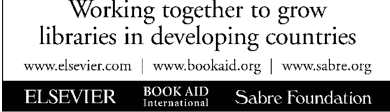

## HTML5 绘图渲染

HTML5 使用标签以描述性的层级放置和组织内容。这并不意味着页面会看起来很好。页面内容的呈现是通过使用 HTML5 中的层叠样式表第 3 版（即 CSS3）控制的。

然而，有时你也需要呈现图形。通常，HTML 仅支持 JPEG 和 GIF 格式的基于像素的图像。通过 HTML5，你现在可以创建数学生成的图像。新格式是可缩放矢量 (`SVG`) 和 `CANVAS`。两者的区别在于，`SVG` 是一种基于 XML 的语言，描述了图像如何在二维 (2D) 结构中显示。`CANVAS` 标签也描述二维图像，但它是使用 JavaScript 实现的。`CANVAS` 标签还允许你使用 JavaScript 轻松管理内部的交互性。

在本文中你将学习到：

- HTML5 可用的图像格式。
- 如何使用 `SVG` 绘画。
- 如何使用 `CANVAS` 绘画。
- 如何使用 JavaScript 为 `CANVAS` 添加交互性。

本文最终的目标是让你理解如何使用 HTML5 中的图像格式。

### Web 图像格式的故事

Web 对设计师来说并不是一个友好的地方。多年来，你一直限于可以使用的文件格式数量。Web 上用于创建图形的两种主要文件格式是 JPEG 和 GIF。

### 位图图像：在 Web 上使用 JPEG、GIF 和 PNG

JPEG 和 GIF 格式都是由单个颜色的像素创建的光栅图像。它们都有其优缺点。JPEG 图像是由联合摄影师专家小组（Joint Photographers Expert Group）管理的开放标准。JPEG 文件格式允许你创建写实感的图像（图 3.1）。查看数百万 JPEG 图像的绝佳之处是 Yahoo 的 Flickr。JPEG 图像以 JPEG 或 JPG 扩展名标识。

互联网上广泛使用的第二个文件格式是 GIF，图形接口格式（graphics interface format）。与支持数百万种颜色的 JPEG 不同，GIF 文件格式允许有限的调色板。GIF 文件格式对于具有平涂颜色和透明度的图像非常有用。


**图 3.1** JPEG 图像。

互联网上广泛使用的第三种文件格式是 PNG，便携式网络图形（Portable Network Graphics）。与 JPEG 和 GIF 不同，PNG 是一种无损格式，支持透明度。它通常用于需要锐利边缘和实色的图像。

互联网上广泛使用的第四种文件格式是 SVG，可缩放矢量（Scalable Vector Graphics）。与光栅图像不同，SVG 图像是矢量的，这意味着它们可以扩展到任何尺寸而不丢失质量。

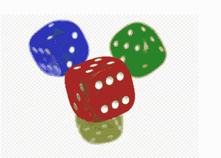

**图 3.2** SVG 图像。

### CANVAS 元素

`CANVAS` 元素是 HTML5 的一项功能，通过 JavaScript 在 Web 上绘制图形。与矢量的 SVG 不同，`CANVAS` 是基于光栅的。这意味着一旦在画布上绘制了图像，它就由像素组成。`CANVAS` 用于创建动态图形（例如游戏或实时数据处理）。

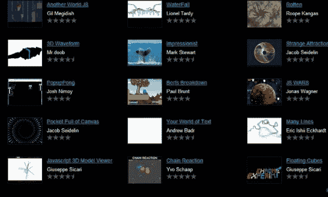

**图 3.3** Canvas 图像。

### 图像格式总结

| 格式 | 类型 | 压缩 | 透明度 | 最佳用途 |
| :--- | :--- | :--- | :--- | :--- |
| JPEG | 光栅 | 有损 | 否 | 照片 |
| GIF | 光栅 | 无损 | 有限 | 简单图形、动画 |
| PNG | 光栅 | 无损 | 是 | 标志、图标 |
| SVG | 矢量 | 无/A | 是 | 插图、图标 |
| CANVAS | 光栅 | 而定 | 是 | 游戏、动态图形 |

```
stroke-linecap="square"
stroke-miterlimit="10"
xmlns="http://www.w3.org/2000/svg"
xmlns:xlink="http://www.w3.org/1999/xlink"
<path
d="M240 148L298 148L316 96L334 148L392 148L345
180L363 232L316 200L269 232L287 182"
fill="nonzero"
fill="#ff9900"
stroke="#ff0000"
stroke-width="2.0"
stroke-linejoin="round"
stroke-linecap="butt">
</path></svg>
```

如果你想改变星形内部的填充颜色，只需要将 `fill` 属性的值改为新颜色。假设你想要一个红色的星形；只需将 `fill` 值改为 `red`，如下：

```
fill=red
```

图 3.6 显示现在星形是红色的。使用浏览器控制 SVG 图像的颜色、形状和视觉元素，允许你编写程序来动态控制 SVG 插图。

SVG 具有一些基本优势：

- 图像易于缩放。
- SVG 是可访问的。
- 搜索引擎可以轻松读取和理解 SVG 图像。

这些优势使得使用 SVG 变得非常有吸引力。

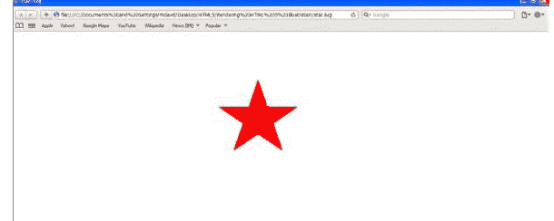

图 3.6 用于构建 SVG 绘制的任何元素都可以轻松编辑。

## 创建 SVG 图像并将其添加到网页中的基础

与传统的绘图不同，SVG 可以完全通过代码来“绘制”。你可以使用你喜欢的文本编辑器创建任何类型的 SVG 插图。管理 SVG 绘制最简单的方法是将每幅插图保存为扩展名为 `svg` 的文本文件。然后你可以将你的 SVG 绘制像 JPEG 或 PNG 文件一样视为你的图像文件。

所有的 SVG 文件都以一行声明文档为 XML 文件的行开头。以下行应该放在你所有 SVG 文档的开头：

```
<xml version="1.0" standalone="yes"?>
```

XML 声明之后是一些解释 SVG 文档的信息。第一行指定了你正在使用的哪个版本的 SVG。最常采用的版本是 1.1：

```xml
<svg version="1.1">
```

`viewBox` 标识了你正在工作的画布尺寸。`viewBox` 由四个属性组成，分别标识 `viewBox` 的 X 和 Y 坐标以及宽度和高度。

```
viewBox="0.0 0.0 300.0 800.0"
```

你可以在开放的 SVG 属性中指定用于所有对象的绘图属性。在这里，插图中的所有对象默认都将没有填充或描边，并将使用正方形线条来绘制具有 5 斜角接头限制的图像。

```xml
fill="none"
stroke="none"
stroke-linecap="square"
stroke-miterlimit="5"
```

最后两个属性提供了指向 SVG 命名空间标准的链接。

```
xmlns="http://www.w3.org/2000/svg"
xmlns:xlink="http://www.w3.org/1999/xlink">
```

绘图通过许多元素进行管理，其中 `PATH` 是主元素，用于逐点画出图像点的特定坐标。在接下来的示例中，绘制了一条单线。

```xml
<path d="M8 16L776 0" fill-rule="nonzero"
stroke="blue" stroke-width="5" stroke-linejoin="round" stroke-linecap="butt">
</path>
</svg>
```

闭合的 SVG 元素完成了你的代码。你的绘图可以保存并添加到网页中。

当你完成一个 SVG 绘制后，有几种方法可以将 SVG 图像添加到你的网页中。与 JPEG、GIF 和 PNG 文件不同，你不能使用 `IMG` 元素将 SVG 绘制添加到你的网页中。然而，你拥有三种替代方法。

第一种是 `OBJECT` 元素：

```xml
<object data="star.svg" width="300" height="800"/>
```

`OBJECT` 标签有几个属性。最重要的是 `data` 属性，它引用了 SVG 文件的位置。`width` 和 `height` 属性定义了在屏幕上用于 SVG 绘制的空间。

你将 SVG 图像添加到网页的第二种方法是通过使用 `IFRAME` 元素。通常，你使用 `IFRAME` 元素来加载 SVG 元素，但你也可以将 SVG 直接加载到你的网页中。这里有一个示例：

```xml
<iframe src="star.svg" width="300" height="800"></iframe>
```

这些将 SVG 图像嵌入你的网页的方法相对容易，且不需要像 `IMG` 元素那样复杂。

第三种将 SVG 图像添加到网页的方法是将 SVG 直接插入到 HTML 中。以下代码是作为网页保存的 SVG。这不需要单独的文件。

```html
<html>
<head>
<title>SVG embedded in XHTML</title>
</head>
<body>
<h1>SVG embedded in XHTML</h1>
<svg xmlns="http://www.w3.org/2000/svg"
width="300" height="800">
<path
d="M240 148L298 148L316 96L334 148L392 148L345
180L363 232L316 200L269 232L287 182"
fill="nonzero"
fill="#ff9900"
stroke="#ff0000"
stroke-width="2.0"
stroke-linejoin="round"
stroke-linecap="butt">
</path></svg>
</body>
</html>
```

## 形状的基础

与 HTML 不同，SVG 是通过元素构建的：

- `LINE` 用于绘制线条
- `POLYLINE` 用于绘制折线
- `RECT` 用于矩形
- `CIRCLE` 用于圆形
- `ELLIPSE` 用于椭圆
- `POLYGON` 用于多边形
- `PATH` 用于路径

绘制 SVG 的基础是使用元素。绘制直线最简单的方法是使用 `line` 元素。在下面的示例中绘制了一条直线。

```xml
<xml version="1.0" standalone="yes"?>
<!DOCTYPE svg PUBLIC "-//W3C//DTD SVG 1.1//EN" "http://www.w3.org/Graphics/SVG/1.1/svg.dtd">
<svg version="1.1" viewBox="0.0 0.0 300.0 800.0">
<line x1="10" y1="10" x2="200" y2="200" stroke="black" stroke-width="2" />
</svg>
```

`viewBox` 标识了你正在工作的画布尺寸。`viewBox` 由四个属性组成，分别标识 `viewBox` 的 X 和 Y 坐标以及宽度和高度。

```
viewBox="0.0 0.0 300.0 800.0"
```

你可以在开放的 SVG 属性中指定用于所有对象的绘图属性。

使用 `line` 元素：

```xml
<line x1="10" y1="10" x2="200" y2="200" stroke="black" stroke-width="2" />
```

`line` 元素有几个属性。最重要的是 `x1`、`y1`、`x2` 和 `y2` 属性，它们定义了线条起点和终点的坐标。`stroke` 属性定义线条颜色，`stroke-width` 属性定义线条粗细。

使用 `polyline` 元素：

```xml
<polyline points="10,10 100,50 200,100" stroke="black" stroke-width="2" />
```

`polyline` 元素有几个属性。最重要的是 `points` 属性，它定义了折线的顶点坐标。

使用 `polygon` 元素：

```xml
<polygon points="10,10 100,50 200,100 10,100" stroke="black" stroke-width="2" />
```

`polygon` 元素有几个属性。最重要的是 `points` 属性，它定义了多边形的顶点坐标。

使用 `path` 元素：

```xml
<path d="M10 10 L100 50 L200 100" stroke="black" stroke-width="2" fill="none" />
```

`path` 元素有几个属性。最重要的是 `d` 属性，它定义了路径的指令和坐标。

使用 `rect` 元素：

```xml
<rect x="10" y="10" width="100" height="50" stroke="black" stroke-width="2" fill="none" />
```

`rect` 元素有几个属性。最重要的是 `x`、`y`、`width` 和 `height` 属性，它们定义了矩形的位置和尺寸。

使用 `circle` 元素：

```xml
<circle cx="50" cy="50" r="40" stroke="black" stroke-width="2" />
```

`circle` 元素有几个属性。最重要的是 `cx`、`cy`（圆心）和 `r`（半径）。

使用 `ellipse` 元素：

```xml
<ellipse cx="50" cy="50" rx="40" ry="30" stroke="black" stroke-width="2" />
```

`ellipse` 元素有几个属性。最重要的是 `cx`、`cy`（圆心）以及 `rx`、`ry`（水平和垂直半径）。

常用的 SVG 元素包括：

- `line`
- `polyline`
- `polygon`
- `path`
- `rect`
- `circle`
- `ellipse`

这些元素允许使用 SVG 绘制各种形状。

可以使用 SVG 中的 `RECT` 元素创建矩形。`RECT` 元素有两个属性：`width` 和 `height`。下面的 SVG 添加了一个宽度为 400 像素、高度为 400 像素的矩形。图中添加了额外的 CSS 样式，以便于你查看。结果如图 3.11 所示。

```xml
<?xml version="1.0" standalone="no"?>
<!DOCTYPE svg PUBLIC "//W3C//DTD SVG 1.1//EN"
"http://www.w3.org/Graphics/SVG/1.1/DTD/svg11.dtd">
<svg width="100%" height="100%" version="1.1"
xmlns="http://www.w3.org/2000/svg">
<rect width="400" height="400"
style="fill:red;stroke-width:5;
stroke:yellow"/>
</svg>
```

在 SVG 中创建圆与创建矩形类似。在最基础的情况下，你使用 `CIRCLE` 元素。`CIRCLE` 元素只需要你使用 `R` 属性定义圆的半径。接下来的 SVG 代码绘制了一个半径为 150 像素的圆。

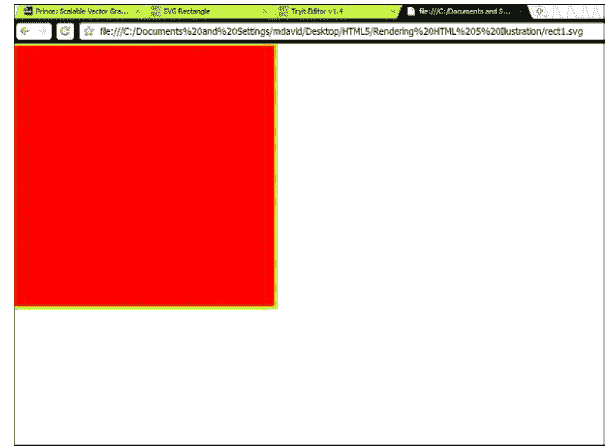

图 3.11 `RECT` 元素允许你轻松创建像这样的正矩形形状。

```xml
<?xml version="1.0" standalone="no"?>
<!DOCTYPE svg PUBLIC "-//W3C//DTD SVG 1.1//EN">
<http="http://www.w3.org/Graphics/SVG/1.1/DTD/svg11.dtd">
<svg width="100%" height="100%" version="1.1"
xmlns="http://www.w3.org/2000/svg">
<circle r="150" stroke="yellow"
stroke-width="5" fill="red"/>
</svg>
```

图 3.12 详细展示了 `CIRCLE` 元素的结果。

如你在图中所示，定义半径会导致圆的大部分部分超出浏览器窗口的左上角。为了修正这一点，你可以使用两个额外的可选属性 `Cx` 和 `CY` 来定义圆在屏幕上的 X 和 Y 位置。


```xml
<?xml version="1.0" standalone="no"?>
<!DOCTYPE svg PUBLIC "-//W3C//DTD SVG 1.1//EN">
<http="http://www.w3.org/Graphics/SVG/1.1/DTD/svg11.dtd">
<svg width="100%" height="100%" version="1.1"
xmlns="http://www.w3.org/2000/svg">
<circle cx="160" cy="160" r="150" stroke="yellow"
stroke-width="5" fill="red"/>
</svg>
```

图 3.13 显示了这些属性的使用。

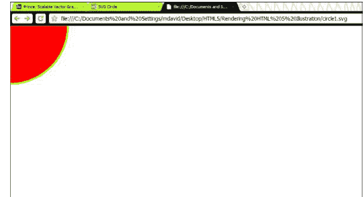

图 3.12 `CIRCLE` 元素允许你在屏幕上绘制圆。

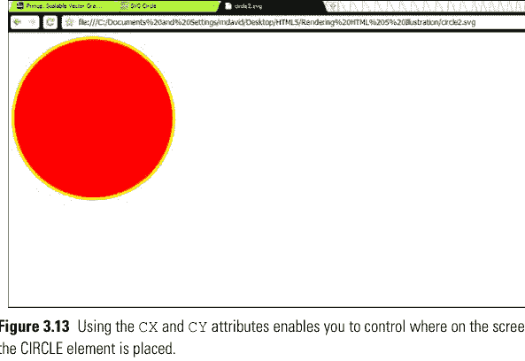

`ELLIPSE` 元素扩展了 `CIRCLE` 元素的功能，允许你通过 `RX` 和 `RY` 属性控制 X 和 Y 轴上的半径。你会在下面的代码中看到 `ELLIPSE` 元素利用 `CIRCLE` 元素的 `CX` 和 `CY` 属性来在浏览器中定位椭圆。图 3.14 显示了结果。

```xml
<?xml version="1.0" standalone="no"?>
<!DOCTYPE svg PUBLIC "-//W3C//DTD SVG 1.1//EN">
n="http://www.w3.org/Graphics/SVG/1.1/DTD/svg11.dtd">
<svg width="100%" height="100%" version="1.1"
xmlns="http://www.w3.org/2000/svg">
<ellipse cx="300" cy="150" rx="250" ry="120"
style="fill:yellow;
stroke:red;stroke-width:5"/>
</svg>
```


`POLYGON` 类似于 `POLYLINE` 元素。使用 `X` 和 `Y` 值可以绘制整个形状。图 3.15 显示了一个三角形。

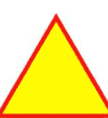

图 3.15 三角形由 `POLYGON` 元素创建。

```xml
<?xml version="1.0" standalone="no"?>
<!DOCTYPE svg PUBLIC "//W3C//DTD SVG 1.1//EN"
"http://www.w3.org/Graphics/SVG/1.1/DTD/svg11.dtd">
<svg width="100%" height="100%">
<polygon points="220,100 290,220 150,220"
style="fill:yellow;
stroke:red;stroke-width:5"/>
</svg>
```

使用 SVG 创建的最复杂的元素是 `PATH` 元素。你使用 `PATH` 元素创建的每个图形都是使用一系列特殊代码来解释线条在屏幕上的移动方式。这些代码是：

- `M` 移动到
- `L` 连线到
- `H` 水平线到
- `V` 垂直线到
- `C` 曲线到
- `S` 平滑曲线到
- `Q` 二次贝塞尔曲线
- `T` 平滑二次贝塞尔曲线
- `A` 椭圆弧
- `Z` 闭路径

下面的代码使用绘图创建了一个笑脸图。图 3.16 显示了代码的结果。

```xml
<?xml version="1.0" standalone="yes"?>
<svg version="1.1" viewBox="0.0 152.0 864.0"
fill="none" stroke="none" stroke-linecap="square"
stroke-miter="10" xmlns="http://www.w3.org/2000/svg"
xmlns:link="http://www.w3.org/1999/xlink">
<path d="M556 108 L556 108 C216,150 180,184 332,184 C216,66 216,50 156,108 Z"
fill-rule="nonzero" fill="#ff0ff"/></path>
```

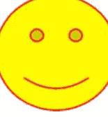

图 3.16 `POLYGON` 元素允许你创建像笑脸这样的复杂的图像。

```xml
<path d="M102 85 C102,81 106,77 110,77 C119,81 119,85 C119,90 115,93 106,93 102,90 102,85 M153,85 C153,81 157,77 162,77 C166,81 170,85 C170,90 166,93 162,93 C157,93 153,90 153,85"
fill-rule="nonzero" fill="#ccc00"
stroke stroke-width="2.0"
stroke-linejoin="round" stroke-linecap="butt"/></path>
<path d="M93,141 Q136,169 179,141 184,56"
fill-rule="nonzero" stroke="#ff0000" stroke-width="2.0"
stroke-linejoin="round" stroke-linecap="butt"/></path>
<path d="M56,108 C156,108 56,66 92,32 136,32 C180,32 216,66 216,108 C216,180 184,136 142,92 184,56 150,56"
fill-rule="nonzero" fill="#ccc00"
stroke stroke-width="2.0"
stroke-linejoin="round" stroke-linecap="butt"/></path>
</svg>
```

正如你所看到的，使用 `PATH` 元素是复杂的。使用 `PATH` 元素创建的每个图形都是使用二次贝塞尔曲线、三次贝塞尔曲线、平滑二次贝塞尔曲线以及椭圆弧来构建的。

## 添加 CSS 颜色

填充（`fill`）和描边（`stroke`）属性控制图像内部的颜色。在这个示例中使用了颜色名称，但你可以使用任何颜色格式来控制 CSS，包括以下格式：

- 颜色名称——你可以拥有棕色、红色或青色等颜色名称。
- 全六进制——由字母数字组成的十六进制值。
- 短六进制——由三个字母数字组成的十六进制值。
- `RGB`——红、绿、蓝组合。
- `RGBA`——红、绿、蓝组合以及透明度值（`alpha`）。
- `HSL`——色调、饱和度和亮度的组合。
- `HSLA`——色调、饱和度和亮度组合以及透明度值（`alpha`）。

除了使用 CSS 颜色外，你还可以使用以下测量单位：

- `cm`——厘米
- `in`——英寸
- `mm`——毫米
- `pc`——画磅（1 画磅 = 12 点）
- `pt`——点（1 点 = 1/2 英寸）
- `px`——像素

通过利用 CSS，你可以更改椭圆的描边颜色以及以 `cm` 为单位的测量。

```xml
xmlns="http://www.w3.org/2000/svg">
<ellipse cx="300" cy="150" rx="250" ry="120"
style="fill:blue;
stroke="#999;stroke-width:1cm"/>
</svg>
```

图 3.18 标准 CSS 颜色和测量值可以控制绘制内容的呈现。

图 3.18 展示了如何使用 CSS 颜色和测量值。

要在 SVG 图中添加线性渐变，你需要使用特定的 SVG 渐变元素。

## 在 SVG 图像上应用渐变

SVG 采用了一种非常棒的技术，允许你在 SVG 插图中的一个或多个图像上重用渐变定义。这是通过使用 `LINEARGRADIENT` 或 `RADIALGRADIENT` 元素类型实现的。两种渐变都允许你定义渐变的水平和垂直颜色以及方向。

让我们先看看线性渐变。`LINEARGRADIENT` 元素由五个不同的属性组成，这些属性定义了渐变在线性方向上的行为。你提供的第一个信息属性是 `ID` 属性，它允许为你的渐变命名，以便你可以在图中引用它。

对于线性渐变，你可以在 X-Y 轴上绘制渐变。要确定渐变的方向，你必须指定起始和结束的 X 点和 Y 点。以下展示了一个从左到右的渐变：

```xml
<linearGradient x1="0%" y1="0%" x2="100%" y2="0%">
```

要创建一个垂直渐变，将 Y 轴和 X 轴改为：

```xml
<linearGradient x1="0%" y1="100%" x2="0%" y2="0%">
```

你可以看到这两个数字之间的区别在于将 X 或 Y 轴设置为 100%。图 3.19。

改变 X 和 Y 的百分比将改变渐变的绘制方式。下一步是为渐变添加颜色。为了实现这一点，你使用 `STOP` 元素创建一个包含两种或更多颜色的列表。例如，要创建一个简单的从黄色到红色的颜色变化，你将如下所示添加两个 `STOP` 元素。

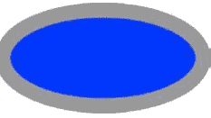

图 3.19 可以使用 `LINEARGRADIENT` 元素在 SVG 图像中应用渐变。

```xml
<stop offset="0%" style="stop-color:yellow;opacity:1"/>
<stop offset="100%" style="stop-color:red;stop-opacity:1"/>
```

`offset` 属性决定了渐变从哪里开始。上面的示例在图像空间内绘制了平滑的渐变变化。`style` 属性允许你列出任何 CSS 特有的颜色。你可以将示例中的两种颜色添加到 `LINEARGRADIENT` 中。

```xml
<xml version="1.0" standalone="no"?>
<!DOCTYPE svg PUBLIC "//W3C//DTD SVG/1.1//EN"
"http://www.w3.org/Graphics/SVG/1.1/DTD/svg.11.dtd">
<svg width="100%" height="100%" version="1.1"
xmlns="http://www.w3.org/2000/svg">
<defs>
<linearGradient id="yellow_red" x1="0%" y1="0%"
x2="0%" y2="0%">
<stop offset="0%" style="stop-color:yellow;opacity="1%"/>
<stop offset="100%" style="stop-color:red;opacity="1%"/>
</linearGradient>
</defs>
<rect width="400" height="400"
style="fill:url(#yellow_red);
stroke:yellow"/>
</svg>
```

你可以看到矩形图像使用 URL 字符串来寻找名为 `#yellow_red` 的样式。`yellow_red` 颜色样式就是渐变的名称。见图 3.20。

径向渐变与线性渐变相似。区别在于你本质上是用径向渐变绘制两个圆——外圆和一个内圆。与线性渐变一样，`RADIAL` 元素需要一个有效的 ID 名称来标识渐变。之后，你有五个属性来定义内圆和半径。以下是一个示例，`CX` 和 `CY` 属性是外圆，`R` 是半径，而 `FX` 和 `FY` 属性是内圆。

```xml
<radialGradient id="yellow_red" cx="50%" cy="50%"
r="50%"
fx="50%" fy="50%">
```

渐变的颜色使用 `STOP` 列表定义。以下代码显示了应用到矩形上的径向渐变。

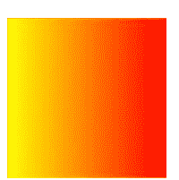

图 3.20 线性渐变可以水平方向绘制。

```xml
<?xml version="1.0" standalone="no"?>
<!DOCTYPE svg PUBLIC "//W3C//DTD SVG 1.1//EN"
"http://www.w3.org/Graphics/SVG/1.1/DTD/svg11.dtd">
<svg width="100%" height="100%" version="1.1"
xmlns="http://www.w3.org/2000/svg">
<defs>
  <radialGradient id="yellow_red" cx="50%" cy="50%"
  r="50%"
  fx="50%" fy="50%">
    <stop offset="0%" style="stop-color:yellow;stop-opacity:1"/>
    <stop offset="100%" style="stop-color:red;stop-opacity:1"/>
  </radialGradient>
</defs>
<rect width="400" height="400"
style="fill:url(#yellow_red);
stroke:yellow"/>
</svg>
```

图 3.21 显示了结果。线性径向渐变都可以超过两种颜色。以下代码（见图 3.22）有四种颜色。

```xml
<stop offset="0%" style="stop-color:yellow;opacity:1"/>
<stop offset="25%" style="stop-color:red;opacity:1"/>
<stop offset="50%" style="stop-color:blue;opacity:1"/>
<stop offset="100%" style="stop-color:black;opacity:1"/>
```

此外，你还可以将多个图像链接到同一个渐变。以下 SVG 将圆和矩形链接到同一个渐变。

```xml
<?xml version="1.0" standalone="no"?>
<!DOCTYPE svg PUBLIC "//W3C//DTD SVG 1.1//EN"
"http://www.w3.org/Graphics/SVG/1.1/DTD/svg11.dtd">
<svg width="100%" height="100%" version="1.1"
xmlns="http://www.w3.org/2000/svg">

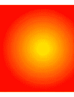

图 3.21 应用到矩形上的径向渐变。

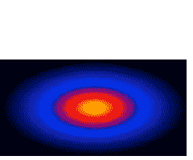

图 3.22 可以创建多种颜色来改变渐变。

<defs>

<radialGradient id="yellow_red" cx="50%" cy="50%" r="50%" fx="50%" fy="50%">

  <stop offset="0%" style="stop-color:yellow;stop-opacity:1"/>

  <stop offset="25%" style="stop-color:red;stop-opacity:1"/>

  <stop offset="50%" style="stop-color:blue;stop-opacity:1"/>

  <stop offset="100%" style="stop-color:black;stop-opacity:1"/>

</radialGradient>

</defs>

<rect width="500" height="250" style="fill:url(#yellow_red);" stroke="yellow"/>

<circle cx="250" cy="250" r="180" stroke-width="2" fill="url(#yellow_red)" />

</svg>
```

结果如图 3.23。

## 为你的 SVG 图添加文本

可以使用 `TEXT` 元素将文本添加到 SVG 图中。在简单的情况下，你只需要在 SVG 文档中添加 `TEXT` 元素，如下代码和图 3.24 所示。

```xml
<svg xmlns="http://www.w3.org/2000/svg"
xmlns:xlink="http://www.w3.org/1999/xlink">
  <text x="100" y="40">It was the best of times</text>
</svg>
```

`X` 和 `Y` 属性指定了文本在屏幕上的位置。文本的格式由 `style` 属性中的 CSS 控制。文本可以应用以下样式：

- `Font-family`—字体名称
- `Font-size`—字体大小
- `Kerning`—字间间距
- `Stroke`—字的外部颜色
- `Fill`—字的内部颜色

以下是显示文本格式的 SVG 代码示例。

```xml
<svg xmlns="http://www.w3.org/2000/svg"
  xmlns:xlink="http://www.w3.org/1999/xlink">
  <text x="100" y="40"
```

# It was the best of times

图 3.24 使用 `TEXT` 元素可以轻松地插入 SVG 图。

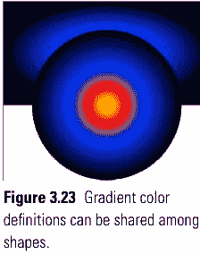


`style="font-family: Arial; font-size: 24pt; stroke: red; fill: yellow; kerning: 3;"`

> It was the best of times

```svg
<text x="100" y="140" style="font-family: Arial; font-size: 24pt; stroke: red; fill: yellow; kerning: 3;">It was the best of times</text>
```

图 3.25 显示了代码的结果。

## It was the best of times

图 3.25 格式化的 SVG 文本。

文本被仅仅视为 SVG 中简单的另一种图像类型。这允许你添加一些额外的视觉效果。例如，你可以为文本使用渐变作为`FILL`样式。以下 SVG 代码放大了文本尺寸以显示渐变填充（见图 3.26）。

```xml
<svg xmlns="http://www.w3.org/2000/svg" xmlns:xlink="http://www.w3.org/1999/xlink">
  <radialGradient id="yellow_red" cx="50%" cy="50%" r="50%" fx="50%" fy="50%">
    <stop offset="0%" style="stop-color:yellow;stop-opacity:1"/>
    <stop offset="25%" style="stop-color:red;stop-opacity:1"/>
    <stop offset="50%" style="stop-color:blue;stop-opacity:1"/>
    <stop offset="100%" style="stop-color:black;stop-opacity:1"/>
  </radialGradient>
</svg>
```

图 3.26 线性和径向渐变都可以用于文本样式化。

```svg
<text x="100" y="140" style="font-family: Arial; font-size: 96pt; stroke: red; fill: url(#yellow_red);">>那是最美好的时刻</text>
```

SVG 支持一种将字体嵌入到文档中的方法。然而，在 SVG 中嵌入字体是非常棘手的。挑战在于，若要嵌入字体，你必须指定所使用的每种字体的精确形状。字形（Glyph）是与键盘上的按键匹配的形状。图 3.27 是字母“A”的一个字形。

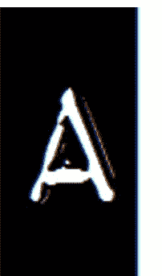

SVG 的`glyph`元素绘制字体的轮廓并与字符绑定。这可以变得非常快。以下是你将用于在 SVG 中将字母“a”复制为可重用字形的内容。

```svg
<glyph unicode="a" glyph-name="a" horiz-adv-x="577" d="M595-324H-324H38V915-324ZM117Q271 25 13 25T204 29Q154 15 59T166 86Q169 96 107 132T103 113Q185 108 165 202T97Q213 27 102 227T202 10386 108 320 105 347 109Q359 115 370 132T528T81127388 126 193 118T403 104T412 82T421 67Q640 45 426 441 253Q471 19 47Q275 486 47Q491 60 48T716 90Q9657 102 442 148Q176 126 178T404 235T387 298Q382 96 372 321T371 332 371 342 433 368 448 317 460 481 305 307 510 529 588 233 234 582T271516T261 500T254 485Q253 473 257 464T261 448Q261 442 255 434 245 416Q241 404 405 390 397T238 381Q237 330 380T189 265Q157 230 216 277T172 194Q171 188 166 196Q171 135 108 148 128 118 127 120T780 110T417 227 336 235 507 218 377 201T376 169 175 165 168 132T138 138 111 21 221 269 269 25 225 180 276 228 165 208 151 111 118 164 163 165 172 175 189 19 207 208 228 225 228 237 224 257 229 29 337 337 355 355 59 36 332 32 34 362 349 370 377 362 392 269 402 271 408 282 411 486 409 298 385 334 330 231 231 235 225 228 280 244 244 257 231 261 264 268 264 269 284 262 272 302 202 202 202 28 28 285 253 256 248 234 222 299 281 221 207 205 205 259 189 186 201 78 340 83Z" />
```

字母“A”的字形。

要使用完整的字母表，你需要为键盘上的每个字符创建小写字母。简单的字体会很快生成。

## 为你的图形添加交互性和 JavaScript

你可以使用 JavaScript 为你的 SVG 添加交互性。你通过`script`元素来实现这一点。以下示例添加了可以改变点击形状颜色的 JavaScript。

```xml
<?xml version="1.0" encoding="UTF-8"?>
<!DOCTYPE svg PUBLIC "-//W3C//DTD SVG 1.0//EN" "http://www.w3.org/Graphics/SVG/1.1/svg.dtd">
<svg xmlns="http://www.w3.org/2000/svg" xmlns:xlink="http://www.w3.org/1999/xlink" width="800" height="800">
<script type="text/javascript">
<![CDATA[
function randomColor(evt) {
  var red = Math.round(Math.random() * 255);
  var green = Math.round(Math.random() * 255);
  var blue = Math.round(Math.random() * 255);
  evt.target.setAttributeNS(null,"fill","rgb("+red+","+green+","+blue+")");
}
]]>
</script>
</svg>
```

你可以，这允许浏览器中的 JavaScript 引擎正确解释脚本。`onclick`属性将 JavaScript 函数名与矩形关联起来。

## JavaScript

使用 JavaScript 你可以用 SVG 做很多事情。一些扩展 JavaScript 和 SVG 集成极限的优秀网站有：

- http://raphael.js/
- http://svgkit.sourceforge.net/
- http://www.liquidx.net/plotkit/
- http://www.lututhan.net/svgml/index.html
- http://code.google.com/pl/svgweb/

这些中的每一个都提供了 JavaScript 代码库，允许你完成复杂的交互式 SVG 演示。

## 利用 SVG 绘画工具

如果你已经读到这里，你已经意识到使用 SVG 绘图是很复杂的。遗憾的是，很少有插图可以用来创建 SVG 图。幸运的是，市场上的几个工具刚好非常好。

Adobe Illustrator 自 CSS2 起就支持导出任何 SVG 格式的插图。这是一个好消息，因为你可以将复杂的图形直接导入到 SVG。

虽然 Illustrator 导出为 SVG，但开源项目 Inkscape 可以保存和编辑 SVG 文件。Inkscape 不像 Illustrator 那么易用，但它是免费的，而且从零开始创建 SVG 插图要容易得多。

Sketsa 是一个基于 Java 的绘画工具。该工具非常基础，但总比比没有好。

最后，如果你使用 Google Docs 在线创建文档，你会发现发现“插入图像”功能使用 SVG 来创建图像。此外，如果你使用文本，Google 会使用复杂的字形编辑器为你嵌入字体。

好消息是你有工具可以创建 SVG 插图。坏消息是，很少有工具可以视觉化地为你的 SVG 图形添加交互性。随着 SVG 在 Google Maps 和 Wikipedia 等网站上变得越来越流行并成为 HTML5 的一等公民，我们应该预期 SVG 创作工具更加常见。

# 26

图 3.29 显示了最终结果。

通过单步执行代码，你会发现 CANVAS 元素并没有发生变化。改变的是 CANVAS 元素中对象的呈现方式。使用 JavaScript，你开始定义一个名为 "draw" 的新函数。该 "draw" 函数由一个名为 "my" 的变量组成，该变量声明 CANVAS 元素是一个 2D 对象。2D 的区别很重要，因为预计作为 WebGL 的一部分将为 CANVAS 元素添加一个三维 (3D) 定义。

使用级联样式表来定义绘制的颜色和边框宽度。在本例中，图形是黑色的，带有实心的 1 像素宽的轮廓。

BODY 中的 "onload" 事件在 CANVAS 图形绘制完成时触发。

图 3.29 CANVAS 元素绘制了一个简单的矩形。

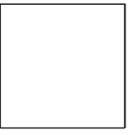

# 控制形状

CANVAS 元素并不具备在 SVG 中找到的丰富原始绘制对象集合。唯一的原始绘制对象是矩形。这并没有限制你可以绘制的内容，因为 CANVAS 利用了另一种替代的丰富的路径绘制函数集合，允许你创建复杂的路径、弧、贝塞尔曲线和二次曲线，并可以将这些内容作为你插图的基础。

矩形形状由四个基本部分组成：

- 矩形沿 X 轴的起始位置
- 矩形沿 Y 轴的起始位置
- 宽度——矩形的宽度
- 高度——矩形的高度

以下是一个实心矩形形状示例：

```
myRectangle.fillRect(15,15,100,100);
```

此描述将矩形放置在距离 CANVAS 元素左侧（X 轴） 15 像素处，距离 CANVAS 元素顶部（Y 轴） 15 像素处，宽度和高度均为 100 像素。你需要添加以下 HTML 来查看矩形。

```html
<html>
<head>
  <title>基础 Canvas 绘制</title>
<script>
  function draw() {
    var canvas = document.getElementById('myCanvas');
    if (canvas.getContext) {
      var myRectangle = canvas.getContext('2d');
      myRectangle.fillRect(15,15,100,100);
    }
  }
</script>
<style type="text/css">
canvas { border: 1px solid black; }
</style>
</head>
<body onload="draw();">
  <canvas id="myCanvas" width="150" height="150"></canvas>
</body>
</html>
```

描述矩形的代码必须放置在 HTML 页面的脚本部分。在下方你将看到在第 6 行声明了一个名为 myRectangle 的变量。第 7 行描述了变量 myRectangle 的外观。CANVAS 元素图示了矩形将绘制在何处。

你可以绘制三种不同类型的矩形原始对象。示例演示了如何填充矩形形状。你也可以绘制 clearRect 和 strokeRect。

- clearRect 在屏幕上绘制一个透明的矩形。
- strokeRect 在屏幕上仅绘制矩形的轮廓。

以下是你编写的描述如何绘制不同矩形原始对象的 JavaScript。

```
myRectangle.fillRect(15,15,100,100);
myRectangle.clearRect(20,20,60,60);
myRectangle.strokeRect(25,25,50,50);
```

所有三个矩形都可以与 JavaScript 结合并在你的网页中呈现，如下：

```html
<html>
<head>
  <title>基础 Canvas 绘制</title>
<script>
  function draw() {
    var canvas = document.getElementById('myCanvas');
    if (canvas.getContext()) {
      var myRectangle = canvas.getContext('2d');
      myRectangle.fillRect(15,15,100,100);
      myRectangle.clearRect(20,20,60,60);
      myRectangle.strokeRect(25,25,50,50);
    }
  }
</script>
<style type="text/css">
canvas { border: 1px solid black; }
</style>
</head>
<body onload="draw();">
<canvas id="myCanvas" width="150" height="150"></canvas>
</body>
</html>
```

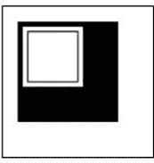

图 3.30 使用 CANVAS 元素可以绘制三种不同类型的矩形原始对象。

查看图 3.30 如何创建矩形。所有其他绘制都是从你描述的路径创建的。

## 绘制简单形状

形状在 JavaScript 中描述并在 CANVAS 元素呈现。描述形状的结构采用以下方法：

- beginPath
- moveTo
- closePath
- fill

beginPath 方法的作用是声明形状的开始。紧随 beginPath 方法之后就是你开始绘制形状的地方。moveTo 方法用于描述你已经移动了虚拟笔并开始绘制新形状。moveTo 方法是你描述形状结构的地方。以下代码演示了如何开始并绘制一个三角形。

```
myShape.beginPath();
myShape.moveTo(750,500);
myShape.lineTo(1000,750);
myShape.lineTo(1000,250);
```

第一行声明了形状的开始。第二行距离左侧（X 轴） 750 像素，向下 500 像素（Y 轴）。三角形本身是闭的。默认情况下，你不需要使用 closePath 方法。


图 3.31 使用 CANVAS 元素绘制了一个三角形。

最后一个方法是 fill。图 3.31 展示展示了结果。

```html
<html>
<head>
  <title>基础 Canvas 绘制</title>
<script>
  function draw() {
    var canvas = document.getElementById('myCanvas');
    if (canvas.getContext()) {
      var myRectangle = canvas.getContext('2d');
      myRectangle.fillRect(15,15,100,100);
      myRectangle.clearRect(20,20,60,60);
      myRectangle.strokeRect(25,25,50,50);
    }
  }
</script>
<style type="text/css">
canvas { border: 1px solid black; }
</style>
</head>
<body onload="draw();">
  <canvas id="myCanvas" width="150" height="150"></canvas>
</body>
</html>
```

## 绘制线条

描述形状的最简单路径是使用线条。例如，以下代码描述了一个矩形。

```
myTriangle.beginPath();
myTriangle.moveTo(10,10);
myTriangle.lineTo(500,10);
myTriangle.lineTo(10,500);
```

lineTo 属性描述了用于创建位置的线条。

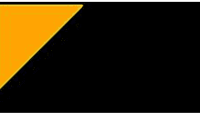

**图 3.32** 你可以绘制三种不同类型的矩形原始对象。

```
myTriangle.lineTo(500,10);
myTriangle.lineTo(10,500);
myTriangle.lineTo(10,10);
```

图 3.32 展示了三角形的样子。以下代码展示了如何在你的网页浏览器中呈现三角形。


# 绘制矩形

以下是一个简单的 HTML 页面，使用 CANVAS 元素绘制一个矩形：

```html
<!DOCTYPE html>
<html lang="en">
  <head><meta charset="utf-8">
  <title>绘制矩形</title>
  <script type="text/javascript">
    window.addEventListener('load', function () {
    var elem = document.getElementById('myCanvas');
    if (!elem || !elem.getContext) {
      return;
      var myTriangle = elem.getContext('2d');
      if (myTriangle) {
        myTriangle.fillStyle = "orange";
        myTriangle.strokeStyle = "yellow";
        myTriangle.lineWidth = 7;
        myTriangle.beginPath();
        myTriangle.moveTo(10,10);
        myTriangle.lineTo(500,10);
        myTriangle.lineTo(10,500);
        myTriangle.lineTo(10,10);
        myTriangle.fill();
        myTriangle.stroke();
        myTriangle.closePath();
      }
    });
  //></script>
</head> <body style="background-color:#000;">
<canvas id="myCanvas" width="500" height="500">
</canvas>
</body></html>
```

## 创建弧线

当你想要绘制圆时，使用 `Arc` 方法。弧使用六个不同的属性绘制：

- `X`——圆心沿 X 轴的坐标。
- `Y`——圆心沿 Y 轴的坐标。
- `Radius`——圆的大小。
- `startAngle`——弧的起始点。
- `endAngle`——弧的终点。
- `anticlockwise`——一个决定圆的绘图方向的布尔值。

以下代码描述了弧的结构：

```
context.arc(260,260,250,0,7,true);
```

图 3.33 显示了页面上绘制的圆。

以下代码将 `Arc` 方法和指令嵌入到 CANVAS 图中。

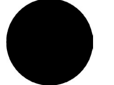

```html
<!DOCTYPE html>
<html>
<head>
  <title>Canvas - Creating a Circle</title>
  <script type="text/javascript">
    window.onload = function() {
      var drawingCanvas = document.getElementById('myCircle');
      if (drawingCanvas && drawingCanvas) {
        var context = drawingCanvas.getContext('2d');
        context.strokeStyle = "yellow";
        context.fillStyle = "red";
        context.lineWidth = 20;
        context.beginPath();
        context.arc(260,260,250,0,Math.PI*2,true);
        context.closePath();
        context.stroke();
        context.fill();
      }
    }
  </script>
</head>
<body>
  <canvas id="myCircle" width="550" height="550"></canvas>
</body>
</html>
```

图 3.34 说明了你如何为你的圆添加颜色。

除了 `Arc` 方法外，你还可以添加贝塞尔曲线（Bezier curves）和二次曲线，这两者都是创建图像的数学计算。贝塞尔曲线是由法国数学家 Pierre Bezier 在 1962 年开发的。贝塞尔曲线是根据描述抛物线的参数曲线计算得的。

图 3.35 显示用于创建贝塞尔曲线的四个点。

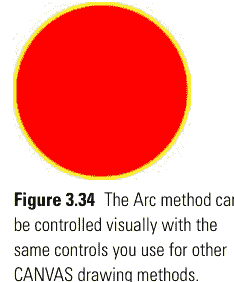

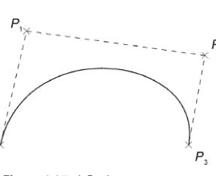

二次曲线基于贝塞尔曲线。区别在于二次曲线是由三个定义点构建的，而不是仅仅一个。在 CANVAS 中绘制复杂的贝塞尔曲线图像可能是困难的，原因很简单：没有像 Adobe Illustrator 那样的视化绘图工具可以导出可被 CANVAS 元素读取图像。

图 3.35 贝塞尔曲线。

## 添加颜色

现在你已经在页面上有了基本形状。没什么大不了的，对吧？使用 JavaScript，你现在可以开始程序化地绘制你的对象了。以下显示了两个半透明的正方形。你会发现填充颜色是一种 CSS 样式。

```html
<html>
<head>
<script type="application/x-javascript">
function draw() {
  var canvas = document.getElementById("myCanvas");
  if (canvas.getContext) {
    var ctx = canvas.getContext("2d");
    ctx.fillStyle = "rgb(0,0,0)";
    ctx.fillRect(10, 10, 150, 150);
    ctx.fillStyle = "rgba(0, 300, 0, 0.5)";
    ctx.fillRect(75, 75, 150, 150);
  }
}
</script>
</head>
<body onload="draw();">
<canvas id="myCanvas" width="300"></canvas>
</body>
</html>
```

`fill` 方法允许你应用 CSS 样式格式。CSS 增加了你对屏幕上绘图的视觉控制能力。作为 SVG，你可以使用任何 CSS 颜色命名格式，如 Hex 和 RGB。

线性渐变和径向渐变也可以应用于 CANVAS 图像。在 SVG 中，线性和径向渐变继承了 CSS 实现渐变的方式。渐变的构建是通过创建一个形状、赋予渐变名称、定义渐变，然后应用渐变来实现的。

第一步是创建一个形状。以下是一个简单的 CANVAS 形：

```
myRectangle.fillRect(10,10,650,650);
```

下一步是创建一个声明新渐变的新变量。下面这行代码创建了一个名为 `verticalGradient` 的新渐变。该名称是任意的；不可能是任意的是名称随后的渐变类型描述。

```javascript
var verticalGradient = myRectangle.createLinearGradient(0,0,0,650);
```

在这里你将渐变与 CANVAS 对象 `myRectangle` 关联。在此时，渐变还没有绘制后面出现的图像——此时的代码仅仅是将渐变和图像关联。`createLinearGradient` 属性决定了渐变在哪里绘制对象。括号内是 X 和 Y 轴以及高度和宽度。

渐变必须至少有两种颜色。以下将绘制一种从红色开始，在图像 50% 处过渡到黄色的渐变色。

```javascript
verticalGradient.addColorStop(0, 'red');
verticalGradient.addColorStop(0.5, 'yellow');
```

最后一步是使用 `paintStyle` 属性将渐变绘制到矩形中：

```javascript
myRectangle.setStyle = verticalGradient;
```

整个 CANVAS 脚本如下：

```html
<html>
<head>
  <title>Linear Gradient</title>
  <script type="application/x-javascript">
  function draw() {
    var canvas = document.getElementById('myCanvas');
    if (canvas.getContext) {
      var ctx = canvas.getContext("2d");
      var verticalGradient = ctx.createLinearGradient(0,0,0,650);
      verticalGradient.addColorStop(0, 'red');
      verticalGradient.addColorStop(0.5, 'yellow');
      ctx.fillStyle = verticalGradient;
      ctx.fillRect(10,10,650,650);
    }
  }
  </script>
</head>
<body onload="draw();">
  <canvas id="myCanvas" width="800" height="800"></canvas>
</body>
</html>
```

*(注：最后代码的 OCR 文本跨越了页面；我根据上下文重构了它。)*

是一个简单的 CANVAS 矩形：

```
myRectangle.fillRect(10,10,650,650);
```

下一步是创建一个声明新渐变的新变量。下面这行代码创建了一个名为 `verticalGradient` 的新渐变。该名称是任意的；不可能是任意的是名称随后的渐变类型描述。

```javascript
var verticalGradient = myRectangle.createLinearGradient(0,0,0,650);
```

在这里你将渐变与 CANVAS 对象 `myRectangle` 关联。此时，渐变还没有绘制后面出现的图像——此时的代码仅仅是将渐变和图像关联。`createLinearGradient` 属性决定了渐变在哪里绘制对象。括号内是 X 和 Y 轴以及高度和宽度。

渐变必须至少有两种颜色。以下将绘制一种从红色开始，在图像 50% 处过渡到黄色的渐变色。

```javascript
verticalGradient.addColorStop(0, 'red');
verticalGradient.addColorStop(0.5, 'yellow');
```

最后一步是使用 `paintStyle` 属性将渐变绘制到矩形中：

```javascript
myRectangle.setStyle = verticalGradient;
```

整个 CANVAS 脚本如下：

```html
<html>
<head>
  <title>Linear Gradient</title>
  <script type="application/x-javascript">
  function draw() {
    var canvas = document.getElementById('myCanvas');
    if (canvas.getContext) {
      var ctx = canvas.getContext("2d");
      var verticalGradient = ctx.createLinearGradient(0,0,0,650);
      verticalGradient.addColorStop(0, 'red');
      verticalGradient.addColorStop(0.5, 'yellow');
      ctx.fillStyle = verticalGradient;
      ctx.fillRect(10,10,650,650);
    }
  }
  </script>
</head>
<body onload="draw();">
  <canvas id="myCanvas" width="800" height="800"></canvas>
</body>
</html>
```

*(自纠：OCR 文本包含了大量的重复和跨越页面的代码。我提供了一个合并后的版本。)*

[最终内容]

- `Radius`——圆的大小。
- `startAngle`——弧的起始点。
- `endAngle`——弧的终点。
- `anticlockwise`——一个决定圆的绘图方向的布尔值。

以下代码描述了弧的结构：

```
context.arc(260,260,250,0,7,true);
```

图 3.33 显示了页面上绘制的圆。

以下代码将 `Arc` 方法和指令嵌入到 CANVAS 图中。


```html
<!DOCTYPE html>
<html>
<head>
  <title>Canvas - Creating a Circle</title>
  <script type="text/javascript">
    window.onload = function() {
      var drawingCanvas = document.getElementById('myCircle');
      if (drawingCanvas && drawingCanvas) {
        var context = drawingCanvas.getContext('2d');
        context.strokeStyle = "yellow";
        context.fillStyle = "red";
        context.lineWidth = 20;
        context.beginPath();
        context.arc(260,260,250,0,Math.PI*2,true);
        context.closePath();
        context.stroke();
        context.fill();
      }
    }
  </script>
</head>
<body>
  <canvas id="myCircle" width="550" height="550"></canvas>
</body>
</html>
```

图 3.34 说明了你如何为你的圆添加颜色。

除了 `Arc` 方法外，你还可以添加贝塞尔曲线（Bezier curves）和二次曲线，这两者都是创建图像的数学计算。贝塞尔曲线是由法国数学家 Pierre Bezier 在 1962 年开发的。贝塞尔曲线是根据描述抛物线的参数曲线计算得的。

图 3.35 显示用于创建贝塞尔曲线的四个点。


二次曲线基于贝塞尔曲线。区别在于二次曲线是由三个定义点构建的，而不是仅仅一个。在 CANVAS 中绘制复杂的贝塞尔曲线图像可能是困难的，原因很简单：没有像 Adobe Illustrator 那样的视化绘图工具可以导出可被 CANVAS 元素读取图像。

图 3.35 贝塞尔曲线。

## 添加颜色

现在你已经在页面上有了基本形状。没什么大不了的，对吧？使用 JavaScript，你现在可以开始程序化地绘制你的对象了。以下显示了两个半透明的正方形。你会发现填充颜色是一种 CSS 样式。

```html
<html>
<head>
<script type="application/x-javascript">
function draw() {
  var canvas = document.getElementById("myCanvas");
  if (canvas.getContext) {
    var ctx = canvas.getContext("2d");
    ctx.fillStyle = "rgb(0,0,0)";
    ctx.fillRect(10, 10, 150, 150);
    ctx.fillStyle = "rgba(0, 300, 0, 0.5)";
    ctx.fillRect(75, 75, 150, 150);
  }
}
</script>
</head>
<body onload="draw();">
<canvas id="myCanvas" width="300"></canvas>
</body>
</html>
```

`fill` 方法允许你应用 CSS 样式格式。CSS 增加了你对屏幕上绘图的视觉控制能力。作为 SVG，你可以使用任何 CSS 颜色命名格式，如 Hex 和 RGB。

线性渐变和径向渐变也可以应用于 CANVAS 图像。在 SVG 中，线性和径向渐变继承了 CSS 实现渐变的方式。渐变的构建是通过创建一个形状、赋予渐变名称、定义渐变，然后应用渐变来实现的。

第一步是创建一个形状。以下是一个简单的 CANVAS 形：

```
myRectangle.fillRect(10,10,650,650);
```

下一步是创建一个声明新渐变的新变量。下面这行代码创建了一个名为 `verticalGradient` 的新渐变。该名称是任意的；不可能是任意的是名称随后的渐变类型描述。

```javascript
var verticalGradient = myRectangle.createLinearGradient(0,0,0,650);
```


在这里你将渐变与`CANVAS`对象`myRectangle`关联。在此时，渐变还没有绘制后面出现的图像——此时的代码仅仅是将渐变和图像关联。`createLinearGradient`属性决定了渐变在哪里绘制对象。括号内是`X`和`Y`轴以及高度和宽度。

渐变必须至少有两种颜色。以下将绘制一种从红色开始，在图像`50%`处过渡到黄色的渐变色。

```javascript
verticalGradient.addColorStop(0, 'red');
verticalGradient.addColorStop(0.5, 'yellow');
```

最后一步是使用`paintStyle`属性将渐变绘制到矩形中：

```javascript
myRectangle.setStyle = verticalGradient;
```

整个`CANVAS`脚本如下：

```html
<html>
<head>
  <title>Linear Gradient</title>
  <script type="application/x-javascript">
  function draw() {
    var canvas = document.getElementById('myCanvas');
    if (canvas.getContext) {
      var ctx = canvas.getContext("2d");
      var verticalGradient = ctx.createLinearGradient(0,0,0,650);
      verticalGradient.addColorStop(0, 'red');
      verticalGradient.addColorStop(0.5, 'yellow');
      ctx.fillStyle = verticalGradient;
      ctx.fillRect(10,10,650,650);
    }
  }
  </script>
</head>
<body onload="draw();">
  <canvas id="myCanvas" width="800" height="800"></canvas>
</body>
</html>
```

## 你所学到的

本文向你介绍了可缩矢量图形（`SVG`）和`CANVAS`元素。这两项技术允许你程序化地在网页内部构建图像，而无需使用`Adobe Illustrator`、`Flash`或`Photoshop`等图形工具。

## `focal press`书籍

使用`HTML 5`可视化网页

下载`HTML5`：网页可视化（`Visualizing the Web`）系列中的其他其他精彩文章

## `HTML5`富媒体基础

了解将视频和音频轻松嵌入`HTML5`网页页面的新方法。探索你如何创建新的`Web`媒体内容，以及如何整合`JavaScript`、`CSS`和`SVG`，为你的工作工作创建一个引人入胜的富媒体基础。

## `CSS3`图片

查看如何使用级联样式表`3`（或`CSS3`）快速轻松地增强对`Web`页面视觉设计的控制。

## `HTML5 JavaScript`模型

`JavaScript`是让`HTML`变得交互性的胶水。学习如何利用`JavaScript`库构建构建的`Web`应用。

## `HTML5`插图渲染

可缩矢量图形（`SVG`）和`CANVAS`是`HTML5`中引入的两种新工具，你可以使用它们为网页添加插图和交互式动画。了解为什么会有两种不同的格式、你如何使用它们以及它们在今天可以应用何。

## `HTML5`标签结构

浏览一下新的`HTML5`元素：你如何利用它们，以及在设计新网站时需要注意的什么。

请关注将于`2010`年`7`月出版的《`HTML5`：网页可视化》书籍。该书将包含扩展该五部分系列内容的信息和资源。

访问`focalpress.com`获取视频教程、示例章节、播客以及独家竞赛和折扣。

`focalpress.com`
