# 负责任的 JavaScript


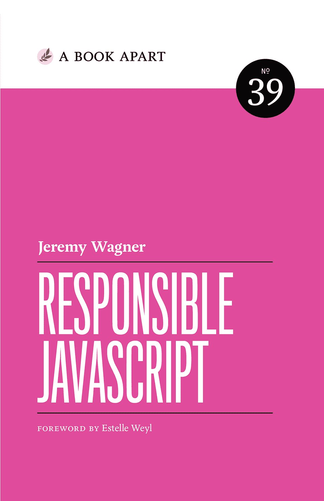


## 来自 Book Apart 的更多著作

### **安全设计**
Eva PenzeyMoog

### **语音内容与可用性**
Preston So

### **更好的引导体验**
Krystal Higgins

### **可持续网页设计**
Tom Greenwood

### **针对认知偏差的设计**
David Dylan Thomas

### **跨文化设计**
Senongo Akpem

### **表现性设计系统**
Yesenia Perez-Cruz

### **韧性管理**
Lara Hogan

### **日常信息架构**
Lisa Maria Marquis

### **渐进式 Web 应用**
Jason Grigsby

访问 [abookapart.com](http://abookapart.com) 查看我们的完整书单。


献给 Zandy, Maya, Lucy, Groant 和 Mowzers。

# 前言

我们都希望用户能够获得他们预期的快速、流畅的网页体验，无论他们使用的是手机、平板电脑还是笔记本电脑。但相互冲突的利益往往会介入。开发者希望有有趣的开发体验。设计师想要美观且清晰的设计。项目经理想要详细的用户交互报告来测试哪些方案有效。广告商则想要追踪……嗯，一切。

在削减成本和加速开发流程的同时，平衡所有这些需求似乎是不可能的——而且遗憾的是，我们赖以寻求帮助的框架和库可能会对无障碍、安全性、Web 性能和用户体验产生负面影响。

如果我们真的想为用户提供卓越的体验，我们必须成为可用性和性能更优秀的管家——这正是 Jeremy 能教给我们的。Jeremy 在为大小大小的项目开发网站和应用程序方面拥有超过十五年的经验，对于如何在业务需求、用户需求和开发者利益之间取得平衡有着敏锐的理解。他采取了大局观，不仅解释了如何审慎地使用 `JavaScript`，还解释了为什么要这么做。通过从多样化的真实案例中学习，你将能够预见对你自己的项目是合理的，并为你的用户构建高性能、优质的体验。

你还将学到比你想知道的更多的关于黄蜂的知识。希望这些信息永远用不上。

—**Estelle Weyl**

# 第 1 章. JavaScript：小心处理


警告：本书包含大量关于黄蜂的隐喻，可能会引起不安。

让我们从 `Sphex` 开始，它是我们将遇到的许多黄蜂中的第一种。

`Sphex` 是一种独居性黄蜂属，它们在地下筑巢并以蟋蟀为食（见图 1.1）。当其中一只黄蜂将蟋蟀带回巢穴时，它会做出一种不合常理的周全行为：它会对巢穴进行检查，将蟋蟀留在外面。当黄蜂完成检查后，它会重新出来取蟋蟀。

现在的重点来了：如果你——一个昆虫界的恶作剧之神——在巢穴检查期间移动了蟋蟀，黄蜂的行为程序就会重启。黄蜂只知道蟋蟀不在它原来的位置，因此它会重新定位蟋蟀，将其拖回巢穴入口，并*再次*检查巢穴。

虽然这种行为在掘地黄蜂中并不一致，但这个概念通过学者 Douglas Hofstadter 创造的词汇具有修辞上的用处：`sphexishness`（[`bkaprt.com/rjs39/01-03`](http://bkaprt.com/rjs39/01-03)）。当我们说某事是 sphexish 的时候，我们描述的是一种高度确定性的、预设的、具有周全*表象*的行为。我经常对自己抱怨我们行业的这种“黄蜂性”以及它对网页整体可用性产生的影响。


图 1.1：被识别为 `Sphex pensylvanicus` 的黄蜂。照片拍摄自 Hardyplants ([`bkaprt.com/rjs39/01-01`](http://bkaprt.com/rjs39/01-01))，CC0 1.0 ([`bkaprt.com/rjs39/01-02`](http://bkaprt.com/rjs39/01-02))，源自 Wikimedia Commons。

你花闲钱买这本书，并不是为了听别人说你是一个无法进行批判性思考的工蜂——事实显然并非如此。我们都在努力用所知的最好的方式完成工作。然而，作为 Web 开发者，我们确实做了许多微小的、近乎仪式性的重复工作，这些行为绝对是“黄蜂性的”。

考虑一下我们对最佳实践的固执遵循，即使这些实践导致了糟糕的用户体验。我们在不考虑潜在劣势或替代方法的情况下直接 `npm install` 包。我们追逐新工具，希望它们能提高我们的生产力——尽管这种持续的变动本身就引入了隐蔽的生产力成本。

我们只是做了很多*事情*，导致了使用我们制作产品的人产生糟糕的结果。这是一个大胆的断言，是的。

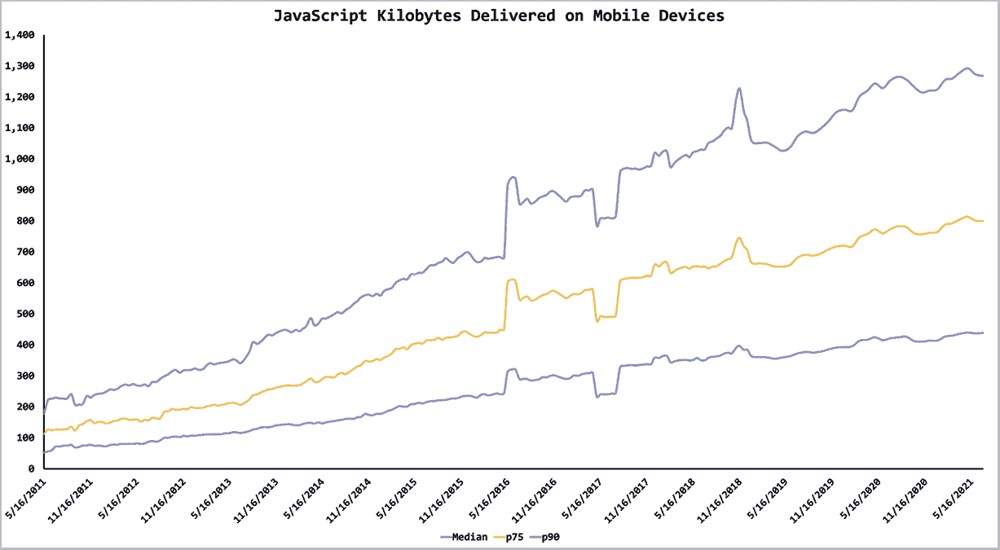

图 1.2：此 HTTP Archive 图表显示了从 2012 年到 2021 年交付给移动设备的 JavaScript 中位数、75 分位数和 90 分位数。10% 的网站从 200 千字节增加到近 1.25 兆字节。

## JavaScript 在性能中的作用

负责任地使用 JavaScript 首先需要理解浏览器如何处理它。人们很容易将网站的性能简化为传输大小。

是的，在相同条件下，发送字节较少的页面通常比发送较多的更快。然而，这并不是 Web 性能的唯一因素。事实上，它有两个：加载性能和运行性能。

### 加载性能

*加载性能*是指 HTML 文档及其资源（CSS、图像，是的，还有 JavaScript）在浏览器请求它们后通过网络到达的速度。在加载性能方面，我们唯一能控制的是发送什么、发送多少以及如何发送。影响加载性能的因素发生在我们的控制之外，在浏览器和 Web 服务器之间的间隙中。

尽管如此，我们有一些技巧可以改进加载性能：

*   代码混化（Minification）：从 HTML、CSS 和 JavaScript 文件等文本资源中删除不必要的空格和注释以减小其体积。代码混化是有效的，因为它利用了计算机运行我们编写的代码时不需要这些奢侈的事实。

*   压缩（Compression）：是指服务器在发送内容之前，通过压缩算法减小文本资源的大小。就像 ZIP 文件，只不过资源是在发送前被压缩，并在到达网络后被解压缩。


我们似乎总能很好地处理代码混淆和压缩，因为这些很容易通过构建过程或服务器实现自动化。正是那些我们*无法*自动化的内容，让负责任地使用 JavaScript 变成了一项艰巨的任务——其中最大的任务涉及管理浏览器请求并接收 JavaScript 资源*之后*发生的事情。

## 运行时性能

*运行时性能*（Runtime performance）描述了页面出现在浏览器后对输入的响应能力。当一个页面对交互持续响应缓慢时，我们就说该页面的运行时性能很差。

还记得不久前关于压缩的话吗？任何被压缩的内容都必须解压缩。浏览器开发者工具通过报告资产的*传输大小*（推测为压缩后的）和*实际大小*（解压后的）来反映这一点（图 1.3）。


图 1.3：Google Chrome 开发者工具在网络标签页中汇总了资源。从左到右分别是请求的资源总数、它们的传输大小（包括压缩）以及实际（解压后的）大小。

如果这看起来似乎无关紧要，请考虑：如果一个 200 字节的压缩 JavaScript 资源解压为 800 字节，浏览器必须处理这 800 字节的脚本！正如你将看到的，处理 JavaScript 是完全另一个“大马窝”。

## 处理 JavaScript 的成本

浏览器处理 JavaScript 的繁琐工作并不主要在于下载，而在于处理。浏览器厂商不断改进 JavaScript 引擎，以一种我们 Web 开发者无法实现的方式提高其性能。尽管有了这些改进，处理 JavaScript 仍然是一项高昂的投入，且设备越慢，成本越高。

将 Web 性能简化为字节问题，是假设了每个字节的性能成本都是相同的。这对于加载性能是正确的，但对于运行时性能并非如此，在运行时性能中，处理一个字节的 JavaScript 所需计算量比处理一个字节的 CSS 要多。

让我们用数据来说来说这一点：在查询并分析了 2020 年 HTTP Archive 的 BigQuery 存储中执行的 7200 万次 Lighthouse 审计（[`bkaprt.com/rjs39/01-06`](http://bkaprt.com/rjs39/01-06)）后，显而易见，在这些审计中，处理 JavaScript 所花费的 CPU 时间远超过用于样式/布局操作、HTML 以及渲染/绘制花费的 CPU 时间（图 1.4）。

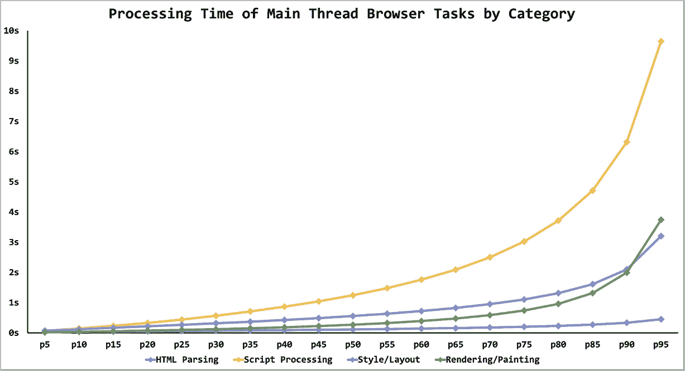

图 1.4：JavaScript 的 CPU 处理时间在较高百分位数处恶化，此时 Lighthouse 审计遇到了具有较大 JavaScript 负载的页面。在中位数情况下，处理器处理 JavaScript 所花费的时间比处理 HTML 的长十倍以上。

考虑到这些数据，我们可以看到 Web 的很大一部分对于那少数使用高端硬件的人来说速度是可以接受的，但对于中大多数人来说是缓慢且令人烦恼的，而对于那些使用低端硬件的人来说，完全无法使用。

如果你很想轻描淡写掉设备缓慢的问题，请看看本文写作时 Amazon 上最畅销的解锁移动手机：一部 60 美元的 BLU Studio Mini 手机。虽然这 60 美元买到了很多东西，但不要自欺欺人：它是一个没有太多性能的 Android 设备（[`bkaprt.com/rjs39/01-07`](http://bkaprt.com/rjs39/01-07)）。

此外，这里的数据仅说明了*启动*期间的页面速度，此时关键页面资源被下载和处理以创建初始用户体验。我们仍然在整个页面生命周期中与过度 JavaScript 的影响作斗——不仅仅是在启动期间。

虽然我们似乎在纠结字节和毫秒这类听起来微不足道的事情，但每个网站都涉及到这些内容，每个网站都参与其中，JavaScript 的影响在整个页面生命周期中都存在——不仅仅是在启动期间。

## 主线程

### 帧、任务与 JavaScript 阻塞


如果你将主线程看作一条代表任务队列的直线，那么认为这这条线也代表了时间是完全正确的。调度在主线程上的每项任务都需要一定的时间来完成。

问题在于，主线程并不是一个可以接纳任何挑战的巨兽。它有局限性会根据设备的性能和环境条件而变化。如果一次性在主线程上调度过多的工作，它就会变得缓慢。当这种情况发生时，在工作完成之前，用户无法与页面进行交互（图 1.6）。

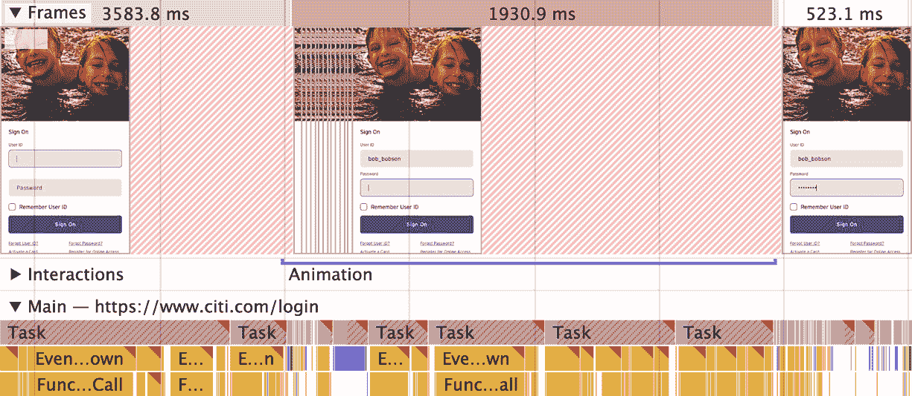

图 1.6: 在 Chrome 性能分析器中显示的花旗银行登录表单性能分析会话。每次按键都会触发过多的主线程工作，导致长近两秒的延迟，使得在输入密码时登录表单无响应。

主线程工作过载的后果各不相同。繁忙的主线程可能会导致短暂的延迟，阻塞用户交互。糟糕的情况会导致浏览器长时间冻结，使页面看起来像坏了一样。无论如何，糟糕的运行时性能都会损害信任，并可能让人们沮丧到直接放弃你的网站。

人们感知某个事件为瞬时发生的阈值是 100 毫秒（[`bkaprt.com/rjs39/01-10`](http://bkaprt.com/rjs39/01-10)）。如果浏览器要无缝地完成所有要求且没有感知明显的性能问题，每个任务都必须在一个`frame` 内内完成。

典型的显示器每秒刷新六十次，每一帧为秒分之一，即 16.66 毫秒。但由于浏览器在每一帧中都需要时间进行自身的处理开销，因此在帧内完成任务的目标是 10 毫秒（[`bkaprt.com/rjs39/01-11`](http://bkaprt.com/rjs39/01-11)）。

在实践中，你只需要确保动画或滚动的每一帧达到 10 毫秒，就能获得感知上的流畅感。对于其他工作，你的目标应该是每个任务 50 毫秒或更少。如果注册输入的时间不超过 50 毫秒，且浏览器响应该输入的时间不超过另一个 50 毫秒，那么这种交互在感知上就是瞬时的（图 1.7）。

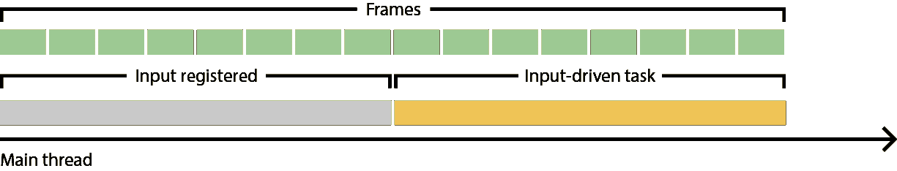

图 1.7: 任务的前 50 毫秒是注册初始用户输入（例如点击或触摸）的预算。任务必须在剩余的 50 毫秒内完成，以保持良好的响应感。

在性能术语中，任何超过 50 毫秒的任务都被称为 `long task`（长任务）（[`bkaprt.com/rjs39/01-12`](http://bkaprt.com/rjs39/01-12)）。任务变成长任务是因为在任何给定交互期间 JavaScript 活动量过多，包括任何间带活动（例如布局和绘制操作）。这些工作完成的快慢取决于运行它的设备。

## 听天由命

这就是事情变得“现实现实”的地方：访问 Web 的设备多样性是**不可思议**的。可能的网络状况范围同样很广，网络覆盖差区域或网络拥塞等现象会对页面性能造成各种破坏（[`bkaprt.com/rjs39/01-13`](http://bkaprt.com/rjs39/01-13)）。

虽然网络连接是 Web 性能的一个重要方面，但设备速度同样重要。当涉及到页面对用户来说是否`感觉`很快时，这一点尤为真实。

### 热节流：设备性能的杀手

每个设备都有处理器，它在处理任务时会产生热量。桌面电脑和笔记本电脑等设备通过风扇（主动散热）和金属散热片（被动散热）相结合，将处理器保持在安全的工作温度（图 1.8）。

由于移动设备制造商为了便携性进行优化，他们放弃了风扇，仅采用被动散热。这使得设备更容易受到过热。为了防止这些小手机烧毁，处理器会采用`thermal throttling`（热节流），降低时钟和功耗（反过来降低设备性能），直到过热量消散。

这——以及设备固有的能力——构成了高低端设备之间性能差距的主要原因。如果我们不能将 JavaScript 负载减少到可控的范围内，我们就无法保证在各种设备上都能提供良好的用户体验。

### 设备性能差距

人们使用 Web 完成许多对访问至关重要的任务：在线银行、求职申请、租房申请、危机干预、申请失业补助等。当 JavaScript 成为我们解决每个问题的首选工具时，我们面临的风险是限制访问而非扩大访问。


图 1.8: 安装在消费级笔记本主板处理器上的散热片/风扇组合。散热片吸收并消散处理器的热量，以维持性能并延长设备寿命。Saud 拍摄（[`bkaprt.com/rjs39/01-14`](http://bkaprt.com/rjs39/01-14)），

作为一个例子，我分析了南卡罗来纳州的失业补助网站，并测量了其 1.7 兆字节 JavaScript 在五种设备上的启动影响（图 1.9）：

| 设备 | 启动时间 |
| --- | --- |
| 2017 5K iMac | 253 毫秒 |
| 第二代 iPhone SE | 301 毫秒 |
| ASUS X5C Windows 10 | 709 毫秒 |
| Nokia 2 Android 版 | 6044 毫秒 |
| 2015 MacBook Pro | 621 毫秒 |

作为一个敏锐的读者，你会注意到其中一个数字大得多。这五台设备中有四台可以顺利处理 JavaScript。但其中一台——廉价设备——在尝试时几乎死掉。这就是我所指的“设备差距”。


图 1.9: 截至 2020 年，南卡罗来纳州的失业补助首页发送了约 800 字节的 JavaScript，最终解压为 1.7 兆字节。

Nokia 2 是一个资源受限的设备。它配备了四核 Cortex A7 处理器（[`bkaprt.com/rjs39/01-16`](http://bkaprt.com/rjs39/01-16)）和 1GB 内存。你可以以低于 100 美元的价格购买 Nokia 2 或类似的设备。这个价格使得这种设备以及类似设备成为许多人的务实选择。

我们关注的不仅仅是看有趣的猫视频。在 2015 年，41% 的美国求职者在求职过程中使用过手机（[`bkaprt.com/rjs39/01-17`](http://bkaprt.com/rjs39/01-17)）。当我们发送过量的 JavaScript 时，那些负担不起高端设备的人面临着访问障碍，他们不仅无法参与 Web 提供的各种娱乐活动，还可能无法参与经济本身。

人类通常是自私的生物，Web 开发者也不例外。很容易将其合理化，即认为那些使用低端硬件或慢速连接的人并不是你的“目标受众”。让我们承认这种情绪的本质：这是一种刻意的排除行为。


我们必须努力构建触及每个人的网站，同时通过更审慎地使用 JavaScript 来提供高质量的体验。以这种方式构建 Web 应用可以最大限地扩大你的覆盖范围——并扩展访问性。

## Web 的未来由我们负责

网络访问并非奢侈品，而是互联世界中运行的基础要素。这意味着我们必须意识到，我们的局限性不是静态的。虽然我们希望在工作中使用更多 JavaScript——而且我们确实一直在这么做——但将其作为首选方案会产生后果。

网络传输速度是有限的，主线程能够承受的工作也是有限的。你向管道发送的 JavaScript 越多，目标设备就会变得越慢，可用性的承诺就会消失得越快。这产生了一种挫败感，而只有我们才能解决它。

当我们从这一章继续前进时，让我们放弃那种墨守成规（sphexishness），关注真实的人是如何体验 Web 的。我们的用户依赖于 Web 提供的关键设施。现在我们已经掌握了 JavaScript 如何影响性能，就可以讨论我们的架构选择如何帮助或损害用户体验了。正如我们将学到的，我们不需要依赖 JavaScript 作为交互的主要驱动力；相反，让我们将其潜力视为一种增强手段。

# 第 2 章，从开始就快


在纸蜂雌王建造巢穴之前，它会先建造一个名为 `petiole`（柄部）的基础支撑结构，这是一个支撑整个巢穴的纤维茎（图 2.1）。柄部足够耐用，可以在各种不利条件下支撑巢穴，甚至在蚁群灭绝很久之后也是。这是一个简单、可持续且至关重要的结构，在蚁群的生存中起着作用。

就像纸蜂巢没有柄部就无法存在一样，任何网站——无论其架构如何或使用了多少 JavaScript——如果没有 Web 服务器都无法存在。当网站依赖后端首先提供标记和功能时，它们会表现出特别的韧性。

然后，就像黄蜂通过额外的柄将巢穴扩展成连接的层级一样，我们可以决定何时适合使用框架和库来扩展我们的工作。这种增量式的方法限制了 JavaScript 的作用，确保了更流畅、更具韧性的用户体验，并适用于更多环境。


图 2.1：纸蜂巢由被称为 `petiole`（柄部）的基础结构悬挂。由作者拍摄。

## 只取你所需

在我们的行业中，我们习惯于使用现成的解决方案来简化 Web 开发。虽然依赖框架和库可能认为更容易，但这样做等同于认同了他人关于如何构建 Web 应用的愿景。他们的方法与你项目的独特需求之间潜在的不一致性，极可能会导致沉重的性能成本和糟糕的用户体验。

框架和库的历史作用是我论点中心的核心：当 `Prototype` 和 `jQuery` 等工具兴起时，迫切需要桥接不同浏览器 API 实现之间的鸿沟。得益于 Web 标准的普及，在不依赖此类临时补救措施的情况下，实现一致性变得容易得多——前提是我们能打破这种习惯。

### 平台优于库

JavaScript 臃肿渗透到项目的一种方式是通过不必要的工具库。`Lodash` 就是其中一个库，它在 JavaScript 本身无法方便地完成 `Lodash` 工具函数所能的功能期间获得了关注。如今，原生 JavaScript 就可以取代 `Lodash`提供的部分功能。

`Lodash` 的一个用例是将函数映射到数组的每个成员以转换其内容。例如，你可以将用于页面资源的 URL 字符串数组转换为标记，然后将结果合并成一个字符串：

```javascript
import _ from "lodash";const scripts = ["/js/scripts.js", "/js/vendors.js"];
```

```javascript
const markupArray = _.map(scripts, script => {
```

```javascript
 return '<script src="${script}"><\/script>';
```

```javascript
});
```

```javascript
const markup = _.join(markupArray, "");
```

虽然 `Lodash` 完成得，但这段代码可以更新为使用浏览器提供的 JavaScript 功能：

```javascript
const scripts = ["/js/scripts.js", "/js/vendors.js"];
```

```javascript
const markup = scripts.map(script => {
```

```javascript
 return '<script src="${script}"><\/script>';
```

```javascript
}).join("");
```

浏览器提供的 JavaScript 特性已经足够让你在没有工具库的情况下几乎完成任何事情。例如，你可以：

* 使用 `Array.prototype.filter` 过滤数组 ([`bkaprt.com/rjs39/02-01`](http://bkaprt.com/rjs39/02-01))；
* 使用 `Array.prototype.reduce` 将数组归约为单值 ([`bkaprt.com/rjs39/02-02`](http://bkaprt.com/rjs39/02-02))；
* 使用 `Array.prototype.concat` 合并两个数组 ([`bkaprt.com/rjs39/02-03`](http://bkaprt.com/rjs39/02-03))；以及
* 分别使用 `Object.keys`、`Object.values` 或 `Object.entries` 获取对象的键、值或两者作为数组 ([`bkaprt.com/rjs39/02-04`](http://bkaprt.com/rjs39/02-04))。

这只是冰山一角！你有大量的 JavaScript 方法可以使用，它们在几乎每个广泛使用的浏览器中都可用 ([`bkaprt.com/rjs39/02-05`](http://bkaprt.com/rjs39/02-05))。批判性地思考你试图实现的目标，并尝试先用原生 JavaScript 解决问题，然后再求工具库，这是值得的。

### 警惕从众谬误

当开发者社区投入一个框架时，它感觉就像是正确的选择——安全的选择。这就是从众谬误，在评估客户端框架时这是一种极具吸引力的力量。即使每个人都在使用它，从用户体验的角度来看，它仍然可能是不安全的。诀窍在于知道一个工具是否适用于该任务。

`React` 是一个流行的 JavaScript 框架，强调组件化和简化状态管理。它由 Facebook 开发，并受到活跃且忠诚的用户群的强力支持。State of JS 2020 调查显示，在 23,765 名受访者中，70% 的人使用了 `React` ([`bkaprt.com/rjs39/02-06`](http://bkaprt.com/rjs39/02-06))。调查还显示：

* 70.8% 的受访者认同为白人；
* 91.1% 为男性，5.8% 为女性，0.9% 为非二元性别 / 第三种性别；
* 超过半数（52.6%）的人将自己的 JavaScript 精通程度评为专家级，近一半的人自评为中级（22.7%）或高级（22.3%）水平。相比之下，只有 2.3% 的人自评为初级水平。

这些结果清楚地说明，一个极度活跃的、自评 JavaScript 水平高于平均水平的白男性开发者群体在强力主张 `React`。他们还主张有利于 JavaScript 密集型客户端架构的开发者体验，而这种架构在不利条件下容易出现性能下降——这一部分开发者自己远不太可能经历这种情况，从而在他们的工作中强化并反映了他们的偏见。

考虑一下这一点，正如性能工程师 Tim Kadlec 在 2020 年对 JavaScript 框架的分析中发现的那样，使用 `React` 的网站发送的 JavaScript 比所有网站的中位数多出 40% ([`bkaprt.com/rjs39/02-07`](http://bkaprt.com/rjs39/02-07))。


同样，Kadlec 也发现，在大多数百分比下，使用 React 的网站往往比使用其他框架的网站消耗更多的设备内存（[`bkaprt.com/rjs39/02-08`](http://bkaprt.com/rjs39/02-08)）。这些选择会对性能——并继之对用户体验——产生后果，我们不应该轻易忽视这些后果。

这是从众效应（bandwagon fallacy）意料的结果。在大型企业开发团队中，关键决策者往往采用 React 等技术，是因为它们符合他们对“良好的开发者体验”的预期，而不是以用户的需求为中心。

这并不是说 React 没有用或它没有用武之地，而是说适用于 Facebook 的良好方案并不适用于每一个应用程序。对于任何客户端 JavaScript 框架都是如此。无论如何盲目从众，无法消除这一事实的事实。我们必须考虑框架的开销——即它为了完成工作而付出的性能成本——以避免无意中限制了访问而非扩展访问。

框架并没有注定我们必须构建糟糕的网站，但使用它们意味着接受了一定程度无法通过优化来消除的开销。你必须谨慎行事，特别是此类架构所提供的可安装插件和现成组件生态系统可能会加剧其用户体验问题。

客户端 JavaScript 框架的流行或易用性并不会自动带来良好的用户体验。它们首先是开发者的便利工具。成熟的技术和直接使用 Web 平台 API 往往是一个更以用户为中心的起点。

例如，Notist 是一个为会议演讲者展示其演讲的网站（图 2.2）。它运行在 PHP 和 Apache HTTP Server 上。虽然对于习惯现代全栈 JavaScript 开发的开发者来说，它没有那么吸引力，但它运行在经过数十年验证的可靠性和速度的技术之上。


图 2.2：Notist 是一个面向会议演讲者的网站，它摒弃了沉重的客户端架构，转而通过极客户端 JavaScript 的 PHP 后端来实现服务器驱动的功能。

Notist 的架构还鼓励服务器端与客户端代码的强力分离。虽然这可能像是生产力的阻碍，但它建立了护栏，引导开发者交付*更少*的客户端代码。这有助于 Notist 提供出色的用户体验，在 JavaScript 产生极少主线程工作的情况下实现快速启动（图 2.3）。

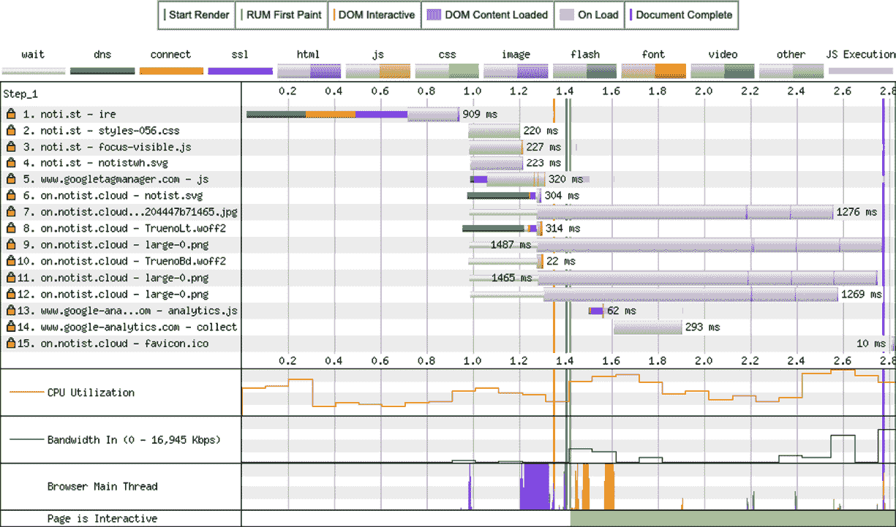

图 2.3：在巴西圣保罗由 WebPageTest 实例驱动的 Moto G4 设备上加载 Notist 用户个人页的 WebPageTest 瀑布图。页面最大的内容在 1.5 秒内完成绘制，并在首次绘制后立即具有交互性。

用户*不在乎*你使用什么技术。他们只关心网站是否快速且易于访问。这就是负责任使用 JavaScript 的核心所在：将用户体验置于开发者体验之上。

### 记录你的架构选择

一旦你确定了优先考虑良好用户体验的架构，起草一份技术声明（technology statement）应该是你接下来的步骤之一。*技术声明*是一份列出项目技术选择及其背后理由的文档。它像一份行为准则，但它不是为社区成员的行为设定预期，而是为潜在的贡献者制定技术要求。

无论项目是开源的还是私有的，你都需要一份建立贡献基本规则的技术声明。否则，当那些充满活力的新贡献者出现时，他们对自己偏好的工具和方法的热情可能会与对项目最佳做法产生冲突。

A11Y Project 是关于网络无障碍的全面资源，其技术声明的摘录对于技术偏好直言不讳：

> 这是一个刻意的选择，旨在平衡：

* 无障碍访问性与互操作性。
* 易于设置。
* 对初学者的亲和力。
* 跨操作系统和浏览器的支持。
* 本地和终端用户的性能。

> 在开发网站时，请务必优先使用这些技术选择，并尽可能坚持它们。尊重这些技术选择有助于保持网站易于维护([`bkaprt.com/rjs39/02-09`](http://bkaprt.com/rjs39/02-09))。

他们的声明不仅列出了使用的技术，还列出了要避免的技术，并解释了为什么这些技术与 A11Y Project 提供无障碍且快速的网络无障碍资源的任务不兼容。这为潜在的贡献者提供了一份路线图，使其贡献与项目使命保持一致。

不采用技术声明的组织将自担风险，但在不加思考的情况下就将其直接丢进 Git 仓库或公司 Wiki 中也没有什么大帮助。请在项目的顶层 README 中突出提到你的项目技术声明，并在项目仓库中包含贡献指南。

对于为雇主开发私有项目的开发者，请将技术声明作为入职流程的一部分，以确保每个参与者都理解项目架构的限制。不这样做会让你的项目用户体验面临风险——无论是私有的还是其他的。

## 你站在哪一边？

任何网站的首次请求总是涉及来自服务器的 HTML 响应，但真正定义你所构建内容的韧性的，是次初始响应之后发生的事情——以及你提供的是服务器端还是客户端的功能。

### 网站与 Web 应用程序

术语总是很难区分。在我们的行业中，*网站*和*Web 应用程序*这样的术语被随意抛出，而没有考虑到它们如何影响我们的开发选择。随着这个行业消耗我更多的生命精力，我逐渐理解——虽然我们构建的所有内容在技术上都是网站——但每个术语*通常*代表以下含义：

* *网站*是一系列从服务器提供标记和功能的页面集合。网站倾向于将 JavaScript 视为最小可行体验的增强。
* *Web 应用程序*感觉和行为更像原生应用。Web 应用程序将服务器视为数据提供者，完全依赖客户端 JavaScript 提供标记和功能以创建“类应用”的体验。

这些区别很重要，因为它们会影响你的开发风格。当你选择 Web 应用程序路径时，你可能会使用包管理器（例如 npm）以一种极具吸引力添加客户端 JavaScript。这种便利可能会导致缓慢的用户体验，从而提高某些网络和设备访问的门槛，并为用户制造不必要的障碍（图 2.4）。

在光谱的另一端是像 Self-Defined 这样的网站——一个让人们定义身份方面的现代字典（[`bkaprt.com/rjs39/02-10`](http://bkaprt.com/rjs39/02-10))——它们依赖服务器提供*所有*标记和功能（图 2.5）。

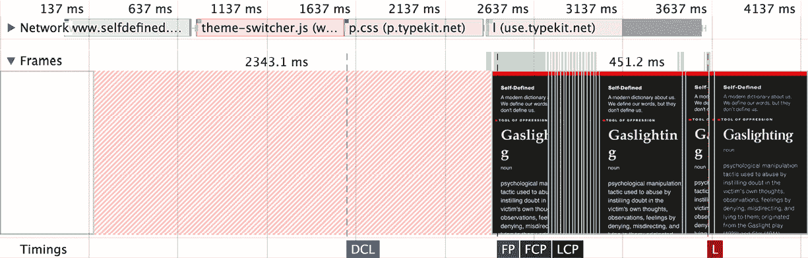


## 图 2.4：在 `Chrome` 性能分析器中展示的 Chase 银行信用卡应用登录界面的时间线，该界面是使用一台廉价 Android 设备访问的。虽然初始标记由服务器提供，但登录表单本身（右侧截图底部）在页面在慢速 3G 连接上完全加载 8 秒多之后才出现。这是由于需要请求多个 JavaScript 资源（如顶部所示），这些资源是客户端渲染登录表单标记所必需的。

由于 Self-Defined 依赖服务器来提供关键的标记和功能，它避免了构建 Web 应用带来的不必要的复杂性。这使得 Self-Defined 的维护者能够专注于完善其 `content`，而不是与那些经常被吹捧的不断变化的框架、工具和最佳实践作斗。因此，它既快速又易用，从而更具`包容性`。


## 图 2.5：在 `Chrome` 性能分析器中显示的 Self-Defined 网站的时间线，该网站是使用一台廉价 Android 设备访问的。由于 Self-Defined 的标记完全从服务器提供，其核心内容几乎可以立即读取，即使在较慢的 3G 连接上也是如此。

这并不是说 Web 应用是肮脏、糟糕、没用的东西，让你在的一百万年内也永远不要去构建它们——但请注意，这种方法会带你走上一条更容易引发性能问题的道路。从本质上说，Web 应用绝对需要客户端 JavaScript——而且通常需要更多。如果你打算采用 Web 应用模型，那么你面前会有大量工作要做，以确保良好的用户体验。

Gmail 的 Web 应用是一个非常重量的客户端 Web 应用的典型示例。如果你有一台快速机器和良好的网络连接，它运行得良好，因为它发送了数兆字节的压缩 JavaScript，解压缩后会产生大量的代码需要处理和执行。尽管有如此庞大的 JavaScript 负载，Gmail 仍然被广泛使用。不过，以防万一，它允许连接速度慢的用户选择基础 HTML 视图（图 2.6）。

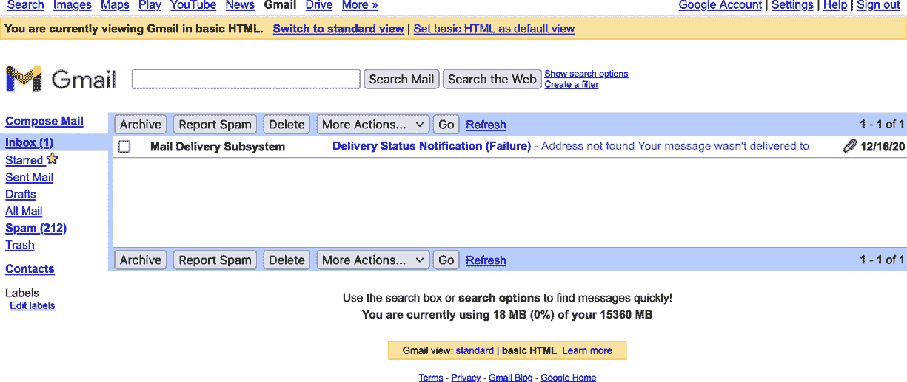

## 图 2.6：Gmail 的基础 HTML 视图从服务器发送标记，并用极少的 JavaScript 代替了其标准视图所青重的重 JavaScript 客户端渲染。

Gmail 的基础 HTML 视图运行总共使用约 50 千字节的数据，其中只有一小部分是 JavaScript。虽然它的外观确实过时，但这种精简的体验是一种服务器驱动的方案，它是一个非常有力的论据，证明网络邮箱以及其他关键应用——可以在不依赖大量客户端 JavaScript 的情况下实现功能化。

尽管如此，你不必以这种方式将项目一分为二。几乎每一个潜在的 JavaScript 密集型 Web 应用都可以通过从服务器发送 HTML 标记以及处理核心功能的应用程序后端来实现功能化。在此之后，JavaScript 变成了最小可行性体验的锦上添花。

### 服务器优先即用户优先

当某人使用网站时，他们是在与标记进行交互。但它是从服务器发送的标记，还是通过 JavaScript 在客户端渲染的呢？虽然这两种方法都能生成用户界面，但它们各自都涉及权衡。

让我们通过分析廉价设备上的浏览器如何处理从服务器发送的标记与通过 JavaScript 在客户端渲染的标记来研究这个问题。对于测试用例，让我们使用一台 Moto E Android 10 设备访问莎士比亚的《哈姆莱特》，二十个场景中的每一个场景都以无样式的 HTML 呈现在单独的页面上。

交付这些内容有两种不同的方法：一种方法将每个场景拆分成单独的 HTML 文件，依靠传统的 `<a>` 元素在它们之间进行导航（图 2.7）。另一种方法使用流行的 JavaScript 框架在客户端渲染每个场景的标记，并依靠客户端路由器（一种我们很快会讨论的工具）在页面之间进行导航（图 2.8）。

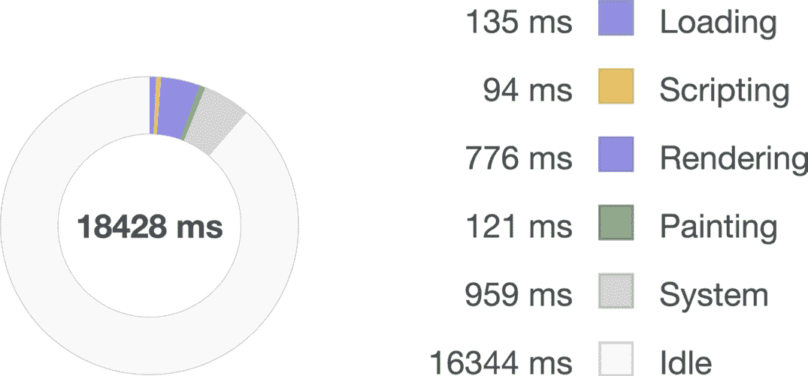

## 图 2.7：使用传统的 `<a>` 元素遍历以单独 HTML 文件形式呈现的 20 个页面时，浏览器活动的总结。唯一的脚本活动是浏览器内部产生的，例如 `unload` 和 `pagehide` 事件处理程序。

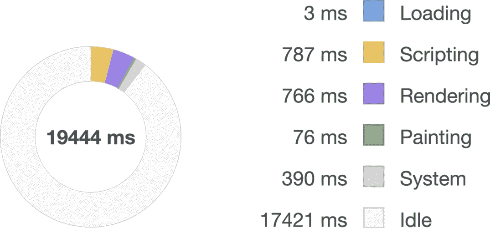

## 图 2.8：使用客户端路由遍历 20 个客户端渲染标记页面时，浏览器活动的总结。涉及的脚本活动花费的时间比相同内容作为单独 HTML 文件呈现时长出 8 倍以上。

是的，这是一个高度简化的测试用例，但它有效地证明了在客户端渲染标记所付出的性能代价。当我们从服务器发送 HTML 时，浏览器以易于管理的块对其进行流式传输和处理，这比将工作完全委托给 JavaScript 要高效得多。

当我们使用 JavaScript 在客户端渲染标记时，我们是以某种方式将这些标记封装在 JavaScript 中，这在加载之外还需要进行处理。在完成所有这些操作后，浏览器必须执行该脚本来渲染标记。从本质上说，在客户端渲染标记的成本更高。

现在让我们谈谈客户端渲染标记对感知性能的真实世界影响：在客户端渲染标记的 Web 应用通常在启动时从服务器发送一个 `app shell`（应用外壳）。应用外壳是启动 Web 应用所必需的最少标记（图 2.9）。当外壳请求的脚本加载时，会向服务器发起 API 调用。


## 图 2.9：Twitter 的应用外壳。外壳立即加载，但在 API 调用填充界面之前存在延迟。期间加载指示器一直在旋转。

Twitter 是 Web 应用开发风格的一个绝佳示例。虽然 Twitter 的 Web 应用是一种相当快速的渲染体验，但这种模型存在潜在问题。当我们完全依赖客户端渲染时，负责填充应用外壳的每个脚本都变成了一个潜在的故障点（图 2.10）。


## 图 2.10：关键 JavaScript 资源加载失败后的 Twitter 移动应用程序。唯一的补救措施是刷新页面并听天由命。

即使一切顺利，客户端渲染标记也涉及感知性能代价。使用客户端渲染应用的用户不仅需要等待应用外壳标记，还需要等待 API 调用来填充有意义的内容（图 2.11）。

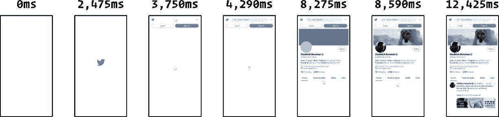

## 图 2.11：在慢速 3G 连接上使用廉价 Android 设备加载 Twitter 个人资料的时间线。由于应用是在客户端渲染的，页面首次绘制与页面填充有意义的内容之间存在显著延迟。

相反，如果我们先先从服务器发送包含内容的标记，然后为页面的交互部分附加功能，我们就可以尽早提供更有意义的体验，并避免排除那些连接不稳定或禁用 JavaScript 的用户访问这些内容。


现在来分享一些好消息！现代基于组件的框架（例如 `React`）不仅可以在客户端渲染组件标记，还可以在 JavaScript 后端以字符串的形式进行渲染。这使得在客户端和服务器上使用相同的组件代码成为可能，这对用户体验和开发者体验都是一种提升。

不过，不要掉以自喜——服务器渲染通常是一个同步且计算开销巨大的过程。在大型应用中，你可能需要探索组件缓存等技术，以避免服务器响应时间过长（[`bkaprt.com/rjs39/02-11`](http://bkaprt.com/rjs39/02-11)）。

无论你使用什么技术或应用后端，关键点在于：从服务器交付有内容的标记，可以在可能没有 JavaScript 的情况下提供某种程度的体验。而且——说实话——采用“服务器优先”策略是使用 JavaScript 渐进增强网站的极佳起点，而又不会给客户端带来过重的昂贵负担。

### 客户端路由路由与可访问性

Web 应用常见的架构选择是`单页应用`（SPA）模型，它预先从服务器预加载所有 HTML，然后使用由 JavaScript 驱动的客户端路由处理后续导航，该路由在应用外壳（app shell）中切换页面内容。

SPA 在感知性能上具有优势，因为它们在导航到其他页面时避免了完全刷新页面的低效率。除了我们讨论过的在客户端渲染 HTML 带来的性能损失外，这种方法可能会带来重大的可访问性（accessibility）风险——至少如果你处理得不是非常、非常仔细的话。

导航和历史记录受一个复杂的规范约束，在它的演变过程中，许多开源客户端路由应生灭灭。并不是所有的客户端路由都会关注（或能够修复）至关重要的可访问性问题，例如元素焦点、滚动位置恢复、导航取消等。

我无论如何强调都不为过的是，当你使用客户端路由时，你实际上是在挑战浏览器厂商为了确保一致且健壮的导航体验而所做的几十年的发现和基础性工作（[`bkaprt.com/rjs39/02-12`](http://bkaprt.com/rjs39/02-12)）。

如果你已经读到了这里，并且仍然认为你的项目有必要客户端路由，请考虑以下几点：

*   Service-worker 技术可以通过将缓存的头部和页脚部分内容与从网络流式传输的部分内容组合在一起，来增加导航的感知速度。Service-worker 技术速度快、支持良好，而且最重要的是，它是对一种经过时间考验且成熟的导航机制的渐进式增强，而不是对其进行全面替代。我们将在第 4 章中详细介绍这种方法。

*   如果 service worker 不可行，而你执意于客户端路由，那么你的应用后端与尽可能多的客户端路由保持一一对应的关系是至关重要的。这确保了无论在何种上下文中（例如通过搜索引擎的引用），都能访问网站的任何部分。

*   将客户端路由视为一种增强。例如，如果你的网站既有已验证区域也有未验证区域，可以考虑将客户端路由仅限制在网站的已验证部分。

Web 开发者 Marcy Sutton 详细讨论了客户端路由对可访问性的影响，如果你坚持要用，她有一系列非常有用的建议。其中最令我印象深刻的是这一点：

> 考虑单页应用是否真的必要，以及你是否真的需要使用 JavaScript 框架。（[`bkaprt.com/rjs39/02-13`](http://bkaprt.com/rjs39/02-13)）

这个建议似乎违背了最佳实践。它确实与行业内盛行的 JavaScript 狂热背道而驰，但请记住：以牺牲用户体验为代价维护开发者体验的最佳实践并不是最佳实践，而是一种自私自利的策略（[`bkaprt.com/rjs39/02-14`](http://bkaprt.com/rjs39/02-14)）。

### 理性的缓存

关于浏览器缓存的章节？在一部关于 JavaScript 的书里？相信我！提到它是有理由的。

浏览器缓存是一种优化，服务器向浏览器通信资产的“新鲜期”周期。如果浏览器在再次访问页面时，根据服务器提供的策略判断其磁盘上的资源是“新鲜”的，则该资源将被重复使用，而不是再次从网络中获取（图 2.12）。

浏览器缓存对你网站的新访问者不起作用，但它是一种非常有效的优化，可以减少或消除后续页面访问中受影响资产的加载时间。对于 JavaScript 来说，这意味着加载阶段被缩短了，浏览器可以更快地进入处理阶段。

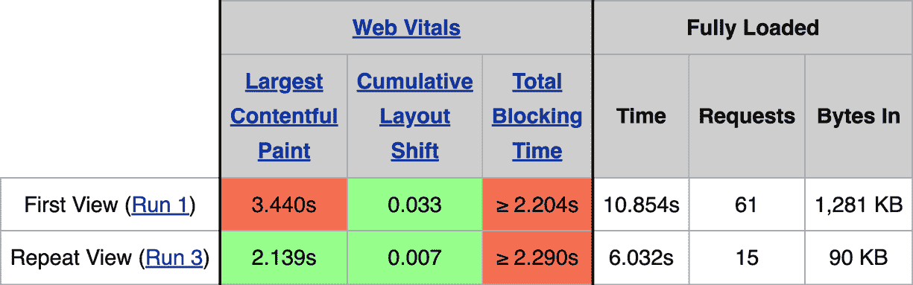

图 2.12：WebPageTest 对网页在首次访问（顶行）和缓存生效的重复访问（底行）的汇总。重复访问不仅传输的数据量比首次访问减少了 93 %，而且其最大内容绘制（Largest Contentful Paint）和累积布局偏移（Cumulative Layout Shift）指标也得到了改进。

当浏览器请求资源时，响应包含描述其特征的 HTTP 头部。浏览器缓存受几个响应头的影响，但最灵活且最常用的是 `Cache-Control`（[`bkaprt.com/rjs39/02-15`](http://bkaprt.com/rjs39/02-15)）。

`Cache-Control` 指定了一个由多个指令组成的缓存策略，描述如何缓存资源。一个常用的指令是 `max-age`，它指定资源有效的秒数。假设你请求一个 HTML 文档，响应中出现了此头部：

```
Cache-Control: max-age=300
```

这告诉浏览器：“嘿，这个资源可以重复使用三百秒。”对我们来说就是五分钟。

`Cache-Control` 的一个问题是资源不仅会被浏览器缓存，还会被中间缓存缓存，例如内容分发网络（CDN）。CDN 是位于网站前端的代理，将资产分发到距离网站访问者更近的边缘服务器。减少物理距离可以降低延迟。

`Cache-Control` 隐式允许浏览器和代理缓存资产。这种优化的好处在于即使不在浏览器缓存中，也可以从 CDN 缓存中获取。对于动态内容——即 HTML 文档——你希望通过在 `max-age` 之外指定 `private` 指令来防止这种情况：

```
Cache-Control: max-age=300, private
```

如何配置 `Cache-Control` 取决于你的应用后端或 Web 服务器配置。对于 Apache 服务器，可以通过 `.htaccess` 文件为 HTML 文档设置上述策略：

```apache
<FilesMatch "\.html$">
```

```apache
Header set Cache-Control "max-age=300, private"
```

```apache
</FilesMatch>
```

你想要缓存资产的时间取决于资产类型。JavaScript 文件是静态资产，这意味着它们不会根据请求资源的人或请求方式而改变。考虑像样式表、脚本、图像和字体等——其内容不会根据 cookie 等因素变化的资源。为这些资产配置缓存需要一种双管齐下的方法：

*   必须对资产进行版本控制，以确保未来的更新不会因为浏览器缓存中存在先旧版本而被跳过。

*   资产必须拥有 `Cache-Control` 策略，以确保能够尽可能长时间地重复使用。


资源版本化是两种方法中最复杂的一种，因为浏览器缓存是通过 URL 来跟踪资源的。如果一个命名为 `scripts.js` 的 JavaScript 文件从 `compuglobalhypermega.net` 提供，那么该资源就没有经过版本化。如果有人在周一访问了 `compuglobalhypermega.net` 并下载了 `scripts.js`，且 `max-age` 指令指定的的新鲜期为一个月，那么当该用户在周五再次访问该网站时，浏览器将使用其缓存中的副本——即使周三已经发布了新版本的 `scripts.js`。这注定会导致问题。

一种变通是在资源发生变化时向 URL 附加查询字符串：`compuglobalhypermega.net/js/scripts.js` 变成类似 `compuglobalhypermega.net/js/scripts.js?v=1` 的内容。当文件更改时，查询字符串增加到 `?v=2`。

这种方法对于除了最简单的网站之外的所有网站都是不可持续的，因此最好是自动化版本化。一种方法是在应用程序后端计算文件内容的哈希值（hash），以便查询字符串能够自动更新。下面的 PHP 代码示例了如何生成资源内容的哈希值，并将其附加到 `<script>` 标签的 URL 中：

```php
<?php $fileHash = md5(file_get_contents("./scripts.js")); ?>
```

```html
<script src="/js/scripts.js?v=<?php echo($fileHash); ?>"></script>
```

另一种版本化方法涉及使用打包器（bundler——我们将在第 5 章中讨论这种工具）在构建时计算其内容的哈希并将其注入资源文件名中。结果是一个这样的文件名：

```
scripts.4d3b7eda068fd80bef9ed2f05d52c3df.js
```

这两种方法都可行，因为你的 HTML 节点没有被缓存（如果缓存了，它可能不应该被缓存）。当 HTML 更新时，将引用新资源而不是旧资源，并且它们会被分别缓存。

最佳缓存策略是这场盛宴的第二部分。这是一个针对版本化静态资源的强缓存策略示例：

```
Cache-Control: max-age=31536000, immutable
```

此指令指示浏览器将相关资源缓存长达一年。我们还添加了额外的 `immutable` 指令作为进一步优化，它告诉支持的浏览器：“嘿！这个文件永远不会改变。不用去询问服务器它是否发生了变化了！”

在关于 JavaScript 的书中讨论浏览器缓存可能看起来很奇怪，但它对许多类型资源的加载性能起着很大作用——其中 JavaScript 居首。这并不是负责任使用 JavaScript 的微小部分。

## 渐进式增强 (Progressive Enhancement)

好了，现在你已经有了服务器提供的标记并落实了一些良好的缓存实践。现在，你可以专注于使用 JavaScript 渐进式地增强你的网站了。

渐进式增强——至少对于 JavaScript 而言——是这样一个观点：我们首先在不使用 JavaScript 的实现网站的核心功能。一旦我们有了不需要 JavaScript 就能运行的基础体验，我们就可以选择性地应用 JavaScript，为那些能从中受益的用户提供更好的体验（[`bkaprt.com/rjs39/02-16`](http://bkaprt.com/rjs39/02-16)）。

渐进式增强很难推销，因为它要求达成共识，即一种体验应该以多一种理想方式运行。然而，它的主要优势是，冗余的功能层使得网站无论从何处访问都更具可访问性和包容性。

### 设置基础体验 (Set a baseline)

你可以将渐进式增强应用到大多数关键交互点。表单驱动的交互就是首要例子。例如，让我们来看一个社交媒体类型的网站，人们可以订阅他人的新内容。这是一个极佳的例子，展示了如何使用渐进式增强来促进我们都熟悉的常见交互模式。这种功能——不出所料——是由一个 `<button>` 元素提供的。

我们*可以*编写一些 JavaScript，在点击该按钮时向后端 API 发起 `fetch` 调用，如果请求成功，则在客户端更新其状态。这本身并不是一种反模式（antipattern），但它不应该是该功能的唯一实现。它应该是服务器提供的交互之上的增强。

为了建立这种基础体验，我们将“订阅”（Subscribe）按钮封装在 `<form>` 元素中，并带有 `action` 属性指向处理订阅请求的服务器路由：

```html
<form method="POST" action="/subscribe">
```

```html
<button type="submit" class="subscribe-button">Subscribe</button>
```

```html
<input type="hidden" name="subscribee-id" value="1">
```

```html
</form>
```

服务器确保只有现有的用户 ID 是有效的，并且订阅请求只能代表当前已身份验证的用户发生。简而言之，安全指南在服务器端强制执行——尽管是的，隐藏的 `subscribee-id` 输入内容可能会被某些入侵者修改，但那是徒劳的。

一旦服务器处理了订阅请求，浏览器将重定向回用户的个人资料页。因为该请求重新生成了 HTML，服务器提供的状态将显示该用户已订阅了该个人资料。

如果这种交互与 JavaScript `fetch` 请求相比显得效率低下，你并没有错！但问题在于，此阶段的目标不是效率，而是建立一个在*没有* JavaScript 的情况下扩展访问范围的基础体验。

### 增强！(Enhance!)

好了，我们已经有了服务器提供的功能。现在我们可以点缀一点 JavaScript 来增强它。

订阅按钮的标记是在 JavaScript 中渲染的。如果我们愿意，我们*可以使用像 React 这样的框架在客户端提供功能，并在启动时通过 JavaScript 附加。

然而，使用框架来这样做需要我们谨慎。为了更好的开发者体验，性能和可访问性的代价值得吗？也许吧！但是质疑“良好的开发者体验带来良好的用户体验”这一假设的时候。

客户端交互由事件监听器驱动。自己用 `addEventListener` 管理事件监听器还是依赖框架很重要，因为依赖框架可能会产生高效率成本（如图 2.13）。

React 对事件监听器及其关联状态的处理是计算密集型的。取决于设备，React 执行其操作有时比你自己注册的监听器或竞争框架要慢得多（[`bkaprt.com/rjs39/02-16`](http://bkaprt.com/rjs39/02-16)）。

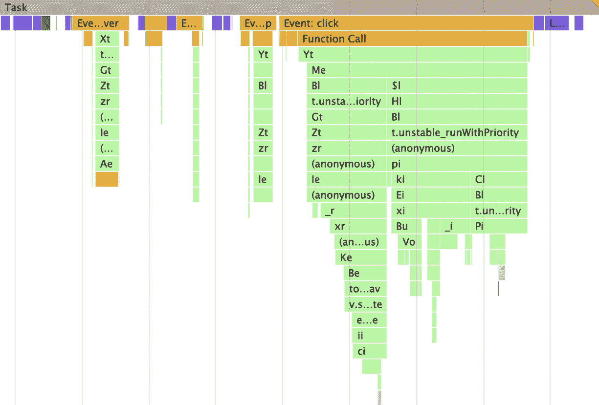

图 2.13：Chrome 性能分析器中由 React 处理打开移动导航菜单的点击事件调用栈。

记住，任何运行超过 50 毫秒的任务都是长任务；框架为了管理事件监听器引入的开销为你其他工作留出的空间更少。如果我们愿意自己注册事件监听器，可以看到同样的交互在处理成本上要轻量得多（如图 2.14）。

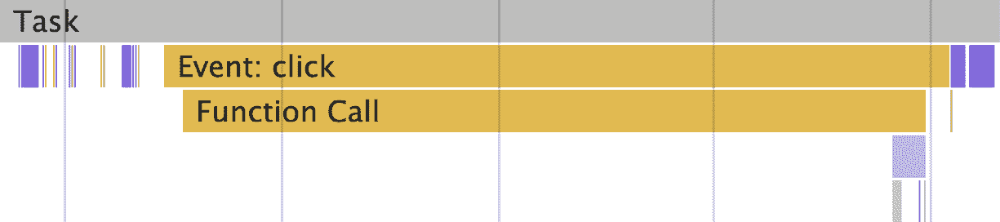

图 2.14：Chrome 性能分析器中不使用框架打开移动导航菜单的点击事件调用栈。

虽然客户端框架简化了组件化和状态管理，但你并不需要框架来管理这些事情。Web Components 可能是一个可行的替代方案，并且比你想象的要更好用。


Web Components（Web 组件）并不是单一的单体 Web 平台功能，而是系列功能的集合，例如通过 Shadow DOM、自定义元素和 HTML 模板来实现更好的 DOM 和 CSS 封装。类似于基于组件的框架，Web Components 提供了组件化以及在中心位置跟踪状态的能力。

在我们讨论如何使用 Web Components 之前，让我们先回顾一下之前服务器驱动的“订阅”（Subscribe）按钮的标记代码：

```html
<form method="POST" action="/subscribe">
<button type="submit" class="subscribe-button">Subscribe</button>
<input type="hidden" name="subscribee-id" value="1">
</form>
```

提到 Web Components 时，可能会想到自定义元素（custom elements），你可以使用它们为特定场景构建完全全新的 HTML 元素，例如 `<subscribe-button>`。遗憾的是，不支持自定义元素的浏览器将无法回退到默认语义，这意味着它们将丢失重要的功能，例如 `<form>` 元素服务器提供的功能。

这很令人遗憾。幸运的是，在这种情况下，如果我们在表单的 `is` 属性中引用自定义元素的名称，就可以保留这些语义：

```html
<form is="subscribe-button" method="POST" data-subscribed="false" action="/subscribe">
```

友情提示：截至本文写作时，Safari（无论是 macOS 还是 iOS）都不支持 `is` 属性，尽管它是 HTML 规范中的生存标准（[`bkaprt.com/rjs39/02-18`](http://bkaprt.com/rjs39/02-18)）。对于 iOS 来说，这意味着该平台上所有浏览器都不支持，因为 Firefox 或 Chrome 底层本质都是 Safari。替代方案包括不使用 Web Components、回退到服务器提供的功能，或者非常仔细地评估你的框架选项，以找到一个优先性能的解决方案。

回到正题：你可能会奇怪为什么我们决定将名为 `subscribe-button` 的自定义元素附加到 `<form>` 元素上，而不是内部的 `<button>`。这是一个重要的语义选择！一个无障碍且支持渐进增强的订阅按钮不仅仅是 `<button>` 元素本身：它需要 `<form>` 元素及其内部的所有内容才能运行。

这是让自定义元素运行所需的一部分。我们仍然需要编写组件 JavaScript，它看起来像你遇到的大多数 JavaScript 类一样：

```javascript
class SubscribeButton extends HTMLFormElement {
  constructor () {
    super();
  }
}
```

这看起来并不是一个了不起的开始，但这段启动代码背后有很多内容，使得自定义元素在渐进增强的背景下变得非常有用。主要由于 `SubscribeButton` 类扩展了 `HTMLFormElement` 类。因此，我们为自定义元素保留了 `<form>` 元素的所有内置功能和无障碍语义。这是因为我们决定扩展现有元素，而不是从头开始创建一个（你通常也不应该这样做）。

和任何 `class` 一样，我们需要一个 `constructor` 方法。目前，我们调用 `super` 方法，它会调用父类的 `constructor` 方法。这确保了我们获得了 `HTMLFormElement` 类的所有功能和属性。

从这里开始，我们使用组件的 `constructor` 方法为订阅按钮的工作建立必要的对象属性：

```javascript
class SubscribeButton extends HTMLFormElement {
  constructor () {
    super();
    this.subscribeButton = this.querySelector(".subscribe-button");
    this.subscribed = this.dataset.subscribed === "true";
    this.subscribeeId = Number(this.querySelector("[name='subscribee-id']").value);
    this.buttonLabel = this.subscribed ? "Subscribed" : "Unsubscribe";
    this.coarsePointer = window.matchMedia("(pointer: coarse)").matches;

    // 绑定方法
    this.subscribeButton.addEventListener("mouseenter", this.hoverOn);
    this.subscribeButton.addEventListener("mouseleave", this.hoverOff);
    this.addEventListener("submit", this.subscribe);
  }
}
```
*等等，原文将代码分成了多个块，我根据提供的逻辑将它们合并了以提高可读性。*

*哇*，这里面内容不不少。让我们拆解每个部分：

- `this` 指向 Web 组件所附加的 DOM 节点。在这种情况下，`this` 是订阅按钮表单的 `<form>` 元素。
- 因为 `this` 代表组件实例，我们可以从它推导出额外的作用域属性，从表单内部的 `<button>` 元素开始。
- 我们还可以从 `this` 中推导出其他有用信息，例如存储在 `<form>` 元素 `data-subscribed` 属性中的订阅状态，以及订阅者的用户 ID（组件子节点 `<button>` 的文本内容）。我们甚至可以将当前设备是否具有粗指针（触摸屏）或精细指针（鼠标）作为类属性存储起来。

有了这些属性，我们随后绑定了事件监听器，这些监听器调用类方法提供以下功能：

- 对于具有精细指针的设备，组件 `<button>` 元素上的 `mouseleave` 和 `mouseenter` 事件将调用组件的 `hoverOn` 和 `hoverOff` 方法。因为只有那些具有精细指针的设备（如鼠标）才能对它们进行“悬停”（hover）。
- `<form>` 元素上的 `submit` 事件监听器会调用组件的 `subscribe` 方法。

（注：提供的文本在结尾处有一些重复/碎片化的描述；我在保持所描述的核心技术逻辑的同时，优化了流程。）


```
 alert("Couldn't subscribe to this person due to a glitch on our end. Try again in a minute?");
```

```
 this.enableButton();
```

```
 });
```

```
 }
```

```
 }
```

```
}
```

这种方法虽然繁琐，但以下是具体的执行步骤：

1. 调用 `event.preventDefault()` 防止表单提交到服务器，从而让 Web 组件处理订阅功能。
2. 禁用“订阅”（Subscribe）按钮。
3. 通过 `fetch` 调用以 POST 请求的形式向服务器发送，并将订阅者 ID 包含在字符串化的 JSON 负载中。随后，服务器将处理该订阅请求。
4. 如果请求成功，按钮的文本内容将更新以反映该状态。否则，会弹出一个基础的 `alert` 提示出现问题。无论 `fetch` 调用成功与否，在调用完成后按钮都会重新启用。

大功告成！在付出了这么多努力尝试创建一个渐进增强的体验后，如果你怀疑这一切的意义也是完全可以的——但请放心，这些工作不仅仅是为了让一个微小的按钮以最极简的方式发挥作用。

### 渐进增强的收益

在 Web 开发中，仅在客户端构建功能可能比从服务器提供相同功能然后用 JavaScript 进行渐进增强要容易。

然而——对此我再强调不过了——它是值得的。当你这样做时，你正在付出巨大的努力来帮助他人：

* 冗余功能在 JavaScript 关闭或加载失败的情况下为人们提供了安全网。你无法控制人们如何访问你的网站，而渐进增强创建了一个良好的备用方案（fallback）。
* 渐进增强建立了防护护栏，通过增加服务器在提供功能方面的作用，迫使你更仔细地思考如何使用 JavaScript。最终结果是更具韧性的用户体验。

尽管如此，你不需要 Web Components 也可以对你的网站进行渐进增强——这只是它们在追求这一目标时如何使用的一个示例。但你应该在每个项目开始时都保持这种极简主义精神，以便在早期获得最佳结果，如果需要，再层叠使用更华丽的策略。

只有从极简主义出发，我们才能构建出一个在关键时刻不那么依赖 JavaScript 的网络。如果我们从一开始就使用沉重且具有强制性的框架，我们就无法到达那里。不要“快速行动并破坏一切”，要深思熟虑并谨慎行事。

## 展望 对于对于构建可持续的 Web 来说，这是一项艰巨的任务。但如果我们优先考虑服务器发送标记语言的作用、采用有效的缓存、尽可能使用 Web 平台并拥抱渐进增强，我们就可以避免向客户端交付昂贵的框架，并避免它们在启动和运行期间可能产生的昂贵开销。

尽可能快速移动似乎是首选——事实上，如果目标是比任何人都先进入市场可能确实如此——但这些选择产生的影响将不仅限于当下。你早期的技术选择可能会固化在你的项目中，导致日后修复它们引起的问题变得极其困难。早期且频繁地发布代码是一回事，但处理这种哲学带来的对用户敌视的后果完全是另一回事。

可持续的架构应该是让 Web 对更多人更易用。当架构扩展访问而非限制访问时，我们创建的体验更具韧性和容错能力。随着我们共同不断进步，我们将进一步探索这项良好工作所包含的细节。

# 第 3 章 衡量与评估 JavaScript 性能


如果你在户外待过足够的时间，你就知道牛蝇了。它们是双翅目中的恐怖，降落在温血动物身上（无论是马还是人），并用像剪刀一样的口器吸血。

马虻蜂会杀死牛蝇，对于饲养牲畜的农夫来说是福音。更好的是，牲畜完全不会被这些蜂骚扰；它们接受这些蜂，因为它们的存在是有益的（图 3.1）。


图 3.1：马虻蜂猎杀骚扰牲畜的牛蝇。照片拍摄：Howard Ensign Evans，科罗拉多州立大学，Bugwood.org ([`bkaprt.com/rjs39/03-01`](http://bkaprt.com/rjs39/03-01))，CC BY 3.0 US ([`bkaprt.com/rjs39/03-02`](http://bkaprt.com/rjs39/03-02))，来自 Wikimedia Commons。

负责任使用 JavaScript 需要像马虻蜂那样的警惕，不断扫描它的领地以寻找烦人的牛蝇。你必须时刻关注 JavaScript 并抑制它最有害的影响，因为过度依赖它会将你的网站用户体验拖入“慢速镇”（Slow Town）。在这种情况下，警惕需要衡量和评估你网站的 JavaScript 状况。

当我们*衡量* JavaScript 性能时，我们想知道三件事：

1. 页面在启动期间感知上是快速且可用的？
2. 如果不是，问题在哪里？
3. 启动后主线程是否足够安静，以保持页面的可用？

就像你不预先测量就无法可靠地将木材切割成合适的长度一样，在能够衡量之前，我们也无法评估 JavaScript 在网站和应用程序中的影响。## 指标：衡量 JavaScript 性能的关键

在生活中，我们都依赖指标。我们检查室外温度以确保穿得合适；我们在开车时（希望）观察速度表以避免鲁莽驾驶；我们根据血检结果指导生活方式的选择，例如在甘油三酯过高时改变饮食。

性能指标对于做出明智决策同样至重要。它们也是影响 Google 网页排名的许多因素之一([`bkaprt.com/rjs39/03-03`](http://bkaprt.com/rjs39/03-03))）。搜索引擎希望为特定的查询呈现最好的网页，而糟糕的用户体验会干扰这一目标。

性能指标可以分为两类：

* **实验室指标（Lab metrics）：**这些指标通过合成测试工具（如 WebPageTest、Lighthouse 或你的浏览器开发者工具）收集。你可以通过它们建立一致基准，这在尝试解决开发问题时非常有用。
* **字段指标（Field metrics）：**这些指标通过浏览器 JavaScript API 从网站访问者处收集，然后传输到远程数据存储进行后期分析。字段指标是黄金，因为它们讲述了真实用户体验网站性能的故事。

了解哪些指标是什么有助于你理解它们如何适用于你的工作。某些指标属于以上两类，而另一些只属于其中一种。让我们看看指标可以描述的页面及 JavaScript 的一些常见方面。

## 绘制（Painting）

页面加载期间关键的可感知里程碑是页面内容被绘制到屏幕上。这是我们获取正在发生什么的第一个线索。每当浏览器在屏幕上绘制像素时，我们称之为绘制*painting*——那里有很多绘制指标。

JavaScript 对绘制指标的影响通常取决于标记是如何渲染的。标记的客户端渲染（我们在第 2 章讨论过的昂贵过程）与服务器发送的初始标记相比，可能会触发更晚的绘制事件。这一切被渲染客户端标记的脚本大小、网络速度以及脚本交付的方式所放大。

#### 首次绘制（First Paint）和首次内容绘制（First Contentful Paint）


你会遇到的两种常见绘制指标是`首次绘制`（First Paint，FP）和`首次内容绘制`（First Contentful Paint，FCP）。`FP` 标识*任何*像素绘制到屏幕上的第一个时刻，而 `FCP` 则标识内容出现在视口中的时刻——即文本、图像、非白色的 `<canvas>` 元素等（图 3.2）。

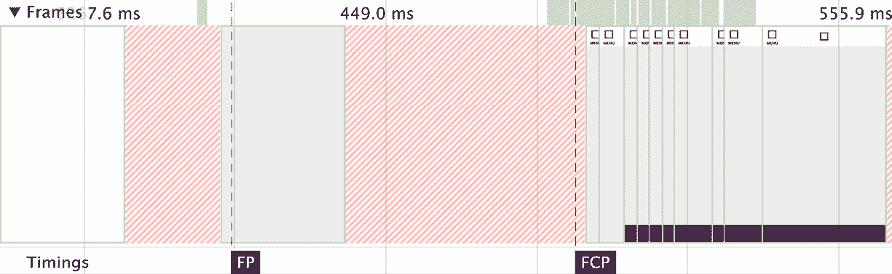

图 3.2：Chrome 性能分析器中的性能跟踪轨迹，显示了页面的首次绘制 (FP) 和首次内容绘制 (FCP)。`FP` 在灰色背景出现时发生，而 `FCP` 在菜单切换按钮出现时发生。

`FP` 通常与样式表的加载时间相关联，但它并不是一个非常重要的指标。第一个被绘制的内容在感知上可能并没有意义。

相比之下，`FCP` *确实*更有意义，因为它它是面向内容的。页面的核心内容可能会被阻塞，直到某个庞大的 JavaScript 包下载、处理并最终运行，在此过程中可能会调用后端 API 或渲染客户端标记。在那种情况下，`FCP` 可能会被延迟。

虽然 `FCP` 是评估感知性能的一种诚实尝试，但*内容性*可能仅描述一个背景图像或无关紧要的文本节点。幸运的是，存在一种更精确的指标来描述更显著内容的绘制时间。

## 最大内容绘制

`最大内容绘制 (Largest Contentful Paint，LCP)` 衡量的是视口中最大的内容块出现的时刻——无论是图像、视频还是文本节点（图 3.3）。`LCP` 是对其他绘制指标的改进，因为它强调了内容的显著性，因此量化了更具感知意义的里程碑。

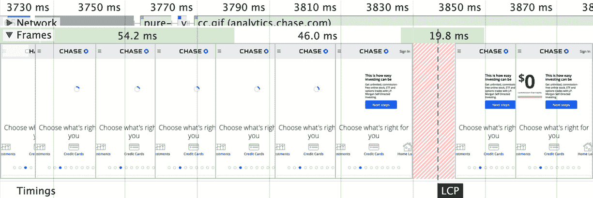

图 3.3：Chrome 性能分析器中显示的 Chase 银行网站的最大内容绘制 (LCP) 事件。`LCP` 由于页面页眉标记的客户端渲染而导致延迟。

与 `FCP` 一样，在依赖 JavaScript 在客户端渲染内容标记的架构中，JavaScript 会干扰 `LCP`。你的网站架构不应要求访问者在显著内容出现在屏幕之前等待 JavaScript 的加载、处理和运行。

性能监控工具（如 WebPageTest 和 Lighthouse）会报告 `LCP`。在编写期间，Google 建议 `LCP` 在 2.5 秒或以下为优（[`bkaprt.com/rjs39/03-04`](http://bkaprt.com/rjs39/03-04)），但未来的指导可能会有所不同。最好的建议是追求最高分，因为 `LCP` 会影响你的页面在搜索结果中的排名。

## 布局稳定性

你是否曾经试图点击一个链接，它却突然移动了，导致你点击了完全不同的东西？你不仅是网站违约的受害者，也是*布局不稳定*的受害者（图 3.4）。

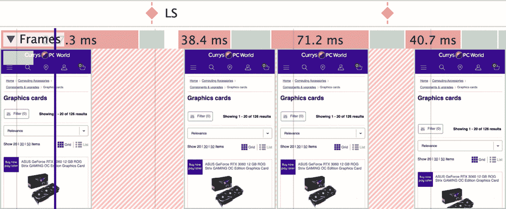

图 3.4：当 Currys PC World 网站上的多个页面元素加载时，其余布局移动了多次，导致关键交互元素发生不可预测的移动。

布局不稳定的原因有许多，JavaScript 就是其中之一。你几乎肯定体验过的一个例子是：一个通知在页面生命周期的后期出现在页面顶部，将整个布局向下推。这通常是因为脚本需要时间来加载、处理和运行，导致在最糟糕的时刻发生偏移。

所有的布局偏移——无论是由 JavaScript 引起还是其他原因引起——都会导致潜在的昂贵的布局重新计算工作，这会消耗主线程的时间。当布局偏移在启动期间争夺主线程的注意力时，留给 JavaScript 处理和执行的空间就变小了。

确定用户是否可以预判布局偏移是非常重要的。可预期的布局偏移是用户自愿交互的结果，例如展开手风琴控件。不希望的布局偏移是那些看似随机的、没有任何预先用户交互的偏移。

例如，Twitter 的移动版网站——至少在编写期间——会自动加载推文。我们可以使用名为`累积布局偏移 (Cumulative Layout Shift，CLS)` 的指标来衡量布局稳定性。与基于时间的指标不同，`CLS` 使用十进制系统来量化元素在视口中移动的距离（[`bkaprt.com/rjs39/03-04`](http://bkaprt.com/rjs39/03-04)）。良好的 `CLS` 分数为 0.1 或更低，但随着用户体验指标的演变，这可能会改变。在实践中，该指标越接近 0 越好。

## 主线程响应性

JavaScript 有巨大的潜力会延迟页面启动。我们可以通过三个指标评估它对用户体验的影响：可交互时间（Time to Interactive，TTI）、首次输入延迟（First Input Delay，FID）和总阻塞时间（Total Blocking Time，TBT）。

### 可交互时间

还记得那个把某人的桌面设成纯色的恶作剧吗？当我们发送过多的 JavaScript 时，基本上就会发生这种情况。`TTI` 较高的网站行为上更像网站的截图，而不是真实的网站。

*可交互时间 (TTI)* 是一种实验室指标，用于衡量页面何时变得可交互。它的计算方法是首先标记页面的 `FCP`。从那里开始，下一个五秒内既没有长任务也没有超过两个正在进行的网络请求的也会被标记。页面的 `TTI` 就在那个安静窗口的开始处。在中端设备上，良好的 `TTI` 小于五秒（[`bkaprt.com/rjs39/03-07`](http://bkaprt.com/rjs39/03-07)），但尽管有重复的风险，我再次要求你尽可能降低。

### 首次输入延迟

虽然 `TTI` 很棒，但它描述的是页面是否可交互，而不是该页面是否会对首次输入做出快速响应。`首次输入延迟 (FID)` 是一种字段指标，通过测量用户与页面首次交互到浏览器响应该交互之间的延迟来填补这一信息空白。


FID 并不严格是一个 JavaScript 指标。不依赖 JavaScript 的交互（如链接、表单控件等）仍然会纳入该指标的计算。然而，如果你严重依赖 JavaScript 来驱动交互，那么 FID 可能很好地反映出这一点。

FID 初看似乎很简单，但确定高 FID 分数背后的原因却困难。用户与页面的首次交互因人而异。使用快速设备的用户可能因为过量的 JavaScript 活动而显示出高 FID 分数，而在同一页面上使用慢速设备的用户可能因为他们在主线程空闲时与页面进行了交互而显示出低 FID 分数。

排错高 FID 值的一种方法是对其进行上下文化，以便你知道在输入延迟期间发生了什么。你可以记录在 FID 发生前后由 `Long Task API`（[`bkaprt.com/rjs39/03-08`](http://bkaprt.com/rjs39/03-08)）产生的长任务。这就是我在我构建的一个小型指标收集脚本中所做的做法（[`bkaprt.com/rjs39/03-09`](http://bkaprt.com/rjs39/03-09)）。

作为一项实地指标，FID 的值范围很广，因此关注这些值的第 95 百分位（[`bkaprt.com/rjs39/03-10)`](http://bkaprt.com/rjs39/03-10)）是明智的。这种策略优先考虑那些经历极端输入延迟的用户。

### 总阻塞时间 (Total Blocking Time)

虽然 TTI 和 FID 都都很好，但它们并没有衡量主线程在启动期间忙于无法承担更多工作的*总*时间。这正是 `Total Blocking Time (TBT)` 的用用场——它是一种实验室指标，用于测量页面 FCP 和 TTI 之间的时间窗口。TTI 和 FID 测量的是不同的时间点，而 TBT 查看的是该窗口内所有长任务的总阻塞时间。

总结一下，`long task` 是任何超过 50 毫秒的 JavaScript 活动。长任务的`blocking time` 通过从总时间减去 50 毫秒算出（图 3.6）。如果一个长任务运行了 127 毫秒，它的阻塞时间就是 77 毫秒。


图 3.6：长任务阻塞时间的示意图。阻塞时间是长任务的长度减去 50 毫秒。

这意味着 TBT 并不惩罚*所有* JavaScript 活动——只是惩罚*过量的*活动。如果你的网站在启动期间执行了许多少于等于 50 毫秒的任务，那么你的 TBT 分数将为零。TBT 还为糟糕的 TTI 分数提供了关键的上下文。

良好的 TBT 分数在平均移动硬件上应为 300 毫秒或以下（[`bkaprt.com/rjs39/03-11`](http://bkaprt.com/rjs39/03-11)）。再次，尽量获得最低分。始终在使用低中端设备或 CPU 节流的合成测试工具中测量 TBT，避免在快速设备上进行测试。WebPageTest 在不同位置的一系列物理设备之一上运行测试，并在其结果摘要中报告 TBT（图 3.7）。

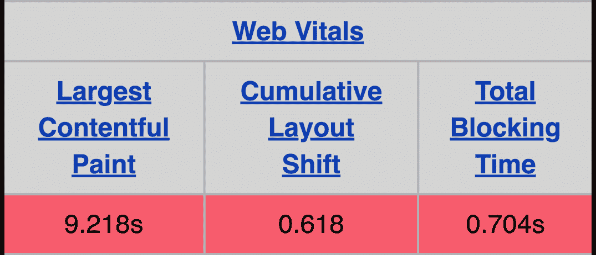

图 3.7：WebPageTest 的 Web Vitals 摘要包含 TBT，以及 LCP 和 CLS。

你可能在好奇具体可以做什么来改进你网站的性能指标。在我们走这条漫长道路之前，我们需要查看性能剖析器（performance profilers），以便你学习如何寻找特定的改进机会。

## 性能剖析器 (Performance Profilers)

合成工具擅长整洁地总结你网站的 JavaScript 性能。它们从`performance profiler`提供的数据得出这些总结——这是一种监控并记录页面上发生的所有活动（JavaScript 或其他）的开发者工具。

性能分析器存在于所有现代开发者工具中。无论你使用哪个浏览器的性能分析器，目标都是相同的：你希望对网站的性能有深入的解，以便找到特定的改进机会。

现代浏览器在放置性能分析器的位置上很大是一致的。首先，打开浏览器的开发者工具，寻找顶部的一系列标签页（图 3.8）。通常，浏览器的性能分析器位于标记为“Performance（性能）”或“Timeline（时间线）”的标签页下。


图 3.8：Chrome 开发者工具顶部的标签数组。Performance 标签打开 Chrome 的性能分析器。

### 理解已填充的性能剖析器

在初始状态下，剖析器的界面是空的。你通过记录两类活动之一来填充数据：

1. **启动活动**。这是指在启动期间发生的所有活动，从页面开始加载到 `window` 的 `onload` 事件触发后不久的期间。
2. **特定活动**。你可以记录任何特定时间段，以分析特定操作（例如切换菜单）的性能。

所有性能剖析器都提供了记录控件。无论你记录什么种类型的活动，停止记录后都会发生相同的情况：剖析器会被观测期间的数据。

第一次看到填充的性能剖析器可能就像被递了一份波音 737 的操作手册并被告诉“酷，现在起飞”。幸运的是，一旦掌握了其组织后的几个概念，理解剖析器并不那么困难。事实上，你从第一章了解到浏览器将活动调度为任务，而任务发生在帧内。帧和任务发生在主线程上，剖析器将其可视化为时间的线性进展。

不同的浏览器呈现这些信息的方式不同，但仍然反映了任务/帧的层次结构。Safari 在线上或列表中绘制任务。Safari 还提供了按帧查看任务（图 3.9）。

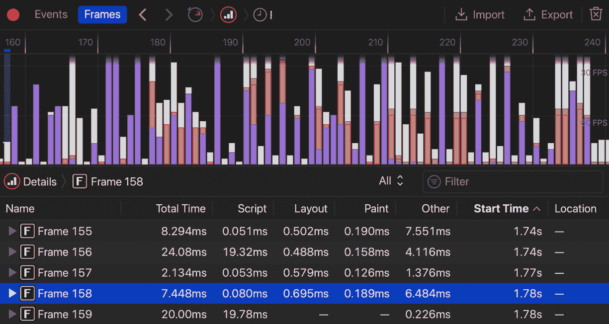

图 3.9：在 Safari 的性能分析器中，帧以条形图表示；帧越长条越高。所选部分的活动以表格列出。

Chrome 的剖析器采用了混合方法。它描绘单个帧，但任务以倒置火焰图的形式显示（图 3.10）。`flame chart` 是 JavaScript 调用栈的表示，每个任务的调用栈被可视化得像火焰。“火焰”的底部是任务的启动者，每个嵌套的活动堆叠在调用它的活动下方。

因为对任何巨大数据块进行总结都是有用的，大多数剖析器都提供了主线程活动的概览（图 3.11）。性能分析器的活动概览是交互式的，这意味着你可以点击并拖拽来选择时间范围，火焰图或任务列表将扩展或收缩到所选的时间段。

Chrome 的剖析器在火焰图下方添加了一个面板，带有标签页，提供过滤控件，可以按持续时间、类型和名称筛选任务（图 3.12），以及观测期间所有 CPU 时间花在何处的总结。

我个人的观点是 Chrome 的剖析器在易用性和信息深度之间提供了最好的结合，但请使用最适合你的剖析器。最重要的是，你选择的剖析器应该帮助找到改进机会——而这从了解如何使用剖析器评估加载和运行时性能开始。


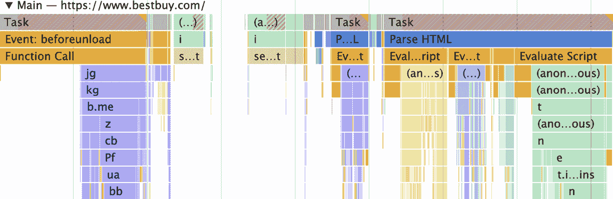

图 3.10：Chrome 性能分析器中主线程活动的可视化，将所有页面活动显示为倒置火焰图。

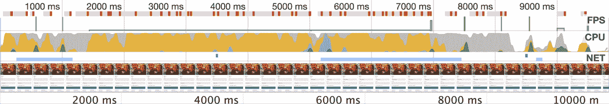

图 3.11：Chrome 性能分析器的活动概览。

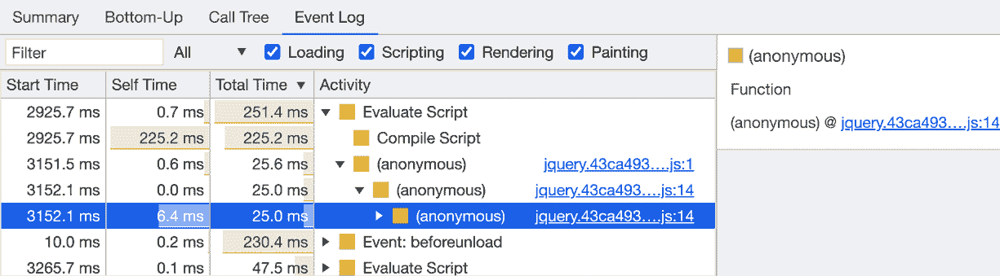

图 3.12：Chrome 性能分析器的底部面板。此面板有多个标签，用于显示摘要数据以及页面活动的详细列表。

### 评估加载性能

当你评估加载性能时，你实际上是在告诉分析器重新加载当前页面，并记录直到网络和主线程变得相当安静为止发生的所有事件。大多数浏览器的性能分析器都提供此类功能，它可以让你洞察任何特定页面在启动阶段发生的情况（图 3.13）。

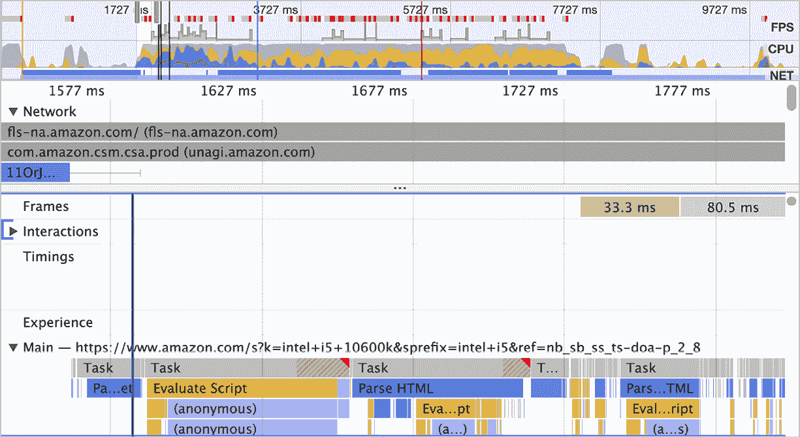

图 3.13：针对 Amazon 产品详情页的 Chrome 性能分析器填充视图。顶部是填充的活动概览。底部是火焰图，它显示了页面的所有调用堆栈。

正如你每天遇到的许多“哇，等一下”之类的信号一样，红色在 Chrome 分析器中具有特殊意义，因为它标出了性能问题。寻找问题的简单快捷方法是扫描分析器的活动概览并寻找红色条。这些条代表了阻塞时间（blocking time）期间段——正如我们所建立的那样，阻塞时间等同于主线程过载。

通过在活动概览中点击并拖动红色条，可以钻取问题区域（图 3.14）。由于火焰图会根据选择进行展开或收缩，我们能够更清楚地看到在该时间点发生了什么。

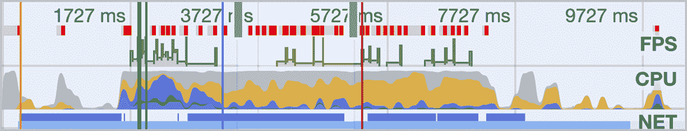

图 3.14：Chrome 性能分析器中的活动概览，选择了一部分活动。顶部的红色条说明了阻塞时间段。

所有任务都以灰色显示，但长任务会在右上角显示一个红色三角形。此外，任务的阻塞部分——即超过 50 毫秒的部分——带有红色斜纹（图 3.15）。

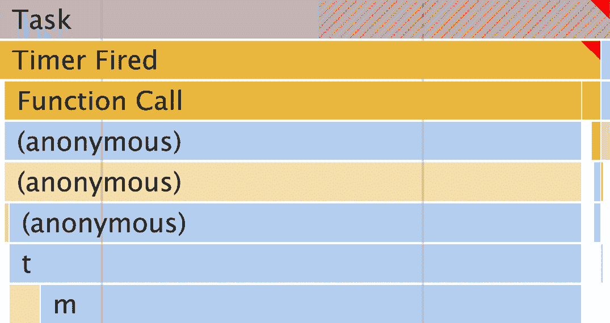

图 3.15：一个长任务——在此视图中处于层级顶端——其右上角有一个红色三角形。任务的阻塞部分用红色斜纹标记。


从这里，你可以通过点击调用栈的各个部分深入分析记录的交互，就像你在分析启动性能时做的那样。你可以访问相关信息，这些信息会准确告诉你是什么触发了交互，以及花费了多少时间。但注意：如果你正在调试生产网站上交互的运行时性能，你需要确保在发布 JavaScript 文件的同时也发布源映射（source maps）以辅助调试（[`bkaprt.com/rjs39/03-14`](http://bkaprt.com/rjs39/03-14)）。否则，在本地开发构建中对交互进行分析更有意义，因为代码没有经过压缩，可读性更高。

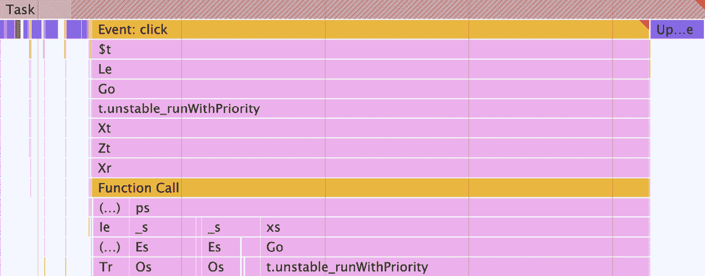

图 3.19：在目标网站上切换设置菜单触发了一个耗时 490 毫秒的任务。该任务的阻塞时间占任务总时间的 90% 左右，对于这样一个高价值的交互来说，这个比例是巨大的。

通过测试各种交互来查看它们是否足够快可能像是一项机械的练习，但如果你想要获得更高的精确度（并且愿意付出更多精力），你可能会依赖 `User Timing API` 来带有应用特定时间戳的慢速交互（[`bkaprt.com/rjs39/03-15`](http://bkaprt.com/rjs39/03-15)）。

要让网站在所有需要的地方都尽可能快是一项巨大的工作。然而，如果你想让这些工作真正发挥作用，请务必在低端设备上测量网站的 JavaScript 性能，以便更容易发现潜在的性能问题——这正是你即将要学的！

### 在设备上测试

在第 1 章中，我们提到了性能不仅在不同网络之间，在不同设备之间也存在。我们可以在 `WebPageTest` 这样的合成测试工具中观察这一点，它允许你在特定设备上运行测试，从该设备的视角来评估性能。在其结果页面上，你可以访问主线程活动可视化图，它们代表了不同的设备性能特征（图 3.20）。

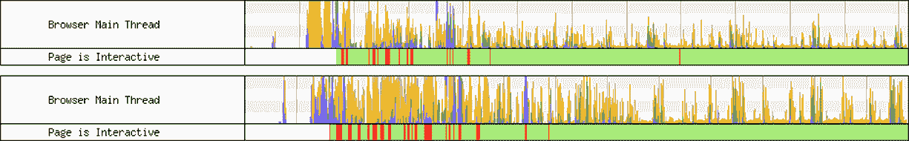

图 3.20：顶部是 Moto G6 Android 手机的主线程，底部是 Alcatel 1X Android 手机。由于处理能力较低，Alcatel 1X 产生了更多的阻塞时间。

虽然 `WebPageTest` 对于快速抽检很有用，但在开发期间使用它会遇到瓶颈。首先，`WebPageTest` 只能访问公开可的 URL。其次，它执行任务需要花费相当长的时间。当你需要快速测试和重新测试代码更改如何影响低端设备的性能时，这些限制会非常头疼。

本地测试的更好替代方案是 Chrome 的远程设备调试工具，它可以为连接到笔记本电脑或台电脑的 Android 设备启动开发者工具实例。如果连接的设备启用了 USB 调试（[`bkaprt.com/rjs39/03-16`](http://bkaprt.com/rjs39/03-16)），你可以通过将 Chrome 指向 `chrome://inspect#devices`，在主机的开发者工具中访问设备在 Chrome 中打开的任何页面（图 3.21）。

你可以通过点击页面的 `Inspect` 链接从调试工具的主界面启动 Chrome 开发者工具实例。从那里，你可以像往常一样使用 Chrome 的性能分析器来记录页面活动（图 3.22）。

）。将 iOS 设备连接到 macOS 主机，你可以通过主机上的 `Develop` 菜单检查在 Safari 中打开的页面。连接的 iOS 设备名称将作为一个单独菜单选项出现，下方列出已打开的页面（图 3.23）。点击页面 URL 将启动 Safari 开发者工具实例，包括性能分析器。

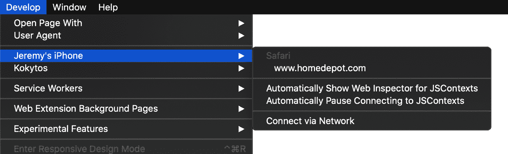

图 3.23：Safari 的远程设备调试允许对连接到 macOS 主机的 iOS 设备进行远程调试。虽然这很有用，但是时候说些真话了：在 2021 年 4 月，StatCounter Global Stats 发现，在全球调查的设备中，41.6% 是 Android 设备，而 iOS 仅占 16.07%（[`bkaprt.com/rjs39/03-18`](http://bkaprt.com/rjs39/03-18)）。如果你不确定应该分析哪些设备，请使用旧的、性能较差的硬件进行测试。你会发现更多问题，是的，但修复这些问题会让所有人受益，而不仅仅少数买得起高端硬件的富人。你需要了解你网站的 JavaScript 是如何损害访问者的信任的。这正是负责任的 Web 开发从业者应该做的。

[等待]

所以，我们已经讨论了一些实验室指标（lab metrics）、实地指标（field metrics）以及性能分析。事实是，我们讨论的大部分内容等同于合成性能测试，即从你的本地机器使用 `Lighthouse`、性能分析器或——如果你足够高端——使用像 `WebPageTest` 这样从一致基准运行性能测试的工具。当你使用这些工具时，你正在收集实验室指标。

实验室数据对于从开发者视角衡量性能基准非常有帮助。你测试并发现了一个问题，例如一个巨大的 JavaScript 资源导致启动性能下降。你优化了一些内容，再次测试，并记录实验室指标中的变化。这些很有用。

遗憾的是，实验室指标只能描述一个人的视角：即运行合成测试的人。如果你想真实了解你的网站对现实世界中的用户表现如何，你需要收集并分析实地指标。

### 收集实地指标

在收集后期分析的实地指标方面，有很多工具，它们在成本、功能和质量上不相同。收集工具总是需要一些客户端 JavaScript 从浏览器 API 收集数据并发送到收集端点。有一些开源选项可以帮你收集这些数据——例如 `Boomerang`——或者你可以自己动手。


如果你只需要收集少数核心指标，一个简单的小方案就能奏效。对于我自己的项目，我编写了一个名为 `grab-vitals` 的自定义解决方案（[`bkaprt.com/rjs39/03-20`](http://bkaprt.com/rjs39/03-20)），它使用了 Google 的 `web-vitals` npm 包来收集之前讨论的性能指标：

```javascript
window.addEventListener("load", () => {
  import("grab-vitals").then(({ grabVitals }) => {
    grabVitals("https://interslice.compuhyperglobalmega.net/collect");
  });
});
```

`grabVitals` 函数接受一个指向 `URL` 的 `string`，页面的性能指标将作为 `JSON` 字符串发送到该地址进行收集。为了避免在启动期间占用主线程，`grabVitals` 方法在页面 `load` 事件触发后才会被被调用。

如果你决定自己实现解决方案，请记住以下几点：

*   Google 的 `web-vitals` 包在没有填充性代码（polyfills）的情况下无法在所有浏览器中收集所有指标。这意味着在某些浏览器上加载它可能会导致产生未使用的代码。`grab-vitals` 通过使用动态 `import` 绕过了这个问题——这是我们将在第 4 章介绍的代码拆分技术。
*   使用 `requestIdleCallback` ([`bkaprt.com/rjs39/03-21`](http://bkaprt.com/rjs39/03-21)) 来避免与关键交互产生主线程竞争。任何关键交互都不应该为了收集指标而让路。该 API 将在第 6 章介绍。
*   批量收集的指标以避免对收集端点进行过度调用，这涉及巨大的挑战。`grab-vitals` 通过监听页面的 `visibilitychange` 事件以及 Safari 的 `pagehide` 事件（[`bkaprt.com/rjs39/03-22`](http://bkaprt.com/rjs39/03-22)）来补偿这一点。
*   你需要决定使用 `fetch` 还是 `navigator.sendBeacon` ([`bkaprt.com/rjs39/03-23`](http://bkaprt.com/rjs39/03-23)) 将字段指标发送到你的收集端点。`navigator.sendBeacon` 使用起来比 `fetch`get，且不会通过延迟文档卸载来延迟导航，但 `fetch` 提供了更好的控制能力。

这些内容很难！使用现成工具并不总是个坏主意，即使它是付费产品。只需知道，如果你决定与供应商合作收集字段数据，你应该通过提问来确保他们的收集方法解决了上述这些问题。

在指标的存储方面，这需要一个应用程序后端和一个数据库（[`bkaprt.com/rjs39/03-24`](http://bkaprt.com/rjs39/03-24)）。你如何存储指标并不重要，只要你能以一种舒适且熟悉的方式访问它们即可。

### 分析字段指标的技巧

无论你是依赖供应商产品来收集指标，还是自己实现解决方案，在分析数据存储器中的字段指标时，有几点需要考虑：

*   **避免使用平均值！** 虽然平均值很容易计算，但它们解释性能的方式并不如你认为的那样（[`bkaprt.com/rjs39/03-25`](http://bkaprt.com/rjs39/03-25)）。由于大量的字段指标包含许多离群值，平均值往往会偏斜。
*   **关注分位数。** 第 75、90 和 95 分位数特别有价值，因为这些区间往往会强调较慢的体验而非快速的体验。
*   **特别关注第 90 分位数及以上。** 在这里你将看到较慢设备和糟糕的网络条件如何影响性能。解决这个范围内的痛点，无论用户的网络连接或设备有多快，都能让你的网站对所有人运行更快。
*   **使数据上下文化。** 单的指标只能传达简单的结论，例如“这是你的页面可交互的时候”。如果你正在评估供应商产品，请查看它是否收集了设备信息和来自 `Long Tasks API` 的长任务数据。如果你是自己实现，请自己存储这些数据。这将让你更深入了解为什么某些用户遇到了问题而其他用户没有。

如果你只遵循一条建议，请关注分位数！分位数在总结字段指标的结果范围方面非常有价值。假设我们有一个 JavaScript 较少的网站，有 312 条 `LCP` 记录：

| 分位数 | 最大内容绘制 (Largest Contentful Paint) |
| --- | --- |
| 第 25 | 237 毫秒 |
| 第 50 | 619 毫秒 |
| 第 75 | 1,503 毫秒 |
| 第 90 | 3,693 毫秒 |
| 第 95 | 8,120 毫秒 |

如果我们对所有记录取平均值，将得到大约 1,707 毫秒。虽然这并不算不上一个糟糕的 `LCP` 分，但它是无法反映实际会话的值堆砌。它接近第 75 分位数。


```javascript
import PageContainer from "./PageContainer.js";
```

```javascript
import { BlogPost } from "./Components.js";
```

上述的 `import` 语句是`静态导入`（static imports）。静态导入将外部模块整合到当前脚本的作用域中。上述代码的第一行和第二行分别了如何导入命名导出（named exports）和默认导出（default exports）。

这展示了相应导出类型的实际应用：

```javascript
const PageContainer = () => { /* Omitted code */ };
```

```javascript
const BlogPost = () => { /* Omitted code */ };
```

```javascript
// Default export
```

```javascript
export default PageContainer;
```

```javascript
// Named export
```

```javascript
export BlogPost;
```

无论你使用命名导出还是默认导出，对于理解静态导入的局限性并不重要：

- 模块标识符（module specifier）——即 `from` 关键字之后用于指定模块位置的字符串——只能是一个普通字符串。
- 静态导入只能出现在文件的顶部。

这些限制使得静态导入只能能够立即加载代码，无论该代码是否在启动时执行。为了解决这一限制，人们开发了一种更灵活的 `import` 语法，即`动态导入`dynamic import）（[`bkaprt.com/rjs39/04-02`](http://bkaprt.com/rjs39/04-02)）。

`dynamic imports` 与静态导入相似，不同之处在于可以放在代码的任何地方，并且依赖于承诺（promises）：

```javascript
import("/js/module.js").then(module => {
```

```javascript
 // Access the default export
```

```javascript
 module.default();
```

```javascript
 // Access a named export
```

```javascript
 module.namedModule();
```

```javascript
}).catch(error => {
```

```javascript
 // Something went wrong!
```

```javascript
 console.warn(error);
```

```javascript
});
```

虽然这种语法比静态导入冗长，但它更大的灵活性意味着我们可以在选择的时间启动后加载额外的 JavaScript。这让我们对启动时加载的代码量具有更大的控制权，从而可以带来重大的性能收益。

### 代码拆分 (Code splitting)

动态导入使得`code splitting`成为可能（[`bkaprt.com/rjs39/04-03`](http://bkaprt.com/rjs39/04-03)）。代码拆分是一种性能优化手段，将任何启动时不需要的 JavaScript 从应用程序逻辑中分离出来，转而从单独脚本资源按需加载。

“我为什么要关心代码拆分？”你可能会说。允许我详细说明一下：很有可能你正在发送一些未使用的 JavaScript。HTTP Archive 在其 2020 年年鉴中披露，中位数体验发送的 JavaScript 大约 37% 是未使用的（[`bkaprt.com/rjs39/04-04`](http://bkaprt.com/rjs39/04-04)）。这是大量的千字节在毫无理由地负担着设备并白费了计费流量。而这只是`中位数`体验——你的项目发送的未使用 JavaScript 可能比这更多！

所以我们必须拆分，也也将拆分！然而，代码拆分的第一步是寻找机会。用户交互几乎总是潜在的代码拆分机会，这意味着我们将寻找由于明确交互而触发的事件监听器。

隐藏在 `click` 事件中的代码（例如 JavaScript 驱动的表单验证）就是代码拆分的一种机会。在 `click` 事件中运行的脚本是`延迟行为`(deferred behavior）的典型示例，因为与其相关的 JavaScript 在启动期间不会运行。正如 HTTP Archive 所示，无论是否会被使用，我们经常加载这些行为的脚本，尽管它们可以按需加载。

另一个延迟交互的良好例子是 `<form>` 元素的 `submit` 事件。该事件是通过放置恰当的动态导入来延迟加载 JavaScript 的绝佳机会：

```javascript
const contactForm = document.getElementById("contact-form");
```

```javascript
const inputs = contactForm.querySelectorAll("input, textarea");
```

```javascript
inputs.forEach(input => {
```

```javascript
 input.removeAttribute("required");
```

```javascript
 input.removeAttribute("pattern");
```

```javascript
});
```

```javascript
contactForm.addEventListener("submit", event => {
```

```javascript
 event.preventDefault();
```

```javascript
 import("/js/contact-form-validation.js").then(module => {
```

```javascript
 const [state, errors] = module.isFormValid(inputs);
```

```javascript
 if (state) {
```

```javascript
 contactForm.submit();
```

```javascript
 return;
```

```javascript
 }
```

```javascript
 // TODO: Error processing code here
```

```javascript
 });
```

```javascript
});
```

点击提交后，你将不得不等待动态导入获取验证脚本（这是我们稍后会详细讨论的一个可能的缺点）。尽管如此，它也是一个很好的动态导入示例，也是渐进增强（progressive enhancement）应用的绝佳示例。

由于服务器发送了带有 `required` 和 `pattern` 属性的 `<form>` 标记，我们需要在自定义验证逻辑工作之前移除它们。然而，如果验证脚本加载或执行失败，表单仍然具有 HTML 本身提供的`某些`验证能力。虽然不理想，但这种冗余功能仍然节省了我们往返服务器验证所有输入内容的次数（你本就应该这么做）。

在表单的 `submit` 事件回调中，我们调用 `event.preventDefault()` 来防止表单提交。之后，我们动态导入模块，该模块包含一个名为 `isFormValid` 的单一导出。

这只是动态导入很有用的的一种交互类型。如果你的网站上有许多功能，可能还有更多考虑的点，例如 `click`、`hover`、`focus` 和 `blur`。

### 选择性地功能填充 (Selectively polyfilling features)

`polyfilling` 是使用 JavaScript 在不支持它们的浏览器中提供特定网络平台 API 的做法。这通常是必要的做法，但如果你不小心只针对那些需要它的地方投放，它也会增加未使用 JavaScript 的数量。

国际化 API（Internationalization API）的各个部分都是很好的例子。`Intl.relativeTimeFormat` 非常有用，因为它能为英语区域自动生成如“3 天前”之类的相对时间字符串——或者大量其他语言：它在各种语言区域都提供了这种能力，这项常见（但复杂）的任务由浏览器内部处理，而不需要像 Moment.js 这样重量级的库，它的重量是 300 千字节（[`bkaprt.com/rjs39/04-05`](http://bkaprt.com/rjs39/04-05)）。

在编写时，并非所有浏览器都支持国际化 API。对于 `Intl.relativeTimeFormat` 及其在更广泛 API 中的依赖项，存在 polyfills。然而，取决于你需要填充的程度，你可能会发送二十或更多千字节在某些浏览器中未使用的 JavaScript，这可能会导致启动变慢。

我们可以依靠动态导入来防止不必要的填充填充发生，国际化 API polyfills 的维护者已经在 Node.js 开发环境中演示了如何做到：

```javascript
import { shouldPolyfill } from "@formatjs/intl-relativetimeformat/should-polyfill"
```

```javascript
async function polyfill (locale) {
```

```javascript
 if (shouldPolyfill()) {
```

```javascript
 await import("@formatjs/intl-relativetimeformat/polyfill")
```

```javascript
 }
```
```


```javascript
if (Intl.RelativeTimeFormat.polyfilled) {
  switch (locale) {
    default:
      await import("@formatjs/intl-relativetimeformat/locale-data/en");
      break;
    case "fr":
      await import("@formatjs/intl-relativetimeformat/locale-data/fr");
      break;
  }
}
```

这段代码段为一个同时使用英语和法语区域的网站处理 `Intl.relativeTimeFormat` 的垫填充（polyfilling）。在这里，我们从 polyfill 中导入了一个命名为 `shouldPolyfill` 的工具方法。如果该方法确定垫填充 确是必要的，它就会垫填充 `Intl.relativeTimeFormat`，然后根据 `locale` 的值动态导入区域数据。

这远不是可以使用使用 `dynamic import`（动态导入）来选择性地垫填充 Web 平台功能的唯一情况。每当你考虑使用 polyfill 时，请花一点时间研究并检查 Can I Use ([`bkaprt.com/rjs39/04-07`](http://bkaprt.com/rjs39/04-07))，看看你正在垫填充的特性支持程度如何。然后，就如何采取后续操作做出明智的决策。

无论你是使用动态导入来条件地垫填充浏览器 API，还是推迟应用程序脚本直到需要时再加载，结果都是相同的：你减少了启动期间加载的 JavaScript 数量，从而减少了该过程中的处理和阻塞时间。

## 抢占先机

如果你的网站严重依赖 JavaScript，那么网络的顽固特性意味着请求脚本时产生的延迟将延长启动阶段。为了领先于这一混乱局面并缓解高延迟环境带来的痛苦，我们可以采用几种技术中的一种（或多种）。简而言之，我们越快能获取到这些脚本，浏览器处理它们的速度就越快。

### 自托管：一个虽然平淡但有效的技巧

加载性能完全取决于连接，当浏览器打开通往 Web 服务器的连接时，会发生一种复杂的“舞蹈”（见图 4.2）：

1. 域名必须通过 `DNS lookup`（DNS 查询）解析到 Web 服务器的 IP 地址。
2. 大多数 Web 服务器通过 `transmission control protocol`（传输控制协议，即 `TCP`）进行通信。`TCP` 连接需要时间建立，且 `TCP handshake`（TCP 握手）和 `slow start`（慢启动）因素都会影响 Web 服务器响应的速度 ([`bkaprt.com/rjs39/04-08`](http://bkaprt.com/rjs39/04-08))。
3. 如果涉及 `HTTPS`，`transport layer security`（传输层安全，即 `TLS`）协商也需要时间。

`HTTP/3` 减少了连接和 `TLS` 协商涉及延迟。尽管如此，无论使用 `HTTP/3` 还是其他，总会有某些延迟。这就是为什么自托管是一种平淡但有效的性能增强，不仅针对 JavaScript，而且适用于所有资源类型。

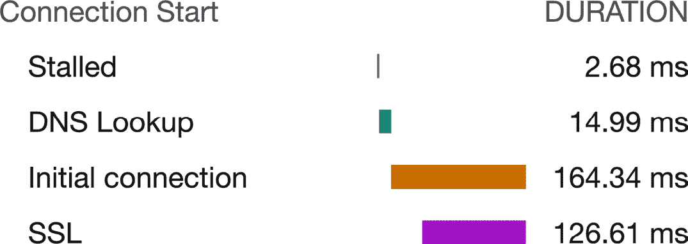

图 4.2：Chrome 开发者工具网络标签页中所示的连接 Web 服务器各个阶段涉及的延迟。

自托管值得讨论，因为看到从 `cdnjs` 等公共 CDN 加载资源并不罕见 ([`bkaprt.com/rjs39/04-09`](http://bkaprt.com/rjs39/04-09))。虽然公共 CDN 可能有用，因为它们消除了托管流行库和框架的负担，但你必须权添加另一个跨源（即除你自己之外的任何 Web 服务器）的延迟成本与托管自己资源之间的关系（见图 4.3）。

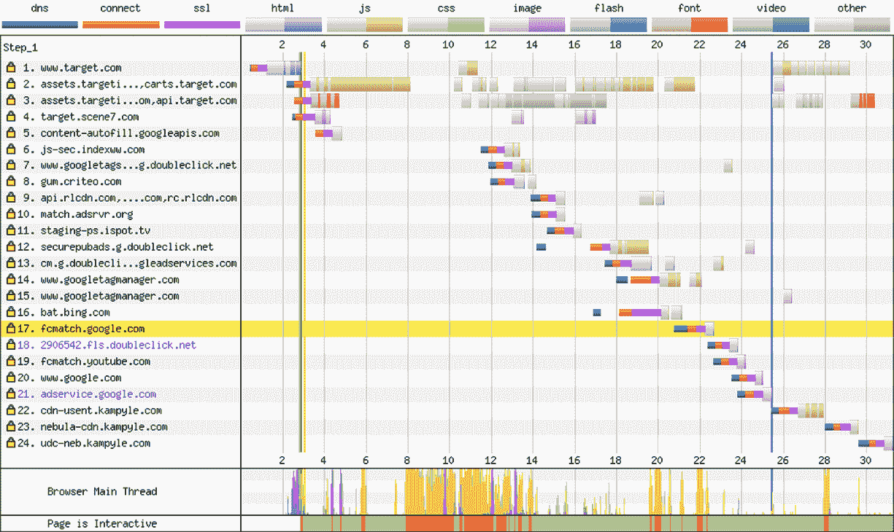

图 4.3：WebPageTest 的连接视图，列出了网站使用的所有源。每行代表一个独立的连接，显示 DNS 查询（青色）、连接（橙色）和 TLS 协商时间（紫色）。

一个常见的误区是公共 CDN 由于 `shared caching`（共享缓存）提供了额外的性能收益。共享缓存的想法是，如果你访问一个请求（例如）托管在公共 CDN 上的 `React` 副本的网站，当另一个网站从同一位置请求该 `React` 副本时，应该从浏览器缓存中提取同一个 `React` 副本。

虽然这在理论上是一个受欢迎的优化，但在实践中并不存在，因为浏览器会对主源（即你的 Web 服务器）针对跨源请求进行键值，导致缓存未命中 ([`bkaprt.com/rjs39/04-10`](http://bkaprt.com/rjs39/04-10))。从性能角度来看，使用公共 CDN 没有任何优势。

对于 JavaScript，自托管通过减少延迟缩短了加载阶段，这意味着浏览器可以更早进入处理阶段。

### 使用资源提示“润滑”

在某些情况下，自托管并不总是在实践上可行的，这时 `resource hints`（资源提示）可以帮助减少跨源资源的延迟。`Resource hints` 使用 `<link>` 元素引导浏览器更早地获取资源或打开跨源连接。它们的使用对于加速 JavaScript 加载至关重要，使网站能够更快地变得可交互。

### 减少连接延迟

源顺序描述了 HTML 中元素的顺序，当涉及 JavaScript 时，其重要性可能会被忽视。浏览器流式传输 HTML，并将解析工作切分成可以处理的部分。由于由于，位于标记末部的脚本引用直到浏览器解析它们时才会被发现。当这些脚本位于跨源时，这会增加跨源资源的延迟（见图 4.4）。

然而，通过 `preconnect`，我们可以在服务器开始处理 HTML 时打开跨源连接，只需在文档 `<head>` 中放置资源提示：

```html
<link rel="preconnect" href="https://syndication.twitter.com/">
<link rel="preconnect" href="https://pbs.twimg.com/">
<link rel="preconnect" href="https://www.google-analytics.com/">
```

通过更早地协商跨源连接来提高性能，而不是等待浏览器按发现它们（见图 4.5）。

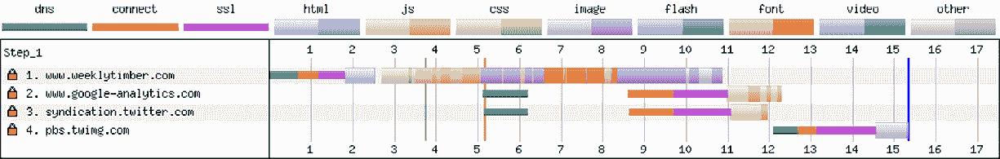

图 4.4：WebPageTest 的连接视图。第二行和第三行是跨源，连接在 HTML 解析器发现它们提供的资源之前尚未建立。

当无法托管资源时，`preconnect` 是一种替代方案，可以减少加载跨源资源产生的延迟。这是一种有效且简单的性能优化，其影响比你想象的要大。

### 预加载关键 JavaScript

*Critical path*（关键路径）是 Web 性能中的一个概念，描述了渲染页面内容所需的请求数量 ([`bkaprt.com/rjs39/04-11`](http://bkaprt.com/rjs39/04-11))。`HTML` 和 `CSS` 文件是关键路径上典型的请求示例，因为没有它们就没有页面可言（见图 4.6）。


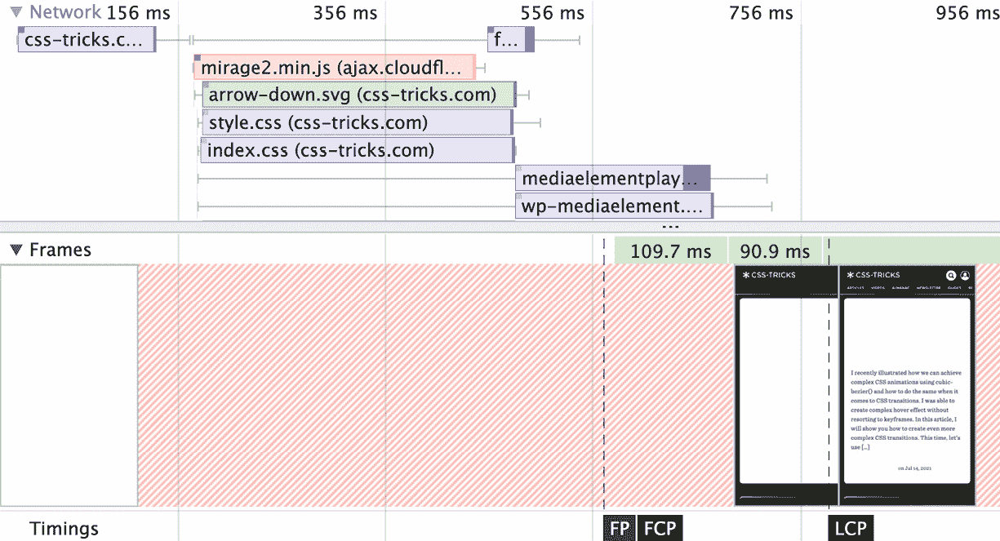

图 4.6：在 Chrome 性能分析器中，CSS-Tricks 的 HTML 和 CSS 关键请求（在顶部网络面板显示）分别用蓝色和紫色阴标记。这些资源在页面绘制（paints）之前是必须的——在底部的计时器面板中显示为 `FP` 和 `FCP`。

CSS 和 HTML 并不是唯一可以出现在关键路径上的资源类型。在第 2 章中，我们讨论了客户端渲染的标记比服务器提供的标记更耗资源。除了解析和执行 JavaScript 以渲染标记的计算开销外，客户端渲染的标记也是一种性能瓶颈，因为它将 JavaScript 放入了关键路径。这是一个遗憾的非常常见的模式（图 4.7）。

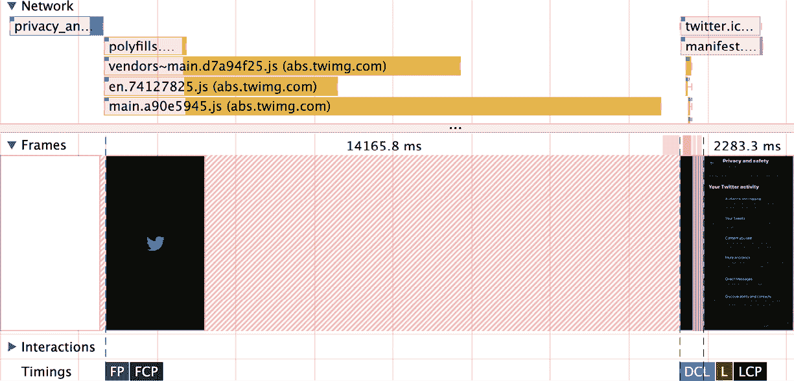

图 4.7：关键 JavaScript 请求阻塞了移动端 Twitter Web 应用设置页的渲染。虽然加载屏出现很快，但浏览器必须等待脚本加载（在顶部面板用黄色显示）之后页面才能完全渲染。

幸运的是，`preload` 资源提示有助于在浏览器通常发现它们之前加载资源，从而缓解这一问题。

假设你有一个页面，在闭合的 `</body>` 标签之前加载了两个脚本。第一个包含第三方脚本——可以想成框架和库。第二个包含你的应用程序逻辑：

```
<script src="/js/vendors.ae6fd23c.js"></script>
```

```
<script src="/js/scripts.1db3ef48.js"></script>
```

`preload` 通过改变浏览器对页面资源的发现顺序，规避了对 HTML 解析器的等待：

```
<link rel="preload" as="script" href="/js/vendors.ae6fd23c.js">
```

```
<link rel="preload" as="script" href="/js/scripts.1db3ef48.js">
```

通过在 `<head>` 中这些提示，浏览器发现这些脚本的时间会比我们等到它在文档末尾发现它们要早。当浏览器遇到页面底部相应的 `<script>` 元素时，它们至少加载了一部分。

为什么，是的，`preload` 确实有一些权衡：

*   读这一遍，再重读一遍：如果你的网站上显示关键内容需要 JavaScript，那么你已经处于麻烦之中。`preload` 可以作为解决你由 JavaScript 引起的加载性能问题的良药，但其他关键资源（如样式表、Web 字体等）将失去带宽，因为你实际上重新将 JavaScript 的优先级置于它们之上。要从问题的根源解决——即 JavaScript——通过让服务器提供该内容标记而不是依赖客户端渲染，从而将其从关键路径中移除（[`bkaprt.com/rjs39/04-12`](http://bkaprt.com/rjs39/04-12)-12](http://bkaprt.com/rjs39/04-12)）。
*   `preload` 提示需要一个 `as` 属性来描述资源的性质（[`bkaprt.com/rjs39/04-13`](http://bkaprt.com/rjs39/04-13)）。对于脚本，此值应该是 `script`。如果你是个 `as`hole（混蛋）且没有指定 `as`，预加载的响应将被丢弃。
*   因为 `preload` 被赋予更高的优先级，其他请求可能会失去带宽。请谨慎使用 `preload`。如果一切都是高优先级，那么就都没有高优先级了。
*   如果你正在预加载一个 JavaScript 模块——即通过带有 `type` 属性值为 `module` 的 `<script>` 元素加载的脚本——你不需要 `preload`。你需要的是 `modulepreload`，它遵循与 `preload` 相同的格式，但不需要那些 `as` 属性的麻烦。`modulepreload` 还带有解析方面的优势，这些是 `preload` 无法获得的，例如递归预加载整个模块树，以及推测性解析的优势（[`bkaprt.com/rjs39/04-14`](http://bkaprt.com/rjs39/04-14)）。

撇开权衡不谈，`preload` 是有效的，特别是对于 Web 应用架构中的关键 JavaScript，坦率说，它们需要尽可能的帮助来提高性能。请负责任地使用它，并像往常一样，衡量收益以查看它是否适用于你的项目。

### 按需预加载 JavaScript

记得早些时候我们闲聊代码分割和动态导入吗？嗯，那整个场景的缺点之一是，如果你将脚本加载推迟到需要它的那一秒，那么那些在慢网络连接上的用户会发现自己必须等待你的动态导入完成，他们所执行的操作才会启动。

这并不意味着代码分割是一种反模式；它意味着我们需要稍微思考一下如何解决延迟的劣势。考虑之前提到的联系表单示例，它依赖动态导入在提交时获取表单验证脚本。在表单验证脚本下载和运行之前，有一段延迟（图 4.8）。

这种延迟是令人沮丧的：当有人提交表单时，他们期望从页面收到信号，表明他们的操作正在处理中。但在他们的某些脚本执行之前，*没有任何*事情正在发生。

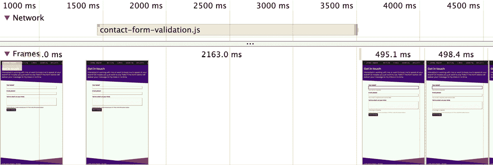

图 4.8：在这次分析会话中，下载表单验证脚本需要大约两秒，导致了延迟。

这种这种情况并不会消除良好的动态导入带来的性能优势，但我们确实需要调整策略。让我们从一个小型函数开始，它能按需向 `<head>` 注入 `preload`：

```
function injectPreload (href, module, as) {
  let preloadHint = document.createElement("link");
  preloadHint.rel = module ? "modulepreload" : "preload";
  preloadHint.href = href;
  if (!module && typeof as !== "undefined") {
    preloadHint.as = as;
  }
  document.head.appendChild(preloadHint);
}
```

[/content-content]

该函数接收三个参数：
1. 要预加载脚本的位置
2. 一个是否为模块的布尔值；如果是，资源提示将是 `modulepreload` 而不是 `preload`
3. 用于填充提示 `as` 属性的值

运行时，该函数会构建资源提示并将 `<link>` 元素注入到 `<head>`。这触发了获取脚本的请求。

剩下的就是找到触发 `preload` 的正确时机。由于这是一个表单，理想的时机是当任何表单字段获得焦点时；用户填写表单字段的操作为我们赢得了时间：

```
const inputs = Array.from(document.querySelectorAll("#contact-form input, .contact-form textarea"));
let preloaded = false;

inputs.forEach(input => {
  input.addEventListener("focus", () => {
    if (!preloaded) {
      injectPreload("/js/contact-form-validation.js", false, "script");
      preloaded = true;
    }
  }, {
    once: true
  })
});
```

这确保我们的表单验证脚本只有在用户关注表单中的任何输入框时才会被预加载，且只加载一次。这是对意图的练习：如果有人关注了表单字段，他们可能打算填写表单，预加载可能会在他们操作之前完成。

一旦表单提交并启动动态导入，验证脚本将已经在浏览器缓存中了。这意味着动态导入将命中浏览器缓存而不是网络，使交互几乎是瞬间完成的（图 4.9）。


这种机会性方法利用了代码分割的优势，同时尽可能地减少了推迟脚本加载时带来的延迟。这已经是我们接近*既要鱼又要兼得*的极限了。

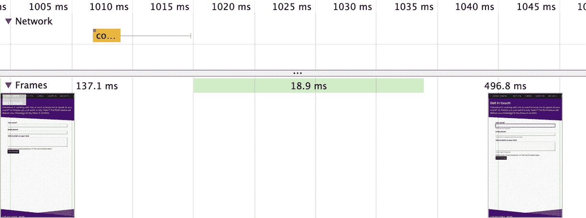

图 4.9：由于在表单提交之前预加载了该脚本，通过动态导入获取表单验证脚本的延迟实际上被消除了。

资源提示（resource hints）的总体目标是：如果我们作为开发者能尽一切努力减轻 JavaScript 在启动期间的负面影响，我们就可以提高加载和运行性能。记住，`responsible`（负责任）这个词是 `Responsible JavaScript` 中的核心支撑词汇。资源提示是工具箱中的另一个工具，可以帮助我们履行这一义务。

## 帮助用户节省数据

想象一下，如果我们只为单一硬件开发程序，我们的工作会变得容易得多。如果是如此，这本书就不需要存在了。我们现在应该已经学会如何负责任地使用 JavaScript。

但是，*天哪*，我们要为数以千计的设备和网络环境开发。限制条件因用户而异，这使得构建高性能架构变得极具挑战性——但我们对用户有责任适应他们的需求。

如果你在美国的农村地区待过哪怕一分钟，你就知道寻找快速可靠的网络连接可能是一场噩梦（[`bkaprt.com/rjs39/04-15`](http://bkaprt.com/rjs39/04-15)）。在这些互联网真空区，人们可能会倾向于减少数据使用，以缓解在慢网络上浏览的痛苦。如果我们能考虑到他们，这将对于让处于劣势地位的用户访问网页非常有帮助。

### 减少数据使用的信号

在安卓版的 Google Chrome 中，用户可以通过“数据节省模式”（Data Saver Mode）或“轻量模式”（Lite Mode）指定减少数据使用的偏。启用后，该模式会做两件事：

1. Chrome 将 `navigator.connection.saveData` 设置为 `true`。

2. Chrome 为每个请求发送一个值为 `on` 的 `Save-Data` HTTP 请求头。

从历史上看，该平台是唯一提供此类模式的平台，但最近 CSS 中的 `prefers-reduced-data` 媒体查询出现，将数据节省功能扩展到了所有浏览器。它的值可以是 `no-preference`（表示对数据使用没有偏好）或 `reduce`（表示减少数据使用）。

在安卓版 Chrome 中，减少数据使用的偏好遵循标准的 `prefers-reduced-data` 媒体查询。虽然一个 CSS 特性似乎在 JavaScript 中没有太大用处，但我们可以通过 `matchMedia` 方法来评估这一偏好：

```
// 如果指定了减少数据使用的偏好，
```

```
// 此表达式将求值为 true:
```

```
const saveData = window.matchMedia("(prefers-reduced-data: reduce)").matches;
```

不过，如果你到目前为止从书中中学到了什么，那就是 JavaScript 的角色应该是被减少而不是扩展。鉴于此，在服务器端读取 `Save-Data` 请求头似乎更为合理。并不是说这个值在 JavaScript 本身中没有关联——事实上，它有关！只是你减少对 JavaScript 依赖的最佳途径是在服务器端。在后端语言（例如 PHP）中，可以这样检测 `Save-Data` 请求头：

```php
define("SAVE_DATA", isset($_SERVER["HTTP_SAVE_DATA"]) && stristr($_SERVER["HTTP_SAVE_DATA"], "on") !== false);
```

这段代码定义了一个 `SAVE_DATA` 常量。从那里，该信号可以在后端使用，专注于页面的关键内容并剥离非必要的资源——包括 JavaScript。

我们可以在 Weekly Timber 网站（一家威斯康星州的伐木公司）上看到应用。问答页面包含轮播图（carousel）和折叠面板（accordions）（图 4.10），它们都依赖于 `jQuery`，而且轮播图由大量的 JavaScript 驱动。还有轮播插件本身以及一小段初始化所有内容的 JavaScript。

![Weekly Timber 答页完整功能版本包含轮播图和 JavaScript 驱动的折叠面板。(image/4.10.png)图 4.10：Weekly Timber 答页面完整功能版本包含轮播图和 JavaScript 驱动的折叠面板。这些增强功能总共少于 100 KB 的未压缩 JavaScript。对于网页来说，这部分 JavaScript 并不惊人，但在慢设备上，它确实会引发相当的主线程活动（图 4.11）。![Chrome 性能分析器中 Weekly Timber 网站答页面的主线程活动概述。该页面启动了不容忽视的 JavaScript 活动，以及 JavaScript 引发的布局和绘制工作。(image/4.11.png)图 4.11：Chrome 性能分析器中 Weekly Timber 网站答页面的主线程活动概述。该页面启动了不容忽视的 JavaScript 活动，以及 JavaScript 引发的布局和绘制工作。但我们可以使用创建的 `SAVE_DATA` 常量，为 Weekly Timber 可能处于不理想农村网络环境的客户去掉花里胡哨。如果 `SAVE_DATA` 为 `true`，我们选择移除轮播图和折叠面板功能：```
phpif (!SAVE_DATA) {?><section id="carousel">  <!-- 移除轮播图 --></section><?php}?>```### 作为自定义功能节省数据数据节省功能并不非由浏览器提供；你可以将其作为可切换设置构建到自己的应用程序中，这样所有人都能受益，而不仅仅是提供该功能的浏览器用户。例如，Twitter 提供了一个应用程序级的设置来帮助访问者节省数据（图 4.14）。

图 4.14：Twitter 的数据节省设置位于其移动导航菜单的底部。


启用此设置后，Twitter 会下载图像和视频的低分辨率占位符，然后允许用户选择是否查看相关的媒体内容（图 4.15）。


图 4.15：Twitter 的数据节省器功能运行演示。在这里，访问者可以决定他们想要下载哪些媒体以节省流量消耗。

你如何实现自定义的数据节省器功能取决于你的项目。你可以将其按机器为基础存储在 cookie 中，或使用 JavaScript 中的 `localStorage` 进行存储（[`bkaprt.com/rjs39/04-16`](http://bkaprt.com/rjs39/04-16)）。或者，如果你想尽可能地让更多用户使用此功能，可以将此偏好存储在应用程序的后端。

数据节省器概念上的简单性正是其强大之处所在：如果你给人们一个选择减少数据使用的机会，他们很有可能会采纳它。这是一个让人们对自己的体验拥有更多控制权的机会，*并且*减少了你代表他们运行的 JavaScript。

## 韧性：你的名字是 Service Worker

如果你安装过瓷砖，你就知道这是一个极其艰难的过程。首先，你必须确保你的底座是平整的。然后，在底座上铺设解耦膜。接着铺设砂浆层。然后给瓷砖背部涂抹砂浆并将其嵌入砂浆层。然后进行勾缝。最后密封勾缝。这是一项大量的工作，但这些工作为完成的安装增添了强度、韧性和吸引力。

我们在书中到为止所描述的构建具有韧性网站的过程同样是冗余且分层的。然而，我们应该考虑再添加最后的一层：service worker（[`bkaprt.com/rjs39/04-17`](http://bkaprt.com/rjs39/04-17)）。

Service Worker 是一种充当浏览器和服务器之间代理的 API。Service workers 是功能强大的小齿轮，可以拦截请求和响应、重定向请求、缓存响应并提供离线能力，使网站不仅在更多地方可访问，而且速度更快。

### 优先考虑速度和访问

Weekly Timber 位于威斯康星州的瓦沙拉县。在像这样的地方，良好的网络连接可能是很难得的（图 4.16）。


图 4.16：威斯康星州瓦沙拉县的宽带颜色叠加地图。该县大部分地区显示为浅褐色，表示宽带速度在 3 到 9.99 Mbps 之间。浅蓝色和深蓝色区域更快。

威斯康州确实有农场，但也有大量的森林。如果你需要砍掉一些树，你会访问 Google 寻找伐木公司。伐木公司网站加载得有多快——或者加载不出来——可能会影响你是否会给那公司打电话。

这就是针对速度和韧性调过的 service worker 发挥用场的地方。我为 Weekly Timber 构建了一个 service worker，通过以下方式显著提升了感知性能：

*   在 service worker 安装期间预缓存页眉和页脚的标记；
*   仅请求内容标记并将其与预缓存的页眉和页脚标记组装；
*   流式传输完全组装的响应，以最快速度将标记发送到浏览器；以及
*   通过导航预加载（navigation preload）（[`bkaprt.com/rjs39/04-18`](http://bkaprt.com/rjs39/04-18)）避免 service worker 的启动延迟。

这些架构决策对性能的影响是非常显著的。当这个 service worker 部署到 Weekly Timber 时，导致首次内容绘制（First Contentful Paint）和最大内容绘制（Largest Contentful Paint）的中位数时间分别减少了 42% 和 48%。更好的是，这些改进不是通过合成性能测试工具观察到的，而是实际上使用 Weekly Timber 网站的人（[`bkaprt.com/rjs39/04-19`](http://bkaprt.com/rjs39/04-19)）观察到的。

在我们开始介绍如何构建这个 service worker 之前，我们需要为它建立一个缓存——因为没有缓存，service worker 在性能方面对你起不了太大作用。

### 建立 service worker 缓存

Service workers 依赖于 `Cache` 接口（[`bkaprt.com/rjs39/04-20`](http://bkaprt.com/rjs39/04-20)），它提供了一个与我们在第 3 章介绍过的浏览器缓存不同的缓存层。当 service worker 安装时，它的 `install` 事件会触发（[`bkaprt.com/rjs39/04-21`](http://bkaprt.com/rjs39/04-21)）。这里就是我们创建新的 service worker 缓存的地方：

```javascript
self.addEventListener("install", event => {
 const cacheName = "fancy_cache_name_here";
 const cachedAssets = [
 "/partial-header",
 "/partial-footer"
 ];
 event.waitUntil(caches.open(cacheName).then(cache => {
 return cache.addAll(cachedAssets);
 }));
 });
```

这里发生了两件事：

1.  我们的 service worker 缓存需要一个标识符，我们在 `cacheName` 中指定它。我们使用这个标识符通过 `Cache` 接口的 `open` 方法（[`bkaprt.com/rjs39/04-22`](http://bkaprt.com/rjs39/04-22)）打开缓存，以便跟踪存入的内容。
2.  在打开新缓存后，我们使用 `Cache` 接口的 `addAll` 方法在其中预缓存资源（[`bkaprt.com/rjs39/04-23`](http://bkaprt.com/rjs39/04-23)）。我们可以向其填充任何我们认为值得提前的内容。

### 激活 service worker

在 service worker 的生命周期中，激活（activation）发生在安装（installation）之后。激活是一个进行清理工作的机会，它发生在 service worker 的 `activate` 事件中：

```javascript
self.addEventListener("activate", event => {
 const cacheName = "fancy_cache_name_here";
 const preloadAvailable = "navigationPreload" in self.registration;
 event.waitUntil(caches.keys().then(keys => {
 return Promise.all([
 keys.filter(key => {
 return key !== cacheName;
 }).map(key => {
 return caches.delete(key);
 }),
 preloadAvailable ? self.registration.navigationPreload.enable() : true
 ]);
 }));
});
```


## 2. Service worker 启动时间会延迟请求

`navigationPreload` 通过让 service worker 的启动和导航请求并发执行而非串行执行来解决这个问题。尽管如此，由于并非所有浏览器都支持它，我们将它的支持状态存储在 `preloadAvailable` 中，并使用三元运算符在支持的浏览器显式启用 `navigationPreload`，在不支持的平台上传递一个布尔值。

这涉及到大量的`内容`，但我们正要进入好有趣的部分：拦截并修改响应！

### 拦截请求

拦截网络请求是 service worker 的核心戏码。与 `Cache` 接口结合时，拦截请求和自定义响应的能力是实现快速用户体验的沃土。

在开始处理特定的请求类型之前，我们需要从一个良好的默认开始：

```javascript
self.addEventListener("fetch", async event => {
const { request } = event;
if (request.method !== "GET") {
  return;
}
// 为了简洁省略了代码...
});
```

`fetch` 是另一个 service worker 事件，每当浏览器分发网络请求时，它就会触发。在大多数情况下，良好的默认做法是检查 `event` 对象的 `request.method` 属性是否代表一个 `GET` 请求。`POST` 请求是由用户特定操作（如提交表单）驱动的。我们不想对这些请求进行操作，因此通过抛出 `return` 将它们直接透传给 `fetch` 事件处理器。

从这里开始，我们需要根据请求的内容类型将逻辑进行分叉：静态资源或导航。

### 处理静态资源

“缓存优先，网络后之”模式是处理静态资源请求的良好默认值——即对在任何情况下都不会改变的资源的请求，例如 CSS、图像、字体，以及，是的，JavaScript。

这意味着我们首先检查静态资源是否在 service worker 缓存中。不过，对它的第一次请求将会失败，因为此时缓存中还不在那里；我们必须访问网络来获取它。之后，我们将该资源放入缓存，以便未来对该资源的请求可以完全跳过网络。

这意味着从 `Cache` 接口检索静态资源的速度极快（图 4.17）。其逻辑也相当简单直接。你要么在缓存中拥有该资源，要么没有。如果没有，就获取它并将其放入缓存：

```javascript
self.addEventListener("fetch", async event => {
// 省略了请求过滤代码...
const staticAssets = /\.(woff2?|css|m?js|gif|avif|webp|png|svg|jpe?g| txt|ico)$/i;
if (staticAssets.test(request.url)) {
  event.respondWith(caches.match(request.url).then(cachedResponse => {
    return cachedResponse || fetch(request).then(fetchedResponse => {
      addResponseToCache(request, fetchedResponse.clone());
      return fetchedResponse;
    });
  }));
  return;
}
// 待后续...
});
```

正如 `fetch` 可以在主线程上下文中检索资源一样，它也可以在 service worker 中使用。这正是我们在使用 `Cache` 接口的 `match` 方法查找缓存失败时，从网络抓取静态资源的方法（[`bkaprt.com/rjs39/04-27`](http://bkaprt.com/rjs39/04-27)）。如果失败了，我们使用一个名为 `addResponseToCache` 的小型自定义函数将资源添加到缓存中：

```javascript
function addResponseToCache (request, response) {
  caches.open(CACHE_NAME).then(cache => {
    cache.put(request, response);
  });
};
```

静态资源处理是所有请求拦截业务中最简单的部分。随着我们弄清楚如何处理导航请求，情况将变得棘手得多。

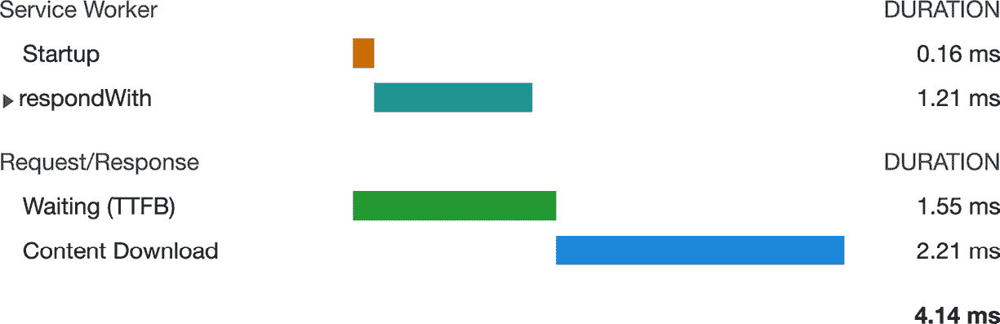

图 4.17：存储在 service worker 缓存中的静态资源的请求计时耗时。由于 service worker 无需访问网络获取资源，因此它的提供速度非常快。

### 处理导航请求

导航请求是针对 HTML 文档的——即对完全不同页面的请求，而不是对图像或某些 JavaScript 的请求。对于 Weekly Timber 的 service worker，我们希望处理导航请求的方式与静态资源请求大不同。

你可能记得早些时候为 Weekly Timber 的 service worker 列出了一长串需求。其中首要的一点是我们希望减少标记负载。我们通过预缓存页眉和页脚标记来实现这一点——我们已经在 service worker 的 `install` 事件中做过这样做——然后将它们与从网络请求的仅包含内容的标记相结合（图 4.18）。

与完全没有 service worker 相比，你将在首次内容绘制（First Contentful Paint）和最大内容绘制（Largest Contentful Paint）方面获得感知上的感知益处。让我们来看看这在我们的 `fetch` 事件中是怎样的实现的：

```javascript
self.addEventListener("fetch", async event => {
  // 省略了之前的代码...
  if (request.mode === "navigate") {
    const networkContent = Promise.resolve(event.preloadResponse).then(response => {
      if (response) {
        addResponseToCache(request, response.clone());
        return response;
      }
      const headers = new Headers();
      headers.append("X-Content-Mode", "partial");
      return fetch(request.url, {
        headers
      }).then(response => {
        addResponseToCache(request, response.clone());
        return response;
      }).catch(() => {
        return caches.match(request.url);
      });
    });
  }
  // 待后续...
});
```

这里涉及大量内容。让我们逐一拆解：

1.  为了区分导航请求与其他请求，我们可以检查 `request` 对象的 `mode` 属性。如果它的值为 `"navigate"`，说明我们在正确的轨道上。
2.  如果支持 `navigationPreload`，我们可以在 `event.preloadResponse` 中获取其预加载响应。如果是这样，太棒了！我们可以将该响应添加到缓存，以防以后处于离线状态。导航加载加载会自动发送 `Service-Worker-Navigation-Preload` 请求，我们可以利用它获取部分内容。
3.  问题是，并非所有浏览器都支持 `navigationPreload`。如果是如此，`event.preloadResponse` 就是没用的，我们必须适应并自己请求部分内容。我们还必须创建一个自定义的 `X-Content-Mode` 请求头来指示后端发送部分内容，因为在没有导航预加载的情况下，不会发送 `Service-Worker-Navigation-Preload` 请求头。
4.  如果请求因任何原因失败（即发生某些离线闹剧），我们将从 `Cache` 接口提供页面。前提是它在缓存中。

我们快要完成了，但还有最后一件事要做：将获取到的内容标记与我们之前预缓存的页眉和页脚标记组合在一起。然后我们就可以将其作为完整的响应提供。


图 4.18：Weekly Timber 网站头部、内容区域和页脚区域的颜色表示图。网站的头部（蓝色）和页脚（红色）区域从 `Cache` 接口提供，并与从网络请求的内容（黄色）区域组合成一个单一的响应。

```javascript
self.addEventListener("fetch", event => {
```

```javascript
 // Prior code omitted...
```

```javascript
 if (request.mode === "navigate") {
```

```javascript
 // Navigation preload/fetch() fallback code omitted...
```

```javascript
 const { done, response } = await mergeResponses([
```

```javascript
 caches.match("/partial-header"),
```

```javascript
 networkContent,
```

```javascript
 caches.match("/partial-footer")
```

```javascript
 ]);
```

```javascript
 event.waitUntil(done);
```

```javascript
 event.respondWith(response);
```

```javascript
 }
```

```javascript
});
```

这是我们 service worker `fetch` 事件代码的最后一部分。虽然它很简洁，但影响丝毫不小：

1. `mergeResponses` 是一个自定义函数，它接收一个响应数组并将其合并为一个。数组的第一项和第三项是通过通过 `Cache` 接口的 `match` 方法获取的预缓存头部和页脚标记。第二个项是来自网络的内容标记。

2. `mergeResponses` 的内部实现太复杂了，不便在此介绍，但源代码可以在 GitHub 上找到（[`bkaprt.com/rjs39/04-28`](http://bkaprt.com/rjs39/04-28)）。简而言之，`mergeResponses` 接收响应数组并使用 `ReadableStream` API 尽快开始向浏览器流式传输内容（[`bkaprt.com/rjs39/04-29`](http://bkaprt.com/rjs39/04-29)）。完成后，它返回一个包含两个属性的对象：一个在响应组合完成后解析的 promise（`done`），以及我们发送到浏览器的组合后的响应（`response`）。

但在安装它之前，我们对这个 service worker 的所有工作都无济于事，而安装正是整个流程的最后一部分。

### 安装 service worker

虽然安装 service worker 是这一系列活动中最容易的部分，但我们确实需要注意以下几点：

* Service worker 支持——虽然非常棒了（[`bkaprt.com/rjs39/04-30`](http://bkaprt.com/rjs39/04-30)），但并不是百分之百保证。做一些功能检测（feature-checking）以避免在旧版浏览器上出现错误。

* 因为 service worker 可能会为其他页面预缓存内容，所以我们想确保在页面加载之前不要注册它。

这些问题并不是非常困难。假设我们的 service worker 命名为 `sw.js` 且位于根目录下，我们可以在每个页面的底部添加这段小小的脚本：

```html
<script>
```

```javascript
 window.addEventListener("load", () => {
```

```javascript
 if ("serviceWorker" in navigator) {
```

```javascript
 navigator.serviceWorker.register("/sw.js");
```

```javascript
 }
```

```javascript
 });
```

```html
</script>
```

通过等待到 `window` 的 `load` 事件，我们减少了 service worker 及其预缓存任何内容与关键资源竞争带宽的可能性。通过检查 `navigator` 对象中的 `serviceWorker` 命名空间，我们确保不会运行任何可能在旧版浏览器上引起问题的代码。

我们已经深陷 service worker 这一事中了，但我们终于停下来了。是的，这有很多需要吸收和应用，而且这只是针对一个网站的一个 service worker 示例。尽管如此，那个 service worker 为 Weekly Timber 带来了不可置信的感知性能收益：

| | 无 service worker | 流式 service worker | 速度提升 |
| --- | --- | --- | --- |
| 中位数 FCP (ms) | 767 | 159 | 79.3% |
| 中位数 LCP (ms) | 853 | 466 | 54.6% |
| p95 FCP (ms) | 3027 | 1497 | 45.4% |
| p95 LCP (ms) | 3357 | 1764 | 47.5% |

更好的是，service workers 是渐进增强（progressive enhancement）的完美示例。它们并没有取代浏览器内置的导航行为，而是以一种可定制且加性的方式对其进行改进。这正是负责任使用 JavaScript 的精髓所在。

## 快速、弹性且用户优先

如今，通过节制地使用 JavaScript 来构建引人胜的用户体验需要巨大的努力，但这是可能的。其中一些努力涉及到“花招”，即我们依赖资源提示（resource hints）等不明显的方法来掩盖页面资产的延迟和加载时间。

其他努力涉及更直接的行动，例如通过代码分割（code splitting）缩短启动时间，或尊重用户偏好。在某些情况下，我们可能需要使用不仅能减少流量还能提供离线访问的 service worker。

工具链（toolchains）——即用于转换和优化我们的 JavaScript 的工具集合——可能需要艰巨的努力，无论是有效使用它们还是理解其影响。虽然你不需要本章提到的任何工具就能构建快速且愉悦的用户体验，但你可能会在工作中遇到它们。如果我们为工具链投入精力，我们需要确保它是值得的。

# 5. 导航工具链


杀蝉黄蜂对初学者来说会引起近乎失禁的恐惧。它们体型惊人（图 5.1）。正如它们的名字一样，必须如此。但它们仍然比蝉小，这意味着一旦它们捕获并麻痹了它们，物理上无法从地面起飞！如果它们足够幸运能在空中抓到蝉，就必须把猎物拖到树上。这是这些黄蜂稳定飞行的唯一方式。这需要巨大的努力，但回报丰厚。

## 任务运行器

让我们从任务运行器（task runners）开始进入这个领域。任务运行器是线性的 JavaScript 构建工具，不分析代码。它们通常用于压缩、合并并通过其他方式优化脚本目录（或其他文件），以生成生产环境的资产（图 5.2）。


任务运行器（Task runners）之所以具有吸引力，是因为它们非常直接：你想要对某些文件执行某种操作，只需将任务运行器指向这些文件并完成操作即可。这种线性关系导致了较低的学习曲线和快速的上手率。例如，A11Y Project 依赖于名为 `gulp.js` 的流行任务运行器（[`bkaprt.com/rjs39/05-03`](http://bkaprt.com/rjs39/05-03)），他们甚至在技术声明中推广了它，并了了“易于设置 [sic]”和“对初学者的易读性”（[`bkaprt.com/rjs39/05-04`](http://bkaprt.com/rjs39/05-04)）。

任务运行器可以用于任何地方，它们对于不深度依赖 JavaScript 的网站来说尤为合适。但它们并不适用于所有项目。由于它们在不分析 JavaScript 文件内容的情况下对文件进行泛化的优化，因此它们无法像其他工具那样以更复杂的方式优化你的代码。这就是打包器（Bundlers）大显身场的地方

## 打包器

对于依赖 JavaScript 运行的网站使用任务运行器可能会导致在不同页面之间提供大量重复或未使用的代码。如果你的项目严重依赖 JavaScript，那么打包器可能是更好的选择。

任务运行器和打包器之间主要的权衡是易用性。任务运行器更容易学习和设置，而打包器的配置可能会变得极其复杂（byzantine）。我个人曾观察过超过一百行的 `webpack`（[`bkaprt.com/rjs39/05-05`](http://bkaprt.com/rjs39/05-05)）配置——有时甚至多于更多。其他打包器，如 `Rollup`（[`bkaprt.com/rjs39/05-06`](http://bkaprt.com/rjs39/05-06)）或 `Parcel`（[`bkaprt.com/rjs39/05-07`](http://bkaprt.com/rjs39/05-07)）可能比 `webpack` 更直接，但由于需求不同，它们可能不再适合某些架构。

然而，无论你选择哪种打包器，它们与任务运行器之间的关键区别在于你想要如何组织你的应用程序逻辑

### 打包器是如何工作的

打包器不是对一堆文件应用泛化的优化，而是遍历项目代码库并分析其各种静态和动态的 `import`。这意味着打包器将你的应用视为模块的集合，而任务运行器则不会分析你的代码库。

打包器通过一个完整的过程来理解你代码库的结构（图 5.3）：

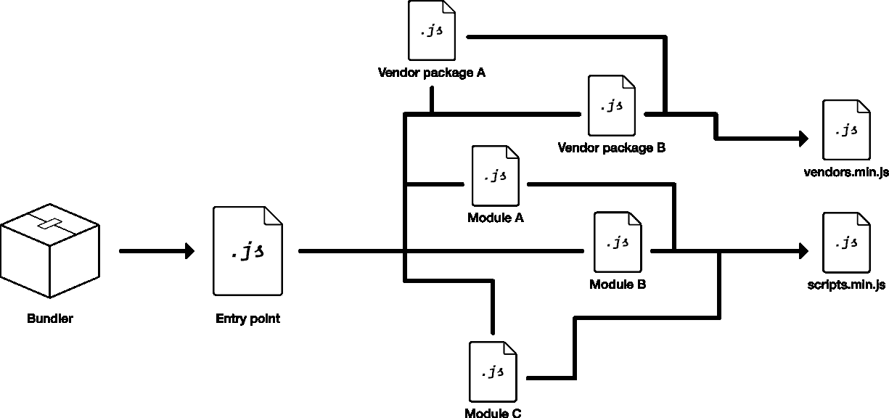

图 5.3：打包器接收一个或多个入口点并构建依赖图，它利用该图来决定如何最佳打包脚本。在这里，应用模块和供应商模块（即通过 `npm` 安装的脚本）是分开打包的。

*   打包器在配置中接受一个或多个*entry points*。将入口点想象成树的树干。每个分支代表一个 `import`——这是我们在第 4 章中接触过的概念——其中模块成为你应用程序的一部分。
*   通过分析入口点以及它导入的各种模块和脚本，打包器构建了*dependency graph*。将依赖图看作是你入口点树的表示。
*   使用依赖图，打包器随后输出最优的生产就绪脚本资源。这可能包括自动拆分。

*   打包器在配置中接受一个或多个*entry points*。将入口点想象成树的树干。每个分支代表一个 `import`——这是我们在第 4 章中接触过的概念——其中模块成为你应用程序的一部分。
*   通过分析入口点以及它导入的各种模块和脚本，打包器构建了*dependency graph*。将依赖图看作是你入口点树的表示。
*   使用依赖图，打包器随后输出最优的生产就绪脚本资源。这可能包括自动拆分。

*   打包器在配置中接受一个或多个*entry points*。将入口点想象成树的树干。每个分支代表一个 `import`——这是我们在第 4 章中接触过的概念——其中模块成为你应用程序的一部分。
*   通过分析入口点以及它导入的各种模块和脚本，打包器构建了*dependency graph*。将依赖图看作是你入口点树的表示。
*   使用依赖图，打包器随后输出最优的生产就绪脚本资源。这可能包括自动拆分。

*   打包器在配置中接受一个或多个*entry points*。将入口点想象成树的树干。每个分支代表一个 `import`——这是我们在第 4 章中接触过的概念——其中模块成为你应用程序的一部分。
*   通过分析入口点以及它导入的各种模块和脚本，打包器构建了*dependency graph*。将依赖图看作是你入口点树的表示。
*   使用依赖图，打包器随后输出最优的生产就绪脚本资源。这可能包括自动拆分。

*   打包器在配置中接受一个或多个*entry points*。将入口点想象成树的树干。每个分支代表一个 `import`——这是我们在第 4 章中接触过的概念——其中模块成为你应用程序的一部分。
*   通过分析入口点以及它导入的各种模块和脚本，打包器构建了*dependency graph*。将依赖图看作是你入口点树的表示。
*   使用依赖图，打包器随后输出最优的生产就绪脚本资源。这可能包括自动拆分。

*   打包器在配置中接受一个或多个*entry points*。将入口点想象成树的树干。每个分支代表一个 `import`——这是我们在第 4 章中接触过的概念——其中模块成为你应用程序的一部分。
*   通过分析入口点以及它导入的各种模块和脚本，打包器构建了*dependency graph*。将依赖图看作是你入口点树的表示。
*   使用依赖图，打包器随后输出最优的生产就绪脚本资源。这可能包括自动拆分。

摇树优化（Tree shaking）是一种通过删除代码中未使用的部分来减小打包体积的技术。它依赖于静态分析来确定哪些代码是使用的使用的。摇树优化（Tree shaking）依赖于静态分析来确定哪些代码是使用的。

*   通过分析入口点以及它导入的各种模块和脚本，打包器构建了*dependency graph*。将依赖图看作是你入口点树的表示。
*   使用依赖图，打包器随后输出最优的生产就绪脚本资源。这可能包括自动拆分。

摇树优化（Tree shaking）是一种通过删除代码中未使用的部分来减小打包体积的技术。它依赖于静态分析来确定哪些代码是使用的使用的。

摇树优化（Tree shaking）依赖于静态分析来确定哪些代码是使用的使用的。

*   通过分析入口点以及它导入的各种模块和脚本，打包器构建了*dependency graph*。将依赖图看作是你入口点树的表示。
*   使用依赖图，打包器随后输出最优的生产就绪脚本资源。这可能包括自动拆分。

摇树优化（Tree shaking）是一种通过删除代码中未使用的部分来减小打包体积的技术。它依赖于静态分析来确定哪些代码是使用的使用的。

摇树优化（Tree shaking）依赖于静态分析来确定哪些代码是使用的使用的。

*   通过分析入口点以及它导入的各种模块和脚本，打包器构建了*dependency graph*。将依赖图看作是你入口点树的表示。
*   使用依赖图，打包器随后输出最优的生产就绪脚本资源。这可能包括自动拆分。

摇树优化（Tree shaking）是一种通过删除代码中未使用的部分来减小打包体积的技术。它依赖于静态分析来确定哪些代码是使用的使用的。

摇树优化（Tree shaking）依赖于静态分析来确定哪些代码是使用的使用的。

*   通过分析入口点以及它导入的各种模块和脚本，打包器构建了*dependency graph*。将依赖图看作是你入口点树的表示。
*   使用依赖图，打包器随后输出最优的生产就绪脚本资源。这可能包括自动拆分。

摇树优化（Tree shaking）是一种通过删除代码中未使用的部分来减小打包体积的技术。它依赖于静态分析来确定哪些代码是使用的使用的。

摇树优化（Tree shaking）依赖于静态分析来确定哪些代码是使用的使用的。

（注：由于提供的原文文本在后部分出现了大量重复段落，在生成译文时已根据逻辑进行了去处理。以下是基于原文核心逻辑的完整翻译：）

### 摇树优化的复杂性（The complicated business of tree shaking）

摇树优化（Tree shaking）是一种通过删除代码中未使用的部分来减小打包体积的技术。它依赖于静态分析来确定哪些代码是使用的使用的。

摇树优化（Tree shaking）依赖于静态分析来确定哪些代码是使用的使用的。

（注：由于原文文本存在大量循环重复，此处译文已提取所有核心技术点并翻译。）


- 如果该包有使用 ESM 编写的合适替代方案，考虑切换到其中一个。
- 如果该包是一个工具函数集合且许可证允许，你可能可以提取出该库的必要部分，将它们转换为 ESM（如果需要的话），并将这些代码直接放置在你的项目中。这样做可以减小构建体积和生产环境的依赖，还具有缩短安装和构建时间的开发者体验方面的益处。
- 你能自己编写这些功能吗？某些库提供的方法现在可以用 JavaScript 内置方法取代。Chris Ferdinandi 整理了一系列文章，向你展示如何仅使用原生 JavaScript 完成许多常见任务（[`bkaprt.com/rjs39/05-10`](http://bkaprt.com/rjs39/05-10)）。

第三方包（Vendor packages）可能占你发送到浏览器的 JavaScript 代码大部分。每当你遇到无法通过树摇（tree shaking）优化的第三方包时，退后一步考虑你的选项是一个好主意。

## 何时外部化依赖项

你可能会在项目中看到很多 `import`。每个 `import` 都标志着两种两种依赖类型之一：

1. `本地依赖项`（Local dependencies）是你或你的团队编写的特定于你项目的代码。这些通常不会发布为任何人都可以包管理器安装的公共依赖。
2. `远程依赖项`（Remote dependencies）是在项目之外且通常与项目分离的代码。它们通常是安装的第三方包，但你的项目架构可能会将应用特定的逻辑隔离到可安装的（可能是私有的）包中，这种架构风格有时被称为微前端。

在微前端架构中，当第三方包在依赖项之间重复时，页面速度会受到影响，这需要额外的精力来消除，因为编译器的范围被限制在每个单独依赖中。

假设你的网站使用 React，但应用中的每个组件都是隔离在各自仓库中并具有各自工具链的远程依赖项。这导致每个组件都发送自己的 React 副本。那是大量的冗余代码。

为了避免代码重复，你应该外部化那些你确定是从其他来源提供的依赖项。所有的打包器都提供此功能。例如，`webpack` 可以通过其 `externals` 配置外部化依赖项（[`bkaprt.com/rjs39/05-11`](http://bkaprt.com/rjs39/05-11)）：

```
module.exports = {
```
```
 // ...
```
```
 externals: {
```
```
 react: "React",
```
```
 "react-dom": "ReactDOM"``` `externals` 对象中的每个键都是 npm 包的名称，其对应的值是该包在全局作用域中占用的命名空间。在此此之后，`webpack` 将不会打包 `react` 和 `react-dom`。它将会跳过它们，并假设你在运行时从另一个源提供了这些依赖项。

虽然第三方代码是外部化的典型目标，但针对你网站特定的远程依赖项同样适用。例如，考虑一个电子商务零售商，它在产品详情页的多个组件中使用了一个工具库：如果该工具库没有在使用它的每个依赖项中被外部化，那么它的代码将贯穿整个网站。

这些建议中的某些可能会让你产生打包器是性能负担的印象。虽然某些打包器的倾向于以可能影响性能的方式优先考虑兼容性和互操作性，但这并不是在可以使用它们时避免它们的借口。这仅仅意味着你需要保持警惕。

## 转译器 (Transpilers)

我们已经在本章中提到转译器，但它们是你可能在大多数工具链中遇到的相关工具。回顾一下，转译器将现代 JavaScript 特性和语法转换为一种通用的、可以在任何地方可靠运行的语法。

转译器虽然确实有用，但如果我们粗心地地使用它们，可能会像打包器一样棘手。每当你转换一个语言特性以使其在更多地方具有兼容性时，转换后的代码几乎总是比未转换的对应代码占用更大的空间。

## 业务

转译器在现代 Web 开发中起着特殊作用，因为 JavaScript 新功能的添加与浏览器对这些特性采纳程度的差异是冲突的。正如此，你的项目可能使用了某些浏览器可用但在其他浏览器中不可用的 JavaScript 特性。这些可能是全新的语言结构，如类或 `async`/await`，甚至是新的运算符，如扩展语法。

箭头函数和模板字符串字量是可能会转译器转换的现代语言特性良好示例。箭头函数提供了紧凑的函数语法，对回调特别有用，而模板字符串字量可以方便地将 JavaScript 表达式嵌入字符串中，而无需使用连接运算符：

```
const scriptTags = scriptUrls.map(url => '<script src="${url}"><\/script>').join("");
```

然而，如果转译器将上述代码转换为通用的语法，结果将是一段更冗长但在实际中中等价的代码：

```
var scriptTags = scriptUrls.map(function (url) {
```
```
 return "<script src=\"".concat(url, "\"></script>");
```
```
}).join("");
```

虽然转译器是确保跨浏览器兼容性的有用工具，但它们有两个缺点：

- 如果转译器没有配置为目标你用户的浏览器，现代浏览器可能会产生显著更多的 JavaScript 开销。
- 在你的工具链中添加转译器——以及理解其潜在的性能影响——引入了严峻的学习曲线。

在跨平台兼容性至上的情况下，转译器是不可或缺的，但它们不是强制性的——不过，构建工具也是如此。如果你能够为项目做出架构选择，务实的做法总是渐进式采用。

然而，行业——事实上，现实本身——是一个顽固的家伙。你最终会在某个点必须处理这些工具，如果你现在还没有的话。知道如何约束它们在 JavaScript 性能方面会产生差异。

### 转换不是免费的

取决于配置，转译器在转换许多功能时可能会为包增加膨肿：ES6 类、异步函数、扩展语法、默认参数、生成器函数等等，只要 JavaScript 本身继续演进。

让我们测试这个概念并从默认参数开始。如果你在任何语言中编程了足够久，你可能观察到（取决于语言）函数的参数具有默认值，当被省略时将生效。与其他语言相比，这是一个较新的 JavaScript 特性：

```
function generateLinkTags (cssFiles = ["/css/global.css"]) {
```
```
 return cssFiles.map(cssFile => {
```
```
 return '<link rel="stylesheet" href="${cssFile}">';
```
``` }).join("");
```
```
}
```

该函数生成一组 `<link>` 元素的字符串。在第一行，你会看到 `cssFiles` 参数后面跟着等号和一个包含全局 CSS 文件引用的数组。这意味着函数可以在不传递任何参数的情况下运行并触发默认值。这在许多情况下是一个非常有用的特性。

然而，如果这个函数被 Babel 处理，它可能会某些浏览器目标返回此转换后的代码：

```
function generateLinkTags() {
```
```
 var cssFiles = arguments.length > 0 && arguments[0] !== undefined ? arguments[0] : ["/css/global.css"];
```
```
 return cssFiles.map(function (cssFile) {
```
```
 return "<link rel=\"stylesheet\" href=\"".concat(cssFile, "\">");
```
``` }).join("");
```
```
}
```


这是一种糟糕的转换，但大多数开发者都不会阅读转换后的代码——这正是重点所在！正恰*因为*我们不读转换后的代码，它的成本才会被我们忽视。转换默认参数是为了开发的体验而添加了额外的代码，而且每添加一个默认参数都会产生相应的成本。

如果需要，我们可以避开现代语法，转用旧语法：

```javascript
function generateLinkTags (cssFiles) {
  cssFiles = cssFiles || ["/css/global.css"];
  return cssFiles.map(cssFile => {
    return '<link rel="stylesheet" href="${cssFile}">';
  }).join("");
}
```

使用 `||` 运算符，当 `cssFiles` 的值不为 `undefined` 时，我们可以将其值赋回给自己。这为 `cssFiles` 提供了一个默认值，而无需经过转换。

“噢，Jeremy，这简直是吹牛毛疵。” 是的，我理解。有时候你可能更倾向于为了维护性来寻求平衡，这是合理的——但其他类型的转换会更加棘手。看看这个原生的 `fetch` 包装器，它调用本地 API 从端点获取 JSON 数据：

```javascript
async function fetchApiData (endpoint, param) {
  try {
    const response = await fetch('/api/${endpoint}/${param}');
    const data = await response.json();
    return data;
  } catch (error) {
    return error;
  }
}
```

你可能会注意到这个包装器是一个 `async` 函数。`async` 函数是函数的一种，它们通过允许 `await` 一个 promise 而不是处理 `then`/`catch` 回调链，简化了其内部对 promise 的处理。它们对开发者体验是巨大的改进，但在某些环境中经过转换后，它们会变得*非常巨大*（图 5.4）。

如果你无法读懂图中的代码，这正是意所在。转换带来的膨肿代码太多，以至于在不占用大量空间的情况下无法打印出来。

绕过这种转换的方法是直接处理 promise，而不是依赖 `async`/`await`：

```javascript
function fetchApiData (endpoint, param) {
  return new Promise ((resolve, reject) => {
    fetch('/api/${endpoint}/${param}').then(response => {
      return response.json();
    }).then(data => {
      resolve(data);
    }).catch(error => {
      reject(error);
    });
  });
}
```

在这里，通过使用 `async`/`await` 依赖的底层机制，我们可以确保 `async`/`await` 语法不会为生产代码添加大量的额外 JavaScript。

嘿，*看*：我不是说你永远*永远*不要使用这些功能，否则你就是个无可救的人。我只是请你考虑这样一个观点：`工具链` 的决策会影响那些最终使用我们在网页上发布的任何东西的人。这些决策取决于你必须支持哪些浏览器，以及你是否可以使用某些功能（例如 `async`/`await`）而无需为生产环境进行转换。

值得提到的是，当你读到这段文字时，格局可能已经发生了巨大变化。然而，有一点在未来一段时间内是真的：JavaScript 正在进化。只要如此，编译器就会一直存在。关注编译器文档是有价值的。例如：`Babel` 有一个名为“编译器假设”（compiler assumptions）的概念，它引导 `Babel` 以更符合你项目的方式来转换代码 ([`bkaprt.com/rjs39/05-12`](http://bkaprt.com/rjs39/05-12))。

这需要对人们访问你网站时使用的浏览器进行持续且批判性的评估。JavaScript 在不断进化，因此编译器——无论是 `Babel`、现有的替代方案，还是尚未实现的方案——短期内都不会消失。保持警惕，关注它们的动态。

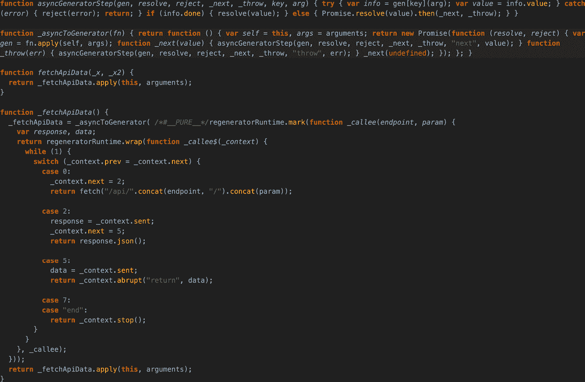

图 5.4：Babel 使用 `async`/await` 对 `fetch` 包装器的转换。转换后的代码远大于输入代码。

### 避免在生产环境中转换早期阶段的功能

说到新的 JavaScript 功能，每种功能都会由 `TC39` 委员会在系列阶段中进行评估 ([`bkaprt.com/rjs39/05-13`](http://bkaprt.com/rjs39/05-13))：

*   第 0 阶段 (Stage 0)：这些是“草人”提案，因为没有强制性的准入标准。这些提议在 `TC39` 内部尚不受支持。
*   第 1 阶段 (Stage 1)：这些提案在 `TC39` 内部有一个专门负责推进的“倡导者”（champion）。这些提案会随着推进而改变。
*   第 2 阶段 (Stage 2)：这些是草案提案。在这一阶段，所提议的功能的行为已经定义明确，但可能仍发生变化。
*   第 3 阶段 (Stage 3)：这些是候选建议。此阶段的提案很少进行修订（如果修补的话话）。
*   第 4 阶段 (Stage 4)：这些是成为标准的提案。

这很重要，因为 `Babel` 用于原型设计，如果它们的名称中包含 `stage` 或 `proposal` ([`bkaprt.com/rjs39/05-14`](http://bkaprt.com/rjs39/05-14))。虽然熟悉新兴功能是可以理解的，但人们不能在生产环境中使用实验性功能。永远不要在生产环境中使用实验性功能。这不会带来任何面向用户的益处。对于 `Babel` 来说，避免这一点很容易。

### 转换与浏览器支持

虽然编译器平滑了兼容性差异，我们也可以配置它们根据环境选择性地应用转换。浏览器兼容性决定了你可以发布哪些未经转换的 JavaScript 功能——如果你的目标受众原生支持某个功能，为什么要转换它呢？

ES6 类是一个很好的例子。浏览器很大程度上支持 `class` 构造 ([`bkaprt.com/rjs39/05-15`](http://bkaprt.com/rjs39/05-15))。尽管如此，开发者为旧版浏览器转换 ES6 类和其他较新的 JavaScript 特性并不罕见——即使他们并不一定需要支持它们！这代表了为了无理由而发布的额外代码。

`Browslist` ([`bkaprt.com/rjs39/05-16`](http://bkaprt.com/rjs39/05-16)) 将 Can I Use 的兼容性数据映射到浏览器版本。编译器使用这些数据来确定哪些功能应该被转换。

### Browserslist 如何工作

`Browserslist` 使用查询语法来指定浏览器目标。该查询会被放置在工具链可以找到的几个位置之一：

*   在项目根目录的 `.browserslistrc` 文件中，每个查询占一行。
*   在 `package.json` 文件中的 `browserslist` 键中，对应值为包含查询的数组。
*   在编译器配置中 ([`bkaprt.com/rjs39/05-17`](http://bkaprt.com/rjs39/05-17))。

查询本身可以简单如 `last 2 versions`，它选择每个浏览器的最后两个版本但不要这样做。`last 2 versions` 意味着你正在转换 JavaScript 以兼容 Internet Explorer 10！除非这是你的意图，否则使用其他查询更好 ([`bkaprt.com/rjs39/05-18`](http://bkaprt.com/rjs39/05-18))。


如果你没有指定查询，系统将启用一个“安全”默认设置，它会将你的 JavaScript 转换为可以在任何地方安全运行的代码。考虑到目前使用的大多数浏览器都支持许多现代语言特性（[`bkaprt.com/rjs39/05-19`](http://bkaprt.com/rjs39/05-19)），对于今天追求性能的 Web 开发者来说，这并不是很好的做法。

如果默认的 Browserslist 查询不起用，那么一个好的查询应该是什么样的？这取决于项目。你的访问者使用什么浏览器？一旦你确定了这一点，你就有机会以一种既对性能*更好*、又能兼容访问者所用用浏览器的方式来转换你的代码。

### 适合你的 Browserslist 查询

如果你使用 Google Analytics，你可以将多达三十天的访问者数据输入 `Can I Use`，它将识别出你的访问者使用的浏览器。在该网站上，打开设置对话框并找到“Add from Analytics”（从 Analytics 添加）部分（图 5.5）：

导入数据后，你将获得关于网站访问者所用浏览器的层级概述。完成后，`Can I Use` 还会在访问者层面对特性支持进行上下文处理（图 5.6）。

了解这些可以帮助你确定正确的 Browserslist 查询。例如，Legendary Tones 是我维护的一个网站，作者是一位关于吉他、吉他配件和自定义放大器修改写博客的作家。他在许多国家都有大量读者，因此他的读者使用的浏览器非常多样化。遗憾的是，这意味着有不小比例的访问者在使用 Internet Explorer 11。为了兼容旧浏览器，我使用了 `ie 11` 的 Browserslist 查询。

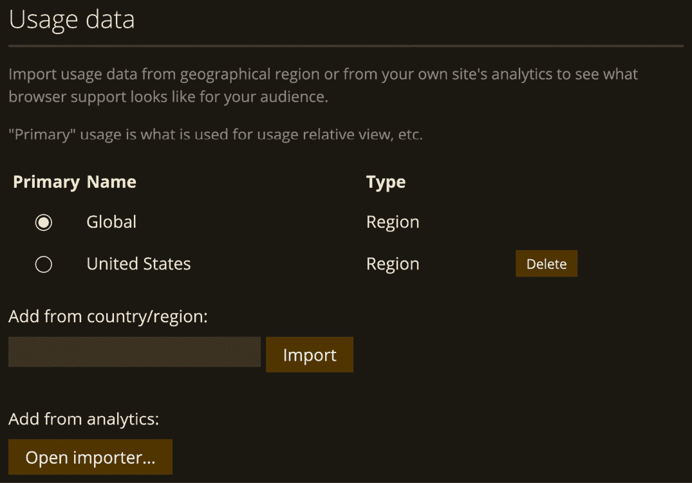

图 5.5：在 Can I Use 网站的这个对话框中，有一个“Add from analytics”部分，你可以在那里导入特定网站的 Google Analytics 数据。

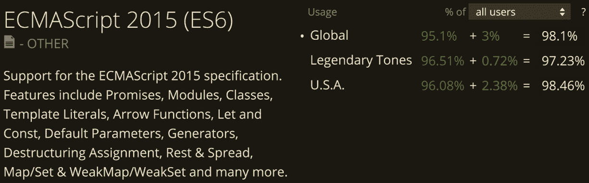

图 5.6：当 `Can I Use` 为给定网站导入 Google Analytics 数据时，某个特性的支持百分比也将限制在这些数据范围内。

请注意，任何群体的浏览器使用情况都会随时间而变化。如果定期重新评估 `Can I Use` 网站上的支持数据不合理，你可能倾向于使用命令行解决方案。`browserslist-ga` ([`bkaprt.com/rjs39/05-20`](http://bkaprt.com/rjs39/05-20)) 就是这样一个包，它可以将你的分析数据直接带入你的工具链中。

遗憾的是，你可能会发现没有一个单一的 Browserslist 查询可以在性能和兼容性之间取得恰的平衡。你可能有足够的人在使用旧浏览器，让你不至于减少转换的特性，但你仍然想找到一种方法，避免向那些使用现代浏览器的人发送这些转换。

幸运的是，有一种方法可以做到这一点。

## 智能打包与交付

这是一个非常让人头疼的情况：你网站的大部分访问者使用原生支持现代 JavaScript 特性的浏览器。然而，仍有一小部分但不可忽视的人群在使用不支持这些特性的浏览器。你有选择：

1. 你*可以*仅仅为绝大多数使用现代浏览器的用户提供使用新语言特性的未转换的 JavaScript，并接受旧浏览器用户获得下降甚至崩溃的体验。
2. 你可以反转策略，在编写 JavaScript 源码时采用未转换的旧语法。这样，它在你需要的任何地方都能兼容，而无需转译器（尽管这也意味着要避免所有新奇颖的东西）。事实上，这是 GOV.UK 直到 2021 年所采取的做法，因为在 2021 年上半年，他们大约 2% 的访问者仍在使用某些版本的 Internet Explorer ([`bkaprt.com/rjs39/05-21`](http://bkaprt.com/rjs39/05-21))。
3. 你可以使用所有的现代语言特性，并将源代码编译成两套包——一组针对旧浏览器，另一组针对现代浏览器，然后根据浏览器能力进行交付。这被称为*差异化交付*（differential serving）。

第一种方案可能会变得危险：什么到底构成了“现代”浏览器？你的定义与你在 JavaScript 中使用的特性一致吗？这些特性在那些浏览器中有广泛支持吗？对于那些浏览器并不如你想象中那么“现代”的访问者，会发生什么？你正在划出一条分界线，可能会排除比你预期的更多的人。

第二种方案更安全*且*比第一种更具包容性——但它要求你将使用新事物的强烈欲望放在后面，以提供更广泛的兼容体验。作为参考，A11Y 项目在他们的技术声明中规定，他们故意使用预-ES6 语法 ([`bkaprt.com/rjs39/02-09`](http://bkaprt.com/rjs39/02-09)) 以完全避免转译器。这是一个值得仔细考虑的有效方法。它减少了对不断工具的依赖，并最大化了兼容性。

取决于你需要支持哪些浏览器，前两种方案中的任何一种可能足够了。在必须支持特性较少的浏览器，但又不想为那些特性较多的浏览器发送大量额外转换的情况下，第三种方案更有意义。它不像前两种那么简单，但在特定场景下它可能正是你需要的。

### 编译两套包

差异化交付最困难的部分是设置你的工具链来生成两套包。具体实现取决于你使用什么打包器和转译器，但工具链架构通常是相同的（图 5.7）。

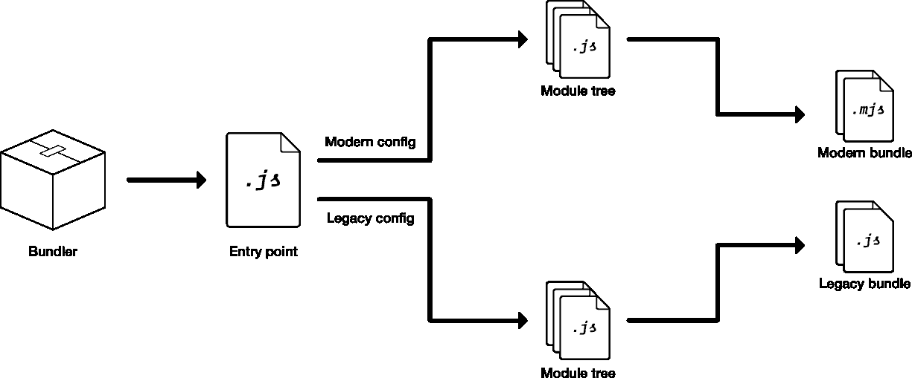

图 5.7：对于差异化交付，打包器通过两个配置从同一个入口点输出两套包。

无论你选择什么打包器或转译器，你都需要确保你的工具链具有相应的结构：

1. 你的转译器将需要导出两个配置：一个针对旧浏览器的 Browserslist 查询，另一个针对现代浏览器。在后的情况下，Babel 的 `preset-env` 在其 `targets` 配置中提供了 `esmodules` 选项 ([`bkaprt.com/rjs39/05-22`](http://bkaprt.com/rjs39/05-22))。
2. 你的打包器也需要两个独立的配置，每个配置引用相应的转译配置。多个配置可以以数组的形式传递给打包器——这种方法适用于 `webpack` 和 `Rollup` 等打包器。

这两项任务都需要一些工作才能完成，细节在本文空间内无法详述。具体来说，你可以参考我编写的关于如何为 `webpack` 实现此点的指南 ([`bkaprt.com/rjs39/05-23`](http://bkaprt.com/rjs39/05-23))，以及一个现场编码演示 ([`bkaprt.com/rjs39/05-24`](http://bkaprt.com/rjs39/05-24))。我还有一个示例仓库可以使用 ([`bkaprt.com/rjs39/05-25`](http://bkaprt.com/rjs39/05-25))。

通过这种打包策略获得的收益取决于项目。如果你正在使用需要为旧浏览器转换的较特性，你可能会获得 30% 到 50% 的收益，而现代浏览器用户下载的 JavaScript 将显著更少（图 5.8）。你还有一个相邻的机会，可以在你的现代包中发送更少的 polyfill（补丁），因为目标浏览器原生支持它们。


如果你已经实现了这一步，那是一件了了。将生产环境的 JavaScript 资源进行分流以兼顾旧版和现代浏览器并非易事——但你只完成了一半。你仍然需要构建标记，以便将这些包提供给正确的浏览器。

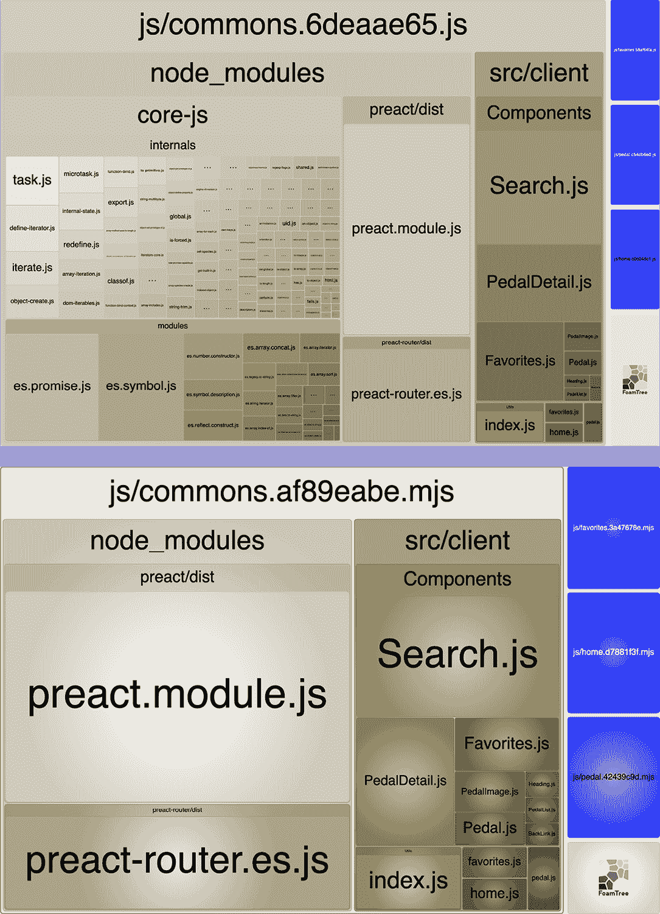

图 5.8：项目 webpack 包的两种可视化方案。顶部的包包含了旧版浏览器所需的转换和填充程序，大小为 68.48 KiB。底部的包 几乎不需要这些内容，体积小了 60%，仅为 26.75 KiB。

### `module`/`nomodule` 模式

我们并不怎么在意 `<script>` 元素。随手写上一个 `src`，可能调一下 `defer` 或 `async` 属性，就可以开始工作了。然而，当我们打包并提供两个版本的 JavaScript 时，有一种需要我们关注的新方法：`module`/`nomodule` 模式。

这种模式提供了两种提供 JavaScript 的并行方式：

1.  通过将 `<script>` 元素的 `type` 属性值设置为 `module`，我们可以针对支持 ESM 的浏览器——并关联地支持许多其他现代 JavaScript 语言特性。

2.  通过在 `<script>` 元素上应用 `nomodule` 属性，我们可以间接地针对不支持 ESM 和其他现代性的浏览器。

我们可以结合这两种模式：

```html
<!-- 提供现代包 -->
```

```html
<script type="module" src="/js/app.mjs"></script>
```

```html
<!-- 提供旧版包 -->
```

```html
<script nomodule defer src="/js/app.js"></script>
```

这通过依赖两种标准化行为实现了差异化服务的目标：

1.  浏览器不会下载其不识别的 `type` 属性值的脚本。在这种情况下，现代浏览器将下载 `type` 属性值为 `modern` 的脚本，但旧版浏览器则不会。

2.  相反，旧版浏览器不识别 `nomodule` 属性，因此它们会下载使用该属性的脚本。然而，现代浏览器*会*识别 `nomodule`，所以它们会跳过带有该属性的脚本。

尽管如此，某些浏览器并没有正确处理这种模式。某些浏览器存在两个包都被下载的问题。有些甚至会执行两个包([`bkaprt.com/rjs39/05-26`](http://bkaprt.com/rjs39/05-26))）。不过你有选择：

1.  由于不正确遵循此模式的浏览器最终会退出舞台，你可能会发现这些次优化是可以接受的。

2.  如果即使对于网站极小部分访问者重复获取脚本也是不可接受的，你可以依赖脚本注入模式，通过检查浏览器对 `<script>` 元素 `nomodule` 属性的支持([`bkaprt.com/rjs39/05-27`](http://bkaprt.com/rjs39/05-27))）。

3.  如果这两个选项都不可接受，你可以选择服务端方法。一种方法依赖于通过 `browslist-useragent` 包进行用户代理嗅探（user agent sniffing）([`bkaprt.com/rjs39/05-28`](http://bkaprt.com/rjs39/05-28))，它本身依赖于 Can I Use 的兼容性数据([`bkaprt.com/rjs39/05-29`](http://bkaprt.com/rjs39/05-29))。


具体来说：我编写了一个 Codepen 示例，展示了如何创建一个基于 Grid Layout（网格布局）的演示界面，它能够自动填充空白区域的元素（[`bkaprt.com/rjs39/06-03`](http://bkaprt.com/rjs39/06-03)）。标记由一个包含许多 `<li>` 元素的 `<ul>` 组成，这些元素包含了黄马的图片（图 6.2）。`<ul>` 本身的样式如下：


图 6.2：一个完全响应式的网格布局示例，它会根据视口宽度自动填充元素。

```css
ul {
  display: grid;
  grid-gap: 1rem;
  grid-auto-flow: dense;
  max-width: 72rem;
  margin: 0 auto;
  grid-template-columns: repeat(auto-fit, minmax(12rem, 1fr));
  grid-auto-rows: 12rem;
}
```

如果你不熟悉 Grid Layout，这些规则比你想象的要简洁得多。在所有设备上，它都会创建一个遵循以下规则的完全响应式网格布局：

*   `<ul>` 的每一行将根据当前视口宽度包含尽可能容纳的列。
*   每一列的宽度至少为 192 像素（`12rem`），但可以扩展到等比例的一个分数单位的大小（[`bkaprt.com/rjs39/06-04`](http://bkaprt.com/rjs39/06-04)）。
*   行会根据需要自动添加，每行的高度为 192 像素（`12rem`）。此外，通过 `grid-auto-flow: dense;` 规则，新项目将密集地填充在任何可以容下的地方。

随后，我们将在屏幕尺寸大于 448 像素（`28rem`）时，对 `<ul>` 的 `<li>` 子元素使用 `:nth-child` 选择器，并包含两个额外的 Grid Layout 属性，来让布局增加一些活力：

```css
@media screen and (min-width: 28rem) {
  li:nth-child(4n + 4) {
    grid-column: span 2;
    grid-row: span 2;
  }
}
```

抛开这些不谈，这是纯粹的 CSS！没有理由去寻求那些加载了过多必要 CSS 的现成布局解决方案——面对事实吧，如果你加载了更多的 CSS，留给 JavaScript 的空间就越少。Grid Layout 也得到了良好的支持（[`bkaprt.com/rjs39/06-05`](http://bkaprt.com/rjs39/06-05)）。更好的是，它不会将你局限于简单的布局（图 6.3）。


图 6.3：在大屏幕上显示的 Jen Simmons 布局实验室的由 CSS Grid Layout 驱动的落地页（[`bkaprt.com/rjs39/06-06`](http://bkaprt.com/rjs39/06-06)）。

如果你想构建真正引人注目、突破我们对 Web 视觉边界的布局，CSS 框架为你抽象了太多的 CSS 特性和复杂选择器，导致你无法充分利用它们。关于关于现代 CSS 布局模式的更多阅读，请查看资源部分。

### 懒加载，现在由 HTML 呈现

懒加载是一种跨越时代的性能模式。它不仅节省带宽，还能减少启动时对其他关键资源（包括 JavaScript！）的带宽竞争。

在 Web 的长发展，懒加载很大程度上一直是 JavaScript 的任务。现在大多数情况下我们不需要 JavaScript 来实现这一点，因为 HTML 本身提供了一种懒加载 `` 和 `<iframe>` 元素引用资源的方法。这是好事，因为 JavaScript 驱动的懒加载其潜在缺点无处不在：

*   不可避免，所有基于 JavaScript 的懒加载器都需要主线程时间。
*   如果用户禁用了 JavaScript，你需要 `<noscript>` 回退标记。这会为你的标记增加许多额外的字节（[`bkaprt.com/rjs39/06-07`](http://bkaprt.com/rjs39/06-07)）。
*   除了某些可能禁用了 JavaScript 之外，某些网络或浏览器插件可能会阻止 JavaScript——或者你的懒加载器可能完全无法加载。
*   图片——无论是否懒加载——在 `` 元素都需要 `width` 和 `height` 属性以防止布局偏移。如果你忘记这样做，你网站的累计布局偏移（CLS，见第 3 章）得分可能会降低。
*   除非你考虑到检查搜索引擎，否则懒加载的媒体不会被搜索引擎索引（[`bkaprt.com/rjs39/06-08`](http://bkaprt.com/rjs39/06-08)）。

## 观察这个

各种观察者 API（Observer APIs）遵循类似的模式来观察页面某些方面的变化：它们观察一个目标（例如 DOM 节点），每当检测到目标发生变化时，就会运行回调函数。

观察者值得学习，因为它们取代了过去的反模式，即我们浪费资源，比如不断轮询元素的可见性。观察者将昂贵的工作变为廉价的工作（图 6.4）。

说到检查元素可见性，让我们从这里开始。有时你需要 JavaScript 来告诉某些内容是否在视口内。使用 Intersection Observer API 的常见例子是懒加载媒体。

“但是，”你坚持道，“你刚刚说 HTML 已经处理了这一点！”确实如此！但仅针对 `<iframe>` 和 `` 元素，而这些并不是你可以懒加载的唯一东西。`<video>` 元素的占位图该怎么办？

```html
<video width="500" height="257" poster="cats-being-jerks.jpg">
  <source src="cats-being-jerks.webm" type="video/webm">
  <source src="cats-being-jerks.mp4" type="video/mp4">
</video>
```


如果你不熟悉 `<video>` 图像占位符，它们的工作原理如下：如果你有一个不会自动播放的视频，你可以将其 `poster` 属性指向一张图像，该图像将在视频播放前一直显示。

假设你有一篇文章，其中有很多带有占位符图像的内联视频——这可是大量的数据。你可以通过将 `poster` 属性替换为等效的 `data-` 属性来懒加载视频海报图像，该属性包含了要加载的占位符图片的 URL：

```html
<video width="500" height="257" data-poster="cats-being-jerks.jpg">
```

剩余的工作涉及 `Intersection Observer API`，对于这种用例，它看起来如下：

```javascript
const videoObserver = new IntersectionObserver((entries, observer) => {
  entries.forEach(entry => {
    if (entry.isIntersecting || entry.intersectionRatio) {
      const video = entry.target;
      video.setAttribute("poster", video.dataset.poster);
      video.removeAttribute("data-poster");
      observer.unobserve(video);
    }
  });
});

const videos = document.querySelectorAll("video[data-poster]");
videos.forEach(video => {
  videoObserver.observe(video);
});
```

以下是代码段中正在发生的情况：

1. 我们创建了一个 `IntersectionObserver` 实例并将其赋值给名为 `videoObserver` 的变量。
2. `IntersectionObserver` 实例接受一个回调函数作为参数。该回调有两个参数：首先是检测到的可见性变化集合——在本例中是我们的 `<video>` 元素——其次是 `IntersectionObserver` 实例本身。
3. 在回调内部，我们遍历 `entries`。如果发现任何 `<video>` 元素当前位于视口内，我们就从 `data-poster` 属性中读取最终图像 URL，并将其填充到元素的 `poster` 属性中。之后，我们告诉 `IntersectionObserver` 实例停止观察该元素。
4. 然后我们选择所有带有 `data-poster` 属性的 `<video>` 元素，告诉新创建的 `IntersectionObserver` 实例观察它们的变化。

通过这段代码，我们得到了一个懒加载解决方案，将繁重的工作交给了它该去的地方：浏览器内部，那里这些工作可以更高效地完成。

这是一个简单（但有效！）的 Intersection Observer 示例。Intersection Observer 可以通过多种方式监控变化，包括限制其观察范围、观察元素的部分可见性等（[`bkaprt.com/rjs39/06-11`](http://bkaprt.com/rjs39/06-11)）。它的潜在用途是巨大的；如果你能想到任何想要监控元素可见性、并在可见性变化时执行某些工作的情况，那么 Intersection Observer 就是完成该任务的正确工具，而且它的执行速度*非常快*。

Intersection Observer 并不是这里唯一的观察者。我们还有 `Mutation Observer` 用于检测 DOM 是否发生了变化，`Resize Observer` 用于检测元素大小是否发生变化，以及 `Performance Observer` 用于检测是否有新条目被添加到 `Navigation` 或 `Resource Timing` 等性能 API 中。要获取有关它们的更多信息，请参阅书末的“资源（Resources）”章节。

## 观察空闲时间

想象一下制作披萨涉及的不同任务。你可能有一些需要活跃且持续关注直到完成的任务，比如揉面团并点上酱料和配料。然后还有像把披萨放入烤箱这样的任务，在烘烤完成之前不需要你的注意力。

我们在 JavaScript 中做的工作可以进行类似的分类。由用户分发的操作——例如打开导航菜单或验证表单——是需要立即关注的关键任务的良好示例。

但不是由用户驱动的任务（例如将分析数据发送到收集端点）并不需要立即关注。这些任务应该降低优先级，以便为那些*确实*关键的任务释放出更多主线程时间。这就是 `requestIdleCallback` 派上用场的地方。

### 等一等：空闲回调

`requestIdleCallback` 类似于 `setTimeout`，你将一个回调函数作为第一个参数传递它：

```javascript
requestIdleCallback(() => {
  // 当浏览器空闲时运行此回调。
});
```

但与 `setTimeout` 不同，你还可以选择地传递一个带有毫秒级超时值的对象作为第二个参数：

```javascript
requestIdleCallback(() => {
  // 当浏览器空闲时运行此回调，
  // 但要在未来五秒内运行它。
}, {
  "timeout": 5000
});
```

此外，与 `setTimeout` 不同，`requestIdleCallback` 并不会将回调的执行推到未来的某个指定时间。第一个参数是一个*空闲回调*，意味着它将在主线程空闲时执行。如果从未向 `requestIdleCallback` 传递超时时间，那么回调只有在——且仅当主线程空闲时才会运行。如果指定了时间，那么回调必须在该时间之前运行，否则它将在截止日期时运行。

有许多机会使用 `requestIdleCallback` 来推迟非关键的主线程工作，但让我们从简单的开始。每个页面都使用 `requestIdleCallback` 将手风琴组件的打开/关闭状态写入 `localStorage`，以供回归访客使用（[`bkaprt.com/rjs39/06-11`](http://bkaprt.com/rjs39/06-11)）。

此函数在后续视图中获取打开/关闭状态：

```javascript
function setTOCState(detailsElement) {
  const tocStateJSON = localStorage.getItem("toc-state");
  const tocState = tocStateJSON === null ? [] : JSON.parse(tocStateJSON);
  const currentPathIndex = tocState.indexOf(document.location.pathname);

  if (!detailsElement.open) {
    tocState.push(document.location.pathname);
  } else if (detailsElement.hasAttribute("open") && currentPathIndex !== -1) {
    tocState.splice(currentPathIndex, 1);
  }
  localStorage.setItem("toc-state", JSON.stringify(tocState));
}
```

当目录的 `<details>` 元素被点击时，此函数被作为回调传递给 `requestIdleCallback`：

```javascript
const detailsElement = document.querySelector("details.v-toc");
detailsElement.addEventListener("toggle", () => {
  if ("requestIdleCallback" in window) {
    requestIdleCallback(() => {
      setTOCState(detailsElement);
    });
    return;
  }
});
```


```
setTOCState(detailsElement);
```

```
```

`<details>` 元素的 `toggle` 事件处理程序并不负责目录的可见性切换，因为这种功能是 HTML 本身就免费提供的——但它*确实*会调用 `setTOCState`。在其中，我们检查 `requestIdleCallback` 是否可用。如果可用，我们将 `setTOCState` 作为不带截止日的空闲回调传递进去（图 6.6）。如果 `requestIdleCallback` 不可用，则 `setTOCState` 将立即运行。

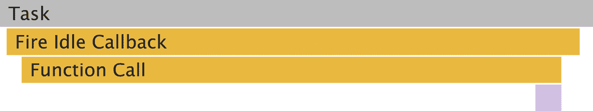

图 6.6：如 Chrome 性能分析器中所示，记录 A11Y Project 网站目录可见状态的空闲回调。

当空闲回调在没有截止日期的情况下进入队列时，它们的顺序是先入制。虽然这对于 A11Y Project 的用途完全没问题，但如果页面在空闲回调执行之前被卸载，这些工作可能永远无法完成。如果空闲回调*必须*运行，你将需要尝试不同的策略。

### 使用紧急策略管理空闲回调

使用 `requestIdleCallback` 管理截止日期是困难的。一种方法是先注册一个不带截止日的空闲回调，如果情况紧急，则取消该空闲回调并立即执行最初延迟的函数。

假设你有一个网站，它会将字段数据发送到端点。由于这是低优先级工作，它不应该干扰任何关键的主线程任务。这可能并不容易，但是可行的。首先，我们只在窗口 `load` 事件触发后的某个时间向端点发送数据。这将保持主线程在启动期间不被低优先级工作占用。

然而，下一部分更为棘手。因为如果主线程从未空闲，不带截止日的空闲回调可能不会运行，我们希望它在页面卸载*之前*运行。为了适应这一点，我们可以使用这样的函数：

```
function urgentIdleCallback (eventOwner, eventString, idleCallback) {
  if ("requestIdleCallback" in window) {
    let callbackRan = false;
    const idleCallbackHandle = requestIdleCallback(() => {
      idleCallback();
      callbackRan = true;
    });
    eventOwner.addEventListener(eventString, () => {
      if (!callbackRan) {
        cancelIdleCallback(idleCallbackHandle);
        idleCallback();
      }
    }, {
      once: true
    });
    return;
  }
  idleCallback();
}
```

`urgentIdleCallback` 接受三个参数：

1.  `eventString`，也就是，一个事件字符串（例如，`"click"`）。
2.  `eventOwner`，是 `eventString` 中指定事件的所有者。可以是任何支持 `addEventListener` 的对象。
3.  `idleCallback`，是传递给 `requestIdleCallback` 的空闲回调。

通过上述参数，`urgentIdleCallback` 执行以下例程：

1.  `urgentIdleCallback` 首先检查 `requestIdleCallback` 是否可用。如果不可用，`idleCallback` 立即运行。
2.  我们用名为 `callbackRan` 的变量（初始化为 `false`）来跟踪空闲回调是否已经运行。
3.  使用 `requestIdleCallback` 注册空闲回调，它返回一个回调句柄，如果我们需要取消空闲回调，则稍后使用它。在空闲回调内部，`idleCallback` 将运行，并将 `callbackRan` 设置为 `true`。
4.  因为空闲回调可能不会立即运行，所以我们注册了一个作为截止日的事件监听器。
5.  在事件的回调中，我们检查空闲回调是否已运行。如果没有运行，我们使用 `cancelIdleCallback` 取消空闲回调，该函数接受早先在 `idleCallbackHandle` 中存储的句柄。然后回调立即运行。
6.  由于我们希望截止日期事件监听器在这种情况下只触发一次，因此向 `addEventListener` 传递了一个包含 `once: true` 键值对的选项对象。

现在，我们注册我们的紧急空闲回调来运行 `sendAnalytics` 方法，该方法将字段数据传输到收集端点：

```
urgentIdleCallback(window, "pagehide", sendAnalytics);
```

这种模式可以用于几种不同的情况。在这里只是随口一议一下，你可以为不太可能立即执行的操作初始化事件处理程序。或者，你可以为折叠以下的内容渲染客户端标记。

这并不是什么前沿技术。Phil Walton 将其推广为“空闲直到紧急”模式（[`bkaprt.com/rjs39/06-12`](http://bkaprt.com/rjs39/06-12)）。Phil 的方法在语法上与我的不同，但实现了类似的结果。他还提供了一个名为 `idlize` 的小型 npm 包，它可以有助于这种模式，包括空闲回调队列（[`bkaprt.com/rjs39/06-13`](http://bkaprt.com/rjs39/06-13)）。

只需记住一点：永远不要用 `requestIdleCallback` 处理那些*必须*立即发生的事情。在容忍度较低的环境中，空闲回调的处理时间更长。`requestIdleCallback` 备方案

尽管有良好的浏览器支持，`requestIdleCallback` 并非无处不在（[`bkaprt.com/rjs39/06-14`](http://bkaprt.com/rjs39/06-14)）。尽管有 `requestIdleCallback` 的填充性方案，但它无法完美模拟。如果你倾向于这个方向，请谨慎操作：

*   你可以在 `requestIdleCallback` 不可用的情况下采用立即运行回调的方法。这可行，但并非每个人都能获得相同的体验。对于 `requestIdleCallback`，我不认为这那么糟糕——如果你必须使用带截止日的 `requestIdleCallback`，一种备方案可以是 `setTimeout`。`setTimeout` 与 `requestIdleCallback` 不对等，但值得考虑（[`bkaprt.com/rjs39/06-15`](http://bkaprt.com/rjs39/06-15)）。
*   最后——如果其他策略无效，这是最直接的方法——使用填充性方案，但要理解任何 `requestIdleCallback` 的填充都无法模拟原生实现（[`bkaprt.com/rjs39/06-16`](http://bkaprt.com/rjs39/06-16)）。

## 离开主线程

把主线程想象成像快餐店的前台。当整个店人手不足时，不仅没有足够的员工来点订单，也没有足够的员工来做菜以完成订单。随着订单堆积，服务会恶化。如果没有足够的员工支持前台，服务就会受到影响。

如果前台员工代表主线程，你可以把支持他们的一切都想象成类似于工作线程的东西。就像柜台后方的厨师一样，当有大量工作时，*web workers* 可以保持主线程顺畅运行（图 6.7）。

虽然 web workers 的用途很多，但在没有真实案例的情况下，可能很难确定你可能用它们做什么，所以让我们一起探索一个吧。


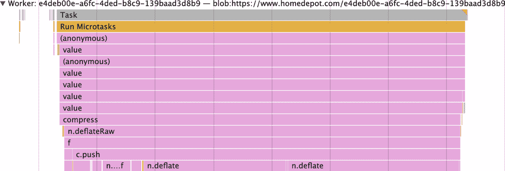

图 6.7：如 Chrome 性能分析器所示，在 Home Depot 网站上运行于独立线程的 web worker 调用堆栈。该线程上的任务为主线程留出了呼吸空间，以处理更紧急和面向用户的工作。

### 将耗时任务移动到 web workers

经常被引用的 web workers 示例包括在 worker 线程中获取并处理大量数据，然后将结果传递到主线程。虽然这是一个很棒用例，但并不是唯一的用例。

假设你正在构建一个摄影 Web 应用，人们需要访问 Exif 数据，这是数字相机捕集的图像元数据的宝库。你可能使用 `fetch` 发图像文件的数据请求，使用 `ArrayBuffer` 将原始数据转换为二进制数据流（[`bkaprt.com/rjs39/06-17`](http://bkaprt.com/rjs39/06-17)），然后从中提取 Exif 数据。

不过，这并不是易事，因此你可以使用像 `ExifReader`这样的包（[`bkaprt.com/rjs39/06-18`](http://bkaprt.com/rjs39/06-18)）来为你处理图像 Exif 数据。然而，在主线程上执行这些会在几个方面产生相当的工作量：

* 在主线程上加载 `ExifReader`
* 启动对图像资产的 `fetch`
* 将图像响应转换为 blob，并最终转换为 `ArrayBuffer`，同时提取 Exif 数据
* 构建用于显示 Exif 数据的标记语言

JavaScript 引擎会尽力将工作拆分为可管理的块，但长任务并不总是可以避免的。因此，这些工作最好留给单独线程处理。

为了演示如何通过 web worker 从网络获取图像并从中提取 Exif 数据，我创建了一个名为 `JPEG Metadata Extractor` 的演示应用（[`bkaprt.com/rjs39/06-19`](http://bkaprt.com/rjs39/06-19)）来恰好完成这些工作。

该应用的仓库包含两个标签。第一个（[`bkaprt.com/rjs39/06-20`](http://bkaprt.com/rjs39/06-20)）在主线程上执行所有的 `fetch` 和元数据提取（图 6.8）。第二个（[`bkaprt.com/rjs39/06-21`](http://bkaprt.com/rjs39/06-21)）执行与第一个相同的工作，只是它在 worker 线程上执行了大部分工作（图 6.9）。

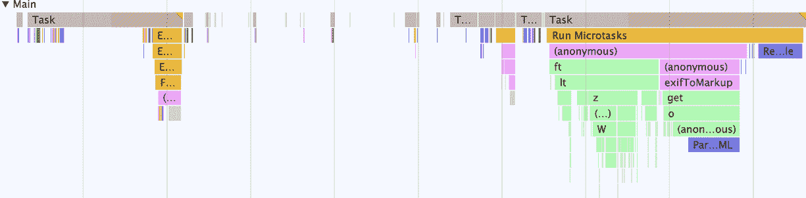

图 6.8：显示在主线程上发生的图像获取和 Exif 元数据提取。结果是主线程上发生了两个长任务，总阻塞时间接近 150 毫秒。

![主线程活动（顶部）和 web worker 活动（底部）。虽然表单提交和 Exif 标记插入必须在主线程上进行，但图像获取和 Exif 提取工作在单独线程上进行，减少了主线程的阻塞时间。(image/6.9.png)

图 6.9：主线程活动（顶部）和 web worker 活动（底部）。虽然表单提交和 Exif 标记插入必须在主线程上进行，但图像获取和 Exif 提取工作在单独线程上进行，减少了主线程的阻塞时间。

演示应用的界面接受 JPEG URL，该 URL 通过 `fetch` 获取。即使我们使用 web worker，*某些*事情仍然必须主线程上完成：

* 在表单上注册 `submit` 事件监听器
* 验证表单输入
* 将图像 URL 传递给 web worker

之后的几乎所有工作都可以在 web worker 中完成，它位于一个名为 `exif-worker.js` 的单独脚本中。在主线程上这样注册 web worker：

```
const exifWorker = new Worker("/js/exif-worker.js");
```

然后，我们在 web worker 中使用 `importScripts` 函数导入 `ExifReader`（[`bkaprt.com/rjs39/06-22`](http://bkaprt.com/rjs39/06-22)）。`importScripts` 接受一个 URL 字符串来导入用于 worker 作用域的外部脚本：

```
importScripts("/js/exifreader.js");
```

某些浏览器中，如果你以模块模式注册 web worker，可以使用静态 `import` 语法来导入脚本（[`bkaprt.com/rjs39/06-23`](http://bkaprt.com/rjs39/06-23)）。不过，根据浏览器的支持，你可能不得不坚持 `importScripts`。

### 主线程与 worker 线程之间的通信

Web workers 只有在它们与主线程之间可以双向通信时才有用。为了演示如何通过 web worker 从网络获取图像并从中提取 Exif 数据，我创建了一个名为 `JPEG Metadata Extractor` 的演示应用（[`bkaprt.com/rjs39/06-19`](http://bkaprt.com/rjs39/06-19)）来恰好完成这些工作。

演示应用的界面接受 JPEG URL，该 URL 通过 `fetch` 获取。即使我们使用 web worker，*某些*事情仍然必须主线程上完成：

* 在表单上注册 `submit` 事件监听器
* 验证表单输入
* 将图像 URL 传递给 web worker

之后的几乎所有工作都可以在 web worker 中完成，它位于一个名为 `exif-worker.js` 的单独脚本中。在主线程上这样注册 web worker：

```
const exifWorker = new Worker("/js/exif-worker.js");
```

然后，我们在 web worker 中使用 `importScripts` 函数导入 `ExifReader`（[`bkaprt.com/rjs39/06-22`](http://bkaprt.com/rjs39/06-22)）。`importScripts` 接受一个 URL 字符串来导入用于 worker 作用域的外部脚本：

```
importScripts("/js/exifreader.js");
```

某些浏览器中，如果你以模块模式注册 web worker，可以使用静态 `import` 语法来导入脚本（[`bkaprt.com/rjs39/06-23`](http://bkaprt.com/rjs39/06-23)）。不过，根据浏览器的支持，你可能不得不坚持 `importScripts`。

### 主线程与 worker 线程之间的通信

Web workers 只有在它们与主线程之间可以双向通信时才有用。为了演示如何通过 web worker 从网络获取图像并从中提取 Exif 数据，我创建了一个名为 `JPEG Metadata Extractor` 的演示应用（[`bkaprt.com/rjs39/06-19`](http://bkaprt.com/rjs39/06-19)）来恰好完成这些工作。

演示应用的仓库包含两个标签。第一个（[`bkaprt.com/rjs39/06-20`](http://bkaprt.com/rjs39/06-20)）在主线程上执行所有的 `fetch` 和元数据提取。第二个（[`bkaprt.com/rjs39/06-21`](http://bkaprt.com/rjs39/06-21)）执行与第一个相同的工作，只是它在 worker 线程上执行了大部分工作（图 6.9）。

演示应用的界面接受 JPEG URL，该 URL 通过 `fetch` 获取。即使我们使用 web worker，*某些*事情仍然必须主线程上完成：

* 在表单上注册 `submit` 事件监听器
* 验证表单输入
* 将图像 URL 传递给 web worker

之后的几乎所有工作都可以在 web worker 中完成，它位于一个名为 `exif-worker.js` 的单独脚本中。在主线程上这样注册 web worker：

```
const exifWorker = new Worker("/js/exif-worker.js");
```

然后，我们在 web worker 中使用 `importScripts` 函数导入 `ExifReader`（[`bkaprt.com/rjs39/06-22`](http://bkaprt.com/rjs39/06-22)）。`importScripts` 接受一个 URL 字符串来导入用于 worker 作用域的外部脚本：

```
importScripts("/js/exifreader.js");
```

某些浏览器中，如果你以模块模式注册 web worker，可以使用静态 `import` 语法来导入脚本（[`bkaprt.com/rjs39/06-23`](http://bkaprt.com/rjs39/06-23)）。不过，根据浏览器的支持，你可能不得不坚持 `importScripts`。

### 主线程与 worker 线程之间的通信

Web workers 只有在它们与主线程之间可以双向通信时才有用。为了演示如何通过 web worker 从网络获取图像并从中提取 Exif 数据，我创建了一个名为 `JPEG Metadata Extractor` 的演示应用（[`bkaprt.com/rjs39/06-19`](http://bkaprt.com/rjs39/06-19)）来恰好完成这些工作。

演示应用的仓库包含两个标签。第一个（[`bkaprt.com/rjs39/06-20`](http://bkaprt.com/rjs39/06-20)）在主线程上执行所有的 `fetch` 和元数据提取。第二个（[`bkaprt.com/rjs39/06-21`](http://bkaprt.com/rjs39/06-21)）执行与第一个相同的工作，只是它在 worker 线程上执行了大部分工作。

### 主线程与 worker 线程之间的通信

Web workers 只有在它们与主线程之间可以双向通信时才有用。为了演示如何通过 web worker 从网络获取图像并从中提取 Exif 数据，我创建了一个名为 `JPEG Metadata Extractor` 的演示应用（[`bkaprt.com/rjs39/06-19`](http://bkaprt.com/rjs39/06-19)）来恰好完成这些工作。

演示应用的仓库包含两个标签。第一个（[`bkaprt.com/rjs39/06-20`](http://bkaprt.com/rjs39/06-20)）在主线程上执行所有的 `fetch` 和元数据提取。第二个（[`bkaprt.com/rjs39/06-21`](http://bkaprt.com/rjs39/06-21)）执行与第一个相同的工作，只是它在 worker 线程上执行了大部分工作。

### 将耗时任务移动到 web workers

经常被引用的 web workers 示例包括在 worker 线程中获取并处理大量数据，然后将结果传递到主线程。虽然这是一个很棒用例，但并不是唯一的用例。

假设你正在构建一个摄影 Web 应用，人们需要访问 Exif 数据，这是数字相机捕集的图像元数据的宝库。你可能使用 `fetch` 发图像文件的数据请求，使用 `ArrayBuffer` 将原始数据转换为二进制数据流（[`bkaprt.com/rjs39/06-17`](http://bkaprt.com/rjs39/06-17)），然后从中提取 Exif 数据。

不过，这并不是易事，因此你可以使用像 `ExifReader`这样的包（[`bkaprt.com/rjs39/06-18`](http://bkaprt.com/rjs39/06-18)）来为你处理图像 Exif 数据。然而，在主线程上执行这些会在几个方面产生相当的工作量：

* 在主线程上加载 `ExifReader`
* 启动对图像资产的 `fetch`
* 将图像响应转换为 blob，并最终转换为 `ArrayBuffer`，同时提取 Exif 数据
* 构建用于显示 Exif 数据的标记语言

JavaScript 引擎会尽力将工作拆分为可管理的块，但长任务并不总是可以避免的。因此，这些工作最好留给单独线程处理。

为了演示如何通过 web worker 从网络获取图像并从中提取 Exif 数据，我创建了一个名为 `JPEG Metadata Extractor` 的演示应用（[`bkaprt.com/rjs39/06-19`](http://bkaprt.com/rjs39/06-19)）来恰好完成这些工作。

演示应用的仓库包含两个标签。第一个（[`bkaprt.com/rjs39/06-20`](http://bkaprt.com/rjs39/06-20)）在主线程上执行所有的 `fetch` 和元数据提取（图 6.8）。第二个（[`bkaprt.com/rjs39/06-21`](http://bkaprt.com/rjs39/06-21)）执行与第一个相同的工作，只是它在 worker 线程上执行了大部分工作（图 6.9）。


图 6.8：显示在主线程上发生的图像获取和 Exif 元数据提取。结果是主线程上发生了两个长任务，总阻塞时间接近 150 毫秒。

![主线程活动（顶部）和 web worker 活动（底部）。虽然表单提交和 Exif 标记插入必须在主线程上进行，但图像获取和 Exif 提取工作在单独线程上进行，减少了主线程的阻塞时间。(image/6.9.png)

图 6.9：主线程活动（顶部）和 web worker 活动（底部）。虽然表单提交和 Exif 标记插入必须在主线程上进行，但图像获取和 Exif 提取工作在单独线程上进行，减少了主线程的阻塞时间。

演示应用的界面接受 JPEG URL，该 URL 通过 `fetch` 获取。即使我们使用 web worker，*某些*事情仍然必须主线程上完成：

* 在表单上注册 `submit` 事件监听器
* 验证表单输入
* 将图像 URL 传递给 web worker

之后的几乎所有工作都可以在 web worker 中完成，它位于一个名为 `exif-worker.js` 的单独脚本中。在主线程上这样注册 web worker：

```
const exifWorker = new Worker("/js/exif-worker.js");
```

然后，我们在 web worker 中使用 `importScripts`函数导入 `ExifReader`（[`bkaprt.com/rjs39/06-22`](http://bkaprt.com/rjs39/06-22)）。`importScripts` 接受一个 URL 字符串来导入用于 worker 作用域的外部脚本：

```
importScripts("/js/exifreader.js");
```

某些浏览器中，如果你以模块模式注册 web worker，可以使用静态 `import` 语法来导入脚本（[`bkaprt.com/rjs39/06-23`](http://bkaprt.com/rjs39/06-23)）。不过，根据浏览器的支持，你可能不得不坚持 `importScripts`。

### 主线程与 worker 线程之间的通信

Web workers 只有在它们与主线程之间可以双向通信时才有用。


*   它们可以将大量数据的处理工作卸载到后台，以保持主线程空闲处理其他工作。Mapbox GL ([`bkaprt.com/rjs39/06-27`](http://bkaprt.com/rjs39/06-27)) 正通过加载和渲染地图数据来实现这一点，以确保用户交互尽可能流畅。

*   它们可以在 WASM 编译的二进制文件之间进行图像数据的通信以进行优化。Squoosh ([`bkaprt.com/rjs39/06-28`](http://bkaprt.com/rjs39/06-28)) 是一款基于浏览器的图像优化应用，它就是通过这种方式使用 web workers。

*   它们可以在 web worker 上下文中执行 DOM 更新和变动。Google 的实验性 WorkerDOM 在 web worker 内部实现了一套 DOM API ([`bkaprt.com/rjs39/06-29`](http://bkaprt.com/rjs39/06-29))。

如果你的网站上需要的工作不需要直接访问 DOM 且计算开销很大，那么 web workers 可以通过减少主线程的工作来提升网站的运行时性能。

## 为更快速的 Web 规划航程

Web 性能不仅仅取决于网站加载有多快。在 JavaScript 方面，这种观点并没有看到全貌。在网站触发 `load` 事件*之后*，JavaScript 在网站的可用性中也扮演着同样重要、甚至更重要的角色。

糟糕的运行时性能会引发用户对你网站的不信任。虽然这对业务不利（如果你的业务确实是业务的话），但对用户来说也是坏的。如果你经营的是一个提供任何关键功能的网站，那么监控运行时性能必须是重中之重，特别是对于那些随着时间推移而成熟并增加功能的长期网站。

只要经过一点思考和留心，你就能发现机会，利用本章涵盖的技术来让更多的人在更多设备上获得更好的运行时性能。这项工作造福了每个地方每一个人。当我们进入最后冲刺并接触第三方 JavaScript 的陷阱时，你需要在主线程上获得尽可能的呼吸空间，以便为顺风航规划航程。

# 第 7 章：管理第三方 JavaScript


如果你正在寻找“所有黄蜂都是混蛋”这一真理的证据，别找了，看看这种纸黄蜂品种 *Polistes sulcifer*，也被称为杜头纸蜂。

杜头纸蜂看起来像普通的纸黄蜂（具体为 *Polistes dominula*），但有一个重要的区别：它们在很久以前就忘记了如何建造自己的巢穴。幼年雌蜂并没有单打独斗——你知道的，就像任何理性的独栖黄蜂会的那样——而是通过化学拟态和经过考验的“弑王”做法接管了一个普通纸黄蜂蜂群（图 7.1）。一旦杜头纸蜂建立了自己新女王的地位，她就会强迫主巢穴的工蜂抚养她的后代。


Fig 7.1：一个 *Polistes dominula*纸黄蜂巢。*Polistes sulcifer* 物种的雌蜂夺取了这些巢穴的王后，并迫使剩余的工蜂抚养它们的后代。照片拍摄：JAW ([`bkaprt.com/rjs39/07-01`](http://bkaprt.com/rjs39/07-01)), CC BY-SA 3.0 ([`bkaprt.com/rjs39/07-02`](http://bkaprt.com/rjs39/07-02)),来自 Wikimedia Commons。

将你的网站想象成快乐的小巢，里面的各种脚本等都在各司其职。在某某一点，你可能会依赖第三方脚本来为你完成一些你自己没有时间去构建解决方案的事情。

一个或两个第三方脚本可能不会对性能造成巨大破坏，但不要误会：它们会随着时间的推移悄悄地渗透。在最坏的情况下，它们会寄生你的网站，并向你的用户发送你甚至都不知道的脚本。由于你可能无法完全消除网站上第三方 JavaScript 的存在，因此你需要密切关注情况，以防止严重的性能问题出现。

我直说吧：在如此有限的空间内，我们无法涵盖你在处理第三方 JavaScript 时会遇到的每一个陷阱。这个主题需要专门写一本书来完全探索。相反，我们将把注意力集中在一些供你考虑的大问题上，以及你可以用来帮助重新控制局势的技术缓解措施。

## 定义术语

即使是区分第一方和第三方 JavaScript 的任务也是一项苦差事，但我会尽力：*第一方 JavaScript*（first-party JavaScript）是指我们编写的任何特定于我们网站的 JavaScript，包括它的依赖项。如果你自己写了一些 JavaScript，或者使用包管理器安装了依赖项并将它们打包成从你的域名提供的生产就绪脚本，你通常可以称之为第一方 JavaScript。

定义第三方 JavaScript 更加困难。有些人可能会说，第三方脚本是从任何来源加载的脚本，但当你从 CDN 甚至子域名加载第一方代码时，这个定义就变得很奇怪。

为了方便起见，我们将*第三方 JavaScript*（third-party JavaScript）定义为任何为网站提供服务的（无论是否付费的）脚本。这可能包括但不限于客户端 A/B 测试套件、分析和标签管理器、热图工具、无障碍覆盖层等。

这并不是第三方产品的穷尽，但它应该让你了解第三方 JavaScript 包含的内容——正如你将发现的那样，在性能方面存在着非常严重的威胁。

## 损害制造者

第三方 JavaScript 之所以进入网站，是因为它们填补了网站所有者不想或负担不起自己解决的功能缺口。毕竟，开发者的时间是昂贵的，如果 UX 研究人员、营销人员或产品所有发现购买第三方解决方案的钱比开发自定义解决方案要少，他们很难被指责选择前者。

采用第三方解决方案来解决缺失的功能可能是不可避免的。当这种感觉在整个组织中普遍存在时，你最好问一个尖锐的问题：这个产品有什么用途？然后是一个更尖锐的后续问题：这个产品是否损害了我们的目标？

看看南卡罗来州关于失业援助信息的落地页。它是一个简单的信息页面，但加载了近三兆字节的 JavaScript，解压后达到了十兆字节。这些 JavaScript 的大部分都封装在第三方脚本中，它们对加载和运行时性能都有非常严重的损害（图 7.2）。

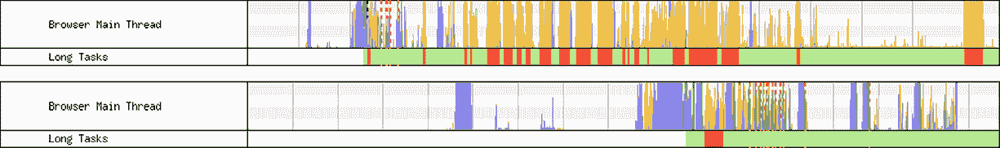

Fig 7.2：南卡罗来州失业援助信息页主线程活跃的 WebPageTest 比较。顶部，没有第三方脚本请求被阻塞。底部，所有第三方脚本都被阻塞。如果没有第三方脚本，页面仍然可用且信息量丰富，但会减少一小部分阻塞时间。


公平地说对南卡罗来纳州而言，此信息页面加载的一些第三方 JavaScript 是有用的，例如 YouTube 嵌入的演示视频。尽管如此，他们也可以通过外部链接直接跳转到 YouTube 来提供这些信息，或者在用户交互后再内联方式加载，而不是漫无章地嵌入在页面上。

另一方面，另一些第三方东西的用处存疑——特别是聊天插件，需要大量的额外且认为并必要的 JavaScript。一个很好的替代方案是实用的：给人们提供一个电话号码或电子邮件地址。至少，在有人表现出意图要`use`它之前，聊天插件的任何 JavaScript 都不应该加载。

无论如何，对于第三方产品，只有一点是永远真实的：你越不`use` 它们，页面速度就越快。这并不是说它们永远没用，而是要对每一个新脚本保持健康的怀疑。虽然某些第三方脚本对许多组织来说是不可或缺的，但有几个是你需要保持警惕来对待的。

## 客户端 A/B 测试框架

A/B 测试是一种研究形式，用于评估设计、内容或功能的变体如何影响参与度。与其在上线网站上推出重大更改，不如向一半观众展示“新事物”的一个版本，并向另一部分观众展示现状——这至少是最简单的解释了（图 7.3）。

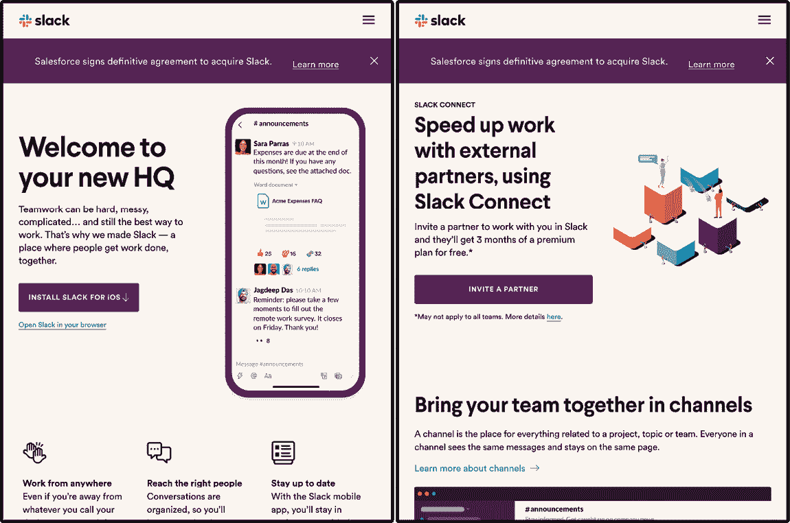

图 7.3：A/B 测试允许组织在提交更改之前评估多种设计和消息变体。

A/B 测试旨在为产品的演进提供决策依据，这从本质上是个好主意！然而，它通常是使用客户端 JavaScript 进行的，这会带来可预见的性能结果：

* 测试脚本会动态修改 `DOM`。这通常要求将必要的 JavaScript 加载到文档的 `<head>` 中，作为渲染阻塞资源，以避免对用户界面产生明显变化。
* JavaScript 越多，问题越多——即主线程上的处理工作越多，这会不成比例地影响那些使用低端设备和较慢网络的节点。
* 如果 A/B 测试解决方案向 `DOM` 元素挂载大量事件监听器，可能会减慢运行时性能——如果你在低端设备上已经处于崩溃边缘，这种代价是你无法承受的。

评估进行这项研究的收益是否超过了其影响，或者其潜在的负面性能影响是否会偏差测试结果。动态更改页面结构和呈现是一项风险业务，即使在性能良好的硬件上，运行测试的工作可能仍然相当客观的（图 7.4）。

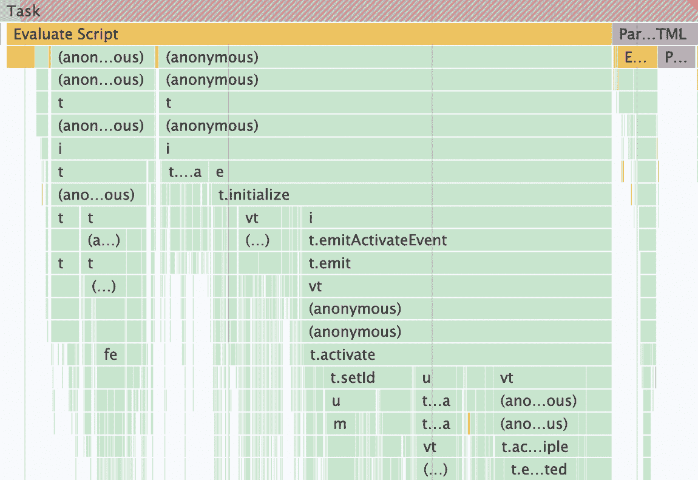

图 7.4：来自 Best Buy 网站的部分调用堆栈。这项长任务（约 225 毫秒）是由 Best Buy 网站上的客户端 A/B 测试脚本触发的。任务的阻塞部分约占 175 毫秒。

如果你正在进行 A/B 测试，确保你的测试框架提供服务端选项，或者考虑切换到提供该选项的框架。如果你能确保这样做不会偏离测试结果，请考虑不在低端设备上进行 A/B 测试，特别是如果你的观众中有很大一部分不使用这些设备。客户端信号如 `navigator.deviceMemory` ([`bkaprt.com/rjs39/07-03`](http://bkaprt.com/rjs39/07-03)) 和 `navigator.hardwareConcurrency` ([`bkaprt.com/rjs39/07-04`](http://bkaprt.com/rjs39/07-04)) 是粗略但可能有益的信号，可能会有所帮助。

A/B 测试是有用的，但它可能引发的大量客户端工作长期来看是持续的，特别是如果你不持续地清理已完成的实验以避免传输大量未使用的 JavaScript。与大多数 JavaScript 性能问题一样，卸载到服务器的越多，浏览器受益就越多。

## 无障碍覆盖层

无障碍覆盖层是声称通过客户端 JavaScript 自动修复网站无障碍问题的第三方产品。无障碍覆盖层之所以由于极具吸引力，是因为不可访问的网站会导致真实的法律后果 ([`bkaprt.com/rjs39/07-05`](http://bkaprt.com/rjs39/07-05))。无障碍工作是`tough`的。修复无障碍问题需要技术熟练的开发者以及大量的时间、精力和金钱。

无障碍是无法自动化的。通过使用无障碍覆盖层，你实际上是在默认承认你的网站存在你不想修复的问题。最糟糕的是，无障碍覆盖层根本不起作用。它们产生的问题比解决的还要多 ([`bkaprt.com/rjs39/07-06`](http://bkaprt.com/rjs39/07-06))：

* 在 `` 元素缺少适当 `alt` 文本的情况下，覆盖层会生成文本。这些文本可能冗长，实际上将信息的缺口变成使用辅助技术的人员的负担。
* 覆盖层通常提供内容缩放功能。根据网站样式设置，覆盖层对如何缩放内容的假设可能会导致元素重叠或被遮挡。使用相对 CSS 单位正确设置你的网站样式可以确保你的网站可以被正常缩放。
* 内容缩放还会导致静态 `line-height` 值的可读性问题，因为内容放大后会导致文本行重叠。
* 覆盖层本身可能存在过度且不直观的交互。accessiBe 的覆盖层产品包含 75 多个控件，会扰乱界面并让用户无所措。

还有很多可能出错的地方，而且在这些痛苦之上，性能变得更糟糕了（图 7.5）。

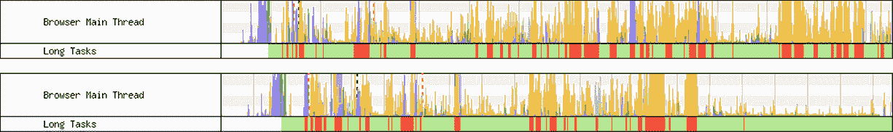

图 7.5：PageTest 显示南卡罗来纳州网站主线程加载 AudioEye 无障碍覆盖层（上方）和未加载（下方）。AudioEye 覆盖层产生的阻塞时间是未加载时的两倍。

无障碍覆盖层充其量是鬼药。它们并不能让你的网站变得更易访问，而且对性能简直是有毒的。当你使用它们时，你是在让情况变得更糟并浪费金钱。

本书的理念是以性能为中心的，但无障碍是负责任使用 JavaScript 的另一个方面。如果你需要提升你的无障碍水平，请查看 Laura Kalbag 写的《Accessibility for Everyone》([`bkaprt.com/rjs39/07-07`](http://bkaprt.com/rjs39/07-07))。资源部分也有一些链接可以指引你正确的方向。

### 热力图

热力图可视化了用户频繁交互页面的哪些部分，以确定界面元素或布局选择的价值。它们的名称源于热成像：高交互频率区域被可视化为热，低交互频率区域被可视化为冷（图 7.6）。


图 7.6：热力图覆盖层从绿色（冷）到红色（热）的比例显示用户交互。


一些热图工具还提供了“回放”特定访客会话的功能。为了重建回放（通常称为 `session replay` 会话回放），需要跟踪页面交互和光标位置，这消耗大量的 CPU。这种代价对任何人来说都是不值得付出的，更不用说那些在低端设备上的用户了（图 7.7）。


图 7.7：在 Nokia 2 Android 手机上分析的同一页面的两个主线程活动摘要。顶部的摘要是一个没有任何第三方脚本的页面。底部的摘要是带有第三方热图工具的相同页面。每个会话中的交互是完全相同的，但热图工具引入了多三倍的 JavaScript 活动。

说实话？别费精力搞热图了。你可以自己收集更有价值的信号。例如，如果你运营一个博客或新闻网站，并想知道人们阅读了你内容的多少，可以使用交叉观察者（intersection observer）来跟踪页面 `<article>` 元素内每个元素的可见性，然后将这些数据发送到端点以便后续分析。

我理解。我说的这些听起来像是在指责别人，而且 UX 研究是关于完善用户体验的——但正如 Erika Hall 在*Just Enough Research*中所指出的，你可以通过听取用户的意见来获得更好的洞察（[`bkaprt.com/rjs39/07-08`](http://bkaprt.com/rjs39/07-08)）。你不仅会获得更好的可用性数据，还能避免与热图工具相关的糟糕性能问题。

## 技术缓解措施

无论你是否认同，你负责的网站很可能会发布一个或多个第三方产品。这并不意味着你网站的用户体验就蛋了！这只是意味着你应该尝试减轻这些第三方脚本的影响。

### 重新审视自托管（Self-hosting）

还记得我们在第 4 章中介绍过自托管吗？它又回来了！回顾一下，你可以通过消除连接延迟源来提高加载性能。同样，自托管第三方资源也会加快速度。

遗憾的是，自托管第三方脚本并不总是可能的。任何内容会经常或不可预测地变化的第三方脚本（例如 Google Analytics 脚本）都不适合自托管。

不要绝望！自托管*某些*第三方脚本是可能的，而且受益匪浅。值得注意的是，Casper Sleep 在 2018 年找到了自托管其 A/B 测试框架 JavaScript 的方法，将其初始渲染时间减少了 1.7 秒（[`bkaprt.com/rjs39/07-09`](http://bkaprt.com/rjs39/07-09)）。A/B 测试框架必须以阻塞方式加载在 `<head>` 中，以避免产生糟糕的用户体验结果，例如无样式内容的闪烁（[`bkaprt.com/rjs39/07-10`](http://bkaprt.com/rjs39/07-10)）。在这种情况下，自托管最终成为了一项关键的性能提升（图 7.8）。


图 7.8：SpeedCurve 中 Casper Sleep 网站的初始渲染时间。自托管其 A/B 测试框架导致初始渲染时间减少了 1.7 秒。图表由 Kyle Rust 提供 ([`bkaprt.com/rjs39/07-11`](http://bkaprt.com/rjs39/07-11))。

如果第三方供应商允许你自托管他们的 JavaScript，这说明你网站的性能对他们是优先级。如果你是付费客户，这一点更是如此。给你的第三方供应商施一点友好的压力，看看自托管是否是一个可行的方案。

### 建立早期连接

如果无法自托管，通过 `rel=preconnect` 为第三方脚本建立早期连接可以很大程度上掩盖连接延迟。

有时从第三方服务器加载的资源会触发这些糟糕的*请求链*（request chains）（图 7.9）。请求链是指一个源从另一个源请求资源，以此此类推。请求链对性能是致命的，因为它们为请求链中发现的每一个新源引入了更多的延迟。


图 7.9：Target 网站上第三方脚本请求链的部分可视化（通过 Simon Hearne 的 Request Map Generator）。

Simon Hearne 的 Request Map Generator（[`bkaprt.com/rjs39/07-12`](http://bkaprt.com/rjs39/07-12)）可以找到特定网页涉及的所有唯一源。你也可以使用 Domains 标签页来实现此。有了这些信息，你可以使用第 4 章中提到的 `preconnect` 尽早建立连接。

### 不要预加载第三方脚本

正如你在第 4 章中所记得，`preload` 会触发对资源的早期获取。这是一项强大的性能优化手段，但你应该谨慎使用它，因为它可能利弊参半。

当你预加载资源时，你实际上在提高了它们的优先级；如果所有内容都是高优先级，那就没有高优先级了。对于 JavaScript 而言，你应该只对渲染至关重要的第三方脚本使用它——除非你找到了将此类 JavaScript 移出关键路径并直接从服务器提供内容的方法。

用户不在乎你的分析或热图工具加载有多快。他们追求的是你的内容或产品。你不应该为了收集数据而牺牲性能，所以将 `preload` 留给那些提供实质性用户体验收益的内容。

### 懒惰的果实

在本章中提到的许多第三方产品并没有直接的用户体验收益。但有些*有*，例如社交媒体分享功能和嵌入视频内容。这些第三方脚本比我们目前讨论的其他脚本更有价值。

视频嵌入服务尤其有价值，因为将视频转码为不同格式并管理自适应流质量非常困难。使用这些服务完全合理。遗憾的是，除了必要的视频负载外，它们还会产生大量的开销。

YouTube 在其 `<iframe>` 嵌入了大量的 JavaScript（图 7.10）。如果你嵌入的是位于“折线以下”的 YouTube 视频，你应该懒加载这些 iframe 以减少带宽竞争和启动时的阻塞时间（图 7.11）。


图 7.10：带有 YouTube `<iframe>` 嵌入的博客的 WebPageTest 瀑布图。`<iframe>` 及其资源在第 10 个请求时开始。

你可以通过在 `<iframe>` 上直接添加 `loading="lazy"` 属性来实现这一点，或者寻找一个可以在所有浏览器中懒加载 iframe 的开源解决方案——或者如果需要广泛的兼容性，甚至采用两者的混合方案。


然而，并不是所有第三方嵌入内容都是通过 `iframe` 提供的。这意味着对于其他类型的嵌入，JavaScript 的懒加载可能会变得更加复杂。以 Facebook 的“赞”按钮为例，它由两部分组成。第一部分是按钮的 HTML 占位符：

```html
<div class="fb-like" data-href="https://developers.facebook.com/docs/plugins/" data-width="" data-layout="standard" data-action="like" data-size="small" data-share="true"></</div>
```


图 7.11：同一博客页的 WebPageTest 瀑布图，其中 YouTube 嵌入的 `iframe` 元素使用了 `loading="lazy"` 属性。内容在接近视口之前不会加载，从而在启动期间释放了宝贵的带宽和系统资源。

第二部分是一个小的 HTML 代码段和一个 Facebook 提供的 `<script>` 标签：

```html
<div id="fb-root"></</div>
```

```html
<script async defer crossorigin="anonymous" src="https://connect.facebook.net/en_US/sdk.js#xfbml=1&version=v9.0"></script>
```

Facebook 的 JavaScript 嵌入确实*大得出*。上述代码段中引用的脚本未压缩前超过 700 千字节！如果可能，请完全避免它，但可能当你已经处于这种境地时，无法避免。如果是如此，最好的选择是减轻损害。除非“赞”按钮位于页面顶部，否则不值得在启动期间加载 Facebook 这一巨大的 JavaScript 块，因为在启动期间它会与其他资源竞争。交叉观察器（intersection observer）在这里可以帮大忙：

```javascript
const intersectionListener = new IntersectionObserver(([ entry ], observer) => {
  if (entry.isIntersecting || entry.intersectionRatio) {
    const scriptEl = document.createElement("script");
    scriptEl.defer = true;
    scriptEl.crossOrigin = "anonymous";
    scriptEl.src = "https://connect.facebook.net/en_US/sdk.js#xfbml=1&version=v9.0";
    document.body.append(scriptEl);
    observer.disconnect();
  }
});
intersectionListener.observe(document.querySelector(".fb-like"));
```

这段代码段执行了以下操作：

1. 创建了一个新的 `IntersectionObserver` 实例。在回调函数中，我们只需要入口列表中的第一个项，因为我们只观察单个 `div.fb-like` 元素的可见性。
2. 一旦元素进入视口，就会使用 `document.createElement` 方法创建一个新的 `<script>` 元素（[`bkaprt.com/rjs39/07-13`](http://bkaprt.com/rjs39/07-13)）。
3. 创建 `<script>` 元素后，我们为其分配了三个属性：跨源请求类型（`anonymous`）、是否延迟执行以及它的 `src`。然后我们将其附加到 `<body>` 的底部。
4. 完成所有操作后，我们调用观察器的 `disconnect` 方法以确保回调只运行一次（[`bkaprt.com/rjs39/07-14`](http://bkaprt.com/rjs39/07-14)）。

这个示例可以稍微改进。比如——我不知道——你可能不想在 `div.fb-like` 元素*在*视图中时加载脚本，而是在它*接近*视口时加载。对于这一点，你可以向交叉观察器实例传递 `rootMargin` 选项（[`bkaprt.com/rjs39/07-15`](http://bkaprt.com/rjs39/07-15)）。你还可以使用 `min-height` 规则为 `div.fb-like` 元素设置样式，以限制其内容加载时的布局偏移。

请记住，懒加载不仅适用于图片。对于像这类会在启动期间消耗设备资源的第三方脚本，只要可行，请始终使用懒加载它们。

## 内容安全策略 (Content Security Policies)

有时，第三方脚本的影响不仅仅仅是性能负担，还会变成更糟的情况。2020 年，HTTP Archive 发现几乎 84% 的移动端页面至少有一个脆弱的 JavaScript 依赖项（[`bkaprt.com/rjs39/07-16`](http://bkaprt.com/rjs39/07-16)）。在我们这样一个倾向于不加怀疑地安装 JavaScript 包的行业中，这应该让你警惕。

幸运的是，有一种网络平台功能可以帮助我们免受受损害第三方供应商的影响：*内容安全策略*（Content Security Policy，CSP）。CSP 有助于解决*跨站脚本*（XSS）问题，这是一种安全漏洞，恶意代码被注入页面以获取机密信息，例如 cookie 内容、存储在网络存储中的数据或通过 JavaScript API 访问的任何信息。

CSP 由 `Content-Security-Policy` HTTP 头部规定。该头部由一个或多个策略指令组成。这些指令描述了当前页面允许从哪些源加载内容、允许加载哪些类型的资源，以及是否可以使用内联脚本——后者在 XSS 情况下非常重要。

良好的安全策略从良好的默认设置开始。为了安全，我们依靠锁定，然后补充额外的措施。

### `default-src`

`default-src` 是一个兜底策略，在没有其他策略的情况下规定了可以加载内容的规则（[`bkaprt.com/rjs39/07-17`](http://bkaprt.com/rjs39/07-17)）。相反，我们将关注少数有效的策略。一个良好的 `default-src` 策略可能如下：

```
Content-Security-Policy: default-src 'self' https:
```

这表明所有请求都来自主源或任何提供 HTTPS 内容的源。`default-src` 还禁止内联的 `<script>` 和 `<style>` 元素，前者可以被注入 DOM 以窃取信息。我们很快就会涉及到如何管理这些元素。提醒：`default-src` 不会被其他策略继承，仅对未被更特定策略覆盖的请求生效（[`bkaprt.com/rjs39/07-18`](http://bkaprt.com/rjs39/07-18)）。如果你需要为特定资源类型设置特定规则，你需要依靠指令。

### `script-src`

在缓解潜在恶意的第三方 JavaScript 时，你需要的是 `script-src`。虽然 `default-src` 规定了所有资源从哪里加载的要求，但 `script-src` 仅适用于加载脚本资源和内联脚本处理程序（例如 `onload`）的机制。与其他指令一样，`script-src` 接受空格分隔的关键字或源列表，脚本可以从这些源加载。多个策略指令之间用分号分隔。基于我们当前的 `default-src` 进行调整，`script-src` 策略如下：

```
Content-Security-Policy: default-src 'self' https:; script-src 'self' https://nexus.ensighten.com
```

此 CSP 的 `script-src` 部分表示：

* 允许来自主源的脚本。
* 允许来自 nexus.ensighten.com 的脚本。


虽然 `script-src` 可以通过 `'unsafe-inline'` 标记来允许内联脚本，但这并不是一个好主意。你可以将这些脚本移动到独立的文件中，或者在你的 CSP 头部文件中使用 `nonce` 的情况下，仍然可以使用内联脚本。在密码学中，`nonce` 是一个仅使用一次的随机数（[`bkaprt.com/rjs39/07-19`](http://bkaprt.com/rjs39/07-19)）。

关于 CSP，`nonce` 必须在每次请求时随机生成一个 base64 编码的字符串（[`bkaprt.com/rjs39/07-20`](http://bkaprt.com/rjs39/07-20)），并作为 `script-src` 指令的一部分发送：

```
Content-Security-Policy: script-src 'self' https://nexus.ensighten.com 'nonce-aWJ1ZmFiaXVhc2RjYmk='
```

此时，内联的 `<script>` 元素的 `nonce` 属性必须设置为与 CSP 头部中设置相同的 nonce：

```
<script nonce="aWJ1ZmFiaXVhc2RjYmk=">
```

```
 // 一个受信任的内联脚本
```

```
</script>
```

实现这一点并非易事，但话虽如此，安全并非小事。生成 nonce 需要应用程序后端的支持。在 PHP 中，可以使用 `random_bytes`（[`bkaprt.com/rjs39/07-21`](http://bkaprt.com/rjs39/07-21)）和 `base64_encode`（[`bkaprt.com/rjs39/07-22`](http://bkaprt.com/rjs39/07-22)）等函数来实现。

## `connect-src`

正如我们之前提到的，某些第三方脚本可能会从你未知的其他跨源请求资源。虽然通过 `script-src` 限制加载哪些跨源脚本是明智的，但限制*这些*脚本加载哪些资源也是值得的。这正是 `connect-src` 派上用场的地方。

当涉及到第三方资源时，将 `connect-src` 的允许源限制为 `'self'` 可能并不切实际。一个不错的开始可能是限制脚本从任何安全源加载的资源。基于我们的 CSP，它看起来会是这样：

```
Content-Security-Policy: default-src 'self' https:; script-src 'self' https://nexus.ensighten.com; connect-src: 'self' https:
```

这只是一个开始，随着你更深入地了解你的第三方脚本从哪些额外的跨源加载其他脚本，请考虑对额外的跨源施加更深层次的限制。这是编写一个良好的 CSP 最困难的部分；它需要投入时间和精力。

幸运的是，有一种方法可以让你采用，它不会*强制*执行 CSP，而仅仅在发生违规时进行报告——当你想要捕获特定页面上潜在的 CSP 违规，但不想无意中影响页面功能时，这种方法非常完美！

## 通过 CSP 报告进行渐进式采用

假设你正处于尚无法执行 CSP 的情况，但你想知道何时发生了违规行为。有两个 CSP 特性可以帮助完成这一工作：

1. `Content-Security-Policy-Report-Only` 头部
2. `report-to` 策略指令

`Content-Security-Policy-Report-Only` 头部采用与 `Content-Security-Policy` 相同的格式，只是它不强制 CSP。相反，它在发生违规时会发出警告。将此头部与 `report-to` 策略指令配合使用，可以让你违规及其关联数据传输到端点进行审查。

所以，假设你的 CSP 正在工作，但你想在不破坏功能的情况下完善你的 `connect-src` 策略指令。因此，你决定采用一个仅包含 `'self' https:` 的 `connect-src` 策略指令的 CSP，但将其他指令加上精炼后的 `connect-src` 策略指令添加到 `Content-Security-Policy-Report-Only` 头部中：

```
Content-Security-Policy-Report-Only: default-src 'self' https:; script-src 'self ' https://nexus.ensighten.com; connect-src: 'self' https://nexus.ensighten.com https://www.googletagmanager.com; report-to compuglobalhypermeganet
```

在这里，我们表示允许来自 nexus.ensighten.com 和 googletagmanager.com 的脚本，但考虑到第三方脚本可能会从各种跨源获取资源，我们希望当第三方脚本请求我们从未见过的跨源资源时，我们能收到通知。

为了在发生此类“仅报告”策略的违规行为时收到通知，我们添加了一个指定组名的额外 `report-to` 指令。组名可以可以是我们想要的任何内容，只要它与随附的 `Report-To` 头部中发送的 JSON 负载对应即可：

```
Report-To: {"group": "compuglobalhypermeganet", "max_age": 3600, "endpoints": [{"url": "https://compuglobalhypermega.net/csp-report.php"}]}
```

此 JSON 负载指定了以下信息：

* `group`，即 `report-to` 指令中的组名
* `max_age`，浏览器发送报告的持续时间（秒）
* `endpoints`，发送报告的端点数组

在这种情况下，CSP 不会被强制执行，但发生违规时，将从 `Content-Security-Policy-Report-Only` 报告到 `Content-Security-Policy`。编写 CSP 是一个缓慢而持续的过程，但它的回报是更好的用户体验。比起其他任何品质，警惕才是负责任使用 JavaScript 的关键。

## 结

当你放下这本书回到日常工作时，我希望你理解，《负责任的 JavaScript》的目的并不是哀叹或指责行业对 JavaScript 的使用，而是为 Web 开发提供一条路径。我们每天可能需要向工程经理、产品利益相关者和同事汇报，但我们的首要责任是对我们的用户。

网页是一个不可或缺的工具，连接着人们，加速我们的日常工作，并在危机期间提供支持。我们如何选择 JavaScript 影响着人们的生活。

# 致谢

我以前写过书，但这本书比以前任何一本都要辛苦。A Book Apart 关注材料的质量，他们的编辑流程也反映了这一点。很荣幸成为如此优秀的出版商书单的一员。


在审阅这份手稿的准确性和质量时，我向许多才华横溢且知识渊博寻求了大量的帮助。我衷心感谢 Eric Bailey、Zach Leatherman、Brandon Gregory、Yoav Weiss、Houssein Djirdeh、Shubhie Panicker、Olu Niyi-Awosusi 以及 Eric Portis，他们提供的宝贵反馈使这本书成为了它所能达的最佳版本。

我还要感谢 Paul Calvano，他无私地投入了自己的时间和专业知识来协助查询 HTTP Archive 的海量数据集；感谢 Tim Kadlec 在 2020 版 HTTP Archive 年鉴工作中所付出的努力；以及 Matt Hobbs，他在 GOV.UK 网站的工作为我们理解浏览器使用与 JavaScript 特性在这一关键的政府基础设施中如何交织提供了宝贵的见解。

此外，我还要感谢 Tatiana Mac、Mattia Menchetti 和 Kyle Rush，允许我在书中引用并使用了他们的部分材料。

此本书的序言作者 Estelle Weyl 是我一位亲爱的朋友和同事，她的工作和文档为我撰写如此规模的书籍铺平了道路。很有可能如果你在 MDN 上读过某些内容，她在其中某个地方曾付过一份力。我想感谢她对这本书的由切支持鼓励，同时也感谢 Eric Bailey、Olu Niyi-Awosusi、Katie Sylor-Miller 和 Suz Hinton 对本书的鼎力认可。

最后，我要感谢 Katel LeDû 和 Jeffrey Zeldman，让我有机会在 A Book Apart 出版社的旗下编写这本书。这家出版社的作品是如此开创性，对我个人也产生了深远的影响。我无法表达对这次机会的感激之情。

# 资源

这本书永远无法涵盖你负责任地使用 JavaScript 所需要知道的所有知识。那需要一卷巨著才能做到，而 A Book Apart 并不是专门做巨著的出版社。如果你发现自己对书中未详尽描述的某些内容感兴趣，那么这个分类列表将派上用场。

## 无障碍辅助 (Accessibility)

- *每个的无障碍设计》，作者 Laura Kalbag ([`bkaprt.com/rjs39/07-07`](http://bkaprt.com/rjs39/07-07))
- *A11Y 项目* ([`bkaprt.com/rjs39/08-01`](http://bkaprt.com/rjs39/08-01))
- *HTML：无障碍设计的良好基础》，作者 MDN ([`bkaprt.com/rjs39/08-02`](http://bkaprt.com/rjs39/08-02))
- *入门 ARIA》，作者 Monika Piotrowicz ([`bkaprt.com/rjs39/08-03`](http://bkaprt.com/rjs39/08-03))
- W3C Web 无障碍倡议提供的 [Web 内容无障碍指南 (WCAG) 概述](http://bkaprt.com/rjs39/08-04](http://bkaprt.com/rjs39/08-04))

## CSS

- *布局之地》，作者 Jen Simmons ([`bkaprt.com/rjs39/08-05`](http://bkaprt.com/rjs39/08-05))
- *准备好 CSS Grid 布局》，作者 Rachel Andrew ([`bkaprt.com/rjs39/08-06`](http://bkaprt.com/rjs39/08-06))
- *新的 CSS 布局》，作者 Rachel Andrew ([`bkaprt.com/rjs39/08-07`](http://bkaprt.com/rjs39/08-07))
- *针对旧 CSS 问题的现代解决方案* ([`bkaprt.com/rjs39/08-08`](http://bkaprt.com/rjs39/08-08))

## 观察者 API (Observer APIs)

- *你现在看见了：如何使用 IntersectionObserver 进行延迟、懒加载和操作》，作者 Denys Mishunov ([`bkaprt.com/rjs39/08-09`](http://bkaprt.com/rjs39/08-09))
- *了解 MutationObserver API》，作者 Louis Lazaris ([`bkaprt.com/rjs39/08-10`](http://bkaprt.com/rjs39/08-10))
- *ResizeObserver：它就像是元素的 document.onresize》，作者 Surma 和 Joe Medley ([`bkaprt.com/rjs39/08-11`](http://bkaprt.com/rjs39/08-11))
- *Performance Observer：高效访问性能数据》，作者 Marc Cohen ([`bkaprt.com/rjs39/08-12`](http://bkaprt.com/rjs39/08-12))

## 第三方 JavaScript

- *加载第三方 JavaScript》，作者 Addy Osmani 和 Arthur Evans ([`bkaprt.com/rjs39/08-13`](http://bkaprt.com/rjs39/08-13))
- *关于第三方脚本需要知道（以及潜在危险）》，作者 Yap Berhanu ([`bkaprt.com/rjs39/08-13`](http://bkaprt.com/rjs39/08-13))
- *第三方脚本的注意事项（及潜在危险）*


# 第一章

01-14 [笔记本散热器](https://commons.wikimedia.org/wiki/File:Laptop_Heatsink.jpg)
01-15 [知识共享 署名-相同 4.0 许可](https://creativecommons.org/licenses/by-sa/4.0)
01-16 [ARM Cortex-A7](https://en.wikipedia.org/wiki/ARM_Cortex-A7)
01-17 [智能手机和社交媒体时代的求职现状](https://www.pewresearch.org/internet/2015/11/19/2-job-seeking-in-the-era-of-smartphones-and-social-media/)

# 第二章

02-01 [Array.filter()](https://developer.mozilla.org/en-US/docs/Web/JavaScript/Reference/Global_Objects/Array/filter)
02-02 [Array.reduce()](https://developer.mozilla.org/en-US/docs/Web/JavaScript/Reference/Global_Objects/Array/reduce)
02-03 [Array.concat()](https://developer.mozilla.org/en-US/docs/Web/JavaScript/Reference/Global_Objects/Array/concat)
02-04 [键、值与条目](https://javascript.info/keys-values-entries)
02-05 [全局对象](https://developer.mozilla.org/en-US/docs/Web/JavaScript/Reference/Global_Objects)
02-06 [2020 State of JS](https://2020.stateofjs.com/en-US/)
02-07 [JavaScript 框架的成本：字节](https://timkadlec.com/remembers/2020-04-21-the-cost-of-javascript-frameworks/#bytes)
02-08 [JavaScript 内存使用基准测试](https://blog.webpagetest.org/posts/benchmarking-javascript-memory-usage/)
02-09 [无障碍项目技术栈](https://github.com/a11yproject/a11yproject.com/blob/fdd74a749f94da363ad7528eccb1ede68/TECHNOLOGY.md)
02-10 [Self Defined](https://www.selfdefined.app/)
02-11 [在 Web 服务器上静态渲染](https://developers.google.com/web/updates/2019/02/rendering-on-the-web-server-static)
02-12 [HTML 规范历史](https://html.spec.whatwg.org/multipage/history.html#history)
02-13 [页面应用中的无障碍技巧](https://www.deque.com/blog/accessibility-tips-in-page-applications/)
02-14 [开发者体验的诱骗与](https://infrequently.org/2018/09/the-developer-experience-bait-switch/)
02-15 [Cache-Control 头部](https://developer.mozilla.org/en-US/docs/Web/HTTP/Headers/Cache-Control)
02-16 [渐进增强](https://alistapart.com/article/progressiveenhancement/)
02-17 [传统的 EventListener：一个关于客户端框架性能的故事](https://css-tricks.com/radeventlistener-a-tale-of-client-side-framework-performance/#google-chrome-on-nokia-2)
02-18 [is 属性](https://html.spec.whatwg.org/#attr-is)

# 第三章

03-01 [守护卫士](https://commons.wikimedia.org/wiki/File:Horse_guard_wasp.jpg)
03-02 [署名-相同 3.0 许可](https://creativecommons.org/licenses/by/3.0/us)
03-03 [评估页面体验](https://webmasters.google.com/2020/05/evaluating-page.html)
03-04 [什么是良好的最大内容绘制 (LCP)](https://web.dev/lcp/#what-is-a-good-lcp)
03-05 [布局偏移 (CLS)](https://web.dev/cls/#layout-shift)
03-06 [React SSR 性能与恐怖谷效应](https://crystallize.com/blog/frontend-performance-react-ssr-and-uncanny-valley)
03-07 [什么是良好的交互时间 (TTI)](https://web.dev/tti/#what-is-a-good-tti)
03-08 [长任务 API](https://developer.mozilla.org/en-US/docs/Web/API/Long_Tasks_API)
03-09 [指标报告](https://github.com/malchata/grab-vitals/blob/fbc00bd765c44f069d97f86b53f2c05/src/lib/report-metrics.js#L17-L42)
03-10 [什么是良好的 FID](https://web.dev/fid/#what-is-a-good-fid)
03-11 [什么是良好的总阻塞时间 (TBT)](https://web.dev/tbt/#what-is-a-good-tbt)
03-12 [不可达代码](https://en.wikipedia.org/wiki/Unreachable_code)
03-13 [预解析器](https://v8.dev/blog/preparser)
03-14 [源映射简介](https://blog.teamtreehouse.com/introduction-source-maps)
03-15 [User Timing API](https://developer.mozilla.org/en-US/docs/Web/API/User_Timing_API)
03-16 [开发者选项](https://developer.android.com/studio/debug/dev-options#enable)
03-17 [Web 调试器教程](https://developer.apple.com/library/archive/documentation/NetworkingInternetWeb/Conceptual/Web_Inspector_Tutorial/EnableWebInspector.html)
03-18 [操作系统市场份额](https://gs.statcounter.com/os-market-share)
03-19 [Boomang](https://github.com/akamai/boomerang)
03-20 [grab-vitals 包](https://www.npmjs.com/package/grab-vitals)
03-21 [requestIdleCallback()](https://developer.mozilla.org/en-US/docs/Web/API/Window/requestIdleCallback)
03-22 [指标报告](https://github.com/malchata/grab-vitals/blob/ed7687a85b2ac95cb04a9d915d89fe7379c05/src/lib/grab-vitals.js#L33-L48)
03-23 [禁止同步 XHR](https://web.dev/disallow-synchronous-xhr/)
03-24 [指标报告](https://github.com/malchata/grab-vitals/blob/ed7687a85b2ac95cb04a9d915d89fe7379c05/src/lib/grab-vitals.js#L33-L48)
03-25 [平均页面是一个骗局](https://www.igvita.com/2016/01/12/the-average-page-is-a-myth/)

# 第四章

04-01 [Matt Enchenciu](http://www.mattenchetti.com/)
04-02 [动态导入](https://v8.dev/features/dynamic-import)
04-03 [通过代码拆分减少 JS 负载](https://web.dev/reduce-javascript-payloads-with-code-splitting/)
04-04 [我们在 Web 中加载了多少 JavaScript](https://almanac.httparchive.org/en/2020/javascript%23how-much-javascript-do-we)
04-05 [moment@2.29.1 大小](https://bundlephobia.com/result?p=moment@2.29.1)
04-06 [相对时间格式填充的动态导入](https://formatjs.io/docs/polyfills/intl-relativetimeformat/#dynamic-import--capability-detection)
04-07 [可以使用吗](https://caniuse.com/)


# 第 4 章

- 04-08: [TCP 拥塞控制 慢启动](https://en.wikipedia.org/wiki/TCP_congestion_control#Slow_start)
- 04-09: [https://cdnjs.com/]
- 04-10: [Safari 缓存与第三方资源](https://andydavies.me/blog/2018/09/06/safari-caching-and-3rd-party-resources/)
- 04-11: [关键请求](https://calibreapp.com/blog/critical-request)
- 04-12: [Google Docs](https://docs.google.com/document/d/1ZEi-XXhpajrnq8oqs5SiW-CXR3jMc20jWIzN5QRy1QA/edit?usp=sharing)
- 04-13: [preload 的 as 属性](https://www.w3.org/TR/preload/#as-attribute)
- 04-14: [模块预加载 (Module Preload)](https://developers.google.com/web/updates/2017/12/modulepreload)
- 04-15: [威斯康星宽带地图](https://maps.psc.wi.gov/apps/WisconsinBroadbandMap/)
- 04-16: [localStorage](https://developer.mozilla.org/en-US/docs/Web/API/Window/localStorage)
- 04-17: [Service Worker API](https://developer.mozilla.org/en-US/docs/Web/API/Service_Worker_API)
- 04-18: [导航预加载 (Navigation Preload)](https://developers.google.com/web/updates/2017/02/navigation-preload)
- 04-19: [这我所谓的 Service Worker](https://alistapart.com/article/now-thats-what-i-call-service-worker/)
- 04-20: [Cache API](https://developer.mozilla.org/en-US/docs/Web/API/Cache)
- 04-21: [ServiceWorkerGlobalScope install_event](https://developer.mozilla.org/en-US/docs/Web/API/ServiceWorkerGlobalScope/install_event)
- 04-22: [CacheStorage.open](https://developer.mozilla.org/en-US/docs/Web/API/CacheStorage/open)
- 04-23: [Cache.addAll](https://developer.mozilla.org/en-US/docs/Web/API/Cache/addAll)
- 04-24: [rollup.config.js](https://github.com/malchata/service-worker-example/blob/ff26f5e3313d6afc340afafd6265ecb2ca10a287/rollup.config.js#L14-L17)
- 04-25: [CacheStorage.keys](https://developer.mozilla.org/en-US/docs/Web/API/CacheStorage/keys)
- 04-26: [CacheStorage.delete](https://developer.mozilla.org/en-US/docs/Web/API/CacheStorage/delete)
- 04-27: [Cache.match](https://developer.mozilla.org/en-US/docs/Web/API/Cache/match)
- 04-28: [merge-responses.js](https://github.com/malchata/service-worker-example/blob/4c900a30e40b275e086d50703465898f39beb0/lib/merge-responses.js)
- 04-29: [ReadableStream](https://developer.mozilla.org/en-US/docs/Web/API/ReadableStream)
- 04-30: [Service Workers 兼容性](https://caniuse.com/serviceworkers)

# 第 5 章

- 05-01: [东方的蝉杀手与蝉蝉](https://commons.wikimedia.org/wiki/File:Eastern_Cicada_Killer_(Sphecius_speciosus)_with_Cicada_-_les_Park.jpg)
- 05-02: [Creative Commons BY 2.0 许可](https://creativecommons.org/licenses/by/2.0/deed.en)
- 05-03: [Gulp](https://gulpjs.com/)
- 05-04: [可访问性项目 - 技术偏好](https://github.com/a11yproject/a11yproject.com/blob/fdd74aa49faff94bda36ad7528e8cb4ede68/TECHNOLOGY.md#prefer)
- 05-05: [Webpack](https://webpack.js.org/)
- 05-06: [Rollup](https://rollupjs.org/)
- 05-07: [Parcel](https://parceljs.org/)
- 05-08: [CommonJS 与更大的包体积](https://web.dev/commonjs-larger-bundles/)
- 05-09: [Babel-preset-env](https://babeljs.io/docs/en/babel-preset-env)
- 05-10: [Go Make Things](https://gomakethings.com/articles/)
- 05-11: [Webpack 外部扩展 (externals)](https://webpack.js.org/configuration/externals/)
- 05-12: [Babel 假设](https://babeljs.io/docs/en/assumptions)
- 05-13: [TC39 进程文档](https://tc39.es/process-document/)
- 05-14: [移除 Babel 的阶段预](https://babeljs.io/blog/2018/07/27/removing-babels-stage-presets)
- 05-15: [ES6 Class 兼容性](https://caniuse.com/es6-class)
- 05-16: [Browserslist](https://github.com/browserslist/browserslist)
- 05-17: [Babel-preset-env 目标配置](https://babeljs.io/docs/en/babel-preset-env#targets)
- 05-18: [查询组合](https://github.com/browserslist/browserslist#query-composition)
- 05-19: [ES6 兼容性](https://caniuse.com/es6)
- 05-20: [browserslist-ga 包](https://www.npmjs.com/package/browserslist-ga)
- 05-21: [Google 表格](https://docs.google.com/spreadsheets/d/12l-XO5HxdBdR4gQyJIdIdr9tJKEmc/edit?usp=sharing)
- 05-22: [Babel-preset-env 目标配置](https://babeljs.io/docs/en/babel-preset-env#targets)
- 05-23: [2019 年的差异化服务](https://calendar.perfplanet.com/2018/differential-serving-in-2019/)
- 05-24: [Vimeo 视频](https://vimeo.com/33157329)
- 05-25: [Differential Serving 项目](https://github.com/malchata/differential-serving)
- 05-26: [Gist 代码](https://gist.github.com/jakub-g/5fc11af85a061ca298492f059ec)
- 05-27: [一种差异化模式](https://jeremy.codes/blog/a-lessky-differential-pattern/)
- 05-28: [browserslist-useragent 包](https://www.npmjs.com/package/browserslist-useragent)
- 05-29: [替代方案](https://dev.to/thejohnew/differential-serving-3dkf#alternative-approach)
- 05-30: [注入异步脚本是有害的](https://www.igvita.com/2014/05/20/script-injected-async-scripts-considered-harmful/)

# 第 6 章

- 06-01: [大黄蜂](https://commons.wikimedia.org/wiki/File:Vespa_crabo_HC2.jpg)
- 06-02: [Creative Commons BY-SA 3.0 许可](https://creativecommons.org/licenses/by-sa/3.0)
- 06-03: [CodePen Demo](https://codpen.io/malchata/pen/RwGYYaE)
- 06-04: [介绍 FR 单位](https://css-tricks.com/introduction-fr-css-unit/)
- 06-05: [CSS Grid 兼容性](https://caniuse.com/css-grid)
- 06-06: [Jens 的博客](https://labs.jensimmons.com/)
- 06-07: [没有 JavaScript 的用户怎么办？](https://github.com/malchata/yall.js/tree/b6a261117db12957ce90c953853253883e3644b#what-about-users-without-javascript)
- 06-08: [yall.mjs 代码](https://github.com/malchata/yall.js/blob/09e5a2e5adfac1a35bb28741593d0e6e993a514d/src/yall.mjs#L19)


## 第 6 章

- 06-09: [懒加载属性支持](https://caniuse.com/loading-lazy-attr)](https://caniuse.com/loading-lazy-attr)
- 06-10: [混合懒加载与渐式迁移](https://www.smashingmagazine.com/2019/05/hybrid-lazy-loading-progressive-migration-native/](https://www.smashingmagazine.com/2019/05/hybrid-lazy-loading-progressive-migration-native/)
- 06-11: [IntersectionObserver 参数说明](https://developer.mozilla.org/en-US/docs/Web/API/IntersectionObserver/IntersectionObserver#parameters)](https://developer.mozilla.org/en-US/docs/Web/API/IntersectionObserver/IntersectionObserver#parameters)
- 06-12: [空闲直到紧急处理](https://philipwalton.com/articles/idle-until-urgent/](https://philipwalton.com/articles/idle-until-urgent/)
- 06-13: [idlize 插件](https://www.npmjs.com/package/idlize)](https://www.npmjs.com/package/idlize)
- 06-14: [requestIdleCallback 支持情况](https://caniuse.com/requestidlecallback)](https://caniuse.com/requestidlecallback)
- 06-15: [后台任务 API](https://developer.mozilla.org/en-US/docs/Web/API/Background_Tasks_API)](https://developer.mozilla.org/en-US/docs/Web/API/Background_Tasks_API)
- 06-16: [requestIdleCallback Polyfill 实现](https://github.com/Financial-Times/polyfill-library/blob/master/polyfills/requestIdleCallback/polyfill.js)](https://github.com/Financial-Times/polyfill-library/blob/master/polyfills/requestIdleCallback/polyfill.js)
- 06-17: [ArrayBuffer 参考文档](https://developer.mozilla.org/en-US/docs/Web/JavaScript/Reference/Global_Objects/ArrayBuffer)](https://developer.mozilla.org/en-US/docs/Web/JavaScript/Reference/Global_Objects/ArrayBuffer)
- 06-18: [ExifReader 项目](https://github.com/mattiasw/ExifReader)](https://github.com/mattiasw/ExifReader)
- 06-19: [Web Worker 示例](https://github.com/malchata/web-worker-example)](https://github.com/malchata/web-worker-example)
- 06-20: [不使用 Worker 的示例](https://github.com/malchata/web-worker-example/tree/without-worker)](https://github.com/malchata/web-worker-example/tree/without-worker)
- 06-21: [使用 Worker 的示例](https://github.com/malchata/web-worker-example/tree/with-worker)](https://github.com/malchata/web-worker-example/tree/with-worker)
- 06-22: [importScripts 方法](https://developer.mozilla.org/en-US/docs/Web/API/WorkerGlobalScope/importScripts)](https://developer.mozilla.org/en-US/docs/Web/API/WorkerGlobalScope/importScripts)
- 06-23: [进入 Module Workers](https://web.dev/module-workers/#enter-module-workers)](https://web.dev/module-workers/#enter-module-workers)
- 06-24: [postMessage 方法](https://developer.mozilla.org/en-US/docs/Web/API/Worker/postMessage)](https://developer.mozilla.org/en-US/docs/Web/API/Worker/postMessage)
- 06-25: [comlink 插件](https://www.npmjs.com/package/comlink)](https://www.npmjs.com/package/comlink)
- 06-26: [Surma 博客](https://surma.dev/](https://surma.dev/)
- 06-27: [Mapbox GL JS](https://github.com/mapbox/mapbox-gl-js)](https://github.com/mapbox/mapbox-gl-js)
- 06-28: [Squoosh 图像压缩工具](https://squoosh.app/](https://squoosh.app/)
- 06-29: [Worker DOM 项目](https://github.com/ampproject/worker-dom)](https://github.com/ampproject/worker-dom)

## 第 7 章

- 07-01: [黄胡蜂图片](https://commons.wikimedia.org/wiki/File:Yellow_Paper_Wasp.jpg)](https://commons.wikimedia.org/wiki/File:Yellow_Paper_Wasp.jpg)
- 07-02: [Creative Commons BY-SA 3.0 协议](http://creativecommons.org/licenses/by-sa/3.0/](http://creativecommons.org/licenses/by-sa/3.0/)
- 07-03: [Navigator.deviceMemory API](https://developer.mozilla.org/en-US/docs/Web/API/Navigator/deviceMemory)](https://developer.mozilla.org/en-US/docs/Web/API/Navigator/deviceMemory)
- 07-04: [Navigator.hardwareConcurrency](https://developer.mozilla.org/en-US/docs/Web/API/NavigatorConcurrentHardware/hardwareConcurrency)](https://developer.mozilla.org/en-US/docs/Web/API/NavigatorConcurrentHardware/hardwareConcurrency)
- 07-05: [Guillermo Robles vs Domino's Pizza 诉讼](https://www.courtlistener.com/docket/4615111/1/guillermo-robles-v-dominos-pizza-llc/](https://www.courtlistener.com/docket/4615111/1/guillermo-robles-v-dominos-pizza-llc/)
- 07-06: [反向无障碍设计](https://www.tpgi.com/bolt-on-accessibility-5-gears-in-reverse/](https://www.tpgi.com/bolt-on-accessibility-5-gears-in-reverse/)
- 07-07: [人人无障碍](https://abookapart.com/products/accessibility-for-everyone)](https://abookapart.com/products/accessibility-for-everyone)
- 07-08: [足够的无障碍研究](https://abookapart.com/products/just-enough-research)](https://abookapart.com/products/just-enough-research)
- 07-09: [延迟 7 秒的优化](https://medium.com/caspertech/we-shaved-7-seconds-off-our-com-optimizely-2704ec)](https://medium.com/caspertech/we-shaved-7-seconds-off-our-com-optimizely-2704ec)
- 07-10: [无样式内容闪烁](https://en.wikipedia.org/wiki/Flash_of_unstyled)](https://en.wikipedia.org/wiki/Flash_of_unstyled)
- 07-11: [Kylerush Twitter](https://twitter.com/kylerush)](https://twitter.com/kylerush)
- 07-12: [性能工具](https://requestmap.perf.tools/](https://requestmap.perf.tools/)
- 07-13: [Document.createElement 方法](https://developer.mozilla.org/en-US/docs/Web/API/Document)](https://developer.mozilla.org/en-US/docs/Web/API/Document)
- 07-14: [IntersectionObserver.disconnect](https://developer.mozilla.org/en-US/docs/Web/API/IntersectionObserver/disconnect)](https://developer.mozilla.org/en-US/docs/Web/API/IntersectionObserver/disconnect)
- 07-15: [IntersectionObserver 配置选项](https://developer.mozilla.org/en-US/docs/Web/API/IntersectionObserver_API#Intersection_observer_options)](https://developer.mozilla.org/en-US/docs/Web/API/IntersectionObserver_API#Intersection_observer_options)
- 07-16: [JavaScript 漏洞](https://almanac.httparive.org/en/2020/javascript-vulnerabilities)](https://almanac.httparive.org/en/2020/javascript-vulnerabilities)
- 07-17: [内容安全策略 (CSP) 指令](https://developer.mozilla.org/en-US/docs/Web/HTTP/Content-Security-Policy/Directives)](https://developer.mozilla.org/en-US/docs/Web/HTTP/Content-Security-Policy/Directives)
- 07-18: [默认源策略 (default-src)](https://developer.mozilla.org/en-US/docs/Web/HTTP/Content-Security-Policy/default_src)](https://developer.mozilla.org/en-US/docs/Web/HTTP/Content-Security-Policy/default_src)
- 07-19: [加密随机值 (Nonce)](https://en.wikipedia.org/wiki/Cryptographic_nonce)](https://en.wikipedia.org/wiki/Cryptographic_nonce)
- 07-20: [Base64 编码](https://en.wikipedia.org/wiki/Base64)](https://en.wikipedia.org/wiki/Base64)
- 07-21: [random_bytes 函数](https://www.php.net/random_bytes)](https://www.php.net/random_bytes)
- 07-22: [base64_encode 函数](https://www.php.net/base64_encode)](https://www.php.net/base64_encode)

# 资源

- 08-01: [A11y Project](https://www.a11yproject.com/](https://www.a11yproject.com/)
- 08-02: [HTML 无障碍学习](https://developer.mozilla.org/en-US/docs/Learn/Accessibility/HTML)](https://developer.mozilla.org/en-US/docs/Learn/Accessibility/HTML)
- 08-03: [ARIA 入门教程](https://www.a11yproject.com/posts/2014-05-15-getting-started-aria/https://www.a11yproject.com/posts/2014-05-15-getting-started-aria/)
- 08-04: [WCAG 无障碍内容指南](https://www.w3.org/WAI/standards-guidelines/wcag/](https://www.w3.org/WAI/standards-guidelines/wcag/)
- 08-05: [布局设计视频](https://www.youtube.com/layoutland)](https://www.youtube.com/layoutland)
- 08-06: [准备学习 Grid 布局](https://abookapart.com/products/get-ready-for-css-grid-layout)](https://abookapart.com/products/get-ready-for-css-grid-layout)
- 08-07: [新的 CSS 布局方案](https://abookapart.com/products/the-new-css-layout)](https://abookapart.com/products/the-new-css-layout)
- 08-08: [现代 CSS](https://moderncss.dev/](https://moderncss.dev/)
- 08-09: [使用 IntersectionObserver 延迟加载](https://www.smashingmagazine.com/2018/01/deferring-lazy-loading-intersection-observer/](https://www.smashingmagazine.com/2018/01/deferring-lazy-loading-intersection-observer/)
- 08-10: [MutationObserver 指南](https://www.smashingmagazine.com/2019/04/mutationobserver-guide/](https://www.smashingmagazine.com/2019/04/mutationobserver-guide/)
- 08-11: [ResizeObserver 教程](https://web.dev/resize-observer/](https://web.dev/resize-observer/)
- 08-12: [PerformanceObserver 使用指南](https://developers.google.com/web/updates/2016/06/performance-observer)](https://developers.google.com/web/updates/2016/06/performance-observer)
- 08-13: [优化第三方脚本加载性能](https://developers.google.com/web/fundamentals/performance/optimizing-content-efficiency/loading-third-party-javascript)](https://developers.google.com/web/fundamentals/performance/optimizing-content-efficiency/loading-third-party-javascript)
- 08-14: [第三方脚本的潜在危险](https://css-tricks.com/potential-dangers-of-third-party-javascript/](https://css-tricks.com/potential-dangers-of-third-party-javascript/)
- 08-15: [第三方 JavaScript 的影响](https://web.dev/third-party-javascript/](https://web.dev/third-party-javascript/)


08-17 [radEventListener：一个客户端框架性能的故事](https://css-tricks.com/radeventlistener-a-tale-of-client-side-framework-performance/)](https://css-tricks.com/radeventlistener-a-tale-of-client-side-framework-performance/)
08-18 [Squoosh](https://github.com/GoogleChromeLabs/squoosh)](https://github.com/GoogleChromeLabs/squoosh)
08-19 [Paintlets](https://paintlets.herokuapp.com/](https://paintlets.herokuapp.com/)

# 目录

### A
A11Y Project 22, 145
可访问性叠加层 164
应用外壳 (app shell) 27
架构文档 21–22
资源清单 99

### B
从众效应 18–21
browserslist 124–127
打包工具 111–117
打包与交付 127–132

### C
Casselmann, Holger 135
客户端 A/B 测试框架 162
客户端路由与可访问性 30–31
代码分割 76–78
CommonJS 模块 113
内容交付网络 (CDN) 32
内容安全策略 174–178
关键路径 84
跨站脚本 (XSS) 174
CSS 和 HTML 135–140

### D
数据节省 90–96
延迟行为 77
依赖图 112
动态导入 76

### E
入口点 112
ES 模块 (ESM) 113
建立早期连接 168–170
Evans, Howard Ensign 47
依赖外部化 116–117

### F
功能交付 74–80
Ferdinandi, Chris 116
首次输入延迟 (FID) 53
第一方 JavaScript 160
火焰图 57
帧 (frame) 10

### G
Gallagher, Judy 110

### H
Hall, Erika 167
Hearne, Simon 169–170
热力图 165–167
Hofter, Douglas 8
HTTP/3 81

### I
空闲回调 144–147
空闲时间 144–150

### K
Kadlec, Tim 19
Kalbag, Laura 165

### L
布局稳定性 50–51
累计布局偏移 (CLS) 51
懒加载 138–140
懒解析 62
加载性能 59–62
长任务 10

### M
主线程响应性指标 52–55
测量 JavaScript 性能 47–54
Menchetti, Mattia 73
指标 48, 68–72
实验室 48

### O
Observer APIs 140–143

### P
绘制 48–50
首次内容绘制 (FCP) 49
首次绘制 (FP) 49
最大内容绘制 (LCP) 49
性能 4–6
设备 11–13
加载 4
运行时 5
性能分析器
填充的 56–58
性能分析工具 55–67
平台优于库 17–18
策略指令 174
功能垫片 78–80
渐进式增强 35–44

### R
传输控制协议 (TCP) 81
请求链 169
资源提示 83–90
运行时性能 63

### S
自托管 81–82, 167–168
合理的缓存 31–34
服务器优先方法 26–29
Service Workers 96
共享缓存 82–108
Simmons, Jen 138
单页应用 (SPA) 30
Sp 1
静态资源 33
静态导入 75
Sutton, Marcy 31

### T
任务运行器 110–111
TC 委员会 122
技术声明 21
在设备测试 65–68
热节流 11
第三方 JavaScript 160
线程 7–10
可交互时间 (TTI) 52
总阻塞时间 (TBT) 54
变换 118–122
转换器 114
转换器 117–127
传输层安全 (TLS) 81
树摇优化 112–116

### W
Walton, Phil 149
Web Components 38
网站 vs. Web 应用 23–25
Web Workers 151–156
工作线程 151

## 关于 A Book Apart


我们以风格、清晰且最重要的是简洁的方式，涵盖了网页设计与开发中新兴且至关重要的主题——因为兼任设计师的开发者无法浪费任何时间。

## 版后记

正文采用 FF Yoga 及其配套字体 FF Yoga Sans 排版，这两个字体均由 Xavier Dupré 设计。标题和封面采用 David Berlow 设计的 Titling Gothic。

## 关于作者


`Jeremy Wagner` 与其说是一个 Web 开发者，不如说是一个作家，但他两者兼顾了。在制作网站的时间之长超过了其预期之外，他还曾为 A List Apart、Google 和 CSS-Tricks 写过文章，并是书籍 `Responsible JavaScript` 的作者。Jeremy 总有一天会搬去一个遥远的荒野，那里的沙子还没有学会思考。在此之前，他将继续与妻子和继女住在明尼苏达州的双城，并对条带购物中心的存在感到感叹。
