# 10 分钟学会 AJAX


Phil Ballard


Phil Ballard


09 08 07 06 4 3 2 1


收购编辑
Linda Harrison

开发编辑
Damon Jordan

制作编辑
Charlotte Clapp

项目编辑
Seth Keyes

文字编辑
Geneil Breeze

索引员
Ken Johnson

校对
Leslie Joseph

技术编辑
Bill Bercik

出版协调
Vanessa Evans

多媒体开发
Dan Scherf

室内设计
Gary Adair

封面设计
Aren Howell

页面布局
TnT Design


不要在不合适的地方使用 Ajax ................189
+ 跨平台测试代码 ................................................ 189


总结 ....................................................................................... 214


# 关于作者

Phil Ballard 于 1980 年毕业于英国利兹大学，获得电子学荣誉学位。在职业生涯早期，他在一家大型跨国公司担任研究科学家，随后在高科技领域担任了多年的商业和管理职位工作，此后一直全职担任软件工程顾问。

Phil 以“鼠类倾听者”（http://www.mousewhisperer.co.uk）的身份运营，多年来一直为国际客户群提供网站和内网的设计与开发。他的另一个网站 http://www.crackajax.net 是一个活跃且快速增长的 Ajax 编程社区的所在地。

Phil 目前居住在英国东南部。

# 献辞

献 Sue，感谢她在本书期间的耐心与支持。

# 致谢

我想衷心感谢 Sams Publishing 的团队，特别是 Linda Harrison, Shelley Johnston, Damon Jordan, Seth Kerney, Geneil 和 Andrea Bledsoe。

特别感谢 Bercik，他作为技术编辑卓越工作。同时也感谢那些通过编写开源软件、文章和教程做出贡献的无数个人士。

# 我们想听听你的意见！

作为本书的读者，你们是我们最重要的评论家。我们非常重视你的意见，并想知道我们哪里做得好，哪些地方可以改进，以及你任何其他愿意分享的智慧。

在给我也写信时，请务必注明书名和作者，以及你的姓名、电话和邮箱地址。

请注意，我无法协助解决本书主题相关的技术问题，由于收到的邮件量很大，我无法回复每条信息。

邮件：webdev@sampublishing.com


# 读者服务

访问我们的网站并在 www.sampublishing.com/register 注册本书，以便获取可能提供的任何更新、下载内容或错误说明。

# 引言

Ajax 引起了网络开发社区的高度关注。Ajax 允许开发者为网站访问者提供类似于桌面应用程序的流畅、直观的用户界面，而不是使用传统的基于的范式。

Ajax 基于 JavaScript 和 XML 等已知且理解的技术，对于熟悉主流网页设计技术的人来说很容易学习，并且不需要用户拥有任何浏览器插件或其他特殊软件。

# 关于本书

作为 Sams Publishing “10 分钟自学”系列的一部分，本书旨在教授构建网络 Ajax 应用的基础知识。本书被分为易于理解的微课程，每节课程的设计完成时间不超过 10 分钟左右，本卷提供了

- 对万维网基础技术的回顾
- HTML、JavaScript、PHP 和 XML 的基础教程/复习
- Ajax 应用架构的理解
- Ajax 编码示例项目

在完成所有课程后，你将完全有能力编写和理解 Ajax 应用。

# 什么是 Ajax？

Ajax 是异步 JavaScript 和 XML 的缩写。尽管严格来说，Ajax 本身并不是一种技术，但它以一种独特的方式混合了常见的编程技术，使网络开发者能够构建


# 十分钟教你学会 AJAX

互联网应用程序拥有比我们所习惯的界面更具吸引力的用户界面。

在使用流行的桌面应用程序时，我们期望工作结果能够立即呈现，无需繁琐操作，也不需要等待程序重绘整个屏幕。例如，在使用 Excel 这样的电子表格软件时，我们期望对某个单元格所做的更改能够立即传播到相邻的单元格中，同时我们还可以继续打字、滚动页面或使用鼠标。

遗憾的是，基于 Web 的应用程序用户很少能享受到这种交互。更常见的体验是向表单字段中输入数据，点击按钮或链接，然后静静等待页面缓慢重新加载以显示请求的结果。此外，我们经常发现重新加载的页面的大部分元素与前一页的元素完全相同，因此被不必要的重新加载；背景图像、Logo 和菜单是经常的“魁祸首”。

Ajax 承诺为我们提供解决这一问题的方案。通过在用户浏览器和 Web 服务器之间充当额外的中间层，Ajax 处理服务器通信、提交服务器请求并处理返回的数据。随后，结果可以无缝地集成到正在查看的页面中，而无需刷新页面或加载新页面。

在 Ajax 应用程序中，此类服务器请求并不一定与点击按钮或链接等用户操作同步。一个编写良好的 Ajax 应用程序可能在用户甚至知道自己想要数据之前，就已经向服务器索取了用户所需的数据。这就是 Ajax 缩写中“异步（asynchronous）”部分的含义。

Ajax 应用程序中在用户浏览器“底层”运行的部分（如发送服务器查询和处理返回的数据）是用 JavaScript 编写的，而 XML 已成为一种日益流行的编码和格式化信息的手段，用于 Ajax 在服务器和客户端之间高效地传输数据。

在学习课程的过程中，我们将学习所有这些技术，以及如何让它们协同工作。

# 本书目标读者

本书主要面向寻求为其 Web 应用程序用户构建更佳界面的 Web 开发者，以及希望从桌面环境将其应用程序迁移到互联网的程序员。

对于渴望学习最新技术如何为他们的创造力提供新途径的 Web 设计师来说，本书非常有用。尽管 Ajax 应用程序的本质意味着它们需要一些编程知识，但书中从原理上解释了所有所需的技术，因此即使是那些很少或没有编程经验的人，也能够很轻松地跟上课程。

# # 使用本书需要什么？

主要要求是对探索人类与计算机如何更好地协作工作产生兴趣。尽管一些编程经验（尤其是 JavaScript）无疑会有用，但绝非强制性，因为对于所有要求的技术都有入门教程。

为了亲自尝试程序代码，你需要访问 Web 服务器的权限以及向其上传文件的手段（例如，通过文件传输协议，通常称为 FTP）。确保你的 Web 托管主机允许你在服务器上使用 PHP 脚本，尽管大多数主机现在都支持这一点。

要编写和编辑程序代码，你需要一个合适的文本编辑器。Windows 记事本完全可以胜任，尽管某些专门的程序员编辑器提供行号和语法高亮等额外功能。附录包含了一些优秀示例的细节，这些示例可以免费下载使用。

## 本书约定

除了每节的正文外，你还会发现许多标记为“提示（Tip）”、“注意（Note）和“警告（Caution)”的框。

> **Tip** 提示提供了有用的快捷方式或实现某些功能的简单方法。

> **Note** 注意是与当前文本主题相关的额外信息片段。

> **Caution** 注意详细说明了可能让粗心者掉进去的陷阱并建议如何避免它们。

# # 在线资源与错误列表

访问 Sams Publishing 网站 www.sampublish.com，你可以在那里下载示例代码并获取更多信息以及错误列表的细节。

# # 第一节

# # 网站的解析

本书中有许多内容需要涵盖。我们将通过回顾 Web 是什么以及它从哪里来开始本节的学习。随后，我们将查看构成 Web 的主要组件。

### Web 的简史

在 1950 年代，美国研究计划署（ARPA）创立了许多计算机网络，这在互联网的雏形。在 1960 年代，形成了一个名为 ARPANET 的去中心化网络，它连接了位于加利福尼亚州洛杉矶、斯坦福研究所、加利福尼亚州圣芭芭拉和犹他大学的计算机。

在 1970 年代，这套网络最初是使用分组交换（packet switching）技术设计的，即使某些节点被毁也能保持功能。在 1972 年，电子邮件出现，随后是 telnet 协议在远程计算机上登录以及文件传输协议（FTP）。在 1989 年，欧洲核子研究中心（CERN, Conseil Européen pour la Recherche Nuclaire）的 Tim Berners-Lee 和他的同事们提出了超链接文档的概念。

在 1993 年，Mosaic 作为第一个图形化 浏览器推出，它是著名的 Netscape Navigator 的前身。文本页面和超链接的使用定义了我们今天仍视为 Web 应用标准的基于页面模型。

### Web 的原理

Web 使用客户端/服务器网络原理运行。当你在浏览器中输入 Web 页面的 URL（Web 地址）并点击 Go 时，你是在向拥有该地址的特定计算机发送 HTTP 请求。在接收后，该计算机以浏览器可以理解的格式返回（提供）所需的页面。图 1.1 展示了这种关系。当然，在互联网的情况下，服务器和客户端位于世界的任何地方。

第三节“使用 HTTP 协议发送请求”将更详细地讨论 HTTP 请求的细节。现在，只需知道你的 HTTP 请求包含了以下信息，以便你的页面能被正确识别并提供给你：

字体 存储页面的域名（例如：mydomain.com）
- 页面名称（这是 Web 服务器文件系统中的文件名——例如：mypage.html）
- 你想随请求发送的任何参数的名称和值

### 网站的解析

什么是 Web 页面？

任何有使用 Web 世界经验的人熟悉 Web 页面这个术语。网站传统的界面涉及访问者在系列包含文本、图像等的连接页面之间导航，就像杂志页面一样。

通常，每个 Web 页面实际上是服务器上的一个独立文件。构成网站的页面集合由称为 Web 服务器的程序管理。

### 服务器

Web 服务器是一个解释 HTTP 请求并浏览器可以理解的格式交付相应 Web 页面的程序。有很多示例，大多数运行在 UNIX/Linux 操作系统或某些版本的 Windows 下。

> Web 服务器在流行口语中通常指 Web 服务器程序（如 Apache）以及运行该程序的计算机。

也许最为人知的服务器应用程序是来自 Apache 软件基金（http://www.apache.org）的 Apache Web 服务器，这是一个开源项目，用于服务全球数百万个网站（见图 1.2）。


## 第一课

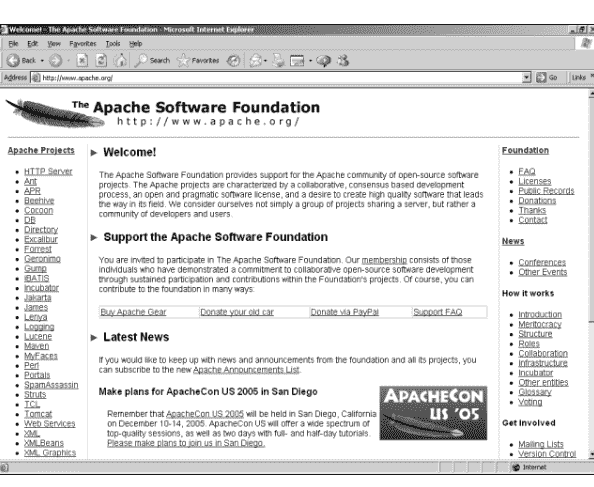

Apache 软件基金
http://www.apache.org/

Apache 软件基金为 Apache 开源软件项目社区提供支持。这些项目的特点是协作、基于共识的流程、开放且务实的软件许可，以及创建造及所有人的高质量软件的愿望。我们努力确保开发者不依赖于任何一组分享者，而是依赖于他们周围的开发者社区。

- HTTP Server
- ASF
- AIR
- Bleve
- Cylon
- CBR
- Directory
- Extis
- Format
- Geometry
- BIATIS
- ELucidator
- Java
- Lena
- Lucene
- Miface
- PortSashian
- Struts
- Tomcat
- Web Services

为在圣地亚举行的 ApacheConf 2000 作计划
请记住，会议将于 2000 年 10 月 9 日至 14 日在加利福尼亚州圣地亚哥举行。Apache 将举办广泛的高质量分会，包括两天的全天会议和半天的会议。请计划前往圣地亚哥加入我们。

图 1.2 在 Internet Explorer 中显示的位于 http://www.apache.org/ 的 Apache 软件基金会主页。

另一个例子是 Microsoft IIS（Internet 信息服务），它通常用于运行 Microsoft Windows 操作系统的宿主机计算机。

> 注意：并非所有基于 Windows 的宿主机都使用 IIS。Windows 还有其他 Web 服务器，包括流行的 Apache Web Server 的版本。

### 服务端编程

服务器端程序、脚本或语言是指运行在服务器计算机上的程序。用于服务器端编程的许多语言和工具均可用，包括 PHP、Java 和 ASP（后者仅在运行 Microsoft Windows 操作系统的服务器上可用）。复杂的服务器设置通常还包含信息数据库，可以通过服务器端脚本进行访问。

### 网站的解剖

> 注意：书中的服务器端编程是使用流行的 PHP 脚本语言完成的，它既灵活又易于使用，并且可以在几乎所有的服务器上运行。然而，Ajax 的功能可以与任何服务器端脚本语言一样出色。

此类脚本的目的是多样的。但总之，它们的设计都是在将网页返回给您之前对其进行预处理。这意味着页面的部分或全部内容将经过修改，以适应您请求的上下文——也许是为了显示特定的目的地，或者只显示符合您的爱好和兴趣的产品。服务端脚本允许 Web 页面提供丰富多样的内容，而这些内容是静态页面无法涵盖的。

### Web 浏览器

Web 浏览器是用户计算机上的一个程序，用于解释和显示网页。第一个图形化 Web 浏览器 Mosaic 最终发展变成了 Netscape 的著名系列浏览器。

> 注意：我们说的图形化 Web 浏览器是指不仅能显示 HTML 文档的文本元素还能显示图像和颜色的浏览器。通常，此类浏览器使用鼠标或类似设备通过点击界面。还存在基于文本的浏览器，其中最著名的是 Lynx (http://lynx.org/)，它可以在终端、 器器和带有命令行界面的操作系统等基于字符的显示器上显示 HTML 页面。

Netscape 系列浏览器曾是最成功的浏览器，后来微软的 Internet Explorer 加入了竞争并主导了市场。尽管如此，近期的竞争努力引入了广泛的浏览器产品，包括 Opera、Safari、Konquer 和 Mozilla 的 Firefox，后者是一个近期获得大量追随者的开源 Web 浏览器（见图 1.3）。

许多操作系统都有浏览器，包括 Windows、UNIX/Linux 和 Macintosh，以及从移动电话到 PDA（个人数字助理）再到口袋电脑等其他计算设备。


图 1.3 来自 Mozilla 项目主页的 Firefox 浏览器。

### 客户端编程

我们已经讨论过服务器脚本如何通过提供包含丰富多样内容的页面来改进您的网络体验，这些内容是在服务器创建并在发送给您之前插入页面的。另一方面，客户端编程发生在服务器内部，而是在接收页面后用户的浏览器内部。此类脚本允许您使用接收页面中的数据执行许多任务，包括执行计算、更改显示颜色和样式、检查用户输入的有效性等。

几乎所有浏览器都支持某种名为 JavaScript 的客户端脚本语言，它是 Ajax 不可缺的一部分，也是我们将在书中用于进行客户端编程的语言。

## DNS——域名服务

每台连接到互联网的计算机都分配有一个唯一的数字地址（称为 IP 地址）。然而，当您想在浏览器中查看网站时，通常不想输入一串数字——您想使用该网站的域名。毕竟，记住 www.domain.com 比记住类似 198.105.232.4 要容易得多。

当您通过域名请求网页时，您的互联网服务提供会将该域名提交给 DNS 服务器，DNS 服务器尝试查找与该名称相关的数据库条目并获取相应的 IP 地址。如果成功，您将连接到该站点；否则，您将收到错误。

互联网周围许多 DNS 服务器连接成一个网络，该网络会不断自我更新。

# 总结

在第 1 节中，我们讨论了互联网的历史和发展，并回顾了其主要组件包括服务器和 Web 浏览器的功能。我们还考虑了 Ajax 可以实现的。

# 第 2 节使用 HTML 编写网页

在本节中，我们将介绍 HTML，它是几乎每个 Web 页面背后的标记语言。

## 介绍 HTML

在这里介绍 HTML（文本标记语言）。良好的 HTML 知识为后续讨论的 Ajax 应用提供了良好的基础。

> 提示 如果您想深入了解 HTML，Sams 出版提供了许多可以帮助您的书籍，包括 Dick Oliver 写的《Sams Teach Yourself HTML 24 Hours》。

## 什么是 HTML？

互联网由数百万独立的页面组成，而这些页面通常用文本标记语言编写，即 HTML。

这揭示了关于 HTML 的大量信息。我们使用它来标记文本文档，以便 Web 浏览器知道如何显示它们，并在内部或页面之间定义超链接以提供导航。

任何人（像我这样）都能记得旧 WYSIG 文字处理程序对文本标记非常熟悉。这些旧应用程序需要在想要显示为粗体、斜体或下划线的文本段落放置特殊字符。

## 编写 HTML 需要什么工具？

由于 HTML 标记元素仅使用键盘字符，您只需要一个良好的文本编辑器来构建 HTML 页面。有很多编辑器可用，大多数操作系统都预安装了这样一个程序。例如，如果您使用的是某些版本的 Windows，内置的 Notepad 程序就足够。

> 提示 虽然 Notepad 是一个非常实用的文本编辑器，但可以使用许多所谓的程序员编辑器，它们提供行号和语法高亮等额外功能。许多编辑器是开源的，并可以免费下载。对于较大或更复杂的编程任务，考虑此类编辑器是非常值得的。

> 注意 虽然文本编辑器是编写程序代码的理想选择，但使用文字处理软件可能会由于此类程序通常在输出代码中嵌入意外标记和其他符号而导致问题。如果您选择使用文字处理器，请确保它能够将文件保存为纯 ASCII 文本。

## 我们的 HTML 文档

让我们直接开始创建一个简单的 HTML 文档。打开 Notepad（或您选择的任何编辑器）并输入列表 2.1 所示的文本。HTML 标记元素（称为标签）是位于 < 和 > 包围的字符字符串。


## 列表 2.1 testpage.html

```html
<!DOCTYPE HTML PUBLIC "-//W3C//DTD HTML 4.01 Transitional//EN"
"http://www.w3.org/TR/html4/loose.dtd">
<html
<head>
<title>A Simple HTML Document</title>
</head>
<body>
<h1>My HTML Page</h1>
Welcome to my first page written in HTML.<br />
This is simply a text document with some HTML markup to show some words in <b>bold (粗体)</b> and some other words in <i>italics (斜体)</i>.
<br />
</body>
</html>
```

现在将文档保存到计算机的某个地方，并命名为 `testpage.html`。

如果你现在将该页面加载到你喜爱的浏览器（例如 Internet Explorer 或 Firefox），你应该能看到 Internet Explorer 2.1 中显示的窗口那样。

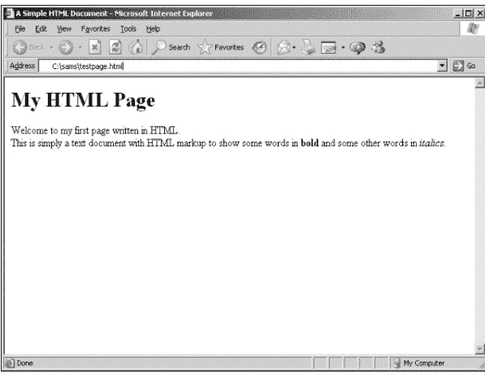

图 2.1 我们在 Internet Explorer 中显示的测试文档。

## HTML 页面的元素

让我们更详细地查看列表 2.1。

页面上的第一个元素被称为 `DOCTYPE` 元素。它的作用是通知浏览器文档使用的 HTML “版本”。书中一直使用的 `DOCTYPE` 元素指的是 HTML 4.0 Transitional，这是一个相当宽容的 HTML 规范版本，它允许在使用最新的 HTML 4.0 规范的同时，还允许使用一些早期的标记样式和结构。

`DOCTYPE` 元素必须始终出现在 HTML 文档的开头。

接下来，文档的其余部分由页面开头的 `<html>` 元素和结尾的 `</html>` 元素包围。这些标签通知浏览器之间的内容应该被解释并显示为 HTML 文档。

> **注意**：虽然许多现代浏览器在没有这些标签的情况下也能正确显示 HTML，但省略它们是一个坏习惯。即使页面显示在你自己的电脑上，你也无法知道访问者可能正在使用什么样的操作系统和浏览器——他们可能没有那么幸运。

这些外部标签内的文档被进一步分为两个部分。第一部分包含在 `<head>` 和 `</head>` 标签中，第二部分包含在 `<body>` 和 `</body>` 标签之间。本质上，文档的头部（head）用于存储不会在浏览器窗口中显示的文档信息，而文档的主体（body）则包含了通过浏览器窗口解释并显示给用户的文本。

## 文档的 <head>

从列表 2.1 我们可以看到，我们简单 HTML 文档的头部只包含一行——由 `<title>` 和 `</title>` 标签包围的“A Simple HTML Document”文字。

## 使用 HTML 编写网页

请记住，头部部分包含不会在浏览器窗口中播放/显示的信息。因此，它并不是显示在页面文本顶部的标题，你可以再次查看图 2.1 来确认这一点。文档标题也不是指文档的文件名，在本例中，文件名是 `testpage.html`。

事实上，文档标题具有许多功能，其中包括：

- 搜索引擎经常使用页面标题（以及其他因素）来帮助它们判断一个页面是关于什么的。
- 当你书签一个页面时，它通常默认以文档标题的形式保存。
- 大多数浏览器在最小化时，会在图标或任务栏按钮上显示当前文档的标题。

因此，为你创建的每个页面选择一个有意义且具有描述性的标题是非常重要的。

文档头部部分还使用了许多其他元素，包括 `link`、`meta` 和 `script` 元素。虽然我们在这里没有对它们进行说明，但书中会在它们出现时进行描述。

## 文档的 <body>

参考列表 2.1，我们可以清楚地看到，文档的主体部分由我们想要在页面上显示的文本以及帮助我们定义文本外观的标签组成。

要定义某些单词为**粗体**，我们将它们包在 `<b>` 和 `</b>` 标签中。同样，为了将单词转换为*斜体*，我们可以使用 `<i>` 和 `</i>` 标签。

标题“My HTML Page”由 `<h1>` 和 `</h1>` 标签包围。这些标签指示包围的内容是一个标题。HTML 允许六级标题，从 `<h1>`（最显著）到 `<h6>`。你可以使用任何中间值 `<h2>`、`<h3>`、`<h4>` 和 `<h5>`，它们分别对应章节、小节和段落。

到为止讨论的所有标签都是容器——也就是说它们由起始标签和结束标签组成，你可以在它们之间放置要操作的内容。然而，某些元素不是容器，但可以单独使用。例如 `<br />` 标签表示换行。另一个例子是 `<hr>`（水平线）。

> **提示**：如果你想在 HTML 的主体部分编写内容但不想让它被浏览器解释并显示在屏幕上，你可以通过写注释来实现：<!-- this is just a comment -->

## 为 HTML 添加属性

有时需要指定标签应该如何表现。在这种情况下，你添加参数和值对，这些被称为**属性**：

```html
<body bgcolor="cccccc">
  ... 页面内容 ...
</body>
```

在这个示例中，`<body>` 标签的行为通过调整其 `bgcolor`（背景颜色）属性被修改了。图 2.2 显示了这对 `testpage.html` 的影响：

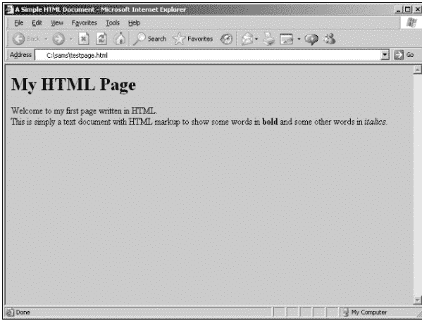

**图 2.2 背景改为灰色的测试页面。**

> **提示**：HTML 中的颜色值使用十六进制系统编码。每个颜色值由红、绿、蓝三个值组成。每个颜色值的范围可以从 `00` 到 `ff`（十进制表示为 0 到 255）。三个十六进制数字前带有 `#`。`#000000` 对应黑色，`#ffffff` 对应纯白色。

## 图片

可以通过 `` 标签向页面插入图片。在这种情况下，我们使用 `src` 属性指定图片的源文件。我们可以更改图像显示的其他方面包括边界、宽度和高度：

```html

```

边界、图像宽度和图像高度是以像素为单位的。

> **提示**：图片的另一个属性是 `alt`，它是替代文本（alternative text）的写。对于视觉障碍或其他配置为不显示图像的用户来说，替代文本同样重要：

```html

```

## 表格

通常你想以表格格式显示信息，HTML 有一组专门为此目的设计的元素：

```html
<table>
<tr><th>Column Header 1</th><th>Column Header 2</th></tr>
<tr><td>Data Cell 1</td><td>Data Cell 2</td></tr>
<tr><td>Data Cell 3</td><td>Data Cell 4</td></tr>
</table>
```

`<table>` 和 `</table>` 标签包含其他标签的嵌套层次，包括 `<tr>` 和 `</tr>`（定义单个表格行）、`<th>` 和 `</th>`（指示表头中的单元格）以及 `<td>` 和 `</td>`（包含单个数据单元格）。

请看后文图 2.3 查看表格在浏览器窗口中显示的示例。

## 超链接

超文本链接（超链接，hyperlinks）是 HTML 操作的基础。通过点击超链接，你可以导航到一个新位置，该位置可以是当前页面的另一个点，也可以是完全另一个网站不同页面的某一点。

链接包含在 `<a>` 或锚点标签内，这是一个包围将成为链接的文本的容器。链接的目标作为参数 `href` 传递给此标签：

<a href="newpage.html">my hyperlink</a>

点击示例中的超链接会导致浏览器请求 `webpage.html`。

> **提示**：超链接可以包含图像，也可以代替文本。看这个例子：
<a href="newpage.html"></a>

在这里，用户可以点击 picfile.gif 导航到 `webpage.html`。

## 更高级的 HTML 页面

让我们重新访问 `testpage.html` 并添加一些元素。列表 2.2 显示了 `seville.html`，它是从我们原始的 HTML 页面开发的，但文档的 `<body>` 部分内容不同。图 2.3 显示了页面显示时的样子，这次是在 Mozilla Firefox 中。

现在我们为文档的主体区域应用了背景色调。主体区域的内容在页面上居中，且该内容现在包括一张图片（我们给它提供了两像素宽的边界）、一个标题和一个副标题、一个简单的表格以及一些文本。


## 第 2 

## 列表 2.2 续

```html
<html>
<head>
<title>A Simple HTML Document</title>
</head>
<body bgcolor="#cccccc">
<center>

<h1>Guide to Seville</h1>
<h3>A brief guide to the attractions</h3>
<table border="2">
<tr>
<th bgcolor="#aaaaaa">Attraction</th>
<th bgcolor="#aaaaaa">Description</th>
</tr>
<tr>
<td>Cathedral</td>
<td>Dating back to the 15th century</td>
</tr> <!-- (注意：OCR 此处将 </tr> 误认为 </td>已修正) -->
<tr>
<td>Alcazar</td>
<td>The medieval Islamic palace</td>
</tr> <!-- (注意：OCR 此处将 ?The 误认为 The，已修正) -->
</table>
<p>Enjoy your stay in beautiful Seville.</p>
</center>
</body>
</html>
```

让我们仔细查看一下部分代码。

首先，我们使用了 `<body>` 标签的 `BGCOLOR` 属性为页面提供了整体背景色调：

`<body bgcolor="#cccccc">`

正文区域的所有内容都包含在 `<center>` 标签（紧跟 body 标签之后）和它的配对标签 `</center>`（body结束之前）之间。这确保了所有内容在页面上居中显示。

主标题像之前一样包含在 `<h1>` ... `</h1>` 标签中，但现在紧跟着一个使用 `<h3>` ... `</h3>` 标签的副标题，以提供较小的字体大小。

通过在起始 `<table>` 标签中使用 `border` 属性，我们为表格设置了两像素的边框宽度：

## 使用 HTML 编写网页

```html
<table border="2">
```

同时，我们通过使用 `<th>` 元素的 `BGCOLOR` 属性稍微加深了表格头单元格的背景：

```html
<th bgcolor="#aaaaaa">Attraction</th>
```

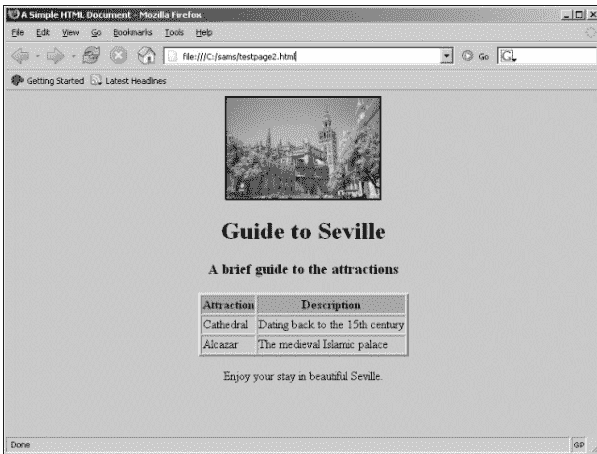

图 2.3 在 Mozilla Firefox 中显示的 seville.html。

## 一些有 HTML 标签

表 2.1 列出了一些常用的 HTML 标签。

## 表 2.1 常用 HTML 标记元素

### 文档标签

| | |
|---|---|
| `<html>...</html>` | 整个文档 |
| `<head>...</head>` | 文档头头部 |

## 表 2.1 续
文档标签

| | |
|---|---|
| `<body>...</body>` | 文档正文 |
| `<title>...</title>` | 文档标题 |
| `<a>...</a>` | 超链接 |
| `<b>...</b>` | 粗体文本 |
| `<em>...</em>` | 强调文本（斜体） |
| `<font>...</font>` | 更改的字体 |
| `<i>...</i>` | 斜体文本 |
| `<small>...</small>` | 小号文本 |
| `<table>...</table>` | 表格 |
| `<tr>...</tr>` | 表格行 |
| `<th>...</th>` | 表格头单元格 |
| `<td>...</td>` | 表格正文单元格 |
| `<ul>...</ul>` | 无序列表 |
| `<ol>...</ol>` | 有序列表（数字列表） |
| `<li>...</li>` | 无序或有序列表中的列表项 |

> 提示：万维网联盟（W3C）负责管理 HTML、HTTP、XML 以及许多其他网络技术的定义。其网站地址为 http://www.w3.org/。

## 两分钟理解层级样式表

之前的网页样式处理方法有一些缺点。首先，你需要显式说明每个页面元素的属性。当你想要更改页的外观时，需要逐行检查代码并更改每个属性。这对于几个页面可能还可以，但随着内容的增加，维护将变得困难。此外，应用于 HTML 元素的属性限制了显示方式的范围。

难道对代码进行一处更改并将该更改应用到所有 HTML 元素更好吗？为了实现这一目标，你在 HTML 文档的头部使用 `<style>` 标签嵌入样式：

```css
<style type="text/css">
  ... 样式语句
</style>
```

或者，它们也可以通过 `link` 元素从外部文件链接，再次放在文档的头部：

```html
<link rel="stylesheet" href="mysheet.css" type="text/css" />
```

> 提示：你甚至可以动态定义样式。这些被称为内联样式。以列表 2.2 的 body 标签为例，你可以使用内联样式实现相同的效果：
`<body style="background-color:#cccccc">`

## 设置样式表规则

样式表允许你为各种 HTML 元素设置样式规则。规则包含两个部分：选择器，用于识别应该影响哪个 HTML 标签；声明，包含你的样式规则。以下示例定义了段落元素 `<p>` 的样式：

```css
p {color: #33333}
```

假设除了灰色外，你希望段落标签 `<p> ... </p>` 中的文本显示为斜体：

```css
p {color: #333333; font-style: italic}
```

样式表可以包含你需要的任意规则。你也可以通过逗号分隔标签同时对多个标签应用声明。以下规则确定所有 h1、h2 和 h3 显示为蓝色：

```css
h1, h2, h3 {color: blue}
```

# 总结

本节讨论了使用 HTML 语言进行网页布局的基础，包括 HTML 文档结构、HTML 元素示例以及使用属性和样式表进行页面样式。

## 第 3 
使用 HTTP 发送请求

万维网通信使用多种协议，也许最重要的 HTTP，它是 Ajax 应用的基础。本节介绍了 HTTP 协议并展示了它是如何被使用的。

## 介绍 HTTP

HTTP 或超文本传输协议是万维网的主要协议。当你在浏览器中输入地址时，浏览器使用 HTTP 进行请求和接收。

## 为什么我需要知道这些？

本质上，HTTP 定义了关于消息格式的规则。

## 本节涵盖了（以及未涵盖）

本节检查了这些结构的一些示例。

## HTTP 请求

在与目标服务器建立连接后，HTTP 客户端允许以下格式的请求：

- 一行起始行
- 可选的若干行头部行
- 一个空行
- 可选的消息正文

起始行通常分为三部分：方法名称、所需服务器资源的路径以及所使用的 HTTP 版本。一个典型的起始行如下：

```
GET /sams/testpage.html HTTP/1.0
```

在此行中，我们告诉服务器我们正在发送 GET 类型的 HTTP 请求（在下一节中详细说明），我们使用 1.0 版本发送，并且我们需要的服务器资源（包括本地路径）是：

```
/sams/testpage.html
```

> 注意：在此示例中，我们寻找的服务器资源在我们服务器上，因此我们相对路径。它可能在另一个服务器上，情况下服务器资源将包含完整的 URL。

头部行用于发送有关请求的信息或消息正文中发送的数据。每行发送一个参数值对，参数和值用冒号分隔。示例：

```
User-Agent: [发送请求的程序名称]
```

例如，Internet Explorer v5.5 提供如下：
User-agent: Mozilla/4.0 (compatible; MSIE 5.5; Windows NT 5.0)

常见的头部另一个示例是 Accept 头部，它声明了哪些信息将被服务器认为是可接受的响应：

```
Accept: text/plain, text/html
```

通过发布上述示例中的头部，结果是通知发送应用程序可以接受纯文本或 HTML 响应（也就是说，它不具备处理例如音频或视频文件的能力）。

## HTTP 请求与响应

HTTP 协议可以被比作基于一系列问答的对话，我们分别称之为请求和响应。

其内容易于阅读和理解，因为它们的语法接近纯英语。

> 注意：HTTP 请求方法包括 POST、GET、PUT、DELETE 和 HEAD。在我们追求 Ajax 的过程中，目前有趣的是 GET 和 POST 请求。此处未涵盖 PUT、DELETE 和 HEAD 请求。


## HTTP 响应

响应此类请求，服务器通常会发布 HTTP 响应，其第一行通常被称为*状态行*（status line）。在这一行中，服务器会返回 HTTP 版本，并给出一个响应状态码（一个三位整数）和一个被称为*理由短*（reason phrase）的短消息。这里是一个 HTTP 响应示例：

```
HTTP/1.0 200 OK
```

响应状态码和理由本质上是同一条消息的机器和人类可读版本，尽管理由短在不同服务器之间可能略有不同。表 3.1 列出了一些状态码和理由短的示例。状态码的第一数字通常提供了关于消息性质的某些线索：

- *1**—信息性
- *2**—成功性
- *3**—已重定向
- *4**—客户端错误
- *5**—服务器错误

## 表 3.1 一些常见的 HTTP 响应状态码

| 状态码 | 解释 |
|---|---|
| 200 - OK | 请求成功。 |
| 204 - No Content | 文档不包含数据。 |
| 301 - Moved Permanently | 资源已永久移动到不同的 URI。 |
| 401 - Not Authorized | 请求需要用户验证。 |
| 403 - Forbidden | 服务器拒绝执行请求。 |
| 404 - Not Found | 请求的资源在服务器上不存在。 |

## 使用 HTTP 发送请求

| 状态码 | 解释 |
| --- | --- |
| 408 - Request Timeout | 客户端未能在服务器允许的时间内发送请求。 |
| 500 - Server Error | 由于脚本故障、服务器配置错误或类似原因。 |

> 提示：状态码的详细列表由世界维网联盟（W3C）维护，可以在 http://www.w3.org/Protocols/rfc2616/rfc2616-sec10.html 访问。

响应可能还包含标头行，每行包含一个与 HTTP 请求类似的标头和值对，但通常包含有关服务器和/或返回资源的信息：

Server: Apache/1.3.22
Last-Modified: Fri, 24 Dec 1999 13:33:59 GMT

## HTML 表单

Web 页面通常包含你可以输入信息的字段。示例包括选择框、复选框以及你可以输入信息的字段。表 3.2 列出了一些流行的 HTML 表单标签。

## 表 3.2 一些常见的 HTML 表单标签

| 标签 | 描述 |
| --- | --- |
| <form>...</form> | 整个表单的容器 |
| <input /> | 数据输入元素；包括文本、密码、复选框和单选按钮字段，以及提交和重置按钮 |
| <select>...</select> | 下拉选择框 |
| <option>...</option> | 选择框内的选项 |
| <textarea>...</textarea> | 多行文本输入字段 |

## 第 3 节

完成表单后，你通常会被邀请使用标签恰当的按钮或其他页面元素来提交它。

此时，HTML 表单根据用户输入的数据构建并发送 HTTP 请求。表单可以使用 GET 或 POST 请求类型，这具体由 `<form>` 标签的 `method` 属性指定。

## GET 和 POST 请求

偶尔你可能会听到说，GET 和 POST 请求之间的区别在于 GET 请求仅用于获取（GETting，即检索数据），而 POST 请求有许多用途，例如上传数据、发送邮件等。

虽然这种经验法则可能有些其道理，但从构建方式的角度考虑这两种 HTTP 请求之间的差异是有益益的。

GET 请求将它要发送的消息编码为查询字符串，该字符串附加到服务器资源的 URL 之后。另一方面，POST 请求将其消息发送在请求的正文（message body）中。此时实际发生的情况是输入的数据被编码并通过 HTTP 请求发送到表单 `action` 属性声明的 URL，在那里，提交的数据将以某种方式进行处理。

HTTP 请求是 GET 类型还是 POST 类型，以及表单发送到哪个 URL，这些都是在表单的 HTML 标记中确定的。让我们来看一个典型表单的 HTML 代码：

```
<form action="http://sometargetdomain.com/some.htm"
  method="post">
Your Surname: <input type="text" size="50" name="surname" />
<br />
<input type="submit" value="Send" />
</form>
```

这段代码段嵌入 Web 页面时，会产生图 3.1 所示的简单表单。

## 使用 HTTP 发送请求

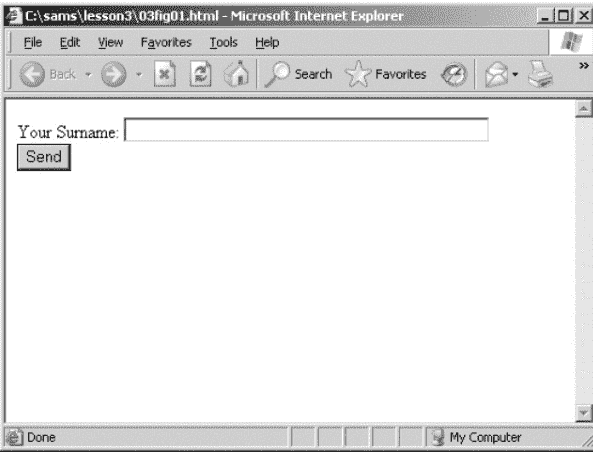

**图 3.1** 一个简单的 HTML 表单。

让我们逐行查看代码。首先，我们使用 `<form>` 标签开始表单，在这个示例中，我们给了标签两个属性。`action` 属性决定了提交的表单发送到的 URL。这可能是同一服务器上的另一个页面（通过相对路径描述），也可能是远程域名，如图 3.1 表单后的代码所示。

## GET 和 POST 请求

偶尔你可能会听到说，GET 和 POST 请求之间的区别在于 GET 请求仅用于获取（GETting，即检索数据），而 POST 请求有许多用途，例如上传数据、发送邮件等。

虽然这种经验法则可能有些其道理，但从构建方式的角度考虑这两种 HTTP 请求之间的差异是有益的。

GET 请求将它要发送的消息编码为查询字符串，该字符串附加到服务器资源的 URL 之后。另一方面，POST 请求将其消息发送在请求的正文中。此时实际发生的情况是输入的数据被编码并通过 HTTP 请求发送到表单 `action` 属性声明的 URL，在那里，提交的数据将以某种方式进行处理。

无论 HTTP 请求是 GET 类型还是 POST 类型，以及表单发送到哪个 URL，这些都是在表单的 HTML 标记中确定的。让我们来看一个典型表单的 HTML 代码：

```
<form action="http://sometargetdomain.com/some.htm"
  method="post">
Your Surname: <input type="text" size="50" name="surname" />
<br />
<input type="submit" value="Send" />
</form>
```

这段代码段嵌入 Web 页面时，会产生图 3.1 所示的简单表单。


**图 3.1** 一个简单的 HTML 表单。

让我们逐行查看代码。首先，我们使用 `<form>` 标签开始表单，在这个示例中，我们给了标签两个属性。`action` 属性决定了提交的表单发送到的 URL。这可能是同一服务器上的另一个页面（通过相对路径描述），也可能是远程域名，如图 3.1 表单后的代码所示。

# 总结

本节涵盖了使用 HTTP 协议（万维网的主要通信协议）进行服务器请求和响应的基础知识。特别是我们讨论了 GET 和 POST 请求是如何构建的，以及它们如何在 HTML 表单中使用的。此外，我们还看到了一些从服务器接收到的这些请求的响应示例。


## 第 4 节
## 使用 JavaScript 进行客户端编码

在本节中，我们将介绍使用 JavaScript 进行客户端脚本的概念。客户端脚本嵌入在网页中，并由浏览器内置的 JavaScript 解释器执行。它们为原本静态的 HTML 页面添加了额外的功能。

## 关于 JavaScript

JavaScript 开发源于一种名为 LiveScript 的语言，该语言由 Netscape 开发，用于其早期浏览器。JavaScript 源代码嵌入在网页的 HTML 代码中，并在页面显示时由浏览器对其进行解释和执行。

使用 JavaScript，你可以为你的网页添加额外功能。示例包括：

- 更改页面元素的显示方式
- 添加动画和其他图像效果
- 打开弹出窗口和对话框
- 检查用户输入数据的有效性

几乎所有现代浏览器都支持 JavaScript，尽管在某些命令上存在细微差异。出现这些差异的地方，文中会进行描述。

> 注意：虽然你的浏览器可能支持 JavaScript，但通常可以通过配置浏览器选项来禁用它。如果你发现任何 JavaScript 命令都无法工作，请咨询浏览器的帮助文件，以检查 JavaScript 是否正确启用。

注意：微软的 Internet Explorer 浏览器实际上运行的是一种名为 Jscript 的微软专用语言，而不是 JavaScript。然而，两者几乎完全相同，因此具有很高的兼容性。出现差异的地方，文中会进行描述。

## 为什么我需要了解 JavaScript？

Ajax 中的 j 代表 JavaScript；你使用用这种语言编写并嵌入到网页中的函数来构建 Ajax 服务器调用，并处理和处理从服务器返回的响应。

# 本节涵盖了（以及未涵盖）的内容

这里没有空间提供所有 JavaScript 函数的详尽指南。相反，本节侧重于后续开发 Ajax 应用所需的语言方面。

在完成本节后，你将获得以下经验：

- 将 JavaScript 命令和外部 JavaScript 文件嵌入网页中
- 使用一些常用的 JavaScript 命令
- 使用事件处理器启动 JavaScript 命令
- 适用于 JavaScript 变量和对象
- 将 JavaScript 命令抽象为函数

## 第 4 节

> 提示：若想学习更深入的 JavaScript 课程，请尝试 Michael Moncur 写的《24 小时自学 JavaScript》。

## JavaScript 基础

可以通过将 JavaScript 命令放置在 `<script>...</script>` 标签之间直接将其嵌入 HTML 页面。通常将 JavaScript 函数保留在服务器上的单独文件中（通常带有 .js 文件扩展名），并在需要的地方通过在 HTML 文件的头部放置如下行代码将其链接到 HTML 文件：

```
<SCRIPT language="JavaScript" SRC="myJS.js"></SCRIPT>
```

这允许你调用 `myJS.js` 文件中的任何 JavaScript，就像该源代码被直接输入到你的网页中一样。

> 将 JavaScript 函数放入外部文件中，可以供多个不同的网页使用，而无需重复编写任何代码。这使得它们更容易维护，因为每次请求该页面时，最新版本都会自动链接到调用的 HTML 页面。

可以通过这种方式构建 JavaScript 库，并在需要特定功能时将其链接到网页中。

## 深入实践

让我们直接进入正题，在我们第 2 节“使用 HTML 编写网页”中开发的简单网页添加一个 JavaScript 命令。

打开你的文本编辑器并加载 `seville.html`（第 2 节中的列表 2.2）。我们将第 24 行的 `</p>`（段落结束标签）之后向页面添加以下代码：

## 使用 JavaScript 进行客户端编码

```
<script language="JavaScript" type="text/javascript">
document.writeln('This line was written using JavaScript!');
</script>
```

> 注意：JavaScript 与 HTML 不同，它是大小敏感的。在输入 JavaScript 命令时，注意不要输入大小错误的字符，否则将发生错误。

添加了额外行的完整源代码在列表 4.1 中。确保你已正确添加代码；然后将文件保存为 `page3.html` 并将其加载到你喜欢的浏览器中。

## 列表 4.1 向 HTML页面添加 JavaScript

```html
<!DOCTYPE HTML PUBLIC "//W3C//DTD HTML 4.01//Transitional//EN" "http://www.w3.org/TR/html4/loose.dtd">
<html>
<head>
<title>一个简单的 HTML 文档</title>
</head>
<body bgcolor="#cccccc">
<center>

<h1>一个更高级的 HTML 页面</h1>
<h3>欢迎来到我用 HTML 编写的第二个页面。</h3>
<table border="2">
<tr>
<th bgcolor="#aaaaaa">蔬菜</th>
<th bgcolor="#aaaaaa">水果</th>
</tr>
<tr>
<td>胡萝卜</td>
<td>苹果</td>
</tr>
<tr>
<td>卷心菜</td>
<td>橙子</td>
</tr>
</table><br />
```

## 列表 4.1 继续

```html
<p>... 这里还有一些文本</p>
<script language="JavaScript" type="text/javascript">
document.writeln('This line was written using JavaScript!');
</script>
</center>
</body>
</html>
```

（注：由于提供的原文文本存在大量重复内容和 OCR 错误，译文已根据要求提取了核心逻辑并清理了格式。）


## 使用 JavaScript 进行客户端编码

此行代码调用了 JavaScript 的 alert 方法，它会弹出一个显示消息和“确定”按钮的对话框。在 alert 对话框中要显示的消息包含在参数传递给 alert 方法的字符串中。

让我们将这段代码添加到我们的 HTML 文档中，如列表 4.2 所示。完成更改后，将页面保存为 `page4.html` 并在浏览器中加载它。

### **列表 4.2 从 onClick 事件处理器中调用 alert()**

```html
<!DOCTYPE HTML PUBLIC "//W3C//DTD HTML 4.01 Transitional//EN" "http://www.w3.org/TR/html4/loose.dtd">
<html
<head>
<title>A Simple HTML Document</title>
</head>
<body bgcolor="cccccc">
<center>

<h1>More Advanced HTML Page</h1>
<h3>Welcome to my second page written in HTML.</h3>
<table border="2">
<tr>
<th id="#aaaaaa">Vegetables</th>
<th bgcolor="#aaaaaa">Fruits</th>
</tr>
<tr>
<td>Carrot</td>
<td>Apple</td>
</tr>
<tr>
<td>Cabbage</td>
<td>Orange</td>
</tr>
</table><br />
<p>... and here's some text in a paragraph.</p>
<script language="JavaScript" type="text/javascript">
document.write("This line was written using JavaScript!")
</script>
<form>
<input type="button" value="Click Here" onclick="alert('Thanks for clicking!')">
</form>
</center>
</body>
</html>
```

我们的 HTML 页面现在应该显示我们的新按钮了，如图 4.2 所示。

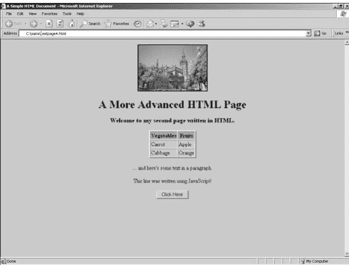

**图 4.2** 我们网页中新的“点击这里”按钮。

去点击该按钮。如果一切按计划进行，就会如图 4.3 所示弹出一个 alert 对话框。你可以点击“确定”来清除对话框。

## 创建函数

你经常会需要组合各种 JavaScript 方法和对象，可能需要使用许多行代码。JavaScript 允许你组合这样的指令块并为它们命名，使得你的代码更容易编写、理解和维护。

例如，让我们使用另一个事件处理器，但这次我们将用它来调用函数，而不是直接调用 JavaScript 方法。

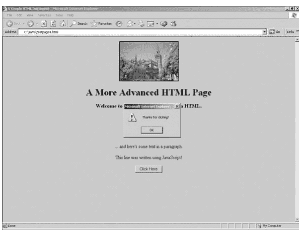

**图 4.3** 你点击新按钮后出现的对话框。

这里是我们的函数的代码，我们将将其放在 HTML 文档的 head 部分：

```javascript
<script language="JavaScript">
function showAlert() {
  alert("A Picture of Seville")
}
</script>
```

> **注意** 注意，函数定义始终以 `function` 单词开头，后面跟着函数名。函数内部的语句包含在大括号 `{}` 之中。

## 第 4 课

在通常的 `<script>` 标签内，我们现在定义了一个名为 `showAlert` 的函数，它执行大括号包含的命令。在这种情况下，只有一个命令，即对之前遇到的的 `alert` 方法的调用。

我们希望当用户的鼠标悬过网页上的照片时，出现此 alert 对话框。因此，我们将为包含图像的 `` 标签添加一个属性，如下：

```html

```

此行代码使用鼠标事件处理器来检测光标是否进入照片占据的区域。当这种情况发生时，我们的新函数 `showAlert` 将被调用。

列表 4.3 显示了修改后的代码。

### 列表 4.3 使用 mouseOver 事件处理器

```html
<!DOCTYPE HTML PUBLIC "-//W3C//DTD HTML 4.01 Transitional//EN"
"http://www.w3.org/TR/html4/loose.dtd">
<html
<head>
<title>A Simple HTML Document</title>
<script language="JavaScript" type="text/javascript">
function showAlert()
{
alert("A Picture of Seville")
}
</script>
</head>
<body bgcolor="cccccc">
<center>

<h1>More Advanced HTML Page</h1>
<h3>Welcome to my second page written in HTML.</h3>
<table border="2">
<tr>
<th bgcolor="#aaaaaa">Vegetables</th>
<th bgcolor="#aaaaaa">Fruits</th>
</tr>
<tr>
<td>Carrot</td>
<td>Apple</td>
</tr>
<tr>
<td>Cabbage</td>
<td>Orange</td>
</tr>
</table><br />
<p>... and here's some text in a paragraph.</p>
<script language="JavaScript" type="text/javascript">
document.write('This line was written using JavaScript!')
</script>
<form>
<input type="button" value="Click Here" onclick="alert('Thanks for clicking!')">
</form>
</center>
</body>
</html>
```


此字符串以对象文档（object document）开头，然后引用该对象内的对象图像，最后是属性 `src`（图像的源文件）。

> 注意：实际上，在对象层次结构中真正处于最高层级的对象是 `window`，它指的是浏览器屏幕及其其中的所有内容。通常情况下，你不需要包含这个对象；JavaScript 会假设它存在那里。

假设我们在页面的某个地方有以下 HTML 代码：

```
<form name="form1" action="somepage.html" method="post">
<input type="text" name="lastname">
<input type="submit" value="Submit">
</form>
```

在 JavaScript 中，我们可以通过引用与字段对应的对象的 `value` 属性，来获取用户在 `lastname` 字段中输入的字符串：

```
document.form1.lastname.value
```

## 示例—表单验证

让我们使用这种技术来检查用户输入的表单数据的有效性。我们希望捕捉用户尝试提交表单的行为，并借此触发我们的 JavaScript 函数，该函数将检查数据的有效性。以下是我们表单的 HTML 代码：

```
<form name="form1" method="post" action="otherpage.html">
Enter a number from 1 to 10: <input size="4" type="text
name="number">
<input type="submit" value="Enter"
onsubmit="return numcheck()"
</form>
```

我们在这里看到，当点击 Submit 按钮时会调用 `onSubmit` 事件处理程序，并调用一个名为 `numcheck` 的 JavaScript 函数。我们需要这个函数来检查用户输入的内容是否有效，并决定提交表单或（如果输入无效）发出错误。请注意函数调用之前的 `return` 单词。之所以在这里使用它，是因为在这种情况下，我们希望函数告诉我们是否允许提交方法继续执行。如果要停止表单提交，我们希望函数向表单返回一个 `false` 值。以下是：

```
<script language="JavaScript" type="text/javascript">
function numbered() {
  var numbered = document.form1.username.value;
  if((numbered>=1)&&(numbered<=10)) {
    return true;
  } else {
    alert("Your entry was invalid. Please try again.");
    return false;
  }
}
```

该函数的第一个操作是将用户输入的值赋值给变量 `numbered`。然后我们通过检查它是否大于或等于 1 且小于等于 10 来测试该数字的有效性。根据结果，我们要么向调用表单返回一个 `true` 值（从而允许提交表单），要么弹出一个对话框告知错误。在后的情况下，当用户点击 OK 清除对话框时，会向调用表单返回一个 `false` 值，防止表单提交，直到用户输入适当的数据。

# 总结

本节涵盖了 JavaScript 编程的基础知识。我们看到了如何将 JavaScript 命令集成到 HTML 页面中，讨论了将 JavaScript 命令分组为函数的方法，并学习了如何使用事件处理程序来启动 JavaScript 命令和函数。

## 第 5 节
### PHP 的服务器端编程

Ajax 应用可以与几乎任何服务器端语言协同工作，只需要服务器对其 HTTP 请求返回格式化正确的响应即可。本节介绍了 PHP，这是一种在全球范围内大量 Web 服务器上使用的流行开源脚本语言。

## 介绍 PHP

与 JavaScript 类似，PHP 也由可以嵌入到页面 HTML 代码中的命令组成。然而，PHP 是一种服务器端编程语言——也就是说，它与你的 Web 服务器配合工作，在页面发送到浏览器之前处理该页面的源代码。

## 我为什么需要了解它？

正如你已经所知的，Ajax 应用会调用 Web 服务器并随后在当前查看页面中使用返回的信息。你需要一种方法在服务器上运行程序以处理 Ajax 请求并返回所需数据。

Ajax 可以与各种服务器端技术配合，包括 PHP、ASP、Java 等。本书使用了 PHP，这可以说是是所有可用服务器端语言中最流行且易于使用的语言。

本节为从未接触过 PHP 的人提供了介绍，并为任何接触过的人提供了基础知识的回顾。

# 本节涵盖了（以及未涵盖）的内容

与本书此部分的每节内容一样，对该主题的每个方面提供详尽的课程既不可行也不合适。

本节涵盖了 PHP 编程的基础并结合了一些实用示例，主要关注 PHP 与我们探索 Ajax 最相关的方面。

> 提示：http://uk.php.net/ 的 PHP 网站是 PHP 相关信息、下载和文档的重要来源。

> 提示：如需更完整的 PHP 课程，请尝试 Matt Zandstra 编写的《Sams Teach Yourself PHP in 24 Hours》。

## 在 HTML 页面中嵌入 PHP

通过用 `<?php` 和 `?>` 标签包裹 PHP 语句可以将 PHP 语句嵌入 HTML 文档。此类标签之间的任何内容都会被 Web 服务器评估并替换为适当的 HTML 代码。PHP 语句通过用 `<?php` 和 `?>` 标签包裹 PHP 语句嵌入 HTML 文档。此类标签之间的任何内容都会被 Web 服务器评估并替换为适当的 HTML 代码。PHP 语句通过用 `<?php` 和 `?>` 标签包裹 PHP 语句嵌入 HTML 文档。此类标签之间的任何内容都会被 Web 服务器评估并替换为适当的 HTML 代码。PHP 语句通过用 `<?php` 和 `?>` 标签包裹 PHP 语句嵌入 HTML 文档。

## PHP

PHP 语句通过用 `<?php` 和 `?>` 标签包裹 PHP 语句嵌入 HTML 文档。此类标签之间的任何内容都会被 Web 服务器评估并替换为适当的 HTML 代码。

## 输出 PHP

```html
<html>
<head>
<title>A Simple Script</title>
</head>
<body>
<?php echo "Hello World"; ?>
</body>
</html>
```

PHP 语句通过用 `<?php` 和 `?>` 标签包裹 PHP 语句嵌入 HTML 文档。此类标签之间的任何内容都会被 Web 服务器评估并替换为适当的 HTML 代码。

## 变量

```html
<html>
<head>
<title>A Simple Script</title>
</head>
<body>
<?php
$name = "World";
echo "Hello " . $name;
?>
</body>
</html>
```

PHP 语句通过用 `<?php` 和 `?>` 标签包裹 PHP 语句嵌入 HTML 文档。此类标签之间的任何内容都会被 Web 服务器评估并替换为适当的 HTML 代码。

## 数组

```html
<html>
<head>
<title>A Simple Script</title>
</head>
<body>
<?php
$x = 10;
$y = 20;
echo $x + $y;
?>
</body>
</html>
```

PHP 语句通过用 `<?php` 和 `?>` 标签包裹 PHP 语句嵌入 HTML 文档。此类标签之间的任何内容都会被 Web 服务器评估并替换为适当的 HTML 代码。


$daynames = array("Monday", "Tuesday", "Wednesday",
"Thursday", "Friday");

数组中的项通过键（key）引用，键是一个从零开始并随着数组中的每个项递增的整数。下行代码将 Thursday 输出到 HTML 页面：

```php
echo $daynames[3];
```

注意，由于索引值从零开始，上述语句实际上输出的是数组的第四个元素。

这种数组被称为索引数组，但你也可以使用关联数组。在这种情况下，每个元素的键值不是数字，而是你选择的字符串。声明此类数组并为其赋值的语法略有不同：

```php
$lunch = array("Susan" => "Chicken", "Matthew" => "Beef",
"Louise" => "Salmon");
```

你现在可以使用键值来选择此类数组的元素：
echo $lunch["Louise"];

此命令将单词 Salmon（三文鱼）输出到我们的页面。

# 控制程序流

PHP 包含了用于控制程序流的各种结构。其中最有用的是简单的 `if` 语句，它允许你根据条件的结果改变程序执行的流。让我们来看一个使用 `if` 语句的代码段：

```php
if($temp > 80)
{
    echo $temp. " degrees is too hot. Turn down
    the thermostat.\n";
}
```

该语句简单地评估括号包含的条件。如果满足条件，则执行大括号内的语句；否则，这些语句将被忽略。

我们还可以为我们的语句添加一个 `else` 子句：

```php
if($temp > 80)
{
    echo $temp. " degrees is too hot. Turn down
    the thermostat.\n";
}
else
{
    echo $temp. " degrees is cool enough.";
}
```

PHP 还有循环结构，它允许你重复执行代码指令若干次，直到满足终止循环的条件。以下是 `while` 循环的代码：

```php
$x = 1;
while($x<=12)
{
    echo "This is trip number $x. through the loop<br />";
    $x++;
}
```

语句 `$x++` 的意思是“将 x 加一”。循环会不断执行，直到条件

$x<=12

不再满足（因为 $x 已经大于 12），然后大括号内的状态将被忽略。程序执行在闭合大括号之前会处理它们。

你可以使用 PHP 的 `for` 结构创建一个类似的循环：

```php
for($x = 1; $x <= 12; $x++)
{
    echo "This is trip number $x. through the loop<br />";
}
```

该语句接受一个包含三个组成部分的的参数。第一个部分在第一次循环之前求值，并为 $x 提供起始值。参数的第二个部分是在每个循环中都会评估的条件，用于测试是否应该执行循环，第三部分是一个将在每个循环后执行的语句，在这种情况下它会让 $x 递增。

此循环的操作与 `while` 示例相同。

# 总结

本节介绍了 PHP 服务器端语言中的编程原理，包括变量的使用和程序流控制结构的使用。你还看到了 PHP 语句可以如何嵌入到 HTML 页面中。

# 第 6 节

## XML 简介绍

Ajax 中的“x”代表 XML，这是一种强大的标记语言，可以允许你的 Ajax 应用传输并处理复杂的结构化信息。本节讨论了创建和使用 XML 文档的基础。

# 引入 XML

任何进行过任何 HTML 标记的人已经对 XML 代码的性质有些熟悉了。XML（可扩展标记语言）在标记样式上与 HTML 有许多相似之处。

HTML 旨在决定网页的显示方式，而 XML 的用途要广泛得多。XML 文档可以用于各种数据存储和数据交换，范围从文档的存储和检索到传统上由数据库程序承担的角色。

# 我为什么需要知道这些？

使用 XML 的方法之一是在应用程序之间传输结构化信息。在 Ajax 中，你可以使用 XML 将信息从服务器返回到你的 Ajax 应用，并在那里它可能会被解析和使用。

# 本节涵盖了（以及未涵盖）的内容

与本书该部分的其他章节一样，我们并不试图对 XML 提供完整且详尽的论述。相反，本节涵盖了该语言及其应用的基础，主要关注与你处理 Ajax 工作相关的方面。

> 提示 如果你想学习更深入的 XML 教程，请参阅 Andrew H. Watt 写的《Sams Teach Yourself XML in 10 Minutes》。

# XML 基础

XML 是一种标记语言，允许以结构化、层次化的方式进行数据的存储和传输。它在标记样式上与 HTML 有相似之处，但 HTML 有一组固定的元素定义，并主要设计用于允许你定义文档应该如何显示，而 XML 元素可以在特定的 XML 文档中定义，以适应那里描述的数据。

与 HTML 相同，由 `<` 和 `>` 包围的标记元素（通常称为标签）用于注释文本文件的内容，描述其所包含的信息。

> 注意 XML 和 HTML 之间的相似性并非纯属偶然。两者都基于 SGML（标准通用标记语言），这是一种组织文档元素的系统。SGML 是由国际标准组织（ISO）开发并标准化的。

与 HTML 标签不同（HTML 标签的定义是固定的），XML 标签可以定义为任何你想要的，允许你描述几乎任何数据。考虑这个 XML 文档示例：

```xml
<yacht race='74'>
<name>Wanderer</name>
<skipper>Walter Jeffries</skipper>
<helm>Sally Jacobs</helm>
</yacht>
```

```xml
<yacht race='22'>
<name>Free Spirit</name>
<skipper>Jennifer Scully</skipper>
<helm>Paul Thomas</helm>
</yacht>
```

## XML 简介绍

这段 XML 文档描述了一场帆船比赛，包括参赛的帆船及其相应人员。注意标签名称描述了它们包含的数据，以及标签结构是层次化的。你可能注意到 XML 标签像 HTML 一样也可以具有属性。

> 注意 与 HTML 不同，XML 标签名是区分大小写的，因此 `<yacht>` 和 `<Yacht>` 会被视为不同的元素。

> 提示 XML 使用与 HTML 相同的语法显示注释。任何以 `<!--` 开始并以 `-->` 结束的信息将被忽略：

<!-- 这是一个注释 -->

## XML 文档结构

XML 文档的允许结构只有一个强制元素，即所谓的“根元素”。在之前的示例中，这将是 `<race>` 元素。

> 文档元素并不一定内部有嵌套元素；以下是一个允许的 XML 文档：

<competition>Farlington Summer Cup</competition>

## 文档序言

其他信息可以可选地在文档元素之前，形成文档的序言。一个例子是 XML 声明：

```xml
<?xml version="1.0" ?>
```

> 注意 如果存在此类声明，它必须是文档的第一内容。在它之前甚至不允许有空白字符。

序言除了各种注释和处理指令外，还可能包含一个文档类型声明。

## 文档类型声明

可选的文档类型声明（通常称为 DOCTYPE 声明）是 XML 文档允许结构的语句。它通常包含（或引用另一个文件来包含）关于文档中元素名称以及这些元素之间关系的信息。

> 注意 注意不要将文档类型（DOCTYPE）声明与文档类型定义（DTD）混淆。DTD 由 DOCTYPE 声明中包含的标记声明以及在 DOCTYPE 声明所引用的任何外部文件中包含的声明组成。

让我们看看帆船比赛文档的文档类型声明示例：

```xml
<!DOCTYPE race SYSTEM race.dtd>
```

此声明出现在文档中 `<race>` 元素之前，指定了文档元素将是 `<race>` 并


## XML 简介绍

这些文档结构定义可以在一个外部文件 `race.dtd` 中找到，其中可能包含如下内容：

```
<!ELEMENT race (yacht+)>
<!ELEMENT yacht (name, skipper, helm)>
<!ATTLIST yacht raceNo #CDATA #REQUIRED>
<!ELEMENT name (#PCDATA)>
<!ELEMENT skipper (#PCDATA)>
<!ELEMENT helm (#PCDATA)>
```

或者，这些信息也可以直接在 `DOCTYPE` 声明中引用，放置在 `[` 和 `]` 字符之间：

```
<!DOCTYPE [
<!ELEMENT race (yacht+)>
<!ATTLIST yacht raceNo #CDATA #REQUIRED>
<!ELEMENT yacht (name, skipper, helm)>
<!ELEMENT name (#PCDATA)>
<!ELEMENT skipper (#PCDATA)>
<!ELEMENT helm (#PCDATA)>
]
```

在这种情况下，我们定义了四个元素——即 race、yacht、skipper 和 helm——以及一个属性列表。

> 提示：DOCTYPE 声明可以同时包含内部和外部引用，被称为 DTD 的内部子集和外部子集。

## 元素声明

这一行

```
<!ELEMENT race (yacht+)>
```

声明 `<race>` 元素将包含类型为 `<yacht>` 的元素，而 `+` 字符表示此类 `<yacht>` 元素可以出现一次或多次。或者，我们也可以使用 `*` 字符表示包括零次在内的任意次数，或者使用 `?` 字符表示零次或一次。缺少所有这些字符则表示 `<race>` 内部恰恰有一个 `<yacht>` 元素。

`<yacht>` 元素被声明包含另外三个元素：`<name>`、`<skipper>` 和 `<helm>`。这些元素声明中包含的 `#CDATA` 项表示解析字符数据（parsed character data），指示这些元素包含基于字符的数据且可能包含进一步的元素。其他可能的内容类型包括 `MIXED`（文本和元素）和 `ANY`（任何有效内容）。

## 属性列表声明

我们的示例还包含了这一行

```
<!ATTLIST raceNo #CDATA #REQUIRED >
```

此类声明用于指定任何给定元素允许或要求的属性。在我们的示例中，我们指定 `<yacht>` 元素有一个名为 `raceNo` 的属性，其值由 `#CDATA`（字符数据）组成。

`#REQUIRED` 项表示在示例中，`<yacht>` 元素必须具有此类属性。其他可能性包括 `IMPLIED`，表示该属性是可选的；`#DEFAULT` 后跟着一个引号内的值，表示如果 XML 文档中未声明该属性，则为属性指定一个默认值；或者 `#FIXED` 后跟着一个引号内的值，将属性的值固定为该引中的值。

## 有效 XML

如果一个 XML 文档包含 `DOCTYPE` 声明并完全符合其包含的声明，则被称为一个有效的 XML 文档。

## JavaScript 与 XML

大多数现代浏览器已经包含了一些工具来帮助你处理 XML 文档。

必须存在一个 JavaScript 对象来包含 XML 文档。创建此类对象的新实例方法略有不同，取决于你使用的是非微软浏览器（如 Mozilla 的 Firefox）还是微软 Internet Explorer：

## XML 简介绍

对于 Firefox 和其他非微软浏览器，请使用以下代码创建一个 JavaScript XML 文档对象：

```
<script type="text/javascript">
var myxmlDoc =
    document.implementation.createDocument("", "",null);

myxmlDoc.load("exampleDoc.xml");
</script>
```

要使用 Internet Explorer 创建 JavaScript XML 文档对象，请使用此代码：

```
<script type="text/javascript">
var myxmlDoc=new ActiveXObject("Microsoft.XMLDOM")
myxmlDoc.async="false"
myxmlDoc.load("exampleDoc.xml")
</script>
```

在你获得一个表示 XML 文档的对象后，你可以使用该对象的属性和方法来访问文档中包含的 XML 数据。有效来说，层级结构和数据可以通过该对象的属性和方法来获取。这就是 DOM（文档对象模型）。

## 对象模型 (DOM)

让我们看看用于访问文档内包含的 XML 数据的属性和方法，即 DOM。

## 节点

假设我们的 `myxmlDoc` 对象包含 `race` 元素。由于它包含类型为 `<yacht>` 的元素，我们说它有两个子元素。

通常，我们可以通过 `childNodes` 属性获取属于元素的子元素信息：

```javascript
var yachts = myxmlDoc.childNodes;
```

我们可以通过 `childNode(0)` 获取单个子元素：

> 警告：在许多编程构造中，第一个元素索引为 0，第二个元素为 1，依此类推。

我们可以通过 `hasChild()` 方法测试是否存在某个子元素：

```javascript
myxmlDoc.childNodes(1).hasChild()
```

此行返回 `true`，因为第二个元素有三个子元素。然而，

```javascript
myxmlDoc.childNodes(0).hasChild()
```

返回 `false`，因为 `<name>` 元素没有子元素。

## 获取标签名

`tagName` 属性允许你查找与元素相关的标签名：

```javascript
myxmlDoc.childNodes(1).tagName
```

此上行返回 skipper。

## 获取元素属性

`getAttribute("AttributeName")` 方法可用于返回给定元素的属性值：

```javascript
myxmlDoc.childNodes(0).getAttribute("raceNo")
```

此行返回 74。

## 标签内容

`text` 属性可用于返回元素的内容。这一行 `myxmlDoc.childNodes(1).text` 将返回 Walter Jeffries。

# 总结

本节讨论了 XML 的基础知识，包括 XML 文档结构和类型声明。我们还简要检查了如何使用 JavaScript 的属性和方法处理 XML，就像处理任何其他 JavaScript 对象一样。这些知识在我们使用 Ajax 从服务器检索 XML 数据时非常有用。

# 第 7 节：Ajax 程序的结构

在本节中，你将学习 Ajax 的各个构建模块以及它们如何组合成 Ajax 应用程序的体系。在第二部分“介绍 Ajax”中，后续的课程将更详细地检查这些组件。

# Ajax 的需求

在第一部分“网络技术回顾”中，我们回顾了构成 Ajax 应用程序组件的核心技术。到目前，你可能已经对 JavaScript、PHP 和 XML 有了基础知识，我们将在第二部分中使用所有这些技术。

# 传统与 Ajax 客户端服务器交互

第 1 节“网站的结构”讨论了基于页面的网站界面模型。当你与此类网站交互时，会一次显示包含文本、图像、数据输入表单等的单个页面。在导航到下一页之前，必须单独处理每个页面。例如，你可以填写表单的数据输入字段，并随意编辑和重新输入，因为知道在最终提交表单之前数据不会发送到服务器。


图 7.1 展示了这种交互作用。

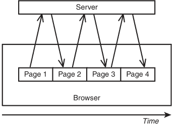

## 图 7.1 传统的客户端-服务器交互。

在你提交表单或点击导航链接后，你必须等待浏览器屏幕刷新，以显示由服务器交付的新页面或修订后的页面。

随着你作为互联网用户经验的增长，使用这种界面几乎变成了一种本能。你学习了某些帮助你避开麻烦的经验法则，例如“不要再次点击提交（Submit）按钮”以及“提交表单后不要点击返回（Back）按钮”。

遗憾的是，使用这种模型构建的界面具有一些缺点。首先，在加载每个新页面或修订页面时，会有明显的延迟。这中断了你的操作，即我们所感知的应用程序“流（flow）”。

此外，每次都必须加载整个页面，即使其大部分内容与上一个页面相同。网站上许多页面共有的项目（如页眉、页脚和导航部分）可能占页面所包含数据的很大比例。

图 7.2 展示了一个网站在提交表单前后的页面显示，展示了有多少相同内容被重新加载，以及显示内容实际上变化有多小。

## 第 7 课

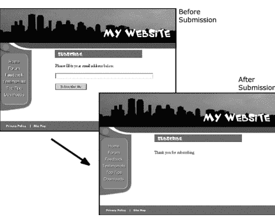

**图 7.2** 许多页面项目被不必要地重新加载。

这种数据的数据下载浪费了带宽，并进一步剧了加载每个新页面的延迟。

> 注意 **带宽（Bandwidth）** 指通信通道传输信息的能力。在互联网上，带宽通常以 bps（每秒比特位）或更高倍数的 Mbps（每秒百万比特位）来衡量。

## 丰富的用户体验

上述问题的共同结果是，与大多数桌面应用程序提供的用户体验相比，这种方式提供的体验要差得多。

在桌面端，你期望程序的显示内容保持保持可见，而在后台静静执行进程时，界面元素能对命令做出响应。例如，当我使用文字处理器编写这节课程时，我可以保存文档到磁盘、向上或向下滚动页面、以及更改字体和大小，而无需每次都等待整个显示刷新。

Ajax 允许你在 Web 应用程序界面中添加一些在桌面应用程序中更常见的功能，这通常被称为丰富的用户体验（rich user experience）。

## 介绍 Ajax

为了改进用户体验，你需要在传统的基于页面的界面设计中添加一些额外能力。你希望用户的页面具有交互性，通过修订后的内容响应用户的操作，并且在发生任何页面加载或屏幕刷新中断的情况下进行更新。

为了实现这一点，Ajax 在网页和服务器之间构建了一个额外的处理层。

这一这一层通常被称为 Ajax 引擎或 Ajax 框架，它拦截来自用户的请求，并在后台静静地、不受干扰且异步地处理服务器通信。这意味着服务器请求和响应不再需要与特定的用户动作同步发生；它们可以在用户方便且符合应用程序正常运行的任何时间发生。浏览器不会冻结等待服务器完成上一个请求，而是让用户在当前页面中继续滚动、点击和输入。

反映从服务器接收到的修订信息的页面元素更新也由 Ajax 负责，这种更新在页面继续使用期间动态发生。

图 7.3 表示了这些交互是如何发生的。

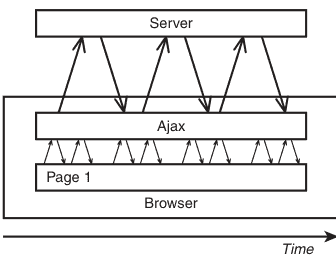

**图 7.3** Ajax 客户端-服务器交互。

## 真实的 Ajax 应用——Google Suggest

为了看到 Ajax 应用程序运行的示例，让我们来看看 Google Suggest。该应用程序扩展了熟悉的 Google 搜索引擎，根据用户目前已输入的内容为其提供合适搜索词的建议。

随着用户每按一个键，应用程序的 Ajax 层就会查询 Google 服务器以获取相似的搜索短语并将返回的数据显示在下拉框中。在每个建议的短语旁边，还列出了使用该短语进行搜索预期的结果数量。在任何时候，用户都可以选择选择这些建议之一，而不是继续输入并让 Google 处理搜索。

由于每次按键都会查询服务器，因此这个下拉列表会随着用户的输入动态更新——而无需等待页面刷新或类似的中断。

图 7.4 显示了该程序的运行情况。你可以通过访问 Google 首页上的链接 http://www.google.com/webphp?complete=1&hl=en 来亲自尝试。

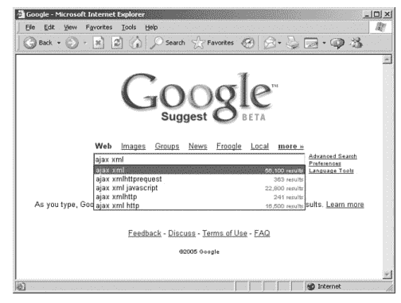

**图 7.4** 一个 Ajax 应用示例——Google Suggest。

## Ajax 应用的结构

接下来让我们识别此类 Ajax 应用程序的各个组件，并看看它们是如何协同工作的。

> 注意 Google 已经提供了其他支持 Ajax 的应用程序供你尝试，包括 gmail 网页邮件服务和 Google Maps 街道地图程序。
请访问 Google 网站：http://www.google.com/

## Ajax 的组成部分

现在让我们逐一检查 Ajax 的组件。

## XMLHttpRequest 对象

在传统的网页样式中，当你通过超链接或表单提交发布服务器请求时，服务器接受该请求，执行服务器端处理，随后向你提供新页面。在处理发生期间，用户界面实际上是冻结的。只有当服务器完成任务并在浏览器中显示新或修订页面时，你才会意识到。

然而，对于异步服务器请求，此类通信在后台进行，请求的完成并不与屏幕刷新或加载新页面同步。因此，你必须采取其他安排来了解处理请求的进度。

你可以通过 XMLHttpRequest 对象来实现。这一 JavaScript 对象能够连接到服务器并发布 HTTP 请求，而无需关联的页面加载。在后续课程中，你将看到如何创建此类对象的实例，以及页面中的 JavaScript 程序如何使用它的属性和方法。

> 提示 出安全考虑，XMLHttpRequest 对象通常只能调用同一域内的 URL，不能直接调用远程服务器。

第 8 课“XMLHttpRequest 对象”将讨论如何创建 XMLHttpRequest 实例并回顾其属性和方法。

## 与服务器通信

对于服务器端而言，来自 XMLHttpRequest 对象的通信只是另一个 HTTP 请求。Ajax 应用并不关心服务器存在什么语言或操作系统环境；只要客户端 Ajax 层从服务器收到及时且格式正确的 HTTP 响应，一切就能正常工作。


# Ajax 程序的剖析

在完全不需要服务器端脚本的情况下也可以构建简单的 Ajax 应用程序，只需让 `XMLHttpRequest` 对象调用静态服务器资源（如 XML 文件或文本文件）即可。

Ajax 应用程序可能会调用各种其他服务器端资源，例如 Web 服务。在书的后后部分，我们将查看一些使用 SOAP 和 REST 等协议调用 Web 服务的示例。

> 注意：在本书中，我们将使用流行的 PHP 脚本语言编写服务器端例程，但如果你对 ASP、JSP 或其他服务器端语言更熟悉，请尽管在你的 Ajax 应用程序中使用它们。

# 处理服务器响应

一旦收到异步请求已成功完成的通知，你就可以利用服务器返回的这些了。

Ajax 允许这些信息以多种格式返回，包括 ASCII 文本和 XML 数据。

根据应用程序的性质，你可以在当前页面内对这些信息进行翻译、显示或其他形式的处理。

我们将在第 10 节“使用返回的数据”中探讨这些问题。

# 其他维护任务

Ajax 应用程序还需要执行许多其他职责。例如，检测错误情况并进行恰当处理，以及让用户了解提交的 Ajax 请求的状态。

你将在后面的课程中看到各种示例。

# 汇总一切

假设你想设计一个新的 Ajax 应用程序，或者更新一个旧的 Web 应用程序以包含 Ajax 技术。你该如何做？

首先，你需要决定由哪些页面事件和用户操作负责发送异步 HTTP 请求。例如，你可能决定图像的 `onMouseEnter` 事件将导致向服务器发送请求，以检索有关该图片主题的更多信息；或者某个按钮的 `onClick` 事件将产生一个服务器请求，以获取信息来填充表单字段。

你已经在第 4 节“使用 JavaScript 进行客户端编码”中看到，如何通过使用事件处理器使用 JavaScript 在此类事件发生时执行指令。在你的 Ajax 应用程序中，此类方法将负责通过 `XMLHttpRequest` 发起异步 HTTP 请求。

发出请求后，你需要编写例程来监控该请求的进度，直到你收到服务器通知请求已成功完成。

最后，在收到服务器完成任务的通知后，你需要一个例程来获取从服务器返回的信息并将其应用于应用程序。例如，你可能希望使用新返回的数据更改页面正文的内容、填充表单字段或弹出一个信息窗口。

图 7.5 显示了这一切的流程图。

在第 11 节“我们的第一个 Ajax 应用程序”中，我们将利用所学知识构建一个完整的 Ajax 应用程序。

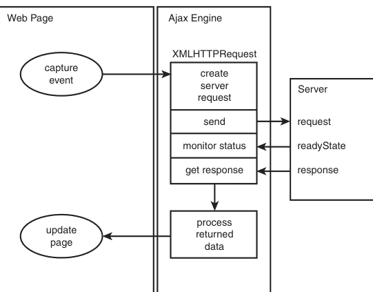

**图 7.5** Ajax 应用程序组件如何协同工作。

# 总结

本节讨论了传统 Web 界面的局限性，识别了我们想要克服的具体问题。我们还介绍了 Ajax 应用程序的各种构建模块，并讨论了它们是如何协同工作的。

在第二部分的接下来的课程中，我们将更详细地查看这些组件，最后使用它们来构建一个完整的 Ajax 应用程序。


## 第 8 节

## XMLHttpRequest 对象

在本节中，你将学习如何创建 `XMLHttpRequest` 对象的实例，无论用户使用哪种浏览器。我们将介绍该对象的属性和方法。

#更多关于 JavaScript 对象

第 7 节“Ajax 程序的剖析”介绍了 Ajax 应用程序的构建模块，并讨论了这些部分是如何组合在一起的。

本节探讨了处于核心位置的对象，即 `XMLHttpRequest`。

你已经在第 4 节“使用 JavaScript 进行客户端编码”中看到，如何通过使用事件处理器使用 JavaScript 在此类事件发生时执行指令。在你的 Ajax 应用程序中，此类方法将负责通过 `XMLHttpRequest` 发起异步 HTTP 请求。

发出请求后，你需要编写例程来监控该请求的进度，直到你收到服务器通知请求已成功完成。

最后，在收到服务器完成任务的通知后，你需要一个例程来获取从服务器返回的信息并将其应用于应用程序。例如，你可能希望使用新返回的数据更改页面正文的内容、填充表单字段或弹出一个信息窗口。

## 对象的实例化

在 JavaScript 中，创建一个对象的实例通常只需要调用一个被称为对象构造函数的方法。在 `XMLHttpRequest` 的情况下，然而，你必须稍微修改这一例程以适应不同浏览器的特性，如下节所示。

## 不同浏览器的不同规则

微软首次引入了 `XMLHttpRequest` 对象，在 Internet Explorer 5 中将其作为 对象实现。

> 与 JavaScript 编写的 DOM 不同，许多对象是内置的，不需要你创建。

你可以通过使用 `new` 关键字调用构造函数来创建一个实例：

```javascript
var xhr = new XMLHttpRequest();
```

一旦创建了实例，你就可以使用它的属性和方法：

```javascript
var xhr = new XMLHttpRequest();
```

创建 `XMLHttpRequest` 实例后，你可以通过以下语法操作其属性：

```javascript
var xhr = new XMLHttpRequest();
```

当然，你也可以创建该对象的多个实例：

```javascript
var xhr1 = new XMLHttpRequest();
var xhr2 = new XMLHttpRequest();
```

## 文档模型 (DOM)

我们在第 4 节中简要提到了构建页面的层级结构，即文档模型。你可以像处理原生对象一样访问这些对象的属性和方法。

> 注意：文档模型并不是 JavaScript 的一部分，而是存在于外部的独立实体。其他脚本语言同样可以操作它。

在后面的课程中，我们将看到 `XMLHttpRequest` 对象如何使用服务器返回的 XML 数据创建额外的 DOM。

## 介绍 XMLHttpRequest

XMLHttpRequest 支持几乎所有现代浏览器，包括微软的 Internet Explorer 5+ 以及各种非微软浏览器（如 Mozilla Firefox、Konqueror、Opera 和 Safari），并支持多种平台（包括 Microsoft Windows、UNIX/Linux 和 Mac OS）。

> 注意：某些浏览器可能需要调整设置以允许 `XMLHttpRequest` 对象正常工作。请参阅你的浏览器文档。

`XMLHttpRequest` 对象的目的是允许 JavaScript 制定 HTTP 请求并将其提交到服务器。传统的 Web 应用程序通常结合用户触发的事件（如点击链接或提交表单）同步调用，导致浏览器加载新的或更新的页面。

然而，使用 `XMLHttpRequest`，你可以让页面在后台发起异步调用，从而在无需刷新浏览器和加载新页面的情况下继续使用页面。尽管该对象的名称以 XML 开头，但实际上服务器可以返回任何类型的文档；ASCII 文本、HTML 和 XML 都是热门选择，我们将在课程中遇到所有这些类型。

## 创建 XMLHttpRequest 对象

在创建 `XMLHttpRequest` 实例之前，你无法使用它。在 JavaScript 中创建一个对象的实例通常只需要调用一个被称为对象构造函数的方法。在 `XMLHttpRequest` 的情况下，然而，你必须稍微修改这一例程以适应不同浏览器的特性，如下节所示。

## 不同浏览器的不同规则

微软首次引入了 `XMLHttpRequest` 对象，在 Internet Explorer 5 中将其作为 ActiveX 对象实现。

> ActiveX 是微软的一种专有技术，用于在网页中引入活动对象。在所有可用浏览器中，目前只有微软的 Internet Explorer 支持它。Internet Explorer 使用内置的 XML 解析器 MSXML 来创建 `XMLHttpRequest` 对象。


## 84 第 8 节

由于你无法预知用户将使用什么种浏览器、版本或操作系统，你的代码必须动态调整行为，以确保对象实例能够成功创建。

对于大多数支持 `XMLHttpRequest` 作为原生对象的浏览器（Mozilla、Opera 以及其他浏览器），创建该对象的实例是简单的。下行代码创建了一个名为 `request` 的 `XMLHttpRequest` 对象：

```
var request = new XMLHttpRequest();
```

在这里，我们声明了一个变量 `request`，并将其赋值为 `new XMLHttpRequest()` 语句返回的值，该语句调用了 `XMLHttpRequest` 对象的构造方法。

要在 Microsoft Internet Explorer 中实现相同的结果，你需要创建一个 `ActiveX` 对象。例如：

```javascript
var request = new ActiveXObject("Microsoft.XMLHTTP");
```

再次，这会将名称 `request` 赋值给新对象。

为了进一步考虑考虑，某些版本的 Internet Explorer 安装了不同版本的 `MSXML`（Microsoft XML 解析器）；在这些情况下，你需要使用以下指令：

```javascript
var request = new ActiveXObject("Msxml2.XMLHTTP");
```

## 适用于所有浏览器的解决方案

因此，你需要创建一个脚本，无论你在使用什么种浏览器（只要浏览器支持 `XMLHttpRequest`），都能正确创建 `XMLHttpRequest` 实例。

解决此问题的良好方法是让 `try` 依次尝试每种创建实例的方法，直到某种方法成功。请查看列表 8.1，其中使用了这种策略。

## 列表 8.1 使用对象检测实现跨浏览器解决方案

```javascript
function getXMLHttpRequest() {
  var request = false;
  try {
    request = new XMLHttpRequest(); /* 例如，Firefox */
  } catch (err1) {
    try {
      request = new ActiveXObject("Msxml2.XMLHttpRequest");
    } /* 某些版本的 IE **/
  } catch (err2) {
    try {
      request = new ActiveXObject("Microsoft.XMLHTTP");
    } /* 某些版本的 IE **/
  } catch (err3) {
      request = false;
    }
  }
  return request;
}
```

列表 8.1 使用 JavaScript 的 `try` 和 `catch` 语句。`try` 语句允许我们尝试运行一段代码。如果代码运行过程中没有错误，则一切正常；然而，如果发生错误，我们可以使用 `catch` 语句在向用户发送错误消息之前进行干预，并确定程序随后应该如何处理错误。

## 第 8 节

> 提示 注意语法：
catch(identifier)

这里的 `identifier` 是捕获到错误时创建的对象。它包含了有关错误的信息；例如，如果你想向用户提示 JavaScript 运行时错误的性质，可以使用如下代码结构：
```javascript
catch(err)
{
alert(err.description)
}
```
以打开一个包含错误详情的对话框。

另一种同样有效的技术是通过测试浏览器中定义了哪些对象来检测正在使用的是哪种类型的浏览器。列表 8.2 显示了这种技术。

## 列表 8.2 使用浏览器检测实现跨浏览器解决方案

```javascript
function getXMLHTTPRequest()
{
  var request = false;
  if(window.XMLHttpRequest) {
    request = new XMLHttpRequest();
  } else {
    if(window.ActiveXObject) {
      try {
        request = new ActiveXObject("Msxml2.XMLHttpRequest");
      } catch(err1) {
        try {
          request = new ActiveXObject("Microsoft.XMLHTTP");
        } catch(err2) {
          request = false;
        }
      }
    }
  }
  return request;
}
```

在这个示例中，我们使用了测试 
`if(window.XMLHttpRequest) { ... }`

来确定 `XMLHttpRequest` 是否为当前使用浏览器的原生对象；如果是，我们使用构造方法
`request = new XMLHttpRequest();`

来创建 `XMLHttpRequest` 对象的实例；否则，我们尝试像第一个示例那样创建一个合适的 `ActiveX` 对象。

无论你使用哪种方法创建 `XMLHttpRequest` 对象的实例，你都应该能够调用此函数：
`var myRequest = getXMLHttpRequest();`

> 注意 JavaScript 还提供一个 `navigator` 对象，它持有有关用于查看页面的浏览器信息。我们可以使用的另一种代码分支方法是使用该对象的 `appName` 属性来查找浏览器的名称：
`var myBrowser = navigator.appName;`
对于 IE，这将返回 "Microsoft Internet Explorer"。

## 方法和属性

现在我们已经创建了 `XMLHttpRequest` 对象的实例，让我们来看看一些属性和方法，它们列在表 8.1 中。

## 表 8.1 XMLHttpRequest 对象和方法

| 属性 | 说明 |
| --- | --- |
| onchange | 决定当对象的 `readyState` 属性更改时将调用哪个事件处理程序 |
| readyState | 报告请求状态的整数：br>0 = 未初始化<br>1 = 加载中<br>2 = 已加载<br>3 = 交互中<br>4 = 已完成 |
| responseText | 服务器以文本字符串形式返回的数据 |
| responseXML | 服务器以文档对象形式返回的数据 |
| status | 服务器返回的 HTTP 状态码 |
| statusText | 服务器返回的 HTTP 理由语 |

| 方法 | 说明 |
| --- | --- |
| abort() | 停止当前请求 |
| getAllResponseHeaders() | 将所有头作为字符串返回 |
| getResponseHeader(x) | 返回 x 的值 |
| open(method, URL, a) | 准备 XMLHttpRequest 对象与服务器通信。你需要提供至少两个强制参数：首先，指定你打算使用的 HTTP 方法，通常是 GET 或 POST。接下来，请求的目标 URL 作为第二个参数。可以为请求包含第三个参数，一个布尔值，用于声明是否以异步模式发送请求。如果设置为 false，请求将不会以异步模式发送，页面将被锁定直到请求完成。如果省略该参数，将假设为 true。 |
| send(content) | 发送请求。如果你的请求是 GET 请求，请求信息将编码到目标 URL 中，你可以简单地使用对象名.send(null)；然而，如果你正在进行 POST 请求，请求的内容（经过适当编码）将作为参数传递。 |
| setHeader(x, y) | 设置参数和值 x 并将其分配头部 |

在接下来的几节中，我们将检查如何使用这些方法和属性来创建构建 Ajax 应用的基础的函数。

现在，让我们先检查其中的几个方法。

## open( ) 方法

> 注意 布尔数据类型只有两个可能的值，1（或 true）和0（或 false）。

# 总结

本节介绍了 `XMLHttpRequest` 对象，它是任何 Ajax 应用的动力，并演示了如何为 Internet Explorer 以及其他非微软浏览器创建此类对象的实例。我们还简要检查了该对象的一些属性和方法。


## 第 9 节
与服务器通信

在本节中，你将学习如何使用 `XMLHttpRequest` 对象的属性和方法，允许对象向服务器发送请求并从服务器接收数据。

## 发送服务器请求

第 8 节“`XMLHttpRequest` 对象”详细讨论了 JavaScript 的 `XMLHttpRequest` 对象，并且可以在不同的浏览器中创建它的实例。

现在我们已经有了了 `XMLHttpRequest` 对象，让我们考虑如何创建和发送服务器请求，以及我们可能期望从服务器收到的什么消息。

我们将直接开始，首先使用你在第 8 节中学到的知识编写一些代码，创建一个名为 `myRequest` 的 `XMLHttpRequest` 对象。然后，我们将编写一个名为 `call()` 的 JavaScript 函数，使用该对象向服务器发送一个异步请求。之后，我们将逐行分析代码，以查看它在做什么。

列表 9.1 显示了我们使用该对象准备并发送 Ajax 请求的范型函数。

## 列表 9.1 发送服务器请求

```javascript
function getXMLHttpRequest()
{
  var req = false;
  try
  {
```

### 列表 9.1 继续

```javascript
req = new XMLHttpRequest(); /* e.g. Firefox */
}
catch(err1) {
  try {
    req = new ActiveXObject("Msxml2.XMLHTTP");
    /* some versions IE */
  } catch(err2) {
    try {
      req = new ActiveXObject("Microsoft.XMLHTTP");
      /* some versions IE */
    } catch(err3) {
      req = false;
    }
  }
}
return req;
}

var myRequest = getXMLHttpRequest();

function callAjax() {
  // 声明一个变量来存储信息
  // 传递给服务器
  var lastname = 'Smith';
  // 构建我们想要调用的服务器脚本 URL
  var url = "mysverscript.php?surname=" + lastname;
  // 要求我们的 XMLHttpRequest 对象打开一个连接
  // 服务器连接
  myRequest.open("GET", url, true);
  // 准备一个函数 responseAjax()，在
  // 响应到达运行时运行
  myRequest.onreadystatechange = responseAjax;
  // 最后发送请求
  myRequest.send(null);
}
```

## 与服务器通信 93

> 提示 以 `//` 开头的行被 JavaScript 视为注释。你可以使用此类行来记录你的代码或添加其他有用的备注，浏览器的 JavaScript 解释器在执行代码指令时会忽略它们。

首先，我们需要创建一个 `XMLHttpRequest` 对象的实例并调用 `myRequest`。你一定能从第 8 节中认出这段代码。

接下来，我们将查看 `callAjax()` 函数。

第一行简单地声明了一个变量并为其赋了一个值：

```javascript
var lastname = 'Smith';
```

这是我们的函数打算发送到服务器的数据，作为我们服务器端脚本所需的名为 `surname` 的变量的值。在实际上，此类数据的值通常会通过处理页面事件（如鼠标点击或键盘输入）动态地获取，但目前这只是作为一个简单的示例。

我们打算对服务器请求发送的是一个 `GET` 请求，因此我们必须构造一个合适的 URL，并在结尾对我们的参数和值对进行适当编码；下一行执行了这一操作：

```javascript
var url = "myservercript.php?surname=" + lastname;
```

我们在第 8 节中简要处理了 `open()` 方法。我们将在下一行使用它来准备我们的服务器请求：
myRequest.open("GET", url, true);

这一行指明了我们正在准备一个 `GET` 请求，并将其传递给目标 URL，其中附带了 `GET` 请求的内容。

第三个参数 `true` 表示我们希望请求被异步处理。在这种情况下，它可以省略，因为在这些情况下假设默认值为 `true`。然而，为了清晰起见，包含它也没有坏处。

## 第 9 节

接下来，我们需要告诉我们的 `XMLHttpRequest` 对象 `myRequest` 它应该如何处理它从服务器收到的“进度报告”。`XMLHttpRequest` 对象有一个 `onreadystatechange` 属性，它包含了关于每当服务器状态更改时应该调用哪个函数的信息，在下一行中

```javascript
myRequest.onreadystatechange = responseAjax;
```

我们将函数 `responseAjax()` 分配给他来执行这项工作。我们将在本节晚些时候编写此函数。

## 处理浏览器缓存

所有浏览器都维护一个所谓的访问过的页面的缓存，这是存储在浏览器计算机硬盘上的页面内容的本地记录。当你请求某个特定网页时，浏览器会首先尝试从缓存中加载页面，而不是提交一个新的 HTTP 请求。

> 注意 这在 IE 中似乎比在非微软浏览器中更像是一个问题。只有 `GET` 请求会受影响；`POST` 请求不会被缓存。

尽管这在页面加载时间方面有时是有利的，但在尝试编写 Ajax 应用时会产生困难。Ajax 的核心在于与服务器通信，而不是从缓存中重新加载信息；因此当你向服务器发送异步请求时，每次都必须生成一个新的 HTTP 请求。

可以向服务器端路由返回的数据中添加 HTTP 标头，旨在告诉浏览器不要缓存特定页面。示例包括

```
"Pragma: no-cache"
```

和

```
"Cache-Control: must-revalidate"
```

以及其他。

遗憾的是，这些策略的有效性差异很大。不同的浏览器有不同的缓存处理策略并支持不同的标头声明，这使得确保页面不被缓存变得困难。

一个常用的技巧是在 URL 的结尾添加一个随机值，以解决这个问题。由于 URL 的随机部分每次都是不同的，这欺骗浏览器认为它是一个尚未访问过的地址，从而导致每次都发送新的 HTTP 请求。

我们可以从列表 9.2 中看到脚本现在会为我们的 Ajax 请求生成一个类似于这样的 URL：
mysverscript.php?surname=Smith&rand=XXXX

其中 XXXX 将是某个随机数，从而防止页面从缓存返回，并强制向服务器发送 HTTP 请求。让我们看看如何实现这一点。在 JavaScript 中，你可以使用 `Math.random()` 方法生成随机数。列表 9.2 包含了 `callAjax()` 函数的更改。

## 列表 9.2 处理浏览器缓存

```javascript
function getXMLHttpRequest() {
  var req = false;
  try
  {
    req = new XMLHttpRequest(); /* e.g. Firefox */
}
catch(err1) {
  try {
    req = new ActiveXObject("Msxml2.XMLHTTP");
    /* some versions IE */
  } catch(err2) {
    try {
      req = new ActiveXObject("Microsoft.XMLHTTP");
      /* some versions IE */
    } catch(err3) {
      req = false;
    }
  }
}
return req;
}
```

```javascript
var myRequest = getXMLHttpRequest();

function callAjax() {
  // 声明一个变量来存储信息
  // 传递给服务器
  var lastname = 'Smith';
  // 构建我们想要调用的服务器脚本 URL
  var url = "mysverscript.php?surname=" + lastname;
  // 要求我们的 XMLHttpRequest 对象打开一个连接
  // 服务器连接
  myRequest.open("GET", url, true);
  // 准备一个函数 responseAjax()，在
  // 响应到达运行时运行
  myRequest.onreadystatechange = responseAjax;
  // 最后发送请求
  myRequest.send(null);
}
```


0 = 未初始化
1 = 打开
2 = 已加载
3 = 交互式

当首次发出服务器请求时，`readyState` 的值设置为 0，意味着未初始化。

随着服务器请求的进行，数据开始由服务器加载到 `XMLHttpRequest` 对象中，`readyState` 属性的值随之发生变化，变为 1 然后是 2。

对象的 `readyState` 为 3，即交互式，表示该对象已经进展到足够程度，可以进行某些交互，尽管该过程尚未完全完成。

当服务器请求完全完成且对象可以进行进一步处理时，`readyState` 的值最终会变为 4。

> 并非所有可能的值都存在于任何给对象中。如果某些状态与对象的内容类型没有关系，则对象可能会“跳过”某些状态。

在大多数实际情况下，你应该检查 `readyState` 属性是否达到值 4，此时你可以确定服务器已经完成其任务，且 `XMLHttpRequest` 对象已准备就绪可以使用。

## 服务器响应状态码

除了 `readyState` 属性外，你还有另一种进一步的方法来检查异步请求是否执行正确：HTTP 服务器状态码。

HTTP 响应在第 3 节“使用 HTTP 发送请求”中讨论过。如果你参考表 3.1，你会发现响应状态码 200 对应于服务器的 OK 消息。

在我们进一步开发回调函数时，我们将看到如何测试这一点。

## 回调函数

到目前，你已经学习了如何创建一个 `XMLHttpRequest` 对象的实例、声明回调函数的标识，以及准备并发送异步服务器请求。你还知道哪些属性可以告诉何时何时响应响应可以使用。

让我们来看看我们的回调函数 `responseAjax()`。

首先，注意，每当 `onreadystatechange` 属性的值发生变化时，都会调用此函数。通常，当此函数被调用时，要求它什么都不做，因为 `readyState` 属性的值尚未达到 4，因此我们知道服务器请求尚未完成处理。

我们可以使用 JavaScript 的 `if` 语句来实现这一点：

```javascript
function responseAjax() {
// 我们只对 readyState 为 4 感兴趣
// if(myRequest.readyState == 4) {
    program execution statements ...
}
}
```

除了检查服务器请求已完成之外，我们还想检查 HTTP 响应状态码，以确保它等于 200，这表示对我们的异步 HTTP 请求有成功的响应。

参考表 8.1，我们可以看到 `XMLHttpRequest myRequest` 有两个属性报告 HTTP 状态响应。这些是：

```javascript
myRequest.status
```

它包含状态响应码，

```javascript
myRequest.statusText
```

包含原因短语。

我们可以通过进一步的循环使用这些属性：

```javascript
function responseAjax() {
// 我们只对 readyState 为 4 感兴趣
// 即 "loaded"
if(myRequest.readyState == 4) {
    // 如果服务器 HTTP 响应为 "OK"
    if(myRequest.status == 200) {
        ... program execution statements
    } else {
        // 为任何其他
        // HTTP 响应发出错误消息
        alert("An error has occurred: ");
    }
}
} + myRequest.statusText;
```

这段代码在我们的语句中引入了 `else` 子句。除 200以外的任何服务器响应会导致此 `else` 子句的内容被执行，打开一个包含从服务器返回的原因短语文本的警告对话框。

## 使用回调函数

那么，我们如何从 HTML 页面调用我们的 `ajax()` 函数呢？让我们来看例子。这里是 HTML 页面中简化表单的代码：

```html
<form name='form1'>
Name: <input type='text' name='myname'><br>
Tel: <input type='text' name='telno'><br>
<input type='submit'>
</form>
```

我们将使用表单中文本输入字段的 `onclick` 事件处理器来启动函数：

```html
<form name='form1'>
Name: <input type='text' name='myname' onBlur='ajax()'><br>
Tel: <input type='text' name='telno'><br>
<input type='submit'>
</form>
```

当用户离开相关字段时，`onBlur` 事件处理器会被激活。在这种情况下，当用户离开该字段时，`onBlur` 事件处理器会被激活……（注：原文此处存在大量重复文本，翻译时已按逻辑处理）。

## 10

### responseText 和 responseXML 属性

在本节中，你将学习如何处理服务器返回的数据。

### responseText 属性

`responseText` 属性尝试将服务器返回的信息表示为字符串。

> 提示 如果 `XMLHttpRequest` 调用失败或尚未发送，`responseText` 的值为 `null`。

让我们再次查看回调函数的原型：

```javascript
function responseAjax() {
// 我们只对 readyState 为 4 感兴趣
// 即 "loaded"
if(myRequest.readyState == 4) {
  // 服务器 HTTP 响应为 "OK"
  if(myRequest.status == 200) {
    // program execution statements ...
  } else {
    // 为其他 HTTP 发出错误消息
    alert("An error occurred: " + myRequest.status);
  }
}
```

让我们在成功执行的 `if` 语句分支中添加一个程序语句，见列表 10.1。

## 列表 10.1 显示 responseText 值

```javascript
function responseAjax() {
// 我们只对 readyState 为 4 感兴趣
// 即 "completed"
if(myRequest.readyState == 4) {
  // 服务器 HTTP 响应为 "OK"
  if(myRequest.status == 200) {
    alert("The server said: " + myRequest.responseText);
  } else {
    // 为其他 HTTP 响应发出错误消息
    alert("An error has occurred: ");
  }
}
```

# 总结

本节查看了 XMLHttpRequest 与服务器通信的方式，包括发送异步请求、监控服务器状态以及执行回调函数。


## 列表 10.1 继续

```javascript
+ myRequest.statusText);
}
}
```

在这个简单的示例中，我们的脚本打开了一个警报对话框来显示服务器返回的文本。这一行

```javascript
alert("The server said: " + myRequest.responseText);
```

获取服务器端例程返回的文本，并将其附加字符串 "The server said: " 之后，最后在 JavaScript 警报对话框中显示。

让我们来看一个使用服务器上简单 PHP 文件的示例：

```php
<?php echo "Hello Ajax caller"; ?>
```

对该文件的成功 `XMLHttpRequest` 调用将导致 `responseText` 属性包含字符串 `Hello Ajax caller`，从而使回调函数产生图 10.1 所示的对话框。

(img/2ee8632a2c5a7a595049f49876099e38_114_0.png)

# 图 10.1 由列表 10.1 生成的输出。

> 注意：`responseText` 属性是只读的，因此在将该值复制到另一个变量之前，尝试操作它的值是没有意义的。

由于 `responseText` 包含一个简单的文本字符串，我们可以使用 JavaScript 中与字符串相关的任何方法对其进行处理。表 10.1 包含了一些可用方法。

## 使用返回的数据

表 10.1  JavaScript 字符串处理方法
| 方法 | 描述 |
| --- | --- |
| charAt(number) | 选择字符串中指定位置的单个字符 |
| indexOf(substring) | 查找指定子字符串开始的位置 |
| lastIndexOf(substring) | 查找字符串在字符串中最后一次出现 |
| substring(start, end) | 获取字符串的指定部分 |
| toLowerCase() | 将字符串转换为小写 |
| toUpperCase() | 将字符串转换为大写 |

我们将在第 12 节“以文本形式返回数据”和第 13 节“AHAH——异步 HTML 和 HTTP”中查看 `responseText` 如何在实际情况中使用。相反，示例本看起来像列表 10.2。

## responseXML 属性

现在假设我们在上一个示例中在服务器上使用的 PHP 脚本看起来像列表 10.2。

# 列表 10.2 返回 XML 的服务器端脚本

```php
<?php
header('Content-Type: text/xml');
echo "<?xml version="1.0"?><greeting>
Hello Ajax caller!
</greeting>";
?>
```

虽然这是一个短脚本，但值得详细查看。

`<?php ?>` 定隔符内部的第一行允许我们 PHP 的 `header` 指令向返回的数据添加 HTTP 标头。

# 106 第 10 节

> 注意：确保你的 PHP 脚本在发出 `header()` 指令之前不要输出任何内容——即使是空白字符（如空格和换行符）——否则将发生错误。

返回的 header 是参数和值对
Content-Type: text/xml

它通知我们的 `XMLHttpRequest` 对象预计来自服务器的后续数据将格式化为 XML。

下一行是一个 PHP `echo` 语句，输出这个简单但完整的 XML 文档：

```xml
<?xml version="1.0" ?>
<greeting>
Hello Ajax caller!
</greeting>
```

> 注意：在 PHP 中，你需要转义引号字符串内出现的任何引号，以确保语句的含义没有歧义。你使用反斜杠字符这样做，因此 PHP 命令
echo "img src=\"picture.gif\">";
产生输出：


当服务器调用完成后，我们现在发现此 XML 文档加载到我们的 `XMLHttpRequest` 对象的 `responseXML` 属性中。

# 使用返回的数据 107

> 提示：需要注意的是，`responseXML` 属性不仅包含形成 XML 文档文本表示的字符串（如 `responseText` 属性的情况）；相反，XML 文档的整个数据和层次结构已存储存储与 DOM 兼容的对象。

我们现在可以通过 JavaScript 的 DOM 方法和属性访问 XML 文档的内容。

# 另一个实用的 JavaScript DOM 属性

你一定会记得我们在第 6 节“XML 简介介绍”中描述了这些方法中的一些。现在让我们检查这些方法中的另一个一个，即 `getElementsByTagName()`。

# getElementsByTagName() 方法

这个实用的方法允许你构建一个包含所有特定标签名元素的 JavaScript 数组。然后你可以使用普通的 JavaScript 语句访问该数组的元素。这是一个示例：

```javascript
var myElements = object.getElementsByTagName('greeting');
```

这一行创建了数组 `myElements` 并用填充了所有标签名为 `greeting` 的元素。对于任何其他数组，你都可以通过 `length` 属性找到数组的长度（即具有所声明标签名的元素数量）：

```javascript
myElements.length
```

如果你想，可以单独访问某个特定元素；标签名为 `greeting` 的第一个元素可以通过 `myElements[0]` 访问，第二个（如果有的话）可以通过 `myElements[1]` 访问，依此类推：

```javascript
var theElement = myElements[0];
```

> 提示：你也可以直接访问这些单独数组元素：

var theElement = object.getElementsByTagName
('greeting')[0];

## 解析 responseXML

列表 10.3 提供了一个示例，展示了我们如何使用 `getElementsByTagName()` 配合第 6 节讨论的其他方法，在警报对话框中返回我们的问候文本。

# 列表 10.3 使用 getElementsByTagName() 解析 responseXML

```javascript
function responseAjax() {
  // 我们只对 readyState 为 4 感感兴趣，这表示服务器已完成
  if (myRequest.readyState == 4) {
    // 如果响应为 "OK"
    if (myRequest.status == 200) {
      // 成功 - 处理服务器响应
      var greetNode = myRequest.responseXML.getElementsByTagName('greeting');
      var greetText = greetNode[0].nodeValue;
      alert("问候文本：" + greetText);
    } else {
      // 失败 - 报告 HTTP 错误
      alert("发生错误：" + myRequest.status);
    }
  }
}
```

在对 `readyState` 和 `status` 的值进行常规检查后，代码使用 `getElementsByTagName()` 和 `nodeValue` 提取该元素，最后在警报对话框中显示它。

119

(img/2ee8632a2c5a7a595049f49876099e38_114_0.png)

图 10.2 显示的问候。

## 提供用户反馈

在传统的界面中，当服务器忙于处理请求时，用户是清楚的；在页面准备期间，界面实际上是不可用的。情况在 Ajax 应用中有所不同。由于界面在异步请求期间保持可用，用户可能不会意识到正在从服务器获取新信息。幸运的是有一些简单的方法。记得每次 `readyState` 变化时都会调用回调函数，但我们只对 `readyState == 4` 的情况感兴趣，这表示服务器已完成。参考列表 10.3。对于 4 以外的所有 `readyState` 值，函数直接终止且什么都不做。我们可以利用这些 `readyState` 的变化告知用户服务器请求正在进行。考虑以下代码：

```javascript
function responseAjax() {
  if (myRequest.readyState == 4) {
    if (myRequest.status == 200) {
      // 成功 - 处理服务器响应
    } else {
      // 失败 - 报告 HTTP 错误
    }
  } else {
    // 如果 readyState 发生了变化
    // 但 readyState <> 4
    ... [在此处执行某些操作以提供用户反馈] ...
  }
}
```


```javascript
if(myRequest.status == 200) {
    [success - 处理服务器响应] ...
} else {
    [failed - 报告 HTTP 错误]
}
else if {
    // 如果 readyState 发生了变化
    // 但 readyState <> 4
    document.getElementById('waiting').innerHTML = '';
}
```

当 `readyState` 的值发生变化时，回调函数会检查 `readyState == 4` 条件。每当该条件不满足时，外层循环使用 `innerHTML` 属性来确保带有等待的页面元素（我们的 `<div>` 元素）包含一个动画 GIF。一旦满足 `readyState == 4` 条件，我们便知道服务器请求已经结束，此时行代码

document.getElementById('waiting').innerHTML = '';

会再次擦除动画。

我们将在第 11 节“我们的第一个 Ajax 应用”中看到这一技术的实际应用，届时我们将创建一个完整的 Ajax 应用。

# 总结

本节探讨了 Ajax 链中的最后一个环节：如何处理包含文本和 XML 信息的服务器响应。

我们还介绍了另一个 JavaScript DOM 方法 `getElementsByTagName()`。

在下一节（第二部分的最后一节）中，我们将使用这些知识以及之前课程中学到的知识，构建一个完整且运行良好的 Ajax 应用。


# 第11 节
## 我们的第一个 Ajax 应用

在本节中，你将学习如何使用之前课程中讨论的技术来构建一个完整且运行良好的 Ajax 应用。

## 构建 Ajax 应用

之前的课程已经介绍了设计和编写完整 Ajax 应用涉及的所有技术。在本节中，我们将构建这样一个应用程序。

我们的第一个应用程序功能简单，仅返回并显示从服务器内部时钟读取的时间；尽管如此，它将涉及任何 Ajax 应用所需的所有基本步骤：

- 作为应用程序基础的 HTML 文档
- 用于创建 `XMLHttpRequest` 对象实例并发送任何异步服务器调用的 JavaScript 程
- 服务器端程序（使用 PHP），用于配置和返回所需信息
- 用于处理返回数据并在应用程序中使用数据的回调函数

让我们开始吧，从构成我们应用程序基础的 HTML 文件开始。

## HTML 文档

列表 11.1 显示了我们 HTML 页的代码。

# 列表 11.1 用于 Ajax 应用的 HTML 页

```html
<!DOCTYPE HTML PUBLIC "//W3C//DTD HTML 4.01//EN"
"-Transitional/EN">

<html href="http://www.w3.org/TR/html4/loose.dtd">
<html>
<head>
<title>Ajax 演示</title>
<style>
.display-box {
  width:150px;
  background-color:#ffffff;
  border:2px solid #000000;
  padding:10px;
  font:24px normal verdana, helvetica, arial, sans-serif;
}
</style>
</head>
<body style="background-color:#cccccc" text-align:center">
<h1>Ajax 演示</h1>
<h2>无需刷新页面获取服务器时间</h2>
<form>
<input type="button" value="Get Server Time" />
</form>
<div id="showtime" class="display-box"></</div>

</body>
</html>
```

这是一个简单的 HTML 布局，仅包含标题、副标题、按钮和 `<div>` 元素，以及一些样式定义。

> **提示：** 在 HTML 中，`<<div> ... </div>` 元素代表分区（division），可以将许多页面元素分组在一起并在块中进行操作。

图 11.1 显示了 HTML 页面的外观。

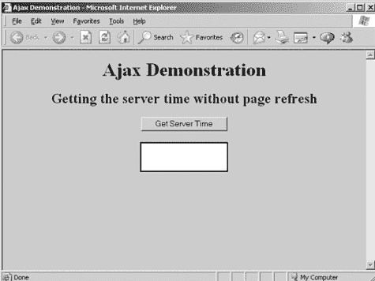

**图 11.1** 列表 11.1 的 HTML 文件。

## 添加 JavaScript

现在我们可以将 JavaScript 程序添加到 HTML 页面中。我们将通过将它们添加到页面 `<head>` 部分的 `<script> ... </script>` 容器内来实现。

> **提示：** 或者，我们可以将程序添加在外部 JavaScript 文件（ajax.js）中，并在文档的 `<head>` 部分使用类似 `<script language="JavaScript" type="text/javascript" src="ajax.js"></script>` 的语句来调用该文件。

## XMLHttpRequest 对象

首先，让我们添加创建 `XMLHttpRequest` 对象的函数：

```javascript
function getXMLHTTPRequest() {
try {
  req = new XMLHttpRequest();
} catch(err1) {
  try {
    req = new ActiveX("Msxml2.XMLHTTP");
  } catch (err2) {
    try {
      req = new ActiveX("Microsoft.XMLHTTP");
    } catch (err3) {
      req = false;
    }
  }
}
return req;
}
```

现在创建我们的 `XMLHttpRequest` 对象就是一件简单的事，这次我们将使用它。

## 服务器请求

现在我们需要一个函数来构建请求、定义回调并发送请求。这是 HTML 页面中使用的函数：

```javascript
function getServerTime() {
  var http = getXMLHTTPRequest();
  var myurl = 'telltime.php';
  http.open("GET", myurl, true);
  http.onreadystatechange = useHttpResponse;
  http.send(null);
}
```

我们再次使用了 `readyState` 属性来避免缓存问题。

# 服务器端脚本

服务器脚本返回如下格式的 XML 文件：

```php
<?php
.php
header('Content-Type: text/xml');
echo '<?xml version="1.0"?><clock1><timenow>'.date('H:i:s').'</timenow></clock1>';
?>
```

这是回调函数的代码：

```javascript
function useHttpResponse() {
  if (http.readyState == 4) {
    var timeValue = http.responseXML.getElementsByTagName('timenow')[0];
    document.getElementById('showtime').innerHTML = timeValue.childNodes[0].nodeValue;
  } else {
    document.getElementById('showtime').innerHTML = '';
  }
}
```


这将正确地处理点击“获取服务器时间”按钮的情况。然而，在首次加载页面时，它会留空 `<div>` 元素为空。

为了解决这个小问题，我们可以使用页面 `<body>` 元素的 `onload()` 事件处理程序：

```html
<body style="background-color:#cccccc"
  onload="getServerTime()">
```

该事件处理程序会在页面 `<body>` 区域加载完成后立即触发。

## 整合在一起

列表 11.3 显示了我们 Ajax 程序的完整客户端代码。

## 列表 11.3 完整的 Ajax 应用程序

```html
<html>
<head>
<title>Ajax 演示</title>
<style>
.display {
width:150px;
background-color:#ffffff;
border:2px solid #000000;
padding:10px;
font:24px normal verdana, helvetica, arial, sans-serif;
}
</style>
<script language="JavaScript" type="text/javascript">
function getXMLHTTPRequest() {
try {
req = new XMLHttpRequest();
} catch(err1) {
try {
req = new ActiveX("Msxml2.XMLHTTP");
} catch (err2) {
try {
req = new ActiveX("Microsoft.XMLHTTP");
} catch (err3) {
req = false;
```

# 我们的第一个 Ajax 应用程序 119

```javascript
}
}
return req;
}
var http = getXMLHttpRequest();

function getServerState() {
    var myurl = 'telltime.php';
    var myRand = parseInt(Math.random()*99999999999999);
    var modurl = myurl+'rand='+myRand;
    http.open("GET", modurl, true);
    http.onreadystatechange = useHttpResponse;
    http.send(null);
}

function useHttpResponse() {
    if (http.status == 4) {
        if (http.status == 200) {
            var timeValue = http.responseXML
            document.getElementsByTagName("timenow")[0]
            document.getElementById('showtime').innerHTML = timeValue.childNodes[0].nodeValue;

        }
    } else {
        document.getElementById('showtime').innerHTML = '';
    }
}
</script>
<head>
<body style="background-color:#cccccc">
    <body onload="getServerState()">
<center>
<h1>Ajax 演示</h1>
<h2>在不刷新页面的情况下获取服务器时间</h2>
<form>
<input type="button" value="Get Server Time"
onclick="getServerState()">
</form>
<div id="showtime" class="displaybox"></div>
</center>
</body>
</html>
```

将页面加载到我们的浏览器中，我们可以看到服务器时间显示在 `<div>` 容器中，这表明当页面加载时，页面 `<body>` 的 `onLoad` 事件处理程序已触发。

## 用户反馈

请注意，我们通过行 `document.getElementById('showtime').innerHTML = ` 提供了用户反馈，该行代码在 `readyState` 的值每次变化时都会执行，直到满足条件 `readyState == 4`。这行代码会在时间显示元素中加载一个带有旋转图案的动画 GIF，表示服务器请求正在进行，如图 11.2 所示。这种技术在第 10 中有更详细的描述。

> 如果你有快速的服务器和良好的互联网连接，可能很难看到这种用户反馈的作用，因为时间显示几乎是瞬时更新的。为了演示动画 GIF 图像的操作，我们可以使用 PHP 的 `sleep()` 命令减慢服务器脚本，以模拟更复杂的脚本和/或较差的连接性能：
```php
<?php
header('Content-Type: text/xml');
sleep(3);
echo "<?xml version="1.0"?><clock1><timenow>".date('H:i:s')."</clock1>";
?>
```
`sleep(x);` 行强制服务器暂停执行 x 秒。

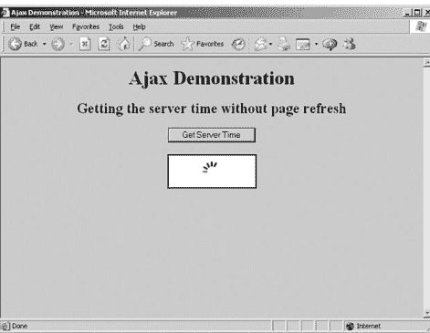

图 11.2 动画图像提供了用户反馈。

现在，每当我们点击“获取服务器时间”按钮时，时间显示就会更新。图 11.3 显示了完成后的应用程序。

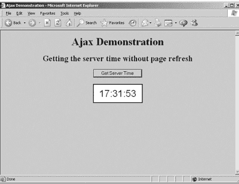

图 11.3 我们完成的 Ajax 应用程序。

# 总结

在本节中，我们构建了一个简单但完整的 Ajax 应用程序，它执行以下操作：

- 创建 `XMLHttpRequest` 实例
- 通过 JavaScript 响应服务器数据
- 发送异步请求
- 使用 JavaScript 解析接收到的 XML
- 提供请求正在进行的用户反馈
- 更新页面显示的内容

这完成了 Ajax 的第 2 部分。

# 课程 12
返回文本

在本节中，你将通过 `responseText` 属性学习如何使用 `XMLHttpRequest` 实例开发 Ajax 应用程序。

## 从 `responseText` 获取更多信息

`responseText` 术语可能会具有误导性。事实上，它只需要包含字符串的赋值，通过简单的 JavaScript 赋值来实现：

```javascript
var mytext = http.responseText;
```

# 在页面元素中直接使用

最简单的例子是考虑将 `responseText` 赋值到 `<div>` 容器。例如：

```html
<html>
<head>
<title>我的 Ajax 应用程序</title>
</head>
<body>
这是服务器返回的文本：
<div id="myPageElement"></div>
</body>
</html>
```

显然，这个页面在目前只会输出“这是服务器返回的文本”这一行，没有其他内容。

现在假设我们在页面添加了必要的 JavaScript 程序（在本例中称为 `http`），并响应 `onload` 事件处理程序发出服务器请求。列表 12.1 显示了修改后的页面源代码。

# 列表 12.1 使用 `responseText` 属性的基本应用程序

```html
<html>
<head>
<title>我的 Ajax 应用程序</title>
<script language="JavaScript">
function getXMLHttpRequest() {
try {
req = new XMLHttpRequest();
} catch(err1) {
  try {
    req = new ActiveX("Msxml2.XMLHTTP");
  } catch (err2) {
    try {
      req = new ActiveX("Microsoft.XMLHTTP");
    } catch (err3) {
      req = false;
    }
  }
}
return req;
}
var http = getXMLHttpRequest();

function getServerText() {
  var myurl = 'textserver.php';
  var myRand = parseInt(Math.random()*99999999999999);
  var modurl = myurl+'rand='+myRand;
  http.open("GET", modurl, true);
  http.onreadystatechange = useHttpResponse;
  http.send(null);
}

function useHttpResponse() {
  if (http.readyState == 4) {
    var mytext = http.responseText;
    document.getElementById('myPageElement').innerHTML = mytext;
  } else {
    document.getElementById('myPageElement').innerHTML = '';
  }
}
</script>
</head>
<body onload="getServerText()">
这是服务器返回的文本：
<div id="myPageElement"></div>
</body>
</html>
```


# 第 12 

大部分（可能可能是全部）代码你在之前的课程中已经熟悉。我们在这里感兴趣的部分是回调函数 `useHttpResponse()`，它包含了以下行：

```
var mytext = http.responseText;
document.getElementById('myPageElement').innerHTML = mytext;
```

我们只是简单地将在 `responseText` 中接收到的值赋值为所选 `<div>` 容器的内容。

使用简单的服务器端脚本运行前面的代码：

```php
<?php
echo "This is the text from the server";
?>
```

产生了图 12.1 所示的屏幕显示。

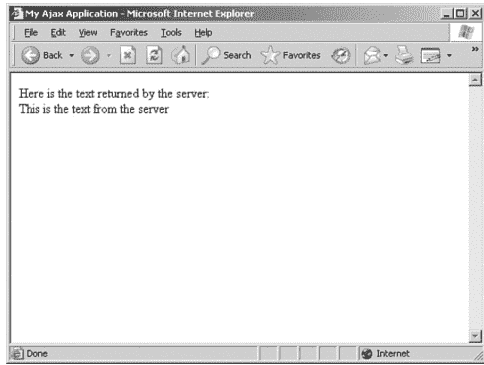

图 12.1 通过 responseText 在页面元素中显示。

## 在 responseText 中包含 HTML

现在让我们修改上一个示例中的代码。

正如你从之前的课程中所了解的，HTML 标记完全由使用文本字符编写标签组成。如果 `responseText` 属性中的值被用于修改发送服务器请求的页面的显示，那么没有什么能阻止我们让服务器脚本在返回的信息中包含 HTML 标记。

假设我们再次使用列表 12.1 中的代码，但通过了修改后的服务器脚本：

```php
<?php
echo "<h3>Returning Formatted Text</h3>";
echo "<hr />";
echo "We can use HTML to <strong>format</strong>";
// 在我们返回它之前的文本!"
?>
```

图 12.2 显示了结果浏览器显示。

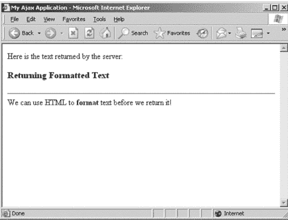

图 12.2 显示在服务器端进行 HTML 格式化。

考虑一个稍微复杂的例子，即服务器脚本生成更复杂输出的情况。我们希望应用程序获取此服务器输出并将其显示为表格内容。

这次我们将使用服务器端 PHP 脚本来生成一些表格信息：

## 第 12 课

```php
<?php
$days = array('Monday','Tuesday','Wednesday',
'Thursday','Friday','Saturday','Sunday');
echo "<table border='2'>";";
echo "<tr><th>Day Number</th><th>Day Name</th></tr>";
for($i=0; $i<7; $i++) {
    echo "<tr><td>" . $i . "</td><td>" . $days[$i] . "</td></tr>";
}
echo "</table>";
?>
```

再次使用列表 12.1 中的代码通过 `XMLHttpRequest` 调用服务器端脚本，我们获得了如图 12.3 所示的页面。

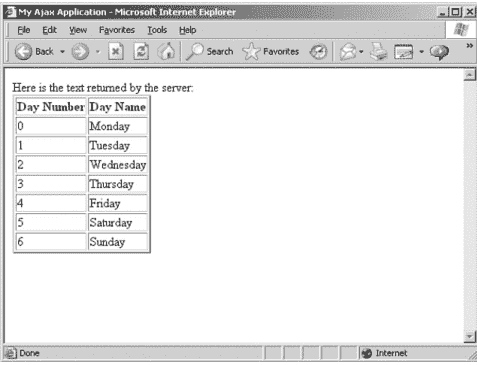

图 12.3 返回更复杂的 HTML。

## 更复杂的格式化数据

到目前，我们已经演示了返回可能直接应用于 Web 页面元素文本的方法。到目前为止一切顺利。然而，如果你愿意在 JavaScript 中多做一些工作来处理返回的数据，你就可以实现更多功能。

只要服务器在 `XMLHttpRequest` 对象的 `responseText` 属性中返回一个字符串值，你就可以使用任何设计的的数据格式在其中对信息进行编码。

考虑以下服务器端脚本，它使用了上一个示例中的相同数据数组：

```php
$days = array('Monday', 'Tuesday', 'Wednesday', 'Thursday', 'Friday', 'Saturday', 'Sunday');
$numdays = sizeof($days);
for($i=0;$i<$numdays; $i++)
{
    echo $days[$i]."|";
}
echo $days[$numdays-1];
?>
```

> 注意 使用 PHP 的 `sizeof()` 函数来确定数组中的项目数。在 PHP 中，就像在 JavaScript 中一样，数组键是从 0 而不是 1 开始编号的。

现在 `responseText` 属性返回的字符串包含了管道字符 `|` 分隔——或分隔。我们将此字符串复制到 JavaScript 变量 `mystring` 中，

`var mystring = http.responseText;`

我们会发现变量 `mystring` 包含字符串
Monday|Tuesday|Wednesday|Thursday|Friday|Saturday|Sunday

我们现在可以方便地使用 JavaScript 的 `split()` 方法将此字符串划分为数组：

```javascript
var results = http.responseText.split("||");
```

> 提示 JavaScript 的 `split()` 方法切分字符串，每当它在字符串中找到作为参数提供的字符时，就会进行切分。该字符不需要是管道；流行的替代方案是逗号或斜杠。

我们现在有一个包含我们数据的 JavaScript 数组 `results`：

```javascript
results[0] = 'Monday'
results[1] = 'Tuesday'
等等...
```

与其简单地显示接收的数据，我们现在可以以任何想要的方式在 JavaScript 例程序中使用它。

> 提示 对于复杂的数据格式，XML 可能是从服务器接收和处理数据的更好方法。然而，仅仅通过使用 `responseText` 就能做这么多事情，这是令人惊讶的。

# 总结

只需少量努力，就可以让 `XMLHttpRequest` 对象的 `responseText` 属性完成比简单向页面返回某些文本更多的工作。在本课中，你看到了 AHAH 的示例，从简单的页面更新到复杂数据。

# 第 13 课
异步
HTML
HTTP

# 引入 AHAH

可以在不使用任何 XML 的情况下构建完整且实用的应用程序。事实上，AHAH（异步 HTML 和 HTTP）这一术语就是为了这类应用程序而提出的。它们包括 JAH（仅异步）、HAJ（HTML 和 JavaScript）。在本书中我们称为 AHAH。

# 为什么用 AHAH 而不是 Ajax？

毫无疑问，XML 是一种具有多样化功能的重要技术。对于具有复杂数据结构的复杂应用程序，它可能是最好的——或者可能是唯一的选择。然而，使用 XML 有时会使应用程序的设计，包括：

- 为数据设计自定义模式所涉及的工作。
- 使用 JavaScript DOM 方法的跨浏览器兼容性问题。
- 由于必须执行处理器密集型的 XML 解析，性能可能会受到影响。

使用 AHAH 可以帮助你避免这些头疼的问题，同时提供一些额外的优势：

- 某些网页的轻松连接。
- HTML 比 XML 更容易查找故障。
- 使用 CSS 对返回的信息进行样式化，而不是必须使用 XSLT。

> XSLT 是一种转换语言，用于将 XML 文档转换为其他格式——例如转换为适用于浏览器显示的 HTML。

# 为 AHAH 创建小型库

在课程中检查的 Ajax 虽然完整且可行，但在我们的页面中包含了大量的 JavaScript 代码。正如你所看到的，每个应用程序倾向于包含类似的函数：

- 创建 `XMLHttpRequest` 实例、配置并发送它的方法
- 处理包含在 `responseText` 属性中的返回文本的回调函数

当你只需要用从服务器返回的新值更新单个页面元素时，可以将这些函数抽象为简单的 JavaScript 函数调用。

# 引入 myAHAlib.js

考虑列表 13.1；大部分代码你都能立即识别。

列表 13.1 myAHAlib.js

```javascriptfunction callAHA(url, pageElement, callMessage) {
  document.getElementById(pageElement).innerHTML = callMessage;
  try {
    req = new XMLHttpRequest(); /* e.g. Firefox */
  } catch (e) {
    try {
      req = new ActiveX("Msxml12.XMLHttpRequest"); /* some versions IE */
    } catch (e) {
      try {
        req = new ActiveX("Microsoft.XMLHttpRequest"); /* some versions IE */
      } catch (e) {
        req = false;
      }
    }
    if (req) {
      req.onreadystatechange = function() {responseAHA(pageElement)};
      req.open("GET",url,true);
      req.send(null);
    }
  }
}

function responseAHA(pageElement) {
  var output = '';
```
```


## 列表 13.1 继续

```javascript
if(req.readyState == 4) {
  if(req.status == 200) {
    output = req.responseText;
    document.getElementById(pageElement).innerHTML = output;
  }
}
```

函数 `callAHAH` 封装了创建 `XMLHttpRequest` 对象实例、声明回调函数以及发送请求的任务。

注意，我们并没有简单地声明
`req.onreadystatechange = responseAHAH;`

而是使用了 JavaScript 构造结构
`req.onreadystatechange = function(responseAHAH);`

这种类型的声明允许我们向声明的函数传递参数，在本例中，该参数标识要更新的页面元素。

`callAHAH()` 还接受一个额外的参数 `callMessage`。该参数包含一个字符串，定义了我们在等待服务器请求结果时在目标元素中显示的内容。这为用户提供了某种程度的反馈，表明页面上正在发生什么。在实践中，这可能是一行文本，例如“正在更新页面；请稍候 ...”。

然而，你仍然可以选择向此字符串中嵌入一些 HTML 代码。在 `` 元素中使用动画 GIF 图片是警告用户进程正在运行的有效方法。

回调函数 `responseAHAH()` 执行特定的任务，即将 `responseText` 中返回的字符串应用到所选页面元素 `pageElement` 的 `innerHTML` 属性：

```javascript
output = req.responseText;
document.getElementById(pageElement).innerHTML = output;
```

# AHAH—异步 HTML 和 HTTP 135

这段代码被封装成一个名为 `myAHAHlib.js` 的文件，你可以从 HTML 页面调用它，从而让你的 AHAH 应用程序可以使用这些函数。下一节将展示其用例的一些示例。

## 使用 myAHAHlib.js

在第 4 节“使用 JavaScript 进行客户端编码”中，我们遇到了位于外部文件并在我们的页面中引用的 JavaScript 函数概念。

这就是我们如何通过这种形式的语句来使用新文件 `myAHAHlib.js`：

```html
<script language="JavaScript" SRC="myAHAHlib.js"></script>
```

然后，我们就可以随时随地调用脚本中的函数了。

以下是此类 HTML 页面的骨架源代码：

```html
<html>
<head>
<title>另一个 Ajax 应用</title>
<script language="JavaScript" SRC="myAHAHlib.js"></script>
</head>
<body>
<form>
<input type="button" onclick="callAHAH('serverscript.php?parameter=x', display('Please wait - page updating ...'))">
这里是服务器响应发布的位置：<br>
<div id="displaydiv"></div>
</form>
</body>
</html>
```

在这个简单的 HTML 页面中，使用一个按钮元素来创建触发 `callAHAH()` 方法的事件。该方法将文本字符串“Please wait - page updating ...”放置在 `id=displaydiv` 的 `<div>` 元素中，并将异步服务器调用发送到 URL `serverscript.php?parameter=x`。

当 `responseAHAH()` 检测到服务器已完成响应时，将使用存储在 `responseText` 中的值来更新 `<div>` 元素的内容；它不再显示“请等待”消息，而是是 `<div>` 现在将显示服务器返回的任何文本。

## 在项目中应用 myAHAlib.js

我们可以通过另一个简单的 Ajax 应用来演示这些技术。这一次，我们将构建一个脚本，从用户输入的 URL 中获取“keywords”（关键词）元标签信息。

> 元标签（Metatags）是 HTML 页面 `<head>` 部分中可选的 HTML 容器元素。它们包含了有关网页的数据，这些数据对于搜索引擎和索引决定如何对页面内容进行分类很有用。如果存在'keywords' 元标签通常包含一个用逗号分隔的单词列表，其含义与网站内容相关。'keywords' 元标签的示例所示：

```html
<meta name="keywords" content="programming, design, development, Ajax, JavaScript, XMLHttpRequest, script">
```

列表 13.2 显示了 HTML 代码。

## 列表 13.2 getkeywords.html

```html
<html
<head>
<title>“关键词”元标签抓取器</title>
<SCRIPT language="JavaScript" SRC="myAHAHlib.js"></SCRIPT>
</head>
<body>
```

```html
<script type="text/javascript" src="ahahLib.js"></script>
<form>
<table>
<tr>
<td>URL: http://</td>
</tr>
<tr>
<td>
<input type="text" id="myurl" name="myurl" size="30">
<input type="button" onclick="callAHAH('keywords.php?url='+document.getElementById('myurl').value,'displaydiv','Please wait; loading content ...')" value="Fetch">
</td>
</tr>
<tr><td colspan="2" height id="displaydiv"></td></tr>
</table>
</form>
</body>
</html>
```

最后，考虑服务器端脚本：

```php
<?php
$tags = meta_tags('http://');
$result = $tags['keywords'];
if(strlen($result) > 0) {
  echo $result;
} else {
  echo "No keywords found";
}
?>
```

我们将选定的 URL 传递给方法：`$tags = meta_tags('http://');`

该方法专门设计用于关联数组的形式解析 HTML 页面。在本例中，我们得到了：`$result = $tags['keywords'];` 然后我们通过 `strlen()` 测量返回字符串的长度来检查是否存在关键词。

## 第 13 节

> 提示 在 PHP 方法前的 @ 字符告诉解释器如果遇到问题则不要输出错误消息。在本例中我们需要它，因为并不是所有页面都包含关键词。

当首次加载 getkeywords.html 时，我们看到了图 13.1 所示的内容。我们被邀请输入 URL。当我们点击 Fetch 按钮时，执行 `callAHAH()` 并我们的 URL 作为参数发送到服务器端脚本。与此同时，“Please wait; loading content ..." 被放置在 `<div>` 容器中。虽然可能可见瞬间，但现在有了类似于 13.2 的显示。

# AHAH—异步 HTML 和 HTTP 139

最后，当服务器调用完成后，`responseText` 属性的内容加载到 `<div>` 容器中，产生 13.3 的显示。

## 扩展 myAHAlib.js

目前，myAHAlib.js 是 AHAH 的简单实现。根据使用情况，有许多方法对其改进和扩展。我们没有在本节中涵盖这些内容，而是将其留给你们自己实验。这里是一些入门建议：

- 目前仅支持 GET 请求。如何修改函数以允许 POST 请求？
- 第 11 节“我们的第一个 Ajax 应用”中讨论的大部分用户反馈并未在 `responseAHAH()` 中实现。
- 是否可以修改 `callAHAH()` 以接收一个要更新的页面元素数组，并在（在合适的服务器端脚本帮助下）一次处理它们？

我们尚未考虑的选项是在 `responseText` 中传递 JavaScript 代码。由于 JavaScript 源代码（如 HTML 页面中的其他所有内容）是由纯文本编写的语句组成的，因此你可以从服务器通过 `responseText` 属性返回 JavaScript 源。
可以使用 JavaScript 的 `eval()` 方法执行此 JavaScript 代码：
`eval(object.responseText);`

考虑你的服务器脚本返回字符串：
`alert('Hello World!');`

在这种情况下，`eval()` 方法将内容作为 JavaScript 语句执行，创建一个带有确定按钮的显示“Hello World!”的对话框。


# 总结

在本节和第 12 节中，你应该会发现 Ajax 可以在完全不使用 XML 的情况下实现许多功能。

通过仔细组合使用 JavaScript 客户端编码和你所选语言的服务器端脚本，你可以创建高复杂程度的数据方案。

在较简单的应用程序中，如果你只是想更新页面元素的文本，`XMLHttpRequest` 对象的功能可以被抽象为 JavaScript 函数库，并通过简单的方法从 HTML 页面进行调用。

然而，对于某些任务，你需要利用 XML 的强大。我们将在第 14 节“以 XML 返回数据”中讨论这一主题。

# 第14 节
## 以 XML 返回数据

在本节中，你将学习如何将服务器返回的 XML 数据作为 `XMLHttpRequest` 对象的 `responseXML` 属性。

## 为 Ajax 添加“x”

第 12 节“以文本返回数据”和第 13 节“AHAH——异步 HTML 和 HTTP”花篇幅讨论了 `responseText` 中包含的真实值，并研究了在应用程序中使用这些信息的几种技术。这些示例从简单的页面元素文本更新，到使用更复杂的数据结构的编码字符串值（这些值可以存储并传输在 `responseText` 属性中）的应用程序。

当然，Ajax 中的 X 代表 XML，在你的应用程序中使用 XML 的力量是有充分理由的。当你需要使用高度结构化的信息和/或在不同类型的表示之间执行复杂事务时，情况尤其如此。

正如之前讨论的，`XMLHttpRequest` 对象还有一个名为 `responseXML` 的属性，它可以通过 XML 从服务器传输信息，而不是通过文本字符串传输。

你在第 11 节“我们的第一个 Ajax 应用程序”中已经看到 JavaScript 的文档对象模型（DOM）方法如何帮助你处理这些 XML 信息。本节将更详细地研究这些技术，并希望让你领略当利用 XML 的力量时 Ajax 能够实现什么。

## responseXML 属性

`XMLHttpRequest` 对象的 `responseText` 包含一个字符串，而 `responseXML` 可以被视为一个 XML 文档。

> **注意** 你需要确保你的服务器呈现了有效且格式良好的 XML，以便通过 `responseXML` 属性返回。在 `XMLHttpRequest` 对象无法正确解析 XML 的情况下（可能是由于格式错误或不支持的字符编码问题），`responseXML` 的内容是不可预测的，并且在不同浏览器中也可能不同。

> **注意** 与 `responseText` 属性一样，存储在 `responseXML` 中的值是只读的，因此你不能直接写入此属性；要操作它，必须将值复制到另一个变量：

```
var myobject = http.responseXML;
```

现在可以使用 JavaScript 的 DOM 方法获取 XML 文档中包含的结构和数据。在本节稍后的部分，我们将通过另一个运行的 Ajax 应用程序演示这一点，但让我们重新回顾 JavaScript DOM 方法并引入几个新方法。

## 更多 JavaScript DOM 方法

你在之前的课程中已经遇到过一些 JavaScript DOM 方法，例如 `getElementById` 和 `getElementsByTagName`。在那些情况下，我们主要关注读取节点的值以便将这些值写入 HTML 元素中。

## 144 第14 节

本节将介绍可以用于实际创建元素的 DOM 方法，从而改变页面结构。

文档对象模型可以被看为节点的树形结构。除了读取与这些节点关联的值外，你还可以创建和修改节点本身，从而改变文档的结构和内容。

要在页面上添加新元素，你首先需要创建元素并将它们挂载到 DOM 树的相应位置。让我们使用以下 HTML 文档来看一个简单的示例：

```html
<html
<head>
<title>Test Document</title>
</head>
<body>
We want to place some text here:<br />
<div id="displaydiv"></div>
</body>
</html>
```

在例例中，我们想在文档正体的 `&lt;div&gt;` 容器中添加文本“Hello World!”。我们将你的 JavaScript 程序放入一个函数中，并在正体的 `onLoad()` 事件处理器中调用它。

首先，我们将使用 JavaScript DOM 方法 `createNode()`（注：此处应为 createTextNode）来，额创建一个文本节点：

```
var textNode = createNode('Hello World!');
```

现在我们需要将 `textNode` 挂载到文档 DOM 树的相应位置。

你早在第 4 节“使用 JavaScript 进行客户端编码”中学习了子节点：希望你还记得，如果文档中的节点包含其他文档元素，则称该节点具有子节点。JavaScript 有一个 `appendChild()` 方法，它允许我们通过成为现有文档的子节点来将新的文本节点挂载到 DOM 树上。

在这种情况下，我们希望文本位于 id 为 `displaydiv` 的 `&lt;div&gt;` 容器内部：

```
var textnode = document.createTextNode('Hello World!');
document.getElementById('displaydiv').appendChild(textnode);
```

> **注意** 将这种基于 DOM 的写入页面内容的方法与第 11 节中使用的 `innerHTML` 方法进行对比。

让我们页面的完整源代码，我们将这段 JavaScript 代码封装进函数中并添加 `onLoad()` 事件处理器来执行它：

```html
<html>
<head>
<title>Test Document</title>
</head>
<script type="JavaScript">
function hello() {
  var textnode = document.createTextNode('Hello World!');
  document.getElementById('displaydiv').appendChild(textnode);
}
</script>
<body onload="hello()">
We want to place some text here:<br />
<div id="displaydiv"></div>
</body>
</html>
```

图 14.1 显示了加载此后的浏览器。

当你想要创建文本节点之外的其他元素时，可以使用 `createElement()` 方法，它的工作原理与 `createTextNodeNode()` 几乎相同。

```
var newdiv = document.createElement("div");
```

通常情况下，你只需将元素类型作为参数传递给 `createElement()` 即可生成所需类型的元素。

## DOM 方法概述

这本书是关于 Ajax 的，而不仅仅关于 JavaScript DOM 技术，因此我们不会在这里复制关于所有方法和属性的全面指南。然而，表 14.1 列出了一些更有用的方法。

## 以 XML 返回数据

> **提示** 如果你需要关于 JavaScript DOM 方法和属性的更全面的叙述，Andrew Watt 在他出色的书籍《Sams Teach Yourself XML in 10 Minutes》（Sams Publishing, ISBN 0672324171）中提供了一个非常有用的列表。

### 表 14.1 一 JavaScript DOM 属性和方法

| 属性 | 说明 |
| :--- | :--- |
| childNodes | 子节点数组 |
| firstChild | 第一个子节点 |
| lastChild | 最后一个子节点 |
| nodeName | 节点名称 |
| nodeType | 节点类型 |
| nodeValue | 节点包含的值 |
| nextSibling | 同一父节点的下一个节点 |
| previousSibling | 同一父节点的上一个节点 |
| parentNode | 节点的父节点 |
| **节点方法** | |
| AppendChild | 添加新的子节点 |
| HasChildNodes | 如果此节点有子节点则为真 |
| RemoveChild | 删除子节点 |
| **文档方法** | |
| CreateAttribute | 为元素创建新属性 |
| CreateElement | 创建新的文档元素 |
| CreateTextNode | 创建文本项 |
| GetElementsByTagName | 创建标签名的数组 |
| GetElementsByById | 通过 ID 查找元素 |


# 项目——一个 RSS 标题阅读器

现在，让我们利用学到的从服务器返回 XML 数据的知识，并使用这些技术来处理一个新项目。

XML 数据以多种形式存在于互联网上。最流行的形式之一是 RSS馈（feed），这是一种特定的 XML 源，通常包含新闻或其他主题性并定期更新的项目目。RSS 馈源自网络上的许多来源，包括大多数广播公司和报纸出版商，以及针对各种主题的专业网站。

我们将编写一个 Ajax 应用，获取 RSS 馈的 URL，收集 XML，并列出该馈中包含的新闻条目的标题和描述。

以下是典型 RSS 馈的 XML 部分内容：

```
<rss version="0.91">
<channel>
<title>MyRSSfeed.com</title>
<link>http://www.********.com/</link>
<description>My RSS feed</description>
<language>en-us</language>
<item>
<title>New Store Opens</title>
<link>http://www.********.html</link>
<description>A new music store opened today in Canal Road.
The new business, Ajax Records, caters for a wide range of musical tastes.</description>
</item>
<item>
<title>Bad Weather Affects Transport</title>
<link>http://www.********.html</link>
<description>Trains and buses were disrupted badly today due to heavy snow. Police advised people not to travel unless absolutely necessary.</description>
</item>
<item>
<title>Date Announced for Mayoral Election</title>
<link>http://www.********.html</link>
<description>September 4th has been announced as the date
for the next mayoral election. Watch local news for more
details.</description>
</item>
</channel>
</rss>
```

从第一行

```
<rss version="0.91">
```

我们可以看到，在这种情况下我们处理的是 RSS 0.91 版本。RSS 的版本之间差异很大，但对于我们的示例来说，我们只关心单个新闻条目的 `<title>`、`<link>` 和 `<description>` 元素，这些元素在不同版本之间基本上保持不变。

# 我们应用程序的 HTML 页面

我们的页面需要包含一个输入框来输入所需 RSS 馈的 URL，以及一个指示应用程序收集数据的按钮。我们还需要一个 `<div>` 容器，用于显示解析后的数据：

```
<html>
<head>
<title>An Ajax RSS Reader</title>
</head>
<body>
<h3>An Ajax RSS Reader</h3>
<form name="form1">
URL of RSS feed: <input type="text" name="feed" size="50" value="http:///"><input type="button" value="Get Feed"><br /><br>
<div id="news"><h4>Feed Titles</h4></div>
</form>
</body>
</html>
```

如果我们将此代码保存为文件 `rss.htm` 并将其加载到浏览器中，我们将会看到类似于图 14.2 所示的显示。

## 第 14 课

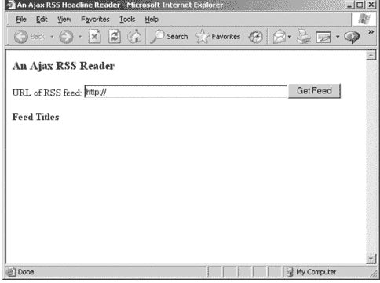

**图 14.2** 显示了我们 RSS 馈阅读器的基础 HTML 文档。

现在我们阅读器的大部分代码应该已经熟悉了；创建 `XMLHttpRequest` 对象的实例、构建并发送服务器请求以及检查该请求何时完成，这些操作都与之前的示例非常相似。

然而，这一次，我们不再使用 `responseText`，而是通过 `responseXML` 属性接收 XML 格式的数据。我们将使用这些数据来修改 HTML 页面的 DOM，以便在页面的 `<div>` 容器内的列表中显示新条目的标题和描述。每个标题和描述将包含在自己的段落元素中（我们将以此为目的构造这些元素），并通过样式表进行样式处理，以按我们想要的方式显示。

## 完整代码

让我们直接开始查看代码，如列表 14.1 所示。

**列表 14.1** Ajax RSS 标题阅读器

```
<html>
<head>
<title>An Ajax RSS Reader</title>
</head>
<style>
```

# 以 XML 格式返回数据

```
.title {
font: 16px bold helvetica, arial, sans-serif;
padding: 0px 30px 0px 30px;
text-decoration:underline;
}
.descrip {
font: 14px normal helvetica, arial, sans-serif;
text-decoration:italic;
padding: 0px 30px 0px 30px;
background-color:#cccccc;
}
.link {
font: 0px bold helvetica, arial, sans-serif;
padding: 0px 30px 0px 30px;
}
.displaybox {
border: 1px solid black;
padding: 0px 50px 0px 50px;
}
</style>
<script language="JavaScript" type="text/javascript">
function getXMLHttpRequest() {
try {
req = new XMLHttpRequest(); /* e.g. Firefox */
} catch (e) {
try {
req = new ActiveXObject("Msxml2.XMLHTTP"); /* some versions IE */
} catch (e) {
req = false;
}
}
return req;
}

var http = getXMLHttpRequest();

function getRSS() {
var myurl = 'rssxy.php?feed=';
var feed = document.form1.feed.value;
var myRand = parseInt(Math.random()*99999);
http.open("GET", myurl+escape(feed), true);
http.onreadystatechange = function() {
  if (http.readyState == 4) {
    if (http.status == 200) {
      var news = document.getElementById('news');
      while (news.hasNodes()) {
        news.removeChild(news.firstChild);
      }
      var titleNodes = http.responseXML.getElementsByTagName("title");
      for (var i = 0; i < titleNodes.length; i++) {
        var newpara = document.createElement('p');
        newpara.appendChild(document.createTextNode(titleNodes[i].childNodes[0].nodeValue));
        newpara.className = "title";
        news.appendChild(newpara);
      }
      var descriptionNodes = http.responseXML.getElementsByTagName("description");
      for (var i = 0; i < descriptionNodes.length; i++) {
        var newpara = document.createElement('p');
        newpara.appendChild(document.createTextNode(descriptionNodes[i].childNodes[0].nodeValue));
        newpara.className = "descrip";
        news.appendChild(newpara);
      }
      var linkNodes = http.responseXML.getElementsByTagName("link");
      for (var i = 0; i < linkNodes.length; i++) {
        var newpara = document.createElement('p');
        newpara.appendChild(document.createTextNode(linkNodes[i].childNodes[0].nodeValue));
        newpara.className = "link";
        news.appendChild(newpara);
      }
    }
  }
};
http.send(null);
}
</script>
<body>
<center>
<h3>Ajax RSS Reader</h3>
<form name="form1">
URL of RSS feed: <input type="text" name="feed" size="50" value="http:///"><input type="button" value="Get Feed" onclick="getRSS()"><br /><br>
<div id="news"><h4>Feed Titles</h4></div>
</form>
</center>
</body>
</html>
```
*(注：由于原文中代码块在输入中存在严重的错乱和重复，翻译已根据文档工程师逻辑对代码结构进行了对齐修复，以确保逻辑连贯。)*


每当我们在输入框中输入不同 RSS 馈的 URL 并点击按钮时，`<div>` 的内容就会更新，显示属于新 RSS 馈的条目。由于这是一个 Ajax 应用，显然不需要重新加载整个页面。

## 服务端代码

由于 `XMLHttpRequest` 对象内置的安全限制，我们无法直接获取 RSS 馈；我们必须使用一个运行在我们自己服务器上的、带有 URL 的脚本，通过该脚本收集远程 XML 文件并将其传递给 Ajax 应用。

在这种情况下，我们不需要服务端脚本 `ssrps.php` 修改 XML 文件，只需通过 `XMLHttpRequest` 对象的 `responseXML` 将其传回给我们即可。我们说该脚本充当了代理的角色，因为它代表 Ajax 应用程序正在获取远程资源。

列表 14.2 显示了 PHP 脚本的代码。

## 列表 14.2 用于 RSS 标题阅读器的服务器端脚本

```php
<?php
$mysession = curl_init($_GET['feed']);
curl_setopt($mysession, CURLOPT_HEADER, false);
curl_setopt($mysession, CURLOPT_RETURNTRANSFER, true);
$out = curl_exec($mysession);
header('Content-Type: text/xml');
echo $out;
curl_close($mysession);
?>
```

该脚本使用了 cURL PHP 库，这是一组让 Internet 文件传输编程更易的例程。在这里对 cURL 进行详细描述是不恰当的；只需说明这段简短的脚本首先通过引用 Ajax 应用发送的变量接收所需 RSS 馈的 URL。调用 `curl_setopt()` 函数的两个行分别声明了我们不希望随远程文件发送标头，但我们确实想要文件内容。随后，`curl_exec()` 函数执行数据传输。

此后，只需使用熟悉的 PHP `header()` 命令添加适当的标头并将数据返回给我们的 Ajax 应用即可。

> 提示：有关在 PHP 中使用 CURL 的完整说明，请参阅 PHP 网站 http://uk2.php.net/curl 和/或 curl 网站 http://curl.haxx.se/。

图 14.3 显示了 RSS 阅读器的运行情况，在此例中它显示了来自 CNN 新闻馈的内容。

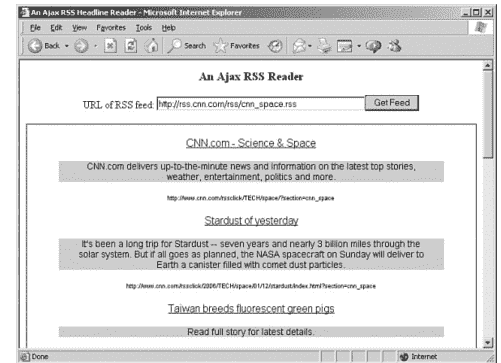

图 14.3 Ajax RSS 阅读器的运行情况。

# 总结

JavaScript DOM 方法在与 `XMLHttpRequest` 对象和 XML 数据结合使用时，提供了一种传输、组织以及显示或处理具有复杂结构数据的强大手段。

在本节中，你看到了如何添加、删除和操作 DOM 元素，以便根据 `XMLHttpRequest` 对象的 `responseXML` 中接收到的 XML 数据重构应用程序的 DOM。

## 第 15 节
Web 服务与 REST 协议

在本节中，你将学习 Web 服务的基础知识以及如何使用 REST（表述状态转移）协议来实现它们。

## Web 服务简介

到为止，你已经看到了几个示例应用程序，其中我们调用服务端脚本来执行任务。在每种情况下，我们都设计了数据结构来传输信息，并编写了处理服务器进出数据的程序。

但是，假设你想让你的服务端程序更加通用。也许你可以想象几个不同的 Web 应用程序为了自己的目的与此类脚本交互。除了浏览器直接请求页面外，其他应用程序（例如通过 `XMLHttpRequest` 调用运行的 Ajax 应用）也可能发出数据请求，并期望接收它们能够理解和操作的数据。

在这些情况下，让你程序所提供的接口具有某种形式的标准化将是有益的。这一原则为我们所谓的 Web 服务奠定了基础。

例如，假设你的服务器应用程序在响应包含地理信息的请求时，产生 XML 格式的预报数据。

这种服务的性质使其具有广泛的适用性；此类应用程序可能有许多不同的“客户端”，从展示本地地区新天气预报的简单网页，到需要这些数据进行更苛刻用途的复杂航空或旅行规划应用程序。

这种服务只是 Web 服务能够执行的操作的一个小例子。互联网上活跃着成千上万的 Web 服务，提供了令人惊叹的功能，包括用户身份验证、支付处理、内容分发、消息以及许多其他功能。

通常，Web 服务提供了一种应用程序编程接口（API），允许客户端应用程序构建通往服务的接口。虽然可以使用任何 Internet 协议来创建 Web 服务，但 XML 和 HTTP 是流行的选择。

已经出现了许多协议和技术，可以帮助你创建和利用 Web 服务。本节将了其中可能最简单的一种，称为 REST（表述状态转移），而第 16 节“使用 SOAP 的 Web 服务”讨论了另一种协议，这次称为 SOAP（简单对象访问协议）。每节课程都会重点介绍它们在 Ajax 应用中可能如何有用。

## REST—表述状态转移

REST 围绕着通用网络设计的两个主要原则：

- 资源由 URL 表表——一个资源可以被认为是一个“名词”，指的是我们在 Web 服务 API 中想要处理的某些实体；这可能是一个文档、一个人、一次会议、一个地点等。REST 应用中的每个资源都有一个唯一的 URL。

- 操作通过标准的 HTTP 方法执行——使用如 GET、POST、PUT 和 DELETE 等 HTTP 方法来对资源执行操作。通过这种方式，我们可以将此类操作视为作用于资源上的“动词”。

## 一个假设的 REST 示例

为了理解如何以及为什么应用这些思想，让我们来看一个假设的示例。

假设我们有一个允许作者提交、编辑和阅读文章的服务。将所谓的 REST 原则应用于此应用程序的设计，会发生以下情况：

- 每个提交的文章都有唯一的 URL，例如：
  `http://somdomain.com/articles/173`

- 我们仅要求每个文章的 URL 是唯一的，例如：
`http://somdomain.com/articles/list.php?id=173`

> 尽管 REST 要求 URL 是唯一的，但并不意味着每个资源都有一个对应的物理页面。在许多情况下，资源是由 Web 服务在请求时生成的——例如通过数据库。

- 为了检索阅读或编辑的文章，我们的客户端应用程序简单地对该 URL 使用 HTTP GET 请求。

- 为了上传新文章，将使用 POST 请求，包含文章信息。服务器将返回新上传文章的 URL。

- 为了更新编辑过的文章，将使用 PUT 请求，包含修改后的内容。

- 使用 HTTP DELETE 删除特定的文章。

通过这种方式，Web 服务使用了任何使用 Web 用户都熟悉的接口。我们不需要为发送或检索信息设计 API 方法；我们已经通过标准 HTTP 方法拥有它们。

## 使用 GET 查询信息

在 REST 应用中使用 HTTP GET 请求的一个重要问题是它从改变服务器状态。换句话说：我们只通过 GET 请求向服务器获取信息，而不是修改那里已有的信息。

POST、PUT 和 DELETE 调用都可以以某种方式更改服务器状态。

## 无状态操作

REST 应用中所有的服务器交换应该是无状态的。无状态意味着调用本身必须包含服务器执行所需任务的所有信息，而不是依赖于服务器当前存在的某种状态或上下文。例如，我们不能要求服务器引用之前请求发送的信息。

## 在实践中使用 REST

让我们扩展之前提到的涉及我们文章 服务的示例。

### 读取可用文章列表

可用文章列表是一个资源。由于该 Web 服务符合 REST 原则，我们期望服务提供一个我们可以访问该资源的 URL，例如：

```
http://somdomain.com/articles/list.php
```


# Web 服务与 REST 协议 161

由于我们是在查询信息而非尝试更改信息，因此我们简单地向前面的 URL 发送一个 HTTP GET 请求。服务器可能会返回如下 XML：

```xml
<articles>
  <article>
    <id>173</id>
    <title>New Concepts in Ajax</title>
    <author>P.D. Johnstone</author>
  </article>
  <article>
    <id>218</id>
    <title>More Ajax Ideas</title>
    <author>S.N. Braithwaite</author>
  </article>
  <article>
    <id>365</id>
    <title>Pushing the Ajax Envelope</title>
    <author>Z.R. Lawson</author>
  </article>
</articles>
```

## 获取特定文章

由于这是另一次信息请求，我们再次需要提交一个 HTTP GET 请求。我们的 Web 服务可能允许我们向以下地址发送请求：

```
http://somedomain.com/articles/list.php?id=218
```

并获得返回：

```xml
<article>
  <id>218</id>
  <title>More Ajax Ideas</title>
  <author>S.N. Braithwaite</author>
</article>
```

## 上传新文章

在这种情况下，我们需要发布 POST 请求而非 GET 请求。在与之前概述的假设类似的情况下，服务器可能会为新文章分配 id 值，留给我们来为标题和作者元素编码参数和值对：

```javascript
var articleTitle = 'Another Angle on Ajax';
var articleAuthor = 'K.B. Schmidt';
var url = '/articles/upload.php';
var poststring = 'title='+encodeURI(articleTitle)+
'&author='+encodeURI(articleAuthor);
http.onreadystatechange = callbackFunction();
http.open('POST', url, true);
http.setRequestHeader('Content-type',
'application/x-www-form-urlencoded');
http.setRequestHeader('Content-length', poststring.length);
http.send(poststring);
```

# 现实世界中的 REST——Amazon REST API

领先的在线博客 Amazon.com 提供了 REST Web 服务，帮助开发人员将 Amazon 的浏览和购物功能集成到他们的 Web 应用中。

> 注意：Amazon.com 经常将 REST 协议称为 XML-over-HTTP 或 XML/HTTP。

通过首先创建一个包含所需搜索参数（如发布者、排序、作者等）的参数/值对的 URL，并向该 URL 发送 GET 请求，可以引导 Amazon Web 服务返回一个包含产品详情的 XML 文档。我们可以将其解析为 XML 以创建 DOM 对象在网页中显示，或根据应用程序的需求提供进一步处理的数据。

> 提示：Amazon 要求你获取开发者令牌（token）以便为其 Web 服务开发客户端应用程序。在构建指向 Amazon Web 服务的 REST 请求时，将需要此令牌。你还可以获取 Amazon  Associates ID，以便通过在网站上投放 Amazon 服务来盈利。详情请参阅 http://www.amazon.com。

## Web 服务与 REST 协议

让我们在实践中开发一个 REST 请求，以返回书籍列表。可以进行许多类型的搜索，但在本例中，我们请求一份由 Sams 出版的书籍列表。

我们开始从基础 URL 构建 GET 请求：

```javascript
$url = 'http://xml.amazon.com/onca/xml3';
```

然后我们需要添加许多参数/值对来完成请求：

```javascript
$assoc_id = "XXXXXXXXXXXX"; // 你的 Amazon Associates ID
$dev_token = "ZZZZZZZZZZ"; // 你的开发者令牌
$manuf = "Sams";
$url = "http://xml.amazon.com/onca/xml3";
$url .= "?item=$.assoc_id";
$url .= "&dev-dev=$.dev_token";
$url .= "&ManufacturerSearch=$manuf";
$url .= "&mode=books";
$url .= "&sort=+salesrank";
$url .= "&offer=All";
$url .= "&type=lite";
$url .= "&page=1";
$url .= "&f=xml";
```

提交此 URL 后，我们收到一个包含所有匹配书籍详情的 XML 文件。我在这里不再复制整个文件（有 5000 多个标题！），但列表 15.1 显示了 XML 文件的片段，包括列表的第一本书。

## 列表 15.1 Amazon Web 服务返回的 XML 示例

```xml
<?xml version="1.0" encoding="UTF-8" ?>
<ProductInfo xmlns:xsi="http://www.w3.org/2001/XMLSchema-instance"
  xsi:noNamespaceSchemaLocation
    "http://xml.amazon.com/schemas/3/dev-lite.xsd">
<Request>
  <Args>
    <Arg value="Mozilla/4.0 (compatible; MSIE 6.0;
Windows NT 5.1; SV1; .NET CL 1.1.4322)"
    name="UserAgent" />
    <Arg />
    <Arg value="0G2GC2CT7MRWB37PRXAS4B" name="RequestID" />
  <Arg value="All" name="offer" />
```

显然，我们现在可以以任何方式处理此 XML 文档。例如，第 14 “以 XML 返回数据”讨论了如何使用 JavaScript 方法选择信息并将其放入 DOM。

## REST 与 Ajax

你已经知道 XMLHttpRequest 对象直接处理 HTTP 类型。因此，访问 RESTful 服务变得简单。因为你知道服务暴露的每个资源都有唯一的 URL，并且服务可用的方法是标准的 HTTP 方法。

# 总结

本节引入了 Web 服务概念以及 REST 协议的原理。REST 要求所有资源都通过唯一的 URL 访问，并且可以通过 HTTP 方法在这些资源上执行所有操作。由于 XMLHttpRequest 对象的方法直接引用 URL 和 HTTP 方法，这使得 RESTful 服务能够与 Ajax 应用良好交互。

# 第 16 ：使用 SOAP

在本节中，你将学习使用 SOAP 协议使用 Web 服务。#介绍 SOAP（简单对象访问协议）

在第 15 节“Web 服务与 REST 协议”中，我们讨论了 Web 服务，并特别看到 REST（表述状态传输）协议如何为此类服务提供一致的应用程序接口（API）。

REST 是一个设计用于操作资源导向型服务的良好示例，这类服务提供了一种定位资源的简单机制以及可以操作资源的基础方法。在资源导向型服务中，这些方法通常围绕创建、检索、修改和删除信息展开。

在 REST 的情况下，方法是 HTTP 规范中指定的那些——GET、POST、PUT 和 DELETE。

在某些情况下，我们对 Web 服务可以执行的操作比对它控制的资源更感兴趣。我们可以将此类服务称为操作导向型。在这些情况下，资源本身具有一定的重要性，但关键问题在于服务所执行活动的细节。

设计操作导向型 Web 服务最流行且最广泛的协议是 SOAP，即简单对象访问协议。


> Simple Object Access Protocol（简单对象访问协议）的全称在 SOAP 规范的后期版本中被弃用，因为人们认为项目的方向已经发生变化，该名称不再适用。该协议仍然被称为 SOAP。

## SOAP 协议的背景

SOAP 起于 20 世纪 90 年代末，当时 XML 本还是一项新兴技术，而另一种基于 XML 的 Web 服务协议 XML-RPC 则在 2000 年与 W3C 共同诞生。

SOAP 的设计初衷是为了以标准化的方式将远程调用（在远程机器上运行程序的请求）封装在 XML 包装器中。

许多企业对 SOAP 的早期开发出了贡献，包括 IBM、Microsoft 和 Userland。随后，SOAP 的开发交 W3C 的 XML 协议工作组。

> 你可以通过 W3C 网站 http://www.w3.org/2000/xp/Group/ 获取有关 SOAP 规范的最新信息。

## SOAP 协议

SOAP 是一种基于 XML 的消息协议。一个 SOAP 请求是一个包含以下主要部分的 XML 文档：

- 封包（Envelope）：定义该文档为 SOAP 请求
- 主体元素（Body）：包含关于调用和预期响应的信息
- 可选的头元素（Header）和故障（Fault）元素：携带补充信息

让我们来看一个 SOAP 请求的框架：

```xml
<?xml version="1.0"?>
<SOAP-ENV:Envelope
xmlns:SOAP-ENV="http://schemas.xmlsoap.org/soap/envelope/"
SOAP-ENV:encodingStyle="http://schemas.xmlsoap.org/soap/encoding/">
  <SOAP-ENV:Header>
  .. various commands ..
</SOAP-ENV:Header>
<SOAP-ENV:Body>
  .. various commands ..
<SOAP-ENV:Fault>
  .. various commands ..
</SOAP-ENV:Fault>
</SOAP-ENV:Body>
</SOAP-ENV:Envelope>
```

注意，SOAP 请求是一个 XML 文件，其根元素是 `Envelope`。

`Envelope` 的第一行是：

```xml
<SOAP-ENV:Envelope xmlns:SOAP-ENV="http://schemas.xmlsoap.org/soap/envelope/"
SOAP-ENV:encodingStyle="http://schemas.xmlsoap.org/soap/encoding/"
```

这一行声明了 `xmlns:soap` 命名空间，其值必须始终为 `xmlns:soap="http://schemas.xmlsoap.org/soap/envelope/"`。

> 提示：命名空间用于唯一分组一组 XML 元素或属性的标识符，提供限定其名称的方法，以便与其他架构中的名称与它们发生冲突。

`encodingStyle` 属性包含了定义消息中所用数据类型的信息。

接下来是 `Header` 元素，它是可选的，但如果存在，它必须是消息中的第一个元素。`Header` 元素中定义的属性定义了接收应用程序如何处理该消息。

## 使用 SOAP 的 Web 服务

SOAP 消息主体元素包含发送给最终接收者的消息。

序列化的参数包含在 SOAP 请求的主体元素中。调用的 XML 元素必须紧跟在 SOAP 主体的起始 XML 标签之后，并且必须与被调用的远程方法同名。

主体还可以包含一个 `Fault` 元素（但最多于一个）。该元素在 SOAP 规范中定义，用于携带可能发生的任何错误信息。如果它存在，它必须是主体元素的子元素。`Fault` 元素具有各种子元素，包括 `faultcode`、`faultstring` 和 `detail`，它们包含了故障状况的具体细节。

## SOAP 请求的代码示例

让我们看看一个典型的 SOAP 请求可能是什么样的：

```xml
<?xml version="1.0"?>
<SOAP-Envelope xmlns:SOAP-ENV="http://schemas.xmlsoap.org/soap/envelope/" encodingStyle="http://schemas.xmlsoap.org/soap/encoding/">
<SOAP-ENV:Body>
<m:GetInvoiceTotal xmlns:m="http://www.somedomain.com/invoices">
<m:Invoice>77293</m:Invoice>
</m:GetInvoiceTotal>
</SOAP-ENV:Envelope>
```

在前面的示例中，`m:GetInvoiceTotal` 和 `m:Invoice` 元素是特定的，并不是 SOAP 本身的一部分。这些元素构成了 SOAP 封包中包含的消息。

让我们看看 Web 服务的 SOAP 响应可能是什么样的：

```xml
<?xml version="1.0"?>
<SOAP-Envelope xmlns:SOAP-ENV="http://schemas.xmlsoap.org/soap/envelope/" encodingStyle="http://schemas.xmlsoap.org/soap/encoding/">
<SOAP-ENV:Body>
<m:ShowInvoice xmlns:m="http://www.somedomain.com/invoices">
<m:InvoiceTotal>3295.00</m:InvoiceTotal>
</m:ShowInvoice>
</SOAP-ENV:Body>
</SOAP-ENV:Envelope>
```

## 通过 HTTP 发送 SOAP 请求

SOAP 消息可以通过 HTTP GET 或 HTTP POST 传输。如果通过 HTTP POST 发送，SOAP 消息至少需要一个 HTTP 头来定义 `Content-Type`：

Content-Type: text/xml

在成功的 SOAP 交换之后，你将期望收到带有适当 HTTP 头的 SOAP 响应：

```http
HTTP/1.1 200 OK
Content-Type: text/xml
Content-Length: ...
<?xml version="1.0"?>
<SOAP-Envelope xmlns:SOAP-ENV="http://schemas.xmlsoap.org/soap/envelope/" encodingStyle="http://schemas.xmlsoap.org/soap/encoding/">
<SOAP-ENV:Body>
<m:ShowInvoice xmlns:m="http://www.somedomain.com/invoices">
<m:InvoiceTotal>3295.00</m:InvoiceTotal>
</m:ShowInvoice>
</SOAP-ENV:Body>
</SOAP-ENV:Envelope>
```

## 使用 Ajax SOAP

要在 Ajax 中使用 SOAP 需要执行若干独立步骤：

1. 创建 SOAP 封包。
2. 将特定的信息序列化为 XML。
3. 创建包含特定数据的 SOAP主体。
4. 通过 XMLHttpRequest 对象发送请求。

生成的代码可能是什么样的？

```javascript
var invoiceno = '77293';
var xhr = new XMLHttpRequest();
xhr.open("POST", "http://www.somedomain.com/invoices", true);
xhr.setRequestHeader("Content-Type", "text/xml");
xhr.onreadystatechange = function() {
  if (xhr.readyState == 4 && xhr.status == 200) {
    alert("服务器说：" + xhr.responseText);
  }
};
var mySOAP = '<?xml version="1.0"?>
<SOAP-Envelope xmlns:SOAP-ENV="http://schemas.xmlsoap.org/soap/envelope/" encodingStyle="http://schemas.xmlsoap.org/soap/encoding/">
<SOAP-ENV:Body>
<m:GetInvoiceTotal xmlns:m="http://www.somedomain.com/invoices">
<m:Invoice>' + invoiceno + '</m:Invoice>
</m:GetInvoiceTotal>
</SOAP-ENV:Body>
</SOAP-ENV:Envelope>';
xhr.send(mySOAP);
```

我们在传递给 XMLHttpRequest 对象的 send() 方法之前，已经在 JavaScript 变量中构建了整个 SOAP 封包。

服务器返回的值必须经过解析以恢复 SOAP 响应，然后从 SOAP 消息主体中恢复应用数据。


## 第 17 节
用于 Ajax 的 JavaScript 库

在本节中，你将学习如何将目前为止学到的技术封装在一个小型 JavaScript 库中，你可以在应用程序中调用它。

## 一个 Ajax 库

通过目前为止课程和代码示例，我们已经开发了许多 JavaScript 代码技术用于实现 Ajax 应用的不同部分。这些方法包括：

- 一种生成 `XMLHttpRequest` 对象实例的方法，它适用于目前主流的所有浏览器
- 通过 `XMLHttpRequest` 对象构建和发送 GET 和 POST 请求的例程
- 避免 GET 请求被意外缓存的技术
- 一种回调函数样式，它在执行你的操作之前会检查 `XMLHttpRequest` 调用是否正确完成
- 提供用户反馈的方法
- 处理通过 `responseText`的文本数据的技术
- 处理通过 `responseXML` 返回的 XML 信息的技术

## 第 17 节

此外，你已经在第 13 节“AHA——异步 HTML 和 HTTP”中看到，这些方法中的某些是如何被抽象为一个小的 JavaScript “库”（在这种情况下，只包含两个函数）。

本节扩展了这一想法，构建一个功能更完备的库，允许通过极少的额外代码将 Ajax 功能简单添加到 HTML 页面中。

由于需要，我们的 Ajax 库不会像书中后后描述的开源项目那样复杂或全面；但它将足够完整，用于构建功能性的 Ajax

## 审查 myAAHlib.js

列表 17.1 显示了 `myAAHlib.js` 的代码，重现自第 13 节。

- 列表 17.1 myAAHlib.js

```javascript
function callAAH(url, pageElement, callMessage) {
  document.getElementById(pageElement).innerHTML
  = callMessage;
  try {
    req = new XMLHttpRequest(); /* e.g. Firefox */
  } catch (e) {
    req = new ActiveXObject("Msxml2.XMLHTTP");
    /* some versions IE */
  } catch (e) {
    try {
      req = new ActiveXObject("Microsoft.XMLHTTP");
    /* some versions IE */
    } catch (E) {
      req = false;
    }
  }
  req.onreadystatechange =
function(){responseAAH(pageElement);});
  req.open("GET",url,true);
  req.send(null);
}
```

```javascript
function responseAHAH(pageElement) {
  var output = '';
  if(req.readyState == 4) {
    if(req.status == 200) {
      output = req.responseText;
      document.getElementById(pageElement).innerHTML = output;
    }
  }
}
```

让我们考虑一下如何扩展此库的功能：

- 目前仅支持 HTTP GET 请求。如果至少也支持 HTTP POST 请求将非常有用，特别是当你打算使用 REST 协议构建应用程序时（如第 15 节“Web 服务和 REST 协议”所述）
- 该库目前只处理通过 `responseText` 返回的文本信息，没有处理 `responseXML` 的手段。

## 实现我们的库

在确定了需要做什么之后，我们现在将组合一个更强大的 Ajax 库。

## 创建 XMLHttpRequest 实例

让我们首先关注创建 `XMLHttpRequest` 对象实例的例程。

目前，该函数与构建和发送 HTTP 请求的例程紧耦合。让我们负责创建 `XMLHttpRequest` 实例的部分解耦，并将其放入一个独立的函数中：

```javascript
function createREQ() {
  try {
    var req = new XMLHttpRequest(); /* e.g. Firefox */
  } catch(err) {
    try {
      req = new ActiveXObject("Msxml2.XMLHTTP");
      /* some versions IE */
    } catch (err2) {
      try {
        req = new ActiveXObject("Microsoft.XMLHTTP");
        /* some versions IE */
      } catch (err3) {
        req = false;
      }
    }
  }
  return req;
}
```

现在我们可以通过简单调用以下函数来创建 `XMLHttpRequest` 对象实例：

```javascript
var myreq = createREQ();
```

## HTTP GET 和 POST 请求

我们将从 GET 请求开始，因为我们已经支持该类型的请求：

```javascript
function requestGET(url, query, req) {
myRand=parseInt(Math.random()*999999999);
req.open("GET",url+''+query+'&rand='+myRand,true);
req.send(null);
}
```

我们必须向向请求发送的 URL 传递参数，以及 `XMLHttpRequest` 对象实例的标识。

我们可以排除 `query` 参数，因为它被编码在 URL 中。我们在这里保持这两个参数分开，以保持与制作 POST 请求的函数相似的接口。

在调用函数之前，必须对 `query` 参数进行适当编码，尽管破坏缓存的随机元素是由函数添加的。

## 用于 Ajax 的 JavaScript 库

接下来是 POST 函数：

```javascript
function requestPOST(url, query, req) {
req.open("POST", url, true);
req.setRequestHeader('Content-Type',
  'application/x-www-form-urlencoded');
req.send(query);
}
```

## 回调函数

我们如何处理回调函数？我们将添加更多函数：

```javascript
function doCallback(item) {
eval(callback +)');
}
```

这使用了 JavaScript 的 `eval()` 来执行另一个作为参数传递给它的函数，同时通过 `item` 将其传递给它。让我们看看这些函数在从事件处理程序中调用时是如何交互的：

```javascript
function doAjax(url,query,callback,reqtype,getxml) {
// create the XMLHttpRequest instance
var req = createREQ();
myreq.onreadystatechange = function() {
if(req.readyState == 4) {
if(req.status == 200) {
item = req.responseText;
if(getxml==1) {
item = req.responseXML;
}
doCallback(callback);
}
}
```

我们的我们的 `doAjax` 函数现在接受五个参数：

- url—调用的目标 URL
- query—编码后的字符串
- callback—回调函数的标识
- reqtype—'post' 或 'get'
- getxml—1 获取数据，0 获取文本

列表 17.2 显示了该函数的完整代码：

```javascript
function callAAH(url, pageElement, callMessage) {
  document.getElementById(pageElement).innerHTML
  = callMessage;
  try {
    req = new XMLHttpRequest(); /* e.g. Firefox */
  } catch (e) {
    req = new ActiveXObject("Msxml2.XMLHTTP");
    /* some versions IE */
  } catch (e) {
    try {
      req = new ActiveXObject("Microsoft.XMLHTTP");
    /* some versions IE */
    } catch (E) {
      req = false;
    }
  }
  req.onreadystatechange =
function(){responseAAH(pageElement);});
  req.open("GET",url,true);
  req.send(null);
}

function responseAH(pageElement) {
  var output = '';
  if(req.readyState == 4) {
    if(req.status == 200) {
      output = req.responseText;
      document.getElementById(pageElement).innerHTML = output;
    }
  }
}

function create
() {
  try {
    var req = new XMLHttpRequest(); /* e.g. Firefox}
  } catch(err) {
    req = new ActiveXObject("Msxml2.XMLHTTP");
    /* some versions IE */
  } catch (err2 { {
      try {
        req = new ActiveXObject("Microsoft.XMLHTTP");
    /* some versions IE */
    } catch (err3) {
        req = false;
      }
    }
  }
  return req;
}

function requestGET(url, query, req) {
myRand=parseInt(Math.random()*999999999);
req.open("GET",url+''+query+'&rand='+myRand,true);
req.send(null);
}

function requestPOST(url, query, req) {
req.open("POST", url, true);
req.setRequestHeader('Content-Type',
  'application/x-www-form-urlencoded');
req.send(query);
}

function doAjax(url,query,callback,reqtype,getxml) {
// create the XMLHttpRequest instance
var req = createREQ();
myreq.onreadystatechange = function() {
if(req.readyState == 4) {
if(req.status == 200) {
item = req.responseText;
if(getxml==1) {
item = req.responseXML;
}
doCallback(callback);
}
}
}
```

## 使用库

为了演示它，我们将从另一个简单的页面开始，其代码如下：

```html
<html>
<head>
</head>
<body>
<form name="form1">
<input type="button" value="test">
</form>
</body>
</html>
```

这个简单的页面只显示一个“Test”按钮。表单上的所有功能将使用 JavaScript 创建。

## 第 17 节

在页面的 `<head>` 区域“Ajax 化” myAAHlib.js 需要的步骤是：

1. 在 `<head>` 区域包含 Ajax 库 myAAHlib.js。
2. 写一个回调函数来处理返回的信息。
3. 在页面上添加事件处理程序以调用服务器。

我们将开始演示 GET 请求并使用返回 `responseText` 属性的信息。这与我们在第 13 节处理 AHAH 的情况类似。

包含 Ajax 库非常简单：

```html
<head>
<script Language="JavaScript" src="myAAHlib.js"></script>
```

接下来，我们需要定义回调函数来处理存储在 `responseText` 属性中的值。对于这些示例，我们将简单地在 alert 中显示返回的文本：

```html
<head>
<script Language="JavaScript" src="myAAHlib.js"></script>
<script Language="JavaScript">
function cback(text) {
alert(text);
}
</script>
```

最后，我们需要添加事件处理程序调用来调用我们的按钮：

```html
onclick="doAjax('libtest.php','param=hello','cback','get,\'0')")
```

我们的服务器端脚本 libtest.php 简单地回显作为第二个参数发送的参数：

```php
<?php
echo "Parameter value was ".\$param;
?>
```

函数的剩余参数声明了回调函数是 cback，我们想要发送 HTTP GET 请求，并且期望返回的数据在 `responseText` 中。


## 用于 Ajax 的 JavaScript 库

列表 17.3 显示了我们修改后的 HTML 页面的完整代码。

# 列表 17.3 重写以调用 myAJAXlib.js 的 HTML 页面

```html
<html
<head>
  <script Language="JavaScript" src="myAJAXlib.js">
  </script>
  <script Language="JavaScript">
    function cback(text) {
      alert(text);
    }
  </script>
</head>
<body>
  <form name="form1">
    <input type="button" value="test" onclick="doAjax('libtest.php', param=hello',
      cback, 'get', '0')
    ">
  </form>
</body>
</html>
```

图 17.1 显示了运行程序的结果。

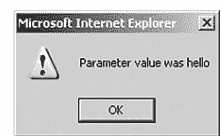

图 17.1 在 HTTP GET 请求后返回文本。

要使用相同的库检索 XML 数据，我们将再次使用第 11 节“我们的第一个 Ajax 应用”中的服务器端脚本，你可能记得该脚本在一个小型文档中交付服务器时间：

```php
<?php
header('Content-Type: text/xml');
echo "<?xml version="1.0"?><clock1><timenow>
.date('H:i:s').</timenow></clock1>";?>
```

## 第 17 节

我们必须修改回调函数，因为我们现在需要返回解析后的 XML。我们将使用现在应该已经熟悉的 DOM 方法：

```javascript
<script>
function cback(text) {
  var servertime = text.getElementsByTagName("timenow")[0]
.childNodes[0].nodeValue;
  alert('Server time is ' '+servertime);
}
</script>
```

我们唯一需要更改的是对 `dailySales()` 函数的调用：

onClick="doAjax('telltimeXML.php','','cback', 'post', '1')"

在这里我们决定发送 POST 请求。我们的服务器端脚本 `telltimeXML.php` 不需要查询字符串，因此在这种情况下第二个参数留空。最后一个参数已设置为 '1'，表示我们期望服务器通过 `responseXML` 属性响应 XML。

图 17.2 显示了运行程序的结果。


图 17.2 通过 POST 请求以 XML 格式返回服务器时间。

## 扩展库

当前的库可以通过多种方式进行改进。这些改进将留给读者作为练习，尽管在很多情况下，这些技术在书的其他地方已经介绍过。

例如，用户反馈尚未被处理；我们之前讨论过如何通过显示适当的文本或图形图像来提醒用户请求正在进行。修改库以包含第 11 节及其他地方讨论的技术将很有用的。

错误处理也被从代码中排除了，这证明是一个有用的补充。例如，修改库以检测除 200 以外的 `XMLHttpRequest` 状态属性并向用户输出适当的错误信息并不困难。

请随意尝试这些代码并看看你能实现什么。

# 总结

本节结合了迄为止讨论的许多技术，产生了一个紧凑且可用的 JavaScript 库，可以从 HTML 页面简单地调用。

该代码支持 HTTP GET 和 HTTP POST 请求，并处理从服务器返回的文本或 XML 数据。

使用此类库允许通过对 HTML 标记进行较小的添加将 Ajax 引入网页。这不仅保持了代码的整洁和易读，还简化了添加 Ajax 功能以升级旧版 HTML。

在第 18 节“陷阱”（Gotchas）中，第三部分的最后一节，我们将讨论程序员在开发 Ajax 应用时面临的一些潜在问题和陷阱。

# 第 18 节：Ajax“陷阱”

在本节中，你将学习一些常见的 Ajax 错误以及如何避免它们。

## 常见的 Ajax 错误

Ajax 有一些常见的陷阱等待着粗疏留的开发者。在本节（第三部分的最后一节）中，我们将回顾这些陷阱并讨论寻找解决方案的可能方法。

列表并不是详尽的，且提供的解决方案并不适用于所有情况。然而，它们应该能提供一些思考。

## 后退按钮

所有常用的浏览器在导航栏上都有后退按钮。浏览器在内存中维护了一个最近访问的页面列表，并允许你返回这些页面以重新访问最近看过的页面。

用户已经习惯将后退按钮作为体验的标准部分，就像他们基于页面的范式的其他方面一样。

正如你所学的，Ajax 在很大程度上摆脱了基于网络的信息以独立的、页面大小的分块交付的想法；通过 Ajax 应用，你可以反复更改页面内容，而无需考虑通过加载整个新页面来刷新浏览器显示。

提示 JavaScript 在语言中内置了等同于后退按钮的语句：
OnClick = "history.back()"

## 让 Ajax 优雅降级

书中的课程已经涵盖了使用各种浏览器开发 Ajax 应用。尽管如此，访问者的浏览器仍可能被禁用。

如果 Ajax 应用在这些情况下崩溃，将是非常遗憾的。

至少应该将明显的错误（例如无法创建 `XMLHttpRequest` 对象的实例）报告给用户。如果 Ajax 应用复杂到无法自动恢复到非 Ajax 运行模式，也许用户至少可以被重定向到非 Ajax 版本。

> 提示 你可以使用 `<noscript> ... </noscript>` 标签来检测 JavaScript 是否可用。在这些标签之间的语句仅在 JavaScript 不可用时才求值：
<noscript>
此浏览器不可用 JavaScript。<br />
请访问 <a href="other.htm">这里</a> 获取纯 HTML 版本。<br />
</noscript>


188 第 18 节

确保爬虫能够在网站的某处索引所有相关静态版本似乎是明智的。因为爬虫会遵循页面嵌入的链接，因此提供一个超文本链接的站点地图在这方面是一个非常有用的补充。

## 指出页面元素

如果没有经过仔细的设计，用户可能无法看出页面上的哪些项目是可以点击或可以与之交互以触发某些操作的。

在整个应用程序中使用一致的样式来显示哪些页面元素会引起服务器请求或其他动态活动，是值得的。这在某种程度上让人想起 HTML 页面中的超文本链接需要与普通文本进行不同的样式处理，以便让用户清楚它们执行了额外的功能。

尽管需要付出更高的代价，但可以在工具提示（ToolTip）样式的弹出窗口中包含关于活动元素的说明和信息。当然，当点击活动链接可以对应用状态产生重大影响时，这一点尤为重要。图 18.1 显示了此类弹出信息框的示例。

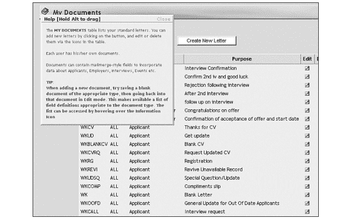

**图 18.1** 弹出信息帮助用户理解界面。

## 不要在不合适的地方使用 Ajax

尽管 Ajax 对于改进 Web 界面无疑具有吸引力，但你需要接受，在许多情况下，使用 Ajax 会损害用户体验，而不是增强用户体验。

特别是在基于页面的界面隐喻对于网站的内容和风格来说完全足够用（甚至可能更具相关性）的情况下。对于那些可以方便地拆分为章节风格页面的文本类网站，通常可以从智能设计的超链接中获益良，正如它们从添加 Ajax 功能中获益一样。

特别是小型网站，可能难以从 Ajax 界面中获得足够的收益，以抵消额外代码和复杂性增加带来的成本。

## 安全

Ajax 本身似乎没有带来任何设计 Web 应用时已经不存在的安全问题。但值得注意的是，Ajax 增强的应用程序往往比以前包含更多的客户端代码。

由于应用程序的任何用户都可以轻松查看客户端代码的内容，因此确保不在其中暴露敏感信息非常重要。在这种背景下，敏感信息不仅限于用户名和密码等信息（尽管它们确实是敏感的），还包括业务逻辑。让服务器端脚本负责执行数据库连接等任务。在将数据应用到任何重要处理之前，在服务器上进行数据验证。

## 跨平台测试代码

从本书的内容可以很清楚，不同的浏览器在实现 JavaScript 方面各不相同。微软浏览器与非微软浏览器在生成 `XMLHttpRequest` 对象实例方面的主要差异是一个基础性的例子，但也存在许多细微的差异。

特别是 DOM 的处理方式非常不同，不仅在不同浏览器之间如此，在不同版本的浏览器之间也是如此。CSS 的实现是另一个细微差异仍然泛滥的领域。

尽管在各种浏览器上测试新应用一直以来都很，但在面对 Ajax 应用带来的额外复杂性时，这可能比以往任何时候都更加重要。

希望浏览器将继续变得更加符合标准，但在那之前，请在尽可能不同的平台上和使用尽可能不同的浏览器来测试应用程序。

## Ajax 无法治愈糟糕的设计

世界上所有的动态交互都无法纠正一个设计上有根本缺陷的 Web 应用。

良好的 Web 设计的所有原则仍然适用于 Ajax 应用：

- 为多个浏览器编写代码并验证你的代码。
- 对你的代码进行注释和记录，以便日后调试。
- 尽可能使用小尺寸图形，以便它们快速加载。
- 确保你选择的颜色、背景、字体大小和样式不会让页面难以阅读。

> 提示 W3C 提供了一个免费的在线验证器：http://validator.w3.org/

## 一些编程陷阱

其中一些问题已经在不同的课程中提到过，但在这里对其进行归类是值得的。这些可能是 Ajax 开发人员在某些时候遇到的最常见的编程问题！

## GET 请求的浏览器缓存

对同一个 URL 发起多次 GET 请求通常会导致响应不是来自服务器，而是来自浏览器缓存。在使用 Internet Explorer 时，这个问题似乎尤为显著。

尽管在理论上可以使用适当的 HTTP Header 来解决，但在实践中，缓存可能是固执的。

解决此问题的有效方法是向发送请求的 URL 添加一个随机元素；浏览器将其解释为对不同页面的请求，而不是缓存版本。

在文中我们通过添加一个随机数实现了这一点。许多人青睐的方法方法是添加一个来自时间的数字，这将每次都不同：

```
var url = "serverscript.php?*rand="+new Date().getTime();
```

## 拒绝访问

接收到权限错误（Permission Error）通常意味着你违反了防止 `XMLHttpRequest` 对象发起跨域请求的安全措施。

必须调用与调用脚本位于相同域名的服务器程序。

> 注意 确保域名的拼写完全相同。Somomain.com 可能被解释为与 www.somedomain.com 不同的域名，权限将被拒绝。

## 内容转义

在构建 GET 或 POST 请求的查询时，请记住转义可能包含空格或其他文本字符的变量。在以下代码中，`idValue` 的值是从表单文本输入字段收集的，因此我们对其进行转义以确保编码正确：

```
http.open("GET", url + escape(idValue) + "&rand=" + myRandom, true);
```

# 总结

Ajax 无疑具有极大改进 Web 界面的潜力。然而，从传统的页面界面向高度动态应用的范式转变为开发者创造了一些陷阱。在本节中，我们尝试收集了一些为人知的陷阱。

一些问题已经在其他课程中遇到过，另一些可能直到你开始开发真实应用时才会变得显现。

# 第 19 节

## prototype.js 工具包

在本节中，你将学习 prototype.js JavaScript 库以及它如何减少构建强大的 Ajax 应用所需的工作。

## 介绍 prototype.js

第四部分，“商业和开源 Ajax 资源”，查看用于 Ajax 开发的代码库和框架。

我们本节从 Sam Stephenson 的 prototype.js 开始，这是一个流行的 JavaScript 库，包含了开发跨浏览器 JavaScript 例程所需的函数数组，并对 Ajax 有特定的支持。你将看到使用该库对 DOM 操作、HTML 表单和 `XMLHttpRequest` 对象的强大支持如何简化你的 JavaScript 代码。

最新版本的 prototype.js 库可以从 http://prototype.conio/ 下载。

> 注意 在编写时，prototype.js 的版本为 1.4.0。如果你下载了不同版本，请检查文档查看你的版本与此处描述的版本之间是否存在差异。


将该库引入到你的 Web 应用中非常简单，只需在 HTML 文档的 <head> 部分包含以下行即可：
<script src="prototype.js" Language="JavaScript" type="text/javascript"></script>

prototype.js 包含了大量的函数，可以使 JavaScript 代码运行更快，并让生成的脚本更简洁、更易维护。

该库包含了通用函数（为常规编程任务提供快捷方式）、一个用于 HTML 表单的封装器、一个封装 XMLHttpRequest 对象的对象、简化 DOM 任务的方法和对象等。

让我们来看其中的一些工具。

## $() 函数

$() 本质上是 DOM 方法 `getElementById()` 的一种快捷写方式。通常情况下，为了返回某个特定元素的值，你会使用如下所示的表达式：

```javascript
var mydata = document.getElementById('someElementID');
```

$() 函数通过返回作为参数传递的 ID 对应的元素值，简化了这项任务：

```javascript
var mydata = $('someElementID');
```

此外，$()（与 getElementById() 不同）可以接受多个元素 ID 作为参数，并返回一个关联元素值的数组。考虑这行代码：

```javascript
mydataArray = $('id1','id2','id3');
```

在此例中：

- mydataArray[0] 包含 ID 为 id1 的元素的值。
- mydataArray[1] 包含 ID 为 id2 的元素的值。
- mydataArray[2] 包含 ID 为 id3 的元素的值。

## $F() 函数

当输入元素或其 ID 作为参数传递给 $F() 函数时，它返回表单字段的值。查看以下 HTML 代码段：

```html
<input type="text" id="input1" name="input1">
<select id="input2">
  <option value="0">Option A</option>
  <option value="1">Option B</option>
  <option value="2">Option C</option>
</select>
```

在这里，我们可以使用

```javascript
$F('input1')
```

返回文本框中的值，并使用

```javascript
$F('input2')
```

返回选择框中当前选中选项的值。$F() 函数在复选框和文本区域输入元素上同样有效，使得无论输入元素类型如何，都能轻松返回值。

## Form 对象

prototype.js 定义了一个 Form 对象，它具有几个实用的方法来简化 HTML 表单的操作。

你可以通过调用 `getElements()` 方法来返回表单输入字段的数组：

```javascript
inputs = Form.getElements('thisform');
```

`serialize()` 方法允许将输入名称和值格式化为兼容 URL 的列表：

```javascript
inputlist = Form.serialize('thisform');
```

使用上述代码行，变量 `inputlist` 现在将包含一个序列化的参数和值对的字符串：

field1=value1&field2=value2&field3=value3...

Form.disable('thisform') ` 和 Form.enable('thisform') ` 的作用完全如其名所示。

## Try.these() 函数

之前的课程讨论了如何使用异常以便你能够捕获运行时错误并整洁地处理它们。`Try.these()` 函数提供了一种方便的方法来封装这些方法，从而在 JavaScript 实现细节存在差异的情况下提供跨浏览器解决方案：

```javascript
return Try.these(function1(),function2(),function3(), ...);
```

这些函数按顺序处理，当错误条件导致抛出异常时，操作将移动到下一个函数。当任何函数成功完成时，操作停止，此时函数返回 `true`。

将此函数应用于创建 `XMLHttpRequest` 实例展示了生成代码的简单性：

```javascript
return Try.these(
function() {return new ActiveXObject('Msxml12.XMLHTTP')},
function() {return new ActiveXObject('Microsoft.XMLHTTP')},
function() {return new XMLHttpRequest()()}
)
```

> 注意：你可能希望将此代码段与列表 8.1 进行对比，看看代码复杂度降低了多少，可读性提高了多少。

## 封装 XMLHttpRequest——Ajax 对象

prototype.js 定义了一个 Ajax 对象，旨在构建 Ajax 应用时简化你的 JavaScript 代码开发。该对象包含许多类，封装了发送服务器请求、监控进度以及处理返回数据所需的代码。

### Ajax.Request

Ajax.Request 处理创建 `HTTPRequest` 对象实例以及发送格式正确请求的细节工作。调用它非常直接：

```javascript
var myAjax = new Ajax.Request( url, {method: 'post',
parameters: mydata, onComplete: responsefunction });
```

在此调用中，`url` 定义了要调用的服务器资源的位置，`method` 可以是 `post` 或 `get`，`mydata` 是包含请求的序列化字符串，`responsefunction` 是处理服务器响应的回调函数名称。

> 提示：第二个参数使用通常称为 JSON（JavaScript 对象表示法）的符号构建。该参数由一系列 `parameter:value` 对组成，全部包含在大括号内。参数值本身可以是 JSON 对象、数组或简单值。

JSON 因其易于构建、易于解析和语言无关性而广受欢迎。你可以在 http://www.json.org 找到更多信息。

`onComplete` 参数是多个选项之一，对应 `XMLHttpRequest.readyState` 属性的可能值，在这种情况下，它是 `readyState` 值为 4（完成）。还有其他选项，包括 `asynchronous:false`，表示应进行同步调用。

### Ajax.Updater

在需要返回的数据来更新页面元素的情况下，`Ajax.Updater` 类可以简化这项任务。你只需要指定应该更新哪个元素：

```javascript
var myAjax = Ajax.Updater(elementID, options);
```

该调用与 `Ajax.Request` 类似，但增加了目标元素的 ID。以下是 `Ajax.Updater` 的代码示例：

```html
<script>
function updateDIV(mydiv) {
  var url = 'http://example.com/serverscript.php';
  var params = 'param1=value1&param2=value2';
  var myAjax = new Ajax.Updater(
    mydiv,
    url,
    {method: 'get', parameters: params}
  );
}
</script>
<input type="button" value="Go" onclick="updateDIV(targetDiv)">
<div id="targetDiv"></</div>
```

### Ajax.PeriodicalUpdater

`Ajax.PeriodicalUpdater` 类可以重复创建 `Ajax.Updater` 实例。通过这种方式，你可以让页面元素在经过一定时间后进行更新。这对于股票行情或 RSS 阅读器等应用非常有用，因为它确保了访问者始终看到的是最新的信息。

`Ajax.PeriodicalUpdater` 为 `Ajax.Updater` 选项增加了两个参数：

- 更新之间的延迟时间（秒）。默认为两秒。
- 如果服务器返回未更改的数据，则后续延迟的倍数。默认值为 1，即保持延迟不变。

这里是调用 `Ajax.PeriodicalUpdater` 的示例：

```javascript
var myAjax = new Ajax.PeriodicalUpdater(elementID, url,
{frequency: 3.0, decay: 2.0});
```

在这里我们选择初始延迟为 3 秒，并在每次服务器返回未更改的数据时增加延迟长度。

## 示例项目——价格阅读器

让我们使用 prototype.js 库构建一个定期更新以显示最新值的阅读器。在本例中，我们将使用服务器端脚本 `rand.php` 来模拟变化的股票价格：

```php
<?php
rand((double) microtime( )*1000000);
$price = 50 + rand(0,5000)/100;
echo "$price";
?>
```

该脚本通过调用 `srand()` 函数并传递基于当前时间的参数来初始化 PHP 的随机数程序。然后使用 `rand(0,5000)` 函数生成一个随机数，通过算术处理产生 50.00 到 100.00 范围内的虚假“股票价格”。


## 200 课程 19

现在我们来构建一个简单的 HTML 页面来显示当前的股票价格。
该页面是我们的 Ajax 应用程序的基础：

```html
<!DOCTYPE HTML PUBLIC "-//W3C//DTD HTML 4.01 Transitional//EN"
//http://www.w3.org/TR/html4/loose.dtd">
<html
<head>
<script src="prototype.js" Language="JavaScript">
<script type="text/javascript"></script>
<title>Stock Reader powered by Prototype.js</title>
</head>
<body>
<h2>Stock Reader</h2>
<h4>Powered by Prototype.js</h4>
<p>Current Stock Price:</p>
<div id="price"></div>
</body>
</html>
```

请注意，我们在文档头部（head）中通过一个 `<script>` 标签引入了 prototype.js 库。我们还定义了一个 id 为 "price" 的 `<div>`，它将用于显示当前的股票价格。

现在我们需要实现 `Ajax.PeriodicalUpdater` 类，并将其绑定到文档 body 元素的 `onLoad` 事件处理器中。列表 19.1 显示了完整的脚本。

## 列表 19.1 使用 prototype.js 的 Ajax 股票价格读取

```html
<!DOCTYPE HTML PUBLIC "-//W3C//DTD HTML 4.01
//Transitional//EN"
//http://www.w3.org/TR/html4/loose.dtd">
<html>
<head>
<script src="prototype.js" Language="JavaScript">
<script type="text/javascript"></script>
<script>
function checkprice() {
var myAjax = new Ajax.PeriodicalUpdater('price',
'rand.php', {method: 'post', frequency: 3.0,
day: 1});
}
</script>
<title>Stock Reader powered by Prototype.js</title>
```

## prototype.js 工具包 201

```html
<head>
<body onLoad="checkprice()">
<h2>Stock Reader</h2>
<h4>Powered by Prototype.js</h4>
<p>Current Stock Price:</p>
<div id="price">*</div>
</body>
</html>
```

看，通过使用 prototype.js，应用程序的代码变得多么简单。实现该应用程序仅仅是定义一个单行的 `checkprice()` 函数来实例化其重复 Ajax 调用，并在 body 元素的 `onLoad` 事件处理器中调用该函数。

从传递给 `Ajax.PeriodicUpdater` 的参数中，你可以看到指定了 3 秒的重复间隔。此周期不会随后的调用而改变，因为衰减值（decay value）已设置为 1。

图 19.1 显示了运行中的应用程序。从图中无法看到股票价格每 3 秒自动更新一次以显示新值。

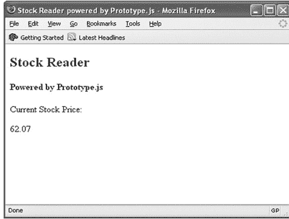

**图 19.1** Ajax 股票读取器。

这个简单的示例远未展现 prototype.js 库的强大和多功能。相反，它的目的是通过提供一个访问这一伟大资源的易用入口，帮助你开始自己的实验。

# 总结

在本书的第四部分的第一节中，我们讨论了强大且优雅的 prototype.js JavaScript 库的使用。

该库提供的函数极大地简化了开发 Ajax 应用程序时一些棘手的编程任务。

该库对 `XMLHttpRequest` 对象提供了良好的支持，并为 DOM 处理、HTML 表单以及许多与 Ajax 开发相关的技术提供了节省时间的快捷方法。

## 课程 20

# 使用 Rico

在这一节中，你将学习 Rico，这是一个强大的 Ajax 和用户界面开发框架。

## 介绍 Rico

在第 19 节“prototype.js 工具包”中，我们查看了 prototype.js，这是一个强大且实用的 JavaScript 库，简化了 Ajax 开发者面临的许多任务。

在这一节中，我们将查看 Rico，这是一个采用 prototype.js 库的复杂 Ajax 框架。

Rico 是一个开源库，扩展了 prototype.js 的功能，提供了一套丰富的界面开发工具。除了目前讨论的 Ajax 技术外，Rico 还提供了全系列工具，如拖放、电影效果等。

> 提示：Rico 是西班牙语中“丰富的”的意思，这对于一个旨在构建丰富界面的工具包来说非常合适！

## 在应用程序中使用 Rico

要开始使用 Rico 构建具有丰富用户界面的应用程序，你需要在页面的 `<head>...</head>` 部分同时引入 Rico 和 prototype.js 库。

```html
<script src="scripts/prototype.js"></script>
<script src="scripts/rico.js"></script>
```

## Rico 的 AjaxEngine

引入 `rico.js` 会自动创建一个名为 `ajaxEngine` 的 `AjaxEngine` 对象实例，供你使用。`AjaxEngine` 是 Rico 为你的网页添加 Ajax 能力的机制。

`AjaxEngine` 需要三个步骤来通过 Ajax 更新页面元素：

- 1. 注册请求处理器。注册请求处理器会将唯一名称与通过 Ajax 调用的特定 URL 关联。
- 2. 注册响应处理器。Rico 可以处理从返回的 XML 中返回 HTML 数据和 JavaScript 代码。
- 3. 从页面发起 Ajax 调用。

在响应包含 JavaScript 对象的情况下，你需要：`ajaxEngine.registerAjaxObject('myTransform', new myHandler());`

响应处理器的注册取决于我们正在处理哪种类型的响应。对于元素（element）响应，你可以直接调用：`ajaxEngine.registerAjaxElement('showdata');`。

我们首先使用以下代码注册请求处理器：`ajaxEngine.registerRequest('myRequest', 'getData.php');`。

而元素响应仅用于更新页面元素，对象响应（object responses）可以有处理器以以它们任何想要的方式处理响应。

响应的内容始终传递给该对象的 `update` 方法。这允许构建从简单到复杂的 Rico 应用程序。

## 简单示例

我们可以通过使用 20.1 的简单脚本看到 Rico 的运行。该应用程序通过对 Rico 的 `ajaxEngine` 对象的单一调用更新两个 HTML 元素。应用程序的脚本在列表 20.1 中。

## 列表 20.1 一个简单的 Rico 应用程序

```html
<!DOCTYPE HTML PUBLIC "-W3C//DTD HTML 4.01
//Transitional//EN"
//http.w3.org/TR/html4/loose.dtd">
<html>
<head>
<title>Opening Rico</title>
<script src="prototype.js"></script>
<script src="rico.js"></script>
<script type="text/javascript">
function callRICO()
{
ajaxEngine.registerRequest('myRequest', 'ricotest.php');
ajaxEngine.registerAjaxElement('display');
ajaxEngine.registerAjaxElement('heading');
}
</script>
</head>
<body onload="callRICO()">
<div id="heading"><h3>Demonstrating Rico</h3></div>
<input type="button" value="Get Server Data"
 onclick="ajaxEngine.sendRequest('myRequest')"/>
<div id="display"><p>This text should be replaced with
 <<div>>server data ...</div></p></div>
</body>
</html>
```


# 使用 Rico

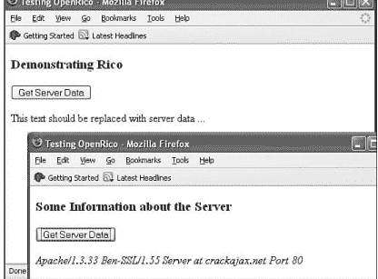

## 20.1 使用 Rico 更新多个页面元素。

服务器例程是一个简单的 PHP 脚本，用于输出所需的 XML 数据。该脚本使用了 PHP 的全局变量 `$SERVER['SERVER_SIGNATURE']`。注意，该脚本构造并返回了两个 `<response>` 元素，每个元素负责更新 HTML 页面中的特定元素。

列表 20.2 显示了服务器脚本。

### 列表 20.2 生成 <ajax-response> 的服务器脚本

```php
<?php
header("Content-Type:text/xml");
header("Cache-Control:no-cache");
header("Pragma:no-cache");
echo "<ajax-response><response type=\"response"
id=\"display\"><p>
" . \$SERVER['SERVER_SIGNATURE'] .
"</p></response>
" . "<response type=\"element\" id=\"heading\">
<h3>关于服务器的一些信息</h3>"
" . "</response></ajax-response>";
?>
```

# 第 20 

> 提示第 9 节“与服务器通信”讨论了由于浏览器缓存可能引起的问题。在该节中，我们使用了一种变通方法，在想要调用的服务器资源的 URL 中添加一个随机值的参数。

此脚本示例使用了另一种技术，包括头头部命令：

```
header("Cache-Control:no-cache");
header("Pragma:no-cache");
```

指示浏览器不要缓存此页面，而是每次都从服务器获取新副本。

> 注意 PHP 的 `$_SERVER` 全局数组变量是在 PHP 4.1.0 中引入的。如果你安装了较旧版本的 PHP，则需要使用全局变量 `$_SERVER_VARS`。

# Rico 的其他接口工具

Rico 的功能不仅限于辅助 Ajax 程序的开发。让我们看看使用 Rico 工具包可以为用户界面添加哪些其他功能。虽然这些技术本身并不使用 Ajax，但稍需想象力就能看出它们与 Rico 的 Ajax 工具结合时可以实现什么效果。

# 拖放

桌面应用程序以及运行它们的上的操作系统都广泛使用拖放功能来简化用户界面。实现拖放所需的 JavaScript 技术可能很难精通，尤其是由于会产生许多跨浏览器问题。

然而，使用 Rico 进行拖放是非常简单的。

# 使用 Rico 209

在应用程序中包含 `rico.js` 文件会自动创建一个名为 `dndMgr` 的对象，它是 Rico 的拖放管理器。使用 `dndMgr` 对象就像使用 `AjaxEngine` 一样；但这次，我们需要注册 Ajax 请求和响应、可拖拽项目以及落点区域（可以接收拖放项目的页面元素）。

这些任务通过 `registerDraggable` 和 `registerDropZone` 方法完成：

```
dndMgr.registerDraggable( new Rico.Draggable('test',
'dragElementID') );
dndMgr.registerDropZone(new Rico.Dropzone
'(dropElementID') );
```

这两个简单的命令分别声明了 ID 为 `dragElementID` 的页面元素为可拖拽的，并将 ID 为 `dropElementID` 的另一个元素为落点区域。`registerDraggable()` 方法的参数 `'test'` 定义了可拖拽项目的类型，如果需要，后续代码对其进行测试和使用。

## 拖放接口示例

列表 20.3 显示了使用 Rico 实现拖放有多简单。显示的 HTML 页面如图 20.2 所示。

## 列表 20.3 使用 Rico 的简单拖放

```
<!DOCTYPE TYPE PUBLIC "-//W3C//DTD HTML 4.01// Transitional//EN"
// "http://www.w3.com/TR/html4/loose.dtd">
<html>
<head>
<script src="prototype.js"></script>
<script src="rico.js"></script>
<style>
body {
font:10px normal arial, helvetica, verdana;
background-color:#dddddd;
}

div.simpleDropPanel {
width : 260px;
height : 180px;
```

## 列表 20.3 继续

```
background-color: #ffffff;
padding : 5px;
border : 1px solid #333333;
}

div.box {
width : 200px;
cursor : hand;
background-color: #ffffff;
moz-opacity : 0.6;
filter : alpha(Opacity=60);
border : 1px solid #333333;
}
</style>
<head>
<body>
<table width="550">
<tr>
<td><h3>拖放</h3></td>
<p>按照通常的方式，使用左鼠标键将数据项拖放到目标字段中。注意在拖放操作期间可用目标字段是如何改变颜色的。</p>
<p>刷新页面重新开始。</p>
<div class="box" id="draggable1">这是一个可拖拽数据项</div>
<div class="box" id="draggable2">这是另一个</div>
<div class="box" id="draggable3">这是第三个</div>
</tr>
</table>
```
*（注：第 220-221 页中表格结构的 OCR 识别是碎片化的；我根据文中标准的 Rico 拖放实现模式重构了逻辑结构。）*

等等，根据提供的文本提供第 220-221 页的正确重构：


# 第 21 

## 使用 XOAD

在本节中，你将学习 XOAD，这是一个由 Stanimir Angeloff 编写的支持 Ajax 的服务器端框架。

## 介绍 XOAD

在本书的这一部分，我们查看了 prototype.js 和 Rico 库以及它们如何帮助你开发 Ajax 应用。与用 JavaScript 编写的客户端库不同，XOAD 是一个用 PHP 编写的服务器端 Ajax 工具包。

本节讨论了 XOAD 后的一些概念及其基本用法。

> 提示：XOAD 是 XMLHttpRequest Object-oriented Application Development（面向对象的应用程序开发）的缩写。

到目前，我们的工作一直集中在使用 JavaScript 处理 Ajax 应用中的服务器请求和返回数据。XOAD 是一个用 PHP 编写的基于服务器的解决方案，它采用了稍不同的方法。

XOAD 应用通过将函数的序列化版本作为 JavaScript 对象，为客户端 JavaScript 解释器提供服务器 PHP 函数。

> 注意：在底层，XOAD 使用 JSON（JavaScript 对象表示）进行通信。JSON 已在第 19 节“prototype.js 工具包”中介绍过。

## 下载与安装 XOAD

XOAD 由许多 PHP 辅助脚本组成，可以从 http://sourceforge.net/projects/xoad 下载压缩包文件。要成功安装 XOAD，你需要访问一个支持 PHP 和（为了使用 XOAD 的更高级功能）MySQL 数据库的 Web 服务器。安装 XOAD 的详细说明可以在下载的材料中找到，http://forums.xoad.org 有一个公共论坛。

## 一个简单的 XOAD 页面

让我们来看一个简单的 XOAD 页面的示例。假设你有一个想在 XOAD 应用使用的 PHP 类。该类存储在 PHP 文件 `myClass.class.php` 中：

```php
<?php
class myCamera {
    function strlen($mystring) {
        return strlen($mystring);
    }
    function xoadGetMeta() {
        XOAD_Client::mapMethods($this, array('stLength'));
        XOAD_Client::publicMethods($this, array('stLength'));
    }
}
?>
```

这个简单的类只有一个函数 `strlen()`，它仅仅以函数 `xoadGetMeta()` 的形式返回字符串的长度。此信息告诉 XOAD 类中哪些方法可以导出到主应用程序。在这种情况下，有一个方法，即 `strlen()`。

> 警告：类中并非绝对必要包含元数据，但建议这样做。如果没有元数据，所有方法将是公开的，并且方法名将转换为小写。

你现在需要开始构建主应用程序脚本 `xoad.php`。

## 使用 XOAD

> 提示：在之前的节中开发的 Ajax 应用是扩展名为 .htm 或 .html 的 HTML 文件。由于我们的 XOAD 应用包含 PHP 代码，它必须有一个适当的文件扩展名。大多数 Web 服务器和 PHP 实现都接受 .php 扩展名，有些还允许 .php4 或 .html 等其他扩展名。

列表 21.1：XOAD 应用。这是一个相当无的程序，它只是返回字符串“My XOAD Application”的长度。尽管如此，它演示了将服务器端 PHP 类的方法作为 JavaScript 对象提供给客户端的概念。

### 列表 21.1 一个简单的 XOAD 应用

```php
<?php
require_once('myClass.class.php');
require_once('xoad.php');
XOAD_Server::allowClasses('myClass');
if (XOAD_Server::runServer()) {
    exit;
}
?>
<?= XOAD_Utilities::header('.') ?>
<script type="text/javascript">
var myobj = <?= XOAD_Client::register(new Class()) ?>;
var mystring = 'My XOAD Application';
myobj.onLengthError = function(error) {
    alert(error.message);
    return true;
}
myobj.strlen(mystring, function(result) {
    document.write('String: ' + mystring + '<br />Length: ' + result);
});
</script>
```

将前面的文档加载到浏览器中，页面简单地显示：
String: My XOAD Application
Length: 19

我不会详细介绍 PHP 代码是如何运行的；这是一本关于 Ajax 的书，而不是高级 PHP。不过，理解支撑代码的概念是很重要的，所以让我们逐步检查列表 21.1 并尝试理解正在发生什么：

```php
<?php
require_once('myClass.php');
require_once('xad.php');
XOAD_Server::allClasses('myClass');
if (XOAD_Server::runServer()) {
    exit;
}
?>
<?= XOAD_Utilities::header('.') ?>
```

脚本的第一部分包含了 `xad.php` 和所需的文件 `myClass.php`，并通知 XOAD 它可以访问哪些类（在本例中只有一个）。

XOAD 函数 `runServer()` 检查 XOAD 请求是否为客户端回调，并进行适当处理。`header()` 函数用于注册客户端头。

现在来看脚本的剩余部分：

```html
<script type="text/javascript">
var myobj = <?= XOAD_Client::register(new myClass()) ?>;
var mystring = 'My XOAD Application';
myobj.stLengthError = function(error) {
    alert(error.message);
    return true;
}
myobj.strlen(mystring, function(result) {
    document.write('String: ' + mystring + '<br />Length: ' + result);
});
</script>
```

看到脚本的剩余部分：
```html
var myobj = <?= XOAD_Client::register(new Class()) ?>;
```
该行将 `myClass.php` 中声明的方法导出到 JavaScript 对象。

## XOAD HTML

XOAD HTML 是一个允许轻松更新 HTML 元素的扩展。下面的示例展示了 `XOAD_HTML::getElementById()` 和 `XOAD_HTML::getElementsByTagName()` 的用法。

## XOAD_getElementById()

`XOAD_HTML::getElementById()` 方法与其 JavaScript 等效方法类似，可以识别元素。而不是包含外部文件，在本例中我们在内部定义了一个类 `Updater`。第一行使用 `XOAD_HTML::getElementById()` 来识别页面元素。

### 列表 21.2 一个简单的 XOAD

```php
<?php
class Updater {
    function change() {
        $mtext = &XOAD_HTML::getElementById('display');
        $mtext->style['backgroundColor'] = 'yellow';
        $mtext->innerHTML = 'My background color changed.';
    }
}
define('XOAD_HANDLE', true);
```

`XOAD_HTML::getElementById()` 方法类似于列表 21.1 中的代码。`change()` 函数作为 JavaScript 对象提供。列表 21.2 显示了该操作。id 为 `status` 的 `<div>` 被页面识别出来。

### 列表 21.2 继续

```php
<?php
require_once('xoad.php');
?>
<?= XOAD_Utilities::header('.') ?>
<div id="status">My background color is white.</div>
<script type="text/javascript">
var myobj = <?= XOAD_Client::register(new Updater()) ?>;
</script>
```

## XOAD_HTML::getElementsByTagName()

`XOAD_HTML::getElementsByTagName()` 方法返回特定类型的元素数组。列表 21.3 识别所有类型为 `<div>` 的元素并更改它们的一些样式属性。

### 列表 21.3 更改指定类型的页面元素

```php
<?php
class Updater
{
    function change()
    {
        $myDivs = &XOAD_HTML::getElementsByTagName('div');
        $myDivs->style['height'] = '60';
        $myDivs->style['width'] = '350';
        $myDivs->style['backgroundColor'] = 'lightgreen';
        $myDivs->innerHTML = 'Size and color changed by XOAD';
    }
}
define('XOAD_AUTOHANDLE', true);
require_once('xoad.php');
?>
<?php XOAD_Utilities::header('.') ?>
<style>
div {
border:1px solid black;
height:80;
width:150
}
</style>
<div>Div 1</div>
<br />
<div>Div 2</div>
<br />
<div>Div 3</div>
<a href="#server" onclick="myobj.change();
return false;"&gt;Update All Divs&lt;
```

页面上的三个 <div> 元素被 `XOAD_HTML::getElementsByTagName()` 识别，并且它们的样式和大小发生了变化。


# 第 21 节

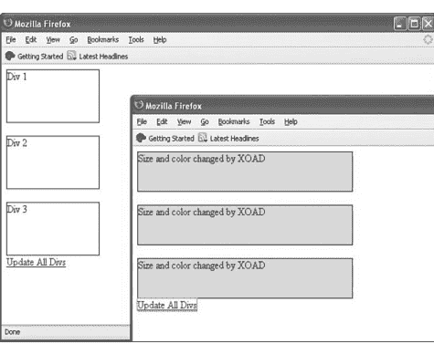

图 21.2 使用 XOAD_HTML 选择多个页面元素。

> 提示：XOAD_HTML 还有许多其他功能。XOAD_HTML 中所有可用函数的详情请参阅 XOAD 下载包。

# 使用 XOAD 进行高级编程

XOAD 拥许多超出本节讨论范围的高级功能。如果你想探索使用 XOAD 的可能极限，这里是目前支持的技术的概述。

# XOAD 事件

XOAD 框架还支持事件。在某个客户端计算机上启动的 XOAD 可以存储在服务器上，随后被其他客户端检测，从而能够构建用户可以交互的复杂应用程序。此类应用可能包括聊天、群组或类似的协作工具。

# 使用 XOAD 处理缓存

XOAD 允许使用 `XOAD_Cache` 类在服务器上进行缓存。缓存结果可以显著提高性能，特别是当服务器端程序耗时时（例如对大型数据集进行排序或对大型数据库表执行查询）。

# XOAD 控件

你可以使用 `XOAD_Controls` 类在 XOAD 中定义自定义客户端控件。

> 提示：在编写时，XOAD 的当前版本为 0.6.0.0。如果你下载的版本不同，请参阅下载包包含的文档。

# 总结

本节研究了 XOAD 形式的 Ajax 工具包服务器端实现。

XOAD 允许存储在服务器上的 PHP 类中的方法通过 JavaScript 提供给客户端程序。这与第 19 节和第 20 节讨论的客户端技术相比，形成了有趣的方法对比。

到此，本书第四部分以及实际上本书也结束了。你现在应该对 Ajax 应用架构及其基础编码技术有了良好的理解。

祝你在 Ajax 实验中顺利！

# 索引

# 符号

- @ 字符，PHP 方法，138
- <ajax-response> 元素，205-207
- `<div>` 容器，116
- <response> 元素，205-207
- <script> 元素，114
- S_SERVER 全局数组变量，208
- St() 函数，194
- SF() 函数，195
- 事件处理程序，117-118
- HTML 文档，112-113
- PHP 脚本，116
- 服务器请求，115
- 故障排除，190
- 用户反馈，120-121
- XMLHTTPRequest 对象，114-115
- 流程图，78
- prototypejs，添加到，194
- Rico，添加到，203
- 参数 (JavaScript)，
- nARPANet，互联网开发，5
- ASCII 文本，服务器响应，77
- 异步服务器请求，73, 76, 91-97
- ATTLIST 声明 (XML)，66

# A

- abort 方法，88
- 激活页面元素，（异步 HTML 和 Ajax）
- AAAH (HTTP)，131-140。另参阅 HTML
- 流程图，78
- 客户端-服务器交互，70-73
- Google Suggest 应用，示例，74
- 对象，197-204, 205
- 使用，不适当的情况，189
- Ajax 引擎，73
- <ajax-response> 元素，205-207
- Ajax.PeriodicUpdater 类，198-199
- Ajax.request 类，197
- Ajax.Updater 类，198
- AjaxEngine，204-205
- alt 属性图像，20
- Amazon.com REST API，162-164
-  标签 (HTML)，21
- Apache Web Server 网站，7
- ApacheChild，144
- 后退按钮，184
- 带宽，定义，72
- body 标签 (HTML)，16-18
- 书签，故障排除，185-186
- 浏览器
- 可用性，10
- 缓存，94, 191
- 定义，9
- 图形浏览器，9
- HTML 文档，加载，15
- 文本浏览器，9
- 不支持的浏览器，186-187
- Web 服务器交互，6

# B - C

- 设计，188
- 基础应用示例，121
- 回调函数，116-117
- 完成的应用，118-120
- callAH(H)，134-135
- callAjax() 函数，93-96, 100-101
- 回调函数，97-99
- AAAH，134-136
- 基础应用创建示例，116-117
- JavaScript 库，177-179
- 启动，100-101
- myAJAXlib.js，180
- RSS 标题阅读器，153-154
- callRICO() 函数，206
- center 标签 (HTML)，22
- 元素，6
- 更改函数，219
- 字符串，split(method)，130
- 子节点，添加 DOM，144-145
- 子节点属性，147
- 客户端-服务器交互，70-71
- 客户端编程，定义，11
- 代码，平台表单，故障排除，189
- 颜色 (HTML)，18
- 构造函数，创建实例，81
- CreateAttribute 方法，147
- CreateElement 方法，146
- CreateText(Node)，144, 147

# D - E

- date() (PHP)，57
- 开发者标记，162
- <div> 包含，116
- DNS (域名服务)，11
- DOCTYPE 声明 (XML)，64
- DOCTYPE 元素，16
- DOM (文档对象)，81-82
- appendChild() 方法，144
- createElement() 方法，146
- createText() 方法，144
- 文档方法，147
- getById 方法，69
- getElementsByTagName 方法，143
- 节点方法，147
- 节点属性，147
- 节点，67-68
- tagName 属性，68
- 文本属性，69
- ELEMENT 声明 (XML)，65
- Engines (Ajax)，73
- 应用设计，190
- 后退按钮代码，184
- 浏览器缓存，191
- 代码，平台表单，189
- GET 请求，191-192
- JavaScript 库，183
- 链接，185-186
- 页面设计，188
- 权限拒绝 (Permission Denied)，191
- POST 请求，191-192
- 安全性，192
- 爬虫，187
- 不支持的浏览器，186-187
- 用户反馈，186
- eval()，JavaScript 库，177-179
- 事件处理程序，42
- 基础创建示例，117-118
- JavaScript 函数，调用，48-49
- myAJAXlib.js，调用，180
- OnChange 事件处理程序，94
- OnClick 事件处理程序，43-44
- onLoad 事件处理程序，94
- MouseOut 事件处理程序，49
- MouseOver 事件处理程序，46-59

# F - G

- 反馈 (用户)
- 基础创建示例，120-121
- JavaScript 库，182
- 服务器请求，109-110
- 故障排除，186
- 文件扩展名，PHP 文件，54
- firstChild 属性，147
- for 循环，59
- Form 对象，195-196
- form 标签 (HTML)，31-33
- 表单验证 (JavaScript)，51-52
- 框架 (Ajax)，73
- FTP (文件传输协议)，互联网开发，5
- GET 请求，93
- 浏览器缓存，94-96, 191
- HTTP 请求，32, 35
- JavaScript 库，176
- myAJAXLib.js，180
- 查询字符串，32
- REST，159-162
- 故障排除，191-192
- getAllResponseHeader 方法，88
- getAttribute 方法 (DOM)，69
- getById(method)，110-111, 117, 143, 147
- Elements() 方法，prototype.js，195
- getElementsByTagName 方法，107-108, 117, 143
- getResponse 方法，88
- gmail 邮件服务 (Google)，75
- Google，74-75
- 图形 浏览器，9
- meta 标签，136-138
- myAJLib.js，181
- PHP，54-55
- POST 请求，32, 35
- responseText 属性，126-128
- RSS 标题阅读器，149
- 保存文档，15
- script 标签，38
- <script> 元素，114
- seville.html 文档示例，21-22
- 样式，25-26
- 标签，14
- testpage.html 文档示例，14-18
- 工具需求，14
- 文字处理器，14
- XML，实例到，6
- HTTP (超文本传输协议)，27
- 请求，28-29, 32
- 响应，31
- 服务器状态码，98
- SOAP 请求，发送，170
- 超链接 (HTML)，21
- 超文本，互联网开发，6

# H

- HasChildNodes 方法，147
- head 标签 (HTML)，16
- header 头部，HTTP 请求/响应，29-31
- header() 函数，218
- 使用 PHP 输出头部，106
- Hello World 示例，用 PHP 输出，55
- 十进制计数，HTML
- HTML (超文本标记语言)，13
- 高级文档示例，21-22
- 基础应用创建示例，112-113
- 基础文档示例，14-18
- 颜色值，19
- 注释，18
- 定义，13
- <div> 元素，16
- DOCTYPE 元素，16
- form 标签，33
- 表单示例，33-34
- GET 请求，32, 35
- 超链接，21
- JavaScript，38-42
- 加载文档，15

# I - J

- id 值，110-111
- if 语句 (PHP)，58
- image 标签 (HTML)，20
- indexOf 方法，responseText 属性，105
- 内联样式，25
- 实例 (对象)，创建，61, 84-87
- 互联网，开发，的5-6
- Internet Explorer (MS), Jscript，37
- IP 地址，定义，11

- JavaScript，36
- 参数，42-48
- 后退按钮代码，184
- 大写敏感性，39
- 命令，执行顺序，42
- 启用，37
- 表单验证示例，51-52
- 函数/参数，传递到，47-48
- 调用，46
- 事件处理程序，从...调用，48-49
- numcheck，51
- 结构，45


## 索引 227

- HTML 页面，添加, 39-42
- 回调函数, 177-179
- doAjax 函数, 178-182
- 错误处理, 183
- eval(), 177-179
- GET 请求, 176
- myAHHLibs, 174-175
- myAJHLibs, 178-182
- POST 请求, 177, 182
- prototype.js, 193-213
- 用户反馈, 182
- XMLHTTPRequest 实例, 175-176 方法, 41-47
- 对象, 41, 50, 51, 66-67
- script 标签, 38
- 变量, 50
- XML, 66-69
- script 链接，排排除, 185-186
- 循环结构 (PHP), 59
- Lynx 文本 Web 浏览器网站, 9
- Math.random() 方法, 95
- emetags, 136-138
- Mosaic. Internet 开发, 6
- 多平台代码测试, 189
- myAHHLibs, 133-140, 174-175
- myAJHLibs, 178-182

## M - N - O

- 标记元素 (HTML)。 参见 tags
- (HTML), 14
- 命名空间, SOAP, 168
- 原生对象, 81
- nextSibling 对象, 147
- nodeName 属性, 147
- 节点 (DOM), 67-68, 144-147
- nodeType 属性, 147
- nodeValue 属性, 147
- numcheck 函数 (JavaScript), 51
- 数字型数组, 58

- JSON (JavaScript 对象表示法), 197, 215

## K - L

- 关键字元数据, 136-137
- lastChild 属性, 147
- listIndexOf 方法, replaceText 属性, 105
- JavaScript 库
    - 回调函数, 177-179
    - doAjax 函数, 178-182
    - 错误处理, 183
    - eval(), 177-179
    - GET 请求, 176
    - myAHHLibs, 174-175
    - myAJHLibs, 178-182
    - POST 请求, 177, 182
    - prototype.js, 193-213
    - 用户反馈, 182
    - XMLHTTPRequest 实例, 175-176
- Ajax, 197-199
- Engine, 204-205
- 构造函数, 81
- DOM, 82
- 表单，属性, 195-196
- 实例，创建, 81-84
- JavaScript, 41, 50-51, 66-67
    - 方法, 80
    - 原生对象, 81
    - 属性, 80
- 基础应用创建示例, ple, 114-115
- callAjax(j) 函数, 93
- 实例，创建, 87
- JavaScript 库, 175-176
    - 方法, 88-90
    - 属性列表, 87
- responseAjax(j) 函数, 94
- 服务器请求, 91-101
- status 属性, 99
- setText 属性, 99
- 使用, 82
- Rico 源码库
    - AjaxEngine, 204-205
    - callRI() 函数, 206
    - 电影特效, 213
    - 拖放, 208-212
    - 多页面元素更新, 205
    - <response> 元素, 205-207
    - 使用示例, 206
    - Web 应用，添加, 203
- XMLHTTPRequest, readyState/属性, 97-98

我们如何让这个索引更有用？请通过 emails@sampublishing.com 与我们联系。

## 228 SAMS 教你如何在十分钟内学会 AJAX

- onBlur 事件处理器, 100-101
- OnChange 事件处理器, 49
- OnClick 事件处理器, 43-44, 49
- LoadEvent 事件处理器, 49, 117-118
- MouseOut 事件处理器, 49
- MouseOver 事件处理器, 46-49
- ononreadystatechange 属性, 88
- OnSubmit 事件处理器, 49, 51
- open 方法, 88-89
- 开源库。 参见 Rico
- Ajax 对象, 197-199
- 下载网站, 193
- 表单对象, 195-196
- getElements() 方法, 195
- Rico
    - AjaxEngine 实例, 204-205
    - callAjax() 函数, 206
    - 电影特效, 213
    - 拖放, 208-212
    - 多页面元素更新, 205
    - <response> 元素, 205-207
    - 使用示例, 206
    - Web 应用，添加, 203
    - serialize(method), 195
    - Stock Price Reader示例, 199-201
    - Try(this) 函数, 196
    - Web 应用，添加, 194
    - PUT 请求, 159-600

 P

-  索引, 188

  属性,, 147
- response response  ,  0

--   ,  1111 PHP PHP PHP 333- $_      88

- command   

- -    , 54
- file extensions, 54
- Hello World 示例, 55
- HTML, 54-55
- if 语句, 58
- 循环结构, 59
- 方法, 138
- php 标签, 54
- 程序流, 控制, 58-59
- 资源网站, 54
- 基础应用创建-ple, 116
- 实例,输出 prior to issues, 106
- myAJAXLib.js, 180
- quotes,转义, 106
- 变量, 56-57
- PHP 解释器, 138
- 像素, 20
- 团队, 199
- 弹窗, 188
- POST 请求, 159-162, 182
- HTTP 请求, 32, 35
- JavaScript 库, 177
- 消息体, 32
- 排排除, 191-192
- previousSibling 属性, 147
- 程序员的编辑器, HTML, 14
- 类型, js
- $() 函数, 194
- SF(this) 函数, 195

## Q - R

- 查询字符串, GET 请求, 32
- quotes 在 PHP 脚本中, 106
- readyState 属性, 88, 98
- reason phrases (HTTP 响应), 30
- 可拖拽方法, 209
- DropZone 方法, 209
- RemoveChild 方法, 147
- 请求 (HTTP), 28-29, 32
- <response> 元素, 205-207
- 使用示例, 206
- responseAH() 函数, 134-136
- responseAjax() 函数, 94, 99
- responses (HTTP), 30-31
- responseText 属性, 88, 123
- 字符字符串, 124-126
- 格式化数据, 129-130
- HTML, 126-128
- 操作方法, 104-105
- myAHHLib.js, 140
- AJAXLib.js, 180
- null 值, 13
- 使用页面元素返回文本, 124-126
- 值，显示/操作, 103-104
- responseXML 属性, 88, 105-108
- 143-146
- REST (表示状态传输), 165
- Amazon.com API, 162-164
- 文章,发布, 161-262

## 索引 229

- DELETE 请求, 159-160
- 示例, 159-160
- GET 请求, 159-162
- POST 请求, 159-162
- 原理, 158
- PUT 请求, 159-160
- SOAP 请求, 172
- 无状态操作, 160
- 服务器端编程，定义, 8-9
- 服务器端脚本, 76
- setHeader, 88-90
- servlet.html 文档示例, 21-22
- sized() 函数, 129
- SOAP (简单对象访问协议), 166-172
- 爬虫，排排除, 187
- split(method), 130
- src 属性 (图像), 20
- 状态码 (HTTP 响应), 30
- 状态行 (HTTP 请求), 30
- status 属性, 88, 99
- statusProperty, 88, 99
- Stock Price Reader 示例, 199-202
- 样式表，设置, 26
- substring 方法, responseText 属性, 105
- Rico, 203
- AjaxIndex, 204-205
- callRICO() 函数, 206
- 电影特效, 213
- dag-drag, 208-212
- 多页面更新, 205
- <response> 元素, 205-207
- 使用示例, 206
- Web 应用，添加, 203
- RSS 馈, 148
- RSS Header 行, 148-156
- runServer() 函数, 218

## S

- table 标签 (HTML), 20
- 属性 (HTML), 14
- 属性 (DOM), 68
- 标签 (HTML), 1
- 爬虫，排排除, 187
- 安全, 186
- 排排除, 191-192
- 属性, 147
- 程序员的编辑器, HTML, 14
- 类型, js
- $() 函数, 194
- SF(this) 函数, 195

## U - V - W

- 不支持浏览器, 186-187
- XML (可扩展标记语言), 61
- 注释, 136-138
- 数据, 136-138
- 文档元素, 14
- ELEMENT, 14
- HTML, 66-69
- JavaScript, 41, 50-51, 66-67
- PHP, 56-57
- 有效文档, 66-69
- XML 对象, 75

- URL (统一资源定位符), 68
- W3C 验证器, 190
- W3C 网站, 160
- Web (全球网) 开发的, 5-6
- Web 浏览器, 9
- Web 页面，定义, 7
- Web 服务器, 6-7

