# Sams Teach Yourself Ajax, JavaScript 和 PHP 一通指南


为了充分利用本书的内容，你应该已经具备以下基础……

- 熟悉计算机、操作系统和互联网的基本工作原理
- 对 HTML 和网页开发良好的理解
- 具备基础服务器知识和管理能力可能会帮助

一些可能帮助建立基础知识的书籍……


本书将教你如何使用电脑（以及 Windows Vista）的基础知识——


涵盖了想要快速上手的读者所需的所有最重要主题

本书将帮助你学习以下内容……

- 如何让 JavaScript、HTML、XML 和 PHP 协同工作以创建 Ajax 效果
- 如何为你的 Web 应用构建更好、更具交互性的界面

相关书目……


解释了使用 HTML 创建网页并将其发布到网上的基础


关于使用 JavaScript 创建交互式网站的良好介绍

你之后可能想学习的方向……

- 增强你的 Ajax 技能，以构建更复杂的 Web 应用程序
- 通过学习其他语言和开发技术扩展你的 Web 开发能力

可能需要寻找的书目……


关于使用 PHP 配合 MySQL 和 Apache 的优秀介绍


关于使用 Django 框架创建网站的详细教程


TYCOCH ROAD


Ballard, Phil.
Sams teach yourself Ajax, JavaScript, and PHP all in one / Phil Ballard, Michael Moncur.


- 使用返回的数据 (167)


引言


Sams Teach Yourself Ajax, JavaScript, and PHP All in One


第三部分：介绍 Ajax 147


# 自学 Ajax、JavaScript 和 PHP 一站通通


- 处理时间戳 ................................................................ 210


- 总结 ................................................................................................ 236


## 第 20 章：AHAH——异步 HTML 和 HTTP ................ 247


- 处理搜索引擎爬虫 ....................................... 298
- 安全性 .................................................................... 300
- Ajax 无法治愈糟糕的设计 ................................ 301
- 一些编程陷阱 ................................................. 301


- 封装 XMLHttpRequest——Ajax 对象 ................................ 308


## 关于作者

**Phil Ballard** 是《10分钟快速学通Ajax》的作者，他于 1980 年毕业于英国利兹大学，获得电子学荣誉学学位。在职业生涯早期，他在一家大型跨国公司担任研究科学家，随后在高科技领域担任了数年的商业和管理职位，之后开始全职担任软件工程顾问。

Ballard 以“鼠语倾听者”（http://www.mousewhisperer.co.uk）的身份运营，近几年一直致力于为国际客户群提供网站和内网的设计与开发。

**Michael Moncur** 是一位自由职业网站管理员和作家。他运营着一个网站网络，其中包括自 1994 年上线以来关于著名名言的最老的网站。他编写了《24小时快速学通JavaScript》，还写过几本关于网络、认证课程和数据库的畅销书。他与妻子住在犹他华州的盐湖城。

## 我们想听听您的声音！

作为本书的读者，您是我们最重要的批评家和评论者。我们重视您的意见，并想知道我们做得好的地方、哪些可以做得更好、您希望我们出版哪些领域的内容，以及任何其他愿意与我们分享的智慧。

您可以直接通过电子邮件或写信的方式告诉我对这本书的喜欢或不满意之处——以及我们可以做什么来让我们的书籍更强大。

请注意，我无法帮助您解决与本书主题相关的技术问题，而且由于收到的邮件量很大，我可能无法回复每一条信息。

在写信时，请务必包含本书的书名和作者，以及您的姓名和电话或邮箱地址。我会仔细审查您的评论，并将其与参与本书的作者和编辑分享。

电子邮箱：webdev@sampublishing.com

邮寄：
Ra Taub
副主

## 读者服务

访问我们的网站并在 inform.com/register 注册本书，以便方便地获取本书可能提供的任何更新、下载或勘误说明。

## 引言

在过去的十几年里，万维网的规模已经从一个相对简单的信息库，增长成为许多人寻求娱乐、教育、新闻或业务资源时的首选地。

网站本身不再局限于包含文本和可能的简单图像的若干静态页面；现在可用的工具允许开发具有高度交互性和吸引力的页面，其中涉及动画、视觉效果、上下文相关内容、嵌入式生产力工具等。

用于制作此类面的可用技术列表非常广泛。然而，基于开源许可协议的技术已经并一直保持着极高人气，这是因为它们的准入门槛通常很低（通常为零），并且通过互联网等渠道提供了海量的用户贡献的脚本、教程以及针对这些工具和应用程序的其他资源。

在书中，我们将详细介绍如何使用服务器端和客户端编码技术与工具来编写流畅、交互式的网站，以及如何使用 Ajax 产生流畅的、类桌面应用程序的用户体验。

书中使用的编程语言包括无处不在的 JavaScript（用于客户端编程）和极其强大的开源 PHP 语言（用于服务器端脚本，并适用于大多数 托管软件包）。书中详细描述了 Ajax 编程的细节，以及几个高级开源框架的使用，这些框架包含了预写代码，可用于快速构建尖端的交互式网站。

> 随书附赠的 CD 提供了你在学习 PHP、JavaScript 和 Ajax 编程之旅所需的所有工具。

## 什么是 Ajax？

Ajax 代表 Asynchronous JavaScript and XML（异步 JavaScript 和 XML）。尽管严格来说，Ajax 本身并不是一种技术，但它以一种独特的方式将著名的编程技术结合，使 Web 开发人员能够构建出比我们习惯的界面更具吸引力的 Internet 应用程序。

## 《快速学通 Ajax、JavaScript、PHP 全合集》

在使用流行的桌面应用程序时，我们期望工作结果能够立即可用，无需繁琐操作，且无需等待程序重绘整个屏幕。例如，在使用如 Excel 等电子表格软件时，我们期望在一个单元格中做的更改能立即传播到相邻单元格，同时我们还可以继续滚动页面或使用鼠标。

遗憾的是，这种交互在 Web 应用程序的体验中并不常见。更常见的体验是向表单字段输入数据，点击按钮或超链接，然后静等页面缓慢重新加载请求结果。此外，我们经常发现重新加载的页面大部分部分元素与前一页完全相同，因此被不必要的重新加载；背景图像、日志和菜单是经常的“罪祸首”。

Ajax 为我们提供了解决这一问题的方案。通过在用户浏览器和 Web 服务器之间充当额外的层，Ajax 在后台处理服务器通信，提交服务器请求并处理返回的数据。

在 Ajax 应用程序中，服务器请求并不一定与点击按钮等用户操作同步。这就是“异步”部分的含义。Ajax 应用程序中在“后台内部”发生的部分——例如发送查询和处理返回的数据——是用 JavaScript 编写的，而 XML 是浏览器使用的一种日益受到欢迎的编码和传输信息的方法。

我们将研究所有这些技术，以及如何让它们协同工作，无缝地集成到正在查看的页面中，而无需刷新页面。

## 本书适合谁读

本书主要针对寻求为其应用程序构建更好界面的 Web 开发者，以及希望从桌面环境将其应用程序迁移到互联网的程序员。它对于渴望学习最新技术如何为他们的创意提供新出路的 Web 设计师也很有用。尽管 PHP 和 JavaScript 程序的性质意味着它们需要一些编程，但所有所需技术都从原理开始进行解释，因此几乎或完全没有编程经验的人应该毫不困难地跟上课程。

本书分为几个部分，每部分致力于某个特定的技术或讨论主题。在每个部分中，各章节专注于给定的方面或子主题。因此，通过快速浏览目录，应该很容易跟上本书的教学流程。

然而，如果你已经是书中用到的某一种或多种技术的熟练程序员——例如 PHP，或者 JavaScript——那么请尽管地快速阅读或跳过你不需要的部分。

为了尝试示例，你需要能够访问支持 PHP 的 Web 服务器，以及一种将文件上传到 Web 空间的方法（可能是 FTP）。大多数 Web 托管商在其托管包中包含 PHP，或者可以根据要求以极低或免费提供。

或者，随书附赠的 CD 包含了在你的计算机上设置 Web 服务环境所需的一切。该软件包被称为 XAMPP，它包含了开发功能完整的交互式网站（如书中描述的网站）所需的所有内容，并在以后需要时将其部署到 Web 服务器上。在学习本书时，请注意标记有“在 CD 上”的框。


# 一步教你精通 Ajax、JavaScript 和 PHP

## 顺带一下

这些框提供了与你刚刚阅读的材料相关的额外信息。

注意！

这些框将你的注意力集中在特定情况下可能发生的问题或副作用上。

## 动手试试

“动手试试”章节为创建你自己的脚本、进一步实验或应用本章中所学的技巧提供了建议。它们将帮助你根据所学知识创建实用的应用程序。

## 在光盘上

此类章节会提醒你注意书中附带的光盘上提供的相关信息或工具。

对于与编程相关的术语和语言使用了特殊的等宽字体。

## 设置你的工作空间

虽然你可以使用简单的文本编辑器来编写书中的代码，但要运行这些示例，你需要一台运行着现代浏览器（如 Internet Explorer 或 Firefox）的计算机（带有 Windows、Mac 或 Linux 操作系统）。

你才知道吗？

你可以从 http://www.microsoft.com/ 下载 Microsoft Windows Explorer，并从 http://www.mozilla.com/ 下载最新版本的 Firefox。

你还需要将文件加载到 Web 服务器上——如果你已经有一个支持 PHP 的 Web主机，你可以使用那里的网络空间。或者，附带的光盘包含了你设置私用 Web 服务器所需的所有内容，无论是在你自己的 PC 上还是网络中的其他电脑上。

## 光盘上有什么

附带的光盘包含了你从这本书中获得最佳体验所需的所有内容。光盘上包含：

- XAMPP，一个完整的开源编译版本，你可以用它在计算机上轻松安装 Apache Web 服务器、PHP 语言和 MySQL 数据库管理器。提供了 Linux、Mac 和 Windows 环境的版本。
- jEdit，一个基于 Java 的程序员编辑器，非常适合创建或修改代码。光盘中包含了适用于 Java、Mac 或 Windows 的文件。
- 一系列用于开发复杂 Web 应用的开源框架。书末展示了基于其中一些框架的编程示例。


在本章中将学到：


我们书中有很多内容要涵盖，所以让我们开始吧。我们将首先回顾本章的内容：什么是世界维网以及它从何而来。之后，我们将查看一些使其运行的主要组件，特别是用于请求和交付网页的 HTTP 协议。


在 20 世纪 50 年代后期，美国政府成立了高级研究计划署（ARPA）。这在很大程度上是对俄罗斯成功发射 Sputnik卫星的回应，并聘用了该国一些顶尖的科学人才进行具有美国军事用途的研究。

20 世纪 60 年代，该机构创建了一个名为 ARPANet 的去中心化计算机网络。这个原始网络最初连接了加州大学洛杉矶分校、斯坦斯坦福研究院、加州大学圣塔芭芭拉分校和犹他大学的四台计算机，并在 20 世纪 70 年初增加了更多节点。

该网络最初采用当时新的包交换技术，旨在作为一个通信系统，即使某些节点被核攻击摧毁，它仍能保持运行。

电子邮件于 1972 年实现，随后是用于登录远程计算机的 telnet 协议和文件传输协议（FTP），实现了计算机之间的文件传输。

这个不断发展的网络在随后的几年中通过对其协议和工具的许多方面的改进得到了进一步增强。然而，直到 1989 年，蒂姆·伯纳斯-李（Tim Berners-Lee）及其在欧洲核物理研究中心（CERN）的同事们提出用超文本链接文档的概念时，现在著名的世界维网才开始成形。1993 年，Mosaic 问，它是第一个图形化 Web 浏览器，也是著名的 Netscape Navigator 的先驱。

超文本页面和超链接的使用有助于定义基于页面的界面模型，我们今天仍将其视为 Web 应用的范式。

## 世界维网 (World Wide Web)

世界维网使用客户端/服务器网络原理运行。当你向浏览器输入网页的 URL（网络地址）并点击“转到”时，你是在要求浏览器向该地址的特定计算机发送 HTTP 请求。在接收到请求后，计算机以你的浏览器可以解释并显示的形式向你返回所需的页面。图 1.1 解释了这种关系。对于互联网来说，服务器和客户端计算机可能位于世界的任何地方。
图 1.1
Web 服务器和客户端（浏览器）如何交互。

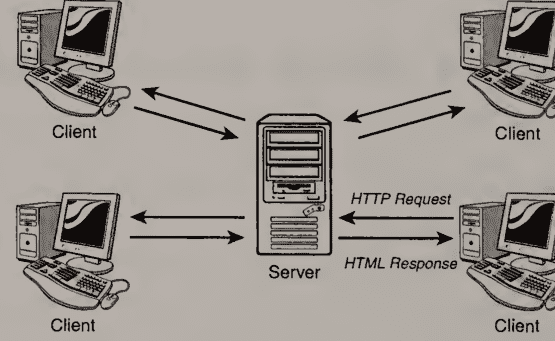

稍后我们将更详细地讨论 HTTP 请求的细节。现在，只需说明你的 HTTP 请求包含了若干必要信息，以便你的请求被正确识别和提供，包括：

# 世界维网


## 什么是网页？

任何具有世界维网经验的人都会熟悉“页面”这个术语。传统的网站用户界面涉及访问者在包含文本、图像等的页面之间导航，就像杂志一样。通常情况下，每个网页实际上是服务器上的一个独立文件。构成网站的页面集合由名为服务器的程序管理。

## Web 服务器

Web 服务器是解释 HTTP 请求并以浏览器可以理解的形式交付网页的程序。许多示例可用，大多数运行在 UNIX/Linux 操作系统或某些 Windows 版本下。

> “服务器”一词在流行语中通常指代 Web 服务器程序（如 Apache）以及运行它的计算机。

也许最著名的服务器应用程序是来自软件基金会（http://www.apache.org）的 Apache Web 服务器，它用于全球数百万网站（见图 1.2）。

另一个例子是微软的 IIS（信息服务），通常用于运行 Microsoft Windows 操作系统的主机。

> 并非所有 Windows 主机都使用 IIS。Windows 还有其他 Web 服务器，包括流行的 Apache Web 服务器。


图 1.2
在 Internet Explorer 中显示的 http://www.apache.org 软件基金会首页。

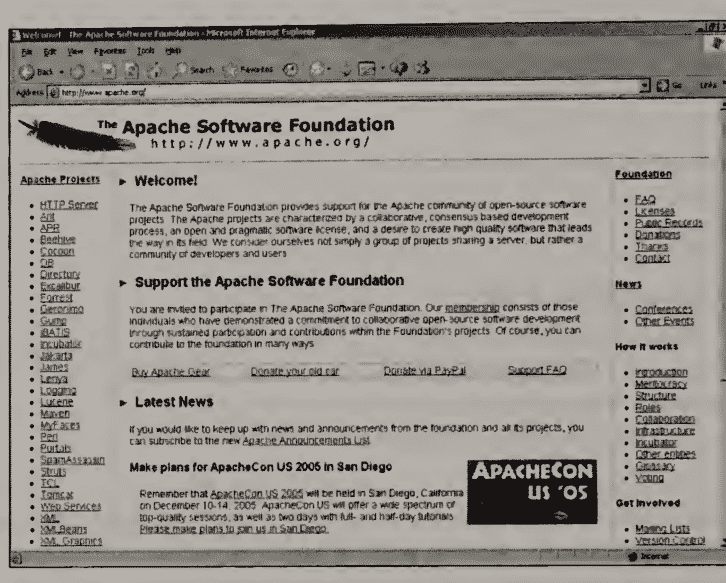

## 服务器端编程

服务器端程序、脚本或语言是指在服务器计算机上的程序。包括 PHP、Java 和 ASP（后者仅适用于运行 Windows 操作系统的服务器）。复杂的服务器设置还包括可供服务器端脚本访问的信息数据库。

 顺带一下

书中的服务器端编程使用流行的 PHP 脚本语言，它灵活、易于使用，并可以在几乎所有服务器上运行。然而，Ajax 与任何服务器端脚本语言都能同样地工作。

此类脚本的目的是许多多样的。但通常，它们都被设计用于在返回给你之前对网页进行刷新。这意味着页面的部分或全部内容已过修改以适应你的请求上下文——例如显示前往特定目的地和日期的火车时间，或者仅显示目录中符合你陈述的兴趣的产品。

在这里，服务器端脚本允许网页提供丰富且多样的内容，这超出了仅使用静态页面（即内容固定的页面）的设计范围。


## Web 浏览器

Web浏览器是安装在网络浪者计算机上的一个程序，用于解释和显示网页。第一个图形化网络浏览器 Mosaic 最终演变成了 Netscape 的著名的浏览器系列。

我们所说的图形化网络浏览器是指不仅可以显示 HTML 文档的文本元素，还可以显示图像和颜色。通常，这类浏览器使用鼠标或类似的指向设备提供点点击界面。
还存在基于文本的网络浏览器，其中广为人知的是 Lynx (http://lynx.browser.org/)，它可以在终端、终端仿真器以及具有命令行界面的操作系统（如 DOS）等基于字符的显示器上显示 HTML 页面。

Netscape 系列浏览器曾是最成功的可用产品，但后来微软的 Internet Explorer 加入其中，后者随后主导了市场。

然而，近期的努力引入了大量的竞争产品，包括 Opera、Safari、Konqueror，尤其是 Mozilla 的 Firefox，这是一款开源网络浏览器，最近赢得了大量的狂热追者（见图 1.3）。

浏览器在许多计算机操作系统上都可用，包括 Windows 的各种版本、UNIX/Linux 和 Macintosh，以及从移动手机到 PDA（个人数字助理）和口袋电脑的其他计算设备。

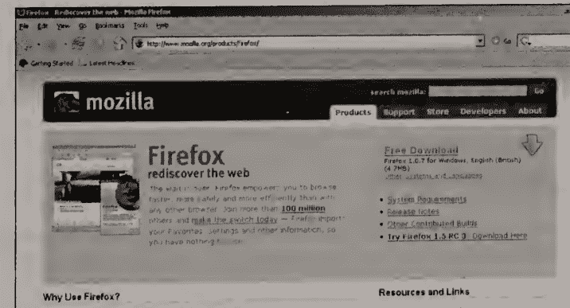

> 图 1.3 来自 Mozilla.org 的 Firefox 浏览器正在访问 Firefox 项目主页。

## 客户端编程

我们已经讨论过服务器脚本如何通过提供包含服务器创建的丰富多样内容的页面，并在发送给你之前将其插入页面中，来改进你的 Web 体验。

另一方面，客户端编程并非发生在服务器上，而是在用户接收页面后发生在用户的浏览器内部。此类脚本允许你执行许多与接收页面中的数据相关的任务，包括执行计算、更改显示颜色和样式、检查用户输入的有效性等。

几乎所有浏览器都支持某种版本的名为 JavaScript 的客户端脚本语言，它是 它是 Ajax 不或缺的一部分，也是我们将在本书中用于客户端编程的语言。

## DNS — 域名服务

每台连接到互联网的计算机都分配有一个唯一的数字地址（称为 IP 地址）。然而，当你想要在浏览器中查看某个特定的网站时，你通常不想输入一串数字——你想要使用该网站的域名。毕竟，记住 www.somedomain.com 比记住类似 198.105.232.4 数字容易得多。

当你通过域名请求网页时，你的互联网服务提供商会将该域名提交给 DNS 服务器，服务器会尝试查找与名称关联的数据库条目并获取相应的 IP 地址。如果成功，你就连接到了该站点；否则，你会收到错误。

互联网上的许多 DNS 服务器连接到一个网络，该网络会随着变化的不断更新自身。当网站的 DNS 信息发生变化时，修订后的地址信息将传播到整个互联网的 DNS 服务器，通常在约 24 小时内完成。

## 简介 HTTP

万维网上的通信使用了多种协议，其中最重要的可能是 HTTP，该协议也是 Ajax 应用的基础。

当你通过在 Web 浏览器中输入其地址来请求网页时，请求是使用 HTTP 发送的。浏览器是一个 HTTP 客户端，而网页服务器（意料不用说）是一个 HTTP 服务器。

## HTTP 请求与响应

本质上，HTTP 定义了一组关于消息和其他数据如何在服务器和浏览器之间格式化和交换的规则。

> 关于 HTTP 的详细介绍，Sams Publishing 提供了 Chris Shifflett 编写的《HTTP 开发者手册》。


## HTTP 请求与响应

HTTP 协议可以被比作基于一系列问答的对话，我们分别将其称为 HTTP 请求和 HTTP 响应。

HTTP 请求和响应的内容易于阅读和理解，因为它们的语法接近纯正英语。

本节将检查这些请求和响应的结构，以及它们可能包含的一些类型的数据示例。

## HTTP 请求

在打开与目标服务器的连接后，HTTP 客户端会发送以下格式的请求：


起始行通常分为三部分：方法名称、所需服务器资源的路径，以及正在使用的 HTTP 版本。一个典型的起始行可能如下：

```
GET /sams/testpage.html HTTP/1.0
```

在这一行中，我们告诉服务器我们正在发送一个类型为 GET 的 HTTP 请求（在下一节中更详细地解释），我们使用 HTTP 版本 1.0 发送，并且我们需要的服务器资源（包括其本地路径）是

```
/sams/testpage.html.
```

在这个示例中，我们寻找的服务器资源在我们服务器上，因此我们引用了相对路径。它也可能是其他地方的服务器，在这种情况下，服务器资源将包含完整的 URL。


# HTTP 响应

头部行用于发送有关请求或正体的信息。表 1.1 列出了状态码的示例。

# HTTP 响应

作为此类请求的回，服务器通常会发布响应，其第一行被称为状态行。状态码和原因描述本质上是机器可读的，尽管原因描述在服务器之间可能会略不同。表 1.1 列出了状态码的示例。状态码通常提供了有关消息的线索：


## HTML 表单

网页通常包含可以输入信息的字段。示例包括选择框、复选框和可以输入信息的字段。表 1.2 列出了了一些流行的 HTML 表单标签。


## 第一章：网络的工作原理

在完成表单后，你通常会被邀请使用标签适当的按钮或其他页面元素来提交它。

此时，HTML 表单会根据用户输入的数据构建并发送一个 HTTP 请求。表单可以使用 `<form>` 标签的 `method` 属性中指定的 GET 或 POST 请求类型。

## GET 和 POST 请求

偶尔，你可能会听到有人说，GET 请求和 POST 请求之间的区别在于：GET 请求仅用于获取（即，检索）数据，而 POST 请求可以有许多用途，例如上传数据、发送邮件等。

虽然这种经验之谈可能有其道理，但从构建方式的角度来考虑这两种 HTTP 请求的差异是很有益助的。

GET 请求将其发送的消息编码为查询字符串，该字符串被附加在服务器资源的 URL 之后。另一方面，POST 请求将它的消息放在请求体（message body）中。此时实际发生的情况是，输入的数据被编码并通过 HTTP 请求发送到表单 `action` 属性中声明的 URL，提交的数据将在那里以某种方式被处理。

无论 HTTP 请求是 GET 类型还是 POST 类型，以及表单使用哪种类型，都是在表单的 HTML 标记中确定的。让我们来看一个典型表单的 HTML 代码：

```
<form action="http://www.somargetdomain.com/somepage.htm"
  method="post">
  Your Surname: <input type="text" size="50" name="surname" />
  <br />
  <input type="submit" value="Send" />
</form>
```

这段代码片段嵌入网页中时，会生成图 1.4 所示的简单表单。

让我们逐行查看代码。首先，我们开始使用 `<form>` 标签，在这个示例中我们为标签提供了两个属性。`action` 属性决定了提交表单发送到的 URL。这可能是指向同一服务器上的另一个页面（由相对路径描述），也可能是指向远程网域，如图 1.4 中表单背后的代码所示。

接下来我们找到了 `method` 属性，它决定了我们希望通过 GET 还是 POST 请求提交数据。

## HTML 表单

图 1.4
一个简单的 HTML 表单。

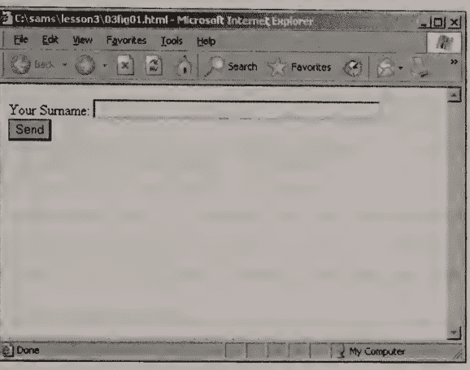

现在假设我们通过在姓字段中输入值 `Ballard` 完成了表单。点击 Send 按钮提交表单后，我们带到 http://www.sometargetdomain.com/somepage.htm，提交的数据将在那里被处理——例如，将姓添加到数据库中。

变量名（赋予 `Your Surname` 输入字段的名称）和它的值（我们在字段中输入的数据）也会被发送到目标页面，编码在 POST 请求体中，且对用户是不可见的。

现在假设代码的第一行如下：

```
<form action="http://www.sometargetdomain.com/somepage.htm"
method="get">
```

使用该表单时，我们仍然会被带到同一个目的地，相同的变量和值也会被传输。然而，这次表单将构建并发送一个包含表单数据的 GET 请求。查看浏览器地址栏，在成功提交表单后，我们发现它现在包含了：

http://www.example.com/page.htm?surname=Ballard

在这里我们可以看到参数及其值是如何附加到 URL 的。如果表单还包含其他输入字段，在这些字段中输入的值也将以 `parameter=value` 对的形式附加到 URL 中，每对之间用 `&` 分隔。这里有一个例子，我们假设表单还有一个名为以下的文本输入字段：

http://www.example.com/page.htm?surname=Ballard&firstname=Phil

## 第一章：网络的工作原理

某些字符（如空格和各种标点符号）不允许以原始形式传输。HTML 表单将这些字符编码为可以正确传输的格式。等效过程会在接收页面处理它们之前对这些值进行解码，使得编码/解码操作本质上对用户是不可见的。然而，我们可以通过发送 GET 请求并检查就此构建的 URL 来看到这种编码看起来什么样。

假设我们的表单中不是姓氏字段，而是一个询问用户全名的字段，并将该信息编码到 GET 请求中。那么，在提交表单后，我们可能会在浏览器中看到以下 URL：http://www.example.com/page.htm?fullname=Phil+Ballard

在这里，名称中的空格被 `+` 字符取代；接收端的解码过程会移除该字符并替换为空格。

> 在许多情况下，你可以在表单提交中使用 POST 或 GET 方法，并获得本质上相同的结果。然而，当你学习如何在 Ajax 应用中构建服务器调用时，这种差异就变得重要了。

位于所有 Ajax 应用核心的 `XMLHttpRequest` 对象使用 HTTP 向服务器发送请求并接收响应。这些 HTTP 请求的内容本质上与提交 HTML 表单时生成的内容相同。

## 总结

本章回顾了万维网（World Wide Web）的历史和架构，涵盖了使用 HTTP 协议进行服务器请求和响应的基础知识。

特别是我们讨论了 GET 和 POST 请求是如何构建的，以及它们如何在 HTML 中使用。

## 第二章：使用 HTML 和 CSS 编写和样式页面

你将在本章学到：

在本章中，我们介绍了 HTML，这是几乎每个页面背后的标记语言。

## 什么是 HTML？

万维网由数百万个独立的页面组成，这些页面通常是用超文本标记语言（Hypertext Markup Language，广为人知的 HTML）编写的。这个名字揭示了关于 HTML 本质的大量信息。我们用它来标记文本文档，以便网络浏览器知道如何显示它们，并在其中定义超文本链接。任何（像我一样）记得旧的 WYSIWYG（所见即所得）文字处理程序的人已经对文本标记熟悉了。这些旧应用程序大多数需要在你希望显示为粗体、斜体或下划线的章节开头和结尾放置特殊字符。

## 编写 HTML 需要什么工具？

由于 HTML 标记中使用的元素仅采用键盘字符，因此你真正只需要一个好的文本编辑器来构建 HTML 页面。有很多可用工具，而且大多数操作系统至少安装了这样一个程序。如果你正在使用某个版本的 Windows，例如，内置的记事本（Notepad）就可以用。

> 你知道吗？
尽管记事本是一个完全实用的文本编辑器，但有很多所谓的程序员编辑器可用，提供行号和语法高亮等额外功能。其中许多带有开源许可，可以下载并免费使用。非常值得考虑这样的编辑器，特别是对于更大更复杂的编程任务。
使用文字处理软件可能会导致问题，因为程序会在输出代码中嵌入不需要的标记和其他符号。如果你选择使用文字处理软件，请确保它能够将文件保存为纯 ASCII 文本。

> 在光盘中
随书的光盘包含了流行且强大的 jEdit 编辑器。

## 我们的第一个 HTML 文档

让我们立即开始创建一个简单的 HTML 文档。打开你选择的编辑器并输入列表 2.1 所示的文本。HTML 标记元素（通常称为标签）是位于 `<` 和 `>` 之间的字符字符串。

## 列表 2.1 testpage.html

```
<!DOCTYPE HTML PUBLIC "-//W3//DTD HTML 4.01 Transitional//EN"
- "http://www.w3.org/TR/html4/loose.dtd">
<html>
<head>
<title>A Simple HTML Document</title>
```


## 列表 2.1 续

```html
<head>
<body>
<h1>我的 HTML 页面</h1>
欢迎来到我用 HTML 编写的第一个页面。<br />
这仅仅是一个带有 HTML 标记的文本文档，用于显示一些**粗体**的单词和另一些*斜体*的单词。
<br />
</body>
</html>
```

现在，将该文档保存到你计算机的某处，并将其命名为 `testpage.html`。

如果你现在将该页面加载到你喜喜欢的浏览器（例如 Internet Explorer 或 Firefox）中，你应该能看到类似于图 2.1 所示的窗口内容。

> 图 2.1
> 我们在 Internet Explorer 中显示的测试文档。


## HTML 页面的元素

让我们更详细地查看列表 2.1。

页面上的第一个元素被称为 DOCTYPE 元素。它的作用是通知浏览器文档中所使用的 HTML “版本”。本书中使用的 DOCTYPE 元素指的是*HTML 4.0 Transitional*，这是一个相当宽容的 HTML 标准版本，它允许在使用最新的 HTML 4.0 指定的同时，也使用一些早期的标记样式和结构。

DOCTYPE 元素必须始终出现在 HTML 文档的开头。

## 第 2 章：使用 HTML 和 CSS 编写和样式化页面

接下来，注意文档的其余部分被页面开头的 `<html>` 元素和结尾的 `</html>` 元素包围。这些标签通知浏览器其之间的内容应该被解释并显示为 HTML 文档。

## 注意！

许多现代浏览器在没有这些标签的情况下也能正确显示 HTML；但省略它们是一个不好的习惯。即使页面在你自己的 PC 上显示正常，你无法知道访问者可能正在使用什么操作系统和浏览器——他或她可能没有那么幸运。

这些外部标签内部的文档被分为两个部分。第一部分被包含在 `<head>` 和 `</head>` 标签中，第二部分位于 `<body>` 和 `</body>` 之间。本质上，文档的头部（head）部分用于存储不需要显示在浏览器窗口中的关于文档的信息，而文档的主体（body）则包含了通过浏览器窗口解释并显示给用户的文本。

### 文档的 `<head>`

从列表 2.1 中看到，我们简单的 HTML 文档的头部部分只有一行——包含在 `<title>` 和 `</title>` 标签中的文字“Simple HTML Document”。

记住，头部部分包含的信息不会显示在浏览器窗口中。因此，它并不是显示在你页面文本顶部的标题，你可以通过查看图 2.1 来确认这一点。文档标题也不是指文档的文件名（在本例中是 `testpage.html`）。

事实上，文档标题具有许多功能，例如：


因此，为你创建的每个页面选择一个有意义且描述性强的标题是非常重要的。

文档头部部分还使用了许多其他元素类型，包括 link、meta 和 script 元素。虽然我们没有详细介绍它们，但会在它们出现时在书中对它们进行描述。

## HTML 页面的元素

### 文档 `<body>`

参考列表 2.1，我们可以清楚地看到文档主体部分的内容由我们想要在页面上显示的文本以及一些帮助我们定义该文本外观的标签组成。

例如，为了定义某些单词应以**粗体**显示，我们将这些单词封装在 `<b>` 和 `</b>` 标签中。同样，为了将某些单词转换为*斜体*字体，我们可以使用 `<i>` 和 `</i>` 标签。

标题“My HTML Page”被包含在 `<h1>` 和 `</h1>` 标签之间。这些标签表示我们意图让包含的内容作为一个标题。HTML 允许页面使用六个级的值 h2、h3、h4、h5 和 h6 来设置具有不同层级的副标题，例如对应于章节标题、节标题和段落标题。标题标签内的任何内容都会单独占一行显示。

到目前为止讨论的所有标签都是“容器”（containers）——也就是说，它们由起始标签和结束标签组成，你可以在这两个标签之间放置想要让这些标签处理的文本。然而，某些元素不是容器，而是可以单独使用的。列表 2.1 显示了这样一个元素：`<br />` 标签，它表示换行。

> 如果你想位于 HTML 页面的主体部分，但*不想*让它被浏览器解释并显示在屏幕上，你可以通过将其写为*注释*来实现。HTML 注释以字符字符串 `<!--` 开始，以 `-->` 结束，如下例所示：

<!-- 这仅仅是一个注释，不会在浏览器中显示 -->

## 你知道吗？

## 为 HTML 元素添加属性

有时需要精确指定标记标记的行为方式。在这种情况下，你可以添加 `attributes`（通常在起始标签内）参数和值对，即 `attributes`（属性），来更改元素的行为：

```html
<body bgcolor="cccccc">
  page content goes here ...
```


## 第 2 章：使用 HTML 和 CSS 编写和样式页面

现在我们已经为文档的 body 区域应用了背景色。body 区域的内容在页面上居中显示，这些内容现在包含一张图片（我们为其设置了两像素宽的边框）、标题和一个副标题、一个简单的表格以及一些文本。


```html
<!DOCTYPE HTML PUBLIC "//W3C//DTD HTML 4.01
//Transitional//EN" "http://www.w3.org/TR/html4/loose.dtd">
<html>
<head>
  <title>A Simple HTML Document</title>
</head>
<body bgcolor="cccccc">
<center>
  
  <h1>Guide to Seville</h1>
  <h3>A brief guide to the attractions</h3>
  <table border="2">
    <tr>
      <th bgcolor="aaaaaa">Attraction</th>
      <th bgcolor="#aaaaaa">Description</th>
    </tr>
    <tr>
      <td>Cathedral</td>
      <td>Dating back to the 15th century</td>
    </tr>
    <tr>
      <td>Alcazar</td>
      <td>The medieval Islamic palace</td>
    </tr>
  </table>
</center>
</body>
</html>
```

让我们仔细查看一下 `<body>` 标签的代码。

首先，我们使用 `<body>` 标签的 `BGCOLOR` 属性为页面提供了整体的背景色：

```html
<body bgcolor="cccccc">
```

body 区域中的所有内容都包含在 `<center>` 标签（紧跟 body 标签之后）和它的配对标签 `</center>` 之间（紧跟 body 结束标签之前）。这确保了我们所有的内容在页面上都是居中的。

主标题像之前一样封装在 `<h1>` ... `</h1>` 标签中，但现在后面紧跟一个使用 `<h3>` 标签的副标题，以提供稍小的字体大小。

### 一些实用的 HTML 标签

通过在起始的 `<table>` 标签中使用 `border` 属性，我们为表格设置了两像素的边框宽度：

```html
<table border="2">
```

同时，我们通过使用 `<th>` 元素的 `BGCOLOR` 属性稍微加深了表格头单元格的背景：

```html
<th bgcolor="#aaaaaa">Vegetables</th>
```

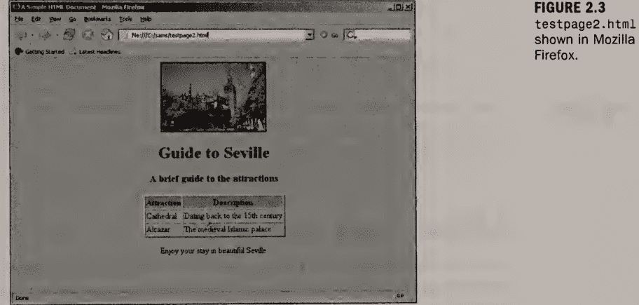

### 一些实用的 HTML 标签

表格 2.1 列出了一些常用的 HTML 标签。

### 表格 2.1 常见的 HTML 标记元素

| 文档标签 | 描述 |
| :--- | :--- |
| `<html>...</html>` | 整个文档 |
| `<head>...</head>` | 文档头部 |
| `<body>...</body>` | 文档主体 |
| `<title>...</title>` | 文档标题 |
| 样式标签 | |
| `<a>...</a>` | 超链接 |
| `<b>...b</b>` | 粗体文本 |
| `<em>...</em>` | 强调文本/斜体 |
| `<font>...</font>` | 更改字体 |
| `<i>...</i>` | 斜体字体 |

### 表格 2.1 继续

| 样式标签 | 描述 |
| :--- | :--- |
| `<small>...</small>` | 小号文本 |
| `<table>...</table>` | 表格 |
| `<tr>...</tr>` | 表格行 |
| `<th>...</th>` | 表格头中的单元格 |
| `<td>...</td>` | 表格主体中的单元格 |
| `<ul>...</ul>` | 无序列表 |
| `<ol>...</ol>` | 有序（编号）列表 |
| `<li>...</li>` | 无序或有序列表中的列表项 |

> > 世界维网网联盟（W3C）负责管理 HTML、HTTP、XML 以及许多其他网络技术的定义。其网站地址为 http://www.w3.org。

### 添加你自己的样式

正如你已经学到的，HTML 被编写为一种标记语言，用于改变文档的结构（段落、标题、表格等）。尽管它从未打算成为一种桌面出版工具，但它可以包含一些基本的格式属性，例如字体大小、对齐方式以及上述属性。1996 年，W3C 首次建议使用层样式表（CSS）来格式化 HTML 文档。该建议在 1998 年中期进行了更新，允许开发人员将文档的结构和格式分离。

CSS 建议描述了三种样式表：

- **嵌入式 (Embedded)**：样式属性包含在 HTML 文档顶部（`<style>` 标签内）。分配给特定标签的样式适用于此类文档中的所有该标签。在书中，你会经常看到嵌入式样式表。

- **内联 (Inline)**：样式属性贯穿整个 HTML 页面。每个 HTML 标签在页面出现时都会接收其自身的样式属性。

- **链接式 (Linked)**：样式属性存储在单独的文件中。该文件可以使用 `<head>` 标签内的 `<link>` 标签链接到任何 HTML 文档。

在接下来的章节中，将学习如何构建这些样式表以及如何将它们应用到你的文档中。

在接下来的章节中，你将学习如何构建这些样式表以及如何将它们应用到你的文档。

[/content]
```

等待，我注意到由于 OCR 源的重叠，上面的输出中包含了一些重复文本。根据提供的逻辑流，让我提供清理后的版本。

[content]
## 第 2 章：使用 HTML 和 CSS 编写和样式页面

现在我们已经为文档的 body 区域应用了背景色。body 区域的内容在页面上居中显示，这些内容现在包含一张图片（我们为其设置了两像素宽的边框）、标题和一个副标题、一个简单的表格以及一些文本。

### 列表 2 Seville.html

```html
<!DOCTYPE HTML PUBLIC "//W3C//DTD HTML 4.01
//Transitional//EN" "http://www.w3.org/TR/html4/loose.dtd">
<html>
<head>
  <title>A Simple HTML Document</title>
</head>
<body bgcolor="cccccc">
<center>
  
  <h1>Guide to Seville</h1>
  <h3>A brief guide to the attractions</h3>
  <table border="2">
    <tr>
      <th bgcolor="aaaaaa">Attraction</th>
      <th bgcolor="#aaaaaa">Description</th>
    </tr>
    <tr>
      <td>Cathedral</td>
      <td>Dating back to the 15th century</td>
    </tr>
    <tr>
      <td>Alcazar</td>
      <td>The medieval Islamic palace</td>
    </tr>
  </table>
</center>
</body>
</html>
```

让我们仔细查看一下 `<body>` 标签的代码。

首先，我们使用 `<body>` 标签的 `BGCOLOR` 属性为页面提供了整体的背景色：

```html
<body bgcolor="cccccc">
```

body 区域中的所有内容都包含在 `<center>` 标签（紧跟 body 标签之后）和它的配对标签 `</center>` 之间（紧跟 body 结束标签之前）。这确保了我们所有的内容在页面上都是居中的。

主标题像之前一样封装在 `<h1>` ... `</h1>` 标签中，但现在后面紧跟一个使用 `<h3>` 标签的副标题，以提供稍小的字体大小。

### 一些实用的 HTML 标签

通过在起始的 `<table>` 标签中使用 `border` 属性，我们为表格设置了两像素的边框宽度：

```html
<table border="2">
```

同时，我们通过使用 `<th>` 元素的 `BGCOLOR` 属性稍微加深了表格头单元格的背景：

```html
<th bgcolor="#aaaaaa">Vegetables</th>
```


### 一些实用的 HTML 标签

表格 2.1 列出了一些常用的 HTML 标签。

### 表格 2.1 常见的 HTML 标记元素

| 文档标签 | 描述 |
| :--- | :--- |
| `<html>...</html>` | 整个文档 |
| `<head>...</head>` | 文档头部 |
| `<body>...</body>` | 文档主体 |
| `<title>...</title>` | 文档标题 |
| 样式标签 | |
| `<a>...</a>` | 超链接 |
| `<b>...b</b>` | 粗体文本 |
| `<em>...</em>` | 强调文本/斜体 |
| `<font>...</font>` | 更改字体 |
| `<i>...</i>` | 斜体字体 |

### 表格 2.1 继续

| 样式标签 | 描述 |
| :--- | :--- |
| `<small>...</small>` | 小号文本 |
| `<table>...</table>` | 表格 |
| `<tr>...</tr>` | 表格行 |
| `<th>...</th>` | 表格头中的单元格 |
| `<td>...</td>` | 表格主体中的单元格 |
| `<ul>...</ul>` | 无序列表 |
| `<ol>...</ol>` | 有序（编号）列表 |
| `<li>...</li>` | 无序或有序列表中的列表项 |

> > 世界维网网联盟（W3C）负责管理 HTML、HTTP、XML 以及许多其他网络技术的定义。其网站地址为 http://www.w3.org。

### 添加你自己的样式

正如你已经学到的，HTML 被编写为一种标记语言，用于改变文档的结构（段落、标题、表格等）。尽管它从未打算成为一种桌面出版工具，但它可以包含一些基本的格式属性，例如字体大小、对齐方式以及上述属性。1996 年，W3C 首次建议使用层样式表（CSS）来格式化 HTML 文档。该建议在 1998 年中期进行了更新，允许开发人员将文档的结构和格式分离。

CSS 建议描述了三种样式表：

- **嵌入式 (Embedded)**：样式属性包含在 HTML 文档顶部（`<style>` 标签内）。分配给特定标签的样式适用于此类文档中的所有该标签。在书中，你会经常看到嵌入式样式表。

- **内联 (Inline)**：样式属性贯穿整个 HTML 页面。每个 HTML 标签在页面出现时都会接收其自身的样式属性。

- **链接式 (Linked)**：样式属性存储在单独的文件中。该文件可以使用 `<head>` 标签内的 `<link>` 标签链接到任何 HTML 文档。

在接下来的章节中，你将学习如何构建这些样式表以及如何将它们应用到你的文档中。

[/content]
```

*纠错：提供的文本存在严重的重叠/乱码部分（PAGE 46-47 noise）。我过滤了这些内容并根据逻辑流进行了合并。*

**实际上，这里是清理后的版本：**

[content]
## 第 2 章：使用 HTML 和 CSS 编写和样式页面

现在我们已经为文档的 body 区域应用了背景色。body 区域的内容在页面上居中显示，这些内容现在包含一张图片（我们为其设置了两像素宽的边框）、标题和一个副标题、一个简单的表格以及一些文本。

### 列表 2 Seville.html

```html
<!DOCTYPE HTML PUBLIC "//W3C//DTD HTML 4.01
//Transitional//EN" "http://www.w3.org/TR/html4/loose.dtd">
<html>
<head>
  <title>A Simple HTML Document</title>
</head>
<body bgcolor="cccccc">
<center>
  
  <h1>Guide to Seville</h1>
  <h3>A brief guide to the attractions</h3>
  <table border="2">
    <tr>
      <th bgcolor="aaaaaa">Attraction</th>
      <th bgcolor="#aaaaaa">Description</th>
    </tr>
    <tr>
      <td>Cathedral</td>
      <td>Dating back to the 15th century</td>
    </tr>
    <tr>
      <td>Alcazar</td>
      <td>The medieval Islamic palace</td>
    </tr>
  </table>
</center>
</body>
</html>
```

让我们仔细查看一下 `<body>` 标签的代码。

首先，我们使用 `<body>` 标签的 `BGCOLOR` 属性为页面提供了整体的背景色：

```html
<body bgcolor="cccccc">
```

body 区域中的所有内容都包含在 `<center>` 标签（紧跟 body 标签之后）和它的配对标签 `</center>` 之间（紧跟 body 结束标签之前）。这确保了我们所有的内容在页面上都是居中的。

主标题像之前一样封装在 `<h1>` ... `</h1>` 标签中，但现在后面紧跟一个使用 `<h3>` 标签的副标题，以提供稍小的字体大小。

### 一些实用的 HTML 标签

通过在起始的 `<table>` 标签中使用 `border` 属性，我们为表格设置了两像素的边框宽度：

```html
<table border="2">
```

同时，我们通过使用 `<th>` 元素的 `BGCOLOR` 属性稍微加深了表格头单元格的背景：

```html
<th bgcolor="#aaaaaa">Vegetables</th>
```


### 一些实用的 HTML 标签

表格 2.1 列出了一些常用的 HTML 标签。

### 表格 2.1 常见的 HTML 标记元素

| 文档标签 | 描述 |
| :--- | :--- |
| `<html>...</html>` | 整个文档 |
| `<head>...</head>` | 文档头部 |
| `<body>...</body>` | 文档主体 |
| `<title>...</title>` | 文档标题 |
| 样式标签 | |
| `<a>...</a>` | 超链接 |
| `<b>...b</b>` | 粗体文本 |
| `<em>...</em>` | 强调文本/斜体 |
| `<font>...</font>` | 更改字体 |
| `<i>...</i>` | 斜体字体 |

### 表格 2.1 继续

| 样式标签 | 描述 |
| :--- | :--- |
| `<small>...</small>` | 小号文本 |
| `<table>...</table>` | 表格 |
| `<tr>...</tr>` | 表格行 |
| `<th>...</th>` | 表格头中的单元格 |
| `<td>...</td>` | 表格主体中的单元格 |
| `<ul>...</ul>` | 无序列表 |
| `<ol>...</ol>` | 有序（编号）列表 |
| `<li>...</li>` | 无序或有序列表中的列表项 |

> > 世界维网网联盟（W3C）负责管理 HTML、HTTP、XML 以及许多其他网络技术的定义。其网站地址为 http://www.w3.org。

### 添加你自己的样式

正如你已经学到的，HTML 被编写为一种标记语言，用于改变文档的结构（段落、标题、表格等）。尽管它从未打算成为一种桌面出版工具，但它可以包含一些基本的格式属性，例如字体大小、对齐方式以及上述属性。1996 年，W3C 首次建议使用层样式表（CSS）来格式化 HTML 文档。该建议在 1998 年中期进行了更新，允许开发人员将文档的结构和格式分离。

CSS 建议描述了三种样式表：

- **嵌入式 (Embedded)**：样式属性包含在 HTML 文档顶部（`<style>` 标签内）。分配给特定标签的样式适用于此类文档中的所有该标签。在书中，你会经常看到嵌入式样式表。

- **内联 (Inline)**：样式属性贯穿整个 HTML 页面。每个 HTML 标签在页面出现时都会接收其自身的样式属性。

- **链接式 (Linked)**：样式属性存储在单独的文件中。该文件可以使用 `<head>` 标签内的 `<link>` 标签链接到任何 HTML 文档。

在接下来的章节中，你将学习如何构建这些样式表以及如何将它们应用到你的文档中。


## 第二章：在 HTML 和 CSS 中编写和样式页面

## 链接样式 (Linked Styles)

链接表将所有样式属性存储在一个单独的文件中。然后将该文件链接到每个希望显示这些属性的 HTML 文档中。

```
<head>
<link rel="stylesheet" href="mystyles.css" type="text/css">
</head>
```

通过这种方法，我创建了一个名为 `mystyles.css`（层叠样式表）的文件，其中包含了了我所有的样式属性。你可以看到 `type="text/css"` 出现了。以下是 `mystyles.css` 文件的全部内容。这些样式与之前嵌入样式示例中显示的样式相同，但现在它们出现在一个独立的文本文件中。

```css
table.nav {background:aqua;}
table.rest {background:yellow;text-align:center;}
a:link {color:red;text-decoration:none}
```

## 内联样式 (Inline Styles)

使用内联样式，样式属性会在输入 HTML 标签时直接添加到标签中。这意味着，如果我想让文档中所有的 `<h1>` 标签显示相同的样式，我必须在所有的 `<h1>` 标签中输入这些样式。看下面的示例。我仍然在使用与之前示例相同的样式属性，但现在你可以看到如何使用内联样式创建了这两个表格。

```html
<table style="background:aqua" width="100%">
```

```html
<table style="background:yellow; text-align:center; color:black" width="100%">
```

使用内联样式时，`<style>` 标签变成了样式属性。多个样式仍然用分号分隔，但每个标签的整个属性组都被组合在每个 HTML 标签内部。这种样式对于只想对一或两个元素应用样式的文档来说是可以的，但当你有许多样式需要添加时，你就不想做这些操作了。

## 层叠优先级 (Cascading Precedence)

Web 浏览器优先考虑距离标签最近的样式。因此，内联样式（作为标签内部的属性出现）最。嵌入样式（出现在 HTML 文件的顶部）次应用，而链接样式（完全出现在另一个文件中）最后应用。

假设你为 `<h1>` 标签创建了嵌入样式，但想更改该文档中某一次 `<h1>` 标签的样式。你会为那个新的 `<p>` 标签创建一个内联样式。浏览器会识别这一事实并更改该样式以反映内联样式。

> 样式表优先级本应让嵌入样式比链接样式表更重要。在实际操作中，你会发现 Internet Explorer 和 Netscape 均认为链接表比嵌入表更重要（但它们认为内联样式比其他两种样式都重要）。你会发现使用链接或嵌入样式的运气更好，但并不会有更多优越。

注意！

## 使用样式格式化文本

文本是任何 Web 页面最重要的元素。没有文本，页面上没有任何东西可以帮助人们决定是否值得来。

HTML 页面上的文本由 `<body>`、`<p>`、`<td>`、`<tr>`、`<th>`、`<h1>` 到 `<h6>`、`<li>` 标签（以及其他）结构化。你可以使用表 2.2 所示的样式属性为这些每个标签添加你自己的样式偏好。

在下面的示例中，我们添加了一些嵌入样式元素，为基础 HTML 页面的主体设置了字体、字体大小和颜色。在图 2.6 中，你可以看到这些样式是如何更改浏览器中文档外观的。

```html
<!DOCTYPE html>
PUBLIC "-//W3C//DTD HTML 1.0 Transitional//EN"
"http://www.w3.org/TR/html1/DTD/xhtml1-transitional.dtd">
<html lang="en">
<head>
<title>My First Web Page</title>
<style type="text/css">
body {font-family: Arial;
font-size:12pt;
color:red}
</style>
</head>
<body>
<p>This is my <b><i><i>first</i></b> Web page.</p>
</body>
</html>
```

表 2.2 列出了你可以用于格式化文本的许多样式属性。

### 表 2.2 文本的样式属性

| 属性 | 用途描述和值 |
| --- | --- |
| background | 为文本设置背景颜色。 |
| color | 为文本设置文本颜色。 |
| font-family | 为文本设置字体。 |
| font-size | 可以是磅值、另一个标签大小的百分比，或从 xx-small 到 xx-large。 |
| font-style | normal（假设值）或 italic（斜体）。 |
| font-weight | extra-light 到 extra-bold。 |
| text-align | left（左）、right（右）、center（中）或 justify（对齐）。 |
| text-indent | 可以是固定长度或百分比。 |
| text-decoration | underline、strikethrough 和 none。 |

微软针对其排版（typography）维护了一个关于样式表的简短教程（http://www.microsoft.com/typography/default.msp）。该教程向 Web 作者介绍了样式表如何增强他们的文档。这些示例之一的 `<style>` 标签显示在下面的代码中。这令人印象深刻，因为此文档中定义了不同的样式和类。你可以通过你自己的想象看到。你可以看到在 2.7 中创建的页面样式。

```css
<style type="css">
body {font-family: Arial;
font-size:12pt;
color:red}
table.nav {background:aqua;}
table.rest {background:yellow;text-align:center;}
a:link {color:red;text-decoration:none}
</style>
```

图 2.7
查看 http://www.microsoft.com/typography/gallery/slide3.htm。


## 表 2.4 颜色样式属性

| 属性 | 用途与值的描述 |
| :--- | :--- |
| color | 设置文本颜色。 |
| background | 设置页面或文本的背景。 |

在发布之前，不要忘记测试你的页面。并不是所有颜色都适合搭配。如果你指定了黑色背景和黑色文本颜色，你就会遇到问题，因为没有人能看到你的文本。

> 注意！

## 添加水平线

水平线（或在 HTML 中称为水平规则 horizontal rule）是最易于使用的标签之一。你可以在文档的任何地方插入 `<hr />` 标签来插入一条贯越整个空间的水平线。查看下面的 HTML 示例。它展示了三个 `<hr>` 标签：一个作为文本示例与其他部分之间的分隔，另一个用于表格单元格内部。图 2.8 显示了它们在浏览器中的外观。

```html
<!DOCTYPE html>
PUBLIC "//W3C//DTD HTML 1.0 Transitional//EN"
"http://www.w3.org/TR/html4/DTD-transitional.dtd">
<html xmlns="http://www.w3.org/1999/xhtml"
xml:lang="en">
<head>
<title>Horizontal Lines</title>
<style type="text/css">
td {text-align:center}
</style>
</head>
<body>
<p>This is a horizontal line.</p>
<hr />
<p>This is another horizontal line.</p>
<hr />

<table width="50%" rules=cols>
<tr>
<td>This is also a<hr />/horizontal line.</td>
<td>There is a <br />/no line on this<br />/side of the table.</td>
</tr>
</table>
</body>
</html>
```

## 第 2 章：使用 HTML 和 CSS 编写和美化页面

图 2.8：
`<hr />` 标签插入一条水平线，该水平线跨越了可用的水平空间。

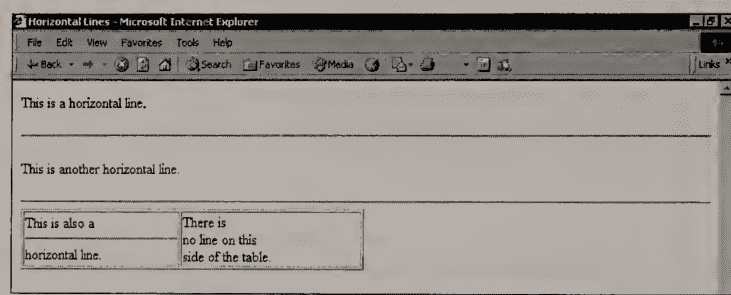

## 外边距样式

样式表为你提供了另一个重要优势：你可以指定几乎任何 HTML 元素的边边距（margins）。外边距可以用 pt、in、cm 或 px 尺寸定义。

```css
body (margin-left: 100px;
      margin-right: 100px;
      margin-top: 50px);
```

你可以单独设置 `margin-left`、`margin-right` 和 `margin-top` 属性，也可以将它们合并为一个名为 `margin` 的属性，将尺寸同时应用于顶、右、左外边距。

```css
body (margin: 100px 100px 50px);
```

## 总结

本章讨论了使用超文本标记语言进行网页布局的基础知识，包括 HTML 文档的结构、HTML 元素的示例以及使用元素属性和级联样式表进行页面样式设计。

## 第 3 章

## Ajax 应用程序

### 你将在本章中学习到：

- Ajax 的必要性
- 介绍 Ajax
- Ajax 的组成部分
- 整合一切

在本章中，你将学习 Ajax 的各个构建模块以及它们是如何组合形成 Ajax 应用程序架构的。后续章节将更详细地检查这些组件，最后将它们组装成可以运行的 Ajax 应用程序。

## Ajax 的必要性

在本书的后续部分，我们将详细讨论每个核心组件。
不过，在讨论各个组件之前，让我们详细看看我们对 Ajax 应用程序的需求。

## 传统交互与 Ajax 客户端-服务器交互

第 1 章讨论了网站传统的基于页面的用户界面模型。当你与此类网站交互时，包含文本、图像、数据输入表单等的单个页面会一个接一个显示。在导航到下一个页面之前，必须对每个页面进行单独处理。

例如，你可能会完成表单的数据输入字段，根据需要反复编辑和重新编辑输入内容，并知道在提交表单之前数据不会被发送到服务器。

图 3.1 说明了这种交互。

## 第 3 章：Ajax 应用程序结构

图 3.1：传统的客户端–服务器交互。

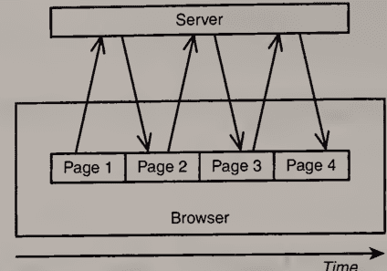

在你提交表单或点击导航链接后，你必须等待浏览器刷新，以显示由服务器交付的新页面或修订后的页面。

随着你作为互联网用户的经验增长，使用这种界面几乎变成了本能。你学会了某些帮助你避开麻烦的经验法则，例如“不要第二次点击提交按钮”以及“提交表单后不要点击后按钮”。

遗憾的是，使用这种模型构建的界面有几个缺点。首先，在加载每个新页面或修订后的页面时会有明显的延迟。这中断了我们作为用户感知的应用程序的“流”（flow）。

此外，每次都必须加载整个页面，即使其大部分内容与上一个页面完全相同。网站上许多页面共有的项目（如页眉、页脚和导航部分）可能占页面所包含数据的相当大比例。

图 3.2 说明了这一点。

## 顺便说

带宽是指通道传输信息的容量。在互联网上，带宽通常以 bps（每秒比特）或 Mbps（每秒百万比特）衡量。

## 介绍 Ajax

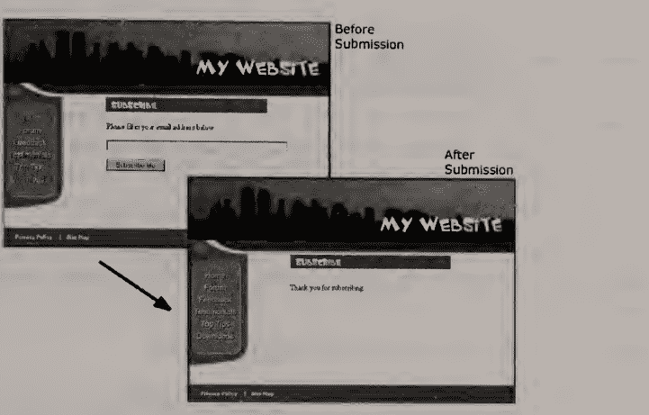

图 3.2：许多页面被重新加载。

## 丰富的用户体验

Ajax 的综合效果是为用户提供比传统的页面界面更好的体验。为了改进用户体验，你需要在传统的网页设计中添加一些功能。你希望页面是交互式的，无需等待页面加载或刷新即可响应用户操作。

为了实现这一点，Ajax 在网页和服务器之间建立了一个额外的处理层。这一层通常被称为 Ajax 引擎或 Ajax 框架，它拦截用户请求并以安静、无感知且异步的方式处理通信。我们所说的异步是指服务器请求和响应不再需要与特定的操作配合，而可以在用户方便的任何时间发生。

根据从服务器接收到的修订信息更新页面元素由 Ajax 负责，并在用户继续使用页面时动态进行。

图 3.3 表示这些交互是如何发生的。

图 3.3：Ajax 客户端-服务器交互。

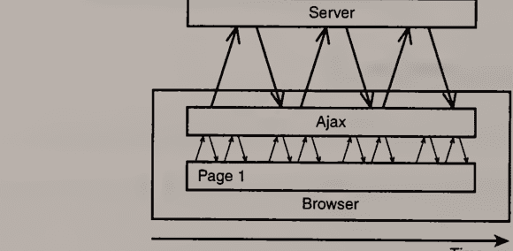

## 真实的 Ajax 应用——Google Suggest

为了查看运行中的 Ajax 示例，让我们来看看 Google Suggest。该应用程序扩展了熟悉的 Google 搜索引擎界面，根据用户目前输入的内容为用户提供合适的搜索词建议。

用户每按一次键，应用程序的 Ajax 层就会查询 Google 服务器获取类似的搜索短语，并将返回的数据显示在下拉框中。每个建议短语旁边都列出了使用该短语进行搜索时预期的结果数量。在任何时候，用户都可以选择这些建议之一，而不是继续输入并让 Google 处理选定的搜索。

由于每次按键都会查询服务器，因此此下拉列表会在用户打字时动态更新——无需等待页面刷新或类似的交互。

图 3.4 显示了程序的运行情况。


## Ajax 的组成部分

45

### 3.4
一个 Ajax 应用程序示例——Google Suggest。

让我们识别此类 Ajax 应用程序的各个组件，并看看它们是如何协同工作的。

> Google 已经展示了一些支持 Ajax 的应用程序供您尝试，包括 gmail Web 服务和 Google Maps 街道地图程序。详情请访问 Google 网站 http://www.google.com/。

顺便说

## Ajax 的组成部分

现在让我们逐一检查 Ajax 应用程序的各个组件。

## XMLHttpRequest 对象

当你点击超链接或提交 HTML 表单时，你会向服务器发送一个 HTTP 请求，服务器通过向你提供新页面或修订后的页面来做出响应。然而，为了让你的 Web 应用程序异步运行，你必须有一种方法可以向服务器发送请求，而不会关联显示新页面的请求。

你可以通过 `XMLHttpRequest` 对象来实现这一点。这个 JavaScript 对象能够与服务器建立连接并发布请求，而无需关联的页面加载。

在接后的章节中，你将学习什么是对象，查看如何创建该对象的实例，并查看如何通过网页包含的 JavaScript 程序中使用它的属性和方法来与服务器建立异步通信。

## 第 3 章：Ajax 应用程序的构造

## 你知道吗？

> 作为一种安全措施，`XMLHttpRequest` 对象通常可以对调用页面相同域名内的 URL 进行调用，而不能直接调用远程服务器。

第 5 章“与文档对象模型配合”将引入对象的通用概念，该主题将在第 7 章“使用函数和对象”中扩展。

第 10 章“Ajax 的核心——XMLHttpRequest 对象”将讨论如何创建 `XMLHttpRequest` 实例，并回顾该对象的属性和方法。

## 与服务器通信

在传统的网页样式中，当你通过超链接或表单提交发布服务器请求时，服务器接受该请求，执行任何服务器端处理，随后向你提供一个包含你所执行操作相应内容的新页面。

在这些处理发生期间，用户界面实际上是冻结的。当服务器完成任务后，浏览器中出现新页面或修订后的页面，你就会意识到这一点。

然而，通过异步服务器请求，此类通信是在后台进行的，请求的完成并不一定与屏幕刷新或加载新页面同时发生。因此，你必须进行许多安排来发现服务器在处理请求方面取得了哪些进展。

`XMLHttpRequest` 拥有一个方便的属性来报告服务器请求的进度。你可以使用 JavaScript 程序来检查此属性，以确定服务器完成任务且结果可用的时间点。

因此，你的 Ajax 武器库必须包含一个用于监控请求状态并采取相应行动的程序。我们将在第 11 章“与服务器通信”中更详细地讨论这一点。

## 服务器端发生了什么？

对于服务器端脚本而言，来自 `XMLHttpRequest` 对象的通信只是另一个 HTTP 请求。Ajax 应用程序并不在乎服务器上存在什么语言或运行环境；只要客户端的 Ajax 层从服务器接收到及时的且格式正确的 HTTP 响应，一切就能正常运行。

你可能在完全没有服务器端脚本的情况下构建简单的 Ajax 应用程序，只需让 `XMLHttpRequest` 对象调用静态服务器资源（如 XML 或文本文件）。

Ajax 应用程序可能会调用各种服务器端资源，如 Web 服务。在书的后面，我们将查看使用 SOAP 和 REST 等协议调用 Web 服务的示例。

在书中，我们将使用流行的 PHP 脚本语言来编写服务器端程序，但如果你更擅长 ASP、JSP 或其他服务器端语言，请尽管在你的 Ajax 应用程序中使用它们。

## 处理服务器响应

一旦收到异步请求已成功完成的通知，你就可以利用服务器返回的信息。

Ajax 允许以多种格式返回这些信息，包括 ASCII 文本和 XML 数据。

根据应用程序的性质，你可以在当前页面内对这些信息进行翻译、显示或其他处理。

我们即将在第 12 章“使用返回的数据”中研究这些问题。

## 其他清理任务

Ajax 应用程序还需要执行许多其他职责。例如，检测错误状况并妥善处理它们，以及让用户了解提交的 Ajax 请求的状态。

你将在随后的章节中看到各种示例。

## 整合一切

假设你想设计一个新的 Ajax 应用程序，或者更新一个遗留应用程序以包含 Ajax 技术。你该如何做呢？

首先，我们需要决定由哪个页面和用户操作来触发发送异步 HTTP 请求。例如，你可能决定将鼠标光标移动到图像上的动作将导致向服务器发送请求，以检索有关该图片主题的更多信息，或者点击按钮将生成一个服务器请求，以获取填充表单字段的信息。

JavaScript 可以通过使用事件处理程序来执行此类发生情况时的指令。具体如何操作细节将在接后的章节中详细介绍。在你的 Ajax 应用程序中，此类方法将负责启动异步 HTTP 请求。

发出请求后，你需要编写程序来监控该请求的进度，直到你收到服务器通知请求已成功完成。

最后，在收到服务器完成任务的通知后，你需要一个程序来检索服务器返回的信息并将其应用于应用程序。例如，你可能想使用新数据更改页面正文的内容、填充表单字段或弹出一个信息窗口。

图 3.5 显示了这一切的流程图。

## 图 3.5
Ajax 应用程序组件如何协同工作。

在第 13 章“我们的第一个应用程序”中，你将使用所学的知识构建一个完整的 Ajax 应用程序。


## 第二部分
## 使用 JavaScript 介绍网页脚本

- 第 4 章 在 JavaScript 中创建简单脚本 53
- 第 5 章 使用文档对象模型 (DOM) 71
- 第 6 章 使用变量、字符串和数组 81
- 第 7 章 使用函数和对象 103
- 第 8 章 使用条件和循环控制流 117
- 第 9 章 使用内置函数和库 135

## 第 4 章：在 JavaScript 中创建简单脚本

你将在本章中学到：
- 脚本编写工具
- 使用 JavaScript 显示时间
- 编写脚本
- 添加 JavaScript 语句
- 创建输出
- 将脚本添加到网页中
- 测试脚本
- JavaScript 语法规则
- 使用注释
- JavaScript 最佳实践

正如书中前面已经讨论过的那样，JavaScript 是一种用于网页的客户端脚本语言。你可以直接将 JavaScript 命令包含在 HTML 文档中，每当在浏览器中查看页面时，脚本就会被执行。

在本章中，你将创建一个简单的脚本，对其进行编辑，并使用网络浏览器进行测试。在此过程中，你将学习创建和使用脚本涉及的基础任务。

### 脚本编写工具

与许多编程语言不同，你不需要任何特殊软件来创建 JavaScript 脚本。事实上，你可能已经拥有了所需的一切。

### 文本编辑器

处理 JavaScript 所需要的第一个工具是文本编辑器。JavaScript 脚本存储在简单的文本文件中，通常作为 HTML 文档的一部分。任何可以存储 ASCII 文本文件的编辑器都可以。我们在第 2 章“使用 HTML 和 CSS 编写和样式页面”中对程序员器的讨论与这里的 JavaScript 工作（实际上是书中后的 PHP 代码）同样相关。

- 随书 CD 包含了 jEdit 程序员编辑器的版本，适用于 Java、Macintosh 和 Windows 平台。该编辑器完全可以用于编写 JavaScript 程序。

### 浏览器

使用 JavaScript 你需要两样东西：一个网页浏览器和一台运行它的计算机。我建议你使用最新版本的 Mozilla Firefox 或 Microsoft Internet Explorer。请访问 Mozilla (http://www.mozilla.com) 或 Microsoft (http://www.microsoft.com) 网站下载副本。

至少，你应该拥有 Firefox 1.0、Netscape 7.0 或 Internet Explorer 6.0 或更高版本。你可以根据喜好选择任何浏览器进行网页浏览，但开发 JavaScript 时，你应该拥有一个以上的浏览器——至少是 Firefox 和 Internet Explorer。这将允许你在用户在你的网站上使用的常用浏览器中测试你的脚本。

> 如果你计划在互联网上发布你的脚本，你将需要一个 Web 服务器或访问一个服务器。不过，你可以直接从计算机硬盘运行书中的大多数 JavaScript 示例。

### 使用 JavaScript 显示时间

JavaScript 的一个常见且简单的用途是显示日期和时间。因为 JavaScript 运行在浏览器上，它显示的时间将是用户当前时区的时间。不过，你也可以使用 JavaScript 计算“通用”时间（UTC）。

> UTC 代表协调世界时（UTC），是基于旧 GMT（格林威治标准时间）标准的原子时间标准。这是子午线的时间，子午线穿过英国格林威治。

作为 JavaScript 的入门介绍，你现在将从下一节开始创建一个简单的脚本，在网页中显示当前时间和 UTC 时间。

### 编写脚本

你的脚本像大多数 JavaScript 程序一样，以 HTML `<script>` 标签开始。你使用 `<script>` 和 `</script>` 标签将脚本封装在 HTML 文档中。

> 记住在起始和结束的 `<script>` 标签之间只包含有效的 JavaScript 语句。如果浏览器在 `<script>` 标签内发现任何非有效语句的内容，它将显示 JavaScript 错误消息。

要开始创建脚本，打开你喜欢的文本编辑器，并输入所示的起始和结束 `<script>` 标签：
```html
<script LANGUAGE="JavaScript" type="text/javascript"></script>
```

由于此脚本没有使用 JavaScript 1.1 或更高版本的任何新功能，你不需要在 `<script>` 标签中指定版本。此脚本应该适用于所有 Netscape 2.0 或 Internet Explorer 3.0 之后的浏览器。

### 添加 JavaScript 语句

你的脚本现在需要确定本地时间和 UTC 时间，然后将它们显示给浏览器。幸运的是，所有困难的部分（如转换日期格式）都内置在 JavaScript 解释器中。

### 将数据存储在变量中

脚本开始你将使用一个变量来存储当前日期。你将在第 6 章“使用变量、字符串和数组”中学习更多关于变量的知识。变量是一个可以存放值的容器——数字、文本或在本情况下是日期。

要开始编写脚本，在第一个 `<script>` 标签之后添加以下行。请确保在你的 JavaScript 命令和变量名中使用相同的大小写组合，因为 JavaScript 对大小写敏感。

```javascript
now = new Date();
```

此语句创建了一个名为 `now` 的变量并将当前日期和时间存储其中。此语句以及你在脚本中使用的其他 JavaScript 内置对象允许你处理日期。你将在第 6 章学习更多关于变量的知识。

### 计算结果

内部，JavaScript 将日期存储为自 1970 年 1 月 1 日以来的毫秒数。继续你的脚本，添加以下语句：

```javascript
localtime = now.toString();
utctime = now.toUTCString();
```

### 创建输出

你现在有了包含结果的变量 `localtime` 和 `utctime`。`document.write` 是显示输出的最简单方法。

`document.write` 语句在网页中显示文本。要显示结果，在最后的 `<script>` 标签之前添加这些语句：

```javascript
document.write("local time:" + localtime + "<br>");
document.write("UTC time:" + utctime);
```

### 将脚本添加到网页中

这些语句告诉浏览器向网页添加一些文本。输出将包含 `localtime` 和 `utctime` 变量的内容。注意引号内的 HTML 标签，如 `<br>`——因为 JavaScript 可以输出 HTML。

> 注意语句中文本和变量之间使用的加号 (+)。在这种情况下，它告诉浏览器将值合并字符串。如果你在两个数字之间使用加号，它们将相加。

你现在有一个计算并显示结果的完整脚本。你的代码应该类似于列表 4.1。

# 列表4.1 完整的日期时间脚本

```html
<script LANGUAGE="JavaScript" type="text/javascript">
now = new Date();
localtime = now.toString();
utctime = now.toUTCString();
document.write("local time:" + localtime + "<br>");
document.write("UTC time:" + utctime);
</script>
```

要使用你的脚本，你需要将其添加到 HTML 文档中。基础形式的 HTML 文档应该包含起始和结束的 `<html>` 标签、`<head>` 标签和 `<body>` 标签。如果你将这些标签添加到包含脚本的文档中，你将得到类似列表 4.2 的内容。

# 列表4.2 HTML 文档中的日期时间脚本

```html
<html>
<head>
<title>显示日期和日期</title>
</head>
<body>
<p>
<script LANGUAGE="JavaScript" type="text/javascript">
now = new Date();
localtime = now.toString();
utctime = now.toUTCString();
document.write("local time:" + localtime + "<br>");
document.write("UTC time:" + utctime);
</script>
</p>
</body>
</html>
```


## 第 4 章：使用 JavaScript 创建简单脚本

### 列表 4.2 续

```html
<script>
<p>
<body>
</html>
```

现在你已经有了一个完整的 HTML 文档，请将其保存为 .htm 或 .html 扩展名。

记事本或其他 Windows 文本编辑器可能会尝试提供帮助，为你的脚本添加 .txt 扩展名。请确保保存的文件具有正确的扩展名。

## 测试脚本

要测试你的脚本，你只需要在浏览器中加载你创建的 HTML 文档即可。启动 Netscape 或 Internet Explorer，从“文件”菜单中选择“打开”。点击“选择文件”或“浏览”按钮，然后找到你的 HTML 文件。选择后，点击“打开”按钮查看该页面。

如果你输入的脚本正确，你的浏览器应该会显示脚本的结果，如图 4.1 所示。（当然，你的结果将与我的不同，但将与你计算机时钟的设置相同。）

关于 Internet Explorer 6.0 及更高版本的说明：根据你的安全设置，脚本可能不会执行，浏览器顶部可能会出现黄色高亮条显示安全警告。点击黄色条条并选择“允许阻塞的内容”以允许你的脚本运行（这是因为默认安全设置允许在在线文档中使用 JavaScript，但不允许在本地文件中）。

图 4.1：Firefox 显示日期和时间脚本的结果。

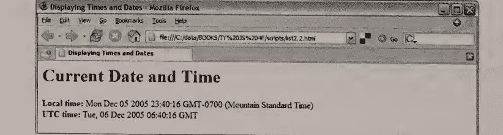

## 修改脚本

虽然当前脚本确实显示了当前的日期和时间，但它的显示远没有墙上或桌面上的钟美观。为了解决这个问题，你可以使用一些额外的 JavaScript 特性和一些 HTML 来显示大时钟。

测试脚本

为了显示大时钟，我们需要在独立的变量中获取小时、分钟和秒。再次，JavaScript 具有内置函数来完成大部分工作：

```javascript
hours = now.getHours();
mins = now.getMinutes();
secs = now.getSeconds();
```

这些语句使用 JavaScript 的内置日期函数声明了包含时间组件的 hours、mins 和 secs `secs` 变量。

在将小时、分钟和秒放在独立变量后，你可以使用 `document.write` 来显示它们：

```javascript
document.write("<h1>");
document.write(hours + ":" + mins + ":" + secs);
document.write("</h1>");
```

第一条语句显示一个 HTML `<h1>` 标题标签，用大字体显示时钟。第二条语句显示用冒号分隔的 hours、mins 和 secs 变量，第三条语句添加了结束的 `</h1>` 标签。

你可以将上述语句添加到原始的日期和时间脚本中，以添加大时钟显示。列表 4.3 显示了脚本的完整修改版本。

### 列表 4.3 带有大时钟显示的日期和时间脚本

```html
<html>
<head><title>显示时间和日期</title></head>
<body>
<h1>当前日期和和时间</h1>
<p>
<script language="JavaScript">
var now = new Date();
var localtime = now.toString();
var utctime = now.getGMTString();
document.write("本地时间:<br>" + localtime + "<br>");
document.write("UTC 时间:<br>" + utctime);
var hours = now.getHours();
var mins = now.getMinutes();
var secs = now.getSeconds();
document.write("<h1>");
document.write(hours + ":" + mins + ":" + secs);
document.write("</h1>");
</script>
</p>
</body>
</html>
```

现在你已经修改了脚本，保存 HTML 文件并在浏览器中打开修改后的文件。如果你让浏览器运行，可以简单地使用“重新加载”按钮来加载脚本的新版本。尝试并验证窗口上部分和新层时钟显示的是相同的时间。

图 4.2 显示了结果。

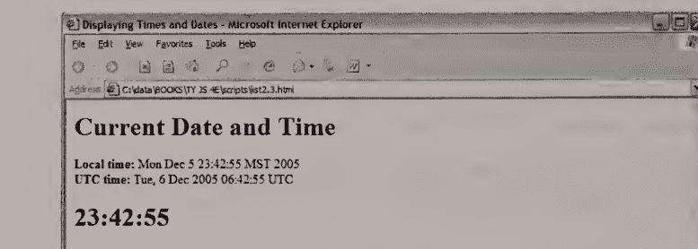

图 4.2：Internet Explorer 显示了修改后的日期和时间脚本。

## 顺便说

此脚本产生的时间格式并不完美：午后的小时采用 24 小时制，且没有前导零，因此 12:04 显示为 12:4。请参第 9 章的解决方案。

## 处理 JavaScript 错误

当你开发更复杂的 JavaScript 应用时，你会经常遇到错误。JavaScript 错误通常由拼写错误的 JavaScript 语句引起。

要查看 JavaScript 错误消息的示例，请修改你在上一节中添加的语句。我们将使用一个常见的错误：漏掉一个括号。将最后一个 `document.write` 语句改为：`("</html>");`

再次查看你的 HTML 文档并将文档加载到浏览器中。根据你使用的浏览器，会发生两种情况之一：要么显示错误消息，要么脚本简单无法执行。

如果显示了错误消息，那么通过添加缺失的括号，你就已经解决了一半问题了。如果没有显示错误，你应该配置你的浏览器以显示错误消息，以便你诊断问题：

- 在 Netscape 或 Firefox 中，在浏览器的地址栏中输入 `javascript:` 以显示 JavaScript 控制台。


## 测试脚本

JavaScript 支持条件语句，这让你能够回答此类问题。一个典型的条件使用 `if` 语句，例如所示：
if (count==1) alert("The countdown has reached 1.");

这会将变量 `count` 与常量 `1` 进行比较，如果它们相等，则向用户显示警报消息。你将在脚本中使用这样的条件语句。

> 你将在第 8 章“使用条件和循环控制流程”中学习更多关于条件的知识。

## 循环

JavaScript（以及大多数编程语言）的另一个特性是创建循环的能力，即重复执行特定次数的语句组。例如，这些语句会显示 10 次警报，极大地打扰用户：

```
for (i=1; i=10; i++) {
  alert("Yes, it's yet another alert!");
}
```

`for` 是 JavaScript 用于循环的几种语句之一。这正是计算机所擅长的事情：执行重复性任务。你将在许多脚本中使用循环，其方式会比这个示例要有用得多。

> 循环将在第 8 章中详细介绍。

## 事件处理器

如前所述，并不是所有的脚本都位于 `<script>` 标签内。你也可以将脚本作为事件处理器。虽然这听起来像是一个复杂的编程术语，但它的意思就是字面意思：事件处理器是处理事件的脚本。

在生活中，事件是发生在我们身上的事情。例如，你在日历上写的内容就是事件：“看牙医预约”或“弗德的生日”。你生活中也会遇到一些未计划的事件：例如，交通罚单、国税局审计或亲戚的意外拜访。

## 第 4 章：在 JavaScript 中创建简单脚本

无论事件是有计划的还是未计划的，你可能都有常规的此类方法。你的事件处理器可能包括诸如“当弗德的生日到来时，送他一份礼物”或“当亲戚意外拜访时，关灯并假装家里没人”。

JavaScript 中的事件处理器也类似：它们告诉浏览器在特定事件发生时做什么。JavaScript 事件并不像你处理的那些事件那么令人兴奋——包括此类事件如“点击鼠标按钮时”和“当此页面加载完成时”。尽管如此，它们是 JavaScript 中非常有用的部分。

许多 JavaScript 事件（如鼠标点击）是由用户引起的。你的脚本不是按固定顺序执行操作，而是响应用户的动作。其他事件不会直接调用用户——例如，当 HTML 文档加载完成时会触发一个事件。

每个事件处理器都与特定的浏览器对象关联，你可以在定义对象的标签中指定事件处理器。例如，图像和文本链接都有一个事件 `onMouseEnter`，当鼠标指针移动到对象上时，该事件就会发生。这是一个带有事件处理器的典型 HTML 图像标签：

```

```

你将事件处理器指定为 HTML 标签的属性，并在引号内包含 JavaScript 语句。这是函数的理想用例，因为函数名短而明了，并且可以引用一系列语句。

请参阅本章末尾的“尝试一试”部分，查看 HTML 文档中事件处理器的完整示例。

## 哪个脚本先运行？

你实际上可以在 Web 文档包含多个脚本：一个或多个 `<script>` 标签组、外部 JavaScript 文件以及任意数量的事件处理器。有了所有这些脚本，你可能会好奇浏览器知道先执行哪一个。幸运的是，这是以逻辑方式完成的：

- HTML 文档 `<head>` 部分内的 `<script>` 标签组首先处理，无论它们包含嵌入代码还是引用了 JavaScript 文件。由于这些脚本无法在网页上创建输出，因此它们是定义供以后使用的函数的地方。

- HTML 文档 `<body>` 部分内的 `<script>` 标签组在 `<head>` 部分的标签之后执行，此时网页正在加载和显示。如果 `<body>` 中有多个脚本，它们将按顺序执行。

事件处理器在它们的事件发生时执行。例如，`onload` 事件处理器在网页主体加载时执行。由于 `<head>` 部分在任何事件发生之前加载，你可以定义函数并在事件处理器中使用它们。

## JavaScript 语法规则

JavaScript 是一种简单的语言，但你需要小心地使用它的语法——定义你如何使用该语言的规则。本书的其余部分涵盖了 JavaScript 语法的许多方面，但你应该理解一些基本规则以避免错误。

## 大小敏感

JavaScript 中的几乎所有内容都对大小写敏感：你不能交替使用小写字母和大写字母。以下是一些通用规则：

- JavaScript 关键字（如 `for` 和 `if`）始终是小写的。

- 内置对象（如 `Math` 和 `Date`）首字母大写。

- DOM 对象通常是小写的，但它们的方法通常是大写和小写的组合。通常除了第一个单词以外的所有单词都使用大写字母，如 `toLowerCase` 或 `getElementById`。

在不确定时，请遵循此书或其他 JavaScript 参考书中使用的确切大小写。如果你使用了错误的大小写，浏览器将显示错误消息。

## 变量、对象和函数名

当你定义变量、对象或函数时，你可以选择它们的名称。名称可以包含大写字母、小写字母、数字和下划线 (`_`) 字符。名称必须以字母或下划线开头。

你可以选择在变量名中使用大写或小写，但记住 JavaScript 是大小敏感的：`score`、`Score` 和 `SCORE` 被视为不同的变量。请确保使用

## 保留字

关于名称的一个规则——它们不能是保留字。这些包括构成语言的单词，如 `if` 和 `for`，以及内置对象如 `window` 和 `document`。

## 空格

空白（称为空白字符）被 JavaScript 忽略。空白通常会让代码更具可读性。

## 注释

注释让你能够记录代码。如果你想在调试时临时取消某些 JavaScript 行，可以使用 `/*` 开始并 `*/` 结束。由于这些注释是 JavaScript 语法的一部分，它们仅在 `<script>` 标签内部或 JavaScript 文件中有效。

要包含注释，使用双斜杠，如示例所示：

```
//这是一个注释。
```

JavaScript 还支持 C 风格注释，以 `/*` 开始并以 `*/` 结束。这些注释可以跨行，如下：

```
/*包含了多种功能。 */
```

## JavaScript 最佳实践

你现在应该熟悉编写 JavaScript 的规则。除了规则之外，遵循最佳实践也是很好的主意。以下实践并非强制，但如果你遵循它们，将避免很多麻烦。

- 大量使用注释——方便他人理解，也方便你以后编辑。它们对于标记脚本的主要划分有用。

- 在每个语句末尾使用分号，每行一个语句——将使你的脚本更容易调试。

- 尽可能分离 JavaScript 文件——将 JavaScript 与 HTML 分离有助于调试，并鼓励你编写可重用的模块化脚本。

- 避免特定浏览器的特性——随着你学到更多 JavaScript，你将学到只在某个浏览器中运行的功能。除非绝对必要，否则请避免这样做，并在多个浏览器中测试你的代码。

- 保持 JavaScript 可选——不要使用 JavaScript 来执行网站上的基本功能——例如，主导航链接。尽可能让没有 JavaScript 的用户也能使用网站，尽管它可能不那么美观或方便。这种策略被称为渐进增强。

## 尝试一试

## 使用事件处理器

在结束本章之前，这里有一个简单的事件处理器示例。这将向你演示如何设置事件（你将在书中多次它），以及 JavaScript 在没有 `<script>` 标签的情况下如何工作。4.6 显示了一个包含简单事件处理器的 HTML 文档。

## 列表 4.6 带有简单事件处理器的 HTML 文档

```html
<html>
<head>
<title>Event Handler Example</title>
</head>
<body>
<h1>Event Handler Example</h1>
<p>
```


## 列表 4.6 继续

```html
<a href="http://www.javascriptworkshop.com/"
onclick="alert('Aha! An Event!');">点击此链接</a>
<p>
</p>
```

事件处理器是在定义链接的 `<a>` 标签内，通过以下 `onClick` 属性定义的：

`onClick="alert('Aha! An Event!');",`

该事件处理器使用内置的 `alert()` 函数在当你点击链接时显示消息。在更复杂的脚本中，你将定义自己的函数来作为事件处理器。图 4.4 显示了这一操作。

图 4.4
当你点击链接时，浏览器会显示一个警报框。

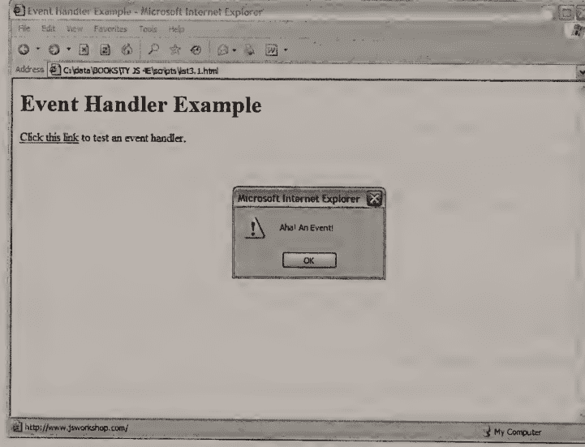

在下一章中，你将使用与此类似的其他事件处理器。

## 总结

在本章中，你编写了一个简单的 JavaScript 程序并使用浏览器对其进行了测试。你学习了使用 JavaScript 所需的工具——基本上就是编辑器和浏览器。你还学习了如何修改和测试脚本，以及当 JavaScript 程序遇到错误时会发生什么，并学习了如何在单独的 JavaScript 文件中使用脚本。

在编写此脚本的过程中，你使用了 JavaScript的一些基本特性：变量、`document.write` 语句以及处理日期和时间的函数。

你还接触了几个 JavaScript 编程和语法：函数、对象、事件处理器、条件和循环。你学习了如何使用 JavaScript 注释使你的脚本更易于读，并查看了一个事件处理器的简单示例。

在下一章中，你将学习文档对象模型 (DOM)，并学习如何使用 DOM 内部的对象来处理网页并与用户交互。

## 第 5 章

## 使用文档对象模型 (DOM)

你将在本章学到：

- 理解对象
- 理解文档对象模型 (DOM)
- 处理网页文档
- 访问浏览器历史记录
- 使用 location 对象

在本章中，你将接触到使用 JavaScript 时最重要的工具之一：文档对象模型 (DOM)，它让你的脚本能够操纵网页、窗口和文档。

没有 DOM，JavaScript 仅仅是另一种脚本语言——有了 DOM，它就变成了制作动态页强大工具。本章将首先讨论对象，然后是 DOM 的概念以及你将用常用的一些。

## 理解对象

JavaScript 支持对象。像变量一样，对象可以存储数据——但它们可以同时存储两个或多个数据。

存储在对象中的数据项被称为对象的属性（properties）。例如，你可以使用对象存储人的信息，比如地址录中的。每个人物对象的属性可能包括姓名、地址和电话号码。

JavaScript 使用点号分隔对象名和属性名。例如，对于一个名为 Bob 的人物对象，属性可能包括 `Bob.address` 和 `Bob.phone`。

## 第 5 章：使用文档对象模型 (DOM)

对象还可以包含方法（methods）。这些是与对象数据工作的函数。例如，我们地址录中的人物对象可能包含一个 `display()` 方法来显示人的信息。在 JavaScript 术语中，语句 `Bob.display()` 将显示 Bob 的详细信息。

## 顺便说

我们在上一章讨论的 `document.write` 函数实际上是文档对象的 `write` 方法。你将在本章晚些时候学习更多关于该对象的知识。

如果这听起来很困惑，不要担心——你将在书中更详细地探索对象。现在，你只需要了解基础知识。JavaScript 支持三种类型的对象：

- 内置对象是构建在 JavaScript 语言中的。你已经遇到过其中一个，`Date`。其他内置对象包括 `Array` 和 `String`，你将在第 6 章“使用变量、字符串和数组”中探索它们，以及在第 9 章“使用内置函数和库”中解释的 `Math`。
- DOM（文档对象模型）对象代表浏览器的各种组件和当前 HTML 文档。例如，你在本章早期使用的 `alert()` 函数实际上是窗口对象（window object）的方法。你将在本章课程中更详细地探索它们。
- 自定义对象是你自己创建的对象。你将在第 7 章“使用函数和对象”中学习使用自定义对象。

## 理解文档对象模型 (DOM)

JavaScript 相比于基础 HTML 的一个优势是脚本可以操纵文档及其内容。你的脚本可以在浏览器中加载新页面、处理浏览器部分、打开新窗口，甚至修改文本。

为了处理文档，JavaScript 使用了一种类似于树的结构被称为文档对象模型 (DOM)。它包含了文档的所有。

## 理解文档对象模型 (DOM)

DOM 并不是 JavaScript 语言的一部分——相反，它是内置在浏览器中的 API（应用程序接口）。虽然它最常用于 JavaScript，也可以被其他语言如 VBScript 和 Java 使用。

文档对象代表网页文档或页面。网页文档显示在浏览器窗口中，因此发现文档是窗口对象的子元素并不让你意外。

由于窗口对象始终代表当前窗口（包含脚本的窗口），你可以使用 `window.document` 来引用当前文档。你也可以引用 `document`，它会自动引用当前窗口。

以下显示了基础层次结构：

`window.document`


图 5.1
DOM 层次结构。

## DOM 的历史

W3C（万维网联盟）制定了 DOM level 1 建议。这是一项不仅定义了基础对象，还定义了涵盖 HTML 文档所有部分的整个集合的标准。level 2 DOM 标准也发布，level 3 正在开发中。

本章描述的基础对象层次结构被非正式称为 DOM level 0，这些对象包含在 DOM level 1 标准中。

## 处理网页文档


## 处理 Web 文档

如果使用了多个窗口或框架（frames），可能会有多个窗口对象，每个对象都有自己的文档对象（document object）。要使用这些文档对象之一，你需要使用窗口名称和文档的名称。

在接下来的章节中，你将查看文档对象的某些属性和方法，这些对你的脚本编写非常有用。

## 获取有关文档的信息

文档对象的几个属性包含了关于当前文档的一般信息：

- document.URL 指定文档的 URL。这是一个简单的文本字段。你无法更改此属性。如果你需要用户跳转到不同的位置，请使用本章稍后介绍的 window.location 对象。
- document.title 列出当前页面的标题，由 HTML <title> 标签定义。
- document.referrer 是用户在访问当前页面之前查看的页面 URL——通常是包含当前页面的页面。
- document.lastModified 是文档最后修改的日期。日期随页面一起从服务器发送。
- document.bgColor 和 document.fgColor 是文档的背景颜色和前景（文本）颜色，分别对应于 <body> 标签的 BGCOLOR 和 TEXT 属性。
- document.linkColor、document.vLinkColor 和 document.vColor 是文档内链接的颜色。这些对应于 <body> 标签的 LINK 和 VLINK 属性。
- document.cookie 允许你读取或为文档设置 cookie。

作为文档属性的一个示例，列表 5.1 显示了一个使用 JavaScript 显示其最后修改日期的短 HTML 文档。

### 列表 5.1 显示最后修改日期

```
<head><title>Test Document</title></head><body>
<p>This page was last modified on:
<script language="JavaScript" type="text/javascript">
document.write(document.lastModified);
</script>
</p>
</body>
</html>
```

## 第 5 章：使用文档对象模型 (DOM)

这可以告诉用户页面最后一次更改的时间。如果你使用 JavaScript，你就不必在每次修改页面时都记得更新日期。（你也可以使用脚本始终打印当前日期而不是最后修改日期，但那样将是作弊。）

## 顺便说

> 你可能会发现 document.lastModified 属性在你的网页上不起作用，或者返回错误的值。日期是从网络服务器接收的，某些服务器并不能正确维护修改日期。

## 在文档中写入文本

最简单的文档对象方法是你最经常使用的那些。事实上，你已经用过其中一个了。document.write 方法将文本作为 HTML 页面的一部分在文档窗口中打印。每当你需要在网页中包含输出时，就可以使用此语句。

另一种语句 document.writeln 也会打印文本，但它在末尾还会包含一个换行符 (\n)。当你希望文本是该行的最后一个内容时，这非常有用。

## 注意！

> 请记住，换行符会被浏览器显示为空格，但 <pre> 容器内部除外。如果你需要真正的换行，则需要使用 <br> 标签。

你只能在网页的正文部分使用这些方法，因此它们会在页面加载时执行。你不能在不重新加载页的情况下使用这些方法向已加载的页面添加内容。然而，正如下一节所解释，你可以为文档编写新内容。

document.write 方法可以在 HTML 文档正文内的 <script> 标签中使用。你也可以在函数中使用它，只要你在文档正文中包含对该函数的调用。

## 使用链接和锚点

文档对象的另一个子节点是链接对象（link object）。实际上，一个文档中可以存在多个链接对象。每个对象都包含指向另一个位置或锚点的链接信息。

锚点是 HTML 文档中可以直接跳转的命名位置。你使用如下标签来定义它们：<a name="part2">。然后你可以链接到它们：<a href="#part2">。

## 你知道吗？

你可以通过 links 数组访问链接对象。数组的每个成员都是当前页面中的一个链接对象。该数组的属性 document.links 指明页面中链接的数量。

每个链接对象（或 links 数组的成员）都有一组定义 URL 的属性。href 属性包含整个 URL，而其他属性定义了它的部分内容。这些属性与本章稍后定义的 location 对象属性相同。

你可以通过指定链接编号和属性名称来引用属性。例如，以下语句将第一个链接的 URL 赋值给变量 link1：
link1 = links[0].href;

锚点对象（anchor objects）也是文档对象的子节点。每个锚点对象代表当前文档中的一个锚点——一个可以直接跳转的特定位置。

与链接一样，你可以通过数组 anchors 访问它们。该数组的每个元素都是一个锚点对象。document.anchors.length 属性可以给你 anchors 数组中的元素数量。

## 访问浏览器历史

history 对象是窗口对象的另一个子节点（属性）。该对象持有有关在当前页面之前和之后访问的 URL 的信息，并包含了跳转到上一个或下一个位置的方法。

history 对象有一个你可以访问的属性：

- history.length 跟踪历史记录列表的长度——换句话说，就是不同位置的数量。

## 顺便说

history 对象有三个你可以可以使用：

- history.go(n) 跳转到历史记录中指定的页面。例如，history.go(-2) 返回两个页面。
- history.back() 跳转到历史中的上一个页面。
- history.forward() 跳转到历史中的下一个页面。

## 处理 location 对象

窗口对象的第三个子节点是 location 对象。该对象存储有关当前 URL 的信息。href 属性包含整个 URL。例如：
http://www.startech.com:80/test.cgi?lines=1#anchor

以下属性代表 URL 的部分：

- location.protocol 是 URL 的协议部分 (http:)。
- location.hostname 是 URL 的主机名 (www.startech.com)。
- location.port 是 URL 的端口号 (80)。
- location.pathname 是 URL 的文件名部分 (test.cgi)。
- location.search 是 URL 的查询部分，如果有的话 (?lines=1)。
- location.hash 是 URL 中使用的锚点名称，如果有的话 (#anchor)。

## 处理 location 对象

本章之前介绍的链接对象也包含这些访问 URL 部分的属性。

> 虽然 location.href 属性通常与之前提到的 document.URL 属性相同，但无法更改 document.URL 属性。始终使用 location.href 来加载新页面。

location 对象有两个方法：

- location.reload() 刷新当前文档。这相当于工具栏上的刷新按钮。如果你可选包含 true 参数，它将忽略浏览器缓存并无论文档是否更改都强制刷新
- location.replace(url) 用新位置替换当前位置。这类似于设置 location 对象的属性。区别在于 replace 方法不会影响浏览器历史记录。换句话说，无法使用后退按钮回到之前的位置。

## 尝试一下

### 创建后退前进按钮

你可以使用 history 对象的 back 和 forward 方法在网页文档中添加自己的后退和前进按钮。当然，浏览器已经有了后退和前进按钮，但有时你需要包含相同用途的自定义链接。

你现在将创建一个显示后退和前进按钮的脚本，并使用这些方法导航浏览器。这是创建后退按钮的代码：

```
<input type="button" onclick="history.back();" value="Back-">
```

<input> 标签定义了一个标记 Back 的按钮。onClick 事件处理器使用 history.back() 方法进入历史中的上一个页面。前进按钮的代码类似：

```
<input type="button" onclick="history.forward();" value="Forward --">
```


## 第 5 章：使用文档对象模型 (DOM)

按照这种方法，你只需要构建 HTML 文档的剩余部分。列表 5.2 显示了完整的 HTML 文档，图 5.2 显示了浏览器对该文档的显示。将此文档加载到浏览器后，访问其他 URL 并确保“后退”和“前进”按钮可以工作。

# 列表 5.2 一个使用 JavaScript 包含后退和前进按钮的网页

```html
<<html>
<head><title>后退和前进按钮</title>
</head>
<body>
<h1>后退和前进按钮！</h1>
<p>此页面允许你返回或前进到历史列表中的页面。
这些按钮应该等同于浏览器工具栏中的后退和前进按钮。</p>
<p>
<input type="button"
onclick="history.back();" value="-- 后退->"
<input type="button"
onclick="history.forward();" value="前进 --">
</p>
</body>
</html>
```

图 5.2 Internet Explorer 中的后退和前进按钮。

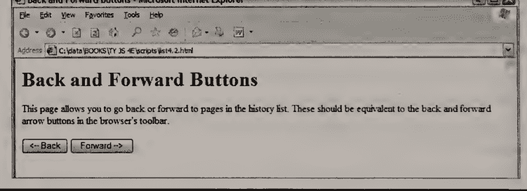

## 总结

在本章中，你学习了文档对象模型 (DOM)，即 JavaScript 中网页对象的层级结构。你学习了如何使用文档对象来处理文档，并使用了 history（历史）和 location（位置）对象来控制浏览器中显示的当前 URL。

你现在应该对 DOM 及其某些对象有了基本的了解——在本书后续，你将学习更多关于这些对象的知识。

## 第 6 章

## 使用变量、字符串和数组

你将在本章学到：

- 使用变量
- 理解表达式和运算符
- JavaScript 中的数据类型
- 数据类型之间的转换
- 使用字符串对象
- 处理子字符串
- 使用数字数组
- 对数字数组排序

现在你已经学习了 JavaScript 和 DOM 的基础知识，是时候深入研究 JavaScript 语言的更多细节了。

在本章中，你将学习 JavaScript 中存储数据的三个工具：用于存储数字或文本的变量；用于处理文本的特殊变量——字符串；以及一个你可以通过数字引用的多个变量——数组。

## 使用变量

除非你跳过了本书的最后几章，否则你已经使用过几个变量。你可能可以在没有任何帮助的情况下学会如何使用更多几个。尽管如此，变量的某些方面是你还没有学习过的。我们现在来看一些细节。

## 选择变量名

变量是用于存储数据的命名容器（例如，数字、文本字符串或对象）。正如你在书中前面的部分学到的，每个变量都有一个名称。在选择变量名时，你必须遵循某些特定规则：

- 变量名可以包含字母表中的字母，包括大和小写。它们还可以包含数字 0-9 和下划线 (_)。
- 变量名不能包含空格或任何标点字符。
- 变量名的第一个字符必须是字母或下划线。
- 变量名区分大小写——totalnum、Totalnum 和 TotalNum 是不同的变量。
- 变量名的长度没有官方限制，但它们必须适应单行显示。

使用这些规则，以下是有效变量名的示例：

total_number_of_fish
LastInvoiceNumber
temp1
a
_var39

> 你可以选择使用友好、易于读的名字，也可以使用完全晦涩的名字。为自己一个忙：尽可能使用较长的、友好的名字。虽然你现在可能记得 a、b、x 和 x1 之间的区别，睡个好觉后你可能就会忘记。

## 使用局部变量和全局变量

某些计算机语言要求你在使用变量之前对其进行声明。JavaScript 包含了 `var` 关键字，用于声明变量。在许多情况下，你可以省略 `var`；当你第一次给变量赋值时，该变量仍然被声明了。

为了理解在哪里声明变量，你需要理解“作用域”（scope）的概念。变量的作用域是该变量可以使用的脚本区域。变量有两种类型：

- 全局变量以整个脚本（以及同一 HTML 文档中的其他脚本）作为作用域。它们可以在任何地方使用，甚至是在函数内部。
- 局部变量以单个函数作为作用域。它们只能在创建它们的函数内部使用。

要创建一个全局变量，你在主脚本中声明它，在任何函数之外。你可以使用 `var` 关键字来声明变量，如示例所示：

```javascript
var students = 25;
```

该语句声明了一个名为 students 的变量并给其赋值为 25。如果该语句在函数外部使用，它将创建一个全局变量。在这种情况下，`var` 关键字是可选的，因此该语句与之前的等效：students = 25;

在养成省略 `var` 关键字的习惯之前，请确保你完全理解何时需要它。实际上，始终使用 `var` 关键字是一个好主意——你可以避免错误并让你的脚本更容易阅读，而且通常不会引起任何问题。

> 在大多数情况下，你在本书前面的章节使用的变量都是全局的。

局部变量属于特定的函数。你在函数用 `var` 关键字声明的任何变量都是局部的。

## 给变量赋值

要给变量赋值，你使用等号。例如，假设 lines 变量值为 40。

```javascript
lines = 40;
```

如果你想给变量增加一个值，可以使用 `+=` 运算符。例如：

```javascript
lines += 1;
```

同样，如果你想从变量减去一个值，可以使用 `-=` 运算符。例如：

```javascript
lines -= 1;
```

如果你想让变量增加，可以使用 `++` 运算符。例如：

```javascript
lines++;
```

同样，如果你想让变量减小，可以使用 `--` 运算符。例如：

```javascript
lines--;
```

当你在同一语句中使用变量时，这种差异就会产生问题。例如，假设你给 lines 赋值 40。

```javascript
alert(lines++);
alert(++lines);
```

第一个语句显示 40，然后将 lines 增加 1。第二个语句先将 lines 增加 1，然后显示 41。

## 理解表达式和运算符

## 表达式和运算符

表达式是变量和值的组合，JavaScript 解释器可以对其求出一个值。用于组合这些值的字符被称为运算符，例如 + 和 /**

除了变量和常量值，你还可以在表达式中使用返回结果的函数调用。


# 使用 JavaScript 运算符

你已经使用了一些运算符，例如加号（加）以及增减运算符。表 6.1 列出了你在 JavaScript 表达式中使用一些重要的运算符。

表 6.1 常用 JavaScript 运算符
| 运算符 | 描述 | 示例 |
|---|---|---|
| + | 拼接（组合）字符串 | message="this is " + " test"; |
| + | 加法 | result = 5 + 7; |
| - | 减法 | score = score - 1; |
| * | 乘法 | total = quantity * price; |
| / | 除法 | average = sum / 4; |
| % | 取模（余数） | remainder = sum % 4; |
| ++ | 增 | tries++; |
| -- | 减 | total--; |

除了这些，还有许多用于条件语句的运算符——你将在第八章“通过条件和循环控制流程”学习它们。

# 运算符优先级

当你在表达式中使用多个运算符时，JavaScript 使用优先级来决定如何计算值。表 6.1 按优先级从低到高列出了运算符，优先级最高的运算符先求值。例如，考虑此语句：

```javascript
result = 4 + 5 * 3;
```


# 第6 章：使用变量、字符串和数组

如果你尝试计算这个结果，有两种方法可以实现。你可以先相乘 5 * 3 然后加 4（结果为 19），或者先加 4 + 5 再乘以 3（结果为 27）。JavaScript 通过遵循优先级规则解决了这一困境：因为乘法的优先级高于加法，它会先相乘 5 * 3 然后加 4，产生 19 的结果。

> 如果你熟悉任何其他编程语言，你会发现 JavaScript 中的运算符和优先级在很大程度上与 C、C++ 和 Java 中的工作方式是相同的。

有时候运算符优先级并不会产生你想要的结果。例如，这句语句：

```
result = a + b + c + d / 4;
```

这句语句试图通过将四个数字全部相加然后除以 4 来计算平均值。然而，由于 JavaScript 赋予除法的优先级高于加法，它会在加上其他数字之前先将变量 `d` 除以 `4`，从而产生错误的结果。

你可以通过使用括号来控制优先级。这里是计算平均值的有效语句：

```
result = (a + b + c + d) / 4;
```

括号确保了变量先相加，然后将和除以 4。

> 如果你不确定运算符优先级，可以使用括号来确保程序按照你的预期运行，并让你的脚本更具可读性。

## JavaScript 中的数据类型

在某些计算机语言中，你必须指定变量将存储的数据类型：例如，数字或字符串。在 JavaScript 中，大多数情况下你不需要指定数据类型。但是，你应该了解 JavaScript 可以处理的类型。

这些是基础 JavaScript 数据类型：

- 数字（Numbers），例如 3、25 或 1.4142138。JavaScript 支持整数和浮点数。
- 布尔值（Boolean），或逻辑值。它们的值可以是两个值之一：true（真）或 false（假）。这些值用于指示某个条件是否为真。

你将在第 8 章学习更多关于布尔值以及在 JavaScript 中使用条件的知识。


- 字符串（Strings），例如 "I am a jelly doughnut"。它们由一个或多个文本字符组成。（严格来说，这些是 String 对象，你将在本章稍后学习它们。）
- 空值（null value），由关键字 `null` 表示。这是未定义变量的值。例如，如果变量 `fig` 之前没有被声明或定义，语句 `document.write(fig)` 将导致该值（以及一条错误消息）。

尽管 JavaScript 会跟踪每个变量中当前存储的数据类型，但它并没有限制你中途更改类型。例如，假设你通过赋值一个值来声明了一个变量：

```
total = 31;
```

这句语句声明了一个名为 `total` 的变量并给其赋值为 31。这是一个数值变量。现在假设你更改了 `total` 的值：

```
total = "batross";
```

这为 `total` 赋值了一个字符串值，替换了数值。当执行这句语句时，JavaScript 将显示一个错误；它是完全有效的，尽管这个 `total` 可能没什么用处。

> 尽管 JavaScript 的这一特性既方便又强大，但也可能让你很容易出错。例如，如果 `total` 变量在随后的数学计算中使用，结果将是无效的——JavaScript 不会警告你犯了这个错误。


# 数据类型之间的转换

只要可以，JavaScript 都会为你处理数据类型之间的转换。例如，你已经使用过这样的语句：

```
document.write("The total is " + total);
```

这句语句打印出的消息为 "The total is 40"。因为 `document.write` 函数与字符串配合工作，JavaScript 解释器会在执行函数之前自动将表达式中的任何非字符串内容（在本例中为 `total` 的值）转换为字符串。

这对于浮点值和布尔值同样有效。然而，在某些情况下它不起作用。例如，如果 `total` 的值为 40，那么以下语句可以工作：

```
average = total / 3;
```

`total` 变量也可能包含一个字符串；在这种情况下，前述语句会导致错误。

在某些情况下，你可能会得到一个包含数字的字符串，并将其转换为普通的数值变量。JavaScript 包含了两个为此目的函数：

- `parseInt()`——将字符串转换为整数。
- `parseFloat()`——将字符串转换为浮点数。

这两个函数都会从开头读取一个数字并返回其数值版本。例如，这些语句将字符串 "30 angry polar bears" 转换为数字：

```
stringvar = "30 angry polar bears";
numvar = parseInt(stringvar);
```

在执行这些语句后，数值变量包含数字 30。字符串中的非数字部分被忽略了。

> 这些函数会在字符串的开头寻找适当类型的数字。如果没有找到有效数字，函数将返回特殊值 `NaN`，意味着“不是数字”（not a number）。

## 使用字符串对象

在前几章中你已经用了几个字符串。字符串存储一组文本字符，并且命名方式与其他变量相似。作为一个简单的例子，这句语句将 "This is a test" 赋值给字符串变量 `test`：

```
test = "This is a test";
```

# 创建字符串对象

JavaScript 将字符串存储为 String 对象。你通常不需要担心这个，但解释处理字符串的一些技巧，这些技巧使用了 String 对象的方法（内置函数）。

创建新的 String 对象有两种方法。第一种是你已经用过的，而第二种使用面向对象的语法。以下两个语句创建相同的字符串：

```
test = "This is a test";
test = new String("This is a test");
```

第二句语句使用了 `new` 关键字，你用它创建对象。这告诉浏览器创建一个包含文本 This is a test 的新 String 对象，并将其赋值给变量 test。虽然可以使用面向对象的语法创建字符串，但 JavaScript 语法更简单。

# 赋值

你可以像给其他变量一样给字符串赋值。例如，以下语句将字符串 "This is a test" 赋值给名为 `test` 的字符串：

```
test = "This is a test";
```

# 计算字符串长度

有时你可能需要知道字符串变量包含多少字符。你可以通过 String 对象的 `length` 属性来实现，该属性适用于任何字符串。使用该属性时，在字符串名称后加上 `.length`。

例如，`test.length` 指 `test` 字符串的长度。这里有一个示例：

```
test = "This is a test.";
document.write(test.length);
```

第一句语句将字符串 This is a test. 赋值给 `test` 变量。第二句语句显示字符串的长度——在这种情况下为 15 个字符。`length` 属性是一个只读属性，因此你不能为其赋值来更改字符串的长度。

> 记住，尽管 `test` 是字符串变量，但 `test.length` 的值是一个数字，可以用任何数值表达式。

# 转换字符串的大小

String 对象的两个方法允许你将字符串的内容转换为大写或小写：

- `toUpperCase()`——将字符串中的所有字符转换为大写。
- `toLowerCase()`——将字符串中的所有字符转换为小写。

例如，以下语句以小写显示 `test` 字符串变量的值：

```
document.write(test.toLowerCase());
```


## 第 6 章：使用变量、字符串和数组

假设该变量包含了文本 `This Is A Test`，则结果将是以下字符串：

```
this is a test
```

注意，该语句不会改变 `text` 变量的值。方法会返回字符串的大写或小写版本，但它们不会改变字符串本身。如果你想更改字符串的值，可以使用如下所示的语句：

```
test = test.toLowerCase();
```

> 注意，这些方法的语法与之前介绍的 `length` 属性相似。区别在于，方法始终使用括号，而属性则不然。`toUpperCase()` 和 `toLowerCase()` 方法不接受任何参数，但你仍然需要使用括号。

## 处理子字符串

到目前为止，你处理的是整个字符串。JavaScript 还允许你处理子字符串，即字符串的一部分。你可以使用 `substring` 方法来获取字符串的一部分，或者使用 `charAt` 方法来获取单个字符。这些内容将在接下来的章节中解释。

## 使用字符串的局部

`substring` 方法返回一个字符串，它由原始字符串中两个索引值之间的部分组成，你必须在括号中指定这两个值。例如，以下语句显示 `text` 字符串的第四到第六个字符：

```
document.write(text.substring(3,6));
```

此时，你可能在想 3 和 6 是从哪里来的。关于索引参数，你需要理解以下三点：

- 索引从字符串第一个字符开始为 0，因此第四个字符的索引实际上是 3。
- 第二个索引是不包含在内的（noninclusive）。第二个索引 6 包含到索引 5（即第六个字符）。
- 你可以以任何顺序指定两个索引。较小的那个将被假设为第一个索引。在上例中，`(6,3)` 会产生相同的结果。当然，很少有理由使用反序。

作为另一个例子，假设你定义了一个名为 `alpha` 的字符串来存储字母表：
`alpha = "ABCQRSTUVWXYZ";`

以下是使用该字符串的 `substring()` 方法的示例：

- `alpha.substring(0,4)` 返回 `ABCD`。
- `alpha.substring(10,12)` 返回 `KL`。
- `alpha.substring(12,10)` 也返回 `KL`。因为 10 较小，所以使用 10 作为第一个索引。
- `alpha.substring(6,7)` 返回 `G`。
- `alpha.substring(24,26)` 返回 `YZ`。
- `alpha.substring(0,26)` 返回整个字母表。
- `alpha.substring(6,6)` 返回空值，即空字符串。只要两个索引值相同，情况就成立。

## 获取单个字符

`charAt` 方法是从字符串中抓取单个字符的简单方法。你在括号中指定字符的索引或位置。索引从第一个字符开始为 0。以下是使用 `alpha` 字符串的几个示例：

- `alpha.charAt(0)` 返回 `A`。
- `alpha.charAt(12)` 返回 `M`。
- `alpha.charAt(25)` 返回 `Z`。
- `alpha.charAt(27)` 返回空字符串，因为该位置没有字符。

## 查找子字符串

子字符串的另一个用途是在另一个字符串中查找字符串。一种方法是使用 `indexOf` 方法。要使用此方法，在你要搜索的字符串后添加 `indexOf`，并在括号中指定要搜索的字符串。此示例在 `test` 字符串中搜索 "this"：

```
loc = test.indexOf("this");
```

与大多数 JavaScript 方法和属性名一样，`indexOf` 是区分大小写的。在脚本中使用它时，请确保按照此处显示的方式精确输入。

`loc` 变量中返回的值是字符串中的一个索引，类似于 `substring` 方法中的第一个索引。索引的第一个字符是 0。

你可以指定一个可选的第二个参数来指示开始搜索的值。例如，此语句在 `temp` 字符串中搜索单词 `fish`，从第 20 个字符开始：

```
location = temp.indexOf("fish",19);
```

> 第二个参数的一个用途是搜索字符串的多次出现处。找到第一个出现处后，从该位置开始搜索第二个，依此类推。

第二种方法 `lastIndexOf()` 工作原理相同，但它从后往前查找，找到最后一次出现处。例如，此语句在 names 中查找 "Fred"：

```
location = names.lastIndexOf("Fred");
```

## 数组数组

数组是具有一组索引的项，可以包含字符串、数字或其他类型。数组允许你一次性处理多个值。

## 使用字符串数组

到目前为止，你使用的是数字数组。JavaScript 还允许你使用字符串数组，即字符串的数组。这是一个强大的功能，允许你同时处理大量字符串。

## 创建字符串数组

你声明字符串数组的方式与声明数字数组相同——事实上，JavaScript 并不区分它们：

```
names = new Array(30);
```

然后你可以为数组元素分配字符串值：

```javascript
names[0] = "Henry J. Tillman";
names[1] = "Sherlock Holmes";
```

## 理解数组长度

和字符串一样，数组有一个 `length` 属性。它告诉你数组中元素的数量。如果你在创建数组时指定了长度，该值将成为 `length` 属性的值。例如，这些语句将打印数字 30：

```javascript
scores = new Array(30);
document.write(scores.length);
```

你可以不指定长度声明数组，以后通过为元素赋值或更改 `length` 属性来更改长度。例如，以下语句创建一个新数组并为它的两个元素赋值：

```javascript
test = new Array();
test[0]=21;
test[5]=22;
```

在此例中，目前分配的最大索引是 5，数组的 `length` 属性为 6——记住，元素从 0 开始编号。

## 访问数组元素

你可以使用与赋值时相同的符号来读取数组的内容。例如，以下语句将显示 `scores` 数组前三个元素的值：

```javascript
scoredisp = "Scores: " + scores[0] + "," + scores[1] + "," + scores[2];
document.write(scoredisp);
```

> 查看这个例子，你可能会认为显示大数组的所有元素会很不方便。这是循环的理想工作，循环允许用不同的值多次执行相同的语句。你将在第 8 章学习所有的循环。

## 使用字符串数组

到目前为止，你使用的是数字数组。JavaScript 还允许你使用字符串数组，即字符串的数组。这是一个强大的功能，允许你同时处理大量字符串。

## 创建字符串数组

你声明字符串数组的方式与声明数字数组相同——事实上，JavaScript 并不区分它们：

```javascript
names = new Array(30);
```

然后你可以为数组元素分配字符串值：

```javascript
names[0] = "Henry J. Tillman";
names[1] = "Sherlock Holmes";
```


与数值数组一样，在创建字符串数组时也可以指定其内容。以下语句中的任意一个都可以与前一个示例相同的字符串数组：

```
names = new Array("Henry J. Tillman", "Sherlock Holmes");
names = ["Henry J. Tillman", "Sherlock Holmes"];
```

你可以在任何可以使用字符串的地方使用字符串数组元素。你甚至可以使用之前介绍的字符串方法。例如，以下语句将打印 `names` 数组第一个元素的前五个字符，结果为 Henry：

```
document.write(names[0].substring(0,5));
```

## 拆分字符串

JavaScript 包含名为 `split` 的字符串方法，它可以将字符串拆分为其组成部分。要使用此方法，请指定要拆分的字符串以及一个用于划分部分的字符：

```
test = "John Q. Public";
parts = test.split(" ");
```

在例例中，`test` 字符串包含姓名 "John Q. Public"。第二条语句中的 `split` 方法在每个空格处分割姓名字符串，生成三个字符串。这些字符串被存储在一个名为 `parts` 的字符串数组中。在执行示例语句后，`parts` 的元素包含以下内容：

- parts[0] = "John"
- parts[1] = "Q."
- parts[2] = "Public"

JavaScript 还包含一个数组方法 `join`，它执行相反的功能。此语句将 `parts` 数组重新组合成一个字符串：

```
fullname = parts.join(" ");
```

括号中的值指定了用于分隔数组部分的字符。在这种情况下，使用了空格，生成了最终字符串 "John Q. Public"。如果不指定字符，则将使用逗号。

## 排序字符串数组

JavaScript 还包含一个用于数组的 `sort` 方法，它可以返回数组的按字母顺序排序的变。例如，以下语句初始化了一个包含四个名字的数组并对其排序：

```
names[0] = "Public, John Q.";
names[1] = "Tillman, Henry J.";
names[2] = "Bush, George W.";
names[3] = "Mouse, Mickey";
sortednames = names.sort();
```

最后一条语句对 `names` 数组进行排序并将结果存储在新数组 `sortednames` 中。

## 排序数值数组

由于 `sort` 方法是按字母顺序排序的，它无法适用于数值数组——至少不像你预期的那样工作。如果一个数组包含数字 4, 10, 30 和 200（例如），它会将它们排序为 10, 200, 30, 4——完全不符。幸运的是，有一个解决方案：你可以在 `sort` 方法的参数中指定一个函数，该函数将用于比较数字。以下代码可以正确排序数值数组：

```
function numcompare(a,b) {
  return a-b;
}
nums = new Array(3, 10, 200, 4);
sortednums = nums.sort(numcompare);
```

此示例定义了一个简单的函数 `numcompare`，它将两个数相减。如果你在 `sort` 方法中指定此函数，数组将按照正确的数值顺序排序：4, 10, 30, 200。

JavaScript 期望如果 `a` 位于 `b` 之前，比较函数返回负数；如果它们相同则返回 0；如果 `a` 位于 `b` 之后则返回正数。这就是为什么函数只需要 `a-b` 即可进行数值排序的原因。

## 亲自尝试一下

### 使用 JavaScript 排序并显示名字

为了获得更多使用 JavaScript 字符串和数组特性的经验，你可以创建一个脚本，允许用户输入名字列表并以排序后的形式显示该列表。

由于这是一个较大的脚本，你将按照第 4 章“在 JavaScript 中创建简单脚本”中的描述创建单独的 HTML 和 JavaScript 文件。首先，`sort.html` 文件将包含脚本运行所需的 HTML 结构和表单字段。列表 6.2 显示了 HTML 文档。

## 列表 6.2 排序示例的 HTML 文档

```html
<html
<head>
<title>Array Sorting Example</title>
<script type="text/javascript" language="javascript" src="sort.js"></script>
</head>
<body>
<h1><h1>Sorting Arrays</h1>
<p>在下方的字段中输入两个或多个名字，排序后的名字列表将出现在文本区域中。</p>
<form name="theform">
Name:
<input type="text" name="newname" size="20">
<input type="button" name="addname" value="Add" onclick="SortNames();">
<br>
<h2>Sorted Names</h2>
<textarea cols="60" rows="10" name="sorted">
The sorted names will appear here.
</textarea>
</form>
</body>
</html>
```

脚本将位于单独文档中，此文档头部的 `<script>` 标签使用 `src` 属性包含一个名为 `sort.js` 的 JavaScript 文件。接下来将创建此文件。

此文档定义了一个名为 `sorted` 的表单、一个名为 `newname` 的文本字段、一个 `addname` 按钮以及一个名为 `sorted` 的文本区域。你的脚本将使用这些字段作为用户界面。列表 6.2 显示了 HTML 文档，列表 6.3 显示了它包含的 JavaScript 源文件。

## 列表 6.3 排序示例的 JavaScript 文件

```javascript
// 初始化计数器和数组
var numnames=0;
var names = new Array();
function Sortnames() {
  // 从字段获取名字
  name=document.theform.newname.value;
  // 添加到数组
  names[nnames]=name;
  // 计数增
  nnames++;
  // 排序数组
  names.sort();
  // 显示在文本区域
  document.theform.sorted.value=names.join("\n");
}
```

## 总结

在本章中，你关注了变量以及 JavaScript 如何处理它们。你学习了如何命名变量、如何声明以及局部与全局变量的区别。你还探索了 JavaScript 支持的数据类型以及它们之间的转换。

你还学习了 JavaScript 更复杂的变量、字符串和数组，并查看了对它们执行操作的功能，例如转换字符串或排序数组。

在下一章中，你将通过学习另外两个功能继续你的 JavaScript 学习。

## 第 7 章：函数与对象

## 本章你将学习：

- 使用函数
- 介绍对象
- 使用对象简化脚本
- 扩展内置对象

在本章中，你将学习在本书其余部分将用到的两个关键 JavaScript 概念。首先，你将学习使用函数的细节，函数允许你将任意数量的语句分组。这对于重复代码段非常有用，而且你还可以创建接受参数并返回供以后使用的函数。

由于函数允许你分组代码段，对象允许你分组数据——你可以使用它们将相关的数据项和处理数据的函数结合在一起。


## 定义函数

函数是 JavaScript 语句的组，可以被视为一个单一单元。要使用函数，你必须先定义它。这里有一个简单的函数定义示例：

```javascript
function Greet() {
  alert("Greetings.");
}
```

这定义了一个向用户显示警框消息的函数。它以 `function` 关键字开头。函数的名称是 `Greet`。注意函数名后面的括号。正如你将在接下来学到的，这两个括号之间的空间并不总是空的。

函数定义的第一行和最后一行包含大括号 `{ }`。你使用这些大括号来包围函数中的所有语句。浏览器使用大括号来确定函数的开始位置和结束位置。

在大括号之间，这个特定的函数包含单行代码。它使用了内置的 `alert` 函数，该函数会显示一条警框消息。消息将包含文本 "Greetings."。

函数名是大小写敏感的。如果你定义了一个像 `Greet` 这样大写字母字母函数，确保在调用该函数时使用相同的名称。

现在，我们来说这些括号。当前的 `Greet` 函数总是执行相同的操作：你每次使用它时，它都会显示相同的消息。虽然这避免了一些打字工作，但并没有什么优势。

为了让你的函数更具灵活性，你可以添加参数，也称为参数（arguments）。这些是函数在每次被调用时接收的变量。例如，你可以添加一个名为 `who` 的参数，它告诉函数要问候的人名。这里是修改后的 `Greet` 函数：

```javascript
function Greet(who) {
  alert("Greetings, " + who);
}
```

当然，要使用此函数，你应该将它包含在 HTML 文档中。按照传统，函数定义的最佳位置是在文档的 `<head>` 区域。因为 `<head>` 区域中的语句是首先执行的，所以这确保了函数在被使用之前已经过定义。

列表 7.1 显示了嵌入在 HTML 文档头部区域的 `Greet` 函数。

## 使用函数

## 列表 7.1 HTML 文档中的 Greet 函数

```html
<html>
<head>
<title>Functions</title>
<script language="JavaScript" type="text/javascript">
function Greet(who) {
  alert("Greetings, " + who);
}
</script>
</head>
<body>
This is the body of the page.
</body>
</html>
```

## 调用函数

你现在已经定义了一个函数并将其放置在 HTML 文档中。然而，如果你将列表 7.1 加载到浏览器，你会发现它完全什么都没做。这是因为函数已经定义了——准备好使用——但我们还没有使用它。

函数的执行被称为“调用函数”（calling the function）。要调用函数，请在脚本中使用函数名作为一条语句。你需要包含括号以及函数参数的值。例如，这里有一条调用 `Greet` 函数的语句：

```javascript
Greet("Fred");
```

这告诉 JavaScript 解释器将控制权转移到 `Greet` 函数中的第一个语句。它还将参数 "Fred" 传递给函数。该值将赋值给函数内部的 `who` 变量。

| 函数可以有多个参数。要定义一个具有多个参数的函数，请为每个参数列出一个变量名，并用逗号分隔。要调用函数，请为每个参数指定用逗号分隔的值。 | 顺便说 |

列表 7.2 显示了一个完整的 HTML 文档，它包含了函数定义以及页面主体中另一个实际调用该函数的脚本。为了演示函数的用处，我们将两个不同的人调用 `greet`。

## 列表 7.2 完整函数示例

```html
<html
<head>
<title>Functions</title>
<script language="JavaScript" type="text/javascript">
function Greet(who) {
alert("Greetings, " + who);
}
</script>
</head>
<body>
<<h1>>Function Example</h1>
<p>准备好被问候两次。</p>
<script language="JavaScript" type="text/javascript">
Greet("Fred");
Greet("Ethel");
</script>
</body>
</html>
```

此列表在页面主体中包含了第二组 `<script>` 标签。该列表包含了对 `Greet` 函数的两次函数调用，每个调用都有不同的名称。

现在你已经有了一个可以实际执行操作的脚本，将其加载到浏览器中。你应该能看到类似于图 7.1 的内容，它显示了 `Greet` 脚本在 Firefox 中运行。

### 图 7.1
Greet 示例的输出。


> 注意，在您点击第一个警框上的“确定”按钮之前，第二个警框消息不会显示。这是因为在显示警框时，JavaScript 的处理会停止。

## 返回值

你刚刚创建的函数向用户显示消息，但函数也可以向调用它的脚本返回一个值。这允许你使用函数来计算数值。例如，你可以创建一个计算四个数字平均值的函数。

你的函数应该以 `function` 关键字、函数名以及它接受的参数开头。我们将使用变量 `a`、`b`、`c` 和 `d` 作为计算平均值的四个数字。这里是该函数：

```javascript
function Average(a, b, c, d) {
  return (a + b + c + d);
}
```

## 使用函数

你刚刚创建的函数向用户显示消息，但函数也可以向调用它的脚本返回一个值。这允许你使用函数来计算数值。例如，你可以创建一个计算四个数字平均值的函数。

你的函数应该以 `function` 关键字、函数名以及它接受的参数开头。我们将使用变量 `a`、`b`、`c` 和 `d` 作为计算平均值的四个数字。这里是该函数：

```javascript
function Average(a, b, c, d) {
  return (a + b + c + d) / 4;
}
```

要使用此函数，你可以将结果赋值给变量：

```javascript
result = Average(10, 20, 30, 40);
```

## 列表 7.3 HTML 文档中的 Average 函数

```html
<html
<head>
<title>Functions</title>
<script language="JavaScript" type="text/javascript">
function Average(a, b, c, d) {
  return (a + b + c + d) / 4;
}
</script>
</head>
<body>
<p>以下是函数的结果：</p>
<script language="JavaScript" type="text/javascript">
result = Average(10, 20, 30, 40);
document.write("平均值为: " + result);
</script>
</body>
</html>
```

列表 7.3 显示了一个完整的 HTML 文档，它包含了函数定义以及页面主体中另一个实际调用函数并显示结果的脚本。

## 介绍对象

你也可以直接在表达式中使用函数调用。例如，你可以使用 `alert` 语句显示 `Average(1,2,3,4)` 函数的运行。

你你知道吗？

在上一章中，你学习了如何使用变量来表示不同的数据。JavaScript 还支持对象，这是一种复杂的变量类型，可以存储多个项目和函数。虽然变量一次只能有一个值，但对象可以包含多个值以及函数。这允许你将相关的数据项和处理这些函数的封装到单个对象中。

在本章中，你将学习如何定义和使用你的对象。你已经处理过了一些对象，包括：

- DOM 对象——允许你的脚本与网页交互。你在第 5 章“处理文档对象模型 (DOM)”中学习了它们。
- 内置对象——包括字符串和数组，你在第 6 章“使用变量、字符串和数组”中学习了它们。

## 创建对象

每个对象都有一个或多个属性——本质上是存储在对象中的变量。例如，在第 5 章中，你学习了 `location.href`

当你在上一章创建一个数组时，使用了以下 JavaScript 语句：`scores = new Array(4);`

`new` 关键字告诉 JavaScript 解释器使用一个函数——在这种情况下是内置的 `Array` 函数——来创建一个对象。你将在本章的晚些部分为自定义对象创建一个函数。

## 对象属性和值

每个对象都有一个或多个属性——本质上是存储在对象中的变量。


## 使用对象简化脚本

`property` 提供了当前文档的 URL。`href` 属性是 DOM 中 `location` 对象的属性之一。

你也使用过 String 对象的 `length` 属性，如下一章中的示例：

```javascript
test = "This is a test.\ndocument.write(test.length);
```

和变量一样，每个对象属性都有一个值。要读取属性的值，你只需要在任何表达式中包含对象名和属性名，并用点号隔开，如先前的 `test.length` 所示。你可以使用 `=` 运算符更改属性的值。下面的示例通过更改 `location.href="http://www.jsworkshop.com/";` 将浏览器发送到新的 URL。

> 对象也可以是另一个对象的属性。这被称为子对象。


## 理解方法

除了属性之外，每个对象都可以有一个或多个方法。这些方法与对象的数据一起工作。例如，你在第 5 章中学的，以下 JavaScript 状态会重新加载当前文档：`location.reload();`

当你使用 `reload()` 时，你正在使用 `location` 对象的一个方法。像函数一样，方法可以在括号中接受参数，并返回结果。

## 使用对象简化脚本

虽然 JavaScript 的变量和数组存储数据方面非常灵活，但某些时候你需要更复杂的结构。例如，假设你正在编写一个用于处理名片数据库的脚本，该数据库包含各种人的姓名、地址和电话号码。

如果你使用普通变量，你将需要为数据库中的每个人准备几个独立的变量：一个姓名变量、一个地址变量等等。这会让人很困惑。

数组会稍微改善这种情况。你可以有一个 `names` 数组、一个 `addresses` 数组和一个 `phone number` 数组。数据库中的每个人在每个数组中都有条目。这会更方便，但仍然完美。

## 第 7 章：使用函数和对象

通过对象，你可以让存储数据库的变量像名片一样逻辑化。每个人由一个 `Card` 对象表示，该对象具有姓名、地址和电话的属性。你甚至可以给对象添加方法来显示或处理这些信息。

在接下来的章节中，你将使用 JavaScript 实际创建 `Card` 对象及其属性方法。在本章的后半部分，你将在脚本中使用 `Card` 对象来显示数据库中几个成员的信息。

## 定义对象

创建对象的第一步是为它及其属性命名。我们已经决定将其命名为 `Card` 对象。每个对象将具有以下属性：

- name
- address
- workphone
- homephone

在 JavaScript 程序中使用此对象的第一步是创建一个函数来创建新的 `Card` 对象。这个函数被称为对象的“构造函数”。以下是 `Card` 对象的构造函数：

```javascript
function Card(name,address,work,home) {
  this.name = name;
  this.address = address;
  this.workphone = work;
  this.homephone = home;
}
```

构造函数是一个简单的函数，它接受参数来初始化新对象并将它们赋值给相应的属性。该函数接受来自调用语句的参数，然后将其赋值为对象的属性。因为函数被命名为 `Card`，所以该对象就是 `Card` 对象。

注意这个 `this` 关键字。每当你创建一个对象定义时，都会使用它。使用它来引用当前对象——即正在由函数创建的那个对象。

## 定义对象方法

接下来，你将创建一个处理 `Card` 对象的方法。由于所有的 `Card` 对象都具有相同的属性，拥有一个以整洁格式打印属性的函数可能会很有。我们将此函数命名为 `PrintCard`。

## 使用对象简化脚本

你的 `PrintCard` 函数将作为 `Card` 对象的方法使用，你不需要请求参数。相反，你可以再次使用 `this` 关键字来引用当前对象的属性。以下是 `PrintCard()` 的函数定义：

```javascript
function PrintCard() {
  var line1 = "Name: " + this.name + " <br>\n";
  var line2 = "Address: " + this.address + " <br>\n";
  var line3 = "Work: " + this.workphone + " <br>\n";
  var line4 = "Home Phone: " + this.homephone + " <br>\n";
  document.write(line1, line2, line3, line4);
}
```

此函数简单地从当前对象（`this`）读取属性，带标题打印其中一个，并跳到新行。

你现在有了一个打印卡片的函数，但它还不是 `Card` 对象的方法。你需要做的最后件事是让 `PrintCard` 成为 `Card` 对象定义的一部分。以下是修改后的函数：

```javascript
function Card(name,address,work,home) {
  this.name = name;
  this.address = address;
  this.workphone = work;
  this.homephone = home;
  this.PrintCard = PrintCard;
}
```

添加的语句看起来另一个属性定义，但它引用了 `PrintCard` 函数。只要 `PrintCard` 函数是用它自己的函数定义定义的，它就能工作。方法本质上是定义函数的属性，而不是简单的值。

> 上一个示例使用小写名称 `workphone` 作为属性名，并使用大写名称 `PrintCard` 作为方法。你可以使用任何大小写命名，但这种方法可以明确 `PrintCard` 是一个方法。

## 创建对象实例

现在让我们使用刚刚创建的对象定义和方法来创建一个对象实例。要使用对象定义，你需要使用 `new` 关键字。这与你用于创建 `Date` 和 `Array` 对象的关键字相同。

以下语句创建了一个名为 `tom` 的对象：

```javascript
tom = new Card("Tom Jones", "123 Elm Street", "555-1234", "555-9876");
```

你可以看到，创建对象很容易。你只需要调用 `Card()` 函数（对象定义）并按照相同的顺序提供属性。在该语句执行后，会创建一个包含 Tom 信息的新对象。这被称为 `Card` 对象的实例。就像程序中可以有多个字符串变量，对象也可以有多个实例。

与其使用 `new` 关键字保存卡片的所有信息，你可以在之后赋值。例如，下面的脚本创建了一个空的 `Card` 对象，然后为其赋值属性：

```javascript
holmes = new Card();
holmes.name = "Sherlock Holmes";
holmes.address = "2218 Baker Street";
holmes.workphone = "555-2345";
holmes.homepage = "555-3456";
```

在使用上述任何一种方法创建 `Card` 对象的实例后，你可以使用 `PrintCard()` 方法显示其信息。例如，该语句显示 `tom` 卡片的属性：

```javascript
tom.PrintCard();
```

## 扩展内置对象

JavaScript 包含一项功能，允许你扩展内置对象的定义。例如，如果你认为 `String` 对象不完全符合你的需求，可以扩展它，添加新的属性或方法。如果你正在创建一个使用大量字符串的大型脚本，这可能非常有用。

你可以通过 `prototype` 关键字向现有对象添加属性和方法。（`prototype` 是对象定义或构造函数的另一个名称）。`prototype` 关键字允许你在构造函数之外修改对象的定义。

作为一个示例，让我们为 `String` 对象定义添加一个方法。你创建一个名为 `heading` 的方法，它将字符串转换为 HTML 标题。以下语句定义了一个字符串 `title`：

```javascript
title = "Fred's Home Page";
```

该语句会将 `title` 字符串的内容作为 HTML 1 标题输出：

```javascript
document.write(title.heading(1));
```


列表 7.4 在 String 对象的定义中添加了一个方法，该方法可以将字符串显示为标题，然后使用该方法显示三个标题。

## 列表 7.4 为 String 对象添加方法

```html
<html>
<head><title>标题方法的文本</title>
</head>
<body>
<script LANGUAGE="JavaScript" type="text/javascript">
function addhead(level) {
  var html = "H" + level;
  var text = this.toString();
  var start = "<" + html + ">";
  var stop = "</" + html + ">";
  return text + stop;
}
String.prototype.heading = addhead;
document.write("This is a heading 1".heading(1));
document.write("This is a heading 2".heading(2));
document.write("This is a heading 3".heading(3));
</script>
</body>
</html
```

首先，你定义了 `addhead()` 函数，它将作为新方法使用。它接受一个数字来指定标题级别。`start` 和 `stop` 变量用于存储 HTML“开始标题”和“结束标题”标签，如 `<h1>` 和 `</h1>` 一样。

定义函数后，你使用 `prototype` 关键字将其添加为 String 对象的方法。然后你就可以在任何 String 对象以及任何 JavaScript 字符串上使用此方法。最后三个语句演示了这一点，它们将带引号的文本字符串显示为级别 1、2 和 3 的标题。

## 试一试

## 在对象中存储数据

现在你已经创建了一个新对象来存储名片，并有了一个打印它们的方法。作为对象、属性、函数和方法的最后一个演示，你将在网页中使用此对象来显示几张卡片的数据。

你的脚本需要包含 `PrintCard` 的函数定义，以及 `Card` 对象的函数定义。然后你将创建三个卡片并在文档主体中打印它们。我们将为此示例使用单独的 HTML 和 JavaScript 文件。列表 7.5 显示了完整的脚本。

## 第 7.5 章 使用函数对象

## 列表 7.5 使用 Card 对象的示例脚本

```javascript
// 定义函数
function PrintCard() {
  var line1 = "Name: " + this.name + "<br>\n";
  var line2 = "Address: " + this.address + "<br>\n";
  var line3 = "Work Phone: " + this.work + "<br>\n";
  var line4 = "Home Phone: " + this.homephone + "<hr>\n";
  document.write(line1, line2, line3, line4);
}
function Card(name,address,work,home) {
  this.name = name;
  this.address = address;
  this.work = work;
  this.homephone = home;
  this.PrintCard = PrintCard;
}
```

```javascript
// 创建对象
var sue = new Card("Sue Suther", "123 Elm Street", "555-1234", "555-9876");
var fred = new Card("Fred Madsen", "223 Oak Lane", "555-2222", "555-4444");
var ry = new Card("Henry Tillman", "233 Walnut Circle", "555-1299", "555-1344");
// 并打印它们
sue.PrintCard();
fred.PrintCard();
ry.PrintCard();
```

注意，`PrintCard()` 函数经过了微调，使其与**粗体**标题配合得更好。要使用此脚本，请将其保存为 `cardtest.js`。接下来，你需要将该脚本包含在简单的 HTML 文档中。列表 7.6 显示了此示例的 HTML 文档。

## 列表 7.6 Card 对象示例的 HTML 文件

```html
<html>
<head>
<title>JavaScript 名片</title>
</head>
<body>
<h1>JavaScript 名片测试!</h1>
<p>脚本从这里开始。</p><hr>
<script language="JavaScript" type="text/javascript"
src="cardtest.js"></script>
<p>脚本结束。</p>
</body>
</html>
```

要测试该脚本，请将 HTML 文档保存与之前创建的 `cardtest.js` 文件相同的目录中，然后用浏览器加载该 HTML 文档。浏览器对该示例的显示如图 7.2 所示。

## 总结

这个示例并不是一个复杂的数据库，因为你必须在 HTML 文档中包含每个人的数据。然而，像这样的对象可以用于存储从具有数千条记录的数据库服务器检索的数据库记录。

## 顺便说

图 7.2
Internet Explorer 显示了名片示例的输出。

## 总结

在本章中，你学习了 JavaScript 的两个重要特性。首先，你学习了如何使用函数将 JavaScript 语句分组，以及如何调用函数并使用返回的值。

你还学习了 JavaScript 的面向对象特性——使用构造函数定义对象、创建对象实例，以及处理属性、属性值和方法。

在下一章中，你将查看另外两个在几乎每个脚本中用到的特性——让你的脚本评估数据的条件，以及用于重复代码段的循环。

## 第 8 章

## 使用条件和循环控制流

使用条件和循环控制流

在本章你将学习：

- if 语句
- 使用条件
- else 语句
- 使用 switch
- for 循环
- 使用 for 循环
- while 循环
- 使用 while 循环
- do...while 循环
- 使用 do...while 循环
- 逻辑运算符
- 使用逻辑运算符
- 属性
- 属性
- 方法
- 方法

在 JavaScript 中控制流的方法包括：

- if 语句
- 使用条件
- else 语句
- 使用 switch
- for 循环
- 使用 for 循环
- while 循环
- 使用 while 循环
- do...while 循环
- 使用 do...while 循环
- 逻辑运算符
- 使用逻辑运算符
- 属性
- 属性
- 方法
- 方法

（注：由于原文中该部分似乎存在重复或占位符，翻译已根据逻辑进行了处理）


## 第 8 章：使用条件和循环控制流程

另一个逻辑运算符是与运算符 `&&`。考虑此条语句：
```javascript
if (phone == "*" && email == "*") {
    alert("Both Missing!");
}
```
该语句使用了 `&&`（与）而不是 `||`（或），因此只有当电子邮件地址和电话号码都为空时，才会显示错误消息。在这种特定情况下，使用“或”是更好的选择。

## 你知道吗？

JavaScript 解释器在到达末尾之前就会发现条件的答案，如果由 `&&` 运算符分隔的两个条件中的第一个为假，它将不会评估剩余脚本。你可以利用这一点来提高脚本运行速度。

第三个逻辑运算符是感叹号 `!`，它表示“非”（Not）。它可以用于反转表达式——换句话说，真表达式变为假，假表达式变为真。例如，这里有一个使用“非”的语句：

```javascript
if (!phone == "*") {
    alert("phone is OK");
}
```
在该语句中，`!`（非）运算符反转了条件，因此只有当电话号码变量不为空时，才会执行 if 语句的操作。额外的括号是必要的，因为所有条件必须放在括号内。你也可以使用 `!=`（不等于）运算符来简化此语句：

```javascript
if (phone != "*") {
    alert("phone is OK");
}
```

## 你知道吗？

逻辑运算符非常强大，但很容易用它们不小心制造出一个不可能实现的结果。例如，条件 `(a < 10 && a > 20)` 乍看起来是正确的。然而，如果你大声读出来，你会得到“如果 a 小于 10 且 a 大于 20”——这在我们的宇宙中是不可能的。在这种情况下，应该使用“或”（||`）。

## else 关键字

`if` 语句的另一个功能是 `else` 关键字。就像它的英语对应词一样，`else` 告诉解释器当条件不成立时应该做什么。以下是 `else` 关键字运行的一个简单示例：

```javascript
if (a == 1) {
    alert("Found");
    a = 0;
} else {
    alert("Incorrect value: " + a);
}
```
这是上一个示例的修改版本。如果满足条件，它会显示消息并重置变量 `a`。如果条件不满足（如果 `a` 不是 1!），则会显示不同的消息。与 `if` 语句一样，`else` 后面可以跟一个语句，也可以跟一组在大括号内的多个语句。

## 使用简写条件表达式

除了 `if` 语句外，JavaScript 提供了一种简写的条件表达式，你可以用它来快速决策。这使用了在其他语言（如 C）中也能看到的语法。条件表达式的形式如下：

```javascript
variable = (condition) ? (true action) : (false action);
```
这为变量分配两个值之一：如果条件为真，则赋值一个；如果为假，则赋值另一个。这是一个条件表达式的示例：

```javascript
value = (a == 1) ? 1 : 0;
```
这条语句可能看起来很困惑，但它等同于以下 `if` 语句：

```javascript
if (a == 1) {
    value = 1;
} else {
    value = 0;
}
```

换句话说，如果条件为真，将使用问号 `?` 之后的值；如果条件为假，将使用冒号 `:` 之后的值。冒号代表该语句的 `else` 部分，就像 `if` 语句的 `else` 部分一样，它是可选的。

这些简写表达式可以用任何 JavaScript 期望值的地方。它们提供了一种对值进行简单决策的方法。例如，这里有一个关于变量显示正确消息的简单方法：

```javascript
document.write("Found " + counter + ((counter == 1) ? " word." : " words."));
```
如果 `counter` 变量的值为 1，它将打印消息 Found 1 word；如果其值为 2 或更大，则将打印 Found 2 words。这是条件表达式最常见的用途之一。

## 使用 if 和 else 测试多个条件

你现在可以使用 `if` 和 `else` 创建一个示例脚本了。在之前的章节中，你创建了一个显示当前日期和时间的简单脚本。此示例将使用条件，根据时间显示不同的问候语：“早上好”、“下午好”、“晚上好”或“你好”。要实现这一点，你可以使用多个 `if` 语句的组合：

```javascript
if (hours < 10) {
    document.write("Good morning.");
} else if (hours >= 14 && hours < 17) {
    document.write("Good afternoon.");
} else if (hours >= 17) {
    document.write("Good evening.");
} else {
    document.write("Good day.");
}
```
第一个语句检查 `hours` 变量的值是否小于 10——换句话说，它检查当前时间是否在上午10:00 之前。如果是，它显示问候语“Good morning.”。第二个语句检查时间是否在下午 2:00 到下午 5:00 之间。第三个语句检查时间是否在下午 5:00 之后。同样，最后一个语句检查是否以上以上条件。

## HTML 文件

要尝试此示例，请将此文件保存为 `timegreet.html`，然后在浏览器中加载该文件。

```html
<html>
<head>
    <title>if statement example</title>
</head>
<body>
    <h1>Current Time</h1>
    <p>
        <script language="text/javascript" src="timegreet.js"></script>
    </p>
</body>
</html>
```

## JavaScript 文件

```javascript
// 获取当前日期
now = new Date();
// 分离小时、分、秒
hours = now.getHours();
mins = now.getMinutes();
secs = now.getSeconds();

// 显示时间
document.write("<h2>");
document.write("hours: " + hours + " : " + mins + " : " + secs);
document.write("</h2>");

// 显示问候语
document.write("<p>");
if (hours < 10) {
    document.write("Good morning.");
} else if (hours >= 14 && hours < 17) {
    document.write("Good afternoon.");
} else if (hours >= 17) {
    document.write("Good evening.");
} else {
    document.write("Good day.");
}
document.write("</p>");
```


## 使用 for 循环

switch 语句包含几个组成部分：

- 初始 switch 语句。该语句在括号中包含要测试的值（在本例中为 `button`）。
- 大括号 ({ 和 })` 包围了 switch 语句的内容，类似于函数或 if 语句。
- 一个或多个 case 语句。每个语句都指定一个值与 switch 语句中指定的值进行比较。如果值匹配，则执行 case 语句后续的语句。否则，将尝试下一个 case。
- break 语句用于结束每个 case。它会跳转到 switch 语句的末尾。如果不包含 break，当多个 case 匹配时，可能会执行多个 case 中的语句。
- 可选地，可以包含一个默认情况（default case），并在其后跟随一个或多个语句，当其他所有 case 都不被匹配时，这些语句将会在执行。

> 在 JavaScript 结构中，你可以在每个 case 语句之后使用多条语句。你不需要将它们包围在大括号中。如果 case 匹配，JavaScript 解释器将执行语句，直到遇到 break 或下一个 case。

## 使用 for 循环

`for` 关键字是创建循环时要考虑的首选工具。循环通常使用变量（称为计数器或索引）来跟踪循环执行了多少次，并在计数器达到特定数字时停止。一个 `for` 语句如下：

```javascript
for (var = 1; var < 10; var++) {
```

`for` 循环有三个参数，用分号分隔：

- 第一个参数（示例中的 `var = 1`）指定一个变量并为其分配一个初始值。这被称为**初始化表达式**，因为它设置了循环的初始状态。
- 第二个参数（示例中的 `var < 10`）是一个必须保持为真的条件，循环才能继续运行。这被称为循环的条件。

## 第 8 章：使用条件和循环控制流

- 第三个参数（示例中的 `var++`）是一个在循环每次迭代时执行的语句。这被称为**递增表达式**，因为它通常用于递增计数器。递增表达式在每次循环迭代结束时执行。

在指定三个参数后，使用左大括号 `{}` 开始一个块。使用右大括号 `{}` 结束该块。大括号之间的所有语句将在循环的每次迭代中执行。

`for` 循环的参数听起来有点难以理解，但一旦你习惯了，就会频繁使用 `for` 循环。这是一个此类循环的简单示例：

```javascript
for(i=0; i<10; i++) {
  document.write("This is line " + i + "<br>");
}
```

这些语句定义了一个使用变量 `i` 的循环，将其初始化为零，只要 `i` 的值小于 10，循环就会继续。递增表达式 `i++` 在循环每次迭代时将 `i` 的值加 1。由于这是发生在循环结束时，输出将列出从零到九的数字。

当循环在大括号之间只包含单个语句时（如本示例所示），你可以省略大括号。下面的语句定义了不带大括号的循环：

```javascript
for(i=0; i<10; i++)
  document.write("This is line " + i + "<br>");
```

| 无论循环包含一条语句还是多条语句，在所有循环都大大括号是一种良好的代码规范。这有利于以后向循环中添加语句，而不会引起语法错误。 |

示例中的循环包含一个 `document.write` 语句，它将被很轻易执行。要查看此循环的具体作用，你可以将其添加到 HTML 文档的 `<script>` 部分，如列表 8.3 所示。

## 列表 8.3 使用 for 关键字的循环

```html
<html>
<head>
<title>Using a for Loop</title>
</head>
<body>
<h1>"for" Loop Example</h1>
<p>The following is the output of the
<b>for/b</b> loop:</p>
```

## 使用 for for 循环

## 列表 8.3 继续

```html
<script language="JavaScript" type="text/javascript">
for (i=1;i<10;i++) {
  document.write("This is line " + i + "<br>");
}
</script>
</body>
</html>
```

此示例在每次迭代中都会显示一条带有循环计数器的消息。列表 8.3 的输出如图 8.2 所示。

注意，循环只执行了九次。这是因为条件是 `i<10`。当计数器 (`i`) 增加到 10 时，该表达式不再为真。如果你需要循环计数到 10，可以更改条件；`i<=10` 或 `i<11` 均可。

> 你可能会发现变量名 `i` 经常被用作循环中的计数器。这是一个始于名为 Forth 的古代语言的编程传统。你不需要遵循这一传统，但使用一个一致的变量作为计数器是一个好主意。（要了解更多关于 Forth，请访问 Forth Group 网站 www.forth.org。）

## 顺便说

## 第 8 章：使用条件和循环控制流

## 使用 for 循环

## 第 8 章：使用条件和循环控制流

## 使用 for 循环

## 第 8 章：使用条件和循环控制流

## 使用 for 循环

## 第 8 章：使用条件和循环控制流


偶尔，你可能想刻意创建一个无限循环。这可能包括你希望程序一直执行到用户停止为止的情况，或者你提供了一个带有 `break` 语句的退出路径（该语句将在下一节中介绍）。这里是创建无限循环的一种简单方法：

```
while (true) {
```

由于 `true` 值是判断条件，此循环将始终认为其条件为 `true`。

## 退出循环

跳出无限循环有一种方法。你可以在循环期间使用 `break` 语句来立即退出循环，并继续执行循环后的第一个语句。这里是使用 `break` 的一个简单示例：

```
while (true) {
  i++;
  if (values[n] == 1) break;
}
```

虽然 `while` 语句被设置为了无限循环，但 `if` 语句会检查数组中对应的值。如果它发现值为 1，它就会退出循环。

当 JavaScript 解释器遇到 `break` 语句时，它会跳过循环的剩余部分，并继续执行循环末尾大括号之后的第一个语句。你可以在任何类型的循环中使用 `break` 语句，无论是否是无限循环。这为发生错误或满足另一个条件时提供了一种简单的退出方法。

## 继续循环

有一个语句可以帮助你控制循环中语句的执行。`continue` 语句会跳过循环的剩余部分，但与 `break` 不同，它会继续循环的下一次迭代。这里有一个简单的示例：

```
for (i=1; i<21; i++) {
  if (score[i]==0) continue;
  document.write("Student number ",i," Score: ", score[i], "\n");
}
```

此脚本使用 `for` 循环打印存储在 `score` 数组中的 20 个学生的分。如果使用 `if` 语句检查值为 0 的分数，脚本假设分数为 0意味着该学生没有参加考试，因此它将继续循环而不打印该分数。

## 遍历对象属性

JavaScript 中还有第三种类型的循环。`for...in` 循环不像普通的 `for` 或 `while` 循环那样灵活。相反，它是专门用于对对象的每个属性执行操作的

例如，`navigator` 对象包含了描述用户浏览器的属性。你可以使用 `for...in` 来显示此对象的属性：

```
for (i in navigator) {
  document.write("property: " + i);
  document.write("value: " + navigator[i] + "<br>");
}
```

像普通的 `for` 循环一样，这种类型的循环使用索引变量（在示例中）。对于循环的每次迭代，该变量被设置为对象的下一个属性。当你需要检查或修改对象的每个属性时，这变得非常容易。

## 动手尝试

## 数组与循环的操作

为了应用你对循环的知识，你现在将创建一个处理数组循环的脚本。在学习此脚本的过程中，尝试想象如果没有 JavaScript 的循环功能，这将会多么困难。

这个简单的脚本将提示用户输入一系列名称。输入所有名称后，它将以编号列表的形式显示列表。要开始脚本，初始化一些变量：

```
names = new Array();
i = 0;
```

`names` 数组将存储用户输入的名称。你不知道会输入多少个名称，因此不需要为数组指定维度。变量 `i` 将作为循环中的计数器。

接下来，使用 `prompt` 语句提示用户输入一系列名称。使用循环为每个名称重复提示。你希望用户至少输入一个名称，因此使用 `do...while` 循环：

```
do {
  next = prompt("Enter the Next Name", "*");
  if (next != " ") names[i] = next;
  i = i + 1;
} while (next != " ");
```

如果你对让你的脚本尽可能短感兴趣，请记住可以使用自增运算符 (`++`) 将 `i = i + 1` 语句与上一个语句合并：`names[i++]=next;`

## 你知道吗？

此循环提示一个名为 `next` 的字符串。如果输入了名称且不为空，它就会被存储为 `names` 数组中的条目。计数器加1。循环重复，直到用户不输入名称或在提示对话框中点击“取消”。

接下来，你的脚本可以显示输入的名称数量：`document.write("<h2>" + (names.length) + "</h2>");`

该语句显示 `names` 数组的 `length` 属性，并包裹在二级标题标签中。

接下来，脚本应该按照名称被输入的顺序显示所有名称。由于名称在数组中，`for...in` 循环是一个很好的选择：

```
document.write("<ol>");
for (i in names) {
  document.write("<li>" + names[i] + "<br>");
}
document.write("</ol>");
```

这里你有一个 `for...in` 循环遍历 `names` 数组，依次将计数器分配给每个索引。脚本将带有 `<li>` 标签的名称作为有序列表中的项目打印出来。在循环之前之后，脚本打印开始和结束的 `<ol>` 标签。

你现在拥有了运行脚本所需的所有内容。列表 8.4 显示了此示例的 HTML 文件，列表 8.5 显示了 JavaScript 文件。

## 列表 8.4 用于提示并显示的脚本

```html
<html>
<head>
<title>Loop Example</title>
</head>
<body>
<h1>Loop Example</h1>
<p>输入一系列名称。然后我将它们以编号列表的形式显示出来。</p>
<script language="javascript" src="loops.js"></script>
</body>
</html>
```

## 列表 8.5 用于提示并显示的脚本 (JavaScript)

```javascript
names = new Array();
i = 0;
do {
  next = prompt("Enter the Next Name", "*");
  if (next != " ") names[i] = next;
  i = i + 1;
} while (next != " ");

document.write("<h2>" + (names.length) + "</h2>");

document.write("<ol>");
for (i in names) {
  document.write("<li>" + names[i] + "<br>");
}
document.write("</ol>");
```


## 舍入与截断

Math 对象三个最有用的方法允许你对数值进行向上或向下舍入：

- `Math.ceil()` 将数字向上舍入到下一个整数。
- `Math.floor()` 将数字向下舍入到下一个整数。
- `Math.round()` 将数字舍入到最近的整数。

这些方法都接受要舍入的数字作为参数。你可能会注意到缺少功能：处理小数，例如金额。幸运的是，你可以轻松地模拟这一点：

```javascript
function round(num) {
  return Math.round(num * 100) / 100;
}
```

此函数将值乘以 100 以移动小数点，然后舍入到最近的整数。最后，值除以 100 以恢复小数。

## 生成随机数

Math 对象常用的方法之一是 `Math.random()` 方法，它生成一个随机数。此方法不需要任何参数。它返回的是 0 到 1 之间的小数。

你通常需要 1 到某个值之间的随机数。你可以通过通用随机数函数来实现。以下是一个生成 1 到你指定的参数之间的随机数的函数：

```javascript
function rand(num) {
  return Math.floor(Math.random() * num) + 1;
}
```

此函数将随机数乘以 `num` 参数的值，然后通过 `Math.floor()` 方法转换为整数。

## 其他 Math 函数

Math 对象包含了许多你在这里之外过的函数。例如，`Math.sin()` 和 `Math.cos()` 计算正弦和余弦。Math 对象还包含了各种数学常数的属性，如 `Math.PI`。

## 使用 Math 函数

`Math.random` 方法生成 0 到 1 之间的随机数。计算机生成真正的随机数是非常困难的。（人类这样做也很——这就是我们发明它的原因。）

今天的计算机擅长生成随机数，但 JavaScript 的 `Math.random` 函数到底如何？测试它的方法是生成许多随机数并计算它们的平均值。

理论上，平均值应该是 .5，即 0 和 1 的中间。你生成的随机值越多，平均值就越接近这个中间值。

作为 Math 对象方法的用法示例，你可以创建一个测试 JavaScript 随机数的脚本。为了实现这一点，你将生成 5000 个随机数并计算它们的平均值。

> 与其手动输入，你可以在本书网站下载并尝试本章的示例。

如果你跳过了第 8 章“使用条件和循环控制流”，并正在拿出计算器，别担心——你将使用循环来生成随机数。你会对 JavaScript 执行此的速度感到惊讶。

要开始脚本，你需要初始化一个名为 `total` 的变量。这个变量将存储所有随机值的运行和，因此从 0 开始很重要：`total = 0;`

接下来，开始一个执行 5000 次的循环。使用 `for` 循环，因为你想执行固定次数：

```javascript
for (i=1; i<=5000; i++) {
```

## 第 9 章：使用内置函数和库

在循环内部，你需要创建一个随机数并将其值加上 `total`。以下是执行这些操作并继续下一次迭代的语句：

```javascript
num = Math.random();
total += num;
```

取决于计算机的速度，可能需要几秒钟来生成那 5000 个随机数。为了确保正在发生某些事情，脚本每生成 1000 个数字后显示一条状态消息：

```javascript
if (i % 1000 == 0)
document.write("Generated " + i + " numbers...<br>");
```

> 上述代码中的 `%` 符号是取模运算符，它给你一个数字除以另一个数字后的余数。在这里它用于寻找 1000 的偶倍数。

脚本的最后部分将通过 `total` 除以 5000 计算平均值。你的脚本还可以使用你在本章早期学到的技巧将平均值舍入为三位小数：

```javascript
average = total / 5000;
average = Math.round(average * 1000) / 1000; + average + "";
document.write("Average: " + average);
```

作为 Math 方法用法的示例，你可以创建一个测试 JavaScript 随机数函数的脚本。

```html
<html>
<head>
<title>Math Example</title>
</head>
<body>
<h1>Math Example</h1>
<p>如何测试 JavaScript 的随机数函数？</p>
<script language="text/javascript">
total = 0;
for (i=1; i<=5000; i++) {
  num = Math.random();
  total += num;
  if (i % 1000 == 0)
    document.write("Generated " + i + " numbers...<br>");
}
average = total / 5000;
average = Math.round(average * 1000) / 1000;
document.write("Average: " + average);
</script>
</body>
</html>
```


## 日期操作

你可以根据想要设置的值选择这些格式中的任何一种。如果你不使用任何参数（如第一个示例所示），则当前日期将存储在对象中。然后，你可以使用下一节描述的 set 方法来设置值。

## 设置日期值

多种 set 方法允许你将 Date 对象的组件设置为特定的值：

- `getDate()` 设置月份中的某一天。
- `setMonth()` 设置月份。JavaScript 从 0 到 11 设置数字，从 1 月 (0) 开始。
- `setFullYear()` 设置年份。
- `setTimeout()`（此处）通过指定自 1970 年 1 月 1 日以来的毫秒数来设置时间（以及日期）。
- `setHours()`、`setMinutes()` 和 `setSeconds()` 设置时间。

例如，以下语句将名为 `holiday` 的 Date 对象的年份设置为 2003：
`holiday.setFullYear(2003);`

## 读取日期值

你可以使用 get 方法从 Date 对象中获取值。这是获取这些值的唯一方法，因为它们不能作为属性访问。以下是用于日期的可用 get 方法：

- `getDate()` 获取月份中的某一天。
- `getMonth()` 获取月份。
- `getFullYear()` 获取年份。
- `getTime()` 获取自 1970 年 1 月 1 日以来的毫秒数时间（以及日期）。
- `getHours()`、`getMinutes()`、`getSeconds()` 和 `getMilliseconds()` 获取时间的组件。

## 顺便说

除了需要四位年份的 `setFullYear` 和 `getYear` 之外，JavaScript 还包含了使用两位数字数值的 `setYear` 和 `getYear` 方法。你应该始终使用四位版本以避免出现 2000 年问题。

## 时区操作

最后，有几个函数可以帮助你的 Date 对象与本地时间值和时区配合：

- `getTimeOffset()` 给你本地时区相对于 UTC（协调世界时，基于旧的格林威治平均标准时间）的偏移量。在这种情况下，本地指的是浏览器的位置。（当然，这只有当用户的系统时准确时，此方法才有效。）

- `toString()` 使用 UTC 将日期对象的时间值转换为文本。该方法在 JavaScript 1.2 中引入，以取代 `toGMTString` 方法，后者仍然可用，但应避免使用。

- `toLocalString()` 使用本地时间将日期对象的时间值转换为文本。

除了这些基础函数外，JavaScript 1.2 及更高版本包含了之前描述的几个函数的 UTC 版本。这些与普通命令相同，但它们使用的是 UTC 而不是本地时间：

- `getUTCDate()` 获取 UTC 下的月份中的某天。
- `getUTDay()` 获取 UTC 下的一周几。
- `getCFullYear()` 获取 UTC 下的四位年份。
- `getUTMonth()` 返回 UTC 下的月份。
- `getUTCHours()`、`getUTMinutes()`、`getUTSeconds()` 和 `getUTCMilliseconds()` 返回 UTC 下的时间组件。
- `setUTCDate()`、`setUTCFullYear()`、`setUTMonth()`、`setUTCHours()`、`setUTMinutes()`、`setUTSeconds()` 和 `setUTCMilliseconds()` 设置 UTC 时间。

## 日期格式转换

Date 对象的两个特殊方法允许在日期格式之间转换。
你不是对自己创建的 Date 对象使用这些方法，而是对内置的 `Date` 对象本身使用它们。这些包括：

- `Date.parse()` 将日期字符串（例如 1996 年 6 月 20 日）转换为 Date 对象（自 1970 年 1 月 1 日以来的毫秒数）。
- `Date.UTC()` 执行相反操作。它将 Date 对象值（毫秒数）转换为 UTC (GMT) 时间。

## 使用第三方库

当你使用 JavaScript 内置的 Math 和 Date 函数时，JavaScript 完成了大部分工作——你不需要思考如何在不同格式之间转换日期或计算余弦。第三方库没有包含在 JavaScript 中，但它们有类似的目的——允许你用少量的代码复制复杂的功能。

使用这些库就像像常一样，将一个或多个文件复制到你的网站，并在文档中包含 `<script>` 标签来加载库。接下来的章节将讨论几个流行的 JavaScript 库。在书的末尾提供了更详细的描述，包括如何将这些库用于 Ajax 应用。

## Prototype

Prototype 由 Sam Stephenson 创建，是一个 JavaScript 库，简化了处理 DOM 对象、处理格式化数据和远程脚本 (AJAX) 等任务。通过在文档中包含单个 `prototype.js` 文件，你就可以使用许多对基础 JavaScript 的改进。

向你的页面添加 Prototype 只需要一个文件 `prototype.js` 和一个 `<script>` 标签：

```javascript
<script type="text/javascript" src="prototype.js"></script>
```

关于 Prototype 的讨论见第 25 章。

## 第 9 章：使用内置函数和库

## Script.aculo.us

页面动画等任务的代码可能是复杂的，但你也可以使用预构建库在页面中包含效果。这允许你仅需几行代码就能使用惊叹的效果。

由 Thomas Fuchs 开发的 Script.aculo.us 就是这样一个库。它包含了用于简化拖放和动画效果的函数。这允许你仅需几行代码就能使用惊叹的效果。

（注：原文后续存在大量重复的 OCR 错误文本，已根据要求进行清理，仅保留核心内容。）


## 第 10 章：Ajax 的核心——XMLHttpRequest 对象

## 注意！

> 某些浏览器可能需要注意其安全设置，以允许 XMLHttpRequest 对象能够正常运行。详情请参阅您的浏览器文档。

XMLHttpRequest 对象的目的是允许 JavaScript 构建 HTTP 请求并将其提交到服务器。传统的编程 Web 应用程序通常会*同步地*发起此类请求，并与用户发起的事件（如点击链接或提交表单）结合，从而导致向浏览器提供一个新页面或更新后的页面。

然而，使用 XMLHttpRequest，你可以让页面在后台进行*异步*调用，这使得你可以在不受到浏览器刷新和加载新页面或修订版页面中断的情况下，继续使用该页面。

这种能力是所有 Ajax 应用程序的基础，使得 XMLHttpRequest 成为 Ajax 编程的关键。

## 你知道吗？

> 尽管该对象的名称以 XML 开头，但实际上，服务器可以返回任何类型的文档；ASCII 文本、HTML 和 XML 都是流行的选择，我们将在本书书中遇到所有这些内容。

## 创建 XMLHttpRequest 对象

在创建 XMLHttpRequest 实例之前，你无法使用它。在 JavaScript 中创建一个对象的实例只是调用一个被称为对象构造函数的方法。然而，对于 XMLHttpRequest，你必须稍微更改此惯例，以适应不同浏览器的特殊性，正如在下一节所示。

## 不同浏览器的不同规则

微软首次引入了 XMLHttpRequest 对象，并在 Internet Explorer 5 中将其实现为一种 *ActiveX 对象*。

## 你知道吗？

> ActiveX 是微软的一项专有技术，用于将活动对象引入网页中。在可用的浏览器中，它目前仅在微软的 Internet Explorer 中支持。Internet Explorer 使用其内置的 XML 解析器 MSXML 来创建 XMLHttpRequest 对象。

## 创建 XMLHttpRequest 对象

大多数其他浏览器开发者现在已在其产品中包含了一个等效对象，该对象在器的 JavaScript 解释器中作为原生对象实现。

由于你不知道用户将在哪个浏览器或操作系统上运行你的代码，你的代码必须动态调整其行为，以确保对象实例能够成功创建。

对于大多数支持 XMLHttpRequest 的浏览器（Mozilla、Opera 以及其他），创建每个对象的实例都是简单的。下行代码创建了一个名为 `request` 的 XMLHttpRequest 对象：

```
var request = new XMLHttpRequest();
```

在这里，我们声明了一个变量并将其赋值为 `new XMLHttpRequest()` 语句返回的值，该语句正在调用 XMLHttpRequest 对象的构造器方法。

为了在 Microsoft Internet Explorer 中实现等的效果，你需要创建一个 ActiveX 对象。这是一个示例：

```
var request = new ActiveXObject("Microsoft.XML");
```

再次，这会将名称分配给新的 `request`。

为了再增加复杂性，某些版本的 Internet Explorer 安装了不同版本的 MSXML（微软 XML 解析器）；在这些情况下，你需要使用以下指令：

```
var request = new ActiveXObject("Msxml2.XMLHTTP");
```

## 适用于所有浏览器的解决方案

因此，你需要创建一个脚本，无论你使用哪种浏览器（前提是浏览器支持 XMLHttpRequest），该脚本都能正确创建 XMLHttpRequest 对象的实例。

解决此问题的良好方法是让脚本轮检查创建对象实例的每种方法，直到其中一种方法成功。请看列表 10.1，其中使用了这种策略。

## 列表 10.1 使用对象检测实现跨浏览器解决方案

```
function getXMLHttpRequest() {
  var request = false;
  try {
    request = new XMLHttpRequest(); /* 例如 Firefox */
  } catch(err) {
    try {
      request = new ActiveXObject("Msxml2.XMLHTTP"); /* 某些版本的 IE */
    } catch(err2) {
      try {
        request = new ActiveXObject("Microsoft.XMLHttpRequest"); /* 某些版本的 IE */
      } catch(err3) {
        request = false;
      }
    }
  }
  return request;
}
```

列表 10.1 使用了 JavaScript 的 `try` 和 `catch` 语句。`try` 语句允许我们尝试运行一段代码。如果代码运行没有错误，则一切正常；但如果发生错误，我们可以使用 `catch` 语句在错误消息发送给用户之前进行干预，并确定程序应对错误应该做什么。

**顺便说一下**

`err` 是在捕获错误时创建的对象。它包含了关于 JavaScript 运行时错误的信息，例如，如果你想提醒用户错误的性质，可以使用这样的代码结构：
```
{
  alert(err.description);
}
```

另一种同样有效的技术是通过测试浏览器中定义了哪些对象来检测正在使用哪种类型的浏览器。列表 10.2 显示了这种技术。

## 列表 10.2 使用浏览器检测实现跨浏览器解决方案

```
function getXMLHttpRequest() {
  var request = false;
  if(window.XMLHttpRequest) {
    request = new XMLHttpRequest();
  } else {
    if(window.ActiveObject) {
      try {
        request = new ActiveXObject("Msxml12.XMLHttpRequest");
      } catch(err1) {
        try {
          request = new ActiveXObject("Microsoft.XMLHttpRequest");
        } catch(err2) {
          request = false;
        }
      }
    }
  }
  return request;
}
```

在这个示例中，我们使用 `window.XMLHttpRequest` 来判断是否支持 XMLHttpRequest；如果是，我们就使用 `new XMLHttpRequest()`。在通过 `open()` 方法准备好后，我们可以使用 `send()`发送请求。

## 第 10 章：Ajax 的核心——XMLHttpRequest 对象

## 顺便说一下

JavaScript 还提供了一个 `navigator` 对象，它包含关于浏览器的信息。要找到名称可以使用：

```
var myWeb = navigator.appName;
```

## 方法和属性

现在我们创建了实例，让我们看看表 10.1 列出的某些属性和方法。

10.1 XMLHttpRequest 对象和方法
| 属性 | 描述 |
|---|---|
| onreadystatechange | 当 readyState 属性改变时调用的事件处理器 |
| readyState | 请求状态的整数：0 未初始化，1 加载中，2 交互中，4 完成 |
| responseText | 服务器返回的文本数据 |
| responseXML | 服务器返回的对象数据 |
| status | 服务器返回的 HTTP 状态码 |
| statusText | 服务器返回的状态文本 |
| 方法 | 描述 |
| abort() | 停止当前请求 |
| getAllResponseHeaders() | 返回所有头部字符串 |
| getResponse(x) | 返回字符串 x |
| open('method', 'URL', 'a') | 指定 HTTP 方法（例如 GET 或 POST）、目标 URL 以及请求是否异步执行 |

在接下来的章节中，我们将检查这些方法和属性如何用于创建 Ajax 应用程序的组件。现在，让我们检查这些方法。

## open() 方法

`open()` 方法准备 XMLHttpRequest 对象以与服务器进行通信。你需要为该方法提供至少两个强制参数：

- 首先，指定你打算使用的方法，通常是 GET 或 POST。
- 接下来，将请求的目标 URL 作为第二个参数包含在内。进行 GET 请求时，URL 需要对任何参数及其值进行适当编码。

出于安全考虑，XMLHttpRequest 对象仅允许与其相同域内的 URL 通信。尝试连接远程域名会导致“拒绝访问”的错误消息。

> 一个常见的错误是在来自 www.mydomain.com 的调用中引用 mydomain.com。JavaScript 解释器会认为它们是不同的，并将不允许此类连接。

> 你可以为请求包含一个第三个参数，一个布尔值来声明请求是否以异步模式发送。如果是 false，请求将不会以异步模式发送，页面将在请求完成之前被锁定。如果省略该参数，将假设默认值为 true，请求将以后异步发送。

> 布尔数据类型只有两个可能的值：1 (true) 和 0 (false)。

## send() 方法

通过 `open()` 方法准备好 XMLHttpRequest 后，你可以使用 `send()` 方法发送请求。`send()` 函数接受一个参数。


## 第 10 章：Ajax 的核心——XMLHttpRequest 对象

如果你的请求是一个 GET 请求，请求信息将被编码到目标 URL 中，你可以简单地使用 `null` 作为参数来调用 `send()` 方法：

```
objectname.send(null);
```

然而，如果你正在发送 POST 请求，请求的内容（经过适当编码的）将作为参数传递。

``````
objectname.setRequestHeader('Content-Type', 
'application/x-www-form-encoded');
objectname.send(var1=value1&var2=value2);
```

在这种情况下，我们使用 `setRequestHeader` 方法来指示我们要包含的内容类型。

## 总结

本章介绍了 `XMLHttpRequest` 对象，它是任何 Ajax 应用程序的驱动力，并说明了如何为 Internet Explorer 以及其他非微软浏览器创建此类对象的实例。我们还检查了该对象的一些属性和方法。

后续章节将展示如何使用更多的对象方法和属性。

## 第 11 章

## 与服务器通信

### 你将在本章中学习到：

- 发送服务器请求
- 监控服务器状态
- 回调函数

在本章中，你将学习如何使用 `XMLHttpRequest` 对象的属性和方法，允许该对象发送请求以从服务器接收数据。

## 发送服务器请求

第 10 章“XMLHttpRequest 对象”已经详细讨论了 JavaScript `XMLHttpRequest` 对象以及如何在各种浏览器中创建它的实例。

现在我们已经有了 `XMLHttpRequest` 对象，让我们考虑如何创建和发送请求，以及我们可能期望从服务器接收回什么消息。

我们将直接开始，利用你在第 10 章中学到的知识编写一些代码，创建一个名为 `myRequest` 的 `XMLHttpRequest` 对象。我们将编写一个名为 `callAjax()` 的 JavaScript 函数，使用该对象向服务器发送异步请求。之后，我们将逐行拆解代码以查看它在做什么。

列表 11.1 显示了我们使用该对象准备并发送 Ajax 请求的原型函数。

## 列表 11.1 发送服务器请求

```
function getXMLHttpRequest() {
  var req = false;
  try {
    req = new XMLHttpRequest(); /* 例如 Firefox */
  } catch(err1) {
    try {
      req = new ActiveXObject("Msxml2.XMLHTTP");
      /* 某些版本的 IE */
    } catch (err2) {
      try {
        req = new ActiveXObject("Microsoft.XMLHTTP");
        /* 某些版本的 IE */
      } catch(err3) {
        req = false;
      }
    }
  }
  return req;
}
```

```
var myRequest = getXMLHttpRequest();
function callAjax() {
  // 声明一个变量存储某些信息
  // 传递给服务器
  var lastName = 'Smith';
  // 构建我们想要调用的服务器脚本的 URL
  var url = "myscript.php?surname=" + lastName;
  // 要求我们的 XMLHttpRequest 对象打开
  // 服务器连接
  myRequest.open("GET", url, true);
  // 准备一个函数 responseAjax()，在
  // 响应到达时运行
  myRequest.readyState = responseAjax;
  // 最后发送请求
  myRequest.send(null);
}
```

请记住，正如你在第 4 章“在 JavaScript 中创建简单脚本”中所学到的那样，以 `//` 开头的行会被 JavaScript 视为注释。你可以使用这些行来记录代码或添加其他备注，而浏览器的 JavaScript 解释器在执行代码指令时会忽略它们。

## 发送服务器请求

首先，我们需要创建一个 `XMLHttpRequest` 实例并将其命名为 `myRequest`。你一定能从第 10 章认出这段代码。

接下来我们将查看 `callAjax()` 函数。

第一行简单地声明了一个变量并给它赋了一个值：

```
var lastname = 'Smith';
```

这是我们的函数意图发送到服务器的数据，作为服务器端脚本所需的变量 `surname` 的值。在实际上，这种数据的值通常会通过处理页面事件（如鼠标点击或键盘输入）动态获取，但目前它将作为一个一个简单的示例。

我们意图发起的服务器请求是 GET 请求，我们必须构建一个合适的目标 URL，并在其末尾对我们的参数和键值对进行适当的编码；下一行代码执行了这一操作：

```
var url = "myservicecript.php?surname=" + lastname;
```

我们在第 10 章中简要处理了 `open()` 方法。我们在下一行中使用它来准备服务器请求：

```
myRequest.open("GET", url, true);
```

这一行指定我们正在准备一个 GET 请求、`url`，并将其传递给目标 URL，其中包含了 GET 请求附加的内容。

第三个参数 `true` 表示我们希望请求被异步处理。在这种情况下，它可以省略，因为在这些情况下假设默认值为 `true`。然而，为了清晰起见，包含它也没有坏。

接下来，我们需要告诉我们的 `XMLHttpRequest` 对象 `myRequest` 在它收到来自服务器的“进度报告”时应该做什么。`XMLHttpRequest` 对象有一个 `onreadystatechange` 属性，它包含了关于每当服务器状态变化时应该调用哪个 JavaScript 函数的信息，在下一行中：

```
myRequest.onreadystatechange = responseAjax;
```

我们将分配 `responseAjax()` 函数来执行这项工作。我们稍后会编写它。

## 第 11 章：与服务器通信

## 处理缓存

所有浏览器都维护一个所谓的访问过的页面缓存，即页面内容的本地记录。当你请求特定的网页时，浏览器会首先尝试从缓存中加载，而不是提交新的 HTTP 请求。这似乎在 IE 中比在非微软浏览器中更是一个问题。只有 GET 请求受影响；POST 请求不受影响。

尽管这在加载时间方面有时是有优势的，但在尝试编写 Ajax 应用程序时会产生困难。不同的策略在有效性上差异很大。可以向数据请求添加 HTTP 请求头，旨在告诉浏览器不要缓存特定页面。示例包括：

- `Pragma: no-cache`
- `Cache-Control: must-revalidate`

以及其他。

解决此问题的常用技巧包括在 URL 的末尾添加一个带有无意义值的参数。如果 URL 的随机部分每次都不同，这有效地“欺骗”了浏览器，使其认为这是一个未访问过的地址。这导致每次都发送一个新的 HTTP 请求。

让我们看看如何实现这一点。正如你在第 9 章中所学习的，在 JavaScript 中你可以使用原生 `Math()` 对象的 `Math.random()` 方法生成随机数。列表 11.2 包含了对 `callAjax()` 函数的几处更改。

## 列表 11.2 处理浏览器缓存

（此处代码已根据上文逻辑在 11.2 列表中体现，翻译时保持代码块不变）


你可以从列表 11.2 中看到，脚本现在将为我们的 Ajax 请求生成一个目标 URL，类似于如下：
myservercript.php?surname=Smith&rand=XXXX

其中 XXXX 将是一个随机数，用于防止页面从缓存中刷新，并强制向服务器发送新的 HTTP 请求。

- 一些程序员更倾向于添加当前时间戳标签而不是随机数。这是一个源自当前日期和时间的字符字符串，在书的其他地方已进行了详细讨论。在接下来的示例中，使用了原生 `Date()` 对象的 `Date()` 和 `getTime()` 方法：myRand=new Date().getTime();

## 监控服务器状态

`XMLHttpRequest` 对象包含了某些机制，使我们能够了解 Ajax 请求的进度，并确定服务器返回的信息何时可以准备好在我们的应用程序中使用。

现在让我们来看看相关的属性。

## readyState 属性

`XMLHttpRequest` 对象的 `readyState` 属性向你提供关于你所发起的请求当前状态的信息。该属性由 `onreadystatechange` 属性监控，`readyState` 值的变化会导致 `onreadystatechange` 变为 `true`，从而导致相应的函数执行（在我们示例中的 `responseAjax()`）。

> 在服务器请求完成后调用的函数通常被称为回调函数。

`readyState` 可以取以下值：

- 0 = 未初始化 (uninitialized)
- 1 = 加载中 (loading)
- 2 = 已加载 (loaded)
- 3 = 交互中 (interactive)
- 4 = 已完成 (completed)

当首次发出服务器请求时，`readyState` 的值设置为零，意味着未初始化。

随着服务器请求的进行，服务器开始将数据加载到 `XMLHttpRequest` 对象中，`readyState` 属性的值随之变化，移动到 1 和 2。

对象 `readyState` 值为 3（交互中）表示该对象已足够进展，可以对其进行某些交互，尽管过程尚未完成。

当服务器请求完全完成后，该对象即可用于进一步处理，`readyState` 的值最终变为 4。

对于任何给定的对象，并非所有可能的值都存在。如果某些状态与对象的内容类型无关，该对象可能会“跳过”某些状态。

在大多数实际情况下，你应该寻找 `readyState` 属性达到值 4，此时你可以确信服务器已完成任务，且 `XMLHttpRequest` 对象已准备就绪可以使用。

## 服务器状态码

除了 `readyState` 属性外，你还有进一步的方法检查异步请求是否执行正确：HTTP 响应状态码。

第 1 章讨论了 HTTP 响应。如果你参考表 1.1，你会发现响应状态码 200 对应于服务器的 OK 消息。

我们将在开发回调函数时查看如何测试这一点。

## 回调函数

到此时，你已经学习了如何创建 `XMLHttpRequest` 对象的实例、声明回调函数的身份，以及准备并发送异步服务器请求。你还知道哪个属性可以告诉你服务器响应已可用。

让我们来看看我们的回调函数 `responseAjax()`。

首先，请注意该函数每当 `onreadystatechange` 属性发生变化时就会被调用。通常情况下，当此函数被调用时，要求它什么都不做，因为 `readyState` 属性的值尚未达到 4，因此我们知道服务器请求尚未完成处理。

我们可以简单地通过 JavaScript 的 `if` 语句来实现这一点：

```javascript
function responseAjax() {
  // 我们只对 readyState 为 4 感感兴趣，
  // 即 "completed"
  if(myRequest.readyState == 4) {
    // 程序执行语句
  }
}
```

除了检查服务器请求已完成外，我们还想检查 HTTP 响应状态码以确保它等于 200，表示我们的异步 HTTP 请求成功。

回看表 10.1，我们可以看到 `XMLHttpRequest` 对象 `myRequest` 有两个属性报告 HTTP 状态响应。这些是：

`myRequest.status`

包含状态响应码，以及

`myRequest.statusText`

包含原因短语（reason phrase）。

我们可以通过进一步的循环来使用这些属性：

```javascript
function responseAjax() {
  // 我们只对 readyState 为 4 感兴趣
  // 即 "loaded"
  if(myRequest.readyState == 4) {
    // 服务器 HTTP 响应为 "OK"
    if(myRequest.status == 200) {
      // 程序执行语句
    } else {
      // 为任何其他
      // HTTP 响应发送错误消息
      alert("发生错误：" + myRequest.statusText);
    }
  }
}
```

这段代码在我们的 `if` 语句中引入了 `else` 子句。除 200 以外的任何服务器状态会导致此 `else` 的内容执行，打开一个包含服务器返回的原因短语文本的警告框。

## 第 11 章：与服务器通信

## 使用回调函数

那么，我们如何从 HTML 页面调用 `callAjax()` 回调函数呢？让我们来看示例。这里是 HTML 页面中简化表单的代码：

```html
<form name='form'>
姓名: <input type='text' name='myfile'><br>
电话: <input type='text' name='telno'>
</form>
```

我们将使用文本输入框的 `onBlur` 事件启动该函数。在这种情况下，字段如下：

```html
<form name='form'>
姓名: <input type='text' name='myfile' onblur='callAjax()'><br>
电话: <input type='text' name='telno'>
</form>
```

现在我们可以看到，当用户离开字段时，她在字段中输入的值将通过异步请求传递给服务器。此类调用可以检查数据库以验证命名人员是否存在，如果是，则返回信息以填充其他字段。

对于用户来说，结果是她在提交之前字段已经神奇地填充了。

## 总结

本章查看了我们的 `XMLHttpRequest` 对象与服务器通信的方式，包括发送异步请求、监控服务器状态以及执行回调函数。

在第 12 章，你将看到 Ajax 如何处理服务器返回的数据。


## 第 12 章：使用返回的数据

在本章中，你将看到如何访问这两个属性中包含的信息，并将它们应用到 Ajax 应用中。

## responseText 属性

`responseObject` 属性尝试将服务器返回的信息以字符串的形式表示。

> 如果 `XMLHttpRequest` 调用因错误失败或尚未发送，则 `responseText` 的值将为 `null`。如果你需要回想起 `null` 值，请翻回第 6 章“使用变量、字符串和数组”。

让我们再次查看回调函数的原型：

```
function responseAjax() {
// 我们只对 readyState 为 4 感感兴趣，即 "loaded"
if(myRequest.readyState == 4) {
// 如果服务器 HTTP 响应为 "OK"
if(myRequest.status == 200) {
// 程序执行语句
} else {
// 对任何其他 HTTP 响应发布错误消息
alert("An error occurred: " + myRequest.statusText);
}
}
```

让我们在列表 12.1 中成功时执行的 `if` 语句分支中添加一条程序语句。

## 列表 12.1 显示 responseText 的值

```
function responseAjax() {
// 我们只对 readyState 为 4 感兴趣，
// 即 "completed"
if(myRequest.readyState == 4) {
// 如果服务器 HTTP 响应为 "OK"
if(myRequest.status == 200) {
alert("The server said: " +
myRequest.responseText);
} else {
// 对任何其他 HTTP 响应
// 发布错误消息
alert("An error has occurred: " +
myRequest.statusText);
}
}
}
```

## responseText 和 responseXML 属性

在这个简单的示例中，我们的脚本打开了一个警弹框来显示服务器返回的文本。`alert("The server said: " + myRequest.responseText);` 这一行获取服务器端路由返回的文本，并将其附加到字符串 "The server said: " 之后，然后在 JavaScript 警弹框中显示出来。

让我们看一个使用服务器上简单 PHP 文件的示例：

```php
<?php echo "Hello Ajax caller"; ?>
```

我们将在第四部分详细介绍 PHP。现在，你真正需要知道的是 PHP 的 `echo()` 命令要求服务器输出括号内的任何内容。

对该文件的成功 `XMLHttpRequest` 调用将导致 `responseText` 属性包含字符串 `Hello Ajax caller!`，从而使回调函数产生如图 12.1 所示的对话框。

> 图 12.1
由列表 12.1 生成的输出。

`responseText` 属性是只读的，因此在将其复制到另一个变量之前，尝试操作它的值是没有意义的。

> 你知道？

`responseText` 包含一个简单的文本字符串，我们可以操作 JavaScript 中与字符串相关的任何方法，其中一些方法是在第 6 章引入的。表 12.1 包含了一些可用方法。

### 表 12.1 某些 JavaScript 字符串处理方法

| 方法 | 描述 |
|---|---|
| charAt(number) | 选择字符串中指定位置的单个字符 |
| indexOf(substring) | 查找子字符串开始的位置 |
| lastIndexOf(substring) | 查找子字符串在字符串中最后出现的位置 |
| substring(start,end) | 获取字符串的指定部分 |
| toLowerCase() | 将字符串转换为小写 |
| toUpperCase() | 将字符串转换为大写 |

## 第 12 章：使用返回的数据

我们将在第 19 章“将数据作为文本返回”中查看 `responseText` 如何在现实中使用。

## responseXML 属性

现在假设我们在上一个示例中在服务器上使用的 PHP 脚本改为列表 12.2 所示。同样，我们不会过度担心 PHP 命令的细节，因为我们将在书的第四部分详细研究 PHP。

### 列表 12.2 返回 XML 的服务器端脚本

```php
<?php
header('Content-Type: text/xml');
echo '<?xml version="1.0"?><greeting>\nHello Ajax caller!</greeting>';
?>
```

还记得在第 1 章读过 HTTP 头部吗？`<?php ?>` 分隔符内部的第一行使用 PHP 的 `header` 指令向返回的数据添加一个 HTTP 头部。返回的头部是参数和值对 `Content-Type: text/xml`，它通知我们的 `XMLHttpRequest` 对象，期望来自服务器的后续数据将格式化为 XML。

下一行是另一个 PHP `echo` 语句，它输出了这个简单但完整的 XML 文档：

```xml
<?xml version="1.0" ?>
<greeting>
Hello Ajax caller!
</greeting>
```

当服务器调用完成后，我们现在发现此 XML 文档加载到了我们 `XMLHttpRequest` 对象的 `responseXML` 属性中。

> 注意，`responseXML` 属性并不包含仅仅构成 XML 文档文本表示的字符串（类似于 `responseText` 属性）；相反，XML 文档的数据和层级结构已存储为 DOM 兼容的对象。

我们现在可以使用 JavaScript 方法访问 XML 的内容。

## getElementsByTagName() 方法

这个非常有用的方法允许你通过标签名构建元素。这里有一个示例：

```javascript
var elements = request.responseXML.getElementsByTagName('greeting');
var greeting = elements[0];
```

然后可以通过以下方式访问这些单独的元素：

```javascript
var greetingText = elements[0].textContent;
```

## 解析 responseXML

列表 12.3 给出了如何使用 `getElementsByTagName` 在对话框中返回文本的示例。

## 列表 12.3 解析 responseXML

```javascript
function responseAjax() {
  // 我们只对 readyState 为 4 感兴趣，
  // 即 "completed"
  if(myRequest.readyState == 4) {
    // 如果服务器 HTTP 响应为 "OK"
    if(myRequest.status == 200) {
      var greeting = myRequest.responseXML.getElementsByTagName('greeting');
      var greetingText = greeting[0].textContent;
      alert("The server said: " + greetingText);
    } else {
      // 对任何其他 HTTP 响应
      // 发布错误消息
      alert("An error has occurred: " + myRequest.statusText);
    }
  }
}
```


## 提供用户反馈

实现此点的一种常用方法是修改页面元素的内容以显示某些引人注目的内容（例如闪烁或动画图形），在请求处理期间显示，并在处理完成后将其移除。

## getElementById() 方法

JavaScript 的 `getElementById()` 方法允许你通过其值来定位单个文档元素。你可以在用户反馈中使用此方法临时更改特定页面元素的内容，以提供“服务器请求正在进行中”的视觉反馈。

页面中声明了 `id` 值的元素预计每个都具有唯一的 `id`。这允许你识别一个唯一的元素。这与 `class` 属性形成对比，`class` 属性可以应用于页面中任意数量的独立元素，并且通常用于设置一组对象的显示特性。

> 你知道吗？

> 假设我们有一个较小的动画文件文件 `anim.gif`，我们希望在等待服务器信息时显示它。我们想在 HTML 页面中的 `<div>` 元素内部显示此图形。我们先从这个空的 `<div>` 元素开始：

```
<div id="waiting"></</div>
```

现在考虑回调函数的代码：

```
function responseAjax() {
  if(myRequest.readyState == 4) {
    document.getElementById('waiting').innerHTML = '';
    if(myRequest.status == 200) {
      [ success - 处理服务器响应]
    } else {
      [ failed - 报告 HTTP 错误 ]
    }
  } else {
    // 如果 readyState 已变化
    // 但 readyState <> 4
    document.getElementById('waiting').innerHTML = '';
  }
}
```

当 `readyState` 属性的值发生变化时，回调函数都会检查 `readyState == 4` 这一条件。每当条件不满足时，外部循环的 `else` 条件使用 `innerHTML` 属性确保 id 为 `waiting` 的页面元素（`<div>` 元素）包含一个源自动画 GIF 的图像。一旦满足 `readyState == 4` 条件，我们便知道服务器请求已经结束，行 `document.getElementById('waiting').innerHTML = '';` 就会再次擦除动画。

我们将在第 13 章“我们的第一个 Ajax 应用”中看到此技术的实际应用，届我们将创建一个完整的 Ajax 应用。

## 总结

本章检查了 Ajax 链中的最后一个环节：如何处理同时包含文本和 XML 信息的服务器响应。

我们还介绍了另一个 JavaScript DOM 方法 `getElementsByTagName()`。

在下一章（第三部分的最后一章）中，我们将使用这些知识以及从之前章节中学到的知识，构建一个完整且可运行的 Ajax 应用。

## 第 13 章

## 我们的第一个 Ajax 应用

你将在本章中学习到：

- 构建 Ajax 应用
- HTML 文档
- 添加 JavaScript
- 整合一切

在本章中，你将学习如何使用前章节中讨论的技术构建一个完整且可运行的 Ajax 应用。

## 构建 Ajax 应用

之前的章节已经介绍了设计和编写完整 Ajax 应用所涉及的所有技术。在本章中，我们将构建这样一个应用程序。

我们的第一个应用程序在功能上将很简单，仅仅返回并显示从服务器内部时钟读取的时间；尽管如此，它将涉及任何 Ajax 应用所需的所有基本步骤：

- 作为应用程序基础的 HTML 文档
- 用于创建 `XMLHttpRequest` 对象实例并发送异步服务器调用的 JavaScript 例程
- 一个简单的服务器端程序（使用 PHP），用于配置和返回所需信息
- 用于处理返回数据并在应用程序中使用数据的回调函数

让我们开始吧，从构成我们应用程序基础的 HTML 文件开始。

## HTML 文档

列表 13.1 显示了我们 HTML 页面的代码。

## 列表 13.1 我们 Ajax 应用的 HTML 页面

```html
<!DOCTYPE HTML PUBLIC "-//W3C//DTD HTML 4.01
//Transitional//EN"
"http://www.w3.org/TR/html4/loose.dtd">
<head>
  <title>Ajax Demonstration</title>
  <style>
  .displaybox {
    width:150px;
    background-color:#ffffff;
    border:2px solid #000000;
    padding:10px;
    font:24px normal verdana, helvetica, arial, sans-serif;
  }
  </style>
</head>
<body style="background-color:#cccccc;
text-align:center">
  <h1>Ajax Demonstration</h1>
  <h2>在刷新页的情况下获取服务器时间</h2>
  <form>
    <input type="button" value="Get Server Time" />
  </form>
  <div id="showtime" class="displaybox"></div>
</body>
</html>
```

这是一个简单的 HTML 布局，仅包含标题、副标题、按钮和 `<div>` 元素，以及一些样式定义。

> 在 HTML 中，`<div> ... </div>` 元素代表分区，可以用于将许多页面元素分组在一起并在块中进行操作。

图 13.1 显示了 HTML 页面的样子。

## 添加 JavaScript

img/5a65c4ec3b3e08b6ff226ca847fae85a_192_0.png)

图 13.1
列表 13.1 的 HTML 文件。

## 添加 JavaScript

我们现在可以将我们的 JavaScript 例程添加到 HTML 页面中。我们将通过在 `<head>` 部分添加 `<script> ... </script>` 容器来实现。

> 或者，我们可以将程序放在外部文件 (ajax.js)，并通过以下语句从文档调用它：
`<script language="JavaScript" type="text/javascript" src="ajax.js"></script>`

> 你知道吗？

在文档的 `<head>` 部分。

## XMLHttpRequest 对象

首先，让我们添加创建 `XMLHttpRequest` 对象的函数：

```javascript
function getXMLHttpRequest() {
  try {
    req = new XMLHttpRequest();
  } catch (err) {
    try {
      req = new ActiveXObject("Msxml12");
    } catch (err2) {
      req = false;
    }
  }
  return req;
}
```

## 服务器请求

我们需要一个函数来构造 `XMLHttpRequest` 对象并发送请求。这是我们在 HTML 页面中调用的函数：

```javascript
var http = getXMLHttpRequest();

function getServerTime() {
  var mysql = 'tellXML.php';
  var rand = Math.floor(Math.random() * 10000);
  var modurl = mysql + '?rand=' + rand;
  http.open('GET', modurl, true);
  http.onreadystatechange = XMLHttpRequest;
  http.send(null);
}
```

## 服务器脚本

在解释回调函数之前，我们需要参考列表 13.2 显示的简单 PHP 程序代码。

## 列表 13.2 tellXML.php

```php
<?php
header('Content-Type: text/xml');
echo "<?xml version='1.0'?><clock><timow>" . date('H:i:s') . "</timow></clock>";
?>
```

这个短程序使用 PHP 的 `date()` 函数报告服务器时间。

## 顺便说

传递给此函数的参数定义了日期的格式。在这里完全忽略了日期元素，并要求以24 小时制返回时间。

我们的服务器脚本返回如下格式的 XML 文件：

```xml
<?xml version="1.0"?>
<clock>
  <timow>
    XX:XX:XX
  </timow>
</clock>
```

其中 XX:XX:XX 被替换为当前服务器时间。我们将使用回调函数提取此时间信息并将其显示在 HTML 页面的 `<div>` 容器中。

## 回调函数

这是回调函数 `XMLHttpRequest` 的代码：

```javascript
function XMLHttpRequest() {
  if (http.readyState == 4) {
    if (http.status == 200) {
      var timeValue = http.responseText;
      document.getElementsByTagName("timow")[0];
      document.getElementById("showtime").innerHTML = timeValue.childNodes[0].nodeValue;
    } else {
      document.getElementById("showtime").innerHTML = '';
    }
  }
}
```


## 第 13 章：我们的第一个 Ajax 应用

除了类声明（它用于 `<style>` 定义中以影响 `<div>` 元素的显示方式）之外，我们还看到为容器定义了一个 id（标识符），其值设置为 `showtime`。

目前 `<div>` 内部是空的。我们想要更新此容器的内容，以显示存储在 `timeValue` 中的服务器时间信息。我们通过使用 JavaScript 的 `getElementById()` 方法选择该元素来实现，这个方法我们在第 12 章中介绍过。然后，我们将使用 JavaScript 的 `innerHTML` 属性来更新元素的内容：

```javascript
document.getElementById('showtime').innerHTML
= timeValue.childNodes[0].nodeValue;
```

## 使用事件处理程序

最后，我们必须决定如何触发服务器请求。在这种情况下，我们可以稍微调整 HTML 文档，使用 `<button>` 对象的 `onClick()` 事件处理程序：

```html
<input type="button" value="Get Server Time"
onclick="getServerTime()">
```

这将正确处理点击“Get Server Time”按钮的情况。然而，它仍然会在我们首次加载页面时留空 `<div>` 元素为空状态。

为了克服这个小问题，我们可以使用页面 `<body>` 元素的 `onload()` 事件处理程序：

```html
<body style="background-color:#cccccc"
onload="getServerTime()">
```

当页面的 `<body>` 区域加载完成后，该事件处理程序就会触发。

## 整合在一起

列表 13.3 显示了我们 Ajax 应用的完整客户端代码。

## 列表 13.3 完整的 Ajax 应用

```html
<html
<head>
<title>Ajax Demonstration</title>
<style>
.displaybox {
width:150px;
background-color:#ffffff;
border:2px solid #000000;
padding:10px;
font:24px normal verdana, helvetica, arial, sans-serif;
}
</style>

<script language="JavaScript" type="text/javascript">
function getXMLHTTPRequest() {
  try {
    req = new XMLHttpRequest();
  } catch (err1) {
    req = new ActiveX("Msxml2.XMLHTTP");
  } catch (err2) {
    try {
      req = new ActiveXObject("Microsoft.XMLHTTP");
    } catch (err3) {
      req = false;
    }
  }
  return req;
}
</script>
```

```javascript
var http = getXMLHTTPRequest();

function getServerTime() {
  var myurl = 'timeXML.php';
  var myRand = parseInt(Math.random()*9999999999999);
  myurl+="rand="+myRand;
  http.open("GET", myurl, true);
  http.onreadystatechange = useHttpResponse;
  http.send(null);
}
```

```javascript
function useHttpResponse() {
  if (http.readyState == 4) {
    if (http.status == 200) {
      var timeValue = http.responseXML;
      document.getElementsByTagName("timenow")[0].innerHTML
      = document.getElementById('showtime').childNodes[0].nodeValue;
    } else {
      document.getElementById('showtime').innerHTML
      = '';
    }
  }
}
```

```html
<script>
</head>
<body style="background-color:#cccccc"
onload="getServerTime()">
  <center>
<h1>Ajax Demonstration</h1>
<h2>Getting the server time without refresh</h2>
<form>
  <input type="button" value="Server Time"
  onclick="getServerTime()">
<div id="showtime" class='displaybox'></div>
</center>
</body>
</html>
```

将该页面加载到我们的浏览器中后，我们可以看到服务器时间显示在 `<div>` 容器中，这表明当页面加载时，页面 `<body>` 的 `onload` 事件处理程序已触发。

## 用户反馈

请注意，我们通过 `document.getElementById('showtime').innerHTML = '';` 这一行在 `valueState` 每次发生变化时执行提供了用户反馈，直到满足 `readyState == 4` 条件。这一行在时间显示元素中加载了一个带有旋转图案的动画 GIF，表示服务器请求正在进行，如图 13.2 所示。这种技术在第 12 章中进行了更详细的描述。

如果你有一个快速的服务器和良好的 Internet 连接，可能很难看到这种反馈的生效，因为时间显示几乎是瞬时更新的。为了演示动画 GIF 的操作，我们可以通过 PHP 的 `sleep()` 命令减慢脚本：

```php
<?php
header('Content-Type: text/xml');
sleep(3);
echo "<?xml version='1.0'?><clock><timenow>".date('H:i:s')."</timenow></clock>";
?>
```

`sleep(x);` 这一行强制服务器暂停执行 x 秒。

图 13.2 一个动画图片提供了用户反馈。现在，每当我们点击“Get Time”按钮时，时间显示就会更新。图 13.3 显示了完成的应用。

图 13.3 我们完成完成的应用。

## 总结

在本章中，我们构建了一个简单而完整的 Ajax 应用，它实现了以下功能：

- 创建 `XMLHttpRequest` 实例
- 响应 JavaScript 事件处理程序
- 构建并发送服务器请求
- 使用 JavaScript 方法解析 XML
- 提供用户反馈
- 使用 JavaScript 更新显示的页面

这完成了“介绍 Ajax”的第三部分，关于服务器请求的更多内容将在书中出现，但我们首先详细查看 PHP “服务器端脚本”。

## 第四部分：服务器端脚本

- 第 14 章 了解 PHP 187
- 第 15 章 变量 195
- 第 16 章 控制流 215
- 第 17 章 函数 223
- 第 18 章 类 231

## 第 14 章：了解 PHP

### 你将在本章中学到：

- PHP 基础
- 你的第一个 PHP 脚本

在本章中，你将发现 PHP 是什么、它是如何工作的以及它可以做什么。

## PHP 基础

PHP 非常受欢迎，确实如此。即使你没有听说过 PHP 的赞誉，你也一定使用过运行 PHP 的网站。本章阐明了 PHP 的作用、工作原理以及它的能力。

PHP 是一种为创建动态网站而设计的编程语言。它插入到 Web 服务器中，在页面发送到浏览器之前处理包含的指令。因此，页面的某些元素可以动态生成，以便每次加载时都会发生变化。例如，你可以使用 PHP 在页面顶部显示日期和时间，正如我们在本章后面所示。

PHP 的名称是一个递归缩写，代表 PHP: Hypertext Preprocessor（文本预处理器）。它诞生时被称为 PHP/FI，“FI”代表 Forms Interpreter（表单解释器）。虽然名称在以前缩短了，但 PHP 最强大的功能之一就是轻松处理 HTML 表单提交的数据。PHP 还可以与各种数据库系统通信，让你能够根据 SQL 查询生成网页。

例如，你可以在表单中输入搜索关键词，查询数据库并生成匹配结果页面。你已经见过很多这种应用程序，例如在线商店或搜索引擎。

## 服务器端脚本

在开始学习 PHP 时，最重要的概念是它到底位于网络环境的什么位置。当你理解了 PHP 能做什么和不能做什么

PHP 模块附加到你的 Web 服务器，告诉它具有特定扩展名的文件应该检查 PHP 代码。页面中的任何 PHP 代码在发送到浏览器之前都会执行——任何 PHP 代码都会被其输出所替换。

> 通常的 Web 服务器配置是，某些file.php 将由 PHP 解析，而某些file.html 将直接通过浏览器传递，而不涉及 PHP。

只有当加载 页面时，PHP 解释器才被调用执行操作。这可能是你点击链接、提交表单或仅仅输入网页的 URL 时。当 Web 浏览器完成页面下载后，在浏览器请求另一个页面之前，PHP 不再参与。


# PHP 基础

随书附 CD 包含了强大且方便的 XAMPP 软件包。如果你想为你的 PHP 实验建立自己的服务器环境，而不是使用托管的网页，可以使用此软件包在你的自己的 PC 或网络上的另一台 PC 上安装一个完整配置了 PHP 解释器和其他工具的 Apache 服务器。

## 在 CD 上

# PHP 标签

考虑下面这段来自 PHP 驱动的网页的摘录，它显示当前日期：
Today is <?php date('j F Y'); ?>

`<?php` 标签告诉 PHP 之后的所有内容都是程序代码而不是 HTML，直到遇到闭合的 `?>`。在这个示例中，`echo` 命令告诉 PHP 在屏幕上显示下一个项目；`date` 命令生成当前日期的格式化版本，包含日、月和年份。

> 分号字符 `;` 用于表示 PHP 命令的结束。在之前的示例中，只有一个命令，实际上并不强制要求写分号，但始终包含它是一个良好的习惯，用来表明命令已完成。

## 顺便说一下

在书中，PHP 代码出现在类似于 `<?php ... ?>` 的标签内。可以使用其他标签样式，因此你可能会遇到其他人的 PHP 代码起始标签看起来像 `<?`（短标签）、`<%`（ASP 标签样式）或 `<SCRIPT LANGUAGE="php">`（脚本标签）。

在可以使用的不同标签样式中，只有 `<?php` 标签和脚本标签是始终可用的。其他的可以通过 PHP 配置设置来关闭。

> 使用 `<?php` 标签样式是一个良好的习惯，这样你的代码可以在任何安装了 PHP 的系统上运行，而无需额外配置。如果你想用 `<?` 作为简写方式，请记住，每当你将代码移动到另一个网络服务器时，你都需要确保它能理解这种标签样式。

## 你知道吗？

# 第 14 章节：认识 PHP

任何未包含在 PHP 标签中的内容都会原样传递给浏览器，与其在脚本中显示的完全一致。因此，在之前的示例中，当页面显示时，文本 "Today is" 出现在生成的日期之前。

# 你的第一个 PHP 脚本

在继续之前，你需要确保在学习书中示例的过程中，你可以创建并运行 PHP 脚本。这可以在你自己的机器上进行，你可以在随书 CD 上找到安装 PHP 环境以及 XAMPP 软件的说明。此外，许多托管公司在他们的软件包中包含了 PHP，你可能已经拥有了一个 Web 空间。

继续创建一个名为 `index.php` 的新文件，其中包含列表 14.1，并放在启用 PHP 的网络服务器可以访问的位置。这是对之前显示的日期示例的轻微变。

## 列表 14.1 显示系统日期和时间

```
The time is
<?php echo date('H:i:s');?>
and the date is
<?php echo date('j F Y');?>
```

当你在网络浏览器中输入该文件的 URL 时，你应该能看到根据网络服务器系统时钟显示的当前日期和时间。

> 如果你从本地 PC 运行 PHP，脚本中的 PHP 代码只有在通过一个启用了 PHP 模块的网络服务器访问时才会被执行。如果你直接在网络浏览器中打开本地脚本——例如，双击或将文件拖入浏览器——它将被仅视为 HTML。

> 如果你在 Windows 上使用默认的 Apache 安装，你将在 C:\Program Files\Apache Group\Apache\htdocs 文件夹中创建 `time.php`，正确的 URL 将是 `http://localhost/time.php`。如果你从随书 CD 加载了 XAMPP 软件，请参考 XAMPP 文档找到你的 Web 文件夹位置。

如果你按照所示精确输入列表 14.1，你可能会发现产生的输出格式可以更好一点——时间和单词 "and" 之间没有空格。脚本中仅包含 PHP 标签内代码的任何行都不会在生成的 HTML 中占据输出行。

| 关于如何使用 PHP 日期格式的详细信息可以查阅 | http://www.php.net/manual | |

> 你知道吗？

如果你使用网络浏览器中的“查看”（View）选项，你可以看到脚本产生的确切输出，它看起来类似于下面：

The time is
15:33:09 and the date is
13 October 2004

如果你在 `?>` 之后插入一个空格字符，该行现在包含了非 PHP 元素，输出的间距就是正确的。

## echo 命令

虽然 PHP 非常适合在网页中嵌入小型动态元素，但实际上，如果整个脚本都包含在 PHP 标签中，整个页面都可以由一组 PHP 指令来生成输出。

`echo` 命令用于将输出发送到浏览器。列表 14.1 使用 `echo` 来显示 `date` 命令的结果，该命令返回一个包含格式化当前日期的字符串。列表 14.2 则在单个 PHP 代码块中使用一系列的 `echo` 命令来显示日期和时间。

# 列表 14.2 使用 echo 将输出发送到浏览器

```php
<?php
echo 'The time is ';
echo date('H:i:s');
echo ' and the date is ';
echo date('j F Y');
?>
```

你想输出的非动态文本元素包含在引号中。可以使用双引号（如列表 14.2 中使用的）或单引号（PHP 中使用的相同字符）来包裹字符串。

# 第 14 章节：认识 PHP

任何未包含在 PHP 标签中的内容都会原样传递给浏览器，与其在脚本中显示的完全一致。因此，在之前的示例中，当页面显示时，文本 "Today is" 出现在生成的日期之前。

# 你的第一个 PHP 脚本

在继续之前，你需要确保在学习书中示例的过程中，你可以创建并运行 PHP 脚本。这可以在你自己的机器上进行，你可以在随书 CD 上找到安装 PHP 环境以及 XAMPP 软件的说明。此外，许多托管公司在他们的软件包中包含了 PHP，你可能已经拥有了一个合适的 Web 空间。

继续创建一个名为 `index.php` 的新文件，其中包含列表 14.1，并放在启用 PHP 的网络服务器可以访问的位置。这是对之前显示的日期示例的轻微变。

## 列表 14.1 显示系统日期和时间

```
The time is
<?php echo date('H:i:s');?>
and the date is
<?php echo date('j F Y');?>
```

当你在网络浏览器中输入该文件的 URL 时，你应该能看到根据网络服务器系统时钟显示的当前日期和时间。

> 如果你从本地 PC 运行 PHP，脚本中的 PHP 代码只有在通过一个启用了 PHP 模块的网络服务器访问时才会被执行。如果你直接在网络浏览器中打开本地脚本——例如，双击或将文件拖入浏览器——它将被仅视为 HTML。

> 如果你在 Windows 上使用默认的 Apache 安装，你将在 C:\Program Files\Apache Group\Apache\htdocs 文件夹中创建 `time.php`，正确的 URL 将是 `http://localhost/time.php`。如果你从随书 CD 加载了 XAMPP 软件，请参考 XAMPP 文档找到你的 Web 文件夹位置。

如果你按照所示精确输入列表 14.1，你可能会发现产生的输出格式可以更好一点——时间和单词 "and" 之间没有空格。脚本中仅包含 PHP 标签内代码的任何行都不会在生成的 HTML 中占据输出行。

| 关于如何使用 PHP 日期格式的详细信息可以查阅 | http://www.php.net/manual | |

> 你知道吗？

如果你使用网络浏览器中的“查看”（View）选项，你可以看到脚本产生的确切输出，它看起来类似于下面：

The time is
15:33:09 and the date is
13 October 2004

如果你在 `?>` 之后插入一个空格字符，该行现在包含了非 PHP 元素，输出的间距就是正确的。

## echo 命令

虽然 PHP 非常适合在网页中嵌入小型动态元素，但实际上，如果整个脚本都包含在 PHP 标签中，整个页面都可以由一组 PHP 指令来生成输出。

`echo` 命令用于将输出发送到浏览器。列表 14.1 使用 `echo` 来显示 `date` 命令的结果，该命令返回一个包含格式化当前日期的字符串。列表 14.2 则在单个 PHP 代码块中使用一系列的 `echo` 命令来显示日期和时间。

# 列表 14.2 使用 echo 将输出发送到浏览器

```php
<?php
echo 'The time is ';
echo date('H:i:s');
echo ' and the date is ';
echo date('j F Y');
?>
```

你想输出的非动态文本元素包含在引号中。可以使用双引号（如列表 14.2 中使用的）或单引号（PHP 中使用的相同字符）来包裹字符串。

## 注释

另一种确保你的代码保持可读性的方法是向其添加注释。注释是出现在脚本中任何地方的自由文本，并被 PHP 完全忽略。PHP 支持的不同注释样式如表 14.1 所示。

# 14.1 PHP 中的注释样式

| 注释 | 描述 |
| --- | --- |
| // 或 # | 单行注释。到行尾的内容都会被忽略。 |
| /* ... */ | 单行或多行注释。/* 和 */ 之间的所有内容都会被忽略。 |

列表 14.4 产生的日期和时间与列表 14.1、14.2 和 14.3 相同，但它包含了大量的注释。由于注释直接被 PHP 忽略，输出只包含日期和时间。

> 参考第 4 章节“在 JavaScript 中创建脚本”，查看 JavaScript 是处理注释的。非常相似，不是吗？JavaScript 不支持由 # 分隔的单行注释，但在其他方面，注释在 JavaScript 和 PHP 中是相同的。

## 列表 14.4 在脚本中使用注释

```php
<?php
/* time.php
 此脚本在网络浏览器中打印当前的日期
 和时间 */

echo "The time is ";
echo date('H:i:s'); // 小、分、秒

echo "and the date is ";
echo date('j F Y'); // 日期、月份、年份
?>
```


## 动手一试

## 使用 PHP 的日期和时间函数

回到我们在第 12 和第 13 章中使用的简单 PHP 脚本，并通过本章查看它们工作原理的细节。

然后更改返回数据的日期和时间格式，看看你的简单 Ajax 应用产生什么结果。

使用本章解释的注释语法样式为你的 PHP 代码添加一些注释，解释你所做的更改。

## 总结

在本章中，你学习了 PHP 如何在 Web 环境中工作，并了解了简单的 PHP 脚本的样子。在下一章中，你将学习如何使用变量。

## 第 15 章

## 变量

在本章你将学习到：

- 理解变量
- 数据类型
- 数字操作
- 数值数据类型
- 数字函数
- 字符串操作
- 字符串格式化
- 字符串函数
- 数组操作
- 数组函数
- 日期格式
- 时间戳操作

在本章中，你将学习如何在 PHP 中为变量赋值并在一些简单的表达式中使用它们。我们还将讨论 PHP 的数据格式，并简要查看时间和日期的操作。

## 理解变量

在 PHP 中，变量名始终以美元符号 $ 开头。例如，你可以有一个名为 `number` 的变量，其值为 5；或者有一个名为 `name` 的变量，其值为 Chris。以下 PHP 代码声明了具有这些名称和值的变量：

```
$number = 5;
$name = "Chris";
```

## 第 15 章：变量

与某些编程语言不同，PHP 变量在使用之前不需要声明。你可以在任何想要开始使用新变量名时，为它赋值。

## 你知道吗？

在整个 PHP 语言中，变量可以代替固定值。以下示例使用 `echo` 来显示变量中存储的值，方式就像你显示一段固定文本一样：

```
$name = "Chris";
echo "Hello, ";
echo $name;
```

产生的输出是
Hello, Chris

## 变量命名

变量名只能包含字母、数字和下划线字符，且每个必须以字母或下划线开头。

> PHP 中的变量名是区分大小大小的。例如，$name 和 $Sname 是不同的变量，它们在同一个脚本中可以存储不同的值。

## 注意！

> 使用下划线字符是为由两个或多个单词组成的变量命名的方便方法。例如，$first_name 和 $date_of_birth 使用下划线更具可读性。
组合单词的另一种流行约定是将每个单词的首字母大写——例如 $FirstName 和 $DateOfBirth。如果你更喜欢这种风格，请在在脚本中使用它，但请记住大小写是重要的。

## 你知道吗？

## 表达式

当发生变量赋值时，给定的值并不得是一个固定值。它可以是一个表达式——使用运算符组合两个或多个值以产生一个结果。以下示例的工作原理应该是显而易见的，但文本将其拆解为各个组件：

```
$sum = 16 + 30;
echo $sum;
```

为了证明变量可以代替固定值，你可以在两个变量上执行相同的加法操作：

```
$a = 16;
$b = 30;
$sum = $a + $b;
echo $sum;
```

$a 和 $b 的值被相加，再次产生的输出是 46。

## 字符串中的变量

你已经看到文本字符串需要包含在引号中，并学习了单引号和双引号之间的区别。

区别在于，双引号字符串中的美元符号 $ 表示变量的当前值应该是字符串的一部分。而在单引号字符串中，美元符号被视为字面字符，不会对任何变量进行引用。

以下示例应该有助于解释这一点。在下一个示例中，变量 $name 的值包含在字符串中：

```
$name = "Chris";
echo "Hello, $name";
```

这段代码显示 Hello, Chris。

在下一个示例中，美元符号被视为字面量，没有发生变量替换：

```
$name = 'Chris';
echo "Hello, $name";
```

这段代码显示 Hello, $name。

你可以通过使用连接运算符点符号 `.` 来修正这一点，它可以将两个或多个字符串连接在一起，如下所示：
echo "Hello, " . $name;

## 数据类型

每个持有值的变量都有一个数据类型，定义了它持有的是什么类型的值。PHP 中的基本数据类型如表 15.1所示。

## 第 15 章：变量

| 表 15.1 PHP 数据类型 |
| :--- | :--- |
| 数据类型 | 描述 |
| 布尔型 (Boolean) | 真值值；可以是 TRUE 或 FALSE。 |
| 整数 (Integer) | 数字值；可以是正整数或负整数。 |
| 双精度浮点数 (Double 或 float) | 浮数值；可以是任何小数。 |
| 字符串 (String) | 字母数字值；可以包含任意数量的 ASCII 字符。 |

给变量赋值时，变量的数据类型也会被设置。PHP 根据你分配的值自动确定数据类型。如果你想检查是什么数据类型

## 第 15 章：变量

## 数字操作

## 算术运算符

加法通过加号 (+) 执行。

减法通过减号 (-) 执行。

乘法通过星号 (*) 执行。

除法通过正斜杠 (/) 执行。

取模运算通过百分号 (%) 执行。

> 取模运算符可以用于测试一个数字是否为偶数或

## 你知道吗？

## 递增和递减

在 PHP 中，你可以使用双加 (++) 或双减 (--) 来递增或减少一个数字。以下语句都对 $number 增加了 1：

```
$number++;
```

```
++$number;
```

运算符可以放在变量的任何侧，其位置决定了递增发生的时间。

此语句在显示结果之前从 $count 中减 1：

```
echo --$count;
```

然而，以下语句显示 $count 的当前值并递减：

```
echo $count--;
```

递减运算符常用于循环，我们将在下一章中讨论。

## 复合运算符

当你想对现有变量应用算术操作时，复合运算符提供了一种快捷方法。以下示例使用复合加运算符给 $count 的当前值加 6：

```
$count += 6;
```

此效果是将 $count 的初始值加上 6，然后将其赋值 $count。实际上，该操作等同于：

```
$count = $count + 6;
```

所有的基本算术运算符都有相应的复合运算符，如表 15.2 所示。

| 表 15.2 复合运算符 |
| :--- | :--- |
| 运算符 | 等于 |
| $a += $b | $a = $a + $b; |
| $a -= $b | $a = $a - $b; |
| $a *= $b | $a = $a * $b; |
| $a /= $b | $a = $a / $b; |
| $a %= $b | $a = $a % $b; |

## 数值数据类型

你已经看到 PHP 为每个值分配数据类型，数值数据类型是整数和双精度，用于整数。

要要检查一个值是否属于这些类型之一，你使用 `is_float` 和 `is_int` 函数。同样，为了在一次操作中检查任一数值数据类型，可以使用 `is_numeric`。

> 如果你想在条件中检查值和数据类型是否相同，你使用三等号比较运算符 (===)。

## 数字函数

让我们看看 PHP 中可用的的一些数字函数。

## 舍入数字

有三个不同的 PHP 函数可以将小数数字舍入为整数。


## 数值函数

您可以使用 `ceil` 或 `floor` 分别将数字向上或向下舍入到最近的整数。例如，`ceil(1.3)` 返回 2，而 `floor(6.8)` 返回 6。

要将数值舍入到最近的整数，您可以使用 `round`。小数 .5 将被向下舍入，而 .5 或更高将向向上舍入。例如，`round(1.3)` 返回 1，而 `round(1.5)` 返回 2。

`round` 函数还可以接受一个可选的精度参数。以下示例显示了保留两位小数的数值：

```php
$score = 0.535;
echo round($score, 2);
```

显示的数值为 0.54；由于第三位小数数字为 5，导致最后一位数字被向上舍入。

## 随机数

您使用 `rand` 使用系统内置的随机数生成器生成随机整数。`rand` 函数可选地接受两个参数，用于指定从中选取随机数的范围。

以下语句在 1 到 10 之间选取一个随机数并显示它：
```php
echo rand(1, 10);
```

您可以将此内容放入脚本并运行几次，以查看每次运行时数字是如何变化的。

实际上并不存在所谓的计算机生成的随机数。事实上，数字实际上是从一个非常长的序列中选取的，该序列的属性与真随机数非常相似。为了确保您始终从该序列的不同位置开始，您必须通过调用 `seed` 函数为随机数生成器设置种子；不需要任何参数。

## 数学函数

PHP 包含了许多数学函数，包括三角函数、对数和数制转换。由于您在 Web 环境中很少需要这些函数，因此本书未涵盖这些函数。

要了解执行特定数学目的的函数，请参阅 www.php.net/manual/en/ref.math.php 的在线手册。

## 第 15 章：变量

## 处理字符串

字符串是视为单个实体的字符集合。在 PHP 中，字符串被包含在引号中，您可以通过赋值包含在单引号或双引号中的字符串来声明字符串类型变量。

以下示例是相同的；它们都创建了一个名为 `$phrase` 的变量，其中包含显示的短语：

```php
$phrase = "The sky is falling";
$phrase = 'The sky is falling';
```

## 使用反斜杠转义字符

双引号可以用单单引号字符串，反之亦然。例如，这些字符串赋值都是有效的：

```php
$phrase = "It's time to party!";
$phrase = 'So I said, "OK";';
```

如果您想在带引号的字符串中使用相同的字符，必须使用反斜杠转义该引号。以下示例演示了这一点：

```php
$phrase = 'It\'s time to party!';
$phrase = 'So I said, "OK";';
```

在之前的示例中，如果不使用反斜杠，PHP 将无法匹配引号，并导致错误。

您可以使用标准的转义字符发送常见的不可打印 ASCII 字符。换行是 `\n`，制表符是 `\t`，等等。请参考您系统上的 `man ascii` 或 www.ascii.com 获取完整列表。

## 字符串拼接

您已经看到如何使用点符号 `.` 作为连接运算符来连接字符串。该运算符的复合版本 `.=` 可将字符串追加到现有变量。

以下示例构建了一个字符串然后显示结果：

```php
$phrase = "I want ";
$phrase .= "to teach ";
$phrase .= "the world ";
$phrase .= "to sing ";
echo $phrase;
```

短语如预期所示出现。注意在 `teach` 和 `world` 之后使用了空格，以确保最终字符串间距正确。

## 比较字符串

您可以仅通过标准的比较运算符来比较字符串值。要检查两个字符串是否相等，您使用双等号 (`==`) 符号：

```php
if ($password == 'letmein')
    echo "You have a guessable password";
```

## 格式化字符串

PHP 提供了一种创建格式化字符串的强大方法，使用了 `printf` 和 `sprintf` 函数。如果您在 C 语言中使用过这些函数，它们对您来说非常熟悉，尽管 PHP 中的语法略有。

## 使用 printf

您使用 `printf` 显示格式化字符串。在最简单的情况下，`printf` 接收单个字符串参数并且行为与 `echo` 相同：

```php
printf('Hello, world');
```

然而，`printf` 的威力在于它能够将值替换到字符串中的占位符中。占位符由百分比字符 (`%`) 识别，后跟一个格式规范字符。

以下示例使用简单的格式说明符 `%f` 来表示浮点数。

```php
$price = 5.99;
printf("The price is %f", $price);
```

`printf` 的第二个参数被替换了 `%f`，因此输出输出为：

The price is 5.99

`printf` 语句中的替换参数数量实际上没有限制，只要显示的字符串中有等等数量的占位符即可。以下示例通过添加一个字符串项演示了这一点：

```php
$item = "The Origin of Species";
$price = 5.99;
printf("The price of %s is %f", $item, $price);
```

表 15.3 显示了在 PHP 中与 `printf` 函数配合使用的格式字符，用于指示不同类型的值。

## 第 15 章：变量

### printf 格式字符表 15.3

| 格式字符 | 含义 |
| :--- | :--- |
| b | 二进制数字 (base 2) |
| c | ASCII 字符 |
| d | 有符号十进制整数 (base 10) |
| e | 科学计数法 |
| f | 浮点数 |
| o | 八进制数字 (base 8) |
| s | 字符串 |
| x | 十六进制 (base 16) 小写 |
| X | 十六进制 (base 16) 大写 |
| u | 无符号十进制整数 |
| v | 区域特定 (locale-specific) |
| w | 最小字段宽度 |
| . | 精度 |
| # | 可选标志 |
| - | 左对齐 |
| + | 强制符号 |
| 0 | 零填充 |
| t | 空格填充 |
| L | 区域填充 (locale pad) |
| % | 字面百分号符号 |

精度说明符跟在宽度之后。

## 使用 sprintf

`sprintf` 函数用于将格式化字符串赋值给变量。语法与 `printf` 相同，但结果不是输出，而是以字符串形式返回格式化值。

例如，要将格式化的价格值赋值给新变量，可以执行操作：

```php
$new_price = sprintf("%.2f", $price);
```

适用于 `printf` 的所有格式说明符规则也适用于 `sprintf`。

## 字符串函数

让我们看看 PHP 可用的其他字符串函数。完整的函数列表可以在在线手册中找到：www.php.net/manual/en/ref.strings.php。

## 大写

您可以使用 `strtoupper` 或 `strtolower` 分别将字符串的大小写切换为全大写或全小写。

以下示例演示了这对混合大小写字符串的影响：

```php
$phrase = "I love PHP";
echo strtoupper($phrase) . "<br>";
echo strtolower($phrase) . "<br>";
```

显示的结果如下：

```
I LOVE PHP
i love php
```

## 解析字符串

`substr` 允许通过指定字符串内的起始位置和长度参数来提取子字符串。以下示例展示了这一点：

```php
$phrase = "I love PHP";
echo substr($phrase, 3, 5);
```

此对 `substr` 的调用返回 `$phrase` 从位置 3 开始长度为 5 个字符的部分。注意位置值从 0 开始而不是 1，所以实际显示的字符串是 `ove P`。

如果省略长度参数，返回的值是从该位置到字符串末尾的子字符串。以下语句为 `$phrase` 产生 `love PHP`：

```php
echo substr($phrase, 2);
```


## 第 15 章：变量

如果你需要知道字符串的长度，可以使用 `strlen` 函数：
```php
echo strlen($phrase);
```

如果你想在另一个字符串中查找某个字符或字符串的位置，可以使用 `strpos`。第一个参数通常被称为“干草堆”（haystack），第二个参数被称为“针”（needle），用以表示它们之间的关系。

下面的示例显示了电子邮件地址中 `@` 字符的位置：
```php
$email = 'chris@lightwood.net';
echo strpos($email, "@");
```

请记住，字符串中的字符位置是从左到右编号的，从零开始计数，因此上面的表达式将输出 '5'。

`substr` 函数从字符或字符串出现的位置到字符串末尾提取字符串的一个部分。这是一个便利函数，可以省去你组合使用 `strpos` 和 `substr` 的繁便。

以下两条语句是等价的：

```php
$domain = strstr($email, "@");
$domain = strstr($email, strpos($email, "@"));
```

## 数组操作

数组是一种可以存储和索引一组值的变量类型。当你想要存储的数据具有共同点或在逻辑上被分组成一组时，数组非常有用。

## 创建和访问数组

下面的 PHP 语句声明了一个名为 $temps 的数组，并为其分配了 12 个值，代表从 1 月到 12 月的温度：

```php
$temps = array(38, 40, 49, 68, 70, 79, 84, 83, 76, 65, 54, 42);
```

创建的 $temps 数组包含 12 个值，其索引为 0 到 11 的数字键值。要引用数组中的索引值，可以在变量名后加上索引键。例如，要显示三月份的温度，你可以使用以下代码：

```php
echo $temps[2];
```

由于索引值默认从零开始，所以三月（第三个月）的值包含在数组的第二个元素中。

方括号语法也可以用于给数组元素赋值。例如，要为 11 月设置一个新值，可以使用以下代码：
```php
$temps[10] = 56;
```

`array` 函数是一个快捷函数，可以从提供的值列表中快速构建数组，而不是逐个添加每个元素。

在为数组元素赋值时省略索引号，将自动使用下一个最大的索引号。从一个空数组 $temps 开始，以下代码将构建与之前相同的数组：

```php
$temps[] = 38;
$temps[] = 40;
$temps[] = 49;
```

在这个示例中，值 38 将赋值给 $temps[0]$，40 赋值给 $temps[1]$，依此类推。如果你想确保这些赋值从 $temps[0]$ 开始，最好的做法是先初始化数组，以确保该数组中没有现有数据。你可以使用以下命令初始化 $temps 数组：

```php
$temps = array();
```

## 遍历数组

你可以通过使用循环结构来遍历数组中的每个元素，从而对数组中的每个值执行另一个操作。

通过使用 `while` 循环，你可以如下所示找到数组的所有索引键及其值——类似于使用 `print_r` 函数：

```php
while (list($key, $value) = each($temps)) {
  echo "Key $key has value $val<br>";
}
```

对于数组中的每个元素，索引键将存储在 $key 中，值存储在 $value 中。

PHP 还提供了另一种用于循环遍历数组的结构，使用 `foreach` 结构。使用 `while` 还是 `foreach` 循环取决于个人喜好；你应该使用你认为最易读的某一个。

`foreach` 循环等同于之前的示例所示：

```php
foreach($stems as $key => $value) {
  ...
}
```

## 关联数组

本章的数组示例使用了数字键。关联数组允许你使用文本键，以便索引可以更具描述性。

要使用关联键为数组赋值并引用它，你只需要使用括在引号内的文本键，如下例所示：

```php
$stems['jan'] = 38;
echo $stems['jan'];
```

要以这种方式定义完整的每月平均温度数组，你可以像以前一样使用 `array` 函数，但要指定键值以及每个元素。你使用 `=>` 符号来显示键与其值之间的关系：

```php
$stems = array("jan" => 38, "feb" => 40, "mar" => 49,
  "apr" => 60, "may" => 70, "jun" => 79,
  "jul" => 84, "aug" => 83, "sep" => 76,
  "oct" => 65, "nov" => 54, "dec" => 42);
```

关联数组中的元素按照它们定义的顺序存储（你将在本章中学习数组排序），在循环中遍历此数组将按照定义的顺序找到元素。你可以对数组调用 `print_r` 来验证这一点。输出的前几行是：

```php
Array (
  [jan] => 38
  [feb] => 40
  [mar] => 49
)
```

## 数组函数

本章的数组示例使用了数字键。关联数组允许你使用文本键，以便索引可以更具描述性。

## 数组内部查看

`array` 函数是一个快捷函数，可以从提供的值列表中快速构建数组，而不是逐个添加每个元素。

## 日期格式

方括号语法也可以用于给数组元素赋值。例如，要为 11 月设置一个新值，可以使用以下代码：$temps[10] = 56;

## UNIX 时间戳格式

UNIX 时间戳格式是日期和时间的整数表示。它是一个自 1970 年 1 月 1 日午夜以来的秒数，在第 9 章中简要讨论过。

现在我们有一个 10 位的日期时间戳。要获取当前时间，你使用函数：

```php
echo time();
```

## 时间戳操作

## 格式化日期

在第 14 章“了解 PHP”中，你使用了 `date` 函数通过传递格式字符串作为参数来显示当前日期，如下例所示：

```php
echo date("j F Y H:i:s");
```


显示的日期格式如下：
12 November 2004 10:23:55

`date` 函数的可选第二个参数是您想要显示的日期的时间戳值。例如，为了显示时间戳首次需要 10 位数字时的日期，可以使用以下代码：
`echo date('j F Y H I:s', 1000000000);`

日期的格式代码列表见表 15.4。

### 表格 15.4 date 的格式代码

| 代码 | 描述 |
|---|---|
| a | 小写的 am 或 pm |
| A | 大写的 AM 或 PM |
| d | 份中的两位数字日期，01–31 |
| D | 三字母星期名称，Mon–Sun |
| F | 完整的月份名称，January–December |
| g | 12 小时制，不带前导零，1–12 |
| G | 24 小时制，不带前导零，0–23 |
| h | 12 小时制，带前导零，00–12 |
| H | 24 小时制，带前导零，00–23 |
| I | 带前导零的分钟，00–59 |
| j | 份中的不带前导零日期，1–31 |
| l | 完整的星期名称，Monday–Sunday |
| m | 带前导零的月份，01–12 |
| M | 三字母月份名称，Jan–Dec |
| n | 不带前导零的月份，1–12 |
| s | 带前导零的秒，00–59 |
| S | 日期的序数后缀，st, nd, rd 或 th |
| w | 星期几，0–6，其中 0 是星期日 |
| W | 周数，0–53 |
| y | 两位年份 |
| Y | 四位年份 |
| z | 一年中的第，0–365 |

## 创建时间戳

别担心；你不需要在每次计算时间戳时都从 1970 年 1 月 1 日开始计数。PHP 函数 `mtime` 根据给定的日期和时间值返回时间戳。

参数按顺序为：时、分、秒、月、日、年。以下示例将为 2001 年 12 月 25 日上午 8 点分配 `$timestamp` 时间值：

```php
$timestamp = mtime(8, 0, 0, 12, 25, 2001);
```

UNIX 时间戳格式从 GMT 时间 1970 年 1 月 1 日午夜开始。`mtime` 函数根据您系统运行的时区返回时间戳。例如，相同的参数下，在德克萨斯 Web 服务器上运行的 `mtime` 返回的时间戳会比在纽约机器上运行的高 3600。

如果您提供了无意义的参数（例如不存在的日期），`mtime` 函数是非常宽容的。例如，如果您尝试为非闰年计算 2 月 29 日的时间戳，返回的值实际上将代表 3 月 1 日，如下语句证实了这一点：

```php
echo('d/m/Y', mtime(12, 0, 0, 2, 29, 2003));
```

您可以利用这种行为执行日期和时间算术。考虑以下示例，它计算并显示 2001 年 12 月 30 日正午 37 小时后的日期和时间：

```php
$time = mtime(12 + 37, 0, 0, 12, 30, 2001);
```

通过向 `mtime` 的其中一个参数加上常量，可以偏移返回的时间戳。日期和时间显示如下：
01/01/2002 01:00:00

此示例返回的值正确地偏移了日、年、月、小时，考虑了 12 月的天数。

## 将其他日期格式转换为时间戳

如果您有一个以 `DD-MM-YYYY` 格式存储的日期，通过连字符分割字符串将其转换为时间戳是一个简单的过程。`explode` 函数接收一个分隔符参数和一个字符串，返回一个包含由分隔符分割的字符串各部分的数组。以下示例将该格式的日期拆解为各个组件，并根据这些值构建时间戳：

```php
$date = "03-05-1974";
$parts = explode('-', $date);
$timestamp = mktime(12, 0, 0, $parts[1], $parts[2]);
```

对于许多日期格式，有一种更简单的方法创建时间戳——使用 `strftime` 函数。以下示例从字符串日期值显示相同的有效时间戳：

```php
$timestamp = strtotime("3 May 04");
$timestamp = strtotime("3rd May 2004");
$timestamp = strtotime("May 3, 2004");
$timestamp = strtotime("3-2004");
```


## 第 16 章：流程控制

| 表 16.2 PHP 中的逻辑运算符 |
| 运算符 | 名称 | 描述 |
| --- | --- | --- |
| ! a | 非 | 如果 a 为假，则为真 |
| a && b | 与 | 如果 a 和 b 都为真，则为真 |
| a || b | 或 | 如果 a 或 b 其中之一为真，则为真 |
| a and b | 与 | 如果 a 和 b 都为真，则为真 |
| a xor b | 异或 | 如果 a 或 b 为真，但不同不同为真，则为真 |
| a or b | 或 | 如果 a 或 b 其中之一为真，则为真 |

你注意到 PHP 中有两种不同的方式来执行逻辑与或逻辑或。`and` 与 `&&`（以及 `or` 与 `||`）之间的区别在于用于评估表达式的优先级。

表 16.2 先列出了优先级最高的运算符。以下条件看起来的作用相同，但实际上存在细微且显著的区别：

- a or b and c
- || b and c

在前一个条件中，`and` 的优先级更高并首先执行。如果 a 为真或 b 和 c 都为真，则整个条件为真。

在后一个条件中，`||` 的优先级更高，因此 a 或 b 且 c 为真才能满足条件。

## 多条件分支

通过在 `if` 语句中使用 `else` 子句，你可以指定当条件不满足时执行的替代操作。下面的示例测试了 $number 的值，并显示它是大于还是小于 10 的消息：

```php
$number = 16;
if ($number < 10) {
  echo "$number is less than ten";
}
else {
  echo "$number is more than ten";
}
```

`else` 子句为条件语句提供了一种“二选一”的机制。要向条件语句添加更多分支，可以使用 `elseif` 关键字添加进一步的条件，该条件仅在语句中的上一个条件失败时才会被检查。

以下示例使用 `date` 函数来查找当天的时间——`date("H*")` 返回 0 到 23 之间的数字，代表时钟上的小时，并显示相应的问候：

```php
$hour = date("H*");
if ($hour < 12) {
    echo "Good morning";
}
elif ($hour < 17) {
    echo "Good afternoon";
}
else {
    echo "Good evening";
}
```

这段代码在服务器时间处于午夜到凌晨 11:59 之间时显示 Good morning，在中午到下午 4:59 之间显示 Good afternoon，从下午 5 点开始显示 Good evening。

请注意，`elseif` 条件只检查 $hour 是否小于于 17（下午 5 点）。它不需要检查该值是否在 12 到 17 之间，因为初始条件已经确保了如果 $hour 小于 12，PHP 就不会执行到 `elseif` 部分。

`else` 子句中的代码在所有其他条件都失败时执行。对于值为 17 或更高的 $hour，`if` 或 `elseif` 条件均不会为为真。

> 在 PHP 中，你也可以将 `elseif` 写成两个单词：`else if`。PHP 解释这种变体的方式略有不同，但其行为完全相同。

## switch 语句

`if` 语句可以包含任意数量的 `elseif`，但包含许多此类子句通常会创建冗肿的代码，因此有一种替代方案。`switch` 是一种条件语句，可以用更紧凑的格式拥有多个分支。

下面的示例使用 `switch` 语句根据两个列表检查 $name，以查看其是否属于一个朋友：

```php
switch ($name) {
  case "Damon":
  case "Shelley":
    echo "Welcome, $name, you are my friend";
    break;
  case "Saddam":
    echo "You are no friend of mine, $name";
    break;
  default:
    echo "I do not know who you are, $name";
}
```

每个 `case` 语句定义了一个值，匹配该值将执行下一块 PHP 代码。如果你将你的名字赋值给 $name 并运行此脚本，如果你的名字是 Damon 或 Shelley，你将作为朋友被欢迎；如果你的名字是 Adolf 或 Saddam，你会被告知你不是朋友。如果你有任何其他名字，脚本将告诉你不知道你是谁。

在与相关的 PHP 代码之前可以有任意数量的 `case` 语句。如果 `switch` 语句测试的值（在本例中为 $name）匹配其中任何一个，将执行随后的任何 PHP 代码，直到遇到 `break` 命令。

> `break` 语句在 `switch` 语句中非常重要。当匹配到 `case` 语句时，随后的任何 PHP 代码都将执行——即使有另一个检查不同值的 `case` 语句。这种行为有时有用，但大多数情况下不是你想要的——所以记住在每个 `case` 之后放置一个 `break`。

$name 的任何其他值将导致执行 `default` 代码块。通过使用 `else` 子句，`default` 是可选的，并在没有其他合适操作时提供一个要执行的操作。

## 循环

PHP 提供了三种循环结构，它们的作用相同——重复代码若干次——但实现方式略有不同。

## while 循环

`while` 关键字在括号中接收一个条件，随后的代码块会在该条件为真时不断重复。如果条件初始为假，则代码块将完全不会重复执行。

> 重复的代码必须执行某些影响条件的操作。否则，循环将无限循环。

下面的示例使用 `while` 循环显示从 10 开始的数字：

```php
$count = 1;
while ($count <= 10) {
    $square = $count * $count;
    echo "$count squared is $square\n";
    $count++;
}
```

## do 循环

`do` 循环与 `while` 循环非常相似，区别在于条件位于代码块之后。由于这种变化，循环代码至少执行一次。

下面的 `do` 循环等同于之前的示例：

```php
$count = 1;
do {
    $square = $count * $count;
    echo "$count squared is $square\n";
    $count++;
} while ($count <= 10);
```

## for 循环

`for` 循环提供了一种创建循环的紧凑方式。下面的示例执行与前两个示例相同的循环：

```php
for ($count = 1; $count <= 10; $count++) {
    $square = $count * $count;
    echo "$count squared is $square\n";
}
```

如你所示，使用 `for` 允许你使用比 `while` 和 `do` 少得的代码。

`for` 语句有三个部分，用分号分隔：

- 第一部分是在循环开始时评估一次的表达式。在前面的示例中，我们初始化了 $count 的值。
- 第二部分是条件。当条件为真时，循环继续重复。与 `while` 循环一样，如果条件初始为假，则代码块将完全不执行。
- 第三部分是在每次循环循环结束时评估一次的表达式。在前面的示例中，$count 会递增。

## 嵌套条件和循环

到为止，你只看到了条件和循环的简单示例。然而，你可以将这些结构嵌套在一起，以创建一些复杂的规则来控制脚本的流程。

> 脚本中的流程控制越复杂，对代码进行缩进就越重要，以便清晰地哪些代码块对应于哪种结构。

## 跳出循环

你已经学习了在 `switch` 语句中使用 `break` 关键字。你还可以在循环结构中使用 `break` 告诉 PHP 立即退出循环并继续执行脚本其余部分。

`continue` 关键字用于结束循环的当前迭代。然而，与 `break` 不同，脚本会回到同一个循环的顶部继续执行，直到循环条件失败。

## 总结

在本章中，你学习了如何使用条件语句和循环来改变 PHP 脚本的流程。在下一章中，你将看到如何从 PHP 代码块创建可重用的函数。


## 第 17 章
## 函数

你将在本章学习到：

- 使用函数
- 参数与返回值
- 使用库文件

在本章中，你将学习如何将频繁使用的代码段转换为可重用的函数。

## 使用函数

*函数*用于将一个可能包含许多行代码的任务转换为可以使用单个指令调用的例程。

PHP 包含许多执行各种有用任务的函数。其中一些是 PHP 语言内置的；另一些更具专业性，只有在安装 PHP 时激活了某些扩展时可用。

在线 PHP 手册 (www.php.net) 是一份无价的参考资料。它不仅提供了语言中每个函数的文档，手册页面还标注了用户提交的提示和示例，如果你愿意，甚至可以提交自己的注释。

> 要快速调出任何函数的 PHP 手册页面，请使用此快捷方式：www.php.net/function_name.*

你知道吗？

## 第 17 章：函数

你已经使用过 `date` 函数生成了一个包含当前日期格式化版本的字符串。让我们仔细观察一下第 14 章“了解 PHP”中的那个示例是如何工作的。该示例看起来是这样的：
echo($j F Y);

在线 PHP 手册中 `date` 的原型如下：
string date(string format, int timestamp)

这意味着 `date` 接受一个名为 `format` 的字符串参数，以及一个可选的整数 `timestamp`。它返回一个字符串值。此示例将 `j F` 作为格式参数发送给函数，但省略了 `timestamp`。`echo` 命令显示了返回的字符串。

- 每个函数都有一个原型，定义了它接受多少个参数、参数的数据类型以及返回什么值。可选参数显示在方括号 (`[]`) 中。

## 顺便说

## 定义函数

除了内置函数，PHP 还允许你定义自己的函数。使用自定义函数有许多优点。当代码段需要执行多次时，你不仅需要更少的代码，而且自定义函数还让你的脚本更易维护。如果你想更改任务执行的方式，只需要在函数定义中更新一次代码——而不是在它在脚本中每次出现时都进行修复。

## 你知道吗？

将任务分组为函数是代码模块化的第一步——这对于在脚本规模增大并变得越来越复杂时保持其脚本的可管理性尤为重要。

以下是一个简单的示例，展示了如何在 PHP 中定义和使用函数：

```
function add_tax($amount) {
  $total = $amount * 1.09;
  return $total;
}
```

$price = 16.00;
echo "Price before tax: $price <br>";
echo "Price after tax: ";
echo add_tax($price);

## 参数与返回值

`function` 关键字定义了一个名为 `add_tax` 的函数，该函数将执行其后的代码块。构成函数的代码始终包含在大括号中。在名称后的括号中放入 `$amount` 规定 `add_tax` 接受一个参数，该参数将存储在函数内部变量 `$amount` 中。

函数代码的第一行是一个简单的计算，将 `$amount` 乘以 1.09——这等同于给该值增加 9%——并将结果赋值给 `$total`。`return` 关键字后面跟着当从脚本内部调用函数时要返回的值。

运行此示例将产生以下输出：
Price before tax: 16
Price after tax: 17.44

这是一个你可能在网页的许多地方使用的函数示例；例如，在一个列出在线商店所有可用产品的页面上，你将为显示的每个项目调用一次此函数以显示税后价格。如果税率发生，你只需要更改 `add_tax` 中的公式即可更改该页面上显示的所有价格。

## 参数与返回值

每个函数由函数名以及后跟的括号内的参数列表组成。如果有多个参数，列表项之间用逗号隔开。某些函数完全不需要任何参数，但仍然需要一对括号——即使其中不包含任何参数。

内置函数 `phpinfo` 生成一个包含大量关于 PHP 模块信息的网页。此函数不需要任何参数，因此它可以从一个非常简单的脚本中调用：

```php
<?php phpinfo(); ?>
```

如果你创建了这个脚本并用 Web 浏览器指向它，你将看到一个包含系统信息和配置设置的网页。

## 返回成功或失败

由于 `phpinfo` 生成它自己的输出，因此你不需要在它前面加 `echo`，但由于由于相同的原因，你不能将它生成的网页赋值给变量。事实上，`phpinfo` 的返回值是整数值 1。

## 第 17 章：函数

没有显式返回值的函数通常使用返回码来指示其操作是否成功完成。零值 (FALSE) 表示失败，非零值 (TRUE) 表示成功。

以下示例使用 `mail` 函数尝试从 PHP 脚本发送电子邮件。`mail` 的前三个参数指定了接收者的电子邮件地址、邮件主题和邮件正文。`mail` 的返回值用于 `if` 条件中，以检查函数是否执行成功：

```php
if (mail("chris@lightwood.net","Hello","This is a test email")) {
  echo "Email sent successfully";
} else {
  echo "Email could not be sent";
}
```

如果运行此脚本的 Web 服务器没有正确配置，或者在尝试发送时发生其他错误，`mail` 将返回零，表示邮件无法发送。非零值表示消息已递交。

## 默认值

`mail` 函数是一个接受多个参数的函数示例——接收者、主题和消息正文都是必须的。`mail` 的原型还规定该函数可以接受一个可选参数，可以包含额外的头信息。

参数过少调用 `mail` 会导致警告。例如，脚本包含：

```php
mail("chris@lightwood.net","Hello");
```

将产生类似下面的警告：
Warning: mail() expects at least 3 parameters, 2 given in ... line ...

## 参数与返回值

然而，以下两个 `mail` 调用都是有效的：
mail("chris@lightwood.net", "Hello","This is a test email");
mail("chris@lightwood.net", "Hello", "This is a test email", "Cc: editor@sampublishing.com");

要在函数中使用多个参数，你只需在函数定义中使用逗号分隔的变量列表。如果这些参数之一可选的你可以在参数列表中为其分配一个默认值，就像给变量赋值一样。

第一个示例是 `add_tax` 的变体，它接受两个参数——金额和税率。`$rate` 有默认值10，所以它是一个可选参数：

```php
function add_tax_rate($amount, $rate=10) {
  $total = $amount * (1 + ($rate / 100));
  return($total);
}
```

使用此函数，这两个调用都是有效的：
add_tax_rate(16);
 add_tax_rate(16, 9);

第一个示例使用默认税率10%，而第二个示例指定使用9%的税率——与原始 `add_tax` 函数的行为相同。

## 变量作用域

值必须作为参数传递给函数是因为变量作用域——确定脚本部分可以访问哪些变量的规则。

基本规则是，在脚本主体定义的任何变量都无法在函数内部使用。同样，在函数内部使用的任何变量无法被主脚本看到。


# 第17 章：函数

 顺带一下

在函数内部可用的变量被称为局部变量，或者它们的作用域是该函数。非局部的变量被称为全局变量。
局部变量和全局变量可以具有相同的名称并包含不同的值，尽管最好尽量避免这样做，以使你的脚本更易读。

当调用 `add_tax` 时，它会计算 `$total`，并返回该值。然而，即使在 `add_tax` 被调用后，局部变量 `$total` 在函数外部也是未定义的。

下面的代码尝试在函数内部显示全局变量的值：

```
function display_value() {
    echo $value;
}

$value = 125;
display_value();
```

当你运行此脚本时，你会发现没有产生输出，因为 `$value` 没有在局部作用域中声明。

要在函数内部访问全局变量，你必须在函数顶部使用 `global` 关键字。这样做会覆盖该变量的作用域，使其可以在函数内部被读取和修改。下面的代码展示了一个示例：

```
function change_value() {
    global $value;
    echo 'Before: $value <br>';
    $value = $value * 2;
}

$value = 100;
display_value();
echo 'After: $value <br>';
```

现在可以在函数内部访问 `$value` 的值，因此输出如下：

Before: 100
After: 200

## 使用库文件

在你创建了一个具有实用功能的函数后，你可能想在其他脚本中再次使用它。与其将函数定义复制到每个需要使用它的脚本中，你可以使用库文件，这样你的函数只需要在一个地方存储和维护。

在继续之前，你应该创建一个名为 `tax.php` 的库文件，它包含了 `add_tax` 和 `add_tax_rate` 函数，但不包含其他 PHP 代码。

> 库文件需要像普通脚本一样，在 `<?php` 标签内包含其 PHP 代码；当它们被包含在脚本中时，内容将以 HTML 显示。


## 包含库文件

要将外部库文件整合到另一个脚本中，你使用 `include` 关键字。下面的代码包含了 `tax.php`，以便在该脚本中可以调用 `add_tax`：

```
include "tax.php";
$price = 95;
echo "Price before tax: $price<br>";
echo "Price after tax: ";
echo add_tax($price);
```

如果你想确保库文件只被加载一次，可以使用 `include_once` 关键字。如果脚本尝试第二次定义同一个函数，将导致错误。使用 `include_once` 有助于避免这种情况，特别是当从其他库文件包含文件时。拥有一个包含了几几个其他文件的库文件（每个文件包含几个函数）通常比拥有一个巨大的库文件更有用处。

> `require` 和 `require_once` 指令的工作原理与 `include` 和 `include_once` 类似，但行为有细微不同。在发生错误时，`include` 会生成一个警告，但脚本会尽可能继续运行。`require` 语句的失败会导致脚本立即退出。


## 总结

在本章中，你学习了如何使用函数使代码模块化。下一章你将学习在 PHP 中处理类的方法。

# 第18 章

# 使用类

## 本章你将学习：

- 面向对象的 PHP
- 什么是类？
- 创建和使用对象

在本章中，你将学习面向对象 PHP 的基础。你将看到如何定义类，以及如何从第三方类访问方法和属性。

## 面向对象的 PHP

如果你愿意，PHP 可以以面向对象（OO）的方式编写。在 PHP5 中，语言的面向对象功能得到了大幅增强。

如果你熟悉其他面向对象的语言（如 C++ 或 Java），你可能倾向于使用面向对象的方法来编写 PHP，而你可能完全不想使用对象。毕竟，解决同一个问题有很多方法。

如果你是编程和 PHP 的新手，你可能对哪种方式都没有感觉。事实上，如果你完全没有编程经验，面向对象的概念确实比具有过程化语言背景更容易理解，尽管如此，面向对象的方法并不是本书简短章节就能教完的！

本章的目的是介绍如何在 PHP 中创建和引用类，以便如果你倾向于使用对象，就可以开始使用面向对象的方法开发脚本。最重要的是，你将能够获取并使用从如 www.phpclasses.org 等资源提供的适用于 PHP 的免费第三方类库。

## 什么是类？

类是定义对象的模板结构。它可以包含函数（也称为类方法）和变量（也称为类属性或成员）。

每个类由一组 PHP 语句组成，定义了如何执行任务。下面的示例展示了类的样子：

```
class myCamera {
  var $myValue = "Jelly";

  function myFunction() {
    return 0;
  }
}
```
*(注：原文后续部分存在大量重复和断句，已按逻辑去重处理)*


## 第18 章：使用类

```php
function myFunction() {
  echo myValue = " . $this->myValue ."<br>";
}

$myObject = new myClass();
$myObject->method();
$myObject->myValue = "Custard";
$myObject->method();
```

此示例对 `myFunction` 执行了两次独立的调用。第一次调用显示 `myValue` 的默认值；类内部的赋值为该属性指定了默认值。第二次调用发生在该属性被赋予新值之后。该类使用 `$this` 来引用它自己的属性，并不关心（甚至不知道）在脚本中它的名称是 `$myObject`。

如果类包含一个名为构造函数（constructor）的特殊方法，则在创建对象时可以在括号中提供参数，这些值稍后会被传递给构造函数。这通常用于初始化每个对象实例的一组属性，看起来如下所示：

```php
$myObject = new myClass($var1, $var2)
```

## 使用第三方类

学习如何使用类的最佳方法就是使用一个。让我们来看一个由 Manuel Lemos 编写的流行第三方类，它提供了一种验证电子邮件地址的全面方法。你可以从 www.php-classes.org/browse/file/28.html 下载该类，并将其保存到本地作为 `email_validation.php`。

Manuel 的类不仅通过检查格式正确来验证电子邮件地址，还通过执行域名查找来确保它可以被投递。它甚至连接到远程邮件服务器以确保给定的邮箱箱确实存在。

> 如果你在基于 Windows 的 Web 服务器上遵循此示例，你需要下载一个额外的文件 `getmxrr.php`，以便为 PHP 添加适当的域名查找函数。你可以从 www.phpclasses.org/browse/file/2080.html 下载此文件。

`email_validation.php` 脚本定义了一个名为 `email_validation_class` 的类，因此你首先需要创建一个名为 `$validator` 的验证对象实例，如下：

```php
$validator = new email_validation_class;
```

## 创建和使用对象

你可以为新类设置若干属性。某些属性是类正常工作所必需的，而另一些属性允许你更改默认行为。

每个对象实例都要求你设置包含真实电子邮件地址的本地部分和域名部分的属性，该地址将在检查邮箱箱时提供给远程邮件服务器。这些属性没有默认值；它们必须始终如下方式设置：

```php
$Validator->local="chris";
$validator->localhost="lightwood.net";
```

可选的 `timeout` 属性定义了在放弃连接远程邮件服务器之前等待的秒数。设置 `debug` 属性会导致与远程服务器的通信文本显示在屏幕上。除非你对发生的情况感兴趣，否则永远不需要这样做。以下语句定义了 10 秒的超时并开启了调试输出：

```php
$validator->timeout = 10;
$validator->debug = TRUE;
```

验证对象的可调属性完整列表见表 18.1。

## 表 18.1 email_validation_class 对象的属性

| 属性 | 说明 |
|---|---|
| timeout | 表示连接到目标邮件服务器超时前的秒数 |
| data_timeout | 表示与邮件服务器交换数据时超时前的秒数；如果为零，则取 timeout 的值 |
| localuser | 表示发送用户电子邮件地址中的用户部分 |
| localhost | 表示发送用户电子邮件地址中的域名部分 |
| debug | 表示是否输出与邮件服务器的通信文本 |
| html_debug | 表示调试输出是否应格式化为 HTML 页面 |

`email_validation_class` 中的方法大部分是私有的；你不能直接调用它们，但内部代码是由一组函数组成的。如果你检查 `email_validation.php`，你将看到函数定义，包括 `Tokenize`、`GetLine` 和 `VerifyResultLines`，但其中任何一个在对象外部都是不可用的。

## 第18 章：使用类

验证对象中唯一的公共方法命名为 `ValidateEmailBox`，当调用它时，它会启动对字符串参数的电子邮件地址验证。示例示例了如何调用 `ValidateEmailBox`：

```php
$email = "chris@datasnake.co.uk";
if ($Validator->ValidateEmailBox($email)) {
    echo "$email is a valid email address";
}
else {
    echo "$email could not be validated";
}
```

`ValidateEmailBox` 的返回值表示验证检查是否成功。如果你开启了 `debug` 属性，除了脚本的输出外，你还会看到类似下面的输出：

```
Resolving host name "mail.datasnake.co.uk"...
Connecting to host address "217.158.68.125"...
Connected.
S 220 mail.datasnake.co.uk SMTP
CH HELO lightwood.net
S 250 mail.datasnake.co.uk
C FROM: <chris@lightwood.net>
S 250 ok
RCPT TO: <chris@datasnake.co.uk>
S 250 ok
C DATA
S 354 go ahead
This host states that the address is valid.
Disconnected.
```

## 总结

在本章中，你学习了面向对象（OO）并详细了解了如何使用类。接下来，在第五部分“高级技术”中，每一章将探讨如何扩展你所学的知识开发复杂的应用程序。我们结束了讨论 PHP 的第四部分。

## 第五部分
## 复杂的 Ajax

- 第19 章：返回文本数据 239
- 第20 章：异步 HTML 和 HTTP 247
- 第21 章：作为 XML 返回数据 257
- 第22 章：Web 服务与 SOAP 协议 271
- 第23 章：Ajax 库 295
- 第24 章：Ajax 陷阱 295

## 第19 章：返回文本数据

## 本章将学习：

- 深入了解 responseText 属性

在本章中，你将学习一些使用 `responseText` 属性为 Ajax 添加功能的技巧。

## 深入了解 responseText 属性

第三部分“介绍 Ajax”的章节讨论了构成 Ajax 的各个组件，并达到了完整的应用程序。在本章中，我们将更仔细地观察 `XMLHttpRequest` 对象的 `responseText` 属性，并查看如何为应用程序提供功能。

正如你在之前的章节中所看到的，`XMLHttpRequest` 对象提供了两个接收服务器信息的属性，即 `responseText` 和 `responseXML`。前者以字符串格式向调用者提供服务器数据。

“文本”一词可能具有误导性。`responseText` 包含一个字符字符串，你可以通过简单的赋值语句将其赋值给 JavaScript 变量：

```javascript
var mytext = http.responseText;
```

并没有规则规定此类字符串中的值必须是可读的文本；事实上，只要字符串包含 JavaScript 接受的字符，其值就可以包含完全乱码。

这一事实使得使用该属性传输的信息类型具有灵活性。

## 在页面元素中直接使用返回的文本

简单的示例是考虑使用 `responseText` 的值更新页面元素的文本部分，例如一个 `<div>` 容器。在这种情况下，你只需获取返回的字符串并将其应用于相应的页面元素。

这是一个简单的示例。以下是构成 Ajax 应用程序基础的 HTML 页面代码：

```html
<html>
<head>
<title>我的 Ajax 应用程序</title>
</head>
<body>
这里是服务器返回的文本：<br />
<div id="myPageElement"></div>
</body>
</html>
```

显然，这是一个简单的页面，目前只会输出“这里是服务器返回的文本：”这一行，没有其他内容。

现在，假设我们在页面中添加了新的 JavaScript 程序，以生成 `XMLHttpRequest` 实例（在本例中称为 `http`），并响应页面 `<body>` 元素的 `onload()` 事件处理程序向服务器发送请求。列表 19.1 显示了修改后的页面源代码。


## 列表 19.1 使用 responseText 属性的基础 Ajax 应用程序

```html
<html
<head>
<title>My Ajax Application</title>
<script Language="JavaScript">
function getXMLHttpRequest() {
  try {
    req = new XMLHttpRequest();
  } catch (err1) {
    req = new ActiveX("Msxml2.XMLHttpRequest");
  } catch (err2) {
    try {
      req = new ActiveX("Microsoft.XML");
    } catch (err3) {
      req = false;
    }
  }
  return req;
}

var http = getServerText();
var url = 'textserver.php';
var myRand = parseInt(Math.random()*9999999999999);
var modul = url+'rand='+myRand;
http.open('GET', modul, true);
http.onreadystatechange = useHttpResponse;
http.send(null);
}

function useHttpResponse() {
  if (http.readyState == 4) {
    if (http.status == 200) {
      var mytext = http.responseText;
      document.getElementById('pageElement').innerHTML = mytext;
    } else {
      document.getElementById('pageElement').innerHTML = "";
    }
  }
}
</script>
</head>
<body onload="getServerText()">
Here is the text returned by the server:<br>
<div id="pageElement">*</</div>
</body>
</html>
```

## 第 19 章：将数据作为文本返回

这些代码中的大部分（可能可能是全部）在之前的章节中已经出现过。我们在这里感兴趣的是回调函数 `useHttpResponse()`，它包含了以下行：

```javascript
var myText = http.responseText;
document.getElementById('myPageElement').innerHTML = myText;
```

在这里，我们简单地将接收到的 `responseText` 中的值赋值为所选 `<div>` 容器的内容。

使用简单的服务器端脚本运行前面的代码：

```php
<?php
echo "This is the text from the server";
?>
```

会产生图 19.1 所示的屏幕显示。

图 19.1 通过 responseText 在页面元素中显示文本。

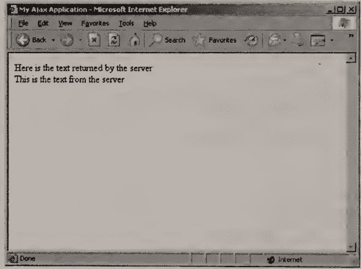

## 在 responseText 中包含 HTML

现在让我们修改上一个示例的代码。

正如你从之前的章节中所知，HTML 标记完全由使用文本字符编写的标签组成。如果 `responseText` 属性中的值被用于修改发送服务器请求的页面显示，那么没有什么可以阻止我们让服务器脚本在返回的信息中包含 HTML 标记。

## 从 responseText 属性中获取更多信息

假设我们再次使用列表 19.1 中的代码，但使用修改过的服务器脚本：

```php
<?php
echo "<h3>Returning Formatted Text</h3>";
echo "<hr />";
echo "We can use HTML to <strong>format**</strong> text before we return it!";
?>
```

图 19.2 显示了浏览器结果。

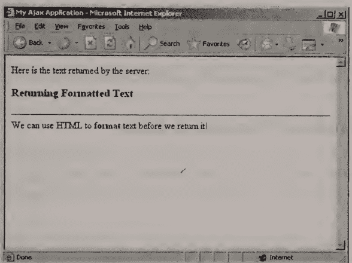

**图 19.2** 显示在服务器端进行格式化的 HTML 显示。

作为一个稍微复杂一点的例子，考虑服务器脚本生成更复杂输出的情况。我们希望应用程序获取此服务器输出并将其显示为表格内容。

这次，我们将使用服务器端 PHP 脚本来生成一些表格信息：

```php
<?php
$days = array('Monday', 'Tuesday', 'Wednesday', 
'Thursday', 'Friday', 'Saturday', 'Sunday');
echo "<table border='2'";
echo "<tr><th>Day Number</th><th>Day Name</th></tr>";
for ($i=0; $i<7; $i++) {
    echo "<tr><td>"
```

再次使用列表 19.1 的代码通过 `XMLHttpRequest` 调用服务器端脚本，我们获得了如图 19.3 所示的页面。

## 第 19 章：将数据作为文本返回

图 19.3
返回复杂的 HTML。

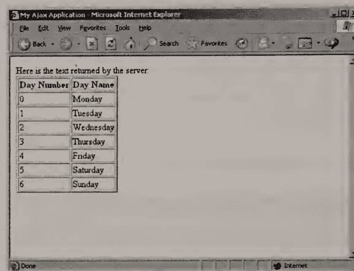

## 更复杂的格式化数据

到目前为止，我们已经演示了返回文本的方法，这些文本可以直接应用于网页上的元素。到目前为止，一切顺利。然而，如果你愿意在 JavaScript 中多花一点精力处理返回的数据，你可以实现更多功能。

只要 `XMLHttpRequest` 对象的 `responseText` 属性返回字符串值，你就可以使用你设计的任何数据格式在其中编码信息。

考虑以下服务器端脚本，它使用了与之前示例相同的数据数组：

```php
<?php
$days = array('Monday', 'Tuesday', 'Wednesday',
'Thursday', 'Friday', 'Saturday', 'Sunday');
$numdays = sizeof($days);
for($i=0;$i<$numdays - 1;$i++) {
  echo $days[$i]."*";
}
echo $days[$numdays-1];
?>
```

## 总结

通过使用 `sizeof()` 函数来确定 PHP 中的项目数量（就像在 JavaScript 中一样），我们可以处理更的数据。

`responseText` 属性返回的字符串现在包含了日期，并用管道符分隔（或定界）：

```javascript
var mystring = http.responseText;
```

我们现在使用 JavaScript 的 `split()` 将此字符串划分为数组，显示在服务器端进行格式化的 HTML：

```javascript
var results = mystring.split("|");
```

再次使用列表 19.1 的代码通过 `XMLHttpRequest` 调用服务器端脚本，我们获得了如图 19.3 所示的页面。


## 第 20 章：AHAH——异步 HTML 和 HTTP

## 你将在这一章中学习到

- 介绍 AHAH
- 为 AHAH 创建一个小型库
- 使用 myAHAH.js


# 为 AHAH 创建一个小型库

- 一种创建 `XMLHttpRequest` 对象实例、对其进行配置并发送它的方法
-- 一个用于处理包含在 `responseText` 属性中的返回文本的回调函数

你可以将这些函数抽象为简单的 JavaScript 函数调用，特别是在你仅希望用服务器返回的新值更新单个页面元素的情况下下。

## 介绍 myAHAHlib.js

请考虑列表 20.1；这段代码的大部分内容对你来说都是熟悉的。

```javascript
LISTING 20.1 myAHAHlib.js
function callAHAH(url, pageElement, callMessage) {
  document.getElementById(pageElement);
  innerHTML = callMessage;
  try {
    req = new XMLHttpRequest(); /* e.g. Firefox */
  } catch (e) {
    req = new ActiveXObject('Msxml12.XMLHttpRequest');
    /* some versions IE */
  } catch (e) {
    req = new ActiveXObject('Microsoft.XMLHttpRequest');
    /* some versions IE */
  } catch (E) {
    req = false;
  }
  req.onreadystatechange = function() {responseAHAH(pageElement)};
  req.open('GET',url,true);
  req.send(null);
}

function responseAHAH(pageElement) {
  var output = '';
  if(req.readyState == 4) {
    if(req.status == 200) {
      output = req.responseText;
      document.getElementById(pageElement);
      innerHTML = output;
    }
  }
}
```

# 第 20 章：AJAX—异步 HTML 和 HTTP

函数 `callAHAH` 封装了创建 `XMLHttpRequest` 对象实例、声明回调函数以及发送请求的任务。

注意，我们并没有简单地声明
`req.onreadystatechange = responseAHAH;`

而是使用了 JavaScript 结构
`req.onreadystatechange = function() {responseAHAH(pageElement)};`

这种声明类型允许我们向声明的函数传递一个参数，在本例中，它是指定要更新的页面元素。

`callAHAH()` 还接受一个额外的参数 `callMessage`。该参数包含一个字符串，定义了在我们等待请求结果期间应在目标元素中显示的内容。这为用户提供了某种程度的反馈，表明页面上正在发生事情。在实践中，这可能是一行文本，例如

> '正在更新页面；请稍候 ...'

然而，你仍然可以选择将某些 HTML 代码嵌入到此字符串中。在 `` 元素中使用动态 GIF 它是向用户警告进程正在进行的有效方法。

回调函数 `responseAHAH()` 承担了特定任务：将 `responseText` 属性中返回的字符串应用到所选页面元素 `pageElement` 的 `innerHTML` 属性上：

```javascript
output = req.responseText;
document.getElementById(pageElement).innerHTML = output;
```

这段代码被封装在一个名为 `AHAHlib.js` 的文件中，你可以从 HTML 页面调用它，从而使这些函数对你的 AJAX 应用程序可用。下一节将展示其用例的一些示例。

## 使用 myAHAHlib.js

在第二部分中，我们遇到了 JavaScript 函数位于并在页面内引用的外部文件中的概念。

这就是我们使用新文件 `myAHAHlib.js` 的方式，使用如下形式的语句：
`<script language="JavaScript" SRC="myAHAHlib.js"></script>`

然后我们就可以根据需要随时调用脚本中的函数了。

以下是此类 HTML 页面的骨架源码：

```html
<html
<head>
<title>Another Ajax Application</title>
<script language="JavaScript" SRC="myAHAHlib.js"></script>
</head>
<body>
<form>
<input type="button" onclick=
  'callAHAH(\serverscript.php?parameter=x',
  displaydiv, \'Please wait - page updating _\') >
这是服务器响应将发布的地方：<br>
<div id="displaydiv"></div>
</form>
</body>
</html>
```

在这个简单的 HTML 页面中，使用一个按钮元素来创建触发 `callAHAH()` 方法调用的事件。该方法将文本字符串

'Please wait - page updating _'

放置在 ID 等为 `displaydiv` 的 `<div>` 元素中，并向 URL `serverscript.php?parameter=x` 发送异步服务器调用。

当 `responseAHAH()` 检测到服务器已完成响应时，`<div>` 元素的内容将使用存储在 `responseText` 中的值进行更新；而不是显示“请等待”消息，`<div>` 显示服务器返回的任何内容。

## 在项目中应用 myAHAHlib.js

我们可以通过另一个简单的 Ajax 应用程序演示这些技术。这次，我们将编写一个脚本，从用户输入的 URL 中获取“关键词”（keywords）元标签信息。

元标签（Metatags）是 HTML 页面 `<head>` 部分中可选的 HTML 容器元素。它们包含了有关网页的数据，这些数据对于搜索引擎和索引决定如何对页面内容进行分类有用。`keywords` 元标签通常包含一个用逗号分隔的单词列表，其含义与网站内容相关。`keywords` 元标签的示例可能如下：

```html
<meta name="keywords" content="programming, design,
development, Ajax, JavaScript, XMLHttpRequest, script">
```

# 第 20 章：AJAX—异步 HTML 和 HTTP

列表 20.2 显示了 HTML 代码

LISTING 20.2 keywords.html

```html
<html>
<head>
<title>Keywords Metag Grabber</title>
<script language="JavaScript" SRC="myAHAHlib.js"></script>
</head>
<body>
<form>
<p>URL: </p>
<input type="text" name="url" size="30">
<input type="button" onclick="callAHAH('serverscript.php?parameter='+form.url.value,
  displaydiv, \'Please wait - page updating _\')" value="Fetch">
<p>这是服务器响应将发布的地方：</p>
<div id="displaydiv"></div>
</form>
</body>
</html>
```

最后，考虑服务器端脚本：

```php
<?php
$tags = @meta_tags('http://url');
$result = $tags['keywords'];
if (strlen($result) > 0) {
  echo $result;
} else {
  echo "No keywords metag found";
}
?>
```


在简单的应用程序中，你只需要做的是更新页面元素的文本，XMLHttpRequest 对象的功能可以被抽象为一个 JavaScript 函数库，并通过简单的方法从 HTML 页面进行调用。

然而，对于某些任务，你需要利用 XML 的强大。我们将在第21章“以XML返回数据”中探讨这一主题。

## 第 21 章
## 以XML返回数据

本章你将学到：

- 为 Ajax 添加“x”
- responseXML 属性
- 项目——一个 RSS 标题阅读器

在本章中，你将学习如何通过 XMLHttpRequest 对象的 `responseXML` 属性使用从服务器返回的 XML 数据。

## 为 Ajax 添加“x”

第 19章“返回文本数据”和第 20章“AAAH——异步 HTML 和 HTTP”详细讨论了包含在 `responseText` 中的的字符串值，并研究了在应用程序中使用这些信息的几种技术。这些示例从简单的页面元素文本更新，到使用更复杂数据结构的应用程序（这些结构被编码为字符串值，可以在 `responseText` 属性中存储和传输）。

当然，Ajax 中的 x 代表 XML，在你的应用程序中使用 XML 的威力是有充分理由的。当你需要使用高度结构化的信息和/或在不同数据表示类型之间进行复杂的转换时，这一点尤为真实。

正如之前讨论过的，XMLHttpRequest 对象具有另一个名为 `responseXML` 的属性，可以通过 XML 从从服务器传输信息，而不是使用文本字符串。

## 第 21 章：以XML返回数据

你在第 13章“我们的第一个 Ajax 应用程序”中看到了 JavaScript 文档对象模型（DOM）方法如何帮助你处理这些 XML 信息。本章将更详细地研究这些技术，并希望让你领略利用 XML 时 Ajax 应用程序可以实现什么。

## responseXML 属性

XMLHttpRequest 对象的 `responseText` 属性包含一个字符串，而 `responseXML` 可以被视为一个文档对象。

> 你需要确保你的服务器通过 `responseXML` 属性呈现有效且格式良好的 XML。在 XMLHttpRequest 对象无法正确解析 XML 的情况下（可能是由于格式错误或不支持的字符编码问题），`responseXML` 的内容将是不可预测的，并且在不同的浏览器中也可能不同。

与 `responseText` 属性一样，存储在 `responseXML` 中的值是只读的，你不能直接写入此属性；要对其进行操作，你必须将值复制到另一个变量：

```javascript
var myobject = http.responseXML;
```

XML 文档中包含的完整结构和数据现在可以使用 JavaScript 的 DOM 方法获取。在本章的稍后部分，我们将通过另一个 Ajax 应用程序演示这一点，但首先让我们重温 JavaScript DOM 方法并引入几个新方法。

## 更多 JavaScript DOM 方法

你在之前的章节中已经见过了一些 JavaScript DOM 方法，例如 `getElementById` 和 `getElementsByTagName`。在那些情况下，我们主要关注读取节点的值，以便将这些值写入 HTML 页面元素中。

本章将研究可以用于实际创建元素、改变页面结构的 DOM 方法。

文档对象模型可以被树树形节点结构。除了读取与这些节点关联的值外，你还可以创建和修改节点本身，从而改变你文档的结构和内容。

## responseXML 属性 259

要向页面添加新元素，你需要创建这些元素，然后将它们挂载到 DOM 树的相应位置。让我们使用以下 HTML 文档来看一个简单的示例：

```html
<html>
<head>
<title>Test Document</title>
</head>
<body>
我们想在这里放置一些文本：<br />
<div id="displaydiv"></div>
</body>
</html>
```

在这个示例中，我们想向文档主体中的 `<div>` 容器添加文本 "Hello World!"。我们将 JavaScript 代码例程放入一个函数中，并在主体的 `onload` 事件处理程序中调用它。

首先，我们将使用 JavaScript DOM 方法 `createTextNodeNode()`来创建一个……嗯，创建一个文本节点：

```javascript
var textnode = document.createTextNode('Hello World!');
```

我们现在需要将 `textnode` 挂载到文档 DOM 树的相应位置。

你首先在第 5章“与文档对象模型工作”中学习了子节点；希望你还记得，当文档中的节点包含其他文档元素时，它们就拥有子节点。JavaScript 有一个 `appendChild()` 方法，它允许我们通过使其成为现有文档节点的子节点，将我们的新节点挂载到 DOM 树上。

在这种情况下，我们希望文本位于 id 为 `displaydiv` 的 `<div>` 容器内部：

```javascript
var textnode = document.createTextNode('Hello World!');
document.getElementById('displaydiv').appendChild(textnode);
```

> 将这种基于 DOM 的页面写入内容的方法与第 13章项目中使用的 `innerHTML` 方法进行对比。

让我们看看页面的完整源代码，我们将这段 JavaScript 封装进函数并添加 `onload` 事件处理程序来执行它之后：

```html
<html>
<head>
<title>Test Document</title>
<script Language="JavaScript">
```


## 第 21 章：以XML返回数据

```javascript
function hello() {
  var textNode = document.createTextNode('Hello World!');
  document.getElementById('displaydiv').appendChild(textNode);
}
</script>
<body onload="hello()">
我们想在这里放置一些文本：<br />
<div id="displaydiv"></div>
</body>
</html>
```

图 21.1 显示了加载后的浏览器。


## responseXML 属性 261

通常情况下，你只需将元素的类型作为参数传递给 `createElement()` 即可生成所需的元素。

```javascript
var newdiv = document.createElement("div");
```

## DOM 方法概述

本书不仅关于 JavaScript DOM 技术，因此我们不会在这里重现所有方法和属性的完整指南。然而，表 21.1 列出了一些实用的。

> **你知道吗？**

> 如果你需要更多关于 DOM 方法和属性的详细说明，Andrew Watt 在他优秀的书籍《Sams Teach Yourself in 10 Minutes》（Sams Publishing, ISBN 0673242717）中提供了实用的列表。

表 21.1 一些 JavaScript DOM 属性和方法
| 节点属性 | |
|---|---|
| childNodes | 子节点数组 |
| firstChild | 第一个子节点 |
| lastChild | 最后一个子节点 |
| nodeName | 节点名称 |
| nodeType | 节点类型 |
| nodeValue | 节点的值 |
| nextSibling | 相同父节点的下一个节点 |
| previousSibling | 相同父节点的上一个节点 |
| parentNode | 此节点的父节点 |
| 节点方法 | |
| AppendChild | 添加新的子节点 |
| HasChildNodes | 如果此节点有子节点则为真 |
| RemoveChild | 删除子节点 |
| 文档方法 | |
| CreateAttribute | 为元素创建一个新属性 |
| CreateElement | 创建一个新的文档元素 |
| CreateTextNode | 创建一个文本项 |
| GetElementsByTagName | 创建标签名数组 |
| GetElementsByById | 通过 ID 查找元素 |


## 第 21 章：将 XML 返回数据

## 项目——一个 RSS 标题阅读器

让我们利用已经学到的从服务器返回 XML 数据的知识，并使用这些技术来处理一个新项目。

XML 数据以多种形式存在于互联网上。最流行的形式之一是 RSS 馈，这是一种特殊的 XML 源，通常包含新闻或其他主题性并定期更新的项目。RSS 馈源自 Web 上的许多来源，包括大多数广播公司和报纸出版商，以及针对各种主题的专业网站。

我们将编写一个 Ajax 应用，获取 RSS 馈的 URL，收集 XML，并列出馈源中包含的新闻条目的标题和描述。

以下是一个典型的 RSS 馈的内部 XML：

```xml
<rss version="0.91">
<channel>
  <title>myRSSfeed</title>
  <link>http://www.********.com/</link>
  <description>My RSS feed</description>
  <language>en-us</language>
  <item>
    <title>New Store Opens</title>
    <link>http://www.********.html</link>
    <description>The new business, Ajax Records, caters for a wide range of musical tastes.</description>
  </item>
  <item>
    <title>Bad Weather Affects Transport</title>
    <link>http://www.********.html</link>
    <description>Trains and buses were disrupted badly today due to heavy snow. Police advised people not to travel unless absolutely necessary.</description>
  </item>
  <item>
    <title>Date Announced for Mayoral Election</title>
    <link>http://www.********.html</link>
    <description>September 4th has been announced as the date for the next mayoral election. Watch local news for details.</description>
  </item>
</channel>
</rss>
```

从第一行

```xml
<rss version="0.91">
```

我们可以看到，在这个例中我们处理的是 RSS 0.91 版本。RSS 的不同版本差异很大，但对于我们的示例来说，我们只关心单个新闻条目的 `<title>`、`<link>` 和 `<description>` 元素，这些元素在不同版本之间基本上保持不变。

## 我们应用程序的 HTML 页面

我们的页面需要包含一个输入字段，用于输入所需 RSS 馈的 URL，以及一个指示应用程序收集数据的按钮。我们还需要一个 `<div>` 容器，用于显示解析后的数据：

```html
<html
<head>
<title>An Ajax RSS Headline Reader</title>
</head>
<body>
<h3>An Ajax RSS Reader</h3>
<form name="form">
URL of RSS feed: <input type="text" name="feed" size="50" value="http://"><input type="button" value="Get Feed">
<br /><br>
<div id="news"><h4>Feed Titles</h4></div>
</form>
</body>
</html>
```

如果我们将此代码保存为文件 `rss.html` 并将其加载到浏览器中，我们将看到类似于图 21.2 所示的显示。

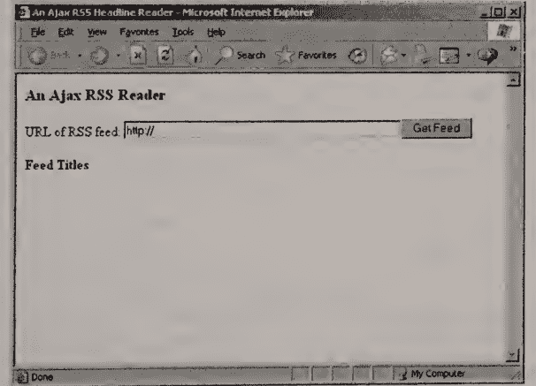

**图 21.2** 显示我们的 RSS 标题阅读器的基础 HTML 文档。

到目前为止，我们的阅读器的大部分代码应该已经熟悉了；创建 `XMLHttpRequest` 对象实例的方法、构建并发送服务器请求，以及检查请求何时完成，都在之前的示例中完成了。

然而，这一次，我们不再使用 `response`，而是通过 `responseXML` 属性以 XML 接收数据。我们将使用这些数据来修改 HTML 页面的 DOM，以便在页面的 `<div>` 容器内的列表中显示新条目的标题和描述。每个标题和描述将包含在自己的段落元素中（我们也为了该目的构造这些元素），并通过样式表对其进行样式处理以以我们想要的方式显示。

## 完整代码

让我们直接查看代码，如列表 21.1 所示。

### 列表 21.1 Ajax RSS 标题阅读器

```html
<html
<head>
<title>An Ajax RSS Headline Reader</title>
</head>
<style>
body {
  font: 16px helvetica, arial, sans-serif;
  padding: 0px 30px 0px 30px;
  text-decoration:underline;
}
.desc {
  font: 14px normal helvetica, arial, sans-serif;
  text-decoration:italic;
  padding: 0px 30px 0px 30px;
  background-color:#cccccc;
}
.link {
  font: 0px helvetica, arial, sans-serif;
  padding: 0px 30px 0px 30px;
}
.displaybox {
  border: 1px solid black;
  padding: 0px 50px 0px 50px;
}
</style>
<script type="text/javascript">
function getXMLHttpRequest() {
try {
  req = new XMLHttpRequest(); /* Firefox */
} catch (e) {
  try {
  req = new ActiveX("Msxml2.XMLHttpRequest"); /* some versions IE */
  } catch (e) {
    req = new ActiveX("Microsoft.XMLHTTP"); /* some older versions IE */
  } catch (e) {
    req = null;
    }
  }
}
return req;
}

function getRSS() {
  var myurl = 'sproxy.php?feed=';
  var myfeed = document.form.feed.value;
  var varRand = parseInt(Math.random()*9999);
  var http = getXMLHttpRequest();
  http.open("GET", myurl+escape(myfeed)+"&rand="+varRand, true);
  http.onreadystatechange = useResponse;
  http.send(null);
}

function useResponse() {
  if (http.readyState == 4) {
    if (http.status == 200) {
      var news = document.getElementById('news');
      while (news.hasChildren()) {
        news.removeChild(news.firstChild);
      }
      var doc = http.responseXML;
      var titleNodes = doc.getElementsByTagName("title");
      var descriptionNodes = doc.getElementsByTagName("description");
      var linkNodes = doc.getElementsByTagName("link");
      for (var i = 0; i < titleNodes.length; i++) {
        var newpara = document.createElement('p');
        newpara.appendChild(document.createTextNode(titleNodes[i].childNodes[0].nodeValue));
        newpara.className = "title";
        news.appendChild(newpara);

        var newpara = document.createElement('p');
        newpara.appendChild(document.createTextNode(descriptionNodes[i].childNodes[0].nodeValue));
        newpara.className = "desc";
        news.appendChild(newpara);

        var newpara = document.createElement('p');
        newpara.appendChild(document.createTextNode(linkNodes[i].childNodes[0].nodeValue));
        newpara.className = "link";
        news.appendChild(newpara);
      }
    }
  }
}
</script>
<body>
<center>
<h3>An Ajax RSS Reader</h3>
<form name="form">
URL of RSS feed: <input type="text" name="feed" size="50" value="http://"><input type="button" value="Get Feed" onclick="getRSS()">
<br /><br>
<div id="news" class="displaybox"><h4>Feed Titles</h4></div>
</form>
</center>
</body>
</html>
```


## 第 21 章：返回 XML 数据

Each time we enter the URL of a different RSS feed into the input field and click the button, the <div> content is updated to show the items belonging to the new RSS feed. This being an Ajax application, there is of course no need to reload the whole page.

## 服务端代码

Because of the security constraints built into the XMLHttpRequest object, we't call an RSS feed directly; we must use a script having a URL on our own server, and have this script collect the remote XML file and deliver it to the Ajax application.

In this case, we do not require that the server-side script sssproxy.php modify the XML file but simply route it back to us via the responseXML property of XMLHttpRequest object. We say that the script is acting as a proxy by retrieving the remote resource on behalf of the Ajax application.

Listing 21.2 shows the code of the PHP script.

##  21.2 RSS 标题读取器的服务器脚本

```php
<?php
$mysession = curl_init($_GET['feed']);
curl_setopt($mysession, CURLOPT_HEADER, false);
curl_setopt($mysession, CURLOPT_RETURNTRANSFER, true);
$out = curl_exec($mysession);
header("Content-Type: text/xml");
echo $out;
curl_close($mysession);
?>
```

The script uses the cURL PHP library, a set of routines for making Internet file transfer easier to program. A full description of cURL would not be appropriate here; suffice to say that this short script first receives the URL of the required RSS feed by referring to the feed variable sent by the Ajax application. The two lines that call the curl_setopt() function define, respectively, that we don't want the headers sent with the remote file, but we do want the file contents. The curl_exec() function makes the data transfer.

After it's simply a matter of adding an appropriate header using the family PHP header() command and returning the data to our Ajax application.

> For a full description of cURL with PHP, see the PHP website at http://uk2.php.net/curl and/or the cURL site at http://curl.haxx.se/.

Figure 21.3 shows the RSS reader in action, in this case displaying content from a CNN newsfeed.

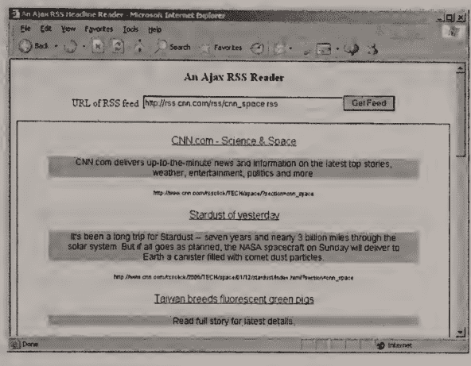

FIGURE 21.3
运行中的 Ajax RSS 阅读器。

## Summary

The JavaScript DOM methods, when used with the XMLHttpRequest object and XML data, provide a powerful means of transferring, organizing, and either displaying or otherwise processing data that has a sophisticated structure.

In this chapter you saw how DOM elements can be added, deleted, and manipulated to restore an application's DOM in accordance with XML data received in the XMLHttpRequest object's responseXML property.

## 第 22 章

## Web 服务与 REST 和 SOAP 协议

What You'll Learn in This Chapter:

- Web 服务简介
- REST—表述状态转移
- 实践中的 REST 使用
- 使用 SOAP 的 Web 服务
- SOAP 协议
- 使用 Ajax 和 SOAP
- 复习 SOAP 和 REST

In this chapter you will learn the basics of web services and how to implement them using the REST (Representational State Transfer) and SOAP (Simple Object Access Protocol) protocols.

## Web 服务简介

For you have seen several example applications in which we have called server-side scripts to carry out tasks. In each case we devised data structures to transfer the information and written routines to handle data transfer both to and from the server.

Suppose, that you wanted to make your server-side programs more generally available. Perhaps you can imagine that several different web applications might interface with such scripts for their own purposes. As well as requesting pages directly, perhaps other applications (for example Ajax applications operating via XMLHttpRequest calls) might also make data requests and expect to receive, in response, data that they can understand and manipulate.

## 第 22 章：Web 服务与 REST 和 SOAP 协议

In such cases it would be beneficial to have some form of standardization in the interfaces that your program makes available. This principle provides the basis of what have come to be known as web services.

As an example, suppose that our server application produces XML-weighted forecast data in response to a request requesting geographical information.

The nature of this type of service makes it broadly applicable; such an application might have a wide variety of “clients” ranging from simple web pages that present weather forecasts in their local area to complex aviation or travel planning applications that require the data for more demanding uses.

This type of service is just one small example of what a web service might be capable of doing. Thousands of web services are active on the Internet, providing a mind-boggling array of facilities including user authentication, payment processing, content syndication, messaging, and a host of others.

In general, a web service makes available an application programming interface (API), which allows client applications to build interfaces to the service. Although any Internet protocol might be used to create web services, XML, and HTTP are popular options.

A number of protocols and techniques have emerged that may help you to create and utilize web services. This chapter looks at perhaps the simplest of those, called REST (Representational State Transfer), and another protocol, this time called SOAP (the Simple Object Access Protocol). Each section highlights in particular how they may be useful in Ajax applications.

## REST—表述状态转移

REST is centered on two main principles for generalized network design:

- 资源 are represented by URLs—A resource can be thought of as a “noun” and refers to some entity we want to deal with in the API of a web service; this could be a document, a person, a meeting, and so on.
- Operations are carried out via standard HTTP methods—HTTP methods as GET, POST, and DELETE are used to perform operations on resources.

## REST—表述状态转移

## Hypothetical REST Example

To understand how and why we might apply these ideas, let's look at a hypothetical example.

Suppose that we have a web service that allows writers to submit, edit, and read articles. Applying so-called RESTful principles to the design of this application, the following occurs:

- Each article has a unique URL, for example: `http://somedomain.com/articles/173`
- To retrieve an article, our client application would simply use an HTTP request to the preceding URL.
- To upload a new article, a POST request would be used, containing information.
- To upload an edited article, a PUT request would be used, containing the revised content.
- HTTP DELETE would be employed to delete a particular article.

In this, the web service using an interface familiar to one who has used the World Web. We do not need to devise a library of API methods for sending or retrieving information; we already have them in the form of the standard HTTP methods.

The World Web itself is a REST application.

## 第 22 章：Web 服务与 REST 和 SOAP 协议

### 使用 GET 查询

An important issue concerning the use of the HTTP request in a RESTful application is that it should never change the server state. To put it another way: We only use GET requests to ask for information from the server, never to alter information already there.

POST, PUT, and DELETE calls can all change the server status in some way.

### Stateless

All server exchanges within a RESTful application should be stateless. By stateless we mean that the client itself must contain all the information required by the server to carry out the required task, rather than depending on some state or context-current. We cannot, for example, require the server to refer to information sent in previous requests.

## 实践中的 REST

Let's expand on the example quoted earlier involving our articles web service.

### 读取可用列表

The list of available articles is a resource. Because the web service conforms to REST principles, we expect the service to provide a URL by which we can access this resource, for instance: http://somedomain.com/articles/list.php

Because we are querying information, rather than attempting to change it, we use an HTTP GET request to the preceding URL. The server may return, for example, the following XML:

```xml
<articles>
  <article>
    <id>173</id>
    <title>New Concepts in Ajax</title>
    <author>P.D. Johnstone</author>
  </article>
  <article>
    <id>218</id>
    <title>More Ajax Ideas</title>
    <author>S.N. Braithwaite</author>
  </article>
</articles>
```


```xml
<id>365</id>
<title>突破 Ajax 的局限</title>
<author>Z.R. Lawson</author>
</article>
</articles>
```

# 获取特定文章

由于这是另一次信息请求，我们再次需要提交一个 HTTP GET 请求。我们的网络服务可能允许我们向 http://somedomain.com/articles/list.php?id=218 发起请求，并获得返回：

```xml
<id>218</id>
<title>更多 Ajax 点</title>
<author>S.N. Braithwaite</author>
</article>
```

# 上传新文章

在这种情况下，我们需要发布 POST 请求而不是 GET 请求。在类似于之前概述的假设性情况下，服务器可能会为新文章分配 id 值，留给我们为标题和作者元素对参数和值对进行编码：

```javascript
var article = 'Angle on Ajax';
var articleAuthor = 'K.B. Schmidt';
var url = '/articles/upload.php';
var poststring = "title=encodeURI(articleTitle)\n&author=encodeURI(articleAuthor)";
http.onreadystatechange = callbackFunction();
http.open('POST', url, true);
http.setRequestHeader('Content-type', "application/x-www-form-urlencoded");
http.setRequestHeader('Content-length', poststring.length);
http.send(poststring);
```

# 现实世界——Amazon REST API

领先的在线书店 Amazon.com 提供了一系列 REST Web 服务，帮助开发者将 Amazon 的浏览和购物功能集成到他们的 Web 应用中。

# 第 22 章：Web 服务与 REST 和 SOAP 协议

## 顺带一下

Amazon.com 经常将 REST 协议称为 XML-over-HTTP 或 XML/HTTP。

通过包含所需搜索参数（如出版者、排序、作者等）的参数/值对的 URL，然后向该 URL 提交 GET 请求，可以说服 Amazon Web 服务返回包含产品详情的 XML 文档。然后我们可以解析该 XML 以创建用于在网页显示的 DOM 对象，或者为我们应用程序所需的进一步处理提供数据。

## 你知道吗？

Amazon 要求你获取开发者令牌才能为其 Web 服务开发客户端应用程序。在构建指向 Amazon Web 服务的 REST 请求时，你需要此令牌。你还可以获得 Amazon 联盟营销 ID，以便能够通过在你的网站上推广 Amazon 服务来盈利。详情请参阅 http://www.amazon.com。

让我们通过开发一个返回书籍列表的 REST 请求在实践中观察这一点。可以进行许多类型的搜索，但在本例中，我们请求一份由 Sams 出版的书籍列表。

我们从基础 URL 开始构建 GET 请求：

```php
$url = 'http://xml.amazon.com/onca/xml33';
```

然后我们需要添加若干参数/值对来完成请求：

```php
$assoc_id = "XXXXXXXXXX"; // 你的 Amazon 联盟营销 ID
$dev_token = "ZZZZZZZZZZ"; // 你的开发者令牌
$manuf = "Sams";
$url = "http://xml.amazon.com/onca/xml33";
$url .= "?id=".$assoc_id;
$url .= "&dev-token=".$dev_token;
$url .= "&manufacturerSearch=".$manuf;
$url .= "&mode=books";
$url .= "&sort=salesrank";
$url .= "&offer=all";
$url .= "&type=lite";
$url .= "&page=1";
$url .= "&f=xml";
```

提交此 URL 后，我们收到一个包含所有匹配书籍详情的 XML 文件（超过 5,000 个标题！），我在这里不再复制整个文件。列表 22.1 显示了 XML 文件的摘录，包括列表中的第一本书。

# 在实践中使用 REST

# 列表 22.1 Amazon Web 服务编写的 XML 示例

```xml
<xml version="1.0" encoding="UTF-8" ?>
<ProductInfo xmlns:xsi="http://www.w3.org/2001/XMLSchema-instance"
  xsi:noNamespaceSchemaLocation
  type="http://xml.amazon.com/schemas3/dev-lite.xsd">
<Request>
  <Arg value="Mozilla/4.0 (compatible; MSIE 6.0; Windows NT 5.1; SV1; .NET CLR 1.4.3222)" name="User">
  <Arg value="002GC0C7MRWR37PASAS48" name="RequestID">
  <Arg value="All" name="offer" />
  <Arg value="us" name="locale" />
  <Arg value="1" name="page" />
  <Arg value="ZZZZZZZZ" name="dev-t" />
  <Arg value="XXXXXXXX" name="t" />
  <Arg value="xml" name="f" />
  <Arg value="books" name="mode" />
  <Arg value="Sams" name="ManufacturerSearch" />
  <Arg value="lite" name="type" />
  <Arg value="salesrank" name="sort" />
</Arg>
</Request>
<TotalResults>501</TotalResults>
<TotalPages>506</TotalPages>
<Detail>
```

# 第 22 章：Web 服务与 REST 和 SOAP 协议

在上一节中，我们讨论了 Web 服务，特别是如何使用 REST。

# 使用 SOAP 的 Web 服务

SOAP 是一种基于 XML 的消息协议。SOAP 请求是包含以下主要部分的 XML 文档：

- 定义文档为 SOAP 请求的信封（envelope）
- 包含调用信息和预期响应的主体（body）
- 携带补充信息的可选头（header）和故障（fault）元素

让我们看一个 SOAP 请求框架：

```xml
<xml version="1.0"?>
SOAP-ENV:Envelope
xmlns:SOAP-ENV="http://schemas.xmlsoap.org/soap/envelope/"
SOAP-ENV:encodingStyle="http://schemas.xmlsoap.org/soap/encoding/">
<SOAP-ENV:Header>
  ... 各种命令
</SOAP-ENV:Header>
```


## 第 22 章：Web 服务与 REST 及 SOAP 协议

```xml
<SOAP-ENV:Body>
... 各种命令 ..
<SOAP-ENV:Fault>
.. 各种命令
</SOAP-ENV:Fault>
</SOAP-ENV:Body>
</SOAP-ENV:Envelope>
```

请注意，SOAP 请求是一个 XML 文件，其根元素是 `Envelope`（封封）。

Envelope 的第一行是：

```xml
<SOAP-ENV:Envelope xmlns:soap-envelope =
  "http://schemas.xmlsoap.org/soap/envelope/*"
SOAP-ENV:encodingStyle=
  "http://schemas.xmlsoap.org/soap/encoding/"
```

这一行声明了 `xmlns:soap` 命名空间，它必须始终为 `xmlns:soap="http://schemas.xmlsoap.org/soap/envelope/"`。

> 命名空间用于唯一标识一组 XML 元素或属性的标识符，提供了一种对其名称进行限定的方法，使得其他架构中的名称不会与其发生冲突。

`encodingStyle` 属性包含了定义消息中所用数据类型的信息。

接下来是 `Header`（头部）元素，它是可选的，但如果存在，它必须是消息中的第一个元素。`Header` 元素中定义的属性定义了接收应用程序如何处理消息。

SOAP 消息的 `body` 元素包含了给最终接收者的消息。

序列化的方法参数包含在 SOAP 请求的 `body` 元素中。调用的 XML 元素必须紧跟在 SOAP body 的起始 XML 标签之后，并且必须与调用的远程方法相同。

`body` 还可以包含一个 `Fault`（故障）元素（但最多有一个）。该元素在 SOAP 规范中定义，用于携带可能发生的任何错误信息。如果存在，它必须是 `body` 元素的子元素。`Fault` 元素具有各种子元素，包括 `faultcode`、`faultstring` 和 `detail`，它们包含了故障状况的特定细节。

# SOAP 协议

281

# SOAP 请求的代码示例

让我们看看典型的 SOAP 请求可能像什么样：

```xml
<xml version="1.0" encoding="UTF-8"?>
<SOAP-ENV:Envelope xmlns:soap="http://schemas.xmlsoap.org/envelope/" xmlns:SOAP-ENV:encodingStyle="http://schemas.xmlsoap.org/encoding/">
<SOAP-ENV:Body>
  <m:GetInvoiceTotal xmlns:m="http://www.somedomain.com/invoices">
    <m:Invoice>7293</m:Invoice>
  </m:GetInvoiceTotal>
</SOAP-ENV:Body>
</SOAP-ENV:Envelope>
```

在前面的示例中，`m:GetInvoiceTotal` 和 `m:Invoice` 元素特定于特定应用程序，并不是 SOAP 本身的一部分。这些元素构成了包含在 SOAP 封中的消息。

让我们看看服务的 SOAP 响应可能像什么样：

```xml
<xml version="1.0"?>
<SOAP-ENV:Envelope xmlns:soap="http://schemas.xmlsoap.org/envelope/" xmlns:SOAP-ENV:encodingStyle="http://schemas.xmlsoap.org/encoding/">
<SOAP-ENV:Body>
  <m:ShowInvoiceTotal xmlns:m="http://www.somedomain.com/invoices">
    <m:Invoice>3295.00</m:Invoice>
  </m:ShowInvoiceTotal>
</SOAP-ENV:Body>
</SOAP-ENV:Envelope>
```

# 通过 HTTP发送 SOAP 请求

SOAP 消息可以通过 HTTP GET 或 HTTP POST 传输。如果通过 HTTP POST 发送，SOAP 消息需要至少设置一个 HTTP Header；这定义了 `Content-Type`：

Content-Type: text/xml

在成功的 SOAP 交换后，你将预期收到带有适当 HTTP 头的 SOAP 响应：

```http
HTTP/1.1 200 OK
Content-Type: text/xml
Content-Length: yyy
<xml version="1.0"?>
```

# 第 22 章：Web 服务与 REST 及 SOAP 协议

```xml
<SOAP-ENV:Envelope xmlns:soap-envelope="http://schemas.xmlsoap.org/soap/envelope/"
SOAP-ENV:encodingStyle="http://schemas.xmlsoap.org/soap/encoding">
<SOAP-ENV:Body>
<m:ShowInvoiceTotal xmlns:m="http://www.somedomain.com/invoices">
<m:InvoiceTotal>3295.00</m:InvoiceTotal>
</m:ShowInvoiceTotal>
</SOAP-ENV:Body>
</SOAP-ENV:Envelope>
```

# Ajax 和 SOAP

要在 Ajax 中使用 SOAP，你需要执行若干个独立的步骤：

1. 创建 SOAP 封。
2. 将特定于应用程序的信息序列化为 XML。
3. 创建包含你的特定应用程序代码序列化版本的 SOAP 实体。
4. 通过 `XMLHttpRequest` 对象发送 HTTP 请求，将 SOAP 消息作为负载发送。

回调函数需要负责解包 SOAP 响应并解析其中包含 XML。

# 代码示例

生成的代码可能像什么样？让我们来看使用上一个示例中虚构 SOAP 服务的例子：

```javascript
var invoiceiceno = '77293';
http.open('POST', 'http://somedomain.com/invoices',true);
http.onreadystatechange=function() {
  if (http.status==200) {
    alert('The server said: ' + http.responseText);
  }
}
http.setRequestHeader('Content-Type', 'text/xml');
var mySOAP = '<?xml version="1.0"?>
<SOAP-ENV:Envelope xmlns:soap-envelope="http://schemas.xmlsoap.org/soap/envelope/"
SOAP-ENV:encodingStyle="http://schemas.xmlsoap.org/soap/encoding/">
<SOAP-ENV:Body>
<m:ShowInvoiceTotal xmlns:m="http://www.somedomain.com/invoices">
<m:InvoiceTotal>3295.00</m:InvoiceTotal>
</m:ShowInvoiceTotal>
</SOAP-ENV:Body>
</SOAP-ENV:Envelope>';
http.send(mySOAP);
```

# 回顾 SOAP 和 REST

在本章中我们查看了 REST 和 SOAP。尽管存在其他 Web 服务协议，但过去几年开发者之间一直在 REST 与 SOAP 的争论。我不打算在这里加入该争论。相反，让我们总结一下它们的异同：

- REST 利用标准的 HTTP 方法 PUT、GET、POST 和 DELETE 来创建远程调用。使用 REST 协议的 Web 服务实现似乎特别适用于基于资源的服务，其最常用的方法通常涉及创建、编辑和删除信息。缺点是，REST 需要更多关于 HTTP 协议的知识。
- SOAP 协议增加了复杂性，需要将远程调用序列化并构造包含它的 SOAP 封。进一步的工作来自于在解析数据之前从其 SOAP 封中解包。这些额外步骤也会对性能产生影响，SOAP 通常比 REST 慢。然而，SOAP 更好地分离了远程调用与其传输方法，并增加了许多额外功能和设施，例如故障元素和通过命名空间进行类型检查。

总结 本章我们考虑了使用 REST 和 SOAP 协议 Web 服务。两种风格的服务都可以通过 XMLHttpRequest 使用。

# 第 23 章

# 用于 Ajax 的 JavaScript 库

# 你将在本章中学到：

- Ajax 库
- 回顾 myAHAlib.js
- 实现我们的库
- 使用库

在本章中，你将学习如何将目前为止学习的一些技术封装成一个小型 JavaScript 库，你可以在应用程序中调用它。


## 第 23 章：用于 Ajax 的 JavaScript 库

此外，你已经在第 20 章“AHA——异步 HTML 和 HTTP”中看到，这些方法中的某些是如何被抽象成一个小的 JavaScript “库的”（在当时它只包含两个函数）。

本章扩展了这一想法，构建一个功能更丰富的库，允许能够以极少的额外代码将 Ajax 功能添加到 HTML 页面中。

由于需要，我们的 Ajax 库将不会像书中后部分描述的开源项目那样复杂或全面；但是，它将足够用于构建功能性的 Ajax 应用。

## 审查 myAHAlib.js

列表 23.1 显示了 myAHAlib.js 的代码，复原自第 20 章。

### 列表 23.1 myAHAlib.js

```javascript
function callAHAH(url, pageElement, callMessage) {
  document.getElementById(pageElement).innerHTML = callMessage;
  try {
    req = new XMLHttpRequest(); /* e.g. Firefox */
  } catch (e) {
    req = new ActiveX("Msxml2.XMLHttpRequest");
    /* some versions IE */
  } catch (e) {
    req = new ActiveX("Microsoft.XMLHttpRequest");
    /* some versions IE */
  }
  req.on = false;
  req.onreadystatechange = function(responseAHAH(pageElement)) {
    req.open("GET",url,true);
    req.send(null);
  };
}

function responseAHAH(pageElement) {
  var output = '';
  if (req.status == 200) {
    output = req.responseText;
    document.getElementById(pageElement).innerHTML = output;
  }
  return output;
}
```

## 实现我们的库

让我们考虑一下如何扩展此库的功能：

- 目前仅支持 HTTP GET 请求。如果能够至少支持 HTTP POST 请求，将非常有用，特别是如果你打算使用 REST 协议构建应用程序（如第 22 章所描述）。

- 该库目前只处理通过 responseText 返回的文本信息，没有处理 responseXML 的手段。

## 实现我们的库

在确定了需要做的工作之后，我们现在将组合一个更强大的 Ajax 库。

## 创建 XMLHttpRequest 实例

让我们首先关注创建 XMLHttpRequest 对象实例的例程。

目前该函数与构建和发送 HTTP GET 请求的例程紧密耦合。让我们负责创建 XMLHttpRequest 实例的部分解耦，并将其放入自己的函数中：

```javascript
function createREQ() {
  try {
    req = new XMLHttpRequest(); /* e.g. Firefox */
  } catch(err1) {
    try {
      req = new ActiveXObject("Msxml2.XMLHttpRequest");
      /* some versions IE */
    } catch(err2) {
      try {
        req = new ActiveXObject("Microsoft.XMLHttpRequest");
        /* some versions IE */
      } catch(err3) {
        req = false;
      }
    }
  }
  return req;
}
```

现在我们可以简单地调用以下函数来创建 XMLHttpRequest 对象实例：

```javascript
var myreq = createREQ();
```

## 第 23 章：用于 Ajax 的 JavaScript 库

## HTTP GET 和 POST 请求

我们将从 GET 请求开始，因为我们已经支持该类型的请求：

```javascript
function requestGET(url, query, req) {
  myRand=parseInt(Math.random()*99999999);
  req.open("GET",url+'?'+query+'&='+myRand,true);
  req.send(null);
}
```

对于此请求，我们必须作为参数传递请求将发送到的 URL 以及 XMLHttpRequest 对象实例的标识。

我们可以排除 query 参数，因为在 GET 请求中，它被编码到 URL 中。我们在这里保持这两个参数分开，以保持与发送 POST 请求的函数相似的接口。

在调用函数之前，必须对 query 参数进行适当的编码，尽管缓存缓冲随机元素是由函数添加的。

接下来是 POST 函数：

```javascript
function requestPOST(url, query, req) {
  req.open("POST",url,true);
  req.setRequestHeader("Content-Type", 'application/x-www-form-urlencoded');
  req.send(query);
}
```

## 回调函数

我们如何处理回调函数？我们将添加另一个函数：

```javascript
function callback(callback,item) {
  eval(callback + '(item)');
}
```

该函数使用 JavaScript 的 eval() 函数来执行另一个作为参数传递给它的函数名，同时通过 item 向该函数传递它自己的事件处理器。

让我们看看当这些从事件处理器中调用时可能是什么样子的：

```javascript
function ajax(url,query,callback,reqtype,getxml) {
  // 创建 XMLHttpRequest 对象实例
  var myreq = createREQ();
  myreq.onreadystatechange = function() {
    if(myreq.status == 200) {
      var item = myreq.responseText;
      if(getxml==1) {
        item = myreq.responseXML;
      }
      doCallback(callback, item);
    }
    if (reqtype=='post') {
      requestPOST(url,query,myreq);
    } else {
      requestGET(url,query,myreq);
    }
  };
}
```

我们的函数现在接受五个参数：

- url—Ajax 调用的目标 URL
- query—查询字符串
- callback—回调函数的标识
- reqtype—'post' 或 'get'
- getxml—1 获取 XML，0 获取文本

## 实现我们的库

## 列表 23.2 JavaScript 源码

```javascript
function createREQ() {
  try {
    req = new XMLHttpRequest(); /* e.g. Firefox */
  } catch(err1) {
    try {
      req = new ActiveXObject("Msxml2.XMLHttpRequest");
      /* some versions IE */
    } catch(err2) {
      try {
        req = new ActiveXObject("Microsoft.XMLHttpRequest");
        /* some versions IE */
      } catch(err3) {
        req = false;
      }
    }
  }
  return req;
}

function requestGET(url, query, req) {
  myRand=parseInt(Math.random()*99999999);
  req.open("GET",url+'?'+query+'&='+myRand,true);
  req.send(null);
}

function requestPOST(url, query, req) {
  req.open("POST",url,true);
  req.setRequestHeader("Content-Type", 'application/x-www-form-urlencoded');
  req.send(query);
}

function callback(callback,item) { {
  eval(callback + '(item)');
}

function ajax(url,query,callback,reqtype,getxml) {
  var myreq = createREQ();
  myreq.onreadystatechange = function() {
    if(myreq.status == 200) {
      var item = myreq.responseText;
      if(getxml==1) {
        item = myreq.responseXML;
      }
      doCallback(callback, item);
    }
    if (reqtype=='post') {
      requestPOST(url,query,myreq);
    } else {
      requestGET(url,query,myreq);
    }
  };
}
```

## 使用库

为了演示库的使用，我们将从另一个简单的页面开始，其代码如下：

```html
<html>
<head>
</head>
<body>
<form name="form1">
<input type="button" value="Test"/>
</form>
</body>
</html>
```

“Ajax 化”应用程序所需的步骤：

- 1. 在页面的 <head> 区域包含 Ajax 库 myAHAlib.js。
- 2. 编写回调函数来处理返回的信息。
- 3. 在页面上添加事件处理器以调用服务器调用。

我们将首先演示 GET 请求并使用在响应属性中返回的信息。这与我们在第 20 章中处理的情况相似。

包含 Ajax 库是简单的：

```html
<head>
<script Language="JavaScript" src="myAHAlib.js"></script>
```

接下来，我们需要定义回调函数来处理存储在 responseText 属性中的值。对于这些示例，我们将简单将返回的文本显示在 alert 中：

```html
<head>
<script Language="JavaScript" src="myAHAlib.js"></script>
<script Language="JavaScript">
function cback(text) {
  alert(text);
}
</script>
```

最后，我们需要在按钮上添加事件处理器调用：

```html
onclick="doAjax('libtest.php','param=hello', 'cback','get','0')"
```

我们的服务器端脚本 libtest.php 简单地回显作为第二个参数发送的参数：

```php
<?php
echo "Parameter value was " . $param;
?>
```

而函数调用的剩余参数声明回调函数为 cback，我们想要发送 HTTP GET 请求，并且我们期望返回的数据在 responseText 中。列表 23.3 显示了我们修订后的 HTML 页面的完整代码。


## 第 23 章：用于 Ajax 的 JavaScript 库

### 列表 23.3 重写以调用 myAJAXlib.js 的 HTML 页面

```html
<<html>
<head>
  <script Language="JavaScript" src="myAJAXlib.js">
  </script>
  <script Language="JavaScript">
    function cback(text) {
      alert(text);
    }
  </script>
</head>
<body>
  <form name="form1">
    <input type="button" value="test" onclick="doAjAX('libest.php', 'param=hello',
      'cback', 'get', '0')">
  </form>
</body>
</html>
```

图 23.1 显示了运行程序的结果。

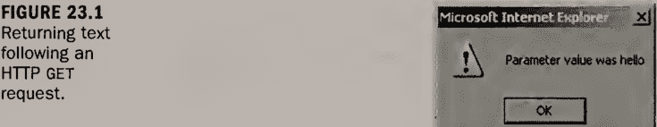

要使用相同的库来检索 XML 数据，我们将再次使用第 13 章中“我们的第一个 Ajax ”的服务器端脚本，你可能记得它会在一个小型 XML 文档中提供当前的服务器时间：

```php
<?php
header("Content-Type: text/xml");
echo "<?xml version='1.0'?><clock><timenow>"
date("H:i:s").
"</timenow></clock>";
?>
```

我们必须修改回调函数，因为我们现在需要返回解析后的 XML。我们将使用一些你现在应该已经熟悉的 DOM 方法：

```javascript
<script>
  function cback(text) {
    var servertime = text.getElementsByTagName("timenow")[0]
      .childNodes[0].nodeValue;
    alert('Server time is ' +servertime);
  }
</script>
```

我们唯一需要更改的是对 `doAjax()` 函数的调用：
`OnClick="doAjax('telltimeXML.php','callback','post','1')"`

我们决定发起一个 POST 请求。我们的服务器端脚本 `telltimeXML.php` 不需要查询字符串，因此在这种情况下，第二个参数留为空。最后一个参数被设置为 '1'，表示我们期望服务器通过 `responseXML` 属性返回 XML 响应。

图 23.2 显示了程序的结果。


## 动手尝试

### 扩展 Ajax 库

当前的库可以通过多种方式进行改进。这些将留作读者的练习，尽管在许多情况下，这些技术在书的其他地方已经涵盖过。

例如，用户反馈尚未被处理；我们之前讨论过如何通过显示适当的文本或图形图像来提醒用户请求正在进行。修订库以包含第 13 章及其他地方讨论的技术将是很有用的。

错误处理也被排除在代码之外，这被证明是一个有用的补充。例如，修改库以检测除 200 以外的 `HttpRequest` 状态属性并向用户输出相应的错误消息应该不会太困难。

请随时对代码进行实验，看看你能实现什么。

## 总结

本章结合了讨论的许多技术，产生了一个紧凑且可重用的 JavaScript 库，该库可以从 HTML 页面轻松地调用。

代码支持 HTTP GET 和 HTTP POST 请求，并可以处理从服务器返回的文本或 XML 数据。

使用此类库允许通过对 HTML 标记进行较小的添加将 Ajax 引入网页。这不仅保持了代码的整洁和易读，还简化了向旧版 HTML 中添加 Ajax 功能的步骤。

在第 24 章“Ajax 的‘陷阱’”（第五部分的最后一章）中，我们将讨论开发 Ajax 应用时等待开发者的某些潜在问题和陷阱。

## 第 24 章

### Ajax 陷阱

你将在本章学习到：

- 常见的 Ajax 错误
- 后退按钮
- 书签与链接
- 告诉用户某些正在发生
- 让 Ajax 优雅地降级
- 处理搜索引擎爬虫
- 指出活跃的页面元素
- 不要在不的地方使用 Ajax
- 安全性
- 跨平台测试代码
- Ajax 无法治愈糟糕的设计
- 一些编程陷阱

在这一章中，你将学习到一些常见的 Ajax 错误以及如何避免它们。

## 常见的 Ajax 错误

Ajax 有一些常见的陷阱等待着那些不留神心的开发者。在本章（第五部分的最后一章）中，我们将回顾这些陷阱中的一些，并讨论寻找解决方案的可能方法。

该列表并不是详尽的，而且提供的解决方案并不适用于所有情况。然而，它们应该能提供一些思路。

## 后退按钮

所有常用的浏览器在导航栏上都有一个后退按钮。浏览器在内存中维护一个最近访问页面列表，并允许你回溯这些页面以重新访问最近看过的页面。

用户已经习惯了后退按钮作为浏览体验的标准部分，就像他们基于页面的 Web 范式的其他方面一样。

```javascript
JavaScript 语言中内置了等效的后退按钮。
语句
onclick = "history.back()"
和
onclick = "history.go(-1)"
都模拟了点击后退按钮的操作。
```

正如你所学到的，Ajax 在很大程度上摆脱了重新加载整个新页的想法。那么后退按钮怎么办？

这个问题在开发者之间引起了相当争论。似乎有两种主要的流派：

- 通过编程手段记录状态，并在按下后退按钮时重建状态。
- 说服用户不再需要后退按钮。

人工重建状态是可能的，但它为 Ajax 代码增加了大量的复杂性，因此是勇敢开发者的领域！

尽管后一种方案听起来像是在回避问题，但它可能具有某些价值。如果你使用 Ajax 创建类桌面界面，值得注意的是桌面应用程序通常不需要后退按钮。

## 书签与链接

这个问题与后退问题并不独立。

当你书签收藏一个页面时，你正在尝试保存某些内容的快捷方式。在基于页面的比喻中，这是合理的；虽然页面可以具有某种程度的动态内容，但随后能够找到页面本身就足够看到我们上次访问时看到的内容。

然而，Ajax 可以使用同一个页面地址运行整个应用程序，并根据用户的操作从服务器返回大量的动态内容。

当你想要书签特定的信息屏幕并将该链接传递给朋友或同事时会发生什么？仅仅使用当前页面的 URL 不可能产生所需的结果。

虽然彻底消除这个问题可能是困难的，但通过为应用的特殊状态提供永久链接，可能可以在程度上缓解它。

## 告诉用户某些正在发生

这是另一个与离开独立页面界面风格变化有关的问题。

熟悉浏览网页的用户可能已经习惯了程序活动与新或修订页面的加载同步。

因此，许多 Ajax 应用都会提供某种一致的视觉线索表明活动正在进行；也许静态图形图像可能会被动画版本取代，光标样式可能会改变，或者弹出消息出现。这些技术中的一些已经在书的一些章节中提到过。

## 让 Ajax 优雅地降级

本书中的章节涵盖了使用各种现代浏览器开发 Ajax 应用。仍然可能，某些用户可能会让你感到意外，尝试使用不支持必要技术的过旧浏览器来运行你的应用程序。或者，访问者的浏览器可能禁用了 JavaScript 和/或 ActiveX（出于安全或其他原因）。


## 第 24 章：Ajax 的“坑” (Gotchas)

Ajax 应用在这些情况下发生故障是令人遗憾的。
至少，明显错误的发生（例如无法创建 `XMLHttpRequest` 对象的实例）应该报告给用户。如果 Ajax 应用如此复杂，无法自动回退到非 Ajax 运行模式，也许用户至少可以被重定向到该应用程序的非 Ajax 版本。

## 你知道吗？

你可以使用 HTML 页面中的 `<script> ... </script>` 标签来检测 JavaScript 是否不可用。这些标签之间的语句仅在 JavaScript **不可用**时才会被求值：

<script>
此浏览器不支持 JavaScript。 <br />
请点击 <a href="otherplace.html">这里</a> 获取
-仅限 HTML 的版本。 <br />
</script>

## 处理搜索引擎爬虫

搜索引擎通过各种手段收集有关网站的信息，其中一种非常重要的手段是使用称为*爬虫*（spiders）的自动化程序。

爬虫顾如其义，通过读取网页和链接来“爬取网络”，构建一个关于特定网站的内容和其他相关信息的数据库。这个数据库更广为人知的*索引*（index），由搜索引擎访问者使用关键词和短语进行查询，并返回供他们访问的相关页面建议。

这可能会为高度动态的网站带来问题，这些网站依赖用户交互（而不是被动浏览）来触发服务器上交付的新内容的加载。访问的爬虫可能无法访问通过动态手段加载的内容，因此永远无法对其进行索引。

Ajax 的使用可能会进一步加剧这个问题，因为它倾向于在更少的页面中交付更多内容。

这似乎可以确保爬虫可以在网站的某处对所有相关内容的静态版本进行索引。由于爬虫会遵循嵌入在页面中的链接，因此提供超链接的站点地图在这方面可以是一个非常有用的补充。

## 不要在合适的地方使用 Ajax

### 指出活动页面元素

如果没有仔细的设计，用户可能无法明显看出页面上的哪些项目是可以点击或通过其他方式进行交互以触发操作的。

尝试在整个应用程序中使用一致的样式来显示哪些页面元素导致了服务器请求或其他动态活动是值得的。这在某种程度上让人想起 HTML 页面中超链接的样式通常与正文本不同，以便使用户清楚地看到它们执行了额外的功能。

付出额外代码努力的代价，可以将有关活动元素的说明和信息整合到 ToolTip 弹出窗口中。当然，当活动链接可以对应用程序状态产生重大影响时，这一点尤为重要。图 24.1 显示了此类弹出框示例。

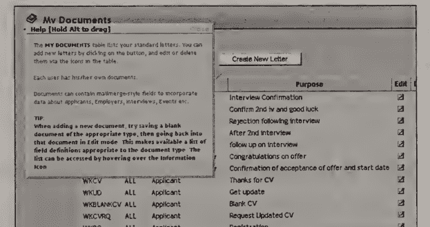

**图 24.1** 弹出信息帮助用户理解界面。

## 不要在合适的地方使用 Ajax

尽管 Ajax 对于改进 Web 界面无疑有用，但你需要接受，在很多情况下，使用 Ajax 会损害用户体验而不是增强用户体验。

当基于页面的界面比喻对于网站的内容和风格来说完全足够，甚至具有更高的相关性时，这一点尤为真实。对于主题被方便地划分为章节风格页面的文本网站，它们可以从智能设计的超链接中获益良，正如它们从添加 Ajax 功能中获益一样。

特别是小型网站可能难以从 Ajax 界面中获得足够的收益，以平衡额外代码和增加复杂性带来的相关成本。

## 安全

Ajax 本身似乎没有引入在设计 Web 应用时已经存在的安全问题。值得注意的是，Ajax 增强型应用程序往往比以前包含更多的客户端代码。

由于客户端代码的内容可以被应用程序的任何用户轻松查看，因此确保其中不泄露敏感信息非常。在这种背景下，敏感信息不仅限于用户名和密码等信息（尽管它们确实是敏感的），还包括业务逻辑。让服务器端脚本负责处理数据库连接等问题。在应用任何重要处理之前，在服务器上对数据进行验证。

## 跨平台测试代码

从本书的内容可以清楚地看出，各种浏览器在 JavaScript 的实现上存在差异。微软浏览器与非微软浏览器在生成 `XMLHttpRequest` 对象实例方面的主要差异是一个基础性的例子，但也存在许多细微差异。

特别是 DOM，其处理方式非常不同，不仅在不同浏览器之间，而且在同一浏览器的不同版本之间也是如此。CSS 的实现是另一个细微差异仍然泛滥的领域。

尽管在各种浏览器上测试新应用一直很重要，但在面对 Ajax 应用的复杂性时，这可能比以往任何时候都更重要。

希望浏览器将继续变得更加标准，但在那之前，请在尽可能不同的平台和使用尽可能不同的浏览器上测试应用程序。

## Ajax 救不了糟糕的设计

世界上所有的动态交互都无法纠正一个设计上存在根本缺陷的 Web 应用。

良好的 Web 设计的所有原则仍然适用于 Ajax 应用：

- 为多个浏览器编写代码并验证你的代码。
- 良好地注释并记录你的代码，以便以后进行调试。
- 尽可能使用小图形，以便它们快速加载。
- 确保你对颜色、背景、字体大小和样式的选择不会让页面难以阅读。

> W3C 在 http://validator.w3.org/ 提供了一个免费的在线验证器。


## 一些编程陷阱

虽然这些问题已经在各个章节中提到过，但在这里进行汇总是有意义。这些可能是开发者最常见的问题。

## 浏览器对 GET 请求的缓存

对同一 URL 发起的重复 GET 请求会导致响应不是来自服务器而是来自浏览器缓存。在使用 Internet 时这个问题尤为显著。

虽然可以使用合适的 Header 来解决这一理论，但在实践中缓存可能是顽固的。

避免此问题的有效方法是向发送的 URL 中添加一个随机元素；浏览器将其解释为指向不同的页面，从而返回服务器页面而不是缓存版本。

我们在文中通过添加源自时间的随机数实现了这一点。

## 权限拒绝错误

接收到权限拒绝的错误通常意味着你违反了防止 XMLHttpRequest 对象发起跨域请求的安全措施。

调用必须指向与调用脚本位于同一域的服务器程序。

确保域名写法完全相同。Somedomain.com 可能被解释为与 www.somedomain.com 不同，从而权限被拒绝。

## 内容转义

在构建 GET 或 POST 请求的查询时，记得转义可能空格或不存在字符的变量。在以下代码中，idValue 从表单的文本输入框收集，因此我们对其进行转义以确保编码正确：

```javascript
http.open("GET", url + escape(idValue) + "&rand=" + myRandom, true);
```

## 总结

Ajax 无疑具有极大改进 Web 界面的潜力。然而，从传统的基于页界面到高度动态应用的范式转变为开发者创造了一些掉进去的陷阱。在本章中，我们试图汇总其中一些较常见的问题。


## 第六部分
## Ajax 工具与资源

- **第 25 章** prototype.js 工具包 305
- **第 26 章** 使用 Rico 315
- **第 27 章** 使用 Script.aculo.us 325
- **第 28 章** 使用 XOAD 331
- **附录** JavaScript、PHP 和 Ajax 网站 339
- **术语表** 343

## 第 25 章
## prototype.js 工具包

在本章中将学习到：

- 介绍 prototype.js
- 封装 XMLHttpRequest——Ajax 对象
- 示例项目——股票价格读取器

在本章中，你将学习 prototype.js JavaScript 库，以及它如何减少构建强大的 Ajax 应用程序所需的工作量。

## 介绍 prototype.js

第六部分“Ajax 工具与资源”查看了了一些用于 Ajax 开发的可用代码库和框架。

我们本章从 Sam Stephenson 的 prototype.js 开始，这是一个流行的 JavaScript 库，它包含了一系列在开发跨浏览器 JavaScript 程序时非常有用的函数，并对 Ajax 提供了特定的支持。你将看到如何通过该库对 DOM 操作、HTML 表单和 XMLHttpRequest 对象的强大支持，来简化你的 JavaScript 代码。

> 你可以在随书附赠的 CD 盘中找到 prototype.js 的一个最新版本（编写时的版本）
最新版本的 prototype.js 库可以从 http://www.prototypejs.org/ 下载。

## 第 25 章：prototype.js 工具包
## 注意！

> 在编写本书时，prototype.js 的版本为 1.6.0。如果你下载了不同的版本，请检查文档以查看你的版本与此处描述的版本之间是否存在差异。

将该库包含在你的 Web 应用程序中非常简单，只需在 HTML 文档的 <head> 部分包含以下行即可：

```html
<script src="prototype.js" Language="JavaScript" type="text/javascript"></script>
```

prototype.js 包含了广泛的函数，可以使 JavaScript 代码运行更快，并使脚本更简洁、更于维护。

该库包含了通用函数（为常规编程任务提供快捷方式）、HTML 表单的封装器、一个用于封装 XMLHttpRequest 对象的对象、简化 DOM 任务的方法和对象等。

让我们来看看其中的一些工具。

## $() 函数

$() 本质上是 getElementById() DOM 方法的快捷方式。通常情况下，为了获取特定元素的值，你会使用如下表达式：
`var mydata = document.getElementById('someElementID');`

$() 函数通过返回作为参数传递给它的 ID 元素的值，简化了这项任务：
`var mydata = $('someElementID');`

此外，$()（与 getElementById() 不同）可以接受多个元素 ID 作为参数，并返回关联元素值的数组。考虑这行代码：

```javascript
mydataArray = $('id1', 'id2', 'id3');
```

在这个示例中：

- mydataArray[0] 包含 ID 为 id1 的元素的值。
- mydataArray[1] 包含 ID 为 id2 的元素的值。
- mydataArray[2] 包含 ID 为 id3 的元素的值。

## $() 函数

当输入元素或其 ID 作为参数传递给 $() 函数时，它会返回表单输入字段的值。查看下面的 HTML 代码段：

```html
<input type="text" id="input1" name="input1">
<select id="input2" name="input2">
  <option value="0">Option A</option>
  <option value="1">Option B</option>
  <option value="2">Option C</option>
</select>
```

在这里我们可以使用

```javascript
$F('input1')
```

来返回文本框中的值，并使用

```javascript
$F('input2')
```

来返回选择框中当前选中选项的值。$F() 函数在复选框和文本区域输入元素上的效果同样良好，无论输入元素类型是什么，都能轻松地返回元素值。

## Form 对象

prototype.js 定义了一个 Form 对象，具有多个实用的方法来简化 HTML 表单操作。

你可以通过调用 getElements 方法返回表单输入字段的数组：

```javascript
inputs = Form.getElements('thisform')
```

serialize() 方法允许将输入名称和值格式化为兼容 URL 的列表：

```javascript
inputlist = Form.serialize('thisform')
```

使用上述代码行，变量 inputlist 现在将包含一个由序列化的参数和值对组成的字符串：

```text
field1=value1&field2=value2&field3=value3...
```

Form.disable('thisform') 和 Form.enable('thisform') 的功能完全如其名。

## 第 25 章：prototype.js 工具包
## Try.these() 函数

之前的章节讨论了如何使用异常让你能够捕获运行时错误并整洁地处理它们。Try.these() 函数提供了一种方便的方法来封装这些方法，在 JavaScript 实现细节存在差异的情况下提供跨浏览器解决方案：

```javascript
return Try.these(function1(),function2(),function3());
```

这些函数按顺序处理，当错误导致抛出异常时，操作将移动到下一个函数。当任何函数成功完成时，操作停止，此时函数返回 true。

将此函数应用于创建 XMLHttpRequest 实例，展示了结果代码的简易性：

```javascript
return Try.these(
function(){return new XMLHttpRequest()},
function(){return new XMLHttpRequest()},
function()}
);
```

> 你可能想将此代码段与列表 10.1 进行对比，看看代码复杂性是如何降低的，可读性是如何提高的。

## 封装 XMLHttpRequest——Ajax 对象

prototype.js 定义了一个 Ajax 对象，旨在简化构建 Ajax 应用程序时的 JavaScript 代码。该对象具有许多用于发送服务器请求、监控进度以及处理返回数据的类。

## Ajax.Request

Ajax.Request 处理创建 XMLHttpRequest 实例和发送格式化请求的细节。调用它非常简单：

```javascript
var myAjax = new Ajax.Request( url, {method: 'post', parameters: mydata, onComplete: responsefunction() });
```

## 封装 XMLHttpRequest

在此调用中，url 定义了服务器资源的位置，method 可以 post 或 get，mydata 是包含请求的序列化字符串，responsefunction 是处理服务器响应的回调函数。

第二个参数使用称为 JSON 的符号构建。该参数由一系列参数值组成，全部包含在大括号内。参数值可以是 JSON 对象、数组或简单值。JSON 由于其易于构建、易于解析以及语言无关性，作为数据交换协议非常流行。你可以访问 http://www.json.org 获取更多信息。

你知道吗？

complete 参数选项之一，对应 XMLHttpRequest readystate 属性可能的值，在此情况下 readystate 值为 4（完成）。你可能希望指定回调函数在先前的阶段（加载、已加载或交互）中执行，这可以使用相应的参数 onLoading、onLoaded 或 onInteractive。

还有其他可选参数，包括 asynchronous:false，表示应同步进行服务器调用。async 参数的默认值为 true。

## Ajax.Updater

在需要使用返回的数据更新页面元素时，Ajax.Updater 类可以简化此任务。你只需要指定要更新的元素：

```javascript
var myAjax = new Ajax.Updater(elementID, url, options);
```

该调用方式与 Ajax.Request 类似，但增加了目标元素的 ID 作为第一个参数。以下是 Ajax.Updater 的代码示例：

```html
<script>
function updateDIV(mydiv)
{
  var url = 'http://example.com/serverscript.php';
  var params = 'param1=value&param2=value2';
  var myAjax = new Ajax.Updater
```


## 第 25 章：prototype.js 工具包

```javascript
(
  url,
  {method: 'get', parameters: params}
);
</script>
<input type="button" value="Go" onclick="updateDIV(targetDiv)">
<div id="targetDiv"></div
```

在调用时，同样可以使用几个额外的选项。其中一个值得的选项是添加 `evalscripts:true`。

选项列表。添加此选项后，服务器返回的任何 JavaScript 代码都将被执行。

## Ajax.PeriodicalUpdater

Ajax.PeriodicalUpdater 类可用于重复创建 `Ajax.Updater` 实例。通过这种方式，你可以让页面元素在特定的时间间隔后进行更新。这对于像行情行情器或 RSS 阅读器之类的应用程序非常有用，因为它确保了访问者看到的是实时的信息。

Ajax.PeriodicalUpdater 为 Ajax.PeriodicalUpdater 选项增加了两个额外参数：

- frequency——连续更新之间的延迟时间（以秒为单位）。默认值为两秒。
- decay——如果服务器返回未更改的数据，则连续延迟时间增加的倍数。默认值为 1，即保持延迟不变。

这里是 Ajax.PeriodicalUpdater 的调用示例：
`myAjax = new Ajax.PeriodicalUpdater(elementID, url, (frequency: 3.0, decay: 2.0));`

在这里我们选择将初始延迟设置为 3 秒，并且每次服务器返回未更改的数据时，该延迟长度不变。

## 示例项目——股票读取器

让我们使用 prototype.js 库构建一个简单的读取器，它可以定期更新以显示从服务器返回的最新值。我们将使用简单的服务器端脚本 `rand.php` 来模拟变化的股票价格：

```php
<?php
rand((double) microtime()*1000000);
$price = 50 + rand(0,5000)/100;
echo "$price";
?>
```

该脚本首先通过调用 `srand()` 函数并传递当前时间作为参数来初始化 PHP 的随机数程序。然后使用 `rand(0,5000)` 生成一个随机数，并对其算术处理产生 50.00 到 100.00 之间的虚假“股票价格”。

现在让我们来构建一个简单的 HTML 页面来显示当前股票价格。该页面构成了我们 Ajax 应用的基础：

```html
<!DOCTYPE HTML PUBLIC "//W3C//DTD HTML 4.01 Transitional//EN"
"http://www.w3.org/TR/html4/loose.dtd">
<html>
<head>
<script src="prototype.js" Language="JavaScript">
<script type="text/javascript"></script>
<title>由 Prototype.js 驱动的股票读取器</title>
</head>
<body>
  <h2>股票读取器</h2>
  <h4>由 Prototype.js 驱动</h4>
  <p>当前股票价格：</p>
  <div id="price"></</div>
</body>
</html>
```

注意，我们通过在文档头部（<head>）中包含一个 `<script>` 标签引入了 prototype.js 库。我们还定义了一个 id 为 "price" 的 `<div>`，用于显示当前股票价格。

我们现在需要实现 `Ajax.PeriodicalUpdater` 类，将其附加到文档体元素的 `onLoad` 事件处理器上。列表 25.1 显示了完整的脚本。

## 列表 25.1 使用 prototype.js 的 Ajax 股票读取器

```html
<!DOCTYPE HTML PUBLIC "-//W3C//DTD HTML 4.01
Transitional//EN"
//http://www.w3.org/TR/html4/loose.dtd">
<html>
<head>
  <script src="prototype.js" Language="JavaScript"></script>
  <script type="text/javascript"></script>
  <script>
  function checkprice() {
    var myAjax = new Ajax.PeriodicalUpdater('price',
      'rand.php', {method: 'post', frequency: 3.0,
      decay: 1});
  }
  </script>
  <title>由 Prototype.js 驱动的股票读取器</title>
</head>
<body onLoad="checkprice()">
  <h2>股票读取器</h2>
  <h4>由 Prototype.js 驱动</h4>
  <p>当前股票价格：</p>
  <div id="price"></</div>
</body>
</html>
```

通过使用 prototype.js，应用程序代码变得多么简单。实现该应用程序仅仅是定义一个单行函数 `checkprice()` 来实例化我们重复的 Ajax 调用，并从 body 元素的 `onLoad` 事件处理器中调用该函数。

从传递给 Ajax.PeriodicalUpdater 的参数中，你可以看到指定了 3 秒的重复间隔。此周期不会随后的调用而改变，因为 decay 值已设置为 1。

图 25.1 显示了应用程序的运行。当然，从图中无法看到股票价格每 3 秒更新一次以显示新值。

## 总结

313

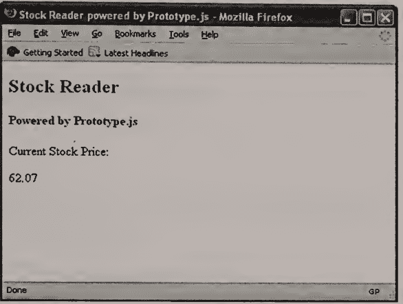

图 25.1 Ajax 股票读取器

这个简单的示例远不能展现 prototype.js 的威力。相反，它是为了让你开始自己的实验。

# 尝试你自己使用 prototype.js

这个简单的示例远不能展现 prototype.js 的威力。相反，它是为了让你开始自己的实验。

## 总结

在第六部分的第一节中，我们讨论了 prototype.js，一个简化许多任务的强大实用的库。

该库对 XMLHttpRequest 对象提供了良好的支持，以及许多与 Ajax 开发的技术。

# 第 26 章

# 使用 Rico

## 本章你将学习：

- 介绍 Rico
- Rico 的其他界面工具

在本章中你将学习使用 Rico 的基础。

## 介绍 Rico

在第25章“prototype.js 工具包”中，我们查看了 prototype.js，一个简化开发者面临任务的强大实用库。

> 你可以在随书 CD 的 Frameworks 文件夹中找到 Rico。

Rico 是一个开源库，扩展了 prototype.js 的功能以提供丰富的工具。除了目前讨论的 Ajax 开发技术外，Rico 还提供了如拖放、电影效果等一系列工具。

# 在应用程序中使用 Rico

> Rico 是西班牙语中的“丰富的”，这对于一个为构建丰富界面设计的工具包来说非常合适！

要开始使用 Rico 构建丰富界面应用程序，你需要在页面的 <head>...</head> 部分包含 Rico 和 prototype.js 库。

```html
<script src="scripts/prototype.js"></script>
<script src="scripts/rico.js"></script>
```

# Rico 的 AjaxEngine

引入 rico.js 会自动创建一个名为 ajaxEngine 的 `AjaxEngine` 对象实例并供你使用。AjaxEngine 是 Rico 为你的 Web 页面添加 Ajax 能力的机制。

AjaxEngine 需要三个步骤来通过 Ajax 更新页面元素：

- 注册响应处理器。注册响应处理器会将一个唯一名称与通过 Ajax 的特定 URL 关联。
- 注册响应处理器。Rico 可以处理从服务器返回的 XML 中的 HTML 数据和 JavaScript 代码。在前者情况下，响应处理器使用返回的数据识别要更新的页面元素；在后者，JavaScript 对象处理服务器响应。
- 从页面通过适当事件处理器发起 Ajax 调用。

我们首先通过调用 `ajaxEngine` 的 `registerRequest()` 方法来注册请求处理器：`ajaxEngine.registerRequest('getData','getData.php');`

我们现在已将名称 getData 与对服务器程序 getData.php 的请求关联。该服务器程序需要返回一个格式良好的 XML 响应。以下是一个典型响应的示例：


## 介绍 Rico

```html
<ajax-response>
<response type="element" id="showdata">
<div class="datadisplay">
The <q>cat</q> sat on the <b>mat</b>
</div>
</response>
</ajax-response>
```

此类响应始终包含一个根元素 `ajax-response`。在本示例中，它的 `<response>` 元素有两个属性：`type="element"` 和 `id="showdata"`。它们分别表示响应包含 HTML，以及该 HTML 将用于更新 id 为 `showdata` 的页面元素。该元素通过 `innerHTML` 属性进行更新。

> Rico 能够通过一个请求更新多个页面元素。为了实现这一点，`<ajax-response>` 元素可以包含多个 `<response>` 元素。


Rico 返回的另一种响应形式是 JavaScript 对象。这是一个示例：

```html
<ajax-response>
<response type="object" id="myHandler">
<sentence>The cat sat on the mat.</sentence>
</response>
</ajax-response>
```

`type` 已设置为 `object`，表示内容将由一个 JavaScript 对象处理，该对象的标识包含在 `id` 值中（此处处为 `myHandler`）。响应的内容始终被传递给该对象的 `ajaxUpdate` 方法。

响应处理器的注册方式取决于我们处理的是哪种类型的响应。对于类型为 `element` 的响应，你可以简单地调用 `ajaxEngine.registerAjaxElement('showdata');`。

对于包含 JavaScript 对象的响应，你将需要使用 `ajaxEngine.registerAjaxObject('myHandler', new myHandler());`。

类型为 `element` 的响应仅用于更新 HTML 页面元素，而类型为 `object` 的响应可以拥有处理器，以它们认为任何任何的方式处理响应。这使得 Rico 应用可以构建从简单到复杂的各种类型。

## 简单示例

我们可以通过列表 26.1 中的简单脚本看到 Rico 的运行。该应用程序通过单次调用 Rico 的 `ajaxEngine` 对象来更新两个 HTML 元素。应用程序的脚本位于列表 26.1。

## 列表 26.1 一个简单的 Rico 应用

```html
<!DOCTYPE html PUBLIC "-//W3C//DTD HTML 4.0//EN"
"http://www.w3.org/TR/html4/loose.dtd">
<html
<head>
<title>Testing OpenRico</title>
<script src="prototype.js"></script>
<script src="rico.js"></script>
<script type="text/javascript">
{
  ajaxEngine.registerRequest('MyRequest', 'ricotest.php');
  ajaxEngine.registerAjaxElement('display');
  ajaxEngine.registerAjaxElement('heading');
}
</script>
</head>
<body onload="callRico();">
<div id="heading"><h3>Ajax-Demonstrating Rico</h3></div>
<input type="button" value="Get Server Data" onclick="ajaxEngine.request('MyRequest');"/>
<div id="display"><p>This text should be replaced with server data ...</p></div>
</body>
</html>
```

你将从代码中看到，简单函数 `callRico()` 被用于注册单个请求处理器 `myRequest` 和两个响应处理器。这些处理器被用于更新两个 `<div>` 容器；其中一个包含页面的标题，另一个包含一条短文本消息。在调用 Rico 时，两者的内容都会被更新，使页面具有新标题并显示某些服务器信息，而不是之前的文本消息。图 26.1 显示了处理前后的截图。

服务器程序是一个简单的 PHP 脚本，用于输出所需的 XML 数据。该脚本使用了 PHP 的全局变量 `$_SERVER['SERVER_SIGNATURE']`。注意，该脚本构建并返回了两个独立的 `<response>` 元素，每个元素负责更新 HTML 页面中的特定元素。

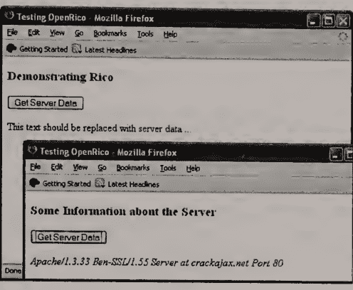

**列表 26.1** 使用 Rico 更新多个页面元素。

列表 26.2 显示了服务器脚本。

## 列表 26.2 生成 <ajax-response> 的服务器脚本

```php
<?php
header("Content-Type:text/xml");
header("Cache-Control:no-cache");
header("Pragma:no-cache");
echo "<ajax-response><response type=\"element\" id=\"display\">
  <p>
    $_SERVER['SERVER_SIGNATURE']
  </p>
  </response>
  <response type=\"element\" id=\"heading\">
    <h3>Some Information about the Server</h3>
  </response>
</ajax-response>"
?>
```

> 第 11 章“与服务器通信”讨论了由于浏览器缓存引起的问题。在本章中，我们使用了一种变通方法，即在要调用的服务器资源 URL 中添加一个随机值的参数。

此脚本示例使用了另一种技术，包括头部命令 `header("Cache-Control:no-cache");` 和 `header("Pragma:no-cache");`，指示浏览器不要缓存此页面，而是从服务器获取新副本。

## 第 26 章：使用 Rico

你知道吗？PHP 的 `$_SERVER` 数组是在 PHP 4.1 中引入的。

## 拖放

Rico 的功能不仅限于简单的界面。现在让我们你可以实现的其他功能。使用 Rico 的工具包，拖放的实现非常简单。`dndManager` 和 `DropZone` 方法分别定义了可拖拽项目和目标字段。

## 界面

列表 26.3 显示了使用 Rico 是多简单。

## 列表 26.3 简单的拖放

```html
<!DOCTYPE html PUBLIC "-//W3C//DTD HTML 4.0//EN"
"http://www.w3.org/TR/html4/loose.dtd">
<html
<head>
<title>Testing OpenRico</title>
<script src="prototype.js"></script>
<script src="rico.js"></script>
<style>
  body {
    font: 10px arial, helvetica, verdana;
  }
</style>
</head><body>
  <h3>Drag and Drop</h3>
  <p>使用左键将项目拖放到目标字段中。注意可用目标字段在拖拽操作期间颜色的变化。</p>
  <p>刷新页面再次开始。</p>
  <div class="box" id="draggable1">This is a piece of draggable data</div>
  <div class="box" id="draggable2">This is another</div>
  <div class="box" id="draggable3">And this is a third</div>
  <table>
    <tr>
      <td>
        <div id="dropmonme" class="simpleDropPanel">
          <b>Drop Zone 1</b><br />A simple text area
        </div>
      </td>
      <td>
        <b>Drop Zone 2</b><br />A form text entry field.
        <form><textarea name="dropzone" id="dropmonme" rows="6" cols="30"></textarea></form>
      </td>
    </tr>
  </table>
  <script type="text/javascript">
{
  ajaxEngine.registerRequest('MyRequest', 'ricotest.php');
  ajaxEngine.registerAjaxElement('display');
  ajaxEngine.registerAjaxElement('heading');
  dndManager.registerDraggable(new Rico.Draggable('foo', 'draggable1'));
  dndManager.registerDraggable(new Rico.Draggable('foo', 'draggable2'));
  dndManager.registerDraggable(new Rico.Draggable('foo', 'draggable3'));
  dndManager.registerDropZone(new Rico.DropZone('dropmonme'));
  dndManager.registerDropZone(new Rico.DropZone('dropmonme2'));
  }
  </script>
</body>
</html>
```


## Rico 的其他接口

两个 JavaScript 库 rico.js 和 prototype.js 被包含在文档的 `<head>` 中，并带有各种页面元素的样式定义。

注意，特别有两个元素——一个 `<div>` 容器和一个 `<textarea>` 输入字段，被赋予了 ID `dropzone1` 和 `dropzone2`。在列表的后续部分，通过以下代码行将这两个元素定义为拖放操作的放置区域：

```
dndMgr.registerDropZone(new Rico.Dropzone('droponeme'));
dndMgr.registerDropZone(new Rico.Dropzone('droponeme2'));
```

你会看到页面中定义了三个小的 `<div>` 容器，并分别赋予了 ID `draggable1`、`draggable2` 和 `draggable3`。正如你所料的那样，它们变成了可拖拽的页面元素，并通过以下代码定义：

```
dndMgr.registerDraggable(new Rico.Draggable('foo',
-- 'draggable1'));
dndMgr.registerDraggable(new Rico.Draggable('foo',
-- 'draggable2'));
dndMgr.registerDraggable(new Rico.Draggable('foo',
-- 'draggable3'));
```

就是这些了！Rico 负责处理所有的细节，甚至在拖拽物体时更改可用放置区域的外观，如图 26.3 所示。

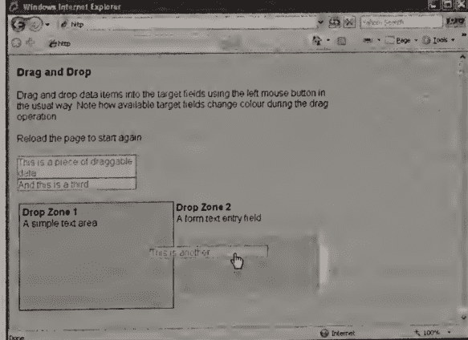

图 26.3
在拖放操作期间高亮的放置区域。

当在可用放置区域上方释放时，可拖拽项目将与放置元素的 HTML 代码内联对齐，如图 26.4 所示。

## 第 26 章：使用 Rico

图 26.4
完成拖放后。

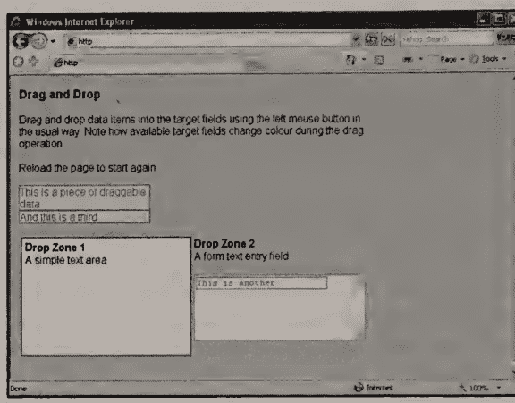

## 电影效果

除了 Ajax 和拖放工具外，Rico 还提供了一系列用户界面小组件，统称为电影效果（cinematic effects）。

## 顺便说

> Rico 的电影效果是 prototype.js 中 Effect 类的扩展。

这些效果包括页面元素的动画（改变其大小和/或形状）、淡入效果（改变页面元素的透明度）、为对象应用圆角以及操作对象的颜色。

与之前讨论的界面技术结合使用，这些效果可以帮助你构建更加复杂、引人注目且用户友好的界面，这些界面看起来更像桌面应用程序而不是网页。

## 总结

在第 25 节研究了 prototype.js 库之后，本章转向了对 Rico 的实验。Rico 是一个基于 prototype.js 的开源框架，提供了一种简单的方法将 Ajax 以及同拖放和其他视觉效果集成到用户界面设计中。

在第 27 章中，我们将简要查看另一个基于 prototype.js 的工具包，即 Script.aculo.us。

## 第 27 章

## 使用 Script.aculo.us

## 本章你将学习：

- 下载库
- 包含文件
- 使用效果
- 构建脚本

我们已经在之前的章节中看到了 prototype.js 库是多么强大，并且已经使用了基于 prototype.js 构建的 Rico 库，用非常少的代码创建了一些视觉效果。

在本章中，你将学习使用 Script.aculo.us 的基础知识，这是一个同样基于 prototype.js 的强大的 Ajax 和用户界面开发框架。

为了看到它的使用方法有多么简单，你现在将创建一个包含 Script.aculo.us 库的示例脚本，并使用事件处理器来演示几种可用效果。

| 此示例是使用 Script.aculo.us 库的 1.5.1 版本创建的。它应该适用于更高版本，但自编写以来，该库可能已经发生了变化。如果你遇到问题，可能需要使用这个特定版本。 | 注意！ |

## 下载库

要使用该库，你需要获取它并将文件复制到存储你脚本的相同文件夹中。

## 在 CD 上

你会在随书附的 CD 上找到 Script.aculo.us 的副本。或者，你也可以从 Script.aculo.us 网站 http://script.aculo.us/downloads 下载该库的最新版本。下载内容以 Zip 文件格式提供。在 Zip 文件内部，你会找到一个名为 `script-aculo-js` 的文件夹。你需要从以下文件夹获取以下文件：

- prototype.js（Prototype 库）
- effects.js（效果函数）

## 顺便说

Script.aculo.us 的下载包含许多文件，如果你打算使用它的所有功能，可以包含整个库。对于这个示例，你只需要这里提到的两个文件。

## 包含文件

要将库添加到你的 HTML 文档中，只需使用 `<script>` 标签来包含复制的两个 JavaScript 文件：

```
<script type="text/javascript" src="prototype.js"></script>
<script type="text/javascript" src="effects.js"></script>
```

如果你将这些语句作为文档 `<head>` 部分的首要内容，则库函数将对页面任何地方的其他脚本或事件处理器可用。

## 使用效果

包含库后，只需包含一部分 JavaScript 来触发效果。我们将使用封装在 id 为 `test` 的 `<div>` 中的页面部分来演示这些效果。每个效果都由一个简单的事件处理器触发。我们将使用一个包裹在 id 为 `test` 的 `<div>` 中的页面部分来演示这些效果。每个效果都由一个简单的事件处理器触发。

```
<div id="test">...</div>
```

## 构建脚本

使用 prototype.js 中的 `$` 函数获取 id 为 `test` 的元素，然后将其传递给 Script.aculo.us 中的 `Effect`。这些示例将演示多种效果：Fade、Appear、Highlight 和 Shake。库中还有 16 种效果，以及拖放和其他功能。详情请参阅 http://script.aculo.us。

> 你知道吗？

在包含了这些库后，你可以结合事件处理器和一些文本来创建 Script.aculo.us 的示例。HTML 文档见 27.1。

## 列表 27.1 完整库示例

```html
<html>
<head>
<title>Testing script.aculo.us effects</title>
<script type="text/javascript" src="prototype.js"></script>
<script type="text/javascript" src="effects.js"></script>
</head>
<body>
<h1>Testing script.aculo.us effects</h1>
<form name="format">
<input type="button" value="Fade Out" onclick="new Effect('test')">
<input type="button" value="Fade In" onclick="new Effect('test')">
<input type="button" value="Slide Up" onclick="new Effect('test')">
<input type="button" value="Slide Down" onclick="new Effect('test')">
<input type="button" value="Highlight" onclick="new Effect('test')">
<input type="button" value="Shake" onclick="new Effect('test')">
</form>
<div id="test" style="background-color:#CCC; margin:20px; padding:10px;">
<h2>Testing Effects:</h2>
<hr>
<p>文档的这一部分写在 id=test 的 <div> 元素中，上面的按钮事件处理器会将此对象发送给 <a href="http://script.aculo.us/">script.aculo.us</a> 库以执行效果。点击按钮查看效果。</p>
</div>
</body>
</html>
```


## 摘要

Script.acula.us 是另一个基于 prototype.js 库的强大且易用的工具包。只需几行代码，你就可以为页面元素添加令人印象深刻的效果。

本章仅触及了 Script.acula.us 所实现的一角。请阅读程序包文档并尝试该库，看看如何通过极少的额外编程构建强大且惊叹的交互式页面。

# 第 28 章

# 使用 XOAD

在本章中将学习：

- 介绍 XOAD
- XOAD HTML
- 使用 XOAD 进行高级编程

在本章中，你将学习 XOAD，这是一个由 Stanimir Angeloff 编写的支持 Ajax 的服务器端框架。

## 介绍 XOAD

到本书的这一为止，我们查看了 prototype.js、script.aculo.us 和 Rico 库，以及它们如何帮助你开发 Ajax 应用。与用 JavaScript 编写的客户端库不同，XOAD 是用 PHP 编写的服务器端 Ajax 工具包。

本章将讨论 XOAD 后的一些概念及其使用的基础。

| XOAD 是 XMLHttpRequest Object-oriented Application Development 的缩写 | 你知道吗？ |
| :--- | :--- |

我们目前的所有工作都集中在使用 JavaScript 处理 Ajax 应用中的服务器请求和返回数据。XOAD 是一个用 PHP 编写的基于服务器的解决方案，采用了稍微不同的方法。

XOAD 应用通过将序列化版本作为 JavaScript 对象传递，客户端 JavaScript 解释器可以使用服务器端的 PHP 函数。

## 第 28 章：使用 XOAD

## 顺便说

在底层，XOAD 采用 JSON（JavaScript 对象表示）进行通信。JSON 是在第 25 章“prototype.js 工具包”中引入的。

## 下载和安装 XOAD

## 在 CD 上

附 CD 包含了 XOAD 的最新版本。为了确保你拥有最新版本，请参阅下面的下载说明。

XOAD 由许多 PHP 和辅助脚本组成，可以从 http://sourceforge.net/projects/xoad 下载压缩包文件。要成功安装 XOAD，你需要对支持 PHP 和（为了使用 XOAD 的更高级功能）MySQL 数据库的 Web 服务器拥有 FTP 权限。安装 XOAD 的详细说明可以在下载的材料中找到，http://forums.xoad.org 有一个公共论坛。

## 一个简单的 XOAD 页面

让我们来看一个最简单的 XOAD 页面的示例。假设你有一个要在 XOAD 应用中使用的 PHP 类。该类存储在 PHP 文件 myClass.class.php 中：

```php
<?php
class myClass {
    function length($mystring) {
        return strlen($mystring);
    }
    function xoadGetMeta() {
        XOAD_Client::mapMethods($this, array('stLength'));
        XOAD_Client::publicMethods($this, array('stLength'));
    }
}
?>
```

这个简单的类只有一个函数 length()，它仅仅返回字符串变量的长度。我们还以函数 xoadGetMeta() 的形式向类中添加了一些元数据。这些信息告诉 XOAD 类中的哪些方法可以导出到主应用程序。在这种情况下，只有一个方法，即 length()。

## 注意！

在类中包含元数据是绝对必要的，但建议这样做。如果没有元数据，所有方法都将是公开的，且方法名将被转换为小写。

## 介绍 XOAD

现在你需要开始构建主应用程序脚本 xoad.php。

> 在之前的章节中开发的 Ajax 应用是扩展名为 .htm 或 .html 的 HTML 文件。由于我们的 XOAD 应用包含 PHP 代码，它必须具有适当的文件扩展名。大多数 Web 服务器和 PHP 实现接受 .php 扩展名，并允许其他扩展名如 .php4 或 .phtml。

## 你知道吗？

列表 28.1 显示了 XOAD 应用。这是一个相当无用的程序，它只是返回字符串“My XOAD Application”的长度。尽管如此，它演示了服务器端 PHP 类的方法作为 JavaScript 对象在客户端可见的概念。

## 列表 28.1 一个简单的 XOAD 应用

```php
<?php
require_once('myClass.class.php');
require_once('xoad.php');
XOAD_Server::allowClasses('myClass');
if (XOAD_Server::runServer()) {
    exit;
}
?> XOAD_Utilities::header('.',') ?>
<script type="text/javascript">
var myobj = XOAD_Client::register(new myClass());
var mystring = 'My XOAD Application';
myobj.onStLengthError = function(error) {
    alert(error.message);
    return true;
};
myobj.strlen(mystring, function(result) {
    document.write('String: ' + mystring
    + '<br />Length: ' + result);
});
</script>
```

将前面的文档加载到浏览器中，页面简单地显示：

String: My XOAD Application
Length: 19

我不会详细介绍 PHP 代码是如何运行的；我们已经在其他地方讨论过 PHP 语言。理解支撑代码的概念是非常重要的，让我们逐步检查列表 28.1 并尝试理解正在发生什么：

```php
<?php
require_once('myClass.class.php');
require_once('xoad.php');
XOAD_Server::allowClasses('myClass');
```

## 第 28 章：使用 XOAD

```php
<?php
if (XOAD_Server::runServer()) {
    exit;
}
?> XOAD_Utilities::header('.',')
```

脚本的第一部分包含了 xoad.php 和 myClass.php，并告诉 XOAD 它可以访问哪些类。现在来看脚本的剩余部分：

```php
<script type="text/javascript">
var myobj = XOAD_Client::register(new myClass());
var mystring = 'My XOAD Application';
myobj.onStLengthError = function(error) {
    alert(error.message);
    return true;
};
myobj.strlen(mystring, function(result) {
    document.write('String: ' + mystring
    + '<br />Length: ' + result);
});
</script>
```

XOAD 应用包含 PHP 代码，它必须具有适当的文件扩展名。大多数 Web 服务器和 PHP 实现接受 .php 扩展名，并允许其他扩展名如 .php4 或 .phtml。XOAD 应用通过传递序列化版本作为 JavaScript 对象为客户端 JavaScript 解释器提供基于服务器的 PHP 函数。

## XOAD HTML

在底层，XOAD 采用 JSON（JavaScript 对象表示）进行通信。JSON 是在第 25 章“prototype.js 工具包”中引入的。

## 下载和安装 XOAD

附 CD 包含了 XOAD 的最新版本。为了确保你拥有最新版本，请参阅下面的下载说明。XOAD 由许多 PHP 和辅助脚本组成，可以从 http://sourceforge.net/projects/xoad 下载压缩包文件。要成功安装 XOAD，你需要对支持 PHP 和（为了使用 XOAD 的更高级功能）MySQL 数据库的 Web 服务器拥有 FTP 权限。安装 XOAD 的详细说明可以在下载的材料中找到，http://forums.xoad.org 有一个公共论坛。

## 一个简单的 XOAD 页面

让我们来看一个最简单的 XOAD 页面的示例。假设你有一个要在 XOAD 应用中使用的 PHP 类。该类存储在 PHP 文件 myClass.class.php 中：

```php
<?php
class myClass {
    function length($mystring) {
        return strlen($mystring);
    }
    function xoadGetMeta() {
        XOAD_Client::mapMethods($this, array('stLength'));
        XOAD_Client::publicMethods($this, array('stLength'));
    }
}
?>
```

这个简单的类只有一个函数 length()，它仅仅返回字符串变量的长度。我们还以函数 xoadGetMeta() 的形式向类中添加了一些元数据。这些信息告诉 XOAD 类中的哪些方法可以导出到主应用程序。在这种情况下，只有一个方法，即 length()。

## 注意！

在类中包含元数据是绝对必要的，但建议这样做。如果没有元数据，所有方法都是公开的，且方法名将被转换为小写。

## 介绍 XOAD

现在你需要开始构建主应用程序脚本 xoad.php。

> 在之前的章节中开发的 Ajax 应用是扩展名为 .htm 或 .html 的 HTML 文件。由于我们的 XOAD 应用包含 PHP 代码，它必须具有适当的文件扩展名。大多数 Web 服务器和 PHP 实现接受 .php 扩展名，并允许其他扩展名如 .php4 或 .phtml。

## 你知道吗？

列表 28.1 显示了 XOAD 应用。这是一个相当无用的程序，它只是返回字符串“My XOAD Application”的长度。尽管如此，它演示了服务器端 PHP 类的方法作为 JavaScript 对象在客户端可见的概念。

## 列表 28.1 一个简单的 XOAD 应用

```php
<?php
require_once('myClass.class.php');
require_once('xoad.php');
XOAD_Server::allowClasses('myClass');
if (XOAD_Server::runServer()) {
    exit;
}
?> XOAD_Utilities::header('.',') ?>
<script type="text/javascript">
var myobj = XOAD_Client::register(new myClass());
var mystring = 'My XOAD Application';
myobj.onStLengthError = function(error) {
    alert(error.message);
    return true;
};
myobj.strlen(mystring, function(result) {
    document.write('String: ' + mystring
    + '<br />Length: ' + result);
});
</script>
```

将前面的文档加载到浏览器中，页面简单地显示：

String: My XOAD Application
Length: 19

我不会详细介绍 PHP 代码是如何运行的；我们已经在其他地方讨论过 PHP 语言。理解支撑代码的概念是非常重要的，让我们逐步检查列表 28.1 并尝试理解正在发生什么：

```php
<?php
require_once('myClass.class.php');
require_once('xoad.php');
XOAD_Server::allowClasses('myClass');
```

## 第 28 章：使用 XOAD

```php
<?php
if (XOAD_Server::runServer()) {
    exit;
}
?> XOAD_Utilities::header('.',')
```

脚本的第一部分包含了 xoad.php 和 myClass.php，并告诉 XOAD 它可以访问哪些类。现在来看脚本的剩余部分：

```php
<script type="text/javascript">
var myobj = XOAD_Client::register(new myClass());
var mystring = 'My XOAD Application';
myobj.onStLengthError = function(error) {
    alert(error.message);
    return true;
};
myobj.strlen(mystring, function(result) {
    document.write('String: ' + mystring
    + '<br />Length: ' + result);
});
</script>
```


## 使用 XOAD 进行高级编程

## 列表 28.3 继续

```html
<br />
<div>Div 2</div>
<br />
<div id="3">
  <a href="#server" onclick="myobj.change();
  return false;">更新所有 Div</a>
</div>
```

页面中的三个 `<div>` 元素通过 `XOAD_HTML::getElementsByName()` 进行识别識別（此处应为识别），并且它们的样式和大小可以被更改。

图 28.2 显示了运行中的程序。

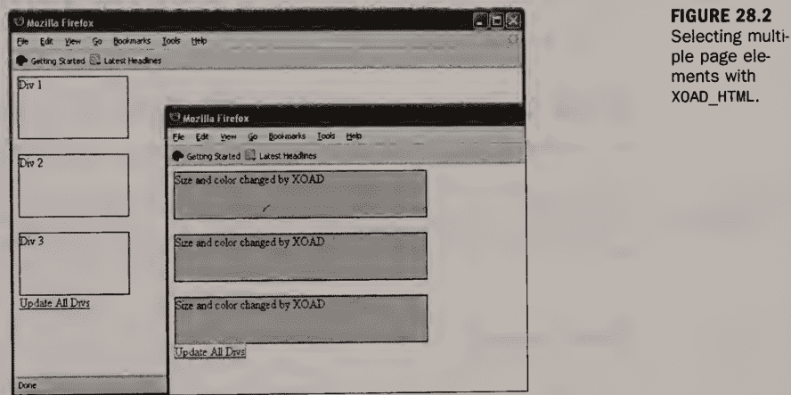

> XOAD_HTML 还有许多其他功能。XOAD_HTML 可用的所有函数详情请参见 XOAD 的下载包。

## 使用 XOAD 进行高级编程

XOAD 拥有一超出本章讨论范围的一系列高级功能。如果你想探索使用 XOAD 的可能局限，这里是目前支持的技术的概述。

## XOAD 事件

XOAD 框架还支持*事件*（events）。在客户端计算机上触发的 XOAD 事件可以存储在服务器上，并随后被其他客户端检测到，使得构建用户可以交互的复杂应用程序成为可能。此类应用可能包括聊天、组协作或类似的协作工具。

# 使用 XOAD 处理缓存

XOAD 允许使用 `XOAD_Cache` 类在服务器上进行缓存。缓存结果可以显著提高性能，特别是当服务器端例程耗时较长（例如对大型数据集进行排序或在大型数据库表上执行查询）。

# XOAD 

你可以使用 `XOAD_Controls` 类定义自定义客户端控件。

> 在编写时，XOAD 的当前版本为 0.6.0。如果版本不同，请咨询下载包中包含的文档。

## 总结

本章研究了以 XOAD 形式实现的 Ajax 工具包服务器端实现。XOAD 允许类包含的方法通过第 25 章和第 26 章讨论的客户端技术供客户端程序使用。这标志着本书第六部分的结束，事实上，你现在应该对 JavaScript 编程、PHP 编程和 Ajax 架构有了良好的理解。

# 附录

# JavaScript、PHP 和 Ajax 网站

尽管你已经学习了许多关于 JavaScript 和 Ajax 的知识，但仍有很多东西需要了解。如果你想学习 JavaScript 的高级功能或了解更多内容，附录列出的资源将非常有帮助。

# JavaScript 网站

以下网站将帮助你学习更多 JavaScript：

- JavaScript Workshop 是由本书作者 Michael 编写的关于 JavaScript 的博客。你可以在那里找到 JavaScript 语言的更新，以及高级任务的详细教程。http://www.javascript.com

- DOM Task Force 是 Web 标准（Web Standards）的一部分，致力于更好地使用脚本，并有一个信息丰富的博客，介绍了最新的 DOM 标准。http://domscripting.org

- Mozilla Mozilla 项目（Mozilla Project）提供了有关 JavaScript 语言最新更新的信息以及文档。http://www.mozilla.org

# PHP 网站

以下网站对 PHP 开发者来说无价之：

- PHP 官网提供下载、教程等更多内容，包括用户提交的代码。http://www.php.net

- PHPBuilder 是任何对 PHP 感兴趣者的聚会点，包含代码库（Code Library）等内容。http://www.phpbuilder.com

- Planet 维护了一份重要的 PHP 相关博客列表。在这里你可以找到 PHP 世界的观点和意见。http://planet-php

# Web 开发网站

以下网站包含有关 Web 技术的信息，包括 JavaScript、XML 和 DOM 以及基础 HTML：

- W3C（万维网联盟）是 HTML 和 CSS 标准信息的权威来源。http://www.w3.org

- WebReference.com 包含从 Java 到插件的各种 Web 技术信息。http://www.webreference.com

- Digital Web Magazine 特色刊登了从 JavaScript 到网页设计的各个方面的定期性文章。http://digital-web.com

# Ajax 网站

一些专门用于 Ajax 编程的有用网站：

- Ajax Matters 包含了大量关于 Ajax 各个方面的深度文章。http://www.ajaxmatters.com

- Ajaxian 是一个受推崇的资源，拥有关于 Ajax 编程各个方面的新闻、播客等更多内容。http://ajaxian.com

- Crack Ajax 包含了为程序员完全运行良好的教程、代码段和演示。http://www.crackajax.net

# 术语表

以下是贯穿本书的一些与 Web 开发相关的术语。尽管大多数术语在书中已有解释，但本节在阅读其他 PHP 或 Ajax 资源时可以作为快速参考。

- **Active**（活动）：微软开发的一项技术，允许创建组件，主要用于 Windows 计算机。ActiveX 组件或控件可以嵌入到网页中。

- **argument**（参数）：调用函数时传递给函数的参数。参数在括号内指定。

- **AJAX（Asynchronous HTML and HTTP）**：Ajax 的一个简化子集，用于更新页面刷新。

- **array**（数组）：一组变量，可以通过相同的名称和一个数字（称为索引）来引用。

- **Ajax (Asynchronous JavaScript and XML)**：一种技术的组合，允许 JavaScript 向服务器发送请求、接收响应并在不加载新页的情况下更新页面的部分。

- **attribute**（属性）：可以在 HTML 标签中定义的属性值。属性定义了由标签定义的元素的样式、对齐和其他方面。

- **assignment**（赋值）：将变量设置为特定的值。

- **Boolean**（布尔）：一种类型，只能存储两个值：真（true）和假（false）。

- **algorithm**（算法）：用于解决问题的方法或路线。

- **browser**（浏览器感知）：一种检测特定浏览器的脚本技术。

- **anchor**（锚点）：在 HTML 中，一个命名的位置，使用 `<a>` 标签。

- **cache**（缓存）：浏览器用于存储的内部内存，使其加载更快。

- **applet**（小程序）：一种设计用于嵌入网页的 Java 程序。

# 层级样式表 (CSS)

**Cascading Style Sheets (CSS)** W3C 用于为 HTML 文档应用样式的标准。CSS 可以控制字体、颜色、边距和定位。例如，`<font>` 标签在 HTML 中已废弃。

- **class**（类）：面向对象编程语言中的构造，用于创建和初始化对象。

- **Domain Name Service (DNS)**（域名系统服务）：将域名与 IP 地址关联的系统。

- **comment**（注释）：编写在代码中的程序员备注，说明代码如何运行。注释在代码执行时会被忽略。

- **Document Type Declaration (DTD)**（文档类型声明）：文档开头的声明，说明文档遵循的 HTML 版本。

- **Common Gateway Interface (CGI)**（通用网关接口）：一种不受语言限制运行服务器程序的方法。

- **Document Object Model (DOM)**（文档对象模型）：JavaScript 可以引用的浏览器窗口和 HTML 文档部分的集合。W3C DOM 是由最新浏览器支持的标准，并访问网页中的每个对象。

- **concatenate**（连接）：将两个字符串合并成一个长字符串的行为。

- **conditional**（条件）：当特定条件为真时执行的语句，通常使用 `if` 语句。

- **Dynamic HTML (HTML)**（动态 HTML）：HTML、JavaScript、CSS 和 DOM 的结合，允许创建网页。HTML 不是 W3C 标准或版本。

- **element**（元素）：数组的单个成员，通过相同的名称和索引引用。在 DOM 中，元素是由 HTML 标签定义的单个节点。

- **debug**（调试）：发现程序或脚本中错误、漏洞的过程。

- **error handling**（错误处理）：使用编码技术优雅地处理可能出现的错误情况。

- **declaration**（声明）：变量名称和类型的语句。

- **decrement**（递减）：将变量的值减一。在 JavaScript 和 PHP 中，可以使用递减运算符实现。

- **event**（事件）：脚本可以检测到的条件，通常是用户操作的结果。

- **deprecated**（废弃）：一个适用于不再推荐使用的 HTML 标签或其他项，且未来可能不再支持。对于

- **event handler**（事件处理器）：当事件发生时将执行的 JavaScript 语句或函数。


变量、常量和操作符的组合，可以被评估为单个值。

一种脚本技术，在使用某个功能（如 DOM 方法）之前检测该功能是否被支持，以避免不兼容问题。

Mozilla 开发的、符合标准的浏览器。

一种允许网站向服务器发送信息的 HTML 结构元素。

使用缩进、换行和空白符来使代码更易于阅读和理解。

一组语句，可以通过函数名和参数进行引用。

一个对 Web 页面中所有代码都可用的变量。它在任何函数之外声明（首次使用）。

一个 Firefox 浏览器的扩展程序，允许用户脚本修改网页的外观和行为。

用于 Web 文档的语言。JavaScript 语句不是 HTML，但可以包含在 HTML 文档中，并在访问者的浏览器中执行。PHP 代码块也可以嵌入 HTML 中，并在服务器上执行。

超文本传输协议 (HTTP)

Web 服务器和浏览器进行通信的标准。

将变量的值增加 1。在 JavaScript 和 PHP 中，这通过递增运算符 `++` 实现。

一个整数（正数或负数）。

微软的 Web 浏览器，适用于 Windows 和 Mac 等各种平台。

一个解释代码语句并对其执行的程序。JavaScript 解释器嵌入在访问者的 浏览器中。PHP 解释器安装在 Web 服务器上。

一种由 Sun Microsystems 开发的对象型语言。Java Applets 可以嵌入网页中。JavaScript 具有类似的语法，但与 Java 不同。

一种用于 Web 文档的脚本语言，基于基于 Netscape。JavaScript 现在已被最流行的浏览器支持。

网页中的一个区域，可以在定义的层中进行定位并覆盖其他部分。层也被称为可能元素（possible elements）。

一个仅对一个函数可用的变量。它在函数内部声明（首次使用）。

循环：一组执行多次或直到满足特定条件的程序语句。

property（属性）：作为对象存储的变量。每个对象可以有任意数量的属性。

method（方法）：一种特殊的函数类型，可以存储在对象中，并对对象的属性进行操作。

readyState：XMLHttpRequest 对象的属性，包含有关 Ajax 请求进度的信息。

Navigator：由 Netscape 开发的浏览器，是第一个支持 JavaScript 的浏览器。

极其简单摘要聚合 (RSS)：一组用于通过 XML 经常更新信息的格式族。

node：在 DOM 中，Web 文档中的单个容器或元素。每个 HTML 标签都定义一个节点。

表述状态转换 (REST)：一种流行的 Web 服务协议。

null：计算机语言中使用的标识符，用于表示值的缺失；例如表示函数没有返回任何数据。

responseText：XMLHttpRequest 对象的属性，包含服务器返回的字符串格式数据。

object（对象）：一种变量类型，可以存储多个值（称为属性）和函数（称为方法）。

responseXML：XMLHttpRequest 对象的属性，包含服务器返回的 XML 数据。

operator（操作符）：用于表达式中划分变量或常量的字符。

rule（规则）：在 CSS 中，样式块中的单个元素，用于指定 HTML 标签、类或标识符的样式。

parameter（参数）：在函数被调用时发送给函数的变量，也称为参数（argument）。

scope（作用域）：程序中声明并可使用的部分。

PHP：一种非常流行的且开源服务器端脚本语言。

selector（选择器）：在 CSS 规则中，规则的第一部分，指定该规则将影响的 HTML 标签、类或标识符。

progressive enhancement（渐进增强）：一种构建一个在所有浏览器上都能运行的基本页面，然后添加可以在新浏览器上运行的功能，且不损害页面基本功能的方法。

简单对象访问协议 (SOAP)：一种用于提供和消费 服务的流行协议。

stateless protocol（无状态协议）：一种在连续请求之间不保留信息的通信协议。HTTP 就是这种协议。

VBScript：微软开发，语法基于 Visual Basic。它仅由 Microsoft Internet Explorer 支持。

statement（语句）：脚本或程序的单行。

Web 2.0：一个流行的术语，用于描述使用 Ajax 和类似技术增强用户体验的网站。

string（字符串）：一组可以存储在变量中的文本字符。

万维网联盟 (W3C)：一个负责开发和维护 HTML、CSS 以及其他关键网络标准的国际组织。

stylesheet（样式表）：一个包含 CSS 样式信息的文档。

syntax（语法）：定义程序语言的规则。

XHTML（可扩展超文本标记）：W3C 开发的 HTML 新版本。XHTML 与 HTML 相似，但符合 XML 规范。

table：用于在页面上显示表格数据的 HTML 元素。

tag（标签）：在 HTML 中，Web 文档中的单个元素。HTML 标签包含在角括号内，如 `<body>` 和 `<p>`。

XML（可扩展标记语言）：由 W3C 开发的一种通用语言，允许创建标准化的类 HTML 语言，使用 DTD（文档类型定义）来指定标签和属性。

text node（文本节点）：在 DOM 中，一种存储文本值而非 HTML 元素的节点。包含文本的节点（如段落）有一个文本节点作为子节点。

unobtrusive scripting（非干扰脚本）：一组技术，通过分离内容、演示和行为，使 JavaScript 易于访问并避免与浏览器冲突。

HTTPRequest 对象：用于进行 Ajax 的内置 JavaScript 对象。

variable（变量）：一个用名称引用的容器，可以存储数字、字符串或对象。

VBScript：一种开发的脚本语言。

## 索引

## 符号

| 符号 | 描述 |
| :--- | :--- |
| && | 与逻辑运算符, 120 |
| * | 乘法运算符, 198 |
| @ | PHP 方法, 223 |
| \ | 反斜杠, 202 |
| \n | 换行符, 192 |
| () | 花括号, 缩进规则, 216 |
| [] | 中括号, 使用语句, 216 |
| $ | 美元符号 |
| = | 赋值运算符, 119 |
| == | 等于运算符, 119, 203 |
| ! | 非逻辑运算符, 120 |
| < | 小于号 |
| <ajax-response> | 元素, 317-319 |
| <<div> | 容器, 179 |
| <response> | 元素, 317-319 |
| <script> | 元素, 177 |
| - | 减号, 84 |
| -- | 递减运算符, 199 |
| --- | 减法运算符, 199 |
| % | 取模运算符, 199 |
| . | 点, 71 |
| || | 或逻辑运算符, 119-120 |
| + | 加号, 57 |
| + | 加法运算符, 198 |
| += | 加法运算符, 84, 132 |
| ++ | 递增运算符, 84, 132 |
| # | 注释, 193 |
| ? | 问号, 189 |
| ' | 单引号, 197, 202 |
| " | 双引号, 197, 202 |
| ; | 分号, 56 |
| / | 除法运算符, 199 |
| /* | 多行注释, 193 |
| // | 单行注释, 193 |

## HTTPRequest 对象

## 一个格式不正确的显示日期时间的脚本, 192

## Ajax

- a:active, 链接, 38
- a:hover, 链接, 38
- a:link, 链接, 38
- a:visited, 链接, 38
- 使用缩写表达式语句, 121-122
- 应用示例, 44
- 应用流程, 47-48
- 客户端-服务器交互, 177-178
- 使用不当的情况, 299
- Ajax.Periodical 类, 310
- Ajax.request 类, 308
- Ajax.Update 类, 309-310
- AjaxEngine 对象, 316-317
- Ajax引擎, 44, 316-317
- <ajax-response> 元素, 317-319
- alert() 函数, 68
- 流程图, 48
- 添加 prototype.js, 306
- 添加到 Rico, 316
- 脚本, 47-48, 54
- 故障排除, 301
- 参数, 104, 225
- 算术运算符
- 加法 (+), 198
- 复合运算, 199-200
- 除法 (/), 199
- 取模 (%), 199
- 乘法 (*), 198
- 减法 (-), 198


## 字符串中的大小写

- ARPAnet, Internet 发展, 9
- 数组函数, 207
- 数组, 94
- 访问, 207
- 赋值, 95
- 关联数组, 文本键名, 208
- 内容，搜索, 209
- 创建, 95, 207
- 声明, 205
- 元素, 访问, 96
- 函数, 206-209
- 图形浏览器, 13
- Lynx 文本浏览器, 13
- 样式表属性, 38
- 文本浏览器, 13
- 不支持的浏览器, 故障排除, 297-298
- Web 服务器交互, 10
- 底部按钮, 79, 296
- 背景属性, 36, 39
- 背景颜色属性, 38
- 反斜杠 (\)
- 字符串转义, 202
- n 字符序列, 换行符, 192
- 带宽, 定义, 42
- 最佳实践, 67
- body 标签 (HTML), 24-25
- 书签, 故障排除, 207
- 布尔数据类型, 197
- 布尔运算符。参见逻辑运算符
- 内置对象, 72
- 定义，扩展, 112-114
- Math 对象, 135-136
- length 属性, 95
- 循环
  - foreach 循环, 207
  - while 循环, 207-208
  - 排序, 98-100
- 字符串数组, 96-98
- array_function, 数组操作, 209
- ASCII 文本, 服务器响应, 47
- 使用赋值运算符 (=), 119
- 关联数组, 文本键名, 208
- 星号 (*), 乘法运算符, 198
- 异步服务器通信, 44
- 异步服务器请求, 46, 157-162
- 符号 (@), PHP 方法, 253
- 布尔值, 87, 216
- 大括号 ()
  - 代码缩进规则, 216
  - 循环语法, 126
  - 在条件语句中使用, 216
- 中括号 (), 在条件语句中使用, 216
- break 语句, 跳出无限循环, 130
- 跳出循环, 222
- 缓存 (浏览器)
  - call() 函数, 160-162
  - GET 请求, 301
  - 服务器请求, 160, 162
  - callAHAF() 函数, 250-251
  - callAJAX() 函数, 159
  - 浏览器缓存, 160-162
- 启动, 165
- 回调函数, 162-163
- AHAH, 250-251
- 基础应用示例, 179-180
- JavaScript 库, 288-290
- myAJAX.js, 291
- RSS 标题, 创建, 266-267
- 调用函数, 105-106
- callRIC() 函数, 318
- 字符串中的大小写, 205
- 浏览器
  -可用性, 13
- 缓存
  - callAJAX() 函数, 160-162
  - GET 请求, 301
  - 服务器请求, 160-162
  - 餐饮, 13

## 大写敏感性

- 大写敏感性, 65
- 字符串, 205
- 变量, 196
- ceil 函数, 取整, 200
- center 标签 (HTML), 28
- CERN (欧洲核研究组织), Internet 发展, 10
- change() 函数, 335-336
- 字符字符串, split() 方法, 245
- charAt 方法, responseText 属性, 169
- charAt() 方法, 93
- 子节点, 添加到 DOM, 259
- 子对象, 109
- childNodes 属性, 261
- 电影效果 (Rico), 324
- 类 (00 programming), 232
  - 外观, 232-233
  - 构造函数, 234
  - 定义, 232-233
  - 函数, 232
  - 继承, 232
  - 方法, 232-234
  - 对象实例, 创建, 233
  - 私有方法, 232
  - 公有方法, 232
  - 第三方, 232-236
  - 何时使用, 232
- 结束标签 (?), 189
- 代码
  - 大括号 ({}), 缩进规则, 216
  - 注释, 193
  - 函数，用途, 223
  - 模块化, 224
  - 平台测试, 故障排除, 300
  - 颜色，样式表, 38
  - 属性, 36-39
  - 连接条件, 119-121
  - 字符串的值, 89
  - 单词，下划线的使用, 196
  - 注释, 66
  - 代码, HTML, 25
  - 脚本中的注释 (Listing 1.4), 193
  - 比较运算符, 字符串, 203
  - 复合运算符, 199-200
  - 字符串连接运算符, 字符串, 202
  - 条件表达式, 118-119
  - 条件运算符, 19
  - 条件语句, 62, 215
  - 布尔值, 216
  - 大括号 (|), 216
  - 中括号 (|), 216
  - 逻辑运算符, 217-218
  - 多分支条件分支, 218-219
  - 运算符, 216-217
  - switch 语句, 219-220
  - 条件，连接, 119-121
  - 类方法, 234
  - continue 语句, 130
  - case 的字符串, 91-92
  - 数据类型, 88
  - count 函数, 数组操作, 209
  - createAttribute 方法, 261
  - createElement 方法, 260-261
  - createTextNode 方法, 259-261
  - CSS (层样式表), 0, 39
  - 自定义对象, 72
  - 数据类型, 86-87
  - 布尔, 197
  - 转换, 88
  - getype 函数, 198
  - 整数, 197
  - NULL 值, 200
  - 查询, 198
  - setype 函数, 198
  - 客户端-服务器交互, 41-42

## email_validation_class

- date() 函数, 178
- 日期和时间，显示, 54-60
- <div> 容器, 179
- date 命令, 189
- 除法运算符 (/), 199
- document, 74-76
- date 格式
  - DNS (域名系统) 层次结构, 73
  - 转换, 143, 213
  - 服务器, 144
  - 属性, 73
- 列表 listing_ of, 213
- do 循环, 221
- 双重数据类型, 197
- 存储概览, 209-210
- do...while 循环, 128
- 双引号 ("), 字符串, 197, 202
- doJax 函数, 289-293
- date 函数, 210-211, 224
- DOCUMENT 元素, 23
- 下载 Script.actual 库, 325
- Date 对象, 56, 140-141
- document 对象, 74
- Date.parse() 方法, 143
- 方法, 76
- Date.UTC() 方法, 143
- document.write 语句, 56
- 小数，取整, 136
- echo 命令, 189
- 声明 vars, 95, 207
- 显示系统日期时间，变量, 82, 196 (Listing 1.3), 192
- 递减运算符 (—), 199
- 变量减少, 84
- 浏览器，输出到: 191-192
- 默认参数，函数, 226-227
- 向浏览器输出 (Listing 1.2), 191-192
- else, 多分支条件, 218-219
- 多个参数, 105
- else 关键字, 121-124
- 简单示例, 224-225
- elseif, 多分支对象, 218-219
- DELETE 请求, 273-274
- 开发者标记, 276
- gweb 邮件服务显示
- (Google), 45
- 日期和时间, 54-60
- Internet 发展, 10
- 错误方法, 60
- 返回值, mail 函数
- 显示系统日期时间 (1.1), 190-191
- 示例, 226
- 拆分字符串
  - email_validation_class (第三方), 234-235
  - sublen 函数, 206
  - subpos 函数, 206
  - substr 函数, 205-206
- 历史, 73
- 标准, 74
- 方法, 73
- 节点方法表, 261

## Engines

- Engines (Ajax), 44
- 等号 (=), 119
- == (等性运算符), 119, 203
- 显式换行符, \n, 192
- 跳出, 222
- do, 221
- for...in, 131-133
- for 语句, 63, 125
- for 循环, 221-222
- 嵌套 while, 222
- 表达式，优先级, 85-86
- font-family 属性, 36-38
- font-size 属性, 36
- font-style 属性, 36
- font-weight 属性, 36
- 错误处理, 302
- 错误消息, 60
- 转义字符 (\), 字符串, 202
- 转义无限循环, 310
- eval(), JavaScript 库, 288-290
- 事件处理器

- 权限拒绝错误, 302
- POST 请求, 302
- 安全, 300
- 爬虫, 298
- 表单对象, prototype.js, 37
- 格式化字符串
  - 格式代码, 204
  - printf 函数, 203
  - sprint 函数, 204-205
- firstChild 属性, 261
- 浮点字符串，格式化, 204
- floor 函数，数字取整, 200
-流程控制, 117
- 条件语句, 215
- 布尔值, 216
- 逻辑运算符, 217-218
- 多分支条件分支, 218-219
- 运算符, 216-217


## 355
## 水平线

- callAH(J), 250-251
- parseFloat, 88
- getElements(element) 方法,
- callAjax, 159
- parseInt, 88
- prototype.js, 307
- 浏览器缓存, 160-162
- phpinfo, 225
- getElementsById, 261
- 启动, 165
- print, 203
- getElementsByTagName() 方法,
-回调, 162-163
- prototype, 224
- 方法, 171-172, 258, 261
- AHAH, 250-251
- responseAH(), 250-251
- getResponseHandler, 154
- 基础加法创建
- responseAjax(), 159, 163
- getTimeOffset()
- 示例, 179-180
- 返回码, 225-226
- 函数, 142
- JavaScript 库,
- 返回值, 225
- getTypeof, 198
- 288-290
- runServer(), 334
- getUTCDate(), 142
- 启动, 165
- sizeOf(), 24
- getFullYear(), 142
- myAjaxLib.js, 291
- 冲刺, 204-205
- getUTCMon(), 142
- 创建 RSS 标题阅读器
- strftime, 213
- 全局变量, 82, 227
- at, 266-267
- Try.this(), 308
- GMT (格林尼治标准时间), 54
- 调用, 105-106
- 用于, 223
- GNU.org 网站，日期格式
- callRIO(), 318
- 值的返回, 106-107
- 列出, 213
- change(), 335-336
- 变量范围, 227-228
- Google
- 构造函数, 110
- date(), 178, 211, 224
- gmail 邮件服务, 45
- 默认参数值,
- 226-227
- Google Maps, 45
- Google Suggest, 44
- 定义, 104, 224-225
- get 方法, 141
- GET 请求, 159
- doAjax, JavaScript 库,
- 288-290
- 浏览器缓存, 160-162
- 301
- 图形浏览器, 13
- JavaScript 库, 288
- myAjaxLib.js, 291
- REST, 273-256
- 故障排除, 302
- HasChildNodes 方法, 261
- head 标签 (HTML), 24
- header() 函数, 334
- 历史对象, 77
- history.forward() 方法, 78
- history.go() 方法, 78
- history.length 属性, 77
- 水平线，HTML 标签, 39
- 创建库文件, 229
- 局部变量, 83
- 邮件，返回值, 226
- 数学的, 201
- mtime, 212
- 多参数,
- 定义, 105
- 命名规范, 65
- 数字，数字四舍入,
- 200-201
- getAllResponseHeaders
- 方法, 154
- getElementById() 方法, 173,
- 180, 258
- getElementsByByname
- 方法, 179

我们如何让此索引更有用？请发送邮件至：indexes@sampublishing.com

## 356
## href 属性

- href 属性 (window 对象), 78
- HTML 标签, 24
- 测试多个条件,
- 122-124
- HTML (超文本标记语言), 21。另见 AAH,
- 添加 HTTP 属性, 25
- 基础应用创建示例, 176
- 颜色值, 26
- 常用标签日期, 29-30
- 容器, 25
- testpage.html 文档 .example, 22
- 工具需求, 22
- XOAD, 334
- change() 函数, 335-336
- HTML::getElementById() 方法, 335-336
- 图片，定义, 26
- 标签 alt 属性, 26
- src 属性, 26
- include 关键字，库函数文件, 229
- include once 关键字，库函数值, 229
- 定义, 22
- <div>...</div> <div> 元素, 176
- <div> 容器, 179
- <hr>, 39
- 超链接, 27
- 加载, 23
- myAjaxLibs, 291
- responseproperty, 242-243
- HTML::getElementTagName() 方法, 336-337
- 文字处理器, 22
- HTTP (超文本传输协议), 10。另见 AAH;
- HTML
- 自增运算符 (++), 84, 132, 199
- 变量自增, 84
- 缩进代码，大括号 ({}), 216
- 索引值，数组赋值, 207
- indexOf() 方法, 94, 169
- 无限循环, 129-130, 220
- 继承，类, 232
- 初始表达式, 125
- 创建 RSS 标题阅读器, 263，保存, 23
- <script>...<script> 元素, 177
- service.html 文档示例，标签, 223
- 服务器状态码, 163
- 发送 SOAP 请求, 281
- HTML 超链接, 27
- 互联网开发, 10
- 实例 (对象)，创建, 233
- 整数数据类型, 197
- Internet Explorer 6.0，安全设置, 58
- IP 地址，定义, 14
- body 标签, 24-25
- center 标签, 28
- 事件处理器, 64
- head 标签, 24
- metatags, 251-253
- table 标签, 27-29
- id 值, 173
- 条件表达式, 118
- 逻辑运算符
- 与 And, 120
- else 关键字, 121
- Or, 119

## 357
## 库

- JavaScript 库
- 后退按钮, 296
- 回调函数, 288-290
- doAjax 函数, 289-293
- 错误处理, 293
- eval(function), 288-290
- GET 请求, 288
- myAjaxLib.js, 286-287
- myAjaxLib.js, 289-290
- 回调函数, 291
- 事件处理器调用, 291
- GET 请求, 291
- HTML 页面, 291
- PHP 脚本, 291
- responseText-属性, 291
- 使用示例, 291-292
- XML 数据，获取, 292
- Stock Price Reader 构建
- 示例, 311-312
- Try.this(function), 300
- Web 应用，添加, 306
- 用户反馈, 293
- XMLHttpRequest 实例，创建, 287
- JavaScript
- 回调函数, 288-290
- doAjax 函数, 289-293
- 错误处理, 293
- eval(function), 288-290
- GET 请求, 288
- myAjaxLib.js, 286-287
- myAjaxLib.js, 289-290
- POST 请求, 288, 293
- prototype, 305-312, 315-324
- 用户反馈, 293
- XMLHttpRequest 实例, 287

## K - L

- 关键字, 139-140
- metatag, 251-255
- 大钟显示，添加到时间脚本, 58-60
- lastChildProperty, 261
- lastIndexOf(0) 方法, 94, 169
- 数组长度，计算, 95
- length 属性, 91, 95
- 小于 <
- 源库, Rico, 315
- AjaxEngine 实例, 316-317
- callRI(), 318
- 电影效果, 324
- 拖放, 220-323
- 多页面更新, 317
- POST 请求, 288, 293
- prototype
- $()function, 306
- $()function, 307
- Ajax.PeriodUpdater class, 310
- Ajax.request class, 308
- Ajax.Updater class, 309-310
- 下载网站, 305
- Form 对象, 307
- getElements() 方法, 307
- Rico, 315-324
- serialize(method), 307
- <response> 元素, Rico, 317-319
- <div> 元素, 176
- <div><div> 包含, 179
- <response> 元素, Rico, 317-319
- <script>...<script> 元素，方法, 177
- 使用示例, 318
- Web 应用，添加, 316
- 第三方库
- Prototype, 143
- Script.aculo.js, 144, 325-327
- Yahoo! UI Library, 144

我们如何让此索引更有用？请发送邮件至：indexes@samublicing.com

## 358
## 库函数

- 库文件函数，创建, 229
- link 对象, 76-77
- 链接
- 故障排除, 297
- 下划线, 38
- 局部变量, 83, 227-228
- localtime 变量, 56
- localtime 对象, 78-79
- location.reload() 方法, 79
- location.replace() 方法, 79
- 逻辑运算符
- 与 (&&), 120
- 条件语句, 217-218
- 非 (!), 120
- 或 (||), 119-120
- 跳出循环, 222
- continue 语句, 130
- do 循环, 221
- for 语句，创建, 125-128
- for...in, 131-133
- foreach 循环, 207
- 无限循环, 129-130, 220
- 嵌套循环, 222
- while 循环, 207-208, 220
- while 语句，创建, 128
- Lynx 文本浏览器, 13

## M

- 邮件函数
- 默认参数值, 226-227
- margin-left 属性, 40
- Math 对象, 135-136
- Math.random(), 方法, 137-139, 160
- metatags, 251-253
- myAHLib.js, 252-253
- 方法, 72, 109
- 中止, 154
- appendChild(), 259-261
- 构造函数, 233-234
- createElement(), 260-261
- createTextNode(), 251
- getAllResponseHeaders, 154
- getElement, 173, 180, 258
- getElements(), prototype, 307
- getElementsById, 261
- getElementsByTagName, 171-172, 258, 261
- getResponseHeader, 154
- ChildNodes, 251
- history.back(), 78
- history.forward(), 78
- history.go(), 78
- indexOf(), 94, 169
- join(), 100
- lastIndexOf(0), 94, 169
- location.reload(), 79
- location.replace(), 79
- Math.random(), 137-139, 160
- open, 154-155
- Draggable, 320
- DropZone, 321
- RemoveChild, 261
- send, 154
- serialize(), prototype, 307
- requestHeader, 154
- sort(), 98-100
- split(), 97, 245
- substring(), 93, 169
- toLowerCase(), responseText property, 169
- toUpperCase(), responseText property, 169
- XMLHttpRequest 对象, 154
- HTML::getElementById, 335-336
- HTML::getElementTagName, 336-336
- Microsoft typography, 36
- minus sign (-), 84
- (decrement operator), 199
- (subtraction operator), 198

## 359
## 对象

- mktime 函数，创建时间, 212
- MochiKit 库, 145
- 模块代码, 224
- 取模运算符 (*), 199
- Mosaic, 互联网, 10
- 多重代码测试, 300
- 多重条件语句, 218-219，测试, 122-124
- 多重脚本，顺序, 64
- 乘法 (*)运算符, 198
- myAHLib.js, 249-251, 286-287
- metatag 信息，从 URL 获取, 252-253
- responseText, 255
- myAjaxLib.js, 289-290
- 回调函数, 291
- 事件处理器, 291
- GET 请求, 291
- HTML 页面, 291
- PHP 脚本, 291
- responseText 属性, 291
- 使用示例, 291-292
- XML 数据，获取, 292
- 命名规范, 65, 195-196
- NaN (非数字), 88
- 导航工具，创建
- 后退/前进按钮, 79
- 嵌套循环, 222
- 换行符, \n, 192
- nextSibling 属性, 261
- nodeName 属性, 261
- nodes (DOM)
- 子节点, 259
- 文档方法表, 261
- 节点方法表, 261
- 节点属性表, 261
- type 属性, 261
- isValue 属性, 261
- 非运算符 (l), 120
- 空值, 87


360

objects
- status property, 164
- statusText, 164
- uses of, 150
- XMLHttpRequest,
  - readyState property, 162-163
  - onBlur event handler, 165
  - onLoad() event handler, basic application creation- example, 180
  - onready-oriented programming property, 154
- open source libraries, Rico, 315
- AjaxEngine instances, 316-317
  - callRICO() function, 318
- cinematic effects, 324
- drag-and-drop, 320-323
- multiple page element updates, 317
- <response> elements, 317-319
  - usage example, 318
- web applications, 316
- operators, 85
- += operator. 84
- arithmetic
  - addition (+), 198
  - div (/), 199
  - modulus (%), 199
  - multiplication (*), 198
  - subtraction (-), 198
- assignment (=), 119
- compound, 199-200
- conditional statements, 216-217
  - decrement (--), 199
  - equality (=), 119, 203
  - increment (++), 199
- logical operators
  - And (&), 120
  - conditional statements, 217-218
  - Not (!), 120
  - or (||), 119-120
  - precedence rules, 85-86

# P

- parentNode, 261
- parseFloat(), 88
- parseInt(), 88
- parsing, responseXML
  - property, 172
- percent sign (%), modulus operator, 199
- period (,), 71
- Permission Denied errors, troubleshooting, 302

- PHP (Hypertext Preprocessor), 187
- $ SERVER global array variable, 320
- <?php tag, 189-190
- methods, 253
- running locally from PC, 190
- scripts
  - basic application creation example, 178-179

- OO (object-oriented) programming
  - advantages of, 232
  - classes
    - appearance of, 232-233
    - constructors, 234
    - definitions, 232-233
    - functions, 232
    - inheritance, 232
    - methods, 232-234
    - private methods, 232
    - public methods, 232
    - third-party, 232-236
- PHP Classes website, 231
- PHP functionality, 231
- PHPnet website resources, 233
- when to use, 232
- open method, 154-155
- myAJAX.js, 291
- XOAD, 331
  - cache handling, 338
  - client controls, custom, 338
  - downloading/installing, 332
  - events, 338
  - header() function, 334
  - JSON, 332
  - runServer() function, 334
  - simple page example, 332-334

# 361

# prototype.js

- XOAD Controls class, 338
- printf functions, 203
- values, displaying,
- XOAD HTML, 334-337
- private methods (classes), 232
- PHP Classes website, 231, 234
- properties, 71, 108
- responseXML, 154, 170
- PHP interpreter, @
- childNodes, 261
- characters, 253
- DOM document methods
  - stored values, 258, table, 261
- DOM node methods
  - array functions, 208
  - adding elements, to, 259-261, table, 261
- mathematical function
  - status, 154, 164, resources, 201
- DOM node properties
  - statusText, 154, 164, table, 261
  - values, reading, 109
- online documentation, 223
- firstChild, 261
- XMLHTTPRequest, 154
- OO programming
  - prototype keyword, 112, resources, 233
- prototype.js:
  - prototype third-party library, 143
  - prototype.js:
  - nodeName, 261
  - phpinfo function, 225
  - nodeType, 261
  - nodeValue, 261
  - $() function, 306
  - $() function, 307
  - of document, 75
  - onreadystatechange, 154, 162-163
  - readyState property, 154, 162-163
  - responseText, 154, 239, 154
  - Ajax objects, 316-317
  - Ajax.PeriodicUpdater-class, 310:
  - Ajax.request, 308
  - Ajax.Updater, 310-310
  - character strings, 240-242
  - formatted data, 244-245, 244-245
  - HTML, 242-243
  - DELETE requests, 273-274
  - GET requests, 273-276, 273
  - POST requests, 273-275, 273
  - PUT requests, 273-274, 273
  - SOAP versus, 283
  - stateless operations, 274
  - return keyword, 107
  - return values, functions
  - failure, 225-226, 225-226
  - success, 225-226, 225-226
  - returning single characters from strings, 93
  - time in UTC, 142
  - public methods (classes), 232

# Q - R

- quotation marks
  - double quotes ("), strings, 197, variables, 202
  - single quotes (''), strings, 202, variables, 197
- question mark (?)
  - php tag, 189-190
  - closing tags, 189
- random numbers
  - gen, 136
  - example script, 137-139
  - rand function, 201
  - srand function, 201
  - myAAHlib.js, 255
  - myAjaxLib.js, 291
  - null values, 168
  - returned text, 240-242
  - values, displaying, 168-169
  - responseXML property, 150, 170
  - parsing, 172
  - stored values, 258
  - web pages, adding elements to, 259-261

# REST (Representational State Transfer)
- Amazon.com REST API, 275-278
- articles, uploading, 275
- AjaxEngine instances, 316-317
  - callRICO() function, 318
- cinematic effects, 324
- drag-and-drop, 320-323
- multiple page element updates, 317
- <response> elements, 317-319
  - usage example, 318
- web applications, adding to, 316
- rounding decimals, 136
- floor, 201

# slashes (/)

- readyState property, 162-163
- feeds, 262
- order of operation, 64
- random numbers, generating, 137-139
- sending, 157-162
- callback functions, 266-267
- HTML page, 263
- getElementsByTagName() method, 171
- responseText, 168-169
- runServer() function, 334

# S

- security, scope of variables, 82
- troubleshooting, 300
- responseXML property, 170-172
- user feedback, 172-173
- scripts, 46
- Script.library, 144, 325-327
- readers, 268
- send method, 154-155
- shorthand conditional expressions, 121
- asynchronous requests, 46
- basic application creation example, 178
- date and time, displaying, 55-60
- browser caches, 160-162
- Displaying the System Date and Time (Listing 1.1), 190-191
- flow control
  - conditional statements, 215-222
  - loops, 220-222

# SOAP (Simple Object Access Protocol)
- SOAP (Simple Object Access Protocol), 278
- development of, 279
- namespaces, 280
- Ajax usage example, 282
- components of, 279-280
- HTTP sending via, 283
- REST versus, 283
- specification information, website, 279
- string arrays creating, 96-97
- string data types, 197
- string objects, creating, 89
- strings, 56, 87
- assigning values to, 89-90
- capitalization in, 205
- case sensitivity, 91, 205
- comparing, 203
- concatenation operator, 202
- dissecting
  - sublen function, 206
  - subpos function, 206
- strtoupper function, string capitalization, 205
- style sheets
  - adding, 33
  - class attribute, 33
  - declarations, 31
  - embedded, 30
  - inline, 30
  - linked, 38
  - precedence, 34-35
  - rules, 31
  - sort() method, 98-100
  - numeric arrays, 98-100
  - string arrays, 98
  - split() method, 97, 245
  - splitting strings, 97
  - sprintf function, string formatting, 204-205
  - substr function, string dissection, 205-206
  - escape characters, \), 202
  - formatting format codes, 204
  - sprintf function, 203
  - sprint function, 204-205
  - function of, 202
  - length of, calculating, 91
  - length property, 91
  - quotation marks
  - double quotes ("), strings, 197, variables, 202
  - single quotes (''), strings, 202, variables, 197
  - <tag> tag, 36
  - sublen function, string dissection, 206
  - subpos function, string dissection, 206
  - substr function, string dissection, 205-206
  - substring() method, 93, 169
- substrings
- srand function, random generation, 201
- src attribute (image tags), 26
- statements, 61
- conditional, 62
- function calls, 62
- termination (), 189
- Index values, 92
- locating, 94
- subtraction (- operator), 198
- switch statement, 124
- conditional statements, 219-220
- syntax, 125
- status property, 154, 164
- Status property, 154, 164
- Stephenson, Sam, 143
- syntax
- case sensitivity, 65
- comments, 66
- naming conventions, 65
- reserved words, 66
- switch statement, 125


# 365 变量

## T
- 时间问候示例，123-124

## U
- 表格标签 (HTML), 27, 29
- 标签
- 时间函数，定位时间戳，210
- 下划线字符，组合单词，196
- + ?php, 189-190
- 结束 (?), 189
- HTML 标签
- 时间 PHP 脚本，日期和时间显示，190-191
- timeshams
- + 锚点标签，27
- body 标签，24-25
- center 标签，28
- head 标签，24
- 表格标签，27-29
- title 标签（标题），24
- 转换为日期格式的，213
- 创建 (mktime 函数)，212
- 易用性，210
- mktime 函数，212
- 起始值，210
- 不支持的浏览器，故障排除，297-298
- date 函数，210-211
- 服务器请求，162
- 时间函数，210
- URL (统一资源定位符),
- 创建 RSS 标题阅读器，262-265
- + 图像标签，26
- 元标签 (metags)
- 关键词，251-253
- myAHLLJs，252-253
- 处理指令，189-190
- title 标签，24
- toLocalString(function),142
- toLowerCase(method),91, 169
- toUpperCase(method),91, 169
- toUTCstring(function),142
- 故障排除
- 回调函数，266-267
- HTML 页面，263
- 服务器脚本，268-269
- 用户反馈
- + <style> 标签，36
- 测试
- 颜色，39
- 日期和时间脚本，58
- 多重条件，122-124
- 应用设计，301
- 后台倒计时，206
- 书签，297
- 浏览器缓存，300
- 基础应用示例，182-183
- JavaScript 库，293
- 服务器请求，172-173
- 故障排除，297
- + text-alignment 属性，36
- 基于文本的浏览器，13
- text-decoration 属性，36-38
- text-indent 属性，36
- 代码，平台测试，300
- GET 请求，301-302
- 链接，297
- 使用 echo 发送到浏览器 (列表 12)，191-192
- UTC (协调世界时)，54, 142
- utctime 变量，56
- + 第三方类，234-236
- 第三方库
- 原型 (Prototype),143
- Script.aculo.us, 144
- 时间
- 页面设计，299
- 拒绝访问错误，502
- POST 请求，302
- 安全，300
- 爬虫，298
## V
- + 显示，54-60
- 区域，142
- 不支持的浏览器，297-298
- 用户反馈，297
- Try.this(function),308
- 变量，55
- 参数，104
- 赋值，84

## 变量
- 声明，82, 196
- 递减，84
- 美元符号 ($)，195
- 表达式，85, 196-197
- 固定值，196
- 全局
- 创建，83
- 作用域，227-228
- 递增，84
- 无效名称，196
- 局部，83, 227-228
- 命名，82
- 大小敏感敏感，196
- 规范，65, 196
- 运算符，优先级规则，85-86
- 作用域，82
- 全局，227-228
- 字符串，197
- 下划线字符，单词组合，196
- 有效名称，196
- 值，195
- 验证日期和时间脚本，385

## W
- W3C (万维网联盟)，74, 279, 301
- 浏览器
- 可用性，13
- 缓存
- callAjax() 函数，160-162
- GET 请求，301
- 服务器请求，160-162
- 定义，13
- 图形浏览器，13
- Lynx 文本浏览器，13
- 样式表属性，38
- 文本浏览器，13
- 不支持的浏览器，故障排除，297-298
- Web 服务器交互，10
- POST 请求，273-275
- 原理，272
- PUT 请求，273-274
- 与 SOAP 对，283
- 无状态操作，274
- SOAP 278
- Web 页面
- 定义，11
- 元素，通过 responseXML 属性添加，prosify-261
- id 值，173
- 服务器端脚本，188
- 开发，279
- 空格，280
- 请求，279-282
- 与 REST 对，规范信息
- 网站，279
- 网站
- Apache Web Server 网站，11
- GNU.org 数据格式，213
- JSON，309
- Web 服务器
- 定义，11
- Web 页面的服务器端脚本，188
- Lynx 文本 Web 浏览器，13
- Microsoft 字体网站，36
- PHP 类，231, 234
- PHPnet
- 浏览器交互，10
- Web 服务
- 示例，272
- REST
- Amazon.com API，275-278
- 文章，上传，275
- DELETE 请求，273-274
- 示例，273
- GET 请求，273-276
- 可用文章，274
- 特定的文章，275
- 数组函数，208
- 行内手册，223
- 面向对象编程，205
- prototype.js 下载站点，305
- W3C，279, 301
- while 循环，220-221
- 数组遍历，207-208
- 空格，66
- HTML 单词处理器，139-140
- responseAjax() 函数，159
- 安全，46
- 发送方法，155
- 浏览器缓存，160-162
- 回调函数发送，157
- 状态监控，162-163
- 服务器端脚本，256
- 简单页面，332-334
- Controls 类，338

## X
- XML (可扩展标记语言)
- 数据检索，292
- 存储值，258
- 向 Web 页面添加元素，259-261
- RSS 标题阅读器，262-265
- 回调函数，266-267
- HTML 页面，263
- 服务器脚本，268-269
- 服务器响应，47
- 缓存处理，388
- 自定义，338
- 下载/安装，332
- 事件，338
- header() 函数，334
- change(function),335-336
- HTML::getElementById() 方法，335-336
- HTML::TagName() 方法，336-337
- JSON 对象，332
- runServer() 函数，334
- 基础应用创建，177-178
- 实例创建，151-153
- 方法列表，154
- 属性列表，154
- readyState，162-163

## Y
- Yahoo! UI Library，144

## Z


请查看背面获取打开说明


# 向拉即可打开

PEARSON
培尔逊教育

## 使用条款与保修声明

请在打开此包装前阅读。

通过打开此密封包装，即表示您接受并同意下方列出的条款和条件。如果您不同意，请勿打开此包装，并立即连同您的收据副本退回密封包装以获得全额退款。

本软件受版权保护，许可给您是为了仅供您的个人使用和显示，除非明确说明该软件用于网络化。您不得通过任何方式（包括发布在互联网上）将软件传输或分发给他人。除保留一份备份外，您不得对本软件或文档进行反向工程、拆解、反编译、修改、适配、翻译或创建衍生作品。您可能对任何非法的复制或传输承担法律责任。

本软件介质按“现状”分发，不提供任何保证。作者及许可方 Pearson Education, Inc. 均不对软件的质量、准确性、特定用途的适用性或可销性做出任何明示或暗示的声明。作者及许可方 Pearson Education, Inc. 对您或任何其他人因本软件引起或声称引起的任何损失或损害不承担任何责任，包括但不限于直接、间接、偶然和后果性损害、人身伤害、意外死亡、利润损失，或由于数据丢失、服务中断或业务中断导致的损害。此限制在您所在的州可能不受约束。如果介质有缺陷，您可以退回更换。

## CD-ROM 中的内容

无论您运行的是 Windows、Mac OS X 还是 Linux，随附的 CD 包含一套完整的 Ajax、JavaScript、PHP 编程入门包，让您安装所需的所有软件，为学习、测试和生产建立稳定环境：

- 适用于 Windows、Mac OS X 和 Linux 的 XAMPP——一个易于安装的软件包，可在计算机上设置支持 PHP 和 MySQL 的 Apache 服务器
- 适用于 Windows、Mac 和 Linux 的 jEdit 编程编辑器
- Prototype、Scriptulous、Rico 和 XOAD——用于创建 Ajax 应用效果的流行 JavaScript 库
- 可搜索 PDF 格式的完整 Ajax、HTML、XML 和 PHP 教程参考库
- 书中示例的源代码

## 安装说明

可以通过 CD-ROM 根目录下的可访问界面来安装 CD-ROM 中的内容。


## 许可协议

通过打开此包装，您也同意受以下协议的约束：

您不得复制或重新发行整个 CD-ROM。CD-ROM 上单个软件程序的复制和重新发行受个人版权所有者规定的条款约束。

CD 的安装程序和作者代码受出版商和作者保护。CD-ROM 上的各个程序和其他项目由其各个作者或其他版权所有者拥有版权或根据开源许可协议提供。

本软件按现状销售，不提供任何形式的保证（无论是明示还是暗示），包括但不限于对可销性和特定用途的适用性的暗示保证。出版社或其经销商或分销商均不对使用本程序引起的任何声称或实际损害不承担任何责任。（某些州不允许排除暗示保证，该排除可能不适用于您）。

# 萨姆自学系列
# Ajax、JavaScript 和 PHP 全通指南

只需很短时间，您就可以结合这些强大的技术，学习如何使用 Ajax、JavaScript 和 PHP 为您的 Web 应用创建交互式界面。

## 学习如何...

- 为您的 Web 应用构建更好、具交互性的界面
- 让 JavaScript、HTML、XML 和 PHP 协同工作以创建 Ajax 效果
- 编译 Ajax 应用
- 使用 SOAP 和 REST 创建并使用 Web 服务
- 避免常见错误并排排除问题
- 使用流行的 Ajax 库来加速并改进常见的编程任务

不需要之前的 Ajax 编程经验。通过直观、循序渐进的方法，书中的每节课程都建立在前节的基础上，让您能够从零开始通过 JavaScript、PHP 和相关技术学习 Ajax 编程的核心。

无论您运行的是 Linux、Windows 还是 Mac OS X，随附的 CD 包含一套完整的 Ajax 编程入门包，为您提供所有编程工具、参考信息、JavaScript 库和服务器软件，以建立学习、测试和生产的稳定环境。

Michael Ballard 是一位软件工程顾问和开发者，专门为国际客户提供 Web 和互联网设计与开发。他拥有英国利兹大学的荣誉学位，并在高科技领域担任多年的商业和管理职务。

Michael Moncur 是一位自由 Web 站长和作者。他运营一个网站网络，并有多本关于开发、网络、认证计划和数据库的畅销书籍。

## 关于 CD

- 适用于 Mac OS X 和 Linux 的 XAMPP——一个易于安装的软件包，可在计算机上设置支持 PHP 和 MySQL 的 Apache 服务器
- 适用于 Windows、Mac 和 Linux 的 jEdit 编程编辑器
- Prototype Scriptulous、Rico 和 XOAD——用于创建 Ajax 应用效果的流行 JavaScript 库
- 可搜索 PDF 格式的完整 Ajax、HTML、XML 和 PHP 教程参考库
- 书中示例的源代码

类别：Web 开发
涵盖：Ajax、JavaScript 和 PHP
用户级别：初级–中级

ISBN-13: 978-0672-32965-4
ISBN-10: 0-672-32965-5


9780672329654 $39.99 US / £25.99 Net Uk

