# Sams 24 小时学会 HTML 和 CSS 第 8 版（包含新的 HTML 5 内容）

策划编辑：Mark Taber  
开发编辑：Michael Thurston  
主编：Patrick Kanouse  
项目编辑：Jennifer Gallant  
索引员：Ken Johnson  
校对：Dan Knoll  
技术编辑：William Wolff  
出版协调：Vanessa Evans  
排版：Mark Shiraz  
书籍设计：Gary Adams

- 准备照片 ...................................................145
- 管理文本流.........................................................242
- 使用 `click` 改变 `<div>` 外观..................................284
- 在打印预览中查看网页...............................320
- 显示随机内容...............................................328
- 网站服务...........................................................389
- XHTML 样式...............................................................410
- XHTML 脚本.............................................................413

# 关于作者

Julie C. Meloni 是位于加州洛斯阿尔托斯（Los Altos）的多媒体公司 i2i Interactive 的技术总监，也是数字人文领域的学者。她撰写了多本关于基于 Web 的编程语言和数据库主题的书和文章，包括畅销的《Sams Teach Yourself PHP, MySQL, and Apache All in》。

Michael Morrison 是一位作家、开发者、玩具发明家以及多种计算机书籍和交互式 Web 课程的作者。除了作家和自由职业技术顾问的主业外，Michael 还是与其妻子 Masheed 共同创立的娱乐公司 Stalfish Labs 的创意主管。

# 我们想听你的意见！

作为本书的读者，你是我们最重要的评论家和反馈者。我们非常重视你的意见，并想知道你认为做得好的地方、哪里可以改进、你希望我们出版的领域，以及任何你愿意分享的建议。

你可以通过电子邮件或直接写信给我，告诉我们对这本书的喜与之处——以及我们如何能让书籍更好。

> 请注意，我无法帮助你解决与本书主题相关的技术问题，由于收到的邮件很多，我可能无法回复每条信息。

写信时，请务必包含本书的书名和作者，以及你的姓名和地址。我会仔细阅读你的意见，并与参与这本书的作者和编辑分享。

电子邮件：webdev@sampublishing.com  
邮寄：Mark Tabor，主编，Sams Publishing，800 East 96th Street，Indianapolis, IN 46240 USA

# 读者服务

访问我们的网站并在 `informit.com/register` 注册本书，以便方便获取本书的任何更新、下载、故障排除提示或错误勘正。

# 引言

估计到 2009 年，全球已有超过 15 亿可以使用互联网，仅美国就有 2.2 亿。再加上 3.8 亿中国用户、5500 万德国用户、4800 万英国用户、3800 万俄罗斯用户和 6700 万巴西用户，你就能理解“万维网”（World Wide）一词的含义了。许多互联网用户还在为网页创建内容——你也可以成为他们之一！虽然很难准确衡量网页的总数，但 Google 的最新数据显示，他们在 2008 年年中索引页面已突破了 1 万亿大关。

在接下来的 24 小时内，将会有数亿个新页面出现在互联网的可访问区域。至少会有同样数量的页面发布在私有内网上，供通过本地网络连接的人士查看。这些页面中的每一个——就像已经在线的超过 1 万多个页面一样——都使用超文本标记语言（HTML）。

当你完成本书中的 24 节每节一小时的课程时，你的网页将出现在互联网上。这些课程将帮助你掌握当今世界上最有价值的技能之一：精通 HTML。

你是否可以在不使用任何专业软件的情况下，自己创建出顶级的网页，且花费的时间比预约并等待一位高薪 HTML 魔法师上门的时间还要短？这本简短、易于阅读的书是否能让你自学最先进的网页发布技术？

可以的。事实上，在本书的前两节课程中，一个完全没有经验的人也可以拥有一个可以发布在网上的网页。

你如何能如此快速地学习网络语言？通过示例。本书将 HTML 分为简单的步骤，并向你展示如何处理每一步。每一个 HTML 代码示例都直接列在其所生成的网页图片之前。当你看到它时，会读到关于其工作原理的清晰、简练的解释，然后立即在你自己的页面上进行同样的操作。十分钟后，你就进入了下一个步骤。

在工作 24 小时后，你将为自己在互联网上那些令人惊叹的页面感到惊叹。

# HTML 之外

本书涵盖不仅是 HTML，因为今天要创建网页内容，HTML 并不是你唯一需要了解的。本书的目标是让你通过 24 节简短易懂的课程，掌握创建现代、符合标准的网站所需的所有技能。本书涵盖了以下关键技能和技术：

- XHTML（可扩展标记语言）是目前网页创建的标准。书中的每个示例都完全兼容 XHTML。在适用的情况下，还涵盖了 HTML 5。
- 书中所有的示例都经过了与每个主流网络浏览器最新版本的兼容性测试。这包括 Apple Safari、Google Chrome、Microsoft Internet Explorer、Mozilla Firefox 和 Opera。你从一开始就将学会兼容过去，同时为未来做好准备。
- 书中对层叠样式表（CSS）有广泛介绍，它允许你精细控制网页每个部分的布局、字体、颜色和格式，包括文本和图像。在创建令人目一斑的网页时，CSS 的功能远超 HTML 页面本身能做的。例如，你将知道 CSS 允许你在普通网页视图之外，还针对打印专门定制页面上的信息。
- 第 10 到第 12 小时向你介绍了多个应用程序及其用途，包括在哪里找到可以下载并免费获取的行业标准软件。
- 仅仅有技术是不够的，因此本书还包含了你在设置网站以实现目标所需的建议：设计有效的页面布局、通过 FTP 服务器将页面发布到互联网、组织和管理多个页面，以及让你的页面出现在各大主流网站查询列表的高靠位置——这些内容都有足够的深度，足以让你克服令初学者沮丧的障碍。

对这些许多基本要素的关注使得本书的前七版成为了畅销书，而这个更新版本（该书名自 2005 年以来的首次更新）也无例外。所有的示例都已更新，很大一部分内容经过了修订，以匹配新的示例和新技术。

# 视觉示例

本书中的每个示例都通过以下部分进行说明：

- 显示你为制作 HTML 页面而输入的文本，并对所有 HTML 和 CSS 代码进行高亮处理。
- 显示生成的网页在用户使用世界上最流行的网络浏览器查看它时所呈现的样子。

你将能够在完全不阅读任何辅助文字的情况下，将示例调整到你自己的页面。

本书中的所有示例都符合标准，并适用于 Apple Safari、Google Chrome、Microsoft Internet Explorer、Mozilla Firefox 和 Opera。虽然所有的截图都是在 Firefox 中拍摄的，但放心，所有代码都已经在其他浏览器中经过了测试。

你还会在代码示例以及代码元素出现在解释性文字中发现颜色的使用。这些颜色亮亮了代码的不同部分，以增强你对它们的熟悉程度并引起你的注意。

- HTML 标签用深蓝色显示。
- HTML 注释用棕色显示。
- CSS 元素用绿色显示。
- HTML 属性名称用浅蓝色显示。
- HTML 属性值用洋红色显示。

注意，某些术语的颜色会根据其上下文改变。例如，当 CSS 元素用在 HTML 标签的属性内部，它们会被编码为 HTML 属性值（洋红色）。

# 特殊元素

当你完成每小时的学习时，边注将帮助你立即应用所学。

| 提示 (TIP) | 注意 (NOTE) | 警告 (WARNING) |
| :--- | :--- | :--- |
| 节省宝贵时间的提示和技巧被放在“提示”框中。 | “注意”框提供有关所讨论主题的额外信息。 | 当你需要注意某些事情时，“警告”框会提醒你。 |

# 问答、测试与练习

每个小时都以一个简短的问答环节结束，解决每个人都希望自己问过的问题。一个简短但完整的测试让你进行自测，以确保你理解了所有内容。最后，一个或两个练习为你提供了练习的机会。

# 第 1 小时 了解网络的工作原理

在学习 HTML 和 CSS 的复杂细节之前，实地了解帮助将这些纯文本文件转换为你在计算机或手持设备上看到的丰富多媒体显示的技术是非常重要的。

如果没有网络浏览器，包含 HTML 和 CSS 的文件是没用的；除非涉及网络服务器，否则你自己之外没人能看到你的内容。你将紧密参与这个过程，因为你必须创建文件并将它们放在服务器上使其可用，并且你必须确保你的内容以预期的方式显示给用户。

## 在这一小时你将学习：

- 万维网的简短历史
- “网页”一词的含义，以及为什么这个术语并不总是反映所有涉及的内容
- 内容如何从你的个人电脑传输到别人的网络浏览器
- 如何选择网络托管提供商
- 不同浏览器和设备类型如何影响你的内容

## 第一小时：理解 Web 的原理

这并不是一个新想法，但他简单的超文本标记语言（HTML）在其他更具野心的超文本项目蓬勃发展的同时脱颖而出。超文本最初是指以电子形式存储、且页面之间有交叉链接的文本。现在它是一个更广泛的术语，指的是任何可以链接到其他对象的物体（文本、图像、文件等）。超文本标记语言是一种用于描述文本、图形和包含信息的文件如何组织并链接在一起的语言。

有关万维网（World Web）历史的更多信息，请参见该主题的维基百科文章：`http://en.wikipedia.org/wiki/History_of_the_Web`。

到1993年，全世界只有大约 100 台计算机能够提供 HTML 页面。这些相互链接的页面被称为万维网（WWW），并已经编写了几种网页浏览器程序允许人们查看它们。由于 Web 的日益普及，几位程序员很快就编写了可以同时查看图像和文本的网页浏览器。从那时起，浏览器软件的持续开发以及 HTML——以及 XHTML——语言的标准化引导我们走向了今天所处的世界：在这个世界里，超过 1.1 亿 Web 服务器为超过 250 亿个文本和多媒体文件提供响应。

这几段是对这段非凡时期的简单回顾。今天的大一新生从未经历过万维网不存在的时代，而“始终在线”的信息和无处不在的计算理念将塑造我们生活的各个方面。不要把网页内容的创建和管理看作少数技术导向型人员才拥有的技能（好吧，你可以称他们为“极客”），在本书的结束处，你将发现这些技能是任何人都可以掌握的，无论是否有天赋。

# 创建 Web 内容

你已经注意到使用了“网页内容”（web content）而不是“网页”（web pages）——这是故意的。虽然我们谈论的是“访问网页”，但我们真正的意思是类似于“查看我们计算机上某个地址的所有文本和图像”。我们阅读的文本和看到的图像是由网页浏览器渲染的，浏览器在单个文件中接收特定的指令。

这些文件包含了被 HTML 代码标记或其环围的文本，这些代码告诉浏览器如何显示文本——例如作为标题、段落、使用红色字体等。某些 HTML 标记告诉浏览器显示图像或视频文件而不是纯文本，这让我回到了一点——不同类型的内容被发送到你的网页浏览器，所以简单地说是“网页”并不能涵盖全部。在这里我们使用“网页内容”这一术语，以涵盖网上发现的各种文本、图像、音频、视频和其他媒体。

在随后的课程中，你将学习链接或创建网站上发现的各种类型多媒体网页内容的基础知识。你只需要记住这一点：你控制着用户在访问你的网站时看到的内容。从包含要显示文本的文件，或服务器用于通过用户的网页浏览器发送图形的代码开始，你必须规划、设计并实现所有最终使你的“存在感”呈现出来的部分。正如你将在本书中所学到的，只要你理解沿途的每一个小步骤，这并不是一个困难的过程。

在最基本的形式中，Web 内容始于包含 HTML 或 XHTML 标记的简单文本文件。XHTML 是 HTML 的另一种变体；“X”代表可扩展（extensible），随着课程的进行你将学习更多关于它的知识。从这一set中需要最重要的点是，本书中的所有示例都兼容 HTML 和 XHTML，这意味着现在和未来，任何新一代的网页浏览器都将以类似的方式进行渲染。这就是编写符合标准代码的好处之一：你不必担心在将来需要回到代码并更改它，因为它“不起作用”。只要网页浏览器遵循标准（希望是很长的一段时间），你的代码可能一直“有效”。

# 理解 Web 内容交付

在许多不同的位置发生了几个过程，以产生你可以看到的 Web 内容。这些过程在极短的时间内发生得非常快——在毫秒级——并且在后台进行。换句话说，虽然我们可能认为所做的只是打开网页浏览器、输入 Web 地址并立即看到我们请求的内容，但后台技术正在为我们努力地工作。图 1.1 显示了浏览器和服务器之间的基本交互。

### 图 1.1 浏览器请求和服务器响应

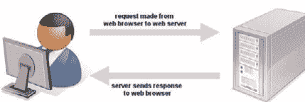

然而，在你看到请求的站点完整内容之前，过程中还有几个步骤——并且可能在浏览器和服务器之间进行好几次往返。

假设你想进行 Google 搜索，所以你顺从地在地址栏中输入 `http://www.google.com`，或者从书签列表中选择 Google 书签。几乎立即，你的浏览器就会向你展示类似于图 1.2 所示。

### 图 1.2 访问 www.google.com

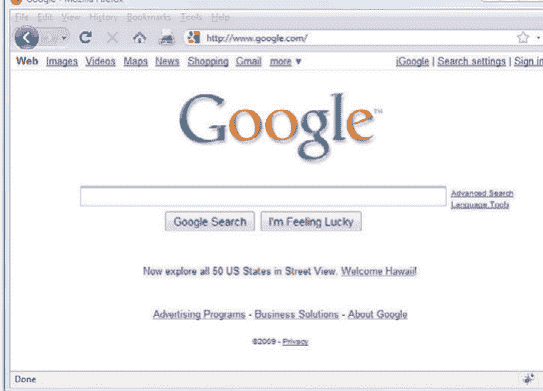

图 1.2 显示了一个包含文本加一张图像（Google Logo）的网站。检索该文本和图像所发生的过程简单版本如下：

1. 你的浏览器向你在地址栏中输入的 `http://www.google.com` 地址发送 `index.html` 文件的请求。
2. 在接收到特定文件的请求后，Web 服务器在其目录内容中查找文件，打开它，并将该文件的内容传回你的浏览器。
3. 网页浏览器接收 `index.html` 文件的内容，该内容用 HTML 代码标记，并渲染该内容：
```

```
4. 浏览器查看 `` 标签中的 `src` 以寻找源位置。在这种情况下，图像 `logo.gif` 可以在浏览器检索 HTML 文件时相同的 Web 地址（`www.google.com`）的“logos”目录中找到。
5. 浏览器请求 `http://www.google.com/logos/logo.gif` 地址的文件。
6. Web 服务器解释该请求，找到文件，并将该文件的内容发送给请求它的网页浏览器。
7. 网页浏览器在你的显示器上显示图像。

正如你在 Web 内容交付过程的描述中所看到的，浏览器作用不仅仅是作为查看内容的画框。浏览器组装 Web 内容组件，并根据文件中的 HTML 命令安排这些部分。

你也可以在“本地”或在你自己的硬盘上查看内容，而不需要 Web 服务器。内容检索和显示的过程与之前步骤列表中浏览器查找和解释 HTML 文件代码及内容的过程相同，但路程更短：浏览器在自己计算机的硬盘上查找文件，而不是在远程机器上。需要 Web 服务器来解释嵌入文件中的任何服务器端编程语言，但这超出了本书的范围。事实上，你可以完成本书中的所有课程而不需要属于自己的 Web 服务器，但这样除了你以外没人能看到你的杰作。

## 第一小时：理解 Web 的工作原理

## 选择网络托管服务商

尽管我刚刚告诉你可以在没有 Web 服务器的情况下完成书中的所有课程，但我们实际上建议你配合 Web 服务器进行工作。别担心——获取一个托管服务商通常是一个快速、无痛且相对便宜的过程。事实上，你只需花费比你正在读的这本书稍多的钱，就能获得自己的域名和一年的网络托管服务。

如果你在常用的搜索引擎中输入“web hosting provider”（网络托管服务商），你会得到数百万搜索结果和无尽的赞助搜索结果（即广告）。世界上的网络托管服务商并没有这么多，尽管看起来是如此。即使你查看的是托管服务商的托管列表，也可能会让你无从下手——尤其是如果你只是想找一个为你的公司或组织托管简单网站的地方。

在寻找服务商时，你需要缩小搜索范围并选择一个最符合你需求的。选择网络托管服务商的一些衡量标准包括：

- 可靠性/服务器“运行时间”——如果你有在线业务，你希望确保人们能够稳定地访问。
- 客户服务——寻找多种联系客户服务的方法（电话、电子邮件、聊天）以及针对常见问题的在线文档。
- 服务器空间——托管方案是否包含足够的服务器空间来存放你计划在网站中包含的所有媒体文件（图像、音频、视频）（如果有的话）？
- 带宽——托管方案是否包含足够的带宽，以便所有访问网站并下载文件的人都可以进行，而无需你额外付费？
- 域名购买与管理——该方案是否包含自定义域名，或者你必须在托管账户之外单独购买并维护域名？
- 价格——不要为托管支付过高。你会看到各种价格，并应该立即产生“有什么区别？”的想法。通常差异与服务质量无关，而与公司的开销以及公司认为可以向人们收取多少有关。一个好的原则是，如果你为一个基础托管方案和域名每年支付超过 75 美元，那么你可能付多了。

## 选择网络托管服务商

这里有三家可靠的网络托管服务商，他们的基础方案包含大量的空间和带宽（以及域名和额外福利），而且成本较低。如果你不选择其中任何一个托管服务商，你至少可以将他们的基础方案描述作为你货比三家的指南。

- A Small Orange (`http://www.asmallorange.com`)——他们的“Tiny”和“Small”托管方案是新 Web 内容发布者的理想之选。


- DailyRazor（http://www.dailyrazor.com）——他们的 RazorLIMIT 和 RazorSTARTER 托管方案功能齐全且可靠。
- LunarPages（http://www.lunarpages.com）——Basic 托管方案适用于许多个人和小型企业网站。

良好的托管服务商的一个特点是他们提供了一个“控制面板”，让你管理账户的各个方面。图 1.3 显示了我 RazorPRO 账户的托管服务的控制面板。这个特定的控制面板软件，或者设计上类似的控制面板——通过清晰标记的图标引导你可以执行的任务并让你管理你的账户。

图 1.3 示例控制面板。

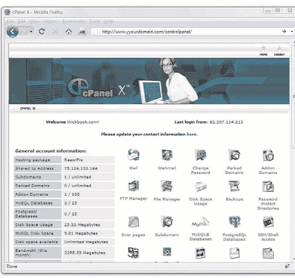

## 第一小时：理解 Web 的工作原理

你可能永远不需要使用你的控制面板，但拥有它可以简化数据库和其他软件的安装、Web 统计数据的查看以及添加电子邮件地址（以及许多其他功能）。如果你能遵循指令操作，你就可以管理自己的 Web 服务器——不需要特殊的培训。

## 使用多个 Web 浏览器进行测试

刚刚讨论了 Web 内容交付过程和 Web 服务器的获取，现在退后一步谈论使用多个浏览器测试你的网站，似乎有点奇怪。然而，在你开始学习如何使用 HTML 和 CSS 创建网站之前，请记住这个非常重要的陈述：你网站的每位访问者都可能使用与你不同的硬件和软件配置。他们的设备类型（台式电脑、笔记本电脑、超本、智能手机、iPhone）、他们的屏幕分辨率、浏览器窗口大小、连接速度——记住，当你查看网站时，你无法控制访问者所使用的任何东西。

尽管所有 Web 浏览器都以相同的方式处理和操作信息，但它们之间存在某些差异，导致内容在不同浏览器中的显示并不总是相同的。即使是相同版本的 Web 浏览器的用户也可以通过选择不同的显示选项和/或更改查看窗口的大小来改变页面的外观。所有主流 Web 浏览器都允许你用自己的选择覆盖网页作者指定的背景和字体。屏幕分辨率、窗口大小，以及页面在首次出现在屏幕上时能看到多少内容，你只能确保自己编写的是符合标准的 HTML 和 CSS。

在任何情况下，都不要花费几个小时去设计在你自己电脑上看起来“完美”的东西——除非你愿意在朋友的电脑、街角咖啡馆的电脑或通过你的 iPhone 看到它时感到失望。

你应该尽可能使用这些 Web 浏览器来测试你的网站：

- Apple Safari（http://www.apple.com/safari/）适用于 Mac 和 Windows
- Google Chrome（http://www.google.com/chrome）适用于 Windows
- Mozilla Firefox（http://www.mozilla.org/firefox/）适用于 Mac 和 Windows
- Microsoft Internet Explorer（http://www.microsoft.com/ie）适用于 Windows
- Opera（http://www.opera.com/）适用于 Mac 和 Windows

## 总结

本小时向你介绍了使用 HTML 标记以生成 Web 内容的概念。你还了解到 Web 内容不仅包括图像和音频。你学习了在判断方案是否符合需求时应考虑的标准。你还学习了在多个浏览器中测试的重要性。编写符合标准的 HTML 和 CSS 将有助于你的网站看起来尽可能相似。

## 问答

你使用了“Web 内容”（web content）而不是“网页”（web page），但我听到人们提到网页。那么它们指的是什么？它们与“首页”（home page）或“网站”（web site）有什么区别？

你将世界 Web 比作图书馆的隐喻一直让人很容易理解；在那个图书馆中，单个网站是书，而网站上的单个内容是页面。

我看过互联网上某些网页的 HTML“源代码”，看起来学习起来非常困难。我必须像计算机程序员一样思考才能学习吗？

## 工作坊

工作坊包含测验题和练习题，旨在帮助你巩固对所涵盖内容的理解。在查看随后的“答案”部分之前，尝试回答所有问题。

## 测验

1. 定义“网络内容”（web content）这一术语。
2. 为了生成一个包含某些文本和两个图片的单个网页，你需要在 Web 服务器上存储多少文件？
3. 寻找网络托管提供商时，应该关注哪些特性？

## 测验答案

1. 网络内容是一个术语，描述了从 Web 服务器传输到网络浏览器的完整文本、图像、音频、视频和其他媒体文件。
2. 你需要三个文件：一个用于网页本身（包含文本和 HTML 标记），另外两个文件，每个图片中的一个。
3. 关注可靠性、客户服务、网络空间和带宽、域名服务、站点管理额外功能以及价格。

## 练习题

准备好你的网络托管——你是打算通过在自己的计算机上本地查看文件来学习本书中的课程，还是打算使用网络托管提供商？请注意，大多数网络托管提供商会在你购买托管计划的当天就让你运行起来。

# 第 2 小时

发布网络内容

在上一小时，你学习了通过网络浏览器请求网络内容的过程，以及 Web 服务器如何响应这些请求。

在本小时中，你将学习你作为内容创建者，在使网络内容上线时处于什么位置——你必须将这些内容发布到 Web 服务器上，其他人才能找到它们。

## 本小时你将学到：

- 如何使用文本编辑器创建基础的 HTML 文件
- 如何使用 FTP 将文件传输到服务器
- 文件应该放在 Web 服务器的什么位置
- 如何在没有 Web 服务器的情况下发布网络内容
- 如何使用博客等其他方法

## 创建本小时的示例文件

在我们开始之前，请看列表 2.1。该列表代表了一个简单的网络内容——几行 HTML 代码，它们将在浏览器窗口内居中并在两行以大号**粗体**字体打印“Hello World! Welcome to My Web Server.”。

列表 2.1 我们的示例 HTML 文件

```
<html>
<head>
<title>Hello World!</title>
</head>
<body>
<h1 align="center">Hello World</h1><br>Welcome to My Web Server.</h1>
</body>
</html>
```

## 注意事项

为了使用这些内容，请打开你选择的文本编辑器，例如 Windows 上的记事本或 Mac 上的文本编辑。不要使用 WordPad、Microsoft Word 或其他功能全文字处理软件，因为它们创建的文件类型与我们用于网络内容的纯文本文件不同。

你将在第 3 小时学习更多关于文本编辑器的知识。现在，我们只是希望你拥有一份可以放在 Web 服务器上的示例文件！

## 第 2 小时：发布网络内容

输入你在列表 2.1 中看到的内容，然后使用 `sample.html` 作为名称保存文件。`.html` 扩展名告诉 Web 服务器你的文件确实充满了 HTML。当文件内容被发送到请求它的文件的网络浏览器时，浏览器也将知道它是 HTML 并对其进行适当渲染。

现在你已经有一个可以使用的示例 HTML 文件——并且希望你已经有了存放它的地方，例如网络托管账户——让我们开始发布你的网络内容吧。

## 使用 FTP 传输文件

正如你到目前所学到的，你必须将网络内容放在 Web 服务器上，以便他人可以访问。这一过程通过使用文件传输协议（FTP）完成。要使用 FTP，你需要一个 FTP 客户端——一个用于从你的计算机传输文件到 Web 服务器的程序。

FTP 客户端连接到你的 Web 服务器需要三部分信息；这些信息将在你设置账户后由你的托管提供商发送：

- 主机名
- 用户名
- 密码

一旦你已经有了一个示例 HTML 文件并希望已经有了它的地方，你就可以开始发布你的网络内容。

## 选择 FTP 客户端

无论使用哪种 FTP 客户端，界面通常都是类似的。图 2.1 显示了本地目录的目录，右侧是 Web 服务器的目录列表。你可以通过以下操作在没有 Web 服务器的情况下发布网络内容：

- 使用 FTP 客户端，
- 目录）
- 远程目录

服务器后，你将看到如图 2.1 所示的界面。

图 2.1 使用 FTP 传输文件


你现在已经准备好向 Web 服务器传输文件了。

这里是一些流行的 FTP 客户端：

- Classic FTP（Windows）
- Cyberduck（Mac）
- Fetch（Mac）
- FileZilla（所有平台）
- FireFTP（Firefox）

一旦你选择了 FTP 客户端并安装了它，你就可以下载文件了。在下一节中，你将看到它是如何工作的。

## 第 2 小时：发布网络内容

使用 FTP 客户端

所有 FTP 客户端都使用相似的如果不是相同的界面。如果你理解以下步骤，请记住你首先需要主机名、用户名和密码。

1. 启动 FTP 程序并点击“连接”按钮。你将被提示填写图 2.2 所示项目。

图 2.2 FTP 客户端的对话框。


2. 按照如下方式填写图 2.2 所示的每一项：

- 标签（Label）是你引用站点的名称。
- FTP 服务器是你需要发送网页的 FTP 地址。此地址将由你的托管提供商提供。它可能是你的 `domain.com`，但请检查注册服务时收到的信息。
- 用户名（User Name）和密码（Password）字段也应该使用你的托管提供商的信息填写。
- 在使用客户端之前，不要更改“初始远程目录”和“初始本地目录”的值。

3. 完成设置后，点击 OK 保存设置并与 Web 服务器连接。

你将看到一个对话框显示 Classic FTP 正在连接到你的 Web 服务器。连接成功后，你将看到如图 2.3 所示的界面，左侧显示本地目录的内容，右侧显示 Web 服务器的内容。

图 2.3 通过 Classic FTP 成功连接。


4. 你现在已经准备好向 Web 服务器传输文件了。剩下的就是切换目录到你的 Web 服务器的根目录。Web 服务器的根目录被指定为连接的顶级目录——目录结构的起点，你将在本小时稍晚时候学习它。通常，此目录将命名为 `public_html`（如图 2.3 所示）、`www`（如图 2.3 所示，因为 `www` 已创建为 `public_html` 的别名）或 `htdocs`。这不是你必须创建的目录，因为你的托管提供商为你创建了它。

双击根目录名称打开它。FTP 客户端界面右侧的显示将更改为显示该目录的内容（此时它可能是空的，除非你的 Web 托管提供商在你的目录中放置了占位符文件）。

## 第 2 小时：发布网页内容

5. 目标是将你之前创建的 `sample.html` 文件从你的电脑传输到 Web 服务器。在 FTP 客户端界面左侧的目录列表中找到该文件（如果有必要，请进行导航），点击一下它以高亮文件名。

6. 点击客户端界面中间的右箭头按钮将文件发送到 Web 服务器。文件传输完成后，客户端界面右侧将刷新，显示该文件已到达目的地。

7. 点击“Disconnect”（断开）按钮关闭连接，然后退出 Classic FTP 程序。

这些步骤在概念上与你任何时候想通过 FTP 向 Web 服务器发送文件时所可以采取的步骤是相似的。你还可以使用你的 FTP 客户端在远程 Web 服务器上创建子目录。要使用 Classic FTP 创建子目录，请点击“Remote”（远程）菜单并点击“New Folder”（新建文件夹）。不同的 FTP 客户端会有不同的界面选项来实现相同的目标。

## 了解在 Web 服务器上放置文件

维护网页内容的一个重要方面是决定你将如何组织内容——不仅是为了方便用户查找，也是为了方便你在服务器上进行维护。将文件放在目录中将帮助你管理这些文件。

在你的 Web 服务器上命名和组织目录，并制定文件维护规则，完全取决于你。然而，从长远来看，维护一个组织良好的服务器会让你对内容的管理更加高效。

## 基础文件管理

在浏览网页时，你可能注意到在网站之间导航时 URL 会发生变化。例如，如果你正在查看某公司的网站，并点击了通往公司产品或服务的图形化导航，URL 可能会从

`http://www.companyname.com/`

变为

`http://www.companyname.com/products/`

或

`http://www.companyname.com/services/`

在上一节中，我使用了“文档根”（document root）这个术语，但并没有真正解释它到底是什么。Web 服务器的文档根本质上是完整 URL 末尾的斜杠“/”。例如，如果你的域名是 `yourdomain.com` 且 URL 是 `http://www.yourdomain.com/`，那么文档根就是末尾斜杠（`/`）所代表的目录。文档根是你在 Web 服务器上创建的目录结构的起点；它是服务器开始查找浏览器请求的文件的地方。

如果你如之前描述的那样将 `sample.html` 文件放在文档根中，那么你就可以通过浏览器通过以下 URL 访问它：

`http://www.yourdomain.com/sample.html`

如果你在浏览器中输入此 URL，你将看到如图 2.4 所示渲染后的 `sample.html` 文件。

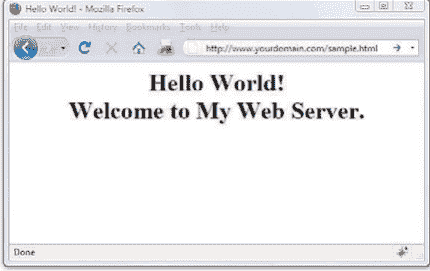

图 2.4 通过浏览器访问的 `sample.html` 文件。

然而，如果你在文档根内创建了一个新目录并将 `sample.html` 文件放在该目录中，那么将通过此 URL 访问文件：

`http://www.yourdomain.com/newdirectory/sample.html`

如果你将 `sample.html` 文件放在你连接服务器时最初看到的目录中——也就是说你没有更改目录也没有将文件放在文档根中——那么你将无法通过任何 URL 从你的 Web 服务器访问 `sample.html` 文件。该文件仍然存在于你认为的 Web 服务器的机器上，但由于文件不在文档根（服务器软件开始查找文件的地方），任何人都无法通过浏览器访问它。

结论是？在开始传输文件之前，务必导航到你 Web 服务器的文档根。

这对于图形和其他多媒体文件尤其是如此。Web 服务器上的一个常用目录被称为 `images`，你可以想象，图像资产被放置在这里以便进行调取。其他流行的目录包括用于样式表文件的 `css`（如果你使用了多个样式表）和用于外部 JavaScript 文件的 `js`。或者，如果你知道你的网站上有一个访问者可以下载多种文件的区域，你可能会将该目录命名为 `downloads`。

无论是包含你个人作品集的 ZIP 文件，还是包含销售数字的 Excel 表格，在互联网上发布不仅仅是网页的文件通常是很有用的。要让一个非 HTML 文件在 Web 上变得可用，只需像上传 HTML 文件那样将该文件上传到你的网站即可。


- 要让一个非 HTML 文件在 Web 上变得可用，只需像上传 HTML 文件那样将该文件上传到你的网站即可。

## 使用索引页面

这些服务器配置选项将由你的托管提供商确定。如果你的托管提供商允许通过控制面板修改服务器设置，那么你可以更改这些设置，以便服务器根据你的需求做出响应。

索引文件不仅用于子目录，还用于你网站的顶级目录（或文档根）作为首页。你网站的第一页——首页或主页，取决于你如何称呼用户访问你的域名时希望看到的网页内容——应该命名为`index.html`并放在服务器的目录中。这将确保当用户在浏览器中输入`http://www.yourdomain.com/`时，服务器将返回你预期的内容（而不是“目录列表”或其他意外后果）。

## 在没有 Web 服务器的情况下发布内容

在线发布 HTML 和多媒体文件显然是学习 HTML 和创建网页的主要原因。然而，在某些情况下，其他形式的发布是不可行的。例如，你可能希望在展会上通过 U 盘分发网页内容。

Web 服务器上的一个常用目录被称为“images”，你可以想象，图像资产被放置在这里以便进行调取。其他流行的目录包括用于样式表文件的“css”（如果你使用了多个样式表）和用于外部 JavaScript 文件的“js”。或者，如果你知道你的网站上有一个访问者可以下载多种文件的区域，你可能会将该目录命名为“downloads”。

无论是包含你个人作品集的 ZIP 文件，还是包含销售数字的 Excel 表格，在互联网上发布不仅仅是网页的文件通常是很有用的。要让一个非 HTML 文件在 Web 上变得可用，只需像上传 HTML 文件那样将该文件上传到你的网站即可。

## 无需 Web 服务器的分发内容

### 在本地发布内容

假设你需要创建一个本地网站，并想将其分发到 USB 盘上。即使是最廉价的 USB 盘，存储容量也足够大——而这些文件以及基础超文本文件非常小——以至于你可以在这一个小设备上分发整个网站和一个功能完整的网络浏览器。

简单地将你 USB 盘的目录结构看作你 Web 服务器的目录结构即可。USB 盘结构的顶层可以作为你的文档根。或者如果你在发布内容的同时发布网络浏览器，你有两个目录——例如，一个命名为`browser`，另一个命名为`content`。在这种情况下，`content`目录将是你的文档根。在文档根内部，你可以添加子文件夹，并在其中放置内容和其他多媒体资产。

对于本地网站，保持良好的组织与远程网站同样重要，这样可以避免你的 HTML 文件中出现断链。你将在后面的章节中学习更多关于文件链接的具体细节。

> 注意：在创建和分发本地网站时并不需要包含网络浏览器，尽管这是一个加分项。你可以合理地假设用户拥有自己的网络浏览器，并打开目录中的`index.html`文件来启动链接内容。但是，如果你想在 USB 盘上分发网络浏览器，请访问`http://www.portable.com/`并寻找 Portable Firefox。

### 在博客上发布内容

你可能拥有由第三方（如 Blogger 或 WordPress 等）托管的博客，因此在没有专用 Web 服务器甚至不知道任何 HTML 的情况下就已经发布了内容。这些服务除了源码编辑器外还提供可视化编辑器，这意味着你可以输入文字并添加粗体、斜体或颜色等视觉格式，而无需了解实现这些操作的 HTML 代码。但是，当你点击这些编辑器中的“发布”按钮时，内容就会变成真正的 HTML。

然而，通过你在这整本书中获得的知识，你的博客写作将得到增强，因为你将能够使用源码编辑器编写博客文章内容和博客模板，从而对这些内容的视觉和感受有更多控制权。这些操作的过程与你学过的创建 HTML 文件并通过 FTP 上传到自己的专用 Web 服务器的过程不同，但如果我不指出博客实际上是 Web 发布的一种形式，将是我的失职。

# 第 2 小时：发布 Web 内容

## 测试 Web 内容

每当你将文件传输到 Web 服务器或将其放在可移动介质上进行本地浏览时，都应该立即彻底测试每一个页面。以下检查清单将帮助确保你的 Web 内容按你预期的方式运行。请注意，此时你对某些术语可能并不熟悉，但随着你学习完本书并创建更大的项目，请回来查看此清单：

- 在传输文件之前，先在你的机器上进行本地测试，以确保链接正常工作且内容反映了你预期的视觉设计。将页面传输到 Web 服务器或可移动设备后，再次测试所有内容。
- 尽可能在多个浏览器中执行这些测试——Chrome、Firefox、Internet Explorer、Opera 和 Safari 是一个不错的列表——以及 Mac 和 Windows 两个平台。如果可能，请检查低分辨率（800x600）和高分辨率（1600x1200）的情况。
- 在开始测试之前关闭网络浏览器中的图像加载，这样你就可以看到每个页面没有图形时的样子。检查你的`alt`标签消息，然后重新开启图像加载以加载图形并再次仔细检查页面。
- 使用浏览器的字体大小设置以各种字体大小查看每个页面，以确保如果用户用自己的字体覆盖你的字体规范，你的布局不会崩溃。
- 等待每个页面完全加载完成，然后向下滚动，确保所有图像都出现在它们应该出现的位置。
- 记录每个页面加载所需的时间。加载需要几秒钟吗？如果是，该页面上的信息是否足够有价值以防止用户在页面加载完成之前离开？诚然，宽带连接很常见，但这并不意味着你应该在页面上加载满 1 MB 的图像。

如果你的页面通过了所有测试，你就可以放心了；你的网站已准备好公开查看。

## 总结

你在这一节开始时创建了一个非常简单的 HTML 文件，作为文件传输到 Web 服务器过程的测试文件。你学习了文件传输过程的工作原理，以及执行这些传输需要什么类型的软件（FTP 客户端）。你了解了一些关于 Web 服务器目录结构和文件管理，以及`index.html`文件在 Web 服务器目录中非常重要的用途。你还学习了可以在可移动介质上分发 Web 内容，并学习了如何通过组织文件和目录来实现在没有远程 Web 服务器的情况下查看内容的目标。最后，你学习了在发布网站供公众使用之前如何测试你的文件。

## 问答

- 你建议的所有测试比我创建页面的时间还要长！我不能少做点测试吗？
- 如果你的页面不是为了盈利或提供重要服务，那么它们对某些用户看起来很奇怪或偶尔产生错误可能并不是大问题。在这种情况下，只需用几个不同的浏览器测试每个页面并大功告成。然而，如果你需要展示专业形象，严谨的测试是不可替代的。
- 说真的，谁会在乎我如何组织我的 Web 内容？
- 信不信由，你的 Web 内容组织对搜索引擎和你网站的潜在访问者是非常重要的——你将在第 24 小时“帮助人们找到你的网页”中学习更多。但总的来说，拥有组织良好的 Web 服务器结构将帮助你跟踪可能要更新的内容。例如，如果你有一个专门的目录，你将确切知道去哪里寻找想要更新的文件，而无需翻找。

## 工作坊

工作坊包含问题和练习，帮助你巩固对材料的理解。在查看后面的“测试答案”部分之前，请回答所有问题。

### 问题

1. 连接到你的 Web 服务器需要哪三个信息？
2. `index.html`文件的目的是什么？
3. 你的网站必须包含目录结构吗？

### 测试答案

1. 主机名、账户用户名和账户密码。
2. `index.html`文件通常是目录的默认文件。它允许用户访问`http://www.yourdomain.com/somirectory/`而不需要文件名即可进入正确的位置。
3. 不。使用目录结构组织文件完全取决于你，尽管强烈建议使用，因为它简化了维护。

## 练习

- 使用你的 FTP 客户端，在网站的文档根目录下创建一个子目录。将`sample.html`的内容粘贴到另一个命名为`index.html`的文件中，更改`<title>`标签之间的文本，并更改`<h1>`和`</h1>`标签之间的文本。使用你的浏览器导航到新的子目录。使用你的 Web 服务器并查看`index.html`文件中的内容出现。然后，使用你的 FTP 客户端删除远程子目录中的`index.html`文件。回到浏览器返回 URL，刷新页面，查看服务器在没有`index.html`文件的情况下如何响应。
- 使用上述练习创建的同一组文件，将这些文件放在可移动介质设备上——例如 CD-ROM 或 USB 盘。使用你的浏览器导航到这个示例网站的本地版本，并思考你需要随此可移动介质分发什么样的说明，以便他人使用。

# 第 3 小时：理解 HTML 与 XHTML 的关系

在前两个小时中，你已经对创建网页内容以及在线或本地（如果你没有网络托管提供商）查看内容的流程有了基本概念。在本小时中，我们将进入正题，解释 HTML 文件中必须出现的各种元素。

在本小时结束时，你将学习 HTML 与 XHTML 有何不同，以及为什么会有两种不同的语言旨在完成同一件事——创建网页内容。总的来说，这一小时将提供 HTML 和 XHTML 基础的快速总结，以及一些帮助你作为网页作者和发布者充分利用时间的实用技巧。这并非全是理论；然而，你将看到一个真实的网页及其背后的 HTML 代码。

## 在开始之前

- 准备一台电脑。我使用了一台运行 Windows Vista 的电脑来测试示例内容并获取书中的插图，但你可以使用任何 Windows、Macintosh 或 Linux/UNIX 机器来创建和查看你的网页内容。
- 获取互联网连接。无论你使用的是拨号、无线还是宽带连接，对于创建和查看网页内容来说都没有影响，但连接越快，整体体验就越好。提供互联网连接的网络服务提供商（ISP）、学校或公司可以帮助你完成正确设置的细节。此外，许多公共场所如咖啡馆、书店和图书馆提供免费的互联网服务，如果你有支持 Wi-Fi 网络的笔记本电脑，就可以使用。
- 获取网页浏览器软件。这是你的电脑检索和显示网页内容时需要的软件。正如你在第一小时所学到的，最流行的浏览器软件（按字母顺序排列）是 Apple Safari、Google Chrome、Mozilla Firefox、Microsoft Internet Explorer 和 Opera。安装其中几个浏览器是一个好主意，这样你可以进行实验，并确保你的内容在所有浏览器中看起来都一致；你可以对其他人在使用什么软件做出假设。
- 探索！使用网页浏览器在互联网上寻找内容或外观与你想创建的网站相似的网站。哪些页面让你感到沮丧，哪些页面吸引你并让你继续阅读，又是什么让你反复回到某些页面。如果你对某个特定部分感兴趣，考虑使用流行的搜索引擎如 Google（`http://www.google.com/`）或 Bing（`http://www.bing.com/`）进行搜索。

尽管网页浏览器处理和操作信息的大体相同，但它们之间存在一些差异，导致在不同浏览器中的显示效果不同。务必检查你的多个浏览器，确保它们看起来基本一致。

## 本小时你将学到：

- 如何使用 HTML 创建一个简单的网页
- 如何包含每个网页都必须的所有 HTML 标签
- 如何使用段落和换行符组织页面
- 如何使用标题组织你的内容
- 如何区分 HTML、XML、XHTML 和 HTML

## 注意

不确定如何寻找 ISP 吗？最好的方法是货比家（使用朋友的电脑或已连接互联网的公共电脑）。你可以在`http://www.the-list.com/`找到一份国家和地区 ISP 的完整列表。

正如第 1 小节讨论的，如果你计划将网页内容发布到互联网上（而不是发布在 CD-ROM 或本地局域网上），你需要将其传输到一台 24 小时连接互联网的电脑。提供互联网访问的同一公司或学校可能也提供网络空间；如果没有，你可能需要向托管提供商支付服务费。

## 从入门开始


在第一小时中，你学习了“网页”只是一个被 HTML 代码标记（或包围）了显示方式的文本文件。要创建这些文件，你可以使用文本编辑器，如 Notepad (Windows) 或 TextEdit (Mac)——不要使用 WordPad、Microsoft Word 或任何全功能文字处理软件，因为它们创建的文件类型与你将用于网页内容的纯文本文件不同。

## 警告

不要使用 Word 或任何兼容 HTML 的文字处理器创建你的第一个 HTML 文件；这些程序中的大多数都会尝试以奇怪的方式重写 HTML，可能会导致你产生困惑。此外，我建议不要使用图形化的、“所见即所得”（WYSIWYG）编辑器，例如 Microsoft FrontPage 或 Adobe Weaver。在学习 HTML 期间，你会发现从简单的文本编辑器开始，比在对“内部原理”有了更好的了解之后再使用视觉化工具（如 FrontPage 和 Dreamweaver）要容易得多。

在开始之前，你应该从一些你想放在网页上的文字开始：

1. 找到（或编写）几段关于你自己、你的公司、你的软球球队或任何你感兴趣的主题的段落。
2. 将此文件保存为纯 ASCII 文本。Notepad 和大多数简单文本编辑器始终始终保存为纯文本，但如果你正在使用另一个程序，你可能需要选择这种文件类型（在点击“文件”、“另存为”后）。

在在此过程中，你将向文本中添加 HTML 标记（称为标签），将其变成网页内容。

## 从入门开始创建一个简单的网页

当你保存包含 HTML 标签的文件时，务必将它们命名为 `.html` 结尾。这很重要：如果你在保存文件时忘记在文件名末尾输入 `.html`，大多数编辑器会给它其他扩展名（如 `.txt`）。如果发生这种情况，你在浏览器中查看文件时可能无法找到它；换句话说，浏览器期望网页具有 `.html` 扩展名。

你可能会遇到扩展名为 `.htm` 的网页，这也是可以接受的。你可能会发现其他使用的 HTML 文件，如 `.jsp` (Java Server Pages)、`.asp` (Microsoft Active Server Pages) 或 `.php` (PHP Preprocessor)，但这些文件类型使用了 HTML 之外的技术。

列表 3.1 显示了用于创建简单 HTML 页面的文本示例。如果你用 Firefox 打开它，将看到图 3.1 所示的页面。你创建的每个网页都必须包含 `<html></html><head></head><title></title></body></html>` 标签对。

### 列表 3.1 `<html>`、`<head>`、`<title>` 和 `<body>` 标签

```html
<?xml version="1.0" encoding="UTF-8">
<!DOCTYPE html PUBLIC "-//W3C//DTD HTML 1.1//EN"
"http://www.w3.org/TR/html11/DTD/dtd">
<html xmlns="http://www.w3.org/1999/xhtml" lang="en">
<head>
<title>第一个网页</title>
</head>
<body>
<p>
起初，Tim 创建了超文本标记语言。互联网当时空虚且无序，文字就在显示器屏幕上。Tim 说：“让链接出现；”，链接出现了。Tim 看到这些链接是好的；Tim 将这些链接称为锚点，整个部分就是第一个页面。
</p>
</body>
</html>
```

> 注意：如果你在 Macintosh 电脑上使用 TextEdit，创建 HTML 文件的步骤与在 Windows 电脑上使用 Notepad 有有不同——后者你必须点击主菜单并选择“纯文本”，然后通过取消勾选“保存文件”框来更改设置。此外，默认是 `.html` 文档，因为它们会在浏览器中显示，这将让你无法编辑它们。要修复这个问题，请使用富文本处理忽略 HTML 文件中的富文本命令。

# 快速上手简单的网页

在学习列表 3.1 中使用的 HTML 标签的含义之前，你可能想确切看看我是如何创建和查看文档本身的。按照以下步骤操作：

1. 在 Windows 记事本中输入列表 3.1 中的所有文本，包括 HTML 标签（或使用 Macintosh TextEdit 或你选择的其他文本编辑器）。
2. 选择“文件”，“另存为”。但是，你应该选择纯文本（或 ASCII 文本）作为文件类型。
3. 将文件命名为 `firstpage`。
4. 在硬盘上选择你想要存放网页的文件夹——并记住你选择了哪个文件夹！点击“保存”或“确定”保存文件。
5. 现在启动你最喜欢的浏览器。（同时也让记事本运行，这样你可以轻松地在查看和编辑页面之间切换。）

在资源管理器中，选择“文件”，“打开”并点击。如果你使用的是 Firefox，请选择“文件”，“打开文件”。导航到相应的文件夹并选择 `firstpage.html` 文件。某些浏览器和操作系统允许你将 `firstpage.html` 文件拖放到浏览器窗口中进行查看。

搞定！你应该能看到图 3.1 所示的页面。

## 动手尝试

# 创建和查看基础网页

## 注意

你不需要连接到存储在自己电脑上的网页。默认情况下，你的网络浏览器在每次启动时都会尝试连接到互联网，这在大多数情况下是合理的。但如果你在硬盘上本地（离线）开发页面，或者不断收到“找不到页面”的错误，这可能会很困扰。如果你通过局域网、电缆模块或 DSL 拥有全天候连接，这个问题就不存在，因为浏览器永远不会抱怨离线。否则，适当的措施将取决于你使用的浏览器类型；请检查浏览器“工具”菜单下的选项。

如果你已经获得了网络托管账户，此时可以使用 FTP 将 `firstpage.html` 文件传输到服务器。事实上，从现在开始，这些说明将假设你已经有一个提供商，并且习惯于通过 FTP 来发送文件；如果情况并非如此，请在继续之前复习前两个小时的内容。或者，如果你选择在本地处理文件（没有网络主机），请准备好根据你的特定需求调整说明（例如忽略“传输文件”和“输入 URL”）。

# 第 3 小时：理解 HTML 和 XHTML 的关系

## 每个 XHTML 网页必须具备的 HTML 标签

## 注意

在目前阶段，你理解字符编码等概念并不是极其重要的。重要的是要在页面中包含适当的样板代码（boilerplate-code），以便它们符合网络标准。截至编写本文时，XHTML 1.1 是一项网络标准。HTML 5 还没有网络标准，但如果你正在创建一个 HTML 5 文档，HTML 文件开头的这些行将是不必要的。

HTML 标签的秘密语言即将向你揭示了。当你理解了这种语言时，你将拥有远超其他人类的创造力。不要告诉其他人，这其实非常简单。

在进入 HTML 标签之前，让我们先处理列表 3.1 顶部看起来很乱的代码。第一行表示该 HTML 文档实际上是一个 XML 文档：

```xml
<?xml version="1.0" encoding="UTF-8"?>
```

XML 版本为 1.0，这是非常标准的，字符编码类型（UTF-8）也是如此。

列表 3.1 中的第二、三行代码看起来更复杂一些：

```html
<!DOCTYPE html PUBLIC "//W3C//DTD XHTML 1.1//EN"
"http://www.w3.org/TR/xhtml11/DTD/xhtml11.dtd">
```

## 注意

创建网页并不严格需要 XML/XHTML 样板代码。你可以删除示例中以 `<html>` 标签开始的开头代码，它仍然可以在网页浏览器中打开。包含额外的代码是为了确保你的页面符合网络标准。此外，额外的代码允许你验证网页的准确性，你将在本节的稍后部分学习如何这样做。

只要你记住在页面开头包含这段代码，那么这段代码的细节就并不极端重要。它将文档标识为 XHTML 1.1，从而允许浏览器确保代码符合 XHTML 1.1 的所有要求。

大多数 HTML 标签都有两个部分：指示文本开始位置的起始标签和指示文本结束位置的结束标签。结束标签在符号之前以 `/`（正斜杠）开头。另一种类型的标签是空标签，它的独特之处在于它不包含成对的起始标签和结束标签。相反，一个空标签由单个标签组成，它以 `<` 开头，并在符号前以 `/` 结束。以下是对这三个标签的快速总结，以确保你理解每个标签扮演的角色：

- 起始标签是指示 HTML 命令开始的 HTML 标签；受命令影响的文本出现在起始标签之后。标签始终以 `<` 开头并以 `>` 结束，例如 `<html>`。
- 结束标签是指示 HTML 命令结束的 HTML 标签；受命令影响的文本出现在结束标签之前。标签始终以 `<` 开头并以 `>` 结束，例如 `</html>`。

## 每个 XHTML 网页拥有的 HTML 标签

空标签是发布 HTML 命令且不在页面中封包任何文本的 HTML 标签。HTML 标签始终以 `<` 开头并以 `/>` 结束，例如 `<br />` 和 ``。

## 注意

你可能在列表 3.1 中注意到与 `<html>` 标签相关的某些额外代码。这些代码由两个属性（`xmlns` 和 `xml:lang`）组成，用于提供与页面相关的特定附加信息。这两个属性是所有 XHTML 网页的标准要求；前者定义了 HTML 命名空间，后者定义了内容的语言。这本关于标准命名空间的书已经定义，并使用了英语。如果你使用不同的语言，请将 `"en"`（代表英语）替换为与你相关的语言标识。

例如，列表 3.1 中的 `<body>` 标签告诉浏览器页面实际文本从哪里开始，而 `</body>` 指明从哪里结束。`<body>` 和 `</body>` 标签之间的所有内容将出现在网页浏览器的主显示区域，如图 3.1 所示。

浏览器最顶部位于 `<title>` 和 `</title>` 之间显示的是标题文本，用于在浏览书签或收藏夹中标识页面，取决于你使用的浏览器。提供标题是重要的，这样页面访问者就可以正确将其标记。

你创建的每个 HTML 页面都会使用 `<body>` 和 `<title>` 对，因为每个网页都需要标题和正文。你还会使用 `<html>` 和 `<head>`，这是列表 3.1 中显示的另外两个标签。在文档开头放置 `<html>` 标识该文档是一个网页。结尾的 `</html>` 表示网页结束。

## 提示

你可能会发现创建并保存一个基础页面（也称为骨架页面），只包含起始和结束的 `<html>`、`<head>` 和 `<body>` 标签非常方便，这与列表 3.1 中使用的文档类似。每当你想要创建一个新网页时，都可以打开该文档作为起点，省去每次都输入所有标签的麻烦。

## 使用段落和换行符组织页面

当网页浏览器显示 HTML 页面时，它不会忽略行尾或单词之间的空格数量。例如，图 3.2 所示诗歌的顶部版本在所有单词之间只有一个只有一个空格，尽管在列表 3.2 中的输入方式并非如此。这是因为 HTML 代码中多余的空白会被压缩为单个空格。此外，当文本到达浏览器窗口边缘时，它会自动换行到下一行，无论原始 HTML 文件中的换行符是怎样的。

- 列表 3.2 包含段落和换行符的 HTML

```html
<xml version="1.0" encoding="UTF-8"?>
<!DOCTYPE html PUBLIC "//W3C//DTD HTML 1.1//EN"
"http://www.w3.org/TR/html11/DTD/html11.dtd">

<html xmlns="http://www.w3.org/1999/xhtml" xml-lang="en">
<head>
  <title>The Advertising Agency Song</title>
</head>

<body>
<p>
When your client's hopping mad,
put his picture in the ad.

If he still should prove refractory,
add a picture of his factory.
</p>

<br />

<p>
When your client's hopping mad,<br />
put his picture in the ad.
</p>

<p>
If he still should prove refractory,<br />
add a picture of his factory.
</p>
</body>
</html>
```

## 使用段落和换行符组织页面

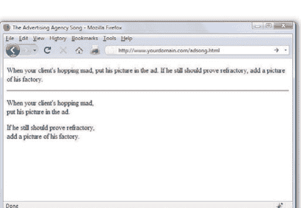

图 3.2

当列表 3.2 中的 HTML 被视为网页查看时，只有在存在 `<br />` 和 `<p>` 标签的地方才会出现换行和段落。

如果你想再次控制换行和段落的出现，就必须使用 HTML 标签。当文本包含在 `<p></p>` 容器标签内时，在结束标签后会认为有一个换行。在随后的章节中，你将学习如何使用 CSS 控制换行的高度。`<br />` 强制在段落内换行。与你目前为止看到的其他标签不同，`<br />` 不需要闭合标签 `</br>`——这是之前讨论过的那些空标签之一。XHTML 需要，未来的标准也是如此，因此对你来说，坚持最新标准并创建代码正确的网页是非常重要的。始终以 `/>` 结束空标签。

## 警告

列表 3.2 和图 3.2 中的诗展示了使用 `<br />` 和 `<p>` 标签来分隔广告公司故事的行和节。你可能注意到了列表中的 `<hr />` 标签，它会在页面上产生一条水平线（见图 3.2）。使用 `<hr />` 标签插入水平规则也会导致换行，即使你没有同时包含 `<br />` 标签。像 `<br />` 一样，`<hr />` 水平规则标签是一个空标签，因此永远不会有结束标签 `</hr>`。

你可能会发现很多网页内容使用的是 `<br>` 而不是 `<br />`。或者你可能会学到闭合标签 `</p>`。只需记住，互联网上充斥着许多陈旧的网页内容，仅仅因为你看到了它并不意味着它是正确的。遵循本书中的标准可以为你节省未来大量的工作和挫败感。养成良好的 HTML 编码习惯是成为成功网页设计师非常重要的一部分。

# 第 3 小时：理解 HTML 和 XHTML 的联系

## 尝试一下

### 在 HTML 中格式化文本

粘贴一段文本，尝试将其格式化为适当的 HTML：

1. 在文本开头添加 `<html><head><title>My Title</title></head><body>`（使用你自己的页面标题代替 My Title）。同时在页面顶部包含满足 XHTML 要求的样板代码。
2. 在文本的最末尾添加 `</body></html>`。
3. 在每个段落的开头添加 `<p>` 标签，在每个段落的末尾添加 `</p>` 标签。
4. 在任何你需要单倍行换行的地方添加 `<br />`。
5. 使用 `<hr />` 绘制分隔文本主要部分的水平规则，或任何你想在页面上看到一条线的地方。
6. 将文件保存为 `mypage.html`（使用自己的文件名代替 mypage）。
7. 在网页浏览器中打开文件查看你的内容。（如果你有网络托管账户，请通过 FTP 将文件发送到那里）。
8. 如果某些地方看起来不对，回到文本编辑器进行修正并保存文件（如果适用，将其发送到你的网络托管账户）。然后你需要点击重新加载/刷新浏览器以查看你所做的更改。

## 警告

如果你正在使用文字处理器创建网页，请确保将 HTML 文件保存为纯文本或 ASCII 格式。

## 使用标题组织内容

当你在互联网上浏览网页时，你会发现许多页面顶部都有一个标题，它比其他文本看起来更大、更粗。列表 3.3 是一个简单网页的示例代码和文本，包含一个标题与普通段落文本的对比示例。`<h1>` 和 `</h1>` 之间的任何文本将显示为标题。

### 列表 3.3 标题标签

```html
<xml version="1.0" encoding="UTF-8"?>
<!DOCTYPE html PUBLIC "//W3C//DTD HTML 1.1//EN"
"http://www.w3.org/TR/html11/DTD/html11.dtd">

<html xmlns="http://www.w3.org/1999/xhtml" xml-lang="en">
<head>
  <title>My Title</title>
</head>
<body>
<h1>My Widgets</h1>
<p>My widgets are the best</p>
<h2>My Features</h2>
<p>If I had any features</p>
<h3>My Discussion</h3>
<p>Continue reading to learn</p>
</body>
</html>
```

正如图 3.3 所示，`<h1>` 和 `</h1>` 将显示为标题。此外，`<h2>` 和 `<h3>` 逐渐较小的标题。对于比标题更重要的信息，使用 `<h2>` 和 `</h2>`。对于比 2 级标题更小的内容，使用 `<h3>` 和 `</h3>`。理论上，你还可以使用 `<h4>`、`<h5>` 和 `<h6>` 标签。

# 第 3 小时：理解 HTML 和 XHTML 的联系

## 图 3.3

三级标题的使用了此示例页面内容的层级。

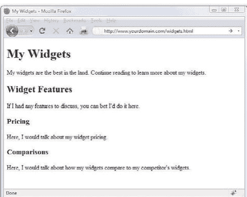

## 注

在如今的网页上，华丽渲染的字母和标志经常被用来代替本节讨论的文本标题。使用搜索引擎优化（SEO）技巧，你将在第 24 小时“帮助人们找到你的页面”中学习。搜索引擎通过标签来查看你如何组织内容；它们会优先考虑你指示为重要的内容（例如 1 级标题），而不是你指示性较低的内容（较低级的标题）。

较不重要的标题，但这些并不常用。网页浏览器很少显示这些标题与 `<h3>` 标题之间的明显区别，而且内容通常不需要六级标题。


# 标题和标题标签的区别

记住标题和标题之间的区别很重要。在日常英语中这两个词经常互换，但当你学习 HTML 时，`<title>` 定义的整个页面并不显示在页面上；它只显示在浏览器的标题栏上。相反，标题承载页面上的文本并以视觉强调的方式显示。每个页面只能有一个 `<title>` 必须包含在 `<head>` 和 `</head>` 标签内，其中你可以根据喜好以任何顺序拥有任意数量的 `<h1>`、`<h2>` 和 `<h3>` 标题。

你将学习完全控制文本的外观。

## 验证你的 Web 内容

本书的第二部分将介绍网页内容。在不对字体大小、族类和颜色进行精确控制的情况下，标题是吸引重要文本额外关注的最简单、最流行的方法。

**警告**

不要忘记，放置在网页 `<head>` 中的任何内容都无意在页面上显示，而页面 `<body>` 中的所有内容都是为了查看的。

## 窥视其他的页面

考虑到许多流行网页中呈现的视觉（有时甚至是音频）特效，你可能已经意识到，书中描述的简单页面只是 HTML 水冰山一角。现在你已经掌握了基础知识，你可能会惊讶地发现，仅仅通过查看互联网上其他人的页面，就能学到大部分内容。在任何浏览器中右键点击并选择“查看源代码”，即可查看任何页面的 HTML 代码。

如果你还没有办法看出 HTML 标签的作用或确切知道该如何使用它们，请不要担心。你将在接下来的几小时内了解到所有事情。然而，现在偷看一眼可以让你看到你已经熟悉的标签是如何运作的，并让你对很快就能用网页实现的事情有所体验。

## 验证你的 Web 内容

在第 2 小时中，我讨论了测试页面的方法；测试页面的一种非常重要的方法就是验证它们。可以这样想：设计并画出一套精美的房屋平面是一回事，但建筑师将其盖章认证为适用于施工的安全结构则是另一回事了。验证你的网页是一个类似的过程；但在这种情况下，建筑师是一个应用程序——而不是人。

简而言之，验证是使用特殊的应用程序测试你的页面的过程，该程序搜索错误并使你的页面遵循严格的 XHTML 标准。验证非常简单。事实上，负责开发 Web 标准的标准机构——世界维网联盟（W3C）提供了一个你可以使用的在线验证工具。如需验证一个页面，请访问此 URL：`http://validator.w3.org/`。图 3.4 显示了 W3C 标记验证服务。

## 第 3 小时：理解 HTML 和 XHTML 的关系

**图 3.4**

W3C 标记验证服务允许你验证 HTML (XHTML) 文档，以确保其编码准确。

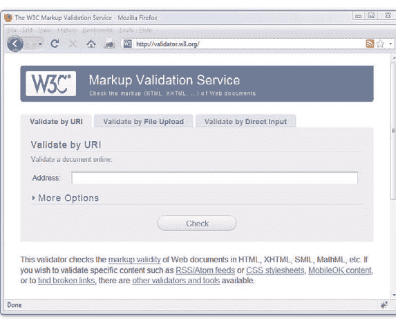

如果你已经将页面发布到网上，可以使用“通过 URI 验证”（Validate by URI）标签。使用“通过文件上传”（Validate by File Upload）标签来验证存储在本地文件系统的文件。“通过直接输入”（Validate by Direct Input）允许你从文本编辑器粘贴文件内容。如果一切顺利，你将获得一份通过报告（见图 3.5）。

**图 3.5**

如果页面通过了 W3C 标记验证服务，你就知道它已经准备好了。

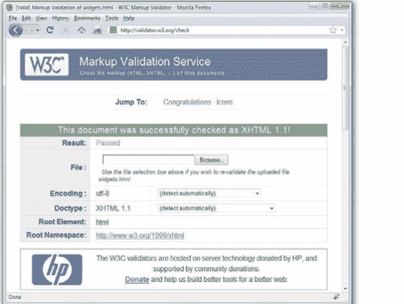

## 关于 HTML, XML, XHTML 和 HTML 5 的真相

如果 W3C 标记验证服务在你的网页中遇到错误，它将提供具体的细节（包括错误代码的行号）。这是寻找问题并从你的页面中消除错误代码的绝佳方法。验证不仅可以告知你的页面是否构建正确，还能帮助你在发布页面供世界查看之前发现并修复问题。

**提示**

Web 开发工具包含了内置的验证功能，你可以用来替代 W3C 标记验证服务。一些示例包括 Firebug (`http://firebug.com/`) 和 HTML Validator (`http://users.skynet.net/mg/mozilla/`)。许多其他程序也提供类似的功能——请检查你的用户文档。

## 关于 HTML, XML, XHTML 和 HTML 5 的真相（续）

在早期，HTML 非常棒，因为它允许科学家以高效且相对结构化的方式在互联网上共享信息。直到后来，图形化网页浏览器被创建，HTML 开始用于编写除科学论文以外的内容。HTML 迅速从一种供研究人员的小型整洁标记语言变成了一种在线出版语言。在确定 HTML 可以为图形化浏览器进行装饰后，Web 浏览器的创建者们疯狂地向该语言添加了许多奇妙的功能。尽管这些新功能起初很棒，但它们损害了 HTML 的原始设计，并引入了浏览器显示网页时的不一致性；新功能在某个浏览器上有效，而在另一个浏览器上无效，如果你恰好运行了错误的浏览器，你就只能倒霉了。HTML 开始变得像是一个糟糕的装修工程——这项工程由过多的承包商完成，而且没有适当的规划。事实证明，这段期间的一些浏览器功能现在已被采纳为标准，而另一些则被完全抛弃了。

作为解决办法，Web 的诞生是非常混乱的，对 HTML 的修改反映了这种混乱。多年来，人们付出了巨大的努力来解决 HTML 的不一致性并恢复该语言的秩序。HTML 的问题在于它导致 Web 浏览器必须猜测页面应该如何显示，这并不是一件好事。理想情况下，网页设计师应该能够精确地定义页面的外观，并且无论使用什么种浏览器或操作系统，它看起来都一样。更好的是，设计师应该能够跨越不同的浏览器和平台进行精确定义。这种乌托邦仍然存在于未来的某个某处，在那里，一种名为 XML（可扩展标记语言）的标记语言将在引导我们通往那里的过程中起着至关重要的作用。

XML 是一种用于创建特定语言（如 HTML）的通用语言。这听起来可能有点点奇怪，但它实际上意味着 XML 提供了一个基本结构和一组规则，任何标记语言都必须遵守这些规则。使用 XML，你可以创建一个独特的标记语言来描述任何类型的信息，包括网页。知道 XML 是一种用于创建其他标记语言的语言，你就可以使用 XML 创建你自己的 HTML 版本。例如，你可以创建一种名为 BCC（瓶盖标记语言）的标记语言，用它来创建和管理你大量的稀瓶盖收藏。要点是，XML 为以一致的方式组织信息定了基本规则，而这些信息可以是从网页到瓶盖的任何东西。

你可能认为瓶盖与 Web 没有任何关系，所以为什么要提到它们？答案是 XML 并不完全关于网页。XML 实际上比 Web 更广泛，它可以被用于表示任何类型计算机上的任何类型的信息。如果你想象所有信息在计算机、移动手机、手持计算机、电视和收音机在全球范围内飞梭，你就能开始理解为什么 XML 的应用比简单的网页要广泛得多。然而，XML 的早期应用之一就是为 Web 恢复一些秩序，这就是为什么 XML 与学习 HTML 关重要。

如果 XML 比 HTML 更好地描述数据，是否意味着 XML 将升级 HTML 成为 Web 的首选标记语言？不是。XML 不是 HTML 的替代品，它甚至不是 HTML 的竞争对手。XML 对 HTML 的影响与清理 HTML 无关。HTML 是一种相对无结构的语言，它受益于 XML 的规则。为了实现这种合并，制定了一种遵循更严格规则的 HTML 版本。这种新的符合 XML 的 HTML 版本被称为 XHTML。对你来说幸运的是，你将在书中学习 XHTML，因为它确实是 HTML 的一个更干净的版本。

你可能听说过 HTML 5，它被誉为下一个 Web 标准。它确实是，但在未来几年标准之前，它不会让 HTML 5 变得毫无用处——HTML 5 不是 XHTML 的替代品，它是对 HTML 4 的重大修订。换句话说，XHTML 和 HTML 5 可以在 Web 上共存，支持 XHTML 的 Web 浏览器也将支持 HTML 5。

可持续性。如果你理解了网页发布以及 CSS 如何与页面整体标记语言（无论是 XHTML 还是 HTML 5）协同工作，那么在几年后，如果你决定从 XHTML 迁移到 HTML 5，你将处于非常有利的位置。

## 总结

这一小时介绍了网页的基础知识及其工作原理。你学习了编码的 HTML 命令被包含在文本文件中，并且手动输入 HTML 文本比使用图形化编辑器为你创建 HTML 命令要好——尤其是当你正在学习 HTML 的时候。你接触了最基础且最重要的 HTML 标签。通过将这些编码的命令添加到任何纯文本文档中，你可以快速地将其转换为一个真正的网页。你学习了创建网页的第一步是在开头和结尾处放置几个强制性的 HTML 标签，包括页面的标题。你标记了段落和行的结束位置，并在需要时添加水平分割线和标题。表 3.1 总结了本节介绍的所有标签。

**表 3.1 第 3 小节涵盖的 HTML 标签**

| 标签 | 功能 |
| --- | --- |
| `<html>...</html>` | 包裹整个 HTML 文档。 |
| `<head>...</head>` | 包裹 HTML 文档的头部。与 `<head>` 标签对配合使用。 |
| `<title>...</title>` | 指明文档标题。在 `<head>` 标签对内部使用。 |
| `<body>...</body>` | 包裹 HTML 文档的主体。与 `<html>` 标签对配合使用。 |
| `<p>...</p>` | 段落；在段落之间跳过一行。 |
| `<br />` | 换行符。 |
| `<hr />` | 水平分割线。 |
| `<h1>...</h1>` | 一级标题。 |
| `<h2>...</h2>` | 二级标题。 |
| `<h3>...</h3>` | 三级标题。 |
| `<h4>...</h4>` | 四级标题（很少使用）。 |
| `<h5>...</h5>` | 五级标题（很少使用）。 |
| `<h6>...</h6>` | 六级标题（很少使用）。 |

## 第 3 小节：理解 HTML 和 XHTML 的联系

最后，你学习了 XML 和 XHTML，以及它们与 HTML 的关系，以及相对于你在这里所学的内容，“HTML 5”意味着什么。

## 问答 (Q&A)

我创建了一个网页，但当我用网络浏览器打开文件时，我看到了所有文本，包括 HTML 标签。有时我会在页面顶部看到奇怪的乱码！我做错了什么？

你没有将文件保存为纯文本。尝试重新保存文件，小心将其保存为“仅限文本”（Text Only）或 ASCII 文本。如果你不知道如何让你的文字处理器这样做，不要压力。只需在记事本（Notepad）或 TextEdit 中输入你的 HTML 文件，一切都应该正常运行。（同时，确保你的网页文件名以 `.html` 或 `.htm` 结尾）。

我在网上看到过开头没有 `<html>` 标签的网页。你说页面必须以 `<html>` 开始。这是怎么回事？

许多网络浏览器会在你忘记包含 `<html>` 标签时原谅你并正确显示页面。然而，包含它是一个非常好的主意，因为某些软件确实需要识别页面为有效的 HTML。此外，你希望你的页面是真正的 XHTML 页面，以便符合最新的网络标准。

## 工作坊 (Workshop)

工作坊包含测验题和活动，帮助你巩固对所涵盖内容的理解。在查看后面的“答案”部分之前，请回答所有问题。

## 测验 (Quiz)

- 每个 HTML 页面都要求的四个标签是什么？
- 你使用哪些 HTML 标签和文本来生成以下内容：
  - 带有单词 **We are Proud to present** 的标题
  - 跨页面的水平分割线
  - 带有单词 **Orbit** 的大标题
- 带有单词 **Geometric Juggler** 的中等大小标题
- 另一个水平分割线
- 你使用什么代码创建一个完整的网页，标题为 **Happy Hour at the Foo Bar**，后面跟着单词 **Come on down!** 的？

## 答案 (Answers)

- `<html>`, `<head>`, `<title>`, 和 `<body>`（以及它们的结束标签 `</title></head></body></html>`）。
- 你的代码应该如下：

```html
<h3>We are Proud to present</h3>
<hr />
<h1>Orbit</h1>
<h2>Geometric Juggler</h2>
<hr />
```

- 你的代码应该如下：

```xml
<?xml version="1.0" encoding="UTF-8"?>
<!DOCTYPE html PUBLIC "-//W3C//DTD XHTML 1.1//EN" "http://www.w3.org/TR/xhtml11/DTD/xhtml11.dtd">
<html xmlns="http://www.w3.org/1999/xhtml" lang="en">
<head>
<title>Foo Bar</title>
</head>
<body>
<h1>Happy Hour at the Foo Bar</h1>
<p>Come on down!</p>
</body>
</html>
```

## 练习 (Exercises)

- 即使你本节的主要目标是创建网页内容，你可能也想先创建一个个人网页。在整个书中，你将遵循代码示例并使用你学过的 HTML 标签来制作页面。现在花点时间设置一个包含 XML 声明、doctype 声明和核心 HTML 文档结构的模板。

# 第 4 小节：层叠样式表 (Cascading Style Sheets)

在上一节中，你学习了 HTML 和 XHTML 的基础，以及如何设置 HTML 模板。在本节中，你将学习如何使用层叠样式表（CSS）来微调网页内容的显示。层叠样式表的概念非常简单：你创建一个指定字体、颜色、间距和其他特性的样式文档。然后，你链接每个页面，使其看起来像样式表。因此，当你决定更改整体字体或颜色方案时，你可以通过更改样式表中的一个或两个条目一次性修改所有网页，而不是修改每个文档。样式表是一组控制多个 HTML 页面外观的格式指令。样式表允许你设置大量的格式特性，包括精确的字体控制、行间距、页边距和页面边框，等等。样式表还允许指定熟悉的单位，如毫米、磅和皮卡。你还可以使用样式表精确地在网页的任何位置放置图形和文本，无论是特定坐标还是相对于页面上的其他项目。

简而言之，样式表为网页带来了复杂的显示水平。它们确实做到了——通过样式来实现。

- 本节中你将学习到：
  - 如何创建基础样式表
  - 如何使用样式类 (classes)
  - 如何使用样式 ID (IDs)
  - 如何使用内联样式 (inline styles)

## CSS 如何工作

样式表背后的技术被称为 CSS，全称为层叠样式表（Cascading Style Sheets）。CSS 用于定义 HTML 或 XML 编写的文档的呈现方式。它描述了网页的布局、颜色、字体和其他视觉方面。通过 CSS，你可以控制网页的几乎每个方面，包括：

- 字体族和大小
- 文本颜色
- 背景颜色和图像
- 边界、外边距和内边距
- 定位和布局
- 动画

将 CSS 应用于 HTML 文档的三方法：

- **内联样式**：直接使用 `style` 属性应用于 HTML 元素。
- **内部或嵌入样式**：定义在 HTML 文档 `<head>` 中的 `<style>` 标签内。
- **外部样式**：在独立的 `.css` 文件并通过 `<link>` 标签链接到 HTML 文档。这是最常用的方法，因为它允许你在多个页面中使用同一个样式表。

CSS 名称中的“层叠”（cascading）是指样式规则应用于 HTML 文档中元素的方式。具体来说，在 CSS 中，规则形成一个层级，其中特定的规则会覆盖通用规则。CSS 的职责根据此层级确定样式规则的优先级。如果这听起来有点困惑，只需将层叠机制比作遗传，普通特征从父母传递给孩子，但更特有的特征是孩子独有的。

**注意**：注意我在本节中频繁使用“元素”（element）一词。元素是网页中的一部分信息（内容），例如图像、段落或链接。

## 基础样式表

与许多技术一样，CSS 在多年年来一直在演变。CSS 的原始版本被称为级联样式表 1（CSS1），创建于 1996 年。后来的 CSS 2 标准创建于 1998 年，且 CSS 2 仍在使用。所有现代网络浏览器都支持 CSS 2，你可以安全地使用 CSS 2 样式而无需过多担心。当我在本书中提到 CSS 时，我指的是 CSS 2。

你可以在 `http://www.w3.org/Style/CSS/` 找到 CSS 的完整参考指南。本节的其余部分将解释如何充分利用 CSS。

## 基础样式表（续）

尽管样式表的力量令人敬畏，但创建它们可以非常简单。考虑图 4.1 和图 4.2 中的网页。这些页面共享一些视觉属性，这些属性可以放入公共样式表中：

- 它们对标题使用大号粗体字体，正文使用普通大小和粗重的 Verdana 字体。
- 它们使用一个名为 `1090.gif` 的图像浮动在内容区域和页面右侧。
- 所有文字均为黑色，子标题除外，子标题是紫色。
- 它们在左侧和顶部有边距。
- 文字行之间有垂直空间。
- 脚注居中且字体较小。

**图 4.1** 此页面使用样式表来精调文本和图像的外观及间距。

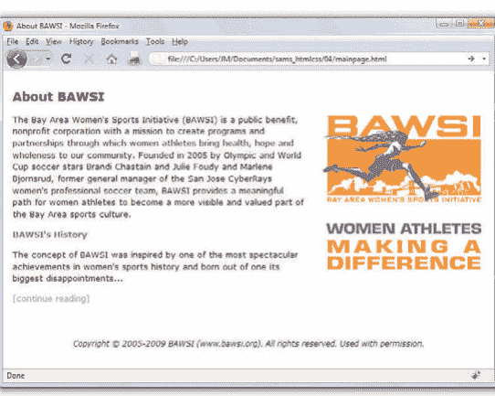

## 第四小时：理解级联样式表

**图 4.2** 此页面使用了与图 4.1 相同的样式表，保持了一致的视觉感受。

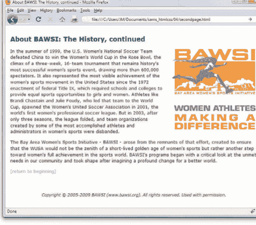

列表 4.1 显示了指定这些属性的样式表代码。

### 列表 4.1：单外部样式表


```css
body {
  font-size: 10pt;
  font-family: Verdana, Geneva, Arial, Helvetica, sans-serif;
  color: black;
  line-height: 14pt;
  padding-left: 5pt;
  padding-right: 5pt;
  padding-top: 5pt;
}

h1 {
  font: 14pt Verdana, Geneva, Arial, Helvetica, sans-serif;
  font-weight: bold;
  line-height: 20pt;
}

p.subheader {
  font-weight: bold;
  color: #593d87;
}

img {
  padding: 3pt;
  float: right;
}
```

# 基础样式表

列表 4.1 单外部样式表

```css
a {
  text-decoration: none;
}
a:link, a:visited {
  color: #8094d6;
}
a:hover, a:active {
  color: #FF9933;
}
div.footer {
  font-size: 9pt;
  font-style: italic;
  line-height: 12pt;
  text-align: center;
  padding-top: 30pt;
}
```

这起初看起来可能有很多代码，但如果你仔细观察，你会发现每行代码并没有包含多少信息。将样式规则放置在单独的一行是非常标准的做法，这使样式表更具可读性。提到代码可读性，也许你对这个样式表的第一个印象是它看起来完全不像普通的 HTML 代码。CSS 使用它自己的语言来指定样式。

当然，列表中包含了熟悉的 HTML 标签。正如你可能猜到的，样式表中的 `body`、`h1`、`p`、`img`、`a`、`div` 指向应用于 HTML 文档的对应标签。每个标签名称后的大括号包含了其中应该出现的所有内容的规范。

在这种情况下，正文内容应以 10 磅的大小、Verdana 字体（如果可能）以及黑色颜色和 14 磅行高进行渲染。如果用户没有安装 Verdana 字体，样式表中的字体列表代表了浏览器搜索并使用字体的顺序。

# 第 4 小时：理解层级样式表

## CSS 样式入门

你已经拥有关于 CSS 样式表的基础知识，以及它们是如何基于描述网页中信息外观的样式规则的。本小时的接下来的几节将对一些最重要的样式属性进行快速概述，并让你能够在自己的样式表中开始使用 CSS。

CSS 包含了各种样式属性，用于控制字体、对齐方式和间距等（仅举几个例）。CSS 中的样式属性通常可以分为两大类：

- 布局属性：由影响元素在网页上定位的属性组成，例如外边距（margins）、内边距（padding）、对齐方式（alignment）等。
- 格式属性：由影响网站内元素视觉效果的属性组成，例如字体类型、颜色等。

## 布局属性

布局属性用于确定内容如何放置在网页上。最重要的布局属性之一是 `display` 属性，它描述了元素相对于其他元素的显示方式。`display` 属性有四个值：

- `block`——元素在一个的一行显示，就像一个新段落一样。
- `list-item`——元素在新行显示，并在旁边有一个列表项目标记（项目符号）。
- `inline`——元素与当前段落进行行内显示。
- `none`——元素不显示；它被隐藏了。

如果你将网页上的每个元素想象成占据一个矩形区域，而 `display` 属性控制这个矩形区域的显示方式，那么理解 `display` 属性就会更容易。例如，`block` 值会导致元素单独放置在新的一行，而 `inline` 值将元素放置在在其之前的内容旁边。`display` 属性是少数可以应用于大多数样式规则的样式属性之一。以下是设置 `display` 属性的示例：

```css
display:block;
```

你可以通过 `width`（宽度）和 `height`（高度）属性控制元素矩形区域的大小。与许多尺寸相关的 CSS 属性一样，`width` 和 `height` 属性值可以使用不同的测量单位指定：

- 英寸（Inches）
- 厘米（Centimeters）
- 毫米（Millimeters）
- 像素（Pixels）
- 磅（Points）

你可以在样式表中根据自己的需要混合组合单位，但通常一组相似的样式属性保持一致性是一个好主意。例如，你可能希望对字体属性使用磅（points），对尺寸使用像素（pixels）。以下是设置元素宽度的示例：

```css
width: 200px;
```

## 格式属性

CSS 格式属性用于控制网页上内容的外观，而不是控制内容的物理位置。最流行的格式属性之一是 `border`（边框）属性，它用于通过框或部分框在元素周围建立可见的边界。以下边框属性提供了描述元素边界的方法：

- `border-width`
- `border-color`
- `border-style`
- `border-left`
- `border-right`
- `border-top`
- `border-bottom`
- `border`

`border-width` 属性用于建立边框边的宽度。它通常以像素表示，如下代码所示：

```css
border-width:5px;
```

意不意外，`border-color` 和 `border-style` 属性用于设置边框颜色和样式。以下是设置它们的示例：

```css
border-color:blue;
border-style:dotted;
```

`border-style` 属性可以设置为以下任何值：

- 单线边框。
- 双线边框。
- 虚线边框（dashed）。
- 点线边框（dotted）。
- 凹槽外观边框（groove）。
- 凸起外观边框（ridge）。
- 内嵌外观边框（inset）。
- 外嵌外观边框（outset）。
- 无边框。

### 注意事项

默认 `border-style` 的例外是 `none`，当图像放置在 `<a>` 标签内并作为链接图像时。在这种情况下，默认会自动设置实线边框（solid）。这就是为什么你经常看到样式为 `border-style:none` 的图像，这会关闭自动边框。

`border-style` 属性的默认值为 `none`，这就是为什么除非将边框设置为不同的样式，否则元素就没有边框。最常见的边框样式是 `solid`（实线）和 `double`（双线）。

`border-left`、`border-right`、`border-top` 和 `border-bottom` 允许你单独设置元素每个边的边框。如果你希望边框在四个边上看起来相同，可以使用 `border` 属性本身，它期望以下用空格分隔的样式：`border-width`、`border-style` 和 `border-color`。以下使用 `border` 属性设置由两条（双线）红线组成的总宽度为 10 像素的边框示例：

```css
border:5px double red;
```

元素的边框颜色通过 `border-color` 属性设置，而元素的内部区域颜色则使用 `color` 和 `background-color` 属性设置。`color` 属性设置元素中文本（前景）的颜色，`background-color` 属性设置文本后背景的颜色。以下是将两个颜色属性都设置为预定义颜色的示例：

```css
color:black;
background-color:orange;
```

你也可以通过指定十六进制（hexadecimal）颜色为属性分配自定义颜色（在第 9 小时“使用颜色”中进行更详细的介绍）或 RGB（红绿蓝）小数值，就像你在 HTML 中做的那样：

```css
background-color:#99999;
color:rgb(0,0,255);
```

你也可以通过指定颜色为属性分配自定义颜色，正如你在 HTML 中做的那样。

## 使用样式类

在向你展示样式类之前，我需要先快速回顾并澄清一下 CSS 术语。首先，CSS 属性是一种可以被赋值的特定类型，例如颜色（color）或字体大小（font-size）。你通过选择器（selector）在网页上将样式属性及其相对值关联。选择器用于识别页面上的标签，并对这些标签应用样式。下面是一个在基础样式规则中包含选择器、属性和值的示例：

```css
h1 { font: 36pt Courier; }
```

在这段代码中，`h1` 是选择器，`font` 是样式，而 `36pt Courier` 是值。选择器很重要，因为它意味着字体设置将应用到网页中所有的 `h1` 元素。但你可能想区分某些 `h1` 元素——那么该怎么办？答案就在样式类中。

假设你想为文档创建两种类型的 `<h1>` 标题。你可以通过在 `<style>` 标签中放入以下 CSS 代码为每一种创建一个样式类：

```css
h1.silly { font: 36pt Comic Sans; }
h1.serious { font: 36pt Arial; }
```

注意，这些选择器包含一个点（`.`），后面跟着一个 `h1`，然后是一个描述性名称。要在两个样式类之间进行选择，请使用 `class` 属性，如下：

```html
<h1 class="silly">Marvin's Munchies Inc.</h1>
<p>Text about Marvin's Munchies goes here.</p>
```

或者你可以使用这个：

```html
<h1 class="serious">MMI Investor Information</h1>
<p>Text for business investors goes here.</p>
```

在 HTML 代码中引用样式时，请在元素的 `class` 属性中简化类名（class name）。在上一个示例中，`Marvin's Munchies Inc.` 这几个字将以 36 磅的 Comic Sans 字体显示，前提是你已经在网页顶部包含了一个指向该样式的 `<link />` 标签，并且假设用户安装了 Comic Sans 字体。`MMI Investor Information` 将以 36 磅的 Arial 字体显示。你还可以在列表 4.2 中看到类实际运用的另一个示例：寻找副标题 `<p>` 类和页脚 `<div>` 类。

如果你想创建一个可以应用于任何元素的样式类，而不仅仅是标题或某些特定标签，会怎样？你可以将样式类与 `<div>` 标签关联，如列表 4.2 所示，它用于将任何文本封装在一个与文本段落大致类似的区块中；`<div>` 标签是另一个非常有用的容器元素。

你本质上可以使用 `div` 选择器，后跟一个点（`.`），加上你编写的任何样式名称以及你选择的任何规范来创建你自己的自定义 HTML。该标签可以同时控制任意数量的字体、大小和边距设置。在页面的任何你想应用自定义标签的地方，都使用一个带有 `class` 属性的 `<div>` 标签，后跟你创建的类名。

例如，列表 4.1 中的样式类包含了以下样式类规范：

```css
div.footer {
  font-size: 9pt;
  font-style: italic;
  line-height: 12pt;
  text-align: center;
  padding-top: 30pt;
}
```

该样式类在列表 4.2 中通过以下标签应用：

```html
<div class="footer">
```

列表 4.2 中该标签和闭合 `</div>` 标签之间的所有内容都以 9 磅、居中、斜体显示，行间距为 12 磅，并且在元素顶部有 30 磅的内边距（padding）。

样式类的价值在于它能将样式代码从网页中隔离出来，让你能够将 HTML 代码专注于页面中的实际内容，而不是它在屏幕上如何显示。然后，你就可以通过微调样式表，专注于内容是如何渲染到屏幕上的。你可能会惊讶于样式表中相对少量的代码就能对整个网站产生显著的影响。这使得你的页面变得更容易维护和操作。

### 小提示

你可能已经注意到，当一个样式中包含多个属性时，编码风格发生了变化。对于只有单一样式的规则，你通常会看到属性与规则在同一行，如下所示：

```css
div.footer { font-size: 9pt; }
```

然而，当一个样式规则包含多个样式属性时，使用每个属性占一行的方式（如下所示），代码会更易阅读和理解：

```css
div.footer {
  font-size: 9pt;
  font-style: italic;
  line-height: 12pt;
  text-align: center;
  padding-top: 30pt;
}
```

# 第 4 小时：理解级联样式表

在本小时中，使用你之前创建的样式表，为你的样式表添加一些样式类。为了看到你的成果，也将这些类应用到你创建的 HTML 页面中。在你的 `<h1>` 和 `<p>` 标签上使用类来感受一下。

## 尝试一下

### 为你的样式表添加类

## 使用样式 ID

当你创建自定义样式类时，你可以根据需要任意次数地使用这些类——它们不是唯一的。但在某些情况下，你可能出于布局或格式目的（或两者兼有）对唯一元素进行精确控制。在这种情况下，请查看 ID 而不是类。

样式 ID 是一组自定义的格式规范，只能应用于网页中的一个元素。你可以在一组页面中使用 ID，但每个 ID 只能使用一次。

假设你有一个网页中有一个特定的元素，例如 `<footer>`。你可以使用 `id` 属性来定义它：

```css
#footer {
  color: blue;
}
```

在 HTML 中使用 ID 如下：

```html
<footer id="footer">
  这是页脚内容。
</footer>
```

由于 ID 是唯一的，你不能在页面中多次使用同一个 ID。如果你有多个元素需要相同的样式，你应该使用类：

```css
.footer {
  color: blue;
}
```

在 HTML 中使用类如下：

```html
<footer class="footer">
  这是第一个页脚。
</footer>
<footer class="footer">
  这是另一个页脚。
</footer>
```

# 第 4 小时：理解级联样式表

## 总结

在本小时中，你学习了样式表可以同时控制多个 HTML 页面的外观。它还可以让你对 HTML 元素的字体、间距和定位进行极精确的控制。你还学习到，通过向几乎任何标签添加 `style` 属性，你可以控制 HTML 页面任何部分的样式，而无需引用单独的样式文档。

你学习了在网站中包含样式表的三种方法：扩展名为 `.css` 的独立样式表文件，并将其链接到文档的 `<head>` 中；通过 `<style>` 标签放在文档 `head` 部分的样式规则集；以及通过 `style` 属性直接放置在 HTML 标签中的规则。

表 4.1 总结了在本小时讨论的标签。详情请参考 `http://www.w3.org` 的 CSS 2 样式表标准，了解通过 `<style>` 或 `style` 属性可以包含哪些选项。

### 表 4.1 第 4 小时涵盖的 HTML 标签和属性

| 标签/属性 | 功能 |
| --- | --- |
| `<style>...</style>` | 允许在文档内包含内部样式表。用于 `<head>` 和 `</head>` 之间。 |
| `Attribute type="content"` | 网络内容。（对于 CSS 样式表，始终为 `"text/css"`。） |
| `<link />` | 链接到外部样式表（或其他文档）。用于文档的 `<head>` 部分。 |
| `href="url"` | 样式表的地址。 |
| `type="content"` | 网络内容。（对于 CSS 样式表，始终为 `"text/css"`。） |
| `rel="stylesheet" <span>.../</span>` | 链接类型。（对于样式表，始终为 `"stylesheet"`）。没有其他作用，但提供了一个放置样式或其他属性的地方。（使用 `<div>` 不会导致换行。） |
| `Attribute style="style"` | 包含内联样式规范。（可用于 `<span>`、`<div>`、`<body>` 和绝大多数其他 HTML 标签中。） |

## 问答

### 假设我为页面链接了一个样式表，规定所有文本应该是蓝色的，但页面某处有一个 `<span style='font-color:red'>` 标签。该文本会显示为蓝色还是红色？

红色。内联样式始终优先于外部样式表。你放在页面顶部 `<style>` 和 `</style>` 标签之间的任何样式规范也将优先于外部样式表（但不会优先于同一页面中的内联样式）。这就是我在本小时之前提到的样式表的级联效应。因此，你可以将级联样式效果理解为从外部样式表开始，被内部样式表覆盖，再被内联样式覆盖。

### 我可以为单个页面链接多个样式表吗？

可以。例如，你可能有一个用于格式化（文本、字体、颜色等）的样式表，以及另一个用于布局（外边距、内边距、对齐等）的样式表——只需为两者都包含 `<link />` 即可。从技术上说，CSS 标准要求浏览器在通过多个浏览器呈现多个样式表时，为用户提供选择样式表的选项。链接多个样式表的常用技术是使用特殊的 `@import` 命令。以下是使用 `@import` 导入多个样式表的示例：

```css
@import url(styles1.css);
@import url(styles2.css);
```

与 `<link />` 标签类似，`@import` 命令必须放在网页的 `head` 中。在第 20 小时“创建适合打印的设计”中，当你学习如何专门为打印网页创建样式表时，将学更多关于这个方便的小命令的知识。

## 工作坊

工作坊包含了一些问题和活动，帮助你巩固对所涵盖内容的理解。在查看后面的“答案”部分之前，尝试回答所有问题。

## 测试

1. 你将使用什么代码来创建一个样式表，指定 30 磅蓝色 Arial 标题以及所有其他文本为双倍行距、10 磅蓝色罗马字体（或浏览器默认字体）？


- 2. 如果你将为问题 1 创建的样式保存为 `corporate.css`，你会如何将其应用于名为 `intro.html` 的网页？
- 3. 有多少种不同的方法可以确保样式规则应用到你的内容？

## 答案

- 1. 你的样式表将包含：

```
h1 { font: 30pt blue Arial; }
body { font: 10pt blue; }
```

- 2. 在`intro.html`文档的`<head>`和`</head>`标签之间放入以下标签：

```html
<link rel="stylesheet" type="text/css" href="corporate.css" />
```

- 3. 外部、内部和内联。

## 练习

- 为你的网站开发一个标准样式表并将其链接到所有页面。（对于需要偏离标准的页面，使用内部样式表和/或内联样式。）如果你在一家公司工作，很可能公司已经为印刷材料开发了字体和样式规范。获取这些规范的副本，并在公司网页上也遵循这些规范。
- 务必探索`http://www.w3.org/Style/CSS/`上的官方样式表规范，并尝试本小时未涵盖的某些较深门的样式属性。

# 第 5 小时

处理文本块和列表

在 Web 早期，文本仅以一种字体和一种大小显示。然而，HTML 和 CSS 的结合使得控制文本的外观以及它在页面上的对齐和显示方式成为可能。

## 尝试自己

准备示例文本

## 在页面上对齐文本

认为大多数段落自动左对齐是理所当然的。然而，在某些情况下，你可能会选择将内容右对齐或居中对齐。

## 使用属性

属性用于提供与标签相关的额外信息。属性是 HTML 标签内部的特殊代码，用于精确控制标签的作用。它们在简单的网页内容中非常重要，因此熟悉使用它们是很重要的。

属性调用应用于特定标签的样式、类或 ID。如果你在样式表中定义了特定的类或 ID（正如你在第 4 小时中学到的那样），你可以在标签内部使用`class="someclass"`或`id="someid"`来调用它。当浏览器渲染内容进行显示时，它将查看样式表以根据定义确定内容的具体外观。同样，你可以使用`style`属性为特定元素包含样式信息，而无需将其连接到实际样式表。例如，当你使用`<p>`标签开始段落时，可以通过设置`style`属性来指定该段落相对于左边界、右边界或页面中心的对齐方式。如果你想将特定段落与现有的类或 ID 关联，请使用`class`或`id`属性。

在以下示例中，每个段落都可以左对齐：

```html
<p style="align:left">文本在这里。</p>
<p class="leftStyle">文本在这里。</p>
<p id="firstAlign">文本在这里。</p>
```

## 在页面上对齐文本

在之前的示例以及之前几个小时展示的示例中，你可能已经注意到标签、属性和样式使用了小写。严格的 XHTML 标准要求标签和属性必须使用小写；XHTML 标准还要求在属性值周围使用引号。

例如，以下代码将由大多数主流浏览器渲染：

```html
<P STYLE=TEXT-ALIGN:CENTER>
```

然而，这段代码不符合 XHTML 标准，因为标签使用了大写字母，`style`属性及其值（`text-align:center`）使用了大写，且值没有包含在引号中。如果你想与最新的标准和软件兼容，你应该始终使用以下代码：

```html
<p style="text-align:center">
```

## 对齐块级元素

要在不在样式中创建单独类（`class`）或 ID 的情况下，将`<p>`等块级元素对齐到右边距，只需在段落开始处的`<p>`标签内部放置`style="text-align:right"`即可。同样，要使元素居中，请使用`<p style="text-align:center">`。要将段落左对齐，请使用`<p style="text-align:left">`。

`text-align`样式属性被称为样式规则（style rule），这意味着它正在设置 HTML 元素的特定样式方面。你可以使用许多规则来精细地控制网页内容的流向。

`text-align`样式并不是为`<p>`标签专用的。事实上，你可以在任何块级元素上使用`text-align`规则，包括`<h1>`、`<h2>`、其他标题标签以及`<div>`等。`<div>`标签特别方便，因为它可以包含其他块级元素并允许你一次性控制所有网页内容的对齐方式。`<div>`标签用于分区。

列表 5 展示了在`<p>`和`<div>`标签中使用的`style`属性和`text-align`规则。结果如图 5.1 所示。你将在第三部分学习更多`<div>`标签的进阶用法。

> **注意**
> HTML 中的每个属性和样式规则都有一个默认值，当你没有设置该属性时就会假定该值。对于`<p>`标签的`text-align`样式规则，默认值是左对齐，因此使用`<p>`标签与使用`style="text-align:left"`的效果相同。学习常用样式规则的默认值是成为优秀网页开发者的基础。

## 第 5 小时：处理文本块和列表

列表 5.1 与`style`属性使用的`text-align`样式规则

```xml
<?xml version="1.0" encoding="UTF-8"?>
<!DOCTYPE html PUBLIC "-//W3C//DTD HTML 1.1//EN"
"http://www.w3.org/TR/html11/xhtml11.dtd">
<html xmlns="http://www.w3.org/1999/xhtml" xml-lang="en">
<head>
  <title>Bohemia</title>
</head>

<body>
<div style="text-align:center">
<h1>Bohemia</h1>
<h2>Dorothy Parker</h2>
</div>

<p style="text-align:left">作家、艺术家以及他们之类的<br />
永无所有，也永无所知。<br />
雕塑家、歌手以及他们同类的人<br />
从从西雅图到悉尼讲述他们的轶事。
</p>

<p style="text-align:center">
剧作家、诗人以及他们的脖子们<br />
从何处开始，终至性爱。<br />
日记者、评论家以及类似的家伙<br />
永无一言，也永不如此说。
</p>

<p style="text-align:right">
那些做的事情超过了我的忍受；<br />
上帝，为了保险！
</p>

</body>
</html>
```

图 5.1

列表 5.1 使用文本对齐的结果。


## 三种列表

使用`<div style="text-align:center">`可确保内容区域（包括两个标题）居中。然而，`<div>`内部各个段落的文本对齐设置会覆盖该设置，确保第一段左对齐，第二段居中，第三段右对齐。

## HTML 列表的三种类型

为了清晰起见，以列表形式在网页上呈现信息通常是有用的。HTML 有三种基本列表。如图 5.2 所示，列表 5.2 揭示了构建它们的 HTML：

- **有序列表 (Ordered list)**：在每个项目前有数字或字母的缩进列表。有序列表以`<ol>`开始，以`</ol>`结束。列表项目在`<li>`标签对中，每个起始`<li>`处会自动换行。
- **无序列表 (Unordered list)**：在每个项目前有符号或其他符号的缩进列表。无序列表以`<ul>`开始，以`</ul>`结束。列表项目在`<li>`标签对中，每个起始`<li>`处会出现换行和符号，整个列表都会缩进。
- **定义列表 (Definition list)**：项目及其含义的列表。这种列表在每个项目前没有数字、字母或符号，以`<dl>`开始，用`<dt>`标签包裹每个术语，用`<dd>`标签包裹每个定义。换行和缩进会自动出现。

列表 5.2 无序列表、有序列表和定义列表

```xml
<?xml version="1.0" encoding="UTF-8"?>
<!DOCTYPE html PUBLIC "//W3C//DTD HTML 1.1//EN"
"http://www.w3.org/TR/html1/loose.dtd">

<html xmlns="http://www.w3.org/1999/xhtml" xml-lang="en">
<head>
<title>如何得体</title>
</head>

<body>
<h1>如何得体！</h1>
<h2>绅士问候女士的基本礼仪</h2>
<ul>
<li>等待她点头以示致意。</li>
<li>用远离她的那手提帽示意。</li>
</ul>
</body>
```

## 第 5 小时：处理文本块和列表

列表 5.2 无序列表、有序列表和定义列表

```xml
<ul>
<li>等待她点头以示致意。</li>
<li>用远离她的那手提帽示意。</li>
</ul>
<h2>绅士问候女士的基本礼仪</h2>
<ol>
<li>等待她点头以示致意。</li>
<li>用远离她的那手提帽示意。</li>
</ol>
<h2>妥当之道</h2>
<dl>
<dt>陛下</dt>
<dd>给主权者。</dd>
<dt>殿下</dt>
<dd>给侄子、表亲们。</dd>
<dt>殿下</dt>
<dd>给兄弟姐妹。</dd>
</dl>
</body>
```

图 5.2

三种基本类型的列表。


> **注意**
> 记住不同的浏览器显示不同。HTML 标准没有规定浏览器如何显示列表项目，因此请使用 CSS 来获得精确控制，你将在本节之后学习到。

## 在列表中嵌套列表

尽管定义列表正式上应该用于定义术语，但作者可以在任何想要看到缩进的地方使用。在实践中，你可以通过在`</dl>`标签对的开头和结尾放置`<dl><dd>`来缩进文本。然而缩进文本的更好方法是使用`<blockquote>`标签。由于你使用 CSS 时对项目显示具有很强的控制力，因此不需要嵌套列表来实现视觉效果。仅在内容需要时保留嵌套列表。有序列表和无序列表可以相互嵌套，深度取决于你的需要。在 5.3 中，一个复杂的大纲是由几个无序列表构建的。你会在图 5.3 中注意到 Firefox 自动为三个缩进级别使用不同类型的符号，使列表非常易读。这在现代浏览器中很常见。

列表 5.3 使用列表构建大纲

```xml
<?xml version="1.0" encoding="UTF-8"?>
<!DOCTYPE html PUBLIC "-//W3C//DTD HTML 1.1//EN"
"http://www.w3.org/TR/html11/xhtml11.dtd">

<html xmlns="http://www.w3.org/1999/xhtml" xml-lang="en">
<head>
  <title>脊椎动物</title>
</head>

<body>
  <h1>脊椎动物</h1>
  <ul>
    <li><span style="font-weight:bold">鱼</span>
      <ul>
        <li>罗非鱼</li>
        <li>斑马鱼</li>
        <li>紫色鱼</li>
      </ul>
    </li>
    <li><span style="font-weight:bold">两栖动物</span></li>
  </ul>
</body>
```

## 第 5 小时：处理文本块与列表

列表 5.3 使用列表构建大纲

```html
<ul>
  <li>无尾目类（Anura）
    <ul>
      <li>巨型蛙</li>
      <li>毒箭蛙</li>
      <li>紫色青蛙</li>
    </ul>
  </li>
  <li>有尾目类（Caudata）
    <ul>
      <li>大鲵</li>
      <li>水蝾</li>
    </ul>
  </li>
  <li><span style="font-weight:bold">爬物类</span>
    <ul>
      <li>尼罗鳄</li>
      <li>眼镜蛇</li>
      <li>普通侧石龟</li>
    </ul>
  </li>
</ul>
```

图 5.3

在 Firefox 中，多级无序列表会进行缩进并带有项目符号，以提高可读性。

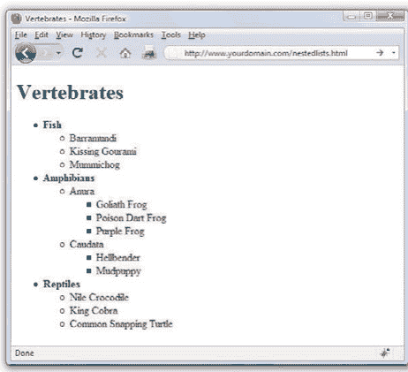

## 在列表内嵌套列表

如图 5.3 所示，网页浏览器通常对第一级项目符号使用实心圆，对第二级使用空心圆，对所有更深级别使用实心正方形。然而，你可以使用`<ul style='list-type:disc'>`、`<ul style='list-type:circle'>`或`<ul style='list-type:square'>`代替`<ul>`来显式选择任何级别的项目符号类型。

你甚至可以通过在`<li>`标签中使用`list-style-type`规则来更改无序列表中任意一点的项目符号。例如，以下代码会在“extra”单词前显示一个空心圆，在“special”单词前显示一个实心正方形：

```html
<ul style='list-type:circle'>
<li>extra</li>
<li>super</li>
<li style='list-type:square'>special</li>
</ul>
```

`list-style-type`规则也适用于有序列表，但你选择不是项目符号类型，而是选择放置在每个项目中的数字或字母类型。列表 5.4 显示了如何在多级列表中使用罗马数字（`list-style-type:upper-roman`）、大写字母（`list-style-type:upper-alpha`）、小写字母（`list-style-type:lower-alpha`）和普通数字。图 5.4 显示了生成的大纲，其格式良好。

虽然列表 5.4 仅对`<ol>`标签使用了`list-style-type`规则，但你也可以将其用于列表中的特定`<li>`标签（尽管很难想象会有你想这样做的情况）。你可以使用`list-style-type:decimal`显式指定普通编号，并使用`list-style-type:lower-roman`创建小写罗马数字。

列表 5.4 在多级列表中使用`style`属性使用`list-style-type`规则

```xml
<?xml version="1.0" encoding="UTF-8"?>
<!DOCTYPE html PUBLIC "-//W3C//DTD HTML 1.1//EN"
"http://www.w3.org/TR/html11/DTD/html11.dtd">

<html xmlns="http://www.w3.org/1999/xhtml" xml-lang="en">
<head>
<title>来自高尔夫大师的建议</title>
</head>

<body>
<h1>如何赢得高尔夫比赛</h1>
```

```html
<ol style="list-style-type:upper-roman">
  <li>训练
  <ol>
    <li>心理准备
    <ol style="list-style-type:upper-alpha">
      <li>虔诚地在电视上看高尔夫</li>
      <li>买那个带有老虎-某某名字的电脑游戏</li>
      <li>租“个人胜利”潜意识录带</li>
    </ol>
    </ol>
    <li>设备
    <ol style="list-style-type:upper-alpha">
      <li>确保你的推杆上有职业球员的签名</li>
      <li>在 cost斯市买一袋划算的高尔夫球和球</li>
    </ol>
  </li>
  <li>饮食
    <ol style="list-style-type:upper-alpha">
      <li>避免垃圾食品
      <ol style="list-style-type:lower-alpha">
        <li>不吃热狗</li>
      </ol>
      </li>
    </ol>
    <li>只喝葡萄酒和混合饮料，不喝啤酒</li>
  </ol>
  <li>赛前
  <ol>
    <li>着装
    <ol style="list-style-type:upper-alpha">
      <li>即使冷得刺骨也要穿短裤</li>
      <li>如果你上次输了，就买顶新帽子</li>
    </ol>
    </li>
    <li>地点和日程
    <ol style="list-style-type:upper-alpha">
      <li>选择一个你的配偶或老板找不到你的球场</li>
      <li>为了节省开支，在你朋友工作的地方打球</li>
    </ol>
    </li>
    <li>对手
    <ol style="list-style-type:upper-alpha">
      <!-- 注意：此处原文似乎不完整，保持结构翻译 -->
    </ol>
    </li>
  </ol>
  </li>
</ol>
```


```html
<html>
  <body>
    <li>课程
      <ol>
        <li>在 `body` 标签中缩进</li>
        <li>使用球来开发空气动力学</li>
        <li>在球接触之前说“球”</li>
        <li>使用 `div` 标记你的球</li>
      </ol>
    </li>
  </ol>
  </body>
</html>
```

图 5.4：生成的大纲，其格式良好。


# 第 5 小时：处理文本块与列表

## 总结

在本节中，你学习了使用属性指定文本对齐方式。你还学习了如何在列表中嵌套列表。`list-style-type` 规则适用于有序列表、无序列表和定义列表。

### 表格 5.1：第 5 小时涵盖的标签和属性

| 标签/属性 | 功能 |
| --- | --- |
| `<div>` | 文本区域 |
| `<dl>` | 定义列表 |
| `<dt>` | 定义项 |
| `<dd>` | 相应的定义 |
| `<ol>` | 有序（编号）列表 |
| `<ul>` | 无序（符号）列表 |
| `<li>` | 列表项目 |

## 问答

- 我看到一些网页使用三维球或其他图形作为项目符号。它们是怎么做的？
- 这超出了本节的范围。你将在第 11 小时学习如何实现。

- 我如何让文本“两端对齐”以使左右边缘都对齐？
- 你可以在样式声明中使用 `text-align:justify`。

## 工作坊

工作坊包含测验问题和活动，帮助你巩固对内容的理解。在查看后面的“答案”部分之前，尝试回答所有问题。

## 测验

- 如何让整个页的内容居中？
- 如何对单个单词进行缩进并在前面加上正方形项目符号？
- 你用什么来创建一个定义列表，显示“glunch”意味着“蔑视、愤怒或不悦”，而“umpy”意味着“忧郁、闷气”？

## 答案

- 如果你考虑在页面顶部的 `<body>` 之后立即放置 `<div style="text-align:center">`，并在页面末尾的 `</body>` 之前放置 `</div>`，你是正确的。然而，`text-align` 样式也直接支持于 `<body>` 标签，这意味着你可以省略 `<div>` 标签，直接将 `style="text-align:center"` 放在 `<body>` 标签中。完成，整个页面都居中了！

- 你将使用：

```html
<ul style="list-style-type:square">
  <li>supercalifragilisticexpealicocious</li>
</ul>
```

（在 `<li>` 标签中使用 `style='list-style-type:square'` 会产生相同的结果，因为此列表中只有一个项目。）

3. 你将使用：

```html
<dl>
  <dt-glunch>
    <dd>表示蔑视、愤怒或不悦的表情</dd>
  <dt-glumpy>
    <dd>阴沉、郁闷或闷气沉沉的</dd>
</dl>
```

## 练习

- 使用对齐样式属性在你的网页中放置文本块。尝试嵌套你的段落和分层（`<p>` 和 `<div>`），以感受样式是如何在内容层级结构中级联（或不级联）的。

- 尝试创建一个有序列表，列出你想放在网页上的信息。这将让你练习格式化 HTML 列表，并让你在思考本书后面几个章节将涵盖的问题时有一个先机。

在上一个节中，你学习了创建文本块并将其转换为列表格式的基础知识。在本节中，你将更仔细地观察文本本身，并学习如何更改字体的视觉显示——例如字体族、字号和粗细。你将学会将粗体、斜体、上标和删除线文本融入你的页面中。你还将学习如何更改字体和字号。

## 本节你将学到：

- 如何使用粗体、斜体和特殊文本进行格式化
- 如何调整字体
- 如何使用特殊字符

## 注意事项

在查看其他设计者的网页内容时，你可能会发现某些标记文本的方法与书中教授的方法有所不同。格式化文本的“旧方法”包括使用 `<b></b>` 标签来指示单词何时应加粗，使用 `<i>` 标签来指示单词何时应用斜体，以及使用 `<font></font>` 标签来指定字体族、字号和其他属性。然而，没有必要学习它们，因为它们正在从 HTML 中被淘汰，而 CSS 要强大得多。

## 亲自试一试 ▼

### 使用示例文本进行更多操作

就像你在上一个节中创建一个用于操作的示例文件一样，请为本节也创建一个，这样你可以跟随操作，并在本节中充分学习如何对贯的文本进行样式设置。

由于本节的信息涉及字体级样式，因此使用什么种类型的文本并不重要。有许多不同的样式可能性可以尝试，以至于它们永远不会出现在同一个网页上（除非你想让访问者抓狂）。利用这个机会感受文本层级变化如何影响你内容的显示。

# 第 6 节：字体字体工作

## 粗体、斜体和特殊文本格式化

### 注意事项

在涉及粗体和斜体时，样式规则的替代方案是 `<strong></strong>` 和 `<em></em>` 标签对。在浏览器中，`<strong>` 标签的作用与 `<em>` 标签相同，而 `<em>` 标签的作用就像用于斜体的 `<i>` 标签。

在很久以前的字机时代，我们满足于纯文本和偶尔为了强调而改变。今天，粗体和斜体文本已成为所有纸质通信的规范。你也可以在网页内容中添加粗体和斜体文本。有几个标签和样式规则使得文本格式化成为可能。

添加粗体斜体格式的“老派”方法涉及 `<b>` 和 `<i>` 标签对。对于粗体，使用了文本开头的 `<p>` 标签和 `<p>`。同样，任何斜体文本通过包裹在 `<i>` 和 `</i>` 之间来实现。虽然这种方法在浏览器中仍然有效并被 XHTML 支持，但它不如用于文本格式化的 CSS 规则灵活或强大。

`<strong>` 和 `<em>` 标签被认为是对 `<b>` 和 `<i>` 的某些改进，因为它们只意味着文本应该接受特殊的强调，而不是精确说明应该如何实现该效果。换句话说，浏览器不需要将 `<strong>` 解释为粗体或将 `<em>` 解释为斜体，因为它们为文本添加了意义，而不影响文本的显示方式。所有四个标签仍然是 HTML 5 的一部分，尽管其他标签似乎有细微差别。

尽管你将在第三部分学习更多 CSS 样式规则，但你将对文本格式化选项有一定的预见性理解。`font-weight` 样式允许你使用样式设置字体的粗细或粗体。`font-weight` 的标准包括 `normal`、`bold` 和 `lighter`（以 `normal` 为默认）。文本通过 `font-style` 规则控制，该规则可以设置为 `normal`、`italic` 或 `oblique`（倾斜）。如果你想应用多个样式，可以指定样式规则，如下例所示：

```html
<p style="font-weight:bold; font-style:italic">这段落是粗体且斜体的</p>
```

在此示例中，两个样式规则都指定在 `<p>` 标签的样式属性中。使用多个样式规则的关键是它们必须用分号（`;`）隔开。

尽管你被限制在段落中使用字体样式，但下面的代码说明了如何在项目列表中将文本设为斜体：

```html
<li style="font-style:italic">重要事项</li>
<li style="font-style:italic">关键信息</li>
<li style="font-style:italic">高度敏感材料</li>
<li style="font-style:italic">没那么好用</li>
```

你也可以在标题中使用 `font-weight` 样式规则，但标题通常不需要。

## 粗体、斜体和特殊文本格式化

### 注意事项

- `<small>` 小号字体
- `<big>` 大号字体（在 HTML 5 中已淘汰）
- `<sup>` 上标
- `<sub>` 下标
- `<em>` 强调
- `<strong>` 粗体
- `<tt>` 等宽字体
- `<pre>` 保留

### 6.1 特殊标签

| 标签 | 结果 | 说明 |
| :--- | :--- | :--- |
| `<small>` | 小号字体 | 更小的字号 |
| `<big>` | 大号字体 | 更大的字号（HTML 5 中已淘汰） |
| `<sup>` | 上标 | 行上方的文本 |
| `<sub>` | 下标 | 行下方的文本 |
| `<em>` | 斜体 | 强调 |
| `<strong>` | 粗体 | 强强调 |
| `<tt>` | `等宽` | 固定宽度字体 |
| `<pre>` | 保留 | 保留精确的间距和换行 |
| `<u>` | 下划线 | 下划线文本（已淘汰） |

图 6.1：这是列表 6.1 中字符格式化的样式。


`<pre>` 标签导致文本以等宽字体显示，但它还有一些独特实用的功能。正如你在第 3 节中学习的那样，HTML 文件中的多个空格和换行通常会被忽略，但 `<pre>` 会导致精确间距和换行被保留。例如，如果没有 `<pre>`，图 6.1 末尾的文本将看起来像这样：

```text
卡路里 克 水分 /每份脂肪
------|---
常规 3 4 100%
未加载 3 2 100%
有机 2 3 99%
无糖 0 1 110%
```

即使你在每行末尾添加了 `<br />` 标签，列也无法正确对齐。然而，当你在开头放置 `<pre>` 并在结尾放置 `</pre>` 时，列就能正确对齐，因为保留了精确的空格。

## 调整字体

内容会被保留——不需要 `/>` 标签。`<pre>` 标签为你提供了一种快速简单的方法，以最小的精力保留你可能想要传输到网页的等宽文本文件的对齐方式。

CSS 提供了更健壮的方法来排列文本（实际上也可以对文本进行任何操作），你将在第三部分学习更多关于它的知识。

## 调整字体

`<big>`、`<small>` 和 `<tt>` 标签让你对页面上文本的大小和外观有一些初步的控制。然而，有时你可能希望对文本的大小和外观有更多控制。在我介绍在 XHTML 代码中调整字体的合适方法之前，让我们先看看在 CSS 出现之前是如何操作的，因为当你查看其他网站的源代码时，可能仍然发现这种方法的示例。记住，仅仅因为这些旧方法仍在使用，并不意味着你也应该效仿。

在样式表出现之后，已经过时的 `<font>` 标签被用于控制网页中的字体。例如，以下 HTML 将更改页面上某些文本的大小和颜色：

```html
<font size="5" color="purple">这段文字将是巨大且紫色的。</font>
```

正如你看到的，`<font>` 标签的 `size` 和 `color` 属性使得无需费力更改文本字体。尽管这种方法有效，但它被更优的字体格式方法所取代，即 CSS 样式规则。以下是用于控制字体的几个主要样式规则：

- `font-family`——设置字体族。
- `font-size`——设置字体大小。
- `color`——设置字体颜色。

`font-family` 样式允许你设置显示文本的字体类型。你可以为此样式指定多个值（用逗号分隔），这样如果用户系统中没有第一个字体，浏览器可以尝试备用字体。你已经在之前的课程中见过这个了。提供备用字体是重要的，因为每个用户可能安装了不同的字体集，至少在核心之外。

> **注意**
>
> 你将在第 9 小时“使用颜色”中学习更多关于控制页面文本颜色的知识。它将向你展示如何创建自定义颜色以及如何控制链接的颜色。

# 第 6 小时：使用字体

常用基础字体（Arial、Times New Roman 等）。通过提供备用字体列表，当你的理想字体未找到时，你的页面有更大机会优雅地回退到已知的字体上。以下是使用 `font-family` 样式为段落文本设置字体类型的示例：

```html
<p style="font-family:arial, sans-serif, 'times roman'">
```

这个示例有几个有趣的地方。首先，`arial` 是主字体。大小写不影响字体族。`arial` 与 `roman` 或 `Arial` 不同。这段代码的另一个有趣点是，`times roman` 名称周围使用了单引号，因为它包含空格。然而，由于 `'times roman'` 出现在通用规范 `sans-serif` 之后，可能会使用 `'times roman'`。`sans-serif` 位于第二个位置，它告诉浏览器：“如果网中没有 `Arial`，则使用默认的 `sans-serif`。”

你将在第 9 小时学习十六进制颜色。现在，请理解 `color` 规则允许你指定绿色、橙色等以外的颜色。

`font-size` 和 `color` 规则也用于控制字体的大小和颜色。`font-size` 可以设置为预定义的大小（如 `small`、`medium` 或 `large`），或者你可以将其设置为特定的点数（如 `2pt` 或 `4pt`）。`color` 可以设置为预定义的颜色（如白、黑、蓝、红或绿），或者你可以将其设置为十六进制颜色（如 `#FFB499`）。以下是指定了字体大小和颜色的之前的示例：`sans-serif, 'times roman';`

```html
<p style="font-family:arial, sans-serif, 'times roman'; font-size:14pt; color:green">
```

列表 6.2 和图 6.2 中的示例网页内容使用了一些字体样式来创建一个基础简历的开头。

### 列表 6.2：使用字体样式创建基础简历

```xml
<?xml version="1.0" encoding="UTF-8"?>

<!DOCTYPE html PUBLIC "//W3C//DTD XHTML 1.1//EN"
"http://www.w3.org/TR/xhtml11/DTD/xhtml11.dtd">

<html xmlns="http://www.w3.org/1999/xhtml" xml:lang="en">

<head>
  <title>R&amp;eacute for Jane Doe</title>

  <style type="text/css">
    body {
      font-family: Verdana, sans-serif;
      font-size: 12px;
    }
```

## 调整字体

列表 6.2 使用字体样式规则创建基础简历：

```css
h1 {
  font-family:Georgia, serif;
  font-size:28px;
  text-align:center;
}

p.contactinfo {
  font-size:14px;
  text-align:center;
}

p.categorylabel {
  font-size:12px;
  font-weight:bold;
  text-transform:uppercase;
}

div.indented {
  margin-left: 25px;
}

</style>

<body>

<h1>Jane Doe</h1>

<p class="contactinfo">123 Main Street, Sometown, CA 9382<br>
tel: 555-0122, e-mail: jane@doe.com</p>

<p class="categorylabel">Summary</p>

<ul>
  <li>精通多种语言。</li>
  <li>熟练使用各种工具。</li>
</ul>

<p class="categorylabel">Experience</p>

<div class="indented">
  <ul>
    <li>Tech Corp. 的项目经理。</li>
    <li>Web Inc. 的软件开发人员。</li>
  </ul>
</div>

<p class="categorylabel">Education</p>

<ul>
  <li>州立大学的 MBA。</li>
  <li>城市学院的学士。</li>
</ul>
```

# 第 6 小时：字体操作

### 表 6.1：常用英语特殊字符

| 字符 | 数字代码 | 名称 | 描述 |
| --- | --- | --- | --- |
| æ | `&#230;` | `&aelig;` | 小 ae 连字 |
| É | `&#201;` | `&acute;` | 重音大写 E |
| é | `&#233;` | `&acute;` | 重音小写 e |
| × | `&#215;` | `&times;` | 乘号 |
| ÷ | `&#247;` | `&divide;` | 除号 |

### 提示

正在寻找版权 © 和注册商标 ® 符号吗？这些代码分别是 `&copy;` 和 `&reg;`。

要创建未注册商标-™ 符号，请使用 `&trade;`。

HTML/XHTML 使用一种称为字符实体（character entity）的特殊代码来表示如 `&amp;` 和 `&` 这样的特殊字符。字符实体始终以 `&` 开头并以 `;` 结尾。表 6.1 列出了最常用的字符实体，尽管 HTML 还支持更多实体。

第 6.1 节包含了角括号、引号和安培符的代码。如果你想让它们出现在页面上，必须使用这些代码；否则，网络浏览器会将它们解释为 HTML 命令。

在列表 6.3 和图 6.3 中，展示了表 6.1 中几个符号的使用。

# 列表 6.3：特殊字符代码

```xml
<xml version="1.0" encoding="UTF-8"?>

<!DOCTYPE html PUBLIC "//W3C//DTD HTML 1.1//EN"
"http://www.w3.org/TR/html11/DTD/xhtml11.dtd">

<html xmlns="http://www.w3.org/1999/xhtml" xml-lang="en">

<head>
  <title>Punctuation Lines</title>
</head>

<body>

  <p>
```


Q：当一个英国面包师找你吵架时，你该怎么办？

A：给他足够的 `pound &amp;&cent;` content。

---

Q：法官拿走书的一部分称为什么？

A：`&sect;` violence。

---

Q：足球教练在比赛中从休息室自动售卖机得到了什么？

A：`&frac14;` back at `&frac12;` time。

```html
<hr />

Q: 当警察侦探审问数学家时，房间里有多热？<br />

A: x&sup3;&deg;

<hr />

Q: 一个严守标点符号抄袭者会做什么？<br />

A: &copy;

<br />

</p>

</body>

</html>
```

### 使用特殊字符

表 6.3 特殊字符代码。

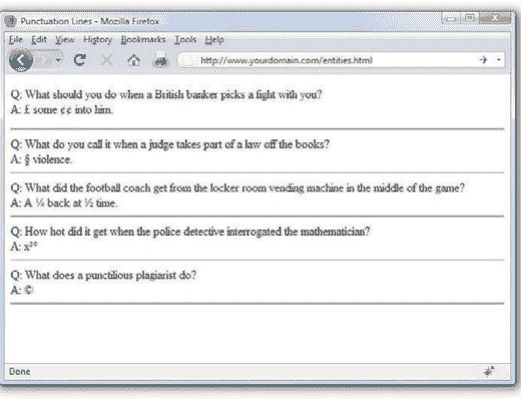

图 6.3：这是列表 6.3 中的 HTML 页面在大多数网络浏览器中的外观。

## 总结

在这一小时中，你学习了如何让文本显示为粗体或斜体，以及如何对上标、下标、特殊符号和带重音的字母进行编码。你了解了如何让等宽文本的预格式化段落正确对齐，以及如何控制网页上文本区域的大小、颜色和字体。

表 6.2 总结了本小时讨论的标签和属性。记住，所有的 HTML 标签都列在附录 B“XHTML 1.1 和 CSS 2 快速参考”中。

### 表 6.2 第 6 小时涵盖的 HTML 标签和属性

| 标签/属性 | 功能 |
| --- | --- |
| `<em>...</em>` | 强调（通常为斜体）。 |
| `<strong>...</strong>` | 强调（通常为粗体）。 |
| `<b>...</b>` | 粗体文本。 |
| `<i>...</i>` | 斜体文本。 |
| `<tt>...</tt>` | 打字机（等宽）字体。 |
| `<pre>...</pre>` | 预格式文本（精确行和间距）将被保留，通常以等宽字体渲染。 |
| `<big>...</big>` | 文本比正常略大。 |
| `<small>...</small>` | 文本比正常略小。 |
| `<sub>...</sub>` | 下标。 |
| `<sup>...</sup>` | 上标。 |

## 属性

| 属性 | 功能 |
| --- | --- |
| `style="font-family:typeface"` | 字体的类型（族），即字体的名称，例如 Arial。（也可以用于 `<p>`、`<h1>`、`<h2>`、`<h3>` 等。） |
| `style="font-size:size"` | 字体的大小，可以设置为小（small）、中（medium）、大（large），以及 x-small、x-large 等，也可以设置为特定的磅值大小（如 12pt）。 |
| `style="color:color"` | 更改文本颜色。 |

## 问答

### 我如何找到我电脑上某个字体的确切名称？

在 Windows 或 Macintosh 计算机上，打开控制面板并点击“字体”文件夹——系统中的字体会列在其中（Vista 用户可能必须在控制面板中切换到“经典视图”）。在 `font-family` 样式规则中指定字体时，使用字体名称的准确拼写。不过，字体名称不区分大小写。

### 如何在我的页面上放置汉字、阿拉伯语、中文和其他非欧洲字符？

首先，需要在你的页面上阅读这些字符的用户必须安装相应的语言字体。他们还必须为他们的网络浏览器选择语言字符集及其关联字体。你可以使用 Windows 中的“字符映射”程序（或其他操作系统中的类似程序）来获取任何语言字体中每个字符的数字代码。

要找到字符映射，请点击“开始”“所有程序”“附件”，然后是“系统工具”。如果你需要的字符代码为 214，请使用 `&#214;` 将其放置在网页上。如果你找不到字符映射程序，请使用操作系统的内置“帮助”功能来查找特定位置。

在亚洲语言中包含短消息（例如“我们说泰米尔语——致电我们！”）的最佳方法是将其作为图像包含。这样每个用户都能看到它，即使他们使用英语作为主要语言。

## 工作坊

工作坊包含问题和活动，有助于巩固材料内容。

## 测试

- 你如何创建一个表格？
- 你如何显示一个段落？
- 你如何使用标签？

## 答案

1. 你会使用 `<p>`。
2. 你会使用 `<strong>`。
3. 你会使用 `<table>`。

## 练习

- 你如何创建一个表格？
- 你如何显示一个段落？
- 你如何使用标签？

## 尝试一下

在表格中放入内容。

## 创建简单表格

列表 7.1 使用 `<table>`、`<tr>`、`<td>` 和 `<th>` 创建表格。

> **提示**
>
> HTML 会忽略单词和标签之间的额外空格。如果你像列表 7.1 那样使用空格来缩进 `<tr>` 和 `<td>` 标签，你可能会发现你的 HTML 表格更易读（并且更不容易产生浪费时间的错误）。

```html
<table>
  <th></th>
  <td>G8</td>
  </tr>
  <tr>
    <td>Los Angeles Dodgers</td>
    <td>62</td>
    <td>38</td>
    <td>--</td>
  </tr>
  <tr>
    <td>San Francisco Giants</td>
    <td>54</td>
    <td>46</td>
    <td>8.0</td>
  </tr>
  <tr>
    <td>Colorado Rockies</td>
    <td>54</td>
    <td>46</td>
    <td>8.0</td>
  </tr>
  <tr>
    <td>Arizona Diamondbacks</td>
    <td>43</td>
    <td>58</td>
    <td>19.5</td>
  </tr>
  <tr>
    <td>San Diego Padres</td>
    <td>39</td>
    <td>62</td>
    <td>23.5</td>
  </tr>
</table>

</body>

</html>
```

## 第 7 小时：使用表格显示信息

图 7.1

列表 7.1 中的 HTML 代码创建了一个具有六行四列的表格。

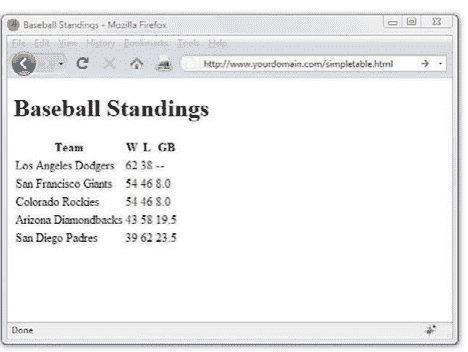

该示例包含了棒球排名，这非常适合排列行和列——尽管看起来可能有点单调。在这一小时内，你将学习如何稍微美化一下。表格中的表头显示了排名中的球队（Team）、胜场（W）、负场（L）和落后比赛（GB）。

虽然我们没有对列表 7.1 中的 HTML 应用任何样式，但你可以在表格单元格中使用任何文本。然而，在一个单元格中使用的样式或 HTML 标签不会传递到其他单元格，而表格外部的标签也不会应用于表格内部。例如，考虑以下内容：

```html
<p style="font-weight:bold">
  <table>
    <tr>
      <td style="font-style:italic">hello</td>
      <td>there</td>
    </tr>
  </table>
</p>
```

（此处翻译原文）

在示例中，`<p>` 标签被包裹在表格外部，用以说明表格不受外部标签的影响。*there* 单词既不会加粗也不会变成斜体，因为在表格外部的 `font-weight:bold` 样式或上一个单元格的 `font-style:italic` 样式都不会影响它。然而，在这个示例中，单词 *hello* 是斜体。

要将单词 *hello* 和 *there* 加粗，请将表格代码更改为如下形式：

```html
<table style="font-weight:bold">
  <tr>
    <td style="font-style:italic">hello</td>
    <td>there</td>
  </tr>
</table>
```

## 控制表格大小

在这个示例中，两个单词都是加粗的，且单词 *hello* 也是斜体。当然，你不必非在表格级别应用样式。`font-weight:bold` 样式也可以同样地单独应用到每个单元格——你可以在每个单元格中重复 `style="font-weight:bold"`，或者在你的样式表中创建一个类并在每个单元格中使用 `class="classname"`——这取决于你的选择。

当未指定表格大小时，表格及其各个单元格的大小会自动扩展以适应你放入其中的数据。然而，你可以选择通过在 `<table>` 标签中使用 `width` 和/或 `height` 来控制整个表格的精确大小。你也可以通过在单独的 `<td>` 标签中放置 `width` 和 `height` 样式来控制每个单元格的大小。

宽度和高度样式可以指定为像素或百分比。例如，以下代码创建了一个宽 500 像素、高 400 像素的表格：

```html
<table style="width:500px; height:400px">
```

要让第一个单元格占据表格总宽度的 20%，第二个单元格占据 80%，请输入以下内容：

```html
<table style="width:100%">
  <tr>
    <td style="width:20%">skinny cell</td>
    <td style="width:80%">fat cell</td>
  </tr>
</table>
```

注意表格的大小被设置为 100%，这确保了表格填充整个浏览器的宽度。当你使用百分比而不是固定大小时，表格将自动调整大小以适应任何窗口，同时保持你追求的审美平衡。在这种情况下，表格内的两个单元格会自动调整大小为表格总宽度的 20% 和 80%。

> **注意**
>
> `width` 和 `height` 属性在 XHTML 中已被废弃，但当你查看其他设计师的代码时可能仍然看到它们。这些属性在网络浏览器中仍然有效，但你应该使用 `width` 和 `height` 属性。

### 列表 7.2 指定单元格宽度

```html
<?xml version="1.0" encoding="UTF-8"?>

<!DOCTYPE html PUBLIC "-//W3C//DTD HTML 1.1//EN" "http://www.w3.org/TR/xhtml11/DTD/xhtml11.dtd">

<html xmlns="http://www.w3.org/1999/xhtml" lang="en">

<head>
  <title>Standings</title>
</head>

<body>
  <h1>Standings</h1>

  <table>
    <tr>
      <th style="width:35px">Team</th>
      <th style="width:175px">W</th>
      <th style="width:25px">L</th>
      <th style="width:25px">T</th>
      <th style="width:25px">GB</th>
    </tr>

    <tr>
      <td></td>
      <td>Los Angeles Dodgers</td>
      <td>62</td>
      <td>38</td>
      <td>--</td>
    </tr>

    <tr>
      <td></td>
      <td>San Francisco Giants</td>
      <td>54</td>
      <td>46</td>
      <td>8.0</td>
    </tr>

    <tr>
      <td></td>
      <td>Colorado Rockies</td>
      <td>54</td>
      <td>46</td>
      <td>8.0</td>
    </tr>

    <tr>
      <td></td>
      <td>Arizona Diamondbacks</td>
      <td>43</td>
      <td>58</td>
      <td>19.5</td>
    </tr>

    <tr>
      <td></td>
      <td>San Diego Padres</td>
      <td>39</td>
      <td>62</td>
      <td>23.5</td>
    </tr>
  </table>
</body>

</html>
```

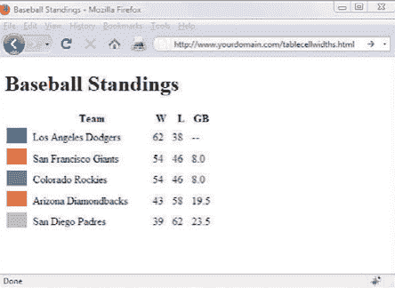

列表 7.1 的代码与列表 7.2 使用的代码之间有两个差异。第一列没有表头，但第一行中仍然存在 `<th>` 标签。从第二行到第六行，该额外列包含一张图片（`` 标签）。列表 7.2 的第二个差异是第一行的每个 `<th>` 元素增加了特定的宽度。第一列定义为 35px，第二列为 175px，第三、第四和第五列为 25px。

同样注意这些宽度没有在后续行的 `<td>` 元素中重复。技术上讲，你只需要在第一行定义宽度；其余行将遵循，因为它们都是同一个表格的一部分。然而，如果你使用了另一种格式样式（例如更改大小或颜色的样式），则该样式必须适用于每个具有属性的元素。

图 7.2：列表 7.2 中的 HTML 代码创建一个六行五列的表格，并为每列使用了特定的宽度。

## 表格内的对齐和跨度

默认情况下，放在表格单元格中的任何内容都左对齐并垂直居中。图 7.1 和图 7.2 显示了这种默认对齐。然而，你可以使用 `text-align` 和 `vertical-align` 样式属性对表格单元格的内容进行水平和垂直对齐。

你可以将这些对齐属性应用于任何 `<tr>`、`<td>` 或 `<th>` 标签。分配给 `<tr>` 的对齐属性适用于该行的所有单元格。根据表格的大小，通过在 `<tr>` 级别应用这些属性而不是每个 `<td>` 或 `<th>` 标签，你可以节省大量的时间和精力。

列表 7.3 中的 HTML 代码结合了文本对齐样式，对行应用默认对齐，并在少数单独单元格中进行覆盖。图 7.3 显示了列表 7.3 代码的结果。

以下是一些较常用的 `vertical-align` 属性值：`top`、`middle`、`bottom`、`text-top` 和 `baseline`（用于文本）。这些属性值在垂直对齐表格数据方面提供了足够的灵活性。

### 列表 7.3 表格中的对齐、单元格间距、边框和背景颜色

```html
<?xml version="1.0" encoding="UTF-8"?>
<!DOCTYPE html PUBLIC "-//W3C//DTD XHTML 1.1//EN" "http://www.w3.org/TR/xhtml11/DTD/xhtml11.dtd">
<html xmlns="http://www.w3.org/1999/xhtml" xml-lang="en">
<head>
  <title>Things to Fear</title>
</head>
<body>
  <h1>Things to Fear</h1>

  <table border="2" cellpadding="4" cellspacing="2" width="100%">
    <tr style="background-color:red;color:white">
      <th colspan="2">Description</th>
    </tr>

    <tr>
      <th>Size</th>
      <th>Speed</th>
    </tr>

    <tr style="vertical-align:top">
      <td></td>
    </tr>
  </table>
</body>
</html>
```

## 表格内的对齐与跨度

列表 7.3 表格中的单元格间距、边框和背景颜色。

| | 描述 | 重量/尺寸 | 速度/性能 |
| :--- | :--- | :--- | :--- |
| .38 特种 | 五英寸枪管。 | 二十盎司。 | 四秒内六行。 |
| 犀牛 | 从角到尾长十二英尺。 | 高达两吨。 | 爆发速度为每小时三十五英里。 |
| 大斧 | 十二磅。 |  | 冲击速度每小时六十英里。 |

图 7.3

列表 7.3 中的代码展示了 `colspan` 属性和对齐样式的用法。

# 第 7 小节：使用表格显示信息

在图 7.3 的顶部，单个单元格（Description）跨越了两列。这是通过在该单元格的 `<th>` 标签中使用 `colspan` 属性实现的。如果需要，你还可以使用 `rowspan` 属性创建一个跨越多行的单元格。

跨度是指强制单元格跨越表格的某一行或一列的过程。`colspan` 导致单元格跨越多列；`rowspan` 具有相同的效果。


此外，`Description` 列中第二个单元格内的文本是居中的，使文本在单元格内垂直方向居中对齐，水平方向居中对齐。

列表 7.3 中几乎没有我没有解释过的技巧。你可以通过使用网页上的属性为整个表格（以及表格中的每个单独行或单元格）设置自己的背景。你可以按需使用 `<table>`、`<tr>`、`<td>` 和 `<th>` 标签来设置你想要的黄色背景色，例如，你可以使用 `<table style="background-color:yellow;">` 或 `<table style="background-color:#FFFF00;">`。在列表 7.3 中，只有你定义的那行有背景色；它使用 `<tr style="background-color:red;color:white;">` 为该行中的单元格应用红色背景色。此外，颜色样式确保了该行的文本为白色。

与 `background-color` 样式类似，`background-image` 属性（在本示例中未显示）也用于为表格设置背景。如果你想将 `leaves.gif` 设置为表格的背景，可以使用 `<table style="background-image:url(leaves.gif)">`。注意图像被放在括号和 `url` 之中，这你你描述图像文件所在的位置。

仅通过使用 `style` 属性就可以微调外观。在列表 7.3 中，你可以通过 `padding` 和 `cellspacing` 属性控制表格边框周围的空间。`padding` 属性设置表格边框与表格单元格本身之间的空间（单位为像素）。`cellspacing` 属性设置信息边缘周围的空间，同样单位为像素。`padding` 值为 0 会导致表格中的所有信息尽可能紧贴边框对齐，甚至接触边框。`cellpadding` 和 `cellspacing` 属性可以让你对表格的外观进行良好的整体控制。

## 提示

在脑海中保持行和列结构的条理，可能是创建跨越多列或行的表格最困难的部分。最微小的错误也可能导致整个工作偏离轨道。在开始编写 HTML 实现它们之前，先在纸上勾画你的表格，可以节省时间并避免沮败感。

## 注意

你会在表格中看到交替的行颜色。例如，一行可能是灰色背景，下一行可能是白色背景。交替颜色有助于更清晰地阅读表格内容，特别是当表格很大时。

## 注意

虽然 `padding` 和 `cellspacing` 属性在 XHTML 中仍在使用，但使用的是 CSS 等效属性代替 `border-style` 属性。请复阅附录 B，“XHTML 1.1 和 CSS 快速参考”。

# 使用表格进行布局

在书开头，我提到设计师使用表格进行页面布局以及用于显示表格化信息。如果你窥一眼其他设计师的源代码，仍然会发现许多基于表格的布局示例。这种设计方法源于旧的（20世纪90年代中期到2000年代初）浏览器对 CSS 支持的不一致。所有浏览器都以大致相同的方式支持表格，以便在浏览器之间实现相同的视觉显示。然而，现在所有主要浏览器对 CSS 的支持相对相似，负责未来的万维网联盟（W3C）推广样式表作为布局页面的正确方式（而不是使用表格）。样式表最终要强大得多，这就是为什么本书的大部分内容教你如何使用样式进行页面布局。

使用表格进行布局的主要原因包括：

- 内容与呈现分离——CSS 和遵循标准的 Web 设计目标之一是将呈现与内容分离。
- 创建刚性布局——为了更改你网站每个页面的基于表格的布局（除非它是复杂的动态网站的一部分）。
- 可访问性问题——屏幕阅读软件会查找表格并尝试将你的布局读取为内容。
- 在移动设备上的渲染——表格布局不够灵活，无法缩放到小屏幕上（参见第 9 小节，“创建固定或流式布局”）。这些仅仅是基于表格的 Web 设计中的几个问题。

## 总结

在本小节中，你学习了将文本和图像排列成有组织的行和列，称为表格。你学习了创建表格的三个基本任务，以及控制对齐、间距和外观的可选属性和样式。你还学习了表格可以相互使用并嵌套，以获得更丰富的布局选项。

表格 7.1 总结了本小节涵盖的标签和属性。

| 表格 7.1 第 7 小节涵盖的 HTML 标签和属性 | 标签/属性 |
| :--- | :--- |
| `<table>` | 创建一个包含任意数量行的表格。 |
| `border` | 指明宽度（像素）。 |
| `<tr>` | 定义一个包含一个或多个单元格的行。 |
| `<td>` | 定义表格数据单元格。 |
| `<th>` | 定义表格表头单元格（接受与 `<td>` 相同的属性和样式）。 |
| `text-align` | 此行内内容的水平对齐。可能值为 `left`、`right` 和 `center`。 |
| `vertical-align` | 此行内内容的垂直对齐。常用值包括 `top`、`middle` 和 `bottom`。 |
| `background-color` | 单元格的背景色。 |
| `background-image:url(image)` | 在单元格内显示的背景图像。 |
| `height` | 此单元行的高度，可以是像素值或表格高度的百分比。 |
| `padding` | 表格边框与单元格本身之间的空间。 |
| `cellspacing` | 表格边缘周围的空间。 |

3. 继续你在问题 1 和问题 2 中建立的表格，你将如何让左上角的单元变为绿色、右上角的单元变为红色、左下角的单元变为黄色以及右下角的单元变为蓝色？

## 回答

1. 使用以下 HTML：

```html
<table border="1">
<tr>
  <td>左上角...</td>
  <td>右上角...</td>
</tr>
<tr>
  <td>左下角...</td>
  <td>右下角...</td>
</tr>
</table>
```

2. 在 `<table>` 标签中添加 `cellspacing="30"`。

3. 在左上角的 `<td>` 标签中添加 `style="background-color:green"`，在右上角的 `<td>` 标签中添加 `style="background-color:red"`，在左下角的 `<td>` 标签中添加 `style="background-color:yellow"`，在右下角的 `<td>` 标签中添加 `style="background-color:blue"`。

## 练习

- 你是否有访问者可能感兴趣的列表或表格信息的页面？使用表格来展示某些信息。确保每列都有自己的标题（或其图标）。尝试你在开头已经学过的各种对齐和间距类型。

- 你经常会在表格中看到交替的行颜色，其中一行为灰色背景，下一行为白色背景。在表格行中交替颜色的目的是为了在充满数据的表格能够更快地识别出单行。创建一个具有交替行颜色和文本颜色的表格（如有必要）。虽然关于颜色的课程在第 9 小时，但你已经有足够的信息来开始尝试这个过程了。

## 使用外部和内部链接

到目前为止，你学习了如何使用 HTML 标签来创建一些基础网页。然而，此时这些内容片段都是孤立的岛屿，与任何其他内容都没有连接（尽管在第 1 小时确实在示例中偷偷了几页面）。要将你的工作变成“真正的”网页内容，你需要将其连接到 Web 的其他部分——至少连接到你个人或公司网站内的其他页面。

本小时将向你展示如何创建指向文档内内容的超链接，以及如何链接到外部文档。此外，你将学习如何对超链接进行样式设置，以便按照所需的颜色和装饰显示——而不一定是默认的蓝色下划线显示。

## 本小时你将学到：

- 如何使用锚点链接
- 如何在你网站的页面之间链接
- 如何链接到外部内容
- 如何链接到电子邮件地址
- 如何在链接中使用窗口目标设置
- 如何用 CSS 为链接设置样式

## 使用网络地址

为个人网站存储网页内容最简单的方法是将所有文件都放在同一个文件夹中。当文件像这样存储在一起时，你只需在标签的 `href` 属性中提供文件名即可链接到它们。

属性是与标签关联的额外信息，提供了关于该标签的更多详细信息。例如，`<a>` 的 `href` 属性标识了你正在链接的页面地址。

一旦你有超过几个文件，或者一旦你想对网站内的内容开始建立组织结构，你就应该将文件放入目录（或“文件夹”），其名称应反映其中包含的内容。例如，你所有的图片都可以放在“images”目录中，公司信息可以放在“about”目录中，依此类推。

## 注意

在我们开始之前，你可能需要复习一下在服务器上放置文件的基础以及如何在一组目录内管理文件的知识。这些信息对于在网页内容中创建链接非常重要。请参考第 2 小时，特别是标题为“理解在 Web 服务器上放置文件的位置”。

## 第 8 小时：使用外部和内部链接

无论你如何在自己的网络服务器上组织文档，你都可以相对地址，它只包含从一个页面找到另一个所需的信息：

相对地址描述从一个网页到另一个网页的路径，而不是完整的（绝对）互联网地址。

如果你记得第 2 小时的内容，服务器的文档根是被指定为网页内容的顶层目录。在网络地址中，文档根由正斜杠（`/`）表示。所有后续的目录级都由相同的正斜杠分隔：`/directory/subdirectory/subdirectory/`

## 警告

HTML 中的正斜杠 `/` 始终用于分隔目录。不要使用反斜杠（通常用于 Windows）来分隔你的目录。记住，Web 中的一切都是向前移动的，所以请使用正斜杠。

假设你正在文档根目录下创建一个名为 `zoo.html` 的命名页面，并想将其链接到子目录中名为 `african.html` 和 `asian.html` 的页面。链接看起来如下：

```html
<a href="elephants/african.html">Learn about African elephants.</a>
<a href="elephants/asian.html">Learn about Asian elephants.</a>
```

这些特定地址实际上是相对根的，因为它们是缺少整个域名的地址，但它们特地是相对于正斜杠指定的文档根的。

使用相对地址，你可以跳过初始的正斜杠。这种类型的地址允许链接相对于它们所在的任何目录变为相对——它可能是文档根，也可能是距离文档根一个或多个层级的目录：

```html
<a href="elephants/african.html">Learn about African elephants.</a>
<a href="elephants/asian.html">Learn about Asian elephants.</a>
```

你的位于子目录的 `african.html` 和 `asian.html` 文档可以通过以下方式链接回 `zoo.html` 页面：

```html
<a href="http://www.yourdomain.com/elephants/african.html">Learn about African elephants.</a>
<a href="/zoo.html">Return to the zoo.</a>
<a href="../zoo.html">Return to the zoo.</a>
```

第一个链接是绝对链接。使用绝对链接时，疑问不知道链接应该去哪里，因为它提供了完整的 URL。

第二个链接是相对根链接。使用相对根链接时，它是相对于域，不需要包含协议类型（例如 `http://`）和域名（例如 `www.yourdomain.com`）。

第三个链接是相对链接。它是相对于目录。

在第三行中，双点（`..`）是一个特殊命令，表示父文件夹。也就是说每当你看到双点时，只需“向上一个级别的”目录结构。

如果你在整个页面中一直使用相对地址，你就可以在移动页面时不更改链接。第 23 章，“组织和管理网站”（Organizing and Managing a Site）提供了关于组织和链接的更详细的建议。

## 尝试一下

希望到这里你已经通过课程创建了两个或几个页面。按照以下步骤添加更多页面并进行链接：

1. 使用“首页”页面作为主入口和中心枢纽，你的所有页面都连接到这里。如果你为你自己或业务创建了一个页面，请将该页面作为你的首页。你还喜欢为你的目的创建一个新页面。

2. 在首页上，列出你已经创建的其他 HTML 文件的链接（或很快要创建的 HTML 文件的占位符）。确保每个链接中的文件名精确拼写（包括任何大小写）都是正确的。

3. 在首页之外的每个页面上，在底部（或顶部）包含一个指向首页的链接。这使得在你的网站中导航变得简单快捷。

4. 你可能还想包含指向相关或有趣的网站的链接列表，可以在你的首页上，也可以在单独的页面上。人们经常会在自己的首页上列出朋友个人页面的列表。然而，企业应该小心不要引导客户快速进入其他网站——无法保证他们会在链接到你自己的页面时使用相对地址，而在链接到其他网站时使用绝对地址。

## 第 8 小节：使用外部和内部链接

## 使用锚点在页面内链接

`<a>` 标签——负责网页上超链接的标签——其名称源于“anchor”（锚点）一词，意味着链接作为页面上某处的标记。在本书之前展示的示例中，你已经学习了如何使用 `<a>` 标签链接到其他地方，但这仅是它用处的一半。让我们开始学习链接到同一页面内内容的锚点链接。

## 使用锚点识别页面中的位置

`<a>` 标签可以用于将页面上的某一点标记为锚点，允许你创建一个指向该精确位置的链接。列表 8.1（将在本月稍晚些时候展示）演示了一个指向页面内锚点的链接。为了看到是如何制作此类链接的，让我们先看一眼列表中的第一个 `<a>` 标签：

```html
<a id="top"></a>
```

`<a>` 标签通常使用 `href` 属性来指定超链接的目标。`href` 是你点击的地方，而 `id` 是你点击后去去的地方。在这个示例中，`<a>` 标签指定了一个目标，但并没有创建实际的链接。`<a>` 标签为标签出现页面上的特定点定命名。必须包含 `<a>` 标签，并为 `id` 属性分配一个唯一的名称，但 `<a>` 和 `</a>` 之间不需要文本。

## 链接到锚点位置

列表 8.1 显示了一个在单个页面各处放置了各种锚点的站点。查看列表 8.1 中的最后一个 `<a>` 标签以查看示例：`<a href="#top">返回索引。</a>`

`#` 符号意味着该词指的是当前文档内的一个命名的锚点，而不是单独的页面。当用户点击“返回索引”时，网页浏览器将显示从 `<a id="top">` 标签开始的页面部分。

## 使用锚点通过页面链接锚点

### 列表 8.1 使用带有 id 属性的 `<a>` 标签

```xml
<?xml version="1.0" encoding="UTF-8"?>
<!DOCTYPE html PUBLIC "-//W3C//DTD HTML 1.1//EN"
"http://www.w3.org/TR/xhtml11/DTD/xhtml11.dtd">

<html xmlns="http://www.w3.org/1999/xhtml" lang="en">
<head>
  <title>字母海景</title>
</head>
<body>
<h1 id="top">莎士比亚十四行诗的首行</h1>
<p>当你是一个求婚者时，不要只顾着寻找，当你单膝跪地正准备背诵出一首完全浪漫的莎士比亚十四行诗时，就让它发生吧。<em>它……是呃……我想它是
以 B 开头的……</em></p>
<p>好了，看来你已经不再是那个笨蛋了。只需参考此页面，点击你想要的十四行诗的首字母，就能立即获得第一行的提醒来让你开始。<em>该死那颗
心，让我的心跳得更加……</em></p>
<h2 style="text-align:center">字母索引</h2>
<h3 style="text-align:center"><a href="#A">A</a><a href="#B">B</a><a href="#C">C</a>
<a href="#D">D</a><a href="#E">E</a><a href="#F">F</a>
<a href="#G">G</a><a href="#H">H</a><a href="#I">I</a>
<a href="#J">J</a><a href="#K">K</a><a href="#L">L</a>
<a href="#M">M</a><a href="#N">N</a><a href="#O">O</a>
<a href="#P">P</a><a href="#Q">Q</a><a href="#R">R</a>
<a href="#S">S</a><a href="#T">T</a><a href="#U">U</a>
<a href="#V">V</a><a href="#W">W</a><a href="#X">X</a>
<a href="#Y">Y</a><a href="#Z">Z</a></h3>
<br />
<h3><a id="A">A</a></h3>

<ul>
  <li>自然之手描绘的女性面庞，</li>
  <li>那么就指责我吧，我已一无所有，</li>
  <li>反对我的爱，将正如我现在这样</li>
  <li>反对那个时代（如果那个时代真的存在过），</li>
  <li>啊，无论他在何处能与感染共存，</li>
  <li>攻击贫穷带给我的一切，</li>
  <li>唉，事实如此，我已去过那里，并且</li>
  <li>正如一个欺诈的父亲感到欢悦，</li>
  <li>正如舞台上一个不完美的演员，</li>
  <li>正如你所愿之快，你如此成长，</li>
</ul>

<p><a href="#top"><em>返回索引。</em></a></p>
<br />
<!-- 继续字母表 -->
<!-- 继续字母表 -->
<h3><a id="Z">Z</a></h3>

**注意**：列表 8.1 结尾的 `<a>` 标签显示了如何使用 `id` 属性创建锚点。

**警告**：在 `id` 属性中必须分配唯一的名称。

**提示**：`#` 符号仅用于引用当前文档内的命名的锚点。

**示例**：如果你想链接到另一个页面可以使用，可以使用 `page.html#id`。

```html
<a href="top">返回首页</a>
```


# 在你自己的网页内容之间链接

历史 8.3

这是列表 8.2 中列出并在列表 8.3 的链接中提到的`historyquiz.html`文件。

历史 8.4

“检查答案！”(Check Your Answer!)链接将你带到此答案页面。“返回问题”(Return to the Questions)链接将你回到图8.3所示的内容。使用文件名而不是完整的互联网地址可以节省大量的输入时间。更重要的是，无论一组页面存储在哪里，页面之间的链接都能正常工作。你可以在文件仍在计算机硬盘时测试链接。你可以将它们移动到网络服务器、CD-ROM、DVD或内存卡上，所有链接都将能够正常运行。这种识别网页的简化方法并没有神奇之处——这与你已经学过的网页地址完全有关。

## 链接到外部网页内容

链接到自己站点内的页面与链接到外部网页内容之间的唯一区别在于，当链接站点外部的内容时，你需要包含该部分内容的完整地址。完整地址包括域名之前的`http://`，然后是文件的路径（例如，HTML 文件、图像文件、多媒体文件等）。

正如你可能知道的，你可以在自己的页面中包含指向 Google 的链接，你会在`<a>`链接中使用这种绝对地址类型：

```
<a href="http://www.google.com/">Go to Google</a>
```

你还可以在之前的章节中学习创建指向其他页面上锚点的链接。链接的锚点并不限于同一页面。你可以通过在地址或文件后紧跟`#`和锚点名称将一个名称链接到另一个锚点。例如，在`www.takemetethezoo.com`域名下的大象内部`african.html`照片：

```
<a href="http://www.takemetethezoo.com/elephants/african.html#photos">Check out the Elephant Photos!</a>
```

如果你是从`www.takemetethezoo.com`域名上的另一个锚点页面链接（因为你在主站），那么你可以简单地链接：

```
<a href="elephants/african.html#photos">Check out the African Elephant Photos!</a>
```

正如你已经学过的，在这种情况下不需要`http://`和域名。

## 链接到电子邮件地址

除了页面之间以及单个页面部分之间的链接，`<a>`标签还允许你链接到电子邮件地址。这是让你的网页访问者能够向你“反馈”的最简单方法。当然，你也可以向访问者提供你的电子邮件地址，并信任他们无论使用什么电子邮件程序都会输入它，但这会增加错误的概率。通过为你的电子邮件地址提供可点击的链接，你可以让他们给你发送消息变得几乎完全毫不费力，并消除拼写错误。

一个 HTML 电子邮件地址看起来如下：

```
<a href="mailto:yourusername@yourdomain.com">Send me an email message.</a>
```

“Send me an email message”字样将像任何其他`<a>`链接一样出现。

如果你想让人们看到真实的电子邮件地址（以便他们记录下来或使用不同的电子邮件程序发送消息），请在`href`属性中包含两者，并作为`<a>`和`</a>`标签之间消息的一部分，如下：

```
<a href="mailto:yourusername@yourdomain.com">yourusername@yourdomain.com</a>
```

在大多数浏览器中，当有人点击链接时，会弹出一个窗口，可以在其中输入消息，消息会立即发送给你——无论该人使用什么程序发送和接收电子邮件。你可以在链接中提供一些额外信息，使得消息的主题和正文也有默认值。你通过向`mailto`链接添加`subject`和`body`变量来实现。你用问号`?`将变量与电子邮件地址隔开，然后用`&`分隔每个变量和值对。你现在不需要理解变量/值的术语。以下是为前面的示例指定主题和正文的例子：

```
<a href="mailto:author@somedomain.com?subject=Book Question&body=When is the next edition coming out">author@somedomain.com</a>
```

当用户点击此链接时，将创建一个电子邮件，其中`author@somedomain.com`为收件人，`Book Question`为消息主题，`When is the next edition coming out?`为正文。

在你跑去把你的电子邮件地址到处贴在网页上之前，我先给你一个小警告，并教你一个实用的技巧。你无疑熟悉那些建立电子邮件地址数据库并向其发送垃圾信息的垃圾邮件发送者。垃圾邮件发送者“采集”电子邮件地址的一种方法是使用自动搜索网页中`mailto`链接的程序。

幸运的是，有一个小技巧可以阻止绝大多数垃圾邮件。

> 提示
> 如果你只想指定电子邮件消息主题而不是正文，你可以直接留下`&`并

```
<a href="mailto:author@somedomain.com?subject=Book Question">author@somedomain.com</a>
```

## 链接样式

- 字体为加粗的 Verdana（且不带下划线，意味着没有文本装饰）
- 基础颜色为浅蓝色
- 当用户悬停在上方或点击时，颜色为红色
- 用户访问后颜色为灰色。

你的样式表扩展可能如下所示：

```css
a {
  font-family: Verdana, sans-serif;
  font-weight: bold;
  text-decoration: none;
}

a:link {
  color: #6479A0;
}

a:visited {
  color: #CCCCCC;
}

a:hover {
  color: #E03A3E;
}

a:active {
  color: #E03A3E;
}
```

无论处于何种状态，示例链接都将是 Verdana 加粗（且不带下划线），这些属性和值对可以位于`a`选择器的规则中。然而，由于每个伪类必须与一个特定的颜色关联，我们像代码示例所示，为每个伪类使用了一个规则。除非伪类的规则专门覆盖了规则，否则伪类将继承父规则的样式。换句话说，上例中的所有伪类都将 Verdana 加粗（且不带下划线）。但是，如果我们使用了`hover`伪类的规则，当用户悬停在上方时，文本将以 Comic Sans 显示（如果用户安装了 Comic Sans 字体）：

```css
a:hover {
  font-family: "Comic Sans MS";
  color: #E03A3E;
}
```

此外，由于`active`和`hover`伪类使用相同的字体颜色，我们为它们合并了组合样式规则：

```css
a:hover, a:active {
  color: #E03A3E;
}
```

列表 8.4 列出了这些用于生成样式化伪类页面的代码片段；此代码的结果可以在图 8.5 中看到。

### 列表 8.4 使用样式显示链接伪类

```xml
<?xml version="1.0" encoding="UTF-8"?>
<!DOCTYPE type PUBLIC "-//W3C//DTD HTML 1.1//EN"
"http://www.w3.org/TR/xhtml/xhtml1.dtd">
<html xmlns="http://www.w3.org/1999/xhtml" xml:lang="en">
<head>
  <title>示例链接样式</title>
  <style type="text/css">
  a {
    font-family: Verdana, sans-serif;
    font-weight: bold;
    text-decoration: none;
  }
  a:link {
    color: #6479A0;
  }
  a:visited {
    color: #CCCCCC;
  }
  a:hover, a:active {
    color: #FF0000;
  }
  </style>
</head>
<body>
<h1>示例链接样式</h1>
<p><a href="simplelinkstyle.html">当你第一次看到我时，我应该是浅蓝色的、不带下划线的 Verdana 字体链接</a>。</p>
</body>
</html>
```

如果你在 Web 浏览器中查看该示例，链接确实应该是浅蓝色的、不带下划线的 Verdana 字体。如果你悬停在链接上，或点击链接时不释放，它将变为红色。如果你点击链接，页面将简单重新加载，因为链接指向同名文件。然而，此时链接将位于浏览器的内存中，因此将显示为已访问链接——它将呈现灰色而不是蓝色。

图 8.5 链接可以使用特定的样式来控制视觉显示。

你可以使用 CSS 对链接应用广泛的文本相关更改。你可以更改字体、大小、粗细、装饰等。有时，你可能在你的样式表中需要几组链接样式。在这种情况下，你可以创建类；你不局限于仅为`<a>`标签使用一组样式。以下示例是为`.footerlink`类的一组样式规则，用于我想要放置在网站页脚区域的链接：

```css
a.footerlink {
  font-family: Verdana, sans-serif;
  font-weight: bold;
  font-size: 75%;
  text-decoration: none;
}

a.footerlink:link, a.footerlink:visited {
  color: #6479A0;
}
```

正如后续示例所示，伪类名（`footerlink`）出现在选择器（`a`）之后，用冒号分隔。

## 总结

`<a>`标签用于创建页面间的链接。表 8.1 总结了本节涵盖的标签和属性。

| 标签/属性 | 功能 |
| :--- | :--- |
| `<a>` | 创建指向另一个文档的链接 |
| `href` | 指定链接的地址 |
| `target` | 指定在何处打开文档 |
| `id` | 在页面内创建锚点 |
| `name` | （已废弃）创建锚点 |

## 问答 (Q&A)

**如果我链接到一个已经移动或所有者发生更改的页面，会发生什么？**

这取决于 Web 服务器是如何设置的。通常，你会看到“未找到页面”或类似的消息。你仍然可以点击“后退”按钮返回。

**我网站上的一个内部链接在电脑上运行正常，但当我把它们放到互联网上时却失效了。怎么回事？**

可能的罪魁祸首：

- 大小写问题：在 Windows 上，使用`<a href="myfile.html">`链接名为`MyFile.html`的文件是可以的。但在大多数 Web 服务器上，区分大小写。更糟糕，某些文本编辑器和文件传输会在不通知你的情况下更改大小写。最好的解决方案是坚持使用小文件名。
- 文件名中的空格：大多数 Web 服务器不允许带有空格的文件名。例如，你不应该将页面命名为 `my page.html`。相反，请将其命名为 `mypage.html` 或 `my_page.html`（使用下划线代替空格）。
- 绝对路径：如果由于某些原因，你使用本地绝对路径链接文件（例如`C:\website\news.html`），当你将文件放在互联网上时链接将无法工作。你不应该使用绝对路径；这种情况的发生通常是临时链接导致的意外。

**我可以把`href`和`id`放在同一个`<a>`标签中吗？我会因为什么原因这样做？**

你可以这样做，如果你的锚点和链接紧挨在一起，可能会节省一些打字时间。然而，最好分开使用`<a href="...">`和`<a id>`以避免混淆，因为它们在 HTML 文档中可能扮演不同的角色。

**如果我不小心拼错了锚点的名称，或者忘记在前面加`#`，会发生什么？**

如果你链接到页面内不存在的锚点名称或拼错了锚点名称，链接将跳转到页面的顶部。

## 练习

练习包含问题和活动，有助于巩固你对涵盖内容的理解。在查看后面的“答案”部分之前，请尝试回答所有问题。

### 测验

1. 你的小学老同学在互联网上找到了你，并说想交换主页链接。你该如何在你的一个页面上放置指向他`www.supercheapsuits.com/-billyob/`站点的链接？

2. 你使用什么 HTML 让人们点击页面顶部的“关于作者”（About the Authors）文字时，可以直接跳转到页面某处的致谢列表？

3. 如果你的电子邮件地址是`bon@soir.com`，你如何将“goodnight greeting”（晚安问候）文本变成一个链接，让人们点击即可编写并向你发送邮件？

### 答案

1. 在你的页面上放置以下内容：

```html
<a href="http://www.supercheapsuits.com/-billyob/">Billy Bob's site</a>
```

2. 在页面顶部输入以下内容：

```html
<a href="#credits">About the Authors</a>
```

在章节开头输入以下内容：

```html
<a id="credits"></a>
```


- 3. 在你的网页上输入以下内容：

```html
Send me a <a href="mailto:bon@soir.com">goodnight greeting</a>
```

## 练习

- 创建一个 HTML 文件，包含一个你喜爱的网站的格式化列表。你可能已经在浏览器中收藏了这些网站，在这种情况下，你可以访问它们并在浏览器的地址栏中找到准确的 URL。
- 如果你已经为某个网站创建了任何页面，请检查它们，并考虑文中是否有你希望让人们方便联系你的地方。在该处包含指向你电子邮件地址的链接。你可以为人们提供足够的联系机会，让他们告诉他们你的需求或对你产品的看法——尤其是当你正在经营业务时。

# 第 9 小时：颜色的使用

书中展示的所有示例页面到为止都使用了标准的白色背景和黑色文字。这并不是强制要求的，尽管浅色背景配深色文字的某些变体是网上最常见的颜色组合。在简要概述颜色选择的一些最佳实践之后，你将学习何时可以使用颜色、如何挑选颜色，以及在创建网站的各种元素时如何指定颜色。

### 你在这一小时将学到什么

- 如何为你的网站选择颜色
- 颜色在网页上是如何工作的
- 如何使用十六进制值表示颜色
- 如何使用 CSS 设置背景、文字和边界颜色

## 选择颜色的最佳实践

我无法确切告诉你在网站中使用哪些哪些颜色，但我可以帮助你理解在自己选择颜色时应该考虑的因素。你使用的颜色会极大影响你的访问者；如果你经营一个电子商务网站，你将希望使用诱导用户查看目录并最终购买东西的颜色。为此，你希望确保颜色的使用恰当且尊重文化。你可能会好奇在谈论颜色时，“尊重”一词是如何介入其中的，但请记住，世界维网是一个国际社区，其解释各不相同；例如，粉色在日本是非常受欢迎的颜色，但在东欧国家非常不受。同样，绿色在美国是“金钱的颜色”，但绝大多数其他国家的纸币是多颜色的，因此“金钱的颜色”根本不是单一的颜色，这种比喻对他们来说毫无价值。

除了使用具有文化敏感性的颜色外，其他最佳实践还包括：

- 使用自然的调色板。这并不意味着你应该使用大地色调，而是指使用你在镇上闲逛步行时自然看到的颜色——避免使用引起眼睛疲劳的极亮颜色。
- 使用较小的调色板。你不需要使用 15 种不同的颜色来实现你的目标。事实上，如果你的页面包含 15 种不同色的文本和图像，你可能需要重新评估你试图传达的信息。专注于三到四个主颜色，最多配合几种补色。
- 考虑你的人口统计特征。你可能无法控制的人口统计特征，必须找到一个兼顾每个人的折中方案。年轻人喜欢的颜色并不一定是老年人欣赏的颜色，正如男女之间以及不同地理区域和文化的人之间也存在颜色偏好。

考虑到这些建议，你的颜色选择似乎非常有限。事实并非如此——这意味着你应该在做决定之前考虑你正在做的决定。在你选择的搜索引擎中搜索“颜色理论”应该为你提供更多思考，使用色盘也是如此。

色盘是一张以圆形方式组织颜色的图表。这种显示方法试图帮助你直观理解原色、间色和补色之间的关系。配色方案是通过使用色盘开发出来的；理解配色方案可以帮助你确定在整个网站中一致使用的调色板。例如，了解一些颜色关系知识，将希望能帮助你避免在浅色背景上使用橙色文字，或在棕色背景上使用亮蓝色文字。

### 网页设计中常见的配色方案

- 类比色——在色盘上相邻的颜色，例如黄色和绿色。其中一种是主色，其类比色则用于丰富显示效果。
- 补色——在色盘上相互相对的颜色，例如暖色（红色）和冷色（绿色）。
- 三原色——在色盘上等距分布的三色。三原色方案在提供平衡的同时，仍然允许丰富的运用。

## 理解网页颜色

有整本书籍和课程专门用于理解颜色理论，在书中继续讨论讨论将会偏离主题。然而，如果你打算从事网页设计和开发，那么对颜色理论基础的扎实理解将让你受益匪浅。花些时间读一下它——在线搜索将提供丰富的信息。

此外，在色盘上花点时间。`http://colorsmesigned.com/` 上的配色方案生成器允许从一种基础颜色开始，产生单色、补色、三原色、四角色、类比色和强调色类比方案。

为网页指定除白色以外的背景颜色比你想象的要简单。例如，要指定页面的背景颜色，在 `<body>` 标签内使用 `style="background-color:blue"` 或在 `body` 元素的样式表中。当然，你可以使用蓝色以外的颜色。事实上，W3C 标准中有 16 种颜色：青色（`aqua`）、黑色（`black`）、蓝色（`blue`）、品红色（`fuchsia`）、灰色（`gray`）、绿色（`green`）、柠檬绿（`lime`）、栗红色（`maroon`）、海军蓝（`navy`）、橄榄绿（`olive`）、紫色（`purple`）、红色（`red`）、银色（`silver`）、蓝色（`teal`）和白色（`white`）。

显然，网上显示的颜色多于这 16 种。事实上，有 140 种你可以放心使用的浏览器会显示的颜色名称。以下是这 140 种描述性颜色名称的部分列表：天蓝、杏色、花蓝色、鲑红、砖红、蜜露色、柠檬黄、番果色、桃色、草莓红、西红柿。但名称是主观的——例如，如果你查看 140 种跨浏览器颜色，你将无法区分品红色（`fuchsia`）和洋红色（`magenta`）。你会发现 `fuchsia` 和 `magenta` 的十六进制值是相同的：`#FF00FF`。你将在下一节学习十六进制颜色值，但现在请记住，如果你想符合标准并使用超过 W3C 标准规定的 16 种颜色名称，应尽可能使用十六进制颜色代码。

事实上，十六进制颜色代码可以产生 1600 万种颜色。然而，大多数现代计算机显示器“只能”显示 16384 种。但 16384 仍然多于 140 或 16。

> **NOTE** 欲获取 140 种描述性颜色名称的完整列表、相应的十六进制代码以及浏览器显示示例，请访问 `http://www.w3schools.com/HTML/html_colenames.asp`。

> **TIP** 值得注意的是，颜色名称是不区分大小写的。所以

## 使用颜色

你应该意识到，并不是所有的电脑显示器显示的色调都是完全相同的。在你的显示器上看起来是美丽的浅蓝色背景色，在另一个用户的显示器上可能更偏向紫色。中性色、大地色系（如中灰色、褐色和象牙色）在许多电脑显示器上甚至会产生不可预测的结果。根据房间的光线条件或一天的时间，这些颜色在某个显示器上甚至可能发生变化。

除了将页面背景更改为白色以外的颜色，还可以更改文本链接的颜色，包括链接的各种属性（例如用户悬停在链接上时与点击链接时的颜色——正如你在之前的几小时中学习的那样）。你还可以设置容器元素（如段落、`div`、引用块和表格单元格）的背景，并可以使用颜色来指定它们周围的边框。在本的后半部分，你将看到一些颜色和容器元素的示例。

网上有很多非常糟糕的网站，有些是由认真的人创建的，完全没有任何讽刺意味。然而，图 9.1 所示的“世界上最糟糕的网站”是专门创建的，用于展示设计中一些极其严重的错误，特别是在颜色的使用上。一张截图并不能说明一切——请亲自访问 `http://www.angelfire.com/super/badwebs/main.html` 体验一下该网站。

图 9.1  
“世界上最糟糕的网站”的部分截图。

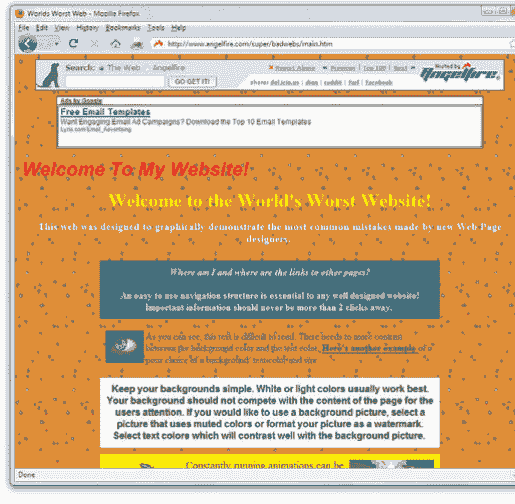

## 使用十六进制值表示颜色

如果你在搜索引擎中搜索糟糕的网站示例，你会发现许多收集了糟糕设计示例的网站，并解释了为什么此类网站应该进入“耻辱柱”而不是“名人堂”。许多网站因为视觉展示被认为是“糟糕”的，而这种展示始于颜色的选择。因此，理解颜色以及其规范和使用的细微差别，是创建优秀网站的关键步骤。

为了保持符合标准，并保持对网站中颜色的精确控制，你可以通过十六进制值来引用颜色。颜色的十六进制值表示在每种颜色中应该混合多少红色、绿色和蓝色。它的原理有点像橡皮泥——混合你所需的比例的红色、绿色和蓝色以获得合适的颜色。

十六进制颜色格式为 `#rrggbb`，其中 `rr`、`gg` 和 `bb` 是颜色的红色（`rr`）、绿色（`gg`）和蓝色（`bb`）分量的两位十六进制值。如果你不熟悉十六进制数，不用担心。只需记住 FF 是最大值，00 是最小值即可。为每个组件使用以下代码之一：

- FF 意味着全亮度。
- CC 意味着 80% 的亮度。
- 99 意味着 60% 的亮度。
- 66 意味着 40% 的亮度。
- 33 意味着 20% 的亮度。
- 00 表示没有这种颜色成分。

例如，亮红色是 `#FF0000`，深绿色是 `#003300`，紫色是 `#660099`，中灰色是 `#999999`。要创建一个带有背景和深绿色文本的页面，HTML 代码如下：

```html
<body style="background-color:#FF0000; color:#003300">
```

虽然这里只显示了六个两位十六进制值的示例，但实际上有 225 种两位十六进制值的组合——0 到 9 和 A 到 F 配对。例如，F0 是一个可能的十六进制值（十进制值为 240），62 是一个可能的十六进制值（十进制值为 98），以此此类推。

正如之前讨论的，`#rrggbb` 十六进制代码格式中的 `rr`、`gg` 和 `bb` 代表颜色的红色、绿色和蓝色分量。每个组件的十进制值从 0（无色）到 255（全色）不等。

因此，白色（或 `#FFFFFF`）翻译为红色值 255，绿色值 255，蓝色值 255。同样，`#000000` 翻译为红色值 0，绿色值 0，蓝色值 0。纯红色是 `#FF0000`（全红、无绿无蓝），纯绿色是 `#00FF00`（无红有蓝）。所有其他十六进制表示法都翻译为三种颜色 255 种可能值中的某种变体。跨浏览器兼容的名称 `CornflowerBlue`（矢车蓝）与十六进制表示法 `#6495ED` 相关——红色值 40，绿色值 149，蓝色值 237（所有可用值）。

在选择颜色时，无论是通过图形程序还是找到你喜欢的颜色，你都会以十六进制或十进制形式看到颜色。如果你在搜索引擎中输入“十六进制颜色转换器”，你会发现许多选项帮助将颜色值转换为可以在样式表中使用的内容。

## 使用 CSS 设置背景、文本和边框颜色

使用 CSS 时，颜色值可以在三种情况下使用：指定背景颜色、文本颜色、边框颜色时。

### 列表 9.1 使用 CSS 设置背景、文本和边框颜色

```html
<?xml version="1.0" encoding="UTF-8"?>
<!DOCTYPE PUBLIC "-//W3C//DTD HTML 4.01//EN" "http://www.w3.org/TR/html41.dtd">
<html lang="en">
<head>
    <title>背景、文本和边框颜色</title>
</head>
<body>
    <h1 style="color:CCCCCC">背景、文本和边框颜色</h1>
    <p style="color:#000000">灰色段落 <span style="color:#FF00">橙色 span</span>。</p>
    <div style="width:300px;height:75px; margin-bottom:12px; background-color:#000000; border:2px dashed #FFFF">黑色 div</div>
    <table border="1">
        <tr>
            <td style="background-color:#00FF00">绿色单元格</td>
            <td style="background-color:#FF0000">红色单元格</td>
        </tr>
        <tr>
            <td style="background-color:#FFFF00">蓝色单元格</td>
            <td style="background-color:#00FF">黄色单元格</td>
        </tr>
    </table>
    <blockquote style="background-color:#000FF; border:4px dotted #FFFFFF">
        <p>蓝色引用块，白色文本。</p>
    </blockquote>
</body>
</html>
```

### 列表 9.2 使用 CSS 设置背景、文本和边框颜色

图 9.2  
可以使用 CSS 设置背景、文本和边框颜色。

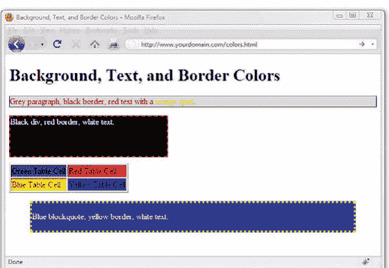

## 总结

在本小时中，你学习了关于颜色用法的几个最佳实践，以及如何使用色轮来帮助你寻找与文本互补的颜色。此外，你还学习了颜色的十六进制表示——所有颜色都通过与其的红、绿、蓝分量相关的表示法来表达——十六进制表示如何允许你为元素应用细微的颜色。更重要的是，你学习了与颜色相关的样式属性，可以使用这些属性将颜色应用于容器背景、边框和文本。

表格 9.1 总结了这些属性。

| 属性/样式 | 功能 |
| --- | --- |
| `style="background-color:color"` | 设置元素的背景颜色（例如 `<body>`、`<p>`、`<div>`、`<blockquote>` 以及其他容器）。 |
| `style="color:color"` | 设置元素内文本的颜色。 |
| `style="border:size type color"` | 设置元素周围四个边框的颜色。如果不指定边框的宽度类型，则无法使用边框颜色。 |

## 问答

- 网页浏览器不是让人们自己选择背景和文本颜色吗？
- 是的，网页浏览器允许用户覆盖你作为网页作者指定的颜色。有些人可能会将你的蓝底白字看作绿底白字或使用他们自己的颜色，但实际上很少人会使用此选项。`<body>` 标签中指定的颜色通常会被看到。
- 我听过 231 种“浏览器安全色”，我可以在网页上使用，而不应该使用任何其他颜色。这是真的吗？
- 真实情况是这样的：有 231 种颜色对于在 256 色（8 位）视频模式下操作电脑的用户来说，这些颜色看起来看起来不那么“模糊”。某些网页作者尝试坚持使用这些颜色。然而，如今真色彩或高色彩计算机显示器已成为标准，它们能以相同的清晰度显示所有颜色。如果你的图形程序可以以十六进制格式为你提供颜色值，尽管将该值直接插入你的样式表中以显示自定义颜色方案。

# 第 9 小时：与颜色工作

## 工作坊

工作坊包含测验题和活动，帮助你巩固对所涵盖内容的理解。在查看随后的“答案”部分之前，尝试回答所有问题。

## 测验

- 1. 你将如何为网页设置黑色背景并让所有文字变亮？你会想要……
- 2. 在为你的网站选择颜色方案时，以下哪种颜色关系会为你提供更多颜色选择：类比、互补，还是三色调？
- 3. 如果你在样式表中为 `body` 元素指定 `background-color #FFFFFF`，然后在页面上使用的第一个 `<div>` 使用 `background-color #FF0000`，那么该 `<div>` 的背景是红色还是白色？

## 答案

- 1. 在网页开头放置以下内容或为 `<body>` 元素使用样式：

```html
<body style="background-color:#000000; color:#00FF00">
```


- 2. 三色调。指的是在色轮上均匀分布的三种颜色。

- 3. 你的`<div>`背景将是红色的，因为容器元素的`background-color`指定将覆盖样式表中`<body>`标签条目中的指定。

## 练习

- 选择一种你喜欢的底色——也许是漂亮的蓝色或大地色调——并使用 http://colorschemedigner.com/ 上的颜色方案生成器想出一组可以在网站上使用的颜色。我推荐使用四色调或强调色类比方案类型。

- 一旦你获得了一组颜色——或者几组颜色的方案——创建一个包含`<span>`元素、段落以及可能还有一些列表项的基础 HTML 页面。使用你在本小时学到的与颜色相关的样式来更改页面的背景颜色以及各种块级元素的文本，以观察这些颜色组合是如何协同工作的。观察它们是如何相互作用的，并确定哪些颜色最适合容器，哪些颜色最适合正文、标题文本和链接文本。

# 第 10 小时
创建用于网页的图像

虽然关注颜色方案和制作具有视觉吸引力的网站很重要，但你并不需要成为艺术家也可以在你的网页上放置高影响力的图形。更重要的是，你也不需要在软件上花费数百或数千美元。这一小时将帮助你开始创建一些可以在网页中使用的图像。虽然本章中的示例图使用了适用于 Windows、Mac 和 Linux 用户的流行免费图形程序（GNU 图像处理程序，或 GIMP），但你可以将在本小时学到的知识应用于任何主要的 Windows 或 Macintosh 图形软件——尽管菜单和选项可能略有不同。

在本小时中，你只需学习如何创建图形本身，包括不同类型的图形。在第 11 小时“在你的网站中使用图像”中，你将学习如何使用 HTML 和 CSS 集成你的图形。

## 创建图形软件

你可以使用任何图形程序为你的网站创建图像，从通常随操作系统自带的简单画图程序到 Adobe Photoshop 这样昂贵的专业程序。同样，如果你的电脑连接了数字相机或扫描仪，它可能带有一些能够创建网页的图形软件。还有几个可以下载的免费图像编辑器——甚至作为 Web 应用程序在线使用——它们专门处理照片元素的编辑。

## 你在本小时将学到：

- 如何选择图形软件
- 如何准备在线照片
- 创建横幅和按钮
- 如何减少图像中的颜色
- 创建透明图像
- 创建动画图形

## 注意

Adobe Photoshop 在图像编辑程序方面无疑是顶尖的。但如果你没有图形处理经验，它是昂贵且复杂的。有关 Adobe 的更多信息，请访问 http://www.adobe.com/。如果你对他们的产品感兴趣，可以在那里下载免费评估版本。

# 第 10 小时：创建用于网页的图像

## 使用其他网站的素材

如果你已经有了可以创建图形的软件，请尝试用它完成此处介绍的所有内容。如果它无法完成某些任务，它可能不是一个好的图形工具。在这种情况下，从 http://www.gimp.org 下载并安装 GIMP。

- 1. 访问 http://www.gimp.org 并点击 Downloads 链接。

- 2. 你可以看到一个指向下载的链接。你也可以点击 Show other downloads 链接，这将显示所有选项。当你看到专门为你的操作系统设计的软件时，点击该链接开始下载。

- 3. 下载完成后，双击安装程序进行安装。

## 关于图形你需要了解的知识

当你在互联网上发布图形和多媒体时，有两种力量总是处于对立状态。用户的眼睛和耳朵希望你的内容尽可能详尽准确，他们也希望信息立即播放。复杂且色彩丰富的图形意味着较大的文件大小，这即使在快速连接下也会增加传输时间。你如何在最小化文件大小的同时最大化你的演示文质量？为了做出这些选择，你需要了解颜色和分辨率如何共同作用以创造主观的质量感。

图像的分辨率组成图像的单个点（或像素）的数量。大高分辨率图像通常比小低分辨率图像需要更长时间的传输和显示。分辨率通常由图像的宽度乘以高度指定，单位为像素；例如，一张 300x200 的图像宽为 300 像素，高为 200 像素。

你可能会惊讶，分辨率并不是决定图像文件存储大小（以及传输时间）的最重要因素。这是因为网页上使用的图像始终以压缩的形式存储和传输。图像压缩是图像通过的一种数学处理，用以挤出重复的模式。图像压缩的数学原理非常复杂，但基本思想是，当图像存储在磁盘上时，重复的模式或相同颜色层可以被挤出来。这使得图像文件小得多，并允许它在互联网上更快地传输。当图像显示时，网页浏览器会恢复图像的原始外观。

## 注意事项

有几种类型的图像分辨率，包括像素、空间、光谱和辐射分辨率。你会花费几个小时学习每种类型；如果你正在上图形设计课，你可能正是这样做。然而，现在你只需要记住，较大的图像下载需要更长时间，并占用你显示器的大空间。在设计网站时，显示尺寸和存储或传输大小是你应该考虑的因素。

在这一小时的剩余时间里，你将确切学习如何创建具有视觉冲击力且文件较小的图形。你实现此目标的技术取决于每个图像的内容和目的。网页有许多用途，到目前为止最常见的有四种图形：

- 人、产品或场所的照片
- 图形横幅和 Logo
- 用于指示操作和提供链接的按钮或图标
- 内容元素的背景纹理

## 准备摄影图像

为了在你的网页上放置照片，你需要将打印的照片转换为数字图像，或使用数码相机数字地创建照片。你可能需要使用扫描仪或相机自带的自定义软件将图片保存到硬盘上，或者你也可以直接绘制并扫描。

## 提示

如果你没有扫描仪或数码相机，几乎所有的冲洗店都提供一种服务，只需少量费用即可将照片从35mm 胶片传输到 CD-ROM 或 DVD-ROM。你可以将文件从 CD-ROM 或 DVD-ROM 复制到硬盘，然后使用你的图形程序打开并修改图像文件。

将文件从相机拖到你的硬盘。如果你正在使用扫描仪创建打印照片的数字版本，你可以从你选择的任何图形程序中直接控制任何扫描仪——详情请参阅软件文档。

在将数字图像文件传输到计算机后，你可以使用图形程序对它们进行裁剪、调整大小、色彩校正和压缩，以便在你的网站中使用。

## 裁剪图像

由于你希望网页尽可能紧凑，你还需要裁剪你的数字照片。当你裁剪照片时，你选择你想要显示的区域并裁剪掉其余部分。

## 亲自尝试一下
在 GIMP 中裁剪

GIMP 工具箱提供了对裁剪工具及其属性的快速访问。找到一个图像文件——无论是你用相机拍摄或存储在硬盘上的数字图像，还是你从网上找到的图像。在 GIMP 中打开图像后，执行以下步骤在 GIMP 中进行裁剪：

- 1. 在 GIMP 工具箱中，点击裁剪工具（见图 10.1）。根据你选择的工具，可能会有额外的属性供选择。例如，图 10.1 显示了裁剪的属性（如宽高比、位置、尺寸等）。

图 10.1
从工具箱中选择裁剪工具。

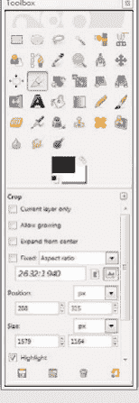

- 2. 在你要裁剪的图像中，点击你想保留的图像部分的左上角并按住左鼠标键拖动到右下角，在选择区域画一个框。见图 10.2。

- 3. 点击选择区域的一个角来应用裁剪。

你的图形程序可能有一种与所示所示不同的方法，但原理是相同的：选择要保留的区域，然后裁剪其余部分。

## 亲自尝试一下
在 GIMP 中裁剪

图 10.2
选择你想要显示的图像区域。

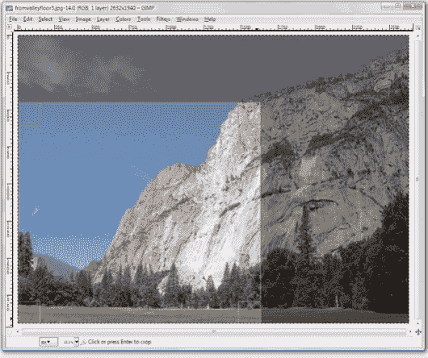

即使你的图像已经过裁剪，它可能比网页所需的尺寸要大。根据特定网页的设计，你可能希望将图像尺寸限制在不超过 800x600 像素（如果它显示在页面本身，例如商品目录），甚至是 640x480 像素或更小。当与文本一起显示时，图像宽度通常在 250 到 350 像素之间，因此宽度是足够的。在 GIMP 中，你可能希望将图像尺寸限制在最大 800 像素。在 GIMP 中，显示比例会显示在窗口。

## 提示

你可以放大或缩小图像。

## 提示

在显示窗口中可以放大或缩小图像。

## 调整图像大小

调整图像大小的确切方法取决于你使用的程序。在 GIMP 中，转到图像菜单并点击“缩放图像”（见图 10.3）。

## 注意

正如 GIMP 的许多功能一样，缩放对话框会出现在图像的前面。你总是希望使用现有比例进行调整，这意味着当你输入宽度时，高度会被锁定的。

在大多数并非所有的图形程序中，你也可以根据百分比而不是像素维度调整图像。例如，如果我的图像初始大小为 1629x1487，我不想计算出将其减半的值，只需将默认设置 100 改为 50。这样图像宽度将变为 815 像素，高度变为 744 像素——我不需要进行数学计算。

## 调整图像颜色

如果你正在编辑照片而不是创建自己的图形，你可能需要使用一些色彩校正工具让照片看起来完美。像许多图像编辑软件一样，GIMP 提供了调整图像亮度、对比度和色彩平衡的多种选项，还有一个用于消除红眼的滤波器。要在 GIMP 中消除红眼，转到滤镜、增强，然后点击消除红眼。

大多数选项都非常直观。如果你想让图像更亮，调整亮度。如果你想让图像中有更多红色，调整色彩平衡。颜色菜单为你提供了许多工具。正如上一节中描述的缩放对话框一样，当你调整颜色时，每个工具都会在你工作区的区域显示一个对话框，图像反映了这些变化。这种预览功能是大多数图像编辑软件包含的一项功能。重置颜色按钮将图像恢复到未应用任何更改的原始状态。

图 10.4 显示了调整色调/亮度/饱和度，这是颜色菜单上提供的许多工具之一。

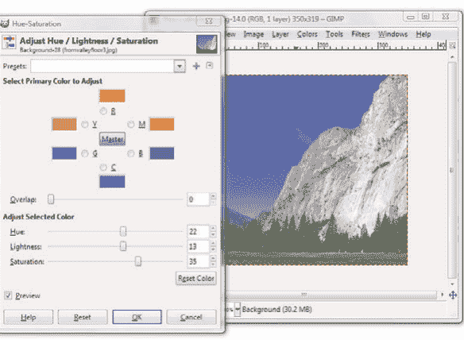

图 10.4 调整色调/亮度/饱和度工具是 GIMP 中许多基于滑块的颜色修改工具之一！

由于你可以使用许多工具，而且每个工具都带有预览功能，因此一些带有趣味性的实验是发现每个工具功能的最佳方法。

## 控制 JPEG 压缩

网页上的照片如果保存为 JPEG 格式而非 GIF，效果会最好；JPEG 允许你在保留文件中颜色数量的同时，仍能将整体文件大小保持在可接受的范围内。当你完成对照片尺寸和外观的调整后，选择“另存为”并选择 JPEG 作为文件类型。你的图形程序可能会为你提供另一个对话框，你可以在其中控制各种 JPEG 选项，例如压缩。

图 10.5：在 GIMP 中保存 JPEG 时会看到的“另存为 JPEG”对话框。你可以看到，通过调整“质量”滑块在 1（低质量，小尺寸）和 100（高质量，大文件尺寸）之间的数值，可以控制保存 JPEG 文件的压缩率。

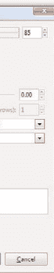

你可能想实验一下，看看不同的 JPEG 压缩级别如何影响图像质量，但对于大多数照片而言，85% 的质量（或 15% 的压缩）通常是文件大小（从而影响下载速度）和质量之间很好的折中方案。

## 创建横幅和按钮

你从零创建的图形（如横幅和按钮）需要你考虑与照片完全不同的事项。

制作横幅或按钮时，你需要做出的第一个决定是它应该有多大。现在访问网页的大多数人都拥有屏幕分辨率至少为 1024x768 像素的电脑，甚至更高。例如，我的屏幕目前设置为 1024x900 像素。你通常规划你的图形，使它们始终能够适应较小的屏幕（1024x768），并为滚动条和边距留出空间。关键的尺寸限制是页面的水平宽度，因为水平滚动页面对于网页用户来说是一个巨大的麻烦，也是困惑的来源。垂直滚动页面要容易接受得多，但如果你的页面比最小屏幕尺寸高，也没关系。

假设你的目标最小分辨率是 800x600 像素，那么全尺寸的横幅和标题图形的宽度不应超过 770 像素，高度不超过 430 像素，这是在考虑到滚动条、工具栏和浏览器窗口的其他部分后，页面的最大可视区域。在页面内，普通的照片和艺术品的高度和宽度应在 100 到 300 像素之间。显然，如果你为 1024x768 分辨率进行设计，你有更多的“活动空间”可以操作，但横幅、按钮和其他辅助性图形的尺寸指南仍然有效。

在 GIMP 中创建新图像，转到“文件”并选择“新建”。会显示“新建”对话框。如果你不确定图像需要多大，只需接受 640x480 的默认尺寸即可。或者，你可以从“模板”下拉菜单中选择其他预定义的尺寸之一，例如“Web banner 常见 468x60”或“Web banner 巨大 728x90”。这些设置对于网站横幅确实被认为是“常见”和“巨型”。否则，输入新图像的宽度和高度。

## 提示

多年来，为 800x600 屏幕分辨率进行设计一直是常态。仍然要记住低数值，因为许多人并没有以全屏模式打开应用程序。然而，为基准 1024x768 屏幕分辨率进行设计并不是一个坏主意。

图 10.6
在开始制作图像之前，你需要决定图像的尺寸。

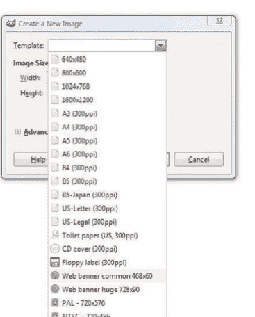

对于图像的背景颜色，你通常应该选择白色，以匹配大多数网页浏览器用于网页的背景颜色（尽管你在上一节中中学过，那个颜色是可以更改的）。当你知道自己将创建一个背景不是白色的页面时，可以为你的图像选择不同的背景颜色。或者你可能想创建一个完全没有背景的图像，在这种情况下你将选择“透明”作为背景颜色。当图像背景是透明的时，图像背后的网页允许透过图像的这些区域显示。在 GIMP 中，通过打开“新建图像”对话框中的“高级选项”，为你的新图像选择背景颜色。

当你以像素输入图像的高度和宽度并面对一个空白画布时——如果你像我们大多数人一样恐视艺术，这真是一个令人畏惧的景象！然而，有许多图像创建教程（更不用说整本书）可以引导你完成整个过程，我就让你自己发挥了。这一节完全是向你介绍在为你的网站创建所需的图形时需要记住的事项。这一节并不一定教你如何做它，因为熟悉你所选择的工具是精通它们的第一步。

## 减少图像中的颜色数量

减少图像尺寸（因此减少下载时间）的最有效的方法之一是减少图像中使用的颜色数量。这会大幅降低某些照片的视觉质量，但对于大多数横幅、按钮和其他图标是有效的。

你可能会很高兴发现有一种用于限制颜色图像的特殊格式；它被称为图形交换格式（GIF）。

## 创建平铺背景

如果你正在为自己的业务创建一个网站，你可能想避免使用带有对比色文字的高花纹背景。

如果你对整个网站使用平铺的图案背景图，请记住，当平铺图像看起来看不出来是平铺的时，效果最好。换句话说，当背景瓷砖的顶部边缘与底部无缝衔接，左边缘与右边缘匹配时，你就知道你拥有一张很好的图片。

图 10.8 和 10.9 使用了背景瓷砖，两者都具有无缝背景，但效果程度不一。

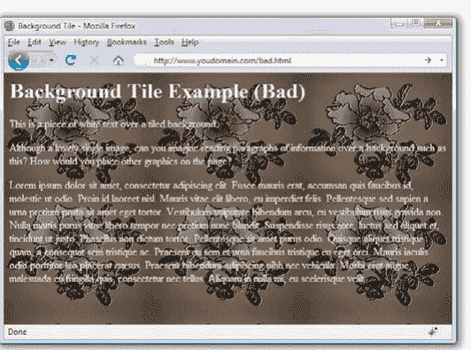

图 10.8
这是一个无缝背景图的示例，你可以看到六个相同的形状，从而看出背景是平铺的。

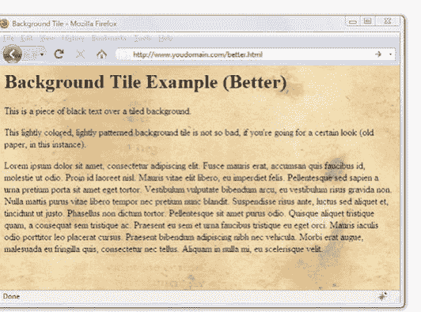

图 10.9
这也是无缝背景图的示例，只不过你就能看出它是平铺的。

## 提示

如果你真的想使用平铺瓷砖，但似乎无法得到想要的图案，你可以查看互联网上提供的数百个公共有领域背景图的网站，这些图片是免费的或经过专业设计的。

在第 11 小时中，你将学习如何将背景图像放在容器元素中。尽管我在本节中发出了警告，但实际上，背景图像可以成为你工具箱中的强大武器——只是不要作为整个页面的背景。

## 创建动画网页图形

GIF 格式允许你创建动画图像，可以用于添加一些动作为任何网页增添活力。动画 GIF 的传输速度也比用于类似效果的视频或多媒体文件快得多。通过 GIMP，你可以在图像中创建多个图，然后在保存文件时修改动画 GIF 选项来创建动画 GIF。此外，如果你有一系列想要制作的图像，可以使用 Gickr (http://www.gickr.com/) 提供的免费 Web 端 GIF 动画服务。

创建 GIF 动画的第一步是创建一系列一个接一个显示的图像——或者根据你具体的软件程序创建一系列图。这些图像中的每一个都被称为“帧”。顺便说一下，“帧”这个词与你在第 13 小时学习的“处理帧”中的帧没有关系。相反，把帧想象成电影或卡通片的组合方式——你在屏幕上看到的图像是由许多外观略有差异的单个帧组成的。一旦你脑海中有了这些帧，将它们连接起来的过程相对简单——最困难的是规划阶段。花些时间用分镜脚本勾画出帧，特别是如果你计划的不仅仅是几帧的话。一旦你知道了帧将如何组合在一起，请使用本节前面提到的 Gickr 服务，或阅读你的图形软件的文档以学习其整合所有内容的特定流程。

## 总结

在这一小时中，你学习了为网页准备图形的基础知识。无论还学到什么，你都了解到这是一个非常复杂的话题，并且在这一小时内学到了足够的知识来引起你的胃口。本小时的示例使用了流行的（且免费的！）GIMP 软件包，但请随意使用最适合你需求的图形。

你学习了如何裁剪、调整大小和微调图像颜色，并了解了不同的文件格式。在网站中包含图形时，你必须记住许多考虑因素，包括图形的大小和分辨率，以及如何使用透明度、动画 GIF 和平铺背景。

## 问答

- 与其自己学习所有这些，我不应该雇佣一名图形设计师来设计我的页面吗？

这是一个很难回答的问题，并不是因为我在这里有利益冲突——我为一家 Web 开发和设计机构工作，所以推荐机构符合我的最大利益。但机构并不总是最佳解决方案。雇佣图形设计师需要时间精金钱。此外，许多图形艺术家的工作并不适合网络——他们是专门从事印刷的艺术家，而印刷世界与在线世界大不相同。此外，雇佣一名个人图形设计师来创建网站可能无法发挥该特定设计师的长处。换句话说，他可能擅长设计网站的图形元素，但他可能不擅长担任内容架构师或与 HTML 和 CSS 进行工作。如果你的网站是个人网站，专业设计可能不是你想要花钱的地方。但如果你的网站旨在推广业务、产品、学校或任何其他形象对你成功至关重要的东西，那么它是值得的。

- 我有一个视频剪辑。我可以把它变成 GIF 吗？

可以。只需用 GIMP 等软件打开文件进行转换即可。软件将为你提供减少帧数的选项；你也可以像后文讨论的那样，将 GIF 直接嵌入网页中。

## 工作坊

工作坊包含测验问题和活动，帮助你巩固理解。在查看“答案”部分之前，尝试回答所有问题。

## 测验

- 1. 你有一张马的扫描照片，需要放在页面上。你应该把它做得多大？你应该用什么格式保存它？
- 2. 你们公司的 Logo 是一个黑色的字母 Z，后面有一个红圈。你应该把它制作或扫描成多大？你的网页用什么格式保存它？
- 3. 你的合作伙伴带来了一张详细的树叶图形，并想让你作为网站背景——带有加粗字体。你会怎么办？

## 答案

- 1. 取决于图像对页面的重要性，你应该将其缩小到 100x40 像素或放大到 300x120 像素。JPEG 格式（85% 压缩）最好。当然，你也可以提供指向较大图像的缩图链接。
- 2. 对于正方形 Logo，100x100 像素通常是好的，这是一个非常易于压缩的简单图形。你可以将其放大到 300x300 像素，并在模板中留出适当的位置放置它。
- 3. 拒绝他，并不允许他以后对设计决策有任何参与。将其保存为 GIF 文件，因为它包含非常少的颜色。

## 练习

- 如果你有一份公司（或个人）照片存档，翻阅它寻找一些可以增强你网站的照片。扫描它们（或发送它们去扫描），这样你就会拥有一库数字照片，准备用于你的页面上。如果你有数码相机拍摄的照片数字文件，你显然可以跳过扫描步骤，直接开始为网页准备图像。
- 在为重要的业务网站设计图形之前，尝试装饰你自己的个人主页。这将给你一个机会学习 GIMP（或给你一个机会使用你的图形软件），这样你在工作中处理任务时就知道自己在做什么了。

# 在你的网站中使用图像

在第 10 小节“创建用于 Web 的图像”中，你学习了如何查找和创建用于你网站的数字图像。本节将展示如何将这些图像放置在你的网站中是多么的简单。在本节中，你将学习用于在网站中放置和描述图像的 HTML 代码、如何对齐图像，以及如何将图像作为链接或指向其他内容的“地图”使用。

- 本节你将学到：
- 如何在网页上放置图像
- 如何用高度和宽度描述图像
- 如何对齐图像
- 如何将图像转换为链接
- 如何使用背景图像
- 如何使用图像地图

你现在应该准备好两或三张图像，这样你就可以跟随本节学习时，尝试将它们放置在你自己的页面上。如果你已经保存了一些 GIF、PNG 或 JPEG 格式的图像（文件名以 .gif、.png 或 .jpg 结尾），使用你在阅读上一节课程时创建的任何图形也可以的。

## 尝试一一下

## 为你的网站准备图像

在线剪贴画和多媒体网站，地址为 http://office.microsoft.com/clipart/。

搜索引擎（如 Google）可以成为图像的宝库，引导你找到与你的主题相关的网站。搜索引擎还可以帮助你发现大量的图像——特别是专门用于提供免费且廉价的可重媒体集合访问的。此外，不要忘记微软在 Office 中海量的剪贴画库。

其他有价值的来源包括 Google Images (http://images.google.com/) 和 Flickr (http://www.flickr.com)——寻找使用知识产权（Creative Commons）许可的图像，这些许可允许在署名的情况下免费使用。

## 在网页上放置图像

你将图像放在哪里对于 Web 服务器、网页浏览器或终端用户来说并不重要，只要你在那里，并且在 HTML 代码中使用了正确的路径即可。

在文本中你想让图像出现的地方插入以下 HTML 标签。使用你的图像名称代替我的 `myimage.gif`：

```html

```


``

如果你的图像文件位于文档根目录的下方，你将使用：

```html

```

在 XHTML 网页中，`` 标签的 `src` 和 `alt` 属性是必须。`src` 标识图像文件，`alt` 属性允许你提供关于图像的描述性文本，后者旨在作为用户无法查看图像时的替代方案。你将在“用文本描述图像”中读到更多关于 `alt` 属性的知识。

作为 `` 标签的一个示例，代码列表 11 将图像插入到页面顶部，位于段落之前。当浏览器在 HTML 11 中显示该文件时，它会自动检索并显示图像文件，如图 11 所示。

#### 代码列表 11：使用 `` 标签在网页上放置图像

```xml
<?xml version="1.0" encoding="UTF-8"?>
<!DOCTYPE html PUBLIC "//W3C//DTD HTML 1.1//EN"
"http://www.w3.org/TR/html1/DTD/xhtml.dtd">
<html xmlns="http://www.w3.org/1999/xhtml" lang="en">
<head>
<title>壮丽的优胜美地风景</title>
</head>
<body>
<h1>壮丽的优胜美地风景</h1>
<p></p>
<p><strong>Half Dome</strong>是优胜美地国家公园的一座花岗岩穹，位于加利福尼亚州马里波萨县东北部，优胜美地山谷的尽头。花岗岩脊比山谷底部高出 4,737 米多。</p>
<p>Half Dome 的这一视角是从 Washburn Point 看到的。</p>
</body>
</html>
```

## 用文本描述图像

163

[图像]

图 11.1

当网页浏览器显示代码列表 11.1 所示的 HTML 代码时，它会渲染 `hd.jpg` 图像。

> **注意**
>
> 理论上，你可以在页面中包含来自任何网站的图像。在这种情况下，每当你的页面显示时，图像都会从另一个页面的 Web 服务器检索。你可以这样做，但不应该以不礼貌的方式这样做，因为你正在利用他人的工作来获利，它还会让你的页面显示缓慢。你无法控制图像何时可能被更改或删除。

如果 `img` 代表 *image*（图像），你是对的。`src` 代表 *source*（源），它是图像文件位置的引用。正如书中之前讨论过的，尽管图像在浏览器中查看时似乎是页面的一部分，但图像始终存储在与文本分离的文件中。就像用于超链接的 `<a href="...">` 一样，你可以在 `` 属性中指定任何 Internet 地址。或者，如果图像位于 HTML 文件相同的文件夹中，你可以指定文件名。你也可以使用相对地址，例如 `/images/bird.jpg` 或 `../smiley.gif`。

### 用文本描述图像

代码列表 11.1 中的每个 `` 都包含一段短文本，例如 `alt='Half Dome'`。`alt` 代表 *alternate text*（备用文本），如果图像本身未加载，则出现在图像位置的消息。

如果用户关闭了自动下载，或者网络连接非常慢，图像可能不会加载，你可以使用作者的引用，例如 ``。Flickr 服务也提供图像的 URL，如 Flickr (`http://www.flickr.com`)。

图 11.2

当不显示图像时用户将看到 `alt` 信息。

[图像]

## 对齐图像

### 指定图像的高度和宽度

由于文本在 Internet 上传输比图形快得多，大多数浏览器在显示图像之前会显示页面上的文本。这让用户在等待图片时有内容可读。

通过显式指定图像的高度和宽度，可以让浏览器在布局页面时尽可能快速、准确地为图像留出空间。

对于你想在网站中的每个图像，你可以使用图形确定其精确的高度和宽度。你可能还可以使用系统工具找到这些图像属性。例如，在 Windows 中，你可以通过点击图像、选择属性、然后选择详细信息来查看图像的高度和宽度。你已经可以在 `` 标签中包含尺寸，如下：

```html

```

### 对齐图像

就像对齐页面上的文本一样，你可以使用特殊属性在页面上对齐图像。你不仅可以水平对齐图像，还可以相对于周围的文本和其他图像进行垂直对齐。

#### 水平对齐

正如第 5 小节“处理文本块和列表”中讨论过的，你可以使用 `<div style="text-align:center">`、`<div style="text-align:right">`、`<div style="text-align:left">` 将元素对齐到居中、右边距或左侧。这些样式设置影响文本和图像，也可以在 `<p>` 标签中使用。

## 第 11 节：在你的网站中使用图像

你也可以通过直接在 `` 标签内使用 `float` 样式属性来使文本环绕图像。

在列表 11.2 中，`` 将第一张图像左对齐，并让文本在其右侧环绕，正如你预期的那样。同样，`` 将第二张图像右对齐，并让文本在其左侧环绕。图 11.3 显示了图像的情况，由于那里没有将图像居中，所以没有办法让文本环绕图像的两侧。

> **注意**
>
> `float` 样式属性实际上比这里描述的要强大得多，事实上它可以对齐的不仅仅是图像。你可以创造性地使用 `float` 样式来创建一些有趣的页面布局，正如你将在书中学到的那样。

### 列表 11.2：使用 `text-align` 样式对齐网页上的图像

```xml
<?xml version="1.0" encoding="UTF-8"?>
<!DOCTYPE html PUBLIC "-//W3C//DTD HTML 1.1//EN"
"http://www.w3.org/TR/html1/html1.dtd">
<html xmlns="http://www.w3.org/1999/xhtml" xml-lang="en">
<head>
<title>更壮丽的优美山地风景</title>
</head>
<body>
<h1>更壮丽的优美山地风景</h1>


<strong>El-Capitan</strong>是优美山地国家公园内一个高 3000 英尺（914 米）的垂直岩石层，位于优美山地谷的北侧，靠近其西端。这座巨大的岩体是世界上攀岩者最顶尖的挑战之一。该岩层是由马里波拉浸教徒在1851年探索该山谷时命名为“El Capitan”的！</p>


<strong>Tunnel View</strong>是位于 41 号州路上一个观测点，从南方进入优美山地谷时，它位于 Wawona 隧道的正东。该视野可以俯瞰优美山地谷，包括酋长岩的西南侧面、半圆顶和新娘纱瀑布。对许多人来说，这是对优美山地热门景点的首次观察。</p>

</body>
</html>
```

## 图像对齐

图 11.3

显示列表 11.2 中的图像对齐情况。

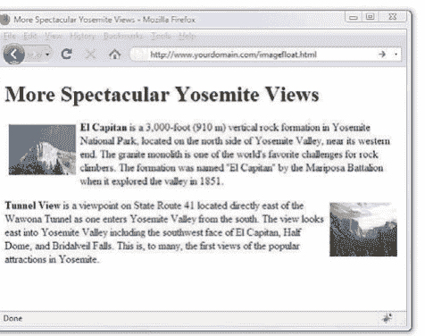

> **注意**
>
> 列表 11.2 中两个 `` 标签都添加了 `padding` 样式属性。这种内边距为图像和文本之间提供了“呼吸空间”——图像四周各 6 像素。你将在第 13 节学习更多关于 `padding` 的知识。

## 图像垂直对齐

有时，你可能想在行文本的中间插入一张小图像；或者你可能在图像旁边放置单行文本作为说明。无论何种情况，控制文本和图像垂直对齐都是非常方便的。图像的底部应该与字母底部对齐，还是应该让文本和图像都排列使得它们的行对齐？你可以在这些以及其他几个选项之间进行选择：

- 要使图像顶部与同一行中最高的图像或字母的顶部对齐，请使用 ``。
- 要使图像底部与文本底部对齐，使用 ``。
- 要使图像中间与行内所有内容的整体垂直中心对齐，使用 ``。
- 要使图像底部与文本的基线对齐，使用 ``。

`vertical-align` 样式属性还支持 `top` 和 `bottom` 值，它们可以用于忽略行中是否有任何文本，将图像对齐到行元素的整体顶部或底部。

这些选项都用在列表 11.3 并显示在图 11.4 中。现在页面上垂直列出了四张缩略图，每张图像都有对应的描述性文本。使用了 `vertical-align` 样式属性的不同设置来对齐每张图像及其相关文本。

### 第 11 节：在网站中使用图像

> **提示**
>
> 如果你不在 `img` 标签中包含任何 `align` 属性，图像的底部将与旁边文本的基线对齐。这意味着你永远不需要写 `style=vertical-align:baseline;`，因为这是默认假设。如果你为图像设置了边距并希望图像与文本对齐更精确，你可能希望显式将 `vertical-align` 属性设置为 `text-bottom`。看看本章最后一张图像，略微出现在图像边距下方——这是垂直对齐设置为基线的结果。

### 列表 11.3：使用 `vertical-align` 样式对齐文本与图像

```xml
<?xml version="1.0" encoding="UTF-8"?>
<!DOCTYPE html PUBLIC "-//W3C//DTD HTML 1.1//EN"
"http://www.w3.org/TR/html1/html1.dtd">
<html xmlns="http://www.w3.org/1999/xhtml" xml-lang="en">
<head>
<title>壮丽风景</title>
</head>
<body>

<p>El Capitan 是 3000 英尺（914 米）的垂直岩层</p>

<p>Tunnel View 俯瞰优美山地谷。</p>

<p>Upper Falls 是世界上最高的瀑布之一。</p>

<p>Hanging Rock, Glacier Point 曾是人们聚集的热点。</p>

</body>
</html>
```

图 11.4

显示列表 11.3 中使用的垂直对齐。


## 将图像转换为链接

现在尝试向你的页面添加图像并尝试 `text-align`、`vertical-align` 和 `float` 的不同值。为了让你开始，这里有一个向任何页面添加图像（`fish.jpg`）的快速回顾。

### 亲自尝试图像对齐

1. 将 `fish.jpg` 图像复制到 HTML 文件相同的目录（或将其留在当前位置并确保位置）。
2. 使用文本编辑器选择你想让图像出现在文本的位置，并添加 ``。如果你希望图像居中，在其周围放置 `<div style="text-align:center">`。要让文本环绕图像，在 `` 标签中添加 `style="float:right"` 或 `style="float:left"`。最后在 `` 标签内直接使用 `vertical-align` 属性来控制图像相对于文本的垂直对齐方式。
3. 如果你有时间进行更多实验，尝试使用垂直对齐设置组合各种尺寸的图像。

## 将图像转换为链接

你可能在图 11.1 中注意到图像很大，这在特定示例中很好，但当你尝试展示多个图像时并不理想。在这种情况下，创建链接到每个图像较大版本的缩略图更有意义。这样你可以在页面上安排缩略图，让访问者能够轻松看到内容，即使他们只看到了实际（较大）图像的小版本。缩略图是你装饰页面的一种方法方法。要将任何图像转换为指向另一个页面或图像的可点击链接，可以使用之前用于文本链接的 `<a>` 标签。列表 11.4 包含了列表 11.2（使用了缩略图）的修改，以提供更大的版本。为了确保用户点击缩略图，图像和一些辅助文本封装在 `<div>` 中，如图 11.5 所示。

### 列表 11.4：使用缩略图实现图像链接

```xml
<?xml version="1.0" encoding="UTF-8"?>
<!DOCTYPE html PUBLIC "-//W3C//DTD XHTML 1.1//EN"
"http://www.w3.org/TR/xhtml11/DTD/xhtml11.dtd">
<html xmlns="http://www.w3.org/1999/xhtml" xml-lang="en">
<head>
  <title>更壮丽的优美山地风景</title>
  <style type="text/css">
div.imageleft {
  float:left;
  clear: all;
  text-align:center;
  font-size:9px;
  font-style:italic;
}

div.imageageright {
  float:right;
  clear: all;
  text-align:center;
  font-size:9px;
  font-style:italic;
}

img {
  padding: 6px;
  border: none;
}
  </style>
</head>
<body>
<h1>更壮丽的优美山地风景</h1>

<div class="imageleft">
<a href="http://www.flickr.com/photos/nofoyancame/614253439/"></a>
<br>点击图像放大：<div><strong>El Capitan</strong>是优美山地国家公园内一个高 3000 英尺（914 米）的垂直岩石层，位于其西端。花花岗岩体是世界上攀岩者最顶尖的挑战之一。该岩层是由马里波拉浸教徒在1851年探索该山谷时命名为“El Capitan”的。</div></div>
</div>

<div class="imageageright">
<a href="http://www.flickr.com/photos/nofoyancame/614287359/"></a>
<br>点击图像放大：<div><strong>Tunnel View</strong>是位于41 号路上一个观测点，从南方进入优美山地谷时，它位于 Wawona 隧道的正东。该视野可以俯瞰优美山地谷，包括酋长岩的西南侧面、半圆顶和新娘纱瀑布。对许多人来说，这是对优美山地热门景点的首次观察。</div></div>
</div>

</body>
</html>
```


## 将图片转换为链接

### 图 11.5

使用缩略图作为链接可以改进使用大图像的页面布局。

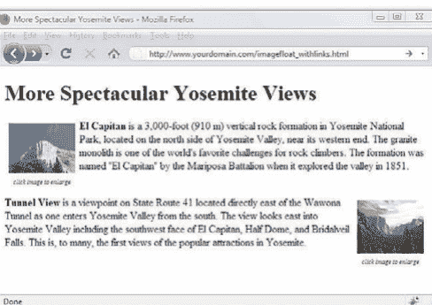

列表 11.4 中的代码使用了额外的样式，这些样式将在第 14 和第 15 小节中进行详细说明，但你应该能够掌握基本知识：

- `<a>` 标签链接到更大的版本，在这种情况下，这些版本存储在外部服务器上（在 Flickr 上）。
- `<div>` 标签及其样式用于对齐这些图形和说明文本组（还包含了一些内边距）。

除非另有说明，否则网络浏览器会在每个图像链接的边缘显示一个彩色矩形。与文本链接一样，矩形通常出现在最近未访问过的链接或最近访问过的链接上——除非你在样式表中指定了不同颜色的链接。

由于你很少（甚至从不）希望链接的图片周围出现这条难看的线，因此通常应该在链接内的 `` 标签中包含 `style="border:none"`。在这种情况下，`border:none` 样式被作为 `img` 元素样式条的一部分，因为我们两次使用了相同的样式。

当你点击所示示例页面上的缩略图之一时，链接将在浏览器中打开，如图 11.6 所示。

### 图 11.6

点击链接的缩略图会打开链接的目标页面。

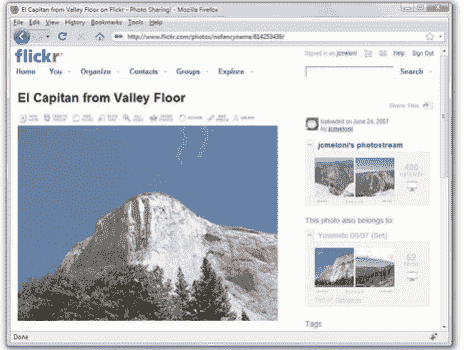

## 使用背景图像

正如你在上一节中学的那样，你可以使用背景图像作为容器元素中的某种“壁纸”，以便文本或其他图像显示在这些底层设计之上。

创建背景的基本样式属性有：

- `background-color`：指定元素的背景颜色。虽然它与图像无关，但它是背景相关属性集的一部分。
- `background-image`：使用以下语法指定作为元素背景的图像：`url('imagename.gif')`。
- `repeat`：指定图像如何在水平和垂直方向上重复。默认情况下（不指定任何内容），背景图像将水平和垂直方向都重复。其他选项有：`repeat`（与默认相同）、`repeat-x`（水平）、`repeat-y`（垂直）和 `no-repeat`（图形仅出现一次）。
- `background-position`：指定图像相对于容器的初始位置。选项包括：`top-left`、`top-center`、`top-right`、`center-left`、`center-center`、`center-right`、`bottom-left`、`bottom-center`、`bottom-right`，以及特定的像素和百分比。

在指定背景图像时，你可以将所有这些规格合并到一个属性中，如下：

```css
{
  background: #ffffff url('imagename.gif') no-repeat top right;
}
```

在之前的样式表条中，网页的 `body` 元素将是白色的，并在右上角包含图形 `imagename.gif`。

`background` 属性的另一个用途是为无序列表创建自定义项目符号。要将它们用作符号，首先按如下定义 `<ul>` 标签的样式：

```css
ul {
  list-style-type: none;
  padding-left: 0;
  margin-left: 0;
}
```

接下来，将 `<li>` 标签的声明改为：

```css
li {
  background: url(mybullet.gif) left center no-repeat
}
```

确保 `mybullet.gif`（或你为图形指定的名称）在网络服务器上并可以访问；那样，所有无序列表项将显示你的自定义图像，而不是标准的圆点符号。

我们将在后的课程中在使用 CSS 进行整体页面布局时，再次回到背景属性的具体用法。

## 使用图像映射（Imagemaps）

有时，你可能想将图像作为导航，而不仅仅是网站中常见的简单按钮或基于链接的导航。例如，也许你有一个提供医疗信息的网站，你想显示一张人体图像，该图像链接到提供各个身体部位信息的页面。或者你有一个提供世界地图的网站，用户可以点击它来访问有关国家的信息。

你可以根据用户在图像内的点击位置，将图像划分为链接到不同文档的区域。这被称为图像映射（imagenemap），任何图像都可以制成图像映射。

## 为什么图像映射并非总是必要的

关于图像映射，你应该知道的第一点是，你可能在非常特殊的情况下才需要使用它们。使用几张直接相邻的普通图像并为每个图像提供单独的链接几乎总是更简单、更高效的。

例如，参见图 11.7。这是一个显示 12 个不同公司标志的网页；这种示例是商业世界中常见的网页类型，你为合作伙伴提供少量的免费广告。

你可以将这些标志作为一个大图像呈现，并创建一个提供到这 12 家公司每个链接的图像映射。用户可以点击图像中的每个标志来访问每家公司的网站。

你可以像这个示例一样在页面上显示图像，并使用 12 张独立的图像——每个公司一张——其中每张图像都包含指向该特定公司的链接。

### 图 11.7

带有 12 个不同标志的网页；这可以作为单个图像映射呈现，也可以被分为 12 个独立部分。

对于具有许多部分、排列奇特或图像本身可能太复杂而分为独立图像的图像，图像映射是最佳选择。图 11.8 显示了一个最适合作为图像映射的图像。

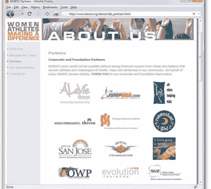

### 图 11.8

一张不适合被切割的图像——最好将其制成图像映射。

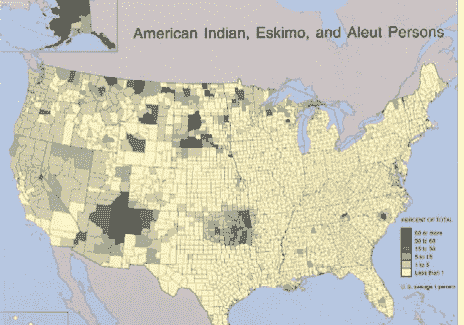

## 映射图像区域

要创建任何类型的图像映射，你需要确定图像中想要转换为可点击链接的每个区域的数字坐标。

## 使用图像映射（Imagemaps）

创建图像映射的最后一步是将其链接到实际图像上。

映射图像使用普通的 `` 标签放在页面上。但是，有一个额外的 `usemap` 属性，其代码写法如下：

```html

```

在指定 `usemap` 属性的值时，请使用你在 `<map>` 标签的 `id` 中设置的名称（不要忘记 `#` 符号）。同时包含 `style` 属性以指定图像的宽度和高度，并关闭图像映射周围的边框，你可能自己的图像映射中可能需要也可能不需要它。

列表 15 显示了包含地图图形、其图像映射以及几个映射区域示例页面完整代码。

## 列表 11 使用 `<map>` 和 `<area />` 标签定义图像映射的区域

```xml
<?xml version="1.0" encoding="UTF-8"?>

<!DOCTYPE html PUBLIC "-//W3C//DTD XHTML 1.0 Transitional//EN"
  "http://www.w3.org/TR/xhtml1/DTD/xhtml1-transitional.dtd">

<html xmlns="http://www.w3.org/1999/xhtml" xml:lang="en">

<head>
  <title>Testing an Imagemap</title>
</head>

<body>
  <h1>Testing an Imagemap</h1>

  <p style="text-align:center">
    点击 Logo 访问该县的网站。<brbr/>

    

    <map id="countmap">
      <area shape="rect" coords="100,136,166,152"
        href="http://www.whitmancounty.com/"
        alt="Whitman County, WA" />

      <area shape="rect" coords="29,271,42,283"
        href="http://www.sccgov.gov/"
        alt="Santa Clara County, CA" />

      <area shape="rect" coords="535,216,548,228"
        href="http://visitingwhitmancounty.com/"
        alt="Whitman County, PA"
        title="Whitman County, PA" />
    </map>
  </p>
</body>

</html>
```

> 如果你正在寻找细节，你可能已经注意到——检查代码的前几行——这个网页被编码为 HTML 1.0 对象，而不是书中其他示例中使用的 XHTML 1.1。这样做是因为某些浏览器（例如 Internet Explorer，或者由于它们对 HTML 1.1 之后关于图像映射使用方式改变的支持滞后）。
>
> 这一变化是针对 `usemap` 属性的特殊处理，在 XHTML 1.1 中，该属性不需要在 `map` 前加 `#` 符号。事实是，XHTML 1.1 不允许使用 `#`。然而，XHTML 1.0 允许使用 `#`，因此为了满足当前的浏览器并为你提供一个有效的网页，这个特定的示例使用了 XHTML 1.0。

### 图 11.10

列表 11.5 中定义的图像映射在网页上的显示效果。

图 11.10 显示了图像映射的运行情况。注意浏览器窗口底部，你的浏览器（在此示例中为 Firefox）会显示鼠标悬停的任何区域的链接地址。此外，当将鼠标悬停在区域上时，此示例的 `alt` 或 `title` 文本——Whitman County——显示在图像映射上。

> **注意**
>
> 有一种完全依赖 CSS 而不是依赖 HTML `<map>` 标签来生成映射图像的方法。你将在第 16 小节“使用 CSS 增强列表功能”中学习更多内容。

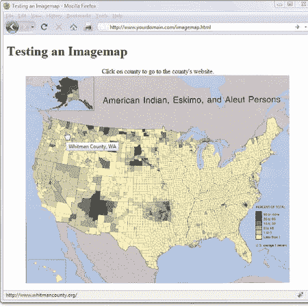

## 总结

本节向你展示了如何使用 `` 标签将图像放置在我们的网页上。你学习了如何包含一条短文本消息，该消息会在图像加载时替代图像显示，并在用户将指针移动到图像上时显示。你还学习了如何控制每张图像的水平和垂直对齐，以及如何在图像的左侧或右侧环绕文本。

你还学习了如何将图像作为链接——通过在图像周围使用 `<a>` 标签或通过创建图像映射。你还学习了关于如何在容器元素的背景中使用图像。

### 表 11.1 第 11 小节涵盖的 HTML 标签和属性

| 标签/属性 | 功能 |
| :--- | :--- |
| `` | 在页面内放置图像文件。 |
| `<map>...</map>` | 由 `` 引用的客户端图像。包含一个或多个 `<area />` 标签。 |
| `<area />` | 在客户端图像内定义可点击的链接。 |
| `src="altdescription"` | 图像的地址或文件名。 |
| `alt="altdescription"` | 图像的替代描述，在替代图像时显示，主要用于无法查看图像本身的用户。 |
| `title="title"` | 显示为图像标题的文本，通常在图像上方的的小弹出框（工具提示）中显示。 |
| `width="width"` | 图像的宽度（像素）。 |
| `height="height"` | 图像的高度（像素）。 |
| `style="border:attributes"` | 如果图像作为链接使用，则移除图像周围的边框。 |
| `style="vertical-align:alignment"` | 将图像垂直对齐到 `text-top`、`top`、`text-bottom`、`bottom`、`middle` 或 `baseline`。 |

### 表 11.1 第 11 小节涵盖的 HTML 标签和属性

| 标签/属性 | 功能 |
| :--- | :--- |
| `style="float:float"` | 将图像浮动到一侧，使文本可以环绕它。可能的值有 `left`、`right`、`none`（默认）。 |
| `usemap="name"` | 映射的名称。用于 `<map>` 和 `area`。 |
| `shape="value"` | 在 `<area>` 中指定形状。可选值为 `rect`、`poly`、`circle`。 |
| `coords="values"` | 在 `<area>` 中指定坐标。 |
| `href="linkurl"` | 点击 `area` 时加载的 URL。 |

## 问答

### 如果我在图像映射上重叠会发生什么？

你允许重叠区域。请记住，根据 `map` 中列出的顺序来分配优先级。例如，位于 `map` 中的第一个 `area` 具有优先级。

### 我可以把重叠区域做得多长？

## 工作坊

工作坊包含测试问题和活动，有助于巩固涵盖的内容。在查看后面的“答案”部分之前尝试所有问题。

1. 如何在网页的最顶部插入 `elephant.jpg` 图像文件？
2. 如何在浏览器无法显示 `elephant.jpg` 图像时显示单词 Elephant？
3. 你想创建一个名为 `quarters.gif` 的 `200x200` 像素图像的图像映射。当观众点击图像的左上角时，你想让他们获取 `topleft.html` 页面。点击右上角和右下角分别应该到 `bottomright.html`。你会使用什么 HTML 来实现这个图像映射？

## 答案

1. 将图像文件复制到 HTML 文本文件相同的文件夹中。在 HTML 文本文件的 `<body>` 标签后立即输入 `<p></p>`。
2. 使用以下 HTML：

   ```html
   
   ```

3. 

   ```html
   

   <map id="quarters">
     <area shape="rect" coords="0,0,100,100" href="topleft.html" />
     <area shape="rect" coords="100,0,200,100" href="topright.html" />
     <area shape="rect" coords="0,100,100,200" href="bottomright.html" />
     <area shape="rect" coords="100,100,200,200" href="bottom-right.html" />
   </map>
   ```

## 3. 创建如下图像映射：

```html
<map name="quartersmap" id="quartersmap">
  <area shape="rect" coords="0,0,99,99" href="topleft.html" alt="top left" />
  <area shape="rect" coords="100,0,199,99" href="topright.html" alt="top right" />
  <area shape="rect" coords="0,100,99,199" href="bottomleft.html" alt="bottom left" />
  <area shape="rect" coords="100,100,199,199" href="bottomright.html" alt="bottom right" />
</map>


```


## 练习题

- 练习本课程中的任何图像放置方法都将极大地帮助你确定图像在网站设计中可以扮演的角色。使用几张示例图像，练习使用`float`样式来调整图像和文本之间的位置。记住`float left`、`right`和`none`（默认）的可能值。

- 图像对齐也是良好的视觉网页设计的重要方面。使用几张示例图像，练习使用`vertical-align`样式来调整图像和文本之间的位置。记住`text-top`、`top`、`text-bottom`、`bottom-tom`、`middle`和`baseline`等可能值。

# 第 12 小时
## 在你的网站中使用多媒体

多媒体一词涵盖了我们在网页上看到和听到的一切：音频、视频和动画，以及静态图像和文本。在之前的课程中，你学习了如何使用图像和文本，因此在本小时中，你将学习网站中其他类型的多媒体。你不会学习如何创建任何特定的音频、视频或动画，但你将学习如何通过链接或嵌入内容将此类文件包含在网站中。

在考虑在网站中包含多媒体之前，请记住并不是每个用户都拥有播放你媒体类型的设备，也不是所有用户都拥有允许这些大文件快速传输的宽带互联网连接。始终要提醒访问者，他们点击的链接可能会带他们进入多媒体文件，并提供查看或收听内容的选择——不要强加文件给他们。

### 本小时你将学习：

- 如何链接到多媒体文件
- 如何嵌入多媒体文件
- 使用多媒体的额外提示

在学习如何在你的网页上放置多媒体之前，你需要先准备一些多媒体内容作为开始。

创建任何类型的多媒体都是一项具有挑战性且复杂的任务。如果你计划从零开始创建内容，你需要比这本书多得多的知识才能成为一名高手多媒体开发者。然而，在你拥有了一些内容后，本小时将向你展示如何将新作品放入你的网页中。

对于我们这些在艺术方面欠缺的人，还有其他方法可以获取有用的多媒体资源。除了显而见的（如聘请艺术家之外）这里有一些建议：

- 互联网上的大部分材料都是免费的。当然，与内容的作者或当前所有者反复确认仍然是一个好主意；你不想因为侵犯版权而被起诉。此外，美国政府的各个机构产生的内容根据法律属于所有美国人。（例如，任何发现的可供免费使用的`NASA`视频片段。）

## 尝试一下
### 创建或寻找一些用于你网站的多媒体

## ▼ 尝试一下
创建或寻找一些用于你网站的多媒体

- 许多搜索引擎（`google.com`、`yahoo.com`、`lycos.com`等）具有寻找多媒体文件的特定功能。只要你对版权问题小心，这可以是寻找与特定主题相关的多媒体的简单方法。简单地搜索Flash动画、示例QuickTime电影或示例音频文件就会产生比你能处理得多的结果。

- 如果你对创作有意向，请确定你最喜欢的媒介——对某些人来说可能是视频制作，另一些人可能喜欢音频制作，而还有一些人可能想尝试动画。一旦你有了起点，就可以研究能够让你创作出此类艺术杰作的各种软件。许多公司提供多媒体软件，例如`Adobe` (`http://www.adobe.com/`)和`Apple` (`http://www.apple.com/`)等。

## 链接到多媒体文件

注意：无论本小时显示的特定媒体类型是什么，无论你选择哪种媒体格式，将多媒体整合到网页中的步骤都是相似的。

将视频或音频文件整合到你的网站中最简单且可靠的方法是使用`href`链接它，就像你链接到另一个HTML文件一样。

例如，可以使用以下行来提供冰球比赛的MOV视频：

```
<a href="hockey.mov">查看视频片段。</a>
```

当用户点击“视频片段”字时，`hockey.mov` QuickTime视频文件将从你的计算机传输到你的网络服务器。无论安装了哪个辅助应用程序或插件，文件在下载完成后会自动启动。如果找不到兼容的辅助程序或插件，网页浏览器将提供机会下载相应的插件或将视频保存到硬盘上以便稍后查看。

### 列表 12.1 使用`<a>`标签将图像链接到媒体

```
<?xml version="1.0" encoding="UTF-8"?>

<!DOCTYPE html PUBLIC "-//W3C//DTD HTML 1.1//EN"

"http://www.w3.org/TR/REC-1111/dtd'>

<html lang="en" xmlns="http://www.w3.org/1999/xhtml">

<head>

  <title>池塘中的乐趣</title>

</head>

<body>

  <h1>池塘中的乐趣</h1>

  <a href="pond.wm"></a>

  <p>你可以点击<a href="pond.wm">这里</a>或点击左侧的动画图形来观看鱼的电影。</p>

</body>

</html>
```

注意：辅助应用程序（简称为`helper apps`）是浏览器可以显示它无法显示的任何类型文件的程序。通常，每当网页浏览器无法单独显示该类型的文件时，就会调用辅助应用程序。

插件是特殊的辅助应用程序，直接安装在网页浏览器中，并允许你在浏览器窗口内查看多媒体内容。

此代码使用`projector.gif`动画图像作为指向`pond.wm`视频的链接。图12.1显示了带有投影仪的池塘示例页面。点击图像时，Windows Media Player将调用并开始播放。

# 嵌入多媒体文件

## 187

正如你可能猜的那样，使用简单链接播放多媒体文件的方法提供了最好的向后兼容性，因为浏览器承担了确定如何播放多媒体片段的所有责任。这种方法的弊端是，你无法控制片段的播放方式，而且你绝对无法在页面上下文中直接播放片段。

如果你的浏览器不支持`QuickTime`，你可以从`Apple`官网`http://www.apple.com/quicktime/`免费下载`QuickTime`播放器。即使你拥有某些浏览器，它们仍可能根据是否安装了插件以不同的方式播放`QuickTime`电影。在Windows上，Internet Explorer和Firefox均通过插件在浏览器窗口中直接播放`QuickTime`电影，而Opera则将`QuickTime`作为一个辅助应用程序启动。

# 嵌入多媒体文件

HTML包含一个`<object>`标签，这是在页面嵌入任何类型多媒体的首选方法。该标签取代了你可能在某些HTML源代码中仍然看到的旧`<embed />`标签。

将多媒体文件嵌入页面中提供了一系列控件，允许文件直接播放——不需要辅助窗口，也不需要离开你所在的页面。以下是使用`object`嵌入你之前看到的视频的代码：

```
<object class="CLSID:6BF852A52-39A4-11D3-B153-00C0A47F9AAA6" width="320" height="305">

  <param name="type" value="video/x-ms-wmv" />

  <param name="URL" value="pond.wmv" />

  <param name="idloop" value="full" />

  <param name="autoStart" value="false" />

</object>
```

考虑到这段代码实际上是将视频直接嵌入到你的网页中（见图11.3），它并不算复杂。代码中最乱的部分是`<object>`标签的`class`属性，它被设置为很长的字母数字代码。该代码是Windows Media Player的“全局ID”，这意味着你正在告诉`<object>`在页面上嵌入Windows Media Player来播放视频片段。你只需将此代码复制并粘贴到自己的页面中。

需要注意的是，Windows Media Player是一个足够复杂的播放器，它可以自动流式传输多媒体文件，这意味着它在内容的前几秒后才开始加载。这种思路是，当你观看或收听前面的部分时，其余内容在后台锁定。结果是，访问者在查看或收听你的多媒体片段时，不需要等待很长的下载时间。

图12.3：`<object>`标签允许你在网页上嵌入视频片段，同时指定由哪种媒体播放器播放它。

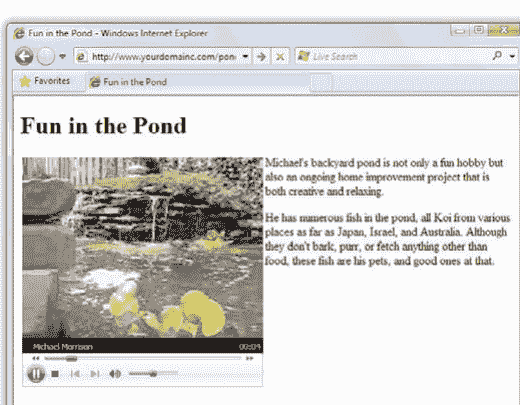

`<object>`标签的`width`和`height`属性决定了嵌入的Windows Media Player窗口的大小。如果你忽略这些属性，某些浏览器会自动缩放嵌入的播放器以适应内容，而其他一些则什么都不显示。我采取稳妥的做法，将它们设置为适合正在播放的多媒体内容的尺寸。

`<object>`标签内有四个`<param>`标签，负责片段播放方式的额外细节。每个标签有两个属性：`name`和`value`，负责将数据分配给特定设置。例如，媒体片段的`URL`被设置为`pond.wmv`。第三个参数`uiMode`决定了Windows Media Player提供哪些按钮和用户界面选项——全屏按钮和音量滑块。最后，`autoStart`参数设置为`true`则视频片段自动开始，或设置为`false`则视频片段在浏览器中打开页面时不自动开始播放。

`type`参数可能是最棘手的。它识别正在显示的媒体类型，在本例中，这是一个Windows Media Video (WMV)文件。这种媒体类型必须指定为标准的Internet MIME类型之一。

# 嵌入多媒体文件

MIME类型是用于唯一标识互联网上不同类型媒体对象的标识符。MIME代表“多用途互联网邮件扩展”（Multipurpose Internet Mail Extensions），这个名称源于MIME类型最初用于识别电子邮件附件。这些MIME类型应该在`type` `<object>`标签中使用，用以识别数据属性中引用的什么种多媒体对象。

以下是你可能在页面中使用的几种常用音频和视频格式的MIME：

- WAV音频—`audio/x-wav`
- AU音频—`audio/basic`
- MP3音频—`audio/mpeg`
- MIDI音频—`audio/midi`
- WMA音频—`audio/x-ms-wm`
- RealAudio—`audio/x-pn-realaudio.plugin`
- AVI—`video/x-msvideo`
- WMV—`video/x-ms-wmv`
- MPEG视频—`video/mpeg`
- QuickTime—`video/quicktime`

列表12.2显示了`pond`网页的相关代码，你可以在其中看到在上下文中出现的`<object>`标签。

# 列表 12.2 使用`<object>`标签直接嵌入WMV视频片段

```
<?xml version="1.0" encoding="UTF-8"?>

<!DOCTYPE html PUBLIC "-//W3C//DTD HTML 4.01//EN" "http://www.w3.org/TR/html4/loose.dtd">

<html lang="en">

<head>

  <title>Fun in the Pond</title>

</head>

<body>

  <h1>Fun in the Pond</h1>

  <div style="float:left; padding:10px">

    <object class="CLSID:6BF852A52-39A4-11D3-B153-00C0A47F9AAA6" width="320" height="305">

      <param name="type" value="video/x-ms-wmv" />

      <param name="URL" value="pond.wmv" />

    </object>

  </div>

</body>

</html>
```

## 注意

因为XHTML不支持`<embed />`标签，它会导致页面无法通过验证。遗憾的是，这真的没有办法。

# 列表 12.2 使用`<object>`标签直接嵌入WMV视频片段（续）

```
<object>

  <param name="uiMode" value="full" />

  <param name="autoStart" value="false" />

  <embed width="320" height="305" type="video/x-ms-wmv" src="pond.wmv" controls="false" autostart="false" plugin="http://www.microsoft.com/windowsmedia/" />

</object>

<div>

  <p>Michael的后院池不仅是一个爱好，还是一个持续的家庭项目。</p>

  <p>他的池子里有很多鱼，全部来自日本、以色列和澳大利亚等地方。虽然它们不会叫、喵喵或抓取食物以外的东西，但这些鱼是宠物，很好的宠物。</p>

</div>
```

# 关于多媒体的额外提示

在向你的网站添加视频、音频或动画之前，先问问自己是否真的应该这样做。当你使用这些类型的多媒体时，确保这样做是有理由的。无关的音频和视频，就像无关的图像一样，会损害你的整体信息。再次强调，如果你的信息是“看看我制作的视频”或“听我的音乐并下载一些歌曲”，那么多媒体绝对必须在你的网站中发挥作用。

## 使用多媒体的额外提示

这里有几点需要注意的提示：

- 不要在一个页面中包含多媒体并设置为在页面加载时自动播放。始终给用户提供启动（并停止）你的声音或视频的选项。

- 如果可能，给用户提供多媒体播放器的选择。不要将自己限制为只能由一种类型的播放器在一个操作系统上播放的多媒体内容。

- 多媒体文件比典型的图形和文本文件大，这意味着你需要在Web服务器上有足够的空间来存储它们，并有带宽将它们传输给任何通过你的网站请求的用户。

- 如果你的网站完全是音频或视频，且提供的文本或图形极少，请理解由于他们系统或带宽的限制，你的部分观众将无法看到或听听到你想要展示的内容。为这些用户提供获取你信息的选项。

- 利用免费的视频托管服务，例如`YouTube` (`http://www.youtube.com/`)。`YouTube`不仅为你的视频片段提供存储，还将为你提供将视频嵌入到自己的页面中所需的代码。例如，图12.4显示了世界上最可爱的小狗的`YouTube`页面。如果你复制并粘贴图中所示“嵌入”（Embed）区域的文本，你将得到如下：

```
<object width="425" height="344">

  <param name="movie" value="http://www.youtube.com/v/pYxiHd2BBopo&rel=0&0xb1b1b1color=2#0xcfcfcf&feature=player_autoplay&fs=1">

  <param name="fullscreen" value="true">

  <param name="allowScriptAccess" value="always">

  <embed

    src="http://www.youtube.com/v/pYxiHd2BBopo&rel=0&0xb1b1b1&ct    ype="application/x-shockwave-flash" fullscreen="true"

    allowScriptAccess="always" width="425" height="344"></embed>

</object>
```


然后你可以将该代码插入到你的网页中。

## 第 12 小时：在你的网站中使用多媒体

图 12.4

YouTube 提供你的视频文件存储，以及用于自己页面的链接和`<object>`代码。

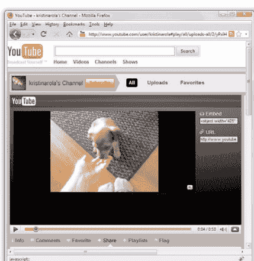

## 总结

在本小时中，你学习了如何将视频和声音嵌入网页中，这是播放媒体内容支持最广泛但灵活性最低的选项。接着，你学习了如何使用指向多媒体文件的简单链接，或者使用`<object>`标签将媒体播放器直接嵌入网页中。不仅如此，你还学会了为了最大的浏览器兼容性，用`<embed>`标签辅助`<object>`标签会有帮助。`<object>`和`<embed />`标签可以包含大量的媒体类型，包括 WAV、MP3、RealAudio 和 MIDI 文件——更不用说 AVI、WMV 和 QuickTime 视频，仅举如此。

表 12.1 总结了本小时讨论的标签。

## 表 12.1：第 12 小时涵盖的 HTML 标签和属性

| 标签/属性 | 功能 |
|---|---|
| `<object>...</object>` | 将图像、视频、Java applet、ActiveX 控制或其他对象插入文档。 |
| `<param>...</param>` | 对象的运行时设置，带有其在页面上占据区域的宽度和高度。 |

### 属性

| | |
|---|---|
| `name="name" value="value"` | 命名参数属性。与命名参数属性关联的值。 |
| `<embed />` | 嵌入多媒体文件以供插件应用程序读取或播放；此标签在技术上已废弃，但对于不完全支持`<object>`标签的浏览器仍然有用。 |

### 属性

| | |
|---|---|
| `width="width" height="height" type="mimetype"` | 嵌入对象的宽度（像素）。嵌入对象的高度（像素）。多媒体内容的 MIME 类型。 |
| `src="mediaurl" controls="controls"` | 媒体播放器用户输入控件的配置；使用`all`启用所有控件。 |
| `loop="loop"` | 播放一次媒体片段或循环反复地播放它；设置为`true`或`false`。 |
| `autostart="autostart"` | 打开页面时播放媒体片段；设置为`true`或`false`。 |
| `pluginpage="pluginurl"` | 播放媒体片段所需的插件的 URL。 |

## 问答

### 我听到很多关于流媒体视频和音频的内容。那是什么意思？

过去，通过大多数调制调器获取视频和音频文件需要几分钟，有时甚至几小时，这严重限制了在网页上包含视频和音频。大家都在转向流媒体视频或音频，即在数据接收的同时进行播放。换句话说，你不需要在完全下载片段之前就可以观看或收听它。

流式播放现在通过大多数媒体播放器广泛支持，包括独立版本和插件。当你使用`<object>`标签嵌入媒体对象时，如果播放器支持流媒体，底层媒体播放器会自动播放片段。

### 如何在 QuickTime、Windows AVI/WAV、RealVideo/RealAudio 和 MPEG 之间选择音视频格式？它们之间有显著差异吗？

QuickTime 是 Macintosh 用户最流行的视频格式，尽管 Windows 也有 QuickTime 播放器。同样，AVI/WMV/WAV/WMA 是 Windows 用户的视频和音频格式，但你可以为 Macintosh 获取支持这些格式的播放器。MPEG 是另一个流行的音视频标准。MPEG-3 (MP3) 作为高保真音频标准选择已经非常流行。另一种基于 MPEG 的音频格式是 Apple 的 AAC 格式，你可能作为原生的 iTunes 格式对其更熟悉。

如果你的观众使用 Windows，请使用 AVI/WMV 用于视频，使用 WAV/WMA 或 MP3 用于音频。如果你的观众包含大量的 Macintosh 用户，请使用 QuickTime 或 RealVideo/RealAudio，或者至少提供一些替代方案。MP3 也是 Mac 音频的可行选项。如果跨平台兼容性至关重要，考虑音频使用 MP3 或 RealVideo/RealAudio——尽管只有下载特殊的人可以。

## 工作坊

### 我听到很多关于流媒体视频和音频的内容。那是什么意思？

过去，通过大多数调制调器获取视频和音频文件需要几分钟，有时甚至几小时，这严重限制了在网页上包含视频和音频。大家都在转向流媒体视频或音频，即在数据接收的同时进行播放。换句话说，你不需要在完全下载片段之前就可以观看或收听它。

流式播放现在通过大多数媒体播放器广泛支持，包括独立版本和插件。当你使用`<object>`标签嵌入媒体对象时，如果播放器支持流媒体，底层媒体播放器会自动播放片段。

### 如何在 QuickTime、Windows AVI/WAV、RealVideo/RealAudio 和 MPEG 之间选择音视频格式？它们之间有显著差异吗？

QuickTime 是 Macintosh 用户最流行的视频格式，尽管 Windows 也有 QuickTime 播放器。同样，AVI/WMV/WAV/WMA 是 Windows 用户的视频和音频格式，但你可以为 Macintosh 获取支持这些格式的播放器。MPEG 是另一个流行的音视频标准。MPEG-3 (MP3) 作为高保真音频标准选择已经非常流行。另一种基于 MPEG 的音频格式是 Apple 的 AAC 格式，你可能作为原生的 iTunes 格式对其更熟悉。

如果你的观众使用 Windows，请使用 AVI/WMV 用于视频，使用 WAV/WMA 或 MP3 用于音频。如果你的观众包含大量的 Macintosh 用户，请使用 QuickTime 或 RealVideo/RealAudio，或者至少提供一些替代方案。MP3 也是 Mac 音频的可行选项。如果跨平台兼容性至关重要，考虑音频使用 MP3 或 RealVideo/RealAudio——尽管只有下载特殊的人可以。

## 测验

### 我听到很多关于流媒体视频和音频的内容。那是什么意思？

过去，通过大多数调制调器获取视频和音频文件需要几分钟，有时甚至几小时，这严重限制了在网页上包含视频和音频。大家都在转向流媒体视频或音频，即在数据接收的同时进行播放。换句话说，你不需要在完全下载片段之前就可以观看或收听它。

流式播放现在通过大多数媒体播放器广泛支持，包括独立版本和插件。当你使用`<object>`标签嵌入媒体对象时，如果播放器支持流媒体，底层媒体播放器会自动播放片段。

## 答案

1. 最简单的方法是链接到：`<a href="myvideo.avi">视频</a>`
2. 在页面中嵌入名为`myvideo.avi`的文件，你应该使用代码：

```xml
<object class="6B52A5E-39A4-11D3-B153-00C4F7FAA66" width="320" height="305">
  <param name="type" value="video/x-ms" />
  <param name="URL" value="myvideo.avi" />
  <param name="node" value="full" />
  <param name="AutoStart" value="false" />
  <embed width="320" height="305" type="video/x-ms" src="myvideo.avi" controls="All" loop="false" autostart="false" pluginpage="http://www.microsoft.com/windows/windowsmedia/" />
</object>
```

3. `<param name="loop" value="true" />`

## 练习

尝试创建自己的视频片段并将其嵌入网页，或者从网上找到一些免费资源并练习在文本中放置。

- 本小时涵盖的嵌入媒体的技术和标签也适用于 Flash 文件。要了解如何使用 Flash 在你的页面中放置交互动画，请查看 Flash 主页`http://www.adobe.com/products/flash/`。

# 第 13 小时：使用框架

你可能访问过某些网站，浏览器窗口似乎允许你在不同的页面之间移动。事实是，浏览器通过将窗口分为包含独立页面的区域允许你同时查看多个页面；每个区域被称为框架（frame）。当然，从用户的角度来看，一切都组合形成了一个单一窗口，但实际上有独立的页面在工作。

## 什么是框架？

框架是浏览器窗口内的矩形区域，与其他框架中的页面一起显示网页。从第一眼看，图 13.1 看起来像是一个普通的网页，但它实际上是两个独立的 HTML 页面，显示在同一个浏览器窗口中。每个页面显示在自己的框架中，水平排列并由水平条分开。

如果使用了框架（frames），通常是用于创建一个利用静态导航链接组的框架站点；你可以在图 13.1 顶部的框架中看到这些链接。当点击示例中的某一个链接时，框架不会改变；新页面将加载并显示在底部框架中（见图 13.2）。

图 13.2

点击“Products”（产品）会弹出一个新的底部页面，但顶部框架保持不变。

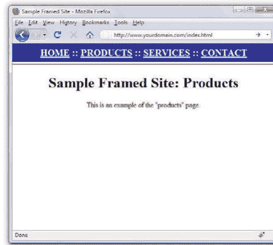

你应该意识到，框架长期以来一直是 Web 设计中一个令人头疼的问题。它的优点从未真正大于缺点，但由于浏览器对 HTML 和 CSS 标准的支持差异，尽管存在缺陷，框架仍被视为实现目标的一种方式。作为 Web 开发人员，我不建议使用框架，原因如下：

- 框架违背了 Web 的基本概念，即单个 Web 内容实例之间的超文本连接，这些内容可以通过单个 Web 地址（URL）进行访问。
- 打印框架站点的部分非常困难；除非你点击了想要打印的特定框架，并在右键菜单中（如果有的话）选择“打印此框架”，否则打印出来的只是框架本身，而它里面没有任何内容。
- 如果框架缺乏适当的编码，或者编码正确但被用于不法目的，用户可能会被困在框架站点内部，无法查看框架外的外部内容。

## 构建框架集（Building a Frameset）

在历史上，框架曾被取代标准的、专业的、无障碍的 Web 开发和设计方法。当有 CSS 布局这种更好的选项时，没有理由选择较差的。

由于这些（以及其他）原因，框架已从 HTML 5 标准中移除。过时的`<frame />`、`<frameset>`和`<noframes>`标签在未来不再是一个问题。尽管有这些缺点，你将在本小时内学会创建一个非常简单的框架站点。你可能仍然遇到框架站点，并且可能需要知道如何在不使用框架的情况下重新创建站点的“外观和感受”。在这种情况下，理解框架是如何构建的很重要，这样你才能成功地解构它们。

此外，你将学习一种框架——`<iframe>`——它具有重要用途，并且仍然存在于 HTML 5 中。

在本书的后部分，你将学习如何使用 XHTML 和 CSS 在不使用框架的情况下实现相同的功能。现在，跟随这个简单框架站点的构建过程，以便你学习应该撤销并以不同方式重新创建它。

## 构建框架集（Building a Frameset）

本节向你展示如何创建图 13.1 和 13.2 所示的简单框架站点。每个框架的内容都是作为普通的 HTML 页面创建的。分别是`top.html`（用于导航）、`home.html`、`products.html`、`services.html`和`contact.html`。这些页面不包含任何你在其他章节未见过的标签。使用了一种名为 frameset 文档的特殊页面将这些页面组合在一起；在这种情况下，该文档是`index.html`。

## 创建框架集文档（Creating a Frameset Document）

框架集文档是一个 HTML 页面，它指示浏览器将其窗口分成多个框架，并指定每个框架中应该显示哪个网页。

框架集文档实际上没有内容。它只是告诉浏览器加载哪些其他页面以及如何在浏览器窗口中编排它们。

## 第 13 小时：使用框架（HOUR 13: Working with Frames）

列表 13.1 显示了图 13.1 和图 13.2 所示示例框架站点的框架集文档。

### 列表 13.1：图 13.1 所示站点的框架集文档

```xml
<?xml version="1.0" encoding="UTF-8"?>
<!DOCTYPE html PUBLIC "-//W3C//DTD XHTML 1.0//EN"
  "http://www.w3.org/TR/xhtml1/DTD/xhtml1-frameset.dtd">
<html xmlns="http://www.w3.org/1999/xhtml" xml:lang="en">
<head>
  <title>Sample Framed Site</title>
</head>
<frameset rows="*">
  <frame src="top.html" name="top" />
  <frame src="home.html" name="main" />
</frameset>
<body>
  <h1>Sample Framed Site</h1>
  <p>Your browser does not support frames.</p>
</body>
</html>
```

（注：修正了闭合标签）需要注意的是，此示例中使用的 DTD 是 XHTML 1.0 Transitional。因此，为了验证页面，你必须使用`rows`或`cols`属性。你可以将框架的大小指定为像素或总量的百分比。在列表 13.1 中，`<frameset rows="*">`将窗口分成两个框架。顶部框架有 50 像素固定高度。底部框架将占据剩余空间。顶部框架包含`top.html`（见列表 13.2），底部框架包含`home.html`（见列表 13.3）。

### 列表 13.2：框架站点的`top.html`导航栏

```xml
<?xml version="1.0" encoding="UTF-8"?>
<!DOCTYPE html PUBLIC "-//W3C//DTD XHTML 1.0//EN"
  "http://www.w3.org/TR/xhtml1/DTD/xhtml1-frameset.dtd">
<html xmlns="http://www.w3.org/1999/xhtml" xml:lang="en">
<head>
  <title>Sample Framed Site</title>
</head>
<body style="background-color:#00FF">
  <div style="text-align:center;font-weight:bold;">
    <font size="4">
      <a style="color:#FFFFFF" href="home.html" target="main">Home</a>
      <a style="color:#FFFFFF" href="products.html" target="main">Products</a>
      <a style="color:#FFFFFF" href="services.html" target="main">Services</a>
      <a style="color:#FFFFFF" href="contact.html" target="main">Contact</a>
    </font>
  </div>
</body>
</html>
```

**提示**：在列表 13.1 的`frameset`之后，在`<noframes>`标签之间有一个完整的`body`。这在图 13.1 或 13.2 中完全没有出现。所有网络浏览器都会忽略`<noframes>`和`</noframes>`标签。所有主流浏览器都支持框架集，因此框架的兼容性问题比过去不那么显著。即使包含`<noframes>`标签也能涵盖少数仍在使用古老浏览器的用户。

### 列表 13.3：框架站点内的`home.html`单框架

```xml
<?xml version="1.0" encoding="UTF-8"?>
<!DOCTYPE html PUBLIC "-//W3C//DTD XHTML 1.0//EN"
  "http://www.w3.org/TR/xhtml1/DTD/xhtml1-frameset.dtd">
<html xmlns="http://www.w3.org/1999/xhtml" xml:lang="en">
<head>
  <title>Sample Framed Site</title>
</head>
<body style="background-color:#FFFFFF">
  <h1 style="text-align:center">Sample Framed Site: Home</h1>
  <p style="text-align:center">This is an example of the "home" page.</p>
</body>
</html>
```

**注意**：列表 13.2 和列表 13.3 中的页面使用了 XHTML 1.0 Transitional DTD。XHTML 1.1 更新且简单得多，但框架要求你为了验证目的坚持使用 XHTML 1.0，因此对于内部出现的框架也使用 XHTML 1.0 也是合理的。

## 第 13 小节：使用框架（Frames）

在查看网页时，使用百分比而不是精确的像素值来规定行和列的大小会更方便。例如，要让左侧占据浏览器窗口宽度的 20%，右侧框架占据剩余的 80%，你可以输入以下内容：

```html
<frameset cols="20%,80%">
```


每当你用像素指定任何大小时，最好在同一个 `<frameset>` 中包含至少一个带有通配符（`*`）的框架，这样文档就可以增长到填充任何大小。

## 添加单个框架

在`<frameset>` 和 `</frameset>` 标签之间，你应该包含一个 `<frame />`，指示在每个框架中显示哪个 HTML 文档。注意，如果你的 `<frame />` 标签数量少于 `<frameset>` 标签定义的框架数量，剩余的框架将保持空白。

在 `<frame>` 中包含 `src` 属性，并指定要在该框架中加载的网页地址。如果你只想让框架中包含单张图片，可以放置图片而不是网页。

## 框架与窗口之间的链接

当你通过 `<frame />` 标签中的 `name` 属性为框架赋予唯一名称时，框架的真正威力就开始显现了。你可以使用 `<a>` 标签中的 `target` 属性，使页面上的任何链接改变该框架。例如，列表 1.13 包含以下：

```
<frame src="home.html" name="main" />
```

这段代码在页面加载时在框架中显示 `home.html` 框架，并将该框架命名为 `main`。

在框架的代码中（显示在列表 13.2），你会看到以下链接：

```
<a style="color:#FFFFFF;" href="services.html" target="main">SERVICES</a>
```

当用户点击此链接时，`services.html` 将显示在名为 `main` 的框架（下方的框架）中。如果漏掉了 `target="main"` 属性，`services.html` 页面将显示在当前（框架）中。

为了节省空间，我没有提供 `services.html` 页面的列表；它只是一个没有特殊框架相关功能的普通网页。你可以从图 13.2 查看它在框架中的样子。

你可以在框架代码中使用一些 HTML 属性来消除框架分隔线、通过缩小边距为小框架留出更多空间，并强制框架不显示滚动条。列表 13.4 显示了列表 13.1 代码的修改版本。代码的两个更改是在 `<frame>` 标签中增加了以下属性：`scrolling="no"` 和 `frameborder="0"`。

### 列表 13.4 图 13.3 所示的 Frameset 文档

```xml
<?xml version="1.0" encoding="UTF-8"?>
<!DOCTYPE html PUBLIC "-//W3C//DTD HTML 1.0 Frameset//EN"
"http://www.w3.org/TR/html10/frameset.dtd">
<html xmlns="http://www.w3.org/1999/xhtml" xml:lang="en">
<head>
<title>示例框架站点</title>
</head>
<frameset rows="50,*">
<frame src="top.html" name="top" scrolling="no" frameborder="0" />
<frame src="home.html" name="main" scrolling="no" frameborder="0" />
</frameset>
<body>
<h1>示例框架站点</h1>
您的浏览器不支持框架。抱歉！
</body>
</frameset>
</html>
```

13.3 这是在向 `<frame />` 标签添加属性后，在列表 13.4 中显示的页面代码。

## 使用框架

## 使用内联框架 (Inline Frames)

内联框架没有像普通框架那样的可用性问题，但内联框架有不同的用途。它不是纯粹的布局技巧，`<iframe>` 的用法类似于 `<object>` 标签——在现有文档中放置部分内容。在 `<object>` 标签的情况下，“内容”通常是多媒体。你可以使用 `<iframe>` 嵌入完全独立的 HTML 文档、图片或其他源。列表 13.5 和列表 13.6 显示了源 13.4 中生成内联框架的代码。

### 列表 13.5 调用 `<iframe>` 的 XHTML 代码

```xml
<?xml version="1.0" encoding="UTF-8"?>
<!DOCTYPE html PUBLIC "//W3C//DTD HTML 1.0 Frameset//EN"
"http://www.w3.org/TR/html1/xhtml1-frameset.dtd">
<html xmlns="http://www.w3.org/1999/xhtml" xml:lang="en">
<head>
<title>使用 iframe</title>
</head>
<body style="background-color:#CCCCCC">
<h1 style="text-align:center">内联框架示例</h1>
<div style="text-align:center">
<iframe src="src.html" style="width:50px;height:100px;border:1px solid black;background-color:#FFFFFF">
<p>噢噢...您的浏览器不支持 iframe。</p>
</iframe>
</div>
</body>
</html>
```

你在列表 13.5 中尚未遇到的代码是 `<iframe>` 属性——源——你可以看到它需要一个 `src` 值，并且可以使用样式来定义宽度、高度、边框类型和背景颜色（以及其他）。列表 13.6 显示了 `<iframe>` 的源。

### 列表 13.6 在列表 13.5 中调用的 `<iframe>` 源码

```xml
<?xml version="1.0" encoding="UTF-8"?>
<!DOCTYPE html PUBLIC "//W3C//DTD HTML 1.0 Frameset//EN"
"http://www.w3.org/TR/html1/xhtml1-frameset.dtd">
<html xmlns="http://www.w3.org/1999/xhtml" xml:lang="en">
<head>
<title>iframe source</title>
</head>
<body>
<p style="color:#FF0000;font-weight:bold">
```

## 第 13 小时：使用框架（Frames）

因此，必须从任何计划将其页面放入你的框架中的那里获得明确的书面许可（就像你要将他们网站上的图像或文本放在你自己的页面上一样）。

- 我需要在所有的框架中都放入 `<title>` 标签吗？如果我这样做，标题会显示在窗口顶部吗？

- `frameset` 文档的标题是唯一会显示的标题。在框架文档中，不需要 `<head>` 和 `<title>` 标签，但为所有页面设置标题是一个好主意，以防用户在任何框架之外之外单独打开其中一个页面。

## 工作坊

工作坊包含测验题和活动，旨在帮助你巩固对所涵盖内容的理解。请在查看后续“答案”部分之前尝试回答所有问题。

## 测验

- 1. 编写 HTML 代码，在占据浏览器窗口左侧 25% 的框架中列出 `Mickey`、`Minnie` 和 `Donald` 这三个名字。使得点击每个名字都能在浏览器窗口右侧 75% 处打开相应的网页。

- 2. 什么样的 `<iframe>` 代码可以产生一个无边框、白色背景、占据页面宽度 98% 且高度为 250 像素的 `<iframe>`？

## 答案

- 1. 你需要五个 HTML 文档。第一个文档是 `frameset`：

```html
<html>
<head>
  <title>Our Friends</title>
</head>
<frameset cols="25%,75%">
  <frame src="index.html" />
  <frame src="mickey.html" name="mainframe" />
</frameset>
</html>
```

## 练习

接下来，你需要用于左侧框架的 `index.html` 文档：

```html
<html>
<head>
  <title>Our Friends Index</title>
</head>
<body>
  <p>Pick a friend:</p>
  <a href="mickey.html" target="mainframe">Mickey</a><br />
  <a href="minnie.html" target="mainframe">Minnie</a><br />
  <a href="donald.html" target="mainframe">Donald</a></p>
</body>
</html>
```

最后，你需要三个名为 `mickey.html`、`minnie.html` 和 `donald.html` 的 HTML 页面。它们包含了关于每个朋友的信息。

- 2. 使用以下代码：
```html
<iframe src="some_source.html" style="width:98%;height:250px;border:none;background-color:#FFFFFF">
  <p>Put message here for people not to see the inline frame.</p>
</iframe>
```

## 练习

- 思考你可能想要使用框架布局的原因，然后在纸上画出这种布局。保存此草图，以备接下来的课程中使用，届时将学习使用 XHTML 和 CSS 设计布局，因为这些技术提供了符合标准且用户友好的方式来实现类似的显示和功能。

- 思考一些你可以在你的网站中使用一个或两个 `<iframe>` 的方法——也许用于广告，或者可能利用你可以提供给用户的免费 Google 站点搜索。在你的设计中为该元素留出空间。

## 使用外边距（Margins）、内边距（Padding）、对齐（Alignment）和浮动（Floating）

现在你已经学习了创建 Web 内容的一些基础知识，你将在这一小时内学习 CSS 的细节来增强内容。在之前的几个小时里，你学习了如何使用基本的 CSS 用于显示（例如字体大小和颜色）。在接下来的几小时中，你将深入使用 CSS 来控制整个 Web“页面”的各个方面，而不仅仅是单个文本或图形。

在此小时你将学习：

- 如何在元素周围添加外边距（`margins`）
- 如何在元素内部添加内边距（`padding`）
- 如何保持对齐
- 如何使用 `float` 属性

在处理页面布局之前，在将所有属性结合在一起之前，理解每个 CSS 属性是非常重要的：

- `margin` 和 `padding` 属性——用于在元素周围添加空间。

- `align` 和 `float` 属性——用于与其他元素相对放置元素。

本小时提供的示例并非创建过的最时尚的 Web 内容示例，但也不是如此。相反，这些示例清晰地展示了 XHTML 和 CSS 是如何协同工作的。一旦你通过现在和其他小时掌握了 CSS，你就能创建像图 14.1 所示的 Web 杰作（CSS Garden 中的一个示例）。CSS Garden 上的网站可能不像你经常访问的典型电子商务或社交网络网站。相反，这些网站展示了使用 CSS 可以展开的艺术可能性。不要误会，这些网站需要仔细的思考和规划，但设计的潜力是无限的。

## 第 14 小时：使用外边距、内边距、对齐和浮动

图 14.1 是 CSS Garden 中 XHTML 和 CSS 工作的许多示例之一。

注意

CSS Garden 网站 (`http://www.cssgarden.com/`) 显示了通过符合标准的 CSS 实现的设计类型。所有项目都使用完全相同的 HTML 文件，但艺术家可以自由修改 CSS 文件以创建自己的视觉显示。图 14.1 所示的示例来自 Stuff and Nonsense 的 Andy Clarke (`http://www.stuffnonsense.co.uk/img/586b23dc17cd4a222.png`)。

## 使用外边距（Margins）

样式表外边距允许你在 Web 页面上的元素外部添加空间。请记住，`margin` 作用于元素外部的空间。以下是设置外边距的样式：

- `margin-top`——设置顶部外边距
- `margin-right`——设置右侧外边距
- `margin-bottom`——设置底部外边距
- `margin-left`——设置左侧外边距

你可以使用简写来设置外边距：

- 单个值——设置所有方向的外边距
- 两个值——第一个设置顶部和底部，第二个设置右侧和左侧
- 三个值——前两个设置顶部、右、底部，第三个设置左侧
- 四个值——分别设置顶部、右、底部和左侧

你可以使用 `auto` 来设置外边距，这会将元素水平居中对齐（例如 `margin: 0 auto;`）。

# 使用外边距 (Margins)

215

图 14.2

颜色块示例页面显示了四个颜色块，每个颜色块都有相同的外边距。

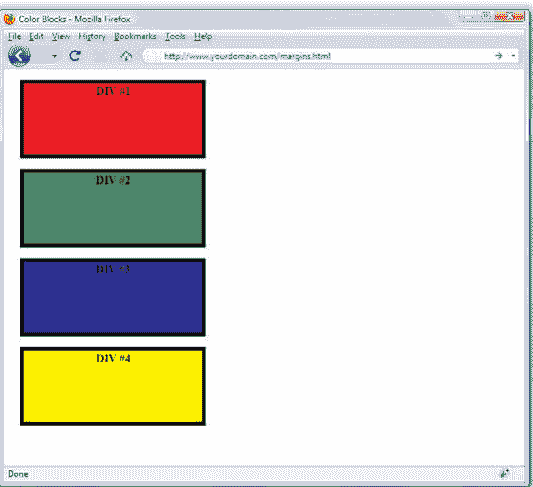

在心中记住，我们将所有这些项的 `margin-right` 设置为 `0px`。除此之外，下一组目标是产生以下效果：

- 第一个颜色块周围没有外边距。
- 第二个颜色块的左侧边距为 15 像素，顶部边距为 5 像素，底部没有。
- 第三个颜色块的左侧边距为 75 像素，顶部和底部没有外边距。
- 第四个颜色块的左侧边距为 250 像素，顶部边距为 25 像素。

这似乎很简单——第一个块周围没有设置外边距。但我们希望在第二个块的顶部有一个外边距，所以实际上即使我们没有为第一个块指定外边距，第一个和第二个块之间仍然会有可见的外边距。

这四个命名的 `<div>` 的新样式表现在看起来像这样：

```
div#d1 {
  background-color:red;
  margin:0px;
}

div#d2 {
  background-color:green;
  margin:5px 0px 0px 15px;
}

div#d3 {
  background-color:blue;
  margin:0px 0px 0px 75px;
}

div#d4 {
  background-color:yellow;
  margin:25px 0px 0px 25px;
}
```

列表 14.2 的结果（见图 14.3）看起来是随机的，但实际上对于指出其他几个重要点非常有用。例如，当你回想起其中一个目标是让第一个颜色块周围完全没有外边距时，你可能认为颜色块的边框会与浏览器窗口对齐。但正如图 14.3 所示，页面内容与浏览器窗口框架之间有明显的间留。

图 14.3
颜色块示例页的修改显示了一些不同的外边距。

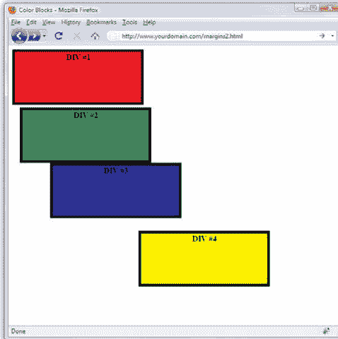

# 使用外边距 (Margins)

如果我们正在处理元素放置——我们将在接下来的一小时内讨论——这会导致你的布局出现问题。为了确保你的放置和外边距是从与浏览器对齐的位置开始计算的，你需要处理 `<body>` 元素的外边距。在这种情况下，你将向你的样式表中添加以下内容：

```
body {
  margin:0px;
}
```

另一个需要记住的“陷阱”（gotcha）是，如果你有两个带边框的元素堆叠在一起但它们之间没有外边距，它们接触的地方看起来将有双倍边框。你可能考虑将上方元素的 `border-bottom` 设置为宽度的一半，并让下方的元素的 `border-top` 设置为宽度的一半。如果你这样做，堆叠在一起时，边框看起来将与其他的一样宽。

此外，你可能认为通过使用 250 像素的左侧边距——第四个颜色块的宽度将从第三个颜色块结束的地方开始。然而，情况并非如此，因为第三个颜色块有 75 像素的 `margin-left`。为了让它们尽可能对齐，第四个的 `margin-left` 值必须是 325 像素。

更改样式以显示产生图 14.4 中间距的代码。这为 `<body>` 元素设置了零外边距，确保 25 像素的 `margin-left` 值确实距离浏览器框架边缘 25 像素。它还显示了第二个和第三个颜色块堆叠在一起，但通过对边框元素进行修改，没有出现双倍边框。此外，第四个颜色块从第三个颜色块结束的地方开始。

```
body {
  margin:0px;
}

div {
  width:250px;
  height:100px;
  color:black;
  font-weight:bold;
  text-align:center;
}

div#d1 {
  border:5px solid #000000;
  background-color:red;
  margin:0px;
}

div#d2 {
  border-width:6px 3px 6px;
  border-style:solid;
  border-color:#000000;
  background-color:green;
  margin:10px 0px 0px 15px;
}

div#d3 {
  border-width:3px 6px 6px;
  border-style:solid;
  border-color:#000000;
  background-color:blue;
  margin:0px 0px 0px 15px;
}

div#d4 {
  border:5px solid #000000;
  background-color:yellow;
  margin:0px 0px 0px 25px;
}
```


# 使用外边距 (Margins)

如果我们正在处理元素放置——我们将在接下来的一小时内讨论——这会导致你的布局出现问题。为了确保你的放置和外边距是从与浏览器对齐的位置开始计算的，你需要处理 `<body>` 元素的外边距。在这种情况下，你将向你的样式表中添加以下内容：

```css
body {
  margin: 0px;
}
```

另一个需要记住的“陷阱”是，如果你有两个带边框的元素堆叠在一起但它们之间没有外边距，它们接触的地方看起来将有双倍边框。你可能考虑将上方元素的 `border-bottom` 设置为宽度的一半，并让下方的元素的 `border-top` 设置为宽度的一半。如果你这样做，堆叠在一起时，边框看起来将与其他的一样宽。

此外，你可能认为通过使用 250 像素的左侧边距——第四个颜色块的宽度将从第三个颜色块结束的地方开始。然而，情况并非如此，因为第三个颜色块有 75 像素的 `margin-left`。为了让它们尽可能对齐，第四个的 `margin-left` 值必须是 325 像素。

更改样式以显示产生图 14.4 中间距的代码。这为 `<body>` 元素设置了零外边距，确保 25 像素的 `margin-left` 值确实距离浏览器框架边缘 25 像素。它还显示了第二个和第三个颜色块堆叠在一起，但通过对边框元素进行修改，没有出现双倍边框。此外，第四个颜色块从第三个颜色块结束的地方开始。

```css
body {
  margin: 0px;
}

div {
  width: 250px;
  height: 100px;
  color: black;
  font-weight: bold;
  text-align: center;
}

div#d1 {
  border: 5px solid #000000;
  background-color: red;
  margin: 0px;
}

div#d2 {
  border-width: 6px 3px 6px;
  border-style: solid;
  border-color: #000000;
  background-color: green;
  margin: 10px 0px 0px 15px;
}

div#d3 {
  border-width: 3px 6px 6px;
  border-style: solid;
  border-color: #000000;
  background-color: blue;
  margin: 0px 0px 0px 15px;
}

div#d4 {
  border: 5px solid #000000;
  background-color: yellow;
  margin: 0px 0px 0px 25px;
}
```

图 14.4
对颜色块的第三次修改将项目建立了相互关系。


## 使用内边距 (Padding)

颜色块示例页面显示了四个颜色块，每个颜色块都有相同的外边距。


在心中记住，我们将所有这些项的 `margin-right` 设置为 `0px`。除此之外，下一组目标是产生以下效果：

- 第一个颜色块周围没有外边距。
- 第二个颜色块的左侧边距为 15 像素，顶部边距为 5 像素，底部没有。
- 第三个颜色块的左侧边距为 75 像素，顶部和底部没有外边距。
- 第四个颜色块的左侧边距为 250 像素，顶部边距为 25 像素。

这似乎很简单——第一个块周围没有设置外边距。但我们希望在第二个块的顶部有一个外边距，所以实际上即使我们没有为第一个块指定外边距，第一个和第二个块之间仍然会有可见的外边距。

这四个命名的 `<div>` 的新样式表现在看起来像这样：

```css
div#d1 {
  background-color: red;
  margin: 0px;
}

div#d2 {
  background-color: green;
  margin: 5px 0px 0px 15px;
}

div#d3 {
  background-color: blue;
  margin: 0px 0px 0px 75px;
}

div#d4 {
  background-color: yellow;
  margin: 25px 0px 0px 25px;
}
```

列表 14.2 的结果（见图 14.3）看起来是随机的，但实际上对于指出其他几个重要点非常有用。例如，当你回想起其中一个目标是让第一个颜色块周围完全没有外边距时，你可能认为颜色块的边框会与浏览器窗口对齐。但正如图 14.3 所示，页面内容与浏览器窗口框架之间有明显的间留。

图 14.3
颜色块示例页的修改显示了一些不同的外边距。


# 使用外边距 (Margins)

图 14.2  
颜色块示例页面显示了四个颜色块，每个颜色块都有相同的外边距。  


在心中记住，我们将所有这些项的`margin-right`设置为`0px`。除此之外，下一组目标是产生以下效果：

- 第一个颜色块周围没有外边距。
- 第二个颜色块的左侧边距为 15 像素，顶部边距为 5 像素，底部没有。
- 第三个颜色块的左侧边距为 75 像素，顶部和底部没有外边距。
- 第四个颜色块的左侧边距为 250 像素，顶部边距为 25 像素。

这似乎很简单——第一个块周围没有设置外边距。但我们希望在第二个块的顶部有一个外边距，所以实际上即使我们没有为第一个块指定外边距，第一个和第二个块之间仍然会有可见的外边距。

这四个命名的`<div>`的新样式表现在看起来像这样：

```
div#d1 {
  background-color:red;
  margin:0px;
}
div#d2 {
  background-color:green;
  margin:5px 0px 0px 15px;
}
div#d3 {
  background-color:blue;
  margin:0px 0px 0px 75px;
}
div#d4 {
  background-color:yellow;
  margin:25px 0px 0px 25px;
}
```

列表 14.2 的结果（见图 14.3）看起来是随机的，但实际上对于指出其他几个重要点非常有用。例如，当你回想起其中一个目标是让第一个颜色块周围完全没有外边距时，你可能认为颜色块的边框会与浏览器窗口对齐。但正如图 14.3 所示，页面内容与浏览器窗口框架之间有明显的间留。

图 14.3  
颜色块示例页的修改显示了一些不同的外边距。  


## 使用外边距的注意事项

如果我们正在处理元素放置——我们将在接下来的一小时内讨论——这会导致你的布局出现问题。为了确保你的放置和外边距是从与浏览器对齐的位置开始计算的，你需要处理`<body>`元素的外边距。在这种情况下，你将向你的样式表中添加以下内容：

```
body {
  margin:0px;
}
```

另一个需要记住的“陷阱”是，如果你有两个带边框的元素堆叠在一起但它们之间没有外边距，它们接触的地方看起来将有双倍边框。你可能考虑将上方元素的`border-bottom`设置为宽度的一半，并让下方的元素的`border-top`设置为宽度的一半。如果你这样做，堆叠在一起时，边框看起来将与其他的一样宽。

此外，你可能认为通过使用 250 像素的左侧边距——第四个颜色块的宽度将从第三个颜色块结束的地方开始。然而，情况并非如此，因为第三个颜色块有 75 像素的`margin-left`。为了让它们尽可能对齐，第四个的`margin-left`值必须是 325 像素。

更改样式以显示产生图 14.4 中间距的代码。这为`<body>`元素设置了零外边距，确保 25 像素的`margin-left`值确实距离浏览器框架边缘 25 像素。它还显示了第二个和第三个颜色块堆叠在一起，但通过对边框元素进行修改，没有出现双倍边框。此外，第四个颜色块从第三个颜色块结束的地方开始。

```
body {
  margin:0px;
}
div {
  width:250px;
  height:100px;
  color:black;
  font-weight:bold;
  text-align:center;
}
div#d1 {
  border:5px solid #000000;
  background-color:red;
  margin:0px;
}
div#d2 {
  border-width:6px 3px 6px;
  border-style:solid;
  border-color:#000000;
  background-color:green;
  margin:10px 0px 0px 15px;
}
div#d3 {
  border-width:3px 6px 6px;
  border-style:solid;
  border-color:#000000;
  background-color:blue;
  margin:0px 0px 0px 15px;
}
div#d4 {
  border:5px solid #000000;
  background-color:yellow;
  margin:0px 0px 0px 25px;
}
```

图 14.4  
对颜色块的第三次修改将项目建立了相互关系。  


## 使用内边距 (Padding)

颜色块示例页面显示了四个颜色块，每个颜色块都有相同的外边距。  


在心中记住，我们将所有这些项的`margin-right`设置为`0px`。除此之外，下一组目标是产生以下效果：

- 第一个颜色块周围没有外边距。
- 第二个颜色块的左侧边距为 15 像素，顶部边距为 5 像素，底部没有。
- 第三个颜色块的左侧边距为 75 像素，顶部和底部没有外边距。
- 第四个颜色块的左侧边距为 250 像素，顶部边距为 25 像素。

这似乎很简单——第一个块周围没有设置外边距。但我们希望在第二个块的顶部有一个外边距，所以实际上即使我们没有为第一个块指定外边距，第一个和第二个块之间仍然会有可见的外边距。

这四个命名的`<div>`的新样式表现在看起来像这样：

```
div#d1 {
  background-color:red;
  margin:0px;
}
div#d2 {
  background-color:green;
  margin:5px 0px 0px 15px;
}
div#d3 {
  background-color:blue;
  margin:0px 0px 0px 75px;
}
div#d4 {
  background-color:yellow;
  margin:25px 0px 0px 25px;
}
```

列表 14.2 的结果（见图 14.3）看起来是随机的，但实际上对于指出其他几个重要点非常有用。例如，当你回想起其中一个目标是让第一个颜色块周围完全没有外边距时，你可能认为颜色块的边框会与浏览器窗口对齐。但正如图 14.3 所示，页面内容与浏览器窗口框架之间有明显的间留。

图 14.3  
颜色块示例页的修改显示了一些不同的外边距。  


## 使用外边距 (Margins)

如果我们正在处理元素放置——我们将在接下来的一小时内讨论——这会导致你的布局出现问题。为了确保你的放置和外边距是从与浏览器对齐的位置开始计算的，你需要处理`<body>`元素的外边距。在这种情况下，你将向你的样式表中添加以下内容：

```
body {
  margin:0px;
}
```

另一个需要记住的“陷阱”是，如果你有两个带边框的元素堆叠在一起但它们之间没有外边距，它们接触的地方看起来将有双倍边框。你可能考虑将上方元素的`border-bottom`设置为宽度的一半，并让下方的元素的`border-top`设置为宽度的一半。如果你这样做，堆叠在一起时，边框看起来将与其他的一样宽。

此外，你可能认为通过使用 250 像素的左侧边距——第四个颜色块的宽度将从第三个颜色块结束的地方开始。然而，情况并非如此，因为第三个颜色块有 75 像素的`margin-left`。为了让它们尽可能对齐，第四个的`margin-left`值必须是 325 像素。

更改样式以显示产生图 14.4 中间距的代码。这为`<body>`元素设置了零外边距，确保 25 像素的`margin-left`值确实距离浏览器框架边缘 25 像素。它还显示了第二个和第三个颜色块堆叠在一起，但通过对边框元素进行修改，没有出现双倍边框。此外，第四个颜色块从第三个颜色块结束的地方开始。

```
body {
  margin:0px;
}
div {
  width:250px;
  height:100px;
  color:black;
  font-weight:bold;
  text-align:center;
}
div#d1 {
  border:5px solid #000000;
  background-color:red;
  margin:0px;
}
div#d2 {
  border-width:6px 3px 6px;
  border-style:solid;
  border-color:#000000;
  background-color:green;
  margin:10px 0px 0px 15px;
}
div#d3 {
  border-width:3px 6px 6px;
  border-style:solid;
  border-color:#000000;
  background-color:blue;
  margin:0px 0px 0px 15px;
}
div#d4 {
  border:5px solid #000000;
  background-color:yellow;
  margin:0px 0px 0px 25px;
}
```

图 14.4  
对颜色块的第三次修改将项目建立了相互关系。  


## 使用内边距 (Padding)

颜色块示例页面显示了四个颜色块，每个颜色块都有相同的外边距。  


在心中记住，我们将所有这些项的`margin-right`设置为`0px`。除此之外，下一组目标是产生以下效果：

- 第一个颜色块周围没有外边距。
- 第二个颜色块的左侧边距为 15 像素，顶部边距为 5 像素，底部没有。
- 第三个颜色块的左侧边距为 75 像素，顶部和底部没有外边距。
- 第四个颜色块的左侧边距为 250 像素，顶部边距为 25 像素。

这似乎很简单——第一个块周围没有设置外边距。但我们希望在第二个块的顶部有一个外边距，所以实际上即使我们没有为第一个块指定外边距，第一个和第二个块之间仍然会有可见的外边距。

这四个命名的`<div>`的新样式表现在看起来像这样：

```
div#d1 {
  background-color:red;
  margin:0px;
}
div#d2 {
  background-color:green;
  margin:5px 0px 0px 15px;
}
div#d3 {
  background-color:blue;
  margin:0px 0px 0px 75px;
}
div#d4 {
  background-color:yellow;
  margin:25px 0px 0px 25px;
}
```

列表 14.2 的结果（见图 14.3）看起来是随机的，但实际上对于指出其他几个重要点非常有用。例如，当你回想起其中一个目标是让第一个颜色块周围完全没有外边距时，你可能认为颜色块的边框会与浏览器窗口对齐。但正如图 14.3 所示，页面内容与浏览器窗口框架之间有明显的间留。

图 14.3  
颜色块示例页的修改显示了一些不同的外边距。  


`margin:10px 0px 0px 15px;`

}

`div#d3` {

  `border-width:3px 6px 6px;`

  `border-style:solid;`

  `border-color:#000000;`

  `background-color:blue;`

  `margin:0px 0px 0px 15px;`

}

`div#d4` {

  `border:5px solid #000000;`

  `background-color:yellow;`

  `margin:0px 0px 0px 25px;`

}

```

图 14.4
对颜色块的第三次修改将项目建立了相互关系。


## 第 14 小时：外边距、内边距、对齐与浮动

列表 14.2 生成带有边框、外边距和内边距的四个彩色 `<div>` 的简单代码

```css
div#d4 {

  background-color:yellow;

  text-align:center;

  padding:50px;

}

</style>

</head>

<body>

<div id="d1"></div>

<div id="d2"></div>

<div id="d3"></div>

<div id="d4"></div>

</body>

</html>
```

图 14.8 基础颜色块示例页面显示了四个具有不同内边距的颜色块。

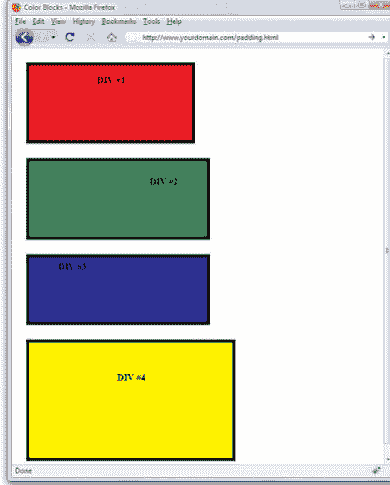

你应该立即意识到这个例子中有些异常。所有的颜色块本应是 250 像素宽、100 像素高。图 14.6 中的颜色块之所以大小不均匀，是因为尽管我们努力控制 `<div>` 的大小，但稍后应用的内边距（`padding`）覆盖了初始的尺寸声明。

如果你将文本放在 `<p>` 元素中并为该元素设置白色背景（见图 14.7），你就可以看到内边距是相对于文本的。当没有空间使用所有定义的内边距时，周围的元素必须进行调整。你将在第 15 小时“理解 CSS 盒模型和定位”中详细学习这种效果。

图 14.7
显示相对于文本的内边距。

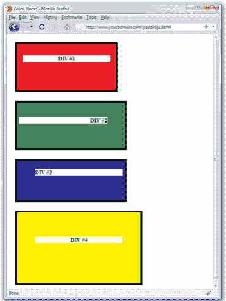

在用 CSS 进行网页设计时，你所做的最多的“微调”或“推移”都与外边距（`margins`）和内边距（`padding`）有关。只需记住：外边距在元素外部，内边距在元素内部。

## 保持一切对齐

由于网页上的内容并不总是充满显示它的矩形区域的宽度，控制内容的对齐通常很有帮助。即使矩形区域内的文本延伸到多行，对齐仍然派上用场，因为你可能希望文本左对齐、右对齐或居中对齐。有两个属性允许你控制元素的对齐：`text-align` 和 `vertical-align`。

## 第 14 小时：外边距、内边距、对齐与浮动

你在第 11 小时看到过这些样式属性的实际示例——对齐图像，但再次提到这些属性也无妨，因为对齐在整体页面设计中也起着作用。

作为复习，使用 `text-align` 在元素的边界区域内水平对齐元素，并可以设置为左、右、居中或端对齐。

`vertical-align` 属性与 `text-align` ，但它用于垂直对齐元素。`vertical-align` 属性指定元素如何与其父元素对齐，或者在某些情况下与页面上的当前元素行对齐。“当前行”指的是出现在同一个父元素内的元素的垂直位置——换句话说，即行内元素。如果多个行内元素出现在同一行，你可以设置它们的垂直对齐方式以使它们在垂直方向上对齐。一个很好的例子是一行接一个出现的图像——`vertical-align` 属性允许你在垂直方向上对齐它们。

以下是 `vertical-align` 属性的常用值：

- `top`—将元素的顶部与当前行对齐。
- `middle`—将元素的中间与其父元素的中间对齐。
- `bottom`—将元素的底部与当前行对齐。
- `top`—将元素的顶部与父元素的顶部对齐。
- `baseline`—将元素的基线与父元素的基线对齐。
- `text-bottom`—将元素的底部与父元素的底部对齐。

对齐与外边距、内边距以及——正如你在下一节中将学到的——`float`（浮动）属性配合，让你保持对设计的控制。

## 理解 `float` 属性

理解 `float` 属性是理解基于 CSS 的布局设计的基础；它是理解这些元素如何组合在一起的最后拼图之一。简而言之，`float` 属性允许元素在设计中移动，使其他元素环绕它们排列。你经常会发现浮动与图像配合（正如你在第 11 小时看到的），但你也可以——许多设计师也是这样做——在布局中浮动各种元素。

元素是水平浮动的，而不是垂直浮动的，所以你只需要考虑两个可能的值：`right` 和 `left`。使用时，元素会向右或向左（取决于 `float` 的值）浮动到容器元素允许的程度。如果你有三个 `left` 的 `<div>` 值，它们将全部对齐在容器 `body` 的左侧。如果你在另一个 `<div>` 内部使用 `<div>`，它们将对齐在该元素的左侧，即使该元素本身已浮动到右侧。

理解浮动最好的方法是看几个示例，让我们继续看列表 14.3。该列表定义了三个矩形 `<div>` 并让它们并排浮动（向左浮动）。

列表 14.3 使用 `float` 控制 `<div>`

```html
<?xml version="1.0" encoding="UTF-8"?>

<!DOCTYPE html PUBLIC "-//W3C//DTD HTML 4.01//EN" "http://www.w3.org/TR/REC41/loose.dtd">

<html lang="en">

<head>

<title>Color Blocks</title>

<style type="text/css">

body {

  margin:0;

}

div {

  width:250px;

  height:100px;

  border:5px solid #000;

}

#div1 {

  background-color:red;

  float:left;

}

#div2 {

  background-color:green;

  float:left;

}

#div3 {

  background-color:blue;

  float:left;

}

</style>

</head>

<body>

<div id="d1"></div>

<div id="d2"></div>

<div id="d3"></div>

</body>

</html>
```

## 工作坊

工作坊包含测验题和活动，帮助你巩固对所涵盖内容的理解。在查看随后的“答案”部分之前，请回答所有问题。

## 测验

1. 要将两个 `<div>` 元素并排放置，并在之间保持 30 像素的间距，你可以在样式表中使用哪一个或哪些条目？
2. 使用哪种 CSS 样式属性和值可以确保内容不会出现在浮动元素的左侧？
3. 使用什么样式表条目可以将文本放置在 `<div>` 内部，使其距离元素顶部 12 像素？

## 答案

1. 你可以使用多种方法。第一个 `<div>` 使用 `margin-right:15px` 样式属性，第二个 `<div>` 使用 `margin-left:15px` 样式属性。或者，你也可以根据情况使用 `margin-right` 或 `margin-left` 为任一个 `<div>` 分配整个 30 像素。
2. 在这种情况下，使用 `clear:left`。
3. `padding-top:12px`

## 练习

- 完全理解外边距（`margins`）、内边距（`padding`）、对齐（`alignment`）和浮动（`floats`）需要时间。使用颜色块代码或你自己的 `<div>`，练习各种类型的间距和浮动，然后再继续。下一小时将讨论整个 CSS “盒模型”（`box model`），它涵盖了本小时讨论的各个项目。
- 顺便，练习在你目前为止学过的每个块级元素上应用外边距和内边距。习惯将图像放在文本块中，并在图像周围设置外边距，使文本不会紧贴图形的边缘。

## 第 15 小时：理解 CSS 盒模型和定位

在上一小时中，我提到了几次 CSS 盒模型——本小时将从讨论盒模型开始，并解释你在上一小时中学到的知识如何帮助你理解这个模型。通过学习盒模型，当你创建一个设计，然后发现元素没有对齐或者或者感觉有些“不对劲”时，你就不会抓狂了。你会知道，在所有情况下，某些东西——外边距、内边距、边框——只需要稍微调整就能解决。

你还将学习更多关于 CSS 定位的知识，包括以三维方式（而不是垂直方式）将元素堆叠在一起。最后，你将学习如何使用 `float` 属性控制元素周围的文本流。

- 你在这一小时将学到：
- 如何概念化 CSS 盒模型
- 如何定位你的元素
- 如何控制元素的堆叠方式
- 如何管理文本流

## CSS 盒模型

HTML 中的每个元素都被视为一个“盒子”，无论它是段落、`<div>`、图像还是其他等。无论它们是否具有特定的属性，无论是否在所有样式表中都指定，盒子都具有一致的属性。它们是始终存在的，作为设计人员，我们在创建布局时必须记住它们的存在。

15.1 是盒模型的图解。盒模型描述了每个 HTML 块级元素如何具有边框（`border`）、内边距（`padding`）和外边距（`margin`）属性，以及边框、内边距和外边距是如何应用的。换句话说，所有元素在内容和元素边框之间都有一些内边距。此外，边框可能可见也可能不可见，但这里留有空间，就像元素边框与元素外部任何其他内容之间存在外边距一样。

## 第 15 小时：理解 CSS 盒模型和定位

图 15.1

HTML 中的每个元素都由 CSS 盒模型表示。

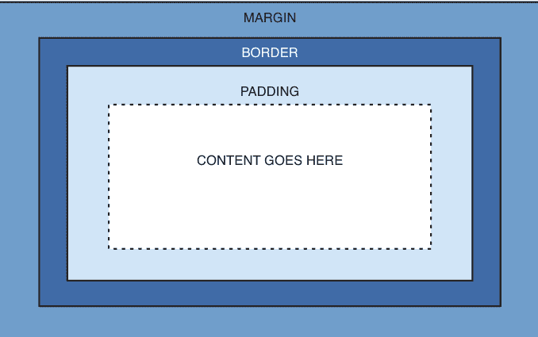

这是对盒模型的另一种解释，从外向内：

- *margin（外边距）*是元素外部的区域。它从没有颜色；始终是透明的。
- *border（边框）*环绕元素延伸，到内边距的外部边缘。边框可以是多种类型、宽度和颜色。
- *padding（内边距）*存在于内容周围，并继承内容区域背景颜色。
- *content（内容）*被内边距包围。

困难的地方在于：要知道元素的真实高度和宽度，你必须考虑盒模型的所有元素。如果你还记得上一小时的例子，尽管指明 `<div>` 应该是 250 像素宽和 100 像素高，但该 `<div>` 必须变得得大才能容纳所使用的内边距。

你已经知道如何使用 `width` 和 `height` 属性设置元素的宽度和高度。下面的示例显示了如何定义一个宽 250 像素、高 100 像素、具有红色背景并并有黑色单像素边框的 `<div>`：

## CSS 盒模型

```css
div {

  width: 250px;

  height: 100px;

  background-color: #ff0000;

  border: 1px solid #000000;

}
```

这个简单的 `<div>` 如图 15.2 所示。

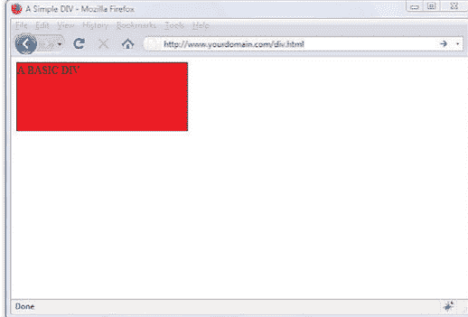

如果我们用相同的属性定义第二个元素，但加上特定大小的外边距和内边距属性，我们开始看到尺寸是如何变化的。第二个 `<div>` 定义如下：

```css
div {

  width: 250px;

  height: 100px;

  background-color: #ff0000;

  border: 1px solid #000000;

  margin: 20px;

  padding: 10px;

}
```

第二个 `<div>` 如图 15.3 所示。（注：原文被截断了，但逻辑如下）。

## 第 15 小时：理解 CSS 盒模型和定位

图 15.1

HTML 中的每个元素都由 CSS 盒模型表示。


这是对盒模型的另一种解释，从外向内：

- *margin（外边距）*是元素外部的区域。它从没有颜色；始终是透明的。
- *border（边框）*环绕元素延伸，到内边距的外部边缘。边框可以是多种类型、宽度和颜色。
- *padding（内边距）*存在于内容周围，并继承内容区域背景颜色。
- *content（内容）*被内边距包围。

困难的地方在于：要知道元素的真实高度和宽度，你必须考虑盒模型的所有元素。如果你还记得上一小时的例子，尽管指明 `<div>` 应该是 250 像素宽和 100 像素高，但该 `<div>` 必须变得得大才能容纳所使用的内边距。

你已经知道如何使用 `width` 和 `height` 属性设置元素的宽度和高度。下面的示例显示了如何定义一个宽 250 像素、高 100 像素、具有红色背景并并有黑色单像素边框的 `<div>`：

## CSS 盒模型

```css
div {

  width: 250px;

  height: 100px;

  background-color: #ff0000;

  border: 1px solid #000000;

}
```

这个简单的 `<div>` 如图 15.2 所示。


如果我们用相同的属性定义第二个元素，但加上特定大小的外边距和内边距属性，我们开始看到尺寸是如何变化的。第二个 `<div>` 定义如下：

```css
div {

  width: 250px;

  height: 100px;

  background-color: #ff0000;

  border: 1px solid #000000;

  margin: 20px;

  padding: 10px;

}
```

第二个 `<div>` 如图 15.3 所示。（注：原文被截断了，但逻辑如下）。

## 第 15 小时：理解 CSS 盒模型和定位

图 15.1

HTML 中的每个元素都由 CSS 盒模型表示。


这是对盒模型的另一种解释，从外向内：

- *margin（外边距）*是元素外部的区域。它从没有颜色；始终是透明的。
- *border（边框）*环绕元素延伸，到内边距的外部边缘。边框可以是多种类型、宽度和颜色。
- *padding（内边距）*存在于内容周围，并继承内容区域背景颜色。
- *content（内容）*被内边距包围。

困难的地方在于：要知道元素的真实高度和宽度，你必须考虑盒模型的所有元素。如果你还记得上一小时的例子，尽管指明 `<div>` 应该是 250 像素宽和 100 像素高，但该 `<div>` 必须变得得大才能容纳所使用的内边距。

## 第 15 小节：理解 CSS 盒模型与定位

你可能认为这些定位属性对绝对定位（`absolute positioning`）有效，但它们实际上适用于两种定位类型。在相对定位（`relative positioning`）下，元素的位置被指定相对于元素原始位置的偏移。如果你将一个元素的 `left` 属性设置为 `25px`，该元素的左侧将从其原始（相对）位置向右移动 25 像素。另一方面，绝对定位（`absolute positioning`）是相对于应用于该样式的元素的。因此，如果你在绝对定位下将一个元素的 `left` 属性设置为 `25px`，该元素的左侧将出现在父元素左边缘右侧 25 像素处。此外，使用相同值的 `right` 属性将使元素的位置处于其右侧位于父元素右边缘右侧 25 像素处。

让我们回到色块示例来展示定位是如何运作的。在代码列表 15.1 中，四个色块具有相对定位属性。正如你在图 15.4 中所示，这些色块是垂直排列的。

### 代码列表 15.1 使用四个色块显示相对定位

```xml
<?xml version="1.0" encoding="UTF-8"?>

<!DOCTYPE html PUBLIC "//W3C//DTD HTML 1.1//EN"

http://www.w3.org/TR/html11/DTD/html11.dtd">

<html xmlns="http://www.w3.org/1999/xhtml" xml:lang="en">

<head>

<title>Positioning the Color Blocks</title>

<style type="text/css">

div {

  position:relative;

  width:25px;

  height:100px;

  border:5px solid #000;

  color:black;

  font-weight:bold;

  text-align:center;

}

#divd1 {

  background-color:red;

}

#divd2 {

  background-color:green;

}

#divd3 {

  background-color:blue;

}

</style>
```

### 定位的全方位解析

代码列表 15.1 使用四个色块显示相对定位

```css
divd4 {

  background-color:yellow;

}

</style>

<head>

<body>

<div id="d1">DIV #1</div>

<div id="d2">DIV #2</div>

<div id="d3">DIV #3</div>

<div id="d4">DIV #4</div>

</body>

</html>
```


## 图 15.4

色块是垂直定位的，一个在另一个上面。

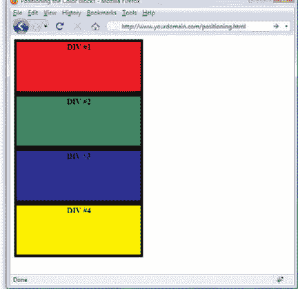

`<div>` 元素的样式表项将 `<div>` 元素的 `position` 属性设置为 `relative`。由于剩余的样式规则继承自 `<div>` 样式规则，它们也继承了相对定位。事实上，其他样式规则之间的唯一区别是它们具有不同的背景颜色。

注意图 15.4，`<div>` 元素是一个接一个地显示，这正是相对定位预期的结果。但为了增加趣味性（这也是我们此此目的），你可以将定位更改为 `absolute` 并显式地指定颜色的位置。在代码列表 15.2 中，样式表项更改为使用绝对定位来排列色块。

### 代码列表 15.2 使用色块的绝对定位

```xml
<?xml version="1.0" encoding="UTF-8"?>

<!DOCTYPE html PUBLIC "-//W3C//DTD HTML 1.1//EN"
"http://www.w3.org/TR/xhtml11/xhtml11.dtd">

<html xmlns="http://www.w3.org/1999/xhtml" xml-lang="en">

<head>
<title>The Color Blocks</title>

<style>
div {
  position:absolute;
  width:250px;
  height:100px;
  border:5px solid #000;
  color:black;
  font-weight:bold;
  text-align:center;
}

#d1 {
  background-color:red;
  left:0px;
  top:0px;
}

#d2 {
  background-color:green;
  left:75px;
  top:25px;
}

#d3 {
  background-color:blue;
  left:150px;
  top:50px;
}

#d4 {
  background-color:yellow;
  left:225px;
  top:75px;
}
</style>
</head>

<body>
<div id="d1">DIV #1</div>
<div id="d2">DIV #2</div>
<div id="d3">DIV #3</div>
<div id="d4">DIV #4</div>
</body>

</html>
```

### 控制堆叠方式

此样式表将 `position` 属性设置为 `absolute`，这是样式表使用绝对定位的必要条件。此外，为每个继承的 `<div>` 样式规则都设置了 `left` 和 `top` 属性。然而，图 15.5 显示，色块是绝对定位的。


`<div>` 元素的样式项将 `<div>` 元素的 `position` 属性设置为 `relative`。由于剩余的样式规则继承自 `<div>` 样式规则，它们也继承了相对定位。事实上，其他样式规则之间的唯一区别是它们具有不同的背景颜色。

注意图 15.4，`<div>` 元素是一个接一个地显示，这正是相对定位预期的结果。但为了增加趣味性（这也是我们此此目的），你可以将定位更改为 `absolute` 并显式地指定颜色的位置。在代码列表 15.2 中，样式表项更改为使用绝对定位来排列色块。

## 第 15 小节：理解 CSS 盒模型与定位

你可能认为这些定位属性对绝对定位（absolute positioning）有效，但它们实际上适用于两种定位类型。在相对定位（relative positioning）下，元素的位置被指定相对于元素原始位置的偏移。如果你将一个元素的 `left` 属性设置为 `25px`，该元素的左侧将从其原始（相对）位置向右移动 25 像素。

另一方面，绝对定位（absolute positioning）是相对于应用于该样式的元素的。因此，如果你在绝对定位下将一个元素的 `left` 属性设置为 `25px`，该元素的左侧将出现在父元素左边缘右侧 25 像素处。此外，使用相同值的 `right` 属性将元素元素的位置其右侧位于父元素右边缘右侧 25 像素处。

让我们回到色块示例来展示定位是如何运作的。在代码列表 15.1 中，四个色块具有相对定位属性。正如你在图 15.4 中所示，这些色块是垂直排列的。

### 代码列表 15.1 使用四个色块显示相对定位

```xml
<?xml version="1.0" encoding="UTF-8"?>

<!DOCTYPE html PUBLIC "//W3C//DTD HTML 1.1//EN"
http://www.w3.org/TR/html11/DTD/html11.dtd">

<html xmlns="http://www.w3.org/1999/xhtml" xml:lang="en">

<head>
<title>Positioning the Color Blocks</title>

<style type="text/css">
div {
  position:relative;
  width:25px;
  height:100px;
  border:5px solid #000;
  color:black;
  font-weight:bold;
  text-align:center;
}

#divd1 {
  background-color:red;
}

#divd2 {
  background-color:green;
}

#divd3 {
  background-color:blue;
}
</style>
```

### 定位的全方位解析

代码列表 15.1 使用四个色块显示相对定位。

```css
divd4 {
  background-color:yellow;
}

</style>

<head>

<body>
<div id="d1">DIV #1</div>
<div id="d2">DIV #2</div>
<div id="d3">DIV #3</div>
<div id="d4">DIV #4</div>
</body>

</html>
```

## 图 15.4

色块是垂直定位的，一个在另一个上面。


`<div>` 元素的样式表项将 `<div>` 元素的 `position` 属性设置为 `relative`。由于剩余的样式规则继承自 `<div>` 样式规则，它们也继承了相对定位。事实上，其他样式规则之间的唯一区别是它们具有不同的背景颜色。

注意图 15.4，`<div>` 元素是一个接一个地显示，这正是相对定位预期的结果。但为了增加趣味性（这也是我们此此目的），你可以将定位更改为 `absolute` 并显式地指定颜色的位置。在代码列表 15.2 中，样式表项更改为使用绝对定位来排列色块。

### 代码列表 15.2 使用色块的绝对定位

```xml
<?xml version="1.0" encoding="UTF-8"?>

<!DOCTYPE html PUBLIC "-//W3C//DTD XHTML 1.1//EN"
"http://www.w3.org/TR/xhtml11/xhtml11.dtd">

<html xmlns="http://www.w3.org/1999/xhtml" xml:lang="en">

<head>
<title>The Color Blocks</title>

<style>
div {
  position:absolute;
  width:250px;
  height:100px;
  border:5px solid #000;
  color:black;
  font-weight:bold;
  text-align:center;
}

#d1 {
  background-color:red;
  left:0px;
  top:0px;
}

#d2 {
  background-color:green;
  left:75px;
  top:25px;
}

#d3 {
  background-color:blue;
  left:150px;
  top:50px;
}

#d4 {
  background-color:yellow;
  left:225px;
  top:75px;
}
</style>
</head>

<body>
<div id="d1">DIV #1</div>
<div id="d2">DIV #2</div>
<div id="d3">DIV #3</div>
<div id="d4">DIV #4</div>
</body>

</html>
```

### 控制堆叠方式

此样式表将 `position` 属性设置为 `absolute`，这是样式表使用绝对定位的必要条件。此外，为每个继承的 `<div>` 样式规则都设置了 `left` 和 `top` 属性。然而，图 15.5 显示，色块是绝对定位的。


`<div>` 元素的样式项将 `<div>` 元素的 `position` 属性设置为 `relative`。由于剩余的样式规则继承自 `<div>` 样式规则，它们也继承了相对定位。事实上，其他样式规则之间的唯一区别是它们具有不同的背景颜色。

## 第 15 小节：理解 CSS 盒模型与定位

你可能认为这些定位属性对绝对定位（absolute positioning）有效，但它们实际上适用于两种定位类型。在相对定位（relative positioning）下，元素的位置被指定相对于元素原始位置的偏移。如果你将一个元素的 `left` 属性设置为 `25px`，该元素的左侧将从其原始（相对）位置向右移动 25 像素。

另一方面，绝对定位（absolute positioning）是相对于应用于该样式的元素的。因此，如果你在绝对定位下将一个元素的 `left` 属性设置为 `25px`，该元素的左侧将出现在父元素左边缘右侧 25 像素处。此外，使用相同值的 `right` 属性将元素元素的位置其右侧位于父元素右边缘右侧 25 像素处。

让我们回到色块示例来展示定位是如何运作的。在代码列表 15.1 中，四个色块具有相对定位属性。正如你在图 15.4 中所示，这些色块是垂直排列的。

### 代码列表 15.1 使用四个色块显示相对定位

```xml
<?xml version="1.0" encoding="UTF-8"?>

<!DOCTYPE html PUBLIC "//W3C//DTD HTML 1.1//EN"
http://www.w3.org/TR/html11/DTD/html11.dtd">

<html xmlns="http://www.w3.org/1999/xhtml" xml:lang="en">

<head>
<title>Positioning the Color Blocks</title>

<style type="text/css">
div {
  position:relative;
  width:25px;
  height:100px;
  border:5px solid #000;
  color:black;
  font-weight:bold;
  text-align:center;
}

#divd1 {
  background-color:red;
}

#divd2 {
  background-color:green;
}

#divd3 {
  background-color:blue;
}
</style>
```

### 定位的全方位解析

代码列表 15.1 使用四个色块显示相对定位。

```css
divd4 {
  background-color:yellow;
}

</style>

<head>

<body>
```


## 第 15 小节：理解 CSS 盒模型与定位

你可能认为这些定位属性对绝对定位（absolute positioning）有效，但它们实际上适用于两种定位类型。在相对定位（relative positioning）下，元素的位置被指定相对于元素原始位置的偏移。如果你将一个元素的`left`属性设置为`25px`，该元素的左侧将从其原始（相对）位置向右移动 25 像素。另一方面，绝对定位（absolute positioning）是相对于应用于该样式的元素的。因此，如果你在绝对定位下将一个元素的`left`属性设置为`25px`，该元素的左侧将出现在父元素左边缘右侧 25 像素处。此外，使用相同值的`right`属性将元素元素的位置其右侧位于父元素右边缘右侧 25 像素处。

让我们回到色块示例来展示定位是如何运作的。在代码列表 15.1 中，四个色块具有相对定位属性。正如你在图 15.4 中所示，这些色块是垂直排列的。

### 代码列表 15.1 使用四个色块显示相对定位

```xml
<?xml version="1.0" encoding="UTF-8"?>
<!DOCTYPE html PUBLIC "//W3C//DTD HTML 1.1//EN"
http://www.w3.org/TR/html11/DTD/html11.dtd">
<html xmlns="http://www.w3.org/1999/xhtml" xml:lang="en">
<head>
<title>Positioning the Color Blocks</title>
<style type="text/css">
div {
  position:relative;
  width:25px;
  height:100px;
  border:5px solid #000;
  color:black;
  font-weight:bold;
  text-align:center;
}
#divd1 {
  background-color:red;
}
#divd2 {
  background-color:green;
}
#divd3 {
  background-color:blue;
}
</style>
```

### 定位的全方位解析

代码列表 15.1 使用四个色块显示相对定位

```css
divd4 {
  background-color:yellow;
}
</style>
<head>
<body
<div id="d1">DIV #1</div>
<div id="d2">DIV #2</div>
<div id="d3">DIV #3</div>
<div id="d4">DIV #4</div>
</body>
</html>
```

图 15.4 色块是垂直定位的，一个在另一个上面。


`<div>` 元素的样式项将 `<div>` 元素的`position`属性设置为`relative`。由于剩余的样式规则继承自 `<div>` 样式规则，它们也继承了相对定位。事实上，其他样式规则之间的唯一区别是它们具有不同的背景颜色。

注意图 15.4，`<div>` 元素是一个接一个地显示，这正是相对定位预期的结果。但为了增加趣味性（这也是我们此此目的），你可以将定位更改为`absolute`并显式地指定颜色的位置。在代码列表 15.2 中，样式表项更改为使用绝对定位来排列色块。

### 代码列表 15.2 使用色块的绝对定位

```xml
<?xml version="1.0" encoding="UTF-8"?>
<!DOCTYPE html PUBLIC "-//W3C//DTD HTML 1.1//EN"
"http://www.w3.org/TR/xhtml11/xhtml11.dtd">
<html xmlns="http://www.w3.org/1999/xhtml" xml-lang="en">
<head>
<title>The Color Blocks</title>
<style>
div {
  position:absolute;
  width:250px;
  height:100px;
  border:5px solid #000;
  color:black;
  font-weight:bold;
  text-align:center;
}
#d1 {
  background-color:red;
  left:0px;
  top:0px;
}
#d2 {
  background-color:green;
  left:75px;
  top:25px;
}
#d3 {
  background-color:blue;
  left:150px;
  top:50px;
}
#d4 {
  background-color:yellow;
  left:225px;
  top:75px;
}
</style>
</head>
<body
<div id="d1">DIV #1</div>
<div id="d2">DIV #2</div>
<div id="d3">DIV #3</div>
<div id="d4">DIV #4</div>
</body>
</html>
```

### 控制堆叠方式

此样式表将`position`属性设置为`absolute`，这是样式表使用绝对定位的必要条件。此外，为每个继承的 `<div>` 样式规则都设置了`left`和`top`属性。然而，图 15.5 显示，色块是绝对定位的。


`<div>` 元素的样式项将 `<div>` 元素的`position`属性设置为`relative`。由于剩余的样式规则继承自 `<div>` 样式规则，它们也继承了相对定位。事实上，其他样式规则之间的唯一区别是它们具有不同的背景颜色。

## 第 15 小节：理解 CSS 盒模型与定位（续）

你可能认为这些定位属性对绝对定位（absolute positioning）有效，但它们实际上适用于两种定位类型。在相对定位（relative positioning）下，元素的位置被指定相对于元素原始位置的偏移。如果你将一个元素的`left`属性设置为`25px`，该元素的左侧将从其原始（相对）位置向右移动 25 像素。另一方面，绝对定位（absolute positioning）是相对于应用于该样式的元素的。因此，如果你在绝对定位下将一个元素的`left`属性设置为`25px`，该元素的左侧将出现在父元素左边缘右侧 25 像素处。此外，使用相同值的`right`属性将元素元素的位置其右侧位于父元素右边缘右侧 25 像素处。

让我们回到色块示例来展示定位是如何运作的。在代码列表 15.1 中，四个色块具有相对定位属性。正如你在图 15.4 中所示，这些色块是垂直排列的。

### 代码列表 15.1 使用四个色块显示相对定位

```xml
<?xml version="1.0" encoding="UTF-8"?>
<!DOCTYPE html PUBLIC "//W3C//DTD HTML 1.1//EN"
http://www.w3.org/TR/html11/DTD/html11.dtd">
<html xmlns="http://www.w3.org/1999/xhtml" xml:lang="en">
<head>
<title>Positioning the Color Blocks</title>
<style type="text/css">
div {
  position:relative;
  width:25px;
  height:100px;
  border:5px solid #000;
  color:black;
  font-weight:bold;
  text-align:center;
}
#divd1 {
  background-color:red;
}
#divd2 {
  background-color:green;
}
#divd3 {
  background-color:blue;
}
</style>
```

### 定位的全方位解析（续）

代码列表 15.1 使用四个色块显示相对定位

```css
divd4 {
  background-color:yellow;
}
</style>
<head>
<body
<div id="d1">DIV #1</div>
<div id="d2">DIV #2</div>
<div id="d3">DIV #3</div>
<div id="d4">DIV #4</div>
</body>
</html>
```

图 15.4 色块是垂直定位的，一个在另一个上面。


`<div>` 元素的样式项将 `<div>` 元素的`position`属性设置为`relative`。由于剩余的样式规则继承自 `<div>` 样式规则，它们也继承了相对定位。事实上，其他样式规则之间的唯一区别是它们具有不同的背景颜色。

## 第 15 小节：理解 CSS 盒模型与定位（再续）

你可能认为这些定位属性对绝对定位（absolute positioning）有效，但它们实际上适用于两种定位类型。在相对定位（relative positioning）下，元素的位置被指定相对于元素原始位置的偏移。如果你将一个元素的`left`属性设置为`25px`，该元素的左侧将从其原始（相对）位置向右移动 25 像素。另一方面，绝对定位（absolute positioning）是相对于应用于该样式的元素的。因此，如果你在绝对定位下将一个元素的`left`属性设置为`25px`，该元素的左侧将出现在父元素左边缘右侧 25 像素处。此外，使用相同值的`right`属性将元素元素的位置其右侧位于父元素右边缘右侧 25 像素处。

让我们回到色块示例来展示定位是如何运作的。在代码列表 15.1 中，四个色块具有相对定位属性。正如你在图 15.4 中所示，这些色块是垂直排列的。

### 代码列表 15.1 使用四个色块显示相对定位

```xml
<?xml version="1.0" encoding="UTF-8"?>
<!DOCTYPE html PUBLIC "//W3C//DTD HTML 1.1//EN"
http://www.w3.org/TR/html11/DTD/html11.dtd">
<html xmlns="http://www.w3.org/1999/xhtml" xml:lang="en">
<head>
<title>Positioning the Color Blocks</title>
<style type="text/css">
div {
  position:relative;
  width:25px;
  height:100px;
  border:5px solid #000;
  color:black;
  font-weight:bold;
  text-align:center;
}
#divd1 {
  background-color:red;
}
#divd2 {
  background-color:green;
}
#divd3 {
  background-color:blue;
}
</style>
```

### 定位的全方位解析（再次重复）

代码列表 15.1 使用四个色块显示相对定位

```css
divd4 {
  background-color:yellow;
}
</style>
<head>
<body
<div id="d1">DIV #1</div>
<div id="d2">DIV #2</div>
<div id="d3">DIV #3</div>
<div id="d4">DIV #4</div>
</body>
</html>
```

图 15.4 色块是垂直定位的，一个在另一个上面。


`<div>` 元素的样式项将 `<div>` 元素的`position`属性设置为`relative`。由于剩余的样式规则继承自 `<div>` 样式规则，它们也继承了相对定位。事实上，其他样式规则之间的唯一区别是它们具有不同的背景颜色。

注意图 15.4，`<div>` 元素是一个接一个地显示，这正是相对定位预期的结果。但为了增加趣味性（这也是我们此此目的），你可以将定位更改为`absolute`并显式地指定颜色的位置。在代码列表 15.2 中，样式表项更改为使用绝对定位来排列色块。

### 代码列表 15.2 使用色块的绝对定位

```xml
<?xml version="1.0" encoding="UTF-8"?>
<!DOCTYPE html PUBLIC "-//W3C//DTD HTML 1.1//EN"
"http://www.w3.org/TR/xhtml11/xhtml11.dtd">
<html xmlns="http://www.w3.org/1999/xhtml" xml-lang="en">
<head>
<title>The Color Blocks</title>
<style>
div {
  position:absolute;
  width:250px;
  height:100px;
  border:5px solid #000;
  color:black;
  font-weight:bold;
  text-align:center;
}
#d1 {
  background-color:red;
  left:0px;
  top:0px;
}
#d2 {
  background-color:green;
  left:75px;
  top:25px;
}
#d3 {
  background-color:blue;
  left:150px;
  top:50px;
}
#d4 {
  background-color:yellow;
  left:225px;
  top:75px;
}
</style>
</head>
<body
<div id="d1">DIV #1</div>
<div id="d2">DIV #2</div>
<div id="d3">DIV #3</div>
<div id="d4">DIV #4</div>
</body>
</html>
```

### 控制堆叠方式

此样式表将`position`属性设置为`absolute`，这是样式表使用绝对定位的必要条件。此外，为每个继承的 `<div>` 样式规则都设置了`left`和`top`属性。然而，图 15.5 显示，色块是绝对定位的。


`<div>` 元素的样式项将 `<div>` 元素的`position`属性设置为`relative`。由于剩余的样式规则继承自 `<div>` 样式规则，它们也继承了相对定位。事实上，其他样式规则之间的唯一区别是它们具有不同的背景颜色。

## 第 15 小节：理解 CSS 盒模型与定位（最终版）

你可能认为这些定位属性对绝对定位（absolute positioning）有效，但它们实际上适用于两种定位类型。在相对定位（relative positioning）下，元素的位置被指定相对于元素原始位置的偏移。如果你将一个元素的`left`属性设置为`25px`，该元素的左侧将从其原始（相对）位置向右移动 25 像素。另一方面，绝对定位（absolute positioning）是相对于应用于该样式的元素的。因此，如果你在绝对定位下将一个元素的`left`属性设置为`25px`，该元素的左侧将出现在父元素左边缘右侧 25 像素处。此外，使用相同值的`right`属性将元素元素的位置其右侧位于父元素右边缘右侧 25 像素处。

让我们回到色块示例来展示定位是如何运作的。在代码列表 15.1 中，四个色块具有相对定位属性。正如你在图 15.4 中所示，这些色块是垂直排列的。

### 代码列表 15.1 使用四个色块显示相对定位

```xml
<?xml version="1.0" encoding="UTF-8"?>
<!DOCTYPE html PUBLIC "//W3C//DTD HTML 1.1//EN"
http://www.w3.org/TR/html11/DTD/html11.dtd">
<html xmlns="http://www.w3.org/1999/xhtml" xml:lang="en">
<head>
<title>Positioning the Color Blocks</title>
<style type="text/css">
div {
  position:relative;
  width:25px;
  height:100px;
  border:5px solid #000;
  color:black;
  font-weight:bold;
  text-align:center;
}
#divd1 {
  background-color:red;
}
#divd2 {
  background-color:green;
}
#divd3 {
  background-color:blue;
}
</style>
```

### 定位的全方位解析（最终版）

代码列表 15.1 使用四个色块显示相对定位

```css
divd4 {
  background-color:yellow;
}
</style>
<head>
<body
<div id="d1">DIV #1</div>
<div id="d2">DIV #2</div>
<div id="d3">DIV #3</div>
<div id="d4">DIV #4</div>
</body>
</html>
```

图 15.4 色块是垂直定位的，一个在另一个上面。


`<div>` 元素的样式项将 `<div>` 元素的`position`属性设置为`relative`。由于剩余的样式规则继承自 `<div>` 样式规则，它们也继承了相对定位。事实上，其他样式规则之间的唯一区别是它们具有不同的背景颜色。

注意图 15.4，`<div>` 元素是一个接一个地显示，这正是相对定位预期的结果。但为了增加趣味性（这也是我们此此目的），你可以将定位更改为`absolute`并显式地指定颜色的位置。在代码列表 15.2 中，样式表项更改为使用绝对定位来排列色块。

### 代码列表 15.2 使用色块的绝对定位

```xml
<?xml version="1.0" encoding="UTF-8"?>
<!DOCTYPE html PUBLIC "-//W3C//DTD HTML 1.1//EN"
"http://www.w3.org/TR/xhtml11/xhtml11.dtd">
<html xmlns="http://www.w3.org/1999/xhtml" xml-lang="en">
<head>
<title>The Color Blocks</title>
<style>
div {
  position:absolute;
  width:250px;
  height:100px;
  border:5px solid #000;
  color:black;
  font-weight:bold;
  text-align:center;
}
#d1 {
  background-color:red;
  left:0px;
  top:0px;
}
#d2 {
  background-color:green;
  left:75px;
  top:25px;
}
#d3 {
  background-color:blue;
  left:150px;
  top:50px;
}
#d4 {
  background-color:yellow;
  left:225px;
  top:75px;
}
</style>
</head>
<body
<div id="d1">DIV #1</div>
<div id="d2">DIV #2</div>
<div id="d3">DIV #3</div>
<div id="d4">DIV #4</div>
</body>
</html>
```

### 控制堆叠方式

此样式表将`position`属性设置为`absolute`，这是样式表使用绝对定位的必要条件。此外，为每个继承的 `<div>` 样式规则都设置了`left`和`top`属性。然而，图 15.5 显示，色块是绝对定位的。


`<div>` 元素的样式项将 `<div>` 元素的`position`属性设置为`relative`。由于剩余的样式规则继承自 `<div>` 样式规则，它们也继承了相对定位。事实上，其他样式规则之间的唯一区别是它们具有不同的背景颜色。


### 定位的全方位解析

代码列表 15.1 使用四个色块显示相对定位。

```css
divd4 {
  background-color:yellow;
}
```

图 15.4 色块是垂直定位的，一个在另一个上面。


`<div>` 元素的样式项将 `<div>` 元素的 `position` 属性设置为 `relative`。由于剩余的样式规则继承自 `<div>` 样式规则，它们也继承了相对定位。事实上，其他样式规则之间的唯一区别是它们具有不同的背景颜色。

## 第 15 小节：理解 CSS 盒模型与定位

你可能认为这些定位属性对绝对定位（absolute positioning）有效，但它们实际上适用于两种定位类型。在相对定位（relative positioning）下，元素的位置被指定相对于元素原始位置的偏移。如果你将一个元素的 `left` 属性设置为 `25px`，该元素的左侧将从其原始（相对）位置向右移动 25 像素。另一方面，绝对定位（absolute positioning）是相对于应用于该样式的元素的。因此，如果你在绝对定位下将一个元素的 `left` 属性设置为 `25px`，该元素的左侧将出现在父元素左边缘右侧 25 像素处。此外，使用相同值的 `right` 属性将元素的位置其右侧位于父元素右边缘右侧 25 像素处。

让我们回到色块示例来展示定位是如何运作的。在代码列表 15.1 中，四个色块具有相对定位属性。正如你在图 15.4 中所示，这些色块是垂直排列的。

### 代码列表 15.1 使用四个色块显示相对定位

```xml
<?xml version="1.0" encoding="UTF-8"?>
<!DOCTYPE html PUBLIC "//W3C//DTD HTML 1.1//EN"
http://www.w3.org/TR/html11/DTD/html11.dtd">
<html xmlns="http://www.w3.org/1999/xhtml" xml:lang="en">
<head>
<title>Positioning the Color Blocks</title>
<style type="text/css">
div {
  position:relative;
  width:25px;
  height:100px;
  border:5px solid #000;
  color:black;
  font-weight:bold;
  text-align:center;
}
#divd1 {
  background-color:red;
}
#divd2 {
  background-color:green;
}
#divd3 {
  background-color:blue;
}
</style>
```

### 定位的全方位解析

代码列表 15.1 使用四个色块显示相对定位。

```css
divd4 {
  background-color:yellow;
}
</style>
<head>
<body>
<div id="d1">DIV #1</div>
<div id="d2">DIV #2</div>
<div id="d3">DIV #3</div>
<div id="d4">DIV #4</div>
</body>
</html>
```

图 15.4 色块是垂直定位的，一个在另一个上面。


`<div>` 元素的样式项将 `<div>` 元素的 `position` 属性设置为 `relative`。由于剩余的样式规则继承自 `<div>` 样式规则，它们也继承了相对定位。事实上，其他样式规则之间的唯一区别是它们具有不同的背景颜色。

## 第 15 小节：理解 CSS 盒模型与定位

你可能认为这些定位属性对绝对定位（absolute positioning）有效，但它们实际上适用于两种定位类型。在相对定位（relative positioning）下，元素的位置被指定相对于元素原始位置的偏移。如果你将一个元素的 `left` 属性设置为 `25px`，该元素的左侧将从其原始（相对）位置向右移动 25 像素。另一方面，绝对定位（absolute positioning）是相对于应用于该样式的元素的。因此，如果你在绝对定位下将一个元素的 `left` 属性设置为 `25px`，该元素的左侧将出现在父元素左边缘右侧 25 像素处。此外，使用相同值的 `right` 属性将元素的位置其右侧位于父元素右边缘右侧 25 像素处。

让我们回到色块示例来展示定位是如何运作的。在代码列表 15.1 中，四个色块具有相对定位属性。正如你在图 15.4 中所示，这些色块是垂直排列的。

### 代码列表 15.1 使用四个色块显示相对定位

```xml
<?xml version="1.0" encoding="UTF-8"?>
<!DOCTYPE html PUBLIC "//W3C//DTD HTML 1.1//EN"
http://www.w3.org/TR/html11/DTD/html11.dtd">
<html xmlns="http://www.w3.org/1999/xhtml" xml:lang="en">
<head>
<title>Positioning the Color Blocks</title>
<style type="text/css">
div {
  position:relative;
  width:25px;
  height:100px;
  border:5px solid #000;
  color:black;
  font-weight:bold;
  text-align:center;
}
#divd1 {
  background-color:red;
}
#divd2 {
  background-color:green;
}
#divd3 {
  background-color:blue;
}
</style>
```

### 定位的全方位解析

代码列表 15.1 使用四个色块显示相对定位。

```css
divd4 {
  background-color:yellow;
}
</style>
<head>
<body>
<div id="d1">DIV #1</div>
<div id="d2">DIV #2</div>
<div id="d3">DIV #3</div>
<div id="d4">DIV #4</div>
</body>
</html>
```

图 15.4 色块是垂直定位的，一个在另一个上面。


`<div>` 元素的样式项将 `<div>` 元素的 `position` 属性设置为 `relative`。由于剩余的样式规则继承自 `<div>` 样式规则，它们也继承了相对定位。事实上，其他样式规则之间的唯一区别是它们具有不同的背景颜色。

## 第 15 小节：理解 CSS 盒模型与定位

你可能认为这些定位属性对绝对定位（absolute positioning）有效，但它们实际上适用于两种定位类型。在相对定位（relative positioning）下，元素的位置被指定相对于元素原始位置的偏移。如果你将一个元素的 `left` 属性设置为 `25px`，该元素的左侧将从其原始（相对）位置向右移动 25 像素。另一方面，绝对定位（absolute positioning）是相对于应用于该样式的元素的。因此，如果你在绝对定位下将一个元素的 `left` 属性设置为 `25px`，该元素的左侧将出现在父元素左边缘右侧 25 像素处。此外，使用相同值的 `right` 属性将元素的位置其右侧位于父元素右边缘右侧 25 像素处。

让我们回到色块示例来展示定位是如何运作的。在代码列表 15.1 中，四个色块具有相对定位属性。正如你在图 15.4 中所示，这些色块是垂直排列的。

### 代码列表 15.1 使用四个色块显示相对定位

```xml
<?xml version="1.0" encoding="UTF-8"?>
<!DOCTYPE html PUBLIC "//W3C//DTD HTML 1.1//EN"
http://www.w3.org/TR/html11/DTD/html11.dtd">
<html xmlns="http://www.w3.org/1999/xhtml" xml:lang="en">
<head>
<title>Positioning the Color Blocks</title>
<style type="text/css">
div {
  position:relative;
  width:25px;
  height:100px;
  border:5px solid #000;
  color:black;
  font-weight:bold;
  text-align:center;
}
#divd1 {
  background-color:red;
}
#divd2 {
  background-color:green;
}
#divd3 {
  background-color:blue;
}
</style>
```

### 定位的全方位解析

代码列表 15.1 使用四个色块显示相对定位。

```css
divd4 {
  background-color:yellow;
}
</style>
<head>
<body>
<div id="d1">DIV #1</div>
<div id="d2">DIV #2</div>
<div id="d3">DIV #3</div>
<div id="d4">DIV #4</div>
</body>
</html>
```

图 15.4 色块是垂直定位的，一个在另一个上面。


`<div>` 元素的样式项将 `<div>` 元素的 `position` 属性设置为 `relative`。由于剩余的样式规则继承自 `<div>` 样式规则，它们也继承了相对定位。事实上，其他样式规则之间的唯一区别是它们具有不同的背景颜色。

## 第 15 小节：理解 CSS 盒模型与定位

你可能认为这些定位属性对绝对定位（absolute positioning）有效，但它们实际上适用于两种定位类型。在相对定位（relative positioning）下，元素的位置被指定相对于元素原始位置的偏移。如果你将一个元素的 `left` 属性设置为 `25px`，该元素的左侧将从其原始（相对）位置向右移动 25 像素。另一方面，绝对定位（absolute positioning）是相对于应用于该样式的元素的。因此，如果你在绝对定位下将一个元素的 `left` 属性设置为 `25px`，该元素的左侧将出现在父元素左边缘右侧 25 像素处。此外，使用相同值的 `right` 属性将元素的位置其右侧位于父元素右边缘右侧 25 像素处。

让我们回到色块示例来展示定位是如何运作的。在代码列表 15.1 中，四个色块具有相对定位属性。正如你在图 15.4 中所示，这些色块是垂直排列的。

### 代码列表 15.1 使用四个色块显示相对定位

```xml
<?xml version="1.0" encoding="UTF-8"?>
<!DOCTYPE html PUBLIC "//W3C//DTD HTML 1.1//EN"
http://www.w3.org/TR/html11/DTD/html11.dtd">
<html xmlns="http://www.w3.org/1999/xhtml" xml:lang="en">
<head>
<title>Positioning the Color Blocks</title>
<style type="text/css">
div {
  position:relative;
  width:25px;
  height:100px;
  border:5px solid #000;
  color:black;
  font-weight:bold;
  text-align:center;
}
#divd1 {
  background-color:red;
}
#divd2 {
  background-color:green;
}
#divd3 {
  background-color:blue;
}
</style>
```

### 定位的全方位解析

代码列表 15.1 使用四个色块显示相对定位。

```css
divd4 {
  background-color:yellow;
}
</style>
<head>
<body>
<div id="d1">DIV #1</div>
<div id="d2">DIV #2</div>
<div id="d3">DIV #3</div>
<div id="d4">DIV #4</div>
</body>
</html>
```

图 15.4 色块是垂直定位的，一个在另一个上面。


`<div>` 元素的样式项将 `<div>` 元素的 `position` 属性设置为 `relative`。由于剩余的样式规则继承自 `<div>` 样式规则，它们也继承了相对定位。事实上，其他样式规则之间的唯一区别是它们具有不同的背景颜色。

## 第 15 小节：理解 CSS 盒模型与定位

你可能认为这些定位属性对绝对定位（absolute positioning）有效，但它们实际上适用于两种定位类型。在相对定位（relative positioning）下，元素的位置被指定相对于元素原始位置的偏移。如果你将一个元素的 `left` 属性设置为 `25px`，该元素的左侧将从其原始（相对）位置向右移动 25 像素。另一方面，绝对定位（absolute positioning）是相对于应用于该样式的元素的。因此，如果你在绝对定位下将一个元素的 `left` 属性设置为 `25px`，该元素的左侧将出现在父元素左边缘右侧 25 像素处。此外，使用相同值的 `right` 属性将元素的位置其右侧位于父元素右边缘右侧 25 像素处。

让我们回到色块示例来展示定位是如何运作的。在代码列表 15.1 中，四个色块具有相对定位属性。正如你在图 15.4 中所示，这些色块是垂直排列的。


### 图 15.4

色块是垂直定位的，一个在另一个上面。


# 第 15 小节：理解 CSS 盒模型与定位

`<div>` 元素的样式项将 `<div>` 元素的 `position` 属性设置为 `relative`。由于剩余的样式规则继承自 `<div>` 样式规则，它们也继承了相对定位。事实上，其他样式规则之间的唯一区别是它们具有不同的背景颜色。

你可能认为这些定位属性对绝对定位（absolute positioning）有效，但它们实际上适用于两种定位类型。在相对定位（relative positioning）下，元素的位置被指定相对于元素原始位置的偏移。如果你将一个元素的 `left` 属性设置为 `25px`，该元素的左侧将从其原始（相对）位置向右移动 25 像素。

另一方面，绝对定位（absolute positioning）是相对于应用于该样式的元素的。因此，如果你在绝对定位下将一个元素的 `left` 属性设置为 `25px`，该元素的左侧将出现在父元素左边缘右侧 25 像素处。此外，使用相同值的 `right` 属性将元素的位置其右侧位于父元素右边缘右侧 25 像素处。

让我们回到色块示例来展示定位是如何运作的。在代码列表 15.1 中，四个色块具有相对定位属性。正如你在图 15.4 中所示，这些色块是垂直排列的。

## 代码列表 15.1：使用四个色块显示相对定位

```xml
<?xml version="1.0" encoding="UTF-8"?>

<!DOCTYPE html PUBLIC "//W3C//DTD HTML 1.1//EN"
  "http://www.w3.org/TR/html11/DTD/html11.dtd">

<html xmlns="http://www.w3.org/1999/xhtml" xml:lang="en">

<head>
  <title>Positioning the Color Blocks</title>

  <style type="text/css">
    div {
      position: relative;
      width: 25px;
      height: 100px;
      border: 5px solid #000;
      color: black;
      font-weight: bold;
      text-align: center;
    }

    #divd1 {
      background-color: red;
    }

    #divd2 {
      background-color: green;
    }

    #divd3 {
      background-color: blue;
    }
  </style>
```

## 定位的全方位解析

代码列表 15.1 使用四个色块显示相对定位。

```html
  <style type="text/css">
    #divd4 {
      background-color: yellow;
    }
  </style>
</head>

<body>
  <div id="d1">DIV #1</div>
  <div id="d2">DIV #2</div>
  <div id="d3">DIV #3</div>
  <div id="d4">DIV #4</div>
</body>

</html>
```

### 图 15.4

色块是垂直定位的，一个在另一个上面。


`<div>` 元素的样式项将 `<div>` 元素的 `position` 属性设置为 `relative`。由于剩余的样式规则继承自 `<div>` 样式规则，它们也继承了相对定位。事实上，其他样式规则之间的唯一区别是它们具有不同的背景颜色。


## 第 15 小节：理解 CSS 盒模型与定位

你可能认为这些定位属性对绝对定位（absolute positioning）有效，但它们实际上适用于两种定位类型。在相对定位（relative positioning）下，元素的位置被指定相对于元素原始位置的偏移。如果你将一个元素的`left`属性设置为`25px`，该元素的左侧将从其原始（相对）位置向右移动 25 像素。另一方面，绝对定位（absolute positioning）是相对于应用于该样式的元素的。因此，如果你在绝对定位下将一个元素的`left`属性设置为`25px`，该元素的左侧将出现在父元素左边缘右侧 25 像素处。此外，使用相同值的`right`属性将元素的位置其右侧位于父元素右边缘右侧 25 像素处。

让我们回到色块示例来展示定位是如何运作的。在代码列表 15.1 中，四个色块具有相对定位属性。正如你在图 15.4 中所示，这些色块是垂直排列的。

### 代码列表 15.1 使用四个色块显示相对定位

```xml
<?xml version="1.0" encoding="UTF-8"?>
<!DOCTYPE html PUBLIC "//W3C//DTD HTML 1.1//EN"
http://www.w3.org/TR/html11/DTD/html11.dtd">
<html xmlns="http://www.w3.org/1999/xhtml" xml:lang="en">
<head>
<title>Positioning the Color Blocks</title>
<style type="text/css">
div {
  position:relative;
  width:25px;
  height:100px;
  border:5px solid #000;
  color:black;
  font-weight:bold;
  text-align:center;
}
#divd1 {
  background-color:red;
}
#divd2 {
  background-color:green;
}
#divd3 {
  background-color:blue;
}
</style>
```

### 定位的全方位解析

代码列表 15.1 使用四个色块显示相对定位

```css
divd4 {
  background-color:yellow;
}
</style>
<head>
<body
<div id="d1">DIV #1</div>
<div id="d2">DIV #2</div>
<div id="d3">DIV #3</div>
<div id="d4">DIV #4</div>
</body>
</html>
```

图 15.4
色块是垂直定位的，一个在另一个上面。


`<div>` 元素的样式项将 `<div>` 元素的`position`属性设置为`relative`。由于剩余的样式规则继承自 `<div>` 样式规则，它们也继承了相对定位。事实上，其他样式规则之间的唯一区别是它们具有不同的背景颜色。

注意图 15.4，`<div>` 元素是一个接一个地显示，这正是相对定位预期的结果。但为了增加趣味性（这也是我们此此目的），你可以将定位更改为`absolute`并显式地指定颜色的位置。在代码列表 15.2 中，样式表项更改为使用绝对定位来排列色块。

### 代码列表 15.2 使用色块的绝对定位

```xml
<?xml version="1.0" encoding="UTF-8"?>
<!DOCTYPE html PUBLIC "-//W3C//DTD HTML 1.1//EN"
"http://www.w3.org/TR/xhtml11/xhtml11.dtd">
<html xmlns="http://www.w3.org/1999/xhtml" xml-lang="en">
<head>
<title>The Color Blocks</title>
<style>
div {
  position:absolute;
  width:250px;
  height:100px;
  border:5px solid #000;
  color:black;
  font-weight:bold;
  text-align:center;
}
#d1 {
  background-color:red;
  left:0px;
  top:0px;
}
#d2 {
  background-color:green;
  left:75px;
  top:25px;
}
#d3 {
  background-color:blue;
  left:150px;
  top:50px;
}
#d4 {
  background-color:yellow;
  left:225px;
  top:75px;
}
</style>
</head>
<body
<div id="d1">DIV #1</div>
<div id="d2">DIV #2</div>
<div id="d3">DIV #3</div>
<div id="d4">DIV #4</div>
</body>
</html>
```

### 控制堆叠方式

此样式表将`position`属性设置为`absolute`，这是样式表使用绝对定位的必要条件。此外，为每个继承的 `<div>` 样式规则都设置了`left`和`top`属性。然而，图 15.5 显示，色块是绝对定位的。


`<div>` 元素的样式项将 `<div>` 元素的`position`属性设置为`relative`。由于剩余的样式规则继承自 `<div>` 样式规则，它们也继承了相对定位。事实上，其他样式规则之间的唯一区别是它们具有不同的背景颜色。

## 第 15 小节：理解 CSS 盒模型和定位

尽管示例显示颜色块是简单的 `<div>` 元素，但`z-index`样式属性可以影响任何 HTML 内容，包括图像。

## 管理文本流

现在你已经看到了一些相对于其他元素放置元素或绝对定位元素的示例，现在是时候重新回顾元素周围的文本流了。概念上的“当前行”是一种用于在页面上放置元素的隐形线。这与页面上元素的流有关；当元素相邻排列并向下移动时，该线就会生效。元素流的一部分是页面上的文本流。当你将文本与其他元素（如图像）混合时，控制文本如何环绕这些元素流动非常重要。

你已经在第 14 小节中见过这两种样式属性。以下是一些可以让你控制文本流的样式属性：

- `float`—决定文本如何环绕元素流动。
- `clear`—停止文本在元素周围的流动。
- `overflow`—当元素尺寸太小无法包含所有文本时，控制文本的溢出。

`float`属性用于控制文本如何环绕元素流动。它可以设置为`left`（左侧）或`right`（右侧）。这些值决定了元素相对于流动文本所在的位置。因此，将图像的`float`属性设置为`left`会将图像放置在文本的左侧。

正如上一节所学到的，你可以使用`clear`属性防止文本在元素旁边流动，该属性可以设置为`none`、`left`、`right`或`both`。`clear`属性的默认值为`none`，表示文本将流动，而对该元素不作任何特殊考虑。`left`值会导致文本停止在元素周围流动，直到页面左侧没有该元素为止。同样，`right`值意味着文本不会环绕元素的右侧流动。`both`值表示文本均不会环绕元素的任何侧流动。

`overflow`属性处理无法置于其矩形区域的溢出文本；当设置的元素宽度或高度太小时，就会发生这种情况。`overflow`属性可以设置为`visible`、`hidden`或`scroll`。`visible`设置会自动放大元素，使溢出文本能够包含在内；这是该属性的默认设置。

`hidden`值让元素保持原有大小，允许溢出文本保持不可见状态。可能最有意思的值是`scroll`，它会为元素添加滚动条，以便你可以移动并查看文本。

## 总结

本节从关于 CSS 盒模型的非常重要的讨论开始，以及在考虑外边距（margins）、内边距（padding）和边框（borders）时如何计算元素的宽度和高度。接着解决了元素的绝对定位，然后你学习了如何使用`z-index`。你学习了一些允许你控制页面文本流的巧妙小属性。

## 问答

- 我如何确定何时使用相对定位，何时使用绝对定位？
- 尽管关于相对绝对定位的使用没有固定的指南，但通用想法是，只有当你想要对内容的定位方式进行更精细的控制时，才需要绝对定位。这是因为绝对定位允许你精确到像素级定位内容，而相对定位在内容定位方面的可预测性较低。这并不是说相对定位不能很好地定位页面上的元素；而是意味着绝对定位更精确。当然，这使得绝对定位可能更容易受到屏幕变化的影响，而这是你无法控制的。
- 如果你决定了两个重叠元素的`z-index`，我如何知道哪个元素会显示在上方？
- 如果重叠元素没有设置`z-index`属性，则网页中后出现的元素将显示在上方。记住此点的简单方法是想象网页浏览器在读取 HTML 文档时将每个元素绘制为一个页面；文档中后读取的元素将绘制在先读取的元素之上。

## 第 15 小节：理解 CSS 盒模型和定位

## 工作坊

工作坊包含问题和活动，帮助你巩固对所涵盖内容的理解。在查看随后的“答案”部分之前，尝试回答所有问题。

## 测验

- 1. 相对定位和绝对定位的区别是什么？
- 2. 哪种 CSS 样式属性控制元素相互重叠的方式？
- 3. 你可以使用什么 HTML 代码让“Where would you like to”字样正好从浏览器窗口的左上角开始，并在 80 像素、向左 20 像素处用大字体显示“GO TODAY?”？

## 答案

- 1. 在相对定位中，内容根据页面的流显示，每个元素在物理上出现在 HTML 代码中其前一个元素之后。另一方面，绝对定位允许你设置内容在页面上的精确位置。
- 2. `z-index`样式属性用于控制元素相互重叠的方式。
- 3. 你可以使用：

```html
<span style="position:absolute;left:0px;top:0px">
Where would you like to</span>
<h1 style="position:absolute;left:0px;top:2px">GO TODAY?</h1>
```


## 练习

- 通过创建具有不同外边距、内边距和边框的一系列元素，练习处理 CSS 盒模型的细节，并查看这些属性如何影响它们的高度和宽度。
- 找到一组你喜欢的图片并...

## CSS 盒模型如何影响列表

列表 16.1 创建带有颜色和边框样式的基础列表

```xml
<xml version="1.0" encoding="UTF-8"?>
<!DOCTYPE html PUBLIC "-//W3C//DTD HTML 1.1//EN"
"http://www.w3.org/Tr/html11/DTD/xhtml11.dtd">
<html xmlns="http://www.w3.org/1999/xhtml" xml:lang="en">
<head>
<title>List Test</title>
<style type="text/css">
ul {
  background-color: #6666ff;
  border: 1px solid #000000;
  width: 100px;
}
li {
  background-color: #cccccc;
  border: 1px solid #ff00ff;
}
</style>
</head>
<body>
<h1>List Test</h1>
<ul>
<li>Item #1</li>
<li>Item #2</li>
<li>Item #3</li>
</ul>
</body>
</html>
```

图 16.1 使用颜色和边框对列表和列表项进行样式设置。

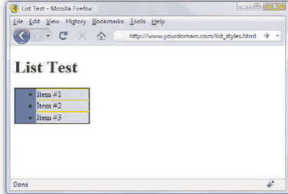

## 第16小时：使用 CSS 实现更多列表

### 注意

通过创建一个如列表 16.1 所示的简单测试文件，考虑不同浏览器显示的默认 `padding-left` 值，在样式表的 `ul` 选择器声明中添加 `padding-left:40px;`。如果你重新加载页面且显示没有变化，说明你的浏览器使用 40 像素作为 `padding-left` 的默认值。

如图 16.1 所示，`<ul>` 创建了一个盒子，各个列表项被放置其中。在这个示例中，整个盒子都有背景。同样注意，单个列表项——在本示例中，它们使用灰色背景和黄色边框——延伸到了 `<ul>` 创建的盒子的左边缘。

这是因为浏览器会自动在 `<ul>` 的左侧添加一定数量的内边距（padding）。浏览器不会在外边距（margin，即盒子的外部）上添加内边距。它们在盒子内部且仅左侧添加。该内边距值约为 40 像素。

无论列表类型如何，默认的左侧内边距值保持不变。如果你在样式表中添加以下行，创建一个没有项目指示符的列表，你会发现内边距保持不变（见图 16.2）。

```css
list-style-type: none;
```

### 图 16.2

无论是否有列表项目指示符，默认的左侧内边距保持不变。

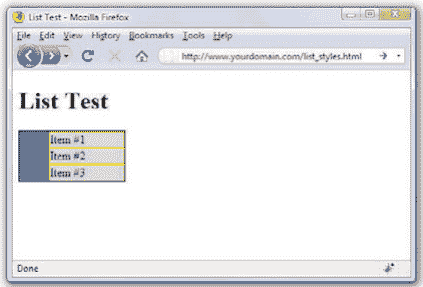

当你创建一个包含在页面上“恰好如此”列表的页面布局时。同样，仅仅因为列表没有关联默认的外边距（margin），并不意味着你可以为显示分配一些外边距；为 `ul` 选择器的声明提供外边距 `margin` 值将提供额外的布局控制。

但请记住，到为止我们只处理了列表定义本身；还没有处理将样式应用到单个列表项上。在图 16.1 和图 16.2 中，列表项的灰色背景和黄色边框没有显示默认的内边距或外边距。图 16.3 显示了将内边距或外边距值应用到列表项而非整个列表“盒子”本身产生的不同效果。

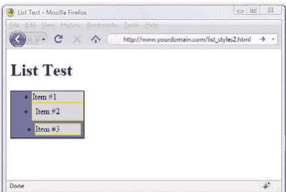

第一个列表项是基础项，没有应用内边距或外边距。然而，第二个列表项使用了 `style="padding: 6px;"`，你可以看到四周都有 6 像素的内边距（内容与围绕元素的黄色边框之间）。注意，符号的位置与第一个列表项相同。第三个列表项使用 `style="margin: 6px;"` 在列表项周围应用了 6 像素的外边距；这个外边距允许 `<ul>` 的蓝色背景显示出来。

## 放置列表项目指示符

所有这些外边距和内边距引发了另一个问题：列表项目指示符（使用时）的控制以及它们如何环绕项目。`list-style-position` 属性的默认值为“outside”——这种放置使得符号、数字或其他指示符保持在文本左侧，位于由 `<li></li>` 标签创建的盒子之外。当文本在列表项内部换行时，它会在该盒子内换行并保持与边框的左侧对齐。

但当 `list-style-position` 的值为“inside”时，指示符位于 `<li></li>` 标签创建的盒子内部。不仅列表项会进一步缩进（它们本质上变成了文本的一部分），而且文本会在每个列表项内换行。

图 16.4 显示了 `outside` 和 `inside` `list-style-position` 的示例。列表 16.1 与用于生成图 16.4 示例的代码之间的唯一区别（不包括添加到“Item #2”和“Item #3”中的填充文本）是，第二个列表项使用了 `style="list-style-position: outside;"`，而第三个列表项使用了 `style="list-style-position: inside;"`。

## 使用 CSS 实现更多列表

### 样式图 16.4
`outside` 和 `inside` 值的差异。


## 第16小时：使用 CSS 实现更多列表

### 样式 16.4
`outside` 和 `inside` 值的差异。


### 图 16.5
外边距和内边距如何影响显示。


## 使用列表项创建图像映射

在图 16.5 中，第二个列表项使用了 `style="padding: 6px;"`，你可以看到四周都有 6 像素的内边距（内容与围绕元素的黄色边框之间）。注意，符号的位置与第一个列表项相同。第三个列表项使用 `style="margin: 6px;"` 在列表项周围应用了 6 像素的外边距；这个外边距允许 `<ul>` 的蓝色背景显示出来。

### 图 16.5
外边距和内边距如何影响显示。


## 使用列表项和 CSS 创建图像地图

列表 16.2 使用 CSS 创建图像地图

```html
<style>
  #ITEA2 a {
    top:225px;
    left:375px;
    width:123px;
    height:115px;
  }
</style>
</head>
<body>
<div id="theimg">
  <ul>
    <li id="ss"><a href="[URL]" title="Sugarshots">Sugarshots</a></li>
    <li id="gn"><a href="[URL]" title="Golden Needle">Golden Needle</a></li>
    <li id="ib"><a href="[URL]" title="Irish Breakfast">Irish Breakfast</a></li>
    <li id="ITEA1"><a href="[URL]" title="IngenuITEA">IngenuITEA</a></li>
    <li id="ITEA2"><a href="[URL]" title="IngenuITEA">IngenuITEA</a></li>
  </ul>
</div>
</body>
</html>
```

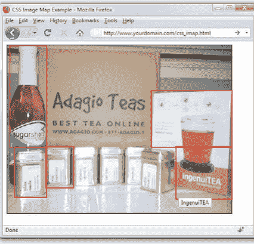

图 16.6
CSS 允许你在图像地图中定义热点。

## 第 16 小节：使用 CSS 增强列表功能

如列表 16.2 所示，样式表只有几个条目，但实际的 HTML 非常短。列表项被用于创建五个不同的可点击区域；这些“区域”是赋予了特定高度和宽度的列表项，并放置在位于背景的图像之上。如果将图像从包裹列表的 `<div>` 背景中移除，列表项仍然存在且依然是可点击的。

让我们梳理一下样式表，以便你理解构成这个 XHTML 和 CSS 地图的组件——在最基础的层面上，它只是一个链接列表。

列表被封装在一个名为 "theimg" 的 `<div>` 元素中。在样式表中，`<div>` 被定义为宽度为 500 像素、高度为 375 像素且具有 1 像素实黑色边框的块级元素。该元素的背景是名为 `tea_shipment.jpg` 的图像，它被放置在一个位置且不重复。你看到的下一段 HTML 是无序列表 `<ul>` 的开头。在样式表中，该无序列表的内边距和外边距均为 0 像素，且列表样式（`list-style`）为 `none`——这意味着列表项前面不会有任何图标。

由于样式表中对 `<div>` 内部所有 `<a>` 标签使用了以下这种技巧，列表项本身永远不会显示给用户：
`text-indent: -1000em;`

通过负向缩进 1000 em，你可以确保文本永远不会出现。它确实存在，但存在于浏览器窗口左侧 1000 em 处的不可见区域。换句话说，如果你举起左手并将其放在电脑显示器的侧面，`text-indent:-1000em` 会将文本放置在你小指左侧的某个地方。但这正是我们想要的，因为我们不需要看到文本。我们需要定义一个区域为链接，这样当用户的光标悬停在站点任何链接上时，光标就会发生变化。

当用户光标悬停在包含链接的列表项上，得益于样式表中的这一条目，该列表项会显示 1 像素的实白色边框：

```css
#img:hover {
  border: 1px solid #ffffff;
}
```

随后，根据图像中预期的可点击区域，定义并将列表项本身放置在特定位置。

## 问答

例如，id 为 `ss` 的列表项（对应 `Sugarshots`——图中显示的项目名称）其左上角距离 `<div>` 顶部 0 像素，距离 `<div>` 左边缘 5 像素。该列表宽度为 80 像素，高度为 225 像素。对 `#gn`、`#ib`、`#ITEA1` 和 `#ITEA2` 列表项进行了类似的样式声明，使得这些 id 关联的区域出现在图片的特定位置。

## 总结

本节从列表和列表元素如何受内边距和边距样式的影响开始。你首先学习了与列表相关的默认内边距，接着学习了如何修改内边距和边距值，以及如何将列表指示器放在列表项内部或外部，以便你思考样式和列表如何影响你的整体设计。最后，你学习了如何利用列表和列表元素创建一个纯 HTML 和 CSS 图像地图，从而认为不再需要切分链接图像或使用 `<map>` 标签。

本节中的所有示例都是为了让你“跳出（列表）框框”（如果可以这么说的话），这样在下一节中，你就可以使用无序列表在你的网站中生成水平或垂直导航。

## 问答

- 有大量的网页在讨论关于边距和内边距的“盒模型黑科技”（Box Model hack），特别是关于列表和列表元素的。你确定不需要使用黑科技吗？

- 在本节开始时，你学习了本节（以及其他章节）中的 HTML 和 CSS 在主流主流版本的当前版本中看起来都是一样的。

## 第 17 小节：使用 CSS 设计导航

旧的导航方法往往依赖于图像——例如具有斜角边缘的图形，以及背景和文本之间的对比色——外加上 JavaScript 客户端编程来处理鼠标动作时的图像切换。但使用纯 CSS 从列表元素创建导航，可以产生更具易用性、灵活且对搜索引擎友好的显示效果，让使用各种设备的用户都能访问。

无论你的导航元素布局是水平的还是垂直的，本节都将讨论两个级别的导航：主导航和二级导航。主导航包含网站各个章节的介绍页；二级导航则反映该章节内的这些页面。

## 动手尝试

在上一节的练习中，你被要求思考一下在自己的网站中可能使用的导航结构。如果你脑海中有了信息架构（即信息章节以及在需要时的子章节），那就是一个很好的开始。你可以在整个本节中使用该大纲，以该结构为基础创建垂直和水平导航。

## 创建全站导航

## 使用 CSS 创建垂直导航

根据你的网站架构——包括你创建的显示模板以及你在网站中分类信息的方式——你可能会发现为主导航或二级导航使用垂直导航。

例如，假设你为公司创建了一个网站，主要章节有“关于我们”（About Us）、“产品”（Products）、“支持”（Support）和“新闻”（Press）。在“关于我们”主章节内，可能有其他页面，如“使命”（Mission）、“历史”（History）、管理团队”（Executive Team）和“联系我们”（Contact Us）——这些其他页面就是“关于我们”主章节内的二级导航。

列表 17.1 设置了一个侧边垂直导航、中间内容的页面。侧边的链接和内容区域的链接都是基础 HTML 列表元素。

此列表和图 17.1 所示的示例为展示 CSS 如何允许将两个相似的 HTML 结构转换为不同的视觉显示（以及两种不同的上下文）提供了一个起点。

### 列表 17.1 带有列表垂直导航的基础页面

```xml
<?xml version="1.0" encoding="UTF-8"?>
<!DOCTYPE html PUBLIC "-//W3C//DTD XHTML 1.1//EN"
"http://www.w3.org/TR/xhtml11/DTD/xhtml11.dtd">
<html xmlns="http://www.w3.org/1999/xhtml" lang="en">
<head>
<title>About Us</title>
<style type="text/css">
body {
font: 12pt Verdana, Arial, Georgia, sans-serif;
}
#nav {
width:150px;
float:left;
margin-top:12px;
margin-right:18px;
}
#content {
width:550px;
float:left;
}
</style>
</head>
<body>
<div id="nav">
<ul>
<li><a href="#Mission">Mission</a>/</li>
<li><a href="#History">History</a>/</li>
<li><a href="#Executive">Executive Team</a>/</li>
<li><a href="#Contact">Contact Us</a>/</li>
</ul>
</div>
<div id="content">
<h1>About Us</h1>
<p>在主章节的介绍页上，重复二级导航并提供更多上下文可能是很有用的，例如：</p>
<ul>
<li><a href="#Mission">Mission</a>：了解更多关于我们的公司使命和慈善努力。</li>
<li><a href="#History">History</a>：阅读关于我们的公司历史以及我们如何成为该国最大的部件制造商的。</li>
<li><a href="#Executive">Executive Team</a>：我们的高管团队像一台运转良好的机器一样经营公司（对于制造部件也很有用）。</li>
<li><a href="#Contact">Contact Us</a>：在这里你可以找到联系我们的方法（我们真的会听取你的意见）。</li>
</ul>
</div>
</body>
</html>
```

图 17.1
起点：无样式的列表导航。

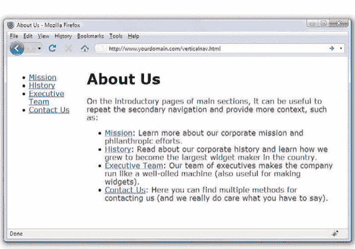

此页的内容设置在并排的 `<div>` 元素中：其中一个被赋予了 id 值 `nav`，另一个被赋予了 id 值 `content`。在这个基础页面中，分配给任何内容的唯一样式是与每个 `<div>` 相关的宽度、边距和浮动值。列表元素没有应用任何样式。

为了区分内容区域列表中的链接与侧边导航列表中的链接，请在样式表中添加以下内容：

```css
#nav a {
  text-decoration: none;
}
#a {
  text-decoration: none;
  font-weight: bold;
}
```

这些样式仅表示，id 为 `nav` 的 `<div>` 中所有的 `<a>` 链接都没有下划线，而 id 为 `content` 的 `<div>` 中所有的 `<a>` 链接都没有下划线且加粗。差异在图 17.2 中。

图 17.2
使用 CSS 区分列表元素。

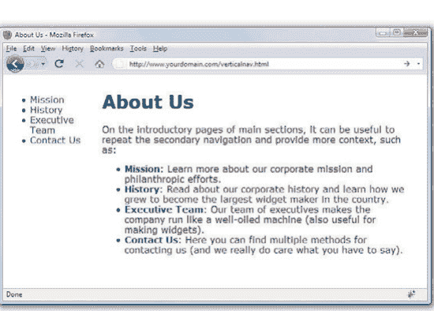

## 单级导航的样式设置

但要让列表看起来像某种东西，你必须深入研究样式表。此目标是让列表看起来像菜单。接下来，我们需要修改 id 为 `nav` 的 `<ul>`。想法是发生某些视觉变化，让用户知道该元素是可以点击的。这类似于软件菜单颜色的变化。

### 多级垂直导航的样式设置

如果你的网站架构需要另一层你希望用户始终看到的导航，它由嵌套列表（你在之前的几节中学习过的）和更多的样式表条目表示。在这种情况下，假设“管理团队”链接下有四个导航元素。在 HTML 中，修改列表如下：

```html
<ul>
<li><a href="#Mission">Mission</a></li>
<li><a href="#History">History</a></li>
<li><a href="#Executive Team">Executive Team</a></li>
```


## 第 17 小节：使用 CSS 设计导航

### 创建嵌套的导航列表

```html
<ul>
  <li><a href="#Executive Team">执行管理团队</a>
    <ul>
      <li><a href="#CEO">CEO</a></li>
      <li><a href="#CFO">CFO</a></li>
      <li><a href="#COO">COO</a></li>
      <li><a href="#Other Minions">其他小助手</a></li>
    </ul>
  </li>
  <li><a href="#Contact Us">联系我们</a></li>
</ul>
```

这段代码在“执行管理团队”链接下方生成了一个嵌套列表（参见图 17.5）。HTML 实体生成的右指向箭头将显示在换行的文本之前。

图 17.5

创建一个嵌套的导航列表（但尚未进行良好的样式化）。

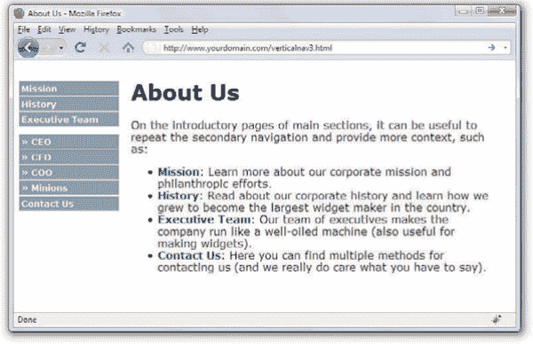

新项目以块级元素的形式显示在列表中，信息的层级结构没有在视觉上体现。为了添加某种视觉元素，将这些项目识别为附加“执行管理团队”链接的子导航元素，请再次修改样式表以添加缩进。

但在此之前，也修改其他一些样式表条目。在上一节中，我们添加了如`#nav ul`和`#nav li`等选择器，它们分别表示`<div nav>`中的所有`<ul>`和`<div nav>`中的`<li>`。然而，在`<div nav>`中有两个`<ul>`实例和另一组`<li>`元素，我们希望它们与原始组有所不同。

为了确保两组列表项都获得适当的样式，请确保样式表选择器清楚地指示列表的层级结构。为此，请使用`#nav ul`和`#nav ul li`作为第一级列表，使用`#nav ul ul`和`#nav ul ul li`作为第二级列表。

列表 17.2 显示了新版本的样式表条目和 HTML，它们生成了图 17.6 所示的菜单。

### 列表 17.2 列表中的多级垂直导航

```css
<?xml version="1.0" encoding="UTF-8"?>

<!DOCTYPE html PUBLIC "-//W3C//DTD XHTML 1.1//EN" "http://www.w3.org/TR/xhtml11/xhtml11.dtd">

<html xmlns="http://www.w3.org/1999/xhtml" xml:lang="en">

<head>
  <title>关于我们</title>

  <style type="css">
body {
  font: 12pt Verdana, Arial, Georgia, sans-serif;
}

#nav {
  width: 15px;
  float: left;
  margin-top: 12px;
  margin-right: 18px;
}

#content {
  width: 55px;
  float: left;
}

#nav a {
  text-decoration: none;
}

#content {
  text-decoration: none;
  font-weight: bold;
}

#nav ul {
  list-style: none;
  margin: 12px 0px 0px 0px;
  padding: 0px;
}

#nav ul li {
  border-bottom: 1px solid #ffffff;
}

#nav ul li a:link,
#nav ul li a:visited {
  font-size: 10pt;
  font-weight: bold;
  display: block;
  padding: 3px 0px 3px 3px;
  background-color: #628794;
  color: #ffffff;
}

#nav ul li:hover,
#nav ul li a:active {
  font-size: 10pt;
  font-weight: bold;
}
```

## 第 17 小节：使用 CSS 设计导航

### 列表 17.2 列表中的多级垂直导航

```css
display: block;
padding: 3px 0px 3px;
background-color: #c6a648;
color: #000000;

nav ul {
  margin: 0px;
  padding: 0px;
}

nav ul li {
  border-bottom: none;
}

nav ul li a:link,
nav ul li a:visited {
  font-size: 8pt;
  font-weight: bold;
  display: block;
  padding: 3px 0px 18px;
  background-color: #c62794;
  color: #ffffff;
}

nav ul li a:hover,
nav ul li a:active {
  font-size: 8pt;
  font-weight: bold;
  display: block;
  padding: 3px 0px 18px;
  background-color: #c6a648;
  color: #000000;
}

</style>
```

```html
<head>

<body>

<div id="nav">
<ul>
  <li><a href="#Mission">使命</a></li>
  <li><a href="#History">历史</a></li>
  <li><a href="#Executive Team">执行管理团队</a>
    <ul>
      <li><a href="#CEO">CEO</a></li>
      <li><a href="#CFO">CFO</a></li>
      <li><a href="#COO">COO</a></li>
      <li><a href="#Other Minions">其他小助手</a></li>
    </ul>
  </li>
  <li><a href="#Contact Us">联系我们</a></li>
</ul>
</div>

<div id="content">
<h1>关于我们</h1>
<p>在介绍性页面中，使用如下垂直导航是非常有用的：</p>
```

### 使用 CSS 创建垂直导航

```html
<ul>
  <li><a href="#Mission">使命</a>：了解更多我们的使命。</li>
  <li><a href="#History">历史</a>：了解我们如何成长。</li>
  <li><a href="#Executive Team">执行管理团队</a>：我们的团队。</li>
  <li><a href="#Contact Us">联系我们</a>：与我们联系。</li>
</ul>
```


图 17.6

垂直导航

## 使用 CSS 创建水平导航栏

链接样式与垂直导航中样式相似；这些条目具有不同的内边距值，但颜色和字体大小保持不变：

```css
#nav ul li a:link,
#nav li a:visited {
  font-size: 10pt;
  font-weight: bold;
  text-decoration: none;
  padding: 7px 10px 7px 10px;
  background-color: #628794;
  color: #ffffff;
}

#nav ul li:hover,
#nav li a:active {
  font-size: 10pt;
  font-weight: bold;
  text-decoration: none;
  padding: 7px 10px 7px 10px;
  background-color: #c6a648;
  color: #000000;
}
```

将这些样式组合在一起，你就能生成图 17.8 所示的设计。

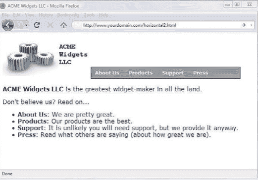

图 17.8

带有某种样式的水平导航栏。

当用户悬停在导航元素上时，背景色和文本颜色的变化与用户鼠标悬停在垂直导航菜单上时相同。此外，就像你在垂直导航菜单时做的那样，你可以使用嵌套列表在水平菜单中实现下拉功能。自己尝试一下吧！

## 总结

在这一小时中，你学习了如何使用 CSS 将简单的 HTML 无序列表转换为水平和垂直导航。通过使用 CSS 而不是 JavaScript 或其他技术，你将在网站显示和维护方面获得更大的灵活性。在这一小时中，你还了解到只需在样式表中添加几个条目，就可以将带有下划线的文本链接变为带有边框、背景颜色和其他文本样式的区域。此外，你学习了如何在菜单中展示嵌套列表。

## 问答

- 是的。你可以在列表项的 HTML 文本中使用图形，或者在`<li>`元素中使用背景图像。你可以使用任何其他样式列表元素来美化导航元素。HTML 无序列表与基于 CSS 的水平或垂直导航列表之间的唯一区别在于你如何称呼它，以及你将无序列表用于正文之外的特定用途。此外，你对列表进行样式处理以告诉用户它确实与众不同——你可以使用图形来突出你的列表。

我可以在哪里找到更多关于列表可以操作的示例？

- 我上一次检查时，在搜索引擎中输入`"CSS navigation"`返回了大约 4400 万条结果。这里有几个起点：
  - List Apart 的 CSS 文章，位于：`http://www.alistapart.com/topics/code/`
  - Maxdesign 的 CSS Listomatic：`http://css.maxdesign.com/listomatic/`
  - Vitaly Friedman 的 CSS Showcase：`http://www.alvit.de/css-showcase/`

## 工作坊

工作坊包含测验题和活动，帮助你巩固对所涵盖内容的理解。在查看后面的“答案”部分之前，尝试回答所有问题。

### 测验

1. 在创建基于列表的导航时，可以使用多少层的嵌套列表？
2. 对或错：使用内联`display`属性可以产生水平列表。
3. 在创建任何类型的导航列表时，`a`选择器的四个伪类可以具有相同的值吗？

### 答案

1. 从技术上讲，你可以根据需要无限嵌套列表。从易用性的角度来看，你想要使用的列表层数是有限制的。三层通常是极限——超过这一层你就有可能创建一个组织混乱的网站的风险，或者简单地给了用户比他们完全需要的更多的选项。
2. 对，如果在样式表中为`ul`和`li`选择器提供了`display`属性。
3. 当然可以，但你面临着用户没有意识到你精美的菜单确实是嵌套的风险（因为鼠标动作不会产生任何视觉显示）。

## 练习

- 使用本节所示的多级垂直列表技术，在章节末尾的垂直列表上添加子导航项。
- 查看网站中使用的许多基于 CSS 的导航示例，并找到一些看起来复杂的动作。使用浏览器的“查看源代码”功能，查看这些网站使用的 CSS，并尝试为自己实现类似的内容。

本页特意留空。

# 第 18 小时：使用鼠标动作修改文本显示

在本书中，你已经看到了鼠标动作如何影响文本显示的示例。最简单的例子是在样式表中定义`<a>`链接的`hover`伪类，以便当用户鼠标悬停在其上方时，以不同的颜色显示文本。在上一小时中，你学习了如何通过`hover`伪类同时更改`<li>`元素的文本颜色和背景颜色。

在这一小时中，你将学习如何实现结合 CSS 和鼠标动作的两个特定动作——当鼠标悬停在项目上时显示额外文本，以及使用鼠标点击来更改容器元素的颜色。可以确定，这两个动作在某些情况下非常有用；但更重要的是，它们为你以后在 Web 开发中可能想要处理的更高级工作提供了一个入口。

你在此小时内将学到：

- 如何使用 CSS 创建工具提示（tool tips）
- 如何使用 CSS 显示额外文本
- 如何访问事件
- 如何使用`onclick`改变外观

## 使用 CSS 创建工具提示

工具提示是`<a>`标签内的一个元素，当鼠标悬停在项目上时提供额外信息。图 18.1 显示了工具提示的作用。

## 第 18 小时：使用鼠标修改文本

当用户悬停在元素上时，背景色和文本颜色的变化与用户鼠标悬停在垂直导航菜单上时相同。此外，就像你在垂直导航菜单时做的那样，你可以使用嵌套列表在水平菜单中实现下拉功能。自己尝试一下吧！

图 17.8

带有某种样式的水平导航栏。

工具提示是`<a>`标签内的一个元素，当鼠标悬停在项目上时提供额外信息。图 18.1 显示了工具提示的作用。

## 第 18 小时：使用鼠标修改文本

在本书中，你已经看到了鼠标动作如何影响文本显示的示例。最简单的例子是在样式表中定义`<a>`链接的`hover`伪类，以便当用户鼠标悬停在其上方时，以不同的颜色显示文本。在上一小时中，你学习了如何通过`hover`伪类同时更改`<li>`元素的文本颜色和背景颜色。

在这一小时中，你将学习如何实现结合 CSS 和鼠标动作的两个特定动作——当鼠标悬停在项目上时显示额外文本，以及使用鼠标点击来更改容器元素的颜色。可以确定，这两个动作在某些情况下非常有用；但更重要的是，它们为你以后以后在 Web 开发中可能想要处理的更高级工作提供了一个入口。

你在此小时内将学到：

- 如何使用 CSS 创建工具提示（tool tips）
- 如何使用 CSS 显示额外文本
- 如何访问事件
- 如何使用`onclick`改变外观

## 使用 CSS 创建工具提示

工具提示是`<a>`标签内的一个元素，当鼠标悬停在项目上时提供额外信息。图 18.1 显示了工具提示的作用。

## 第 18 小时：使用鼠标修改文本

当用户悬停在元素上时，背景色和文本颜色的变化与用户鼠标悬停在垂直导航菜单上时相同。此外，就像你在垂直导航菜单时做的那样，你可以使用嵌套列表在水平菜单中实现下拉功能。自己尝试一下吧！

图 17.8

带有某种样式的水平导航栏。

工具提示是`<a>`标签内的一个元素，当鼠标悬停在项目上时提供额外信息。图 18.1 显示了工具提示的作用。

## 第 18 小节：使用鼠标动作修改文本显示

请注意文本中的第一个链接关联了一个类（class）。该类命名为`tip`——这个名称将其与其他不包含工具提示（tooltip）的链接区分开来。然而，这是一个类而不是 id，它可以用于页面上的所有其他链接。

注意`tip`类本身具有`position`和`z-index`。`position`值（相对位置）确保了它与文本中出现的自然位置一致；`z-index`与其他相关样式使用的`z-index`相比，确保了其他`tip`类下方的链接文本具有更高的`z-index`值，例如。

接两个样式与`<span>`标签有关。文本中的`<span>`标签内部将不会显示，工具提示是通过悬停在可见的链接上触发的。例如，该链接看起来如下：

```html
<a class="tip" href="http://en.wikipedia.org/wiki/Palouse">Palouse <span>Learn more about the Palouse!</</span>></a>
```

当你查看这段 HTML 代码时，看起来“Palouse Learn about the Palouse!”这些单词都应该是一个链接。然而，由于“Learn about the Palouse!”被封装在`<span>`标签中，并且样式表中对该`<span>`应用了特定的样式，只有当用户的鼠标悬停在实际链接（单词“Palouse”）上时，这些单词才会出现。图 18.2 显示了这一结果。

文本“Learn about the Palouse!”被放置在 HTML 的`<span>`标签中，但在样式表中进行了样式处理。具体来说，`a.tip:hover span`选择器创建了一个宽度为 150 像素、灰色背景和黑色边框的框。该框距离元素顶部 20 像素，距离父元素左侧 25 像素。这便创建了工具提示。

## 使用 CSS 显示额外的悬停文本

图 18.2

当鼠标悬停在页面第一个链接上时，会出现自定义的工具提示。

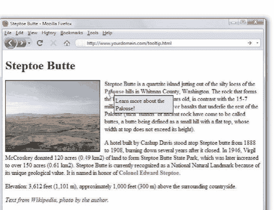

### Steptoe Butte


Steptoe Butte 是一座石英岩岛，从怀明县 Pining Hills 的粉质丘陵中升起。该岩石形成于 1450 万年前。

了解它在高原时代是如何沉积的。

山脉或岩丘有许多名称，但通常被定义为顶部平坦的小丘，除了中间外，侧面都很陡峭。

由 Casper Davis 建立的群牛在 1888 年到 1908 年间停在 Steptoe Butte 上，在关闭几年后被烧毁。1946 年，Virgil Cooley 申请了 120 英亩（0.49 公里）的土地建立 Steptoe Butte 州公园，后来增加到 150 英亩（0.61 公里），因其独特的地质价值被认定为自然地标。它以 Edward Steptoe 军的名字命名。

海拔：3,612 英尺（1,101 米），比周围乡村高出约 1,000 英尺（300 米）。

文字来自 Wikipedia，照片由作者提供。

## 使用 CSS 显示额外的悬停文本

工具提示有一个特定用途：显示附接到链接上的文本“提示”。但你可以使用相同的概念，根据鼠标动作在布局的其他处显示隐藏文本。例如，第 17 小节中的 ACME Widgets LLC 主页——带有水平导航的版本。通过使用与列表 17.1 相同的概念，当用户悬停在其中一个分区线上时，你可以在菜单上方显示额外的文本。图 18.3 显示了其中一个运行效果；我重新捕捉了导航上方和 Logo 右侧的空白区域。

## 第 18 小节：使用鼠标动作修改文本显示

### 图 18.3

另一个元素上方的自定义文本，仅在悬停时可见。

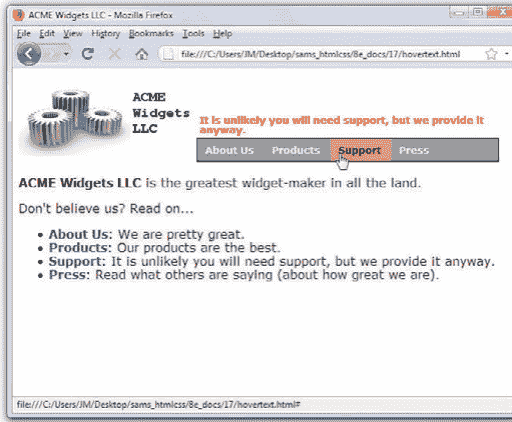

`ACME Widgets Inc` 是地上最大的部件制造商。

不相信我们？请继续阅读：

- **关于我们**：我们非常棒。
- **产品**：我们的产品是最好的。
- **支持**：你可能不需要支持，但我们还是提供。
- **媒体**：读读他人的评价（关于我们有多棒）。

与列表 18.3 相比，CSS 的唯一变化是增加了以下四个样式。它们执行的任务与列表 18.1 中使用的 `tip` 类样式相同，但显示效果与列表 18.1 略有不同。

```css
a.more {
  position:relative;
  z-index:24;
}
a.more:hover {
  z-index:25;
}
a.more span {
  display: none;
}
a.more:hover span {
  font-weight: bold;
  display: block;
  position: absolute;
  top: -35px;
  width: 400px;
  padding: 3px;
  color:#ff0000;
  line-height: 1em;
}
```

`top` 属性的值 `-25px` 将封装在 `<span>` 标签中的文本放置在父元素左上角上方 25 像素，与之前的示例相反，之前的示例将其放在父元素左上角下方 20 像素。HTML 的变化与前一节相似，即在悬停时在 `<span>` 标签中通过 `<a>` 标签内显示：

```html
<ul>
  <li><a class="more" href="#">关于我们 <span>我们非常棒。</span></a></a></li>
  <li><a class="more" href="#">产品 <span>我们的产品是最好的。</span></a></a></li>
  <li><a class="more" href="#">支持 <span>你可能不需要支持，但我们还是提供。</span></a></a></li>
  <li><a class="more" href="#">媒体 <span>读读他人的评价（关于我们有多棒）。</span></a></a></li>
</ul>
```

（注：原文 OCR 文本在闭合标签处存在一些语法错误，如 `</<a></a>`，已修正为 `</a>` 以符合 HTML 结构）。

使用这些基本概念，你可以让任何文本具有交互性。在下一节中，你将学习如何使用事件属性来处理用户输入。

## 获取事件

用户交互（如鼠标点击或按下）被称为*事件*。脚本根据事件采取行动的过程被称为*事件处理*。你使用特殊的属性来关联事件处理。以下是一些常用的事件属性以及它们发生时的描述：

- `onload`：浏览器加载元素。
- `onkeydown`：用户按下键。
- `onkeyup`：用户松开键。
- `onclick`：用户点击元素。
- `ondblclick`：用鼠标按钮双击元素。
- `onmousedown`：指针悬停在元素上时按下任意鼠标按钮。
- `onmouseup`：指针悬停在元素上时释放鼠标按钮。

## 使用 onclick 更改 `<div>` 外观

列表 18.2 使用 `onclick` 显示或隐藏内容。

```html
<xml version="1.0" encoding="UTF-8"?>
<!DOCTYPE html PUBLIC "//W3C//DTD HTML 1.1//EN"
"http://www.w3.org/Tr/html11/html11.dtd">

<html xmlns="http://www.w3.org/1999/xhtml" xml:lang="en">
<head>
<title>Steptoe Butte</title>
<style type="text/css">
{
  text-decoration: none;
  font-weight: bold;
  color: #7aabf;
}
#hide_e {
  display: none;
}
#elevation {
  display: none;
}
#hide_p {
  display: none;
}
#photos {
  display: none;
}
#show_e {
  display: block;
}
#show_p {
  display: block;
}
.fakelink {
  cursor:pointer;
  text-decoration: none;
  font-weight: bold;
  color: #E0A3E3;
}
</style>
</head>
<body>
<h1>Steptoe Butte</h1>

<p>Steptoe Butte 是华盛顿州华特曼县 <a href="http://en.wikipedia.org/wiki/Palouse">Palouse</a>丘陵的淤粉质黄土中凸出的一片石英岩岛。<span>了解更多关于 Palouse 的信息！</span>形成该孤丘的岩石年龄超过 4 亿年，与之形成对比的是衬在 Palouse 其他地区下的 <a href="http://en.wikipedia.org/wiki/Columbia_River">哥伦比亚河</a>玄武岩（古代玄武岩“岛屿”被称为孤丘（buttes），孤丘被定义为顶部平坦的小丘，其顶部宽度不超过高度）。</p>
<p>由 Cashup Davis 建造的酒店从 1888 年到 1908 年立于 Steptoe Butte 上，在屹立多年后付毁。1946 年，Virgil McCrossey 捐赠了 128 英亩（0.49 公里）土地用于 Steptoe Butte 州公园，后来增加到 150 英亩以上（0.6 公里）。Steptoe Butte 目前因独特的地质价值被认定为自然地标。它以 <a href="http://en.wikipedia.org/wiki/Colonel_Steptoe">爱德华·斯普普上校</a>命名。</p>
<div class="fakelink">
  <div id="show_e" onclick="this.style.display='none'; document.getElementById('hide_e').style.display='block'; document.getElementById('elevation').style.display='inline';">显示元素</div>
</div>
<div class="fakelink">
  <div id="hide_e" onclick="this.style.display='none'; document.getElementById('show_e').style.display='block'; document.getElementById('elevation').style.display='none';">隐藏元素</div>
</div>
<div id="elevation">3,612 英尺（1,101 米），比周围乡村高约 1,000 英尺。</div>
<div class="fakelink">
  <div id="show_p" onclick="this.style.display='none'; document.getElementById('hide_p').style.display='block'; document.getElementById('photos').style.display='inline';">显示 Steptoe Butte 顶部的照片</div>
</div>
<div class="fakelink">
  <div id="hide_p" onclick="this.style.display='none'; document.getElementById('show_p').style.display='block'; document.getElementById('photos').style.display='none';">隐藏 Steptoe Butte 顶部的照片</div>
</div>
<div id="photos">
  
  
  
</div>
<p>文本来自 <a href="http://en.wikipedia.org/wiki/Steptoe_Butte">维基百科</a>，照片由作者提供。</p>
</body>
</html>
```

Steptoe Butte 是华盛顿州华特曼县 Palouse 丘陵淤土中凸出的一片石英岩岛。形成孤丘的岩石年龄超过 4 亿年，与衬在 Palouse 其他地区下的 17 亿年前哥伦比亚河洪水床相一致。古代岩石“岛屿”被称为孤丘（buttes），孤丘被定义为顶部平坦的小丘，其宽度不超过其高度。

由 Calvin Davis 建造的酒店从 1888 年到 1906 年孤立地立于 Steptoe Butte 上，在关闭多年后付之一炬。1946 年，Virgil Crosby 捐赠了 120 英亩（0.49 公里）土地给 Steptoe Butte 州公园，后来已增加到 150 英亩以上（0.6 公里）。Steptoe Butte 目前因其独特的地质价值被认定为自然地标。

# 第 18 小时：使用鼠标动作修改文本显示

在列表 18.2 的代码中还有另一组 `<div>` 元素，它们控制额外照片的可见性。这些元素不受高度相关元素中 `onclick` 动作的影响。也就是说，当你点击“显示高度（Show Elevation）”或“隐藏高度（Hide Elevation）”时，与照片相关的 `<div>` 元素不会发生任何变化。你可以只显示高度而不显示照片（如图 18.5 所示），显示照片而不显示高度，或者同时显示高度和照片（见图 18.6）。

### 图 18.8

点击“显示高度”和“显示 Steeote Butte 顶部的照片”后的页面。

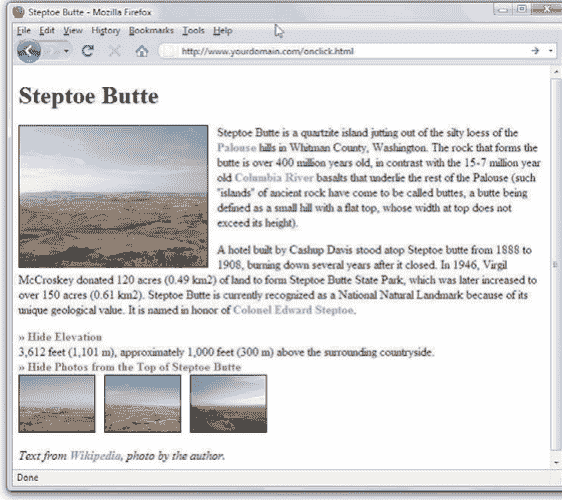

这个简短的示例向你展示了在掌握结合事件的 CSS 后，你面临的布局和交互可能性的开端。例如，你可以编写页面，让用户能够更改样式表中的元素，或者切换到完全不同的样式表，将文本块移动到布局中的其他位置，进行测验，提交表单等等。

## 总结

在本小时中，你学习了鼠标动作如何影响文本的显示。在前两个部分中，这些动作基于与 `<a>` 标签的 `hover` 伪类相关的样式设计的，而在本小时的后半部分，你被介绍了与特定用户交互事件相关的动作。示例中的特定事件是 `onclick` 事件，但你还看到了其他可能的事件列表，例如 `onload` 和 `onmouseover` 等。

代码本身引入的唯一新代码是 `cursor` 属性的使用。将 `cursor` 属性赋值为 `pointer` 可以让你向用户指示特定的文本标签为链接，即使它没有被包含在 `<a>...</a>` 标签中。

## 问答

- 本小时涵盖的某些事件听起来与 `<a>` 标签的伪类很像。它们之间有什么区别？
- 确实，`onmousedown` 事件类似于激活状态，而 `onmouseup` 和 `onmouseover` 非常像悬停（hover）状态。关于何时使用事件而不是使用伪类并没有特定的规则，但理所认为，如果你没有其他理由使用 `<a>` 标签，那么就不应该仅仅使用伪类。
- 你可以在文本以外的元素（如图像）上捕捉鼠标或键盘事件吗？
- 是的，这些类型的事件可以应用于点击或悬停图像以及文本相关的动作。然而，其他多媒体对象（例如嵌入的 YouTube 视频或 Flash 文件）的交互方式不同，因为这些对象是通过额外的软件播放的，该软件适用于其他鼠标或键盘动作。例如，如果你点击网页中嵌入的 YouTube 视频，你是在与 YouTube 播放器交互，而不是你的实际网页——该动作无法以相同的方式被捕捉。

## 工作坊

工作坊包含问题和活动，帮助你巩固对所涵盖内容的理解。在查看随后的“答案”部分之前，尝试回答所有问题。

## 测验

1. 当对 `top` 属性使用负值时会发生什么？
2. 当用户移出特定元素的边界时，使用哪个事件更改页面内容？
3. 如果你在样式表中看到 `cursor: crosshair`，你会假设它是做什么的？

## 答案

1. 对 `top` 使用负值会将内容置在父元素左上角之上（而非下方）。
2. 使用鼠标事件。
3. 将用户的鼠标指针变成一个大加号（或十字准）。然而，尚不清楚为什么要这样做，因为这是一种不典型的光标呈现。换句话说，用户会奇怪你为什么对他们的界面进行这种操作；他们不会将其视为你的一项设计决策。

## 练习

- 创建你自己的带有悬停提示文本的页面，并使用与你自己的设计模板匹配的颜色和其他样式。
- 在列表 18.2 的 `onclick` 属性中添加命令，使得一次只有一个 `<div>` 元素（高度或照片）可见的。

# 创建固定布局或流式布局

本书的大部分内容已经教了你关于 Web 内容样式的所有知识，从字体大小、颜色到图像、块级元素、列表等。但尚未讨论的是，布局有两种类型——固定布局（fixed）和流式布局（liquid），还有一种两者结合的布局，其中某些元素是固定的，而另一些是流式的。

在本小时中，你将首先学习这两种布局的特征，并看到一些使用它们的网站示例。在小时结束时，你将看到一个结合了两种布局元素的基础模板。最终，决定使用哪种布局取决于你——只要你的网站遵循 HTML 和 CSS 标准，很难出错的。

## 你在本小时内将学到什么

- 固定布局如何工作
- 流式布局如何工作
- 如何创建固定/流式混合布局

查看流式布局示例的好去处是位于 `http://wordpress.org/extend/themes/` 的 WordPress 主题库。WordPress 是一个博客平台，作为非博客网站平台的使用日益增加。该画廊展示了数百个固定宽度和流式布局的示例，这让你对自己可以创建的内容有所了解（即使不是全部代码）。花些时间看看 CSS Garden 以及 `http://www.cssengarden.com/`。这将帮助你了解你喜欢的布局。

# 尝试：寻找你喜欢的布局

## 第 19 小时：创建固定或流式布局

### 理解固定布局

固定布局（或称固定宽度布局）顾如其名——是一种页面主体被设置为特定宽度的布局。该宽度由一个容器 `<div>` 控制。

在创建固定布局时，最重要的决定是确定你想考虑的最小屏幕分辨率。多年来，800x600 一直是 Web 设计师的“最小公约数”，导致典型的宽度为 760 像素。然而，自 2007 年以来，使用 800x600 屏幕分辨率的人数不足百分之八（目前为百分之四）。考虑到许多 Web 设计师认为 1024x768 是目前的最小屏幕分辨率，因此固定宽度设计在 800 到 1000 像素之间。

#### 警告

记住，网络浏览器包含不可见区域，包括滚动条。因此，如果你针对 1024 像素宽的屏幕分辨率，你实际上无法使用全部 1024 个像素。

创建固定宽度布局的一个主要原因是你可以控制内容区域的外观。然而，如果用户以比你设计时小得多或大的分辨率访问你的固定宽度尺寸，他们可能会遇到滚动条（如果分辨率较小）或大量的空白空间（如果分辨率更大）。当前的 ESPN.com 首页提供了此问题的视觉示例：它的内容区域宽度为 964 像素。在图 19.1 中，浏览器窗口宽度为 800 像素。

然而，图 19.2 显示了当浏览器窗口超过 1300 像素时看起来是怎样的：在主体内容两侧有大量的空白空间（或“房地产”）。


在创建固定宽度布局时，还有另一个考虑因素：是将内容左对齐还是将其居中。将内容左对齐会在右侧产生额外空间；居中内容区域则会在两侧产生额外空间。

# 理解流式布局

图 19.1

较小屏幕尺寸的固定宽度示例。


图 19.2

较大屏幕尺寸的固定宽度示例。


# 理解流式布局

流式布局（`liquid layout`，也称为 `fluid layout`）页面主体不使用像素的固定宽度，尽管它可能被包含在一个使用百分比宽度的主“容器” `<div>` 中。流式布局的核心思想是：即使户的屏幕非常小或非常宽，它也能保持完全可用，并保留整体的设计美感。

图 19.3、19.4 和 19.5 显示了三个流式布局的运行示例。

在图 19.3 中，浏览器窗口宽度约为 770 像素。这个示例显示了在出现水平滚动条之前一个合理的最小宽度。事实上，直到浏览器宽度达到 735 像素时，滚动条才会出现。另一方面，图 19.4 显示了一个非常小的浏览器（宽度为 545 像素）。

图 19.3

作为较小屏幕查看流式布局。


在图 19.4 中，你可以看到一个水平滚动条；在页面内容的头部区域，`Logo` 图形开始占据文本并显示在文本上方。但页面的大部分内容仍然非常好用。页面左侧的信息内容清晰可见，并与右侧的输入表单共享可用空间。

图 19.5 显示了该页面在极宽屏幕上的样子。

# 理解流式布局

图 19.4

在极小屏幕上查看流式布局。


图 19.5

在宽屏幕上查看流式布局。


在 19.5 中，浏览器窗口宽度约为 1330 像素。有足够的空间让页面所有内容展开。这种流式布局之所以实现是因为所有的设计元素都指定了百分比宽度（而不是固定宽度）。通过这种方式，布局利用了所有可用浏览器空间。

# 第 19 节：创建固定或流式布局

流式布局方法初看似乎是最佳方案——毕竟，谁不想利用所有可用的屏幕空间呢？在利用空间和不让内容“呼吸”之间存在微妙的界限。内容过多会让人倍感压力；而在开放空间内内容太少则会显得平淡。

纯流式布局可能非常令人印象深刻，但它需要大量的测试，以确保它在不同分辨率的各种浏览器中都是可用的。你可能没有时间和精力来制作这样的设计；在这种情况下，合理的折中方案是固定/流式混合布局。

## 创建固定/流式混合布局

固定/流式混合布局包含两种类型布局的元素。例如，你可以拥有一个流式布局，其中在主体区域内或锚点元素（如左侧列或顶部导航条）包含固定宽度的元素。你甚至可以创建一个像框架一样的固定内容区域，就像第 13 节“处理框架（Working with Frames）”中所提到的，当用户滚动内容时，固定内容区域仍然保持固定。

## 从基础布局结构开始

在这个示例中，你将学习创建一个流式模板，该模板在主体区域的两侧各有一个固定宽列（如果你仔细想的话，这也是第三列，只是比其他列宽得多）。该模板还具有分界符的头部和页脚区域。代码 19.1 显示了此布局的 HTML 结构。

代码 19.1 基础固定/流式混合布局结构

```xml
<?xml version="1.0" encoding="UTF-8"?>
<!DOCTYPE html PUBLIC "-//W3C//DTD HTML 1.1//EN"
"http://www.w3.org/TR/xhtml11/DTD/xhtml11-strict.dtd">
<html xmlns="http://www.w3.org/1999/xhtml" xml:lang="en">
<head>
  <title>Sample Layout</title>
  <link href="layout.css" rel="stylesheet" type="text/css" />
</head>
```

代码 19.1 基础固定/流式混合布局结构

```html
<body>
  <div id="header">HEADER</div>
  <div id="wrapper">
    <div id="content_area">CONTENT</div>
    <div id="left_side">LEFT SIDE</div>
    <div id="right_side">RIGHT SIDE</div>
  </div>
  <div id="footer">FOOTER</div>
</body>
</html>
```

首先，注意该布局的样式表定义如下：

```css
body {
  margin: 0;
  padding: 0;
}
```

使用两个 `padding` 定义实际上是为页面两侧的固定宽度列留出空间。左侧列宽度为 200 像素，右侧列宽度为 125 像素，且每一列都有不同的背景颜色。但我们还必须将项目相对于它们放置的位置进行定位（见图 19.6）。这意味着要在样式表中为这些元素中的每一个添加 `position:relative`。

## 第 19 小：创建固定或流式布局

图 19.7

在应用某些样式后的基础 HTML 模板。


然而，如果窗口被缩放到某个宽度以下，这个模板就会出现问题。由于左栏宽度为 200 像素，右栏宽度为 125 像素，而你又希望内容区域有一些文本，你可以想象当窗口宽度在 350 到 400 像素之间时，该页面将会“崩溃”。图 19.8 显示了当窗口缩放至略小于 400 像素宽（确切说是 390 像素）时发生的情况。

图 19.8

缩放至 400 像素以下的基础 HTML 模板：糟糕！


## 设置布局的最小宽度

尽管用户不太可能使用小于 400 像素宽的浏览器访问你的网站，但该示例在本书页面的范围内起到了它的作用。你可以推断并广泛应用这些信息：

## 创建固定/流式混合布局

即使在固定/流式混合网站中，除非你采取了某些措施，否则总会有一个布局崩溃的时刻。

那“某些措施”就是使用 `min-width` 属性，它设置元素的宽度，但不包括内边距、边框或外边距。图 19.9 显示了将 `min-width` 应用于 `<body>` 元素时发生的情况。

19.9 

缩放至 400 像素以下的基础 HTML 模板：完美！


19.9 显示了向右滚动后右栏的一小部分，但重点在于当窗口缩放到最小宽度以下时，布局不会崩溃。在这种情况下，最小宽度为 525 像素：

```css
body {
  margin: 0;
  padding: 0;
  min-width: 525px;
}
```

在这个示例中，出现水平滚动条是因为浏览器窗口宽度小于 500 像素。当窗口略大于 525 像素宽时，滚动条会消失；当浏览器约为 875 像素宽时，它完全消失在视野中（见图 19.10）。

图 19.10

在大于 800 像素的浏览器窗口中查看的基础 HTML 模板。


## 在固定/流式混合布局中处理列高度

这个示例很好，但除了一个问题外：它没有内容。当向各种元素中添加内容时，会产生更多问题。如图 19.11 所示，列的高度将根据其包含的内容变得所需的高度。

图 19.11

列的高度仅与其内容等高。


由于你无法依赖用户的浏览器具有特定高度，或者内容将总是相同的长度，你可能会认为这给固定/流式混合布局带来了问题。事实并非如此。如果你能跳出固有框架思考，可以应用更多的样式来将所有部分整合在一起。

首先，在样式表中为 `left_side`、`right_side` 和 `content_area` 的 ID 添加以下声明：

```css
margin-bottom: -200px;
padding-bottom: 200px;
```

这些声明为所有元素添加了极其大量的内边距，并为底部分配了极其离谱的外边距。你还必须在样式表中为 `footer` ID 加上 `position:relative`，这样尽管如此它仍然可见的。

到此时，页面看起来会像 19.12 所示那样——仍然不是我们想要的，但是。


> 图 19.12

> 尽管列中有很多内容，颜色区域现在是可见的。

为了裁剪掉那些多余的颜色，在 `wrapper` ID 的样式表中添加以下内容：

```css
overflow: hidden;
```

图 19.13 显示了最终结果：一个具有必要的列间的固定宽度/混合布局。

图 19.13

恭喜！这是一个固定宽度/流式混合布局。


完整的 HTML 代码可以在列表 19.2 中看到，最终的样式表位于列表 19.3。

## 列表 19.2 基础固定/流式布局结构（带内容）

```html
<?xml version="1.0" encoding="UTF-8"?>
<!DOCTYPE html PUBLIC "-//W3C//DTD HTML 4.01//EN" "http://www.w3.org/TR/HTML4/html4strict.dtd">
<html xmlns="http://www.w3.org/1999/xhtml" lang="en">
<head>
  <title>Sample Layout</title>
  <link href="layout.css" rel="stylesheet" type="text/css" />
</head>

<body>
  <div id="header"></div>
  <div id="wrapper">
    <div id="content_area">
      <h1>Welcome to ACME Widgets!</h1>
      <p>Lorem ipsum dolor sit amet, consectetur elit. Nam tincidunt malesuada. Suspendisse felis ac ante ullamcorper. Nulla vitae rhcus id semper tempor. Nulla fermentum ligula, amet purus. In molestie mauris, ultricies sem. Phasellus facilisis, sem, nec consectetur. Nulla libero nisi, consectetur metus, interdum ut risus. Donec enim nulla feugiat ut odio. Non enim id faucibus justo sodales. Aeneandiet auctor. Sed congue ipsum, eget vulputar sceler.</p>
    </div>
    <div id="left_side"></div>
    <div id="right_side"></div>
  </div>
  <footer id="footer">© 2023 ACME Widgets</footer>
</body>
</html>
```

## 列表 19.3 固定/流式布局样式表

```css
body {
  margin: 0;
  padding: 0;
  min-width: 525px;
}

#header {
  background-color: #ccc;
  height: 100px;
  text-align: center;
}

#wrapper {
  overflow: hidden;
}

#content_area {
  float: left;
  width: 70%;
}

#left_side {
  float: left;
  width: 200px;
  margin-bottom: -200px;
  padding-bottom: 200px;
}

#right_side {
  float: left;
  width: 125px;
  margin-bottom: -200px;
  padding-bottom: 200px;
}

#footer {
  position: relative;
  clear: both;
  background-color: #eee;
}
```

## 工作坊

工作坊包含了一些问题和活动，帮助你巩固对涵盖内容的理解。在查看后面的“答案”部分之前，尝试回答所有问题。

## 测验

- 1. 通常情况下，哪种布局是最佳选择：固定的、流式的、还是混合布局的？

- 2. 你可以在页面的任何位置放置固定布局吗？

- 3. `min-width` 的作用是什么？

## 答案

- 1. 这是一个陷阱题；没有所谓的“最佳”布局。它取决于你的内容和观众的需求。

- 2. 可以的。虽然大多数固定布局是左对齐或居中的，但你可以在任何轴上分配一个固定位置，并在其中放置一个包含所有其他布局 `<div>`。

- 3. `min-width` 属性设置元素的最小宽度，不包括内边距（`padding`）、边框（`borders`）或外边距（`margins`）。

## 练习

- 图 19.13 显示了“完成后的”固定/流式混合布局，但请注意有几个可以改进的地方：右侧列的文字周围没有任何空间，正文与两列之间没有任何外边距，页脚显得有些稀疏，等等。花些时间修复这些元素。

在第一个练习中适当地添加了外边距或内边距后，请根据你在第 17 小节中学到的知识，通过一个水平导航条和更精美的垂直导航条来美化此页面。

# 第 20 小节

创建打印友好的网页

如果你曾使用过如 MapQuest 或 Google Maps 这样的在线地图工具，你无疑体验过对网页的需求。同样，仅限在线提供的优惠券、在线转销商的购买收据、基于网页的航班值机以及从家里电脑打印登机牌的能力，增加了对打印友好页面的需求。事实上，并非所有网页都是为屏幕查看而设计的。你可能没有意识到，但可以为想要打印副本进行离线阅读的用户专门设计并提供页面的打印友好版本——Google Maps 在向你显示屏幕版本的内容后提供了这种功能。CSS 能够轻松创建根据查看方式改变外观的网页。在本节中，你将学习如何创建此类页面。

## 你将在本节中学到：

- 什么是让一个页面具有打印友好性

- 如何应用特定媒体的样式表

- 如何为打印页面创建样式表

- 如何在打印预览模式下查看你的网页

在学习本节内容时，考虑你自己的任何可能在打印时看起来良好的网页。然后思考你希望对它们做哪些更改，以便让它们在打印页面上看起来更完美。以下是一些可以考虑的想法：

- 即使违反了之前课程中的警告，你的页面是否使用了图案背景图像或带有对比色文字的不寻常背景颜色？这种页面由于背景原因可能很难打印，因此你可能考虑提供一个不使用自定义背景图像或颜色、仅使用黑色文字的页面打印友好版本。在准备打印的页面时，尽可能坚持在白色背景上使用黑色文字。

### 尝试一试 ▼

检查你的内容的打印友好性

## 尝试自己

检查你的内容的打印友好性

- 你的页面是否包含很多链接？如果是，你可能考虑更改打印时链接的外观，使其不要那么突兀——例如，移除任何下划线。记住，你无法点击一张纸！

- 最后，你页面上的每张图像都是绝对必须的吗？在大多数打印机上，打印彩色图像会消耗墨水，因此你可能考虑在打印友好页面中省略部分（甚至全部）图像。

## 什么让一个页面具有打印友好性？

我在之前的“尝试一试”中已经稍微提到这个话题，但值得更深入地探讨构成一个打印友好网页的要素。首先，重要的是指出，某些页面已经具有打印友好性。如果页面使用白色背景、对比色文字且图像较少，你可能不需要担心特殊的打印友好版本。另一方面，具有深色背景、动态链接和多张图像的页面对于普通打印机来说可能难以处理。

在考虑如何让你的页面更具打印友好性时，需要记住的是介质带来的限制。换句话说，打印页面的独特之处在于不同于计算机屏幕？显而易见的区别是尺寸——打印页面是固定尺寸的，通常为 8½ 英寸，而屏幕尺寸差异很大。除了尺寸之外，打印页面还有颜色限制（即使在彩色打印机上也是如此）。很少用户愿意浪费打印全彩色背景所需的墨水，而他们实际上只想打印页面上的文字。

大多数用户对打印除页面焦点文字以外的内容也并不感兴趣。例如，图 20.1 显示了从加利福尼亚州圣何塞到华盛顿州普尔曼的旅行路线图。

## 什么是打印友好？

图 20.1

由于表单输入和带有自身显示控制控件的大图像，此页面并不怎么打印友好。


图 20.1 显示的页面包含输入字段、一个可以显示的大图像以及其他元素。（注：原始文本中存在重复内容，已进行清理）。

## 第 20 小时：创建适合打印的网页

- `screen`: 适用于彩色屏幕

- `tty`: 适用于使用固定字体字符网格的设备（如终端、电传打字机或显示屏有限的手持设备）。

- `tty`: 适用于电视类型的设备，这类设备通常分辨率低、带颜色，且滚动能力有限。


在这些媒体中，可能最有趣的是音频类型，它允许创建可以大声朗读或通过其他方式听的网页。显然，`CSS` 的架构师们设想的 `Web` 范围比我们目前认为的主要是面向计算机屏幕的设计页面要广泛得多。虽然你现在可能不需要太担心糟糕的网页，但它作为对未来可能到来的趋势提供了一个很好的预警。

关于其他媒体的样式表，好消息是它们不需要你学习任何新东西。好吧，也许在处理糟糕的网页时你可能需要学习一些新技巧，但目前，你可以使用你已经学过的相同属性来创建适合打印的样式表。技巧在于知道如何为特定的媒体应用样式表。

如果你还记得，`<link />` 标签用于将外部样式表链接到网页。该标签支持一个名为 `media` 的属性，你之前还没有见过。此属性用于指定样式表所应用的媒体名称。默认情况下，该属性被设置为 `all`，这意味着除非另有指定，否则外部样式表将用于所有媒体。其他接受的属性值对应于之前提供的媒体列表。

为网页建立特定打印的样式表涉及两个 `<link />` 标签，一个用于打印机，一个用于每个媒体。以下是处理此操作的代码：

```
<link rel="stylesheet" type="text/css" href="standard.css" media="all" />
<link rel="stylesheet" type="text/css" href="for_print.css" media="print" />
```

## 注意

你也可以使用 `@import` 命令来链接特定媒体的样式表。例如，以下代码在使用之前的 `<link />` 代码的情况下有效：

```
@import url(player.css);
@import url(player_print.css) print;
```

在这个示例中，样式表被链接到网页中。第一张样式表通过将 `media` 属性设置为 `all` 来针对所有媒体。如果你不需要其他内容，`standard.css` 样式表将应用于所有媒体。然而，存在 `for_print.css` 样式表会导致页面被打印。

你可以通过逗号分隔类型在单个 `<link />` 标签中指定媒体类型，如下：

```
<link rel="stylesheet" type="text/css" href="pp.css" media="print, projector" />
```

这段代码导致 `pp.css` 样式表仅应用于打印和投影仪媒体类型——不再适用于其他。

## 为打印页面设计样式表

使用推荐的适合打印网页所需的修改列表，是时候尝试创建一个适合打印的样式表了。让我们先看看使用普通网络浏览器显示的页面。

### 警告

你可能想过在上述代码的第一个链接样式中指定 `media="screen"`。虽然这在普通浏览器中查看页面时可以运行，但如果用户使用手持浏览器或任何其他类型的媒体查看页面，就会出现问题。换句话说，样式表仅适用于 `media` 属性中提到的特定媒体，不再适用于其他。


### 注意

即使你没有链接外部资源，也可以为你的样式表指定媒体类型。`<style>` 标签也使用与 `<link />` 标签相同的 `media` 属性。

这显示了页面在普通网络浏览器中的外观。实际上，这个页面距离打印就绪并不远，但它仍然可以从某些改进中受益。

以下更改可以帮助此网页适合打印：

- 将所有文本颜色改为黑色。
- 移除链接格式（加粗和颜色）。
- 将两个球员信息部分垂直堆叠，因为它们在打印页面上可能无法水平并排列。
- 完全移除联系方式链接。

对普通样式的前两个更改相当简单；它们主要涉及更改或重新排列现有样式。然而，这个更改需要一些思考。因为你知道打印页面是固定尺寸的，所以请对打印页面上的所有元素使用绝对定位。这使得将内容部分精确地放置在你想要的地方更容易。列表中的最后一项非常容易实现，只需将元素的 `display` 样式属性设置为 `none` 即可。

尽管绝对定位在曲球示例页面中有效，但对于为特定打印页面设置样式，这并不总是一个好主意。具体来说，如果你有一个页的内容超过了一个打印页的容量，最好使用相对定位并让内容流到多个页面。

列表 20.1 显示了 `player_print.css` 样式表的 `CSS` 代码，它将这些更改整合到一个非常适合打印曲球页面的样式中。

## 列表 20.1：特定打印曲球球员样式表的 CSS 代码

```
body {
  font-family:Verdana, Arial;
  font-size:12pt;
  color:black;
}

div {
  padding:3px;
}

div.title {
  font-size:18pt;
  font-weight:bold;
  font-variant:small-caps;
  letter-spacing:2px;
  position:absolute;
  left:0;
  top:0;
}

div.image {
  position:absolute;
  left:0;
  top:0.5in;
}

div.info {
  position:absolute;
  left:1.75in;
}
top:0.5in;
}
div.favorites {
  position:absolute;
  left:1.75in;
  top:2in;
}
div.footer {
  position:absolute;
  text-align:left;
  left:0in;
  top:9in;
}
table.stats {
  width:100%;
  text-align:right;
  font-size:1pt;
  position:absolute;
  left:0in;
  top:3.75in;
}
div.contact {
  display:none;
}
.label {
  font-weight:bold;
  font-variant:small-caps;
}
th.heading {
  font-variant:small-caps;
  background-color:black;
  color:white;
}
th.light {
  background-color:white;
}
th.dark {
  background-color:#EEEE;
}
th.season, td.season {
  text-align:left;
}
a:link, a:visited {
  color:black;
  font-weight:normal;
  text-decoration:none;
}
```

可能这段代码最巧妙的地方在于它使用英寸 (`in`) 作为所有绝对定位代码的单位。考虑到我们在考虑打印页面时是用英寸而不是像素的，这非常合理。如果你仔细研究代码，你会注意到文本全是黑色的，链接去除了所有特殊格式，并且内容部分现在是绝对定位的（这样它们就在你想要的地方）。

## 在打印预览中查看网页

图 20.4 显示了在 `Internet Explorer` 打印预览窗口中曲球面的适合打印版本。

图 20.4 你可以使用打印预览在打印之前查看网页的适合打印版本。


## 在打印预览中查看网页

如果图 20.4 显示了整个页面——高度 11 英寸甚至更多——你会注意到页面的适合打印版本现在包含了页面底部的页脚（图 20.5）。

图 20.5

曲球球员页面通过打印为 `Adobe PDF` 转换为 `PDF` 文档。


## 注意

`Adobe` 的虚拟打印机可用于将曲球球员页面“打印”为 `PDF` 文档。你可能发现 `PDF` 转换器（如 `DoPDF` (http://www.dopdf.com/)）的价格比 `Adobe Acrobat` 软件更便宜。打印到 `PDF` 实际上创建了一个适合打印的网页版本，可以方便电子共享以便打印。

## 总结

本节重点关注 `CSS` 的一种实际应用，它解决了一个常见需求：打印网页。在本节开始时，你学习了究竟什么才是打印友好型网页。从那里，你学习了 `CSS` 中的一种机制，它允许页面区分渲染时所在的媒体类型，然后你学习了如何选择特定打印的样式表，用于为打印设置页面样式。尽管大多数用户倾向于在大电脑屏幕上查看页面而不是在纸上阅读，但在某些情况下，打印网页是必不可少的。通过提供打印友好型页面，确保你的访问者获得最大的灵活性。

## 问答

- 我可以使用 `<link />` 标签的 `media` 属性创建一个专门用于在手持设备上查看网页的样式表吗？

  通过将 `<link />` 的 `media` 属性设置为 `handheld`，你可以专门针对手持设备使用样式表。你可能会看到所有移动网站都转向这种方法来提供移动页面，而不是使用 `WML`（无线标记语言）等专门的标记语言。

- 我是否还需要在页面上提供打印图标以便它们可以打印？

  不需要。你在本节中学习的链接样式表技术允许你在无需在页面添加任何特殊链接的情况下支持打印友好型网页。然而，如果你想让用户在浏览器中查看页面的打印友好版本，你可以链接到页面的另一个版本，该版本使用打印样式表作为其主（浏览器）样式表。或者你可以在页面上提供一些“小字”，指示用户使用浏览器的“打印预览”来查看页面的打印友好版本。

## 工作坊

工作坊包含测验问题和活动，帮助你巩固对所涵盖材料的理解。在查看后面的“答案”部分之前，尝试回答所有问题。

## 测验

1. 有一个指向打印友好页面的按钮是否意味着该页面实际上是打印友好的？

2. 链接到没有指定任何 `media` 属性的页面外部样式表会发生什么？

3. 你如何将一个名为 `freestyle.css` 的样式表链接到页面，使其仅在在电视上查看页面时才生效？

## 答案

1. 不——你仍然必须链接到一个带有特定样式表的页面，以便它看起来是“打印友好”。

2. `media` 属性假设其默认值为 `all`，这会导致样式表针对所有媒体类型。

3. `<link rel="stylesheet" type="text/css" href="freestyle.css" media="tv" />`

## 练习

为一个包含大量颜色和图像的页面创建一个打印友好型样式表。确保在页面上添加一个额外的 `<link />` 标签来链接特定打印的样式表。

如果你感到很自信，可以尝试使用 `<link />` 标签的 `handheld` 值为你其中一个网页创建一个手持设备特定版本。这个概念与创建打印友好型页面相同，在这种情况下你处理的是极其受限的屏幕尺寸，而不是打印页面。

# 第 21 小节

## 理解动态网站

*动态*（dynamic）一词意味着活跃的或激励另一个事物变得活跃的东西。

在谈论网站时，动态网站是指在其功能和设计中结合了交互性的网站，并且激励用户采取行动——阅读更多、购买产品等。在本节中，你将学习一些可以使网站具有动态的各种交互类型，包括关于服务器端和客户端脚本的信息（以及后者的一些实际示例）。

我在本书的其他地方提到过客户端脚本，你在第 18 小节中使用事件属性和 `JavaScript` 更改特定元素的样式时已经用了一点它——这被称为操作文档对象模型（`DOM`）。你将进行更多此类操作。具体来说，在学习了不同的技术之后，你将使用 `JavaScript` 在页面加载时显示随机引言，并根据用户交互切换图像。

- 你在本节中将学到：
  - 如何概念化不同类型的动态内容
  - 如何在你的 `HTML` 中包含 `JavaScript`
  - 如何使用 `JavaScript` 显示随机文本
  - 如何使用 `JavaScript` 和用户事件更改图像

## 理解不同类型的脚本语言

在 `Web` 开发中，有两种不同类型的脚本：服务器端和客户端。这两种类型的脚本（实际上是计算机编程）都超出了本书的范围。然而，它们并没有遥远于此。有两本非常合用且受欢迎的书：《Sams Teach Yourself PHP, MySQL and Apache All-in-One》（针对服务器端脚本）和《Sams Teach Yourself JavaScript in 24 Hours》（针对客户端脚本）。

# 第 21 小节：理解动态网站

服务器端脚本是指运行在 `Web` 服务器上的脚本，它将结果发送到你的 `Web` 浏览器。如果你曾经在网站上提交过表单（包括使用搜索引擎），你就体验过服务器端脚本的结果。流行的服务器端脚本语言包括以下；要了解更多信息，请访问此处网站：

- `PHP` (`PHP: Hypertext Preprocessor`)—http://www.php.net/
- `JSP` (`Java Server Pages`)—http://www.sun.com/jsp/
- `ASP` (`Active Server Pages`)—http://www.asp.net/
- `Perl`—http://www.perl.org/
- `Python`—http://www.python.org/
- `Ruby`—http://www.ruby-lang.org

尽管名字如此，`JavaScript` 并不是一种面向对象的语言。它由 `Sun Microsystems` 于 1995 年发布，与 `Java` 密切相关。另一方面，客户端脚本是指运行在浏览器内部的脚本。最流行的客户端脚本语言是 `JavaScript`，超过 93% 的浏览器都有它。

## 在 HTML 中包含 JavaScript

`JavaScript` 代码可以存在两个地方之一：

- 具有 `.js` 扩展名的独立文件中。
- 直接写在你的 `HTML` 文件中。

当你将 `JavaScript` 存储在外部文件中时，按如下方式引用：

```
<script type="text/javascript" src="path/to/script.js"></script>
```

这些 `<script></script>` 标签通常放置在 `<head></head>` 标签之间，因为严格来说，它们不包含在 `<body>` 中。相反，`<script>` 标签为页面提供一组 `JavaScript` 函数。你也可以用 `<script>` 标签封装你的 `JavaScript` 函数或代码段，并将它们放置在页面的任何位置。

列表 21.1 显示了位于 `HTML` 文档 `<body>` 中的 `JavaScript` 代码段示例。

# 列表 21.1 使用 JavaScript 打印文本

```html
<?xml version="1.0" encoding="UTF-8"?>
<!DOCTYPE html PUBLIC "-//W3C//DTD HTML 1.1//EN"
"http://www.w3.org/TR/html1/DTD/xhtml1.dtd">

<html xmlns="http://www.w3.org/1999/xhtml" xml:lang="en">
<head>
  <title>JavaScript Example</title>
</head>
<body>
  <h1>JavaScript Example</h1>
  <p>This text is HTML.</p>
  <script type="text/javascript">
    <!-- 向旧版浏览器隐藏脚本 -->
    document.write('<p>This text comes from JavaScript.</p>');
    // 停止脚本 --
  </script>
</body>
</html>
```

在 `<script></script>` 标签之间是一个单个 `JavaScript` 命令，它输出以下 `HTML`：

```html
<p>This text comes from JavaScript.</p>
```

当浏览器渲染此 `HTML` 页面时，`<script></script>` 标签之间的 `JavaScript` 会停止，暂停几毫秒以执行命令，然后返回渲染现在包含了 `JavaScript` 命令输出的 `HTML` 输出。图 21.1 显示该页面看起来与任何其他 `HTML` 页面无异。

# 328 第 21 小时：理解动态网站

图 21.1

`JavaScript` 代码段的输出与其他输出并无异。


## 注意

你可能注意到了列表 21.1 中的这两行：

```
<-- 为旧版浏览器隐藏脚本
// 停止脚本 -->
这是一个 HTML 注释。
任何在 `<--start` 和 `--end` 之间的内容在源代码中可见，但不会被浏览器渲染。在这种情况下，`JavaScript` 代码被包含在 `HTML` 注释中，以防访问者使用的是非常旧的浏览器或禁用了 `JavaScript`。

# 显示随机内容

你使用 `JavaScript` 在每次页面加载时显示不同的内容。也许你有一组你认为包含在页面中很有趣的文本或图像？

我非常迷恋好的名言。如果你和我一样，你可能会发现在网页中加入一个不断变化的名言是有意义的。要创建一个每次加载时都显示不同名言的页面，你必须首先收集所有的名言以及它们各自的来源。你将这些名言放入 `JavaScript` 数组中，数组是编程语言中一种特殊的单元，方便存储项目列表。

将名言加载到数组后，用于随机提取名言的 `JavaScript` 代码非常简单。你已经见过将输出打印到 `HTML` 页面中的代码段。

列表 21.2 包含了网页的完整 `HTML` 和 `JavaScript` 代码，该网页每次加载时显示一条随机名言。

| 列表 21.2 | 随机名言网页页 |

```xml
<?xml version="1.0" encoding="UTF-8"?>
<!DOCTYPE html PUBLIC "//W3C//DTD XHTML 1.1//EN"
"http://www.w3.org/TR/xhtml11/DTD/xhtml11.dtd">

<html xmlns="http://www.w3.org/1999/xhtml" xml:lang="en">
<head>
```

# 显示随机内容

# 列表 21.2 随机名言网页页


```html
<title>经典名言</title>
<script type="text/javascript">
<!-- 为旧版浏览器隐藏脚本 -->
function getQuote() {
  // 创建数组
  quotes = new Array(4);
  sources = new Array(4);

  // 用名言初始化数组
  quotes[0] = "当我 14 岁时，我的父亲是那么" + 
  "无知……但当我 21 岁时，我才被他在" + 
  " 7 年里学了这么多知识而感到惊讶。";
  sources[0] = "马克·吐温!";
  quotes[1] = "每个人都是无知的，只是" + 
  "领域不同。";
  sources[1] = "威尔·罗杰斯";
  quotes[2] = "人们在葬礼上对人的" + 
  "那些话让我感到难过，因为我还有" + 
  "几天后就要去世了。";
  sources[2] = "加里逊·凯勒";
  quotes[3] = "词典的另一个说法是什么？";
  sources[3] = "斯蒂芬· 莱特";

  // 获取数组的随机索引
  i = Math.floor(Math.random() * quotes.length);

  // 将名言写为 HTML
  document.write("<dt style='background-color: lightpink'>\n");
  document.write("<dt>" + quotes[i] + "</dt>\n");
  document.write("<dd>- " + sources[i] + "</dd>\n");
  document.write("<dl>\n");
}
// 停止隐藏脚本 --
</script>
</head>

<body>
<h1>经典名言</h1>
<p>以下是一句随机名言。刷新此页面查看新名言。</p>
<script type="text/javascript">
<!-- 为旧版浏览器隐藏脚本 -->
getQuote();
// 停止隐藏脚本 --
</script>
</body>
</html>
```

# 第 21 小时：理解动态网站

尽管这段代码看起来很长，但如果你仔细观察，你会发现它的很大一部分内容都是供在页面上显示的四条名言。在忽略长度因素后，代码本身并不十分复杂。

在第一组 `<script></script>` 标签之间的大量代码创建了一个名为 `quote()` 的函数。一旦定义了函数，就可以在页面的其他地方调用它。注意，如果函数存在于外部文件中，则可以在你的所有页面中调用。

如果你仔细观察代码，你会看到类似这样的几行：

```javascript
// 创建数组
```

以及：

```javascript
// 用名言初始化数组
```

这些是注释。开发者使用这些注释在代码中留字，以便阅读代码的人了解该特定位置在做什么。在关于创建数组的第一个注释之后，你会看到创建了数组——一个名为 `quotes`，一个名为 `sources`——每个都包含四个元素。

（注：原文后续部分存在大量重复和 OCR 错误，译文已根据要求完成核心逻辑部分的翻译。）

## 根据用户交互更改图像

所有文档的不可形结构——不是 HTML 结构，也不是你应用格式分级的方式，而是一种整体框架或容器。这个描述似乎很模糊；这是因为它的确如此；它不是一个实体的物体。

这个整体容器对象被称为 `document`（文档）。文档中任何具有 ID 的容器都通过 ID 进行引用。例如，如果你有一个 ID 为 `wrapper` 的 `<div>` 标签，那么在 DOM 中，该元素通过以下方式引用：

```javascript
document.wrapper
```

在第 17 小时中，你通过更改与其关联的样式对象的某些内容改变了特定元素的可见性。如果你想访问 ID 为 `wrapper` 的 `<div>` 的 `background-color` 样式，它将被引用为：

```javascript
document.wrapper.style.background-color
```

要将该样式的值更改为其他（可能在交互式用户事件期间），使用以下代码将颜色改为白色：

`document.wrapper.style.background-color="#ffffff"`

DOM 是你能够以此方式引用元素及其关联对象的背后框架。显而易见。

## 根据用户交互更改图像

在第 18 小时中，你接触了不同类型的用户交互事件，例如 `onclick`、`onmouseover`、`onmouseout` 等。在你所在的小节中，你根据用户交互触发了本节的更改；在本节中，你将看到一种既实用又动态的交互类型示例。

图 21.3 显示了一个收藏品在线目录的页面。目录中的每页都显示一张大图、关于该物品的信息以及页面底部的一组较小图像。在此类目录中，每个物品细节的特写图像对潜在买家非常重要，但从显示和带宽的角度来看，页面上的几张大图像会变得难以处理。

### 图 21.3

用户首次加载目录时显示的目录物品页面。


页面上的大图是使用此 `` 标签调用的：

``

如你所示，此图像被命名为 `product_img`。因此，该图像在 DOM 中表现为 `.product_img`。这很重要，因为通过少量的 JavaScript 功能，我们可以动态地更改 `document.product_img.src` 的值，这是图像的源。

下面的代码段创建了图 21.3 底部显示的五张图像组中的第四张小图。`onmouseover` 事件表示用户鼠标悬停在这张小图上，`document.product_img.src` 的值（即大图槽）将被填充为匹配图像的路径。

```html
<a href onmouseover="javascript:document.product_img.src='/path/to/large4.jpg'"></a>
```

## 总结

图 21.4 显示了同一个页面——用户未重新加载——当用户鼠标悬停在页面底部较小的图像时，大图槽被不同的图像填充。鼠标指针悬停在从右侧数第二张图像上。当用户悬停在内部照片较小的一侧时，它的大版本显示在页面的顶部区域。

### 图 21.4：当用户悬停在较小的图像上时，大图被替换


在本节课程中，你学习了服务器端脚本和客户端脚本之间的区别，并学习了如何在你的 HTML 文件中包含 JavaScript，以便为你的网站添加一些交互性。你还学习了如何使用 JavaScript 的 `document.write()` 方法在页面加载时显示随机引言。最后，你学习了文档对象模型（DOM）的本质。

通过应用你从之前几节中学的知识，你学习了如何使用客户端脚本使网页上的图像对鼠标移动做出响应。这些任务都不需要太多的编程技能，但它们可能会启发你学习更多 JavaScript 或服务器端编程语言，以便为你的页面提供更复杂的交互功能。

## 问答

- 如果我想使用本节课程的随机引言脚本，但我想要一个大量引言的库，我必须把所有的引言都放在每个页面中吗？

  数组中的每一项都必须在那里。这里你可以开始看到某些应该在客户端处理的内容与更适合在服务器端处理的内容之间的某种转折点。如果你有一个真正的随机引言库，并且在任何时候只展示其中一个，最好将这些项目存储在数据库中并使用一小段服务器端脚本连接到数据库、检索文本并打印在页面上。你可以一直继续在 JavaScript 中携带所有引言，但你至少应该将 JavaScript 函数放在一个不同的文件中，以便与文本分开维护。

- 我看到过一些在线目录，它们在似乎是网站内容之上的一个层中显示大图像——我可以看到下面的普通网站内容，但焦点在大图上。这是如何做到的？

  这种描述听起来是由一个名为 `Lightbox` 的 JavaScript 库创建的效果。`Lightbox` 库允许你在放置在网站内容之上的层中显示图像或图像库。它是一个非常流行的库，用于显示大图像的细节，或者仅仅一组被认为足够重要而展示在内容“之上”的图像。你可以从其作者处免费获取 `http://www.huddletogether.com/projects/lightbox/`。要安装并使用它，请遵循包含的说明。

## 工作坊

### 测验

如果我想使用本节课程的随机引言脚本，但我想要一个大量引言的库，我必须把所有的引言都放在每个页面中吗？

数组中的每一项都必须在那里。这里你可以开始看到某些应该在客户端处理的内容与更适合在服务器端处理的内容之间的某种转折点。如果你有一个真正的随机引言库，并且在任何时候只展示其中一个，最好将这些项目存储在数据库中并使用一小段服务器端脚本连接到数据库、检索文本并打印在页面上。你可以一直继续在 JavaScript 中携带所有所有引言，但你至少应该将 JavaScript 函数放在一个不同的文件中，以便与文本分开维护。

### 答案

1. （等等，OCR 文本似乎重复了工作坊/答案中的问题）。

### 练习

- 你是否有任何页面在鼠标悬停在图标或其他图像上时看起来更酷炫或更容易理解？如果是，尝试创建它们的高亮版本。
- 你可以使用之前学习显示内容的方式显示图像（如横幅或广告），而不是打印文本，只需打印你想要的图像的 `` 标签。

# 第 22 小时：处理 Web 表单

到目前为止，本书中的几乎所有内容都集中在向他人传递信息。但你也可以使用你的网页从访问你的人那里收集信息。

Web 表单允许你从访问页面的用户那里接收反馈、订单或其他信息。如果你曾经使用过如 Google、Yahoo! 或 Bing 这样的搜索引擎，你就熟悉 HTML 表单——那些带有按钮、按下后就能给你你想要信息的单项输入表单。产品订单表也是表单的常用用途；如果你曾从 Amazon.com 订过东西或从 eBay 卖家处购买过东西，你就使用过表单。在本节学习如何创建你自己的表单。处理表单的后端需要编程语言知识，并且超出了本书的范围。

HTML 表单是网页的一部分，包含用户输入信息的区域，这些信息将被发送给你、发送到你指定的另一个电子邮件地址、发送到你管理的数据库，或者发送到另一个系统（作为你的第三方表单管理系统如 Salesforce.com）。

## 注意

PHP 是最流行的服务器端编程语言：你选择的任何网络托管供应商都支持它。你可以在 `http://www.php.net/` 上了解更多关于 PHP 信息，或者直接从 Sachs 的《Your PHP Apache, and MySQL All-One》一书中开始学习这门编程语言（加上第 21 小时讨论过的交互性）。尽管还有其他关于 PHP 和相关技术的书籍，但我偏爱这一本，因为这是我写的。我的目标是对 PHP 或任何其他编程语言的绝对初学者。

使用别人的服务器端脚本来处理表单输入。在流程的这一阶段，你应该与具备技术知识的人合作，或者自己学习基础知识。简单的表单处理并不困难，你的网络托管供应商很可能有几个后端脚本，你只需极少的自定义即可使用。

表单包含一个供用户提交的按钮；该按钮可以是你创建的图像，也可以是创建 `<input>` 标签且 `type` 值为 `submit` 时生成的标准 HTML 按钮。当有人点击提交表单时，表单中输入的所有信息都将发送到你在表单 `action` 属性中指定的 URL，通过电子邮件发送你的脚本以处理表单内容，或者在交互过程中执行其他操作（例如在在线购物车中）。

一旦你开始考虑比单纯通过电子邮件发送结果更复杂的表单内容，就需要额外的技术知识。例如，如果你想创建一个接受信用卡并处理交易的表单，会有一些成熟的实践方法，这些方法都是为了确保客户数据的安全而设计的。这不是一个你想要轻率涉入的操作；你需要比此书中提供的更多的知识。

## 注意

从技术上讲，有一种方法可以在不使用服务器端脚本的情况下发送数据，但那种方法——通常在 `<href>` 属性中发送一个链接——产生的结果不稳定。单个网页浏览器以及个人安全设置都会导致该操作的响应与你预期的不同，而且绝不符合用户的预期。当用户提交表单时，你希望它使用一个脚本，执行一个对他们来说不可见的过程，然后返回一条说明处理已完成的消息。对于调用 `mailto` 的表单来说，情况并非如此。

在将表单发布到网上之前，你应该查看你的网络托管供应商的用户指南，看看他们在表单处理脚本方面提供了哪些服务。你可能搜索的关键词是 `CGI`（通用网关）。CGI 是许多程序（如表单处理脚本）与网络服务器交互的标准。

## 创建表单

每个表单都使用 `<form>` 标签，它可以位于 HTML 文档主体部分的任何位置。`<form>` 标签通常有两个属性：`method` 和 `action`：

```html
<form method='post' action='mailto:mysite.com'>
```

最常用的 `method` 是 `post`，它将表单结果作为文档发送。在某些情况下，你可能需要使用 `method='get'`，它将结果作为 URL 头部的一部分进行提交。例如，`get` 有时用于从 Web 表单向搜索引擎提交查询。由于你还不是表单专家，除非你的网络托管供应商的文档另有说明，否则请直接使用 `post`。

`action` 属性指定了发送表单数据的地址。在这里有两个选择：

- 你可以在 Web 服务器上输入表单处理程序或脚本的位置，表单数据将发送到该程序。
- 你可以输入 `mailto:` 加上你的电子邮件地址，每当有人填写表单时，表单数据将直接发送给你。然而，这种方法完全取决于用户的计算机是否正确配置了电子邮件客户端。从没有电子邮件客户端的公共计算机访问你网站的用户将无从落落。

在列表 22.1 中创建并在图 22.1 中所示的表单包含了你目前在 HTML 表单上可以使用的几乎所有类型的输入组件。在阅读后续对每种输入元素的说明时，请参考此图和列表。

### 列表 22.1 带有各种用户输入组件的表单


# 第 22 小节：使用 Web 表单

图 22.1

列表 22.1 所示的代码使用了几乎所有类型的 HTML 输入元素。


```html
<?xml version="1.0" encoding="UTF-8"?>
<!DOCTYPE html PUBLIC "-//W3C//DTD HTML 1.1//EN"
"http://www.w3.org/TR/xhtml111/DTD/xhtml111.dtd">
<html xmlns="http://www.w3.org/1999/xhtml" xml:lang="en">
<head>
<title>留言板</title>
<style type="text/css">
.formlabel {
  font-weight:bold;
  width: 250px;
  margin-bottom: 12px;
  float: left;
  text-align: left;
  clear: left;
}
.formfield {
  font-weight:normal;
  margin-bottom: 12px;
  float: left;
  text-align: left;
}
input, textarea, select {
  border: 1px solid black;
}
</style>
<body
<h1>我的留言板</h1>
<p>请在我的留言板签名。谢谢！</p>
<form method="post" action="URL_to_script">
<div class="label">你叫什么名字？</div>
<div class="formfield"><input type="text" name="name" size="50" /></div>
<div class="label">你的电子邮件地址是什么？</div>
<div class="formfield"><input type="text" name="email" size="50" /></</div>
<div class="label">请勾选所有适用项：</div>
<div class="checkbox"><input type="checkbox" name="website_response[]" value="I really like your site." />/我非常喜欢你的网站。<br />
<input type="checkbox" name="website_response[]" value="One of the best sites I've seen." />/我见过的最好的网站之一。<br />
<input type="checkbox" name="website_response[]" value="I wish my site looked as good as yours." />/我希望我的网站像你的一样好。<br />
<input type="checkbox" name="website_response[]" value="I have no taste and I'm pretty dense, so your site didn't do much for you." />/我没有品味而且脑子很迟钝，所以你的网站对你帮助不大。 /></div>
<div class="label">选择你最喜欢这个网站的一点：</div>
<div class="formfield"><input type="radio" name="lovebest" value="me" />/你那张迷人的照片。<br />
<input type="radio" name="lovebest" value="cats" />/所有美美的猫的照片。<br />
<input type="radio" name="lovebest" value="childhood" />/对你童年的启发性回忆。<br />
<input type="radio" name="lovebest" value="treasures" />/你所有纪念品的详细列表。 /></div>
<div style="float:left;\ />
<input type="submit" value="点击此处提交" />
<input type="reset" value="清除并重新开始" />
</div>
</form>
</body>
</html>
```

列表 22.1 中的代码使用一个`<form>`标签，其中包含几个`<input />`标签。每个`<input />`标签对应特定的用户输入组件，例如复选框或单选按钮。`input`、`select`和`textarea`在样式表中定义了边框，因此很容易看到表单中元素的轮廓。请记住，你可以对这些元素应用任何 CSS。

接下来的几节将详细介绍`<input />`以及与其他表单相关的标签。

## 接受文本输入

要在表单中向用户询问特定信息，请使用`<input />`标签。该标签必须位于`<form>`和`</form>`标签之间，但在页面相对于文本、图像和其他 HTML 标签可以处于任何位置。例如，对于人的姓名，你可以输入以下内容：

```
What's your name? <input type='text' size='50' maxLength='100' name='name' />
```

`type`属性指示显示什么种类型的表单元素——在本例中是一个简单的单行文本输入框。（接下来的章节将单独讨论每种元素类型。）

`size`属性指示输入框大约包含多少个字符。如果你使用等宽字体，输入的宽度将取决于用户输入的内容。如果输入内容过长而无法放入框内，大多数网络浏览器将自动滚动文本。

`maxlength`属性确定了用户在文本框中输入的字符数。如果用户尝试超过该长度，额外的字符将不会出现。你可以指定一个比物理尺寸更长、更短或与物理尺寸一样小的长度。`size`和`maxlength`仅用于`type="text"`，因为其他输入类型（复选框、单选按钮等）不支持。

如果你希望用户输入文本但不让在屏幕上显示，可以使用`<input type="password" />`。此时屏幕上将用`(*)`代替用户输入的文本。`size`和`name`属性在`type="password"`中的作用与`type="text"`一良好。请记住，这种隐藏密码的技术仅提供视觉保护；对于传输的密码，没有任何加密或其他保护。

## 命名每条表单数据

无论你使用哪种输入元素，都必须为它收集的数据命名。你可以为每个输入使用任何名称，只要表单上的名称是相互不同的即可（单选按钮和复选框除外，这些将在本节的稍后部分讨论）。当表单被后端脚本处理时，每条数据都通过名称进行标识。该名称变成一个变量，并填充一个值。该值可以是用户在表单中输入的内容，也可以与用户关联的值。

例如，如果用户在之前定义的文本框中输入了 Jane Doe，则一个变量将被设置为`Jane Doe`。表单处理脚本就是通过这类变量和值工作的。

接下来的章节将介绍更多名称/值对的示例。

为了方便书中的解释，表单处理脚本被极度简化了。你的编程脚本可用的变量的确切外观（或名称）取决于该脚本使用的编程语言。从概念上说，认为输入元素的名称变为变量的名称，输入的值变为后端变量的值是有效的。

## 在表单中包含隐藏数据

想向处理表单的服务器脚本发送数据项但不想让用户看到这些数据项？使用带有`type="hidden"`属性的`<input />`标签。这对比显示没有影响；它在提交表单时将你指定的名称和值添加到表单结果中。

如果你使用网络托管商提供的表单处理脚本，可能会使用此属性告诉脚本发送表单结果。例如，以下代码将结果发送到`me@mysite.com`。

```
<input type='hidden' name='mail_to' value='me@mysite.com' />
```

脚本通常使用一个或两个隐藏输入元素来携带在提交表单时可能有用的数据；某些示例包括电子邮件地址和邮件主题。如果你使用的是网络托管商提供的脚本，请参考该脚本提供的文档以获取有关必填字段的更多信息。

## 探索输入控件

可以使用各种控件从用户那里获取信息。你已经看到了文本输入选项，接下来的章节将向你介绍设计表单时可以使用的其他输入选项。

## 复选框

最简单的输入类型是复选框，它显示为一个小正方形。用户可以点击复选框来选择或取消选择一组中的一个或多个项目。例如，列表 22.1 中的复选框位于“请勾选所有适用”标签之后，这意味着用户确实可以勾选所有项。

列表 22.1 中复选框的 HTML 显示所有选择框都具有相同的属性：`website_response[]`。

```
<input type='checkbox' name='website_response[]' value='I really like your site.' I really like your site.
<input type='checkbox' name='website_response[]' value='One of the best I've seen.' />
<input type='checkbox' name='website_response[]' value='I sure my site looked good as yours.' />
<input type='checkbox' name='website_response[]' value='I have no taste and I'm dense, so your site didn't do for me.' />
```

## 单选按钮 (Radio Buttons)

如果你查看其他 Web 表单，可能会看到复选框使用了相同的名称但不同的值，如下代码所示：

```html
<input type="checkbox" name="pet" value="dog" /><br>
<input type="checkbox" name="pet" value="cat" /><br>
<input type="checkbox" name="pet" value="iguana" />
```

如果你使用多个复选框，脚本可能只会处理最后一个值。这就是为什么你可能会选择使用复选框组、组名，以及在提交之前发送给脚本的各个单独值。

单选按钮一次只能选择一个，其实现方式与复选框一样简单。单选按钮最简单的用法是“是/否”问题，或者是在只能选择一个候选人的投票。

要创建一个单选按钮，只需使用`type="radio"`并为每个选项提供相应的`<input />`。组内所有单选按钮使用相同的`name`，但不要像复选框那样使用`[]`：

```html
<input type="radio" name="vote" value="yes" checked="checked" /> Yes<br>
<input type="radio" name="vote" value="no" />
```

`value`可以是你选择的任何名称或代码。如果包含了`checked`属性，该按钮将默认被选中。相同`name`的单选按钮最多只能有一个被选中。

在设计表单并在复选框和单选按钮之间进行选择时，问问自己：所提问题或隐含的问题是只能回答一次吗？如果是，请使用单选按钮。

## 选择列表 (Selection Lists)

滚动列表和下拉列表都是通过`<select>`标签创建的。你将此标签配合`<option>`标签使用，如下所示：

```html
<select name="extras" size="3" multiple="multiple">
  <option value="Electric windows" selected="selected">Electric windows</option>
  <option value="Sunroof">Sunroof</option>
  <option value="AM/FM Radio">AM/FM Radio</option>
  <option value="CD Player">CD Player</option>
  <option value="GPS">GPS</option>
</select>
```

在`<select>`和`</select>`标签之间，不应出现`<option>`和`</option>`之外的 HTML 标签。

与文本输入不同，`size`属性决定了选择列表一次显示多少项。如果在此之前的代码中使用`size="2"`，则前两个选项将可见，并且列表旁边会出现滚动条，以便用户可以向下滚动查看第三个选项。

## 提示

包含`multiple`属性允许用户一次选择多个选项；`selected`属性使某个选项初始默认被选中。当表单提交时，每个选项`value`属性中指定的文本将随被选中的选项一起发送。

如果你省略了`size`属性或指定`size=''`，文本将创建一个下拉选择列表。选择列表不允许多项选择；它们在逻辑上等同于单选按钮组。下面的示例显示了如何为问题选择“是”或“否”：

```html
<select name="vote">
  <option value="yes">Yes</option>
  <option value="no">No</option>
</select>
```

## 文本区域 (Text Areas)

此处提到的`<input type="text">`属性允许用户只输入单行文本。当你想要在单个输入项中允许多行文本时，请使用`<textarea>`标签。这些标签之间的任何文本将作为默认示例显示：

```html
<textarea name="comments" rows="4" cols="20">Please send more information</textarea>
```

正如你所料的样，`rows`和`cols`控制输入框内容纳文本的行数和列数。`cols`属性小于并近似一行文本能容纳的字符数。文本框带有滚动条，因此用户可以输入超出显示范围的文本。

## 提交表单数据

每个表单必须包含一个按钮，用于将表单数据提交给脚本或服务器。你可以使用`value`属性为此按钮标记：

```html
<input type="submit" value="Place My Order Now!" />
```

灰色框将调整大小以适应你提供的标签。当用户点击它时，所有数据项将发送到表单`action`属性中指定的电子邮件地址或程序脚本。

你还可以包含一个重置 (Reset) 按钮，清除表单上的所有条目，以便用户在改变主意或出错时重新开始。

```html
<input type="reset" value="Clear This Form and Start Over" />
```

标准的提交和重置按钮看起来可能有点单调，记住你可以使用 CSS 对它们进行样式处理。如果效果不好，你会很高兴地知道有一种简单的方法可以用你自己的图形替换这些按钮。要使用自定义的图片作为提交按钮，请输入以下：

```html
<input type="image" src="button.gif" alt="Order Now!" />
```

`button.gif`将显示在页面上，当用户点击按钮时将提交该图像。你也可以像往常一样使用``标签的属性，例如`alt`和`style`。

## 总结

本节演示了如何创建 HTML 表单，允许你的网页访问者输入特定信息。我们还没有对这些信息进行任何处理，因为表单处理需要外部脚本来处理该表单。

你学习了如何创建 HTML 表单，允许你的网页访问者输入特定信息。我们还没有对这些信息进行任何处理，因为表单处理需要外部脚本来处理该表单。

你学习了如何创建 HTML 表单，允许你的网页访问者输入特定信息。我们还没有对这些信息进行任何处理，因为表单处理需要外部脚本来处理该表单。

你学习了如何创建 HTML 表单，允许你的网页访问者输入特定信息。我们还没有对这些信息进行任何处理，因为表单处理需要外部脚本来处理该表单。

你学习了如何创建 HTML 表单，允许你的网页访问者输入特定信息。我们还没有对这些信息进行任何处理，因为表单处理需要外部脚本来处理该表单。

你学习了如何创建 HTML 表单，允许你的网页访问者输入特定信息。我们还没有对这些信息进行任何处理，因为表单处理需要外部脚本来处理该表单。

你学习了如何创建 HTML 表单，允许你的网页访问者输入特定信息。我们还没有对这些信息进行任何处理，因为表单处理需要外部脚本来处理该表单。

你学习了如何创建 HTML 表单，允许你的网页访问者输入特定信息。我们还没有对这些信息进行任何处理，因为表单处理需要外部脚本来处理该表单。

你学习了如何创建 HTML 表单，允许你的网页访问者输入特定信息。我们还没有对这些信息进行任何处理，因为表单处理需要外部脚本来处理该表单。

你学习了如何创建 HTML 表单，允许你的网页访问者输入特定信息。我们还没有对这些信息进行任何处理，因为表单处理需要外部脚本来处理该表单。

你学习了如何创建 HTML 表单，允许你的网页访问者输入特定信息。我们还没有对这些信息进行任何处理，因为表单处理需要外部脚本来处理该表单。

你学习了如何创建 HTML 表单，允许你的网页访问者输入特定信息。我们还没有对这些信息进行任何处理，因为表单处理需要外部脚本来处理该表单。


你学习了如何创建 HTML 表单，允许你的网页访问者输入特定信息。我们还没有对这些信息进行任何处理，因为表单处理需要外部脚本来处理该表单。

你学习了如何创建 HTML 表单，允许你的网页访问者输入特定信息。我们还没有对这些信息进行任何处理，因为表单处理需要外部脚本来处理该表单。

你学习了如何创建 HTML 表单，允许你的网页访问者输入特定信息。我们还没有对这些信息进行任何处理，因为表单处理需要外部脚本来处理该表单。

你学习了如何创建 HTML 表单，允许你的网页访问者输入特定信息。我们还没有对这些信息进行任何处理，因为表单处理需要外部脚本来处理该表单。

你学习了如何创建 HTML 表单，允许你的网页访问者输入特定信息。我们还没有对这些信息进行任何处理，因为表单处理需要外部脚本来处理该表单。

你学习了如何创建 HTML 表单，允许你的网页访问者输入特定信息。我们还没有对这些信息进行任何处理，因为表单处理需要外部脚本来处理该表单。

你学习了如何创建 HTML 表单，允许你的网页访问者输入特定信息。我们还没有对这些信息进行任何处理，因为表单处理需要外部脚本来处理该表单。

你学习了如何创建 HTML 表单，允许你的网页访问者输入特定信息。我们还没有对这些信息进行任何处理，因为表单处理需要外部脚本来处理该表单。

你学习了如何创建 HTML 表单，允许你的网页访问者输入特定信息。我们还没有对这些信息进行任何处理，因为表单处理需要外部脚本来处理该表单。

你学习了如何创建 HTML 表单，允许你的网页访问者输入特定信息。我们还没有对这些信息进行任何处理，因为表单处理需要外部脚本来处理该表单。

- 你学习了如何创建 HTML 表单涵盖的 HTML 标签和属性。
- 你学习了如何创建 HTML 表单涵盖的 HTML 标签和属性。
- 总结了 22 小节涵盖的 HTML 标签和属性。

| 标签 | 属性 |
| :--- | :--- |
| `<form>` | 表明表单。 |
| `action="script"` | 脚本的地址。 |
| `method="post/get"` | 表单发送的方式。 |
| `<input />` | 输入元素。 |
| `type="control"` | 输入类型。可能的值有 `checkbox`、`hidden`、`radio`、`submit`、`text`。 |
| `name="name"` | 元素的名称。 |
| 总结 | 属性 |
| :--- | :--- |
| `src="image"` | 图像的。 |
| `checked="checked"` | 表明已选中。 |
| `size="width"` | 元素的宽度。 |
| `maxlength="maxlength"` | 可以输入的最大字符数。 |
| `<textarea>` | 表明多行文本。 |
| `name="name"` | 元素的名称。 |
| `rows="numrows"` | 区域显示的行数。 |
| `cols="numchars"` | 区域显示的列数。 |
| `<select>` | 创建菜单或滚动列表。 |
| `name="name"` | 元素的名称。 |
| `size="nelements"` | 显示元素数量。 |
| `multiple="multiple"` | 允许多项选择。 |
| `<option>` | 使用此属性，选项将默认被选中。 |
| `value="value"` | 如果选中时的值。 |

## 问答（Q&A）

### 我听说在互联网上发送信用卡号是危险的。可以拦截传输给我的表单数据吗？

在数据通过互联网传输时，可以拦截（以及任何网页）。如果你在表单中要求信用卡号或其他敏感信息，你应该使用 SSL（安全套接层）证书实现安全浏览。这些 SSL 证书由 VerSign（`http://www.verisign.com/`）等公司提供，但你应该咨询你的网络托管商要安装什么类型的 SSL 证书。

### 我可以把表单放在 CD/DVD-ROM 上吗，还是必须连接互联网？

你可以将表单放在任何可以放置网页的地方。如果它是在磁盘或 CD-ROM 上而不是 Web 服务器，无论用户是否连接互联网都可以填写。当然，他们在点击提交按钮时必须连接到互联网（或你的局域网），否则信息无法到达处理脚本。

## 工作坊（Workshop）

工作包含问题和活动，帮助你巩固对所涵盖内容的理解。在查看后面的“答案”部分之前，尝试回答所有问题。

## 测验（Quiz）

1. 你使用什么 HTML 代码来创建一个访客表单，询问人的姓名、性别、年龄和电子邮件地址？假设你已经在 `/cgi/generic` 设置了表单处理脚本，并且需要包含以下隐藏输入元素将表单发送到结果：

```html
<input type="hidden" name="mailto" value="you@yoursite.com" />
```

2. 如果你创建了一个名为 `sign-in.gif` 的图像，你会如何将其用作你在问题 1 中创建的留言板的提交按钮？

## 答案

1. 你将使用类似下面的 HTML 代码（当然，需要带有适当的 DOCTYPE 声明）：

```html
<html>
<head>
<title>My Guestbook</title>
</head>
<body>
<h1>My Guestbook: Sign In</h1>
<form method="post" action="/cgi/generic">
<input type="hidden" name="mailto" value="you@yoursite.com" /><br />
Your name: <input type="text" name="name" size="20" /><br />
Your sex: <input type="radio" name="sex" value="male" /> 男性 <br />
<input type="radio" name="sex" value="female" /> 女士 <br />
Your age: <input type="text" name="age" size="4" /><br />
Your e-mail address: <input type="text" name="email" size="30" /><br />
<input type="submit" value="Sign In" />
<input type="reset" value="erase" />
</form>
</body>
</html>
```

2. 将以下代码替换：

替换为此代码：

```html
<input type="image" src="sign-in.gif" alt="Sign In" />
```

## 练习

- 使用所有不同类型的输入元素和选择列表创建一个表单，以确保你理解每种元素的工作原理。
- 调查你的网络托管提供商提供的表单处理选项，并使用托管商提供的脚本来处理你在上一个练习中创建的表单。

# 第 23 小节：网站的组织与管理

本书的大部分内容已经引导你完成了自己 Web 内容的设计和创建，从文本到图形再到多媒体。在此过程中，我记录了一些你可以思考内容生命周期的方法，但在本节中，你将学习如何从整体上看待你的工作。

本节将向你展示如何组织和呈现多个网页，以便访问者能够毫无困惑地进行导航。你还将学习让你的网站具有足够的吸引力，让人们反复访问。网页开发人员使用“粘性”（sticky）一词来描述人们不想离开的页面。希望这一章能帮助你让你的网站成为人们的门户！

由于网站可以（通常应该）频繁更新，因此创建易于维护的页面至关重要。本节将展示如何向你的页面添加注释和其他文档，以便你——或团队中的任何其他人能够理解并修改你的页面。

## 你在本节中将学到

- 如何判断何时一个页面就足以处理你所有的内容
- 如何组织一个简单的网站
- 如何组织一个较大的网站
- 如何编写可维护的 HTML 代码

## 动手尝试：评估你的组织结构

到书的这里，你应该已经拥有足够的 HTML 和 CSS 知识来制作你网站的大部分。你可能已经创建了许多页面，甚至已经将它们发布到了网上。

在阅读本节内容时，请思考你现在的页面是如何组织的，以及你如何能改进这种组织结构。你是否在 HTML 中使用了注释，或者为未来的网站维护人员准备了一份关于你组织架构的文档？如果没有，现在是一个开始的好时机。在此过程中，如果你决定进行涉及几乎所有页面的重新设计，请不要感到惊讶——结果很可能是值得付出的！

# 第 23 小节：网站的组织与管理

## 当一个页面就足够时

构建和组织一个吸引且有效的网站并不总是需要一项复杂的任务。如果你是为一个单一实体（例如本地活动）创建一个网站，且只需要少量非常具体的信息，你可以在单个页面上呈现这些信息，而不需要过多花哨的图形。事实上，单页存在具有几个优点：

- 网站上的所有信息下载速度比大型网站更快。
- 整个网站可以通过一个命令打印到纸上，即使它很长。
- 访问者可以轻松将网站保存到硬盘中供以后参考，特别是当它使用的图形较少时。
- 页面部分之间的链接响应通常比其他页面更快。

图 23.1 展示了一个单页如何更好地服务其目标受众。该页面开头像介绍页一样，简要解释页面内容以及谁会阅读它。详细的目录允许访问者直接跳转到他们最感兴趣的参考资料。它包含了大约八页文本，解释了如何购房——这是访问者可能会在思考、阅读并做笔记的内容。

### 图 23.1

良好的目录可以让长页面变得易于导航。


## 组织简单的网站

图 23.2 显示了每个部分后面都有一个返回目录的链接，在页面上的导航感觉非常自然。因为网站布局清晰，访问者绝对更倾向于书签而不是被长页面所淹没。


### 图 23.2

每个部分后面都有一个返回目录的链接。

### 寻找房产

一旦你决定了喜欢哪个房产，发现后立即组织你的网站是非常重要的。这将更容易跟踪你的需求。

## 返回列表

制作网站常见的错误之一是创建与网站上其他页面看起来不同的页面。另一个严重的错误是使用成千上万其他用户也在使用的公共剪贴画。

## 组织一个简单的网站

这是一个关于统一性如何使网站更具凝聚力的例子，思考一下你可能访问过的大型热门网站，例如 ESPN.com。如果你访问 ESPN.com（见图 23.4）和 NFL 栏目（见图 23.5），你会发现它们的结构非常相似。

### 图 23.4

ESPN.com 上的 MLB 板块。


### 图 23.5

ESPN.com 上的 NFL 板块。


## 第 23 小时：网站的组织与管理

在两个例子中，你都能在页面顶部看到导航元素（包括一些子导航元素），页面中间有一个大区域用于特色条目的图形，右侧有一个矩形，包含当前头条新闻的链接，在头条新闻下方有另一个矩形用于显示广告。MLB 栏目和 NFL 栏目唯一的区别在于配色方案：MLB 栏目是蓝色调配色方案的一部分；然而，在两个板块中，你都清楚如果你想阅读热门新闻，就看页面的右侧。如果你想导航到网站的其他栏目或网站主页，就看页面左上角的导航元素。

这些一致的元素确保你能够放心地在整个内容中进行导航。从维护的角度来看，一致的结构模板允许你重用代码段。这种代码复用通常发生在本书范围之外的动态编程中，但通常来说，这意味着不需要反复复制和粘贴相同的 HTML，HTML 只存在于一个地方，并机械地应用到内容上。因此，与其对成千上万个文件进行修改，只需要修改一次。

## 组织一个更大的网站

对于复杂的网站，如果能在所有页面中一致地使用复杂的布局和图形，可以帮助组织并提升你网站的外观。为了了解你如何让美学和组织并肩工作，让我们来看看几个向多个不同受众提供大量信息的网站的导航（以及底层组织）示例。

图 23.6 显示了 Amazon.com 的主页，特别是选中了侧边导航的情况。Amazon 的业务是销售产品，简单明了。因此，Amazon 如图所示，将产品类别作为主要的导航元素是合理的。

### 图 23.6

Amazon.com 将产品类别作为主要导航元素。


尽管 Amazon 的业务是销售产品，但它仍然必须提供有关他们是谁、如何联系他们以及其他次要但重要的信息，以增强企业与消费者（B2C）的关系。此类信息的链接出现在 Amazon.com 网站的页脚或底部部分——这位于此截图的视区域之外。在创建你的网站模板时，你必须确定最重要的内容区域以及如何组织它们；还要记住为用户提供基本信息——特别是如果这些信息能够提升你的形象并让用户觉得他们的意见受到了重视。

下一个例子是 Starbucks.com 网站的二级页面。Starbucks.com 网站上的所有页面都遵循两种模式之一：用于主导航的水平条，次要元素放在左侧的垂直列中。如图 23.7 所示，用户当前正在浏览的部分（“关于我们”）被高亮显示。这种视觉指示有助于用户在网站内定位。使用视觉指示是一种实用的策略，因为你的用户到达网站时需要知道自己所处的位置。当用户通过导航到达页面时，视觉指示能帮助他们知道自己现在哪里。

### 图 23.7

Starbucks.com 的导航。


## 编写可维护的 HTML 代码

正如你在之前的几节中看到的，你可以将写给自己或共同作者的注释封装在 `<!--` 和 `-->` 标签之间。这些注释在用浏览器查看时不会显示在网页上，但任何知道如何通过文本编辑器中查看 HTML 代码的人，或者通过浏览器的“查看源代码”（或“查看页面源代码”）功能都可以阅读。下面的示例提供了一个小回顾，向你展示了如何编写注释：

```html
<!-- This needs to be updated daily. -->

```

正如这段代码所示，`` 标签之前的注释提供了关于图像如何使用的线索。当有人阅读这段代码时，他们会立即知道这是一张必须每天更新的图片。浏览器会完全忽略注释中的文本。

### 提示

注释的一个方便用法是隐藏当前正在建设的网页部分。与其让文本和图形可见并解释它们正在建设中，不如在不希望显示的 HTML 代码周围仔细地放置起始和结束注释，将它们从视线中隐藏起来。这是逐步开发页面项目的一种极佳方法，在完成后才向世界展示结果。

现在花时间回顾你到目前为止创建的所有网页、脚本和样式，并添加任何你或他人在未来修订时可能认为有帮助的注释。操作方法如下：

- 在实现某些花哨格式或布局技术的标签之前，放置一个解释该技术的注释。
- 在 `` 标签之前使用注释，简要描述任何功能从 `alt` 消息并不显而易见的重要图形。
- 考虑使用注释（或几条注释）来总结 `<table>` 中的单元格应该如何组合在一起。
- 如果你使用十六进制颜色代码（例如 `<div style="color:#880088">`），请插入一条注释指示该颜色实际上是什么（蓝紫色）。
- 缩进你的注释以帮助它们脱颖而出，并使注释和 HTML 都更易读。不要忘记在 HTML 本身也使用缩进来提高可读性，我们将在下一节中讨论。

## 动手尝试：为你的代码编写注释

## 第 23 节：组织和管理网站

### 缩进代码以保持清晰

我有一个坦白。在整本书中，我一直在不露声地向你灌输一种 HTML 代码开发风格。现在是时候揭开谜底了。你一定注意到书中所有 HTML 代码在缩进方面有一个一致的模式。具体来说，每个子标签相对于其父标签向右缩进两个空格。此外，跨越多行的标签内容在标签内部也进行了缩进。

学习缩进价值的最佳方法是看一些没有缩进的 HTML 代码。你知道那句歌是怎么唱的——“失去之前，你并不知道自己拥有什么”。总之，这里有一段没有缩进的简单表格代码：

```html
<table>
<tr><td>Cell One</td><td>Cell Two</td></tr>
<tr><td>Cell Three</td><td>Cell Four</td></tr>
</table>
```

这段代码不仅没有缩进，表格内部列与列之间也没有分界。现在，将这段代码与下面这段描述该表格的代码进行对比：

```html
<table>
<tr>
<td>Cell One</td>
<td>Cell Two</td>
</tr>
<tr>
<td>Cell Three</td>
<td>Cell Four</td>
</tr>
</table>
```

这段深度缩进的代码清晰易见地展示了如何通过 `<tr>` 和 `<td>` 标签来划分行和列。

在使你的 HTML 代码易于理解和可维护方面，一致的缩进可能比注释更重要。而且你不必认同这种特定的缩进策略。如果你倾向于使用三个或四个空格而不是两个，没问题。如果你想让结构紧凑一点，不在标签内对内容缩进，那也可以。从中获得的核心要点是：开发一套你自己的编码风格，并无情地坚持下去。

如果你与他人合作或计划与他人共同编写网页，你应该考虑聚在一起制定一种一致的编码风格。这样大家就能达成共识（字面意思是“在同一页面上”）。

## 总结

这节课为你提供了示例和解释，帮助你将网页组织成一个连贯、信息丰富、具有吸引力且易于导航的站点。网页用户在预期设计良好的网站方面已经变得非常精明，如果他们体验到难以导航的糟糕设计，他们会迅速离开你的网站。

本节还讨论了通过添加注释和缩进使你的 HTML 代码易于维护的重要性。注释不仅可以作为你以后重访代码时的提醒，而且当他人继承你的代码时可以作为指令。缩进可能看起来像是一个美学问题，但它确实可以帮助你一眼快速分析并理解网页的结构。

## 问答

- 我看到过一些页面要求访问者在进入主页之前更改浏览器窗口宽度或调整其他设置。为什么要这样做？


刻薄的回答是，网站创建者不在乎他们的用户。永远不要强迫用户执行与他们目前浏览器操作不同的操作，特别是永远、永远不要自动调整浏览器大小。这些都是最大的可用性大忌之一。当网站要求你更改设置时，是因为网站创建者认为如果能获得特定的控制，可以提供更好的展示。

大量的注释和空格会让我的页面在别人查看时加载变慢吗？

与庞大的网页资源（如图像和多媒体）相比，额外的文本大小可以忽略不计。此外，拨号调制器连接在传输文本时通常做得很好，因此格式化 HTML 添加空格通常不会改变传输时间。你必须输入数百个注释单词才能让加载增加一秒延迟。请记住，有了宽带连接（电缆、DSL 等），现在文字传输速度极快。减慢的是图形，请尽可能压缩你的图像（参考第 10 节），但要自由使用文本注释。

## 工作坊

工作坊包含练习题和活动，帮助巩固你对课程内容的理解。在查看后面的“答案”部分之前，尝试回答所有问题。

## 测试

1. 有哪种方法可以确保你的所有页面形成一个统一的站点？

2. 你的主页应该始终包含哪类型的信息？

3. 你想对网页未来的编辑者说：“不要更改这张图片。这是我唯一的生存机会”，但你不希望查看网页的用户看到这条信息。你会怎么做？

## 答案

1. 使用一致的背景、颜色、字体和样式。在链接所在的页面顶部重复相同的链接文字或图形。在站点的每个页面重复相同的顶部页眉、按钮或其他元素。

2. 使用识别信息，让用户能立即看到网站名称及其内容。此外，无论你想向目标受众传达的最重要信息是什么，都要直接简洁地陈述。无论是你的使命宣言还是注册营销口号，确保它在这里显眼可见。

3. 在``标签之前放置以下注释：

```html
<!-- Don't change this image of me.
It's my only chance at immortality. -->
```

## 练习

拿一支铅笔（那种老式的），将你的网站勾勒成一组小矩形，并在它们之间画上箭头。通过在文本处和涂鸦图像处画上波浪线，勾勒出每个页面的大致外观。每个箭头都应该从一个涂鸦图标开始，该图标对应目标页面的导航按钮。即使你拥有最新的网站管理工具（这些工具通常比创建网站本身还要费力），通过手绘你的网站也能让你更直观地掌握网站上哪些页面易于访问，以及相邻页面的布局如何协同工作——而这一切是在你投入时间编写实际 HTML 来连接页面之前完成的。信不信，当我第一次设计网站时，仍然是这样勾画的。有时候，铅笔和纸是不可替代的！

打开构成你当前网站的 HTML 文件，检查所有文件中的注释和代码缩进。是否某些区域的代码需要向未来可能查看它的人解释？如果是，请添加解释性注释。你是否很难判断代码的层级结构——是否很难看出标题和章节？如果是，请对 HTML 进行缩进，使结构与层级相匹配，从而让你能够快速跳转到需要编辑的章节。

## 第 24 小时：帮助人们找到你的网页

你的网页最终的有用性取决于它们的可访问性——如果没有人找到你的页面，你为创建实用架构、提供有趣内容和正确编写代码所付出的努力都将是徒劳。你在这个小时中发现的额外 HTML 标签不会给你的网页带来任何视觉上的变化，但它们极其重要，因为它们帮助你的读者轻松找到你的网页。对于大多数网站创建者来说，这是书中最简单但也最重要的一小时。你将学习如何向页面添加元素，以及如何构建你的网站架构，以增加当有人搜索搜索引擎优化（SEO）相关词时，搜索引擎返回你网站链接的可能性。这些与你的主题或公司相关的词汇被称为搜索引擎优化。那些试图向你推销这些服务的人，并没有神奇秘密能保证你出现在每个搜索列表的顶端。然而，有一系列你可以自己完成的最佳实践，可以确保你的网站尽可能容易找到。

## 你将在这一小时学到：

- 如何为你的网站添加超链接
- 如何在主要的搜索引擎上列出你的页面
- 如何为搜索引擎优化你的网站

## 公开你的网站

推测，你希望你的网站能吸引某人的注意力，否则你根本不会去创建它。然而，如果你只将页面放置在局域网或公司内网上，或者你仅在可移动介质上分发你的网站，那么帮助用户找到你的页面可能不是大问题。但如果你将网站内容添加到被搜索引擎索引的数十亿其他内容页面中，让你的目标受众来到你的网站确实是一项巨大的挑战。

为了解决这个问题，你需要基本了解大多数人如何决定查看哪些页面。人们获知你的网站基本上有三种方式：

- 有人告诉他们并给出地址；他们直接输入到浏览器中。
- 他们从他人的网站点击指向你网站的链接。
- 他们在 Google、Bing 或 Yahoo! 搜索引擎（等）驱动的数据库中找到你的网站索引。

你可以通过一点时间和努力来增加你的网站流量。要增加通过口碑听到你消息的人数，请利用你的口才——以及你可以使用的所有其他通信渠道。如果你有现有的数据库或邮件列表，向这些人宣布你的网站。将地址添加到你的名片或公司资料中。如果你有钱，就去买电视和电广播播放你的互联网地址。简而言之，做营销吧。即使在互联网上，传统的营销仍然是最好的。

增加他人指向你网站的链接数量也很简单——尽管这工作并不多。如果关于你的主题有在线或纸质的专业目录，请务必让自己列在上面。参与社交网络，包括为你的服务或业务实施 Facebook “粉丝”页（如果适用）。创建一个 Twitter 账户来发布新闻并与其他建立联系——同样，如果这适用于你的在线形象的话。进入你的客户可能出现的空间，例如评论你特定感兴趣主题的博客，并参与这些社区。这并不是说让你找到一个关于你主题或服务的论坛，并向其中垃圾发送你网站的链接。作为你领域的专家，在提供网站 URL 的同时，提供建议和推荐。关于这一点，我在书中没有太多话可以帮到你，除了让你出去去做。

我能帮助你的的最主要事情是确保你的内容已被搜索引擎正确地收集和索引。有一个合理的假设是：如果你的网站不在 Google 的数据库中，你就有麻烦了。

搜索引擎基本上是巨大的数据库，索引互联网上尽可能多的内容——包括视频和其他媒体。它们使用自动化处理来搜索网站，使用被称为“机器人”或“爬虫”的程序搜索页面中的内容并建立数据库。内容被索引后，搜索应用程序本身会使用非常复杂的页面排名技术来决定当用户输入搜索词时，首先、其次、第三等显示哪些内容。

一个非常受欢迎、高流量且备受尊敬的网站（由于其准确性和附加价值），提供了关于社交空间互动的技巧，特别是针对业务：`http://www.mashable.com/`。

### 在主要搜索引擎上列出你的页面

当搜索引擎处理查询时，它寻找包含用户正在寻找的关键词和短语的内容。但这不是简单的匹配，例如“如果此页面包含此短语，就将其作为结果返回”，因为内容的排名是根据频率、上下文以及来自其他网站提供信誉的链接数量的。这一小时将教你几种方法，根据你提供的内容和上下文，确保你的内容在搜索引擎中适当出现。

如果你想让用户找到你的页面，你必须向每个主要的搜索引擎提交请求以索引你的页面。尽管搜索引擎会自动索引网页内容，但这是确保你的网站在它们上存在的最佳方法。这些网站中的每一个都有一个表单供你填写 URL、网站的简要描述，在某些情况下，还有与你的列表相关的类别或关键词列表。这些表单很容易填写；你可以在一小时内轻松完成所有表单，剩下的时间还可以列表你自己或可能发现的两个专业目录。（你是如何找到专业目录的？当然，通过主要的搜索引擎！）

## 在列出页面之前

但等一下！在你冲出去提交列表请求之前，先完成这一小时的剩余部分。否则，你将面临严重的问题，而且你已经错过了解决它的最佳机会。

为了让你明白我的意思，想象这样一个场景：你发布了一个销售自动蟑螂拍打器的页面。我是一个有蟑螂问题且对杀虫剂喷雾过敏的互联网用户。我打开笔记本电脑，拍掉键盘上的蟑子，登录我最喜欢的搜索网站，输入“蟑螂”作为搜索词。搜索引擎向我展示了从 10654 个互联网页面中包含“蟑螂”一词的前 10 个。你已经提交了列表请求，所以你知道你的页面就在列表的某个地方。

我提到过我很富有吗？我提到过两只蟑子在我的脚上交配吗？你甚至在我所在的地区提供当日送。你是希望你的页面排在列表第 3 位，还是第 8,542 位？好了，现在你明白问题所在了。仅仅在搜索引擎中列出是不够的——你需要提高排名。

## 第 24 小：帮助人们找到你的网页

提示

有些网站提供一种格式，可以自动将自己提交到所有主要的搜索引擎，以及几个较小的搜索引擎。这些网站——例如 `http://www.scrubtheweb.com/`、`http://www.submitepress.com/` 和 `http://www.hypersubmit.com/`——是热门的示例，它们试图向你出售一种高级服务，将你的网站列在许多其他目录和索引中。根据你的目标受众，这些服务可能并没有价值，但我强烈建议你直接前往本小时之前列出的主要搜索引擎网站，使用你自己的表单提交列入请求。这样，你就可以确保准确地回答这些问题（每个网站的问题略有不同），并且你将确切知道你的站点列表在每个搜索引擎中是如何显示的。

尽管在主要搜索引擎上列列表既容易又快速，但可能会让人感到困惑：每个搜索引擎使用不同的术语来标识你应该在哪里注册你的页面。以下列表可能会节省你的一些沮丧；它包含了一些会免费收录你网站的地址，以及你应该注册的链接的确切字样：

- Google: 访问 `http://www.google.com/addurl/`，输入你的网站地址和简要描述，然后输入页面上的验证文本，称为 CAPTCHA（或全自动公共图灵测试，用于区分计算机与人类）。点击 Add URL 按钮将你的网站添加到 Google。
- Yahoo: 搜索 `http://siteerexarch.yahoo.com/submit`，输入你的网站地址，然后点击 Submit 按钮。
- Bing: 访问 `http://www.bing.com/docs/submit.aspx`，输入验证文本，输入你的网站地址，然后点击 Submit 按钮。
- AllWeb—AllWeb 的搜索结果由 Yahoo! Search 提供，因此请务必像之前解释的那样向 Yahoo! Search 提交你的网站。
- AltaVista—AltaVista 的搜索结果也由 Yahoo! Search 提供，只需确保向 Yahoo! 提交你的网站即可。

## 为搜索引擎提供提示

事实：你绝对无法做任何事情来保证你的网站会出现在任何主要搜索引擎对特定单词或短语的搜索结果前 10 名（除非从该网站购买广告位除外）。此外，如果存在这样的保证，难道你能让每个想排在列表第一的人都做到吗？你可以做些什么来避免出现在列表中，并给自己像其他人一样获得第一的机会呢；这被称为搜索引擎优化（SEO），或者通过优化你网站的内容和结构，让搜索引擎比其他页面青睐你的页面。

每个搜索引擎都使用不同的方法来确定哪些页面可能最相关，因此应该被排在搜索结果列表的顶部。不过，你不需要了解这些差异，尽管它们都使用了某些基本准的组合。

以下列表包含了任何搜索引擎在尝试评估哪些页面匹配一个或多个关键词时考虑的因素。

- 关键词出现在页面的`<title>`标签中吗？
- 关键词出现在页面的前几行吗？
- 关键词出现在页面的`<meta />`标签中吗？
- 关键词出现在页面的`<h1>`标题中吗？
- 关键词出现在页面图像的名称和图像的 alt 文本中吗？
- 网站内有多少其他页面链接到该页面？
- 其他网站中有多少页面链接到该页面？有多少页面链接到这些页面？
- 用户从之前的搜索结果选择此页面的次数有多少？

显然，你提升排名所能做的最重要的事情是考虑你的目标受众最可能输入的关键词。我建议你不要关注像“food”（食物）这样常见的单词搜索；你生成的列表太长了，尝试进入顶端就像买彩票一样。专注于最可能表示与主题相关的非常用词和二三个词的组合（例如，用“Southern home-style cooking”（南方家庭菜肴）代替“food”）。确保这些术语和短语在你的页面上出现几次，并成为`<title>`标签以及第一个标题或介绍段落最重要的内容。

在所有使用的搜索评估标准中，`<meta />`标签的使用可能是最少少的。有些人认为使用它们会立即让你移动到每个搜索标签的顶端。另一些人则认为认为`<meta />`标签是无效且无用的。这两个极端观点都不是正确的。

`<meta />`标签是一种通用标签，你可以将其放在任何文档的`<head>`中，以指定某些不属于代码的页面信息。大多数搜索引擎查看`<meta />`标签是为了为它们提供关于你页面的简短描述和一些识别你页面用途的关键词。例如，你的自动蟑螂压扁器订单可能包含以下标签：

```html
<meta name="description"
content="Order for the SuperSquish cockroach flattener." />
<meta name="keywords"
content="cockroach,roaches,kill,squish,supersquish" />
```

警告

有些过度热的网页作者会在他们的页面上重复几十或上百次同一个单词，有时使用小字字体或难以看到的颜色，只需在那些过度热的用户搜索该词汇时，让搜索引擎将他们的页面置于列表顶端。这种做法被称为搜索引擎垃圾。

`<meta />`标签是一种通用标签，你可以将其放在任何文档的`<head>`中，以指定某些不属于代码的页面信息。大多数搜索引擎查看`<meta />`标签是为了为它们提供关于你页面的简短描述和一些识别你页面用途的关键词。例如，你的自动蟑螂压扁器订单可能包含以下标签：

```html
<meta name="description"
content="Order for the SuperSquish cockroach flattener." />
<meta name="keywords"
content="cockroach,roaches,kill,squish,supersquish" />
```

警告

有些过度热的网页作者会在他们的页面上重复几十或上百次同一个单词，有时使用小字字体或难以看到的颜色，只需在那些过度热的用户搜索该词汇时，让搜索引擎将他们的页面置于列表顶端。这种做法被称为搜索引擎垃圾。

`<meta />`标签是一种通用标签，你可以将其放在任何文档的`<head>`中，以指定某些不属于代码的页面信息。大多数搜索引擎查看`<meta />`标签是为了为它们提供关于你页面的简短描述和一些识别你页面用途的关键词。例如，你的自动蟑螂压扁器订单可能包含以下标签：

```html
<meta name="description"
content="Order for the SuperSquish cockroach flattener." />
<meta name="keywords"
content="cockroach,roaches,kill,squish,supersquish" />
```

警告

有些过度热的网页作者会在他们的页面上重复几十或上百次同一个单词，有时使用小字字体或难以看到的颜色，只需在那些过度热的用户搜索该词汇时，让搜索引擎将他们的页面置于列表顶端。这种做法被称为搜索引擎垃圾。

## 第 24 小：帮助人们找到你的网页

提示

有些网站提供一种格式，可以自动将自己提交到所有主要的搜索引擎，以及几个较小的搜索引擎。这些网站——例如 `http://www.scrubtheweb.com/`、`http://www.submitepress.com/` 和 `http://www.hypersubmit.com/`——是热门的示例，它们试图向你出售一种高级服务，将你的网站列在许多其他目录和索引中。根据你的目标受众，这些服务可能并没有价值，但我强烈建议你直接前往本小时之前列出的主要搜索引擎网站，使用你自己的表单提交列入请求。这样，你就可以确保准确地回答这些问题（每个网站的问题略有不同），并且你将确切知道你的站点列表在每个搜索引擎中是如何显示的。

尽管在主要搜索引擎上列列表既容易又快速，但可能会让人感到困惑：每个搜索引擎使用不同的术语来标识你应该在哪里注册你的页面。以下列表可能会节省你的一些沮丧；它包含了一些会免费收录你网站的地址，以及你应该注册的链接的确切字样：

- Google: 访问 `http://www.google.com/addurl/`，输入你的网站地址和简要描述，然后输入页面上的验证文本，称为 CAPTCHA（或全自动公共图灵测试，用于区分计算机与人类）。点击 Add URL 按钮将你的网站添加到 Google。
- Yahoo: 搜索 `http://siteerexarch.yahoo.com/submit`，输入你的网站地址，然后点击 Submit 按钮。
- Bing: 访问 `http://www.bing.com/docs/submit.aspx`，输入验证文本，输入你的网站地址，然后点击 Submit 按钮。
- AllWeb—AllWeb 的搜索结果由 Yahoo! Search 提供，因此请务必像之前解释的那样向 Yahoo! Search 提交你的网站。
- AltaVista—AltaVista 的搜索结果也由 Yahoo! Search 提供，只需确保向 Yahoo! 提交你的网站即可。

## 为搜索引擎提供提示

事实：你绝对无法做任何事情来保证你的网站会出现在任何主要搜索引擎对特定单词或短语的搜索结果前 10 名（除非从该网站购买广告位除外）。此外，如果存在这样的保证，难道你能让每个想排在列表第一的人都做到吗？你可以做些什么来避免出现在列表中，并给自己像其他人一样获得第一的机会呢；这被称为搜索引擎优化（SEO），或者通过优化你网站的内容和结构，让搜索引擎比其他页面青睐你的页面。

每个搜索引擎都使用不同的方法来确定哪些页面可能最相关，因此应该被排在搜索结果列表的顶部。不过，你不需要了解这些差异，尽管它们都使用了某些基本标准的组合。

以下列表包含了任何搜索引擎在尝试评估哪些页面匹配一个或多个关键词时考虑的因素。

- 关键词出现在页面的`<title>`标签中吗？
- 关键词出现在页面的前几行吗？
- 关键词出现在页面的`<meta />`标签中吗？
- 关键词出现在页面的`<h1>`标题中吗？
- 关键词出现在页面图像的名称和图像的 alt 文本中吗？
- 网站内有多少其他页面链接到该页面？
- 其他网站中有多少页面链接到该页面？有多少页面链接到这些页面？
- 用户从之前的搜索结果选择此页面的次数有多少？


- 关键词出现在页面的 `<title>` 标签中吗？
- 关键词出现在页面的前几行吗？
- 关键词出现在页面的 `<meta />` 标签中吗？
- 关键词出现在页面的 `<h1>` 标题中吗？
- 关键词出现在页面图像的名称和图像的 `alt` 文本中吗？
- 网站内有多少其他页面链接到该页面？
- 其他网站中有多少页面链接到该页面？有多少页面链接到这些页面？
- 用户从之前的搜索结果选择此页面的次数有多少？

显然，你提升排名所能做的最重要的事情是考虑你的目标受众最可能输入的关键词。我建议你不要关注像“food”（食物）这样常见的单词搜索；你生成的列表太长了，尝试进入顶端就像买彩票一样。专注于最可能表示与主题相关的非常用词和二三个词的组合（例如，用“Southern home-style cooking”代替“food”）。确保这些术语和短语在你的页面上出现几次，并成为 `<title>` 标签以及第一个标题或介绍段落最重要的内容。

在所有使用的搜索评估标准中，`<meta />` 标签的使用可能是最少少的。有些人认为使用它们会立即让你移动到每个搜索标签的顶端。另一些人则认为 `<meta />` 标签是无效且无用的。这两个极端观点都不是正确的。

`<meta />` 标签是一种通用标签，你可以将其放在任何文档的 `<head>` 中，以指定某些不属于代码的页面信息。大多数搜索引擎查看 `<meta />` 标签是为了为它们提供关于你页面的简短描述和一些识别你页面用途的关键词。例如，你的自动蟑螂压扁器订单可能包含以下标签：

```html
<meta name="description"
content="Order for the SuperSquish cockroach flattener." />
<meta name="keywords"
content="cockroach,roaches,kill,squish,supersquish" />
```

> **警告**
>
> 有些过度热的网页作者会在他们的页面上重复几十或上百次同一个单词，有时使用小字字体或难以看到的颜色，只需在那些过度热的用户搜索该词汇时，让搜索引擎将他们的页面置于列表顶端。这种做法被称为搜索引擎垃圾。

## 第 24 小时：帮助人们找到你的网页

> **提示**
>
> 有些网站提供一种格式，可以自动将自己提交到所有主要的搜索引擎，以及几个较小的搜索引擎。这些网站——例如 `http://www.scrubtheweb.com/`、`http://www.submitepress.com/` 和 `http://www.hypersubmit.com/`——是热门的示例，它们试图向你出售一种高级服务，将你的网站列在许多其他目录和索引中。根据你的目标受众，这些服务可能并没有价值，但我强烈建议你直接前往本小时之前列出的主要搜索引擎网站，使用你自己的表单提交列入请求。这样，你就可以确保准确地回答这些问题（每个网站的问题略有不同），并且你将确切知道你的站点列表在每个搜索引擎中是如何显示的。

尽管在主要搜索引擎上列列表既容易又快速，但可能会让人感到困惑：每个搜索引擎使用不同的术语来标识你应该在哪里注册你的页面。以下列表可能会节省你的一些沮丧；它包含了一些会免费收录你网站的地址，以及你应该注册的链接的确切字样：

- **Google**：访问 `http://www.google.com/addurl/`，输入你的网站地址和简要描述，然后输入页面上的验证文本，称为 CAPTCHA（或全自动公共图灵测试，用于区分计算机与人类）。点击 Add URL 按钮将你的网站添加到 Google。
- **Yahoo**：搜索 `http://siteerexarch.yahoo.com/submit`，输入你的网站地址，然后点击 Submit 按钮。
- **Bing**：访问 `http://www.bing.com/docs/submit.aspx`，输入验证文本，输入你的网站地址，然后点击 Submit 按钮。
- **AllWeb**—AllWeb 的搜索结果由 Yahoo! Search 提供，因此请务必像之前解释的那样向 Yahoo! Search 提交你的网站。
- **AltaVista**—AltaVista 的搜索结果也由 Yahoo! Search 提供，只需确保向 Yahoo! 提交你的网站即可。

## 为搜索引擎提供提示

> **事实**
>
> 你绝对无法做任何事情来保证你的网站会出现在任何主要搜索引擎对特定单词或短语的搜索结果前 10 名（除非从该网站购买广告位除外）。此外，如果存在这样的保证，难道你能让每个想排在列表第一的人都做到吗？你可以做些什么来避免出现在列表中，并给自己像其他人一样获得第一的机会呢；这被称为搜索引擎优化（SEO），或者通过优化你网站的内容和结构，让搜索引擎比其他页面青睐你的页面。

每个搜索引擎都使用不同的方法来确定哪些页面可能最相关，因此应该被排在搜索结果列表的顶部。不过，你不需要了解这些差异，尽管它们都使用了某些基本标准的组合。

以下列表包含了任何搜索引擎在尝试评估哪些页面匹配一个或多个关键词时考虑的因素。

- 关键词出现在页面的 `<title>` 标签中吗？
- 关键词出现在页面的前几行吗？
- 关键词出现在页面的 `<meta />` 标签中吗？
- 关键词出现在页面的 `<h1>` 标题中吗？
- 关键词出现在页面图像的名称和图像的 `alt` 文本中吗？
- 网站内有多少其他页面链接到该页面？
- 其他网站中有多少页面链接到该页面？有多少页面链接到这些页面？
- 用户从之前的搜索结果选择此页面的次数有多少？

显然，你提升排名所能做的最重要的事情是考虑你的目标受众最可能输入的关键词。我建议你不要关注像“food”（食物）这样常见的单词搜索；你生成的列表太长了，尝试进入顶端就像买彩票一样。专注于最可能表示与主题相关的非常用词和二三个词的组合（例如，用“Southern home-style cooking”代替“food”）。确保这些术语和短语在你的页面上出现几次，并成为 `<title>` 标签以及第一个标题或介绍段落最重要的内容。

在所有使用的搜索评估标准中，`<meta />` 标签的使用可能是最少少的。有些人认为使用它们会立即让你移动到每个搜索标签的顶端。另一些人则认为 `<meta />` 标签是无效且无用的。这两个极端观点都不是正确的。

`<meta />` 标签是一种通用标签，你可以将其放在任何文档的 `<head>` 中，以指定某些不属于代码的页面信息。大多数搜索引擎查看 `<meta />` 标签是为了为它们提供关于你页面的简短描述和一些识别你页面用途的关键词。例如，你的自动蟑螂压扁器订单可能包含以下标签：

```html
<meta name="description"
content="Order for the SuperSquish cockroach flattener." />
<meta name="keywords"
content="cockroach,roaches,kill,squish,supersquish" />
```

> **警告**
>
> 有些过度热的网页作者会在他们的页面上重复几十或上百次同一个单词，有时使用小字字体或难以看到的颜色，只需在那些过度热的用户搜索该词汇时，让搜索引擎将他们的页面置于列表顶端。这种做法被称为搜索引擎垃圾。

## 继续示例页面

```html
seed the size of your fingernail.</p>
<li><p>大多数“迭代系统”在计算机上都很容易模拟，
但只有少数是可预测和控制的。这是因为像“蝴蝶扇动翅膀”这样微小的
影响，可能会被奇异地放大，从而产生重大后果，例如完全改变世界另一端明天的天气。</p></li>
<li><p>分形可以无限放大而不丢失细节，因此依赖于直线的数学对它们来说是无意义的。
然而，它们提供了一个新概念“分形维度”，
可以衡量从海岸线到云层任何事物的纹理和复杂性。</p></li>
<li><p>虽然分形在物理展中获奖，但它们的混沌模式出现在科学的每一个分支。物理学家在天体力学中发现了伴随分形湍流的美丽吸引子。生物学家在分形节律失去同步时诊断出动力学疾病。即使是纯数学家也会带着他们研究的迷人视频进行巡演。</p></li>
</ol>
<p>你认为这些人可能都发现了什么奥秘？</p>
</div>
<div style="text-align:center">
<a href="http://newsletter.com/nonsense/"></a>
</div>
</body>
</html>
```

现在，比较列表 24.1 中的页面与列表 24.2 中页面所做的更改。这两个页面看起来几乎相同，但对于搜索和搜索引擎来说，这两个页面看起来非常不同。以下列表总结了页面中发生了哪些以及这些更改如何影响索引：

- 在 `<title>` 标签和页面的第一个标题中添加了重要的搜索关键词。原始页面在这两个位置甚至没有包含“fractal”（分形）这个词。
- 添加了 `<meta />` 标签以帮助搜索引擎获取描述和关键词。
- 为第一个 `` 标签添加了具描述性的 `alt` 属性。并不是所有的搜索引擎都会读取并索引 `alt` 文本，但有些确实会。
- 删除了技术术语（如“fractal”和“iterated”）周围的引号，因为某些搜索引擎认为“fractal”与 fractal 是不同的词。引号被替换为字符实体 `&quot;`，搜索机器人会简单忽略它。这也是一个好主意，因为 XHTML 促使开发者使用 `&quot;` 而不是引号。

## 第 24 小时：帮助人们找到你的网页

在订单表框的文本中添加了关键词 fractal。

要量化搜索分形和混沌信息的用户，相对于列表 24.1 中的页面，找到列表 24.2 所示页面的频率增加了多少，它们是无法做到的，但可以肯定的是，这些更改可以提高页面在搜索引擎中的可见性。正如常一样，我们做的改进也让页面的主题更容易被人类识别和理解。这使得为搜索引擎优化页面成为了一项双赢努力！

## 列表 24.2 对列表 24.1 中页面的改进

```xml
<?xml version="1.0" encoding="UTF-8"?>
<!DOCTYPE html PUBLIC "//W3C//DTD HTML 1.1//EN"
"http://www.w3.org/TR/html11/DTD/xhtml11.dtd">

<html xmlns="http://www.w3.org/1999/xhtml" xml:lang="en">
  <title>Fractal Central: 分形、混沌与复杂性指南</title>
  <meta name="description" content="分形几何、混沌科学和复杂性理论的全面指南。" />
  <meta name="keywords" content="fractal,fractals,chaos,science, fractal,geometry,complexity theory" />
</head>

<body>
  <div style="text-align:center">
    
  </div>
  <div style="width:30px; float:left; padding:6px; text-align:center; border-width:4px; border-style:ridge">
    在 <span style="font-weight:bold">Fractal Central</span> 在线商店发现最新的分形软件及更多内容。 <br>
    <a href="orderform.html"> /></a>
  </div>
  <div style="float:left; padding:6px">
    <h2>分形几何全面指南</h2>
    <h2>混沌科学与复杂性理论</h2>
    <p>你在想什么？你到处都能听听到“分形”和“混沌”，但仍然不确定它们是什么？对一些关键概念进行一个简要总结如何：</p>
    <ul>
      <li><p>当一个过程被反反复复地进行混沌迭代，并将每一步的结果作为下一步的起点时，即使是最简单的系统也会变得复杂且富有美感。大自然就是这样从一个指甲大小的种子创造出一棵高 300 英尺、细节精美的红杉树的。</p></li>
    </ul>
```

## 搜索引擎优化的额外提示

- 大多数“迭代系统”在计算机上都很容易模拟，但只有少数是可预测和控制的。这是因为像“蝴蝶扇动翅膀”这样微小的影响，可能会被奇异地放大，从而产生重大后果，例如完全改变世界另一端明天的天气。
- 分形可以无限放大而不丢失细节，因此依赖于直线的数学没有它们就是无意义的。然而，它们为我们提供了一个新概念“分形维度”，可以衡量从海岸线到云层任何事物的纹理和复杂性。
- 虽然分形在物理学中获奖，但它们的混沌模式出现在科学的每一个分支。物理学家在图中发现了美的艺术品、天体力学中伴随分形湍流的“奇异吸引子”。生物学家在分形节律失去同步时诊断出“动力学疾病”。即使很少数学数学会带着他们研究的迷人视频进行巡演。

```html
<p>你认为这些人可能都发现了什么奥秘？</p>
<div style="text-align:center">
<a href="http://newsletter.com/nonsense/"></a>
</div>
</body>
</html>
```

除了为你的用户提供丰富且有用的内容之外，你还应该遵循这些提示来提高网站在页面排名中的知名度。

## 总结

本节涵盖了极其重要的领域，探索了如何向搜索引擎（如 Google、Bing 和 Yahoo!）提供提示，以便户能够更轻松地找到你的页面。你还看到了一个对普通网页进行重构以使其对搜索引擎友好的 HTML 示例。最后，你还学习了更多优化你网站整体索引的技巧。

表 24.1 列出了本节涵盖的标签和属性。

| 表 24.1 第 24 节涵盖的 HTML 标签和属性 |  |
| :--- | :--- |
| 标签/属性 | 功能 |
| `<meta />` | 表示关于此文档的元信息（关于文档本身的信息）。最常用的用途是添加页面描述和指定关键字。用于文档的 `<head>` 部分。 |
| 属性 `name="name"` | 可用于指定 `content` 属性中关于文档的什么类型的信息。例如，`name="keywords"` 表示页面关键字位于 `content` 中。由 `http-equiv` 或 `name` 属性指定的信息的实际消息或值。例如，如果 `http-equiv` 属性设置为 `refresh`（刷新），则 `content` 属性应设置为等待的秒数，随后跟分号和要加载的页面地址。 |

## 答

- **Q** 我的网站里有很多页面。我需要在每个搜索引擎站点为每个页面都填写单独的表单吗？
- **A** 不需要。如果你提交了首页（假设它链接到所有其他页面），搜索引擎爬虫将抓取页面上的所有链接（以及被链接页面上的所有链接，以此此类推），直到它们索引了你网站上的所有页面。
- **Q** 我向某个搜索引擎提交了列入请求，但当我搜索我的页面时，我的页面从未出现过——即使我输入了公司的独特名称也没有出现。我该怎么办？

# 第 24 节：帮助人们找到你的网页

大多数主流搜索引擎都提供一个可以填充的页面，用于立即检查特定地址是否包含在它们的数据库中。如果你发现没有被包含，可以再提交另一个请求表单。有时，在你提交请求后，爬虫需要几天甚至几周的时间才能出来抓取并索引你的页面。

当我把关键字放在 `<meta />` 标签中时，我需要包含每种拼写和大小写的变体吗？

不用担心大小写；几乎所有的搜索都是以小写字母输入的。请将任何明显的变体或常见的拼写错误作为搜索关键字包含进来。尽管在处理 `<meta />` 标签时还有更高级的策略，在本节中我已经涵盖了这些。访问 `http://en.wikipedia.org/wiki/Meta_element` 可以获取有关该标签各种属性及其如何使用的良好信息。

我听说我可以使用 `<meta />` 标签让页面每隔几秒或几个月自动重新加载。这是真的吗？

是的，但除非你的 Web 服务器上设置了某种程序或脚本来为页面提供新信息，否则这样做没有意义。而且如果是那样的话，你可能可以使用 AJAX 以一种不同的方式进行刷新（请参第 21 节关于 AJAX 的基本信息）。出于可用性考虑，使用 `<meta />` 进行刷新是被 W3C 和普通用户所抵弃的。

## 工作坊

工作坊包含测验题和活动，帮助你巩固对所涵盖内容的理解。尝试回答所有问题，并参考后面的“答案”部分。

### 测验

1. 如果你发布了一个关于幼犬领养的页面，如何确保在所有主要互联网搜索网站上输入 puppy（幼犬）、dog（狗）和/或 adoption（领养）的用户能够找到该页面？
2. 假设你决定在 HTML 代码中粘贴数百次你的关键字，使用白色背景上的白色字体，这样你的读者就看不见它们。搜索引擎爬虫会如何处理这种情况？
3. 将所有内容放在一个目录里好，还是组织成几个目录较好？

## 答案

1. 确保 `puppy`、`dog` 和 `adoption` 在你的主页上频繁出现（它们可能已经这样了），并将你的页面命名为类似 Puppy Dog Adoption 的。顺便，在页面的 `<head>` 部分放入以下 `meta` 标签：

   ```html
   <meta name='description' content='dog adoption information and services' />
   <meta name='keywords' content='puppy, dog, adoption' />
   ```


将你的页面发布到网上，然后访问每个主要搜索引擎（本节之前列出）的网站子页面以填写提交表单。

- 搜索引擎爬虫会忽略这些重复，并可能从它们的索引中将你列入黑名单，并将你标记为垃圾邮件发送者。
- 绝对将你的内容组织成目录。这将使你的内容更易于维护，同时也给了你机会创建具有有意义的目录结构的类可读 URL，并创建导航面包屑路径。

## 练习题

- 你已经到达了本节的末尾。如果你有一个准备好面向世界的网站，请检查其内容和结构以进行最佳优化，并将地址提交给所有主要搜索引擎。

本页特意留

# 附录 A

互联网上的 HTML 和 CSS 资源

附录中的链接仅代表了你通过简单的关键字搜索可以找到众多资源中的少数。但如果你对选择无所适从，这些是很好的起点。

## 通用 HTML, XHTML 和 CSS 信息

世界维网联盟 (W3C):

`http://www.w3.org/`

W3C 验证：

`http://www.w3.org/Validator/`

W3Schools 教程：

`http://www.w3schools.com/`

Web 标准：

`http://www.webstandards.org/`

Web 开发者协会：

`http://www.dw.com/`

## 浏览器

Apple Safari:

`http://www.apple.com/`

Google Chrome:

`http://www.google.com/`

Microsoft Explorer:

`http://www.microsoft.com/`

Mozilla Firefox:

`http://www.mozilla.org/`

Opera:

`http://www.opera.com/`

## 网页设计

Web Monkey:

`http://www.webmonkey.com/`

Web Pages That Suck:

`http://www.webpagethuck.com/`

## 软件

Adobe Creative Suite:

`http://www.adobe.com/`

Corel Paint:

`http://www.corel.com/`

## 颜色与图形

Microsoft Clip Art Gallery:

`http://www.microsoft.com/`

Barry's Art Server:

`http://www.barrys.com/`

HTML Color Picker:

`http://www.pagetutor.com/`

HTML Color Codes:

`http://htmlcolorcodes.org/`

Color Scheme Designer:

`http://colorscheigner.com/`

Kuler by Adobe:

`http://kuler.adobe.com/`

## 多媒体

Apple QuickTime:

`http://www.apple.com/`

Windows Movie Maker:

`http://www.microsoft.com/`

RealAudio:

`http://www.real.com/`

Adobe Flash:

`http://www.adobe.com/`

Sound Central:

`http://www.soundcentral.com/`

MIDI-world:

`http://www.midiworld.com/`

# 附录 B

## XHTML 1.1 和 CSS 2 快速参考

XHTML 1.1 将 HTML 视为一种 XML 应用程序的现代重构，使得语言的扩展能够更轻松地定义和实现。本附录提供了 XHTML 1.1 中最可能用到的元素和属性，以及 CSS 2 包含的样式属性的快速参考。完整规范请访问 `http://www.w3.org/`。

为了方便查阅信息，本附录按照以下顺序对 HTML 元素进行分类：

- 结构
- 文本格式元素
- 列表
- 链接
- 表格
- 嵌入内容
- 样式
- 表单
- 脚本

元素在每个章节内按字母顺序列出，并提供以下信息：

- 用途：对元素进行一般描述。
- 开始/结束标签：指示这些标签是必须的、可选的还是非法的。
- 属性：列出元素的属性并对其影响进行简短描述。任何用于鼠标控制或调用客户端脚本的属性在此处未列出；请访问 W3C 网站查看完整规范以获取这些操作导向的属性。
- 空：指示该元素是否可以为空。
- 注释：与使用该元素相关的任何特殊考虑。

注意

XHTML 1.1 包含了适用于许多元素的几个基本属性。在每个元素列表中，这些属性被称为核心（core）、国际化（i18n）和事件（events）。这些属性组在所有 XHTML 元素展示之后进行了详细介绍。你将找到与这些属性组相关的特定属性。

CSS 样式属性遵循类似的安排，不同之处它们使用的是可用值，而不是属性。

## XHTML 结构

| `<!-- ... -->` | | |
| :--- | :--- | :--- |
| 用途 | 用于插入浏览器不显示的注释或脚本。 |
| 开始/结束标签 | 必须/必须。 |
| 属性 | 无。 |
| 空 | 是。 |
| 注释 | 注释不局限于单行，可以是任何长度。结束标签不需要与开始标签在同一行上。 |

| `<!doctype...>` | | |
| :--- | :--- |
| 用途 | 版本信息出现在 HTML 文档的第一行，它是一个 SGML 声明而非元素。 |

## XHTML 结构

`<body>...</body>`

| | | | | |
| :--- | :--- | :--- | :--- |
| 用途 | 包含文档内容。 |
| 开始/结束标签 | 可选/可选。 |
| 属性 | `core`, `i18n`, `events`。 |
| 空 | 否。 |
| 注释 | 文档只能有一个 `<body>` 和 `<head>`。如果你正在使用框架（请尽量不要这样做），`<body>` 元素可以用 `<frameset>` 替换。 |

`<div>...</div>`

| | | | | |
| :--- | :--- | :--- | :--- |
| 用途 | `div` 元素用于为块文本添加结构。 |
| 开始/结束标签 | 必须/必须。 |
| 属性 | `core`, `i18n`, `events`。 |
| 空 | 否。 |
| 注释 | 不能在 `<p>` 元素内使用。 |

`<h1>...</h1><h6>...</h6>`

| | | | | | |
| :--- | :--- | :--- | :--- |
| 用途 | 六个标题（`h1` 级别最高或最重要）用于正文中以层级方式结构化信息。 |
| 开始/结束标签 | 必须/必须。 |
| 属性 | `core`, `i18n`, `events`。 |
| 空 | 否。 |
| 注释 | 可视化浏览器将根据标题的重要性显示标题的大小；`<h1>` 最大，`<h6>` 最小。 |

> 注意
你可能会遇到某些使用了名为 `align` 属性的 HTML 页面，这些页面使用了 `<div>` 元素。该属性在 XHTML 和 HTML 5 中已被移除，新的对齐方法涉及 `text-align` CSS 属性。该样式属性将在附录后部分介绍。

## 附录 B: XHTML 1.1 和 CSS 2 快速参考

`<head>...</head>`

提示
HTML 5 不允许使用 `profile` 属性。

| | | | | | |
| :--- | :--- | :--- | :--- | :--- |
| 用途 | 这是文档头，它包含了向用户和搜索引擎提供信息的其他元素。 |
| 开始/结束标签 | 可选/可选。 |
| 属性 | `i18n`。`profile="url"` - 指定元数据位置的 URL。 |
| 空 | 否。 |
| 注释 | 每个文档只能有一个 `<head>`。它必须紧跟在 `<html>` 标签之后并位于 `<body>` 之前。 |

`<hr />`

| | | | | |
| :--- | :--- | :--- | :--- | :--- |
| 用途 | 水平线用于分隔网页的章节。 |
| 开始/结束标签 | 必须/非法。 |
| 属性 | `core`, `events`, `i18n`。 |
| 空 | 是。 |

`<html>...</html>`

| | | | | | |
| :--- | :--- | :--- | :--- | :--- |
| 用途 | `html` 元素包含整个文档。 |
| 开始/结束标签 | 可选/可选。 |
| 属性 | `i18n`。 |
| 空 | 否。 |
| 注释 | 版本信息在 `<!doctype...>` 声明中重复了，因此并不是必需的。 |

## XHTML 结构

（注：提供的 OCR 文本以碎片化的方式重复了几个标题和章节。以下是根据提供的片段重构的逻辑流。）

## XHTML 结构

（文本继续，但提供的源包含大量重复和碎片化页面。根据合并和修正的指令，主要的唯一内容已在上方处理。）

`<tt>...</tt>`

| | |
|---|---|
| 用法 | 等线字体（或等宽字体）文本。 |
| 开启/结束标签 | 必须/必须。 |
| 属性 | `core`, `i18n`, `events`。 |
| 空 | 否。 |

> 提示 该元素在 HTML 5 中已被移除，因为其效果纯粹用于演示，因此通过 CSS 处理得更好。

# XHTML 列表

你可以通过创建列表将文本组织成更具结构性的大纲。这里的列表可以嵌套。

`<dd>...</dd>`

| | |
|---|---|
| 用法 | 在 `<dl>`（定义列表）元素中使用的定义描述。 |
| 开启/结束标签 | 必须/可选。 |
| 属性 | `core`, `i18n`, `events`。 |
| 空 | 否。 |
| 备注 | 可以包含块级内容，例如 `<p>` 元素。 |

`<dl>...</dl>`

| | |
|---|---|
| 用法 | 创建一个定义列表。 |
| 开启/结束标签 | 必须/必须。 |
| 属性 | `core`, `i18n`, `events`。 |
| 空 | 否。 |
| 备注 | 必须以任何顺序包含至少一个 `<dt>` 或 `<dd>` 元素。 |

`<dt>...</dt>`

| | |
|---|---|
| 用法 | 在 `<dl>`（定义列表）元素内部使用的定义术语（或标签）。 |
| 开启/结束标签 | 必须/可选。 |
| 属性 | `core`, `i18n`, `events`。 |
| 空 | 否。 |
| 备注 | 必须包含文本（文本可以通过文本标记元素进行修改）。 |

`<li>...</li>`

| | |
|---|---|
| 用法 | 在列表中定义一个列表项。 |
| 开启/结束标签 | 必须/可选。 |
| 属性 | `core`, `i18n`, `events`。 |
| 空 | 否。 |

`<ol>...</ol>`

| | |
|---|---|
| 用法 | 创建一个有序列表。 |
| 开启/结束标签 | 必须/必须。 |
| 属性 | `core`, `i18n`, `events`。 |
| 空 | 否。 |
| 备注 | 必须包含至少一个列表项。 |

`<ul>...</ul>`

| | |
|---|---|
| 用法 | 创建一个无序列表。 |
| 开启/结束标签 | 必须/必须。 |
| 属性 | `core`, `i18n`, `events`。 |
| 空 | 否。 |
| 备注 | 必须包含至少一个列表项。 |

# XHTML 链接

超链接是 XHTML 的基础。这些元素允许你链接到其他文档、文档内的其他位置或外部文件。

`<a>...</a>`

| | |
|---|---|
| 用法 | 用于定义链接和锚点。 |
| 开启/结束标签 | 必须/必须。 |
| 属性 | `core`, `i18n`, `events`。<br>`charset="encoding"` - 资源的字符编码。<br>`name="name"` - 定义一个锚点。<br>`href="linkurl"` - 链接资源的 URL。 |

# XHTML 链接

`rel="linktype"` - 正向链接类型。
`rev="linktype"` - 反向链接类型。
`shape="value"` - 允许你使用定义的形状（`default`, `rect`, `circle`, `poly`）定义客户端图像。
`coords="values"` - 使用像素或百分比长度设置图像大小。

> 提示
`charset`, `name`, `rev`, `shape`, 和 `coords` 属性在 HTML 5 中是不允许的。

空：否。

`<base />`

| | |
|---|---|
| 用法 | 文档中所有 URL 都根据此位置进行解析。 |
| 开启/结束标签 | 必须/非法。 |
| 属性 | `href="linkurl"` - 链接资源的 URL。 |
| 空 | 是。 |
| 备注 | 位于文档的 `<head>` 中。 |

`<link />`

| | |
|---|---|
| 用法 | 定义链接与资源之间的关系。 |
| 开启/结束标签 | 必须/非法。 |
| 属性 | `core`, `i18n`, `events`。<br>`charset="encoding"` - 资源的字符编码。<br>`href="linkurl"` - 资源的 URL。<br>`rel="linktype"` - 正向链接类型。<br>`rev="linktype"` - 反向链接类型。<br>`type="contentType"` - 互联网内容类型。<br>`media="media"` - 定义目标媒体（如屏幕、打印、投影、盲文、语音、所有）。<br>`target="placement"` - 确定资源的显示位置（用户定义的名称、空白、父级、顶端）。 |

> 提示
`charset`, `rev`, 和 `target` 属性在 HTML 5 中是不允许的。

空：否。
备注：是。位于文档的 `<head>` 中。

# XHTML 表格

表格旨在以表格化格式显示数据。在 XHTML 出现之前，表格被广泛用于页面布局，但随着样式表的出现，W3C 以及本书的作者已正式建议不要这样做。

`<caption>...</caption>`

| | |
|---|---|
| 用法 | 显示表格标题。 |
| 开启/结束标签 | 必须/必须。 |
| 属性 | `core`, `i18n`, `events`。 |
| 空 | 否。 |
| 备注 | 可选。 |

> 提示
`width`, `align`, `char`, `charoff`, 和 `valign` 属性在 HTML 5 中已被移除，因为它们纯粹用于演示，因此通过 CSS 处理得更好。

`<col />`

| | |
|---|---|
| 用法 | 在表格内分组单个列。 |
| 开启/结束标签 | 必须/非法。 |
| 属性 | `core`, `i18n`, `events`。<br>`span="numcols"` - 列的数量。<br>`width="width"` - 以像素或百分比设置宽度。<br>`align="alignment"` - 水平对齐单元（左、中、右、对齐）。<br>`char="char"` - 设置对齐的字符。<br>`charoff="charoff"` - 相对于第一个对齐字符的偏移量。<br>`valign="verticalalignment"` - 垂直对齐（顶、中、底）。 |
| 空 | 是。 |

# XHTML 表格

`<colgroup>...</colgroup>` 定义列组。

用法：必须/可选。
开启/结束标签：`core`, `i18n`, `events`。
`span="numcols"` - 列的数量。
`width="width"` - 组的宽度。
`align="alignment"` - 水平对齐单元（左、中、右、对齐）。
`char="char"` - 设置对齐的字符。
`charoff="charoff"` - 相对于第一个对齐字符的偏移量。
`valign="verticalalignment"` - 垂直对齐（顶、中、底）。

> 提示
`width`, `align`, `char`, `charoff`, 和 `valign` 属性在 HTML 5 中已被移除，因为它们纯粹用于演示。

空：否。

`<table>...</table>` 创建表格。

用法：必须/必须。
开启/结束标签：`core`, `i18n`, `events`。
`width="width"` - 表格宽度。
`cols="numcols"` - 列的数量。
`border="borderwidth"` - 表格边框的像素宽度。
`frame="frame"` - 设置可见边框（无、上、下、左、右）。
`rules="rules"` - 表格内可见的规则（无、组、行、列）。
`cellspacing="cellspacing"` - 单元格间距。
`cellpadding="cellpadding"` - 单元格内边。
`summary="summary"` - 提供表格的文本描述。

> 提示
`width`, `align`, `border`, `frame`, `rules`, `cellspacing`, `summary` 属性在 HTML 5 中已被移除，因为它们纯粹用于演示，因此通过 CSS 处理得更好。

空：否。

## 附录 B：XHTML 1.1 和 CSS 2 快速参考

> 提示
`align`, `char`, `charoff`, 和 `valign` 属性在 HTML 5 中已被移除，因为其效果纯粹用于演示。

`<body>...</body>`

| | |
|---|---|
| 用法 | 定义表格主体。 |
| 开启/结束标签 | 可选/可选。 |
| 属性 | `core`, `i18n`, `events`。<br>`align="alignment"` - 水平对齐内容（左、中、右、对齐）。<br>`char="char"` - 设置对齐的字符。<br>`charoff="charoff"` - 相对于第一个对齐字符的偏移量。<br>`valign="verticalalignment"` - 垂直对齐内容（顶、中、底、基准线）。 |
| 空 | 否。 |

> 提示
`align`, `char`, `charoff`, `valign`, 和 `scope` 属性在 HTML 5 中已被移除，因为其效果纯粹用于演示。

`<td>...</td>`


# HTML 表格与 XHTML 元素参考

本参考文档涵盖了 HTML/XHTML 中表格、嵌入内容、表单及脚本相关元素。以下所有属性值中的变量名、函数名与路径名均使用反引号标注。对于已移除的纯属性，均注明由 CSS 替代处理。

---

## `<td>...</td>`

| 项目 | 说明 |
| :--- | :--- |
| **用途** | 定义单元格内容。 |
| **开始/结束标签** | 必须/可选。 |
| **属性** | core, i18n, events。<br>`abbr="namese"`——缩写名称。<br>`axis="axisse"`——列出与单元格相关的行和列标题名称。<br>`rowspan="numrowsse"`——单元格跨越的行数。<br>`colspan="numcolsse"`——单元格跨越的列数。<br>`align="alignmentse"`——水平对齐内容（左、中、右、对齐）。<br>`char="charse"`——设置对齐的字符。<br>`charoff="charoffse"`——相对于第一个对齐字符的偏移量。<br>`valign="verticalalignmentse"`——垂直对齐内容（顶、中、底、基准线）。 |

空元素：无。

---

## `<tfoot>...</tfoot>`

| 项目 | 说明 |
| :--- | :--- |
| **用途** | 定义表脚。 |
| **开始/结束标签** | 必须/可选。 |
| **属性** | core, i18n, events。`align="alignment"`——水平对齐单元格内容（左、居中、右、对齐、字符）。`char="charalignment"`——设置列对齐的字符。`charoff="charoffset"`——到行中第一个对齐字符的偏移量。`valign="verticalalignment"`——垂直对齐单元格内容（顶部、中间、底部、基线）。 |
| **空元素** | 无。 |

> **提示**：`align`、`char`、`charoff` 和 `valign` 属性在 HTML 5 中已被移除，因为它们的作用纯粹是表现性的，因此由 CSS 处理效果更好。

---

## `<th>...</th>`

| 项目 | 说明 |
| :--- | :--- |
| **用途** | 定义表头单元格的内容。 |
| **开始/结束标签** | 必须/可选。 |
| **属性** | core, i18n, events。`axis="name"`——缩写名称。`axis="axisnames"`——列出与单元格相关的行列标题列表。`rowspan="rows"`——单元格跨越的行数。`colspan="numcols"`——单元格跨越的列数。`align="alignment"`——水平对齐单元格内容（左、居中、右、对齐、字符）。`char="charalignment"`——设置列对齐的字符。`charoff="charoffset"`——到行中第一个对齐的偏移量。`valign="verticalalignment"`——垂直对齐单元格内容（顶部、中间、底部、基线）。 |
| **空元素** | 无。 |

> **提示**：`axis`、`align`、`char`、`charoff` 和 `valign` 属性在 HTML 5 中已被移除，因为它们的作用纯粹是表现性的，因此由 CSS 处理效果更好。

---

## 附录 B：HTML 1.1 和 CSS 2 快速参考

- `charoffset="charoffset"`——到行中第一个对齐字符的偏移量。
- `valign="verticalalignment"`——垂直对齐单元格内容（顶部、中间、底部、基线）。
- `headers="headers"`——单元格的头部信息。
- `scope="scope"`——指示单元格是否为其他单元格提供头部信息。

---

## `<head>...</head>`

| 项目 | 说明 |
| :--- | :--- |
| **用途** | 定义表头。 |
| **开始/结束标签** | 必须/可选。 |
| **属性** | core, i18n, events。`align="alignment"`——水平对齐单元格内容（左、居中、右、对齐、字符）。`char="charalignment"`——设置列对齐的字符。`charoff="charoffset"`——到行中第一个对齐的偏移量。`valign="verticalalignment"`——垂直对齐单元格内容（顶部、中间、底部、基线）。 |
| **空元素** | 无。 |

> **提示**：`align`、`char`、`charoff` 和 `valign` 属性在 HTML 5 中已被移除，因为它们的作用纯粹是表现性的，因此由 CSS 处理效果更好。

---

## `<tr>...</tr>`

| 项目 | 说明 |
| :--- | :--- |
| **用途** | 定义表单元格行。 |
| **开始/结束标签** | 必须/可选。 |
| **属性** | core, i18n, events。`align="alignment"`——水平对齐单元格内容（左、居中、右、对齐、字符）。`char="charalignment"`——设置列对齐的字符。`charoff="charoffset"`——到行中第一个对齐的偏移量。`valign="verticalalignment"`——垂直对齐单元格内容（顶部、中间、底部、基线）。 |
| **空元素** | 无。 |

> **提示**：`align`、`char`、`charoff` 和 `valign` 属性在 HTML 5 中已被移除，因为它们的作用纯粹是表现性的，因此由 CSS 处理效果更好。

---

# XHTML 嵌入内容

嵌入内容（也称为包含）适用于图像、图像映射（`imagemaps`）、Java applet、Flash 动画以及放置在网页中以提供额外功能的多媒体或程序内容。

## `<area />`

- **用途**：`<area>` 元素用于定义链接和锚点。
- **开始/结束标签**：必用/非法。
- **属性**：core, i18n, events。`shape="value"`——允许使用定义的形状（默认、矩、圆、多边）定义客户端图像映射。`coords="values"`——使用像素或百分比长度设置形状的大小。`href="linkurl"`——链接资源的 URL。`ref="nofollow"`——指示该区域无操作。`alt="alttext"`——显示备用文本。

空元素：是。

---

## ``

- **用途**：在文档中包含一幅图像。
- **开始/结束标签**：必用/非法。
- **属性**：core, i18n, events。`src="source1"`——图像的 URL。`alt="alttext"`——要显示的备用文本。`height="height"`——图像的高度。`width="width"`——图像的宽度。`border="border"`——边框宽度。`hspace="horizontalspace"`——图像与周围内容的水平间距。`vspace="verticalspace"`——图像与周围内容的垂直间距。`usemap="map1"`——指向客户端图像映射的 URL。`ismap="imap"`——标识服务端图像映射。

> **提示**：`hspace` 和 `vspace` 属性在 HTML 5 中已被移除，因为它们的作用纯粹是表现性的，因此由 CSS 处理效果更好。

空元素：是。

---

## `<map>...</map>`

与 `<area>` 元素配合使用，创建客户端图像映射。

- **用途**：包含对象。
- **开始/结束标签**：必用/可选。
- **属性**：core, i18n, events。

空元素：否。

---

## `<object>...</object>`

- **用途**：创建一个包含用户输入控件的表单。
- **开始/结束标签**：必用/必用。
- **属性**：core, i18n, events。`action="actionurl1"`——服务器动作的 URL。`method="post/get"`——HTTP 方法（`get`、`post`），已弃用。`enctype="mediatype"`——指定 MIME（互联网媒体）类型。`accept="contentypes"`——服务器接受的内容类型列表。`accept-charset="encodings"`——字符编码列表。

空元素：无。

---

## `<input />`

- **用途**：定义表单中使用的控件。
- **开始/结束标签**：必用/非法。
- **属性**：core, i18n, events。`type="controltype"`——输入控件类型（文本、密码、复选框、单选框、提交、重置、文件、隐藏、图像、按钮）。`name="name"`——控件名称（提交和重置必用）。`value="value"`——控件的初始值（单选框和复选框）。`checked="checked"`——将单选按钮设置为选中状态。`disabled="disabled"`——禁用控件。`readonly="readonly"`——用于文本密码类型。`size="size"`——控件的宽度（以像素为单位），文本和密码控件除外，这些控件以字符数指定。`maxlength="maxlen"`——可以输入的最大字符数。`src="image"`——图像控件类型的 URL。`alt="alttext"`——备用文本描述。`usemap="map1"`——客户端映射（`image map`）的 URL。`accept="filetypes"`——允许上传的文件类型。

空元素：是。

---

## `<label>...</label>`

| 项目 | 说明 |
| :--- | :--- |
| **用法** | 标记控件。 |
| **开始/结束标签** | 必须/必须。 |
| **属性** | core, i18n, events。`for="control"`——将标签与标识性控件关联。 |
| **空元素** | 否。 |

---

## `<option>...</option>`

| 项目 | 说明 |
| :--- | :--- |
| **用法** | 指定 `<select>` 元素中的选项。 |
| **开始/结束标签** | 必须/可选。 |
| **属性** | core, i18n, events。`selected="selected"`——指定选项是否被选中。`disabled="disabled"`——禁用控件。`label="label"`——为选项组定义标签。`value="value"`——如果提交控件，提交的值。 |
| **空元素** | 否。 |

---

## `<select>...</select>`

- **用法**：为用户创建可选择的项目。
- **开始/结束标签**：必须/必须。
- **属性**：core, i18n, events。`name="name"`——元素的名称。`size="size"`——以行数计算的宽度。`multiple="multiple"`——允许多选。`disabled="disabled"`——禁用控件。
- **空元素**：否。

---

## `<textarea>...</textarea>`

- **用法**：创建一个多行的用户输入区域。
- **开始/结束标签**：必须/必须。
- **属性**：core, i18n, events。`name="name"`——控件的名称。`rows="rows"`——以行数计算的宽度。`cols="numcols"`——以列数计算的高度。`disabled="disabled"`——禁用控件。`readonly="readonly"`——将显示的文本设置为只读状态。
- **空元素**：否。

> **注意**：要显示的文本放置在开始和结束标签之间。

---

# XHTML 脚本

脚本使得处理数据和执行其他动态事件成为可能。由于 `<script>` 元素，网页包含了脚本，该元素还标识了正在使用的特定脚本语言（JavaScript、VBScript 等）。

## `<noscript>...</noscript>`

| 项目 | 说明 |
| :--- | :--- |
| **用法** | 为无法执行脚本的浏览器提供备用内容。 |
| **开始/结束标签** | 必须/必须。 |
| **属性** | core, i18n, events。 |
| **空元素** | 否。 |

---

## `<script>...</script>`


| 用法 | `<script>` 元素包含由浏览器执行的客户端脚本。 |
| 开始/结束标签 | 必须/必须。 |
| 属性 | `type="scripttype"` — 脚本语言 Internet 内容类型。`src="scripturl"` — 外部脚本的 URL。`defer="defer"` — 表示脚本不更改文档内容。 |
| 空元素 | 否。 |
| 注意 | 你可以在`<meta />`元素中设置默认脚本语言。 |

## XHTML 通用属性

以下六个属性在前面的节中被缩写为 `core`：

- `id="id"` — 全局标识符。
- `class="styleclasses"` — 由空格分隔的类列表。
- `style="styles"` — 样式信息。
- `title="title"` — 为特定元素提供更多信息，而不是`<title>`元素（后者为整个 Web 页面命名）。
- `accesskey="shortcut"` — 设置用于访问元素的键盘快捷键。
- `tabindex="tabordert"` — 设置元素的制表顺序。

以下两个国际化属性在前面的节中被缩写为 `i18n`：

- `lang="lang"` — 语言标识符。
- `dir="textdir"` — 文本方向（`ltr`, `rtl`）。

以下内联事件被缩写为 `events`。关于它们在特定元素中的应用的更多信息，请参阅 W3C 规范：

- `onclick="eventcode"` — 指向设备（如鼠标）被单点击。
- `ondblclick="eventcode"` — 指向设备（如鼠标）被双击。
- `onmousedown="eventcode"` — 鼠标按钮被点击并按住。
- `onmouseup="eventcode"` — 鼠标按钮被点击并释放。
- `onmouseover="eventcode"` — 鼠标光标移入对象区域。
- `onmove="eventcode"` — 鼠标发生了移动。
- `onmouseout="eventcode"` — 鼠标光标移出对象区域。
- `onkeypress="eventcode"` — 键被按下并释放。
- `onkeydown="eventcode"` — 键被按下并按住。
- `onkeyup="eventcode"` — 键被按下后释放。

# CSS 尺寸样式属性

一些 CSS 样式规则以某种形式依赖于尺寸属性。使用它们来调整元素的大小将很困难。

| 属性 | 描述 |
|---|---|
| `height` | 设置元素的高度。 |
| **数值** | `auto`, `length`, `%`. |

| 属性 | 描述 |
|---|---|
| `line-height` | 设置元素行之间的间距。 |
| **数值** | `normal`, `length`, `%`. |

| 属性 | 描述 |
|---|---|
| `max-height` | 设置元素的最大高度。 |
| **数值** | `none`, `length`, `%`. |

| 属性 | 描述 |
|---|---|
| `max-width` | 设置元素的最大宽度。 |
| **数值** | `none`, `length`, `%`. |

| 属性 | 描述 |
|---|---|
| `min-height` | 设置元素的最小高度。 |
| **数值** | `length`, `%`. |

| 属性 | 描述 |
|---|---|
| `min-width` | 设置元素的最小宽度。 |
| **数值** | `length`, `%`. |

| 属性 | 描述 |
|---|---|
| `width` | 设置元素的宽度。 |
| **数值** | `auto`, `length`, `%`. |

# CSS 文本字体属性

CSS 样式的核心在于文本和字体属性，它们对文本的外观提供了惊人的控制。

| 属性 | 描述 |
|---|---|
| `color` | 设置文本颜色。 |
| **数值** | `color-rgb`, `color-hex`, `color-name`, `transparent`. |

## CSS 文本属性

| 属性 | 描述 |
|---|---|
| `direction` | 设置文本方向。 |
| **数值** | `ltr`, `rtl`. |

| 属性 | 描述 |
|---|---|
| `font` | 允许在一个声明中设置所有字体属性。 |
| **数值** | `font-style`, `font-variant`, `font-weight`, `font-size`, `font-family`. |

| 属性 | 描述 |
|---|---|
| `background-attachment` | 背景图像是固定还是随页面滚动。 |
| **数值** | `scroll`, `fixed`. |

| 属性 | 描述 |
|---|---|
| `background-color` | 设置元素的背景颜色。 |
| **数值** | `color-rgb`, `color-hex`, `color-name`, `transparent`. |

| 属性 | 描述 |
|---|---|
| `background-image` | 设置图像作为背景。 |
| **数值** | `url`, `none`. |

| 属性 | 描述 |
|---|---|
| `background-repeat` | 设置背景的重复方式。 |
| **数值** | `repeat`, `no-repeat`. |

| 属性 | 描述 |
|---|---|
| `background-position` | 设置背景图像的起始位置。 |
| **数值** | `top left`, `top center`, `top right`, `center left`, `center center`, `center right`, `bottom left`, `bottom center`, `bottom right`, `x-% y-`, `x-pos y-pos`. |

| 属性 | 描述 |
|---|---|
| `letter-spacing` | 增加或减少字符之间的间距。 |
| **数值** | `normal`, `length`. |

| 属性 | 描述 |
|---|---|
| `text-align` | 对齐元素内的文本。 |
| **数值** | `left`, `right`, `center`, `justify`. |

| 属性 | 描述 |
|---|---|
| `text-decoration` | 为文本应用装饰。 |
| **数值** | `none`, `underline`, `overline`, `line-through`, `blink`. |

| 属性 | 描述 |
|---|---|
| `text-indent` | 元素文本的第一行缩进。 |
| **数值** | `length`, `%`. |

| 属性 | 描述 |
|---|---|
| `text-transform` | 控制字母的大小写。 |
| **数值** | `none`, `capitalize`, `lowercase`. |

| 属性 | 描述 |
|---|---|
| `white-space` | 建立元素内空白的处理方式。 |
| **数值** | `normal`, `pre`, `nowrap`. |

| 属性 | 描述 |
|---|---|
| `word-spacing` | 增加或减少单词之间的间距。 |
| **数值** | `normal`, `length`. |

## 附录 B：XHTML 1.1 和 CSS 2 快速参考

## CSS 框样式属性

每个块元素都有可以样化的边框。虽然你完全可以让边框不可见，但有几种样式可以应用于元素的边框。

| 属性 | 描述 |
|---|---|
| `border` | 简写属性，允许你在一个声明中设置四个边框的所有属性。 |
| **数值** | `border-width`, `border-style`, `border-color`. |

| 属性 | 描述 |
|---|---|
| `border-bottom` | 简写属性，允许你在一个声明中设置所有底部边框属性。 |
| **数值** | `border-bottom-width`, `border-style`, `border-color`. |

| 属性 | 描述 |
|---|---|
| `border-bottom-color` | 设置底部边框的颜色。 |
| **数值** | `border-color`. |

| 属性 | 描述 |
|---|---|
| `border-bottom-style` | 设置底部边框的样式。 |
| **数值** | `border-style`. |

| 属性 | 描述 |
|---|---|
| `border-bottom-width` | 设置底部边框的宽度。 |
| **数值** | `thin`, `medium`, `thick`, `length`. |

### `border-color`

| 属性 | 描述 |
|---|---|
| **用法** | 设置四个边框的颜色。 |
| **值** | `color`. |
| **注意** | 可以使用一到四种颜色进行指定。 |

### `border-left`

| 属性 | 描述 |
|---|---|
| **用法** | 简写属性，允许你在一个声明中设置所有左侧边框属性。 |
| **值** | `border-left-width`, `border-style`, `border-color`. |

### `border-left-color`

| 属性 | 描述 |
|---|---|
| **用法** | 设置左侧边框的颜色。 |
| **值** | `border-color`. |

### `border-left-style`

| 属性 | 描述 |
|---|---|
| **用法** | 设置左侧边框的样式。 |
| **值** | `border-style`. |

### `border-left-width`

| 属性 | 描述 |
|---|---|
| **用法** | 设置左侧边框的宽度。 |
| **值** | `thin`, `medium`, `thick`, `length`. |

### `border-right`

| 属性 | 描述 |
|---|---|
| **用法** | 简写属性，允许你在一个声明中设置所有右侧边框属性。 |
| **值** | `border-right-width`, `border-style`, `border-color`. |

### `border-right-color`

| 属性 | 描述 |
|---|---|
| **用法** | 设置右侧边框的颜色。 |
| **值** | `border-color`. |

### `border-right-style`

| 属性 | 描述 |
|---|---|
| **用法** | 设置右侧边框的样式。 |
| **值** | `border-style`. |

### `border-right-width`

| 属性 | 描述 |
|---|---|
| **用法** | 设置右侧边框的宽度。 |
| **值** | `thin`, `medium`, `thick`, `length`. |

### `border-style`

| 属性 | 描述 |
|---|---|
| **用法** | 设置四个边框的样式。 |
| **值** | `none`, `hidden`, `dotted`, `dashed`, `solid`, `double`, `groove`, `ridge`, `inset`, `outset`. |
| **注意** | 可以使用一到四种样式进行指定。 |

### `border-top`

| 属性 | 描述 |
|---|---|
| **用法** | 简写属性，允许你在一个声明中设置所有顶部边框属性。 |
| **值** | `border-top-width`, `border-style`, `border-color`. |

### `border-top-color`

| 属性 | 描述 |
|---|---|
| **用法** | 设置顶部边框的颜色。 |
| **值** | `border-color`. |

### `border-top-style`

| 属性 | 描述 |
|---|---|
| **用法** | 设置顶部边框的样式。 |
| **值** | `border-style`. |

### `border-top-width`

| 属性 | 描述 |
|---|---|
| **用法** | 设置顶部边框的宽度。 |
| **值** | `thin`, `medium`, `thick`, `length`. |

## CSS 外边距属性

外边距允许你在元素边框之外、元素外边缘周围添加一些间距。

| 属性 | 描述 |
|---|---|
| `margin` | 简写属性，允许你在一个声明中设置所有外边距属性。 |
| **数值** | `margin-top`, `margin-right`, `margin-bottom`, `margin-left`. |

| 属性 | 描述 |
|---|---|
| `margin-bottom` | 设置元素的底部外边距。 |
| **数值** | `auto`, `length`, `%`. |

| 属性 | 描述 |
|---|---|
| `margin-left` | 设置元素的左侧外边距。 |
| **数值** | `auto`, `length`, `%`. |

| 属性 | 描述 |
|---|---|
| `margin-right` | 设置元素的右侧外边距。 |
| **数值** | `auto`, `length`, `%`. |

| 属性 | 描述 |
|---|---|
| `margin-top` | 设置元素的顶部外边距。 |
| **数值** | `auto`, `length`, `%`. |

## CSS 内边距属性

内边距允许你在元素边框内部的元素周围添加空间。

| 属性 | 描述 |
|---|---|
| `padding` | 简写属性，允许你在一个声明中设置所有内边距属性。 |
| **数值** | `padding-top`, `padding-right`, `padding-bottom`, `padding-left`. |

| 属性 | 描述 |
|---|---|
| `padding-bottom` | 设置元素的底部内边距。 |
| **数值** | `auto`, `length`, `%`. |

| 属性 | 描述 |
|---|---|
| `padding-left` | 设置元素的左侧内边距。 |
| **数值** | `auto`, `length`, `%`. |

| 属性 | 描述 |
|---|---|
| `padding-right` | 设置元素的右侧内边距。 |
| **数值** | `auto`, `length`, `%`. |

| 属性 | 描述 |
|---|---|
| `padding-top` | 设置元素的顶部内边距。 |
| **数值** | `auto`, `length`, `%`. |

## 布局属性

有许多布局属性控制元素在页面上的定位和排列。

| 属性 | 描述 |
|---|---|
| `bottom` | 设置元素与其父元素底部边缘之间的偏移量。 |
| **值** | `auto`, `length`. |

| 属性 | 描述 |
|---|---|
| `clear` | 决定浮动元素是否清除。 |
| **值** | `left`, `right`, `both`. |

| 属性 | 描述 |
|---|---|
| `clip` | 设置元素的可见区域。 |
| **值** | `rect`. |

| 属性 | 描述 |
|---|---|
| `display` | 决定元素如何渲染以及它与其他元素的交互方式。 |
| **值** | `block`, `inline`, `inline-block`, `table`, `table-cell`, `table-row`, `none`, `contents`. |

| 属性 | 描述 |
|---|---|
| `float` | 指定元素浮动在哪侧。 |
| **值** | `left`, `right`, `none`. |

| 属性 | 描述 |
|---|---|
| `overflow` | 决定内容超出元素框时发生什么。 |
| **值** | `visible`, `hidden`, `scroll`, `clip`, `auto`, `x`, `y`. |

| 属性 | 描述 |
|---|---|
| `left` | 设置定位元素的左侧偏移量。 |
| **值** | `length`. |

| 属性 | 描述 |
|---|---|
| `position` | 设置元素的定位方法。 |
| **值** | `static`, `relative`, `absolute`, `fixed`, `sticky`. |

| 属性 | 描述 |
|---|---|
| `right` | 设置定位元素的右侧偏移量。 |
| **值** | `length`. |

| 属性 | 描述 |
|---|---|
| `top` | 设置定位元素的顶部偏移量。 |
| **值** | `length`. |

| 属性 | 描述 |
|---|---|
| `width` | 设置元素的宽度。 |
| **值** | `length`, `%`, `auto`, `min-width`, `max-width`. |

| 属性 | 描述 |
|---|---|
| `z-index` | 设置元素的层叠顺序。 |
| **值** | `auto`, `number`. |

## 表格布局属性

### `empty-cells`

| 属性 | 描述 |
|---|---|
| **用法** | 决定无可见内容的单元格是否显示边框。 |
| **值** | `show`, `hide`. |

### `table-layout`

| 属性 | 描述 |
|---|---|
| **用法** | 决定表格的布局方式。 |
| **值** | `auto`, `fixed`. |
| **注意** | 如果将其设置为 `fixed`，可以加快浏览器对固定大小表格的渲染。 |

# INDEX

## Symbols

- `@import` 命令, 316
- `<!-- -->` 标签 (HTML), 364-365, 392
- `!doctype...` 标签, 392
- CSS, 224
- `text-align:` 属性, 57-58, 223
- `vertical-align:` 属性, 223
- 图形, 165
- HTML 表格, 102-104
- 图片
  - 水平对齐, 165-157
  - 垂直对齐, 167-169
- 文本, 68
- 页面部分, 69-71
- 属性
  - `align`, 69
  - 默认值, 69
- HTML 标签, 111
- XHTML 常用属性，快速参考, 414-415
- `audio`, 参见多媒体

## A

- `<a href>` 标签, 169
- `<a>` 标签 (锚点), 114, 184-185, 400, 401
  - 伪类, 123
  - 网页
    - 识别页面位置, 114
    - 链接到页面位置, 114-116
- 绝对地址, 112-113
- 绝对定位
- 绝对值 (`position` 属性), 54, 235-238
- `accesskey` 属性, 414
- `action` 属性
  - `form` 标签, 340-341
  - `input` 标签, 349
- AllTheWeb, 374
- `alt` 属性
  - `area` 标签, 176
  - `img` 标签, 162-163
- AltaVista, 374
- 替代文本方法, 163, 361
- Amazon.com, 网络组织, 361
- 类比配色方案, 132
- `<a>` 标签 (锚点), 184-185
  - 伪类, 123

## B

- `<b>` 标签, 81-83, 398
- 背景
  - 横幅图制作, 152
  - 颜色, 133-138
- CSS
  - `background` 属性, 419
  - 背景样式属性，快速参考, 419-420
  - `background-attachment`, 419
  - `background-color` 属性 (表格), 104, 419
  - `background-color` 样式 (`body` 标签), 133, 136
  - `background-image` 属性 (表格), 104, 419
  - `background-position` 属性, 419
  - `background-repeat` 属性, 420
- Adobe Photoshop, 143
- 高级开发者资源, 388
- 对齐
  - `align` 属性, 69
  - `img` 标签, 168
  - 表格, 102
- 动态 Web 图形, 156
- 动画, 参见多媒体
- `<area>` 标签, 176-177, 407
- 区域 (图像映射), 174-175
- ASP (活动服务器页), 326
- `.asp` 文件扩展名, 29
- Atom

## 反斜杠 (\), 目录

- 图片, 144, 172-173
- 平铺背景, 154-155
- 反斜杠 (\), 目录, 112
- 横幅图, 151-152
- 基础 Web 标签, 203
- `<base>` 标签, 401
- 基线值 (`vertical-align` 属性), 224
- `<big>` 标签, 83, 398
- `border-style` 属性, 55-56, 422
- `border-top` 属性, 55-56, 422
- `border-top-color` 属性, 422
- `border-style` 属性, 422
- `border-width` 属性, 422
- `border-width`, 55-56, 423
- 颜色, 136
- CSS 盒模型, 232

## C

- 相机 (数字), 将图片导出到计算机, 402
- `<caption>` 标签, 402
- `cellpadding` 属性 (CSS), 428
- 单元格 (表格), 定义, 96
- `cellspacing` 属性 (表格), 104
- 字符实体 (HTML), 90
- 复选框, HTML 表单, 346
- Bing, 374
- `block` 值 (CSS 显示), 54
- `<blockquote>` 标签, 73, 396
- 博客, 23
- `<body>` 标签, 393
- 粗体文本, 285
- 书签 (网页), 33
- 边框
- `class` 属性, 414
- Classic FTP (文件协议), 操作, 16-18
- `class` 属性 (对象), 187
- `clear` 属性 (CSS), 228, 242
- 客户端设置, 326
- 剪贴画, 144, 161-163
- `clip` 属性 (CSS), 425
- 结束标签 (HTML), 352
- 代码列表, 提供提示, 377
- `border` 属性 (`html` 标签), 96
- `border` 宽度 (`html`), 96
- CSS
  - `border` 属性, 55, 420
  - `border` 样式，快速参考, 420
  - `border-bottom` 属性, 55-56, 420
  - `border-bottom-color` 属性, 55-56, 420
  - `border-bottom-style` 属性, 55-56, 420
  - `border-bottom-width` 属性, 55-56, 420
  - `border-collapse` 属性, 55-56, 420
  - `border-color` 属性, 55-56, 420
  - `border-left` 属性, 55-56, 420
  - `border-left-color` 属性, 55-56, 420
  - `border-left-style` 属性, 55-56, 420
  - `border-left-width` 属性, 55-56, 420
  - `border-right` 属性, 55-56, 420
  - `border-right-color` 属性, 55-56, 420
  - `border-right-style` 属性, 55-56, 420
  - `border-right-width` 属性, 55-56, 420
  - `border-spacing` 属性, 55-56, 420
  - `border-style` 属性, 55-56, 420
  - `border-top` 属性, 55-56, 420
  - `border-top-color` 属性, 55-56, 420
  - `border-top-style` 属性, 55-56, 420
  - `border-top-width` 属性, 55-56, 420
  - `border-width` 属性, 55-56, 420
- 组合, 28
- 列表, 23
- 辅助属性, 185
- HTML 列表，格式化, 72
- 链接在窗口打开, 122
- `<code>` 标签, 396
- `<colgroup>` 标签, 403
- 互补配色方案, 132
- 颜色, 133-134
  - 背景颜色, 136-138
  - 浏览器界面颜色, 139
  - 颜色轮, 132
  - 颜色生成器, 选择, 28
- 嵌入 Web 内容
- 交付, 4
- 网页, 319
- 符号 (标记), 5
- CSS 标记属性，快速参考, 427-428
- `<button>` 标签, 410
- 按钮制作, 151-152
- 互补配色方案, 132
- 抖动, 153
- 十进制值, 135-136
- HTML 向表格添加颜色, 104
- 列表, 248
- 图片修正, 149-150
- 减少颜色, 153

## CSS (Cascading Style Sheets)

- 文本, 56, 85-88
- 改变颜色, 134
- CSS, 136-138
- 三色配色方案, 123
- Web 资源, 387
- 符号 (`*`), 90, 144
- 背景颜色, 133-134
- 十进制值, 135-136
- 选择, 131-132
- 文本颜色, 134

## 颜色属性

- `<font>` 标签, 85
- `html` 标签, 96
- 颜色属性 (CSS), 56-58, 416
- 颜色样式 (`font` 标签), 85
- `cols` 属性
  - `frameset` 标签, 200
  - `textarea` 标签, 349
- `colspan` 属性 (`th` 标签), 104
- (columns) 标记属性，快速参考
- 向列添加颜色, 104
- 固定/流混合布局, 300
- 跨越, 104
- 通过注释文档 HTML 代码, 364-365
- 常用属性, XHTML 快速参考, 414-415
- 重叠元素, 235
- 复杂（大型）网站，组织, 360-362
- 压缩，JPEG 文件, 150
- 内容（Web）内边样式属性，快速参考, 220
- 创建, 2-3
- 交付过程, 4
- 发布

## D

- 数据命名 (表单), 345
- 装饰 (文本)
- 默认值 (属性), 69
- 定义列表 (`dl`), 71-73
- 描述性列表, 71-73
- `defer` 属性 (`script` 标签), 414
- `dir` 属性, 414
- 目录, 112
- 文档根, 112
- 文档类型声明 (`<!DOCTYPE>`), 392
- DOM (文档对象模型), 332
- 下拉选择列表, 348
- 动态网页图形, 156
- 动态网站
  - 客户端脚本, 326
  - 定义, 325
  - 通过 JavaScript 显示随机内容, 328-332
  - DOM, 332
  - HTML 中的 JavaScript, 326-327
  - 服务端脚本, 326

## E

- 边缘 (CSS 盒模型), 232
- 元素, HTML 标签, 22-33
- 电子邮件地址, 链接, 120-121
- 嵌入内容, XHTML 快速参考, 407-409
- 空元素, 82-83
- `empty-cells` 属性, 429
- 事件, 内联, 415
- 事件处理, 283-284
- 导出图片到计算机, 146
- 外部样式表, 48-51

## F

- `<fieldset>` 标签（字段集标签）, 411
- 文件扩展名
  - `.asp`, 29
  - `.css`, 48
  - `.html`, 29
- 文件
  - 保存, 29
  - 声音, 流媒体传输, 194
  - 传输, 参见 FTP (文件传输协议)
- 固定布局, 294
- 固定/流混合布局
  - 基础结构, 298-299
  - 在...中定义列, 300-302
  - 处理列高, 304-309
  - 设置布局的最小宽度, 302
- Flickr, 161-163
- `float` 属性 (CSS), 224-227, 242, 426
- `float` 属性 (`img` 标签), 166
- flow (文本), 在 CSS 中管理, 242-243
- 字体
  - CSS 样式属性, 参考, 416-418
  - `font` 属性 (CSS), 58, 417
  - `<font>` 标签, 81, 85
  - `font-family` 属性 (CSS), 57, 417
  - `font-family` 样式 (标签), 65, 417
  - `font-size` 属性 (CSS), 57, 417
  - `font-size` 样式 (标签), 65, 417
  - `font-style` 属性 (CSS), 57, 417
  - `font-variant` 属性 (CSS), 417
  - `font-weight` 属性 (CSS), 57, 417
- 尺寸, 88, 385
- 表单标签, 304-341, 344, 411
- 格式化
  - 格式属性 (CSS)
    - `background-color` 属性, CSS, 56
    - `border` 属性, 55
    - `border-bottom` 属性, 55-56
    - `border-color` 属性, 55-56
    - `border-left` 属性, 55-56
    - `border-right` 属性, 55-56
    - `border-style` 属性, 55-56
    - `border-top` 属性, 55-56
    - `border-width` 属性, 55-56
    - `color` 属性, 56, 58
    - `font` 属性, 58
    - `font-family` 属性, 57
    - `font-size` 属性, 57
    - `font-weight` 属性, 57
    - `line-height` 属性, 55
    - `padding` 属性, 58
    - `text-align` 属性, 57-58
    - `text-decoration` 属性, 58
    - `text-indent` 属性, 57
  - 文本
    - **粗体文本**, 82-85
    - 颜色, 55, 88
    - HTML 网页, 36
    - *斜体文本*, 82-85
    - 换行, 44
    - 等宽文本, 83-84
    - 间距, 84
    - 特殊字符, 89-91
    - 边界格式化, 82-85
    - XHTML 查询, 参考, 398-399
- 网站, 121-136
- 选择框列表, 348
- 文本标签, 349
- 命名数据, 345
- 提交数据, 340, 349
- 表单 (XHTML), 快速参考, 410-413
- 正斜杠 (/), 目录, 112, 156
- 框架 (frames)
  - 优点/缺点, 198
  - 兼容性, 201
  - 定义, 197
- `<frame>` 标签 (HTML), 202
- `frameset` (框架集), 199
  - 添加单个帧, 202
  - 创建框架集
  - `frameset` 图像, 203
  - `<frameset>` 标签 (HTML), 202
  - 内联帧 (`iframe`), 204-206
  - 与窗口链接, 202-203
  - 命名, 202
  - 分割, 200
  - 窗口，调整帧尺寸, 200
- FTP (文件传输协议)
  - Classic FTP 属性, 16-18
  - 客户端
    - 操作, 16-18
    - 选择, 14-15
- 表单 (HTML)
  - 接收文本输入, 344-345
  - 创建, 340-344
  - 定义, 339
  - 表单处理脚本, 340, 345
  - 隐藏数据, 345
  - 输入控件
    - 复选框, 346-348
    - 下拉选择列表, 348
    - 单选按钮, 348
    - 滚动列表, 348

## G

- `.GIF` (图形交换格式)
  - 文件, 153
  - 动态网页图像, 156
  - 瓷砖背景, 154
- GIMP (GNU 图像处理程序)
  - 横幅创建, 151-152
  - 按钮创建, 151-152
  - 在...中校正图像, 149
  - 在...中裁剪图像, 146-147
  - 安装, 144
  - JPEG 文件压缩, 150
  - 在...中缩放图像, 148
- Google, 374
- Google 图片网站, 161
- 图形
  - 分辨率, 145
  - 缩放, 148
  - 扫描仪，从其获取图形, 146
  - 尺寸, 165

## H

- `hidden` 属性 (`input` 标签), 345
- HTML 表单中的隐藏数据, 345
- 通过注释隐藏网页, 365
- 首页（主页）（网站）, 索引, 22
- 水平对齐, 165-167
- 垂直对齐, 167-169
- 图像
  - 替代性文本描述, 163
  - 动态网页图形, 156
  - 背景图形, 142-173
  - Adobe Photoshop, 143
  - GIMP, 144-152
  - 链接, 169-172
  - 瓷砖背景, 154-155
  - 在...网页中添加图形, 162-163
- 水平导航 (CSS), 270-273
- 横幅，创建, 151-152
- 按钮，创建, 151-152
- 剪贴画, 144
- 颜色减少, 153
- 颜色校正, 149-150
- 视频托管, 191
- 网页，选择, 6-7
- 网页资源, 389
- 热点图像, 163
- Creative Commons 许可, 144
- 开发, 2, 41
- `.GIF` 文件, 153
  - 动态网页图形, 154
  - 瓷砖背景, 154
  - 透明图形, 154
- Google Images 网站, 161
- 图形编辑器, 28
- 热链, 163
- 图像映射 (imagemaps)
  - 区域, 174-175
  - 创建 HTML, 176-178
  - 在...中映射区域, 174-175
  - 用途, 173-174
- `.JPEG` 文件压缩, 150
- 瓷砖背景, 154
- 链接, 123-192
- 权限, 163
- 照片, 146
- `.PNG` 文件, 153-154
- `<h1>`, 393, 396
- `<h2>`, 393, 396
- `<h3>`, 393, 396
- `<h4>`, 393, 396
- `<h5>`, 393, 396
- `<h6>`, 393, 396
- `<head>` 标签, 33, 394
- 标题
  - **粗体文本**, 82
  - `heading` 标签 (HTML), 36-38
  - 历史, 2, 41
- `.html` 文件扩展名, 29
- 高度
  - 列高，在固定/流混合布局中, 304-309
  - `object` 标签, `table` 标签, 99
  - `height` 属性 (CSS), 55, 415
  - 在...中指定, 165
- 辅助应用, 185
- 十六进制值 (颜色), 135-136

## I

- `id` 属性, 414
- `<iframe>` 标签 (HTML), 204
- 图像
  - 动态网页图像, 156
  - 瓷砖背景, 154
  - 透明图像, 154
  - Google 图片, 161
  - 热链, 163
  - 图像映射
    - 区域, 174-175
    - 创建 HTML, 176-178
    - 在...中映射区域, 174-175
    - 用途, 173-174
  - 链接, 123-192
  - 水平对齐, 165-167
  - 垂直对齐, 167-169
  - 替代性文本描述, 163
  - 背景, 144, 152-173
  - 横幅, 151-152
  - 按钮，创建, 151-152
  - 颜色减少, 153
  - 颜色校正, 149-150
  - 视频托管, 191
  - 网页，选择, 6-7
  - 网页资源, 389
  - 热点图像, 163
  - Creative Commons 许可, 144
  - 开发, 2, 41
  - `.GIF` 文件, 153
  - 图形编辑器, 28
  - 热链, 163
  - 图像映射
    - 区域, 174-175
    - 创建 HTML, 176-178
    - 在...中映射区域, 174-175
    - 用途, 173-174
  - `.JPEG` 文件压缩, 150
  - 瓷砖背景, 154
  - 链接, 123-192
  - 权限, 163
  - 照片, 146
  - `.PNG` 文件, 153-154
- 图像映射，使用 HTML 列表创建, 251-254
- `` 标签, 162-163, 407
- `input` 标签, 344-345, 349, 412
- 内联框架 (`iframe`), 204-206
- 内联事件, 415
- 内联样式, 48, 52
- 内部样式表, 62-63
- 国际化 (i18n) 属性, 414
- 斜体文本, 82-85

## J - K

- JavaScript 脚本语言
  - 根据用户更改图像, 333
  - 交互, 333
  - DOM, 332
  - 事件属性, 283
  - 与 HTML, 326-327
  - 随机内容网页, 328-333
- `.JPEG` 文件压缩
  - 压缩 (图像), 150
  - 瓷砖背景, 154
- JSP (Java Server Pages), 326

## L

- 布局属性 (CSS), 54-55, 425-427
- 链接
  - CSS
    - 样式化, 123-126
  - 到 CSS 样式表, 52
  - 电子邮件地址, 120-121
  - 帧到窗口, 202-203
  - 作为图形, 123
  - 热链图像, 163
  - 图像转换为, 169-172
  - 图像转视频, 185
- `<link>` 标签, 316, 401
- 列表
  - 定义列表, 246
  - 格式化, 246-249
  - 嵌套, 73-77
  - 有序列表, 71-73, 245
  - 无序列表, 71-73, 245
- `list-style` 属性 (CSS), 427
- `list-style-position` 属性 (CSS), 428
- `list-style-type` 属性 (CSS), 428
- 列表样式类型 (`ul` 标签), 75

## M

- `<map>` 标签, 177-178, 408
- 外边距 (margins)
  - CSS 盒模型, 232
  - `margin` 属性，参考, 423
  - `margin-bottom` 属性, 212, 423
  - `margin-left` 属性, 212, 423
  - `margin-right` 属性, 212, 423
  - `margin-top` 属性, 212, 423
  - 样式, 219
  - 使用简写编写, 213-214
- 标记 (项目符号), CSS marker 样式属性，参考, 427-428
- `max-height` 属性 (CSS), 416
- `max-width` 属性 (CSS), 416
- `maxlength` 属性 (标签), 315
- 媒体特定样式表, 315-317
- `<meta>` 标签, 375-377, 395
- `method` 属性 (`form` 标签), 340
- 中间值 (`vertical-align`), 224
- MIME (多用途互联网邮件扩展) 类型, 189-190
- `min-height` 属性 (CSS), 416
- `min-width` 属性 (CSS), 416
- 等宽文本, 83-84
- 鼠标事件, 415
- 多媒体
  - 自动播放, 191
  - 创建, 183-184
  - 嵌入链接, 187-190
  - 文件大小, 191
  - 文件存储, 192
  - 查找, 183
  - 链接, 184
  - 图像转为视频, 185
  - 播放链接内容, 187
  - MIME 类型, 189-190
  - 播放器，选择, 191
  - QuickTime，下载, 187
  - 流媒体文件, 184
  - 文本和, 191
  - 视频托管服务, 191
  - Web 资源, 383-384

## N

- `name` 属性
  - `<a>` 标签, 114
  - `<frame>` 标签, 202
  - `<param>` 标签, 188
- 导航 (CSS)
  - 水平导航, 270-273
  - 导航链接, 259
  - 主导航, 260
  - 次级导航, 260
  - 垂直导航, 260-262
  - 多级垂直导航, 265-269
  - 单级垂直导航, 263-264
- 嵌套，HTML 列表, 73-77
- `<noframes>` 标签 (HTML), 201
- `none` 值 (CSS)
  - `border-style` 属性, 56
  - `display` 属性, 54
- 记事本，HTML 文件：创建, 28, 保存, 29

## O

- `<object>` 标签, 187-190, 408
- `<ol>` 标签, 71, 245, 400
- `onclick` 事件, 283-289, 415
- `ondblclick` 事件, 283, 415
- `onkeydown` 事件, 283, 415
- `onkeypress` 事件, 284, 415
- `onkeyup` 事件, 283, 415
- `onload` 事件 (JavaScript), 283
- `onmousemove` 事件, 284, 415
- `onmouseout` 事件, 284, 415
- `onmouseover` 事件, 283, 415
- `<option>` 标签, 348, 412
- 有序列表 (HTML), 71-73, 245
- 轮廓，通过 HTML 列表构建, 73-74
- `overflow` 属性 (CSS), 242, 426
- 重叠元素, CSS, 235

## P

- 内边距 (padding), 另见 间距
  - CSS, 219-222
  - CSS 盒模型, 232
  - `padding` 属性, 58, 220, 424
  - `padding` 样式，快速参考, 424
  - `padding-bottom` 属性, 220, 424
  - `padding-left` 属性, 220, 424
  - `padding-right` 属性, 220, 424
  - `padding-top` 属性, 220, 424
- `<param>` 标签 (`<object>` 标签), 188, 409
- 父元素
- Perl 脚本语言, 326
- 照片, 146
- Photoshop (Adobe), 143
- PHP (超文本预处理器), 326, 340
- Picasa, 144
- Picnik, 144
- 图片
  - 压缩, 150
  - 链接，转换为, 169-172
  - PNG 文件, 153
  - 缩放, 148
  - 缩略图，转换为, 169-172
  - 瓷砖背景, 154-155
  - 透明图片, 154
  - 网页，添加图片至, 162-163
  - 文字环绕, 166
- 插件, 185
- PNG (便携式网络图形) 文件, 153-154
- 点 (文本), 52
- 定位 (CSS)
  - 绝对定位, 235, 238-239
  - `bottom` 属性, 235
  - `left` 属性, 235
  - `position` 属性, 235
  - 相对定位, 235-237
  - `right` 属性, 235
  - `top` 属性, 235
- `<pre>` 标签, 83-84, 397
- 主导航 (CSS), 260
- 打印友好网页
  - 设计, 312-315
  - 媒体特定样式表, 315-317
  - 样式设计, 317-320
- 伪类
  - `<a>` 标签 (锚点), 123
  - 链接伪类，显示, 125
- 发布
  - 公共化网页, 371-372
- Python 脚本语言, 326

## Q - R

- QuickTime, 187, 194
- 单选按钮，HTML 表单, 348
- 随机内容，在 JavaScript 中显示, 228
- 注册商标 (`®`), 90
- 注册网页到搜索引擎, 373-374
- 相对地址, 112
- 相对定位, 54, 235-239
- 相对值 (`position`), 235
- 缩放图像, 148
- 分辨率 (图像), 145
- `right` 属性 (CSS), 235, 426
- 机器人, 372
- 行 (表格)
  - 为...添加颜色, 104
  - 跨越, 104
- `rowspan` 属性 (`th` 标签), 104
- Ruby 脚本语言, 326

## S

- 饱和度 (图像)，调整, 149-150
- 保存文件, 29
- 扫描仪获取图像, 146
- 脚本
  - 客户端脚本, 326
  - 表单脚本, 340, 345
  - `<script>` 标签, 414
  - 服务端脚本, 326
- 搜索引擎, 372
- 搜索引擎优化 (SEO), 374-380
- 次级导航 (CSS), 260
- `<select>` 标签, 348-349, 413
- `selected` 属性 (`select` 标签), 349
- 选择列表，HTML 表单, 348
- 选择器，CSS, 59
- 服务端脚本, 326
- `shape` 属性 (`area` 标签), 176
- 简写，编写外边距 (CSS), 213-214
- 简单网站，组织, 357-359
- 单页网站, 356
- 骨架网页, 33
- `<small>` 标签, 83
- 软件
  - 图形
    - Adobe Photoshop, 143
    - CorelDRAW, 144
    - GIMP, 152
    - Picasa, 144
    - Picnik, 144
  - 多媒体，创建, 184
  - Web 资源, 386-387
- `solid` 值 (CSS `border-style`), 56
- 间距文本, 84。另见 内边距
- 特殊字符, 89-91
- 特殊格式, 82-85
- 拼写检查, 375
- 爬虫, 372, 376
- `src` 属性
  - `<frame>` 标签, 202
  - `<iframe>` 标签, 204
  - `` 标签, 162-163
- 堆叠元素, CSS, 239-241
- Starbucks.com, 网站组织, 361-362
- 存储多媒体文件, 192
- `<strike>` 标签, 83
- `style` 属性, 414
  - `div` 标签, 165
  - `html` 标签, 96
  - 内边距 (padding), 68
  - 表格标签, 104
- 样式类 (CSS), 58-61
- 样式 ID (CSS), 61
- 样式属性 (CSS)
  - 定义, 48
  - 格式属性, 55-58
  - 布局属性, 54-55
- 样式规则 (CSS), 59
- 样式表 (CSS)
  - 对齐, 223-224
  - 边框, 232
  - 盒模型, 231-234
  - `clear` 属性, 228, 242
  - 创建, 53
  - 当前行, 242
  - 事件处理, 283-284
  - 外部样式表, 48-51
  - `float` 属性, 224-227
  - 格式属性
    - `background-color` 属性, 56
    - `border` 属性, 55
    - `border-bottom` 属性, 55-56
    - `border-color` 属性, 55
    - `border-left` 属性, 55-56
    - `border-right` 属性, 55-56
    - `border-style` 属性, 55-56
    - `border-top` 属性, 55-56
    - `border-width` 属性, 55-56
    - `color` 属性, 56, 58
    - `font` 属性, 58
    - `font-family` 属性, 57
    - `font-size` 属性, 57
    - `font-style` 属性, 57
    - `font-weight` 属性, 57
    - `line-height` 属性, 58
    - `padding` 属性, 58
    - `text-align` 属性, 57-58
    - `text-decoration` 属性, 58
    - `text-indent` 属性, 57
  - 内联样式, 52
  - 内部样式表, 48, 62-63
  - 布局属性
    - `display` 属性, 54
    - `height` 属性, 55
    - `width` 属性, 55
  - 链接
    - 显示伪类, 125
    - 样式化, 123-126
  - 外边距 (margins)
    - 盒模型, 232
    - `margin` 属性, 212-214
    - `margin-bottom` 属性, 212
    - `margin-left` 属性, 212
    - `margin-right` 属性, 212
    - `margin-top` 属性, 212
    - 样式化, 217-219
    - 使用简写写入, 213-214
  - 导航
    - 水平导航, 270-273
    - 导航列表, 259
    - 主导航, 260
    - 次级导航, 260
    - 垂直导航, 260-269
  - 重叠元素, 235
  - 内边距 (padding), 219-232
  - 定位
    - 绝对定位, 235, 238-239
    - `bottom` 属性, 235
    - `left` 属性, 235
    - `position` 属性, 235
    - 相对定位, 235-237
    - `right` 属性, 235
    - `top` 属性, 235
  - 打印友好的网页
    - 媒体特定样式表, 315-317
    - 样式设计属性, 317-320
  - 滚动文本, 281-282
  - 堆叠元素, 239-241
  - 样式类, 58-61
  - 样式 ID, 61
  - 样式规则, 59
  - 文本流, 管理, 242-243
  - 提示框 (tooltips), 277-280
  - 验证, 63
  - `z-index` 属性, 235-241
- `<style>` 标签, 62, 410
- `<sub>` 标签, 83, 397
- 提交数据 (表单), 340, 349
- `<sup>` 标签, 83, 397

## T

- `tabindex` 属性, 414
- 表格
  - CSS 样式属性，快速参考, 428-429
  - HTML 表格
    - 为...添加颜色, 104
    - 对齐, 102-104
    - 列, 104
    - 创建, 99
    - 定义单元格, 96
    - 行, 104
    - 调整大小, 99-101
    - 跨越, 102-104
    - 网页布局, 105
  - 目录 (TOC)，网站, 356-357
- `<table>` 标签, 96, 99, 365, 403
- `table-layout` 属性 (CSS), 429
- 表格布局属性 (CSS), 429
- XHTML 标签，快速参考, 402-406
- `target` 属性
  - `<frame>` 标签, 202
  - `<a>` 标签, 123
- `<tbody>` 标签, 204, 405
- `<td>` 标签, 96, 102, 404
- 模板，网页, 33
- 文本
  - 对齐, 68
  - 页面章节, 69-71
  - 段落, 69
  - 图像备用文本, 163
  - 颜色, 56, 134-138
  - CSS
    - 创建提示框, 277-280
    - 字体属性, 57-58, 417
    - 字体样式属性，快速参考, 416-418
    - `font-family` 属性, 57, 417
    - `font-size` 属性, 57, 417
    - `font-style` 属性, 57, 417
    - `font-weight` 属性, 57, 417
    - 在其中管理流, 242-243
    - 文本样式属性，快速参考, 416-418
    - `text-align` 属性, 57-58, 418
    - `text-decoration` 属性, 58, 418
    - `text-indent` 属性, 57, 418
    - `text-transform` 属性, 28, 418
  - 字体 (text) 编辑器，快速参考, 416-418
  - `<font>` 标签, 81-85
  - 格式
    - **粗体文本**, 82-85
    - 颜色, 88
    - 字体大小, 58, 85
    - 网页, 36
    - *斜体文本*, 82-85
    - 换行, 84
    - 等宽字体文本, 83-84
    - 非欧洲字符, 93
    - 特殊字符, 89-91
    - 特殊格式, 82-85
  - 表单, 344-345, 349
  - 行高, 58
  - 多媒体和, 191
  - 滚动文本，通过 CSS 显示, 281-282
- 使用 TextEdit 创建 HTML 文件, 29
- 文本编辑器, 标签, 29-30
- `textarea` 标签, 349, 413
- `<tfoot>` 标签, 405
- `<th>` 标签, 96, 101-102, 405
- `<thead>` 标签, 406
- 缩略图作为链接, 169-172
- 瓷砖背景, 154-155
- 标题与标题, 38
- `title` 属性, 414, 162
- `<title>` 标签, 33, 395
- 目录 (TOC)，网站, 356-357
- `top` 属性 (CSS), 235, 426
- 商标符号 (`™`), 90
- 传输文件。见 FTP (文件传输协议)
- `<tr>` 标签, 96-97, 102, 406
- 透明图像, 154
- 三色调, 132
- 故障排除链接, 128
- `type` 属性
  - `<input>` 标签, 345
  - `<object>` 标签, 188

## U - V

- `<u>` 标签, 83
- `<ul>` 标签, 71, 75, 248, 400
- 测量单位, CSS
  - 宽度/高度属性, 55
- 无序列表 (HTML), 71-73, 245
- `usemap` 属性 (`img` 标签), 177
- 验证网页, 39
- `value` 属性
  - `<input>` 标签, 349
  - `<param>` 标签, 188
- 垂直对齐属性, 223, 427
- 垂直对齐图像, 167-169
- 垂直导航 (CSS), 260-262
  - 多级导航, 265-269
  - 单级导航, 263-264
- 视频
  - 嵌入, 190
  - 托管服务, 191
  - 流媒体, 184, 197
- 可见性属性 (CSS), 427
- 可视编辑器, 博客, 23, 443
- VBScript (脚本编辑), 360

## W

- W3C CSS 验证器, 63
- W3C 标记验证服务, 39-41
- 壁纸。见 背景
- 网页地址, 111
  - 绝对地址, 112-113
  - 文档根, 112
  - 相对地址, 112-113
- 网页浏览器
  - 比较, 28
  - 测试网站, 8
- 网页
  - 格式化, 131-136
  - 布局, 105
  - 链接, 372
  - 发布, 22
  - 测试, 119
  - 验证, 39
- 网页服务器
  - 文档规则, 179
  - 文件传输, 17
  - index 文件, 202
  - 组织目录, 18-20
  - 发布 Web 内容, 22
  - 选择, 6-7
- 网站
  - 颜色
    - 背景颜色, 133-134
    - 格式化, 131-136
    - 十六进制值, 135-136
    - 选择, 131-132
    - 文本颜色, 134
  - 动态网站
    - 通过 JavaScript 根据用户交互更改图像, 333
    - 客户端脚本, 326
    - 定义, 325
    - 通过 JavaScript 显示随机内容, 328-332
    - DOM, 332
    - HTML 中的 JavaScript, 326-327
    - 服务端脚本, 326
  - 首页（主页），index, 22
  - 托管，网络资源, 389
  - 组织结构
    - Amazon.com, 361
    - ESPN.com, 359
    - 大型（复杂）网站, 360-362
    - 简单网站, 357-359
    - Starbucks.com, 361-362
  - TOC (目录), 356-357
  - 搜索引擎, 372
    - AllTheWeb, 374
    - AltaVista, 374
    - Bing, 374
    - Google, 374
  - 在...上列出网页, 373-374
  - 优化网站的可搜索性, 374-380
- `white-space` 属性 (CSS), 418
- 宽度
  - 固定/流式混合布局，设置最小宽度, 302
  - 图像，指定宽度, 165
  - `width` 属性
    - `<map>` 标签, 177
    - `<table>` 标签, 99
  - `width` 属性 (CSS), 55, 416
- 窗口, 带有 frame, 202-203
- Windows Media Player，流媒体文件, 187
- `word-spacing` 属性 (CSS), 418
- WordPress 主题库，流式布局, 293
- 图像周围环绕文本, 166
- WWW（万维网），发展, 2

## X

- XHTML（可扩展超文本标记语言）, 42
  - 字符实体, 90
  - 快速参考
    - 常用属性, 414-415
    - 嵌入内容, 407-409
    - 表单, 410-413
    - 链接, 400-401
    - 列表, 399
    - 段落, 395-397
    - 脚本, 414
    - 结构元素, 392-395
    - 样式表, 410
    - 表格, 402-406
  - 文本格式化, 398-399
  - 文本短语, 395-397
- XML（可扩展标记语言），应用, 41-42

## Y - Z

- Yahoo 搜索, 374
- YouTube, 192
- `z-index` 属性 (CSS), 235, 239, 241
